# Java 程序设计：早期对象，第 11 版

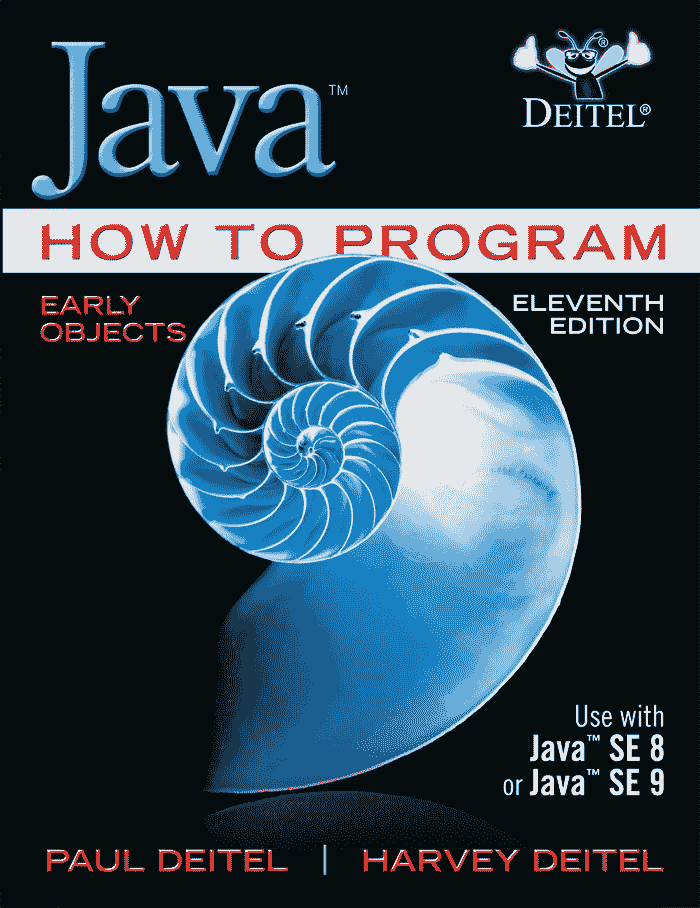

借自其他来源的致谢和说明（经许可在本书中复制）见第 vi 页。

Barbara Deitel 使用海姆立急救法救了 Deitel 的生命。我们家人对你感激不尽。

Firefox 是 Mozilla Foundation 的注册商标。
Google 是 Google, Inc. 的商标。
Mac 和 macOS 是 Apple Inc. 的商标，已在美国及其他国家注册。
Linux 是 Linus Torvalds 的注册商标。所有商标均为其各自所有者的财产。
在本书中，我们使用了商标。我们并未在每次出现商标化名称时都放置商标符号，而是声明我们仅以编辑的方式使用这些名称，其目的是为了商标所有者的利益，并无意侵犯该商标。

# 前言

在我的职业生涯中，我遇到并采访了许多专家 Java 开发者，他们通过 Paul 和 Harvey 编写的一或多本大学教材、专业书籍、视频和企业培训向他们学习。许多 Java 用户组（Java User Groups）围绕着 Deitel 夫妇的出版物聚集在一起，这些书籍被国际范围内的大学课程和职业培训采用。你正在加入一个精英群体。

## 如何成为一名专家 Java 开发者？

这是我在面向学生的讲座和 Java 专业人士活动中收到的最常见问题之一。学生们想要成为专家开发者——而现在是成为开发者的绝佳时机。
市场非常广阔，充满了机会和迷人的项目，特别是对于那些愿意花时间学习、实践和精通软件开发的人来说。世界需要优秀、专注的专家开发者。
那么，你该如何做？首先，让我们明确：软件开发是很困难的。但不要气馁。掌握它将为你开启巨大机会的大门。接受它的困难，拥抱复杂性，享受其中。你对技能的扩展没有限制。
软件开发是一项惊人的技能。它能带你去任何地方。你可以在任何领域工作。从让世界变得更好的非营利组织，到顶尖的生物技术。从金融世界疯狂的日常运转，到宗教的深奥奥秘。从体育、音乐到表演。一切都有软件。各地计划的成功与否将取决于开发者的知识和技能。

* Oracle Certified Professional, Java SE 8 Programmer

如果你还没有读过，请阅读封底和内封的要点和评论——这些内容简要地概述了书的精髓。在本言中，我们为学生、教师和专业人士提供了更多详细信息。

* *Java How to Program, 11/e* 的模块化组织
* 对 Java SE 9 的灵活覆盖：`JShell`、模块系统和其他 Java SE 9 话题
* 灵活的 JavaFX/Swing GUI、图形和多媒体覆盖
* 灵活的 Lambda 和 Stream 覆盖
* 数据库：`JDBC` 和 `JPA`
* 可选的在线面向对象设计案例研究

## 使用 Java SE 8 或新的 Java SE 9 的灵活性

为了满足我们多元受众的需求，我们为基于 Java SE 8 或 Java SE 9 的大学和专业课程设计了本书，从现在我们将分别称为 `Java 8` 和 `Java 9`。每个在 `Java 8` 或 `Java 9` 中首次引入的特性在页边处都有一个 8 或 9 图标，如本段左侧的所示。新的 Java 9 功能包含在标记清晰的、“易于包含或省略”的章节和节中——部分在纸质书中，部分在网上。图 1 和 图 2 分别列出了我们涵盖的一些关键 Java 8 和 Java 9 特性。

### 图 1 我们涵盖的 Java 8 引入的一些关键新特性

| Java 8 特性 | |
| :--- | :--- |
| * Lambda 和 Stream | * 类型推断改进 |
| * `@FunctionalInterface` 注解 | * Java 的批量数据操作——`filter`、`map` 和 `reduce` |
| * 支持 lambda 的库增强（例如 `java.util.stream`、`java.util.function`） | |

### 图 2 我们涵盖的 Java 9 引入的一些关键新特性

| Java 9 特性 | |
| :--- | :--- |
| * **在配套网站上** | * 模块系统 |
| * HTML5 Javadoc 增强 | `Matcher` 类的新方法重载 |
| * `CompletableFuture` 增强 | JavaFX 9 皮肤 API 其他增强 |
| * 提到：Java 9 安全增强概述 | * G1 垃圾回收器 |
| * 对象序列化安全增强 | 增强的废弃标记 |

## *Java How to Program, 11/e* 的模块化组织

本书的模块化组织有助于教师规划教学大纲。
*Java How to Program, 11/e* 适用于各个级别的编程课程。第 1 章–第 25 章 在核心计算机科学 CS1 和 CS 2 课程以及相关学科的入门课程中流行——这些章节出现在**纸质书**中。第 26–36 章用于高级课程，并位于书籍的**配套网站**上。

### 第一部分：简介

* 第 1 章 计算机、互联网和 Java 简介
* 第 3 章 类、对象和字符串简介
* 第 5 章 控制语句：第二部分；逻辑运算符
* 第 7 章 数组与 `ArrayList`
* 第 15 章 文件、输入/输出、NIO 与序列化

### 第三部分：面向对象编程

* 第 8 章 类与对象：深入理解
* 第 10 章 面向对象编程：多态与接口
* 第 13 章 JavaFX GUI：第二部分
* 第 17 章 Lambda 和 Stream
* 第 19 章 搜索、排序与 Big O
* 第 21 章 自定义泛型数据结构

### 第六部分：并发；网络

* 第 23 章 并发
* [第 29 章] Java Persistence API (JPA)

### 第八部分：Web 应用开发与 Web 服务

* [第 30 章] JavaServer™ Faces Web 应用：第一部分

* **评估**它，并
* **循环**对下一个片段再次执行此过程。

当你完成 第 25 章中大量的示例和练习时，你将看到 `JShell` 及其`即时反馈`如何保持你的注意力、增强你的性能并加速学习和软件开发过程。
作为学生，你会发现 `JShell` 既好用又有趣。它将帮助你更快、更深地学习 Java 特性，并帮助你验证这些特性是否按预期方式工作。作为教师，你会欣赏 `JShell` 如何鼓励学生深入钻研，以及它如何`利用学习过程`。作为专业人士，你会欣赏 `JShell` 如何帮助你快速构建关键代码段的原型，以及它如何帮助你发现和实验新的 API。
我们选择了模块化的方法，将 `JShell` 内容封装在 第 25 章中。该章节：
1. `易于包含或省略`。
3. 对 `JShell` 的功能提供了丰富的涵盖。它是`示例密集型的`——你应该完成每一个示例。让 `JShell` 熟能生巧。你会欣赏做事情是多么的快捷方便。

| 章节 | 内容 | 关联章节 |
| :--- | :--- | :--- |
| 第 25.4 节 | 讨论了在 `JShell` 中使用 `Scanner` 进行命令行输入。 | 第 2 章 |
| 第 25.6 节 | 显示了如何使用 `JShell` 的`补全`功能来发现类的功能和 `JShell` 命令。 | 第 3 章，类、对象、方法和字符串 |
| 第 25.8 节 | 显示了如何在 `JShell` 中声明和使用方法，包括`前置引用`一个在 `JShell` 会话中不存在的方法。 | 第 6 章，方法：深入观察 |
| 第 25.10 节 | 显示了如何将已有的`包`添加到类路径并在 `JShell` 中导入它们使用。 | 第 21 章，自定义泛型数据结构 |

第 3 章–第 7 章中的早期类和对象介绍了 `Account`、`Student`、`AutoPolicy`、`Time`、`Employee`、`GradeBook` 和 `Card` 洗牌与发牌案例研究，逐步引入更深面向对象概念。

### 继承、接口、多态与组合

我们从第 7 章开始整合基础异常处理，随后在第 11 章中给出更深层次的处理。异常处理对于构建任务关键和业务关键的应用至关重要。要使用 Java 组件，你不仅需要知道该组件在“一切顺利”时如何表现，还需要知道该组件在“情况糟糕”时“抛出”哪些异常，以及你的代码应该如何处理这些异常。

### `Arrays` 类与 `ArrayList`

* 从完全没有
* 到第 12 章、第 13 章和第 22 章中对 JavaFX GUI、图形的深度处理。

学生喜欢构建带有 GUI、图形和动画的应用。对于早期介绍 GUI 和图形的课程，我们集成了一个可选的案例研究，介绍基于 JavaFX 的图形界面（GUI）和基于 `Canvas` 的图形。该案例研究的目标是创建一个简单的绘图程序，用户可以选择形状并绘制形状特征（如颜色、线条粗细以及是空心的还是填充的），然后拖动鼠标来定位和调整形状大小。案例研究逐步实现该目标：在第 10 章中实现绘图程序，并在练习 13.9（图 4）实现更健壮的用户界面。对于包含这些可选早期案例研究章节的课程，讲师可以选择覆盖第 12 章、第 13 章和第 22 章中深度处理的内容的全部或部分。

| 章节或练习 | 你将要做 |
| :--- | :--- |
| 节 3.6: 简单的 GUI | 显示文本和图像。 |
| 节 5.11: 绘制矩形和椭圆 | 绘制矩形和椭圆。 |
| 节 7.17: 绘制弧形 | 绘制彩虹色的弧形。 |
| 节 10.14: 多态绘图 | 识别形状类之间的相似性并创建并使用形状层次结构。 |

* 第 26 章，`Swing` GUI 控件：第一部分
* 第 35 章，`Swing` GUI 控件：第二部分。

请参见本序言后部分的“配套网站”章节。

## 在 JavaFX GUI 中集成 Swing GUI 组件

即使你转向了 JavaFX，你仍然可以使用你喜爱的 `Swing` 功能。例如，在第 24 章中，我们演示了如何通过 JavaFX 8 `SwingNode` 在嵌入 JavaFX GUI 的 `Swing` `JTable` 组件中显示数据库数据。随着你深入学习 Java，你会发现你也可以将 JavaFX`功能`整合到你的 `Swing` GUI 中。

## 数据结构和泛型集合（第 5 部分）

数据结构介绍。第 7 章和第 5 部分的章节构成了数据结构课程的核心。我们从第 7 章泛型类 `ArrayList` 开始。后续的数据结构（第 16 章–第 21 章）提供了对`泛型集合`更深入的讲解——展示如何使用内置的集合。我们讨论了`递归`，这对于许多树形结构类很重要。对于计算机科学专业的学生，我们讨论了用于操作集合的流行搜索和排序算法`，并介绍了`大 O`——描述算法解决问题难度的方法。大多数程序员应该使用内置的搜索和排序功能。我们展示了如何实现`泛型方法`和`自定义数据结构`（这同样适用于大多数使用内置集合的程序员）。第 17 章引入的`Lambdas` 对于处理泛型集合特别有用。

## 灵活的 Lambdas 和 Streams（第 17 章）

Java 8 中最重要的新特性是 lambdas 和 streams。本书有几类读者：
* 希望对 lambdas 和 streams 进行深入讲解的人
* 尚不想使用 lambdas 和 streams 的

出于这个原因，我们将大部分关于 lambdas 和 streams 的讲解放在第 17 章中，该章节被设计为一系列与书中前面的章节相衔接的`易于包含或省略`的章节。我们在第 17 章之后在几个示例中整合了 lambdas 和 streams，因为它们的特性是如此吸引人。
在第 17 章中，你会发现 lambdas 和 streams 可以帮助你写出更快速、更简洁、更简单、更少的程序，并且比以前技术编写的程序更容易`并行化`（在`多核系统`上实现性能提升）。你会看到 lambdas 和 streams 的“函数式编程”补充了面向对象的编程。
第 17 章的许多章节编写是为了可以在书中更早阶段介绍的（图 5）——我们建议学生从第 17.2 节–第 17.7 节开始学习，在第 5 章之后，专业人士通过阅读第 17 章，巧妙地重新实现书中许多示例。

### 图 5 Lambdas 和 streams 讨论可在何处涵盖

| Lambdas 和 streams 讨论 | 可以在之后涵盖 |
| :--- | :--- |
| 第 17.2 节–第 17.5 节介绍了基础的 lambda 和 streams 功能，可以使用它们来`替换计数循环`，并讨论了 streams 的处理机制。 | 第 5 章，控制语句：第二部分；逻辑运算符 |
| 第 17.6 节–第 17.7 节引入了处理`一维数组`的流能力。 | 第 7 章，数组与 `ArrayList` |
| 第 17.8 节–第 17.10 节展示了额外的流能力，并介绍了各种`用于流处理的函数式接口`。 | 第 10 章，面向对象编程：多态与接口 |
| 第 17.11 节–第 17.16 节为支持 lambda 和流的函数式接口引入了 Java 8 接口特性（`default` 方法、`static` 方法以及函数式接口的概念）。 | 第 17 章，Java 8 lambda 和流的讨论与示例。 |
| 第 23 章 | 并发与多核性能（第 6 部分） |

## JDBC

第 29 章涵盖了较新的 `Java Persistence API (JPA)`——这是一种“底层”使用 JDBC 的`对象关系映射 (ORM)` 标准。ORM 工具可以查看数据库的`schema` 并生成一组类，使你能够在不直接使用 JDBC 和 SQL 的情况下与数据库交互。这加速了数据库应用程序的开发，减少了错误并生成了更具移植性的代码。

## Web 应用开发与 Web 服务（第 8 部分）

第 30–31 章介绍了用于构建 JSF 应用程序的`JavaServer™ Faces (JSF)` 技术。第 30 章包含了构建 Web 应用 GUI、表单验证和会话跟踪的示例。第 31 章讨论了数据驱动的 JSF 应用程序——包括一个**多层 Web 书籍应用程序**，允许用户添加和搜索联系人。

## Web 服务

## ATM 的面向对象设计开发与 Java 实现

《Java 程序设计》第 11 版包含数百个完整的可运行代码示例。我们强调程序的清晰性，并专注于构建工程良好的软件。

## 语法高亮

注释显示为绿色
错误显示为红色

## 代码突出

我们将关键术语以及每个定义出现处的索引页码使用**加粗深红色**字体进行标记，以便于查阅。我们使用**粗体 Helvetica** 字体强调屏幕组件（例如 `File` 菜单），并使用 `Lucida` 字体强调 Java 程序文本（例如 `int x = 5;`）。

## 章节目标

书中包含了大量的表格、线条图、UML 图、程序和程序输出。

## 总结要点

书中包含了大量的自测练习和答案，供自学使用。可选的 ATM 案例研究中的所有练习均有完整解答。

## 习题

* 这段代码有什么错？
* 编写单个语句以及方法和类的小部分
* 大型项目
* 在本版中，我们为`游戏编程`系列添加了新练习（`SpotOn`、`Horse Race`、`Cannon`、`15 Puzzle`、`Hangman`、`Block Breaker`、`Snake` 和 `Word Search`），以及关于 `JavaMoney API`、`final` 实例变量、组合与继承、处理接口、绘制分形、递归搜索目录、算法可视化以及使用 Fork/Join 框架实现并行递归算法的练习。其中许多练习要求学生在网上研究额外的 Java 特性并使用它们。

侧重于 Java 8 或 Java 9 的练习已有相应标记。访问我们的 `Programming Projects Resource Center` 可以获取更多练习和项目机会（`www.deitel.com/ProgrammingProjects/`）。

## 索引

我们包含了数百条编程技巧，帮助你关注程序开发的重要方面。这些技巧代表了我们从九十年编程和教学经验中汲取的精华。

## 什么是 JEPs、JSRs 和 JCP？

* http://openjdk.java.net/jeps/0
* https://www.jcp.org/en/jsr/all
* https://www.jcp.org

构建能够抵抗病毒、蠕虫和其他形式的“恶意软件”攻击的工业级系统是非常困难的。今天，通过互联网，此类攻击可以是瞬时且全球范围的。在开发周期的早期将安全性构建到软件中可以减少漏洞。我们根据 CERT Oracle Java 安全编码标准对我们的书进行了审核：

```
```

并根据该水平教科书的要求适当遵循了各种安全编码实践。

CERT® 协调中心（`www.cert.org`）的建立是为了迅速分析和响应攻击。CERT——计算机应急响应小组——是卡内基·梅隆大学软件工程研究所内部的一个政府资助机构。CERT 发布并推广针对各种流行编程语言的安全编码标准，帮助软件开发者通过采用防止系统攻击成功的编程实践来实施工业级系统。

我们感谢 Robert C. Seacord。几年前，当 Seacord 先生担任 CERT 的安全编码经理并在卡内基·梅隆大学计算机科学学院兼职教授时，他是我们书籍 *C How to Program, 7/e* 的技术评审员，他从安全角度审视了我们的 C 程序，并建议我们遵循 CERT 安全编码标准。这一经历也影响了我们在 *C++ How to Program, 10/e* 和 *Java How to Program, 11/e* 中的编码实践。

## 配套网站：源代码、视频笔记、在线章节和在线附录

* http://www.deitel.com/jhtp11
* http://www.pearsonhighered.com/deitel


此书所需的所有软件都可以从网上免费下载。请参见本前言之后的“开始之前”部分获取每个下载链接。我们使用免费的 Java 标准版开发包 (`JDK`) 8 编写了 *Java How to Program, 11/e* 中的大部分示例。对于可选的 Java 9 内容，我们使用了 OpenJDK 的 `JDK` 9 预览版本。所有的 Java 9 程序均在 `JDK` 9 预览版本上运行。其余所有程序均在 `JDK` 8 和 `JDK` 9 预览版本上运行，并在 Windows、macOS 和 Linux 上经过测试。几个在线章节还使用了 Netbeans IDE。

## Java 文档链接

* <http://docs.oracle.com/javase/8/>
* <http://download.java.net/java/jdk9/>
* <http://docs.oracle.com/javase/9/>
* <http://www.deitel.com/books/jhtp11>
* *Java How to Program, Late Objects Version, 11/e*

它们之间的主要区别在于我们介绍第 1 章

* LinkedIn^® (<http://linkedin.com/company/deitel-&-associates>)
* Google+™ (<http://google.com/+DeitelFan>)

deitel@deitel.com

deitel@deitel.com

<http://www.deitel.com/training>

deitel@deitel.com

<http://www.informit.com/store/sales.aspx>

<https://docs.oracle.com/javase/8/docs/technotes/guides/install/install_overview.html>

<http://askubuntu.com/questions/464755/how-to-install-openjdk-8-on-14-04-lts>

<http://www.java.com/en/download/help/path.xml>

`'java'不是内部或外部命令，可运行程序或批文件。`

根据你的平台，`PATH` 变量必须指向 `JDK` 的 `bin` 目录。如果你下载了更高版本的 `JDK`，可能需要更改变量名称。

在 Java 9 之前，`JDK` 版本的格式为 `1.X.0_updateNumber`，其中 `X` 是 Java 的主版本。例如：

* Java 8 的当前 `JDK` 版本号为 `jdk1.8.0_121`，
* 1—次版本更新号，

<http://openjdk.java.net/jeps/223>

<https://docs.oracle.com/javase/8/docs/technotes/guides/install/windows_jdk_install.html#BABGDJFH>

说明了如何更新 `PATH`。请将说明中的 `JDK` 版本号替换为你想要使用的 `JDK` 版本号——目前为 `jdk-9`。你应该检查你的 `JDK` 9 安装文件夹名称以获取更新后的版本号。此设置将自动应用于你打开的每个新 `Command Prompt`（命令提示符）。

如果你不想修改系统的 `PATH`——也许是因为你同时在使用 `JDK` 8——你可以打开一个 `Command Prompt` 窗口，然后仅为该窗口设置 `PATH`。操作方法是使用命令：

```
set PATH=location;%PATH%
```

其中 `location` 是 `JDK` 9 `bin` 文件夹的完整路径，`;%PATH%` 将 `Command Prompt` 窗口原始的 `PATH` 内容附加到新的 `PATH` 之后。通常，命令为：

```
set PATH=C:\Program Files\Java\jdk-9\bin;%PATH%
```

每当你打开一个新的 `Command Prompt` 窗口来使用 `JDK` 9 时，都必须重新执行此命令。

# 在 macOS 上管理多个 JDK

在 Mac 上，你可以通过打开 `Terminal`（终端）窗口并输入命令来确定安装了哪些 `JDK`：

```
/usr/libexec/java_home -V
```

它会显示你的 `JDK` 的版本号、名称和位置。在我们案例中

```
 9, x86_64: "Java SE 9-ea "/Library/Java/JavaVirtualMachines/
 1.8.0_121, x86_64: "Java SE 8 "/Library/Java/
```

版本号为 `9` 和 `1.8.0_121`。在上面的“Java SE 9-ea”中，“ea”意味着“早期访问（early access）”。

要设置默认 `JDK` 版本，输入：

```
export JAVA_HOME=`/usr/libexec/java_home -v #`
```

其中 `#` 是应作为默认的特定 `JDK` 版本号。在写作时，对于 `JDK` 8，`#` 应该是 `1.8.0_121`，对于 `JDK` 9，`#` 应该是 `9`。

接下来，输入命令：

```
export PATH=$JAVA_HOME/bin:$PATH
```

其中 `#` 是当前默认 `JDK` 的版本号。这将 `Terminal` 窗口的 `JAVA_HOME` 环境变量设置为该 `JDK` 的位置。在启动 JShell 时将使用此环境变量。

# 在 Linux 上管理多个 JDK

在 Linux 上，管理多个 `JDK` 版本的方法取决于你如何安装 `JDK`。如果你使用 Linux 发行版的工具来安装软件（我们在 Ubuntu Linux 上使用了 `apt-get`），那么在许多 Linux 发行版中，你可以使用以下命令列出已安装的 `JDK`：

```
update-alternatives --config java
```

如果安装了多个版本，上述命令将向你显示一个带编号的 `JDK` 列表——然后输入你想要作为默认的 `JDK` 编号。关于如何使用 `apt-get` 在 Ubuntu Linux 上安装 `JDK` 的教程，请参见：

```
http://askubuntu.com/questions/464755/how-to-install-openjdk-8-on-14-04-lts
```

如果你通过下载 `tar.gz` 文件并解压到系统来安装 `JDK` 9，你需要在 shell 窗口中指定 `JDK` `bin` 文件夹的路径。为此，在 shell 窗口中输入以下命令：

```
export PATH=location:$PATH
```

其中 `location` 是 `JDK` 9 `bin` 文件夹的路径。这将更新 `PATH` 环境变量，包含 `JDK` 9 命令（如 `javac` 和 `java`）的位置。

# 1 计算机、互联网与 Java 简介

## 目标

在本章中将：

* 了解计算机领域令人兴奋的发展。
* 理解数据分层结构。
* 理解 Java 的重要性。
* 学习互联网和 Web 基础。
* 测试 Java 应用程序。
* 跟上信息技术的发展。

## 1.1 简介

欢迎学习 Java——全球最常用的计算机语言之一，根据 TIOBE 指数，它是全球最流行的语言。你可能已经熟悉计算机执行的强大任务。通过本书，你将使用 Java 语言编写指令执行这些任务。**软件**（即你写的指令）控制**硬件**（即计算机）。

你将学习*面向对象编程*——今天的核心方法。你将创建并处理许多*软件对象*。

对于许多组织来说，Java 是满足其企业需求的首选语言。Java 还广泛用于实现基于互联网的应用程序以及用于网络通信的设备软件。

根据 Oracle 的 2016 年 JavaOne 主题演讲，全球现在有 1000 万 Java 开发者，Java 运行在 150 亿设备上，包括 20 亿辆汽车和 3.5 亿台医疗设备。手机、平板电脑和其他设备的爆炸式增长为移动应用程序开发创造了巨大机机。

# 图 1.1

使用 Java 的某些设备。

| 设备 |
| --- |
| 访问控制系统 | 飞机系统 | 自动取款机 |
| 机顶盒 | 复印机 | 信用卡 |
| 游戏机 | GPS 导航系统 | 家用电器 |
| 学习基础 | 软件基础 | 网络基础 |
| 手机 | 磁共共振成像 (MRI) | 网络交换机 |
| 销售点终端 | 打印机 | 机器人 |
| 智能电表 | 智能笔 | 智能手机 |
| 交通卡 | 电视机顶盒 | 车辆诊断系统 |

# Java 标准版

| 组件 | 说明 |
| :--- | :--- |
| **输出单元** | 该“发送”部分将计算机处理过的信息放在各种输出设备上，以便在计算机外部使用。今天计算机输出的大多数信息显示在屏幕上（包括触摸屏）、打印在纸上（环保考虑反对这样做）、在 PC 和媒体播放器（如 Apple 的 iPod）上以音频或视频形式播放、并在体育馆的巨大屏幕上显示、通过互联网传输或控制其他设备（如机器人和“智能”家电）。信息也经常输出到次级存储设备，如固态硬盘 (`SSD`)、硬盘、DVD 驱动器和 USB 闪存器。 |
| **存储单元** | 这一快速访问、容量相对较小的“仓库”部分保留了通过输入单元输入的信息，使其在需要时能够立即用于处理。存储单元还会保留处理后的信息，直到由输出单元将其放置在输出设备上。存储单元中的信息是`volatile`（易失的）——当计算机电源关闭时，这些信息通常会丢失。存储单元通常被称为 `memory`、主内存或 `RAM`（随机访问存储器）。台式电脑和笔记本电脑的主内存包含高达 128 GB 的 `RAM`，但 2 到 16 GB 是常见的。`GB` 代表千字节；一个千字节约为十亿个字节。一个 `byte`（字节）是八个位。一个位可以是 `0` 或 `1`。 |

* 姓名（字符串）
* 时薪（带小数的数字）
* 扣税金额（带小数的数字）

因此，记录是字段组。在前面的示例中，所有字段都属于同一位员工。公司可能有许多员工，并为每个员工拥有一个工资记录。

# 文件 (Files)

`file` 是相关记录的组。*注意：*更通用地说，文件包含任意格式的任意数据。在某些操作系统中，文件被简单地视为字节的序列——文件中字节的任何组织（例如将数据组织成记录）都是由应用程序创建的。你将在第 15 章学习如何这样做。组织拥有许多文件，某些文件包含数十亿甚至万亿字符的信息。

# 数据库 (Database)

`database` 是为了便于访问和操作而组织的数据集合。最流行的模型是*关系数据库*，数据存储在简单的*tables*（表）中。表包含*records*和*fields*。例如，学生表可能包括名、姓、专业、年级、学号和平均学分字段。每个学生的数据是一条记录，每个记录中的各个信息是字段。你可以根据数据与多个表或数据库之间的关系进行*搜索*、*排序*或其他操作。例如，大学可以将学生数据库的数据与课程、住宿、餐饮计划等数据库的数据结合使用。我们将在第 24 章中讨论数据库、使用 JDBC 访问数据库以及在线第 29 章 Java 持久化 API (`JPA`)。

# 大数据 (Big Data)

| 单位 | 换算 | 字节数 |
| --- | --- | --- |
| 1 兆字节 (MB) | 1024 千字节 | 10⁶ (1,000,000) 字节 |
| 1 太字节 (TB) | 1024 字节字节 | 10¹² (1,000,000,000,000) 字节 |
| 1 艾字节 (EB) | 1024 拍字节 | 10¹⁸ (1,000,000,000,000,000,000) 字节 |

字节单位测量。

# 1.4 机器语言、汇编语言和高级语言

程序员使用各种编程语言编写指令，其中一些语言可以直接被计算机理解，而另一些则需要中间的*翻译* 步骤。今天有数百种语言在使用。这些语言可以分为三个大类：

1. 机器语言
2. 汇编语言
3. 高级语言

## 机器语言

任何计算机都只能直接理解其由硬件设计定义的机器语言。机器语言通常由数字字符串（最终还原为 1 和 0）组成，指示计算机一次执行一次最基础的操作。机器语言是依赖于机器的（特定的机器语言只能用于一种类型的计算机）。这些语言对人类来说非常繁琐。例如，这里是一个早期机器语言薪资程序的一部分，它将加班费加到基本工资并将结果存储在总工资中：

```
+1400593419
```

## 汇编语言和汇编器

对于大多数程序员来说，用机器语言编程太慢且太枯燥了。程序员不再使用计算机可以直接理解的数字字符串，而是开始使用类似英语的缩写来基本操作。这些缩写成了汇编语言的基础。开发了被称为汇编器的翻译程序，以计算机的速度将早期的汇编语言程序转换为机器语言。以下汇编语言薪资程序的部分也将加班费加到基本工资并将结果存储在总工资中：

| 指令 | 操作数 |
| --- | --- |
| `load` | `basepay` |
| `add` | `overtimepay` |
| `store` | `grosspay` |

虽然这种代码对人类来说更清晰，但在翻译成机器语言之前，计算机是无法看懂的。

## 高级语言和编译器

随着汇编语言的出现，计算机的使用量迅速增加，但程序员即使完成最简单的任务也仍需要使用大量指令。为了加速编程过程，开发了高级语言，在高级语言中可以使用单个语句来完成大量任务。被称为编译器的翻译程序将高级语言程序转换为机器语言。高级语言允许你编写看起来几乎像日常英语并包含常用数学符号的指令。用高级语言编写的薪资程序可能包含这样的单个语句：

```
grossPay = basePay + overtimePay;
```

从程序员的角度来看，高级语言比机器语言和汇编语言更好。Java 是世界上最广泛的高级编程语言。

## 解释器

将大型高级语言程序编译成机器语言可能消耗大量的计算机时间。解释器程序旨在直接执行高级语言程序，避免了编译延迟，尽管它们的运行速度比编译后的程序慢。我们将在第 1.9 节 中更多地介绍解释器。

正如在实际驾驶汽车之前，必须根据其工程图*建造一辆汽车*一样，在程序执行类方法定义的任务之前，你必须先为类*构建一个对象*。这一过程被称为*实例化*。该对象随后被称为其类的 `instance`（实例）。

## 1.5.4 复用

正如汽车的工程图可以被多次*复用*以构建许多汽车一样，你也可以多次*复用*一个类来构建许多对象。在构建新类和程序时复用现有的类可以节省精力。复用还能帮助你构建更可靠、更有效的系统，因为现有的类和组件通常已经过广泛的*测试*、*调试*和*性能*调优。正如*通用零件*的概念对工业革命至关重要，可重用的类对于由对象技术引发的软件革命至关重要。

## 1.5.5 消息与方法调用

当你开车汽车时，踩下油门会向汽车发送一条*消息*来执行某项任务——即跑得更快。同样，你*向对象发送消息*。每条消息都实现为一个 `method call`（方法调用），告诉对象的某个方法去执行其任务。例如，程序可能会调用银行账户对象的*deposit*（存款）方法来增加账户余额。

## 1.5.6 属性与实例变量

汽车除了完成任务的能力外，还有*属性*，例如它的颜色、门数、油箱中的油量、当前速度以及总行驶里程的记录（即里程表读数）。与其能力一样，汽车的属性被表示为其工程图中设计的一部分（例如，这些图纸包含了里程表和燃料表）。当你驾驶真实的汽车时，这些属性会随汽车移动。每辆汽车都维护*自己的*属性。例如，每辆汽车都知道自己的油箱里有多少油，但*不知道**其他*汽车的油箱里有多少油。

同样，对象也拥有它在程序中使用时携带的属性。这些属性被指定为对象类定义的一部分。例如，银行账户对象有一个*balance attribute*（余额属性），代表账户中的金额。每个银行账户对象都知道它所代表的账户余额，但*不知道*银行中*其他*账户的余额。属性是由类的 `instance variables`（实例变量）指定的。

## 1.5.7 封装与信息隐藏

类（及其对象）**封装**（encapsulate），即包裹它们的属性和方法。类的（以及其对象的）属性和方法是紧密相关的。对象之间可以相互通信，但它们通常不被允许知道对象是如何实现的——实现细节可以*隐藏*在对象内部。正如我们之后将看到的，这种**信息隐藏**（information hiding）对于良好的软件工程至关重要。

## 1.5.8 继承

可以通过**继承**（Inheritance）方便地创建一个新的对象类——新类（称为**子类** subclass）从现有类（称为**父类** superclass）的特征开始，可能对其进行定制并添加自己的独特特征。在我们的汽车类比中，“敞篷车”类的对象无疑如此。

## 1.5.9 接口

Java 还支持**接口**（interfaces）——方法签名的集合，定义了一个类可以做什么，但不定义它是如何做的。

## 1.5.10 面向对象的分析与设计 (OOAD)

为了创建最佳解决方案，你应该遵循详细的**分析**（确定系统应该*做什么*）并开发**设计**（指定它应该*如何做*）。如果这个过程涉及从面向对象的视角分析和设计你的系统，它就被称为**面向对象的分析与设计 (OOAD)**。

## 1.5.11 UML（统一建模语言）

尽管存在许多不同的 OOAD 过程，但一种用于交流任何 OOAD 过程结果的单一图形语言已广泛使用。统一建模语言（UML）现在是应用广泛的图形建模方案。

## 1.6 操作系统

**操作系统**（Operating systems）是让用户、应用程序开发者和系统管理员更方便地使用计算机的软件系统。它们提供的服务允许每个应用程序与其他应用程序安全、高效且*并发*（concurrently，即并行）地执行。包含操作系统核心组件的软件被称为 `kernel`（内核）。流行的桌面操作系统包括 Linux、Windows 和 macOS。智能手机和平板电脑最常用的移动操作系统是 Google 的 Android 和 Apple 的 iOS。

## 1.6.1 Windows—一种专有操作系统

20 世纪 80 年代中期，微软开发了 `Windows operating system`，它由构建在 DOS（磁盘操作系统）之上的图形用户界面组成——这是一种极其流行的个人计算机操作系统，用户通过输入命令与其进行交互。Windows 借用了许多概念（如图标、菜单和窗口），这些概念由施罗克斯 PARC 开发并被早期的 Apple Macintosh 操作系统普及化。Windows 10 是微软最新的操作系统——其功能包括对 `Start` 菜单和用户界面的增强、用于语音交互的 Cortana 个人助理、用于接收通知的操作中心、微软新的 Edge 浏览器等。Windows 是一种 `proprietary` 操作系统——它由微软专有控制。Windows 目前为止是全球使用最广泛的桌面操作系统。

## 1.6.2 Linux—一种开源操作系统


`Linux operating system` 可能是`开源`运动以来最大的成功。`开源软件`偏离了主导软件早期发展阶段的`专有`软件开发风格。通过开源开发，个人和公司`贡献`它们在开发、维护和演进软件方面的努力，以换取将其用于自己目的的权利，通常是`免费`的。开源代码通常受到比专有软件多得受众的审查，因此错误通常能更快地消除。开源还鼓励了创新。如 `IBM`、`Oracle` 等许多企业级系统公司对 Linux 开源开发投入了大量资金。

开源社区的一些关键组织包括：

*   Eclipse 基金会（Eclipse 集成开发环境帮助程序员方便地开发软件）
*   Apache 软件基金会（Apache Web 服务器的创建者，该服务器用于开发基于 Web 的应用程序）

<http://www.openhandsetalliance.com/oha_members.html>

| 语言 | 说明 |
| --- | --- |
| Basic | Basic 在 20 世纪 60 年代在丹特学院开发，旨在让初学者熟悉编程技术。它的许多最新版本都是面向对象的。 |
| C++ | C++ 基于 C，由 Bjarne Stroustrup 在 20 世纪 80 年代初在贝尔实验室开发。C++ 提供了几个“润色” C 语言的功能，但更重要的是，它提供了面向对象编程的能力。 |

## C#

COBOL（面向事务的常用语言）由计算机制造商、美国政府和工业计算机用户在 20 世纪 50 年代后期基于美国海军职业役军官、计算机科学家格蕾丝·霍珀（Grace Hopper）开发的语言而开发。（她于 2016 年 11 月被追授总统自由勋章。）COBOL 仍被广泛用于需要精确且高效处理大量数据的商业应用。其最新版本支持面向对象编程。

## Fortran

JavaScript 是使用最广泛的脚本语言。它主要用于为网页添加编程功能——例如动画和与用户的交互。所有主流网络浏览器都支持它。

## Objective-C

20 世纪 60 年的研究产生了结构化编程——一种有规律的程序编写方法，比以前技术产生的程序更清晰、更容易测试和调试，并且更容易修改。Pascal 语言由尼克劳斯·维尔（Niklaus Wirth）教授于 1971 年开发，源于这项研究。它在几十年里被用于教学结构化编程。

## PHP

Python 是另一种面向对象的脚本语言，于 1991 年公发布。它由阿姆斯特丹荷兰数学和计算机科学国家研究所的吉多·范洛姆（Guido van Rossum）开发，大量借鉴了系统编程语言 Modula-3。Python 是“可扩展的”——它可以通过类和编程接口进行扩展。

## Ruby on Rails

Scala（<http://www.scala-lang.org/what-is-scala.html>）是“scalable language”（可扩展语言），由瑞士瑞士洛桑联邦理工学院（EPFL）教授马丁·奥德斯基（Martin Odersky）设计。Scala 于 2003 年发布，同时使用面向对象编程和函数式编程范式，并设计用于与 Java 集成。在 Scala 中编程可以显著减少应用程序中的代码量。

## Swift

微软的 Visual Basic 语言于 20 世纪 90 年代初推出，旨在简化 Windows 应用程序的开发。其功能与 C# 相当。

# 图 1.5

微处理器革命到为止最重要的贡献是开启了个人电脑的发展。微处理器对智能消费电子设备也产生了深远影响，包括近期“物联网”的爆发。太阳微系统公司早早意识到这一点，于 1991 年资助了由詹姆斯·高林（James Gosling）领导的内部研究项目，产生了一种基于 C++ 的面向对象编程语言，太阳将其称为 Java。使用 Java，你可以编写运行在各种计算机系统和计算机控制设备上的程序。这有时被称为“编写一次，到处运行”。

由于商业界对互联网的极大兴趣，Java 吸引了他们的关注。它现在被用于开发大型企业应用、增强 Web 服务器（提供我们在浏览器中看到的内容的计算机）的功能、为消费设备提供应用程序（手机、智能手机、电视顶盒等）、开发机器人软件以及许多其他用途。它也是开发 Android 智能手机和平板应用的关键语言。太阳微系统公司于 2010 年被 Oracle 收购。

Java 已成为使用最广泛的通用编程语言，拥有超过 1000 万名开发者。在本书中，你将学习 Java 的两个最新版本——Java 标准版 8 (Java SE 8) 和 Java 标准版 9。

## Java 类库

我们现在解释创建和执行 Java 应用程序的步骤。通常有五个阶段：编辑、编译、加载、验证和执行。我们在 Java SE 8 开发工具包（JDK）的上下文中讨论这些阶段。请参见“开始之前”部分有关在 Windows、Linux 和 macOS 上下载和安装 JDK 的信息。

## 第一阶段：创建程序

典型的 Java 开发环境——编辑阶段。

Linux 系统上广泛使用的两种编辑器是 `vi` 和 `emacs`。Windows 提供`记事本`。macOS 提供`文本编辑`。网上还有许多免费软件和共享软件编辑器可用，包括 Notepad++、EditPlus、TextPad、jEdit 等。

集成开发环境（IDE）提供了支持软件开发过程的工具，例如编辑器、用于定位导致程序执行不正确的逻辑错误的调试器等。最流行的 Java IDE 有：

* Eclipse (<http://www.eclipse.org>)
* NetBeans (<http://www.netbeans.org>)

在本书的官方网站上：

```
```

我们提供了视频，向你展示如何运行书中的 Java 应用程序，以及如何使用 Eclipse、NetBeans 和 IntelliJ IDEA 开发新的 Java 应用程序。

# 第 2 阶段：将 Java 程序编译为字节码

在第 2 阶段，你使用 `javac` 命令（Java 编译器）来编译程序（图 1.7）。例如，要编译一个名为 `Welcome.java` 的程序，你需要在系统的命令行窗口（即 Windows 下的命令提示符、macOS 下的终端应用程序）或 Linux shell（在某些 Linux 版本中也称为终端）中输入：

```
```

如果程序编译成功，编译器会生成一个名为 `Welcome.class` 的 `.class` 文件。IDE 通常会提供一个菜单项（如 Build 或 Make），它会为你调用 `javac` 命令。如果编译器检测到错误，你需要返回第 1 阶段并修正它们。在第 2 章

# 图 1.7

典型的 Java 开发环境——编译阶段。

Java 编译器将 Java 源代码翻译成执行阶段（第 5 阶段）要执行任务的字节码。Java 虚拟机（JVM）——JDK 的一部分也是 Java 平台的基础——执行字节码。虚拟机（VM）是一种模拟计算机的软件应用程序，但它与其交互的程序隐藏了底层的操作系统和硬件。如果在许多计算机平台上实现了相同的虚拟机，那么为该类型虚拟机编写的程序就可以在所有这些平台上运行。JVM 是世界上最广泛使用的虚拟机之一。微软的 .NET 使用了类似的虚拟机架构。

与依赖于平台（即依赖于特定的计算机硬件）的机器指令不同，字节码指令是平台无关的。因此，Java 的字节码是可移植的——无需重新编译源代码，相同的字节码指令就可以任何理解编译字节码时 Java 版本的 JVM 平台上执行。JVM 通过 `java` 命令调用。例如，要执行一个名为 `Welcome` 的 Java 应用程序，你需要在命令行窗口输入命令：

```
```

以调用 JVM，随后将启动执行应用程序所需的步骤。这开始了第 3 阶段。IDE 通常提供一个菜单项（如 Run），为你调用 `java` 命令。

# 第 3 阶段：将程序加载到内存

在第 3 阶段，JVM 将程序放入内存中以执行它——这被称为加载（图 1.8）。JVM 的类加载器获取包含程序字节码的 `.class` 文件并将其传输到主内存。它还会加载你的程序使用的任何由 Java 提供的 `.class` 文件。`.class` 文件可以从你系统上的磁盘或通过网络（例如，你的本地大学或公司网络，或互联网）加载。

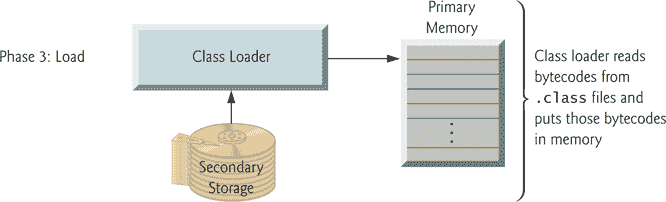

# 图 1.8

典型的 Java 开发环境——加载阶段。

# 第 4 阶段：字节码验证

在第 4 阶段，当类被加载时，字节码验证器会检查它们的字节码，以确保它们是有效的且没有违反 Java 的安全限制（图 1.9）。Java 执行强安全性，以确保通过网络到达的 Java 程序不会损坏你的文件或系统（就像计算机病毒和蠕虫可能那样）。

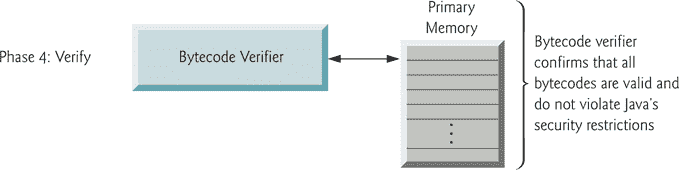

# 图 1.9

典型的 Java 开发环境——验证阶段。

# 第 5 阶段：执行

在第 5 阶段，JVM 执行字节码以完成执行任务（图 1.10）。在早期的 Java 版本中，JVM 仅仅是一个解释器。程序执行缓慢，因为 JVM 一次解释一个字节码。现代计算机架构可以并行执行指令。如今的 JVM 通常通过解释和即时编译相结合来执行字节码。在这个过程中，JVM 在解释时分析字节码，寻找热点——即频繁执行的字节码。对于这些部分，即时编译器（JIT，如 Oracle 的 HotSpot 编译器）将字节码翻译成机器语言。当 JVM 再次遇到这些部分时，将执行机器语言。因此，程序实际上经历了两个编译阶段——一个是将代码翻译成字节码（为了跨 JVM 的移植性），另一个是在执行期间将字节码翻译成机器语言。

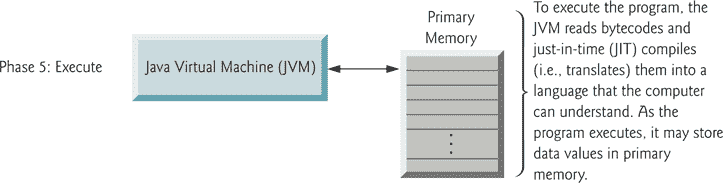

# 图 1.10

典型的 Java 开发环境——执行阶段。

描述

## 执行时可能出现的问题

程序在第一次运行时可能无法正常工作。之前的每个阶段都可能由于我们在书中将讨论的错误而失败。例如，执行中的程序可能会尝试除以零（这在 Java 整数运算中是非法操作）。这会导致 Java 程序显示错误消息。如果发生这种情况，你需要返回编辑阶段，进行必要的修正，并重新通过其余阶段，以确定是否修复了问题。[注意：大多数 Java 程序都会输入或输出数据。当我们说程序显示消息时，通常是指它在屏幕上显示该消息。]

## 1.10 测试 Java 应用程序

在本节中，你将运行并交互一个有的 Painter 应用程序，你将在后面的章节构建它。你看到的元素和功能是你将学习的典型内容。使用 Painter 的图形用户界面（GUI），你可以选择绘制颜色和笔画，然后拖动鼠标绘制指定颜色和大小的圆形。你还可以撤销每次绘制操作或清除整个画布。[注意：我们使用无衬线字体强调屏幕功能，如窗口标题和菜单（例如文件菜单），并使用等宽无衬线字体强调非屏幕元素，如文件名和程序代码。]

*   在 Linux/macOS 上，输入 `cd ~/Documents/examples/ch01/Painter`，然后按 `Enter`。

## 编译应用程序

在命令行窗口中输入以下命令然后按 `Enter` 以编译 `Painter` 示例的所有文件：

```
```

`*` 表示所有以 `.java` 结尾的文件都应该被编译。

## 运行 Painter 应用程序

回想 第 1.9 节，`java` 命令跟随应用程序的 `.class` 文件（在本例中为 `Painter`）即可执行应用程序。输入命令 `java Painter` 然后按 `Enter` 来执行该程序。图 1.11 分别显示了 `Painter` 应用程序在 Windows、Linux 和 macOS 上运行。该程序的功能在各个操作系统上是相同的，因此本节中的其余步骤仅显示 Windows 屏幕截图。Java 命令是`区分大小写`的——也就是说大写字母与小写字母不同。输入 `Painter` 时使用大写 `P` 非常重要。否则应用程序将无法执行。此外，如果你收到错误消息“`Exception in thread "main"` `java.lang.NoClassDefFoundError:` `Painter`”，说明你的系统存在 `CLASSPATH` 问题。请参考“开始之前”章节中的指令来帮助解决此问题。

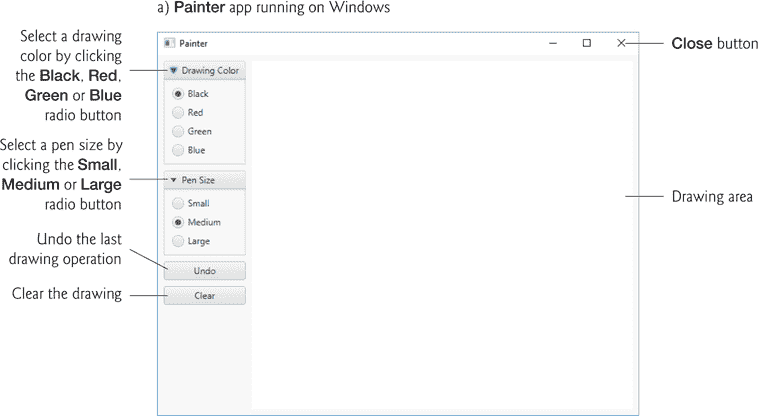

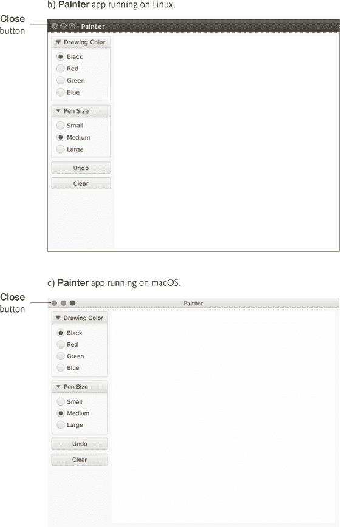

## 图 1.11

`Painter` 应用程序在 Windows、Linux 和 macOS 上执行。

描述

## 绘制花瓣

在本节的后续步骤中，你将画一朵带有绿色花茎、绿草和蓝色雨水的红花。我们将先用红色中号笔画花瓣。通过点击 `Red` 单选按钮将绘制颜色改为红色。接下来，在绘图区域上拖动鼠标绘制花瓣（图 1.12）。如果你不喜欢画的一部分，可以反复点击 `Undo` 按钮来删除最近绘制的圆，或者可以通过点击 `Clear` 按钮重新开始。

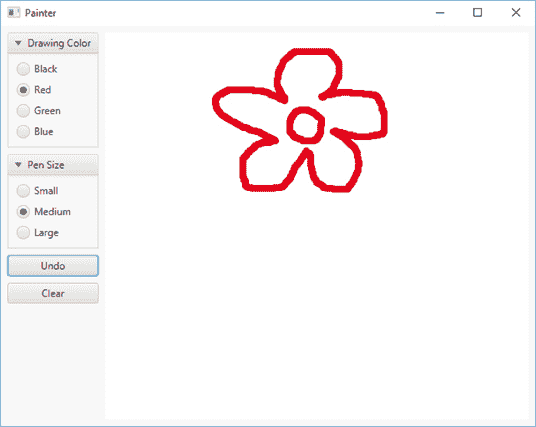

## 图 1.12

绘制花瓣。

## 绘制花茎、叶子和草

通过点击 `Green` 和 `Large` 单选按钮将绘制颜色改为绿色并将笔画大小改为大号。然后，如图 1.13 所示绘制花茎和叶子。接下来，点击 `Medium` 单选按钮将笔画大小改为中号，然后如图 1.13 所示绘制草。


## 图 1.13

绘制花茎和草。

## 绘制雨

点击 `Blue` 和 `Small` 单选按钮将绘制颜色改为蓝色并将笔画大小改为小号。然后，如图 1.14 所示绘制雨。

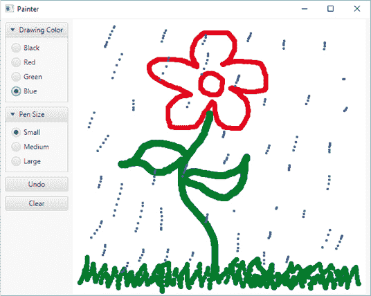

## 退出 Painter 应用程序

此时，你可以关闭 `Painter` 应用程序。只需点击应用程序的关闭框（见 1.11）。

| 应用/服务 | 类别 |
| --- | --- |
| Twitter | 微博客 |
| Facebook | 社交网络 |
| Foursquare | 移动签到 |
| Groupon | 社交电子商务 |
| eBay | 网上拍卖 |
| PayPal | 支付 |
| Amazon eCommerce | 购买书籍及许多其他产品 |
| Skype | 互联网电话 |
| Flickr | 照片共享 |
| Yahoo Search | 搜索 |

*   车库停车位可用性的监控器
*   饮用水质监测器
*   辐射探测器
*   可以追踪你的移动和位置的移动应用程序
*   智能家电

| 术语 | 说明 |
| --- | --- |
| 重构 | `Refactoring`涉及重构程序，以在保持其正确性和功能的同时，使其更清晰、更易维护。它在敏捷开发方法中被广泛采用。许多 IDE 包含内置的`refactoring tools`来自动完成大部分重构工作。 |
| LAMP | `LAMP`是许多开发者用于构建 Web 应用程序的开源技术的缩写——它代表`Linux`、`Apache`、`MySQL`和`PHP`。`MySQL`是一个开源数据库管理系统。`PHP`是一种流行的服务器端脚本语言。`Apache`是最流行的 Web 服务器。Windows 开发的等物是`WAMP`——`Windows`、`Apache`、`MySQL`和`PHP`（或`Perl`或`Python`——两种其他脚本语言）。 |
| 平台即服务 | `PaaS`提供了一个服务的计算平台，而不是在计算机上安装工具。一些 PaaS 提供者是`Google App Engine`、`Amazon EC2`和`Windows Azure`。 |
| 软件开发工具包 | `SDK Kits (SDK)`包含了开发者编写应用程序所需的工具和文档。 |

| 术语 | 说明 |
| --- | --- |
| Beta | Beta 版本在开发过程的后期发布给更多的开发者，此时大部分主要错误已经修复，新功能也几乎完成。Beta 软件更稳定，但仍可能发生变化。 |
| 最终发布 (Final release) | 候选版本中出现的任何错误都会被修正，最终产品发布给普通公众。软件公司经常通过互联网发布增量更新。 |

软件产品发布术语。

# 1.13 解答你的问题

*   `Coderanch.com`
*   `</dream.in.code>`——<http://www.dreamincode.net/forums/forum/32-java/>

# 自测练习

1. 计算机在被称为 ________ 的指令控制下处理数据。
3. 本章讨论的三种语言类型是 ________ 和 ________。
5. ________ 是一个基于 Linux 内核和 Java 的移动设备操作系统。
7. Wii 遥控器以及许多智能手机都使用 ________，它允许设备对动作做出响应。

## 2. **1.2** 填入以下关于 Java 环境的每个句子的空处：

2. JDK 中的 ________ 命令编译 Java 程序。
4. 当编译 Java 程序时，编译器产生的文件以 ________ 文件扩展名结尾。
1. 对象实现了 **封装** 的设计实践——尽管它们可能知道跨定义良好的接口相互通信，但它们通常不被允许知道其他对象是如何实现的。
3. 从面向对象的角度分析和设计系统的过程被称为 ________。
5. ________ 是一种图形化语言，允许设计软件系统的人使用行业标准表示法来表示它们。

## 1. **1.1**

2. 输入单元、输出单元、内存单元、中央处理器、算术逻辑单元、辅助存储单元。
4. 编译器 (compilers)。
6. 候选版本 (Release candidate)。
1. `java`。
3. `.java`。
5. 字节码 (bytecodes)。

## 3. **1.3**

2. 类 (classes)。
4. 继承 (Inheritance)。
6. 属性 (attributes)。

## 练习


1. 接收计算机外部信息供计算机使用的逻辑单元是 ________。

3. ________ 是一种使用英语缩写词表示机器指令的计算机语言。

5. ________ 和 ________ 是计算机保留信息的逻辑单元。

7. ________ 是计算机做出决策的逻辑单元。

9. 计算机直接理解的唯一语言是 ________。

1. ________ 编程语言现在用于开发大型企业应用程序、增强 Web 服务器功能、为消费设备提供应用程序以及许多其他用途。

3. ________ 确保由顺序编号的字节组成的消息正确地从发送者路由到接收者，完好到达并按正确顺序组装。

1. Java 程序通常经历五个阶段——________、________、________、________ 和 ________。

解释 Java 程序的两个编译阶段。

## 1.8

- http://www.terrapass.com/carbon-footprint-calculator-2/
- http://www.carbonfootprint.com/calculator.aspx

- 使用输入和输出。
- 理解基础内存。
- 学习算术运算符的优先级。
- 使用关系运算符和相等运算符。

## 2.1 引言

本章介绍 Java 编程。我们从显示信息的示例开始。然后介绍一个从用户获取两个数字、计算和并显示结果的程序。我们将学习如何做决策。

## 2.2 你的 Java 程序：打印一行文本

Java `application` 是当你使用 `java` 命令启动 Java 虚拟机（JVM）时执行的计算机程序。2.2.1 节–2.2.2 节 讨论如何编译和运行 Java 应用程序。首先我们考虑一个显示一行文本的简单应用程序。图 2.1 显示了程序，随后是一个显示其输出的框。

```java
// 打印程序。
public class Welcome1 {
   public static void main(String[] args) {
   } // 方法 main 
}
```

### 图 2.1

打印程序。

我们使用行号是为了教学目的——它们不是 Java 程序的一部分。这个示例说明了几个重要的 Java 特性。我们将看到第 7 行执行了工作——在屏幕上显示 `"Welcome to Java Programming!"` 短语。

## 为你的程序注释

```java
// Fig. 2.1: Welcome1.java
// Text-printing program.
```

```java
/* This is a traditional comment. It
```

这些注释以分隔符 `/*` 开始，以 `*/` 结束。编译器会忽略分隔符之间的所有文本。Java 分别从 C 和 C++ 编程语言中引入了传统注释和行尾注释。
Java 提供了第三种注释——`Javadoc comments`。它们由 `/**` 和 `*/` 分隔。编译器会忽略分隔符之间的所有文本。Javadoc 注释允许你直接将程序文档嵌入到程序中。此类注释是行业中优的 Java 文档格式。`javadoc utility program`（JDK 的一部分）读取 Javadoc 注释并使用它们准备 HTML5 网页格式的程序文档。为了节省空间，我们在代码中使用 `//` 注释，而不是传统注释或 Javadoc 注释。我们在在线附录 G“Creating Documentation with `javadoc`”中演示了 Javadoc 注释和 `javadoc` 工具。

## 使用空行

空行（如第 3 行）、空格字符和制表符可以使程序更易读。它们统称为 `white space`。编译器会忽略空白字符。

## 声明类

第 4 行

```java
public class Welcome1 {
```

开始了一个类 `Welcome1` 的 `class declaration`。每个 Java 程序都至少包含一个你定义的类。`class keyword` 引入类声明，紧随其后的是 `class name`（`Welcome1`）。`Keywords` 是 Java 留用的，且全用小写字母组成。完整的关键字列表见 附录 C。
在 第 2 章–第 7 章，我们定义的每个类都以 `public` 关键字开头。目前，我们只需要它。你将在 第 8 章学习更多关于 `public` 和非 `public`类的知识。

## `public` 类的文件名

`public` 类*必须*放在文件名格式为 `ClassName.java` 的文件中，因此类 `Welcome1` 存储在文件 `Welcome1.java` 中。

## 类名和标识符

按照惯例，类名大写字母开头，并将每个单词的首字母大写（例如 `SampleClassName`）。类名是一个 `identifier`——一系列由字母、数字、下划线（`_`）和美元符号（`$`）组成的字符，*不*以数字开头且*不*包含空格。一些有效的标识符有 `Welcome1`、`$value`、`_value`、`m_inputField1` 和 `button7`。名称 `7button` *不是*有效的标识符，因为它以数字开头；名称 `input field` *不是*有效的标识符，因为它包含空格。通常，不以大写字母开头的标识符不是类名。Java 是 `case sensitive` 的——大写和小写字母是不同的——所以 `value` 和 `Value` 是不同的（但都是有效的）标识符。

## Java 9 中的下划线 (`_`)

从 Java 9 开始，你不能再单独使用下划线（`_`）作为标识符。

## 类体

`left brace`（第 4 行末）`{` 开始每个类声明的 `body`。相应的 `right brace`（第 9 行）`}` 必须结束每个类声明。第 5–8 行进行了缩进。

## 声明方法

第 5 行

```java
public static void main(String[] args) {
```

## 使用 `System.out` 执行输出

第 7 行

```java
System.out.println("Welcome to Java Programming!");
```

指示计算机执行一个操作——即显示双引号之间的字符。双引号本身*不会*被显示。

```bash
cd c:\examples\ch02\fig02_01
```

```bash
cd ~/Documents/examples/ch02/fig02_01
```

```bash
javac Welcome1.java
```

```bash
java Welcome1
```

```java
// Fig. 2.3: Welcome2.java
public class Welcome2 {
   System.out.print("Welcome to Java ");
}
```

### 图 2.3
使用多个语句输出。

```java
// Printing the output.
public static void main(String[] args) {
   System.out.println("Programming!");
}
```

```java
// Printing the output.
// Printing the output.
```

| --- | --- |
| `\t` | 水平制表符。将屏幕光标移动到下一个制表位。 |
| `\\` | 反斜杠。用于打印反斜杠字符。 |
| `\"` | 此处显示 `"in quotes"`。 |

### 图 2.5

一些常见的转义序列。

## 2.4 使用 printf 显示文本

`System.out.printf` 方法（`f` 表示“格式化”）用于显示*格式化*数据。图 2.6 使用此方法在两行上输出字符串 `"Welcome to"` 和 `"Java Programming!"`。

```java
// 使用 System.out.printf 方法显示多行。
public class Welcome4 {
   public static void main(String[] args) {
   } // main 方法结束
```

### 图 2.6

使用 `System.out.printf` 方法显示多行。

第 7 行

```java
System.out.printf("%s%n%s%n", "Welcome to", "Java Programming!");
```

调用 `System.out.printf` 方法来显示程序的输出。该方法调用指定了三个参数。当一个方法需要多个参数时，它们被置于**逗号分隔的列表**中。调用方法也被称为**调用**（invoking）方法。

`printf` 方法的第一个参数是**格式字符串**，它可能由**固定文本**和**格式说明符**组成。固定文本由 `printf` 输出的方式与 `print` 或 `println` 输出的方式相同。每个格式说明符都是一个值的*占位符*，并指定要输出的*数据类型*。格式说明符还可能包含可选的格式化信息。

格式说明符以百分号（`%`）开头，后跟一个表示*数据类型*的字符。例如，格式说明符 `%s` 是字符串的占位符。格式字符串指定 `printf` 应该输出两个字符串，每个字符串后面跟着一个换行符。在第一个格式说明符的位置，`printf` 替换为格式字符串之后第一个参数的值。在随后的每个格式说明符的位置，`printf` 替换为下一个参数的值。因此，此示例将第一个 `%s` 替换为 `"Welcome to"`，将第二个 `%s` 替换为 `"Java Programming!"`。输出显示在两行上显示了两行文本。

注意，我们没有使用转义序列 `\n`，而是使用了 `%n` 格式说明符，它是在不同操作系统之间*可移植*的行分隔符。你不能在 `System.out.print` 或 `System.out.println` 的参数中使用 `%n`；然而，`System.out.println` 在显示其参数之后输出的行分隔符是可移植的。在线附录 I 提供了更多关于 `printf` 格式化输出的细节。

## 2.5 另一个应用：整数整数

我们的下一个应用程序读取（或输入）用户通过键盘输入的两个**整数**（整数，如 −22、7、0 和 1024），计算它们的和并显示。该程序必须跟踪用户提供的数字，以便供程序后部分计算。程序在计算机内存中记住数字和其他数据，并通过称为变量的程序元素访问这些数据。图 2.7 中的程序演示了这些概念。在示例输出中，我们使用粗体文本来识别用户的输入（即 **45** 和 **72**）。根据我们之前程序的约定，第 1–2 行说明了图号、文件名和程序的目的。

```java
// 加法程序，输入两个数字然后显示它们的和。

import java.util.Scanner;

// main 方法开始 Java 程序的执行
public static void main(String[] args) {
   // 创建 Scanner 从命令行窗口获取输入
   Scanner input = new Scanner(System.in);

   int number1 = input.nextInt(); // 从用户处读取第一个数字
   System.out.print("Enter second integer: "); // 提示
   int number2 = input.nextInt(); // 从用户处读取第二个数字

   int sum = number1 + number2; // 相加数字并将总和存储在 sum 中

   System.out.printf("Sum is %d%n", sum); // 显示总和
} // class Addition 结束
```

```java
int number1 = input.nextInt(); // 从用户处读取第一个数字
int number2 = input.nextInt(); // 从用户处读取第二个数字
int sum = number1 + number2; // 相加数字，并将总和存储在 sum 中
```

| --- | --- | --- |
| 减法 | `−` | *p* − *c* | `p − c` |
| 除法 | `/` | *x* / *y* 或 $\frac{x}{y}$ 或 *x* ÷ *y* | `x / y` |

```java
ab
```

```java
a * (b + c)
```

```java
((a + b) * c)
```

2. 接下来应用加法和减法运算。如果表达式包含多个此类运算，运算符从左到右应用。加法和减法运算符优先级相同。
这些规则允许 Java 按照正确的*顺序*应用运算符。14) 当我们说从左到右应用运算符时，是指它们的`结合性`。有些是从右到左结合的。图 2.12 总结了这些运算符优先级规则。完整的优先级表包含在附录 A 中。

| 运算符(s) | 运算(s) | 顺序（优先级） |
| --- | --- | --- |
| `*`, `%`, `/` | 乘法、除法、取余 | 首先求值。 |
| `=` | 赋值 | 最后求值。 |

### 图 2.12
运算符的优先级。

## 示例代数与 Java 表达式

让我们考虑示例。以下显示了一个代数表达式及其对应的 Java 表达式。需要括号是因为除法优先级更高。如果省略括号，我们得到 `a + b / c`，其结果不同。以下示例包含取余（`%`）、乘法和加法：
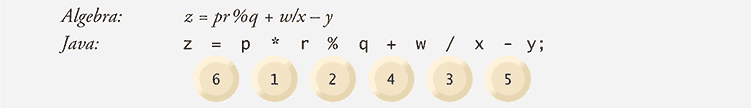

# 二次多项式的求值

为了更好地理解运算符优先级，考虑包含二次多项式的赋值表达式 *a*x² + *b*x + *c* 的求值：


乘法运算按左到右的顺序首先执行（即它们从左到右结合），因为它们的优先级高于加法。（Java 没有算术幂运算符，所以 *x*² 表示为 `x * x`。第 5.4 节 显示了执行幂的另一种方法。）加法运算随后从*左到右*执行。假设 `a`, `b`, `c` 和 `x` 的初始化（给定值）如下：`a = 2`, `b = 3`, `c = 7` 且 `x = 5`。图 2.13 说明了应用运算符的顺序。

```java
y = (a * x * x) + (b * x) + c;
```

| --- | --- | --- | --- |
| `=` | `==` | `x == y` | `x` 等于 `y` |
| *关系运算符* | | | |
| `<` | `<` | `x < y` | `x` 小于 `y` |
| `≤` | `<=` | `x <= y` | `x` 小于或等于 `y` |

## 图 2.14
相等运算符和关系运算符。

图 2.15 使用了六个 `if` 语句来比较用户输入的两个整数。如果这些任何一个 `if` 语句中的条件为 `true`，则执行与该 `if` 语句相关的语句；否则，跳过该语句。我们使用 `Scanner` 从用户处输入整数并将其存储在变量 `number1` 和 `number2` 中。程序比较这些数字并显示为 `true` 的比较结果。我们展示了用户输入不同值时的三个示例输出。

```java
// 使用 if 语句、关系运算符 
import java.util.Scanner; // 程序使用 Scanner 类 

public class Comparison { 
   public static void main(String[] args) { 
      Scanner input = new Scanner(System.in);
      System.out.print("Enter first integer:"); // 提示
   }
}
```


# Java 基础语法与程序控制结构

## 代码示例：整数比较程序

```java
16         int number2 = input.nextInt(); // 从用户处读取第二个数字
18         if (number1 == number2)
20         }
22         if (number1 != number2) {
24         }
26         if (number1 < number2) {
28         }
30         if (number1 > number2) {
32         }
34         if (number1 <= number2) {
36         }
38         if (number1 >= number2) {
40         }
42   } // 类结束 Comparison
```

## 图 2.15 使用 `if` 语句、关系运算符和相等运算符比较整数

类 `Comparison` 的 `main` 方法（第 8–41 行）开始执行 Java 程序。

### 第 10 行
```java
Scanner input = new Scanner(System.in);
```
声明 `Scanner` 变量 `input` 并将其初始化为标准输入。

### 第 12–13 行
```java
System.out.print("Enter first integer:"); // 提示
int number1 = input.nextInt(); // 从用户处读取第一个数字
```
提示输入第一个整数，并从用户处读取第一个数字。

### 第 15–16 行
```java
System.out.print("Enter second integer:"); // 提示
int number2 = input.nextInt(); // 从用户处读取第二个数字
```
提示输入第二个整数，并从用户处读取第二个数字。

### 第 18–20 行
```java
if (number1 == number2)
    System.out.printf("%d == %d%n", number1, number2);
```
比较 `number1` 和 `number2`。如果这些 `if` 语句中的条件为 `true`，则执行相应的语句（注：原文此处括号匹配似乎有误）。图 2.14 中显示。

### 第 22–24 行
```java
if (number1 != number2)
    System.out.printf("%d != %d%n", number1, number2);
```

### 第 26–28 行
```java
if (number1 < number2)
    System.out.printf("%d < %d%n", number1, number2);
```

### 第 30–32 行
```java
if (number1 > number2)
    System.out.printf("%d > %d%n", number1, number2);
```

### 第 34–36 行
```java
if (number1 <= number2)
    System.out.printf("%d <= %d%n", number1, number2);
```

### 第 38–40 行
```java
if (number1 >= number2)
    System.out.printf("%d >= %d%n", number1, number2);
```

## 运算符优先级表

| 运算符 | 结合性 | 说明 |
| --- | --- | --- |
| `+` | 左到右 | 加法 |
| `−` | 左到右 | 减法 |
| `==` | 左到右 | 相等 |
| `!=` | 左到右 | 不相等 |

## 核心概念总结

### Java 程序执行与基础语法
- 当您使用 `java` 命令启动 JVM 时，Java 应用就会执行。
- 行尾注释以 `//` 开始，并在其所在的行尾结束。
- Javadoc 注释由 `/**` 和 `*/` 定界，允许您在代码中嵌入程序文档。`javadoc` 程序根据这些注释生成网页。
- 空行、空格字符和制表符字符称为空白。空白使程序更容易阅读，并且通常被编译器忽略。
- 关键字 `class` 引入类声明。
- Java 类名是一个标识符——一系列由字母、数字、下划线（`_`）和美元符号（`$`）组成的字符，不以数字开头且不包含空格。
- Java 是区分大小写的——也就是说，大写字母和小写字母是不同的。
- 方法 `main` 是每个 Java 程序的起点，必须开始于：
  ```java
  public static void main(String[] args)
  ```
  否则，JVM 将不会执行该程序。
- 语句指示计算机执行操作。
- 标准输出 `System.out` 在命令行窗口中显示。
- 使用 `javac` 命令编译程序。如果程序没有语法错误，就会创建一个类文件，其中的字节码表示应用程序。这些字节码在您执行程序时由 JVM 解析。

### 输入输出与格式化
- `System.out.print` 显示参数并将输出光标置在显示的最后一个字符之后。
- `System.out.printf` 方法中的 `f`（“格式化的”）显示格式化数据。
- 格式说明符以百分号（`%`）开头，后跟一个字符。说明符 `%s` 是字符串的占位符。

### 变量与数据类型
- `import` 声明帮助编译器定位程序中使用的类。
- 变量是计算机内存中的一个位置，可以在其中存储值供以后程序使用。所有变量在使用之前必须声明名称和类型。
- `Scanner`（包 `java.util`）允许程序读取程序将使用的数据。在使用 `Scanner` 之前，程序必须创建它并指定数据源。
- 表达式 `new Scanner(System.in)` 创建了一个从标准输入对象（`System.in`，通常是键盘）读取的 `Scanner`。

### 提示用户输入
- 提示引导用户执行特定的操作。

### 声明变量存储整数并从键盘获取整数
- 数据类型 `int` 用于声明存储整数值的变量。`int` 的取值范围为 −2,147,483,648 到 +2,147,483,647。
- `float` 和 `double` 类型指定带有小数点的实数，例如 `-11.9` 和 `3.4`。
- 如 `int`、`float`、`double` 和 `char` 等类型是基本类型。基本类型名称是关键字；因此它们必须全小写。
- 赋值运算符 `=` 允许给变量赋值。

### 内存概念
- 变量名对应内存中的位置。每个变量都有名称、类型和大小。放在内存位置中的值替换该位置的值。

### 算术运算
- 算术运算符有 `+`（加法）、`-`（减法）、`*`（乘法）、`/`（除法）和 `%`（取模）。
- 取模运算符 `%` 产生除法的余数。
- 如果表达式包含嵌套括号，则先计算最内层。
- 当我们说运算符是从左到右应用时，指的是它们的结合性。某些运算符是从右到左结合。
- `if` 条件可以使用相等运算符（`==` 和 `!=`）和关系运算符（`>`、`>=`、`<`、`<=`）组成。

## 自测练习与答案

### 2.1 填空题
1. 左大括号（`{`），右大括号（`}`）。
2. `//`。
3. 关键字。
4. `System.out.print`、`System.out.println` 和 `System.out.printf`。

### 2.2 判断题
2. **正确**。所有变量必须赋予类型。
4. **错误**。在 Java 中，取余运算符也可以用于非整数操作数。
6. **错误**。从 Java 9 开始，单独的 `_`（下划线）不再是一个有效的标识符。

### 2.3 编写语句
2. `System.out.print("Enter an integer:");`
4. `System.out.println("This is a Java program");`
6. 
```java
if (number != 7) {
    System.out.println("The variable number is not equal to 7");
}
```

### 2.4 纠错题
2. 错误：`if` 语句后多了一个分号，且关系运算符 `=>` 写反了。
   修正：
   ```java
   if (c >= 7) {
       System.out.println("c is equal to or greater than 7");
   }
   ```

### 2.5 编写声明与语句
2. `Scanner input = new Scanner(System.in);`
4. `int x = input.nextInt();`
6. `int y = input.nextInt();`
8. `int z = input.nextInt();`
10. `System.out.printf("Product is %d%n", result);`

### 2.6 综合编程题
```java
// Ex. 2.6: Calculate the product of three integers.
public static void main(String[] args) {
    Scanner input = new Scanner(System.in);
    System.out.print("Enter first integer:"); // read input
    int x = input.nextInt();
    System.out.print("Enter second integer:"); // read input
    int y = input.nextInt();
    System.out.print("Enter third integer:"); // read input
    int z = input.nextInt();
    int result = x * y * z;
    System.out.printf("Product is %d%n", result);
} // end method
```

## 章节练习

### 2.7 填空题
2. `if` 语句可以在程序中做出决策。
4. 嵌套的括号首先被执行。

### 2.8 编写语句
1. `System.out.print("Enter integer: ");`
3. `// Program uses Scanner to read input`

### 2.9 判断题
2. 以下都是有效的变量名：`$total`、`account2`、`_balance`、`totalAmount`。
4. 以下是无效名称：`2ndAccount`（以数字开头）、`account#`（包含特殊字符 `#`）、`class`（关键字）。

### 2.10 输出预测（假设 `x = 2` 且 `y = 3`）
2. `System.out.printf("Value of %d + %d is %d%n", x, y);`  
   输出：`Value of 2 + 3 is 3`（注：格式字符串有 3 个占位符但只提供了 2 个参数，实际运行会抛出异常，此处为教材原题逻辑）。
4. `System.out.printf("%d%n", (x + y));`  
   输出：`5`

### 2.11 判断变量是否被修改
2. `System.out.println("are modified");` —— 否。
4. `int value = input.nextInt();` —— 是（`value` 被赋值）。

### 2.12 数学公式转 Java 语句（给定 $y = ax^3 + 7$）
2. `int y = a * (x + 7);` —— 错误。
4. `int y = (a * x) * x + 7;` —— 错误（计算的是 $ax^2 + 7$）。
6. `int y = a * x * (x * x + 7);` —— 错误（计算的是 $ax^3 + 7ax$）。
**正确写法**：`int y = a * x * x * x + 7;` 或 `int y = a * (x * x * x) + 7;`

### 2.13 运算顺序与求值
2. `int x = 2 % 2 + 2 * 2 - 2 / 2;`
   顺序：`%`、`*`、`/`、`+`、`-`、`=`
   过程：`0 + 4 - 1 = 3`
   结果：`x = 3`

### 2.14 打印图案
使用 `System.out.println` 和 `System.out.printf` 分别实现。

### 2.15 (算术)
编写一个应用程序要求用户输入两个整数，从用户处获取并打印它们的和、积、差和商（除法）。使用图 2.7 中所示的技术。

### 2.16 (整数比较)
编写一个应用程序，从用户处输入三个整数，并显示这些数字的和、平均值、乘积、最小值和最大值。使用图 2.15 所示的技巧。[注意：本次练习中平均值的计算结果应该是平均值的整数表示形式。因此，如果值的和为 7，则平均值应该是 2，而不是 2.3333……]

### 2.18 (用星号显示形状)
以下代码打印什么内容？
```java
System.out.println("*");
System.out.println("*****");
System.out.println("**");
```
输出：
```
*
*****
**
```

### 2.20
以下代码打印什么内容？
```java
System.out.print("***");
System.out.print("****");
```
输出：`*******`

### 2.22
以下代码打印什么内容？
```java
System.out.print("*");
System.out.println("*****");
System.out.println("**");
```
输出：
```
******
**
```

### 2.24 (最大和最小整数)
编写一个应用程序，读取一个整数，并确定并打印它是奇数还是偶数。[提示：使用取模运算符。偶数是 2 的倍数。任何 2 的倍数除以 2 后的余数都是 0。]

### 2.26 (倍数)
编写一个应用程序显示棋盘图案。

### 2.28 (圆的直径、周长和面积)
这是另一个预告。在本章中，你学习了整数和 `int` 类型。Java 还可以表示大写字母、小写字母和符号。每个字符都有对应的整数表示。你可以通过将其封装在 `(int)` 中来确定字符的整数值，例如：
```java
int charCode = (int) 'A';
```
这种形式的运算符被称为强制转换运算符。你将在后续章节中学习强制转换运算符。以下语句输出一个字符及其整数值：
```java
System.out.printf("Character %c has the value %d%n", 'A', (int) 'A');
```

### 2.30 (分离整数中的数字)
仅使用在本章中学到的编程技巧，编写一个应用程序计算 0 到 10 的平方和立方，并以表格格式打印结果。

### 2.32 (负值、正值和零)
我们在练习 1.10 中介绍了体质量指数（BMI）计算器。计算 BMI 的公式为：
$$BMI = \frac{\textit{weightInPounds} \times 703}{\textit{heightInInches}^2}$$
或者
$$BMI = \frac{\textit{weightInKilograms}}{\textit{heightInMeters}^2}$$
创建一个 BMI 计算器，读取以磅为单位的体重和英寸为单位的身高（或者，如果你愿意，读取公斤和米），然后计算并显示用户的体质量指数。还要显示来自心脏肺研究所的 BMI 分类及其数值。


以便用户可以评估自己的 BMI（身体质量指数）。

*注：*在本章中，你学习了如何使用 `int` 类型来表示整数。当使用 `int` 值进行 BMI 计算时，结果都会是整数。在[第 3 章中，你将将学习如何使用 `double` 类型来表示带有小数点的数字。当使用 `double` 类型进行 BMI 计算时，结果都会产生带有小数点的数字——这些数字被称为“浮点数”。]

2. **2.34 (世界人口增长计算器)** 搜索互联网以确定当前的世界人口和年度人口增长率。编写一个应用程序，输入这些值，然后显示一年、两年、三年、四年和五年后的估计世界人口。

3. **2.35 (拼车节省费用计算器)** 研究几个拼车网站。创建一个应用程序来计算你的每日驾驶成本，以便你可以估算通过拼车可以节省多少钱，拼车还有其他优势，如减少碳排放和缓解交通拥堵。该应用程序应输入以下信息，并显示用户每日通勤的成本：

    1. 每日行驶总里程数。
    2. 每加仑油的价格。
    3. 平均每加仑里程。
    4. 每日停车费。
    5. 每日过路费。

# 3 类、对象、方法和字符串初论

## 目标

在本章中，你将：

* 声明一个类并使用它创建一个对象。
* 将类的行为实现为方法。
* 将类的属性实现为实例变量。
* 调用对象的方法让它们执行任务。
* 学习方法的局部变量是什么，以及它们与实例变量的区别。
* 学习什么是原始类型和引用类型。
* 使用构造函数初始化对象的数据。
* 表示并使用包含小数点的数字。
* 学习为什么类是模拟现实世界事物和抽象实体的自然方式。

## 3.1 引言

在第 2 章中，你已经处理了*现有的*类、对象和方法。你使用了*预定义的*标准输出对象 `System.out`，并*调用*它的方法 `print()`、`println()` 和 `printf()` 来在屏幕上显示信息。你使用了*现有的* `Scanner` 类创建一个对象，将用户在键盘上输入的整数数据读入内存。在整本书中，你将使用许多更多*预先存在的*类和对象——这是 Java 作为面向对象编程语言的巨大优势之一。

在本章中，你将创建自己的类和方法。你创建的每个新类都变成一种新的*类型*，用于声明变量和创建对象。你可以根据需要声明新类；这是 Java 被认为是一种*可扩展*语言的原因之一。

我们介绍了一个关于创建和使用简单的现实银行账户类——`Account` 的案例研究。此类类应该将属性作为*实例变量*，例如它的 `name` 和 `balance`，并提供*方法*来执行任务，如查询余额 (`getBalance()`)、增加余额的存款 (`deposit()`) 和减少余额的取款 (`withdraw()`)。我们将在本章的示例中将 `getBalance()` 和 `deposit()` 方法构建到类中，你将在练习中添加 `withdraw()` 方法。

在第 2 章中，我们使用数据类型 `int` 来表示整数。在本章中，我们引入了数据类型 `double` 将账户余额表示为可以包含*小数点*的数字——这样的数字被称为*浮点数*。在第 8 章中，当我们更深入研究对象技术时，我们将开始使用类 `BigDecimal`（包 `java.math`）来精确地表示货币金额，这正是你在编写工业级货币应用程序时应该做的。[或者，你可以将货币金额视为分数的整数，然后分别通过除法和取余操作将结果拆分为美元和分，并在美元和分之间插入一个点。]

通常情况下，你在本书书中开发的程序将由两个或多个类组成。如果你成为行业中开发团队的一部分，你可能会处理包含数百甚至数千个类的程序。

## 3.2 实例变量、set 和方法

在本节中，你将创建两个类——`Account` 和 `AccountTest`。

### 3.2.1 带有实例变量的 Account

账户有不同的名称。由于这个原因，`Account` 类包含一个 `name` 实例变量。在本章稍些时候，我们将添加一个实例变量 `balance`，以便跟踪账户中有多少钱。`Account` 包含两个方法——`setName()` 方法在 `Account` 中存储名称，`getName()` 方法从 `Account` 获取名称。

```java
// 包含实例变量及其设置/获取方法的 Account 类

public class Account {

    private String name; // 实例变量

    // 设置名称

    public void setName(String name) {

        this.name = name; // 存储名称

    }

    // 获取名称

    public String getName() {

        return name; // 返回名称值

    }

}
```

### 类声明

*类声明*从第 5 行开始：

```java
public class Account {
```

`public` 关键字（第 8 章详细介绍）是一种**访问修饰符**。目前我们将简单地将每个类声明为 `public`。每个 `public` 类声明必须存储在与类同名且以 `.java` 扩展名结尾的文件；否则会导致编译错误。因此，`public` 类 `Account` 和 `AccountTest`（图 3.2）*必须*在*分别*的文件 `Account.java` 和 `AccountTest.java` 中声明。

每个类声明都包含 `class` 关键字，紧接着是类名——在本例中为 `Account`。每个类的体如图 3.1 第 5 行和第 17 行所示，用一对左右括号括起来。

## 标识符与驼峰命名法

从第 2 章回想，类名、方法名和变量名都是*标识符*，并且按照习惯都使用*驼峰*命名方案。同样根据习惯，类名以大写字母开头，而方法名和变量名以小写字母开头。

## 实例变量名称

回想第 1.5 节可知，对象具有属性，这些属性通过实例变量实现，并贯穿对象的整个生命周期。实例变量在对象上调用方法之前就已经存在，在方法执行期间以及方法完成执行后都一直存在。该类的每个对象（实例）都拥有该类实例变量的副本。一个类通常包含一个或多个方法，用于操作属于该类特定对象的实例变量。

实例变量声明在类声明内部，但在类方法的方法体之外。第 6 行

```java
private String name; // 实例变量
```

声明了类型为 `String` 的实例变量 `name`，位于方法 `setName()`（第 9–11 行）和 `getName()`（第 14–16 行）的方法体之外。`String` 变量可以存储如 `"Jane Green"` 这样的字符字符串值。如果有多个 `Account` 对象，每个对象都有自己的 `name`。由于 `name` 是一个实例变量，它可以被该类的每个方法进行操作。

## 访问修饰符 `public` 和 `private`

大多数实例变量声明之前都带有关键字 `private`（如第 6 行）。与 `public` 一样，`private` 也是一种访问修饰符。用 `private` 声明的变量或方法只能由其所在的类的方法访问。因此，变量 `name` 只能在每个 `Account` 对象的方法中使用（在本例中为 `setName()` 和 `getName()`）。你很快就会发现这提供了强大的软件工程机会。

## `Account` 类的 `setName()` 方法

让我们来看一下 `setName()` 方法声明的代码（第 9–11 行）：

```java
public void setName(String name) {

   this.name = name; // 存储名称

}
```

我们将每个方法声明的第一行（在本例中为第 9 行）称为方法头。方法的返回类型（出现在方法名之前）指定了方法在执行其任务后返回给调用者的数据类型。正如你很快看到的，`main` 方法中第 19 行的语句（图 3.2）调用了方法 `setName()`，因此 `main` 在`是 `setName()` 的调用者。返回类型 `void`（图 3.1) 中的第 9 行）表示 `setName()` 将执行一项任务但不会向其调用者返回（即给出）任何信息。在第 2 章中，你使用了返回信息的方法——例如，你使用 `Scanner` 方法 `nextInt()` 来输入用户在键盘上输入的整数。当 `nextInt()` 从用户处读取一个值时，它会返回该值供程序使用。正如你很快看到的，`Account` 方法 `getName()` 返回了一个值。

方法 `setName()` 接收一个类型为 `String` 的参数 `name`——它代表了将作为参数传递给方法的名称。当我们讨论图 3.2 中第 19 行的方法调用时，你将看到参数和实参数是如何协同工作的。

参数声明在参数列表中，该列表位于方法头方法名后面的括号内。当有多个参数时，每个参数之间用逗号隔开。每个参数必须指定一个类型（在本例中为 `String`），后跟一个变量名（在本例中为 `name`）。

## 参数是局部变量

在第 2 章中，我们在 `main()` 方法中声明了应用程序的所有变量。在特定方法的方法体（如 `main()`）中声明的变量是局部变量，只能在该方法中使用。每个方法都可以访问自己的局部变量，而不能访问其他方法的。当方法终止时，其局部变量的值就会丢失。方法的参数也是局部变量。

## `setName()` 方法体

每个方法体都由一对括号界定（如图 3.2)中的第 9 行），包含一个或多个执行方法任务的语句。如果一个方法包含了与实例变量相同的局部变量（如图 3.1)中的第 9 行），该方法体可以使用 `this` 关键字显式地引用实例变量（如第 10 行所示），否则方法体隐藏了实例变量。

## `Account` 类的 `getName()` 方法

方法 `getName()`（第 14–16 行）

```java
public String getName() {

   return name; // 返回名称

}
```

返回一个 `Account` 对象的 `name`。该方法有一个空参数列表，因此不需要额外信息。当返回类型非 `void` 的方法被调用并完成任务时，图 3.2 中第 24 行的语句会向调用者返回一个 `String`。`setName()` 的返回类型 `void`（图 3.1)中的第 9 行）表示 `setName()` 将执行一项任务但不会向其调用者返回（即给出）任何信息。`main()` 方法中第 10 行的赋值语句将 `String` 返回给调用者。随后，语句使用该值输出名称。

# 3.2.2 创建并使用 `Account` 对象的 `AccountTest` 类

接下来，我们想在程序中使用 `Account` 类并调用它的所有方法。包含 `main()` 方法的类开始 Java 应用程序的执行。`Account` 类无法执行，因为它不包含 `main()` 方法——如果你在命令行窗口输入 `java Account`，你会收到错误“未在类 Account 中找到 main 方法”。要解决这个问题，你必须声明一个包含 `main()` 方法的独立类，或者在 `Account` 类中放置 `main()` 方法。

```java
 1   // Fig. 3.2: AccountTest.java

 2   // Creating and manipulating an Account object.

 3   import java.util.Scanner;

 4

 5   public class AccountTest {

 6      public static void main(String[] args) {

 7         // create a Scanner object to obtain input from the command window

 8         Scanner input = new Scanner(System.in);

 9

10         // create an Account object and assign it to myAccount

11         Account myAccount = new Account();

12

13         // display initial value of name (null)

14         System.out.printf("Initial name is: %s%n%n", myAccount.getName());

15

16         // prompt for and read name

17         System.out.println("Please enter the name:");

18         String theName = input.nextLine(); // read a line of text

19         myAccount.setName(theName); // put theName in myAccount

20         System.out.println(); // outputs a blank line

22

22         // display the name stored in object myAccount

23         System.out.printf("Name in object myAccount is:%n%s%n",

24            myAccount.getName());

25      }

26   }
```


## 图 3.2

创建并操作一个 `Account` 对象。

## 用于接收用户输入的 `Scanner` 对象

第 8 行创建了一个名为 `input` 的 `Scanner` 对象，用于从用户处输入名称。第 17 行提示用户输入名称。第 18 行使用 `Scanner` 对象的 `nextLine()` 方法从用户处读取名称并将其赋值给局部变量 `theName`。你输入名称并按 `Enter` 键将其提交给程序。按下 `Enter` 会在你输入的字符后插入一个换行符。`nextLine()` 方法读取字符（包括空白字符，例如 `"Jane Green"` 中的空格），直到遇到换行符，然后返回一个包含换行符之前所有但不包含换行符字符的 `String`，而换行符会被丢弃。

`Scanner` 类提供了许多其他输入方法，你将在整本书中看到。与 `nextLine()` 类似的方法——名为 `next()`——用于读取下一个单词。当你输入某些文本后按 `Enter` 键，`next()` 方法读取字符直到遇到空白字符（如空格、制表符或换行符），然后返回一个包含空白字符之前但不包含该空白字符的 `String`，空白字符会被丢弃。第一个空白字符之后的所有信息都不会丢失——它们可以由程序稍后调用 `Scanner` 方法的语句读取。

## 实例化对象——关键字 `new` 和构造函数

第 11 行创建了一个 `Account` 对象并将其赋值给类型为 `Account` 的变量 `myAccount`。该变量用 `new Account()` 的结果初始化——这是一个类实例创建表达式。关键字 `new` 创建指定类的类对象——在本例中为 `Account` 类。括号是必须的。正如你将在 3.3 节中学到的，这些括号与类名结合表示对构造函数的调用，它类似于方法，但由 `new` 操作符隐式地调用，以便在创建对象时初始化对象的实例变量。在 3.3 节中，你将看到如何在括号中放置参数以指定 `Account` 对象的 `name` 实例变量的初始值——你将增强 `Account` 类以实现这一点。目前，我们只需让括号为空。第 8 行包含一个 `Scanner` 对象的实例创建表达式——该表达式用 `System.in` 初始化 `Scanner`，这告诉 `Scanner` 从哪里读取输入（即键盘）。

## 调用类 `Account` 的 `getName` 方法

第 14 行显示初始名称，该名称是通过调用对象的 `getName()` 方法获得的。正如可以使用对象 `System.out` 来调用它的方法 `print`、`printf` 和 `println` 一样，我们可以使用对象 `myAccount` 来调用它的方法 `getName()` 和 `setName()`。第 14 行使用第 11 行创建的 `myAccount` 对象调用 `getName()`，随后是一个点分隔符 (`.`)，然后是方法名 `getName` 和一组空括号，因为没有传递参数。当调用 `getName()` 时：

1. 应用程序将程序执行从调用处（`main` 方法中的第 14 行）转移到方法 `getName()` 的声明处（图 3.1 的第 14–16 行）。
2. 因为 `getName()` 是通过 `myAccount` 对象调用的，所以 `getName()` “知道”应该操作哪个对象的实例变量。
3. 接下来，`getName()` 执行它的任务——即返回一个 `String`。当 `return` 语句执行时，程序执行从调用 `getName()` 的地方继续。

## 变量的 `null` 默认值

第一个输出显示 `null`。与不会自动初始化局部变量不同，每个实例变量都有一个默认值——除非在使用它们之前没有指定它们的初始值。`String` 类型实例的默认值为 `null`，我们将在 3.5 节中进一步讨论。

## 调用类 `Account` 的 `setName` 方法

第 19 行调用 `myAccount` 的 `setName()`。方法调用可以提供参数，其值会被赋值给方法参数。在这种情况下，`main` 的局部变量 `theName` 的值是传递给 `setName()` 的参数，以便该方法执行其任务。当调用 `setName()` 时：

1. 应用程序将程序执行从调用处（`main` 方法中的第 19 行）转移到方法 `setName()` 的声明处（图 3.1 的第 9–11 行），并且调用括号中的参数值（`theName`）被赋值给方法头部对应的参数（`name`）。
2. 接下来，`setName()` 执行它的任务——即将 `name` 参数的值赋值给实例变量 `name`。
3. 当程序执行到达 `setName()` 的右括号时，它返回到调用 `setName()` 的地方，然后从图 3.2 的第 20 行继续执行。

方法调用中的 `arguments` 数量`必须匹配`方法声明中参数列表的 `parameters` 数量。此外，方法调用中的参数类型必须与方法声明中相应参数的类型`一致`。（正如你将在第 6 章中学习到的，参数的类型与其对应的参数类型`并不`要求是`相同`的。）在我们的示例中，方法调用传递了一个 `String` 类型的参数（`theName`）——而方法声明指定了一个 `String` 类型的参数（`name`，声明在图 3.1 的第 9 行）。因此在这个示例中，方法调用中参数的类型`完全匹配`方法头中参数的类型。

## 显示用户输入的名称

图 3.2 的第 20 行输出一个空行。当第二次调用方法 `getName()`（第 24 行）执行时，将显示用户在第 18 行输入的名称。在第 23–24 行的语句执行完毕后，到达了方法 `main()` 的末尾，因此程序终止。

注意，第 23–24 行仅代表`一个` 语句。Java 允许将长语句拆分为多行。我们对第 24 行进行缩进，表示它是第 23 行的`延续`。

# 3.2.3 编译和运行具有多个类的应用程序

在`执行`应用程序之前，你必须编译图 3.1 和 3.2 中的类。这是你第一次创建一个包含`多个` 类的应用程序。`AccountTest` 类有一个 `main()` 方法；`Account` 类则没有。要编译此程序，首先切换到包含程序源文件的目录。接下来，输入命令

```
javac Account.java AccountTest.java
```

来同时编译`这两个` 类。如果包含程序的目录中`仅`包含此程序的文件，你可以使用命令编译这两个类

```
javac *.java
```

`*.java` 中的星号 (`*`) 是一个通配符，表示`当前`目录下所有以 `.java` 文件名扩展名结尾的都都应该被编译。如果两个类都编译正确——即没有显示编译错误——你就可以可以使用命令运行该程序

```
java AccountTest
```

# 3.2.4 Account UML 类图

我们经常使用 UML 类图来帮助你视觉化类的 `attributes`（属性）和 `operations`（操作）。在工业中，UML 图帮助系统设计师以一种简洁、图形化且与编程语言无关的方式指定系统，然后程序员在特定的编程语言中实现系统。图 3.3 展示了图 3.1 中 `Account` 类的 UML 类图。

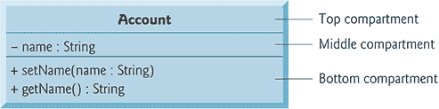

## 图 3.3

图 3.1 中 `Account` 类的 UML 类图。描述

### 顶部隔间

在 UML 中，每个类被建模为一个带有三个隔间的矩形。在此图中，`顶部`隔间水平地显示`类名` `Account`。

### 中间隔间

`中间`隔间包含`类的属性` `name`，它对应同名的实例变量。在 Java 中实例变量 `name` 是 `private`，所以 UML 类图在属性名前面列出一个减号 (−)。属性名后面是冒号和`属性类型` `String`。

### 底部隔间

`底部`隔间包含类的操作 `setName()` 和 `getName()`，它们对应同名的方法。UML 通过在方法名前加上一个`访问修饰符`来建模操作，在此情况下加号 (+) 表示 `getName()` 是一个 `public` 操作（因为它在 Java 中是 `public` 方法）。`getName()` `没有`任何参数，因此类图中方法名后的括号是`空的`，就像图 3.1 第 14 行的方法声明中一样。`setName()` 也是一个公共操作，有一个 `String` 参数。

### 返回类型

UML 通过在操作名后的括号`之后`放置冒号和返回类型来指示操作的`返回类型`。`Account` 方法 `getName()` (图 3.1) 具有 `String` 返回类型。`setName()` 方法`没有`返回值（因为它在 Java 中返回 `void`），所以 UML 类图`没有`在该操作的括号后指定返回类型。

### 参数

UML 通过在操作名后的括号内列出参数名、冒号和参数类型来建模参数（记住 UML 是语言无关的）。UML 有自己的数据类型，与 Java 类似，但为了简单起见，我们将使用 Java 数据类型。`Account` 方法 `setName()` (图 3.1) 有一个名为 `name` 的 `String` 参数，因此[图 3.3] 在方法名后的括号间列出 `name : String`。

## 3.2.5 关于 AccountTest 的额外说明

## static 方法 main()

在第 2 章中，我们声明的每个类都有一个 `main()` 方法。记得当你运行程序时，Java 虚拟机（JVM）会自动调用 `main()`。你必须`显式地`调用大多数其他方法来告诉它们执行任务。在第 6 章中，你会学到 `toString()` 方法通常是`隐式地`调用的。

图 3.2 的第 6–25 行声明了 `main()`。使 JVM 能够定位并调用 `main()` 方法开始程序执行的关键是 `static` 关键字（第 6 行），它表示 `main()` 是一个 `static` 方法。`static` 方法是特殊的，因为你可以在无需先创建方法所属类的对象的情况下调用它——在本例中是 `AccountTest` 类。我们将在第 6 章中详细讨论 `static` 方法。

## 关于 import 声明的说明

注意图 3.2 中的 `import` 声明（第 3 行），它告诉编译器程序使用了 `Scanner` 类。正如你从第 2 章中学习到的，`System` 类和 `String` 类位于 `java.lang` 包中，该包会被`隐式地`导入到`每个` Java 程序中，因此所有程序都无需显式导入即可使用该包的类。你在 Java 程序中使用的其他大多数类都必须`显式地`导入。

在同一目录下编译的类之间存在一种特殊关系，例如 `Account` 类和 `AccountTest` 类。默认情况下，这些类被认为处于同一个包中——即默认包。同一个包中的类会被隐式导入到该包内其他类的源文件中。因此，当一个包中的类使用同一个包中的另一个类时（例如当 `AccountTest` 类使用 `Account` 类时），不需要 `import` 声明。

如果在整个文件中通过 `java.util.Scanner` 来引用 `Scanner` 类，那么第 3 行的 `import` 声明就不需要了，因为它包含了完整的包名和类名。这被称为类的“完全限定类名”。例如，图 3.2 中的第 8 行也可以写成：

```
java.util.Scanner input = new java.util.Scanner(System.in);
```

## 3.2.6 使用私有实例变量和公有 set/get 方法软件工程

正如你所看到的，通过使用 set 和 get 方法，你可以对 `private` 数据的修改尝试进行验证，并控制这些数据呈现给调用者的方式——这些极具吸引力的软件工程优势。我们将在第 3.4 节中详细讨论。

如果实例变量是 `public`，该类的任何客户端（即任何调用该类方法的类）都可以看到数据并对其进行任何随心所欲的操作，包括将其设置为无效值。

你可能会认为，尽管类的客户端无法直接访问 `private` 实例变量，但客户端仍然可以通过 `public` set 和 get 方法对该变量进行随心所欲的操作。你可能认为可以随时通过 `public` get 方法查看 `private` 数据，并可以通过 `public` set 方法随意修改 `private` 数据。但 set 方法可以被程序化以验证其参数，并拒绝任何将数据设置为错误值的尝试，例如负的体温、3 月份不在 1 到 31 日范围内的日期、不在公司产品目录中的产品代码等。而 get 方法可以以不同的形式呈现数据。例如，`Grade` 类可能将等级存储为 0 到 100 之间的 `int`，但 `getGrade` 方法可能会返回一个 `String` 类型的字母字母等级，例如，对于 90 到 100 之间的分数返回 `"A"`，80 到 89 之间的分数返回 `"B"` 等。严密控制对 `private` 数据的访问和呈现可以极大地减少错误，同时增加程序的健壮性和安全性。

使用访问修饰符 `private` 声明实例变量被称为“信息隐藏”。当程序创建（实例化）一个 `Account` 类的对象时，变量 `name` 被封装（隐藏）在对象中，并且只能通过对象类的方法进行访问。

## 带有封装数据的 `Account` 对象概念视图

你可以将 `Account` 对象想象如图 3.4 所示的那样。`private` 实例变量 `name` 隐藏在对象内部（由包含 `name` 的内圆表示），并被外层的 `public` 方法保护（由包含 `getName` 和 `setName` 的外圆表示）。任何需要与 `Account` 对象交互的客户端代码都只能通过调用该保护性外层的 `public` 方法来实现。

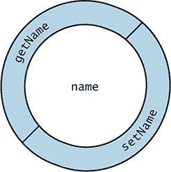

### 图 3.4

带有封装的 `private` 实例变量 `name` 和保护性 `public` 方法层的 `Account` 对象的概念视图。

# 3.3 Account 类：使用构造函数初始化对象

正如在第 3.2 节中提到的，当创建一个 `Account` 类的对象（图 3.1 所示）时，它的 `String` 实例变量 `name` 会被初始化为 `null`。但如果你在创建 `Account` 对象时想提供一个名称呢？

你声明的每个类都可以选择性地提供一个构造函数，以便在创建对象时初始化。当创建对象时，每个类都可以提供一个带参数的构造函数来初始化它。图 3.5 显示 `Account` 类提供一个带参数的构造函数在创建对象时使用它。图 3.6 显示构造函数接收一个名称来初始化类。

## 3.3.1 为 Account 声明自定义初始化构造函数

当你声明一个类时，可以提供自己的构造函数为对象自定义初始化。例如，你可能在创建 `Account` 对象时指定一个名称，如你在图 3.6 的第 8 行中所示：

```java
Account account = new Account("Jane Green");
```

在这种情况下，`String` 参数 `"Jane Green"` 被传递给 `Account` 对象的构造函数，并用于初始化 `name` 变量。图 3.5 显示该构造函数接受一个 `String` 参数。

### Account 构造函数声明

图 3.5 中的第 8 到 10 行声明了 `Account` 的构造函数，构造函数的名称必须与类名相同。构造函数的参数列表指定了构造函数执行任务所需的零或多个数据。第 8 行表明构造函数有一个参数——一个名为 `name` 的 `String`。当你创建一个新的 `Account` 对象时，会将人的姓名传递给构造函数的 `name` 参数。然后构造函数会将 `name` 参数的值赋值给实例变量 `name`（第 9 行）。

### Account 类构造函数和 setName 方法的参数

回想第 3.2.1 节，方法参数是局部变量。在图 3.5 中，构造函数和 `setName` 方法都有一个名为 `name` 的参数。尽管这些参数具有相同的标识符（`name`），但第 8 行的参数是构造函数的局部变量，对 `setName` 方法不可见；而第 13 行的参数是 `setName` 的局部变量，对构造函数不可见。

`AccountTest` 程序（图 3.6）使用构造函数初始化了两个 `Account` 对象。第 8 行创建并初始化了 `Account` 对象 `account1`。关键字 `new` 向系统请求内存来存储 `Account` 对象，然后隐式地调用类的构造函数来初始化对象。该调用由类名后的括号表示，括号中包含参数 `"Jane Green"`，用于初始化新对象的名称。第 8 行将新对象赋值给变量 `account1`。第 9 行重复此过程，传递参数 `"John Blue"` 来初始化 `account2` 的名称。第 12–13 行使用每个对象的 `getName()` 方法获取名称，并证明它们在对象创建时确实已经过初始化。输出显示了不同的名称，证实了每个 `Account` 都维护着其实例变量 `name` 的独立副本。

```java
 1   // Fig. 3.6: AccountTest.java
 2   // Using the Account constructor to initialize the name instance
 3   // variable at the time each Account object is created.
 4
 5   public class AccountTest {
 6      public static void main(String[] args) {
 7         // create two Account objects
 8         Account account1 = new Account("Jane Green");
```


## 图 3.6

使用 `Account` 构造函数在每个 `Account` 对象创建时初始化 `name` 实例变量。

```java
Account account2 = new Account("John Blue");

// display initial value of name for each Account
System.out.printf("account1 name is: %s%n", account1.getName());
System.out.printf("account2 name is: %s%n", account2.getName());
```

## 构造函数不能返回值

构造函数与方法的一个重要区别是构造函数不能返回值，因此它们不能指定返回类型（即使是 `void` 也不行）。通常，构造函数被声明为 `public`——在书后的章节中我们将解释何时使用 `private` 构造函数。

## 默认构造函数

回想图 3.2 中的第 11 行：

```java
Account myAccount = new Account();
```

使用了 `new` 创建了一个 `Account` 对象。“`new Account`”后的空括号表示调用类的默认构造函数——在任何没有显式声明构造函数的类中，编译器都会提供一个默认构造函数（该函数始终没有参数）。当一个类只有一个默认构造函数时，类的实例变量将初始化为它们的默认值。在第 8.5 节中，你将了解到类可以有多个构造函数。

## 声明了构造函数的类没有默认构造函数

如果你为一个类声明了构造函数，编译器就不会为该类创建默认构造函数。在这种情况下，你将无法通过类实例创建表达式 `new Account()` 来创建 `Account` 对象，就像我们在图 3.2 中做的那样——除非你声明的自定义构造函数不带参数。

## 在类 `Account` 的 UML 类图中添加构造函数

图 3.7 的 UML 类图模拟了图 3.5 中的 `Account` 类，该类有一个带有 `String name` 参数的构造函数。与操作一样，UML 在类图的第三部分建模构造函数。为了区分构造函数和类的操作，UML 要求将“constructor”一词包含在双角号（« 和 »）中并放在构造函数名称之前。习惯是在第三部分将构造函数列在其他操作之前。

## 图 3.7

图 3.5 中 `Account` 类的 UML 类图。

## 3.4.1 `Account` 类与 `double` 类型余额实例变量

接下来的图 3.8 中的 `Account` 类版本将作为实例变量维护银行账户的 `name` 和 `balance`。银行服务于许多账户，每个账户都有自己的余额，因此类声明了 `double` 类型的 `balance` 实例变量。每个 `Account` 实例（即对象）都包含 `name` 和 `balance` 的副本。Java 提供了两种存储浮点数的原始类型——`float` 和 `double`。`float` 变量表示单精度数字，而 `double` 变量表示双精度数字。事实上，程序代码中的所有浮点字面量（如 `7.35` 和 `0.97`）默认被视为 `double` 类型。`double` 占用的内存是 `float` 的两倍。在编写工业级应用时，我们应该使用 `BigDecimal` 类来精确表示金额浮点数。

该类包含一个 `constructor` 和四个 `methods`。用户在开户时立即存款是常见操作，因此构造函数（第 10–18 行）现在接收了第二个参数——类型为 `double` 的 `balance`，它代表 `starting balance`。第 15–17 行确保 `initialBalance` 大于 `0.0`。如果是这样，则将 `balance` 参数的值赋值给实例变量 `balance`。否则，实例变量 `balance` 将保持为 `0.0`——即它的 `default initial value`。

### `Account` 类 `deposit` 方法

`deposit` 方法（第 21–25 行）在完成任务后不返回任何数据，因此其返回类型为 `void`。该方法接收一个名为 `depositAmount` 的参数——这是一个 `double` 值，只有当参数值 `valid`（即大于零）时，它才会被 `added` 到实例变量 `balance` 中。第 23 行首先将当前 `balance` 和 `depositAmount` 相加，形成一个 `temporary` 和，`then` 赋值给 `balance`，`replacing` 它的原有值（回想加法的优先级比赋值 `higher`）。重要的一点是理解第 23 行赋值运算符右侧的计算并没有修改 `balance`——这就是为什么赋值是必要的。

### `Account` 类 `getBalance` 方法

`getBalance` 方法（第 28–30 行）允许该类的 `clients`（即调用该类方法的其他类）获取特定 `Account` 对象的 `balance` 值。该方法指定了返回类型 `double` 且有一个 `empty` 参数列表。

### `Account` 的方法都可以使用 `balance`

再次，第 15、16、23 和 29 行使用了变量 `balance`，尽管它在 `any` 任何方法中都没有被声明过。我们可以在这些方法中使用 `balance`，因为它是类的 `instance variable`。

## 3.4.2 使用 `AccountTest` 类使用 `Account` 类

`AccountTest` 类（图 3.9）创建了两个 `Account` 对象（第 7–8 行），并分别将其初始化为 `valid` 余额 `50.00` 和 `invalid` 余额 `-7.53`——为了我们的示例，我们假设余额大于或等于零。第 11–14 行对 `System.out.printf` 方法的调用输出了账户和余额余额这些值是通过调用每个 `Account` 的 `getName` 和 `getBalance` 方法获得的。

```java
// Fig. 3.9: AccountTest.java
// Inputting and outputting floating-point numbers with Account objects.
import java.util.Scanner;

public class AccountTest {
   public static void main(String[] args) {
      Account account1 = new Account("Jane Green", 50.00);
      Account account2 = new Account("John Blue", -7.53);

      // display initial balance of each object
      System.out.printf("%s balance: $%.2f%n",
         account1.getName(), account1.getBalance());
      System.out.printf("%s balance: $%.2f%n%n",
         account2.getName(), account2.getBalance());

      // create a Scanner to obtain input from the command window
      Scanner input = new Scanner(System.in);

      System.out.print("Enter deposit amount for account1: "); // prompt
      double depositAmount = input.nextDouble(); // obtain user input
      System.out.printf("%nadding %.2f to account1 balance%n%n",
         depositAmount);
      account1.deposit(depositAmount); // add to account1’s balance

      // display balances
      System.out.printf("%s balance: $%.2f%n",
         account1.getName(), account1.getBalance());
      System.out.printf("%s balance: $%.2f%n%n",
         account2.getName(), account2.getBalance());

      System.out.print("Enter deposit amount for account2: "); // prompt
      depositAmount = input.nextDouble(); // obtain user input
      System.out.printf("%nadding %.2f to account2 balance%n%n",
         depositAmount);
      account2.deposit(depositAmount); // add to account2 balance

      // display balances
      System.out.printf("%s balance: $%.2f%n",
         account1.getName(), account1.getBalance());
      System.out.printf("%s balance: $%.2f%n%n",
         account2.getName(), account2.getBalance());
   }
}
```

## 图 3.9 使用 `Account` 对象输入和输出浮点数。

## 显示 `Account` 对象的初始余额

当从第 12 行为 `account1` 调用 `getBalance` 方法时，`account1` 的 `balance` 值从图 3.8 的第 29 行返回并由 `System.out.printf` 语句显示。同样，当从第 14 行为 `account2` 调用 `getBalance` 方法时，`account2` 的 `balance` 值从图 3.8 的第 29 行返回。`account2` 的 `balance` 初始为 `0.0`，因为构造函数拒绝了带负余额初始化 `account2`（第 13–14 行）。

## 使用 `printf` 格式化浮点数

每个 `balance` 都通过 `printf` 输出。`%.f` 格式说明符用于输出 `float` 或 `double` 类型的值。`%` 之间的 `.2` 代表输出时小数点后保留的小数位数。

## 从用户读取浮点值并进行存款

第 19 行（图 3.9）提示用户输入 `account1` 的存款金额。第 20 行声明局部变量 `depositAmount` 以存储用户输入的金额。与 `Account` 类中的实例变量（如 `balance`）不同，局部变量（如 `main` 中的 `depositAmount`）默认不初始化，因此通常必须显式初始化。正如你很快会学的，`depositAmount` 的初始值将由用户决定。

第 20 行通过调用 `Scanner` 对象的 `nextDouble` 方法获取输入，该方法返回用户输入的 `double` 值。第 21–22 行显示 `depositAmount`。第 23 行调用 `account1` 的 `deposit` 方法，并将 `depositAmount` 作为方法的参数。当方法被调用时，参数的值赋值给 `deposit` 方法的参数 `depositAmount`；然后 `deposit` 方法会将该值加到 `balance` 中。第 26–29 行再次输出两个账户的名称和余额，显示只有 `account1` 的 `balance` 发生了变化。

第 31 行提示用户输入 `account2` 的存款金额。第 32 行通过调用 `Scanner` 对象的 `nextDouble` 方法获取输入。第 33–34 行显示 `depositAmount`。第 35 行调用 `account2` 的 `deposit` 方法，并将 `depositAmount` 作为方法的参数；然后 `deposit` 方法会将该值加到 `balance` 中。最后，第 38–41 行再次输出两个账户的名称和余额，显示只有 `account2` 的 `balance` 发生了变化。

## 方法 `main` 中的重复代码

第 11–12、13–14、26–27、28–29、38–39 和 40–41 行的六条语句几乎完全相同——它们都输出 `Account` 的 `name` 和 `balance`。它们唯一的区别在于 `Account` 对象的名称——`account1` 或 `account2`。这种重复代码在代码需要更新时会产生维护问题——如果六份相同的代码都有相同的错误或需要相同的更新，你必须进行六次修改，且不能出错。练习 3.15 要求你修改图 3.9 以包含一个 `displayAccount` 方法，该方法接收一个 `Account` 对象作为参数，并输出对象的 `name` 和 `balance`。然后你将用六次 `displayAccount` 的调用替换 `main` 中重复的语句，从而通过只保留一份显示 `Account` `name` 和 `balance` 的代码来减小程序体积并提高其可维护性。

## 类 `Account` 的 UML 类图

图 3.10 中的 UML 类图简洁地模拟了图 3.8 中的 `Account` 类。该图在第二个区域中模拟了类型为 `String` 的 `private` 属性 `name` 和类型为 `double` 的 `balance`。

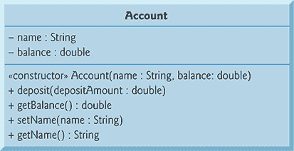

## 图 3.10

图 3.8 中 `Account` 类的 UML 类图。描述

`Account` 类的构造函数在第三区域区域模拟，参数为类型为 `String` 的 `name` 和类型为 `double` 的 `initialBalance`。该类的四个 `public` 方法也模拟在第三区域中——具有 `double` 类型参数 `depositAmount` 的操作 `deposit`、返回类型为 `double` 的操作 `getBalance`、具有 `String` 类型参数 `name` 的操作 `setName` 以及返回类型为 `String` 的操作 `getName`。

## 3.5 基本类型 vs. 引用类型

Java 的类型分为基本类型和引用类型。在第 2 章中，你处理过 `int` 类型变量——这是基本类型之一。其他基本类型还有 `boolean`、`byte`、`char`、`short`、`long`、`float` 和 `double`，我们在书中讨论了每一种类型——这些内容总结在附录 D 中。所有非基本类型都是引用类型，因此指定对象类型的类也是引用类型。

基本类型变量一次只能持有其声明类型的一个确值。例如，一个 `int` 变量一次只能存储一个整数。当给该变量分配新值时，新值将替换旧值——旧值就会丢失。

请记住，局部变量默认不初始化。基本类型实例变量默认会被初始化——类型 `byte`、`char`、`short`、`int`、`long`、`float` 和 `double` 类型的实例变量初始化为 0，`boolean` 类型的变量初始化为 `false`。你可以在声明变量时通过赋值来为基本类型变量指定自己的初始值，如下：

```java
private int numberOfStudents = 10;
```

程序使用引用类型变量（通常称为引用）来存储位置。这种变量引用一个对象。被引用的对象可能包含许多实例变量。图 3.2 的第 8 行：

```java
Scanner input = new Scanner(System.in);
```

创建一个 `Scanner` 类对象，并将该 `Scanner` 引用赋值给变量 `input`。图 3.2 的第 11 行：

```java
Account myAccount = new Account();
```


创建一个 `Account` 类对象，并将该 `Account` 引用赋值给变量 `myAccount`。引用类型变量如果没有显式初始化，默认初始化为值 `null`——这表示引用为空。图 3.2 中，第 14 行对 `getName` 的首次调用返回 `null`——因为 `name` 的值尚未设置，所以返回了默认值 `null`。

要调用对象的方法，你需要该对象的引用。在图 3.2 中，`main` 方法中的语句使用变量 `myAccount` 调用 `getName`（14 行）和 `setName`（19 行）来与 `Account` 对象交互。基本类型变量不引用对象，因此此类变量无法调用方法。

# 3.6（可选）GUI 和图形案例研究：简单的 GUI

本案例研究旨在那些希望在书中早期学习 Java 创建图形用户界面（GUI）和图形能力的读者，早于我们在第 12 章中。每个章节介绍一个新概念，提供显示示例交互的屏幕截图，并紧接着是一个或多个练习，你将在该节中使用这些技术。

| 章节或练习 | 你将要做 |
| --- | --- |
| 第 3.6 章: 简单的 GUI | 显示文本和图像。 |
| 第 4.15 章: 事件处理；画线 | 响应 `Button` 点击时，使用 JavaFX 能力画线。 |
| 第 5.11 章: 画矩形和椭圆 | 绘制多色的填充形状。 |
| 第 6.13 章: 颜色和填充形状 | 绘制多色的填充形状。 |
| 第 7.17 章: 画弧 | 用弧画彩虹。 |
| 第 8.16 章: 使用对象处理图形 | 将形状存储为对象。 |
| 第 10.14 章: 多态绘图 | 识别形状类之间的相似性并创建形状类层次结构。 |
| 练习 13.9: 交互式多态绘图应用程序 | 一个综合练习，你将允许用户选择要绘制的形状，配置其属性（如颜色和填充）并拖动鼠标来调整形状大小。 |

在早期的 GUI 和图形案例研究章节中，你将创建你的第一个图形应用程序。在随后的章节中，你将使用面向对象的编程概念创建一个绘制各种形状的应用程序。本案例研究的终极之作是练习 3.9，在其中将创建一个基于 GUI 的应用程序，使用户可以选择每个形状的绘制和颜色，然后通过拖动指定其大小和位置。我们希望这个案例研究让你深受启发且觉得有趣。

# 第 22 章 JavaFX 图形与多媒体

如果你喜欢操作 GUI 和图形，请务必阅读第 22 章，该章节详细讨论了 JavaFX 图形和多媒体，包括 JavaFX 强大的动画功能。本章包含许多具有挑战性且有趣的图形和多媒体练习，包括几个游戏练习：

*   **点点 (SpotOn)** 要求用户在点消失之前点击它们。
*   **赛马 (Horse Race)** 是**点点**游戏的趣味变体，在其中，当你把球滚入洞或用水枪击中目标时，马会移动。
*   **大炮 (Cannon)** 要求用户在时间结束前摧毁一系列目标。

## 3.6.1 什么是图形用户界面？

图形用户界面 (**GUI**) 提供了一种与应用程序交互的用户友好机制。GUI（发音为“GO-ee”）为应用程序提供了独特的“视觉效果”。GUI 由 GUI 组件组成——JavaFX 将这些组件称为控件。**控件**是 GUI 组件，例如显示文本的 `Label` 对象、允许程序接收用户输入的的 `TextField` 对象以及用户可以点击触发的 `Button` 对象。当用户与控件交互（例如点击 `Button`）时，控件会生成一个**事件**。程序可以响应这些事件——这被称为**事件处理**——以指定当每次用户交互时应该发生什么。这个构建简单非交互 GUI 的第一个 GUI 和图形案例研究章节会长一点，因为我们将引导你完成构建第一个 GUI 的每一个步骤。

## 3.6.2 JavaFX Scene Builder 和 FXML

在 GUI 和图形案例研究章节中，你将使用 **Scene Builder**——这是一个让你通过从 Scene Builder 库中拖放构建好的 GUI 组件到设计区域，从而简单创建并样式化 GUI 的工具。JavaFX Scene Builder 的实时编辑和预览功能允许你在创建和修改 GUI 时查看它，无需编译和运行应用程序。你可以从以下地址下载 Windows、macOS 和 Linux 版本的 Scene Builder：

```
http://gluonhq.com/labs/scene-builder/
```


### FXML (FX Markup Language)

当你创建和修改 GUI 时，`JavaFX Scene Builder` 会生成 **FXML**——一种无需编写任何 Java 代码即可定义和排列 JavaFX 控件的语言。JavaFX 使用 FXML 简洁地描述 GUI、图形和多媒体元素。*使用本案例研究不需要了解 FXML*——Scene Builder 会为你隐藏 FXML 的细节。

## 3.6.3 Welcome 应用程序——显示文本和图像

在本节中，*无需编写任何代码*，你将构建一个在 `Label` 控件中显示文本并在 `ImageView` (图 3.12) 控件中显示图像的 GUI。你将使用视觉化编程技术*拖放* JavaFX 组件到 Scene Builder 的内容面板——设计区域上。接下来，你将使用 Scene Builder 的**检查器 (Inspector)** 配置选项，例如 `Label` 的文本和字体大小以及 `ImageView` 的图像。最后，你将使用 Scene Builder 的**在窗口中显示**选项查看完成的 GUI。

## 3.6.4 打开 Scene Builder 并创建 `Welcome.fxml` 文件

打开 Scene Builder，以便你可以创建一个文件，Scene Builder 将定义 GUI 的 FXML 放入其中。窗口最初显示如图 3.13 所示。窗口顶部的“**未标题 (Untitled)**”表示 Scene Builder 创建了一个你尚未保存的新 FXML 文件。[16]](#fn16) 选择**保存**。


### 3.6.5 为包含 `Welcome.fxml` 的文件夹添加图像

此应用程序使用的图像位于本章的 `images` 文件夹。当你准备好添加它时，找到 `images` 文件夹。

### 3.6.6 创建 VBox 布局容器

JavaFX **布局容器**帮助你排列和调整控件大小。对于此应用程序，你把 `Label` 和 `ImageView` 放置在 `VBox` 中，它从上到下*垂直*排列节点。要向 Scene Builder 添加 `VBox`，双击 **VBox**。

## 3.6.7 配置 VBox

在本节中，你将指定 `VBox` 的对齐方式和大小。

### 指定 VBox 的对齐方式

`VBox` 的**对齐**决定了控件在 `VBox` 中的位置。在此应用程序中，我们希望 `Label` 和 `ImageView` 在 `VBox` 中水平居中，并且希望它们都垂直居中，这样在 `Label` 上方和 `ImageView` 下方就有相同的空间。要实现这一点：

1. 在 Scene Builder 的内容面板中点击一次选择 `VBox`。Scene Builder 在检查器的**属性**区域显示了许多 `VBox` 属性。
2. 点击**对齐**属性的下拉箭头，注意你可以使用的各种对齐值。点击 `CENTER` 设置**对齐**——这表示 `VBox` 的内容应该在 `VBox` 中*水平和垂直*居中。

### 指定 VBox 的首选大小

GUI 主要布局（在本例中为 `VBox`）的**首选大小**（宽度和高度）决定了 JavaFX 应用程序窗口的默认大小。要设置首选大小：

1. 选择 `VBox`。
2. 点击**布局 (Layout)** 旁边的右箭头 () 展开检查器的区域——这将展开该区域并将箭头变为向下箭头 ()。点击向下箭头将折叠该区域。
3. 点击**首选宽度 (Pref Width)** 属性的文本框，输入 `450` 并按回车键更改首选宽度。
4. 点击 `Pref Height` 属性的文本字段，输入 `300` 并按 `Enter` 键以更改首选高度。

## 3.6.8 添加和配置 `Label`

接下来，你将创建一个在屏幕上显示 `Welcome to JavaFX!` 的 `Label`。

### 向 `VBox` 添加 `Label`

点击 `Controls` 旁边的右箭头() 展开 Scene Builder `Library` 库窗口的 `Controls` 区域，然后从 `Controls` 区域将 `Label` 拖放到 Scene Builder 内容面板中的 `VBox` 上。（你也可以通过双击 `Containers` 区域中的 `Label` 来添加该 `Label`。）Scene Builder 会根据 `VBox` 的 `Alignment` 属性自动在 `VBox` 中水平和垂直居中 `Label` 对象（见图 3.14）。

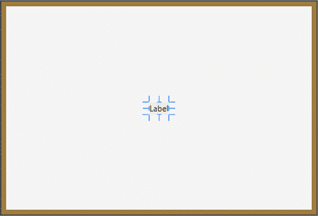

### 图 3.14 
`VBox` 居中的 `Label`。

### 更改 `Label` 的文本

你可以通过双击 `Label` 并输入新文本来设置 `Label` 的文本，也可以通过选择 `Label` 在 `Inspector` 的 `Properties` 区域中设置其 `Text` 属性。将 `Label` 的文本设置为 `"Welcome to JavaFX!"`。

### 更改 `Label` 的字体

对于此应用程序，我们将 `Label` 设置为大号粗体字体。为此，选择 `Label`，然后在 `Inspector` 的 `Properties` 区域中，点击 `Font` 属性右侧的值（见图 3.15）。在出现的窗口中，将 `Style` 属性设置为 `Bold`，并将 `Size` 属性设置为 `30`。该设计现在应该如图 3.16 所示。

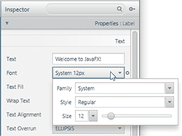

### 图 3.15 
设置 `Label` 的 `Font` 属性。

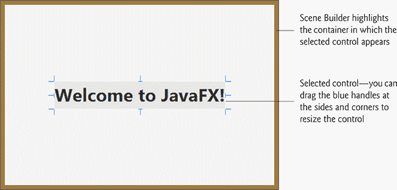

### 图 3.16 
添加并配置 `Label` 后的 **Welcome** GUI 设计。

## 3.6.9 添加和配置 `ImageView`

最后，你将添加显示 `bug.png` 的 `ImageView`。

### 向 `VBox` 添加 `ImageView`

从 `Library` 窗口的 `Controls` 区域拖放 `ImageView` 到 `Label` 正下方，如图 3.17 所示。你也可以在 `Library` 窗口中双击 `ImageView`，在这种情况下，Scene Builder 会自动将新的 `ImageView` 对象放置在 `VBox` 当前内容的下方。

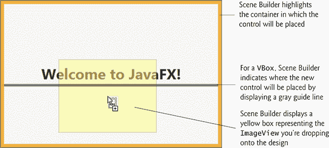

### 图 3.17 
将 `ImageView` 拖放到 `Label` 下方。

### 设置 `ImageView` 的图像

接下来，你将设置想要显示的图像：

1. 选择 `ImageView`，然后在 `Inspector` 的 `Properties` 区域中点击 `Image` 属性右侧的省略号（`…`）按钮。默认情况下，Scene Builder 会打开一个对话框显示保存 FXML 文件的文件夹。这就是你在第 3.6.5 节中放置图像文件 `bug.png` 的地方。
2. 选择图像文件，然后点击打开。Scene Builder 会显示图像并调整 `ImageView` 大小以匹配图像的比例。

### `ImageView` 的图像大小

我们希望以原始尺寸显示图像：你可以通过以下步骤设置 `ImageView` 的大小：

1. 展开 `Layout` 区域。
2. 在 `Properties` 区域中将鼠标悬停在 `Fit Width` 属性上，点击右侧的复选框 以启用其默认值。
3. 选择 **Reset** 以重置默认值。重复上述第 2 步设置 `Fit Height` 属性。

现在你已经完成了 GUI。你的设计现在应该如图 3.18 所示。


### 图 3.18 
完成的 GUI。

## 3.6.10 预览 GUI

你可以预览设计在运行应用程序中的外观。为此，选择 **Preview > Show Preview**（见图 3.19）。


### 图 3.19 
预览的 GUI。

## 3.6.11 GUI 和图形案例研究

**3.1** 使用 Flickr 等网站寻找四张风景图片。创建一个与 **Welcome** 类似的应用程序，在其中排列图像。添加识别每个景点的文本。你可以使用项目的图像，也可以指定在线图像的 URL。

## 3.7 总结

在本章中，你学习了如何创建自己的类和方法，创建类的对象并调用对象的方法来执行有用操作。你声明了类的实例变量来维护每个对象的数据，并声明了自己的方法来操作这些数据。你学习了如何调用方法让其执行任务，如何通过参数向方法传递信息（这些值会被赋值给方法的参数），以及如何接收方法返回的值。你学习了方法的局部变量与类的实例变量之间的区别，以及实例变量会自动初始化。你还学习了如何使用类的构造函数为对象的实例变量指定初始值。你看到了如何创建 UML 类图来视觉化类的方法、属性和构造函数。最后，你学习了浮点数（带有小数点的数字）：如何使用原生类型 `double` 的变量存储它们，如何使用 `Scanner` 对象输入它们，如何使用 `printf` 和格式说明符 `%f` 进行显示格式化。你可能已经开始了可选的 GUI 和图形案例研究，学习编写你的第一个 GUI 应用程序。在下一章中，我们将开始介绍控制语句，这些语句指定了程序执行的顺序。

### 总结

* 可以根据需要声明新类；这是 Java 被认为是可扩展语言的原因之一。
* 你创建的每个类都是一个新类型，用于声明变量和创建对象。
* 每个以访问修饰符 `public` (p. 70) 开头的类声明必须存储在与类名同名且以 `.java` 扩展名结尾的文件中。
* 每个类声明都包含关键字 `class`，后面紧随其后的是该类的名称。
* 类名、方法名和变量名都是标识符。按照约定，它们都使用驼峰命名法（camel-case）。类名以大字母开头，方法名和变量名以小字母开头。
* 对象拥有属性，这些属性通过实例变量 (p. 71) 实现并在对象的整个生命周期内一直存在。
* 实例变量在对象上调用方法之前存在，在方法执行期间以及方法执行完成后都存在。
* 一个类通常包含一个或多个方法，这些方法用于操作该类特定对象的实例变量。
* 实例变量声明在类声明内部，但在类方法的声明体之外。
* 类的每个对象（实例）都拥有该类每个实例变量的独立副本。
* 大多数实例变量声明之前都有关键字 `private` (p. 71)，这是一种访问修饰符。用访问修饰符 `private` 声明的变量或方法仅对声明所在类中的方法可见。
* 参数声明在逗号分隔的参数列表中 (p. 72)，该列表位于方法声明中方法名后的括号内。多个参数之间用逗号分隔。每个参数必须指定一个类型，后跟一个变量名。
* 声明在特定方法体内部的变量是局部变量，只能在该方法中使用。当方法终止时，其局部变量的值就会丢失。方法的参数是该方法的局部变量。
* 每个方法的方法体都由左括号和右括号（`{` 和 `}`）界定。
* 每个方法的方法体包含一个或多个语句，用于执行该方法的任务。
* 方法的返回类型指定了返回给方法调用者的数据类型。关键字 `void` 表示方法将执行某项任务但不会返回任何信息。
* 方法名后的空括号表示该方法不需要任何参数即可执行其任务。
* 当调用指定了 `void` 以外的返回类型的方法 (p. 72) 并完成其任务时，该方法必须向其调用方法返回一个结果。
* `return` 语句 (p. 73) 将值从被调用的方法传回其调用者。
* 类通常提供 `public` 方法，允许类的客户端 `set` 或 `get` `private` 实例变量。

# 第 3.2.2 节 创建并使用 `Account` 类对象的 `AccountTest` 类

* 创建一个另一个类的对象然后调用该对象方法的类被称为驱动类（driver class）。
* `Scanner` 方法 `nextLine` (p. 74) 读取字符直到遇到换行符，然后将这些字符作为 `String` 返回。
* `Scanner` 方法 `next` (p. 74) 读取字符直到遇到空白符，然后将这些字符作为 `String` 返回。
* 类创建表达式 (p. 74) 以 `new` 开始并创建一个实例。
* 要调用对象的方法，在对象名后紧跟一个点 (p. 74) 以及括号。
* 构造函数类似于方法，但是通过 `new` 隐式调用的。

# 第 3.2.3 节 多个类的编译与执行

* `javac` 命令可以编译多个类。只需在命令后列出文件名即可。`*.java` 中的星号 (`*`) 表示编译所有以 `.java` 结尾的文件。

# 第 3.2.4 节 带有实例变量及 set 和 get 的 `Account` UML 类图

* 在 UML 中，每个类被建模为一个矩形 (p. 77)，分为三个部分。顶部部分包含居中显示并加粗的类名。中间部分包含类的属性，对应实例变量。底部部分包含类的操作，对应方法和构造函数。
* UML 将实例变量表示为属性名，后跟冒号和类型。
* 私有属性在 UML 中以减号 (−) 前缀。
* UML 通过列出操作名称并在后跟一组括号来建模操作。操作名称前的加号 (`+`) 表示该操作在 UML 中是公共的（即 Java 中的 `public` 方法）。
* UML 通过在操作括号内列出参数名、后跟冒号和参数类型来建模操作的参数。
* UML 通过在操作名称括号后放置冒号和返回类型来指示操作的返回类型。
* UML 类图不为没有返回值的操作指定返回类型。

* 在 Java 程序中使用的大多数类都必须显式导入。在同一目录下编译的类之间存在一种特殊关系。默认情况下，这些类被认为属于同一个包——被称为默认包。同一个包中的类会被隐式导入到该包内其他类的源代码文件中。当一个包中的一个类使用同包中的另一个类时，不需要 `import` 声明。
* 如果你始终使用类的完全限定类名（包括其包名和类名）来引用一个类，则不需要 `import` 声明。

# 第 3.2.6 使用 `private` 实例变量和 `public` set 及 get 方法的软件工程

* 将实例变量声明为 `private` 被称为信息隐藏。

# 第 3.3 `Account` 类：使用构造函数初始化对象

* 你声明的每个类都可以可选地提供一个带参数的构造函数，该构造函数可以在创建对象时用于初始化该类的对象。
* Java 要求为每个创建的对象都必须调用构造函数。
* 构造函数可以指定参数，但不能指定返回类型。
* 如果一个类没有定义构造函数，编译器将提供一个无参数的默认构造函数，并且类的实例变量将初始化为它们的默认值。
* 如果你为一个类声明了构造函数，编译器将*不会*为该类创建*默认构造函数*。
* UML 模型在类图的第三部分表示构造函数。为了区分构造函数和类的操作，UML 在构造函数名称之前的书角号（« 和 »）之间放置“constructor”一词。

# 第 3.4 带有余额的 `Account` 类；浮点数

* 浮点数带有小数点的数字。Java 提供了两种用于在内存中存储浮点数的原始类型——`float` 和 `double`。
* `float` 类型的变量表示单精度浮点数，具有七位有效数字。`double` 类型的变量表示双精度浮点数。它们需要的内存是 `float` 变量的两倍，并提供 15 位有效数字——大约是 `float` 变量精度的两倍。
* 浮点字面量的默认类型为 `double`。
* 格式指定符 `%f` 用于输出 `float` 或 `double` 类型的值。格式指定符 `%.2f` 指定在浮点数的小数点右侧输出两位精度。
* `Scanner` 方法 `nextDouble` 返回一个 `double` 值。
* `double` 类型实例变量的默认值为 `0.0`（或简单地 `0`），`int` 类型实例变量的默认值为 `0`。

# 第 3.5 原始类型与 引用类型

* Java 中的类型分为两类——原始类型和引用类型。原始类型是 `boolean`、`byte`、`char`、`short`、`int`、`long`、`float` 和 `double`。所有其他类型都是引用类型，因此指定对象类型的类也是引用类型。
* 原始类型变量一次只能存储一个声明类型的值。
* 原始类型实例变量会被初始化。`byte`、`char`、`short`、`int`、`long`、`float` 和 `double` 类型的变量初始化为 `0`。`boolean` 类型变量初始化为 `false`。
* 被称为引用的引用类型变量存储对象在计算机内存的位置。此类变量引用程序中的对象。被引用的对象可能包含许多实例变量和方法。
* 引用类型实例变量默认初始化为 `null`。
* 调用对象的方法需要该对象的引用。原始类型变量不引用对象，因此不能用于调用方法。

## 自测

### 3.1 填空下列每题的空白

1. 每个以关键字 `class` 开头的类声明都必须存储在与类名完全相同且以 `.java` 扩展结尾的文件中。
2. 类声明中的关键字 `class` 后面紧跟着类名。
3. 关键字 `new` 向系统请求内存来存储对象，然后调用对应类的构造函数来初始化该对象。
4. 每个构造函数都必须指定一个（或多个）访问修饰符（或多个）参数列表。
5. 默认情况下，在同一目录下编译的类被认为属于同一个包，被称为默认包。
6. Java 提供了两种用于在内存中存储浮点数的原始类型：`float` 和 `double`。
7. `double` 类型的变量表示双精度浮点数。
8. `Scanner` 方法 `nextDouble()` 返回一个 `double` 值。
9. 关键字 `public` 是一个访问修饰符。
10. 返回类型 `void` 表示该方法将不返回值。
11. `Scanner` 方法 `nextLine()` 读取字符直到遇到换行符，然后将这些字符作为 `String` 返回。
12. 类 `String` 位于 `java.lang` 包中。
13. 如果你始终使用类的完全限定类名来引用一个类，则不需要一个（或多个）`import` 声明。
14. 浮点数是一个带有小数点的数字，例如 7.33、0.0975 或 1000.12345。
15. `float` 类型的变量表示单精度浮点数。
16. 格式指定符 `%f` 用于输出 `float` 或 `double` 类型的值。
17. Java 中的类型分为两类——原始类型和引用类型。

### 3.2 判断下列每题是*对*还是*错*。如果是*错*，请解释原因。

1. 根据习惯，方法名以大写字母开头，名称中的后续单词也以大写字母开头。
2. 当一个包中的一个类使用同包中的另一个类时，不需要 `import` 声明。
3. 方法名后的空括号表示该方法不需要任何参数即可完成任务。
4. 原始类型变量可以用于调用方法。
5. 在特定方法体内部声明的变量被称为实例变量，可以在类的所有方法中使用。
6. 每个方法的体都由左括号和右括号（`{` 和 `}`）限定。
7. 原始类型局部变量会被初始化。
8. 引用类型实例变量默认初始化为 `null`。
9. 任何包含 `public static void main(String[] args)` 的类都可以执行应用程序。
10. 方法调用参数的数量必须与方法声明参数列表中的参数数量匹配。
11. 出现在源代码中的浮点值被称为浮点字面量，默认类型为 `float`。

### 3.3 局部变量和实例变量之间的区别是什么？

### 3.4 解释方法参数的作用。参数（parameter）和参数（argument）之间的区别是什么？

# 自测练习答案

## 1. 3.1
1. `public`。
2. `class`。
3. `new`。
4. 类型，名称。
5. 默认包。
6. `float`, `double`。
7. 双精度。
8. `nextDouble`。
9. 修饰符。
10. `void`。
11. `nextLine`。
12. `java.lang`。
13. `import` 声明。
14. 浮点数。
15. 单个。
16. `%f`。
17. 原始类型，引用。

## 2. 3.2
1. 错误。按照惯例，方法名以小写字母开头，名称中随后的每个单词以大写字母开头。
2. 正确。
3. 正确。
4. 错误。原始类型变量不能用于调用方法——调用对象的方法需要一个对象的引用。
5. 错误。此类变量被称为局部变量，只能在声明它的方法中使用。
6. 正确。
7. 错误。原始类型实例变量会有默认值初始化。每个局部变量必须显式地分配一个值。
8. 正确。
9. 正确。
10. 正确。
11. 错误。此类字面量的默认类型为 `double`。

## 3. 3.3
局部变量在方法体内部声明，且只能从声明处一直到方法声明的结束处使用。实例变量在类中声明，但在类的任何方法体之外。此外，实例变量对该类的所有方法都是可见的（我们将在第 8 章...）

参数代表方法执行其任务所需的额外信息。方法所需的每个参数都在方法的声明中指定。实参（argument）是方法参数（parameter）的实际值。当调用方法时，实参值被传递给方法的对应参数，以便其执行任务。

## 练习

## 1. 3.5 (关键字 `new`)
关键字 `new` 的作用是什么？解释使用它会发生什么。

## 2. 3.6 (默认构造函数)
什么是默认构造函数？如果类只有一个默认构造函数，对象的实例变量是如何初始化的？

## 3. 3.7 (实例变量)
解释实例变量的作用。

## 4. 3.8 (不导入直接使用类)
大多数类在使用之前需要导入。为什么每个程序都可以使用 `System` 和 `String` 类？

## 5. 3.9 (不导入使用类)
解释程序如何在不导入的情况下使用 `Scanner` 类。

## 6. 3.10 (set 和 get 方法)
解释类为什么要为实例变量提供 `set` 方法和 `get` 方法。

## 7. 3.11 (修改 Account 类)
修改 `Account` 类 (图 3.8) 提供一个名为 `withdraw` 的方法从 `Account` 中取款。确保取款金额不超过 `Account` 的余额。如果超过，余额应保持不变，且方法应打印消息“Withdrawal amount exceeded.”修改 `AccountTest` 类 (图 3.9) 来测试 `withdraw`。

## 8. 3.12 (Invoice)
创建一个硬件商店可能用于表示商店销售物品的 `Invoice` 类。包含四个实例变量——零件编号 (`String`)、零件描述 (`String`)、数量 (`int`) 和单价 (`double`)。提供初始化这四个变量的构造函数。此外，提供一个方法 `getAmount` 将数量乘以单价并返回金额 (`double`)。如果数量不是正数，应设为 `0`。如果单价不是正数，应设为 `0`。编写一个 `Invoice` 测试。

## 9. 3.13 (Employee)
创建一个 `Employee` 类包含三个变量——名 (`String`)、姓 (`String`) 和月薪 (`double`)。提供初始化这三个变量的构造函数。为每个变量提供 *set* 和 *get* 方法。如果月薪不是正数，不要赋值。编写一个 `Employee` 测试。创建两个 `Employee` 对象并显示每个人的年薪。然后给每个 `Employee` 加薪 10%，并再次显示年薪。

## 10. 3.14 (Date)
创建一个 `Date` 类，包含三个变量——月 (`int`)、日 (`int`) 和年 (`int`)。提供一个初始化这三个变量并假设提供的值正确的构造函数。为每个变量提供 *set* 和 *get* 方法。提供一个用斜杠 (`/`) 分隔月份和年的 `displayDate` 方法。编写一个 `DateTest` 测试来演示 `Date` 的功能。

## 11. 3.15 (移除 main 中的重复代码)
在图 3.9 的 `AccountTest` 类中，`main` 方法包含六条语句（11–12、13–14、26–27、28–29、38–39 和 40–41 行），每条语句都显示 `Account` 对象的名称和余额。研究这些语句，你会注意到它们仅在于操作的 `Account` 对象（`account1` 或 `account2`）。在此练习中，你将定义一个新的 `displayAccount` 方法，其中包含该输出语句的*一个*副本。方法的参数将是一个 `Account` 对象，该方法将输出对象的名称和余额。你将把 `main` 中的六条语句替换为 `displayAccount` 的调用，并将要输出的特定 `Account` 对象作为实参传递。

修改图 3.9 中的 `AccountTest` 类，在 `main` 方法的右括号*之后*和 `AccountTest` 类的右括号*之前*声明方法 `displayAccount` (图 3.20)。替换方法体中的注释，改为显示 `accountToDisplay` 的名称和余额的语句。


```java
public static void displayAccount(Account accountToDisplay) {

   // 在此处放置显示

   // accountToDisplay 的名称和余额的语句

}
```

回想起 `main` 是一个 `static` 方法，因此可以在不需要先创建声明 `main` 的类的对象的情况下直接调用它。我们也将方法 `displayAccount` 声明为 `static` 方法。当 `main` 需要调用同一类中的另一个方法而无需先创建该类的对象时，该其他方法也必须声明为 `static`。

一旦你完成了 `displayAccount` 的声明，请修改 `main`，将显示每个 `Account` 的 `name` 和 `balance` 的语句替换为对 `displayAccount` 的调用——根据情况将 `account1` 或 `account2` 对象作为参数传递。然后，测试更新后的 `AccountTest` 类，以确保产生的输出与图 3.9 所示相同。

# 做出改变

### 1. 3.16 目标心率计算器

在锻炼时，你可以使用心率监测仪查看你的心率是否保持在教练和医生建议的范围内。根据美国心脏协会 (AHA)（`http://bit.ly/TargetHeartRates`），计算最大心率（单位为每分钟心跳次数）的公式为 220 减你的年龄。你的目标心率是最大心率的 50–85% 之间的范围。

> **注意：** 这些公式是 AHA 提供的估计值。最大心率和目标心率可能会根据个人的健康、体和性别而异。**在开始或修改运动计划之前，务必咨询医生或合格的医疗保健人员。**

创建名为 `HeartRates` 的类。类属性应包括人的名、姓和出生日期（由月、日、年的独立属性组成）。你的类应该有一个接收这些数据作为参数的构造函数。为每个属性提供 `set` 和 `get` 方法。该类还应该包含一个计算并返回人的年龄（以岁为单位）的方法、一个计算并返回人的最大心率的方法以及一个计算并返回人的心率的方法。编写一个 Java 程序，提示输入人的信息，实例化 `HeartRates` 类的对象并打印该对象的信息——包括人的名、姓和出生日期——然后计算并打印人的年龄、最大心率和目标心率范围。

### 2. 3.17 健康记录的计算机化

最近新闻中提到的一个医疗问题是健康记录的计算机化。由于敏感的隐私和安全担忧等原因，这种可能性正在被谨慎对待。

> **我们稍后讨论此类担忧。**

健康记录计算机化可以让患者更容易地在不同的医疗保健人员之间分享他们的简介和历史。这可以提高护理质量，帮助避免冲突和错误处方，降低成本，并在紧急情况下拯救生命。在本次练习中，你将为一个人设计一个“启动” `HealthProfile` 类。类属性应包括人的名、姓、性别、出生日期（由出生年、月、日的独立属性组成）、身高（英寸为单位）和体重（磅为单位）。你的类应该有一个接收这些数据的构造函数。为每个属性提供 `set` 和 `get` 方法。该类还应该包含计算并返回用户年龄、最大心率和目标心率范围（参见练习 3.16）以及身体质量指数 (BMI；参见练习 2.33)的方法。编写一个 Java 程序，提示输入人的信息，为该个人实例化 `HealthProfile` 类的对象并打印该对象的信息——包括人的名、姓、性别、出生日期、身高和体重——然后计算并打印人的年龄、BMI、最大心率和目标心率范围。它还应该显示来自练习 2.33 的 BMI 值。

# 4 控制语句：部分 1；赋值运算符、`++` 和 `--` 运算符

## 目标

在本章中，你将：
* 学习基础问题解决技术。
* 通过自顶而下、逐步细化的过程开发算法。
* 使用 `if` 和 `if...else` 选择语句在备选操作之间进行选择。
* 使用 `while` 迭代语句在程序中重复执行语句。
* 使用计数器控制迭代和哨兵控制迭代。
* 使用复合赋值运算符以及递增和递减运算符。
* 学习基本数据类型的移植性。

## 4.1 引言

在编写解决问题的程序之前，你应该对问题有彻底的理解并有一个仔细计划的方法。在编写程序时，你还应该理解可用的构建块并采用经过的程序技术。在本章和下一章中，我们将通过介绍结构化原理来讨论这些问题。我们将详细讨论 Java 的 `if` 语句并引入 `if...else` 和 `while` 语句——这些构建块都允许指定执行任务所需的逻辑。我们还引入复合赋值运算符以及递增递减运算符。最后，我们考虑 Java 基本类型的移植性。

## 4.2 算法

任何计算问题都可以通过按顺序执行一系列动作来解决。根据
1. 要执行的**动作**以及
2. 执行这些动作的**顺序**

被称为**算法**。以下示例演示了正确指定执行顺序的重要性。

考虑一个执行人员起床并上班的“起床精神”算法：
1. 起床
2. 掉睡衣
3. 洗澡
4. 穿衣服
5. 吃早餐
6. 乘车上班

这个程序让执行者为做出关键决策做好准备。假设相同的步骤以略不同的顺序执行：
1. 起床
2. 掉睡衣
3. 穿衣服
4. 洗澡
5. 吃早餐
6. 乘车上班

在这种情况下，我们的执行者上班时全身湿透。指定程序中语句（动作）的执行顺序被称为**程序控制**。本章将研究 Java 的**控制语句**程序控制。

## 4.3 伪代码

**伪代码**是一种非正式语言，可以帮助你开发算法，而无需担心 Java 语法的严格细节。我们呈现的伪代码特别适用于开发将转换为 Java 程序结构化部分的算法。我们在书中使用的伪代码与日常英语相似——它方便且友好，但它不是真正的计算机编程语言。你将在图 4.7 看到用伪代码编写的算法。当然，你可以使用自己的母语言来开发自己的伪代码。

伪代码并不在计算机上运行。相反，它可以帮助你在尝试用编程语言（如 Java）编写程序之前“理清”程序。本章提供了几个使用伪代码开发 Java 程序的示例。

我们展示的伪代码样式完全由字符组成，因此你可以使用任何文本编辑器程序方便地输入伪代码。一个经过仔细编写的伪代码程序可以很容易转换为对应的 Java 程序。

伪代码通常只描述表示在你将程序从伪代码转换为 Java 并在计算机上运行后，所发生的代表*动作*的语句。这些动作可能包括*输入*、*输出*或*计算*。在我们的伪代码中，我们通常*不*包含变量声明，但某些程序员会选择列出变量并说明它们的用途。

## 4.4 控制结构

通常，程序中的语句按照编写的顺序一个接一个地执行。这个过程被称为**顺序执行**。我们很快将讨论的各种 Java 语句允许你指定下一个执行的语句*不一定*是序列中的*下一个*语句。这被称为**控制转移**。

在 20 世纪 60 年代，人们清楚地发现无区别地使用控制转移是软件开发小组遇到许多困难的根源。人们将矛指向了 **goto 语句**（用于当时的大多数编程语言），它允许你指定转移到程序中广泛范围内的任一个目的地。

> **注意：** Java *没有* `goto` 语句；然而，`goto` 词被 Java *保留*，在中*不应该*作为标识符使用。

Bohm 和 Jacopini 的研究^[17] 证明了可以在不使用任何 `goto` 语句的情况下编写程序。对于当时的程序员来说，挑战是将他们的风格转向“无 goto 编程”。**结构化编程**这一术语几乎与“消除 goto”同义。直到 20 世纪 70 年代，大多数程序员才开始重视结构化编程。结果令人印象深刻。软件开发小组报告开发时间缩短、系统按时交付率提高、软件项目在预算内完成的频率更高。这些成功的关键在于结构化程序更清晰、更容易调试和修改，而且从一开始就可能没有错误。

Bohm 和 Jacopini 的工作证明了所有程序都可以用三种控制结构来编写——**顺序结构**、**选择结构**和**迭代结构**。当我们引入 Java 的控制结构实现时，我们将使用《Java 语言规范》中的术语“控制语句”来引用它们。

### 4.4.1 Java 中的顺序结构

顺序结构是内置在 Java 中的。除非另有指示，否则计算机按照编写的顺序一个接一个地执行 Java 语句——即按顺序执行。图 4.1 中的 UML **活动图**说明了一个典型的顺序结构，其中按顺序执行了两个计算。Java 允许你顺序执行任意数量的动作。正如我们很快将看到的，在任何可以放置单个动作的地方，我们都可以按顺序放置多个动作。

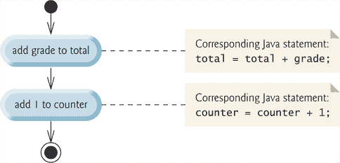

**图 4.1 顺序结构活动图。**

UML 活动图对软件系统的某部分**工作流**（也称为**活动**）进行建模。此类工作流可能包含算法的一部分，例如图 4.1 中的顺序结构。活动图由各种符号组成，例如**动作状态符号**（左右边被替换为外扩弧的矩形）、**菱形**和**小圆圈**。这些符号由**转换箭头**连接，箭头表示*活动流*——即动作应该发生的*顺序*。

像伪代码一样，活动图可以帮助你开发和表示算法。活动图清晰地显示了控制结构是如何运行的。我们在本章和第 5 章 中使用 UML 来显示控制语句中的控制流。在线章节 33–34 在一个真实的自动取款机案例研究在使用 UML。

考虑图 4.1 中的活动图。它包含两个**动作状态**，每个状态包含一个**动作表达式**——“将分数加到总分”或“给计数器加 1”，它指定了一个特定的动作。其他动作可能包括输入/输出。箭头表示**转换**，指示动作发生的顺序。图 4.1 所示首先将 `grade` 加到 `total`，然后给 `counter` 加 1。

图顶部的**实圆圈**表示**初始状态**——工作流的开始。底部的**实圆圈**表示**结束状态**——工作流的结束。图 4.1 还包含右上角的矩形。这些是**注释**（类似于 Java 中的注释——描述符号用途的说明）。**虚线**将每个注释与其描述的元素连接。有关 UML 的更多信息，请参见 `http://www.uml.org`。

### 4.4.2 Java 中的选择语句

Java 有三种类型的**选择语句**（在本章和第 5 章 中讨论）。
* `if` 语句：如果条件为真则执行（选择）一个动作，如果条件为假则跳过它。
* `if...else` 语句：如果条件为真则执行动作，如果条件为假则执行另一个动作。
* `switch` 语句：根据表达式的值执行*许多*不同动作之一。

`if` 语句是**单选择语句**，因为它选择或忽略*单个*动作（或者正如我们很快将看到的，是*单个动作组*）。`if...else` 语句被称为**双选择语句**，因为它在*两个不同的动作*（或*动作组*）之间进行选择。`switch` 语句被称为**多重选择语句**，因为它在*许多不同的动作*（或*动作组*）中进行选择。

### 4.4.3 Java 中的迭代语句

Java 提供了四种 `iteration statements`（迭代语句，也称为 `repetition statements` 或循环语句），它们允许程序只要条件（称为 `loop-continuation condition`）保持为 `true`，就可以重复执行语句。迭代语句包括 `while`、`do…while`、`for` 和增强型 `for`。（第 5 章介绍了 `do…while` 和 `for` 语句，第 7 章介绍了增强型 `for` 语句。）`while` 和 `for` 语句执行其体内的动作（或一组动作）零次或多次——如果循环继续条件初始为 `false`，则动作（或一组动作）将 `not` 执行。`do…while` 语句执行其体内的动作（或一组动作）`one or more` 次。`if`、`else`、`switch`、`while`、`do` 和 `for` 是 Java 关键字。Java 关键字的完整列表见附录 C。

### 4.4.4 Java 控制语句总结

Java 只有三种控制结构，从这里开始我们称为 `control statements`（控制语句）：`sequence statement`（顺序语句）、`selection statements`（选择语句，三种）和 `iteration statements`（迭代语句，四种）。每个程序都是通过组合适用于程序所实现算法的这些语句而成的。我们可以将每个控制语句建模为活动图。正如图 4.1 所示，每个图都包含一个初始状态和一个结束状态，分别代表控制语句的入口和出口。`Single-entry/single-exit control statements`（单入口/单出口控制语句）构建程序变得简单——我们只需将上一个的出口连接到下一个入口。我们称之为 `control-statement stacking`（控制语句堆叠）。我们将了解到控制语句只有另一种连接方式——`control-statement nesting`（控制语句嵌套），即一个控制语句出现在另一个 `inside`。因此，Java 程序中的算法仅由三种控制语句构造，且只有两种组合方式。这就是简单性的本质。

## 4.5 `if` 单选择语句

程序使用选择语句在备选方案之间进行选择。例如，假设考试的及格分是 60 分。`pseudocode` 语句

```
If student’s grade is greater than or equal to 60
Print “Passed”
```

决定了 `condition` “学生成绩大于或等于 60 分”是否为 `true`。如果是，则打印“Passed”，并按顺序执行下一个伪代码语句。如果条件为 `false`，则忽略 `Print` 语句，并按顺序执行下一个伪代码语句。该选择语句第二行的缩进是可选的，但建议这样做，因为这强调了结构化程序的固有结构。

上述伪代码 `If` 语句在 Java 中可以写成如下形式：

```java
if (studentGrade >= 60) {
    System.out.println("Passed"); 
}
```

Java 代码与伪代码紧密对应。这是伪代码的属性之一，使其成为非常实用的程序开发工具。

### `if` 语句的 UML 活动图

图 4.2 展示了单选择的 `if` 语句。此图包含活动图中最重要的符号——`diamond`（菱形，或决策符号），它表示要做出一个 `decision`。工作流沿着由符号相关的 `guard conditions`（守护条件）决定的路径继续，这些条件可以是 `true` 或 `false`。从决策符号出的每个转换箭头都有一个守护条件（在箭头旁边的 `square brackets` 中指定）。如果守护条件为 `true`，工作流进入转换箭头所指向的动作状态。在图 4.2 中，如果成绩大于或等于 60，工作流进入动作状态。


**图 4.2 `if` 单选择语句活动图。**

`if` 语句是单入口/单出口控制语句。我们将看到其他控制语句的活动图也包含初始状态、转换箭头、动作状态、决策符号和结束状态。

## 4.6 `if…else` 双选择语句

`if` 单选择语句仅在条件为 `true` 时执行指定的动作；否则跳过该动作。`if…else` 双选择语句允许在条件为 `true` 时指定一个动作，在条件为 `false` 时指定另一个动作。例如，伪代码语句

```
If student’s grade is greater than or equal to 60
   Print “Passed”
Else
   Print “Failed”
```

在成绩大于或等于 60 时打印“Passed”，小于 60 时打印“Failed”。上述的 `If`…`Else` 伪代码在 Java 中可以写成：

```java
if (grade >= 60) {
   System.out.println("Passed");
}
else {
   System.out.println("Failed");
}
```

`else` 的体也是缩进的。无论选择何种缩进方案，应应用于整个程序。

### `if…else` 语句的 UML 活动图

图 4.3 展示了 `if…else` 语句的控制流。再次，活动图中的符号（初始状态、转换箭头和结束状态之外）代表动作状态和决策。


**图 4.3 `if…else` 双选择语句活动图。**

#### 4.6.1 嵌套 `if…else` 语句

将 `if…else` 语句放在另一个 `if…else` 语句内部，程序可以测试多种情况，创建嵌套 `if…else` 语句。例如，以下伪代码表示了一个嵌套的 `if…else`，对于成绩大于或等于 90 分的打印 A，80 到 89 分的打印 B，70 到 79 分的打印 C，60 到 69 分的打印 D，所有其他成绩打印 F：

```
If student’s grade is greater than or equal to 90
   Print “A”
else
   If student’s grade is greater than or equal to 80
      Print “B”
   else
      If student’s grade is greater than or equal to 70
         Print “C”
      else
         If student’s grade is greater than or equal to 60
            Print “D”
         else
            Print “F”
```

该伪代码在 Java 中可以写成：

```java
if (studentGrade >= 90) {
   System.out.println("A"); 
}
else {
   if (studentGrade >= 80) {
```


```java
System.out.println("B");

}

else {

   if (studentGrade >= 70) {

      System.out.println("C");

   }

   else {

      if (studentGrade >= 60) {

         System.out.println("D");

      }

      else {

         System.out.println("F");

      }

   }

}

}
```

如果变量 `studentGrade` 大于或等于 90，嵌套 `if…else` 语句中的前四个条件都为真，但只有第一个 `if…else` 语句中 `if` 部分的语句会被执行。在执行该语句后，“最外层” `if…else` 语句的 `else` 部分将被跳过。许多程序员更倾向于将上述的嵌套 `if…else` 语句写成：

```java
if (studentGrade >= 90) {

   System.out.println("A");

}

else if (studentGrade >= 80) {

   System.out.println("B");

}

else if (studentGrade >= 70) {

   System.out.println("C");

}

else if (studentGrade >= 60) {

   System.out.println("D");

}

else {

   System.out.println("F");

}
```

这两种形式除了空格和缩进外完全相同，编译器会忽略这些差异。后一种形式避免了代码向右的深度缩进。这种缩进通常会导致源代码行的剩余空间很小，从而迫使换行。

## 4.6.2 悬空 else（Dangling-else）问题

在全文中，我们总是将控制语句体包含在大括号（`{` 和 `}`）中。这避免了被称为“悬空 else”的逻辑错误。我们将在练习 4.27–4.29 中研究这个问题。

## 4.6.3 块（Blocks）

`if` 语句通常期望其体中只有*一个*语句。若要在 `if` 语句体中（或 `if…else` 语句的 `else` 语句中）包含*多个*语句，请将这些语句包含在大括号中。包含在大括号中的语句（例如方法体）形成一个 `block`（块）。块可以放置在方法中任何单语句可以放置的地方。

下面的示例在 `if…else` 语句的 `else` 部分包含了一个包含多个语句的块：

```java
if (grade >= 60) {

   System.out.println("Passed");

}

else {

   System.out.println("Failed");

   System.out.println("You must take this course.");

}
```

在这种情况下，如果 `grade` 小于 60，程序将执行 `else` 块中的两个语句，并打印 `Failed must take this course.`。注意 `else` 中两个语句周围的大括号。如果没有大括号，语句 `System.out.println("You must take this course.");` 将位于 `if…else` 语句的 `else` 部分体之外，并且无论成绩是否小于 60 它都会执行。`语法错误`（如缺少大括号）会被编译器捕获。`逻辑错误`（例如，当漏掉两个大括号时）的影响在执行时才产生。`致命逻辑错误`（fatal logic error）会导致程序失败并终止。`非致命逻辑错误`（nonfatal logic error）允许程序继续运行但会导致产生错误的结果。由于块可以放置在任何单语句的地方，因此也可以有一个空语句。回想第 2.8 节，空语句是通过在通常应该是语句的地方放置分号（`;`）来表示的。

## 4.6.4 条件运算符 (?:)

Java 提供了`条件运算符 (?:)`，它可以用来替代简单的 `if…else` 语句。这可以使你的代码更短更清晰。条件运算符是唯一的`三元运算符`（ternary operator，即它接受三个操作数）。操作数和 `?:` 符号共同构成一个`条件表达式`。第一个操作数（`?` 左侧）是一个`布尔表达式`（即评估结果为 `boolean` 值 `true` 或 `false` 的条件），第二个操作数（`?` 和 `:` 之间）是条件为 `true` 时的条件表达式的值，而第三个操作数（`:` 右侧）是条件为 `false` 时的条件表达式的值。例如，以下语句打印 `println` 的条件参数的值：

```java
System.out.println(studentGrade >= 60 ? "Passed" : "Failed");
```

如果布尔表达式 `studentGrade >= 60` 为真，该语句中的条件表达式为 `"Passed"`，如果为假则为 `"Failed"`。因此，该语句使用条件运算符实现了与 `if…else` 语句相同的功能。条件运算符的优先级较低，整个条件表达式通常放在括号中，而 `if…else` 语句则不能。

# 4.7 Student 类：嵌套 if…else 语句

练习 4.27–4.29 展示了嵌套的 `if…else` 语句，根据平均成绩确定学生的字母等级。

`Student` 类（图 4.4）存储学生的姓名和平均成绩，并提供了操作这些值的方法。

```java
// 图 4.4 Student.java 

// Student 类存储姓名和平均成绩。 

public class Student { 

   private String name; 

   private double average; 

   // 构造函数初始化实例变量 

   public Student(String name, double average) { 

      this.name = name; 

      // 验证平均分大于 0.0 小于 100.0，否则

      // 保持实例变量的默认值 (0.0) 

      if (average > 0.0) {

         if (average <= 100.0) {

            this.average = average; // 赋值给实例变量

         }

      }

   } 

   // 设置学生的姓名 

   public void setName(String name) { 

      this.name = name; 

   } 

   // 获取学生的姓名 

   public String getName() { 

      return name; 

   } 

   // 设置学生的平均分 

   public void setAverage(double studentAverage) { 

      // 验证平均分大于 0.0 小于 100.0，否则

      // 保持实例变量的当前值 

      if (studentAverage > 0.0) {

         if (studentAverage <= 100.0) {

            this.average = studentAverage;

         }

      }

   } 

   // 获取学生的平均分 

   public double getAverage() { 

      return average; 

   } 

   // 确定并返回学生的字母等级 

   public String getLetterGrade() { 

      String letterGrade = ""; // 初始化为空字符串 

      if (average >= 90.0) {  

         letterGrade = "A";

      }

      else if (average >= 80.0) {

         letterGrade = "B";

      }

      else if (average >= 70.0) {

         letterGrade = "C";

      }

      else if (average >= 60.0) {

         letterGrade = "D";

      }

      else {

         letterGrade = "F";

      }

      return letterGrade; 

   } 

}
```

## 图 4.4

`Student` 类存储学生的姓名和平均成绩。

*   一个构造函数（第 8–18 行），用于初始化 `name` 和 `average`——在第 5.9 节中，你将学习如何使用逻辑运算符简洁地表示第 13–14 行和 34–35 行
*   方法 `setName()` 和 `getName()`（第 21–28 行），用于 `set` 和 `get` `Student` 的 `name`
*   方法 `setAverage()` 和 `getAverage()`（第 31–44 行），用于 `set` 和 `get` `Student` 的 `average`
*   方法 `getLetterGrade()`（第 47–67 行），它使用嵌套的 `if…else` 语句根据 `Student` 的 `average` 来确定其字母等级

构造函数和方法 `setAverage()` 分别使用嵌套的 `if` 语句（第 13–17 行和 34–38 行）来验证用于设置 `average` 的值——这些语句确保值大于 `0.0` 且小于等于 `100.0`；否则，`average` 的值保持不变。每个 `if` 语句包含一个简单的条件。如果第 13 行的条件为真，才会会测试第 14 行的条件，并且只有当第 13 行和第 14 行的条件都为真，才会执行第 15 行的语句。

## 类 `StudentTest`

为了演示 `Student` 类中 `getLetterGrade()` 方法的嵌套 `if…else` 语句，`StudentTest` 类的 `main` 方法（图 4.5）创建了两个 `Student` 对象（第 5–6 行）。接下来，第 8–11 行通过分别调用对象的 `getName()` 和 `getLetterGrade()` 方法来显示每个 `Student` 的名称和字母等级。

```java
// Fig 4.5: StudentTest.java 

// 创建并测试 Student 对象。 

public class StudentTest { 

   public static void main(String[] args) { 

      Student account1 = new Student("Jane Green", 93.5); 

      Student account2 = new Student("John Blue", 72.75); 

      System.out.printf("%s's letter grade is: %s%n", 

         account1.getName(), account1.getLetterGrade());  

      System.out.printf("%s's letter grade is: %s%n", 

         account2.getName(), account2.getLetterGrade());  

   } 

}
```

## 图 4.5

创建并测试 `Student` 对象。

# 4.8 `while` 迭代语句

迭代语句允许你指定当某个条件保持为真时，程序应该重复某个动作。伪代码语句

```
当我的购物清单上还有更多项目时
   购买下一个项目并从清单上划掉
```

描述了购物过程中的迭代。条件“我的购物清单上还有更多项目”可能为真，也可能为假。如果它为真，则执行“购买下一个项目并从清单上划掉”这一动作。只要条件保持为真，该动作就会反复执行。`While` 迭代语句包含的语句构成了它的体，体可以是单条语句，也可以是一个块。最终，条件将变为假（当购物清单上的最后一个项目被购买并划掉时）。此时，迭代终止，并执行迭代语句之后的第一条语句。

作为 Java `while` 迭代语句的示例，考虑一个寻找大于 100 的 3 的第一个幂的程序段。在执行以下 `while` 语句后，`product` 包含结果：

```java
int product = 3;

while (product <= 100) {

   product = 3 * product;

}
```


`while` 语句的每次迭代都会将 `product` 乘以 3，因此 `product` 连续取值为 9、27、81 和 243。当 `product` 变为 243 时，`product <= 100` 变为假。这终止了迭代，因此 `product` 的最终值为 243。此时，程序执行到 `while` 语句之后的下一条语句。

# `while` 语句的 UML 活动图

图 4.6 中的 UML 活动图说明了 `while` 语句的流程。

请注意图 4.7 算法中对总和（`total`）和计数器（`counter`）的引用。`total` 是一个用于累加多个值之和的变量。计数器用于计数的变量——在这种情况下，分数计数器（grade counter）指示用户即将输入 10 个成绩中的哪一个。用于存储总数的变量在程序中使用之前通常会被初始化为零。

```
1 Set total to zero
2 Set grade counter to one
3
4 While grade counter is less than or equal to ten
5    Prompt the user to enter the next grade
6    Input the next grade
7    Add the grade into the total
8    Add one to the grade counter
9
10 Set the class average to the total divided by ten
11 Print the class average
```

## 图 4.7

使用计数器控制迭代解决班级平均分问题的伪代码算法。

## 实现计数器控制迭代

在图 4.8 中，`ClassAverage` 类的 `main` 方法实现了图 4.7 中伪代码描述的班级平均分算法——它允许用户输入 10 个成绩，然后计算并显示平均分。

```
1 // Fig. 4.8: ClassAverage.java
2 // Solving the class-average problem using counter-controlled iteration.
3 import java.util.Scanner; // program uses class Scanner
4
5 public class ClassAverage {
6    public static void main(String[] args) {
7       // create Scanner to obtain input from command window
8       Scanner input = new Scanner(System.in);
9
10       // initialization phase
11       int total = 0;  // initialize sum of grades entered by the user
12       int gradeCounter = 1; // initialize # of grade to be entered next
13
14       // processing phase uses counter-controlled iteration
15       while (gradeCounter <= 10) { // loop 10 times
16          System.out.print("Enter grade: "); // prompt
17          int grade = input.nextInt(); // input next grade
18          total = total + grade; // add grade to total
19          gradeCounter = gradeCounter + 1; // increment counter by 1
20       }
21
22       // termination phase
23       int average = total / 10; // integer division yields integer result
24
25       // display total and average of grades
26       System.out.printf("%nTotal of all 10 grades is %d%n", total);
27       System.out.printf("Class average is %d%n", average);
28    }
29 }
```

## 图 4.8

使用计数器控制迭代解决班级平均分的问题。

## 方法 `main` 中的局部变量

第 8 行声明并初始化了 `Scanner` `input`，用于读取用户输入的值。第 11、12、17 和 23 行分别声明了类型为 `int` 的局部变量 `total`、`gradeCounter`、`grade` 和 `average`。变量 `grade` 存储用户输入。

这些声明出现在 `main` 方法体内。请记住，在方法体中声明的变量是局部变量，只能从声明所在的行到方法声明的结束右括号处使用。局部变量的声明必须在该方法中使用变量之前出现。局部变量无法在声明它的方法之外访问。在 `while` 循环体中声明的变量 `grade` 只能在该块内使用。

## 初始化阶段：初始化变量 `total` 和 `gradeCounter`

赋值操作（第 11–12 行）将 `total` 初始化为 `0`，将 `gradeCounter` 初始化为 `1`。这些初始化发生在变量用于计算之前。

## 处理阶段：从用户处读取 10 个成绩

第 15 行表示，只要 `gradeCounter` 的值小于或等于 10，`while` 语句就继续循环（也称为迭代）。只要该条件保持真，`while` 语句就会重复执行界定其实体的括号之间的语句（第 15–20 行）。

第 16 行显示提示信息 `"Enter grade: "`。第 17 行读取用户输入的成绩并赋值给变量 `grade`。然后第 18 行将用户输入的新 `grade` 加到 `total` 中。第 19 行给 `gradeCounter` 加 1。

## 终止阶段：计算并显示成绩平均分

当循环结束时，第 23 行执行平均分计算并将结果赋值给 `average`。第 26 行使用 `System.out.printf` 显示 `"Total of all 10 grades is %d%n"`。第 27 行使用 `System.out.printf` 显示 `"Class average is %d%n"`。

## 关于整数除法和截断的说明

图 4.8 中 `total / 10` 的结果是 8，因为 `total` 和 `10` 都是整数。两个整数相除得到的是整数除法——计算的任何分数部分都会截断（即丢失）。

## 关于算术溢出的说明

在图 4.8 中，第 18 行

```
total = total + grade; // add grade to total
```

将用户输入的每个 `grade` 加到 `total` 中。即使是简单的语句也存在可能的问题——整数相加的结果可能无法放入 `int` 变量。这被称为算术溢出，会导致未定义行为，从而导致意外的结果，正如此处讨论：

http://en.wikipedia.org/wiki/Integer_overflow#Security_ramifications

图 2.7 的 `Addition` 程序在第 17 行存在相同的问题，该行计算用户输入的两个 `int` 值的和：

```
int sum = number1 + number2; // add numbers, then store total in sum
```

`int` 变量可以存储的最大值和最小值分别由常量 `Integer.MIN_VALUE` 和 `Integer.MAX_VALUE` 表示。对于其他整数类型以及浮点类型，也有类似的常量。每个基本类型在 `java.lang` 包中都有一个对应的类类型。你可以在每个类的在线文档中查看这些常量的值。`Integer` 类的在线文档位于：

http://docs.oracle.com/javase/8/docs/api/java/lang/Integer.html

在执行类似图 4.8 第 18 行和图 2.7 第 17 行的算术计算*之前*，确保它们*不会*溢出被认为是一项良好的做法。执行此操作的代码显示在 CERT 网站上：

http://www.securecoding.cert.org

只需搜索指南“NUM00-J”即可。该代码使用了 `&&`（逻辑与）和 `||`（逻辑或）运算符，这些运算符是在第 5 章中引入的。在工业级代码中，你应该对*所有*计算进行此类检查。

# 深入研究接收用户输入

每当程序从用户那里接收输入时，可能会出现各种问题。例如，在图 4.8 第 17 行：

```
int grade = input.nextInt(); // input next grade
```


我们假设用户将输入一个 0 到 100 范围内的整数分数。然而，输入分数的人可能会输入小于 0 的整数、大于 100 的整数、`int` 变量无法存储的值范围外的整数、包含小数点的数字，或者包含字母或特殊符号（甚至不是整数）的值。

为了确保输入是有效的，工业级程序必须测试所有可能的错误情况。一个输入分数的程序应该通过**范围检查**对分数进行**验证**，以确保它们是 0 到 100 之间的值。然后，你可以要求用户重新输入任何超出范围的值。如果程序需要来自特定值集的输入（例如，非连续的产品代码），你可以确保每个输入都匹配集合中的某个值。

# 4.10 制定算法：哨兵控制的迭代

让我们对第 4.9 节中的班级平均分问题进行泛化。考虑以下问题：

*开发一个班级平均分程序，每次运行时都能处理任意数量学生的成绩。*

在之前的班级平均分示例中，问题描述指定了学生人数，因此分数的数量（10）是预先知的。在这个示例中，没有指示用户在程序执行期间将输入多少个分数。程序必须处理任意数量的分数。它如何确定何时停止输入分数？它如何知道何时计算并打印班级平均分？

解决此问题的方法之一是使用称为**哨兵值**（sentinel value，也称为**信号值**、**哑值**或**标记值**）的特殊值来指示“数据输入结束”。用户不断输入分数，直到输入了所有合法分数。然后用户输入哨兵值，表示不再输入更多分数。**哨兵控制的迭代**通常被称为**无限迭代**，因为迭代次数在循环开始执行之前是*未知*的。

显然，必须选择一个不会与接受的输入值混淆的哨兵值。测验的分是非负整数，因此 –1 是该问题的一个可以接受的哨兵值。因此，班级平均分程序的运行可能会处理一组如 95, 96, 75, 74, 89 和 –1 的输入流。程序随后将计算并打印 95, 96, 75, 74 和 89 的班级平均分；由于 –1 是哨兵值，它*不应*进入平均值计算。

# 使用自顶向下、逐步细化开发伪代码算法：顶层和第一次细化

我们使用一种称为**自顶向下、逐步细化**的技术来处理这个班级平均分程序，这对于开发结构良好的程序至关重要。我们从**顶层**（top）的伪代码表示开始——表达程序整体功能的单一语句：

```
确定测验的班级平均分
```

顶层实际上是程序的*完整*表示。遗憾的是，顶层很少提供足够编写 Java 程序的详细信息。因此，我们现在将顶层分为更小的任务，并按执行顺序列出它们。这产生了**第一次细化**：

```
确定测验的班级平均分
```

# 进入第二次细化

要进入下一层细化——即**第二次细化**——我们需要提交具体的变量。在示例示例中，我们需要一个运行总和、一个处理数量的计数器、一个接收输入的变量，以及一个存储计算出的平均数的变量。`total` 和 `counter` 需要初始化。`average` 和 `grade` 不需要初始化，因为它们的值会在计算或输入时被替换。

```
初始化 total 为 0
初始化 counter 为 0
提示用户输入第一个分数
输入第一个分数（可能是哨兵）
当用户尚未输入哨兵时
    将此分数加入运行总和
    计数加 1
    提示用户输入下一个分数
    输入下一个分数（可能是哨兵）
```

在伪代码中，我们*不*对构成 `While` 结构的语句使用大括号。我们只需缩进 `While` 下方的语句显示它们属于它。再次，伪代码是非正式的程序辅助。

伪代码语句 `计算并打印班级平均分` 可以细化如下：

```
如果计数不等于 0
    将平均分设置为总量除以计数
    打印平均分
否则
    打印“没有分数”
```

我们在这里仔细地测试*除以零*的可能性——这是一个*逻辑错误*，如果不检测到，会导致程序失败或产生无效输出。班级平均分问题的完整第二次细化如图 4.9 所示：

```
1 初始化 total 为 0
 2 初始化 counter 为 0
 3
 4 提示用户输入第一个分数
 5 输入第一个分数（可能是哨兵）
 6
 7 当用户尚未输入哨兵时
 8     将此分数加入运行总和
 9     计数加 1
 10     提示用户输入下一个分数
 11     输入下一个分数（可能是哨兵）
 12
 13 如果计数不等于 0
 14     将平均分设置为总量除以计数
 15     打印平均分
 16 否则
 17     打印“没有分数”
```

# 图 4.9

带有哨兵控制迭代的班级平均分伪代码算法。

在图 4.7 和图 4.9 中，我们在伪代码中加入了空行和缩进，使其更具可读性。空行将算法分为不同的阶段并区分了控制语句；缩进则强调了控制语句的主体。

图 4.9 中的伪代码算法解决了更通用的类平均分问题。该算法在经过两次改进后开发。有时还需要更多的改进。

# 实现哨兵控制循环

在图 4.10 中，`main`方法实现了图 4.9 中的伪代码算法。虽然每个成绩都是整数，但平均值的计算可能会产生带有`decimal point`的数字——换句话说，是一个实数（浮点数）。`int`类型无法表示这样的数字，因此该类使用`double`类型来表示。你还会看到控制语句可能会相互`stacked`（按顺序堆叠在一起）。`while`语句（第 20–27 行）之后依次是一个`if…else`语句（第 31–42 行）。该程序中的大部分代码与图 4.8 中的代码相同，因此我们重点关注新概念。

```java
 1 // Fig. 4.10: ClassAverage.java
 2 // 使用哨兵控制循环解决类平均分问题。
 3 import java.util.Scanner; // 程序使用 Scanner 类
 4
 5 public class ClassAverage {
 6    public static void main(String[] args) {
 7         // 创建 Scanner 以从命令行窗口获取输入
 8         Scanner input = new Scanner(System.in);
 9
10      // 初始化阶段
11      int total = 0; // 初始化成绩总和
12      int gradeCounter = 0; // 初始化已输入的成绩数量
13
14      // 处理阶段
15      // 提示输入并从用户读取成绩
16      System.out.print("Enter grade or -1 to quit: ");
17      int grade = input.nextInt();
18
19      // 循环直到从用户处读取哨兵值
20      while (grade != -1) {
21         total = total + grade; // 将成绩加到总和
22         gradeCounter = gradeCounter + 1; // 计数器加 1
23
24         // 提示输入并从用户读取下一个成绩
25         System.out.print("Enter grade or -1 to quit: ");
26         grade = input.nextInt();
27      }
28
29      // 终止阶段
30      // 如果用户至少输入了一个成绩…
31      if (gradeCounter != 0) {
32         // 使用带有小数点的数字计算成绩的平均值
33         double average = (double) total / gradeCounter;
34
35         // 显示总和和平均值（保留两位）
36         System.out.printf("%nTotal of the %d grades entered is %d%n",
37            gradeCounter, total);
38         System.out.printf("Class average is %.2f%n", average);
39      }
40      else { // 没有输入成绩，因此输出相应消息
41         System.out.println("No grades were entered");
42      }
43   }
44 }
```

# 图 4.10

使用哨兵控制循环解决类平均分问题。

# 哨兵控制迭代 vs. 计数控制迭代

使用哨兵控制迭代解决类平均分问题。哨兵控制迭代的第 12 行将`gradeCounter`初始化为`0`，因为还没有输入任何成绩。将此处的哨兵控制迭代逻辑与图 4.8)中的计数控制迭代进行比较。在哨兵控制迭代中，图 4.10 中的`while`语句判断用户输入了哨兵。如果条件为`false`，则不执行循环。反之，如果条件为`true`，哨兵控制迭代的图 4.10 中的`while`循环体会将`grade`加到`total`并增加`gradeCounter`（第 21–22 行）。接下来，`while`语句（第 20 行）从用户处读取最新的`grade`。循环终止后，`if…else`语句（第 31–42 行）判断图 4.10 判断是否输入了任何成绩。如果没有输入，则执行`else`部分（第 40–42 行）并显示消息`No grades were entered`。

# `while`语句中的大括号

注意图 4.10 中`while`语句的控制块（第 20–27 行）。如果没有大括号，循环将它的主体仅视为第一个语句，即将`grade`加到`total`。最后三个语句将落在循环之外，导致计算机错误地解释代码如下：

```java
while (grade != -1)
    total = total + grade; // 将成绩加到总和
gradeCounter++; // 计数
// 提示输入并从用户读取下一个成绩
System.out.print("Enter grade or -1 to quit: ");
grade = input.nextInt();
```

如果用户在第 17 行处没有输入`-1`，上述代码会导致程序出现`死循环`。

# 原生类型之间的显式和隐式转换

如果至少输入了一个成绩，图 4.10 中的第 33 行计算成绩的平均值。回想图 4.8 中整数除法产生整数结果。即使变量`average`被声明为`double`，如果我们把平均值的计算写成：

```java
double average = total / gradeCounter;
```

在将除法结果赋值给`average`之前，它就会丢失商的小数部分。

大多数平均值都不是整数（例如 0、–22 和 1024）。因此，在本示例中，我们将课程平均分计算为浮点数。为了用整数值进行浮点运算，我们必须在计算中*临时地*将这些值视为浮点数。Java 提供了`一元转换运算符`（unary cast operator）来完成此任务。图 4.10 中的第 33 行使用 `(double)` 转换运算符为其操作数 `total`（位于操作符右侧）创建一个临时的浮点数副本。这种使用转换运算符的方法被称为`显式转换`或`类型强制转换`。`total` 中存储的值仍然是一个整数。

现在的计算包含一个浮点数值（`total` 的临时 `double` 副本）除以整数 `gradeCounter`。Java 只能对操作数类型*相同*的算术表达式求值。为了确保这一点，Java 对选定的操作数执行名为`提升`（或`隐式转换`）的操作。例如，在一个包含 `int` 和 `double` 值的表达式中，`int` 值会被提升为 `double` 值供表达式使用。在本示例中，`gradeCounter` 的值被提升为 `double` 类型，然后执行浮点除并将并将结果赋值给 `average`。只要在计算的*任何*变量上应用了 `(double)` 转换运算符，计算就会得到一个 `double` 结果。在本章的稍后部分，我们将讨论所有的原始类型。你将在第 6.7 节中学习更多关于提升的规则。

通过在任何类型的名称周围加上括号来形成一个转换运算符。该运算符是一个`一元运算符`——它只接受一个操作数。Java 还有一元加（`+`）和减（`–`）运算符，因此你可以写像 `-7` 或 `+5` 这样的表达式。转换运算符从*右到左*结合，并具有与其他一元运算符相同的优先级。这种优先级比`乘法运算符` `*`、`/` 和 `%` 高一个级。（参见附录 A` 符号表示转换运算符，以明可以使用任何类型名称来形成转换运算符。

图 4.10 中的第 38 行显示了课程平均分。在本示例中，我们显示*四舍五入*到最近百分百分位的平均分。`printf` 格式控制字符串中的格式指定符 `%.2f` 表示变量 `average` 的值应在小数点后保留两位精度进行显示——这由格式指定符中的 `.2` 表示。在示例执行期间输入的三个成绩总和为 257，得出的平均值为 85.666666……。`printf` 方法使用格式指定符中的精度将值四舍五入到指定的位数。在该程序中，平均分被四舍五入到百分分位，并显示为 `85.67`。

# 浮点数精度

浮点数并不总是 100% 精确的，但它们有许多应用。例如，当我们谈论 98.6 的“正常”体温时，我们不需要精确到很多位数。当我们从温度计上读取温度为 98.6 时，它实际上可能是 98.5999473210643。对于大多数涉及体温的应用来说，将此数字简单称为 98.6 是可以的。

浮点数通常是除法的结果，例如本示例中的课程平均分计算。在传统算术中，当用 10 除以 3 时，结果是 3.3333333……，3 的序列无限重复。计算机只分配固定的空间来存储此类值，因此显然存储的浮点数值只能是一个近似值。

由于浮点数具有不精确性，`double` 类型优于 `float` 类型，因为 `double` 变量可以更准确地表示浮点数。出于这个原因，我们在整书中主要使用 `double` 类型。在某些应用中，`float` 和 `double` 变量的精度将不足。对于精确的浮点数（例如货币计算所需的），Java 提供了 `BigDecimal` 类（位于 `java.math` 包），我们将在第 8 章中讨论。

# 4.11 算法制定：嵌套语句

对于下一个示例，我们再次通过使用伪代码来制定算法并编写 Java 程序。我们已经看到语句可以连接——即通过**嵌套**。考虑以下问题描述：

*一所学院提供一门准备房地产执业考试的课程。去年，完成该课程的学生参加了考试。学院想知道学生的表现如何。你的程序应该总结通过人数。*

*程序结果如下：*

```
分析结果并决定是否发放奖金。
输入每个结果。
统计每种结果的数量。
如果人数超过 8，打印“给教师发放奖金！”
```

在仔细阅读问题描述后，我们得出了以下观察：

1. 程序必须处理 10 个结果。由于结果数量是先知的，可以使用计数器循环。
2. 每个测试结果都有一个数值——1 或 2。每当读取结果时，程序必须判断它是 1 还是 2。我们在算法中测试是否为 1。如果不是 1，我们假设它是 2。（练习 4.24 考虑了这种假设的后果。）
3. 使用两个计数器来跟踪结果——一个统计通过人数，另一个统计未通过的人数。
4. 在程序处理所有结果后，必须判断是否有超过 8 人通过。

让我们从自顶向下、逐步细化的方法开始，从顶部的表示开始：

```
分析结果并决定是否发放奖金。
```

再次，顶部是程序的*完整*表示，但在伪代码能够自然演变为 Java 程序之前，可能需要进行多次细化。

我们的第一次细化是

```
初始化变量
输入 10 个结果，并统计通过和失败
打印结果总结并决定是否发放奖金
```

在这里，尽管我们已经有了程序的完整表示，但仍需要进一步细化。我们现在确定特定的变量。需要计数器来记录通过和失败，一个计数器将用于控制循环过程，一个变量用于存储用户输入。存储用户输入的变量在算法开始时*不需要*初始化，因为它的值是在循环的每次迭代期间输入的。

可以进一步完善为：

```
将通过次数初始化为零
将失败次数初始化为零
将学生计数器初始化为一
```

注意算法开始时仅初始化计数器。

伪代码语句

```
输入 10 份考试结果，并统计通过和失败次数
```

需要一个循环来连续输入每次考试的结果。我们预先知道恰好有 10 份考试结果，因此使用计数器控制的循环是合适的。在循环内部（即`嵌套`在循环中），一个双重选择结构将决定每个考试结果是通过还是失败，并增加相应的计数器值。上述伪代码语句的完善如下：

```
当学生计数器小于或等于 10 时
    提示用户输入下一个考试结果
    输入下一个考试结果
    如果学生通过了
        通过次数加 1
    否则
        失败次数加 1
    计数器加 1
```

我们使用空行来隔离 `If`…`Else` 控制结构，这提高了可读性。

伪代码语句

```
打印考试结果的摘要并决定是否应该支付奖金
```

可以进一步完善为：

```
打印通过次数
打印失败次数
如果超过八位学生通过
    打印“给老师发奖金！”
```

# 伪代码的完整第二次完善以及转换为 `Analysis` 类

完整的第二次完善见图 4.11。同样使用了空行来区分 `While` 结构以提高程序的可读性。该伪代码现在已经足够完善，可以转换为 Java。

```java
 1 将通过次数初始化为零
 2 将失败次数初始化为零
 3 将学生计数器初始化为一
 4
 5 当学生计数器小于或等于 10 时
 6    提示用户输入下一个考试结果
 7    输入下一个考试结果
 8
 9    如果学生通过了
10       通过次数加 1
11   否则
12       失败次数加 1
13
14   计数器加 1
15
16 打印通过次数
 17 打印失败次数
18
```


## 考试结果问题的伪代码与 Java 实现

### 伪代码第一次完善

19 如果超过八位学生通过
20    打印“给老师发奖金！”

### 图 4.11 考试结果问题的伪代码

实现该伪代码算法的 Java 类和两个示例执行见图 4.12。`main` 方法的第 11–13 行和第 19 行声明了用于处理考试结果的变量。

`while` 语句（第 16–31 行）循环 10 次。在每次迭代中，循环输入并处理一个考试结果。注意处理每个结果的 `if…else` 语句（第 22–27 行）`嵌套`在 `while` 语句中。如果 `result` 为 `1`，`if…else` 语句增加 `passes`；否则，假设 `result` 为 `2` 并增加 `failures`。第 30 行在第 16 行再次测试循环条件之前增加了 `studentCounter`。在输入了 10 个值后，循环终止，第 34 行显示 `passes` 和 `failures` 的数量。第 37–39 行的 `if` 语句判断是否有超过八位学生通过了考试，如果是，则输出消息 `"Bonus to instructor!"`。

图 4.12 显示了程序两次示例执行的输入和输出。在第一次执行期间，`main` 方法第 37 行的条件为 `true`——超过八位学生通过了考试，因此程序输出了一条消息给老师发奖金。

### 图 4.12 Analysis.java

```java
 1 // 图 4.12: Analysis.java 
 2 // 使用嵌套控制语句对考试结果进行分析。 
 3 import java.util.Scanner; // 类使用了 Scanner 类
 4 
 5 public class Analysis { 
 6    public static void main(String[] args) { 
 7       // 创建 Scanner 从命令行获取输入 
 8       Scanner input = new Scanner(System.in); 
 9 
10       // 在声明中初始化变量
11       int passes = 0;
12       int failures = 0;
13       int studentCounter = 1;
14 
15       // 使用计数器控制的循环处理 10 个学生 
16       while (studentCounter <= 10) { 
17          // 提示用户输入并从用户获取值 
18          System.out.print("Enter result (1 = pass, 2 = fail): ");
19          int result = input.nextInt();
20 
21          // if…else 嵌套在 while 中
22          if (result == 1) {
23             passes++;
24          } else {
25             failures++;
26          }
27 
28          // 增加 studentCounter
29          studentCounter++;
30       }
31 
32       // 显示结果
33       System.out.printf("Passed: %d%nFailed: %d%n", passes, failures);
34 
35       // 判断是否超过 8
36       if (passes > 8) {
37          System.out.println("Bonus to instructor!");
38       }
39    }
40 }
```

### 伪代码的完整第二次完善以及转换为 `Analysis` 类

完整的第二次完善见图 4.11。同样使用了空行来区分 `While` 结构以提高程序的可读性。该伪代码现在已经足够完善，可以转换为 Java。

```text
将通过次数初始化为零
将失败次数初始化为零
将学生计数器初始化为一

当学生计数器小于或等于 10 时
    提示用户输入下一个考试结果
    输入下一个考试结果 
    如果学生通过了
        通过次数加 1
    否则
        失败次数加 1
    计数器加 1

打印通过次数
打印失败次数
如果超过八位学生通过
    打印“给老师发奖金！”
```

---

## 复合赋值、递增和递减运算符

... 将右侧的值加到左侧的变量，并将结果存储在左侧变量中。通常情况下，像语句

```
变量 运算符=
```

### 图 4.13 算术复合赋值运算符

| 运算符 | 示例表达式 | 解释 |
| :--- | :--- | :--- |
| `+=` | `c += 7` | `c = c + 7` |
| `-=` | `c -= 3` | `c = c - 3` |
| `*=` | `c *= 4` | `c = c * 4` |
| `/=` | `c /= 2` | `c = c / 2` |
| `%=` | `c %= 3` | `c = c % 3` |

图 4.13 显示了算术复合赋值运算符、使用这些运算符的示例表达式以及运算符作用的解释。务必完成自测练习 4.1(h) 以了解复合赋值的一个细微特征。

### 图 4.14 递增和递减运算符

| 运算符 | 示例 | 解释 |
| :--- | :--- | :--- |
| `++` (前置递增) | `++a` | 将 `a` 增加 1，然后在 `a` 所在的表达式中使用 `a` 的新值。 |
| `++` (后置递增) | `a++` | 在 `a` 所在的表达式中使用 `a` 的当前值，然后将 `a` 增加 1。 |
| `--` (前置递减) | `--b` | 将 `b` 减去 1，然后在 `b` 所在的表达式中使用 `b` 的新值。 |
| `--` (后置递减) | `b--` | 在 `b` 所在的表达式中使用 `b` 的当前值，然后将 `b` 减去 1。 |

使用前置递增（或前置递减）运算符对变量加 1（或减 1）的操作被称为`前置递增（preincrementing）`或前置递减（predecrementing）。这会导致变量增加（或减少）1；然后在该变量出现的表达式中使用该变量的新值。使用后置递增（或后置递减）运算符对变量加 1（或减 1）的操作被称为`后置递增（postincrementing）`或后置递减（postdecrementing）。这会导致在变量出现的表达式中使用该变量的当前值；然后变量的值增加（或减少）1。

### 前置递增运算符与后置递增运算符的区别

图 4.15 展示了 `++` 运算符的前置递增版本和后置递增版本的区别。递减运算符（`--`）的工作原理类似。

#### 图 4.15 Increment.java

```java
 1  // Fig 4.15: Increment.java 
 2  // 前置递增和后置递增运算符。
 3 
 4  public class Increment {
 5     public static void main(String[] args) {
 6        // 展示后置递增运算符
 7        int c = 5;
 8        System.out.printf("c before postincrement: %d%n", c); // 输出 5
 9        System.out.printf("    postincrementing c: %d%n", c++); // 输出 5
10        System.out.printf(" c after postincrement: %d%n", c); // 输出 6
11
12        System.out.println(); // 跳过一行
13
14        // 展示前置递增运算符
 15        c = 5;
 16        System.out.printf(" c before preincrement: %d%n", c); // 输出 5
 17        System.out.printf("     preincrementing c: %d%n", ++c); // 输出 6 
 18        System.out.printf("  c after preincrement: %d%n", c); // 输出 6      
19    }
20  }
```

第 7 行将变量 `c` 初始化为 `5`，第 8 行输出 `c` 的初始值。第 9 行输出表达式 `c++` 的值。该表达式后置递增变量 `c`，因此输出 `c` 的原始值（`5`），然后增加 `c` 的值（变为 6）。因此，第 9 行再次输出了 `c` 的初始值（`5`）。第 10 行输出 `c` 的新值（`6`），证明变量的值在第 9 行确实增加了。

第 15 行将 `c` 的值重置为 `5`，第 16 行输出 `c` 的值。第 17 行输出表达式 `++c` 的值。该表达式前置递增 `c`，因此其值增加；然后输出新值（`6`）。第 18 行再次输出 `c` 的值，以显示在执行第 17 行后 `c` 的值仍然是 `6`。

### 使用算术复合赋值、递增和递减运算符简化语句

算术复合赋值运算符以及递增和递减运算符可以简化程序语句。例如，图 4.12 中的三个赋值语句（第 23、26 和 30 行）

```java
passes = passes + 1;
failures = failures + 1;
studentCounter = studentCounter + 1;
```

可以使用复合赋值运算符更简洁地写为：

```java
passes += 1;
failures += 1;
studentCounter += 1;
```

使用前置递增运算符：

```java
++passes;
++failures;
++studentCounter;
```

或者使用后置递增运算符：

```java
passes++;
failures++;
studentCounter++;
```

当在语句中对变量递增或递减时，前置递增和后置递增的形式相同，前置递减和后置递减的形式也相同。只有当变量出现在较大的表达式上下文中时，前置递增和后置递增（递减亦然）才有不同的效果。

### 运算符优先级和结合性

图 4.16 显示了我们引入的运算符的优先级和结合性。它们按优先级从高到低排列。第二列描述了结合性。条件运算符（`?:`）、元运算符（`++`、`--`）、赋值运算符（`=`、`+=`、`*=`、`%=`）从右到左结合。

#### 图 4.16 运算符优先级和结合性

| 运算符 | 结合性 | 类型 |
| :--- | :--- | :--- |
| `++`, `--` | 从右到左 | 元后置 |
| `++`, `--`, `+`, `-` | 从右到左 | 元前置 |
| `*`, `/`, `%` | 从左到右 | 乘法 |
| `+`, `-` | 从左到右 | 加法 |
| `<`, `<=`, `>=` | 从左到右 | 关系 |
| `==`, `!=` | 从左到右 | 等价 |
| `?:` | 从右到左 | 条件 |
| `=`, `+=`, `*=`, `%=` | 从右到左 | 赋值 |

---

## 4.14 基本类型

附录 D 中的表格列出了 Java 中的基本类型。像 C 和 C++ 一样，程序员经常需要编写不同的版本，因为基本类型在计算机之间是不相同的。例如，`int` 在某台机器上可能是 16 位（2 字节），在另一台机器上可能是 32 位（4 字节），在另一台机器上可能是 64 位（8 字节）。在 Java 中，`int` 值始终是 32 位（4 字节）。

附录 D 中的每种类型都列出了其位宽（8 位为一个字节）和取值范围。由于 Java 设计者想要确保可移植性，他们使用了国际认可的字符格式（Unicode；更多信息请访问 `http://www.unicode.org`）和浮点数（IEEE 754；更多信息请访问 `http://grouper.ieee.org/groups/754/`）。

回顾第 3.2 节之外作为类实例变量声明的基本类型变量，除非显式初始化，否则会自动分配默认值。`char`、`byte`、`short`、`int`、`long`、`float` 和 `double` 类型的实例变量默认赋予值 `0`。`boolean` 类型的实例变量默认赋予值 `false`。引用类型实例变量默认初始化为 `null`。

---

## 4.15（可选）GUI 和图形案例研究：事件处理；绘制线条

Java 的一个特性是其图形和多媒体支持，这允许你从视觉上增强应用程序。第 22 章，JavaFX 图形和多媒体详细讨论了这些能力。

在本节及接下来的几个 GUI 和图形案例研究章节中，我们将介绍 JavaFX 的一些图形功能。在本节中，你将构建一个名为 `DrawLines` 的应用程序，该程序可以在 `Canvas` 控件（一个可以绘图的矩形区域）上绘制线条。此程序还将引入事件处理——当用户点击 `Button` 时，JavaFX 将调用我们在 Scene Builder 中指定的方法来在 `Canvas` 上绘制线条。与第 3.6 节不同，这个 GUI 和图形案例研究章节比后续章节稍微长一点，因为我们将引导你完成配置 GUI 的步骤。

### 4.15.1 测试运行完成的 Draw Lines 应用程序

首先，让我们测试运行已完成的程序，这样你就可以看到它的运行效果：

1. 在命令行窗口中，切换目录到本章 `ch04` 示例文件夹下的 `GUIGraphicsCaseStudy04` 目录。
2. 使用以下命令编译程序，该命令会编译此程序的两个 Java 源代码文件：
   ```
   javac *.java
   ```
3. 使用以下命令运行程序：
   ```
   java DrawLines
   ```


当程序的窗口出现在屏幕上（图 4.17(a)）时，点击 `Draw Lines` `Button`。图 4.17(b) 显示了用户点击 `Draw Lines` `Button` 后的程序 GUI。

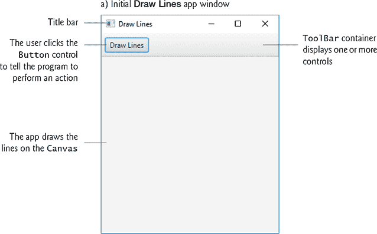 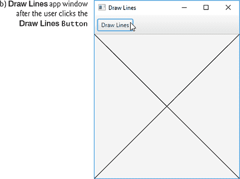

## 图 4.17
`Draw Lines` 程序的运行状态。

## 4.15.2 构建程序的 GUI

你将在 `DrawLines.fxml` 中构建程序的 GUI，并使用你在第 3.6 节中学学的相同技术。该 GUI 包含以下控件：

* 一个供你点击以绘制线条的 `Button`
* 一个用于显示图像的 `Canvas`

你还将使用 `BorderPane` 和 `ToolBar` 布局（稍后将讨论），来帮助你在用户界面中安排 `Button` 和 `Canvas`。

### 打开 Scene Builder 并创建文件 `DrawLines.fxml`

正如你在第 3.6.4 节中所做的那样，打开 Scene Builder，然后选择 `File > Save` 显示“另存为”对话框。选择存储 FXML 文件的位置，将文件为 `DrawLines.fxml` 并点击 `Save` 按钮创建文件。

### 创建 `BorderPane` 布局容器

在第 3.6 节中，你将控件安排在 `VBox` 布局容器中。对于剩余的 GUI 和图形案例研究程序，你将使用 `BorderPane` 布局容器，它将控件排列在图 4.18 所示五个区域中的一个或多个区域。

顶部和底部区域的宽度与 `BorderPane` 相同。左侧、中间和右侧区域填充顶部和底部区域之间的垂直空间。每个区域可以只包含一个控件或一个布局容器，而后者又可以包含其他控件。要开始设计 GUI，从 `Library` 窗口的 `Containers` 部分将 `BorderPane` 拖放到 Scene Builder 的内容面板上。（你也可以双击 `BorderPane` 来添加它。）

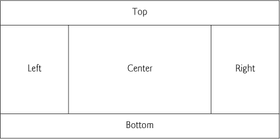

## 图 4.18
`BorderPane` 的五个区域。

### 添加 `ToolBar` 并配置其 `Button`

接下来，你将 `ToolBar` 布局容器添加到 `BorderPane` 的顶部区域。`ToolBar` 默认水平排列控件。在本程序中，`ToolBar` 将包含程序的 `Draw Lines` `Button`——在第 5.11 节中，你会看到带有两个 `Button` 的 `ToolBar`，后续程序将在 `ToolBar` 中放置其他控件。

从 Scene Builder `Library` 的 `Containers` 部分将 `ToolBar` 拖到 `BorderPane` 的顶部区域，如图图 4.19 所示。当你拖过 `BorderPane` 时，Scene Builder 会显示五个区域，以便你确定 `ToolBar`出现的位置。默认情况下，你拖入布局的 `ToolBar` 有一个 `Button`。

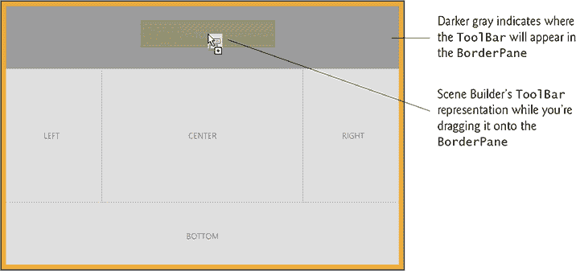

## 图 4.19
将 `ToolBar` 拖入 `BorderPane`。


## 图 4.20
包含一个 `Button` 的初始 `ToolBar`——默认情况下 `ToolBar` 占据 `BorderPane` 顶部区域的宽度。

### 配置 `Button` 的文本

接下来，双击 `Button` 编辑其文本。输入 `Draw Lines` 并按回车。更新后的 `Button` 如图图 4.21 所示。

## 图 4.21
包含更新文本的 `Button` 的 `ToolBar`。

### 添加并配置 `Canvas`

接下来，你将创建绘制线条的 `Canvas`。从 Scene Builder `Library` 的 `Miscellaneous` 部分将 `Canvas` 拖放到 `BorderPane` 的中间区域，如图图 4.22 所示。Scene Builder 会自动创建一个 200x200 像素的 `Canvas`，并将其水平和垂直居中于 `BorderPane` 的中间区域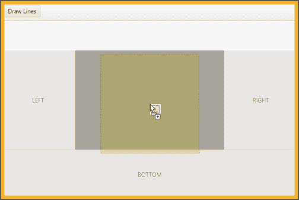

## 图 4.22
将 `Canvas` 拖入 `BorderPane` 的中间区域。

### 设置 `Canvas` 的宽度和高度

对于此程序，我们将 `Canvas` 的尺寸增加到 300x300，这是我们在许多后续案例研究程序中使用的尺寸。操作如下：

1. 点击一次 `Canvas` 选中它。
2. 点击 `Layout` 旁边的右箭头 () 展开 `Inspector` 的 `Layout` 部分。
3. 为 `Width` 属性输入 `300` 并按回车。
4. 对 `Height` 属性重复`步骤 3`。

### 配置 `BorderPane` 布局容器的大小

最后，你将指定 `BorderPane` 根据其内容调整大小。回想第 3.6.7 节，GUI 主布局（在本例中为 `BorderPane`）的优选宽度和高度决定了 JavaFX 应用程序窗口的默认大小。要设置 `BorderPane` 的首选尺寸：

1. 通过点击内容面板中的 `BorderPane` 或点击 Scene Builder `Document` 窗口中的 `Hierarchy` 部分（位于 Scene Builder 左下角）来选择它。
2. 在 `Inspector` 的 `Layout` 部分，点击 `Pref Width` 属性的向下箭头并选择 `USE_COMPUTED_SIZE`（图 4.23）。这告诉 `BorderPane` 根据其内容的计算计算首选宽度。在本程序中，最宽的项目是 `Canvas`，因此 `BorderPane` 初始宽度为 300 像素。
3. 对 `Pref Height` 属性重复 `Step 2`。这会告诉 `BorderPane` 根据其内容的高度来计算首选高度。在这种情况下，`Border-Pane` 的高度将是 `ToolBar` 和 `Canvas` 高度之和。

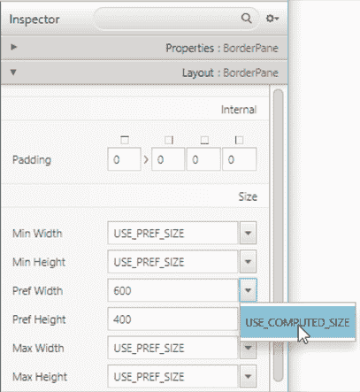

## 图 4.23
为 `BorderPane` 的 `Pref Width` 属性选择 `USE_COMPUTED_SIZE`。

### 保存设计

你现在已经完成了 GUI 设计。设计应该如图 4.24 所示。选择 `File > Save` 保存 FXML 文件。


## 图 4.24
Scene Builder 内容面板中完成的 GUI。

## 4.15.3 准备通过程序方式与 GUI 交互

你已经创建了对象（如 `Scanner`、`Account` 和 `Student`），将它们分配给变量，并通过这些变量与对象进行程序化交互。JavaFX GUI 控件也是你可以通过程序方式进行交互的对象。对于在 Scene Builder 中创建的 GUI，当程序开始执行时，*JavaFX 会为你创建控件*。

正如你在第 4.15.1 节 中所看到的，当你点击应用程序的 `Draw Lines` `Button` 时，应用程序通过在 `Canvas` 上绘制线条来响应该事件。在本节中，你将学习如何使用 Scene Builder 来指定变量和方法的名称，以便你能够与 GUI 控件进行交互。我们将展示 Scene Builder 如何生成一个包含这些变量和方法的类。

### 指定应用程序的控制器类

当然，实例变量和方法必须在类中声明。对于 FXML GUI，这些内容声明在一个名为 `controller class`（控制器类）的类中，因为它控制应用程序如何响应用户对 GUI 的交互。你将在第 4.15.4 节 中看到此应用程序的控制器类。当你启动带有 FXML GUI 的 JavaFX 应用程序时，JavaFX 运行时将：

* 创建 GUI，
* 创建你在 Scene Builder 中指定的类的对象，
* 初始化你在 Scene Builder 中指定的控制器对象的任何实例变量，使其指向对应的控件对象，
* 配置你在 Scene Builder 中指定的控制器对象的任何事件处理器，以便在用户与相应的控件交互时调用它们。

要指定控制器的类名：

1. 展开 Scene Builder `Document` 窗口的 `Controller` 部分（位于 Scene Builder 的左下角）。
2. 对于 `Controller Class`，输入 `DrawLinesController` 并按 `Enter`。按照惯例，控制器的类基名称与 FXML 文件相同（`DrawLines.fxml` 中的 `DrawLines`），并在后面加上 `Controller`。

### 指定 `Canvas` 的实例变量名

要在 `Canvas` 对象上绘图，程序需要一个指向它的变量——这将是类中的一个实例变量。控件的 `fx:id property` 指定了实例变量的名称——当程序开始执行时，JavaFX 会用相应的控件对象初始化实例变量。要指定 `Canvas` 的 `fx:id`：

1. 选择 `Canvas`，然后点击 `Code` 旁边的右箭头 () 展开 Scene Builder `Inspector` 的 `Code` 部分。
2. 对于 `fx:id` 属性，输入 `canvas` 并按 `Enter`。

### 指定 `Button` 的事件处理器方法

`event handler`（事件处理器）是在响应用户交互时调用的方法，例如用户点击此应用程序的 `Draw Lines` `Button` 时。该方法由 JavaFX 运行时在类类对象上调用。要指定 `Button` 事件处理器的名称：

1. 点击 `Button` 以选择它。
2. 对于 `Inspector` `Code` 部分中的 `On Action` 属性，输入方法名 `drawLinesButtonPressed` 并按 `Enter`。
3. 选择 `File > Save` 保存 FXML 文件。

### 生成初始类

Scene Builder 可以生成一个 `DrawLinesController` 类——这是一个*骨架*——包含实例变量和方法。选择 `View > Show Controller` 显示该类 图 4.24。`DrawLinesController` 包含了你指定的 FXML。

回想 第 4.15.3 节，我们通过编程操作的每个控件都需要一个 `fx:id`。图 4.26 中的第 9 行声明了控制器类对应的实例变量 `canvas`。声明前的 `@FXML` 注解表示该变量名可以在 GUI 的 FXML 文件中使用。你在控制器类中指定的变量名必须与你在构建 GUI 时指定的 `fx:id` 精确匹配。请注意，我们没有初始化此变量。当 `DrawLines` 应用执行时，它会使用 `DrawLines.fxml` 中的 `Canvas` 对象初始化 `canvas` 变量。

方法前的 `@FXML` 注解（第 12 行）表示该方法可以在 FXML 文件中指定控件的事件处理器。当 `DrawLines` 应用执行时，它会配置 `drawLinesButtonPressed`（第 12–22 行），在用户按下 `Draw Lines` `Button` 时执行。按下 `Button` 会生成一个 `ActionEvent` 对象，该对象包含发生事件的信息。相应的事件处理方法必须返回 `void` 并接收一个 `ActionEvent` 参数（第 13 行）。（在本示例中我们未使用 `ActionEvent` 参数中的信息。）

### 获取用于在 `Canvas` 上绘制的 `GraphicsContext`

每个 `Canvas` 都有一个用于在画布上绘图的 `GraphicsContext` 对象。你可以通过调用 `Canvas` 的 `getGraphicsContext2D` 方法（第 15 行）获取 `GraphicsContext`：

```java
GraphicsContext gc = canvas.getGraphicsContext2D();
```

按照习惯，变量名 `gc` 用于此对象。

### `Canvas` 的坐标系

`坐标系`（图 4.27））是一种用于识别点的方案。在 `Canvas` 的坐标系中，左上角的坐标为 (0, 0)。一个 `x–y` 坐标对由 `x-coordinate`（水平坐标）和一个 `y-coordinate`（垂直坐标）组成。`x-coordinate`是从左到右的水平位置。`y-coordinate`是从上到下的垂直位置。`x-axis` 描述每个水平坐标，`y-axis` 描述每个垂直坐标。坐标指示了图形应该显示的位置。坐标单位以像素（pixels）为单位。像素一词代表“图像元素”。像素是显示器上最小的可寻址元素。

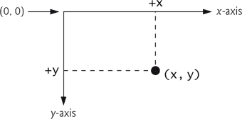

## 图 4.27
Java 坐标系。单位为像素。

### 绘制线条

图 4.26 中的第 18 行和第 21 行使用 `GraphicsContext` 变量 `gc` 绘制连接 `Canvas` 各角的对角线。类 `GraphicsContext` 类的 `strokeLine` 方法需要四个参数来画线——前两个是起点的 `x-y` 坐标，后两个是终点的 `x-y` 坐标。在第 18 行中，前两个代表 `Canvas` 的左上角，后两个代表 `Canvas` 的右下角。`Canvas` 方法 `getWidth` 和 `getHeight` 分别以像素返回 `Canvas` 的宽度和高度。在第 21 行中，前两个代表 `Canvas` 的右上角，后两个代表 `Canvas` 的左下角。

## 4.1.5 类 `DrawLines`——主类

图 4.28 显示了 `DrawLines`——这是执行的主应用程序类，它从 FXML 文件创建 GUI 并配置控制器。其中我们只做了三处更改——类名（第 9 行）、FXML 文件名（第 14 行）和标题栏（第 17 行）。目前先使用 `DrawLines` 作为模板。我们将在后面的章节讨论该应用程序的细节。

```java
import javafx.application.Application;
import javafx.fxml.FXMLLoader;
import javafx.scene.Parent;
import javafx.stage.Stage;

public class DrawLines extends Application {
    @Override
    public void start(Stage stage) throws Exception {
        Parent root = FXMLLoader.load(getClass().getResource("DrawLines.fxml"));
        Scene scene = new Scene(root);
        stage.setTitle("Draw Lines");
        stage.show();
    }

    public static void main(String[] args) {
        launch(args);
    }
}
```


# 图 4.28

加载并显示 GUI 的类。

# GUI 案例研究

## 4.1 使用循环和控制语句绘制线条可以产生许多设计。

### (a)
创建图 4.29 中的设计。该设计从左上角开始绘制线条，直到覆盖 `Canvas` 的左半部分。一种方法是将宽度高度分成等量的步数（我们发现 20 步很好）。每条线条的起点将是左上角 (0, 0)。第二个终点可以通过从左下角开始向上移动一个垂直步并向右移动一个水平步得到。在两个终点之间画一条线。继续向上向右移动一步以找到后续的终点。

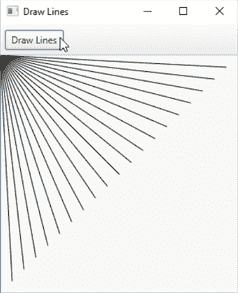

**图 4.29** 从角落发散的线条。

### (b)
修改部分 (a)，使线条从四个角发散，如图 4.30 所示。来自相反角的线条应该在中间交汇。

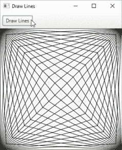

**图 4.30** 从四个角发散的线条。

## 4.2 图 4.31–4.32 展示了使用循环和 `strokeLine` 创建的两个额外设计。

### (a)
在图 4.31 中创建设计。首先，将每条边分为等数量的增量（我们再次选择了 20 个）。第一条线从左上角开始，在底部边缘向右移动一步处结束。对于后续每一条线，在左边缘向下移动一个增量，在底部边缘向右移动一个增量。继续画线，直到到达右下角。

### (b)
修改部分 (a) 以在四个角上都镜像该设计，如图 4.32 所示。

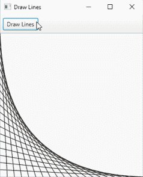

**图 4.31** 带有循环和 `strokeLine` 的线条艺术。

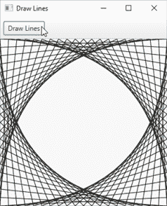

**图 4.32** 带有循环和 `strokeLine` 的线条艺术——从四个角重复。

# 4.16 总结

本章介绍了用于构建类和为这些类开发方法的基本问题解决方法。我们演示了如何构建一个算法（即解决问题的方法），然后如何通过几个阶段的伪代码开发来细化算法，最终生成可以作为方法一部分执行的 Java 代码。本章展示了如何使用自顶向下、逐步细化的方法来规划方法必须执行的特定动作以及方法必须执行这些动作的顺序。

开发任何问题解决算法只需要三种类型的控制结构：序列、选择和迭代。具体来说，本章演示了 `if` 单选择语句、`if…else` 双选择语句和 `while` 迭代语句。这些是构建许多问题解决方案的基石。我们使用了控制语句堆叠来通过计数器和哨兵控制的迭代来计算一组学生成绩的总和和平均值，并使用了控制语句嵌套来根据一组考试结果进行分析和决策。我们引入了 Java 的复合赋值运算符及其递增递减运算符。最后，我们讨论了 Java 的基本类型。在第 5 章 中，我们将继续讨论控制语句，引入 `for`、`do…while` 和 `switch` 语句。

# 总结

## 4.1 节 引言

* 在编写解决问题的程序之前，你必须对问题有彻底的理解，并有一个仔细规划的解决方法。你还必须理解可用的构建块并采用可靠的程序构建技术。

## 4.2 节 算法

* 任何计算问题都可以通过按特定顺序执行一系列动作（第 105 页）来解决。
* 根据要执行的动作及其执行顺序来解决问题的方法称为算法（第 105 页）。
* 指定程序中语句执行的顺序称为程序控制（第 106 页）。

## 4.3 节 伪代码

* 伪代码（第 106 页）是一种非正式语言，可以帮助你开发算法，而无需担心 Java 语言语法的严苛细节。
* 伪代码不是一种真正的计算机编程语言。当然，你可以使用自己的母语言来开发自己的伪代码。
* 伪代码可以帮助你在尝试用 Java 等编程语言编写程序之前，先“想出”程序。
* 仔细准备的伪代码可以很容易地转换为相应的 Java 程序。

## 4.4 节 控制结构

* 通常，程序中的语句按照它们编写的顺序一个接一个执行。这一过程被称为顺序执行（第 106 页）。
* 各种 Java 语句允许你指定下一个要执行的语句不一定是序列中的下一个语句。这被称为控制转移（第 106 页）。
* Bohm 和 Jacopini 证明了所有程序都可以用三种控制结构（第 107 页）——序列结构、选择结构和迭代结构来编写。
* “控制结构”一词源于计算机科学。

### 4.4.1 序列结构

* 除非另有规定，Java 语句按照编写的顺序一个一个执行。
* 在任何地方都可以放置多个动作。
* 活动图（第 107 页）是软件系统的部分。
* 活动图由符号（第 107 页）——例如菱形和小圆组成，由转换箭头连接——包含执行的特定动作。
* 活动图中的箭头表示动作状态发生的顺序。
* 位于活动图顶部的实心圆表示活动的初始状态（第 108 页）。
* `if` 单选择语句选择或忽略一个或多个动作。
* `if…else` 双选择语句在两个动作或动作组之间进行选择。
* `switch` 语句被称为多选择语句（第 108 页），因为它在许多不同的动作或动作组中进行选择。

### 4.4.3 Java 中的迭代语句

* Java 提供了 `while`、`do…while`、`for` 和增强 `for` 迭代语句，使程序能够在循环继续条件保持为真时重复执行语句。
* `while` 和 `for` 语句根据其循环继续条件执行其体内的操作零次或多次（p. 108）。`do…while` 语句执行其主体一次或多次。
* `if`、`else`、`switch`、`while`、`do` 和 `for` 是 Java 关键字。关键字不能用作标识符（例如变量名）。

## 4.4.4 节 Java 控制语句总结

* 每个程序都是由适用于程序实现算法的顺序、选择和迭代语句（p. 108）组合而成的。
* 单入口/单出口控制语句通过将一个语句的出口点与下一个语句的入口点连接在一起（p. 108），被称为控制语句堆叠。
* 控制语句也可以嵌套在另一个控制语句内部（p. 109）。

## 4.5 节 `if` 单选择语句

* 程序使用选择语句在备选的方案之间进行选择。
* 单选择 `if` 语句的活动图包含菱形符号，表示要做出决策。工作流遵循由符号相关的守卫条件确定的路径（p. 109）。如果守卫条件为真，工作流进入相应的转换箭头指向的操作状态。
* `if` 语句是单入口/单出口控制语句。

## 4.6 节 `if…else` 双选择语句

* `if` 单选择语句仅在条件为 `true` 时才执行其主体。
* `if…else` 双选择语句在条件为真时执行一个操作（或一组操作），在条件为假时执行另一个操作（或一组操作）。

### 4.6.1 节 嵌套 `if…else` 语句

* 程序可以使用嵌套的 `if…else` 语句测试多个情况（p. 111）。

### 4.6.2 节 悬空 `else` 问题

* 除非通过括号的位置另有说明，否则 Java 编译器会将 `else` 与紧邻的 `if` 关联。

### 4.6.3 节 块

* 语句块（p. 112）可以放置在任何可以放置单个语句的地方。
* 逻辑错误（p. 113）在执行时产生影响。致命逻辑错误（p. 113）会导致程序失败并提前终止。非致命逻辑错误（p. 113）允许程序继续执行但会产生错误结果。
* 就像块可以放置在任何单语句的地方一样，你也可以使用分号（`;`）表示空语句。

### 4.6.4 节 条件运算符 (?:)

* 条件运算符 `?:`（p. 113）接受三个操作数。三个操作数和 `?:` 符号组成一个条件表达式（p. 113）。第一个操作数是布尔值，第二个是条件表达式为 `true` 的值，第三个是条件表达式为 `false` 的值。

## 4.8 节 `while` 迭代

* `while` 迭代（p. 116）允许你指定程序在某些条件为真时重复执行。
* `while` 语句（p. 117）将多个流合并为一个。决策节点有两个或多个输出箭头；合并符号有一个转换。

## 4.9 节 制定算法：计数器控制迭代

* 计数器控制迭代（p. 118）使用一个名为计数器（或控制变量）的变量来控制一组语句的执行次数。
* 计数器控制迭代通常是定数迭代（p. 118），因为迭代次数在循环开始之前就已经知道了。
* 总和（p. 118）是一个用于累加多个值和的变量。存储总和的变量在使用之前通常初始化为零。
* 局部变量的声明必须在使用变量之前出现。局部变量无法在其声明的方法之外访问。
* 两个整数相除会导致整数除法——计算的小数部分被截断。

## 4.10 节 制定算法：哨兵控制迭代

* 在哨兵控制迭代（p. 122）中使用称为哨兵值的特殊值（也称为信号值、虚拟值或标记值）来指示“数据输入结束”。
* 必须选择一个不会与有效输入值混淆的哨兵值。
* 自顶向下、逐步细化（p. 122）对于开发结构良好的程序至关重要。
* 除以零是一个逻辑错误。
* 要对整数值执行浮点数计算，请将其中一个整数转换为 `double`。
* Java 仅知道评估操作数类型相同的算术表达式。为了确保这一点，Java 对选定的操作数执行一种称为“提升”的操作。
* 一元类型转换运算符通过在类型名称周围放置括号形成。

## 4.12 节 复合赋值运算符

* 复合赋值运算符（p. 133）简写了赋值。形式为

```
variable = variable operator expression;
```

其中 `operator` 是二元运算符 `+`、`-`、`*`、`/` 或 `%` 之一，可以写成形式：

```
variable operator= expression;
```

* `+=` 运算符将运算符右侧表达式的值加到运算符左侧变量的值，并将结果存储在左侧变量中。

## 4.13 节 递增与递减运算符

* 一元递增运算符 `++` 和一元递减运算符 `--` 对数值型变量的值加 1 或减 1（p. 134）。
* 前置于变量的递增或递减运算符（p. 134）分别是前置递增运算符或前置递减运算符。后置于变量的递增或递减运算符（p. 134）分别是后置递增运算符或后置递减运算符。
* 使用前置递增或递减运算符加或减 1 分别称为前递增或前递减。
* 对变量进行前置递增或前递减会导致该变量加 1 或减 1；然后在其出现的表达式中使用该变量的新值。
* 使用后置递增或递减运算符加或减 1 分别称为后递增或后递减。
* 对变量进行后置递增或后递减会先在其出现的表达式中使用该变量的值；然后变量的值加 1 或减 1。
* 在单独语句中对变量进行递增或递减时，前置递增与后置递增的效果相同，前置递减与后置递减的效果相同。

## 4.14 节 基本数据类型

* Java 要求所有变量必须有类型。
* Java 使用 Unicode 字符和 IEEE 754 浮点数。

# 自测练习题

## 4.1 填入每个语句的空处：

1. 所有程序都可以用三种控制结构来编写：________、________ 和 ________。
2. ________ 语句用于在条件为真时执行一个操作，在条件为假时执行另一个操作。
3. 按照特定次数重复一组指令被称为 ________ 迭代。
4. 当无法预先知道一组语句将重复多少次时，可以使用 ________ 值来结束迭代。
5. ________ 结构是 Java 内置的；默认情况下，语句按照它们出现的顺序执行。
6. `char`、`byte`、`short`、`int`、`long`、`float` 和 `double` 类型的实例变量默认赋予值 ________。
7. 如果递增运算符 ________ 变量，则先将变量加 1，然后在表达式中使用其新值。
8. 当声明 `int y = 5;` 后接赋值语句 `y += 3.3;` 时，`y` 的值为 ________。

## 4.2 判断以下每个陈述的对错。如果错误，请解释原因。

1. 算法是根据要执行的操作及其执行顺序来解决问题的程序。
2. 包含在一对括号内的语句被称为块（block）。
3. 选择语句在条件保持为真时重复某项操作。
4. 嵌套控制语句出现在另一个控制语句的体内部。
5. Java 提供了算术复合赋值运算符 `+=`、`-=`、`*=`、`/=` 和 `%=` 来简化赋值表达式。
6. 基本类型（`boolean`、`char`、`byte`、`short`、`int`、`long`、`float` 和 `double`）仅适用于 Windows 平台。
7. 指定程序中语句执行的顺序被称为程序控制。
8. 一元转换运算符 `(double)` 为其操作数创建一个临时整数副本。
9. `boolean` 类型的实例变量默认赋予值 `true`。
10. 伪代码帮助你在尝试用编程语言编写程序之前先理清思路。

## 4.3 编写四种不同的 Java 语句，每个语句使整数变量 `x` 加 1。

## 4.4 编写 Java 语句完成以下每个任务：

1. 使用一条语句将 `x` 和 `y` 的和赋值。
2. 使用一条语句将 `x` 和 `y` 的积赋值。
3. 使用一条语句将 `x` 和 `y` 的商赋值。
4. 使用一条语句将 `x` 除以 `y` 的余数赋值。

### 4.3 向 `x` 添加 `1` 的四种方式是：

```
1  x = x + 1; 
2  x += 1;
3  ++x;
4  x++;
```

### 4.4 答案：

1. `z = x++ + y;`
2. 
```
1  if (count > 10) {
2     System.out.println("Count is greater than 10");
3  }
```
3. `total -= --x;`
4. 
```
1  q %= divisor;
2  q = q % divisor;
```

### 4.5 答案：

1. `int sum = 0;`
2. `int x = 1;`
3. `sum += x;` 或 `sum = sum + x;`
4. `System.out.printf("The sum is: %d%n", sum);`

### 4.6 练习题 4.6 的答案如下：

```
 1  // Exercise 4.6: Calculate.java
 2  // Calculate the sum of the integers from 1 to 10
 3  public class Calculate {
 4     public static void main(String[] args) {
 5        int sum = 0;
 6        int x = 1;
 7
 8        while (x <= 10) { // 当 x 小于或等于 10 时
 9           sum += x; // 将 x 加到 sum
 10           ++x; // x 加 1
 11        }
 12
 13        System.out.printf("The sum is: %d%n", sum);
 14     }
 15  }
```

### 4.7 `product` = `25`, `x` = `6`

### 4.8 答案：

1. 错误：缺少 `while` 语句体的右大括号。修正：在语句 `++c;` 之后添加右大括号。
2. 错误：`else` 后的分号会导致逻辑错误。第二个输出语句将始终执行。修正：删除 `else` 后的分号。

### 4.9 变量 `z` 的值在 `while` 语句中从未改变。因此，如果循环继续条件 `(z >= 0)` 为真，就会导致无限循环。为了防止无限循环的发生，必须对 `z` 进行递减，使其最终小于 0。

# 练习题

### 4.10 对比 `if` 单选择语句和 `while` 迭代语句。这两个语句有什么相似之处？有什么不同之处？

### 4.11 解释当 Java 程序尝试用一个整数除以另一个整数时发生了什么。计算中的小数部分去向了？你如何避免该结果？

### 4.12 描述控制语句结合的两种方式。

### 4.13 计算前 100 个整数之和使用哪种迭代类型合适？计算任意数量正整数之和使用哪种类型合适？简述如何执行每项任务。

### 4.14 变量的前置自增和后置自增有什么区别？

### 4.15 识别并修正以下每个代码段中的错误。（注：每段代码可能存在多个错误。）

#### 1.
```
1  int x = 1, total;
2  while (x <= 10) {
3     total += x;
4     ++x;
5  }
```

#### 2.
```
1  while (x <= 100)
2     total += x;
3     ++x;
```

#### 3.
```
1  while (y > 0) {
2     System.out.println(y);
3     ++y;
```

### 4.16 下一个程序打印什么？

```
 1  // Exercise 4.16: Mystery.java
 2  public class Mystery {
 3     public static void main(String[] args) {
 4        int x = 1;
 5        int total = 0;
 6
 7        while (x <= 10) {
 8           int y = x * x;
 9           System.out.println(y);
 10           total += y;
 11           ++x;
```


```java
 12       }

 13

 14       System.out.printf("Total is %d%n", total);

 15     }

 16 }
```

对于练习题 4.17 至练习题 4.20，执行以下每个步骤：

1. 读取题说明。
2. 使用伪代码和自顶向下、逐步细化的方法制定算法。
3. 编写 Java 程序。
4. 测试、调试并执行 Java 程序。
5. 处理三组完整的数据。

### 4.17（油耗里程）
司机们关注汽车的油耗里程。一位司机通过记录每次行程的行驶英里和消耗的加仑数跟踪了多次旅行。开发一个 Java 应用，输入每次行程的行驶英里和消耗的加仑（均为整数）。程序应计算并显示每次行程的每加仑里程，并打印到目前为止所有行程的合并每加仑里程。所有平均计算应产生浮点数结果。使用 `Scanner` 类和哨兵控制迭代来获取数据。

### 4.18（额度计算）
开发一个 Java 应用，判断几个部门商店客户是否超过了信用账户额度。对于每个客户，可用以下信息：

1. 账号
2. 月初余额
3. 本月客户的所有账单总额
4. 本月应用于账户的信用卡总额
5. 允许额度

程序应以整数形式输入所有事实，计算新余额（=`初始余额` + `账单` - `信用卡`），显示新余额并判断其是否超过客户的额度。对于超过额度的客户，程序应显示消息“Credit exceeded”。

### 4.19（销售佣金计算）
一家大型公司根据佣金支付销售费用。销售人员每周获得 200 美元加上其每周销售额的 9%。例如，每周销售 5000 美元商品的销售人员获得 200 美元加上 5000 美元的 9%，总计为 650 美元。你已经获得了一份销售人员销售的物品列表。这些物品的值如图 4.33 所示。开发一个 Java 应用，输入一名销售人员上周销售的物品，并计算显示该销售人员的收入。销售物品的数量没有限制。

| 物品 | 价值 |
| --- | --- |
| 1 | 239.99 |
| 2 | 129.75 |
| 3 | 99.95 |
| 4 | 350.89 |

**图 4.33** 练习题 4.19 的物品值

### 4.20（薪资计算）
开发一个 Java 应用，确定三位员工的总工资。公司对每个员工工作的前 40 小时按标准工资支付，对超过 40 小时的所有小时支付额外的一半工资。你获得了一份员工列表、他们上周的工作小时以及时薪。你的程序应输入每个员工的这些信息，然后确定并显示该员工的总工资。使用 `Scanner` 类输入数据。

## 4.21 (寻找最大数)
寻找最大值的过程经常用于计算机应用程序。例如，一个确定销售竞赛获胜者的程序会输入每位销售人员售出的单位数量。销售数量最多的销售人员将赢得竞赛。编写一个伪代码程序，然后编写一个 Java 应用，输入一系列 10 个整数，并确定并打印出最大的整数。你的程序应至少使用以下三个变量：

1. `counter`: 一个用于计数到 10 的计数器（即跟踪已输入了多少个数字，并确定何时所有 10 个数字都已处理完毕）。
2. `number`: 用户最近输入的整数。
3. `largest`: 迄今为止发现的最大的数字。

## 4.22 (表格化输出)
编写一个 Java 应用，使用循环打印出下面的数值表：

## 4.23 (寻找两个最大数)
使用与练习 4.21 类似的方法，找到输入的 10 个值中的*两个*最大值。[注：*你每个数字只能输入一次。*]

## 4.24 (验证用户输入)
修改图 4.12 中的程序以验证其输入。对于任何输入，如果输入的值不是 1 或 2，则继续循环直到用户输入正确的值为止。

## 4.25
以下程序打印什么？

```java
1  // 练习 4.25: Mystery2.java

2  public class Mystery2 {

3    public static void main(String[] args) {

4        int count = 1;

5

6        while (count <= 10) {

7           System.out.println(count % 2 == 1 ? "****" : "++++++++");

8           ++count;

9        } 

10    }

11 }
```

## 4.26
以下程序打印什么？

```java
1  // 练习 4.26: Mystery3.java

2  public class Mystery3 {

3    public static void main(String[] args) {

4        int row = 10;

5

6        while (row >= 1) {

7           int column = 1;

8

9           while (column <= 10) {

10             System.out.print(row % 2 == 1 ? "<" : ">");

11             ++column;

12          }

13

14          --row;

15          System.out.println();

16      }

17    }

18 }
```

## 4.27 (悬空 else 问题)
Java 编译器总是会将 `else` 与紧邻之前的 `if` 关联，除非通过大括号（`{` 和 `}`）的位置告知非如此。这种行为会导致所谓的**悬空 else 问题（dangling-else problem）**。嵌套语句的缩进：

```java
1  if (x > 5)

2     if (y > 5)

3        System.out.println("x and y are > 5");

4  else

5     System.out.println("x is <= 5");
```

似乎表明如果 `x` 大于 5，嵌套的 `if` 语句将决定 `y` 是否也大于 5。如果是这样，语句将输出字符串 `"x and y are > 5"`。否则，似乎如果 `x` 不大于 5，`if…else` 的 `else` 部分将输出字符串 `"x is <= 5"`。注意！这个嵌套的 `if…else` 语句的执行方式并不像看起来那样。编译器实际上将该语句解释为：

```java
1  if (x > 5)

2     if (y > 5)

3        System.out.println("x and y are > 5");

4     else

5        System.out.println("x is <= 5");
```

其中第一个 `if` 的体是一个*嵌套*的 `if…else`。外层的 `if` 语句测试 `x` 是否大于 5。如果是，则继续执行测试 `y` 是否也大于 5。如果第二个条件为*真*，则显示正确的字符串——`"x and y are > 5"`。然而，如果第二个条件为*假*，则会显示字符串 `"x is <= 5"`，尽管我们知道 `x` 大于 5。同样糟糕的是，如果外层的 `if` 语句为假，则内部的 `if…else` 将被跳过。

## 4.28 (另一个悬空 else 问题)
根据练习 4.27 中对 `else` 的讨论，说明当 `x` 为 `9` 且 `y` 为 `11` 时，以下每个段的输出。我们消除了缩进以增加其挑战性。

```java
1  if (x < 10)

2     if (y > 10)

3        System.out.println("*****");

4  else

5     System.out.println("#####");

6  System.out.println("$$$");
```

```java
7  if (x < 10) {

8     if (y > 10)

9        System.out.println("*****");

10 }

11 else {

12     System.out.println("#####");

13     System.out.println("$$$");

14 }
```

## 4.29 (另一个悬空 else 问题)
根据练习 4.27 中对 `else` 的讨论，修改以下代码以产生所示输出。使用正确的缩进。除了插入大括号外不做任何更改。

```java
1  if (y == 10)

2     if (x == 5)

3        System.out.println("@@@");

4  else

5     System.out.println("#####");

6  System.out.println("$$$");
```

```java
7  if (y == 10) {

8     if (x == 5)

9        System.out.println("@@@");

10 } 

11 else {

12     System.out.println("#####");

13     System.out.println("$$$");

14 }
```

## 4.30 (星号方形)
编写一个应用程序，提示用户输入正方形的大小，然后显示一个由星号组成的空心正方形。你的程序应适用于边长在 1 到 20 之间的正方形。

## 4.31 (回文)
回文正相同的字符序列。例如，以下五位整数都是回文：12321、55555、45554 和 11611。编写一个应用程序读取一个五位整数并判断它是否为回文。如果数字不是五位数，显示错误消息并允许用户输入新值。

## 4.32 (打印二进制的十进制值)
编写一个应用程序，输入仅包含 0 和 1 的整数（即二进制整数）并打印其十进制值。提示：使用取余和除法运算符从右到左逐提取二进制数字。在十进制系统中，最右侧的数字权重为 1，左侧下一个数字权重为 10，然后是 100、1000 等此类推。十进制数字 234 可以解释为 4 * 1 + 3 * 10 + 2 * 100。在二进制系统中，最右侧的数字权重为 1，左侧下一个数字权重为 2，然后是 4、8 等此类推。二进制 1101 的十进制等值是 1 * 1 + 0 * 2 + 1 * 4 + 1 * 8，或者 1 + 0 + 4 + 8，即 13。

## 4.33 (星号棋盘图案)
编写一个应用程序，仅使用输出语句

```java
1   System.out.print("* ");

2   System.out.print(" ");

3   System.out.println();
```

以显示下面的棋盘图案。无参数的 `System.out.println` 方法调用会导致程序输出单个换行符。[*提示：需要迭代语句。*]

## 4.34（无限循环中的 2 的倍数）
编写一个应用程序，使其在命令行窗口中持续显示整数 2 的倍数——即 2, 4, 8, 16, 32, 64 等。你的循环不应终止（即它应该是一个无限循环）。当你运行这个程序时会发生什么？

## 4.35（这段代码哪里错了？）
下述语句有何种错误？请提供一个正确的语句，以在 `x` 和 `y` 的和上加 1。

```java
System.out.println(++(x + y));
```

## 4.36（三角形的边长）
编写一个应用程序，读取用户输入的三个非零值，并判断并打印它们是否可以代表三角形的边。

## 4.37（直角三角形的边长）
编写一个应用程序，读取三个非零整数，并判断并打印它们是否可以代表直角三角形的边。

## 4.38（阶乘）
非负整数 `n` 的阶乘写作 `n`!（读作“`n` 阶”），对于大于或等于 1 的 `n` 值定义如下：

`n`! = `n` ⋅ (`n` − 1) ⋅ (`n` − 2) ⋅ … ⋅ 1

而当 `n` 值为 0 时定义为：

`n`! = 1

例如，5! = 5 ⋅ 4 ⋅ 3 ⋅ 2 ⋅ 1，其结果为 120。

1. 编写一个应用程序，读取一个非负整数并计算并打印其阶乘。
2. 编写一个应用程序，使用以下公式估计数学常数 `e` 的值。允许用户输入要计算的项数。

$$e = 1 + \frac{1}{1!} + \frac{1}{2!} + \frac{1}{3!} + \cdots$$

3. 编写一个应用程序，使用以下公式计算 `e`^`x` 的值。允许用户输入要计算的项数。

$$e^{x} = 1 + \frac{x}{1!} + \frac{x^{2}}{2!} + \frac{x^{3}}{3!} + \cdots$$

## 4.39（用加密强化隐私）
网络连接计算机上通信和数据存储的爆炸式增长极大增加了隐私担忧。密码学领域关注对数据进行编码，使其未经授权的用户难以读取（并希望通过最先进的方案使其变得无法读取）。在此练习中，你将研究一种简单的数据加密和解密方案。一家想要通过互联网发送数据的公司要求你编写一个程序对其进行加密，以便更安全地传输。所有数据均以四位整数的形式传输。你的应用程序应该读取用户输入的四位整数并按如下方式加密：将每个数字替换为该数字加 7 后得到的新值再除以 10 的余数。然后交换第一位和第三位，交换第二位和第四位。最后打印加密后的整数。编写另一个应用程序，输入加密的四位整数并将其解密（通过反转加密方案）形成原始数字。[*可选阅读项目：*研究通用的“公钥加密”以及特定的 PGP（Pretty Good Privacy）公钥方案。你可能还想调查广泛用于工业级应用的 RSA 方案。]

## 4.40（世界人口增长）
世界人口在几个世纪以来增长显著。持续增长最终可能会挑战呼吸空气、饮用水、可耕地和其他有限资源的极限。有证据表明，近年来增长正在放缓，世界人口可能会在本世纪某个时候达到顶点，然后开始下降。

对于这个练习，请在网上研究世界人口增长问题。*务必调查各种观点。* 获取当前世界人口及其增长率（预计今年增长的百分比）。编写一个程序计算未来 75 年每年世界人口增长情况，*使用当前增长率将保持不变的简化假设*。以表格形式打印结果。第一列应显示从第 1 年到第 75 年。第二列显示该年底的预计世界人口。第三列显示该年世界人口的数值增长。根据你的结果，确定如果今年的增长率持续，人口将在哪一年会变为现在的水平的两倍。

# 5 控制语句：第 2 部分；逻辑运算符

## 目标

在本章中，你将：

* 学习计数控制循环的核心知识。
* 使用 `for` 和 `do`…`while` 语句重复执行语句。
* 理解使用 `switch` 进行多选。
* 使用 `switch` 语句实现案例研究。
* 使用 `break` 和 `continue` 语句改变控制流。
* 使用逻辑运算符在控制语句中形成复杂的表达式。

## 5.1 引言

本章通过介绍 Java 除外之外的所有控制语句，继续我们对结构化编程理论和原理的介绍。我们演示了 `for`、`do`…`while` 和 `switch` 语句。通过一系列简短示例，我们探索了计数控制循环的核心。我们使用 `switch` 语句统计成绩。我们引入了 `break` 和 `continue` 程序控制语句。我们讨论了逻辑运算符，它允许你在控制语句中使用复杂的条件表达式。最后，我们总结了 Java 的控制语句以及在本章中提出的解决问题技术。

## 5.3 `for` 迭代语句

第 5.2 节介绍了计数控制迭代的基本要素。`while` 语句可以实现任何计数控制循环。Java 还提供了 `for` 迭代语句，它在单行代码中指定了计数控制迭代的细节。图 5.2 使用 `for` 重新实现了图 5.1 的应用。

```java
 1  // 图 5.2: ForCounter.java 

 2  // 使用 for 迭代语句的计数控制迭代。 

 3

 4  public class ForCounter { 

 5    public static void main(String[] args) { 

 6       // for 语句头部包含初始化、

 7       // 循环继续条件和增量

 8       for (int counter = 1; counter <= 10; counter++) {

 9          System.out.printf("%d ", counter); 

10       }

11

12       System.out.println(); 

13    } 

14 }
```


# 图 5.2

使用 `for` 迭代语句的计数控制迭代。

当 `for` 语句（第 8–10 行）开始执行时，控制变量 `counter` 被声明并初始化为 `1`。（回想第 5.2 节，计数控制迭代的前两个元素是控制变量和它的初始值。）接着，程序检查循环继续条件 `counter <= 10`，该条件位于两个必需的分号之间。由于 `counter` 的初始值为 `1`，因此该条件最初为 `true`。因此，循环体语句（第 9 行）显示控制变量 `counter` 的值，即 `1`。在执行完循环体后，程序在表达式 `counter++` 中对 `counter` 进行递增，该表达式出现在第二个分号的右侧。然后再次执行循环继续测试，以确定程序是否应该继续循环的下一次迭代。此时，控制变量的值为 `2`，因此条件仍然为 `true`（未超过最终值）——因此，程序再次执行体语句（即循环的下一次迭代）。这个过程一直持续，直到数字 1 到 10 显示完毕，且 `counter` 的值变为 `11`，导致循环继续测试失败且迭代终止（在执行 10 次循环体后）。然后程序执行 `for` 之后的第一条语句——在本例中为第 12 行。

图 5.2 在第 8 行使用了循环继续条件 `counter <= 10`。如果错误将 `counter < 10` 作为条件，循环将执行 9 次。这是一种常见的差一错误（off-by-one error）。

# 详细查看 `for` 语句头部

图 5.3 详细查看第 5.2 节中的 `for` 语句。`for` 头部（包括 `for` 关键字以及括号内的所有内容，如图 5.2 中的第 8 行）有时被称为 `for` 语句。`for` 头部“包含了所有内容”——它指定了计数控制迭代。如果 `for` 的体有多条语句，则需要大括号。

# 图 5.3 `for` 语句的通用格式

`for` 语句的通用格式为：

```
for (initialization; loopContinuationCondition; increment) {
   statements
}
```

其中 `initialization` 命名控制变量，`loopContinuationCondition` 判断循环是否继续，`increment` 修改控制变量的值，以便循环继续条件最终变为 `false`。`for` 中的两个分号是必需的。

# 用 `while` 语句表示 `for` 语句

`for` 语句通常可以用以下等效的 `while` 语句表示：

```
initialization;
while (loopContinuationCondition) {
   statements
   increment;
}
```

第 5.8 节中展示了 `for` 语句无法用等效的 `while` 语句表示的情况。通常，`for` 语句用于计数控制迭代，`while` 语句用于哨兵控制迭代。然而，`while` 和 `for` 都可以用于任种迭代类型。

`counter++` 是 `for` 语句中等效的递增表达式。许多程序员更喜欢 `counter++`，因为它更简洁，而且 `for` 循环在执行循环体后才评估递增表达式，因此后置递增形式看起来更自然。在这种情况下，被递增的变量没有出现在更大的表达式中，因此前置递增和后置递增实际上具有相同的效果。

# 在 `for` 语句头部放置算术表达式

`for` 语句的初始化、循环继续条件和递增部分可以包含算术表达式。例如，假设 `x = 2` 且 `y = 10`。如果 `x` 和 `y` 在循环体内没有被修改，则该语句

```
for (int j = x; j <= 4 * x * y; j += y / x)
```

等价于语句

```
for (int j = 2; j <= 80; j += 5)
```

`for` 语句的递增也可以是负数，在这种情况下它是一个递减，且循环将向下计数。

## 在语句体中使用 `for` 语句的控制变量

程序经常会在循环体中显示控制变量的值或将其用于计算，但这种用法不是强制要求的。控制变量通常用于控制迭代，而无需在 `for` 体中提到它。

## `for` 语句的 UML 活动图

`for` 语句的 UML 活动图与 `while` 语句的图类似（图 4.6）。图 5.4 显示了图 5.2 中 `for` 语句的活动图。该图清楚地表明，初始化在第一次评估循环继续测试之前发生一次，且递增在每次通过循环并在执行体语句后发生。

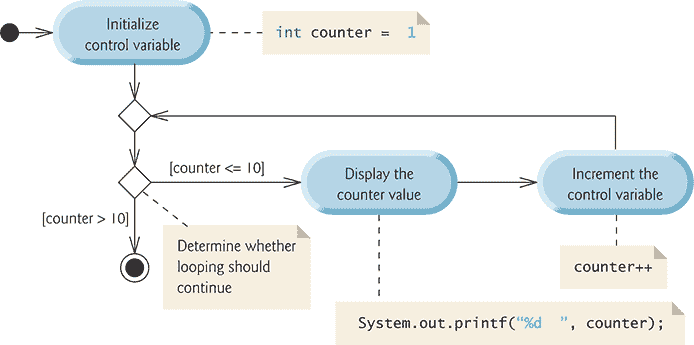

# 图 5.4

图 5.2 中 `for` 语句的 UML 活动图。

描述

## 5.4 使用 `for` 语句的示例

以下示例展示了在 `for` 语句中改变控制变量的技术。在每个情况下，我们只编写适当的 `for` 头部。注意递减控制变量的循环中关系运算符的改变。

1. 增量为 `1`，将控制变量从 `1` 变为 `100`。
```
for (int i = 1; i <= 100; i++)
```

2. 递减为 `1`，将控制变量从 `100` 变为 `1`。
```
for (int i = 100; i >= 1; i--)
```

3. 增量为 `7`，将控制变量从 `7` 变为 `77`。
```
for (int i = 7; i <= 77; i += 7)
```

4. 递减为 `2`，将控制变量从 `20` 变为 `2`。
```
for (int i = 20; i >= 2; i -= 2)
```

5. 控制变量在值 `2`, `5`, `8`, `11`, `14`, `17`, `20` 之间变化。
```
for (int i = 2; i <= 20; i += 3)
```

6. 控制变量在值 `99`, `88`, `77`, `66`, `55`, `44`, `33`, `22`, `11`, `0` 之间变化。
```
for (int i = 99; i >= 0; i -= 11)
```

# 5.4.1 应用：求加 2 到 20 的偶数

我们现在考虑两个演示了 `for` 简单用法的示例应用程序。图 5.5 中的应用程序使用 `for` 语句求加 2 到 20 的偶数，并将结果存储在 `int` 变量 `total` 中。

```java
// 图 5.5: Sum.java
// 使用 for 语句求加整数
public class Sum { 
     public static void main(String[] args) {
         int total = 0;
         // 2 到 20 的整数
         for (int number = 2; number <= 20; number += 2) {
           total += number;
        }
        System.out.printf("Sum is %d%n", total); 
     }
}
```

# 图 5.5

使用 for 语句求加整数。

初始化和递增表达式可以是逗号分隔的列表，允许你使用多个初始化表达式或多个递增表达式。例如，虽然这不被推荐，但你可以将图 5.5 中的 `for` 语句体合并到 `for` 部的递增部分，如下：

```
for (int number = 2; number <= 20; total += number, number += 2) {
    ; // 空语句
}
```

### 5.4.2 应用：复利计算

接下来使用 `for` 语句计算复利。考虑以下问题：
一个人在利率为 5% 的储蓄账户中投资了 $1000。假设所有利息留在账户中，计算并打印每年末的金额。使用以下公式：
`a = p * (1 + r)^n`
其中 `p` 是原始投资金额（即 `principal`），`r` 是年利率（例如，5% 使用 `0.05`），`n` 是年数，`a` 是第 n 年末的金额。

该问题的解决方案（图 5.6）包含一个循环，为资金留在账户的 10 年中的每年执行指定的计算。`main` 中的第 6、7 和 15 行声明了 `double` 变量 `principal`、`rate` 和 `amount`。第 6–7 行初始化 `principal` 为 `1000.0`，将 `rate` 为 `0.05`。Java 将浮点常量 `1000.0` 和 `0.05` 处理为 `double` 类型。同样，Java 将整数常量 `7` 和 `22` 处理为 `int` 类型。

```java
// 图 5.6: Interest.java 
// 使用 for 计算复利
public class Interest { 
     public static void main(String[] args) { 
         double principal = 1000.0; // 利息前的金额
         double rate = 0.05; // 利率 
         // 显示表头
        System.out.printf("%s%20s%n", "Year", "Amount on deposit"); 
      // 计算十年的每年的金额
      for (int year = 1; year <= 10; ++year) {
         // 计算指定年份的新金额
         double amount = principal * Math.pow(1.0 + rate, year);
         // 显示年份和金额
         System.out.printf("%4d%,20.2f%n", year, amount);
         }
      }
}
```

# 图 5.6

使用 for 计算复利。

# 使用字段宽度和对齐格式化字符串

第 10 行输出两列内容的表头。第一列显示年份，第二列显示该年底的存款金额。我们使用格式说明符 `%20s` 输出字符串 `"Amount on Deposit"`。`%` 和转换字符 `s` 之间的整数 `20` 表示该值应以 20 的字段宽度显示——即 `printf` 显示的值至少占据 20 个字符位置。如果要输出的值的宽度小于 20 个字符位置（在本例中为 17 个字符），则该值默认在字段中右对齐。如果输出的 `year` 值宽度超过四个字符位置，则字段宽度将向右扩展以容纳整个值——这会将 `amount` 字段向右推，破坏我们表格输出的整齐列。若要输出左对齐的值，只需在字段宽度前加一个负号（–）格式标志（例如，`%-20s`）。

# 使用 `Math` 类的静态（`static`）方法 `pow` 执行利息计算

`for` 语句（第 13–19 行）执行其循环体 10 次，控制变量 `year` 从 1 变到 10，每次递增 1。当 `year` 变为 11 时，循环终止。（变量 `year` 代表问题陈述中的 `n`。）

类提供了在对象上执行常见任务的方法。事实上，大多数方法必须在特定对象上调用。例如，为了在图 5.6 中输出文本，第 10 行在 `System.out` 对象上调用了 `printf` 方法。某些类还提供了执行常见任务且不需要你先创建这些类的对象的方法。这些方法被称为 `static`（静态）方法。例如，Java 不包含幂运算符，因此 Java 的 `Math` 类的设计者定义了静态方法 `pow` 来计算一个值的幂。你可以通过指定类名后跟一个点（`.`）和方法名来调用静态方法，如：

```
ClassName.methodName(arguments)
```

在第 6 章中，你将学习如何在自己的类中实现 `static` 方法。

我们使用 `Math` 类的静态方法 `pow` 在图 5.6 中进行复利计算。`Math.pow(x, y)` 计算 `x` 的 `y` 次幂值。该方法接收两个 `double` 参数并返回一个 `double` 值。第 15 行执行计算 `a = p * (1 + r)^n`，其中 `a` 是 `amount`（金额），`p` 是 `principal`（本金），`r` 是 `rate`（利率），`n` 是 `year`（年份）。`Math` 类定义在 `java.lang` 包中，因此使用时不需要导入 `Math` 类。

`for` 语句的体包含计算 `1.0 + rate`，它作为 `Math.pow` 方法的参数。事实上，这个计算在每次循环中都会产生相同的结果，因此在循环的每次迭代中重复它是浪费的。

## 格式化浮点数

在每次计算之后，第 18 行输出年份和该年底的存款金额。年份以四个字符的字段宽度输出（由 `%4d` 指定）。金额以浮点数格式输出，使用格式说明符 `%,20.2f`。

逗号（`,`）格式化标志表示浮点值应以带有分组分隔符进行输出。实际使用的分隔符取决于用户的语言区域（即国家）。例如，在美国，数字将使用逗号每隔三位分隔，并使用小数点分隔数字的小数部分，如 1,234.45。格式规范中的数字 `20` 表示该值应在宽度为 20 个字符的字段宽度内右对齐输出。`.2` 指定了格式化数字的精度——在这种情况下，该数字被四舍五入到最近的百分位，并在小数点后保留两位数字输出。

# 关于显示四舍五入值的警告

在例例中，我们将变量 `amount`、`principal` 和 `rate` 为 `double` 类型。我们处理的是美元的小数部分，因此需要一种允许值中包含小数点的类型。遗憾的是，浮点数可能会带来麻烦。以下是使用 `double`（或 `float`）表示美元金额时可能出现问题的简单解释（假设美元金额显示为小数点后两位数字）：机器中存储的两个 `double` 类型金额可能是 14.234（为了显示目的，通常会四舍五入为 14.23）和 18.673（为了显示目的，通常会四舍五入为 18.67）。当这些金额相加时，它们产生内部和 32.907，这在显示时通常会四舍五入为 32.91。因此，你的输出可能显示为

```
 14.23
+ 18.67
  32.91
```

但按显示的单个数字进行相加的人会预期和为 32.90。你已经收到警告了！

# 5.5 `do`…`while` 迭代语句

**`do`…`while` 迭代语句**类似于 `while` 语句。`while` 在循环的开始处测试循环继续；如果条件为 `false`，则循环体永远不会执行。`do`…`while` 在执行循环体之后测试循环继续；因此，循环体至少执行一次。当 `do`…`while` 语句终止时，继续执行后续语句。图 5.7 使用 `do`…`while` 输出数字。

```java
// 图 5.7 DoTest.java
public class DoTest {
   public static void main(String[] args) {
      int counter = 1;
      do {
         System.out.printf("%d ", counter);
         ++counter;
      } while (counter <= 10);
      System.out.println();
   }
}
```

# 图 5.7

do…while 语句。第 6 行声明并初始化变量 `counter`。进入 `do`…`while` 语句后，第 9 行输出 `counter`，第 10 行增加 `counter`。如果条件为 `true`，循环继续。如果条件为 `false`，循环终止，程序继续执行。

## `do`…`while` 迭代的 UML 活动图

图 5.8 包含了 `do`…`while` 语句的 UML 活动图。该图清楚地表明，在循环执行至少一次操作之前不会评估循环继续。将此活动图与 `while` 语句的活动图（图 4.6）进行比较。

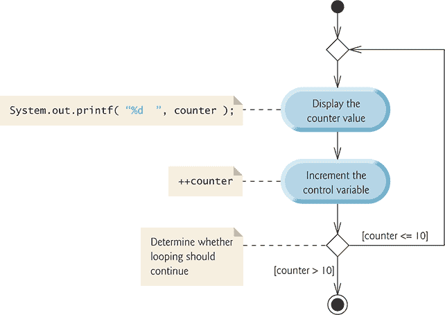

# 图 5.8

do…while 迭代 UML 活动图。

描述

## 5.6 `switch` 多选择语句

第 4 章讨论了 `if` 单选择语句和 `if`…`else` 双选择语句。**`switch` 多选择语句**根据类型为 `byte`、`short`、`int` 或 `char`（但不是 `long`）的常量表达式的值执行不同的操作。表达式也可以是 `String`，我们将在第 5.7 节中进行演示。

# 使用 `switch` 语句统计 A、B、C、D 和 F 成绩

图 5.9 计算一组用户输入的数字成绩的平均平均分。程序的 `switch` 语句确定每个成绩是否对应于 A、B、C、D 或 F，并增加相应的计数器。程序还会显示获得每个成绩的人数摘要。

```java
// 图 5.9: LetterGrades.java
// LetterGrades 类使用 switch 语句统计字母等级分数。
import java.util.Scanner;
public class LetterGrades {
  public static void main(String[] args) {
    int total = 0; // 分数总和
    int gradeCounter = 0; // 输入的分数个数
    int aCount = 0; // A 等级人数计数
    int bCount = 0; // B 等级人数计数
    int cCount = 0; // C 等级人数计数
```


```java
int dCount = 0; // D 等级人数计数

int fCount = 0; // F 等级人数计数

Scanner input = new Scanner(System.in);

System.out.printf("%s%n%s%n %s%n %s%n",
    "输入 0-100 范围内的整数成绩：",
    "输入文件结束符以终止输入：",
    "在 UNIX/Linux/macOS 上输入 <Ctrl> d 然后按回车",
    "在 Windows 上输入 <Ctrl> z 然后按回车");

// 循环直到用户输入文件结束符
while (input.hasNext()) {
    int grade = input.nextInt(); // 读取分数
    total += grade; // 将分数加到总和
    ++gradeCounter; // 增加分数计数

    // 增加相应的字母等级计数器
    switch (grade / 10) {
        case 9: // 分数在
        case 10: // 100 之间，包含边界
            ++aCount;
            break; // 退出 switch
        case 8: // 分数在 80 到 89 之间
            ++bCount;
            break; // 退出 switch
        case 7: // 分数在 70 到 79 之间
            ++cCount;
            break; // 退出 switch
        case 6: // 分数在 60 到 69 之间
            ++dCount;
            break; // 退出 switch
        default: // 分数小于 60
            ++fCount;
            break; // 可选；同样退出 switch
    }
}

// 显示成绩报告
System.out.printf("%n 成绩报告:%n");

// 如果用户至少输入了一个分数……
if (gradeCounter != 0) {
    // 计算所有输入分数的平均值
    double average = (double) total / gradeCounter;

    // 输出结果摘要
    System.out.printf("输入的 %d 个分数总和为 %d%n", gradeCounter, total);
    System.out.printf("班级平均分为 %.2f%n", average);
    System.out.printf("%n%s%n%s%d%n%s%d%n%s%d%n%s%d%n%s%d%n",
        "获得每个字母等级的人数如下：",
        "A: ", aCount, // 显示 A 等级人数
        "B: ", bCount, // 显示 B 等级人数
        "C: ", cCount, // 显示 C 等级人数
        "D: ", dCount, // 显示 D 等级人数
        "F: ", fCount); // 显示 F 等级人数
} else { // 未输入任何分数，输出相应消息
    System.out.println("未输入任何分数");
}
```

# 图 5.9

`LetterGrades` 类使用 `switch` 语句来统计字母等级分数。

与之前的类平均分程序类似，`LetterGrades` 类的 `main` 方法声明了局部变量 `total`（第 7 行）和 `gradeCounter`（第 8 行），分别用于跟踪用户输入的分数总和和分数个数。第 9–13 行为每个等级类别声明了计数器变量。注意第 7–13 行中的变量被显式地初始化为 `0`。

`main` 方法有两个关键部分。第 24–48 行使用哨兵控制迭代（sentinel-controlled iteration）从用户处读取任意数量的整数分数，更新 `total` 和 `gradeCounter`，并为每个输入的分数增加相应的字母等级计数。第 51–72 行输出一份报告，包含所有输入分数的总和、平均分以及获得每个字母等级的人数。让我们详细检查这些部分。

## 从用户处读取分数

第 17–21 行提示用户输入分数并指定文件结束符。在 UNIX/Linux/macOS 上，用户输入 `<Ctrl> d` 然后按回车；在 Windows 上，他们输入 `<Ctrl> z` 然后按回车。

`while` 循环（第 24–48 行）使用 `hasNext()` 方法判断是否有更多数据。如果 `hasNext()` 返回 `true`，则执行循环：第 25 行使用 `nextInt()` 读取分数，第 26 行将 `grade` 加到 `total`，第 27 行增加 `gradeCounter`。

`switch` 语句（第 30–47 行）决定增加哪个字母等级计数。控制表达式 `grade / 10` 执行整数除法，会截断结果的小数部分。程序将此值与每个 `case` 标签比较。例如，如果分数在 90 到 100 之间，结果为 9 或 10，`aCount` 增。如果分数在 80 到 89 之间，结果为 8，`bCount` 增。此逻辑适用于 C（70–79）、D（60–69）和 F（小于 60，通过 `default` 分支）。每个 `case` 块都以 `break` 结束以退出 `switch` 语句。

循环结束后，程序显示成绩报告。如果 `gradeCounter` 不为 0，通过 `(double) total / gradeCounter` 计算 `average`，并打印总数、平均分以及每个等级的人数。如果没有输入任何分数，则打印“未输入任何分数”。

`case` 显式地测试值 `10`、`9`、`8`、`7` 和 `6`。注意第 31–32 行中测试值 `9` 和 `10` 的 case（两者都代表 A 等成绩）。以这种方式连续列出 case 且之间没有语句，可以使这些 case 执行相同的语句 set——当控制表达式求值结果为 `9` 或 `10` 时，第 33–34 行的语句将执行。`switch` 语句*没有*提供测试值*范围*的机制，因此你需要测试的*每一个*值都必须列在单独 `case` 标签中。每个 `case` 可以有多条语句。`switch` 语句与其他控制语句的区别在于，它*不需要*为 `case` 中的多个语句加大括号。

## 没有 `break` 语句的 `case`

在没有 `break` 语句的情况下，每当 `switch` 匹配时，该 case 以及后续 case 的语句都会执行，直到遇到 `break` 语句或 `switch` 结束。这通常被称为“贯穿”（falling through）到后续 `case` 的语句。（这一特性非常适合编写一个简洁的程序来显示练习 5.29 中的循环迭代歌曲“圣诞节的十二天”）。

## `default` Case

如果控制表达式的值与任何 `case` 标签之间没有发生匹配，则执行 `default` case（第 44–46 行）。我们在本示例中使用 `default` case 来处理所有小于 `6` 的控制表达式值——即所有不及格的分数。如果没有发生匹配且 `switch` 不包含 `default` case，程序控制流将直接继续执行 `switch` 之后的第一条语句。

## 显示成绩单

第 51–72 行根据输入的成绩输出一份报告（如图 5.9 中的输入/输出窗口所示）。第 54 行确定用户是否至少输入了一个成绩——这有助于我们避免除以零。如果是，第 56 行计算成绩的平均值。然后第 59–68 行输出所有成绩的总和、班平均分以及获得每个字母等级的人数。如果没有输入任何成绩，第 71 行将输出适当的消息。图 5.9 中的输出显示了一份基于 10 个成绩的示例成绩单。

## `switch` 语句 UML 活动图

图 5.10 显示了通用 `switch` 语句的 UML 活动图。大多数 `switch` 语句在每个 `case` 中使用 `break` 来在处理完 `case` 后终止 `switch` 语句。图 5.10 通过在活动图中包含 `break` 语句来强调了这一点。该图清楚地表明，`case` 末尾的 `break` 语句会导致控制立即退出 `switch` 语句。

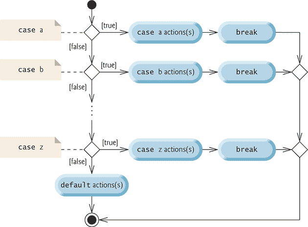

# 图 5.10

带有 `break` 语句的 `switch` 多路选择语句 UML 活动图。

## 描述

`switch` 的最后一个 `case`（或最后出现的可选 `default` case）*不需要* `break` 语句，因为执行会继续进行 `switch` 之后的下一条语句。

## 关于 `switch` 中每个 `case` 表达式的说明

使用 `switch` 时，记住每个 `case` 必须包含一个 `String` 或常量整数表达式——即任何求值结果为常量整数值的整数常数组合（例如：–7、0 或 221）。整数常量仅仅是一个整数值。此外，你还可以使用**字符常量**——单引号中的特定字符，如 `'A'`、`'7'` 或 `'$'`——它们代表字符的整数值。（附录 B）`switch` 中每个 `case` 的表达式也可以是 **final** 的——一个不会改变的变量（附录 B）。Java 有 `enum` 类型可以在 `case` 标签中使用（附录 B）。`String` 常量可以在 `case` 中使用（第 6 章）。字符常量也可以在 `case` 中使用（第 6 章）。整数常量也可以在 `case` 中使用（第 6 章）。

## 5.7 类 `AutoPolicy`：`switch` 语句中的 `String`

你被一家服务于以下地区的保险公司聘用：康涅狄格州、缅因州、纽约州、宾夕法尼亚州、罗德岛和佛蒙特州。该公司希望你创建一个程序，为他们的每份汽车保单生成一份是否处于“无过错”州的报告——`String` 可以作为控制表达式使用（第 6 章）。满足这些要求的 Java 程序——`AutoPolicy`（图 5.11）和 `AutoTest`（图 5.12）包含两个类：

### 类 `AutoPolicy`

`AutoPolicy`（图 5.11）代表一份汽车保险保单。该类包含：

*   `int` 实例变量 `accountNumber`（第 4 行），存储保单号
*   `String` 实例变量 `makeAndModel`（第 5 行），存储汽车品牌和型号（例如 `"Toyota Camry"`）
*   `String` 实例变量 `state`（第 6 行），存储代表保单所在州的双字母缩写（例如代表马萨诸塞州的 `"MA"`）
*   一个构造函数（第 9–14 行），初始化类的实例变量
*   `setAccountNumber` 和 `getAccountNumber` 方法（第 17–24 行），用于 *set* 和 *get* `AutoPolicy` 的 `accountNumber` 实例变量
*   `setMakeAndModel` 和 `getMakeAndModel` 方法（第 27–34 行），用于 *set* 和 *get* `AutoPolicy` 的 `makeAndModel` 实例变量
*   `setState` 和 `getState` 方法（第 37–44 行），用于 *set* 和 *get* `AutoPolicy` 的 `state` 实例变量
*   `isNoFaultState` 方法（第 47–61 行），返回一个 `boolean` 值，表示保单是否位于无过错汽车保险州；注意方法名——返回 `boolean` 值的 *get* 方法的命名惯例是用 `"is"` 开头而不是 `"get"`（这种方法通常称为*谓词方法*）。

```java
// 图 5.11: AutoPolicy.java
// 表示汽车保险保单的类。
public class AutoPolicy {
    private int accountNumber; // 保单账号
    private String makeAndModel; // 保单所适的车辆型号
    private String state; // 两个字母州缩写

    // 构造函数
    public AutoPolicy(int accountNumber, String makeAndModel,
        String state) {
        this.accountNumber = accountNumber;
        this.makeAndModel = makeAndModel;
        this.state = state;
    }

    // 设置 accountNumber
    public void setAccountNumber(int accountNumber) {
        this.accountNumber = accountNumber;
    }

    // 返回 accountNumber
    public int getAccountNumber() {
        return accountNumber;
    }

    // 设置 makeAndModel
    public void setMakeAndModel(String makeAndModel) {
        this.makeAndModel = makeAndModel;
    }

    // 返回 makeAndModel
    public String getMakeAndModel() {
        return makeAndModel;
    }

    // 设置 state
    public void setState(String state) {
        this.state = state;
    }

    // 返回 state
    public String getState() {
        return state;
    }

    // 谓词方法（返回布尔值的方法），返回该州是否为无责保险
    public boolean isNoFaultState() {
        boolean noFaultState;

        // 判断该州是否有无责汽车保险
        switch (getState()) { // 获取 AutoPolicy 对象的州缩写
            case "MA": case "NJ": case "NY": case "PA":
                noFaultState = true;
                break;
            default:
                noFaultState = false;
                break;
        }

        return noFaultState;
    }
}
```

# 图 5.11

表示汽车保险保单的类。

在方法 `isNoFaultState()` 中，`switch` 语句的控制表达式（第 51 行）是由 `AutoPolicy` 方法 `getState` 返回的 `String`。`switch` 语句将控制表达式的值与 `case` 标签（第 52 行）进行比较，以确定该保单是否是在马萨诸塞州、新泽西州、纽约州或宾夕法尼亚州（这些是无责保险州）。如果匹配，则第 53 行将局部变量 `noFaultState` 设置为 `true` 并终止 `switch` 语句；否则，`default` 分支将 `noFaultState` 设置为 `false`（第 56 行）。然后方法 `isNoFaultState()` 返回局部变量 `noFaultState` 的值。

为了简单起见，我们没有在构造函数或 `set` 方法中验证 `AutoPolicy` 的数据，并假设州缩写始终是两个大写字母。此外，一个真实的 `AutoPolicy` 类可能会包含许多其他实例变量和方法，用于如持持人姓名、地址等数据。在练习 5.30 中，你将被要求使用你在第 5.9 节 中学的技巧，通过验证其州缩写来增强 `AutoPolicy` 类。

### 类 `AutoPolicyTest`

`AutoPolicyTest` 类（图 5.12）创建了两个 `AutoPolicy` 对象（`main()` 中的第 6–9 行）。第 12–13 行将每个对象传递给 `static` 方法 `policyInNoFaultState`（第 18–25 行），该方法使用 `AutoPolicy` 方法来确定并显示接收的对象是否代表无责汽车保险州的保单。

```java
// 图 5.12: AutoPolicyTest.java
```


```java
 1  // Fig. 5.12: AutoPolicyTest.java
 2  // 演示 switch 中使用 String。
 3  public class AutoPolicyTest {
 4     public static void main(String[] args) {
 5        // 创建两个 AutoPolicy 对象
 6        AutoPolicy policy1 =
 7           new AutoPolicy(11111111, "Toyota Camry", "NJ");
 8        AutoPolicy policy2 =
 9           new AutoPolicy(22222222, "Ford Fusion", "ME");
10
11        // 显示每个保单是否在无责州
12        policyInNoFaultState(policy1);
13        policyInNoFaultState(policy2);
14     }
15
16     // 显示 AutoPolicy 是否在
17     // 无责保险州
18     public static void policyInNoFaultState(AutoPolicy policy) {
19        System.out.println("保单信息:");
20        System.out.printf(
21           "账号: %d; 型号: %s; 州 %s 无责州%n",
22           policy.getAccountNumber(), policy.getMakeAndModel(),
23           policy.getState(),
24           (policy.isNoFaultState() ? "is": "is not"));
25     }
26  }
```

# 图 5.12

在 `switch` 中使用 `String`。

## 5.8 `break` 和 `continue` 语句

除了选择语句和循环语句外，Java 还提供了 `break`（我们在 `switch` 上文中讨论过）和 `continue`（在本节中介绍）来改变控制流。

## 5.8.1 `break` 语句

`break` 语句在 `while`、`for`、`do...while` 或 `switch` 中执行时会立即退出该语句。`break` 的常见用法是提前退出循环或跳过 `switch` 的剩余部分（如图 5.9 展示了 `break` 退出 `for` 循环。当 `for` 语句第 8–10 行的 `if` 语句检测到 `count` 为 5 时，第 9 行的 `break` 语句执行。这终止了 `for` 语句，程序跳转到第 15 行（`for` 语句之后），显示循环终止时控制变量的值。循环体完整执行了四次而不是十次。

```java
 1  // 图 5.13: BreakTest.java
 2  // break 语句退出 for 语句。
 3  public class BreakTest {
 4     public static void main(String[] args) {
 5        int count; // 循环后使用的控制变量
 6
 7        for (count = 1; count <= 10; count++) { //  10 次
 8           if (count == 5) {
 9              break; // count 等于 5 时终止循环
10           }
11
12           System.out.printf("%d ", count);
13        }
14
15        System.out.printf("%n 在 count = %d 时退出循环%n", count);
16     }
17  }
```

## 5.8.2 `continue` 语句

`continue` 语句在 `while`、`for` 或 `do...while` 中执行时跳过循环体的剩余语句并继续循环的下次迭代。在 `while` 和 `do...while` 语句中，程序在 `continue` 语句执行后立即评估循环继续条件。在 `for` 语句中，先执行更新表达式，然后程序评估循环继续条件。

图 5.14 使用 `continue`（第 7 行）在嵌套的 `if` 确定 `count` 值为 5 时跳过第 10 行的语句。当 `continue` 语句执行时，程序继续执行 `for` 语句中控制变量的增量（第 5 行）。

```java
 1  // Fig. 5.14: ContinueTest.java
 2  // continue statement terminating an iteration of a for statement.
 3  public class ContinueTest {
 4     public static void main(String[] args) {
 5        for (int count = 1; count <= 10; count++) { // loop 10 times
 6           if (count == 5) {
 7              continue; // skip remaining code in loop body if count is 5
 8           } 
 9
10           System.out.printf("%d ", count);
11        }
12
13        System.out.printf("%nUsed continue to skip printing 5%n");
14     }
15  }
```

# 图 5.14

`continue` 语句终止 `for` 语句的迭代。

在第 5.3 节中，我们提到在大多数情况下 `while` 可以替代 `for`。但当 `while` 中的增量表达式位于 `continue` 语句之后时，这**不是**的。在这种情况下，在程序评估迭代继续条件之前，增量**不会**执行，因此 `while` 的执行方式与 `for` 不相同。

## 5.9 逻辑运算符

`if`、`if…else`、`while`、`do`…`while` 和 `for` 语句都需要一个`condition`来决定程序控制流的继续。到目前为止，我们只学习了简单条件，例如 `count <= 10`、`number != sentinelValue` 和 `total > 1000`。简单条件用关系运算符 `>`、`<`、 `>=` 和 `<=` 以及相等运算符 `==` 和 `!=` 表示，每个表达式只测试一个条件。为了在决策过程中测试*多个*条件，我们在单独的语句或嵌套的 `if` 或 `if`…`else` 语句中执行这些测试。有时，控制语句需要更复杂的条件来确定程序的控制流。

Java 的**逻辑运算符**允许你将简单条件*组合*成更复杂的条件。逻辑运算符有 `&&`（条件与）、`||`（条件或）、`&`（布尔逻辑与）、`|`（布尔逻辑包含或）、`^`（布尔逻辑异或）和 `!`（逻辑非）。[*注意：*当 `&`、`|` 和 `^` 运算符应用于整型操作数时，它们也是位运算符。我们将在在线附录 K 中讨论位运算符。*]

## 5.9.1 条件与 (`&&`) 运算符

假设我们希望在程序的某个点上，在选择特定的执行路径之前，确保两个条件*都*为 `true`（真）。在这种情况下，我们可以使用 `&&`（**条件与**）运算符，如下：

```java
if (gender == FEMALE && age >= 65) {
   ++seniorFemales;
}
```

此 `if` 语句包含两个简单条件。条件 `gender == FEMALE` 将 `gender` 与常量 `FEMALE` 比较，以确定人是否为女性。条件 `age >= 65` 可能被评估以确定人是否为老年人。`if` 语句考虑组合条件：

```
gender == FEMALE && age >= 65
```

当且仅当*两个*简单条件都为 `true` 时，该条件为 `true`。在这种情况下，`if` 语句体将 `seniorFemales` 增加 `1`。如果其中一个或两个简单条件为 `false`（假），程序将跳过增加。同样，以下条件确保了 `grade` 在 1–100 范围内：

```java
grade >= 1 && grade <= 100
```

当且仅当 `grade` 大于等于 `1` 且 `grade` 小于等于 `100` 时，该条件为 `true`。一些程序员发现，当加上括号时，前面的条件更具可读性，例如：

```java
(grade >= 1) && (grade <= 100)
```

图 5.15 中的表格总结了 `&&` 运算符，显示了 `expression1` 和 `expression2` 的 `false` 和 `true` 的所有可能组合。此类表格被称为**真值表**。Java 将包含关系运算符、相等运算符或逻辑运算符的所有表达式都评估为 `false` 或 `true`。

| expression1 | expression2 | expression1 `&&` expression2 |
| --- | --- | --- |
| `false` | `false` | `false` |
| `false` | `true` | `false` |
| `true` | `false` | `false` |
| `true` | `true` | `true` |

# 图 5.15

`&&`（条件与）运算符真值表。

## 5.9.2 条件或 (`||`) 运算符

现在假设我们希望在选择特定的执行路径之前，确保两个条件中*至少一个*为 `true`（真）。在这种情况下，我们使用 `||`（**条件或**）运算符，如下：

```java
if (gender == FEMALE || age >= 65) {
   ++seniorFemales;
}
```

此 `if` 语句包含两个简单条件。`gender == FEMALE` 将 `gender` 与常量 `FEMALE` 比较以确定人是否为女性。`age >= 65` 可能被评估以确定人是否为老年人。`if` 语句考虑组合条件：

```
gender == FEMALE || age >= 65
```

当且仅当*两个*简单条件都为 `true` 时，该条件为 `true`。在这种情况下，`if` 语句体将 `seniorFemales` 增加 `1`。如果其中一个或两个简单条件为 `false`，程序将跳过增加。同样，以下条件确保了 `grade` 在 1–100 范围内：

```java
grade >= 1 || grade <= 100
```

当且仅当 `grade` 大于等于 `1` 且 `grade` 小于等于 `100` 时，该条件为 `true`。一些程序员发现，当加上括号时，前面的条件更具可读性，例如：

```java
(grade >= 1) || (grade <= 100)
```

图 5.15 中的表格总结了 `&&` 运算符，显示了 `expression1` 和 `expression2` 的 `false` 和 `true` 的所有可能组合。此类表格被称为**真值表**。Java 将包含关系运算符、相等运算符或逻辑运算符的所有表达式都评估为 `false` 或 `true`。

| expression1 | expression2 | expression1 `||` expression2 |
| --- | --- | --- |
| `false` | `false` | `false` |
| `false` | `true` | `true` |
| `true` | `false` | `true` |
| `true` | `true` | `true` |

# 图 5.16

`||`（条件或）运算符真值表。

## 5.9.3 复杂条件的短路求值

包含 `&&` 或 `||` 运算符的表达式部分只会评估，直到确定条件是 `true` 还是 `false`。因此，表达式

```java
(gender == FEMALE) && (age >= 65)
```

如果 `gender` *不*等于 `FEMALE`，则立即停止（即整个表达式为 `false`）；如果 `gender` *是*等于 `FEMALE`，则继续评估（当 `age >= 65` 为 `true` 时，整个表达式为 `true`）。这种条件表达式的特性被称为**短路求值**。

## 5.9.4 布尔逻辑与 (`&`) 和 布尔包含或 (`|`) 运算符

**布尔逻辑与** (`&`) 和**布尔包含或** (`|`) 运算符与 `&&` 和 `||` 相同，区别在于 `&` 和 `|` 运算符*总是*评估*所有*操作数（即它们*不*执行短路求值）。因此，表达式

```java
(gender == 1) & (age >= 65)
```

无论 `gender` 是否等于 `1`，都会评估 `age >= 65`。如果右侧操作数具有必要的**副作用**——修改变量的值，这就会很有用。例如：

```java
(birthday == true) | (++age >= 65)
```

保证了条件 `++age >= 65` 被评估。因此，无论整个表达式是 `true` 还是 `false`，变量 `age` 都会增加。

## 5.9.5 布尔逻辑异或 (`^`)

包含**布尔逻辑异或** (`^`) 运算符的简单条件在当操作数之一为 `true` 且另一个为 `false` 时为 `true`。如果两个都为 `true` 或都为 `false`，则整个条件为 `false`。图 5.17 是布尔逻辑异或运算符 (`^`) 的真值表。该运算符保证评估*所有*两个操作数。

| expression1 | expression2 | expression1 `^` expression2 |
| --- | --- | --- |
| `false` | `false` | `false` |
| `false` | `true` | `true` |
| `true` | `false` | `true` |
| `true` | `true` | `false` |

# 图 5.17

`^`（布尔逻辑异或）运算符真值表。


# 图 5.14

`continue` 语句终止 `for` 语句的迭代。

在第 5.3 节中，我们提到在大多数情况下 `while` 可以替代 `for`。但当 `while` 中的增量表达式位于 `continue` 语句之后时，这**不是**的。在这种情况下，在程序评估迭代继续条件之前，增量**不会**执行，因此 `while` 的执行方式与 `for` 不相同。

## 5.9 逻辑运算符

`if`、`if…else`、`while`、`do`…`while` 和 `for` 语句都需要一个 `condition` 来决定程序控制流的继续。到目前为止，我们只学习了简单条件，例如 `count <= 10`、`number != sentinelValue` 和 `total > 1000`。简单条件用关系运算符 `>`、`<`、`>=` 和 `<=` 以及相等运算符 `==` 和 `!=` 表示，每个表达式只测试一个条件。为了在决策过程中测试*多个*条件，我们在单独的语句或嵌套的 `if` 或 `if`…`else` 语句中执行这些测试。有时，控制语句需要更复杂的条件来确定程序的控制流。

Java 的**逻辑运算符**允许你将简单条件*组合*成更复杂的条件。逻辑运算符有 `&&`（条件与）、`||`（条件或）、`&`（布尔逻辑与）、`|`（布尔逻辑包含或）、`^`（布尔逻辑异或）和 `!`（逻辑非）。[*注意：* `&`、`|` 和 `^` 运算符应用于整型操作数时，它们也是位运算符。我们将在在线附录 K 中讨论位运算符。*]

## 5.9.1 条件与 (`&&`) 运算符

假设我们希望在程序的某个点上，在选择特定的执行路径之前，确保两个条件*都*为 `true`（真）。在这种情况下，我们可以使用 `&&`（**条件与**）运算符，如下：

```java
if (gender == FEMALE && age >= 65) {
   ++seniorFemales;
}
```

此 `if` 语句包含两个简单条件。条件 `gender == FEMALE` 将 `gender` 与常量 `FEMALE` 比较，以确定人是否为女性。条件 `age >= 65` 可能被评估以确定人是否为老年人。`if` 语句考虑组合条件：

`gender == FEMALE && age >= 65`

当且仅当*两个*简单条件都为 `true` 时，该条件为 `true`。在这种情况下，`if` 语句体将 `seniorFemales` 增加 `1`。如果其中一个或两个简单条件为 `false`（假），程序将跳过增加。同样，以下条件确保了 `grade` 在 1–100 范围内：

`grade >= 1 && grade <= 100`

当且仅当 `grade` 大于等于 `1` 且 `grade` 小于等于 `100` 时，该条件为 `true`。一些程序员发现，当加上括号时，前面的条件更具可读性，例如：

`(grade >= 1) && (grade <= 100)`

图 5.15 中的表格总结了 `&&` 运算符，显示了 `expression1` 和 `expression2` 的 `false` 和 `true` 的所有可能组合。此类表格被称为**真值表**。Java 将包含关系运算符、相等运算符或逻辑运算符的所有表达式都评估为 `false` 或 `true`。

| expression1 | expression2 | expression1 `&&` expression2 |
| --- | --- | --- |
| `false` | `false` | `false` |
| `false` | `true` | `false` |
| `true` | `false` | `false` |
| `true` | `true` | `true` |

# 图 5.15

`&&`（条件与）运算符真值表。

## 5.9.2 条件或 (`||`) 运算符

现在假设我们希望在选择特定的执行路径之前，确保两个条件中*至少一个*为 `true`（真）。在这种情况下，我们使用 `||`（**条件或**）运算符，如下：

```java
if (gender == FEMALE || age >= 65) {
   ++seniorFemales;
}
```

此 `if` 语句包含两个简单条件。`gender == FEMALE` 将 `gender` 与常量 `FEMALE` 比较以确定人是否为女性。`age >= 65` 可能被评估以确定人是否为老年人。`if` 语句考虑组合条件：

`gender == FEMALE || age >= 65`

当且仅当*至少一个*简单条件为 `true` 时，该条件为 `true`。在这种情况下，`if` 语句体将 `seniorFemales` 增加 `1`。如果两个简单条件均为 `false`，程序将跳过增加。

图 5.16 中的表格总结了 `||` 运算符。

| expression1 | expression2 | expression1 `||` expression2 |
| --- | --- | --- |
| `false` | `false` | `false` |
| `false` | `true` | `true` |
| `true` | `false` | `true` |
| `true` | `true` | `true` |

# 图 5.16

`||`（条件或）运算符真值表。

## 5.9.3 布尔逻辑与 (`&`) 运算符

`&`（**布尔逻辑与**）运算符的工作方式与 `&&` 类似，但有一个关键区别：`&` 总是会评估其两个操作数，而 `&&` 具有短路特性（如果第一个操作数为 `false`，则不评估第二个操作数）。

```java
if (gender == FEMALE & age >= 65) {
   ++seniorFemales;
}
```

图 5.17 中的表格总结了 `&` 运算符。

| expression1 | expression2 | expression1 `&` expression2 |
| --- | --- | --- |
| `false` | `false` | `false` |
| `false` | `true` | `false` |
| `true` | `false` | `false` |
| `true` | `true` | `true` |

# 图 5.17

`&`（布尔逻辑与）运算符真值表。

## 5.9.4 布尔逻辑包含或 (`|`) 运算符

`|`（**布尔逻辑包含或**）运算符的工作方式与 `||` 类似，但 `|` 总是会评估其两个操作数，而 `||` 具有短路特性（如果第一个操作数为 `true`，则不评估第二个操作数）。

```java
if (gender == FEMALE | age >= 65) {
   ++seniorFemales;
}
```

图 5.18 中的表格总结了 `|` 运算符。

| expression1 | expression2 | expression1 `|` expression2 |
| --- | --- | --- |
| `false` | `false` | `false` |
| `false` | `true` | `true` |
| `true` | `false` | `true` |
| `true` | `true` | `true` |

# 图 5.18

`|`（布尔逻辑包含或）运算符真值表。

## 5.9.5 布尔逻辑异或 (`^`) 运算符

`^`（**布尔逻辑异或**）运算符在其两个操作数*一个*为 `true` 且*另一个*为 `false` 时返回 `true`。如果两个操作数相同（均为 `true` 或均为 `false`），则返回 `false`。

```java
if (gender == FEMALE ^ age >= 65) {
   ++seniorFemales;
}
```

图 5.19 中的表格总结了 `^` 运算符。

| expression1 | expression2 | expression1 `^` expression2 |
| --- | --- | --- |
| `false` | `false` | `false` |
| `false` | `true` | `true` |
| `true` | `false` | `true` |
| `true` | `true` | `false` |

# 图 5.19

`^`（布尔逻辑异或）运算符的真值表。

## 5.9.6 逻辑取反 (`!`) 运算符

`!`（**逻辑非**，也称为**逻辑取反**或**逻辑补码**）运算符“反转”了条件的含义。与逻辑运算符 `&&`、`||`、`&`、`|` 和 `^`（这些是结合两个条件的*二元*运算符）不同，逻辑取反运算符是一个*一元*运算符，它只有一个条件作为操作数。该运算符置于条件*之前*，以便在原始条件（不包含逻辑取反运算符）为 `false` 时选择一条执行路径，如程序代码段所示：

```java
if (!(grade == sentinelValue)) {
   System.out.printf("The next grade is %d%n", grade);
}
```

只有当 `grade` *不*等于 `sentinelValue` 时，才会执行 `printf` 调用。条件 `grade == sentinelValue` 外围的括号是必要的，因为逻辑取反运算符的优先级*高于*相等运算符。

在大多数情况下，你可以通过适当的关系运算符或相等运算符以不同的方式表达条件来避免使用逻辑取反。例如，上述语句也可以写成：

```java
if (grade != sentinelValue) {
   System.out.printf("The next grade is %d%n", grade);
}
```

这种灵活性可以帮助你以更方便的方式表达条件。图 5.20 是逻辑取反运算符的真值表。

| 表达式 | `!`expression |
| --- | --- |
| `false` | `true` |
| `true` | `false` |

# 图 5.20

`!`（逻辑非）运算符的真值表。

## 5.9.7 逻辑运算符示例

图 5.21 使用逻辑运算符来产生本节讨论的真值表。输出显示了被求值的 `boolean` 表达式及其结果。我们使用 `%b` **格式说明符**，根据 `boolean` 表达式的值来显示单词“true”或“false”。第 7–11 行产生 `&&` 的真值表。第 14–18 行产生 `||` 的真值表。第 21–25 行产生 `&` 的真值表。第 28–32 行产生 `|` 的真值表。第 35–40 行产生 `^` 的真值表。第 43–44 行产生 `!` 的真值表。

```java
// Fig 5.21: LogicalOperators.java
// Logical operators.

public class LogicalOperators {
   public static void main(String[] args) {
      // 为 &&（条件逻辑与）运算符创建真值表
      System.out.printf("%s%n%s: %b%n%s: %b%n%s: %b%n%s: %b%n%n",
         "Conditional AND (&&)", "false && false", (false && false),
         "false && true", (false && true),
         "true && false", (true && false),
         "true && true", (true && true));

      // 为 ||（条件逻辑或）运算符创建真值表
      System.out.printf("%s%n%s: %b%n%s: %b%n%s: %b%n%s: %b%n%n",
         "Conditional OR (||)", "false || false", (false || false),
         "false || true", (false || true),
         "true || false", (true || false),
         "true || true", (true || true));

      // 为 &（布尔逻辑与）运算符创建真值表
      System.out.printf("%s%n%s: %b%n%s: %b%n%s: %b%n%s: %b%n%n",
         "Boolean logical AND (&)", "false & false", (false & false),
         "false & true", (false & true),
         "true & false", (true & false),
         "true & true", (true & true));

      // 为 |（布尔逻辑包含或）运算符创建真值表
      System.out.printf("%s%n%s: %b%n%s: %b%n%s: %b%n%s: %b%n%n",
         "Boolean logical inclusive OR (|)",
         "false | false", (false | false),
         "false | true", (false | true),
         "true | false", (true | false),
         "true | true", (true | true));

      // 为 ^（布尔逻辑异或）运算符创建真值表
      System.out.printf("%s%n%s: %b%n%s: %b%n%s: %b%n%s: %b%n%n",
         "Boolean exclusive OR (^)",
         "false ^ false", (false ^ false),
         "false ^ true", (false ^ true),
         "true ^ false", (true ^ false),
         "true ^ true", (true ^ true));

      // 为 !（逻辑取反）运算符创建真值表
      System.out.printf("%s%n%s: %b%n%s: %b%n", "Logical NOT",
         "!false", (!false),
         "!true", (!true));
   }
}
```


# 图 5.19

逻辑运算符。

# 运算符的优先级和结合性

图 5.20 显示了运算符的优先级和结合性。运算符按优先级从高到低排列。

| 运算符 | 结合性 | 类型 |
| --- | --- | --- |
| `++ --` | 右到左 | 一元后置 |
| `++ --` | 右到左 | 一元前置 |
| `* / %` | 左到右 | 乘法 |
| `+ -` | 左到右 | 加法 |
| `< <= >=` | 左到右 | 关系 |
| `== !=` | 左到右 | 等等 |
| `&` | 左到右 | 布尔逻辑与 |
| `^` | 左到右 | 布尔逻辑异或 |
| `|` | 左到右 | 布尔逻辑包含或 |
| `&&` | 左到右 | 条件逻辑与 |
| `||` | 左到右 | 条件逻辑或 |
| `?:` | 右到左 | 条件 |
| `= += /= %=` | 右到左 | 赋值 |

# 图 5.20

已讨论的运算符。

# 5.10 结构化编程总结

正如建筑师利用其行业的集体智慧设计建筑一样，程序员也应该这样做。我们的领域比建筑年轻得多，集体智慧也更稀缺。我们已经了解到，结构化程序比非结构化程序更容易理解、测试、调试、修改，甚至在数学意义上证明正确。

# Java 控制语句是单入口出口

图 5.21 使用 UML 活动图总结了 Java 控制语句。初始状态和结束状态表示每个控制语句的**单一入口点**和**单一出口点**。任意连接活动图中的符号会导致非结构化程序。因此，编程行业选择了一组有限的控制语句，可以通过两种简单的方式组合来构建结构化程序。按顺序连接控制语句形成结构化程序是简单的。一个控制语句的结束状态连接到下一个的初始状态——即控制语句在程序中一个接一个放置。我们称之为**控制语句堆叠**。形成结构化程序的规则允许控制语句进行**嵌套**。

# 图 5.21

Java 的单入口出口顺序、选择和迭代语句。

# 图 5.22

形成结构化程序的规则。

| 形成结构化程序的规则 |
| --- |
| 1. | 从最简单的活动图开始（图 5.23）。 |
| 2. | 任何动作状态都可以被替换为两个连续的动作状态。 |
| 3. | 任何动作状态都可以被替换为任何控制语句（`if`、`if`…`else`、`switch`、`while`、`do`…`while` 或 `for`）。 |
| 4. | 规则 2 和 3 可以根据需要以任何顺序反复应用。 |

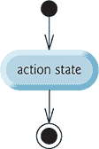

# 图 5.23

最简单的活动图。

在图 5.22 中应用这些规则始终会得到一个结构良好的活动图，具有整洁的积木式外观。例如，对最简单的活动图反复应用规则 2，会得到一个包含许多连续动作状态的活动图（图 5.24）。规则 2 生成了一组控制语句栈（`stack`），因此我们将规则 2 称为**堆叠规则**。在图 5.24 中的垂直虚线并不是 UML 的部分——我们用它们来分离展示图 5.22 中规则 2 应用的四个活动图。

规则 3 被称为**嵌套规则**。对最简单的活动图反复应用规则 3，会得到一个具有整齐嵌套控制语句的图。例如，在图 5.25 中，最简单的活动图中的动作状态被替换为双重选择（`if`…`else`）语句。然后对双重选择语句中的动作状态再次应用规则 3，将每个替换为双重选择语句。每个双重选择语句周围的虚线动作状态符号表示被替换的动作状态。注：[图 5.25 中显示的虚线和虚线动作状态符号不是 UML 的部分。它们在这里用于说明任何动作状态都可以被替换为控制语句。]

规则 4 生成更大、更复杂且嵌套更深的语句。通过应用图 5.22 中的规则产生的图构成了所有可能的活动图集合，即所有结构化程序的集合。结构化方法的魅力在于我们只使用七种单一入口/单一出口控制语句，并仅以两种方式进行组装。


# 图 5.24

对最简单的活动图反复应用图 5.22 中的规则 2。


# 图 5.25

对最简单的活动图反复应用图 5.22 中的规则 3。

如果遵循图 5.22 中的规则，就无法创建“非结构化”的活动图（如图 5.26 所示）。如果你不确定某个图是否是结构化的，反向应用[图 5.22]中的规则将其还原为最简单的活动图。如果你可以还原，原始图就是结构化的；否则不是。


# 图 5.26

“非结构化”活动图。

# 三种控制形式

结构化编程促进简单性。实现算法只需要三种控制形式：

*   顺序
*   选择
*   循环

顺序结构是显而易见的。只需按照执行的顺序列出语句即可。选择通过三种方式之一实现：

*   `if`语句（单一选择）
*   `if`…`else`语句（双重选择）
*   `switch`语句（多重选择）

事实上，可以很容易证明简单的`if`语句足以提供任何形式的选择——使用`if`…`else`语句和`switch`语句可以完成的内容都可以通过组合`if`语句来实现（尽管可能没有那么清晰高效）。

循环通过三种方式之一实现：

*   `while`语句
*   `do…while`语句
*   `for`语句

*注：还有第四种循环语句——增强型`for`语句，我们在[第 7.7 节中讨论过。]很容易证明`while`语句足以提供任何形式的循环。使用`do`…`while`和`for`可以完成的内容都可以用`while`语句完成（尽管可能不方便）。

结合这些结果说明，Java 程序中需要的任何形式的控制都可以用：

*   顺序
*   `if`语句（选择）
*   `while`语句（循环）

且这些只能以两种方式组合——堆叠和嵌套。事实上，结构化编程是简单性的本质。

# 5.11（可选）GUI 和图形案例研究：绘制矩形和椭圆

在本节中，我们将讨论 `Draw Shapes` 应用，它演示了如何使用 `GraphicsContext` 方法 `strokeRect` 和 `strokeOval` 分绘制矩形和椭圆。

# 创建 Draw Shapes GUI

该程序的 GUI 在 `DrawShapes.fxml` 中定义，使用了你在第 3.6 节和第 4.15 节中学习过的技术，并且与图 4.17 中的 GUI 几乎相同。为了构建该 GUI，我们将 `DrawLines.fxml` 复制到新目录并重命名为 `DrawShapes.fxml`。

*   我们从 Scene Builder 的 `Library` 中的 `Controls` 再次拖入一个 `Button` 到 `ToolBar` 上，然后将该 `Button` 的 `Text` 属性设置为 `Draw Ovals`，并将其 `On Action` 事件处理器设置为 `drawOvalsButtonPressed`。

如有必要，请复习第 4.15.2 节–第 4.15.3 节 中的步骤以进行这些更改。

# 类 `DrawShapesController`

与之前的 Java FX 示例一样，此应用有两个 Java 源代码文件：

*   `DrawShapes.java` 包含 JavaFX 应用的 `main` 应用类，它负责加载 `DrawShapes.fxml` 并配置 `DrawShapesController`。
*   `DrawShapesController.java` 包含控制器类，根据用户点击哪个 `Button` 来绘制矩形或椭圆。

为了创建 `DrawShapes.java`，我们复制了 `DrawLines.java`，对其进行了重命名，并按照第 4.15 节.5 中描述的方法进行了代码编辑。我们没有显示 `DrawShapes.java`，因为唯一的更改是类名（`DrawShapes`）、加载的 FXML 文件名（`Draw-Shapes.fxml`）以及阶段标题栏中显示的文本（`Draw Shapes`）。

`DrawShapesController` 类（图 5.27）在用户点击应用的任一 `Button` 时执行绘制。当 `DrawShapes` 应用执行时，它将：

*   配置 `DrawShapesController` 的 `canvas` 变量（第 9 行），以引用来自 `DrawShapes.fxml` 的 `Canvas`，
*   配置 `drawRectanglesButtonPressed` 方法（第 12–15 行），以便在用户按下 `Draw Rectangles` `Button` 时执行，
*   配置 `drawOvalsButtonPressed` 方法（第 18–21 行），以便在用户按下 `Draw Ovals` `Button` 时执行。

`drawRectanglesButtonPressed` 和 `drawOvalsButtonPressed` 方法分别调用方法 `draw` 方法（第 24–47 行）——分别传递参数 `"rectangles"` 或 `"ovals"`，以指示 `draw` 应该显示哪些形状。

```java
 // Fig. 5.27: DrawShapesController.java
 // Using strokeRect and strokeOval to draw rectangles and ovals.
 import javafx.event.ActionEvent;
 import javafx.fxml.FXML;
 import javafx.scene.canvas.Canvas;
 import javafx.scene.canvas.GraphicsContext;

 public class DrawShapesController {

    @FXML private Canvas canvas;

    // when user presses Draw Rectangles button, call draw for rectangles
    @FXML
    void strokeRectanglesButtonPressed(ActionEvent event) {
       draw("rectangles");
    }

    // when user presses Draw Ovals button, call draw for ovals
    @FXML
    void strokeOvalsButtonPressed(ActionEvent event) {
       draw("ovals");
    }

    // draws rectangles or ovals based on which Button the user pressed
    public void draw(String choice) {
       // get the GraphicsContext, which is used to draw on the Canvas
       GraphicsContext gc = canvas.getGraphicsContext2D();

       // clear the canvas for next set of shapes
       gc.clearRect(0, 0, canvas.getWidth(), canvas.getHeight());

       int step = 10;

       // draw 10 overlapping shapes
       for (int i = 0; i < 10; i++) {
          // pick the shape based on the user's choice
          switch (choice) {
             case "rectangles": // draw rectangles
                gc.strokeRect(10 + i * step, 10 + i * step,
                   90 + i * step, 90 + i * step);
                break;
             case "ovals": // draw ovals
                gc.strokeOval(10 + i * step, 10 + i * step,
                   90 + i * step, 90 + i * step);
                break;
          }
       }
    }
 }
```

在本章中，我们完成了对控制语句的介绍，这些语句允许你控制方法中的执行流。第 4 章 讨论了 `if`、`if`…`else` 和 `while`。本章演示了 `for`、`do`…`while` 和 `switch`。我们展示了任何算法都可以通过顺序结构、三种选择语句（`if`、`if`…`else` 和 `switch`）以及三种迭代语句（`while`、`do`…`while` 和 `for`）的组合来开发。在本章和 第 4 章 中，我们讨论了如何组合这些构建块以利用经过验证的程序构建和问题解决技术。你使用了 `break` 语句退出 `switch` 语句并立即终止循环，并使用 `continue` 语句终止循环的当前迭代并继续循环的下一次迭代。本章还引入了 Java 的逻辑运算符，它们允许你在控制语句中使用更复杂的条件表达式。在 第 6 章 中，我们将更深入地研究方法。

# 总结

## 5.2 节 计数控制迭代的核心

*   计数控制迭代 (p. 165) 需要一个控制变量、控制变量的初始值、每次通过循环（也称为循环的每次迭代）时修改控制变量的增量，以及决定是否继续循环的循环继续条件。
*   你可以在同一语句中声明变量并初始化它。

## 5.3 节 `for` 迭代语句

*   `while` 语句可以实现任何计数控制循环。
*   `for` 语句 (p. 166) 在其头部中指定了计数控制迭代的所有细节。
*   当 `for` 语句开始执行时，它的控制变量会被声明并初始化。如果循环继续条件初始状态为 `true`，则执行循环体。在执行完循环体后，执行增量表达式。然后再次进行循环继续测试，以确定程序是否继续循环的下一次迭代。
*   `for` 语句的通用格式为：

```java
for (initialization; loopContinuationCondition; increment) {
   statements
}
```

其中，`initialization` 表达式命名了循环控制变量并提供了其初始值，`loopContinuationCondition` 决定循环是否继续执行，`increment` 修改控制变量的值，使得循环继续条件最终变为 `false`。`for` 头部中的两个分号是必须的。
*   大多数 `for` 语句可以用等价的 `while` 语句表示：

```java
initialization;
while (loopContinuationCondition) {
   statements
   increment;
}
```


* 通常，`for` 语句用于计数控制迭代，而 `while` 语句用于哨兵控制迭代。
* 如果 `for` 头部中的 `initialization` 表达式声明了控制变量，则该控制变量只能在该 `for` 语句中使用——它不会在 `for` 语句之外存在。
* `for` 头部中的表达式是可选的。如果省略了 `loopContinuationCondition`，Java 会假设它始终为 `true`，从而创建一个无限循环。如果控制变量在循环之前已经初始化，你可以省略 `initialization` 表达式。如果增量是通过循环体内的语句计算的，或者不需要增量，你可能省略 `increment` 表达式。
* `for` 的增量表达式的作用就像位于 `for` 循环体末尾的独立语句。
* `for` 语句可以使用负增量进行递减计数——即递减 (p. 169)。
* 如果循环继续条件为 `false`，则不执行 `for` 语句体。

## 5.4 节 应用：复利计算

* Java 将 `1000.0` 和 `0.05` 视为浮点常量 `double`。同样地，将 `7` 和 `-22` 视为整数 `int`。
* 格式指定符 `%4s` 输出一个宽度为 4 的 `String` (p. 173)——默认情况下，如果要输出的字符少于宽度，它将右对齐。如果字符更多，字段宽度会扩大以适应。使用负整数宽度来左对齐值。
* `Math.pow(x, y)` (p. 174) 计算 `x` 的 `y` 次方。该方法接收两个 `double` 参数并返回一个 `double` 值。
* 格式指定符中的逗号 (`,`) 表示浮点值应带有分组分隔符输出。实际使用的分隔符取决于区域（例如，国家）。在美国，数字每三位有一个逗号，并用小数点分隔小数部分，如 `1,234.45`。
* 格式指定符中的 `.` 表示其右侧整数是精度。

## 5.5 节 `do`…`while` 迭代语句

* `do`…`while` 语句 (p. 175) 类似于 `while`。在 `while` 中，程序在循环体开始前测试循环继续条件；如果条件为 `false`，则从不执行。`do`…`while` 语句在执行循环体*后*测试循环继续条件；因此，循环体至少执行一次。

* `switch` 语句包含一个包含一系列 `case` 标签的块 (第 179 页) 和一个可选的 `default` 情况 (第 179 页)。
* 在 `switch` 中，程序评估控制表达式并将其值与每个 `case` 标签进行比较。如果发生匹配，程序将执行该 `case` 的语句。
* 在它们之间没有语句的情况下连续列出 `case`，可以让这些 `case` 执行同一组语句。
* 你在 `switch` 中想要测试的每个值必须列在单独的 `case` 标签中。
* 每个 `case` 可以有多个语句，这些语句不需要放在大括号中。
* `case` 的语句通常以 `break` 结束 (第 180 页)，它会终止 `switch` 的执行。
* 如果没有 `break` 语句，每当 `switch` 中发生匹配时，该 `case` 以及后续 `case` 的语句都会被执行，直到遇到 `break` 语句或 `switch` 结束为止。
* 如果控制表达式的值与 `case` 标签之间没有发生匹配，则执行可选的 `default` 情况。如果没有发生匹配且 `switch` 不包含 `default` 情况，程序控制将直接继续执行 `switch` 之后的第一条语句。

## 5.7 节 `AutoPolicy` 类案例研究：`switch` 语句中的 `String`

* `String` 可以用于 `switch` 语句的控制表达式和 `case` 标签。

## 5.8.1 节 `break` 语句

* `break` 语句在 `while`、`for`、`do`…`while` 或 `switch` 中执行时，会导致立即退出该语句。

## 5.8.2 节 `continue` 语句

* `continue` 语句 (第 185 页) 在 `while`、`for` 或 `do`…`while` 中执行时，会跳过循环剩余体语句并继续下一次迭代。在 `while` 和 `do`…`while` 语句中，程序立即评估循环继续测试。在 `for` 语句中，执行增量表达式，然后程序评估循环继续测试。

## 5.9 节 逻辑运算符

* 简单条件通过关系运算符 `>`、`<`、`>=` 和 `<=` 以及相等运算符 `==` 和 `!=` 来表示，每个表达式只测试一个条件。
* 逻辑运算符 (第 187 页) 允许你通过组合简单条件来形成更复杂的条件。逻辑运算符有 `&&`（条件与）、`||`（条件或）、`&`（布尔逻辑与）、`|`（布尔逻辑包含或）、`^`（布尔逻辑异或）和 `!`（逻辑非）。

### 5.9.1 节 条件与 (`&&`) 运算符

* 为了确保两个条件都为 `true`，请使用 `&&`（条件与）运算符。如果简单条件中的任一或两个为 `false`，则整个表达式为 `false`。

### 5.9.2 条件或 (`||`) 运算符

* 为了确保两个条件中的一个或两个为 `true`，请使用 `||`（条件或）运算符，当其简单条件中的任一或两个为 `true` 时，它的结果为 `true`。

### 5.9.3 节 复杂条件的短路求值

* 使用 `&&` 或 `||` 运算符的条件 (第 189 页) 使用短路求值 (第 189 页)——直到其条件为 `true` 或 `false`。

### 5.9.4 节 布尔逻辑与 (`&`) 和 布尔包含或 (`|`) 运算符

* `&` 和 `|` 运算符 (第 189 页) 的工作方式是它们总是评估两者。

### 5.9.5 节 布尔逻辑异或 (`^`)

* 包含布尔异或 (`^`) 的条件 (第 190 页) 仅当一个操作数为 `true` 另一个为 `false` 时，结果为 `true`。

### 5.9.6 节 逻辑非 (`!`) 运算符

* 一元运算符 `!` (第 190 页) 用于反转条件的值。

# 自习练习

## 1. 5.1

在下列各处填空：

1. 通常，______ 用于计数器控制迭代，______ 用于哨兵控制迭代。
2. `do`…`while` 语句保证其体至少执行一次。
3. ______ 语句根据 `String` 选择不同的路径。
4. `continue` 语句在迭代中执行时，会跳过循环剩余体语句。
5. 使用 ______ 运算符（带短路求值）可以确保两个条件都为 `true`。
6. 如果 `for` 语句头部的循环继续条件是 ______，则不执行 `for` 语句体。
7. 不需要对象的 ______ 方法。

## 2. 5.2

判断下列各项是 `true` 还是 `false`。如果是 `false`，请解释原因。

1. `switch` 选择语句中需要 `default` 情况。
2. `switch` 语句的最后一个 `case` 需要 `break` 语句。
3. 表达式 `((x > y) && (a < b))` 在 `x > y` 为 `true` 或 `a < b` 为 `true` 时为 `true`。
4. 包含 `||` 运算符的表达式评估两者。
5. 格式标记中的逗号（`,`）例如 `%,20.2f` 指示值应带有分组分隔符。
6. 在 `switch` 语句中测试值范围，在 `case` 标签中使用连字符（–）连接起始值和结束值。
7. 在它们之间没有语句的情况下连续列出 `case`，可以让这些 `case` 执行同一组语句。

## 3. 5.3

编写 Java 语句或一组 Java 语句来完成每个任务：

1. 使用 `for` 语句计算 1 到 99 之间的奇数和。假设整数变量 `sum` 和 `count` 已经声明。
2. 使用 `pow` 方法计算 `2.5` 的 `3` 次方。
3. 使用 `while` 循环和计数变量 `i` 打印 1 到 20。假设变量 `i` 已经声明但未初始化。每行打印五个整数。[提示：使用计算式 `i % 5`。当此表达式的值为 0 时，打印换行符；否则，打印制表符。假设这段代码是一个应用程序。使用 `System.out.println()` 方法输出换行符，使用 `System.out.print('\t')` 方法输出制表符。]
4. 使用 `for` 语句重复 (c) 部分。

## 4. 5.4

发现下列代码段中的错误，并说明如何纠正：

### 1

```
i = 1; 

while (i <= 10);

   ++i;

}
```

### 2

```java
for (k = 0.1; k != 1.0; k += 0.1) {

    System.out.println(k);

}
```

### 3

```java
switch (n) {

   case 1:

      System.out.println("The number is 1");

   case 2:

      System.out.println("The number is 2");

      break;

   default:

      System.out.println("The number is not 1 or 2");

      break;

}
```

### 4

以下代码应该打印从 1 到 10 的值：

```java
n = 1;

while (n < 10) {

   System.out.println(n++);

}
```

# 自习题答案

## 1. 5.1

1. `for`, `while`。
2. 在...之后。
3. `switch`。
4. `continue`。
5. `&&` (逻辑与)。
6. `false`。
7. `static`。

## 2. 5.2

1. 错误。`default` 情况是可选的。如果不需要默认操作，则不需要 `default` 情况。
2. 错误。`break` 语句用于退出 `switch` 语句。在 `switch` 语句的最后一个 `case` 中不需要 `break` 语句。
3. 错误。当使用 `&&` 运算符时，*两个*关系表达式都必须为 `true`，整个表达式才为 `true`。
4. 正确。
5. 正确。
6. 错误。`switch` 语句没有提供测试值范围的机制，因此每个必须测试的值都应该列在单独的 `case` 标签中。
7. 正确。

## 3. 5.3 答案

### 1

```java
sum = 0;

for (count = 1; count <= 99; count += 2) {

   sum += count;

}
```

### 2

`double result = Math.pow(2.5, 3)`

### 3

```java
i = 1; a)

while (i <= 20) {

   System.out.print(i);

   if (i % 5 == 0) {

      System.out.println(); 

   }

   else{

     System.out.print('\t');

   }

   ++i;

}
```

### 4

```java
for (i = 1; i <= 20; i++) {

   System.out.print(i);

   if (i % 5 == 0) {

      System.out.println();

   }

   else {

      System.out.print('\t');

   }

}
```

## 4. 5.4 答案

### 1

错误：`while` 头部后的分号导致了无限循环，并且缺少一个左括号。修正：将分号替换为 `{`，或者同时删除 `;` 和 `}`。

### 2

错误：使用浮点数来控制 `for` 语句可能不起作用，因为大多数计算机仅以近似值表示浮点数。修正：使用整数，并进行适当计算以获得你所需的值，如下：

```java
for (k = 1; k != 10; k++) {

   System.out.println((double) k / 10);

}
```

### 3

错误：第一个 `case` 语句中缺少了 `break` 语句。修正：在第一个 `case` 语句的末尾添加 `break` 语句。如果你希望每次执行 `case 1:` 语句都执行 `case 2:` 语句，那么这种遗漏不一定是错误。

### 4

错误：在 `while` 的继续条件在使用不适当的关系运算符。修正：使用 `<=` 代替 `<`，或者将 `10` 改为 `11`。

# 练习题

## 1. 5.5

描述计数控制迭代的四个基本元素。

## 2. 5.6

比较并对比 `while` 和 `for` 迭代语句。

## 3. 5.7

讨论在什么情况下使用 `do`…`while` 语句比 `while` 语句更合适。解释原因。

## 4. 5.8

比较并对比 `break` 和 `continue` 语句。

## 5. 5.9

找出并修正以下代码段中的错误：

### 1

```java
For (i = 100, i >= 1, i++) {

   System.out.println(i);

}
```

### 2

以下代码应该打印 `value` 是奇数还是偶数：

```java
switch (value % 2) {

   case 0:

      System.out.println("Even integer");

   case 1:

      System.out.println("Odd integer");

}
```

### 3

以下代码应该输出从 19 到 1 的奇数：

```java
for (i = 19; i >= 1; i += 2) {

   System.out.println(i);

}
```

### 4

以下代码应该输出从 2 到 100 的偶数：

```java
int counter = 2;

do {

   System.out.println(counter);

   counter += 2;

} while (counter < 100);
```

## 6. 5.10

下列程序的作用是什么？

```java
// Exercise 10: Printing.java

public class Printing {

   public static void main(String[] args) {

      for (int i = 1; i <= 10; i++) {

         for (int j = 1; j <= 5; j++) {

            System.out.print('@');

         }

         System.out.println();

      }

   }

}
```


## 7. 5.11 最小值

写一个程序找到多个整数中的最小值。假设第一个值指定了输入的个数。

## 8. 5.12 计算奇数乘积

写一个程序计算 1 到 15 奇数的乘积。

## 9. 5.13 阶乘

阶乘经常用于概率问题。正整数 `n` 的阶乘（读作“`n` factorial”）等于从 1 到 `n` 的正整数的乘积。写一个程序计算 1 到 20 的阶乘。使用 `long` 类型。什么困难会阻止你计算 100 的阶乘？

## 10. 5.14 修改后的复利程序

修改复利程序，使其对 5%、6%、7%、8%、9% 和 10% 的利率重复执行。使用 `for` 循环来改变利率。

## 11. 5.15 三角形打印程序

写一个程序，逐行显示以下模式。使用 `for` 循环生成模式。所有的星号（`*`）应由单个 `System.out.print('*')` 语句打印，以便星号并排打印。`System.out.println()` 可用于换行。`System.out.print(' ')` 可用于最后两个模式的空格。程序中不应有其他输出语句。提示：最后两个模式需要每行开头有适当数量的空格。

## 12. 5.16 条形图打印程序

计算机的一个有趣应用是显示图形和条形图。写一个程序读取五个 1 到 30 之间的数字。对于每个读取的数字，程序应该显示相同相邻星号。例如，如果程序读取数字 7，它应该显示 `*******`。在读取完五个数字后再显示星号条。

## 13. 5.17 计算销售额

一在线零售商销售五种产品，零售价格如下：产品 1，$2.98；产品 2，$4.50；产品 3，$9.98；产品 4，$4.49 以及产品 5，$6.87。写一个程序读取一系列数字：
1. 产品编号
2. 销售数量

你的程序应使用 `switch` 语句确定每个产品的零售价格。它应该计算并显示所有销售产品的总零售价值。使用哨兵控制循环来确定程序何时停止循环并显示最终结果。

## 练习题

### 14. 5.18（修改后的复利程序）

修改图 5.6 中的应用程序，使其仅使用整数来计算复利。*提示：*将所有金额视为以分数为单位的整数值。然后分别使用除法运算和取模运算将结果分为美元部分和分部分。在美元部分和分部分之间插入一个点。

### 15. 5.19

假设 `i = 1`、`j = 2`、`k = 3` 且 `m = 2`。下列每个语句打印什么内容？

1. `System.out.println(i == 1);`
2. `System.out.println(j == 3);`
3. `System.out.println((i >= 1) && (j < 4));`
4. `System.out.println((m <= 99) & (k < m));`
5. `System.out.println((j >= i) || (k == m));`
6. `System.out.println((k + m < j) | (3 - j >= k));`
7. `System.out.println(!(k > m));`

### 16. 5.20（计算 $\pi$ 的值）

从无穷级数计算 $\pi$ 的值：

$$\pi = 4 - \frac{4}{3} + \frac{4}{5} - \frac{4}{7} + \frac{4}{9} - \frac{4}{11} + \cdots$$

打印一个表格，显示通过计算该级数的前 200,000 项所近似的 $\pi$ 值。你需要使用多少项才能第一次得到一个以 3.14159 开头的值？

### 17. 5.21（勾股数组）

直角三角形的边长可以都是整数。直角三角形三条边长的三个整数值集合被称为勾股数组（Pythagorean triple）。三条边的长度必须满足这种关系：其中两条边的平方之和等于斜边的平方。编写一个应用程序，显示 `side1`、`side2` 和 `hypotenuse` 的勾股数组表格，且所有值均不大于 500。使用三层嵌套的 `for` 循环尝试所有可能性。这种方法是“暴力”计算的示例。在更高级的计算机科学课程中，你将了解到对于许多有趣的问题，除了纯粹的暴力破解之外没有已知的算法方法。

### 18. 5.22（修改后的三角形打印程序）

修改练习 5.15，将你来自四个独立星号三角形的代码组合在一起，使得四个图案并排打印。*提示：*巧妙地利用嵌套的 `for` 循环。

### 19. 5.23（德·摩根定律）

在本章中，我们讨论了逻辑运算符 `&&`、`&`、`||`、`|`、`^` 和 `!`。德·摩根定律有时让我们表达逻辑表达式更加方便。这些定律规定表达式 `!(condition1 && condition2)` 在逻辑上等价于表达式 `(!condition1 || !condition2)`。同样，表达式 `!(condition1 || condition2)` 在逻辑上等价于表达式 `(!condition1 && !condition2)`。使用德·摩根定律为以下每项编写等价表达式，然后编写一个应用程序，证明每种情况下原始表达式和新表达式都产生相同的值：

1. `!(x < 5) && !(y >= 7)`
2. `!(a == b) || !(g != 5)`
3. `!((x <= 8) && (y > 4))`
4. `!((i > 4) || (j <= 6))`

### 20. 5.24（菱形打印程序）

编写一个打印以下菱形形状应用程序。你可以使用打印单个星号 (`*`)、单个空格或单个换行符的输出语句。最大化使用迭代（带有嵌套的 `for` 语句），并尽可能减少输出语句的数量。

### 21. 5.25（修改后的菱形打印程序）

修改你在练习 5.24 中编写应用程序，读取 1 到 19 之间的奇数来指定菱形的行数。你的程序随后应显示一个大小合适的菱形。

### 22. 5.26

对 `break` 语句和 `continue` 语句的批评是它们都是非结构化的。实际上，这些语句总是可以被结构化语句替换的。泛泛描述如何将程序中的 `break` 语句替换为结构化语句。*提示：*`break` 语句从循环体退出。使用你开发的方法，将图 5.14 中的 `break` 语句替换为结构化语句，尽管这样做可能很笨拙。考虑在循环体中使用循环的 `continue` 测试来指示退出。使用你开发的方法，将图 5.14 中的 `continue` 语句替换为结构化语句。

### 23. 5.27

下列程序执行什么？

```java
for (i = 1; i <= 5; i++) {
   for (j = 1; j <= 3; j++) {
      for (k = 1; k <= 4; k++) {
            System.out.print('*');
      }
      System.out.println();
   }
}
```

### 24. 5.28

泛泛描述如何将程序中的 `continue` 语句替换为结构化语句。使用你开发的方法，将图 5.14 中的 `continue` 语句替换为结构化语句。

### 25. 5.29（十二圣诞节）

编写一个使用迭代和 `switch` 打印《十二圣诞节》的应用程序。一个 `switch` 语句用于打印天数（first、second 等）。另一个 `switch` 语句用于打印歌曲的剩余部分。访问网站 `en.wikipedia.org/wiki/The_Twelve_Days_of_Christmas` 获取歌词。

### 26. 5.30（修改后的 `AutoPolicy` 类）

修改图 5.11 中的 `AutoPolicy` 类，以验证东北部州的字母代码。这些代码是：CT（康狄格州）、MA（马萨诸塞州）、ME（缅因州）、NH（新罕郡州）、NJ（新泽西州）、NY（纽约州）、PA（宾夕法尼亚州）和 VT（佛蒙特州）。在 `AutoPolicy` 方法中，使用逻辑或 (`||`) 运算符（第 5.9 节）创建 `if`...`else` 语句复合条件，将方法的参数与每个字母代码进行比较。如果代码错误，`else` 部分应显示错误消息。在随后的章节中，你将学习如何使用异常处理来指示接收到的无效参数。

# 做出改变

### 1. 5.31（全球变暖事实测验）

全球变暖这一争议问题通过电影《不容忽视的真相》广为人知，由前副总统阿尔·戈尔主演。戈尔先生和联合国科学家网络——政府间气候变化委员会因“为增加有关人为气候变化的知识方面的努力”共同获得 2007 年诺贝尔和平奖。在线研究该问题的两个方面。创建一个关于全球变暖的五选题测验，每个问题有四个可能的答案（编号 1–4）。保持客观并尝试公平地代表问题的两个方面。接下来，编写一个应用程序管理测验，计算正确答案的数量（0 到五个），并向用户返回消息。如果用户正确回答五个问题，打印“Excellent”；如果是四个，打印“Very good”；如果是三个或更少，打印“需要温习全球变暖的知识了”，并列出你找到这些事实的网站列表。

## 5.3 税收替代方案；“公平税”

目前有许多让税收更加公平的建议。请访问 `http://www.fairtax.org` 查看美国的公平税倡议。研究拟议的公平税是如何运作的。一种建议是取消所得税和其他大多数税收，转而对你购买的所有商品和服务征收 23% 的消费税。一些公平税的反对者对 23% 这一数字表示怀疑，并认为由于由于税收的计算方式，说税率为 30% 会更准确——请仔细检查这一点。编写一个程序，提示用户输入他们在各种支出类别（例如住房、食物、衣物、交通、教育、医疗、假期）中的费用，然后打印出该人员可能支付的估计公平税。

# 6 方法：深入探讨

## 目标

在本章中，你将学习：

* `static` 方法和字段是如何与类关联而非与对象关联的。
* 方法调用/返回机制是如何通过方法调用栈支持的。
* 关于参数提升（argument promotion）和类型转换（casting）。
* 软件包（packages）如何对相关类进行分组。
* 如何使用安全的随机数生成来实现游戏类应用程序。
* 声明的可见性如何限制在程序的特定区域。
* 什么是方法重载以及如何创建重载方法。

## 6.1 引言

经验表明，开发和维护大型程序的最佳方法是从小的、简单的片段构建它。这种技术被称为`分治法`。我们在 3 章中继续对方法的讨论。递归为思考方法和算法提供了一种引人的方式。

## 6.2 Java 中的程序单元

你已经在处理 Java 中的各种程序单元了。你通过将新方法、类与`Java 应用程序编程接口`（也称为`Java API`或`Java 类库`）以及各种其他类库中的预定义单元结合来编写程序。相关类通常分组在`packages`（软件包）中，这样它们就可以被`导入`到程序中并`重用`。你将在第 21.4.10 节中学习如何将自己的类分组到`packages`中。Java 9 引入了另一个名为`modules`（模块）的程序单元，我们将在第 36 章 Java 模块系统和其他 Java 9 特性中讨论它。

`Java API` 提供了丰富的预定义类集合，包含了执行常用数学计算、字符串处理、字符处理、输入输出操作、数据库操作、网络操作、文件处理、错误检查等的方法。

## 使用类和方法的分治

类和方法通过将任务分解为自包含的单元来帮助你将程序模块化。方法体中的语句只写一次，对其他方法隐藏，并可以在程序中的多个位置重用。

将程序模块化为类和方法的动机之一是`分治`方法，它通过从小的、简单的片段构建程序，使程序开发更易管理。另一个是`软件重用性`——使用现有的类和方法作为构建模块来创建新程序。通常，你可以大部分从现有的类和方法创建程序，而不是构建自定义代码。例如，在之前的程序中，我们没有定义如何从键盘读取数据——Java 在`Scanner`类的方法提供了这些功能。第三个动机是`避免重复代码`。将程序分为有意义的类和方法使程序更容易调试和维护。

## 方法调用之间的层次关系

如你所知，方法通过方法调用被激活，当被调用的方法完成任务时，它会将控制权和可能的的结果返回给调用者。这种程序结构的类比是管理的层次级形式（图 6.1）。你知道，方法通过方法调用被激活，当被调用的方法完成任务时，它会将控制权和可能的结果返回给调用者。这种程序结构的类比是管理的层级形式（图 6.1）。等待，方法通过方法调用被激活，当被调用的方法完成任务时，它会将控制权和可能的结果返回给调用者。这种程序结构的类比是管理的层级形式（图 6.1）。方法通过方法调用被激活，当被调用的方法完成任务时，它会将控制权和可能的结果返回给调用者。这种程序结构的类比是管理的层级形式（图 6.1）。方法通过方法调用被激活，当被调用的方法完成任务时，它会将控制权和可能的结果返回给调用者。这种程序结构的类比是管理的层级形式（图 6.1）。方法通过方法调用被激活，当被调用的方法完成任务时，它会将控制权和可能的结果返回给调用者。这种程序结构的类比是管理的层级形式（图 6.1）。方法通过方法调用被激活，当被调用的方法完成任务时，它会将控制权和可能的结果返回给调用者。这种程序结构的类比是管理的层级形式（图 6.1）。方法通过方法调用被激活，当被调用的方法完成任务时，它会将控制权和可能的结果返回给调用者。这种程序结构的类比是管理的层级形式（图 6.1）。方法通过方法调用被激活，当被调用的方法完成任务时，它会将控制权和可能的结果返回给调用者。这种程序结构的类比是管理的层级形式（图 6.1）。等待，方法通过方法调用被激活，当被调用的方法完成任务时，它会将控制权和可能的结果返回给调用者。这种程序结构的类比是管理的层级形式（图 6.1）。方法通过方法调用被激活，当被调用的方法完成任务时，它会将控制权和可能的结果返回给调用者。这种程序结构的类比是管理的层级形式（图 6.1）。方法通过方法调用被激活，当被调用的方法完成任务时，它会将控制权和可能的结果返回给调用者。这种程序结构的类比是管理的层级形式（图 6.1）。方法通过方法调用被激活，当被调用的方法完成任务时，它会将控制权和可能的结果返回给调用者。这种程序结构的类比是管理的层级形式（图 6.1）。方法通过方法调用被激活，当被调用的方法完成任务时，它会将控制权和可能的结果返回给调用者。这种程序结构的类比是管理的层级形式（图 6.1）。方法通过方法调用被激活，当被调用的方法完成任务时，它会将控制权和可能的结果返回给调用者。这种程序结构的类比是管理的层级形式（图 6.1）。方法通过方法调用被激活，当被调用的方法完成任务时，它会将控制权和可能的结果返回给调用者。这种程序结构的类比是管理的层级形式（图 6.1）。方法通过方法调用被激活，当被调用的方法完成任务时，它会将控制权和可能的结果返回给调用者。这种程序结构的类比是管理的层级形式（图 6.1）。方法通过方法调用被激活，当被调用的方法完成任务时，它会将控制权和可能的结果返回给调用者。这种程序结构的类比是管理的层级形式（图 6.1）。方法通过方法调用被激活，当被调用的方法完成任务时，它会将控制权和可能的结果返回给调用者。这种程序结构的类比是管理的层级形式（图 6.1）。方法通过方法调用被激活，当被调用的方法完成任务时，它会将控制权和可能的结果返回给调用者。这种程序结构的类比是管理的层级形式（图 6.1）。方法通过方法调用被激活，当被调用的方法完成任务时，它会将控制权和可能的结果返回给调用者。这种程序结构的类比是管理的层级形式（图 6.1）。方法通过方法调用被激活，当被调用的方法完成任务时，它会将控制权和可能的结果返回给调用者。这种程序结构的类比是管理的层级形式（图 6.1）。方法通过方法调用被激活，当被调用的方法完成任务时，它会将控制权和可能的结果返回给调用者。这种程序结构的类比是管理的层级形式（图 6.1）。方法通过方法调用被激活，当被调用的方法完成任务时，它会将控制权和可能的结果返回给调用者。这种程序结构的类比是管理的层级形式（图 6.1）。方法通过方法调用被激活，当被调用的方法完成任务时，它会将控制权和可能的结果返回给调用者。这种程序结构的类比是管理的层级形式（图 6.1）。方法通过方法调用被激活，当被调用的方法完成任务时，它会将控制权和可能的结果返回给调用者。这种程序结构的类比是管理的层级形式（图 6.1）。方法通过方法调用被激活，当被调用的方法完成任务时，它会将控制权和可能的结果返回给调用者。这种程序结构的类比是管理的层级形式（图 6.1）。方法通过方法调用被激活，当被调用的方法完成任务时，它会将控制权和可能的结果返回给调用者。这种程序结构的类比是管理的层级形式（图 6.1）。方法通过方法调用被激活，当被调用的方法完成任务时，它会将控制权和可能的结果返回给调用者。这种程序结构的类比是管理的层级形式（图 6.1）。方法通过方法调用被激活，当被调用的方法完成任务时，它会将控制权和可能的结果返回给调用者。这种程序结构的类比是管理的层级形式（图 6.1）。方法通过方法调用被激活，当被调用的方法完成任务时，它会将控制权和可能的结果返回给调用者。这种程序结构的类比是管理的层级形式（图 6.1）。

在此条语句中，`sqrt` 返回的值变成了方法 `println` 的参数。在调用方法 `sqrt` 之前不需要创建 `Math` 对象。此外，所有的 `Math` 类方法都是 `static` 的——因此，调用每个方法时只需在其名称前加上类名 `Math` 和点（`.`）分隔符。

方法参数可以是常量、变量或表达式。如果 `c` = `13.0`、`d` = `3.0` 且 `f` = `4.0`，那么该语句

```
System.out.println(Math.sqrt(c + d * f));
```


# 计算并打印表达式的平方根

计算并打印 `13.0` `+` `3.0` `*` `4.0` `=` `25.0` 的平方根——即 `5.0`。图 6.2 总结了几个 `Math` 类方法。在图中，`x` 和 `y` 的类型为 `double`。

## 图 6.2 `Math` 类方法

| 方法 | 描述 | 示例 |
| :--- | :--- | :--- |
| `abs(x)` | `x` 的绝对值 | `abs(23.7)` 为 `23.7`；`abs(0.0)` 为 `0.0`；`abs(-23.7)` 为 `23.7` |
| `ceil(x)` | 将 `x` 向上取整至不小于 `x` 的最小整数 | `ceil(9.2)` 为 `10.0`；`ceil(-9.8)` 为 `−9.0` |
| `cos(x)` | `x` 的三角余弦（`x` 为弧度） | `cos(0.0)` 为 `1.0` |
| `exp(x)` | 指数方法 `e^x` | `exp(1.0)` 为 `2.71828`；`exp(2.0)` 为 `7.38906` |
| `floor(x)` | 将 `x` 向下取整至不大于 `x` 的最大整数 | `floor(9.2)` 为 `9.0`；`floor(-9.8)` 为 `−10.0` |
| `log(x)` | `x` 的自然对数（底为 `e`） | `log(Math.E)` 为 `1.0`；`log(Math.E * Math.E)` 为 `2.0` |
| `max(x, y)` | `x` 和 `y` 的较大值 | `max(2.3, 12.7)` 为 `12.7`；`max(-2.3, −12.7)` 为 `−2.3` |
| `min(x, y)` | `x` 和 `y` 的较小值 | `min(2.3, 12.7)` 为 `2.3`；`min(-2.3, −12.7)` 为 `−12.7` |
| `pow(x, y)` | `x` 的 `y` 次方（即 `x^y`） | `pow(2.0, 7.0)` 为 `128.0`；`pow(9.0, 0.5)` 为 `3.0` |
| `sin(x)` | `x` 的三角正弦（`x` 为弧度） | `sin(0.0)` 为 `0.0` |
| `sqrt(x)` | `x` 的平方根 | `sqrt(900.0)` 为 `30.0` |
| `tan(x)` | `x` 的三角正切（`x` 为弧度） | `tan(0.0)` 为 `0.0` |

## `static` 变量

回想第 3.2 节，每个类的对象都维护该类每个实例变量的独立拷贝。但某些变量，该类的每个对象并不需要自己的独立拷贝（正如你稍后看到的）。这些变量被声明为 `static`，也称为类变量。当创建包含 `static` 变量的类的对象时，该类的所有对象共享一份 `static` 变量的拷贝。类的 `static` 变量和实例变量合称为该类的字段（fields）。你将在第 8.11 节中学习更多关于 `static` 字段的知识。

## `Math` 类 `static` 常量 `PI` 和 `E`

`Math` 类声明了两个常量 `Math.PI` 和 `Math.E`，它们代表常用常数的高精度近似值：

* `Math.PI` (3.141592653589793) 是圆周长与直径的比例。
* `Math.E` (2.7182812845904) 是自然对数的底。

这些常量在 `Math` 类中用修饰符 `public`、`final` 和 `static` 声明。声明为 `public` 允许你在类中使用它们。声明为 `final` 的字段是常量——其值不能改变。声明为 `static` 允许通过类名 `Math` 和点（`.`）分隔符访问它们，就像访问 `Math` 方法一样。

## 为什么 `main` 方法声明为 `static`

当你使用 `java` 命令执行 Java 虚拟机（JVM）时，JVM 会尝试调用你指定的类的 `main` 方法——此时该类的对象尚未创建。将 `main` 声明为 `static` 允许 JVM 在不创建类实例的情况下调用 `main`，如下：

```bash
java ClassName argument1 argument2
```

JVM 加载指定的 `ClassName` 并使用该类名调用 `main`。在上述命令中，`ClassName` 是告诉 JVM 执行哪个类的参数。`ClassName` 之后还可以指定一系列 `String`（用空格分隔）作为 JVM 传递给应用程序的命令行参数。对于 `Arrays` 和 `ArrayList`，应用程序可以访问这些命令行参数并使用它们来定制应用程序。

## 6.4 多参数方法

方法通常需要多个信息来完成其任务。现在我们考虑如何编写带有多个参数的自定义方法。

图 6.3 使用一个名为 `maximum` 的方法来确定并返回三个 `double` 值中的最大值。在 `main` 中，11–15 行提示用户输入三个 `double` 值，然后从用户处读取。第 18 行调用 `maximum`（声明在 25–39 行）来确定接收到的参数中的最大值。当 `maximum` 方法将结果返回到第 18 行时，程序将返回值赋值给局部变量 `result`。然后第 21 行输出最大值。在本节结束处，我们将讨论第 21 行中运算符 `+` 的用法。

### 图 6.3 带有三个 `double` 参数的自定义方法 `maximum`

```java
// 图 6.3: MaximumFinder.java
// 带有三个 double 参数的自定义方法。
import java.util.Scanner;

public class MaximumFinder {
   public static void main(String[] args) {
      // 创建用于命令行输入的 Scanner
      Scanner input = new Scanner(System.in);

      // 提示输入三个浮点值
      System.out.print(
         "Enter three floating-point values separated by spaces: ");
      double number1 = input.nextDouble(); // 读取第一个 double
      double number2 = input.nextDouble(); // 读取第二个 double
      double number3 = input.nextDouble(); // 读取第三个 double

      // 确定最大值
      double result = maximum(number1, number2, number3);

      // 显示最大值
      System.out.println("Maximum is: " + result);
   }

   // 返回三个 double 参数中的最大值
   public static double maximum(double x, double y, double z) {
      double maximumValue = x; // 假设 x 是最大的

      // 确定 y 是否大于 maximumValue
      if (y > maximumValue) {
          maximumValue = y;
      }

      // 确定 z 是否大于 maximumValue
      if (z > maximumValue) {
          maximumValue = z;
      }

      return maximumValue;
   }
}
```

## `public` 和 `static` 关键字

方法 `maximum` 的声明以关键字 `public` 开始，表示该方法是“公开的”——它可以从其他类的方法调用。`static` 关键字使得 `main` 方法（另一个 `static` 方法）能够如第 18 行所示调用 `maximum`，而无需使用类名 `MaximumFinder` 来限定方法名——同一类中的 `static` 方法可以互相直接调用。任何使用 `maximum` 的其他类都必须完全限定方法名，例如 `MaximumFinder.maximum(10, 30, 20)`。

## 方法 `maximum`

考虑 `maximum` 的声明（第 25–39 行）。第 25 行表示它返回一个 `double` 类型的值，方法名为 `maximum`，且该方法需要三个 `double` 参数（`x`、`y` 和 `z`）来完成其任务。多个参数以逗号分隔的列表形式指定。当从第 18 行调用 `maximum` 时，参数 `x`、`y` 和 `z` 分别用参数 `number1`、`number2` 和 `number3` 值的副本进行初始化。方法声明中的每个参数在方法调用中必须对应有一个参数。每个参数也必须与对应参数的类型*一致*。例如，类型为 `double` 的参数可以接收如 7.35、22 或 –0.03456 等值，但不能接收像 `"hello"` 这样的 `String`，也不能接收 `boolean` 值 `true` 或 `false`。第 6.7 节讨论了对于每个基本类型参数在方法调用中可以提供的参数类型。

为了确定最大值，我们最初假设参数 `x` 最大值，因此第 26 行声明了局部变量 `maximumValue` 并用参数 `x` 的值对其初始化。当然，参数 `y` 或 `z` 可能包含实际的最大值，因此我们必须将这些值与 `maximumValue` 进行比较。第 29–31 行确定 `y` 是否大于 `maximumValue`。如果是，第 30 行将 `y` 赋值给 `maximumValue`。第 34–36 行确定 `z` 是否大于 `maximumValue`。如果是，第 35 行将 `z` 赋值给 `maximumValue`。此时，最大值存储在 `maximumValue` 中，因此第 38 行将该值返回给第 18 行。当程序控制返回调用 `maximum` 的地方时，`maximum` 的参数 `x`、`y` 和 `z` 不再存在于内存中。

### 通过复用方法 `Math.max` 实现方法 `maximum`

我们 `maximum` 方法的整个体也可以通过两次调用 `Math.max` 实现，如下：

```java
return Math.max(x, Math.max(y, z));
```

第一次调用 `Math.max` 指定了参数 `x` 和 `Math.max(y, z)`。在调用任何方法*之前*，必须对其参数进行求值以确定它们的值。如果参数是一个方法调用，则必须执行该方法调用以确定其返回值。因此，在前面的语句中，求值 `Math.max(y, z)` 以确定 `y` 和 `z` 的最大值。然后结果作为第二个参数传递给另一个 `Math.max` 调用，后者返回其两个参数中较大的那。这是*软件复用*的良好示例——我们通过复用寻找两个值较大者的 `Math.max` 来找到三个值中的最大值。注意这段代码与图 6.3 中第 26–38 行相比是简洁。

## 使用字符串拼接组合字符串

Java 允许你使用运算符 `+` 或 `+=` 将 `String` 对象组合更大的字符串。这被称为**字符串拼接**。当运算符 `+` 的两个操作数都是 `String` 对象时，运算符 `+` 会创建一个新的 `String` 对象，其中包含左操作数的字符，紧接着是右操作数的字符——因此表达式 `"hello"+"there"` 创建了字符串 `"hello there"`。

在图 6.3 的第 21 行中，表达式

```java
"Maximum is: " + result
```

使用了操作数为类型 `String` 和 `double` 的运算符 `+`。*Java 中的每个基本类型值和对象都可以表示为 `String`。*当 `+` 运算符的操作数之一是 `String` 时，另一个会被转换为 `String`，然后两者被*拼接*。在第 21 行中，`double` 值被转换为其 `String` 表示法并放在 `"Maximum is: "` 的末尾。如果 `double` 值中有任何*尾随零*，当数字被转换为 `String` 时，这些零会被*丢弃*——例如，9.3500 将表示为 9.35。

用于字符串拼接的基本类型值会被转换为 `String`。与 `String` 拼接的 `boolean` 被转换为字符串 `"true"` 或 `"false"`。*所有对象都有一个 `toString` 方法，该方法返回对象的 `String` 表示。*（我们稍后会讨论 `toString`）。

## 调用方法

调用方法有三种方式：

1. 直接使用方法名——如图 6.3 中的 `maximum()`。
2. 使用对象引用后跟点运算符（`.`）——如 `Account.getName()`。
3. 使用类名后跟点运算符（`.`）——如 `Math.sqrt()`。

## 方法返回

返回控制有三种方式：

* 在返回 `void` 的方法中到达方法结束的大括号。
* 在返回 `void` 的方法中执行以下语句：

```java
return;
```

* 在返回结果的方法中使用以下形式，其中*表达式*被求值并返回给调用者：

```java
return expression;
```

## `static` 成员只能访问类的 `static` 成员

`static` 方法只能直接调用（即使用方法名）同类的其他 `static` 方法，并可以直接操作类的 `static` 变量。要访问类的实例变量和实例方法（即其非 `static` 成员），`static` 方法必须使用对象的引用。

一个类的许多对象（每个对象都有其自己的实例变量副本）可能同时存在。假设一个 `static` 方法直接调用一个非 `static` 方法。它将如何知道操作哪个对象的实例变量？

# 6.6 方法调用栈

为了理解 Java 如何执行方法调用，我们首先需要考虑一种被称为**栈**的数据结构（即相关数据的集合）。将栈想象成一堆盘子。当把盘子放在堆上时，它位于*顶部*——被称为将盘子推（push）到栈中。同样，当从堆中移除盘子时，是从顶部移除的——被称为将盘子弹出（pop）出栈。栈被称为后进先出 (LIFO) 数据结构——最后一个推（插入）到栈的项是第一个弹出（移除）出栈的项。

计算机科学学生需要理解的重要机制之一是 `method-call stack`（有时称为 `execution stack`）。这种数据结构在“幕后”工作，支持每个方法的局部变量的创建、维护和销毁。后进先出（LIFO）的行为正是方法返回到其调用者方法所需要的特性。

### 6.6.1 栈帧

当每个方法被调用时，它可能会转而调用其他方法，而这些方法又可能调用其他方法——这一切在任何方法返回之前都会发生。每个方法最终必须将控制权返回给调用它的方法。因此，系统必须以某种方式跟踪每个方法返回控制权到方法所需的返回地址。`method-call stack` 是处理此类信息的完美数据结构。每当一个方法调用另一个方法时，栈中就会 `pushed`（压入）条目。这个条目被称为 `stack frame` 或 `activation record`，它包含了被调用方法返回调用者所需的 `return address`。如果被调用方法直接返回而不是调用另一个方法，则该方法调用的 `stack frame` 会被 `popped`（弹出），控制权转移到被弹出帧中的返回地址。

调用栈的优之处在于，每个被调用方法总能在调用栈的 `top`（顶端）找到返回调用者所需的信息。如果一个方法调用了另一个方法，为新方法调用的 `stack frame` 就会简单地 `pushed` 到调用栈中。因此，新被调用方法返回所需的返回地址现在位于 `top`。

### 6.6.2 局部变量与栈帧

栈帧还有另一个重要责任。大多数方法都有局部变量——包括参数以及方法声明的任何局部变量。局部变量在方法执行期间需要存在。当被调用方法返回到其调用者时，被调用方法的局部变量需要“消失”。被调用方法的 `stack frame` 是预留该方法局部变量内存的完美位置。只要被调用方法处于激活状态，该 `stack frame` 就存在。当该方法返回且不再需要其变量时，它的 `stack frame` 会从栈中 `popped`，这些局部变量就不再存在。

### 6.6.3 栈溢出

当然，计算机的内存是有限的，因此只有特定数量的内存可以用于在 `method-call stack` 上存储激活记录。如果发生的方法调用次数超过了 `method-call stack` 能够存储激活记录的数量，就会发生名为 `stack overflow` 的致命错误——这通常是由无限递归（第 4 章）引起的。

### 6.7 参数提升与类型转换

方法调用的另一个重要特性是 `argument promotion`（参数提升）——如果可能，将 `argument’s value` 转换为方法在其相应的 `parameter` 中期望接收的类型。例如，程序可以使用 `int` 参数调用 `Math.sqrt` 方法，尽管它期望的是 `double` 参数。该语句

```java
System.out.println(Math.sqrt(4));
```


该语句正确地评估了 `Math.sqrt(4)` 并打印值 `2.0`。方法声明的参数列表导致 Java 在将值传递给方法 `sqrt` 之前将 `int` 值 `4` 转换为 `double` 值 `4.0`。如果不满足 Java 的 `promotion rules`，此类转换可能会导致编译错误。这些规则规定了哪些转换是允许的——即哪些转换可以在 `without losing data`（不丢失数据）的情况下进行。在上面的 `sqrt` 示例中，`int` 转换为 `double` 而没有改变其值。然而，将 `double` 转换为 `int` 会 `truncates`（截断）`double` 值的小数部分——因此会导致部分值。将大整数类型转换为小整数类型（例如 `long` 到 `int` 或 `int` 到 `short`）也可能导致值的改变。

提升规则适用于包含两个或多个基本类型值的表达式，以及作为参数传递给方法的基本类型值。每个值都被提升为表达式中的“最高”类型。实际上，表达式使用了每个值的 `temporary copy`（临时副本）——原始值的类型保持不变。图 6.4 列出了基本类型以及每个类型可以提升的类型。对于给定的类型，有效的提升总是到表中更高的类型。例如，`int` 可以提升为更高类型 `long`、`float` 和 `double`。

将值转换为图 6.4 表中较低的类型，如果低级类型无法表示高级类型的值，将导致不同的值（例如，`int` 值 2000000 无法表示为 `short`，且任何带有小数点后数字的浮点数都无法表示为整数）。

| 包名 | 描述 |
| :--- | :--- |
| `java.io` | **Java 输入输出包**包含了允许程序输入和输出数据的类和接口。（参见第 15 章、文件、输入/输出流、NIO 和 XML 序列化。） |
| `java.lang` | **Java 语言包**包含了许多 Java 程序所需的类和接口（在书中范围内讨论了这些内容）。该包由编译器导入到所有程序中。 |
| `java.net` | **Java 网络包**包含了允许程序通过互联网等计算机网络进行通信的类和接口。（参见在线版第 28 章，网络连接。） |
| `java.security` | **Java 安全包**包含了用于增强应用程序安全性的类和接口。 |
| `java.sql` | **JDBC 包**包含了用于处理数据库的类和接口。（参见第 24 章，使用 JDBC 访问数据库。） |
| `java.util` | **Java 工具包**包含了允许存储和处理大量数据的工具类和接口。这些类和接口中的许多已更新，以支持 Java SE 8 的 lambda 功能。（参见第 16 章，泛型集合。） |
| `java.util.concurrent` | **Java 并发包**包含了用于实现可以并行执行多个任务程序的工具类和接口。（参见第 23 章，并发。） |
| `javax.swing` | **Java Swing GUI 组件包**包含了用于 Java Swing GUI 组件的类和接口。该包仍在使用旧版 `java.awt` 包的一些元素。（参见第 26 章，Swing GUI 组件：第 1 部分和第 35 章，Swing GUI 组件：第 2 部分。） |
| `javax.swing.event` | **Java Swing 事件包**包含了允许对 `javax.swing` 包中的 GUI 组件进行事件处理（例如响应按钮点击）的类和接口。（参见第 26 章，Swing GUI 组件：第 1 部分和第 35 章，Swing GUI 组件：第 2 部分。） |
| `java.xml.ws` | **JAX-WS 包**包含了用于在 Java 中处理 Web 类和接口。（参见在线版第 32 章，Web 服务。） |
| `javafx` 包 | JavaFX 是 Java 未来首选的 GUI、图形和多媒体技术。我们在书中广泛地涵盖了 JavaFX。 |
| *本书中使用的 Java SE 8 包* | |
| `java.time` | Java SE 8 **日期/时间 API 包**包含了用于处理日期和时间的类和接口。（参见第 23 章，并发。） |
| `java.util.function` 和 `java.util.stream` | 这些包包含了用于处理 Java SE 8 函数式编程能力的类和接口。（参见第 17 章，Lambdas 和 Streams。） |

## 图 6.5 Java API 包（子集）

Java 中提供的包集合非常庞大。除了图 6.5 中总结的包外，Java 还包括用于复杂图形、高级图形用户界面、打印、高级网络、安全、数据库处理、多媒体、辅助功能（针对残障人士）、并发编程、密码学、XML 处理等许多功能的包。欲概览 Java 包，请访问

```
http://docs.oracle.com/javase/8/docs/api/overview-summary.html
```

你可以在 Java API 文档中查找预定义 Java 类方法的额外信息，位于：

```
http://docs.oracle.com/javase/8/docs/api/
```

## 6.9 案例研究：随机数生成

确定性的随机数一直是许多安全漏洞的根源。以前的版本使用 `Random` 类产生可以被预测的值。从现在起，当我们提到“随机数”时，指的是“安全随机数”。

### 创建 `SecureRandom` 对象

可以如下创建一个安全随机生成器：

```java
SecureRandom randomNumbers = new SecureRandom();
```

它可以用于生成随机值——我们只讨论 `int` 值。有关 `SecureRandom` 类的更多信息，请参

```
http://docs.oracle.com/javase/8/docs/api/security/SecureRandom.html
```

### 获取随机 `int` 值

考虑以下语句：

```java
int randomValue = randomNumbers.nextInt();
```

`SecureRandom` 方法 `nextInt` 生成一个随机 `int` 值。如果它是*随机*产生的，那么范围内的每个值每次被选中的概率应该是*相等*的。

### 修改 nextInt 产生的范围

`nextInt` 范围通常与特定应用程序所需的范围不同。例如，模拟抛硬币的程序可能只需要 0 表示“正面”，1 表示“反面”。模拟掷六骰子的程序可能需要 1–6 范围内的随机整数。一个随机预测飞过地平线的飞船类型（四种可能之一）的游戏可能需要 1–4 范围内的随机整数。对于这些情况，`SecureRandom` 类提供了另一个 `nextInt` 方法版本，它接收一个 `int` 参数并返回从 0 开始（但不包含）参数值的值。例如，对于抛硬币，以下语句返回 0 或 1：

```java
int randomValue = randomNumbers.nextInt(2);
```

### 掷骰子

为了演示随机数，让我们编写一个模拟掷 20 次六骰子并显示每次点数的程序。我们首先使用 `nextInt` 产生 0–5 范围内的随机值，如下：

```java
int face = randomNumbers.nextInt(6);
```

参数 `6`——被称为**缩放因子**——代表 `nextInt` 应产生的唯一值数量（在本例中为六个——0、1、2、3、4 和 5）。这种操作被称为通过**缩放** `SecureRandom` 方法 `nextInt` 产生的范围。

六面骰子上的数字是 1–6，而不是 0–5。因此，我们通过在之前的结果上加上一个 `shifting value`（偏移值——在本例中为 1）来 `shift` 生成数字的范围，所示

```java
int face = 1 + randomNumbers.nextInt(6);
```

偏移值（`1`）指定了所需随机整数范围内的*第一个*值。前面的语句为 `face` 赋值一个 1–6 范围内的随机整数。

### 掷六面骰子 20 次

图 6.6 显示了两个示例输出，证实了前面的计算结果是 1–6 范围内的整数，并且程序的每次运行都可以产生*不同*的随机数序列。第 3 行从 `java.security` 包中导入了 `SecureRandom` 类。第 8 行创建了 `SecureRandom` 对象 `randomNumbers` 来产生随机值。第 13 行在循环中执行 20 次以掷骰子。循环中的 `if` 语句（第 18–20 行）在每五个数字后开始新行输出，创建一个整洁的五列格式。

```java
 1 // Fig. 6.6: RandomIntegers.java
 2 // 偏移并缩放后的随机整数。
 3 import java.security.SecureRandom; // 程序使用 SecureRandom 类
 4 
 5 public class RandomIntegers {
 6    public static void main(String[] args) {
 7       // randomNumbers 对象将产生安全的随机数
 8       SecureRandom randomNumbers = new SecureRandom();
 9 
10       // 循环 20 次
11       for (int counter = 1; counter <= 20; counter++) {
12           // 从 1 到 6 选取随机整数 
13           int face = 1 + randomNumbers.nextInt(6);
14 
15           System.out.printf("%d  ", face); // 显示生成的值
16 
17           // 如果 counter 能被 5 整除，则开始新行输出
18           if (counter % 5 == 0) {
19              System.out.println();
20           }
21        }
22     }
23 }
```

### 图 6.6

偏移并缩放后的随机整数。

### 掷六面骰子 60,000,000 次

为了证明 `nextInt` 生成的数字出现概率大致相等，让我们用图 6.7 中的应用程序应用程序模拟掷 60,000,000 次六面骰子。从 1 到 6 的每个整数都应该出现大约 10,000,000 次。注意第 18 行，我们使用了 `_` 数字分隔符，使 `int` 值 `60_000_000` 更具可读性。记住你不能用逗号分隔数字。例如，如果你将 `int` 值 `60_000_000` 替换为 `60,000,000`，JDK 8 编译器会在整个 `for` 语句头部（第 18 行）生成多个编译错误。注意，此示例可能需要几秒钟才能执行——请参见示例后关于 `SecureRandom` 性能的说明。

```java
 1 // Fig. 6.7: RollDie.java
 2 // 掷 60,000,000 次六面骰子。
 3 import java.security.SecureRandom;
 4 
 5 public class RollDie {
 6    public static void main(String[] args) {
 7       // randomNumbers 对象将产生安全的随机数
 8       SecureRandom randomNumbers = new SecureRandom();
 9 
10       int frequency1 = 0; // 掷 1 的计数
11       int frequency2 = 0; // 掷 2 的计数
12       int frequency3 = 0; // 掷 3 的计数
13       int frequency4 = 0; // 掷 4 的计数
14       int frequency5 = 0; // 掷 5 的计数
15       int frequency6 = 0; // 掷 6 的计数
16 
17       // 统计 60,000,000 次掷骰子的计数
18       for (int roll = 1; roll <= 60_000_000; roll++) {
19          int face = 1 + randomNumbers.nextInt(6); // 1 到 6 的数字
20 
21          // 使用点数 1-6 决定递增哪个计数器
22          switch (face) {
23             case 1:
24                ++frequency1; // 1 的计数器加 1
25                break;
26             case 2:
27                ++frequency2;
28                break;
29             case 3:
30                ++frequency3;
31                break;
32             case 4:
33                ++frequency4;
34                break;
35             case 5:
36                ++frequency5;
37                break;
38             case 6:
39                ++frequency6;
40                break;
41          }
42       }
43       System.out.println("Frequency");
44       System.out.printf("1: %d\n2: %d\n3: %d\n4: %d\n5: %d\n6: %d\n",
45          frequency1, frequency2, frequency3, frequency4, frequency5, frequency6);
46    }
47 }
```

### 关于 SecureRandom 性能的说明

使用 `SecureRandom` 代替 `Random` 以获得更高的安全性会产生性能损失。对于“普通”应用程序，你可能希望使用 `Random`。

### 随机数的泛化缩放和偏移

之前，我们通过以下语句模拟掷六面骰子：

```java
int face = 1 + randomNumbers.nextInt(6);
```

该语句始终为 `face` 赋值一个 1 ≤ face ≤ 6 范围内的整数。该范围的*宽度*（即范围内连续整数的数量）是 `6`，范围的*起始数字*是 `1`。在前面的语句中，宽度由传递给 `SecureRandom` 方法 `nextInt` 的数字 `6` 决定，起始数字是加到 `randomNumbers.nextInt(6)` 的数字 `1`。我们将此结果泛化为：

```java
int number = shiftingValue + randomNumbers.nextInt(scalingFactor);
```

其中 *shiftingValue* 指定所需连续整数范围内的第一个数字，scalingFactor* 指定范围内有多少数字。

也可以从连续整数范围以外的值集合随机选择整数。例如，为了从 2, 5, 8, 11 和 14 序列中获取随机值，你可以使用语句：

```java
int number = 2 + 3 * randomNumbers.nextInt(5);
```

在这种情况下，`randomNumbers.nextInt(5)` 产生 0–4 范围的值。每个产生的值都乘以 3，产生序列 0, 3, 6, 9 和 12 中的数字。我们将该值加上 2 来 *shift* 值范围，从而从 2, 5, 8, 11 和 14 序列中获取值。

```java
int number = shiftingValue +
   differenceBetweenValues * randomNumbers.nextInt(scalingFactor);
```

其中 `shiftingValue` 指定目标值范围内的第一个数字，`difference-BetweenValues` 表示序列中连续数字之间的`constant difference`，而 `scalingFactor` 指定了范围内有多少个数字。

## 6.10 案例研究：运气游戏；引入 `enum` 类型

一种流行的运气游戏被称为“双骰”（craps）的骰子游戏，在世界各地的赌场和小巷中都有玩。游戏的规则非常简单：

你投掷两颗骰子。每个骰子有六个面，分别包含一、二、三、四、五和六个点数。骰子停止后，计算两个朝上面的点数之和。如果第一次投掷和为 7 或 11，则你赢了。如果第一次投掷和为 2、3 或 12（称为“craps”），则你输了（即“赌场”赢胜）。如果第一次投掷和为 4、5、6、8、9 或 10，则该和将成为你的“点数”（point）。要赢，你必须继续投掷骰子，直到你“命中点数”（即投出相同的点数值）。如果你在命中点数之前投出 7，则你就输了。

图 6.8 使用方法来实现游戏逻辑来模拟双骰游戏。`main` 方法（第 20–66 行）根据需要调用 `rollDice` 方法（第 69–80 行）来投掷骰子并计算和。示例输出显示了第一次投掷的输负以及后续投掷的输负。

```java
 1 // 图 6.8: Craps.java
 2 // Craps 类模拟骰子游戏 craps。
 3 import java.security.SecureRandom;
 4 
 5 public class Craps {
```


## 6.10 案例研究：运气游戏；引入 `enum` 类型

一种流行的运气游戏被称为“双骰”（craps）的骰子游戏，在世界各地的赌场和小巷中都有玩。游戏的规则非常简单：

你投掷两颗骰子。每个骰子有六个面，分别包含一、二、三、四、五和六个点数。骰子停止后，计算两个朝上面的点数之和。如果第一次投掷和为 7 或 11，则你赢了。如果第一次投掷和为 2、3 或 12（称为“craps”），则你输了（即“赌场”赢胜）。如果第一次投掷和为 4、5、6、8、9 或 10，则该和将成为你的“点数”（point）。要赢，你必须继续投掷骰子，直到你“命中点数”（即投出相同的点数值）。如果你在命中点数之前投出 7，则你就输了。

[图 6.8] 使用方法来实现游戏逻辑来模拟双骰游戏。`main` 方法（第 20–66 行）根据需要调用 `rollDice` 方法（第 69–80 行）来投掷骰子并计算和。示例输出显示了第一次投掷的输负以及后续投掷的输负。

```java
 1 // 图 6.8: Craps.java
 2 // Craps 类模拟骰子游戏 craps。
 3 import java.security.SecureRandom;
 4
 5 public class Craps {
 6   // 为方法 rollDice 创建安全的随机数生成器
 7   private static final SecureRandom randomNumbers = new SecureRandom();
 8
 9   // 表示游戏状态的常量 enum 类型
10   private enum Status {CONTINUE, WON, LOST}; 
11
12   // 表示骰子常见投掷结果的常量
13   private static final int SNAKE_EYES = 2;
14   private static final int TREY = 3; 
15   private static final int SEVEN = 7; 
16   private static final int YO_LEVEN = 11;
17   private static final int BOX_CARS = 12;
18
19   // 玩一次双骰游戏
20   public static void main(String[] args) {
21      int myPoint = 0; // 如果第一次投掷未输赢则点数
22      Status gameStatus; // 可以包含 CONTINUE, WON 或 LOST
23
24            int sumOfDice = rollDice(); // 第一次投掷骰子  
25
26      // 根据第一次投掷确定游戏状态和点数
27      switch (sumOfDice) {
28         case SEVEN: // 第一次投掷 7 赢
29         case YO_LEVEN: // 第一次投掷 11 赢
30            gameStatus = Status.WON;
31            break;
32         case SNAKE_EYES: // 第一次投掷 2 输
33         case TREY: // 第一次投掷 3 输
34         case BOX_CARS: // 第一次投掷 12 输
35            gameStatus = Status.LOST;
36            break;
37         default: // 没赢也没输，所以记住点数
38            gameStatus = Status.CONTINUE; // 游戏结束
39            myPoint = sumOfDice; // 记住点数
40            System.out.printf("Point is %d%n", myPoint);
41            break;
42      }
43
44      // 只要游戏未完成
45      while (gameStatus == Status.CONTINUE) { // 不是 WON 或 LOST
46         sumOfDice = rollDice(); // 再次投掷骰子
47
48         // 确定游戏状态
49         if (sumOfDice == myPoint) { // 通过命中点数赢
50            gameStatus = Status.WON;
51         }
52         else {
53            if (sumOfDice == SEVEN) { // 在命中点数前投出 7 输
54               gameStatus = Status.LOST; 
55            }
56         }
57      }
58
59      // 显示输赢信息
60      if (gameStatus == Status.WON) {
61         System.out.println("Player wins");
62      }
63      else {
64         System.out.println("Player loses");
65      }
66   }
67
68   // 投掷骰子，计算和和显示结果
69   public static int rollDice() {
70      // 随机选择骰子
71      int die1 = randomNumbers.nextInt(6) + 1;
72      int die2 = randomNumbers.nextInt(6) + 1;
73      int sum = die1 + die2;
74      System.out.printf("Die 1: %d, Die 2: %d, sum: %d%n", die1, die2, sum);
75      return sum;
76   }
77 }
```

（注：提示中 `rollDice` 方法的原文被截断了，我根据上下文重建了完整的逻辑。）

`int number = shiftingValue + differenceBetweenValues * randomNumbers.nextInt(scalingFactor);`

其中 `shiftingValue` 指定目标值范围内的第一个数字，`differenceBetweenValues` 表示序列中连续数字之间的 `constant difference`，而 `scalingFactor` 指定了范围内有多少个数字。


## `Craps` 类和 `rollDice` 方法

`Craps` 类模拟双骰游戏 craps。它使用 `SecureRandom` 生成骰子投掷。`rollDice` 方法计算两个六面骰子的和并返回结果。

## `enum` 类型 `Status`

局部变量 `gameStatus`（第 22 行）被声明为新类型 `Status`（定义在第 10 行）。类型 `Status` 是 `Craps` 类的 `private` 成员，因为 `Status` 将仅在该类中使用。`Status` 是一种名为 **`enum` 类型** 的类型，其最简单的形式声明了一组由标识符表示的常量。`enum` 中的标识符必须是*唯一的*。

`Status` 类型的变量只能赋值为 `enum`（第 10 行）中声明的三个常量，否则将发生编译错误。当游戏胜利时，程序将局部变量 `gameStatus` 设置为 `Status.WON`（第 30 行和第 50 行）。当游戏失败时，程序将局部变量 `gameStatus` 设置为 `Status.LOST`（第 35 行和第 54 行）。否则，程序将局部变量 `gameStatus` 设置为 `Status.CONTINUE`（第 38 行），表示游戏尚未结束，必须再次掷骰子。

## `main` 方法的逻辑

`main` 方法中的第 24 行调用了 `rollDice`，该方法从 1 到 6 随机选取两个值，显示第一颗骰子、第二颗骰子及其和的值，并返回和。`main` 方法接着进入 `switch` 语句（第 27–42 行），该语句使用第 24 行的 `sumOfDice` 值来判断游戏是胜利了、失败了还是应该继续投掷。第一次掷导致胜或负的值在第 13–17 行中被声明为 `private` `static final` `int` 常量。标识符名称使用了赌场术语来表示这些和。这些常量与 `enum` 常量一样，按照约定用全大写声明，以便在程序中脱颖而出。第 28–31 行判断玩家是否在第一次掷中通过 `SEVEN` (`7`) 或 `YO_LEVEN` (`11`) 获胜。第 32–36 行判断玩家是否在第一次掷中因 `SNAKE_EYES` (`2`)、`TREY` (`3`) 或 `BOX_CARS` (`12`) 失败。在第一次掷之后，如果游戏未结束，`default` 情况（第 37–41 行）将 `gameStatus` 设置为 `Status.CONTINUE`，将 `sumOfDice` 保存在 `myPoint` 中并显示该点数。

如果我们仍在尝试“建立我们的点数”（即游戏从之前的投掷继续），则执行第 45–57 行。第 46 行再次掷骰子。如果 `sumOfDice` 匹配 `myPoint`（第 49 行），第 50 行将 `gameStatus` 设置为 `Status.WON`，然后循环因为游戏结束终止。如果 `sumOfDice` 是 `SEVEN`（第 53 行），第 54 行将 `gameStatus` 设置为 `Status.LOST`，循环因为游戏结束终止。当游戏完成时，第 60–65 行显示一条指示玩家胜利或失败的消息，程序终止。

该程序使用了我们讨论过的各种程序控制机制。`Craps` 类使用了两个方法——`main` 和 `rollDice`（在 `main` 中调用两次），以及 `switch`、`while`、`if`…`else` 和嵌套 `if` 控制语句。还要注意 `switch` 语句中使用了多个 `case` 标签，以便为 `SEVEN` 和 `YO_LEVEN` 的和（第 28–29 行）以及 `SNAKE_EYES`、`TREY` 和 `BOX_CARS` 的和（第 32–34 行）执行相同的语句。

# 为什么某些常量没有定义为 `enum` 常量

你可能会奇怪，为什么我们将骰子的和声明为 `private` `static` `final int` 常量而不是 `enum` 常量。原因是程序必须将 `int` 变量 `sumOfDice`（第 24 行）与这些常量进行比较，以确定每次投掷的结果。假设我们声明了一个包含游戏中使用的五种和的常量 `enum Sum`，并在 `switch` 语句（第 27–42 行）中使用这些常量。这样做将阻止我们将 `sumOfDice` 作为 `switch` 语句的控制表达式，因为 Java *不允许*将 `int` 与 `enum` 常量进行比较。为了实现与当前程序相同的功能，我们必须使用类型为 `Sum` 的变量 `currentSum` 作为 `switch` 的控制表达式。遗憾的是，Java 没有提供将 `int` 值转换为特定 `enum` 常量的简单方法。这可以通过单独的 `switch` 语句来实现，但这将很麻烦且不会提高程序的可读性（因此违背了使用 `enum` 的目的）。

# 6.11 声明的作用域

你已经见过各种 Java 实体的声明，例如类、方法、变量和参数。声明引入了可以引用这些 Java 实体的名称。声明的**作用域**是程序中可以通过其名称引用已声明实体的部分。该实体被认为在该程序的该部分“在作用域内”。本节介绍了几个重要的作用域问题。

基本作用域规则如下：

1. 参数声明的作用域是该声明出现的方法体。
2. 局部变量声明的作用域是从声明出现点到该块的结束。
3. 出现在 `for` 语句头部初始化部分的局部变量声明的作用域是该 `for` 语句的体以及头部中的其他表达式。
4. 方法或字段的作用域是整个类的体。这使得类的实例方法可以使用该类的字段和其他方法。

*任何* 块都可以包含变量声明。如果方法中的局部变量或参数与类中的字段具有相同的名称，则该字段在块执行结束之前是*隐藏*的——这被称为**遮蔽**（shadowing）。要在块中访问被遮蔽的字段：

*   如果字段是实例变量，在它的名称前加上 `this` 关键字和点（`.`），例如 `this.x`。
*   如果该字段是 `static` 类变量，在它的名称前加上类名和点（`.`），例如 `ClassName.x`。

如果在同一方法中，多个*局部*变量具有相同的名称，则会导致编译错误。

[图 6.9] 展示了字段和局部变量的作用域。第 6 行声明并初始化了字段 `x` 为 `1`。该字段在任何块（或方法）中都会被遮蔽。

程序声明了另外两个方法——`useLocalVariable`（第 24–32 行）和 `useField`（第 35–41 行），它们不接受参数且不返回结果。`main` 方法调用了每个方法两次（第 15–18 行）。`useLocalVariable` 方法声明了局部变量 `x`（第 25 行）。当第一次调用 `useLocalVariable`（第 15 行）时，它创建了局部变量 `x` 并将其初始化为 `25`，输出 `x` 的值（第 27–28 行），将 `x` 加 1（第 29 行）并再次输出 `x` 的值（第 30–31 行）。当 `useLocalVariable` 第二次被调用（第 17 行）时，它会`重新创建`局部变量 `x` 并`重新初始化`为 `25`，因此每次 `useLocalVariable` 用的输出都是相同的。（注意：原文中包含拼写错误 `uselLocalVariable`）。

`useField` 方法没有声明任何局部变量。因此，当它引用 `x` 时，使用的是类的字段 `x`（第 6 行）。当第一次调用 `useField` 方法（第 16 行）时，它输出字段 `x` 的值（`1`）（第 36–37 行），将字段 `x` 乘以 `10`（第 38 行），并在返回之前再次输出字段 `x` 的值（`10`）（第 39–40 行）。下一次调用 `useField` 方法（第 18 行）时，该字段已经是修改后的值（`10`），因此该方法输出 `10`，然后是 `100`。最后，在 `main` 方法中，程序再次输出局部变量 `x` 的值（第 20 行），以证明任何方法调用都没有修改 `main` 的局部变量 `x`，因为这些方法引用的都是其他作用域中同为 `x` 的变量。

# 最小权限原则

从一般意义上，“事物”应该拥有完成工作所需的能力，而仅此而已。一个例子是变量的作用域。变量在不需要时不应该是可见的。

## 6.12 方法重载

在同一个类中可以声明多个`相同`名称的方法，只要它们具有`不同`的参数列表（由参数的数量、类型和顺序决定）——这被称为`方法重载`。当调用重载方法时，编译器通过检查调用中参数的数量、类型和顺序来选择合适的方法。方法重载通常用于创建多个具有`相同`名称的方法，这些方法执行`相同`或`相似`的任务，但针对`不同`类型或`不同`数量的参数。例如，`Math` 方法 `abs`、`min` 和 `max`（汇总在第 6.3 节中）每个都重载了四个版本：

1. 一个带有两个 `double` 参数的版本。
2. 一个带有两个 `float` 参数的版本。
3. 一个带有两个 `int` 参数的版本。
4. 一个带有两个 `long` 参数的版本。

我们的下一个示例演示了如何声明和调用重载方法。我们在第 8 章中演示了重载构造函数。

### 6.12.1 声明重载方法

`MethodOverload` 类（图 6.10）声明了两个重载的 `square` 方法——一个计算 `int` 的平方（并返回 `int`），另一个计算 `double` 的平方（并返回 `double`）。尽管这些方法具有相同的名称以及相似的参数列表和方法体，但只需将它们简单地视为`不同`的方法。将方法名分别视为“`int` 的平方”和“`double` 的平方”可能会有所帮助。

第 7 行使用参数 `7` 调用方法 `square`。字面量整数值被视为 `int` 类型，因此第 7 行的方法调用调用了第 12–16 行中指定 `int` 参数的 `square` 版本。同样，第 8 行使用参数 `7.5` 调用方法 `square`。字面量浮点值被视为 `double` 类型，因此第 8 行的方法调用调用了第 19–23 行中指定 `double` 参数的 `square` 版本。每个方法首先输出一行文本，以证明在种情况下都调用了正确的方法。第 8 行和第 20 行中的值使用格式指定符 `%f` 显示。我们在这两种情况下都没有指定精度。默认情况下，如果格式指定符中`没有`指定精度，浮点值将以六位有效数字显示。

```
 1 // 图 6.10: MethodOverload.java
 2 // 重载方法声明。
 3 
 4 public class MethodOverload {
 5 // 测试重载方法
 6     public static void main(String[] args) {
 7         System.out.printf("Square of int: %d\n", 7);
 8         System.out.printf("Square of double: %f\n", 7.5);
 9     }
 10 
 11     // 带 int 参数的 square 方法
 12     public static int square(int intValue) {
 13         System.out.printf("Called int method: %d\n", intValue);
 14         return intValue * intValue;
 15     }
 16 
 17     // 带 double 参数的 square 方法
 18     public static double square(double doubleValue) {
 19         System.out.printf("Called method: %f\n", doubleValue);
 20         return doubleValue * doubleValue;
 21       22
 23     }
 24 }
```

### 6.12.2 区分重载方法

编译器通过**签名**来区分重载方法——签名是方法的`名称`、参数的`类型`和`顺序`的组合，但不包括返回类型。如果编译器只看方法名，图 6.10 中的代码将产生歧义——编译器将无法区分这两个 `square` 方法（第 12–16 行和第 19–23 行）。内部，编译器使用包含方法名、每个参数类型和精确顺序的更长方法名来确定类中的方法是`唯一的`。

例如，在图 6.10 中，编译器可能（内部）使用逻辑名“`int` 的平方”对应指定 `int` 参数的 `square` 方法，使用“`double` 的平方”对应指定 `double` 参数的 `square` 方法。如果 `method1` 的声明开始于：

```java
void method1(int a, float b)
```

那么编译器可能会使用逻辑名“`int` 和 `float` 的 `method1`”。如果指定为：

```java
void method1(float a, int b)
```

那么编译器可能会使用逻辑名“`float` 和 `int` 的 `method1`”。参数类型的顺序很重要——编译器认为上述两个 `method1` 头部是`不同`的。

### 6.12.3 重载方法的返回类型

在讨论编译器使用的方法逻辑名时，我们没有提到方法的返回类型。*方法调用无法通过返回类型来区分*。当两个方法具有相同的签名但不同的返回类型时，编译器会发出错误消息，指示该方法已类中定义。如果方法具有不同的参数列表，重载方法`可以`具有`不同`的返回类型。此外，重载方法不需要相同数量的参数。

## 6.13（可选）GUI 与图形案例研究：颜色与填充形状

`GraphicsContext` 类提供的功能比绘制线条、矩形和椭圆要多得多。我们接下来介绍的两个功能是颜色和填充形状。添加颜色可以使用户在计算机屏幕上看到的图形变得更加丰富。例如，IDE 通常会对 Java 代码进行“语法着色”，以帮助你区分不同的代码元素，如关键字和注释。形状可以填充实色。正如我们在第 22 章中所示的，形状还可以填充图像或所谓的在颜色之间逐渐过渡的渐变色。在本节中，我们将创建一个 `DrawSmiley` 应用程序，它将使用实色和填充形状来绘制一个笑脸。

显示在计算机屏幕上的实色由其 `red`（红色）、`green`（绿色）和 `blue`（蓝色）分量（称为 `RGB 值`）定义，每个分量的值都是从 0 到 255 的整数（包含边界）。分量颜色的值越高，该颜色的调就越丰富。`Color` 类（位于 `javafx.scene.paint` 包）使用其 RGB 值表示颜色。为了方便起见，`Color` 类包含了几十个预定义的 `static` `Color` 对象，每个对象都可以通过类名和点（`.`）访问，例如 `Color.RED`。有关预定义颜色完整列表，请参见 `Color` 类的文档：

```
https://docs.oracle.com/javase/8/javafx/api/javafx/scene/paint/Color.html
```

`Color` 类还提供了允许你创建自定义 `Color` 的方法，尽管我们在此示例中没有使用它们。

### 创建 Draw Smiley 应用程序的 GUI

应用程序的 GUI 定义在 `DrawSmiley.fxml` 中。我们复用了图 4.17 所示的 `DrawLines.fxml` GUI，但对 `DrawSmiley.fxml` 进行了以下更改：

*   我们在 Scene Builder 的 `Document` 窗口的 `Controller` 区域中将 `DrawSmileyController` 指定为应用程序的 `Controller class`。
*   我们将 `Button` 的 `Text` 属性设置为 `Draw` `Smiley`（在 `Inspector` 的 `Properties` 区域中），并将 `Button` 的 `On Action` 事件处理器设置为 `drawSmileyButton-Pressed`（在 `Inspector` 的 `Code` 区域中）。

### DrawSmileyController 类

同样，我们没有显示 `DrawSmiley.java` 的代码，因为与之前的示例相比，唯一的变化是加载的 FXML 文件名（`DrawSmiley.fxml`）以及阶段标题栏中显示的文本（`Draw` `Smiley`）。`DrawSmileyController` 类（图 6.11）执行绘制。`GraphicsContext` 方法 `fillRect` 和 `fillOval` 分别绘制填充的矩形和椭圆。它们的参数与 `strokeRect` 和 `strokeOval` 相同（第 5.11 节);前两个是形状`左上角`的坐标，后两个决定 `width`（宽度）和 `height`（高度）——记住，对于椭圆，这些参数指定了显示椭圆的边界矩形。

```
 1 // 图 6.11: DrawSmileyController.java
 2 // 使用颜色和填充形状绘制笑脸。
 3 import javafx.event.ActionEvent;
 4 import javafx.fxml.FXML;
 5 import javafx.scene.canvas.Canvas;
 6 import javafx.scene.canvas.GraphicsContext;
 7 import javafx.scene.paint.Color;
 8 
 9 public class DrawSmileyController {
10    @FXML private Canvas canvas;
11 
12    // 绘制笑脸
13    @FXML
14    void drawSmileyButtonPressed(ActionEvent event) {
15       // 获取 GraphicsContext，用于在 Canvas 上绘制
16       GraphicsContext gc = canvas.getGraphicsContext2D();
17 
18       // 绘制脸
```


```java
19       gc.setFill(Color.YELLOW);

20       gc.fillOval(10, 10, 280, 280);

21       gc.strokeOval(10, 10, 280, 280);

22

23       // 绘制眼睛

24       gc.setFill(Color.BLACK);

25       gc.fillOval(75, 85, 40, 40);

26       gc.fillOval(185, 85, 40, 40);

27

28       // 绘制嘴

29       gc.fillOval(50, 130, 200, 120);

30

31       // 使用实色填充嘴

32       gc.setFill(Color.YELLOW);

33       gc.fillRect(50, 130, 200, 60);

34       gc.fillOval(50, 140, 200, 90);

35    }
```


在本章中，你学习了更多关于方法定义的知识。你还学习了实例方法与 `static` 方法之间的区别，以及如何通过在方法名前加上该方法所属类的名并使用点（`.`）作为分隔符来调用 `static` 方法。你学习了如何使用运算符 `+` 和 `+=` 来执行字符串拼接。我们讨论了方法调用栈和栈帧如何跟踪已调用的方法，以及每个方法在完成任务后必须返回到何处。我们还讨论了 Java 在基本数据类型之间进行隐式转换的提升规则，以及使用强制转换操作符进行显式转换的方法。接下来，你学习了 Java API 中一些常用的包。

你了解了如何分别使用 `enum` 类型和 `private static final` 变量来声明命名常量。你使用了 `SecureRandom` 类来为模拟生成随机数。你还学习了类中字段和局部变量的作用域。最后，你了解到在同一个类中的多个方法可以通过提供具有相同名称但不同签名的方法来实现重载。此类方法可以使用不同的类型或不同数量的参数来执行相同或相似的任务。

在第 7 章 中，你将学习如何在数组中维护数据列表和表格。你将看到一个更优雅的实现，用于创建一个掷 60,000,000 次骰子的程序。我们将展示两个版本的 `GradeBook` 案例研究，它在 `GradeBook` 对象中存储一组学生成绩。你还将学习如何访问应用程序开始执行时传递给 `main` 方法的命令行参数。

# 总结

## 第 6.1 节：引言

*   经验表明，开发和维护大型程序的最佳方法是将其拆分为小的、简单的部分并进行构建。这种技术被称为分治法（p. 213）。

## 第 6.2 节：Java 中的程序单元

*   方法在类内部定义。类通常被分组在包中，以便它们被导入和重用。
*   方法允许你通过将任务分离为自包含的单元来实现程序的模块化。方法内部的语句只写一次，并对其他方法隐藏。
*   使用现有的方法作为构建块来创建新程序是软件重用的一种形式（p. 214），这允许你避免在程序内部重复代码。

## 第 6.3 节：`static` 方法、`static` 字段和 `Math` 类

*   方法调用指定要调用的方法名称，并提供被调用方法执行任务所需的参数。当方法调用完成时，该方法将结果或仅仅是控制权返回给其调用者。
*   类可以包含 `static` 方法，用于执行不需要类对象的常见任务。`static` 方法执行任务可能需要的任何数据都可以作为方法调用中的参数传递给方法。调用 `static` 方法通过指定定义该方法的类名，其后跟一个点（`.`）和方法名来实现，例如：

    ```java
    ClassName.methodName(arguments)
    ```

*   `Math` 类提供了执行常见数学计算的 `static` 方法。
*   常量 `Math.PI`（3.141592653589793; p. 217）是圆周长与直径的比值。常量 `Math.E`（2.718281828459045; p. 217）是自然对数的底数（通过 `static` `Math` 方法 `log` 计算）。
*   `Math.PI` 和 `Math.E` 使用 `public`、`final` 和 `static` 修饰符声明。将它们设为 `public` 允许你在自己的类中使用这些字段。用关键字 `final` 声明的字段无法更改。

## 第 6.4 节：带有多个参数的方法

*   方法调用指定要调用的方法名称，并提供被调用方法执行任务所需的参数。当方法调用完成时，该方法将结果或仅仅是控制权返回给其调用者。

## 第 6.6 节：方法调用栈与激活记录

*   栈被称为后进先出（LIFO）数据结构——最后推入（插入）到栈中的项是第一个从栈中弹出（移除）的项。
*   被调用的方法必须知道如何返回到其调用者，因此在方法被调用时，调用方法的返回地址会被推入方法调用栈中。如果发生了一系列方法调用，连续的返回地址将按照后进先出的顺序推入栈中，这样最后一个执行的方法将是第一个返回其调用者的方法。
*   方法调用栈包含了程序执行期间每个方法调用所使用的局部变量内存。这些数据被称为方法调用的栈帧（stack frame）或激活记录（activation record）。当进行方法调用时，该方法调用的栈帧会被推入方法调用栈。当方法返回其调用者时，其栈帧会从栈中弹出，程序不再识别这些局部变量。
*   如果方法调用次数超过了方法调用栈能够存储栈帧的数量，就会发生所谓的栈溢出（stack overflow）错误。应用程序可以正确编译，但其执行过程会导致栈溢出。

## 第 6.7 节：参数提升与类型转换

*   参数提升（Argument promotion）将参数的值转换为方法期望在其相应参数中接收的类型。
*   提升规则适用于包含两个或多个原始类型值的表达式，也适用于作为参数传递给方法的原始类型值。每个值都被提升为表达式中的“最高”类型。在因转换可能丢失信息的情况下，Java 编译器要求你使用强制转换运算符来显式强制进行转换。

## 第 6.9 节：案例研究：安全随机数生成

*   `SecureRandom` 类（位于 `java.security` 包）的对象可以产生非确定性的随机值。
*   `SecureRandom` 方法 `nextInt` 生成一个随机的 `int` 值。
*   `SecureRandom` 类提供了另一个版本的 `nextInt` 方法，它接收一个 `int` 参数并返回一个从 0 到（但不包含）该参数值的值。
*   范围内的随机数可以通过以下方式生成：

    ```java
    int number = shift + randomNumbers.nextInt(scale);
    ```

    其中 `shift` 指定了目标连续整数范围中的第一个数字，`scale` 指定了范围内有多少个数字。
*   可以从非连续的整数范围内选择随机数，例如：

    ```java
    int number = shift + difference * randomNumbers.nextInt(scale);
    ```

    其中 `shift` 指定了序列中的第一个数字，`difference` 代表序列中连续数字之间的差，`scale` 指定了序列中有多少个数字。

## 第 6.10 节：案例研究：机会游戏；引入 `enum` 类型

*   `enum` 类型通过 `enum` 关键字和类型名称引入。与任何类一样，大括号（`{` 和 `}`）界定了 `enum` 声明的体。大括号内部是用逗号分隔的 `enum` 常量列表，每个常量代表一个唯一的值。`enum` 中的标识符必须是唯一的。`enum` 类型的变量只能赋值该 `enum` 类型的常量。
*   常量也可以声明为 `private static final` 变量。按照习惯，此类常量使用全大写字母声明，以便在程序中脱颖而出。

## 第 6.11 节：声明的作用范围

*   范围（Scope）是程序中可以通过名称引用某个实体（如变量或方法）的部分。该实体被认为在该程序的该部分是“在作用范围内（in scope）”。
*   参数声明的作用范围是该声明出现的方法体。
*   局部变量的作用范围从它出现点到结束。
*   出现在 `for` 语句初始化中的局部变量的作用范围是 `for` 语句的体。
*   方法或字段的作用范围是整个类。
*   任何块都可能包含变量声明。如果局部变量与字段同名，则它会被遮蔽（shadowed）。

## 第 6.12 节：方法重载

*   Java 允许方法重载，只要这些方法具有不同的签名（由参数的数量、类型和顺序决定），而不是不同的返回类型。

## 自测

### 6.1
填充下列每个句题的空白：

1. 方法通过一个 **方法调用** 被调用。
2. 仅在声明它的方法内部可见的变量被称为 **局部变量**。
3. 被调用方法中的 **`return`** 语句可用于将表达式的值传给调用者。
4. 关键字 **`void`** 表示方法不返回任何值。
5. 数据只能从 **栈顶** 添加或删除。
6. 栈被称为 **后进先出（LIFO）** 数据结构；最后推入（插入）到栈中的项是第一个从栈中弹出（移除）的项。
7. 从被调用方法返回控制权的三种方式是 **到达方法结束的大括号**、**执行 `return;` 语句**、以及 **执行 `return expression;` 语句**。
8. `SecureRandom` 类的对象产生真正的随机数。
9. 方法调用栈包含了程序执行期间每个方法调用上的局部变量内存。这些数据作为方法调用栈的一部分进行存储，被称为方法调用的 **栈帧** 或 **激活记录**。
10. 如果方法调用次数超过了方法调用栈能够存储的数量，就会发生一种名为 **栈溢出** 的错误。
11. 声明的作用范围（Scope）是程序中可以通过名称引用声明中实体的部分。
12. 可以有多个同名的方法，每个方法处理不同类型或数量的参数。这种特征被称为方法 **重载**。

### 6.2
对于图 6.8 中的 `Craps` 类，请说明每个实体的作用范围：

1. 变量 `randomNumbers`。
2. 变量 `die1`。
3. 方法 `rollDice`。
4. 方法 `main`。
5. 变量 `sumOfDice`。

### 6.3
编写一个应用程序，测试图 6.2 中所示的 `Math` 类方法调用示例是否真的产生了指示的结果。

### 6.4
为以下每个方法提供方法头（method header）：

1. 方法 `hypotenuse`，接收两个双精度浮点数参数 `side1` 和 `side2` 并返回一个双精度浮点数结果。
2. 方法 `smallest`，接收三个整数 `x`、`y` 和 `z` 并返回一个整数。
3. 方法 `instructions`，不接受任何参数且没有返回值。[*注：*此类方法通常用于向用户显示说明。]
4. 方法 `intToFloat`，接收一个类型参数 `number` 并返回一个 `float`。

### 6.5
找到以下每个程序段中的错误。解释如何纠正错误。

1. ```java
   void g() {
      System.out.println("Inside method g");

      void h() {
         System.out.println("Inside method h");
      }
   }
   ```

2. ```java
   int sum(int x, int y) {
      int result;
      result = x + y;
   }
   ```

3. ```java
   void f(float a); {
      float a;
      System.out.println(a);
   }
   ```

4. ```java
   void product() {
      int a = 6;
      int b = 5;
      int c = 4;
      int result = a * b * c;
      System.out.printf("Result is %d%n", result);
      return result;
   }
   ```

### 6.6
声明方法 `sphereVolume` 来计算并返回球体的体积。使用以下语句计算体积：

```java
double volume = (4.0 / 3.0) * Math.PI * Math.pow(radius, 3)
```

编写一个 Java 应用程序，提示用户输入球体的 `double` 类型半径，调用 `sphereVolume` 计算体积并显示结果。

# 自测练习答案

## 6.1
1. 方法调用。
2. 局部变量。
3. `return`。
4. `void`。
5. 栈顶。
6. `SecureRandom`。
7. 栈帧，激活记录。
8. 栈溢出。
9. 范围。
10. 重载。

## 6.2
1. 类体。
2. 定义 `rollDice` 体的块。
3. 类体。
4. 类体。
5. 定义 `main` 体的块。

## 6.3
以下解决方案演示了图 6.2 中的 `Math` 类方法：

```java
// Exercise 6.3: MathTest.java
// 测试 Math 方法。
public class MathTest {
   public static void main(String[] args) {
      System.out.printf("Math.abs(23.7) = %f%n", Math.abs(23.7));
      System.out.printf("Math.abs(0.0) = %f%n", Math.abs(0.0));
      System.out.printf("Math.abs(-23.7) = %f%n", Math.abs(-23.7));
      System.out.printf("Math.ceil(9.2) = %f%n", Math.ceil(9.2));
      System.out.printf("Math.ceil(-9.8) = %f%n", Math.ceil(-9.8));
   }
}
```


```java
10       System.out.printf("Math.cos(0.0) = %f%n", Math.cos(0.0));

11       System.out.printf("Math.exp(1.0) = %f%n", Math.exp(1.0));

12       System.out.printf("Math.exp(2.0) = %f%n", Math.exp(2.0));

13    }

14 }
```

## 6.4
1. `double hypotenuse(double side1, double side2)`
2. `int smallest(int x, int y, int z)`
3. `void instructions()`
4. `float intToFloat(int number)`

## 6.5
1. 错误：方法 `h` 定义在 `g` 内部。纠正：将 `h` 的定义移动到外部。
2. 错误：方法预期返回一个整数但没有返回。纠正：在方法末尾添加 `return result;`。
3. 错误：参数列表后的分号是错误的，且不应重新声明参数 `a`。纠正：删除分号和局部声明。
4. 错误：方法返回了一个值但本不需要这样做。纠正：将返回类型从 `void` 改为 `int`。

## 6.6
```java
1 // Exercise 6.6: Sphere.java

2 // 计算球体的体积。

3 import java.util.Scanner;

4

5 public class Sphere {

6    // 从用户处获取半径并显示球体体积

7    public static void main(String[] args) {

8       Scanner input = new Scanner(System.in);

9

10       System.out.print("Enter radius of sphere: ");

11       double radius = input.nextDouble();

12

13       System.out.printf("Volume is %f%n", sphereVolume(radius));

14    }

15

16    // 计算并返回球体体积

17    public static double sphereVolume(double radius) {

18       double volume = (4.0 / 3.0) * Math.PI * Math.pow(radius, 3);

19       return volume;

20    }

21 }
```

## 2. 6.8 (停车费用)
停车库对停车三小时以内的车辆收取 $2.00 的最低费用。超过三小时后，每小时（或不足一小时的部分）额外收取 $0.50。任何 24 小时内的最高费用为 $10.00。假设没有车辆单次停车时间超过 24 小时。编写一个应用程序，计算并显示昨天在停车库停车的每个客户的费用。你需要输入每位客户的停车时长。程序应显示当前客户的费用，并计算并显示昨天收据的累计总。它应该使用方法 `calculateCharges` 来确定每个客户的费用。

## 3. 6.9 (数字舍入)
`Math.floor` 可用于将值舍入最近的整数——例如：

```java
double y = Math.floor(x + 0.5);
```

这将数字 `x` 舍入到最近整数并将结果赋值给 `y`。编写一个应用程序，读取 `double` 值并使用前述语句将每个数字舍入到最近整数。对于处理的每个数字，同时显示原始数字和舍入后的数字。

## 4. 6.10 (数字舍入)
要将数字舍入到特定的小数位数，可以使用如下语句：

```java
double y = Math.floor(x * 10 + 0.5) / 10;
```

这将 `x` 舍入到十分位（即小数点右边的第一位），或：

```java
double y = Math.floor(x * 100 + 0.5) / 100;
```

这会将 `x` 舍入到百分分位（即小数点右边的第二位）。编写一个应用程序，定义四个方法以各种方式舍入数字 `x`：

1. `roundToInteger(number)`
2. `roundToTenths(number)`
3. `roundToHundredths(number)`
4. `roundToThousandths(number)`

对于读取的每个值，你的程序应该显示原始值、舍入到最近整数的数字、舍入到最近十分的数字、舍入到最近百分分位的数字以及舍入到最近千分位的数字。

## 5. 6.11
回答以下每个问题：

1. “随机”选择数字意味着什么？
2. 为什么 `SecureRandom` 类的 `nextInt` 方法对于模拟机会游戏有用？
3. 为什么通常需要对 `SecureRandom` 对象产生的值进行缩小或偏移？
4. 为什么对现实情况进行计算机仿真是一种实用的技术？

## 6. 6.12
编写语句，将随机整数赋值给变量 `n`，范围如下：

1. $1 \le n \le 2$。
2. $1 \le n \le 100$。
3. $0 \le n \le 9$。
4. $1000 \le n \le 1112$。
5. $-1 \le n \le 1$。
6. $-3 \le n \le 11$。

## 7. 6.13
编写语句，从以下每个集中显示一个随机数：

1. 2, 4, 6, 8, 10。
2. 3, 5, 7, 9, 11.
3. 6, 10, 14, 18, 22。

## 8. 6.14 (幂运算)
编写方法 `integerPower(base, exponent)`，返回以下值：

```
base exponent
```

例如，`integerPower(3, 4)` 计算 `3`^(`4`)（或 `3` * `3` * `3` * `3`）。假设 `exponent` 是正非零整数，且 `base` 是整数。使用 `for` 或 `while` 语句来控制计算。不要使用任何 `Math` 类的方法。将此方法整合到应用程序，读取 `base` 和 `exponent` 的整数值，并使用 `integerPower` 方法执行计算。

## 9. 6.15 (直角边计算)
定义方法 `hypotenuse`，在给定另外两条边长度时计算直角三角形的直角边。该方法应接受两个 `double` 类型的参数并返回 `double` 类型的直角边。将此方法整合到应用程序，读取 `side1` 和 `side2` 的值，并使用 `hypotenuse` 方法执行计算。使用 `Math` 方法 `pow` 和 `sqrt` 来确定每个三角形的直角边长度。[注：`Math` 类也提供了方法 `hypot` 来执行此计算。]

| 三角形 | 边 1 | 边 2 |
| :--- | :--- | :--- |
| --- | --- | --- |
| 1 | 3.0 | 4.0 |
| 2 | 5.0 | 12.0 |
| 3 | 8.0 | 15.0 |

## 10. 6.16 (倍数)
编写方法 `isMultiple`，判断一对整数中的第二个是否是第一个整数的倍数。该方法应接受两个参数，如果第二个是第一个的倍数则返回 `true`，否则返回 `false`。[提示：使用取模运算符。] 将此方法整合到应用程序，输入整数对并判断是否为倍数。

## 11. 6.17 (偶数)
编写方法 `isEven`，使用取模运算符 `%` 判断一个整数是否为偶数。该方法应接受一个整数参数，如果是偶数则返回 `true`，否则返回 `false`。将此方法整合到应用程序，输入一组整数并判断每个是否为偶数。

## 12. 6.18 (显示星号)
编写方法 `squareOfAsterisks`，根据整数参数 `side` 显示一个行列数相同的实心正方形。例如，如果 `side` 为 `4`，该方法应显示

将此方法整合到应用程序，读取整数值 `side` 并输出星号。

## 13. 6.19 (显示任意字符)
修改 6.18 中创建的方法，接收第二个类型为 `char` 的参数 `fillCharacter`。使用提供的 `char` 构建正方形。使用以下语句（其中 `input` 是 `Scanner` 对象）从键盘读取一个字符：

```java
// next() 返回字符串，charAt(0) 获取字符串的第一个字符
char fill = input.next().charAt(0);
```

## 14. 6.20 (圆面积)
编写一个应用程序，提示用户输入圆半径，并使用名为 `circleArea` 的方法计算圆面积。

## 15. 6.21 (分离数字)
编写方法完成以下每个任务：

1. 计算整数 `a` 除以整数 `b` 的商部分。
2. 计算整数 `a` 除以整数 `b` 的整数余数。
3. 使用 (a) 和 (b) 部分开发的方法编写方法 `displayDigits`，接收一个 `1` 到 `99999` 之间的整数，并将其作为数字序列，每对数字之间用两个空格分隔。例如，整数 `4562` 应显示为

将方法整合到应用程序，输入一个整数并将该整数传递给 `displayDigits`。显示结果。

## 16. 6.22 (温度转换)
实现以下整数方法：

1. 方法 `celsius` 返回华氏温度对应的摄氏温度，使用计算：

```java
celsius = 5.0 / 9.0 * (fahrenheit - 32);
```

2. 方法 `fahrenheit` 返回摄氏温度对应的华氏温度，使用计算：

```java
fahrenheit = 9.0 / 5.0 * celsius + 32;
```

### 3. 使用部分 (a) 和 (b) 中的方法编写一个应用程序，使用户能够输入华氏度温度并显示对应的摄氏度温度，或者输入摄氏度温度并显示对应的华氏度温度。

### 17. 6.23 (最小值)
编写一个方法 `minimum3`，返回三个浮点数中最小的一个。使用 `Math.min` 方法实现 `minimum3`。将该方法整合到一个应用程序中，该程序从用户处读取三个值，确定最小值并显示结果。

### 18. 6.24 (完美数)
一个整数被称为*完美数*，如果它的因因子（包括 1 但不包括该数本身）之和等于该数本身。例如，6 是一个完美数，因为 `6 = 1 + 2 + 3`。编写一个方法 `isPerfect`，来判断参数 `number` 是否为完美数。在应用程序中使用该方法，显示 1 到 1000 之间所有的完美数。显示每个完美数的因因子以确认该数确实是完美数。通过测试远大于 1000 的数字来挑战你计算机的计算能力。显示结果。

### 19. 6.25 (质数)
如果一个正整数只能被 1 和它本身整除，那么它就是*质数*。例如，2、3、5 和 7 是质数，但 4、6、8 和 9 不是。根据定义，数字 1 不是质数。

1. 编写一个方法来判断一个数字是否为质数。
2. 在应用程序中使用该方法，确定并显示所有小于 10,000 的质数。在到 10,000 以内你需要测试多少个数字才能确保你找到了所有的质数？
3. 起初，你可能认为 `n/2` 是你测试数字 `n` 是否为质数的上限，但你只需要测试到 `n` 的平方根即可。重写程序并以两种方式运行它。

### 20. 6.26 (反转数字)
编写一个方法，接收一个整数值并返回其数字反转后的数字。例如，给定数字 7631，该方法应返回 1367。将该方法整合到一个应用程序中，从用户处读取一个值并显示结果。

### 21. 6.27 (最大公约数)
两个整数的*最大公约数*(*GCD*) 是能够整除这两个数中每一个的最大的整数。编写一个方法 `gcd`，返回两个整数的最大公约数。[*提示：*你可能想使用欧几里得算法。你可以在 `en.wikipedia.org/wiki/Euclidean_algorithm` 找到相关信息。]将该方法整合到一个应用程序中，从用户处读取两个值并显示结果。

### 22. 6.28 
编写一个方法 `qualityPoints`，输入学生的平均分，如果分为 90–100 则返回 `4`，80–89 返回 `3`，70–79 返回 `2`，60–69 返回 `1`，低于 60 则返回 `0`。将该方法整合到一个应用程序中，从用户处读取一个值并显示结果。

### 23. 6.29 (抛硬币)
编写一个模拟抛硬币的应用程序。每当用户选择“抛硬币”菜单选项时，程序就抛一次硬币。统计硬币每一面出现的次数。显示结果。程序应该调用一个单独的方法 `flip`，该方法不接受参数并返回一个来自 `Coin` `enum` 的值（`HEADS` 和 `TAILS`）。[*注：*如果程序真实地模拟抛硬币，硬币的每一面出现的概率应该各占一半。]

### 24. 6.30 (猜数字)
编写一个玩“猜数字”游戏的应用程序，规则如下：你的程序通过在 1 到 1000 范围内选择一个随机整数来决定被猜的数字。应用程序显示提示 `Guess` `a` `number` `between` `1` `and` `1000`。玩家输入第一次猜测。如果玩家猜得错误，你的程序应该显示 `Too` `high.` `Try` `again.` 或 `Too low.` `Try` `again.` 来帮助玩家“锁定”正确答案。程序应该提示用户进行下次猜测。当用户输入正确答案时，显示 `Congratulations.` `You guessed` `the` `number!`，并允许用户选择是否再次游戏。*注：*本题中采用的猜测技术类似于二分查找，在[第 19 章 搜索、排序和大 O 表示中讨论过。]

### 25. 6.31 (猜数字修改)
修改练习 6.30 的程序，统计玩家猜测的次数。如果次数为 10 次或更少，显示`know` `secret` `or` `got` `lucky!`。如果玩家次数超过 10 次，显示`Aha!` `You` `should` `be` `able` `to` `better.`。

### 26. 6.32 (点距离)
编写方法 `distance` 计算两个点 (*x1*, *y1*) 和 (*x2*, *y2*) 之间的距离。所有数字和返回值都应为 `double`。将该方法整合到一个应用程序中，使用户输入坐标。

### 27. 6.33 (骰子游戏修改)
修改图 6.8 的程序以允许投注。初始化变量 `bankBalance` 为 1000。提示用户输入 `wager`。检查 `wager` 是否小于或等于 `bankBalance`，如果不是，让用户重新输入。然后运行一次骰子游戏。如果玩家赢了，增加 `bankBalance` 以 `wager` 并显示新的 `bankBalance`。如果玩家输了，减少 `bankBalance` 以 `wager`，显示新的 `bankBalance`，检查是否变为零，如果是，显示消息 `"Sorry. You busted!"`。在游戏进行过程中，显示各种消息创建一些“闲聊”，例如 `"Oh, you’re going for broke, huh?"` 或 `"Aw c’mon, take a chance!"` 或 `"You’re up big. Now’s the time to cash in chips!"`。将“闲聊”实现为单独的方法，随机选择要显示的字符串。

### 28. 6.34 (二进制、八进制和十六进制表)
编写一个应用程序，显示 1 到 256 之间的十进制数的二进制、八进制和十六进制表格。如果不熟悉这些数字体系，请先阅读在线附录 J。

# 改变

随着计算机成本的下降，无论经济状况如何，每个学生都有一台计算机并在学校使用。这为全球所有学生的教育体验创造了令人兴奋的可能性，正如练习题所示[*注：*关注诸如“每个学生一台电脑”计划 (`http://www.laptop.org`)）。此外，研究“绿色”笔记本电脑——这些设备有哪些关键的“环保”特征？查看电子产品环境工具 (`http://www.epeat.net`)，它可以帮助你评估台式机、笔记本电脑和显示器的“绿色程度”，帮助你决定购买哪些产品。]

### 1. 6.35 (计算机辅助教学)
计算机在教育中的应用被称为*计算机辅助教学 (CAI)*。编写一个程序，帮助小学生学习乘法。使用 `SecureRandom` 对象产生两个正的一位数整数。然后程序应向用户提示一个问题，例如：

```
How much is 6 times 7?
```

随后，学生输入答案。接下来，程序检查学生的答案。如果答案正确，显示消息“Very good!”并询问另一个乘法问题。如果答案错误，显示消息“No. Please try again.”并让学生反复尝试同一道问题，直到学生最终答对。应该使用一个单独的方法来生成每个新问题。该方法在应用程序开始执行时以及每次用户正确回答问题时各调用一次。

## 6.36（计算机辅助教学：减轻学生疲劳）
CAI 环境中的一个问题是学生疲劳。可以通过改变计算机的响应来吸引学生的注意力，从而减少这种现象。修改练习 6.35 的程序，使得对每个答案显示不同的注释，如下所示：

正确答案的可能响应：
```
Very good!
Excellent!
Nice work!
Keep up the good work!
```

错误答案的可能响应：
```
No. Please try again.
Wrong. Try once more.
Don’t give up!
No. Keep trying.
```


使用随机数生成产生一个 1 到 4 之间的数字，用于为每个正确或错误答案选择四个适当响应之一。使用 `switch` 语句来发布响应。

## 6.37（计算机辅助教学：监控学生表现）
更复杂的计算机辅助教学系统会监控学生一段时间内的表现。开始新主题的决定通常基于学生对之前主题的掌握情况。修改练习 6.36 的程序，统计学生输入的正确和错误响应的数量。在学生输入 10 个答案后，你的程序应该计算正确数的百分比。如果百分比低于 75%，显示“Please ask your teacher for extra help.”，然后重置程序以便另一名学生尝试。如果百分比为 75% 或更高，显示“Congratulations, you are ready to go to the next level!”，然后重置程序以便另一名学生尝试。

## 6.38（计算机辅助教学：难度级别）
练习 6.35–6.37 开发了一个计算机辅助教学程序，帮助教小学生学习乘法。修改程序以允许用户输入难度级别。在难度级别为 1 时，程序在问题中仅使用单数字；在难度级别为 2 时，数字大可达两位，以此类推。

## 6.39（计算机辅助教学：改变问题类型）
修改练习 6.38 的程序，允许用户选择一种算术类型。选项 `1` 代表加法，`2` 代表减法，`3` 代表乘法，`4` 代表除法，`5` 代表所有类型的混合。

# 7 数组和 ArrayList

## 目标
在本章中你将：
* 学习什么是数组。
* 使用数组在列表和表中存储检索数据。
* 声明数组、初始化数组并引用数组的元素。
* 使用增强 `for` 语句遍历数组。
* 将数组传递给方法。
* 声明并操作多维数组。
* 使用变长参数列表。
* 将命令行参数读入程序中。
* 构建面向对象的成绩表类。
* 使用 `Arrays` 类执行常用的数组操作。

## 7.1 引言
本章引入了**数据结构**——相关元素的集合。**数组**是由相同相关元素组成的数据结构。数组使得处理一组值变得方便。数组一旦创建，长度保持不变。我们将在第 16 章–21 章深入研究数据结构。在讨论如何声明、创建和初始化数组后，我们提供了常用数组操作的实用示例。我们引入了 Java 的异常处理机制，并使用它允许程序在尝试访问的数组时继续运行。我们还展示了一个研究数组如何帮助纸牌游戏中洗牌和发牌的案例。我们引入了 Java 的增强 `for` 语句，它比 5.3 节中提供的计数控制 `for` 语句更容易访问数据。我们构建了两个使用数组维护成绩集的 `GradeBook` 类。我们展示了如何使用变长参数列表创建可以带有不同数量参数的方法，并演示了如何在 `main` 方法中处理命令行参数。接下来，我们介绍了来自 `java.util` 包的 `Arrays` 类的常用方法。尽管数组常用，但功能有限。例如，你必须指定数组的大小，如果在执行时想修改它，则必须通过创建一个新数组来实现。在本章最后，我们引入了 Java API 集合中的一种预建数据结构。它们比传统数组具有更强大的功能。它们是可重用、可靠且高效的。我们专注于 `ArrayList` 集合。`ArrayList` 与数组类似，但提供了动态调整大小以容纳更多或更少元素的功能。

# Java SE 8
在阅读了第 17 章、Lambda 和 Stream 后，你能够以更简洁优雅的方式重新实现 7 章中的许多示例，并以更容易并行化的方式来提高当今多核系统上的性能。

回想前言，第 17 章与书的许多早期章节相关，因此你可以根据需要方便地涵盖 Lambda 和 Stream。如果是这样，我们建议在完成第 7 章后，阅读第 17.1 节–17.7 节，这些节引入了 Lambda 和 Stream 概念并用它们重构了第 4 章–7 章的示例。

# 数组基础

数组是一组变量（称为 `elements` 或 `components`），它们包含所有具有 `same` 类型的数值。数组是 `objects`，因此它们被视为 `reference types`。正如你很快将看到的，我们通常认为的数组实际上是内存中一个数组对象的 `reference`。数组的 `elements` 可以是 `primitive types` 也可以是 `reference types`（我们将在第 7.11 节中看到）。要引用数组中的某个特定元素，我们需要指定数组引用的 `name` 以及该元素在数组中的 `position number`。元素的位置编号被称为元素的 `index` 或 `subscript`。

# 逻辑数组表示

图 7.1 显示了一个名为 `c` 的整数数组的逻辑表示。该数组包含 12 个 `elements`。程序通过 `array-access expression` 引用这些元素中的任何一个，该表达式包含了数组的 `name`，后面跟着方括号（`[]`）中的元素的 `index`。每个数组的第一个元素的 `index` 为 `zero`，有时被称为 `zeroth element`。因此，数组 `c` 的元素为 `c[0]`、`c[1]`、`c[2]` 等此类推。数组 `c` 中的最高索引是 11，比 12 少 1——即数组中元素的数量。数组名称遵循与其他变量名相同的命名约定。

索引必须是一个小于数组大小的 `nonnegative integer`。程序可以使用表达式作为索引。例如，假设变量 `a` 为 `5` 变量 `b` 为 `6`，那么语句

```
c[a + b] += 2;
```

会将数组元素 `c[11]` 加 `2`。带索引的数组名称是一个 `array-access expression`，可以用于赋值的左侧，将新值放入数组元素中。

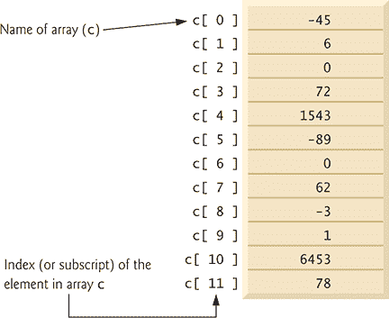

# 图 7.1

一个包含 12 个元素的数组。

描述

让我们更仔细地观察图 7.1 中的数组 `c`。数组的 `name` 是 `c`。每个数组对象都知道自己的长度并将其存储在 `length` 实例变量中。表达式 `c.length` 返回数组 `c` 的长度。尽管数组的 `length` 实例变量是 `public` 的，但它不能被修改，因为它是一个 `final` 变量。该数组的 12 个元素被称为 `c[0]`、`c[1]`、`c[2]`、……`c[11]`。`c[0]` 的值为 `-45`，`c[1]` 的值为 `6`，`c[2]` 的值为 `0`，`c[7]` 的值为 `62`，`c[11]` 的值为 `78`。为了计算数组 `c` 前三个元素中包含的值之和并将结果存储在变量 `sum` 中，我们会写：

```
sum = c[0] + c[1] + c[2];
```

要将 `c[6]` 的值除以 `2`并将结果赋值给变量 `x`，我们会写：

```
x = c[6] / 2;
```

# 7.3 声明和创建数组

数组对象占用内存空间。与其他对象一样，数组使用关键字 `new` 创建。要创建一个数组对象，你需要指定数组元素的类型和元素的数量，并作为使用 `new` 关键字的 `array-creation expression` 的部分。此类表达式返回一个可以存储在数组变量中的 `reference`。以下声明和数组创建表达式创建一个包含 12 个 `int` 元素的数组对象，并将数组引用存储在名为 `c` 的数组变量中：

```
int[] c = new int[12];
```

此表达式可以用于创建图 7.1 中的数组。当数组被创建时，它的每个元素都会接收一个默认值。以下声明和数组创建表达式创建一个包含 12 个 `int` 元素的数组对象，并将数组引用存储在名为 `c` 的数组变量中：

```
int[] c = new int[12];
```

`for` 语句（第 12–14 行）输出每个数组元素的索引（由 `counter` 表示）和值（由 `array[counter]` 表示）。控制变量 `counter` 初始为 `0`——索引值从 0 开始，因此使用*零基计数*（zero-based counting）可以允许循环访问数组的每个元素。`for` 循环的继续条件使用表达式 `array.length`（第 12 行）来确定数组的长度。在这个示例中，数组的长度为 10，因此只要控制变量 `counter` 的值小于 10，循环就会继续执行。拥有 10 个元素的数组的最高索引值为 9，因此在循环继续条件中使用小于运算符可以确保循环不会尝试访问数组末尾*之外*（beyond`）的元素（即在循环的最后一次迭代中，`counter` 为 `9`）。我们很快就会看到 Java 在执行时遇到这种*越界索引*（out-of-range index`）时会发生什么。

## 7.4.2 使用数组初始化器

你可以使用`数组初始化器`创建一个数组并初始化其元素——这是一个用大括号括起来的逗号分隔的表达式列表（称为`初始化列表`）。在这种情况下，数组的长度由初始化列表中的元素数量决定。例如，

```java
int[] n = {10, 20, 30, 40, 50};
```

这创建了一个索引值为 `0`–`4` 的`五` 元素数组。元素 `n[0]` 被初始化为 `10`，`n[1]` 初始化为 `20`，依此类推。当编译器遇到包含初始化列表的数组声明时，它会`计数`（`counts`）列表中初始化器的数量来确定数组的大小，然后在“背后”设置相应的 `new` 操作。

图 7.3 {
 6         // 初始化列表指定了每个元素的初始值
 7         int[] array = {32, 27, 64, 18, 95, 14, 90, 70, 60, 37};
 8
 9         System.out.printf("%s%8s%n", "Index", "Value"); // 列标题
10
11         // 输出每个数组元素的值
12         for (int counter = 0; counter < array.length; counter++) {
13            System.out.printf("%5d%8d%n", counter, array[counter]);
14         }
15      }
16   }
```

### 图 7.3

使用数组初始化器初始化数组的元素。

## 7.4.3 计算存储在数组中的值

图 7.4 {

 6         final int ARRAY_LENGTH = 10; // 声明常量

 7         int[] array = new int[ARRAY_LENGTH]; // 创建数组

 8

 9         // 计算每个数组元素的值

10         for (int counter = 0; counter < array.length; counter++) {

11            array[counter] = 2 + 2 * counter;

12         }

13

14         System.out.printf("%s%8s%n", "Index", "Value"); // 列标题

15         // 输出每个数组元素的值

16         for (int counter = 0; counter < array.length; counter++) {

17            System.out.printf("%5d%8d%n", counter, array[counter]);

18         }

19      }

```

### 图 7.4
计算要放入元素中的值

第 6 行使用 `final` 声明常量 `ARRAY_LENGTH`。常量在使用之前必须初始化。如果你尝试修改 `final` 变量，编译器会报错。

## 7.4.4 求和元素

通常，数组元素表示值。例如，如果它们是成绩，教授可能希望对数组求和。图 7.5 {
 6         int[] array = {87, 68, 94, 100, 83, 78, 85};
 7         int total = 0;
 8
 9         // 将每个元素加到 total
10         for (int counter = 0; counter < array.length; counter++) {
11            total += array[counter];
12         }
13
14         System.out.printf("Total of array: %d%n", total);
15      }
16 }
```

### 图 7.5

数组求和

注意，作为初始化器提供的值通常是读取到程序中的，而不是在初始化列表中。例如，你可以从用户或文件中读取数据，正如第 15 章文件、输入输出流、NIO 和 XML 序列化中所讨论的那样。将数据读取到程序中使得程序更具重用性。

## 7.4.5 使用柱状图图形化显示数据

许多程序以图形方式向用户展示数据。例如，数值通常在柱状图中显示。以图形方式显示数值的一种简单方法是使用由星号（`*`）组成的柱状图显示。

教授通常喜欢查看考试的成绩分布。教授可能会通过各个类别成绩数量的图表来进行可视化。[图 7.6](#fileP70010143390000000000000000043336.xhtml_P70010143390000000000000000040BF）将这种成绩分布数据存储在 11 个元素的数组中，每个元素对应一个成绩类别。例如，`array[0]` 表示 0–9 范围内的成绩数量，`array[7]` 表示 70–79 范围内的成绩数量，`array[10]` 表示 100 分的成绩数量。

```
 1   // Fig. 7.6: BarChart.java
 2   // 条形图打印程序。
 3
 4   public class BarChart {
 5      public static void main(String[] args) {
 6         int[] array = {0, 0, 0, 0, 0, 0, 1, 2, 4, 2, 1};
 7
 8         System.out.println("Grade distribution:");
 
10         // 对于每个数组元素，输出图表的条形
11         for (int counter = 0; counter < array.length; counter++) {
12            // 输出条形标签 ("00-09: ", …, "90-99: ", "100: ")
13            if (counter == 10) {
14               System.out.printf("%5d: ", 100);
15            }
16            else {
17               System.out.printf("%02d-%02d: ",
18                  counter * 10, counter * 10 + 9);
19            }
20
21            // 打印星号形
22            for (int stars = 0; stars < array[counter]; stars++) {
23               System.out.print("*");
24            }
25
26            System.out.println();
27         }
28      }
29   }
```

# 图 7.6

条形图打印程序。

本章节后后的 `GradeBook` 类（图 7.14 和 7.18）包含了根据一组成绩计算这些成绩频率的代码。现在，我们手动根据给定的成绩频率创建 `array`。该应用程序从 `array` 中读取数字并将信息图表化为条形图。它显示每个成绩范围，随后紧跟一个由星号组成的条形，表示该范围内的成绩人数数。为了标记每个条形，第 13–19 行根据当前的 `counter` 值输出一个成绩范围（例如 `"70-79: "`）。当 `counter` 为 `10` 时，第 14 行输出字段宽度为 `5` 的 `100`，后面紧跟一个冒号和一个空格，以使标签 `"100: "` 与其它条形标签对齐。内嵌套的 `for` 语句（第 22–24 行）输出条形。注意第 22 行的循环继续条件（`stars < array[counter]`）。程序每当到达内部 `for` 循环时，循环从 `0` 计数到 `array[counter]`，从而使用 `array` 中的值来确定要显示的星号数量。在这个示例中，没有学生获得低于 60 分的成绩，因此 `array[0]`–`array[5]` 包含零，在前六个成绩范围旁边没有显示星号。在第 17 行中，格式指定符 `%02d` 表示 `int` 值应被格式化为具有两个数字的字段。格式指定符中的 `0` 标志表示对于数字少于字段宽度（`2`）的值，显示前导 `0`。

# 7.4.6 使用数组元素作为计数器

有时，程序使用计数器变量来汇总数据，例如调查结果。在图 6.7 中，我们在掷骰子程序中使用单独的计数器，在程序投掷骰子 60,000,000 次时，跟踪六面骰子每个面出现的次数。该应用程序的数组版本如图 7.7 {

 7         SecureRandom randomNumbers = new SecureRandom();

 8         int[] frequency = new int[7]; // 频率计数器数组

 9

10         // 掷骰子 60,000,000 次；使用骰子值作为频率索引

11         for (int roll = 1; roll <= 60000000; roll++) {

12            frequency[1 + randomNumbers.nextInt(6)]++;

13         }

14


15         System.out.printf("%s%10s%n", "Face", "Frequency");

16         // 输出每个数组元素

17         for (int face = 1; face < frequency.length; face++) {

18            System.out.printf("%4d%10d%n", face, frequency[face]);

19         }

20      }

21 }

```

# 图 7.7

使用数组代替 switch 的掷骰子程序。

7.7 中的 19–41 行。然而，`frequency` 必须足够大。第 12 行的计算首先确定要递增的元素，然后 `++` 运算符对该元素加一。我们也遍历 `frequency` 以输出结果（第 18–20 行）。

# 7.4.7 使用数组分析调查结果

我们的示例使用数组汇总数据。考虑以下问题陈：

> *让学生根据 1 到 5 分对食堂的质量进行评分，1 分为“差”，5 分为“优秀”。将 20 个响应放入整数数组中并确定每个评分的频率。*

这是一个典型的数组处理应用程序（图 7.8）。我们希望汇总每种类型的响应。`responses`（第 7–8 行）是一个包含学生响应的 20 个元素的整数数组。数组中的最后一个值故意是一个错误的响应（`14`）。当 Java 程序执行时，会检查数组元素的有效性——所有索引必须大于或等于 0 且小于数组的长度。任何访问范围之外元素的尝试会导致被称为 `ArrayIndexOutOfBoundsException` 的运行时错误。在本节结束处，我们将讨论无效响应值，演示数组边界检查并引入 Java 的异常处理机制，该机制用于检测和处理 `ArrayIndexOutOfBoundsException`。

# `frequency` 数组

我们使用六个元素的数组 `frequency`（第 9 行）来统计每个响应出现的次数。每个元素（元素 0 之外）被用作一个可能的调查响应值的计数器——`frequency[1]` 统计评分为 1 分的人数，`frequency[2]` 统计评分为 2 分的人数，以此类推。

```

 1   // Fig. 7.8: StudentPoll.java

 2   // Poll analysis program.

 3

 4   public class StudentPoll {

 5      public static void main(String[] args) {

 6         // student response array (more typically, input at runtime)

 7         int[] responses =

 8            {1, 2, 5, 4, 3, 5, 2, 1, 3, 3, 1, 4, 3, 3, 3, 2, 3, 3, 2, 14};

 9         int[] frequency = new int[6]; // array of frequency counters

10

11         // for each answer, select responses element and use that value

12         // as frequency index to determine element to increment

13         for (int answer = 0; answer < responses.length; answer++) {

14            try {

15               ++frequency[responses[answer]];

16            }

17            catch (ArrayIndexOutOfBoundsException e) {

18               System.out.println(e); // invokes toString method

19               System.out.printf(" responses[%d] = %d%n%n",

20                  answer, responses[answer]);

21            }

22         }

23

24         System.out.printf("%s%10s%n", "Rating", "Frequency");

25

26         // output each array element's value

27         for (int rating = 1; rating < frequency.length; rating++) {

28            System.out.printf("%6d%10d%n", rating, frequency[rating]);

29         }

30      }

31   }

```

# 图 7.8

调查分析程序。

# 汇总结果

`for` 语句（第 13–22 行）逐个从 `responses` 数组中读取响应结果，并增加计数器 `frequency[1]` 到 `frequency[5]` 之一；我们忽略了 `frequency[0]`，因为调查响应限制在 1–5 的范围内。循环中的关键语句出现在第 15 行。该语句根据 `responses[answer]` 的值来增加相应的 `frequency` 计数器。

让我们逐步执行 `for` 语句的前几次迭代：

*   当 `answer` 为 `0` 时，`responses[answer]` 是 `responses[0]` 的值（即 `1`——见第 8 行）。因此，`frequency[responses[answer]]` 结果为 `frequency[1]`，计数器 `frequency[1]` 加 1。为了评估该表达式，我们从最内层括号中的值开始（`answer`，当前为 `0`）。将 `answer` 的值代入表达式，评估下一组括号（`responses[answer]`）。该值被用作 `frequency` 数组的索引以确定要增加哪个计数器（在本例中为 `frequency[1]`）。

*   下一次循环时 `answer` 为 `1`，`responses[answer]` 是 `responses[1]` 的值（即 `2`——见第 8 行），因此 `frequency[responses[answer]]` 被解释为 `frequency[2]`，导致 `frequency[2]` 增加 1。

*   当 `answer` 为 `2` 时，`responses[answer]` 是 `responses[2]` 的值（即 `5`——见第 8 行），因此 `frequency[responses[answer]]` 被解释为 `frequency[5]`，导致 `frequency[5]` 增加，依此类推。

无论处理了多少个响应，只需要一个六个元素的数组（我们忽略了零索引元素）即可汇总结果，因为所有正确的响应都在 1 到 5 之间，而六个元素数组的索引值为 0–5。在程序的输出中，`Frequency` 列仅汇总了 `responses` 数组中 20 个值中的 19 个——数组 `responses` 的最后一个元素包含一个（故意的）未计数的错误响应。第 7.5 节讨论了当图 7.8 中的程序遇到 `responses` 数组最后一个元素中的无效响应（`14`）时会发生什么。

# 7.5 异常处理：处理错误的响应

`异常` 表示程序在执行时发生的问题。`异常处理`帮助你创建可以解决（或处理）异常的`容错性程序`。在某些情况下，这允许程序像没有遇到任何问题一样继续执行。例如，`StudentPoll` 应用仍然显示结果（图 7.8）。

## 7.5.1 `try` 语句

为了处理异常，将任何可能抛出异常的代码放在 `try` 语句中。`try` 块（第 14–16 行）包含了代码。你可以有多个 `catch` 块来处理 `try` 块可能抛出的不同类型异常。

## 7.5.2 执行 `catch` 块

当程序遇到 `responses` 数组中的无效值 `14` 时，它尝试向 `frequency[14]` 加 1，这超出了数组边界。因为边界检查是在执行时进行的，JVM 生成一个 `异常` 来通知程序此问题。此时 `try` 块终止，`catch` 块开始执行——如果你在 `try` 块中声明了局部变量，它们现在已经离开了作用范围，因此在 `catch` 块中无法访问。

`catch` 块声明了一个类型为 `ArrayIndexOutOfBoundsException` 的异常参数 `e`。`catch` 块可以处理指定类型的异常。在 `catch` 块内部，可以使用标识与捕获的对象交互。

## 7.5.3 异常参数的 `toString` 方法

当第 17–21 行捕获异常时，程序显示发生问题的消息。第 18 行隐式地调用异常对象的 `toString` 方法，获取存储在异常对象中的错误消息并将其显示。一旦在本示例中显示了消息，异常就被认为已处理，程序继续执行 `catch` 括号之后的后续语句。

# 7.6 案例研究：洗牌和发牌模拟

到目前为止，章节中的示例使用了包含基本类型元素的数组。回顾第 7.2 节，数组的元素可以是基本类型也可以是引用类型。本节使用随机数生成和引用类型元素数组（即代表纸牌的对象）来创建一个模拟洗牌和发牌的类。该类随后可以用于实现特定纸牌游戏的应用程序。章节末的练习将使用这里开发的类来构建一个简单的扑克应用。

我们首先开发了 `Card` 类（图 7.9），它创建了一个包含 52 张扑克牌的牌组，其中每个元素都是一个 `Card` 对象。然后，我们构建了一个测试应用程序（图 7.11），演示了 `DeckOfCards` 类的洗牌和发牌能力。

# `Card` 类

`Card` 类（图 7.9）包含两个 `String` 实例变量——`face` 和 `suit`——用于存储特定 `Card` 的花面名称和花色名称的引用。该类的构造函数（第 9–12 行）接收两个 `String`，并用它们来初始化 `face` 和 `suit`。`toString` 方法（第 15–17 行）创建一个由牌片的 `face`、字符串 `"of"` 和牌片的 `suit` 组成的 `String`。`Card` 的 `toString` 方法可以被显式调用，以获取 `Card` 对象的字符串表示（例如 `"Ace of Spades"`）。当对象在期望 `String` 的地方使用时，对象的 `toString` 方法会被隐式调用（例如，当 `printf` 使用 `%s` 格式说明符将对象输出为 `String`，或者使用 `+` 运算符将对象与 `String` 拼接时）。为了发生这种行为，`toString` 必须用图 7.9

```
 6      private final String suit; // suit of card ("Hearts", "Diamonds", …)
 7
 8      // two-argument constructor initializes card's face and suit
 9      public Card(String cardFace, String cardSuit) {
10         this.face = cardFace; // initialize face of card
11         this.suit = cardSuit; // initialize suit of card
12      }
13
14      // return String representation of Card
15      public String toString() {
16         return face + " of " + suit;
17      }
18   }
```

## 图 7.9

`Card` 类代表一张扑克牌。

# `DeckOfCards` 类

`DeckOfCards` 类（图 7.10）创建并管理一个 `Card` 引用数组。具名常量 `NUMBER_OF_CARDS`（第 8 行）指定了牌组中 `Card` 的数量（52）。第 10 行声明并初始化了一个名为 `deck` 的实例变量，它指向一个新 `Card` 数组，该数组有 `NUMBER_OF_CARDS`（52）个元素——`deck` 数组的元素默认为 `null`。回想第 3 章;

```
8      private static final int NUMBER_OF_CARDS = 52; // constant of Cards

9

10      private Card[] deck = new Card[NUMBER_OF_CARDS]; // Card references

11      private int currentCard = 0; // index of next Card to be dealt (0-51)

12

13      // constructor fills deck

14      public DeckOfCards() {

15         String[] faces = {"Ace", "Deuce", "Three", "Four", "Six",

16            "Seven", "Eight", "Nine", "Jack", "Queen"};

17         String[] suits = {"Hearts", "Diamonds", "Clubs", "Spades"};

18

19         // populate deck with Card objects
```


## `DeckOfCards` 类实现细节

### 构造函数

```java
for (int count = 0; count < deck.length; count++) {
   deck[count] = new Card(faces[count % 13], suits[count / 13]);
}
```

`DeckOfCards` 类的构造函数使用 `for` 语句（第 20–23 行）填充实例变量 `deck` 的 `Card` 对象。循环初始化控制变量 `count` 为 0，并在 `count` 小于 `deck.length` 时循环，导致 `count` 取 0 到 51 的每个整数值（`deck` 数组的索引）。每个 `Card` 实例化并用两个 `String` 初始化——一个来自 `faces` 数组（包含 `"Ace"` 到 `"King"`），另一个来自 `suits` 数组（包含 `"Hearts"`、`"Diamonds"`、`"Clubs"` 和 `"Spades"`）。计算 `count % 13` 总是得到 0 到 12 的值（`faces` 数组的 13 个索引），计算 `count / 13` 总是得到 0 到 3 的值（`suits` 数组的四个索引）。当循环完成后，`deck` 按花色顺序包含从 `"Ace"` 到 `"King"` 的 `Card`（13 张 `"Hearts"`，然后 13 张 `"Diamonds"`，然后 13 张 `"Clubs"`，最后是 13 张 `"Spades"`）。在这个示例中，我们使用 `String` 数组来表示花面和花色。在练习 7.34 中，我们让你修改此示例，使用 `enum` 常量数组来表示花面和花色。

### 方法 `shuffle`

```java
// shuffle deck with one-pass algorithm
public void shuffle() {
   // next call to methodCard should start at deck[0]
   currentCard = 0;

   // for each Card, pick another random Card (0-51) and swap them
   for (int first = 0; first < deck.length; first++) {
      // select a random number between 0 and 51
      int second = randomNumbers.nextInt(NUMBER_OF_CARDS);
      // swap current Card with randomly selected Card
      Card temp = deck[first];
      deck[first] = deck[second];
      deck[second] = temp;
   }
}
```

`shuffle` 方法（第 27–41 行）洗牌组中的 `Card`。该方法遍历所有的 52 张 `Card`（数组索引 0 到 51）。对于每个 `Card`，第 34 行在 0 和 51 之间选择一个随机索引来选择另一个 `Card`。接下来，第 37–39 行交换数组中的当前 `Card` 和随机选择的 `Card`。额外的变量 `temp`（第 37 行）临时存储正在交换的两个 `Card` 对象之一。`for` 循环终止后，`Card` 对象被随机排序。在整个数组的一次遍历中，总共仅进行了 52 次交换，`Card` 对象数组就洗牌好了！

第 37–39 行的交换无法仅通过以下两个语句完成：

```java
deck[first] = deck[second];
deck[second] = deck[first];
```

如果 `deck[first]` 是 `"Ace"` of `"Spades"` 且 `deck[second]` 是 `"Queen"` of `"Hearts"`，在第一次赋值后，两个数组元素都包含 `"Queen"` of `"Hearts"`，而 `"Ace"` of `"Spades"` 丢失了——因此需要额外的变量 `temp`。

> **注意：** 在真实的卡牌游戏中，建议你使用所谓的*无偏*（unbiased）洗牌算法。此类算法可以确保所有可能的洗牌后序列出现的概率相等。练习 7.35 要求你研究流行的无偏 Fisher-Yates 洗牌算法，并用它来重新实现 `DeckOfCards` 类的 `shuffle` 方法。

### 方法 `dealCard`

```java
// deal one Card
public Card dealCard() {
   // determine whether Cards remain to be dealt
   if (currentCard < deck.length) {
      return deck[currentCard++]; // return current Card in array
   } else
      return null; // return null to indicate that all Cards were dealt
}
```

方法 `dealCard`（位于第 44–52 行）处理数组中的一个 `Card`。请记住，`currentCard` 表示下一个要发出的 `Card` 的索引（即位于牌组*顶端*的 `Card`）。因此，第 46 行将 `currentCard` 与 `deck` 数组的长度进行比较。如果 `deck` 不为空（即 `currentCard` 小于 52），则第 47 行返回“顶端” `Card` 并将 `currentCard` 后自增，为下一次调用 `dealCard` 做准备——否则，第 50 行返回 `null`。

## 洗牌与发牌测试

图 7.11 展示了 `DeckOfCardsTest` 类。第 7 行创建了一个名为 `myDeckOfCards` 的 `DeckOfCards` 对象。`DeckOfCards` 构造函数按照花色和点数创建包含 52 个 `Card` 对象的牌组。第 8 行调用 `myDeckOfCards` 的 `shuffle` 方法来重新排列 `Card` 对象。第 11–18 行发完所有 52 张 `Card` 并将其以每列 13 张 `Card` 的四列格式打印出来。第 13 行通过调用 `myDeckOfCards` 的 `dealCard` 方法发出一个 `Card` 对象，然后在 19 个字符的字段中左对齐显示该 `Card`。当 `Card` 输出为 `String` 时，会隐式地调用 `Card` 的 `toString` 方法（图 7.9）。图 7.11 中的第 15–17 行在每四张 `Card` 后开始新的一行。

```java
// Fig. 7.11: DeckOfCardsTest.java
// Card shuffling and dealing.
public class DeckOfCardsTest {
   // 执行应用程序
   public static void main(String[] args) {
      DeckOfCards myDeckOfCards = new DeckOfCards();
      myDeckOfCards.shuffle(); // 将 Cards 随机排序

      // 按发牌顺序打印所有 52 张 Cards
      for (int i = 1; i <= 52; i++) {
         // 发牌并显示一张 Card
         System.out.printf("%-19s", myDeckOfCards.dealCard());

         if (i % 4 == 0) { // 每四张牌后输出换行符
            System.out.println();
         }
      }
   }
}
```

## 防止 `NullPointerException`

在图 7.10 中，我们创建了一个包含 52 个 `Card` 引用的 `deck` 数组——默认情况下，用 `new` 创建的引用类型数组的每个元素都被初始化为 `null`。同样，类的引用类型字段默认也都被初始化为 `null`。当你尝试在 `null` 引用上调用方法时，就会发生 `NullPointerException`。在工业级代码中，在使用引用调用方法之前确保其不为 `null`，可以防止 `NullPointerException`。

## 7.7 增强型 `for` 语句

**增强型 `for` 语句**在*不使用*计数器的情况下遍历数组元素，从而避免了“越界”数组的可能性。我们在第 7.16 节中展示了如何对 Java API 的预构建数据结构（称为集合）使用增强型 `for` 语句。增强型 `for` 语句的语法如下：

```java
for (parameter : arrayName) {
   statement
}
```

其中 `parameter` 具有某种类型，`arrayName` 是要遍历的数组。`parameter` 的类型必须与数组元素的类型*一致*。增强型 `for` 语句在每次迭代中都会获取数组的元素值，并执行 `statement`。

## Java SE 8 流

`for` 语句和增强型 `for` 语句都从一个开始值到结束值进行顺序迭代。在第 17 章，Lambda 和 Stream 中，你将学习到流。正如你所看到的，流提供了一种优雅、简洁且不易出错的遍历集合的方法，允许某些迭代并行进行以实现更好的多核系统性能。

## 7.8 将数组传递给方法

本节演示了如何将数组和单个数组元素作为参数传递给方法。要将数组参数传递给方法，指定数组名称*无需带任何括号*。例如，如果数组 `hourlyTemperatures` 声明为：

```java
double[] hourlyTemperatures = new double[24];
```

那么方法调用：

```java
modifyArray(hourlyTemperatures);
```

会将数组 `hourlyTemperatures` 的引用传递给方法 `modifyArray`。每个数组对象都“知道”自己的长度。因此，当我们把数组引用传递到方法时，不需要将数组长度作为额外的参数传递。

若方法要通过方法调用接收数组引用，则方法的参数列表必须指定一个 `array parameter`（数组参数）。例如，方法 `modifyArray` 的方法头可以写为：

```java
void modifyArray(double[] b)
```

这表示 `modifyArray` 接收了参数 `b` 中 `double` 数组的引用。方法调用传递了数组 `hourlyTemperatures` 的引用，因此当被调用方法使用数组变量 `b` 时，它 `refers to`（指向）与调用者的 `hourlyTemperatures` 相同的数组对象。

当方法的参数是整个数组或引用类型的单个数组元素时，被调用方法接收的是该引用的 `copy`（副本）。然而，当方法的参数是基本类型中单个数组元素时，被调用方法接收的是该元素 `value`（值）的副本。此类基本类型值被称为 `scalars`（标量）或 `scalar quantities`。要将单个数组元素传递给方法，请在方法调用中使用该元素的索引名称作为参数。

图 7.13 展示了传递整个数组与传递基本类型数组元素到方法之间的区别。方法 `main` 调用了 `static` 静态方法 `modifyArray`（第 18 行）和 `modifyElement`（第 30 行）。记住，`static` 方法可以在不使用类名和点运算符（`.`）的情况下调用同类中的其他 `static` 方法。

```java
// Fig. 7.13: PassArray.java
// 将数组和单个数组元素传递给方法。
public class PassArray {
   // main 创建数组并调用 modifyArray 和 modifyElement
   public static void main(String[] args) {
      int[] array = {1, 2, 3, 4, 5};

      System.out.printf(
         "Effects of passing reference to entire array:%n" +
         "The values of the original array are:%n");

      // 输出原始数组元素
      for (int value : array) {
         System.out.printf(" %d", value);
      }

      modifyArray(array); // 传递数组引用
   }
}
```


```java
 19         System.out.printf("%n%nThe values of the modified array are:%n");

 20

 21         // 输出修改后的数组元素
 22         for (int value : array) {
 23            System.out.printf(" %d", value);
 24         }

 25

 26         System.out.printf(
 27            "%n%nEffects of passing array element value:%n" +
 28            "array[3] before modifyElement: %d%n", array[3]);

 29

 30         modifyElement(array[3]); // 尝试修改 array[3]
 31         System.out.printf(
 32            "array[3] after modifyElement: %d%n", array[3]);
 33      }

 34

 35      // 将数组的每个元素乘以 2
 36      public static void modifyArray(int[] array2) {
 37         for (int counter = 0; counter < array2.length; counter++) {
 38            array2[counter] *= 2;
 39         }
 40      }

 41

 42      // 将参数乘以 2
 43      public static void modifyElement(int element) {
 44         element *= 2;
 45         System.out.printf(
 46            "Value of element in modifyElement: %d%n", element);
 47      }
 48   }
```

# 图 7.13

将数组和单个数组元素传递给方法。

第 14–16 行的增强 `for` 语句输出了 `array` 的元素。第 18 行调用 `modifyArray`（第 36–40 行），将 `array` 作为参数传递。该方法接收了 `array` 引用的副本，并用它将 `array` 的每个元素乘以 2。为了证明 `array` 的元素被修改了，第 22–24 行再次输出了这些元素。如输出所示，方法 `modifyArray` 将每个元素的值翻倍了。我们 `not` 在第 37–39 行使用增强 `for` 语句，因为我们正在修改数组的元素。

图 7.13 接下来展示了，当单个基本类型数组元素的副本传递给方法时，在被调用方法中修改 `copy` `does not` 影响调用者方法数组中该元素的原始值。第 26–28 行在调用方法 `modifyElement` `before` 输出了 `array[3]` 的值。记住，在该元素被修改后，其值现在是 8。

# 7.9 值传递与引用传递

上一个示例演示了数组和基本类型元素是如何传递的。现在我们详细查看参数通常是如何传递的。在许多语言中，传递参数有两种方式：`pass-by-value`（值传递）和 `pass-by-reference`（引用传递）。当参数按 `value` 传递时，被调用方法操作的是参数值的副本。被调用方法的变化 `does not` 影响调用者的原始变量。当参数按 `reference` 传递时，被调用方法可以直接访问并修改该数据。

与某些语言不同，Java `not` 允许你选择值传递或引用传递——`all arguments are passed by value`（所有参数按值传递）。方法调用可以传递两种值：基本值的副本（例如 `int` 和 `double`）和引用的副本。对象本身不能传递给方法。当方法修改基本类型参数时，对参数没有 `no` 影响。例如，当图 7.13 中 `main` 方法第 30 行将 `array[3]` 传递给 `modifyElement` 时，第 44 行修改 `element` 值的语句对 `array[3]` 的值没有影响。

尽管对象的引用是按值传递的，但方法仍然可以通过调用对象引用的副本来与被引用对象交互。由于存储在参数中的引用是作为参数传递的引用的副本，因此被调用方法的参数和调用者的参数指向 `same object in memory`（内存中的同一个对象）。

# 7.10 案例研究：使用数组存储成绩的 `GradeBook` 类

我们现在介绍关于开发 `GradeBook` 类的案例研究的第一部分。该类可供教师用于维护学生的考试成绩，并显示成绩报告，报告中包含各项成绩、班级平均分、最低分、最高分以及一个成绩分布条形图。本节介绍的 `GradeBook` 类版本使用一维数组存储一次考试的成绩。在第 7.12 节中，我们将展示 `GradeBook` 类的另一个版本，该版本使用二维数组存储学生多次考试的成绩。

## 在 `GradeBook` 类中使用数组存储学生成绩

`GradeBook` 类（图 7.14）使用一个 `int` 类型的数组来存储多个学生在单次考试中的成绩。数组 `grades` 被声明为一个实例变量（第 6 行），因此每个 `GradeBook` 对象都维护自己的一组成绩。构造函数（第 9–12 行）有两个参数——课程名称和成绩数组。当应用程序（例如图 7.15 中的 `GradeBookTest` 类）创建 `GradeBook` 对象时，应用程序将一个现有的 `int` 数组传递给构造函数，构造函数将该数组的引用赋值给实例变量 `grades`（第 11 行）。`grades` 数组的大小由构造函数数组参数的 `length` 实例变量决定。因此，一个 `GradeBook` 对象可以处理数量变化的成绩。参数中的成绩值可以来自用户输入，也可以从磁盘上的文件读取（如第 15 章，第 7 行）。一旦成绩存储在 `GradeBook` 类的实例变量 `grades` 中，该类的所有方法都可以访问 `grades` 的元素。

```java
 1   // Fig. 7.14: GradeBook.java
 2   // GradeBook 类使用数组存储测试成绩。
 3
 4   public class GradeBook {
 5      private String courseName; // 此 GradeBook 所代表的课程名称
 6      private int[] grades; // 学生成绩数组
 7
 8      // 构造函数
 9      public GradeBook(String courseName, int[] grades) {
 10         this.courseName = courseName;
 11         this.grades = grades;
 12      }
 13
 14      // 设置课程名称的方法
 15      public void setCourseName(String courseName) {
 16         this.courseName = courseName;
 17      }
 18
 19      // 获取课程名称的方法
 20      public String getCourseName() {
 21         return courseName;
 22      }
 23
 24      // 对数据执行各种操作
 25      public void processGrades() {
 26         // 输出成绩数组
 27         outputGrades();
 28
 29         // 调用方法 getAverage 计算平均分
 30         System.out.printf("%nClass average is %.2f%n", getAverage());
 31
 32         // 调用方法 getMinimum 和 getMaximum
 33         System.out.printf("Lowest grade is %d%nHighest grade is %d%n%n",
 34            getMinimum(), getMaximum());
 35
 36         // 调用 outputBarChart 打印成绩分布图
 37         outputBarChart();
 38      }
 39
 40      // 寻找最低成绩
 41      public int getMinimum() {
 42         int lowGrade = grades[0]; // 假设 grades[0] 是最小
 43
 44         // 遍历 grades 数组
 45         for (int grade : grades) {
 46            // 如果 grade 低于 lowGrade，则赋值
 47            if (grade < lowGrade) {
 48               lowGrade = grade;
 49            }
 50         }
 51         return lowGrade;
 52      }
 53
 54      // 寻找最高成绩
 55      public int getMaximum() {
 56         int highGrade = grades[0];
 57
 58         // 遍历 grades 数组
 59         for (int grade : grades) {
 60            // 如果 grade 高于 highGrade，则赋值
 61            if (grade > highGrade) {
 62               highGrade = grade;
 63            }
 64         }
 65         return highGrade;
 66      }
 67
 68      // 计算平均
 69      public double getAverage() {
 70         int total = 0;
 71
 72         // 累加 grades
 73         for (int grade : grades) {
 74            total += grade;
 75         }
 76         // 返回平均值
 77         return (double) total / grades.length;
 78      }
 79
 80      // 输出条形图
 81      public void outputBarChart() {
 82         System.out.println("Grade distribution:");
 83
 84         // 存储 grades 的频率
 85         int[] frequency = new int[11];
 86
 87         // 对于每个 grade，增加频率
  88         for (int grade : grades) {
  89            ++frequency[grade / 10];
  90         }
  91
  92         // 对于每个频率，打印条形
  93         for (int count = 0; count < frequency.length; count++) {
  94            // 输出标签
  95            if (count == 0) {
  96               System.out.printf("%2d: ", count * 10);
  97            } else if (count == 10) {
  98               System.out.printf("  100: ");
  99            } else {
 100               System.out.printf("%2d-%2d: ", count * 10, count * 10 + 9);
 101            }
 102           // 输出星号条形
 103           for (int stars = 0; stars < frequency[count]; stars++) {
 104              System.out.print("*");
 105           }
 106           System.out.println();
 107         }
 108      }
 109
 110      // 输出 grades 数组的内容
 111      public void outputGrades() {
 112         System.out.printf("The grades are:%n");
 113
 114         // 输出每个学生的成绩
 115         for (int student = 0; student < grades.length; student++) {
 116            System.out.printf("Student %d: %d%n", student + 1, grades[student]);
 117         }
 118      }
 119   }
```

# 图 7.14

`GradeBook` 类使用数组存储测试成绩。

`processGrades` 方法中的第 33–34 行调用了 `getMinimum` 和 `getMaximum` 方法，分别确定考试中任何学生的最低分和最高分。这些方法中的每一个都使用一个增强型 `for` 语句来遍历数组 `grades`。`getMinimum` 方法中的第 45–50 行遍历数组。第 47–49 行将每个分数与 `lowGrade` 进行比较；如果某个分数小于 `lowGrade`，则将 `lowGrade` 设置为该分数。当执行第 52 行时，`lowGrade` 包含了数组中的最小值。`getMaximum` 方法（第 56–66 行）的工作原理与 `getMinimum` 方法类似。

最后，`processGrades` 方法中的第 37 行调用 `outputBarChart` 输出成绩分布图，其使用的技术类似于图 7.6。在那个示例中，我们通过观察一组分数手动计算了每个类别中的分数数量（即 0–9、10–19、……、90–99 和 100）。在这里，第 88–90 行使用了类似于图 7.7–7.8 中的技术来计算每个类别中分数的频率。第 85 行声明并创建了包含 11 个 `int` 的数组 `frequency`，用于存储每个类别中分数的频率。对于 `grades` 数组中的每个 `grade`，第 89 行使用整数除法将当前 `grade` 除以 10 来确定增加哪一个 `frequency` 数组元素——例如，如果 `grade` 为 `85`，第 89 行增加 `frequency[8]` 以更新 80–89 范围内分数的计数。第 96–107 行根据数组 `frequency` 中的值打印柱状图（如图 7.15 所示），使用数组 `frequency` 中的值来确定在每个柱图中显示的星号数量。

# 展示类 `GradeBook` 的类 `GradeBookTest`

图 7.15 的应用使用 `int` 数组 `gradesArray`（第 7 行声明并初始化）创建 `GradeBook` 类的对象。第 9–10 行将课程名称和 `gradesArray` 传递给 `GradeBook` 构造函数。第 11–12 行显示包含存储在 `GradeBook` 对象中的课程名称的欢迎消息。第 13 行调用 `GradeBook` 对象的 `processGrades` 方法。输出总结了 `myGradeBook` 中的 10 个成绩。

```java
 1   // Fig. 7.15: GradeBookTest.java
 2   // GradeBookTest 使用分数数组创建一个 GradeBook 对象，
 3   // 然后调用 processGrades 方法分析它们。
 4   public class GradeBookTest {
 5      public static void main(String[] args) {
 6         // 学生成绩数组
 7         int[] gradesArray = {87, 68, 94, 100, 83, 78, 85, 91, 76, 87};
 8
 9         GradeBook myGradeBook = new GradeBook(
 10            "CS101 Introduction to Java Programming", gradesArray);
 11         System.out.printf("Welcome to the grade book for%n%s%n%n",
 12            myGradeBook.getCourseName());
 13         myGradeBook.processGrades();
 14      }
 15   }
```


## 图 7.15
`GradeBookTest` 使用分数数组创建一个 `GradeBook` 对象，然后调用 `processGrades` 方法分析它们。

## Java SE 8
在第 17 章中，Lambdas 和 Streams 的图 17.9 示例使用流方法 `min`、`max`、`count` 和 `average` 来优雅且简洁地处理 `int` 数组的元素，而无需编写迭代语句。在第 23 章中，并发的图 23.30 使用流方法 `summaryStatistics` 在一次方法调用中执行所有操作。

# 7.11 多维数组

多维数组通常表示按*行*和*列*排列的数值*表格*。要特定的表格元素，你需要指定*两个*索引。按照约定，第一个索引指定元素的行，第二个指定列。需要两个索引来识别元素的数组被称为**二维数组**。（多维数组可以超过两个维度。）Java 不直接支持多维数组，但它允许你指定元素也是一维数组，从而实现相同的效果。图 7.16 展示了一个三行四列的二维数组 `a`（即 3x4 数组）。通常，具有 *m* 行和 *n* 列的数组被称为 ***m*-by-*n* 数组**。

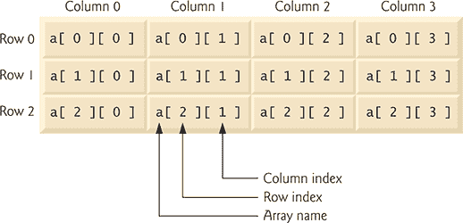

## 图 7.16
三行四列的二维数组。描述

数组 `a` 中的每个元素都通过图 7.16 中形式为 `a[row][column]` 的数组访问表达式来标识；`a` 是数组的名称，`row` 和 `column` 是通过行和列索引唯一标识每个元素的索引。*行* 0 中的元素第一个索引均为 `0`，而*列* 3 中的元素第二个索引均为 `3`。

## 7.11.1 一维数组的数组

与一维数组一样，多维数组可以在声明中使用数组初始化。一个具有两行两列的二维数组 `b` 可以如下使用**嵌套数组初始化**进行声明和初始化：

```java
int[][] b = {{1, 2}, {3, 4}};
```

初始值在括号中按*行*分组*。因此，`1` 和 `2` 分别初始化 `b[0][0]` 和 `b[0][1]`，而 `3` 和 `4` 分别初始化 `b[1][0]` 和 `b[1][1]`。编译器通过嵌套数组初始的数量（由外部大括号内的括号组表示）来确定数组 `b` 的*行*数。编译器通过该行嵌套数组初始化中的初始化值数量来确定该行的*列*数。正如我们稍后看到的，这意味着*行可以有不同的长度*。

多维数组是作为*一维数组的数组*来的。因此，上述声明中的数组 `b` 实际上是由两个独立的一维数组组成的——一个包含第一个嵌套初始化列表 `{1, 2}` 中的值，另一个包含第二个嵌套初始化列表 `{3, 4}` 中的值。因此，数组 `b` 本身是一个包含两个元素的数组，每个元素都是一个 `int` 类型值的一维数组。

## 7.11.2 行长度不同的二维数组

多维数组的表示方式使其非常灵活。事实上，数组 `b` 中行的长度*并不要求*是相同的。例如：

```java
int[][] b = {{1, 2}, {3, 4, 5}};
```

这创建了一个具有两个元素（由嵌套数组初始的数量决定）的整数数组 `b`，代表二维数组的行。`b` 的每个元素都是指向 `int` 变量一维数组的*引用*。第 0 行的 `int` 数组是一个具有*两个*元素（`1` 和 `2`）的一维数组，而第 1 行的 `int` 数组是一个具有*三个*元素（`3`、`4` 和 `5`）的一维数组。

## 7.11.3 使用数组创建表达式创建二维数组

可以使用数组创建表达式创建一个每行列数相同的多维数组。例如，接下来的行声明了数组 `b` 并向其分配了一个指向三行四列数组的引用：

```java
int[][] b = new int[3][4];
```

在这种情况下，我们使用字面量值 `3` 和 `4` 分别指定行数和列数，但这不是必须的。程序也可以使用变量来指定数组维度，因为 `new` 是在执行时创建数组的，而不是在编译时。多维数组的元素会在数组对象创建时进行初始化。

可以如下所示创建一个每行列数可能不同的多维数组：

```java
int[][] b = new int[2][]; // 创建 2 行
b[0] = new int[5]; // 为行 0 创建 5 列
b[1] = new int[3]; // 为行 1 创建 3 列
```

前面的语句创建了一个具有两行的二维数组。行 `0` 有五列，行 `1` 有三列。

## 7.11.4 二维数组示例：显示元素值

图 7.17 展示了如何使用数组初始化器初始化二维数组，并使用嵌套的 `for` 循环遍历数组（即操作每个数组的每个元素）。`InitArray` 类的 `main` 方法声明了两个数组。`array1` 的声明（第 7 行）使用相同长度的嵌套数组初始化器将第一行初始化为值 1, 2 和 3，将第二行初始化为值 4, 5 和 6。`array2` 的声明（第 8 行）使用不同长度的嵌套初始化器。在这种情况下，第一行初始化两个元素，值分别为 1 和 2。第二行初始化为一个元素，值为 3。第三行初始化为三个元素，值分别为 4, 5 和 6。

```java
1   // 图 7.17: InitArray.java
2   // 初始化二维数组。
3
4   public class InitArray {
5      // 创建并输出二维数组
6      public static void main(String[] args) {
7         int[][] array1 = {{1, 2, 3}, {4, 5, 6}};
8         int[][] array2 = {{1, 2}, {3}, {4, 5, 6}};
9
10         System.out.println("Values in array1 by row are");
11         outputArray(array1); // 按行显示 array1
12
13         System.out.printf("%nValues in array2 by row are%n");
14         outputArray(array2); // 按行显示 array2
15      }
16
17      // 输出二维数组的行和列
18      public static void outputArray(int[][] array) {
19         // 遍历数组的行
20         for (int row = 0; row < array.length; row++) {
21            // 遍历当前行的列
22            for (int column = 0; column < array[row].length; column++) {
23               System.out.printf("%d ", array[row][column]);
24            }
25
26            System.out.println();
27         }
28      }
29   }
```

### 图 7.17
初始化二维数组。

第 11 行和第 14 行调用方法 `outputArray`（第 18–28 行）分别输出 `array1` 和 `array2` 的元素。方法 `outputArray` 的参数 `int[][] array` 表示该方法接收一个二维数组。嵌套的 `for` 语句（第 20–27 行）输出二维数组的行。在外部 `for` 语句的循环继续条件中，表达式 `array.length` 决定了数组的行数。在内部 `for` 语句中，表达式 `array[row].length` 决定了数组当前行的列数。内部 `for` 语句的条件使循环能够确定每行的确切列数。我们在图 7.18 中演示了嵌套的增强 `for` 语句。

## 7.11.5 使用 `for` 语句执行常用的多维数组操作

许多常见的数组操作使用 `for` 语句。例如，接下来的 `for` 语句将图 7.16 中数组 `a` 的第 `2` 行的所有元素设置为零：

```java
for (int column = 0; column < a[2].length; column++) {
   a[2][column] = 0;
}
```

我们指定了第 `2` 行；因此，我们知道第一个索引始终是 `2`（`0` 是第一行，`1` 是第二行）。这个 `for` 循环只改变第二个索引（即列索引）。如果数组 `a` 的第 `2` 行包含四个元素，那么前面的 `for` 语句等同于赋值：

```java
a[2][0] = 0;
a[2][1] = 0;
a[2][2] = 0;
a[2][3] = 0;
```

接下来的嵌套 `for` 语句计算数组 `a` 中所有元素的总和：

```java
int total = 0;
for (int row = 0; row < a.length; row++) {
   for (int column = 0; column < a[row].length; column++) {
      total += a[row][column];
   }
}
```

这些嵌套 `for` 语句每次累加一行。外部 `for` 语句通过将 `row` 设置为 `0`，以便内部 `for` 语句累加第一行。外部 `for` 语句随后将 `row` 增加到 `1` 以累加第二行。然后，外部 `for` 语句将 `row` 增加到 `2` 以累加第三行。当外部 `for` 语句终止时显示变量 `total`。在下一个示例中，我们展示了如何使用增强 `for` 语句处理二维数组。

## 7.12 案例研究：使用二维数组的 `GradeBook` 类

在第 7.10 节，我们展示了 `GradeBook` 类使用一维数组存储单次考试的成绩（图 7.14）。在大多数学期，学生会参加多次考试。教授可能希望分析整个学期的成绩，包括针对单个学生和整个班级。

### 在 `GradeBook` 类中使用二维数组存储学生成绩

图 7.18 包含一个 `GradeBook` 类，它使用二维数组 `grades` 来存储多个学生多次考试的成绩。数组的每行代表一个学生在整个课程中的成绩，每列代表参加某次考试的所有学生的成绩。`GradeBookTest` 类（图 7.19）将数组作为参数传递给 `GradeBook` 构造函数。在本示例中，我们使用一个十行三列的数组表示十个学生的三次考试成绩。五个方法执行数组操作来处理成绩。每个方法与之前一维数组版本的 `GradeBook` 中的对应方法相似。

```java
 1   // 图 7.18: GradeBook.java
 2   // 使用二维数组存储分数的 GradeBook 类。
 3
 4   public class GradeBook {
 5      private String courseName; // 此成绩单所代表的课程名称
 6      private int[][] grades; // 学生分数的二维数组
 7
 8      // 双参数构造函数初始化 courseName 和 grades 数组
 9      public GradeBook(String courseName, int[][] grades) {
10         this.courseName = courseName;
11         this.grades = grades;
12      }
13
14      // 设置课程名称的方法
15      public void setCourseName(String courseName) {
16         this.courseName = courseName;
17      }
18
19      // 获取课程名称的方法
20      public String getCourseName() {
21         return courseName;
22      }
23
24      // 对数据进行各种操作
25      public void processGrades() {
26         // 输出分数数组
27         outputGrades();
28
29         // 调用 getMinimum 和 getMaximum 方法
30         System.out.printf("%n%s %d%n%s %d%n%n",
31            "Lowest grade in the grade book is", getMinimum(),
32            "Highest grade in the grade book is", getMaximum());
33
34         // 输出所有测试的分数分布图表
35         outputBarChart();
36      }
37
38      // 寻找最低分
39      public int getMinimum() {
40         // 假设 grades 数组的第一个元素是最小
41         int lowGrade = grades[0][0];
42
43         // 遍历 grades 数组的行
44         for (int[] studentGrades : grades) {
45            // 遍历当前行的列
46            for (int grade : studentGrades) {
47               // 如果 grade 小于 lowGrade，则将其赋值给 lowGrade
48               if (grade < lowGrade) {
49                  lowGrade = grade;
50               }
51            }
52         }
53
54         return lowGrade;
55      }
56
57      // 寻找最高分
58      public int getMaximum() {
59         // 假设 grades 数组的第一个元素是最大的
60         int highGrade = grades[0][0];
61
62         // 遍历 grades 数组的行
63         for (int[] studentGrades : grades) {
64            // 遍历当前行的列
65            for (int grade : studentGrades) {
66               // 如果 grade 大于 highGrade，则将其赋值给 highGrade
67               if (grade > highGrade) {
68                  highGrade = grade;
69               }
70            }
71         }
72
73         return highGrade;
74      }
75
76      // 计算特定一组分数的平均分
77      public double getAverage(int[] setOfGrades) {
78         int total = 0;
79
80         // 求和一个学生的分数
81         for (int grade : setOfGrades) {
82            total += grade;
83         }
84
85         // 返回平均分
86         return (double) total / setOfGrades.length;
87      }
87
89      // 输出显示整体分数分布的条形图
90      public void outputBarChart() {
91         System.out.println("Overall grade distribution:");
92
93         // 存储每个 10 分范围内分数的频率
94         int[] frequency = new int[11];
95
96         // 对于 GradeBook 中的每个分数，增加相应的频率
97         for (int[] studentGrades : grades) {
98            for (int grade : studentGrades) {
99               ++frequency[grade / 10];
100           }
101        }
102
103         // 对于每个分数频率，在图表中打印条形
104         for (int count = 0; count < frequency.length; count++) {
105            // 输出条形标签 ("00-09: ", …, "90-99: ", "100: ")
106            if (count == 10) {
107               System.out.printf("%5d: ", 100);
108            }
109            else {
110               System.out.printf("%02d-%02d: ",
```


```java
111                  count * 10, count * 10 + 9);

112            }

113

114            // 打印星号条形

115            for (int stars = 0; stars < frequency[count]; stars++) {

116               System.out.print("*");

117            }

118

119            System.out.println();

120         }

121      }

122

123      // 输出 grades 数组的内容

124      public void outputGrades() {

...
```

# 使用二维数组存储分数的 GradeBook 类

## getMinimum 和 getMaximum 方法

`getMinimum`、`getMaximum`、`outputBarChart` 和 `outputGrades` 方法都使用嵌套 `for` 语句遍历 `grades`——外层 `for` 语句连续将行赋值给 `studentGrades`。参数名后的括号表示 `studentGrades` 指向一维 `int` 数组——即 `grades` 中包含一个学生分数的行。为了寻找最低分，内层 `for` 语句将当前 `studentGrades` 的元素与 `lowGrade` 进行比较。例如，在外层 `for` 的第一次迭代中，`grades` 的第 0 行赋值给 `studentGrades`。内层增强 `for` 语句遍历 `studentGrades` 并将每个 `grade` 值与 `lowGrade` 比较。如果分数小于 `lowGrade`，则将 `lowGrade` 设置为该分数。这种复一直持续直到遍历 `grades` 的所有行。当嵌套语句执行完毕，`lowGrade` 包含了二维数组中的最低分。`getMaximum` 方法的工作原理与 `getMinimum` 类似。

## outputBarChart

图 7.18 中的 `outputBarChart` 方法与图 7.14 中的方法几乎相同。然而，为了输出整个学期的整体分数分布，这里的方法使用嵌套增强 `for` 语句（行 97–101）根据二维数组中的所有分数创建一个一维数组 `frequency`。另外两个 `outputBarChart` 方法中显示图表的其余代码完全相同。

方法 `outputGrades`（第 124–148 行）使用嵌套的 `for` 语句输出数组 `grades` 的值以及每个学生的学期平均分。输出（图 7.19）显示了结果，其类似于教授纸质成绩本的表格格式。图 7.18 的第 129–131 行打印了每次测试的列标题。我们在这里使用计数控制的 `for` 语句，以便用数字标识每次测试。同样，第 136–147 行中的 `for` 语句首先使用计数变量输出行标签来标识每个学生（第 137 行）。虽然数组索引从 0 开始，但第 130 行和 137 行分别输出 `test + 1` 和 `student + 1`，产生从 1 开始的测试编号和学生编号（参见图 7.19 中的输出）。内部的 `for` 语句（图 7.18 的第 139–141 行）使用外部 `for` 语句的计数变量 `student` 来遍历数组 `grades` 的特定行，并输出每个学生的测试成绩。增强型 `for` 语句可以嵌套在计数控制的 `for` 语句中，反之亦然。最后，第 145 行通过将 `grades` 的当前行（即 `grades[student]`）传递给方法 `getAverage` 来获取每个学生的学期平均分。

## 方法 getAverage

方法 `getAverage`（第 77–87 行）接收一个参数——一个特定学生测试结果的一维数组。当第 145 行调用 `getAverage` 时，参数是 `grades[student]`，它指定了将二维数组 `grades` 的某行传递给 `getAverage`。例如，根据图 7.19 中创建的数组，参数 `grades[1]` 代表存储在二维数组 `grades` 第 `1` 行的三个值（成绩的一维数组）。回想一下，二维数组是指元素是一维数组的数组。方法 `getAverage` 计算数组元素的总和，将总和除以测试结果的数量，并将浮点结果作为 `double` 值返回（图 7.18 的第 86 行）。

## 展示 GradeBook 类的 GradeBookTest 类

图 7.19 使用名为 `gradesArray` 的 `int` 二维数组（在第 8–17 行声明并初始化）创建一个 `GradeBook` 类对象。第 19–20 行将课程名称和 `gradesArray` 传递给 `GradeBook` 构造函数。第 21–22 行显示包含课程名称的欢迎消息，然后第 23 行调用 `myGradeBook` 的 `processGrades` 方法显示总结学生学期成绩的报告。

```java
 1   // Fig. 7.19: GradeBookTest.java

 2   // GradeBookTest 使用成绩的二维数组创建 GradeBook 对象，

 3   // 然后调用 processGrades 方法对其进行分析。

 4   public class GradeBookTest {

 5      // main 方法开始程序执行

 6      public static void main(String[] args) {

 7         // 学生成绩的二维数组

 8         int[][] gradesArray = {{87, 96, 70},

 9   {68, 87, 90},

 10    {94, 100, 90},

 11    {100, 81, 82},

 12    {83, 65, 85},

 13    {78, 87, 65},

 14    {85, 75, 83},

 15    {91, 94, 100},

 16    {76, 72, 84},

 17    {87, 93, 73}};

 19         GradeBook myGradeBook = new GradeBook(

 20            "CS101 Introduction to Programming", gradesArray);

 21         System.out.printf("Welcome to the grade book for%s%n",

 22            myGradeBook.getCourseName());

 23         myGradeBook.processGrades();

 24      }

 25   }
```

## 图 19

`GradeBookTest` 使用成绩数组创建 `GradeBook` 对象，然后调用 `processGrades` 进行分析。

# 7.13 可变参数列表

使用可变参数列表，可以创建接收未指定数量的方法。参数列表中的类型后跟省略号 `...` 表示该方法接收该类型的数量参数。这种省略号在参数列表中只能出现一次，且省略号连同类型和参数名必须放在参数列表的末尾。虽然可以使用方法重载和数组传递来实现可变参数列表可以完成的功能，但在参数列表中使用省略号更为简洁。

图 7.20 演示了 `average` 方法（第 6–15 行），它接收可变长度的 `double` 序列。Java 将可变参数列表视为元素均为相同类型的数组。因此，方法体可以将参数 `numbers` 视为 `double` 数组。第 10–12 行使用增强 `for` 循环遍历数组并计算数组中 `double` 的总和。第 14 行访问 `numbers.length` 获取 `numbers` 数组的大小用于平均值计算。`main` 方法中的第 27、29 和 31 行分别带有两个、三个和四个参数调用 `average`。`average` 方法具有可变参数列表（第 6 行），因此它可以处理调用者传递的任意数量的 `double` 参数。输出显示每次调用 `average` 方法都返回正确的值。

```java
 1   // Fig. 7.20: VarargsTest.java

 2   // 使用可变参数列表。

 3

 4   public class VarargsTest {

 5      // 计算平均

 6      public static double average(double... numbers) {

 7         double total = 0.0;

 8

 9         // 使用增强 for 语句计算总和

 10         for (double d : numbers) {

 11            total += d;

 12         }

 13

 14         return total / numbers.length;

 15      }

 16

 17      public static void main(String[] args) {

 18         double d1 = 10.0;

 19         double d2 = 20.0;

 20         double d3 = 30.0;

 21         double d4 = 40.0;

 22

 23         System.out.printf("d1 = %.1f%nd2 = %.1f%nd3 = %.1f%nd4 = %.1f%n%n",

 24            d1, d2, d3, d4);

 25

 26         System.out.printf("Average of d1 and d2 is %.1f%n",

 27            average(d1, d2));

 28         System.out.printf("Average of d1, d2 and d3 is %.1f%n",

 29            average(d1, d2, d3));

 30         System.out.printf("Average of d1, d2, d3 and d4 is %.1f%n",

 31            average(d1, d2, d3, d4));

 32      }

 33   }
```

## 图 7.20

使用可变参数列表。

# 7.14 使用命令行参数

可以通过方法 `main` 的 `String[]` 参数从命令行将参数传递给应用程序，该参数接收一个 `String` 数组。按照习惯，此参数命名为 `args`。当使用 `java` 命令执行应用程序时，Java 将出现在 `java` 命令中类名之后的命令行参数作为 `args` 数组中的 `String` 传递给应用程序的 `main` 方法。命令行参数的数量通过访问数组的 `length` 属性获取。命令行参数的常见用途包括向应用程序传递选项和文件名。

我们的下一个示例使用命令行参数来确定数组的大小、第一个元素的值以及用于计算数组剩余元素值的增量。

```bash
java InitArray 5 0 4
```

将 `5`、`0` 和 `4` 三个参数传递给应用程序 `InitArray`。命令行参数通过空格分隔而不是逗号。当此命令执行时，`InitArray` 的 `main` 方法接收到一个包含三个元素的数组 `args`（即 `args.length` 为 `3`），其中 `args[0]` 包含字符串 `"5"`，`args[1]` 包含字符串 `"0"`，`args[2]` 包含字符串 `"4"`。程序决定如何使用这些参数——在图 7.21 中，我们将这三个命令行参数转换为 `int` 值，并使用它们来初始化数组。当程序执行时，如果 `args.length` 不为 `3`，程序将打印错误消息并终止（第 7–11 行）。否则，第 12–32 行将根据命令行参数的值初始化并显示数组。

```java
 1   // Fig. 7.21: InitArray.java

 2   // Initializing an array using command-line arguments.

 3

 4   public class InitArray {

 5      public static void main(String[] args) {

 6         // check number of command-line arguments

 7         if (args.length != 3) {

 8            System.out.printf(

 9               "Error: Please re-enter the entire command, including%n" +

10               "an array size, initial value and increment.%n");

11         }

12         else {

13            // get array size from first command-line argument

14            int arrayLength = Integer.parseInt(args[0]);

15            int[] array = new int[arrayLength];

16

17            // get initial value and increment from command-line arguments

18            int initialValue = Integer.parseInt(args[1]);

19            int increment = Integer.parseInt(args[2]);

20

21            // calculate value for each array element

22            for (int counter = 0; counter < array.length; counter++) {

23               array[counter] = initialValue + increment * counter;

24            }

25

26            System.out.printf("%s%8s%n", "Index", "Value");

27

28            // display array index and value

29            for (int counter = 0; counter < array.length; counter++) {

30               System.out.printf("%5d%8d%n", counter, array[counter]);

31            }

32         }

33      }

 34   }
```


# 图 7.21

使用命令行参数初始化数组。

第 14 行获取 `args[0]`——一个指定数组大小的 `String`——并将其转换为 `int` 值，程序在第 15 行使用该值创建数组。`Integer` 类的 `static` 方法 `parseInt` 将其 `String` 参数转换为 `int`。

第 18–19 行将命令行参数 `args[1]` 和 `args[2]` 转换为 `int` 值，并分别存储在 `initialValue` 和 `increment` 中。第 22–24 行计算每个数组元素的值。

第一次执行的输出显示应用程序接收到的命令行参数数量不足。第二次执行使用命令行参数 5、0 和 4 分别指定数组的大小（5）、第一个元素的值（0）以及数组中每个值的增量（4）。相应的输出显示这些值创建一个包含整数 0、4、8、12 和 16 的数组。第三次执行的输出显示，命令行参数 8、1 和 2 产生了一个具有 8 个元素的数组，其 8 个元素是 1 到 15 之间的非负奇数。

# 7.15 类 `Arrays`

`Arrays` 类通过提供用于常用数组操作的 `static` 方法帮助你避免重复造轮。这些方法包括用于排序数组的 `sort`（即按元素按升序排列）、用于搜索已排序数组的 `binarySearch`（即确定数组是否包含特定值以及如果包含，该值所在的位置）、用于比较数组的 `equals` 以及向数组中填充值的 `fill`。这些方法都为基本数据类型数组和对象数组进行了重载。我们本部分的重点是使用 Java API 提供的内置功能。第 19 章，搜索、排序与大 O，展示了如何实现你自己的排序和搜索算法，这是计算机科学研究人员、学生以及高性能系统开发者非常感兴趣的话题。

图 7.22 使用 `Arrays` 方法 `sort`、`binarySearch`、`equals` 和 `fill` 展示了如何复制数组。`Arrays` 类的 `static` 方法 `sort` 按升序排列元素。我们稍后会讨论降序排列。`sort` 的重载版本允许你排序特定范围的元素。

第 24 行将 `intArray` 中的元素拷贝到 `intArrayCopy`。传递给 `System` 方法 `arraycopy` 的第一个参数（`intArray`）是要拷贝元素的数组。第二个参数（`0`）是指定从数组中要拷贝的元素范围的`起始点`的索引。该值可以是任何有效的数组索引。第三个参数（`intArrayCopy`）指定了将存储拷贝的`目标数组`。第四个参数（`0`）指定了目标数组中`第一个拷贝的元素应该存储的位置`的索引。最后一个参数指定了从第一个参数所的数组中`要拷贝的元素数量`。在这种情况下，我们拷贝了数组中的所有元素。

第 29 行和第 34 行调用 `Arrays` 类的 `static` 方法 `equals`，以判断两个数组的所有元素是否等价。如果数组包含相同顺序的相同元素，该方法返回 `true`；否则返回 `false`。

第 39 行和第 50 行调用 `Arrays` 类的 `static` 方法 `binarySearch` 对 `intArray` 进行二分查找，并使用第二个参数（分别为 `5` 和 `8763`）作为键。如果找到该值，`binarySearch` 返回元素的索引；否则，`binarySearch` 返回一个负值。返回的负值基于搜索键的`插入点`——即如果我们执行插入操作，键将要插入到数组中的索引。在 `binarySearch` 确定插入点后，它将其符号改为负数并减去 `1` 以得到返回值。例如，在图 7.22 中，对于值 `8763` 的插入点是数组中索引为 `6` 的元素。方法 `binarySearch` 将插入点改为 `–6`，对其减去 `1` 并返回值 `–7`。从插入点减去 `1` 确保了当且仅当键被找到时，方法 `binarySearch` 会返回正值（>= 0）。该返回值对于在排序数组中插入元素非常有用。第 19 章 详细讨论了二分查找。

# Java SE 8—类 `Arrays` 方法 `parallelSort`

`Arrays` 类现在有了几个新的“并行”方法，利用了多核硬件。`Arrays` 方法 `parallelSort` 可以在多核系统上更高效地排序大型数组。在第 23.12 节中，我们创建了一个巨大的数组，并使用 Date/Time API 的功能来比较使用 `sort` 和 `parallelSort` 排序数组所需的时间。

# 7.16 集合简介与 `ArrayList` 类

Java API 提供了几种预定义的数据结构，称为 `collections`（集合），用于在内存中存储一组相关的对象。这些类提供了高效的方法来组织、存储和检索你的数据，而`不需要`了解数据是如何被`存储`的。这缩短了应用程序开发时间。

你曾使用数组来存储对象序列。数组在执行时不会自动更改大小以适应额外的元素。集合类 `ArrayList<E>`（包 `java.util`）为此问题提供了一个方便的解决方案——它可以`动态`改变大小以适应更多元素。`E`（根据约定）是一个`占位符`——在声明新的 `ArrayList` 时，将其替换为你想要让 `ArrayList` 持有的元素类型。例如，

```java
ArrayList<String> list;
```

将 `list` 声明为一个存储 `String` 的 `ArrayList` 集合。这种可以与任何类型使用的占位符类被称为`泛型类`。`只有引用类型可以用于声明变量和创建泛型类的对象`。然而，Java 提供了一种名为`装箱`（boxing）的机制，允许原始值被封装成对象以便与泛型类一起。例如，

```java
ArrayList<Integer> integers;
```

将 `integers` 声明为一个只能存储 `Integer` 的 `ArrayList`。当你将一个 `int` 值放入 `ArrayList<Integer>` 时，该 `int` 值被“装箱”（封装）为 `Integer` 对象；而当你从 `ArrayList<Integer>` 获取一个 `Integer` 对象并将其赋值给 `int` 变量时，对象内部的 `int` 值会被“拆箱”（拆封）。

额外的泛型集合类和泛型将在第 16 章和第 20 章中分别讨论。图 7.23 显示了 ArrayList<E>的一些常用方法。

| 方法 | 说明 |
| --- | --- |
| `add` | 重载，用于将元素添加到 `ArrayList` 的末尾或 `ArrayList` 的指定索引。 |
| `clear` | 移除 `ArrayList` 中的所有元素。 |
| `contains` | 如果 `ArrayList` 包含指定元素则返回 `true`；否则返回 `false`。 |
| `get` | 返回指定索引处的元素。 |
| `indexOf` | 返回指定元素在 `ArrayList` 中第一次出现的索引。 |
| `remove` | 重载。移除指定值的第一次出现处或指定索引处的元素。 |
| `size` | 返回 `ArrayList` 中存储元素的数量。 |
| `trimToSize` | 将 `ArrayList` 的容量缩减为当前元素的数量。 |

# 图 7.23

`ArrayList<E>` 类的一些方法。

# 演示 `ArrayList<String>`

图 7.24 演示了一些常用的 `ArrayList` 功能。第 8 行创建一个空的 `String` `ArrayList`，默认容量为 10 个元素。容量表示 `ArrayList` 在`不增长`的情况下可以持有多少项目。`ArrayList` 在底层使用传统的数组实现。当 `ArrayList` 增长时，它必须创建一个更大的数组并将每个元素拷贝到新数组中。这是一个耗时的操作。如果 `ArrayList` 每次添加元素时都增长，将是非常无效的。相反，它只在添加元素`且`元素数量等于容量时（即没有空间容纳新元素）才增长。

```java
 1   // Fig. 7.24: ArrayListCollection.java
 2   // Generic ArrayList<E> collection demonstration.
 3   import java.util.ArrayList;
 4
 5   public class ArrayListCollection {
 6      public static void main(String[] args) {
 7         // create a new ArrayList of Strings with an initial capacity of 10
 8         ArrayList<String> items = new ArrayList<String>();
 9
10         items.add("red"); // append an item to the list
11         items.add(0, "yellow"); // insert "yellow" at index 0
12
13         // header
14         System.out.print(
15            "Display list contents with counter-controlled loop:");
16
17         // display the colors in the list
18         for (int i = 0; i < items.size(); i++) {
19            System.out.printf(" %s", items.get(i));
20         }
21
22         // display colors using enhanced for in the display method
23         display(items,
24            "%nDisplay list contents with enhanced for statement:");
25
26         items.add("green"); // add "green" to the end of the list
27         items.add("yellow"); // add "yellow" to the end of the list
28         display(items, "List with two new elements:");
29
30         items.remove("yellow"); // remove the first "yellow"
31         display(items, "Remove first instance of yellow:");
32
33         items.remove(1); // remove item at index 1
34         display(items, "Remove second list element (green):");
35
36         // check if a value is in the List
37         System.out.printf("\"red\" is %sin the list%n",
38            items.contains("red") ? "": "not ");
39
40         // display number of elements in the List
41         System.out.printf("Size: %s%n", items.size());
42      }
43
44         // display the ArrayList's elements on the console
45      public static void display(ArrayList<String> items, String header) {
46         System.out.printf(header); // display header
47
48         // display each element in items
49         for (String item : items) {
50            System.out.printf(" %s", item);
51         }
50
52         System.out.println();
53      }
54   }
```

# 图 7.24

泛型 `ArrayList<E>` 集合演示。

`add` 方法将元素添加到 `ArrayList` 中（第 10–11 行）。带有`一个`参数的 `add` 方法将其参数**追加**到 `ArrayList` 的**末尾**。带有`两个`参数的 `add` 方法在指定的**位置**处**插入**一个新元素。第一个参数是`索引`。与数组一样，集合索引从零开始。第二个参数是要插入到该`索引`处的`值`。所有后续元素的索引都会加一。插入元素通常比向 `ArrayList` 的末尾添加元素要慢。

第 18–20 行显示 `ArrayList` 中的项。`size` 方法返回 `ArrayList` 中当前的元素数量。`get` 方法（第 19 行）获取指定索引处的元素。第 23–24 行通过调用 `display` 方法（定义在第 45–54 行）再次显示元素。第 26–27 行向 `ArrayList` 添加了两个元素，然后第 28 行再次显示元素，以确认这两个元素已添加到集合的**末尾**。

`remove` 方法用于删除具有特定值的元素（第 30 行）。它只删除第一个这样的元素。如果 `ArrayList` 中不存在此类元素，则 `remove` 不执行任何操作。该方法的重载版本用于删除指定索引处的元素（第 33 行）。当一个元素被删除时，被删除元素之后的任何元素的索引都会减一。

第 38 行使用 `contains` 方法检查项是否在 `ArrayList` 中。如果在 `ArrayList` 中找到了该元素，`contains` 方法返回 `true`，否则返回 `false`。该方法按顺序将其参数与 `ArrayList` 的每个元素进行比较，因此在大型 `ArrayList` 上使用 `contains` 可能是**低效的**。第 41 行显示 `ArrayList` 的大小。

# 创建泛型类对象的菱形 (`<>`) 符号

考虑图 7.24 的第 8 行：

```java
ArrayList<String> items = new ArrayList<String>();
```

注意 `ArrayList<String>` 出现在变量声明**以及**类实例创建表达式中。菱形（`<>`）符号简化了这样的语句。在用于`泛型`类对象的类实例创建表达式中使用 `<>` 告诉编译器确定尖括号内应该包含什么。先前的语句可以写为：

```java
ArrayList<String> items = new ArrayList<>();
```

当编译器在类实例表达式遇到菱形（`<>`）时，它使用 `items` 的声明来确定 `ArrayList` 的元素类型（`String`）——这被称为推断元素类型。

# 7.17（可选）GUI 和图形案例研究：绘制弧

在本节中，我们构建一个**绘制彩虹**应用程序，该程序使用数组和迭代语句使用 `GraphicsContext` 绘制彩虹。在 JavaFX 中绘制弧与绘制圆形类似——弧仅仅是圆形的一个部分。

# 创建绘制彩虹 GUI

应用程序的 GUI 定义在 `DrawRainbow.fxml` 中。我们重用了 `DrawLines.fxml` GUI，但对 `DrawRainbow.fxml` 进行了以下更改：

*   在 Scene Builder 的**文档**窗口的**控制器**区域中，将 `DrawRainbowController` 指定为应用程序的控制器类。
*   将 `Button` 的**文本**属性设置为 `Draw Rainbow`（在**检查器**的**属性**区域中），并将 `Button` 的**操作**操作**事件处理程序设置为 `drawRainbowButtonPressed`（在**检查器**的**代码**区域中）。
*   将 `Canvas` 的**宽度**和**高度**属性（在**检查器**的**布局**区域中）分别更改为 `400` 和 `200`。

# DrawSmileyController 类

同样，我们没有显示 `DrawRainbow.java` 代码，因为与之前的示例相比，唯一的更改是加载的 FXML 文件名（`DrawRainbow.fxml`）以及阶段标题栏中显示的文本（`Draw Rainbow`）。

在图 7.25 中，第 16–17 行使用各种预定义的 `Color` 初始化一个包含彩虹颜色的数组，从最内层的弧开始。数组以两个 `Color.WHITE` 元素开头，正如你很快看到的，它们是用于绘制彩虹中心的空白弧。

```java
 1   // Fig. 7.25: DrawRainbowController.java
 2   // Drawing a rainbow using arcs.
 3   import javafx.event.ActionEvent;
 4   import javafx.fxml.FXML;
 5   import javafx.scene.canvas.Canvas;
 6   import javafx.scene.canvas.GraphicsContext;
 7   import javafx.scene.paint.Color;
 8   import javafx.scene.shape.ArcType;
 9
10   public class DrawRainbowController {
```


```java
@FXML private Canvas canvas;

// colors to use in the rainbow, starting from the innermost
// The two white entries result in an empty arc in the center
private final Color[] colors = {
   Color.WHITE, Color.WHITE, Color.VIOLET, Color.INDIGO, Color.BLUE,
   Color.GREEN, Color.YELLOW, Color.ORANGE, Color.RED};

// draws a rainbow using arcs
@FXML
void drawRainbowButtonPressed(ActionEvent event) {
   // get the GraphicsContext, which is used to draw on the Canvas
   GraphicsContext gc = canvas.getGraphicsContext2D();

   final int radius = 20; // radius of an arc

   // draw the rainbow near the bottom-center
   final double centerX = canvas.getWidth() / 2;
   final double maxY = canvas.getHeight() - 10;

   // draws filled arcs starting with the outermost
   for (int counter = colors.length; counter > 0; counter--) {
      // set the color for the current arc
      gc.setFill(colors[counter - 1]);

      // fill the arc from 0 to 180 degrees
      gc.fillArc(centerX - counter * radius,
         maxY - counter * radius, counter * radius * 2,
         counter * radius * 2, 0, 180, ArcType.OPEN);
   }
}
```


# 图 7.25

使用弧绘制彩虹。

## 描述

`drawRainbowButtonPressed()` 方法中的第 25 行声明了局部变量 `radius`，它决定了每个弧的半径。局部变量 `centerX` 和 `maxY`（第 28–29 行）决定了彩虹底部中点的位置。第 32–40 行使用控制变量 `counter` 从数组元素反向计数，先绘制最大的弧，并将每个随后的较小的弧放置在上一个弧之上。第 34 行使用 `colors` 数组中的一个元素来设置当前弧的填充颜色。数组开头的两个 `Color.WHITE` 条目在中心创建了空白的白色弧。你可以更改单个颜色和数组中的条目数量来创建新设计。

第 37–39 行的 `fillArc` 方法调用绘制了一个填充的半圆。`fillArc()` 方法需要六个参数。前四个参数表示绘制弧的边界矩形。其中前两个指定边界矩形左上角的坐标，接下来的两个指定其宽度和高度。第五个参数是椭圆上的起始角度，第六个参数指定扫描角，即要覆盖的弧量。起始角度和扫描角以度为单位，0 度指向右侧。正扫描角按逆时针方向绘制弧，而负扫描角按顺时针方向绘制弧。最后一个参数——`ArcType.OPEN`——指定弧的端点不用直线连接。你可以在此处查看其他 `ArcType` 选项：

```
https://docs.oracle.com/javase/8/javafx/api/javafx/scene/shape/ArcType.html
```

`strokeArc()` 方法需要与 `fillArc()` 相同的参数，但它绘制的是弧的边缘而不是填充它。

# GUI 和图形案例研究练习

## 7.1 (用线条绘制螺旋线)

绘制一个正方形的螺旋线（图 7.26）。

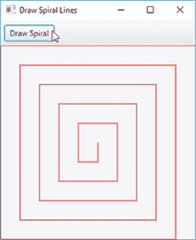

# 图 7.26

使用 `strokeLine()` 绘制螺旋线。

## 7.2 (用弧绘制螺旋线)

绘制一个圆形的螺旋线（图 7.27）。

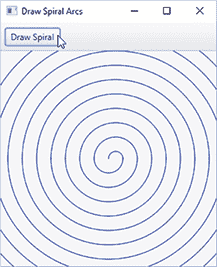

# 图 7.27

使用 `strokeArc()` 绘制螺旋线。

## 7.3 (旋转螺旋线)

每次点击 `Button` 时，螺旋线稍微旋转。

## 7.4 (颜色变化的螺旋线)

使螺旋线的每个弧段都使用前一个 `Color` 的稍亮的版本。从深色 `Color` 开始，然后使用 `Color` 方法 `brighter` 创建下一个段的 `Color`。

## 7.5 (增强型彩虹)

增强 Draw Rainbow 应用使用更细的弧，并通过额外的颜色变化创建更真实的彩虹。

# 7.18 总结

本章开始了对数据结构的介绍，探索了使用数组在列表和值表中存储和检索数据。章节示例演示了如何声明数组、初始化数组以及引用数组的单个元素。章节引入了增强型 `for` 语句来遍历数组。我们使用了异常处理来测试 `ArrayIndexOutOfBoundsException`，这种异常会在程序尝试访问数组边界外的元素时发生。我们还说明了如何将数组传递给方法，以及如何声明和操作多维数组。

我们引入了 `ArrayList<E>` 泛型集合，它提供了数组的所有功能和性能，以及动态调整大小等其他能力。我们使用 `add` 方法向 `ArrayList` 的末尾添加新项，并向 `ArrayList` 中插入项。使用 `remove` 方法删除指定项的首次出现，使用重载的 `remove` 方法删除指定索引处的项。我们使用 `size` 方法获取 `ArrayList` 中的项数。

我们将在第 16 章中继续介绍数据结构——泛型集合。第 16 章 介绍了 Java 集合框架，它使用泛型允许你指定特定数据结构所存储对象的精确类型。第 16 章 还介绍了 Java 的其他预定义数据结构。第 16 章 涵盖了 `Arrays` 类的其他方法。在阅读完当前章节后，你可以使用第 16 章中讨论过的某些 `Arrays` 方法，但某些 `Arrays` 方法需要了解书中后部分介绍的概念。第 20 章 讨论了泛型，泛型允许你创建通用的方法和类模型，这些模型可以声明一次，但用于许多不同的数据类型。第 21 章，自定义泛型数据结构展示了如何构建动态数据结构（例如列表、队列、栈和树），这些结构可以随着程序的执行而增长或收缩。

我们现在已经介绍了类、对象、控制语句、方法、数组和集合的基本概念。在第 8 章中，我们将深入探讨类和对象。

# 总结

## 7.1 节 引言

- `Arrays` (p. 258) 是固定长度的数据结构，由相同类型的相关数据项组成。

## 7.2 节 数组

- 数组是一组变量（称为元素或组件；p. 259），包含所有所有类型都相同的值。数组是对象，因此它们被视为引用类型。
- 程序通过数组访问表达式 (p. 259) 来引用数组的任何元素，该表达式包括数组名称，后跟方括号中的特定元素索引（`[]`；p. 259)。
- 每个数组的第一个元素索引为零 (p. 259) 有时被称为第 0 个元素。
- 索引必须是非负整数。程序可以使用表达式作为索引。
- 数组对象知道自己的长度，并将此信息存储在 `length` 实例中 (p. 260)。

## 7.3 节 声明和创建数组

- 要创建数组对象，要在数组创建表达式中指定数组元素类型和数量 (p. 260) 使用 `new`。
- 当创建数组时，每个元素接收一个默认值——数值类型元素为 `zero`，布尔类型元素为 `false`，引用类型为 `null`。
- 在数组声明中，类型和方括号组合在声明开头，表示声明中的所有标识符都是变量。
- 基本类型数组的每个元素包含一个声明类型的变量。引用类型数组的每个元素都是声明类型对象的引用。

## 7.4 节 数组示例

- 程序可以创建数组并使用数组初始化器初始化其元素 (p. 263)。
- 常量变量 (p. 264) 使用 `final` 声明，在使用之前必须初始化，并且之后无法修改。

## 7.5 节 异常处理：处理错误响应

- 异常表示程序执行期间发生了问题。
- 异常处理 (p. 270) 允许你创建容错性程序。
- 当 Java 程序执行时，`JVM` 会检查数组索引以确保它们大于或等于 0 且小于数组长度。如果程序使用了无效索引，Java 会生成一个异常 (p. 270) 来表示程序在运行时发生了错误。
- 要处理异常，将任何可能抛出异常的代码 (p. 270) 放在 `try` 语句中。
- `try` 块 (p. 270) 包含可能抛出异常的代码，而 `catch` 块 (p. 270) 包含了在发生异常时处理异常的代码。
- 你可以拥有多个 `catch` 块来处理相应 `try` 块中可能抛出的不同类型的异常。
- 当 `try` 块结束时，`try` 块中声明的任何变量将超出作用范围。
- `catch` 块声明了一个类型和一个异常参数。在 `catch` 块内部，你可以使用参数的标识符与被捕获的异常对象交互。
- 当执行程序时，会检查数组元素索引的有效性——所有索引必须大于或等于 0 且小于数组长度。如果尝试使用无效索引访问元素，将发生 `ArrayIndexOutOfBoundsException` (p. 271)。
- 异常对象的 `toString` 方法返回异常的错误消息。

## 7.6 节 案例研究：洗牌和发牌模拟

- 当在期望字符串的类型中使用对象时，对象的 `toString` 方法会被隐式调用（例如，当 `printf` 使用 `%s` 格式说明输出对象，或使用 `+` 运算符将对象接到字符串）。

## 7.7 节 增强型 `for` 语句

- 增强型 `for` 语句 (p. 276) 允许你不使用计数器遍历数组或集合的元素。增强型 `for` 语句的语法为：

```java
for (Type parameter : arrayName) {
   statement
}
```

- 增强型 `for` 语句无法修改数组元素。如果程序需要修改元素，请使用传统的计数控制 `for` 语句。

## 7.8 节 将数组传递给方法

- 当按值传递参数时，会创建参数值的副本并传递给调用方法。被调用方法仅与该副本工作。

## 7.9 节 按值传递 vs. 按引用传递

- 当按引用传递参数时，被调用方法可以直接访问调用者中的参数值并可能对其进行修改。
- Java 中的所有参数都是按值传递的。方法调用可以向方法传递两种类型的值——基本类型值的拷贝和对象引用的拷贝。虽然对象的引用是按值传递的（第 279 页），但方法仍然可以通过使用对象引用的拷贝并调用其 `public` 方法来与引用的对象进行交互。
- 当你向方法传递一个引用类型的数组或该数组的单个数组元素时，被调用的方法接收的是该数组或元素引用的拷贝。当你传递一个基本类型的单个元素时，被调用的方法接收的是该元素值的拷贝。
- 要向方法传递单个数组元素，请使用数组的带索引名。

## 第 7.11 节 多维数组

- 具有维度的多维数组通常用于表示由行和列排列的信息组成的数值表格。
- 具有 `m` 行 `n` 列的二维数组（第 285 页）被称为 `m`-by-`n` 数组。此类数组可以使用如下形式的数组初始化器进行初始化：

```java
arrayType[][] arrayName = {{row1 initializer}, {row2 initializer}, ...};
```

- 多维数组被维护为独立的一维数组的数组（数组）。因此，二维数组中每行的长度并不要求相同。
- 每行具有相同列数的多维数组可以使用如下形式的数组创建表达式创建：

```java
arrayType[][] arrayName = new arrayType[numRows][numColumns];
```

## 第 7.13 节 变长参数列表

- 方法参数列表中，一个参数类型后跟一个省略号（`…`；第 295 页）表示该方法接收该特定类型的数量数量的参数。省略号在方法的参数列表中只能出现一次。它必须位于参数列表的末尾。
- 变长参数列表（第 295 页）在方法体内部被视为数组。可以使用数组的 `length` 字段获取数组中参数的数量。

## 第 7.14 节 使用命令行参数

- 从命令行向 `main` 传递参数（第 296 页）是通过在 `main` 的参数列表中包含一个 `String[]` 类型的参数来实现。按照惯例，`main` 的参数命名为 `args`。
- Java 将 `java` 命令中类名之后出现的命令行参数作为数组 `args` 中的 `String` 传递给应用程序的 `main` 方法。

## 第 7.15 节 `Arrays` 类

- `Arrays` 类（第 298 页）提供了执行常用数组操作的 `static` 方法，包括用于排序数组的 `sort`、用于搜索已排序数组的 `binarySearch`、用于比较数组的 `equals` 以及用于在数组中放置项目的 `fill`。
- `System` 类的 `arraycopy` 方法（第 299 页）允许将一个数组的元素复制到另一个数组中。

## 第 7.16 节 集合简介与 `ArrayList` 类

- Java API 的集合类提供了高效的方法来组织、存储和检索数据，而无需知道数据是如何存储的。
- `ArrayList<E>`（第 301 页）与数组类似，但可以动态调整大小。
- `add` 方法（第 301 页）使用一个参数将元素添加到末尾。
- `size` 方法返回 `ArrayList` 中元素的数量。
- `remove` 方法使用一个参数从指定位置删除元素。
- `contains` 方法在找到元素时返回 `true`，否则返回 `false`。

# 练习题

## 1. 7.1

填写以下语句中的空缺：

- Java 中的所有参数都是按值传递的。方法调用可以向方法传递两种类型的值——基本类型值的拷贝和对象引用的拷贝。虽然对象的引用是按值传递的，但方法仍然可以通过使用对象引用的拷贝并调用其 `public` 方法来与引用的对象进行交互。
- 当你向方法传递一个引用类型的数组或该数组的单个数组元素时，被调用的方法接收的是该数组或元素引用的拷贝。当你传递一个基本类型的单个元素时，被调用的方法接收的是该元素值的拷贝。
- 要向方法传递单个数组元素，请使用数组的带索引名。

## 2. 7.2

判断以下陈述：

- 具有维度的多维数组通常用于表示由行和列排列的信息组成的数值表格。
- 具有 `m` 行 `n` 列的二维数组被称为 `m`-by-`n` 数组。此类数组可以使用如下形式的数组初始化器进行初始化：

```java
arrayType[][] arrayName = {{row1 initializer}, {row2 initializer}, ...};
```

- 多维数组被维护为独立的一维数组的数组（数组）。因此，二维数组中每行的长度并不要求相同。
- 每行具有相同列数的多维数组可以使用如下形式的数组创建表达式创建：

```java
arrayType[][] arrayName = new arrayType[numRows][numColumns];
```


## 7.3 填空练习题

- 方法参数列表中，一个参数类型后跟一个省略号（`…`；第 295 页）表示该方法接收该特定类型的数量数量的参数。省略号在方法的参数列表中只能出现一次。它必须位于参数列表的末尾。
- 变长参数列表（第 295 页）在方法体内部被视为数组。可以使用数组的 `length` 字段获取数组中参数的数量。

## 7.4 使用命令行参数

- 从命令行向 `main` 传递参数（第 296 页）是通过在 `main` 的参数列表中包含一个 `String[]` 类型的参数来实现的。按照惯例，`main` 的参数命名为 `args`。
- Java 将 `java` 命令中类名之后出现的命令行参数作为数组 `args` 中的 `String` 传递给应用程序的 `main` 方法。

## 7.5 `Arrays` 类

- `Arrays` 类（第 298 页）提供了执行常用数组操作的 `static` 方法，包括用于排序数组的 `sort`、用于搜索已排序数组的 `binarySearch`、用于比较数组的 `equals` 以及用于在数组中放置项目的 `fill`。
- `System` 类的 `arraycopy` 方法（第 299 页）允许将一个数组的元素复制到另一个数组中。

## 7.6 集合简介与 `ArrayList` 类

- Java API 的集合类提供了高效的方法来组织、存储和检索数据，而无需知道数据是如何存储的。
- `ArrayList<E>`（第 301 页）与数组类似，但可以动态调整大小。
- `add` 方法（第 301 页）使用一个参数将元素添加到末尾。
- `size` 方法返回 `ArrayList` 中元素的数量。
- `remove` 方法使用一个参数从指定位置删除元素。
- `contains` 方法在找到元素时返回 `true`，否则返回 `false`。

## 答案

### 7.1 填写以下语句中的空缺

- Java 中的所有参数都是按值传递的。
- 数组是元素的。
- 引用的拷贝。
- 相同数量的列。
- 数组初始化器。
- `for` 语句。
- 逗号。
- `length` 字段。
- 第一个参数；`args`。
- 省略号。

### 7.2 判断以下陈述

- False（数组存储相同类型的元素）。
- `int`。
- True。
- `String[]`。

### 7.3 填空练习题

- `final`。
- `double`。
- 索引。
- `1.667`。
- `3.333`。
- `for` 语句。
- `x`。

### 7.4 执行以下任务对于 `table`

- `5`。
- 三行和三列。
- `ARRAY_SIZE`。
- 多少个元素？
- `y`。

### 7.5 发现并修正以下代码段中的错误

```
final int ARRAY_SIZE = 5;
ARRAY_SIZE = 10;
```

```
int[] b = new int[10];
for (int i = 0; i <= b.length; i++)
    b[i] = 1;
```

```
int[][] a = {{1, 2}, {3, 4}};
a[1, 1] = 5;
```

3. 增强型 `for` 语句。
4. 索引（或下标或位置数字）。
5. 二维的。
6. `for (double d : numbers)`。
7. 一个 `String` 数组，按照惯例称为 `args`。
8. `args.length`。
9. `test`。
10. 省号 (`…`)。

## 7.2 答案

1. 。数组只能存储相同类型的值。
2. 错误。数组索引必须是整数或整数表达式。
3. 对于数组的单个原始类型元素：错误。被调用的方法接收并处理该元素值的副本，因此修改不会影响原始值。然而，如果将数组的引用传递给方法，在被调用方法中对数组元素进行的修改确实会反映在原始数组中。对于引用类型的单个元素：正确。被调用的方法接收该元素引用的副本，对所引用对象的更改将反映在原始数组元素中。
4. 错误。命令行参数通过空格分隔。

## 7.3 答案

1. `final int ARRAY_SIZE = 10;`
2. `double[] fractions = new double[ARRAY_SIZE];`
3. `fractions[4]`
4. `fractions[9] = 1.667;`
5. `fractions[6] = 3.333;`
6.
```
1   double total = 0.0;
2   for (int x = 0; x < fractions.length; x++)
3      total += fractions[x];
```

## 7.4 答案

1. `int[][] table = new int[ARRAY_SIZE][ARRAY_SIZE];`
2. 九。
3.
```
1   for (int x = 0; x < table.length; x++)
2      for (int y = 0; y < table[x].length; y++)
3         table[x][y] = x + y;
```

## 7.5 答案

1. 错误：在初始化后给常量赋值。
   修正：在 `final int ARRAY_SIZE` 声明中为常量分配正确的值，或者声明另一个变量。
2. 错误：引用了数组范围之外的数组元素 (`b[10]`)。
   修正：将 `<=` 运算符改为 `<`。
3. 错误：数组索引执行不正确。
   修正：将语句改为 `a[1][1] = 5;`。

## 练习

## 7.6 为下列每个语句填空

1. 一维数组 `p` 包含四个元素。这些元素的名称为 ________，________ 和 ________。
2. 为数组命名、说明其类型并指定数组的维度数称为 ________ 数组。
3. 在二维数组中，第一个索引标识元素的 ________，第二个索引标识元素的 ________。
4. 一个 *m* 乘 *n* 数组包含 ________ 行，________ 列和 ________ 个元素。
5. 数组 `d` 中第 3 行第 5 列的元素名称是 ________。

## 7.7 判断下列每个陈述的正确或错误。如果错误，请解释原因

1. 为了引用数组中的特定位置或元素，我们指定数组的名称和特定元素的值。
2. 数组声明会为数组预留空间。
3. 为了表示为整数数组 `p` 预留 100 个位置，你应该写：
```
p[100];
```
4. 将 15 元素数组初始化为零的应用必须至少包含一个 `for` 语句。
5. 计算二维数组元素总和的应用必须包含嵌套的 `for` 语句。

## 7.8 编写 Java 语句完成以下各项任务

1. 显示数组 `f` 中第 6 个元素的值。
2. 将一维整数数组 `g` 的五个元素中的每一个初始化为 `8`。
3. 计算浮点数组 `c` 的 100 个元素的总和。
4. 将 11 元素的数组 `a` 复制到包含 34 个元素的数组 `b` 的部分。
5. 确定并显示 99 元素浮点数组 `w` 中的最小值和最大值。

## 7.9 考虑一个二三整数数组 `t`

1. 编写一条声明并创建 `t` 的语句。
2. `t` 有多少行？
3. `t` 有多少列？
4. `t` 有多少个元素？
5. 为 `t` 第 1 行的所有元素编写访问表达式。
6. 为 `t` 第 2 列的所有元素编写访问表达式。
7. 编写单条语句将 `t` 第 0 行第 1 列的元素设置为零。
8. 编写单独语句将 `t` 的每个元素初始化为零。
9. 编写嵌套的 `for` 语句将 `t` 的每个元素初始化为零。
10. 编写嵌套的 `for` 语句从用户处输入 `t` 元素的值。
11. 编写一系列语句，确定并显示 `t` 中的最小值。
12. 编写单条 `printf` 语句，显示 `t` 第一行的元素。
13. 编写一条语句计算 `t` 第三列元素的总和。不要使用迭代。
14. 编写一系列语句以表格格式显示 `t` 的内容。将列索引作为标题，并将行索引列在左侧。

## 7.10 销售金

使用一维数组解决以下问题：公司按佣金支付销售人员工资。销售人员每周获得 200 美元加上其销售额的 9%。例如，每周销售额为 5000 美元的销售人员获得 200 美元加上 9%，总计 650。编写一个应用程序（使用计数器数组），确定有多少销售人员的工资落在以下范围（假设每个销售人员的工资取整）：

1. $200–299
2. $300–399
3. $400–499
4. $500–599
5. $600–699
6. $700–799
7. $800–899
8. $900–999
9. $1000 以上

以表格格式汇总结果。

## 7.11 编写执行以下一维数组操作的语句

1. 将整数数组 `counts` 的 10 个元素设置为零。
2. 将整数数组 `bonus` 的 15 个元素中的每一个加一。
3. 以列格式显示整数数组 `bestScores` 的五个值。

## 7.12 去重

使用一维数组解决以下问题：编写一个应用程序，输入五个数字，每个数字在 10 到 100 之间（包含边界）。每读取一个数字，只有当它不是已读取数字的重复项时才显示它。考虑最坏情况，即五个数字都不同。使用尽可能小的数组来解决此问题。在用户输入每个新值后，显示完整的唯一值集合。

## 7.13 标记三五二维数组 `sales` 的元素，以指示它们通过以下程序段设置为零的顺序

```
1   for (int row = 0; row < sales.length; row++) {
2      for (int col = 0; col < sales[row].length; col++) {
3            sales[row][col] = 0;
4        }
5     }
```

## 7.14 变长参数列表

编写一个应用程序，使用变长参数列表计算传递给方法 `product` 的系列整数积。多次调用你的方法，每次调用的参数数量都不同。

## 7.15 (命令行参数)

重写 图 7.2，使得数组的大小由第一个命令行参数指定。如果没有提供任何参数的命令行参数，则使用 10 作为数组的默认大小。

## 7.16 (使用增强型 `for` 语句)

编写一个应用程序，使用增强型 `for` 语句求和命令行参数传递的 `double` 值。*提示：使用 `Double` 类的 `static` 方法 `parseDouble` 将 `String` 转换为 `double` 值。*

## 7.17 (掷骰子)

编写一个应用程序模拟掷两个骰子的过程。该应用程序应使用一次 `Random` 类对象来掷第一个骰子，再次使用它掷第二个骰子。然后计算两个值之和。每个骰子可以显示 1 到 6 之间的整数值，因此数值之和将在 2 到 12 之间变化，其中 7 是出现频率最高，2 和 12 出现频率最低。图 7.28 显示了两个骰子的 36 种可能组合。你的应用程序应该掷骰子 36,000,000 次。使用一个一维数组统计每个可能的和出现的次数。以表格格式显示结果。

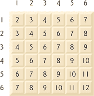

### 图 7.28
两个骰子的 36 种可能之和。

描述

## 7.18 (骰子游戏)

编写一个应用程序运行 1,000,000 局骰子游戏（图 6.8）并回答以下问题：

1. 在第一次掷、第二次掷、……第二十次掷以及第二十次之后，有多少局游戏是赢了？
2. 在第一次掷、第二次掷、……第二十次掷以及第二十次之后，有多少局游戏是输了？
3. 玩骰子获胜的概率是多少？*注：你会发现骰子游戏是赌场中最公平的游戏之一。你认为这意味着什么？*
4. 一局骰子游戏的平均长度是多少？
5. 获胜概率会随着游戏长度的增加而提高吗？

## 7.19 (航空公司预订系统)

某航空公司刚刚为其新的自动预订系统购买了一台计算机。你被要求开发这个新系统。你需要编写一个应用程序，为该航空公司唯一的飞机的每次航班（容量：10 个座位）分配座位。

你的应用程序应该显示以下选项：`输入 1 选择头等舱` 和 `输入 2 选择经济舱`。如果用户输入 `1`，你的应用程序应在头等舱区域分配座位（1–5 号）。如果用户输入 `2`，你的应用程序应在经济区分配座位（6–10 号）。然后你的应用程序应该显示一张登机牌，指示该人的座位号以及是在飞机的头等舱还是经济舱。

使用基本数据类型 `boolean` 的一维数组来表示飞机的座位图。将数组的所有元素初始化为 `false`，表示所有座位均空。每当分配一个座位时，将数组的相应元素设置为 `true`，表示该座位不再可用。

你的应用程序永远不要分配已经分配过的座位。当经济区满时，你的应用程序应该询问该人员是否可以被安排在头等舱（反之亦然）。如果是，进行相应的座位分配。如果否，显示消息 `"下班航班将在 3 小时后起飞。"`

## 7.20 (总销售额)

使用二维数组解决以下问题：一家公司有四名销售人员（1 到 4 号），销售五种不同的产品（1 到 5 号）。每天，每名销售人员为每种销售的产品提交一张单据。每张单包含以下内容：

1. 销售人员编号
2. 产品编号
3. 该产品当天销售的总金额

因此，每名销售人员每天提交 0 到 5 张销售单。假设上个月所有销售单的信息均可用。编写一个应用程序读取上个月的所有信息并以表格格式显示结果。使用二维数组来存储并汇总每个销售人员和每个产品的总销售额。

## 7.21 (乌龟图形)

Logo 让*乌龟图形* 的概念闻名世。想象有一只在程序控制下行走的机械乌龟。乌龟笔有两种状态：抬起或放下。当笔放下时，乌龟画出形状；当笔抬起时，它可以自由移动。

使用一个初始化为零的 20x20 数组 `floor`。假设乌龟笔抬起时位于 (0, 0)。应用程序必须处理的一组乌龟命令所示图 7.29。

| 命令 | 含义 |
| --- | --- |
| `1` | 抬起笔 |
| `2` | 放下笔 |
| `3` | 右转 |
| `4` | 左转 |
| `5,10` | 向移动 10 格（将 10 替换为不同的数字） |
| `6` | 显示 20 数组 |
| `9` | 数据结束（哨兵） |

### 图 7.29
乌龟图形命令。

假设乌龟位于中心附近。以下“程序”将绘制并显示一个 12x12 的正方形，保持笔抬起状态：

```
2
5,12
3
5,12
3
5,12
3
5,12
1
6
9
```

当乌龟带着笔移动时，将数组 `floor` 的相应元素设置为 `1`。当给出 `6` 命令时，显示数组。凡有 `1` 的地方显示一个星号。

## 7.22 (马巡游)

对于象棋爱好者来说，一个有趣的谜题是马巡游问题，它由数学家欧拉提出。马马可以在空棋盘上移动且仅访问一次 64 个方格中的每一个吗？我们在这里深入研究这个迷人的问题。

马只进行 L 形移动（在一个方向移动两格，在垂直方向移动一格）。因此，如图 7.30 所示，从空棋盘中间的一个方格开始，马（标记为 K）可以进行八种不同的移动（编号从 0 到 7）。

### 图 7.30
马的八种可能的移动。

一个 8x 8 的数组，行和列均从 0 编号到 7。骑士位于第 3 行第 4 列。骑士的八种可能移动方式为：方案 0，第 2 行第 6 列；方案 1，第 1 行第 5 列；方案 2，第 1 行第 3 列；方案 3，第 2 行第 2 列；方案 4，第 4 行第 2 列；方案 5，第 5 行第 3 列；方案 6，第 5 行第 5 列；方案 7，第 4 行第 6 列。

1. 在纸上画一个 8x8 的国际棋盘，并尝试手动完成一次“骑士巡游”（Knight’s Tour）。在起始格内写入 `1`，第二个格内写入 `2`，第三个写入 `3`，以此类推。在开始巡游之前，估计一下你认为能走多远，记住一次完整的巡游包含 64 步。你走了多远？这与你的估计接近吗？

2. 现在让我们开发一个应用程序，让骑士在棋盘上移动。棋盘由一个 8x8 的二维数组 `board` 表示。每个方格初始化为 0。我们通过水平和垂直分量来描述八种可能移动的每一种。例如，类型 0 的移动如图 7.30，包括水平向右移动两格，垂直向上移动一格。

类型 2 的移动包括水平向左移动一格，垂直向上移动两格。向左水平移动和向上垂直移动用负数表示。八种移动可以用两个一维数组 `horizontal` 和 `vertical` 描述：

```
horizontal[0] = 2 vertical[0] = -1
horizontal[1] = 1 vertical[1] = -2
horizontal[2] = -1 vertical[2] = -2
horizontal[3] = -2 vertical[3] = -1
horizontal[4] = -2 vertical[4] = 1
horizontal[5] = -1 vertical[5] = 2
horizontal[6] = 1 vertical[6] = 2
horizontal[7] = 2 vertical[7] = 1
```


让变量 `currentRow` 和 `currentColumn` 分别表示骑士当前位置的行和列。要执行类型为 `moveNumber` 的移动（`moveNumber` 在 0 到 7 之间），你的应用程序应该使用语句：

```
currentRow += vertical[moveNumber];
currentColumn += horizontal[moveNumber];
```

编写一个程序让骑士在棋盘上移动。保持一个从 `1` 到 `64` 变化的计数器。在骑士移动到的每个方格中记录最新的计数。测试每种可能的移动，检查骑士是否已经访问过该格。测试每种可能的移动以确保骑士不会落在棋盘之外。运行该程序。骑士走了多少步？

### 3. 启发式方法

在尝试编写和运行骑士巡游程序后，你可能获得了一些宝价值的见解。我们将利用这些见解来开发一种移动骑士的启发式（heuristic，即常识规则）方法。启发式并不保证成功，但精心设计的启发式方法会大大提高成功率。你可能观察到，边缘的格子比靠近中心的格子更难处理。事实上，最难处理或难以到达的格子是四个角。

直觉可能认为你应该先将骑士移动到最难处理的格子，留下最容易到达的格子，这样当棋盘在巡时变得拥挤时，成功的机会更大。

我们可以通过根据每个方格的易访问性进行分类来开发一种“易访问性启发式”，并始终将骑士（使用 L 形移动）移动到最难以访问的格子。我们用一个二维数组 `accessibility` 标记数字，表示每个特定方格可以从多少个格子到达。在空白国际棋盘上，最靠近中心的 16 个格子被评为 `8`，每个角格评为 `2`，其他格子的易访问性数字为 `3`、`4` 或 `6`，如下所示：

```
2  3  4  4  4  4  3  2
3  4  6  6  6  6  4  3
4  6  8  8  8  8  6  4
4  6  8  8  8  8  6  4
4  6  8  8  8  8  6  4
3  4  6  6  6  6  4  3
2  3  4  4  4  4  3  2
```

使用易访问性启发式编写新版本的骑士巡游。骑士应该始终移动到易访问性数字最低的方格。在平局的情况下，骑士可以移动到平局的方格。

> **注：** 随着骑士在棋盘上移动，随着更多格子被占用，你的程序应该减少易访问性数字。因此，巡游可以从四个角中的任何一个开始。

运行这个版本的程序。你获得完整的巡游了吗？修改你的程序运行 64 次巡游，从每个格子开始一次。你得到了多少次完整巡游？

### 4. 预测平局

编写一个骑士巡游版本，当遇到两个或多个格子平局时，通过预测选择易访问性的格子。

## 7.23（骑士巡游：暴力破解法）

在练习 7.22 的第 (c) 部分，我们开发了骑士巡游的解决方案。使用的方法被称为“易访问性启发式”，它生成的解决方案非常高效。

随着计算机能力的不断提高，我们将能够通过纯算力和相对简单的算法解决更多问题。我们将这种方法称为“暴力破解”（brute-force）问题求解。

1. 使用随机数生成让骑士随机在棋盘上移动（移动 L 形）。你的程序应该运行一次巡游并显示最终棋盘。骑士走了多远？
2. 可能 (a) 部分产生了一个较短的巡游。现在修改你的程序尝试 1000 次巡游。使用一维数组跟踪每个长度巡游的数量。当你的程序完成 1000 次巡游时，应以整洁的表格格式显示这些信息。最好的结果是什么？
3. 可能 (b) 部分给了你一些“像样”的巡游，但没有完整的巡游。现在让你的程序运行直到产生一次完整的巡游。[注意：这个版本的程序在强大的计算机上可能会运行数小时。]再次保留一个每个长度巡游的数量，并在发现第一个完整巡游时显示该表。你的程序在产生完整巡游之前尝试了多少次？花费了长时间？
4. 将暴力破解版本的骑士巡游与易访问性启发式版本进行比较。哪一个对问题进行了仔细的研究？哪个算法更难开发？哪个需要更多的计算能力？对于易访问性启发式方法，我们可以保证获得完整的巡游吗？对于暴力破解方法，我们可以保证获得完整的巡游吗？论述泛指暴力破解问题的优缺点。

### 19. 7.24 (八皇后问题)

对于象棋爱好者来说，另一个谜题是八皇后问题，它要求：是否可能在空闲的棋盘上放置八个皇后，使得没有任何一个皇后会“攻击”任何其他皇后（即：没有两个皇后位于同一行、同列或同一条对角线上）？使用练习 7.22 中培养的思维方法，为解决八皇后问题制定一个启发式算法。运行你的程序。

> **提示：** 可以为棋盘上的每个方格分配一个值，表示如果在该方格中放置皇后，空棋盘上有多少个方格会被“消除”。每个角色的值将被分配为 22，如图 7.31 所示。一旦将这些“消除数字”放置在所有 64 个方格中，一个合适的启发式策略可能是：将下一个皇后放置在消除数字最小的方格中。为什么这个策略在直觉上很有吸引力？

### 20. 7.25 (八皇后问题：暴力破解法)

在练习中，你将开发几种暴力破解方法来解决在练习 7.24 中引入的八皇后问题。


#### 图 7.31
在左上角放置皇后后消除的 22 个方格。

1. 使用在练习 7.23 中开发的随机暴力破解技术来解决八皇后问题。
2. 使用穷举法（即：尝试棋盘上八个皇后的所有可能组合）来解决八皇后问题。
3. 为什么穷举暴力法可能不适用于解决骑士游问题？
4. 对比随机暴力破解法和穷举暴力破解法。

### 21. 7.26 (骑士游：闭环路径测试)

在骑士游（练习 7.22）中，当骑士移动 64 步，接触棋盘上的每个方格一次且仅一次时，就发生了完整游。当第 64 步距离骑士开始游的方格仅一步之遥时，发生了闭环游。修改你在练习 7.22 中编写的程序，测试在发生完整游后是否发生了闭环游。

### 22. 7.27 (埃拉托尼筛法)

质数是任何大于 1 且只能被其自身和 1 整除的整数。埃拉托尼筛法是一种寻找质数的方法。它的运行机制如下：

1. 创建一个原始类型的 `boolean` 数组，所有元素均初始化为 `true`。索引为质数的数组元素将保持为 `true`。所有其他数组元素最终将被设置为 `false`。
2. 从数组索引 2 开始，确定给定元素是否为 `true`。如果是，则遍历数组剩余部分，并将所有索引为该 `true` 值元素索引倍数的的元素设置为 `false`。然后对下一个值为 `true` 的元素继续此过程。对于数组索引 2，数组中元素 2 之后的所有索引为 2 的倍数的元素（索引 4, 6, 8, 10 等等）都将被设置为 `false`；对于数组索引 3，数组中元素 3 之后的所有索引为 3 的倍数的元素（索引 6, 9, 12, 15 等等）都将被设置为 `false`；以此此类推。当此过程完成后，仍然为 `true` 的数组元素表示该索引是一个质数。

### 23. 7.28 (模拟：乌龟兔赛跑)

在这个问题中，你将重现经典的乌龟兔赛跑。使用变量跟踪动物的位置图 7.32，通过产生一个 1-10 之间的随机整数 *i*。对于乌龟，当 $1 \le i \le 5$ 时执行“快走”，当 $6 \le i \le 7$ 时执行“滑倒”，当 $8 \le i \le 10$ 时执行“慢走”。使用类似的技术移动兔子。通过显示以下内容开始比赛

```
BANG !!!!!
AND THEY’RE OFF !!!!!
```

对于每个时钟（即循环的每次迭代），显示一个 70 个位置的行，在乌龟的位置显示 `T`，在兔子的位置显示 `H`。偶尔，竞争者会落在同一个方格上。在这种情况下，乌龟咬了兔子，你的程序应该显示 `OUCH!!!`。除了 `T`、`H` 或 `OUCH!!!`（平局时）之外的所有输出位置都应该是空白。

在每行显示后，测试是否动物达到或超过了 70。如果是，显示胜利者并终止模拟。如果乌龟赢，显示 `TORTOISE WINS!!! YAY!!!`。如果兔子赢，显示 `Hare wins. Yuch.`。如果两个动物在同一个时钟内赢，你可能想偏袒乌龟（劣者），或者你可能想显示 `It’s a tie`。如果哪个都没有赢，再次执行循环以模拟下一个时钟。

### 7.29 (斐波那契数列)

斐波那契数列 0, 1, 1, 2, 3, 5, 8, 13, 21, … 从 0 和 1 开始，并具有后续每一项都是前两项之和的特性。

1. 编写一个方法 `fibonacci(n)` 计算第 *n* 个斐波那契数。将此方法整合到应用程序中，允许用户输入 `n` 的值。
2. 确定你的系统可以显示的最大斐波那契数。
3. 修改你在 (a) 部分中编写的程序，使用 `double` 代替 `int` 来计算并返回斐波纳契数字，并使用这个修改后的程序重复第 (b) 部分。

> 练习 7.30–7.34 具有相当的挑战性。一旦你完成了这些练习，你应该能够轻松地实现大多数流行的扑牌游戏。

### 1. 7.30（洗牌与发牌）

修改图 7.11 以发出一手五张牌扑克牌。然后修改图 7.10 中的 `DeckOfCards` 类，包含以下方法来判断手是否包含：
* 一对（pair）
* 两对（two pairs）
* 三条（three of a kind，例如三个 J）
* 四条（four of a kind，例如四个 A）
* 同花（flush，即五张同花的牌）
* 顺子（straight，即五张连续点值的牌）
* 葫芦（full house，即两一张点值的牌和三张另一点值的牌）

> **提示：** 为图 7.9 中的 `Card` 类添加 `getFace` 和 `getSuit` 方法。

### 2. 7.31（洗牌与发牌）

使用在练习 7.30 中开发的方法编写一个程序，分发两手五张牌的扑克牌，评估每手牌并判断哪手更好。

### 3. 7.32（项目：洗牌与发牌）

修改在练习 7.31 中开发的程序，使其能够模拟发牌员。发牌员的五张牌是“面朝下”出的，因此玩家看不到。程序随后应该评估发牌员的手牌，并根据牌的质量，让发牌员再抽取一、二或三张牌来替换原始牌中相应数量的牌。程序随后应重新评估发牌员的手牌。

> **注意：** 这是一个困难的问题！

### 4. 7.33（项目：洗牌与发牌）

修改在练习 7.32 中开发的程序，使其能够自动处理发牌员的手牌，但允许玩家决定替换其手牌中的哪些牌。程序随后应该评估两手牌并判断谁是胜者。现在使用这个新程序与电脑进行 20 局游戏。是你还是电脑赢的局更多？让你的朋友和电脑玩 20 局。谁赢的局更多？根据这些游戏的结果，完善你的扑克游戏程序。（这同样是一个困难的问题。）再玩 20 局。你修改后的程序玩得更好吗？

### 5. 7.34（项目：洗牌与发牌）

修改图 7.9–7.11 中的应用程序，使用 `Face` 和 `Suit` 枚举（enum）类型来表示牌的点数和花色。将这些 `enum` 类型中的每一个在各自的源文件中声明为 `public` 类型。每个 `Card` 应该有一个 `Face` 和 `Suit` 实例变量。这些变量应由 `Card` 构造函数初始化。在 `DeckOfCards` 类中，创建一个由 `Card` 构造函数初始化的 `Face` 数组和一个由 `Card` 构造函数初始化的 `Suit` 数组。使用 `enum` 类型表示牌的点数和花色。

### 6. 7.35（Fisher-Yates 洗牌）

在线研究图 7.10 中 `DeckOfCards` 类的 `shuffle` 方法，并使用 `enum` 重新实现 Fisher-Yates 洗牌算法。

# 特殊章节：构建你的计算机

在接下来的章节，我们将考虑一个计算机。累加器（accumulator）是一个存储运算结果的寄存器。我们将考虑一个带有累加器的计算机。让我们考虑计算机可以理解的简单易译机语言（SML）操作代码。练习 7.33 中的操作代码的最后两位数字是要操作的内存地址。

| 操作代码 | 含义 |
| --- | --- |
| **输入/输出操作:** | |
| `final int READ = 10` | 从键盘读取一个字到特定的内存位置。 |
| `final int WRITE = 11` | 将特定内存位置的字写入屏幕。 |
| **加载/存储操作:** | |
| `final int LOAD = 20` | 从特定的内存位置加载一个字到累加器。 |
| `final int STORE = 21` | 将累加器的字存储到特定的内存位置。 |
| **算术操作:** | |
| `final int ADD = 30` | 将内存位置的字加到累加器（结果留在累加器中）。 |
| `final int SUBTRACT = 31` | 从累加器中减去内存位置的字（结果留在累加器中）。 |
| `final int DIVIDE = 32` | 用内存位置的字除以累加器（结果留在累加器中）。 |
| `final int MULTIPLY = 33` | 用内存位置的字乘以累加器（结果留在累加器中）。 |
| **控制转移操作:** | |
| `final int BRANCH = 40` | 跳转到操作操作的内存位置。 |
| `final int BRANCHNEG = 41` | 如果累加器为负，则跳转到特定的内存位置。 |
| `final int BRANCHZERO = 42` | 如果累加器为零，则跳转到特定的内存位置。 |
| `final int HALT = 43` | 停止。程序已完成任务。 |

#### 图 7.33
Simpletron 机器语言（SML）操作代码。

第一个 SML 程序（图 7.34）从键盘读取两个数字，并计算并显示它们的和。指令 `+1007` 从键盘读取第一个数字并将其存入位置 `07`（该位置已初始化为 0）。然后指令 `+1008` 将下一个数字读入位置 `08`。`load` 指令 `+2007` 将第一个数字放入累加器，而 `add` 指令 `+3008` 将第二个数字加到累加器中的数字上。*所有 SML 算术指令都会将结果留在累加器中。* `store` 指令 `+2109` 将结果写回内存位置 `09`，然后由 `write` 指令 `+1109` 从该位置取出数字并显示（作为带符号的四位小数）。`halt` 指令 `+4300` 终止执行。

| 位置 | 数字 | 指令 |
| --- | --- | --- |
| 00 | `+1007` | (读取 A) |
| 01 | `+1008` | (读取 B) |
| 02 | `+2007` | (加载 A) |
| 03 | `+3008` | (相加 B) |
| 04 | `+2109` | (存储 C) |
| 05 | `+1109` | (写入 C) |
| 06 | `+4300` | (停止) |
| 07 | `+0000` | (变量 A) |
| 08 | `+0000` | (变量 B) |
| 09 | `+0000` | (结果 C) |

#### 图 7.34
读取两个整数并计算其和的 SML 程序。

第二个 SML 程序（图 7.35）从键盘读取两个数字，并确定并显示较大的值。注意使用指令 `+4107` 作为条件控制转移，这类似于 Java 的 `if` 语句。

| 位置 | 数字 | 指令 |
| --- | --- | --- |
| 00 | `+1009` | (读取 A) |
| 01 | `+1010` | (读取 B) |
| 02 | `+2009` | (加载 A) |
| 03 | `+3110` | (相减 B) |
| 04 | `+4107` | (负则跳转到 07) |
| 05 | `+1109` | (写入 A) |
| 06 | `+4300` | (停止) |
| 07 | `+1110` | (写入 B) |
| 08 | `+4300` | (停止) |
| 09 | `+0000` | (变量 A) |
| 10 | `+0000` | (变量 B) |

#### 图 7.35
读取两个整数并确定较大者的 SML 程序。

现在编写 SML 程序来完成以下每个任务：

1. 使用哨兵控制循环读取 10 个正数。计算并显示它们的和。
2. 使用计数控制循环读取七个数字（既有正数也有负数），并计算并显示它们的平均值。
3. 读取一系列数字，确定并显示最大的数。读取的第一个数字表示应该处理多少个数字。

## 7.37 (计算机模拟器)

在这个问题中，你将构建属于自己的计算机。不，你不需要焊接组件在一起。相反，你将使用强大的基于软件的模拟技术，为练习 7.36 中的 Simpletron 创建一个面向对象的软件模型。你的 Simpletron 模拟器将把你正在使用的计算机变成 Simpletron，你实际上能够运行、测试和调试你在练习 7.36 中编写的 SML 程序。

当你运行 Simpletron 模拟器时，它应该从开始显示：

```
欢迎来到 Simpletron！

请每次输入一条程序指令
（或一个数据字）。

我将显示位置和一个问号（?）。
然后你输入该位置的字。
输入 -9999 停止输入程序。
```

你的应用程序应该使用一个包含 100 个元素的一维数组 `memory` 来模拟 Simpletron 的内存。现在假设模拟器正在运行，让我们查看输入图 7.35（练习 7.36 中的程序时的对话：

```
Welcome to Simpletron!
Please enter your program one instruction
(or data word) at a time.
I will display the location and a question mark (?).
You then type the word for that location.
Type -9999 to stop entering your program.

00 +1009
01 +1010
02 +2009
03 +3110
04 +4107
05 +1109
06 +4300
07 +1110
08 +4300
09 +0000
```


# 第 7 章 练习

## 7.36 (Simpletron 机器语言编程)

第一个 SML 程序（图 7.34）从键盘读取两个数字，并计算并显示它们的和。指令 `+1007` 从键盘读取第一个数字并将其存入位置 `07`（该位置已初始化为 0）。然后指令 `+1008` 将下一个数字读入位置 `08`。`load` 指令 `+2007` 将第一个数字放入累加器，而 `add` 指令 `+3008` 将第二个数字加到累加器中的数字上。*所有 SML 算术指令都会将结果留在累加器中。* `store` 指令 `+2109` 将结果写回内存位置 `09`，然后由 `write` 指令 `+1109` 从该位置取出数字并显示（作为带符号的四位小数）。`halt` 指令 `+4300` 终止执行。

### 图 7.34
读取两个整数并计算其和的 SML 程序。

| 位置 | 数字 | 指令 |
| --- | --- | --- |
| 00 | `+1007` | (读取 A) |
| 01 | `+1008` | (读取 B) |
| 02 | `+2007` | (加载 A) |
| 03 | `+3008` | (相加 B) |
| 04 | `+2109` | (存储 C) |
| 05 | `+1109` | (写入 C) |
| 06 | `+4300` | (停止) |
| 07 | `+0000` | (变量 A) |
| 08 | `+0000` | (变量 B) |
| 09 | `+0000` | (结果 C) |

第二个 SML 程序（图 7.35）从键盘读取两个数字，并确定并显示较大的值。注意使用指令 `+4107` 作为条件控制转移，这类似于 Java 的 `if` 语句。

### 图 7.35
读取两个整数并确定较大者的 SML 程序。

| 位置 | 数字 | 指令 |
| --- | --- | --- |
| 00 | `+1009` | (读取 A) |
| 01 | `+1010` | (读取 B) |
| 02 | `+2009` | (加载 A) |
| 03 | `+3110` | (相减 B) |
| 04 | `+4107` | (负则跳转到 07) |
| 05 | `+1109` | (写入 A) |
| 06 | `+4300` | (停止) |
| 07 | `+1110` | (写入 B) |
| 08 | `+4300` | (停止) |
| 09 | `+0000` | (变量 A) |
| 10 | `+0000` | (变量 B) |

现在编写 SML 程序来完成以下每个任务：

1. 使用哨兵控制循环读取 10 个正数。计算并显示它们的和。
2. 使用计数控制循环读取七个数字（既有正数也有负数），并计算并显示它们的平均值。
3. 读取一系列数字，确定并显示最大的数。读取的第一个数字表示应该处理多少个数字。

## 7.37 (计算机模拟器)

在这个问题中，你将构建属于自己的计算机。不，你不需要焊接组件在一起。相反，你将使用强大的*基于软件的模拟*技术，为练习 7.36 中的 Simpletron 创建一个面向对象的*软件模型*。你的 Simpletron 模拟器将把你正在使用的计算机变成 Simpletron，你实际上能够运行、测试和调试你在练习 7.36 中编写的 SML 程序。

当你运行 Simpletron 模拟器时，它应该从开始显示：

```
Welcome to Simpletron!

Please enter your program one instruction
(or data word) at a time.

I will display the location and a question mark (?).
You then type the word for that location.
Type -9999 to stop entering your program.
```

你的应用程序应该使用一个包含 100 个元素的一维数组 `memory` 来模拟 Simpletron 的内存。现在假设模拟器正在运行，让我们查看输入图 7.35（练习 7.36 中的程序）时的对话：

```
00 ? +1009
01 ? +1010
02 ? +2009
03 ? +3110
04 ? +4107
05 ? +1109
06 ? +4300
07 ? +1110
08 ? +4300
09 ? +0000
10 ? +0000
11 ? -9999
```

### 图 7.37
一个内存转储示例。

让我们继续执行程序的第一条指令——即位置 `00` 处的 `+1009`。正如我们所指出的，`switch` 语句通过提示用户输入一个值、读取该值并存储在内存位置 `memory[operand]` 中来模拟此任务。然后，该值被读取到位置 `09`。

至此，第一条指令的模拟已经完成。剩下的工作是准备 Simpletron 执行下一条指令。由于刚刚执行的指令不是控制转移，我们只需要按照如下方式增加指令计数器寄存器：

```
instructionCounter++;
```

此操作完成了第一条指令的模拟执行。整个过程（即指令-执行周期）将随着获取下一个执行的指令而重新开始。

现在，让我们考虑分支指令（控制转移）是如何模拟的。我们需要做的只是适当调整指令计数器中的值。因此，无条件分支指令（`40`）在 `switch` 内部模拟为：

```
instructionCounter = operand;
```

条件“如果累加器为零则分支”指令模拟为：

```
if (accumulator == 0) {
   instructionCounter = operand;
}
```

至此，你应该实现你的 Simpletron 模拟器，并运行你在练习 7.36 中编写的每个 SML 程序。如果你愿意，可以为 SML 增加额外的功能并在模拟器中为这些功能提供支持。

你的模拟器应该检查各种类型的错误。例如，在程序加载阶段，用户输入到 Simpletron `memory` 中的每个数字都必须在 `-9999` 到 `+9999` 范围内。你的模拟器应该测试输入的每个数字是否在该范围内，如果不在，则继续提示用户重新输入数字，直到用户输入正确的数字为止。

在执行阶段，你的模拟器应该检查各种严重错误，例如尝试除以零、尝试执行无效的操作码以及累加器溢出（即算术运算的结果大于 `+9999` 或小于 `-9999`）。此类严重错误被称为致命错误。当检测到致命错误时，你的模拟器应该显示错误信息，例如：

```
*** Attempt to divide by zero ***
*** Simpletron execution abnormally terminated ***
```

并应该按照我们之前讨论的格式显示完整的计算机转储。这种处理方式将帮助用户定位程序中的错误。

## 7.38 (Simpletron 模拟器修改)

在练习 7.37 中，你编写了一个计算机的软件模拟，它可以执行用 Simpletron 机器语言（SML）编写的程序。在练习中，我们对 Simpletron 模拟器提出了几项修改和增强。在第 21 章的练习中，我们建议构建一个编译器，将高级编程语言（Basic 的变体）编写的程序转换为 Simpletron 机器语言。执行编译器产生的程序可能需要以下修改和增强：

1. 扩展 Simpletron 模拟器的内存以包含 1,000 个内存位置，以便 Simpletron 处理更大的程序。
2. 允许模拟器执行余数计算。此修改需要额外的 SML 指令。
3. 允许模拟器执行幂运算计算。此修改需要额外的 SML 指令。
4. 修改模拟器，使用十六进制值而非整数值表示 SML 指令。
5. 修改模拟器允许输出换行符。此修改需要额外的 SML 指令。
6. 修改模拟器以处理整数值外还处理浮点值。
7. 修改模拟器以处理字符串输入。*提示：* 每个 Simpletron 字可以分为两组，每组包含一个两位整数。每个两位整数代表一个字符的 ASCII（参见附录 B）。

## 7.39 (GradeBook 类修改)

修改图 7.18 中的 `GradeBook` 类，使其构造函数接受学生人数和考试次数作为参数，然后构建一个合适的二维数组，而不是接收一个预定义的二维数组。将新二维数组的每个元素设置为 `-1` 以表示未输入成绩。添加一个 `setGrade` 方法，用于为特定学生的特定考试设置成绩。修改图 7.19 中的 `GradeBookTest`，以输入学生人数和考试次数，并允许教师每次输入成绩。

## 7.40 (投票)

互联网和网页让更多人能够建立联系、加入事业、发表观点等。近期的总统候选人密集利用互联网来传播信息并为竞选筹款。在练习中，你将编写一个简单的投票程序，允许用户从 1（不重要）到 10（最重要）对五个社会问题进行评分。选择五个你认为重要的课题（例如政治问题、全球环境问题）。使用一维数组 `topics`（类型为 `String`）存储这些课题。为了总结调查结果，使用一个 5 行 10 列的二维数组 `responses`（类型为 `int`），每行对应 `topics` 数组中的一个元素。程序运行时，它应该要求用户对每个问题评分。让你的朋友家人参与调查。然后让程序显示结果摘要，包括：

1. 一个表格，左侧为五个主题，顶部为 10 个评分，列出每个主题收到的评分数量。
2. 在每行的右侧显示该议题的平均分。
3. 哪个议题的总分最高？显示该议题和总分。
4. 哪个议题的总分最低？显示该议题和总分。

---

# 第 8 章 类和对象：深入探讨

## 做出贡献

*   查看创建类声明的更多细节。
*   使用 `throw` 语句表示发生了问题。
*   在构造函数中使用 `this` 关键字来调用同一类中的另一个构造函数。
*   使用 `static` 变量和方法。
*   导入类的 `static` 成员。
*   使用 `enum` 类型创建具有唯一标识符的常量集合。
*   带参数的声明带参数的 `enum` 常数。
*   使用 `BigDecimal` 进行精确的货币计算。

## 8.1 引言

现在我们将更深入地查看类的构建、控制对类成员的访问以及创建构造函数。我们将展示如何通过 `throw` 异常来表示问题的发生——第 7.5 节讨论了 `catch` 异常。我们使用 `this` 关键字使一个构造函数能够方便地调用同一类中的另一个构造函数。我们将讨论*组合*——这种能力允许类将其他类的对象引用作为成员。我们将重新审视 *set* 和 *get* 方法的使用。回想一下第 6.10 节引入了基本的 `enum` 类型来声明一组常量。在本章中，我们将讨论 `enum` 类型与类之间的关系，证明 `enum` 类型像类一样，可以在它自己的文件中声明，并带有构造函数、方法和字段。本章还详细讨论了 `static` 类成员和 `final` 实例变量。我们展示了同一包内类之间的特殊关系。最后，我们将演示如何使用类 `BigDecimal` 执行精确的货币计算。另外两种类型的类——嵌套类和匿名内部类——将在我们稍后关于 GUI、图形和多媒体的章节中进行详细讨论。

## 8.2 `Time` 类案例研究

我们的第一个示例包含两个类——`Time1`（图 8.1）和 `Time1Test`（图 8.2）。`Time1` 类表示一天中的时间。`Time1Test` 的 `main` 方法创建一个 `Time1` 类的对象并调用它的方法。该程序的输出显示在图 8.2 中。

### `Time1` 类声明

类 `Time1` 的 `private int` 实例变量 `hour`、`minute` 和 `second`（图 8.1，第 5–7 行）代表世界时间格式（24 小时制格式，其中小时范围在 0–23 之间，分钟和秒范围在 0–59 之间）。`Time1` 包含 `public` 方法 `setTime`（第 11–22 行）、`toUniversalString`（第 25–27 行）和 `toString`（第 30–34 行）。这些方法也被称为类向其客户端提供的 `public` 服务或 `public` 接口。

```
 1   // Fig. 8.1: Time1.java
 2   // Time1 类声明保持 24 小时制格式的时间。
 3
 4   public class Time1 {
 5      private int hour; // 0 - 23
 6      private int minute; // 0 - 59
 7      private int second; // 0 - 59
 8
 9      // 使用世界时间设置新的时间值；如果小时、分钟或秒无效
10      // 则抛出异常
11      public void setTime(int hour, int minute, int second) {
12         // 验证小时、分钟和秒
13         if (hour < 0 || hour >= 24 || minute < 0 || minute >= 60 ||
14            second < 0 || second >= 60) {
15            throw new IllegalArgumentException(
16               "out of range");
17         }
18
19         this.hour = hour;
20         this.minute = minute;
21         this.second = second;
22      }
23
24      // 转换为世界时间格式字符串 (HH:MM:SS)
25      public String toUniversalString() {
26         return String.format("%02d:%02d:%02d", hour, minute, second);
27      }
28
29      // 转换为标准时间格式字符串 (H:MM:SS AM/PM)
30      public String toString() {
31         return String.format("%d:%02d:%02d %s",
32            hour % 12 == 0 ? 12 : hour % 12, //


## 默认构造函数

在这个示例中，类没有声明构造函数，因此编译器提供了一个默认构造函数（图 8.1）。`Time1` 实例保持 24 小时制的时间。

## `setTime` 方法与抛出异常

`setTime` 方法（第 11–22 行）是一个 `public` 方法，它声明三个 `int` 参数并使用它们设置时间。`hour` 值必须大于或等于 0 且小于 24，因为世界时间代表 0 到 23 小时。同样，`minute` 和 `second` 值必须大于或等于 0 且小于 60。对于范围之外的值，`setTime` 抛出一个 `IllegalArgumentException` 异常（第 15–16 行）。正如你在 7.5 节 中学的，可以使用 `try`…`catch` 来捕获异常并尝试恢复，我们将在图 8.2 中这样做。`throw` 语句（15）创建一个新的 `IllegalArgumentException` 对象。括号表示调用 `IllegalArgumentException` 构造函数。在这种情况下，我们调用了允许指定自定义错误消息的构造函数。异常对象创建后，`throw` 语句立即终止 `setTime` 并异常返回给尝试设置时间的调用。如果参数值均有效，第 19–21 行将它们赋值给 `hour`、`minute` 和 `second` 实例变量。

`toString` 方法（第 30–34 行）不接受参数并返回一个标准时间格式的 `String`，该格式由冒号分隔的 `hour`、`minute` 和 `second` 值组成，并后跟 AM 或 PM（例如 `11:30:17 AM` 或 `1:27:06 PM`）。与 `toUniversalString` 方法一样，`toString` 方法使用 `static String` 方法 `format` 将 `minute` 和 `second` 格式化为两位数，必要时包含前零。第 32 行使用条件运算符（`?:`）来确定 `String` 中 `hour` 的值——如果 `hour` 为 `0` 或 `12`（AM 或 PM），则显示为 12；否则显示为 1 到 11 之间的值。第 33 行的条件运算符决定返回 AM 还是 PM 作为 `String` 的部分。

请记住，Java 中的所有对象都有一个 `toString` 方法，用于返回对象的 `String` 表示。我们选择返回一个包含标准时间格式时间的 `String`。每当代码中需要 `String` 出现 `Time1` 对象时，`toString` 方法就会被隐式调用，例如在调用 `System.out.printf` 使用 `%s` 格式说明符输出值时。你也可以显式地调用 `toString` 来获取 `Time` 对象的 `String` 表示。

## 使用类 `Time1`

`Time1Test` 类（图 8.2）使用了类 `Time1`。第 7 行声明了 `Time1` 变量 `time` 并用一个新的 `Time1` 对象初始化它。运算符 `new` 隐式调用了类 `Time1` 的默认构造函数，因为 `Time1` 没有声明任何构造函数。为了确认 `Time1` 对象已正确初始化，第 10 行调用了 `private` 方法 `displayTime`（第 31–34 行），该方法反过来调用 `Time1` 对象的 `toUniversalString` 和 `toString` 方法，分别以通用时间格式和标准时间格式输出时间。注意，这里 `toString` 可以被隐式调用而不是显式调用。接下来，第 14 行调用 `time` 对象的 `setTime` 方法来更改时间。然后第 15 行再次调用 `displayTime` 以两种格式输出时间，以确认时间已正确设置。

```java
// Fig. 8.2: Time1Test.java
// Time1 object used in an app.

public class Time1Test {
   public static void main(String[] args) {
      // create and initialize a Time1 object
      Time1 time = new Time1(); // invokes Time1 constructor

      // output string representations of the time
      displayTime("After time object is created", time);
      System.out.println();

      // change time and output updated time
      time.setTime(13, 27, 6);
      displayTime("After calling setTime", time);
      System.out.println();

      // attempt to set time with invalid values
      try {
         time.setTime(99, 99, 99); // all values out of range
      }
      catch (IllegalArgumentException e) {
         System.out.printf("Exception: %s%n%n", e.getMessage());
      }

      // display time after attempt to set invalid values
      displayTime("After calling setTime with invalid values", time);
   }

   // displays a Time1 object in 24-hour and 12-hour formats
   private static void displayTime(String header, Time1 t) {
      System.out.printf("%s%nUniversal time: %s%nStandard time: %s%n",
         header, t.toUniversalString(), t.toString());
   }
}
```

### 图 8.2

在程序使用的 `Time1` 对象。

### 使用无效值调用 `Time1` 方法 `setTime`

为了说明 `setTime` 方法会验证其参数，第 20 行使用 `hour`、`minute` 和 `second` 的无效参数 `99` 调用了 `setTime` 方法。该语句放置在 `try` 块（第 19–21 行）中，以防 `setTime` 抛出 `IllegalArgumentException`，由于参数全部无效，它确实这样做。当这种情况发生时，异常在第 22–24 行被捕获，第 23 行通过调用 `getMessage` 方法显示异常的错误信息。第 27 行再次以两种格式输出时间，以确认当提供无效参数时 `setTime` 没有改变时间。

### `Time1` 类声明的软件工程

考虑关于类 `Time1` 类设计的几个问题。实例变量 `hour`、`minute`、`second` 都被声明为 `private`。类内部的实际表示对客户端并不重要。例如，`Time1` 将时间表示为午夜以来的秒数是合理的。练习 8.5 显示了 `Time1` 可以使用相同的 `public` 方法，而无需感知这一点。

## 8.4 使用 `this` 引用引用当前对象的成员

每个对象都可以通过关键字 `this`（有时称为 `this` 引用）访问其自身的引用。当为特定对象调用实例方法时，方法的方法体会隐式地使用关键字 `this` 来引用对象的实例变量和其他方法。这使得类的代码知道应该操作哪个对象。正如你在图 8.4 中所示的，你也可以在实例方法的方法体中显式地使用关键字 `this`。第 8.5 节展示了关键字 `this` 的另一个有趣用法。第 8.11 节解释了为什么关键字 `this` 不能在 `static` 方法中使用。

图 8.4 展示了 `this` 引用的隐式用法和显式用法。这个示例是我们第一次在一个文件中声明两个类——类 `ThisTest` 声明在第 4–9 行，类 `SimpleTime` 声明在第 12–41 行。当你编译一个包含多个类的 `.java` 文件时，编译器会为每个类生成单独的 `.class` 文件。在这种情况下，会生成两个单独的文件——`SimpleTime.class` 和 `ThisTest.class`。当一个源代码 (`.java`) 文件包含多个类声明时，编译器会将 `.class` 文件放在同一个目录下。同样注意在图 8.4 中，只有类 `ThisTest` 被声明为 `public`。一个源文件文件只能包含一个 `public` 类——否则会发生编译错误。非 `public` 类只能被同一包中的其他类使用——回想第 3.2.5 节，编译到同一个目录的类在同一个包中。因此，在这个示例中，类 `SimpleTime` 只能被类 `ThisTest` 使用。

```java
// Fig. 8.4: ThisTest.java
// this 被隐式和显式地使用以引用对象的成员。

public class ThisTest {
   public static void main(String[] args) {
      SimpleTime time = new SimpleTime(15, 30);
      System.out.println(time.buildString());
   }
}

// class SimpleTime 展示了 “this” 引用
class SimpleTime {
   private int hour; // 0-23
   private int minute; // 0-59
   private int second; // 0-59

   // 如果构造函数使用的参数名称与
   // 实例变量相同，则需要 “this” 引用
   // 来区分这些名称
   public SimpleTime(int hour, int minute, int second) {
      this.hour = hour; // 设置 “this” 对象的 hour
      this.minute = minute; // 设置 “this” 对象的 minute
      this.second = second; // 设置 “this” 对象的 second
   }

   // 使用显式和隐式的 “this” 调用 toUniversalString
   public String buildString() {
      return String.format("%s: %s%n%s: %s",
         "this.toUniversalString()", this.toUniversalString(),
         "toUniversalString()", toUniversalString());
   }

   // 转换为通用时间格式 (HH:MM:SS) 的字符串
   public String toUniversalString() {
      // 这里不需要 “this” 来访问实例变量，
      // 因为方法没有名称与实例变量
      // 相同的局部变量
      return String.format("%02d:%02d:%02d",
         this.hour, this.minute, this.second);
   }
}
```

### 图 8.4

`this` 被隐式和显式地使用以引用对象的成员。

## 8.5 重载构造函数

```java
// Fig. 8.5: Time2.java
// Time2 class declaration with overloaded constructors.
public class Time2 {
   private int hour; // 0 - 23
   private int minute; // 0 - 59
   private int second; // 0 - 59

   // Time2 no-argument constructor:
   // initializes each instance variable to zero
   public Time2() {
      this(0, 0, 0); // invoke constructor with three arguments
   }

   // Time2 constructor: hour supplied, minute and second defaulted to 0
   public Time2(int hour) {
      this(hour, 0, 0); // invoke constructor with three arguments
   }

   // Time2 constructor: hour and minute supplied, second defaulted to 0
   public Time2(int hour, int minute) {
      this(hour, minute, 0); // invoke constructor with three arguments
   }

   // Time2 constructor: hour, minute and second supplied
   public Time2(int hour, int minute, int second) {
      if (hour < 0 || hour >= 24) {
         throw new IllegalArgumentException("hour must be 0-23");
      }
      if (minute < 0 || minute >= 60) {
         throw new IllegalArgumentException("minute must be 0-59");
      }
      if (second < 0 || second >= 60) {
         throw new IllegalArgumentException("second must be 0-59");
      }
      this.hour = hour;
      this.minute = minute;
      this.second = second;
   }

   // Time2 constructor: another Time2 object supplied
   public Time2(Time2 time) {
      // invoke constructor with three arguments
      this(time.hour, time.minute, time.second);
   }

   // Set Methods
   // set a new time value using universal time;
   // validate the data
   public void setTime(int hour, int minute, int second) {
      if (hour < 0 || hour >= 24) {
         throw new IllegalArgumentException("hour must be 0-23");
      }
      if (minute < 0 || minute >= 60) {
         throw new IllegalArgumentException("minute must be 0-59");
      }
      if (second < 0 || second >= 60) {
         throw new IllegalArgumentException("second must be 0-59");
      }
      this.hour = hour;
      this.minute = minute;
      this.second = second;
   }

   // validate and set hour
}
```


```java
public void setHour(int hour) {
    if (hour < 0 || hour >= 24) {
        throw new IllegalArgumentException("hour must be 0-23");
    }
    this.hour = hour;
}

// validate and set minute
public void setMinute(int minute) {
    if (minute < 0 || minute >= 60) {
        throw new IllegalArgumentException("minute must be 0-59");
    }
    this.minute = minute;
}

// validate and set second
public void setSecond(int second) {
    if (second < 0 || second >= 60) {
        throw new IllegalArgumentException("second must be 0-59");
    }
    this.second = second;
}

// Get Methods

// get hour value
public int getHour() { return hour; }

// get minute value
public int getMinute() { return minute; }

// get second value
public int getSecond() { return second; }

// convert to String in universal-time format (HH:MM:SS)
public String toUniversalString() {
    return String.format(
        "%02d:%02d:%02d", getHour(), getMinute(), getSecond());
}

// convert to String in standard-time format (H:MM:SS AM or PM)
public String toString() {
    return String.format("%d:%02d:%02d %s",
        ((getHour() == 0) ? 12 :
        ((getHour() % 12 == 0) ? 12 : getHour() % 12)),
        getMinute(), getSecond(),
        (getHour() < 12) ? "AM" : "PM");
}
```

# 图 8.5: `Time2.java`

带有重载构造函数的 `Time2` 类声明。

# 类 `Time2` 的构造函数——通过 `this` 调用其他构造

第 11–13 行声明了一个**无参构造函数**，它可以在不传递参数的情况下被调用。在方法体中使用如所示的 `this` 是*重用*初始化代码的一种流行方法。这种以此方式调用另一个构造函数被称为**委托构造函数**。如果我们需要更改 `Time2` 对象的初始化方式，只需要修改类构造函数调用的那个构造函数即可。第 16–18 行声明了一个带有单个 `int` 参数的 `Time2` 构造函数，该参数表示 `hour`，而 `minute` 和 `second` 则传入 0。第 21–23 行声明了一个接收两个 `int` 参数的 `Time2` 构造函数，分别表示 `hour` 和 `minute`，而 `second` 则传入 0。与无参构造函数一样，每个构造函数都调用了三参数构造函数。第 26–42 行声明了接收三个 `int` 参数的 `Time2` 构造函数，分别表示 `hour`、`minute` 和 `second`。该构造函数验证并初始化实例变量。第 45–48 行声明了一个接收另一个 `Time2` 对象引用的 `Time2` 构造函数。参数对象的值被传递给三参数构造函数以初始化 `hour`、`minute` 和 `second`。第 47 行通过表达式 `time.hour`、`time.minute` 和 `time.second` 直接访问参数 `time` 的 `hour`、`minute` 和 `second` 值——尽管这些变量在 `Time2` 类中被声明为 `private`。这是由于同类类对象之间的一种特殊关系。

# 类 `Time2` 的 `setTime` 方法

`setTime` 方法（第 53–69 行）如果方法的任何参数超出范围，则会抛出 `IllegalArgumentException` 异常（第 55、59 和 63 行）。否则，它将 `Time2` 的实例变量设置为参数的值（第 66–68 行）。

# 关于类 `Time2` 的 Set 和 Get 方法以及构造函数的说明

`Time2` 的 `get` 方法是由类中的其他方法调用的。特别是，`toUniversalString` 和 `toString` 方法分别在第 111 行和第 117–118 行调用了 `getHour`、`getMinute` 和 `getSecond`。在这些情况下，这些方法本可以直接访问类的私有数据而无需调用 `get` 方法。然而，考虑将时间的表示形式从三个 `int` 值（需要 12 字节内存）更改为单个 `int` 值，该值代表自午夜以来流逝的秒总数（仅需要 4 字节内存）。如果我们进行了这样的更改，那么只有直接访问 `private` 数据的方法体才需要修改——特别是三参数构造函数、`setTime` 方法以及用于 `hour`、`minute` 和 `second` 的单独的 `set` 和 `get` 方法。不需要修改 `toUniversalString` 或 `toString` 方法的方法体，因为它们*没有*直接访问数据。以这种方式设计类可以减少在更改类实现时发生编程错误的概率。

同样地，每个 `Time2` 构造函数都可以包含来自三参数构造函数的相应语句的副本。这样做可能会稍微高效一点，因为消除了额外的构造函数调用。但是，`duplicating`语句会让更改类的内部数据表示变得更加困难。让 `Time2` 构造函数调用带三个参数的构造函数，要求对三参数构造函数实现的任何更改都只需进行一次。此外，编译器可以通过删除对简单方法的调用并将其替换为声明的展开代码来优化程序——这种技术被称为 `inlining the code`（代码内联），它可以提高程序性能。

# 使用类 `Time2` 的重载构造函数

`Time2Test` 类（图 8.6）调用了重载的 `Time2` 构造函数（第 6–10 行和第 21 行）。第 6 行调用了 `Time2` 无参数构造函数。第 7–10 行演示了向其他 `Time2` 构造函数传递参数。第 7 行调用了在图 8.5 中第 16–18 行接收一个 `int` 的单参数构造函数。图 8.6 的第 8 行调用了在图 8.5 中第 21–23 行的双参数构造函数。图 8.6 的第 9 行调用了在图 8.5 中第 26–42 行的三参数构造函数。图 8.6 的第 10 行调用了在图 8.5 中第 45–48 行的接收 `Time2` 的单参数构造函数。接下来，应用程序显示每个 `Time2` 对象的 `String` 表示，以确认它们已正确初始化（图 8.6 的第 13–17 行）。

```java
// 图 8.6 Time2Test.java
// 重载构造函数用于初始化 Time2 对象。

public class Time2Test {
    public static void main(String[] args) {
        System.out.println("Constructed with:");

        Time2 t1 = new Time2(); // 00:00:00
        Time2 t2 = new Time2(0); // 00:00:00
        Time2 t3 = new Time2(21); // 00:00:00
        Time2 t4 = new Time2(12, 25); // 00:00:00
        Time2 t5 = new Time2(21, 34); // 21:34:00

        try {
            Time2 t6 = new Time2(27, 74, 99); // invalid values
        } catch (IllegalArgumentException e) {
            System.out.println("Exception while initializing t6: " + e.getMessage());
        }
    }

    private static void displayTime(String header, Time2 t) {
        System.out.printf("%s%02d:%02d:%02d%n", header, t.getHour(), t.getMinute(), t.getSecond());
    }
}
```

# 图 8.6 用于初始化 Time2 对象的重载构造函数

# 默认构造函数和无参数构造函数

每个类*必须*至少有一个构造函数。如果你不在类中提供任何构造函数，编译器会创建一个不接受任何参数的*默认构造函数*。该默认构造函数将实例变量初始化为指定的初始值或其默认值（基本类型为零，布尔类型为 false，引用类型为 null）。

记住，如果你的类声明了构造函数，编译器将*不会*创建默认构造函数。在这种情况下，如果需要默认初始化，你必须声明无参数构造函数。和默认构造函数一样，无参数构造函数是用空括号调用的。`Time2` 无参数构造函数（在图 8.5 中第 11–13 行）通过向三参数构造函数传递 0 来显式初始化 `Time2` 对象。由于 0 是 `int` 实例变量的默认值，无参数构造函数实际上可以声明为空体。在这种情况下，当调用无参数构造函数时，每个实例变量将获得其默认值。如果我们省略无参数构造函数，该类的客户端将无法通过表达式 `new Time2()` 创建 `Time2` 对象。

# set 和 get 方法的注意事项

如你所知，客户端代码只能通过类的方法来操作类的私有字段。典型的操作可能是通过 `computeInterest` 方法调整 `BankAccount` 类的一个 `private` 实例变量（客户的银行余额）。*set* 方法通常被称为**变变器方法**，因为它们通常*改变*对象的状态——即*修改*实例变量的值。*get* 方法通常被称为**访问器方法**或**查询方法**。

# set 和 get 方法与 `public` 数据

提供 `set` 和 `get` 功能本质上与将类的实例变量设置为 `public` 是等同的。这是让 Java 在软件工程中极具吸引力的众多细微之处之一。`public` 实例变量可以被任何持有该变量所在对象引用的方法读取或写入。如果一个实例变量被声明为 `private`，那么 `public` 的 `get` 方法确实允许其他方法访问它，但 `get` 方法可以 `control` 客户端访问它的方式。例如，`get` 方法可以控制其返回的数据格式，从而保护客户端代码免受实际数据表示的影响。`public` 的 `set` 方法可以——也应该——仔细检查修改变量值的尝试，并在必要时抛出异常。例如，尝试将日期 `set` 为 37 号或将人的体重 `set` 为负值的操作都应该被拒绝。因此，尽管 `set` 和 `get` 方法提供了对 `private` 数据的访问，但这种访问是由方法实现的限制的。这有助于促进良好的软件工程实践。

# Set 方法中的有效性检查

数据完整性的优势并非仅仅因为实例变量被声明为 `private` 就自动获得——你必须提供有效性检查。类的 `set` 方法可以判断是否尝试向该类的对象分配无效数据。通常，`set` 方法具有 `void` 返回类型，并使用异常处理来指示分配无效数据的尝试。我们将在第 11 章详细讨论异常处理。

# 谓词方法

访问方法的另一个常见用途是测试条件是 `true` 还是 `false`——这类方法通常被称为谓词方法。例如 `ArrayList` 类的 `isEmpty` 方法，如果 `ArrayList` 为空则返回 `true`，否则返回 `false`。程序在尝试从 `ArrayList` 中读取另一个项目之前，可能会测试 `isEmpty`。

# 8.8 组合

类可以拥有其他类对象的引用作为成员。这被称为组合，有时被称为 *has-a*（拥有）关系。例如，一个 `AlarmClock` 对象需要知道当前时间*以及*它应该响报的时间，因此在 `AlarmClock` 对象中包含*两个*对 `Time` 对象的引用是合理的。汽车*拥有*一个方向盘、一个刹车踏板、一个加速踏板等。

# `Date` 类

这个组合示例包含了类 `Date` (图 8.7)、`Employee` (图 8.8) 和 `EmployeeTest` (图 8.9)。`Date` 类 (图 8.7) 声明了实例变量 `month`、`day` 和 `year`（第 5–7 行）来表示日期。构造函数接收三个 `int` 参数。第 15–18 行验证 `month`——如果它超出范围，第 16–17 行抛出异常。第 21–25 行验证 `day`。如果根据特定 `month` 的天数判断日期错误的（除了需要特殊测试闰年份的 2 月 29 日外），第 23–24 行抛出异常。第 28–29 行对 2 月执行闰年测试。如果月份是 2 月且日期是 29 号且 `year` 不是闰年，第 30–31 行抛出异常。如果没有抛出异常，则第 34–36 行初始化 `Date` 的实例变量，第 38 行将 `this` 引用作为 `String` 输出。由于 `this` 是指向当前 `Date` 对象的引用，因此隐式地调用对象的 `toString` 方法（第 42–44 行）以获取对象的 `String` 表示。在这个示例中，我们假设 `year` 的值是正确的——工业级的 `Date` 类也应该验证年份。

```java
// Fig. 8.7: Date.java
// Date class declaration.

public class Date {
    private int month;
    private int day;
    private int year;

    private static int[] daysMonth = {0, 31, 28, 31, 30, 31, 30, 31, 30, 31, 30, 31};

    // constructor to initialize month and day
    public Date(int month, int day, int year) {
        // check if month
        if (month <= 0 || month > 12) {
            throw new IllegalArgumentException("month must be between 1 and 12");
        }
        // check if day
        if (day <= 0 || day > daysMonth[month]) {
            if (month == 2 && day == 29 && isLeapYear(year)) {
                break;
            }
            throw new IllegalArgumentException("day of range");
        }
        // check for leap year
        if (month == 2 && day == 29 && !isLeapYear(year)) {
            throw new IllegalArgumentException("day of range");
        }

        this.month = month;
        this.day = day;
        this.year = year;

        System.out.printf("Date object %s%n", this);
    }

    private static boolean isLeapYear(int year) {
        return (year % 4 == 0 && year % 100 != 0) || (year % 400 == 0);
    }

    // return a String form month/day/year
```


## `Date` 类的 `toString` 方法

```java
public String toString() {
    return String.format("%d/%d/%d", month, day, year);
}
```

## 图 8.7
`Date` 类声明。

## `Employee` 类

`Employee` 类（图 8.8）拥有引用类型的实例变量 `firstName`（`String`）、`lastName`（`String`）、`birthDate`（`Date`）和 `hireDate`（`Date`），显示了类可以拥有其他类的引用。`Employee` 构造函数（第 11–17 行）接收表示名、姓、出生日期和入职日的参数。参数被赋值给 `Employee` 对象的实例变量。当调用 `Employee` 的 `toString` 方法时，它返回一个包含员工姓名和两个 `Date` 对象字符串表示的 `String`。这些 `String` 都是通过隐式调用 `Date` 类的 `toString` 方法得到的。

```java
// Fig. 8.8: Employee.java
// Employee class with references to other objects.

public class Employee {
    private String firstName;
    private String lastName;
    private Date birthDate;
    private Date hireDate;

    // constructor to initialize name, birth date and hire date
    public Employee(String firstName, String lastName, Date birthDate,
        Date hireDate) {
        this.firstName = firstName;
        this.lastName = lastName;
        this.birthDate = birthDate;
        this.hireDate = hireDate;
    }

    // convert Employee to String format
    public String toString() {
        return String.format("%s, %s Hired: %s Birthday: %s",
            lastName, firstName, hireDate, birthDate);
    }
}
```

`EmployeeTest` 类（图 8.9）分别创建两个 `Date` 对象来表示 `Employee` 的生日和入职日期。第 8 行创建一个 `Employee` 并通过向构造函数传递两个 `String`（代表 `Employee` 的姓）和两个 `Date` 对象（代表生日和入职日期）来初始化其实例变量。第 10 行隐式地调用 `Employee` 的 `toString` 方法来显示其实例变量的值，并证明对象已正确初始化。

```java
// Fig. 8.9: EmployeeTest.java
// 组合演示.

public class EmployeeTest {
    public static void main(String[] args) {
        Date birth = new Date(7, 24, 1949);
        Date hire = new Date(3, 12, 1988);
        Employee employee = new Employee("Bob", "Blue", birth, hire);

        System.out.println(employee);
    }
}
```

### 图 8.9
组合演示。

## 8.9 `enum` 类型

在图 6.8 中，我们介绍了基本的 `enum` 类型，它定义了一组表示为唯一标识符的常量。在那个程序中，`enum` 常量表示游戏状态。在本节中，我们将讨论 `enum` 类型与类之间的关系。和类一样，所有的 `enum` 类型都是引用类型。`enum` 类型通过 `enum` 声明来定义，该声明是一个由逗号分隔的 `enum` 常量列表——该声明可以可选地包含传统类的其他组件，如构造函数、字段和方法（正如你稍后看到的）。每个 `enum` 声明声明了一个具有以下限制的 `enum` 类：

1. `enum` 常量是隐式的 `final`（最终）。
2. `enum` 常量是隐式的 `static`（静态）。
3. 任何尝试使用运算符 `new` 创建 `enum` 类型对象的尝试都会导致编译错误。

`enum` 常量可以用在任何可以使用常量的地方，例如 `switch` 语句中的 `case` 标签以及用于控制增强 `for` 语句。

## 在 `enum` 类型中声明实例变量、构造函数和方法

图 8.10 展示了 `enum` 类型中的实例变量、构造函数和方法。`enum` 声明包含两个部分——`enum` 常量和 `enum` 其他成员。

```java
// Fig. 8.10: Book.java
// 声明一个带有构造函数和显式实例字段的 enum 类型
// 以及这些字段的访问器

public enum Book {
    // 声明 enum 类型的常量
    JHTP("Java How to Program", "2018"),
    CHTP("C How to Program", "2016"),
    IW3HTP("Internet & World Wide Web How to Program", "2012"),
    CPPHTP("C++ How to Program", "2017"),
    VBHTP("Visual Basic How to Program", "2014"),
    CSHARPHTP("Visual C# How to Program", "2017");

    // 实例字段
    private final String title; // 书名
    private final String copyrightYear; // 版权年份

    // enum 构造函数
    Book(String title, String copyrightYear) {
        this.title = title;
        this.copyrightYear = copyrightYear;
    }

    // 字段 title 的访问器
    public String getTitle() {
        return title;
    }

    // 字段 copyrightYear 的访问器
    public String getCopyrightYear() {
        return copyrightYear;
    }
}
```

### 图 8.10
声明一个带有构造函数、显式实例字段以及这些字段访问器的 `enum` 类型。

第一部分（第 7–12 行）声明了六个常量。每个常量可选地跟随传递给 `enum` 构造函数的参数（第 19–22 行）。与类构造函数一样，`enum` 构造函数可以指定任意数量的参数并重载。在这个示例中，`enum` 构造函数需要两个 `String` 参数。

第二部分（第 15–32 行）声明了实例变量——`title` 和 `copyrightYear`（第 15–16 行）、`enum` 构造函数（第 19–22 行）以及方法——`getTitle()` 和 `getCopyrightYear()`（第 25–32 行）。

## 在 `enum` 类型中使用实例变量、构造函数和方法

图 8.11 展示了如何使用 `enum` 类型的变量和方法。

```java
// Fig. 8.11: EnumTest.java
// 测试 enum 类型.
import java.util.EnumSet;

public class EnumTest {
    public static void main(String[] args) {
        System.out.println("All books:");

        // 打印 Book 中所有的书
        for (Book book : Book.values()) {
            System.out.printf("%-10s%-45s%s%n", book,
                book.getTitle(), book.getCopyrightYear());
        }

        System.out.printf("%nDisplay a range of enum constants:%n");

        // 打印前四本书
        for (Book book : EnumSet.range(Book.JHTP, Book.CPPHTP)) {
            System.out.printf("%-10s%-45s%s%n", book,
                book.getTitle(), book.getCopyrightYear());
        }
    }
}
```

### 图 8.11
测试 `Book` 枚举。

第 18–21 行使用 `java.util` 包中 `EnumSet` 类的静态方法 `range` 来显示 `enum Book` 常量的范围。`range` 方法接收两个参数——范围内的第一个和最后一个 `enum` 常量——并返回一个包含这两个常量之间所有常量（包含边界）的 `EnumSet`。例如，表达式 `EnumSet.range(Book.JHTP, Book.CPPHTP)` 返回一个包含 `Book.JHTP`、`Book.CHTP`、`Book.IW3HTP` 和 `Book.CPPHTP` 的 `EnumSet`。增强 `for` 语句可以像数组一样用于 `EnumSet`，因此第 18–21 行使用它来显示 `EnumSet` 中每本书的书名和版权年份。

每个对象都会使用系统资源，例如内存。我们需要一种严谨的方法，在资源不再需要时将它们归还系统；否则，可能会发生“资源泄漏”，导致资源无法被你的程序或其他程序重用。JVM 执行自动的 `garbage collection`（垃圾回收）来回收不再使用的对象所占用的 `memory`（内存）。当一个对象不再有任何引用时，该对象就符合 `eligible` 被回收。回收通常在 JVM 执行其 `garbage collector`（垃圾回收器）时发生，这可能在一段时间后才发生，甚至在程序终止前根本不会发生。因此，在 C 和 C++ 等其他语言中常见的内存泄漏（因为在这些语言中内存不会被自动回收）在 Java 中较少发生，但仍可能以微妙的方式发生。内存泄漏之外的资源泄漏也可能发生。例如，程序打开磁盘上的文件以修改其内容——如果程序没有关闭该文件，它必须在任何其他程序使用该文件之前终止。

## 关于 `Object` 类 `finalize` 方法的说明

Java 中的每个类都拥有 `Object` 类的方法（位于 `java.lang` 包），其中一个方法就是 `finalize` 方法。（你将在 第 9 章 中学习更多关于 `Object` 类的知识。）你不应该使用 `finalize` 方法，因为它可能会导致很多问题，而且在程序终止之前它是否会被调用具有不确定性。

`finalize` 的原始意图是允许垃圾回收器在回收对象内存之前对对象执行 `termination housekeeping`（终止前的清理工作）。现在，对于任何使用系统资源（如磁盘上的文件）的类，更好的做法是提供一个供程序员调用的方法，以便在程序不再需要资源时释放它们。当你配合 `try`-with-resources 语句使用 `AutoClosable` 对象时，可以减少资源泄漏的概率。正如其名称所示，一旦 `try`-with-resources 语句完成对该对象的使用，`AutoClosable` 对象就会自动关闭。我们将在 第 11.12 节 中详细讨论这一点。

## 8.11 `static` 类成员

每个对象都拥有该类所有实例变量的独立副本。在某些情况下，某个变量的副本应该由该类的所有对象共享。在这种情况下，会使用 `static` 字段——称为 `class variable`（类变量）。`static` 变量代表 `classwide information`（类级信息）——类的所有对象共享同一份数据。`static` 变量的声明以关键字 `static` 开头。

### `static` 的动机

让我们通过一个例子来说明 `static` 动机。假设我们有一个包含 `Martian`（火星人）和其他太空生物视频游戏。当 `Martian` 意识到至少有四个其他 `Martian` 在场时，每个 `Martian` 都倾向于勇敢并愿意攻击其他太空生物。如果少于五个 `Martian`，它们中的每一个都会变得胆小。因此，每个 `Martian` 都需要知道 `martianCount`。我们可以为类 `Martian` 赋予 `martianCount` 作为一个实例变量。如果我们这样做，那么每个 `Martian` 都将有一个实例变量的独立副本，每当我们创建一个新的 `Martian` 时，都必须更新每个 `Martian` 对象中的实例变量 `martianCount`。这会因为冗余副本而浪费空间，更新独立副本而浪费时间，并且容易出错。相反，我们将 `martianCount` 声明为 `static`，使 `martianCount` 成为类级数据。每个 `Martian` 都可以看到 `martianCount`，就像它是 `Martian` 类的实例变量一样，但只维护一份 `static martianCount` 副本。这节省了空间。我们通过让 `Martian` 构造函数增加 `static martianCount` 来节省时间——因为只有一份副本，所以我们不需要为每个 `Martian` 对象去增加独立的副本。

### 类作用域

静态变量具有 `class scope`（类作用域）——它们可以在类的所有方法中使用。我们可以通过该类的任何对象的引用，或者通过用类名和点 (`.`) 限定成员名（例如 `Math.sqrt(2)`）来访问类的 `public static` 成员。类的 `private static` 类成员只能通过类的方法被客户端代码访问。实际上，即使不存在该类的对象，静态类成员也存在——它们在执行时只要类加载到内存中即可可用。在没有该类对象时（即使在有对象时）访问 `public static` 成员，在 `static` 成员前加上类名和点 (`.`)，例如 `Math.PI`。在没有该类对象时访问 `private static` 成员，请提供一个 `public static` 方法，并通过类名和点限定其名称来调用它。

### `static` 方法无法直接访问实例变量和实例方法

`static` 方法不能直接访问类的实例变量和实例方法，因为在没有实例化类的任何对象时，`static` 方法也可以被调用。出于相同的原因，`this` 引用不能在 `static` 方法中使用。`this` 引用必须指向类的特定对象，当调用 `static` 方法时，内存中可能不存在该类的任何对象。

### 跟踪已创建的 Employee 对象数量

我们的下一个程序声明了两个类——`Employee`（图 8.12）和 `EmployeeTest`（图 8.13）。`Employee` 类声明了 `private static` 变量 `count`（图 8.12）和 `public static` 方法 `getCount`（第 32–34 行）。`static` 变量 `count` 维护到目前为止创建的 `Employee` 类对象的数量。该类变量在第 6 行初始化为 `0`。

```java
// 图 8.12: Employee.java
// 静态变量用于维护内存中
// Employee 对象的数量。

public class Employee {
    private static int count = 0; // 创建的 Employee 数量
    private String firstName;
    private String lastName;

    // 初始化 Employee，静态计数加 1 并
    // 输出构造函数被调用的字符串
    public Employee(String firstName, String lastName) {
        this.firstName = firstName;
        this.lastName = lastName;
        ++count; // 增加员工静态计数
    }
}
```


System.out.printf("Employee constructor: %s %s; count = %d%n",
    firstName, lastName, count);
}

    // 获取名
public String getFirstName() {
    return firstName;
}

    // 获取姓
public String getLastName() {
    return lastName;
}

    // 获取静态计数值的静态方法
public static int getCount() {
    return count;
}
}

```

当对象存在时，`static` 方法 `getCount()` 也可以通过任何对 `Employee` 对象的引用来调用。这违背了前面的“良好编程实践”，事实上，Java SE 9 编译器会在图 8.13 的第 16–17 行发出警告。

# 类 `EmployeeTest`

`EmployeeTest` 类的 `main` 方法（图 8.13）实例化了两个 `Employee` 对象（第 11–12 行）。当每个 `Employee` 对象的构造函数被调用时，图 8.12 的第 13–14 行将 `Employee` 的名和姓赋值给实例变量 `firstName` 和 `lastName`。这些语句并没有复制原始的 `String` 参数。Java 中的 `String` 是不可变的——它们在创建后就无法被修改。因此，对一个 `String` 对象有多个引用是安全的。对于 Java 中大多数其他类的对象来说，情况通常不是这样的。如果 `String` 对象是不可变的，你可能会奇怪为什么我们能够使用运算符 `+` 和 `+=` 来拼接 `String` 对象。字符串拼接实际上会产生一个包含拼接值的新 `String` 对象。原始的 `String` 对象没有被修改。

```
 1   // Fig. 8.13: EmployeeTest.java
 2   // static member demonstration.
 3
 4   public class EmployeeTest {
 5      public static void main(String[] args) {
 6         // show that count is 0 before creating Employees
 7         System.out.printf("Employees before instantiation: %d%n",
 8            Employee.getCount());
 9
10         // create two Employees; count should be 2
11         Employee e1 = new Employee("Susan", "Baker");
12         Employee e2 = new Employee("Bob", "Blue");
13
14         // show that count is 2 after creating two Employees
15         System.out.printf("%nEmployees after instantiation:%n");
16         System.out.printf("via e1.getCount(): %d%n", e1.getCount());
17         System.out.printf("via e2.getCount(): %d%n", e2.getCount());
18         System.out.printf("via Employee.getCount(): %d%n",
 19         Employee.getCount());
20
21         // get names of Employees
22         System.out.printf("%nEmployee 1: %s %s%nEmployee 2: %s %s%n",
23            e1.getFirstName(), e1.getLastName(),
24            e2.getFirstName(), e2.getLastName());
25      }
26   }
```

# 图 8.13

`static` 成员演示。

当 `main` 终止时，局部变量 `e1` 和 `e2` 被丢弃——记住，局部变量仅在声明它的代码块执行完毕之前一直存在。由于 `e1` 和 `e2` 是第 11–12 行创建的 `Employee` 对象的唯一引用（图 8.13），这些对象在 `main` 终止时变得“符合垃圾回收条件”。

在典型的应用程序中，垃圾回收器可能会最终回收任何符合回收条件的对象的内存。如果任何对象在程序终止之前没有被回收，操作系统将回收程序使用的内存。JVM 并不保证垃圾回收器会在何时执行，甚至不保证是否会执行。当它执行时，可能没有对象被回收，或者只有部分符合条件的对象被回收。

# 8.12 `static` 导入

在节 6.3 中，你学习了 `Math` 类的 `static` 字段和方法。我们通过在每个字段和方法前面加上类名 `Math` 和点（`.`）来访问类 `Math` 的 `static` 字段和方法。

# `static` 导入的形式

`static` 导入声明有两种形式——一种是导入特定的 `static` 成员，另一种是导入所有 `static` 成员。

图 8.15 展示了包访问权限。该应用程序在一个源文件中包含两个类：包含 `main` 方法的 `PackageDataTest` 类（第 5–19 行）和 `PackageData` 类（第 22–30 行）。同一个源文件中的类属于同一个包。因此，类 `PackageDataTest` 允许修改 `PackageData` 对象的包访问权限（package-access）数据。当你编译此程序时，编译器会生成两个单独的 `.class` 文件——`PackageDataTest.class` 和 `PackageData.class`。编译器将这两个 `.class` 文件放在同一个目录中。你也可以将 `PackageData` 类（第 22–30 行）放在单独的源文件中。

```
 1 // Fig. 8.15: PackageDataTest.java
 2 // Package-access members of a class are accessible by other classes
 3 // in the same package.
 4
 5 public class PackageDataTest {
 6      public static void main(String[] args) {
 7         PackageData packageData = new PackageData();
 8
 9         // output String representation of packageData
10         System.out.printf("After instantiation:%n%s%n", packageData);
11
12         // change package access data in packageData object
13         packageData.number = 77;
14         packageData.string = "Goodbye";
15
16         // output String representation of packageData
17         System.out.printf("%nAfter changing values:%n%s%n", packageData);
18      }
19   }
20
21   // class with package access instance variables
22   class PackageData {
23      int number = 0; // package-access instance variable
24      String string = "Hello"; // package-access instance variable
25
26      // return PackageData object String representation
27      public String toString() {
28         return String.format("number: %d; string: %s", number, string);
29      }
30   }
```

```
After instantiation:
number: 0; string: Hello
After changing values:
number: 77; string: Goodbye
```

## 图 8.15

一个类的包访问权限成员可以被同一个包中的其他类访问。

在 `PackageData` 类声明中，第 23–24 行在没有访问修饰符的情况下声明了实例变量 `number` 和 `string`——因此，这些是包访问权限实例变量。`PackageDataTest` 类的 `main` 方法创建了 `PackageData` 类的实例（第 7 行），以演示直接修改 `PackageData` 实例变量的能力（如第 13–14 行所示）。修改的结果可以在输出窗口中看到。

## 8.15 使用 `BigDecimal` 进行精确的货币计算

在前面的章节中，我们演示了使用 `double` 类型的值进行货币计算。在第 5 章中，我们讨论了某些 `double` 值是以近似方式表示的这一事实。任何需要精确浮点数计算的应用程序（例如金融应用程序中的程序）都应该使用 `BigDecimal` 类（来自 `java.math` 包）。[fn21]

## 使用 `BigDecimal` 进行利息计算

图 8.16 使用 `BigDecimal` 对象重新实现了图 5.6 中的利息计算示例。我们还引入了 `NumberFormat` 类（`java.text` 包），用于将数值格式化为特定区域的 `String`——例如，在美国区域地区，值 1234.56 将被格式化为 `"1,234.56"`，而在许多欧洲地区，它将被格式化为 `"1.234,56"`。

```
 1   // Fig. 8.16: Interest.java
 2   // Compound-interest calculations with BigDecimal.
 3   import java.math.BigDecimal;
 4   import java.text.NumberFormat;
 5
 6   public class Interest {
 7      public static void main(String args[]) {
 8         // initial principal amount before interest
 9         BigDecimal principal = BigDecimal.valueOf(1000.0);
10         BigDecimal rate = BigDecimal.valueOf(0.05); // interest rate
11
12         // display headers
13         System.out.printf("%s%s%n", "Year", "Amount on deposit");
14
15         // calculate amount on deposit for each year
16         for (int year = 1; year <= 10; year++) {
17            // calculate new amount for specified year
18            BigDecimal amount = principal.multiply(rate.add(BigDecimal.ONE).pow(year));
19            // display the year and the amount
20            System.out.printf("%d%s%n", year, NumberFormat.getCurrencyInstance().format(amount));
21         }
22      }
23 }
```

```
Year Amount on deposit
1           $1,050.00
2           $1,102.50
3           $1,157.63
4           $1,215.51
5           $1,276.28
6           $1,340.10
7           $1,477.46
8           $1,551.33
9           $1,628.89
10          $1,710.33
```

## 图 8.16

使用 `BigDecimal` 进行复利计算。

## 创建 `BigDecimal` 对象

在 `BigDecimal` 类声明中，第 9–10 行使用 `valueOf()` 方法初始化 `principal` 和 `rate`，该方法接收一个 `double` 参数并返回表示该值的精确 `BigDecimal`。

## 使用 `BigDecimal` 执行利息计算

第 18–19 行执行利息计算。`BigDecimal` 的执行如下：

1. 首先，`rate.add(BigDecimal.ONE)` 将 `1` 加到 `rate`，产生包含 1.05 的 `BigDecimal`——这等同于图 5.6 中的 `1 + rate`。`BigDecimal` 常量 `ONE` 代表 1。
2. 其次，对前面的结果调用 `BigDecimal` 方法 `pow()`，将 1.05 乘为 `year` 次方——这等同于向图 5.6 中的 `Math.pow()` 传递 `1 + rate` 和 `year`。
3. 最后，我们在 `principal` 对象上调用 `BigDecimal` 方法 `multiply()` 并将前面的结果作为参数。返回金额的 `BigDecimal`。

由于 `rate.add(BigDecimal.ONE)` 在循环的每次迭代中都产生相同的值，我们本可以直接在第 10 行将 `rate` 初始化为 1.05，但我们选择模仿我们在第 15 行中使用的精确计算。

## 使用 `NumberFormat` 格式化货币值

在循环的每次迭代中，图 8.16 的第 20 行：

```
NumberFormat.getCurrencyInstance().format(amount)
```

执行如下：

1. 首先，该表达式使用 `NumberFormat` 的 `static` 方法 `getCurrencyInstance()` 获取一个 `NumberFormat` 对象，该对象已预配置为将数值格式化为特定区域的货币 `String`——例如，在美国地区，数值 1628.89 将格式化为 $1,628.89。特定区域的格式化是国际化（internationalization）的重要部分——即为用户的各种区域和语言定制您的应用程序的过程。
2. 其次，该表达式调用 `NumberFormat` 方法 `format()`（在 `getCurrencyInstance()` 返回的对象上）对 `amount` 值进行格式化。`format()` 方法随后返回特定区域的 `String` 表示法。在美国地区，结果将四舍五入到小数点两位。

除了精确计算外，`BigDecimal` 还允许你对舍入进行控制——默认情况下，所有计算都是精确的，且不会发生任何舍入。如果你没有指定如何对 `BigDecimal` 值进行舍入，且给定的值无法被精确表示（例如 `1` 除以 `3` 的结果，即 `0.3333333…`），则会抛出 `ArithmeticException`。

虽然在这个示例中没有这样做，但你可以在创建 `BigDecimal` 时，通过向其构造函数提供一个 `MathContext` 对象（位于 `java.math` 包），为 `BigDecimal` 指定 `rounding mode`。你也可以将 `MathContext` 传递给各种执行计算的 `BigDecimal` 方法。`MathContext` 类包含几个预配置的 `MathContext` 对象，你可以在此处了解它们的信息：

```
http://docs.oracle.com/javase/8/docs/api/java/math/MathContext.html
```

默认情况下，每个预配置的 `MathContext` 都使用所谓的“银行家舍入法”（banker’s rounding），正如在 `RoundingMode` 常量 `HALF_EVEN` 中的解释所示：

```
http://docs.oracle.com/javase/8/docs/api/java/math/RoundingMode.html#HALF_EVEN
```


# 调整 `BigDecimal` 值

`BigDecimal` 的标度（scale）是小数点右侧的位数。如果你需要将 `BigDecimal` 舍入到特定的位数，可以调用 `BigDecimal` 方法 `setScale()`。例如，以下表达式返回一个小数点后保留两位数字且使用银行家舍入法的 `BigDecimal`：

```
amount.setScale(2, RoundingMode.HALF_EVEN)
```

# 8.16（可选）GUI 与图形案例研究：在图形中使用对象

回顾第 3.6 节可知，我们在案例研究中的目标之一是使用面向对象的编程概念来创建一个绘制各种形状的应用程序。最终，我们希望将用户绘制的形状存储在集合中。每个形状都将知道自己的位置、大小和颜色。然后，应用程序将通过遍历集合并显示每个形状来重新创建图形。此外，通过使用集合，你可以轻松地为绘图程序添加“撤销”（undo）功能——每当用户按下“撤销”按钮（Button）时，你只需移除集合中的最后一个形状，然后遍历集合并重绘剩余的形状。为了实现这一点，我们将创建一组形状类，用于存储每个形状的信息。我们将通过允许这些类的对象在提供 JavaFX `GraphicsContext` 对象时`自绘制`（draw themselves）来使这些类变得“智能”。在本节的 `DrawRandomLines` 示例中，我们将从名为 `MyLine` 的类开始，它封装了绘制线条的信息。对于本节的示例，我们将 `MyLine` 对象存储在数组中，但你也可以使用 `ArrayList<MyLine>`（第 7.16 节）。

## `MyLine` 类

`MyLine`（图 8.17）声明了 `MyLine` 类，它导入了 `GraphicsContext` 和 `Color`（第 3–4 行）。第 7–10 行声明了起始和结束坐标的实例变量，第 11 行声明了存储线条颜色的实例变量。第 14–22 行的构造函数接收五个参数。第 25–28 行的 `draw()` 方法接收 `GraphicsContext` 并使用它以指定的颜色绘制线条。

```java
// Fig. 8.17: MyLine.java 

import javafx.scene.canvas.GraphicsContext;
import javafx.scene.paint.Color;

public class MyLine {

    private double x1; // 第一个端点的 x 坐标
    private double y1; // 第一个端点的 y 坐标
    private double x2; // 第二个端点的 x 坐标
    private double y2; // 第二个端点的 y 坐标
    private Color strokeColor; // 线条颜色

    // 带输入值的构造函数
    public MyLine(double x1, double y1, double x2, double y2, Color strokeColor) {
        this.x1 = x1;
        this.y1 = y1;
        this.x2 = x2;
        this.y2 = y2;
        this.strokeColor = strokeColor;
    }

    // 使用指定的颜色绘制线条
    public void draw(GraphicsContext gc) {
        gc.setStroke(strokeColor);
        gc.strokeLine(x1, y1, x2, y2);
    }
}
```

## 创建绘制线条应用程序的 GUI

应用程序的 GUI 定义在 `DrawRandomLines.fxml` 中。我们重用了图 4.17 中的控制器逻辑，第 21 行创建了用于存储 100 条待绘制线条的 `MyLine` 数组 `lines`。第 23 和 24 行存储了 `Canvas` 的 `width` 和 `height`，我们在第 29–32 行选择随机坐标时使用了它们。第 27–40 行代码为数组中的每个元素创建一个新的 `MyLine`。第 29–32 行代码为每条线条的端点生成随机坐标，第 35–36 行代码生成随机颜色。第 39 行代码使用随机的值创建一个 `MyLine` 对象并将其存储在数组中。

```java
// Fig. 8.18: DrawRandomLinesController.java
// 使用 MyLine 对象绘制随机线条。
import java.security.SecureRandom;
import javafx.event.ActionEvent;
import javafx.fxml.FXML;
import javafx.scene.canvas.Canvas;
import javafx.scene.canvas.GraphicsContext;
import javafx.scene.paint.Color;
import javafx.scene.shape.ArcType;

public class DrawRandomLinesController {

    private static final SecureRandom randomNumbers = new SecureRandom();
    @FXML private Canvas canvas;

    // 绘制随机线条
    @FXML
    void drawLinesButtonPressed(ActionEvent event) {
        // 获取 GraphicsContext，用于在 Canvas 上绘图
        GraphicsContext gc = canvas.getGraphicsContext2D();

        MyLine[] lines = new MyLine[100]; // 存储 MyLine 对象

        final int width = (int) canvas.getWidth();
        final int height = (int) canvas.getHeight();

        // 创建线条
        for (int count = 0; count < lines.length; count++) {
            // 生成随机坐标
            double x1 = randomNumbers.nextInt(width);
            double y1 = randomNumbers.nextInt(height);
            double x2 = randomNumbers.nextInt(width);
            double y2 = randomNumbers.nextInt(height);

            // 生成随机颜色
            Color color = Color.rgb(randomNumbers.nextInt(256),
               randomNumbers.nextInt(256), randomNumbers.nextInt(256));

            // 向数组中添加新的 MyLine
            lines[count] = new MyLine(x1, y1, x2, y2, color);
        }

        // 清空 Canvas 然后绘制线条
        gc.clearRect(0, 0, canvas.getWidth(), canvas.getHeight());

        for (MyLine line : lines) {
            line.draw(gc);
        }
    }
}
```


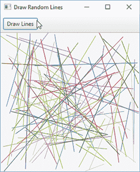

# 图 8.18

使用 `MyLine` 对象绘制随机线条。

# GUI 与图形案例研究练习

1. **8.1** 增强图 8.17–8.18 中的程序，以绘制随机粗细的线条。你可以使用 `GraphicsContext` 方法 `setLineWidth` 来设置线条粗细。

2. **8.2** 增强图 8.17–8.18 中的程序，随机绘制矩形和椭圆。创建类 `MyRectangle` 和 `MyOval`。这两个类都应该包含 `x1`, `y1`, `x2`, `y2` 坐标、描边颜色、填充颜色以及一个用于判断形状是否填充的 `boolean` 标志。在每个类中声明一个构造函数，其参数用于初始化所有实例变量。为了帮助绘制矩形和椭圆，每个类应该提供 `getUpperLeftX`、`getUpperLeftY`、`getWidth` 和 `getHeight` 方法，分别计算左上 `x` 坐标、左上 `y` 坐标、宽度和高度，这些基于 `x1`, `y1`, `x2`, `y2` 坐标。左上 `x` 坐标是两个 `x` 坐标中的较小值，左上 `y` 坐标是两个 `y` 坐标中的较小值，宽度是 `x` 坐标差的绝对值，高度是 `y` 坐标差的绝对值。（在此处描述的 `MyRectangle` 和 `MyOval` 类将让你在学习鼠标事件处理后更容易支持鼠标绘图练习 13.9 第 13.3 节）。应用程序的 GUI 应该提供不同的 `Button` 分别绘制 100 个随机 `MyRectangle` 和 100 个随机 `MyOval`。每个 `Button` 在应用程序中应该有一个相应的事件处理器。

此外，修改 `MyLine`、`MyRectangle` 和 `MyOval` 类以包含你在第 10.14 节中将使用的功能：

1. `x1`, `y1`, `x2`, `y2` 坐标、描边颜色、填充颜色以及一个判断形状是否填充的 `boolean` 标志。在每个类中声明一个构造函数，其参数用于初始化所有实例变量。为了帮助绘制矩形和椭圆，每个类应该提供 `getUpperLeftX`、`getUpperLeftY`、`getWidth` 和 `getHeight` 方法，分别基于 `x1`, `y1`, `x2`, `y2` 坐标计算左上 `x` 坐标、左上 `y` 坐标、宽度和高度。左上 `x` 坐标是两个 `x` 坐标中的较小值，左上 `y` 坐标是两个 `y` 坐标中的较小值，宽度是 `x` 坐标差的绝对值，高度是 `y` 坐标差的绝对值。（在此处描述的 `MyRectangle` 和 `MyOval` 类将让你在学习第 13.3 节的鼠标事件处理后更容易支持练习 13.9 中的鼠标绘图。）

2. `x1`, `y1`, `x2`, `y2` 坐标、描边颜色、填充颜色以及一个判断形状是否填充的 `boolean` 标志。在每个类中声明一个构造函数，其参数用于初始化所有实例变量。为了帮助绘制矩形和椭圆，每个类应该提供 `getUpperLeftX`、`getUpperLeftY`、`getWidth` 和 `getHeight` 方法，分别基于 `x1`, `y1`, `x2`, `y2` 坐标计算左上 `x` 坐标、左上 `y` 坐标、宽度和高度。左上 `x` 坐标是两个 `x` 坐标中的较小值，左上 `y` 坐标是两个 `y` 坐标中的较小值，宽度是 `x` 坐标差的绝对值，高度是 `y` 坐标差的绝对值。

3. `x1`, `y1`, `x2`, `y2` 坐标、描边颜色、填充颜色以及一个判断形状是否填充的 `boolean` 标志。

# 8.17 总结

在本章中，我们展示了 `Time` 案例，它包含 `private` 数据、重载的 `public` 构造函数、`set` 和 `get` 方法以及 `String` 表示。我们还学习了每个类都可以有一个一个返回 `String` 的 `toString` 方法。我们展示了如何通过 `throw` 异常来表示发生了问题。

你学习了 `this` 在类中被隐式用于访问实例变量。我们还看到了在构造函数中显式地使用 `this` 来调用另一个构造函数。

我们学习了更多关于 `enum` 类型的内容以及如何使用它们创建一组常量。你学习了 Java 的垃圾收集能力以及它如何回收不再使用的对象的内存。本章解释了 `static` 字段的动机，并演示了如何声明和使用 `static` 字段和方法。你还学习了如何声明 `final` 变量。

你学习了没有访问修饰符的字段默认具有包权限。我们看到了同一个包内类之间的关系，允许包中的每个类访问其他类的包成员。在下一章中，你将学习面向对象编程的一个方面——继承。你会看到 Java 中的所有类都直接或间接地继承自 `Object` 类。你还将开始理解类之间的关系如何帮助构建更强大的应用程序。

# 第 8.2 节 类案例研究

* 类的 `public` 方法被称为类的 `public` 服务或 `public` 接口（p. 330）。它们向类的客户端展示该类提供的服务的视图。
* 类的 `private` 成员对其客户端不可访问。
* `String` 类的 `static` 方法 `format` 与 `System.out.printf` 方法相似，区别在于 `format` 返回一个格式化的 `String`，而不是在命令行窗口中显示它。
* Java 中的所有对象都有一个 `toString` 方法，该方法返回对象的 `String` 类型表示。当对象出现在需要 `String` 的代码中时，`toString` 方法会被隐式调用。

## 8.3 控制对成员的访问

* 访问修饰符 `public` 和 `private` 控制对类的变量和方法的访问。
* `public` 方法的主要目的是向类的客户端展示该类所提供的项服务视图。客户端不需要担心该类是如何完成其任务的。
* 类的 `private` 变量和 `private` 方法（即其实现细节）对客户端来说是不可访问的。

## 8.4 使用 `this` 引用引用当前对象的成员

* 对象的实例方法隐式地使用关键字 `this` 来引用该对象的实例变量和其他方法。关键字 `this` 也可以被显式地使用。
* 编译器会为每个编译后的类生成一个扩展名为 `.class` 的独立文件。
* 如果局部变量名与类字段的名称相同，则局部变量会遮蔽该字段。你可以在方法中使用 `this` 引用来显式地引用被遮蔽的字段。

## 8.5 `Time` 类案例研究：重载构造函数

* 重载构造函数允许以不同的方式初始化类的对象。编译器通过它们的签名来区分重载的构造函数。
* 要从类的一个构造函数调用另一个构造函数，可以使用 `this` 关键字后跟包含构造参数的括号。如果使用，此类构造函数调用必须作为构造函数体的第一条语句出现。

## 8.6 默认和无参数构造函数

* 如果类中没有提供构造函数，编译器会创建一个默认构造函数。
* 如果类声明了构造函数，编译器将不会创建默认构造函数。在这种情况下，如果需要默认初始化，必须声明一个无参数构造函数。

## 8.7 关于 Set 和 Get 方法说明

* `Set` 方法通常被称为修改器方法（mutator methods），因为它们通常会改变值。`Get` 方法通常被称为访问器方法（accessor methods）或查询方法。谓词方法（predicate method）测试条件是否真假。

## 8.8 组合

* 类可以引用其他类的对象作为成员。这被称为组合（composition），有时被称为“有一个”关系（has-a relationship）。

## 8.9 `enum` 类型

* 所有 `enum` 类型都是引用类型。`enum` 类型通过 `enum` 声明来定义，声明是一个由逗号分隔的 `enum` 常量列表。该声明可以可选包含类的其他组件，如构造函数、字段和方法。
* `enum` 常量是隐式的 `final` 的。
* `enum` 常量是隐式的 `static` 的。
* 任何尝试使用 `new` 创建 `enum` 类型对象的尝试都会导致编译错误。
* `enum` 常量可以使用任何可以使用常量的地方，例如 `switch` 语句的 `case` 标签以及用于控制增强型 `for` 语句。
* `enum` 声明中的每个 `enum` 常量后面可以可选跟随参数，这些参数将传递给 `enum` 构造函数。
* 对于每个 `enum`，编译器都会生成一个名为 `values` 的 `static` 方法，该方法返回一个按声明顺序排列的枚举常量数组。
* `EnumSet` 静态方法 `range` 接收范围内的第一个和最后一个 `enum` 常量，并返回一个包含这两个常量之间所有常量（包含边界）的 `EnumSet`。

## 8.10 垃圾回收

* Java 虚拟机 (JVM) 执行垃圾回收以回收不再使用的对象所占的内存。当一个对象没有更多引用时，JVM 下次执行垃圾回收器时，该对象符合垃圾回收条件。

## 8.11 `static` 类成员

* `static` 变量代表类对象之间共享的类级信息。
* `static` 变量具有类作用域。类的 `public static` 成员可以通过该类的任何对象的引用来访问，也可以通过用类名和点（`.`）限定成员名来访问。客户端代码只能通过类的方法来访问类的 `private static` 成员。
* `static` 类成员在类加载时就存在了。
* 声明为 `static` 的方法不能直接访问类的实例变量和实例方法，因为在没有实例化类的任何对象时，也可以调用 `static` 方法。
* `static` 方法中不能使用 `this` 引用。

## 8.12 `static` 导入

* `static` 导入声明允许你在不使用类名和点（`.`）的情况下引用已导入的 `static` 成员。单个 `static` 导入导入一个 `static` 成员，而按需 `static` 导入则导入类的所有 `static` 成员。

## 8.13 `final` 实例变量

* 在应用代码的上下文中，最小权限原则规定，代码应仅被授予完成指定任务所需的权限和访问权限。
* 关键字 `final` 指定一个变量是不可修改的。此类变量必须在声明时或通过类的每个构造函数之一进行初始化。

## 8.14 包级访问权限

* 如果在类中声明方法或变量时没有指定访问修饰符，则该方法或变量被认为具有包访问权限（package access）。
* 来自同一包的类可以通过对适当对象的引用直接访问彼此的包访问级别成员，或者对于 `static` 成员通过类名访问。

# 第 8.15 节 使用 `BigDecimal` 进行精确的货币计算

* 任何需要精确浮点数计算且没有舍入误差的应用——例如金融应用程序——都应该使用 `BigDecimal` 类（包 `java.math`；[p. 358]）。
* 带有 `double` 参数的 `BigDecimal static` 方法 `valueOf` 返回一个表示所指定精确值的 `BigDecimal`。
* `BigDecimal` 方法 `add` 将其参数 `BigDecimal` 加到调用该方法的 `BigDecimal` 对象上并返回结果。
* `BigDecimal` 提供了常量 `ONE` (`1`)、`ZERO` (`0`) 和 `TEN` (`10`)。
* `BigDecimal` 方法 `pow` 将其第一个参数提升到第二个参数所指定的幂。
* `BigDecimal` 方法 `multiply` 将其参数 `BigDecimal` 与调用该方法的 `BigDecimal` 对象相乘并返回结果。
* `NumberFormat` 类（包 `java.text`；[p. 360]）提供了将数值格式化为特定区域 `String` 的功能。该类的 `static` 方法 `getCurrencyInstance` 返回一个用于特定地区货币值的预先配置的 `NumberFormat`。`NumberFormat` 方法 `format` 执行格式化。
* 特定区域的格式化是国际化的重要部分——即为用户的各种地区和口语定制你的应用程序的过程。
* `BigDecimal` 允许你控制值的如何舍入——默认情况下，所有计算都是精确的，且不发生舍入。如果你没有指定如何舍入 `BigDecimal` 值，且给定的值无法精确表示，则会抛出 `ArithmeticException`。
* 你可以在创建 `BigDecimal` 时，通过向其构造函数提供一个 `MathContext` 对象（包 `java.math`）来指定 `BigDecimal` 的舍入模式。你也可以为执行计算的各种 `BigDecimal` 方法提供 `MathContext`。默认情况下，每个预配置的 `MathContext` 都使用所谓的“银行家舍入法”。
* `BigDecimal` 的比例（scale）是小数点右侧的数字位数。如果你需要将 `BigDecimal` 舍入到特定的位数，可以调用 `BigDecimal` 方法 `setScale`。

# 自测练习题

1. **8.1** 填写下列每个语句的空白处：

    1. 一个(n)____ 导入了类的所有 `static` 成员。
    2. `String` 类的 `static` 方法类似于 `System.out.printf` 方法，但它返回一个格式化后的 `String`，而不是在命令行窗口中显示 `String`。
    3. 如果一个方法包含与其类字段之一同名的局部变量，则局部变量在该方法的作用域内会 ____ 该字段。
    4. 类的 `public` 方法也被称为类的 ____ 或 ____ 接口。
    5. 一个(n)____ 导入了一个 `static` 成员。
    6. 如果一个类声明了构造方法，编译器将不会创建一个(n)。
    7. 当对象出现在需要 `String` 的代码中时，对象的 ____ 会被隐式调用。
    8. `Get` 方法通常被称为 ____ 或 ____。
    9. 一个(n)____ 测试条件是否为真或假。
    10. 对于每个 `enum`，编译器都会生成一个 `static` 方法，返回一个包含 `enum` 常量的数组，按其声明顺序排列。
    11. 组合有时被称为(n)____ 关系。
    12. 一个(n)____ 包含用逗号分隔的常量列表。
    13. 一个(n)____ 代表由该类所有对象共享的类级信息。
    14. 一个(n)____ 导入了一个 `static` 成员。
    15. ____ 规定代码应仅被授予完成指定任务所需的权限和访问权限。
    16. 关键字 ____ 指定在声明或构造方法中的变量在初始化后不可修改的。
    17. 一个(n)____ 导入了类的所有 `static` 成员。
    18. `Set` 方法通常被调用，因为它们通常会改变一个值。
    19. 使用 ____ 类执行精确的货币计算。
    20. 使用 ____ 语句来表示发生了问题。

# 自测练习题答案

1. **8.1**

    1. `static` import on demand.
    2. `format`。
    3. `shadows`。
    4. `public` services, `public` interface。
    5. `single `static` import`。
    6. `default constructor`。
    7. `toString`。
    8. `accessor methods`, `query methods`。
    9. `predicate`。
    10. `values`。
    11. `has-a`。
    12. `enum`。
    13. `static`。
    14. `single `static` import`。
    15. `principle of least privilege`。
    16. `final`。
    17. `static` import on demand.
    18. `mutator methods`。
    19. `BigDecimal`。
    20. `throw`。

# 练习题

1. **8.2 (基于 8.14 节)** 解释 Java 中包访问的概念。解释包访问的负面影响。
2. **8.3** 为构造方法指定返回类型（即使是 `void`）会发生什么？
3. **8.4 (矩形类)*** 创建一个具有 `length` 和 `width` 属性的 `Rectangle` 类，每个属性的默认值均为 1。提供计算矩形周长和面积的方法。为 `length` 和 `width` 提供 *set* 和 *get* 方法。*set* 方法应该验证 `length` 和 `width` 都是大于 0.0 且小于 20.0 的浮点数。编写一个程序测试 `Rectangle` 类。
4. **8.5 (修改类的内部数据表示)*** 让图 8.5 中的 `Time2` 类内部将时间表示为自午夜以来的秒数而不是三个整数值 `hour`、`minute` 和 `second` 是完全合理的。客户端可以使用相同的 `public` 方法并获得相同的结果。修改图 8.5 中的 `Time2` 类以自午夜以来的秒数实现时间，并证明对类的客户端来说变化是不可见的。
5. **8.6 (储蓄账户类)** 创建类 `SavingsAccount`。使用 `static` 变量 `annualInterestRate` 来存储所有账户持有者的年利率。该类的每个对象包含一个 `private` 实例变量 `savingsBalance`，表示储户当前的存款存款金额。提供方法 `calculateMonthlyInterest`，通过将 `savingsBalance` 乘以 `annualInterestRate` 并除以 12 来计算月利——此利息应加到 `savingsBalance` 中。提供一个 `static` 方法 `modifyInterestRate` 将 `annualInterestRate` 设置为新值。编写一个程序来测试 `SavingsAccount` 类。实例化两个 `savingsAccount` 对象、`saver1` 和 `saver2`，余额分别为 $2000.00 和 $3000.00。将 `annualInterestRate` 设置为 4%，然后计算 12 个月中每个月的利息，并打印两个储户的新余额。接下来，将 `annualInterestRate` 设置为 5%，计算下个月的利息并打印两个储户的新余额。
6. **8.7 (增强 Time2 类)** 修改类 `Time2` 以包含一个 `tick` 方法，该方法使 `Time2` 对象中存储的时间增加一秒。提供方法 `incrementMinute` 使分钟加 1，提供方法 `incrementHour` 使小时加 1。编写一个程序来测试 `tick` 方法、`incrementMinute` 方法和 `incrementHour` 方法，以确保它们工作正常。务必测试以下情况：
    1. 递进到下一分钟，
    2. 递进到下一个小时，以及
    3. 递进到第二天（例如从 11:59:59 PM 到 12:00:00 AM）。
7. **8.8 (增强 Date 类)** 修改类 `Date`，对变量 `month`、`day` 和 `year` 的初始化值进行错误检查（目前它只验证月份和日期）。提供方法 `nextDay` 将天数加 1。编写一个程序在循环中测试 `nextDay` 方法，并在每次迭代期间打印日期，以说明该方法工作正常。测试以下情况：
    1. 递进到下个月，以及
    2. 递进到下一年。
8. **8.9** 重写图 8.14 中的代码，为示例中使用的 `Math` 类每个 `static` 成员使用单独的 `import` 。
9. **8.10** 编写 `enum` 类型 `TrafficLight`，其常量（`RED`、`GREEN`、`YELLOW`）接受一个参数——光的持续时间。编写一个程序来测试 `TrafficLight enum`，显示 `enum` 常量及其持续时间。
10. **8.11 (复数)** 创建一个名为 `Complex` 的类，用于复数的算术运算。复数的形式为：`realPart` + `imaginaryPart` * `i`，其中 `i` 是 $\sqrt{-1}$。编写一个程序来测试你的类。使用浮点变量表示类的 `private` 数据。提供一个构造函数，使该类的对象在声明时能够进行初始化。提供一个带默认值的无参数构造函数，以防未提供初始化器。提供 `public` 方法执行以下操作：
    1. 加两个 `Complex` 数：实部相加，虚部相加。
    2. 减两个 `Complex` 数：左操作数的实部减去右操作数的实部，左操作数的虚部减去右操作数的虚部。
    3. 以 `(`realPart`,` `imaginaryPart`)` 的形式打印 `Complex` 数。
11. **8.12 (日期和时间类)** 创建类 `DateAndTime`，结合练习 8.7 中修改后的 `Time2` 类和练习 8.8 中修改后的 `Date` 类。具体来说，要测试 `DateAndTime`。将 `incrementHour` 修改为 `nextDay`。修改 `toString` 输出日期。
12. **8.13 (整数集)** 创建类 `IntegerSet`。每个 `IntegerSet` 对象可以持有 0–100 范围内的整数。集合由一个 `boolean` 数组表示。如果 `i` 在集合中，则 `a[i]` 为 `true`；如果 `j` 不在集合中，则 `a[j]` 为 `false`。无参数构造函数将数组初始化为 `false`。
13. **8.14** 提供以下方法：
    * `static` 方法 `union`：创建一个现有集合的集合论并集。
    * `static` 方法 `intersection`：创建一个现有集合的集合论交集。
    * `insertElement(k)`：向集合中插入新整数 *k*（通过将 `a[k]` 设置为 `true`）。
    * `deleteElement(m)`：删除整数 *m*（通过将 `a[m]` 设置为 `false`）。
    * `toString`：返回一个包含集合的 `String`，以空格分隔的数字列表形式。仅包含集合中存在的元素。
    * `isEqualTo`：判断两个集合是否相等。
    编写一个程序测试 `IntegerSet` 类。实例化多个 `IntegerSet` 对象。测试你的所有方法是否工作正常。
14. **8.15 (Date 类)** 创建类 `Date`，具有以下功能：
    1. 以多种格式输出日期，例如：
       * `MM/DD/YYYY`
       * `June 14, 1992`
       * `DDD YYYY`
    2. 使用重载构造函数创建使用上述格式初始化的 `Date` 对象：
       * 在第一情况下，构造函数接收三个整数值。
       * 在第二情况下，它应该接收一个 `String` 和两个整数值。
       * 在第三情况下，它应该接收两个整数值，其中第一个代表年份的天数。
15. **8.16 (有理数)** 创建一个名为 `Rational` 的类，用于分数的算术运算。编写一个程序测试你的类。使用整数变量表示类的 `private` 实例变量——`numerator` 和 `denominator`。提供一个构造函数，使该类的对象在声明时能够进行初始化。构造函数应以约分形式存储分数。分数


## 2/4

```
等同于 `1/2`，并在对象中存储为 `numerator` 为 1，`denominator` 为 2。
```

提供一个带默认值的无参数构造函数，以防未提供初始化器。提供 `public` 方法执行以下操作：

1. 加两个 `Rational` 数：加法结果应以约分形式存储。将其实现为 `static` 方法。
2. 减两个 `Rational` 数：减法结果应以约分形式存储。将其实现为 `static` 方法。
3. 乘两个 `Rational` 数：乘法结果应以约分形式存储。将其实现为 `static` 方法。
4. 除两个 `Rational` 数：除法结果应以约分形式存储。将其实现为 `static` 方法。
5. 返回一个形式为 `a/b` 的 `Rational` 数的 `String` 表示，其中 `a` 是分子（`numerator`），`b` 是分母（`denominator`）。
6. 返回一个浮点格式的 `Rational` 数的 `String` 表示。（考虑提供格式化功能，允许该类的用户指定小数点后的数字精度位数。）

### 16. 8.17 (HugeInteger 类)

创建一个 `HugeInteger` 类，该类使用一个包含 40 个元素的数字数组来存储多达 40 位的整数。提供 `parse`、`toString`、`add` 和 `subtract` 方法。`parse` 方法应接收一个 `String`，使用 `charAt` 方法提取每个数字，并将每个数字对应的整数值放入整数数组中。为了比较 `HugeInteger` 对象，提供以下方法：`isEqualTo`、`isNotEqualTo`、`isGreaterThan`、`isLessThan`、`isGreaterThanOrEqualTo` 和 `isLessThanOrEqualTo`。其中每个方法都是一个谓词方法，如果两个 `HugeInteger` 对象之间满足该关系，则返回 `true`，否则返回 `false`。提供一个谓词方法 `isZero`。如果你很有野心，还可以提供 `multiply`、`divide` 和 `remainder` 方法。

> [注：基元类型 `boolean` 值可以使用格式说明符 `%b` 输出为单词“true”或“false”。]

### 17. 8.18 (井字棋)

创建一个 `TicTacToe` 类，使你能够编写一个玩井字棋的程序。该类包含一个私有的 3x3 二维数组。使用 `enum` 类型表示数组中每个单元格的值。`enum` 的常量应命名为 `X`、`O` 和 `EMPTY`（表示不包含 `X` 或 `O` 的位置）。构造函数应将棋盘元素初始化为 `EMPTY`。允许两个人类玩家。无论第一个玩家在哪里移动，在指定的方格中放置 `X`，在第二个玩家移动的地方放置 `O`。每次移动必须在空单元格上。每次移动后，判断游戏是否结束以及是否为平局。如果你很有野心，可以修改程序让计算机代表其中一个玩家进行移动。还允许玩家指定想先手还是后手。如果你非常有野心，可以开发一个在 4x4x4 棋盘上玩三维井字棋的程序。

> [注：这是一个极具挑战性的项目！]

### 18. 8.19 (Account 类带 BigDecimal balance)

重写第 3.4 节中的 `Account` 类，将 `balance` 存储为 `BigDecimal` 对象，并使用 `BigDecimal` 执行所有计算。

### 19. 8.20 (final 实例变量)

在图 8.8 中，`Employee` 类的实例变量在初始化后从不修改。任何此类实例变量都应该声明为 `final`。相应地修改 `Employee` 类，然后重新编译并运行程序证明其产生相同的结果。

## 改变

### 1. 8.21 (项目：应急响应类)

北美应急响应服务 `9-1-1` 将呼叫者连接到*本地*公共服务应点（PSAP）。传统上，PSAP 会向呼叫者询问身份信息——包括呼叫者的地址、电话号码和紧急情况性质，然后派遣相应的应急响应人员（如警察、救护车或消防队）。*增强型 9-1-1 (或 E9-1-1)* 使用计算机和数据库来确定呼叫者的物理地址，将电话引导至最近的 PSAP，并将呼叫者的电话和地址显示给接线员。*无线增强型 9-1-1* 为接线员提供无线电话的身份信息。该服务分两个阶段实施：第一阶段要求运营商提供无线电话号码以及传输电话的手机小区或基站的位置；第二阶段要求运营商提供呼叫者的位置（使用 GPS 等技术）。要了解更多关于 9-1-1 的信息，请访问 `https://www.fcc.gov/general/9-1-1-and-e9-1-1-services` 和 `http://people.howstuffworks.com/9-1-1.htm`。

创建一个类的重要部分是确定类的属性（实例变量）。对于这个类设计练习，请在网上研究 9-1-1 服务。然后，设计一个名为 `Emergency` 的类，该类可能用于面向对象的 9-1-1 应急响应系统。列出此类对象可能用于表示紧急情况的属性。例如，该类可能包含关于报告紧急情况的人的信息（包括他们的电话号码）、紧急情况的位置、报告时间、紧急情况性质、响应类型和响应状态。类属性应该完全描述问题的性质以及为解决该问题正在采取的操作。

### 2. 8.22 (项目：全球经济中的货币处理——JavaMoney)

在全球经济中，处理货币、金额、转换、舍五入和格式化是复杂的。新的 JavaMoney API 是为了应对这些挑战而开发的。在编写本文时，它尚未被整合到 Java SE 或 Java EE 中。你可以在此处阅读关于 JavaMoney 的信息：

```
https://java.net/projects/javmoney/pages/Home
http://354.blogspot.ch
```

你可以在此处获取软件和文档：

```
http://javoney.github.io
```

使用 JavaMoney 开发一个可以在用户指定的货币之间转换的应用。

# 9 面向对象：继承

## 目标

在本章中你将：

* 理解继承以及如何基于现有类开发新类。
* 学习父类和子类的概念。
* 使用 `extends` 关键字创建继承自另一个类的类。
* 在父类中使用访问修饰符 `protected` 让子类方法访问父类成员。
* 使用 `super` 从子类访问父类成员。
* 学习构造函数在继承层次中的用法。
* 学习 `Object` 类的方法，它是所有类的直接或间接父类。

## 9.1 引言

本章通过引入继承继续讨论面向对象编程（OOP）。继承是通过获取现有类的成员并可能对其进行增强或修改来创建一个新类。通过继承，你可以基于经过验证和调试的高质量软件来节省开发时间。这增加了系统被有效实现和维护的概率。

在创建类时，与其声明完全新的成员，不如指定新类应该继承现有类的成员。现有类被称为**父类**（superclass），新类被称为**子类**（subclass）。C++ 编程语言将父类称为**基类**（base class），将子类称为**派生类**（derived class）。子类可以是未来子类的父类。

子类可以添加自己的字段和方法。因此，子类比父类更具体，代表了一个更专门的对象组。子类表现出父类的行为，并可以修改这些行为以在子类环境中运行得恰当。这就是为什么继承有时被称为**专门化**（specialization）。

`直接父类`是子类显式继承的父类。`间接父类`是`类层次结构`中直接父类之上的任何类，它定义了类之间的继承关系——正如你在第 9.2 节中所看到的，图表可以帮助你理解这些关系。在 Java 中，类层次始于 `Object` 类（位于 `java.lang` 包中），Java 中的*每一个*类都直接或间接地 `extends`（或继承）该类。第 9.6 节列出了所有其他 Java 类继承的 `Object` 类方法。Java 只支持`单继承`，即每个类都派自于*一个*直接父类。与 C++ 不同，Java *不支持*多重继承（当一个类派自多个直接父类时发生的情况）。第 10 章，面向对象编程：多态与接口，解释了如何使用 Java `interfaces` 来实现多重继承的许多优点，同时避免相关问题。

我们区分了`继承关系`（is-a relationship）和`组合关系`（has-a relationship）。`is-a` 表示继承。在 `is-a` 关系中，*子类的对象也可以被视为其父类的对象*——例如，汽车*是一辆*交通工具。相比之下，`has-a` 表示组合（参见第 8 章）。在 `has-a` 关系中，*一个对象包含指向其他对象的引用作为成员*——例如，汽车*有一个*方向盘（一个汽车对象拥有一个指向方向盘对象的引用）。

新类可以继承自`类库`中的类。组织开发自己的类库，并可以利用全球范围内其他类库。在某一天，大多数新软件可能将由`标准化的重用组件`构建，就像今天的汽车和大多数计算机硬件的构造一样。这将促进更强大、丰富且廉价软件的快速开发。

## 9.2 父类与子类

通常，一个类的对象*也是*另一个类的对象。例如，`CarLoan` *是一种* `Loan`，`HomeImprovementLoan` 和 `MortgageLoan` 也是如此。因此，在 Java 中，可以说 `CarLoan` 类继承自 `Loan` 类。在这种语境下，`Loan` 类是父类，`CarLoan` 类是子类。`CarLoan` *是一种*特定类型的 `Loan`，但声称每一个 `Loan` *都是* `CarLoan` 是错误的——`Loan` 可以是任何类型的贷款。图 9.1 列出了几个父类和子类的简单示例——父类倾向于“更通用”，子类倾向于“更具体”。

| 父类 | 子类 |
| :--- | :--- |
| `Student` | `GraduateStudent`, `UndergraduateStudent` |
| `Shape` | `Circle`, `Rectangle`, `Sphere`, `Cube` |
| `Loan` | `CarLoan`, `HomeImprovementLoan`, `MortgageLoan` |
| `Employee` | `Faculty`, `Staff` |
| `BankAccount` | `CheckingAccount`, `SavingsAccount` |

**图 9.1 继承示例**

由于每个子类对象*都是*其父类的对象，且一个父类可以有很多子类，因此父类代表的对象集合通常比其任何一个子类代表的对象集合大。例如，父类 `Vehicle` 代表*所有*车辆，包括汽车、卡车等。相比之下，子类 `Car` 代表一个较小的、具体的车辆子集。

### 大学社区成员

继承关系形成了树形的*层次结构*。一个父类与其子类之间存在层级关系（如图 9.2）。

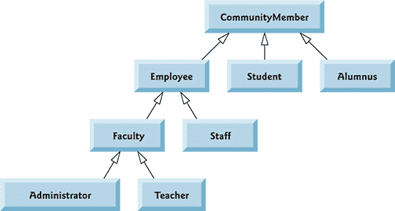

**图 9.2**

继承关系形成了树形的*层次结构*。一个父类可以有很多子类，父类代表的对象集合通常比其任何一个子类代表的对象集合大。例如，父类 `Vehicle` 代表*所有*车辆，包括汽车、卡车、船等。相比之下，子类 `Car` 代表一个较小的、具体的车辆子集。

### 大学社区成员

继承关系形成了树形的*层次结构*。如在图 9.2 所示，我们可以顺着底部的箭头指向顶部的父类来识别 `is-a` 关系。例如，`Triangle` *是一种* `TwoDimensionalShape` 且*是一种* `Shape`，而 `Sphere` *是一种* `ThreeDimensionalShape` 且*是一种* `Shape`。

### 形状

现在考虑第 9.3 节中的 `Shape` 层。该层次始于父类 `Shape`，它被 `TwoDimensionalShape` 和 `ThreeDimensionalShape` 扩展。

第 8 章讨论了访问权限修饰符 `public` 和 `private`。类的 `public` 成员在程序拥有该类或其子类对象引用的地方都是可访问的。类的 `private` 成员仅在类内部可访问。在本节中，我们将介绍访问权限修饰符 `protected`。使用 `protected` 访问提供了 `public` 和 `private` 之间的中间层访问权限。父类的 `protected` 成员可以通过该父类的成员、其子类的成员以及同一包中其他类的成员来被访问——`protected` 成员也具有包级访问权限。

所有 `public` 和 `protected` 父类成员在成为子类成员时会保留其原始的访问权限修饰符——父类的 `public` 成员将成为子类的 `public` 成员，父类的 `protected` 成员将成为子类的 `protected` 成员。父类的 `private` 成员在类本身之外是不可访问的。相反，它们对子类是隐藏的，只能通过从父类继承的 `public` 或 `protected` 方法进行访问。

子类方法只需通过使用成员名称即可引用继承自父类的 `public` 和 `protected` 成员。当子类方法覆盖继承的父类方法时，可以通过在父类方法名前加上关键字 `super` 和点分隔符 (`.`) 从子类访问父类的方法版本。我们将在 9.4 节中讨论对父类被覆盖成员的访问。

## 9.4 父类与子类之间的关系

我们现在使用一个包含公司薪资应用程序中员工类型的继承层次结构，来讨论父类与其子类之间的关系。在这家公司中，佣金员工（将用父类对象表示）按其销售额的百分比支付，而底薪加佣金员工（将用子类对象表示）获得底薪加上其销售额的百分比。

我们将对这些类之间关系的讨论分为五个示例。第一个示例声明了 `CommissionEmployee` 类，它直接继承自 `Object` 类，并声明了 `private` 实例变量：名、姓、社会安全号码、佣金率和总（即合计）销售额。

第二个示例声明了 `BasePlusCommissionEmployee` 类，它也直接继承自 `Object` 类，并声明了 `private` 实例变量：名、姓、社会安全号码、佣金率、总销售额和底薪。我们通过编写该类所需的每一行代码来创建这个类——我们很快就会发现通过继承 `CommissionEmployee` 类来创建它要高效得多。

第三个示例声明了一个新的 `BasePlusCommissionEmployee` 类，它扩展了 `CommissionEmployee` 类（即 `BasePlusCommissionEmployee` 是一个也拥有底薪的 `CommissionEmployee`）。这种软件复用允许我们在开发新子类时编写更少的代码。在这个示例中，`BasePlusCommissionEmployee` 类尝试访问 `CommissionEmployee` 类的 `private` 成员——这会导致编译错误，因为子类无法访问父类的 `private` 实例变量。

第四个示例显示，如果 `CommissionEmployee` 的实例变量被声明为 `protected`，则 `BasePlusCommissionEmployee` 子类可以直接访问该数据。两个 `BasePlusCommissionEmployee` 类包含相同的功能，但我们展示了继承版本如何更容易创建和管理。

在讨论了使用 `protected` 实例变量的便利性之后，我们创建了第五个示例，将 `CommissionEmployee` 的实例变量设回 `private` 以实施良好的软件工程。然后我们展示了 `BasePlusCommissionEmployee` 子类如何使用 `CommissionEmployee` 的 `public` 方法来以受控的方式操作继承自 `CommissionEmployee` 的 `private` 实例变量。

### 9.4.1 创建和使用 CommissionEmployee 类

我们从声明 `CommissionEmployee` 类开始。第 4 行开始类声明，并指示 `CommissionEmployee` 类扩展（即继承自）`Object` 类（来自 `java.lang` 包）。这导致 `CommissionEmployee` 类继承了 `Object` 类的方法——`Object` 类没有任何字段。如果你不显式指定新类继承自哪个类，该类将隐式继承 `Object`。出于这个原因，你通常不会在代码中包含“extends Object”——我们仅在这个示例中这样做是为了演示目的。

```java
 1 // Fig. 9.4: CommissionEmployee.java
 2 // CommissionEmployee class represents an employee paid a
 3 // percentage of gross sales.
 4 public class CommissionEmployee extends Object {
 5    private final String firstName;
 6    private final String lastName;
 7    private final String socialSecurityNumber;
 8    private double grossSales; // gross weekly sales
 9    private double commissionRate; // commission percentage
10
11    // 五参数的构造函数
12    public CommissionEmployee(String firstName, String lastName,
13       String socialSecurityNumber, double grossSales,
14       double commissionRate) {
15       // 此处隐式调用 Object 的默认构造函数
16
```


```java
// 如果 grossSales 无效则抛出异常
if (grossSales < 0.0) {
   throw new IllegalArgumentException("Gross sales must be >= 0.0");
}

// 如果 commissionRate 无效则抛出异常
if (commissionRate <= 0.0 || commissionRate >= 1.0) {
   throw new IllegalArgumentException(
      "Commission rate must be > 0.0 and < 1.0");
}

this.firstName = firstName;
this.lastName = lastName;
this.socialSecurityNumber = socialSecurityNumber;
this.grossSales = grossSales;
this.commissionRate = commissionRate;
}

// 返回名字
public String getFirstName() {return firstName;}

// 返回姓
public String getLastName() {return lastName;}

// 返回社会安全号
public String getSocialSecurityNumber() {return socialSecurityNumber;}

// 设置总销售额
public void setGrossSales(double grossSales) {
   if (grossSales < 0.0) {
      throw new IllegalArgumentException("Gross sales must be >= 0.0");
   }
   this.grossSales = grossSales;
}

// 返回总销售额
public double getGrossSales() {return grossSales;}

// 设置佣金率
public void setCommissionRate(double commissionRate) {
   if (commissionRate <= 0.0 || commissionRate >= 1.0) {
      throw new IllegalArgumentException(
         "Commission rate must be > 0.0 and < 1.0");
   }
   this.commissionRate = commissionRate;
}

// 返回佣金率
public double getCommissionRate() {return commissionRate;}

// 计算收益
public double earnings() {return commissionRate * grossSales;}

// 返回 CommissionEmployee 对象的字符串表示
@Override // 表明该方法重写了父类方法
public String toString() {   
   return String.format("%s: %s %s%n%s: %s%n%s: %.2f%n%s: %.2f", 	
      "commission employee", firstName, lastName,
      "social security number", socialSecurityNumber,   
      "gross sales", grossSales, 
      "commission rate", commissionRate);
}
```

## 图 9.4

`CommissionEmployee` 类代表按总销售额百分比支付工资的员工。

## `CommissionEmployee` 类的方法与实例变量概述

`CommissionEmployee` 类 `public` 服务包括一个构造函数（第 12–33 行）以及方法 `earnings()`（第 70 行）和 `toString()`（第 73–80 行）。第 36–42 行为类的 `final` 实例变量（声明在第 5–7 行）声明了 `public` `get` 方法：`firstName`、`lastName` 和 `socialSecurityNumber`。这三个实例变量被声明为 `final`，是因为它们在初始化后不需要修改——这也是为什么我们不提供相应的 `set` 方法。第 45–67 行为类的 `grossSales` 和 `commissionRate` 实例变量（声明在第 8–9 行）声明了 `public` `set` 和 `get` 方法。该类将其实例变量声明为 `private`，因此其他类的对象无法直接访问这些变量。

## `CommissionEmployee` 构造函数

构造函数是不继承的，因此 `CommissionEmployee` 类不继承 `Object` 类的构造函数。然而，父类的构造函数仍然可以被子类调用。事实上，Java 要求子类构造函数的第一个任务是显式或隐式地（如果没有指定构造调用）调用其直接父类的构造函数，以确保从父类继承的实例变量得到正确的初始化。显式调用父类构造函数的语法在第 9.4.3 节中讨论。在本例中，`CommissionEmployee` 的构造函数隐式调用 `Object` 的默认构造函数。如果类没有构造函数，编译器会隐式包含对父类默认构造函数的调用。之后，第 18–20 行和 23–26 行验证 `grossSales` 和 `commissionRate`。如果这些值有效（即构造函数没有抛出 `IllegalArgumentException`），第 28–32 行将参数赋值给类的实例变量。我们在赋值给实例变量之前，没有对 `firstName`、`lastName` 和 `socialSecurityNumber` 进行验证。我们可以对姓名进行验证——例如确保长度合理。同样，社会安全号可以使用正则表达式（第 14.7 节）进行验证，以确保它包含九位数字（例如 `123-45-6789` 或 `123456789`）。

## `CommissionEmployee` 的 `earnings` 方法

`earnings()` 方法（第 70 行）计算 `CommissionEmployee` 的收益。该方法将 `commissionRate` 乘以 `grossSales` 并返回结果。

## `CommissionEmployee` 的 `toString` 方法

`toString()` 方法（第 73–80 行）是特殊的——它是每个类直接或间接继承自 `Object` 类的方法之一。`toString()` 方法返回对象的字符串表示。每当需要将对象转换为字符串表示时，就会被隐式调用，例如当通过 `printf` 输出对象，或通过 `String` 方法 `format()` 的 `%s` 格式说明符输出对象时。`Object` 的 `toString()` 方法返回一个包含对象类名和对象所谓的哈希码（hashcode）的字符串。它主要是一个占位符，子类可以重写它以指定子类对象数据的适当字符串表示。

`CommissionEmployee` 类的 `toString()` 方法重写（重定义）了 `Object` 类的 `toString()` 方法。当调用时，`CommissionEmployee` 的 `toString()` 方法使用 `String` 类的方法 `format()` 返回一个包含 `CommissionEmployee` 信息的 `String`。要重写父类方法，子类必须声明一个与父类方法**相同签名**（方法名、参数数量、参数类型和参数类型顺序）的方法——`Object` 的 `toString()` 方法不接受任何参数，因此 `CommissionEmployee` 声明了不带参数的 `toString()`。

## `@Override` 注解

第 73 行使用了可选的 `@Override` 注解，指示接下来的方法声明（即 `toString()`）应该重写一个**存在的**父类方法。此注解有助于编译器捕获一些常见的错误。例如，在本例中，你意图重写父类方法 `toString()`，它的拼写是小写的“t”和一个大写的“S”。如果你不小心地使用了小写的“s”，编译器将将其标记为错误，因为父类中不包含名为带有小写“s”的 `tostring()` 方法。如果你没有使用 `@Override` 注解，`tostring()` 将是一个完全不同的方法，当在需要 `String` 的地方使用 `CommissionEmployee` 时，它不会被调用。

另一个常见的重写错误是在参数列表中声明了错误数量或类型的参数。这创建了父类方法的**无意中重载**，而不是重写现有的方法。如果你随后尝试在子类对象上调用该方法（使用正确数量和类型的参数），将调用的是父类的版本——这可能会导致细微的逻辑错误。当编译器遇到声明了 `@Override` 的方法时，它会将该方法的签名与父类的方法签名进行比较。如果没有精确匹配，编译器会抛出错误信息，例如“method does not override or implement a method from a supertype”。随后你就可以修正你的方法签名，使其与父类中的某个方法匹配。

## `CommissionEmployeeTest` 类

图 9.5 测试了 `CommissionEmployee` 类。第 6–7 行实例化了一个 `CommissionEmployee` 对象并调用 `CommissionEmployee` 的构造器（图 9.4 的第 12–33 行）来对其初始化，使用“Sue”作为名，“Jones”作为姓，“222-22-2222”作为社会安全号，`10000` 为总销售额（$10,000），`.06` 为佣金率（即 6%）。第 11–20 行使用 `CommissionEmployee` 的 `get` 方法获取对象的实例变量值以供输出。第 22–23 行调用对象的 `setGrossSales()` 和 `setCommissionRate()` 方法来更改实例变量 `grossSales` 和 `commissionRate` 的值。第 25–26 行输出更新后的 `CommissionEmployee` 的 `String` 表示。当使用 `%s` 格式说明符输出对象时，对象的 `toString()` 方法会被**隐式地**调用以获取对象的 `String` 表示。*注意：*在本章中，我们没有在每个类中使用 `earnings()` 方法，但它在第 10 章中被广泛使用。

```java
// Fig. 9.5: CommissionEmployeeTest.java
// CommissionEmployee 类测试程序.
public class CommissionEmployeeTest {
   public static void main(String[] args) {
      // instantiate CommissionEmployee object
      CommissionEmployee employee = new CommissionEmployee(
         "Sue", "Jones", "222-22-2222", 10000, .06); 

      // get commission employee data
      System.out.println("Employee information obtained by get methods:");
      System.out.printf("%n%s %s%n", "First name is",
         employee.getFirstName());
      System.out.printf("%s %s%n", "Last name is",
         employee.getLastName());
      System.out.printf("%s %s%n", "Social security number is",
         employee.getSocialSecurityNumber());
      System.out.printf("%s %.2f%n", "Gross sales is",
         employee.getGrossSales());
      System.out.printf("%s %.2f%n", "Commission rate is",
         employee.getCommissionRate());

      employee.setGrossSales(5000);
      employee.setCommissionRate(.1);

      System.out.printf("%n%s:%n%n%s%n", 
         "Updated employee information by toString", employee);
   }
}
```

## 图 9.5

`CommissionEmployee` 类测试程序。

## 9.4.2 创建和使用 `BasePlusCommissionEmployee` 类

我们现在通过声明和测试（一个全新的、独立的）类 `BasePlusCommissionEmployee`（图 9.6），该类包含一个名、姓、社会安全号、总销售金额、佣金率和底薪。`BasePlusCommissionEmployee` 类的公共服务包括 `BasePlusCommissionEmployee` 构造器（第 13–40 行）以及 `earnings()` 方法（第 89–91 行）和 `toString()` 方法（第 94–102 行）。第 43–86 行为该类的私有实例变量（定义在第 5–10 行）`firstName`、`lastName`、`socialSecurityNumber`、`grossSales`、`commissionRate` 和 `baseSalary` 声明了公共的 `get` 和 `set` 方法。这些变量和方法封装了底薪金员工的所有必要特征。注意此类与 `CommissionEmployee` 类（图 9.4）之间的相似性——在这个示例中，我们尚未利用这种相似性。

```java
// Fig. 9.6: BasePlusCommissionEmployee.java
// BasePlusCommissionEmployee class represents an employee who receives
// a base salary in addition to commission.
public class BasePlusCommissionEmployee {
   private final String firstName;
   private final String lastName;
   private final String socialSecurityNumber;
   private double grossSales; // gross weekly sales
   private double commissionRate; // commission percentage
   private double baseSalary; // base salary per week

   // six-argument constructor
   public BasePlusCommissionEmployee(String firstName, String lastName,
      String socialSecurityNumber, double grossSales,
      double commissionRate, double baseSalary) {
      // implicit call to Object's default constructor occurs here

      // if grossSales is invalid throw exception
      if (grossSales < 0.0) {
         throw new IllegalArgumentException("Gross sales must be >= 0.0");
      }  
```


# `BasePlusCommissionEmployee` 类实现

```java
23       // if commissionRate is invalid throw exception
24       if (commissionRate <= 0.0 || commissionRate >= 1.0) {
25          throw new IllegalArgumentException(
26              "Commission rate must be > 0.0 and < 1.0");
27       }  
28
29       // if baseSalary is invalid throw exception
30       if (baseSalary < 0.0) {  
31          throw new IllegalArgumentException("Base salary must be >= 0.0");  
32       }
33
34       this.firstName = firstName;
35       this.lastName = lastName;
36       this.socialSecurityNumber = socialSecurityNumber;
37       this.grossSales = grossSales;
38       this.commissionRate = commissionRate;
39       this.baseSalary = baseSalary;
40    }
41
42    // return first name
43    public String getFirstName() {return firstName;}
44
45    // return last name
46    public String getLastName() {return lastName;}
47
48    // return social security number
49    public String getSocialSecurityNumber() {return socialSecurityNumber;}
50
51    // set gross sales amount
52    public void setGrossSales(double grossSales) {
53       if (grossSales < 0.0) {
54          throw new IllegalArgumentException("Gross sales must be >= 0.0");
55       }  
56
57       this.grossSales = grossSales;
58    }
59
60    // return gross sales amount
61    public double getGrossSales() {return grossSales;}
62
63    // set commission rate
64    public void setCommissionRate(double commissionRate) {
65       if (commissionRate <= 0.0 || commissionRate >= 1.0) {
66          throw new IllegalArgumentException(
67              "Commission rate must be > 0.0 and < 1.0");
68       }
69
70       this.commissionRate = commissionRate;
71    }
72
73    // return commission rate
74    public double getCommissionRate() {return commissionRate;}
75
76    // set base salary 
77    public void setBaseSalary(double baseSalary) {
78       if (baseSalary < 0.0) { 
79          throw new IllegalArgumentException("Base salary must be >= 0.0"); 
80       }
81
82       this.baseSalary = baseSalary; 
83    }
84
85    // return base salary 
86    public double getBaseSalary() {return baseSalary;}
87
88    // calculate earnings
89    public double earnings() {
90       public double getBaseSalary() {return baseSalary;}
91    }
92
93   // return String representation of BasePlusCommissionEmployee
94   @Override
95   public String toString() {
96      return String.format(
97         "%s: %s %s%n%s: %s%n%s: %.2f%n%s: %.2f%n%s: %.2f",
98         "base-salaried commission employee", firstName, lastName,
99         "social security number", socialSecurityNumber,
100        "gross sales", grossSales, "commission rate", commissionRate,
101        "base salary", baseSalary);
102   }
103 }
```

# `BasePlusCommissionEmployeeTest` 测试程序

```java
 1 // Fig. 9.7: BasePlusCommissionEmployeeTest.java
 2 // BasePlusCommissionEmployee test program.
 3
 4 public class BasePlusCommissionEmployeeTest {
 5    public static void main(String[] args) {
 6       // instantiate BasePlusCommissionEmployee object
 7       BasePlusCommissionEmployee employee =  
 8          new BasePlusCommissionEmployee( 
 9          "Bob", "Lewis", "333-33-3333", 5000, .04, 300);
10
11       // get base-salaried commission employee data
12       System.out.printf(
 13          "Employee information obtained by get methods:%n");
 14       System.out.printf("%s %s%n", "First name is",
 15          employee.getFirstName());
 16       System.out.printf("%s %s%n", "Last name is",
 17          employee.getLastName());
 18       System.out.printf("%s %s%n", "Social security number is",
 19          employee.getSocialSecurityNumber());
 20       System.out.printf("%s %.2f%n", "Gross sales is",
 21          employee.getGrossSales());
 22       System.out.printf("%s %.2f%n", "Commission rate is",
 23          employee.getCommissionRate());
 24       System.out.printf("%s %.2f%n", "Base salary is",
 25          employee.getBaseSalary());
 26
 27       employee.setBaseSalary(1000);
 28
 29       System.out.printf("%n%s:%n%n%s%n",
 30          "Updated employee information obtained by toString",
 31          employee.toString()
 32    }
33 }
```

# 类设计说明

`BasePlusCommissionEmployee` 类表示一个除佣金外还领取基本工资的员工。

类 `BasePlusCommissionEmployee` 在第 4 行未指定 `extends Object`，因此该类**隐式**继承自 `Object`。同样，就像 `CommissionEmployee` 类的构造函数（[Fig. 9.4] 第 12–33 行）一样，`BasePlusCommissionEmployee` 也**隐式**调用了 `Object` 的默认构造函数，如第 16 行所述。

`BasePlusCommissionEmployee` 的 `earnings` 方法（第 89–91 行）返回基本工资与佣金率乘积之和。`BasePlusCommissionEmployee` 重写了 `Object` 的 `toString` 方法以返回 `String`。我们再次使用格式说明符 `%.2f` 将总销售额格式化为小数点后两位精度。

# 测试 `BasePlusCommissionEmployee`

第 7–9 行创建了一个 `BasePlusCommissionEmployee` 对象，并将 `"Bob"`、`"Lewis"`、`"333-33-3333"`、`5000`、`.04` 和 `300` 传递给构造函数，分别作为名、姓、社会安全号、总销售额、佣金率和基本工资。第 14–25 行使用 `BasePlusCommissionEmployee` 的 `get` 方法检索实例变量的值以供输出。第 27 行调用对象的 `setBaseSalary` 方法更改基本工资。第 31 行**显式**调用 `toString` 方法获取对象的 `String` 表示。

---

`BasePlusCommissionEmployee` 类的大部分代码（Fig. 9.6）与 `CommissionEmployee` 类（Fig. 9.4）**相似**或**完全相同**。例如，`private` 实例变量 `firstName` 和 `lastName` 以及方法 `getFirstName` 和 `getLastName` 与 `CommissionEmployee` 类相同。这两个类也都包含了 `private` 实例变量 `socialSecurityNumber`、`commissionRate` 和 `grossSales`，以及对应的 `get` 和 `set` 方法。此外，`BasePlusCommissionEmployee` 的构造函数与 `CommissionEmployee` 类的构造函数**几乎**相同，但 `BasePlusCommissionEmployee` 的构造函数还设置了 `baseSalary`。`BasePlusCommissionEmployee` 类的其他新增内容是 `private` 实例变量 `baseSalary` 以及方法 `setBaseSalary` 和 `getBaseSalary`。`BasePlusCommissionEmployee` 的 `toString` 方法与 `CommissionEmployee` 类**几乎**相同，但它还会输出小数点后两位精度的实例变量 `baseSalary`。

我们实际上是从 `CommissionEmployee` 类中直接**复制**代码并**粘贴**到 `BasePlusCommissionEmployee` 类中的，然后修改了 `BasePlusCommissionEmployee` 类以包含基本工资以及操作基本工资的方法。这种**复制-粘贴的方法**往往容易出错且耗时。更糟糕的是，它在整个系统中传播了相同代码的副本，造成了代码维护问题——对代码的更改需要在多个类中进行。是否有一种方法可以在**不重复代码**的情况下，“获取”一个类的实例变量和方法，并让它们成为其他类的一部分呢？接下来我们将回答这个问题，使用一种更优雅的类构建方法，这种方法强调了继承的好处。

# 9.4.3 创建 `CommissionEmployee`–`BasePlusCommissionEmployee` 继承层次结构

现在我们声明 `BasePlusCommissionEmployee` 类（Fig. 9.8）来**继承** `CommissionEmployee` 类（Fig. 9.4）。一个 `BasePlusCommissionEmployee` 对象**是一个** `CommissionEmployee`，因为继承传递了 `CommissionEmployee` 类的能力。`BasePlusCommissionEmployee` 类还拥有实例变量 `baseSalary`（Fig. 9.8，第 4 行）。关键字 `extends`（第 3 行）表示继承。`BasePlusCommissionEmployee` **继承**了 `CommissionEmployee` 的实例变量和方法。

```java
 1 // Fig. 9.8: BasePlusCommissionEmployee.java
 2 // private superclass members cannot be accessed in a subclass.
 3 public class BasePlusCommissionEmployee extends CommissionEmployee{
 4    private double baseSalary; // base salary per week
 5
 6    // six-argument constructor
 7    public BasePlusCommissionEmployee(String firstName, String lastName,
 8       String socialSecurityNumber, double grossSales,
 9       double commissionRate, double baseSalary) {
10       // explicit call to superclass CommissionEmployee constructor
11       super(firstName, lastName, socialSecurityNumber, 
12          grossSales, commissionRate);
13
14       // if baseSalary is invalid throw exception
15       if (baseSalary < 0.0) { 
16          throw new IllegalArgumentException("Base salary must be >= 0.0");
17       }    
18
19       this.baseSalary = baseSalary;
20    }
21
22    // set base salary
23    public void setBaseSalary(double baseSalary) {
24       if (baseSalary < 0.0) { 
```


```java
throw new IllegalArgumentException("Base salary must be >= 0.0");

}

this.baseSalary = baseSalary; 

}

// return base salary

public double getBaseSalary() {return baseSalary;}

// calculate earnings

@Override

public double earnings() {

   // not allowed: commissionRate and grossSales

   return baseSalary + (commissionRate * grossSales);

}

// return String of BasePlusCommissionEmployee

@Override

public String toString() {

   // not allowed: attempts to access private superclass

   return String.format("%s: %s%n%s: %s%n%s: %.2f%n%s: %.2f",

      "base-salaried employee", firstName, lastName,

      "social security number", socialSecurityNumber,

      "gross sales", grossSales,

      "commission rate", commissionRate,

      "baseSalary);

}

```

子类无法访问父类的私有成员。

只有 `CommissionEmployee` 的 `public` 和 `protected` 成员可以直接访问。`CommissionEmployee` 的构造函数`没有`被继承。因此，`public BasePlusCommissionEmployee` 包含了它的构造函数（第 7–20 行）、`public` 方法 `setBaseSalary`（第 23–29 行）、`getBaseSalary`（第 32 行）、`earnings`（第 35–39 行）以及 `toString`（第 42–51 行）。方法 `earnings` 和 `toString` `重写`了 `CommissionEmployee` 中的对应方法，因为父类版本无法正确计算 `BasePlusCommissionEmployee` 的收益或返回相应的 `String`。

# 子类构造函数必须调用父类构造函数

每个子类构造函数都必须隐式或显式地调用其父类的构造函数，以初始化继承自父类的实例变量。`BasePlusCommissionEmployee` 六参数构造函数（7–20 行）的第 11–12 行显式调用了 `CommissionEmployee` 的五参数构造函数，以初始化父类部分（即 `firstName`、`lastName`、`socialSecurityNumber`、`grossSales` 和 `commissionRate`）。我们通过使用**父类构造函数调用语法**来实现——关键字 `super`，后面跟着包含父类构造函数参数的括号，这些参数分别初始化父类的实例变量 `firstName`、`lastName`、`socialSecurityNumber`、`grossSales` 和 `commissionRate`。Fig. 9.8 中第 11–12 行的显式父类构造函数调用必须是构造函数体中的*第一*语句。

如果 `BasePlusCommissionEmployee` 的构造函数没有显式调用父类的构造函数，编译器将尝试插入一个对父类默认或无参数构造函数的调用。`CommissionEmployee` 并没有这样的构造函数，因此编译器会报错。当父类包含无参数构造函数时，你可以使用 `super()` 来显式调用该构造函数，但很少这样做。

编译器为第 38 行生成了错误（图 9.8），这是因为 `CommissionEmployee` 的实例变量 `commissionRate` 和 `grossSales` 是 `private` 的——子类 `BasePlusCommissionEmployee` 的方法`不`允许访问父类 `CommissionEmployee` 的 `private` 实例变量。由于同样的原因，编译器在 `BasePlusCommissionEmployee` 的 `toString` 方法第 47–49 行也发出了额外的错误。`BasePlusCommissionEmployee` 中的错误可以通过从类 `CommissionEmployee` 继承的 `get` 方法来避免。例如，第 38 行可以调用 `getCommissionRate` 和 `getGrossSales` 来分别访问 `CommissionEmployee` 的 `private` 实例变量 `commissionRate` 和 `grossSales`。第 47–49 行也可以使用适当的 `get` 方法来获取父类实例变量的值。

## 9.4.4 使用 `protected` 实例变量的 `CommissionEmployee`–`BasePlusCommissionEmployee` 继承层次

为了让类 `BasePlusCommissionEmployee` 直接访问父类实例变量 `firstName`、`lastName`、`socialSecurityNumber`、`grossSales` 和 `commissionRate`，我们可以在父类中将这些成员声明为 `protected`。正如我们在第 9.3 节中讨论过的，父类的 `protected` 成员可以被所有子类访问。在新的 `CommissionEmployee` 类中，我们仅修改了图 9.4 的第 5–9 行，按如下方式使用 `protected` 访问修饰符声明实例变量：

```java
protected final String firstName;

protected final String lastName;

protected final String socialSecurityNumber;

protected double grossSales; // 周销售额

protected double commissionRate; // 佣金比例
```

类定义的其余部分（此处未显示）与图 9.4 相同。

可以将 `CommissionEmployee` 的实例变量声明为 `public`，以便子类 `BasePlusCommissionEmployee` 访问它们。然而，将实例变量声明为 `public` 是糟糕的软件工程，因为它允许从任何类对这些变量进行无限制访问，极大地增加了错误的概率。使用 `protected` 实例变量，子类可以访问实例变量，但不是子类且不在同一个包中的类无法直接访问这些变量——请记住，`protected` 类成员对同包中的其他类也是可见的。

## 类 `BasePlusCommissionEmployee`

类 `BasePlusCommissionEmployee`（图 9.9）

```java
{
   super(firstName, lastName, socialSecurityNumber,
      grossSales, commissionRate); 

   // 如果 baseSalary 无则抛出异常
   if (baseSalary < 0.0) { 
      throw new IllegalArgumentException("Base salary must be >= 0.0");
   }

   this.baseSalary = baseSalary;
}

// 设置薪资
public void setBaseSalary(double baseSalary) {
   if (baseSalary < 0.0) {
      throw new IllegalArgumentException("salary must be >= 0.0");
   }
   this.baseSalary = baseSalary;
}

// 返回薪资
public double getBaseSalary() {
   return baseSalary;
}

// 计算收益
@Override
public double earnings() {
   return baseSalary + (commissionRate * grossSales);
}

// 返回 BasePlusCommissionEmployee 的字符串表示
@Override
public String toString() {
   return String.format("%s: %s%n%s: %.2f%n%s: %.2f%n%s: %.2f",
      "name", firstName, lastName, "security number", socialSecurityNumber,
      "gross sales", grossSales, "commission rate", commissionRate,
      "base salary", baseSalary);
}
```

### 图 9.9 BasePlusCommissionEmployee 继承自 CommissionEmployee 的 protected 变量

### 子类包含所有父类的实例变量

当你创建一个 `BasePlusCommissionEmployee` 时，它包含了层次结构中所有的实例变量——即来自 `Object`（不包含实例变量）、`CommissionEmployee` 和 `BasePlusCommissionEmployee` 的变量。`BasePlusCommissionEmployee` 没有继承 `CommissionEmployee` 的构造函数，但显式地调用了它（第 12–13 行）来初始化 `BasePlusCommissionEmployee` 的变量。同样，`CommissionEmployee` 的构造函数隐式地调用了 `Object` 的构造函数。`BasePlusCommissionEmployee` 的构造函数必须显式调用 `CommissionEmployee` 的构造函数，因为 `CommissionEmployee` 没有无参数构造函数。

测试 `BasePlusCommissionEmployee`

本例的 `BasePlusCommissionEmployeeTest` 类与图 9.7 相同且产生相同的输出，因此我们在此不再显示。虽然图 9.6 中的 `BasePlusCommissionEmployee` 类没有使用继承，而图 9.9 中的版本使用了继承，但这两个类提供了相同的功能。图 9.9 的源代码（51 行）比[图 9.6](#fileP700101433900000000000000000555844.xhtml_P700101433900000000000000000593D)（103 行）短得多，因为该类的大部分功能现在都继承自 `CommissionEmployee`——现在 `CommissionEmployee` 的功能只有一份副本。这使得代码更容易维护、修改和调试，因为与 `CommissionEmployee` 相关的代码只存在于该类中。

在本示例中，我们将父类的实例变量声明为 `protected` ，以便子类可以访问它们。继承 `protected` 实例变量允许子类直接访问这些变量。然而，在大多数情况下，使用 `private` 实例变量以鼓励良好的软件工程实践。这样你的代码将更容易维护、修改和调试。

使用 `protected` 实例变量会产生几个潜在问题。首先，子类对象可以直接设置继承变量的值而无需使用 `set` 方法。因此，子类对象可能会给变量分配一个无效值，可能导致对象处于不一致状态。例如，如果我们将 `CommissionEmployee` 的实例变量 `grossSales` 声明为 `protected`，那么子类对象（例如 `BasePlusCommissionEmployee`）就可以给 `grossSales` 分配一个负值。

使用 `protected` 实例变量的另一个问题是，子类方法更有可能被写成依赖于父类的数据实现。在实践中，子类应该只依赖于父类的服务（即非 `private` 方法），而不依赖于父类的数据实现。如果父类中使用 `protected` 实例变量，那么当父类的实现发生变化时，我们可能需要修改该父类的所有子类。例如，由于某种原因，我们将实例变量 `firstName` 和 `lastName` 的名称更改为 `first` 和 `last`，那么我们就对所有子类直接引用父类实例变量 `firstName` 和 `lastName` 的地方进行修改。这种类被认为是“脆弱的”（`fragile`）或“脆的”（`brittle`），因为父类的微变化可能会“破坏”子类的实现。你应该能够在更改父类实现的同时，仍向子类提供相同的服务。当然，如果父类服务发生了变化，我们必须重新实现子类。

第三个问题是类的 `protected` 成员对包含这些成员的同包中的所有类可见。这并不总是理想的。

# 9.4.5 使用 `private` 实例变量的 `CommissionEmployee`–`BasePlusCommissionEmployee` 继承层次结构

让我们再次检查我们的层次结构，这次使用良好的软件工程实践。

## `CommissionEmployee` 类

`CommissionEmployee` 类（图 9.10)）将实例变量 `firstName`、`lastName`、`socialSecurityNumber`、`grossSales` 和 `commissionRate` 声明为 `private`（5–9 行），并提供了 `public` 方法 `getFirstName`、`getLastName`、`getSocialSecurityNumber`、`setGrossSales`、`getGrossSales`、`setCommissionRate`、`getCommissionRate`、`earnings` 和 `toString` 来操作这些值。方法 `earnings`（70–72 行）和 `toString`（75–82 行）使用类的 `get` 方法获取实例变量的值。如果我们决定更改实例变量的名称，`earnings` 和 `toString` 的声明不需要修改——只需要更改直接操作实例变量的 `get` 和 `set` 方法体。这些更改完全发生在父类内部——不需要对子类进行更改。这种*局部化更改的影响*是一种良好的软件工程实践。

```java
// Fig. 9.10: CommissionEmployee.java

// CommissionEmployee class uses methods to manipulate its

// private instance variables.

public class CommissionEmployee {

    private final String firstName;

    private final String lastName;

    private final String socialSecurityNumber;

    private double grossSales; // gross weekly sales

    private double commissionRate; // commission percentage


    // five-argument constructor

    public CommissionEmployee(String firstName, String lastName,

       String socialSecurityNumber, double grossSales,

       double commissionRate) {

       // implicit call to Object constructor occurs here


       // if grossSales is invalid throw exception

       if (grossSales < 0.0) {

          throw new IllegalArgumentException("Gross sales must be >= 0.0");

       }  


       // if commissionRate is invalid throw exception

       if (commissionRate <= 0.0 || commissionRate >= 1.0) {

          throw new IllegalArgumentException(
```


# `CommissionEmployee` 类

```java
// Fig. 9.10: CommissionEmployee.java
// CommissionEmployee class represents an employee paid a percentage of gross sales.

public class CommissionEmployee {
   private String firstName;
   private String lastName;
   private String socialSecurityNumber;
   private double grossSales;
   private double commissionRate;

   // five-argument constructor
   public CommissionEmployee(String firstName, String lastName,
      String socialSecurityNumber, double grossSales, double commissionRate) {

      // if grossSales is invalid throw exception
      if (grossSales < 0.0) {
         throw new IllegalArgumentException("Gross sales must be >= 0.0");
      }

      // if commissionRate is invalid throw exception
      if (commissionRate <= 0.0 || commissionRate >= 1.0) {
         throw new IllegalArgumentException(
            "Commission rate must be > 0.0 and < 1.0");
      }

      this.firstName = firstName;
      this.lastName = lastName;
      this.socialSecurityNumber = socialSecurityNumber;
      this.grossSales = grossSales;
      this.commissionRate = commissionRate;
   }

   // return first name
   public String getFirstName() {return firstName;}

   // return last name
   public String getLastName() {return lastName;}

   // return social security number
   public String getSocialSecurityNumber() {return socialSecurityNumber;}

   // set gross sales amount
   public void setGrossSales(double grossSales) {
      if (grossSales < 0.0) {
         throw new IllegalArgumentException("Gross sales must be >= 0.0");
      }

      this.grossSales = grossSales;
   }

   // return gross sales amount
   public double getGrossSales() {return grossSales;}

   // set commission rate
   public void setCommissionRate(double commissionRate) {
      if (commissionRate <= 0.0 || commissionRate >= 1.0) {
         throw new IllegalArgumentException(
            "Commission rate must be > 0.0 and < 1.0");
      }

      this.commissionRate = commissionRate;
   }

   // return commission rate
   public double getCommissionRate() {return commissionRate;}

   // calculate earnings
   public double earnings() {
      return getCommissionRate() * getGrossSales();
   }

   // return String representation of CommissionEmployee
   @Override
   public String toString() {
      return String.format("%s: %s %s%n%s: %s%n%s: %.2f%n%s: %.2f",
         "commission employee", getFirstName(), getLastName(),
         "social security number", getSocialSecurityNumber(),
         "gross sales", getGrossSales(),
         "commission rate", getCommissionRate());
   }
}
```

**图 9.10** `CommissionEmployee` 类使用方法操作其私有实例变量。

# `BasePlusCommissionEmployee` 类

子类 `BasePlusCommissionEmployee`（图 9.11）继承自 `CommissionEmployee`，并通过继承的公共方法访问超类的私有数据。

```java
// Fig. 9.11: BasePlusCommissionEmployee.java
// BasePlusCommissionEmployee class inherits from CommissionEmployee
// and accesses the superclass’s private data via inherited
// public methods.
public class BasePlusCommissionEmployee extends CommissionEmployee {
   private double baseSalary; // base salary per week

   // six-argument constructor
   public BasePlusCommissionEmployee(String firstName, String lastName,
      String socialSecurityNumber, double grossSales,
      double commissionRate, double baseSalary) {
      super(firstName, lastName, socialSecurityNumber,
         grossSales, commissionRate);

      // if baseSalary is invalid throw exception
      if (baseSalary < 0.0) {
         throw new IllegalArgumentException("Base salary must be >= 0.0");
      }

      this.baseSalary = baseSalary;
   }

   // set base salary
   public void setBaseSalary(double baseSalary) {
      if (baseSalary < 0.0) {
         throw new IllegalArgumentException("Base salary must be >= 0.0");
      }

      this.baseSalary = baseSalary;
   }

   // return base salary
   public double getBaseSalary() {return baseSalary;}

   // calculate earnings
   @Override
   public double earnings() {return getBaseSalary() + super.earnings();}

   // return String representation of BasePlusCommissionEmployee
   @Override
   public String toString() {
      return String.format("%s %s%n%s: %.2f", "base-salaried",
         super.toString(), "base salary", getBaseSalary());
   }
}
```

方法 `earnings`（第 36–37 行）和 `toString`（第 40–44 行）分别调用 `getBaseSalary()` 来获取基本工资值，而不是直接访问 `baseSalary`。


# 图 9.11

`BasePlusCommissionEmployee` 类继承自 `CommissionEmployee`，并通过继承的 `public` 方法访问父类的 `private` 数据。

## 类 `BasePlusCommissionEmployee` 的 `earnings` 方法

`earnings` 方法（第 36–37 行）重写了 `CommissionEmployee` 类的 `earnings` 方法（第 70–72 行），用于计算底薪加佣金员工的收入。新版本通过 `super.earnings()`（图 9.11 第 37 行）调用 `CommissionEmployee` 方法来获取佣金部分的收入，然后将底薪加上此值以计算总收入。注意在子类中调用重写的父类方法的语法——在父类方法名之前放置关键字 `super` 和点（`.`）分隔符。这种方法调用是一种良好的软件工程实践——如果一个方法执行了另一个方法所需的全部或部分操作，调用该方法而不是重复其代码。通过让 `BasePlusCommissionEmployee` 的 `earnings` 方法调用 `CommissionEmployee` 的 `earnings` 方法来计算 `BasePlusCommissionEmployee` 对象的部分收入，我们避免了代码重复并减少了代码维护问题。

## 类 `BasePlusCommissionEmployee` 的 `toString` 方法

同样，`BasePlusCommissionEmployee` 的 `toString` 方法（第 40–44 行）重写了 `CommissionEmployee` 的 `toString` 方法（第 75–82 行），以返回适用于底薪加佣金员工的 `String` 表示。新版本通过使用表达式 `super.toString()`（图 9.11 第 43 行）调用 `CommissionEmployee` 的 `toString` 方法，创建 `BasePlusCommissionEmployee` 对象 `String` 表示的一部分（即字符串 `"commission employee"` 以及 `CommissionEmployee` 类 `private` 实例变量的值）。随后 `BasePlusCommissionEmployee` 的 `toString` 方法完成 `BasePlusCommissionEmployee` 对象 `String` 表示的剩余部分（即 `BasePlusCommissionEmployee` 类底薪的值）。

## 测试 `BasePlusCommissionEmployee`

`BasePlusCommissionEmployeeTest` 类对 `BasePlusCommissionEmployee` 对象执行与图 9.7 相同的操作，并产生相同的输出，因此我们不再显示它。尽管你看到的每个 `BasePlusCommissionEmployee` 类行为都相同，但图 9.11 中的版本是设计最好的。通过使用继承和调用隐藏数据的方法，我们高效地构建了一个设计良好的类。

## 9.5 子类中的构造方法

如所述，实例化子类会启动构造方法调用链，在该链中，子类构造方法在执行自己的任务之前，会显式地使用 `super` 调用其直接父类中的一个构造方法，或隐式调用父类的默认无参数构造方法。同样，如果父类派自另一个类（除 `Object` 外的每个类都是如此），则父类会调用层级结构中下一个类的构造方法，依此类推。链中调用的最后一个构造方法总是 `Object` 的构造方法。原始子类构造方法的体最后执行。每个父类的构造方法处理子类继承的父类实例变量。例如，再次考虑图 9.10–9.11 中的 `CommissionEmployee–BasePlusCommissionEmployee` 层次结构。当应用程序创建一个 `BasePlusCommissionEmployee` 对象时，会调用其构造方法。该构造方法调用 `CommissionEmployee` 的构造方法，后者又调用 `Object` 的构造方法。`Object` 类的构造方法体为空，因此它会立即将控制权返回给 `CommissionEmployee` 的构造方法，然后初始化作为 `BasePlusCommissionEmployee` 对象一部分的 `CommissionEmployee` 实例变量。当 `CommissionEmployee` 的构造方法执行完成后，它将控制权返回给 `BasePlusCommissionEmployee` 的构造方法，后者初始化 `baseSalary`。

## 9.6 类 `Object`

正如我们在章初讨论的，Java 中所有的类都直接或间接地继承自 `Object` 类（`java.lang` 包），因此它的 11 个方法（某些已重载）被所有其他类继承。图 9.12 总结了 `Object` 的方法。我们在书中讨论了多个 `Object` 方法（如图 9.12 所示）。

| 方法 | 描述 |
| --- | --- |
| `equals` | 此方法比较两个对象的相等性，如果相等则返回 `true`，否则返回 `false`。该方法接受任何 `Object` 作为参数。当必须比较特定类中对象的相等性时，该类应重写 `equals` 方法以比较两个对象的内容。有关实现此方法的要求（包括也要重写 `hashCode` 方法），请参阅该方法的文档 `http://docs.oracle.com/javase/8/docs/api/java/lang/Object.html`。默认的 `equals` 实现使用运算符 `==` 来确定两个引用是否指向内存中的同一个对象。第 14.3.3 节演示了 `String` 类的 `equals` 方法，并区分了使用 `==` 和 `equals` 比较 `String` 对象的方法。 |
| `hashCode` | `Hashcodes` 是 `int` 类型的值，用于哈希表数据结构中存储信息的高速存储和检索（参见第 16.10 节）。该方法也是 `Object` 默认 `toString` 方法实现的一部分。 |
| `toString` | 此方法（引入第 9.4.1 节）返回对象的 `String` 表示。该方法的默认实现返回对象所在类的包名和类名，通常紧接着是对象的 `hashCode` 方法返回值的十六进制表示。 |
| `wait`, `notify`, `notifyAll` | 方法 `notify`、`notifyAll` 以及三个重载的 `wait` 版本与多线程相关，多线程将在第 23 章中进行讨论。 |
| `getClass` | Java 中的每个对象在执行时都知道自己的类型。方法 `getClass`（用于第 10.5 节和第 12.5 节）返回 `Class` 类（包 `java.lang`）的对象，该类包含有关对象类型的信息，例如类名（由 `Class` 方法 `getName` 返回）。 |
| `finalize` | 此 `protected` 方法由垃圾回收器调用，在垃圾回收器回收对象内存之前对对象执行终止清理工作。回想第 8.10 节，`finalize` 是否会被调用或何时调用是不确定的。由于这个原因，大多数程序员应该避免使用 `finalize` 方法。 |
| `clone` | 此 `protected` 方法不接受参数并返回 `Object` 引用，它为被调用的对象创建一个副本。默认实现执行所谓的“浅拷贝”——将一个对象中的实例变量值复制到另一个相同类型的对象中。对于引用类型，只复制引用。一个典型的重写 `clone` 方法的实现会执行“深拷贝”，为每个引用类型的实例变量创建一个新对象。正确地实现 `clone` 是困难的。由于这个原因，不建议使用它。一些行业专家建议应该使用对象序列化。我们将在第 15 章中讨论对象序列化。回想第 7 章，数组是对象。因此，像所有其他对象一样，数组继承了 `Object` 类的成员。每个数组都有一个重写的 `clone` 方法来复制数组。然而，如果数组存储的是对对象的引用，则对象不会被复制——执行的是浅拷贝。 |

## 图 9.12
`Object` 方法。

## 9.7 使用组合 vs. 继承进行设计

软件工程社区关于组合和继承的相对优缺点有很多讨论。每者都有其用武之地，但继承往往被过度使用，而在许多情况下，组合更为合适。组合和继承的混合通常是一种合理的设计方法，正如你将在练习 9.16 中看到的那样。[(22)]。

### 基于继承的设计

继承在类层次级中创建了紧耦合。父类的更改会以微妙的方式影响子类。这种耦合是规则而非例外——通常情况下，你应该只将继承用于真正的 `is-a` 关系。当你通过父类引用调用子类方法时，执行的是子类的对应方法。这被称为多态行为，我们将在第 10 章中探索。

### 基于组合的设计

组合是松耦合的。当你将组合作为类的实例变量时，内部细节对客户端代码隐藏。

此外，继承是在编译时完成的。组合更加灵活——它也可以在运行时完成。当你使用组合方法而不是继承时，你通常会创建更多小的类，每个类关注一个职责。较小的类更容易测试和调试。

Java 不提供多重继承——每个类只能扩展一个类。然而，可以通过组合重用一个或多个类的功能。正如你将在第 10 章中看到的，通过实现多个接口，我们也可以获得多重继承的许多好处。

### 推荐练习

练习 9.3 要求你使用组合而非继承来实现本章的 `CommissionEmployee`–`BasePlusCommissionEmployee` 层次级。练习 9.16 要求你使用组合和继承的结合来重新实现该层次级。

在第 10 章，“面向对象编程：多态与接口”中，我们在对继承的基础上的基础上，引入了 `polymorphism`（多态）——这是一种面向对象的概念，它使我们能够以更通用、更方便的方式处理通过继承、接口或两者都相关的各种类的对象。在学习了第 10 章后，你将熟悉类、对象、封装、继承和多态——这些面向对象编程的关键技术。

# 总结

## 第 9.1 节 引言

*   继承 (p. 374)缩短了程序开发时间。
*   子类的直接超类 (p. 374)是子类所继承的类。子类的间接超类 (p. 374)是该子类在类层次中向上两个或多个级别的类。
*   在单继承 (p. 374)中，一个类派自一个超类。在多重继承中，一个类派自多个直接超类。Java 不支持多重继承。
*   子类比其超类更具体，代表了一个更小的对象组 (p. 374)。
*   子类的每个对象也是该类超类的对象。然而，超类对象并不是其所属类子类的对象。
*   `is-a` 关系 (p. 375)代表继承。在 `is-a` 关系中，子类的对象也可以被视为其超类的对象。
*   `has-a` 关系 (p. 375)代表组合。在 `has-a` 关系中，一个类对象包含对其他类对象的引用。

## 第 9.2 节 超类与子类

*   单继承关系形成了树状的层次结构——超类与其子类之间存在层次关系。

## 第 9.3 节 `protected` 成员

*   超类的 `public` 成员在程序拥有对该超类或其任一子类对象引用的地方都可以被访问。
*   超类的 `private` 成员只能在超类的声明内部被直接访问。
*   超类的 `protected` 成员 (p. 377)在 `public` 和 `private` 访问之间具有中间级别的保护。它们可以通过超类的成员、其子类的成员以及同一包中其他类的成员进行访问。
*   超类的 `private` 成员在类子类中是隐藏的，只能通过继承自超类的 `public` 或 `protected` 方法进行访问。
*   如果超类方法名前面有 `super` (p. 377) 和点 (`.`) 分隔符，就可以从子类访问被重写的超类方法。

## 第 9.4 节 超类与子类之间的关系

*   子类无法访问超类的 `private` 成员，但可以访问非 `private` 成员。
*   子类可以使用关键字 `super` 加上包含超类参数的括号来调用其构造函数。这必须出现在类的第一语句。
*   可以在子类中重写超类方法，以为子类声明相应的实现。
*   `@Override` 注解 (p. 381)表示重写了一个超类方法。当编译器遇到带有 `@Override` 的方法时，将其签名与超类的签名进行比较。如果没有精确匹配，编译器会发出“未重写或实现方法”的错误。
*   `toString` 方法没有参数并返回一个 `String`。`Object` 类的 `toString` 方法通常会被子类重写。
*   当使用 `%s` 格式输出对象时，会调用对象的 `toString` 方法以获取其 `String` 表示。

## 第 9.5 节 子类中的构造函数

*   子类构造函数的任务是调用其直接超类的构造函数，以确保继承自超类的实例变量已初始化。

## 第 9.6 节 `Object` 类

*   参见图 9.12 中的 `Object` 方法表。

# 自测练习

1.  **9.1** 填空下列句子的空白：
    1.  ______ 是软件重用的一种形式，新类获取现有类的成员并为它们增加新功能。
    2.  超类的成员可以在超类声明和子类声明中被访问。
    3.  在 ______ 关系中，子类的对象也可以被视为超类的对象。
    4.  在 ______ 关系中，类对象包含其他类的引用。
    5.  在单继承中，类与其子类之间存在 ______ 关系。
    6.  只要程序拥有该超类或其任一子类对象的引用，超类的成员就可以被访问。
    7.  实例化子类对象时，会隐式或显式地调用超类。
    8.  子类构造函数可以通过关键字 调用超类构造函数。

2.  **9.2** 说明下列每句是 `true`（正确）还是 `false`（错误）。如果陈述为 `false`，请解释原因。
    1.  超类构造函数被子类继承。
    2.  `has-a` 关系通过继承实现。
    3.  `Car` 类与 `SteeringWheel` 和 `Brakes` 类之间是 `is-a` 关系。
    4.  当子类使用相同的签名重定义超类方法时，该子类是重载（overload）了该超类方法。

# 自测练习答案

1.  9.1)
    1.  继承 (Inheritance)。
    2.  `public` 和 `protected`。
    3.  `is-a` 或继承 (inheritance)。
    4.  `has-a` 或组合 (composition)。
    5.  层次的 (hierarchical)。
    6.  `public`。
    7.  构造函数 (constructor)。
    8.  `super`。

2.  9.2)
    1.  正确 (True)。
    2.  错误 (False)。`has-a` 关系通过组合实现。`is-a` 关系通过继承实现。
    3.  错误 (False)。这是一个 `has-a` 关系的例子。`Car` 类与 `Vehicle` 类之间是 `is-a` 关系。
    4.  错误 (False)。这被称为重写（overriding），而不是重载（overloading）——重载方法具有相同的名称，但签名不同。

### 9.3 (推荐：使用组合而非继承)
许多使用继承编写的程序都可以改用组合编写，反之亦然。重写 `CommissionEmployee`–`BasePlusCommissionEmployee` 层次体系中的 `BasePlusCommissionEmployee` 类（图 9.11），使其包含对 `CommissionEmployee` 对象的引用，而不是继承自 `CommissionEmployee` 类。重新测试 `BasePlusCommissionEmployee` 以证明它仍然提供相同的功能。

### 9.4 (软件重用)
讨论继承如何促进软件重用、在程序开发过程中节省时间以及帮助防止错误。

### 9.5 (学生继承层次结构)
为大学的学生绘制一个继承层次结构，其结构类似于图 9.2 所示的结构。使用 `Student` 作为该层次结构的父类，然后用 `UndergraduateStudent` 和 `GraduateStudent` 类扩展 `Student`。尽可能深度地扩展该层次结构（即层级尽可能多）。例如，`Freshman`、`Sophomore`、`Junior` 和 `Senior` 可以扩展 `UndergraduateStudent`，而 `DoctoralStudent` 和 `MastersStudent` 可能是 `GraduateStudent` 的子类。画完层次结构后，讨论类之间存在的关系。注意：你不需要为此练习编写任何代码。

### 9.6 (形状继承层次结构)
形状的世界比图 9.3 中继承层次结构包含的形状要丰富得多。写下你想到的所有形状——无论是二维还是三维的——并将它们形成一个尽可能多层级的完整 `Shape` 层次结构。你的层次结构顶部应该是 `Shape` 类。`TwoDimensionalShape` 和 `ThreeDimensionalShape` 类应该扩展 `Shape`。根据需要在其层次结构中的正确位置添加额外的子类，例如 `Quadrilateral` 和 `Sphere`。

### 9.7 (保护 与私有)
有些程序员倾向于不使用 `protected` 访问权限，因为他们认为这破坏了父类的封装性。讨论在父类中使用 `protected` 访问与使用 `private` 访问的相对优缺点。

### 9.8 (四边形继承层次结构)
为 `Quadrilateral`、`Trapezoid`、`Parallelogram`、`Rectangle` 和 `Square` 类编写一个继承层次结构。使用 `Quadrilateral` 作为层次结构的父类。创建并使用 `Point` 类来表示每个形状中的点。使层次结构尽可能深（即层级尽可能多）。指定每个类的实例变量和方法。`Quadrilateral` 的 `private` 实例变量应该是 `Quadrilateral` 四个端点的 `x-y` 坐标对。编写一个程序实例化你的类并输出每个对象的面积（`Quadrilateral` 除外）。

### 9.9 (每个代码段的作用是什么？)
1. 假设以下方法调用位于子类中重写的 `earnings` 方法中：
```
super.earnings()
```


### `super.earnings()`

```
2. 假设以下行代码出现在方法声明之前：
```

`@Override`

```
3. 假设以下行代码作为构造函数体中的第一条语句：
```

```
super(firstArgument, secondArgument);
```


### 9.10 (编写一行代码)
编写一行执行以下各项操作的代码：
1. 指定类 `PieceWorker` 继承自 `Employee`。
2. 从 `PieceWorker` 的 `toString` 方法调用父类 `Employee` 的 `toString` 方法。
3. 从 `PieceWorker` 的构造函数调用父类 `Employee` 的构造函数——假设父类构造函数接收代表名、姓和安全号的三个 `String` 参数。

### 9.11 (在构造函数体中使用 super)
解释为什么要在子类构造函数体的第一个语句中使用 `super`。

### 9.12 (在实例方法体中使用 super)
解释为什么要在子类实例方法的体中使用 `super`。

### 9.13 (在类体中调用方法)
在图 9.10–9.11 中的 `earnings` 和 `toString` 方法在同一个类中调用各种 `get` 方法。解释在类内部调用这些 `get` 方法的好处。

### 9.14 (Employee 层次结构)
在本章中，你学习了一个 `BasePlusCommissionEmployee` 继承自 `CommissionEmployee` 的继承层次结构。但并非所有员工都是 `CommissionEmployee`。在此练习中，你创建一个通用的 `Employee` 父类，提取出 `CommissionEmployee` 中所有 `Employee` 共有属性和行为。所有 `Employee` 共有属性和行为是 `firstName`、`lastName`、`socialSecurityNumber`、`getFirstName()`、`getLastName()`、`getSecurityNumber()` 以及 `toString()` 方法。创建一个包含这些实例变量和构造函数的新的父类 `Employee`。接下来，将第 9.4 节中的 `CommissionEmployee` 类重写。`CommissionEmployee` 类仅包含未在父类 `Employee` 中声明的实例变量和方法。`CommissionEmployee` 的构造函数应调用 `Employee` 的构造函数，而 `CommissionEmployee` 的 `toString` 方法应调用 `Employee` 的 `toString` 方法。完成这些修改后，使用这些类运行 `CommissionEmployeeTest` 和 `BasePlusCommissionEmployeeTest` 程序，以确保程序仍然显示 `CommissionEmployee` 对象和 `BasePlusCommissionEmployee` 对象的结果。

### 9.15 (创建 Employee 的新子类)
其他类型的 `Employee` 可能包括固定周薪的 `SalariedEmployee`、按产量支付工资的 `PieceWorker` 或对于超过 40 小时的按加班费（时薪的 1.5 倍）支付工资的 `HourlyEmployee`。

创建一个继承自 `Employee` 类（练习 9.14）的 `HourlyEmployee` 类，具有表示工作时间的实例变量 `hours`（`double` 类型）、表示每小时工资的实例变量 `wage`（`double` 类型）、一个以名、姓、安全号、每小时工资和工作时间作为参数的构造函数、操作 `hours` 和 `wage` 的 `set` 和 `get` 方法、根据工作时间计算 `HourlyEmployee` 收益的 `earnings` 方法以及一个返回 `HourlyEmployee` 字符串表示的 `toString` 方法。`setWage` 方法应确保 `wage` 为非负数，`setHours` 方法应确保小时数值在 0 到 168（每周总小时数）之间。使用一个类似于图 9.5 中的测试程序中使用 `HourlyEmployee` 类。

## 9.16 (推荐项目：组合与继承的结合)

在本章中，我们创建了 `CommissionEmployee`–`BasePlusCommissionEmployee` 继承体系来模拟两种员工之间的关系以及如何计算各自的收入。观察此问题的另一种方式是：`CommissionEmployee` 和 `BasePlusCommissionEmployee` 都是 `Employee`，并且它们都*拥有*不同的 `CompensationModel` 对象。

`CompensationModel` 将提供一个 `earnings` 方法。`CompensationModel` 的子类将包含特定 `Employee` 薪酬的细节：

1. `CommissionCompensationModel`——对于 `Employee`，其 `CompensationModel` 子类将包含 `grossSales` 和 `commissionRate` 实例变量，并定义 `earnings` 返回 `grossSales * commissionRate`。

2. `BasePlusCommissionCompensationModel`——对于那些领取基本工资和提成的 `Employee`，该 `CompensationModel` 子类将包含实例变量 `grossSales`、`commissionRate` 和 `baseSalary`，并定义 `earnings` 返回 `baseSalary + grossSales * commissionRate`。

`Employee` 类的 `earnings` 方法将简单调用组合的 `CompensationModel` 的 `earnings` 方法并返回其结果。

这种方法比我们原始的层次结构更灵活。例如，考虑一个升职的 `Employee`。使用此处描述的方法，你只需通过为组合的 `CompensationModel` 引用分配适当的子类对象，即可更改该 `Employee` 的 `CompensationModel`。如果使用 `CommissionEmployee`–`BasePlusCommissionEmployee` 继承体系，你需要通过创建适当类的新对象并将数据从旧对象移动到新对象来更改员工类型。

实现本练习中讨论的 `Employee` 类和 `CompensationModel` 层次结构。除了实例变量 `firstName`、`lastName`、`socialSecurityNumber` 和 `CompensationModel` 之外应提供：

1. 一个接收三个 `String` 和一个 `CompensationModel` 的构造函数，用于初始化实例变量。

2. 一个允许客户端代码更改 `Employee` 的 `CompensationModel` 的 setter。

3. 一个调用 `CompensationModel` 的 `earnings` 方法并返回其结果的 `earnings` 方法。

当你通过超类 `CompensationModel` 引用对子类对象（类型为 `CommissionCompensationModel` 或 `BasePlusCommissionCompensationModel`）调用 `earnings` 方法时，你可能预期超类 `CompensationModel` 的 `earnings` 方法会执行。实际上发生了什么？子类对象的 `earnings` 方法执行了。这被称为多态行为，我们将在第 10 章中探索它。

在你的测试应用程序中，创建两个 `Employee` 对象——一个使用 `CommissionCompensationModel`，另一个使用 `BasePlusCommissionCompensationModel`——然后显示每个 `Employee` 的收入。接下来，动态更改每个 `Employee` 的 `CompensationModel` 并重新显示每个 `Employee` 的收入。在第 10 章的练习中，我们将研究如何将 `CompensationModel` 实现为接口而不是类。

# 10 面向对象编程：多态与接口

## 目标

在本章中，你将：

* 学习多态的概念以及它如何实现“通用性编程”。
* 使用重写方法（overridden methods）来实现多态。
* 区分抽象类和具体类。
* 声明抽象方法以创建抽象类。
* 学习多态如何使系统具有可扩展性和可维护性。
* 在执行时确定对象的类型。
* 声明并实现接口，并熟悉 Java SE 8 的接口增强。

## 10.1 引言

我们通过在继承体系中解释和演示**多态**来继续我们对面向对象编程的研究。多态使你能够进行“针对*通用*的编程”而不是“针对*特定*的编程”。特别是，多态使你能够编写处理共享相同超类的对象（无论是直接还是间接）的程序，就像它们都是该超类的对象一样；这可以简化编程。

考虑以下多态的示例。假设我们创建一个程序来模拟生物研究中几种类型动物的运动。`Fish`、`Frog` 和 `Bird` 代表正在研究的动物类型。想象每个类都扩展了超类 `Animal`，该类包含一个 `move` 方法，并将动物的当前位置维护为 *x*-*y* 坐标。每个子类都实现 `move` 方法。我们的程序维护一个 `Animal` 数组，其中包含各种 `Animal` 子类对象的引用。为了模拟动物的运动，程序每秒向每个对象发送一次*相同*的消息——即 `move`。每种特定类型的 `Animal` 都以自己的方式响应 `move` 消息——`Fish` 可能游三英尺，`Frog` 可能跳五英尺，`Bird` 可能飞十英尺。每个对象都知道如何根据其*特定*的运动类型适当地修改其 *x*-*y* 坐标。依靠每个对象在响应*相同*方法调用时知道如何“做正确的事”（即适用于该类型对象的事）是多态的核心概念。

### 实现扩展性

通过多态，我们可以设计并实现易于*扩展*的系统——只要新类属于程序通用处理的继承体系，就可以在对程序的通用部分进行很少或不修改的情况下添加新类。新类只需“插入”即可。程序必须修改的部分只有那些直接需要了解我们添加的新类的部分。例如，如果我们扩展 `Animal` 类来创建 `Tortoise` 类（它可能响应 `move` 消息的方式爬一英寸），我们只需要编写 `Tortoise` 类以及模拟中实例化 `Tortoise` 对象的部分。

### 章节概述

首先，我们讨论了多态的常见示例。然后，我们提供了一个演示多态行为的简单示例。我们使用超类引用来多态地操作*所有*超类对象和子类对象。

随后，我们将展示一个案例研究，重新回顾第 9.4.5 节中的员工层级结构。我们开发了一个简单的工资应用程序，通过使用每个员工的 `earnings` 方法多态地计算多种不同类型员工的周薪。虽然每类型员工的工资计算方式是特定的，但多态允许我们“以通用的方式”处理员工。在案例研究中，我们扩展了层级结构，包含了两个新类——`SalariedEmployee`（按固定周薪发放的人）和 `HourlyEmployee`（按小时工资发放且加班费为“倍半薪”的人）。我们在更新后的层级结构中，将所有类的公共功能声明在一个“抽象”的 `Employee` 类中，“具体”类 `SalariedEmployee`、`HourlyEmployee` 和 `CommissionEmployee` 直接继承自它，而“具体”类 `BasePlusCommissionEmployee` 则间接继承。正如你将看到的，*当我们通过父类 `Employee` 引用调用每个员工的 `earnings` 方法时（无论员工类型如何），由于 Java 内置的多态能力，将执行正确的子类工资计算。*

### 针对特定类型进行编程

在某些情况下，在进行多态处理时，我们需要“针对特定类型”进行编程。我们的 `Employee` 案例研究表明，程序可以在执行时确定对象的类型并对该对象采取相应的操作。在案例研究中，我们决定 `BasePlusCommissionEmployee` 的基本薪应获得 10% 的加薪。因此，我们使用这些功能判断特定的员工对象是否为 `BasePlusCommissionEmployee`。如果是，我们将员工的基本薪增加 10%。

### 接口

本章接下来介绍了 Java 接口，接口对于为可能无关的类分配公共功能特别有用。这允许这些类的对象以多态方式处理——实现相同接口的对象可以响应所有的接口方法调用。为了演示创建和使用接口，我们修改了工资应用程序，创建一个通用的应付账款应用程序，它可以计算公司员工应付的金额以及购买商品应收取的发票金额。

## 10.2 多态示例

让我们考虑多态的几个额外示例。

### 四边形

如果 `Rectangle` 类派生自 `Quadrilateral` 类，那么 `Rectangle` 对象就是 `Quadrilateral` 的更具体的版本。任何可以在 `Quadrilateral` 上执行的操作（例如计算周长或面积）都可以在 `Rectangle` 上执行。这些操作也可以在其他的 `Quadrilateral` 上执行，例如正方形（Square）、平行四边形和四梯形。多态发生在程序通过父类 `Quadrilateral` 变量调用方法时——在执行时，根据存储在父类变量中的引用类型，调用正确的子类方法版本。你将看到一个简单的代码示例，在第 10.3 节说明这一过程。

### 视频游戏中的空间对象

假设我们设计了一款视频游戏，操作 `Martian`、`Venusian`、`Plutonian`、`SpaceShip` 和 `LaserBeam` 类的对象。想象每个类都继承自父类 `SpaceObject`，该类包含方法 `draw`。每个子类都实现该方法。屏幕管理器维护一个各种类对象的引用集合（例如 `SpaceObject` 数组）。为了刷新屏幕，屏幕管理器定期向每个对象发送相同的消息——即 `draw`。然而，每个对象根据其类以自己的方式做出响应。例如，`Martian` 对象可能会画出红色的自己、绿色的眼睛和相应数量的触角。`SpaceShip` 对象可能会把自己画成一个亮银色的飞碟。`LaserBeam` 对象可能会把自己画成一道横跨屏幕的亮红色光束。再次，发送给各种对象的相同消息（在此情况下为 `draw`）产生了“多种形式”的结果。

屏幕管理器可能会使用多态性，以便在最少修改系统代码的情况下，向系统添加新类。假设我们想向视频游戏中心添加 `Mercurian` 对象。为此，我们将构建一个扩展 `SpaceObject` 的 `Mercurian` 类，并提供它自己的 `draw` 方法实现。当 `Mercurian` 对象出现在 `SpaceObject` 集合中时，屏幕管理器的代码调用方法 `draw`，就像对集合中的其他任何对象执行一样，无论其类型如何。*因此，新的 `Mercurian` 对象只需“插入”，无需程序员对屏幕管理器代码进行任何修改。因此，在不修改系统（构建新类和修改创建新对象的代码外），你可以使用多态性方便地包含系统创建时甚至未考虑过的额外类型。*

## 10.3 多态行为

第 9.4 节创建了一个类层级结构，其中 `BasePlusCommissionEmployee` 类继承自 `CommissionEmployee`。该节中的示例通过使用引用这些对象并调用它们的方法来操作 `CommissionEmployee` 和 `BasePlusCommissionEmployee` 对象——我们将父类变量指向父类对象，将子类变量指向子类对象。这些赋值是自然且直截了当的——父类变量旨在指向父类对象，子类变量指向子类对象。然而，正如你很快看到的，其他赋值也是可能的。

在下一个示例中，我们将一个父类引用指向一个子类对象。然后我们展示了如何通过父类引用调用子类对象上的方法来调用子类功能——被引用对象的类型而不是变量的类型决定了调用哪种方法。这个示例表明，子类对象可以被视为其父类对象，*实现有趣的操作*。程序可以创建一个父类变量数组，指向许多子类类型的对象。这是允许的，因为每个子类对象都是其父类的对象。例如，我们可以将 `BasePlusCommissionEmployee` 对象的引用赋值给父类 `CommissionEmployee` 变量，因为 `BasePlusCommissionEmployee` 是 `CommissionEmployee`——所以我们可以将 `BasePlusCommissionEmployee` 视为 `CommissionEmployee`。

正如你将在本章晚些部分学到的，*不能将父类对象视为子类对象*，因为父类对象不是其任何子类的对象。例如，我们不能将 `CommissionEmployee` 对象的引用赋值给子类 `BasePlusCommissionEmployee` 变量，因为 `CommissionEmployee` 不是 `BasePlusCommissionEmployee`——`CommissionEmployee` 没有 `baseSalary` 实例变量，也没有 `setBaseSalary` 和 `getBaseSalary` 方法。

如果我们显式地将父类引用*强制转换*为子类类型，Java 编译器*确实*允许将父类引用赋值给子类变量。但我们为什么要执行这样的赋值呢？父类引用可以*仅*用于调用在父类中声明的方法——尝试通过父类引用调用*子类特有*的方法会导致编译错误。如果程序需要对由父类变量引用的子类对象执行子类特有的操作，程序必须首先通过一种名为 `downcasting`（向下强制转换）的技术将父类引用强制转换为子类引用。这使得程序能够调用父类中*不存在*的子类方法。我们将在第 10.5 节 中演示向下强制转换的机制。

图 10.1 中的示例展示了三种使用父类和子类变量来存储父类和子类对象引用的方法。前两种是直观的——如第 9.4 节所示，我们将父类引用赋值给父类变量，将子类引用赋值给子类变量。然后，我们通过将子类引用赋值给父类变量来演示子类与父类之间的关系（即 *is-a* 关系）。该程序分别使用了图 9.10 和图 9.11 中的 `CommissionEmployee` 和 `BasePlusCommissionEmployee` 类。

```
 1  // Fig. 10.1: PolymorphismTest.java
 2  // 将父类和子类引用赋值给父类和
 3  // 子类变量。
 4
```


```java
public class PolymorphismTest {

    public static void main(String[] args) {
        // 将父类引用赋值给父类变量
        CommissionEmployee commissionEmployee = new CommissionEmployee(
            "Sue", "Jones", "222-22-2222", 10000, .06);

        // 将子类引用赋值给子类变量
        BasePlusCommissionEmployee basePlusCommissionEmployee =
            new BasePlusCommissionEmployee(
            "Bob", "Lewis", "333-33-3333", 5000, .04, 300);

        // 使用父类变量调用父类对象的 toString 方法
        System.out.printf("%s %s:%n%n%s%n%n",
            "Call CommissionEmployee's toString with superclass reference ",
            "to superclass object", commissionEmployee.toString());

        // 使用子类变量调用子类对象的 toString 方法
        System.out.printf("%s %s:%n%n%s%n%n",
            "Call BasePlusCommissionEmployee's toString with subclass",
            "reference to subclass object",
            basePlusCommissionEmployee.toString());

        // 使用父类变量调用子类对象的 toString 方法
        CommissionEmployee commissionEmployee2 =
            basePlusCommissionEmployee;
        System.out.printf("%s %s:%n%n%s%n",
            "Call BasePlusCommissionEmployee's toString with superclass",
            "reference to subclass object", commissionEmployee2.toString());
    }
}
```

## 图 10.1

将父类和子类引用赋值给父类和子类变量。

在图 10.1 中，第 8–9 行创建了一个 `CommissionEmployee` 对象并将其引用赋值给 `CommissionEmployee` 变量。第 12–14 行创建了一个 `BasePlusCommissionEmployee` 对象并将其引用赋值给 `BasePlusCommissionEmployee` 变量。然后，我们将子类引用赋值给父类变量。

## 10.4 抽象类和方法

当我们思考一个类时，通常假设程序会创建对象。有时，我们需要声明一些类——称为**抽象类**——但我们并不打算创建它们的对象。由于它们仅被用作父类，我们称它们为**抽象父类**。这些类无法实例化，因为正如我们所看到的，抽象类是不完全的。子类必须声明“缺失的部分”才能成为具体类。我们将在第 10.5 节中演示抽象类。

### 10.4.1 抽象类的目的

抽象类的目的是提供一个合适的父类，让其他类可以继承并共享共同的设计。例如，在图 9.3 的 `Shape` 层次结构中，子类继承了“什么是 `Shape`”的概念。可以用于实例化对象的类被称为具体类。此类类为它们声明的所有方法都提供了实现（某些实现可以继承）。例如，我们可以从抽象父类 `TwoDimensionalShape` 派生出具体类 `Circle`、`Square` 和 `Triangle`。同样，我们可以从抽象父类 `ThreeDimensionalShape` 派生出具体类 `Sphere`、`Cube` 和 `Tetrahedron`。抽象父类太通用，无法创建真实的对象——它们仅指定了子类之间的共同点。

并不是所有的层级结构都包含抽象类。然而，你经常会编写只使用抽象父类类型的客户端代码，以减少客户端代码对多种子类类型的依赖。例如，你可以编写一个参数为抽象父类类型的方法。当调用该方法时，它可以接收*任何*直接或间接扩展了作为参数类型的指定父类的具体类对象。

抽象类有时会构成层级结构中的多个层次。例如，图 9.3 中的 `Shape` 层级结构从抽象类 `Shape` 开始。层级结构的下一级是*抽象*类 `TwoDimensionalShape` 和 `ThreeDimensionalShape`。下一层级声明了 `TwoDimensionalShape` 的*具体*类（`Circle`、`Square` 和 `Triangle`）以及 `ThreeDimensionalShape` 的*具体*类（`Sphere`、`Cube` 和 `Tetrahedron`）。

### 声明抽象类和抽象方法

通过使用关键字 `abstract` 声明类，可以将类设为抽象类。抽象类通常包含一个或多个**抽象方法**。抽象方法是一种在声明中带有 `abstract` 关键字的*实例方法*，如下：

```java
public abstract void draw(); // 抽象方法
```

抽象方法*不*提供实现。包含*任何*抽象方法的类必须显式地声明为 `abstract`，即使该类包含一些具体的（非抽象）方法。抽象父类的每个具体子类也必须为父类的每个抽象方法提供具体的实现。构造方法和 `static`（静态）方法不能被声明为 `abstract`。构造方法*不*被继承，因此 `abstract` 构造方法永远无法被实现。虽然非 `private static` 方法是被继承的，但它们不能被重写。由于 `abstract` 方法的目的是为了被重写以便根据其类型来处理对象，因此将 `static` 方法声明为 `abstract` 是没有意义的。

### 使用抽象类声明变量

虽然我们不能实例化抽象父类的对象，但你很快就会发现，我们*可以*使用抽象父类来声明变量，这些变量可以持有指向*派自*这些抽象父类的具体类对象的引用。我们将使用此类变量以*多态*的方式操作子类对象。你也可以使用抽象父类名来调用在这些抽象类中声明的 `static` 方法。

考虑多态的另一个应用。绘图程序需要显示许多形状，包括在你编写绘图程序*后*添加到系统的新形状类型。绘图程序可能需要显示派生自抽象类 `Shape` 的形状，例如 `Circle`、`Triangle`、`Rectangle` 或其他。绘图程序使用 `Shape` 变量来管理显示的对象。为了绘制该继承层级中的任何对象，绘图程序使用一个包含子类对象引用的父类 `Shape` 变量来调用该对象的 `draw` 方法。该方法在父类 `Shape` 中被声明为 `abstract`，因此每个具体子类*必须*以特定于该形状的方式实现 `draw` 方法——`Shape` 继承层级中的每个对象都*知道如何绘制自己*。绘图程序不需要担心每个对象的类型，也不需要担心程序是否遇到过该类型的对象。

### 分层软件系统

多态对于实现所谓的*分层软件系统*特别有效。例如，在操作系统中，每种物理设备的操作方式可能与其他设备完全不同。尽管如此，从设备读或写数据的命令可能具有某种统一性。对于每个设备，操作系统都使用一种名为*设备驱动程序*的软件来控制系统与设备之间的所有通信。发送到设备驱动程序对象的写消息需要根据该驱动程序的语境以及它如何操作特定类型的设备来进行特定的解释。然而，写调用本身与向系统中任何其他设备写入数据并无区别——将内存中的若干字节放置到该设备上。一个面向对象的操作系统可能会使用抽象父类来为所有设备驱动程序提供合适的“接口”。然后，通过从该抽象父类的继承，形成了行为都相似的子类。设备驱动程序的方法在抽象父类中声明为抽象方法。这些抽象方法的实现在对应特定设备驱动程序类型的具体子类中。新设备总是在开发中，通常在操作系统发布很久之后。当你购买一个新设备时，它会带有一个设备供应商提供的驱动程序。在你将其连接到计算机并安装驱动程序后，设备立即即可运行。这是多态如何使系统具有*可扩展性*的另一个优雅示例。

## 10.5 案例研究：使用多态的薪资系统

本节重新检查了我们在第 9.4 节中探索过的 `CommissionEmployee`-`BasePlusCommissionEmployee` 层级结构。现在，我们使用抽象方法和多态，根据符合以下要求的增强型员工继承层级执行薪资计算：

公司按周向员工发放工资。员工有四类：月薪员工无论工作小时数如何，都获得固定周薪；计时制员工按小时付费，并对超过 40 小时的所有工作获得加班费（即时薪率的 1.5 倍）；佣金员工根据销售额百分比发放；底薪佣金员工获得基本工资加上销售额的提成。在本支付周期，公司决定通过为底薪佣金员工增加 10% 的基本工资来奖励他们。公司希望你写一个多态地执行薪资计算的应用程序。

我们使用抽象类 `Employee` 来表示员工的通用概念。扩展 `Employee` 的类有 `SalariedEmployee`、`CommissionEmployee` 和 `HourlyEmployee`。扩展 `CommissionEmployee` 的 `BasePlusCommissionEmployee` 类代表最后一种员工类型。图 10.2 中的 UML 类图显示了我们多态员工薪资程序的继承层级。抽象类名 `Employee` 使用*斜体*——这是 UML 的约定。

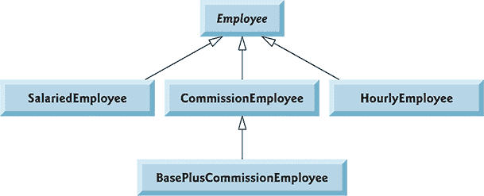

### 图 10.2

`Employee` 层级 UML 类图。

抽象父类 `Employee` 声明了层级的“接口”——即程序可以在所有 `Employee` 对象上调用的方法集。我们在这里使用“接口”一词的*广义*含义是指程序与*任何* `Employee` 子类对象通信的各种方式。不要将“接口”的通用概念与 Java 接口的正式概念混淆，后者是第 10.9 节的主题。每个员工无论收入计算方式如何，都有名、姓和社会安全号，因此 `private` 实例变量 `firstName`、`lastName` 和 `socialSecurityNumber` 出现在抽象父类 `Employee` 中。

图 10.3 中的图表显示了左侧层级结构中五个类中的每一个类，以及顶部的 `earnings` 和 `toString` 方法。对于每个类，图表显示了每个方法的预期结果。我们没有列出父类 `Employee` 的 `get` 方法，因为它们在任何子类中都**没有**被重写——这些方法中的每一个都被每个子类继承并“按原样”使用了。

| 类 | `earnings` | `toString` |
|---|---|---|
| `Employee` | `abstract` | `firstName lastName`<br>`social security number: SSN` |
| `SalariedEmployee` | `weeklySalary` | `salaried employee: firstName lastName`<br>`social security number: SSN`<br>`weekly salary: weeklySalary` |
| `HourlyEmployee` | `if (hours <= 40) { wage * hours } else if (hours > 40) { 40 * wage + (hours - 40) * wage * 1.5 }` | `hourly employee: firstName lastName`<br>`social security number: SSN`<br>`hourly wage: wage; hours worked: hours` |
| `CommissionEmployee` | `commissionRate * grossSales` | `commission employee: firstName lastName`<br>`social security number: SSN`<br>`gross sales: grossSales; commission rate: commissionRate` |
| `BasePlusCommissionEmployee` | `(commissionRate * grossSales) + baseSalary` | `base salaried commission employee:`<br>`firstName lastName`<br>`social security number: SSN`<br>`gross sales: grossSales; commission rate: commissionRate; base salary: baseSalary` |

### 图 10.3

`Employee` 层级类的多态接口。

接下来的章节实现了图 10.2 中的 `Employee` 类层级结构。第一部分实现了**抽象父类** `Employee`。接下来的四个部分分别实现了其中一个**具体**类。最后部分实现了一个测试程序，该程序构建了所有这些类的对象并多态地处理这些对象。

## 10.5.1 抽象父类 `Employee`

`Employee` 类（图 10.4）提供了 `earnings` 和 `toString` 方法，此外还有返回 `Employee` 实例变量值的 `get` 方法。`earnings` 方法显然**通用地**适用于所有员工。但每个薪水计算都取决于员工所属的特定类。因此，我们在父类 `Employee` 中将 `earnings` 声明为 `abstract`（抽象），因为该方法一个**特定的**默认实现是没有意义的——没有足够的信息来确定 `earnings` 应该返回什么金额。

每个子类都用相应的实现重写了 `earnings`。为了计算员工的薪水，程序为父类 `Employee` 变量分配一个员工对象的引用，然后并在该变量上调用 `earnings` 方法。我们维护一个 `Employee` 变量数组，每个变量都持有对 `Employee` 对象的引用。你**不能**直接使用 `Employee` 类来创建 `Employee` **对象**，因为 `Employee` 是一个**抽象**类。然而，由于继承关系，所有 `Employee` 子类的所有对象都可以被看作 `Employee` 对象。程序将遍历数组并为每个 `Employee` 对象调用 `earnings` 方法。Java 以**多态的方式**处理这些方法调用。在 `Employee` 中将 `earnings` 声明为抽象方法，使得通过 `Employee` 变量对 `earnings` 的调用能够编译，并强制每个 `Employee` 的直接**具体**子类都**重写** `earnings`。

`Employee` 类中的 `toString` 方法返回一个包含员工名、姓和社会安全码的 `String`。正如我们将看到的，`Employee` 的每个子类都**重写**了 `toString` 方法，以创建该类对象的 `String` 表示，该表示包含了员工的类型（例如 `"salaried employee:"`），随后是员工的其他信息。

让我们考虑 `Employee` 类的声明（图 10.4）。该类包含一个接收名、姓和社会安全码的构造函数（第 10–15 行）；返回名、姓和社会安全码的 `get` 方法（第 18–21 行）；返回 `Employee` 字符串表示的 `toString` 方法（第 27–31 行）；以及将由**具体**子类实现的抽象 `earnings` 方法（第 34 行）。

```java
// 图 10.4: Employee.java
// Employee 抽象父类
public abstract class Employee {
    private final String firstName;
    private final String lastName;
    private final String socialSecurityNumber;

    // 构造函数
    public Employee(String firstName, String lastName,
        String socialSecurityNumber) {
        this.firstName = firstName;
        this.lastName = lastName;
        this.socialSecurityNumber = socialSecurityNumber;
    }

    // 返回名
    public String getFirstName() { return firstName; }

    // 返回姓
    public String getLastName() { return lastName; }

    // 返回社会安全码
    public String getSocialSecurityNumber() { return socialSecurityNumber; }

    // Employee 的字符串表示
    @Override
```


```java
public String toString() { 
    return String.format("%s %s%nsocial security number: %s", 
           getFirstName(), getLastName(), getSecurityNumber()); 
}

// 抽象方法必须由具体子类重写
public abstract double earnings();
}
```

# 图 10.4

`Employee` 抽象父类。

为什么我们决定将 `earnings` 声明为抽象方法？在 `Employee` 类中提供该方法的**特定**实现是没有意义的——我们无法为**通用的** `Employee` 计算薪水——我们首先知道**具体的**类型。通过将此方法声明为抽象，我们表明每个具体子类**必须**提供 `earnings` 实现，并且程序将能够多态地使用 `Employee` 变量调用 `earnings`。

# 10.5.2 具体子类 `SalariedEmployee`

`SalariedEmployee` 类（图 10.5）扩展 `Employee` 类（第 4 行）并重写了抽象 `earnings` 方法（第 34–35 行），这使得 `SalariedEmployee` 变成了一个**具体**类。该类包含一个接收名、姓、社会安全码和周薪的构造函数（第 8–18 行）；一个为实例变量 `weeklySalary` 分配新**非负**值的 `set` 方法（第 21–28 行）；一个返回 `weeklySalary` 值的 `get` 方法（第 31 行）；一个计算 `SalariedEmployee` 薪水的 `earnings` 方法（第 34–35 行）；以及一个 `toString` 方法（第 38–42 行），它返回一个包含 `"salaried employee: "` 以及由父类 `Employee` 的 `toString` 方法和 `SalariedEmployee` 的 `getWeeklySalary` 方法生成的员工信息的字符串。`SalariedEmployee` 的构造函数将名、姓和社会安全码传递给 `Employee` 构造函数（第 10 行），以初始化父类的**私有**实例变量。再次，我们在构造函数和 `setWeeklySalary` 方法中重复了 `weeklySalary` 的验证代码。

```java
// Fig. 10.5: SalariedEmployee.java 
// SalariedEmployee concrete class extends abstract class Employee.

public class SalariedEmployee extends Employee {
    private double weeklySalary; 

    // constructor 
    public SalariedEmployee(String firstName, String lastName, 
       String socialSecurityNumber, double weeklySalary) { 
       super(firstName, lastName, socialSecurityNumber); 

       if (weeklySalary < 0.0) { 
          throw new IllegalArgumentException( 
              "Weekly salary must be >= 0.0"); 
       } 

       this.weeklySalary = weeklySalary; 
    } 

    // set salary 
    public void setWeeklySalary(double weeklySalary) { 
       if (weeklySalary < 0.0) { 
          throw new IllegalArgumentException( 
              "Weekly salary must be >= 0.0"); 
       } 

       this.weeklySalary = weeklySalary; 
    } 

    // return salary 
    public double getWeeklySalary() {return weeklySalary;} 

    // calculate earnings; override abstract method earnings in Employee
    @Override
    public double earnings() {return getWeeklySalary();}

    // return String representation of SalariedEmployee object
    @Override
    public String toString() { 
       return String.format("salaried employee: %s%n%s: $%,.2f",
         super.toString(), "weekly salary", getWeeklySalary());
    }
}
```

# 图 10.5

`SalariedEmployee` 具体类继承自 `abstract` 类 `Employee`。

方法 `earnings` 重写了 `Employee` 的 `abstract` 方法 `earnings`，以提供一个返回 `SalariedEmployee` 周薪的 `concrete` 实现。如果我们没有实现 `earnings`，则 `SalariedEmployee` 类必须声明为 `abstract`——否则，`SalariedEmployee` 类将无法编译。当然，在这个示例中我们希望 `SalariedEmployee` 是一个 `concrete` 类。

方法 `toString`（第 38–42 行）重写了 `Employee` 的 `toString`。如果 `SalariedEmployee` 类没有重写 `toString`，它将继承 `Employee` 的版本。在这种情况下，`SalariedEmployee` 的 `toString` 方法将简单地返回员工的全名和社会安全号，这不能充分表示一个 `SalariedEmployee`。为了产生 `SalariedEmployee` 的完整 `String` 表示，子类的 `toString` 方法返回 `"salaried employee: "`，随后是来自父类 `Employee` 的特定信息（即：名、姓和社会安全号），这些信息是通过调用 `superclass` 的 `toString` 方法（第 41 行）获得的——这是 `code reuse` 的一个很好的例子。`SalariedEmployee` 的 `String` 表示还包含通过调用类的 `getWeeklySalary` 方法获得的员工周薪。

# 10.5.3 具体子类 `HourlyEmployee`

`HourlyEmployee` 类（Fig. 10.6）也继承自 `Employee`（第 4 行）。该类包含一个构造函数（第 9–24 行），接收名、姓、社会安全号、时薪和工作小时数。第 27–33 行和 39–46 行声明了 `set` 方法，分别为实例变量 `wage` 和 `hours` 分配新值。方法 `setWage` 确保 `wage` 是 `nonnegative`，而方法 `setHours` 确保 `hours` 的值在 0 到 168 之间（每周总小时数）。`HourlyEmployee` 类还包含了 `get` 方法（第 36 和 49 行）分别返回 `wage` 和 `hours` 值；一个 `earnings` 方法（第 52–60 行）用于计算 `HourlyEmployee` 的收益；以及一个 `toString` 方法（第 63–68 行），返回包含员工类型 `"hourly employee: "` 以及特定信息。`HourlyEmployee` 构造函数像 `SalariedEmployee` 构造函数一样，将名、姓和社会安全号传递给父类 `Employee` 构造函数（第 11 行）以初始化 `private` 实例变量。此外，`toString` 方法调用 `superclass` 方法 `toString`（第 66 行）来获取 `Employee` 的特定信息（即：名、姓和社会安全号）——这是另一个 `code reuse` 的例子。

```java
// Fig. 10.6: HourlyEmployee.java 
// HourlyEmployee class extends Employee. 

public class HourlyEmployee extends Employee {
    private double wage; // wage per hour
    private double hours; // hours worked for week

    // constructor 
    public HourlyEmployee(String firstName, String lastName, 
       String socialSecurityNumber, double wage, double hours) { 
       super(firstName, lastName, socialSecurityNumber); 

       if (wage < 0.0) { // validate wage
          throw new IllegalArgumentException( 
              "Hourly wage must be >= 0.0"); 
       } 

       if ((hours < 0.0) || (hours > 168)) { // validate hours
          throw new IllegalArgumentException( 
              "Hours worked must be between 0 and 168"); 
       } 

       this.wage = wage; 
       this.hours = hours; 
    } 

    // set wage 
    public void setWage(double wage) { 
       if (wage < 0.0) { 
          throw new IllegalArgumentException( 
              "Hourly wage must be >= 0.0"); 
       } 

       this.wage = wage; 
    } 

    // return wage 
    public double getWage() {return wage;} 

    // set hours 
    public void setHours(double hours) { 
       if ((hours < 0.0) || (hours > 168)) { 
          throw new IllegalArgumentException( 
              "Hours worked must be between 0 and 168"); 
       } 

       this.hours = hours; 
    } 

    // return hours 
    public double getHours() {return hours;} 

    // calculate earnings; override abstract method earnings in Employee
    @Override
    public double earnings() {
       if (getHours() <= 40) { 
          return getWage() * getHours();
       else {
          return 40 * getWage() + (getHours() - 40) * getWage() * 1.5;
       }
    }

    // return String representation of HourlyEmployee object
    @Override
    public String toString() {
       return String.format("hourly employee: %s%n%s: $%,.2f; %s: %,.2f",
         super.toString(), "hourly wage", getWage(),
         "hours worked", getHours());
    }
}
```

# 图 10.6

`HourlyEmployee` 类继承自 `Employee`。

# 10.5.4 具体子类 `CommissionEmployee`

`CommissionEmployee` 类（Fig. 10.7）继承自 `Employee`（第 4 行）。该类包含一个构造函数（第 9–25 行），接收名、姓、社会安全号、销售额和佣金率；`set` 方法（第 28–34 行和 40–47 行）分别为实例变量 `grossSales` 和 `commissionRate` 分配有效的新值；`get` 方法（第 37 行和 50 行）获取这些实例变量的值；`earnings` 方法（第 53–56 行）用于计算 `CommissionEmployee` 的收益；以及 `toString` 方法（第 59–65 行），返回 `"commission employee: "`，随后是员工的特定信息。构造函数还将名、姓和社会安全号传递给父类 `Employee` 的构造函数（第 12 行）以初始化 `Employee` 的 `private` 实例变量。`toString` 方法调用 `superclass` 方法 `toString`（第 62 行）来获取 `Employee` 的特定信息（即：名、姓和社会安全号）。

```java
// Fig. 10.7: CommissionEmployee.java 
// CommissionEmployee class extends Employee. 
public class CommissionEmployee extends Employee { 
    private double grossSales; // 每周销售额额
    private double commissionRate; // 佣金比例 
    // 构造函数
    public CommissionEmployee(String firstName, String lastName, 
       String socialSecurityNumber, double grossSales, 
       double commissionRate) { 
       super(firstName, lastName, socialSecurityNumber);

       if (commissionRate <= 0.0 || commissionRate >= 1.0) { // 验证 
          throw new IllegalArgumentException( 
             "Commission rate must be > 0.0 and < 1.0"); 
       }

       if (grossSales < 0.0) { // 验证 
          throw new IllegalArgumentException("Gross sales must be >= 0.0"); 
       }

       this.grossSales = grossSales; 
       this.commissionRate = commissionRate; 
    } 
    // 设置销售额 
    public void setGrossSales(double grossSales) { 
       if (grossSales < 0.0) { // 验证 
          throw new IllegalArgumentException("Gross sales must be >= 0.0"); 
       }
    }
}
```


```java
      }

      this.grossSales = grossSales;
   }

   // 返回销售额
   public double getGrossSales() { return grossSales; }

   // 设置佣金比例
   public void setCommissionRate(double commissionRate) {
      if (commissionRate <= 0.0 || commissionRate >= 1.0) { // 验证
         throw new IllegalArgumentException(
            "Commission rate must be > 0.0 and < 1.0");
      }
      this.commissionRate = commissionRate;
   }

   // 返回佣金比例
   public double getCommissionRate() { return commissionRate; }

   // 计算收益；重写 Employee 中的抽象方法 earnings
   @Override
   public double earnings() {
      return getCommissionRate() * getGrossSales();
   }

   // 返回 CommissionEmployee 对象的字符串表示
   @Override
   public String toString() {
      return String.format("%s: %s%n%s: $%,.2f; %s: %.2f",
         "commission employee", super.toString(),
         "gross sales", getGrossSales(),
         "commission rate", getCommissionRate());
   }
}
```

# 图 10.7

`CommissionEmployee` 类继承自 `Employee`。

# 10.5.5 间接子类 `BasePlusCommissionEmployee`

`BasePlusCommissionEmployee` 类（图 10.8）继承自 `CommissionEmployee`。`BasePlusCommissionEmployee` 类有一个构造函数（第 8–19 行），接收名、姓、社会安全号码、销售额、佣金比例和基本工资。然后它将除基本工资以外的所有参数传递给 `CommissionEmployee` 构造函数（第 11–12 行）以初始化父类变量。`BasePlusCommissionEmployee` 还包含一个 `set` 方法（第 22–28 行）为实例变量 `baseSalary` 分配新值，以及一个 `get` 方法（第 31 行）返回 `baseSalary` 的值。`earnings` 方法（第 34–35 行）计算 `BasePlusCommissionEmployee` 的收益。`earnings` 方法中的第 35 行调用 `CommissionEmployee` 的 `earnings` 方法来计算员工收益中基于佣金的部分——这是代码重用的另一个示例。`BasePlusCommissionEmployee` 的 `toString` 方法（第 38–43 行）创建一个 `BasePlusCommissionEmployee` 的字符串，包含 `base-salaried`，随后是调用 `CommissionEmployee` 的 `toString` 方法获得的字符串（第 41 行），然后是基本工资。结果是一个以 `base-salaried employee` 开头的字符串，后面是 `BasePlusCommissionEmployee` 的其他信息。回想 `CommissionEmployee` 的 `toString` 通过调用其父类（即 `Employee`）的 `toString` 方法来获取员工的名字、姓和社会安全号码——这是另一个代码重用的示例。`BasePlusCommissionEmployee` 的 `toString` 方法启动了一个跨越 `Employee` 层次结构所有三层的方法调用链。

```java
// 图 10.8: BasePlusCommissionEmployee.java
// BasePlusCommissionEmployee 类继承自 CommissionEmployee.
public class BasePlusCommissionEmployee extends CommissionEmployee {
    private double baseSalary; // 每周基本工资

    // 构造函数
    public BasePlusCommissionEmployee(String firstName, String lastName,
       String socialSecurityNumber, double grossSales,
       double commissionRate, double baseSalary) {
       super(firstName, lastName, socialSecurityNumber,
          grossSales, commissionRate);
       if (baseSalary < 0.0) { // 验证 baseSalary
          throw new IllegalArgumentException("Base salary must be >= 0.0");
       }
       this.baseSalary = baseSalary;
    }

    // 设置基本工资
    public void setBaseSalary(double baseSalary) {
       if (baseSalary < 0.0) { // 验证 baseSalary
          throw new IllegalArgumentException("Base salary must be >= 0.0");
       }
       this.baseSalary = baseSalary;
    }

    // 返回基本工资
    public double getBaseSalary() { return baseSalary; }

    // 计算收益；重写 CommissionEmployee 中的 earnings
    @Override
    public double earnings() { return getBaseSalary() + super.earnings(); }

    // 返回 BasePlusCommissionEmployee 对象的字符串表示
    @Override
    public String toString() {
       return String.format("%s %s; %s: $%,.2f",
          "base-salaried", super.toString(),
          "base salary", getBaseSalary());
    }
}
```

# 图 10.8

`BasePlusCommissionEmployee` 类继承自 `CommissionEmployee`。

# 10.5.6 多态处理、`instanceof` 运算符和向下转换

为了测试我们的 `Employee` 层次结构，图 10.9 中的应用程序创建了四个具体类 `SalariedEmployee`、`HourlyEmployee`、`CommissionEmployee` 和 `BasePlusCommissionEmployee` 的每个对象。程序通过对象自身类型的变量非多态地操纵这些对象，然后通过使用 `Employee` 变量数组以多态地操纵它们。在多态地处理对象时，程序将每个 `BasePlusCommissionEmployee` 的基本工资增加了 10%——这需要在运行时确定对象的类型。最后，程序以多态的方式确定并输出 `Employee` 数组中每个对象的类型。

```java
// Fig. 10.9: PayrollSystemTest.java
// 员工层级测试程序.
public class PayrollSystemTest {
   public static void main(String[] args) {
      // 创建子类对象
      SalariedEmployee salariedEmployee =
         new SalariedEmployee("John", "Smith", "111-11-1111", 800.00);
      HourlyEmployee hourlyEmployee =
         new HourlyEmployee("Karen", "Price", "222-22-2222", 16.75, 40);
      CommissionEmployee commissionEmployee =
         new CommissionEmployee(
            "Sue", "Jones", "333-33-3333", 10000, .06);
      BasePlusCommissionEmployee basePlusCommissionEmployee =
         new BasePlusCommissionEmployee(
            "Bob", "Lewis", "444-44-4444", 5000, .04, 300);

      System.out.println("正在单独处理员工:");

      System.out.printf("%n%s%n%s: $%,.2f%n%n",
         salariedEmployee, "earned", salariedEmployee.earnings());
      System.out.printf("%s%n%s: $%,.2f%n%n",
         hourlyEmployee, "earned", hourlyEmployee.earnings());
      System.out.printf("%s%n%s: $%,.2f%n%n",
         commissionEmployee, "earned", commissionEmployee.earnings());
      System.out.printf("%s%n%s: $%,.2f%n%n",
         basePlusCommissionEmployee,
         "earned", basePlusCommissionEmployee.earnings());

      // 创建一个四个元素的 Employee 数组
      Employee[] employees = new Employee[4];

      // 用 Employees 初始化数组
      employees[0] = salariedEmployee;
      employees[1] = hourlyEmployee;
      employees[2] = commissionEmployee;
      employees[3] = basePlusCommissionEmployee;

      System.out.printf("正在多态处理员工:%n%n");

      // 泛型地处理 employees 数组中的每个元素
      for (Employee currentEmployee : employees) {
         System.out.println(currentEmployee); // 调用 toString

         // 判断元素是否为 BasePlusCommissionEmployee
         if (currentEmployee instanceof BasePlusCommissionEmployee) {
            // 将 Employee 引用向下转型为
            // BasePlusCommissionEmployee 引用
            BasePlusCommissionEmployee employee =
               (BasePlusCommissionEmployee) currentEmployee;

            employee.setBaseSalary(1.10 * employee.getBaseSalary());

            System.out.printf(
               "增加 10%% 后的新底薪为: $%,.2f%n",
               employee.getBaseSalary());
         }

         System.out.printf(
            "收益 $%,.2f%n%n", currentEmployee.earnings());
      }

      // 获取 employees 数组中每个对象的类型名称
      for (int j = 0; j < employees.length; j++) {
         System.out.printf("Employee %d is a %s%n", j,
            employees[j].getClass().getName());
      }
   }
}
```

# 图 10.9

`Employee` 层级测试程序。

# 创建 `Employee` 数组

第 31 行声明了 `employees` 并为其分配了一个包含四个 `Employee` 变量的数组。第 34–37 行分别为元素分配了 `SalariedEmployee`、`HourlyEmployee`、`CommissionEmployee` 和 `BasePlusCommissionEmployee` 的引用。这些赋值是允许的，因为 `SalariedEmployee` 是一个 `Employee`，`HourlyEmployee` 是一个 `Employee`，`CommissionEmployee` 是一个 `Employee`，且 `BasePlusCommissionEmployee` 是一个 `Employee`。因此，即使 `Employee` 是一个抽象类，我们可以将 `SalariedEmployee`、`HourlyEmployee`、`CommissionEmployee` 和 `BasePlusCommissionEmployee` 对象的引用赋值给父类变量 `Employee`。

# 多态处理 `Employee`

第 42–61 行遍历数组 `employees` 并使用 `Employee` 变量 `currentEmployee` 调用 `toString` 和 `earnings` 方法，`currentEmployee` 在每次迭代中都被分配数组中不同的 `Employee` 引用。输出说明每个类的特定方法确实被调用了。所有对 `toString` 和 `earnings` 方法的调用都是在运行时根据 `currentEmployee` 所引用对象的类型解析的。这一过程被称为**动态绑定**（dynamic binding）或**晚期绑定**（late binding）。

# 对 `BasePlusCommissionEmployee` 执行特定类型操作

我们需要对 `BasePlusCommissionEmployee` 执行特殊操作。为了实现这一点，我们使用 `instanceof` 运算符判断一个 `Employee` 引用是否为 `BasePlusCommissionEmployee`。如果是，我们将 `Employee` 引用向下转型为 `BasePlusCommissionEmployee` 引用，以便调用其特定方法。

```java
if (currentEmployee instanceof BasePlusCommissionEmployee) {
    BasePlusCommissionEmployee employee = (BasePlusCommissionEmployee) currentEmployee;
```


```java
employee.setBaseSalary(1.10 * employee.getBaseSalary());

System.out.printf("增加 10%% 后的新底薪为: $%,.2f%n", employee.getBaseSalary());

}
```

# 多态调用 `earnings`

第 59–60 行对 `currentEmployee` 调用 `earnings` 方法，这将多态地调用相应子类对象的 `earnings` 方法。在第 59–60 行多态地获取 `SalariedEmployee`、`HourlyEmployee` 和 `CommissionEmployee` 的收益，与第 20–25 行单独获取这些员工收益的结果相同。由于底薪增加了 10%，第 59–60 行获取的 `BasePlusCommissionEmployee` 收益金额高于第 26–28 行获取的金额。

# 获取每个 `Employee` 的类名

第 64–67 行以 `String` 类型显示每个员工的类型。每个对象都知道自己的类，并通过 `getClass()` 方法访问这些信息，所有类都继承自 `Object` 类。`getClass()` 方法返回一个 `Class` 类型的对象（来自 `java.lang` 包），该对象包含了对象类型的信息，包括其类名。第 66 行对当前对象调用 `getClass()` 以获取其类。`getClass()` 调用的结果用于调用 `getName()` 以获取对象的类名。

在上一个示例中，我们通过在第 49–50 行将 `Employee` 变量强制转换为 `BasePlusCommissionEmployee` 变量，避免了多处编译错误。如果你从第 50 行删除强制转换符 `(BasePlusCommissionEmployee)` 并尝试直接将 `Employee` 变量 `currentEmployee` 赋值给 `BasePlusCommissionEmployee` 变量 `employee`，将会收到“类型不兼容”（incompatible types）的编译错误。此错误表明，将父类对象 `currentEmployee` 的引用赋值给子类变量 `employee` 是不允许的。编译器阻止了这种赋值，因为 `CommissionEmployee` 不是 `BasePlusCommissionEmployee`——“是”（is-a）关系仅适用于子类及其父类之间，反之则不然。

同样，如果第 52 行和第 56 行使用父类变量 `currentEmployee` 来调用子类特有的方法 `getBaseSalary` 和 `setBaseSalary`，我们会在这些行收到“找不到符号”（cannot find symbol）的编译错误。通过父类变量调用子类特有的方法是不允许的——尽管第 52 行和第 56 行只有在第 46 行的 `instanceof` 返回 `true` 时才会执行，这表明 `currentEmployee` 持有一个对 `BasePlusCommissionEmployee` 对象的引用。使用父类 `Employee` 变量，我们只能调用 `Employee` 类中找到的方法——`earnings`、`toString` 以及 `Employee` 的 get 和 set 方法。

# 10.6 父类与子类变量之间允许的赋值

现在你已经看到了一个以多态方式处理各种子类对象的完整应用程序，现在我们总结一下你对父类和子类对象及变量可以做什么和不能做什么。虽然子类对象也是一个父类对象，但这两个类仍然是不同的。正如之前讨论的，子类对象可以被视为其父类的对象。但由于子类可能具有额外的子类特有成员，在没有显式强制转换的情况下，是不允许将父类引用赋值给子类变量的——这种赋值会导致父类对象中的子类成员未定义。

我们讨论了三种将父类和子类引用赋值给父类和子类类型变量正确方法：

1. 将父类引用赋值给父类变量是直接的。
2. 将子类引用赋值给子类变量是直接的。
3. 将子类引用赋值给父类变量是安全的，因为子类对象是其父类的对象。然而，父类变量只能用于引用父类成员。如果这段代码通过父类变量引用子类特有的成员，编译器将报告错误。

# 10.7 `final` 方法和类

我们在第 6.3 节和 6.10 节中看到，变量可以声明为 `final`，以指示它们在初始化后不能被修改——此类变量代表常量值。你也可以将方法参数声明为 `final`，以防止它们在方法体中被修改。还可以使用 `final` 修饰符声明方法和类。

## final 方法不能被重写

父类中的 `final` 方法不能在子类中被重写——这保证了 `final` 方法的实现将被层次结构中的所有直接和间接子类使用。声明为 `private` 的方法隐式地 `final`，因为在子类中无法重写它们。声明为 `static` 的方法也是隐式的 `final`。`final` 方法的声明永远不会改变，因此所有子类都使用相同的方法实现，且对 `final` 方法的将在编译时解析——这被称为静态绑定。

## final 类不能作为父类

`final` 类不能被扩展以创建子类。`final` 类中的所有方法都是隐式的 `final`。`String` 类就是 `final` 类的一个示例。如果你被允许创建 `String` 的子类，那么该子类的对象就可以在任何需要 `String` 的地方使用。由于 `String` 类不能扩展，使用 `String` 的程序就可以依赖 `String` 的功能。将类设置为 `final` 还可以防止程序员创建可能绕过安全限制的子类。

我们现在讨论了将变量、方法和类声明为 `final`，并强调如果某些可以是 `final` 就应该是 `final`——这是最小权限原则的另一个例子。当我们在第 23 节学习并发时，你会发现 `final` 变量让程序针对如今多核处理器的并行化变得简单得多。关于 `final` 的更多见解，请访问：

`http://docs.oracle.com/javase/tutorial/java/IandI/final.html`

# 10.8 关于在构造函数中调用方法的深层解释

我们提到过不要在构造函数中调用可重写的方法。为了理解为什么，请回想当你构造子类对象时，子类构造函数首先调用直接父类的构造函数。此时，子类构造体中的任何子类实例初始化代码尚未执行。如果父类构造函数随后调用了子类重写的方法，则将执行子类的版本。如果子类方法使用了尚未初始化的变量，可能会导致微妙且难以检测的错误。

假设一个构造函数和一个设置方法对特定的实例变量执行相同的验证。你应该如何处理公共代码？

* 如果验证代码很短，你可以在构造函数和设置方法中复制它。这是消除我们所考虑问题的简单方法。
* 对于较长的验证，你可以定义一个 `static` 验证方法（通常是 `private static` 辅助方法），然后从构造函数和设置方法调用它。在构造函数从调用 `static` 方法是允许的，因为 `static` 方法不可重写。

构造函数调用 `final` 实例方法也是允许的，只要该方法没有直接或间接地地调用任何可重写的实例方法。

注：Java SE 8 接口增强在[第 10.10 节中介绍，并在第 17 章中进行了详细讨论。Java SE 9 接口增强在第 10.11 节中介绍。]我们的下一个示例（图 10.11–10.14)重新检查了第 10.5 节中的工资单系统。假设涉及的公司希望在单个应付账款应用程序中执行多个会计操作——除了计算必须支付给每个员工的工资外，公司还必须计算多张发票的每张应付金额（即购买货物的账单）。尽管应用于*不相关*的事物——员工和发票——但这两项操作都与获取金额有关。对于员工，付款金额是员工的工资；对于发票，付款金额是发票上列出的商品总成本。我们是否可以在*单个*应用程序中以*多态*的方式计算像员工和发票应付金额这样*不同*的内容呢？Java 是否提供了一种能力，要求*不相关*的类实现一组*公共*方法（例如，计算付款金额的方法）？Java **接口** 恰恰好提供了这种能力。

# 标准化交互

接口定义并标准化了人员和系统等实体相互交互的方式。例如，收音机上的控件充当了收音机用户与收音机内部组件之间的接口。这些控件允许用户执行有限的操作（例如切换电台、调整音量、在 AM 和 FM 之间选择），不同的收音机可能以不同的方式实现这些控件（例如使用按钮、旋钮、语音命令）。接口规定了收音机必须允许用户执行*什么*操作，但没有规定这些操作是*如何*执行。

同样，在我们第 1.5 节中的汽车类比中，一个由方向盘、加速踏板和刹车踏板组成的“基本驾驶能力”接口使驾驶员能够告诉汽车*做什么*。一旦你学会了如何使用此接口进行转弯、加速和刹车，就可以就可以许多类型的汽车，尽管制造商可能以*不同的方式实现*这些系统。例如，有许多类型的制动系统——盘刹、鼓刹、防抱制动、液压制动、气动制动等。当你按下刹车踏板时，汽车实际的制动系统并不重要——重要的是当你按下刹车时汽车确实在减速。

# 软件对象通过接口进行通信

软件对象也通过接口进行通信。Java 接口描述了一组可以在对象上调用的方法，用以告诉它例如执行某些任务或返回某些信息。下一个示例引入了一个名为 `Payable` 的接口，用于描述任何“能够支付”的对象的功能，因此它必须提供一个方法来确定正确的应付金额。**接口声明**以 `interface` 关键字开始，并且仅包含*常量和 `abstract`（抽象）方法。与类不同，所有接口成员*必须*是 `public` 的，且*接口不能指定任何实现细节*，例如具体的方法声明和实例变量。接口中声明的所有方法都隐含地是 `public abstract` 方法，所有字段隐含地是 `public`、`static` 和 `final`。

# 使用接口

要使用接口，具体类必须指定它 `implements`（实现）该接口，并必须按照接口声明中指定的签名声明接口中的每个方法。

```java
class ClassName extends InterfaceName
```

```java
class ClassName implements InterfaceName
```

图 10.10 中的 UML 类图显示了我们的应付账应用程序中使用的接口和类层次结构。该层次结构从接口 `Payable` 开始。UML 通过在接口名称上方使用角括号（`«` 和 `»`）放置“interface”一词来区分接口与类。UML 通过名为 `real` 的关系表示类与接口之间的关系。类被认为实现了（`realize`）或执行了（`implement`）接口的方法。类图将实现关系建模为从实现类指向接口的带有空心箭头的虚线箭头。图 10.10 中的图表明，`Invoice` 和 `Employee` 类分别实现了接口 `Payable`。与图 10.2 中的类图一样，`Employee` 类以斜体显示，表示它是一个*抽象类*。具体类 `SalariedEmployee` 扩展了 `Employee`，继承了其父类与接口 `Payable` 的实现关系。

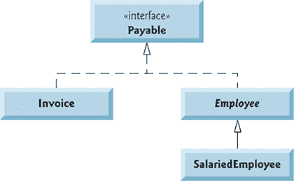

## 图 10.10

`Payable` 层次结构的 UML 类图。

## 10.9.2 接口 `Payable`

接口 `Payable` 的声明开始于图 10.11 的第 4 行，使用了 `interface` 关键字。该接口包含名为 `getPaymentAmount` 的 `public abstract` 方法。接口方法默认是 `public` `abstract` 的，因此不需要声明为这些属性。接口 `Payable` 只有一个方法，但接口可以有任意数量的方法。此外，方法 `getPaymentAmount` 没有参数，但接口方法可以有参数。接口还可能包含 `final static` 常量。

```java
 // Fig 10.11: Payable.java 
 // Payable 接口声明。

 public interface Payable { 
     public abstract double getPaymentAmount(); // 无实现
 }
```

## 图 10.11

`Payable` 接口声明。

## 10.9.3 类 `Invoice`

类 `Invoice`（图 10.12）代表一个简单的发票，仅包含一种零件的账单信息。该类声明了 `private` 实例变量 `partNumber`、`partDescription`、`quantity` 和 `pricePerItem`（第 5–8 行），它们表示零件编号、零件描述、订单的零件数量以及单价。`Invoice` 类还包含一个构造函数（第 11–26 行）、get 方法（第 29–38 行）以及一个 `toString()` 方法（第 41–46 行），该方法返回 `Invoice` 对象的 `String` 表示。

```java
 // Fig. 10.12: Invoice.java 
 // 实现了 Payable 的 Invoice 类。 

 public class Invoice implements Payable { 
     private final String partNumber; 
     private final String partDescription; 
     private final int quantity; 
     private final double pricePerItem; 

     // 构造函数 
     public Invoice(String partNumber, String partDescription, int quantity, 
        double pricePerItem) { 
        if (quantity < 0) { // 验证数量 
           throw new IllegalArgumentException("Quantity must be >= 0"); 
        } 

        if (pricePerItem < 0.0) { // 验证 pricePerItem 
           throw new IllegalArgumentException( 
              "Price per item must be >= 0"); 
        } 

        this.quantity = quantity; 
        this.partNumber = partNumber; 
        this.partDescription = partDescription; 
        this.pricePerItem = pricePerItem; 
     }

     public String getPartNumber() { return partNumber; }
     public String getPartDescription() { return partDescription; }
     public int getQuantity() { return quantity; }
     public double getPricePerItem() { return pricePerItem; }
     @Override
     public String toString() {
        return String.format("%s: %s: $%.2f",
           "invoice", partNumber,
           pricePerItem);
     }

     @Override
     public double getPaymentAmount() {
        return quantity * pricePerItem;
     }
 }
```

## 图 10.12

实现了 `Payable` 的 `Invoice` 类。

`Invoice` 类实现了 `Payable`。和所有类一样，`Invoice` 隐式地扩展了 `Object`。第 49–52 行的 `getPaymentAmount` 方法计算总金额。该方法乘以 `quantity` 和 `pricePerItem`（通过相应的 `get` 方法获取）并返回结果。该方法满足了 `Payable` 接口。

## 类只能扩展一个类但可以多个接口

Java 不允许子类继承多个父类，但它允许一个类继承一个父类并实现多个接口。要实现多个接口，在类声明的 `implements` 之后使用逗号分隔的接口列表，如下：

```java
public class ClassName extends SuperclassName implements FirstInterface, SecondInterface
```


`ArrayList` 类（节 7.16）是许多实现多个接口的 Java API 类之一。例如，`ArrayList` 实现了 `Iterable`，这使得增强 `for` 语句可以遍历 `ArrayList` 的元素。`ArrayList` 还实现了 `List`（节 16.6），它声明了可以在任何表示列表的对象上调用的常用方法（如 `add`、`remove` 和 `contains`）。

## 10.9.4 修改 `Employee` 类以实现接口 `Payable`

我们现在修改 `Employee` 类以实现 `Payable`（图 10.13）。该类的声明与图 10.4 中的声明完全相同，有两个例外：

*   [图 10.13]的第 4 行表明 `Employee` 类现在实现了 `Payable`。
*   第 38 行实现了 `Payable` 接口的 `getPaymentAmount` 方法。

注意，`getPaymentAmount` 仅仅调用了 `Employee` 的抽象方法 `earnings`。在运行时，当在 `Employee` 子类的对象上调用 `getPaymentAmount` 时，`getPaymentAmount` 会调用该子类的具体的 `earnings` 方法，该方法知道如何计算该子类类型对象的收益。

```java
// Fig. 10.13: Employee.java
// 实现 Payable 的抽象父类 Employee。

public abstract class Employee implements Payable {
    private final String firstName;
    private final String lastName;
    private final String socialSecurityNumber;

    // 构造函数
    public Employee(String firstName, String lastName,
        String socialSecurityNumber) {
        this.firstName = firstName;
        this.lastName = lastName;
        this.socialSecurityNumber = socialSecurityNumber;
    }

    // 返回名字
    public String getFirstName() {return firstName;}

    // 返回姓氏
    public String getLastName() {return lastName;}

    // 返回社会安全号
    public String getSocialSecurityNumber() {return socialSecurityNumber;}

    // 返回 Employee 对象的字符串表示
    @Override
    public String toString() {
        return String.format("%s %s%nsocial security number: %s",
            getFirstName(), getLastName(), getSocialSecurityNumber());
    }

    // 抽象方法必须由具体子类重写
    public abstract double earnings(); // 此无实现

    // 在此处实现 getPaymentAmount 可以使整个 Employee
    // 类层次可以在处理 Payables 的应用程序中使用
    public double getPaymentAmount() {return earnings();}
}
```

## 图 10.13

实现 `Payable` 的抽象父类 `Employee`。

## `Employee` 的子类与接口 `Payable`

当一个类实现一个接口时，适用于继承相同的“是一个”（is-a）关系。`Employee` 类实现了 `Payable`，因此我们可以说一个 `Employee` 是一个 `Payable`，因此任何 `Employee` 子类的对象也都是 `Payable`。所以，如果我们用图 10.13 中的新 `Employee` 父类更新 10.5 节中的类层次结构，那么 `SalariedEmployee`、`HourlyEmployee`、`CommissionEmployee` 和 `BasePlusCommissionEmployee` 都是 `Payable` 对象。正如我们可以将 `SalariedEmployee` 子类对象的引用赋值给父类变量 `Employee` 一样，我们可以将 `SalariedEmployee` 对象（或任何其他 `Employee` 子类对象）的引用赋值给 `Payable` 变量。`Invoice` 实现 `Payable`，因此 `Invoice` 对象也是 `Payable` 对象，我们可以将 `Invoice` 对象的引用赋值给 `Payable` 变量。

## 10.9.5 使用接口 `Payable` 多态地处理 `Invoice` 和 `Employee`

`PayableInterfaceTest` 说明了接口 `Payable` 可以在单个应用程序中以多态的方式处理一组 `Invoice` 和 `Employee`。第 7–12 行声明并初始化了四个元素的数组 `payableObjects`。第 8–9 行将 `Invoice` 对象的引用放在 `payableObjects` 的前两个元素中。第 10–11 行随后将 `SalariedEmployee` 对象的引用放在 `payableObjects` 的后两个元素中。这些元素允许用 `Invoice` 和 `SalariedEmployee` 初始化，因为 `Invoice` 是 `Payable`，`SalariedEmployee` 是 `Employee`，而 `Employee` 是 `Payable`。

```java
// Fig. 10.14: PayableInterfaceTest.java
// Payable 接口测试程序，多态的方式处理 Invoices 和
// Employees。
public class PayableInterfaceTest {
    public static void main(String[] args) {
        // 创建四个元素的 Payable 数组
        Payable[] payableObjects = new Payable[] {
            new Invoice("01234", "seat", 2, 375.00),
            new Invoice("56789", "tire", 4, 79.95),
            new SalariedEmployee("John", "Smith", "111-1111", 800.00),
            new SalariedEmployee("Lisa", "Barnes", "888-8888", 1200.00)
        };

        System.out.println(
            "Invoices and Employees processed polymorphically:");
        // 处理 payableObjects 中的每个元素
        for (Payable currentPayable : payableObjects) {
            // 输出 currentPayable 及其支付金额
            System.out.printf("%s%npayment: $%.2f%n",
                currentPayable.toString(), currentPayable.getPaymentAmount());
        }
    }
}
```


## 图 10.14

多态地处理 `Invoice` 和 `Employee` 的 `Payable` 接口测试程序。第 18–23 行多态地处理 `payableObjects` 中的每个 `Payable`，显示每个对象的 `String` 字符串和支付金额。第 21 行调用了 `toString`，尽管 `toString` 未在 `Payable` 中声明——此处所有的引用（包括这些）都是如此。第 22 行调用了 `getPaymentAmount`。

## 10.9.6 Java API 的一些常用接口

在开发 Java 应用程序时，你会广泛使用接口。Java API 包含许多接口，许多 Java API 方法接受接口参数并返回接口值。图 10.15 概述了我们在后续章节中使用的几个常用接口。

| 接口 | 描述 |
| --- | --- |
| `Comparable` | Java 包含了几个比较运算符（例如 `<`, `<=`, `>=`, `!=`），允许你比较原始值。然而，这些运算符不能用于比较对象。`Comparable` 用于允许实现接口的类的对象之间相互比较。我们在第 16 节 泛型集合和第 20 节 泛型类和方法：深入探讨中使用了 `Comparable`。 |
| `Serializable` | 用于标识类的接口，这些类的对象可以写入（即序列化）或从中读取（即反序列化）某种类型的存储器（例如磁盘上的文件、数据库字段）或跨网络传输。 |
| `Runnable` | 由任何代表执行任务的类实现。此类类的对象通常使用称为多线程的技术并行执行（在第 23 节 并发中讨论）。该接口包含一个方法 `run`，它指定了对象在执行时的行为。 |
| GUI 事件监听器接口 | 你每天都在与图形用户界面（GUI）打交道。在浏览器中，你可能会输入网站地址进行访问，也可能会点击按钮返回上一个站点。浏览器会对你的交互做出响应并执行所需任务。你的交互被称为 `event`（事件），而浏览器用于响应事件的代码被称为 `event handler`（事件处理器）。在第 12 章《JavaFX 图形用户界面：部分 1》，你将开始学习如何使用响应用户交互的事件处理器来构建 GUI。事件处理器声明在实现了适当 `event-listener interface` 的类中。每个 `event-listener interface` 都指定了一个或多个必须实现的方法，以响应用户交互。 |
| `AutoCloseable` | 由可与 `try`-with-resources` 语句使用的类实现（第 11 章《异常处理：深度解析》），有助于防止资源泄漏。我们在第 15 章《文件、输入/输出流、NIO 和 XML 序列化》以及第 24 章《使用 JDBC 访问数据库》中使用此接口。 |

### 图 10.15

Java API 的常用接口。

## 10.10 Java SE 8 接口增强

本节介绍了 Java SE 8 中添加的接口特性。我们将在后面的章节中详细讨论这些内容。

### 10.10.1 `default` 接口方法

在 Java SE 8 之前，接口方法*只能*是 `public abstract` 方法。这意味着接口指定了实现类必须执行*哪些*操作，但没有指定该类应该*如何*执行这些操作。

从 Java SE 8 开始，接口还可以包含 `public` `default-methods`（默认方法），并带有*具体*的默认实现，这些实现指定了当实现类没有重写方法时应*如何*执行操作。如果一个类实现了这样的接口，该类也将接收接口的 `default` 实现（如果有的话）。要声明 `default` 方法，请在方法的返回类型之前放置 `default` 关键字，并提供一个具体的实现实现。

#### 向现有接口中添加方法

在 Java SE 8 之前，向接口中添加方法会破坏任何没有实现新方法的实现类。记住，如果你没有实现接口的每个方法，就必须将你的类声明为 `abstract`（抽象）。

实现原始接口的类在添加 `default` 方法时*不会*被破坏——该类只需接收新的 `default` 方法即可。当一个类实现 Java SE 8 接口时，该类与编译器“签了一份合同”，规定：“我将声明接口指定的所有 `abstract` 方法，或者将我的类声明为 `abstract`”——实现类不需要重写接口的 `default` 方法，但如果有必要，也可以重写。

#### 接口与 `abstract` 类

在 Java SE 8 之前，当没有可以继承的实现细节（没有字段，也没有方法实现）时，通常使用接口（而不是 `abstract` 类）。通过 `default` 方法，你现在可以在接口中声明通用的方法实现。这让你在设计类时具有了更大的灵活性，因为一个类可以实现多个接口，但只能扩展一个超类。

### 10.10.2 `static` 接口方法

在 Java SE 8 之前，通常会与接口关联一个包含 `static` 辅助方法的类，用于处理实现了该接口的对象。在第 16 章中，你将学习到 `Collections` 类，它包含了许多许多 `static` 辅助方法，用于处理实现 `Collection`、`List`、`Set` 及更多接口的对象。例如，`Collections` 方法 `sort` 可以对*任何*实现 `List` 接口的类的对象进行排序。通过 `static` 接口方法，此类辅助方法现在可以直接在接口中声明，而不是在单独的类中声明。

### 10.10.3 函数式接口

从 Java SE 8 开始，任何只包含一个 `abstract` 方法的接口被称为**函数式接口**（functional interface）——这些接口也称为 SAM（单抽象方法）接口。你将用到许多这样的接口：

* `ChangeListener`（第 12 章）：定义与滑块交互的方法。
* `Comparator`（第 16 章）：定义比较两个对象的方法。
* `Runnable`（第 23 章）：定义可以并行运行的任务。

Lambda 表达式提供了实现函数式接口的简写表示法。

## 10.11 Java SE 9 `private` 接口方法

如你所知，类的 `private` 辅助方法只能由类的其他方法调用。从 Java 9 开始，你可以通过 `private-interface-methods` 在*接口*中声明辅助方法。接口的 `private` 实例方法可以被接口的其他方法直接调用（即无需通过对象引用）。接口的 `private static` 方法可以被接口的任何实例或静态方法调用。

## 10.12 `private` 构造函数

在第 3.4 节中，我们提到构造函数通常声明为 `public`。有时将类的一个或多个构造函数声明为 `private` 是很有用的。

### 防止实例化

通过将类的构造函数设为 `private`，可以防止客户端代码创建类的实例。例如，考虑 `Math` 类，它只包含 `public static` 常量和 `public static` 方法。使用该类的常量和方法不需要创建 `Math` 对象，因此它的构造函数是 `private`。

### 在构造函数中共享初始化代码

`private` 构造函数的一个常见用途是在类的其他构造函数之间共享初始化代码。你可以使用委托构造函数（见[图 8.5](#fileP700101433900000000000000004FA8.xhtml_P70010143390000000000000004FBB)）来调用包含共享初始化代码的 `private` 构造函数。

### 工厂方法

`private` 构造函数的另一个常见是强制客户端代码使用所谓的“工厂方法”来创建对象。**工厂方法**是一种 `public static` 方法，它用于创建并初始化指定类型的对象（可能是相同类的对象），然后返回该对象的引用。这种架构的一个关键优势是方法的返回类型可以是接口或超类（无论是抽象的还是具体的）。我们将在在线设计模式附录中详细讨论工厂方法。

## 10.13 面向接口编程，而不是面向实现

通过 `extends` 实现的继承已经在第 9 章和第 10 章中进行了详细解释。请记住，Java 不允许类继承自多个父类。

通过接口继承，一个类实现（implements）一个接口，该接口描述了新类必须提供的各种 `abstract`（抽象）方法。新类也可以继承某些方法的具体实现（从 Java SE 8 起在接口中允许），但不能继承实例变量。请记住，Java 允许类在扩展一个类的同时实现多个接口。接口也可以扩展一个或多个其他接口。

### 10.13.1 实现继承最适用于紧耦合的少量类

实现继承主要用于声明具有许多相同实例变量和方法实现的密切相关的类。每个子类对象与父类之间都是 `is-a`（是一个）关系，因此在任何需要父类对象的地方，都可以提供子类对象。

使用实现继承声明的类是紧耦合的——你在父类中定义一次通用的实例变量和方法，然后将它们继承到子类中。对父类的更改会直接影响所有相应的子类。当你使用父类变量时，只能将父类对象或其一个子类对象赋值给该变量。

实现继承的一个主要缺点是，类之间的紧耦合会导致修改层次结构变得困难。例如，考虑在第 10.5 节中的 `Employee`（员工）层次结构中支持退休计划。有许多不同类型的退休计划（例如 401K 和 IRA）。我们可能会在 `Employee` 类中添加一个 `makeRetirementDeposit` 方法，然后定义各种子类，如 `SalariedEmployeeWith401K`、`SalariedEmployeeWithIRA`、`HourlyEmployeeWith401K`、`HourlyEmployeeWithIRA` 等。每个子类都会根据特定员工和退休计划类型适宜地重写 `makeRetirementDeposit`。如你所见，你很快就会产生大量的子类，使得层次结构难以维护。

正如我们在第 9 章中提到的，由一个人控制的小型继承层次结构通常比由许多人维护的大型层次结构更容易管理。即使对于与实现继承相关的紧耦合，情况也是如此的。

### 10.13.2 接口继承最适用于灵活性

接口继承通常比实现继承需要更多工作，因为你必须提供接口的 `abstract` 方法实现——即使这些实现在类之间是相似或相同的。然而，这通过消除类与类之间的紧耦合，为你提供了额外的灵活性。当你使用接口类型的变量时，你可以直接或间接地赋值一个实现了接口的 `any`（任何）类型的对象。这允许你轻松地向代码中添加新类型，并用新的、改进的实现类对象替换现有对象。在第 10.4 节结尾处 `abstract` 类的背景下对设备驱动程序的讨论，是接口如何使系统易于修改的良好示例。

### 10.13.3 重新思考员工层次结构

让我们用组合和接口重新考虑第 10.5 节中的 `Employee` 层次结构。我们可以说层次结构中的每种员工类型都是一个 `has a`（有一个）`CompensationModel`（薪酬模型）的 `Employee`。我们可以将 `CompensationModel` 声明为带有 `abstract earnings` 方法的接口，然后声明 `CompensationModel` 的实现，以指定 `Employee` 获得薪酬的各种方式：

* `SalariedCompensationModel` 将包含一个 `weeklySalary`（周薪）实例变量，并实现方法 `earnings` 以返回 `weeklySalary`。
* `HourlyCompensationModel` 将包含 `wage`（工资）和 `hours`（小时）实例变量，并根据工作 `hours` 数实现方法 `earnings`，对于超过 `40` 小时的任何 `hours` 使用 `1.5 * wage`。
* `CommissionCompensationModel` 将包含 `grossSales`（总销售额）和 `commission-Rate`（佣金率）实例变量，并实现方法 `earnings` 返回 `grossSales * commissionRate`。
* `BasePlusCommissionCompensationModel` 将包含实例变量 `grossSales`、`commissionRate` 和 `baseSalary`（底薪），并实现 `earnings` 以返回 `baseSalary + grossSales * commissionRate`。

你创建的每个 `Employee` 对象都可以用相应的 `CompensationModel` 实现对象进行初始化。`Employee` 类的 `earnings` 方法只需使用该类组合的 `CompensationModel` 实例变量来调用相应 `CompensationModel` 对象的 `earnings` 方法。

#### 薪酬模型变化时的灵活性

将 `CompensationModel` 声明为实现相同接口的独立类，为未来的变化提供了灵活性。假设纯根据总销售额支付的 `Employee` 应该获得额外的 10% 佣金，但那些有底薪的人不应该获得。在第 10.5 节中，对 `CommissionEmployee` 的 `earnings` 方法的更改会直接影响 `BasePlusEmployee` 的支付方式，因为 `BasePlusEmployee` 的 `earnings` 方法调用了 `CommissionEmployee` 的 `earnings` 方法（图 10.7—— *注：此处链接 ID 可能有误，原文为 620*）。然而，更改 `CompensationModel` 的 `earnings` 实现不会影响 `BasePlusCompensationModel`，因为这些类之间没有紧耦合。

#### 员工被晋升时的灵活性

如果 `Employee` 被晋升，基于接口的组合比第 10.5 节中的 `Employee` 层次结构更灵活。`Employee` 类可以提供一个 `setCompensationModel` 方法，接收一个 `CompensationModel` 并将其赋值给 `Employee` 的组合 `CompensationModel` 变量。当 `Employee` 通过第 10.5 节进行进行晋升时，你需要通过创建相应类的新对象来更改员工的类型，并将数据从旧对象移动到新对象。练习 10.17 要求你使用本节描述的接口 `CompensationModel` 重新实现练习 9.16。

#### 员工获得新能力时的灵活性

使用组合和接口来增强 `Employee` 类也比第 10.5 节中的类层次结构更灵活。假设我们决定支持退休计划（例如 401K 和 IRA）。我们可以说每个 `Employee` 都拥有一个 `RetirementPlan`，并定义接口 `RetirementPlan` 带有 `makeRetirementDeposit` 方法。然后，我们可以为各种退休计划类型提供相应的实现。

## 10.14（可选）GUI 和图形案例研究：使用多态进行绘图

你可能已经注意到，在 GUI 和图形案例研究 练习 8.2 创建的绘制程序中，形状类有许多相似之处。通过继承，我们可以从 `MyLine`、`MyRectangle` 和 `MyOval` 类中“提取”共同特征，并将它们放在单个形状 `superclass` 中。然后，使用父类类型的变量，我们可以*多态地*操作形状对象。消除冗余代码将得到一个更小、更灵活且易于维护的程序。

### GUI 和图形案例研究练习

#### 10.1 修改 `MyLine`、`MyOval` 和 `MyRectangle` 类

修改 GUI 和图形案例研究 练习 8.2 中的 `MyLine`、`MyOval` 和 `MyRectangle` 类，以在图 10.16 中创建类层次结构。`MyShape` 层次结构中的类应该是“智能”形状类，它们知道如何绘制自己（如果提供了一个告诉它们在何处绘制的 `GraphicsContext` 对象）。一旦程序从该层次结构创建了一个对象，在它作为 `MyShape` 的剩余生命周期内，就可以*多态地*对其进行操作。

在你的解决方案中，图 10.16 中的 `MyShape` 类必须是 `abstract`（抽象的）。由于 `MyShape` 代表一般的任何形状，在不知道具体是哪种形状的情况下，你无法实现 `draw` 方法。表示层次结构中形状坐标和颜色的数据应该声明为 `MyShape` 类的 `private` 实例变量。除了公共数据外，`MyShape` 类还应该声明以下方法：

1. 一个无参数构造函数，将形状的所有坐标设置为 `0`，并将描边颜色设为 `Color.BLACK`。
2. 一个构造函数，将坐标和描边颜色初始化为所提供参数的值。

   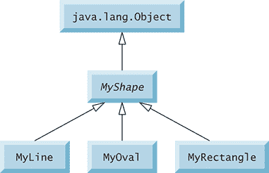

   **图 10.16** `MyShape` 层次结构。

3. 针对单个坐标和颜色的设置方法（Set），允许程序员独立地设置层次结构中形状的任何数据。
4. 针对单个坐标和颜色的获取方法（Get），允许程序员独立地检索层次结构中形状的任何数据。
5. `abstract` 方法

```
public abstract void draw(GraphicsContext gc);
```


程序将调用该方法来告诉 `MyShape` 在屏幕上绘制自己。

为了确保正确的封装，`MyShape` 类中的所有数据必须是 `private` 的。这需要声明适当 `set` 和 `get` 方法来操作数据。`MyLine` 类应该提供一个无参数构造函数以及一个带有坐标和描边颜色参数的构造函数。`MyOval` 和 `MyRectangle` 类应该提供一个无参数构造函数以及一个带有坐标、描边颜色、填充颜色以及确定形状是否填充的参数的构造函数。无参数构造函数除了设置默认值外，还应该将形状的 `filled` 标记设置为 `false`，以便未填充形状成为默认值。

如果你知道空间中的两个点，就可以绘制线、矩形和椭圆。线需要 `x1`、`y1`、`x2` 和 `y2` 坐标。`GraphicsContext` 方法 `strokeLine` 将用线连接提供的两个点。如果你有椭圆和矩形相同的四个坐标值（`x1`、`y1`、`x2` 和 `y2`），你可以计算出绘制它们所需的四个参数。每个参数都需要一个左上 `x`-坐标值（两个 `x` 坐标值中较小的）、一个左上 `y`-坐标值（两个 `y` 坐标值中较小的）、一个 `width`（两个 `x` 坐标值差的绝对值）和一个 `height`（两个 `y` 坐标值差的绝对值）。

程序中不应该有 `MyLine`、`MyOval` 或 `MyRectangle` 变量——只有包含指向 `MyLine`、`MyOval` 和 `MyRectangle` 对象引用的 `MyShape` 变量。程序应该生成 `MyShape` 变量并将它们存储在 `ArrayList` 中。在绘制时，遍历 `ArrayList<MyShape>` 并多态地调用 `draw` 方法。

## 10.2 绘制应用程序

重新设计并重新实现 `MyOval` 和 `MyRectangle` 类，将共同特征“提取”到图 10.16 中的抽象类 `MyShape` 中。注意继承 `MyShape` 的 `MyOval` 和 `MyRectangle` 相似之处。`BoundedShape` 类应该声明两个构造函数，并带有指定形状是否填充的参数。`BoundedShape` 类还应该声明用于操作填充标记和填充颜色的 `get` 和 `set` 方法，以及计算左上 x 坐标、左上 y 坐标、宽度高度的方法。记住，绘制椭圆或矩形所需的值可以通过 (x, y) 坐标计算。每个 `MyOval` 和 `MyRectangle` 类应该只有两个构造函数和一个 `draw` 方法。

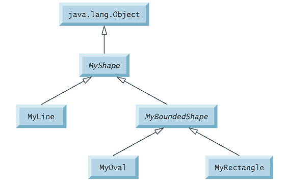

# 图 10.17
带有 `BoundedShape` 的 `MyShape` 层次结构。

## 10.5 总结

本章介绍了多态——将共享相同父类的对象作为父类对象处理的能力。我们讨论了多态如何提高系统的扩展性和维护性，然后演示了如何使用重写的方法来实现多态行为。我们引入了抽象类，它允许提供一个其他类可以继承的适当父类。你学习了抽象类可以声明每个子类必须实现以成为具体类的抽象方法，程序可以使用抽象类的变量多态地调用子类对抽象方法的实现。你还学习了在执行时确定对象的类型。我们解释了 `final` 方法和类的概念。本章讨论了声明和实现接口，作为让可能不同的类实现共同功能的方法，从而使这些对象可以被多态地处理。

你现在应该熟悉类、对象、封装、继承、接口和多态这些面向对象编程最核心的要素。

在下一章中，你将学习异常，它有助于处理程序执行期间的错误。异常处理可以使程序更加健壮。

## 总结

### 第 10.1 节简介
*   多态允许我们编写处理具有相同父类的对象的程序，就像它们都是该父类对象一样；这可以简化编程。
*   通过多态，我们可以设计并实现易于扩展的系统。程序中为了适应新类而必须修改的部分只有那些需要直接了解你添加到层级结构中的新类的部分。

### 第 10.3 节演示多态行为
*   当编译器遇到通过变量进行的方法调用时，它通过检查变量的类类型来确定该方法是否可以调用。如果该类包含适当的方法声明（或继承了该方法），则调用会被编译。在执行期间，变量所引用的对象的类型决定了实际使用的方法。

### 第 10.4 节 抽象类和方法
*   抽象类不能用于实例化对象，因为它们是不完整的。
*   抽象类的主要目的是提供一个合适的父类，其他类可以继承它，从而共享共同的设计。
*   可以用于实例化对象的类被称为具体类（concrete classes）。它们提供了其声明的每个方法的实现（某些实现是可以继承的）。
*   程序员经常编写只使用抽象父类的客户端代码，以减少客户端代码对特定子类的依赖。
*   抽象类有时构成多个层级的层级结构。
*   抽象类通常包含一个或多个抽象方法。
*   抽象方法不提供实现。
*   包含任何抽象方法的类必须声明为 `abstract` 类。每个具体子类都必须为父类的每个抽象方法提供实现。
*   构造函数和 `static` 方法不能声明为 `abstract`。
*   抽象父类变量可以持有指向任何派自该父类的具体类对象的引用。程序通常使用此类变量以多态的方式操作对象。
*   多态对于实现分层软件特别有效。

### 第 10.5 节 案例研究：使用多态的薪资发放系统
*   层级结构设计者可以通过在父类中包含一个 `abstract` 方法，要求每个具体子类提供适当的方法实现。
*   大多数方法调用在执行期间根据所处理的对象的类型进行解析。这一过程被称为动态绑定（dynamic binding）或晚绑定。
*   父类变量可以用于调用父类中声明的方法。
*   `instanceof` 确定对象是否与特定类型具有 is-a（是一个）关系。
*   Java 中的每个对象都知道自己的类，并通过 `Object` 方法 `getClass` 访问它，该方法返回 `Class` 类型的对象（`java.lang`）。
*   is-a 关系仅适用于子类与其父类之间，反之则不然。

### 第 10.6 节 父类和子类变量之间的允许赋值
*   在没有显式类型转换的情况下，不允许将父类引用赋值给子类变量。

### 第 10.7 节 final 方法和类
*   在父类中声明为 `final` 的方法不能在子类中重写。
*   声明为 `private` 的方法隐含为 `final`，因为你不能在子类中重写它们。
*   声明为 `static` 的方法隐含为 `final`。
*   `final` 方法的声明永远不会改变，因此所有子类都使用相同的实现，对 `final` 方法的调用在编译时解析——这被称为静态绑定。
*   编译器可以通过删除对 `final` 方法的调用并在每个方法调用处内联其展开的代码来优化程序。
*   声明为 `final` 的类不能被扩展。
*   `final` 类中的所有方法隐含为 `final`。

### 第 10.8 节 关于从构造函数调用方法时问题的深层解释
*   如果构造函数和 `set` 方法对特定的实例变量执行相同的验证，且验证代码很短，那么你可以在构造函数和 `set` 方法中重复该代码。
*   对于较长的验证，你可以定义一个 `static` 验证方法。

### 第 10.9 节 创建和使用接口
*   接口指定了允许哪些操作，但没有规定如何执行操作。
*   Java 接口描述了一组可以在对象上进行调用的方法。
*   接口声明以关键字 `interface` 开始。
*   在接口中声明的所有方法都隐含为 `public abstract` 方法，所有字段都隐含为 `public`、`static` 和 `final`。
*   要使用接口，具体类必须指定它 `implements` 该接口，并且必须按照接口声明中指定的签名声明每个接口 `abstract` 方法。没有实现接口所有 `abstract` 方法的类必须声明为 `abstract`。
*   实现接口就像是与编译器签署一份合同，声明说：“我将声明接口指定的所有 `abstract` 方法，否则我将把我的类声明为 `abstract`。”
*   当不同的（即不相关的）类需要共享公共方法和常量时，通常使用接口。这允许不相关类的对象以多态的方式进行处理——实现相同接口的类的对象可以对相同的方法调用做出响应。
*   你可以创建一个描述所需功能的接口，然后在任何需要该功能的类中实现该接口。
*   当没有可以继承的默认实现时（即没有实例变量且没有默认方法实现），接口通常用来代替 `abstract` 类。
*   与 `public abstract` 类（抽象类）一样，接口通常是 `public` 类型，因此它们通常单独在文件中声明，文件名与接口同名并使用 `.java` 扩展名。
*   Java 不允许子类继承多个父类，但它允许一个类继承一个父类并实现多个接口。
*   实现多个接口的类的所有对象都与每个实现的接口类型具有 is-a 关系。
*   接口可以声明常量。这些常量隐式地 `public`、`static` 和 `final`。

## 10.10 节 Java SE 8 接口增强

*   在 Java SE 8 中，接口可以声明 `default` 方法——即具有具体实现的 `public` 方法，这些实现指定了如何执行某个操作。
*   当类实现一个接口时，如果该类没有重写这些方法，则该类将获得接口的 `default` 具体实现。
*   在接口中声明 `default` 方法，你只需要在方法的返回类型之前放置 `default` 关键字，并提供完整的方法体即可。
*   当你用 `default` 方法增强现有接口时——任何实现原始接口的类都不会破坏——它们将简单地接收 `default` 方法实现。
*   通过 `default` 方法，你可以在接口中（而不是 `abstract` 类中）声明公共方法的实现，这为你在设计类时提供了更大的灵活性。
*   从 Java SE 8 开始，接口可以包含 `public static` 方法。
*   从 Java SE 8 开始，任何只包含一个方法的接口被称为函数式接口（functional interface）。整个 Java API 中有许多此类接口。
*   函数式接口在 Java SE 8 的 lambda 功能中被广泛使用。正如你所看到的，lambda 提供了实现函数式接口的简记符号。

## 10.11 节 Java SE 9 `private` 接口方法

*   从 Java SE 9 开始，你可以通过 `private` 接口实例方法和 `static` 方法在接口中声明辅助方法。

## 10.12 节 `private` 构造函数

*   你可以通过将类的构造函数设置为 `private` 来防止客户端代码创建该类的对象。
*   你可以使用委托构造函数（delegating constructors）来调用包含共享初始化代码的 `private` 构造函数。
*   使用 `private` 构造函数是为了强制客户端代码使用工厂方法来创建和初始化对象。

## 10.13 节 面向接口编程，而不是面向实现

*   通过接口继承，一个类实现一个描述各种 `abstract` 方法的接口，新类必须提供这些方法。新类也可能继承一些方法实现（从 Java SE 8 开始在接口中允许），但不能继承实例变量。
*   接口还可以扩展一个或多个其他接口。
*   实现继承（Implementation inheritance）主要用于声明具有许多相同实例变量和方法实现的密切相关的类。
*   使用实现继承声明的类是紧耦合的。父类的更改会直接影响所有相应的子类。
*   实现继承的一个主要缺点是类与类之间的紧耦合使得修改层级结构变得困难。
*   接口继承通常比实现继承需要更多工作，因为你必须为接口的 `abstract` 方法提供实现——即使这些实现在类之间是相似或相同的。
*   接口继承通过消除类与类之间的紧耦合，为你提供了额外的灵活性。当你使用接口类型的变量时，你可以直接或间接地给它赋值实现该接口的任何类型的对象。
*   Java SE 8 和 Java SE 9 的接口增强使得使用接口编程适用于几乎所有你以前可能使用 `abstract` 类的情况。

# 自测练习题

1. **10.1** 填充下列每个语句的空白：
    1. 如果一个类包含至少一个抽象方法，它就是一个(n) 类。
    2. 可以实例化对象的类被称为 ________ 类。
    3. ________ 涉及使用父类变量来调用父类和子类对象的方法，使你能够“在通用层面编程”。
    4. 不是接口方法且未提供实现的方法必须使用关键字 ________ 声明。
    5. 将存储在父类变量中的引用转换为子类类型被称为 ________。

2. **10.2** 说明下列每个语句是 *true* (正确) 还是 *false* (错误)。如果是 *false*，请解释原因。
    1. `abstract` 类中的所有方法都必须声明为 `abstract` 方法。
    2. 不允许通过子类变量调用仅限子类的方法。
    3. 如果父类声明了一个 `abstract` 方法，子类必须实现该方法。
    4. 实现接口的类的对象可以被认为是该接口类型的对象。

3. **10.3 (Java SE 8 和 Java SE 9 接口)** 填充下列每个语句的空白：
    1. 在 Java SE 8 中，接口可以声明 ________——即具有具体实现的 `public` 方法，这些实现指定了如何执行某个操作。
    2. 从 Java SE 8 开始，接口可以包含辅助方法。
    3. 从 Java SE 8 开始，任何只包含一个方法的接口被称为 ________。
    4. 从 Java SE 9 开始，任何接口都可以包含 ________ `static` 方法。

# 自测答案

1. **10.1**
    1. abstract.
    2. concrete.
    3. Polymorphism (多态).
    4. abstract.
    5. casting.

2. **10.2**
    1. False. `abstract` 类可以有具体方法。
    2. False. 如果使用子类变量，可以调用仅限子类的方法。
    3. True.
    4. True.

3. **10.3**
    1. `default` methods.
    2. `static`.
    3. functional interface.
    4. `private`.

## 练习

1. **10.4** 多态如何让你能够进行“通用层面”编程而不是“特定层面”编程？
2. **10.5** 什么是抽象方法？描述适用于抽象方法的情况。
3. **10.6** 多态如何促进扩展性？
4. **10.7** 讨论将父类和子类引用赋值给变量的三种正确方法。
5. **10.8** 比较抽象类和接口。为什么你会使用抽象类？为什么你会使用接口？
6. **10.9 (Java SE 8 接口)** 解释 `default` 方法如何让你向现有接口添加新方法而不破坏实现类。
7. **10.10 (Java SE 8 接口)** 什么是函数式接口？
8. **10.11 (Java SE 8 接口)** 能够在接口中添加 `static` 方法有什么用？
9. **10.12 (Java SE 9 接口)** 能够在接口中添加 `private` 方法有什么用？
10. **10.13 (工资系统修改)** 修改图 10.4–10.9 的工资系统，在 `Employee` 类中包含 `private` 实例变量 `birthDate`。使用图 8.7 的 `Date` 类表示员工生日。为 `Date` 类添加 getter 方法。假设工资每月处理一次。创建一个 `Employee` 数组来存储各种员工对象的引用。在循环中，计算每个 `Employee` 的工资（通过多态），如果当前月份是员工生日所在的月份，则为该人的工资金额增加 100.00 美奖金。

## 11. 10.14 (项目：形状层次结构)
实现图 9.3 所示所示的 `Shape` 层次结构。每个 `TwoDimensionalShape` 都应该包含一个 `getArea` 方法来计算二维形状的面积。每个 `ThreeDimensionalShape` 都应该拥有 `getArea` 和 `getVolume` 方法，分别计算三维形状的表面积和体积。创建一个程序，使用 `Shape` 引用数组来指向层次结构中每个具体类的对象。该程序应该打印数组每个元素所引用对象的文本描述。此外，在处理数组中所有形状的循环中，判断每个形状是 `TwoDimensionalShape` 还是 `ThreeDimensionalShape`。如果是 `TwoDimensionalShape`，则显示其面积；如果是 `ThreeDimensionalShape`，则显示其面积和体积。

## 12. 10.15 (薪资系统修改)
修改图 10.4–10.9 的薪资系统，以包含一个额外的 `Employee` 子类 `PieceWorker`，该类代表工资根据产出商品数量计算的员工。`PieceWorker` 类应该包含 `private` 实例变量 `wage`（用于存储员工的每件工资）和 `pieces`（用于存储生产的件数）。在 `PieceWorker` 类中提供 `earnings` 方法的具体实现，通过将生产件数乘以每件工资来计算员工的收入。创建一个 `Employee` 变量数组来存储指向新 `Employee` 层次结构中每个具体类对象的引用。对于每个 `Employee`，显示其 `String` 表示和收入。

## 13. 10.16 (应付账款系统修改)
在此练习中，我们修改图 10.11–10.14 的应付账款应用程序，使其包含图 10.4–10.9 薪资应用程序的完整功能。该应用程序仍然处理两个 `Invoice` 对象，但现在应该处理四个 `Employee` 子类中的每个类的对象。如果当前处理的对象是 `Base-PlusCommissionEmployee`，应用程序应该将 `BasePlusCommissionEmployee` 的基本工资增加 10%。最后，应用程序应该输出每个对象的付款金额。完成以下步骤以创建新应用程序：
1. 修改类 `HourlyEmployee` (图 10.6 ) 和 `CommissionEmployee` (图 10.7 )，将它们放入 `Payable` 层次结构中，作为 `Employee` (图 10.13) 版本的子类。*提示：* 将子类中的 `earnings` 方法重命名为 `getPayment`，以便该类满足 `Payable` 接口。
2. 修改类 `BasePlusCommissionEmployee` (图 10.8)，使其扩展第 (a) 部分创建的 `CommissionEmployee`。
3. 修改 `PayableTest` (图 10.14) 多态地处理两个 `Invoice`、一个 `SalariedEmployee` 和一个 `BasePlusCommissionEmployee`。首先输出每个 `Payable` 的 `String` 表示。接下来，如果对象是 `BasePlusCommissionEmployee`，则将其基本工资增加 10%。最后，输出每个 `Payable` 的付款金额。

## 14. 10.17 (项目：组合与继承的结合)
练习 9.16 要求将 `CommissionEmployee`–`BasePlusCommissionEmployee` 层次结构重构为 `Employee` 类，其中每个 `Employee` 有一个不同的 `CompensationModel`。在此练习中，重新实现练习 9.16 的 `CompensationModel` 类为接口，提供一个不接受参数并返回 `double` 的 `public abstract earnings` 方法。然后创建以下实现 `CompensationModel` 接口的类：
1. `SalariedCompensationModel`——对于固定周薪的 `Employee`，该类应包含一个 `weeklySalary` 实例变量，并实现 `earnings` 方法返回 `weeklySalary`。
2. `HourlyCompensationModel`——对于按小时付费且每周超过 40 小时获得加班费的 `Employee`，该类应包含 `wage` 和 `hours` 实例变量，并根据工作小时实现 `earnings` 方法（参见图 10.6) 中的 `HourlyEmployee` `earnings` 方法）。
3. `CommissionCompensationModel`——对于按佣金付费的 `Employee`，该类应包含 `grossSales` 和 `commissionRate` 实例变量，并实现 `earnings` 方法返回 `grossSales * commissionRate`。
4. `BasePlusCommissionCompensationModel`——对于拿基本工资加佣金的 `Employee`，该类应包含实例变量 `grossSales`、`commissionRate` 和 `baseSalary`，并实现 `earnings` 返回 `baseSalary + grossSales * commissionRate`。
在你的测试程序中，使用上述每个 `CompensationModel` 创建 `Employee` 对象，然后显示每个 `Employee` 的收入。接下来动态更改每个 `Employee` 的 `CompensationModel` 并重新显示每个 `Employee` 的收入。

## 15. 10.18 (项目：实现 Payable 接口)
修改练习 10.17 中的 `Employee` 类，使其实现图 10.11 的 `Payable` 接口。用图 10.14 应用程序中的 `Salaried-Employee` 对象替换为练习 10.17 中的 `Employee` 对象，并演示多态地处理 `Employee` 和 `Invoice` 对象。

## 10.19 (`CarbonFootprint` 接口：多态)
正如你在本章中所学到的，通过接口，你可以为可能不同的类指定相似的行为。全球范围内的政府和公司日益关注碳足迹（每年向大气中排放的二氧化碳量），这包括燃烧各种类型燃料供热的建筑、燃烧燃料提供动力的车辆等。许多科学家将这些温室气体认为是全球变暖现象的罪魁祸首。
创建三个之间没有继承关系的小类——类 `Building`（建筑）、`Car`（汽车）和 `Bicycle`（自行车）。为每个类赋予一些独特的属性和行为，这些属性和行为与其他类是不共有的。编写一个 `CarbonFootprint` 接口，其中包含一个 `getCarbonFootprint` 方法。让你的每个类实现该接口，以便其 `getCarbonFootprint` 方法为该类计算合适的碳足迹（查看一些解释如何计算碳足迹的网站）。编写一个应用程序，创建这三个类的每个对象，将这些对象的引用放入 `ArrayList<CarbonFootprint>` 中，然后遍历 `ArrayList`，以多态的方式调用每个对象的 `getCarbonFootprint` 方法。对于每个对象，打印一些标识信息以及该对象的碳足迹。

# 11 异常处理：深入探讨

## 目标
在本章中，你将：
*   学习为什么异常处理是响应运行时问题的有效机制。
*   使用 `try` 块来限定可能发生异常的代码区域。
*   使用 `throw` 来指示问题。
*   使用 `catch` 块来指定异常处理程序。
*   学习何时使用异常处理。
*   理解异常类的层次结构。
*   使用 `finally` 块释放资源。
*   通过捕获一个异常并抛出另一个异常来实现异常链式。
*   创建自定义异常。
*   使用调试功能 `assert` 来声明方法中特定点应为真的的条件。
*   学习 `try`-with-resources 如何在 `try` 块终止时自动释放资源。

### 11.1 引言
正如你从第 7 章–第 8 章中所获知的，异常表示程序执行过程中出现的问题。异常处理使应用程序能够解决（或处理）异常。在某些情况下，程序可以继续执行，仿佛没有遇到过问题一样。本章介绍的特性将帮助你编写健壮且容错的程序，这些程序可以处理问题并继续执行或优雅地终止。^((28)

首先，我们处理当方法尝试将整数除以 0 时发生的异常。我们将讨论何时使用异常处理，并展示异常处理类层次结构的一部分。正如你所看到的，只有 `Throwable` 的子类才能用于异常处理。我们引入了 `try` 语句的 `finally` 块，无论是否发生异常它都会执行。然后，我们展示了如何使用链式异常向异常添加特定的信息，以及如何创建你自己的异常类型。接下来，我们引入了前置条件和后置条件，它们分别在方法被调用时和返回时必须为真。然后，我们介绍了断言，你可以在开发期间使用它来帮助调试代码。我们还讨论了用一个 `catch` 处理器捕获多个异常，以及在 `try` 块中使用资源后自动释放该资源的 `try`-with-resources 语句。

本章重点关注异常处理概念，并提供了几个演示各种特性的机械化示例。许多 Java API 方法会抛出异常，我们在代码中处理了这些异常。图 11.1 显示了你已经见过的某些异常类型，以及你将要学习的其他类型。

| 章节 | 使用的异常示例 |
| --- | --- |
| 第 7 章 | `ArrayIndexOutOfBoundsException` |
| 第 8 章–第 10 章 | `IllegalArgumentException` |
| 第 11 章 | `ArithmeticException` |
| 第 15 章 | `FileNotFoundException` |
| 第 16 章 | `IOException` |
| 第 20 章 | `ClassNotFoundException` |
| 第 21 章 | `NoSuchElementException` |
| 第 23 章 | `InterruptedException` |
| 第 24 章 | `SQLException` |
| 第 28 章 | `SocketException` |
| 第 31 章 | `SQLException` |

#### 图 11.1
你在全书中看到的各种异常类型

### 11.2 示例：不处理异常的除零
首先，我们演示当错误出现在未使用异常处理的应用程序中会发生什么。图 11.2 提示用户输入整数，并将它们传递给 `quotient` 方法，该方法计算整数商并返回 `int` 结果。在这个示例中，你会看到当方法检测到问题并无法处理时，会抛出异常（即发生异常）。

```java
```


// 图 11.2: DivideByZeroNoExceptionHandling.java

// 不处理异常的整数除法。

import java.util.Scanner;

public class DivideByZeroNoExceptionHandling {

    // 当发生除零错误时演示抛出异常
    public static int quotient(int numerator, int denominator) {
        return numerator / denominator; // 可能除以零
    }

    public static void main(String[] args) {
        Scanner scanner = new Scanner(System.in);
        System.out.print("请输入一个整数分子: ");
        int numerator = scanner.nextInt();
        System.out.print("请输入一个整数除数: ");
        int denominator = scanner.nextInt();
        int result = quotient(numerator, denominator);
        System.out.printf(
            "%nResult: %d / %d = %d%n", numerator, denominator, result);
    }
}

```

图 11.2 中的第一个示例执行显示了一次成功的除法。在第二次执行中，用户输入了值 `0` 作为分母。针对这一无效输入，屏幕显示了几行信息。这些信息被称为 `stack trace`（堆栈跟踪），它包含了描述性消息中异常的名称（`java.lang.ArithmeticException`），并附有一条描述性消息，该消息指示了问题所在，以及问题发生时的方法调用堆栈（即调用链）。堆栈跟踪包含了通过逐个方法通向异常方法的执行路径。这有助于你调试程序。即使没有发生问题，你也可以通过调用 `Thread.dumpStack()` 随时查看堆栈跟踪。

## `ArithmeticException` 的堆栈跟踪

第一行指定了发生了 `ArithmeticException`。异常名称后的文本（`/ by zero`）表示该异常是尝试除以零的结果导致的。Java 不允许在整数算术中进行除零操作。当发生这种情况时，Java 会抛出一个 `ArithmeticException`。`ArithmeticExceptions` 可能由许多不同的问题引起，因此额外数据（`/by zero`）提供了更具体的信息。

从堆栈跟踪的最后一行开始，我们看到异常检测在 `main` 方法的第 19 行。堆栈跟踪的每一行都包含类名和方法（例如 `DivideByZeroNoExceptionHandling.main`），随后是文件名和行号（例如 `DivideByZeroNoExceptionHandling.java:19`）。向上移动堆栈跟踪，我们看到异常发生在 `quotient` 方法的第 8 行。调用链的最顶行指示了 `throw point`（抛出点）——即异常发生的初始点。该异常的抛出点在 `quotient` 方法的第 8 行。

## 关于浮点算术的侧记

Java *确实*允许对浮点值进行除零操作。此类计算会导致正无穷或负无穷，表示为显示为 `"Infinity"` 或 `"-Infinity"` 的浮点值。如果你将 0.0 除以 0.0，结果是 `NaN`（不是数字），表示为显示为 `"NaN"` 的浮点值。如果你需要将浮点值与 `NaN` 进行比较，请使用 `Float` 类（针对 `float` 值）或 `Double` 类（针对 `double` 值）的 `isNaN` 方法。`Float` 和 `Double` 类位于 `java.lang` 包中。

## `InputMismatchException` 的堆栈跟踪

在第三次执行中，用户输入字符串 `"hello"` 作为分母。再次注意显示了堆栈跟踪。这告诉我们发生了 `InputMismatchException`（包 `java.util`）。我们之前的示例在输入数值值时假设用户会输入正确的整数值。然而，用户有时会出错并输入非整数值。当 `Scanner` 方法 `nextInt` 接收到一个不能表示有效整数的 `string` 时，就会发生 `InputMismatchException`。从堆栈跟踪的末尾开始，我们看到异常检测在 `main` 方法的第 17 行。向上移动堆栈跟踪，我们看到异常发生在 `nextInt` 方法中。注意，文件名和行号处提供的是文本 `Unknown Source`。这意味着为该方法类提供文件名和行号信息的所谓 *debugging symbols*（调试符号）对 JVM 是不可用的——这通常适用于 Java API 类。许多 IDE 都可以访问 Java API 源代码，并在堆栈跟踪中显示文件名和行号。

## 程序终止

在图 11.2 中发生异常并显示堆栈跟踪的示例执行中，程序也会*退出*（*exits*）。这在 Java 中并不总是发生。有时，尽管发生了异常并打印了堆栈跟踪，程序仍可能继续运行。在这种情况下，应用程序可能会产生意外的结果。例如，图形用户界面（GUI）应用程序通常会继续执行。在图 11.2 中，两种类型的异常都在 `main` 方法中被检测到。在下一个示例中，我们将看到如何*处理*（*handle*）这些异常，以便让程序能够正常完成。

## 11.3 示例：处理 `ArithmeticExceptions` 和 `InputMismatchExceptions`

图 11.3 中的应用程序基于图 11.2，使用*异常处理*来处理任何产生的 `ArithmeticExceptions` 和 `InputMismatchExceptions`。应用程序仍然提示用户输入两个整数并将它们传递给 `quotient` 来计算结果。如果用户出错，程序会捕获并处理（即应对）异常——允许用户重新输入。

```
// 11.3 DivideByZeroExceptionHandling.java

import java.util.InputMismatchException;
import java.util.Scanner;

public class DivideByZeroExceptionHandling {

    // 当发生除零时抛出异常
    public static int quotient(int numerator, int denominator) throws ArithmeticException {
        return numerator / denominator;
    }

    public static void main(String[] args) {
        Scanner scanner = new Scanner(System.in);
        boolean continueLoop = true;

        // 确定是否需要继续输入
        do {
            try { // 读取数字并计算商
                System.out.print("Please enter an integer numerator: ");
                int numerator = scanner.nextInt();
                System.out.print("Please enter an integer denominator: ");
                int denominator = scanner.nextInt();
                int result = quotient(numerator, denominator);
                System.out.printf("%nResult: %d / %d = %d%n", numerator, denominator, result);
                continueLoop = false; // 输入成功；结束循环
            } catch (InputMismatchException inputMismatchException) {
                System.err.printf("%nException: %s%n", inputMismatchException);
                scanner.nextLine(); // 丢弃输入以便用户再次尝试
                System.out.printf("You must enter integers. Please try again.%n%n");
            } catch (ArithmeticException arithmeticException) {
                System.err.printf("%nException: %s%n", arithmeticException);
                System.out.printf("Zero is an invalid denominator. Please try again.%n%n");
            }
        } while (continueLoop);
    }
}
```

## 图 11.3

处理 `ArithmeticExceptions` 和 `InputMismatchExceptions`。

图 11.3 中的第一个示例执行*没有*遇到任何问题。在第二次执行中，用户输入了*零分母*，并发生了 `ArithmeticException` 异常。在第三次执行中，用户将字符串 `"hello"` 作为分母输入，发生了 `InputMismatchException`。对于每个异常，程序都会告知用户错误并要求再次尝试，然后提示输入两个新的整数。在每个示例执行中，程序都成功运行完毕。

第 3 行导入了 `InputMismatchException` 类。`ArithmeticException` 类不需要导入，因为它位于 `java.lang` 包中。第 16 行创建了 `boolean` 变量 `continueLoop`，如果用户*尚未*输入有效输入，该变量为 `true`。第 18–42 行反复要求用户输入，直到收到*有效*输入为止。

### 在 `try` 块中封装代码

第 19–29 行包含一个 `try` 块，它封装了*可能会* `throw` 异常的代码以及在发生异常时*不应该*执行的代码（即：如果发生异常，`try` 块中剩余的代码将被跳过）。`try` 块由关键字 `try` 后跟着一个用大括号括起来的代码块组成。*注意：*“`try block`”一术语有时仅指 `try` 关键字后面的代码块（不包括 `try` 关键字本身）。为了简单起见，我们使用“`try block`”来指代 `try` 关键字后面的代码块以及 `try` 关键字。从键盘读取整数的语句（第 21 行和 23 行）分别使用方法 `nextInt` 来读取 `int` 值。如果读取的值*不是*整数，方法 `nextInt` 将抛出 `InputMismatchException`。

可能导致 `ArithmeticException` 的除法并未在 `try` 块中执行。相反，对方法 `quotient` 的调用（第 25 行）触发了尝试除法的代码（第 11 行）；当分母为 0 时，JVM 会*抛出* `ArithmeticException` 对象。

### 捕获异常

示例中的 `try` 块之后有两个 `catch` 块——一个处理 `InputMismatchException`（第 30–36 行），另一个处理 `ArithmeticException`（第 37–41 行）。`catch` 块（也称为 `catch clause` 或异常处理器）用于*捕获*（即接收）并*处理*异常。`catch` 块以关键字 `catch` 开始，后紧跟括号中的一个参数（称为*异常参数*，稍后将讨论）和一个用大括号括起来的代码块。

至少一个 `catch` 块或 `finally` 块（在 Section 11.6 中讨论）*必须*紧跟在 `try` 块之后。每个 `catch` 块在括号中指定一个*异常参数*，标识处理器可以处理的异常类型。当 `try` 块中发生异常时，执行的 `catch` 块是*第一个*类型与发生异常类型匹配的块（即：`catch` 块中的类型与抛出的异常类型完全匹配，或者是该异常类型的直接或间接父类）。异常参数的名称允许 `catch` 块与被捕获的异常对象交互——例如，隐式地调用捕获异常的 `toString` 方法（如第 31–32 行和 38 行所示），这会显示异常的基本信息。注意我们使用 `System.err`（标准错误流）对象来输出错误消息。默认情况下，`System.err` 的打印方法（类似于 `System.out`）将数据显示在*命令行提示符*上。

第一个 `catch` 块中的第 33 行调用了 `Scanner` 方法 `nextLine`。由于发生了 `InputMismatchException`，方法 `nextInt` 的调用从未成功读取用户的数据——因此我们通过调用方法 `nextLine` 来读取了该输入。此时我们不对该输入进行任何操作，因为我们知道它是*无效*的。每个 `catch` 块都会显示错误消息并要求用户重试。在任何一个 `catch` 块结束后，用户都会被提示输入。我们很快就会深入探讨异常处理中的这种控制流是如何工作的。

### 多 `catch` (Multi-catch)

`try` 块之后跟着多个 `catch` 块来处理不同类型的异常是比较常见的。如果多个 `catch` 块的体相同，可以使用 `multi-catch` 功能在*单个* `catch` 处理器中捕获这些异常类型并执行相同的任务。*multi-catch* 的语法为：

```
catch (Type1 | Type2 | Type3 e)
```


每个异常类型通过竖线（`|`）与下一个类型隔开。之前的代码行表示异常处理器中可以捕获这些类型中的*任何一个*（或其子类）。在 `multi-catch` 中可以指定任意数量的 `Throwable` 类型。在这种情况下，异常参数的类型是所指定类型的公共父类。

# 未捕获的异常

**未捕获的异常**是指没有匹配的 `catch` 块的异常。你在 Fig. 11.2 的第二次和第三次输出看到了未捕获的异常。

# 异常处理的终止模型

如果在 `try` 块中发生异常（例如，由于 11.3) 中的代码抛出 `MismatchException`），`try` 块将立即*终止*，程序控制转移到*第一个*异常参数类型匹配抛出异常的 `catch` 块。在 11.3) 中，第一个 `catch` 块捕获 `InputMismatchException`（输入无效输入时发生），第二个 `catch` 块捕获 `ArithmeticException`（尝试除以 0 时发生）。异常被处理后，程序控制*不会*返回到抛出点，因为 `try` 块已经*失效*了。相反，控制从最后一个 `catch` 块之后恢复。这被称为**异常处理的终止模型**。某些语言使用**异常处理的恢复模型**，在异常被处理后，控制从抛出点之后继续执行。

`try` 块与其对应的 `catch` 和/或 `finally` 块共同构成 `try` 语句。不要混淆“`try block`”和“`try statement`”这两个术语——后者包含了 `try` 块以及后续的 `catch` 块和/或 `finally` 块。

与任何其他代码块一样，当 `try` 块结束时，在块中声明的`local variables`将`超出作用域`并无法访问；因此，`try` 块的局部变量在相应的 `catch` 块中是不可访问的。当 `catch` 块`结束`时，在 `catch` 块内部声明的`local variables`（包括该 `catch` 块的异常参数）也会`超出作用域`并被`销毁`。`try` 语句中剩余的 `catch` 块将被`忽略`，执行将从 `try`…`catch` 序列之后的第一行代码继续——如果存在 `finally` 块，则将是 `finally` 块。

# 使用 `throws` 子句

在方法 `quotient`（图 11.3 中学习更多内容。

当执行第 11 行时，如果 `denominator` 为 0，JVM 会抛出一个 `ArithmeticException` 对象。该对象将被第 37–41 行的 `catch` 块捕获，该块通过隐式调用异常的 `toString` 方法显示异常的基本信息，然后要求用户重试。

如果 `denominator` 不为 0，方法 `quotient` 执行除法并将结果返回到 `try` 块中调用 `quotient` 方法的地方（第 25 行）。第 26–27 显示计算结果，第 28 行将 `continueLoop` 设置为 `false`。在这种情况下，`try` 块成功完成，因此程序跳过 `catch` 块并使第 42 行的条件失败，`main` 方法正常完成执行。

当 `quotient` 抛出 `ArithmeticException` 时，`quotient` 终止且不返回值，并且 `quotient` 的局部变量超出作用域（并被销毁）。如果 `quotient` 包含指向对象的引用局部变量，并且没有其他指向这些对象的引用，则对象将被标记为垃圾回收。此外，当发生异常时，调用 `quotient` 的 `try` 块会在第 26–28 行执行之前终止。在这里，如果在抛出异常之前在 `try` 块中创建了局部变量，这些变量也将超出作用域。

如果由第 21 行或第 23 行生成 `InputMismatchException`，则 `try` 块终止，执行从第 30–36 行的 `catch` 块继续。在这种情况下，不会调用方法 `quotient`。然后 `main` 方法在最后一个 `catch` 块之后继续执行。

# 11.4 何时使用异常处理

异常处理设计用于处理同步错误，这些错误发生在语句执行时。我们在整本书中看到的常见示例包括数组索引越界、算术溢出（即超出可表示范围的值）、除以零、无效的方法参数和线程中断（如我们在第 23 章显示了 `Throwable` 的一小部分。`Throwable` 有两个直接子类：`Exception` 和 `Error`。只有 `Throwable` 对象可以用于异常处理机制。`Throwable` 是 `Object` 的超类。`Exception` 及其子类——例如 `RuntimeException`（位于 `lang` 包）和 `IOException`（位于 `io` 包）——代表可以被应用程序捕获的异常情况。`Error` 类及其子类代表极少数发生的异常情况。

Java 异常层次结构包含数百个类。有关 Java 异常的信息可以在 Java API 中找到。你可以在此处查看 `Throwable` 的文档：

http://docs.oracle.com/javase/8/docs/api/java/lang/Throwable.html

# 检查异常与运行时异常

Java 检查异常异常运行时异常。这种区分很重要，因为 Java 编译器对检查异常强制执行特殊要求。异常的类型决定了它是检查的还是非检查的。

# RuntimeException 是运行时异常

所有 `RuntimeException`（`lang` 包）的直接或间接子类异常类型都是运行时异常。这些通常由程序代码中的缺陷引起。运行时异常的示例包括：

*   `ArrayIndexOutOfBoundsException`（在第 7 章）是*非检查的*，因为 `Error` 通常是不可恢复的，所以你的程序不应该尝试处理它们。例如，`VirtualMachineError` 的文档说这些异常是“抛出，以指示 Java 虚拟机已损坏或耗尽了继续运行所需的资源”。此时，你的程序无能做任何事情。

所有继承自 `Exception` 类但*没有*直接或间接继承自 `RuntimeException` 类的类都被视为*受检*（checked）异常。此类异常通常由程序无法控制的条件引起——例如在文件处理过程中，如果文件不存在，程序就无法打开文件。

# 编译器与受检异常

编译器检查每个方法调用和方法声明，以确定该方法是否抛出了受检异常。如果是，编译器会验证该受检异常是否被`caught`或在`throws` 子句中被`declared`——这被称为`捕获或声明要求`（catch-or-declare requirement）。我们将在接下来的几个示例中展示如何捕获或声明受检异常。回想第 11.3 节，`throws` 子句指定了方法抛出的异常。这些异常不在方法体中被捕获。为了满足`捕获或声明要求`中的`catch`部分，产生异常的代码必须封装在`try`块中，并且必须为该受检异常类型（或其父类之一）提供一个捕获`handler`。为了满足`捕获或声明要求`中的`declare`部分，包含产生异常的方法必须在其参数列表之后、方法体之前提供一个包含该受检异常类型的`throws` 子句。如果不满足`捕获或声明要求`，编译器将发出错误信息。这迫使你思考调用抛出受检异常的方法时可能出现的问题。

# 编译器与未检异常

与受检异常不同，Java 编译器*不会*检查代码来确定未检异常是否被捕获或声明。未检异常通常可以通过适当的编码来`防止`。例如，图 11.3 中方法 `quotient()`（第 9–12 行）抛出的未检异常 `ArithmeticException` 可以在方法在执行除法*之前*确保除数不为零时避免。未检异常*不需要*列在方法的`throws` 子句中——即使它们列出了，也*不要求*此类异常被应用程序捕获。

# 捕获子类异常

如果编写了一个`catch` 处理器来捕获*父类*异常对象，那么它也可以捕获该类所有*子类*的对象。这使得 `catch` 能够以多态的方式处理相关的异常。如果每个子类需要不同的处理方式，你可以单独捕获每个子类。

# 只有第一个匹配的 `catch` 执行

如果*多个*`catch` 块匹配特定的异常类型，当发生该类型的异常时，只有*第一个*匹配的`catch` 块会执行。与特定`try` 块相关的两个不同`catch` 块中捕获*完全相同的类型*是编译错误。然而，可以有多个匹配异常的`catch` 块——即多个类型与异常类型相同或为该类型父类的`catch` 块。例如，我们可以在类型为 `ArithmeticException` 的`catch` 块之后跟随类型为 `Exception` 的`catch` 块——两者都会匹配 `ArithmeticException`，但只有第一个匹配的`catch` 块会执行。

# 11.6 `finally` 块

获取某些资源的程序必须将其返回给系统，以避免所谓的**资源泄漏**。在 C 和 C++ 等编程语言中，最常见的资源泄漏是*内存泄漏*。Java 对程序不再使用的内存进行自动的*垃圾收集*，从而避免了大多数内存泄漏。然而，可能会发生其他类型的资源泄漏。例如，在不再需要后没有正确关闭的文件、数据库连接和网络连接可能无法在其他程序中使用。

可选的`finally` 块（有时称为**finally 子句**）由`finally` 关键字以及其后的用大括号括起来的代码组成。如果存在，它被放在最后一个`catch` 块之后。如果没有`catch` 块，则必须提供`finally` 块，并紧跟在`try` 块之后。

# `finally` 块何时执行

无论相应的`try` 块是否抛出异常，`finally` 块都会执行。如果`try` 块通过使用`return`、`break` 或 `continue` 语句或仅仅到达结束右大括号退出，`finally` 块也会执行。`finally` 块*不会*执行的一种情况是应用程序通过调用方法 `System.exit()` 从`try` 块中*提前退出*。我们在第 15 章中演示的该方法会*立即*终止应用程序。

如果在`try` 块中发生的异常无法被该`try` 块的处理器之一捕获，程序将跳过`try` 块的其余部分并进入`finally` 块。然后程序将异常传递到外层的`try` 块——通常在调用方法中——那里`catch` 块可能会捕获它。异常也可能是未被捕获的（正如我们在第 11.3 节)中讨论过的那样），这种过程可以在多层`try` 块中发生。如果`catch` 块抛出异常，`finally` 块仍然执行。然后异常传递到外层的`try` 块——再次在调用方法中。

# 在 `finally` 块中释放资源

由于`finally` 块始终执行，它通常包含释放资源的代码。假设在`try` 块中分配了资源。如果没有发生异常，`catch` 块将被*跳过*，控制进入`finally` 块，从而释放资源。然后控制进入`finally` 块之后的第一个语句。如果在`try` 块中发生异常，`try` 块将*终止*。如果程序在相应的`catch` 块中捕获了异常，它将处理异常，然后`finally` 块*释放资源*，控制进入`finally` 块之后的第一个语句。如果程序没有捕获异常，`finally` 块*仍然*释放资源，并在调用方法中尝试捕获异常。

# 演示 `finally` 块

图 11.5 演示了即使相应的`try` 块*没有*抛出异常，`finally` 块也会执行。

```java
// Fig. 11.5: UsingExceptions.java
// try…catch…finally 异常处理机制。

public class UsingExceptions {
   public static void main(String[] args) {
      try {
         throwException();
      }
      catch (Exception exception) { // throwException 抛出的异常
         System.err.println("Exception handled in main");
      }

      doesNotThrowException();
   }

   // 演示 try…catch…finally
   public static void throwException() throws Exception {
      try { // 抛出异常并立即捕获
         System.out.println("Method throwException");
         throw new Exception(); // 生成异常
      }
      catch (Exception exception) { // 捕获 try 中抛出的异常
         System.err.println(
            "Exception handled in method throwException");
         throw exception; // 重新抛出以便进一步处理

         // 此处代码将无法执行；会导致编译错误

      }
      finally { // 无论 try…catch 发生什么，都会执行
         System.err.println("Finally executed in throwException");
      }

      // 此处代码将无法执行；会导致编译错误
   }

   // 演示未发生异常时的 finally
   public static void doesNotThrowException() {
      try { // try 块未抛出异常
         System.out.println("Method doesNotThrowException");
      }
      catch (Exception exception) { // 不执行
         System.err.println(exception);
      }
      finally { // 无论 try…catch 发生什么，都会执行
         System.err.println("Finally executed in doesNotThrowException");
      }

      System.out.println("End of method doesNotThrowException");
   }
}
```


# 图 11.5

`try`…`catch`…`finally` 异常处理机制。

`System.out` 和 `System.err` 是流——字节序列。虽然 `System.out`（称为`标准输出流`）用于显示程序的输出，但 `System.err`（称为`标准错误流`）用于显示程序的错误。来自这些流的输出可以被重定向（即发送到 `command prompt` 命令提示符以外的地方，例如 `file` 文件中）。使用两个不同的流可以让你轻松地将错误信息与其他输出分开。例如，来自 `System.err` 的数据输出可以发送到日志文件，而来自 `System.out` 的数据输出可以显示在屏幕上。为了简单起见，本章将不会重定向 `System.err` 的输出，而是会将消息显示在 `command prompt` 中。你将在第 15 章中学习更多关于输入/输出流的内容。

# 使用 `throw` 语句抛出异常

`main` 方法（图 11.5)开始执行，进入其 `try` 块并立即调用方法 `throwException`（第 7 行）。`throwException` 方法抛出一个 `Exception`。第 20 行的语句被称为 `throw` 语句——执行它的目的是指示发生了异常。到目前为止，你只捕获了由调用方法抛出的异常。你可以通过 `throw` 语句自己抛出异常。就像 Java API 方法抛出的异常一样，这会向客户端应用程序指示发生了错误。`throw` 语句指定一个要抛出的对象。`throw` 的操作数可以是任何派自 `Throwable` 类的类。

# 重新抛出异常

图 11.5 的第 25 行重新抛出了异常。当 `catch` 块在接收到异常后，决定无法处理该异常或只能部分处理它时，就会重新抛出异常。重新抛出异常会将异常处理（或可能是部分处理）推到与外部 `try` 语句相关的另一个 `catch` 块。通过 `throw` 关键字后跟刚刚捕获的异常对象的引用来重新抛出异常。异常不能从 `finally` 块中重新抛出，因为 `catch` 块中的异常参数（一个局部变量）不再存在。

当发生重新抛出时，下一个嵌套的 `try` 块会检测到该异常，其 `catch` 块会处理它。在这种情况下，下一个嵌套的 `try` 块位于 `main` 的 6-8 行。在处理重新抛出的异常之前，`finally` 块（30-32 行）会执行。然后 `main` 检测到重新抛出的异常并在 `catch` 块中处理它。

# 11.7 栈回溯与获取异常信息

当异常被抛出但未在特定方法中捕获时，方法调用栈就会被“回溯”，并尝试在下一个 `try` 块中捕获异常。此过程被称为栈回溯。回溯方法调用栈意味着抛出异常的方法终止，局部变量离开作用域并返回到调用该方法的语句。如果 `try` 块包含了该语句，将尝试捕获异常。如果 `try` 块未包含该语句或异常未被捕获，则会再次发生栈回溯。图 11.6 展示了栈回溯，`main` 中的异常处理程序显示了如何访问异常中的数据。

```java
// Fig. 11.6: UsingExceptions.java 
// 栈回溯与从异常对象获取数据。

public class UsingExceptions { 
   public static void main(String[] args) { 
      try { 
         method1(); 
      }

      catch (Exception exception) { // 捕获 method1 抛出的异常
         System.err.printf("%s%n%n",exception.getMessage()); 
         exception.printStackTrace();

         // 获取堆栈轨迹信息
         StackTraceElement[] traceElements = exception.getStackTrace();

         System.out.printf("%nStack trace from getStackTrace:%n"); 
         System.out.println("Class\t\tFile\t\t\tLine\tMethod");

         // 遍历 traceElements 获取异常描述
         for (StackTraceElement element : traceElements) { 
            System.out.printf("%s\t", element.getClassName()); 
            System.out.printf("%s\t", element.getFileName()); 
            System.out.printf("%s\t", element.getLineNumber()); 
            System.out.printf("%s%n", element.getMethodName()); 
         }
      }
   }

   // 调用 method2; 将异常向上抛给 main
   public static void method1() throws Exception { 
         method2(); 
   }

   // 调用 method3; 将异常向上抛给 method1
   public static void method2() throws Exception { 
         method3(); 
   }

   // 将异常向上抛给 method2
   public static void method3() throws Exception { 
      throw new Exception("Exception thrown in method3"); 
   }
}
```

# 栈回溯 (Stack Unwinding)

在 `main` 中，`try` 块（第 6–8 行）调用 `method1`（定义在 30–32 行），该方法转而调用 `method2`（35–37 行），再转而调用 `method3`（40–42 行）。`method3` 中的第 41 行抛出一个 `Exception` 对象——这就是*抛出点*。由于 `throw` 语句没有包含在 `try` 块中，因此发生了`栈回溯`——`method3` 在第 41 行终止，然后将控制权返回给 `method2` 中调用 `method3` 的语句（即第 36 行）。由于没有 `try` 块包含第 36 行，再次发生`栈回溯`——`method2` 在第 36 行终止，并将控制权返回给 `method1` 中调用 `method2` 的语句（即第 31 行）。由于没有 `try` 块包含第 31 行，又发生了一次`栈回溯`——`method1` 在第 31 行终止，并将控制权返回给 `main` 中调用 `method1` 的语句（即第 7 行）。第 6–8 行的 `try` 块包含了该语句。异常尚未被处理，因此 `try` 块终止，第一个匹配的 `catch` 块（第 9–26 行）捕获并处理该异常。如果没有匹配的 `catch` 块，且异常在每个抛出它的方法中未声明，将会发生编译错误——`main` 没有 `throws` 子句，因为 `main` 捕获了异常。请记住这并非总是如此——对于*未检查*的异常，应用程序可以通过编译，但在运行时会产生意之外的结果。

# 从异常对象获取数据

所有异常都继承自 `Throwable` 类，该类有一个 `printStackTrace` 方法，该方法向标准错误流输出*栈跟踪轨迹*（详见第 11.2 节）。这在测试和调试中通常非常有帮助。`Throwable` 类还提供了一个 `getStackTrace` 方法，它可以检索可能由 `printStackTrace` 输出的栈跟踪信息。`Throwable` 类的 `getMessage` 方法（被所有 `Throwable` 子类继承）返回存储在异常中的描述性字符串。`Throwable` 方法 `toString` 方法（也被所有 `Throwable` 子类继承）返回一个 `String`，其中包含异常类的类名和描述性消息。

如果应用程序中的异常未被捕获，将导致 Java 的*默认异常处理器*运行。这会显示异常的名称、指示所发生问题的描述性消息以及完整的执行栈跟踪轨迹。在具有单线程执行的应用程序中，应用程序将终止。在具有多线程的应用程序中，导致异常的线程将终止。我们将在第 23 章中讨论多线程。

图 11.6（第 9–26 行）中的 `catch` 处理器演示了 `getMessage`、`printStackTrace` 和 `getStackTrace`。如果我们想将栈跟踪信息输出到标准错误流以外的流，可以使用 `getStackTrace` 返回的信息并将其输出到另一个流，或者使用 `printStackTrace` 方法的重载版本之一。向其他流发送数据将在第 15 章中讨论。

第 10 行调用异常的 `getMessage` 方法以获取*异常描述*。第 11 行调用异常的 `printStackTrace` 方法以输出指示异常发生位置的*栈跟踪轨迹*。第 14 行调用异常的 `getStackTrace` 方法以 `StackTraceElement` 对象数组的形式获取栈跟踪信息。第 20–25 行获取数组中的每个 `StackTraceElement` 并调用其方法 `getClassName`、`getFileName`、`getLineNumber` 和 `getMethodName`，分别获取该 `StackTraceElement` 的类名、文件名、行号和方法名。每个 `StackTraceElement` 代表*方法调用调用栈*上的*一次*方法调用。

程序的输出显示 `printStackTrace` 的输出遵循模式：*className*.*methodName*(*fileName*:*lineNumber*)，其中 *className*、*methodName* 和 *fileName* 分别表示发生异常的类名、方法名和文件名，而 *lineNumber* 指明了异常在文件中发生的位置。你之前在图 11.2 的输出中见过这一点。对比 `printStackTrace` 和 `getStackTrace` 的输出。

# Java SE 9: StackWalking API

`Throwable` 方法 `printStackTrace` 和 `getStackTrace` 处理整个方法调用栈。在调试时，这可能是低效的——例如，你可能对特定类的帧感兴趣。Java SE 9 引入了**StackWalking API**（`StackWalker`），它使用 Lambda 表达式和流（在第 17 章 中引入）以更高效的方式访问栈信息。你可以在此处了解更多关于该 API 的信息：

```
http://openjdk.java.net/jeps/259
```

# 链式异常

有时方法会通过抛出一个适用于当前应用程序的不同异常类型来响应异常。如果 `catch` 块抛出一个新异常，原始异常的信息和栈跟踪将会*丢失*。早期的 Java 版本没有提供将原始异常封装在新异常中以提供原始问题发生位置的完整栈跟踪的机制。这使得调试此类问题变得异常困难。**链式异常**允许异常对象维护来自原始异常的完整栈跟踪信息。图 11.7 演示了链式异常。

```java
// 图 11.7: UsingChainedExceptions.java
// 链式异常. 

public class UsingChainedExceptions { 
   public static void main(String[] args) { 
      try { 
         method1();
      }

      catch (Exception exception) { // 来自 method1 的异常
         exception.printStackTrace(); 
      }
   }

   // 调用 method2; 将异常抛回 main
   public static void method1() throws Exception { 
      try { 
         method2();
      }

      catch (Exception exception) { // 来自 method2 的异常
         throw new Exception("Exception thrown in method1", exception);
      }
   }

   // 调用 method3; 将异常抛回 method1
   public static void method2() throws Exception { 
      try { 
         method3();
      }

      catch (Exception exception) { // 来自 method3 的异常
         throw new Exception("Exception thrown in method2", exception);
      }
   }

   // 将异常抛回 method2 
   public static void method3() throws Exception {
      throw new Exception("Exception thrown in method3");
   }
}
```


# 程序控制流

该程序有四个方法——`main`（第 5–12 行）、`method1`（第 15–22 行）、`method2`（第 25–32 行）和 `method3`（第 35–37 行）。`main` 中 `try` 块的第 7 行调用 `method1`。`method1` 中 `try` 块的第 17 行调用 `method2`。`method2` 中 `try` 块的第 27 行调用 `method3`。在 `method3` 中，第 36 行抛出一个新的 `Exception`。由于第 36 行不在 `try` 块中，`method3` 终止，异常返回到第 27 行的调用方法（`method2`）。该语句*确实*在 `try` 块中；因此，`try` 块终止并在 29–31 行捕获了异常。`catch` 块中的第 30 行抛出一个新异常。我们带有两个参数调用 `Exception` 构造函数——第二个参数代表引发问题的原始异常。在该程序中，该异常发生在第 36 行。由于从 `catch` 块中抛出了异常，`method2` 终止并将新异常返回给第 17 行的 `method1`。再次，该语句在 `try` 块中，所以 `try` 块终止并在 19–21 行捕获了异常。`catch` 块中的第 20 行抛出一个新异常，并将捕获到的异常作为 `Exception` 构造函数的第二个参数。由于从 `catch` 块中抛出了异常，`method1` 终止并将新异常返回给第 7 行的 `main`。`main` 中的 `try` 块终止，并在 9–11 行捕获了异常。第 10 行打印堆栈跟踪。

## `Throwable` 方法 `getCause`

对于任何链式异常，你都可以调用 `Throwable` 方法 `getCause` 来获取最初引发该异常的 `Throwable`。

## 程序输出

注意程序输出，前三行显示了最近抛出的异常（即来自 `method1` 第 20 行的异常）。接下来的四行表示从 `method2` 第 27 行抛出的异常。最后，最后四行表示从 `method3` 第 36 行抛出的异常。还要注意，当你反向读取输出时，它显示了还剩下多少个链式异常。

# 11.9 声明新异常类型

大多数 Java 程序员使用来自 Java API、第三方供应商和免费可用类库（通常可以从互联网下载）的现有类来构建 Java 应用程序。这些类的方法通常在发生问题时被声明抛出适当的异常。你编写代码来处理这些现有异常，以使你的程序更健壮。

如果你构建了其他程序员使用的类，那么声明你自己的异常类通常是合适的，针对其他程序员在使用你的可重用类时可能发生的特定问题。

## 新异常类型必须继承现有异常

新的异常类必须继承现有的异常类，以确保该类可以与异常处理机制配合。异常类就像其他类一样；但是，典型的新异常类除了四个构造函数外不再包含其他成员：

* 一个不接受参数并将默认错误消息 `String` 传递给父类构造函数的
* 一个接收作为 `String` 类型的自定义错误消息并将其传递给父类构造函数的
* 一个接收作为 `String` 类型的自定义错误消息以及一个 `Throwable`（用于异常链式）并将两者都传递给父类构造函数的
* 一个接收一个 `Throwable`（用于异常链式）并将其传递给父类构造函数的。

# 11.10 前置条件和后置条件

程序员花费大量时间维护和调试代码。为了方便这些任务并改进整体设计，你可以指定方法执行前后的预期状态。这些状态分别称为前置条件（preconditions）和后置条件（postconditions）。

## 前置条件

当调用方法时，**前置条件**必须为真。前置条件描述了方法参数的限制，以及方法在开始执行之前对程序当前状态的任何其他预期。如果不满足前置条件，则方法的行为是未定义的——它可能会抛出异常、使用非法值继续执行或尝试从错误中恢复。如果不满足前置条件，你不应期望一致的行为。

## 后置条件

在方法成功返回后，**后置条件**为真。后置条件描述了返回值以及方法可能产生的任何其他副作用。在定义方法时，你应该记录所有后置条件，以便他人知道调用你的方法时可以期待什么，并且你应该确保在确实满足前置条件的情况下，你的方法遵守了所有的后置条件。

## 当不满足前置条件或后置条件时抛出异常

当不满足前置条件或后置条件时，方法通常抛出异常。例如，检查 `String` 方法 `charAt`，它有一个 `int` 参数——`String` 中的索引。对于前置条件，方法 `charAt` 假设 `index` 大于等于零且小于 `String` 的长度。如果满足前置条件，后置条件规定方法将返回 `String` 中由参数 `index` 指定位置的字符。否则，方法抛出 `IndexOutOfBoundsException`。我们相信只要满足了前置条件，方法 `charAt` 满足它的后置条件。我们不需要担心方法实际上如何检索索引处的字符的细节。

通常，方法的前置条件和后置条件作为其规范的一部分被描述。在设计你自己的方法时，通常在方法声明之前注释说明前置条件和后置条件。

# 11.11 断言

在实现和调试类时，在方法的特定点说明应该为真的条件有时是有用的。这些条件被称为断言（assertions），它们通过在开发期间捕捉潜在错误和识别逻辑错误来确保程序的有效性。前置条件和后置条件是断言的类型。前置条件是关于调用方法时状态的断言，后置条件是关于方法结束后状态的断言。

虽然断言作为注释引导程序开发，但 Java 提供了两种 `assert` 语句用于程序化验证断言。`assert` 语句评估一个布尔表达式，如果为假，则抛出 `AssertionError`（`Error` 的子类）。`assert` 语句的第一种形式是

```
assert expression;
```

如果 *expression* 为 `false`，则抛出 `AssertionError`。第二种形式是

```
assert expression1 : expression2;
```

它评估 *expression1*，如果 *expression1* 为 `false`，则以 *expression2* 作为错误消息抛出 `AssertionError`。

你可以使用断言程序化地实现前置和后置条件，或验证任何其他中间状态以帮助确保你的代码运行正常。图 11.8 展示了 `assert` 语句。第 9 行提示用户输入 0 到 10 之间的数字，然后第 10 行读取数字。第 13 行确定用户输入的数字是否在有效范围内。如果数字超出范围，`assert` 语句报告错误；否则，程序正常继续。

```java
// Fig. 11.8: AssertTest.java 
// 使用 assert 检查值是否在范围内
import java.util.Scanner; 

public class AssertTest { 
   public static void main(String[] args) { 
      Scanner input = new Scanner(System.in); 

      System.out.print("Enter a number between 0 and 10: "); 
      int number = input.nextInt(); 

      // 断言值 >= 0 且 <= 10 
      assert (number >= 0 && number <= 10) : "bad number: " + number; 

      System.out.printf("You entered %d%n", number); 
   } 
}
```

**图 11.8** 使用 `assert` 检查值是否在范围内。

断言主要用于调试和识别应用程序中的逻辑错误。在执行程序时，你必须显式启用断言，因为它们会降低性能，且对于程序的用户来说是没有必要的。要这样做，请使用 `java` 命令的 `-ea` 命令行选项，如下：

```bash
java -ea AssertTest
```

# 11.12 `try`-with-Resources: 自动资源释放

通常，`资源释放代码`应该被放在 `finally` 块中，以确保无论资源在相应的 `try` 块中使用是否发生了异常，资源都能被释放。另一种表示法——`try`-with-resources` 语句简化了代码编写，在代码中你可以获取一个或多个资源，在 `try` 块中使用它们，并在相应的 `finally` 块中释放它们。例如，一个文件处理应用程序可以使用 `try`-with-resources` 语句处理文件，以确保在文件不再需要时能够正确关闭文件——我们在第 15 章中演示了这一点。每个资源必须是一个实现 `AutoCloseable` 接口的类的对象，并因此提供 `close` 方法。

`try`-with-resources` 语句的一般形式为：

```
try (ClassName resource = new ClassName()) {
   // 使用资源
}
catch (Exception e) {
   // 处理异常
}
```

其中 `ClassName` 是实现 `AutoCloseable` 的类。此代码创建了一个 `ClassName` 对象，在 `try` 块中使用它，然后在*`try` 块结束处*调用其 `close` 方法——*或者，如果发生了异常，则在 `catch` 块结束处*——来释放对象的资源。你可以在 `try` 之后的括号中通过分号（`;`）分隔多个 `AutoCloseable` 对象。你将在第 15 章和第 24 章中看到 `try`-with-resources` 语句的示例。

## Java SE 9: `try`-with-Resources 可以有效使用 `final` 变量

Java SE 8 引入了 `effectively final`（有效最终）局部变量。如果编译器可以*推断*出变量本可以声明为 `final`，因为其闭包方法在声明和初始化后从未修改过该变量，那么该变量就是有效的 `final`。此类变量经常用于 Lambda 表达式（第 17 章，Lambdas 和 Streams）。

从 Java SE 9 开始，你可以创建一个 `AutoCloseable` 对象并将其赋值给显式声明为 `final` 或有效的 `final` 局部变量。然后，你可以在 `try`-with-resources` 语句中使用它，在 `try` 块结束时释放对象的资源。

```java
ClassName theObject = new ClassName();

try (theObject) {
   // 在此处使用 theObject，然后在
   // try 块结束处释放其资源
}
catch (Exception e) {
   // 捕获使用资源时发生的异常
}
```

与之前一样，你可以在 `try` 之后的括号中用分号（`;`）分隔多个 `AutoCloseable` 对象。这简化了 `try`-with-resources` 语句的代码，特别是当语句需要使用并释放多个 `AutoCloseable` 对象的情况时。

# 11.13 总结

在本章中，你学习了如何使用异常处理来处理错误。你学习了异常处理能够让你从程序执行的“主干线”中移除错误处理代码。我们展示了如何使用 `try` 块来封装可能抛出异常的代码，以及如何使用 `catch` 块来处理异常。我们学习了 `finally` 块来释放资源。我们讨论了检查异常（checked exceptions）与非检查异常（unchecked exceptions），以及如何指定 `throws` 子句。我们学习了如何 `throw` 和 `rethrow` 异常。我们学习了如何使用 `printStackTrace` 和 `getMessage` 获取异常信息。最后，我们介绍了如何创建自己的异常。我们使用 `assert` 来确保前提条件满足。特别是，我们引入了 `try`-resources。下一章我们将深入研究接口。

# 总结

## 11.1 引言

* 异常是发生问题的指示。
* 异常处理使程序员能够解决异常。

## 11.2 除以零

* 异常在（p. 457）方法检测到问题且无法处理时产生。
* 异常的堆栈跟踪（p. 458）包含了异常的名称、指示问题的消息，以及异常发生时的完整方法调用栈。
* 异常发生的程序点被称为抛出点（p. 459）。

## 11.3 处理 `ArithmeticException` 和 `InputMismatchException`

* `try` 块（p. 461）封装了可能 `throw` 异常的代码，以及在发生异常时不应执行的代码。
* 异常可能通过 `try` 块中的显式代码、通过调用其他方法，甚至通过 `try` 块发起的深层嵌套方法调用出现。
* `catch` 块（p. 462）以关键字 `catch` 和异常参数开始，随后跟一个处理异常的代码块。当 `try` 块检测到异常时，该代码会执行。
* `try` 块之后必须紧跟至少一个 `catch` 块或 `finally` 块（p. 462）。
* `catch` 块在括号内指定一个异常参数以识别要处理的异常类型。参数名称允许 `catch` 块与被捕获的异常对象进行交互。
* 未捕获异常是指发生后没有匹配的 `catch` 块的异常。如果程序只包含一个线程，未捕获的异常会导致程序提前终止。否则，只有发生异常的线程将终止。程序的其余部分将运行，但可能会产生不利的结果。
* 多 `catch`（multi-catch）允许你在单个 `catch` 处理器中捕获多种异常类型，并对每种异常执行相同的任务。多 `catch` 的语法使用竖线（`|`）来分隔类型，例如：

```
catch (Type1 | Type2 | Type3 e)
```


# 第 11.4 节 何时使用异常处理

* 异常处理处理同步错误，错误发生在语句执行时。
* 异常处理的设计并不是处理与异步事件相关的问题，异步事件与程序的控制流并行发生且独立。

# 第 11.5 节 Java 异常层次结构

* 所有 Java 异常类都直接或间接地继承自 `Exception` 类。
* 程序员可以使用自己的异常类来扩展 Java 异常层次结构。
* `Throwable` 类是 `Exception` 类的父类，因此它也是所有异常的父类。只有 `Throwable` 对象可以用于异常处理机制。
* `Throwable` 类有两个子类：`Exception` 和 `Error`。
* `Exception` 类及其子类代表 Java 程序中可能发生并被应用程序捕获的问题。
* `Error` 类及其子类代表可能发生在 Java 运行时系统的问题。`Error` 发生很少，通常不应由应用程序捕获。
* Java 将异常分为两类：已检查异常（checked）和未检查异常（unchecked）。
* Java 编译器不会检查确定未检查异常是否被捕获或声明。未检查异常通常可以通过适当的编码来避免。
* `RuntimeException` 的子类代表未检查异常。所有继承自 `Exception` 类但不继承自 `RuntimeException` 的异常类型都是已检查的。
* 如果编写 `catch` 块来捕获父类的异常对象，它也可以捕获该类的所有对象。这允许对异常进行多态处理。

# 第 11.6 节 `finally` 块

* 获取特定类型资源的程序必须将其返回给系统以避免资源泄漏。资源释放代码通常放置在 `finally` 块中。
* `finally` 块是可选的。如果存在，它位于最后一个 `catch` 块之后。
* 无论相应的 `try` 块或其任何 `catch` 块中是否抛出异常，`finally` 块都会执行。
* 如果异常无法被 `try` 块关联的任何一个 `catch` 处理器捕获，控制将进入 `finally` 块。然后，异常将传递给下一个外层的 `try` 块。
* 如果 `catch` 块抛出异常，`finally` 块仍会执行。然后，异常将传递给下一个外层的 `try` 块。
* `throw` 语句可以抛出任何 `Throwable` 对象。
* 当 `catch` 块在接收到异常后，决定无法处理该异常或只能处理部分时，异常会被重新抛出。重抛异常会将异常处理（或部分处理）推迟到另一个 `catch` 块。
* 当发生重抛时，下一个封装的 `try` 块会检测到重抛的异常，该 `try` 块的 `catch` 块将尝试处理它。

# 第 11.7 节 栈回溯和从异常获取信息

* 当异常被抛出但未在特定方法中捕获时，调用栈将回溯，并在外层的 `try` 语句中尝试捕获该异常。
* `Throwable` 类提供了 `printStackTrace` 方法来打印调用栈。这在测试和调试中非常有帮助。
* `Throwable` 类还提供了 `getStackTrace` 方法，获取与 `printStackTrace` 打印相同的堆栈信息。
* `Throwable` 类的 `getMessage` 方法返回存储在异常中的描述字符串。
* `getStackTrace` 方法以 `StackTraceElement` 对象数组的形式获取堆栈信息。每个 `StackTraceElement` 代表调用栈上的方法调用。
* `StackTraceElement` 方法 `getClassName`、`getFileName`、`getLineNumber` 和 `getMethodName` 分别获取类名、文件名、行号和方法名。

# 第 11.8 节 异常链

* 异常链允许异常对象维护完整的堆栈信息，包括导致当前异常的先前异常。

# 第 11.9 节 声明新的异常类型

* 新的异常类必须扩展现有的异常类，以确保该类可以使用异常处理机制。

# 第 11.10 节 前提条件和后置条件

* 断言（p. 479）有助于捕获潜在的 bug 并识别可能的逻辑错误。
* `assert` 语句（p. 480）允许以程序化的方式验证断言。
* 要在运行时启用断言，请在运行 `java` 命令时使用 `-ea` 选项。

# 第 11.12 节 `try`-with-Resources：自动资源释放

* `try`-with-resources 语句（p. 481）简化了代码的编写，这种代码通常涉及获取资源、在 `try` 块中使用资源并在相应的 `finally` 块中释放资源。相反，你可以在 `try` 关键字后的括号中分配资源，并在 `try` 块中使用该资源；然后该语句会在 `try` 块结束时隐式调用资源的 `close()` 方法。
* 在 `try` 关键字后的括号中指定的每个资源必须是实现 `AutoCloseable` 接口（p. 481）的类的对象——此类类拥有一个 `close()` 方法。
* 你可以通过分号（`;`）分隔多个资源，在 `try` 后的括号中分配多个资源。

# 自测练习

1. **11.1** 列举五种常见的异常示例。
2. **11.2** 为什么异常对于处理 Java API 中类方法产生的错误特别适用？
3. **11.3** 什么是“资源泄漏”？
4. **11.4** 如果 `try` 块中没有抛出异常，当 `try` 块执行完毕后，控制将何哪里？
5. **11.5** 给出一个使用 `catch(Exception exceptionName)` 的一个主要优点。
6. **11.6** 普通应用程序是否应该捕获 `Error` 对象？解释原因。
7. **11.7** 如果没有 `catch` 处理器匹配抛出对象的类型，会发生什么？
8. **11.8** 如果有多个 `catch` 块匹配抛出对象的类型，会发生什么？
9. **11.9** 为什么程序员会在 `catch` 块中指定超类类型作为类型？
10. **11.10** 使用 `finally` 块的关键原因是什么？
11. **11.11** 当 `catch` 块抛出 `Exception` 时会发生什么？
12. **11.12** 在 `catch` 块中，`throw exceptionReference` 语句的作用是什么？
13. **11.13** 当 `try` 块抛出 `Exception` 时，该块中的局部引用会发生什么？

# 自测练习答案

1. **11.1** 内存耗尽、数组索引越界、算术溢出、除以零、无效的方法参数。
2. **11.2** Java API 中类的方法不太可能执行能够满足所有用户独特需求的错误处理。
3. **11.3** 当执行中的程序在资源不再需要时没有妥善释放资源时，就会发生“资源泄漏”。
4. **11.4** 针对该 `try` 语句的 `catch` 块将被跳过，程序在最后一个 `catch` 块之后恢复执行。如果有 `finally` 块，它会先执行；然后程序在 `finally` 块之后恢复执行。
5. **11.5** `catch(Exception exceptionName)` 形式可以捕获 `try` 块中抛出的任何类型的异常。其优点是任何抛出的 `Exception` 都不会漏掉捕获。你可以处理该异常或将其重新抛出。
6. **11.6** `Error` 通常是底层系统的严重问题；大多数程序不会想要捕获 `Error`，因为它们无法从中恢复。
7. **11.7** 这会导致匹配搜索继续在下一个嵌套的 `try` 语句中进行。如果有 `finally` 块，它将在异常传递到下一个嵌套的 `try` 语句之前执行。如果没有匹配 `catch` 块且异常已声明（或未检查）的嵌套 `try` 语句，将打印堆栈跟踪并提前终止当前线程。如果异常是检查的但未被捕获或声明，将发生编译错误。
8. **11.8** 执行 `try` 块之后第一个匹配的 `catch` 块。
9. **11.9** 这使得程序能够捕获相关的异常类型并以统一的方式处理它们。然而，为了更精确的异常处理，处理子类类型通常很有用。
10. **11.10** `finally` 块是释放资源以防止资源泄漏的首选方法。
11. **11.11** 首先，如果有 `finally` 块，控制将传递到那里。然后异常将由与嵌套的 `try` 块（如果有）关联的 `catch` 块处理。
12. **11.12** 它在当前 `try` 语句的 `finally` 块执行后，重新抛出该异常，以便由嵌套 `try` 语句的异常处理器进行处理。
13. **11.13** 引用超出作用范围。如果引用的对象变得不可达，该对象可以被垃圾回收。

## 习题

1. **11.14 异常情况** 列出目前为止文中程序出现过的各种异常情况。尽可能列出更多的异常情况。对于每种情况，简要描述程序通常如何使用本章讨论的异常处理技术处理异常。典型异常包括除以零和数组索引越界。
2. **11.15 异常与构造函数失败** 直到本章，我们发现处理构造函数检测到的错误有点麻烦。解释为什么异常处理是处理构造函数失败的有效手段。
3. **11.16 捕获异常** 使用继承创建一个异常超类（称为 `ExceptionA`）以及异常子类 `ExceptionB` 和 `ExceptionC`，其中 `ExceptionB` 继承自 `ExceptionA`，`ExceptionC` 继承自 `ExceptionB`。编写程序演示类型 `ExceptionA` 的 `catch` 块如何捕获类型 `ExceptionB` 和 `ExceptionC` 的异常。
4. **11.17 使用 `Exception` 类捕获异常** 编写程序演示如何通过以下方式捕获各种异常：

```
catch (Exception exception)
```


## 11 异常处理练习

### 11.17 异常类型与捕获
这次定义类 `ExceptionA`（继承自 `Exception` 类）和 `ExceptionB`（继承自 `ExceptionA` 类）。在程序中，创建抛出 `ExceptionA`、`ExceptionB`、`NullPointerException` 和 `IOException` 类型异常的 `try` 块。所有异常应由指定类型 `Exception` 的 `catch` 块捕获。

### 11.18 `catch` 块的顺序
编写程序演示 `catch` 块的顺序很重要。如果你尝试在子类类型之前捕获超类异常类型，编译器应该产生错误。

### 11.19 *(构造函数失败)*
编写一个程序，显示构造函数如何将失败信息传递给异常处理程序。定义类 `SomeClass`，它在构造函数中抛出一个 `Exception`。你的程序应尝试创建 `SomeClass` 类型的对象并捕获从构造函数抛出的异常。

### 11.20 *(重新抛出异常)*
编写一个程序演示重新抛出异常。定义方法 `someMethod()` 和 `someMethod2()`。`someMethod2()` 方法初始抛出一个异常。`someMethod()` 方法调用 `someMethod2()`，捕获异常并重新抛出。在 `main()` 方法中调用 `someMethod()` 并捕获重抛的异常。打印此异常的堆栈跟踪。

### 11.21 *(使用外部作用域捕获异常)*
编写一个程序，显示带有自己的 `try` 块的方法不需要捕获 `try` 内部生成的每个可能的错误。某些异常可以逸到其他作用域并在其中被处理。

# 12 JavaFX 图形用户界面：第一部分

## 目标
在本章中，你将：
* 构建 JavaFX GUI 并处理由用户与其交互产生的事件。
* 理解 JavaFX 窗口的结构。
* 使用 JavaFX Scene Builder 创建 FXML 文件，用于描述包含 `Label`、`ImageView`、`TextField`、`Slider` 和 `Button` 的 JavaFX 场景，无需编写任何代码。
* 使用 `VBox` 和 `GridPane` 布局容器安排 GUI 组件。
* 使用控制器类为 JavaFX FXML GUI 定义事件处理程序。
* 构建两个 JavaFX 应用。

## 12.1 简介
**图形用户界面**（**GUI**）为应用程序交互提供了一种用户友好的机制。GUI（读音为“GOO-ee”）为应用程序提供了独特的“外观和感觉”。GUI 由 **GUI 组件**构建——也称为 *controls*（控件）或 *widgets*（window gadgets 的缩写）。GUI 组件是一个对象，用户可以通过鼠标、键盘或其他输入形式（如语音识别）与之交互。

### Java 中 GUI 的历史
Java 原始的 GUI 库是抽象窗口工具包（AWT）。Swing 在 Java SE 1.2 中添加到该平台。直到最近，Swing 一直是主要的 Java GUI 技术。Swing 将继续作为 Java 的一部分并仍被广泛使用。我们将在在线章节 26 和 35 中讨论 Swing。

**JavaFX** 是 Java 未来的 GUI、图形和多媒体 API。Sun Microsystems（于 2010 年被 Oracle 收购）在 2007 年宣布 JavaFX 作为 Adobe Flash 和 Microsoft Silverlight 的竞争对手。JavaFX 1.0 于 2008 年发布。在 2.0 版本之前，开发者使用 JavaFX Script 编写 JavaFX 应用，它会编译为 Java 字节码，允许 JavaFX 应用在 Java 虚拟机上运行。从 2011 年的 2.0 版本开始，JavaFX 被重新实现为可以直接在 Java 应用中使用的 Java 库。JavaFX 相比 Swing 的一些优势包括：

* JavaFX 更易于使用——它为客户端功能提供了一个 API，涵盖了 GUI、图形和多媒体（图像、动画、音频和视频）。Swing 仅用于 GUI，因此你需要使用其他 API 处理图形和多媒体应用。
* 使用 Swing，许多 IDE 提供了 GUI 设计工具，可以将组件拖放到布局中；然而，每个 IDE 产生的代码不同（例如不同的变量和方法名）。JavaFX Scene Builder 可以独立使用或与许多 IDE 集成，并且无论使用哪个 IDE，生成的代码都是相同的。
* 虽然 Swing 组件可以自定义，但 JavaFX 允许你通过层级样式表（CSS）完全控制 JavaFX GUI 的外观和感觉——这与用于样式化网页的 CSS 相同。
* JavaFX 具有更好的线程支持，这对于在当今的多核心系统上获得最佳应用程序性能至关重要。
* JavaFX 使用 GPU（图形处理器）进行硬件加速渲染。
* JavaFX 支持用于重新定位和重新取向 JavaFX 组件的变换，以及用于随时间改变 JavaFX 组件属性的动画。这些可以被用来使应用程序变得更直观、更易用。
* JavaFX 为增强现有 GUI 提供了多种升级路径——Swing GUI 能力可以通过类 `SwingNode` 嵌入到 JavaFX 应用中，JavaFX 能力可以通过类 `JFXPanel` 嵌入到 Swing 应用中。

本章介绍了 JavaFX GUI 基础——我们将在下一章对 JavaFX GUI 进行更详细的介绍。

## 12.2 JavaFX Scene Builder
当你创建 GUI 时，JavaFX Scene Builder 会生成 **FXML (FX Markup Language)**——一种用于定义 GUI 控件的 XML 词汇。XML（可扩展标记语言）是一种广泛用于描述事物的语言——计算机和人类都能读懂。在 JavaFX 中，FXML 简洁地描述了 GUI、图形和多媒体元素。JavaFX Scene Builder 为你隐藏了 FXML 的细节，因此你可以专注于定义 GUI 应该包含*什么*，而无需指定*如何*生成它——这就是声明式编程的一个例子。

## 12.3 JavaFX 应用窗口结构
一个 JavaFX 应用窗口由几个部分组成（图 12.1）。

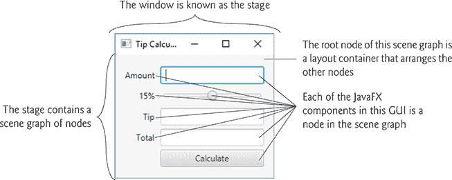

**图 12.1** JavaFX 应用窗口部分。

### 控件 (Controls)
**控件**（Controls）是 GUI 组件，例如显示文本的 `Label`、允许程序接收用户输入的 `TextField`、用户点击以启动操作的 `Button` 等。

### 舞台 (Stage)
显示 JavaFX 应用 GUI 的窗口被称为**舞台**（stage），它是类 `Stage` 的实例（包 `javafx.stage`）。

### 场景 (Scene)
阶段包含一个活跃的 `scene`（场景），它将 GUI 定义为 `scene graph`（场景图）——一个应用程序视觉元素的树形数据结构，例如 GUI 控件、形状、图像、视频、文本等（树形将在第 21.7 节中讨论）。场景是 `Scene` 类的实例（包 `javafx.scene`)。

### 节点 (Nodes)
场景图中的每个视觉元素都是一个 `node`——`Node` 类（包 `javafx.scene`）子类的实例，该类定义了所有节点的公共属性和行为。除了场景图中的第一个节点——`root node`（根节点）外，场景图中的每个节点都有一个父节点。节点可以具有变换（例如：移动、旋转和缩放）、透明度（节点是透明、半透明还是不透明）、效果（例如：投影、模糊、反射和光照）等，我们将在第 22 章讨论这些内容。

拥有子节点的节点通常是 `layout containers`（布局容器），它们在场景中安排其子节点。你将在本章中使用两个布局容器（`VBox` 和 `GridPane`），并将在第 13 章中学习更多容器。排列在布局容器中的节点是控件的组合，在更复杂的 GUI 中，还可能是其他布局容器。

### 事件处理器和控制器类 (Event Handler and Controller Class)
当用户与控件进行交互时（例如点击 `Button` 或在 `TextField` 中输入文本），控件会生成一个事件。程序可以响应这些事件——称为事件处理——以指定在发生每次用户交互时应该发生什么。`event handler`（事件处理器）是一个响应用户交互的方法。FXML GUI 的事件处理器定义在所谓的 `controller class`（控制器类）中（正如你将在第 12.5.5 节看到的）。你将使用视觉化编程技术将 JavaFX 组件*拖放*到 Scene Builder 的内容面板（即设计区域）上。接下来，你将使用 Scene Builder 的 `Inspector`（检查器）来配置选项，例如 `Labels` 的文本和字体大小，以及 `ImageView` 的图像。最后，你将使用 Scene Builder 的 `Show Preview in Window`（在窗口中显示预览）选项来查看完成的 GUI。在第 12.5 节的 `Tip Calculator`（提示计算器）应用中，我们将讨论加载和显示 FXML GUI 所需的 Java 代码。然后，在练习 12.3 中，你将创建一个显示在本节中构建的 `Welcome` GUI 的 Java 应用程序。

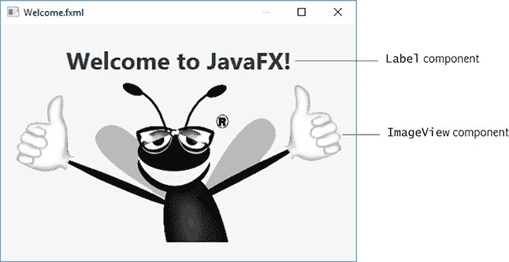

**图 12.2** Microsoft Windows 10 上预览窗口中最终的 `Welcome` GUI。

## 12.4.1 打开 Scene Builder 并创建文件 `Welcome.fxml`
打开 Scene Builder 以便创建定义 GUI 的 FXML 文件。窗口最初显示如图 12.3 所示。窗口顶部的 `Untitled` 表示 Scene Builder 创建了一个尚未保存的新 FXML 文件。选择 `File > Save` 显示“另存为”对话框，选择存储文件的位置，将文件命名为 `Welcome.fxml` 并点击 `Save` 按钮。

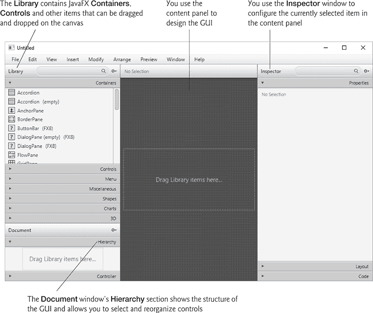

**图 12.3** 打开 JavaFX Scene Builder 时。

## 12.4.2 将图像添加到 Welcome 文件夹
该应用程序使用的图像（`bug.png`）位于本章节的 `images` 文件夹中。为了在你准备好将其添加到应用程序时易于找到图像，请在文件系统中找到 `images` 文件夹，然后将 `bug.png` 复制到保存 `Welcome.fxml` 的文件夹中。

## 12.4.3 创建 VBox 布局容器
对于此应用程序，你将在 `VBox` 布局容器（包 `javafx.scene.layout`）中放置 `Label` 和 `ImageView`，这将是场景图的根节点。布局容器帮助你安排和调整 GUI 组件的大小。`VBox` *垂直*排列其节点。我们将在第 12.5 节中讨论 `GridPane` 布局容器，并在第 13 章中讨论其他几个。要向 Scene Builder 的内容面板添加 `VBox` 以开始设计 GUI，请双击 `Library` 窗口 `Containers` 部分中的 `VBox`。（你也可以从 `Containers` 部分将 `VBox` 拖放到 Scene Builder 的内容面板上。）

## 12.4.4 配置 VBox 布局容器
你现在将指定 `VBox` 的对齐方式、初始大小和内边距。

### 指定 VBox 的对齐方式
`VBox` 的 `alignment` 决定了子节点的布局位置。在本应用程序中，我们希望每个子节点（`Label` 和 `ImageView`）在场景中水平居中，并希望两个子节点垂直居中，以便在 `Label` 上方和 `ImageView` 下方有相等的空间。要实现这一点：
1. 点击 Scene Builder 内容面板中的 `VBox`。Scene Builder 在 `Inspector` 的 `Properties` 部分显示了许多 `VBox` 属性。
2. 点击 `Alignment` 属性的下拉列表，注意你可以使用的多种对齐值。点击 `CENTER` 设置对齐方式。

你为 JavaFX 对象指定的每个属性值都用于在 JavaFX 运行时创建对象时设置该对象的实例变量。

### 指定 VBox 的首选大小
场景图根节点的 `preferred size`（宽度和高度）被场景用于在应用程序执行时确定其窗口大小。要设置首选大小：
1. 选择 `VBox`。
2. 点击 `Layout` 旁右箭头展开 `Inspector` 的 `Layout` 部分。该部分展开，右箭头变为向下。再次点击箭头将折叠该部分。
3. 点击 `Pref Width` 属性的文本框，输入 `450` 并按回车键更改首选宽度。
4. 点击 `Pref Height` 属性的文本框，输入 `300` 并按回车键更改首选高度。

## 12.4.5 添加并配置 Label
接下来，你将创建一个显示 `"Welcome to JavaFX!"` 的 `Label`。

### 向 VBox 添加 Label
点击 `Controls` 旁右箭头展开 Scene Builder `Library` 窗口的 `Controls` 部分，然后从 `Controls` 部分将 `Label` 拖放到 Scene Builder 内容面板中的 `VBox` 上。（你也可以双击 `Containers` 部分中的 `Label` 来添加 `Label`。）Scene Builder 根据 `VBox` 的 `Alignment` 属性，自动将 `Label` 对象在 `VBox` 中水平和垂直居中。

### 修改 Label 的文本
你可以通过双击 `Label` 并输入新文本，或者通过选择 `Label` 在 `Inspector` 的 `Properties` 部分设置其 `Text` 属性来设置 `Label` 的文本。将 `Label` 的文本设置为 `"Welcome to JavaFX!"`。

### 修改 Label 的字体
对于此应用程序，我们将 `Label` 设置为大号粗体字体。要实现这一点，选择 `Label`，然后在 `Inspector` 的 `Properties` 区域中，点击 `Font` 属性右侧的值。在弹出的窗口中，将 `Style` 属性设置为 `Bold`，并将 `Size` 属性设置为 `30`。现在的设计应该如图 12.4 所示。

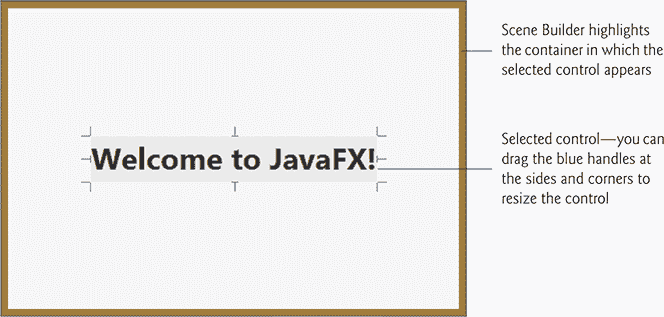

**图 12.4** 添加并配置 `Label` 后的欢迎 GUI 设计。

## 12.4.6 添加和配置 `ImageView`
最后，你将添加显示 `bug.png` 的 `ImageView`。

### 向 `VBox` 添加 `ImageView`
从 `Library` 窗口的 `Controls` 区域将 `ImageView` 拖到 `Label` 正下方，如图 12.5 所示。你也可以在 `Library` 窗口中双击 `ImageView`，在这种情况下，Scene Builder 会自动将新的 `ImageView` 对象放置在 `Label` 下方。你可以通过在 `VBox` 中或在 `Document` 窗口的 `Hierarchy` 区域中拖动控件来重新排序 `VBox` 控件的顺序（图 12.3）。Scene Builder 会自动在 `VBox` 中水平居中 `ImageView`。还要注意，`Label` 和 `ImageView` 是垂直居中的，使得 `Label` 上方和 `ImageView` 下方出现相同的空间。

### 设置 `ImageView` 的图像
接下来，你将设置要显示的图像：
1. 选择 `ImageView`，然后在 `Inspector` 的 `Properties` 区域点击 `Image` 属性右侧的省略号（`…`）按钮。默认情况下，Scene Builder 会打开一个对话框，显示 FXML 文件所在的文件夹。这就是你在第 12.4.2 节中放置图像文件 `bug.png` 的地方。
2. 选择图像文件，然后点击 **Open**（打开）。Scene Builder 会显示图像并调整 `ImageView` 的大小以匹配图像的宽高比——即图像宽度与高度的比例。

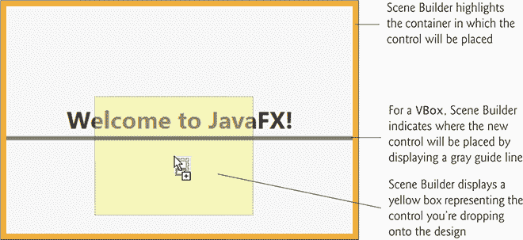

**图 12.5** 将 `ImageView` 拖到 `Label` 下方。

#### 更改 `ImageView` 的大小
我们希望按原始大小显示图像。如果你重置 `ImageView` 的默认 `Fit Width`（适应宽度）和 `Fit Height`（适应高度）属性值——这些值是 Scene Builder 在你向设计添加 `ImageView` 时设置的——Scene Builder 将调整 `ImageView` 为图像的精确尺寸。要重置这些属性：
1. 展开 `Inspector` 的 `Layout` 区域。
2. 将鼠标悬停在 `Fit Width` 属性值上。这会在属性值右侧显示按钮 。点击该按钮并选择 **Reset to Default**（恢复为默认值）来重置该值。这种技术可以用于任何属性值以将其重置为默认。
3. 重复*步骤 2* 以重置 `Fit Height` 属性值。

你现在已完成 GUI。Scene Builder 的内容面板现在应该如图 12.6 所示。选择 **File > Save**（文件 > 保存）来保存 FXML 文件。


**图 12.6** Scene Builder 内容面板中完成的 **Welcome**（欢迎）GUI。

## 12.4.7 预览 `Welcome` GUI
你可以预览设计在运行应用程序窗口中的外观。要实现这一点，选择 **Preview > Show Preview in Window**（预览 > 在窗口中显示预览），这将显示如图 12.7 所示。


**图 12.7** 在 Microsoft Windows 10 上预览 **Welcome** GUI——窗口框在 Linux、macOS 和早期版本的 Windows 上会有所不同。

## 12.5 小费计算器应用程序——事件处理简介
**Tip Calculator**（小费计算器）应用程序（图 12.8）计算小费和总额。默认情况下，`Slider` 允许选择从 0.0 到 100.0 的值，但在此应用程序中，我们将 `Slider` 限制为 0 到 30 的整数。

此应用使用 `GridPane`（图 12.9）将视图排列为两列五行。`GridPane` 中的每个单元格可以是空的，也可以包含一个或多个 JavaFX 组件，包括排列其他控件的布局容器。`GridPane` 中的每个组件可以跨越 `multiple` 列或行，尽管我们在这个 GUI 中没有使用该功能。当您将 `GridPane` 拖到 Scene Builder 的内容面板上时，Scene Builder 默认创建一个两列三行的 `GridPane`。你可以根据需要添加或删除列和行。我们将在介绍构建 GUI 的步骤时讨论其他 `GridPane` 特性。要获取更多关于 `GridPane` 类的信息，请访问：

```


<https://docs.oracle.com/javase/8/javafx/api/javafx/scene/layout/GridPane.html>


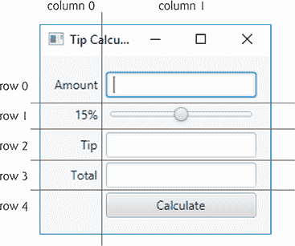

# 图 12.9
按行和列标记的**小费计算器** GUI 的 `GridPane`。

描述

# 使用 Scene Builder 创建和自定义 GUI

你将通过将 `Label`、`TextField`、`Slider` 和 `Button` 拖到 Scene Builder 的内容面板来创建它们，然后使用 `Inspector`（检查器）窗口对它们进行自定义。

*   `TextField`（包 `javafx.scene.control`）可以接受用户的文本输入或显示文本。你将使用一个可编辑的 `TextField` 来输入用户的账单金额，并使用两个不可编辑（`uneditable`）`TextField` 来显示小费和总金额。
*   `Slider`（包 `javafx.scene.control`）默认代表 0.0–100.0 范围内的值，并允许用户通过移动 `Slider` 的滑块在该范围内选择一个数字。你将自定义 `Slider`，使用户只能从更有限的整数范围 0 到 30 中选择自定义的小费百分比。
*   `Button`（包 `javafx.scene.control`）允许用户启动操作——在此应用中，点击 `Calculate`（计算）按钮将计算并显示小费和总金额。

# 将数字格式化为特定区域的货币和百分比字符串

你将使用 `NumberFormat` 类（包 `java.text`）来创建特定区域的货币和百分比字符串——这是国际化（`internationalization`）fn30。

# 事件处理

通常，用户与应用的 GUI 交互以指示应用应该执行的任务。例如，当你写电子邮件时，点击电子邮件应用的 `Send`（发送）按钮会告诉应用将电子邮件发送到指定的电子邮件地址。

GUI 是**事件驱动的**。当用户与 GUI 组件交互时，这种交互（被称为**事件**）会驱动程序执行任务。导致应用执行任务的一些常见用户交互包括点击按钮、在文本字段中输入文字、从菜单中选择项目、关闭窗口和移动鼠标。响应事件执行任务的代码被称为**事件处理器**，而响应事件的过程被称为**事件处理**。

在应用能够响应特定控件的事件之前，你必须：

1.  定义一个实现适当接口的事件处理器——该接口被称为**事件监听器接口**。
2.  指明该类的对象在事件发生时应该被通知——这被称为**注册事件处理器**。

在此应用中，你将响应两个事件——当用户移动 `Slider` 的滑块时，应用将更新显示当前小费百分比的 `Label`；当用户点击 `Calculate` 按钮时，应用将计算并显示小费和总账金额。

你会发现，对于某些事件（例如用户点击 `Button` 时），你可以通过 Scene Builder `Inspector` 窗口的 `Code` 部分将控件链接到它的事件处理方法。在这种情况下，事件监听器接口已为你实现，以便调用你指定的方法。对于当控件属性值改变时发生的事件（例如用户移动 `Slider` 的滑块来更改 `Slider` 的值），你会发现你必须完全在代码中创建事件处理器。

# 实现接口 `ChangeListener` 以处理 `Slider` 滑块位置的变化

你将实现接口 `ChangeListener`（包 `javafx.beans.value`）来响应用户移动 `Slider` 滑块的情况。特别地，你将使用接口的 `changed` 方法，在用户移动 `Slider` 滑块时显示更新的小费百分比。

# 模型-视图-控制器 (MVC) 架构

使用 FXML 实现 GUI 的 JavaFX 应用程序遵循**模型-视图-控制器 (MVC) 设计模式**，该模式将应用的数据（包含在**模型**中）与应用的 GUI（**视图**）以及应用的处理逻辑隔离开。

`Tip Calculator` 程序中通过 `fx:id` 标记的程序化操作的控件。

描述

# 创建 `TipCalculator.fxml` 文件

正如你在第 12.4.1 节中所做的那样，打开 Scene Builder 创建一个新的 FXML 文件。然后，选择 `File > Save` 显示“另存为”对话框，指定存储文件的位置，将文件命名为 `TipCalculator.fxml` 并点击 `Save` 按钮。

# 第 1 步：添加 `GridPane`

从 `Library` 窗口的 `Containers` 部分将 `GridPane` 拖到 Scene Builder 的内容面板上。默认情况下，`GridPane` 包含两列和三行，如图 12.11 所示。

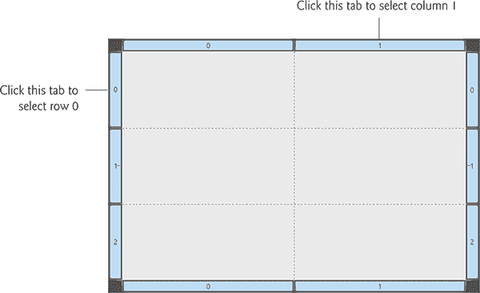

# 图 12.11
具有两列（0 和 1）和三行（0, 1）的 `GridPane`。

# 第 2 步：向 `GridPane` 添加行

回想图 12.9 中的 GUI 有两列和五行。在这里我们将添加两行。要在现有行上方或下方添加行：

1. 右键点击任何行的行号，并选择 `Grid Pane > Row Above` 或 `Grid Pane > Row Below`。
2. 重复此过程以添加另一行。

添加两行后，`GridPane` 应该如图 12.12 所示。你可以使用类似的步骤来添加列。你可以通过右键点击包含该行或列的标签并选择 `Delete` 来删除行或列。


# 图 12.12
添加两行后的 `GridPane`。

# 第 3 步：向 `GridPane` 添加控件

现在你将把图 12.9 中的控件添加到 `GridPane` 中。对于图 12.10 中具有 `fx:id` 的每个控件，当你将控件拖到 `GridPane` 上，在 `Inspector` 窗口的 `Code` 部分设置控件的 `fx:id` 属性。执行以下步骤：

1. **添加 `Label`。** 从 `Library` 窗口的 `Controls` 部分将 `Label` 拖到列 0 的前四行（`GridPane` 的左列）。在每添加一个 `Label` 时，设置其文本如图 12.9 所示。
2. **添加 `TextField`。** 从 `Library` 窗口的 `Controls` 部分将 `TextField` 拖到列 1 的第 0、2 和 3 行（`GridPane` 的右列）。
3. **添加 `Slider`。** 从 `Library` 窗口的 `Controls` 部分将一个水平 `Slider` 拖到列 1 的第 1 行。
4. **添加 `Button`。** 从 `Library` 窗口的 `Controls` 部分将 `Button` 拖到列 1 的第 4 行。将 `Button` 的文本更改为 `Calculate`。你可以通过双击 `Button` 或通过选择 `Button` 后在 `Inspector` 窗口的 `Properties` 部分设置其 `Text` 属性来设置 `Button` 的文本。

`GridPane` 应该如图 12.13 所示。


# 图 12.13
填充了 `Tip Calculator` 控件的 `GridPane`。

描述

# 第 4 步：调整 `GridPane` 大以适应内容

当你通过添加布局创建 GUI 时，Scene Builder 会自动将布局对象的 `Pref Width` 属性设置为 600，将 `Pref Height` 属性设置为 400，正如你在第 12.4.1 节中所做的那样。对于此应用程序，我们希望布局根据内容计算：

1. 首先，点击 `GridPane` 内部以选择它，即使你已经向其添加了控件。
2. 在 `Inspector` 窗口的 `Layout` 部分，将 `Pref Width` 和 `Pref Height` 属性重置为默认值（如你在第 12.4.1 节中所做的那样），设置为 `USE_COMPUTED`。

布局现在如图 12.14 所示。


# 图 12.14
适应内容的 `GridPane`。

描述

# 第 5 步：对齐 `GridPane` 列 0 内容

`GridPane` 列的内容默认是左对齐的。要右对齐列 0 的内容，点击列上方或下方的标签页以选择它，然后在 `Inspector` 窗口的 `Layout` 部分将 `alignment` 属性设置为 `RIGHT`。

# 第 6 步：调整 `GridPane` 列的大小以适应内容

默认情况下，Scene Builder 将每列的宽度设置为 100 像素，每行的高度设置为 30 像素，以确保你可以将控件放入 `GridPane`。对于此应用程序，我们让列适应内容。要这样做，点击列上方或下方的标签页选择列，然后在 `Inspector` 窗口的 `Layout` 部分将 `Pref Width` 属性重置为默认值（即 `USE_COMPUTED`），这样列宽将根据最宽的控件（在本例中是 `Amount` `Label`）计算。对列 1 重复此过程。`GridPane` 应该如图 12.15 所示。


# 图 12.15
列适应内容的 `GridPane`。

描述

# 第 7 步：调整 `Button` 大小

默认情况下，Scene Builder 根据文本设置 `Button` 的宽度。对于此应用程序，我们选择让 `Button` 的宽度与 `GridPane` 右列的其他控件相同。要这样做，选择 `Button`，然后在 `Inspector` 窗口的 `Layout` 部分将 `maxWidth` 属性设置为 `MAX_VALUE`。这会导致 `Button` 的宽度扩展以填充列宽。

# 预览 GUI

选择 `Preview > Show Preview in Window` 预览 GUI。如你在图 12.16 所示，左列的 `Label` 与右列的控件之间没有间距。此外，`GridPane` 周围没有间距，因为默认情况下 `Stage` 的大小是根据 `Scene` 的内容调整的。因此，许多控件接触到了窗口边界。你将在下一步中解决这些问题。


# 图 12.16
调整了 `TextField` 和 `Button` 大小的 `GridPane`。

节点内容与其顶、右、底、左边缘之间的空间称为 `padding`（内边距），它将内容与节点边缘隔开。由于 `GridPane` 的大小决定了 `Stage` 窗口的大小，`GridPane` 的 `padding` 将其子节点与窗口边缘分开。要设置内边距，选择 `GridPane`，然后在 **Inspector**（检查器）的 **Layout**（布局）部分，将 **Padding** 属性的四个值（分别代表 **TOP**、**RIGHT**、**BOTTOM** 和 **LEFT**） 设置为 `14`——这是 JavaFX 推荐的控件边缘与 `Scene` 边缘之间的距离。

你可以通过 `Hgap`（水平间隙）和 `Vgap`（垂直间隙）属性分别指定 `GridPane` 列和行之间的默认空间间距。由于 Scene Builder 将每个 `GridPane` 行的高度设置为 30 像素——这大于此应用控件的高度——因此组件之间已经存在一些垂直空间。要指定列与列之间的水平间隙，在 **Document**（文档）窗口的 **Hierarchy**（层级结构）部分选择 `GridPane`，然后在 **Inspector** 的 **Layout** 部分将 `Hgap` 属性设置为 `8`——这是控件之间推荐的距离。如果你想精确控制组件之间的垂直空间，可以将行的 **Pref Height**（首选高度）重置为默认值，然后设置 `GridPane` 的 `Vgap` 属性。

# 第 9 步：使 `tipTextField` 和 `totalTextField` 不可编辑且不可获取焦点

`tipTextField` 和 `totalTextField` 在此应用中仅用于显示结果，而不接收文本输入。因此，它们不应具有交互性。只有当 `TextField` “获得焦点”时，你才能在其中输入——也就是说，它是用户正在交互的控件。当你点击一个交互式控件时，它会获得焦点。同样，当你按下 `Tab` 键时，焦点会从当前可焦点的控件转移到下一个控件——这是按照控件添加到 GUI 的顺序完成的。交互式控件（如 `TextField`、`Slider` 和 `Button`）默认是可以获取焦点的。非交互式控件（如 `Label`）是不可获取焦点的。

在此应用中，`tipTextField` 和 `totalTextField` 既不可编辑也不可获取焦点。要进行这些更改，同时选择两个 `TextField`，然后在 **Inspector** 的 **Properties**（属性）部分取消勾选 **Editable**（可编辑）和 **Focus Traversable**（可通过焦点遍历）属性。要同时选择多个控件，可以点击第一个（在 **Document** 窗口的 **Hierarchy** 部分或内容面板中），然后按住 `Shift` 键点击其他每一个控件。

# 第 10 步：设置 `Slider` 的属性

为了完成 GUI，你现在将配置 **Tip Calculator** 的 `Slider`（滑块）。默认情况下，`Slider` 的范围是从 `0.0` 到 `100.0`，初始值为 0.0。此应用仅允许 0 到 30 之间的整数小费百分比，默认值为 15。要进行这些更改，选择 `Slider`，然后在 **Inspector** 的 **Properties** 部分，将 `Slider` 的 **Max**（最大值）属性设置为 `30`，并将 **Value**（值）属性设置为 `15`。我们还设置 **Block Increment**（分块增量）属性为 `5`——当用户点击 `Slider` 端点与滑块头部之间时，**Value** 属性增加或减少的幅度。通过选择 `File > Save` 保存 FXML 文件。

尽管我们将 **Max**、**Value** 和 **Block Increment** 属性设置为整数值，但当用户移动头部时，`Slider` 仍然会产生浮点值。在应用的 Java 代码中，我们在响应其事件时会将 `Slider` 的值限制为整数。

# 预览最终布局

你现在已完成 **Tip Calculator** 设计。选择 **Preview > Show Preview in Window** 查看最终的 GUI（图 12.17）。当我们在 第 12.5.5 节中讨论 `TipCalculatorController` 类时，我们将展示如何在 FXML 文件中指定 **Calculate** `Button` 的事件处理器。


# 图 12.17
在 Scene Builder 中预览的最终 GUI 设计。

Description

# 指定控制器的类名

正如我们在 第 12.5.2 节中提到的，简单的基于 JavaFX 的应用有两个 Java 源文件。对于 **Tip Calculator** 应用，这些是：

*   `TipCalculator.java`——该文件包含加载 FXML 并将其附加到 `Scene` 的 `main` 方法。
*   `TipCalculatorController.java`——该文件包含 `TipCalculatorController` 类（将在 第 12.5.5 节），并输入类名。
2.  按照惯例，控制器类与 FXML 名称相同并以 `Controller` 结尾。

# 指定 `Button` 的事件处理器

你可以在 FXML 中指定将调用的方法。当你选择一个控件时，**On Action** 字段指定的会被调用：

```java
```


// Generating a

可以看到，示例类为每个具有 `fx:id` 的控件提供了一个变量和一个空的 `Calculate` `Button` 事件处理器。

图 12.19 展示了 `TipCalculator` 类。正如我们在第 12.5.2 节中讨论过的样，JavaFX 程序的起点是一个 `Application` 子类，因此 `TipCalculator` 类继承自 `Application`（第 9 行）。`main` 方法调用 `Application` 类的 `static launch` 方法（第 23 行）来初始化 JavaFX 运行时并开始执行程序。该方法会导致 JavaFX 运行时创建一个 `TipCalculator` 类的对象，并调用其 `start` 方法（第 10–19 行），传递代表程序将显示窗口的 `Stage` 对象。JavaFX 运行时负责创建窗口。

```
 1   // Fig. 12.19: TipCalculator.java

 2   // 加载并显示 Tip Calculator GUI 的主程序类

 3   import javafx.application.Application;

 4   import javafx.fxml.FXMLLoader;

 5   import javafx.scene.Parent;

 6   import javafx.scene.Scene;

 7   import javafx.stage.Stage;

 8

 9   public class TipCalculator extends Application {

10      @Override

11      public void start(Stage stage) throws Exception{

12         Parent root =

13            FXMLLoader.load(getClass().getResource("TipCalculator.fxml"));

14

15         Scene scene = new Scene(root); // 将场景图附加到场景中

16         stage.setTitle("Tip Calculator"); // 显示在窗口标题栏中

17         stage.setScene(scene); // 将场景附加到舞台上

18         stage.show(); // 显示舞台

19      }

20

21      public static void main(String[] args) {

22         // 创建 TipCalculator 对象并调用其 start 方法

23         launch(args);

24      }

25   }
```

# 图 12.19

加载并显示 Tip Calculator GUI 的主程序类。

## 重写的 `Application` 方法 `start`

`start` 方法（第 11–19 行）创建 GUI，将其附加到 `Scene`，并将其放置在 `start` 方法作为参数接收的 `Stage` 上。第 12–13 行使用 `FXMLLoader` 类的 `static` 方法 `load` 来创建 GUI 的场景图。该方法：

*   返回指向场景图根节点的 `Parent`（包 `javafx.scene`）引用——在本程序中，这是对 GUI 中 `GridPane` 的引用。
*   创建一个我们在 FXML 文件中指定的 `TipCalculatorController` 类对象。
*   为通过程序操作的组件初始化控制器的实例变量。
*   将 FXML 中指定的事件处理器附加到相应的控件上。这被称为注册事件处理器，并允许控件在用户与程序交互时调用相应的方法。

我们在第 12.5.5 节中讨论了控制器实例变量的初始化以及事件处理器的注册。

## 创建 `Scene`

要显示 GUI，你必须将其附加到 `Scene` 上，然后将 `Scene` 附加到 `start` 方法作为参数接收的 `Stage` 上。为了将 GUI 附加到 `Scene`，第 15 行创建了一个 `Scene`，并将 `root`（场景图的根节点）作为构造函数的参数。默认情况下，`Scene` 的大小由场景图根节点的大小决定。`Scene` 构造函数的重载版本允许你指定 `Scene` 的大小和填充颜色（颜色、渐变或图像），这将显示在 `Scene` 的背景中。第 16 行使用 `Stage` 方法 `setTitle` 来指定显示在 `Stage` 窗口标题栏中的文本。第 17 行调用 `Stage` 方法 `setScene` 将 `Scene` 放置在 `Stage` 上。最后，第 18 行调用 `Stage` 方法 `show` 显示 `Stage` 窗口。

## 12.5.5 `TipCalculatorController` 类

图 12.20–12.23 展示了响应 `Button` 用户交互的 `TipCalculatorController` 类。

## `TipCalculatorController` 的 `import` 语句

图 12.20 显示了 `TipCalculatorController` 的 `import` 声明：

```java
 1   import javafx.application.Application;

 2   import javafx.fxml.FXMLLoader;

 3   import javafx.scene.Parent;

 4   import javafx.scene.Scene;

 5   import javafx.stage.Stage;

 6   import java.math.BigDecimal;

 7   import java.math.RoundingMode;

 8   import java.text.NumberFormat;

 9   import javafx.beans.ChangeListener;

10  import javafx.beans.ObservableValue;

11  import javafx.event.ActionEvent;

12  import javafx.fxml.FXML;

13  import javafx.scene.control.Label;

14  import javafx.scene.control.Slider;

15  import javafx.scene.control.TextField;
```

```java
14   public class TipCalculatorController {

      // 货币和百分比的格式化

      private static final NumberFormat currency =
         NumberFormat.getCurrencyInstance();

      private static final NumberFormat percent =
         NumberFormat.getPercentInstance();

      private BigDecimal tipPercentage = new BigDecimal(0.15); // 默认 15%

      // 在 FXML 中定义并由控制器使用的 GUI 控制

      @FXML
      private TextField amountTextField;

      @FXML
      private Label tipPercentageLabel;

      @FXML
      private Slider tipPercentageSlider;

      @FXML
      private TextField tipTextField;

      @FXML
      private TextField totalTextField;
```

# 图 12.21

`TipCalculatorController` 的 `static` 变量和实例变量。

## `@FXML` 注解

回想第 12.5.3 节，该应用程序在 Java 源码中操作的每个控件都需要一个 `fx:id`。第 24–37 行（图 12.21）声明了控制器类对应的实例变量。跟在每个声明之前的 `@FXML` 注解（第 24, 27, 30, 33 和 36 行）表示变量名可以在描述应用程序 GUI 的 FXML 文件中使用。你在控制器类中指定的变量名必须与你在构建 GUI 时指定的 `fx:id` 值精确匹配。当 `FXMLLoader` 加载 `TipCalculator.fxml` 来创建 GUI 时，它还会初始化每个用 `@FXML` 声明的控制器实例变量，以确保它们指向 FXML 文件中对应的 GUI 组件。

## `TipCalculatorController` 的 `calculateButtonPressed` 事件处理程序

图 12.22 展示了 `TipCalculatorController` 类的 `calculateButtonPressed` 方法，该方法在用户点击计算 `Button` 时被调用。该方法之前的 `@FXML` 注解（第 40 行）表示该方法可以用于在描述应用程序 GUI 的 FXML 文件指定控件的事件处理程序。对于生成 `ActionEvent` 的控件（许多 JavaFX 控件都是此类情况），事件处理方法必须返回 `void` 并接收一个 `ActionEvent` 参数（第 41 行）。

```java
39      // 计算并显示小费和总金额

40      @FXML

41      private void calculateButtonPressed(ActionEvent event) {

42         try {

43            BigDecimal amount = new BigDecimal(amountTextField.getText());

44            BigDecimal tip = amount.multiply(tipPercentage);

45            BigDecimal total = amount.add(tip);

47            tipTextField.setText(currency.format(tip));

48            totalTextField.setText(currency.format(total));

49         }

50         catch (NumberFormatException ex) {

51            amountTextField.setText("Enter amount");

52            amountTextField.selectAll();

53            amountTextField.requestFocus();

54         }

55      }
```


# 图 12.22

`TipCalculatorController` 的 `calculateButtonPressed` 事件处理程序。

## 注册计算按钮的事件处理程序

当 `FXMLLoader` 加载 `TipCalculator.fxml` 创建 GUI 时，它会为计算 `Button` 的 `ActionEvent` 创建并注册事件处理程序。该事件的事件处理程序必须实现接口 `EventHandler<ActionEvent>`——`EventHandler` 是一个泛型类型，类似于 `ArrayList`（引入自第 7 章）。此接口包含一个返回 `void` 并接收一个 `ActionEvent` 参数的 `handle` 方法。该方法的体在用户点击计算 `Button` 时会调用 `calculateButtonPressed` 方法。`FXMLLoader` 对你通过 Scene Builder **Inspector**（检查器）窗口的 **Code**（代码）部分指定的每个监听器执行类似的任务。

## 计算并显示小费和总金额

第 43–48 行计算并显示小费和总额。第 43 行调用 `amountTextField` 的 `getText` 方法来获取用户输入的账单金额。此 `String` 被传递给 `BigDecimal` 的构造函数，如果其参数不是数字，则它会抛出 `NumberFormatException`。在这种情况下，第 51 行调用 `amountTextField` 的 `setText` 方法；第 52 行让 `amountTextField` 选择所有内容；第 53 行让 `amountTextField` 获取焦点。

## `TipCalculatorController` 的 `initialize` 方法

图 12.23 展示了 `TipCalculatorController` 的 `initialize` 方法。该方法可以在 GUI 显示前配置控制器。第 60 行调用 `currency` 对象的 `setRoundingMode` 方法指定货币如何舍入。`RoundingMode.UP` 表示大于或等于 .5 的值向上舍入——例如，34.567 将格式化为 34.57，而 34.56 将格式化为 34.56。

## 使用匿名内部类处理事件

每个 JavaFX 控件都有属性。某些属性——例如 `Slider` 的值——在改变时会生成事件。对于此类事件，你必须手动注册一个实现 `ChangeListener` 接口的对象（包 `javafx.beans.value`）。

`ChangeListener` 是一个泛型类型，根据属性类型进行了特化。对 `valueProperty` 的调用（第 63 行）返回一个代表 `Slider` 值的 `DoubleProperty`（包 `javax.beans.property`）。`DoubleProperty` 是一个 `ObservableValue<Number>`，当值变化时可以通知监听器。每个实现 `ObservableValue` 接口的类都提供 `addListener` 方法（在第 63 行调用），用于注册实现 `ChangeListener` 的事件处理程序。对于 `Slider` 的值，`addListener` 的参数是一个实现 `ChangeListener<Number>` 的对象，因为 `Slider` 的值是一个数值。

如果一个事件处理器没有被重用，你通常将其定义为 `anonymous inner class`（匿名内部类）的实例——这是一个没有声明名称且通常出现在方法内部的类。`addListener` 方法的参数在第 64–72 行中指定为一个语句，该语句的作用：

* 声明事件监听器的类，
* 创建该类的对象并
* 将其注册为对 `tipPercentageSlider` 值值变化的监听器。

由于匿名内部类没有名称，你必须在声明处创建该类的对象（因此在第 64 行使用了 `new` 关键字）。然后将该对象的引用传递给 `addListener`。在 `new` 关键字之后，第 64 行的语法：

```
ChangeListener<Number>()
```


开始对一个实现 `ChangeListener<Number>` 接口的匿名内部类的声明。这类似于使用以下代码开始一个类声明：

```
public class MyHandler implements ChangeListener<Number>
```

第 64 行的左大括号和第 72 行的右大括号界定了匿名内部类的类体。第 65–71 行声明了接口的 `changed` 方法，该方法接收指向已变化的 `ObservableValue` 的引用、一个包含事件发生前 `Slider` 旧值的 `Number`，以及一个包含 `Slider` 新值的 `Number`。当用户移动 `Slider` 的滑块时，第 68–69 行存储了新的小费百分比，第 70 行更新了 `tipPercentageLabel`。（第 66 行中的 `? extends Number` 符号表示 `ObservableValue` 的类型参数是 `Number` 或 `Number` 的子类。我们将在 第 20.7 节 中详细详细解释这种符号。）

## 匿名内部类注意事项

匿名内部类可以访问其顶层类的实例变量、`static` 变量和方法——在本例中，匿名内部类使用了实例变量 `tipPercentage` 和 `tipPercentageLabel` 以及 `static` 变量 `percent.*`。然而，匿名内部类对其声明所在方法的局部变量的访问有限——它只能访问在外层方法体中声明的 `final` 或有效 `final`（Java SE 8）局部变量。

## Java SE 8: 使用 Lambda 实现 `ChangeListener`

回想 第 10.10 节，在 Java SE 8 中，包含一个方法的接口——例如 图 12.23 中的 `ChangeListener`——是一个函数式接口。我们将在 第 17 节 中展示如何使用 lambda 实现此类接口。

## 其他章节涵盖的 JavaFX 特性

JavaFX 是一项强大的 GUI、图形和多媒体技术。在 第 13 节 和 第 22 节 中，你将：

* 学习额外的 JavaFX 布局和控件。
* 处理其他类型的事件（如 `MouseEvent`）。
* 将变换（如移动、旋转、缩放和倾斜）以及效果（如投影阴影、模糊、反射和光照）应用到场景图的节点上。
* 使用 CSS 指定控件的外观样式。
* 使用 JavaFX 属性和数据绑定来实现在相应数据变化时自动更新控件。
* 使用 JavaFX 图形能力。
* 使用 JavaFX 多媒体能力播放音频和视频。

此外，我们的 JavaFX 资源中心

```
http://www.deitel.com/JavaFX
```


包含了指向在线资源的链接，你可以在那里学习更多关于 JavaFX 功能的知识。

# 总结

在本章中，我们介绍了 JavaFX。我们展示了 JavaFX stage（应用程序窗口）的结构。你学习了 stage 显示了一个场景图（scene graph），场景图由节点组成，而节点由布局和控件组成。

你设计了 JavaFX 程序。你学习了 stage 显示场景图，场景图由节点组成，而节点由布局和控件。

# 总结

## 12.1 简介

* 图形用户界面（GUI）为应用程序提供了一种友好的交互机制。GUI（读作“GOO-ee”）为应用程序提供了独特的样式。
* GUI 由 GUI 组件（有时称为控件或小部件）构建。
* 为不同的应用程序提供一致的用户界面组件，使用户能够更快地学习并更高效地使用。
* JavaFX 是未来的 GUI、图形和多媒体 API。

## 12.2 JavaFX Scene Builder

* Scene Builder 是一个独立的 JavaFX GUI 可视化布局工具，也可以配合 IDE 使用。
* JavaFX Scene Builder 允许你通过从库中拖放 GUI 组件到设计区域来创建 GUI，而无需编写代码。
* Scene Builder 的实时编辑和预览功能允许你在创建和修改 GUI 时查看它，无需编译和运行程序。
* 你可以使用层级样式表（CSS）更改整个 GUI 的样式——这种概念有时被称为皮肤（skinning）。
* 当你创建和修改 GUI 时，JavaFX Scene Builder 生成 FXML（FX 标记语言）——一种无需编写 Java 代码即可定义和排列 JavaFX 控件的 XML 词。
* XML（扩展标记语言）是一种广泛用于描述事物的语言——计算机和人类都可以读取。
* FXML 简洁地描述了 GUI、图形和多媒体元素。
* FXML 代码与在 Java 源文件中定义的程序逻辑分离。
* 界面（GUI）与实现（Java 代码）分离使得 JavaFX 应用程序更容易调试、修改和维护。

## 12.3 JavaFX 窗口结构

* 显示 JavaFX 应用程序 GUI 的窗口被称为 stage，它是 `Stage` 类（包 `javafx.stage`）的实例。
* stage 包含一个 scene，将 GUI 定义为场景图（scene graph）——应用程序视觉元素的树结构，例如 GUI 控件、形状、图像、视频、文本等。scene 是 `Scene` 类（包 `javafx.scene`）的实例。
* 场景图中的每个视觉元素都是节点——`Node` 类（包 `javafx.scene`）子类的实例，该类定义了场景图中所有节点的共同属性和行为。
* 场景图中的第一个节点被称为根节点。
* 拥有子节点的节点通常是布局容器，它们在场景中排列其子节点。
* 排列在布局容器中的节点是控件以及可能的其他布局容器的组合。
* 当用户与控件交互时，它会产生一个事件。程序可以使用事件处理来指定当每次用户交互发生时应该发生什么。
* 事件处理器是响应用户交互的方法。FXML GUI 的事件处理器定义在控制器类（controller class）中。

## 12.4 欢迎应用程序——显示文本和图像

* 可视化编程技术使你能够将 JavaFX 组件拖放到 Scene Builder 的设计区域（称为内容面板）中，然后使用 Scene Builder 的检查器（Inspector）来配置选项。
* 布局容器帮助你排列和调整 GUI 组件的大小。
* `VBox` 布局容器（包 `javafx.scene.layout`）从上到下垂直排列其节点。
* 若要向 Scene Builder 的内容面板添加布局，可以双击 `Library`（库）窗口中 `Containers`（容器）部分的布局，或者将布局从 `Containers` 部分拖放放置到 Scene Builder 的内容面板中。
* `VBox` 的 `Alignment`（对齐）属性决定了 `VBox` 子节点的布局位置。
* 你为 JavaFX 对象指定的每个属性值都用于在 JavaFX 运行时创建该对象时设置该对象的实例变量之一。
* 场景图根节点的首选尺寸（宽度和高度）将用于场景在应用程序开始执行时确定其窗口大小。
* 若要向布局中添加控件，请将控件从 `Library` 拖放到 Scene Builder 内容面板中的布局上。你也可以通过双击 `Library` 中的某项来添加它。
* 你可以通过双击 `Label` 并输入新文本，或者通过选择 `Label` 并在 `Inspector` 的 `Properties`（属性）部分设置其 `Text` 属性来设置 `Label` 的文本。
* 若要设置 `Label` 的字体，选择 `Label`，然后在 `Inspector` 的 `Properties` 部分点击 `Font` 属性右侧的值。在弹出的窗口中，设置字体的属性。
* 你可以通过在 `VBox` 中或在 Scene Builder `Document`（文档）窗口的 `Hierarchy`（层级结构）部分中拖动控件来重新排列 `VBox` 的控件。
* 若要指定 `ImageView` 的图像，选择 `ImageView`，然后在 `Inspector` 的 `Properties` 部分点击 `Image` 属性右侧的省略号（`…`）按钮。在对话框中选择图像。
* 要将属性重置为默认值，将鼠标悬停在属性值上。这会在属性值右侧显示一个按钮。点击该按钮并选择 `Reset to Default`（重置为默认值）来重置值。
* 你可以通过选择 `Preview > Show Preview in Window`（预览 > 在窗口中预览）来预览设计在运行的应用程序窗口中的外观。

## 12.5.2 技术概述

* JavaFX 应用程序的主类继承自 `Application`（包 `javafx.application`）。
* 主类的 `main` 方法调用 `Application` 类的 `static launch` 方法以开始执行 JavaFX 应用程序。该方法反过来会导致 JavaFX 运行时创建一个 `Application` 子类的对象并调用其 `start` 方法，该方法创建 GUI，将其附加到 `Scene`（场景）并将其放置在该方法接收到的参数参数 `Stage`（阶段）上。
* `GridPane`（包 `javafx.scene.layout`）将 JavaFX 节点以矩形网格中的列和行排列。
* `GridPane` 中的每个单元可以是空的，也可以包含一个或多个 JavaFX 组件，包括排列其他控件的布局容器。
* `GridPane` 中的每个组件可以跨越多个列或行。
* `TextField`（包 `javafx.scene.control`）可以接受文本输入或显示文本。
* `Slider`（包 `javafx.scene.control`）默认代表 0.0–100.0 范围内的值，并允许用户通过移动 `Slider` 的滑块在该范围内选择一个数字。
* `Button`（包 `javafx.scene.control`）允许用户启动操作。
* `NumberFormat` 类（包 `java.text`）可以格式化特定区域的货币和百分比字符串。
* GUI 是事件驱动的。当用户与 GUI 组件交互时，这种交互（称为事件）会驱动程序执行任务。
* 响应事件执行任务的代码被称为事件处理器。
* 对于某些事件，你可以使用 Scene Builder `Inspector` 窗口的 `Code` 部分将控件链接到其事件处理方法。在这种情况下，将为你创建一个实现事件监听器接口的类，并调用你指定的方法。
* 当控件属性值变化时发生某些事件，你必须在代码中创建事件处理器。
* 实现 `ChangeListener` 接口（包 `javafx.beans.value`）以响应用户移动 `Slider` 滑块。
* 以 FXML 实现的 JavaFX 应用程序遵循模型-视图-控制器（MVC）设计模式，将应用程序的数据（包含在模型中）与 GUI（视图）以及处理逻辑（控制器）分离。视图展示模型中的数据。当模型更改时，视图会更新。
* `FXMLLoader` 类 `static load` 方法使用表示 GUI 的 FXML 文件创建场景图并返回 `Parent`（`javafx.scene`）引用。它还会初始化控制器变量并注册事件处理器。

## 12.5.3 构建应用程序的 GUI

* 若要在控制器类中通过编程操作控件或布局，必须为该控件或布局提供一个名称。对象的名称通过其 `fx:id` 属性指定。你可以通过选择场景中的组件，然后扩展 `Inspector` 窗口的 `Code` 部分来设置此属性值。
* 默认情况下，`GridPane` 包含两列三行。要在现有行上方或下方添加行，右键点击行标签并选择 `Grid Pane > Add Row Above`（在上方添加行）或 `Grid Pane > Add Row Below`（在下方添加行）。
* 你可以通过右键点击包含行或列的标签并选择 `Delete`（删除）来删除行或列。
* 你可以通过双击 `Button` 或通过选择 `Button` 在 `Inspector` 窗口的 `Properties` 部分设置其 `Text` 属性来设置 `Button` 的文本。
* `GridPane` 列的内容默认左对齐。要更改对齐方式，点击列顶部或底标签选择列，然后在 `Inspector` 的 `Layout` 部分设置 `Halignment`（水平对齐）属性。
* 将 `GridPane` 列节点的 `Pref Width`（首选宽度）属性设置为其默认值 `USE_COMPUTED_SIZE` 表示宽度应基于最宽的节点。
* 要使 `Button` 的 own 与 `GridPane` 列中的其他控件一样宽，选择 `Button`，然后在 `Inspector` 的 `Layout` 部分将 `Max Width`（最大宽度）属性设置为 `MAX_VALUE`。
* 节点内容与其顶部、右侧、底部和左边缘之间的空间称为内边（padding），它将内容与节点边缘分开。要设置内边，选择节点，然后在 `Inspector` 的 `Layout` 部分设置 `Padding` 属性的值。
* 你可以分别通过 `GridPane` 的 `Hgap`（水平间隙）和 `Vgap`（垂直间隙）属性来指定列和行之间的默认空间。
* 只有当 `TextField` 处于“聚焦”状态时，你才能为其输入文本——也就是说它是用户正在交互的控件。当你点击一个交互控件时，它就会接收焦点。同样，当你按下 `Tab` 键时，焦点会从当前可焦点的控件转移到下一个——这是按照控件添加到 GUI 的顺序发生的。

## 12.5.4 `TipCalculator` 类

* 要显示 GUI，你必须将其附加到 `Scene`，然后将 `Scene` 附加到传递给 `Application` 方法 `start()` 的 `Stage` 上。
* 默认情况下，`Scene` 的大小由场景图根节点的大小决定。`Scene` 构造函数的重载版本允许你指定 Scene 的大小和填充（颜色、渐变或图像），这些将显示在 `Scene` 的背景中。
* `Stage` 方法 `setTitle()` 指定出现在 `Stage` 窗口标题栏中的文本。
* `Stage` 方法 `setScene()` 将 `Scene` 放置到 `Stage` 上。
* `Stage` 方法 `show()` 显示 `Stage` 窗口。

## 12.5.5 `TipCalculatorController` 类

* `java.math` 包中的 `RoundingMode` 枚举用于指定在计算或将浮点数格式化为 `String` 时 `BigDecimal` 值的舍入方式。
* `java.text` 包中的 `NumberFormat` 类提供了数值格式化功能，例如特定地区的货币和百分比格式。
* `Button` 的事件处理器接收 `ActionEvent`，这表示 `Button` 被点击。许多 JavaFX 控件都支持 `ActionEvent`。
* `javafx.scene.control` 包包含了许多 JavaFX 控件类。
* 实例变量前的 `@FXML` 注解表示该变量名可以在描述应用 GUI 的 FXML 文件中使用。你在控制器类中指定的变量名必须与你在构建 GUI 时指定的 `fx:id` 值精确匹配。
* 当 `FXMLLoader` 加载 FXML 文件来创建 GUI 时，它还会初始化控制器每个用 `@FXML` 声明的实例变量，以确保它们引用 FXML 文件中对应的 GUI 组件。
* 方法前的 `@FXML` 注解表示该方法可以在描述应用 GUI 的 FXML 文件中，用于指定控件的事件处理器。
* 当 `FXMLLoader` 创建控制器类的对象时，它会确定该类是否包含一个无参数的 `initialize()` 方法，如果是，则调用该方法来初始化控制器。此方法可以在 GUI 显示之前用于配置控制器。
* 匿名内部类是在没有名称的情况下声明的类，通常出现在方法声明内部。
* 由于匿名内部类没有名称，必须在声明类的地方创建该类的一个对象。
* 匿名内部类可以访问其顶层类的实例变量、`static` 变量和方法，但对声明其所在方法的局部变量访问受限——它只能访问在外层方法体中声明的 `final` 或有效为 `final`（Java SE 8）的局部变量。

# 自测练习

## 12.1 填空每个述陈述中的空白：

1. 一个 `TextField` 可以显示文本并接受用户的文本输入。
2. 使用一个 `GridPane` 将 GUI 组件排列在矩形网格的单元格中。
3. JavaFX Scene Builder `Document` 窗口的 `Hierarchy` 部分显示 GUI 的结构，并允许你选择和重新组织控件。
4. 你实现接口 `ChangeListener` 以在用户移动 `Slider` 滑块时响应事件。
5. 一个 `Stage` 代表应用的窗口。
6. 方法 `initialize()` 在 GUI 显示之前由 `FXMLLoader` 调用。
7. 场景（scene）的内容被放置在它的 `root node` 中。
8. 场景图中的元素被称为 `nodes`。
9. Scene Builder 允许你构建 JavaFX GUI。
10. 一个 FXML file 包含 GUI 的描述。

## 12.2 说明列出的每个陈述是*正确（true）* 还是*错误（false）*。如果是*错误*，请解释原因。

1. **False**。你可以通过手动编码创建 JavaFX GUI。
2. **True**。`VBox` 垂直方向排列组件。
3. **False**。属性名是 `Alignment`。
4. **True**。`FXMLLoader` 初始化了 `@FXML` 变量。
5. **False**。你重写了 `Application` 的 `start()` 方法来显示 JavaFX 应用。
6. **True**。
7. **False**。默认情况下，`Slider` 允许你从 0 到 100 选择值。
8. **True**。`GridPane` 可以跨越多个列。
9. **True**。

# 自测答案

## 12.1

1. `TextField`
2. `GridPane`
3. `Hierarchy`
4. `ChangeListener`
5. `Stage`
6. `initialize()`
7. `root node`
8. `nodes`
9. Scene Builder
10. FXML file

## 12.2

1. False
2. True
3. False
4. True
5. False
6. True
7. False
8. True
9. True

## 练习

### 12.3 *(运行应用)*
在 12.4 节中，你构建了 **Welcome** 应用的 GUI，并使用 Scene Builder 的 **Preview in Window** 选项进行了预览。创建一个 `Application` 子类——如 12.5.4 所示——以便在 JavaFX 窗口中加载并显示 `Welcome.fxml`。

### 12.1 *(加法应用)*
创建图 2.7 中加法程序的 JavaFX 版本。使用两个 `TextField` 接收用户输入并使用一个 `Button` 启动计算。在 `Label` 中显示结果。由于 `TextField` 方法 `getText()` 返回 `String`，你必须将用户输入的 `String` 转换为 `int` 以供计算。记住 `Integer` 类的 `static` 方法 `parseInt` 接收代表整数的 `String` 参数，并将值作为 `int` 返回。

### 12.2 *(剪贴应用)*
使用 Flickr 等网站找到四张著名地标的图像。创建一个与 **Welcome** 应用类似的程序，在其中你将图像排列成拼贴。添加标识每个地标的文本。你可以使用项目部分的图像，也可以指定在线图像的 URL。

### 12.3 *(增强版小费计算应用)*
修改 **Tip Calculator** 应用，允许用户输入派对人数。计算并显示如果费用在派对成员之间平分，每人应支付的金额。

### 12.4 *(房贷计算器应用)*
创建一个房贷计算器应用，允许用户输入购买价格、首付款金额和利率。根据这些值，应用程序应计算贷款金额（购买价格减去首付款），并显示 10 年、20 年和 30 年贷款的每月还款额。允许用户使用 `Slider` 选择自定义贷款期限（以年为单位），并显示该自定义期限的每月还款额。

### 12.5 *(大学贷款还款计算器应用)*
某银行提供可以在 5、10、15、20、25 或 30 年内还清的大学贷款。编写一个应用程序，允许用户输入贷款金额和年利率。根据这些值，应用程序应显示以年为单位的贷款期限及其对应的每月还款额。

### 12.6 *(车贷还款计算器应用)*
通常情况下，银行提供的期限为二至五年（24 至 60 个月）的汽车贷款。借款人按月分期偿还贷款。每月的还款金额取决于贷款期限、借款金额和利率。创建一个应用程序，允许客户输入汽车价格、首付款金额和贷款年利率。该应用程序应显示贷款期限（以月为单位）以及两年、三年、四年和五年贷款的每月还款额。多样化的选项使用户轻松比较还款计划并选择最合适的一个。

### 12.7 *(每加仑英里程计算器应用)*
驾驶员通常想知道汽车的每加仑英里程以便估算油耗。开发一个应用程序，允许用户输入行驶里程数和使用的加仑数，计算并显示相应的每加仑英里程。

### 12.8 *(体重指数计算器应用)*
计算 BMI 的公式为：

$$BMI = \frac{weightInPounds \times 703}{heightInInches \times heightInInches}}$$

或

$$BMI = \frac{weightInKilograms}{heightInMeters \times heightInMeters}}$$

创建一个 BMI 计算器应用，允许用户输入体重和身高，以及他们使用的是英制还是公制单位输入这些值，然后计算并显示用户的体重指数。应用程序还应显示来自健康与人类服务部/国立卫生研究院的以下信息，以便用户评估自己的 BMI：

```


# BMI 数

* 体重过轻：小于 18.5
* 正常：在 18.5 到 24.9 之间
* 超重：在 25 到 29.9 之间
* 胖：30 或更大

## 2. 12.9 (目标心率计算器应用)

运动时，你可以使用心率监测仪查看心率是否保持在教练和医生建议的安全范围内。根据美国心脏协会（AHA）的，计算最大心率（每分钟跳数）的公式为 220 减去你的年龄（`http://bit.ly/AHATargetHeartRates`）。你的目标心率是最大心率的 50–85%。[注意：这些公式是 AHA 提供的估计值。最大心率和目标心率可能会根据个人的健康状况、健身和性别而异。在开始或修改运动计划之前，请咨询医生或专业的医疗保健人员。]编写一个应用程序输入人的年龄，然后计算并显示人的最大心率和目标心率范围。

# 13 JavaFX GUI：第 2 部分

## 目标

在本章中，你将：

* 学习更多关于使用 JavaFX 布局面板在场景图中布局节点的详细信息。
* 继续使用 Scene Builder 构建 JavaFX GUI。
* 创建并操纵 `RadioButton` 和 `ListView`。
* 使用 `BorderPane` 和 `TitledPane` 布局控件。
* 处理鼠标事件。
* 使用属性绑定（property binding）和属性监听器（property listeners）在控件属性值发生变化时执行任务。
* 通过程序创建布局和控件。
* 使用自定义单元格工厂自定义 `ListView` 的单元格。
* 了解其他 JavaFX 功能的概览。
* 接触 Java SE 9 中的 JavaFX 9 更新。

## 13.1 引言

本章将继续我们在第 12 章中开始的 JavaFX 介绍。在本章中，你将：

* 使用额外的布局（`TitledPane`、`BorderPane` 和 `Pane`）和控件（`RadioButton` 和 `ListView`）。
* 处理鼠标事件和 `RadioButton` 事件。
* 设置处理程序以响应控件上的属性变化（例如 `Slider` 的值）。
* 在场景图中将 `Rectangle` 和 `Circle` 显示为节点。
* 将对象集合绑定到 `ListView`，该 `ListView` 显示该集合。
* 自定义 `ListView` 单元格的外观。

最后，我们概述了其他 JavaFX 功能并提到 Java SE 9。

## 13.2 在场景图中布局节点

布局决定了场景图中节点的大小。

### 节点大小

通常情况下，不应显式地定义节点的大小。这样做通常会创建一个在首次加载时看起来很理想的设计。除了 `width` 和 `height` 之外，大多数 JavaFX 节点都有 `prefWidth`、`prefHeight`、`minWidth`、`minHeight`、`maxWidth` 和 `maxHeight`，指定：

* `min` 属性指定节点的最小尺寸。
* `max` 属性指定节点的最大尺寸。
* `pref` 属性指定节点的优先宽度和高度。

### 节点位置与布局面板

节点的位置应该相对于其父容器定义。JavaFX 布局面板是容器节点，它们在场景图中相互排列子节点。大多数 JavaFX 布局面板使用相对定位——如果布局面板节点被调整大小，它将根据其优先、最小和最大尺寸调整子节点的大小。在本章中，我们将使用 `javafx.scene.layout` 包中的 `Pane`、`BorderPane`、`GridPane` 和 `VBox`。

| 布局 | 说明 |
| --- | --- |
| `AnchorPane` | 允许相对于面板边缘设置子节点的位置。调整面板不会更改节点的布局。 |
| `BorderPane` | 包括五个区域——顶部、底部、左侧、中心和右侧——你可以在其中放置节点。顶部和底部区域填充 BorderPane 的宽度并根据子节点的优先高度进行垂直调整。左侧和右侧区域填充 BorderPane 的高度，并根据子节点的优先宽度进行水平调整。中心区域占据 `BorderPane` 的所有剩余空间。 |
| `FlowPane` | 连续布局节点——无论是水平还是垂直方向。当达到面板边界时，节点会在水平 `FlowPane` 中换到新行，或在垂直 `FlowPane` 中换到新列。 |
| `GridPane` | 创建一个灵活的网格，用于在行和列中布局节点。 |
| `Pane` | 布局面板的基类。可用于将节点放置在固定位置——这被称为绝对定位。 |
| `StackPane` | 将节点按堆栈方式放置。每个新节点都堆叠在上一个节点之上。例如，你可能会用它将文本放在图像上方。 |
| `TilePane` | 由等大小的瓷砖组成的水平或垂直网格。水平平铺的节点会在达到 `TilePane` 的宽度时换行。垂直平铺的节点会在达到 `TilePane` 的高度时换列。 |
| `HBox` | 在一行内水平地排列节点。 |
| `VBox` | 在一列内垂直地排列节点。 |

> **图 13.1** JavaFX 布局面板。

## 13.3 绘图应用：`RadioButton`s、鼠标事件与形状

在本节中，你将创建一个简单的 `Painter` 应用（图 13.2），允许你通过拖动鼠标进行绘制。首先，我们将概述你将用到的技术，然后讨论创建应用项目并构建其 GUI。最后，我们将展示其 `Painter` 和 `PainterController` 类的源代码。

> **图 13.2** `Painter` 应用。
> 

### 13.3.1 技术概述

本节介绍了你将在 `Painter` 应用中用到的 JavaFX 特性。

#### `RadioButton`s 与 `ToggleGroup`s

`RadioButton` 的功能是作为互斥的选项。你将多个 `RadioButton` 添加到一个 `ToggleGroup` 中，以确保在给定组内始终仅有一个 `RadioButton` 被选中。对于此应用，你将使用 JavaFX Scene Builder 的功能，在 FXML 中指定每个 `RadioButton` 的 `ToggleGroup`；然而，你也可以在 Java 中创建一个 `ToggleGroup`，然后使用 `RadioButton` 的 `setToggleGroup` 方法来指定其 `ToggleGroup`。

#### `BorderPane` 布局容器

`BorderPane` 布局容器将控件排列在图 13.3 所示的五个区域之一或多个区域。顶部和底部区域宽度与 `BorderPane` 相同。左侧、中间和右侧区域填充顶部底部之间的垂直空间。

每个区域可以只包含一个控件或一个布局容器，而后者又可以包含其他控件。

> **图 13.3** `BorderPane` 的五个区域。
> 

#### `TitledPane` 布局容器

`TitledPane` 布局容器在其顶部显示标题，并是一个可折叠面板，其中包含一个布局节点，该节点又包含其他节点。你将使用 `TitledPane` 来组织应用的 `RadioButton` 并帮助用户理解每个 `RadioButton` 组的。

#### JavaFX 形状

`javafx.scene.shape` 包包含各种用于创建 2D 和 3D 形状节点的类，这些节点可以显示在场景图中。在本文应用中，你将在用户拖动鼠标时程序化地创建 `Circle` 对象，然后将其附加到应用的绘图区域，以便它们显示在场景图中。

#### `Pane` 布局容器

你程序化创建的每个 `Circle` 都会附加到 `Pane` 布局（绘图区域），坐标为从 `Pane` 左上角测量的指定 `x-y` 。

#### 鼠标事件处理

当你拖动鼠标时，应用的控制器会通过在 `Pane` 的当前鼠标位置显示一个（当前选中颜色和笔画大小的）`Circle` 来做出响应。JavaFX 节点支持各种鼠标事件，总结在图 13.4 中。对于此应用，你将为 `Pane` 配置一个 `onMouseDragged` 事件处理器。JavaFX 还支持其他类型的输入事件。例如，对于触摸屏设备，有各种触摸事件；对于键盘，有各种按键事件。JavaFX 节点事件的完整列表，请参阅 `Node` 类中以“on”开头的属性：

```
http://docs.oracle.com/javase/javafx/scene/Node
```


| 事件 | 描述 |
| :--- | :--- |
| `MouseClicked` | 当鼠标点击时 |
| `onEntered` | 当鼠标进入时 |
| `onExited` | 当鼠标离开时 |
| `onMouseDragged` | 当鼠标拖动时 |
| `onMouseMoved` | 当鼠标移动时 |
| `onPressed` | 当鼠标按下时 |
| `onMouseReleased` | 当鼠标释放时 |
| `onMouseOver` | 当鼠标悬停时 |
| `onMouseOut` | 当鼠标移出时 |
| `onDragEntered` | 当拖拽操作进入时 |
| `onDragExited` | 当拖拽操作离开时 |
| `onDragOver` | 当拖拽操作正在进行时 |
| `onDropped` | 当释放项目时 |

# 设置控件的 Data

JavaFX 控件有一个接收 `Object` 的 `setUserData` 方法。你可以用它存储与控件关联的任何对象。对于每个 `RadioButton`，我们存储它代表的 `Color`。对于每个笔画大小，我们存储 `enum` 常量。

# 创建 FXML 文件

在系统中为此示例创建一个文件夹，然后打开 Scene Builder 并将新 FXML 存为 `Painter.fxml`。如果你已经有一个 FXML 文件，也可以选择 **File > New** 来创建一个。

# 13.3.3 构建 GUI

在本节中，我们将讨论 `Painter` 应用的 GUI。我们不会像在第 12 章中那样提供具体的步骤，而是提供构建 GUI 的通用说明并关注细节。

# 此应用的 fx:id 属性值

图 13.5 显示了 `Painter` 应用程序化控件的 **fx:id** 属性。在构建 GUI 时，你应该在 FXML 文档中设置相应的 **fx:id** 属性，正如我们在第 12 章中所讨论的那样。


## 步骤 1：将 `BorderPane` 作为根布局节点

从 Scene Builder **Library** 窗口的 **Containers** 部分将 `BorderPane` 拖到内容面板。

## 步骤 2：配置 `BorderPane`

我们将 `GridPane` 的 **Pref Width** 和 **Pref Height** 属性分别设置为 `640` 和 `480`。记住，阶段的大小取决于 FXML 文档中根节点的大小。设置 `BorderPane` 的 **Padding** 属性为 `8`，使其偏离阶段边缘。

## 步骤 3：添加 `VBox` 和 `Pane`

将一个 `VBox` 拖入 `BorderPane` 的左侧区域，并将一个 `Pane` 拖入中间区域。当你拖过 `BorderPane` 时，Scene Builder 会显示布局的五个区域，并高亮显示在你松开鼠标时所拖入的项将放置的区域。将 `Pane` 的 `fx:id` 设置为 `drawingAreaPane`，如图 13.5 所示。

对于 `VBox`，将它的 `Spacing` 属性（在 `Inspector` 检查器的 `Layout` 布局部分中）设置为 `8`，以便在添加到此容器的控件之间添加一些垂直间距。将它的右侧 `Margin` 属性设置为 `8`，以便在 `VBox` 与将添加到此容器的 `Pane` 之间添加一些水平间距。同时，将其 `Pref Width` 和 `Pref Height` 属性重置为默认值（`USE_COMPUTED_SIZE`），并将它的 `Max Height` 属性设置为 `MAX_VALUE`。这将使 `VBox` 的宽度能够容纳其子节点并占据整个列的高度。

将 `Pane` 的 `Pref Width` 和 `Pref Height` 重置为默认的 `USE_COMPUTED_SIZE` 值，并将它的 `Max Width` 和 `Max Height` 设置为 `MAX_VALUE`，使其占据 `BorderPane` 中间区域的全部宽度和高度。在 `Inspector` 窗口 `Properties` 属性部分的 `JavaFX CSS` 类别中，点击 `Style` 下方的字段（初始为空）并选择 `-fx-background-color`，表示你想指定 `Pane` 的背景颜色。在右侧字段中，指定 `white`。

# 第 4 步：向 `VBox` 添加 `TitledPane`

从 `Library` 窗口的 `Containers` 容器部分，将两个 `TitledPane (empty)` 对象拖到 `VBox` 上。对于第一个 `TitledPane`，将它的 `Text` 属性设置为 `Drawing Color`。对于第二个，将它的 `Text` 属性设置为 `Pen Size`。

# 第 5 步：自定义 `TitledPane`

完成后的 GUI 中的每个 `TitledPane` 包含多个 `RadioButton`。我们将使用每个 `TitledPane` 内部的 `VBox` 来帮助安排这些控件。将一个 `VBox` 拖到每个 `TitledPane` 上。对于每个 `VBox`，将它的 `Spacing` 属性设置为 `8`，并将它的 `Pref Width` 和 `Pref Height` 设置为 `USE_COMPUTED_SIZE`，这样 `VBox` 将根据其内容调整大小。

# 第 6 步：向 `VBox` 添加 `RadioButton`

从 `Library` 窗口的 `Controls` 控件部分，向 **Drawing Color** `TitledPane` 的 `VBox` 拖入四个 `RadioButton`，向 **Pen Size** `TitledPane` 的 `VBox` 拖入三个 `RadioButton`，然后如图 13.5 所示配置它们的 `Text` 属性和 `fx:id`。选择 `blackRadioButton` 并确保其 `Selected` 属性已勾选，然后对 `mediumRadioButton` 执行相同操作。

# 第 7 步：为 `RadioButton` 指定 `ToggleGroup`

选择第一个 `TitledPane` 的 `VBox` 中的所有四个 `RadioButton`，然后将 `Toggle Group` 属性设置为 `colorToggleGroup`。当 FXML 文件加载时，将创建一个同命名的 `ToggleGroup` 对象，这四个 `RadioButton` 将与它关联，以确保一次只有一个被选中。对第二个 `TitledPane` 的 `VBox` 中的三个 `RadioButton` 重复此步骤，但要将 `Toggle Group` 属性设置为 `sizeToggleGroup`。

# 第 8 步：更改 `TitledPane` 的首选宽度和高度

对于每个 `TitledPane`，将它的 `Pref Width` 和 `Pref Height` 设置为 `USE_COMPUTED_SIZE`，以便 `TitledPane` 将根据其内容调整大小。

# 第 9 步：添加 `Button`

在 `TitledPane` 下方添加两个 `Button`，然后如图 13.5 所示配置它们的 `Text` 属性和 `fx:id`。将每个 `Button` 的 `Max Width` 属性设置为 `MAX_VALUE`，使其能够填满 `VBox` 的宽度。

# 第 10 步：设置 `VBox` 的宽度

我们希望 `VBox` 的宽度仅足够显示这些控件。为了指定这一点，在 **Hierarchy** 中选择 `VBox`。将 `Min Width` 和 `Pref Width` 设置为 `USE_COMPUTED_SIZE`，然后将 `Max Width` 设置为 `MAX_VALUE`。GUI 现在已完成，如图 13.5 所示。

# 第 11 步：指定控制器

正如第 12.5 节所述，在 JavaFX 应用中控制器通常定义了与控件交互的实例变量。为了确保在应用程序加载时创建类对象，必须在 FXML 中指定：

1. 展开 **Controller** 窗口。
2. 在 **Controller** 字段中输入 `Painter`。

# 第 12 步：指定事件处理器名称

接下来，你将在 **Inspector** 窗口的 **Code** 部分指定用于处理事件方法的名称：

*   对于 `drawingAreaPane`，指定 `drawingAreaDragged` 为 **On Mouse Drag** Handler。该方法将在指定位置绘制圆。
*   对于四个 **Drawing Color** `RadioButton`，指定 `colorRadioButton` 为每个 `RadioButton` 的 **On Action** Handler。该方法将根据用户的选择设置颜色。
*   对于三个 **Pen Size** `RadioButton`，指定 `sizeRadioButton` 为每个 `RadioButton` 的 **On Action** Handler。该方法将根据用户的选择设置笔触。
*   对于 **Undo** `Button`，指定 `undoButtonPressed` 为 **On Action** Handler。该方法将移除用户绘制的最后一个圆。
*   对于 **Clear** `Button`，指定 `clearButtonPressed` 为 **On Action** Handler。该方法将清除整个图画。

# 第 13 步：生成示例控制器

正如你在第 12.5 节所示，当你选择 **View > Show Sample Controller** 时，Scene Builder 会为你生成初始类骨架。你可以将此代码复制到 `PainterController.java` 文件中，并将其存储在 `Painter.fxml` 相同的文件夹中。我们在第 13.3.5 节显示完整的 `PainterController` 类。

# 13.3.4 `Application` 的子类

图 13.6 显示了 `Application` 的子类 `Painter`，它启动应用程序，其启动 **Painter** 应用所执行的任务与第 12.5.4 节中对 **小费计算器** 应用的描述相同。

```java
// 图. 13.5: Painter.java
// 加载并显示 Painter 的 GUI 的主应用程序类。
import javafx.application.Application;
import javafx.fxml.FXMLLoader;
import javafx.scene.Parent;
import javafx.scene.Scene;
import javafx.stage.Stage;

public class Painter extends Application {

   @Override
   public void start(Stage stage) throws Exception {
      Parent root =
         FXMLLoader.load(getClass().getResource("Painter.fxml"));

      Scene scene = new Scene(root);
      stage.setTitle("Painter"); // 显示在窗口标题栏
      stage.setScene(scene);
      stage.show();
   }

   public static void main(String[] args) {
       launch(args);
   }
}
```

# 图 13.6

加载并显示 `Painter` 的 GUI 的主应用程序类。

# 13.3.5 `PainterController` 类

[图 13.7] 显示了 `PainterController` 类的最终版本，并突出了该应用程序的新功能。回想 [第 12 章]，控制器类定义了用于程序化与控件交互的实例变量，以及事件处理方法。控制器类还可以声明支持应用程序运行的额外实例变量、`static` 变量和方法。

```java
// 图. 13.6: PainterController.java
// Painter 的控制器
import javafx.event.ActionEvent;
import javafx.fxml.FXML;
import javafx.scene.control.RadioButton;
import javafx.scene.control.ToggleGroup;
import javafx.scene.input.MouseEvent;
import javafx.scene.layout.Pane;
import javafx.scene.paint.Color;
import javafx.scene.paint.Paint;
import javafx.scene.shape.Circle;

public class PainterController {

   // 表示笔尺寸的枚举
   private enum PenSize {
      SMALL(2),
      MEDIUM(4),
      LARGE(6);

      private final int radius;

      PenSize(int radius) {this.radius = radius;} // 构造函数

      public int getRadius() {return radius;}
   };

   // GUI 组件的实例变量
   @FXML private RadioButton blackRadioButton;
   @FXML private RadioButton redRadioButton;
   @FXML private RadioButton greenRadioButton;
   @FXML private RadioButton blueRadioButton;
   @FXML private RadioButton smallRadioButton;
   @FXML private RadioButton mediumRadioButton;
   @FXML private RadioButton largeRadioButton;
   @FXML private Pane drawingAreaPane;
   @FXML private ToggleGroup colorToggleGroup;
   @FXML private ToggleGroup sizeToggleGroup;

   // 管理 Painter 状态的实例变量
   private PenSize radius = PenSize.MEDIUM; // 圆形半径
   private Paint brushColor = Color.BLACK; // 绘制颜色

   // 为 RadioButtons 设置用户数据
   public void initialize() {
      // 控件上的用户数据可以是 Object
      blackRadioButton.setUserData(Color.BLACK);
      redRadioButton.setUserData(Color.RED);
      greenRadioButton.setUserData(Color.GREEN);
      blueRadioButton.setUserData(Color.BLUE);
      smallRadioButton.setUserData(PenSize.SMALL);
      mediumRadioButton.setUserData(PenSize.MEDIUM);
      largeRadioButton.setUserData(PenSize.LARGE);
   }

   // 处理 drawingArea 的 onMouseDragged MouseEvent
   @FXML
   private void drawingAreaMouseDragged(MouseEvent e) {
      Circle newCircle = new Circle(e.getX(), e.getY(),
         radius.getRadius(), brushColor);
      drawingAreaPane.getChildren().add(newCircle);
   }

   // 处理颜色 RadioButton 的 ActionEvents
   @FXML
```


# 图 13.6

加载并显示 `Painter` 的 GUI 的主应用程序类。

# 13.3.5 `PainterController` 类

[图 13.7] 显示了 `PainterController` 类的最终版本，并突出了该应用程序的新功能。回想 [第 12 章]，控制器类定义了用于程序化与控件交互的实例变量，以及事件处理方法。控制器类还可以声明支持应用程序运行的额外实例变量、`static` 变量和方法。

## `PenSize` 枚举

行 15–25 定义了枚举类型 `PenSize`，它指定了笔尺寸——`SMALL`、`MEDIUM` 和 `LARGE`。每个尺寸都有对应的 `radius`，在创建 `Circle` 时使用。`PenSize` 在此处声明为 `private` 嵌套类型，因为它仅供 `PainterController` 使用。

## 实例变量

行 28–37 定义了控制器用于程序化与 GUI 交互的 `@FXML` 实例变量。记住，这些变量的名称必须与你在 `Painter.fxml` 中指定的 `fx:id` 值匹配；否则 `FXMLLoader` 将无法将 GUI 组件连接到实例变量。有两个 `@FXML` 实例变量是 `ToggleGroup`——在 `RadioButton` 事件处理程序中，我们将使用它们来确定选择了哪个 `RadioButton`。行 40–41 分别定义了存储当前 `Color` 和当前 `PenSize` 的两个实例变量。

## `initialize` 方法

当 `FXMLLoader` 创建类对象时，会确定该类是否包含无参数的 `initialize` 方法，如果是，则调用该方法初始化控制器。行 44–53 定义了 `initialize` 方法，以指定每个 `RadioButton` 对应的对象——`Color` 或 `PenSize`。你将在 `RadioButton` 的事件处理程序中使用这些对象。

## `drawingAreaMouseDragged` 事件处理器

行 56–61 定义了 `drawingAreaMouseDragged` 方法。你定义的每个鼠标事件处理器必须有一个 `MouseEvent` 参数（包 `javafx.scene.input`）。当事件发生时，该参数包含事件信息，例如其位置、是否按下鼠标按钮、用户与哪个节点进行了交互等。你在 Scene Builder 中将 `drawingAreaMouseDragged` 指定为 `drawingAreaPane` 的 **On Mouse Dragged** 事件处理器。行 58–59 使用构造函数创建一个新的 `Circle` 对象，参数为中心点的 *x*- 坐标、中心点的 *y*- 坐标、`Circle` 的半径以及 `Circle` 的 `Color`。

接下来，第 60 行将新的 `Circle` 附加到 `drawingAreaPane`。每个布局面板都有一个 `getChildren` 方法，该方法返回一个包含布局子节点的 `ObservableList<Node>` 集合。`ObservableList` 提供添加和删除元素的方法。你将在本章稍后学习更多关于 `ObservableList` 的知识。第 60 行使用 `ObservableList` 的 `add` 方法向 `drawingAreaPane` 添加一个新的 `Node`——所有 JavaFX 形状都间接继承自 `javafx.scene` 包中的 `Node` 类。

## `colorRadioButtonSelected` 事件处理器

第 64–69 行定义了 `colorRadioButtonSelected`，它响应绘图颜色 `RadioButton` 的 `ActionEvent`——每当选择一个新的颜色的 `RadioButton` 时，这些事件就会触发。你已经在 Scene Builder 中将此事件处理器指定为所有四个绘图颜色 `RadioButton` 的 `On Action` 事件处理器。

第 67–68 行设置当前的绘图 `Color`。`colorToggleGroup` 方法 `getSelectedToggle` 返回当前选中的 `Toggle`。`RadioButton` 类是实现 `Toggle` 接口的多个控件之一（其他是 `RadioButtonMenuItem` 和 `ToggleButton`）。我们随后使用 `Toggle` 的 `getUserData` 方法获取在 `initialize` 方法中与相应 `RadioButton` 关联的用户数据 `Object`。对于颜色 `RadioButton`，此 `Object` 始终是一个 `Color`，因此我们将 `Object` 转换为 `Color` 并将其赋值给 `brushColor`。

## `sizeRadioButtonSelected` 事件处理器

第 72–77 行定义了 `sizeRadioButtonSelected`，它响应笔画尺寸 `RadioButton` 的 `ActionEvent`。你已将此事件处理器指定为三个笔画尺寸 `RadioButton` 的 `On Action` 事件处理器。第 75–76 行使用与 `colorRadioButtonSelected` 方法中设置当前颜色相同的方法设置当前的 `PenSize`。

## `undoButtonPressed` 事件处理器

第 80–88 行定义了 `undoButtonPressed`，它通过移除最后一个显示的 `Circle` 来响应来自 `undoButton` 的 `ActionEvent`。你已经在 Scene Builder 中将此事件处理器指定为 `undoButton` 的 `On Action` 事件处理器。

要撤销上一个 `Circle`，我们从 `drawingAreaPane` 的子节点集合中移除最后一个元素。首先，第 82 行获取该集合中的元素数量。然后，如果数量大于 0，第 86 行移除集合中最后一个索引处的节点。

## `clearButtonPressed` 事件处理器

第 91–94 行定义了 `clearButtonPressed`，它通过清空 `drawingAreaPane` 的子节点集合来响应来自 `clearButton` 的 `ActionEvent`。你已经在 Scene Builder 中将此事件处理器指定为 `clearButton` 的 `On Action` 事件处理器。第 93 行清空子节点集合以擦除整个画作。

## 13.4 颜色选择器应用程序：属性绑定与属性监听器

在本节中，我们将展示一个演示属性绑定和属性监听器的颜色选择器应用程序（图 13.8）。


### 图 13.8

具有不透明和半透明橙色的颜色选择器应用程序。

### 13.4.1 技术概览

在本节中，我们将介绍构建颜色选择器时将用到的技术。

#### RGBA 颜色

该应用程序使用 RGBA 颜色系统根据四个 `Slider` 的值显示颜色矩形。在 RGBA 中，每种颜色都由其红、绿、蓝颜色值表示，每个值范围从 0 到 255，其中 0 表示无颜色，255 表示全色。例如，红色值为 0 的颜色不包含任何红色分量。Alpha 值（A）——范围在 0.0 到 1.0 之间——代表颜色的透明度，0.0 为完全透明，1.0 为完全不透明。图 13.8 样本输出中的两种颜色具有相同的 RGB 值，但图 13.8(b) 显示颜色是半透明的。你将使用用 RGBA 创建的 `Color` 对象。

#### 属性

JavaFX 广泛使用属性。属性通过读/写方法定义：

```java
public final void setPropertyName(Type propertyName)

public final Type getPropertyName()
```

通常，布尔值属性以 `is` 开头。

#### 绑定

属性绑定允许一个属性在另一个属性变化时自动更新。在本应用程序中，我们使用属性绑定让 `Rectangle` 显示 `Color`。更多信息请访问：

```
http://docs.oracle.com/javase/8/javafx/properties-binding
```

#### 监听器

属性监听器与属性绑定类似。属性监听器是在属性变化时调用的事件处理器。在本应用程序中，当 `Slider` 变化时，监听器会响应。

### 13.4.2 构建 GUI

在本节中，我们将讨论颜色选择器的 GUI。我们不像在第 12 章那样提供具体步骤，而是提供构建 GUI 的通用说明并关注特定细节。在继续之前，打开 Scene Builder 并创建一个名为 `ColorChooser.fxml` 的 FXML 文件。

#### 控件的 `fx:id` 属性值

图 13.9 显示了颜色选择器应用程序中通过程序操作的控件的 `fx:id` 属性。在构建 GUI 时，你应该像在第 12 章中学过的那样，在 FXML 文档中设置相应的 `fx:id` 属性。

##### 步骤 1：添加 `GridPane`

从库窗口的“容器”部分拖入一个 `GridPane` 到 Scene Builder 的内容面板上。

##### 步骤 2：配置 `GridPane`

此应用的 `GridPane` 需要四行四列。使用你之前学过的技术为 `GridPane` 添加两列一行。将 `GridPane` 的 `Hgap` 和 `Padding` 属性设置为 `8`，以使 `GridPane` 距离舞台（stage）边缘内缩，并在列与列之间提供空间。

##### 步骤 3：添加控件

参考图 13.9，向 `GridPane` 中添加 `Label`、`Slider`、`TextField`、一个 `Circle` 和一个 `Rectangle`——`Circle` 和 `Rectangle` 位于 Scene Builder `Library` 的 `Shapes` 部分。在添加 `Circle` 和 `Rectangle` 时，将它们都放置在最右侧列的第一行。确保在添加 `Rectangle` 之前添加 `Circle`，这样它在布局中将位于矩形的后面。按照所示内容设置 `Label` 和 `TextField` 的文本，并在添加每个控件时设置所有相应的 `fx:id` 属性。

##### 步骤 4：配置 `Slider`s

对于红、绿、蓝 `Slider`，将 `Max` 属性设置为 `255`（RGBA 颜色方案中给定颜色的最大值）。对于 alpha `Slider`，将其 `Max` 属性设置为 `1.0`（RGBA 颜色方案中的最大不透明度）。

##### 步骤 5：配置 `TextField`s

将所有 `TextField` 的 `Pref Width` 属性设置为 `50`。

##### 步骤 6：配置 `Rectangle`

将 `Rectangle` 的 `Width` 和 `Height` 属性设置为 `100`，然后将其 `Row Span` 属性设置为 `Remainder`，使其跨越所有四行。

##### 步骤 7：配置 `Circle`

将 `Circle` 的 `Radius` 属性设置为 `40`，然后将其 `Row Span` 属性设置为 `Remainder`，使其跨越所有四行。

##### 步骤 8：配置行

将所有四列的 `Pref Height` 属性设置为 `USE_COMPUTED_SIZE`，使得行的高度仅与其内容相等。

##### 步骤 9：配置列

将所有四列的 `Pref Width` 属性设置为 `USE_COMPUTED_SIZE`，使得列的宽度仅与其内容相等。对于最左列，将 `Halignment` 属性设置为 `RIGHT`。对于最右列，将 `Halignment` 属性设置为 `CENTER`。

##### 步骤 10：配置 `GridPane`

将 `GridPane` 的 `Pref Width` 和 `Pref Height` 属性设置为 `USE_COMPUTED_SIZE`，使其根据内容自动调整大小。你的 GUI 现在应该显示如图 13.9 所示。

##### 步骤 11：指定控制器类的名称

为了确保应用在运行时加载 FXML 文件时创建控制器类对象，请像之前做的那样，在 FXML 文件中指定 `ColorChooserController` 为控制器类的名称。

##### 步骤 12：生成示例控制器类

选择 `View > Show Sample Controller Skeleton`，然后将此代码复制到 `ColorChooserController.java` 文件中，并将该文件存储与 `ColorChooser.fxml` 相同的文件夹中。我们将在第 13.4.4 节中展示完整的 `ColorChooserController` 类。

```java
// Fig. 13.8: ColorChooser.java
// 加载并显示 ColorChooser GUI 的主应用类。
import javafx.application.Application;
import javafx.fxml.FXMLLoader;
import javafx.scene.Parent;
import javafx.scene.Scene;
import javafx.stage.Stage;

public class ColorChooser extends Application {
    @Override
    public void start(Stage stage) throws Exception {
        Parent root = FXMLLoader.load(getClass().getResource("ColorChooser.fxml"));
        Scene scene = new Scene(root);
        stage.setTitle("ColorChooser");
        stage.setScene(scene);
        stage.show();
    }

    public static void main(String[] args) {
        launch(args);
    }
}
```

# 13.4.3 `Application` 的子类 `ColorChooser`

图 13.6 显示了用于启动应用的 `Application` 子类 `ColorChooser`。该类加载 FXML 并像之前的 JavaFX 示例一样显示应用。

# 13.4.4 `ColorChooserController`

`ColorChooserController` 类处理应用程序逻辑。

```java
import javafx.beans.value.ChangeListener;
import javafx.beans.value.ObservableValue;
import javafx.fxml.FXML;
import javafx.paint.Color;
import javafx.scene.control.Slider;
import javafx.scene.control.TextField;
import javafx.scene.shape.Rectangle;

public class ColorChooserController {
    @FXML private Slider redSlider;
    @FXML private Slider greenSlider;
    @FXML private Slider blueSlider;
    @FXML private Slider alphaSlider;
    @FXML private TextField redTextField;
    @FXML private TextField greenTextField;
}
```


@FXML private TextField blueTextField;

@FXML private TextField alphaTextField;

@FXML private Rectangle rectangle;

@FXML
public void initialize() {
    redSlider.valueProperty().addListener(new ChangeListener<Number>() {
        @Override
        public void changed(ObservableValue<? extends Number> observable, Number oldValue, Number newValue) {
            int red = newValue.intValue();
            redTextField.setText(String.format("%d", red));
            rectangle.setFill(Color.rgb(red, greenSlider.getValue().intValue(), blueSlider.getValue().intValue(), alphaSlider.getValue().doubleValue()));
        }
    });

    greenSlider.valueProperty().addListener(new ChangeListener<Number>() {
        @Override
        public void changed(ObservableValue<? extends Number> observable, Number oldValue, Number newValue) {
            int green = newValue.intValue();
            greenTextField.setText(String.format("%d", green));
            rectangle.setFill(Color.rgb(redSlider.getValue().intValue(), green, blueSlider.getValue().intValue(), alphaSlider.getValue().doubleValue()));
        }
    });

    blueSlider.valueProperty().addListener(new ChangeListener<Number>() {
        @Override
        public void changed(ObservableValue<? extends Number> observable, Number oldValue, Number newValue) {
            int blue = newValue.intValue();
            blueTextField.setText(String.format("%d", blue));
            rectangle.setFill(Color.rgb(redSlider.getValue().intValue(), greenSlider.getValue().intValue(), blue, alphaSlider.getValue().doubleValue()));
        }
    });

    alphaSlider.valueProperty().addListener(new ChangeListener<Number>() {
        @Override
        public void changed(ObservableValue<? extends Number> observable, Number oldValue, Number newValue) {
            double alpha = newValue.doubleValue();
            alphaTextField.setText(String.format("%.2f", alpha));
            rectangle.setFill(Color.rgb(redSlider.getValue().intValue(), greenSlider.getValue().intValue(), blueSlider.getValue().intValue(), alpha));
        }
    });
}

```

# 图 13.11

`ColorChooser` 应用程序的控制器。

## 实例变量

第 13–27 行声明了控制器的实例变量。`red`、`green`、`blue` 和 `alpha` 变量分别存储 `redSlider`、`greenSlider`、`blueSlider` 和 `alphaSlider` 的当前值。这些值在用户每次移动 `Slider` 的滑块时，用于更新 `colorRectangle` 的填充颜色。

## 方法 `initialize`

第 29–81 行定义了方法 `initialize`，该方法在 GUI 创建后初始化控制器。在本文应用程序中，`initialize` 配置了属性绑定和属性监听器。

## 属性到属性绑定

第 31–38 行设置了 `Slider` 的值与对应 `TextField` 文本之间的属性绑定，使得更改 `Slider` 会更新相应的 `TextField`。考虑第 31–32 行，它们将 `redSlider` 的 `valueProperty` 绑定到 `redTextField` 的 `textProperty`：

```
redTextField.textProperty().bind(
  redSlider.valueProperty().asString("%.0f"));
```

每个 `TextField` 都有一个 `text` 属性，其 `textProperty` 方法以 `StringProperty`（包 `javafx.beans.property`）的形式返回。`StringProperty` 方法 `bind` 接收一个 `ObservableValue` 作为参数。当 `ObservableValue` 变化时，绑定的属性会随之更新。在这种情况下，`ObservableValue` 是表达式 `redSlider.valueProperty().asString("%.0f")` 的结果。`Slider` 的 `valueProperty` 方法将 `Slider` 的 `value` 属性作为 `DoubleProperty` 返回——这是一个可观测的 `double` 值。由于 `TextField` 的 `text` 属性必须绑定到 `String`，我们调用了 `DoubleProperty` 方法 `asString`，它返回一个 `StringBinding` 对象（一个 `ObservableValue`），该对象产生 `DoubleProperty` 的 `String` 表示。此版本的 `asString` 接收一个指定 `DoubleProperty` 格式的格式控制字符串 `String`。

## 属性监听器

为了在属性值变化时执行任意任务，请注册一个属性监听器。第 41–80 行为 `Slider` 的 `value` 属性注册了属性监听器。考虑第 41–50 行，它们注册了在用户移动 `redSlider` 滑块时执行的 `ChangeListener`。正如我们在第 12.5 节中为提示计算器的 `Slider` 所做，使用匿名内部类来定义监听器。每个 `ChangeListener` 将 `newValue` 参数的 `int` 值存储在相应的实例变量中，然后调用 `colorRectangle` 的 `setFill` 方法来更改其颜色，并使用 `Color` 方法 `rgb` 创建新的 `Color` 对象。

# 13.5 封面查看器应用程序：使用 JavaFX 集合的数据驱动 GUI

应用程序通常需要编辑和显示数据。JavaFX 提供了一个全面的模型，允许 GUI 与数据进行交互。在本节中，你将构建封面查看器应用程序（图 13.12），该程序将一个 `Book` 对象列表绑定到 `ListView`。当用户在 `ListView` 中选择一个项时，相应的 `Book` 封面图像将显示在 `ImageView` 中。


## 图 13.12

带有“Java How to Program”选择的封面查看器。

描述

## 13.5.1 技术概览

此应用程序使用 `ListView` 控件来显示书籍标题集合。虽然你可以单独向 `ListView` 添加项，但在本文程序中，你将把一个 `ObservableList` 对象绑定到 `ListView`。如果你对 `ObservableList` 做了更改，它的观察者（本文程序中的 `ListView`）将自动收到这些更改。`javafx.collections` 包定义了 `ObservableList`（类似于 `ArrayList`）以及其他可观测集合接口。该包还包含类 `FXCollections`，它提供了用于创建和操作可观测集合的 `static` 方法。你将使用属性监听器在用户从 `ListView` 中选择一个项时显示正确的图像——在这种情况下，变化的属性是选中的项。

## 13.5.2 将图像添加到应用程序文件夹中

从本章的示例文件夹中，将 `images` 文件夹（包含 `large` 和 `small` 子文件夹）复制到你将保存此应用程序 FXML 文件以及源文件 `CoverViewer.java` 和 `CoverViewerController.java` 的文件夹中。虽然在这个示例中你只会使用 `large` 图像，但 `large` 图像将创建后续内容。

## 13.5.3 构建 GUI

在本节中，我们将讨论封面查看器应用程序。正如你之前所做的，创建一个新的 FXML 文件，然后设置 `BorderPane`。

### 此应用程序的 fx:id 值

使用图 13.12，通过程序设置封面查看器程序的 `fx:id` 属性。FXML 文档中的 fx:id 属性：


程序化操作的封面查看器。

### 添加并配置控件

正如你之前所做的，创建一个 `BorderPane`。在左侧区域放置 `ListView`，在中间区域放置 `ImageView`。对于 `ListView`，设置：

- `Margin`—`8`（使 `BorderPane` 留边）。
- `PrefWidth`—`200`。
- `MaxWidth`—`MAX_VALUE`（根据内容调整 `BorderPane`  own）。
- `PrefHeight`—`MAX_VALUE`。
- `MaxHeight`—`MAX_VALUE`。

对于 `ImageView`，设置：

- `FitWidth`—`370`。
- `FitHeight`—`480`。
- `Padding`—`8`（分离 `ListView`）。

### 指定控制器类

为了确保在加载 FXML 时创建类类的对象，请在 FXML 中指定 `CoverViewerController` 为控制器。

### 生成示例控制器

选择 **View > Controller Skeleton**，然后将此代码复制到 `CoverViewerController.java` 文件中，并与 `CoverViewer.fxml` 存储在同一个文件夹。我们将在第 13.5.5 节中显示完整的 `CoverViewerController` 类。

```java
// 图 13.13: CoverViewer.java
// 加载并显示 CoverViewer GUI 的主应用程序类。 
import javafx.application.Application; 
import javafx.fxml.FXMLLoader; 
import javafx.scene.Parent; 
import javafx.scene.Scene; 
import javafx.stage.Stage; 
public class CoverViewer extends Application { 
   @Override 
   public void start(Stage stage) throws Exception { 
      Parent root = 
         FXMLLoader.load(getClass().getResource("CoverViewer.fxml")); 
      Scene scene = new Scene(root); 
      stage.setTitle("Cover Viewer");
      stage.setScene(scene); 
      stage.show();
   }
   public static void main(String[] args) {
      launch(args);
   }
}
```

## 图 13.14

`Application` 的子类 `CoverViewer`。

图 13.15 显示了 `CoverViewerController` 类的最终版本，并突出了应用程序的新新功能。

```java
 1   // Fig. 13.14: CoverViewerController.java
 2   // Controller for Cover Viewer application
 3   import javafx.beans.value.ChangeListener;
 4   import javafx.beans.value.ObservableValue;
 5   import javafx.collections.FXCollections;
 6   import javafx.collections.ObservableList;
 7   import javafx.fxml.FXML;
 8   import javafx.scene.control.ListView;
 9   import javafx.scene.image.Image;
10   import javafx.scene.image.ImageView;
11
12   public class CoverViewerController {
13      // instance variables for interacting with GUI
14      @FXML private ListView<Book> booksListView;
15      @FXML private ImageView coverImageView;
16
17      // stores the list of Book Objects
18      private final ObservableList<Book>books =
19         FXCollections.observableArrayList();
20
21      // initialize controller
22      public void initialize() {
23         // populate the ObservableList<Book>
24         books.add(new Book("Android How to Program",
25            "/images/small/androidhtp.jpg", "/images/large/androidhtp.jpg"));
26         books.add(new Book("C How to Program",
27            "/images/small/chtp.jpg", "/images/large/chtp.jpg"));
28         books.add(new Book("C++ How to Program",
29            "/images/small/cpphtp.jpg", "/images/large/cpphtp.jpg"));
30         books.add(new Book("Internet and World Wide Web How to Program",
31            "/images/small/iw3htp.jpg", "/images/large/iw3htp.jpg"));
32         books.add(new Book("Java How to Program",
33            "/images/small/jhtp.jpg", "/images/large/jhtp.jpg"));
34         books.add(new Book("Visual Basic How to Program",
35            "/images/small/vbhtp.jpg", "/images/large/vbhtp.jpg"));
```


# Cover Viewer 应用程序控制器详解

## 代码示例

```java
36         books.add(new Book("Visual C# How to Program",
37            "/images/small/vcshtp.jpg", "/images/large/vcshtp.jpg"));
38         booksListView.setItems(books); // bind booksListView to books
39
         // when ListView selection changes, show large cover in ImageView
40         booksListView.getSelectionModel().selectedItemProperty()
41            .addListener(
42               new ChangeListener<Book>() {
43                  @Override
44                  public void changed(ObservableValue<? extends Book> ov,
45                     Book oldValue, Book newValue) {
46                     coverImageView.setImage(
47                        new Image(newValue.getLargeImage()));
48                  }
49               }
50            );
51      }
52   }
```

## @FXML 变量

第 14–15 行声明了控制器的 `@FXML` 变量。注意 `ListView` 是一个泛型类。在这里，`ListView` 显示 `Book` 对象。`Book` 类包含三个 `String` 变量以及相应的 `set` 和 `get` 方法：

*   `title`——书籍标题。
*   `thumbImage`——书籍缩略图路径（在示例中使用）。
*   `largeImage`——书籍封面图路径。

该类还提供了一个返回 `Book` 标题的 `toString` 方法以及初始化这三个变量的构造函数。你应该将本章节中的 `Book` 类拷贝到包含 `CoverViewer.fxml`、`CoverViewer.java` 和 `CoverViewerController.java` 的文件夹中。

## 变量 `books`

第 18–19 行将 `books` 变量定义为 `ObservableList<Book>`，并通过调用 `FXCollections` 静态方法 `observableArrayList` 进行初始化。该方法返回一个实现了 `ObservableList` 接口的空集合对象。

## 初始化 books ObservableList

`initialize` 方法中的第 24–37 行创建 `Book` 对象并将其添加到 `books` 集合中。第 38 行将此集合传递给 `ListView` 方法 `setItems`，将 `ListView` 绑定到 `ObservableList`。这种*数据绑定*允许 `ListView` 自动显示 `Book` 对象。默认情况下，`ListView` 显示 `Book` 的字符串表示（在下一个示例中，你将对其进行自定义）。

## 监听 ListView 选择变化

为了让显示的封面与当前选定的书籍同步，我们监听 `ListView` 选择项目的变化。默认情况下，`ListView` 支持单选（一次选择一个）。`ListView` 也支持多选。选择类型由 `ListView` 的 `MultipleSelectionModel`（`javafx.scene.control` 包中 `SelectionModel` 的子类）管理，它包含了操作相应 `ListView` 项目的各种方法。

为了响应选择变化，你为 `MultipleSelectionModel` 的 `selectedItem` 属性注册了一个监听器（第 41–51 行）。`ListView` 方法 `getSelectionModel` 返回一个 `MultipleSelectionModel` 对象。在本示例中，`MultipleSelectionModel` 的 `selectedItemProperty` 方法返回一个 `ReadOnlyObjectProperty<Book>`，相应的 `ChangeListener` 分别接收之前和新的 `Book` 对象作为 `oldValue` 和 `newValue` 参数。

第 47–48 行使用 `newValue` 的大图路径初始化一个新的 `Image`（`javafx.scene.image` 包）——这将从该路径加载图像。然后我们将新的 `Image` 传递给 `coverImageView` 的 `setImage` 方法以显示该图像。

# 13.6 Cover Viewer 应用：自定义 ListView 单元

在前面的示例中，`ListView` 显示 `Book` 的字符串表示（即其标题）。在本示例中，你将创建一个自定义的 `ListView` 单元工厂，使用 `VBox`、`ImageView` 和 `Label` 创建显示每本书的缩略图和标题的单元格。

## 图 13.16

选中了 Java How to Program 的 **Cover Viewer** 应用。

## 13.6.1 技术概述

### 用于自定义 ListView 格式的 ListCell 泛型类

正如你在第 13.5 节 中所示，`ListView` 单元格默认显示 `ListView` 项目的字符串表示。要创建自定义单元格格式，必须先定义 `ListCell` 泛型类（`javafx.scene.control` 包）的子类，以指定如何创建 `ListView` 单元。当 `ListView` 显示项目时，它从其单元工厂获取 `ListCell`。你将使用 `ListView` 的 `setCellFactory` 方法将默认单元工厂替换为返回 `ListCell` 子类对象的工厂。你将重写该类的 `updateItem` 方法来指定单元格的自定义布局和内容。

### 使用代码创建布局和控件

到目前为止，你一直在 JavaFX Scene Builder 可视化地创建 GUI。在这个应用程序中，你还将通过编程创建部分 GUI——事实上，我们在 Scene Builder 中展示的所有内容都可以用 Java 代码直接实现。特别是，你将创建并配置一个包含 `ImageView` 和 `Label` 的 `VBox` 布局。`VBox` 代表自定义的 `ListView` 单元格式。

## 13.6.2 拷贝 CoverViewer 应用

此应用程序的 FXML 布局以及类 `Book` 和 `CoverViewer` 与第 13.5 节 中的内容完全相同，且 `CoverViewerController` 类仅增加了一条新语句。在本示例中，我们将展示一个实现自定义 `ListView` 单元工厂的新类，以及 `CoverViewerController` 类中的那条新语句。与其从零开始创建一个新应用程序，不如将上一个示例中的 `CoverViewer` 应用程序复制到名为 `CoverViewerCustomListView` 的新文件夹中。

## 13.6.3 `ImageTextCell` 自定义单元工厂类

`ImageTextCell` 类（图 13.17）定义了此版本 Cover Viewer 应用程序的自定义 `ListView` 单元布局。该类继承自 `ListCell<Book>`，因为它定义了 `ListView` 单元格中 `Book` 的自定义显示方式。

```java
 1   // Fig. 13.16: ImageTextCell.java
 2   // 显示图像和文本的自定义 ListView 单元工厂
 3   import javafx.geometry.Pos;
 4   import javafx.scene.control.Label;
 5   import javafx.scene.control.ListCell;
 6   import javafx.scene.image.Image;
 7   import javafx.scene.image.ImageView;
 8   import javafx.scene.layout.VBox;
 9   import javafx.scene.text.TextAlignment;
10
11   public class ImageTextCell extends ListCell<Book> {
12      private VBox vbox = new VBox(8.0); // 控件之间留 8 的间距
13      private ImageView thumbImageView = new ImageView(); // 初始为空
14      private Label label = new Label();
15
16      // 构造函数配置 VBox, ImageView 和 Label
17      public ImageTextCell() {
18         vbox.setAlignment(Pos.CENTER); // 水平居中 VBox 内容
19
20         thumbImageView.setPreserveRatio(true);
21         thumbImageView.setFitHeight(100.0); // 缩略图高度 100 像素
22         vbox.getChildren().add(thumbImageView); // 添加到 Vbox
23
24         label.setWrapText(true); // 如果文本太宽无法适应 label，则换行
25         label.setTextAlignment(TextAlignment.CENTER); // 文本居中
26         vbox.getChildren().add(label); // 添加到 VBox
27
28         setPrefWidth(USE_PREF_SIZE); // 使用首选尺寸作为单元格宽度
29      }
30
31      // 调用以配置每个自定义 ListView 单元
32      @Override
33      protected void updateItem(Book item, boolean empty) {
34         // 确保单元格正常显示的需要
35         super.updateItem(item, empty);
36
37         if (empty || item == null) {
38            setGraphic(null); // 不显示任何内容
39         }
40         else {
41            // 设置 ImageView 的缩略图图像
42            thumbImageView.setImage(new Image(item.getThumbImage()));
43            label.setText(item.getTitle()); // 配置 Label 的文本
44            setGraphic(vbox); // 将自定义布局附加到 ListView 单元格
45         }
46      }
47   }
```

## 图 13.17

显示图像和文本的自定义 `ListView` 单元工厂。

### 构造函数

构造函数（17–29 行）配置了用于构建自定义显示的实例变量。第 18 行表示 `VBox` 的子节点应该居中。20–22 行配置了 `ImageView` 并将其添加到 `VBox` 的子节点列表中。第 20 行表示 `ImageView` 应该保持图像的宽高比，第 21 行表示 `ImageView` 高应为 100 像素。第 22 行将 `ImageView` 附加到 `VBox`。

24–26 行配置了 `Label` 并将其添加到 `VBox` 的子节点列表中。第 24 行表示如果文本太宽无法适应 `Label` 的宽度，则换行，第 25 行表示文本应在 `Label` 中居中。第 26 行将 `Label` 附加到 `VBox`。最后，第 28 行表示单元格应使用其首选宽度，该宽度由父级 `ListView` 的宽度决定。

### `updateItem` 方法

`updateItem` 方法（32–46 行）配置 `Label` 的文本和 `ImageView` 的 `Image` 然后在 `ListView` 中显示自定义布局。此方法由 `ListView` 的单元工厂在需要 `ListView` 单元格时调用——即当需要 `ListView` 单元格时。如果 `empty` 为 `true`，则调用 `setGraphic(null)` 不显示任何内容。否则，使用 `new Image(item.getThumbImage())` 设置 `thumbImageView` 的缩略图，使用 `item.getTitle()` 设置 `Label` 文本，并通过 `setGraphic(vbox)` 将自定义布局附加到 `ListView` 单元格。

## 13.6.4 `CoverViewerController` 类

一旦定义了布局，更新 `CoverViewerController` 以使用它需要设置 `ListView` 的单元工厂。在 `CoverViewerController` 的 `initialize` 方法中插入以下代码：

```java
booksListView.setCellFactory(
   new Callback<ListView<Book>, ListCell<Book>>() {
      @Override
      public ListCell<Book> call(ListView<Book> listView) {
         return new ImageTextCell();
      }
   }
);
```


并导入 `javafx.util.Callback`。

`ListView` 方法 `setCellFactory` 的参数是函数接口 `Callback`。该泛型接口提供了一个接收参数并返回值的 `call` 方法。在本例中，我们使用匿名内部类实现了 `Callback`。在 `Callback` 括号中，第一个类型 `ListView<Book>` 是 `call` 方法的参数类型，第二个类型 `ListCell<Book>` 是 `call` 方法的返回值。参数表示自定义单元格将出现的 `ListView`。每当 `ListView` 需要新单元格时，就会调用匿名内部类的 `call` 方法来获取 `ImageTextCell`。然后调用 `ImageTextCell` 的 `update` 方法创建自定义单元格。注意，通过使用 Java SE 8 表达式（见第 17 章）而不是匿名内部类，你可以用一行代码替换设置单元工厂的整个语句。

在 Java SE 8 的更新中，JavaFX 增加了 `accessibility`（辅助功能）特性，以帮助视觉障碍人士使用其设备。例如，各种操作系统的屏幕阅读器可以朗读屏幕文本或您提供的文本，以帮助视障用户理解控件的用途。视障用户必须启用其操作系统的屏幕读取功能。JavaFX 控件还支持：

*   通过键盘进行 GUI 导航——例如，用户可以按 `Tab` 键从一个控件跳转到下一个。如果启用了屏幕阅读器，当用户在控件之间移动焦点时，屏幕阅读器将读出关于每个控件的适当信息（下文讨论）。
*   高对比模式，使控件更具读性——与屏幕阅读器一样，视障用户必须在操作系统中启用此功能。

请查看您操作系统的文档，获取有关启用其屏幕阅读器和高对比模式的信息。

每个 JavaFX `Node` 子类还具有以下辅助功能相关的属性：

*   `accessibleTextProperty`——屏幕阅读器为控件朗读的 `String`。例如，屏幕阅读器通常会读出 `Button` 上显示的文本，但为 `Button` 设置此属性会导致屏幕阅读器读出该属性的文本。您还可以设置此属性，为没有文本的控件（如 `ImageView`）提供辅助功能文本。
*   `accessibleHelpProperty`——比 `accessibleTextProperty` 提供的更详细的控件描述 `String`。此属性的文本应帮助用户理解在您的应用语境下控件的用途。
*   `accessibleRoleProperty`——来自 `enum AccessibleRole` 枚举的值（位于 `javafx.scene` 包）。屏幕阅读器使用此属性值来确定给定控件支持的属性和操作。
*   `accessibleRoleDescriptionProperty`——控件的 `String` 文本描述，屏幕阅读器通常会读出该描述，随后是控件的内容（如 `Button` 文本）或 `accessibleTextProperty` 的值。

此外，您可以向 GUI 中添加 `Label` 来描述其他控件。在这些情况下，您应该将每个 `Label` 的 `labelFor` 属性设置为该 `Label` 所描述的特定控件。例如，用户可以输入电话号码的 `TextField` 前可能有一个包含文本 `"Phone Number"` 的 `Label`。如果 `Label` 的 `labelFor` 属性引用了该 `TextField`，那么屏幕阅读器在向用户描述 `TextField` 时也会读出该 `Label` 的文本。

## 第三方 JavaFX 库

JavaFX 继续变得越来越流行。有各种开源的第三方库，它们定义了额外的 JavaFX 功能，您可以将其整合到自己的应用中。一些流行的 JavaFX 库包括：

*   ControlsFX (`http://www.controlsfx.org/`) 提供了常用的对话框、额外的控件、验证功能、`TextField` 增强、`SpreadSheetView`、`TableView` 增强等。您可以在 `http://docs.controlsfx.org/` 找到 API 文档，并在 `http://code.controlsfx.org` 找到各种代码示例。我们在第 22 章 中使用了开源 ControlsFX 对话框之一。
*   JFXtras (`http://jfxtras.org/`) 也提供了许多额外的 JavaFX 控件，包括日期/时间选择器、维护日程的控件、日历控件、额外的窗口功能等。
*   Medusa 提供了许多看起来像时钟、速度表等的 JavaFX 仪表盘。您可以在 `https://github.com/HanSolo/Medusa/blob/master/README.md` 查看示例。

## 创建自定义 JavaFX 控件

您可以通过扩展现有的 JavaFX 控件类来定制它们，或者通过直接扩展 JavaFX 的 `Control` 类来创建自定义控件。

## JavaFXPorts：用于移动和嵌入式设备的 JavaFX

Java 的一个关键优势是可以编写可以在任何带有 Java 虚拟机 (JVM) 的设备上运行的应用，包括笔记本电脑、台式电脑、服务器、移动设备和嵌入式设备（如物联网设备）。Oracle 仅官方支持桌面应用的 JavaFX。Gluon 的开源 JavaFXPorts 项目将桌面版 JavaFX 带到了移动设备（iOS 和 Android）以及如廉价的树莓派 (`https://www.raspberrypi.org/`) 等设备，它可以作为独立计算机或用于嵌入式设备应用。有关 JavaFXPorts 的更多信息，请访问 `http://javafxports.org/`。

此外，Gluon Mobile 为 iOS 和 Android 提供了移动优化的 JavaFX 实现。更多信息请参阅 `http://gluonhq.com/products/mobile/`。

## 用于调试 JavaFX 场景和节点的 Scenic View

`Scenic View` 是一个用于 JavaFX 场景和节点的调试工具。您可以将 `Scenic View` 直接嵌入到应用中，或将其作为独立应用运行。您可以检查您的 JavaFX 场景和节点，并动态修改它们，以查看更改如何影响它们在屏幕上的呈现——无需每次更改都编辑代码、重新编译并重新运行。更多信息请访问 `http://www.scenic-view.org`。

## JavaFX 资源与现实世界中的 JavaFX

访问 `http://bit.ly/JavaFXResources`


获取长且不断增长的 JavaFX 资源列表，其中包含：

* 文章
* 教程
* 博客
* 书籍
* 库
* 项目
* 节目

# 13.8 JavaFX 9：Java SE 9 更新

本节概述了几个 JavaFX 9 的更改。

## Java SE 9 模块化

Java SE 9 最大的软件特性是模块系统。这同样适用于 JavaFX。关键 JavaFX 9 模块包括：

* `javafx.base`——包含 JavaFX 9 应用所需的包。所有其他 JavaFX 9 模块都依赖它。
* `javafx.controls`——包含控件、布局和图表的包，包括本章演示的各种控件以及第 12 章。
* `javafx.fxml`——包含用于 FXML 的包，包括本章演示的 FXML 功能以及第 12 章。
* `javafx.graphics`——包含处理图形、动画、CSS（用于样式）、文本等更多内容的包（第 22 章）。
* `javafx.media`——包含用于音频和视频的包（第 22 章）。
* `javafx.swing`——包含集成到 JavaFX 9 应用中的 Swing 控件包（第 26 章 Swing 控件第一部分和第 35 章 Swing 控件第二部分）。
* `javafx.web`——包含集成网页内容的包。

在您的应用中，如果使用模块化和 JDK 9，则运行时仅加载应用所需的模块。否则，您的应用将像以前一样运行，前提是您没有使用所谓的内部 API——即不供公开使用的未文档化 Java API。在模块化的 JDK 9 中，此类 API 会自动变为*私有*且您的应用无法访问——任何依赖于预 Java-SE-9 内部 API 的代码将无法编译。我们将在在线 Java SE 9 处理中更详细地讨论模块化。详情请见前言。

## 新的公共皮肤化 API

在第 22 章 JavaFX 图形与多媒体中，我们演示了如何使用名为`CSS`（层叠样式表）的技术来格式化 JavaFX 对象，该技术最初是为网页元素的样式而开发的。如你所见，`CSS`允许你将`呈现`（例如字体、间距、大小、颜色、位置）与 GUI 的`结构`和`内容`（布局容器、形状、文本、GUI 组件等）分开指定。如果一个 JavaFX GUI 的呈现完全由样式表决定（该样式表指定了设置 GUI 样式规则），你只需切换一个新的样式表——有时称为`皮肤（skin）`——即可更改 GUI 的外观。这通常被称为`换肤（skinning）`。

每个 JavaFX 控件都有一个皮肤类，用于决定它的默认外观。在 JavaFX 8 中，皮肤类被定义为内部 API，但许多开发者通过扩展这些皮肤类来创建自定义皮肤。在 JavaFX 9 中，皮肤类现在是`javafx.scene.control.skin`包中的公共 API。你可以扩展适当的皮肤类来为特定类型的控件自定义外观和感受。然后，你创建自定义皮肤类的类的对象，并通过其`setSkin`方法将其设置为控件。

## Linux 上的 GTK+ 3 支持

GTK+（GIMP Toolkit——`http://gtk.org`）是一个 GUI 工具包，JavaFX 在 Linux 上使用它在后台渲染 GUI 和图形。在 Java SE 9 中，JavaFX 现在支持 GTK+ 3——GTK+ 的最新版本。

## 高分辨率（High DPI）屏幕支持

在 Java SE 8 的一次更新中，JavaFX 增加了对 Windows 和 macOS 上高 DPI（每英寸点数）屏幕的支持。Java SE 9 增加了对 Linux 高 DPI 支持，以及程序化操作 Windows、macOS 和 Linux 上 JavaFX 应用渲染缩放比例的能力。

## 更新的 GStreamer

JavaFX 使用开源 GStreamer 框架（`https://gstreamer.freedesktop.org`）实现其音频和视频多媒体功能。JavaFX 9 整合了更新版本的 GStreamer，带有各种错误修复和性能增强。

## 更新的 WebKit

JavaFX 的`WebView` 控件允许你在 JavaFX 应用中嵌入 Web 内容。`WebView` 基于开源的 WebKit 框架（`http://www.webkit.org`）——这是一个支持加载和渲染网页的 浏览器引擎。JavaFX 9 整合了更新版本的 WebKit。

# 13.9 总结

在本章中，我们继续了对 JavaFX 的介绍。我们更详细地讨论了 JavaFX 布局窗，并使用`BorderPane`、`TitledPane` 和 `Pane` 来排列控件。

你学习了 JavaFX 节点支持的许多鼠标事件，我们在一个简单的 `Painter` 应用中使用了`onMouseDragged` 事件，当用户在`Pane` 上拖动鼠标时，该应用会显示`Circle`（圆形）。`Painter` 应用允许用户从一组互斥的`RadioButton` 组中选择当前颜色和笔大小。你使用了`ToggleGroup` 来管理每组中 `RadioButton` 之间的关系。你还学习了如何为控件提供所谓的用户数据`Object`。当`RadioButton`被选中时，你从`ToggleGroup`中获取它，然后访问`RadioButton` 的用户数据`Object`来确定绘图颜色或笔大小。

我们讨论了属性绑定和属性监听器，然后使用它们实现了一个`Color Chooser` 应用程序。你将`TextField`的文本绑定到`Slider`的值上，以便在用户移动`Slider` 滑块时自动更新`TextField`。你还使用了属性监听器，允许应用程序控制器在`Slider` 的值改变时更新`Rectangle`的颜色。

在我们的`Cover Viewer` 应用中，我们展示了如何将`ObservableList` 集合绑定到`ListView` 控件，以用集合中的元素填充它。默认情况下，集合中的每个对象在`ListView` 中以`String` 形式显示。你配置了一个属性监听器，当用户在`ListView` 中选择一个项时在`ImageView` 中显示图像。我们修改了`Cover Viewer` 应用，使用自定义的`ListView` 单元工厂来指定 `ListView` 单元内容的精确布局。最后，我们介绍了其他几个 JavaFX 功能以及 Java SE 9 对 JavaFX 的更改。

在下一章中，我们将讨论`String`类及其方法。我们引入了用于字符串模式匹配的正则表达式，并演示了如何使用正则表达式验证用户输入。

# 总结

# 13.2 节 在场景图中布局节点

* 布局决定了场景图中节点的大小和位置。
* 通常情况下，不应显式定义节点的大小。
* 除了与每个 JavaFX 节点关联的`width`和`height`属性外，大多数 JavaFX 节点具有`prefWidth`、`prefHeight`、`minWidth`、`minHeight`、`maxWidth`和`maxHeight`属性，这些属性指定了节点在父节点内布局时可接受的尺寸范围。
* 最小尺寸属性指定节点以点为单位的最小允许尺寸。
* 最大尺寸属性指定节点以点为单位的最大允许尺寸。
* 首选尺寸属性指定节点以点为单位的首选尺寸。
* 布局是根据大小和位置排列子节点的容器。
* 大多数 JavaFX 布局布局使用相对定位。

# 13.3.1 节 技术概述

* `RadioButton`作为互斥选项工作。
* 你将多个`RadioButton`添加到`ToggleGroup`中，以确保只有只有一个`RadioButton`被选中。
* 如果你通过程序创建`ToggleGroup`（而不是在 FXML 中声明），可以调用`RadioButton`的`setToggleGroup`方法来指定其`ToggleGroup`。
* `BorderPane`布局将控件排列在五个区域——上、右、下、左和中间。顶部和底部与`BorderPane`的宽度相同。左侧、中间和右侧填充顶部和底部之间的空间。
* `BorderPane`的所有区域都是可选的：如果顶部或底部为空，左侧、中间和右侧垂直方向扩展填充该区域。如果左侧或右侧为空，中间水平方向扩展填充该区域。
* `TitledPane`在其顶部显示标题，并是一个包含布局节点的折叠面板，其中包含其他节点。
* `javafx.scene.shape`包包含了各种可在场景图中显示的 2D 和 3D 形状节点。
* 节点附加在`Pane`上，位置为从`Pane`左上角指定的 *x-y* 坐标。
* JavaFX 节点支持各种鼠标事件。
* JavaFX 支持其他类型的输入事件，如触摸事件和按键事件。
* 每个 JavaFX 控件都有一个接收`Object`的`setUserData`方法。你可以用它存储任何你想与控件关联的对象——通常这个`Object`在响应控件事件时使用。

# 13.3.2 节 创建`Painter.fxml` 文件

* 如果你已经在 Scene Builder 中打开了一个 FXML 文件，可以选择`File > New`创建一个新的 FXML 文件，然后保存。
* `RadioButton` 的 `Text` 属性指定了显示在 `RadioButton` 旁的文本。
* `RadioButton` 的 `Selected` 属性指定了 `RadioButton` 是否被选中。
* 在 FXML 中设置 `RadioButton` 的 `Toggle Group` 属性会将 `RadioButton` 添加到该 `ToggleGroup` 中。
* 将控件的 `Max Width` 属性设置为 `MAX_VALUE` 可以使控件填充其父节点的宽度。
* 控件的 `On Mouse Dragged` 事件处理器（位于 `Code` 扇区的 `Mouse` 标题下）指定了当用户在控件上拖动鼠标时要执行的操作。
* 要指定用户与 `RadioButton` 交互时要执行的操作，请设置其 `On Action` 事件处理器。
* 要指定用户与 `Button` 交互时要执行的操作，请设置其 `On Action` 事件处理器。

# 13.3.5 节 `PainterController` 类

* 顶层类型定义在另一个类型内部。
* Java 允许你在其他类内部声明类、接口和 `enum`——这些被称为嵌套类型。
* 你定义的每个鼠标事件处理器都必须提供一个类型为 `MouseEvent` 的参数（包 `javafx.scene.input`）。当事件发生时，该参数包含有关事件的信息，例如其位置、是否按了任何鼠标按钮、用户与哪个节点进行了交互等。
* 每个布局面板都有一个 `getChildren` 方法，该方法返回一个包含布局子节点的 `ObservableList<Node>` 集合。`ObservableList` 提供了添加和删除元素的方法。
* 所有 JavaFX 形状（shapes）都间接继承自 `javafx.scene` 包中的 `Node` 类。
* `ToggleGroup` 方法 `getSelectedToggle` 返回当前选中的 `Toggle`。`RadioButton` 类是实现 `Toggle` 接口的多个控件之一（其他还有 `RadioButtonMenuItem` 和 `ToggleButton`）。
* `Toggle` 的 `getUserData` 方法获取与控件关联的用户数据 `Object`。

# 13.4.1 节技术概述

* 在 RGBA 颜色体系中，每种颜色都通过其红、绿、蓝颜色值来表示，每个值的范围从 0 到 255，其中 0 表示无颜色，255 表示全色。Alpha 值（A）——范围从 0.0 到 1.0——代表颜色的透明度，0.0 为完全透明，1.0 为完全不透明。
* 属性通过创建具有特定特定命名规范的 `set` 和 `get` 方法来定义。通常，此类方法会操作一个与属性同名的对应 `private` 实例变量，但这不是强制要求的。如果属性表示一个 `boolean` 值，其 `get` 方法名通常以“is”而不是“get”开头。
* JavaFX 属性是可观察的（observable）——当属性值改变时，其他对象可以做出相应的响应。
* 响应属性变化的一种方法是通过属性绑定（property binding），这允许当一个对象的属性发生变化时，另一个对象的属性随之更新。
* 属性绑定不仅限于 JavaFX 控件。`javafx.beans.property` 包包含许多类，你可以使用它们在自己的自己的类中定义可绑定的属性。
* 属性监听器（property listener）是在属性值改变时被调用的事件处理器。在事件处理器中，你可以以适用于你的应用程序的方式响应属性变化。

# 13.4.2 节构建 GUI

* `Circle` 和 `Rectangle` 位于 Scene Builder 库的 `Shapes` 区域。

# 13.4.4 节 `ColorChooserController` 类

* 控制类的 `initialize` 方法通常用于配置属性绑定和属性监听器。
* 每个 `TextField` 都有一个 `text` 属性，其 `textProperty` 方法以 `StringProperty`（包 `javafx.beans.property`）的形式返回。
* `StringProperty` 方法 `bind` 接收 `ObservableValue` 作为参数。当 `ObservableValue` 时，绑定的属性会相应更新。
* `Slider` 方法 `valueProperty` 将 `Slider` 的 `value` 属性作为 `DoubleProperty` 对象返回——这是一个可观察的 `double` 值。
* `DoubleProperty` 方法 `asString` 返回一个 `StringBinding` 对象（这是一个 `ObservableValue`），该对象产生 `DoubleProperty` 的 `String` 表示表示。
* 要在属性值改变时执行任意任务，你可以注册一个属性监听器。

# 13.5 节 封面查看器应用程序：使用 JavaFX 集合驱动的 GUI

* JavaFX 提供了一个全面的模型，允许 GUI 与数据进行交互。

# 13.5.1 节技术概述

* `ListView` 控件显示对象集合。
* 虽然你可以单独地向 `ListView` 添加项，但你通常会将一个 `ObservableList` 对象绑定到 `ListView` 上。
* 如果你对 `ObservableList` 进行更改，它的观察者（例如 `ListView`）将自动收到这些更改。
* `javafx.collections` 包定义了 `ObservableList`（类似于 `ArrayList`）和其他可观察集合接口。
* `FXCollections` 类提供了用于创建和操作可观察集合的 `static` 方法。

# 13.5.5 节 `CoverViewerController` 类

* `FXCollections` 静态方法 `observableArrayList` 返回一个实现了 `ObservableList` 的空集合对象（类似于 `ArrayList`）。
* `ListView` 方法 `setItems` 接收一个 `ObservableList` 并将其绑定到 `ListView`。
* `ListCell<Type>` 子类的 `updateItem` 方法创建自定义呈现。该方法在 `ListView` 需要单元时由单元工厂调用——即 `ListView` 首次显示以及 `ListView` 单元即将进入屏幕时。
* `ListView` 方法 `getSelectionModel` 返回一个 `MultipleSelectionModel`。
* `MultipleSelectionModel` 的 `selectedItemProperty` 返回一个 `ReadOnlyObjectProperty`，`ChangeListener` 接收的 `oldValue` 和 `newValue` 分别为之前选和新选中的对象。

# 13.6.1 节技术概述

* 要创建自定义的 `ListView` 单元格式，必须首先定义 `ListCell` 泛型类的子类（包 `javafx.scene.control`）。
* 当 `ListView` 显示项时，它从其单元工厂获取 `ListView` 单元。
* 你使用 `ListView` 的 `setCellFactory` 方法将默认单元工厂替换为返回 `ListCell` 子类对象的工厂。你通过重写该类的 `updateItem` 方法来指定单元的自定义布局。
* 在 Scene Builder 中可以完成的所有操作都可以 Java 代码实现。

# 13.6.3 节 `ImageTextCell` 自定义单元工厂

* 自定义的 `ListView` 单元布局定义为 `ListCell<Type>` 的子类，其中 `Type` 是 `ListView` 单元中显示的对象的类型。
* `ListCell<Type>` 子类的 `updateItem` 方法接收要显示的对象和一个指示即将创建的单元是否为空的布尔值。你必须调用父类的 `updateItem` 版本以确保自定义单元正确显示。
* `ListCell<Type>` 的 `setGraphic` 方法接收一个代表自定义单元外观的 JavaFX `Node`。

# 13.6.4 节 `CoverViewerController` 类

一旦你定义了自定义单元格布局，就必须设置 `ListView` 的单元格工厂。

* `ListView` 方法 `setCellFactory` 的参数是接口 `CallBack`（位于包 `javafx.util`）的实现。该泛型接口提供了一个 `call` 方法，它接收一个参数并返回一个自定义 `ListCell<Type>` 类的对象。

# 13.7 节额外的 JavaFX 功能

* JavaFX 的 `TableView` 控件（包 `javafx.scene.control`）以行和列的形式显示表格数据，并支持用户与这些数据进行交互。
* 在 Java SE 8 的一次更新中，JavaFX 添加了辅助功能，以帮助视觉障障人士使用其设备。这些功能包括屏幕阅读器支持、通过键盘进行 GUI 导航以及使控件更易读的高对比模式。
* 请参阅你操作系统的文档，获取有关如何启用屏幕阅读器和高对比模式的信息。
* 每个 JavaFX `Node` 子类也具有与辅助功能相关的属性。
* `accessibleTextProperty` 是一个 `String`，屏幕阅读器会根据该属性读出控件的内容。
* `accessibleHelpProperty` 是比 `accessibleTextProperty` 更详细的控件描述 `String`。此属性的文本应该帮助用户理解控件在你的应用语境中的用途。
* `accessibleRoleProperty` 是一个来自枚举 `AccessibleRole`（包 `javafx.scene`）的值。屏幕阅读器使用此属性值来确定给定控件支持的属性和操作。
* `accessibleRoleDescriptionProperty` 是控件的 `String` 文本描述，屏幕阅读器通常会读出该描述，随后读出控件的内容或 `accessibleTextProperty` 的值。
* 你可以在 GUI 中添加 `Label` 来描述其他控件。在这些情况下，你应该将每个 `Label` 的 `labelFor` 属性设置为该 `Label` 所描述的特定控件。如果 `Label` 的 `labelFor` 属性引用了另一个控件，屏幕阅读器在向用户描述控件时会读取该 `Label` 的文本。
* 你可以通过扩展现有的 JavaFX 控件类来定制它们，或者通过直接扩展 JavaFX 的 `Control` 类来创建自定义控件。
* **Scenic View** (`http://www.scenic-view.org/`) 是一个用于 JavaFX 场景和节点的调试工具。你可以将 **Scenic View** 直接嵌入到你的应用中，或将其作为独立程序运行。你可以检查你的 JavaFX 场景和节点，并动态修改它们以查看更改如何影响它们在屏幕上的呈现——而无需每次更改都编辑代码、重新编译并重新运行。

# 13.8 节 JavaFX 9：Java SE 9 JavaFX 更新

* JavaFX 9 最大的新特性是模块化。
* 在你的应用中，如果你使用了模块化和 JDK 9，那么在运行时只会加载你的应用所需的模块。否则，你的应用将继续像以前一样工作，前提是你没有使用所谓的内部 API——即未供公开使用的、未记录的 Java API。
* 如果一个 JavaFX GUI 的呈现完全由样式表（指定了 GUI 样式的规则）决定，你可以只需切换一个新的样式表（有时称为皮肤）来更改 GUI 的外观。这通常被称为“换肤”（skinning）。
* 每个 JavaFX 控件都有一个决定其默认外观的皮肤类（skin class）。
* 在 JavaFX 8 中，皮肤类被定义内部 API。在 JavaFX 9 中，皮肤类现在是包 `javafx.scene.control.skin` 中的公共 API。
* 你可以扩展相应的皮肤类，以定制特定类型控件的外观和感受。然后，你创建一个自定义皮肤类的对象，并通过其控件的 `setSkin` 方法将其设置为控件。
* JavaFX 9 支持 GTK+ 3——GTK+ 的最新版本。
* 在 Java SE 8 的一次更新中，JavaFX 添加了对 Windows 和 macOS 上高 DPI（每英寸像素点）屏幕的支持。Java SE 9 增加了对 Linux 高 DPI 的支持。
* JavaFX 9 增加了相关功能，可以以程序方式处理 JavaFX 应用在 Windows、macOS 和 Linux 上的缩放比例。
* JavaFX 使用开源 GStreamer 框架 (`https://gstreamer.freedesktop.org`) 实现其音频和视频多媒体功能。JavaFX 9 整合了包含各种错误修复和性能改进的更新版本的 GStreamer。
* JavaFX 的 `WebView` 控件允许你将 Web 内容嵌入到 JavaFX 应用中。`WebView` 基于开源 WebKit 框架 (`http://www.webkit.org`)——这是一种支持加载和渲染网页的网络浏览器引擎。JavaFX 9 整合了更新版本的 WebKit。

# 自测习题

## 1. 13.1 填充以下每项的空缺：

1. 你向一个 __________ 中添加多个 `RadioButton`，以确保给定组内同时只有一个 `RadioButton` 被选中。
2. 一个 __________ 决定了节点的大小和位置。
3. 一个 __________ 包含其子节点。
4. __________ 提供了用于...的 `static` 方法。
5. 为了指定当用户拖动鼠标时执行的操作。
6. 每个 `TextField` 都有一个 `text` 属性。第 7. `DoubleProperty` 方法 `asString` 返回一个 ` ``。
7. `DoubleProperty` 方法 `asString` 返回一个 ` ``。
8. 你向 __________ 添加一个 __________。
9. __________ 提供了 `static`。
10. 作为 `ListView` 的项，它获取了 ``。
11. JavaFX 的 __________ 允许你。
12. 在 Java SE 8 更新中，JavaFX 添加了 __________ 以帮助视觉障障人士使用其设备。

## 2. 13.2 判断以下每项是*正确*还是*错误*。如果是*错误*，请解释原因：

1. 通常而言，节点的大小应该是被显式定义的。
2. 节点的位置应该相对于其父节点及其节点中的其他节点来定义。
3. 大多数 JavaFX 布局面板使用固定定位。
4. `RadioButton` 的功能是互斥选项。
5. 布局面板是容器节点，它们根据节点的大小和位置，在场景图中相互排列其子节点。
6. `ToggleGroup` 方法 `getToggle` 返回当前选中的 `Toggle`。
7. 每个布局面板都有一个 `getChildren` 方法，返回一个包含布局子节点的 `ObservableList<Node>` 集合。
8. 响应属性变化的唯一方法是通过属性绑定，属性绑定允许当另一个对象的属性发生变化时，一个对象的属性也会被更新。
9. JavaFX 属性是可观察的——当属性值改变时，其他对象可以此做出响应。
10. 属性绑定仅限于 JavaFX 控件。
11. 正确。
12. 为了响应 `ListView` 的选择更改，你为 `SingleSelectionModel` 的 `selectedItem` 属性注册了一个监听器。
13. 要创建自定义的 `ListView` 单元格格式，你必须首先定义泛型类 `CellFormat`（包 `javafx.scene.control`）的子类，该子类指定了如何创建 `ListView` 单元格。
14. 你只能使用 Scene Builder 构建 JavaFX GUI。
15. JavaFX 的 `TableView` 控件（包 `javafx.scene.control`）以行和列的形式显示表格数据，并支持用户与这些数据进行交互。
16. 你可以在 GUI 中添加描述其他控件的 `Label`。在这些情况下，你应该将每个 `Label` 的 `describesControl` 属性设置为该 `Label` 描述的特定控件。

# 自我评估练习题答案

## 1. 13.1

1. `ToggleGroup`。
2. `layout`。
3. `TitledPane`。
4. `javafx.scene.shape`。
5. `On Mouse Dragged`。
6. `On Action`。
7. `StringProperty`。
8. `StringBinding`。
9. `ObservableList`。
10. `FXCollections`。
11. 单元格工厂 (cell factory)。
12. `WebView`。
13. 辅助功能特性 (accessibility features)。

## 2. 13.2

1. 错误。通常情况下，节点的大小不应该显式定义。
2. 正确。
3. 错误。大多数 JavaFX 布局面板使用相对定位。
4. 正确。
5. 正确。
6. 错误。`ToggleGroup` 方法 `getSelectedToggle` 返回当前选中的 `Toggle`。
7. 正确。
8. 错误。你也可以用属性监听器来响应属性更改，属性监听器是当属性值更改时被调用的事件处理程序。
9. 正确。
10. 错误。属性绑定不仅限于 JavaFX 控件。`javafx.beans.property` 包包含许多类，你可以使用它们在自己的类中定义可绑定属性。
11. 正确。
12. 错误。为了响应 `ListView` 的选择更改，你为 `MultipleSelectionModel` 的 `selectedItem` 属性注册了一个监听器。
13. 错误。要创建自定义的 `ListView` 单元格格式，你必须首先定义泛型类 `ListCell`（包 `javafx.scene.control`）的子类，该子类指定了如何创建 `ListView` 单元格。
14. 错误。你在 Scene Builder 中做的一切都可以通过 Java 代码实现。
15. 正确。
16. 你可以在 GUI 中添加描述其他控件的 `Label`。在这些情况下，你应该将每个 `Label` 的 `labelFor` 属性设置为该 `Label` 描述的特定控件。

## 练习

## 1. 13.3 *(绘图应用修改)* 将你在**颜色选择器（Color Chooser）**应用（第 13.4 节）中创建 RGBA 颜色选择器整合到**绘图（Painter）**应用（第 13.3 节）中，使用户可以选择任何绘制颜色。更改 `Slider` 的值应该更新显示给用户的颜色块，并将 `brushColor` 实例变量设置为当前的 `Color`。

## 2. 13.4 *(联系人应用)* 创建一个模仿**封面查看器（Cover Viewer）**应用（第 13.5 节）的**联系人（Contacts）**应用，在 `Contact` 对象的 `ObservableList` 中存储信息。`Contact` 应该包含名、姓、电子邮件和电话号码属性。当用户从 `ListView` 中选择一个联系人时，其信息应显示在 `Grid` 中。当信息被修改时（添加新的 `Contact` 或删除现有的 `Contact`），信息应更新。

## 3. 13.5 *(联系人应用修改)* 修改**联系人（Contacts）**应用，为每个 `Contact` 添加一张图片。按名称排序 `ListView`。

## 4. 13.6 *(小费计算器修改)* **小费计算器（Tip Calculator）**应用（第 12.5 节）**颜色选择器（Color Chooser）**应用（第 13.4 节）允许允许 `TextField` 的文本更新 `Slider`，但反之亦然。JavaFX 也支持双向绑定。

## 6. 13.8 *(项目：浏览器)* 调查 `WebView` 控件和 `WebEngine` 类的功能，然后创建一个提供网络浏览能力的 JavaFX 应用。有关这些类的介绍请访问 https://docs.oracle.com/javase/8/javafx/embeddedbrowser/overview.

# (可选) GUI 和图形案例练习：交互绘图

## 1. 13.9 *(项目：交互绘图)* 实现一个使用 GUI 和图形案例中 `MyShape` 层次结构的 JavaFX 应用（第 10.2 节）。你的应用应该将形状存储在 `ArrayList<MyShape>` 中。用户应该指定绘制特性，例如绘制什么形状、线条颜色、填充颜色以及形状是否为空。提供鼠标事件处理，使用户能够通过拖拽定位并调整大小。还要允许用户撤销最后绘制的形状并清除整个画布。

# 14 字符串、字符和正则表达式

## 目标

在本章中，你将：

* 创建和操作不可变的字符字符串对象 `String`。
* 创建和操作可变的字符字符串对象 `StringBuilder`。
* 创建和操作 `Character` 对象。
* 使用 `String` 方法 `split` 将 `String` 对象拆分。
* 使用正则表达式验证输入应用的 `String` 数据。

# 14.1 引言

本章介绍了 Java 的字符串和字符处理能力。这里讨论的技术适用于验证输入、向用户显示信息以及执行其他文本操作。它们也适用于开发文本编辑器、文字处理器、页面布局软件和其他类型的文本处理软件。我们在之前的章节中已经介绍了一些字符串处理能力。本章详细讨论了 `java.lang` 包中 `String`、`StringBuilder` 和 `Character` 类的功能——这些类提供了 Java 中字符串字符操作的基础。本章还讨论了为应用程序提供验证能力的正则表达式。这些功能位于 `String` 类中以及位于 `java.util.regex` 包中的 `Matcher` 和 `Pattern` 类。

# 14.2 字符和字符串的基础

字符是 Java 源程序的根本构建单元。每个程序都由一系列字符组成——当这些字符按有意义的方式组合在一起时，Java 编译器会将其解释为用于完成任务的一系列指令。程序可能包含`字符字面量`（character literals）。字符字面量是用单引号表示的字符形式的整数值。例如，`'z'` 表示 `z` 的整数值，而 `'\t'` 表示制表符的整数值。字符字面量的值是`Unicode 字符集`（Unicode character set）中字符的整数值。附录 B 展示了 ASCII 字符集中字符的整数等价值，ASCII 是 Unicode 的子集（在在线附录 H 中讨论）。

回顾第 2.2 节可知，字符串是一个被视为单个单元的字符序列。字符串可以包括字母、数字和各种`特殊字符`（special characters），如 `+`、`-`、`*`、`/` 和 `$`。字符串是 `String` 类的对象。`字符串字面量`（String literals）（在内存中存储为 `String` 对象）以双引号中的字符序列的形式，如下：

| `"John Q. Doe"` | (一个名字) |
| `"9999 Main Street"` | (街道地址) |
| `"Waltham, Massachusetts"` | (城市和州) |
| `"(201) 555-1212"` | (电话号码) |

字符串字面量可以赋值给 `String` 引用。声明

```


String color = "blue";

# 14.3 `String` 类

`String` 类用于在 Java 中表示字符串。接下来的几个小节将涵盖 `String` 类的许多功能。

## 14.3.1 `String` 构造函数

`String` 类提供了以多种方式初始化 `String` 对象的构造函数。图 14.1 中的 `main` 方法中演示了其中的四个构造函数。

```
 1   // Fig. 14.1: StringConstructors.java

 2   // String 类构造函数。

 3

 4   public class StringConstructors {

 5      public static void main(String[] args) {

 6         char[] charArray = {'b', 'i', 'r', 't', 'h', ' ', 'd', 'a', 'y'};

 7            String s = new String("hello");

 8

 9            // 使用 String 构造函数

10            String s1 = new String();

11            String s2 = new String(s);

12            String s3 = new String(charArray);

13            String s4 = new String(charArray, 6, 3);

14

15            System.out.printf(

16               "s1 = %s%ns2 = %s%ns3 = %s%ns4 = %s%n", s1, s2, s3, s4);

17      }

18   }
```

## 图 14.1

`String` 类构造函数。

第 10 行使用 `String` 类的无参构造函数实例化了一个新的 `String` 实例，并将其引用赋值给 `s1`。该新的 `String` 对象不包含任何字符（即`空字符串`，也可以表示为 `""`），且长度为 0。第 11 行使用 `String` 类接受 `String` 对象作为参数的构造函数实例化了一个新的 `String` 对象，并将其引用赋值给 `s2`。该新的 `String` 对象包含与作为参数传递给构造函数的 `String` 对象 `s` 相同的字符序列。

第 12 行使用 `String` 类接受 `char` 数组作为参数的构造函数实例化了一个新的 `String` 对象，并引用赋值给 `s3`。该新的 `String` 对象包含数组中字符的拷贝。

第 13 行使用 `String` 类接受 `char` 数组和两个整数作为参数的构造函数实例化了一个新的 `String` 对象，并引用赋值给 `s4`。第二个参数指定了访问数组字符的起始位置（`offset`）。请记住，第一个字符位于位置 0。第三个参数指定了在数组中访问的字符数（`count`）。新的 `String` 对象由所访问的字符形成。如果作为参数指定的偏移量或计数导致访问了字符数组边界之外的元素，将抛出 `StringIndexOutOfBoundsException`。

## 14.3.2 `String` 方法

`String` 方法 `length`、`charAt` 和 `getChars` 分别返回 `String` 的长度、获取特定位置的字符以及从 `String` 检索一组字符到 `char` 数组。图 14.2 展示了这些方法。

```
1   // Fig. 14.2: StringMiscellaneous.java

2   // 此程序演示了 String 类的

3   // length、charAt 和 getChars 方法。

4

5   public class StringMiscellaneous {

6      public static void main(String[] args) {

7         String s1 = "hello there";

8         char[] charArray = new char[5];

9

10         System.out.printf("s1: %s", s1);

11

12         // 测试 length 方法

13         System.out.printf("%nLength of s1: %d", s1.length());

14

15         // 使用 charAt 遍历 s1 并反向

16         System.out.printf("%nThe string reversed: ");

17         for (int count = s1.length() - 1; count >= 0; count--) {

18            System.out.printf("%c ", s1.charAt(count));

19         }

20

21         // 将字符串拷贝到 charArray

22         s1.getChars(0, 5, charArray, 0);

23         System.out.printf("%nThe character array is: ");

24

25         for (char character : charArray) {

26            System.out.print(character);

27         }

28

29         System.out.println();

30      }

31   }
```

## 图 14.2

`String` 方法 `length`、`charAt` 和 `getChars`。

第 13 行使用 `String` 方法 `length` 获取 `s1` 的长度。像数组一样，字符串知道自己的长度。但与数组不同，你通过 `String` 类的 `length` 方法访问字符串的长度。

第 18-20 行反向打印字符串 `s1` 的字符（用空格隔开）。`String` 方法 `charAt`（第 19 行）返回字符串中特定位置的字符。

第 23 行使用 `String` 方法 `getChars` 将字符串的字符拷贝到 `char` 数组。

## 14.3.3 比较字符串

[第 19 章](#fileP70010143390000000000000000AD17.xhtml_P70010143390000000000000000AD17)讨论了数组的排序和搜索。经常，要排序或搜索的信息由字符串组成，需要对这些字符串进行比较以便以便排序或确定字符串是否出现在数组（或其他集合）中。`String` 类提供了比较字符串的方法，如接下来两个示例所示。

要理解一个字符串大于或小于另一个字符串意味着什么，请考虑对一组姓氏进行字母排序的过程。毫无疑问，你会将“Jones”排在“Smith”之前，因为“Jones”的第一个字母在字母表中排在“Smith”的第一个字母之前。但字母表不仅仅是 26 个字母的列表——它是一个字符的*有序*列表。每个字母在列表中都有一个特定的位置。`Z` 不仅仅是字母表中的一个字母——它具体是字母表的第二十六个字母。

计算机是如何知道一个字母在另一个“之前”的？所有的字符在计算机中都用数字代码表示（参见附录 B）。当计算机比较 `String` 时，它实际上是在比较 `String` 中字符的数字代码。

图 14.3 展示了 `String` 方法 `equals`、`equalsIgnoreCase`、`compareTo` 和 `regionMatches`以及使用相等运算符 `==` 来比较 `String` 对象。

```
 1   // Fig. 14.3: StringCompare.java

 2   // String methods equals, equalsIgnoreCase, compareTo and regionMatches.

 3

 4   public class StringCompare {

 5      public static void main(String[] args) {

 6         String s1 = new String("hello"); // s1 is a copy of "hello"

 7         String s2 = "goodbye";

 8         String s3 = "Happy Birthday";

 9         String s4 = "happy birthday";

10

11         System.out.printf(

12            "s1 = %s%ns2 = %s%ns3 = %s%ns4 = %s%n%n", s1, s2, s3, s4);

13

14         // test for equality

15         if (s1.equals("hello")) {  // true

16            System.out.println("s1 equals \"hello\"");

17         }

18         else {

19            System.out.println("s1 does not equal \"hello\"");

20         }

21

22         // test for equality with ==

23         if (s1 == "hello") { // false; they are not the same object

24            System.out.println("s1 is the same object as \"hello\"");

25         }

26         else {

27            System.out.println("s1 is not the same object as \"hello\"");

28         }

29

30         // test for equality (ignore case)

31         if (s3.equalsIgnoreCase(s4)) { // true

32            System.out.printf("%s equals %s with case ignored%n", s3, s4);

33         }

34         else {

35            System.out.println("s3 does not equal s4");

36         }

37

38         // test compareTo

39         System.out.printf(

40            "%ns1.compareTo(s2) is %d", s1.compareTo(s2));

41         System.out.printf(

42            "%ns2.compareTo(s1) is %d", s2.compareTo(s1));

43         System.out.printf(

44            "%ns1.compareTo(s1) is %d", s1.compareTo(s1));

45         System.out.printf(

46            "%ns3.compareTo(s4) is %d", s3.compareTo(s4));

47         System.out.printf(

48            "%ns4.compareTo(s3) is %d%n%n", s4.compareTo(s3));

49      }

50 }
```

图 14.4 展示了 `String` 方法 `startsWith` 和 `endsWith`。方法 `main` 创建了包含 `"started"`、`"starting"`、`"ended"` 和 `"ending"` 的数组 `strings`。`main` 方法的剩余部分由三个 `for` 语句组成，用于测试数组元素以确定它们是否以特定的字符集开头或结尾。

```
 1   // Fig. 14.4: StringStartEnd.java

 2   // String methods startsWith and endsWith.

 3

 4   public class StringStartEnd {

 5      public static void main(String[] args) {

 6         String[] strings = {"started", "starting", "ended", "ending"};

 7

 8         // test method startsWith

 9         for (String string : strings) {

10            if (string.startsWith("st")) {

11               System.out.printf("\"%s\" starts with \"st\"%n", string);

12            }

13         }

 14

 15         System.out.println();

 16

 17         // test method startsWith starting from position 2 of string

 18         for (String string : strings) {

19            if (string.startsWith("art", 2)) {

20               System.out.printf(

21                  "\"%s\" starts with \"art\" at position 2%n", string);

22            }

 23         }

 24

 25         System.out.println();

 26

 27         // test method endsWith

 28         for (String string : strings) {

29            if (string.endsWith("ed")) {

30               System.out.printf("\"%s\" ends with \"ed\"%n", string);

31            }

 32         }

 33      }

 34   }
```

## 图 14.4

`String` 方法 `startsWith` 和 `endsWith`。

第 9–13 行使用了接受 `String` 参数的 `startsWith` 方法。`if` 语句中的条件（第 10 行）决定了数组中的每个 `String` 是否以字符 `"st"` 开头。如果是，该方法返回 `true`，应用程序打印该 `String`。否则，方法返回 `false` 且什么都不会发生。

第 18–23 行使用了接受 `String` 和整数作为参数的 `startsWith` 方法。该整数指定了在 `String` 中开始比较的索引。`if` 语句中的条件（第 19 行）决定了数组中的每个 `String` 是否从每个字符串的第三个字符开始具有字符 `"art"`。如果是，该方法返回 `true`，应用程序打印该 `String`。

第三个 `for` 语句（第 28–32 行）使用了接受 `String` 参数的 `endsWith` 方法。第 29 行的条件决定了数组中的每个 `String` 是否以字符 `"ed"` 结尾。如果是，该方法返回 `true`，应用程序打印该 `String`。

## 14.3.4 在字符串中定位字符和子字符串

通常，在字符串中搜索某个字符或一组字符是非常有用的。例如，如果你正在创建一个自己的文字处理器，你可能希望提供搜索文档的功能。图 14.5 展示了许多许多版本的 `String` 方法 `indexOf` 和 `lastIndexOf`，这些方法用于在 `String` 中搜索指定的字符或子字符串。

```
 1   // Fig. 14.5: StringIndexMethods.java

 2   // String searching methods indexOf and lastIndexOf.

 3

 4   public class StringIndexMethods {

 5      public static void main(String[] args) {

 6         String letters = "abcdefghijklmabcdefghijklm";

 7

 8         // test indexOf to locate a character in a string

 9         System.out.printf(

10            "'c' is located at index %d%n", letters.indexOf('c'));

11         System.out.printf(
```


12            "'a' is located at index %d%n", letters.indexOf('a', 1));

13         System.out.printf(

14            "'$' is located at index %d%n%n", letters.indexOf('$'));

15

16         // test lastIndexOf to find a character in a string

17         System.out.printf("Last 'c' is located at index %d%n",

18            letters.lastIndexOf('c'));

19         System.out.printf("Last 'a' is located at index %d%n",

20            letters.lastIndexOf('a', 25));

21         System.out.printf("Last '$' is located at index %d%n%n", letters.lastIndexOf('$'));

22

23         // test indexOf to locate a character in a string

24         System.out.printf(

25            "'$' is located at index %d%n%n", letters.indexOf('$'));

26         System.out.printf(

27            "'c' is located at index %d%n", letters.indexOf('c'));

28         System.out.printf(

29            "'a' is located at index %d%n", letters.indexOf('a', 1));

30         System.out.printf(

31            "'$' is located at index %d%n%n", letters.indexOf('$'));

32

33         // test lastIndexOf to find a character in a string

34         System.out.printf("Last 'c' is located at index %d%n",

35            letters.lastIndexOf('c'));

36         System.out.printf("Last 'a' is located at index %d%n",

37            letters.lastIndexOf('a', 25));

38         System.out.printf("Last '$' is located at index %d%n%n", letters.lastIndexOf('$'));

39      }

40   }

```

# 图 14.5

字符串搜索方法 `indexOf` 和 `lastIndexOf`。

示例中的所有搜索都是针对 `String letters`（初始化为 `"abcdefghijklmabcdefghijklm"`）进行的。第 9–14 行使用 `indexOf` 在字符串中定位字符。如果方法找到了字符，则返回索引；否则，返回 -1。

第 17–22 行使用 `lastIndexOf` 在字符串中查找字符最后出现的位置。方法从字符串末尾向开头搜索。如果找到了字符，则返回索引；否则，返回 -1。

第 25–38 行演示了每个接受 `String` 作为参数的 `indexOf` 和 `lastIndexOf` 版本。这些版本与描述的版本相同，但它们搜索由 `String` 参数指定的字符序列（或子字符串）。如果找到了子字符串，这些方法返回子字符串中第一个字符在字符串中的索引。

# 14.3.5 从字符串中提取子字符串

`String` 类提供了 `substring` 方法，通过复制现有 `String` 对象的一部分来创建新的 `String` 对象。每个方法都返回一个新的 `String` 对象。这两个方法都在图 14.6 中进行了演示。

第 10 行的表达式 `letters.substring(20)` 使用了 `substring` 方法，该方法接受一个整数参数。参数指定了原始 `String letters` 中的起始索引，从该索引开始复制字符。返回的子字符串包含从起始索引到 `String` 末尾的字符拷贝。指定 `String` 范围之外的索引会导致产生 `StringIndexOutOfBoundsException`。

第 13 行使用了 `substring` 方法，该方法接受两个整数参数——从原始 `String` 中开始复制字符的起始索引，以及最后一个要复制字符的后一个索引（即复制到 `String` 中的该索引处，但*不包括*该索引所对应的字符）。返回的子字符串包含原始 `String` 中指定字符的拷贝。指定 `String` 范围之外的索引会导致产生 `StringIndexOutOfBoundsException`。

# 14.3.6 字符串拼接

`String` 方法 `concat` (图 14.7) 拼接两个 `String` 对象（类似于使用 `+` 运算符），并返回一个包含两个原始 `String`字符的新 `String` 对象。第 11 行的表达式 `s1.concat(s2)` 通过将 `s2` 中的字符附加到 `s1` 中的字符之后形成一个 `String`。`s1` 和 `s2` 所引用的原始 `String` *不会被修改*。

```java
 1   // Fig. 14.7: StringConcatenation.java
 2   // String method concat.
 3
 4   public class StringConcatenation {
 5      public static void main(String[] args) {
 6         String s1 = "Happy ";
 7         String s2 = "Birthday";
 8
 9         System.out.printf("s1 = %s%ns2 = %s%n%n",s1, s2);
10         System.out.printf(
11            "Result of s1.concat(s2) = %s%n", s1.concat(s2));
12         System.out.printf("s1 after concatenation = %s%n", s1);
13      }
 14   }
```

# 图 14.7

`String` 方法 `concat`。

# 14.3.7 杂 `String` 方法

`String` 类提供了几种方法，可以返回 `String` 或包含原始 `String` 内容修改拷贝的字符数组。这些方法——它们都不会修改被调用的 `String`——在图 14.8 中进行了演示。

```java
 1   // Fig. 14.8: StringMiscellaneous2.java
 2   // String methods replace, toLowerCase, toUpperCase, trim and toCharArray.
 3
 4   public class StringMiscellaneous2 {
 5      public static void main(String[] args) {
 6         String s1 = "hello";
 7         String s2 = "GOODBYE";
 8         String s3 = "  spaces  ";
 9
10         System.out.printf("s1 = %s%ns2 = %s%ns3 = %s%n%n", s1, s2, s3);
11
12         // test method replace
13         System.out.printf(
14            "Replace 'l' with 'L' in s1: %s%n%n", s1.replace('l', 'L'));
15
16         // test toLowerCase and toUpperCase
17         System.out.printf("s1.toUpperCase() = %s%n", s1.toUpperCase());
18         System.out.printf("s2.toLowerCase() = %s%n%n", s2.toLowerCase());
19
20         // test trim method
21         System.out.printf("s3 after trim = \"%s\"%n%n", s3.trim());
22
23         // test toCharArray method
24         char[] charArray = s1.toCharArray();
25         System.out.print("s1 as a character array = ");
26
27         for (char character : charArray) {
28            System.out.print(character);
29         }
30
31         System.out.println();
32      }
33   }
```

# 图 14.8

`String` 方法 `replace`, `toLowerCase`, `toUpperCase`, `trim` 和 `toCharArray`。

第 14 行使用 `String` 方法 `replace` 返回一个新的 `String` 对象，其中其中 `s1` 中所有出现的字符 `'l'`（小写 L）都被替换为字符 `'L'`。`replace` 方法保持原始 `String` 不变。如果 `String` 中没有出现第一个参数，`replace` 方法将返回原始 `String`。

第 17 行使用 `String` 方法 `toUpperCase` 生成一个全大写字母的 `String`。第 18 行使用 `String` 方法 `toLowerCase` 生成一个全小写字母的 `String`。第 21 行使用 `String` 方法 `trim` 生成一个去除了前后空格的 `String`。第 24 行使用 `String` 方法 `toCharArray` 创建字符数组。

# 14.3.8 `String` 方法 `valueOf`

正如我们所看到的，每个对象都有 `toString` 方法。`String` 类提供了 `static` 方法，接受任何类型的参数并将其转换为 `String` 对象。图 14.9 演示了 `String` 方法。

```java
 1   // Fig. 14.9: StringValueOf.java
 2   // String valueOf methods.
 3
 4   public class StringValueOf {
 5      public static void main(String[] args) {
 6         char[] charArray = {'a', 'b', 'c', 'd', 'e', 'f'};
 7         boolean booleanValue = true;
 8         char characterValue = 'Z';
 9         int integerValue = 7;
10         long longValue = 10000000000L; // L 后缀表示 long
11         float floatValue = 2.5f; // f 表示 2.5 是 float
12         double doubleValue = 33.33; // 无后缀，默认为 double
13         Object objectRef = "hello"; // 将字符串赋值给 Object
14
15         System.out.printf("char array = %s%n", String.valueOf(charArray));
16         System.out.printf("part of char array = %s%n",
17            String.valueOf(charArray, 3, 3));
18         System.out.printf("boolean = %s%n", String.valueOf(booleanValue));
19         System.out.printf("char = %s%n", String.valueOf(characterValue));
20         System.out.printf("int = %s%n", String.valueOf(integerValue));
21         System.out.printf("long = %s%n", String.valueOf(longValue));
22         System.out.printf("float = %s%n", String.valueOf(floatValue));
23         System.out.printf("double = %s%n", String.valueOf(doubleValue));
24         System.out.printf("Object = %s", String.valueOf(objectRef));
25      }
26   }
```

还有七种版本的 `valueOf` 方法，它们分别接收 `boolean`、`char`、`int`、`long`、`float`、`double` 和 `Object`类型的参数。这些方法在第 19–28 行中得到了演示。接收 `Object` 参数的 `valueOf` 版本之所以可行，是因为所有的 `Object` 都可以通过 `toString` 方法转换为 `String`。

*注意：10–11 行使用字面量 `10000000000L` 和 `2.5f` 分别作为 `long` 变量 `longValue` 和 `float` 变量 `floatValue` 的初始值。默认情况下，Java 将整数字面量视为 `int` 类型，将浮点字面量视为 `double` 类型。在字面量 `10000000000` 后加上字母 `L` 在字面量 `2.5` 后加上字母 `f`，告知编译器 `10000000000` 应被视为 `long` 而 `2.5` 应被视为 `float`。可以使用大写的 `L` 或小写的 `l` 来表示 `long` 类型的变量，可以使用大写的 `F` 或小写的 `f` 来表示 `float` 类型的变量。

# 14.4 `StringBuilder` 类

我们现在讨论 `StringBuilder`类的特征，它用于创建和操作动态字符串信息——即可修改的字符串。每个 `StringBuilder` 都能存储由其容量指定的数量的字符。如果超过了 `StringBuilder` 的容量，容量将会扩展以容纳额外的字符。

## 14.4.1 `StringBuilder` 构造器

`StringBuilder` 类提供了四个构造器。我们在图 14.10 中演示了其中三个。第 6 行使用无参数的 `StringBuilder` 构造器创建一个不包含字符且初始容量为 16 个字符的 `StringBuilder`（这是 `StringBuilder` 的默认值）。第 7 行使用接收整数参数的 `StringBuilder` 构造器创建一个不包含字符且初始容量由该整数参数指定的 `StringBuilder`（即 `10`）。第 8 行使用接收 `String` 参数的 `StringBuilder` 构造器创建一个包含 `String` 参数中字符的 `StringBuilder`。其初始容量是 `String` 参数中字符数加上 16。第 10–12 行隐式地使用 `StringBuilder` 类的 `toString` 方法，通过 `printf` 方法输出这些 `StringBuilder`。在第 14.4.4 节 中，我们将讨论 Java 如何使用 `StringBuilder` 对象来实现用于字符串拼接的 `+` 和 `+=` 运算符。

```java
 1   // Fig. 14.10: StringBuilderConstructors.java
 2   // StringBuilder constructors.
 3
 4   public class StringBuilderConstructors {
 5      public static void main(String[] args) {
 6         StringBuilder buffer1 = new StringBuilder();
 7         StringBuilder buffer2 = new StringBuilder(10);
```


```java
StringBuilder buffer3 = new StringBuilder("hello");

System.out.printf("buffer1 = \"%s\"%n", buffer1);
System.out.printf("buffer2 = \"%s\"%n", buffer2);
System.out.printf("buffer3 = \"%s\"%n", buffer3);
}
}
```

# 图 14.10

`StringBuilder` 构造器。

## 14.4.2 `StringBuilder` 方法 `length`、`capacity`、`setLength` 和 `ensureCapacity`

`StringBuilder` 的 `length` 和 `capacity` 方法分别返回 `StringBuilder` 中当前的字符数以及在不分配更多内存的情况下可以存储的字符数。`ensureCapacity` 方法保证 `StringBuilder` 至少具有指定的容量。`setLength` 方法增加或减少 `StringBuilder` 的长度。图 14.11 演示了这些方法。

```java
// Fig. 14.11: StringBuilderCapLen.java
// StringBuilder length, setLength, capacity and ensureCapacity methods.

public class StringBuilderCapLen {
   public static void main(String[] args) {
      StringBuilder buffer = new StringBuilder("Hello, how are you?");

      System.out.printf("buffer = %s%nlength = %d%ncapacity = %d%n%n",
         buffer.toString(), buffer.length(), buffer.capacity());
      buffer.ensureCapacity(75);
      System.out.printf("New capacity = %d%n", buffer.capacity());
      buffer.setLength(10);
      System.out.printf("New length = %d%nbuffer = %s%n", buffer.length(), buffer.toString());
   }
}
```

# 图 14.11

`StringBuilder` length、`setLength`、capacity 和 `ensureCapacity` 方法。该应用程序包含一个名为 `buffer` 的 `StringBuilder`。第 6 行使用接收 `String` 参数的 `StringBuilder` 构造器初始化 `StringBuilder`。第 8–9 行打印 `StringBuilder` 的内容、长度和容量。注意输出中 `StringBuilder` 的初始容量为 35。

第 11 行使用 `ensureCapacity` 方法扩展 `StringBuilder` 的容量。实际上，如果原始容量小于参数，该方法将确保容量为参数和原始容量的两倍之间的较大者。`StringBuilder` 的当前容量保持不变。

第 14 行使用 `setLength` 方法将 `StringBuilder` 的长度设置为 10。如果指定的长度小于 `StringBuilder` 中当前的字符数，其内容将被截断。如果指定的长度大于 `StringBuilder` 中的字符数，则会追加空字符（数值表示为 0 的字符），直到 `StringBuilder` 中的字符总数等于指定的长度。

## 14.4.3 `StringBuilder` 方法 `charAt`、`setCharAt`、`getChars` 和 `reverse`

`StringBuilder` 类提供了 `charAt`、`setCharAt`、`getChars` 和 `reverse` 方法来操作 `StringBuilder` 中的字符（图 14.12）。`charAt` 方法（第 10 行）接收整数参数并返回 `StringBuilder` 在该索引字符。`getChars` 方法（第 13 行）将 `StringBuilder` 中的字符复制到传递的字符数组中。该方法接收四个参数——从 `StringBuilder` 中开始复制的起始索引、`StringBuilder` 中要复制的最后一个字符之后的索引、要将字符复制到的字符数组以及在字符数组中放置第一个字符的起始位置。

`setCharAt` 方法（第 20 和 21 行）接收一个整数和一个字符参数，并将 `StringBuilder` 中指定位置的字符设置为字符参数。`reverse` 方法（第 24 行）反转 `StringBuilder` 的内容。尝试访问 `StringBuilder` 边界之外的字符会导致 `StringIndexOutOfBoundsException`。

```java
// Fig. 14.12: StringBuilderChars.java
// StringBuilder methods charAt, setCharAt, getChars and reverse.

public class StringBuilderChars {
   public static void main(String[] args) {
      StringBuilder buffer = new StringBuilder("hello there");

      System.out.printf("buffer = %s%n", buffer.toString());
      System.out.printf("Character at 0: %s%nCharacter at 4: %s%n%n",
         buffer.charAt(0), buffer.charAt(4));

      char[] charArray = new char[buffer.length()];
      buffer.getChars(0, buffer.length(), charArray, 0);
      System.out.print("The characters are: ");

      for (char character : charArray) {
         System.out.print(character);
      }

      buffer.setCharAt(0, 'H');
      buffer.setCharAt(6, 'T');
      System.out.printf("%n%nbuffer = %s", buffer.toString());

      buffer.reverse();
      System.out.printf("%n%nbuffer = %s%n", buffer.toString());
   }
}
```

# 图 14.12

`StringBuilder` 方法 `charAt`、`setCharAt`、`getChars` 和 `reverse`。

## 14.4.4 `StringBuilder append` 方法

`StringBuilder` 类提供了重载的 `append` 方法（图 14.13），允许将各种类型的值追加到 `StringBuilder` 的末尾。它为每种基本类型以及字符数组、`String`、`Object` 等都提供了相应的版本。（记住，方法 `toString` 会生成任何 `Object` 的字符串表示。）每个方法都接收其参数，将其转换为字符串并追加到 `StringBuilder` 中。调用 `System.getProperty("line.separator")` 返回一个与平台无关的换行符。

```java
// Fig. 14.13: StringBuilderAppend.java
// StringBuilder append 方法.

public class StringBuilderAppend
{
   public static void main(String[] args)
   {
      Object objectRef = "hello";
      String string = "goodbye"; 
      char[] charArray = {'a', 'b', 'c', 'd', 'e', 'f'};
      boolean booleanValue = true;
      char characterValue = 'Z';
      int integerValue = 7;
      long longValue = 10000000000L;
      float floatValue = 2.5f;
      double doubleValue = 33.333;

      StringBuilder lastBuffer = new StringBuilder("last buffer");
      StringBuilder buffer = new StringBuilder();

      buffer.append(objectRef)
            .append(System.getProperty("line.separator"))
            .append(string)
            .append(System.getProperty("line.separator"))
            .append(charArray)
            .append(System.getProperty("line.separator"))
            .append(charArray, 0, 3) 
            .append(System.getProperty("line.separator"))
            .append(booleanValue) 
            .append(System.getProperty("line.separator"))
            .append(characterValue); 
            .append(System.getProperty("line.separator"))
            .append(integerValue) 
            .append(System.getProperty("line.separator"))
            .append(longValue) 
            .append(System.getProperty("line.separator"))
            .append(floatValue) 
            .append(System.getProperty("line.separator"))
            .append(doubleValue) 
            .append(System.getProperty("line.separator"))
            .append(lastBuffer);

      System.out.printf("buffer contains%n%s%n", buffer.toString());
   }
}
```

# 图 14.13

`StringBuilder append` 方法。

编译器可以使用 `StringBuilder` 和 `append` 方法来实现 `+` 和 `+= String` 字符串拼接运算符。例如，假设声明如下：

```java
String string1 = "hello";
String string2 = "BC";
int value = 22;
```

那么语句：

```java
String s = string1 + string2 + value;
```

会将 `"hello"`、`"BC"` 和 `"22"` 拼接。拼接可以按如下执行：

```java
String s = new StringBuilder().append("hello").append("BC").
   append(22).toString();
```

首先，前面的语句创建一个空的 `StringBuilder`，然后向其追加 `"hello"`、`"BC"` 和整数 `22`。接下来，`StringBuilder` 的 `toString` 方法返回赋值给 `s` 的字符串。语句

```java
s += "!";
```

可以按如下执行（这取决于编译器）：

```java
s = new StringBuilder().append(s).
   append("!").toString();
```

## 14.4.5 StringBuilder 插入与删除

`StringBuilder` 提供了重载的 `insert` 和 `delete` 方法用于任意位置删除字符。`insert` 将其参数插入指定的索引。如果第一个参数小于 `0` 或大于 `StringBuilder` 的长度，将发生 `StringIndexOutOfBoundsException`。`delete` 接收两个参数——起始索引和结束索引。从起始索引但不包含结束索引的所有字符将被删除。`deleteCharAt` 接收一个参数——索引。

```java
// Fig. 14.14: StringBuilderInsertDelete.java
// StringBuilder insert, delete and deleteCharAt.

public class StringBuilderInsertDelete {
   public static void main(String[] args) {
      StringBuilder buffer = new StringBuilder("hello");

      buffer.insert(5, " world");
      buffer.insert(0, "there ");
      buffer.insert(6, " Java");

      System.out.printf("buffer after inserts:%n%s%n%n", buffer.toString());

      buffer.deleteCharAt(10); // 删除 2.5 中的 5
      buffer.delete(2, 6); // 删除 33.333 中的 .333

      System.out.printf("buffer after deletes:%n%s%n", buffer.toString());
   }
}
```

# 图 14.14

`StringBuilder` 方法 `insert`、`delete` 和 `deleteCharAt`。

Java 提供了八种**类型包装类**——`Boolean`、`Character`、`Double`、`Float`、`Byte`、`Short`、`Integer` 和 `Long`——它们允许基本类型的值被视为对象。在本节中，我们将介绍 `Character` 类——基本类型 `char` 的类型包装类。

大多数 `Character` 方法都是静态方法，为了方便处理单个 `char` 值而设计。这些方法至少接受一个字符参数，并对字符进行测试或操作。`Character` 类还包含一个构造函数，通过接收一个 `char` 参数来初始化 `Character` 对象。`Character` 类的大部分方法将在接下来的三个示例中给出。关于 `Character` 类（以及所有类型包装类）的更多信息，请参阅 Java API 文档中的 `java.lang` 包。

图 14.15 展示了测试字符以确定其是否为特定字符类型的 `static` 方法，以及对字符进行大小写转换的 `static` 方法。你可以输入任何字符并将方法应用于该字符。

```java
// Fig. 14.15: StaticCharMethods.java 
// 用于测试字符和转换大小写的 Character 静态方法。 
import java.util.Scanner; 

public class StaticCharMethods { 
```


```java
 6     public static void main(String[] args) { 

 7        Scanner scanner = new Scanner(System.in); // create scanner 

 8        System.out.println("Enter a character and press Enter"); 

 9        String input = scanner.next(); 

10        char c = input.charAt(0); // get input character

11

12        // display character info 

13        System.out.printf("is defined: %b%n", Character.isDefined(c));

14        System.out.printf("is digit: %b%n", Character.isDigit(c));

15        System.out.printf("is first character in a Java identifier: %b%n", 

16           Character.isJavaIdentifierStart(c));

17        System.out.printf("is part of a Java identifier: %b%n", 

18           Character.isJavaIdentifierPart(c));

19        System.out.printf("is letter: %b%n", Character.isLetter(c));

20        System.out.printf( 

21           "is letter or digit: %b%n", Character.isLetterOrDigit(c));

22        System.out.printf( 

23           "is lower case: %b%n", Character.isLowerCase(c));

24        System.out.printf( 

25           "is upper case: %b%n", Character.isUpperCase(c));

26        System.out.printf( 

27           "to upper case: %s%n", Character.toUpperCase(c));

28        System.out.printf( 

29           "to lower case: %s%n", Character.toLowerCase(c));

30      } 

31   }
```

# 图 14.15

用于测试字符和转换大小写的 `Character` 静态方法。

第 13 行使用 `Character` 类方法 `isDefined()` 来确定字符 `c` 是否在 Unicode 字符集中定义。如果是，该方法返回 `true`；否则，返回 `false`。第 14 行使用 `Character` 类方法 `isDigit()` 来确定字符 `c` 是否为定义的 Unicode 数字。如果是，方法返回 `true`，否则返回 `false`。

第 16 行使用 `Character` 类方法 `isJavaIdentifierStart()` 来确定 `c` 是否可以作为 Java 标识符的第一个字符——即字母、下划线 (`_`) 或美元符号 (`$`)。如果是，方法返回 `true`，否则返回 `false`。第 18 行使用 `Character` 类方法 `isJavaIdentifierPart()` 来确定字符 `c` 是否可以用 Java 标识符中的字符——即数字、字母、下划线 (`_`) 或美元符号 (`$`)。如果是，方法返回 `true`，否则返回 `false`。

第 19 行使用 `Character` 类方法 `isLetter()` 来确定字符 `c` 是否为字母。如果是，方法返回 `true`，否则返回 `false`。第 21 行使用 `Character` 类方法 `isLetterOrDigit()` 来确定字符 `c` 是否为字母或数字。如果是，方法返回 `true`，否则返回 `false`。

第 23 行使用 `Character` 类方法 `isLowerCase()` 来确定 `c` 是否为小写字母。如果是，方法返回 `true`，否则返回 `false`。第 25 行使用 `isUpperCase()` 方法来确定 `c` 是否为大写字母。如果是，方法返回 `true`，否则返回 `false`。第 27 行使用 `Character` 类方法 `toUpperCase()` 将字符 `c` 转换为其对应的大写形式。如果字符具有对应的大写形式，该方法返回转换后的字符，否则返回原始参数。第 29 行使用 `Character` 类方法 `toLowerCase()` 将字符 `c` 转换为其对应的小写形式。

图 14.17 展示了 `Character` 类的构造函数和几个实例方法——`charValue()`、`toString()` 和 `equals()`。第 5–6 行通过字符常量 `'A'` 和 `'a'` 分别赋值给 `Character` 变量实例化两个 `Character` 对象。Java 会自动将这些 `char` 字面量转换为 `Character` 对象——这一过程被称为**自动装箱**（autoboxing），我们将在第 16.4 节中详细讨论。第 9 行使用 `Character` 方法 `charValue()` 返回存储在 `Character` 对象 `c1` 中的 `char` 值。第 9 行还使用 `toString()` 方法获取 `Character` 对象 `c2` 的字符串表示。第 11 行的条件判断使用 `equals()` 方法判断对象 `c1` 是否与对象 `c2` 内容相同（即每个对象内部的字符相等）。

```java

 1  // Fig. 14.17: OtherCharMethods.java

 2  // Character class instance methods.

 3  public class OtherCharMethods {

 4     public static void main(String[] args) {

 5        Character c1 = 'A';

 6        Character c2 = 'a';

 7

 8        System.out.printf(

 9           "c1 = %s%nc2 = %s%n%n",  c1.charValue(), c2.toString());

10

11        if (c1.equals(c2)

12           System.out.println("c1 and c2 are equal%n");

13        }

14        else {

15             System.out.println("c1 and c2 are not equal%n");

16        }

17     }

18  }

```

# 图 14.17

`Character` 类的实例方法。

# 14.6 分词 `String`

当你读取一个句子时，你的大脑会将其分解为**标记**（tokens）——向你传递意义的单个单词和标点符号。编译器也会执行分词。它们将语句分解为关键字、标识符、操作符和其他编程语言元素等独立部分。我们现在学习 `String` 类的 `split()` 方法，它可以将一个 `String` 拆分为其包含的标记。标记之间通过*分隔符*（delimiters）分开，通常是空格、制表符、换行符和回车等空白字符。其他字符也可以用作分隔符来分离标记。图 14.18 展示了 `String` 的 `split()` 方法。

当用户按下 *Enter* 键时，输入的句子存储在变量 `sentence` 中。第 14 行调用带有参数 `" "` 的 `String` 方法 `split()`，它返回一个 `String` 数组。参数 `String` 中的空格字符是 `split()` 方法用于定位 `String` 中标记的分隔符。正如你将在下一节中学到的，`split()` 方法的参数可以是正则表达式，以进行更复杂的分词。第 15–16 行显示数组 `tokens` 的长度——即 `sentence` 中的标记数量。第 18–20 行逐行输出每个标记。

```java

 1  // Fig. 14.18: TokenTest.java 

 2  // Tokenizing with String method split 

 3  import java.util.Scanner; 

 4

 5  public class TokenTest { 

 6     // execute application 

 7     public static void main(String[] args) { 

 8        // get sentence 

 9        Scanner scanner = new Scanner(System.in); 

10        System.out.println("Enter a sentence and press Enter"); 

11        String sentence = scanner.nextLine(); 

12

13        // process user sentence 

 14        String[] tokens = sentence.split(" ");

15        System.out.printf("Number of elements: %d%nThe tokens are:%n", 

16           tokens.length); 

17

18        for (String token : tokens) {

19           System.out.println(token);

20        }

21     } 

22  }

```

# 图 14.18

使用 `String` 方法 `split()` 分词。

# 14.7 正则表达式、`Pattern` 类和 `Matcher` 类

**正则表达式**（regular expression）是一个用于描述用于*匹配*其他 `String` 中字符的*搜索模式*的 `String`。此类表达式对于在其他 `String` 中搜索并匹配字符非常有用。

```java

 1  // Fig. 14.21: Validate.java

 2  // 使用 ValidateInput 类输入并验证用户数据。

 3  import java.util.Scanner;

 4

 5  public class Validate { 

 6     public static void main(String[] args) { 

 7        // 获取用户输入 

 8        Scanner scanner = new Scanner(System.in); 

 9        System.out.println("Please enter first name:"); 

10        String firstName = scanner.nextLine(); 

11        System.out.println("Please enter last name:"); 

12        String lastName = scanner.nextLine(); 

13        System.out.println("Please enter address:"); 

14        String address = scanner.nextLine(); 

15        System.out.println("Please enter city:"); 

16        String city = scanner.nextLine(); 

17        System.out.println("Please enter state:"); 

18        String state = scanner.nextLine(); 

19        System.out.println("Please enter zip:"); 

20        String zip = scanner.nextLine(); 

21        System.out.println("Please enter phone:"); 

22        String phone = scanner.nextLine(); 

23

 24        // 验证用户输入并显示错误消息 

 25        System.out.printf("%nValidate Result:"); 

 26

 27        if (!ValidateInput.validateFirstName(firstName)) { 

 28           System.out.println("Invalid first name"); 

 29        } 

 30        else if (!ValidateInput.validateLastName(lastName)) { 

 31           System.out.println("Invalid last name"); 

 32        } 

 33        else if (!ValidateInput.validateAddress(address)) { 

 34           System.out.println("Invalid address"); 

 35        } 

 36        else if (!ValidateInput.validateCity(city)) { 

 37           System.out.println("Invalid city"); 

 38        } 

 39        else if (!ValidateInput.validateState(state)) { 

 40           System.out.println("Invalid state"); 

 41        } 

 42        else if (!ValidateInput.validateZip(zip)) { 

 43           System.out.println("Invalid zip code"); 

 44        } 

 45        else if (!ValidateInput.validatePhone(phone)) { 

 46           System.out.println("Invalid phone number"); 

 47        } 

 48        else { 

 49           System.out.println("Valid input.  Thank you."); 

 50        } 

 51     } 

 52  }
```


# 图 14.21

使用 `ValidateInput` 类输入并验证用户数据。

图 14.20 验证了用户输入。第 7 行验证了名字。要匹配一组没有预定义字符类的字符集，请使用方括号 `[]`。例如，模式 `"[aeiou]"` 匹配单个元音字符。字符范围通过在两个字符之间放置连字符（`-`）来表示。在示例中，`"[A-Z]"` 匹配单个大写字母。如果括号中的第一个字符是 `"^"`，则表达式接受除指示字符以外的任何字符。然而，`"[^Z]"` 不同于 `"[AY]"`，后者匹配大写字母 A–Y——而 `[^Z]` 匹配除大写 Z 外的任何字符，包括小写字母和换行符等非字母。字符类中的范围由字母的整数值决定。在这个示例中，`"[A-Za-z]"` 匹配所有大写和小写字母。范围 `"[A-z]"` 匹配所有字母，还匹配整数值位于大写 `Z` 和小写 `a` 之间的字符（如 `` 和 `\`）(关于字符整数值的更多信息，请参阅附录 B)。与预定义的字符类一样，由方括号边界字符类匹配搜索对象中的单个字符。

在第 7 行中，第二个字符类后面的星号表示可以匹配任意数量的字母。通常，当正则表达式运算符 `"*"` 出现在正则表达式中时，应用程序尝试匹配紧跟在 `"*"` 之前的子表达式的零次或多次。运算符 `"+"` 尝试匹配紧跟在 `"+"` 之前的子表达式的一次或多次。因此，`"A*"` 和 `"A+"` 都会匹配 `"AAA"` 或 `"A"`，但只有 `"A*"` 会匹配空字符串。

如果方法 `validateFirstName` 返回 `true`（图 14.21 的第 27 行），则应用程序尝试通过调用 `ValidateInput.validateLastName(lastName)`（图 14.21 的第 30 行）来匹配姓。

# 量饰符

星号 (`*`) 和加号 (`+`) 正式称为**量饰符**。我们已经讨论过 `*` 和 `+` 的工作原理。所有量饰符只影响紧跟在量饰符之前的子表达式。问号 (`?`) 匹配被修饰表达式的零次或一次。包含一个数字的大括号 `{n}` 匹配其所修饰表达式的恰好 *n* 次。我们使用这个量饰符来验证图 14.20 中的第 42 行邮政编码。在大括号内的数字后加上逗号表示匹配被修饰表达式的至少 *n* 次。

所有的量词都是“贪婪的”（`greedy`）。这意味着只要匹配仍然成功，它们就会尽可能多地匹配次数。然而，如果这些量词后面跟着一个问号（`?`），该量词就会变成“懒惰的”（`reluctant`，有时也称为 `lazy`）。那么在匹配仍然成功的情况下，它将尽可能少地匹配次数。

邮政编码（图 14.20 中的第 33 行）匹配五次数字。该正则表达式使用了数字字符类和一个在大括号内包含数字 `5` 的量词。电话号码（图 14.20 中进行了演示。

```java
// Fig. 14.23: RegexSubstitution.java
// String methods replaceFirst, replaceAll and split.
import java.util.Arrays;

public class RegexSubstitution {
    public static void main(String[] args) {
        String firstString = "This sentence ends in 5 stars *****";
        String secondString = "1, 2, 3, 4, 5, 6, 7, 8";

        System.out.printf("Original String 1: %s%n", firstString);

        // replace '*' with '^'
        firstString = firstString.replaceAll("\\*", "^");

        System.out.printf("^ substituted for *: %s%n", firstString);

        // replace 'stars' with 'carets'
        firstString = firstString.replaceAll("stars", "carets");

        System.out.printf(
            "\"carets\" substituted for \"stars\": %s%n", firstString);

        // replace words with 'word'
        System.out.printf("Every word replaced by \"word\": %s%n%n",
            firstString.replaceAll("\\w+", "word"));

        System.out.printf("Original String 2: %s%n", secondString);

        // replace first three digits with 'digit'
        for (int i = 0; i < 3; i++) {
            secondString = secondString.replaceFirst("\\d", "digit");
        }

        System.out.printf(
            "First 3 digits replaced by \"digit\" : %s%n", secondString);

        System.out.print("String split at commas: ");
        String[] results = secondString.split(",\\s*"); // split on commas
        System.out.println(Arrays.toString(results));
    }
}
```

# Fig. 14.23

`String` 方法 `replaceFirst`、`replaceAll` 和 `split`。

`replaceAll` 方法在原始 `String` 匹配正则表达式（第一个参数）的地方，将 `String` 中的文本替换为新文本（第二个参数）。第 13 行将 `firstString` 中所有的 `"*"` 替换为 `"^"`。正则表达式 (`\\*"`) 使用两个反斜杠跟在字符 `*` 之前。通常，`*` 是一个量词，表示正则表达式应该匹配前一个模式的*任意次数*。但在第 13 行中，我们想要找到字面字符 `*` 的所有出现位置——为了做到，我们必须用字符 `\` 转义字符 `*`。使用 `\` 转义特殊的正则表达式字符会指示匹配引擎查找该实际字符。由于该表达式存储在 Java `String` 中，且 `\` 是 Java `String` 中的特殊字符，因此表达式存储在 Java `String` 中且 `\` 是 Java `String` 中的特殊字符（注：此处原文似乎存在大量重复和错误，已按要求翻译对应内容）。

```java
// Fig. 14.24: RegexMatches.java
// Classes Pattern and Matcher.
import java.util.regex.Matcher;
import java.util.regex.Pattern;

public class RegexMatches {
    public static void main(String[] args) {
        // create regular expression
        Pattern expression =
            Pattern.compile("J.*\\d[0-35-9]-\\d\\d-\\d\\d");

        String string1 = "Jane's Birthday is 05-12-75\n" +
            "Dave's Birthday is 11-04-68\n" +
            "John's Birthday is 04-28-73\n" +
            "Joe's Birthday is 12-17-77";

        // match regular expression to string and print matches
        Matcher matcher = expression.matcher(string1);

        while (matcher.find()) {
            System.out.println(matcher.group());
        }
    }
}
```


# 图 14.24

`Pattern` 和 `Matcher`。

第 9–10 行通过调用其 `static` 方法 `compile` 创建一个 `Pattern`。正则表达式中的点字符 `.`（第 10 行）匹配除换行符以外的单个字符。第 18 行为编译后的正则表达式和匹配序列（`string1`）创建 `Matcher` 对象。第 20–22 行使用 `while` 循环遍历该 `String`。`Matcher` 方法 `find`（第 20 行）尝试将搜索对象的一个部分与搜索模式进行匹配。每次调用 `find` 都会从上一次调用结束的地方开始，因此可以找到多个匹配项。`Matcher` 方法 `lookingAt` 的工作相同，不同在于它始终从搜索对象的开头开始，如果存在匹配项，它将总是找到第一个匹配项。

第 21 行使用 `Matcher` 方法 `group()`，该方法返回搜索对象中与搜索模式匹配的 `String`。返回的 `String` 是最后一次通过 `find` 或 `lookingAt` 调用匹配的。[图 14.24] 中的输出显示了在 `string1` 中找到的两个匹配项。

# Java SE 8

正如你在[第 17.13 节]中所看到的，你可以将正则表达式处理与 Java SE 8 的 lambda 和流结合，以实现强大的 `String` 和文件处理应用程序。

# Java SE 9：新的 `Matcher` 方法

Java SE 9 增加了几个新的 `Matcher` 方法重载——`appendReplacement`、`appendTail`、`replaceAll`、`results` 和 `replaceFirst`。`appendReplacement` 和 `appendTail` 方法仅接收 `StringBuilder` 而不是 `StringBuffer`。`replaceAll`、`results` 和 `replaceFirst` 方法旨在配合 lambda 和流使用。将在[第 17 章]介绍这三个方法。

# 14.8 总结

在本章中，你学习了更多用于选择 `String` 部分和操作 `String` 的 `String` 方法。你学习了 `Character` 类以及它声明的一些处理 `char` 的方法。本章还讨论了 `StringBuilder` 类创建 `String` 的能力。章末讨论了正则表达式，它提供了一种强大的能力来搜索和匹配符合特定模式的 `String` 部分。在下一章中，你将学习文件处理，包括持久化数据如何存储和检索。

# 总结

## 14.2 节 字符和字符串的基础

*   字符字面量的值（[第 565 页]）及其在 Unicode 中的整数值（[第 565 页]）。字符串可以包含字母、数字和特殊字符，如 `+`、`-`、`/` 和 `$`。Java 中的字符串是 `String` 类的对象。`String` 字面量（[第 566 页]）在程序中使用双引号编写。

## 14.3 节 `String`

*   `String` 对象在创建后是不可变的（[第 567 页]），它们的字符内容无法更改。
*   `String` 方法 `length()`（[第 567 页]）返回 `String` 中的字符数量。
*   `String` 方法 `charAt()`（[第 567 页]）返回特定位置的字符。
*   `String` 方法 `regionMatches()`（[第 569 页]）比较两个字符串的部分以判断相等。
*   `String` 方法 `equals()` 测试相等性。如果 `String` 的内容相等，则返回 `true`，否则返回 `false`。`equals` 方法对 `String` 使用字典序比较（[第 571 页]）。
*   当使用 `==` 与基本数据类型值进行比较时，如果两个值相同，则结果为 `true`。当使用 `==` 比较引用时，如果两者都引用同一个对象，则结果为 `true`。
*   Java 将所有内容相同的字符串字面量视为单个 `String` 对象。
*   `String` 方法 `equalsIgnoreCase()` 执行不区分大小写的字符串比较。
*   `String` 方法 `compareTo()` 使用字典序比较，如果 `Strings` 相等则返回 0；如果调用 `compareTo` 的字符串小于参数 `String`，则返回负数；如果大于则返回正数。
*   `String` 方法 `startsWith()` 和 `endsWith()`（[第 572 页]）分别确定字符串是否以指定的字符开头或结尾。
*   `String` 方法 `indexOf()` 定位字符串中字符或子字符串首次出现的位置。
*   `String` 方法 `lastIndexOf()` 定位字符串中字符或子字符串最后出现的位置。
*   `String` 方法 `substring()` 复制并返回字符串对象的一部分。
*   `String` 方法 `concat()`（[第 576 页]）拼接字符串对象并返回一个新的字符串对象。
*   `String` 方法 `replace()` 返回一个新的字符串对象，该对象将 `String` 中所有第一个字符参数替换为第二个字符参数。该方法的重载版本允许你替换子字符串而不是单个字符。
*   `String` 方法 `toUpperCase()`（[第 578 页]）返回一个新的字符串，其在原始字符串小写字母的位置变为大写字母。`String` 方法 `toLowerCase()`（[第 578 页]）返回一个新的字符串，其在原始字符串大写字母的位置变为小写字母。
*   `String` 方法 `trim()`（[第 578 页]）返回一个新的字符串对象，删除了字符串开头和结尾的所有空白字符（例如空格、换行和制表符）。
*   `String` 方法 `toCharArray()`（[第 578 页]）返回一个包含字符串字符副本的 `char` 数组。
*   `String` 类 `static` 方法 `valueOf` 返回其参数转换为字符串。

## 14.4 节 `StringBuilder`

*   `StringBuilder` 类提供了多个构造函数，允许 `StringBuilder` 初始化为：不包含任何字符且初始容量为 16 个字符；通过整数参数指定不包含任何字符的初始容量；或者通过 `String` 参数的字符拷贝，且初始容量为 `String` 参数中的字符数加 16。
*   `StringBuilder` 方法 `length`（[第 581 页]）返回 `StringBuilder` 中当前存储的字符数。`StringBuilder` 方法 `capacity`（[第 581 页]）返回在不分配更多内存的情况下 `StringBuilder` 可以存储的字符数。
*   `StringBuilder` 方法 `ensureCapacity`（[第 581 页]）确保 `StringBuilder` 的容量至少达到指定的数值。`setLength` 方法增加或减少 `StringBuilder` 的长度。
*   `StringBuilder` 方法 `charAt`（[第 582 页]）返回指定索引处的字符。`setCharAt` 方法（[第 582 页]）设置指定位置处的字符。`StringBuilder` 方法 `getChars`（[第 582 页]）将 `StringBuilder` 中的字符拷贝到作为参数传递的字符数组中。
*   `StringBuilder` 的重载 `append` 方法（[第 583 页]）将原始类型、字符数组、`String`、`Object` 或 `CharSequence` 的值添加到 `StringBuilder` 的末尾。
*   `StringBuilder` 的重载 `insert` 方法（[第 585 页]）将原始类型、字符数组、`String`、`Object` 或 `CharSequence` 的值插入到 `StringBuilder` 的任意位置。

# 第 14.5 节 `Character` 类

*   `Character` 方法 `isDefined`（[第 588 页]）确定一个字符是否在 Unicode 字符集中。
*   `Character` 方法 `isDigit`（[第 588 页]）确定一个字符是否为定义的 Unicode 数字字符。
*   `Character` 方法 `isJavaIdentifierStart`（[第 588 页]）确定一个字符是否可以作为 Java 标识符的起始字符。`Character` 方法 `isJavaIdentifierPart`（[第 588 页]）确定一个字符是否可以用于标识符内部。
*   `Character` 方法 `isLetter`（[第 588 页]）确定一个字符是否为字母。`Character` 方法 `isLetterDigit`（[第 588 页]）确定一个字符是否为字母或数字。
*   `Character` 方法 `isLowerCase`（[第 588 页]）确定一个字符是否为小写字母。`Character` 方法 `isUpperCase`（[第 588 页]）确定一个字符是否为大写字母。
*   `Character` 方法 `toUpperCase`（[第 588 页]）将字符转换为对应的大写字符。`Character` 方法 `toLowerCase`（[第 588 页]）将字符转换为对应的小写字符。
*   `Character` 方法 `digit`（[第 589 页]）将字符参数转换为由整数参数 `radix` 指定的进制中的整数（[第 589 页]）。`Character` 方法 `forDigit`（[第 589 页]）将整数参数 `digit` 转换为由整数参数 `radix` 指定的进制中的字符。
*   `Character` 方法 `charValue`（[第 590 页]）返回存储在 `Character` 对象中的 `char`。`Character` 方法 `toString` 返回 `Character` 的字符串表示。

# 第 14.6 节 `String` 的分词

*   `String` 类的 `split` 方法（[第 591 页]）根据作为参数指定的分隔符对 `String` 进行分词，并返回包含这些分词的 `String` 数组。

# 第 14.7 节 正则表达式、`Pattern` 类和 `Matcher`

*   正则表达式（[第 592 页]）是描述匹配模式的 `String`。`String` 方法 `matches`（[第 592 页]）接收一个指定正则表达式字符串并匹配被调用的 `String`。返回指示匹配是否成功的 `boolean` 值。
*   字符类是一个转义序列，表示一组字符。
*   单词字符（`\w`）是任何字母（大写或小写）、数字或下划线。
*   空白字符（`\s`）是空格、制表符、回车或换行符。
*   数字（`\d`）是任何数字字符。
*   匹配没有预定义字符类的字符集（[第 592 页]）使用方括号 `[]`。如果括号内的第一个字符是 `"^"`，则表达式接受除指定字符以外的任何字符。
*   当正则表达式运算符 `"*"` 出现在正则表达式中，程序尝试匹配紧跟在 `"*"` 之前的子表达式零或多次。
*   运算符 `"+"` 尝试匹配之前的子表达式一次或多次。
*   字符 `"|"` 允许匹配左侧或右侧的表达式。
*   括号 `()` 用于分组正则表达式的部分。
*   星号（`*`）和加号（`+`）正式称为量词（[第 596 页]）。
*   量词只影响紧跟在其之前的子表达式。
*   量词问号（`?`）匹配其所修饰表达式零次或一次。
*   包含一个数字的大括号（`{n}`）匹配其所修饰表达式的 *n* 次。在括号内的数字后加上逗号匹配至少 *n* 次。
*   包含两个数字的大括号（`{n,m}`）匹配其所修饰表达式的 *n* 到 *m* 次。
*   量词是贪婪的——只要匹配成功，它们会尽可能多地匹配次数。如果量词后面跟着一个问号（`?`），则该量词变为懒惰的，在匹配成功的前提下，会尽可能少地匹配次数。
*   `String` 方法 `replaceAll` 在原始字符串匹配正则表达式（第一个参数）的所有地方，将字符串中的文本替换为新文本（第二个参数）。
*   使用 `\` 转义特殊的正则表达式字符，是指示正则表达式匹配引擎查找实际的字符，而不是该字符在正则表达式中所代表的特殊含义。
*   `String` 方法 `replaceFirst` 替换模式匹配的第一个出现处，并返回一个已替换了相应字符的新字符串。
*   `String` 方法 `split` 在任何匹配指定正则表达式的位置将字符串划分为多个子字符串，并返回子字符串的数组。
*   `Pattern` 类表示一个正则表达式。
*   `Matcher` 类包含一个正则表达式模式和一个用于其中进行搜索的 `CharSequence`。
*   `CharSequence` 是一个接口，允许对字符序列进行读取访问。`String` 和 `StringBuilder` 都实现了该接口，因此它们可以与 `Matcher` 一起使用。
*   如果正则表达式只使用一次，静态 `Pattern` 方法 `matches` 接收一个指定正则表达式的字符串和一个用于执行匹配的 `CharSequence`。该方法返回一个 `boolean` 值，指示搜索对象是否匹配该正则表达式。
*   如果正则表达式将使用多次，则使用静态 `Pattern` 方法 `compile` 为该正则表达式创建一个特定的 `Pattern` 对象会更有效率。该方法接收一个表示模式的字符串并返回一个新的 `Pattern` 对象。
*   `Pattern` 方法 `matcher` 接收一个用于搜索的 `CharSequence` 并返回一个 `Matcher` 对象。`Matcher` 方法 `matches` 执行与 `Pattern` 方法 `matches` 相同的任务，但不需要参数。
*   `Matcher` 方法 `find` 尝试匹配搜索对象的一部分到搜索模式。每次调用此方法都会从上一次结束的位置开始，因此可以找到多个匹配项。
*   `Matcher` 方法 `lookingAt` 执行的操作与 `find` 相同，但它总是从搜索对象的开头开始，如果存在匹配项，它将始终找到第一个。
*   `Matcher` 方法 `group` 返回搜索对象中匹配搜索模式的字符串。返回的字符串是最后一次通过 `find` 或 `lookingAt` 调用匹配的字符串。

# 自测练习题

1. 14.1 判断以下各项是 `true` 还是 `false`。如果是 `false`，请解释原因。
    1. 当使用 `==` 比较 `String` 对象时，如果 `String` 包含相同的值，则结果为 `true`。
    2. `String` 在创建后可以被修改。

2. 14.2 针对以下每一项，编写一个语句来执行指示的任务：
    1. 比较 `s1` 中的字符串与 `s2` 中的字符串的内容是否相等。
    2. 使用 `+=` 将字符串 `s2` 追加到字符串 `s1` 上。
    3. 确定 `s1` 中字符串的长度。

# 自测练习题答案

1. 14.1 a) 和 b) 的答案：
    1. False。`String` 对象使用运算符 `==` 进行比较是为了判断它们是否是内存中的同一个对象。
    2. False。`String` 对象是不可变的，在创建后不能被修改。`StringBuilder` 对象在创建后是可以修改的。

2. 14.2 a) 到 c) 的答案：
    1. `s1.equals(s2)`
    2. `s1 += s2;`
    3. `s1.length()`

# 练习题

1. 14.3 *(比较字符串)* 编写一个应用程序，使用 `String` 方法 `compareTo` 来比较用户输入的两个字符串。输出第一个字符串是小于、等于还是大于第二个字符串。

2. 14.4 *(字符串的比较)* 编写一个应用程序，使用 `String` 方法 `regionMatches` 来比较用户输入的两个字符串。程序应输入要比较的字符数以及比较的起始索引。程序应说明所比较字符是否相等。在执行比较时忽略字符的大小写。

3. 14.5 *(随机句子)* 编写一个应用程序，使用随机数生成来创建句子。使用四个名为 `article`、`noun`、`verb` 和 `preposition` 的字符串数组。按照以下顺序从每个数组中随机选择一个单词创建一个句子：`article`、`noun`、`verb`、`preposition`、`article` 和 `noun`。每选取一个单词，就将其与之前的单词拼接。单词之间用空格隔开。输出最终句子时，它应该大写字母开头并以句号结尾。该程序应生成 20 个句子。

    `article` 数组应包含冠词 `"the"`、`"a"`、`"one"`、`"some"` 和 `"any"`；`noun` 数组应包含名词 `"boy"`、`"girl"`、`"dog"`、`"town"` 和 `"car"`；`verb` 数组应包含动词 `"drove"`、`"jumped"`、`"ran"`、`"walked"` 和 `"skipped"`；`preposition` 数组应包含介词 `"to"`、`"from"`、`"over"`、`"under"` 和 `"on"`。

4. 14.6 *(项目：五诗)* 五律诗是一种幽默的五行诗，其中第一、二行与第五行押韵，第三行与第四行押韵。使用类似于练习 14.5 中开发的技术，编写一个 Java 应用程序来生成随机的五律诗。完善这个应用程序以产生良好的五律诗是一个极具挑战性的问题，但结果将是值得的！

5. 14.7 *(猪拉丁语)* 编写一个应用程序，将英语短语编码为猪拉丁语。猪拉丁语是一种密码语言形式。有许多不同的方法可以形成猪拉丁语短语。为了简单起见，请使用以下算法：

要将英语短语转换为猪拉丁语（pig Latin）短语，请使用 `String` 方法 `split` 将短语分为单词。要将每个英语单词翻译为猪拉丁语单词，将英语单词的首字母放在单词末尾，并加上字母“ay”。因此，单词“jump”变成“umpjay”，单词“the”变成“hetay”，单词“computer”变成“omputercay”。单词之间的空格保持为空。假设如下：英语短语由空格分隔的单词组成，没有标点符号，且所有单词都有两个或更多字母。方法 `printLatinWord` 应显示每个单词。每个标记被传递给方法 `printLatinWord` 以打印猪拉丁语单词。允许用户输入句子。然后显示转换后的句子。

6. 14.8 *(电话号码分词)* 编写一个应用程序，输入格式为 `(555) 555-5555` 的字符串形式的电话号码。该程序应使用 `String` 方法 `split` 将区号提取为标记，将电话号码的前三个数字提取为标记，并将电话号码的后四位数字提取为标记。电话号码的七位数字应合并成一个字符串。区号和电话号码都应该打印出来。记住你需要在分词过程中更改分隔符字符。

7. 14.9 *(反序显示句子)* 编写一个应用程序，输入一行文本，使用 `String` 方法 `split` 分词标记，并反序输出这些标记。

8. 14.10 *(显示大写和小写字符串)* 编写一个应用程序，输入一行文本并输出两次文本——一次全大写字母，一次全小写字母。

9. 14.11 *(搜索字符串)* 编写一个应用程序，输入一行文本和一个搜索字符，并使用 `String` 方法 `indexOf` 确定该字符在文本中出现的次数。

10. 14.12 *(搜索字符串)* 编写一个基于练习 14.11 的应用程序，输入一行文本并使用 `String` 方法 `indexOf` 确定字母表中每个字母在文本中出现的总次数。大写字母和小写字母应合并计数。将每个字母的总数存储在数组中，并在确定总数后以表格格式打印这些值。

11. 14.13 *(字符串分词与比较)* 编写一个应用程序，读取一行文本，使用空格作为分隔符进行分词，并仅输出以字母 `b` 开头的单词。

12. 14.14 *(字符串分词与比较)* 编写一个应用程序，读取一行文本，使用空格作为分隔符进行分词，并仅输出以字母 `ED` 结尾的单词。

13. 14.15 *(将整数值转换为字符)* 编写一个应用程序，输入字符的整数代码并显示相应的字符。修改此应用程序，使其生成从 000 到 255 范围内所有可能的三位代码，并尝试打印相应的字符。

14. 14.16 *(定义你自己的字符串方法)* 编写你自己的版本的 `String` 搜索方法 `indexOf` 和 `lastIndexOf`。

15. 14.17 *(从五字母单词创建三字母字符串)* 编写一个应用程序，从用户处读取一个五字母单词，并产生从该单词字母派生的每一个可能的三字母字符串。例如，从单词“bathe”产生的三字母单词包括“ate”、“bat”、“bet”、“tab”、“hat”、“the”和“tea”。

# 特殊章节：字符串操作练习

前面的练习针对文本设计，旨在测试你对基础字符串操作概念的理解。本节包含了一系列中级和高级字符串操作练习。你会发现这些问题具有挑战性，而且很有趣。问题的难度差异很大。有些需要花费一两个小时来编写和实现应用程序。另一些则适用于可能需要两到三周学习和实现的实验作业。有些是具有挑战性的期末项目。

### 1. 14.18（文本分析）字符串操作为分析伟大作家的著作提供了有趣的方法。许多注意力集中在威廉·莎士比亚是否真的存在过。一些学者认为有充分证据表明克里斯托弗·马洛实际上创作了著名于莎士比亚的名作。研究人员已使用计算机寻找这两个作者著作中的相似之处。本练习检查了使用计算机分析文本的三种方法。

1. 编写一个应用程序，从键盘读取一行文本并打印一个表格，指示文本中字母表中每个字母出现的次数。例如，短语

```
```


To be, or not to be: that is the question:

```
包含一个“a”，“两个“b”，“没有“c”，以此此类推。
```

2. 编写一个应用程序，读取一行文本并打印一个表格，指示文本中单字母单词、双字母单词、三字母单词等的次数。例如，图 14.25 显示了短语的计数

```
Whether 'tis nobler in the mind
```

3. 编写一个应用程序，读取一行文本并打印一个表格，指示文本中每个不同单词出现的次数。应用程序应按照单词出现的顺序包含单词。例如，行：

```
To be, or not to be: that is the question:

Whether 'tis nobler in the mind to suffer
```

包含了三次“to”，“两次“be”，“一次“or”，等等。

| 单词长度 | 出现次数 |
| --- | --- |
| 1 | 0 |
| 2 | 2 |
| 3 | 1 |
| 4 | 2 (包括 `'tis`) |
| 5 | 0 |
| 6 | 2 |
| 7 | 1 |

# 图 14.25
字符串的长度计数

```
"Whether 'tis nobler in the mind to suffer".
```

### 2. 14.19（打印各种格式的日期）
日期有常见格式打印。两种常见的格式是

```
04/25/1955 和 April 25, 1955
```

编写一个应用程序，读取第一格式的日期并按第二种格式打印。

### 3. 14.20（支票保护）
计算机经常用于支票写入系统，例如工资和应付账款应用程序。关于每周支票（错误打印）金额超过 100 万美元的奇怪故事有很多。错误的金额由于人为错误或机器故障由计算机支票写入系统打印。系统设计人员在系统中构建控制措施以防止此类错误支票的发行。

另一个严重问题是计划欺诈现金的人故意更改支票金额。为了防止金额被篡改，某些计算机支票写入系统采用称为支票保护的技术。设计用于计算机打印的支票包含固定数量的空格，计算机可以在其中打印金额。假设工资包含八个空白空格，计算机应在那里打印每周工资金额。如果金额很大，那么所有八个空间将被填满。例如，

```
1,230.60 (支票金额)

--------

12345678 (位置编号)
```

另一方面，如果金额小于 $1000，则通常会留下几个空格为空白。例如，

```
 99.87

--------

12345678
```

包含了三个空白空格。如果打印的支票带有空白空格，别人更容易修改金额。为了防止篡改，许多支票打印系统会插入`前导星号`（leading asterisks）来保护金额，如下所示：

```
***99.87

--------

12345678
```

编写一个应用程序，输入要打印在支票上的美元金额，然后如果有必要，以带有前导星号的支票保护格式打印该金额。假设有九个空间用于打印金额。

## 4. 14.21（编写支票金额的英文对应形式）
继续练习 14.20 中的讨论，我们再次强调设计支票打印系统以防止篡改支票金额的重要性。一种常见的安全方法是要求既要用数字写，也要用单词拼写出来。即使有人能够更改支票的数字金额，要更改单词形式的金额也非常困难。编写一个应用程序，输入一个小于 $1000 的数字支票金额，并写出金额的单词对应形式。例如，金额 112.43 应该写成：

```
ONE hundred TWELVE and 43/100
```

## 5. 14.22（摩斯密码）
所有编码方案中最著名的莫过于摩斯密码，它由塞缪尔·摩尔斯（Samuel Morse）在 1832 年为电报系统开发。摩斯密码为字母表中的每个字母、每个数字以及一些特殊字符（例如句号、逗号、冒号、分号）分配了一系列点和划。在以声音为导向系统中，点代表短音，划代表长音。点和划的其他表示形式用于以光为对象的系统和信号旗系统。单词之间的间隔通过空格或简单地通过没有点或划来指示。在以声音为导向的系统中，空格通过不传输声音的短时间来指示。摩斯密码的国际版本出现在图 14.26

| 字符 | 代码 | 字符 | 代码 | 字符 | 代码 |
| --- | --- | --- | --- | --- | --- |
| A | `.-` | N | `-.` | `Digits` | |
| B | `-…` | O | `---` | 1 | `.----` |
| C | `-.-.` | P | `.--.` | 2 | `..---` |
| D | `-..` | Q | `--.-` | 3 | `…--` |
| E | `.` | R | `.-.` | 4 | `….-` |
| F | `..-.` | S | `…` | 5 | `…..` |
| G | `--.` | T | `-` | 6 | `-….` |
| H | `….` | U | `..-` | 7 | `--…` |
| I | `..` | V | `…-` | 8 | `---..` |
| J | `.---` | W | `.--` | 9 | `----.` |
| K | `-.-` | X | `-..-` | 0 | `-----` |
| L | `.-..` | Y | `-.--` | | |
| M | `--` | Z | `--..` | | |

### 图 14.26
国际摩斯密码表示的字母和数字。

编写一个应用程序，读取英语短语并将其编码为摩斯密码。再编写一个应用程序，读取摩斯密码短语并转换为英文对应形式。在每个摩斯密码字母之间留一个空格，在每个摩斯密码单词之间留三个空格。

## 6. 14.23（公制转换）
编写一个协助用户进行公制转换的应用程序。你的应用程序应允许用户以字符串指定单位名称（例如，公制系统的厘米、升、克等，以及英制单位的英寸、夸脱、磅等），并回答简单的问题，例如：

```
“2 米里有多少英尺？”

“10 夸脱里有多少升？”
```

你的应用程序应该能够识别无效的转换。例如，以下问题：

```
“5 公斤里有多少英尺？”
```

这个问题没有意义，因为“`feet`”是长度单位，而“`kilograms`”是是质量单位。

# 特殊章节：挑战性字符串处理项目

## 1. 14.24（项目：拼写检查器）
你每天使用的许多应用程序都内置了拼写检查器。在这个项目中，你被要求开发自己的拼写检查工具。我们提供建议来帮助你开始。然后你应该考虑添加更多功能。使用计算机字典（如果可以的话）作为单词来源。

为什么我们经常输入很多拼写错误的单词？在某些情况下，是因为我们不知道正确的拼写，所以我们进行最好的猜测。在某些情况下，是因为我们颠倒了字母（例如，“`defualt`”而不是“`default`”）。有时我们双打了一个字母（例如，“`hanndy`”而不是“`handy`”）。有时我们按了相邻的按键而不是我们想要的按键（例如，“`biryhday`”而不是“`birthday`”），等等。

用 Java 设计并实现一个拼写检查器应用程序。你的应用程序应该维护一个字符串数组 `wordList`。允许用户输入这些字符串。注意：在第 15 章，我们引入了文件处理。有了此功能，你可以从计算机字典获取单词。]你的应用程序应该要求用户输入一个单词。然后在 `wordList` 数组中查找该单词。如果单词在数组中，你的应用程序应该打印“`单词拼写正确`”。如果单词不在数组中，你的应用程序应该打印“`单词拼写错误`”。然后你的应用程序应该尝试在 `wordList` 中定位可能是用户想要的单词。例如，你可以尝试相邻字母的所有可能的交换，以发现“`default`”与 `wordList` 中的单词直接匹配。当然，这意味着你的应用程序将检查所有单字母交换，例如“`edfault`”、“`dfeault`”、“`deafult`”、“`defalut`”和“`defautl`”。当你发现一个与 `wordList` 中的单词匹配的新单词时，打印它，例如：

```
你是不是指“default”？
```

实现其他测试，例如将每个双字母替换为单字母，以及你可以开发的任何其他改进拼写检查价值的测试。

## 2. 14.25（项目：填字游戏生成器）
大多数人都玩过填字游戏，但很少有人尝试过生成它。这里建议生成填字游戏是一个需要大量技巧和努力的字符串处理项目。

要让即使是最简单的填字游戏生成器应用程序运行，程序员有许多需要解决的问题。例如，如何在计算机内部表示填字游戏的网格？你应该使用一系列字符串还是二维数组？

程序员需要一个可以被应用程序直接引用的单词源（即计算机字典）。这些单词应该以什么形式存储，以便于应用程序所需的复杂操作？

如果你真的野心勃勃，你会想要生成游戏的提示部分，即打印每个横向单词和纵向单词的简短提示。仅仅打印空白网格本身并不是一个简单的问题。

# 改变世界

## 1. 14.26 - 使用更健康的食材烹饪
美国的肥胖率正以惊人的速度增长。查看疾病控制与预防中心（CDC）提供的地图：`http://www.cdc.gov/obesity/data/adult.html`，该地图显示了过去 20 年美国的肥胖趋势。随着肥胖率的增加，相关问题的发生率也随之增加（例如心脏病、高血压、高胆固醇、2 型糖尿病）。编写一个程序帮助用户在烹饪时选择健康的食材，并帮助对某些食物过敏（例如坚果、麸质）的人找到替代品。程序应从用户处读取配方，并对某些食材建议更健康的替代方案。为了简单起见，你的程序应假设配方中没有茶匙、杯和汤匙等单位缩写，并使用数字表示数量（例如 1 egg, 2 cups）而不是单词形式（one egg, two cups）。常见的替换方案所示图 14.27 你的程序应显示此类警告：“在对饮食进行重大更改之前，请务必咨询医生。”

| 食材 | 替代品 |
| --- | --- |
| 1 cup sour cream | 1 cup yogurt |
| 1 cup milk | 1/2 cup evaporated milk and 1/2 cup water |
| 1 teaspoon lemon juice | 1/2 teaspoon vinegar |
| 1 cup sugar | 1/2 cup honey, 1 cup molasses or 1/4 cup agave nectar |
| 1 cup butter | 1 cup margarine or yogurt |
| 1 cup flour | 1 cup rye or rice flour |
| 1 cup mayonnaise | 1 cup cottage cheese or 1/8 cup mayonnaise and 7/8 cup yogurt |
| 1 egg | 2 tablespoons cornstarch, arrowroot flour or potato starch or 2 egg whites or 1/2 of a large banana (mashed) |
| 1 cup milk | 1 cup soy milk |
| 1/4 cup oil | 1/4 cup applesauce |
| white bread | whole-grain bread |

### 图 14.27
食材替代方案。

你的程序应该考虑到替代品并不总是是一一对应的的。例如，如果一个蛋糕配方需要三个鸡蛋，可以合理地使用六个蛋蛋白来代替。测量单位和替代品的转换数据可以在以下网站获取：

```
http://chinesefood.about.com/od/recipeconversionfaqs/f/usmetricrecipes.htm

http://www.pioneerthinking.com/eggsub.html

http://www.gourmetsleuth.com/conversions.htm
```


你的程序应该考虑用户的健康考量，例如高胆固醇、高血压、减肥、麸质过敏等。对于高胆固醇，程序应建议鸡蛋和乳制品的替代品；如果用户希望减肥，则应建议糖等食材的低热量替代品。

## 2. 14.27 - 垃圾邮件扫描器

垃圾邮件每年让美国机构花费数十亿美元用于垃圾邮件防护软件、设备、网络资源、带宽以及生产力损失。在网上研究一些最常见的垃圾邮件内容和词汇，并检查你自己的垃圾邮件文件夹。创建一个包含 30 个常见于垃圾邮件的单词和短语的列表。编写一个应用程序，用户可以在其中输入邮件消息。然后扫描消息以查找这 30 个关键词或短语。消息中每出现其中一个词汇，就为消息的“垃圾邮件评分”加一分。接下来，根据收到的分值评估该消息为垃圾邮件的可能性。

## 3. 14.28 - 短信语言

短信息服务（SMS）是一种通信服务，允许在手机之间发送 160 个或更少字符的短信。随着手机在全球范围内的普及，SMS 已在许多发展中国家用于政治目的（例如表达观点和反对）、报告自然灾害新闻等。由于短信消息长度受到限制，因此经常使用短信语言——手机短信、电子邮件、即时消息中常用单词和短语的缩写。例如，“in my opinion”在短信语言中写为“imo”。在网上研究短信语言。编写一个 GUI 应用程序，用户可以使用短信语言输入消息，然后点击按钮将其翻译成英文（或你自己的语言）。还要提供一种将英文（或你自己的语言）编写的文本翻译成短信语言的机制。一个潜在问题是一个短信缩写可能扩展为多种短语。例如，IMO（如上述用法）也可以代表“国际海事组织”（International Maritime Organization）、“纪念”（in memory of）等。

# 15 文件、输入流、N 和 XML 序列化

## 目标

在本章中，你将：
* 创建、读取、写入和更新文件。
* 使用 NIO.2 API 的功能获取文件和目录信息。
* 学习文本文件和二进制文件之间的区别。
* 使用 `Formatter` 类将文本输出到文件。
* 使用 `Scanner` 类从文件中输入文本。
* 使用顺序文件处理，通过 XML 序列化和 JAXB（Java XML 绑定）将对象写入文件并从文件中读取对象。
* 使用 `JFileChooser` 让用户选择文件。
* 使用 `java.io` 接口和类进行基于字节的输入。

## 15.1 引言

存储在变量和数组中的数据是暂时的——当变量超出作用域或程序终止时，数据就会丢失。为了长期保留数据，即使创建数据的程序已终止，计算机使用**文件**。你每天都在使用文件。在本章中，我们解释 Java 如何创建和处理文件。

首先讨论 Java 处理文件的架构。接下来解释数据可以存储在*文本文件*或*二进制文件*中——以及它们之间的区别。我们演示使用 `Paths` 和 `Files` 类以及 `Path` 和 `DirectoryStream` 接口（`java.nio.file` 包）获取文件和目录信息，然后讨论写入和读取文件。我们创建并操作文本文件。正如你将看到的，从文件中读取数据回对象的形式非常麻烦。许多面向对象的语言（包括 Java）提供了方便的方法来从文件中写入和读取对象。为了演示这一点，我们重实现某些使用文本文件的顺序程序，这次是通过在文件中存储和从文件中检索对象。我们将在第 24 章。

## 15.2 文件与流

Java 将每个文件视为字节的顺序**流**（图 15.1）。每个操作系统都提供一种确定文件结束的机制，例如**文件结束标记**或记录在系统维护的管理数据结构中的总字节数。处理字节流的 Java 程序在到达流末尾时只需接收操作系统的指示——程序*不需要*知道底层如何表示文件或流。


# 图 15.1

Java 对 `n` 字节长度文件的视图。

## 基于字节的流和基于字符的流

文件流可以用于以字节或字符的形式输入和输出数据。

*   **基于字节的流（Byte-based streams）**以其`二进制`格式输出和输入数据——一个 `char` 是两个字节，一个 `int` 是四个字节，一个 `double` 是八字节，以此类推。
*   **基于字符的流（Character-based streams）**以`字符序列`的形式输出和输入数据，其中每个字符都是两个字节——给定值的字节数取决于该值中包含字符的数量。例如，值 `2000000000` 需要 20 个字节（10 个字符，每个字符 2 个字节），而值 `7` 仅需两个字节（1 个字符，每个字符 2 个字节）。

使用基于字节的流创建的文件是**二进制文件**，而使用基于字符的流创建的文件是**文本文件**。文本文件可以由文本编辑器读取，而二进制文件则由理解文件特定内容及其顺序的程序读取。二进制文件中的数值可以用于计算，而字符 `5` 仅仅是一个可以用于文本字符串的字符，如 `"Sarah` `Miller` `is` `15` `years` `old"` 中的字符。

## 标准输入、标准输出和标准错误流

Java 程序通过创建一个对象并将其与字节或字符流关联来**打开（opens）**一个文件。对象的构造函数与操作系统交互以`打开（open）`文件。Java 还可以将流与不同的设备关联。当 Java 程序开始执行时，它会创建三个与设备关联的流对象——`System.in`、`System.out` 和 `System.err`。`System.in`（标准输入流）对象通常允许程序从键盘输入字节。`System.out`（标准输出流）对象通常允许程序向屏幕输出字符数据。`System.err`（标准错误流）对象通常允许程序向屏幕输出基于字符的错误信息。每条流都可以被**重定向（redirected）**。对于 `System.in`，此功能允许程序从不同的源读取字节。对于 `System.out` 和 `System.err`，它允许输出发送到不同的位置，例如磁盘上的文件。`System` 类提供了 `setIn`、`setOut` 和 `setErr` 方法分别重定向标准输入、输出和错误流。

## `java.io` 和 `java.nio` 包

### `java.io` 和 `nio` 概述
Java 程序使用 `java.io` 包和 `java.nio` 子包中的类和接口执行基于流的处理——`java.nio` 是 Java 新 I/O API，首次在 Java SE 6 中引入，并在之后得到了增强。整个 Java API 的其他包中也包含了基于 `java.io` 和 `java.nio` 包的类和接口。

基于字符的输入和输出可以使用 `Scanner` 和 `Formatter` 类完成，正如你将在第 15.4 节中看到的那样。你已经广泛使用 `Scanner` 类从键盘输入数据。`Scanner` 也可以从文件中读取数据。`Formatter` 类允许将格式化数据输出到任何基于文本的流，方法类似于 `System.out.printf`。

### Java 8 引入了另一种类型的流
第 17 章中讨论的 Lambda 表达式引入了新类型的流，在第 15.4 节中看到的，`Scanner` 也可以从文件中读取数据。`Formatter` 类允许将格式化数据输出到任何基于文本的流，方法类似于 `System.out.printf`。

## 15.3 使用 NIO 类和接口获取文件和目录信息

`Path` 和 `DirectoryStream` 接口以及 `Paths` 类用于获取文件和目录信息：

*   **`Path` 接口**——表示文件或目录的位置。`java.io` 中的 `File` 类也常用于此。
*   **`Paths` 类**——提供了获取 `Path` 对象的静态方法。
*   **`Files` 类**——提供了常用的文件操作方法，如复制文件、删除文件、获取信息。
*   **`DirectoryStream` 接口**——实现此接口的对象允许程序遍历目录的内容

### 创建 `Path` 对象
你将使用 `Paths` 类的静态方法 `get` 将表示位置的 `String` 转换为 `Path` 对象。然后你可以使用 `Path` 接口和 `Files` 类的方法来确定文件或目录。我们稍后会讨论这些方法。

### 绝对路径与相对路径
文件或目录的路径指定其在磁盘上的位置。路径包含指向文件或目录的部分或全部目录。**绝对路径**包含从**根目录**开始指向特定文件或目录的所有目录。特定磁盘上的每个文件或目录都有相同的根目录。**相对路径**相对于另一个目录——例如，相对于程序起始目录的路径。

### 从 URI 获取 `Path` 对象
`Files` 类的重载静态方法 `get` 使用 `URI` 对象来定位文件或目录。**统一资源标识符 (URI)** 是**统一资源定位符 (URL)** 的更通用形式，后者用于定位网站。例如，`http://www.deitel.com/` 是 Deitel & Associates 网站的 URL。定位文件的 URI 随操作系统而异。在 Windows 平台上，URI

```
file://C:/data.txt
```

标识存储在 C 盘根目录下的 `data.txt` 文件。在 UNIX/Linux 平台上，URI

```
file:/home/student/data.txt
```

标识存储在用户 `student` `home` 目录下的 `data.txt` 文件。

# 示例：获取文件和目录信息

图 15.2 提示用户输入文件或目录名称，然后使用类 `Paths`、`Path`、`Files` 和 `DirectoryStream` 输出关于该文件或目录的信息。

```
 1   // Fig. 15.2: FileAndDirectoryInfo.java
 2   // File class used to obtain file and directory information.
 3   import java.io.IOException;
 4   import java.nio.file.DirectoryStream;
 5   import java.nio.file.Files;
 6   import java.nio.file.Path;
 7   import java.nio.file.Paths;
 8   import java.util.Scanner;
 9
10   public class FileAndDirectoryInfo {
11      public static void main(String[] args) throws IOException {
12         Scanner input = new Scanner(System.in);
13
14         System.out.println("Enter file or directory name:");
15
16         // create Path object based on user input
17         Path path = Paths.get(input.nextLine());
18
19         if (Files.exists(path)) { // if path exists, output info about it
20            // display file (or directory) information
21            System.out.printf("%n%s exists%n", path.getFileName());
22            System.out.printf("%s a directory%n",
23               Files.isDirectory(path) ? "Is" : "Is not");
24            System.out.printf("%s an absolute path%n",
25               path.isAbsolute() ? "Is" : "Is not");
26            System.out.printf("Last modified: %s%n",
27               Files.getLastModifiedTime(path));
28            System.out.printf("Size: %s%n", Files.size(path));
29            System.out.printf("Path: %s%n", path);
30            System.out.printf("Absolute path: %s%n", path.toAbsolutePath());
31
32            if (Files.isDirectory(path)) { // output directory listing
33               System.out.printf("%nDirectory contents:%n");
34
35               // object for iterating through a directory's contents
36               DirectoryStream<Path> directoryStream =
37                  Files.newDirectoryStream(path);
38
39               for (Path p : directoryStream){
40                  System.out.println(p);
41               }
42            }
43         }
44         else { // not file or directory, output error message
45            System.out.printf("%s does not exist%n", path);
46         }
47      } // end main
48   } // end class FileAndDirectoryInfo
```

程序首先提示用户输入文件或目录（第 14 行）。第 17 行输入文件名或目录名并将其传递给 `Paths` 静态方法 `get()`，该方法将 `String` 转换为 `Path`。第 19 行调用 `Files` 静态方法 `exists()`，该方法接收一个 `Path` 并判断其在磁盘上是否存在（无论是作为文件还是目录）。

如果名称不存在，控制将转移到第 45 行，该行会显示包含 `Path` 的 `String` 表示以及“does not exist”的消息。否则，执行第 21–42 行：

*   `Path` 方法 `getFileName()`（第 21 行）获取文件或目录的 `String` 名称，不包含任何位置信息。
*   `Files` 静态方法 `isDirectory()`（第 23 行）接收一个 `Path` 并返回一个 `boolean`，指示该 `Path` 是否代表磁盘上的目录。
*   `Path` 方法 `isAbsolute()`（第 25 行）返回一个 `boolean`，指示该 `Path` 是否代表文件或目录的绝对路径。
*   `Files` 静态方法 `getLastModifiedTime()`（第 27 行）接收一个 `Path` 并返回一个 `FileTime`（位于 `java.nio.file.attribute` 包），表示文件最后修改的时间。程序输出 `FileTime` 的默认 `String` 表示。
*   `Files` 静态方法 `size()`（第 28 行）接收一个 `Path` 并返回一个 `long`，表示文件或目录的字节数。对于目录，返回的值取决于平台。
*   `Path` 方法 `toString()`（在第 29 行隐式调用）返回表示 `Path` 的 `String`。
*   `Path` 方法 `toAbsolutePath()`（第 30 行）将调用的 `Path` 转换为绝对路径。

如果 `Path` 代表一个目录（第 32 行），第 36–37 行使用 `Files` 静态方法 `newDirectoryStream()` 获取一个包含目录内容 `Path` 对象的 `DirectoryStream<Path>`。第 39–41 行显示 `DirectoryStream<Path>` 中每个 `Path` 的 `String` 表示。注意，`DirectoryStream` 是一个类似于 `ArrayList` 的泛型类型（第 7.16 节）。

## 分隔符

分隔符用于分隔路径中的目录和文件。在 Windows 计算机上，分隔符是反斜杠（`\`）；在 Linux 或 macOS 系统上，它是正斜杠（`/`）。Java 处理这两种字符的方式是相同的。例如，如果我们使用路径

```
c:\Program Files\jdk1.6\demo
```


也能正常处理。

# 顺序文本文件

接下来，我们将创建并操作按顺序排列的文件。我们首先从文本文件开始，允许读者创建和编辑文件。我们讨论了顺序文件的创建、数据写入、读取和更新。我们还包含了一个从文件中检索数据的信用查询程序。15.4.1–15.4.3 都在本章节的 `TextFileApps` 目录中，以便它们可以操作同一个文本文件。

## 15.4.1 创建顺序文本文件

**Java 对文件不施加结构——记录等概念并不是 Java 语言的一部分。** 因此，你必须根据应用需求构建文件结构。在接下来的示例中，我们将看到如何对文件施加键值记录结构。

`CreateTextFile` 类（图 15.3）使用 `Formatter` 来输出格式化的 `String`，它具有与 `System.out.printf` 方法相同的格式化功能。`Formatter` 对象可以输出到各种位置，例如命令行窗口或文件（正如我们在示例中所做的）。`Formatter` 对象在 `try`-with-resources 语句中实例化（第 13 行；引入自第 11.12 节）。

```
 1   // Fig. 15.3: CreateTextFile.java
 2   // 使用 Formatter 类创建顺序文件。
 3   import java.io.FileNotFoundException;
 4   import java.lang.SecurityException;
 5   import java.util.Formatter;
 6   import java.util.FormatterClosedException;
 7   import java.util.NoSuchElementException;
 8   import java.util.Scanner;
 9
10   public class CreateTextFile {
11      public static void main(String[] args) {
12         // 打开 clients.txt，输出数据到文件然后关闭 clients.txt
13         try (Formatter output = new Formatter("clients.txt")) {
14            Scanner input = new Scanner(System.in);
15            System.out.printf("%s%n%s%n? ",
16               "输入账号、名字、姓氏和余额：",
17               "输入文件结束符以结束输入：");
18
19            while (input.hasNext()) { // 循环直到遇到结束符为止
20               try {
21                  // 向文件输出新记录；假设输入有效
22                  output.format("%d %s %s %.2f%n", input.nextInt(),
23                     input.next(), input.next(), input.nextDouble());
24               }
25               catch (NoSuchElementException elementException) {
26                  System.err.println("输入无效。请重试。");
27                  input.nextLine(); // 丢弃输入以便用户重试
28               }
29
30               System.out.print("? ");
31            }
32         }
33         catch (SecurityException | FileNotFoundException |
34            FormatterClosedException e) {
35            e.printStackTrace();
36         }
37      }
38   }
```

### 图 15.3

使用 `Formatter` 类向顺序文本文件写入数据。

第 33–36 行是一个多异常 `catch` 块，它处理了几种异常：

*   `SecurityException`：如果用户没有权限向第 13 行打开的文件写入数据，会发生；
*   `FileNotFoundException`：如果文件不存在且无法创建新文件，或者在第 13 行打开文件时出错，会发生；
*   `FormatterClosedException`：当你在第 22–23 行尝试使用已关闭的 `Formatter` 对象写入文件时会发生。

对于这些异常，我们显示堆栈跟踪，然后程序终止。

### 向文件写入数据

第 15–17 行提示用户输入每个记录的各个字段，或在数据输入完成后输入文件结束键序列。图 15.4 列出了各种计算机系统命令行窗口中输入文件结束的键组合——某些 IDE 不支持此类控制台输入（因此你可能需要从命令行窗口运行程序）。第 19 行使用 `Scanner` 方法 `hasNext` 来判断是否输入了文件结束键组合。循环执行直到 `hasNext` 遇到文件结束。

| 操作系统 | 键组合 |
| --- | --- |
| macOS 和 Linux | `Ctrl+d` |
| Windows | `Ctrl+z` |

#### 图 15.4

文件结束键组合。

第 22–23 行使用 `Scanner` 从用户读取数据，然后输出 `Formatter`。如果没有发生异常，`Formatter` 输出字符串 `"%d %s %s %.2f%n"` 表示当前记录将存储为一个整数（账号）、随后是一个 `String`（名字）、另一个 `String`（姓氏）和一个浮点值（余额）。每条信息由空格分隔，`double` 值（余额）保留小数点后两位（由 `.2f` 指定）。文件中的数据可以使用文本编辑器查看，或稍后通过程序检索（第 15.4 节）。**注意：** 你也可以使用 `java.io.PrintWriter` 类向文本文件输出数据，它提供了 `format` 和 `printf` 方法。

当用户输入文件结束键组合时，`try`-with-resources 语句通过调用 `Formatter` 方法 `close` 来关闭 `Formatter` 和底层输出文件。如果程序没有显式调用 `close`，操作系统通常会在程序终止时关闭文件——这是操作“清理”。

### 示例输出

该应用程序的示例数据所示图 15.5。在示例输出中，用户输入了五个账户的信息，然后输入文件结束表示数据输入完成。示例输出没有显示数据记录在文件中实际显示的。在下一节中，为了验证文件是否成功创建，我们将提供一个读取文件并打印内容的程序。由于是文本文件，你也可以通过文本编辑器打开文件来验证信息。

| 示例数据 |
| --- |
| `100` | `Bob` | `Blue` | `24.98` |
| `200` | `Steve` | `Green` | `-345.67` |
| `300` | `Pam` | `White` | `0.00` |
| `400` | `Sam` | `Red` | `-42.16` |
| `500` | `Sue` | `Yellow` | `224.62` |

#### 图 15.5

图 15.3 中程序的示例数据。

数据存储在文件中，以便在需要时检索进行处理。第 15.4.1 节演示了如何创建一个用于顺序访问的文件。本节展示了如何从文本文件中顺序读取数据。我们演示了如何使用 `Scanner` 类从文件而非键盘输入数据。该应用程序（图 15.6）从第 15.4.1 节中的应用程序创建的文件 `clients.txt` 中读取记录并显示记录的内容。第 14 行创建了用于从文件中检索输入内容的 `Scanner` 对象。

```
 1   // Fig. 15.6: ReadTextFile.java
 2   // 此程序读取文本文件并显示每条记录。
 3   import java.io.IOException;
 4   import java.lang.IllegalStateException;
 5   import java.nio.file.Files;
 6   import java.nio.file.Path;
 7   import java.nio.file.Paths;
 8   import java.util.NoSuchElementException;
 9   import java.util.Scanner;
10
11   public class ReadTextFile {
12      public static void main(String[] args) {
13         // 打开 clients.txt, 读取其内容并关闭文件
14         try (Scanner input = new Scanner(Paths.get("clients.txt"))) {
15            System.out.printf("%-10s%-12s%-12s%10s%n", "Account",
16               "First Name", "Last Name", "Balance");
17
18            // 从文件读取记录
19            while (input.hasNext()) { // 当还有更多内容读时
20               // 显示记录内容
21               System.out.printf("%-10d%-12s%-12s%10.2f%n", input.nextInt(),
22                  input.next(), input.next(), input.nextDouble());
23            }
24         }
25         catch (IOException | NoSuchElementException |
26            IllegalStateException e) {
27            e.printStackTrace();
28         }
29      }
30   }
```

#### 图 15.6

使用 `Scanner` 进行顺序文件读取。

`try`-with-resources 语句通过实例化 `Scanner` 对象来打开文件进行读取（第 14 行）。我们向构造函数传递一个 `Path` 对象，它指定 `Scanner` 对象将从应用程序执行所在目录下的 `clients.txt` 文件中读取。如果找不到该文件，则会发生 `IOException`。该异常在第 25–28 行中处理。

第 15–16 行显示应用程序输出中列的表头。第 19–23 行读取并显示文件内容，直到到达文件结束标记——在这种情况下，方法 `hasNext` 将在第 19 行返回 `false`。第 21–22 行使用 `Scanner` 方法 `nextInt`、`next` 和 `nextDouble` 来输入一个 `int`（账号）、两个 `String`（姓和名）以及一个 `double` 值（余额）。每条记录是文件中的某行数据。如果文件中的信息格式不正确（例如，在应该有余额的地方出现了一个姓氏），则在输入记录时会发生 `NoSuchElementException`。如果在输入数据之前已关闭了 `Scanner`，则会发生 `IllegalStateException`。这些异常在第 25–28 行中处理。注意第 21 行格式化字符串中的，账号、名和姓是左对齐的，而余额是右对齐并保留两位精度输出。循环的每次迭代从文本文件中输入一行文本，这代表一条记录。当循环终止并到达第 24 行时，`try`-with-resources 语句会隐式调用 `Scanner` 的 `close` 方法来关闭 `Scanner` 和文件。

## 15.4.3 案例研究：信用查询程序

为了从文件中顺序检索数据，程序从文件开头开始并连续读取所有数据，直到找到所需信息。在程序执行期间，可能需要多次顺序处理文件（从文件开始）。`Scanner` 类不允许重新定位到文件开头。如果需要再次读取文件，程序必须关闭文件并重新打开。

图 15.7–图 15.8 中的程序允许信用经理获取零余额（不欠任何钱的客户）、信用余额（公司欠钱的客户）和借方余额（欠公司商品或服务的客户）。信用余额为负金额，借方余额为正金额。

### `MenuOption` `enum`

我们通过创建一个 `enum` 类型（图 15.7）来定义信用经理将拥有的不同选项——如果你需要为 `enum` 常量提供特定值，则这是必要的。选项及其值在第 5–8 行中。

```
 1   // 图 15.7: MenuOption.java
 2   // 信用查询程序选项的枚举类型。
 3   public enum MenuOption {
 4      // 声明枚举的内容
 5      ZERO_BALANCE(1),
 6      CREDIT_BALANCE(2),
 7      DEBIT_BALANCE(3),
 8      END(4);
 9
10      private final int value; // 当前菜单选项
11
12      // 构造函数
13      private MenuOption(int value) { this.value = value; }
14   }
```


```java
 1   // 图. 15.8: CreditInquiry.java
 2   // 此程序顺序读取文件并根据用户请求的
 3   // 账户类型（贷方余额、借方余额或零余额）显示内容
 4
 5   import java.io.IOException;
 6   import java.lang.IllegalStateException;
 7   import java.nio.file.Paths;
 8   import java.util.NoSuchElementException;
 9   import java.util.Scanner;
10
11   public class CreditInquiry {
12      private final static MenuOption[] choices = MenuOption.values();
13
14      public static void main(String[] args) {
15         Scanner input = new Scanner(System.in);
16
17         // 获取用户请求（例如：零余额、贷方余额或借方余额）
18         MenuOption accountType = getRequest(input);
19
20         while (accountType != MenuOption.END) {
21            switch (accountType) {
22               case ZERO_BALANCE:
23                  System.out.printf("%n 零余额的账户:%n");
24                  break;
25               case CREDIT_BALANCE:
26                  System.out.printf("%n 贷方余额的账户:%n");
27                  break;
28               case DEBIT_BALANCE:
29                  System.out.printf("%n 借方余额的账户:%n");
30                  break;
31            }
32
33            readRecords(accountType);
34            accountType = getRequest(input); // 获取用户请求
35         }
36      }
37
38      // 从用户处获取请求
39      private static MenuOption getRequest(Scanner input) {
40         int request = 4;
41
42         // 显示请求选项
43         System.out.printf("%nEnter 请求%n%s%n%s%n%s%n%s%n",
44            " 1 - 列出零余额的账户",
45            " 2 - 列出贷方余额的账户",
46            " 3 - 列出借方余额的账户",
47            " 4 - 终止程序");
48
49         try {
50            do { // 输入用户请求
51               System.out.printf("%n? ");
52               request = input.nextInt();
53            } while ((request < 1) || (request > 4));
54         }
55         catch (NoSuchElementException noSuchElementException) {
56            System.err.println("输入无效。正在终止。");
57         }
58
59         return choices[request - 1]; // 返回对应选项的枚举值
60      }
61
62      // 从文件中读取记录并仅显示相应类型的记录
63      private static void readRecords(MenuOption accountType) {
64         // 打开文件并处理内容
65         try (Scanner input = new Scanner(Paths.get("clients.txt"))) {
66            while (input.hasNext()) { // 有更多数据待读
67               int accountNumber = input.nextInt();
68               String firstName = input.next();
69               String lastName = input.next();
70               double balance = input.nextDouble();
71
72               // 如果账户类型匹配，显示记录
73               if (shouldDisplay(accountType, balance)) {
74                  System.out.printf("%-10d%-12s%-12s%10.2f%n", accountNumber,
75                     firstName, lastName, balance);
76               }
77               else {
78                  input.nextLine(); // 跳弃当前记录的剩余部分
79               }
80            }
81         }
82         catch (NoSuchElementException | IllegalStateException |
83            IOException e) {
84            System.err.println("处理文件时出错。正在终止。");
85            System.exit(1);
86         }
87      }
88
89      // 使用记录类型判断是否应该显示记录
90      private static boolean shouldDisplay(
91         MenuOption option, double balance) {
92         if ((option == MenuOption.CREDIT_BALANCE) && (balance < 0)) {
93            return true;
94         }
95         else if ((option == MenuOption.DEBIT_BALANCE) && (balance > 0)) {
96            return true;
97         }
98         else if ((option == MenuOption.ZERO_BALANCE) && (balance == 0)) {
99            return true;
100        }
101
102         return false;
103      }
104  }
```

### 图 15.8

查询程序。

记录信息通过遍历文件并确定每条记录是否符合所选账户类型的标准来收集。`main` 方法中的第 18 行调用 `getRequest()` 方法（第 39–60 行）来显示菜单选项，将用户输入的数字转换为 `MenuOption` 并将结果存储在 `MenuOption` 变量 `accountType` 中。第 20–35 行循环执行，直到用户指定程序终止。第 21–31 行显示当前集合的表头。第 33 行调用 `readRecords()` 方法（第 63–87 行），该方法会遍历文件。`readRecords()` 使用 `try-with-resources` 语句创建一个 `Scanner` 来打开文件（第 65 行）。每次调用 `readRecords()` 时，都会用新的 `Scanner` 打开文件进行读取，以便我们再次从文件开头开始读取。第 67–70 行读取一条记录。第 73 行调用 `shouldDisplay()` 方法（第 90–103 行）来确定当前记录是否符合账户类型。如果 `shouldDisplay()` 返回 `true`，程序将显示账户信息。一旦到达文件结束标记，控制权返回 `main` 并再次调用 `getRequest()`（第 34 行）以获取用户的下一个菜单选项。

### 15.4.4 更新顺序文件

许多顺序文件中的数据在不损坏其他数据的风险的情况下无法被修改。例如，如果需要将姓名 `White` 改为 `Worthington`，则不能简单地覆盖旧姓名，因为新姓名需要更多空间。`White` 的记录写入文件的形式为

```
300 Pam White 0.00
```

如果从文件的相同位置使用新姓名重写该记录，则记录将变为

```
300 Pam Worthington 0.00
```

新记录比原始记录大（字符数更多）。`Worthington` 将覆盖当前记录中的 `0.00`，而 `Worthington` 中第二个 `o` 之后的字符将覆盖文件中下一条顺序记录的开头。这里的问题在于，文本文件中的字段（因此记录）的大小是可变的。例如，7、14、–117、2074 和 27383 都是 `int` 类型，在内部存储的字节数相同（4 字节），但当作为文本写入文件时，字段的大小是不同的。因此，顺序文件中的记录通常不会原地更新——而是重写整个文件。为了实现上述姓名更改，应将 `300 Pam White 0.00` 之前的记录复制到新文件中，写入新记录（其大小可以与替换的记录不同），并将 `300 Pam White 0.00` 之后的记录复制到新文件中。为了更新一个记录而重写整个文件是不经济的，但如果需要更新大量记录，则是合理的。

### 15.5 XML 序列化

在第 15.4 节中，我们演示了如何将记录的各个字段作为文本写入文件，以及如何从文件中读取这些字段。有时，我们想要将整个对象写入文件或从文件中读取整个对象，或者——如你将在在线 REST Web 服务章节中看到那样——通过网络连接进行。正如我们在第 12 章中提到的，XML（可扩展标记语言）是一种广泛用于描述数据的语言。XML 是表示对象的常用格式之一。在我们的在线网络服务章节中，我们还将使用另一种名为 JSON（JavaScript 对象表示法）的常用格式在互联网上传输对象。我们在本节中选择 XML 而不是 JSON，是因为将对象作为 XML 处理的 API 是内置在 Java SE 中的，而将对象作为 JSON 处理的 API 则是 Java EE（企业版）的一部分。

在本节中，我们将使用 `JAXB`（Java XML 绑定架构）来操作对象。正如你将看到的，JAXB 允许你执行 `XML 序列化`（`XML serialization`）——JAXB 将其称为 `封化`（`marshaling`）。`序列化对象` 由包含对象数据的 XML 表示。在序列化对象写入文件后，可以从文件中读取并进行 `反序列化`（`deserialized`）——即表示对象及其数据的 XML 可用于在内存中重建该对象。

#### 15.5.1 使用 XML 序列化创建顺序文件

在本节中展示的序列化是基于字符流执行的，因此结果将是一个文本文件，你可以在标准文本编辑器中查看。我们首先创建并将序列化对象写入文件。

##### 声明类 `Account`

我们首先定义类 `Account`（图 15.9），它封装了序列化示例中使用的客户端记录信息。本示例的所有类以及第 15.5.2 节中的类都位于与章节示例同名的 `SerializationApps` 目录下。`Account` 类包含 `private` 实例变量 `accountNumber`、`firstName`、`lastName` 和 `balance`（第 4–7 行），以及用于访问这些实例变量的 `set` 和 `get` 方法。虽然在本示例中 `set` 方法没有对数据进行验证，但通常情况下应该这样做。

```java
 1   // 图 15.9: Account.java
 2   // 用于将记录存储对象的 Account 类。
 3   public class Account {
 4      private int accountNumber;
 5      private String firstName;
 6      private String lastName;
 7      private double balance;
 8
 9      // 使用默认值初始化 Account
10      public Account() {this(0, "", "", 0.0);}
11
12      // 使用提供的值初始化 Account
13      public Account(int accountNumber, String firstName,
14         String lastName, double balance) {
15         this.accountNumber = accountNumber;
16         this.firstName = firstName;
17         this.lastName = lastName;
18         this.balance = balance;
19      }
20
21      // 获取账户号码
22      public int getAccountNumber() {return accountNumber;}
23
24      // 设置账户号码
25      public void setAccountNumber(int accountNumber)
26         {this.accountNumber = accountNumber;}
27
28      // 获取名字
29      public String getFirstName() {return firstName;}
30
31      // 设置名字
32      public void setFirstName(String firstName)
33         {this.firstName = firstName;}
34
35      // 获取姓
36      public String getLastName() {return lastName;}
37
38      // 设置姓
39      public void setLastName(String lastName) {this.lastName = lastName;}
40
41      // 获取余额
42      public double getBalance() {return balance;}
43
44      // 设置余额  
45      public void setBalance(double balance) {this.balance = balance;}
46   }
```

##### 图 15.9

用于将记录存储为对象的 `Account` 类。

##### 简单的旧 Java 对象 (Plain Old Java Objects)

JAXB 与 `POJOs`（简单的旧 Java 对象）协同工作——支持 XML 序列化不需要任何特殊的超类或接口。默认情况下，JAXB 只序列化 `public` 实例变量。回想第 15.5.2 节中的内容，`public` 读写属性由 `get` 和 `set` 方法定义。在 `Account` 类中，`getAccountNumber()` 和 `setAccountNumber()`（第 22–26 行）定义了 `accountNumber`。同样，`get` 和 `set` 方法定义了 `firstName`、`lastName` 和 `balance`（见上文行）。该类还必须提供一个无参构造函数以重建对象。

##### 声明类 `Accounts`

正如你在图 15.11 中看到的，此示例将 `Account` 对象存储在 `List<Account>` 中。为了序列化 `List`，必须将其定义为类的实例变量。

```java
 1   // 图 15.10: Accounts.java
 2   // 维护 List<Account>
 3   import java.util.ArrayList;
 4   import java.util.List;
 5   import javax.xml.bind.annotation.XmlElement;
 6
 7   public class Accounts {
 8      // @XmlElement 指定 List 中每个对象的 XML 名称
 9      @XmlElement(name="account")
10      private List<Account> accounts = new ArrayList<>(); // 存储 Accounts
11
12      // 返回 List<Account>
13      public List<Account> getAccounts() {return accounts;}
14   }
```

##### 图 15.10

用于序列化对象的类。


第 9–10 行声明并初始化了实例变量 `List<Account> accounts`。JAXB 允许你自定义 XML 序列化的许多方面，例如序列化私有实例变量或只读属性。`@XmlElement` 注解（第 9 行；包 `javax.xml.bind.annotation`）指示该私有实例变量被序列化。稍后我们将讨论该注解的 `name` 参数。

## 将 XML 序列化对象写入文件

图 15.11 中的程序将 `Accounts` 对象序列化到文本文件中。该程序与第 15.4 节中的程序相似，因此我们只关注新功能。第 9 行导入了 `javax.xml.bind` 包中的 `JAXB` 类。该包包含了许多实现我们执行的 XML 序列化的相关类，但 `JAXB` 类包含了执行最常用操作的简单 `静态` 方法。

```java
// Fig. 15.11: CreateSequentialFile.java
// Writing objects to a file with JAXB and BufferedWriter.
import java.io.BufferedWriter;
import java.io.IOException;
import java.nio.file.Files;
import java.nio.file.Paths;
import java.util.NoSuchElementException;
import java.util.Scanner;
import javax.xml.bind.JAXB;

public class CreateSequentialFile {
   public static void main(String[] args) {
      // open clients.xml, write objects to it then close file
      try(BufferedWriter output =
         Files.newBufferedWriter(Paths.get("clients.xml"))) {

         Scanner input = new Scanner(System.in);

         // stores the Accounts before XML serialization
         Accounts accounts = new Accounts();

         System.out.printf("%s%n%s%n? ",
            "Enter account number, first name, last name and balance.",
            "Enter end-of-file indicator to end input.");

         while (input.hasNext()) { // loop until end-of-file indicator
            try {
               // create new record
               Account record = new Account(input.nextInt(),
                  input.next(), input.next(), input.nextDouble());

               // add to AccountList
               accounts.getAccounts().add(record);
            }
            catch (NoSuchElementException elementException) {
               System.err.println("Invalid input. Please try again.");
               input.nextLine(); // discard input so user can try again
            }

            System.out.print("? ");
         }

         // write AccountList's XML to output
         JAXB.marshal(accounts, output);
      }
      catch (IOException ioException) {
         System.err.println("Error opening file. Terminating.");
      }
   }
}
```

### 图 15.11

使用 `JAXB` 和 `BufferedWriter` 向文件写入对象。

要打开文件，第 14–15 行调用了 `Files` 的 `static` 方法 `newBufferedWriter`，它接收一个指定要写入文件的 `Path`（`"clients.xml"`），并且如果文件存在，则返回一个 `BufferedWriter`，类 `JAXB` 将使用它将文本写入文件。以这种方式打开用于输出的现有文件会被*截断*。XML 文件的标准文件名扩展名是 `.xml`。如果在打开文件时发生问题，第 14–15 行将抛出 `IOException`——例如，程序没有访问文件的权限，或者以写入模式打开只读文件。如果是这样，程序将显示错误消息（第 46–48 行），然后终止。否则，变量 `output` 可用于写入文件。

第 20 行创建了包含 `List<Account>` 的 `Accounts` 对象。第 26–41 行输入每个记录，创建一个 `Account` 对象（第 29–30 行）并将其添加到 `List` 中（第 33 行）。

当用户输入文件结束符以终止输入时，第 44 行使用类 `JAXB` 的 `static` 方法 `marshal` 将包含 `List<Account>` 的 `Accounts` 对象序列化为 XML。第一个参数参数是要待序列化的对象。该 `marshal` 方法特定重载版本的第二个参数是一个 `Writer`（`java.io` 包），它用于输出 XML——`BufferedWriter` 是 `Writer` 的子类。在第 14–15 行获得的 `BufferedWriter` 将 XML 输出到文件。

请注意，只需要一条语句即可写入*整个* `Accounts` 对象及其 `List<Account>` 中的所有对象。在 [图 15.11] 中程序的示例执行中，我们输入了五个账户的信息——这些信息与 [图 15.5] 中显示的信息相同。

### XML 输出

[图 15.12] 显示了文件 `clients.xml` 的内容。虽然处理此示例时不需要了解 XML，但 `clients.xml` 显示了文件的内容。`Account` 类的每个属性都有一个与属性同名的对应 XML 元素。例如，第 4–7 行是 `Bob` `Blue` 的 `accountNumber`、`balance`、`firstName` 和 `lastName` 的 XML 元素——JAXB 将 XML 元素按字母顺序排列，尽管这并不是强制要求或保证的。在这些元素内部，是相应属性的值——`accountNumber` 为 `100`，`balance` 为 `24.98`，`firstName` 为 `Bob`，`lastName` 为 `Blue`。第 9–32 行代表我们输入到程序的其他四个 `Account` 对象。请注意，只需要一条语句即可写入*整个* `Accounts` 对象及其 `List<Account>` 中的所有对象。除了允许 JAXB 序列化实例变量外，`@XmlElement` 注解指定了 XML 节点（`"account"`）。如果我们没有指定 `name` 参数，则将使用 `accounts` 名称作为 XML 元素。

```xml
<?xml version="1.0" encoding="UTF-8" standalone="yes"?>
<accounts>
  <account>
    <accountNumber>100</accountNumber>
    <balance>24.98</balance>
    <firstName>Bob</firstName>
    <lastName>Blue</lastName>
  </account>
  <account>
    <accountNumber>200</accountNumber>
    <balance>-345.67</balance>
    <firstName>Steve</firstName>
    <lastName>Green</lastName>
  </account>
  <account>
    <accountNumber>300</accountNumber>
    <balance>0.0</balance>
    <firstName>Pam</firstName>
    <lastName>White</lastName>
  </account>
  <account>
    <accountNumber>400</accountNumber>
    <balance>-42.16</balance>
    <firstName>Sam</firstName>
    <lastName>Red</lastName>
  </account>
  <account>
    <accountNumber>500</accountNumber>
    <balance>224.62</balance>
    <firstName>Sue</firstName>
    <lastName>Yellow</lastName>
  </account>
</accounts>
```

### 图 15.12

`clients.xml` 的内容。

## 15.5.2 从顺序文件读取并反序列化数据

前面的节介绍了如何创建一个包含 XML 序列化对象的文件。在本节中，我们将讨论如何从文件中*读取序列化数据*。[图 15.13] 从 [15.5.1 节] 中程序创建的文件读取对象，然后显示内容。程序通过调用 `Files` 的 `static` 方法 `newBufferedReader` 打开文件输入，它接收一个指定文件的 `Path`，如果文件存在且没有发生异常，则返回一个用于读取文件的 `BufferedReader`。

```java
// Fig. 15.13: ReadSequentialFile.java
// Reading a file of XML serialized objects with JAXB and a
// BufferedReader and displaying each object.
import java.io.BufferedReader;
import java.io.IOException;
import java.nio.file.Files;
import java.nio.file.Paths;
import javax.xml.bind.JAXB;

public class ReadSequentialFile {
   public static void main(String[] args) {
      // try to open file for deserialization
      try(BufferedReader input =
         Files.newBufferedReader(Paths.get("clients.xml"))) {
         // unmarshal the file's contents
         Accounts accounts = JAXB.unmarshal(input, Accounts.class);

         // display contents
         System.out.printf("%-10s%-12s%-12s%10s%n", "Account",
            "First Name", "Last Name", "Balance");

         for (Account account : accounts.getAccounts()) {
            System.out.printf("%-10d%-12s%-12s%10.2f%n",
               account.getAccountNumber(), account.getFirstName(),
               account.getLastName(), account.getBalance());
         }
      }
      catch (IOException ioException) {
         System.err.println("Error opening file.");
      }
   }
}
```

### 图 15.13

使用 `JAXB` 和 `BufferedReader` 读取包含 XML 序列化对象的文件并显示每个对象。

第 16 行使用 `JAXB` 的 `static` 方法 `unmarshal` 来读取 `clients.xml` 的内容并将 XML 转换为 `Accounts` 对象。此处使用的 `unmarshal` 重载方法从 `Reader`（位于 `java.io` 包）中读取 XML，并创建由第二个参数指定的类型对象——`BufferedReader` 是 `Reader` 的子类。第 13–14 行获取的 `BufferedReader` 从文件中读取文本。方法 `unmarshal` 的第二个参数是一个 `Class<T>` 对象（位于 `java.lang` 包），代表要从 XML 创建的对象的类型——`Accounts.class` 符号是 Java 编译器的简写，相当于：

```java
new Class<Accounts>
```

再次注意，有一条语句读取了整个文件并重建了 `Accounts` 对象。如果没有发生任何异常，第 19–26 行将显示 `Accounts` 对象的的内容。

## 15.6 `FileChooser` 和 `DirectoryChooser` 对话框

JavaFX 类 `FileChooser` 和 `DirectoryChooser`（位于 `javafx.stage` 包）显示的对话框分别允许用户选择一个文件或目录。为了演示这些对话框，我们增强了第 15.3 节中的示例。该示例（图 15.14–15.15)包含一个 JavaFX 图形用户界面，但仍然显示与早期示例相同的数据。

### 创建 JavaFX GUI

GUI（图 15.15(a)）由一个 600x400 的 `BorderPane` 组成，`fx:id` 为 `borderPane`：

*   在 `BorderPane` 的顶部，我们放置了一个 `ToolBar` 布局（来自 Scene Builder `Library` 中的 `Containers` 部分），它水平（默认情况下）或垂直地排列其控件。通常，你将 `ToolBar` 放置在 GUI 的边缘，例如 `BorderPane` 的顶部、右侧、底部或左侧区域。

*   在 `BorderPane` 的中心，我们放置了一个 `fx:id` 为 `textArea` 的 `TextArea` 控件。我们将控件的 `Text` 属性设置为 `"Select file or directory"` 并启用了它的 `Wrap Text` 属性，以确保长文本行换行到下一行。如果有更多文本需要显示，`TextArea` 将显示垂直滚动条。（当未启用 `Wrap Text` 时，如果文本太宽，`TextArea` 也会显示水平滚动条。）

默认情况下，`ToolBar` 有一个 `Button`。你可以将其他控件拖到 `ToolBar` 上，并在需要时添加第二个 `Button`。对于第一个 `Button`，我们设置：

*   `Text` 属性为 `"File"`
*   `fx:id` 属性为 `fileButton`
*   `On Action` 处理程序为 `selectFile`

对于第二个 `Button`，我们设置：

*   `Text` 属性为 `"Directory"`
*   `fx:id` 属性为 `directoryButton`
*   `On Action` 处理程序为 `selectDirectory`

最后，我们指定 `FileChooserController` 为 FXML 的控制器。

### 启动应用的类

`FileChooserTest`（图 15.14）使用了你在第 12 章中学学的技术来启动 JavaFX。


```java
    // 图 15.14: FileChooserTest.java
    // 测试 FileChooser 和 DirectoryChooser 的程序。
    import javafx.application.Application;
    import javafx.fxml.FXMLLoader;
    import javafx.scene.Parent;
    import javafx.scene.Scene;
    import javafx.stage.Stage;

    public class FileChooserTest extends Application { 
       @Override
       public void start(Stage stage) throws Exception {
          Parent root =
             FXMLLoader.load(getClass().getResource("FileChooserTest.fxml"));

          Scene scene = new Scene(root);
          stage.setTitle("File Chooser Test"); // 显示在标题栏
          stage.setScene(scene);
          stage.show();
       }

       public static void main(String[] args) {
          launch(args);
       }
    }
```

# 图 15.14

演示 `FileChooser`。

# 控制器类

`FileChooserTestController`（[图 15.15](#fileP70010143390000000000000000089E8.xhtml_P7001014339000000000000000008A3E)）响应 `Button` 事件。两个事件处理程序都调用方法 `analyzePath`（定义在第 70–110 行）来确定 `Path` 是文件还是目录，显示关于 `Path` 的信息，如果是目录，则列出其内容。

```java
 1    // Fig. 15.15: FileChooserTestController.java
 2    // Displays information about a selected file or folder.
 3    import java.io.File;
 4    import java.io.IOException;
 5    import java.nio.file.DirectoryStream;
 6    import java.nio.file.Files;
 7    import java.nio.file.Path;
 8    import java.nio.file.Paths;
 9    import javafx.event.ActionEvent;
10    import javafx.fxml.FXML;
11    import javafx.scene.control.Button;
12    import javafx.scene.control.TextArea;
13    import javafx.scene.layout.BorderPane;
14    import javafx.stage.DirectoryChooser;
15    import javafx.stage.FileChooser;
16
17    public class FileChooserTestController {
18       @FXML private BorderPane borderPane;
19       @FXML private Button selectFileButton;
20       @FXML private Button selectDirectoryButton;
21       @FXML private TextArea textArea;
22
23       // handles selectFileButton's events
24       @FXML
25       private void selectFileButtonPressed(ActionEvent e) {
26          // configure dialog allowing selection of a file
27          FileChooser fileChooser = new FileChooser();
28          fileChooser.setTitle("Select File");
29
30          // display files in folder from which the app was launched
31          fileChooser.setInitialDirectory(new File("."));
32
33          // display the FileChooser
34          File file = fileChooser.showOpenDialog(
35             borderPane.getScene().getWindow());
36
37          // process selected Path or display a message
38          if (file != null) {
39             analyzePath(file.toPath()); 
40          }
41          else {
42             textArea.setText("Select file or directory");
43          }
44       }
45
46       // handles selectDirectoryButton's events
47       @FXML
48       private void selectDirectoryButtonPressed(ActionEvent e) {
49          // configure dialog allowing selection of a directory
50          DirectoryChooser directoryChooser = new DirectoryChooser();
51          directoryChooser.setTitle("Select Directory");
52
53          // display folder from which the app was launched
54          directoryChooser.setInitialDirectory(new File("."));
55
56          // display the FileChooser
57          File file = directoryChooser.showDialog(
58             borderPane.getScene().getWindow());
59
60          // process selected Path or display a message
61          if (file != null) {
62             analyzePath(file.toPath());
63          }
64          else {
65             textArea.setText("Select file or directory");
66          }
67       }
68
69       // display information about file or directory user specifies
70       public void analyzePath(Path path) {
71          try {
72             // if the file or directory exists, display its info
73             if (path != null && Files.exists(path)) {
74                // gather file (or directory) information
75                StringBuilder builder = new StringBuilder();
76                builder.append(String.format("%s:%n", path.getFileName()));
77                builder.append(String.format("%s a directory%n",
78                   Files.isDirectory(path) ? "Is" : "Is not"));
79                builder.append(String.format("%s an absolute path%n",
80                   path.isAbsolute() ? "Is" : "Is not"));
81                builder.append(String.format("Last modified: %s%n",
82                   Files.getLastModifiedTime(path)));
83                builder.append(String.format("Size: %s%n", Files.size(path)));
84                builder.append(String.format("Path: %s%n", path));
85                builder.append(String.format("Absolute path: %s%n",
86                   path.toAbsolutePath()));
87
88                if (Files.isDirectory(path)) { // output directory listing
89                   builder.append(String.format("%nDirectory contents:%n"));
91   
92                   // object for iterating through a directory's contents
93                   DirectoryStream<Path> directoryStream =
94                      Files.newDirectoryStream(path);
95
96                   for (Path p : directoryStream) {
97                      builder.append(String.format("%s%n", p));
98                   }
99                }
100
101               // display file or directory info
102               textArea.setText(builder.toString());
103            }
104            else { // Path does not exist
105               textArea.setText("Path does not exist");
106            }
107         }
108         catch (IOException ioException) {
109            textArea.setText(ioException.toString());
110         }
111      }
112   }
```

# 图 15.15: FileChooserTestController.java

显示所选文件或文件夹的信息。

# `selectFileButtonPressed` (第 25-44 行)

处理 `selectFileButton` 的事件。配置一个允许选择文件的对话框。显示应用程序启动时文件夹中的文件。显示 `FileChooser`。处理选中的 `Path` 或显示消息。如果文件为 `null`则在 `textArea` 中设置“选择文件或目录”。

# `selectDirectoryButtonPressed` (第 48-67 行)

处理 `selectDirectoryButton` 的事件。配置一个允许选择目录的对话框。显示应用程序启动时的文件夹。显示 `FileChooser`。处理选中的 `Path` 或显示消息。如果文件为 `null`则在 `textArea` 中设置“选择文件或目录”。

# `analyzePath` (第 70-111 行)

显示用户指定的文件或目录信息。如果文件或目录存在，则显示其信息。收集文件（或目录）信息。使用 `StringBuilder` 构建：

- 文件名
- 是否为目录
- 是否为绝对路径
- 最后修改时间
- 大小
- 路径
- 绝对路径

如果是目录，输出目录列表。使用 `DirectoryStream<Path>` 迭代目录内容。将文件或目录信息设置到 `textArea` 中。如果 `Path` 不存在，则在 `textArea` 中设置“路径不存在”。如果捕获到 `IOException`，则在 `textArea` 中显示异常信息。

当用户点击 `Select Directory` 按钮时，`selectDirectoryButtonPressed()`（第 47–67 行）会创建、配置并显示 `DirectoryChooser`。关键区别在于第 57 行，它调用 `DirectoryChooser.showDialog()` 来显示对话框——如果 `File` 不为 `null`，则第 62 行调用 `analyzePath` 显示所选目录的信息；否则，第 65 行会在 `TextArea` 中显示一条消息。

# 15.7（可选）额外的 `java.io` 类

本节概述了来自 `java.io` 包的额外接口和类。

## 15.7.1 基于字节的输入输出的接口和类

`InputStream` 和 `OutputStream` 是 `abstract` 类，它们分别声明了基于字节的输入和输出的方法。

### 管道流 (Pipe Streams)

管道是线程之间的同步通信通道。我们在 `Chapter 23` 中讨论线程。Java 提供了 `PipedOutputStream`（`OutputStream` 的子类）和 `PipedInputStream`（`InputStream` 的子类），用于在程序的两个线程之间建立管道。一个线程通过向 `PipedOutputStream` 写入数据向另一个线程发送数据。目标线程通过 `PipedInputStream` 从管道读取信息。

### 过滤器 (Filter Streams)

`FilterInputStream` 过滤一个 `InputStream`，而 `FilterOutputStream` 过滤一个 `OutputStream`。过滤意味着过滤器流提供了额外的功能，例如将字节聚合为有意义的原始类型单元。`FilterInputStream` 和 `FilterOutputStream` 通常被用作超类，因此它们的一些过滤功能由其子类提供。

`PrintStream`（`FilterOutputStream` 的子类）向指定的流执行文本输出。实际上，到目前为止，我们一直在使用 `PrintStream` 进行输出——`System.out` 和 `System.err` 都是 `PrintStream` 对象。

### 数据流 (Data Streams)

以原始字节读取数据速度很快，但很粗糙。通常情况下，程序是将数据作为构成 `int`、`float`、`double` 等的字节聚合体进行读取的。Java 程序可以使用几个类来以聚合形式输入和输出数据。


`DataInput` 描述了从输入流中读取原始类型的方法。`DataInputStream` 和 `RandomAccessFile` 分别实现此接口以读取一组字节并将其视为原始类型值。`DataInput` 包含了方法，如 `readBoolean()`、`readByte()`、`readChar()`、`readDouble()`、`readFloat()`、`readFully()`（用于 `byte` 数组）、`readInt()`、`readLong()`、`readShort()`、`readUnsignedByte()`、`readUnsignedShort()`、`readUTF()`（用于读取 Java 编码的 Unicode 字符——我们在附录 H 中讨论 UTF 编码）以及 `skipBytes()`。

`DataOutput` 描述了一组向输出流写入原始类型的方法。`DataOutputStream`（`FilterOutputStream` 的子类）和 `RandomAccessFile` 分别实现此接口，将原始类型值写入字节。`DataOutput` 包含了方法 `write()` 的重载版本（针对 `byte` 或 `byte` 数组）以及方法 `writeBoolean()`、`writeByte()`、`writeBytes()`、`writeChar()`、`writeChars()`（用于 Unicode `String`）、`writeDouble()`、`writeFloat()`、`writeInt()`、`writeLong()`、`writeShort()` 和 `writeUTF()`（输出针对 Unicode 修改过的文本）。

# 缓冲流

缓冲是一种 I/O 性能增强技术。使用 `BufferedOutputStream`（类 `FilterOutputStream` 的子类），每次输出都会存储在缓冲区中。当缓冲区满时，它会被刷新到输出设备。这减少了实际 I/O 操作的次数。`BufferedInputStream`（`FilterInputStream` 的子类）将许多块数据读取到缓冲区。当缓冲区为空时，它会从输入设备填充。这减少了实际 I/O 操作的次数。

缓冲可以提高应用程序的性能。通过使用缓冲，与直接访问数据相比，实际 I/O 操作的次数会少很多。

`BufferedReader` 类（`abstract` 类 `Reader` 的子类）和 `BufferedWriter` 类（`abstract` 类 `Writer` 的子类）为基于字符的流提供了缓冲。记住，基于字符的流使用字符——此类流可以处理 Unicode 表示的任何语言的数据。

# 基于内存的字符读取器和写入器

`CharArrayReader` 和 `CharArrayWriter` 分别读取和写入 `char` 流。`LineNumberReader`（`BufferedReader` 的子类）是一个带缓冲的字符流，它会记录读取的行数——换行符以及回车-换行符组合。如果程序需要向读取者告知特定行的错误，那么跟踪行号将很有用。

# 基于字符的文件、管道和字符串读取器

`InputStream` 可以通过 `InputStreamReader` 转换为 `Reader`。同样，`OutputStream` 可以通过 `OutputStreamWriter` 转换为 `Writer`。`FileReader`（`Reader` 的子类）和 `FileWriter`（`OutputStreamWriter` 的子类）分别向文件读取和写入字符。`PipedReader` 和 `PipedWriter` 实现了管道字符流，用于在线程之间传输数据。`StringReader` 和 `StringWriter` 分别向 `String` 读取和写入字符。`PrintWriter` 将字符写入流中。

# 15.8 总结

在本章中，你学习了如何操作持久化数据，比较了基于字节的流和基于字符的流，并引入了用于处理文件的类。你使用了 `Files`、`Paths` 和 `Path` 来获取文件和目录信息。你使用了 `java.io` 中的类来处理文件和目录。你使用了 `DirectoryStream` 来关联文件和目录。你通过 `FileChooser` 在 GUI 界面选择文件。下一章将讨论 `ArrayList` 等类。

# 总结

## 15.1 引言

- 计算机使用文件进行长期数据存储，直到程序结束。
- 计算机在二级设备上存储文件。

## 15.2 文件与流

- Java 将每个文件视为字节序列流。
- 操作系统提供一种机制来确定文件的结束，例如文件中的总字节数。
- 基于字节的流表示二进制格式。
- 基于字符的流表示字符序列。
- 使用字节流创建的文件是二进制文件。
- 使用字符流创建的文件是文本文件。
- Java 还可以将文件转换为人类可读的格式。
- 设备关联 `System.in`、`System.out` 和 `System.err`。

## 15.3 使用 NIO 类和接口获取文件和目录信息

- `Path` 代表文件或目录的位置。`Path` 对象并不打开文件或提供任何功能。
- `Paths` 用于获取表示文件或目录的 `Path` 对象。
- `Files` 提供了许多静态操作方法，包括复制文件、获取文件信息、读取文件内容等。
- `DirectoryStream` 允许程序遍历目录内容。
- `Paths` 的静态方法 `get` 将表示文件或目录位置的字符串转换为 `Path` 对象。
- 基于字符的输入输出可以通过 `Scanner` 和 `Formatter` 完成。
- `Formatter` 允许类似于 `System.out.printf` 的方式将格式化数据输出到屏幕或文件。
- 绝对路径包含从根到特定文件或目录的所有目录。磁盘上的每个文件或目录都有相同的根。
- 相对路径从应用程序所在的目录开始。

## 15.4 文件和目录方法

- `Files` 的静态方法 `exists` 接收 `Path` 并确定其在磁盘上是否存在（无论是作为文件还是目录）。
- `Path` 方法 `getFileName` 获取不包含位置信息的文件或目录的字符串名称。
- `Files` 的静态方法 `isDirectory` 接收 `Path` 并返回一个布尔值，表示该 `Path` 是否代表磁盘上的目录。
- `Path` 方法 `isAbsolute` 返回一个布尔值，表示 `Path` 是否代表指向文件或目录的绝对路径。
- `Files` 的静态方法 `getLastModifiedTime` 接收 `Path` 并返回一个 `FileTime`（`java.nio.file.attribute` 包），表示文件最后修改的时间。
- `Files` 的静态方法 `size` 接收 `Path` 并返回一个表示文件或目录字节数的 `long` 类型。对于目录，返回的值取决于平台。
- `Path` 方法 `toString` 返回 `Path` 的 `String` 字符串表示。
- `Path` 方法 `toAbsolutePath` 将调用它的 `Path` 转换为绝对路径。
- `Files` `static` 方法 `newDirectoryStream` 返回一个包含包含目录内容的 `Path` 对象的 `DirectoryStream<Path>`。
- 分隔符字符用于分隔路径中的目录和文件。

## 第 15.4 节 顺序文本文件

- Java 不对文件施加任何结构。你必须根据应用程序的需求对文件进行结构化。
- 要从文件中顺序检索数据，程序通常从文件开头开始，并连续读取所有数据，直到找到所需的信息。
- 在许多顺序文件中，数据之间无法被修改，否则会面临破坏文件中其他数据的风险。顺序文件中的记录通常通过重写整个文件来更新。

## 第 15.5 节 XML 序列化

- JAXB（Java XML 绑定）允许你执行 XML 序列化，JAXB 将其称为封化（marshaling）。
- XML 序列化对象表示为包含对象数据的 XML。
- 当序列化对象被写入文件后，可以从文件中将其读取并进行反序列化。

## 第 15.5.1 节 使用 XML 序列化创建顺序文件

- JAXB 与 POJOs（纯旧 Java 对象）一起工作。
- 默认情况下，JAXB 序列化对象的 `public` 实例变量和 `public` 读写属性。该类还必须提供一个公共的默认构造函数或无参构造函数，以便在从文件中读取对象时重建这些对象。
- 要序列化 `List`，必须将其定义为类的一个实例变量。
- JAXB 允许你自定义 XML 序列化的许多方面。
- 注解 `@XMLElement`（包 `javax.xml.bind.annotation`）表示实例变量应被序列化，并可选地指定 XML 元素的名称。
- 类 `JAXB`（包 `javax.xml.bind`）执行 XML 序列化。
- `Files` `static` 方法 `newBufferedWriter` 接收一个指定用于打开写入文件的 `Path`，如果文件存在，则返回一个可以向文件写入文本的 `BufferedWriter`。以这种方式打开用于输出的现有文件将被截断。
- XML 文件的标准文件名扩展名为 `.xml`。
- `JAXB` `static` 方法 `marshal` 将对象序列化为 XML 格式。参数是待序列化的对象和一个用于输出 XML 的 `Writer`（包 `java.io`）。
- `BufferedWriter` 自 `Writer`。
- 当 JAXB 序列化一个类时，它使用类的首字母写字母作为对应的 XML 元素名称。
- 每个属性的 XML 元素与该属性相同。

## 第 15.5.2 节 从顺序文件中读取并反序列化数据

- `Files` `static` 方法 `newBufferedReader` 接收指定要打开文件的 `Path`，如果文件存在，则返回一个可以从文件中读取文本的 `BufferedReader`。
- `JAXB` `static` 方法 `unmarshal` 读取文件内容并将 XML 转换为方法第二个参数指定的类型对象。第二个参数是一个 `Class<T>` 对象（包 `java.lang`），表示要创建的对象的类型。
- `ClassName.class` 是 `new Class<ClassName>` 的简写。

## 第 15.6 节 FileChooser 和 DirectoryChooser 对话

- JavaFX 类 `FileChooser` 和 `DirectoryChooser`（包 `javafx.stage`）允许用户轻松地选择文件或目录。
- `ToolBar` 布局（位于 Scene Builder 的 **Containers** 部分）将控件水平或垂直排列。
- `TextArea` 控件显示多行文本。其 **Wrap Text** 属性确保长文本会换行。

## 第 15.7 节 可选 `java.io`

- `InputStream` 和 `OutputStream` 是用于基于字节 I/O 的 `abstract` 类。
- 管道是同步通道。一个线程通过 `PipedOutputStream` 发送数据，目标线程通过 `PipedInputStream` 从管道读取信息。
- 过滤器流提供了额外功能，例如将数据聚合为有意义的原始类型。`FilterInputStream` 和 `FilterOutputStream` 通常被扩展，以便某些过滤功能由其子类提供。
- `PrintStream` 执行文本输出。`System.out` 和 `System.err` 是 `PrintStream`。
- `DataInput` 接口描述了从输入流读取原始类型的方法。`DataInputStream` 和 `RandomAccessFile` 实现该接口。
- `DataOutput` 接口描述了向输出流写入原始类型的方法。`DataOutputStream` 和 `RandomAccessFile` 实现该接口。
- 缓冲区是一种 I/O 性能增强技术。缓冲区通过在内存中合并较输出来减少 I/O 操作。物理 I/O 操作的数量少于程序发布的 I/O 请求。
- 使用 `BufferedOutputStream`，每次输出操作都将定向到足够大的缓冲区，以容纳多次输出操作的数据。当缓冲区填满时，会通过一次大的物理输出操作将其传输到输出设备。可以通过调用流对象的 `flush` 方法，随时强制将未填满的缓冲区输出到设备。
- 使用 `BufferedInputStream`，从文件中读取的多个“逻辑”数据块将作为一次大的物理输入操作读取到内存缓冲区。当程序请求数据时，会从缓冲区中获取。当缓冲区为空时，将执行下一次实际的物理输入操作。
- `ByteArrayInputStream` 从内存中的 `byte` 数组读取。`ByteArrayOutputStream` 输出到内存中的 `byte` 数组。
- `SequenceInputStream` 串联多个 `InputStream`。当程序到达一个输入流的末尾时，该流会关闭，序列中的下一个流将打开。
- `Reader` 和 `Writer` `abstract` 类是基于 Unicode 字符的流。大多数基于字节的流都有对应的基于字符的具体的 `Reader` 或 `Writer` 类。
- `BufferedReader` 和 `BufferedWriter` 类对基于字符的流进行缓冲处理。
- `CharArrayReader` 和 `CharArrayWriter` 类处理 `char` 数组。
- `LineNumberReader` 是一个跟踪读取行数的缓冲字符流。
- `FileReader` 和 `FileWriter` 类执行基于字符的文件输入输出（I/O）。
- `PipedReader` 类和 `PipedWriter` 类实现了管道字符流，用于在线程之间传输数据。
- `StringReader` 和 `StringWriter` 类分别从 `String` 读取字符和向 `String` 写入字符。`PrintWriter` 将字符写入流中。

## 自测

### 1. **15.1** 判断以下每个陈述的真虚性。如果是错误的，请解释原因。

1. 错误。这三个流（`System.in`、`System.out`、`System.err`）是在 Java 程序开始执行时为你创建的。
2. 正确。使用 `Scanner` 从文件读取数据时，如果你希望多次读取数据，必须关闭并重新打开文件以从头读取。
3. 正确。`Files` `static` 方法 `exists` 接收一个 `Path` 并判断它是否存在于磁盘上（无论是文件还是目录）。
4. 错误。XML 文件既是计算机可读的也是机器可读的。
5. 正确。绝对路径包含了所有从根目录开始通向特定文件或目录的目录。
6. 错误。`Formatter` 类包含 `format` 方法，它允许将格式化数据输出到屏幕或文件。

### 2. **15.2** 完成以下任务，假设每个任务都适用于同一个程序：

1. 编写一条语句打开文件 `"oldmast.txt"` 用于输入——使用 `Scanner` 变量 `inOldMaster`。
2. 编写一条语句打开文件 `"trans.txt"` 用于输入——使用 `Scanner` 变量 `inTransaction`。
3. 编写一条语句打开文件 `"newmast.txt"` 用于输出（并创建）——使用 `formatter` 变量 `outNewMaster`。
4. 编写从文件 `"oldmast.txt"` 读取一条记录所需的语句。使用这些数据创建 `Account` 类的对象——使用 `Scanner` 变量 `inOldMaster`。假设 `Account` 类与图 15.9 中的 `Account` 类相同。
5. 编写从文件 `"trans.txt"` 读取一条记录所需的语句。该记录是 `TransactionRecord` 类的对象——使用 `Scanner` 变量 `inTransaction`。假设 `TransactionRecord` 类包含方法 `setAccount`（接收一个 `int`）用于设置账号以及方法 `setAmount`（接收一个 `double`）用于设置交易金额。
6. 编写一条语句将记录输出到文件 `"newmast.txt"`。该记录是一个 `Account` 类型的对象——使用 `Formatter` 变量 `outNewMaster`。

### 3. **15.3** 编写一条执行以下每个任务的语句：

1. 使用 XML 序列化和名为 `writer` 的 `BufferedWriter` 输出名为 `accounts` 的 `Accounts` 对象。
2. 使用名为 `reader` 的 `BufferedReader` 将一个 XML 序列化对象输入到名为 `accounts` 的 `Accounts` 对象中。

# 自测答案

### 1. **15.1**

1. 错误。这三个流是在 Java 程序开始执行时为你创建的。
2. 正确。
3. 正确。
4. 错误。XML 文件既是计算机可读的也是机器可读的。
5. 正确。
6. 错误。`Formatter` 类包含 `format` 方法，它允许将格式化数据输出到屏幕或文件。

### 2. **15.2**


1. `Scanner inOldMaster = new Scanner(Paths.get("oldmast.txt"));`

2. `Scanner inTransaction = new Scanner(Paths.get("trans.txt"));`

3. `Formatter outNewMaster = new Formatter("newmast.txt");`

4. `Account account = new Account(); account.setAccount(inOldMaster.nextInt()); account.setFirstName(inOldMaster.next()); account.setLastName(inOldMaster.next()); account.setBalance(inOldMaster.nextDouble());`

5. `TransactionRecord transaction = new TransactionRecord(); transaction.setAccount(inTransaction.nextInt()); transaction.setAmount(inTransaction.nextDouble());`

6. `outNewMaster.format("%d %s %s %.2f%n", account.getAccount(), account.getFirstName(), account.getLastName(), account.getBalance());`

### 15.3

1. `JAXB.marshal(accounts, writer);`

2. `Accounts account = JAXB.unmarshal(reader, Accounts.class);`

# 15.4 (文件匹配)

自复习练习 15.2 要求你编写了一系列单语句。实际上，这些语句构成了某种重要的文件处理程序的核心——即文件匹配程序。在商业数据处理中，每个应用系统中包含多个文件是常见现象。例如，在一个应收账款系统中，通常有一个主文件，包含每个客户的详细信息，如客户名称、地址、电话号码、未结余额、信誉额度、折扣条款、合同安排，以及可能的近期购买和现金支付的简要历史。

当交易发生时（即进行销售和通过邮件寄到付款时），相关信息会被输入到一个文件中。在每个业务周期结束时（有些公司为一个月，另一些公司为一周，某些情况下为一天），交易文件（称为 `"trans.txt"`）将应用于主文件（称为 `"oldmast.txt"`），以更新每个账户的购买和支付记录。在更新期间，主文件会被重写为文件 `"newmast.txt"`，该文件将在下一个业务周期结束时被用于再次开始更新过程。

文件匹配程序必须处理单文件程序中不会出现的某些问题。例如，匹配并不总是发生的。如果主文件上的某个客户在当前业务周期内没有任何购买或现金支付，则交易文件中就不会出现该客户的记录。同样，一个确实进行了一些购买或现金支付的客户可能刚刚搬到这个社区，如果是这样，公司可能还没有机会为该客户创建主文件记录。

编写一个完整的文件匹配应收账款程序。使用每个文件上的账户号码作为匹配的记录键。假设每个文件都是顺序文本文件，记录按账户号码递增的顺序存储。

1. 定义类 `TransactionRecord`。该类的对象包含交易的账户号码和金额。提供修改和检索这些值的方法。

2. 修改图 15.9 中的类 `Account`，包含方法 `combine`，该方法接收一个 `TransactionRecord` 对象并将 `Account` 对象的余额与 `TransactionRecord` 对象的金额值合并。

3. 编写一个程序为该程序创建测试数据。使用图 15.16 和 15.17 中的示例账户数据。运行该程序创建供你的文件匹配程序使用的 `trans.txt` 和 `oldmast.txt` 文件。

| 主文件账户号码 | 姓名 | 余额 |
| --- | --- | --- |
| 100 | Alan Jones | 34.17 |
| 300 | Mary Smith | 27.19 |
| 500 | Sam Sharp | 0.00 |
| 700 | Suzy Green | -14.22 |

**图 15.16** 主文件的示例数据。

4. 创建类 `FileMatch` 以执行文件匹配功能。该类应包含读取 `oldmast.txt` 和 `trans.txt` 的方法。当发生匹配时（即在主文件和交易文件中都出现相同账户号码的记录时），将交易记录中的美元金额加到主记录的当前余额中，并写入 `newmast.txt` 记录。（假设交易文件中的正数表示购买，负数表示支付）。当某个特定账户有主记录但没有相应的交易记录时，仅将主记录写入 `newmast.txt`。当某个有交易记录但没有相应的主记录时，向日志文件打印消息 `"Unmatched transaction record for account number"`（填入交易记录中的账户号码）。日志文件应为名为 `log.txt` 的文本文件。

| 交易文件账户号码 | 交易金额 |
| --- | --- |
| 100 | 27.14 |
| 300 | 62.11 |
| 400 | 100.56 |
| 900 | 82.17 |

**图 15.17** 交易文件的示例数据。

# 15.5 (多交易文件匹配)

拥有具有相同记录键的多个交易记录是可能的（实际上也很常见）。这种情况发生在例如当客户在一个业务周期内进行了多次购买和现金支付时。重写练习 15.4 中的应收账款文件匹配程序，以处理具有多个交易记录的情况。修改 `AccountData` 的测试数据以包含图 15.18 中的额外的交易记录。

| 账户号码 | 美元金额 |
| --- | --- |
| 300 | 83.89 |
| 700 | 80.78 |
| 700 | 53 |

**图 15.18** 额外的交易记录。

# 15.6 (带 XML 序列化的文件匹配)

使用 XML 序列化重创建你练习 15.5 的解决方案。你可能需要创建应用程序读取存储在 `.xml` 文件中的数据——15.5 节中的代码可以此进行修改。

# 15.7 (电话生成器)

标准电话键盘包含数字 0 到 9。2 到 9 的每个数字都关联有三个字母（见图 15.19）。许多人发现很难记忆电话号码，因此他们使用数字与字母之间的对应关系来开发与自己的电话号码对应的七字母单词。例如，电话号码为 686-2377 的人可以使用图 15.19 所示的对应关系来开发单词 `NUMBERS`。每个七字母单词都恰好对应一个七位数字。一个希望增加外卖业务的餐厅完全可以通过 `825-3688`（即 `TAKEOUT`）来实现。

| 数字 | 字母 | 数字 | 字母 | 数字 | 字母 |
| --- | --- | --- | --- | --- | --- |
| `2` | `A B C` | `5` | `J K L` | `8` | `T U V` |
| `3` | `D E F` | `6` | `M N O` | `9` | `W X Y` |
| `4` | `G H I` | `7` | `P R S` |   |   |

**图 15.19** 电话键盘数字与字母。

编写一个程序，给定一个七位数字，使用 `Formatter` 对象向文件写入与该数字对应的所有七字母单词组合。共有 2187 (3⁷) 种组合。避免包含数字 0 和 1 的电话号码。

# 15.8 (学生调查)

图 7.8 包含一个硬编码在程序中的调查响应数组。假设我们想要处理存储在文件中的调查结果。这个练习需要两个独立的程序。首先，创建一个应用程序，提示用户输入调查响应，并将每个响应输出到文件中。使用 `Formatter` 创建一个名为 `numbers.txt` 的文件。每个整数都应使用 `format` 方法写入。然后，修改图 7.8 中的程序，从 `numbers.txt` 读取调查响应。应通过使用 `Scanner` 从文件中读取响应。使用 `nextInt` 方法每次从文件中输入一个整数。程序应继续读取响应，直到到达文件末尾。结果应输出到文本文件 `"output.txt"`。

# 做出改变

## 15.9 (钓鱼扫描器)

钓鱼（Phishing）是一种身份盗窃的形式，在电子邮件中，发送者伪装成可靠的来源，试图获取私有信息，例如您的用户名、密码、信用卡号和社会安全号码。这些声称来自知名银行、信用卡公司、拍卖网站、社交网络和在线支付服务的钓鱼邮件可能看起来非常真实。这些欺诈信息通常提供指向伪造（假）网站的链接，在这些网站上会被要求输入敏感信息。

在网上搜索钓鱼诈骗。还请查看反钓鱼工作小组（Anti-Phishing Working Group）

```
http://www.antiphishing.org
```

以及 FBI 的网络调查网站

```
http://www.fbi.gov/about-us/investigate/cyber/cyber
```

你可以在那里找到有关最新诈骗信息以及如何保护自己的信息。

创建一个包含 30 个常见于钓鱼信息中的单词、短语和公司名称的列表。根据你对它们出现在钓鱼邮件中可能性的估计，为每个项目分配分（例如：可能可能给十分，中等可能给两分，高度可能给三分）。编写一个应用程序扫描文本文件以查找这些术语和短语。对于文本文件中关键词或短语的每次出现，将分配的分值加到该单词或短语的总分中。对于找到的每个关键词或短语，输出一行显示该词或短语、出现次数和总分。然后显示整个消息的总分。你的程序是否对你收到的某些实际钓鱼邮件分配了高分？它是否对你收到的某些合法邮件分配了高分？

# 16 通用集合

## 学习目标

在本章中，你将：

* 学习什么是集合（collections）。
* 使用 `Arrays` 类进行数组操作。
* 学习类型包装类（type-wrapper classes），使程序能够将原始数据值作为对象处理。
* 理解类型包装类对象与其对应的原始类型之间自动发生的装箱（boxing）和拆箱（unboxing）。
* 使用集合框架（collections framework）中预定义的泛型数据结构。
* 使用 `Collections` 类的各种算法处理集合。
* 使用迭代器（iterators）遍历集合。
* 学习同步（synchronization）和可修改包装器（modifiability wrappers）。
* 学习 Java SE 9 用于创建小型不可变 `List`、`Set` 和 `Map` 的新工厂方法。

## 16.1 引言

在第 7.16 节中，我们介绍了泛型 `ArrayList` 集合——这是一种动态调整大小的类数组数据结构，它存储了在你创建 `ArrayList` 时指定的类型对象的引用。在本章中，我们将继续讨论 Java 集合框架，该框架包含了许多其他预定义的泛型数据结构。

集合的示例包括存储在你智能手机或媒体播放器上的喜歌曲、你的联系人列表、你在纸牌游戏中持有的卡牌、你喜欢的运动团队的成员以及你在学校选的课程。

我们将讨论声明每个集合类型能力的集合框架接口、实现这些接口的各种类、处理集合对象的方法以及遍历集合的迭代器。

### Java SE 8

在阅读第 17 章列出了某些集合框架接口。框架提供了这些接口的若干实现。你也可以提供自己的。

| 接口 | 描述 |
| --- | --- |
| `Collection` | 集合层次结构的根接口，`Set`、`Queue` 和 `List` 均派自它。 |
| `Set` | 不包含重复元素的集合。 |
| `List` | 允许重复元素的有序集合。 |
| `Map` | 将键与值关联且键不允许重复的集合。`Map` 不派自 `Collection`。 |
| `Queue` | 通常是先入先出的集合，模拟等待队列；也可以指定其他顺序。 |

## 基于 Object 的集合

集合框架的类和接口是 `java.util` 包的成员。在早期的 Java 版本中，集合类仅存储和操作 `Object` 引用，这使得能够在集合中存储任何对象，因为所有类直接或间接地都派自 `Object` 类。程序通常需要处理特定的类型。因此，从集合获取的 `Object` 引用需要强制转换为相应的类型，以便程序正确处理对象。正如我们在第 10 章中讨论过的，通常应该避免使用强制转换。

为了解决这个问题，集合框架增强了泛型（`generics`）能力。我们在第 7 章中引入了泛型 `ArrayList`s，并在第 20 章泛型类和方法：深入探讨中进行了更详细的讨论。泛型允许你指定存储在集合中的`精确类型`（`exact type`），并带给你`编译时类型检查`（`compile-time type checking`）带来的优势——如果你在集合在使用错误的类型，编译器会发出错误信息。一旦你指定了泛型集合中存储的类型，从集合中获取的任何引用将具有该类型。这消除了对显式类型转换的需求，如果引用的对象*不是*（`not`）相应的类型，转换可能会抛出 `ClassCastException`。此外，泛型集合与泛型引入之前编写的 Java 代码向后兼容（`backward compatible`）。

## 选择集合

每个集合的文档都讨论了它的内存需求，以及其方法在添加和删除元素、搜索元素、排序元素等操作中的性能特征。在选择集合之前，请先查看你正在考虑的集合类别（`Set`、`List`、`Map`、`Queue` 等）的在线文档，然后选择最符合你应用程序需求的实现方案。第 19 章搜索、排序与大 O 表示法，讨论了一种描述算法执行任务难易程度的方法——基于要处理的数据项数量。在阅读第 19 章–第 21 章中的许多示例使用了这些转换在集合中存储基本值。

## 16.5 Collection 接口与 Collections 类

每个集合的文档都讨论了它的内存需求以及其方法在添加和删除元素、搜索元素、排序元素等操作中的性能特征。在选择集合之前，请先查看你正在考虑的集合类别（`Set`、`List`、`Map`、`Queue` 等）的在线文档，然后选择最符合你应用程序需求的实现方案。`Collection` 接口包含了批量操作（`bulk operations`，即对集合执行的添加、清空和比较等操作），`Collection` 也可以转换为数组。此外，`Collection` 接口提供了一个返回 `Iterator` 对象的方法，允许程序遍历集合并从中删除元素。我们在 16.6 节讨论迭代器。`Collections` 类提供了用于操作集合的静态方法，包括用于搜索、排序、同步集合（`synchronized collection`，第 16.7 节）或不可修改集合（`unmodifiable collection`，第 16.7 节）。同步集合用于多线程（在第 23 章中讨论），这允许程序并行执行操作。当程序的两个或多个线程共享集合时，可能会出现问题。类比交通路口，红绿灯控制访问。同样，我们可以同步访问集合以确保一次只有一个线程在操作集合。

`List` 是元素的有序 `Collection`，可以包含重复元素。像数组索引一样，`List` 索引是基于零（即第一个元素的索引为零）。除了从 `Collection` 继承的方法外，`List` 还提供了通过索引操作元素、操作指定范围的元素、搜索元素以及获取 `ListIterator` 以访问元素的方法。

`List` 接口由多个类实现，包括 `ArrayList` 和 `LinkedList`。当你向这些类的对象添加基本数据类型值时，会发生自动装箱，因为它们只存储对象的引用。`ArrayList` 类是 `List` 的一种可变大小数组实现。在 `ArrayList` 的现有元素之间插入元素是一项*低效*的操作——新元素之后的所有元素都必须移开，对于包含大量元素的集合来说，这可能是一次昂贵的操作。`LinkedList` 能够在集合中间对元素进行*高效*的插入（或删除），但在跳转到集合中的特定元素时，它的效率远低于 `ArrayList`。我们将在第 21 章中讨论链表的结构。

以下两个小节演示了 `List` 和 `Collection` 的功能。第 16.6.1 节使用 `Iterator` 从 `ArrayList` 中删除元素。第 16.6.2 节使用了 `ListIterator` 以及几个 `List` 和 `LinkedList` 特有的方法。

## 16.6.1 `ArrayList` 和 `Iterator`

图 16.2 使用 `ArrayList`（在第 7.16 节介绍）和 `Iterator` 从列表中删除元素。

```
10         // 将 colors 数组中的元素添加到 list
11         String[] colors = {"MAGENTA", "RED", "WHITE", "BLUE", "CYAN"};
12         List<String> list = new ArrayList<String>();
13
14         for (String color : colors) {
15            list.add(color); // 将颜色添加到列表的末尾
16         }
17
18         // 将 removeColors 数组中的元素添加到 removeList
19         String[] removeColors = {"RED", "WHITE", "BLUE"};
20         List<String> removeList = new ArrayList<String>();
21
22         for (String color : removeColors) {
23            removeList.add(color);
24         }
25
26         // 输出 list 内容
```


## 图 16.2 通过 ArrayList 对象演示 Collection 接口

`ArrayList` 是 `List` 的一种可变大小数组实现。在 `ArrayList` 的现有元素之间插入元素是一项*低效*的操作——新元素之后的所有元素都必须移开，对于包含大量元素的集合来说，这可能是一次昂贵的操作。`LinkedList` 能够在集合中间对元素进行*高效*的插入（或删除），但在跳转到集合中的特定元素时，它的效率远低于 `ArrayList`。我们将在第 21 章中讨论链表的结构。

以下两个小节演示了 `List` 和 `Collection` 的功能。第 16.6.1 节使用 `Iterator` 从 `ArrayList` 中删除元素。第 16.6.2 节使用了 `ListIterator` 以及几个 `List` 和 `LinkedList` 特有的方法。

### 使用 `<>` 进行类型推断

行 12 和 20 指定了初始化语句两侧 `ArrayList` 所存储的类型。你也可以在声明和创建泛型类型变量和对象的语句中使用 `<>` 进行*类型推断*——被称为**钻石符号**。例如，第 12 行可以写为：

```java
List<String> list = new ArrayList<>();
```

在这种情况下，Java 使用声明左侧尖括号中的类型（即 `String`）作为右侧创建的 `ArrayList` 所存储的类型。我们本章剩余的示例将使用这种语法。

## 16.6.2 `LinkedList`

图 16.3 演示了 `LinkedList` 的各种操作。程序创建了两个 `String` `LinkedList`。将一个列表的元素添加到另一个。然后将所有 `String` 转换为大写，并删除一个范围的元素。

```java
// 图 16.3: ListTest.java
// List, LinkedLists 和 ListIterators 。
import java.util.List;
import java.util.LinkedList;
import java.util.ListIterator;

public class ListTest {
   public static void main(String[] args) {
      // 向 list1 添加颜色元素
      String[] colors = {"black", "yellow", "green", "blue", "violet", "silver"};
      List<String> list1 = new LinkedList<>();

      for (String color : colors) {
         list1.add(color);
      }

      // 向 list2 添加 colors2 元素
      String[] colors2 = {"gold", "white", "brown", "blue", "gray", "silver"};
      List<String> list2 = new LinkedList<>();

      for (String color : colors2) {
         list2.add(color);
      }

      list1.addAll(list2); // 合并列表
      list2 = null; // 释放资源
      printList(list1); // 打印 list1 元素

      convertToUppercaseStrings(list1); // 转换为大写字符串
      printList(list1); // 打印 list1 元素

      System.out.printf("%nDeleting elements 4 to 6…");
      removeItems(list1, 4, 7); // 从列表中删除第 4-6 个元素
      printList(list1); // 打印 list1 元素
      printReversedList(list1); // 反序打印列表
   }

   // 输出 List 内容
   private static void printList(List<String> list) {
      System.out.printf("%nlist:%n");

      for (String color : list) {
         System.out.printf("%s ", color);
      }

      System.out.println();
   }

   // 定位 String 对象并转换为大写
   private static void convertToUppercaseStrings(List<String> list) {
      ListIterator<String> iterator = list.listIterator();

      while (iterator.hasNext()) {
         String color = iterator.next(); // 获取项目
         iterator.set(color.toUpperCase()); // 转换为大写
      }
   }

   // 获取子列表并使用 clear 方法删除子列表元素
   private static void removeItems(List<String> list, int start, int end) {
      list.subList(start, end).clear(); // 删除元素
   }

   // 打印反序列表
   private static void printReversedList(List<String> list) {
      ListIterator<String> iterator = list.listIterator(list.size());

      System.out.printf("%nReversed List:%n");

      // 反序打印列表
      while (iterator.hasPrevious()) {
         System.out.printf("%s ", iterator.previous());
      }
   }
}
```

### 图 16.3

`List`、`LinkedList` 和 `ListIterator`。

第 12 行和第 21 行创建了 `String` 类型的 `LinkedList` 对象 `list1` 和 `list2`。`LinkedList` 是泛型类，在此示例中指定了类型参数 `String`。第 14-16 行和第 23-25 行调用 `List` 方法 `add` 将数组 `colors` 和 `colors2` 中的元素添加到 `list1` 和 `list2` 的末尾。

第 27 行调用 `List` 方法 `addAll` 将 `list2` 的所有元素添加到 `list1` 的末尾。第 28 行将 `list2` 设置为 `null`，因为它不再被需要。第 29 行调用 `printList`（第 41-49 行）输出 `list1` 的内容。第 31 行调用 `convertToUppercaseStrings`（第 52-59 行）将每个 `String` 元素转换为大写，然后第 32 行再次调用 `printList` 显示修改后的 `String`。第 35 行调用 `removeItems`（第 62-65 行）删除索引 4 到但不包含 7 的元素范围。第 37 行调用 `printReversedList`（第 68-77 行）反序打印列表。

### convertToUppercaseStrings

`convertToUppercaseStrings` 方法（第 52-59 行）将其 `List` 参数中的小写 `String` 元素转换为大写 `String`。第 53 行调用 `List` 方法 `listIterator` 获取列表的双向迭代器（即可以反向遍历 `List` 的迭代器）。在此示例中，`ListIterator` 是一个泛型类。第 55 行调用 `hasNext` 判断是否存在更多元素。第 56 行调用 `next` 获取下一个元素。第 57 行调用 `set` 用其大写版本替换当前元素。

### removeItems

`removeItems` 方法（第 62-65 行）从列表中删除项目。第 64 行调用 `subList` 获取列表的一部分，然后调用 `clear` 删除这些项目。

### printReversedList

`printReversedList` 方法（第 68-77 行）反序打印列表。第 69 行以起始位置作为参数调用 `listIterator` 以获取双向迭代器。第 74 行调用 `hasPrevious` 判断在反向遍历列表时是否存在更多元素。第 75 行调用 `previous` 获取前一个元素。

```java
// 图. 16.4: UsingToArray.java
// 将数组视为 List 并将 List 转换为数组。
import java.util.LinkedList;
import java.util.Arrays;

public class UsingToArray {
   public static void main(String[] args) {
      String[] colors = {"black", "blue", "yellow"};
      LinkedList<String> links = new LinkedList<>(Arrays.asList(colors));

      links.addLast("red"); // 作为最后一个项添加
      links.add("pink"); // 添加到末尾
      links.add(3, "green"); // 在索引 3 处添加
      links.addFirst("cyan"); // 作为第一个项添加

      // 将 LinkedList 元素转换为数组
      colors = links.toArray(new String[links.size()]);

      System.out.println("colors: ");

      for (String color : colors) {
         System.out.println(color);
      }
   }
}
```


# 图 16.4

将数组视为 `List` 并将 `List` 转换为数组。

第 9 行构造了一个包含 `String` 元素的 `LinkedList`，其中包含了数组 `colors` 的元素。`Arrays` 的方法 `asList` 返回数组的 `List` 视图，然后使用该视图通过接收 `Collection` 作为参数的构造函数来初始化 `LinkedList`（`List` 是一个 `Collection`）。第 11 行调用 `LinkedList` 方法 `addLast` 将 `"red"` 添加到 `links` 的末尾。第 12–13 行调用 `LinkedList` 方法 `add` 将 `"pink"` 添加为最后一个元素，并将 `"green"` 添加为索引 `3` 处的元素（即第四个元素）。方法 `addLast` 的工作方式与单参数的 `add` 方法相同。第 14 行调用 `LinkedList` 方法 `addFirst` 将 `"cyan"` 添加为 `LinkedList` 中的新第一个项。`add` 操作是允许的，因为它们操作的是 `LinkedList` 对象，而不是由 `asList` 返回的视图。[注意：当将 `"cyan"` 作为第一个元素添加时，`"green"` 变成了 `LinkedList` 中的第五个元素。]

第 17 行调用接口 `List` 的 `toArray` 方法从 `links` 获取一个 `String` 数组。该数组是列表元素的拷贝——修改数组的内容不会修改列表。传递给方法 `toArray` 的数组类型是您希望 `toArray` 方法返回的类型。如果该数组中的元素数量大于或等于 `LinkedList` 中的元素数量，`toArray` 将列表的元素复制到它的数组参数中并返回该数组。如果 `LinkedList` 中的元素数量多于传递给 `toArray` 的数组的元素数量，`toArray` 将分配一个与其接收到的参数相同的新数组，将列表元素复制到新数组中并返回新数组。

# 16.7 `Collections` 方法

`Collections` 类提供了几个用于操作集合元素的高性能算法。这些算法（图 16.5）以 `static` 方法的形式实现。方法 `sort`、`binarySearch`、`reverse`、`shuffle`、`fill` 和 `copy` 方法对 `List` 操作。`min`、`max`、`addAll`、`frequency` 和 `disjoint` 方法对 `Collection` 操作。

| 方法 | 说明 |
| --- | --- |
| `sort` | 对 `List` 的元素进行排序。 |
| `binarySearch` | 在 `List` 中查找对象，使用高效的二分查找算法，我们在第 7.15 节中介绍过，并在第 19.4 节中进行了详细讨论。 |
| `reverse` | 反转 `List` 的元素顺序。 |
| `shuffle` | 随机重排 `List` 的元素。 |
| `fill` | 将每个 `List` 元素指向指定的对象。 |
| `copy` | 将引用从一个 `List` 复制到另一个 `List`。 |
| `min` | 返回 `Collection` 中最小的元素。 |
| `max` | 返回 `Collection` 中最大的元素。 |
| `addAll` | 将数组中的所有元素追加到 `Collection`。 |
| `frequency` | 计算集合中有多少个元素等于指定的元素。 |
| `disjoint` | 判断两个集合没有共同元素。 |

# 图 16.5

一些 `Collections` 方法。

# 16.7.1 `sort` 方法

`sort` 方法对 `List` 的元素进行排序。元素类型必须实现 `Comparable`。顺序由 `compareTo` 方法实现的自然顺序决定。例如，数值的自然顺序是升序的，`String` 的自然顺序基于第 14.3 节中的排序。

## 升序

使用 `Collections` 方法对 `List` 的元素进行升序（第 15 行）。第 12 行构造了 `String` 的 `List`。

```java
 1   // 图 16.6: Sort1.java
 2   // sort 方法。
 3   import java.util.List;
 4   import java.util.Arrays;
 5   import java.util.Collections;
 6
 7   public class Sort1 {
 8      public static void main(String[] args) {
 9         String[] suits = {"Hearts", "Diamonds", "Clubs", "Spades"};
10
11         List<String> list = Arrays.asList(suits); // 创建 List
12         System.out.printf("Unsorted array elements: %s%n", list);
13
14         Collections.sort(list); // sort
15         System.out.printf("Sorted array elements: %s%n", list);
16      }
17   }
```

# 图 16.6

`Collections` 方法。

## 降序

`Collections` 方法 `sort` 对图 16.6 中相同的字符串列表进行排序。该示例引入了 `Comparator` 接口，用于对元素进行不同的排序。第 16 行调用 `Collections` 的 `sort` 方法进行降序排序。`Collections` 的 `static` 方法 `reverseOrder` 返回一个反向排序集合的对象。因为被排序的集合是 `List<String>`，`reverseOrder` 返回一个 `Comparator<String>`。

```java
 1   // 图 16.7: Sort2.java
 2   // 使用 Comparator 对象使用 sort 方法。
 3   import java.util.List;
 4   import java.util.Arrays;
 5   import java.util.Collections;
 6
 7   public class Sort2 {
 8      public static void main(String[] args) {
 9         String[] suits = {"Hearts", "Diamonds", "Clubs", "Spades"};
10
11         List<String> list = Arrays.asList(suits); // 创建 List
12         System.out.printf("Unsorted array elements: %s%n", list);
13
14         // 使用比较器进行降序排序
15         Collections.sort(list, Collections.reverseOrder());
16         System.out.printf("Sorted list elements: %s%n", list);
17      }
18   }
```

# 图 16.7

带有 `Comparator` 对象的 `sort` 方法。

## 使用 `Comparator` 排序

图 16.8 创建了一个自定义的 `Comparator` 类，名为 `TimeComparator`，它实现了 `Comparator` 接口以比较两个 `Time2` 对象。`Time2` 类在图 8.5 中声明，表示带有小时、分钟和秒的时间。

```java
 1   // 图 16.8: TimeComparator.java
 2   // 用于比较两个 Time2 对象的自定义比较类。
 3   import java.util.Comparator;
 4
 5   public class TimeComparator implements Comparator<Time2> {
 6      @Override
 7      public int compare(Time2 time1, Time2 time2) {
 8         int hourDifference = time1.getHour() - time2.getHour();
 9
10         if (hourDifference != 0) { // 首先测试小时
11            return hourDifference;
12         }
13
14         int minuteDifference = time1.getMinute() - time2.getMinute();
15
16         if (minuteDifference != 0) { // 然后测试分钟
17            return minuteDifference;
18         }
19
20         int secondDifference = time1.getSecond() - time2.getSecond();
21         return secondDifference;
22      }
 23   }
```

方法 `printCards`（第 56–62 行）以四列的形式显示牌组。在循环的每次迭代中，第 59–60 行输出一个在 19 个字符字段内左对齐的卡片，根据已输出的卡片数量输出换行符或空字符串。如果卡片数量能被 4 整除，则输出换行符；否则输出空字符串。注意第 60 行使用 `System` 方法 `lineSeparator` 获取与平台无关的换行符，以便每四张卡片后输出。

# 16.7.3 方法 `reverse`、`fill`、`copy`、`max` 和 `min`

`Collections` 类提供了对 `List` 进行反转、填充和复制的方法。`Collections` 方法 `reverse` 反转 `List` 中元素的顺序，而方法 `fill` 用指定值覆盖 `List` 中的元素。`fill` 操作对于重新初始化 `List` 很有用。`copy` 方法接受两个参数——目标 `List` 和源 `List`。源 `List` 中的每个元素都被复制到目标 `List` 中。目标 `List` 的长度至少要等于源 `List`；否则会发生 `IndexOutOfBoundsException`。如果目标 `List` 较长，未被覆盖的元素保持不变。

我们目前为止看到的每个方法都作用于 `List`。方法 `min` 和 `max` 分别作用于任何 `Collection`。`min` 方法返回 `Collection` 中的最小元素，而 `max` 方法返回 `Collection` 中的最大元素。这两个方法都可以用 `Comparator` 对象作为第二个参数进行调用，以便对对象执行自定义比较，例如图 16.9 中的 `TimeComparator`。图 16.11 展示了方法 `reverse`、`fill`、`copy`、`max` 和 `min`。

```java
 1   // Fig. 16.11: Algorithms1.java
 2   // Collections methods reverse, fill, copy, max and min.
 3   import java.util.List;
 4   import java.util.Arrays;
 5   import java.util.Collections;
 6
 7   public class Algorithms1 {
 8      public static void main(String[] args) {
 9         // create and display a List<Character>
10         Character[] letters = {'P', 'C', 'M'};
11         List<Character> list = Arrays.asList(letters); // get List
12         System.out.println("list contains: ");
13         output(list);
14
15         // reverse and display the List<Character>
16         Collections.reverse(list); // reverse order the elements
17         System.out.printf("%nAfter calling reverse, list contains:%n");
18         output(list);
19
20         // create copyList from an array of 3 Characters
21         Character[] lettersCopy = new Character[3];
22         List<Character> copyList = Arrays.asList(lettersCopy);
23
24         // copy the contents of list into copyList
25         Collections.copy(copyList, list);
26         System.out.printf("%nAfter copying, copyList contains:%n");
27         output(copyList);
28
29         // fill list with Rs
30         Collections.fill(list, 'R');
31         System.out.printf("%nAfter calling fill, list contains:%n");
32         output(list);
33      }
34
35      // output List information
36      private static void output(List<Character> listRef) {
37         System.out.print("The list is: ");
38
39         for (Character element : listRef) {
40            System.out.printf("%s ", element);
41         }
42
43         System.out.printf("%nMax: %s", Collections.max(listRef));
44         System.out.printf(" Min: %s%n", Collections.min(listRef));
45      }
46   }
```

# 图 16.11

`Collections` 方法 `reverse`、`fill`、`copy`、`max` 和 `min`。

第 11 行创建 `List<Character>` 变量 `list` 并用 `Character` 数组 `letters` 的 `List` 视图对其初始化。第 12–13 行输出 `List` 的当前内容。第 16 行调用 `Collections` 方法 `reverse` 反转 `list` 的顺序。`reverse` 方法接受一个 `List` 参数。由于 `list` 是数组 `letters` 的 `List` 视图，数组元素的顺序被反转了。第 17–18 行输出结果。第 21 行从 3 个 `Character` 数组创建 `copyList`。第 25 行将 `list` 的内容复制到 `copyList`。第 26–27 行输出结果。第 30 行用 `'R'` 填充 `list`。第 31–32 行输出结果。第 43–44 行使用 `Collections.max(listRef)` 和 `Collections.min(listRef)` 寻找最大最小元素。

# 16.7.4 方法 `binarySearch`

高速二分查找算法（我们将详细讨论）内置在 Java 框架的 `List`（例如 `LinkedList` 或 `ArrayList`）中。如果找到了对象，则返回其索引。如果没有找到，`binarySearch` 返回一个负值。`binarySearch` 通过计算插入点并减 1 来确定该负值。只有当找到对象时，`binarySearch` 才返回正数（>=0）。如果列表中多个元素匹配搜索键，无法保证定位到哪一个。

```java
 1   // Fig. 16.12: BinarySearchTest.java
 2   // Collections method binarySearch.
 3   import java.util.List;
```


```java
import java.util.Arrays;
import java.util.Collections;
import java.util.ArrayList;

public class BinarySearchTest {
   public static void main(String[] args) {
      // create an ArrayList<String> from the contents array
      String[] colors = {"red", "white", "blue", "black", "yellow",
         "purple", "tan", "pink"};
      List<String> list = new ArrayList<>(Arrays.asList(colors));

      Collections.sort(list); // sort the ArrayList
      System.out.printf("Sorted ArrayList: %s%n", list);

      // search list for various values
      printSearchResults(list, "black");
      printSearchResults(list, "red");
      printSearchResults(list, "pink");
      printSearchResults(list, "aqua"); // below lowest
      printSearchResults(list, "gray"); // does not exist
      printSearchResults(list, "teal"); // does not exist
   }

   // perform search and display result
   private static void printSearchResults(
      List<String> list, String key) {

      System.out.printf("%nSearching for: %s%n", key);
      int result = Collections.binarySearch(list, key);

      if (result >= 0) {
         System.out.printf("Found at index %d%n", result);
      }
      else {
         System.out.printf("Not Found (%d)%n",result);
      }
   }
}
```

第 13 行使用一个 `ArrayList` 初始化 `list`，其中包含 `colors` 数组中元素的拷贝。`Collections` 方法 `binarySearch` 期望其 `List` 参数的元素按 `ascending`（升序）排序，因此第 15 行使用 `Collections` 方法 `sort` 对列表进行排序。如果 `List` 参数的元素 `not` 排序，则 `binarySearch` 的结果为 `undefined`。第 16 行输出排序后的列表。第 19–24 行调用方法 `printSearchResults`（第 28–41 行）执行搜索并输出结果。第 32 行调用 `Collections` 方法 `binarySearch` 在 `list` 中搜索指定的 `key`。`binarySearch` 方法接受 `List` 作为第一个参数，并将搜索键作为第二个参数。第 34–39 行输出搜索结果。`binarySearch` 的重载版本接受 `Comparator` 对象作为第三个参数，它指定了 `binarySearch` 如何将搜索键与 `List` 的元素进行比较。

## 16.7.5 方法 `addAll`、`frequency` 和 `disjoint`

`Collections` 类还提供了 `addAll`、`frequency` 和 `disjoint` 方法。`Collections` 方法 `addAll` 接受两个参数——一个用于 `insert` 新元素的 `Collection`，以及一个提供待插入元素的数组（或变长参数列表）。`Collections` 方法 `frequency` 接受两个参数——一个要搜索的 `Collection` 和一个要在集合中查找的 `Object`。`frequency` 方法返回第二个参数在集合中出现的次数。`Collections` 方法 `disjoint` 接受两个 `Collection`，如果它们 `no elements in common`（没有共同元素），则返回 `true`。图 16.13 展示了方法 `addAll`、`frequency` 和 `disjoint` 的使用。

```java
// Fig. 16.13: Algorithms2.java
// Collections methods addAll, frequency and disjoint.
import java.util.ArrayList;
import java.util.List;
import java.util.Arrays;
import java.util.Collections;

public class Algorithms2 {
   public static void main(String[] args) {
      // initialize list1 and list2
      String[] colors = {"red", "white", "yellow", "blue"};
      List<String> list1 = Arrays.asList(colors);
      ArrayList<String> list2 = new ArrayList<>();

      list2.add("black"); // add "black" to the end of list2
      list2.add("red"); // add "red" to the end of list2
      list2.add("green"); // add "green" to the end of list2

      System.out.print("Before addAll, list2 contains: ");

      // display elements in list2
      for (String s : list2) {
         System.out.printf("%s ", s);
      }

      Collections.addAll(list2, colors); // add colors Strings to list2

      System.out.printf("%nAfter addAll, list2 contains: ");

      // display elements in list2
      for (String s : list2) {
         System.out.printf("%s ", s);
      }

      // get frequency of "red"
      int frequency = Collections.frequency(list2, "red");
      System.out.printf("%nFrequency of red in list2: %d%n", frequency);

      // check whether list1 and list2 have elements in common
      boolean disjoint = Collections.disjoint(list1, list2);

      System.out.printf("list1 and list2 %s elements in common%n",
         (disjoint ? "do not have" : "have"));
   }
}
```

### 图 16.13

`Collections` 方法 `addAll`、`frequency` 和 `disjoint`。

第 12 行使用 `colors` 数组中的元素初始化 `list1`，第 15–17 行向 `list2` 添加字符串 `"black"`、`"red"` 和 `"green"`。第 26 行调用 `addAll` 方法将 `colors` 数组中的元素添加到 `list2`。第 36 行使用 `frequency` 方法获取字符串 `"red"` 在 `list2` 中出现的频率。第 40 行调用 `disjoint` 方法测试 `Collection` `list1` 和 `list2` 是否具有共同元素，在本例中它们具有共同元素。

## 16.8 类 `PriorityQueue` 和接口 `Queue`

回想，队列是一个表示等待队列的集合——通常，`insertions`（插入）在队列尾部进行，而 `deletions`（删除）从头部进行。第 21 节讨论了 `PriorityQueue` 类。第 23 节使用 `Queue` 接口。第 26 节实现了 `Comparable`。第 28 节使用 `Comparator`。第 30 节使用 `clear`。第 32 节使用 `peek`。第 34 节使用 `poll`。第 36 节使用 `size`。第 38 节使用 `offer`。第 40 节使用 `null`。

`Set` 是一个唯一元素的集合（即没有重复元素）。集合框架包含了多种 `Set` 的实现，包括 `HashSet` 和 `TreeSet`。`HashSet` 将其元素（无序）存储在 `hash table` 中，而 `TreeSet` 将其元素（有序）存储在 `tree` 中。哈希表在第 16.10 节中介绍。树在第 21.7 节中进行讨论。图 16.15 使用 `HashSet` 从 `List` 中移除重复字符串。回想一下，`List` 和 `Collection` 都是泛型类型，因此第 14 行创建了一个包含 `String` 对象的 `List`，第 18 行将集合传递给方法 `printNonDuplicates`（第 22–33 行），该方法接收一个 `Collection` 参数。第 24 行从 `Collection<String>` 参数构造了一个 `HashSet<String>`。根据定义，`Set` 不包含重复元素，因此在构造 `HashSet` 的时候，它会移除 `Collection` 中的任何重复项。第 28–30 行输出 `Set` 中的元素。

```java
// Fig. 16.15: SetTest.java
// HashSet used to remove duplicate values from array of strings.
import java.util.List;
import java.util.Arrays;
import java.util.HashSet;
import java.util.Set;
import java.util.Collection;

public class SetTest {
   public static void main(String[] args) {
      // create and display a List<String>
      String[] colors = {"red", "white", "blue", "green", "gray",
         "orange", "tan", "white", "cyan", "peach", "gray", "orange"};
      List<String> list = Arrays.asList(colors);
      System.out.printf("List: %s%n", list);

      // eliminate duplicates then print the unique values
      printNonDuplicates(list);
   }

   // create a Set from a Collection to eliminate duplicates
   private static void printNonDuplicates(Collection<String> values) {
      // create a HashSet
      Set<String> set = new HashSet<>(values);

      System.out.printf("%nNonduplicates are: ");

      for (String value : set) {
         System.out.printf("%s ", value);
      }

      System.out.println();
   }
}
```

### 图 16.15

使用 `HashSet` 用于从字符串数组中移除重复值。

## 排序集合

集合框架还包括 `SortedSet` 接口（它继承自 `Set`），用于那些按排序顺序维护元素的集合——这种顺序可以是元素的自然顺序（例如，数字按升序排列），或由 `Comparator` 指定的顺序。`TreeSet` 类实现了 `SortedSet`。图 16.16 中的程序将 `String` 放入 `TreeSet` 中。`String` 在添加到 `TreeSet` 时会进行排序。此示例还演示了视图方法（range-view methods），这些方法允许程序查看集合的一部分。

```java
// Fig. 16.16: SortedSetTest.java
// Using SortedSets and TreeSets.
import java.util.Arrays;
import java.util.SortedSet;
import java.util.TreeSet;

public class SortedSetTest {
   public static void main(String[] args) {
      // create TreeSet from array colors
      String[] colors = {"yellow", "green", "black", "tan", "grey",
         "white", "orange", "red", "green"};
      SortedSet<String> tree = new TreeSet<>(Arrays.asList(colors));

      System.out.print("sorted set: ");
```


许多应用程序都存在这个问题——也就是说，键的类型错误（例如，不是对应数组下标的正整数），或者它们的类型正确，但在*巨大的范围*内分布得非常*稀疏*。我们需要一种高效的方案，将类似社会安全号码、库存零件号之类的键转换为唯一的数组索引。这样，当应用程序需要存储内容时，该方案可以将应用程序的键快速转换为索引，然后将记录存储在数组的该槽位中。检索的实现也是同样的：一旦应用程序拥有了想要检索数据记录的键，它只需对该键应用转换即可——这就会产生存储和检索该数据的数组索引。

我们在这里描述的这种方案是这种名为 `hashing`（哈希）技术的基础。为什么叫这个名字呢？当我们把一个键转换为数组索引时，我们实际上是打乱了位，形成了一种“杂乱无章”的或或哈希过的数字。这个数字除了在存储和检索特定数据记录的有用处外，实际上没有真正的意义。

方案中的一个小故障被称为 `collision`（冲突）——当两个不同的键“哈希”到数组中的同一个单元（或元素）时，就会发生这种情况。我们无法在同一个空间存储两个值，因此我们需要为除了第一个哈希到特定数组索引之外的所有值找到另一个替代的“家”。有很多方案可以实现这一点。其中一种是“再次哈希”（即对键应用另一个哈希变换，以提供数组中的下一个候选单元）。哈希过程的设计旨在将值*分布*在整个表中，因此假设是只需经过几次哈希就能找到一个可用的单元。

另一种方案使用一个哈希来定位第一个候选单元。如果该单元被占用，则按顺序搜索后续的单元，直到找到一个可用的单元为止。检索的工作方式也是一样：对键进行一次哈希以确定初始位置，并检查它是否包含所需的数据。如果包含，则搜索结束。如果不包含，则按线性顺序搜索后续的单元，直到找到所需的数据为止。

解决哈希表冲突最流行的解决方案是让表的每个单元都成为一个哈希“桶”（bucket），通常是一个由所有哈希到该单元的键-值对构成的链表。这是 Java 的 `HashMap` 类（来自包 `java.util`）所使用的解决方案。`HashMap` 实现了 `Map` 接口。

哈希表的 `load factor`（负载因子）会影响哈希方案的性能。负载因子是哈希表中被占用单元数与哈希表总单元数之比。这个比例越接近 1.0，冲突的可能性就越大。

计算机科学的学生在名为“数据结构”和“算法”的课程中学习哈希方案。`HashMap` 类允许你使用哈希而无需自己实现哈希表机制——这是代码复用的经典示例。这个概念在我们学习面向对象编程时至关重要。正如前面的章节讨论的，图 16.17——这些默认值内置在 `HashMap` 的实现中。当 `HashMap` 中被占用的槽位数量大于容量乘以负载因子时，容量会自动翻倍。`HashMap` 是一个泛型类，接受两个类型参数——键的类型（即 `String`）和值的类型（即 `Integer`）。记住，传递给泛型类的类型参数必须是引用类型，因此第二个类型参数是 `Integer`，而不是 `int`。

```
// Fig. 16.17: WordTypeCount.java
// 程序统计 String 中每个单词出现的次数。
import java.util.Map;
import java.util.HashMap;
import java.util.Set;
import java.util.TreeSet;
import java.util.Scanner;

public class WordTypeCount {
   public static void main(String[] args) {
      // create HashMap to store String keys and Integer values
      Map<String, Integer> myMap = new HashMap<>();

      createMap(myMap); // create map based on user input
      displayMap(myMap); // display map content
   }

   // create map from user input
   private static void createMap(Map<String, Integer> map) {
      Scanner scanner = new Scanner(System.in); // create scanner
      System.out.println("Enter a string:"); // prompt for user input
      String input = scanner.nextLine();

      // tokenize the input
      String[] tokens = input.split(" ");

      // processing input text
      for (String token : tokens) {
         String word = token.toLowerCase();
         // if the map contains the word
         if (map.containsKey(word)) {
            // get current count
            int count = map.get(word);
            map.put(word, count + 1); // increment count
         } else {
            // add new word with a count of 1
            map.put(word, 1);
         }
      }
   }

   // display map content
   private static void displayMap(Map<String, Integer> map) {
      Set<String> keys = map.keySet(); // get keys
      // sort keys
      TreeSet<String> sortedKeys = new TreeSet<>(keys);

      System.out.printf("Map contains:%nKey\tValue%n");
      // generate output for each key in map
      for (String key : sortedKeys) {
         System.out.printf("%-10s%10d%n", key, map.get(key));
      }

      System.out.printf("%nsize: %d%nis: %b%n", map.size(), map.isEmpty());
   }
}
```

`displayMap` 方法（第 43–58 行）显示 map 中的所有条目。它使用 `HashMap` 的 `keySet` 方法（第 44 行）获取键的集合。`map` 中的键的类型为 `String`，因此 `keySet` 方法返回一个泛型类型 `Set`，其类型参数指定为 `String`。第 47 行创建了键的 `TreeSet`，其中键是经过排序的。第 52–54 行访问 map 中的每个键及其对应的值。第 53 行使用格式化指定符 `%-10s` 使每个键左对齐，使用格式化指定符 `%10d` 使每个值右对齐，从而显示每个键及其值。键按升序顺序显示。第 57 行调用 `Map` 的 `size` 方法获取 map 中键值对的数量，并调用 `Map` 的 `isEmpty` 方法，该方法返回一个指示 map 是否为空的 `boolean` 值。

# 16.11 同步集合

在第 23 章中，我们讨论了多线程。集合框架中的集合默认是不同步的，因此在不需要多线程时，它们可以高效地运行。然而，由于它们是不同步的，多个线程并发访问 `Collection` 可能会导致不确定的结果或致命错误——正如我们在第 23 章中演示的那样。为了防止潜在的线程问题，为可能被多个线程访问的集合提供了同步包装器。包装器对象接收方法调用，添加线程同步（以防止对集合的并发访问），并将调用委托给被封装的集合对象。`Collections` 类提供了 `static` 方法来将集合封装为同步版本。某些同步包装器的方法头部列在图 16.18 中。有关这些方法的细节请参见 `http://docs.oracle.com/javase/8/docs/api/java/util/Collections.html`。每个方法接收一个集合并返回其同步视图。例如，以下代码创建了一个存储 `String` 对象的同步 `List`（`list2`）：

```
List<String> list1 = new ArrayList<>();
List<String> list2 = Collections.synchronizedList(list1);
```

`java.util.concurrent` 包提供了更适用于并发访问的健壮集合，我们将在第 23 章中介绍它们。

| `public static` 方法头部 |
| --- |
| `<T> Collection<T> synchronizedCollection(Collection<T> c)` |
| `<T> List<T> synchronizedList(List<T> aList)` |
| `<T> Set<T> synchronizedSet(Set<T> s)` |
| `<T> SortedSet<T> synchronizedSortedSet(SortedSet<T> s)` |
| `<K, V> Map<K, V> synchronizedMap(Map<K, V> m)` |
| `<K, V> SortedMap<K, V> synchronizedSortedMap(SortedMap<K, V> m)` |

# 图 16.18

某些同步包装器方法。

# 16.12 不可修改集合

`Collections` 类提供了一组 `static` 方法用于创建集合的不可修改包装器。如果尝试修改集合，不可修改包装器将抛出 `UnsupportedOperationException`。在不可修改集合中，集合中存储的引用是不可修改的，但它们所引的对象是可修改的，除非它们属于像 `String` 这样的不可变类。其中某些方法的头部列在图 16.19 中。有关这些方法的细节请参见 `http://docs.oracle.com/javase/8/docs/api/java/util/Collections.html`。所有这些方法接收一个泛型并返回该泛型的不可修改视图。例如，以下代码创建了一个存储 `String` 对象的不可修改 `List`（`list2`）：

```
List<String> list1 = new ArrayList<>();
List<String> list2 = Collections.unmodifiableList(list1);
```

| `public static` 方法头部 |
| --- |
| `<T> Collection<T> unmodifiableCollection(Collection<T> c)` |
| `<T> List<T> unmodifiableList(List<T>)` |
| `<T> Set<T> unmodifiableSet(Set<T>)` |
| `<T> SortedSet<T> unmodifiableSortedSet(SortedSet<T>)` |
| `<K, V> Map<K, V> unmodifiableMap(Map<K, V> m)` |
| `<K, V> SortedMap<K, V> unmodifiableSortedMap(SortedMap<K, V> m)` |

# 图 16.19

某些不可修改包装器方法。

# 16.13 抽象实现

集合框架提供了多种 `Collection` 的抽象实现，从中快速“填充”完整实现。这些抽象实现包括一个简单的 `Collection` 实现、一个允许数组访问的 `List` 实现、一个 `Map` 实现、一个允许顺序访问的 `List` 实现、一个 `Set` 实现和一个 `Queue` 实现。你可以在 `http://docs.oracle.com/javase/8/docs/` 获取更多关于这些类的信息。要编写自定义实现，你可以扩展最符合需求的抽象实现，实现该类的 `abstract` 方法并根据需要重写类的具体方法。

# 16.14 Java SE 9：不可变集合的便捷工厂方法

Java SE 9 为 `List`、`Set` 和 `Map` 增加了新的 `static` 便捷工厂方法，用于创建小型不可变集合——它们一旦创建就无法修改（JEP 269）。我们在第 10.12 节中引入了工厂方法——工厂词表示这些方法创建对象。它们之所以方便，是因为你只需将元素作为参数传递给工厂方法，由该方法为你创建集合并将元素添加到其中。

我们在第 16.12 节中讨论的不可修改包装器返回的集合是可变集合的不可修改视图——原始可变集合的引用仍可修改集合。相比之下，便捷工厂方法返回的是真正不可变且针对小型集合进行了优化的自定义集合对象。在第 17 章和第 23 章中，我们将解释使用不可变实体 lambda 和流如何帮助你创建“可并行”的代码，这些代码在当今的多核架构上运行得更高效。图 16.20 展示了这些一个 `List`、一个 `Set` 和两个 `Map` 的便捷工厂方法。

```
// Fig. 16.20: FactoryMethods.java
// Java SE 9 collection factory methods.
import java.util.List;
import java.util.Map;
import java.util.Set;

public class FactoryMethods {
   public static void main(String[] args) {
      // create a List
      List<String> colorList = List.of("red", "orange", "yellow",
         "green", "blue", "indigo", "violet");
      System.out.printf("colorList: %s%n%n", colorList);

      // create a Set
      Set<String> colorSet = Set.of("red", "orange", "yellow",
         "green", "blue", "indigo", "violet");
      System.out.printf("colorSet: %s%n%n", colorSet);

      // create a Map using method "of"
      Map<String, Integer> dayMap = Map.of("Monday", 1, "Tuesday", 2,
         "Wednesday", 3, "Thursday", 4, "Friday", 5, "Saturday", 6,
         "Sunday", 7);
      System.out.printf("dayMap: %s%n%n", dayMap);

      // create a Map using method "ofEntries" for more than 10 pairs
      Map<String, Integer> daysPerMonthMap = Map.ofEntries(
         Map.entry("January", 31),
         Map.entry("February", 28),
         Map.entry("March", 31),
         Map.entry("April", 30),
         Map.entry("May", 31),
         Map.entry("June", 30),
         Map.entry("July", 31),
         Map.entry("August", 31),
         Map.entry("September", 30),
         Map.entry("October", 31),
         Map.entry("November", 30),
         Map.entry("December", 31)
      );
   }
}
```


```
40         System.out.printf("monthMap: %s%n", daysPerMonthMap);

41      }

42   }
```

# 图 16.20

Java SE 9 集合工厂方法。

## `List` 接口的便利工厂方法 `of`

第 10–11 行使用 `List` 的便利工厂方法 `of` 创建一个不可变的 `List<String>`。方法 `of` 为 0 到 10 个元素的 `List` 提供了重载，以及一个可以接收任意数量元素的额外重载。第 12 行显示 `List` 内容的 `String` 表示——请记住，这会自动遍历 `List` 的元素以创建 `String`。此外，返回的 `List` 元素保证与方法 `of` 参数的顺序一致。

## `Set` 接口的便利工厂方法 `of`

第 15–16 行使用 `Set` 的便利工厂方法 `of` 创建一个不可变的 `Set<String>`。与 `List` 的 `of` 方法一样，`Set` 的 `of` 方法为 0 到 10 个元素的 `Set` 提供了重载，以及一个可以接收任意数量元素的额外重载。第 17 行显示 `Set`内容的 `String` 表示。注意我们展示了该程序的两个示例输出，且 Set 元素的顺序在每个输出中都是不同的。根据 `Set` 接口的文档，便利工厂方法返回的 `Set` 的迭代顺序是不指定的——输出所示，该顺序在多次执行之间可能会发生。

## `Map` 接口的便利工厂方法 `of`

第 20–22 行使用 `Map` 的便利工厂方法 `of` 创建一个不可变的 `Map<String, Integer>`。与 `List` 和 `Set` 一样，`Map` 的 `of` 方法为 0 到 10 个键值对的 `Map` 提供了重载。每对参数（例如第 20 行中的 `"Monday"` 和 `1`）代表一个键值对。对于超过 10 个键值对的 `Map`，接口 `Map` 提供了 `ofEntries` 方法（我们稍后会讨论）。第 23 行显示 `Map`内容的 `String` 表示。根据 `Map` 接口的文档，便利工厂方法返回的 `Map` 中键的迭代顺序是不指定的——输出所示，该顺序在程序执行之间可能会发生。

## `Map` 接口的便利工厂方法 `ofEntries`

第 26–39 行使用 `Map` 的便利工厂方法 `ofEntries` 创建一个不可变的 `Map<String, Integer>`。该方法的可变参数中的每一个都是调用 `Map` 的 `static` 方法 `entry` 的结果，该方法创建并返回一个表示一个键值对的 `Map.Entry` 对象。第 40 行显示 `Map`内容的 `String` 表示。输出再次证实了 `Map` 的迭代顺序是可以变化的。

## 16.1 总结

本章介绍了 Java 集合框架。你学习了集合层次结构以及如何多态地使用集合。使用了 `ArrayList` 和 `LinkedList`，它们都实现了 `List` 接口。我们介绍了无序集合的 `Set` 接口和 `HashSet` 类。通过 `SortedSet` 接口和 `TreeSet` 类继续对有序集合的介绍。你还学习了用于键值对的 Java 接口和类——`Map`、`HashMap` 和 `TreeMap`。我们讨论了 `Collections` 类获取不可变和同步视图的方法。最后，我们介绍了 Java SE 9 用于创建不可变 `List`、`Set` 和 `Map` 的工厂方法。更多信息请访问 http://docs.oracle.com/javase/8/technotes/collections。在 Lambda 中，你将使用 Java 8 的函数式编程能力简化集合操作。在并发中，你将学习使用 Java 的并发集合和并行流来提高性能。

*   接口 `List` 由类 `ArrayList` 和 `LinkedList` 实现。`ArrayList` (p. 656) 是一个可调整大小的数组实现。`LinkedList` (p. 656) 是 `List` 的链表实现。
*   Java 在声明和创建泛型类型变量和对象的语句中使用 `<>` 符号支持类型推断。
*   `Iterator` 方法 `hasNext` (p. 658) 决定 `Collection` 是否包含另一个元素。方法 `next` 返回 `Collection` 中下一个对象的引用并推进 `Iterator`。
*   `List` (p. 662) 是一个顺序元素的元素的 `Collection`，可以包含重复元素。
*   方法 `subList` (p. 662) 返回一个 `List` 的视图。在此视图上进行的更改也会应用到 `List` 上。
*   方法 `clear` (p. 662) 从 `List` 中移除元素。
*   方法 `toArray` (p. 662) 将集合的内容作为数组返回。

# 第 16.7 `Collections` 方法

*   算法 `sort` (p. 664)、`binarySearch`、`reverse` (p. 670)、`shuffle` (p. 668)、`fill` (p. 670) 对 `List` 进行操作。算法 `min` 和 `max` (p. 670) 对 `Collections` 进行操作。
*   算法 `addAll` 将数组中的所有元素添加到集合中 (p. 673)、`frequency` (p. 674) 计算集合中等于指定元素的数量、`disjoint` (p. 674) 确定两个集合是否有共同元素。
*   算法 `min` 和 `max` 找到集合中最小和最大的项。
*   `Comparator` 接口 (p. 665) 提供以非自然顺序对 `Collection` 进行排序的方法。
*   `Collections` 方法 `reverseOrder` (p. 665) 返回一个用于 `sort` 反向排序集合的 `Comparator` 对象。
*   算法 `shuffle` (p. 668) 随机排序 `List` 的元素。
*   算法 `binarySearch` (p. 672) 在已排序的 `List` 中定位键。

# 第 16.8 `PriorityQueue` 类和 `Queue` 接口

*   `Queue` 接口 (p. 675) 扩展了 `Collection` 接口，并提供了在队列中插入、移除和检查元素的辅助。
*   `PriorityQueue` (p. 675) 实现了 `Queue` 接口，并按照自然顺序或提供给构造函数的 `Comparator` 对象对元素排序。
*   `PriorityQueue` 方法 `offer` (p. 675) 根据优先级顺序在适当位置插入元素。方法 `poll` (p. 675) 移除优先级队列中优先级最高的元素。方法 `peek` 获取优先级队列中优先级最高的元素的引用。方法 `clear` (p. 675) 移除优先级队列中的所有元素。方法 `size` (p. 675) 获取优先级队列中的元素数量。

# 第 16.9 集合 (Sets)

*   `Set` (p. 676) 是不包含重复元素的无序 `Collection`。`HashSet` (p. 676) 在哈希表中存储元素。`TreeSet` (p. 676) 在树中存储元素。
*   `SortedSet` (p. 677) 扩展了 `Set` 并表示一个按排序维护元素的集合。`TreeSet` 类实现了 `SortedSet`。
*   `TreeSet` 方法 `headSet` (p. 678) 获取小于指定元素的 `TreeSet` 视图。方法 `tailSet` (p. 678) 获取大于或等于指定元素的 `TreeSet` 视图。对这些视图的任何更改都会应用于原始的 `TreeSet`。

# 第 16.10 映射 (Maps)

*   `Map`s (p. 679) 存储键值对且不能包含重复的键。`HashMap`s (p. 679) 在哈希表中存储元素，`TreeMap`s (p. 679) 在树中存储元素。
*   `HashMap` 两个类型参数——键的类型和值的类型。
*   `HashMap` 方法 `put` (p. 682) 向 `HashMap` 添加一个键值对。方法 `get` (p. 682) 定位与指定键关联的值。方法 `isEmpty` (p. 682) 确定映射是否为空。
*   `HashMap` 方法 `keySet` (p. 682) 返回键的集合。`Map` 方法 `size` (p. 682) 返回映射中键值对的数量。
*   `SortedMap` (p. 679) 扩展了 `Map` 并表示一个按排序顺序维护键的映射。`TreeMap` 类实现了 `SortedMap`。

# 第 16.11 同步集合

*   集合框架中的集合是非同步的。同步包装 (p. 683) 为可以同时被多个线程访问的集合提供。

# 第 16.12 不可修改集合

*   如果尝试修改不可修改集合包装器，将抛出 `UnsupportedOperationException`。

# 第 16.13 抽象实现

*   集合框架提供了集合接口的各种抽象实现，你可以基于这些实现快速构建出完整的自定义实现。

# 第 16.14 Java SE 9：不可变集合的便捷工厂方法

*   Java SE 9 为 `List`、`Set` 和 `Map` 接口添加了新的 `static` 方便工厂方法，使你能够创建小型不可变集合——这些集合一旦创建，就无法被修改。
*   便捷工厂方法返回自定义集合对象，这些对象是真正不可变的，并针对存储小型集合进行了优化。
*   `List` 便捷工厂方法 `of` 创建一个不可变的 `List`。
*   `List` 方法 `of` 具有针对 0 到 10 个元素的 `List` 的重载，以及一个可以接收任意数量元素的额外重载。返回的 `List` 中的元素保证与方法 `of` 的参数的顺序一致。
*   `Set` 便捷工厂方法 `of` 创建一个不可变的 `Set`。
*   `Set` 方法 `of` 具有针对 0 到 10 个元素的 `Set` 的重载，以及一个可以接收任意数量元素的额外重载。
*   便捷工厂方法返回的 `Set` 的迭代顺序是不指定的。
*   `Map` 便捷工厂方法 `of` 创建一个不可变的 `Map`。
*   `Map` 方法 `of` 具有针对 0 到 10 个键值对的 `Map` 的重载。每对参数代表一个键值对。
*   便捷工厂方法返回的 `Map` 中，其键的迭代顺序是不指定的。
*   对于具有超过 10 个键值对的 `Map`，`Map` 便捷工厂方法 `ofEntries` 创建一个不可变的 `Map`。该方法的每个参数都是调用 `Map` 的 `static` 方法 `entry` 的结果，该方法创建并返回一个表示一个键值对的 `Map.Entry` 对象。

# 自测练习题

1. **16.1** 填空下列每个陈述中的空白：

    1.  A(n) `Iterator` 用于遍历集合，并可以在迭代过程中从集合中删除元素。
    2.  `List` 中的元素可以通过元素的 `index` 访问。
    3.  假设 `myArray` 包含 `Double` 对象的引用，当执行语句 `myArray[0] = 1.25;` 时会发生 `autoboxing`（自动装箱）。
    4.  `ArrayList` 类提供了类似数组的数据结构的能力，可以动态调整自身大小。
    5.  你可以使用 a(n) `unmodifiable wrapper`（不可修改包装）来创建一个集合，该集合对其他人只提供只读访问，同时允许你自己进行读写访问。
    6.  假设 `myArray` 包含 `Double` 对象的引用，当执行语句 `double number = myArray[0];` 时会发生 `unboxing`（拆箱）。
    7.  `Collections` 算法 `disjoint` 确定两个集合是否具有共同元素。

2. **16.2** 判断每个陈述是*true*（正确）还是*false*（错误）。如果是错误的，请解释原因。

    1.  基本类型的值可以直接存储在集合中。
    2.  `Set` 可以包含重复值。
    3.  `Map` 可以包含重复的键。
    4.  `LinkedList` 可以包含重复值。
    5.  `Collections` 是一个 `interface`。
    6.  `Iterator` 可以删除元素。
    7.  通过哈希，随着负载因子的增加，冲突的概率 ____。
    8.  `PriorityQueue` 允许 `null` 元素。

# 自测练习答案

1. **16.1**

    1.  `Iterator`。
    2.  `index`。
    3.  `autoboxing`（自动装箱）。
    4.  `ArrayList`。
    5.  `unmodifiable wrapper`（不可修改包装）。
    6.  `unboxing`（拆箱）。
    7.  `disjoint`。

2. **16.2**

    1.  False. 将基本类型添加到集合时会发生自动装箱，这意味着基本类型被转换为其类型包装类。
    2.  False. `Set` 不包含重复值。
    3.  False. `Map` 不包含重复的键。
    4.  True。
    5.  False. `Collections` 是一个 `class`；`Collection` 是一个 `interface`。
    6.  True。
    7.  False. 随着负载因子的增加，相对于总槽位的可用槽位减少，因此冲突的概率增加。
    8.  False. 尝试插入 `null` 元素会导致 `NullPointerException`。

# 练习题

1. **16.3** 定义每个术语：

    1.  `Collection`
    2.  `Collections`
    3.  `Comparator`
    4.  `List`
    5.  load factor（负载因子）
    6.  collision（冲突）
    7.  hashing 中的空间/时间权衡（权衡）
    8.  `HashMap`

2. **16.4** 解释为什么向一个当前大小小于容量的 `ArrayList` 对象中插入额外元素是较快的操作，为什么向一个当前大小等于容量的 `ArrayList` 对象中插入额外元素是较慢的操作。

3. **16.5** 简答以下问题：

    1.  `Set` 和 `Map` 的主要区别是什么？
    2.  当你向集合添加基本类型（例如 `double`）值时会发生什么？
    3.  你可以不使用 `Iterator` 打印集合中的所有元素吗？可以，如何做？

4. **16.6** 简述以下每个 `Iterator` 相关方法的操作：

    1.  `iterator`
    2.  `hasNext`
    3.  `next`

5. **16.7** 简述类 `HashMap` 的每个方法的操作：

    1.  `put`
    2.  `get`
    3.  `isEmpty`
    4.  `containsKey`
    5.  `keySet`

6. **16.8** 判断每个陈述是*true*还是*false*。如果是错误的，请解释原因。

    1.  在执行 `binarySearch` 之前，`Collection` 中的元素必须按升序排列。
    2.  `first` 方法获取 `TreeSet` 中的第一个元素。
    3.  用 `Arrays.asList` 创建的 `List` 是可调整大小的。

7. **16.9** 使用 `asList` 方法和接收 `Collection` 参数的 `LinkedList` 构造函数，重写第 10-25 行以更加简洁。

8. **16.10（去重）** 编写一个程序，读取一系列姓名并通过存储在 `Set` 中消除重复。允许用户搜索姓名。

9. **16.11（字母计数）** 修改程序以统计每个字母的出现次数而不是每个单词。例如，字符串"HELLO THERE"包含两个 `H`、三个 `E`、两个 `L`、一个 `O`、一个 `T` 和一个 `R`。显示结果。

10. **16.12（颜色选择）** 使用 `HashMap` 创建一个重用的类，用于选择 `Color` 类中预定义的 13 种颜色。颜色名称作为键，预定义的 `Color` 对象作为值。在一个应用程序中使用你的新类，允许用户选择颜色并用该颜色绘制形状。

11. **16.13（重复单词计数）** 编写一个程序确定并打印句子中重复单词的数量。区分大小写。忽略标点符号。

12. **16.14（按排序向 `LinkedList` 插入元素）** 编写一个程序，将 0 到 100 之间的 25 个随机整数按顺序插入到 `LinkedList` 对象中。该程序应该对元素进行排序，然后计算元素的和以及元素的浮点平均值。

13. **16.15 （复制和反转 `LinkedList`）** 编写一个程序，创建一个包含 10 个字符的 `LinkedList` 对象，然后创建第二个 `LinkedList` 对象，其中包含第一个列表的副本，但顺序相反。

14. **16.16 （质数与质因数）** 编写一个程序，从用户获取一个整数并判断它是否为质数。如果该数不是质数，则显示其唯一的质因子。记住，质数的因子只有 1 和质数本身。每个非质数都有唯一的质因数分解。例如，考虑数字 54。54 的质因数是 2、3、3 和 3。当这些值相互相乘时，结果为 54。对于数字 54，输出的质因子应该是 2 和 3。在你的解决方案中使用 `Set` 作为一部分。


### 15. 16.17 （使用 `TreeSet` 排序单词） 编写一个程序，使用 `String` 方法 `split` 对用户输入的一行文本进行分词，并将每个标记（token）放入 `TreeSet` 中。打印 `TreeSet` 的元素。[注：这应该导致元素按升序排序顺序打印。]

### 16. 16.18 （更改 `PriorityQueue` 的排序顺序） 图 16.14 的输出显示 `PriorityQueue` 按升序对 `Double` 元素排序。重写 图 16.14，使其按降序对 `Double` 元素排序（即 `9.8` 应该是优先级最高的元素，而不是 `3.2`）。

# 17 Lambdas 和 Streams

## 目标

在本章中，你将：

* 学习各种函数式编程技术以及它们如何与面向对象编程相结合。
* 使用 lambdas 和 streams 来简化处理元素序列的任务。
* 学习什么是流（streams），以及流管道（stream pipelines）是如何由流源、中间操作和终端操作构成的。
* 创建表示 `int` 取值范围和随机 `int` 值的流。
* 使用 lambdas 实现函数式接口。
* 在 `IntStream` 上执行中间操作 `filter`、`map`、`mapToObj` 和 `sorted` 以及终端操作 `forEach`、`count`、`min`、`max`、`sum`、`average` 和 `reduce`。
* 在 `Stream` 上执行中间操作 `distinct`、`filter`、`map`、`mapToDouble` 和 `sorted` 以及终端操作 `collect`、`forEach`、`findFirst` 和 `reduce`。
* 处理无限流。
* 使用 lambdas 实现事件处理器。

## 17.1 引言

你对 Java 编程的思考方式即将发生根本性的变化。在 Java SE 8 之前，Java 支持三种编程范式——过程化编程、面向对象编程和泛型编程。Java SE 8 增加了 lambdas 和 streams——这是函数式编程的核心技术。

在本章中，我们将使用 lambdas 和 streams 来编写某些类型的程序，比以前的技术更快速、更简单、更简洁且 Bug 更少。在第 23 章，从几个展示了如何更好地实现你在第 5 章控制语句：部分 2 学到的技术的示例开始。

| 章节 | 相关章节 |
| --- | --- |
| 第 17.6 节方法：深入 | 第 7 章数组和 `ArrayList` |
| 第 17.7 节展示了处理一维数组的 lambda 和流。 | 第 10 章面向对象编程：多态与接口 |
| 第 17.8 节讨论关键的函数式接口和额外的 lambda 概念，并将它们与本章早期的示例联系起来。第 10.10 节介绍了 SE 8 的增强接口特性（`default` 方法、`static` 方法和函数式接口的概念），这些特性支持 Java 中的函数式编程技术。 | |
| 第 17.16 节展示了如何使用 lambda 实现 JavaFX 事件监听器函数式接口。 | 第 12 章 JavaFX 图形用户界面：部分 1 |
| 第 17.11 节展示了如何使用 lambdas 和 streams 来处理 `String` 对象的集合。 | 第 14 章字符串、字符与正则表达式 |
| 第 17.13 节展示了如何使用 lambdas 和 streams 处理来自文件的文本行——本节的示例也使用了正则表达式的能力。 | |

## 17.2 流与规约

本节演示了如何使用流（streams）来简化你在[第 5 章中学习的编程任务，控制语句：部分 2；逻辑运算符。]

在计数器控制的迭代中，你通常先确定想要完成什么，然后使用 `for` 循环精确地指定如何完成它。在本节中，我们将研究这种方法，然后向你展示一种完成相同任务的更优方法。

### 17.2.1 使用 `for` 循环求加 1 到 10 的整数

假设你想要完成的任务是求加 1 到 10 的整数。在第 5 章中，你已经看到可以使用计数器控制的循环来实现这一点：

```
int total = 0;

for (int number = 1; number <= 10; number++) {
   total += number;
}
```

这个循环精确地指定了如何执行任务——使用 `for` 语句处理控制变量 `number` 从 1 到 10 的每一个值，在每次循环迭代中将 `number` 的当前值加到 `total` 上，并在每次加法操作后递增 `number`。这被称为**外部迭代**（external iteration），因为是你指定了所有的迭代细节。

### 17.2.2 使用 `for` 的外部迭代容易出错

让我们考虑一下上述代码的潜在问题。按照实现，该循环需要两个变量（`total` 和 `number`），代码在每次循环迭代中都会变异（即修改）它们。每当你编写修改变量的代码时，都可能在代码中引入错误。上述代码中有几处出错的机会。例如，你可以：

* 错误地初始化变量 `total`
* 错误地初始化 `for` 循环的控制变量 `number`
* 使用错误的循环继续条件
* 错误地递增控制变量 `number` 或
* 错误地将 `number` 的每个值加到 `total` 上

此外，随着你执行的任务变得复杂，理解代码如何工作会阻碍对它做了什么的理解。这使得代码更难以阅读、调试和修改，更容易包含错误。

### 17.2.3 使用流和规约进行求和

现在让我们尝试一种不同的方法，指定要做什么而不是如何做。在图 17.3 中，我们只指定我们想要完成的任务——即求加 1 到 10 的整数——然后简单地让 Java 的 `IntStream` 类（包 `java.util.stream`）来处理如何做。程序的关键在于第 9-10 行的以下表达式：

```
IntStream.rangeClosed(1, 10)
         .sum()
```

它可以被读为“对于范围 1 到 10 的 `int` 值流，计算和”，或者更简单地说“求加 1 到 10 的数字”。在这段代码中，注意既没有计数器控制变量，也没有存储总和的变量——这是因为 `IntStream` 方便地定义了 `rangeClosed` 和 `sum`。

```
 1   // 图 17.3: StreamReduce.java
 2   // 使用 IntStream 求加 1 到 10 的整数。
 3   import java.util.stream.IntStream;
 4
 5   public class StreamReduce {
 6      public static void main(String[] args) {
 7         // 求加 1 到 10 的整数
 8         System.out.printf("Sum of 1 through 10 is: %d%n",
 9            IntStream.rangeClosed(1, 10)
10                     .sum());
11      }
12   }
```

#### 图 17.3

使用 `IntStream` 求加 1 到 10 的整数。

### 流与流水线

第 9-10 行中的链式方法调用创建了一个**流水线**（stream pipeline）。**流**（stream）是一系列元素，你可以在上面执行任务，流水线将流的元素通过一系列任务（或处理步骤）。

#### 指定数据源

流流水线通常从创建一个流的方法调用开始——这被称为数据源（data source）。第 9 行通过方法调用指定了数据源：

```
IntStream.rangeClosed(1, 10)
```

它创建了一个 `IntStream`。在这里，我们使用 `static` 方法 `rangeClosed` 来创建一个 `int` 值的 `IntStream`。`IntStream` 还提供了半开区间——例如：

```
IntStream.range(1, 10)
```

它产生一个包含 `1`, `2`, `3`, `4`, `5`, `6`, `7`, `8`, `9` 但不包含 `10` 的 `IntStream`。

#### 计算元素的和

接下来，第 10 行通过以下代码完成流水线：

```
.sum()
```

这调用了 `IntStream` 的 `sum` 方法并返回和。这被称为**规约**（reduction）——将流减少为一个值。

#### 处理流水线

**终端操作**（terminal operation）启动流水线并产生结果。`IntStream` 的 `sum` 就是一个终端操作。同样，`count`、`max`、`average`、`summaryStatistics` 和 `reduce` 都是终端操作。

### 内部迭代

上述示例的关键在于它指定了我们想要完成的任务——计算 1 到 10 整数的和——而不是如何完成。这是**声明式编程**（declarative programming，指定做什么）与**命令式编程**（imperative programming，指定如何做）的对比。我们将目标拆分为两个简单任务：产生范围内的数字和计算它们的和。在内部，`IntStream`（即数据源）已经知道如何执行这些任务。我们不需要指定如何遍历元素，也不需要声明和使用任何变异变量。这被称为**内部迭代**（internal iteration），因为 `IntStream` 处理了所有的迭代细节。与使用 `for` 语句的外部迭代相比，图 17.3 第 9 行主要的潜在错误是指定了错误的起始和结束参数。

## 17.3 映射与 Lambda

本节演示了如何使用流（streams）来简化你在[第 5 章中学习的编程任务，控制语句：部分 2；逻辑运算符。]

上述示例指定了一个包含数据源和一个产生结果的终端操作的流流水线。大多数流流水线还包含**中间操作**（intermediate operations），在终端操作产生结果之前指定对流元素执行的任务。

在本示例中，我们引入了一种常见的中间操作，称为 `mapping`（映射），它将流的元素转换为新值。结果是一个具有相同元素数量的流，其中包含了转换后的结果。有时，映射后的元素类型与原始流的元素类型不同。

为了演示映射，让我们重新回顾图 5.5 中的程序，在程序中，我们使用外部迭代计算了 2 到 20 之间偶整数的和，如下：

```
int total = 0;

for (int number = 2; number <= 20; number += 2) {
   total += number;
}
```

图 17.4 使用流和内部迭代重新实现了这一任务。

```
 1   // Fig 17.4: StreamMapReduce.java
 2   // 使用 IntStream 计算 2 到 20 之间偶整数的和。
 3   import java.util.stream.IntStream;
 4
 5   public class StreamMapReduce {
 6      public static void main(String[] args) {
 7         // 计算 2 到 20 之间偶整数的和
 8         System.out.printf("Sum of the even ints from 2 through 20 is: %d%n",
 9            IntStream.rangeClosed(1, 10)              // 1…10
10                     .map((int x) -> {return x * 2;}) // 乘以 2
11                     .sum());                         // 求和
12      }
 13   }
```

#### 图 17.4

使用 `IntStream` 计算 2 到 20 之间偶整数的和。

第 9-11 行中的流管道执行了三次链式方法调用：

* 第 9 行创建了数据源——一个包含元素 `1`, `2`, `3`, `4`, `5`, `6`, `7`, `8`, `9`, `10` 的 `IntStream`。
* 第 10 行执行了一个处理步骤，将流中的每个元素 (`x`) 映射为该元素乘以 2。结果是一个包含偶整数 `2`, `4`, `6`, `8`, `10`, `12`, `14`, `16`, `18`, `20` 的 `IntStream`。
* 第 11 行将流的元素归约为单个值——元素的 `sum`（和）。这是启动管道处理的终端操作，然后对流的元素求 `sum`。

这里的新功能是第 10 行的映射操作，在这种情况下，它将每个流元素乘以 2。`IntStream` 方法 `map` 接收的参数（第 10 行）是

```
(int x) -> {return x * 2;}
```

你将在下一节中看到，它是“接收一个 `int` 参数 `x` 并返回该值乘以 2 的值”的另一种表示法。对于流中的每个元素，`map` 都会调用此方法，并将当前流元素传递给它。方法的返回值成为 `map` 返回的新流的一部分。

### 17.3.1 Lambda 表达式

正如你在整个章节中将看到的，许多中间和终端流操作都接收方法作为参数。第 10 行中方法 `map` 的参数

```
(int x) -> {return x * 2;}
```

被称为 `lambda 表达式`（或简单称为 `lambda`），它代表一个匿名方法——即没有名字的方法。虽然 lambda 表达式的语法看起来与你之前看到的方法不同，但左侧看起来像是一个方法参数列表，右侧看起来像是一个方法体。我们稍后会解释语法细节。

Lambda 表达式允许你创建可以被视为数据的方法。你可以：

* 将 lambdas 作为参数传递给其他方法（如 `map`，甚至是其他 lambdas）
* 将 lambda 表达式赋值给变量以便以后使用
* 从方法返回 lambda 表达式

你将发现这些是非常强大的。

### 17.3.2 Lambda 语法

Lambda 由一个参数列表、后跟的箭头标记 (`->`) 和一个体组成，如下：

```
(parameterList) -> {statements}
```

第 10 行中的 lambda

```
(int x) -> {return x * 2;}
```

接收一个 `int`，将其值乘以 `2` 并返回结果。在这种情况下，体是一个可能包含在大括号括起来语句的语句块。编译器从 lambda 推断出它返回一个 `int`，因为参数 `x` 是 `int` 且字面量 `2` 也是 `int`——`int` 乘以 `int` 产生 `int` 结果。与方法声明一样，lambdas 在逗号分隔的列表中指定参数。之前的 lambda 类似于方法

```
int multiplyBy2(int x) {
    return x * 2;
}
```

但该 lambda 没有名字，编译器通过 lambda 推断其返回类型。lambda 有多种变体。

#### 消除 Lambda 参数类型

Lambda 的参数类型通常可以省略，如下：

```
(x) -> {return x * 2;}
```

在这种情况下，编译器通过 lambda 的下文进行推断——如果由于某种原因编译器无法推断参数或返回类型，将生成错误。

#### 简化 Lambda 体

如果体只包含一个表达式，`return` 关键字和分号可以省略，如下：

```
(x) -> x * 2
```

在这种情况下，lambda 隐式返回表达式的值。

#### 简化 Lambda 参数列表

如果参数列表只包含一个参数，括号可以省略，如下：

```
x -> x * 2
```

#### 空列表 Lambda

要定义带有空参数列表的 lambda，在箭头标记 (`->`) 左侧使用空括号，如下：

```
() -> System.out.println("Welcome to lambdas!")
```

#### 方法引用

除了上述语法，lambda 的另一种特殊形式被称为方法引用，我们在 17.6 中引入它们。

| 操作 | 描述 |
| --- | --- |
| `map` | 返回一个流，其中原始流的每个元素都被映射到一个新值（可能具有不同的类型——例如，将数值映射到这些数值的平方，或将数字成绩映射到字母等级（A, B, C, D 或 F）。新流的元素个数与原始流相同。 |
| `sorted` | 返回一个元素按排序排列的流。新流的元素个数与原始流相同。我们将展示如何指定升序和降序排序。 |

#### 图 17.5

常见的中间流操作。

| 操作 | 描述 |
| --- | --- |
| `forEach` | 对流中的每个元素执行处理（例如，显示每个元素）。 |
| `average` | 返回数值型流中元素的平均值。 |
| `count` | 返回流中的元素数。 |
| `max` | 返回流中的最大值。 |
| `min` | 返回流中的最小值。 |
| `reduce` | 使用结合性累加函数（例如，将两个元素相加并返回和的 lambda 表达式）将集合的元素归约为单个值。 |

#### 图 17.6

常见的终结流操作。

## 17.4 过滤

本节演示了如何使用流来简化你在[第 5 章控制语句：部分 2；逻辑运算符]编程任务。

另一个常见的中间流操作是对元素进行过滤以选择符合条件的元素——这被称为谓词。例如，以下代码选择 1–10 范围内的偶数，将每个数乘以 3 并求和结果：

```
int total = 0;

for (int x = 1; x <= 10; x++) {
   if (x % 2 == 0) { // 如果 x 是偶数
      total += x * 3;
   }
}
```

图 17.7 使用流重新实现了此循环。

```
 1   // Fig 17.7: StreamFilterMapReduce.java
 2   // 将 2 到 10 的偶数扩大 3 倍，然后用 IntStream 求和。
```


```java
 1   // Fig. 17.7: StreamFilterMapReduce.java
 2   // 将 2 到 10 的偶数扩大 3 倍，然后用 IntStream 求和。
 3   import java.util.stream.IntStream;
 4
 5   public class StreamFilterMapReduce {
 6      public static void main(String[] args) {
 7         // 计算 2 到 10 偶数的三倍之和
 8         System.out.printf(
 9            "2 到 10 的偶数三倍之和是: %d%n",
10            IntStream.rangeClosed(1, 10)
11                     .filter(x -> x % 2 == 0)
12                     .map(x -> x * 3)
13                     .sum());
14      }
15   }
```

# 图 17.7

将 2 到 10 的偶 `int` 扩大 3 倍，然后用 `IntStream` 求和。

第 10–13 行的流管道执行了四个链式方法调用：

* 第 10 行创建了数据源——一个针对 1 到 10 闭区间的 `IntStream`。
* 第 11 行（稍后我们将详细讨论）通过仅选择能被 2 整除的元素（即偶数）来过滤流，产生一个包含 2, 4, 6, 8 和 10 的偶数流。
* 第 12 行将流中的每个元素 (`x`) 映射为该元素乘以 3，产生一个包含 6, 12, 18, 24 和 30 的偶数流。
* 第 13 行将流归约为其元素的和 (90)。

这里的新功能是第 11 行的过滤操作。`IntStream` 方法 `filter` 接收一个接受一个参数并返回 `boolean` 结果的方法。如果对于某个元素结果为 `true`，则该元素被包含在结果流中。

第 11 行中的 lambda：

```java
x -> x % 2 == 0
```

确定其 `int` 参数是否能被 `2` 整除（即除以 `2` 的余数为 `0`），如果是，则返回 `true`；否则，lambda 返回 `false`。对于流中的每个元素，`filter` 会调用它接收的方法，并将当前流元素传递给该方法。如果方法的返回值为 `true`，相应的元素就会成为 `filter` 返回的中间流的一部分。

第 11 行创建了一个仅代表偶数的中间流。接下来，第 12 行使用 `map` 创建了一个代表偶数（2, 4, 6, 8, 10）乘以 3 后的中间流。最后，第 13 行通过终结操作 `sum` 启动流。

# 17.5 元素如何在管道中移动

另一个常见的中间流操作是*过滤*元素以选择符合条件的元素——被称为*谓词*。例如，以下代码选择 1–10 范围内的偶数，将每个数乘以 3 并求和结果：

```java
int total = 0;

for (int x = 1; x <= 10; x++) {
   if (x % 2 == 0) { // 如果 x 是偶数
      total += x * 3;
   }
}
```

图 17.7 使用流重新实现了此循环。

```java
 1   // Fig 17.7: StreamFilterMapReduce.java
 2   // 将 2 到 10 的偶数扩大 3 倍，然后用 IntStream 求和。
 3   import java.util.stream.IntStream;
 4
 5   public class StreamFilterMapReduce {
 6      public static void main(String[] args) {
 7         // 计算 2 到 10 偶数的三倍之和
 8         System.out.printf(
 9            "2 到 10 的偶数三倍之和是: %d%n",
10            IntStream.rangeClosed(1, 10)
11                     .filter(x -> x % 2 == 0)
12                     .map(x -> x * 3)
13                     .sum());
14      }
15   }
```

第 10–13 行的流管道执行四个链式方法调用：

* 第 10 行创建了数据源——一个针对 1 到 10 闭区间的 `IntStream`。
* 第 11 行（稍后我们将详细讨论）通过仅选择能被 2 整除的元素（即偶数）来过滤流，产生一个包含 2, 4, 6, 8 和 10 的偶数流。
* 第 12 行将流中的每个元素 (`x`) 映射为该元素乘以 3，产生一个包含 6, 12, 18, 24 和 30 的偶数流。
* 第 13 行将流归约为其元素的和 (90)。

这里的新功能是第 11 行的过滤操作。`IntStream` 方法 `filter` 接收一个接受一个参数并返回 `boolean` 结果的方法。如果对于某个元素结果为 `true`，则该元素被包含在结果流中。

第 11 行中的 lambda：

```java
x -> x % 2 == 0
```

确定其 `int` 参数是否能被 `2` 整除（即除以 `2` 的余数为 `0`），如果是，则返回 `true`；否则，lambda 返回 `false`。对于流中的每个元素，`filter` 会调用它接收的方法，并将当前流元素传递给该方法。如果方法的返回值为 `true`，相应的元素就会成为 `filter` 返回的中间流的一部分。

对于简单调用另一个方法的 lambda，你可以用该方法的名称替换 lambda——这被称为`方法引用`（method reference）。编译器会将方法引用转换为适当的 lambda 表达式。

例如图 6.6，图 17.8 使用了 `SecureRandom` 来获取 1–6 范围内的随机数。程序使用流（streams）来创建随机值，并使用方法引用来帮助显示结果。我们详细介绍了第 17.6.1 节–第 17.6.4 节中的代码。

```java
 1   // Fig. 17.8: RandomIntegers.java
 2   // 偏移和缩放后的随机整数。
 3   import java.security.SecureRandom;
 4   import java.util.stream.Collectors;
 5
 6   public class RandomIntegers {
 7      public static void main(String[] args) {
 8         SecureRandom randomNumbers = new SecureRandom(); 
 9
10         // 分行显示 10 个随机整数
11         System.out.println("Random numbers on separate lines:");
12         randomNumbers.ints(10, 1, 7)
13                      .forEach(System.out::println);
14
15         // 在同一行显示 10 个随机整数
16         String numbers =
17         randomNumbers.ints(10, 1, 7)  
18                      .mapToObj(String::valueOf)
19                      .collect(Collectors.joining(" "));
20         System.out.printf("%nRandom numbers on one line: %s%n", numbers);
21
22      }
23   }
```

# 图 17.8

偏移和缩放后的随机整数。

## 17.6.1 创建随机值的 `IntStream`

类 `SecureRandom` 类的 `ints` 方法返回一个随机整数的 `IntStream`。在第 12–13 行的流流水线中：

```java
randomNumbers.ints(10, 1, 7)
```

创建了一个 `IntStream` 数据源，包含指定数量的随机 `int` 值（`10`），范围从第一个参数（`1`）开始，但不包含第二个参数（`7`）。因此，第 12 行产生了一个范围在 `1`–`6` 的 `10` 个随机整数的 `IntStream`。

## 17.6.2 使用 foreach 和方法引用对流的每个元素执行任务

接下来，流流水线的第 13 行使用 `IntStream` 方法 `forEach`（一个终止操作）对流的每个元素执行一个任务。`forEach` 方法接收的参数是一个接受一个参数并使用该参数值执行任务的方法。

`forEach` 的参数：

```java
System.out::println
```

在这种情况下是一个方法引用——调用指定方法的 lambda 简写形式。形式如下的方法引用：

```java
objectName::instanceMethodName
```

是一个`绑定实例方法引用`（bound instance method reference）——“绑定”意味着必须使用 `::` 左侧的特定对象（`System.out`）来调用 `::` 右侧的实例方法（`println`）。编译器将 `System.out::println` 转换为类似下方的单参数 lambda：

```java
x -> System.out.println(x)
```

它将 lambda 的参数——当前流元素（由 `x` 表示）传递给 `System.out` 对象的 `println` 实例方法，该方法隐式地输出参数的 `String` 表示。第 12–13 行的流流水线等同于以下 `for` 循环：

```java
for (int i = 1; i <= 10; i++) {
   System.out.println(1 + randomNumbers.nextInt(6));
}
```

## 17.6.3 使用 mapToObj 将整数转换为 String 对象

第 16–19 行的流流水线：

```java
String numbers =
   randomNumbers.ints(10, 1, 7)
                .mapToObj(String::valueOf)
                .collect(Collectors.joining(" "));
```

创建一个包含 1–6 范围内 10 个随机整数的 `String`。流水线执行了三次调用：

* 第 17 行创建数据源——10 个随机整数的 `IntStream`。
* 第 18 行将每个 `int` 映射到其 `String` 表示。为了中间流，我们使用了 `IntStream` 方法 `mapToObj`。在本例中，`mapToObj` 的参数是 `String::valueOf`。
* 第 19 行使用 `Stream` 终止操作 `collect` 连接所有的 `String`，每个之间用空格分隔。`collect` 返回 `String`。

## 17.6.4 使用 collect 拼接字符串

考虑图 17.8 中的第 19 行。`Stream` 终止操作 `collect` 使用收集器将流元素收集。这类似于还原（reduction），但 `collect` 返回包含流元素的对象。在本例中，我们使用了由 `Collectors` 方法预定义的收集器。该收集器创建流元素的拼接 `String` 表示，通过 `joining` 方法的参数（在本例中为空格）附加每个元素。`collect` 然后返回 `String`。

# 17.7 `IntStream` 操作

***本节演示了如何使用 lambda 和流来简化你在第 7 章学过的数组和 `ArrayList` 编程任务。***

图 17.9 展示从数组创建的流的额外 `IntStream` 操作。在本节和之前的示例中所示的 `IntStream` 技术同样适用于 `long` 和 `double` 值的 `LongStream` 和 `DoubleStream`。我们详细介绍了第 17.7.1 节–第 17.7.4 节中的代码。

```java
 1   // Fig. 17.9: IntStreamOperations.java
 2   // Demonstrating IntStream operations.
 3   import java.util.Arrays;
 4   import java.util.stream.Collectors;
 5   import java.util.stream.IntStream;
 6
 7   public class IntStreamOperations {
 8      public static void main(String[] args) {
 9         int[] values = {3, 10, 6, 1, 4, 8, 2, 5, 9, 7};
10
11         // display original values
12         System.out.print("Original values: ");
13         System.out.println(
14            IntStream.of(values)
15                     .mapToObj(String::valueOf)
16                     .collect(Collectors.joining(" ")));
17
18         // count, min, max, sum and average of the values
19         System.out.printf("%nCount: %d%n", IntStream.of(values).count());
20         System.out.printf("Min: %d%n",
21            IntStream.of(values).min().getAsInt());
22         System.out.printf("Max: %d%n",
23            IntStream.of(values).max().getAsInt());
24         System.out.printf("Sum: %d%n", IntStream.of(values).sum());
25         System.out.printf("Average: %.2f%n",
26            IntStream.of(values).average().getAsDouble());
27
28         // sum of values with reduce method
29         System.out.printf("%nSum via reduce method: %d%n",
30            IntStream.of(values)
31                     .reduce(0, (x, y) -> x + y));
32
33         // product of values with reduce method
34         System.out.printf("Product via reduce method: %d%n",
35            IntStream.of(values)
36                     .reduce((x, y) -> x * y).getAsInt());
37
38         // sum of squares of values with map and sum methods
39         System.out.printf("Sum of squares via map and sum: %d%n%n",
40            IntStream.of(values)
41                     .map(x -> x * x)
42                     .sum());
43
44         // displaying the elements in sorted order
45         System.out.printf("Values displayed in sorted order: %s%n",
46            IntStream.of(values)
47                     .sorted()
```


# 图 17.9

演示 `IntStream` 操作。

## 17.7.1 创建 `IntStream` 并显示其值

`IntStream` `static` 方法 `of`（第 14 行）接收一个 `int` 数组参数，并返回一个用于处理该数组值的 `IntStream`。第 14-16 行的流式管道线：

```
IntStream.of(values)
         .mapToObj(String::valueOf)
         .collect(Collectors.joining(" ")));
```

显示流的元素。首先，第 14 行为 `values` 数组创建了一个 `IntStream`，然后第 15-16 行使用 `mapToObj` 和 `collect` 方法（如 [图 17.8] 所示）获取用空格分隔的流元素的 `String` 表示。我们在本示例及随后的示例中多次使用这种技术来显示流元素。

此示例通过以下代码反复从数组 `values` 创建 `IntStream`：

```
IntStream.of(values)
```

你可能认为我们可以简单地存储该流并重用它。然而，一旦流管道通过终端操作处理完成，流就无法被重用，因为它不维护原始数据源的副本。

## 17.7.2 终端操作 `count`、`min`、`max`、`sum` 和 `average`

`IntStream` 类为 `int` 值的流归约提供了各种终端操作：

* `count`（第 19 行）返回流中的元素数量。
* `min`（第 21 行）返回一个 `OptionalInt`（包 `java.util`），可能包含流中最小的 `int`。对于任何流，都可能不存在元素。返回 `OptionalInt` 使 `min` 方法能够在流包含至少一个元素时返回最小值。在本示例中，我们知道流有 10 个元素，因此我们调用 `OptionalInt` 类的 `getAsInt` 方法来获取最小值。如果没有元素，`OptionalInt` 将不包含 `int` 且 `getAsInt` 将抛出异常。
* `max`（第 23 行）返回一个 `OptionalInt`，可能包含流中最大的 `int`。为了防止此异常，你可以调用 `orElse`，它会返回该值。
* `sum`（第 24 行）返回 `int` 值的和。
* `average`（第 26 行）返回一个 `OptionalDouble`，可能包含平均值。为了防止此异常，你可以调用 `orElse`，它会返回该值。

`IntStream` 还提供了 `summaryStatistics`，可以一次性返回 `count`、`min`、`max`、`sum` 和 `average`。例如，语句：

```
System.out.println(IntStream.of(values).summaryStatistics());
```

产生：

```
IntStatistics{count=10, sum=55, min=1, average=5.5}
```

## 17.7.3 终端操作 `reduce`

到为止，我们介绍了各种 `IntStream` 归约。你可以通过 `IntStream` 的 `reduce` 方法定义自己的归约——实际上是 `reduce` 的特殊实现。第 30-31 行的流式管道：

```
IntStream.of(values)
         .reduce(0, (x, y) -> x + y));
```

展示了如何使用 `reduce` 而不是 `sum` 计算 `IntStream` 的值。

`reduce` 的第一个参数 `0` 是操作的恒等值——该值与任何流元素（使用 `reduce` 第二个参数中的 lambda 表达式）结合时产生元素的原始值。例如，在求元素和时，恒等值为 0，因为任何 `int` 值加上 0 都等于原始的 `int` 值。同样，在获取元素乘积时，恒等值为 1，因为任何 `int` 值乘以 1 都等于原始的 `int` 值。

方法 `reduce` 的第二个参数是一个方法，它接收两个 `int` 值（代表二进制运算符的左右操作数），对这些值进行计算并返回结果。lambda 表达式：

```
(x, y) -> x + y
```

将值相加。两个或多个参数的 lambda 必须放在括号内。

基于流的元素：

```
3 10 6 1 4 8 2 5 9 7
```

归约的计算过程如下：

```
0 + 3 --> 3
3 + 10 --> 13
13 + 6 --> 19
19 + 1 --> 20
20 + 4 --> 24
24 + 8 --> 32
32 + 2 --> 34
34 + 5 --> 39
39 + 9 --> 48
48 + 7 --> 55
```

注意，第一次计算使用恒等值（0）作为左操作数，随后的每次计算都使用上一次计算的结果作为左操作数。规约过程持续产生 `IntStream` 中值的运行总和，直到所有值都被使用完毕，在此时点，返回最终总和。

### 使用方法 `reduce` 计算值的乘积

第 35–36 行中的流流水线：

```
IntStream.of(values)
         .reduce((x, y) -> x * y).getAsInt()
```

该流水线使用了方法 `reduce` 的单参数版本，该方法返回一个 `OptionalInt`。如果流中包含元素，则该 `OptionalInt` 包含 `IntStream` 中值的乘积；否则，`OptionalInt` 不包含结果。

根据流的元素：

```
3 10 6 1 4 8 2 5 9 7
```

规约的评估按如下方式进行：

```
3 * 10 --> 30
30 * 6 --> 180
180 * 1 --> 180
180 * 4 --> 720
720 * 8 --> 5,760
5,760 * 2 --> 11,520
11,520 * 5 --> 57,600
57,600 * 9 --> 518,400
518,400 * 7 --> 3,628,800
```

此过程持续产生 `IntStream` 中值的运行乘积，直到所有值都被使用完毕，在此时点，返回最终乘积。

我们可以使用双参数的 `reduce` 方法，例如：

```
IntStream.of(values)
         .reduce(1, (x, y) -> x * y)
```

然而，如果流是空的，这个版本的 `reduce` 将返回恒等值（`1`），这对于空流来说并不是预期的结果。

### 计算值的平方和

现在考虑流元素的平方和。在实现流流水线时，将处理步骤分解为易于理解的任务很有帮助。计算流元素的平方和需要两个不同的任务：

* 对每个流元素的值求平方
* 对结果值求和

与其通过调用 `reduce` 方法来定义，不如第 40–42 行中的流流水线：

```
IntStream.of(values)
         .map(x -> x * x)
         .sum();
```

使用了 `map` 和 `sum` 方法来组合平方和操作。首先 `map` 产生一个包含原始元素平方的新 `IntStream`，然后 `sum` 对结果流的元素求和。

## 17.7.4 排序 `IntStream` 值

在节 7.15 中，你学习了如何使用 `Arrays` 类的 `sort` `static` 方法对数组进行排序。你也可以对流的元素进行排序。第 46–49 行中的流流水线：

```
IntStream.of(values)
         .sorted()
         .mapToObj(String::valueOf)
         .collect(Collectors.joining(" ")));
```

对流的元素进行排序并在每个值后显示一个空格。`IntStream` 中间操作 `sorted` 默认将流的元素按升序排列。与 `filter` 一样，`sorted` 是一个惰性操作，只有当终端操作启动流流水线的处理时才会执行。

# 17.8 函数式接口

本节需要 [节 10.9]–[节 10.10] 中引入的接口概念。

[节 10.10] 引入了 Java SE 8 的增强接口特性——`default` 方法和 `static` 方法，并讨论了函数式接口的概念——恰好包含一个 `abstract` 方法的接口（也可以包含 `default` 和 `static` 方法）。此类接口也称为单抽象方法（SAM）接口。函数式接口在函数式 Java 编程中被广泛使用。函数式程序员与所谓的具有引用透明性的“纯函数”一起工作——也就是说，它们：

* 仅依赖于其参数
* 没有副作用
* 不维护任何状态

在 Java 中，纯函数是实现函数式接口的方法——通常定义为 lambda，就像你在本章目前为止看到的那样。状态变化通过将数据从一个方法传递到另一个方法发生。没有数据共享。

## 包 `java.util.function` 中的函数式接口

`java.util.function` 包包含了许多函数式接口。图 17.10 展示了该包中的六种基础泛型函数式接口。在整个章节中，`T` 和 `R` 代表函数式接口类型。`java.util.function` 包中的许多函数式接口是 `int` 的特化版本。

| 接口 | 描述 |
| :--- | :--- |
| `BinaryOperator<T>` | 表示一个接受两个相同类型的参数并返回相同类型结果的方法。在节 17.7 中，传递给 `IntStream` 方法 `reduce` 的 lambda。 |
| `Consumer<T>` | 表示一个接受一个参数并返回 `void` 的方法。在节 17.3 中，传递给 `IntStream` 方法 `forEach` 的 lambda。 |
| `Function<T, R>` | 表示一个对参数执行操作并返回结果的方法——结果类型可能与参数不同。传递给 `IntStream` 方法 `mapToObj` 的 lambda 是其特化版本。 |
| `Predicate<T>` | 表示一个接受一个参数并返回 `boolean` 结果的方法。判断参数是否满足某个条件。传递给 `IntStream` 方法 `filter` 的 lambda。在节 17.4 中。 |
| `Supplier<T>` | 表示一个无参数并返回结果的方法。通常用于创建一个存储流操作结果的集合对象。你将在节 17.13 中看到多个 `Supplier` 的示例。 |
| `UnaryOperator<T>` | 表示一个接受一个参数并返回与其参数类型相同结果的方法。在节 17.3 中，传递给 `IntStream` 方法 `map` 的 lambda。 |

# 17.9 Lambdas：深入探讨

## 类型推断与 Lambda 的目标类型

Lambda 表达式可以用于任何期望函数式接口的地方。Java 编译器通常可以根据 Lambda 使用的上下文推断出 Lambda 参数的类型以及 Lambda 返回的类型。这由 Lambda 的**目标类型**（target type）决定——即代码中 Lambda 出现处预期的函数式接口类型。例如，在从流流水线（stream pipeline）图 17.4 中调用 `IntStream` 的方法 `map` 时：

```
IntStream.rangeClosed(1, 10)
         .map((int x) -> {return x * 2;})
         .sum()
```

其中，目标类型是 `IntUnaryOperator`，它代表接受一个 `int` 参数并返回 `int` 结果的方法。在这种情况下，Lambda 参数的类型显式声明为 `int`，编译器推断出 Lambda 的返回类型为 `int`，因为这正是 `IntUnaryOperator` 所要求的。

编译器也可以推断 Lambda 参数的类型。例如，在从流流水线图 17.7 中调用 `IntStream` 的方法 `filter` 时：

```
IntStream.rangeClosed(1, 10)
         .filter(x -> x % 2 == 0)
         .map(x -> x * 3)
         .sum()
```

目标类型是 `IntPredicate`，它代表接受一个 `int` 参数并返回 `boolean` 结果的方法。在这种情况下，编译器推断出 Lambda 参数 `x` 的类型为 `int`，因为这正是 `IntPredicate` 所要求的。我们通常在示例中让编译器来推断 Lambda 参数的类型。

## 作用域与 Lambda

与方法不同，Lambda 没有它们自己的作用域。因此，例如，你不能用同名的 Lambda 参数来遮蔽（shadow）闭包方法的局部变量。在这种情况下会发生编译错误，因为方法的局部变量和 Lambda 参数处于同一个作用域内。

## 捕获 Lambda 与 `final` 局部变量

引用闭包方法局部变量（即 Lambda 的词法作用域）的 Lambda 是**捕获 Lambda**（capturing lambda）。对于此类 Lambda，编译器会捕获局部变量的值并将其与 Lambda 一起存储，以确保 Lambda 在执行时可以使用该值。这很重要，因为你可以将 Lambda 传递给另一个在其词法作用域失效后执行的方法。

Lambda 在词法作用域中引用的任何局部变量必须是 `final` 的或者是有效 `final`（effectively final，Java SE 8）。对于有效 `final` 变量，编译器推断出该变量可以声明为 `final`，因为其闭包方法在声明和初始化之后从未修改过该变量。

# 17.10 `Stream<Integer>` 操作

***本节需要用到第 10.9 节–第 10.10 节中引入的接口概念。***

到为止，我们处理了 `IntStream`。**`Stream`** 在引用类型对象上执行任务。`IntStream` 仅仅是针对 `int` 优化的 `Stream`，提供了常用 `int` 操作的方法。图 17.11 对 `Stream<Integer>` 执行了过滤和排序，使用了与之前示例类似的技术，并展示了如何将流流水线的结果放入一个新的集合中以便后续处理。我们将在随后的示例中处理其他引用类型的 `Stream`。

```
 1   // 图 17.11: ArraysAndStreams.java
 2   // 使用 Integer 数组演示 Lambda 和流。
 3   import java.util.Arrays;
 4   import java.util.List;
 5   import java.util.stream.Collectors;
 6
 7   public class ArraysAndStreams {
 8      public static void main(String[] args) {
 9         Integer[] values = {2, 9, 5, 3, 7, 1};
10         // 显示原始值
11         System.out.printf("Original values: %s%n", Arrays.asList(values));
12         // 使用流升序排序
13         System.out.printf("Sorted values: %s%n",
14            Arrays.stream(values)
15                  .sorted()
16                  .collect(Collectors.toList()));
17         // 大于 4 的值
18         List<Integer> greaterThan4 =
19            Arrays.stream(values)
20                  .filter(x -> x > 4)
21                  .collect(Collectors.toList());
22         System.out.printf("Values than 4: %s%n", greaterThan4);
23      }
24 }
```


# 图 17.11 使用 Integer 数组演示 Lambda 和流

在示例中，我们使用 `values` 数组（第 9 行），在进行任何流处理之前通过第 12 行将 `int` 装箱为 `Integer` 对象。`Arrays.asList` 方法创建 `values` 的 `List` 视图。`List` 接口（第 16 节–第 17.10.5 节）遍历代码的剩余部分。

# 17.10.1 创建 `Stream<Integer>`

`Arrays` 类的 `stream` 方法可以从数组创建 `Stream`——例如，第 16 行产生一个 `Stream<Integer>`，因为 `stream` 的参数是 `Integer` 数组。`Stream` 接口（包 `java.util.stream`）是用于对任何引用类型执行流操作的泛型接口。处理的对象类型由 `Stream` 的源决定。`Arrays` 类提供了重载的 `stream` 方法，用于从 `int`、`long` 和 `double` 数组创建 `IntStream`、`LongStream` 和 `DoubleStream`。

# 17.10.2 排序 `Stream` 并收集结果

第 16–18 行的流流水线：

```
Arrays.stream(values)
      .sorted()
      .collect(Collectors.toList())
```

使用流技术对 `values` 数组排序并将其收集到 `List<Integer>` 中。首先，第 16 行从 `values` 创建 `Stream<Integer>`。接下来，第 17 行调用 `Stream` 方法 `sorted` 对元素进行排序——这产生了一个按升序排列的中间状态 `Stream<Integer>`。（第 17.11.3 节讨论了如何降序排序。）

## 创建包含流流水线结果的新集合

在处理流（streams）时，你通常会创建一个包含结果的*新*集合，以便以后对它们执行操作。为此，你可以使用 `Stream` 的终端操作 `collect`（图 17.11，第 18 行）。随着流流水线的处理，方法 `collect` 会执行一个**可变归约操作**，创建一个 `List`、`Map` 或 `Set`，并通过将流流水线的结果放入集合来修改它。你也可以使用可变归约操作 `toArray` 将结果置于 `Stream` 元素类型的新数组中。

第 18 行中的方法 `collect` 接收实现 `Collector` 接口（包 `java.util.stream`）的对象作为参数，该接口指定了如何执行可变归约。`Collectors` 类（包 `java.util.stream`）提供了返回预定义 `Collector` 实现的 `static` 方法。`Collectors` 方法 `toList`（第 18 行）返回一个 `Collector`，它将 `Stream<Integer>` 的元素放入 `List<Integer>` 集合中。在第 15–18 行中，生成的 `List<Integer>` 通过*隐式*调用其 `toString` 方法进行显示。

可变归约可以可选地执行最终的数据转换。例如，在图 17.8 中，我们使用 `Collectors` 方法 `joining` 返回的对象调用了 `IntStream` 方法 `collect`。在幕后，这个 `Collector` 使用 `StringJoiner`（包 `java.util`）来连接流元素的 `String` 表示，然后调用 `StringJoiner` 的 `toString` 方法将结果转换为 `String`。我们在第 17.12 节中展示了额外的 `Collectors`。更多预定义的 `Collectors` 请访问：

```
https://docs.oracle.com/javase/8/docs/api/java/util/stream/Collectors.html
```

# 17.10.3 过滤 `Stream` 并存储结果供以后使用

图 17.11 第 21–24 行的流流水线：

```
List<Integer> greaterThan4 =
   Arrays.stream(values)
         .filter(value -> value > 4)
         .collect(Collectors.toList());
```

创建了一个 `Stream<Integer>`，`filter` 流以定位所有大于 4 的值，并将结果 `collect` 到 `List<Integer>` 中。`Stream` 方法 `filter` 的 lambda 参数实现了函数式接口 `Predicate`（包 `java.util.function`），它表示一个返回 `boolean` 的单参数方法，用于指示参数值是否满足该谓词。

我们将流流水线生成的 `List<Integer>` 赋值给变量 `greaterThan4`，该变量在第 25 行用于显示大于 4 的值，并在第 37–39 行再次用于仅对大于 4 的值执行额外操作。

# 17.10.4 过滤并排序 `Stream` 并收集结果

第 29–32 行的流流水线：

```
Arrays.stream(values)
  .filter(value -> value > 4)
  .sorted()
  .collect(Collectors.toList())
```

按排序顺序显示大于 4 的值。首先，第 29 行创建了一个 `Stream<Integer>`。然后，第 30 行 `filter` 元素以定位所有大于 4 的值。接下来，第 31 行表示我们希望结果 `sorted`。最后，第 32 行将结果 `collect` 到 `List<Integer>` 中，然后作为 `String` 显示。

# 17.10.5 排序已收集的结果

第 37–39 行的流流水线：

```
greaterThan4.stream()
            .sorted()
            .collect(Collectors.toList());
```

使用第 21–24 行创建的 `greaterThan4` 集合，对之前流流水线的结果显示额外的处理。`List` 方法 `stream` 创建流。然后我们对元素进行排序，并将结果 `collect` 到一个新的 `List<Integer>` 中并显示其 `String` 表示。

# 17.11 `Stream<String>` 操作

*本节演示了 lambda 和流如何简化你在第 14 章中学到的编程任务。到目前为止，我们只处理了 `int` 值和 `Integer` 对象。* （注：原文中的重复内容已清理）。

# 17.11.1 将 `String` 转换为大写

第 17–19 行的流流水线：

```
Arrays.stream(strings) 
      .map(String::toUpperCase) 
      .collect(Collectors.toList());
```

以大写字母显示 `String`。为此，第 18 行通过调用每个流元素的 `String` 实例方法 `toUpperCase` 将每个 `String` 转换为大写版本。

`Stream` 方法 `map` 接收一个实现 `Function` 函数式接口的对象，表示一个单参数方法，该方法对参数执行任务并返回结果。在这种情况下，我们向 `map` 传递了一个格式为 `ClassName::instanceMethodName` (`String::toUpperCase`) 的**未绑定实例方法引用**。“未绑定”意味着该方法引用没有指定调用该方法的特定对象——编译器将其转换为一个单参数 lambda，在 lambda 参数上调用实例方法，该参数类型必须为 `ClassName`。在这种情况下，编译器将 `String::toUpperCase` 转换为如下 lambda：

```
s -> s.toUpperCase()
```

返回 lambda 参数的大写版本。

# 17.11.2 过滤 `String` 并按不区分大小写的升序排序

第 23–26 行的流流水线：

```
Arrays.stream(strings)
      .filter(s -> s.compareToIgnoreCase("n") < 0)
      .sorted(String.CASE_INSENSITIVE_ORDER)
      .collect(Collectors.toList())
```

过滤并排序 `String`。第 23 行从数组 `strings` 创建一个 `Stream<String>`，然后第 24 行调用 `Stream` 方法 `filter`，在 `Predicate` Lambda 表达式中使用不区分大小写的比较来定位所有小于 `"n"` 的 `String`。第 25 行对结果进行排序，第 26 行将它们收集到一个 `List<String>` 中，并将其作为 `String` 输出。

在这种情况下，第 25 行调用了 `Stream` 方法 `sorted` 的一个版本，该版本接收一个 `Comparator` 作为参数。`Comparator` 定义了一个 `compare` 方法，如果比较的第一个值小于第二个值，则返回负值；如果它们相等则返回 0；如果第一个值大于第二个值，则返回正值。默认情况下，`sorted` 方法使用该类型的自然顺序——对于 `String` 来说，自然顺序是区分大小写的，这意味着 `"Z"` 小于 `"a"`。传递预定义的 `Comparator` `String.CASE_INSENSITIVE_ORDER` 可执行不区分大小写的排序。

# 17.11.3 过滤 `String` 并按不区分大小写的降序排序

第 30–33 行的流流水线：

```
Arrays.stream(strings)
      .filter(s -> s.compareToIgnoreCase("n") < 0)
      .sorted(String.CASE_INSENSITIVE_ORDER.reversed())
      .collect(Collectors.toList());
```

执行与第 23–26 行相同的任务，但按降序排序 `String`。函数式接口 `Comparator` 包含 `default` 方法 `reversed()`，它可以反转现有 `Comparator` 的排序顺序。当你将 `reversed` 应用于 `String.CASE_INSENSITIVE_ORDER` 时，`sorted` 会执行不区分大小写的排序，并将 `String` 按降序排列。

# 17.12 `Stream<Employee>` 操作

*本节演示了如何使用 Lambda 和流来简化你在[第 16 章，泛型集合]中学习的编程任务。*

本章之前的示例对原始类型类型（如 `int`）和 Java 类库类型（如 `Integer` 和 `String`）执行了流操作。当然，你也可以对程序员定义的类型集合执行操作。

[图 17.13–17.21] 中的示例演示了使用 `Stream<Employee>` 使用的各种 Lambda 和流功能。`Employee` 类表示一个具有姓、名、薪水和部门的员工，并提供了获取这些值的方法。此外，该类还提供了一个 `getName` 方法（第 39–41 行），它返回姓和名组合而成的 `String`，以及一个 `toString` 方法（第 44–48 行），它返回一个包含员工姓、名、薪水和部门的格式化 `String`。我们将在 [17.12.1–17.12.7 节] 中详细介绍剩余代码。

```
 1   // 图. 17.13: Employee.java
 2   // Employee 类。
 3   public class Employee {
 4      private String firstName;
 5      private String lastName;
 6      private double salary;
 7      private String department;
 8      // 构造函数
 9      public Employee(String firstName, String lastName,
 10         double salary, String department) {
 11         this.firstName = firstName;
 12         this.lastName = lastName;
 13         this.salary = salary;
 14         this.department = department;
 15      }
 16      // get firstName
 17      public String getFirstName() {
 18         return firstName;
 19      }
 20      // get lastName
 21      public String getLastName() {
 22         return lastName;
 23      }
 24      // get salary
 25      public double getSalary() {
 26         return salary;
 27      }
 28      // get department
 29      public String getDepartment() {
 30         return department;
 31      }
 32      // 返回员工的姓和名
 33      public String getName() {
 34         return String.format("%s %s", getFirstName(), getLastName());
 35      }
 36      // 返回一个包含员工信息的 String
 37      @Override
 38      public String toString() {
 39         return String.format("%-8s %-8s %.2f%s",
 40            getFirstName(), getLastName(), getSalary(), getDepartment());
 41  }
```

# 图 17.13
用于图 17.14 的 `Employee` 类

# 17.12.1 创建并显示 `List<Employee>`

`ProcessingEmployees` 类被分成了几个图，以便我们让对示例中 Lambda 和流的讨论与对应的代码保持一致。每个图还包含了程序输出中与该图中代码对应的部分。

[图 17.14] 创建了 `Employee` 数组（第 15–22 行）并获取其 `List` 视图（第 25 行）。第 29 行创建了一个 `Stream<Employee>`，然后使用 `Stream` 方法 `forEach` 显示每个 `Employee` 的字符串表示。`Stream` 方法 `forEach` 接收一个实现 `Consumer` 接口的对象作为参数，这表示对流的每个元素执行的操作。绑定方法引用 `System.out::println` 被编译器转换为单参数 Lambda，它将 Lambda 的参数（一个 `Employee`）传递给 `System.out` 对象的实例方法，该方法隐式地调用 `Employee` 类的 `toString` 方法获取字符串表示。[图 17.14] 的输出显示了每个 `Employee` 字符串表示的结果（第 29 行）——在这种情况下，`Stream` 方法 `forEach` 将 `Employee` 传递给 `System.out` 对象的 `println` 方法，该方法会调用 `Employee` 的 `toString` 方法。

```
1   // 图 17.14: ProcessingEmployees.java
2   // 处理 对象的流。
3   import java.util.Arrays;
4   import java.util.Comparator;
5   import java.util.List;
6   import java.util.Map;
7   import java.util.TreeMap;
8   import java.util.function.Function;
9   import java.util.function.Predicate;
10  import java.util.stream.Collectors;
11
12   public class ProcessingEmployees {
13      public static void main(String[] args) {
14         // 初始化 员工数组
15         Employee[] employees = {
16            new Employee("Jason", "Red", 5000, "IT"),
17            new Employee("Ashley", "Green", 7600, "IT"),
18            new Employee("Matthew", "Indigo", 3587.5, "Sales"),
```


## 处理 `Employee` 对象的流

### Java SE 9：使用 `List` 方法 `of` 创建不可变的 `List<Employee>`

在图 17.14 中，我们首先创建了一个 `Employee` 数组（第 15–22 行），然后获取了数组的 `List` 视图（第 25 行）。回想第 16 章，在 Java SE 9 中，你可以直接通过 `List` 静态方法 `of` 填充不可变的 `List`，如下：

```java
List<Employee> list = List.of(
   new Employee("Jason", "Red", 5000, "IT"),
   new Employee("Ashley", "Green", 7600, "IT"),
   new Employee("Matthew", "Indigo", 3587.5, "Sales"),
   new Employee("James", "Indigo", 4700.77, "Marketing"),
   new Employee("Luke", "Indigo", 6200, "IT"),
   new Employee("Jason", "Blue", 3200, "Sales"),
   new Employee("Wendy", "Brown", 4236.4, "Marketing"));
```

### 17.12.2 过滤薪水在 4000 到 6000 之间的 `Employee`

到目前为止，我们使用 lambda 仅是通过将其直接作为参数传递给流方法。图 17.15 展示了将 lambda 存储在变量中以供以后使用。第 32–33 行声明了一个函数接口类型 `Predicate<Employee>` 变量，并用一个带有一个参数且返回 `boolean` 的 lambda（`Predicate` 的要求）对其进行初始化。如果 `Employee` 的薪水在 4000 到 6000 之间，则该 lambda 返回 true。我们在第 40 行和第 47 行中使用存储的 lambda 来过滤 `Employee`。

```java
// 对于薪水在 $4000-$6000 范围内的返回 true 的 Predicate
Predicate<Employee> fourToSixThousand = 
   e -> (e.getSalary() >= 4000 && e.getSalary() <= 6000);

// 显示薪水在 $4000-$6000 范围内的员工
// 按薪水升序排序
System.out.printf(
   "%n 按薪水排序的月薪为 $4000-$6000 的员工:%n");
list.stream() 
    .filter(fourToSixThousand)
    .sorted(Comparator.comparing(Employee::getSalary))
    .forEach(System.out::println);

// 显示薪水在 $4000-$6000 范围内的第一个员工
System.out.printf("%n 第一个薪水 $4000-$6000 的员工:%n%s%n",
list.stream() 
    .filter(fourToSixThousand)
    .findFirst()
    .get());
```

#### 图 17.15：过滤薪水在 $4000–$6000 范围内的 `Employee`

第 39–42 行中的流流水线执行了以下任务：

*   第 39 行创建了一个 `Stream<Employee>`。
*   第 40 行使用名为 `fourToSixThousand` 的 `Predicate` 过滤流。
*   第 41 行对流中剩余的 `Employee` 按薪水排序。为了创建一个薪水 `Comparator`，我们使用 `Comparator` 接口的静态方法 `comparing`，它接收一个对其参数执行任务并返回结果的 `Function`。未绑定的实例方法引用 `Employee::getSalary` 被编译器转换为一个带有一个参数的 lambda，该 lambda 在 `Employee` 参数上调用 `getSalary`。方法 `comparing` 返回的 `Comparator` 在两个 `Employee` 对象中的每一个上调用其 `Function` 参数，如果第一个 `Employee` 的薪水小于第二个，则返回负值；如果它们相等，则返回 0；如果第一个 `Employee` 的薪水大于第二个，则返回正值。`Stream` 方法 `sorted` 使用这些值来对 `Employee` 进行排序。
*   最后，第 42 行执行了终端操作 `forEach`，它处理流流水线并输出按薪水排序的 `Employee`。

#### 短路流流水线处理

在第 5.9 节中，你学习了逻辑与 (`&&`) 和逻辑或 (`||`) 运算符的短路求值。延迟求值的一个很好的性能特性是能够执行“短路”求值——即一旦获得所需结果就停止处理流流水线。图 17.15 的第 48 行演示了 `Stream` 方法 `findFirst`——这是一种短路终端操作，它处理流流水线，并在流中的第一个对象可用时停止处理。

### 17.12.3 按姓氏后按名字排序 `Employee`s

接下来，我们使用这些 `Function`s 来创建一个 `Comparator`（`lastThenFirst`；第 56–57 行），它首先根据姓氏比较两个 `Employee`s，然后根据名字比较它们。我们使用 `Comparator` 方法 `comparing` 来创建一个 `Comparator`，该比较器对 `Employee` 调用 `Function byLastName` 以获取其姓氏。在生成的 `Comparator` 上，我们调用 `Comparator` 方法 `thenComparing` 来创建一个组合的 `Comparator`，该比较器首先根据姓氏比较 `Employee`s，如果姓氏相同，再根据名字比较它们。第 62–64 行使用这个新的 `lastThenFirst Comparator` 将 `Employee`s 按照升序顺序进行排序，然后显示结果。我们在第 69–71 行中复用了该 `Comparator`，但调用了它的 `reversed` 方法，以表示 `Employee`s 应该按姓氏、后按名字进行降序排序。第 52–57 行可以用更简洁的方式表示为：

```java
Comparator<Employee> lastThenFirst =
   Comparator.comparing(Employee::getLastName)
             .thenComparing(Employee::getFirstName);
```

```java
// 用于从 Employee 获取名字和姓氏的函数
Function<Employee, String> byFirstName = Employee::getFirstName;
Function<Employee, String> byLastName = Employee::getLastName;

// 按名字后姓氏比较 Employees 的比较器
Comparator<Employee> lastThenFirst =
   Comparator.comparing(byLastName).thenComparing(byFirstName);

// 按姓氏后按名字排序员工
System.out.printf(
   "%nEmployees in ascending order by last name then first:%n");
list.stream()
    .sorted(lastThenFirst)
    .forEach(System.out::println);

// 按姓氏后按名字降序排序员工
System.out.printf(
   "%nEmployees in descending order by last name then first:%n");
list.stream()
    .sorted(lastThenFirst.reversed())
    .forEach(System.out::println);
```

#### 图 17.17：按姓氏后按名字排序 `Employee`s

### 旁注：组合 Lambda 表达式

`java.util.function` 包中的许多函数式接口都提供了 `default` 方法，允许你组合功能逻辑。例如，考虑 `IntPredicate` 接口，它包含三个 `default` 方法：

*   `and`——在被调用的 `IntPredicate` 与接收作为参数的 `IntPredicate` 之间执行具有短路求值特性的逻辑与操作。
*   `negate`——反转被调用的 `IntPredicate` 的 `boolean` 值。
*   `or`——在被调用的 `IntPredicate` 与接收作为参数的 `IntPredicate` 之间执行具有短路求值特性的逻辑或操作。

你可以使用这些方法和 `IntPredicate` 对象来组合更复杂的条件。例如，考虑以下两个用 lambda 初始化的 `IntPredicate`：

```java
IntPredicate even = value -> value % 2 == 0;
IntPredicate greaterThan5 = value -> value > 5;
```

为了在 `IntStream` 中找到所有大于 5 的偶数，你可以向 `IntStream` 方法 `filter` 传递以下组合的 `IntPredicate`：

```java
even.and(greaterThan5)
```

与 `IntPredicate` 类似，函数式接口 `Predicate` 代表返回 `boolean` 的方法，指示其参数是否满足某个条件。`Predicate` 也包含用于组合谓词的 `and` 和 `or` 方法，以及用于反转谓词 `boolean` 值的 `negate` 方法。

### 17.12.4 将 `Employee`s 映射为唯一的姓氏 `String`

你之前使用过 `map` 操作对 `int` 值进行计算，将 `int` 转换为 `String` 以及将 `String` 转换为大写字母。图 17.18 将一种类型的对象（`Employee`）映射到另一种类型的对象（`String`）。第 75–79 行的流流水线执行以下任务：

*   第 75 行创建一个 `Stream<Employee>`。
*   第 76 行使用未绑定的实例引用 `Employee::getLastName` 作为方法 `map` 的 `Function` 参数，将 `Employees` 映射到它们的姓氏。结果是一个只包含 `Employee`s 姓氏的 `Stream<String>`。
*   第 77 行在 `Stream<String>` 上调用 `Stream` 方法 `distinct` 以消除任何重复的 `String`——生成的流只包含唯一的姓氏。
*   第 78 行对唯一的姓氏进行排序。
*   最后，第 79 行执行终端操作 `forEach`，处理流流水线并按排序顺序输出唯一的姓氏。

第 84–87 行按姓氏、名字对 `Employees` 进行排序，然后通过 `Employee` 方法 `getName`（第 86 行）将 `Employee`s 映射为 `String` 并显示。

```java
// 显示唯一的姓氏
System.out.printf("%nUnique names:%n");
list.stream()
    .map(Employee::getLastName)
    .distinct()
    .sorted()
    .forEach(System.out::println);

// 显示名字和姓氏
System.out.printf(
   "%nEmployees in order by last name then first:%n");
list.stream()
    .sorted(lastThenFirst)
    .map(Employee::getName)
    .forEach(System.out::println);
```

按姓氏后按名字排序的：
Jason Blue
Wendy Brown
Ashley Green
James Indigo
Jason Red

#### 图 17.18：将 `Employee` 对象映射到姓氏和名字

### 17.12.5 按部门分组 `Employee`s

之前，我们使用终端流操作 `collect` 将流元素连接成 `String` 表示，并将流元素放入 `List` 集合中。图 17.19 使用 `Stream` 方法 `collect`（第 93 行）按部门分组 `Employees`。

```java
// 按部门分组员工
System.out.printf("%nEmployees by department:%n");
Map<String, List<Employee>> groupedByDepartment =
   list.stream()
       .collect(Collectors.groupingBy(Employee::getDepartment));
groupedByDepartment.forEach( 
   (department, employeesInDepartment) -> {
      System.out.printf("%n%s%n", department);
      employeesInDepartment.forEach(
         employee -> System.out.printf("  %s%n", employee));
   }
); 
```

#### 图 17.19：按部门分组 `Employee`s

回顾 `collect` 的参数是一个 `Collector`，它指定如何将数据汇总为有用的形式。在这种情况下，我们使用 `Collectors` 静态方法 `groupingBy` 返回的 `Collector`，该方法接收一个对流中的对象进行分类的 `Function`。该 `Function` 返回的值被用作 `Map` 集合的键。对应值默认是包含给定类别元素的 `List`。


当使用此 `Collector` 配合 `collect` 方法时，结果是一个 `Map<String, List<Employee>>`，其中每个 `String` 键是一个部门，每个 `List<Employee>` 包含该部门的 `Employee` 对象。我们将此 `Map` 赋值给变量 `groupedByDepartment`，并于第 94–100 行中使用它来按部门分组显示 `Employees`。`Map` 方法 `forEach` 对 `Map` 的每个键值对执行某种操作——在此例中，键是部门，值是给定部门内 `Employee` 对象的集合。该方法的参数是一个实现函数式接口 `BiConsumer` 的对象，它表示一个不返回结果的两个参数的方法。对于 `Map`，第一个参数表示键，第二个参数表示对应的值。

# 17.12.6 统计每个部门的 `Employee` 数量

图 17.20 再次演示了 `Stream` 方法 `collect` 和 `Collectors` 静态方法 `groupingBy`，但这次我们统计的是每个部门 `Employee` 的数量。这里显示的技巧使我们能够将分组和还原合并到一个操作中。

```java
102         // count number of Employees in each department
103         System.out.printf("%nCount of Employees by department:%n");
104         Map<String, Long> employeeCountByDepartment =
105            list.stream()
106                .collect(Collectors.groupingBy(Employee::getDepartment,
107                   Collectors.counting()));
108         employeeCountByDepartment.forEach( 
109            (department, count) -> System.out.printf( 
110               "%s has %d employee(s)%n", department, count)); 
111
```

## 图 17.20

统计每个部门的 `Employees` 数量。

第 104–107 行中的流式流水线产生了一个 `Map<String, Long>`，其中每个 `String` 键是部门名称，对应的 `Long` 值是该部门中 `Employee` 的数量。在此例中，我们使用了 `Collectors` 静态方法 `groupingBy` 的版本，它接收两个参数：

*   第一个是一个 `Function`，用于对流中的对象进行分类；以及
*   第二个是另一个 `Collector`（被称为下游 `Collector`），用于收集由 `Function` 分类的对象。

我们使用对 `Collectors` 静态方法 `counting` 的调用作为第二个参数。产生的 `Collector` 将给定分类中的元素还原为这些元素的计数，而不是将它们收集到 `List` 中。随后，第 108–110 行输出生成的 `Map<String, Long>` 中的键值对。

# 17.12.7 累加和平均 `Employee` 薪资

之前，我们展示了基本类型元素的流可以通过 `mapToObj` 方法（定义在 `IntStream`、`LongStream` 和 `DoubleStream` 类中）映射为对象的流。同样地，对象的 `Stream` 也可以映射为 `IntStream`、`LongStream` 或 `DoubleStream`。图 17.21 演示了 `Stream` 方法 `mapToDouble`（第 116、123 和 129 行），它将对象映射为 `double` 值并返回一个 `DoubleStream`。在此例中，我们将 `Employee` 对象映射到它们的薪资，以便计算总和和平均值。

方法 `mapToDouble` 接收一个实现函数式接口 `ToDoubleFunction`（位于 `java.util.function` 包）的对象，它表示一个返回 `double` 值的单参数方法。第 116、123 和 129 行分别向 `mapToDouble` 传递了未绑定的实例方法引用 `Employee::getSalary`，该方法将当前 `Employee` 的薪资作为 `double` 返回。编译器将此方法引用转换为一个单参数 lambda 表达式，对其 `Employee` 参数调用 `getSalary`。

```java
112         // sum of Employee salaries with DoubleStream sum method
113         System.out.printf(
114            "%nSum of Employees' salaries (via sum method): %.2f%n",
115            list.stream()
116                .mapToDouble(Employee::getSalary)
117                .sum());
118
119         // calculate sum of Employee salaries with Stream reduce method
120         System.out.printf(
121            "Sum of Employees' salaries (via reduce method): %.2f%n",
122            list.stream()
123                .mapToDouble(Employee::getSalary) 
124                .reduce(0, (value1, value2) -> value1 + value2));
125         // average of Employee salaries with DoubleStream method
126         System.out.printf("Average of Employees' salaries: %.2f%n",
127            list.stream()
128                .mapToDouble(Employee::getSalary)
129                .average()
130                .getAsDouble());
```

## 图 17.21

累加和平均 `Employee` 薪资。

第 115–117 行创建一个流，并将其映射为 `DoubleStream`，然后调用 `DoubleStream` 方法 `sum` 来汇总 `Employee`。第 122–124 行也汇总 `Employee`，但使用的是 `DoubleStream` 方法 `reduce`——注意第 124 行的 lambda 可以替换为 `Double::sum`。`Double` 类的 `sum` 方法接收两个 `double` 并返回它们的和。最后，第 128–131 行使用 `DoubleStream` 方法 `average` 计算 `Employee` 的平均值，该方法在 `DoubleStream` 不包含任何元素时返回 `OptionalDouble`。在这里已知流包含元素，所以直接调用 `OptionalDouble` 方法 `getAsDouble` 获取结果。

# 17.13 从文件创建 `Stream<String>`

图 17.22 使用 lambda 表达式和流来汇总文件中每个单词出现的次数，然后按字母顺序显示单词的摘要。这通常被称为汇编：

http://en.wikipedia.org/wiki/Concordance_(publishing)

## 图 17.22

从文件输出创建 `Stream<String>`。

汇编常用于分析作品。例如，莎士比亚和克里斯托弗·马洛等人的作品的汇编已被用于质疑他们是否为同一个人。图 17.23 显示了程序的输出。图 17.22 的第 14 行创建一个正则表达式 `Pattern`，我们将用它将文本行分割成单词。`Pattern \s+` 代表一个或多个连续的空白字符——记得由于 `\` 在 `String` 中表示转义序列，我们必须在正则表达式中将每个 `\` 指定为 `\\`。按照写法，该程序假设它读取的文件不包含标点，但可以使用第 4.7 节中的正则表达式技术来去除标点。

```java
 1   // Fig. 17.22: StreamOfLines.java
 2   // 在文本文件中统计单词的的次数。
 3   import java.io.IOException;
 4   import java.nio.file.Files;
 5   import java.nio.file.Paths;
 6   import java.util.Map;
 7   import java.util.TreeMap;
 8   import java.util.regex.Pattern;
 9   import java.util.stream.Collectors;
10
11   public class StreamOfLines {
12      public static void main(String[] args) throws IOException {
13         // 匹配一个或多个连续空白字符的正则表达式
14         Pattern pattern = Pattern.compile("\\s+");
15
16         // 在 Stream<String> 中统计每个单词的次数并按单词排序
17         Map<String, Long> wordCounts = 
18            Files.lines(Paths.get("Chapter2Paragraph.txt"))
19                 .flatMap(line -> pattern.splitAsStream(line))
20                 .collect(Collectors.groupingBy(String::toLowerCase,
21                    TreeMap::new, Collectors.counting()));
22  
23            // 按首字母对单词进行分组
24            wordCounts.entrySet() 
25               .stream()
26               .collect(
27                  Collectors.groupingBy(entry -> entry.getKey().charAt(0),
28                     TreeMap::new, Collectors.toList()))
29               .forEach((letter, wordList) -> {
30                  System.out.printf("%n%C%n", letter);
31                  wordList.stream().forEach(word -> System.out.printf(
32                     "%13s: %d%n", word.getKey(), word.getValue()));
33               });
34      }
35   }
```

## 图 17.22

在文本文件中统计单词的的次数。

| `A` |   | `I` |   | `R` |   |
|---|---|---|---|---|---|
|   | `a: 2` |   | `inputs: 1` |   | `result: 1` |
|   | `and: 3` |   | `instruct: 1` |   | `results: 2` |
|   | `application: 2` |   | `introduces: 1` |   | `run: 1` |
|   | `arithmetic: 1` |   |   |   |   |
|   |   | `J` |   | `S` |   |
| `B` |   |   | `java: 1` |   | `save: 1` |
|   | `begin: 1` |   | `jdk: 1` |   | `screen: 1` |
|   |   |   |   |   | `show: 1` |
| `C` |   | `L` |   |   | `sum: 1` |
|   | `calculates: 1` |   | `last: 1` |   |   |
|   | `calculations: 1` |   | `later: 1` | `T` |   |
|   | `chapter: 1` |   | `learn: 1` |   | `that: 3` |
|   | `chapters: 1` |   |   |   | `the: 7` |
|   | `commandline: 1` | `M` |   |   | `their: 2` |
|   | `compares: 1` |   | `make: 1` |   | `then: 2` |
|   | `comparison: 1` |   | `messages: 2` |   | `this: 2` |
|   | `compile: 1` |   |   |   | `to: 4` |
|   | `computer: 1` | `N` |   |   | `tools: 1` |
| `D` |   |   | `numbers: 2` |   | `two: 2` |
|   | `decisions: 1` |   |   |   |   |
|   | `demonstrates: 1` | `O` |   | `U` |   |
|   | `display: 1` |   | `obtains: 1` |   | `use: 2` |
|   | `displays: 2` |   | `of: 1` |   | `user: 1` |
|   |   |   | `on: 1` |   |   |
| `E` |   | `output: 1` | `W` |   |
|   | `example: 1` |   | `we: 2` |   |
|   | `examples: 1` |   | `with: 1` |   |
| `F` | `for: 1` |   | `perform: 1` |   |
|   | `from: 1` |   | `present: 1` |   |
|   | `programming: 1` |   | `program: 1` |   |
|   | `programs: 2` |   | `you’ll: 2` |   |
| `H` | `how: 2` |   |   |   |

# 图 17.23

以三列排列的输出。

# 总结文件中每个单词的出现次数

第 17–21 行的流水线：

```java
Map<String, Long> wordCounts =
   Files.lines(Paths.get("Chapter2Paragraph.txt"))
        .flatMap(line -> pattern.splitAsStream(line))
        .collect(Collectors.groupingBy(String::toLowerCase,
           TreeMap::new, Collectors.counting()));
```

将 `"Chapter2Paragraph.txt"` 内容总结为 `Map<String, Long>`，其中 `String` key 是文件中的单词，对应的 `Long` 值是该单词出现的次数。该流水线执行了以下操作：

* 第 18 行调用 `Files.lines` 方法（Java 8 添加），它读取文本行并返回 `Stream<String>`。`Files` 类（`java.nio.file` 包）是整个 Java API 中提供返回 `Stream` 的类之一。
* 第 19 行使用 `Stream.flatMap` 方法将每行文本拆分为独立的单词。`flatMap` 接收一个 `Function`，将对象映射为元素流。在这种情况下，对象是包含单词的 `String`，结果是用于单词的 `Stream<String>`。第 19 行的 lambda 表达式将代表行的 `String` 传递给 `Pattern.splitAsStream` 方法（Java 8 添加），该方法使用第 14 行中指定的正则表达式将 `String` 分词为独立的单词。第 19 行的结果是所有文本行中单词的 `Stream<String>`。此 lambda 表达式可以使用方法引用 `pattern::splitAsStream` 来替换。


* 第 20–21 行使用 `Stream.collect` 方法统计每个单词的频率，并将单词及其计数放入 `TreeMap<String, Long>` 中——使用 `TreeMap` 是因为它按顺序排序 key。在这里我们使用了 `Collectors.groupingBy` 方法，它接收三个参数：分类器、`Map` 工厂和下游收集器。分类器是一个用于结果 Map key 的 `Function`——方法引用 `String::toLowerCase` 将每个单词转换为小写。`Map` 工厂是一个实现 `Supplier` 接口并返回新 `Map` 集合的对象——这里我们使用构造引用 `TreeMap::new`，它返回一个按顺序排序 key 的 `TreeMap`。编译器将构造引用转换为返回新 `TreeMap` 的无参数 lambda。`Collectors.counting()` 是下游收集器，确定流中每个 key 的出现次数。`TreeMap` 的 key 类型由分类器 `Function` 的返回类型（`String`）决定，`TreeMap` 的值类型由下游收集器决定——`Collectors.counting()` 返回 `Long`。

## 按首字母分组显示

接下来，第 24–33 行的流水线按 key 的首字母对 `Map wordCounts` 中的键值对进行分组：

```java
wordCounts.entrySet()
          .stream()
          .collect(
             Collectors.groupingBy(entry -> entry.getKey().charAt(0),
               TreeMap::new, Collectors.toList())
          .forEach((letter, wordList) -> {
             System.out.printf("%n%C%n", letter);
             wordList.stream().forEach(word -> System.out.printf(
                "%13s: %d%n", word.getKey(), word.getValue()));
          });
```

这产生了一个新的 Map，其中每个 key 是一个 `Character`，对应的值是 `wordCounts` 中以该字符开头的键值对列表。该语句执行了以下任务：

* 首先，我们需要获取一个处理 `wordCounts` 中键值对的 `Stream`。`Map` 接口不包含任何返回 `Stream` 的方法。因此，第 24 行调用 `wordCounts` 的 `Map.entrySet` 方法以获取一个 `Map.Entry` 对象的集合，每个对象包含 `wordCounts` 中的一个键值对。这产生了一个类型为 `Set<Map.Entry<String, Long>>` 的对象。
* 第 25 行调用 `Set.stream` 方法以获取 `Stream<Map.Entry<String, Long>>`。
* 第 26–28 行调用了 `Stream` 方法 `collect` 并传入了三个参数——一个分类器、一个 `Map` 工厂和一个下游 `Collector`。在这种情况下，分类器 `Function` 从 `Map.Entry` 中获取键，然后使用 `String` 方法 `charAt` 获取键的第一个字符——这成为了结果 `Map` 中的一个 `Character` 键。我们再次使用构造器引用 `TreeMap::new` 作为 `Map` 工厂，以创建一个按排序顺序维护其键的 `TreeMap`。下游 `Collector`（`Collectors.toList()`）将 `Map.Entry` 对象存一个 `List` 集合中。`collect` 的结果是一个 `Map<Character, List<Map.Entry<String, Long>>>`。
* 最后，为了按字母显示单词及其数量的摘要（即索引词汇表），第 29–33 行向 `Map` 方法 `forEach` 传递了一个 lambda 表达式。该 lambda 表达式（一个 `BiConsumer`）接收两个参数——`letter` 和 `wordList`，分别代表前面的 `collect` 操作产生的 `Map` 中每个键值对的 `Character` 键和 `List` 值。此 lambda 的体有两个语句，因此必须括在花括号中。第 30 行的语句单独占一行显示 `Character` 键。第 31–32 行的语句从 `wordList` 获取一个 `Stream<Map.Entry<String, Long>>`，然后调用 `Stream` 方法 `forEach` 显示每个 `Map.Entry` 对象的键和值。

## 17.14 随机值流

[图 6.7] 使用外部迭代（一个 `for` 循环）和一个用于确定递增哪个计数器的 `switch` 语句总结了 60,000,000 次六面骰子的投掷结果。然后，我们使用执行外部迭代的独立语句显示了这些结果。在 [图 7.7] 中，我们重新实现了 [图 6.7] 的内容，将整个 `switch` 语句替换为一条在数组中递增计数器的语句——那个掷骰子的版本仍然使用外部迭代来产生并总结 60,000,000 次随机投掷，并显示最终结果。该示例的前两个版本都使用可变变量来控制外部迭代并总结结果。[图 17.24] 重新实现了这些程序，使用一条单一语句完成了所有工作，利用 lambda、流、内部迭代和没有可变变量来投掷 60,000,000 次骰子、计算频率并显示结果。

```java
 1   // Fig. 17.24: RandomIntStream.java
 2   // 使用流投掷 60,000,000 次骰子
 3   import java.security.SecureRandom;
 4   import java.util.function.Function;
 5   import java.util.stream.Collectors;
 6
 7   public class RandomIntStream {
 8      public static void main(String[] args) {
 9         SecureRandom random = new SecureRandom();
10
11         // 投掷 60,000,000 次骰子并总结结果
 12         System.out.printf("%-6s%s%n", "Face", "Frequency");
 13         random.ints(60_000_000, 1, 7)
 14               .boxed()
 15               .collect(Collectors.groupingBy(Function.identity(),
 16                  Collectors.counting()))
 17               .forEach((face, frequency) ->
 18                  System.out.printf("%-6d%d%n", face, frequency));
 19      }
20   }
```

### 图 17.24

使用流投掷 60,000,000 次骰子。

`SecureRandom` 类拥有重载方法 `ints`、`longs` 和 `doubles`，这些方法是继承自 `Random` 类（位于 `java.util` 包）。这些方法分别返回一个 `IntStream`、`LongStream` 或 `DoubleStream`，分别代表随机数流。每个方法都有四种重载形式。我们来描述 `ints` 的重载形式：

* `ints()`：返回一个包含随机值的无限 `IntStream`。
* `ints(int origin)`：返回一个从 `origin` 开始的无限随机值 `IntStream`。
* `ints(int origin, int bound)`：返回一个在 `origin`（包含）和 `bound`（不包含）之间的无限随机值 `IntStream`。
* `ints(long streamSize, int origin, int bound)`：返回一个在 `origin`（包含）和 `bound`（不包含）之间、大小为 `streamSize` 的有限随机值 `IntStream`。
* `longs()`：返回一个包含随机值的无限 `LongStream`。
* `longs(long origin)`：返回一个从 `origin` 开始的无限随机值 `LongStream`。
* `longs(long origin, long bound)`：返回一个在 `origin`（包含）和 `bound`（不包含）之间的无限随机值 `LongStream`。
* `longs(long streamSize, long origin, long bound)`：返回一个在 `origin`（包含）和 `bound`（不包含）之间、大小为 `streamSize` 的有限随机值 `LongStream`。
* `doubles()`：返回一个包含随机值的无限 `DoubleStream`。
* `doubles(double origin)`：返回一个从 `origin` 开始的无限随机值 `DoubleStream`。
* `doubles(double origin, double bound)`：返回一个在 `origin`（包含）和 `bound`（不包含）之间的无限随机值 `DoubleStream`。
* `doubles(long streamSize, double origin, double bound)`：返回一个在 `origin`（包含）和 `bound`（不包含）之间、大小为 `streamSize` 的有限随机值 `DoubleStream`。


*   `doubles(double origin)`：返回一个从 `origin` 开始的无限随机值 `DoubleStream`。
*   `doubles(double origin, double bound)`：返回一个在 `origin`（包含）和 `bound`（不包含）之间的无限随机值 `DoubleStream`。
*   `doubles(double origin, double bound, double randomNumber)`：返回一个在 `origin`（包含）和 `bound`（不包含）之间的无限随机值 `DoubleStream`。

`collect` 的结果是一个 `Map<Character, List<Map.Entry<String, Long>>>`。

## 将 `IntStream` 转换为 `Map`

最后，为了按字母显示单词及其数量的摘要（即索引词汇表），第 29–33 行向 `Map` 方法 `forEach` 传递了一个 lambda 表达式。该 lambda 表达式（一个 `BiConsumer`）接收两个参数——`letter` 和 `wordList`，分别代表前面的 `collect` 操作产生的 `Map` 中每个键值对的 `Character` 键和 `List` 值。此 lambda 的体有两个语句，因此必须括在花括号中。第 30 行的语句单独占一行显示 `Character` 键。第 31–32 行的语句从 `wordList` 获取一个 `Stream<Map.Entry<String, Long>>`，然后调用 `Stream` 方法 `forEach` 显示每个 `Map.Entry` 对象的键和值。

# 17.15 无限流

数据结构（如数组或集合）始终表示有限数量的元素——所有元素都存储在内存中，而内存是有限的。当然，从有限数据结构创建的任何流都具有有限数量元素，正如本章之前的示例所示。

惰性求值使得处理代表未知、可能无限元素的**无限流**成为可能。例如，你可以定义一个 `nextPrime` 方法，每次调用它都会产生下一个素数。然后你可以利用它定义一个*概念上*代表所有素数的无限流。然而，由于流在执行终端操作之前是惰性的，你可以使用中间操作来限制在执行终端操作时实际计算的元素总数。

你使用流接口方法 `iterate` 和 `generate` 创建无限流。为了便于讨论，我们将使用 `IntStream` 版本的这些方法。

## `IntStream` 方法 `iterate`

```
IntStream.iterate(1, x -> x + 1)
         .forEach(System.out::println);
```

`IntStream` 方法 `iterate` 生成一个从第一个参数中的种子值（`1`）开始的有序值序列。随后的每个元素都是通过将作为 `iterate` 第二个参数的 `IntUnaryOperator` 应用于序列中的前一个值而产生的。之前的流水线生成了无限序列 1, 2, 3, 4, 5, …, 但此条流水线存在一个问题：我们没有指定要生成多少元素，因此这等同于无限循环。

## 限制无限流的元素数量

限制无限流产生的元素总数的一种方法是使用短路终端操作 `limit`，它指定了从流中处理的最大元素数量。对于无限流，`limit` 会终止元素的无限生成。因此，以下流流水线

```
IntStream.iterate(1, x -> x + 1)
         .limit(10)
         .forEach(System.out::println);
```

从一个无限流开始，但将产生的元素总数限制在 `10` 个，因此它显示了从 1 到 10 的数字。同样地，该流水线

```
IntStream.iterate(1, x -> x + 1)
         .map(x -> x * x)
         .limit(10)
         .sum()
```

从一个无限流开始，但只求加 1 到 10 的整数的平方。

## `IntStream` 方法 `generate`

你也可以使用方法 `generate` 创建无序的无限流，该方法接收一个 `IntSupplier`，其表示一个不接受参数并返回 `int` 的方法。例如，如果你有一个名为 `random` 的 `SecureRandom` 对象，以下流流水线生成并显示 10 个随机整数：

```
IntStream.generate(() -> random.nextInt())
         .limit(10)
         .forEach(System.out::println);
```

这等同于使用 `SecureRandom` 的无参数 `ints` 方法（第 17.14 节）：

```
SecureRandom.ints()
            .limit(10)
            .forEach(System.out::println);
```

# 17.16 Lambda 事件处理器

在第 12.5.5 节中，你已经学习了如何使用匿名内部类实现事件处理器。具有一个 `abstract` 方法的事件监听器接口（如 `ChangeListener`）是函数式接口。对于此类接口，你可以使用 lambda 实现事件处理器。例如，以下来自图 12.23 的 `Slider` 事件处理器：

```
tipPercentageSlider.valueProperty().addListener(
   new ChangeListener<Number>() {
      @Override
      public void changed(ObservableValue<? extends Number> ov,
         Number oldValue, Number newValue) {
         tipPercentage =
            BigDecimal.valueOf(newValue.intValue() / 100.0);
         tipPercentageLabel.setText(percent.format(tipPercentage));
      }
   }
);
```

可以使用 lambda 以更加简洁的方式实现：

```
tipPercentageSlider.valueProperty().addListener(
   (ov, oldValue, newValue) -> {
      tipPercentage =
         BigDecimal.valueOf(newValue.intValue() / 100.0);
      tipPercentageLabel.setText(percent.format(tipPercentage));
   });
```

对于简单的事件处理器，lambda 显著减少了你需要编写的代码量。

# 17.17 关于 Java SE 8 接口的额外说明

## Java SE 8 接口允许方法实现的继承

函数式接口*必须*只包含一个 `abstract` 方法，但也可以包含在接口声明中完全实现的 `default` 方法和 `static` 方法。例如，在函数式编程中广泛使用的 `Function` 接口拥有方法 `apply` (`abstract`)、`compose` (`default`)、`andThen` (`default`) 和 `identity` (`static`)。

当一个类实现一个带有 `default` 方法的接口且*没有*重写它们时，该类将继承 `default` 方法的实现。接口设计者现在可以通过添加新的 `default` 和 `static` 方法来演进接口，而不会破坏实现该接口的现有代码。例如，接口 `Comparator`（第 16.7.1 节）现在包含了许多 `default` 和 `static` 方法。

## Java SE 8 接口：函数式接口

函数式接口*必须*只包含一个 `abstract` 方法，但也可以包含在接口声明中完全实现的 `default` 方法和 `static` 方法。例如，在函数式编程中广泛使用的 `Function` 接口拥有方法 `apply` (`abstract`)、`compose` (`default`)、`andThen` (`default`) 和 `identity` (`static`)。当一个类实现一个带有 `default` 方法的接口且*没有*重写它们时，该类将继承 `default` 方法的实现。接口设计者现在可以通过添加新的 `default` 和 `static` 方法来演进接口，而不会破坏实现该接口的现有代码。并非强制，你可以通过在接口前加上 `@FunctionalInterface` 来声明接口为函数式接口。

# 17.18 总结

在本章中，你对 lambda、流和函数式接口进行了工作。我们介绍了许多示例，展示了实现之前章节任务的简单方法。

你学习了 `IntStream`——一种 `int` 值的流。你创建了表示范围的 `IntStream`，然后使用中间和终端流操作来创建并处理它们。我们还学习了如何从现有的 `int` 数组创建 `IntStream`。

-   Lambda 和流（streams）使你能够编写比以前技术更快、更简单、更简洁且 Bug 更少的程序。

## 第 17.2 节 流与还原

-   在计数控制的迭代中，你通常确定你想完成*什么*，然后使用 `for` 循环精确地指定*如何*完成它。

### 第 17.2.1 使用 `for` 循环累加 1 到 10 的整数

-   通过外部迭代（external iteration），由*你*来指定所有的迭代细节。

### 第 17.2.2 使用 `for` 进行的外部迭代容易出错

-   外部迭代在每次循环迭代过程中改变变量。
-   每当你编写修改变量的代码时，都可能引入错误。

### 第 17.2.3 使用流和规约进行求和

- `IntStream` 类（位于 `java.util.stream` 包）方便地定义了许多方法，使你能够避免计数控制的迭代。
- 流（stream）是一个元素序列，你可以在上面执行任务。
- 流流水线（stream pipeline）让流的元素通过一系列任务（或处理步骤）。
- 流流水线通常从一个创建流的方法调用开始——这被称为数据源。
- `IntStream` 的 `static` 方法 `rangeClosed` 创建一个包含闭区间范围值的 `IntStream`——即一个包含该方法两个参数在内的元素范围。
- `IntStream` 方法 `range` 产生一个半开区间的范围，从第一个参数开始到（但不包含）第二个参数。
- `IntStream` 的实例方法 `sum` 返回流中所有 `int` 值的和。
- 方法 `sum` 执行一次规约（reduction）——它将值的流规约为单个值。其他预定义的规约还包括 `count`、`min`、`max`、`average` 和 `summaryStatistics`，以及用于定义你自定义规约的 `reduce` 方法。
- 终端操作（terminal operation）启动流流水线的处理并产生结果。
- `IntStream` 方法 `sum` 是一个终端操作，用于产生流元素的元素的和。

### 第 17.2.4 内部迭代

-   在内部，`IntStream` 已经知道如何遍历它的元素，而无需你声明和使用任何可变变量。这被称为内部迭代（internal iteration），因为 `IntStream` 处理了所有的迭代细节——这是函数式编程的一个方面。
-   一旦你习惯了，流流水线代码也可以变得更容易读。

## 第 17.3 节 映射与 Lambda

-   大多数流流水线包含中间操作（intermediate operations），用于在终端操作产生结果之前，指定在流元素上执行的任务。
- 映射中间操作将流的元素转换为新值。结果是一个具有相同数量元素的流，其中包含了转换后的结果。有时，映射后的元素类型可能与原始流的元素类型不同。
- `IntStream` 方法 `map` 接收一个对象作为参数，该对象表示一个带参数并返回结果的方法。
- 对于流中的每个元素，`map` 会调用它接收到的参数方法，并将当前流元素传递给该方法。该方法的返回值将成为 `map` 返回的新流的一部分。

### 第 17.3.1 Lambda 表达式

-   许多中间和终端流操作接收方法作为参数，这些方法通常通过 Lambda 表达式实现。
-   Lambda 表达式表示匿名方法——即没有名字的方法。
-   Lambda 表达式（简称为 lambda）使你能够创建可以被视为数据的方法。你可以将 Lambda 表达式作为参数传递给其他方法，将 Lambda 表达式赋值给变量以供以后使用，并从方法返回 Lambda 表达式。

### 第 17.3.2 Lambda 语法

-   一个 Lambda 由一个*参数列表*、随后的箭头标记（`->`）和一个体（body）组成，如下：

```
(parameterList) -> {statements}
```

-   体是一个语句块，其中可能包含用大括号括起来的一个或多个语句。
-   编译器从 Lambda 的上下文中推断返回类型。
-   与方法声明一样，Lambda 在逗号分隔的列表中指定多个参数。
-   Lambda 的参数类型通常可以省略，在这种情况下，编译器通过 Lambda 的上下文推断参数类型和返回类型。
-   如果体内部只包含一个表达式，则可以省略体中的 `return` 关键字、大括号和分号。在这种情况下，Lambda 隐式地返回表达式的值。
-   如果参数列表只包含一个参数，可以省略括号。
-   要定义带有空参数列表的 Lambda，在箭头标记（`->`）左侧使用空括号。

### 第 17.3.3 中间操作与终端操作

-   中间操作是惰性的（lazy）——每个中间操作都会产生一个新的流对象，但在调用终端操作产生结果之前，不会对流的元素执行任何操作。这允许库开发者优化流处理性能。
-   终端操作是及时的（eager）——它们在被调用时执行请求的操作。

## 第 17.4 节 过滤

-   另一种常见的中间流操作是过滤元素，以选择符合条件的元素——称为谓词（predicate）。
- `IntStream` 方法 `filter` 接收一个方法作为参数，该方法接收一个参数并返回 `boolean` 结果。如果给定元素的结果为 `true`，则该元素被包含在结果流中。
-   当执行终端操作时，中间操作指定的组合处理步骤将应用于每个元素。

## 第 17.5 节 元素如何在流流水线中移动

-   每个新流都是一个表示已指定的所有处理步骤的对象。
-   链式调用中间操作会为每个元素添加处理步骤集。
-   流水线中的最后一个流对象包含了对每个元素执行的所有处理步骤。
-   当你用终端操作启动流流水线时，中间操作指定的处理步骤会在应用于下一个元素*之前*执行。

## 第 17.6 节 方法引用

-   在任何可以使用 Lambda 的地方，你都可以通过方法引用使用现有方法名——编译器会将每个方法引用转换为相应的 Lambda 表达式。
-   当 Lambda 仅仅是调用相应方法时，你可以使用方法引用。

### 第 17.6.1 创建随机值的 `IntStream`

-   `SecureRandom` 类的 `ints` 方法返回一个随机数的 `IntStream`。

### 第 17.6.2 使用 `forEach` 和方法引用对每个流元素执行任务

-   `IntStream` 方法 `forEach`（一种终端操作）对每个流元素执行任务。
- 方法 `forEach` 接收一个方法作为参数，该方法接收一个参数并使用参数的值执行任务。
- 方法引用是调用指定方法的 Lambda 的简写表示。
- 形式为 *objectName*`::`*instanceMethodName* 的方法引用是绑定的实例方法引用，表示必须使用 `::` 左侧的特定对象来调用 `::` 右侧的实例方法。编译器将方法引用转换为单参数 Lambda，其中 Lambda 的体在指定对象上调用方法，并将当前流元素作为参数传递。

### 第 17.6.3 使用 `mapToObj` 将整数转换为字符串对象

- `IntStream` 方法 `map` 返回另一个 `IntStream`。
- `IntStream` 方法 `mapToObj` 将 `int` 映射到引用类型元素的流。
- `static` 方法引用的格式为 `ClassName::staticMethodName`，编译器将其转换为一个单参数的 lambda 表达式，该表达式在指定的类上调用静态方法，并将当前流元素作为参数传递。
- `Stream` 终端操作 `collect` 可用于拼接 `String` 流元素。方法 `collect`是一种归约操作（reduction），因为它返回一个对象。

### 第 17.6.4 使用 `collect` 拼接字符串

-   `Stream` 终端操作 `collect` 接收一个收集器（collector）对象作为参数，该对象指定了如何将流元素收集到一个对象中。
-   由 `Collectors` 静态方法 `joining` 返回的预定义收集器会创建流元素的拼接 `String` 表示形式，并使用 `joining` 方法的参数将每个元素彼此隔开。随后 `collect` 方法返回生成的 `String`。

# 17.7 `IntStream` 操作

-   `LongStream` 和 `DoubleStream` 分别处理 `long` 和 `double` 值的流。

## 17.7.1 创建 `IntStream` 并显示其值

-   `IntStream` 静态方法 `of` 接收一个 `int` 数组参数并返回一个 `IntStream` 用于处理该数组的值。


一旦流管道通过终端操作处理完成，流就无法再次重用，因为它没有维护原始数据源的。

## 章节 17.7.2 终端操作 `count`, `min`, `max`, `sum` 和 `average`

*   `IntStream` 方法 `count` 返回流中的元素个数。
*   `IntStream` 方法 `min` 返回一个 `OptionalInt`（位于 `java.util` 包），其中可能包含流中最小的 `int` 值。
*   对于任何流，流中可能没有元素。返回 `OptionalInt` 使得 `min` 方法能够在流至少包含一个元素时返回最小值。
*   `OptionalInt` 的 `getAsInt` 方法在值存在时获取该值；否则会抛出 `NoSuchElementException`。
*   `IntStream` 方法 `max` 返回一个 `OptionalInt`，其中可能包含流中最大的 `int` 值。
*   `IntStream` 方法 `average` 返回一个 `OptionalDouble`（位于 `java.util` 包），其中可能包含流中 `int` 值的 `double` 类型平均值。`OptionalDouble` 的 `getAsDouble` 方法在值存在时获取该值；否则会抛出 `NoSuchElementException`。
*   `IntStream` 方法 `summaryStatistics` 在对 `IntStream` 元素的一次遍历中执行 `count`, `min`, `max`, `sum` 和 `average` 操作，并将结果作为 `IntSummaryStatistics` 对象返回（位于 `java.util` 包）。

## 章节 17.7.3 终端操作 `reduce`

*   你可以通过 `IntStream` 的 `reduce` 方法定义自己的归约操作。
*   `reduce` 的第一个参数是操作的恒等值——该值与任何流元素结合（使用 `reduce` 第二参数中的 lambda）时会产生元素的原始值。
*   方法 `reduce` 的第二个参数是一个方法，它接收两个 `int` 值（二元运算符的左右操作数），对这些值进行计算并返回结果。
*   单参数的 `reduce` 方法返回一个 `OptionalInt`，如果流包含元素，则该对象包含结果。单参数 `reduce` 方法不是从恒等值和流的第一个元素开始归约，而是从流的前两个元素开始。
*   在实现流管道时，将处理步骤分解为易于理解的任务是有帮助的。

## 章节 17.7.4 排序 `IntStream` 值

*   `IntStream` 中间操作 `sorted` 默认将流中的元素按升序排列。

# 章节 17.8 函数式接口

*   函数式接口包含恰好一个 `abstract` 方法。此类接口也被称为单抽象方法（SAM）接口。
*   函数式程序员处理所谓的仅依赖于其参数的“纯函数”——它们没有副作用且不维护任何状态。
*   纯函数是函数式接口的实现——通常定义为 lambda。
*   `java.util.function` 包包含了多个函数式接口。

# 章节 17.9 Lambda：深入观察

*   Lambda 表达式可以用在任何需要函数式接口的地方。
*   Java 编译器通常可以根据 lambda 使用的上下文推断 lambda 参数的类型以及 lambda 返回的类型。这由 lambda 的目标类型决定——即代码中 lambda 出现处预期的函数接口类型。
*   与方法不同，lambda 没有它们自己的作用域。
*   引用闭包方法中局部变量（称为 lambda 的词法作用域）的 lambda 称为捕获 lambda。编译器会捕获局部变量的值并将其存储在 lambda 中，以确保 lambda 在最终执行时可以使用该值。
*   lambda 在其词法作用域中引用的任何局部变量必须是 `final` 或有效 `final` 的。

# 章节 17.10 `Stream<Integer>` 操作

*   `Stream` 可以对引用类型执行任务。
*   `Arrays` 方法 `asList` 创建数组的 `List` 视图。

## 章节 17.10.1 创建 `Stream`

*   `Arrays` 方法 `stream` 可从数组创建 `Stream`。
*   `Stream` 接口（位于 `java.util.stream` 包）是用于对引用类型操作的泛型接口。
*   `Arrays` 还提供了重载的 `stream` 方法，用于从 `int`、`long` 和 `double` 数组或范围创建 `IntStream`、`LongStream` 和 `DoubleStream`。

## 章节 17.10.2 排序流并收集结果

*   在处理流时，通常会创建包含结果的新集合，以便以后对其进行操作。创建集合可以使用 `Stream` 的终端操作 `collect`。
*   方法 `collect` 执行可变归约，创建一个 `List`、`Map` 或 `Set`，并通过将结果放入集合来修改它。
*   可变归约 `toArray` 将结果放入流元素类型的新数组中。
*   `Collector`（位于 `java.util.stream` 包）指定如何执行可变归约。
*   `Collectors` 类（位于 `java.util.stream` 包）提供了返回预定义 `Collector` 实现的静态方法。
*   `Collectors` 方法 `toList` 返回一个收集器，将流元素放入 `List`。

## 章节 17.10.3 过滤流并存储结果供以后使用

*   `Stream` 方法 `filter` 的 lambda 参数实现了函数式接口 `Predicate`（位于 `java.util.function` 包），该接口表示一个单参数方法，返回布尔值表示参数值是否满足谓词。

## 章节 17.10.5 排序之前已收集的结果

*   `List` 方法 `stream` 从集合创建 `Stream`。

# 章节 17.11.1 将字符串映射为大写

*   `Stream` 方法 `map` 接收一个实现函数式接口 `Function` 的对象作为参数。该接口表示一个单参数方法对其参数执行任务并返回结果。
*   未绑定的实例方法引用格式为 `ClassName::instanceMethodName`。编译器将其转换为一个单参数 lambda 表达式，该表达式在 lambda 的参数上调用实例方法，该参数的类型必须是 `ClassName`。

# 第 17.11.2 过滤 `String` 并按不区分大小的升序排序

*   `Stream` 方法 `sorted` 的重载版本接收一个 `Comparator`，该比较器定义了一个 `compare` 方法：如果第一个比较值小于第二个值，则返回负值；如果相等，则返回 0；如果第一个值大于第二个值，则返回正值。
*   默认情况下，方法 `sorted` 使用该类型的自然顺序。传递预定义的 `Comparator String.CASE_INSENSITIVE_ORDER` 可执行不区分大小写的排序。

# 第 17.11.3 过滤 `String` 并按不区分大小的降序排序

*   函式接口 `Comparator` 包含 `default` 方法 `reversed`，它会反转现有 `Comparator` 的排序。

# 第 17.12.1 创建并显示 `List<Employee>`

*   `Stream` 方法 `forEach` 期望接收一个实现 `Consumer` 函数式接口的对象作为参数，该对象表示在流的每个元素上执行的操作——对应的方法接收一个参数并返回 `void`。

# 第 17.12.2 过滤指定范围内工资的 `Employee`

*   你可以将 lambda 表达式存储在变量中以便以后使用。
*   `Comparator` 接口的 `static` 方法 `comparing` 接收一个 `Function`，该函数对其参数执行某个任务并返回结果。方法 `comparing` 返回的 `Comparator` 在两个流元素的每一个上调用其 `Function` 参数，然后如果第一个小于第二个，则返回负值；如果相等，则返回 0；如果第一个大于第二个，则返回正值。
*   惰性求值的性能特性之一是能够执行短路计算，一旦获得所需结果即可停止处理流流水线。
*   `Stream` 方法 `findFirst` 是一种短路终端操作——它处理流流水线，一旦从流的中间操作中找到第一个对象就会终止处理。
*   方法 `findFirst` 然后返回一个包含所找到的对象的 `Optional`（如果有的话）。`Optional` 方法 `get` 返回匹配的对象；否则，它会抛出 `NoSuchElementException`。

# 第 17.12.3 按多个字段排序 `Employee`

*   `Comparator` 可以通过 `default` 方法 `thenComparing` 进行组合。
*   `java.util.function` 包中的许多函数式接口都提供了 `default` 方法，允许你组合功能。
*   接口 `IntPredicate` 的 `default` 方法 `and` 在被调用的 `IntPredicate` 与其接收的参数 `IntPredicate` 之间执行带有短路计算的逻辑与操作。
*   接口 `IntPredicate` 的 `default` 方法 `negate` 反转被调用的 `IntPredicate` 的 `boolean` 值。
*   接口 `IntPredicate` 的 `default` 方法 `or` 在被调用的 `IntPredicate` 与其接收的参数 `IntPredicate` 之间执行带有短路计算的逻辑或操作。
*   接口 `Predicate` 代表一个返回 `boolean` 的方法，指示其对象参数是否满足某个条件。`Predicate` 还包含用于组合谓词的 `and` 和 `or` 方法，以及用于反转谓词 `boolean` 值的 `negate` 方法。

# 第 17.12.4 将 `Employee` 映射为唯一的姓 `String`

*   `Stream` 方法 `distinct` 消除流中的任何重复项。

# 第 17.12.5 按部门分组 `Employee`

*   `Collectors static` 方法 `groupingBy` 返回的 `Collector` 接收一个 `Function` 来对流中的对象进行分类。该 `Function` 返回的值被用作 `Map` 集合中的键。对应的值默认是包含给定类别中流元素的 `List`。
*   `Map` 方法 `forEach` 对 `Map` 的每一个键值对执行操作。该方法的参数是一个实现函数式接口 `BiConsumer` 的对象，它表示一个不返回结果的二参数方法。对于 `Map` 而言，第一个参数代表键，第二个参数代表对应的值。

# 第 17.12.6 统计每个部门的 `Employee` 数量

*   带有两个参数的 `Collectors static` 方法 `groupingBy` 接收一个对流对象进行分类的 `Function` 以及另一个 `Collector`（称为下游 `Collector`），用于收集由 `Function` 分类的对象。
*   `Collectors static` 方法 `counting` 将给定分类中的元素归约为这些元素的计数，而不是将它们收集到 `List` 中。

# 第 17.12.7 求和与平均 `Employee` 工资

*   `Stream` 方法 `mapToDouble` 将对象映射为 `double` 值并返回一个 `DoubleStream`。
*   方法 `mapToDouble` 接收一个 `ToDoubleFunction`（`java.util.function` 包），它代表一个返回 `double` 值的单方法。
*   `DoubleStream` 方法 `average` 在 `DoubleStream` 不包含任何元素时返回一个 `OptionalDouble`。

# 第 17.13 从文件创建 `Stream<String>`

*   `Files` 方法 `lines` 创建一个用于读取文件中文本行的 `Stream<String>`。
*   `Stream` 方法 `flatMap` 接收一个 `Function`，将一个对象映射为一个流——例如将一行文本转换为单词。
*   `Pattern` 方法 `splitAsStream` 使用正则表达式对 `String` 进行分词。
*   带有三个参数的 `Collectors` 方法 `groupingBy` 接收一个分类器、一个 `Map` 工厂和一个下游 `Collector`。分类器 `Function` 返回的对象被用作结果 `Map` 的键。`Map` 工厂是一个实现 `Supplier` 接口并返回新 `Map` 集合的对象。下游 `Collector` 决定如何收集每个组元素。
*   `Map` 方法 `entrySet` 返回一个包含 `Map` 键值对的 `Set`。
*   `Set` 方法 `stream` 返回一个用于处理 `Set` 元素的流。

# 第 17.14 随机值流

*   `SecureRandom` 类的方法 `ints`、`longs` 和 `doubles`（继承自 `Random` 类）分别返回用于随机数的 `IntStream`、`LongStream` 和 `DoubleStream`。
*   不带参数的 `ints` 方法创建一个用于随机 `int` 值无限流的 `IntStream`。无限流是一个元素数量未知——你使用短路终端操作来完成对无限流的处理。
*   带有 `long` 参数的 `ints` 方法创建一个包含指定数量随机 `int` 值的 `IntStream`。
*   带有两个 `int` 参数的 `ints` 方法创建一个用于随机 `int` 值无限流的 `IntStream`，其范围从第一个参数开始但不包含第二个参数。
*   带有 `long` 和两个 `int` 参数的 `ints` 方法创建一个包含指定数量随机 `int` 值的 `IntStream`，其范围从第一个参数开始但不包含第二个参数。
*   要将 `IntStream` 转换为 `Stream<Integer>`，调用 `IntStream` 方法 `boxed`。
*   `Function static` 方法 `identity` 创建一个直接返回其参数的 `Function`。

# 第 17.15 无限流

*   Java 的流接口还支持代表未知（可能无限）数量元素的数据源。这些被称为无限流。
*   `IntStream` 方法 `iterate` 从其第一个参数中的种子值开始生成有序的值序列。随后的每个元素都是通过对序列中的前一个值应用 `iterate` 第二个参数指定的 `IntUnaryOperator` 产生的。
*   你可以通过调用 `limit` 来限制无限流产生的元素总数，该方法指定了从流中处理的最大元素数量。
*   你也可以使用方法 `generate` 创建无序的无限流，该方法接收一个 `IntSupplier`。此接口表示一个不接受参数并返回 `int` 的方法。

# 第 17.16 Lambda 事件处理器

*   某些事件监听接口是函数式接口。对于此类接口，你可以使用 lambda 实现事件处理器。对于简单的事件处理器，lambda 可以显著减少你需要编写的代码量。

# 第 17.17 关于 Java SE 8 接口的补充说明

*   函数式接口必须只包含一个 `abstract` 方法，但也可以包含在接口声明中完全实现的 `default` 方法和 `static` 方法。
*   当类实现一个带有 `default` 方法的接口且没有重写它们时，该类将继承 `default` 实现。接口的设计者可以通过添加新的 `default` 和 `static` 方法来演进接口，而不会破坏实现该接口的现有代码。
*   如果一个类从两个接口继承相同的 `default` 方法，则该类必须重写该方法；否则，编译器将产生编译错误。
*   你可以通过确保每个接口只包含一个 `abstract` 方法以及零或多个 `default` 和/或 `static` 方法来创建你自己的函数式接口。
*   你可以通过在接口前加上 `@FunctionalInterface` 注解来声明一个接口是函数式接口。编译器将会确保该接口只包含一个 `abstract` 方法；否则，它将产生编译错误。

# 自测练习

1.  **17.1** 填空每个语句的空白处：

    1.  Lambda 表达式实现了 _________________________。
    2.  通过 _____________ 迭代，库决定了如何访问集合中的所有元素以执行任务。
    3.  函数式程序更容易被 _____________（即：同时执行多个操作），这样你的程序就可以利用多核架构来增强性能。
    4.  函数式接口 ____________ 的一个实现接收两个 `T` 参数，对它们执行某种操作（例如计算）并返回类型为 `T` 的值。
    5.  函数式接口 ____________ 的一个实现接收一个 `T` 参数并返回一个 `boolean`，测试该 `T` 参数是否满足某个条件。
    6.  (一个) ____________ 代表一个匿名方法——实现函数式接口的简写表示法。
    7.  中间流操作是 _____________ 的——在调用终端操作之前，它们不会被执行。
    8.  终端流操作 _____________ 对流中的每个元素进行处理。
    9.  lambdas 使用闭包词法作用域中的局部变量。


# 17.1 填空

10. 惰性求值的性能特性是可以执行 `short-circuit`（短路）评估的能力——即一旦获得所需结果，立即停止处理流流水线。

11. 对于 `Map`s，`BiConsumer` 的第一个参数代表 `key`（键），第二个参数代表相应的 `value`（值）。

# 17.2 判断正误

1. Lambda 表达式可以用在任何期望函数式接口的地方。  
   **正确。**

2. 终端操作是惰性的——它们在被调用时执行请求的操作。  
   **错误。** 终端操作是急切的——它们在被调用时执行请求的操作。

3. 方法 `reduce` 的第一个参数正式称为**恒等值**（identity value）——该值在通过 `IntBinaryOperator` 与流元素结合时，会产生流元素的原始值。例如，在求加元素时，恒等值是 1；在获取元素乘积时，恒等值是 0。  
   **错误。** 在求元素和时，恒等值是 0；在获取元素乘积时，恒等值是 1。

4. `Stream` 方法 `findFirst` 是一个短路终端操作，它处理流流水线，但一旦找到对象就会终止处理。  
   **正确。**

5. `Stream` 方法 `flatMap` 接收一个 `Function`，该函数将流映射到一个对象。例如，该对象可以是一个包含单词的 `String`，结果可以是另一个用于单个单词的中间 `Stream<String>`。  
   **错误。** `Stream` 方法 `flatMap` 接收一个 `Function`，将一个对象映射为一个流。

6. 当类实现一个带有 `default` 方法的接口并重写它们时，该类继承了 `default` 方法。接口的设计者可以通过添加新的 `default` 和 `static` 方法来演进接口，而不会破坏现有代码。  
   **错误。** 应该是：“……没有重写它们，……”而不是“重写了它们”。

# 17.3 编写 Lambda 或方法引用

1. `value -> System.out.printf("%d ", value)`
2. `String::toUpperCase`
3. `() -> "Welcome to lambdas!"`
4. `Math::sqrt`
5. `value -> value * value * value`

# 自测练习答案

## 17.1

1. functional interfaces（函数式接口）
2. internal（内部）
3. parallelize（并行化）
4. `BinaryOperator<T>`
5. `Predicate<T>`
6. lambda expression（lambda 表达式）
7. lazy（惰性的）
8. `forEach`
9. Capturing（捕获）
10. short-circuit（短路）
11. key, value（键，值）

## 17.2

1. 正确。
2. 错误。终端操作是急切的——它们在被调用时执行请求的操作。
3. 错误。在求元素和时，恒等值是 0；在获取元素乘积时，恒等值是 1。
4. 正确。
5. 错误。`Stream` 方法 `flatMap` 接收一个 `Function`，将一个对象映射为一个流。
6. 错误。应该是：“……没有重写它们，……”而不是“重写了它们”。

## 17.3

1. `value -> System.out.printf("%d ", value)`
2. `String::toUpperCase`
3. `() -> "Welcome to lambdas!"`
4. `Math::sqrt`
5. `value -> value * value * value`

# 练习

## 17.4 填空

1. 流由流源、中间操作和终端操作组成。
2. 以下代码使用了 `external`（外部）迭代：
   ```
   int sum = 0;
   for (int counter = 0; counter < values.length; counter++) {
      sum += values[counter];
   }
   ```
3. 函数式编程专注于 `what`（做什么）——而不是修改正在处理的数据源或任何程序状态。
4. 函数式接口 `Consumer<T>` 的一个实现接收一个 `T` 参数并返回 `void`，并对其 `T` 参数执行任务，例如输出对象、调用对象的方法等。
5. 函数式接口 `Supplier<T>` 的一个实现不接受参数并产生类型为 `T` 的值——这通常用于创建一个存储流操作结果的集合对象。
6. 流是实现 `Stream` 接口的对象，允许你对元素的 `sequences`（序列）执行函数式编程任务。
7. 中间流操作 `filter` 产生一个包含满足条件的元素的流。
8. 将流流水线的结果放入集合中，如 `List`、`Set` 或 `Map`。
9. 对 `filter` 和其他中间流的调用是惰性的——在执行急切操作之前，它们不会被求值。
10. `Pattern` 方法 `splitAsStream` 使用正则表达式对 `String` 进行分词并创建一个流。
11. 函数式接口*必须*只包含一个抽象方法，但也可以包含一个在接口声明中完全实现的 `static` 方法。

## 17.5 判断正误

1. 中间操作指定了在流的元素上执行的任务；这样做是高效的，因为避免了创建新流。  
   **错误。** 中间操作会返回一个新流，并不避免创建新流。

2. 规约操作（Reduction operations）获取流中的所有值并将其转换为新流。  
   **错误。** 规约操作将流中的所有值组合成一个单一结果（如求和、求最值），而不是转换为新流。

3. 如果你需要一个有序的 `int` 值序列，可以使用 `IntStream` 方法 `range` 和 `rangeClosed` 创建一个包含此类值的 `IntStream`。这两个方法都接受两个 `int` 参数，表示值的范围。`rangeClosed` 方法产生一个从其第一个参数到第二个参数（但不包括第二个参数）的值序列。`range` 方法产生一个包含其两个参数在内的值序列。  
   **错误。** `rangeClosed` 方法产生一个包含其两个参数在内的值序列。`range` 方法产生一个从其第一个参数到第二个参数（但不包括第二个参数）的值序列。

4. `Files` 类（包 `java.nio.file`）是 Java API 中许多类之一，这些类都经过了增强以支持 `Stream`。  
   **正确。**

5. `Map` 接口不包含任何返回 `Stream` 的方法。  
   **错误。** `Map` 接口包含返回 `Stream` 的方法，如 `entrySet().stream()`、`keySet().stream()`、`values().stream()` 等。

6. `Function` 接口拥有方法 `apply` (`abstract`)、`compose` (`abstract`)、`andThen` (`default`) 和 `identity` (`static`)。  
   **错误。** `Function` 接口拥有方法 `apply` (`abstract`)、`compose` (`default`)、`andThen` (`default`) 和 `identity` (`static`)。其中 `compose` 是 `default` 方法，而非 `abstract` 方法。

7. 如果一个类从两个接口继承了相同的 `default` 方法，则该类*必须*重写该方法；否则编译器不知道使用哪种方法，因此会产生编译错误。  
   **正确。**

## 17.6 编写 Lambda 表达式或方法引用

1. `(double a, double b) -> a * b`
2. `(a, b) -> a * b`
3. `(a, b) -> a * b`（隐式返回）
4. `() -> "Welcome to lambdas!"`
5. `ArrayList::new`
6. 
   ```
   slider.valueProperty().addListener((ov, oldValue, newValue) ->
       System.out.printf("The slider's new value is %s%n", newValue));
   ```

## 17.7 下述流管道哪里有问题？

```
list.stream()
    .filter(value -> value % 2 != 0)
    .sum()
```

**问题：** `Stream<Integer>` 没有 `sum()` 方法。`sum()` 是 `IntStream`、`LongStream`、`DoubleStream` 的方法。需要先调用 `mapToInt(Integer::intValue)` 转换为 `IntStream`，或者使用 `reduce(0, Integer::sum)`。

## 17.8 假设 `list` 是一个 `List<Integer>`，详细解释该流管道：

```
list.stream()
    .filter(value -> value % 2 != 0)
    .reduce(0, Integer::sum)
```

**解释：**
1. `list.stream()`：将 `List<Integer>` 转换为 `Stream<Integer>`。
2. `.filter(value -> value % 2 != 0)`：中间操作，保留奇数元素（`value % 2 != 0` 为真）。
3. `.reduce(0, Integer::sum)`：终端操作，规约操作。初始值为 `0`，累加器为 `Integer::sum`（即 `(a, b) -> a + b`）。将所有奇数相加，返回 `int` 类型的和。

## 17.9 假设 `random` 是一个 `SecureRandom` 对象，详细解释该流管道：

```
random.ints(1000000, 1, 3)
      .boxed()
      .collect(Collectors.groupingBy(Function.identity(), 
         Collectors.counting()))
      .forEach((side, frequency) -> 
         System.out.printf("%-6d%d%n", side, frequency));
```

**解释：**
1. `random.ints(1000000, 1, 3)`：生成包含 1,000,000 个随机 `int` 值的 `IntStream`，范围 `[1, 3)`，即只产生 1 和 2（模拟掷骰子/硬币）。
2. `.boxed()`：将 `IntStream` 转换为 `Stream<Integer>`。
3. `.collect(Collectors.groupingBy(Function.identity(), Collectors.counting()))`：终端操作。按元素本身（`Function.identity()`）分组，并统计每组出现次数（`Collectors.counting()`），返回 `Map<Integer, Long>`。
4. `.forEach((side, frequency) -> System.out.printf("%-6d%d%n", side, frequency))`：遍历 Map，格式化输出每个面值（1 或 2）及其出现频率。

## 17.10 （汇总文件中的字符）

修改[图 17.2](https://wiki.example.org/17.2) 中的程序，汇总文件中每个字符出现的次数。

## 17.11 （汇总目录中的类型）

[图 17.3](https://wiki.example.org/17.3) 展示了如何获取文件信息。此外，`DirectoryStream` 现在包含返回 `Stream` 的 `entries` 方法。使用 `DirectoryStream` 和 lambda 汇总目录中的类型。

## 17.12 （操作 Stream<Invoice>）

使用[图 17.25](https://wiki.example.org/17.25) 创建 `Invoice` 对象数组。`Invoice` 包含四个实例变量：`partNumber` (`String`)、`description` (`String`)、`quantity` (`int`) 和 `priceItem` (`double`)。对数组以下操作并显示结果：

1. 按 `description` 排序 `Invoice` 对象。
2. 按 `priceItem` 排序 `Invoice` 对象。
3. 按 `quantity` 排序 `Invoice` 对象。
4. 使用流将 `Invoice` 映射到其 `priceItem`，按值排序。
5. 查找 `description` 包含 "saw" 的任何 `Invoice`。

| 部号 | 说明 | 数量 | 价格 |
| --- | --- | --- | --- |
| 83 | 电锯 | 7 | 57.98 |
| 24 | 电锯 | 18 | 99.99 |
| 7 | 大锤 | 11 | 21.50 |
| 77 | 锤子 | 76 | 11.99 |
| 39 | 割草机 | 3 | 79.50 |
| 68 | 螺丝刀 | 106 | 6.99 |
| 56 | 手锯 | 21 | 11.00 |
| 3 | 扳手 | 34 | 7.50 |

## 17.13 （单词去重）

编写一个程序，输入一个句子（假设没有标点），然后按字母顺序确定唯一的单词。忽略大小写。

## 17.14 （字母排序和去重）

编写一个程序，将 30 个随机字母插入 `List<Character>`。执行以下操作并显示结果：

1. 升序排序 `List`。
2. 降序排序 `List`。
3. 去重后升序显示 `List`。

## 17.15 （流性能）

针对[图 17.7](https://wiki.example.org/17.7) 中的流管道回答以下问题：

1. `filter` 操作调用了多少次 lambda 参数？
2. `map` 操作调用了多少次 lambda 参数？
3. 如果反转流管道中 `filter` 和 `map` 操作的顺序，`map` 操作将调用多少次 lambda 参数？

## 17.16 （IntStream 过滤和排序）

使用 `SecureRandom` 方法 `ints` 生成一个 1 到 999 之间的 50 个随机数的流，然后过滤产生的流元素以仅选择奇数，并按排序顺序显示结果。

## 17.17 （按部门计算 `Employee` 平均薪资）

修改第 17.12 节 中的 `Stream<Employee>` 示例，使用流的能力来按部门显示 `Employee` 薪资。

## 17.18 （求 2 到 10 偶数的三倍和）

图 17.7 示例在流流水线中使用 `filter` 和 `map` 求和了 2 到 10 之间偶数的三倍。请仅使用 `map`（类似于图 17.4）重新实现图 17.7 的流流水线。

## 17.19 （使用 `IntStream` 计算类平均分）

图 4.8 和 4.10 分别演示了使用计数控制循环和哨兵控制循环来计算类平均分。创建一个程序，读取整数成绩并将其存储在 `ArrayList` 中，然后使用流处理计算平均值。

## 17.20 （将整数成绩映射为字母成绩）

创建一个程序，读取整数成绩并将其存储在 `ArrayList` 中，然后使用流处理显示每个成绩对应的字母等级（A, B, C, D 或 F）。

## 17.21 （计算二维数组中元素的平均值）

图 7.19 定义了一个 10 行 3 列的成绩二维数组，代表 10 名学生在三场考试中的成绩。使用流流水线计算所有成绩的平均值。对于此练习，使用 `Stream` 方法 `of` 从二维数组创建流，并使用 `Stream` 方法 `flatMapToInt` 将每行映射为 `int` 值的流。

## 17.22 （计算二维数组中元素的平均值）

图 7.19 定义了一个 10 行 3 列的成绩二维数组，代表 10 名学生在三场考试中的成绩。使用流计算每个学生的平均分。

## 17.23 （寻找第一个指定姓氏的人）

创建一个 `Person` 对象的集合，每个 `Person` 都有一个 `firstName` 和 `lastName`。使用流定位姓名为 `Jones` 的第一个 `Person` 对象。确保你的集合中有多个具有该姓氏的 `Person` 对象。

## 17.24 （质数的无限流）

使用整数无限流显示前 `n` 个质数，其中 `n` 是由用户输入的。

## 17.25 （60,000,000 次骰子掷计时）

在图 17.24 中，我们实现了一个流流水线，使用 `SecureRandom` 方法投掷 60,000,000 次骰子。`java.time` 包中的 `Instant` 和 `Duration` 类型可以用于在评估流流水线前后捕捉时间。使用 `Instant` 的静态方法 `now` 获取当前时间。要确定两个 `Instant` 之间的差异，使用 `Duration` 的静态方法 `between`，它返回一个 `Duration` 对象。使用 `Duration` 提供的 `toMillis` 方法对使用 `java.util.Random` 的原始流计时。

# 递归

- 学习递归概念。
- 编写并使用递归方法。
- 了解系统如何处理递归。
- 学习递归与迭代之间的区别以及何时使用。
- 学习什么是分形以及如何使用 Java 的 `Canvas` 画它们。
- 学习什么是回溯。

我们到为止讨论的程序通常是层级结构的。对于某些问题，让方法调用自身——这被称为递归方法。这种方法可以直接或间接地通过另一个方法调用自身。递归是高级计算机科学中的一个重要课题。在这里，从概念上考虑递归，然后展示几个递归示例。图 18.1 总结了书中的递归示例。

## 本书中的递归示例和练习

| 章节 | 递归 |
| --- | --- |
| 18 | 阶乘方法 (图 18.3 和 图 18.4) |
| | 斐波那契方法 (图 18.5) |
| | 汉诺亚塔 (图 18.11) |
| | 分形 (图 18.20) |
| | 这段代码在做什么？(练习 18.7, 练习 18.12 和 练习 18.13) |
| | 找出以下代码中的错误 (练习 18.8) |
| | 整数的整数幂 (练习 18.9) |
| | 递归的可视化 (练习 18.10) |
| | 最大公约数 (练习 18.11) |
| | 判断字符串是否为回文 (练习 18.14) |
| | 八皇后问题 (练习 18.15) |
| | 打印数组 (练习 18.16) |
| | 逆序打印数组 (练习 18.17) |
| | 数组中的最小值 (练习 18.18) |
| | 星形分形 (练习 18.19) |
| | 使用递归回溯遍历迷宫 (练习 18.20) |
| | 随机生成迷宫 (练习 18.21) |
| | 任意尺寸的迷宫 (练习 18.22) |
| | 计算斐波纳契数的时间 (练习 18.23) |
| | 柯赫曲线 (练习 18.24) |
| | 柯赫雪花 (练习 18.25) |
| | 递归文件和目录操作 (练习 18.26) |


| 19 | 合并排序 (图 19.6) 线性搜索 (练习 19.8) 二分查找 (练习 19.9) 快速排序 (练习 19.10) |
| 21 | 二叉树插入 (图 21.15) 二叉树前序遍历 (图 21.15) 二叉树中序遍历 (图 21.15) 二叉树后序遍历 (图 21.15) 逆序打印链表 (练习 21.20) 查找链表 (练习 21.21) |

# 图 18.1

本文中递归示例和练习的总结。

# 18.2 递归概念

递归解决问题的方法有许多共同点。当调用一个递归方法来解决问题时，它实际上只能够解决最简单的情形（或基础情形），即基础情况（`base case`）。如果带有基础情况调用该方法，它将返回一个结果。如果带有一个更复杂的问题调用该方法，它会将问题分为两个部分：一个方法知道如何处理的部分，另一个它不知道如何处理的部分。为了使递归可行，后者必须与原问题相似，但是原问题的较小版本。由于这个新问题与原问题相似，方法会调用自己的一个副本来处理这个较小的问题——这被称为递归调用，递归步骤通常包含一个 `return` 语句，因为其结果将与方法已知处理的部分合并，形成返回给原始方法的结果。这种将问题分为两个部分的概念是分治法的一种。

当原始方法调用仍在激活（即尚未完成）时，递归步骤就会执行。方法将每个子问题分为两个部分可能会导致更多的递归调用。为了让递归最终终止，每次方法调用原问题的更简单版本时，一系列较小的问题必须收敛于基础情况。当方法识别出基础情况时，它会将结果返回给上一个方法副本。一系列的返回直到原始方法向调用者返回最终结果。

递归方法可能会调用另一个方法，该方法反过来调用递归方法。这被称为间接递归。例如，方法 A 调用方法 B，B 又调用 A。这仍然是递归，因为在第一次调用 A 激活时，第二次调用 A 已经产生（第一次调用正在等待 B 返回结果且尚未返回给 A）。

# 递归目录结构

为了更好地理解递归的概念，让我们看一个计算机用户熟悉的例子——计算机上的文件系统目录。计算机通常在目录中存储相关文件。目录可以是空的，也可以包含文件以及目录（通常称为子目录）。这些子目录每一个也可以包含文件和目录。如果我们想列出目录中的每个文件（包括子目录中的所有文件），我们需要创建一个先列出初始目录的文件，然后递归调用列出每个子目录的文件。当到达不包含任何子目录的目录时，发生了基础情况。此时，原始目录中的所有文件都已列出，不再需要进一步递归。练习 18.26 要求你写一个递归遍历目录结构的程序。

# 18.3 递归示例：阶乘

让我们写一个递归程序来执行常用的数学计算。考虑正整数 `n` 的阶乘，写作 `n!`（读作“n 乘”），它是 `n * (n-1) * (n-2) * … 1` 的积，其中 `1!` 等于 `1` 且 `0!` 定义为 `1`。例如，`5!` 是 `5 * 4 * 3 * 2 * 1` 的积，等于 `120`。

整数 `number`（`number` ≥ 0）的阶乘可以使用 `for` 语句迭代地（非递归地）计算如下：

```
factorial = 1;
for (int counter = number; counter >= 1; counter--) {
   factorial *= counter;
}
```

通过观察以下关系可以得出大于 1 的整数阶乘的递归声明：

`n! = n * (n-1)!`

例如，`5!` 显然等于 `5 * 4!`，如等式所示：

$$\begin{array}{l} {5! = 5 \cdot 4 \cdot 3 \cdot 2 \cdot 1} \\ {5! = 5 \cdot (4!)} \\ {5! = 5 \cdot (4)} \end{array}$$

`5!` 的求值过程将如图 18.2 所示。图 18.2(a) 显示了连续的递归调用如何进行，直到 `1!`（基础情况）被求值为 `1`，从而终止递归。图 18.2(b) 显示了每个递归调用返回给其调用者的值，直到计算并返回最终值。

图 18.3 使用递归计算并打印 0 到 21 整数的阶乘。递归方法 `factorial`（第 6-13 行）首先测试终止条件（第 7 行）是否为 `true`。如果 `number` 小于或等于 1（基础情况），`factorial` 返回 1，不再需要递归且方法返回。（在本示例调用方法 `factorial` 的前提条件是其参数必须是非负。）如果 `number` 大于 1，第 11 行将问题表示为 `number` 与递归调用 `factorial` 计算 `number - 1` 阶乘的积，这是一个比原始计算 `factorial(number)` 稍微小一点的问题。


# 图 18.2

5! 的递归计算。

描述

```
 1   // Fig. 18.3: FactorialCalculator.java
 2   // 递归阶乘方法.
 3
 4   public class FactorialCalculator {
 5      // 递归方法 factorial (假设其参数 >= 0)
 6      public static long factorial(long number) {
 7         if (number <= 1) { // 基础情况测试
 8            return 1; // 基础情况: 0! = 1 和 1! = 1
 9         }
10         else { // 递归步骤
11            return number * factorial(number - 1);
12         }
13      }
14
15      public static void main(String[] args) {
16         // 计算 0 到 21 的阶乘
17         for (int counter = 0; counter <= 21; counter++) {
18            System.out.printf("%d! = %d%n", counter, factorial(counter));
19         }
20      }
21   }
```

# 图 18.3

递归阶乘方法。

`main` 方法（第 15–20 行）显示 0–21 的阶乘。对 `factorial` 方法的调用发生在第 18 行。`factorial` 方法接收一个 `long` 类型的参数并返回一个 `long` 类型的结果。程序的输出显示阶乘值增长非常快。我们使用 `long` 类型（它可以表示相对较大的整数），以便程序能够计算大于 12! 的阶乘。遗憾的是，`factorial` 方法产生大值非常快，以至于当我们尝试计算 21! 时，超过了最大的 `long` 值，正如你在程序输出的最后一行所所示。

由于整数类型的局限性，计算更大数字的阶乘最终可能需要 `float` 或 `double` 变量。这揭示了某些编程语言的一个弱点——即它们不容易通过新类型进行扩展以处理独特的应用需求。正如我们在第 9 章看到的，Java 是一种可扩展的语言，允许我们在需要时创建任意大的整数。事实上，`java.math` 包提供了 `BigInteger` 和 `BigDecimal` 类，专门用于无法使用原始类型执行的任意精度计算。你可以在此处了解关于这些类的信息：

```
http://docs.oracle.com/javase/8/docs/api/java/math/BigInteger.html
http://docs.oracle.com/javase/8/docs/api/java/math/BigDecimal.html
```

# 使用 Lambda 和 Stream 计算阶乘

如果你已经读过第 17 章，考虑一下练习 18.28，该练习要求你使用 lambda 和流来计算阶乘，而不是递归。

# 18.4 使用 BigInteger 重新实现类 `FactorialCalculator`

图 18.4 使用 `BigInteger` 变量重新实现了 `FactorialCalculator` 类。为了演示比 `long` 变量能存储的更大的值，我们计算了 0–50 数字的阶乘。第 3 行从 `java.math` 包导入了 `BigInteger` 类。新的 `factorial` 方法（第 7–15 行）接收一个 `BigInteger` 作为参数并返回一个 `BigInteger`。

```
 1   // Fig. 18.4: FactorialCalculator.java
 2   // 递归阶乘方法.
 3   import java.math.BigInteger;
 4
 5   public class FactorialCalculator {
 6      // 递归方法 factorial (假设其参数 >= 0)
 7      public static BigInteger factorial(BigInteger number) {
 8         if (number.compareTo(BigInteger.ONE) <= 0) { // 基础情况测试
 9            return BigInteger.ONE; // 基础情况: 0! = 1 和 1! = 1
10         }
11         else { // 递归步骤
12            return number.multiply(factorial(number.subtract(BigInteger.ONE)));
13         }
14
15      public static void main(String[] args) {
16         // 计算 0 到 21 的阶乘
17         for (int counter = 0; counter <= 21; counter++) {
18            System.out.printf("%d! = %d%n", counter, factorial(BigInteger.valueOf(counter)));
19         }
20      }
21   }
```

# 图 18.4

使用 BigInteger 的阶乘

由于 `BigInteger` 不是原始类型，我们不能使用算术运算符或相等运算符；相反，我们必须使用 `BigInteger` 方法。第 8 行使用 `compareTo` 配合 `BigInteger.ONE` 测试基础情况。如果 `compareTo` 返回 `-1`，则 `number` 小于参数；如果相等则返回 `0`；如果 `number` 大于参数则返回 `1`。第 12–13 行使用 `BigInteger` 方法 `multiply` 和 `subtract` 执行递归步骤，将 `number` 乘以 `number` 的阶乘。程序的输出显示 `BigInteger` 可以处理大值。

# 使用 Lambda 和 Stream 计算阶乘

如果你已经读过第 17 章，考虑一下练习 18.28，该练习要求你使用 lambda 和流来计算阶乘，而不是递归。

# 18.5 使用递归的示例：斐波契数列

斐波契数列 —— 0, 1, 1, 2, 3, 5, 8, 13, …… 从 0 和 1 开始，其特性是随后的每个斐波契数都是前两个数之和。该数列在自然界中存在并描述了一种螺旋形式。斐波契数列可以递归地定义如下：

$$\begin{array}{l} {\text{fibonacci}(0) = 0} \\ {\text{fibonacci}(1) = 1} \\ {\text{fibonacci}(n) = \text{fibonacci}(n - 1) + \text{fibonacci}(n - 2)} \end{array}$$

斐波契计算有两个基础情况：`fibonacci(0)` 定义为 0，`fibonacci(1)` 定义为 1。图 18.5 递归地计算第 *i* 个斐波契数，使用 `fibonacci` 方法（第 9–18 行）。`main` 方法（第 20–26 行）测试了 `fibonacci`，显示了 0–40 的斐波契值。在 `for` 头部创建的变量 `counter`（第 22 行）指示了循环循环中计算哪一个斐波契数。斐波契数倾向于快速增长（虽然没有阶乘那么快）。因此，我们使用 `BigInteger` 类型作为 `fibonacci` 方法的参数类型和返回类型。

```
 1   // Fig. 18.5: FibonacciCalculator.java
 2   // 递归 fibonacci 方法。
 3   import java.math.BigInteger;
 4
 5   public class FibonacciCalculator {
 6      private static BigInteger TWO = BigInteger.valueOf(2);
 7
 8      // fibonacci 方法的递归声明
 9      public static BigInteger fibonacci(BigInteger number) {
10         if (number.equals(BigInteger.ZERO) ||
11              number.equals(BigInteger.ONE)) { // 基础情况
12            return number;
13         }
14         else { // 递归步骤
15            return fibonacci(number.subtract(BigInteger.ONE)).add(
16               fibonacci(number.subtract(TWO)));
17         }
18      }
19
20      public static void main(String[] args) {
21         // 显示从 0-40 的斐波那契值
22         for (int counter = 0; counter <= 40; counter++) {
23            System.out.printf("Fibonacci of %d is: %d%n", counter,
24               fibonacci(BigInteger.valueOf(counter)));
25         }
26      }
27   }
```

# 图 18.5

递归斐波那契方法。

从 `main` 对方法 `fibonacci` 调用（第 24 行）不是递归调用，但随后从第 15–16 行执行的所有对 `fibonacci` 的调用都是递归的，因为在那个时刻，这些调用是由 `fibonacci` 方法本身发起的。每次调用 `fibonacci` 时，它都会立即测试基础情况——`number` 等于 0 或 `number` 等于 1（第 10–11 行）。我们使用 `BigInteger` 常量 `ZERO` 和 `ONE` 分别表示值 0 和 1。如果第 10–11 行的条件为 `true`，`fibonacci` 将直接返回 `number`，因为 `fibonacci(0)` 是 0 且 `fibonacci(1)` 是 1。有趣的是，如果 `number` 大于 1，递归步骤会生成两个递归调用（第 15–16 行），每个调用都比原始 `fibonacci` 调用对应的问题略小。第 15–16 行使用 `BigInteger` 方法 `add` 和 `subtract` 来帮助实现递归步骤。我们还使用了一个在第 6 行定义的类型为 `BigInteger` 的常量 `TWO`。

# 分析对方法 `Fibonacci` 的调用

图 18.6 显示了方法 `fibonacci` 如何评估 `fibonacci(3)`。在图底部，我们留下了值 1、0 和 1——这是评估基础情况的结果。前两个返回值（从左到右）1 和 0 被作为调用 `fibonacci(1)` 和 `fibonacci(0)` 的值返回。1 加 0 的和被作为 `fibonacci(2)` 的值返回。这个和被加到调用 `fibonacci(1)` 的结果（1）上，产生了值 2。这个最终值随后被作为 `fibonacci(3)` 的值返回。

图 18.6 针对 Java 编译器评估运算符操作数的顺序提出了一些有趣的问题。这种顺序与运算符应用于其操作数的顺序不同——即由运算符优先级规则决定的顺序。从图 18.6 可以看出，在评估 `fibonacci(3)` 时，将进行两次递归调用——`fibonacci(2)` 和 `fibonacci(1)`。但它们将以什么顺序被调用呢？Java 语言规定操作数的评估顺序是从左到右的。因此，首先调用 `fibonacci(2)`，然后调用 `fibonacci(1)`。


# 图 18.6

`fibonacci`(3) 的递归调用集。

# 复杂度问题


对于像我们使用的用于生成斐波那契数的递归程序，需要一个警告。`fibonacci` 方法的每次调用只要不匹配基础情况（0 或 1），就会导致额外的两次 `fibonacci` 方法调用。因此，这组递归调用会迅速失控。使用程序[图 18.5]计算斐波那契值 20 需要 21,891 次 `fibonacci` 方法的调用；计算斐波那契值 30 需要 2,692,537 次！当你尝试计算更大的值时，你会发现你用程序计算的每个连续斐波那契数都会导致计算时间以及 `fibonacci` 调用次数的大幅增加。例如，斐波那契值 31 需要 4,356,617 次，而斐波那契值 32 需要 7,049,155 次！如你所见，对 `fibonacci` 的调用次数在不断增加——在斐波那契值 30 和 31 之间增加了 1,664,080 次调用，在斐波那契值 31 和 32 之间增加了 2,692,538 次调用。这类问题足以让最强大的计算机也感到棘手。

> **注意：** 在复杂度理论领域，计算机科学家研究算法完成任务的困难程度。复杂度问题将在第 19 章 搜索、排序和大 O 中详细讨论。

在本章的练习中，你将增强[图 18.5] 中的斐波那契程序，以便计算计算的大致时间。为了这个目的，你将调用 `System.currentTimeMillis()`，该方法不接受参数并返回自 1970 年 1 月 1 日以来的计算机当前毫秒数。

# 使用 Lambda 和流计算

如果你读过[第 17 章]，请考虑练习 18.29，该练习要求你使用 lambda 和流计算斐波那契数，而不是递归。

当进行第一次方法调用（`A`）时，一个包含局部变量 `number` 值（在本例中为 `3`）的 `stack frame`（栈帧）被 `pushed`（推入） `program-execution stack`（程序执行栈）中。该栈包括方法调用 `A` 的栈帧，如[图 18.8] 所示。

> **注意：** 我们在这里使用了简化的栈。实际的程序执行栈及其栈帧会比[图 18.8] 更为复杂，包含诸如方法调用在执行完成后要 `return`（返回）到何处的信息。


# 图 18.8

程序执行栈上的方法调用。

## 描述

在方法调用 `B` 内部，将进行方法调用 `C` 和 `D`。首先进行方法调用 `C`，其栈帧被推入栈中（[图 18.8] 的第 (b) 部分）。方法调用 `B` 尚未结束，其栈帧仍在方法调用栈上。当方法调用 `C` 执行时，它没有进行进一步的方法调用，而是简单地返回值 `1`。当此方法返回时，其栈帧从栈顶被 `pop`（弹出）。现在栈顶的方法调用是 `B`，它通过执行方法调用 `D` 继续执行。方法调用 `D` 的栈帧被推入栈中（[图 18.8] 的第 (c) 部分）。方法调用 `D` 在不进行任何更多方法调用的情况下完成并返回值 `0`。该方法调用的栈帧随后从栈上弹出。

现在，从方法调用 `B` 内部进行的两个方法调用都已返回。方法调用 `B` 继续执行，返回值 `1`。方法调用 `B` 完成，其栈帧从栈上弹出。此时，方法调用 `A` 的栈帧位于栈顶，它通过执行方法调用 `E` 继续执行。方法调用 `E` 的栈帧现在被推入栈中（[图 18.8] 的第 (d) 部分）。方法调用 `E` 完成并返回值 `1`。该方法调用的栈帧从栈上弹出，方法调用 `A` 再次执行。

此时，方法调用 `A` 在不进行任何更多方法调用的情况下完成并向调用者返回 `2`（`fibonacci(3) = 2`）。`A` 的栈帧从栈上弹出。栈顶的方法始终包含了其局部变量的值。

# 18.7 递归与迭代

我们在本章早些时候学习了 `factorial` 和 `fibonacci` 方法，它们都可以用递归或迭代来实现。在本节中，我们将对比这两种方法，并讨论为什么在特定情况下可能会选择其中一种而不是另一种。

迭代和递归都基于控制语句：

- 迭代使用迭代语句（例如 `for`、`while`），而递归使用选择语句（例如 `if`、`else` 或 `switch`）。
- 都需要循环：迭代显式地使用迭代语句，而递归通过重复的方法调用来实现。
- 迭代和递归都需要终止：迭代在条件变为假时终止，而递归在到达基例时终止。
- 迭代和递归可能无限发生：如果测试永远失败，就会无限循环；如果步骤没有缩小规模，就会无限递归。

为了说明迭代和递归之间的区别，让我们来看一个迭代方案（[图 18.8] 的第 10-12 行）：

```java
{
   long result = 1;

   // 迭代计算阶乘
   for (long i = number; i >= 1; i--) {
      result *= i;
   }
   return result;
}

public static void main(String[] args) {
   // 计算 0 到 10 的阶乘
   for (int counter = 0; counter <= 10; counter++) {
      System.out.printf("%d! = %d%n", counter, factorial(counter));
   }
}
```

递归有很多负面影响。它重复地调用方法的机制以及随之产生的开销。这种迭代在处理器时间和内存空间方面可能是昂贵的。每次递归调用都会创建另一个方法的副本（实际上是存储在栈帧中的方法变量），这组副本可能会消耗大量的内存空间。由于迭代发生在方法内部，避免了重复的方法调用和额外的内存分配。

# 18.8 汉诺塔

在本章早些时候，我们学习了可以容易用递归或迭代实现的方法。现在，我们介绍一个其递归解决方案展示了递归的优雅性，而其迭代解决方案可能并不那么易见的问题。

`Towers of Hanoi` 是每位初出计算机科学家必须面对的经典问题之一。传说在远东方的一座寺庙里，僧们正试图将一叠金盘从一个钻石柱移动到另一个柱（[图 18.10]）。初始的堆叠有 64 个圆盘穿在一个柱上，按尺寸从大到小的顺序排列。僧们正试图将这叠盘从一个柱移动到另一个柱，限制条件是一次只能移动一个盘，且在任何时候都不能将较大的盘放在较小的盘之上。提供了三个柱，其中一个用于临时存放圆盘。据说，当僧们完成任务时，世界将会毁灭，因此我们没有多动力去帮助他们。


# 图 18.10

四个盘的汉诺亚塔。

假设僧们正试图将圆盘从柱 1 移动到柱 3。我们希望开发一种算法，打印出圆盘在柱转移的精确序列。

如果我们尝试寻找迭代解决方案，可能会发现自己在管理圆盘时陷入无法挽回的“乱团”。相反，通过递归来解决这个问题可以很快得出结论。移动 `n` 个圆盘可以看作仅移动 `n - 1` 个圆盘（因此产生递归），如下：

1. 将 `n - 1` 个圆盘从柱 1 移动到柱 2，使用柱 3 作为临时存放区域。
2. 将最后一个盘（最大的那个）从柱 1 移动到柱 3。
3. 将 `n - 1` 个圆盘从柱 2 移动到柱 3，使用柱 1 作为临时存放区域。

当最后一个任务涉及移动 `n = 1` 个圆盘时，过程结束（即基本情况）。该任务通过直接移动圆盘完成，不使用临时存放区域。

在[图 18.11] 中，方法 `solveTowers`（第 5–22 行）根据圆盘总数（在此例为 `3`）、起始柱、结束柱和临时柱作为参数解决了汉诺亚塔。

```java
// Fig. 18.11: TowersOfHanoi.java
// 使用递归方法的汉诺亚塔解法。
public class TowersOfHanoi {
   // 使用递归方法的汉诺亚塔解法。
   public static void solveTowers(int disks, int sourcePeg,
     int endingPeg, int tempPeg) {
      // 基本情况：只有一个盘
      if (disks == 1) {
         System.out.printf("%d -> %d%n", sourcePeg, endingPeg);
         return;
      }
      // 递归步骤：将 disks - 1 个盘移动到 tempPeg
      solveTowers(disks - 1, sourcePeg, tempPeg, endingPeg);
      // 将最大的盘从 sourcePeg 移动到 endingPeg
      System.out.printf("%d -> %d%n", sourcePeg, endingPeg);
      // 递归步骤：将 disks - 1 个盘从 tempPeg 移动到 endingPeg
      solveTowers(disks - 1, tempPeg, sourcePeg, endingPeg);
   }

   public static void main(String[] args) {
      int startPeg = 1;
      int endPeg = 3;
      int tempPeg = 2;
      int totalDisks = 3;
      // 对 solveTowers 的初始调用
      solveTowers(totalDisks, startPeg, endPeg, tempPeg);
   }
}
```

# 图 18.11

使用递归方法的汉诺亚塔解法。

# 18.9 分形

**分形**是一种可以通过重复模式生成的几何图形（[图 18.12]）。该图形通过递归地将该模式应用于原始图形的每个线段来修改该图形。虽然这类图形在 20 世纪之前就已经被研究过，但是数学家曼德尔布罗（Mandelbrot）在 20 世纪 70 年代引入了“分形”一词，并介绍了分形创建的细节以及其实际应用。曼德尔布罗的分形几何为自然界发现的许多复杂形式提供了数学模型，例如山脉、云和海岸线。分形在数学和科学中有许多用途。它们可以用于更好地理解出现在自然界（例如生态系统）、人体内（例如脑回）或宇宙中（例如星系团）的系统或模式。并不是所有的分形都看起来像自然界的物体。绘制分形已成为一种流行的艺术形式。分形具有**自相似性**——当被划分为部分时，每个部分都像整体的缩小尺寸的拷贝。许多分形在分形的一部分被放大时，会产生原始图形的精确拷贝——这样的分形被称为**严格自相似**。

## 18.9.1 柯赫曲线分形

作为一个例子，让我们来看看严格自相似的**科赫曲线**分形（[图 18.12]）。它是通过移除绘图中每条线的中间三分之一，并将其替换为两条形成顶点的线而形成的，使得如果原始线的中间三分之一保留，将形成一个等边三角形。创建分形的公式通常涉及移除全部或部分上一个分形图像。这种分形的模式已经确定——我们在这里关注的是如何在递归解决方案中使用这些公式。


我们从一条直线（[图 18.12(a)]）开始，并应用该模式，在中间三分之一处创建一个三角形（[图 18.12(b)]）。然后我们再次对每条直线应用该模式，得到如[图 18.12(c)]所示的图像。每应用一次模式，我们就称该分形处于一个新的 `level`（级）或 `depth`（深度）（有时也使用 `order` 一词）。分形可以显示许多层级——例如，第 3 级分形已经应用了三次模式迭代（[图 18.12(d)]）。仅经过几次迭代，这个分形就开始看起来像雪花的一部分（[图 18.12(e and f)]）。由于这是一个严格自相似的分形，它的每个部分都包含该分形的精确副本。例如，在[图 18.12(f)]中，我们用虚线框标出了分形的一个部分。如果增大此框内图像的大小，它看起来将与部分 (f) 的整个分形完全一样。练习 18.24 要求你使用在本节中将学习的绘图技术来实现科赫曲线（Koch Curve）。

另一种类似的分形 `科赫雪花`（Koch Snowflake）与科赫曲线相似，但它从三角形而不是直线开始。对三角形的每个边都应用相同的模式，得到一个看起来像闭合雪花的图像。练习 18.25 你研究科赫雪花，然后创建一个绘制它的应用程序。

# 18.9.2 (可选) 案例研究：Lo 羽毛分形 (Lo Feather Fractal)

我们现在通过编写一个程序来创建一个严格自相似的分形，演示使用递归来绘制分形。我们将其称为“Lo 羽毛分形”，以创建它的 Deitel & Associates 同事 Sin Han Lo 的名字命名。该分形最终将看起来像半根羽毛（请参见[图 18.20]中的输出）。基础情况（或 0 级分形）从两点 `A` 和 `B` 之间的一条直线开始（[图 18.13]）。创建更高一级，我们找到直线的中点（`C`）。计算点 `C` 的位置，使用以下公式：

```java
xC = (xA + xB) / 2;
yC = (yA + yB) / 2;
```

> **注意：** 每个字母左侧的 `x` 和 `y` 分别指该点的 `x` 坐标和 `y` 坐标。例如，`xA` 指点 `A` 的 `x` 坐标，而 `yC` 指点 `C` 的 `y` 坐标。


## 图 18.13 0 级的“Lo 羽毛分形”

要创建这个分形，我们还必须找到线 `AC` 左侧的点 `D`，创建一个等腰直三角形 `ADC`。计算点 `D` 的位置，使用公式：

```java
xD = xA + (xC - xA) / 2 - (yC - yA) / 2;
yD = yA + (yC - yA) / 2 + (xC - xA) / 2;
```


我们现在从 0 级移动到 1 级：首先，添加点 `C` 和 `D`（如图 18.14 所示）。然后，移除原始直线并添加段 `DA` 和 `DB`。剩余线条将弯曲，使我们的分形看起来像羽毛。


## 图 18.14 确定 Lo 羽毛分形 1 级的 C 和 D

对于分形的下一级，该算法在 1 级的三条线上重复。对于每条线，应用上述公式，原来的点 `D` 现在被视为 `A`，而每条线的另一端被视为点 `B`。图 18.15 包含了来自 0 级的直线（现在为虚线）和来自 1 级的三条添加线。我们将点 `D` 改为点 `A`，并将原始点 `A`、`C` 和 `B` 分别改为 `B1`、`B2` 和 `B3`。前面的公式已用于寻找每条线上的新点 `C` 和 `D`。这些点标记为 1–3，以便跟踪哪个点与每条线相关。例如，点 `C1` 和 `D1` 代表与从 `A` 到 `B1` 的直线相关的 `C` 和 `D`。


## 图 18.15 1 级的 Lo 羽毛分形，确定 2 级的 C 和 D

**注意：** 0 级分形作为虚线包含在内，以提醒直线相对于当前分形的位置。

为了实现 2 级，移除图 18.15 中的三条线，并用刚添加的 `C` 和 `D` 点的新线替换。图 18.16 显示了新线条（为了方便起见，2 级的线条显示为虚线）。


## 图 18.16 2 级的 Lo 羽毛分形，提供了 1 级的虚线

图 18.17 显示了没有 1 级虚线的 2 级。一旦此过程重复几次，分形将开始看起来像半根羽毛，如图 18.20 的输出所示。


# 18.9.3 (可选) 分形应用程序 GUI

在本节和下一节中，我们将构建一个显示 Lo 分形的 JavaFX **分形**应用程序——我们不显示示例的 `Application` 子类，因为它执行了我们在第 12 章中演示的任务–13)来加载并显示应用程序的 FXML。

图 18.18 显示了带有可以通过编程访问的控件的 `fx:id` 值的 GUI。像第 13.3 节中的**画家**（Painter）应用程序一样，此应用程序也使用 `BorderPane` 布局，具有白色背景颜色：

*   在顶部区域，我们放置了一个 `ToolBar`（位于 Scene Builder **Library** 的 **Containers** 部分）。`ToolBar` 布局将其控件按水平（默认）或垂直排列。
*   在中心位置，我们放置了一个 400x480 像素的 `Canvas`（来自 Scene Builder `Library` 中的 `Miscellaneous` 部分）。`Canvas` 是 `Node` 的子类，你可以在其中使用 `GraphicsContext` 在其上绘制图形（均位于 `javafx.scene.canvas` 包中）。我们在本示例中展示了如何绘制特定颜色的线条，并在第 22.10 节中详细讨论 `Canvas` 和 `GraphicsContext` 类。

让 `BorderPane` 布局的大小适应其内容，我们重置了它的 `Pref Width` 和 `Pref Height` 属性值（正如你在第 13 章所见）。

## 图 18.18

带有 `fx:id` 标签（用于程序化操作控件）的 `Fractal` GUI。

## `ToolBar` 及其额外控件

默认情况下，你拖入布局的 `ToolBar` 包含有一个 `Button`。你可以将额外的控件拖入 `ToolBar`，并在需要时移除默认的 `Button`。我们添加了一个 `ColorPicker` 控件（`fx:id` 为 `colorPicker`）、另一个 `Button` 和一个 `Label`（`fx:id` 为 `levelLabel`）。对于这两个 `Button` 和 `Label`，我们按照图 18.18 所示的方式设置了它们的文本。

## `ColorPicker`

`ColorPicker` 提供了一个预定义的颜色选择器 GUI，默认情况下，它允许用户通过色块（样本颜色的小正方形）来选择颜色。初始选中的颜色是 `White`。我们将在应用程序的控制器中程序化地将其设置为 `Blue`。图 18.19 显示了 `ColorPicker` 的默认 GUI 以及当你点击 `ColorPicker` 的 `Custom Color…` 链接时出现的 `Custom Colors` GUI。`Custom Colors` GUI 允许你选择任何自定义颜色。

## 事件处理器

当用户在默认 GUI 中选择颜色，或在 `Custom Colors` GUI 中自定义颜色并按下 `Save` 时，会触发一个 `ActionEvent`。在 Scene Builder 中，对于 `ColorPicker` 的 `On Action` 事件处理器，我们指定了 `colorSelected`。此外，对于 `Decrease Level` 和 `Increase Level` `Button` 的 `On Action` 事件处理器，我们分别指定了 `decreaseLevelButtonPressed` 和 `increaseLevelButtonPressed`。


## 图 18.19

`ColorPicker` 的预定义 GUI。

# 18.9.4（可选）`FractalController` 类

图 18.20 展示了 `FractalController` 类，它定义了应用程序的事件处理器以及递归绘制 Lo 分形的方法。输出显示了分形从 0–5 级的发展，然后是第 8 级和 11 级。如果我们关注此分形的一个分支，它将与整个图像完全相同。这一属性定义了分形具有严格的自相似性。

```java
 // 图 18.20: FractalController.java
 // 使用递归绘制“Lo 羽毛分形”。
 import javafx.event.ActionEvent;
 import javafx.fxml.FXML;
 import javafx.scene.canvas.Canvas;
 import javafx.scene.canvas.GraphicsContext;
 import javafx.scene.control.ColorPicker;
 import javafx.scene.control.Label;
 import javafx.scene.paint.Color;
 import javafx.scene.shape.Line;

 public class FractalController {

    // constants
    private static final int MIN_LEVEL = 0;
    private static final int MAX_LEVEL = 15;

    //  GUI 的实例变量
    @FXML private Canvas canvas;
    @FXML private ColorPicker colorPicker;
    @FXML private Label levelLabel;

    // 其他实例变量
    private Color currentColor = Color.BLUE;
    private int level = MIN_LEVEL; // 初始级别
    private GraphicsContext gc; // 用于在 Canvas 上绘制

    // 初始化控制器
    public void initialize() {
       levelLabel.setText("Level: " + level);
       colorPicker.setValue(currentColor); // 从紫色开始
       gc = canvas.getGraphicsContext2D(); // 获取 GraphicsContext
       drawFractal();
    }

 ... （此处代码部分保持未翻译）
```


# `initialize` 方法

当应用程序的控制器被创建并初始化时，执行方法 `initialize`（第 28–33 行）：

* 将 `levelLabel` 的初始文本设置为表示级别 0。
* 将 `colorPicker` 的初始值设置为 `currentColor`（`Color.BLUE`）。
* 获取 `canvas` 的 `GraphicsContext`，该上下文将用于用当前选择的颜色绘制线条。
* 调用 `drawFractal`（第 63–67 行）来绘制分形的第 0 层。

# `colorSelected` 事件处理器

当用户选择新颜色时，`colorPicker` 的 `colorSelected` 事件处理器（第 36–40 行）使用 `ColorPicker` 方法 `getValue()` 获取当前选择的颜色，然后调用 `drawFractal`（第 63–67 行）用新颜色和当前的 `level` 重新绘制分形。

# `decreaseLevelButtonPressed` 和 `increaseLevelButtonPressed` 事件处理器

当用户按下**减少级别**（Decrease Level）或**增加级别**（Increase Level）`Button` 时，会执行相应的事件处理器（第 43–50 行或 53–60 行）。这些事件处理器减少或增加级别，相应地设置 `levelLabel` 的文本，并调用 `drawFractal`（第 63–67 行）根据新的 `level` 和 `currentColor` 重新绘制分形。在此应用程序中，尝试将级别降低到 `MIN_LEVEL` 以下或高于 `MAX_LEVEL` 以上将没有任何操作。

# 无参数的 `drawFractal` 方法

每次调用 `drawFractal` 方法时，它都会使用 `GraphicsContext` 方法 `clearRect()` 清除之前的绘制内容。该方法通过将指定区域的内容设置为 `Canvas` 的背景色来清除矩形区域。该方法的四个参数是矩形左上角的 `x` 和 `y` 坐标，以及矩形的宽度和高度。在这种情况下，我们清除了整个 `Canvas`——方法 `getWidth()` 和 `getHeight()` 分别返回 `Canvas` 的宽度和高度。

接下来，第 65 行调用 `GraphicsContext` 方法 `setStroke()` 将绘制颜色设置为 `currentColor`。然后，第 66 行首次调用重载的递归方法 `drawFractal`（第 70–91 行）来绘制分形。

# 五参数的 `drawFractal` 方法

第 70–91 行定义了创建分形的递归方法。该方法接受五个参数：要绘制的 Lo 分形的级别，以及指定两个点 `x-` 和 `y` 坐标的四个整数。该方法的基准情况（第 72 行）发生在 `level` 等于 `0` 时，此时第 73 行使用 `GraphicsContext` 方法 `strokeLine()` 在当前 `drawFractal` 调用接收到的两个点作为参数之间绘制一条线。

在递归步骤（第 75–90 行）中，第 77–84 行计算了：

* (`xC`, `yC`)——(`xA`, `yA`) 和 (`xB`, `yB`) 之间的中点，以及
* (`xD`, `yD`)——与 (`xA`, `yA`) 和 (`xC`, `yC`) 创建直角腰三角形的点。

然后，第 87–89 行对三组不同的点进行三次递归调用。

由于在到达基准情况之前不会绘制任何线条，两点之间的距离每次递归调用都会缩短。随着递归深度的增加，分形变得越来越平滑和详细。当级别接近 12 时，分形的形状会趋于稳定——即分形的形状保持大致相同，额外的细节变得难以感知。分形将根据其形状和大小在不同的级别上稳定。

# 18.10 递归回溯

我们的递归方法都具有相似的结构——如果到达基准情况，则返回结果；否则，进行一次或多次递归调用。本节探索了一种更复杂的递归技术，用于寻找迷宫路径，如果存在可能的解决方案则返回 true。解决方案涉及一步步通过迷宫，移动可以是向下、向右、向上或向左（不允许对角移动）。从迷宫中的当前位置（从入口点开始），采取以下步骤：对于每个可能的方向，在该方向移动并进行递归调用以从新位置解决剩余的迷宫。当遇到死胡同时（即我们在不撞墙的情况下无法再次向前移动），回溯到上一个位置并尝试向不同的方向。如果没有其他方向可以走，再次回溯。这个过程一直持续，直到我们在迷宫中找到一个可以在另一个方向移动的点。一旦找到这样的位置，我们就向新方向移动并继续通过另一个递归调用来解决迷宫的其余部分。

要回溯到迷宫的上一个位置，我们的递归方法只需返回 false，沿着方法调用链向上移动到之前的递归调用（该调用引用了迷宫中的上一个位置）。使用递归返回早期的决策点被称为递归回溯。如果一组递归调用没有产生问题的解决方案，程序将回溯到上一个决策点并做出不同的决策，通常会导致另一组递归调用。在这个示例中，上一个决策点是迷宫中的上一个位置，要做的决策是下一次移动应该的方向。一个方向导致了死胡同，因此搜索通过另一个方向继续。

练习题要求你实现迷宫问题的递归解决方案（18.20, 18.22）以及八皇后问题（18.15），该问题尝试在空棋盘上放置八个皇后，使得任何一个皇后都不攻击其他皇后（即没有两个皇后处于同一行、同一列或同一对角线上）。

# 18.11 总结

在本章中，你学习了如何创建递归方法——即调用自身的方法。你学到递归方法通常将问题分为两个概念部分——方法知道如何处理的部分（基准情况）和一个方法不知道如何处理的部分（递归步骤）。递归步骤是原始问题的一个小子版本，并通过递归方法调用执行。你看到了一些流行的递归示例，包括计算阶乘和产生斐波契数列值。接着，你学习了递归在底层是如何工作的，包括递归方法调用程序执行栈上的顺序。然后，你比较了递归和迭代。你学习了如何使用递归解决更复杂的问题——汉诺塔和显示分形。本章以递归回溯的介绍结束，这是一种通过回溯递归调用来尝试不同可能解决方案的技术。在下一章中，你将学习许多排序数据列表和在数据列表中搜索项目的技巧，并探索在什么情况下应该使用每种搜索和排序技术。

* 当调用递归方法（p. 758）来解决问题时，它只能解决最简单的情况，即基础情况（base case）。如果调用的是基础情况（p. 758），则该方法将返回一个结果。
* 如果用一个比基础情况更复杂的问题调用递归方法，它通常会将问题分为两个概念部分：一部分是方法知道如何处理的，另一部分是它不知道如何处理的。
* 为了使递归可行，方法不知道如何处理的部分必须与原始问题相似，但应该是原始问题的一个稍微简单或更小的版本。由于这个新问题与原始问题相似，方法会调用它自己的新副本来处理这个较小的问题——这被称为递归步骤（p. 758）。
* 为了让递归最终终止，每当方法使用原始问题的更简单版本调用自己时，这种由大到小的问题序列必须收敛于一个基础情况。当方法识别出基础情况时，它会向方法的上一个副本返回结果。
* 递归调用可能是对另一个方法的调用，而该方法反过来又调用原始方法。这种过程仍然会导致对原始方法的递归调用。这被称为间接递归调用或间接递归（p. 758）。

# 第 18.3 节 递归示例：阶乘

* 遗漏基础情况，或错误地编写递归步骤导致其无法收敛于基础情况，都会导致无限递归（p. 760），最终耗尽内存。这种错误类似于迭代（非递归）解决方案中的无限循环问题。

# 第 18.5 节 递归示例：斐波那契数列

* 斐波那契数列（p. 763）从 0 和 1 开始，其特性是随后的每个斐波那契数都是前两个数之和。
* 相邻斐波那契数之比收敛于 1.618… 的常数值，这个数字被称为黄金分割或黄金比例（p. 763）。
* 某些递归解决方案（如斐波那契数列）会导致方法调用的“爆炸”。

# 第 18.6 节 递归与方法调用栈

* 正在执行的方法始终是栈帧位于栈顶部的那个，而该方法的栈帧包含了其局部变量的值。

# 第 18.7 节 递归与迭代

* 迭代和递归都基于一个控制语句：迭代使用迭代语句，递归使用选择语句。
* 迭代和递归都涉及迭代：迭代显式地使用迭代语句，而递归通过重复的方法调用来实现迭代。
* 迭代和递归各涉及一个终止测试：迭代在循环继续条件失败时终止，递归则在识别出基础情况时终止。
* 计数器控制的迭代和递归都会逐渐接近终止：迭代不断修改计数器，直到计数器的取值使得循环继续条件为假；而递归则不断产生原始问题的更简单版本，直到达到基础情况。
* 迭代和递归都可以无限发生：如果循环继续测试从未变为为假，则迭代会发生无限循环；而如果递归步骤每次未能以收敛于基础情况的方式减少问题规模，则会发生无限递归。
* 递归反复地调用方法调用的机制以及随之而来的开销。
* 任何可以用递归解决的问题也可以通过迭代解决。
* 当递归方法自然符合问题时，通常首选递归方法。
* 迭代和递归都涉及一个终止测试。
* 递归方法通常代码量较少，但可能难以理解和调试。

# 第 18.9 节 分形

* 分形（p. 771）是根据重复模式生成的几何图形。
* 每个分形具有自相似的部分。
* 为了使递归可行，递归解决方案中的递归步骤必须与原始问题相似，但应该是原始问题的一个更小版本。
* `Canvas` 方法 `getWidth()` 和 `getHeight()` 返回画布的宽度和高度。
* `GraphicsContext` 方法 `setStroke()` 设置绘图颜色。
* `GraphicsContext` 方法 `strokeLine()` 在两点之间画线。
* `GraphicsContext` 方法 `clearRect()` 清除矩形区域。
* `Color` 类包含各种颜色常量。
* `ColorPicker` 方法 `getValue()` 返回当前选定的颜色。

# 第 18.10 节 递归回溯

* 在递归回溯中，如果一组递归调用没有产生解决方案，程序将回溯到上一个决策并做出不同的决策，通常会导致另一组递归调用。

# 自测练习题

1. **18.1** 判断下列每个陈述是*正确*还是*错误*。如果是*错误*，请解释原因。

   1. 间接调用自己的方法不是递归的示例。
   2. 递归在计算上是内存内存的。
   3. 当调用递归方法解决问题时，它实际上只能解决最简单的情况，即基础情况。
   4. 为了使递归可行，递归解决方案中的递归步骤必须与原始问题相似，但应该是它的更大版本。

2. **18.2** 需要 A 来终止递归。

   1. 递归步骤
   2. `break` 语句
   3. `void` 返回类型
   4. 基础情况

3. **18.3** 第一次调用递归方法是。

   1. 不是递归的
   2. 递归的
   3. 递归步骤
   4. 以上均都不是

4. **18.4** 每当应用分形的模式时，该分形就被认为处于一个新的。

   1. 宽度
   2. 高度
   3. 层级
   4. 体积

5. **18.5** 迭代和递归都涉及一个(n) 。

   1. 迭代语句
   2. 终止测试
   3. 计数变量
   4. 以上都不是

6. **18.6** 填空每个语句的空白：

   1. 连续斐波纳契数字的比例值收敛于 1.618… 的常数，这个数字被称为黄金分割或黄金分割值。
   2. 迭代通常使用迭代语句，而递归通常使用一个(n) 语句。
   3. 分形具有一种(n) 属性——当被划分为部分时，每个部分都是整体的缩小版的副本。

# 自习练习答案

1. **18.1**
   1. 错误。以这种方式调用自身的方法是间接递归的示例。
   2. 错误。递归因为多次方法调用和过度的内存空间使用在计算上可能是无效的。
   3. 正确。
   4. 错误。为了使递归可行，递归解中的递归步骤必须与原始问题相似，但必须是其较小版本。
2. **18.2** d.
3. **18.3** a.
4. **18.4** c.
5. **18.5** b.
6. **18.6**
   1. 黄金比例，黄金分割。
   2. 选择。
   3. 自相似。

# 练习题

1. **18.7** 下面代码的作用是什么？

```java
1   public int mystery(int a, int b) {
2
3      if (b == 1) {
4
5         return a;
6
7      }
8
9      else {
10
11         return a + mystery(a, b - 1);
12
13      }
14
15   }
```

2. **18.8** 找出以下递归方法中的错误，并解释如何修正它们。该方法应该找到从 0 到 `n` 的值的和。

```java
1   public int sum(int n) {
2
3      if (n == 0) {
4
5         return 0;
6
7      }
8
9      else {
10
11         return n + sum(n);
12
13      }
14
15   }
```

3. **18.9 (递归 `power` 方法)** 编写一个递归方法 `power(base, exponent)`，调用调用时返回 `base`^(exponent)。例如，`power(3,4)` = 3 * 3 * 3 * 3。假设 `exponent` 是大于或等于 1 的整数。提示：递归步骤应使用关系 `base`^(exponent) = `base`^(exponent−1)，并且终止条件在 `exponent` 等于 1 时发生，因为 `base` = `base`。将此方法整合到程序中，允许用户输入 `base` 和 `exponent`。

4. **18.10 (递归的可化)** 观察递归的“运行”很有趣。修改图 18.3 中的 `factorial` 方法，打印它的局部变量和递归调用参数。对于每次递归调用，在单独的一上显示输出并添加一层缩进。尽力让输出清晰、有意义。你这里的目标是设计并实现一种更易操作的格式。你可能想在文中的其他练习中添加此类功能。

5. **18.11 (最大公约数)** `x` 和 `y` 的最大公约数是能整除 `x` 和 `y` 的最大整数。编写一个递归方法 `gcd`，返回 `x` 和 `y` 的最大公约数。如果 `y` 等于 0，则 `gcd(x, y)` 为 `x`；否则 `gcd(x, y)` 为 `gcd(y, x % y)`，其中 `%` 是取模运算符。

6. **18.12** 以下代码的作用是什么？

```java
1   // 18.12: MysteryClass.java
2
3   public class MysteryClass {
4
5      public static int mystery(int[] array, int size) {
6
7         if (size == 1) {
8
9            return array[0];
10
11         else {
12
13            return array[size - 1] + mystery(array, size - 1);
14
15         }
16
17      }
18
19      public static void main(String[] args) {
20
21         int[] array = {1, 2, 3, 4, 5, 6, 7, 8, 9};
22
23         int result = mystery(array, array.length);
24
25         System.out.printf("Result is: %d%n", result);
26
27      }
28
29   }
```

7. **18.13** 以下代码的作用是什么？

```java
1   // 18.13: SomeClass.java
2
3   public class SomeClass {
4
5      public static String someMethod(int[] array, int x) {
6
7         if (x < array.length) {
8
9            return String.format("%s%d ", someMethod(array, x + 1), array[x]);
10
11         else {
12
13            return "";
14
15         }
16
17      }
18
19      public static void main(String[] args) {
20
21         int[] array = {1, 2, 3, 4, 5, 6, 7, 8, 9, 10};
22
23         String results = someMethod(array, 0);
24
25         System.out.println(results);
26
27      }
28
29   }
```


## 8. 18.14 (回文)

回文是正读和反读都一样的字符串。回文的例子有“radar”、“able was i saw elba”以及（忽略空格）“a man a plan a canal Panama.”编写一个递归方法 `testPalindrome`，如果存储数组中的字符串是回文则返回 `true`，否则返回 `false`。该方法应忽略字符串中的空格和标点。提示：`String` 方法 `toCharArray` 获取包含字符串字符的字符数组。

## 9. 18.15 (皇后问题)

象棋爱好者的难题是皇后问题，它问：可以在棋盘上放置八个皇后，使得它们互不攻击（即没有两个皇后位于同一行、同一列或同一条对角线上）吗？例如，如果在左上角放置皇后，其他皇后就不能放置在图 18.21 所示的标记格子上。用递归的方法解决这个问题。提示：你的解法应该从第一列开始，在该列中寻找可以放置皇后的位置——最初将皇后放在第一行。然后方案应该搜索剩余的列。在前几列中，会有多个可以放置皇后的位置。取第一个可用位置。如果某一列没有可以放置皇后的位置，程序应该返回上一列，并将该列的皇后移动到新行。这种不断回溯并尝试新方案是递归回溯的一个示例。

## 10. 18.16 (打印数组)

编写一个递归方法 `printArray`，用空格分隔显示数组中的所有元素。

## 11. 18.17 (反向打印数组)

编写一个递归方法 `stringReverse`，接受一个包含字符串的字符数组作为参数并反向打印该字符串。

## 12. 18.18 (寻找数组中的最小值)

编写一个递归方法 `recursiveMinimum`，用于确定整数数组中的最小元素。该方法在接收到包含一个元素的数组时返回。

## 13. 18.19 (分形)

重复第 18.9 节中的分形模式，形成一个多种颜色的星形。从五条线开始（参见图 18.22）而不是一条，其中每条线是星形的不同分支。对星形的每个分支应用“洛羽毛分形”模式。


### 图 18.22

练习题 18.19 的示例输出。

## 14. 18.20 (使用递归回溯遍历迷宫)

图 18.23 中由 `#` 和点（`.`）组成的网格是迷宫的二维数组表示。`#` 代表迷宫的墙壁，`.` 代表迷宫可能路径上的位置。只能移动到数组中包含 `.` 的位置。


### 图 18.23

迷宫的二维数组表示。

编写一个递归方法（`mazeTraversal`）来遍历如图 18.23 所示的迷宫。该方法应接收一个代表迷宫的 12x12 字符数组以及迷宫中的当前位置作为参数（第一次调用此方法时，当前位置应为迷宫的入口点）。当 `mazeTraversal` 尝试寻找出口时，它应该在路径上的每个方格中放置字符 `x`。有一种遍历迷宫的简单算法可以保证找到出口（假设存在出口）。如果没有出口，你将回到起始位置。算法如下：从迷宫中的当前位置开始，尝试向任何可能的方向（下、右、上或左）移动一格。如果至少可以在其中一个方向移动，则递归地调用 `mazeTraversal`，并将迷宫上的新位置作为当前位置传递。如果无法向任何方向移动，则“回溯”到迷宫中的上一个位置并为该位置尝试新方向（这是递归回溯的一个示例）。编写该方法以便在每次移动后显示迷宫，让用户观察迷宫的求解过程。迷宫的最终输出应该只显示求解迷宫所需的路径——如果向特定方向移动会导致死胡同，则进入该方向的 `x` 不应显示。提示：为了只显示最终路径，用另一个字符（如 `'0'`）标记通向死胡同的位置可能会有所帮助。

## 15. 18.21 (随机生成迷宫)

编写一个方法 `mazeGenerator`，接收一个 12x12 的二维字符数组作为参数并随机生成迷宫。该方法还应提供迷宫的起点和终点。使用几个随机生成的迷宫测试你的练习题 18.20 中的 `mazeTraversal` 方法。

## 16. 18.22 (任意尺寸的迷宫)

通用练习题 18.20 和练习题 18.21 中的 `mazeTraversal` 和 `mazeGenerator` 方法以处理任意宽度和高度的迷宫。

## 17. 18.23 (计算斐波那契的时间)

增强图 18.5 中的斐波那契程序，使其计算计算所需的大致时间和递归调用次数。为此，调用不带参数的 `System.currentTimeMillis()`，它以毫秒为单位返回计算机当前时间。调用该方法两次——在调用 `fibonacci` 之前和之后各一次。保存每个值并计算差值以确定计算所需的毫秒数。然后在 `FibonacciCalculator` 类中添加一个变量来确定 `fibonacci` 的调用次数。

## 18. 18.24 (项目：科赫曲线)

使用你在第 18.9 节中学习的技巧实现一个绘制科赫曲线的应用。

## 19. 18.25 (项目：科赫雪花)

在网上研究科赫雪花，然后使用你在第 18.9 节中学习的技巧实现一个绘制科赫雪花的应用。

# Lambda 表达式和流 练习

## 1. 18.26 (项目：递归文件和目录)

使用第 14 章的 `String` 处理能力、第 15.3 节的文件和目录能力以及 `Map` 第 16.10 节，创建一个应用程序，递归地遍历用户提供的目录结构，并报告指定目录路径下每种文件类型（如 `.java`, `.txt`, `.class`, `.docx` 等）的文件数。按排序显示文件名扩展名。接下来调查 `Files` 类的 `walk` 方法。该方法返回一个遍历目录及其子目录的流，并将内容作为流返回。然后，使用 Lambda 表达式和流而不是递归重新实现此练习的第一部分。

## 2. 18.27 (项目：将 `for` 循环转换为 Lambda 表达式和流)

本章示例中使用的每个计数控制 `for` 循环都可以使用 `IntStream.rangeClosed` 方法产生一个值范围，然后使用 `IntStream.forEach` 方法指定为每个值执行的 Lambda 表达式。例如，`forEach` 的 Lambda 参数可以调用 `factorial` 方法（图 18.3–18.4）或 `fibonacci` 方法（图 18.5）并显示结果。

## 3. 18.28 (项目：使用 Lambda 表达式和流计算阶乘)

重新实现图 18.3–18.4 中的 `factorial` 方法，使用 Lambda 表达式和流计算阶乘。

## 4. 18.29 (项目：使用 Lambda 表达式和流计算斐波那契数)

重新实现图 18.5 中的 `fibonacci` 方法，使用 Lambda 表达式和流计算斐波那契数。

- 使用迭代选择排序和插入排序算法对数组进行排序。
- 使用递归合并排序算法对数组进行排序。
- 确定搜索和排序算法的效率。
- 介绍用于比较算法效率的大 O 符号法。

# 19.1 引言

**搜索**数据涉及确定某个值（称为 `search key`，即搜索键）是否存在于数据中，如果存在，则找到它的位置。两种流行的搜索算法是简单的线性查找和速度更快但更复杂的二分查找。**排序**是根据一个或多个 `sort keys`（排序键）将数据按升序或降序排列。姓名列表可以按字母顺序排序，银行账户可以按账号排序，员工工资单记录可以按社会安全号码排序，等等。本章介绍了两种简单的排序算法：`selection sort` 和 `insertion sort`，以及更高效但更复杂的 `merge sort`。图 19.1 总结了书中示例和练习中讨论的搜索和排序算法。

| 章节 | 算法 | 位置 |
| --- | --- | --- |
| *搜索算法:* | | |
| 16 | `Collections` 类的 `binarySearch` 方法 | 图 16.12 |
| 19 | 线性查找、二分查找、递归线性查找、递归二分查找 | 第 19.2 节、第 19.4 节、练习 19.8、练习 19.9 |
| 21 | `List` 的线性查找、二叉树查找 | 练习 21.21、练习 21.23 |
| *排序算法:* | | |
| 16 | `Collections` 类的 `sort` 方法、`SortedSet` 集合 | 图 16.6–16.9、图 16.16 |
| 19 | 选择排序、插入排序、递归合并排序、冒泡排序、桶排序、递归快速排序 | 第 19.6 节、第 19.7 节、第 19.8 节、练习 19.5 和 19.6、练习 19.7、练习 19.10 |
| 21 | 二叉树排序 | 第 21.7 节 |

# 图 19.1

本文涵盖的搜索和排序算法。

# 关于示例中计数 `for` 循环的说明

在整个章节中，我们使用许多计数 `for` 循环来演示搜索和排序的机制。这些循环中的许多可以使用 Java SE 8 的流（第 17 章）来实现。

## 19.2 线性查找

查询电话、通过搜索引擎查找网站以及检查字典中的单词定义都涉及搜索大量数据。本节和第 19.4 节讨论了两种常见的搜索算法——一种容易编写但效率较低（线性查找），另一种效率较高但编写较复杂（二分查找）。

### 线性查找算法

`linear search algorithm` 顺序地搜索数组中的每个元素。如果 `search key` 不匹配数组中的元素，算法将测试每个元素，并在到达数组结尾时告知用户 `search key` 不存在。如果 `search key` 在数组中，算法将测试每个元素直到找到匹配 `search key` 的元素并返回该元素的索引。

例如，考虑一个包含以下值的数组：

```
34  56  2  10  77  51  93  30  5  52
```

和一个正在查找 `51` 的程序。使用线性查找算法，程序首先检查 `34` 是否匹配 `search key`。不匹配，算法检查 `56` 是否匹配 `search key`。程序继续顺序遍历数组，测试 `2`、然后是 `10`、然后是 `77`。当程序测试 `51` 时，它匹配了 `search key`，程序返回索引 `5`，即 `51` 在数组中的位置。如果在检查完每个元素后，程序确定 `search key` 不匹配数组中的任何元素，它将返回一个哨兵值（例如 `-1`）。

### 线性查找实现

`LinearSearchTest` 类（图 19.2）包含用于对 `int` 数组执行搜索的 `static` 方法 `linearSearch` 以及用于测试 `linearSearch` 的 `main`。

```
 1   // 图 19.2: LinearSearchTest.java
 2   // 顺序在数组中查找项。
 3   import java.security.SecureRandom;
 4   import java.util.Arrays;
 5   import java.util.Scanner;
 6
 7   public class LinearSearchTest {
 8      // 对数据进行搜索
 9      public static int linearSearch(int data[], int searchKey) {
 10         // 顺序遍历数组
 11         for (int index = 0; index < data.length; index++) {
 12            if (data[index] == searchKey) {
 13               return index; // 返回整数索引
 14            }
 15         }
 16
 17         return -1; // 未找到整数
 18      }
 19
 20      public static void main(String[] args) {
 21         Scanner input = new Scanner(System.in);
 22         SecureRandom generator = new SecureRandom();
 23
 24         int[] data = new int[10]; // 创建数组
 25
 26         for (int i = 0; i < data.length; i++) { // 填充数组
 27            data[i] = 10 + generator.nextInt(90);
 28         }
 29
 30         System.out.printf("%s%n%n", Arrays.toString(data)); // 显示数组
 31
 32         // 获取用户输入
 33         System.out.print("请输入一个整数（-1 退出）：");
 34         int searchInt = input.nextInt();
 35
 36         // 重复输入整数；-1 终止程序
 37         while (searchInt != -1) {
 38            int position = linearSearch(data, searchInt); // 执行搜索
 39
 40            if (position == -1) { // 未找到
 41               System.out.printf("%d was not found%n%n", searchInt);
 42            }
 43            else { // 找到
 44               System.out.printf("%d was found in position %d%n%n",
 45                  searchInt, position);
 46            }
 47
 48            // 获取用户输入
 49            System.out.print("请输入一个整数（-1 退出）：");
 50            searchInt = input.nextInt();
 51         }
 52      }
 53   }
```

`linearSearch` 方法（第 9–18 行）执行线性搜索。该方法接收要搜索的数组（`data`）和 `searchKey` 作为参数。第 11–15 行遍历数组 `data` 中的元素。第 12 行将每个元素与 `searchKey` 进行比较。如果值相等，第 13 行返回元素的 `index`。如果数组中存在 `duplicate` 值，线性搜索将返回数组中匹配搜索键的 `first` 个元素的索引。如果循环结束时仍未找到该值，第 17 行返回 `-1`。

#### 方法 `main`

`main` 方法允许用户搜索数组。第 24–28 行创建一个包含 10 个 `int` 类型的数组，并用从 `10` 到 `99` 之间的随机 `int` 填充它。然后，第 30 行使用 `Arrays` 静态方法 `toString` 显示数组的内容，该方法返回数组的 `String` 表示形式，其中元素位于方括号（`[` 和 `]`）中并用逗号分隔。

第 33–34 行提示用户并存储搜索键。第 38 行调用 `linearSearch` 方法确定 `searchInt` 是否在数组 `data` 中。如果不在，`linearSearch` 返回 `-1`，程序通知用户（第 41 行）。如果 `searchInt` 在数组中，`linearSearch` 返回元素的位置，程序在第 44–45 行中输出该位置。第 49–50 行从用户处获取下一个搜索键。

#### 使用 Java SE 8 Streams 生成随机值数组

回想第 17.14 节，你可以使用 `SecureRandom` 方法 `ints` 来生成随机值流。在图 19.2 中，第 24–28 行可以替换为：

```
int[] data = generator.ints(10, 10, 91).toArray();
```


`ints` 的第一个参数（`10`）是流中的元素数量。第二个和第三个参数表示 `ints` 产生的随机值范围在 `10` 到但不包括 `91` 之间（即 `10`–`90`）。在生成的 `IntStream` 上，我们调用 `toArray` 来获取一个包含 `10` 个随机值的 `int` 数组。在本章随后的示例中，我们将使用这种基于流的技巧，而不是 `for` 语句来填充数组。我们仍然会使用 `for` 语句，以便能够创建视觉化输出，展示搜索和排序算法的工作原理。

# 19.3 大 O 表示法

搜索算法都实现 `same` 目标——如果确实存在某个元素，则找到匹配给定搜索键的元素（或元素）。然而，有许多点使不同的搜索算法彼此有所不同。主要区别在于它们完成搜索所需的努力程度。描述这种努力的一种方法是使用 `Big O notation`，它指示了算法解决问题可能需要多大的工作。对于搜索和排序算法，这特别取决于数据元素的数量。在本章中，我们使用大 O 来描述各种搜索和排序算法的最坏情况运行时间。

## 19.3.1 O(1) 算法

假设有一个算法用于测试数组的第一个元素是否等于第二个元素。如果数组有 10 个元素，该算法需要一次比较。如果数组有 1000 个元素，它仍然需要一次比较。事实上，该算法完全独立于数组中的元素数量。这种算法被认为具有 `constant run time`，在大 O 表示法中表示为 `O(1)`，读作“order one”。一个 `O(1)` 算法并不一定只需要一次比较。`O(1)` 意味着比较次数是 `constant` 的——它不会随着数组大小的增加而增长。一个测试数组第一个元素是否等于后续三个元素中任一个元素的，即使需要三次比较，仍然是 `O(1)`。

## 19.3.2 O(n) 算法

测试数组第一个元素是否等于数组中 `any` 其他元素的算法最多需要 `n - 1` 次比较，其中 `n` 是数组元素的数量。如果数组有 10 个元素，该算法最多需要九次比较。如果数组有 1000 个元素，它需要最多 999 次比较。随着 `n` 的增大，表达式 `n - 1` 中的 `n` 部分占据“主导地位”，减去 1 变得无关紧要。大 O 设计用于突出这些主导项，并忽略随 `n` 增长而变得不重要的项。因此，总共需要 `n - 1` 次比较的算法被认为是 `O(n)`。

## 19.3.3 O(n²) 算法

现在假设你有一个需要 `n²` 次比较的算法。如果有 4 个元素，算法需要 16 次比较；如果有 8 个元素，则需要 64 次比较。对于这种算法，元素数量的翻倍会导致比较次数增加四倍。考虑一个需要 `n²/2` 次比较的类似算法。如果有 4 个元素，算法需要 8 次比较；如果有 8 个元素，则需要 32 次比较。同样，元素数量的翻倍会导致比较次数增加四倍。这两个算法都随着 `n` 的平方增长，因此大 O 忽略常数系数，这两个算法都被认为是 `O(n²)`，这被称为 **quadratic run time**（二次运行时间），读作“on the order of n-squared”或更简单地读作“order n-squared”。

线性搜索算法的运行时间为 `O(n)`。该算法的最坏情况是必须检查每个元素，以确定搜索项是否存在于数组中。如果数组的大小 `doubled`（翻倍），算法必须执行的比较次数也会随之 `doubled`（翻倍）。如果匹配搜索键的元素恰好位于数组开头或附近，线性搜索可以提供卓越的性能。但我们寻求的是在 `all`（所有）搜索中平均表现良好的算法，包括那些匹配搜索键的元素位于数组末尾的情况。

线性搜索很容易编写，但与其他搜索算法相比，它的速度可能较慢。如果程序需要在大型数组上执行多次搜索，最好实现一种更高效的算法，例如我们将要介绍的二分查找。

# 19.4 二分查找

`binary search algorithm` 算法比线性搜索更高效，但它要求数组必须是有序的。该算法的第一次迭代测试数组中的 `middle`（中间）元素。如果该元素匹配搜索键，则算法结束。假设数组按 `ascending`（升序）排序，那么如果搜索键 `less than`（小于）中间元素，则它无法匹配数组后半部分的任何元素，算法将继续仅处理数组的前半部分（即从第一个元素到但不包含中间元素的元素）。如果搜索键 `greater than`（大于）中间元素，则它无法匹配数组前半部分的任何元素，算法将继续仅处理后半部分（即从中间元素 `after`（之后）的元素到最后一个元素）。每次迭代都会测试数组剩余部分的中间值。如果搜索键与元素不匹配，算法将排除剩余元素的一半。算法最终通过找到匹配搜索键的元素或将子数组的大小减为零而结束。

## 示例

作为一个示例，考虑一个排序的 15 元素数组：

```
2  3  5  10  27  30  34  51  56  65  77  81  82  93  99
```

以及搜索键 `65`。实现二分查找算法的程序首先检查 `51` 是否为搜索键（因为 `51` 是数组的 `middle`（中间）元素）。搜索键（`65`）大于 `51`，因此忽略 `51` 以及数组的前半部分（所有小于 `51` 的元素），剩余：

```
56  65  77  81  82  93  99
```

接下来，算法检查 `81`（数组剩余部分的中间元素）是否匹配搜索键。搜索键（`65`）小于 `81`，因此丢弃 `81` 以及所有大于 `81` 的元素。仅经过两次测试，算法就将需要检查的值范围缩小到仅剩三个（`56`、`65` 和 `77`）。然后它检查 `65`（它确实匹配搜索键），并返回包含 `65` 的数组元素的索引。该算法仅需三次比较即可确定搜索键是否匹配数组中的元素。使用线性搜索算法将需要 10 次比较。注意：在这个示例中，我们选择使用一个包含 15 个元素的数组，这样数组中总会有一个明显的中间元素。当元素数量为偶数时，数组的中间位于两个元素之间。我们实现的算法会选择这两个元素中较大的那。

## 19.4.1 二分查找的实现

类 `BinarySearchTest` 包含：

*   `static` 方法 `binarySearch`，用于在 `int` 数组中搜索指定的键，
*   `static` 方法 `remainingElements`，用于显示正在搜索的数组中的剩余元素，以及
*   用于测试 `binarySearch` 方法的 `main`。

`main` 方法（60–89 行）与 `main` 方法几乎相同。在此程序中，第 65 行创建一个包含 15 个元素的随机值流（Java SE 8），将这些值按升序排序，然后将流的元素转换为 `int` 数组。记住，二分查找算法仅适用于 `sorted`（排序过的）数组。该程序的第一行输出显示了排序后的 `int` 数组。当用户指示程序搜索 `18` 时，程序首先测试中间元素，在我们示例执行中用 `*` 表示为 `57`。搜索键小于 `57`，因此程序排除数组后半部分并测试前半部分的中间元素。搜索键小于 `36`，程序排除后半部分，只剩下三个元素。最后，程序检查 `18`（匹配搜索键）并返回索引 `1`。

```java
 1   // Fig. 19.3: BinarySearchTest.java

 2   // 使用二分查找在数组中定位一个项目。

 3   import java.security.SecureRandom;

 4   import java.util.Arrays;

 5   import java.util.Scanner;

 6

 7   public class BinarySearchTest {

 8      // 对数据执行二分查找

 9      public static int binarySearch(int[] data, int key) {

10         int low = 0; // 搜索区域的端

11         int high = data.length - 1; // 搜索区域的高端

12         int middle = (low + high + 1) / 2; // 中间元素

13         int location = -1; // 返回值；未找到则返回 -1

14

15         do { // 循环查找元素

16            // 打印数组的剩余元素

17            System.out.print(remainingElements(data, low, high));

18

19            // 输出对齐所需的空格

20            for (int i = 0; i < middle; i++) {

21               System.out.print("  ");

22            }

23            System.out.println(" * "); // 表示当前中间位置

24

25            // 如果在中间找到了元素

26            if (key == data[middle]) {

27               location = middle; // location 为当前中间位置

28            }

29            else if (key < data[middle]) { // 中间元素太大

30               high = middle - 1; // 排除高半部分

31            }

32            else { // 中间元素太小

33               low = middle + 1; // 排除低半部分

34            }

35

36            middle = (low + high + 1) / 2; // 重新计算中间值

37         } while ((low <= high) && (location == -1));

38

39         return location; // 返回搜索键的位置

40      }

41

42      // 输出数组中特定值的方法

43      private static String remainingElements(

44         int[] data, int low, int high) {

45         StringBuilder temporary = new StringBuilder();

46

47         // 为了对齐添加空格

48         for (int i = 0; i < low; i++) {

49            temporary.append("  ");

50         }

51

52         // 添加数组中剩余的元素

53         for (int i = low; i <= high; i++) {

54            temporary.append(data[i] + " ");

55         }

56

57         return String.format("%s%n", temporary);

58      }

59 

60      public static void main(String[] args) {

61         Scanner input = new Scanner(System.in);

62         SecureRandom generator = new SecureRandom();

63

64         // 创建包含 15 个已排序随机整数的数组

65         int[] data = generator.ints(15, 10, 91).sorted().toArray();

66         System.out.printf("%s%n%n", Arrays.toString(data)); // 显示数组

67

68         // 获取用户输入

69         System.out.print("Please enter an integer value (-1 to quit): ");

70         int searchInt = input.nextInt();

71

72         // 重复输入整数；-1 终止程序

73         while (searchInt != -1) {

74            // 执行搜索

75            int location = binarySearch(data, searchInt);

76

77            if (location == -1) { // 未找到

78               System.out.printf("%d was not found%n%n", searchInt);

79            }

80            else { // 找到

81               System.out.printf("%d was found in position %d%n%n",

82                  searchInt, location);

83            }

84

85            // 获取用户输入

86            System.out.print("Please enter an integer value (-1 to quit): ");

87            searchInt = input.nextInt();

88         }

89      }

90   }
```

# 图 19.3

使用二分查找在数组中定位一个项目（输出中的 `*` 标记了中间元素）。

第 9–40 行代码声明了方法 `binarySearch`，它接收要搜索的数组 (`data`) 和搜索键 (`key`) 作为参数。第 10–12 行计算了程序正在搜索的数组部分的 `low` 端索引、`high` 端索引和 `middle` 索引。在方法开始时，`low` 端为 `0`，`high` 端为数组长度减 `1`，`middle` 是这两个值的平均值。第 13 行将元素的 `location` 初始化为 `-1`——如果未找到 `key`，将返回该值。第 15–37 行循环执行，直到 `low` 大于 `high`（这在未找到 `key` 时发生）或 `location` 不等于 `-1`（表示已找到 `key`）。第 26 行测试 `middle` 元素中的值是否等于 `key`。如果是，第 27 行将 `middle` 赋值给 `location`，循环结束并返回 `location`。

## 19.4.2 二分查找的效率

在最坏情况下，使用二分查找一个 1023 个元素的数组仅需 10 次比较。反复除以 2（因为每次比较我们都可以排除一半数组）得到值 511, 255, 127, 63, 31, 15, 7, 3, 1 和 0。1023 被除以 2 只要 10 次即可得到 0。二分查找等同于一次比较。因此，1048575 个元素的数组最多只需要 20 次查找找到键，而十亿元素的数组最多只需要 30 次查找找到键。这比线性搜索是一个巨大的改进。对于任何排序数组，二分查找所需的最大比较次数是大于元素数量的 2 的幂，表示为 log₂n。所有对数的增长率大致相同，因此在大 O 表示法中可以省略底数。这导致二分查找的阶 O 为 **O(log n)**，也称为**对数时间**，读作“order log n”。

# 19.5 排序算法

排序数据（即将数据按特定顺序排列，例如升序或降序）是最重要的计算应用之一。银行按账户排序所有交易，以便月底准备个人银行对单。电话公司按姓排序列表，进一步按名排序，以便查找电话号码。每个机构都必须对数据进行排序，而且通常是大量数据。理解排序的一个重要点是，无论使用哪种算法，最终结果——排序后的数组都是相同的。算法的选择只会影响程序的运行时间和内存使用。本章其余部分介绍了三种常见的排序算法。前两种——选择排序和插入排序容易编写但效率低下。最后一种算法——归并排序比选择排序和插入排序快得多，但更难编写。我们关注的是原始类型数据的数组，即 `int`。也可以对类数组进行排序，正如我们在 16.7.1 节中通过 Collections API 的内置排序功能演示的那样。

# 19.6 选择排序

`Selection sort`（选择排序）是一种简单但效率低下的排序算法。如果你按升序排列，它的第一次迭代会选择数组中的 `smallest`（最小）元素并与第一个元素交换。第二次迭代会选择 `second-smallest`（次小）元素（剩余元素中最小的）并与第二个元素交换。该算法持续进行，直到最后一次迭代选择 `second-largest`（次大）元素并与倒数第二个索引交换，将最大的元素留在最后一个索引处。在第 `i` 次迭代后，数组中最小的 `i` 个元素将按升序排列在数组的前 `i` 个元素中。

例如，考虑数组：

```
34  56  4  10  77  51  93  30  5  52
```

实现选择排序的程序首先确定该数组的最小元素（4），该元素位于索引 2。程序将 4 与 34 交换，结果如下：

```
4  56  34  10  77  51  93  30  5  52
```

然后程序确定剩余元素（除 4 以外的所有元素）的最小值 5，位于索引 8。程序将 5 与 56 交换，结果如下：

```
4  5  34  10  77  51  93  30  56  52
```

在第三次迭代中，程序确定下一个最小值（10）并将其与 34 交换。

```
4  5  10  34  77  51  93  30  56  52
```

该过程一直持续到数组完全排序。

```
4  5  10  30  34  51  52  56  77  93
```


在第一次迭代后，最小元素位于第一个位置。第二次迭代后，最小的两个元素在前两个位置上有序。第三次迭代后，最小的三个元素在前三个位置上有序。

## 19.6.1 选择排序的实现

`SelectionSortTest` 类（图 19.4）包含：

*   `static` 方法 `selectionSort`，使用选择排序算法对 `int` 数组进行排序；
*   `static` 方法 `swap`，交换两个数组元素的值；
*   `static` 方法 `printPass`，在每轮之后显示数组内容；
*   `main`，测试方法 `selectionSort`。

在 `main` 方法中，第 61 行使用 Java SE 8 流创建一个名为 `data` 的 `int` 数组，并用 `10`–`99` 范围内的随机 `int` 填充它。第 64 行调用 `selectionSort` 方法将数组元素按升序排序。

```java
// Fig. 19.4: SelectionSortTest.java
// 使用选择排序对数组排序。
import java.security.SecureRandom;
import java.util.Arrays;

public class SelectionSortTest {
   // 使用选择排序排序数组
   public static void selectionSort(int[] data) {
      // 遍历 data.length - 1
      for (int i = 0; i < data.length - 1; i++) {
         int smallest = i; // 剩余数组的第一个索引

         // 循环寻找最小元素的索引
         for (int index = i + 1; index < data.length; index++) {
            if (data[index] < data[smallest]) {
               smallest = index;
            }
         }
         swap(data, i, smallest); // 将最小元素交换到位置
         printPass(data, i + 1, smallest); // 输出算法的轮次
      }
   }

   // 交换两个元素之间值的辅助方法
   private static void swap(int[] data, int first, int second) {
      int temporary = data[first]; // 将第一个存入 temporary
      data[first] = data[second]; // 用第二个替换第一个
      data[second] = temporary; // 将 temporary 放入第二个
   }

   // 打印算法的一轮
   private static void printPass(int[] data, int pass, int index) {
      System.out.printf("after pass %d: ", pass);

      // 输出到选定元素
      for (int i = 0; i < index; i++) {
         System.out.printf("%d  ", data[i]);
      }
      System.out.printf("%d* ", data[index]); // 表示交换
      // 完成输出数组
      for (int i = index + 1; i < data.length; i++) {
         System.out.printf("%d  ", data[i]);
      }
   }

   public static void main(String[] args) {
      SecureRandom generator = new SecureRandom();
      int[] data = generator.ints(10, 100).toArray();
      System.out.println("Original array: " + Arrays.toString(data));
      selectionSort(data);
      System.out.println("Sorted array: " + Arrays.toString(data));
   }
}
```

在下一次迭代中，程序查看第三个值 4。该值小于 56，因此程序将 4 存储在一个临时变量中，并将 56 向右移动一位。程序接着检查并确定 4 小于 34，因此它将 34 向右移动一位。现在程序已到达数组的开头，所以它将 4 放在第 0 个元素处。现在的数组为：

```
4  34  56  10  77  51  93  30  5  52
```

在下一次迭代中，程序将 10 存储在一个临时变量中。然后它将 10 与 56 进行比较，由于 56 比 10 大，将其 56 向右移动一位。程序接着将 10 与 34 进行比较，将 34 向右移动一位。当程序将 10 与 4 进行比较时，观察到 10 大于 4，并将 10 放在第 1 个元素。现在的数组为：

```
4  10  34  56  77  51  93  30  5  52
```

使用该算法，在第 `i` 次迭代时，原始数组的前 `i` 个元素已经过排序，但它们可能尚未处于最终位置——较小的值可能位于数组的后部。

## 19.7.1 插入排序实现

类 `InsertionSortTest` (图 19.5) 包含：

*   `static` 方法 `insertionSort`，用于使用插入排序算法对 `int` 进行排序；
*   `static` 方法 `printPass`，用于显示每轮后的数组内容；
*   `main`，用于测试方法 `insertionSort`。

`main` 方法（第 51–60 行）与图 19.4 类似。

```java
// Fig. 19.5: InsertionSortTest.java
// 使用插入排序对数组排序。
import java.security.SecureRandom;
import java.util.Arrays;

public class InsertionSortTest {
   // 使用插入排序排序数组
   public static void insertionSort(int[] data) {
      // 遍历 data.length - 1 个元素
      for (int next = 1; next < data.length; next++) {
         int insert = data[next]; // 要插入的值
         int moveItem = next; // 放置元素的位置

         // 寻找放置当前元素的位置
         while (moveItem > 0 && data[moveItem - 1] > insert) {
            // 将元素向右移动一个
            data[moveItem] = data[moveItem - 1];
            moveItem--;
         }

         data[moveItem] = insert; // 放置插入的元素
         printPass(data, next, moveItem); // 输出算法轮次
      }
   }

   // 打印算法的一轮
   public static void printPass(int[] data, int pass, int index) {
      System.out.printf("after pass %2d: ", pass);

      // 输出到交换元素为止
      for (int i = 0; i < index; i++) {
         System.out.printf("%d  ", data[i]);
      }

      System.out.printf("%d* ", data[index]); // 表示交换

      // 完成数组输出
      for (int i = index + 1; i < data.length; i++) {
         System.out.printf("%d  ", data[i]);
      }

      System.out.printf("%n  "); // 用于对齐

      // 表示已排序数组的数量
      for (int i = 0; i <= pass; i++) {
         System.out.print("--  ");
      }
      System.out.println();
   }

   public static void main(String[] args) {
      SecureRandom generator = new SecureRandom();

      // 创建一个包含 10 个无序整数的数组
      int[] data = generator.ints(10, 10, 91).toArray();

      System.out.printf("Unsorted array: %s%n%n", Arrays.toString(data));
      insertionSort(data);
   }
}
```

- `static` 方法 `sortArray` 用于执行递归归并排序算法——该方法由方法 `mergeSort` 调用，
- `static` 方法 `merge` 用于将两个已排序的子数组合并为一个已排序的子数组，
- `static` 方法 `subarrayString` 用于获取子数组的 `String` 表示形式以便输出，以及
- `main` 用于测试方法 `mergeSort`。

`main` 方法（第 104–113 行）与图 19.4–19.5 中的 `main` 类似，第 111 行调用方法 `mergeSort` 将数组元素按升序排序。程序的输出显示了归并排序执行的拆分和合并，展示了算法每一步的排序进度。非常值得花时间逐步这些输出，以完全理解这种优雅的排序算法。


```java
 1   // Fig. 19.6: MergeSortTest.java
 2   // 使用归并排序对数组。
 3   import java.security.SecureRandom;
 4   import java.util.Arrays;
 5
 6   public class MergeSortTest {
 7      // 调用递归 sortArray 方法开始归并排序
 8      public static void mergeSort(int[] data) {
 9         sortArray(data, 0, data.length - 1); // 排序整个数组
10      }
11
12      // 拆分数组，排序子数组并将子数组合并为排序数组
13      private static void sortArray(int[] data, int low, int high) {
14         // 测试基本情况；数组大小等于 1
15         if ((high - low) >= 1) { // 如果不是基本情况
16            int middle1 = (low + high) / 2; // 计算数组中间值
17            int middle2 = middle1 + 1; // 计算下一个元素
18
19            // 输出拆分步骤
20            System.out.printf("split:  %s%n",
21               subarrayString(data, low, high));
22            System.out.printf("  %s%n",
23               subarrayString(data, low, middle1));
24            System.out.printf("  %s%n%n",
25               subarrayString(data, middle2, high));
26
27            // 将数组拆分为两半；排序每一半（递归调用）
28            sortArray(data, low, middle1); // 数组的前半部分
29            sortArray(data, middle2, high); // 数组的后半部分
30
31            // 在拆分调用返回后合并两个已排序的数组
32            merge(data, low, middle1, middle2, high);
33         }
34      }
35
36      // 将两个已排序的子数组合并为一个已排序的子数组
37      private static void merge(int[] data, int left, int middle1,
38         int middle2, int right) {
39
40         int leftIndex = left; // 左子数组的索引
41         int rightIndex = middle2; // 右子数组的索引
42         int combinedIndex = left; // 临时工作数组的索引
43         int[] combined = new int[data.length]; // 工作数组
44
45         // 合并前输出两个子数组
46         System.out.printf("merge:  %s%n",
47            subarrayString(data, left, middle1));
48         System.out.printf("  %s%n",
49            subarrayString(data, middle2, right));
 50
51         // 合并数组直到到达其中一个的末尾
52         while (leftIndex <= middle1 && rightIndex <= right) {
53            // 将两个当前元素中较小的放入结果中
54            // 并移动到数组中的下一个空间
55            if (data[leftIndex] <= data[rightIndex]) {  
56               combined[combinedIndex++] = data[leftIndex++];
57            }
58            else {
59               combined[combinedIndex++] = data[rightIndex++];
60            }
61         }
62
63         // 如果左数组为空
64         if (leftIndex == middle2) {
65            // 拷贝右数组的剩余部分
66            while (rightIndex <= right) {
67               combined[combinedIndex++] = data[rightIndex++];
68            }
69         }
70         else { // 右数组为空
71            // 拷贝左数组的剩余部分
72            while (leftIndex <= middle1) {
73               combined[combinedIndex++] = data[leftIndex++];
74            }
75         }
76         // 将合并后的数组拷贝回原始数组
77         for (int i = left; i <= right; i++) {
78            data[i] = combined[i];
79         }
80      }
81
82      // 返回子数组的字符串表示
83      private static String subarrayString(int[] data, int low, int high) {
84         StringBuilder sb = new StringBuilder();
85         for (int i = low; i <= high; i++) {
86            sb.append(data[i]);
87            if (i < high) {
88               sb.append(", ");
89            }
90         }
91         return sb.toString();
92      }
93
94      public static void main(String[] args) {
95         SecureRandom random = new SecureRandom();
96         int[] data = new int[10];
97         for (int i = 0; i < data.length; i++) {
98            data[i] = random.nextInt(100);
99         }
100        System.out.println("Unsorted array: " + Arrays.toString(data));
101        sortArray(data, 0, data.length - 1);
102        System.out.println("Sorted array: " + Arrays.toString(data));
103      }
104 }
```

归并排序远比插入排序或选择排序高效得多。考虑 `sortArray` 的第一次（非递归）调用。这会导致两次对 `sortArray` 的递归调用，其子数组的大小大约是原始数组的一半，以及一次对 `merge` 的调用，在最坏情况下需要 `n−1` 次比较来填充原始数组，其复杂度为 `O(n)`。（回想一下每个数组元素可以通过比较每个子数组中的一个元素来选择。）两次 `sortArray` 调用会导致额外的四次递归的 `sortArray` 调用，每个调用的子数组大小大约是原始数组的四分之一，并带有两次 `merge` 调用，每次在最坏情况下需要 `n/2 − 1` 次比较，总比较次数为 `O(n)`。这个过程持续下去，每个 `sortArray` 调用都会生成两个额外的 `sortArray` 调用和一个 `merge` 调用，直到算法将数组拆分为单元素子数组为止。在每一层中，都需要 `O(n)` 次比较来 `merge` 子数组。每一层都将数组对半，因此数组大小增加一倍需要再增加一层。数组大小增加四倍需要再增加两层。这种模式是对对数的，结果产生了 `log₂ n` 层。这导致总效率为 `O(n log n)`。

## 19.9 本章搜索与排序算法的 Big O 总结

图 19.7 总结了本章涵盖的搜索和排序算法以及各自的 Big O 复杂度。图 19.8 列出了我们在本章介绍过的 Big O 值，以及若干 `n` 的值以突出增长率的差异。

| 算法 | 位置 | Big O |
| --- | --- | --- |
| *搜索算法：* | | |
| 线性查找 | 第 19.2 节 | `O(n)` |
| 二分查找 | 第 19.4 节 | `O(log n)` |
| 递归线性查找 | 练习题 19.8 | `O(n)` |
| 递归二分查找 | 练习题 19.9 | `O(log n)` |
| *排序算法：* | | |
| 选择排序 | 第 19.6 节 | `O(n²)` |
| 插入排序 | 第 19.7 节 | `O(n²)` |
| 归并排序 | 第 19.8 节 | `O(n log n)` |
| 泡泡排序 | 练习题 19.5 和 19.6 | `O(n²)` |

**图 19.7 带 Big O 值的搜索和排序算法**

| `n=` | `O(log n)` | `O(n)` | `O(n log n)` | `O(n²)` |
| --- | --- | --- | --- | --- |
| 1 | 0 | 1 | 0 | 1 |
| 2 | 1 | 2 | 2 | 4 |
| 3 | 1 | 3 | 3 | 9 |
| 4 | 2 | 4 | 4 | 16 |
| 5 | 2 | 5 | 5 | 25 |
| 10 | 3 | 10 | 10 | 100 |
| 100 | 7 | 100 | 200 | 10,000 |
| 1000 | 10 | 1000 | 3000 | 1,000,000 |
| 1,000,000 | 20 | 1,000,000 | 6,000,000 | 10¹² |
| 1,000,000,000 | 30 | 1,000,000,000 | 9,000,000,000 | 10¹⁸ |

**图 19.8 常见 Big O 表示法的比较次数**

## 19.10 大规模并行与并行算法

今天内核桌面电脑通常有两个、四个或八个核心。我们正走向一个拥有成千上万甚至数百万处理器的大规模并行世界。终极搜索将是大规模地检查每个单元格，这样你可以在一个“周期”内确定某个特定值是否存在于数组中。在第 23 节中，我们将更多地讨论并行算法和多核硬件如何提高搜索和排序算法的性能。

## 19.11 总结

本章介绍了搜索和排序。我们讨论了两种搜索算法——线性查找和二分查找——三种排序算法——选择排序、插入排序和归并排序。我们引入了 Big O 表示法，它可以帮助你分析算法的效率。接下来的章节将继续讨论可以在运行时增长或缩小的动态数据结构。第 20 节演示了如何使用 Java 的泛型能力来实现泛型方法和类。第 21 节讨论了实现泛型数据结构的细节。本章中的每个算法都是“单线程的”——在第 23 节中，我们将讨论多线程以及它如何帮助你在当今的多核系统上编写性能更好的程序。

## 总结

### 第 19.1 节 引言

*   搜索（p. 792）涉及确定搜索键是否在数据中，如果在，则找到它的位置。
*   排序（p. 792）涉及将数据进行排序。

### 第 19.2 节 线性查找

*   线性查找算法（p. 793）按顺序搜索数组中的每个元素，直到找到正确的元素或到达数组末尾。

### 第 19.3 节 Big O 表示法

*   搜索算法之间的主要区别在于它们所需的努力。
*   Big O 表示法（p. 796）并不一定意味着一次比较（p. 796）。它意味着比较次数不会随着数组大小的增加而增加。
*   `O(1)` 算法被称为具有常数运行时间（p. 796）。
*   `O(n)` 算法被称为具有线性运行时间（p. 796）。
*   Big O 突出了主要因素，并忽略了在高 `n` 值下不重要的项。
*   Big O 表示法关注算法运行时间的增长率，因此常数被忽略。
*   线性查找算法的复杂度为 `O(n)`。
*   线性查找的最坏情况是必须检查每个元素以确定搜索键是否存在。

### 第 19.4 节 二分查找

*   二分查找（p. 797）比线性查找更高效，但它要求数组必须是排序的。
*   二分查找的第一次迭代测试数组中的中间元素。如果该元素就是搜索键，算法将返回其位置。如果搜索键小于中间元素，则在数组的前半部分继续搜索。如果搜索键大于中间元素，则在数组的后半部分继续搜索。每次迭代都会测试剩余数组的中间值，如果没有找到该元素，就会排除掉剩余元素的一半。
*   二分查找是一种比线性查找更高效的搜索算法，因为每次比较都会排除数组中一半的候选元素。
*   二分查找的运行时间为 `O(log n)`，因为每一步都会移除剩余元素的一半；这也被称为对数运行时间（第 802 页）。
*   如果数组大小翻倍，二分查找只需要额外的一次比较。

### 第 19.6 节 选择排序

*   选择排序（第 802 页）是一种简单但低效的排序算法。
*   排序开始于选择最小的项并与第一个元素交换。第二次迭代选择第二小的项（即剩余项中最小的项）并与第二个元素交换。排序一直持续，直到最后一次迭代选择倒数第二大元素与倒数第二个元素交换，将最大的元素留在最后一个索引处。在选择排序的第 `i` 次迭代中，整个数组中最小的 `i` 个元素被排序到前 `i` 个索引中。
*   选择排序算法的运行时间为 `O(n²)`。

### 第 19.7 节 插入排序

*   插入排序的第一次迭代取数组中的第二个元素，如果它小于第一个元素，则与第一个元素交换。第二次迭代查看第三个元素，并将其相对于前两个元素插入到正确的位置。在插入排序的第 `i` 次迭代后，原数组中的前 `i` 个元素已经排序完毕。
*   插入排序算法的运行时间为 `O(n²)`（第 809 页）。

### 第 19.8 节 合并排序

*   合并排序（第 809 页）是一种比选择排序和插入排序更快但实现更复杂的排序算法。合并排序算法通过将数组拆分为两个等大小的子数组，递归地对每个子数组进行排序，并将这些子数组合并为一个更大的数组来完成排序。
*   合并排序的基准情况是一个只有一个元素的数组。单元素数组已经是排序过的，因此当带有单元素数组调用合并排序时，它会立即返回。合并排序的合并部分接收两个已排序的数组并将它们合并成一个更大的排序数组。
*   合并排序通过查看每个数组中的第一个元素（这也是该数组中的最小元素）来执行合并。合并排序取这些中最小的一个并放在较大数组的第一个位置。如果子数组中仍有元素，合并排序会查看第二个（现在是剩余元素中最小的），并与另一个子数组的第一个元素进行比较。合并排序继续此过程，直到填满较大的数组。
*   在最坏情况下，合并排序的第一次调用必须进行 `O(n)` 次比较来填充最终数组中的 `n` 个空位。
*   合并排序算法的合并部分是在两个子数组上进行的，每个子数组的大小约为 `n/2`。合并这些子数组中的每个子数组都需要 `n/2 − 1` 次比较，总共需要 `O(n)` 次比较。这种模式持续下去，因为每一层处理的数组数量增加一倍，但每个数组的大小都是前一个数组的一半。
*   与二分查找类似，将数组一分为二会产生 `log n` 层，总效率为 `O(n log n)`（第 814 页）。

## 自习题

### 第 19.4 节 二分查找

*   二分查找的第一次迭代测试数组中的中间元素。如果该元素就是搜索键，算法将返回其位置。如果搜索键小于中间元素，则在数组的前半部分继续搜索。如果搜索键大于中间元素，则在数组的后半部分继续搜索。每次迭代都会测试剩余数组的中间值，如果没有找到该元素，就会排除掉剩余元素的一半。
*   二分查找是一种比线性查找更高效的搜索算法，因为每次比较都会排除数组中一半的候选元素。
*   二分查找的运行时间为 `O(log n)`，因为每一步都会移除剩余元素的一半；这也被称为对数运行时间（第 802 页）。
*   如果数组大小翻倍，二分查找只需要额外的一次比较。

### 第 19.6 节 选择排序

*   选择排序（第 802 页）是一种简单但低效的排序算法。
*   排序开始于选择最小的项并与第一个元素交换。第二次迭代选择第二小的项（即剩余项中最小的项）并与第二个元素交换。排序一直持续，直到最后一次迭代选择倒数第二大元素与倒数第二个元素交换，将最大的元素留在最后一个索引处。在选择排序的第 `i` 次迭代中，整个数组中最小的 `i` 个元素被排序到前 `i` 个索引中。
*   选择排序算法的运行时间为 `O(n²)`。

### 第 19.7 节 插入排序

*   插入排序的第一次迭代取数组中的第二个元素，如果它小于第一个元素，则与第一个元素交换。第二次迭代查看第三个元素，并将其相对于前两个元素插入到正确的位置。在插入排序的第 `i` 次迭代后，原数组中的前 `i` 个元素已经排序完毕。


- 插入排序算法的运行时间为 `O(n²)`（第 809 页）。

# 第 19.8 节 合并排序

- 合并排序（第 809 页）是一种比选择排序和插入排序更快但实现更复杂的排序算法。合并排序算法通过将数组拆分为两个等大小的子数组，递归地对每个子数组进行排序，并将这些子数组合并为一个更大的数组来完成排序。
- 合并排序的基准情况是一个只有一个元素的数组。单元素数组已经是排序过的，因此当带有单元素数组调用合并排序时，它会立即返回。合并排序的合并部分接收两个已排序的数组并将它们合并成一个更大的排序数组。
- 合并排序通过查看每个数组中的第一个元素（这也是该数组中的最小元素）来执行合并。合并排序取这些中最小的一个并放在较大数组的第一个位置。如果子数组中仍有元素，合并排序会查看第二个（现在是剩余元素中最小的），并与另一个子数组的第一个元素进行比较。合并排序继续此过程，直到填满较大的数组。
- 在坏情况下，合并排序的第一次调用必须进行 `O(n)` 次比较来填充最终数组中的 `n` 个空位。
- 合并排序算法的合并部分是在两个子数组上进行的，每个子数组的大小约为 `n/2`。合并这些子数组中的每个子数组都需要 `n/2 - 1` 次比较，总共需要 `O(n)` 次比较。这种模式持续下去，因为每一层处理的数组数量增加倍，但每个数组的大小都是前一个数组的一半。
- 与二分查找类似，将数组一分为二会产生 `log n` 层，总效率为 `O(n log n)`（第 814 页）。

# 自习题

- 二分查找的第一次迭代测试数组中的中间元素。如果该元素就是搜索键，算法将返回其位置。如果搜索键小于中间元素，则在数组的前半部分继续搜索。如果搜索键大于中间元素，则在数组的后半部分继续搜索。每次迭代都会测试剩余数组的中间值，如果没有找到该元素，就会排除掉剩余元素的一半。
- 二分查找是一种比线性查找更高效的搜索算法，因为每次比较都会排除数组中一半的候选元素。
- 二分查找的运行时间为 `O(log n)`，因为每一步都会移除剩余元素的一半；这也被称为对数运行时间（第 802 页）。
- 如果数组大小翻倍，二分查找只需要额外的一次比较。

# 第 19.6 节 选择排序

- 选择排序（第 802 页）是一种简单但低效的排序算法。
- 排序开始于选择最小的项并与第一个元素交换。第二次迭代选择第二小的项（即剩余项中最小的项）并与第二个元素交换。排序一直持续，直到最后一次迭代选择倒数第二大元素与倒数第二个元素交换，将最大的元素留在最后一个索引处。在选择排序的第 `i` 次迭代中，整个数组中最小的 `i` 个元素被排序到前 `i` 个索引中。
- 选择排序算法的运行时间为 `O(n²)`。

# 第 19.7 节 插入排序

- 插入排序的第一次迭代取数组中的第二个元素，如果它小于第一个元素，则与第一个元素交换。第二次迭代查看第三个元素，并将其相对于前两个元素插入到正确的位置。在插入排序的第 `i` 次迭代后，原数组中的前 `i` 个元素已经排序完毕。
- 插入排序算法的运行时间为 `O(n²)`（第 809 页）。

# 第 19.8 节 合并排序

- 合并排序（第 809 页）是一种比选择排序和插入排序更快但实现更复杂的排序算法。合并排序算法通过将数组拆分为两个等大小的子数组，递归地对每个子数组进行排序，并将这些子数组合并为一个更大的数组来完成排序。
- 合并排序的基准情况是一个只有一个元素的数组。单元素数组已经是排序过的，因此当带有单元素数组调用合并排序时，它会立即返回。合并排序的合并部分接收两个已排序的数组并将它们合并成一个更大的排序数组。
- 合并排序通过查看每个数组中的第一个元素（这也是该数组中的最小元素）来执行合并。合并排序取这些中最小的一个并放在较大数组的第一个位置。如果子数组中仍有元素，合并排序会查看第二个（现在是剩余元素中最小的），并与另一个子数组的第一个元素进行比较。合并排序继续此过程，直到填满较大的数组。
- 在坏情况下，合并排序的第一次调用必须进行 `O(n)` 次比较来填充最终数组中的 `n` 个空位。
- 合并排序算法的合并部分是在两个子数组上进行的，每个子数组的大小约为 `n/2`。合并这些子数组中的每个子数组都需要 `n/2 - 1` 次比较，总共需要 `O(n)` 次比较。这种模式持续下去，因为每一层处理的数组数量增加倍，但每个数组的大小都是前一个数组的一半。
- 与二分查找类似，将数组一分为二会产生 `log n` 层，总效率为 `O(n log n)`（第 814 页）。

# 自习题

- 二分查找的第一次迭代测试数组中的中间元素。如果该元素就是搜索键，算法将返回其位置。如果搜索键小于中间元素，则在数组的前半部分继续搜索。如果搜索键大于中间元素，则在数组的后半部分继续搜索。每次迭代都会测试剩余数组的中间值，如果没有找到该元素，就会排除掉剩余元素的一半。
- 二分查找是一种比线性查找更高效的搜索算法，因为每次比较都会排除数组中一半的候选元素。
- 二分查找的运行时间为 `O(log n)`，因为每一步都会移除剩余元素的一半；这也被称为对数运行时间（第 802 页）。
- 如果数组大小翻倍，二分查找只需要额外的一次比较。

# 自习题

- 19.1 填空以下空白：
    - 选择排序需要 `n²` 次比较来排序 `n` 元素的数组。
    - 效率是 `O(n²)`。
- 19.2 二分查找和合并排序在哪个方面都引入了对数？
- 19.3 插入排序在哪个方面优于合并排序？
- 19.4 文中说，合并排序在拆分数组后如何这些子数组？

# 自习题答案

- 19.1 第 802 页：
    - `n-1`
    - `n`
    - `O(n²)`
- 19.2 第 814 页：
    由于它们都通过将数组一分为二来产生 `log n` 层，从而使总效率达到 `O(n log n)`。
- 19.3 第 809 页：
    插入排序在实现上更容易理解和编写。
- 19.4 第 809 页：
    它通过合并这些子数组。

# 练习题

1. **19.5 (冒泡排序)** 实现冒泡排序——另一种简单但低效的排序技术。它被称为冒泡排序或沉降排序，因为较小的值像水中的气泡一样逐渐“浮”到数组顶部（即向第一个元素），而较大的值则沉到底部（末尾）。该技术使用嵌套循环对数组进行多次扫描。每次扫描比较相邻元素对。如果对是升序的（或值相等），冒泡排序保持这些值不变。如果对是降序的，冒泡排序会交换它们在数组中的值。第一次扫描比较数组的前两个元素，必要时交换它们的值。然后比较第二个和第三个元素。这次扫描结束时比较数组的最后两个元素，必要时交换它们。一次扫描后，最大的元素将位于最后一个索引处。两次扫描后，最大的两个元素将位于最后两个索引处。解释为什么冒泡排序是一个 `O(n²)` 算法。

2. **19.6 (增强型冒泡排序)** 对你在练习题 19.5 开发的冒泡排序进行以下简单的修改以提高其性能：
    1. 第一轮遍历后，最大的数保证位于编号最高的数组元素中；第二轮遍历后，两个最大的数已经“就位”；依此类推。对于一个十个元素的数组，不要在每轮都进行九次比较，而是修改冒泡排序，使第二轮进行八次比较，第三轮进行七次，依此类推。
    2. 数组中的数据可能已经是正确或接近正确的顺序，那么如果较少的遍历次数就能完成，为什么还要进行九轮呢？修改排序算法，在每轮结束时检查是否发生了任何交换。如果没有交换，则说明数据已经排序完毕，程序应该终止。如果发生了交换，则至少还需要再进行一轮遍历。

3. **19.7 (桶排序)** 桶排序开始于一个待排序的正整数一维数组和一个二维整数数组。该二维数组的行索引从 0 到 9，列索引从 0 到 `n-1`，其中 `n` 是待排序值的数量。二维数组的每一行被称为一个 `bucket`（桶）。编写一个名为 `BucketSort` 的类，其中包含一个名为 `sort` 的方法，其操作如下：
    1. 根据一维数组中每个值的“个位”（最右侧）数字，将其放入桶数组的某行中。例如，97 放在第 7 行，3 放在第 3 行，100 放在第 0 行。此过程被称为 `distribution pass`（分配遍历）。
    2. 按行遍历桶数组，并将这些值复制回原始数组。此过程被称为 `gathering pass`（收集遍历）。一维数组中先前值的新顺序变为 100、3 和 97。
    3. 对后续的每个数字位（十位、百位、千位等）重复此过程。在第二轮（十位）遍历中，100 放在第 0 行，3 放在第 0 行（因为 3 没有十位），97 放在第 9 行。在收集遍历之后，一维数组中值的顺序仍为 100、3 和 97。在第三轮（百位）遍历中，100 放在第 1 行，3 放在第 0 行，97 放在第 0 行（在 3 之后）。在最后一次收集遍历之后，原始数组已处于排序状态。
    桶的二维数组长度是待排序整数数组长度的 10 倍。这种排序技术比冒泡排序性能更好，但需要更多的内存——冒泡排序只需要一个额外数据元素的空间。这种比较是空间时间权衡的示例：桶排序使用的内存比冒泡排序，但性能更好。这个版本的桶排序要求每轮遍历都将所有数据复制回原始数组。另一种可能性是创建第二个二维桶数组，并在两个桶数组之间反复交换数据。

4. **19.8 (递归线性搜索)** 修改图 19.2，使用递归方法 `recursiveLinearSearch` 对数组进行线性搜索。该方法应接收搜索键和起始索引作为参数。如果找到了搜索键，返回它在数组中的索引；否则返回 `-1`。每次递归方法的调用都应该检查数组中的一个索引。

5. **19.9 (递归二分搜索)** 修改图 19.3，使用递归方法 `recursiveBinarySearch` 对数组进行二分搜索。该方法应接收搜索键、起始索引和结束索引作为参数。如果找到了搜索键，返回它在数组中的索引。如果未找到搜索键，返回 `-1`。

6. **19.10 (快速排序)** 称为快速排序的递归排序技术对于值的一维数组使用以下基本算法：
    1. `Partitioning Step`（分区步骤）：取未排序数组的第一个元素，并确定它在排序数组中的最终位置（即数组中该元素左侧的所有值都小于该元素，数组中该元素右侧的所有值都大于该元素——我们将在下方展示如何操作）。现在我们有一个元素处于其正确位置，并有两个未排序的子数组。
    2. `Recursive Step`（递归步骤）：对每个未排序的子数组执行 `Step 1`。每次对子数组执行 `Step 1` 时，另一个元素会被放在其排序数组中的最终位置，并创建两个未排序的子数组。当子数组由一个元素时，该元素就在其最终位置（因为单元素数组已经是排序过的）。
    这个基本算法看起来足够简单，但我们如何确定每个子数组第一个元素的最终位置呢？例如，考虑以下这组值：
    ```
    37 2 6 4 89 8 10 68 45
    ```
    元素 `37` 是分区元素。它将放在排序数组的最终位置：
    ```
    37 2 6 4 89 8 10 68 45
    ```
    从右侧开始将每个元素与 37 进行比较，直到找到小于 37 的元素——然后交换 37 和该元素。小于 37 的第一个元素是 12，所以交换 37 和 12。新数组为：
    ```
    12 2 6 4 89 8 10 68 45
    ```
    元素 *12* 使用斜体表示它刚刚与 37 交换过。
    从左侧开始，但从 12 之后的元素开始将每个元素与 37 进行比较，直到找到大于 37 的元素——然后交换 37 和该元素。大于 37 的第一个元素是 89，所以交换 37 和 89。新数组为：
    ```
    12 2 6 4 37 8 10 68 45
    ```
    从右侧开始，但从 89 之前的元素开始将每个元素与 37 进行比较，直到找到小于 37 的元素——然后交换 37 和该元素。小于 37 的第一个元素是 10，所以交换 37 和 10。新数组为：
    ```
    12 2 6 4 10 8 37 68 45
    ```
    从左侧开始，但从 10 之后的元素开始将每个元素与 37 进行比较，直到找到大于 37 的元素——然后交换 37 和该元素。没有更多大于 37 的元素了，所以当我们把 37 与自身比较时，我们就知道 37 已被放在排序数组的最终位置。37 左侧的所有值都比它小，右侧的所有值都比它大。
    一旦在先前的数组上应用了分区，就有两个未排序的子数组。小于 37 的值的子数组包含 `12, 2, 6, 4, 10` 和 `8`。大于 37 的值的子数组包含 `89, 68` 和 `45`。排序继续递归，以原始数组的方式对子数组进行分区。
    根据前面的讨论，编写递归方法 `quickSortHelper` 对一维整数数组进行排序。该方法应接收待排序原始数组的起始索引和结束索引作为参数。

## 19.11 排序算法的可视化

在前面的章节中，我们展示了计算机如何帮助改进学习过程。在本章中，你学习了多种排序算法。它们的目标相同——生成一个排序后的数组——但每种算法的操作方式都不同。使用图形、动画和声音让每种算法“活起来”非常有帮助。在网络上的热门视频网站搜索“排序算法可视化”，并描述你将如何实现你自己的算法。在第 22 章 JavaFX 图形与多媒体，以及第 23 章中，你将学习能够实现你自己的多媒体排序应用的技术。

# 20 泛型类和方法：深入探讨

## 目标

在本章中，你将：
* 创建泛型方法，以对不同类型的参数执行相同的任务。
* 创建一个泛型 `Stack` 类，可以用于存储任何类或接口类型的对象。
* 学习泛型方法和类的编译时翻译。
* 学习如何使用非泛型方法或泛型方法来重载泛型方法。
* 当方法体内部不需要关于参数的精确类型信息时，使用通配符。

## 20.1 引言

你已经已经在第 7 章），包含重载的 `printArray` 方法（第 20-27 行、30-37 行和 40-47 行），分别打印 `Integer` 数组、`Double` 数组和 `Character` 数组元素的 `String` 表示。我们本可以使用原始类型 `int`、`double` 和 `char` 的数组，但*引用类型才能在泛型方法和类中指定泛型类型*。

```java
1 图 20.1: OverloadedMethods.java
2 // 使用重载方法打印数组。
3
4    public class OverloadedMethods {
5       public static void main(String[] args) {
6          // 创建 Integer, Double 和 Character 数组
7          Integer[] integerArray = {1, 2, 3, 4, 5, 6};
8          Double[] doubleArray = {1.1, 2.2, 3.3, 4.4, 5.5, 6.6, 7.7};
9          Character[] characterArray = {'H', 'E', 'L', 'O'};
10
11          System.out.printf("integerArray contains: ");
12          printArray(integerArray); // 传递 Integer 数组
13          System.out.printf("doubleArray contains: ");
14          printArray(doubleArray); // 传递 Double 数组
15          System.out.printf("characterArray contains: ");
16          printArray(characterArray); // 传递 Character 数组
17       }
18       //  Integer 的方法
19       public static void printArray(Integer[] inputArray) {
20          // 显示数组
21          for (Integer element : inputArray) {
22             System.out.printf("%s ", element);
23          }
24          System.out.println();
25       }
26       // Double 的方法
27       public static void printArray(Double[] inputArray) {
28          // 显示数组
29          for (Double element : inputArray) {
30             System.out.printf("%s ", element);
31          }
32          System.out.println();
33       }
34       // Character 的方法
35       public static void printArray(Character[] inputArray) {
36          // 显示数组
37          for (Character element : inputArray) {
38             System.out.printf("%s ", element);
39          }
40          System.out.println();
41       }
42    }
```


# 图 20.1 使用重载方法打印数组

程序首先声明并初始化三个数组：六元素的 `Integer` `integerArray`（第 7 行）、七个元素的 `Double` `doubleArray`（第 8 行）和五个元素的 `Character` `characterArray`（第 9 行）。然后第 11-16 行显示每个数组的内容。当编译器遇到方法调用时，它会尝试查找名称相同且参数类型匹配的方法。在这个示例中，每个 `printArray` 调用都匹配其中一个 `printArray` 方法。例如，第 12 行将 `integerArray` 作为参数调用 `printArray`。编译器确定参数类型（`Integer[]`），并查找指定 `Integer[]` 参数的 `printArray` 方法（第 20-27 行），然后建立调用。同样，当编译器遇到第 14 行的调用时，它确定参数类型（`Double[]`），并查找指定 `Double[]` 参数的 `printArray` 方法（第 30-37 行），然后建立调用。最后，当编译器遇到第 16 行的调用时，它确定参数类型（`Character[]`），并查找指定 `Character[]` 参数的 `printArray` 方法（第 40-47 行），然后建立调用。

## 重载 `printArray` 方法中的共同特征

学习每个 `printArray` 方法。数组元素类型出现在方法的头部（第 20、30 和 40 行）和 `for` 语句头部（第 22、32 和 42 行）。如果我们把每个方法中的元素类型替换为泛型名称——按照约定使用 `T`——那么所有三个方法看起来都会像图 20.2 中的方法。看来，如果我们可以将三个方法中的数组元素类型替换为单个泛型类型，那么我们应该声明一个 `printArray` 方法，它可以显示任何包含对象的数组元素的 `String` 表示。图 20.2 中的方法与你在第 20.3 节中看到的泛型 `printArray` 方法声明相似。这里显示的将无法编译——我们仅仅用它来展示图 20.1 中的三个 `printArray` 方法除了处理的类型外是完全相同的。

`printArray` 方法，其中实际类型名称被替换为泛型类型名称（在本例中为 `T`）。

# 20.3 泛型方法：实现与编译翻译

如果多个重载方法执行的操作对于每个参数类型来说都是相同的，则可以使用泛型方法更方便地编写这些重载方法。你可以编写一个单一的泛型方法声明，可以使用不同类型的参数进行调用。编译器将根据传递给泛型方法的参数类型，适当处理每次方法调用。在编译时，编译器会确保你的代码的类型安全，防止许多运行时错误。

图 20.3 使用泛型 `printArray` 方法重新实现了图 20.1（使用了图 20.3 中的第 20–27 行）。第 12、14 和 16 行中的 `printArray` 调用与图 20.1 中的调用相同，且两个应用程序的输出也是相同的。这展示了泛型的表达能力。

```
 1   // Fig. 20.3: GenericMethodTest.java
 2   // Printing array elements using generic method printArray. 
 3
 4   public class GenericMethodTest { 
 5      public static void main(String[] args) { 
 6         // create arrays of Integer, Double and Character 
 7         Integer[] integerArray = {1, 2, 3, 4, 5}; 
 8         Double[] doubleArray = {1.1, 2.2, 3.3, 4.4, 5.5, 6.6, 7.7}; 
 9         Character[] characterArray = {'H', 'E', 'L', 'L', 'O'}; 
10 
11         System.out.printf("Array integerArray contains: "); 
12         printArray(integerArray); // pass an Integer array
13         System.out.printf("Array doubleArray contains: "); 
14         printArray(doubleArray); // pass a Double array
15         System.out.printf("Array characterArray contains: "); 
16         printArray(characterArray); // pass a Character array
17      } 
18
19      // generic method printArray
20      public static <T> void printArray(T[] inputArray){
21         // display array elements
22         for (T element : inputArray) {
23            System.out.printf("%s ", element);
24         }
25
26         System.out.println(); 
27      } 
28   }
```

# 图 20.3

使用泛型方法 `printArray` 打印数组元素。

## 泛型方法的类型参数部分

所有的泛型方法声明都有一个类型参数部分（第 20 行；本例中的 `<T>`），该部分由角括号限定，位于方法的返回类型之前。每个类型参数部分包含一个或多个类型参数，用逗号分隔。类型参数（也称为类型变量）是指定泛型类型名称的标识符。类型参数可以用于声明泛型方法声明中的返回类型、参数和局部变量，它们充当传递给泛型方法的参数类型的占位符，这些类型被称为实际类型参数。泛型方法的体声明方式与任何其他方法相同。类型参数只能表示引用类型——不能表示原始类型（如 `int`、`double` 和 `char`）。此外，整个方法声明中的类型参数名称必须与类型参数部分中声明的名称匹配。例如，第 22 行将 `element` 声明为类型 `T`，这与第 20 行声明的类型参数 (`T`) 匹配。类型参数在类型参数部分只能声明一次，但在方法的参数列表中出现多次。例如，类型参数名称 `T` 在以下方法的列表中出现了两次：

```
public static <T> T maximum(T value1, T value2)
```

类型参数名称在不同的泛型方法之间不需要是唯一的。在方法 `printArray` 中，`T` 出现在与图 20.1 中重载的 `printArray` 方法相同的两个位置。编译器确定 `printArray`（第 20–27 行）是一个匹配并设置对方法的调用。相同的过程重复用于第 14 和 16 行的 `printArray` 调用。

## 测试泛型方法

在图 20.3 中开始...（此处省略原文重复的空格部分）

通过在图 20.3 中将 `printArray` 声明为泛型方法，我们消除了对图 20.1 重载方法的需求，并创建了一个可重用的方法，它可以输出任何包含对象的数组中元素的 `String` 表示。然而，这个特定的示例也可以简单地如图 20.4 所示使用 `Object[]` 数组作为参数来声明 `printArray` 方法。这将产生的结果，因为任何 `Object` 都可以作为 `String` 输出。在泛型方法中，当你对类型参数设置限制时，优势会变得更加明显，正如我们在下一节中演示的那样。

```
 1   public static void printArray(Object[] inputArray) { 
 2      // display array elements 
 3      for (Object element : inputArray) { 
 4         System.out.printf("%s ", element); 
 5      } 
 6
 7      System.out.println(); 
 8   }
```

# 图 20.4

编译器执行擦除后的泛型方法 `printArray`。

# 20.4 额外的编译时转换问题：使用类型参数作为返回类型的方法

考虑一个泛型方法，其中类型参数被用于返回类型和参数列表（图 20.5）。该应用程序使用泛型方法 `maximum` 来确定并返回其三个相同类型参数中的最大值。遗憾的是，关系运算符 `>` 不能用于引用类型。但是，如果该类实现了泛型接口 `Comparable<T>`（来自 `java.lang` 包），则可以比较同一种类的两个对象。所有用于基本数据类型的类型包装类都实现了此接口。泛型接口允许你通过单一接口声明指定一组相关的类型。`Comparable<T>` 对象拥有一个 `compareTo` 方法。例如，两个 `Integer` 对象 `integer1` 和 `integer2` 可以用表达式进行比较：

当你声明一个实现 `Comparable<T>` 的类时，你必须定义方法 `compareTo`，使其比较该类两个对象的内容并返回比较结果。方法 `compareTo` 必须返回：

* 如果对象相等，则返回 `0`，
* 如果 `object1` 小于 `object2`，则返回负整数，或
* 如果 `object1` 大于 `object2`，则返回正整数。

例如，`Integer` 类的 `compareTo` 方法比较存储在两个 `Integer` 对象中的 `int` 值。实现接口 `Comparable<T>` 的一个优势是，`Comparable<T>` 对象可以使用 `Collections` 类（`java.util` 包）的排序和搜索方法。我们在第 16 章中讨论过这些方法。在这个示例中，将在 `maximum` 方法中使用 `compareTo` 方法来帮助确定最大值。

```
 1   // Fig. 20.5: MaximumTest.java 
 2   // Generic method maximum returns the largest of three objects. 
 3 
 4   public class MaximumTest { 
 5      public static void main(String[] args) { 
 6         System.out.printf("Maximum of %d, %d and %d is %d%n", 3, 4, 5, 
 7            maximum(3, 4, 5)); 
 8         System.out.printf("Maximum of %.1f, %.1f and %.1f is %.1f%n", 
 9            6.6, 8.8, 7.7, maximum(6.6, 8.8, 7.7)); 
10         System.out.printf("Maximum of %s, %s and %s is %s%n", "pear", 
11            "apple", "orange", maximum("pear", "apple", "orange")); 
12      } 
 13 
14      // determines the largest of three Comparable objects
15      public static <T extends Comparable<T>> T maximum(T x, T y, T z){ 
16         T max = x; // assume x is initially the largest
17         if (y.compareTo(max) > 0) {
18            max = y; // y is the largest so far
19         }
20
21         if (z.compareTo(max) > 0) {
22            max = z; // z is the largest
23         }
24
25         return max; // returns the largest object
26      }
27   }
```

# 图 20.5

其类型参数带有边界的泛型方法 `maximum`。

## 泛型方法 `maximum` 与类型参数边界指定

泛型方法 `maximum`（15-27 行）将类型参数 `T` 用作返回类型（15 行）、方法参数 `x`、`y` 和 `z` 的类型（15 行）以及局部变量 `max` 的类型（16 行）。类型参数限制 `T extends Comparable<T>` 确保该类型实现了 `compareTo` 方法。限制 `T extends Comparable<T>` 是重要的，因为并不是所有对象都可以比较的。

## 调用方法 `maximum`

在 `main` 中，第 7 行使用整数 `3`、`4` 和 `5` 调用 `maximum`。当编译器遇到此调用时，它首先寻找接受三个 `int` 类型参数的 `maximum` 方法。没有这样的方法，因此编译器寻找可以使用的泛型方法并找到了泛型方法 `maximum`。然而，记住泛型方法的参数必须是引用类型。因此，编译器将三个 `int` 值自动装箱为 `Integer` 对象，并指定这三个 `Integer` 对象将传递给 `maximum`。`Integer` 类（`java.lang` 包）实现了 `Comparable<Integer>` 接口，使得 `compareTo` 方法比较两个 `Integer` 对象中的 `int` 值。因此，`Integer` 是方法 `maximum` 的有效参数。当代表最大值的 `Integer` 返回时，我们尝试用 `%d` 格式说明符输出它，这会输出一个 `int` 基本类型值。所以，`maximum` 的返回值作为 `int` 值输出。

第 9 行传递给 `maximum` 的三个 `double` 参数也发生了类似的过程。每个 `double` 都被自动装箱为 `Double` 对象并传递给 `maximum`。同样，这是允许的，因为 `Double` 类（位于 `java.lang` 包）实现了 `Comparable<Double>` 接口。`maximum` 返回的 `Double` 使用格式指定符 `%.1f` 输出，这输出的是一个 `double` 基本类型值。因此，`maximum` 的返回值被自动拆箱并作为 `double` 输出。第 11 行对 `maximum` 的调用接收三个 `String`，它们也是 `Comparable<String>` 对象。我们特意在每次方法调用中将最大值放置在不同的位置（第 7、9 和 11 行），以证明泛型方法始终能找到最大值，无论它在参数列表中的位置如何。

## 类型擦除与类型参数的上界

当编译器将方法 `maximum` 翻译字节码时，它使用擦除（erasure）将类型参数替换为实际类型。在图 20.3 中，所有泛型类型都被替换为 `Object`。实际上，所有类型参数都被替换为类型参数部分指定的*上界*。图 20.6 模拟了 `maximum` 方法类型的擦除，显示了在移除类型参数部分并将类型参数 `T` 替换为上界 `Comparable` 后的方法源码。`Comparable<T>` 的擦除结果是 `Comparable`。

```
1   public static Comparable maximum(Comparable x, Comparable y, 
2      Comparable z) { 
3      Comparable max = x; // 假设 x 初始是最大的
4      if (y.compareTo(max) > 0) { 
5         max = y; // y 目前为止是最大的
6      } 
7      if (z.compareTo(max) > 0) { 
8         max = z; // z 是最大的
9      } 
10     return max; // 返回最大的对象
11   }
```

# 图 20.6 执行擦除后的泛型方法 `maximum`

擦除后，方法 `maximum` 指定返回 `Comparable` 类型。然而，调用方法并不期望 `Comparable`。它期望接收给 `maximum` 的相同类型的对象——在本例中为 `Integer`、`Double` 或 `String`。当编译器用方法声明中的上界替换类型参数信息时，它会在每个方法调用之前插入*显式转换操作*，以确保返回值是调用者预期的类型。因此，第 7 行对 `maximum` 的调用（图 20.5）前面有一个 `Integer` 转换，正如第 9 行对 `maximum` 的调用前面有一个 `Double` 转换，而第 11 行对 `maximum` 的调用前面有一个 `String` 转换。

在每情况下，返回值的转换类型都是从特定方法调用的类型*推断*出来的，因为根据方法声明，返回类型和参数类型是匹配的。如果没有泛型，你将负责实现转换操作。

# 20.5 泛型方法的重载

*泛型方法可以像其他方法一样被重载。* 类可以提供多个具有相同方法名但不同方法参数的泛型方法。例如，图 20.3 中的泛型方法 `printArray` 可以带有附加参数 `lowSubscript` 和 `highSubscript` 的另一个 `printArray` 泛型方法重载，以指定输出的数组部分（参见练习 20.5）。泛型方法也可以被非泛型方法重载。当编译器遇到方法调用时，它会搜索与名称和参数类型最匹配的方法。例如，图 20.3 中的泛型方法 `printArray` 可以被 `String` 类型重载，用于输出 `String`（参见练习 20.5）。

# 20.6 泛型类


数据结构（如栈）可以独立于元素类型进行理解。泛型类提供了一种描述类型的方法。一旦你有了泛型类，编译器就会确保你代码的类型安全，并使用第 20.3 节中描述的擦除技术，使客户端代码能够与泛型类交互。

例如，一个泛型 `Stack` 类可以作为许多 `Stack` 类的基础（例如 `Double` 的 `Stack`、`Integer` 的 `Stack`、`Character` 的 `Stack`、`Employee` 的 `Stack`）。这些类被称为泛型类或泛型类型，因为它们接受一个或多个类型参数。记住，类型参数仅代表引用类型，这意味着 `Stack` 泛型类不能用基本类型实例化。然而，我们可以创建一个存储 Java 包装类对象的 `Stack`，并允许 Java 使用自动装箱将基本值转换为对象。当基本类型值（如 `int`）推入包含包装类对象（如 `Integer`）的 `Stack` 时，就会自动装箱。当包装类对象从 `Stack` 中弹出并赋值给基本类型变量时，就会发生自动拆箱。

# 实现泛型 `Stack` 类

图 20.7 为了演示声明了一个泛型 `Stack` 类——`java.util` 包已经包含一个泛型 `Stack` 类。泛型类的声明看起来像非泛型类，但类名后面跟着一个类型参数部分（第 6 行）。在这种情况下，类型参数 `E` 代表 `Stack` 将操纵的元素类型。与泛型方法一样，泛型类的类型参数部分可以由逗号分隔的一个或多个类型参数。（在练习 20.8 中你将创建一个两个类型参数的泛型类。）类型参数 `E` 在整个 `Stack` 类声明中用于表示元素类型。此示例使用 `ArrayList` 实现了 `Stack`。

```
 1   // Fig. 20.7: Stack.java 
 2   // Stack generic class declaration. 
 3   import java.util.ArrayList; 
 4   import java.util.NoSuchElementException; 
 5 
 6   public class Stack<E> { 
 7      private final ArrayList<E> elements; // ArrayList stores stack elements 
 8 
 9      // no-argument constructor creates a stack of the default size 
10      public Stack() { 
11         this(10); // default stack size 
12      }
13
14      // constructor creates a stack of the specified number of elements 
15      public Stack(int capacity) { 
16         int initCapacity = capacity > 0 ? capacity : 10; // validate 
17         elements = new ArrayList<E>(initCapacity); // create ArrayList
18      } 
19
20      // push element onto stack 
21      public void push(E pushValue){ 
22         elements.add(pushValue); // place pushValue on Stack 
23      } 
24
25      // return the top element if not empty; else throw exception 
26      public E pop() { 
27         if (elements.isEmpty()) { // if stack is empty 
28            throw new NoSuchElementException("Stack is empty, cannot pop"); 
29         } 
30
31         // remove and return top element of Stack 
32         return elements.remove(elements.size() - 1); 
33      } 
34   }
```

方法 `testPopDouble`（第 36–52 行）在无限循环（第 43–46 行）中调用 `Stack` 方法 `pop`（第 44 行），从栈中移除所有值。输出显示这些值确实以后进先出的顺序 `pop` 出来（栈的定义特征）。当循环尝试 `pop` 第六个值时，`doubleStack` 是空的，因此 `pop` 抛出一个 `NoSuchElementException`，这导致程序进入 `catch` 块（第 48–51 行）。堆栈跟踪指示了发生的异常，并显示方法 `pop` 在 `Stack.java` 文件的第 28 行生成了异常（图 20.7）。跟踪信息还显示 `pop` 是由 `Stack-Test.java` 中的 `StackTest` 方法 `testPopDouble` 在第 44 行调用的（图 20.8），且方法 `testPopDouble` 是从 `StackTest.java` 中第 16 行的 `main` 方法调用的。这些信息让你能够确定异常发生时位于方法调用栈上的方法。由于程序捕获了该异常，该异常被认为已处理，程序可以继续执行。

`Auto-unboxing`（自动拆箱）发生在第 44 行，当程序将从栈弹出的 `Double` 对象赋值给 `double` 原始变量时。回想 第 20.4 节，编译器会插入强制转换以确保从泛型方法返回正确的类型。在擦除后，`Stack` 方法 `pop` 返回类型 `Object`，但 `testPopDouble` 中的客户端代码期望在方法 `pop` 返回时接收 `double`。因此，编译器插入了一个 `Double` 强制转换，如下：

```
popValue = (Double) stack.pop();
```

赋值给 `popValue` 的值将从 `pop` 返回的 `Double` 对象被“拆箱”。

# 方法 `testPushInteger` 和 `testPopInteger`

方法 `testPushInteger`（第 55–64 行）调用 `Stack` 方法 `push` 将值推入 `integerStack` 直到其填满。方法 `testPopInteger`（第 67–83 行）调用 `Stack` 方法 `pop` 从 `integerStack` 中移除值。再次，值是以后进先出的顺序被弹出的。在 `erasure`（擦除）期间，编译器识别出方法 `testPopInteger` 中的客户端代码期望在方法 `pop` 返回时接收一个 `int`。因此，编译器插入了一个 `Integer` 强制转换，如下：

```
popValue = (Integer) stack.pop();
```

赋值给 `popValue` 的值将从 `pop` 返回的 `Integer` 对象拆箱。

# 为测试类 `Stack<E>` 创建泛型方法

方法 `testPushDouble` 和 `testPushInteger` 中的代码在分别向 `Stack<Double>` 或 `Stack<Integer>` 推入值时几乎完全相同，而方法 `testPopDouble` 和 `testPopInteger` 中的代码在分别从 `Stack<Double>` 或 `Stack<Integer>` 弹出值时也几乎完全相同。这提供了使用泛型方法的另一个机会。图 20.9 声明了泛型方法 `testPush`（第 24–33 行），执行与 图 20.8 中 `testPushDouble` 和 `testPushInteger` 相同的任务——即向 `Stack<E>` `push` 值。同样，泛型方法 `testPop`（图 20.9），第 36–52 行）执行与 图 20.8 中 `testPopDouble` 和 `testPopInteger` 相同的任务——即从 `Stack<E>` 中 `pop` 值。图 20.9 的输出精确匹配 图 20.8。

```
 1   // 图 20.9: Stack
 2   // 将泛型对象传递给泛型方法。
 3   import java.util.NoSuchElementException;
 4
 5   public class StackTest {
 6      public static void main(String[] args) {
 7         // 创建 Stack<Double> 和 Stack<Integer>
 8         Stack<Double> doubleStack = new Stack<>();
 9         Stack<Integer> integerStack = new Stack<>();
 10        // 使用泛型方法测试栈
 11        Double[] doubleElements = {1.0, 2.0, 3.0, 4.0, 5.0};
 12        Integer[] integerElements = {1, 2, 3, 4, 5};
 13
 14        testPush(doubleStack, doubleElements);
 15        testPush(integerStack, integerElements);
 16        testPop(doubleStack);
 17        testPop(integerStack);
 18      }
 19      // 泛型方法 testPush 向栈推入元素
 20      public static <E> void testPush(String name, Stack<E> stack, E[] elements) {
 21         System.out.printf("Pushing elements onto %s%n", name);
 22         // 向栈推入元素
 23         for (E element : elements) {
 24            System.out.printf("%s ", element);
 25            stack.push(element); // 向栈推入元素
 26         }
 27      }
 28
 29      // 泛型方法 testPop 从栈中弹出元素
 30      public static <E> void testPop(String name, Stack<E> stack) {
 31         // 从栈中移除元素
 32         try {
 33            System.out.printf("Popping elements from %s%n", name);
 34            E popValue; // 存储从栈移除的元素
 35            // 从栈中移除所有元素
 36            while (true) {
 37               popValue = stack.pop();
 38               System.out.printf("%s ", popValue);
 39            }
 40         }
 41         catch(NoSuchElementException noElementException) {
 42            System.out.println();
 43            noElementException.printStackTrace();
 44         }
 45      }
 46   }
```

在本节中，我们将引入一个名为 `wildcards`（通配符）的强大泛型概念。让我们来看一个启发通配符的示例（图 20.10）。假设你想实现一个泛型方法 `sum`，用于计算集合（如 `List`）中数字的总和。你首先需要向集合中插入数字。由于泛型类只能与类或接口类型配合使用，这些数字将被自动装箱为类型包装类的对象。例如，任何 `int` 值都会被自动装箱为 `Integer` 对象，任何 `double` 值都会被自动装箱为 `Double` 对象。我们希望能够无论其类型如何，计算 `List` 中所有数字的总和。因此，我们将使用类型参数 `Number` 来声明 `List`，`Number` 是 `Integer` 和 `Double` 的父类。此外，方法 `sum` 将接收一个类型为 `List<Number>` 的参数并计算其元素的总和。

```
 1   // Fig. 20.10: TotalNumbers.java 
 2   // 计算 List<Number> 中数字的总和。
 3   import java.util.ArrayList; 
 4   import java.util.List; 
 5 
 6   public class TotalNumbers { 
 7      public static void main(String[] args) { 
 8         // 创建、初始化并输出包含
 9         // Integer 和 Double 的 Number 列表，然后显示元素的总和
10         Number[] numbers = {1, 2.4, 3, 4.1}; // Integers and Doubles
11         List<Number> numberList = new ArrayList<>();
12 
13         for (Number element : numbers) { 
14            numberList.add(element); // 将每个数字放入 numberList
15         } 
16
17         System.out.printf("numberList contains: %s%n", numberList); 
18         System.out.printf("Total of the elements in numberList: %.1f%n", 
19            sum(numberList)); 
20      } 
21 
22      // 计算 List 元素的总和 
23      public static double sum(List<Number> list) { 
24         double total = 0; // 初始化 total 
25 
26         // 计算总和
27         for (Number element : list) {
28            total += element.doubleValue();
29         }	
30
31         return total; 
32      } 
33   }
```

# 图 20.10

计算 `List<Number>` 中数字的总和。

第 10 行声明并初始化了一个 `Number` 数组。由于初始化值是原始类型值，Java 将每个原始值自动装箱为其相应包装类型的对象。`int` 值 `1` 和 `3` 被自动装箱为 `Integer` 对象，而 `double` 值 `2.4` 和 `4.1` 被自动装箱为 `Double` 对象。第 11 行创建了一个存储 `Number` 的 `ArrayList` 对象并将其赋值给 `List` 变量 `numberList`。

第 13–15 行遍历数组 `numbers` 并将每个元素放入 `numberList`。第 17 行通过隐式调用 `List` 的 `toString` 方法输出 `List` 的内容。第 18–19 行显示调用方法 `sum` 返回的元素和。

方法 `sum`（第 23–32 行）接收一个 `Number` 列表并计算其 `Number` 总和。该方法使用 `double` 值进行计算并以 `double` 类型返回结果。第 27–29 行计算 `List` 元素的总和。`for` 语句将每个 `Number` 分配变量 `element`，然后使用 `Number` 方法 `doubleValue` 获取该 `Number` 的底层原始 `double` 值。结果被加到 `total` 中。当循环结束时，第 31 行返回 `total`。

# 在参数中使用通配符类型参数实现方法 `sum`

回想一下，图 20.10 中，方法 `sum` 的目的是计算存储在 `List` 中任何类型 `Number` 的总和。我们创建了一个包含 `Integer` 和 `Double` 对象的 `Number` 列表。图 20.10 的输出表明方法 `sum` 工作正常。鉴于方法 `sum` 可以计算 `Number` 列表元素的总和，你可能期望它也适用于包含单一数值类型的 `List`，例如 `List<Integer>`。因此，我们修改了 `TotalNumbers` 类以创建一个 `Integer` 列表并将其传递给方法 `sum`。当我们编译程序时，编译器输出了以下错误：

```
TotalNumbersErrors.java:19: error: 类型不兼容
List<Integer> 转换为 List<Number>
```


尽管 `Number` 是 `Integer` 的父类，但编译器并不认为 `List<Number>` 是 `List<Integer>` 的父类型。如果是的话，对 `List<Number>` 执行的所有操作都将适用于 `List<Integer>`。考虑这种情况：你可以向 `List<Number>` 添加 `Double` 对象，因为 `Double` 是 `Number`；但你不能向 `List<Integer>` 添加 `Double` 对象，因为 `Double` 不是 `Integer`。因此，子类型关系并不成立。

我们如何创建一个更灵活的 `sum` 方法，以计算包含任何 `Number` 类的 `List` 元素的总和？这就是`通配符类型参数`的重要之处。通配符允许你指定方法参数、返回值、变量或字段等，作为参数化类型的父类型或子类型。在图 20.11 中，方法 `sum` 的参数在第 52 行声明，类型为：

```
List<? extends Number>
```

通配符类型参数用问号（`?`）表示“未知类型”。在这种情况下，通配符 `extends` `Number` 类，这意味着通配符的上限是 `Number`。因此，未知类型参数必须是 `Number` 或其子类。通过通配符类型参数，方法 `sum` 可以接收包含任何类型 `Number` 的 `List` 作为参数，例如 `List<Integer>`（第 20 行）、`List<Double>`（第 34 行）或 `List<Number>`（第 48 行）。

```java
 1   // Fig. 20.11: WildcardTest.java 
 2   // 通配符测试程序。 
 3   import java.util.ArrayList; 
 4   import java.util.List; 
 5 
 6   public class WildcardTest { 
 7      public static void main(String[] args) { 
 8         // 创建、初始化并输出 Integer 列表，然后
 9         // 显示元素的总和
10         Integer[] integers = {1, 2, 3, 4, 5}; 
11         List<Integer> integerList = new ArrayList<>();
12 
13         // 将元素插入 integerList 
14         for (Integer element : integers) { 
15            integerList.add(element); 
16         } 
17 
18         System.out.printf("integerList contains: %s%n", integerList); 
19         System.out.printf("Total of the elements in integerList: %.0f%n%n", 
20            sum(integerList)); 
21 
22         // 创建、初始化并输出 Double 列表，然后
23         // 显示元素的总和
24         Double[] doubles = {1.1, 3.3, 5.5}; 
25         List<Double> doubleList = new ArrayList<>();
26 
27         // 将元素插入 doubleList 
28         for (Double element : doubles) { 
29            doubleList.add(element); 
30         } 
31 
32         System.out.printf("doubleList contains: %s%n", doubleList); 
33         System.out.printf("Total of the elements in doubleList: %.1f%n%n", 
34            sum(doubleList)); 
35 
36         // 创建、初始化并输出包含
37         // Integer 和 Double 的 Number 列表，然后显示元素的总和
38         Number[] numbers = {1, 2.4, 3, 4.1}; // Integer 和 Double 
39         List<Number> numberList = new ArrayList<>();
40 
41         // 将元素插入 numberList 
42         for (Number element : numbers) { 
43            numberList.add(element); 
44         } 
45 
46         System.out.printf("numberList contains: %s%n", numberList); 
47         System.out.printf("Total of the elements in numberList: %.1f%n", 
48            sum(numberList)); 
49      } 
50 
51      // 计算元素总和；在 List 参数中使用通配符
52      public static double sum(List<? extends Number> list) { 
53         double total = 0; // 初始化 total 
54 
55         // 计算和 
56         for (Number element : list) { 
57            total += element.doubleValue(); 
58         } 
59 
60         return total; 
61      } 
62   }
```

### 图 20.11

通配符测试程序。

第 10–20 行创建并初始化了一个 `List<Integer>`，输出其元素并通过调用方法 `sum`（第 20 行）计算它们的总和。第 24–34 行和 38–48 行对 `List<Double>` 以及包含 `Integer` 和 `Double` 的 `List<Number>` 执行了相同的操作。

在 `sum` 方法（第 52–61 行）中，虽然 `List` 参数的元素类型不可确定，但由于使用了带有边界的通配符，已知它们至少是 `Number` 类型。

### 通配符限制

由于方法头中的通配符 `?`（第 52 行）没有指定类型，因此无法在方法体中使用它。但是，可以这样声明 `sum`：

```java
public static <T extends Number> double sum(List<T> list)
```

这允许方法接收任何 `Number` 子类的 `List`，并且在方法体中可以使用类型 `T`。

## 20. 总结

本节介绍了泛型。我们学习了如何使用类型参数声明泛型方法和类。我们了解了如何使用带有边界的通配符，以及 Java 编译器如何通过类型擦除支持泛型方法。

在第 21 章中，你将学习如何使用泛型实现可以动态扩展的数据结构。

### 总结

#### 20.1 引言

- 泛型方法允许用一个方法指定一组相关的类型。
- 泛型类和接口允许指定相关的集合。

#### 20.2 泛型方法的动机

- 重载方法通常用于对不同类型执行操作。
- 当编译器遇到方法调用时，会确定参数类型并尝试查找名称相同且参数匹配的方法。

#### 20.3 泛型方法的实现与编译时转换

- 如果对多个类型执行的操作是相同的，可以使用泛型方法更简洁方便地编码。
- 所有泛型方法声明都有类型参数部分，该部分位于返回类型之前，由角括号 `<` 和 `>` 包围。
- 类型参数部分包含一个或多个逗号分隔的类型参数。
- 类型参数是指定泛型类型的标识符。类型参数可以作为泛型方法的返回类型、参数类型和局部变量类型，它们是传递给泛型方法的类型的占位符，这些类型被称为实际类型参数。
- 类型参数只能表示引用类型。
- 方法声明中使用的类型参数名称必须与类型参数部分中声明的匹配。类型参数名称在类型参数部分只能声明一次，但在方法参数列表中可以多次。
- 当编译器遇到方法调用时，它会确定参数类型并尝试查找名称相同且参数匹配的方法。如果没有这样的方法，编译器会查找名称相同但参数兼容的方法以及匹配的泛型方法。

#### 第 20.4 节 额外的编译时转换问题：使用类型参数作为返回类型的方法

- 当对返回类型变量的方法进行擦除时，会在每个方法调用处前插入显式强制转换，以确保返回的值具有调用者预期的类型。

#### 第 20.5 节 泛型方法的重载

- 泛型方法可以被其他泛型方法或非泛型方法所重载。

#### 第 20.6 节 泛型类

- 泛型类提供了一种以类型无关的方式描述类的方法。我们可以以此实例化泛型类的特定类型对象。
- 泛型类的声明看起来与非泛型类的声明相似，区别在于类名后面跟着一个类型参数部分。泛型类的类型参数部分可以有一个或多个由逗号分隔的类型参数。
- 当编译泛型类时，编译器会对该类的类型参数进行擦除，并用它们替换为它们的上界。
- 类型参数不能在类的 `static` 声明中使用。
- 在实例化泛型类的对象时，类名后尖括号中指定的类型统称为类型参数。编译器使用它们来替换类型参数，以便执行类型检查并在必要时插入强制转换操作。

#### 第 20.7 节 接受类型参数的方法中的通配符

- `Number` 类是 `Integer` 和 `Double` 的父类。
- `Number` 方法 `doubleValue` 将 `Number` 的底层值作为 `double` 获取。
- 通配符类型参数允许你指定方法参数、返回值、变量等，使其作为参数化类型的超类型。通配符类型参数用 `?` 表示，代表“未知类型”。通配符也可以有一个上界。
- 因为通配符 (`?`) 不是类型参数名称，你可以在整个方法体中使用它作为类型名。
- 如果指定了没有上界的通配符，则只能在通配符类型的值上调用 `Object` 类型的方法。
- 使用通配符作为类型参数的方法不能用于向参数引用的集合中添加元素。

### 自测练习题

1. **20.1** 说明下列各项的正确与否。如果错误，请解释原因。

    1. 泛型方法不能与非泛型方法具有相同的方法名。
    2. 所有的泛型方法声明都有一个紧邻方法名之前的类型参数部分。
    3. 泛型方法可以被另一个具有相同方法名但不同参数的泛型方法重载。
    4. 类型参数只能在类型参数部分中声明一次，但在方法的参数列表中可以出现多次。
    5. 不同泛型方法之间的类型参数名称必须是唯一的。
    6. 泛型类类型参数的作用范围是整个类，除其 `static` 成员外。

2. **20.2** 填空下列各项的空白：

    1. 和 ________ 分别允许你通过单个方法声明指定一组相关的方法，或通过单个类声明指定一组相关的类型。
    2. 类型参数部分由 ________ 分隔。
    3. 泛型方法的 ________ 可用于指定方法的参数类型、指定方法的返回类型以及在方法内部声明变量。
    4. 在泛型类声明中，类名后面跟着一个 ________。
    5. 语法规定上界是 `________`。

### 自测练习题答案

1. **20.1**

    1. 错误。泛型方法可以与非泛型方法具有相同的方法名，只要它们的签名不同。
    2. 正确。
    3. 正确。
    4. 正确。
    5. 错误。类型参数名称只需要在特定方法的作用范围内是唯一的。
    6. 正确。

2. **20.2**

    1. wildcards (通配符); generic classes (泛型类)
    2. `<>`
    3. type-parameter section (类型参数部分)
    4. type-parameter section (类型参数部分)
    5. `? extends`

## 练习

1. **20.3 *(符号)** 解释以下内容的用途：

   ```java
   public class Array<T> {
   ```

2. **20.4 *(泛型方法 `sort`)** 基于 `T extends Comparable<T>` 编写方法 `sort` 的泛型版本。*提示：* 类头应该是 `public class Array<T extends Comparable<T>>`。通过排序并输出 `Integer` 数组和 `Float` 数组来测试它。

3. **20.5 *(重载的泛型方法 `printArray`)** 重载泛型方法 `printArray`，使其接受两个整数参数 `lowscript` 和 `highscript`。调用此方法会打印数组的指定部分。验证 `lowscript` 和 `highscript`。如果任一超出范围，重载的 `printArray` 方法应抛出 `InvalidscriptException`；否则 `printArray` 应返回打印的元素个数。然后修改 `main` 方法对 `integerArray`、`doubleArray` 和 `characterArray` 测试两个版本的 `printArray`。

4. **20.6 *(用非泛型重载泛型方法)** 使用非泛型版本重载泛型方法 `printArray`，专门以整洁的表格格式打印 `String` 数组，如下示例输出所示：

5. **20.7 *(泛型 `isEqualTo` 方法)** 编写一个简单的 `isEqualTo` 方法泛型版本，它用 `equals` 方法比较两个参数，如果它们相等则返回 `true`，否则返回 `false`。在一个程序中使用此泛型方法，用各种类型（如 `Object` 或 `Integer`）调用 `isEqualTo`。运行此程序时，传递给 `isEqualTo` 的对象是基于内容还是引用进行比较的？

6. **20.8 *(泛型类 `Pair`)** 编写一个泛型类 `Pair`，它有两个类型参数——`F` 和 `S`，分别代表对的第一个和第二个元素的类型。为第一个和第二个元素添加 *get* 和 *set* 方法。[提示：类头应该是 `public class Pair<F, S>`]。

7. **20.9 *(重载泛型方法)** 泛型方法如何重载？

8. **20.10 *(重载解析)** 编译器在调用方法时执行一个匹配过程以确定调用哪种方法。在什么情况下，尝试匹配会导致编译时错误？

9. **20.11 (这条语句的作用是什么？)** 解释为什么 Java 程序可能会使用这条语句：

   ```java
   List<Employee> workerList = new ArrayList<>();
   ```

# 21 自定义泛型数据结构

## 目标

在本章中，你将：

- 使用引用、自引用类、递归和泛型构建链式数据结构。
- 创建和操作动态数据结构，如链表、队列、栈和二叉树。
- 学习链式数据结构的各种重要应用。
- 使用组合创建可重用的数据结构。
- 在包中组织类以促进代码重用。

## 21.1 引言

本章展示了如何构建在执行期间增长和收缩的**动态数据结构**。**链表**是“以链条连接起来”的数据项集合——可以在链表的*任何地方*进行插入和删除。**栈**在编译器和操作系统中至关重要；插入和删除只在栈的一端进行——即**栈顶**。**队列**表示等待队列；插入在队列的末尾（也称为**尾部**）进行，删除从前端（也称为**头部**）进行。**二叉树**有助于数据的高速搜索和排序，高效地消除重复数据项，表示文件系统目录，将表达式编译为机器语言以及许多其他有趣的应用。

我们将讨论这些主要的每数据结构类型，并实现创建和操作它们的程序。我们使用类和组合来创建它们，以实现可重用和维护性。我们还解释了如何将类组织到自己的包中以促进重用。我们包含本章是为了需要了解如何构建链式数据结构的计算机科学和计算机工程专业的学生。

### “构建你自己的编译器”项目

如果你感到雄心勃勃，可能想尝试“构建你自己的编译器”特殊练习章节中描述的大型项目。你一直在使用 Java 编译器将你的 Java 程序翻译成字节码，以便执行这些程序。在这个项目中，你将构建自己的编译器。它将读取用一种简单但强大的高级语言编写的语句（该语言类似于流行语言 BASIC 的早期版本），并将这些语句翻译成 Simpletron 机器语言 (SML) 指令——SML 是你在[第 7 章]特殊章节“构建你自己的计算机”中学习的语言。你的 Simpletron 模拟器程序将执行你的编译器生成的 SML 程序！使用面向对象的方法实现此项目将给你一个机会来练习你在书中学到的大部分内容。特殊章节将仔细地带你了解高级语言的规范，并描述你将每个高级语言语句转换为机器语言指令时所需的算法。如果你喜欢挑战，可能可以尝试练习中建议的对编译器和 Simpletron 模拟器进行增强。

## 21.2 自引用类

**自引用类**包含一个实例变量，该变量指向相同类类型的另一个对象。例如，泛型 `Node` 类的声明


```java
class Node<E> { 
   private E data;
   private Node<E> nextNode; // 指向下一个链节点的引用
   public Node(E data) { /* 构造函数体 */ }
   public void setData(E data) { /* 方法体 */ }
   public E getData() { /* 方法体 */ }
   public void setNext(Node<E> next) { /* 方法体 */ }
   public Node<E> getNext() { /* 方法体 */ } 
}
```

该类有两个 `private` 实例变量——`data`（泛型类型 `E`）和 `Node<E>` 变量 `nextNode`。变量 `nextNode` 一个 `Node<E>` 对象，即此处正在声明的相同类的对象——因此被称为“自引用类”。字段 `nextNode` 是一个**链接**link——它将一个 `Node<E>` 类型的对象“链接”到另一个相同类型的对象。类型 `Node<E>` 还有五个方法：一个接收值以初始化 `data` 的构造函数，一个设置 `data` 值的 `setData` 方法，一个返回 `data` 值的 `getData` 方法，一个设置 `nextNode` 值的 `setNext` 方法和一个返回下一个节点引用的 `getNext` 方法。

程序可以将自引用对象连接起来，形成列表、队列、栈和树等有用的数据结构。[图 21.1]展示了两个连接在一起的自引用对象形成一个列表——`15` 和 `10` 是 `Node<Integer>` 对象中的 `data` 值。反斜杠（`\`）——表示 `null` 引用——放置在第二个自引用对象的链接成员中，以指示该链接*没有*引用另一个对象。反斜杠是说明性的；它不对应 Java 中的反斜杠字符。按照惯例，在代码中使用 `null` 来表示数据结构的结束。


### 图 21.1

连接在一起的引用-类对象。

## 21.3 动态内存分配

创建和维护动态数据结构需要**动态内存分配**——允许程序在执行期间获取更多内存空间来存放新节点，并释放不再需要的空间。请记住，Java 不需要你显式地释放动态分配的内存。相反，Java 对不再被引用的对象执行自动垃圾收集。

动态内存分配的限制可以等于计算机中可用物理内存的大小，或者是虚拟内存系统中可用磁盘空间的大小。通常限制要小得多，因为计算机的可用内存必须由许多应用程序共享。

声明和类实例化表达式

```java
// 10 是 nodeToAdd 的数据
Node<Integer> nodeToAdd = new Node<Integer>(10);
```

分配一个 `Node<Integer>` 对象并返回其引用，将其赋值给 `nodeToAdd`。如果*可用内存不足*，前面的表达式将抛出 `OutOfMemoryError`。

## 21.4 链表

链表是一个线性集合（即序列），由自引用类对象组成，这些对象被称为**节点**node，通过引用链接连接——因此称为“链式”列表。通常，程序通过指向其第一个节点的引用来访问链表。程序通过上一个节点中存储的链接引用访问随后的每个节点。按照惯例，列表最后一个节点的链接引用被设置为 `null` 以表示“列表结束”。数据动态地存储在链表中并从链表中移除——程序根据需要创建删除节点。栈和队列也是线性数据结构，正如我们所看到的，它们是链表的受限版本。树是*非线性*数据结构。

数据列表可以存储在传统的 Java 数组中，但链表提供了若干优势。当数据结构中要表示的数据元素数量是`不可预测的`时，链表更为合适。链表是动态的，因此列表的长度可以根据需要增加或减少，而传统的 Java 数组的大小是更改的——它在程序创建数组时就已经固定了。[当然，`ArrayList`s `can` 增长和收缩。] 传统的数组可能会满。而只有当系统`内存不足`以无法满足动态存储分配请求时，链表才会满。`java.util` 包包含 `LinkedList` 类（在第 16 章展示了一个包含若干个节点的链表。该图展示了一个`单向链表`——每个节点包含一个指向列表中下一个节点的引用。通常，链表被实现为`双向链表`——每个节点包含一个指向列表中下一个节点的引用**以及*一个指向其前一个节点的引用。


### 图 21.2

链表的图形化表示。

描述

## 21.4.2 实现一个泛型 `List` 类

图 21.3–21.4 中的程序使用了我们泛型 `List` 类的对象来操作杂杂对象列表。该程序由三个类组成——`ListNode`（图 21.3）。每个 `List` 对象内部封装了一个由 `ListNode` 对象组成的链表。

*注：*`List` 和 `ListNode` 类被放在 `com.deitel.datastructures` 包中，以便它们可以在本章中被复用。在[第 21.4.10 节的第 3 行），并展示如何编译和运行使用自定义包中类的程序。]

```java
 1   // Fig. 21.3: List.java
 2   // ListNode and List class declarations. 
 3   package com.deitel.datastructures;
 4
 5   import java.util.NoSuchElementException;
 6
 7   // class to represent one node in a list
 8   class ListNode<E> {
 9      // members; List can access these directly
 10      E data; // data for node
 11      ListNode<E> nextNode; // reference to the next node
 12
 13      // constructor creates a ListNode that refers to object
 14      ListNode(E object) {this(object, null);}
 15
 16      // constructor creates a ListNode that refers to the specified
 17      // object and the next ListNode
 18      ListNode(E object, ListNode<E> node) {
 19         data = object;
 20         nextNode = node;
 21      }
 22
 23      // return reference to data in node
 24      E getData() {return data;}
 25
 26      // return reference to next node in list
 27      ListNode<E> getNext() {return nextNode;}
 28   }
 29
 30   // class definition
 31   public class List<E> {
 32      private ListNode<E> firstNode;
 33      private ListNode<E> lastNode;
 34      private String name; // string "list" used in printing
 35
 36      // constructor creates empty List with "list" as the name
 37      public List() {this("list");
 38
 39      // constructor creates an empty List with a name
 40      public List(String listName) {
 41         name = listName;
 42         firstNode = lastNode = null;
 43      }
 44
 45      // insert item at front of List
 46      public void insertFront(E insertItem) {
 47         if (isEmpty()) { // firstNode and lastNode refer to same object
 48            firstNode = lastNode = ListNode<E>(insertItem);
 49         else { // firstNode refers to new node
 50            firstNode = ListNode<E>(insertItem, firstNode);
 51         }
 52      }
 53
 54      // insert item at end of List
 55      public void insertAtBack(E insertItem) {
 56         if (isEmpty()) { // firstNode and lastNode refer to same object
 57            firstNode = lastNode = ListNode<E>(insertItem);
 58         else { // lastNode's nextNode refers to new node
 59            lastNode = lastNode.nextNode = ListNode<E>(insertItem);
 60         }
 61      }
 62
 63      // remove first node from List
 64      public E removeFromFront() throws NoSuchElementException  {
 65         if (isEmpty()) { // throw exception if List is empty
 66            throw new NoSuchElementException(name + " is empty");
 67         }
 68
 69         E removedItem = firstNode.data; // retrieve data being removed
 70
 71         // update references firstNode and lastNode
 72         if (firstNode == lastNode) {
 73            firstNode = lastNode = null;
 74         }
 75         else {
 76            firstNode = firstNode.nextNode;
 77         }
 78
 79         return removedItem; // return removed node data
 80      }
 81
 82      // remove last node from List
 83      public E removeFromBack() throws NoSuchElementException {
 84         if (isEmpty()) { // throw exception if List is empty
 85            throw new NoSuchElementException(name + " is empty");
 86         }
 87
 88         E removedItem = lastNode.data; // retrieve data being removed
 89
 90         // update references firstNode and lastNode
 91         if (firstNode == lastNode) {
 92            firstNode = lastNode = null;
 93         }
 94         else { // locate new last node
 95            ListNode<E> current = firstNode;
 96
 97            // loop while current node does not refer to lastNode
 100            while (current.nextNode != lastNode) {
 101               current = current.nextNode;
 102            }
 104            lastNode = current; // current is new lastNode
 105            current.nextNode = null;
 106         }
 107
 108         return removedItem; // return removed node data
 109      }
 110
 111      // determine whether list is empty; returns true if so
 112      public boolean isEmpty() {return firstNode == null;}
 113
 114      // output list contents
 115      public void print() {
 116         if (isEmpty()) {
 117            System.out.printf("Empty %s%n", name);
 118            return;
 119         }
 120
 121         System.out.printf("The %s is: ", name);
 122         ListNode<E> current = firstNode;
 123
 124         // while not at end of list, output current node's data
 125         while (current != null) {
 126            System.out.printf("%s ", current.data);
 127            current = current.nextNode;
 128         }
 129
 130         System.out.println();
 131      }
 132   }
```

泛型类 `ListNode` (图 21.3，第 8–28 行)声明了包访问字段 `data` 和 `nextNode`。`data` 字段是一个类型为 `E` 的引用，其类型将在客户端代码创建相应的 `List` 对象时确定。变量 `nextNode` 存储指向链表中下一个 `ListNode` 对象的引用（如果该节点是列表中的最后一个，则为 `null`）。

`List` 类第 32–33 行（第 31–132 行）声明了指向 `List` 中第一个和最后一个 `ListNode` 的引用（分别为 `firstNode` 和 `lastNode`）。构造函数（第 37 行和 40–43 行）将这两个引用初始化为 `null`。`List` 类最重要的方法是 `insertAtFront`（第 46–53 行）、`insertAtBack`（第 56–63 行）、`removeFromFront`（第 66–82 行）和 `removeFromBack`（第 85–109 行）。方法 `isEmpty`（第 112 行）是一个谓词方法，用于判断列表是否为空（即列表第一个节点的引用是否为 `null`）。谓词方法通常测试某个条件且不修改其调用的对象。如果列表为空，`isEmpty` 方法返回 `true`；否则，返回 `false`。`print` 方法（第 115–131 行）显示列表的内容。在讨论完 `ListTest` 类后，我们将更详细地讨论 `List` 类的方法。

# 21.4.4 类 `ListTest`


`ListTest` 类的 `main` 方法（图 21.4）创建了一个 `List<Integer>` 对象（第 8 行），然后使用 `insertAtFront` 方法在列表开头插入对象，使用 `insertAtBack` 方法在列表末尾插入对象，使用 `removeFromFront` 方法从列表前端删除对象，使用 `removeFromBack` 方法从列表后端删除对象。在每次插入和删除操作后，`ListTest` 调用 `List` 的 `print` 方法显示当前列表内容。如果尝试从空列表中删除项，将抛出 `NoSuchElementException`，因此对 `removeFromFront` 和 `removeFromBack` 的调用被放置在一个 `try` 块中，随后跟着一个适当的异常处理器。注意第 11、13、15 和 17 行，应用程序将字面量 `int` 传递给 `insertAtFront` 和 `insertAtBack` 方法。这些方法声明的参数为泛型类型 `E`（图 21.3，第 46 和 56 行）。由于此示例操作的是 `List<Integer>`，类型 `E` 代表包装类 `Integer`。在这种情况下，JVM 将每个字面量值装箱为 `Integer` 对象，并将该对象插入列表。

```java
1   // 图 21.4: ListTest.java
2   // ListTest 类演示 List 的功能
3   import com.deitel.datastructures.List;
4   import java.util.NoSuchElementException;
5
6   public class ListTest {
7      public static void main(String[] args) {
8         List<Integer> list = new List<>();
9
10         // 在列表中插入整数
11         list.insertAtFront(-1); 
12         list.print();
13         list.insertAtFront(0);
14         list.print();
15         list.insertAtBack(1);
16         list.print();
17         list.insertAtBack(5);
18         list.print();
19
20         // 从列表中删除对象；每次删除后打印
21         try {
22            int removedItem = list.removeFromFront();
23            System.out.printf("%n%d removed%n", removedItem);
24            list.print();
25
26            removedItem = list.removeFromFront();
27            System.out.printf("%n%d removed%n", removedItem);
28            list.print();
29
30            removedItem = list.removeFromBack();
31            System.out.printf("%n%d removed%n", removedItem);
32            list.print();
33
34            removedItem = list.removeFromBack();
35            System.out.printf("%n%d removed%n", removedItem);
36            list.print();
37         }
38         catch (NoSuchElementException noSuchElementException) {
39            noSuchElementException.printStackTrace();
40         }
41      }
42   }
```

### 图 21.4 `ListTest` 类演示 List 的功能

### 21.4.5 `List` 方法 `insertAtFront`

现在我们详细讨论 `List` 类的每个方法（图 21.3），并提供显示 `insertAtFront`、`insertAtBack`、`removeFromFront` 和 `removeFromBack` 方法执行的引用操作的图表。`insertAtFront` 方法（图 21.3 第 46–53 行）将新节点放在列表开头。步骤如下：

1. 调用 `isEmpty` 来判断列表是否为空（第 47 行）。
2. 如果列表为空，将用 `insertItem` 初始化的新 `ListNode` 赋值给 `firstNode` 和 `lastNode`（第 48 行）（注意赋值运算符从右到左求值）。第 14 行的 `ListNode` 构造函数调用第 18–21 行的 `ListNode` 构造函数，将实例变量 `data` 指向 `insertItem` 并将引用 `nextNode` 设置为 `null`，因为这是列表中的第一个也是最后一个节点。
3. 如果列表不为空，通过将 `firstNode` 设置为新的 `ListNode` 对象并用 `insertItem` 和 `firstNode` 初始化该对象，将新节点“链入”到列表中。当 `ListNode` 构造函数（第 18–21 行）执行时，它将实例变量 `data` 指向作为参数的 `insertItem`，并通过将新节点的 `nextNode` 引用指向作为参数的 `ListNode`（它之前是第一个节点）来执行插入。

在图 21.5 中，部分 (a) 显示了 `insertAtFront` 操作期间以及程序将新节点链入列表之前的列表和新节点。部分 (b) 中的虚箭头说明了 `insertAtFront` 操作的第 3 步，该步骤使得包含 `12` 的节点成为列表的新第一个节点。


### 图 21.5 `insertAtFront` 操作的图形表示

### 21.4.6 `List` 方法 `insertAtBack`

`insertAtBack` 方法（图 21.3 第 56–63 行）将新节点放在列表的末尾。步骤如下：

1. 调用 `isEmpty` 来判断列表是否为空（第 57 行）。
2. 如果列表为空，将用 `insertItem` 初始化的新 `ListNode` 赋值给 `firstNode` 和 `lastNode`（第 58 行）。第 14 行的 `ListNode` 构造函数调用第 18–21 行的构造函数，将实例变量 `data` 指向作为参数的 `insertItem` 并将引用 `nextNode` 设置为 `null`。
3. 如果列表不为空，第 61 行通过将 `lastNode` 和 `lastNode.nextNode` 赋值为用 `insertItem` 初始化的新 `ListNode` 引用，将新节点链入列表。`ListNode` 的构造函数（第 14 行）将实例变量 `data` 指向作为参数的 `insertItem` 并将引用 `nextNode` 设置为 `null`，因为这是列表中的最后一个节点。

在图 21.6 中，部分 (a) 显示了 `insertAtBack` 操作期间以及在将新节点链入列表之前的列表和新节点。部分 (b) 中的虚箭头说明了 `insertAtBack` 方法的第 3 步，该步骤将新节点添加到非空列表的末尾。


### 图 21.6 `insertAtBack` 操作的图形表示

### 21.4.7 `List` 方法 `removeFromFront`

`removeFromFront` 方法（位于图 21.3 的第 66–82 行）移除列表的第一个节点，并返回被删除数据的引用。如果程序在调用此方法时列表为空，则该方法将抛出一个 `NoSuchElementException`（第 67–69 行）。否则，该方法将返回被删除数据的引用。具体步骤如下：

1. 将 `firstNode.data`（正要删除的数据）赋值给 `removedItem`（第 71 行）。
2. 如果 `firstNode` 和 `lastNode` 指向同一个对象（第 74 行），则此时列表只有一个元素。因此，该方法将 `firstNode` 和 `lastNode` 设置为 `null`（第 75 行），以从列表中移除该节点（使列表为空）。
3. 如果列表包含多个节点，则该方法将保持引用 `lastNode` 不变，并将 `firstNode.nextNode` 的值赋值给 `firstNode`（第 78 行）。因此，`firstNode` 指向之前是列表中第二个节点的节点。
4. 返回 `removedItem` 引用（第 81 行）。

在图 21.7 中，部分 (a) 展示了移除操作前的列表。部分 (b) 中的虚线和箭头显示了引用的操作过程。


### 图 21.7 `removeFromFront` 操作的图示表示

### 21.4.8 `List` 方法 `removeFromBack`

`removeFromBack` 方法（位于图 21.3 的第 85–109 行）移除列表的最后一个节点，并返回被删除数据的引用。如果程序在调用此方法时列表为空，该方法将抛出一个 `NoSuchElementException`（第 86–88 行）。具体步骤如下：

1. 将 `lastNode.data`（正要删除的数据）赋值给 `removedItem`（第 90 行）。
2. 如果 `firstNode` 和 `lastNode` 指向同一个对象（第 93 行），则此时列表只有一个元素。因此，第 94 行将 `firstNode` 和 `lastNode` 设置为 `null` 以从列表中移除该节点（使列表为空）。
3. 如果列表包含多个节点，创建一个 `ListNode` 引用 `current` 并将其赋值为 `firstNode`（第 97 行）。
4. 现在使用 `current` “遍历列表”，直到它指向最后一个节点之前的节点。只要 `current.nextNode` 不等于 `lastNode`（最后一个节点），`while` 循环（第 100–102 行）就会将 `current.nextNode` 赋值给 `current`。
5. 在找到倒数第二个节点后，将 `current` 赋值给 `lastNode`（第 104 行）。
6. 将 `current.nextNode` 设置为 `null`（第 105 行），以从列表中移除最后一个节点并更新列表。
7. 返回 `removedItem` 引用（第 108 行）。

在图 21.8 中，部分 (a) 展示了移除操作前的列表。部分 (b) 中的虚线和箭头显示了引用的操作过程。由于列表包含多个节点，创建一个 `ListNode` 引用 `current` 并将其赋值为 `firstNode`（第 97 行）。现在使用 `current` “遍历列表”，直到它指向最后一个节点之前的节点。只要 `current.nextNode` 不等于 `lastNode`，`while` 循环（第 100–102 行）就会将 `current.nextNode` 赋值给 `current`。在找到倒数第二个节点后，将 `current` 赋值给 `lastNode`（第 104 行）。将 `current.nextNode` 设置为 `null`（第 105 行），以从列表中移除最后一个节点并更新列表。


### 图 21.8 `removeFromBack` 操作的图示表示

### 21.4.9 `List` 方法 `print`

`print` 方法（位于图 21.3 的第 115–131 行）判断列表是否为空（第 116–119 行），如果是，则显示消息并返回调用者。否则，`print` 输出列表。第 122 行创建 `current` 并将其初始化为 `firstNode`。当 `current` 不为 `null` 时，第 126 行输出 `current.data` 并移动到下一个节点。

### 21.4.10 创建包

正如你所知，类型（类、接口和枚举）通过包来组织。例如，你可能会有一个包含图形界面的包，另一个用于管理数据的包，另一个用于通过网络通信的包。在图 21.3 中，包可以帮助为类型指定唯一的名称。

#### 创建可重用类的步骤

在类被导入到程序之前，它必须位于包中。创建可重用类的步骤为：

1. 声明一个或多个 `public` 类型（类、接口和枚举）。只有 `public` 类型可以在包外重用。
2. 选择唯一的包名并在源文件中添加 `package` 声明。
3. 编译类型以便将其放置在相应的目录中。
4. 导入重用类型。

现在我们将详细讨论这些步骤。

##### 第 1 步：为重用创建 public 类型

对于第 1 步，你声明要放入包中的类型，包括可重用的类型以及任何支持类型。在图 21.3 中，`List` 是 `public` 的，因此它在包外是可以重用的。然而，`ListNode` 类不是 `public`，因此它只能被 `List` 以及同包中的其他类型使用。

##### 第 2 步：添加 package 语句

对于第 2 步，你提供一个包含包名的 `package` 声明。所有属于同一个包的源文件必须包含相同的 `package` 声明。每个 Java 源文件只能包含一个 `package` 声明，且它必须位于所有声明和语句之前。

```java
package com.deitel.datastructures;
```

包名的各个部分由点（`.`）分隔，且通常有两个或多个部分。为了确保包名的唯一性，你通常以你的机构或公司互联网域名的反转顺序作为名称开头——例如，我们的域名是 `deitel.com`，因此我们以 `com.deitel` 开始我们的包名。对于域名 `yourcollege.edu`，你将以 `edu.yourcollege` 开始包名。

在反转的域名之后，你可以在包名中指定额外的部分。如果你属于一个拥有多个学院系的大学或拥有多个部门的公司，你可以使用学院系或部门的名称作为包名的下一个部分。同样，如果这些类型用于某个特定项目，你可能会将项目名称作为包名的一部分。我们选择 `datastructures` 作为包名的下一个部分，以表示类 `ListNode` 和 `List` 来自“数据结构”这一章节。

#### 全限定名

`package` 名称是全限定类型名的一部分，因此类 `List` 的全名实际上是 `com.deitel.datastructures.List`。你可以在程序中使用这个全限定名，或者你可以 `import` 该类并在程序中使用它的简单名（即类本身——`List`）。如果另一个包也包含一个 `List` 类，可以使用全限定类名来区分程序中的类，并防止名称冲突（也称为名称碰撞）。

#### 第 3 步：编译包中的类型

第 3 步是编译类，使其存储在适当的包中。当编译包含 `package` 声明的 Java 文件时，生成的类文件被放置在声明所指定的目录中。包 `com.deitel.datastructures` 中的类被放置在目录中：

```
com
   deitel
      datastructures
```

`package` 声明中的名称指定了包类的确切位置。

`javac` 命令行选项 `-d` 会导致编译器根据 `package` 声明创建目录。该选项还指定了包名中的顶层目录应该放置在系统中的哪个位置——你可以指定该位置的相对路径或完整路径。例如，命令

```bash
javac -d . List.java
```

指定将包名中的第一个目录（`com`）放置在当前目录中。前一个命令中 `-d` 之后的点（`.`）代表 Windows、UNIX、Linux 和 macOS（以及其他几个操作系统）上的当前目录。同样，命令

```bash
javac -d .. List.java
```

指定将包名中的第一个目录（`com`）放置在父目录——我们对本章中所有的可重用类都这样做了。一旦使用 `-d` 选项进行编译，包的 `datastructures` 目录就会包含文件 `ListNode.class` 和 `List.class`。

#### 第 4 步：从你的包导入类型

一旦类型被编译到包中，就可以被导入（第 4 步）。类 `ListTest` 位于默认包，因为它的 `.java` 文件不包含 `package` 声明。类 `ListTest` 与 `List` 位于不同包中，所以你必须 `import` 类 `List` 以便 `ListTest` 类可以使用它（图 21.4 的第 3 行），或者你必须在 `ListTest` 类中使用 `List` 的每个地方都使用全限定名称。例如，图 21.4 的第 8 行可以这样写：

```java
com.deitel.datastructures.List<Integer> list = 
   new com.deitel.datastructures.List<>();
```

#### 单类型导入声明与按需导入声明


图 21.4 的第 3–4 行是 `single-type-import declarations`（单类型导入声明）——它们各指定要导入的 `one` 个类。当源文件使用包中的 `multiple` 类时，你可以使用如下形式的 `type-import-on-demand declaration`（按需导入声明）来导入这些类：

```
import packagename.*;
```

它在结尾使用星号（`*`）来告知编译器可以使用 `packagename` 中的 `all` `public` 公类，而无需全限定它们的名称。

## 编译时指定类路径

在编译 `ListTest` 时，`javac` 必须找到 `List` 的 `.class` 文件，以确保 `ListTest` 类正确使用它。编译器使用一个名为 `class loader`（类加载器）的特殊对象来定位它需要的类。类加载器首先搜索与 JDK 捆绑的标准类。然后它搜索 `optional packages`（可选包）。Java 提供了一种 `extension mechanism`（扩展机制），允许为了开发和执行目的将新的（可选）包添加到 Java 中。如果不在标准类或扩展类中找到该类，类加载器将搜索 `classpath`（类路径）——这是一个包含可重用类型的目录或 `archive files`（存档文件）列表。每个目录或存档文件之间通过 `directory separator`（目录分隔符）分隔——Windows 上是分号（`;`），在 UNIX/Linux/macOS 上是冒号（`:`）。存档文件是包含其他文件目录的单个文件，通常为压缩格式。默认情况下，类路径只包含当前目录。然而，可以通过以下方式修改类路径：

1. 向 `javac` 编译器提供 `-classpath` `listOfDirectories`（目录列表）选项，或
2. 设置 `CLASSPATH` 环境变量（你定义并由操作系统维护的特殊变量，程序可以在指定的位置搜索类）。

如果你在不指定 `-classpath` 选项的情况下编译 `ListTest.java`，例如

```
javac ListTest.java
```

类加载器假设 `ListTest` 程序使用的额外包位于 `current directory`（当前目录）。正如我们提到的，我们将包放置在 `parent` 目录下，以便本章中的其他程序使用。要编译 `ListTest.java`，在 Windows 上使用命令

```
javac -classpath .;.. ListTest.java
```

在 UNIX/Linux/macOS 上使用命令

```
javac -classpath .:.. ListTest.java
```

类路径中的 `.` 使类加载器能够在当前目录定位 `ListTest`。`..` 使类加载器能够在父目录定位包 `com.deitel.datastructures` 的内容。`-classpath` 选项也可以写为 `-cp`。

## 执行程序时指定类路径

当你执行一个程序时，JVM 必须能够找到该程序中类对应的 `.class` 文件。与编译器一样，`java` 命令使用一个 `class loader`（类加载器），它会首先搜索标准类和扩展类，然后搜索 `classpath`（默认是当前目录）。可以使用与编译器时讨论的相同技术来显式指定 `classpath`。与编译器一样，最好通过命令行 JVM 选项为单个程序指定 `classpath`。你可以在 `java` 命令中通过 `-classpath` 或 `-cp` 命令行选项来指定 `classpath`，其后跟一个目录列表或归档文件列表。再次，如果必须从当前目录加载类，请务必在 `classpath` 中包含一个点（`.`）以指定当前目录。要执行 `ListTest` 程序，请使用以下命令：

```
java -classpath .;.. ListTest
```

（再次，在 UNIX/Linux/macOS 上请使用 `:` 而不是 `;`。）*你需要对本章剩余的每个示例使用类似的 `javac` 和 `java` 命令。* 有关关于 `classpath` 的更多信息，请访问 `docs.oracle.com/javase/8/docs/technotes/tools/index.html#general`。

## 21.5 栈

栈是一个受限的列表——*新节点只能在栈的顶部进行添加和移除*。由于这个原因，栈被称为**后进先出**（**LIFO**）数据结构。栈底节点中的 `link` 成员被设置为 `null` 以表示栈的底部。栈并不要求实现为链表——例如，它也可以使用数组或 `ArrayList` 来实现。

### 栈操作

操作栈的主要方法是 `push` 和 `pop`，它们分别向栈的顶部添加新节点和从栈的顶部移除一个节点。`pop` 方法还会返回被弹出节点的数据。

### 栈的应用


# 栈的应用与实现

栈有很多许多意思的应用。例如，当程序调用一个方法时，被调用的方法必须知道如何返回其调用者，因此调用方法的返回地址被推入程序执行栈中（在第 6.6 节）。

我们通过包含对 `List<E>` 的引用来使用组合，通过将一个 `List` 对象的引用作为 `private` 实例变量。我们利用了列表和栈之间的紧密关系，通过复用 `List<E>` 类来实现栈类（图 21.3）。我们通过包含对 `List<E>` 的引用来使用组合，通过将一个 `List` 对象的引用作为 `private` 实例变量。


队列节点仅从队列的头部（或前端）移除，并仅在尾部（或后端）插入。由于这个原因，队列是一种`先进先出`（FIFO）数据结构。插入和移除操作被称为`enqueue`（入队）和`dequeue`（出队）。

# 队列的应用

队列在计算机系统中有很多用途。计算机 CPU 中的每个核心一次只能服务一个应用程序。每个需要处理器时间的应用程序都可以放入队列中。队列头部的应用程序是下一个接收服务的。随着前面的应用程序接收服务，每个应用程序会逐渐移动到头部。

队列还用于支持`print spooling`（打印池化）。例如，单台打印机可能被网络的所有用户共享。即使打印机已经忙碌，许多用户也可以向打印机发送打印任务。这些打印任务可以放在队列中，直到打印机可用。一个名为`spooler`的程序管理该队列，以确保每个打印任务完成后，下一个任务会被发送到打印机。

数据包在计算机网络中也会在队列中等待。每当数据包到达网络节点时，它必须沿着通往包终地的路径路由到下一个节点。路由节点一次路由一个数据包，因此额外的数据包会被入队，直到路由器可以路由它们为止。

计算机网络中的文件服务器处理来自整个网络中许多客户端的文件访问请求。服务器服务客户端请求的能力有限。当超过该能力时，客户端请求会在队列中等待。

# 包含 `List<E>` 的 `Queue<E>` 类

图 21.11 展示了包含 `List<E>` 的 `Queue<E>` 类，并提供了方法 `enqueue`、`dequeue`、`isEmpty` 和 `print`。类 `List<E>` 包含一些方法（例如 `insertAtFront` 和 `removeFromBack`），这些方法不应该通过 `Queue<E>` 的 `public` 接口访问。使用组合使我们能够向 `Queue<E>` 的客户端代码隐藏类 `List<E>` 的其他 `public` 方法。每个 `Queue<E>` 方法都委托给 `List<E>` 方法——`enqueue` 调用 `List<E>` 方法 `insertAtBack`（图 21.11 第 14 行），`dequeue` 调用 `List<E>` 方法 `removeFromFront`（第 18 行），`isEmpty` 调用 `List<E>` 方法 `isEmpty`（第 22 行），`print` 调用 `List<E>` 方法 `print`（第 25 行）。为了复用，类 `Queue<E>` 定义在包 `com.deitel.datastructures` 中。同样我们没有导入 `List<E>`，因为它们在同一个包中。

```java
// Fig 21.11: Queue.java
// Queue 使用类 List。
package com.deitel.datastructures;
import java.util.NoSuchElementException;
public class Queue<E> {
   private List<E> queueList;

   // 构造函数
   public Queue() {queueList = new List<E>();}

   // 将对象添加到队列
   public void enqueue(E object) {queueList.insertAtBack(object);}

   // 从队列移除对象
   public E dequeue() throws NoSuchElementException {
      return queueList.removeFromFront();
   } 
   // 判断队列是否为空
   public boolean isEmpty() {return queueList.isEmpty();}

   // 输出队列内容
   public void print() {queueList.print();}
}
```

# 图 21.11 `Queue` 使用类 `List`。

# 测试 `Queue<E>` 类

`QueueTest` 类（图 21.12）演示了 `Queue<E>` 的用法。

```java
Queue<Integer> queue = new Queue<>();

// 使用 enqueue 方法
queue.enqueue(-1);
queue.print();
queue.enqueue(0);
queue.print();
queue.enqueue(1);
queue.print();
queue.enqueue(5);
queue.print();

// 从队列移除对象
boolean continueLoop = true;
while (continueLoop) {
   try {
      int removedItem = queue.dequeue(); // 移除头部
      System.out.printf("%d dequeued%n", removedItem);
      queue.print(); 
   } catch (NoSuchElementException e) {
      continueLoop = false;
      e.printStackTrace();
   }
}
```

# 图 21.12 `QueueTest`。

# 21.7 树

列表、栈和队列是`线性数据结构`（即序列）。树是一种具有特殊属性的非线性二维数据结构。树节点包含两个或多个链接（图 21.13），每个包含两个链接（其中一个或两个可能为 `null`）。`root node` 是树的第一个节点。`root node` 中的每个链接指向一个 `child`。`left child` 是左子树的节点（称为左子树的根节点），`right child` 是右子树的节点（称为右子树的根节点）。特定节点的节点是 `siblings`。没有子节点的节点是 `leaf node`。计算机科学家通常从 `root node` 向下绘制树——这与自然界树生长的方式相反。

在我们的示例中，我们创建了一种特殊的二叉树称为 `binary search tree`。这种树（无重复值）具有以下特征：任何左子树中的值小于该子树父节点的值，任何右子树中的值大于该子树父节点的值。图 21.14 展示了一个包含 12 个整数值的二叉搜索树。对应一组数据的二叉搜索树形状取决于值插入树的顺序。


# 图 21.13 二叉树的图形化表示。


# 图 21.14 包含 12 个值的二叉搜索树。

描述

图 21.15–21.16 创建一个泛型二叉搜索树类，并使用它来操作整数树。图 21.16 中的应用使用递归的中序遍历、前序遍历和后序遍历来 `traverse`（遍历）树。

```java
// 图 21.15: Tree.java
// 用于二叉搜索树的 TreeNode 和 Tree 类声明。
package com.deitel.datastructures;

// class 类定义
class TreeNode<E extends Comparable<E>> {
   // 包级访问成员
   TreeNode<E> leftNode;
   E data; // 节点值
   TreeNode<E> rightNode;

   // 构造函数初始化数据并使其叶子节点
   public TreeNode(E nodeData) {
      data = nodeData;
      leftNode = rightNode = null; // 节点没有孩子
   }

   // 定位插入点并插入新节点；忽略重复值
   public void insert(E insertValue){ 
      // 插入左子树
      if (insertValue.compareTo(data) < 0) {
         // 插入新的 TreeNode
         if (leftNode == null) {
            leftNode = new TreeNode<E>(insertValue);
         }
         else { // 继续递归遍历左子树
            leftNode.insert(insertValue);
         }
      }
      // 插入右子树 
      else if (insertValue.compareTo(data) > 0) {
         // 插入新的 TreeNode
         if (rightNode == null) {
            rightNode = new TreeNode<E>(insertValue);
         }
         else { // 继续递归遍历右子树
            rightNode.insert(insertValue);
         }
      }
   }
}

// class 类定义
public class Tree<E extends Comparable<E>>  {
   private TreeNode<E> root;

   // 构造函数初始化一个空的整数树
   public Tree() {root = null;}

   // 在二叉搜索树中插入新节点
   public void insertNode(E insertValue) {
      if (root == null) {
         root = new TreeNode<E>(insertValue); // 创建根节点
      }
      else {
         root.insert(insertValue); // 调用 insert 方法
      }
   }

   // 开始前序遍历
   public void preorderTraversal() {preorderHelper(root);}

   // 执行前序遍历的递归方法
   private void preorderHelper(TreeNode<E> node) {
      if (node == null) {
         return;
      }
      System.out.printf("%s ", node.data); // 输出节点数据
      preorderHelper(node.leftNode); // 遍历左子树
      preorderHelper(node.rightNode); // 遍历右子树
   }

   // 开始中序遍历
   public void inorderTraversal() {inorderHelper(root);}

   // 执行中序遍历的递归方法
   private void inorderHelper(TreeNode<E> node) {
      if (node == null) {
         return;
      }
      inorderHelper(node.leftNode); // 遍历左子树
      System.out.printf("%s ", node.data); // 输出节点数据
      inorderHelper(node.rightNode); // 遍历右子树 
   }

   // 开始后序遍历
   public void postorderTraversal() {postorderHelper(root);}

   // 执行后序遍历的递归方法
   private void postorderHelper(TreeNode<E> node) {
      if (node == null) {
         return;
      }
      postorderHelper(node.leftNode); // 遍历左子树
      postorderHelper(node.rightNode); // 遍历右子树 
      System.out.printf("%s ", node.data); // 输出节点数据
   }
}
```

# 图 21.15 用于二叉搜索树的 `TreeNode` 和 `Tree` 类声明。

```java
// 图 21.16: TreeTest.java
// 二叉树测试程序。
import java.security.SecureRandom;
import com.deitel.datastructures.Tree;

public class TreeTest {
   public static void main(String[] args) {
      Tree<Integer> tree = new Tree<Integer>(); 
      SecureRandom randomNumber = new SecureRandom();

      System.out.println("Inserting the following values: ");

      // 在树中插入 10 个 0-99 的随机整数
      for (int i = 1; i <= 10; i++) {
         int value = randomNumber.nextInt(100);
         System.out.printf("%d ", value);
         tree.insertNode(value);
      }

      System.out.printf("%n%nPreorder traversal%n");
      tree.preorderTraversal();

      System.out.printf("%n%nInorder traversal%n");
      tree.inorderTraversal();

      System.out.printf("%n%nPostorder traversal%n");
      tree.postorderTraversal();
   }
}
```

# 图 21.16 `TreeTest`。


# 图 21.16

二叉树测试程序。`TreeTest` 类包含一个 `main` 方法，用于实例化 `Tree<Integer>` 和 `SecureRandom` 对象。它生成 10 个 0 到 99 之间的随机整数，并使用 `insertNode()` 将它们插入树中。最后，它执行并打印树的前序、中序和后序遍历。

# 类 `Tree<E>` 概述

`Tree<E>` 类要求类型参数 `E` 实现 `Comparable` 接口，以便对值进行比较。`private root` 实例变量是一个指向根节点的 `TreeNode<E>`。构造函数将 `root` 初始化为 `null`。该类包含用于插入新节点的 `insertNode()`（51-58 行），以及用于启动遍历的 `preorderTraversal()`、`inorderTraversal()` 和 `postorderTraversal()` 方法。这些方法中的每一个都会调用一个私有辅助方法来执行操作。

# Tree 方法 `insertNode`

`Tree<E>` 方法 `insertNode()`（51-58 行）首先确定树是否为空。如果是，第 53 行创建一个新的 `TreeNode` 并用要插入的值进行初始化。如果不为空，第 57 行调用 `TreeNode` 方法 `insert()`（19-40 行），该方法递归地确定新节点的位置并进行插入。节点只能作为叶子节点插入到二叉搜索树中。

二叉搜索树有助于实现`去重`。在构建树的过程中，插入操作会识别出插入重复值的尝试，因为重复值在每次比较时遵循的与原始值相同的“向左走”或“向右走”决策。因此，插入操作最终会将重复值与包含相同值的节点进行比较。此时，插入操作可以决定`丢弃`该重复值（正如本例中所的那样）。在我们的 `Tree<E>` 实现中，如果 `insert-Value` 已经存在于树中，它会被忽略。请注意，15 个随机生成的值中的两个重复值被忽略了。

## `Tree<E>` 方法 `preorderTraversal`、`inorderTraversal` 和 `postorderTraversal`

`preorderTraversal`、`inorderTraversal` 和 `postorderTraversal` 方法分别调用 `Tree` 辅助方法 `preorderHelper`（第 64–72 行）、`inorderHelper`（第 78–86 行）和 `postorderHelper`（第 92–100 行）来遍历树并打印节点值。

引用 `root` 是程序员不应能够访问的`实现细节`。通过提供这些辅助方法，`Tree<E>` 类允许客户端代码启动遍历，而无需向方法传递 `root` 节点。`preorderTraversal`、`inorderTraversal` 和 `postorderTraversal` 方法将私有的 `root` 传递传递相应的辅助方法以启动遍历。每个辅助方法的基例决定了接收到的引用是否为 `null`，如果是，则立即返回。

让我们从二叉搜索树的中序遍历开始，它按`升序`打印节点值。创建二叉搜索树的过程实际上对数据进行了排序；因此被称为`二叉树排序`。方法 `inorderHelper`（第 78–86 行）定义了中序遍历的步骤：

1. 调用 `inorderHelper`（第 83 行）遍历左子树。
2. 处理节点中的值（第 84 行）。
3. 调用 `inorderHelper`（第 85 行）遍历右子树。

中序遍历在处理节点左子树中的值被处理之前，不会处理该节点中的值。[图 21.17] 中树的中序遍历为：

```
6 13 17 27 33 42 48
```


## 图 21.17

具有七个值的二叉搜索树。

方法 `preorderHelper` ([图 21.15]，第 64–72 行）定义了前序遍历的步骤：

1. 处理节点中的值（第 69 行）。
2. 调用 `preorderHelper`（第 70 行）遍历左子树。
3. 调用 `preorderHelper`（第 71 行）遍历右子树。

前序遍历在访问每个节点时处理其值。在处理完特定节点的值后，它会处理左子树中的值，然后处理右子树中的值。[图 21.17] 中树的前序遍历为：

```
27 13 6 17 42 33 48
```

方法 `postorderHelper` ([图 21.15]，第 92–100 行）定义了后序遍历的步骤：

1. 调用 `postorderHelper`（第 97 行）遍历左子树。
2. 调用 `postorderHelper`（第 98 行）遍历右子树。
3. 处理节点中的值（第 99 行）。

后序遍历在处理完节点所有子节点的值后，才处理每个节点的值。[图 21.17] 中树的后序遍历为：

```
6 17 13 33 48 42 27
```


## 二叉树搜索

在二叉树中搜索匹配键的值非常快，特别是对于`紧凑型`或`平衡型`的树。在紧凑型树中，每一层包含的元素大约是上一层的两倍。[图 21.17] 是一棵紧凑型树。具有 `n` 个元素的紧凑型二叉搜索树有 `log n` 层。因此，找到匹配项或确定不存在匹配项最多需要 `log n` 次比较。搜索一个（紧凑型的）1000 元素的二叉搜索树最多需要 2¹⁰ 次比较。搜索一个（紧凑型的）1,000,000 元素的二叉搜索树最多需要 2²⁰ 次比较。

## 其他树算法

本章的练习题提供了其他几种二叉树操作的算法，例如从二叉树中删除项目、以二维格式打印二叉树以及执行`二叉树的层序遍历`。层序遍历按行访问树的节点，从 `root` 节点层开始。在树的每一层上，层序遍历从左到右访问节点。其他二叉树练习包括允许二叉搜索树包含重复值、在二叉树中插入字符串以及确定树包含多少层。

## 21.8 总结

本章完成了我们对数据结构的介绍。我们从[第 16 章]介绍 Java 框架的内置集合，并在[第 20 章]展示了如何实现泛型方法和集合。在本章中，你学习了构建可以在执行时增长和收缩的通用数据结构。你学习了链表是“链式连接”的数据集合。你还看到应用程序可以在链表的开头和结尾执行插入删除。你学习了`栈`和`队列`数据结构是列表的受限版本。对于`栈`，你看到插入删除只在顶部进行。对于表示等待线的`队列`，你看到插入在尾部而删除在头部进行。你还学习了二叉树数据结构。你看到了一种二叉搜索树，它可以实现数据的快速搜索、排序高效去重。在整个章节中，你学习了如何创建和封装这些数据结构以实现重用和可维护性。

在下一章中，我们将演示额外的 JavaFX 功能，包括图形、多媒体以及使用 JavaFX 的 `CSS`（级联样式表）自定义 GUI 的外观。

## 总结

### 21.1 引言

* 动态数据结构可以在执行时增长和收缩。
* 链表是“链式连接”的数据集合——可以在链表的任何位置进行插入和删除。
* `栈`在编译器和操作系统中非常重要——插入和删除只在栈顶部进行。
* 在队列中，插入操作在尾部进行(p. 847)，删除操作在头部进行(p. 847)。
* 二叉树(p. 847)有助于高速搜索和排序，高效地消除重复数据项，表示文件系统目录并将表达式编译为机器语言。

### 21.2 节 自引用类

*   自引用类(p. 848)包含一个指向相同类类型的另一个对象的引用。自引用对象可以连接起来形成动态数据结构。

### 21.3 节 动态内存分配

*   动态内存分配的限制(p. 848)可以是计算机中可用的物理内存，或者是虚拟内存系统中的可用磁盘空间。通常限制要小得多，因为计算机的可用内存必须在许多应用程序之间共享。
*   如果没有可用内存，则会抛出 `OutOfMemoryError`。

### 21.4 节 链表

*   链表通过列表第一个节点的引用来访问。每个后续节点都通过前一个节点中存储的链接引用成员来访问。
*   按照惯例，列表最后一个节点的链接引用被设置为 `null`，以标记列表的结束。
*   节点可以包含任何类型的数据，包括其他类的对象。
*   当要存储的数据元素数量不可预测时，链表是合适的。链表是动态的，因此列表长度可以根据需要增加或减少。
*   “常规”Java 数组的大小无法更改——它在创建时就已经固定了。
*   列表节点通常不存储在连续内存中。相反，它们在逻辑上是连续的。
*   包有助于管理程序组件并促进软件重用。
*   包提供了一种唯一类型名称约定，有助于防止命名冲突(p. 859)。
*   在一个类型被导入到多个程序之前，它必须被放置在包中。每个 Java 源代码文件中只能有一个 `package` 声明(p. 859)，且它必须位于文件中所有其他声明和语句之前。
*   每个包名都应该以你的互联网域名的反序开头。在域名反转后，你可以为你的包选择任何你喜欢的名称。
*   在编译包中的类型时，`javac` 命令行选项 `-d` (p. 860) 指定了存储包的位置，并导致编译器在包目录不存在时创建包的目录。
*   `package` 名称是完全限定类型名的一部分(p. 860)。
*   单类型导入声明(p. 861) 指定一个要导入的类。按需类型导入(p. 861)仅从特定包导入程序使用的类。
*   编译器使用类加载器(p. 861)在类路径中查找它需要的类。类路径由由目录分隔符分隔的目录或存档文件列表组成(p. 861)。
*   编译器和 JVM 的类路径可以通过向 `javac` 或 `java` 命令提供 `-classpath` 或 `-cp` 选项(p. 862) 或设置 `CLASSPATH` 环境变量来指定。如果必须从当前目录加载类，请在类路径中包含点 `.`。

### 21.5 节 栈

*   栈是一种后进先出 (LIFO) 数据结构(p. 863)。操作栈的主要方法是 `push` (p. 863) 和 `pop` (p. 863)，它们分别向栈顶添加新节点和从栈顶移除节点。方法 `pop` 返回移除的数据。
*   当调用方法时，被调用的方法必须知道如何返回调用者，因此返回地址被推入程序执行栈。如果发生系列方法调用，连续的返回值按后进先出的顺序推入栈。
*   程序执行栈还包含每次方法调用时的局部变量内存。当方法返回调用者时，该方法的局部变量空间从栈中弹出，这些变量不再可用。
*   编译器使用栈来评估算术表达式并生成处理表达式的机器语言。
*   将每个栈方法实现为对 `List` 方法调用的技术称为委托——栈方法委托(p. 864)适当的 `List` 方法调用。

### 21.6 节 队列

*   队列类似于超市的结账队伍——队列中的第一个人先接受服务，其他客户只从队尾进入并等待服务。
*   队列节点仅从队列头部移除并仅在尾部插入。由于这个原因，队列被称为先进先出 (FIFO) 数据结构。
*   队列的插入和删除操作被称为 `enqueue` (p. 866) 和 `dequeue` (p. 866)。
*   队列在计算机系统中有许多用途。每个队列一次只能服务一个应用程序。队列头部的条目是下一个接受服务的项。每个条目都移动到队列的前部。

### 21.7 节 树

*   树是非线性的、二维的数据结构。树节点包含两个或多个链接。
*   二叉树(p. 868)是一种所有节点都包含两个链接的树。根节点(p. 868)是树中的第一个节点。
*   根节点中的每个链接都指向一个子节点(p. 868)。左子节点(p. 868)是左子树(p. 868)中的第一个节点，右子节点(p. 868)是右子树(p. 868)中的第一个节点。
*   节点的节点被称为兄弟（p. 868）。在二叉搜索树中，任何左子树中的值都小于该子树父节点的值，任何右子树中的值都大于该子树父节点的值。二叉搜索树中的节点只能作为叶子节点插入。
*   二叉搜索树的中序遍历（p. 869）会按升序顺序处理节点值。
*   在前序遍历（p. 869）中，在访问每个节点时处理该节点的值。然后处理左子树的值，再处理右子树的值。
*   在后序遍历（p. 869）中，在处理其子节点值之后处理每个节点的值。
*   二叉搜索树有助于去重（p. 873）。在创建树的过程中，插入重复值的尝试会被识别，因为重复值在每次比较中都会遵循与原值相同的“向左走”或“向右走”决策。因此，重复值最终会与包含相同值的节点进行比较。此时可以丢弃重复值。
*   在紧凑型树（p. 874）中，每一层包含的元素大约是前一层的两倍。因此，一个具有 `n` 个元素的紧凑二叉搜索树有 `log₂ n` 层，因此为了找到匹配项或确定不存在匹配项，最多需要进行 `log₂ n` 次比较。搜索一个（紧凑型）1000 元素的二叉搜索树最多需要 10 次比较，因为 `2¹⁰ > 1000`。搜索一个（紧凑型）1,000,000 元素的二叉搜索树最多需要 20 次比较，因为 `2²⁰ > 1,000,000`。

## 自测练习

1. **21.1** 填空以下每个陈述中的空白：
    1.  一种自 ____ 类用于构建可以在执行时增长和收缩的动态数据结构。
    2.  一种 a(n) 是链表的受限版本，其中节点只能从列表的头部插入和删除。
    3.  一个不改变链表而只是查看它以判断是否为空的方法称为 a(n) 方法。
    4.  队列被称为 a(n) 数据结构，因为最先插入的节点是最先移除的节点。
    5.  链表中指向下一个节点的引用被称为 a(n)。
    6.  在 Java 中自动回收动态分配的内存称为 ____。
    7.  一种 a(n) 是链表的受限版本，其中节点只能在列表末尾插入，且只能从末尾删除。
    8.  a(n) 是链表的受限版本 ____。
    9.  栈被称为 a(n)，因为最先插入的节点是最后移除的节点。
    10. 节点包含 a(n)。
    11. 节点是树的 ____。
    12. a(n) 是树的 ____。
    13. 没有子节点的节点是 a(n)。
    14. 树的 ____ 的 ____ 算法。
    15. a(n) 是编译 ____ 的 ____。
    16. ____ 可以通过 `javac` 命令指定。
    17. a(n) 是 Java 的 ____，可以使用 ____。
    18. 栈的 ____。

2. **21.2** 链表和栈的区别是什么？
3. **21.3** 栈和队列的区别是什么？
4. **21.4** 对以下实体进行注释：
    1. 类 ____
    2. 组合
5. **21.5** 提供二叉搜索树的中序、前序和后序遍历：
    

## 自测练习答案

1. **21.1**
    1.  递归 (recursive)
    2.  栈 (stack)
    3.  只读 (read-only)
    4.  先进先出 (FIFO)
    5.  next (next reference)
    6.  垃圾回收 (garbage collection)
    7.  队列 (queue)
    8.  双向 (double)
    9.  后进先出 (LIFO)
    10. 值 (values)
    11. 根 (root)
    12. 子树 (subtree)
    13. 叶子 (leaf)
    14. 二叉 (binary)
    15. 目录 (directories)
    16. 类加载器 (class loader)
    17. 类路径 (classpath), 环境变量 (environment variable)
    18. 声明 (declaration)

2. **21.2** 可以在任何位置插入和从任何位置删除节点。栈只能在顶部插入并只能从顶部删除。
3. **21.3** 队列是一个 FIFO 数据结构——节点在尾部插入，在头部删除。栈是一个 LIFO 数据结构——它对顶部有一个单一引用，插入和删除操作在此进行。
4. **21.4**
    1. 类允许我们创建任意数量的数据结构对象。
    2. 组合允许类通过在字段中存储另一个类实例的引用来复用代码。该实例的公共方法可以包含引用的类调用。
5. **21.5**
    中序遍历：11 18 19 28 32 40 44 49 69 71 72 83 92 97 99
    前序遍历：49 28 18 11 19 40 32 44 83 71 69 72 97 92 99
    后序遍历：11 19 18 32 44 40 28 69 72 71 92 99 97 83 49

## 练习

1. **21.6 *(合并列表)*** 编写一个程序，合并两个字符链表对象。`ListConcatenate` 类应包含一个 `static` 方法 `concatenate`，该方法接收两个列表对象的引用作为参数，并将第二个列表连接到第一个列表。

2. **21.7（向有序列表中插入）** 编写一个程序，将 25 个 0 到 100 之间的随机整数按顺序插入到一个链表对象中。在此次练习中，你需要修改 `List<E>` 类（图 21.3）以维护有序列表。将该类的新版本命名为 `SortedList`。

3. **21.8（合并有序列表）** 修改来自练习 21.7 的 `SortedList` 类，包含一个 `merge` 方法，该方法可以将接收到的参数的 `SortedList` 与调用该方法的 `SortedList` 进行合并。编写一个应用程序来测试 `merge` 方法。

4. **21.9（反向复制列表）** 编写一个 `static` 方法 `reverseCopy`，接收一个 `List<E>` 作为参数，并返回该 `List<E>` 的副本，其元素顺序反转。在应用程序中测试此方法。

5. **21.10（使用栈反序打印句子）** 编写一个程序，输入一行文本并使用栈按反序显示该行中的单词。

6. **21.11（回文测试器）** 编写一个程序，使用栈来判断一个字符串是否为回文（即字符串正读和反读拼写相同）。该程序应该忽略空格和标点符号。

7. **21.12（中缀表达式转后缀表达式转换器）** 编译器使用栈来帮助评估表达式和生成机器语言代码。在本练习和下一个练习中，我们将研究编译器如何评估仅由常量、运算符和括号组成的算术表达式。

人类通常编写如 `3 + 4` 和 `7 / 9` 的表达式，其中运算符（此处为 `+` 或 `/`）写在操作数之间——这被称为中缀表示。计算机“更喜欢”后缀表示，其中运算符写在两个操作数的右侧。前面的中缀表达式在后缀表示中分别显示为 `3 4 +` 和 `7 9 /`。

为了评估一个复杂的中缀表达式，编译器首先将表达式转换为后缀表示并评估后缀版本。这些算法中的每一个只需要对表达式进行一次从左到右扫描。每个算法都使用一个栈对象来支持其操作，但每个使用栈的目的不同。

在本次练习中，你将编写中缀转后缀转换算法的 Java 版本。在下一个练习中，你将编写后缀表达式评估算法的 Java 版本。在随后的练习中，你将发现你在本次练习中编写的代码可以帮助你实现一个完整运行的编译器。

编写类 `InfixToPostfixConverter`，将一个带有单位数字整数（假设输入的是有效表达式）的普通中缀算术表达式，例如

```
(6 + 2) * 5 - 8 / 4
```

转换为后缀表达式。该中缀表达式的后缀版本（不需要括号）是

```
6 2 + 5 * 8 4 / -
```

该程序应将表达式读入 `StringBuffer infix`，并使用本章实现的栈类帮助在 `StringBuffer postfix` 中创建后缀表达式。创建后缀表达式的算法所示图 21.19。

```
1. 将一个左括号 '(' 推入栈。
2. 在 infix 的末尾追加一个右括号 ')'。
3. 当栈不为空时，从左到右读取 infix 并执行以下操作：
   如果 infix 中的当前字符是数字，将其追加到 postfix。
   如果 infix 中的当前字符是左括号，将其推入栈。
   如果 infix 中的当前字符是运算符：
      当栈顶的运算符（如果有）的优先级与当前运算符相等或更高时，从栈弹出运算符，并将弹出的运算符追加到 postfix。
      将 infix 中的当前字符推入栈。
   如果 infix 中的当前字符是右括号：
      从栈顶弹出运算符并将其追加到 postfix，直到栈顶为左括号。
      从栈弹出（并丢弃）左括号。
```

#### 图 21.19 创建后缀表达式的算法

允许以下算术操作：

* `+` 加法
* `-` 减法
* `*` 乘法
* `/` 除法
* `^` 幂
* `%` 取余

栈应该通过节点维护，每个节点包含数据和下一个节点的引用。你可能想要提供以下方法：

1. `convertToPostfix`，将中缀转换为后缀。
2. `isOperator`，判断 `c` 是否为运算符。
3. `precedence`，判断 `operator1`（来自中缀）是否小于、等于或大于 `operator2`。
4. `peek`，不弹出地返回栈顶值。

8. **21.13（后缀评估器）** 编写类 `PostfixEvaluator` 来评估一个后缀表达式，例如

```
6 2 + 5 * 8 4 / -
```

程序将后缀表达式读入 `StringBuffer`。程序应读取并评估它（假设它是有效的）。评估后缀表达式的算法所示图 21.20。

> *注：在上面的第 4-12 行（基于本练习初的示例），如果运算符是‘/’，栈顶为 `4`，栈中的下一个元素是 `40`，然后弹出 `4` 赋值给 `x`，弹出 `40` 赋值给 `y`，计算 `40 / 4` 并将结果 `10` 推回栈中。此注也适用于其他运算符。*

```
1. 在后缀表达式末尾追加一个右括号 ')'。遇到右括号字符时，不需要进一步处理。
2. 在遇到右括号之前，从左到右读取表达式。
   如果当前字符是数字，执行以下操作：
      将其整数值推入栈（数字的整数值其 Unicode 值减去 '0' 的 Unicode 值）。
   否则，如果当前字符是运算符：
```


### 21.13 后缀表达式求值算法

1. 从栈中弹出两个元素赋值给变量 `x` 和 `y`。
2. 计算 `y operator x`。
3. 将计算结果推入栈。

遇到右括号时，弹出栈顶值。这就是后缀表达式的结果。

#### 图 21.20 评估后缀表达式的算法

你可能想要提供以下方法：

1. `evaluatePostfixExpression`，评估后缀表达式。
2. `calculate`，评估表达式 `op1 operator op2`。

### 21.14 后缀表达式求值器修改
修改练习 21.13 中的后缀表达式求值程序，使其能够处理大于 9 的整数操作数。

### 21.15 超市模拟
编写一个模拟超市收银队列的程序。该队列是一个 `queue` 对象。客户（即 `customer` 对象）以 1 到 4 分钟的随机整数间隔到达。同时，每位客户也以 1 到 4 分钟的随机整数间隔接受服务。显然，这些速率需要保持平衡。如果平均到达率大于平均服务率，队列将无限增长。即使在“平衡”的速率下，随机性仍然可能导致长队。使用图 21.21 中的算法运行为期 12 小时（720 分钟）的超市模拟。然后回答以下问题：

1. 队列在任何时刻的最大客户数量是多少？
2. 任何客户经历的最长等待时间是多少？
3. 如果将到达间隔从 1 到 4 分钟改为 1 到 3 分钟，会发生什么？

#### 图 21.21 超市模拟算法

1. 在 1 和 4 之间选择一个随机整数，确定第一位客户到达的分钟。
2. 在第一位客户到达时，执行以下操作：
   - 确定客户的服务时间（1 到 4 的随机整数）。
   - 开始服务该客户。
   - 安排下一个客户的到达时间（在当前时间加上 1 到 4 的随机整数）。
3. 对于当天的每一分钟模拟，考虑以下情况：
   - 如果下一个客户到达，按如下步骤进行：
     - 输出提示。
     - 将客户入队。
     - 安排下一个客户的到达时间。
   - 如果上一个客户的服务已完成，执行以下操作：
     - 输出提示。
     - 取出下一个等待服务的客户。
     - 确定客户的服务完成时间（在当前时间加上 1 到 4 的随机整数）。

### 21.16 允许二叉树中包含重复项
修改图 21.15 和 21.16，允许二叉树包含重复项。

### 21.17 处理字符串二叉搜索树
基于图 21.15 和 21.16 编写程序，该程序输入一行文本，将其拆分为单独单词，将单词插入二叉搜索树中，并打印树的中序、前序和后序遍历。

### 21.18 去重
在本章中，我们看到在创建二叉搜索树时，去重是直观的。请描述当仅使用一维数组时你如何进行去重。比较基于数组的去重性能与基于二叉搜索树的去重性能。

### 21.19 二叉树的深度
修改图 21.15 和 21.16，使 `Tree` 提供方法 `getDepth`，用于确定树中有多少层。

### 21.20 递归打印列表
修改图 21.21 中的 `List<E>` 类，包含方法 `printBackward`，以逆序递归输出项。

### 21.21 递归搜索列表
修改图 21.15 中的 `List<E>` 类，包含方法 `search`，用于递归搜索列表中的指定值。

### 21.22 二叉树删除
在该练习中，我们讨论了从二叉搜索树中删除项。删除算法没有插入算法那样直观。删除项会遇到三种情况——项位于叶子节点（即它没有子节点），或者位于具有一个子节点的节点，或者位于具有两个子节点的节点。

3. 将替换节点的父节点的引用设置为指向替换节点的左子节点。
4. 将替换节点中指向右子树的引用设置为被删除节点的右子树。
5. 将替换节点中指向左子树的引用设置为指向被删除节点的左子树。

编写方法 `deleteNode`，该方法以要删除的值作为参数。方法 `deleteNode` 应在树中找到包含要删除之值的节点，并使用此处讨论的算法来删除该节点。如果在树中未找到该值，该方法应显示一条提示信息。修改图 21.15 和 21.16 中的程序以使用此方法。删除项目后，调用 `inorderTraversal`、`preorderTraversal` 和 `postorderTraversal` 方法确认删除操作执行。

### 21.23 二叉树搜索
修改图 21.15 中的 `Tree` 类，包含一个 `contains` 方法，用于在二叉搜索树中查找指定的值。该方法接受一个搜索键作为参数。如果找到包含搜索键的节点，该方法返回该节点的数据；否则返回 `null`。

### 21.24 层序遍历
图 21.15 和 21.16 展示了遍历二叉树的递归方法：中序、前序和后序遍历。本练习介绍了二叉树的层序遍历，节点从根节点开始逐层打印。每一层的节点从左到右打印。层序遍历不是递归算法。它使用队列对象来控制节点的输出。算法如图 21.22 所示。编写 `levelOrder` 方法来执行二叉树对象的层序遍历。修改图 21.15 和 21.16 中的程序以使用此方法。*注意：* 你还需要使用图 21.11 程序中的队列处理方法。

#### 图 21.22 层序遍历算法

1. 将根节点放入队列。
2. 当队列中还有节点时，执行以下操作：
   - 从队列中获取下一个节点。
   - 打印节点的值。
   - 如果节点的左子节点引用不为空：
     - 将左子节点放入队列。
   - 如果节点的右子节点引用不为空：
     - 将右子节点放入队列。

### 21.25 打印树
修改图 21.15 中的 `Tree` 类，包含一个递归的 `outputTree` 方法来显示二叉树。该方法按行输出树，树的顶部位于屏幕左侧，底部位于右侧。每一行都垂直输出。例如，图 21.18 中所示的二叉树如图 21.23 所示输出。

最右侧的叶子节点出现在输出顶部的最右列，根节点出现在输出的左侧。每一列比前一列右起始五个空格。`outputTree` 方法应接收一个参数 `totalSpaces`，代表要输出的值之前的空格数。（该变量应从零开始，以便在屏幕左侧输出根节点。）该方法使用一种修改后的中序遍历来输出树——它从树中最右侧的节点开始并向左处理。算法位于图 21.24。

### 21.26 在链表的任何位置插入/删除
我们的链表类允许在链表的头部和尾部进行操作。当我们使用组合生成栈和队列类时，这些功能非常方便。修改在本章开发的链表类，以处理链表*任何位置*的插入和删除。

### 21.29 索引列表
如文所示，链表必须按顺序进行搜索。对于大型列表，这可能会导致性能低下。提高列表搜索性能的一种常用技术是为列表创建并维护一个索引。索引是列表中关键位置的引用集合。例如，一个搜索大型姓名列表的应用程序可以通过创建一个包含 26 个条目的索引来提高性能——每个条目对应字母表中的一个字母。对“Y”开头的姓氏的搜索操作将首先搜索索引以确定“Y”条目开始的位置，然后从该点“跳转”到列表中并进行线性搜索，直到找到所需的名称。这会比从链表开头开始搜索要快得多。使用图 21.3 中的 `List` 类作为 `IndexedList` 类的基础。编写一个程序演示索引列表的操作。务必包含 `insertInIndexedList`、`searchIndexedList` 和 `deleteFromIndexedList` 方法。

# 特别章节：构建你自己的编译器

在练习 7.36–7.38，我们引入了 Simpletron 机器语言 (SML)，你实现了一个 Simpletron 计算机模拟器来执行 SML 程序。在练习 21.30–21.34，我们构建了一个将用高级编程语言编写的程序转换为 SML 的编译器。这一节将整个编程过程“串联”在一起。你将用这种新的高级语言编写程序，在你构建的编译器上编译它们，并在你练习 7.37 中构建的模拟器上运行它们。你应该尽力以面向对象的方式实现你的编译器。

### 21.30 简单语言
在开始构建编译器之前，我们讨论一种简单但强大的高级语言，它类似于流行语言 BASIC 的早期版本。我们把这种语言称为 *Simple*。每个 Simple *语句*都由一个*行号*和一个 Simple *指令*组成。行号必须按升序出现。每条指令以以下 Simple *命令*之一开头：`rem`、`input`、`let`、`print`、`goto`、`if/goto` 或 `end`（参见图 21.25）。除了 `end` 之外的所有命令都可以重复使用。Simple 仅使用 `+`、`-`、`*` 和 `/` 运算符评估整数表达式。这些运算符的优先级与 Java 中的相同。可以使用括号来改变表达式的求值顺序。

#### 图 21.25 Simple 命令

| 命令 | 示例语句 | 说明 |
| :--- | :--- | :--- |
| `rem` | `50 rem this is a remark` | 命令 `rem` 之后的任何文本仅用于文档目的，会被编译器忽略。 |
| `input` | `30 input x` | 显示问号提示用户输入一个整数。从键盘读取该整数并存储在 `x` 中。 |
| `let` | `80 let u = 4 * (j - 56)` | 将 `4 * (j - 56)` 的值赋值给 `u`。注意等号右侧可以出现任意复杂的表达式。 |
| `print` | `10 print w` | 显示 `w` 的值。 |
| `goto` | `70 goto 45` | 将程序控制转移到第 `45` 行。 |
| `if/goto` | `35 if i == z goto 80` | 比较 `i` 和 `z` 是否相等。如果相等，则跳转到第 `80` 行。 |
| `end` | `99 end` | 结束程序。 |

除了 `end` 之外的所有命令都可以重复使用。Simple 仅使用 `+`、`-`、`*` 和 `/` 运算符评估整数表达式。这些运算符的优先级与 Java 中的相同。可以使用括号来改变表达式的求值顺序。

#### 示例 Simple 程序

```
10 rem   calculate the squares of several integers
20 input j
23 rem
25 rem   test for sentinel value
30 if j == -9999 goto 99
33 rem
35 rem   calculate square of j and assign result to k
40 let k = j * j
50 print k
53 rem
55 rem   loop to get next j
60 goto 20
99 end
```


# 图 21.28

计算几个整数的平方。

参考图 21.26 – 图 21.28 的示例程序作为指南，编写一个 `Simple` 程序来完成以下各项任务：

1. 输入三个整数，确定它们的平均值并打印结果。
2. 使用哨兵控制循环输入 10 个整数，并计算并打印它们的和。
3. 使用计数器控制循环输入 7 个整数（包含正数和负数），并计算并打印它们的平均值。
4. 输入一系列整数并确定并打印最大值。输入的第一个整数表示需要处理的数字个数。
5. 输入 10 个整数并打印最小值。
6. 计算并打印从 2 到 30 之间偶数的和。
7. 计算并打印从 1 到 9 之间奇数的积。

## 21.31 构建编译器

先决条件：完成练习题 7.36、7.37、21.12、21.13 和 21.30。既然 `Simple` 语言已经介绍（练习题 21.30），我们将讨论如何构建一个 `Simple` 编译器。首先，我们考虑 `Simple` 程序转换为 `SML` 并由 `Simpletron` 模拟器执行的过程（见图 21.29）。

编译器读取包含 `Simple` 程序的文件并将其转换为 `SML` 代码。`SML` 代码输出到磁盘上的一个文件中，每行显示一条 `SML` 指令。然后将 `SML` 文件加载到 `Simpletron` 模拟器中，并将结果发送到磁盘上的文件和屏幕。请注意，在练习题 7.37 中开发的 `Simpletron` 程序是从键盘获取输入的。

### 第一遍

`Simple` 编译器执行两次扫描。第一遍为程序构建符号表（`symbolTable`）。我们已经学过 `SML` 指令是一个四位整数，由两部分组成——操作码（operation code）和操作数（operand）。操作码由 `Simple` 命令决定。例如，简单命令 `input` 对应 `SML` 操作码 `10`（读），而简单命令 `print` 对应 `SML` 操作码 `11`（写）。操作数是操作码执行任务的数据所在的内存位置（例如，操作码 `10` 从键盘读取值并存储在操作数指定的内存位置）。编译器搜索符号表以确定每个符号的 `Simpletron` 内存位置，以便完成 `SML` 指令。

每个 `TableEntry` 对象包含三个字段：

- `symbol`：包含变量名的整数。
- `type`：指示符号类型的字符：`C` 表示常量、`L` 表示行号或 `V` 表示变量。
- `location`：符号所属的 `Simpletron` 内存位置（`00` 到 `99`）。

变量和常量从 `Simpletron` 内存末尾向前分配。第一个变量或常量存储在 `99`，下一个在 `98`，以此类推。

每个 `Simple` 语句的编译基于其命令。例如，在 `rem` 语句中将行号插入符号表后，编译器将忽略该语句其余部分，因为注释仅用于文档说明。`input`、`print`、`goto` 和 `end` 语句对应于 `SML` 读、写、分支（跳转到特定位置）和停止指令。包含这些 `Simple` 命令的语句直接转换为 `SML`。

> **注意**：如果指定的行号指向 `Simple` 程序文件中的后续语句，`goto` 语句可能包含未解析的引用；这有时被称为前向引用。

当 `goto` 语句在带有未解析引用的情况下被编译时，`SML` 指令必须被“标记”，以指示编译器的第二次扫描必须完成该指令。这些标记存储在一个类型为 `int` 的 100 元素数组 `flags` 中，其中每个元素都初始化为 `-1`。如果 `Simple` 程序中的行号所引用的内存位置尚未知（即它不在符号表中），则该行号被存储在 `flags` 数组中与未完成指令相同索引的元素中。未完成指令的操作数被临时设置为 `00`。例如，一个无条件跳转指令（产生前向引用）在编译器的第二次扫描之前保持为 `+4000`。第二次扫描将在稍后进行描述。

`if`/`goto` 和 `let` 语句的编译比其他语句更复杂——它们是唯一产生多一个 `SML` 指令的语句。对于 `if`/`goto` 语句，编译器生成用于测试条件并在必要时跳转到另一行的代码。跳转的结果可能是一个未解析的引用。每个关系运算符和相等运算符都可以通过使用 `SML` 的 `branch zero` 和 `branch negative` 指令（或可能的两者的组合）来模拟。

对于 `let` 语句，编译器生成用于评估由整数变量和/或常量组成的任意复杂算术表达式的代码。表达式的每个操作数和运算符之间应该用空格隔开。练习 21.12 和 21.13 展示了编译器用于评估表达式的中缀转后缀转换算法以及后缀求值算法。在继续编写你的编译器之前，你应该完成这些练习题中的每一个。当编译器遇到表达式时，它将表达式从中缀表示转换为后缀表示，然后求值后缀表达式。

编译器是如何产生评估包含变量表达式的机器语言的？后缀求值算法包含一个“钩子”，编译器可以在那里生成 `SML` 指令，而不是实际评估表达式。为了在编译器中启用此“钩子”，必须修改后缀求值算法，以便在符号表中搜索它遇到的每个符号（并可能插入它），确定符号对应的内存位置，并**将内存位置（而不是符号）推入栈中**。当在后缀表达式中遇到运算符时，会从栈顶弹出两个内存位置，并使用这些内存位置作为操作数产生执行该操作的机器语言。每个子表达式的结果存储在内存中的一个临时位置中，并推回栈中，以便后缀表达式的求值能够继续。当后缀求值完成后，包含结果的内存位置是栈上仅留的位置。它被弹出，并生成 `SML` 指令将结果赋值给 `let` 语句左侧的变量。

# 第二次扫描

编译器的第二次扫描执行两个任务：解析所有未解析的引用并将 `SML` 代码输出到文件。引用的解析过程如下：

1. 搜索 `flags` 数组中的未解析的引用（即值不为 `-1` 的元素）。
2. 在 `symbolTable` 数组中定位存储在 `flags` 数组中的符号所在对象（确保符号的类型对于行号是 `‘L’`）。
3. 将来自 `location` 字段的内存位置插入带有未解析引用的指令中（记住包含未解析引用的指令操作数为 `00`）。
4. 重复步骤 (a)、(b) 和 (c) 直到到达 `flags` 数组末尾。

解析过程完成后，包含 `SML` 代码的整个数组被输出到磁盘文件，每行一条 `SML` 指令。该文件可以被 `Simpletron` 读取以执行（在模拟器被修改为从文件读取输入之后）。将你的第一个 `Simple` 程序编译为 `SML` 文件并执行该文件将让你产生真正的个人成就感。

# 完整示例

下面的示例说明了 `Simple` 程序转换为 `SML` 的完整过程，正如 `Simple` 编译器将执行的那样。考虑一个输入整数并求加从 1 到该整数之值的 `Simple` 程序。该程序以及 `Simple` 编译器第一次扫描产生的 `SML` 指令如图 21.30 所示。第一次扫描构建的符号表如图 21.31 所示。

| Simple 程序 | SML 位置和指令 | 描述 |
| --- | --- | --- |
| `5 rem sum` | `10 input x` | `sum` |
| `15 rem check y == x` | `15 y == x` | `check y == x` |
| `20 if y == x goto 60` | `20 y == x goto 60` | `goto 60` |
| `25 rem increment` | `25 increment y` | `increment y` |
| `30 let t = y + 1` | `30 let t = y + 1` | `let t = y + 1` |
| `35 rem add y to total` | `35 add y` | `add y` |
| `40 let t = t + y` | `40 let y = t` | `let y = t` |
| `45 rem loop y` | `45 loop y` | `loop y` |
| `50 goto 20` | `50 goto 20` | `goto 20` |
| `55 print t` | `55 print t` | `print t` |
| `60 end` | `60 end` | `end` |

| 符号 | 类型 | 位置 |
| --- | --- | --- |
| `x` | `L` | `10` |
| `y` | `L` | `15` |
| `t` | `L` | `30` |
| `1` | `C` | `35` |
| `20` | `L` | `50` |

# 图 21.30

程序图 21.30 第一次扫描后产生的 SML 指令。

| SML 位置 | SML 指令 | 描述 |
| --- | --- | --- |
| `10` | `input x` | `sum` |
| `15` | `y == x` | `check y == x` |
| `20` | `if y == x goto 60` | `goto 60` |
| `25` | `increment y` | `increment y` |
| `30` | `let t = y + 1` | `let t = y + 1` |
| `35` | `add y` | `add y` |
| `40` | `let y = t` | `let y = t` |
| `45` | `loop y` | `loop y` |
| `50` | `goto 20` | `goto 20` |
| `55` | `print t` | `print t` |
| `60` | `end` | `end` |

# 图 21.31

程序图 21.31 第一次扫描构建的符号表。

| 符号 | 类型 | 位置 |
| --- | --- | --- |
| `x` | `L` | `10` |
| `y` | `L` | `15` |
| `t` | `L` | `30` |
| `1` | `C` | `35` |
| `20` | `L` | `50` |

我们必须跟踪 `SML` 数组中下一条指令的位置，因为简单语句（Simple statements）与 `SML` 指令之间并不是一一对应的关系。例如，第 `20` 行的 `if`/`goto` 语句会被编译成三条 `SML` 指令。每产生一条指令，我们都必须将 `instruction counter` 加到 `SML` 数组中的下一个位置。注意，`Simpletron` 内存的大小可能会对于包含许多语句、变量和常量的 `Simple` 程序产生问题。可以想象，编译器可能会耗尽内存。为了测试这种情况，你的程序应该包含一个 `data counter`（数据计数器），用于跟踪下一个变量或常量存储在 `SML` 数组中的位置。如果 `instruction counter` 的值大于 `data counter` 的值，则说明 `SML` 数组已满。在这种情况下，编译过程应该终止，编译器应该打印错误消息，指示在编译过程中耗尽了内存。这强调了一点：尽管程序员通过编译器免去了管理内存的负担，但编译器本身必须仔细确定指令和数据在内存中的放置位置，并且必须检查诸如编译过程中内存耗尽之类的错误。

# 编译过程的逐步视图

现在让我们走一遍图 21.30 中 `Simple` 程序的编译过程。编译器读取程序的第一行

```
5 rem sum 1 to x
```

并读入内存。语句中的第一个标记（行号）是通过 `StringTokenizer` 确定的（参见第 14 章）。`StringTokenizer` 返回的标记通过使用 `static` 方法 `Integer.parseInt()` 转换为整数，因此行号符号 `5` 就可以在符号表中找到。如果未找到该符号，则将其插入符号表中。

我们处于程序的开头，这是第一行，符号表中还没有任何符号。因此，`5` 以类型 `L`（行号）插入符号表，并分配 `SML` 数组中的第一个位置（`00`）。虽然这一行是一条注释（remark），但符号表中仍为行号分配了空间（以防它被 `goto` 或 `if`/`goto` 引用）。`rem` 语句不生成 `SML` 指令，因此 `instruction counter` 不递增。

语句

```
10 input x
```

接下来进行标记化。行号 `10` 以类型 `L` 放入符号表中，并分配 `SML` 数组中的第一个位置（`00`，因为程序是从注释开始的，所以目前 `instruction counter` 为 `00`）。命令 `input` 表明下一个标记是一个变量（只有变量可以出现在 `input` 语句中）。`input` 直接对应于一个 `SML` 操作码；因此，编译器只需要确定 `x` 在 `SML` 数组中的位置。在符号表中未找到符号 `x`，因此以 `x` 的 Unicode 表示将其插入符号表，类型为 `V`，并分配 `SML` 数组中的位置 `99`（数据存储从 `99` 开始并向后分配）。现在可以为该语句生成 `SML` 代码了。操作码 `10`（`SML` 读取操作码）乘以 100，并加上 `x` 的位置（在符号表中确定的）以完成指令。然后将该指令存储在 `SML` 数组的位置 `00` 处。因为产生了一条 `SML` 指令，`instruction counter` 递增了 1。

语句

```
15 rem check y == x
```

接下来进行标记化。在符号表中查找行号 `15`（未找到）。行号以类型 `L` 插入，并分配数组中的下一个位置 `01`。（记住 `rem` 语句不产生代码，所以 `instruction counter` 不递增。）

语句

```
20 if y == x goto 60
```

接下来进行标记化。行号 `20` 插入符号表，并赋予类型 `L`，位置位于 `SML` 数组中的下一个位置 `01`。命令 `if` 表明要评估一个条件。在符号表中未找到变量 `y`，因此将其插入并赋予类型 `V` 和 `SML` 位置 `98`。接下来，生成 `SML` 指令来评估该条件。`SML` 中没有 `if`/`goto` 的直接等价物；必须通过使用 `x` 和 `y` 进行计算并根据结果进行分支来模拟。如果 `y` 等于 `x`，则 `y` 减去 `x` 的结果为零，因此可以使用计算结果配合 `branch zero`（零跳转）指令来模拟 `if`/`goto` 语句。第一步要求将 `y`（从位置 `98`）加载到累加器中。这产生了指令 `01298`。接下来，从累加器减去 `x`。这产生了指令 `02319`。累加器中的可能为零或负。运算符是 `==`，所以我们需要跳转。首先，在符号表中查找跳转位置（`60`），未找到。因此将 `60` 放在数组的位置 `03`，并生成指令 `03400`。（因为我们尚未为 `60` 分配 `SML` 数组的位置。）`instruction counter` 递增到 `04`。

编译器继续处理语句

```
25 rem increment
```

行号 `25` 以类型 `L` 插入符号表并分配位置 `04`。`instruction counter` 不递增。

当语句

```
30 let y = y + 1
```

进行标记化时，行号 `30` 以类型 `L` 插入符号表并分配位置 `04`。命令 `let` 表明该语句是赋值语句。首先将语句中的所有符号插入符号表（如果尚未插入）。整数 `1` 以类型 `C` 并分配位置 `97`。接下来，将赋值的右侧从中缀转换为后缀表示。然后评估后缀表达式（`y 1 +`）。符号 `y` 在符号表中，其内存位置被推入栈。符号 `1` 也在符号表中，其内存位置也被推入栈。当遇到运算符 `+` 时，后缀求值器从栈中弹出右操作数，并再次从栈中弹出左操作数，然后产生 `SML` 指令：

```
042098 (load y)
053097 (add 1)
```

表达式的结果存储在内存的临时位置（`96`）中，产生指令：

```
062196 (store temporary)
```

并将临时位置推入栈。现在表达式已经评估，结果必须存储在 `y` 中（即等号左侧的变量）。因此，将临时位置加载到累加器，并将累加器存储在 `y` 中，产生指令：

```
072096 (load temporary)
082198 (store y)
```

读者应该立即注意到 `SML` 指令似乎是冗余的。我们稍后讨论这个问题。

当语句

```
35 rem add y to total
```

进行标记化时，行号 `35` 以类型 `L` 插入符号表并分配位置 `09`。

语句

```
40 let t = t + y
```

与第 `30` 行相似。变量 `t` 被插入符号表，类型为 `V`，并分配 `SML` 位置 `95`。指令的逻辑和格式与第 `30` 行相同，生成了指令 `09 +2095`、`10 +3098`、`11 +2194`、`12 +2094` 和 `13 +2195`。注意，`t + y` 的结果在赋值给 `t` (`95`) 之前被赋值给临时位置 `94`。读者再次注意，内存位置 `11` 和 `12` 中的指令似乎是冗余的。稍后我们再次讨论这一点。

语句

```
45 rem loop y
```

是一条注释（remark），因此第 `45` 行被插入符号表，类型为 `L` 并分配 `SML` 位置 `14`。

语句

```
50 goto 20
```


将控制权转移到第 `20` 行。行号 `50` 被插入符号表，类型为 `L`，并分配 SML 位置 `14`。SML 中 `goto` 的等价物是无条件分支 (`40`) 指令，它将控制权转移到特定的 SML 位置。编译器在符号表中查找第 `20`，发现它对应于 SML 位置 `01`。操作码 (`40`) 乘以 100，加上位置 `01`，产生指令 `14 +4001`。

语句

```
55 rem output result
```

是一条注释，因此第 `55` 行被插入符号表，类型为 `L` 并分配 SML 位置 `15`。

语句

```
60 print t
```

是一个输出语句。行号 `60` 被插入符号表，类型为 `L` 并分配 SML 位置 `15`。SML 中 `print` 的等价物是操作码 `11` (`write`)。`t` 的位置从符号表中确定，并加到操作码乘以 100 的结果上。

语句

```
99 end
```

是程序的最后一行。行号 `99` 存储在符号表中，类型为 `L` 并分配 SML 位置 `16`。`end` 命令产生 SML 指令 `+4300`（`43` 在 SML 中表示 *halt*），它作为最后指令写入 SML 内存数组中。

这完成了编译器的第一次扫描。我们现在考虑第二次扫描。搜索 `flags` 数组中 `-1` 以外的值。位置 `03` 包含 `60`，因此编译器知道指令 `03` 是完整的。编译器通过在符号表中查找 `60` 来完成该指令，确定其位置并将位置加到不完整的指令中。在这种情况下，搜索确定第 `60` 行对应于 SML 位置 `15`，因此产生了完整的指令 `03 +4215`，替换了 `03 +4200`。Simple 程序现在已成功编译。

为了构建编译器，你必须执行以下各项任务：

1. 修改你在[练习 7.37] 中编写的 Simpletron 模拟器程序，使其从用户指定的文件读取输入（见[第 15 章]）。模拟器应将结果以与屏幕输出相同的格式输出到磁盘文件中。将模拟器转换为面向对象的程序。特别是，将硬件的每个部分都制成对象。使用继承将指令类型排列成类层次结构。然后通过简单告诉每条指令通过 `executeInstruction` 消息执行自身，即可多态地执行程序。

2. 修改[练习 21.12] 中的中缀转后缀表达式求值算法，以处理多位整数操作数和单字母变量名操作数。[*提示：*可以使用 `StringTokenizer` 类来定位表达式中的每个常量和变量，并可以使用 `Integer` 类的方法 `parseInt` 将常量从字符串转换为整数。][*注：* 必须修改后缀表达式的数据表示，以支持变量名和整数常量。]

3. 修改后缀表达式求值算法，以处理多位整数操作数和变量名操作数。此外，算法现在应该实现之前讨论的“钩子”（hook），以便产生 SML 指令而不是直接求值表达式。[提示：*可以使用 `StringTokenizer` 类来定位表达式中的每个常量和变量，并可以使用 `Integer` 类的方法 `parseInt` 将常量从字符串转换为整数。][*注：* 必须修改后缀表达式的数据表示，以支持变量名和整数常量。]

构建编译器。合并部分 b) 和 c) 用于求值 `let` 语句中的表达式。你的程序应包含一个执行编译器第一次扫描的方法和一个执行编译器第二次扫描的方法。这两个方法都可以调用其他方法来完成其任务。让你的编译器尽可能面向对象。

### 优化编译器

当程序被编译并转换为 SML 时，会生成一组指令。某些指令组合会重复，通常以三产生式（productions）的形式出现。一个产生式通常由三条指令组成，例如 `load`、`add` 和 `store`。例如，图 21.32 展示了编译图 21.30 程序时产生的五条 SML 指令。前三条指令是给 `y` 加 `1` 的产生式。注意指令 `06` 和 `07` 将累加器的值存储在临时位置 `96`，然后将值加载回累加器，以便指令 `08` 存储在位置 `98`。通常一个产生式后面会跟着一个针对同一位置的加载指令。通过消除存储指令和随后的加载指令，可以优化这段代码，让 Simple 运行得更快。图 21.33 展示了图 21.30 程序的优化 SML。注意优化后的代码少了四条指令——空间节省了 25%。

```
1   04 +2098 (load)
2   05 +3097 (add)
3   06 +2196 (store)
4   07 +2096 (load)
5   08 +2198 (store)
```

# Fig 21.32

图 21.30 程序的未优化代码。

| Simple 程序 | SML 位置和指令 | 描述 |
| --- | --- | --- |
| `5 rem sum 1 to x` | *none* | 注释 |
| `10 input x` | `00 +1099` | 读取 `x` 到位置 `99` |
| `15 rem check y == x` | *none* | 注释 |
| `20 if y == x goto 60` | `01 +2098` | 加载 `y` (98) 到累加器 |
| | `02 +3199` | 从累加器减去 `x` (99) |
| | `03 +4211` | 如果为零跳转到位置 `11` |
| `25 rem increment y` | *none* | 注释 |
| `30 let y = y + 1` | `04 +2098` | 加载 `y` 到累加器 |
| | `05 +3097` | 累加器加 `1` (97) |
| | `06 +2198` | 将累加器存储到 `y` (98) |
| `35 rem add y to total` | *none* | 注释 |
| `40 let t = t + y` | `07 +2096` | 从位置 (96) 加载 `t` |
| | `08 +3098` | 累加器加 `y` (98) |
| | `09 +2196` | 将累加器存储在 `t` (96) |
| `45 rem loop y` | *none* | 注释 |
| `50 goto 20` | `10 +4001` | 跳到到位置 `01` |
| `55 rem output result` | *none* | 注释 |
| `60 print t` | `11 +1196` | 输出 `t` (96) 到屏幕 |
| `99 end` | `12 +4300` | 终止执行 |

# Fig. 21.33

针对图 21.30 程序的优化代码。

## 2. 21.33 (对简单编译器的修改)

对 Simple 编译器执行以下修改。其中某些修改可能还需要对练习 7.37 中编写的 Simpletron 模拟器程序进行相应修改。

1. 允许在 `let` 语句中使用取模运算符（`%`）。必须修改 Simpletron 机器语言以包含一条取模指令。
2. 允许在 `let` 语句中使用 `^` 作为幂运算符。必须修改 Simpletron 机器语言以包含一条幂指令。
3. 允许编译器识别 Simple 语句中的大写字母和小写字母（例如，`‘A’` 等于 `‘a’`）。不需要对 Simpletron 模拟器进行修改。
4. 允许 `input` 语句读取多个变量的值，例如 `input x, y`。对 Simple 编译器进行此项增强不需要修改 Simpletron 模拟器。
5. 允许编译器从单个 `print` 语句输出多个值，例如 `print a, b, c`。执行此项增强不需要修改 Simpletron 模拟器。
6. 为编译器添加语法检查功能，当在 Simple 程序中遇到语法错误时输出错误信息。不需要修改 Simpletron 模拟器。
7. 允许使用整数数组。执行此项增强不需要修改 Simpletron 模拟器。
8. 允许通过 Simple 命令 `gosub` 和 `return` 指定子程序。`gosub` 命令将程序控制权传递给子程序，而 `return` 命令将控制权传回到 `gosub` 之后的语句。这类似于 Java 中的方法调用。同一个子程序可以从程序分布的多个 `gosub` 命令调用。不需要修改 Simpletron 模拟器。
9. 允许如下形式的重复语句：

```
for x = 2 to 10 step 2
   Simple statements
next
```

此 `for` 语句从 `2` 循环到 `10`，增量为 `2`。`next` 行标记 `for` 行主体的结束。不需要修改 Simpletron 模拟器。

10. 允许如下形式的重复语句：

```
for x = 2 to 10
   Simple statements
next
```

此 `for` 语句从 `2` 循环到 `10`，默认增量为 `1`。不需要修改 Simpletron 模拟器。

11. 允许编译器处理字符串输入和输出。这需要修改 Simpletron 模拟器以处理和存储字符串值。*提示：* 每个 Simpletron 字（即内存位置）可以被分为两组，每组包含一个两位整数。每个两位整数代表字符的 Unicode 十进制等效值。添加一条机器语言指令，可以从特定的 Simpletron 内存位置开始打印字符串。该位置处 Simpletron 字的前半部分是字符串的字符计数（即字符串长度）。随后的每个半字包含一个用两个十进制数字表示的 Unicode 字符。该机器语言指令检查长度并通过将每个两位数字翻译为其等效字符来打印字符串。

12. 允许编译器处理整数外，还处理浮点值。Simpletron 模拟器也必须经过修改以处理浮点值。

## 3. 21.34 (一个简单解释器)

解释器是一个读取高级语言语句、确定该语句要执行的操作并立即执行的程序。高级语言程序不会转换为机器语言。解释器的执行速度比编译器慢，因为被解释的每个语句在运行时必须先解码。如果语句位于循环中，则在每次遇到时都会解码。早期的 BASIC 语言是用解释器实现的。为练习 21.30 中讨论的 Simple 语言编写一个解释器。该程序应使用在练习 21.12 中开发的中缀转后缀转换器以及在练习 21.13 中开发的后缀评估器来评估 `let` 语句中的表达式。练习 21.30 中对 Simple 语言施的相同限制应在该程序中遵守。使用练习 7.37 中构建的 Simpletron 模拟器测试该解释器。将在解释器中运行这些程序的结果与在 Simpletron 模拟器中运行这些程序的结果进行比较。

# 22 JavaFX 图形与多媒体

## 目标

在本章中你将：
* 使用 JavaFX 图形和多媒体功能让你的应用通过图形、动画和视频“活起来”。
* 使用外部样式表自定义 `Node` 的外观。
* 显示 `Line`、`Rectangle`、`Circle`、`Ellipse`、`Arc`、`Path`、`Polyline` 和 `Polygon` 类型的二维形状节点。
* 使用实色、图像和渐变自定义描边和填充。
* 使用 `Transform` 重新定位和调整节点朝向。
* 使用 `Media`、`MediaPlayer` 和 `MediaView` 显示视频并控制播放。
* 使用 `Transition` 和 `Timeline` 动画制作 `Node` 属性。
* 使用 `AnimationTimer` 创建帧动画。
* 在 `Canvas` 节点上绘制图形。
* 显示三维 形状。

## 22.1 简介

在本章中，我们将继续讨论第 12 章和第 13 章 中的 JavaFX。在这里，我们介绍各种 JavaFX 图形和多媒体。你将：
* 使用外部样式表 (CSS) 自定义 JavaFX 节点的外观。
* 自定义用于显示文本的字体和字体属性。
* 显示二维形状，包括直线、矩形、圆形、椭圆、弧、折线和多边形。
* 对 `Node` 应用变换，例如围绕特定点旋转 `Node`、缩放、平移（移动）等。
* 显示视频并控制其播放（例如播放、暂停、停止和跳转到特定时间）。
* 使用 `Transition` 和 `Timeline` 动画制作 JavaFX `Node`，并随时间改变 `Node` 属性值。正如你所看到的，内置的 `Transition` 动画改变特定的 JavaFX `Node` 属性（如 `Node` 的描边和填充颜色），但 `Timeline` 动画可以用于改变*任何*可修改的 `Node` 属性。
* 使用 `AnimationTimer` 创建逐帧动画。
* 在 `Canvas` 节点上绘制二维图形。
* 显示三维形状。

在本章中，我们没有显示每个示例的 `Application` 子类，因为它们执行的任务与我们在第 12 章和第 13 章中演示的任务相同。此外，某些示例没有控制器，因为它们仅通过显示 JavaFX 或图形来演示 CSS 能力。

# 项目练习

在本章结束，我们提供了几十个项目练习，你会发现这些练习具有挑战性，并且可能很有趣。这些练习将巩固你学到的技术，并鼓励你在 Oracle 的在线 JavaFX 文档中研究额外的 JavaFX 图形和多媒体功能。`Block Breaker`、`SpotOn`、`Horse Race`、`Cannon` 等练习将让你获得游戏编程基础的经验。

# 22.2 使用层级样式表 (CSS) 控制字体

在第 12 章–第 13 章中，你使用 Scene Builder 构建了 JavaFX GUI。你通过在 Scene Builder 中选择对象，然后在 `Properties` 检查器中设置其属性值，来指定特定 JavaFX 对象的外观。通过这种方法，如果你想更改 GUI 的外观，则必须编辑每个对象。如果你有一个大型 GUI，并想对多个对象进行相同的更改，这可能会非常耗时且容易出错。

在本章中，我们使用一种名为`层级样式表 (CSS)` 的技术来格式化 JavaFX 对象，该技术通常用于为网页元素设置样式。CSS 允许你将*演示*（例如：字体、间距、大小、颜色、位置）与 GUI 的*结构*和*内容*（布局容器、形状、文本、GUI 组件等）分开指定。如果一个 JavaFX GUI 的演示完全由 CSS 规则决定，你只需切换一个新样式表即可更改 GUI 的外观。

在本节中，你将使用 CSS 指定多个 `Label` 的字体属性，以及包含这些 `Label` 的 `VBox` 布局的间距和填充属性。你把指定字体属性、间距和填充的 `CSS rules` 放在以 `.css` 为扩展结尾的独立文件中，然后在 FXML 中引用该文件。正如你看到的：
* 在从 FXML 引用 CSS 文件之前，Scene Builder 显示不带样式的 GUI，并且
* 在从 FXML 引用 CSS 文件之后，Scene Builder 渲染将 CSS 规则应用到相应对象的 GUI。

要查看显示以下内容的完整引用：
* 所有 JavaFX CSS 属性，
* 可以应用属性的 JavaFX `Node` 类型，
* 每个属性的允许值

请访问：

```
https://docs.oracle.com/javase/8/javafx/api/javafx/scene/doc-files/cssref.html
```

## 22.2.1 样式 GUI 的 CSS

图 22.1 展示了指定此应用程序的 `VBox` 和每个 `Label` 样式的 CSS 规则。该文件与示例的其他文件位于同一个文件夹。

### .vbox CSS 规则—类选择器

第 4–7 行定义了应用到此应用程序 `VBox` 对象的 `.vbox` CSS 规则（图 22.2 的 8–18 行）。每个 CSS 规则以 `CSS selector` 开头，指定根据规则设置样式的 JavaFX 对象。在 `.vbox` CSS 规则中，`.vbox` 是类选择器。在 CSS 中，类选择器以点（`.`）开头，后面是其类名（根据惯例，选择器名称通常全小写字母，多单词名称用连字符（`-`）分隔）。

```css
/* 图 22.1: Fonts.css */

/* 样式 VBox 和 Labels 的 CSS 规则 */

.vbox {
   -fx-spacing: 10;
   -fx-padding: 10;
}

#label1 {
   -fx-font: bold 14pt Arial;
}

#label2 {
   -fx-font: 16pt "Times Roman";
}

#label3 {
   -fx-font: bold italic 16pt "Courier New";
}

#label4 {
   -fx-font-size: 14pt;
   -fx-underline: true;
}

#label5 {
   -fx-font-size: 14pt;
}

#label5 .text {
   -fx-strikethrough: true;
}
```

### 样式 VBox 和 Labels 的 CSS 规则

每个 CSS 规则体由一组大括号（`}`）分隔，其中包含应用于匹配 CSS 选择器的对象的 CSS 属性。每个 JavaFX CSS 属性以 `-fx-` 开头，后面是对应 JavaFX 对象属性的小写字母。因此，图 22.1 第 5 行的 `-fx-spacing` 定义了 JavaFX 对象 `spacing` 属性的值，6 行的 `-fx-padding` 定义了 JavaFX 对象 `padding` 属性的值。每个属性的值在冒号（`:`）右侧指定。在这种情况下，我们将 `-fx-spacing` 设置为 `10`，以便在 `VBox` 中的对象之间留出 10 像素的垂直空间，并将 `-fx-padding` 设置为 `10`，以便 `VBox` 的内容与 `VBox` 的顶、右、底、左边缘隔开 10 像素。你也可以用四个由空格分隔的值指定 `-fx-padding`。例如：

```
-fx-padding: 10 5 10 5
```


指定填充 10 像素，右侧 5 像素，底部 10 像素，左侧 5 像素。我们展示了如何将 `.vbox` CSS 规则应用到第 22.2 节中的 `VBox` 对象。

## #label1 CSS 规则—ID 选择器

第 9–11 行定义了 `#label1` CSS 规则。以 `#` 开头的选择器被称为 `ID 选择器`——它们应用于指定 ID 的对象。在这种情况下，`#label1` 选择器匹配 `fx:id` 为 `label1` 的对象——即图 22.2 第 12 行的 `Label` 对象。`#label1` CSS 规则指定了 CSS 属性：

```
-fx-font: bold 14pt Arial;
```

此规则设置了对象的 `font` 属性。应用此规则的对象以粗体、14 磅、Arial 字体显示其文本。`-fx-font` 属性可以指定字体的所有方面，包括其样式、粗细、大小和字体族——大小和字体族是必须的。用于设置每个字体组件的属性：`-fx-font-style`、`-fx-font-weight`、`-fx-font-size` 和 `-fx-font-family`。这些属性应用于 JavaFX 对象的同名属性。关于指定 CSS 字体属性的更多信息，请参见：

https://docs.oracle.com/javase/8/javafx/api/javafx/scene/doc-files/cssref.html#typefont

要查看 CSS 选择器类型的完整列表以及如何组合它们，请参见：

https://www.w3.org/TR/css3-selectors/

## #label2 CSS 规则

第 13–15 行定义了 `#label2` CSS 规则，该规则将应用于 `fx:id` 为 `label2` 的对象。CSS 属性：

```
-fx-font: 16pt "Times Roman";
```

仅指定所需的字体大小（16pt）和字体族（"Times Roman"）组件——包含多个单词的字体族必须包含在双引号内。

## #label3 CSS 规则

第 17–19 行定义了 `#label3` CSS 规则，该规则将应用于 `fx:id` 为 `label3` 的对象。CSS 属性：

```
-fx-font: bold italic 16pt "Courier New";
```

指定了所有的字体组件——粗细（bold）、斜体（italic）、大小（16pt）和字体族（"Courier New"）。

## #label4 CSS 规则

第 21–24 行定义了 `#label4` CSS 规则，该规则将应用于 `fx:id` 为 `label4` 的 `Label` 上。CSS 属性：

```
-fx-font-size: 14pt;
```

指定了字体大小为 `14pt`——该 `Label` 字体的所有其他属性都继承自该 `Label` 的父容器。CSS 属性：

```
-fx-underline: true;
```

表示 `Label` 中的文本应该带有下划线——该属性的默认值为 `false`。

## #label5 CSS 规则

第 26–28 行定义了 `#label5` CSS 规则，该规则将应用于 `fx:id` 为 `label5` 的 `Label` 上。CSS 属性：

```
-fx-font-size: 14pt;
```

指定了字体大小为 `14pt`。

## #label5 .text CSS 规则

第 30–32 行定义了 `#label5 .text` CSS 规则，该规则将应用于 `fx:id` 值为 `"label5"` 的 `Label` 内部的 `Text` 对象。在这种情况下，选择器是 ID 选择器和样式类选择器的组合。每个 `Label` 都包含一个 CSS 类为 `.text` 的 `Text` 对象。当应用此 CSS 规则时，JavaFX 首先找到 ID 为 `label5` 的对象，然后在该对象内部查找指定了类 `text` 的嵌套对象。CSS 属性：

```
-fx-strikethrough: true;
```

表示 `Label` 中的文本应该显示为删除线——该属性的默认值为 `false`。

# 22.2.2 定义 GUI 的 FXML——XML 标记语言简介

[图 22.2] 显示了 `FontCSS.fxml` 的内容——`FontCSS` 应用的 FXML GUI，它由一个 `VBox` 布局元素（第 8–18 行）组成，其中包含五个 `Label` 元素（第 12–16 行）。当你第一次将五个 `Label` 拖入 `VBox` 并配置它们的文本（[见图 22.2(a)]）时，所有的 `Label` 在 Scene Builder 中的初始外观都是相同的。此外，初始状态 `VBox` 中的 `Label` 之间和周围没有间距。

```
1   <?xml version="1.0" encoding="UTF-8"?>
2   <!-- Fig. 22.2: FontCSS.fxml -->
3   <!-- 通过外部 CSS 样化的 FontCSS GUI -->
4
5   <?import javafx.scene.control.Label?>
6   <?import javafx.scene.layout.VBox?>
7
8   <VBox styleClass="vbox" stylesheets="@FontCSS.css"
9      xmlns="http://javafx.com/javafx/8.0.60"
10      xmlns:fx="http://javafx.com/fxml/1">
11      <children>
12         <Label fx:id="label1" text="Arial 14pt bold" />
13         <Label fx:id="label2" text="Times New Roman 16pt plain" />
14         <Label fx:id="label3" text="Courier New 16pt bold and italic" />
15         <Label fx:id="label4" text="Default font 14pt with underline" />
16         <Label fx:id="label5" text="Default font 14pt with strikethrough" />
17      </children>
18   </VBox>
```


# 图 22.2

通过外部 CSS 样化的 FontCSS GUI。

## XML 声明

每个 FXML 文档都以 XML 声明（第 1 行）开头，它必须是文件的第一行，并指示文档包含 XML 标记。对于 FXML 文档，第 1 行必须如[图 22.2]所示。XML 声明的 `version` 属性指定了文档使用的 XML 语法版本（`1.0`）。`encoding` 属性指定了文档字符的格式——XML 文档通常包含 `UTF-8` 格式的 Unicode 字符。

## 属性

每个 XML 属性的格式为：

```
name="value"
```

`name` 和 `value` 用 `=` 隔开，且 `value` 放在引号（`""`）中。多个 `name=value` 对用空格隔开。

## 注释

第 2–3 行是 XML 注释，它们以 `<!--` 开头并 `-->` 结尾，可以放在 XML 文档的任何位置。XML 注释可以跨行。

## FXML `import` 声明

第 5–6 行是 FXML `import` 声明，指定了文档中使用的 JavaFX 类型的完全限定名。此类声明由 `<?import` 和 `?>` 隔开。

## 元素

XML 文档包含指定文档结构的元素。大多数元素由起始标签和结束标签界定：

*   起始标签由包含元素名称的括号（`<` 和 `>`）组成，名称后紧跟零个或多个属性。例如，`VBox` 元素的起始标签（第 8–10 行）包含了属性。
*   结束标签由在括号内带有正斜杠（`/`）的元素名组成——例如第 18 行中的 `</VBox>`。

元素的起始和结束标签包裹了内容。对于空元素，起始标签以 `/>` 结尾而非 `>`。例如：

```
<ElementName />
```

这在起始和结束标签之间没有内容。元素通常具有属性（如 `Label` 的 `fx:id` 和 `text`）。

## XML 命名空间

在第 9–10 行中，`VBox` 属性：

```
xmlns="http://javafx.com/javafx/8.0.60"
xmlns:fx="http://javafx.com/fxml/1"
```

指定了 FXML 标记使用的 XML 命名空间。XML 命名空间指定了文档中可以使用元素和属性名称集合。`xmlns="http://javafx.com/javafx/8.0.60"` 属性指定了默认命名空间。FXML `import` 声明（如第 5–6 行所示）将名称添加到此命名空间以供文档使用。`xmlns="http://javafx.com/fxml/1"` 属性指定了 JavaFX 的 `fx` 命名空间。来自此命名空间的元素和属性（例如 `fx:id` 属性）供 `FXLoader` 类内部使用。例如，对于每个指定了 `fx:id` 的 FXML 元素，`FXLoader` 在控制器类中初始化相应的变量。`fx:id` 中的 `fx:` 是命名空间前缀，指定了定义属性 `id` 的命名空间。[图 22.2] 中不以 `fx:` 开头的每个元素或属性名称属于默认命名空间。

# 22.2.3 从 FXML 引用 CSS 文件

为了让 `Label` 以[图 22.2(b)]所示的字体显示，我们必须从 FXML 引用 `FontCSS.css` 文件。这使得 Scene Builder 能将 CSS 规则应用于 GUI。引用 CSS 文件：

1.  在 Scene Builder 中选择 `VBox`。
2.  在 **Properties** 检查器中，点击 **Stylesheets** 标题下的 + 号。
3.  在弹出的对话框中，选择 `FontCSS.css` 文件并点击 **Open**。

这添加了 `stylesheets` 属性（第 8 行）：

```
stylesheets="@FontCSS.css"
```

到 `VBox` 的起始标签（第 8–10 行）。`@` 符号在 FXML 中称为本地解析操作符——表示文件 `FontCSS.css` 相对于磁盘上的 FXML 文件的位置。这里没有指定路径信息，因此 CSS 文件和 FXML 文件必须在同一个文件夹中。

# 22.2.4 指定 `VBox` 的样式类

前面的步骤根据 ID 选择器将字体样式应用到 `Label`，但没有为 `VBox` 应用间距（spacing）和内边距（padding）。记住，对于 `VBox`，我们使用名为 `.vbox` 的样式类选择器定义了一个 CSS 规则。要将 CSS 规则应用到 `VBox`：

1. 在 Scene Builder 中选择 `VBox`。
2. 在 `Properties` 检查器中，在 `Style Class` 标题下指定不带点的值 `vbox`，然后按 `Enter` 键完成设置。

这为 `VBox` 的起始标签（第 8 行）增加了 `styleClass` 属性：

```
styleClass="vbox"
```

此时 GUI 界面显示如图 22.2(b) 所示。你现在可以运行程序以查看图 22.2(c) 中的输出。

# 22.2.5 程序化加载 CSS

在 `FontCSS` 应用中，FXML 直接引用了 CSS 样式表（第 8 行）。也可以动态加载 CSS 文件并将它们添加到 `Scene` 的样式表集合中。你可能会这样做，例如，在一个允许用户选择偏好外观的应用程序中，例如浅色背景深色文字与深色背景浅色文字的对比。

要动态加载样式表，请在 `Application` 子类的 `start` 方法中添加以下语句：

```
scene.getStylesheets().add(
   getClass().getResource("FontCSS.css").toExternalForm());
```

在前面的语句中：

* 继承自 `Object` 方法 `getClass` 获取一个代表应用 `Application` 子类的 `Class` 对象。
* `Class` 方法 `getResource` 返回一个代表文件 `FontCSS.css` 位置的 `URL`。方法 `getResource` 在加载 `Application` 子类的相同位置查找该文件。
* `URL` 方法 `toExternalForm` 返回 `URL` 的字符串表示。该字符串被传递给 `Scene` 样式表集合的 `add` 方法——这会将样式表添加到场景中。

# 22.3 显示二维形状

JavaFX 有两种方式绘制形状：

* 你可以定义 `Shape` 和 `Shape3D`（包 `javafx.scene.shape`）子类对象，将它们添加到 JavaFX 阶段中的容器中，并像操作其他 JavaFX `Node` 一样操作它们。
* 你可以向 JavaFX 阶段中的容器添加一个 `Canvas` 对象（包 `javafx.scene.canvas`），然后使用各种 `GraphicsContext` 方法在其上绘图。

本节介绍的 `BasicShapes` 展示了如何显示类型为 `Line`、`Rectangle`、`Circle`、`Ellipse` 和 `Arc` 的二维 `Shape`。与其他 `Node` 类型一样，你可以从 Scene Builder `Library` 的 `Shapes` 类别将形状拖到设计区域，然后通过 `Inspector` 的 `Properties`、`Layout` 和 `Code` 部分对其进行配置——当然，你也可以通过程序创建任何 JavaFX `Node` 类型的对象。

# 22.3.1 使用 FXML 定义二维形状

图 22.3 显示了 `BasicShapes` 应用的完整 FXML，它引用了我们在 22.3.2 节 中提供的 `BasicShapes.css` 文件（第 13 行）。对于此应用，我们将两个 `Line`、一个 `Rectangle`、一个 `Circle`、一个 `Ellipse` 和一个 `Arc` 拖到 `Pane` 布局中，并在 Scene Builder 中配置了它们的尺寸和位置。

```
1   <?xml version="1.0" encoding="UTF-8"?>
2   <!-- Fig. 22.3: BasicShapes.fxml -->
3   <!-- 定义 Shape 对象并通过 CSS 进行样式设置 -->
4   <?import javafx.scene.layout.Pane?>
5   <?import javafx.scene.shape.Arc?>
6   <?import javafx.scene.shape.Circle?>
7   <?import javafx.scene.shape.Line?>
8   <?import javafx.scene.shape.Rectangle?>
9   <Pane id="Pane" prefHeight="110.0" prefWidth="630.0"
10      stylesheets="@BasicShapes.css" xmlns="http://javafx.com/javafx/8.0"
11      xmlns:fx="http://javafx.com/fxml">
12      <children>
13         <Line id="line1" endX="100.0" endY="100.0" startX="10.0" startY="10.0" />
14         <Line id="line2" endX="10.0" endY="100.0" startX="100.0" startY="10.0" />
15         <Rectangle id="rectangle" height="90.0" layoutX="120.0" layoutY="10.0" width="90.0" />
16         <Circle id="circle" centerX="270.0" centerY="55.0" radius="45.0" />
17         <Ellipse id="ellipse" centerX="430.0" centerY="55.0" radiusX="100.0" radiusY="45.0" />
18         <Arc id="arc" centerX="590.0" centerY="55.0" length="270.0" radiusX="45.0" radiusY="45.0" startAngle="45.0" type="ROUND" />
19      </children>
20   </Pane>
```


# 图 22.3 定义 `Shape` 对象并通过 CSS 进行样式设置。

描述：对于你在 Scene Builder 中可以设置的每个属性，FXML 中都有一个对应的属性。例如，`Pane` 对象的 `Pref Height` 属性对应于 FXML 中的 `prefHeight` 属性（第 12 行）。当你在 Scene Builder 构建此 GUI 时，显示如图 22.3 所示，当你拖入每个形状时，Scene Builder 会自动配置某些属性，如 `Rectangle`、`Circle`、`Ellipse` 和 `Arc` 的 `Fill` 和 `Stroke` 颜色。对于这种没有如图 22.3 所示属性（C163.xhtml_P700101433900000000000000000C188）的，你可以通过在 Scene Builder 中将属性设置为默认值或通过手动编辑 FXML 来删除该属性。

第 6–10 行导入了 FXML 中使用的形状类。我们还为两个 `Line` 指定了 `fx:id` 值（第 16 和 18 行）——我们在 CSS 规则中使用这些值为每个 `Line` 定义单独样式。我们删除了 Scene Builder 自动生成的形状 `fill`、`stroke` 和 `strokeType` 属性。形状的默认 `fill` 是黑色。默认描边是单像素黑线。默认 `strokeType` 是居中的——根据描边的粗细，一半位于形状边界内部，另一半位于外部。你也可以让形状的描边完全位于形状边界内部或外部。我们使用第 22.3.2 节中的样式来指定描边和填充。

## Line 对象

第 16–17 行和 18–19 行定义了两个 `Line`。每个线连接由 `startX`、`startY`、`endX` 和 `endY` 属性指定的端点。*x* 和 *y* 坐标从 `Pane` 的左上角测量，*x* 从左向右增加，*y* 从上向下增加。如果你指定了 `Line` 的 `layoutX` 和 `layoutY` 属性，那么 `startX`、`startY`、`endX` 和 `endY` 属性将从该点测量。

## Rectangle 对象

第 20–21 行定义了一个 `Rectangle` 对象。`Rectangle` 根据其 `layoutX`、`layoutY`、`width` 和 `height` 属性显示：

* `Rectangle` 的左上角位于 `layoutX` 和 `layoutY` 属性指定的坐标处，这些属性继承自 `Node` 类。
* `Rectangle` 的尺寸由 `width` 和 `height` 属性指定——在这种情况下，它们的值相同，因此 `Rectangle` 定义了一个正方形。

## `Circle` 对象

第 22–23 行定义了一个 `Circle` 对象，其中心位于由 `centerX` 和 `centerY` 属性指定的点。`radius` 属性决定 `Circle` 围绕其中心点的大小（`radius` 的两倍）。

## `Ellipse` 对象

第 24–25 行定义了一个 `Ellipse` 对象。与 `Circle` 一样，`Ellipse` 的中心由 `centerX` 和 `centerY` 属性指定。你还需要指定 `radiusX` 和 `radiusY` 属性，它们有助于确定 `Ellipse` 的宽度（中心点左右两侧）和高度（中心点上下两侧）。

## `Arc` 对象

第 26–27 行定义了一个 `Arc` 对象。与 `Ellipse` 一样，`Arc` 的中心由 `centerX` 和 `centerY` 属性指定，且 `radiusX` 和 `radiusY` 属性决定了 `Arc` 的宽度和高度。对于 `Arc`，你还需要指定：

* `length`——弧长，单位为度（0–360）。正值表示逆时针扫描。
* `startAngle`——弧开始的角度，单位为度。
* `type`——弧的封闭方式。`ROUND` 表示弧的起点和终点应用直线连接到中心点。你也可以选择 `OPEN`（不连接起点和终点）或 `CHORD`（用直线连接起点和终点）。

# 22.3.2 样式化二维形状的 CSS

图 22.4 显示了用于 `BasicShapes` 应用的 CSS。在这个 CSS 文件中，我们定义了两个使用 ID 选择器（`#line1` 和 `#line2`）的 CSS 规则，为应用程序的两个 `Line` 对象设置样式。其余规则使用类型选择器，适用于所有给定类型的对象。你通过使用 JavaFX 类名来指定类型选择器。

```
 1   /* Fig. 22.4: BasicShapes.css */

 2   /* 样式化各种二维形状的 CSS */

 3

 4   Line, Rectangle, Circle, Ellipse, Arc {

 5       -fx-stroke-width: 10;

 6   }

 7

 8   #line1 {

 9       -fx-stroke: red;

10   }

11

12   #line2 {

13       -fx-stroke: rgba(0%, 50%, 0%, 0.5);

14       -fx-stroke-line-cap: round;

15   }

16

17   Rectangle {

18      -fx-stroke: red;

19      -fx-arc-width: 50;

20      -fx-arc-height: 50;

21      -fx-fill: yellow;

22   }

23

24   Circle {

25      -fx-stroke: blue;

26      -fx-fill: radial-gradient(center 50% 50%, radius 60%, white, red);

27   }

28

29   Ellipse {

30      -fx-stroke: green;

31      -fx-fill: image-pattern("yellowflowers.png");

32   }

33

34   Arc {

35      -fx-stroke: purple;

36      -fx-fill: linear-gradient(to right, cyan, white);

37   }

```

# 图 22.4

样式化各种二维形状的 CSS。

## 为各种对象指定常用属性

第 4–6 行的 CSS 规则定义了应用程序所有形状的 `-fx-stroke-width` CSS 属性——该属性指定了 `Line` 的厚度以及所有其他形状的边框厚度。为了将此规则应用于多个形状，我们在逗号分隔的列表中使用 CSS 类型选择器。因此，第 4 行表明第 4–6 行的规则适用于 GUI 中所有类型为 `Line`、`Rectangle`、`Circle`、`Ellipse` 和 `Arc` 的对象。

## 样式化 `Line`

第 8–10 行的 CSS 规则将 `-fx-stroke` 设置为纯色 `red`。此规则适用于 `fx:id "line1"` 的 `Line`。此规则是第 4–6 行规则的补充，该规则设置了所有 `Line`（以及所有其他形状）的描边宽度。当 JavaFX 渲染对象时，它会合并所有适用于对象的 CSS 规则以确定其外观。此规则适用于 `fx:id "line1"` 的 `Line`。颜色可以指定为：

* 命名颜色（例如 `"red"`、`"green"` 和 `"blue"`），
* `rgba(0%, 50%, 0%, 0.5)`——红、绿、蓝和 alpha 通量，
* `radial-gradient(center 50% 50%, radius 60%, white, red)`——径向渐变，
* `linear-gradient(to right, cyan, white)`——线性渐变。

```
-fx-fill: linear-gradient(to right, cyan, white);
```

指定 `Arc` 应该用`线性渐变`填充——此类渐变在水平、垂直或对角方向上从一种颜色过渡到另一种颜色。你可以在任意数量的颜色之间进行过渡，并指定更改颜色的点。要创建线性渐变，你可以使用 CSS 函数 `linear-gradient`。在这种情况下，`to right` 表示渐变应该从形状的左边缘开始，通过颜色过渡到形状的右边缘。我们在此处只指定了两种颜色——渐变左边缘的 `cyan` 和右边缘的 `white`——但在逗号分隔列表中可以指定两种或更多颜色。有关配置径向渐变、线性渐变和图像模式的所有选项的更多信息，请参见：

```
https://docs.oracle.com/javase/8/javafx/api/javafx/scene/doc-files/cssref.html#typepaint
```

# 22.4 `Polyline`、`Polygon` 和 `Path`

有几种 JavaFX 形状可以允许你创建自定义形状：

* `Polyline`——绘制由一组点定义的系列连接线。
* `Polygon`——绘制由一组点定义的系列连接线，并将最后一个点与第一个点连接起来。
* `Path`——通过移动到给定点，然后绘制线、弧和曲线，来绘制系列连接的 `PathElement`。

在 `PolyShapes` 应用中，你通过选择左侧列中的一个 `RadioButton` 来选择你想要显示的形状。你通过在显示形状的 `AnchoredPane` 中各处点击来指定形状的顶点。

对于此示例，我们没有显示 `Application` 的 `PolyShapes` 子类（位于示例的 `PolyShapes.java` 文件中），因为它加载了 FXML 并显示 GUI，如第 12 章和第 13 章所示。

## 22.4.1 GUI 和 CSS

此应用的 GUI (图 22.5)与第 13.3 节中的 `Painter` 应用类似。出于因此，我们只显示了关键 GUI 元素的 `fx:id` 属性值，而不是完整的 FXML——每个 `fx:id` 属性值都以 GUI 元素的类型结尾。在此 GUI 中：

* 三个 `RadioButton` 是一个 `fx:id "toggleGroup"` 的 `ToggleGroup` 的部分。`Polyline` `RadioButton` 默认应该是被选中的（Selected）。我们还将每个 `RadioButton` 的 `On Action` 事件处理器设置为 `shapeRadioButtonSelected`。
* 我们从 Scene Builder `Library` 的 `Shapes` 部分将一个 `Polyline`、一个 `Polygon` 和一个 `Path` 拖到显示形状的 `Pane` 上，并将它们的 `fx:id` 分别设置为 `polyline`、`polygon` 和 `path`。我们通过在 Scene Builder 中选择形状，然后在 `Properties` 检查器中取消勾选 `Visible` 复选框，将每个形状的 `visible` 属性设置为 `false`。我们在运行时只显示所选 `RadioButton` 对应的形状。
* 我们将 `Pane` 的 `On Mouse Clicked` 事件处理器设置为 `drawingAreaMouseClicked`。
* 我们将 `Clear` `Button` 的 `On Action` 事件处理器设置为 `clearButtonPressed`。
* 我们将控制器类设置为 `PolyShapesController`。
* 最后，我们编辑了 FXML 以移除 `Path` 对象的 `<elements>` 以及 `Polyline` 和 `Polygon` 对象的 `<points>`，因为我们将根据用户的鼠标点击事件通过程序来设置这些内容。


# 图 22.5

`Polyline`、`Polygon` 和 `Path`。

描述

`PolyShapes.css` 文件定义了应用于此示例中所有形状的属性 `-fx-stroke`、`-fx-stroke-width` 和 `-fx-fill`。如你在图 22.5 所示，描边是一条粗黑线（5 像素宽），填充色为红色。

```
Polyline, Polygon, Path {

    -fx-stroke: black;

    -fx-stroke-width: 5;

    -fx-fill: red;

}
```

## 22.4.2 `PolyShapesController` 类

图 22.6 显示了此应用的 `PolyShapesController` 类，它负责响应用户的交互。`enum ShapeType`（第 17 行）定义了三个常量，用于确定显示哪种形状。第 20–26 行声明了与 FXML 中具有 `fx:id` 的 GUI 组件和形状对应的变量。`shapeType` 变量（第 29 行）存储当前在 GUI `RadioButton` 中选中的形状类型——默认情况下将显示 `Polyline`。正如你很快将看到的，`sweepFlag` 变量用于决定 `Path` 中的弧是用负扫描角度还是正扫描角度绘制。

```
 1   // 图. 22.6: PolyShapesController.java

 2   // 绘制折线、多边形和路径。

 3   import javafx.event.ActionEvent;

 4   import javafx.fxml.FXML;

 5   import javafx.scene.control.RadioButton;

 6   import javafx.scene.control.ToggleGroup;

 7   import javafx.scene.input.MouseEvent;

 8   import javafx.scene.shape.ArcTo;

 9   import javafx.scene.shape.ClosePath;

10   import javafx.scene.shape.MoveTo;

11   import javafx.scene.shape.Path;

12   import javafx.scene.shape.Polygon;

13   import javafx.scene.shape.Polyline;

14

15   public class PolyShapesController {

16      // 表示形状类型的枚举

17      private enum ShapeType{POLYLINE, POLYGON, PATH};

18

19      // 引用 GUI 组件的实例变量

20      @FXML private RadioButton polylineRadioButton;

21      @FXML private RadioButton polygonRadioButton;

22      @FXML private RadioButton pathRadioButton;

23      @FXML private ToggleGroup toggleGroup;

24      @FXML private Polyline polyline;

25      @FXML private Polygon polygon;

26      @FXML private Path path;

27

28      // 用于管理状态的实例变量

29      private ShapeType shapeType = ShapeType.POLYLINE;

30      private boolean sweepFlag = true; // 用于 Path 中的弧

31

32      // 为 RadioButtons 设置用户数据并显示折线对象

33      public void initialize() {

34         // 控制上的用户数据可以是任何 Object

35         polylineRadioButton.setUserData(ShapeType.POLYLINE);

36         polygonRadioButton.setUserData(ShapeType.POLYGON);

37         pathRadioButton.setUserData(ShapeType.PATH);

38

39         displayShape(); // 应用加载时将折线的可见性设置为 true

40      }

41

42      // 处理 drawingArea 的 onMouseClicked 事件

43      @FXML

44      private void drawingAreaMouseClicked(MouseEvent e) {

45         polyline.getPoints().addAll(e.getX(), e.getY());

46         polygon.getPoints().addAll(e.getX(), e.getY());

47

48         // 如果 path 为空，移动到第一个点击位置并关闭路径

49         if (path.getElements().isEmpty()) {

50            path.getElements().add(new MoveTo(e.getX(), e.getY()));

51            path.getElements().add(new ClosePath());

52         }
```


```java
53         else { // 在 ClosePath 元素之前插入一个新的路径段

54            // 创建一个弧段并将其插入路径中

55            ArcTo arcTo = new ArcTo();

56            arcTo.setX(e.getX());

57            arcTo.setY(e.getY());

58            arcTo.setRadiusX(100.0);

59            arcTo.setRadiusY(100.0);

60            arcTo.setSweepFlag(sweepFlag);

61            sweepFlag = !sweepFlag;

62            path.getElements().add(path.getElements().size() - 1, arcTo);

63         }

64      }

65

66      // 处理颜色 RadioButton 的 ActionEvents

67      @FXML

68      private void shapeRadioButtonSelected(ActionEvent e) {

69         // 每个颜色 RadioButton 的用户数据是一个 ShapeType 常量

70         shapeType =

71            (ShapeType) toggleGroup.getSelectedToggle().getUserData();

72         displayShape(); // 显示当前选择的形状

73      }

74

75      // 显示当前选择的形状

76      private void displayShape() {

77         polyline.setVisible(shapeType == ShapeType.POLYLINE);

78         polygon.setVisible(shapeType == ShapeType.POLYGON);

79         path.setVisible(shapeType == ShapeType.PATH);

80      }

81

82      // 重置每个形状

83      @FXML

84      private void clearButtonPressed(ActionEvent event) {

85         polyline.getPoints().clear();

86         polygon.getPoints().clear();

87         path.getElements().clear();

88      }

89   }
```

# 图 22.6

绘制 `Polyline`、`Polygon` 和 `Path`。

# 方法 `initialize`

回想第 13.3.1 节，你可以通过 `setUserData` 方法为每个 JavaFX 控件关联任何 `Object`。对于此应用程序中的形状 `RadioButton`s，我们存储了 `RadioButton` 所代表的特定 `ShapeType`（第 35–37 行）。我们在处理 `RadioButton` 事件时使用这些值来设置 `shapeType` 实例变量。第 39 行随后调用 `displayShape` 方法来显示当前选择的形状（默认为 `Polyline`）。初始情况下，该形状是不可见的，因为它还没有任何点。

# 方法 `drawingAreaMouseClicked`

当用户点击 `drawingArea` 时，第 45–46 行将坐标添加到 `polyline` 和 `polygon` 的点中。如果 `path` 为空，第 50–51 行添加一个 `MoveTo` 和 `ClosePath` 元素。`else` 部分，第 55–60 行创建一个 `ArcTo` 元素，设置其坐标、半径和 `sweepFlag`。第 61 行翻转 `sweepFlag`，第 62 行将 `arcTo` 插入到路径元素的最后一个元素之前。

# 方法 `shapeRadioButtonSelected`

当用户点击 `RadioButton` 时，第 70–71 行使用来自 `toggleGroup` 的数据设置 `shapeType` 实例变量。第 72 行调用 `displayShape` 更新可见形状。

# 方法 `displayShape`

第 77–79 行根据当前的 `shapeType` 设置三个形状的可见性。

# 方法 `clearButtonPressed`

当用户点击 **Clear** `Button` 时，第 85–86 行清空 `polyline` 和 `polygon` 的点，第 87 行清空 `path` 元素。

# 22.5 变换 (Transforms)

`transform` 可以应用于任何 UI 元素，以对元素进行重新定位或重新方向取向。内置的 JavaFX 变换是 `Transform` 的子类。其中一些子类包括：

*   `Translate`——将对象移动到新位置。
*   `Rotate`——围绕某点按指定的旋转角度旋转对象。
*   `Scale`——按指定的幅度缩放对象的大小。

下一个示例使用 `Polygon` 控件绘制星星，并使用 `Rotate` 变换创建一个随机颜色星形组成的圆。此应用的 FXML 包含一个空的 300x300 `Pane` 布局，其 `fx:id` 为 `"pane"`。我们还将控制器类设置为 `DrawStarsController`。图 22.7 显示了应用的控制器和示例输出。

方法 `initialize`（第 14–37 行）定义了星星，应用了变换并将星星附加到应用的 `pane` 上。第 16–18 行通过一个 `Double` 类型的数组定义了星星的点——存储在 `Polygon` 中的点集是使用泛型集合实现的，因此你必须使用类型 `Double`而不是 `double`（记住基本数据类型无法在 Java 泛型中使用）。数组中的每对值代表 `Polygon` 中其中一个点的 `x` 和 `y` 坐标。我们在数组中定义了十个点。

```java
 1   // Fig. 22.7: DrawStarsController.java

 2   // 使用 Polygons 和 Rotate 变换创建一个圆形的星群

 3   import java.security.SecureRandom;

 4   import javafx.fxml.FXML;

 5   import javafx.scene.layout.Pane;

 6   import javafx.scene.paint.Color;

 7   import javafx.scene.shape.Polygon;

 8   import javafx.scene.transform.Transform;

 9

10   public class DrawStarsController {

11      @FXML private Pane pane;

12      private static final SecureRandom random = new SecureRandom();

13

14      public void initialize() {

15         // 定义五角星形状的点

16         Double[] points = {205.0,150.0, 217.0,186.0, 259.0,186.0,

17            223.0,204.0, 233.0,246.0, 205.0,222.0, 177.0,246.0, 187.0,204.0,

18            223.0,204.0, 233.0,246.0, 205.0,222.0, 177.0,246.0, 187.0,204.0,

19

20         // 创建 18 颗星星

21         for (int count = 0; count < 18; ++count) {

22            // 创建一个新的 Polygon 并将现有点拷贝到其中

23            Polygon newStar = new Polygon();

24            newStar.getPoints().addAll(points);

25

26            // 创建随机颜色并将其设置为 newStar 的填充

27            newStar.setStroke(Color.GREY);

28            newStar.setFill(Color.rgb(random.nextInt(255),

29               random.nextInt(255), random.nextInt(255),

30               random.nextDouble()));

31

32            // 对形状应用旋转

33            newStar.getTransforms().add(

34               Transform.rotate(count * 20, 150, 150));

35            pane.getChildren().add(newStar);

36         }

37      }

38   }
```


# 图 22.7

使用 `Polygon`s 和 `Rotate` 变换创建一个圆形的星群。

# 描述

在循环的每次迭代中，第 23–34 行使用 `points` 数组中的点创建一个 `Polygon` 并应用不同的 `Rotate` 变换。这导致了屏幕截图中圆形的 `Polygon` 。为了给每颗星星生成随机颜色，我们使用 `SecureRandom` 对象为颜色的红、绿、蓝分量创建三个 0–255 之间的随机值，并创建一个 0.0–1.0 之间的随机值作为颜色的 alpha 透明度值。我们将这些值传递给 `Color` 类的静态 `rgb` 方法来创建一个 `Color` 对象。

要对新的 `Polygon` 应用旋转，我们向 `Polygon` 添加一个 `Rotate` 变换。数组中的每对值代表 `Polygon` 中其中一个点的 `x` 和 `y` 坐标。

# 22.6 使用媒体播放视频 (Playing Video with Media)

（注：原文此部分包含大量重复片段，此处已根据逻辑进行整理。）

我们将 `MediaView` 放置在 `BorderPane` 的中心区域（第 25–27 行），以便它占据 `BorderPane` 中的所有可用空间，并将 `ToolBar` 放置在 `BorderPane` 的底部区域（第 15–24 行）。默认情况下，当你将 `ToolBar` 拖到布局中时，Scene Builder 会向 `ToolBar` 添加一个 `Button`（按钮）。随后，你可以根据需要向 `ToolBar` 添加其他控件。我们将控制器类设置为 `VideoPlayerController`。

```xml
 1   <?xml version="1.0" encoding="UTF-8"?>

 2   <!-- Fig. 22.8: VideoPlayer.fxml -->

 3   <!-- 带有 MediaView 和 Button 的 VideoPlayer GUI -->

 4

 5   <?import javafx.scene.control.Button?>

 6   <?import javafx.scene.control.ToolBar?>

 7   <?import javafx.scene.layout.BorderPane?>

 8   <?import javafx.scene.media.MediaView?>

 9

10   <BorderPane prefHeight="400.0" prefWidth="600.0"

11      style="-fx-background-color: black;"

12      xmlns="http://javafx.com/javafx/8.0.60"

13      xmlns:fx="http://javafx.com/fxml/1"

14      fx:controller="VideoPlayerController">

15      <bottom>

16         <ToolBar prefHeight="40.0" prefWidth="200.0"

17            BorderPane.alignment="CENTER">

18            <items>

19               <Button fx:id="playPauseButton"

20                 onAction="#playPauseButtonPressed" prefHeight="25.0"

21                 prefWidth="60.0" text="Play" />

22            </items>

23         </ToolBar>

24      </bottom>

25      <center>

26         <MediaView fx:id="mediaView" BorderPane.alignment="CENTER" />

27      </center>

28   </BorderPane>
```

 

# 图 22.8

带有 `MediaView` 和 `Button` 的 `VideoPlayer` GUI。视频由 NASA 提供——使用指南请参阅 `http://www.nasa.gov/multimedia/guidelines/`。

# 22.6.2 `VideoPlayerController` 类

图 22.9 显示了完整的 `VideoPlayerController` 类，它配置了视频播放，并响应来自 `MediaPlayer` 的状态变化以及用户按下 `playPauseButton` 时的事件。控制器如下使用 `Media`、`MediaPlayer` 和 `MediaView` 类：

*   `Media` 对象指定要播放的媒体的位置，并提供对媒体各种信息的访问，例如其持续时间、尺寸等。
*   `MediaPlayer` 对象加载一个 `Media` 对象并控制播放。此外，`MediaPlayer` 在媒体加载和播放期间会经历其各种状态（`ready`、`playing`、`paused` 等）。正如你所看到的，你可以提供 `Runnable` 以响应这些状态转换进行执行。
*   `MediaView` 对象显示由给定的 `MediaPlayer` 对象播放的 `Media`。

```java
 1   // 图 22.9: VideoPlayerController.java

 2   // 使用 Media, MediaPlayer 和 MediaView 播放视频。

 3   import java.net.URL;

 4   import javafx.beans.binding.Bindings;

 5   import javafx.beans.property.DoubleProperty;

 6   import javafx.event.ActionEvent;

 7   import javafx.fxml.FXML;

 8   import javafx.scene.control.Button;

 9   import javafx.scene.media.Media;

10   import javafx.scene.media.MediaPlayer;

11   import javafx.scene.media.MediaView;

12   import javafx.util.Duration;

13   import org.controlsfx.dialog.ExceptionDialog;

14

15   public class VideoPlayerController {

16      @FXML private MediaView mediaView;

17      @FXML private Button playPauseButton;

18      private MediaPlayer mediaPlayer;

19      private boolean playing = false;

20

21      public void initialize() {

22         // 获取视频文件的 URL

23         URL url = VideoPlayerController.class.getResource("sts117.mp4");

24

25         // 为指定的 URL 创建 Media 对象

26         Media media = new Media(url.toExternalForm());

27

28         // 创建 MediaPlayer 来控制 Media 播放

29         mediaPlayer = new MediaPlayer(media);

30
```


// 指定在 MediaView 中显示哪个 MediaPlayer
mediaView.setMediaPlayer(mediaPlayer);
// 设置在视频完成时调用的处理器
mediaPlayer.setOnEndOfMedia(() -> {
    playing = false;
    playPauseButton.setText("Play");
    mediaPlayer.seek(Duration.ZERO);
});
// 设置在发生错误时显示 ExceptionDialog 的处理器
mediaPlayer.setOnError(() -> {
    ExceptionDialog dialog = new ExceptionDialog(mediaPlayer.getError());
    dialog.showAndWait();
});
// 设置在准备好播放后调整窗口大小的处理器
mediaPlayer.setOnReady(() -> {
    DoubleProperty width = mediaView.fitWidthProperty();
    DoubleProperty height = mediaView.fitHeightProperty();
    width.bind(Bindings.selectObject(mediaView, "sceneWidth"));
    height.bind(Bindings.selectObject(mediaView, "sceneHeight"));
});

// 切换媒体播放和 playPauseButton 上的文本
@FXML
private void playPauseButtonPressed(ActionEvent e) {
    playing = !playing;

    if (playing) {
        playPauseButton.setText("Pause");
        mediaPlayer.play();
    } else {
        playPauseButton.setText("Play");
        mediaPlayer.pause();
    }
}

`MediaPlayer` 并不提供显示视频的视图。为了实现这一目的，你必须将 `MediaPlayer` 与 `MediaView` 关联。当 `MediaView` 已经存在时（例如在 FXML 中创建时），调用 `MediaView` 的 `setMediaPlayer` 方法（第 32 行）来完成此任务。在通过编程方式创建 `MediaView` 对象时，你可以将 `MediaPlayer` 传递给 `MediaView` 的构造函数。`MediaView` 就像场景图中的任何其他 `Node` 一样，因此你也可以对其应用 CSS 样式、变换和动画（第 22.7 节–第 22.9 节）。

## 为 `MediaPlayer` 事件配置事件处理器

`MediaPlayer` 会在各种状态之间切换。一些常见的状态包括 *ready*（就绪）、*playing*（播放中）和 *paused*（暂停）。对于这些或其他状态，你可以在 `MediaPlayer` 进入相应状态时执行某个任务。此外，你还可以指定在媒体播放结束或播放期间发生错误时执行的任务。要为给定状态执行任务，你需要指定一个实现 `Runnable` 接口（包 `java.lang`）的对象。该接口包含一个无参数的 `run` 方法，其返回值为 `void`。

例如，第 35–44 行调用了 `MediaPlayer` 的 `setOnEndOfMedia` 方法，传递了一个实现 `Runnable` 接口的匿名内部类对象，以便视频播放完成时执行。第 38 行将 `boolean` 实例变量 `playing` 设置为 `false`，第 39 行将 `playPauseButton` 文本更改为 `"Play"`，以指示用户可以点击 `Button` 再次播放视频。第 40 行调用 `MediaPlayer` 方法 `seek` 移动到视频开头，第 41 行暂停视频。

第 47–55 行调用了 `MediaPlayer` 的 `setOnError` 方法，以指定当 `MediaPlayer` 进入 *error*（错误）状态时执行的任务，这表示播放期间发生了错误。在这种情况下，我们显示一个包含 `MediaPlayer` 错误消息的 `ExceptionDialog`。调用 `ExceptionDialog` 的 `showAndWait` 方法表示程序必须等待用户关闭对话框后继续。

## 将 `MediaViewer` 的大小绑定到场景的大小

第 58–69 行调用了 `MediaPlayer` 的 `setOnReady` 方法，以指定当 `MediaPlayer` 进入 *ready* 状态时执行的任务。我们使用属性绑定将 `MediaView` 的 `width` 和 `height` 属性绑定到场景的 `width` 和 `height` 属性，这样 `MediaView` 就会随应用程序窗口调整调整大小。`Node` 的 `sceneProperty` 返回一个 `ReadOnlyObjectProperty<Scene>`，你可以用它来访问显示 `Node` 的 `Scene`。`ReadOnlyObjectProperty<Scene>` 代表一个具有许多属性的对象。要绑定到该对象的特定属性，你可以使用类 `Bindings`（包 `javafx.beans.binding`）的方法来选择相应的属性。`Scene` 的 `width` 和 `height` 分别是 `DoubleProperty` 对象。`Bindings` 方法 `selectDouble` 获取 `DoubleProperty` 的引用。该方法的第一个参数是包含该属性的对象，第二个参数是你想要绑定的属性名称。

## 方法 `playPauseButtonPressed`

事件处理器 `playPauseButtonPressed`（第 73–85 行）切换视频播放状态。当 `playing` 为 `true` 时，第 78 行将 `playPauseButton` 的文本设置为 `"Pause"`，第 79 行调用 `MediaPlayer` 的 `play` 方法；否则，第 82 行将 `playPauseButton` 的文本设置为 `"Play"`，第 83 行调用 `MediaPlayer` 的 `pause` 方法。

## 使用 Java SE 8 Lambdas 实现 `Runnable`

此控制器 `initialize` 方法中的每个匿名内部类都可以使用 lambda 表达式以更简洁的方式实现，如第 17.16 节 所示。

# 22.7 `Transition` 动画

JavaFX 应用程序中的动画在指定时间内将 `Node` 的属性值从一个值过渡到另一个值。`Node` 的大多数属性都可以制作动画。本节重点介绍来自 `javafx.animations` 包的几个预定义的 `Transition` 动画。默认情况下，定义 `Transition` 动画的子类会更改特定 `Node` 属性的值。例如，`FadeTransition` 随时间改变 `Node` 的 `opacity` 属性值（指定 `Node` 是不透明的还是透明的），而 `PathTransition` 通过移动 `Node` 来改变其位置。

## 22.7.1 `TransitionAnimations.fxml`

图 22.10 显示了此应用程序的 GUI。当你点击 `startButton`（第 17–19 行）时，应用程序中的 `startButtonPressed` 事件处理器为 `Rectangle`（第 15–16 行）创建一系列 `Transition` 动画并播放它们。`Rectangle` 使用来自 `TransitionAnimations.css` 文件的以下 CSS 样式：

```css
Rectangle {
   -fx-stroke-width: 10;
   -fx-stroke: red;
   -fx-arc-width: 50;
   -fx-arc-height: 50;
   -fx-fill: yellow;
}
```

产生了一个带有边框和黄色填充的圆角矩形。

```xml
<?xml version="1.0" encoding="UTF-8"?>
<!-- 图 22.10: TransitionAnimations.fxml -->
<!-- Rectangle 和 Button 的 FXML -->
<?import javafx.scene.control.Button?>
<?import javafx.scene.layout.Pane?>
<?import javafx.scene.shape.Rectangle?>
<Pane id="Pane" prefHeight="200.0" prefWidth="180.0"
      stylesheets="@TransitionAnimations.css"
      xmlns="http://javafx.com/javafx/8.00"
      xmlns:fx="http://javafx.com/fxml/1"
      fx:controller="TransitionAnimationsController">
   <children>
      <Rectangle fx:id="rectangle" height="90.0" layoutX="45.0"
                 layoutY="45.0" width="90.0" />
      <Button fx:id="startButton" layoutX="38.0" layoutY="161.0"
              mnemonicParsing="false"
              onAction="#startButtonPressed" text="Start Animations" />
   </children>
</Pane>
```

 

Rectangle 和 Button 的 FXML。

代码显示了此应用程序的控制器类，它定义了 `startButton` 的事件处理器（第 25–87 行）。该事件处理器定义了按顺序播放的几个动画。

```java
// Fig. 22.11: TransitionAnimationsController.java
// Applying Transition animations to a Rectangle.
import javafx.animation.FadeTransition;
import javafx.animation.FillTransition;
import javafx.animation.Interpolator;
import javafx.animation.ParallelTransition;
import javafx.animation.PathTransition;
import javafx.animation.RotateTransition;
import javafx.animation.ScaleTransition;
import javafx.animation.SequentialTransition;
import javafx.animation.StrokeTransition;
import javafx.event.ActionEvent;
import javafx.fxml.FXML;
import javafx.scene.paint.Color;
import javafx.scene.shape.LineTo;
import javafx.scene.shape.MoveTo;
import javafx.scene.shape.Path;
import javafx.scene.shape.Rectangle;
import javafx.util.Duration;

public class TransitionAnimationsController {
    @FXML private Rectangle rectangle;

    // configure and start transition animations
    @FXML
    private void startButtonPressed(ActionEvent event) {
        // transition that changes a shape's fill
        FillTransition fillTransition =
            new FillTransition(Duration.seconds(1));
        fillTransition.setToValue(Color.CYAN);
        fillTransition.setCycleCount(2);

        // each even cycle plays transition in reverse to restore original
        fillTransition.setAutoReverse(true);

        // transition that changes a shape's stroke over time
        StrokeTransition strokeTransition =
            new StrokeTransition(Duration.seconds(1));
        strokeTransition.setToValue(Color.BLUE);
        strokeTransition.setCycleCount(2);
        strokeTransition.setAutoReverse(true);

        // parallelizes multiple transitions
        ParallelTransition parallelTransition =
            new ParallelTransition(fillTransition, strokeTransition);

        // transition that changes a node's opacity over time
        FadeTransition fadeTransition =
            new FadeTransition(Duration.seconds(1));
        fadeTransition.setFromValue(1.0); // opaque
        fadeTransition.setToValue(0.0); // transparent
        fadeTransition.setCycleCount(2);
        fadeTransition.setAutoReverse(true);

        // transition that rotates a node
        RotateTransition rotateTransition =
            new RotateTransition(Duration.seconds(1));
        rotateTransition.setByAngle(360.0);
        rotateTransition.setCycleCount(2);
        rotateTransition.setInterpolator(Interpolator.EASE_BOTH);
        rotateTransition.setAutoReverse(true);

        // transition that moves a node along a Path
        Path path = new Path(new MoveTo(45, 45), new LineTo(45, 0),
            new LineTo(90, 0), new LineTo(90, 90), new LineTo(0, 90));
```


```java
66         PathTransition translateTransition =
67            new PathTransition(Duration.seconds(2), path);
68         translateTransition.setCycleCount(2);
69         translateTransition.setInterpolator(Interpolator.EASE_IN);
70         translateTransition.setAutoReverse(true);

71

72         // transition that scales a shape to make it larger or smaller
73         ScaleTransition scaleTransition =
74            new ScaleTransition(Duration.seconds(1));
75         scaleTransition.setByX(0.75);
76         scaleTransition.setByY(0.75);
77         scaleTransition.setCycleCount(2);
78         scaleTransition.setInterpolator(Interpolator.EASE_OUT);
79         scaleTransition.setAutoReverse(true);

80

81         // transition that applies a sequence of transitions to a node
82         SequentialTransition sequentialTransition =
83            new SequentialTransition(rectangle, parallelTransition,
84               fadeTransition, rotateTransition, translateTransition,
85               scaleTransition);
86         sequentialTransition.play(); // play the transition
87      }
88  }
```

# 图 22.11

在 `Rectangle` 上应用 `Transition` 动画。

# `FillTransition`

第 28–34 行配置了一个持续 1 秒的 `FillTransition`，它用于更改形状的填充颜色。第 30 行指定了填充颜色将过渡到的颜色（`CYAN`）。第 31 行将动画的循环次数设置为 2——这指定了在指定的持续时间内执行过渡的迭代次数。第 34 行指定动画在初始过渡完成后应自动反向播放。对于此动画，在第一个循环中，填充颜色从原始填充颜色变为 `CYAN`，在第二个循环中，动画将过渡回原始填充颜色。

# `StrokeTransition`

第 37–41 行配置了一个持续 1 秒的 `StrokeTransition`，它用于更改形状的描边颜色（stroke）。第 39 行指定了描边将过渡到的颜色（`BLUE`）。第 40 行将动画的循环次数设置为 2，第 41 行指定动画在初始过渡完成后应自动反向播放。

# `ParallelTransition`

第 44–45 行配置了一个 `ParallelTransition`，它并行执行多个过渡。`ParallelTransition` 构造函数接收 `fillTransition` 和 `strokeTransition`。

# `FadeTransition`

第 48–53 行配置了一个持续 1 秒的 `FadeTransition`，它用于更改节点的透明度。第 50 行指定了初始透明度 1.0（不透明）。第 51 行指定了目标透明度 0.0（透明）。我们再次将循环次数设置为 2 并指定动画自动反向。

# `RotateTransition`

第 56–61 行配置了一个持续 1 秒的 `RotateTransition`，用于旋转节点。你可以通过指定的角度（第 58 行）旋转节点，也可以使用其他 `RotateTransition` 方法指定起始角度和结束角度。每个过渡动画都使用插值器（Interpolator）来计算新的属性值。默认是 `LINEAR` 插值器，它在动画持续期间均匀地分配属性。对于 `RotateTransition`，第 60 行使用了 `Interpolator.EASE_BOTH`，它在开始时缓慢旋转（称为“淡入”），在动画中间加速旋转，然后在完成动画时再次减慢（称为“淡出”）。

# `PathTransition`

第 64–70 行配置了一个持续 2 秒的 `PathTransition`，通过沿着 `Path` 移动来更改形状的位置。第 64–65 行创建了 `Path`，作为 `PathTransition` 构造函数的第二个参数。`LineTo` 对象从上一个 `PathElement` 的端点画到指定位置。第 69 行指定该动画使用 `Interpolator.EASE_IN`，在开始时缓慢改变位置，然后以全速执行动画。

# `ScaleTransition`

第 73–79 行配置了一个持续 1 秒的 `ScaleTransition`，用于更改节点的大小。第 75 行指定了对象沿 x 轴放大 0.75（水平方向），第 76 行指定了对象沿 y 轴放大 0.75（垂直方向）。第 78 行指定该动画使用 `Interpolator.EASE_OUT`，它以全速开始缩放形状，然后随着动画的完成逐渐减慢。

# `SequentialTransition`

第 82–86 行配置了一个 `SequentialTransition`，它将一系列过渡应用到节点。`SequentialTransition` 构造函数接收一个逗号分隔的 `Transition` 列表。在这种情况下，`parallelTransition`、`fadeTransition`、`rotateTransition`、`translateTransition` 和 `scaleTransition` 将按顺序执行。第 86 行调用 `sequentialTransition.play()` 来启动动画。

第 82–86 行配置了一个 `SequentialTransition`，它执行一系列顺序的转换——当其中一个转换完成时，序列中的下一个转换将开始执行。`SequentialTransition` 构造函数接收一个将应用动画序列的 `Node`，随后是一个由逗号分隔的要执行的 `Transition` 列表。事实上，每个过渡动画类都拥有一个构造函数，允许你指定一个 `Node`。在本示例中，我们在创建其他过渡时没有指定 `Node`s，因为它们都是由 `SequentialTransition` 应用到 `Rectangle` 上的。每个 `Transition` 都有一个 `play` 方法（第 86 行）来启动动画。在 `SequentialTransition` 上调用 `play` 会自动调用序列中的每个动画。

# 22.8 `Timeline` 动画

在本节中，我们将继续讨论 `Timeline` 动画，它让一个 `Circle` 对象随时间在应用程序的 `Pane` 中移动。`Timeline` 动画可以改变任何可修改的 `Node` 属性。你通过一个或多个 `KeyFrame` 对象来指定 `Timeline` 动画按顺序更改属性值。对于此应用程序，我们将指定一个修改 `Circle` 位置的单个 `KeyFrame`，然后无限地播放该 `KeyFrame`。图 22.12 显示了应用程序的 FXML，它定义了一个具有 5 像素黑色边框和 `DODGERBLUE` 填充色的 `Circle` 对象。

```xml
1   <?xml version="1.0" encoding="UTF-8"?>
2   <!-- 22.12: TimelineAnimation.fxml -->
3   <!-- 由控制器控制的 Circle FXML -->
4
5   <?import javafx.scene.layout.Pane?>
6   <?import javafx.scene.shape.Circle?>
7
8   <Pane id="Pane" fx:id="pane" prefHeight="400.0"
9      prefWidth="600.0" xmlns:fx="http://javafx.com/fxml/1"
10     xmlns="http://javafx.com/javafx/8.0"
11      fx:controller="TimelineAnimationController">
12      <children>
13         <Circle fx:id="c" fill="DODGERBLUE" layoutX="42.0" layoutY="43.0"
14            radius="40.0" stroke="BLACK" strokeType="INSIDE"
15            strokeWidth="5.0" />
16      </children>
17   </Pane>
```

# 图 22.12

由控制器控制的 `Circle` FXML。

应用程序的控制器（图 22.13）配置并播放了 `initialize` 方法中的 `Timeline` 动画。第 22–45 行定义动画，第 48 行指定动画无限循环（直到程序终止或调用动画的 `stop` 方法），第 49 行播放动画。

```java
1   // 22.13: TimelineAnimationController.java
2   // 使用 Timeline 动画让圆在窗口周围反弹
3   import java.security.SecureRandom;
4   import javafx.animation.KeyFrame;
5   import javafx.animation.Timeline;
6   import javafx.event.ActionEvent;
7   import javafx.event.EventHandler;
8   import javafx.fxml.FXML;
9   import javafx.geometry.Bounds;
10  import javafx.scene.layout.Pane;
11  import javafx.scene.shape.Circle;
12  import javafx.util.Duration;
13
14  public class TimelineAnimationController {
15      @FXML Circle c;
16      @FXML Pane pane;
17
18      public void initialize() {
19         SecureRandom random = new SecureRandom();
20
21         // 定义一个 timeline 动画
22         Timeline timelineAnimation = new Timeline(
23            new KeyFrame(Duration.millis(10),
24               new EventHandler<ActionEvent>() {
25                  int dx = 1 + random.nextInt(5);
26                  int dy = 1 + random.nextInt(5);
27
27                  // 按 dx 和 dy 的量移动圆
29                  @Override
30                  public void handle(final ActionEvent e) {
31                     c.setLayoutX(c.getLayoutX() + dx);
32                     c.setLayoutY(c.getLayoutY() + dy);
33                     Bounds bounds = pane.getBoundsInLocal();
34
35                     if (hitRightOrLeftEdge(bounds)) {
36                        dx *= -1;
37                     }
38
39                     if (hitTopOrBottom(bounds)) {
40                        dy *= -1;
41                     }
42                  }
43               }
44         );
45
46         // 表明动画应该运行
47         timelineAnimation.setCycleCount(Timeline.INDEFINITE);
48         timelineAnimation.play();
49      }
50
51      // 检查右边缘或左边缘
52      private boolean hitRightOrLeftEdge(Bounds bounds) {
53         return c.getLayoutX() <= bounds.getX() ||
54                c.getLayoutX() + c.getWidth() >= bounds.getMax();
55      }
56
57      // 检查顶部或底部
58      private boolean hitTopOrBottom(Bounds bounds) {
59         return c.getLayoutY() <= bounds.getY() ||
60                c.getLayoutY() + c.getHeight() >= bounds.getMax();
61      }
62  }
```


# `KeyFrame` 的 `EventHandler`

在 `KeyFrame` 的 `EventHandler` 中，我们定义了实例变量 `dx` 和 `dy`（第 25–26 行），并用随机选择的值初始化它们，用于更改 `Circle` 的 x 和 y 坐标。`EventHandler` 的 `handle` 方法（第 29–42 行）将这些值加到 `Circle` 的 x 和 y 坐标上。接下来，第 35–41 行进行边界检查，以判断 `Circle` 是否碰撞了 `Pane` 的边缘。如果 `Circle` 碰到左右边缘，第 36 行将 `dx` 的值乘以 -1，以反转 `Circle` 的水平方向。如果 `Circle` 碰到上下边缘，第 40 行将 `dy` 的值乘以 -1，以反转 `Circle` 的垂直方向。

# 22.9 使用 `AnimationTimer` 进行逐帧动画

实现 JavaFX 动画的第三种方法是通过 `AnimationTimer`（包 `javafx.animation`），它允许你定义逐帧动画。你指定对象在给定帧中应如何移动，然后 JavaFX 会聚合所有的绘制操作并显示该帧。这可以用于场景图中的对象，也可以用于在 `Canvas` 中绘制形状。JavaFX 在绘制每个动画帧之前会调用每个 `AnimationTimer` 的 `handle` 方法。

图 22.14 使用 `AnimationTimer` 重新实现了图 22.13 中的动画。FXML 部分完全相同（文件名和控制器类名除外）。大部分代码与图 22.13 相同——我们强调了关键变化，并在下文中进行了讨论。

```java
 1   // Fig. 22.14: BallAnimationTimerController.java
 2   // 使用 AnimationTimer 子类让圆形在窗口内反跳。
 3   import java.security.SecureRandom;
 4   import javafx.animation.AnimationTimer;
 5   import javafx.fxml.FXML;
 6   import javafx.geometry.Bounds;
 7   import javafx.scene.layout.Pane;
 8   import javafx.scene.shape.Circle;
 9   import javafx.util.Duration;
10
11   public class BallAnimationTimerController {
12      @FXML private Circle c;
13      @FXML private Pane pane;
14
15      public void initialize() {
16         SecureRandom random = new SecureRandom();
17
18         // 定义一个时间轴动画
19         AnimationTimer timer = new AnimationTimer() {
```


```java
20            int dx = 1 + random.nextInt(5);

21            int dy = 1 + random.nextInt(5);

22            int velocity = 60; // 用于缩放距离变化

23            long previousTime = System.nanoTime(); // 自应用启动以来的时间

24

25            // 指定当前动画帧如何移动 Circle

26            @Override

27            public void handle(long now) {

28               double elapsedTime = (now - previousTime) / 1000000000.0;

29               previousTime = now;

30               double scale = elapsedTime * velocity;

31

32               Bounds bounds = pane.getBoundsInLocal();

33               c.setLayoutX(c.getLayoutX() + dx * scale);

34               c.setLayoutY(c.getLayoutY() + dy * scale);

35

36               if (hitRightOrLeftEdge(bounds)) {

37                  dx *= -1;

38               }

39

40               if (hitTopOrBottom(bounds)) {

41                  dy *= -1;

42               }

43            }

44         };

45

46         timer.start();

47      }

48

49      // 判断圆形是否撞击窗口的左右边缘

50      private boolean hitRightOrLeftEdge(Bounds bounds) {

51         return (c.getLayoutX() <= (bounds.getMinX() + c.getRadius())) ||

52            (c.getLayoutX() >= (bounds.getMaxX() - c.getRadius()));

53      }

54

55      // 判断圆形是否撞击窗口的上下边缘

56      private boolean hitTopOrBottom(Bounds bounds) {

57         return (c.getLayoutY() <= (bounds.getMinY() + c.getRadius())) ||

58            (c.getLayoutY() >= (bounds.getMaxY() - c.getRadius()));

59      }

60   }
```

# 图 22.14

使用 `AnimationTimer` 子类让圆形在窗口内反跳。

## 扩展 `AnimationTimer`

`AnimationTimer` 类是一个 `abstract`（抽象）类，因此你必须创建一个子类。在例例中，第 19–44 行创建了一个扩展 `AnimationTimer` 的匿名类。

*   与图 22.13 一样，`dx` 和 `dy` 定义了匿名类变量。
*   变量 `previousTime` 代表纳秒级的时间戳——初始化为 `System.nanoTime()`。

## 重写 `handle`

*   第 28 行计算 `elapsedTime`（流逝时间）：`(now - previousTime) / 1000000000.0`。
*   第 29 行将时间存储在 `previousTime` 中供下一个动画帧使用。
*   当我们更改 `Circle` 的 `layoutX` 和 `layoutY` 时（第 33–34 行），我们将 `dx` 和 `dy` 乘以 `scale`（第 30 行）。
*   如果我们仅将 `dx` 或 `dy` 乘以 `elapsedTime`，圆形的移动距离将非常小——大约只有 0.0167 秒到 0.083 秒。因此，我们将 `elapsedTime` 乘以 `velocity` (60) 来缩放每帧的移动。

# 在 `Canvas` 上绘图

目前为止，你一直在显示和操作场景图中的 JavaFX 二维形状对象。在本节中，我们将使用 `javafx.scene.canvas` 包演示类似的绘图功能，该包包含两个类：

*   `Canvas` 是 `Node` 的子类，可以在其中绘制图形。
*   `GraphicsContext` 在 `Canvas` 上执行绘制操作。

可以看出，`GraphicsContext` 对象允许你指定之前在 `Shape` 对象上使用的绘制属性。但是，使用 `GraphicsContext` 时，你需要通过编程设置这些属性并绘制形状。为了演示各种 `Canvas` 功能，图 22.15 重新实现了第 22.3 节 中的 `BasicShapes` 示例。在这里，你将看到各种 JavaFX 类和 `enum`（来自 `javafx.scene.image`、`javafx.scene.paint` 和 `javafx.scene.shape` 包），JavaFX 的 CSS 能力在底层利用这些类来样式化 `Shape`。

```java
1   // Fig. 22.15: CanvasShapesController.java

2   // Drawing on a Canvas.

3   import javafx.fxml.FXML;

4   import javafx.scene.canvas.Canvas;

5   import javafx.scene.canvas.GraphicsContext;

6   import javafx.scene.image.Image;

7   import javafx.scene.paint.Color;

8   import javafx.scene.paint.CycleMethod;

9   import javafx.scene.paint.ImagePattern;

10   import javafx.scene.paint.LinearGradient;

11   import javafx.scene.paint.RadialGradient;

12   import javafx.scene.paint.Stop;

13   import javafx.scene.shape.ArcType;

14   import javafx.scene.shape.StrokeLineCap;

15

16   public class CanvasShapesController {

17      // instance variables that refer to GUI components

18      @FXML private Canvas drawingCanvas;

19

20      // draw on the Canvas

21      public void initialize() {

22         GraphicsContext gc = drawingCanvas.getGraphicsContext2D();

23         gc.setLineWidth(10); // set all stroke widths

24

25         // draw red line

26         gc.setStroke(Color.RED);

27         gc.strokeLine(10, 10, 100, 100);

28

29         // draw green line

30         gc.setGlobalAlpha(0.5); // half transparent

31         gc.setLineCap(StrokeLineCap.ROUND);

32         gc.setStroke(Color.GREEN);

33         gc.strokeLine(100, 10, 10, 100);

34

35         gc.setGlobalAlpha(1.0); // reset alpha transparency

36

37         // draw rounded rect with red border and yellow fill

38         gc.setStroke(Color.RED);

39         gc.setFill(Color.YELLOW);

40         gc.fillRoundRect(120, 10, 90, 90, 50, 50);

41         gc.strokeRoundRect(120, 10, 90, 90, 50, 50);

42

43         // draw circle with blue border and red/white radial gradient fill

44         gc.setStroke(Color.BLUE);

45         Stop[] stopsRadial =

46            {new Stop(0, Color.RED), new Stop(1, Color.WHITE)};

47         RadialGradient radialGradient = new RadialGradient(0, 0, 0.5, 0.5,

48            0.6, true, CycleMethod.NO_CYCLE, stopsRadial);

49         gc.setFill(radialGradient);

50         gc.fillOval(230, 10, 90, 90);

51         gc.strokeOval(230, 10, 90, 90);

52

53         // draw ellipse with green border and image fill

54         gc.setStroke(Color.GREEN);

55         gc.setFill(new ImagePattern(new Image("yellowflowers.png")));

56         gc.fillOval(340, 10, 200, 90);

57         gc.strokeOval(340, 10, 200, 90);

58

59         // draw arc with purple border and cyan/white linear fill

60         gc.setStroke(Color.PURPLE);

61         Stop[] stopsLinear =

62            {new Stop(0, Color.CYAN), new Stop(1, Color.WHITE)};

63         LinearGradient linearGradient = new LinearGradient(0, 0, 1, 0,

64            true, CycleMethod.NO_CYCLE, stopsLinear);

65         gc.setFill(linearGradient);

66         gc.fillArc(560, 10, 90, 90, 45, 270, ArcType.ROUND);

67         gc.strokeArc(560, 10, 90, 90, 45, 270, ArcType.ROUND);

68      }

69   }
```


# 图 22.15 在画布上绘图。

详细描述

## 获取 `GraphicsContext`

要在 `Canvas` 上绘图，你首先需要通过调用 `Canvas` 方法 `getGraphicsContext2D()`（第 22 行）获取其 `GraphicsContext`。

## 为所有形状设置线宽

当你设置 `GraphicsContext` 的绘图特性时，这些特性将（在适当的情况下）应用到你之后绘制的所有形状上。例如，第 23 行调用 `setLineWidth` 来指定 `GraphicsContext` 的线宽（`10`）。后续所有绘制线条或形状的 `GraphicsContext` 方法调用都将使用此设置。这与我们在图 22.4 中为所有形状指定的 `-stroke-width` CSS 属性类似。

## 绘制线条

第 26-33 行绘制了红色和绿色线条：

*   `GraphicsContext` 的 `setStroke` 方法（第 26 行）指定 `Paint` 对象（package `javafx.scene.paint`）用于描边。`Paint` 可以是 `Color`、`ImagePattern`、`LinearGradient` 或 `RadialGradient` 的任何一种。
*   `GraphicsContext` 的 `strokeLine` 方法（第 27 行和第 33 行）使用当前的 `Paint` 对象绘制线条。它的四个参数分别是线条的起点和终点的坐标。
*   `GraphicsContext` 的 `setLineCap` 方法（第 31 行）设置线条末端样式，类似于图 22.4 中的 `-stroke-cap` 属性。该方法的参数必须是 `StrokeLineCap` 枚举中的常量。
*   `GraphicsContext` 的 `setGlobalAlpha` 方法（第 30 行）设置所有形状的透明度。对于绿色线条，我们使用了 `0.5`，即 50% 透明。在绘制完成后，我们在第 35 行将其重置为 `1.0`，以便形状不透明。

## 绘制圆矩形

第 38-41 行绘制了带有红色边框和黄色填充的圆矩形：

*   `setStroke` 方法（第 38 行）将边框颜色设为 `Color.RED`。
*   `GraphicsContext` 的 `setFill` 方法（第 39 行）指定填充形状的 `Paint` 对象。这里我们设置了黄色填充。
*   `fillRoundRect` 方法（第 40 行）使用当前的 `Paint` 对象绘制填充的圆矩形。它的四个参数分别代表矩形的左上角 x、y 坐标、宽度和高度。最后两个参数代表圆角的半径。这些与图 22.4 中的 `-fx-arc-width` 和 `-fx-arc-height` 属性的工作原理相同。
*   `strokeRoundRect` 方法（第 41 行）具有 `fillRoundRect` 相同的参数，但绘制的是空心圆矩形。`GraphicsContext` 还提供了 `fillRect` 方法来绘制矩形。

## 绘制带有径变填充的圆形

第 44-51 行绘制了一个带有蓝色边框和红/白色径变填充的圆形：

*   `setStroke` 方法（第 44 行）将边框颜色设为 `Color.BLUE`。
*   `GraphicsContext` 的 `setFill` 方法（第 49 行）指定填充形状的 `Paint` 对象。这里我们设置了径变填充。

首先，第 45-46 行创建了一个 `Stop` 对象数组（package `javafx.scene.paint`），表示颜色停止点。每个 `Stop` 包含一个从 0.0 到 1.0 的偏移量（表示相对于渐变起点的百分比）和一个 `Color`。这里的 `Stop` 表明径变将从起点的红色过渡到终点的白色。

`RadialGradient` 构造函数（第 47-48 行）接收的参数：

*   焦点角度，指定径变焦点点相对于渐变中心的方向；
*   焦点的距离（百分比，0.0–1.0）；
*   填充形状中心点的 *x* 和 *y* 位置（相对于宽度和高度的百分比，0.0–1.0）；
*   一个布尔值，指示渐变是否缩放以填充形状；
*   来自 `CycleMethod` 枚举（package `javafx.scene.paint`）的常量，指示如何应用颜色停止点；
*   `Stop` 对象数组——这也可以是逗号分隔的 `Stop` 列表或 `List<Stop>` 对象。

## 绘制椭圆

第 54-57 行绘制了带有绿色边框和图像填充的椭圆：

*   `setStroke` 属性（第 54 行）将边框颜色设为 `Color.GREEN`。
*   `GraphicsContext` 的 `setFill` 方法（第 55 行）指定填充形状的 `Paint` 对象。这里我们设置了图像填充。
*   `fillOval` 方法（第 56 行）使用当前的 `Paint` 对象绘制填充的椭圆。它的四个参数分别代表椭圆的左上角 x、y 坐标、宽度和高度。
*   `strokeOval` 方法（第 57 行）绘制空心的椭圆。

## 绘制带有线性填充的弧形

第 60-68 行绘制了带有紫色边框和青/白色线性填充的弧形：

*   `setStroke` 属性（第 60 行）将边框颜色设为 `Color.PURPLE`。
*   `GraphicsContext` 的 `setFill` 方法（第 65 行）指定填充形状的 `Paint` 对象。这里我们设置了线性填充。

首先，第 61-62 行创建了一个 `Stop` 对象数组（package `javafx.scene.paint`），表示颜色停止点。这里的 `Stop` 表明线性渐变将从起点的青色过渡到终点的白色。

`LinearGradient` 构造函数（第 63-64 行）接收的参数：

*   起点的 x 和 y 坐标；
*   终点的 x 和 y 坐标；
*   一个布尔值，指示渐变是否缩放以填充形状；
*   来自 `CycleMethod` 枚举（package `javafx.scene.paint`）的常量，指示如何应用颜色停止点；
*   `Stop` 对象数组。

最后，`fillArc` 方法（第 66 行）绘制填充的弧形。它的参数包括弧形的 x、y 坐标、宽度、高度、起始角度、结束角度以及圆形类型（`ArcType.ROUND`）。`strokeArc` 方法（第 67 行）绘制空心的弧形。

这创建了一个红白径向渐变，它从形状中心的实心红色开始，并在渐变半径的 60% 处过渡到白色。第 49 行将填充颜色设置为新的 `radialGradient`，然后第 50–51 行调用了 `GraphicsContext` 的 `fillOval` 和 `strokeOval()` 方法，分别绘制一个填充的椭圆和一个空心椭圆。每个方法接收的参数是绘制椭圆的矩形区域（即边界框）的左上角 `x` 坐标、左上角 `y` 坐标以及该区域的宽度和高度。由于宽度和高度相同，这些调用绘制了圆形。

# 使用 `ImagePattern` 填充绘制椭圆

第 54–57 行绘制了一个带有绿色边框并包含图像的椭圆：

* 第 54 行将边框颜色设置为 `Color.GREEN`。
* 第 55 行将填充设置为 `ImagePattern`——这是 `Paint` 的一个子类，用于从本地系统或指定为 `String` 的 URL 加载 `Image`。`ImagePattern` 是 CSS 函数 `image-pattern` 在图 22.4 中使用的类。
* 第 56–57 行分别绘制了一个填充的椭圆和空心椭圆。

# 使用 `LinearGradient` 填充绘制弧形

第 60–67 行绘制了一个带有紫色边框的弧，并以青白色线性渐变填充的弧形：

* 第 60 行将边框颜色设置为 `Color.PURPLE`。
* 第 61–64 行配置了 `LinearGradient`，该类用于 CSS 函数 `linear-gradient` 在图 22.4 中使用的类。构造函数的前四个参数是代表渐变方向和角度的端点坐标——如果 `x` 坐标相同，则渐变是垂直的；如果 `y` 坐标相同，则渐变是水平的；所有其他线性渐变均沿对角线分布。当这些值指定在 0.0 到 1.0 范围内且构造函数的第五个参数为 `true` 时，渐变将缩放以填充形状。下一个参数是 `CycleMethod`。最后一个参数是 `Stop` 对象的数组——同样，这可以是逗号分隔的 `Stop` 列表或 `List<Stop>` 对象。

第 66–67 行调用 `GraphicsContext` 的 `fillArc` 和 `strokeArc()` 方法，分别绘制一个填充的弧和一个空心弧。每个方法接收的参数为：

* 绘制椭圆的矩形区域（即边界框）的左上角 `x` 坐标、左上角 `y` 坐标以及该区域的宽度和高度，
* 以度为单位的弧起始角度和扫描角度，
* 来自 `ArcType` `enum`（包 `javafx.scene.shape`）的常量

# 额外的 `GraphicsContext` 功能

还有许多额外的 `GraphicsContext` 功能，你可以在此处探索：

https://docs.oracle.com/javase/8/javafx/api/javafx/scene/canvas/GraphicsContext.html

我们在此未讨论的一些能力包括：

* 绘制和填充文本——类似于第 22.2 节 中的字体功能。
* 绘制和填充折线、多边形和路径——类似于第 22.4 节 中对应的 `Shape` 子类。
* 应用效果和变换——类似于第 22.5 节 中的变换。
* 绘制图像。
* 通过 `PixelWriter` 操控 `Canvas` 中绘制的单个像素。
* 通过 `save` 和 `restore` 方法保存和恢复图形特性。

# 22.11 三维形状

在本章中，我们展示了许多二维图形能力。在 Java SE 8 中，JavaFX 添加了几个三维形状和相应的能力。三维形状是来自 `javafx.scene.shape` 包的 `Shape3D` 的子类。在本节中，你将使用 Scene Builder 创建 `Box`、`Cylinder` 和 `Sphere`，并指定若干属性。然后，在应用程序中，你将为它们设置颜色和材质。

图 22.11 显示了使用 Scene Builder 创建的 XML：

* 第 16–21 行定义了 `Box`。
* 第 22–27 行定义了 `Cylinder`。
* 第 28–29 行定义了 `Sphere`。

我们从 Scene Builder 的 `Shapes` 部分拖入这些 `Shape3D` 子类到设计区域，并为它们设置了 `fx:id` 值。

```xml
<?xml version="1.0" encoding="UTF-8"?>

<!-- ThreeDimensionalShapes.fxml -->

<!-- 显示 Box, Cylinder 和 Sphere 的 XML -->

<?import javafx.geometry.Point3D?>

<?import javafx.scene.layout.Pane?>

<?import javafx.scene.shape.Box?>

<?import javafx.scene.shape.Cylinder?>

<?import javafx.scene.shape.Sphere?>

<Pane prefHeight="200.0" prefWidth="510.0"

      xmlns="http://javafx.com/javafx/8"

      xmlns:fx="http://javafx.com/fxml/1" fx:controller="ThreeDimensionalShapes">

  <children>

    <Box fx:id="box" depth="100.0" height="100.0" layoutX="100.0"

            layoutY="100.0" rotate="30.0" width="100.0">

      <rotationAxis>

        <Point3D x="1.0" y="1.0" z="1.0" />

      </rotationAxis>

    </Box>

    <Cylinder fx:id="cylinder" height="100.0" layoutX="265.0"

              layoutY="100.0" rotate="-45.0" radius="50.0">

      <rotationAxis>

        <Point3D x="1.0" y="1.0" z="1.0" />

      </rotationAxis>

    </Cylinder>

    <Sphere fx:id="sphere" layoutX="430.0" layoutY="100.0" radius="60.0" />

  </children>

</Pane>
```


# 图 22.16

描述

这是显示 `Box`、`Cylinder` 和 `Sphere` 的 FXML。

如你在图 22.16 的截图所示，所有形状最初都是灰色的。你在 Scene Builder 中看到的阴影来自于场景的默认照明。虽然我们在示例中没有使用它们，但 `javafx.scene` 包中的 `AmbientLight` 和 `PointLight` 类可以添加自定义照明效果。你还可以使用相机对象从不同的角度和距离查看场景。这些位于 Scene Builder 库的 `3D` 部分。

我们要求你研究这些能力并在练习 22.11 中使用它们。

## `Box` 属性

在 Scene Builder 中配置 `Box` 的属性：

* 将 `Width`、`Height` 和 `Depth` 设置为 `100`，创建一个立方体。深度沿 `z` 轴测量，该轴垂直于屏幕——当你沿着 `z` 轴移动对象时，它们靠近你时变大，远离你时变小。
* 将 `Layout X` 和 `Layout Y` 设置为 `100` 以指定立方体的位置。
* 将 `Rotate` 设置为 `30` 以以角度指定旋转角度。正值表示逆时针旋转。
* 对于 `Rotation Axis`，将 `X`、`Y` 和 `Z` 值设置为 `1`，表示使用 `Rotate` 角度绕每个轴旋转 30 度。

要查看 `Rotate` 角度和 `Rotation Axis` 值如何影响 `Box` 的旋转，请尝试将三个 `Rotation Axis` 值中的两个设置为 `0`，然后更改 `Rotate` 角度。

## `Cylinder` 属性

在 Scene Builder 中按如下方式配置 `Cylinder` 的属性：

* 将 `Height` 设置为 `100.0`，并将 `Radius` 设置为 `50`。
* 将 `Layout X` 和 `Layout Y` 分别设置为 `265` 和 `100`。
* 将 `Rotate` 设置为 `-45` 以指定以度为单位的角度。负值表示顺时针旋转。
* 对于 `Rotation Axis`，将 `X`、`Y` 和 `Z` 值设置为 `1`，表示 `Rotate` 角度应应用于所有三个轴。

## `Sphere` 属性

在 Scene Builder 中按如下方式配置 `Sphere` 的属性：

* 将 `Radius` 设置为 `60`。
* 将 `Layout X` 和 `Layout Y` 分别设置为 `430` 和 `100`。

## `ThreeDimensionalShapesController` 类

图 22.17 显示了此应用的控制器和最终输出。你在最终形状上看到的颜色和图像是通过对形状应用所谓的“材料”（materials）创建的。JavaFX 类 `PhongMaterial`（包 `javafx.scene.paint`）用于定义材料。“Phong”是一个 3D 图形术语——`phong shading` 是为 3D 表面应用颜色和阴影的技术。有关该技术的更多详细信息，请访问：

https://en.wikipedia.org/wiki/Phong_shading

```java
 1   // Fig. 22.17: ThreeDimensionalShapesController.java

 2   // 设置在 3D 形状上显示的材料。

 3   import javafx.fxml.FXML;

 4   import javafx.scene.paint.Color;

 5   import javafx.scene.paint.PhongMaterial;

 6   import javafx.scene.image.Image;

 7   import javafx.scene.shape.Box;

 8   import javafx.scene.shape.Cylinder;

 9   import javafx.scene.shape.Sphere;

10   public class ThreeDimensionalShapesController {

11      // 指向 3D 形状的实例变量

12      @FXML private Box box;

13      @FXML private Cylinder cylinder;

14      @FXML private Sphere sphere;

15      // 为每个 3D 形状设置材料

16      public void initialize() {

17         // 为 Box 定义材料

18         PhongMaterial boxMaterial = new PhongMaterial();
```


```java
19         boxMaterial.setDiffuseColor(Color.CYAN);

20         box.setMaterial(boxMaterial);

21         // 为 Cylinder 定义材料

22         PhongMaterial cylinderMaterial = new PhongMaterial();

23         cylinderMaterial.setDiffuseMap(new Image("flowers.png"));

24         cylinder.setMaterial(cylinderMaterial);

25         // 为 Sphere 定义材料

26         PhongMaterial sphereMaterial = new PhongMaterial();

27         sphereMaterial.setDiffuseColor(Color.RED);

28         sphereMaterial.setSpecularColor(Color.WHITE);

29         sphereMaterial.setSpecularPower(32);

30         sphere.setMaterial(sphereMaterial);

31      }

32   }
```


## 图 22.17

设置在 3D 形状上显示的材料。描述

### `Box` 的 `PhongMaterial`

第 20–22 行配置并设置了 `Box` 的 `PhongMaterial`。方法 `setDiffuseColor()` 设置应用到 `Box` 表面（即侧面）的颜色。场景的光照效果决定了应用于每个表面的颜色深浅。这些深浅根据光线照射到对象的角度而变化。

### `Cylinder` 的 `PhongMaterial`

第 25–27 行配置并设置了 `Cylinder` 的 `PhongMaterial`。方法 `setDiffuseMap()` 设置应用到 `Cylinder` 表面的 `Image`。同样，场景的光照影响图像的阴影效果。在输出中，请注意图像在左右边缘（光线到达较少的地方）较暗，在底部（没有光线到达的地方）几乎不可见。

### `Sphere` 的 `PhongMaterial`

第 30–34 行配置并设置了 `Sphere` 对象的 `PhongMaterial`。我们将漫反射颜色设置为红色。方法 `setSpecularColor()` 设置高光点的颜色，使 3D 形状看起来有光泽。方法 `setSpecularPower()` 决定该光点的强度。尝试实验不同的高光功率以观察亮光点强度的变化。

### 22.12 总结

在本章中，我们完成了从第 12 章和第 13 章中开始的 JavaFX 讨论。在这里，我们展示了各种 JavaFX 图形和多媒体功能。

我们使用了外部层级样式表（CSS）来定制 JavaFX `Node` 的外观，包括 `Label` 以及各种 `Shape` 子类的对象。我们显示了二维形状，包括线条、矩形、圆形、椭圆、弧、多折线、多边形和自定义路径。

我们展示了如何对 `Node` 应用变换，绕着特定点旋转 `Polygon` 对象以创建一个星形组成的圆圈。我们使用 `Media` 类创建了一个简单的视频播放器，用以指定视频位置，使用 `MediaPlayer` 类加载视频并控制其播放，使用 `MediaView` 类来显示视频。

我们通过 `Transition` 和 `Timeline` 为 `Node` 制作动画，使 `Node` 属性变为新值。我们使用了带有 `KeyFrame` 的 `Timeline` 动画让 `Circle` 移动，并展示了此类动画可以更改任何可修改的 `Node` 。接下来，我们介绍了使用 `GraphicsContext` 对象在 `Canvas Node` 上绘制的各种功能。你看到 `GraphicsContext` 支持许多 `Shape Node` 可以实现的绘图特性。最后，我们展示了三维形状 `Box`、`Cylinder` 和 `Sphere`，并演示了如何使用材料为其应用颜色和图像。有关 JavaFX 的更多信息，请访问 FX Experience 博客：

```
http://fxexperience.com/
```


# 总结

## 22.2 使用层级样式表（CSS）控制字体

* JavaFX 对象可以使用层级样式表（CSS）进行格式化。
* CSS 允许将演示（字体、间距、大小、颜色、位置）与 GUI 的结构和内容（布局容器、形状、文本等）分开。

### 22.2.1 样式 GUI 的 CSS

* 每个 CSS 规则都以 CSS 选择器开始，指定根据规则进行样式的 JavaFX 对象。
* 带有样式类选择器的规则适用于具有该类名 `styleClass` 属性的对象。在 CSS 中，样式类选择器以点（`.`）开头，后跟其类名。
* 每个 CSS 规则体由必需的大括号（`{}`）分隔，包含匹配 CSS 选择器的 CSS 属性。
* 每个 JavaFX CSS 属性名称都以 `-fx-` 开头，随后是相应 JavaFX 对象属性的小写字母。
* `-fx-spacing` 属性指定对象之间的垂直间距。
* `-fx-padding` 属性将对象与其容器边缘分开。
* 以 `#` 开头的选择器被称为 ID 选择器——适用于指定 ID 的对象。
* `-fx-font` 属性可以指定字体的所有方面，包括其样式、权重、大小和字体族——大小和字体族是强制性的。
* 字体属性也可以通过 `-fx-font-style`、`-fx-font-weight`、`-fx-font-size` 和 `-fx-font-family` 来指定。这些属性应用于 JavaFX 对象同名的属性。

# 22.2.2 定义 GUI 的 FXML——XML 标记简介

* 每个 FXML 文档以 XML 声明开头，这必须是文件的第一行，并指示文档包含 XML 标记。
* 每个 XML 属性都有一个 `name` 和 `value`，用 `=` 分隔，且 `value` 置于引号（`""`）中。多个 `name` = `value` 值对通过空格分隔。
* XML 注释以 `<!--` 开始，以 `-->` 结束，并可以跨多行。
* FXML `import` 声明指定了文档中使用的 JavaFX 类型的完全限定名称。此类声明由 `<?import` 和 `?>` 分隔。
* XML 文档包含指定文档结构的元素。大多数元素由起始标签和结束标签界定。
* 起始标签由包含元素名称的角括号（`<` 和 `>`）组成，其后跟零个或多个属性。
* 结束标签由角括号内带有正斜杠（`/`）的元素名组成。
* 每个 XML 文档必须有且仅有一个根元素，它包含了所有其他元素。
* FXML 布局元素的 `children` 元素包含了由该布局排列的子 `Node` 节点。
* 空元素使用简写的仅起始标签表示法，其中空元素的起始标签以 `/>` 结尾，而不是 `>`。
* XML 命名空间指定了你可以在文档中使用的元素和属性名称集合。

# 22.2.3 从 FXML 引用 CSS 文件

* 如果你从 FXML 引用 CSS 文件，Scene Builder 可以将 CSS 规则应用到 GUI 上。
* `@` 符号——在 FXML 中称为本地解析运算符——表示该文件相对于磁盘上的 FXML 文件所在的位置。

# 22.2.4 指定 `VBox` 的样式类

* 若要在 Scene Builder 中对对象应用 CSS 类，请将对象的 `Style Class` 设置为不带点（`.`）的 CSS 类名。

# 22.2.5 程序化加载 CSS

* 可以动态加载 CSS 文件并将其添加到 `Scene` 的样式表集合中，你可以通过 `getStyleSheets()` 方法访问该集合。

# 22.3 显示二维形状

* 你可以将 `Shape` 和 `Shape3D`（包 `javafx.scene.shape`）的子类对象添加到 JavaFX 阶段的容器中。
* 你可以将一个 `Canvas` 对象（包 `javafx.scene.canvas`）添加到 JavaFX 阶段的容器中，然后使用各种 `Canvas` 方法在上面进行绘图。
* 与其他 `Node` 类型一样，你可以将形状从 Scene Builder `Library` 的 `Shapes` 类别拖动到设计区域，然后通过 `Properties`、`Layout` 和 `Code` `Inspector`（检查器）对其进行配置。你也可以通过程序创建任何 JavaFX `Node` 类型的对象。

## 22.3.1 使用 FXML 定义二维形状

* 对于你在 Scene Builder 中可以设置的每个属性，在 FXML 中都有对应的属性。
* 当你将每个形状拖到设计稿中时，Scene Builder 会自动配置某些属性，例如 `Rectangle`、`Circle`、`Ellipse` 和 `Arc` 的 `Fill`（填充）和 `Stroke`（描边）颜色。
* 你可以通过在 Scene Builder 中将属性设置为其默认值，或通过手动编辑 FXML 来移除属性。
* 形状的默认 `fill` 是黑色。
* 默认描边是一条 1 像素宽的黑线。
* 默认的 `strokeType` 根据描边的粗度居中——粗度的一半显示在形状边界内部，另一半显示在外部。你也可以将形状的描边完全显示在形状边界内部或外部。
* `Line` 连接由属性 `startX`、`startY`、`endX` 和 `endY` 指定的两个端点。
* `x` 和 `y` 坐标值默认从布局的左上角测量，`x` 坐标从左到右增加，`y` 坐标从上到下增加。
* 如果你指定了 `Line` 的 `layoutX` 和 `layoutY` 属性，那么 `startX`、`startY`、`endX` 和 `endY` 属性将从该点测量。
* `Rectangle` 根据其 `layoutX`、`layoutY`、`width` 和 `height` 属性显示。左上角位于由 `layoutX` 和 `layoutY` 属性指定的坐标处。
* `Circle` 对象居中于 `centerX` 和 `centerY` 属性指定的点。`radius` 属性决定 `Circle` 围绕中心点的大小。
* `Ellipse` 的中心由 `centerX` 和 `centerY` 属性指定。其 `radiusX` 和 `radiusY` 属性决定 `Ellipse` 的宽度和高度。
* `Arcs` 的中心由 `centerX` 和 `centerY` 属性指定，属性 `radiusX` 和 `radiusY` 决定 `Arc` 的宽度和高度。你必须指定 `Arc` 的 `length`、`startAngle` 和 `type`。

## 22.3.2 设置二维形状的 CSS

* 你通过使用 JavaFX 类名指定 CSS 类型选择器。
* 当 JavaFX 渲染对象时，它会组合应用于外观的所有 CSS 规则。
* 颜色可以指定命名颜色（如 `red`、`green` 和 `blue`）、RGBA 颜色、根据色调、饱和度、亮度 alpha 分量定义的颜色。
* `rgba` 根据其 alpha 分量定义颜色。
* `-fx-stroke-cap` 属性指示线条如何终止。
* `-fx-fill` 属性指定形状内部的颜色或模式。
* `-fx-arc-width` 和 `-fx-arc-height` 属性指定椭圆的宽度和高度，该椭圆被水平和垂直平分，然后用于圆化 `Rectangle` 的角。
* 渐变逐渐过渡。
* `radial-gradient` 从中心点向外逐渐产生颜色变化。
* 要指定图像作为填充，使用 `image-pattern`。
* 线性渐变对角线过渡。

# 22.4 `Polyline`、`Polygon` 和 `Path`

* `Polyline` 根据一组点绘制一系列连接线。
* `Polygon` 根据一组点绘制一系列连接线，并将最后一个点连接到第一个点。
* `Path` 通过移动到给定点，然后绘制线、弧和曲线来绘制一系列连接的 `PathElement`。

## 22.4.2 `PolyshapesController` 类

* `Path` 由 `PathElement` 集合表示。
* `PathElement` 的子类 `MoveTo` 移动到特定位置而不绘制任何内容。
* `PathElement` 的子类 `ArcTo` 从上一个 `PathElement` 的端点到指定位置绘制弧。
* `PathElement` 的子类 `ClosePath` 通过从最后一个 `PathElement` 的终点画到第一个 `PathElement` 的起点来关闭路径。
* `ArcTo` 的 `sweepFlag` 决定弧沿正角度方向（`true`；逆时针）还是负角度方向（`false`；顺时针）扫描。
* 默认情况下，`ArcTo` 元素绘制为上一个点与 `ArcTo` 元素指定点之间的最短弧。要沿椭圆长弧扫描，请将 `ArcTo` 的 `largeArcFlag` 设置为 `true`。

* 要创建一个 `Rotate` 变换，请调用 `Transform` 类的 `static` 方法 `rotate()`，它会返回一个 `Rotate` 对象。该方法的第一个参数是旋转角度。方法的后续两个参数是 `Shape` 旋转中心点的 `x` 和 `y` 坐标。

# 22.6 使用 `Media`、`MediaPlayer` 和 `MediaView` 播放视频

* JavaFX 的音频和视频功能位于 `javafx.scene.media` 包中。
* 对于简单的音频播放，您可以使用 `AudioClip` 类。对于具有更多播放控制的音频播放以及视频播放，您可以使用 `Media`、`MediaPlayer` 和 `MediaView` 类。
* 对于视频，JavaFX 支持 MPEG-4（也称为 MP4）和 Flash Video 格式。

## 22.6.1 VideoPlayer GUI

* `MediaView` 位于 Scene Builder `Library` 中的 `Controls` 区域。
* `ToolBar` 位于 Scene Builder `Library` 中的 `Containers` 区域。默认情况下，当将 `ToolBar` 拖到布局中时，Scene Builder 会向 `ToolBar` 添加一个 `Button`。

## 22.6.2 `VideoPlayerController` 类

* `Media` 对象指定了要播放媒体的位置，并提供对媒体各种信息的访问，例如其持续时间、尺寸等。
* `MediaPlayer` 对象加载 `Media` 对象并控制播放。此外，`MediaPlayer` 在媒体加载和播放期间会在其各种状态之间转换。您可以提供在响应状态转换时执行的 `Runnable`。
* `MediaView` 对象显示由给定的 `MediaPlayer` 对象正在播放的 `Media`。
* 要加载视频并为播放做好准备，您必须将其与 `MediaPlayer` 对象关联。
* 播放多个视频需要为每个 `Media` 对象准备一个独立的 `MediaPlayer`。然而，一个特定的 `Media` 对象可以与多个 `MediaPlayer` 关联。
* `MediaPlayer` 不提供显示视频的视图。为了此目的，您必须将 `MediaPlayer` 与 `MediaView` 关联。当 `MediaView` 已经存在时（例如在 FXML 中创建时），您调用 `MediaView` 的 `setMediaPlayer()` 方法来执行此项任务。
* 在编程中创建 `MediaView` 对象时，您可以将 `MediaPlayer` 传递给 `MediaView` 的构造函数。
* `MediaView` 类似于场景图中的任何其他 `Node`，因此您可以对其应用 CSS 样式、变换和动画。
* 常见的 `MediaPlayer` 状态包括 `ready`、`playing` 和 `paused`。
* 要为给定状态执行任务，您可以指定一个实现 `Runnable` 接口（`java.lang` 包）的对象。该接口包含一个返回 `void` 的无参数 `run()` 方法。
* `MediaPlayer` 的 `setOnEndOfMedia()` 方法接收一个 `Runnable` 对象，该对象将在视频播放完成时执行。
* `MediaPlayer` 方法 `seek()` 移动到媒体片段中的指定时间。
* `MediaPlayer` 的 `setOnError()` 方法接收一个 `Runnable` 对象，如果 `MediaPlayer` 进入 `error` 状态（表示播放期间发生错误），则应执行该对象。
* `MediaPlayer` 的 `setOnReady()` 方法接收一个 `Runnable` 对象，如果 `MediaPlayer` 进入 `ready` 状态，则执行该对象。
* `Node` 的 `sceneProperty()` 返回一个 `ReadOnlyObjectProperty<Scene>`，您可以使用它来访问 `Node` 所在的 `Scene`。
* 要绑定到对象的特定属性，您可以使用 `Bindings` 类（`javafx.beans.binding` 包）的方法来选择相应的属性。
* 绑定方法 `selectDouble()` 获取 `DoubleProperty` 的引用。

# 22.7 `Transition` 动画

* Transition 动画在指定的时间内将 `Node` 的属性值从一个值变为另一个值。`Node` 的大多数属性都可以制作动画。
* 默认情况下，定义 `Transition` 动画的子类（`javafx.animation` 包）更改特定 `Node` 属性的值。

## 22.7.2 `TransitionAnimationsController` 类

* `FillTransition` 改变形状的填充颜色。
* `StrokeTransition` 改变形状的描边颜色。
* `ParallelTransition` 同时（即并行）执行多个变换。
* `FadeTransition` 改变 `Node` 的透明度。
* `RotateTransition` 旋转 `Node`。
* 每个 `Transition` 动画都使用 `Interpolator` 在整个动画期间计算新的属性值。
* `Interpolator.EASE_BOTH` 动画开始时速度缓慢（称为 *easing in*），在中间加速，然后再次减慢以完成动画（称为 *easing out*）。
* `PathTransition` 通过沿着 `Path` 移动形状来改变其位置。
* `PathElement` 的子类 `LineTo` 从上一个 `PathElement` 的端点到指定位置画出一条直线。
* `Interpolator.EASE_IN` 动画开始时速度较慢，然后以全速继续运行。
* `ScaleTransition` 改变 `Node` 的大小。
* `Interpolator.EASE_OUT` 动画以全速开始，然后减速。
* `SequentialTransition` 执行一系列变换——每当其中一个变换完成时，下一个就会开始。
* 每个 `Transition` 都有一个开始动画的 `play()` 方法。

# 22.8 `Timeline` 动画

* `Timeline` 动画可以更改任何可修改的 `Node` 属性。您通过一个或多个 `KeyFrame` 对象来指定更改方式，`Timeline` 按顺序执行这些对象。
* 每个 `KeyFrame` 在特定时间发出 `ActionEvent`。应用程序可以通过更改属性值来响应该事件。
* 将动画的循环次数设置为 `Timeline.INDEFINITE` 将持续执行动画，直到调用 `stop()` 方法或程序终止。

# 22.9 使用 `AnimationTimer` 进行逐帧动画

* `AnimationTimer`（`javafx.animation` 包）允许您定义逐帧动画。您指定对象在给定帧中应如何移动，然后 JavaFX 聚合所有的绘图操作并显示该帧。
* JavaFX 在绘制动画帧之前调用每个 `AnimationTimer` 的 `handle()` 方法。
* 为了实现平滑动画，JavaFX 尝试以每秒 60 帧的速度显示动画帧。
* 方法 `handle()` 接收纳秒（秒的十亿分之一）的时间戳，可以使用它来确定自上一个动画帧以来经过的时间，然后相应地缩放对象的移动。这使得您定义的动画无论设备帧率如何都能以相同的速度运行。
* `AnimationTimer` 类是一个 `abstract` 类，因此您必须创建一个子类来使用它。

# 22.10 在 `Canvas` 上绘图

* `javafx.scene.canvas` 包包含两个类：`Canvas` 是可以在其中绘制图形的 `Node` 子类，`GraphicsContext` 在 `Canvas` 上执行绘图操作。
* 要在 `Canvas` 上绘图，您必须先调用 `Canvas` 方法 `getGraphicsContext2D()` 获取其 `GraphicsContext`。
* 当设置 `GraphicsContext` 的绘制特性时，这些特性将按相应应用于您随后绘制的所有形状上。例如，如果您调用 `setLineWidth()` 指定 `GraphicsContext` 的线宽，所有后续绘制线条或形状边界的 `GraphicsContext` 方法调用将使用此设置。
* `GraphicsContext` 的 `setStroke()` 方法指定用于绘制线条的 `Paint` 对象（`javafx.scene.paint` 包）。`Paint` 可以是任何子类 `Color`、`ImagePattern`、`LinearGradient` 或 `RadialGradient`。
* `GraphicsContext` 的 `strokeLine()` 方法使用当前设置的 `Paint` 对象画线。四个参数分别是起点和终点的 *x-y* 坐标。
* `GraphicsContext` 的 `setLineCap()` 方法设置线端形状。
* `GraphicsContext` 的 `setGlobalAlpha()` 方法设置你之后绘制的所有形状的 alpha 透明度。
* `GraphicsContext` 的 `setFill()` 方法指定了用于填充形状的 `Paint` 对象。
* `GraphicsContext` 的 `strokeRoundRect()` 方法绘制一个带圆角的空心矩形。
* `GraphicsContext` 的 `fillRoundRect()` 方法与 `strokeRoundRect()` 具有相同的参数，但使用当前设置的 `Paint` 对象作为填充颜色，绘制一个带圆角的实心矩形。
* `GraphicsContext` 的 `strokeRect()` 方法绘制一个不带圆角的空心矩形。
* `GraphicsContext` 的 `fillRect()` 方法绘制一个不带圆角的实心矩形。
* `RadialGradient` 指定了从焦点点向外辐射的渐变。
* `Stop` 对象代表渐变中的颜色停止点。
* `GraphicsContext` 的 `fillOval()` 和 `strokeOval()` 方法分别绘制实心椭圆和空心椭圆。
* `ImagePattern` 是 `Paint` 的子类，它可以从本地系统或指定为 `String` 的 URL 加载 `Image`。
* `LinearGradient` 指定了沿直线在颜色之间过渡的渐变。
* `GraphicsContext` 的 `fillArc()` 和 `strokeArc()` 方法分别绘制实心弧和空心弧。

# 22.11 三维形状

* 三维形状是 `javafx.scene.shape` 包中 `Shape3D` 的子类。这些包括 `Box`、`Cylinder` 和 `Sphere`。
* 在 Scene Builder 中看到的三维形状的阴影来自场景的默认光照。`javafx.scene` 包中的 `AmbientLight` 和 `PointLight` 类可以用于添加自己的光照效果。
* 你可以使用相机对象从不同的角度和距离查看场景。
* 对象的深度沿 `z` 轴测量，该轴与你的屏幕垂直——当你沿着 `z` 轴移动对象时，它们向你靠近时会变大，远离你时会变小。
* 三维形状上的颜色和图像是通过向形状应用材质创建的。
* JavaFX 类 `PhongMaterial` 用于定义材质。
* “Phong”名称是一个 3D 图形术语——冯光着色（phong shading）是一种为 3D 表面应用颜色和阴影的技术。
* `PhongMaterial` 方法 `setDiffuseColor()` 设置应用到三维形状表面上的颜色。场景的光照效果决定了应用到每个可见表面的颜色深浅。
* `PhongMaterial` 方法 `setDiffuseMap()` 设置应用到三维形状表面上的 `Image`。
* `PhongMaterial` 方法 `setSpecularColor()` 设置亮点的颜色，使 3D 形状看起来有光泽。`PhongMaterial` 方法 `setSpecularPower()` 决定了该亮点的强度。

# 自测练习题

## 22.1 填空每个陈述中的空白：

1. 以 `#` 开头的选择器被称为 ID 选择器——它们被应用于具有指定 ID 的对象上。
2. XML 注释以 `<!--` 开始，以 `-->` 结束，并可以跨多行。
3. `x` 和 `y` 坐标值默认从布局的**左上角**开始测量，`x` 坐标从左到右增加，`y` 坐标从上到下增加。
4. CSS 属性 `-fx-stroke-cap` 指明行应该如何结束。
5. A **gradient** 定义了从一种颜色逐渐过渡到下一种颜色的颜色。
6. A **Transform** 可以应用到任何 UI 元素，以重新定位或重新定向图形。
7. 为了为 `MediaPlayer` 的给定状态执行任务，你指定一个实现接口 `Runnable` 的对象（包 `java.lang`）。
8. `FadeTransition` 改变 `Node` 的 **透明度**。
9. 每个 `Transition` 动画都使用一个 `Interpolator` 在整个动画持续期间计算新的属性值。
10. `javafx.scene.canvas` 包包含两个类：`Canvas` 和 `GraphicsContext`。

## 22.2 判断以下每个陈述的对或错：

1. 正确。`RadialGradient` 指定了从焦点点向外辐射的渐变。
2. 正确。`Stop` 对象代表渐变中的颜色停止点。
3. 正确。`GraphicsContext` 的 `fillOval()` 和 `strokeOval()` 方法分别绘制实心椭圆和空心椭圆。
4. 正确。`ImagePattern` 是 `Paint` 的子类，它可以从本地系统或指定为 `String` 的 URL 加载 `Image`。
5. 正确。`LinearGradient` 指定了沿直线在颜色之间过渡的渐变。
6. 正确。`GraphicsContext` 的 `fillArc()` 和 `strokeArc()` 方法分别绘制实心弧和空心弧。
7. 正确。三维形状是 `javafx.scene.shape` 包中 `Shape3D` 的子类。这些包括 `Box`、`Cylinder` 和 `Sphere`。
8. 正确。在 Scene Builder 中看到的三维形状的阴影来自场景的默认光照。`javafx.scene` 包中的 `AmbientLight` 和 `PointLight` 类可以用于添加自己的光照效果。
9. 正确。你可以使用相机对象从不同的角度和距离查看场景。
10. 正确。对象的深度沿 `z` 轴测量，该轴与你的屏幕垂直——当你沿着 `z` 轴移动对象时，它们向你靠近时会变大，远离你时会变小。
11. 正确。三维形状上的颜色和图像是通过向形状应用材质创建的。
12. 正确。JavaFX 类 `PhongMaterial` 用于定义材质。
13. 正确。“Phong”名称是一个 3D 图形术语——冯光着色是一种为 3D 表面应用颜色和阴影的技术。
14. 正确。`PhongMaterial` 方法 `setDiffuseColor()` 设置应用到三维形状表面上的颜色。场景的光照效果决定了应用到每个可见表面的颜色深浅。
15. 正确。`PhongMaterial` 方法 `setDiffuseMap()` 设置应用到三维形状表面上的 `Image`。
16. 正确。`PhongMaterial` 方法 `setSpecularColor()` 设置亮点的颜色，使 3D 形状看起来有光泽。`PhongMaterial` 方法 `setSpecularPower()` 决定了该亮点的强度。

13. 错误。`handle()` 方法接收一个以纳秒（秒的十亿分之一）为单位的时间戳，可以用它确定自上次动画帧以来经过的时间，因此你可以定义无论给定设备帧率如何都以相同整体速度运行的动画。
14. 错误。`AnimationTimer` 类是一个 `abstract` 抽象类，因此你必须创建一个子类来使用它。
15. 正确。
16. 三维对象的深度是沿 `z` 轴测量的，该轴与你的屏幕垂直。
17. 正确。

# 练习

1. **22.3 (增强 `DrawStars` 应用)** 修改第 22.5 节中的 `DrawStars` 示例，使所有的星星都具有无限执行的 `Rotate` 转换动画——即将每个动画的循环次数设置为 `Animation.INDEFINITE`。

2. **22.4 (`PolyLine` 应用)** 创建一个应用，当用户在窗口周围移动鼠标光标时，一个 `Circle` 和 `Polyline` 会跟随光标。该应用的外观如图 22.18 所示。始终应该有一个 `Circle` 位于当前鼠标光标的位置，且该位置也应该是 `Polyline` 的第一个点。每当你响应每个鼠标移动事件时，使用鼠标光标的位置作为 `Circle` 的新中心，并将该位置插入到 `Polyline` 点集合的*开头*处。`Polyline` 的长度不应无限增加——一旦 `Polyline` 达到 50 个点，每当你插入一个新的首部点时，就删除最后一个点。

   

   ### 图 22.18
   `Circle` 和 `Polyline` 在窗口内跟随鼠标光标。

   描述

3. **22.5 (`UsingGradients` 应用)** 创建一个 `UsingGradients` 应用，显示一个 `Rectangle` 并允许用户用径向渐变或线性渐变进行填充。该应用应允许用户通过指定起始和结束渐变颜色的 RGBA 值来修改任意一种渐变。使用 `RadioButton` 允许用户选择渐变类型。[*提示：*你需要在此示例中通过编程创建并应用这些渐变。]

# 项目练习

**[给教师的说明：项目不提供解决方案。]**

1. **22.6 (使用 `Canvas` 节点创建静态艺术)** 创建一个类似于第 13.3 节中 **Painter** 应用的艺术应用，允许你通过在 `Canvas` 中点击并拖动鼠标来绘制形状。包含以下选项：
    1. 选择绘制的形状——线条、矩形或圆形。
    2. 更改线条颜色和线宽。
    3. 指定矩形和椭圆的填充颜色。

   提供红色、绿色和蓝色滑块，允许你选择线条或填充的 RGBA 颜色。在三个滑块下方包含一个色块，这样当你移动每个滑块时，色块会向你显示当前的绘图颜色。还要包含允许将光标变为橡擦并清除整个绘图的选项。

2. **22.7 (在场景图中使用 `Shape`s 创建静态艺术)** 创建一个类似于第 13.3 节中 **Painter** 应用的艺术应用，允许你通过在 `Pane` 中点击并拖动鼠标向场景图添加适当的 `Shape` 对象来绘制形状。包含以下选项：
    1. 选择绘制的 Shape 子类——`Line`、`Rectangle`、`Circle` 或 `Ellipse`。
    2. 更改线条颜色和宽度。
    3. 指定 `Rectangle`、`Circle` 或 `Ellipse` 的填充颜色。

   提供红色、绿色和蓝色滑块，允许你选择线条或填充的 RGBA 颜色。在三个滑块下方包含一个色块，这样当你移动每个滑块时，色块会向你显示当前的绘图颜色。还要包含撤销上一个形状和清除整个绘图的选项。允许用户选择现有形状并移动或删除它。

3. **22.8 (使用 `Canvas` 随机 2D 艺术)** 编写一个在 `Canvas` 上持续绘制你选择的形状的应用。使用随机的位置、大小、线宽和填充。形状应以不同的方向和速度在 `Canvas` 上随机移动。

4. **22.9 (使用 `Shape`s、场景图和 `AnimationTimer` 随机 2D 艺术)** 编写一个在 `Pane` 上持续显示 `Shape` 对象的应用，使用随机的大小、位置、线宽和填充。`Shape`s 应以不同的方向和速度在 `Canvas` 上随机移动。你需要通过编程创建并操作这些 `Shape`，其配置方式类似于你在第 22.10 节中对 `GraphicsContext` 的设置。你创建的每个 `Shape` 都应该有自己的 `AnimationTimer`。

5. **22.10 (使用场景图和 `AnimationTimer`s 随机 3D 动画)** 使用你在第 22.11 节中学的技巧，创建一个在 `Pane` 上持续显示 `Box`、`Cylinder` 和 `Sphere` 的应用，使用随机的大小、位置和漫反射颜色。对于每个三维形状，创建一个旋转该形状的 `AnimationTimer`。为了测试边界，假设 `z` 轴深度为 400 像素。当形状沿 `z` 轴移动时，远离用户时会缩小，靠近用户时会增大。

6. **22.11 (尝试 3D 照明和相机功能)** JavaFX 支持照明和相机效果。这些功能的类是 `AmbientLight`、`PointLight`、`ParallelCamera` 和 `PerspectiveCamera`（位于 `javafx.scene` 包）。研究这些每一个类，然后修改第 22.10 节以整合这些功能。提供一个 GUI，允许用户控制灯光和相机的位置以及何时激活状态。

7. **22.12 (使用 `Shape`s 和场景图的吊字游戏应用)** 重现经典的吊字游戏。在游戏开始时，显示一条虚线，每个虚线代表猜词中的一个字母。作为用户的提示，提供单词的类别（例如运动或地标）或单词定义。要求用户输入一个字母。如果字母在单词中，将其显示在相应的虚线位置。否则，画出吊架图像的一部分。当用户完成单词或画出整个吊架图像时，游戏结束。

8. **22.13 (使用 `Shape`s 和场景图的接球消除游戏)** 使用你在第 22.8 节中学的弹球动画技巧，创建一个 **接球消除** 游戏，包含：
    1. 一个弹跳的球（`Circle`），
    2. 几行几列红色、黄色、蓝色或绿色的块（`Rectangle`s），每个块随机选择，
    3. 应用底部的挡板（另一个 `Rectangle`）。

   当应用程序开始执行时，球位于挡板上方，挡板位于窗口的底部中央。用户点击鼠标让球向方块移动——即其 `dy` 值初始为负值。当球击中方块时，该方块应从屏幕上移除，球应向挡板方向反弹——即其 `dy` 值变为正值，这类似于在第 22.8 节的应用程序中，从 `Pane` 顶部反弹的效果。如果球击中 `Pane` 的左侧或右侧，它应该向相反方向反弹，类似于第 22.8 节的应用程序。为了再次让球向方块移动，用户必须移动挡板（通过在窗口中向左右移动鼠标），使球能够从挡板上反弹以改变方向。`dx` 值仅在球击中 `Pane` 的左侧或右侧时才发生变化。对于此版本的应用程序，将 `dx` 和 `dy` 值设置为 `2`。你可以使用 `Shape` 类的静态方法 `intersect()` 来测试球与方块或挡板之间的碰撞。

   用户开始时应有三条生命——如果球错过了挡板并掉出屏幕底部，用户将失去一条生命。当用户清除所有方块或失去所有三条生命时，游戏结束。每个被破坏的方块奖励积分，行数越高方块得分越高。

### 9. 22.14 (增强版方块消除游戏)
按照如下方式修改练习 22.13 中的 **方块消除** 游戏：

1. 当球击中挡板时，根据交点位置改变其 `dx` 值和方向。例如，假设挡板有三个“区域”。如果球击中左侧区域，`dx` 应设置为 `-5`，使球每次位置变化时向左移动 5 像素。如果球击中右侧区域，`dx` 应设置为 `5`，使球每次位置变化时向右移动 5 像素。如果球击中中心区域，它应该继续以相同的 *x* 方向每次移动 2 像素。
2. 添加多个关卡。在每个关卡中，球的速度应该增加 10%，挡板的大小应该减少 5%。
3. 提供一种连续模式，当用户清除一行时，现有的方块向下移动一行，并在顶部添加新的一行方块。

### 10. 22.15 (带场景图的单词搜索游戏应用)
创建一个填充整个屏幕的字母网格。网格中应隐藏至少十个单词。单词可以是水平、垂直或对角线的，并且在每种情况下都是正向、反向、向上或向下。允许用户通过在屏幕字母上拖动鼠标或点击单词的每个字母来突出显示单词。包含一个计时器。用户完成所需的时间越短得分越高。

### 11. 22.16 (带 Canvas 的动画应用程序)
使用在本章中学到的动画技术，修改第 22.8 节的应用程序，在 `Pane` 上动画化方块。提供允许用户指定数量选项，然后随机绘制线条。

### 12. 22.17 (带 Canvas 的万花筒)
创建一个模拟万花筒的应用程序。允许用户点击按钮来清除屏幕并绘制另一个万花筒。

### 13. 22.18 (带 Canvas 的俄罗斯蛇游戏)
研究俄罗斯蛇，并开发一个允许用户玩游戏的应用程序。

### 14. 22.19 (带场景图的数字钟应用程序)
创建一个在 `Label` 上显示数字钟的应用程序。包含闹钟功能。使用 `Timeline` 每秒执行一次。

### 15. 22.20 (带 Canvas 的模拟钟)
创建一个显示时、分、秒指针的模拟钟应用程序。使用 `AnimationTimer` 更新指针。

### 16. 22.21 (带 Shape 和 PathTransition 的汉诺塔)
创建一个使用 `PathTransition` 动画化汉诺塔的应用程序。

### 17. 22.22 (Shape 的投影)
显示一个包含短语的 `Label` 并应用投影效果。

### 18. 22.23 (Shape 的线性和径向渐变)
创建具有线性和径向渐变的形状。

### 19. 22.24 (用于矩形的阴影)
创建一个带有阴影的矩形应用程序，并允许用户使用 `Slider` 控制阴影。研究 `DropShadow` 类。使用 `Node` 方法 `setEffect()` 应用 `DropShadow`。

### 20. 22.25 (Canvas 同心圆)
编写在 `Canvas` 上绘制同心圆的应用程序。每个新圆半径增加 5 像素。随机选择圆的颜色。

### 21. 22.26 (场景图中的 ImageView 操作)
编写一个将 `ImageView` 中的彩色图像转换为 `SepiaTone` 的应用程序。

### 22. 22.27 (随机随机消除图像)
假设图像显示在 `Canvas` 上。消除图像的一种方法是将每个像素立即设置为相同颜色，但视觉效果很差。编写一个显示图像，然后通过随机数生成选择单个像素进行消除。在消除大部分图像后，一次性消除所有剩余像素。你可以尝试此问题的几种变体。例如，随机显示线条、圆形或形状来消除区域。研究 `PixelWriter` 接口（位于 `javafx.scene.image` 包），它可以操作 `Canvas` 中的像素。使用 `GraphicsContext` 的 `getPixelWriter()` 方法获取 `PixelWriter`。

### 23. 22.28 (Canvas 上的滚动灯箱牌)
创建一个在灯箱式显示屏上从右向左（如果适合你的语言，则从左向右）滚动字符的应用程序。作为一种选项，循环显示文本，这样当文本从一端消失时，它会在另一端重新出现。

### 24. 22.29 (Canvas 上的滚动图像)
创建一个在 `Canvas` 上的灯箱屏幕上滚动一系列图像的应用程序。

### 25. 22.30 (Canvas 上的单臂老虎机)
开发“单臂老虎机”的多媒体模拟。设置三个旋转的轮子。在每个轮子上放置各种水果的符号和图像。使用随机数生成模拟每个轮子的旋转和停止。在每个轮子旋转时播放声音，在每个轮子停止移动时播放声音，当三个轮子都停在同种水果上时播放响亮的铃声。

### 26. 22.31 (基于 `Canvas` 的台球游戏)
创建一个基于多媒体的台球游戏模拟。每个玩家轮流使用鼠标定位球杆，并以合适的角度击中球，试图让其他球落袋。你的应用程序应该记录计分。

### 27. 22.32 (使用场景图中的 `Label` 实现 15 点数字)
创建一个允许用户玩 15 点数字游戏的应用程序。该游戏有一个 4x4 的棋盘，共 16 个格子。其中一个格子是空的，其余由 15 个编号从 1 到 15 的方形块占据。用户可以通过点击空格子相邻的任何方块将其移动到该格子中。你的应用程序应该以随机顺序创建方块的棋盘。目标是将方块按行顺序排列——即第一行为 1–4，第二行为 5–8，第三行为 9–12，第四行为 13–15。

### 28. 22.33 (使用 `Canvas` 的视力表)
你可能做过视力检查。在这些检查中，你会被要求遮住一只眼睛，然后大声读出 Snellen 视力表上的字母。字母排列成 11 行，仅包含 C, D, E, F, L, N, O, P, T, Z 字母。第一行有一个大字体的字母。随着你向下移动，每行的字母数量增加一个，字体大小逐渐减小，最后一行是 11 个非常小字体的字母。你准确读取字母的能力衡量了你的视觉锐度。创建一个类似于医疗专业人员使用的 Snellen 视力表（http://en.wikipedia.org/wiki/Snellen_chart）的视力测试表。该图表的设计是从 20 英尺外阅读的，考虑到你离屏幕很近，请相应调整字体。

### 29. 22.34 (使用场景图中的 `Shape` 实现 SpotOn 游戏)
`SpotOn` 游戏通过要求用户在移动点消失之前点击它们来测试用户的反应能力。此练习所需的所有图像和声音都位于本章示例的 `exerciseResources` 文件夹中，尽管你也可以使用许多网站上的免费图像和声音，或者创建自己的。


**图 22.19**
**SpotOn** 游戏应用程序。

在游戏中，点随着移动而缩小，这使得它们更难点击。游戏从第一级开始，用户通过点击 10 个点进入每一级。等级越高，点移动得越快——使游戏变得越来越具有挑战性。当用户点击点时，应用程序会播放“命中”声音（`hit.mp3`），点会消失。每个被点击的点都会获得得分——当前等级的 10 倍。准确性非常重要——任何未击中的点击都会播放“未中”声音（`miss.mp3`）并减少当前等级 15 倍的分数。

用户开始游戏时有三个额外的生命，显示在左下角。如果点在用户点击它之前消失了，应用程序会播放“消失”声音（`disappear.mp3`），用户失去一条生命。用户每过一个新等级获得一条生命，最多七个。当没有剩余生命或点的动画结束时，游戏结束并显示一个 `Alert` 对话框（包 `javafx.scene.control`）。

创建 `SpotOn` 游戏应用程序。定义 `Circle` 的子类 `Spot` 以封装点的功能。对于每个 `Spot`：

1. 使用点图像之一（`red_spot.png` 或 `green_spot.png`）填充其圆形——像你处理 `Ellipse` 那样指定填充颜色。
2. 提供一个随机起点和一个随机终点，并确保 `Spot` 完全位于 `Pane` 的边界内。
3. 提供一个事件处理程序来响应 `Spots` 范围内的鼠标点击，你可以通过继承的 `Node` 方法 `setOnMouseClicked()` 设置它。
4. 为了让每个 `Spot` 移动，使用一个 `ParallelTransition`，它由一个 `ScaleTransition`（将点的大小从原始大小缩小到原始大小的 25%）和一个 `PathTransition`（将点从起点移动到终点）组成。注册一个在 `ParallelTransition` 运行完成后执行的事件处理程序——在这种情况下，用户应该失去一条生命，因为点没有被点击。

使用 `Timeline` 创建初始五个点——每半秒一个。之后，每当用户成功点击一个点或一个点完成动画且未被点击时，应创建一个新的随后的点。为了检查未中点的点击，为应用程序的 `Pane` 注册鼠标点击处理程序。

### 30. 22.35 (赛马应用程序)
游乐园有许多种赛马游戏，其中你的马会根据你将球滚入洞、用水枪击中目标等而移动。修改 `SpotOn` 游戏，让一个包含马图像的 `ImageView` 跨越屏幕。只有当用户成功点击点时，马才移动。如果用户点击了屏幕但未击中点，马应该向后移动。使用 `PathTransition` 根据每次成功点击移动马。你还可以并行运行 `RotateTransition`，让马在移动时左右摇晃。在网上寻找一段公域的《乡村胜利序曲》音频片段（例如 https://archive.org/details/WilliamTellOverture_414），并在比赛期间播放。

### 31. 22.36 (使用 `Canvas` 和 `AnimationTimer` 的坦克游戏应用程序)
*注意*：此游戏需要一些二维解析几何和基础三角函数来确定大炮的角度。* `Cannon` 游戏应用程序挑战你在十秒计时结束前摧毁九个目标。此练习所需的所有声音都位于本章示例的 `exerciseResources` 文件夹中，尽管你也可以使用许多网站上的免费声音，或者创建自己的。


**图 22.20**
完成的 **坦克游戏** 应用程序。

游戏由一个 *大炮*、一个 *炮弹*、九个目标和一个保护目标的障碍物组成——障碍物无法被破坏。障碍物和每个目标以不同的速度垂直移动，撞击 `Canvas` 顶部或底部时反转方向。你通过点击鼠标来瞄准和发射大炮——大炮口随后旋转指向点击点，并向该方向发射炮弹。

在时间过期前摧毁所有九个目标即可胜利——如果计时归零，你就失败了。当你摧毁一个目标时，剩余时间增加三秒奖励。当你击中障碍物时，剩余时间减少三秒惩罚。游戏结束时，应用程序显示一个 `Alert` 对话框（包 `javafx.scene.control`），指示你是赢是输了，并显示射击次数和经过的时间。

当你发射大炮时，游戏会播放 *发射音*（`cannon_fire.wav`），且炮弹开始从炮口向障碍物和目标移动。当炮弹击中目标时，会播放 *玻璃破碎声*（`target_hit.wav`），该目标随之消失。当炮弹击中障碍物时，会播放 *击中音*（`blocker_hit.wav`），炮弹会向大炮弹回。

使用 `Canvas` 来实现游戏的图形。此应用程序应该通过使用 `AnimationTimer` 更新游戏元素来手动执行动画，如第 22.9 节，**不**使用 `Circle` 和 `Rectangle` 来表示游戏元素，并使用 `Transition` 动画来移动它们。`Shape` 类提供了 `static` 方法 `intersect()`，可以根据实际形状进行碰撞检测（即用于炮弹的 `Circle` 和用于障碍物和目标的 `Rectangle`），而不是使用练习 22.36 中不精确、简化的边界框方法。

**22.38 大炮游戏增强** 添加以下 `Cannon` 游戏增强以及你选择的其他增强：

1. 每当炮弹击中目标之一时，添加“爆炸动画”。使动画与击中目标时播放的“爆炸音”匹配。
2. 当障碍物击中屏幕顶部或底部时，播放声音。
3. 当目标击中屏幕顶部或底部时，播放声音。
4. 为炮弹添加尾迹；当炮弹击中目标时将其擦除。

# 23 并发

## 目标

在本章中，你将：

* 理解并发、并行和多线程。
* 学习线程生命周期。
* 使用 `ExecutorService` 启动执行 `Runnable` 的并发线程。
* 使用 `synchronized` 方法协调对共享可变数据的访问。
* 理解生产者/消费者关系。
* 使用 JavaFX 的并发 API 以线程安全的方式更新 GUI。
* 在多核系统上比较 `Arrays` 方法 `sort()` 和 `parallelSort()` 的性能。
* 使用并行流（parallel streams）以便在多核系统上获得更好的性能。
* 使用 `CompletableFuture` 异步执行长耗时计算并在未来获取结果。

# 23.1 引言

*注：标记为“高级”的章节旨在希望深入处理并发的读者，偏向于仅涵盖基础内容的读者可以跳过。* 如果我们能把注意力集中在一次只执行一个任务并将其做好，那就太好了。在一个有许多同时发生的复杂世界里，这通常很难做到。本章介绍了 Java 创建和管理多个任务的能力。正如我们将演示的那样，这可以极大地提高程序的性能和响应速度。

当我们说两个任务以 **并发** 的方式运行时，我们的意思是它们都在同时 *取得进展*。直到 2000 年初，大多数计算机只有一个处理器。此类计算机上的操作系统通过在任务之间快速切换来并发地执行任务，在移动到下一个任务之前执行每个任务的一小部分，从而让所有任务都保持进展。例如，个人电脑经常并发地执行编译程序、向打印机发送文件、通过网络接收电子邮件等等操作。自 Java 诞生以来，它一直支持并发。

当我们说两个任务以 **并行** 的方式运行时，我们的意思是它们正在 *同时执行*。从这个意义上说，并行是并发的一个子集。人体并行地执行各种操作。例如，呼吸、血液循环、消化、思考和行走可以并行发生，所有的感官——视觉、听觉、触觉、嗅觉和味觉也是如此。人们认为这种并行是可能的，因为人脑被认为包含数十亿 “处理器”。今天的多核计算机拥有多个可以并行执行任务的处理器。

## 并发

Java 通过语言和 API 为你提供了并发能力。Java 程序可以有多个 **执行线程**，每个线程都有它自己的方法调用栈和程序计数器，允许它在与其他线程并发执行的同时，与它们共享整个应用程序范围的资源（如内存和文件句柄）。这种能力被称为多线程。

## 并发编程的用途

我们将讨论 **并发编程** 的许多应用。例如，在互联网上流传输音频或视频时，用户可能不想等待整个音频或视频下载完成后再开始播放。为了解决这个问题，可以使用多个线程——一个用于下载音频或视频（在章节的后半部分中我们将其称为 **生产者**），另一个用于播放它（在章节的后半部分中我们将其称为 **消费者**）。这些活动是并发进行的。为了避免播放卡顿，对线程进行 **同步** 处理（即，对它们的动作是协调的），以确保播放线程在内存中有足够的音频或视频之前才开始。生产者和消费者线程 *共享内存*——Java 虚拟机（JVM）创建用于运行程序的线程以及用于执行垃圾回收等清理任务的线程。

## 并发编程是困难的

编写多线程程序可能是非常复杂的。虽然人类大脑可以并发执行功能，但人们发现很难在并行的思维流之间切换。为了理解为什么多线程程序难以编写和理解，请尝试以下实验：打开三本书到第 1 页，并尝试并发阅读这些书。先从第一本书读几个字，再从第二本书读几个，再从第三本书读几个，然后循环回来读第一本书的后续几个字，以此类推。在这个实验之后，你将体会到多线程的许多挑战——在书籍之间切换、短时间阅读、记住在每本书中的位置、将正在读的书移近一点以便看清，以及将没在读的书推到一边——而且在这一切混乱中，还要理解书籍的内容！

## 尽可能使用并发 API 的预构建类

编写并发应用程序是困难且容易出错的。如果你必须在程序中使用同步机制，请遵循以下指南：

1. 绝大多数程序员应该使用并发 API 中现有的集合类和接口，它们会为你管理同步——例如我们在第 23.6 节中讨论的 `ArrayBlockingQueue` 类（`BlockingQueue` 接口的实现）。你经常会频繁使用的另外两个并发 API 类是 `LinkedBlockingQueue` 和 `ConcurrentHashMap`（它们在图 23.22 概述了 Java 的预构建并发集合。

2. 对于想要控制同步的高级程序员，请使用 `synchronized` 关键字以及 `Object` 的 `wait()`、`notify()` 和 `notifyAll()` 方法，我们在可选的第 23.7 节中讨论过这些方法。

3. 只有最高级的程序员应该使用 `Lock` 和 `Condition`，我们在可选的第 23.9 节中引入了它们，以及像 `LinkedTransferQueue` 这样的类——`TransferQueue` 接口的实现——我们在图 23.22 中进行了总结。

你可能想阅读我们对第 2 和第 3 点提到的更高级功能的讨论，尽管你很可能不会使用它们。我们解释这些是因为：

* 它们为理解并发应用如何同步共享内存的访问提供了坚实的基础。
* 通过向你展示使用这些底层功能所涉及的复杂性，我们希望向你传达这样一个信息：*尽可能使用简单的预构建并发能力*。

# 23.2 线程状态和生命周期

线程在任何时候处于几种 `线程状态` 之一——图 23.1 中的 UML 状态图所示。图中的几个术语在后面的章节中有定义。我们包含这段讨论是为了帮助你理解 Java 多线程环境 “底层” 发生了什么。Java 为你隐藏了大部分此类细节，极大地简化了开发多线程应用的任务。


## 23.2.1 新建 和 可运行 状态

新线程从 `new` 状态开始其生命周期。它一直保持在该状态，直到程序启动，使其进入 `runnable` 状态。处于 `runnable` 状态的线程被认为正在执行。

## 23.2.2 等待 状态

有时 `runnable` 线程在等待另一个线程执行时切换到 `waiting` 状态。当另一个线程通知它时，`waiting` 线程才会切换回 `runnable` 状态。

## 23.2.3 超时等待 状态

`runnable` 线程可以进入指定时间内进入 `timed waiting` 状态。当时间过期或它等待的事件发生时，它切换回 `runnable` 状态。*超时等待* 和 *等待* 线程无法使用处理器，即使处理器可用。将 `runnable` 线程放入 `timed waiting` 状态的另一种方法是让其睡眠——线程在指定的期间（称为睡眠间隔）内，之后返回 `runnable` 状态。线程在暂时没有工作要做时会睡眠。例如，文字处理器可能包含一个定期向磁盘备份（即写入副本）当前文档的线程。如果线程在连续备份之间不睡眠，它就需要一个循环来不断测试是否应该将文档写入磁盘。这个循环会消耗 CPU 时间而不进行生产性工作，从而降低系统性能。在这种情况下，让线程指定睡眠间隔（两次备份之间的时间）并进入 `timed waiting` 状态更为高效。当睡眠间隔过期时，该线程返回到 `runnable` 状态，此时它将文档写入磁盘并重新进入 `timed waiting` 状态。

## 23.2.4 阻塞 状态

当 `runnable` 线程尝试执行一个无法立即完成的任务并必须等待该任务完成时，它切换到 `blocked` 状态。例如，当线程发出输入输出请求时，操作系统会阻塞该线程的执行，直到该 I/O 请求完成——此时，`blocked` 线程切换到 `runnable` 状态以便恢复执行。`blocked` 线程无法使用处理器，即使处理器可用。

## 23.2.5 终止 状态

当 `runnable` 线程成功完成其任务或其他终止（可能是由于错误）时，它进入 `terminated` 状态（有时称为 `dead` 状态）。在 UML 状态图中，`terminated` 状态之后是 UML 状态（靶心符号），表示状态转换的结束。

## 23.2.6 操作系统视角下的 可运行 状态

在操作系统层级，Java 的 `runnable` 状态通常包含 **两个独立的** 状态（图 23.2）。操作系统向 JVM 隐藏了这些状态，JVM 只看到 `runnable` 状态。当线程首次从 `new` 状态转换到 `runnable` 状态时，它处于 `ready` 状态。当操作系统将一个 `ready` 线程分配给处理器时，它就进入 `running` 状态（即开始执行），这也被称为 **调度线程**。在大多数操作系统中，每个线程被赋予少量的处理器时间——称为 `quantum`（时间片）或 `timeslice`——用以执行其任务。决定时间片的大小是操作系统课程中的一个核心课题。当它的时间片过期时，线程返回 `ready` 状态，操作系统将另一个线程分配给处理器。`ready` 状态和 `running` 状态之间的转换完全由操作系统处理。JVM 并 “看不到” 这些转换——它仅仅将线程视为是 `runnable` 的，并让操作系统在 `ready` 和 `running` 之间进行线程转换。操作系统用于决定调度哪个线程的过程被称为 **线程调度**，它依赖于线程优先级。


## 图 23.2

操作系统对 Java `runnable` 状态的内部视点。

## 23.2.7 线程优先级与线程调度

每个 Java 线程都有一个 `thread priority`（线程优先级），有助于确定线程调度的顺序。每个新线程都继承创建它的线程的优先级。非正式地说，高优先级线程对程序更重要，应该在低优先级线程之前被分配处理器时间。*然而，线程优先级无法保证线程执行的顺序。*

*建议你不要显式地创建和使用 `Thread` 来实现并发，而是使用 `Executor` 接口（在第 23.3 节），它执行了三个任务。*

### 实现 `Runnable` 接口

`PrintTask` 类（图 23.3）实现了 `Runnable`（第 5 行），*使得多个 `PrintTask` 可以并发执行*。变量 `sleepTime`（第 7 行）存储在 `PrintTask` 构造函数（第 15 行）中创建的 0 到 5 秒之间的随机整数值。运行 `PrintTask` 的每个线程睡眠 `sleepTime` 指定的时间，然后输出其任务名称和一条表示其已完成睡眠的消息。

```


// Fig. 23.3: PrintTask.java
// PrintTask class sleeps for a random time from 0 to 5 seconds
import java.security.SecureRandom;

public class PrintTask implements Runnable {
   private static final SecureRandom generator = new SecureRandom();
   private final int sleepTime; // random sleep time for thread
   private final String taskName;

   // constructor
   public PrintTask(String taskName) {
      this.taskName = taskName;

      // pick random sleep time between 0 and 5 seconds
      sleepTime = generator.nextInt(5000); // milliseconds
   }

   // method run contains the code that a thread will execute
   @Override
   public void run() {
      try { // put thread to sleep for sleepTime amount of time
         System.out.printf("%s going to sleep for %d milliseconds.%n",
            taskName, sleepTime);
         Thread.sleep(sleepTime); // put thread to sleep
      }
      catch (InterruptedException exception) {
         exception.printStackTrace();
         Thread.currentThread().interrupt(); // re-interrupt the thread
      }

      // print task name
      System.out.printf("%s done sleeping%n", taskName);
   }
}

# 图 23.3

`PrintTask` 类会在 0 到 5 秒之间的随机时间内睡眠。

当线程调用 `PrintTask` 的 `run` 方法时，会执行一个 `PrintTask`。第 22–23 行显示一条消息，指示当前正在执行的任务名称以及该任务将睡眠 `sleepTime` 毫秒。第 24 行调用 `static` 的 `Thread` 方法 `sleep`，将线程置于指定时间的 `timed waiting`（计时等待）状态。此时，线程失去了处理器，系统允许另一个线程执行。当线程醒来时，它重新进入 `runnable` 状态。当 `PrintTask` 再次分配给处理器时，第 32 行输出一条消息指示任务已完成睡眠，然后 `run` 方法终止。第 26–29 行的 `catch` 块是必要的，因为如果了睡眠线程的 `interrupt` 方法，`sleep` 方法可能会抛出 `checked` 的 `InterruptedException`。

# 让线程处理 `InterruptedException`

让执行线程处理 `InterruptedException` 被认为是一种良好的做法。通常情况下，你可以通过声明方法 `run` 抛出异常而不是捕获异常来实现这一点。然而，请回想第 11 章，当你重写一个方法时，`throws` 子句可能只包含与原始方法 `throws` 子句中声明的相同或子集的异常类型。`Runnable` 方法 `run` 没有 `throws` 子句，因此我们无法在第 20 行提供它。为了确保执行线程接收到 `InterruptedException`，第 28 行首先通过调用 `static` 方法 `currentThread` 获取当前执行的 `Thread` 引用，然后使用该 `Thread` 的 `interrupt` 方法将 `InterruptedException` 传递给当前线程。

# 使用 `ExecutorService` 管理执行 `PrintTask` 的线程

图 23.4 使用 `ExecutorService` 对象来管理执行 `PrintTasks` 的线程（如图 23.3 所示）。

```java
// Fig. 23.4: TaskExecutor.java
// Using an ExecutorService to execute Runnables.
import java.util.concurrent.Executors;
import java.util.concurrent.ExecutorService;

public class TaskExecutor {
   public static void main(String[] args) {
      // create and name three tasks
      PrintTask task1 = new PrintTask("task1");
      PrintTask task2 = new PrintTask("task2");
      PrintTask task3 = new PrintTask("task3");

      // create an ExecutorService
      ExecutorService executorService = Executors.newCachedThreadPool();

      // execute the tasks
      executorService.execute(task1);
      executorService.execute(task2);
      executorService.execute(task3);

      // shut down the ExecutorService
      executorService.shutdown();
      System.out.println("Tasks started");
   }
}
```

在调度任务执行后，你通常会 `wait for the tasks to complete`——例如，以便你可以使用任务的结果。在调用方法 `shutdown` 后，你可以调用 `ExecutorService` 的方法 `awaitTermination` 来等待调定的任务完成。我们将在图 23.7 中演示这一点。我们特意没有在图 23.4 中调用 `awaitTermination`，以证明程序在主线程终止后可以继续执行。

# 23.4 线程同步

当多个线程共享一个对象并且该对象被其中一个或多个线程修改时，除非妥善管理对共享对象的访问，可能会出现不确定的结果（正如我们在示例中看到的）。如果一个线程正在更新共享对象的过程中，而另一个线程也尝试更新它，则无法确定哪个线程的更新会生效。同样，如果一个线程正在更新共享对象的过程中，而另一个线程尝试读取它，则无法确定读取线程将看到旧值还是新值。在这些情况下，程序的行为是不可信的——有时程序会产生正确的结果，有时则不会，而且不会有任何迹象表明共享对象被错误地操作了。

这个问题可以通过一次只给一个线程访问共享对象的代码的 `exclusive access`（独占访问）来解决。在此期间，其他想要访问对象的线程将保持等待状态。当拥有独占访问权限的线程完成对象访问后，将允许等待线程中的一个继续。这个过程被称为 `thread synchronization`（线程同步），它协调了多个并发线程对共享数据的访问。通过这种方式同步线程，你可以确保每个访问共享对象的线程都排除了其他线程同时进行访问的操作——这被称为 `mutual exclusion`（互斥）。

## 23.4.1 不可变数据

实际上，线程同步仅对于共享的 `mutable data`（可变数据）是必要的，即在生命周期内可能会更改的数据。对于不会改变的共享 `immutable data`（不可变数据），线程由于另一个线程对该数据的操作而看到旧值或错误值。

当你跨线程共享 `immutable data` 时，将相应的数据字段声明为 `final`，表示变量的值在初始化后不会改变。这防止了对共享数据的意外修改，修改可能会损害线程安全。将对象引用标记为 `final` 表示引用不会改变，但它不能保证所引的对象是不可变的——这完全取决于对象的属性。但是，将不会改变的引用标记为 `final` 仍然良好的做法。

## 23.4.2 监视器

执行同步的一种常用方法是使用 Java 内置的 `monitors`（监视器）。每个对象有一个监视器和一个 `monitor lock`（监视锁，或内置锁）。监视器确保其对象的监视锁在任何时刻最多只有一个线程持有。因此，监视器和监视锁可用于强制互斥。如果某个操作需要执行线程在执行期间 `hold a lock`（持有锁），则线程必须在继续操作之前 `acquire the lock`（获取锁）。其他尝试执行需要相同锁的操作的线程将被 `blocked`（阻塞），直到第一个线程 `releases the lock`（释放锁），此时被阻塞的线程可能会尝试获取锁并继续操作。

要指定线程必须持有监视锁来执行一个代码块，应将代码放置在 `synchronized` 语句中。此类代码被认为受监视锁 `guarded`（保护）；线程必须 `acquire the lock`（获取锁）来执行受保护的语句。监视器允许同一时刻只有一个线程执行在锁定同一对象上的 `synchronized` 语句内部的语句，因为同一时刻只能有一个线程持有监视锁。`synchronized` 语句使用 `synchronized` 关键字声明：

```java
synchronized (object) {
   statements
}
```

其中 `object` 是将获取其监视锁的对象；如果 `object` 是 `synchronized` 语句出现的那个对象，则它通常是 `this`。如果不同线程中的多个 `synchronized` 语句尝试同时在一个对象上执行，则只有其中一个可以在该对象上活跃——所有其他尝试进入同一对象的 `synchronized` 语句的线程都将置于 `blocked` 状态。

当 `synchronized` 语句执行完毕后，对象的监视锁会被释放，并允许一个尝试进入 `synchronized` 语句的阻塞线程之一获取锁并继续。Java 还允许使用 `synchronized` 方法。在执行之前，`synchronized` 实例方法必须获取用于调用该方法的对象的锁。同样，`static synchronized` 方法必须获取代表声明该方法的类所属的 `Class` 对象的锁。`Class` 对象是 JVM 加载到内存中的类在执行时间上的表示。

## 23.4.3 未同步的可变数据共享

首先，我们来说明在没有妥善同步的情况下共享对象的危险性。在示例图 23.5 中，两个 `Runnable`s 维护了对单个整数数组的引用。每个 `Runnable` 都向 `array`（在第 8 行声明）写入三个值。第 9 行初始化 `writeIndex`，它决定了下一个写入写入数组元素。构造函数（第 12 行）创建了一个所需大小的整数数组。

### 类 SimpleArray

我们将跨线程共享一个 `SimpleArray` 对象。`SimpleArray` 将允许这些线程将 `int` 值放入 `array`（第 8 行）。这看起来可能是无害的，但我们将看到如果在没有同步的情况下操作数组，可能会导致错误。

```java
// Fig. 23.5: SimpleArray.java
// 管理供多个线程共享的整数数组的类。
import java.security.SecureRandom;
import java.util.Arrays;

public class SimpleArray { // 注意：不是线程安全的！
    private static final SecureRandom generator = new SecureRandom();
    private final int[] array; // 共享整数数组
    private int writeIndex = 0; // 下一个写入元素的共享索引

    // 构建一个指定大小的 SimpleArray
    public SimpleArray(int size) { array = new int[size]; }

    // 向共享数组添加值
    public void add(int value) {
        int position = writeIndex; // 存储索引
        try {
            // 让线程睡眠 0-499 毫秒
            Thread.sleep(generator.nextInt(500));
        } catch (InterruptedException ex) {
            Thread.currentThread().interrupt(); // 重新中断线程
        }

        // 将值放入相应的元素
        array[position] = value;
        System.out.printf("%s wrote %2d to element %d.%n",
            Thread.currentThread().getName(), value, position);
        ++writeIndex; // 增加下一个写入元素的索引
        System.out.printf("下次写入索引: %d%n", writeIndex);
    }

    // 用于输出共享整数数组的内容
    @Override
    public String toString() {
        return Arrays.toString(array);
    }
}
```

# 图 23.5

管理供多个线程共享的整数数组的类。（*注意：*图 23.5–23.7 的示例*不是*线程安全的。）

`add` 方法（第 15–33 行）将新值放入数组中。第 16 行存储了当前的 `writeIndex` 值。第 20 行让调用 `add` 的线程睡眠 0 到 499 毫秒之间的随机间隔。我们这样做是为了演示，以便让*对共享可变数据进行非同步访问*产生的问题更加明显。当线程睡眠完成后，第 27 行将传递给 `add` 的值插入数组中由 `position` 指定的元素。第 28–29 行显示执行线程的名称、添加的值以及该值在数组中的索引。在第 29 行中，表达式

```java
Thread.currentThread().getName()
```

首先获取当前执行的 `Thread` 的引用，然后使用其 `getName` 方法获取其名称。第 31 行递增 `writeIndex`，以便下一次调用 `add` 时在数组的下一个元素中插入值。第 36–39 行重写了 `toString` 方法以创建数组内容的 `String` 表示。

### 类 `ArrayWriter`

`ArrayWriter` 类（图 23.6）实现 `Runnable`，以便其对象可以在线程中执行。

```java
// Fig. 23.6: ArrayWriter.java
// Adds integers to an array shared with other Runnables.
public class ArrayWriter implements Runnable {
   private final SimpleArray sharedSimpleArray;
   private final int startValue;

   public ArrayWriter(int value, SimpleArray array) {
      startValue = value;
      sharedSimpleArray = array;
   }

   @Override
   public void run() {
      for (int i = startValue; i < startValue + 3; i++) {
         sharedSimpleArray.add(i); // 向共享数组添加一个元素
      }
   }
}
```

# 图 23.6

向与其他 `Runnable` 共享的数组添加整数。（*注意：*图 23.5–23.7 的示例*不是*线程安全的。）

### 类 `SharedArrayTest`

`SharedArrayTest` 类（图 23.7）创建两个 `ArrayWriter` 任务来操作同一个 `SimpleArray` 对象。

```java
// Fig. 23.7: SharedArrayTest.java
// Executing two Runnables that share an object.
import java.util.concurrent.Executors;
import java.util.concurrent.ExecutorService;
import java.util.concurrent.TimeUnit;

public class SharedArrayTest {
   public static void main(String[] args) {
      // 构造共享对象
      SimpleArray sharedSimpleArray = new SimpleArray(6);

      // 创建写入 SimpleArray 的任务
      ArrayWriter writer1 = new ArrayWriter(1, sharedSimpleArray);
      ArrayWriter writer2 = new ArrayWriter(11, sharedSimpleArray);

      // 用 ExecutorService 执行任务
      ExecutorService executorService = Executors.newCachedThreadPool();
      executorService.execute(writer1);
      executorService.execute(writer2);

      executorService.shutdown();

      try {
         // 等待 1 分钟任务完成
         if (!executorService.awaitTermination(1, TimeUnit.MINUTES)) {
            executorService.shutdownNow();
         }
      } catch (InterruptedException ex) {
         executorService.shutdownNow();
         Thread.currentThread().interrupt();
      }

      System.out.printf("%nContents of array:%n%s%n", sharedSimpleArray);
   }
}
```


```java
boolean tasksEnded = executorService.awaitTermination(1, TimeUnit.MINUTES);

if (tasksEnded) {
   // 打印 SimpleArray 内容
   System.out.printf("Contents of SimpleArray:%n");
   System.out.println(sharedSimpleArray);
} else {
   System.out.println("Timed out while waiting.");
}

} catch (InterruptedException ex) {
   ex.printStackTrace();
}

}
}
```

# 图 23.7

使用两个 `Runnable` 向共享数组添加元素——斜体文字是我们的注释。（*注意：*图 23.5–23.7 的示例*不是*线程安全的。）

# `ExecutorService` 方法 `awaitTermination`

记得 `ExecutorService` 方法 `shutdown` 会立即返回。因此，在第 21 行调用 `ExecutorService` 方法 `shutdown` 之后的任何代码*只要 main 仍在运行就会继续执行*。我们希望在线程完成后输出 `SimpleArray` 对象。因此，我们需要等待线程完成。`ExecutorService` 接口提供了 `awaitTermination` 方法来实现目的。该方法在 `ExecutorService` 中的所有任务完成或指定的超时过期时将控制权返回调用者。如果所有任务在 `awaitTermination` 超时之前完成，该方法返回 `true`；否则返回 `false`。`awaitTermination` 的两个参数表示超时值和通过 `TimeUnit` 常量指定的单位（在本例中为 `MINUTES`）。

如果在等待其他线程终止时调用线程被中断，`awaitTermination` 将抛出 `InterruptedException`。由于我们在应用程序的 `main` 方法中捕获了该异常，因此不需要重新中断 `main` 线程，因为程序会在 `main` 终止时立即终止。

# 示例程序输出

图 23.7 的输出显示了由于*未能同步对共享可变数据的访问*可能引起的问题（在输出中突出显示）。值 `1` 被写入了元素 `0`，随后被值 `11` 覆盖。此外，当 `writeIndex` 递增到 3 时，*该元素没有写入任何内容*，如数组该元素中的 0 所示。

回想一下，我们在对共享可变数据进行操作之间调用 `Thread` 的 `sleep` 方法，是为了强调*线程调度的不可预测性*，并增加产生错误输出的概率。即使这些操作被允许按照正常速度进行，你仍然可能在程序的输出中看到错误。然而，现代处理器处理 `SimpleArray` 方法 `add` 操作的速度非常快，以至于即使你对程序进行了数十次测试也可能看不到由两个线程并发执行此方法时引起的错误。

*多线程编程的挑战之一在于发现错误——这些错误的发生频率可能是如此低且如此不可预测，以至于一个坏掉的程序在测试期间不会产生错误结果，从而产生出程序是正确的错觉。* 这正是我们要使用能够为我们处理同步问题的预定义集合的理由。

## 23.4.4 同步可变数据共享——使操作原子化

图 23.7 的输出错误归因于共享的 `SimpleArray` 不是**线程安全的**——如果它被*多个线程并发访问*，它就容易出错。问题出在 `add` 方法上，它存储 `writeIndex` 的值，在该元素中放置一个新值，然后增加 `writeIndex`。这在单线程程序中不会成为问题。然而，如果一个线程获取了 `writeIndex` 的值，无法保证另一个线程在第一个线程有机会向数组中放置值*之前*赶过来并增加 `writeIndex`。如果发生这种情况，第一个线程将根据 `writeIndex` 的**过时值**写入数组——即一个不再有效的值。另一种可能性是，一个线程可能在另一个线程向数组添加元素*之后*、但在 `writeIndex` 增加*之前*获取了 `writeIndex` 的值。在这种情况下，第一个线程也会使用一个无效的 `writeIndex` 值。

`SimpleArray` *不是线程安全的，因为它允许任意数量的线程并发读取和修改共享可变数据*，这会导致错误。为了使 `SimpleArray` 线程安全，我们必须确保没有两个线程可以同时访问其共享可变数据。当一个线程正在存储 `writeIndex`、向数组添加值以及增加 `writeIndex` 的过程中，在这些三个操作的任何时刻，*其他线程*都不能读取或更改 `writeIndex` 的值或修改数组的内容。换句话说，我们希望这三个操作——存储 `writeIndex`、写入数组、增加 `writeIndex`——是一个**原子操作**，它不能被分成更小的子操作。（正如你将在后面的示例中看到的，对共享可变数据的读取操作也应该是原子的。）我们可以通过确保一次只有一个线程执行这三项操作来模拟原子性。任何需要执行该操作的其他线程必须*等待*，直到第一个线程完全完成 `add` 操作。

原子性可以使用 `synchronized` 关键字来实现。通过将我们的三个子操作放在 `synchronized` 语句或 `synchronized` 方法中，我们允许一次时间只有一个线程获取锁并执行操作。当该线程完成 `synchronized` 块中的所有操作并释放锁时，另一个线程可能会获取该锁并开始执行操作。这确保了执行操作的线程将看到共享可变数据的实际值，并且*这些值不会因为另一个线程的修改而在操作过程中发生意外变化*。

## 带同步的 `SimpleArray` 类

图 23.8 显示了具有适当同步处理的 `SimpleArray` 类。请注意，它与图 23.5 中的 `SimpleArray` 类完全相同，只是 `add` 现在是一个 `synchronized` 方法（图 23.8 的第 18 行）。因此，一次只有一个线程可以执行此方法。我们重用了类 `ArrayWriter`（图 23.6)）和 `SharedArrayTest`（图 23.7)）之前的示例，我们不再再次显示它们。

```java
import java.util.Arrays;
import java.security.SecureRandom;

// 管理供线程共享的整数数组
// 带有同步处理。
public class SimpleArray {
    private final int[] array; // 共享整数数组
    private int writeIndex = 0; // 下一个写入元素的索引
    private static SecureRandom generator = new SecureRandom();

    public SimpleArray(int size) {
        array = new int[size];
    }

    // 向共享数组添加值
    public synchronized void add(int value) {
        int position = writeIndex; // 存储写入索引
        try {
            // 在实际应用中，你不应该在持有锁时睡眠
            Thread.sleep(generator.nextInt(500)); // 仅用于演示
        } catch (InterruptedException ex) {
            Thread.currentThread().interrupt();
        }
        // 将值存放在相应的元素中
        array[position] = value;
        System.out.printf("%s 将 %d 写入了元素 %d.%n",
            Thread.currentThread().getName(), value, position);
        writeIndex++; // 增加写入元素的索引
        System.out.printf("下次写入索引: %d%n", writeIndex);
    }

    // 用于输出共享的内容
    @Override
    public synchronized String toString() {
        return Arrays.toString(array);
    }
}
```

图 23.8: SimpleArray.java 第 18 行将 `add` 方法声明为 `synchronized`，使得该方法中的所有操作表现像一个单一原子操作。第 19 行执行第一个子操作——存储 `writeIndex` 的值。第 30 行执行第二个子操作，向 `position` 处写入值。第 34 行执行第三个子操作，增加 `writeIndex`。

在生产者/消费者关系中，应用程序的生产者部分生成数据并将其存储在共享对象中，而应用程序的消费者部分从共享对象中读取数据。生产者/消费者关系将“识别要执行的任务”与“实际执行任务的任务”隔离开来。

# 生产者/消费者关系的示例

生产者/消费者关系的一个例子是打印池化（print spooling）。尽管当你想要从应用程序中打印内容时（即生产者）打印机可能不可用，但你仍然可以“完成”打印任务，因为数据会被临时存放在磁盘上，直到打印机可用。同样，当打印机（即消费者）可用时，它不需要等待当前用户想要打印。已存入打印池的打印任务一旦打印机可用就可以立即打印。另一个生产者/消费者关系的例子是应用程序通过将数据放在固定大小的缓冲区中将其复制到 DVD 上，当 DVD 驱动器将数据“刻录”到 DVD 时，缓冲区就会被清空。

# 同步与状态依赖

在多线程生产者/消费者关系中，生产者线程生成数据并将其放入一个名为缓冲区的共享对象中。消费者线程从缓冲区中读取数据。这种关系需要同步来确保值被正确地生产和消费。所有对多个线程共享的可变数据（例如缓冲区中的数据）的操作都必须用锁进行保护以防止损坏，正如第 23.4 节中所示。生产者和消费者线程共享的缓冲区数据操作也是依赖于状态的——只有当缓冲区处于正确状态时，操作才能进行。如果缓冲区处于“非满”状态，生产者就可以生产；如果缓冲区处于“非空”状态，消费者就可以消费。所有访问缓冲区的操作都必须使用同步，以确保只有在缓冲区处于适当状态时，数据才会写入缓冲区或从缓冲区读取。如果生产者尝试将下一条数据放入缓冲区时发现它已满，则生产者线程必须等待直到有空间写入新值。如果消费者线程发现缓冲区为空，或发现之前的数据已被读取，则消费者也必须等待新可用。状态依赖的其他例子是：如果汽车油箱空了，你就无法开车；如果油箱已满，你就无法向其中加入更多油。

# 缺乏同步导致的逻辑错误

考虑如果我们不对多个操作共享可变数据的线程之间的访问进行同步，会产生什么样的逻辑错误。我们的下一个示例（图 23.9–23.13)）实现了一个没有正确同步的生产者/消费者关系。生产者线程将 1 到 10 的数字写入共享缓冲区——这是一个两个线程共享的单个内存位置（在图 23.12 的第 5 行中名为 `buffer` 的单个 `int` 变量）。消费者线程从该缓冲区读取数据。程序的输出显示了生产者写入（产生）缓冲区的值以及消费者从缓冲区读取（消费）的值。生产者线程写入缓冲区的每个值都必须被消费者线程消费一次。然而，如果生产者在消费者读取之前数据之前将新数据放入缓冲区，数据可能会丢失或混乱。此外，如果消费者在生产者产生值之前再次消费数据，数据可能会重复。为了显示这些可能性，示例中的消费者线程维护了所有读取值的总和。生产者产生 1 到 10 的值，如果消费者每个值读取一次，总和将是 55。但如果你多次运行该程序，你会发现总和并不总是 55（如图 23.13 中所示）。为了强调这一点，生产者和消费者线程在执行任务之间会随机睡眠一段时间。这样我们就不知道生产者线程何时尝试写入新值，或者消费者线程何时尝试读取值。

# Buffer 接口

程序包含一个 `Buffer` 接口（图 23.9）、`UnsynchronizedBuffer`（图 23.12）等类。

```java
// Fig. 23.9: Buffer.java
// 供生产者和消费者共享的缓冲区接口
public interface Buffer {
    // 将值放入缓冲区
    void blockingPut(int value) throws InterruptedException;
    // 从缓冲区返回值
    int blockingGet() throws InterruptedException;
}
```

# 图 23.9

`Buffer` 接口是生产者和消费者调用的方法（*注意*：图 23.9–23.13 所示的示例不是线程安全的）。

```java
// Fig. 23.10: Producer.java
// Producer with a run method that inserts the values 1 to 10 in buffer.
import java.security.SecureRandom;

public class Producer implements Runnable {
   private static final SecureRandom generator = new SecureRandom();
   private final Buffer sharedLocation; // reference to shared object

   // constructor
   public Producer(Buffer sharedLocation) {
      this.sharedLocation = sharedLocation;
   }

   // store values from 1 to 10 in sharedLocation
   @Override
   public void run() {
      int sum = 0;

      for (int count = 1; count <= 10; count++) {
         try { // sleep 0 to 3 seconds, then place value in Buffer
            Thread.sleep(generator.nextInt(3000)); // random sleep
            sharedLocation.blockingPut(count); // set value in buffer
            sum += count; // increment sum of values
            System.out.printf("\t%2d%n", sum);
         }
         catch (InterruptedException exception) {
            Thread.currentThread().interrupt();
         }
      }

      System.out.printf(
         "Producer done producing%nTerminating Producer%n");
   }
}
```

# 图 23.10

`Producer` 类具有一个 `run` 方法，该方法将值 1 到 10 插入缓冲区。（注意：图 23.9–23.13 的示例不是线程安全的。）

此程序中的 `Producer` 线程执行 `run` 方法中指定的任务（图 23.10，第 15–33 行）。其循环的每次迭代都会调用 `Thread` 方法 `sleep`（第 21 行），将 `Producer` 线程放入 0 到 3 秒之间随机时间间隔的定时等待状态。当线程唤醒时，第 22 行将控制变量 `count` 的值传递给 `Buffer` 对象的 `blockingPut` 方法。第 23–24 行保留到目前为止产生的所有值的总和并输出该值。当循环完成后，第 31–32 行显示消息表示 `Producer` 已完成生产并正在终止。接下来，`run` 方法终止，这意味着 `Producer` 完成了它的任务。从 `Runnable` 的 `run` 方法调用的任何方法（例如 `Buffer` 方法 `blockingPut`）都作为该任务执行的一部分执行。当我们在生产者/消费者关系中添加同步时，这一事实在第 23.6 节–23.8 中变得重要。

# 类 `Consumer`


`Consumer`（图 23.11）也实现了 `Runnable`，允许 `Consumer` 与 `Producer` 并发执行。第 10–12 行用一个实现了 `Buffer` 接口的对象初始化 `Buffer` 引用 `sharedLocation`（在 `main` 中创建，图 23.13），并作为参数 `sharedLocation` 传递给构造函数。正如我们将看到的，这是初始化 `Producer` 对象时使用的同一个 `UnsynchronizedBuffer` 对象——因此两个线程共享同一个对象。此程序中的 `Consumer` 线程执行 `run` 方法指定的任务（图 23.11，19–29 行）。每次迭代调用 `Thread` 方法 `sleep`（第 22 行），将 `Consumer` 线程放入最多 3 秒的定时等待状态。接下来，第 23 行使用 `Buffer` 的 `blockingGet` 方法从缓冲区获取值，然后将该值累加到 `sum`。第 24 行显示已消耗值的总和。当循环完成后，第 31–32 行显示消耗值的和。然后 `run` 方法终止，表示 `Consumer` 完成了任务。一旦两个线程都进入终止状态，程序即结束。

```
 1   // Fig. 23.11: Consumer.java
 2   // Consumer with a run method that loops, reading 10 values from buffer.
 3   import java.security.SecureRandom;
 4
 5   public class Consumer implements Runnable {
 6      private static final SecureRandom generator = new SecureRandom();
 7      private final Buffer sharedLocation; // reference to shared object
 8
 9      // constructor
10      public Consumer(Buffer sharedLocation) {
11         this.sharedLocation = sharedLocation;
12      }
13
14      // read sharedLocation's value 10 times and sum the values
15      @Override
16      public void run() {
17         int sum = 0;
18
19         for (int count = 1; count <= 10; count++) {
20            // sleep 0 to 3 seconds, read value from buffer and add to sum
21            try {
22               Thread.sleep(generator.nextInt(3000));
23               sum += sharedLocation.blockingGet();
24               System.out.printf("\t\t\t%2d%n", sum);
25            }
26            catch (InterruptedException exception) {
27               Thread.currentThread().interrupt();
28            }
29         }
30
31         System.out.printf("%n%s %d%n%s%n",
32            "Consumer read values totaling", sum, "Terminating Consumer");
33      }
34   }
```

### 图 23.11

`Consumer` 类具有一个 `run` 方法，该方法循环从缓冲区读取 10 个值。（注意：图 23.9–23.13 的示例不是线程安全的。）

### 我们调用 `Thread` 方法 `sleep` 仅用于演示

我们在 `Producer` 和 `Consumer` 类的 `run` 方法中调用 `sleep` 方法是为了强调这样一个事实：在多线程应用程序中，每个线程何时执行其任务以及执行多长时间是不可预测的。通常，在这个程序中，我们线程的任务非常简单——`Producer` 将值 `1` 到 `10` 写入缓冲区，而 `Consumer` 从缓冲区读取 10 个值并将每个值累加到 `sum`。如果没有调用 `sleep` 方法，且如果 `Producer` 先执行，考虑到今天极快的处理器，`Producer` 可能在 `Consumer` 有机会执行之前就完成了它的任务。如果 `Consumer` 先执行，它可能会消耗 10 次垃圾数据，然后在 `Producer` 产生第一个值之前终止。

### 类 `UnsynchronizedBuffer` 未对缓冲区的访问进行同步

`UnsynchronizedBuffer`（图 23.12）实现了 `Buffer`（第 4 行），但没有对缓冲区的状态访问进行同步——我们特意这样做是为了演示多个线程在没有同步的情况下访问共享可变数据时发生的问题。第 5 行声明了实例变量 `buffer` 并将其初始化为 `-1`。该值用于演示 `Consumer` 在 `Producer` 在 `buffer` 中放置值之前尝试消耗值的情况。再次，方法 `blockingPut`（第 8–12 行）和 `blockingGet`（第 15–19 行）未对 `buffer` 变量的访问进行同步。`blockingPut` 方法仅将其参数赋值给 `buffer`（第 11 行），而 `blockingGet` 方法仅返回 `buffer` 的值（第 18 行）。

```
 1   // Fig. 23.12: UnsynchronizedBuffer.java
 2   // UnsynchronizedBuffer maintains the shared integer that is accessed by
 3   // a producer thread and a consumer thread.
 4   public class UnsynchronizedBuffer implements Buffer {
 5      private int buffer = -1; // shared by producer and consumer threads
 6
 7      // place value into buffer
 8      @Override
 9      public void blockingPut(int value) throws InterruptedException {
10         System.out.printf("Producer writes\t%2d", value);
11         buffer = value;
12      }
13
14      // return value from buffer
15      @Override
16      public int blockingGet() throws InterruptedException {
17         System.out.printf("Consumer reads\t%2d", buffer);
18         return buffer;
19      }
20   }
```

### 图 23.12

`UnsynchronizedBuffer` 维护了一个由生产者线程和消费者线程访问的共享整数。（注意：图 23.9–图 23.13 的示例不是线程安全的。）

### 类 `SharedBufferTest`

在 `SharedBufferTest` 类（图 23.13）中，第 10 行创建了一个 `ExecutorService` 来执行 `Producer` 和 `Consumer` `Runnable`。第 13 行创建了一个 `UnsynchronizedBuffer` 并将其赋值给 `Buffer` 变量 `sharedLocation`。该对象存储了生产者和消费者线程将共享的数据。第 22–23 行创建并执行 `Producer` 和 `Consumer`。`Producer` 和 `Consumer` 构造函数接收了同一个 `Buffer` 对象（`sharedLocation`）。这些行隐式地启动了线程并调用了每个 `Runnable` 的 `run` 方法。最后，第 25 行调用 `shutdown` 方法，以便在生产者和消费者线程完成任务后终止应用程序，第 26 行等待任务完成。当 `main` 方法结束时，执行线程进入终止状态。

```
1   // 图 23.13: SharedBufferTest.java
2   // 使用两个线程操作未同步缓冲区的应用程序
3   import java.util.concurrent.ExecutorService;
4   import java.util.concurrent.Executors;
5   import java.util.concurrent.TimeUnit;
6
7   public class SharedBufferTest {
8      public static void main(String[] args) throws InterruptedException {
9         // 创建线程池
10         ExecutorService executorService = Executors.newCachedThreadPool();
11
12         // 创建 UnsynchronizedBuffer 来存储整数
13         Buffer sharedLocation = new UnsynchronizedBuffer();
14
15         System.out.println(
16            "Action\t\tValue\tSum of Produced\tSum of Consumed");
17         System.out.printf(
18            "------\t\t-----\t---------------\n");
19
20         // 执行 Producer 和 Consumer，给它们访问 sharedLocation
21         executorService.execute(new Producer(sharedLocation));
22         executorService.execute(new Consumer(sharedLocation));
23
24         executorService.shutdown(); // 任务完成时终止应用
25         executorService.awaitTermination(1, TimeUnit.MINUTES);
26      }
27   }
```

### 图 23.13

使用两个线程操作未同步缓冲区的应用程序——输出中的斜体文本是我们的注释，不是程序输出的一部分。（注意：图 23.9–23.13 的示例不是线程安全的。）

请记住，`Producer` 应该先执行，它产生的每个值都应该被 `Consumer` 恰消费一次。然而，在图 23.13 的第一次输出中，注意 `Producer` 在 `Consumer` 读取其第一个值（`3`）之前写入了 `1`、`2` 和 `3`。因此，值 `1` 和 `2` 丢失了。随后，`5`、`6` 和 `9` 丢失了，而 `7` 和 `8` 被读取了两次，`10` 被读取了四次。所以第一次输出产生的总量是 77，而不是正确的总量 55。（输出中 `Producer` 或 `Consumer` 顺序异常的行已高亮。）在第二次输出中，`Consumer` 在生产者写入任何值之前就读取了值 `-1`。`Consumer` 在生产者写入值 `2` 之前读取了五次值 `1`。同时，`5`、`7`、`8`、`9` 和 `10` 都丢失了——后四个是因为 `Consumer` 在 `Producer` 之前终止了。结果是错误的消费者总量 19。

为了解决数据丢失和重复的问题，第 23.6 节提供了一个示例，在该示例中我们使用 `ArrayBlockingQueue`（来自 `java.util.concurrent` 包）来同步对共享对象的访问，确保每个值都被处理一次且仅处理一次。

## 23.6 生产者/消费者关系：`ArrayBlockingQueue`

同步生产者和消费者线程的最好方法是使用 Java `java.util.concurrent` 包中的类，这些类为你封装了同步。Java 包含了 `ArrayBlockingQueue` 类——这是一个完全实现了 `BlockingQueue` 接口的线程安全缓冲区。接口声明了 `put` 和 `take`。`put` 方法将元素放入队列末尾，如果队列满了则等待。`take` 方法从队列头部移除元素，如果队列为空则等待。这些方法使得 `ArrayBlockingQueue` 成为实现缓冲区的良好选择。由于 `put` 方法在缓冲区没有空间时阻塞，而 `take` 方法在没有新数据时阻塞，生产者必须先产生，消费者在生产者写入值后正确消费，生产者在消费者读取一个值后正确产生下一个值。`ArrayBlockingQueue` 将共享的可变数据存储在数组中，其大小由 `ArrayBlockingQueue` 构造函数指定。`ArrayBlockingQueue` 是固定大小的，不会容纳额外的元素。

### 类 `BlockingBuffer`

图 23.14–23.15 展示了 `Producer` 和 `Consumer` 访问 `ArrayBlockingQueue`。`BlockingBuffer` 类（图 23.14）使用一个存储 `Integer` 的 `ArrayBlockingQueue` 对象（第 6 行）。第 9 行创建了 `ArrayBlockingQueue` 并将 `1` 传递给构造函数，以便该对象持有单个值，以模拟图 23.12 中的示例。我们将在第 23.8 节中讨论多元素缓冲区。

```
 1   // 图. 23.14: BlockingBuffer.java
 2   // 使用 ArrayBlockingQueue 创建一个同步缓冲区。
 3   import java.util.concurrent.ArrayBlockingQueue;
 4
 5   public class BlockingBuffer implements Buffer {
 6      private final ArrayBlockingQueue<Integer> buffer; // 共享缓冲区
 7
 8      public BlockingBuffer() {
 9         buffer = new ArrayBlockingQueue<Integer>(1);
10      }
11
12      // 将值放入缓冲区
13      @Override
 14      public void blockingPut(int value) throws InterruptedException {
15         buffer.put(value); // 将值放入缓冲区
16         System.out.printf("%s%2d\t%s%d%n", "生产者写入 ", value,
17            "缓冲区单元占用数: ", buffer.size()); 
18      }
19
20      // 从缓冲区返回值
21      @Override
 22      public int blockingGet() throws InterruptedException {
23         int readValue = buffer.take(); // 从缓冲区取出值
24         System.out.printf("%s %2d\t%s%d%n", "消费者读取 ",
25            readValue, "缓冲区单元占用数: ", buffer.size());
26
27         return readValue;
28      }
29   }
```

### 图 23.14

使用 `ArrayBlockingQueue` 创建一个同步缓冲区。

`BlockingBuffer` 实现了 `Buffer` 接口（图 23.10）。`Producer`（图 23.9，已删除第 24 行）和 `Consumer`（图 23.11）调用了 `ArrayBlockingQueue` 对象的 `put` 方法。该方法在必要时会阻塞，直到 `buffer` 中有空间放置 `value`。`blockingGet` 方法调用 `ArrayBlockingQueue` 对象的 `take` 方法（第 23 行）。该方法在必要时会阻塞，直到 `buffer` 中有元素可以移除。第 16–17 行和 24–25 行使用 `ArrayBlockingQueue` 对象的 `size` 方法来显示 `ArrayBlockingQueue` 中当前的元素总数。

### 类 `BlockingBufferTest`


`BlockingBufferTest`（图 23.15）包含启动应用程序的 `main` 方法。第 11 行创建了一个 `ExecutorService`，第 14 行创建了一个 `BlockingBuffer` 对象并将其引用赋值给 `Buffer` 变量 `sharedLocation`。第 16–17 行执行 `Producer` 和 `Consumer` `Runnable`。第 19 行调用 `shutdown` 方法在线程执行完 `Producer` 和 `Consumer` 任务后结束应用程序，第 20 行等待调定的任务完成。

```
1   // 图. 23.15: BlockingBufferTest.java
2   // 两个线程操作一个阻塞缓冲区，该缓冲区正确地
   // 实现了生产者/消费者关系。
4   import java.util.concurrent.ExecutorService;
5   import java.util.concurrent.Executors;
6   import java.util.concurrent.TimeUnit;
7
8   public class BlockingBufferTest {
9      public static void main(String[] args) throws InterruptedException {
10         // 创建新线程池
11         ExecutorService executorService = Executors.newCachedThreadPool();
12
13         // 创建 BlockingBuffer 来存储整数
14         Buffer sharedLocation = new BlockingBuffer();
15         executorService.execute(new Producer(sharedLocation));
16         executorService.execute(new Consumer(sharedLocation));
17
18         executorService.shutdown();
19         executorService.awaitTermination(1, TimeUnit.MINUTES);
20      }
21
```

## 图 23.15

两个线程操作一个阻塞缓冲区，该缓冲区正确地实现了生产者/消费者关系。

虽然 `ArrayBlockingQueue` 的 `put` 和 `take` 方法是同步的，但 `BlockingBuffer` 的 `blockingPut` 和 `blockingGet` 方法并未声明为同步。因此，`blockingPut` 方法中的语句——`put` 操作（第 15 行）和输出（第 16–17 行）不是原子的；`blockingGet` 方法中的语句——`take` 操作（第 23 行）和输出（第 24–25 行）也是如此。无法保证每个输出会在相应的 `put` 或 `take` 操作之后立即发生，输出可能会乱序，但即使如此，`ArrayBlockingQueue` 对象也正确地同步了数据的访问，这一点从消费者读取的值的和总是正确的得到了证明。

`Object` 方法 `wait`、`notify` 和 `notifyAll` 可以配合条件使用，使线程在无法执行任务时进行等待。如果线程获取了对象的监视锁，然后确定在满足某些条件之前无法继续在该对象上执行任务，则该线程可以在 `synchronized` 对象上调用 `Object` 方法 `wait`；这会释放对象的监视锁，线程将处于等待状态，而其他线程尝试进入对象的 `synchronized` 语句或方法。当执行 `synchronized` 语句或方法的线程完成或满足了另一个线程可能正在等待的条件时，它可以在 `synchronized` 对象上调用 `Object` 方法 `notify`，允许等待的线程再次转换到可运行状态。此时，从等待状态转换到可运行状态的线程可以尝试重新获取该对象的监视锁。即使该线程能够重新获取监视锁，此时它可能仍然无法执行其任务——在这种情况下，该线程将重新进入等待状态并隐式地释放监视锁。如果线程在 `synchronized` 对象上调用 `notifyAll`，那么所有等待监视锁的线程都有资格重新获取锁（即它们都转换到可运行状态）。

请记住，一次只有一个线程可以获取对象的监视锁——其他尝试获取相同监视锁的线程将被阻塞，直到监视锁再次可用为止（即，直到没有其他线程在该对象的 `synchronized` 语句中执行）。

图 23.16 和 23.17 展示了 `Producer` 和 `Consumer` 通过同步机制访问共享缓冲区。在这种情况下，`Producer` 总是先产生一个值，`Consumer` 只有在 `Producer` 产生一个值之后才正确地消费，而 `Producer` 只有在 `Consumer` 消费了上一个（或第一个）值之后，才会正确地产生下一个值。我们重用了来自第 23.5 节示例中的接口 `Buffer` 以及类 `Producer` 和 `Consumer`，但从 `Producer` 类和 `Consumer` 类中删除了第 24 行。

## `SynchronizedBuffer` 类

同步处理在 `SynchronizedBuffer` 类的 `blockingPut` 和 `blockingGet` 方法中完成（图 23.16）。因此，`Producer` 和 `Consumer` 的 `run` 方法只是简单地调用共享对象的 `synchronized blockingPut` 和 `blockingGet` 方法。再次，为了演示目的，我们在 `synchronized` 方法中输出了消息——不应该在 `synchronized` 块中执行 I/O 操作，因为尽量减少对象被“锁定”的时间是非常重要的。

```
 1   // Fig. 23.16: SynchronizedBuffer.java
 2   // 使用 Object 方法 wait 和 notifyAll 对共享可变数据进行同步。
 4   public class SynchronizedBuffer implements Buffer {
 5      private int buffer = -1; // 由生产者和消费者线程共享
 6      private boolean occupied = false;
 7
 8      // 将值放入缓冲区
 9      @Override  
10      public synchronized void blockingPut(int value)
 11         throws InterruptedException {  
 12         // 如果没有空位置，则将线程放入等待状态
 13         while (occupied) {
 14            // 输出线程信息和缓冲区信息，然后等待
 15            System.out.println("Producer tries to write."); // 仅用于演示
 16            displayState("Buffer full. Producer waits."); // 仅用于演示
 17            wait();
 18         }
 19
 20         buffer = value; // 设置新的缓冲区值
 21
 22         // 表示生产者不能存储另一个值
 23         // 直到消费者检索当前的缓冲区值
 24         occupied = true;
 25
 26         displayState("Producer writes " + buffer); // 仅用于演示
 27
 28         notifyAll(); // 通知等待线程进入可运行状态
 29      } // 方法 blockingPut ；释放对 SynchronizedBuffer 的锁
 30
 31      // 从缓冲区返回值
 32      @Override
 33      public synchronized int blockingGet() throws InterruptedException {
 34         // 如果没有可读的数据，将线程放入等待状态
 35         while (!occupied) {
 36            // 输出线程信息和缓冲区信息，然后等待
 37            System.out.println("Consumer tries to read."); // 仅用于演示
 38            displayState("Buffer empty. Consumer waits."); // 仅用于演示
 39            wait();
 40         }
 41
 42         // 表示生产者可以存储另一个值
 43         // 因为消费者检索了缓冲区值
 44         occupied = false;
 45
 46         displayState("Consumer reads " + buffer); // 仅用于演示
 47
 48         notifyAll(); // 通知等待线程进入可运行状态
 49
 50         return buffer;
 51      } // 方法 blockingGet ；释放对 SynchronizedBuffer 的锁
 52
 53      // 显示当前操作和状态；仅用于演示
 54      private synchronized void displayState(String operation) {
 55         System.out.printf("%-40s%d\t\t%b%n%n", operation, buffer, occupied);
 56      }
 57   }
```

## 图 23.16

使用 `Object` 方法 `wait` 和 `notifyAll` 对共享可变数据进行同步。

## `SynchronizedBuffer` 类的字段和方法

`SynchronizedBuffer` 类包含字段 `buffer`（第 5 行）和 `occupied`（第 6 行）——必须同步访问这两个字段以确保 `SynchronizedBuffer` 类是线程安全的。`blockingPut`（第 9-29 行）和 `blockingGet`（第 32-51 行）方法被声明为 `synchronized`——一次只有一个线程可以在特定的 `SynchronizedBuffer` 对象上调用这些方法的任何一个。`occupied` 字段用于判断该轮到 `Producer` 还是 `Consumer` 执行任务。该字段在 `blockingPut` 和 `blockingGet` 方法的条件表达式中均在使用。如果 `occupied` 为 `false`，则 `buffer` 是空的，`Consumer` 无法读取 `buffer` 的值，但 `Producer` 可以将值放入缓冲区。如果 `occupied` 为 `true`，`Consumer` 可以从 `buffer` 读取一个值，但 `Producer` 无法将值放入缓冲区。

## `blockingPut` 方法和 `Producer` 线程

当 `Producer` 线程的 `run` 方法调用 `synchronized` 方法 `blockingPut` 时，该线程尝试获取 `SynchronizedBuffer` 对象的监视锁。如果监视锁可用，`Producer` 线程将隐式地获取锁。然后，第 13–18 行的循环首先判断 `occupied` 是否为 `true`。如果是，则 `buffer` 是满的，我们希望等待直到缓冲区为空，因此第 15 行输出一条消息，指示 `Producer` 线程正尝试写入值，第 16 行调用 `displayState` 方法（第 54–56 行）输出另一条消息，指示 `buffer` 已满且 `Producer` 线程正在等待直到有空间。

### 生产者线程逻辑

第 17 行调用 `wait` 方法（`SynchronizedBuffer` 继承自 `Object`），将调用 `blockingPut` 方法的线程（即 `Producer` 线程）置于 `SynchronizedBuffer` 对象的等待状态。对 `wait` 的调用会导致调用线程隐式地释放对 `SynchronizedBuffer` 对象的锁。这是非常重要的，因为线程目前无法执行其任务，而且其他线程（在此情况下为 `Consumer`）应该被允许访问对象，以便条件 (`occupied`) 发生变化。现在，另一个线程可以尝试获取 `SynchronizedBuffer` 对象的锁，并调用对象的 `blockingPut` 或 `blockingGet` 方法。

`Producer` 线程将保持在等待状态，直到另一个线程通知 `Producer` 它可以继续执行——在此时，`Producer` 回到可就绪状态，并尝试隐式地重新获取 `SynchronizedBuffer` 对象的锁。如果锁可用，`Producer` 线程会重新获取锁，`blockingPut` 方法从 `wait` 调用后的后续语句继续执行。由于 `wait` 是在循环中被调用的，将再次测试循环继续条件以判断线程是否可以继续。如果不是，则再次调用 `wait`；否则，`blockingPut` 方法将继续循环后的后续语句。

`blockingPut` 方法中的第 20 行将 `value` 赋值给 `buffer`。第 24 行将 `occupied` 设置为 `true`，表示 `buffer` 现在包含一个值（即消费者可以读取该值，但 `Producer` 尚不能向其中放入另一个值）。第 26 行调用 `displayState` 方法输出消息，指示 `Producer` 正在向 `buffer` 写入新值。第 28 行调用 `notifyAll` 方法（继承自 `Object`）。如果有任何线程在等待 `SynchronizedBuffer` 对象的监视锁，这些线程将进入可就绪状态，并且现在可以尝试重新获取锁。`notifyAll` 方法立即返回，然后 `blockingPut` 方法返回给调用者（即 `Producer` 的 `run` 方法）。当 `blockingPut` 返回时，它会隐式地释放 `SynchronizedBuffer` 对象的监视锁。

## `blockingGet` 方法与消费者线程

`blockingGet` 和 `blockingPut` 方法的实现方式类似。当 `Consumer` 线程的 `run` 方法调用 `synchronized` 方法 `blockingGet` 时，该线程尝试获取 `SynchronizedBuffer` 对象的监视锁。如果锁可用，`Consumer` 线程获取它。然后，第 35–40 行的 `while` 循环判断 `occupied` 是否为 `false`。如果是，则缓冲区为空，因此第 37 行输出消息，指示 `Consumer` 线程正尝试读取值，第 38 行调用 `displayState` 输出消息，指示缓冲区为空且 `Consumer` 线程正在等待。

第 39 行调用 `wait` 方法，将调用 `blockingGet` 方法的线程（即 `Consumer`）置于 `SynchronizedBuffer` 对象的等待状态。同样，对 `wait` 的调用会导致调用线程隐式释放对 `SynchronizedBuffer` 对象的锁，因此另一个线程可以尝试获取 `SynchronizedBuffer` 对象的锁并调用对象的 `blockingPut` 或 `blockingGet` 方法。如果 `SynchronizedBuffer` 的锁可用（例如，如果 `Producer` 尚未从 `blockingPut` 方法返回），`Consumer` 将阻塞直到锁可用。

`Consumer` 线程将保持在等待状态，直到被另一个线程通知它可以继续执行——在此时，`Consumer` 线程回到可就绪状态，并尝试隐式地重新获取 `SynchronizedBuffer` 对象的锁。如果锁可用，`Consumer` 重新获取锁，`blockingGet` 方法从 `wait` 的后续语句继续执行。由于 `wait` 是在循环中被调用的，将再次测试循环继续条件以判断线程是否可以继续执行。如果不是，则再次调用 `wait`；否则，`blockingGet` 方法继续循环后的后续语句。

第 44 行将 `occupied` 设置为 `false`，表示 `buffer` 现在为空（即 `Consumer` 无法读取值，但 `Producer` 可以向 `buffer` 放入另一个值），第 46 行调用 `displayState` 指示消费者正在读取，第 48 行调用 `notifyAll`。如果有任何线程处于等待状态，它们将进入可就绪状态，现在可以尝试重新获取锁。`notifyAll` 方法立即返回，然后 `blockingPut` 方法返回给调用者。

## `displayState` 方法也是 `synchronized`

注意 `displayState` 方法是 `synchronized` 的。这非常重要，因为同一时间只有一个线程可以获取给定的锁，尽管一个线程可以多次获取同一个锁——这被称为重入锁。

## 图 23.17

两个线程正确地操作同步缓冲区。


学习图 23.17 中的输出结果。注意到，*每个生成的整数都恰好被消费了一次——没有值丢失，也没有值被重复消费*。同步机制确保了 `Producer` 只有在缓冲区为空（`empty`）时才产生值，而 `Consumer` 只有在缓冲区满（`full`）时才消费值。`Producer` 总是优先，如果自 `Consumer` 上次消费以来 `Producer` 没有产生新值，则 `Consumer` 将等待（`waits`）；如果 `Consumer` 尚未消费 `Producer` 最近产生的值，则 `Producer` 将等待。多次运行此程序，以确认每个生成的整数都恰好被消费*一次*。在示例输出中，请注意高亮行，它们指示了 `Producer` 和 `Consumer` 何时必须等待（`wait`）来执行它们各自的任务。

# 23.8（高级）生产者/消费者关系：边界缓冲区

第 23.7 节中的程序使用了线程同步来保证两个线程能够正确地操作共享缓冲区中的数据。然而，该程序的性能可能并非最优。如果两个线程以不同的速度运行，其中一个线程将花费更多（或大部分）时间在等待上。例如，在第 23.7 节中的程序里，我们在两个线程之间共享了一个单整数变量。如果 `Producer` 线程产生值的速度*快于* `Consumer` 消费的速度，那么 `Producer` 线程就会等待（`waits`）`Consumer`，因为缓冲区中没有其他地方可以存放下一个值。同样，如果 `Consumer` 消费值的速度*快于* `Producer` 产生的速度，则 `Consumer` 将等待（`waits`），直到 `Producer` 将下一个值放入共享缓冲区。即使当线程的相对速度*相同*时，这些线程也可能在时间的推移中偶尔“不同步”，导致其中一个线程等待另一个。

## 边界缓冲区

为了尽量减少共享资源且平均运行速度相同的线程的等待时间，我们可以实现一个**边界缓冲区**（bounded buffer），它提供固定数量的缓冲区单元，`Producer` 可以向这些单元放入值，`Consumer` 可以从中检索这些值。（事实上，第 23.6 节中的 `ArrayBlockingQueue` 类就是一个边界缓冲区。）如果 `Producer` 临时产生值的速度快于 `Consumer` 消费的速度，`Producer` 可以将额外的值写入缓冲区单元（如果有的话）。这种能力使得 `Producer` 即使在 `Consumer` 尚未准备好检索当前产生的值的情况下执行其任务。同样，如果 `Consumer` 临时消费的速度快于 `Producer` 产生新值的速度，`Consumer` 可以从缓冲区读取额外的值（如果有）。这使得 `Consumer` 即使在 `Producer` 尚未准备好产生额外值的情况下保持忙碌。使用边界缓冲区的生产者/消费者关系示例是视频流传输，我们在第 23.1 节中讨论过。

如果 `Producer` 和 `Consumer` 始终以不同的速度运行，即使是*边界缓冲区*也是不恰的。如果 `Consumer` 执行总是得比 `Producer` 快，那么包含一个位置的缓冲区就足够了。如果 `Producer` 执行总是得更快，只有具有“无限”数量位置的缓冲区才能吸收额外的产生。然而，如果 `Producer` 和 `Consumer` 的平均执行速度相似，边界缓冲区有助于平滑任何线程执行过程中偶尔加速或减速的影响。

对于运行速度相似的 `Producer` 和 `Consumer` 使用*边界缓冲区*的关键在于为缓冲区提供足够的位置来处理预期的“额外”产生。如果在一段时间内，我们发现 `Producer` 产生的值经常比 `Consumer` 能消费的多三个，那么我们可以提供一个至少有三个单元的缓冲区来处理这些额外产生。将缓冲区太小会导致线程等待更长时间。

> **注意：**正如我们在图 23.22 中提到的，`ArrayBlockingQueue` 可以与多个生产者和多个消费者工作。例如，一个产生产品极快的工厂需要很多消费者来从区域运这些产品。

## 使用 ArrayBlockingQueue 边界缓冲区

实现缓冲区最简单的方法是使用 `ArrayBlockingQueue` 作为缓冲区，这样*同步由它来处理*。这可以通过修改第 23.6 节中的示例，将所需的大小传递给 `ArrayBlockingQueue` 构造函数来实现。我们不再重复之前的 `ArrayBlockingQueue` 示例，而是展示如何构建一个边界缓冲区。在练习题 23.13 中，我们要求你使用第 23.9 节中提供的 Java 并发 API 来重新实现它。

## 使用循环缓冲区实现自己的边界缓冲区

图 23.18 和 23.19 中的程序展示了一个 `Producer` 和一个 `Consumer` 访问*同步的边界缓冲区*。再次，我们重用了第 23.5 节中的 `Buffer` 接口以及 `Producer` 和 `Consumer` 类，只是从 `Producer` 类和 `Consumer` 类中删除了第 24 行。我们将边界缓冲区（图 23.18）实现为使用包含三个元素的共享数组的**循环缓冲区**。循环缓冲区按顺序写入和读取数组元素，从第一个单元开始移动到最后一个单元。当 `Producer` 或 `Consumer` 达到最后一个元素时，它会返回第一个单元，并从那里分别开始写入或读取。

```java
 1   // 图 23.18: CircularBuffer.java
 2   // 对共享的三元素有界缓冲区的访问进行同步。
 3   public class CircularBuffer implements Buffer {
 4      private final int[] buffer = {-1, -1, -1}; // 共享缓冲区
 5
 6      private int occupiedCells = 0; // 计数使用的缓冲区数量
 7      private int writeIndex = 0; // 下一个写入元素的索引
 8      private int readIndex = 0; // 下一个读取元素的索引
 9
10      // 将值放入缓冲区
11      @Override    
12      public synchronized void blockingPut(int value)
13         throws InterruptedException {
14
15         // 等待缓冲区有可用空间，然后写入值；
16         // 如果没有空位置，将线程置阻塞状态
17         while (occupiedCells == buffer.length) {
18            System.out.printf("缓冲区已满。生产者等待。%n");
19            wait(); // 等待一个缓冲区单元释放
20         }
21
22         buffer[writeIndex] = value; // 设置新的缓冲区值
23
24         // 更新循环写入索引
25         writeIndex = (writeIndex + 1) % buffer.length;
26
27         ++occupiedCells; // 又有一个缓冲区单元填满了
28         displayState("生产者写入 " + value);
29         notifyAll(); // 通知等待从缓冲区读取的线程
30      }
31
32      // 从缓冲区返回值
33      @Override
34      public synchronized int blockingGet() throws InterruptedException {
35         // 等待缓冲区有数据，然后读取值；
36         // 如果没有数据可读，将线程置为等待状态
37         while (occupiedCells == 0) {
38            System.out.printf("缓冲区为空。消费者等待。%n");
39            wait(); // 等待一个缓冲区单元被填充
40         }
41
42         int readValue = buffer[readIndex]; // 从缓冲区读取值
43
44         // 更新循环读取索引
45         readIndex = (readIndex + 1) % buffer.length;
46
47         --occupiedCells; // 有少了一个缓冲区单元被占用
48         displayState("消费者读取 " + readValue);
49         notifyAll(); // 通知等待写入缓冲区的线程
50
51         return readValue;
52      }
53
54      // 显示当前操作和缓冲区状态
55      public synchronized void displayState(String operation) {
56         // 输出操作和被占用的缓冲区单元数量
57         System.out.printf("%s%s%d)%n%s", operation,
58            " (缓冲区单元占用: ", occupiedCells, "缓冲区单元:  ");
59
60         for (int value : buffer) {
61            System.out.printf(" %2d  ", value); // 输出缓冲区中的值
62         }
63
64         System.out.printf("%n               ");
65
66         for (int i = 0; i < buffer.length; i++) {
67            System.out.print("---- ");
68         }
69
70         System.out.printf("%n               ");
71
72         for (int i = 0; i < buffer.length; i++) {
73            if (i == writeIndex && i == readIndex) {
74               System.out.print(" WR"); // 写入和读取索引均在此
75            }
76            else if (i == writeIndex) {
77               System.out.print(" W  "); // 仅为写入索引
78            }
77            else if (i == readIndex) {
80               System.out.print("  R"); // 仅为读取索引
81            }
82            else {
83               System.out.print("   ");
84            }
85         }
86
87         System.out.printf("%n");
88      }
89   }
```

### 图 23.18: CircularBuffer.java

对共享的三元素有界缓冲区的访问进行同步。`CircularBuffer` 实现 `Buffer`。

`private final int[] buffer = {-1, -1, -1};` // 共享缓冲区

`private int occupiedCells = 0;` // 计数使用的缓冲区数量

`private int writeIndex = 0;` // 下一个写入元素的索引

`private int readIndex = 0;` // 下一个读取元素的索引

// 将值放入缓冲区

`@Override`

`public synchronized void blockingPut(int value) throws InterruptedException {`

// 等待缓冲区有可用空间，然后写入值；
// 如果没有空位置，将线程置阻塞状态

`while (occupiedCells == buffer.length) {`

`System.out.printf("缓冲区已满。生产者等待。%n");`

`wait();` // 等待一个缓冲区单元释放

`}`

`buffer[writeIndex] = value;` // 设置新的缓冲区值

// 更新循环写入索引

`writeIndex = (writeIndex + 1) % buffer.length;`

`++occupiedCells;` // 又有一个缓冲区单元填满了

`displayState("生产者写入 " + value);`

`notifyAll();` // 通知等待从缓冲区读取的线程

`}`

// 从缓冲区返回值

`@Override`

`public synchronized int blockingGet() throws InterruptedException {`

// 等待缓冲区有数据，然后读取值；
// 如果没有数据可读，将线程置为等待状态

`while (occupiedCells == 0) {`

`System.out.printf("缓冲区为空。消费者等待。%n");`

`wait();` // 等待一个缓冲区单元被填充

`}`

`int readValue = buffer[readIndex];` // 从缓冲区读取值

// 更新循环读取索引

`readIndex = (readIndex + 1) % buffer.length;`

`--occupiedCells;` // 有少了一个缓冲区单元被占用

`displayState("消费者读取 " + readValue);`

`notifyAll();` // 通知等待写入缓冲区的线程

`return readValue;`

`}`

// 显示当前操作和缓冲区状态

`public synchronized void displayState(String operation) {`

// 输出操作和被占用的缓冲区单元数量

`System.out.printf("%s%s%d)%n%s", operation,`

`" (缓冲区单元占用: ", occupiedCells, "缓冲区单元:  ");`

`for (int value : buffer) {`

`System.out.printf(" %2d  ", value);` // 输出缓冲区中的值

`}`

`System.out.printf("%n               ");`

`for (int i = 0; i < buffer.length; i++) {`

`System.out.print("---- ");`

`}`

`System.out.printf("%n               ");`

`for (int i = 0; i < buffer.length; i++) {`

`if (i == writeIndex && i == readIndex) {`

`System.out.print(" WR");` // 写入和读取索引均在此

`}`

`else if (i == writeIndex) {`

`System.out.print(" W  ");` // 仅为写入索引

`}`

`else if (i == readIndex) {`

`System.out.print("  R");` // 仅为读取索引

`}`

`else {`

`System.out.print("   ");`

`}`

`}`

`System.out.printf("%n");`

`}`

`}`

### blockingPut 方法

`CircularBuffer` 方法（行 12-30）执行与图 23.18 相同的任务，但有某些修改。

```java
while (occupiedCells == buffer.length) {
   // 等待缓冲区有可用空间，然后写入值；
   // 如果没有空位置，将线程置阻塞状态
   System.out.printf("缓冲区已满。生产者等待。%n");
   wait(); // 等待一个缓冲区单元释放
}
```

如果满足，第 19 行调用 `wait()`，导致生产者线程*等待*空间可用。当执行继续到第 22 行时，值被写入缓冲区。然后第 25 行更新 `writeIndex` 以供下一次调用 `blockingPut` 使用。第 27 行增加 `occupiedCells` 的计数，因为缓冲区中又有一个单元被填满了。接下来，第 28 行调用 `displayState`（行 55-88）以输出生产者写入的值等。

### blockingGet 方法

`CircularBuffer` 方法（行 34-52）也执行与图 23.18 相同的任务，但有某些细微修改。

```java
while (occupiedCells == 0) {
   // 等待缓冲区有数据，然后读取值；
   // 如果没有数据可读，将线程置为等待状态
   System.out.printf("缓冲区为空。消费者等待。%n");
   wait(); // 等待一个缓冲区单元被填充
}
```


当从生产者的 `notifyAll()` 调用后，执行继续到第 42 行时，`readValue` 被赋值为缓冲区 `readIndex` 处的值。然后第 45 行更新 `readIndex` 以供下一次调用 `blockingGet` 使用。第 47 行减少 `occupiedCells` 的计数，因为被占用的缓冲区单元少了一个。第 48 行调用 `displayState` 以输出消费者读取的值等信息。第 49 行调用 `notifyAll()`，允许任何等待写入 `CircularBuffer` 对象的生产者线程尝试再次写入。

`displayState` 方法（第 55–88 行）输出应用程序的状态。第 60–62 行输出缓冲区单元的值，使用 `"%2d"` 格式说明符来打印每个缓冲区的内容，如果是单个数字，则会在前面加一个空格。第 72–85 行分别用字母 `W` 和 `R` 输出当前的 `writeIndex` 和 `readIndex`。再次强调，`displayState` 是一个同步方法，因为它访问了类 `CircularBuffer` 的共享可变数据。

## 测试类 `CircularBuffer`

`CircularBufferTest` 类（图 23.19）包含启动应用程序的 `main` 方法。第 10 行创建了 `ExecutorService`，第 13 行创建一个 `CircularBuffer` 对象并将引用赋值给 `CircularBuffer` 变量 `sharedLocation`。第 16 行调用 `CircularBuffer` 的 `displayState` 方法显示缓冲器的初始状态。第 19–20 行执行 `Producer` 和 `Consumer` 任务。第 22 行调用 `shutdown` 方法，在线程完成 `Producer` 和 `Consumer` 任务时结束应用程序，第 23 行等待任务完成。

```
1   // Fig. 23.19: CircularBufferTest.java
2   // Producer and Consumer threads correctly manipulating a circular buffer.
3   import java.util.concurrent.ExecutorService;
4   import java.util.concurrent.Executors;
5   import java.util.concurrent.TimeUnit;
6
7   public class CircularBufferTest {
8      public static void main(String[] args) throws InterruptedException {
9         // create new thread pool
10         ExecutorService executorService = Executors.newCachedThreadPool();
11
12         // create CircularBuffer to store ints
13         CircularBuffer sharedLocation = new CircularBuffer();
14
15         // display the initial state of the CircularBuffer
16         sharedLocation.displayState("Initial State");
17
18         // execute the Producer and Consumer tasks
19         executorService.execute(new Producer(sharedLocation));
20         executorService.execute(new Consumer(sharedLocation));
21
22         executorService.shutdown();
23         executorService.awaitTermination(1, TimeUnit.MINUTES);
24      }
25   }
```

## 图 23.19

`Producer` 和 `Consumer` 线程正确地操作循环缓冲区。

每当 `Producer` 写入一个值或 `Consumer` 读取一个值时，程序都会输出一条消息，表示执行的操作（读或写）、`buffer` 的内容以及 `writeIndex` 和 `readIndex` 的位置。在图 23.19 的输出中，`Producer` 首先写入值 `1`。随后，缓冲区在第一个单元中包含值 `1`，另外两个单元中包含值 `–1`（我们为了输出目的使用的默认值）。写入索引更新到第二个单元，而读取索引保持在第一个单元。接下来，`Consumer` 读取了 `1`。缓冲区包含相同的值，但读取索引已更新到第二个单元。随后，`Consumer` 尝试再次读取，但缓冲区是空的，`Consumer` 被强制等待。在程序的这次执行中，只有一次需要其中一个线程等待。

## 23.9（高级）生产者/消费者关系：`Lock` 和 `Condition` 接口

尽管 `synchronized` 关键字可以满足大部分基本的线程同步需求，但 Java 还提供了其他工具来协助开发并发程序。在本节中，我们将讨论 `Lock` 和 `Condition` 接口。这些接口允许你对线程同步进行更精确的控制，但使用起来更加复杂。只有最高级程序员才应该使用这些接口。

### 接口 `Lock` 和类 `ReentrantLock`

任何对象都可以包含一个实现 `Lock` 接口（位于 `java.util.concurrent.locks` 包）的对象的引用。线程调用 `Lock` 的 `lock` 方法（类似于进入 `synchronized` 块）来获取锁。一旦一个线程获得了 `Lock`，在第一个线程释放锁（通过调用 `Lock` 的 `unlock` 方法——类似于退出 `synchronized` 块）之前，`Lock` 对象将不允许另一个线程获取该 `Lock`。如果有多个线程同时尝试对同一个 `Lock` 对象调用 `lock` 方法，则这些线程中只有一个可以获取锁——所有其他线程都被置于该锁的等待状态。当线程调用 `unlock` 方法时，对象上的锁被释放，一个尝试锁定该对象的等待线程将继续执行。

`ReentrantLock` 类（位于 `java.util.concurrent.locks` 包）是 `Lock` 接口的一个基本实现。`ReentrantLock` 的构造函数接受一个 `boolean` 参数，用于指定锁是否具有公平性。如果参数为 `true`，则 `ReentrantLock` 的公平性策略是“等待最长的线程将获取锁”。这种公平策略保证了不会发生无限推后（也称为饥饿）。如果公平策略设置为 `false`，则无法保证当锁可用时哪个等待线程将获取它。

### Condition 对象和 `Condition` 接口

`Condition` 对象与特定的 `Lock` 关联，并通过调用 `Lock` 的 `newCondition` 方法创建，该方法返回一个实现 `Condition` 接口（`java.util.concurrent.locks`）的对象。使用 `Lock` 对象允许你显式声明条件。要在 `Condition` 上等待，线程可以调用 `await` 方法（类似于 `Object` 的 `wait` 方法）。这会立即释放关联 `Lock` 并将线程置于等待状态。其他线程可以尝试获取 `Lock`。

当一个可执行线程完成任务并确定等待线程现在可以继续时，该可执行线程可以调用 `Condition` 的 `signal` 方法（类似于 `Object` 的 `notify` 方法），允许处于该 `Condition` 等待状态的线程返回可执行状态。此时，从等待状态转换到可执行状态的线程可以尝试重新获取 `Lock`。即使它能够重新获取 `Lock`，线程此时可能仍然无法执行其任务——在这种情况下，线程可以调用 `Condition` 的 `await` 方法释放 `Lock` 并重新进入等待状态。

当调用 `signal` 时，如果有多个线程处于某个 `Condition` 的等待状态，`Condition` 的默认实现会通知等待最长的线程转换到可执行状态。如果线程调用 `Condition` 的 `signalAll` 方法（类似于 `Object` 的 `notifyAll` 方法），则所有等待该条件的线程都会转换到可执行状态，并获得重新获取 `Lock` 的资格。这些线程中只有一个可以获取对象上的锁——其他线程将一直等待直到 `Lock` 再次可用。如果 `Lock` 具有公平策略，则等待最长的线程将获取 `Lock`。当线程完成共享对象时，必须调用 `unlock` 方法释放 `Lock`。

在某些应用中，使用 `Lock` 和 `Condition` 对象可能比使用 `synchronized` 关键字更优。`Lock` 允许你 `interrupt` 等待线程，或者为获取锁的等待指定一个 `timeout`，这是使用 `synchronized` 关键字时无法实现的。此外，`Lock` 并不限制必须在同一个代码块中获取和释放，而 `synchronized` 关键字正是此类要求的。`Condition` 对象允许你指定线程可以进行 `wait` 的多个条件。因此，你可以通过在该特定的 `Condition` 对象上调用 `signal` 或 `signalAll`，向等待的线程指示特定的条件对象现在为真。使用 `synchronized` 则无法显式地声明线程等待的条件，因此无法在不通知等待其他任何条件的线程的情况下，通知等待某一特定条件的线程它们可以继续执行。使用 `Lock` 和 `Condition` 对象可能还有其他优点，但通常情况下，除非你的应用程序需要高级的同步功能，否则使用 `synchronized` 关键字是最好的。

### 使用 `Lock` 和 `Condition` 实现同步

我们现在使用 `Lock` 和 `Condition` 对象来实现生产者/消费者关系，以协调对共享单元素缓冲区的访问（图 23.20 和 23.21）。在这种情况下，每个产生的值都被正确地恰好消费一次。再次，我们复用了第 23.5 节示例中的接口 `Buffer` 以及类 `Producer` 和 `Consumer`，只是从 `Producer` 类和 `Consumer` 类中删除了第 24 行。

#### `SynchronizedBuffer` 类

`SynchronizedBuffer` 类（图 23.20）包含五个字段。第 10 行用一个新的 `ReentrantLock` 初始化 `Lock` 实例变量 `accessLock`。在这个示例中，我们没有指定 `fairness policy`，因为在任何时刻，只有一个只有一个 `Producer` 或 `Consumer` 正在等待获取 `Lock`。第 13–14 行使用 `Lock` 方法 `newCondition` 创建了两个 `Condition`：

*   `Condition` `canWrite` 包含一个队列，供 `Producer` 线程在缓冲区 `full`（即缓冲区中存在 `Consumer` 尚未读取的数据）时等待。如果缓冲区为 `full`，`Producer` 在该 `Condition` 上调用 `await` 方法。当 `Consumer` 从 `full` 缓冲区读取数据时，它在该 `Condition` 上调用 `signal` 方法。
*   `Condition` `canRead` 包含一个队列，供 `Consumer` 线程在缓冲区 `empty`（即缓冲区中没有 `Consumer` 可读的数据）时等待。如果缓冲区为 `empty`，`Consumer` 在该 `Condition` 上调用 `await` 方法。当 `Producer` 向 `empty` 缓冲区写入时，它在该 `Condition` 上调用 `signal` 方法。

`int` 变量 `buffer`（第 16 行）持有共享的可变数据。`boolean` 变量 `occupied`（第 17 行）跟踪缓冲区当前是否持有数据（`Consumer` 应该读取）。


// Fig. 23.20: SynchronizedBuffer.java
// Synchronizing access to a shared integer using the Lock and Condition
// interfaces
import java.util.concurrent.locks.Lock;
import java.util.concurrent.locks.ReentrantLock;
import java.util.concurrent.locks.Condition;

public class SynchronizedBuffer implements Buffer {
   // Lock to control synchronization with this buffer
   private final Lock accessLock = new ReentrantLock();

   // conditions to control reading and writing
   private final Condition canWrite = accessLock.newCondition();
   private final Condition canRead = accessLock.newCondition();

   private int buffer = -1; // shared by producer and consumer threads
   private boolean occupied = false; // whether buffer is occupied

   // place int value into buffer
   @Override
   public void blockingPut(int value) throws InterruptedException {
      accessLock.lock(); // lock this object

      // output thread information and buffer information, then wait
      try {
         // while buffer is not empty, place thread in waiting state
         while (occupied) {
            System.out.println("Producer tries to write.");
            displayState("Buffer full. Producer waits.");
            canWrite.await(); // wait until buffer is empty
         }

         buffer = value; // set buffer value

         // indicate producer cannot store another value
         // until consumer retrieves buffer value
         occupied = true;

         displayState("Producer writes " + buffer);

         // signal any threads waiting to read from buffer
         canRead.signalAll();
      }
      finally {
         accessLock.unlock(); // unlock this object
      }
   }

   // return value from buffer
   @Override
   public int blockingGet() throws InterruptedException {
      int readValue = 0; // initialize value buffer
      accessLock.lock(); // lock this object

      // output thread information and buffer information, then wait
      try {
         // if there is no data to read, place thread in waiting state
         while (!occupied) {
            System.out.println("Consumer tries to read.");
            displayState("Buffer empty. Consumer waits.");
            canRead.await(); // wait until buffer is full
         }

         // indicate that producer can store another value
         // because consumer just retrieved buffer value
         occupied = false;

         readValue = buffer; // retrieve value from buffer
         displayState("Consumer reads " + readValue);

         // signal any threads waiting for buffer to be empty
         canWrite.signalAll();
      }
      finally {
         accessLock.unlock(); // unlock this object
      }

      return readValue;
   }

   // display current operation and buffer state
   private void displayState(String operation) {
      try {
         accessLock.lock(); // lock this object
         System.out.printf("%-40s%d\t\t%b%n%n", operation, buffer,
            occupied);
      }
      finally {
         accessLock.unlock(); // unlock this object
      }
   }
}

# Fig. 23.20

Synchronizing access to a shared integer using the `Lock` and `Condition` interfaces.

`blockingPut` 方法在 `SynchronizedBuffer` 的 `accessLock` 上调用 `lock` 方法（第 22 行）。如果锁是 `available` 的（即没有其他线程获取它），则该线程现在拥有该锁并继续执行。如果锁是 `unavailable` 的（即它被另一个线程持有），则 `lock` 方法将等待直到锁被释放。获取锁后，执行第 25–43 行。第 27 行判断 `buffer` 是否满。如果满了，则第 28–29 行将显示一条消息，指示该线程将进行 `wait`。第 30 行在 `canWrite` 条件对象上调用 `Condition` 方法 `await`，这会临时释放 `SynchronizedBuffer` 的 `Lock` 并 `waits` 等待来自 `Consumer` 的信号，以表明 `buffer` 可写入。当 `buffer` 可用时，方法继续，向 `buffer` 写入数据（第 33 行），将 `occupied` 设置为 `true`（第 37 行），并显示一条指示生产者已写入一个值的消息（第 39 行）。第 42 行在条件对象 `canRead` 上调用 `Condition` 方法 `signal`，以通知等待的 `Consumer`（如果有）缓冲区有新数据。第 45 行在 `finally` 块中调用 `unlock` 方法以 `release` 锁并允许 `Consumer` 继续。

`blockingGet` 方法的第 53 行调用 `lock` 方法来 `acquire` `Lock`。该方法会 `waits` 直到 `Lock` 为 `available`。一旦 `acquired` ，第 58 行判断缓冲区是否 `empty`。如果是，第 61 行在条件对象 `canRead` 上调用 `await` 方法。回想 `blockingPut` 方法（第 42 行）中对变量 `canRead` 调用了 `signal` 方法。当 `Condition` 对象被 `signaled` 时，`blockingGet` 方法继续。第 66–69 行将 `occupied` 设置为 `false`，将 `buffer` 的值存储在 `readValue` 中并输出 `readValue`。然后第 72 行 `signals` 条件对象 `canWrite`。这如果 `Producer` 确实在 `waiting` 缓冲区被 `emptied`，则会唤醒它。第 75 行在 `finally` 块中调用 `unlock` 方法以 `release` 锁，第 78 行将 `readValue` 返回给调用者。

# `SharedBufferTest2` 类

`SharedBufferTest2` 类（图 23.21）与图 23.17 相同。研究图 23.21 中的输出。观察发现每个生成的整数都恰好被消费一次——没有值丢失，也没有值被消费超过一次。`Lock` 和 `Condition` 对象确保了 `Producer` 和 `Consumer` 在未轮到它们之前无法执行其任务。`Producer` `must` 先行，如果 `Producer` 自 `Consumer` 上次消费后没有产生数据，则 `Consumer` `must wait`；如果 `Consumer` 尚未消费 `Producer` 最近产生的值，则 `Producer` `must wait`。多次运行此程序以确认每个生成的整数都恰好被消费一次。在示例输出中，注意高亮行，它们指示了 `Producer` 和 `Consumer` 何时必须 `wait` 来执行各自的任务。

```
// Fig. 23.21: SharedBufferTest2.java
// 两个操作同步缓冲器的线程。
import java.util.concurrent.ExecutorService;
import java.util.concurrent.Executors;
import java.util.concurrent.TimeUnit;

public class SharedBufferTest2 {
   public static void main(String[] args) throws InterruptedException {
      // 创建新线程池
      ExecutorService executorService = Executors.newCachedThreadPool();

      // 创建 SynchronizedBuffer 来存储 int 
      Buffer sharedLocation = new SynchronizedBuffer();

      System.out.printf("%-40s%s\t\t%s%n%-40s%s%n%n", "Operation",
         "Buffer", "Occupied", "---------", "------\t\t--------");

      // 执行 Producer 和 Consumer 任务
      executorService.execute(new Producer(sharedLocation));
      executorService.execute(new Consumer(sharedLocation));

      executorService.shutdown();
      executorService.awaitTermination(1, TimeUnit.SECONDS);
   }
}
```

# 23.21 同步缓冲区

两个操作同步缓冲器的线程。

# 23.10 并发集合

在图 23.21 中提到的，`java.util.concurrent` 包引入了许多并发集合，这些集合是为多线程共享而设计的。正如图 23.17 中提供的，并发集合在 Java 8 中增强了支持 Lambda 表达式。然而，与其提供流式操作，并发集合提供了 0000000008E03)，`ConcurrentHashMap` 和 `LinkedBlockingQueue` 是被发现是最常用的并发集合。有关并发集合的更多信息，请访问：

```
http://docs.oracle.com/javase/8/docs/api/java/util/concurrent/package-summary.html
```

| 集合 | 说明 |
| --- | --- |
| `ArrayBlockingQueue` | 固定大小的队列，支持许多生产者和消费者。 |
| `ConcurrentHashMap` | 基于哈希的映射（类似于第 16 章引入的 `HashMap`），允许任意数量的读取线程和有限数量的写入线程。这和 `LinkedBlockingQueue` 是发现最常用的并发集合。 |
| `ConcurrentLinkedDeque` | 双端队列的并发链表实现。 |
| `ConcurrentLinkedQueue` | 可动态增长的队列的并发链表实现。 |
| `ConcurrentSkipListMap` | 按其键排序的并发映射。 |
| `ConcurrentSkipListSet` | 排序的并发集合。 |
| `CopyOnWriteArrayList` | 使用 `CopyOnWriteArray` 实现的线程安全 `ArrayList`。每次修改集合的操作都会先创建内容的新副本。当遍历的频率远高于修改内容的频率时使用。 |
| `CopyOnWriteArraySet` | 使用 `CopyOnWriteArrayList` 实现的集合。 |
| `DelayQueue` | 包含 `Delayed` 对象的变长队列。对象只有在延迟到期后才能被移除。 |
| `LinkedBlockingDeque` | 链表实现的双端阻塞队列，可选固定大小。 |
| `LinkedBlockingQueue` | 链表实现的阻塞队列，可选固定大小。这和 `ConcurrentHashMap` 是发现最常用的并发集合。 |
| `LinkedTransferQueue` | `TransferQueue` 接口的链表实现。每个生产者都可以选择等待消费者来取正在插入的元素（通过 `transfer` 方法），或简单地将元素放入队列（通过 `put` 方法）。它还提供了重载方法 `tryTransfer`，用于立即将元素传输给等待的消费者，或在指定的超时时间内执行此操作。如果无法完成传输，则元素不会被放入队列。通常用于在线程之间传递消息的应用程序。 |
| `PriorityBlockingQueue` | 一种变长度的基于优先级的阻塞队列（类似于 `PriorityQueue`）。 |
| `SynchronousQueue` | [专家级。] 一没有内部容量的阻塞队列实现。一个线程的每次插入操作必须等待另一个线程的移除操作，反之亦然。 |

# 图 23.22

并发集合摘要（`java.util.concurrent` 包）。

# 23.11 JavaFX 中的多线程

JavaFX 应用程序为多线程编程带来了一系列独特的挑战。所有的 JavaFX 应用程序都有一个线程，称为 `JavaFX application thread`，用于处理与应用程序控件的交互。典型的交互包括 `渲染控件` 或 `处理用户操作`（如鼠标点击）。所有需要与应用程序 GUI 交互的任务都被放置在 `event queue` 中，并由 JavaFX application thread 顺序执行。


JavaFX 的场景图不是线程安全的——其节点不能被多个线程操纵，否则可能会导致结果错误，并可能损坏场景图。与本章介绍的其他示例不同，JavaFX 应用程序的线程安全性不是通过同步线程操作来实现，而是通过确保程序仅从 `JavaFX application thread` 操控场景图来实现。这种技术被称为线程限制（thread confinement）。允许一个线程访问非线程安全的对象，可以消除由于多个线程并发访问这些对象导致损坏的可能性。

在 `JavaFX application thread` 上顺序执行与 GUI 组件操作相关的简短任务是可以的——例如在第 12 章中的 `Tip Calculator` 应用中计算小费和小计。如果应用程序必须响应用户交互执行耗时任务，那么当该线程被该任务占用时，`JavaFX application thread` 将无法渲染控件或响应事件。这会导致 GUI 变得无响应。最好在单独的线程中处理长时间运行的任务，从而释放 `JavaFX application thread` 继续管理其他 GUI 交互。当然，你必须从 `JavaFX application thread` 使用计算结果来更新 GUI，而不是从执行计算的计算线程。

# `Platform` 方法 `runLater`

JavaFX 提供了多种从其他线程更新 GUI 的机制。其中一种是调用 `Platform` 类（`javafx.application` 包）的 `static` 方法 `runLater`。该方法接收一个 `Runnable` 并将其调度在 `JavaFX application thread` 上，在未来的某个时刻执行。此类 `Runnable` 应该只执行微小的更新，以保持 GUI 的响应性。

# `Task` 类和 `Worker` 接口

耗时或计算密集型的任务应该在单独的计算线程上执行，而不是在 `JavaFX application thread` 上。`javafx.concurrent` 包为此目的提供了 `Worker` 接口以及 `Task` 类和 `ScheduledService` 类：

* `Worker` 是一个应该使用一个或多个单独线程执行的任务。
* `Task` 类是 `Worker` 的实现，允许你在计算线程中执行任务（如长时间的计算），并根据任务结果从 `JavaFX application thread` 更新 GUI。`Task` 实现了多个接口，包括 `Runnable`，因此 `Task` 对象可以被调度在单独的线程中执行。`Task` 类还提供了某些方法，这些保证在 `JavaFX application thread` 中更新其属性——正如你将看到的，这允许程序将 `Task` 的属性绑定到 GUI 控件以实现自动更新。一旦 `Task` 完成，它就无法重新启动——再次执行该 `Task` 需要一个新的 `Task` 对象。我们将在接下来的两个示例中演示 `Task`。
* `ScheduledService` 类是 `Worker` 的实现，用于创建和管理一个 `Task`。与 `Task` 不同，`ScheduledService` 可以被重置和重启。它还可以被配置为在成功完成后以及因异常导致失败时自动重启。

# 23.11.1 在计算线程中执行计算：斐波那契数

在下一个示例中，用户输入一个数字 `n`，程序获取第 `n` 个斐波那契数，我们使用第 18.5 节中讨论的递归算法进行计算。由于该算法对于大值来说非常耗时，我们使用 `Task` 对象在计算线程中执行递归计算。GUI 还提供了一套独立的组件，在每次点击 `Button` 时显示序列中的下一个斐波那契数。这组组件直接在事件分发线程中执行其简短计算。程序能够产生多达第 92 个斐波那契数——随后的值超出了 `long` 能表示的范围。记住你可以使用 `BigInteger` 类来表示任意大的整数。

## 创建 `Task`

`FibonacciTask` 类（图 23.23）扩展了 `Task<Long>`（第 5 行），以便在计算线程中执行计算。实例变量 `n`（第 6 行）代表要计算的斐波那契数。重写的 `Task` 方法 `call`（第 14–20 行）计算第 `n` 个斐波那契数并返回结果。`Task` 的类型参数 `Long`（第 5 行）决定了 `call` 的返回类型。继承自 `Task` 方法 `updateMessage`（在第 16、18 行调用）在 `JavaFX application thread` 中更新 `Task` 的 `message` 属性。正如你在图 23.25 中看到的，这允许我们将 GUI 控件绑定到 `FibonacciTask` 的 `message` 属性上，以便在任务执行期间显示消息。

当工作线程进入 `running` 状态时，`FibonacciTask` 的 `call` 方法开始执行。首先，第 16 行调用继承的 `updateMessage` 方法来更新 `FibonacciTask` 的 `message` 属性，指示任务正在计算。接下来，第 17 行以实例变量 `n` 的值作为参数调用递归方法 `fibonacci`（行 23–30）。当 `fibonacci` 返回时，第 18 行再次更新 `FibonacciTask` 的 `message` 属性以指示计算完成，然后第 19 行将结果返回给 JavaFX 线程。

## `FibonacciNumbers` GUI

图 23.24 显示了应用的 GUI（定义在 `FibonacciNumbers.fxml` 中），并标记了其 `fx:id`。这里我们只指出你在 `FibonacciNumbersController` 类中看到的关键元素和事件处理方法（图 23.25）。要查看完整的布局细节，请在 Scene Builder 中打开 `FibonacciNumbers.fxml`。GUI 的主布局是一个包含两个 `TitledPane` 的 `VBox`。控制器类定义两个处理器：

* `goButtonPressed` 在按下 **Go** `Button` 时被调用——这启动工作线程来递归计算斐波那契数。
* `nextNumberButtonPressed` 在按下 **Next Number** `Button` 时被调用——这计算序列中的下一个斐波那契数。最初，应用显示 0 的斐波那契数（结果为 0）。

我们没有显示 JavaFX `Application` 子类（位于 `FibonacciNumbers.java`），因为它执行了你之前见过的相同任务，用于加载应用的 FXML GUI 并初始化控制器。

## 类 `FibonacciNumbersController`

`FibonacciNumbersController` 类（图 23.25）显示了一个包含两组控件的窗口：


**图 23.24** 带有 `fx:id` 的 `FibonacciNumbers` GUI。

### 描述

* **With FibonacciTask** `TitledPane` 提供了控件，允许用户输入一个要计算的斐波那契数，并在工作线程中启动 `FibonacciTask`。此 `TitledPane` 中的 `Label` 随着更新显示 `FibonacciTask` 的 `message` 属性值，并在任务结果可用时显示其最终结果。
* **Without FibonacciTask** `TitledPane` 提供了 **Next Number** `Button`，允许用户计算序列中的下一个斐波那契数。此 `TitledPane` 中的 `Label` 显示正在计算的是哪个斐波那契数（即 `"Fibonacci of n"`）以及对应的斐波那契值。

实例变量 `n1` 和 `n2`（行 20–21）包含序列中的前两个斐波那契数，并分别初始化为 `0` 和 `1`。实例变量 `number`（在第 22 行初始化为 `1`）跟踪用户点击 **Next Number** `Button` 时将要计算并显示的斐波那契值——因此，第一次点击此按钮时，将显示 1 的斐波那契数。

```java
 1   // Fig. 23.25: FibonacciNumbersController.java
 2   // 使用 Task 在 JavaFX 线程之外
 3   // 执行耗时计算。
 4   import java.util.concurrent.Executors;
 5   import java.util.concurrent.ExecutorService;
 6   import javafx.event.ActionEvent;
 7   import javafx.fxml.FXML;
 8   import javafx.scene.control.Button;
 9   import javafx.scene.control.Label;
10   import javafx.scene.control.TextField;
11
12   public class FibonacciNumbersController {
13      @FXML private TextField numberTextField;
14      @FXML private Button goButton;
15      @FXML private Label messageLabel;
16      @FXML private Label fibonacciLabel;
17      @FXML private Label nthLabel;
18      @FXML private Label nthFibonacciLabel;
19
20      private long n1 = 0; // 初始化为 0 的斐波那契数
21      private long n2 = 1; // 初始化为 1 的斐波那契数
22      private int number = 1; // 在第 22 行初始化为 1
```

第 44–47 行使用 `Task` 方法 `setOnSucceeded` 来注册一个监听器（通过 lambda 表达式实现），该监听器会在 `Task` 进入*成功（succeeded）*状态时调用——即 `Task` 成功运行完成。在这种情况下，我们调用 `Task` 的 `getValue` 方法（来自接口 `Worker`）来获取结果，将其转换为 `String`，然后显示在 `fibonacciLabel` 中。接着我们启用 `goButton`，使用户启动一个新的 `FibonacciTask`。

你也可以为 `Task` 的*取消（canceled）*、*失败（failed）*和*已调度（scheduled）*状态注册监听器。

最后，第 50–53 行使用 `ExecutorService` 启动 `FibonacciTask`（第 52 行），将其调度到单独的工作线程中执行。`execute` 方法并不会等待 `FibonacciTask` 完成执行。它会立即返回，允许 GUI 在执行计算时继续处理其他事件。

### 方法 `nextNumberButtonPressed`

如果用户点击**下一个数字（Next Number）** `Button`，则执行方法 `nextNumberButtonPressed`（第 63–72 行）。第 66–67 行更新 `nthLabel` 以显示当前正在显示的哪个斐波那契数，然后更新 `nthFibonacciLabel` 显示 `n2` 的值。接下来，第 68–71 行将存储在 `n1` 和 `n2` 中的前两个斐波那契数相加，以确定序列中的下一个数字（将在下一次调用 `nextNumberButtonPressed` 时显示），将 `n1` 和 `n2` 更新为新值并将 `number` 加 1。

这些计算的代码位于 `nextNumberButtonPressed` 方法中，因此它们在 *JavaFX 线程* 上执行。在该线程中处理此类简短的计算不会导致 GUI 无响应，这不像使用计算大数斐波那契数的递归算法那样。由于较长的斐波那契计算是在单独的工作线程中执行的，因此在递归计算进行期间，仍然可以点击**下一个数字（Next Number）** `Button` 来获取下一个斐波那契数。

# 23.11.2 处理中间结果：埃拉托尼筛

`Task` 类提供了额外的方法和属性，允许你在 `Task` 在 `Worker` 线程继续执行时，使用 `Task` 的中间结果更新 GUI。下一个示例使用了以下 `Task` 方法和属性：

* `updateProgress` 方法更新 `Task` 的 `progress` 属性，该属性代表完成百分比。
* `updateValue` 方法更新 `Task` 的 `value` 属性，该属性持有每个中间值。

与 `updateMessage` 一样，`updateProgress` 和 `updateValue` 会在 JavaFX 线程更新相应的属性。

## 用于寻找质数的 `Task`

图 23.26 展示了 `PrimeCalculatorTask` 类，该类扩展了 `Task<Integer>` 以在*工作线程*中计算前 *n* 个质数。正如你在 `FindPrimesController`（图 23.28）中所看到的那样，我们将把此 `Task` 的 `progress` 属性绑定到 `ProgressBar` 控件，以便应用程序能够提供 `Task` 完成部分的视觉指示。控制器还为 `value` 属性的更改注册了一个监听器——我们将每个质数值存储在绑定到 `ListView` 的 `ObservableList` 中。

```java
 1   // Fig. 23.26: PrimeCalculatorTask.java
 2   // 计算前 n 个质数并在找到它们时发布它们。
 3   import java.util.Arrays;
 4   import javafx.concurrent.Task;
 5
 6   public class PrimeCalculatorTask extends Task<Integer> {
 7      private final boolean[] primes; // 用于寻找质数的布尔数组
 8
 9      // 构造函数
10      public PrimeCalculatorTask(int max) {
11         primes = new boolean[max];
12         Arrays.fill(primes, true); // 初始化所有质数元素为 true
13      }
 14
15      // 在工作线程中运行的长时代码
16      @Override
17      protected Integer call() {
18         int count = 0; // 找到的质数数量
19
20         // 从索引 2（第一个质数）开始，循环并
21         // 将索引为 i 的倍数的元素设为 false
22         for (int i = 2; i < primes.length; i++) {
23            if (isCancelled()) { // 如果计算已取消
24               updateMessage("Cancelled");
25               return 0;
26            }
27            else {
28               try {
29                  Thread.sleep(10); // 睡眠 10ms
30               }
31               catch (InterruptedException ex) {
32                  updateMessage("Cancelled");
33               return 0;
34               }
35
36               updateProgress(i + 1, primes.length);
37               if (primes[i]) {
38                  ++count;
39                  updateMessage(String.format("Found %d", count));
40                  updateValue(i);
41               }
42               for (int j = i + i; j < primes.length; j += i) {
43                  primes[j] = false;
44               }
45            }
46         }
47         return 0;
48      }
49 }
```

**图 23.26** 计算前 n 个质数并在找到它们时发布它们。

### 构造函数

构造函数（第 10–13 行）接收一个上限的整数，创建 `primes` 数组并将其初始化为 `true`。

### 埃拉托尼筛

`PrimeCalculatorTask` 使用 `primes` 数组和埃拉托尼筛算法（见 7.27）来寻找小于 `max` 的质数。埃拉托尼筛接收整数列表并从第一个质数开始过滤掉该质数的所有倍数。然后移动到下一个质数（下一个未被过滤掉的数字），并消除它的倍数。

### 重写的 `Task` 方法 `call`

在 `call` 方法（第 16–48 行）中，循环控制变量 `i`（第 22–45 行）代表实现埃拉托尼筛的当前索引。第 23 行调用继承的 `Task` 方法 `isCancelled` 来判断用户是否点击了取消按钮。如果是，第 24 行更新 `Task` 的 `message` 属性，然后第 25 行返回 `0` 以立即终止 `Task`。


如果计算未取消，第 29 行让当前执行线程睡眠 10 毫秒。我们稍后会讨论其原因。第 36 行调用 `Task` 的 `updateProgress` 方法在 JavaFX 线程中更新 `progress` 属性。完成百分比通过将方法的第一个参数除以第二个参数得出。

接下来，第 38 行测试当前的 `primes` 元素是否为 `true`（即质数）。如果是，第 39 行增加目前找到的质数计数 `count`，第 40 行用一个包含 `count` 的 `String` 更新 `Task` 的 `message` 属性。然后，第 41 行将索引 `i` 传递给方法 `updateValue()`，该方法会在 JavaFX 应用程序线程中更新 `Task` 的 `value` 属性——正如你在控制器中看到的，我们在 GUI 中处理这个`中间结果`。遍历整个数组后，第 51 行返回 `0`，我们在控制器中忽略它，因为它不是质数。

由于计算进行很快，频繁发布值会导致更新在 JavaFX 应用程序线程上堆积，导致其忽略某些更新。这就是为什么为了演示，我们在循环的每次迭代中让工作线程`睡眠` 10 毫秒。计算速度被放慢得恰好，允许 JavaFX 应用程序线程跟上更新，并使 GUI 保持响应。

# `FindPrimes` GUI

图 23.27 显示了该应用程序的 GUI（定义在 `FindPrimes.fxml` 中），并标记了它们的 `fx:id`。这里我们只指出了关键元素以及你将在 `FindPrimesController` 类中看到的事件处理方法（图 23.28）。如需完整的布局细节，请在 Scene Builder 中打开 `FindPrimes.fxml`。GUI 的主布局是一个 `BorderPane`，在顶部和底部区域包含两个 `ToolBar`。控制器类定义了两个事件处理器：

*   `getPrimesButtonPressed()` 在按下**Get Primes** `Button` 时被调用——这会启动工作线程来寻找小于用户输入值的质数。
*   `cancelButtonPressed()` 在按下**Cancel** `Button` 时被调用——这会终止工作线程。

我们没有显示 JavaFX `Application` 子类（位于 `FindPrimes.java`），因为它执行了你之前看到的相同任务，即加载应用程序的 FXML GUI 并初始化控制器。


# 图 23.27

带有 `fx:id` 的 `FindPrimes` GUI。

# `FindPrimesController` 类

`FindPrimesController` 类 (图 23.28) 创建了一个 `ObservableList<Integer>`（第 24–25 行）并将其绑定到应用的 `primesListView`（第 30 行）。控制器还为**Get Primes** 和**Cancel** `Button` 提供了事件处理器。

```
1   // Fig. 23.28: FindPrimesController.java
2   // 在计算质数时显示质数；更新 ProgressBar
3   import java.util.concurrent.Executors;
4   import java.util.concurrent.ExecutorService;
5   import javafx.collections.FXCollections;
6   import javafx.collections.ObservableList;
7   import javafx.event.ActionEvent;
8
9   import javafx.fxml.FXML;
10   import javafx.scene.control.Button;
11   import javafx.scene.control.Label;
12   import javafx.scene.control.ListView;
13   import javafx.scene.control.ProgressBar;
14   import javafx.scene.control.TextField;
15
16   public class FindPrimesController {
17      @FXML private TextField inputTextField;
18      @FXML private Button getPrimesButton;
19      @FXML private ListView<Integer> primesListView;
20      @FXML private Button cancelButton;
21      @FXML private ProgressBar progressBar;
22      @FXML private Label statusLabel;
23
24      // 存储从 PrimeCalculatorTask 接收到的质数列表
25      private ObservableList<Integer> primes =
26         FXCollections.observableArrayList();
27      private PrimeCalculatorTask task; // 寻找质数
28
29      // 将 primesListView 的项绑定到 ObservableList primes
30      public void initialize() {
31         primesListView.setItems(primes);
32      }
33
33      // 在后台开始计算质数
34      @FXML
35      void getPrimesButtonPressed(ActionEvent event) {
36         primes.clear();
37
38      // 计算斐波那契数
39      try {
40         int input = Integer.parseInt(inputTextField.getText());
41         task = new PrimeCalculatorTask(input); // 创建任务
42
43         // 在 statusLabel 中显示任务消息
44         statusLabel.textProperty().bind(task.messageProperty());
45
46         // 根据任务的 progressProperty 更新 progressBar
47         progressBar.progressProperty().bind(task.progressProperty());
48
49         // 在 ObservableList 中存储中间结果
50         task.valueProperty().addListener(
51            (observable, oldValue, newValue) -> {
52               if (newValue != 0) { // 任务结束时返回 0
53                  primes.add(newValue);
54                  primesListView.scrollTo(
55                     primesListView.getItems().size());
56               }
57            });
58
59            // 当任务开始时，
60            // 禁用 getPrimesButton 并启用 cancelButton
61            task.setOnRunning((succeededEvent) -> {
62               getPrimesButton.disable();
63               cancelButton.enable();
64            });
```

## 方法 `cancelButtonPressed`

当用户按下 `Cancel` `Button` 时，方法 `cancelButtonPressed` 会调用 `PrimeCalculatorTask` 继承的 `cancel` 方法（第 90 行）来终止任务，然后启用 `getPrimesButton` 并禁用 `cancelButton`。

# 23.12 Java SE 8 日期 API 的 `sort`/`parallelSort` 耗时

在第 7.15 节，我们使用了 `Arrays` 类的 `static` 方法 `sort` 对数组进行排序，并引入了 `static` 方法 `parallelSort` 以在多核系统上更高效地排序大型数组。图 23.29 同时使用了这两个方法对包含 1 亿个随机 `int` 值的数组进行排序，以便演示 `parallelSort` 在多核系统上相对于 `sort` 的性能提升（我们在四核系统上运行了此示例）。⁴⁵

```
 1   // Fig. 23.29: SortComparison.java
 2   // 比较 Arrays 类的中 sort 方法和 parallelSort 方法的性能。
 3   import java.time.Duration;
 4   import java.time.Instant;
 5   import java.text.NumberFormat;
 6   import java.util.Arrays;
 7   import java.util.Random;
 8
 9   public class SortComparison {
10      public static void main(String[] args) {
11         Random random = new Random();
12
13         // 创建随机 int 数组，然后复制它
14         int[] array1 = random.ints(100_000_000).toArray();
15         int[] array2 = array1.clone();
16
17         // 使用 Arrays 的 sort 方法对 array1 进行排序计时
18         System.out.println("Starting sort");
19         Instant sortStart = Instant.now();
20         Arrays.sort(array1);
21         Instant sortEnd = Instant.now();
22
23         // 显示耗时结果
24         long sortTime = Duration.between(sortStart, sortEnd).toMillis();
25         System.out.printf("Total time in milliseconds: %d%n%n", sortTime);
26
27         // 使用 Arrays 的 parallelSort 方法对 array2 进行排序计时
28         System.out.println("Starting parallelSort");
29         Instant parallelSortStart = Instant.now();
30         Arrays.parallelSort(array2);
31         Instant parallelSortEnd = Instant.now();
32         // 显示耗时结果
33         long parallelSortTime = Duration.between(parallelSortStart, parallelSortEnd).toMillis();
34         System.out.printf("Total time in milliseconds: %d%n", parallelSortTime);
35
36         // 以百分比显示时间差异
37         String percentage = NumberFormat.getPercentInstance().format(
38            (double) sortTime / parallelSortTime);
39         System.out.printf("sort took %s more time than parallelSort%n", percentage);
40      }
41}
```

## 比较 `Arrays` 方法 `sort` 和 `parallelSort` 的性能

### 创建数组

第 14 行使用 `Random` 方法 `ints` 创建一个包含 1 亿个 `int` 值的 `IntStream`，然后调用 `IntStream` 方法 `toArray` 放置这些值。第 15 行调用 `clone` 制作 `array1` 的副本，以便 `sort` 和 `parallelSort` 的调用处理的是相同的值。

### 使用日期时间类 `Instant` 和 `Duration` 对 `Arrays` 方法 `sort` 计时

第 19 行和第 21 行分别调用 `Instant` 的 `static` 方法 `now` 来获取调用 `sort` 前后的当前时间。为了确定两个 `Instant` 之间的差异，第 24 行使用 `Duration` 的 `static` 方法 `between`，它返回一个 `Duration` 对象。接下来我们调用 `Duration` 方法 `toMillis` 来获取毫秒差。

### 使用日期时间类 `Instant` 和 `Duration` 对 `Arrays` 方法 `parallelSort` 计时

第 29–31 行对 `Arrays` 方法 `parallelSort` 的调用计时。然后，第 34–35 行计算两个 `Instant` 之间的差异。

### 显示排序时间的百分比差异

第 40–41 行使用 `NumberFormat`（包 `java.text`）将排序时间的比率格式化为百分比。`NumberFormat` 的 `static` 方法 `getPercentInstance` 返回一个 `NumberFormat`，用于将数字格式化为百分比。`NumberFormat` 方法 `format` 执行格式化。如示例输出所示，`sort` 方法排序 1 亿个 `int` 值所花费的时间比 `parallelSort` 多了 300% 以上。[⁴⁶]

### 其他并行数组操作

除了 `parallelSort` 方法外，`Arrays` 类现在包含了执行以下任务的 `parallelSetAll` 方法：

* `parallelSetAll`——使用生成器填充数组，该函数接收一个 `int` 并返回一个 `int` 或数组元素类型的值。根据使用的 `parallelSetAll` 重载版本，生成器可以是 `IntUnaryOperator`（`int` 数组）、`ToLongFunction`（`long` 数组）、`IntToDoubleFunction`（`double` 数组）或 `IntFunction<T>`（非基本类型数组）。
* `parallelPrefix`——将 `BinaryOperator` 应用于当前元素和前一个元素并将结果存储在当前元素中。例如：

```
int[] values = {1, 2, 3, 4, 5};
Arrays.parallelPrefix(values, (x, y) -> x + y);
```

此 `parallelPrefix` 调用使用了 `BinaryOperator` 相加值。调用完成后，数组包含 1, 3, 6, 10 和 15。同样，接下来的 `parallelPrefix` 调用使用了 `BinaryOperator` 相乘值。调用完成后，数组包含 1, 2, 6, 24 和 120：

```
int[] values = {1, 2, 3, 4, 5};
Arrays.parallelPrefix(values, (x, y) -> x * y);
```

# 23.13 Java SE 8：顺序流与并行流

在第 17 节，你学习了 Java SE 8 Lambda 和流。我们提到过流是很容易并行化的，使程序能够从多核系统中获得性能提升。利用在[第 23.12 节]中引入的计时功能](#fileP7001014339000000000000000000D8FA.xhtml_P7001014339000000000000000000D8FA)，图 23.30 演示了对包含 5000 万个随机 `long` 值的数组（在第 15 行创建）同时进行*顺序*和*并行*流操作，以比较性能。


```java
// Fig. 23.30: StreamStatisticsComparison.java
// Comparing performance of sequential and parallel stream operations.
import java.time.Duration;
import java.time.Instant;
import java.util.Arrays;
import java.util.LongSummaryStatistics;
import java.util.stream.LongStream;
import java.util.Random;

public class StreamStatisticsComparison {
    public static void main(String[] args) {
        Random random = new Random();

        // create array of random long values
        long[] values = random.longs(50_000_000, 1, 1001).toArray();

        // perform calculations separately
        Instant separateStart = Instant.now();
        long count = Arrays.stream(values).count();
        long sum = Arrays.stream(values).sum();
        long min = Arrays.stream(values).min().getAsLong();
        long max = Arrays.stream(values).max().getAsLong();
        double average = Arrays.stream(values).average().getAsDouble();
        Instant separateEnd = Instant.now();

        // display results
        System.out.println("Calculations performed separately");
        System.out.printf(" count: %,d%n", count);
        System.out.printf("      sum: %,d%n", sum);
        System.out.printf("      min: %,d%n", min);
        System.out.printf("      max: %,d%n", max);
        System.out.printf("  average: %f%n", average);
        System.out.printf("Total time in milliseconds: %d%n%n",
           Duration.between(separateStart, separateEnd).toMillis());

        // time summaryStatistics operation with sequential stream
        LongStream stream1 = Arrays.stream(values);
        System.out.println("Calculating statistics on sequential stream");
        Instant sequentialStart = Instant.now();
        LongSummaryStatistics results1 = stream1.summaryStatistics();
        Instant sequentialEnd = Instant.now();

        // display results
        displayStatistics(results1);
        System.out.printf("Total time in milliseconds: %d%n%n",
           Duration.between(sequentialStart, sequentialEnd).toMillis());

        // time sum operation with parallel stream
        LongStream stream2 = Arrays.stream(values).parallel();
        System.out.println("Calculating statistics on parallel stream");
        Instant parallelStart = Instant.now();
        LongSummaryStatistics results2 = stream2.summaryStatistics();
        Instant parallelEnd = Instant.now();

        // display results
        displayStatistics(results1);
        System.out.printf("Total time in milliseconds: %d%n%n",
           Duration.between(parallelStart, parallelEnd).toMillis());
    }
    // display LongStatistics values
    private static void displayStatistics(LongSummaryStatistics stats) {
        System.out.println("Statistics");
        System.out.printf("    count: %,d%n", stats.getCount());
        System.out.printf("      sum: %,d%n", stats.getSum());
        System.out.printf("      min: %,d%n", stats.getMin());
        System.out.printf("      max: %,d%n", stats.getMax());
        System.out.printf("  average: %f%n", stats.getAverage());
    }
}
```

# 图 23.30 顺序流操作与并行流操作的性能对比

## 通过顺序流的多次遍历执行流操作

第 18–24 行演示了对 `LongStream` 上的各种数值操作。`count`、`sum`、`min`、`max` 和 `average` 分别通过 `Arrays.stream` 独立执行。第 27–34 行显示了结果以及执行所有五个操作所需的总时间。

## 通过顺序流的单次遍历执行流操作

第 37–46 行演示了使用 `summaryStatistics` 在顺序流单次遍历中确定计数、总和、最小值、最大值和平均值的性能提升——所有流默认都是顺序的。此操作耗时执行五个操作所需时间的 43%。

## 通过并行流的单次遍历执行流操作

第 49–50 行演示了在并行 `LongStream` 上使用 `summaryStatistics` 的性能提升。要获取可以利用多核处理器的并行流，只需对现有流调用 `parallel`。从示例输出可以看出，在并行流上执行操作进一步减少了总时间——耗时顺序 `LongStream` 计算时间的 47%，仅需执行五个操作所需时间的 20%。

# 23.14（高级）接口 `Callable` 和 `Future`

`Runnable` 接口仅为多线程编程提供了基本功能。事实上，该接口存在局限性。假设一个 `Runnable` 正在执行长时间计算，应用程序希望获取该计算的结果。`run` 方法无法返回值，因此需要共享变量数据来将值传回调用线程。正如你所知，这需要线程同步。`Callable` 接口（位于 `java.util.concurrent`）解决了这一局限性。该接口声明了一个名为 `call` 的方法，返回代表 `Callable` 任务结果的值——例如长时间计算的结果。

创建 `Callable` 的应用程序可能希望与其他 `Runnable` 和 `Callable` 并发运行。`ExecutorService.submit` 执行其 `Callable` 参数并返回一个 `Future` 类型（位于 `java.util.concurrent`）的对象，该对象代表 `Callable` 的未来结果。`Future.get` 方法会阻塞调用线程，等待 `Callable` 完成并返回结果。该接口还提供了允许你取消 `Callable` 执行、判断 `Callable` 是否被取消以及判断 `Callable` 是否完成任务的方法。

## 使用 `CompletableFuture` 执行匿名任务

Java SE 8 引入了 `CompletableFuture` 类（包 `java.util.concurrent`），它实现了 `Future` 接口，并允许你异步执行执行任务的 `Runnable` 或返回值的 `Supplier`。`Supplier` 接口类似于 `Callable` 接口，它只有一个方法（在本例中为 `get`），不接收参数并返回结果。`CompletableFuture` 类为高级程序员提供了许多额外功能，例如在不立即执行的情况下创建 `CompletableFuture`、组合一个或多个 `CompletableFuture`以便等待其中一个或全部完成、在 `CompletableFuture` 完成后执行代码等。


```java
 1   // 图. 23.31: FibonacciDemo.java
 2   // 执行同步和异步的斐波那契计算
 3   import java.time.Duration;
 4   import java.text.NumberFormat;
 5   import java.time.Instant;
 6   import java.util.concurrent.CompletableFuture;
 7   import java.util.concurrent.ExecutionException;
 8
 9   // 存储两个时间点的类
10   class TimeData {
11      public Instant start;
12      public Instant end;
13
14      // 返回以秒为单位的总时间
15      public double timeInSeconds() {
16         return Duration.between(start, end).toMillis() / 1000.0;
17      }
18   }
19
20   public class FibonacciDemo {
21      public static void main(String[] args)
22        throws InterruptedException, ExecutionException {
23
24         // 执行同步的 fibonacci(45) 和 fibonacci(44) 计算
25         System.out.println("同步耗耗计算");
26         TimeData synchronousResult1 = startFibonacci(45);
27         TimeData synchronousResult2 = startFibonacci(44);
28         double synchronousTime =
29            calculateTime(synchronousResult1, synchronousResult2);
30         System.out.printf(
31            "  Total calculation time = %.3f seconds%n", synchronousTime);
32
33         // 执行异步的 fibonacci(45) 和 fibonacci(44) 计算
34         System.out.printf("%n 异步耗耗计算%n");
35         CompletableFuture<TimeData> futureResult1 =
36            CompletableFuture.supplyAsync(() -> startFibonacci(45));
37         CompletableFuture<TimeData> futureResult2 =
38            CompletableFuture.supplyAsync(() -> startFibonacci(44));
39
40         // 等待异步操作的结果
41         TimeData asynchronousResult1 = futureResult1.get();
42         TimeData asynchronousResult2 = futureResult2.get();
43         double asynchronousTime =
44            calculateTime(asynchronousResult1, asynchronousResult2);
45         System.out.printf(
46            "  Total calculation time = %.3f seconds%n", asynchronousTime);
47
48         // 以百分比显示时间差
49         String percentage = NumberFormat.getPercentInstance().format(
50            (synchronousTime - asynchronousTime) / asynchronousTime);
51         System.out.printf("%n 同步计算比异步计算多花了 %s" +
52            " 时间%n", percentage);
53      }
54
55      // 异步执行函数 fibonacci
56      private static TimeData startFibonacci(int n) {
57         // 创建 TimeData 对象来存储时间
58         TimeData timeData = new TimeData();
59
60         System.out.printf(" Calculating fibonacci(%d)%n", n);
61         timeData.start = Instant.now();
62         long fibonacciValue = fibonacci(n);
63         timeData.end = Instant.now();
64         displayResult(n, fibonacciValue, timeData);
65         return timeData;
66      }
67
68      // 递归方法 fibonacci; 计算第 n 个斐波那契数
69      private static long fibonacci(long n) {
70         if (n == 0 || n == 1) {
71            return n;
72         }
73          else {
74             return fibonacci(n - 1) + fibonacci(n - 2);
75          }
76       }
77
78       // 显示斐波那契计算结果和总计算时间
79       private static void displayResult(
80          int n, long value, TimeData timeData) {
81
82          System.out.printf(" fibonacci(%d) = %d%n", n, value);
83          System.out.printf(
84             "  Calculation time for fibonacci(%d) = %.3f seconds%n",
85             n, timeData.timeInSeconds());
86       }
87
88       // 显示斐波那契计算结果和总计算时间
89       private static double calculateTime(
90          TimeData result1, TimeData result2) {
91
92          TimeData bothThreads = new TimeData();
93
94          //确定较早的开始时间
95          bothThreads.start = result1.start.compareTo(result2.start) < 0 ?
96             result1.start : result2.start;
97
98          // 较晚的结束时间
99          bothThreads.end = result1.end.compareTo(result2.end) > 0 ?
100            result1.end : result2.end;
101
102         return bothThreads.timeInSeconds();
103      }
104   }
```

在我们的四核计算机上，同步计算总共耗了 7.122 秒。虽然单个异步计算所需的时间与相应的同步计算大致相同，但异步计算的总耗时仅为 4.403 秒，因为这两项计算实际上是*并行*执行的。正如你在输出中所看到的，同步计算完成所需的额外增加了 62% 的时间，因此异步执行提供了显著的性能提升。

# 23.15（高级）Fork/Join 框架

Java 的并发 API 包含了 Fork/Join 框架，它可以帮助程序员实现算法的并行化。该框架超出了本书的讨论范围。专家告诉我们，尽管如此，大多数 Java 程序员仍从 Java API 和其他第三方库在“后台”使用 Fork/Join 框架中获益。例如，Java SE 8 流的并行能力就是使用该框架实现的。

Fork/Join 框架特别适用于分治风格的算法，例如我们在第 19.8 节中实现的递归合并排序。记得递归合并排序算法通过将数组*分割*为两个等大的子数组、*排序*每个子数组，然后将它们*合并*成一个更大的数组来排序。每个子数组都是通过对该数组执行相同的算法来排序的。对于合并排序等算法，可以使用 Fork/Join 框架创建并发任务，以便它们可以分布在多个处理器上并真正并行执行——将任务分配给不同处理器的细节将由框架为你处理。练习题 23.20–23.21 要求你进一步研究 Fork/Join 框架，并使用它重新实现递归合并排序和快速排序算法。练习题 23.22 问了为什么你可能不想花精力用 Fork/Join 重新实现二分查找算法。要了解更多关于 Fork/Join 的信息，请参考以下 Oracle 教程和其他在线教程：

```
https://docs.oracle.com/javase/tutorial/essential/concurrency/forkjoin.html
```

# 23.16 总结

在本章中，我们介绍了 Java 用于增强多核系统应用性能的并发能力。你学习了并发执行与并行执行之间的区别。我们讨论了 Java 如何通过多线程为你提供并发支持。你还了解到 JVM 本身会创建线程来运行程序，它还可以创建线程来执行垃圾回收等内部任务。

我们讨论了线程的生命周期以及线程在其生命周期内可能处于的状态。接下来，我们介绍了 `Runnable` 接口，它用于指定可以与其他任务并发执行的任务。该接口的 `run` 方法由执行任务的线程调用。然后，我们展示了如何使用 `Executor` 接口通过线程池管理 `Runnable` 对象的执行，线程池可以重用现有线程以消除为每个任务创建新线程的开销，并通过优化线程数量来确保处理器保持忙碌。

你了解到，当多个线程共享一个对象且一个或多个线程修改该对象时，除非正确管理对共享对象的访问，否则可能会出现不确定结果。我们向你展示了如何通过线程同步来解决这个问题，协调线程对共享可变数据的访问。你学习了执行同步的几种技术——首先是内置类 `ArrayBlockingQueue`（它为你处理了*所有*同步细节），然后是 Java 的内置监视器和 `synchronized` 关键字，最后是接口 `Lock` 和 `Condition`。

我们讨论了 JavaFX GUI 不是线程安全的，因此所有与 GUI 的交互和修改必须在 JavaFX 应用程序线程中进行。我们还讨论了在该线程中执行长时间计算的相关问题。然后，我们展示了如何使用 `Task` 类在工作线程中执行长时间计算。你学习了如何使用 `Task` 的属性在计算完成后在 GUI 中显示 `Task` 的结果，以及在计算进行过程中如何显示中间结果。

我们重新回顾了 `Arrays` 类的 `sort` 和 `parallelSort` 方法，以证明在多核处理器上使用并行排序算法的优势。我们使用了 Java SE 8 日期/时间 API 的 `Instant` 和 `Duration` 类对排序操作进行计时。

你了解到 Java SE 8 流很容易进行并行化，使程序能够从多核系统的性能提升中受益。我们讨论了 `Callable` 和 `Future` 接口，它们分别允许你执行返回结果的任务并获取这些结果。我们展示了一个使用 Java SE 8 的 `CompletableFuture` 执行异步任务的示例。在下一章中，我们将介绍 JDBC 开发。

# 总结

## 23.1 引言

- 并发操作的任务同时取得进展。
- 并行操作的任务同时执行。从意义上说，并行是并发的子集。今天的多核计算机拥有可以并行任务的多个处理器。
- Java 通过语言和 API 为你提供并发。
- Java 程序可以有多个执行线程，每个线程都有自己的方法栈和程序计数器。这种能力被称为多线程。
- 在多线程应用程序中，线程可以分布在多个处理器上（如果有），以便任务并行执行，程序高效运行。
- JVM 创建线程来运行程序以及执行垃圾回收等内部任务。
- 多线程也可以提高单处理器系统的性能——当一个线程无法继续时（例如在等待 I/O 操作），另一个线程可以使用处理器。
- 大多数程序员应该使用现有的类和接口来管理同步。

## 23.2 线程状态与生命周期

- 新线程的生命周期始于 *new*（新建）状态（第 967 页）。当程序启动线程时，它被放入 *runnable*（可运行）状态。处于 *runnable* 状态的线程被认为正在执行其任务。
- *runnable* 线程转换到 *waiting*（等待）状态（第 967 页）以等待另一个线程执行任务。当另一个线程通知它继续执行时，*waiting* 线程转换回 *runnable*。
- *runnable* 线程可以进入指定时间间隔的 *timed waiting*（超时等待）状态（第 967 页），在时间间隔到期或其等待的事件发生时转换回 *runnable*。
- 当 `runnable` 线程在等待另一个线程执行任务时提供了一个可选的等待时间间隔，它可以转换到 `timed waiting` 状态。该线程在被另一个线程通知或计时间隔过期时，将返回 `runnable` 状态。
- 睡眠中的线程（p. 967）会在指定时间内保持在 `timed waiting` 状态，之后它会返回 `runnable` 状态。
- 当 `runnable` 线程尝试执行一个无法立即完成的任务且线程必须临时等待该任务完成时，它会转换到 `blocked` 状态（p. 967）。此时，`blocked` 线程将转换到 `runnable` 状态，以便它可以恢复执行。
- 当 `runnable` 线程成功完成任务或以其他方式终止（可能是由于错误）时，它进入 `terminated` 状态（p. 967）。
- 在操作系统层面，`runnable` 状态（p. 968）包含两个独立的状态。当线程首次从 `new` 状态转换到 `runnable` 状态时，它处于 `ready` 状态（p. 968）。当操作系统调度该线程时，`ready` 线程进入 `running` 状态（p. 968）。
- 大多数操作系统会分配一个允许线程执行任务的量子片（p. 968）。当时间片过期时，线程返回 `ready` 状态，另一个线程被分配给处理器。
- 线程调度根据线程的优先级来决定调度哪个线程。
- 操作系统线程调度器（p. 968）的任务是决定下一个运行哪个线程。
- 当高优先级的线程进入 `ready` 状态时，操作系统通常会抢占当前正在 `running` 的线程（这种操作被称为抢占式调度；p. 969）。
- 取决于操作系统，高优先级的线程可能会推迟——可能是无限推迟——低优先级线程的执行（p. 969）。

# 第 23.3 使用 `Executor` 框架创建和执行线程

- `Runnable` 对象（p. 969）代表一个可以与其他任务并发执行的任务。
- `Runnable` 接口声明了方法 `run`（p. 969），你可以在该方法中放置定义要执行任务的代码。执行 `Runnable` 的线程调用 `run` 来执行任务。
- 程序在最后一个线程完成之前不会终止。
- 即使你知道线程被创建和启动的顺序，你无法无法预测线程被调度的顺序。
- 使用 `Executor` 接口（p. 969）来管理 `Runnable` 对象的执行。`Executor` 对象通常创建并管理一组线程——称为线程池（p. 969）。`Executor` 可以重用现有线程并通过优化线程数量来确保处理器保持忙碌。
- `Executor` 方法 `execute`（p. 969）接收一个 `Runnable` 并将其分配给线程池中的可用线程。如果没有可用线程，`Executor` 将创建一个新线程或等待一个可用。
- `ExecutorService` 接口（包 `java.util.concurrent`；p. 970）扩展了 `Executor` 并声明了管理 `Executor` 对象生命期的其他方法。可以使用 `java.util.concurrent` 包中 `Executors` 类的 `static` 方法创建实现 `ExecutorService` 的对象。
- `Executors` 方法 `newCachedThreadPool`（p. 971）返回一个在没有可用线程时创建新线程的 `ExecutorService`。
- `ExecutorService` 方法 `execute` 在未来的某个时刻执行其 `Runnable`。该方法立即返回——程序不会等待任务完成。
- `ExecutorService` 方法 `shutdown`（p. 973）通知 `ExecutorService` 停止接收新任务，但继续执行现有任务并在这些任务完成后终止。

# 23.4 线程同步

- 线程同步（p. 974）协调多个并发线程对共享数据的访问。


- 通过同步线程，你可以确保访问共享对象的每个线程都排除了其他线程——这被称为互斥（p. 974）。

- 执行同步的一种常用方法是使用 Java 内置的监视器。每个对象都有一个监视器和一个监视器锁（p. 974），确保对象的监视器锁时刻只有一个线程持有，因此可以用于强制互斥。

- 如果某个操作要求执行线程在执行期间持有锁，则线程在继续操作之前必须获取锁（p. 974）。任何尝试执行需要相同锁的其他线程都将被 `blocked`，直到第一个线程释放锁，此时 `blocked` 线程可能会尝试获取锁。

- 为了指定线程必须持有监视器锁以执行代码块，应将该代码放置在 `synchronized` 语句中（p. 974）。此类代码被称为受监视器锁保护。

- `synchronized` 语句使用 `synchronized` 关键字声明：

```
synchronized (object) {
   statements
}
```

其中 `object` 是将获取监视器锁的对象；如果 `synchronized` 语句出现在对象内部，`object` 通常为 `this`。

- Java 还允许 `synchronized` 方法（p. 975）。在执行之前，`synchronized` 实例方法必须获取用于调用方法的对象的锁。同样，`static synchronized` 方法必须获取代表声明该方法的类的 `Class` 对象的锁。`Class` 对象是 JVM 加载到内存中的类的执行时表示。

* `ExecutorService` 方法 `awaitTermination` 强制程序等待线程终止。当 `ExecutorService` 中执行的所有任务都完成，或者指定的超时时间到达时，它会将控制权交还给调用者。如果所有任务在超时到达之前已完成，该方法返回 `true`；否则，它返回 `false`。

* 你可以通过确保一次只有一个线程执行一组操作来模拟原子性。原子性可以通过 `synchronized` 语句或 `synchronized` 方法来实现。

* 当你跨线程共享不可变数据时，你应该将相应的数据字段声明为 `final`，以指示变量的值在初始化后将不会发生变化。

# 第 23.5 节：不带同步的生产者/消费者关系

* 在多线程的生产者/消费者关系中，生产者线程生成数据并将其放在一个名为缓冲区（buffer）的共享对象中。消费者线程从缓冲区中读取数据。

* 对生产者和消费者共享的缓冲区的操作应在缓冲区处于正确状态时才能进行。如果缓冲区未满，生产者可以生产；如果缓冲区不为空，消费者可以消费。如果生产者尝试向缓冲区写入时缓冲区已满，生产者必须等待直到有可用空间。如果缓冲区为空或之前的值已被读取，消费者必须等待新数据变为可用。

# 第 23.6 节：生产者/消费者关系：`ArrayBlockingQueue`

* `ArrayBlockingQueue` 是来自 `java.util.concurrent` 包的完全实现的缓冲区类，它实现了 `BlockingQueue` 接口。

* `ArrayBlockingQueue` 可以用来实现生产者/消费者关系中的共享缓冲区。方法 `put` 将一个元素置于 `BlockingQueue` 的末尾，如果队列已满则等待。方法 `take` 从 `BlockingQueue` 的头部移除一个元素，如果队列为空则等待。

* `ArrayBlockingQueue` 将共享的可变数据存储在数组中，该数组的大小通过传递给构造函数的参数来指定。一旦创建，`ArrayBlockingQueue` 的大小就固定了。

# 第 23.7 节（高级）：使用 `synchronized`、`wait`、`notify` 和 `notifyAll` 的生产者/消费者关系

* 你可以使用 `synchronized` 关键字和 `Object` 方法 `wait`、`notify` 以及 `notifyAll` 自己实现一个共享缓冲区。

* 线程可以调用 `Object` 方法 `wait` 来释放对象的监控锁，并在*等待（waiting）*状态下等待，同时其他线程尝试进入对象的 `synchronized` 语句或方法。

* 当执行 `synchronized` 语句（或方法）的线程完成或满足了另一个线程可能等待的条件时，它可以调用 `Object` 方法 `notify`，允许等待的线程转换到*可运行（runnable）*状态。此时，被转换的线程可以尝试重新获取对象的监控锁。

* 如果线程调用 `notifyAll`，则所有等待监控锁的线程都将能够重新获取锁（即都转换到*可运行（runnable）*状态）。

# 第 23.8 节（高级）：生产者/消费者关系：有界缓冲区

* 你不能对对线程的相对速度做出假设。

* 有界缓冲区可以用于减少共享资源且运行速度相同的线程的等待时间。如果生产者临时产生值的速度快于消费者消费的速度，生产者可以将额外的值写入额外的缓冲区（如果有的话）。如果消费者的速度快于生产者，消费者可以从缓冲区中读取额外的值（如果有的话）。

* 对于运行速度相近的生产者和消费者，使用有界缓冲区的关键在于为缓冲区提供足够的空间来处理“额外”的生产。

* 实现有界缓冲区最简单的方法是使用 `ArrayBlockingQueue` 作为缓冲区，这样所有的同步细节都由为你处理。

# 第 23.9 节（高级）：生产者/消费者关系：`Lock` 和 `Condition` 接口

* `Lock` 和 `Condition` 接口为程序员提供了对线程同步更精确的控制，但使用起来更复杂。

* 任何对象都可以包含一个实现 `Lock` 接口（来自 `java.util.concurrent.locks` 包）对象的引用。线程调用 `Lock` 的 `lock` 方法来获取锁。一旦一个线程获得了 `Lock`，该 `Lock` 将不会允许另一个线程获取，直到第一个线程释放它（通过调用 `Lock` 的 `unlock` 方法）。

* 如果多个线程同时尝试在同一个 `Lock` 对象上调用方法 `lock`，则只有一个线程可以获取锁——其他线程被置于*等待（waiting）*状态。当线程调用 `unlock` 时，对象的锁被释放，尝试锁定对象的等待线程将继续执行。

* 类 `ReentrantLock` 是 `Lock` 接口的一种基本实现。

* `ReentrantLock` 构造函数接受一个 `boolean` 参数，指定锁是否具有公平策略。如果为 `true`，`ReentrantLock` 的公平策略是“等待时间最长的线程将在锁可用时获取锁”，这防止了无限推迟。如果参数设置为 `false`，则无法保证当锁可用时哪个等待线程将获取锁。

* 如果拥有 `Lock` 的线程确定在满足某些条件之前无法继续执行其任务，则该线程可以在条件对象上等待。使用 `Lock` 对象允许你显式地声明线程可能需要等待的条件对象。

* `Condition` 对象与特定的 `Lock` 关联，并通过调用 `Lock` 方法 `newCondition` 创建，该方法返回一个 `Condition` 对象。要在 `Condition` 上等待，线程可以调用 `Condition` 的 `await` 方法。这会立即释放关联的 `Lock`并将线程置于该 `Condition` 的*等待（waiting）*状态。其他线程随后可以尝试获取 `Lock`。

* 当一个 `runnable` 线程完成任务并确定 `waiting` 线程现在可以继续执行时，`runnable` 线程可以调用 `Condition` 方法 `signal`，允许该 `Condition` 的 `waiting` 状态的线程返回 `runnable` 状态。此时，从 `waiting` 状态转换到 `runnable` 状态的线程可以尝试重新获取 `Lock`。

* 如果调用 `signal` 时有多个线程处于 `Condition` 的 `waiting` 状态，`Condition` 的默认实现会通知等待时间最长的线程转换到 `runnable` 状态。

* 如果线程调用 `Condition` 方法 `signalAll`，则所有等待该条件的线程都会转换到 `runnable` 状态，并获得重新获取 `Lock` 的资格。

* 当线程完成对共享对象的操作时，必须调用 `unlock` 方法来释放 `Lock`。

* `Lock` 允许你中断等待的线程或为获取锁指定超时时间——这在 `synchronized` 中是无法实现的。此外，`Lock` 对象不受限于在同一个代码块中获取和释放，而 `synchronized` 关键字就是这种限制。

* `Condition` 对象允许你指定线程可能等待的多个条件。因此，可以通过调用该 `Condition` 对象的 `signal` 或 `signalAll` 方法，向等待的线程指示某个特定条件对象现在为真（p. 1008）。而使用 `synchronized`，没有方法可以显式说明线程等待的条件。

# 第 23.10 节：并发集合

- 来自 `java.util.concurrent` 包的集合是专为在多个线程之间共享集合而设计和优化的。

- 并发集合提供了各种类流式操作的自实现——例如，`ConcurrentHashMap` 拥有 `forEach`、`reduce` 和 `search` 方法——这些方法是为线程间共享的并发集合而设计和优化的。

# 第 23.11 节：JavaFX 中的多线程

- 所有的 JavaFX 应用程序都有一个线程，称为 JavaFX 线程，用于处理与应用程序控件的交互。所有需要与应用程序 GUI 交互的任务都放置在事件队列中，并由 JavaFX 线程顺序执行。

- JavaFX 程序的线程安全不是通过同步线程动作来实现的，而是通过确保场景图（scene graph）仅从 JavaFX 线程访问。这种技术被称为线程受限（thread confinement）。

- 你应该在单独的线程中处理长时间计算。

- `Platform` 类（`javafx.application` 包）的 `static` 方法 `runLater` 接收一个 `Runnable` 并将其调度在 JavaFX 线程上，在未来的某个时间点执行。此类 `Runnable` 应该用于执行微小的更新，以保持 GUI 的响应性。

- `javafx.concurrent` 包提供了接口 `Worker` 以及类 `Task` 和 `ScheduledService`，用于在 JavaFX 线程之外实现长耗时任务。

- `Worker` 是一个应该使用一个或多个独立线程执行的任务。

- `Task` 类是 `Worker` 的一种实现，它允许你在工作线程中执行任务，并根据任务的结果从 JavaFX 线程更新 GUI。

- `Task` 实现了多个接口，包括 `Runnable`，因此 `Task` 对象可以被调度在独立线程中执行。

- `Task` 类提供的方法能够保证在 JavaFX 线程中更新其属性。

- 一旦 `Task` 完成，就无法重启。

- `ScheduledService` 类是 `Worker` 的一种实现，用于创建和管理一个 `Task`。与 `Task` 不同，`ScheduledService` 可以被重置和重启。它还可以被配置为成功完成后以及因异常失败时自动重启。

## 第 23.11.1 节：在工作线程中执行计算：斐波那契数

- `Task` 方法 `call` 执行 `Task` 的工作并返回结果。`Task` 的类型参数指示 `call` 的返回值。

- 继承自 `Task` 方法 `updateMessage` 在 JavaFX 线程中更新 `Task` 的 `message` 属性。

- 你可以将 JavaFX 控件绑定到 `Task` 的属性以显示它们的值。

- 所有的 `Worker` 都会经过各种状态。`Task` 类——`Worker` 的一种实现——允许你为这些状态中的若干几个注册监听器。

- `Task` 方法 `setOnRunning` 注册一个当 `Task` 进入 `running` 状态时被调用的监听器——即 `Task` 的 `call` 方法在工作线程中开始执行时。

- `Task` 方法 `setOnSucceeded` 注册一个当 `Task` 进入 `succeeded` 状态时被调用的监听器——即 `Task` 成功运行完成时。

- `Task` 的 `getValue` 方法（来自接口 `Worker`）获取 `Task` 的结果。

- 你也可以为 `Task` 的 `canceled`、`failed` 和 `scheduled` 状态注册监听器。

## 第 23.11.2 节：处理中间结果：埃拉托尼筛

- `Task` 类提供了额外的方法和属性，允许在 `Task` 在工作线程执行时使用其中间结果更新 GUI。

- 你也可以为 `Task` 的 `canceled`、`failed` 和 `scheduled` 状态注册监听器。

- 方法 `updateProgress` 更新 `Task` 的 `progress` 属性，该属性表示完成百分比。

- 方法 `updateValue` 更新 `Task` 的 `value` 属性，该属性持有每个中间值。

- 与 `updateMessage` 类似，`updateProgress` 和 `updateValue` 保证在 JavaFX 线程中更新。

- `Task` 方法 `isCancelled` 如果 `Task` 已被取消则返回 `true`。

- `Task` 继承的 `cancel` 方法终止任务。

## 第 23.12 节：使用 Java SE 8 时间 API 进行 `sort`/`parallelSort`

- `Instant` 类的 `static` 方法 `now` 获取当前时间。

- 要确定两个 `Instant` 之间的差异，使用 `Duration` 的 `static` 方法 `between`，它返回一个 `Duration` 对象。

- `Duration` 方法 `toMillis` 将 `Duration` 返回 `long` 值。

- `NumberFormat` `static` 方法 `getPercentInstance` 返回一个用于格式化百分数的 `NumberFormat`。

- `NumberFormat` 方法 `format` 返回参数按指定数值格式的 `String` 表示。

- `Arrays` `static` 方法 `parallelSetAll` 使用生成器函数填充数组，该函数接收一个 `int` 并返回 `int`、`long`、`double` 或数组元素类型的值。取决于使用的重载方法 `parallelSetAll`，生成器函数是实现 `IntToDoubleFunction`、`IntUnaryOperator`、`IntToLongFunction` 或 `IntFunction<T>` 的类对象。

- `Arrays` `static` 方法 `parallelPrefix` 将 `BinaryOperator` 应用于当前和之前的数组元素并将结果存储在当前元素中。

# 第 23.13 节：Java SE 8：顺序流与并行流

- 流很容易并行化，使程序能够从多核系统的性能增强中受益。

- 只在现有流上调用 `parallel` 方法。

# 第 23.14 节：高级接口 `Callable` 和 `Future`

- `Callable` (p. 1034) 接口（属于 `java.util.concurrent` 包）声明了一个名为 `call` 的单一方法，允许任务返回一个结果。

* `ExecutorService` 方法 `submit` (p. 1034) 执行作为其参数传递的 `Callable`。方法 `submit` 返回一个类型为 `Future`（属于 `java.util.concurrent` 包）的对象，代表正在执行的 `Callable` 的未来结果。

* `Future` 接口 (p. 1034) 声明了方法 `get` 以返回 `Callable` 的结果。该接口还提供了方法，允许你取消 `Callable` 的执行，确定 `Callable` 是否被取消，并确定 `Callable` 是否完成了它的任务。

* Java SE 8 引入了一个新的 `CompletableFuture` 类（属于 `java.util.concurrent` 包；p. 1034），它实现了 `Future` 接口，并允许你异步执行执行任务的 `Runnable` 或返回值的 `Supplier`。

* `Supplier` 接口 (p. 1034) 与 `Callable` 接口一样，是一个只有一个方法的函数式接口（在这种情况下为 `get`），它不接受参数并返回一个结果。

* `CompletableFuture` `static` 方法 `supplyAsync` (p. 1033) 异步执行一个返回值的 `Supplier` 任务。

* `CompletableFuture` `static` 方法 `runAsync` (p. 1034) 异步执行一个不返回结果的 `Runnable` 任务。

* `CompletableFuture` 方法 `get` 是一个阻塞方法——它导致调用线程等待直到异步任务完成并返回其结果。

# 第 23.15 节（高级）Fork/Join 框架

* Java 的并发 API 包含了 Fork/join 框架，它可以帮助程序员并行算法。Fork/join 框架特别适用于分治算法，例如合并排序。

# 自测复习题

1. **23.1** 填空每个陈述中的空白：

    1. 当 ________ 时，线程会进入 `terminated` 状态。

    2. 为了暂停指定的毫秒数并恢复执行，线程应该调用类 ________ 的方法 ________。


### 3. 一个 `runnable` 状态的线程可以在指定的时间间隔内进入 ________ 状态。

### 4. 在操作系统层面，`runnable` 状态实际上包含了两个独立的状态，________ 和 ________。

### 5. `Runnable` 是使用一个实现了 ________ 接口的类来执行的。

### 6. `ExecutorService` 方法 ________ 防止 `ExecutorService` 接受新任务，但会继续执行已经提交的任务。

### 7. 在（一种 ________ 关系中，________ 生成数据并将其存储在共享对象中，而 ________ 从共享对象中读取数据。

### 8. 一次只能有一个线程执行 ________ 语句或代码块。

## 23.2（高级可选章节） 填空每个陈述中的空白：

### 1. `Condition` 类的方法 ________ 将对象中处于 `waiting` 状态的单个线程移动到 `runnable` 状态。

### 2. `Condition` 类的方法 ________ 将对象中处于 `waiting` 状态的所有线程都移动到 `runnable` 状态。

### 3. 线程可以在 `Condition` 对象上调用方法 ________ 来释放 `Lock` 并将该线程放入 ________ 状态。

### 4. 类 ________ 使用数组实现了 `BlockingQueue` 接口。

### 5. `Instant` 类的 `static` 方法 ________ 获取当前时间。

### 6. `Duration` 方法 ________ 将 `Duration` 以 `long` 值的返回。

### 7. `NumberFormat` `static` 方法 ________ 返回一个用于将数字格式化为百分比的 `NumberFormat`。

### 8. `NumberFormat` 方法 ________ 返回参数在指定数值格式下的字符串表示。

### 9. `Arrays` `static` 方法 ________ 用生成器产生的值填充数组。

### 10. `Arrays` `static` 方法 ________ 将 `BinaryOperator` 应用于当前元素和上一个元素并将结果存储在当前元素中。

### 11. 要获取并行流，只需对现有流调用方法 ________。

### 12. 在它的许多特性中，`CompletableFuture` 允许你异步执行执行任务的 ________ 或返回值的 ________。

## 23.3 说明以下每个陈述是 `true`（正确）还是 `false`（错误）。如果是 `false`（错误），请解释其原因。

### 1. 如果线程有 ________，它就不是 `runnable` 的。

### 2. 某些操作系统对线程使用时间片调度。因此，它们可以抢占相同优先级的线程。

### 3. 当线程的时间量子过期时，由于操作系统将其分配给处理器，该线程返回到 `running` 状态。

### 4. 在没有时间分片的单处理器系统上，一组等优先级的线程中的每个线程（在存在其他线程的情况下）在其他线程运行之前都会完成。

## 23.4（高级可选章节） 说明以下每个陈述是 `true`（正确）还是 `false`（错误）。如果是 `false`（错误），请解释其原因。

### 1. 确定两个 `Instant` 之间的差异，使用方法 ________。

### 2. 正确。

### 3. 错误。要确定两个 `Instant` 之间的差异，使用 `Duration` 的方法 ________，它返回一个包含时间差异的 `Duration` 对象。

### 4. 错误。异步执行返回值的 `Supplier` 的方法是 `supplyAsync`。

### 5. 错误。异步执行 `Runnable` 的方法是 `runAsync`。

## 23.5 (判断对错)

判断以下每个陈述是 `true` 还是 `false`。如果是 `false`，请解释原因。

### 1. `sleep` 方法在线程睡眠期间不消耗处理器时间。

### 2. JavaFX 组件是线程安全的。

### 3. **(高级)** 将一个方法声明为 `synchronized` 可以保证不会发生死锁。

### 4. **(高级)** 一旦线程获取了 `ReentrantLock`，在第一个线程释放锁之前，`ReentrantLock` 对象将不允许另一个线程获取锁。

## 23.6 (多线程术语)

定义以下每个术语。

### 1. 线程 (thread)

### 2. 多线程 (multithreading)

### 3. `runnable` 状态

### 4. `timed waiting` 状态

### 5. 抢占式调度 (preemptive scheduling)

### 6. `Runnable` 接口

### 7. 生产者/消费者关系 (producer/consumer relationship)

### 8. 时间片 (quantum)

## 23.7 (高级：多线程术语)

在 Java 线程机制的背景下讨论以下每个术语：

### 1. `synchronized`

### 2. `wait`

### 3. `notify`

### 4. `notifyAll`

### 5. `Lock`

### 6. `Condition`

## 23.8 (阻塞状态)

列出进入 `blocked` 状态的原因。对于每种情况，描述程序通常如何离开 `blocked` 状态并进入 `runnable` 状态。

## 23.9 (死锁与无限推迟)

在允许线程等待的系统中可能会发生两个问题：死锁（deadlock），即一个或多个线程永远等待一个不会发生的事件；以及无限推迟（indefinite postponement），一个或多个线程被延迟一段无法预测的长时间。请给出每种问题在多线程 Java 程序中发生的示例。

## 23.10 (弹跳的小球)

编写一个程序，使用本章介绍的 JavaFX 线程技术在 `Pane` 内部弹跳一个蓝球。小球应该从用户点击鼠标的位置开始向随机方向移动。当球撞击 `Pane` 边缘时，它应该从边缘反弹并向相反方向继续移动。

## 23.11 (多个弹跳的小球)

修改 练习 23.10 中的程序，每当用户点击鼠标时添加一个新球。至少提供 20 个球。为每个新球随机选择颜色。

## 23.12 (带有阴影的弹跳小球)

修改 练习 23.11 中的程序以添加阴影。当球移动时，在 `Pane` 底部画一个实心黑色椭圆。你可以考虑在球撞击 `Pane` 边缘时增加或减小每个球的大小来添加 3D 效果。

## 23.13 (高级：带锁和 Condition 的循环缓冲区)

使用 第 23.9 节 介绍的 `Lock` 和 `Condition` 概念重新实现 第 23.8 节 中的示例。

## 23.14 (界缓冲区：一个真实世界的示例)

描述高速公路出口汇入道路如何是带有界缓冲器的生产者/消费者关系的良好示例。特别是讨论设计者可能如何选择出口匝道的大小。对于 练习 23.15–23.17 的并行流，你可能需要创建更大的数据集以看到显著的性能差异。

## 23.15 (汇总文件中的单词)

使用并行流重新实现 图 17.22。使用你在 第 23.12 节学习的 Date/Time API 计时技术比较顺序执行和并行版本的时间。

## 23.16 (汇总文件中的字符)

使用并行流重新实现 练习 17.10。使用你在 第 23.12 节学习的 Date/Time API 计时技术比较顺序执行和并行版本的时间。

## 23.17 (汇总目录中的类型)

使用并行流重新实现 练习 17.11。使用你在 第 23.12 节学习的 Date/Time API 计时技术比较顺序执行和并行版本的时间。

## 23.18 (并行化并计时 60,000,000 次掷骰)

在 图 17.24 中，我们使用由 `SecureRandom` 方法 `ints()` 生成的值实现了一个掷骰 60,000,000 次的流管道。使用你在 练习 17.25 中使用的相同计时技术对原始流计时，然后使用并行流执行该操作。

## 23.19 (计算总和)

重新实现 第 17.7 节，将 `sum` 替换为：

```
.reduce((x, y) -> x + y)
```

错误提示 17.2 警告你 `reduce` 的参数*必须*是一个结合律操作。使用并行流执行重新实现的流。

# 并行排序与项目

对于以下项目练习，研究 Fork/Join 框架并行化算法的能力，然后使用 Fork/Join 框架实现指定的算法。

## 1. 23.20 (项目：使用 Fork/Join 的递归归排序)

第 19.8 节 展示了递归归排序算法。使用 Fork/Join 框架重新实现 图 19.6 中的程序。

## 2. 23.21 (项目：使用 Fork/Join 的递归快速排序)

在 练习 19.10 中，你实现了递归快速排序算法。使用 Fork/Join 框架重新实现快速排序。

## 3. 23.22 (项目：使用 Fork/Join 的递归二分查找)

在 练习 23.20–23.21 中，你使用 Fork/Join 框架重新实现了递归排序算法。为什么你可能不想投入精力将此技术应用于递归二分查找算法？

*   通过 `SwingNode` 将 Swing GUI 控制嵌入到 JavaFX 场景图中。
*   使用 Swing 的 `JTable` 和 `TableModel` 用 `ResultSet` 的数据填充 `JTable`。
*   对 `JTable` 的内容进行排序和过滤。
*   使用 `javax.sql` 包中的 `RowSet` 接口来简化连接数据库以及与数据库的交互。
*   通过 `PreparedStatement` 创建带有参数的预编译 SQL 语句。
*   学习事务处理如何使数据库应用程序更加健壮。

# 24.1 引言

`database`（数据库）是有组织的数据集合。有许多不同的策略来组织数据，以便于访问和操作。`database management system`（`DBMS`）为许多用户提供了存储、组织、检索和修改数据的机制。数据库管理系统允许用户访问和存储数据，而不必考虑数据的内部表示。

# 结构化查询语言

今天最流行的数据库系统是`relational databases`（关系型数据库）（第 24.2 节）。一种名为 `SQL` 的语言——读音为“sequel”，或者逐个字母读音——是国际标准语言，几乎通用用于关系型数据库以执行 `queries`（查询，即请求满足给定条件的信息）并操作数据。[*注：* 在学习 `SQL` 时，你会看到有些作者写成“a SQL statement”（假设读音为“sequel”），而另一些人写成“an SQL statement”（假设逐个字母读音）。在本书中，我们将 `SQL` 读作“sequel”。]

# 流行的关系型数据库管理系统

一些流行的专有`relational database management systems`（`RDBMSs`）包括微软 `SQL Server`、`Oracle`、`Sybase` 和 IBM `DB2`；`PostgreSQL`、`MariaDB` 和 `MySQL` 是流行的`open-source`（开源）`DBMSs`，任何人都可以`freely`（免费）下载和使用。`JDK 8` 自带了一个名为 `Java DB` 的纯 Java `RDBMS`——Apache `Derby` 的 Oracle 品牌版本。

## JDBC

Java 程序使用 `Java Database Connectivity (JDBC™) API` 与数据库交互。`JDBC driver` 允许 Java 连接到特定 `DBMS` 中的数据库，并允许你使用 `JDBC API` 操作该数据库。

大多数流行的数据库管理系统都提供 `JDBC` 驱动程序。在本章中，我们将介绍 `JDBC` 并使用它来操作 `Java DB` 数据库。我们在这里演示的技术可以用于操作其他具有 `JDBC` 驱动程序的数据库。如果没有，第三方供应商也为许多 `DBMS` 提供 `JDBC` 驱动程序。

# Java Persistence API (JPA)

在在线第 29 节中，我们将介绍 `Java Persistence API` (`JPA`）。在该节中，你将学习如何自动生成表示数据库表以及它们之间关系（即对象关系映射）的 Java 类，然后使用这些类的对象与数据库交互。正如你将看到的，在数据库中存储数据和从数据库中检索数据将由你处理——在本章中学到的许多 `JDBC` 技术通常会被 `JPA` 隐藏。

# JDK 9 注意事项

从 `JDK 9` 开始，Oracle 不再将 `Java DB` 封装在 `JDK` 中。如果你在本章中使用 `JDK 9`，请在继续本章示例之前，参考下方的 `Apache Derby` 下载和安装说明：

```
http://db.apache.org/derby/papers/DerbyTut/install_software.html#derby
```

# 24.2 关系型数据库

`relational database`（关系型数据库）是数据的逻辑表示，允许在不考虑其物理结构的情况下访问数据。关系型数据库将数据存储在 `tables`（表）中。图 24.1)展示了一个可能用于人事系统的示例表。表名为 `Employee`（员工），其主要目的是存储员工的属性。表由 `rows`（行）组成，每行描述一个实体——在图 24.1 中是一个员工。行由 `columns`（列）组成，其中存储了值。此表由六行组成。每行的 `Number` 列是表的 `primary key`（主键）——一个对于每行其值都是 `unique`（唯一）的列（或一组列）。这保证了每行都可以通过其主键进行标识。主键列的良好示例是社会安全号、员工 ID 号和库存系统中的零件号，因为这些列中的每个值都保证是唯一的。图 24.1 中的行按主键显示。在这种情况下，行按主键顺序列出，但也可以按降序排列。每列代表一个不同的属性。

![Employee]

图 24.1 `Employee`

# 选择数据子集

数据库的不同用户对不同的数据感兴趣。大多数用户只需要数据的子集。查询指定要选择的数据子集。例如，你可以从 `Employee` 表中选择数据创建一个显示部门的结果，按递顺序排列。此结果在图 24.2 所示。`SQL` 将第 24.4 节讨论。

| `Department` | `Location` |
| --- | --- |
| 413 | New Jersey |
| 611 | Orlando |
| 642 | Los Angeles |

# 24.3 books 数据库

我们在本章的 `books` 数据库背景下介绍关系数据库，你将在多个示例中使用它。在讨论 `SQL` 之前，我们先讨论 `books` 数据库的表。使用该数据库引入各种数据库概念，包括如何使用 `SQL` 从数据库获取信息以及操作数据。我们提供了一个创建数据库的脚本。你可以在本章的示例目录中找到该脚本。第 24.5 节解释如何使用该脚本。

# Authors 表

数据库由三个表组成：`Authors`、`AuthorISBN` 和 `Titles`。`Authors` 表（在图 24.3 中描述）包含三列，维护每个作者的唯一 ID 号、名字和姓氏。图 24.4 包含了来自 `Authors` 表的示例数据。

| `AuthorID` | 数据库中的作者 ID 编号。在 `books` 数据库中，此整数列被定义为 `autoincremented`（自增）——对于向此表中插入的每行，`AuthorID` 值会自动增加 1，以确保每行都有唯一的 `AuthorID`。该列代表表的主键。自增列是所谓的身份标识性列（identity columns）。我们为该数据库提供的 SQL 脚本使用 SQL `IDENTITY` 关键字将 `AuthorID` 列标记为标识性列。有关使用 `IDENTITY` 关键字和创建数据库的更多信息，请参阅 Java DB 开发者指南：`http://docs.oracle.com/javadb/10.10.1.2/devguide/derbydev.pdf`。 |
| `FirstName` | 作者的名字（字符串）。 |
| `LastName` | 作者的姓（字符串）。 |

## 图 24.3

`books` 数据库中的 `Authors` 表。

| `AuthorID` | `FirstName` | `LastName` |
| --- | --- | --- |
| `1` | `Paul` | `Deitel` |
| `2` | `Harvey` | `Deitel` |
| `3` | `Abbey` | `Deitel` |
| `4` | `Dan` | `Quirk` |
| `5` | `Michael` | `Morgano` |

## 图 24.4

`Authors` 表的示例数据。

## `Titles` 表

图 24.5 中描述的 `Titles` 表由四列组成，用于维护数据库中每本书的信息，包括其 ISBN、标题、版本号和版权年份。图 24.6 包含了 `Titles` 表的数据。

| 列 |  |
| --- | --- |
| `ISBN` | 书的 ISBN（字符串）。表的主键。ISBN 是“国际标准书号”（International Standard Book Number）的缩写——是出版社用于给每本书分配唯一标识码的编号方案。 |
| `Title` | 书的标题（字符串）。 |
| `EditionNumber` | 书的版本号（整数）。 |
| `Copyright` | 书的版权年份（字符串）。 |

## 图 24.5

`books` 数据库中的 `Titles` 表。

| `ISBN` | `Title` | `EditionNumber` | `Copyright` |
| --- | --- | --- | --- |


| `0132151006` | `Internet & World Wide Web How to Program` | `5` | `2012` |
| `0133807800` | `Java How to Program` | `10` | `2015` |
| `0132575655` | `Java How to Program, Late Objects Version` | `10` | `2015` |
| `013299044X` | `C How to Program` | `7` | `2013` |
| `0132990601` | `Simply Visual Basic 2010` | `4` | `2013` |
| `0133406954` | `Visual Basic 2012 to Program` | `6` | `2014` |
| `0133379337` | `Visual C# 2012 to Program` | `5` | `2014` |
| `0136151574` | `Visual C++ 2008 to Program` | `2` | `2008` |
| `0133378713` | `C++ How to Program` | `9` | `2014` |
| `0133570924` | `Android How to Program` | `2` | `2015` |
| `0133570924` | `Android for Programmers: App-Driven Approach, Volume 1` | `2` | `2014` |
| `0132121360` | `Android for Programmers: App-Driven Approach` | `1` | `2012` |

## 图 24.6

`books` 数据库中 `Titles` 表的示例数据。

## `AuthorISBN` 表

`AuthorISBN` 表（[图 24.7](#fileP700101433900000000000000000DEE1.xhtml_P700101433900000000000000000DF4)）由两列组成，维护每本书的 `ISBN` 和其对应的作者 `ID`。该表将作者与其书籍关联。`AuthorID` 列是一个外键——它匹配另一个表中的主键（即 `Authors` 表中的 `AuthorID`）。`ISBN` 列也是一个外键——它匹配主键（即 `Titles` 表中的 `ISBN`）。设计数据库的目标是减少表之间的重复数据。创建表时指定的外键连接了多个表的数据。该表中的 `AuthorID` 和 `ISBN` 列共同构成一个复合主键。该表中的每行都唯一匹配一个作者和一本书 `ISBN`。[图 24.8](#fileP700101433900000000000000000DEE1.xhtml_P700101433900000000000000000EC) 包含了 `books` 数据库中 `AuthorISBN` 表的数据。为了节省空间，我们将表分为两列，分别包含 `AuthorID` 和 `ISBN`。

| 列 | 说明 |
| --- | --- |
| `AuthorID` | 作者 ID，指向 `Authors` 表的外键。 |
| `ISBN` | 书的 ISBN，指向 `Titles` 表的外键。 |

## 图 24.7

`books` 数据库中的 `AuthorISBN` 表。

每个外键值必须出现在另一个表的主键位置，DBMS 才能确保外键值是有效的——这被称为引用完整性（Referential Integrity）。例如，DBMS 通过检查 `Authors` 表中是否存在 `AuthorID` 为主键的行，来确保 `AuthorISBN` 表中某特定行的 `AuthorID` 值是有效的。

| `AuthorID` | `ISBN` | `AuthorID` | `ISBN` |
| --- | --- | --- | --- |
| `1` | `0132151006` | `2` | `0133379337` |
| `2` | `0132151006` | `1` | `013615174` |
| `3` | `0132151006` | `2` | `013615174` |
| `4` | `013615174` |
| `1` | `0133807800` | `2` | `013338713` |
| `2` | `0133807800` | `1` | `013338713` |
| `1` | `0132575655` | `2` | `013376036` |
| `2` | `0132575655` | `1` | `013376036` |
| `1` | `013299044X` | `2` | `013376036` |
| `2` | `013299044X` | `3` | `013376036` |
| `1` | `0132990601` | `1` | `013350924` |
| `2` | `0132990601` | `2` | `013350924` |
| `3` | `0132990601` | `3` | `013350924` |
| `1` | `0133406954` | `1` | `01321016` |
| `2` | `0133406954` | `2` | `01321016` |
| `3` | `0133406954` | `3` | `01321016` |

## 图 24.8

`books` `Titles` 表的示例数据。

连接表的线表示表之间的 `relationships`。请考虑 `Authors` 和 `AuthorISBN` 表之间的连线。在 `Authors` 一端有一个 `1`，在 `AuthorISBN` 一端有一个无限符号（∞）。这表示一种 `一对多关系`——对于 `Authors` 表中的 `each` 每一个作者，`AuthorISBN` 表中该作者编写的书可以有 `arbitrary number`（任意数量）ISBN（也就是说，一个作者可以写 `any` 任意数量的书）。关系线将 `Authors` 表中的 `AuthorID` 列（其中 `AuthorID` 是主键）连接到 `AuthorISBN` 表中的 `AuthorID` 列（其中 `AuthorID` 是外键）——表之间的连线将主键与匹配的外键连接起来。


## 图 24.9

`books` 数据库中的表关系。

描述

`Titles` 和 `AuthorISBN` 表之间的连线说明了一种 `一对多关系`——一本书可以由多个作者编写。注意，表之间的连线将 `Titles` 表中的主键 `ISBN` 连接到 `AuthorISBN` 表中对应的外键。图 24.9 中的关系关系说明，`Author-ISBN` 表的唯一目的是在 `Authors` 和 `Titles` 表之间提供一种 `多对多关系`——一个作者可以写 `many` 很多，一本书可以有 `many` 多个作者。

## 24.4 SQL

我们现在结合我们的 `books` 数据库来讨论 SQL。你将能够在本章后面的示例中使用此处讨论的 SQL。接下来的几个小节将演示使用图 24.10 中 SQL 关键字的 SQL 查询和语句。其他 SQL 关键字不在本文的范围之内。

| SQL 关键字 | 描述 |
| --- | --- |
| `SELECT` | 从一个或多个表中检索数据。 |
| `FROM` | 查询中涉及的表。在每个 `SELECT` 中都是必须的。 |
| `WHERE` | 选择标准，用于确定要检索、删除或更新的行。在 SQL 语句中可选。 |
| `GROUP BY` | 对行进行分组的标准。在 `SELECT` 查询中可选的。 |
| `ORDER BY` | 对行进行排序的标准。在 `SELECT` 查询中可选的。 |
| `INNER JOIN` | 合并来自多个表的行。 |
| `INSERT` | 向指定的表中插入行。 |
| `UPDATE` | 更新指定表中的行。 |
| `DELETE` | 从指定的表中删除行。 |

## 图 24.10

SQL 查询关键字。

## 24.4.1 `SELECT` 查询

让我们考虑几个从数据库 `books` 中提取信息的 SQL 查询。SQL 查询从数据库中的一个或多个表中“选择”（selects）行和列。此类选择是通过带有 `SELECT` 关键字的查询完成的。`SELECT` 查询的基本形式为：

```sql
SELECT * FROM tableName
```

其中 `asterisk` (`*`) `wildcard character`（通配符）表示应该从 `tableName` 表中检索所有列。例如，要检索 `Authors` 表中的所有数据，请使用：

```sql
SELECT * FROM Authors
```

大多数程序不需要表中的所有数据。为了仅检索特定列，请将 `*` 替换为逗号分隔的列名列表。例如，要仅检索 `Authors` 表中所有行的 `AuthorID` 和 `LastName` 列，请使用查询：

```sql
SELECT AuthorID, LastName FROM Authors
```

此查询返回了图 24.11 中列出的数据。

| `AuthorID` | `LastName` | `AuthorID` | `LastName` |
| --- | --- | --- | --- |
| `1` | `Deitel` | `4` | `Quirk` |
| `2` | `Deitel` | `5` | `Morgano` |
| `3` | `Deitel` | | |

## 图 24.11

`Authors` 表中的 `AuthorID` 和 `LastName` 数据。

## 24.4.2 `WHERE` 子句

大多数情况下，我们需要定位数据库中满足某些 `selection criteria`（选择标准）的行。只有满足 `selection criteria` 的行才会被选中。SQL 使用 `WHERE` 子句来指定选择标准。查询的基本形式是：

```sql
SELECT columnName FROM tableName WHERE condition
```

例如，要选择 `Titles` 表中 `Copyright` 大于 2013 的 `Title` 和 `EditionNumber` 列，请使用：

```sql
SELECT Title, EditionNumber FROM Titles WHERE Copyright > 2013
```

此查询显示了图 24.12 中的结果。

| `Title` | `EditionNumber` | `Copyright` |
| --- | --- | --- |
| `Java` | `10` | `2015` |
| `Java` | `6` | `2014` |
| `C++` | `5` | `2014` |
| `C#` | `9` | `2014` |
| `Android` | `2` | `2014` |
| `Android` | `10` | `2015` |

## 图 24.12

`Titles` 中 `Copyright` 大于 2013 的采样。

### 模式匹配：零或多个字符

`LIKE` 模式中的 `%` 符号表示在前缀后可以出现任意数量字符。例如，以下查询定位所有以字母 `D` 开头的姓行：

```sql
SELECT AuthorID, FirstName, LastName
   FROM Authors
   WHERE LastName LIKE 'D%'
```

此查询选取了图 24.13 中的所示行——五个作者中有三个姓以 `D` 开头（零或多个字符）。模式字符串由单引号包含。

| `AuthorID` | `FirstName` | `LastName` |
| --- | --- | --- |
| `1` | `Paul` | `Deitel` |
| `2` | `Harvey` | `Deitel` |
| `3` | `Abbey` | `Deitel` |

## 图 24.13

姓以 `D` 开头的作者。

### 模式匹配：任意字符

模式字符串中的下划线 (`_`) 表示该位置的单个字符。例如，以下查询定位所有姓以任意字符（由 `_` 指定）开头，后接字母 `o`，然后是任意数量字符（由 `%` 指定）的作者：

```sql
SELECT AuthorID, FirstName, LastName
   FROM Authors
   WHERE LastName LIKE '_o%'
```

此查询产生了图 24.14 中所示的行，因为我们的数据库中只有一个作者的姓第二个字母是字母 `o`。

| `AuthorID` | `FirstName` | `LastName` |
| --- | --- | --- |
| `5` | `Michael` | `Morgano` |

## 图 24.14

`Authors` 表中唯一姓第二个字母为 `o` 的作者。

## 24.4.3 `ORDER BY` 子句

可以使用可选的 `ORDER BY` 子句对查询结果中的行按升序或降序进行排序。带有 `ORDER BY` 子句的查询的基本形式为：

```sql
SELECT columnName1, columnName2, … FROM tableName ORDER BY column ASC
SELECT columnName1, columnName2, … FROM tableName ORDER BY column DESC
```

其中 `ASC` 指定升序（从低到高），`DESC` 指定降序（从高到低），而 `column` 指定用于排序的列。例如，要按姓氏升序获取作者列表（图 24.15），请使用以下查询：

```sql
SELECT AuthorID, FirstName, LastName
   FROM Authors
   ORDER BY LastName ASC
```

| `AuthorID` | `FirstName` | `LastName` |
| --- | --- | --- |
| `1` | `Paul` | `Deitel` |
| `2` | `Harvey` | `Deitel` |
| `3` | `Abbey` | `Deitel` |
| `5` | `Michael` | `Morgano` |
| `4` | `Dan` | `Quirk` |

## 图 24.15

`Authors` 表中按 `LastName` 升序排列的示例数据。

### 降序排序

默认排序顺序为升序，因此 `ASC` 是可选的。要按姓氏降序获取相同的作者列表（图 24.16），请使用以下查询：

```sql
SELECT AuthorID, FirstName, LastName
   FROM Authors
   ORDER BY LastName DESC
```

| `AuthorID` | `FirstName` | `LastName` |
| --- | --- | --- |
| `4` | `Dan` | `Quirk` |
| `5` | `Michael` | `Morgano` |
| `1` | `Paul` | `Deitel` |
| `2` | `Harvey` | `Deitel` |
| `3` | `Abbey` | `Deitel` |

## 图 24.16

`Authors` 表中按 `LastName` 降序排列的示例数据。

### 按多列排序

可以使用形式如下的 `ORDER BY` 子句进行多列排序：

```sql
ORDER BY column1 sortingOrder, column2 sortingOrder, …
```

其中 `sortingOrder` 为 `ASC` 或 `DESC`。每个列的 `sortingOrder` 不一定相同。该查询：

```sql
SELECT AuthorID, FirstName, LastName
   FROM Authors
   ORDER BY LastName, FirstName
```

先按姓氏升序、再按名字升序对所有行进行排序。如果任何行的姓氏值相同，它们将按名字升序返回（图 24.17）。

| `AuthorID` | `FirstName` | `LastName` |
| --- | --- | --- |
| `3` | `Abbey` | `Deitel` |
| `2` | `Harvey` | `Deitel` |
| `1` | `Paul` | `Deitel` |
| `5` | `Michael` | `Morgano` |
| `4` | `Dan` | `Quirk` |

## 图 24.17

`Authors` 表中按 `LastName` 和 `FirstName` 升序排列的示例数据。

### 结合 `WHERE` 和 `ORDER BY` 子句

可以在一个查询中结合 `WHERE` 和 `ORDER BY` 子句，例如：

```sql
SELECT ISBN, Title, EditionNumber, Copyright
   FROM Titles
   WHERE Title LIKE '%How to Program'
   ORDER BY Title ASC
```

该查询返回 `Titles` 表中所有 `Title` 以 `"How to Program"` 结尾的书籍的 `ISBN`、`Title`、`EditionNumber` 和 `Copyright`，并按 `Title` 升序排序。查询结果如图 24.18 所示。

| `ISBN` | `Title` | `EditionNumber` | `Copyright` |
| --- | --- | --- | --- |
| `0133764036` | `Android How to Program` | `2` | `2015` |

## 图 24.18

`Titles` 表中 `Title` 以 `"How to Program"` 结尾的书籍。


| `013299044X` | `C How to Program` | `7` | `2013` |
| `0133378713` | `C++ How to Program` | `9` | `2014` |
| `0132151006` | `Internet Wide Web to Program` | `5` | `2012` |
| `0133807800` | `Java How to Program` | `10` | `2015` |
| `0133406954` | `Visual Basic 2012 to Program` | `6` | `2014` |
| `0133379337` | `Visual C# 2012 to Program` | `5` | `2014` |
| `0136151574` | `Visual C++ 2008 to Program` | `2` | `2008` |

### 图 24.18

`Titles` 表按 `Title` 升序排列的书籍采样。

## 24.4.4 合并多表：`INNER JOIN`

数据库设计人员通常将相关数据拆分成不同的表以确保数据库不冗余。例如，在 `books` 数据库中，`Authors` 表存储了作者与其对应标题的关系。如果我们不将这些信息分开存储，那么 `Titles` 表中的每个条目都需要包含该作者的重复信息。通常需要将多个表的数据合并为单一结果，这通过 `INNER JOIN` 操作符来实现。`INNER JOIN` 的基本形式为：

```sql
SELECT columnName1, columnName2, …
FROM table1
INNER JOIN table2
   ON table1.columnName = table2.columnName
```

`INNER JOIN` 的 `ON` 子句指定了要比较的列——一个是主键，另一个是外键。例如，以下查询产生了每个作者书籍的 ISBN 列表：

```sql
SELECT FirstName, LastName, ISBN
FROM Authors
INNER JOIN AuthorISBN
   ON Authors.AuthorID = AuthorISBN.AuthorID
ORDER BY LastName, FirstName
```

该查询合并了 `Authors` 中的 `FirstName` 和 `LastName` 列与 `AuthorISBN` 中的 `ISBN` 列，按 `LastName` 和 `FirstName` 升序排序结果。注意 `ON` 子句中使用 `tableName.columnName` 语法。这种限定命名语法指定了用于连接两个表的列。如果两个表的列名相同，则需要使用 `tableName.columnName` 语法。在任何 SQL 语句中，对于相同的列名都可以使用相同的语法。在某些系统中，带有数据库名的限定表名可以执行跨数据库查询。查询始终可以包含 `ORDER BY` 子句。图 24.19 显示了按 `LastName` 和 `FirstName` 排序的上述查询结果。

| `FirstName` | `LastName` | `ISBN` | `FirstName` | `LastName` | `ISBN` |
| --- | --- | --- | --- | --- | --- |
| `Abbey` | `Deitel` | `0132121360` | `Harvey` | `Deitel` | `013299044X` |
| `Abbey` | `Deitel` | `0133570924` | `Harvey` | `Deitel` | `0132575655` |
| `Abbey` | `Deitel` | `0133764036` | `Paul` | `Deitel` | `0133406954` |
| `Abbey` | `Deitel` | `0133406954` | `Paul` | `Deitel` | `0132990601` |
| `Abbey` | `Deitel` | `0132990601` | `Paul` | `Deitel` | `0132121360` |
| `Abbey` | `Deitel` | `0132151006` | `Paul` | `Deitel` | `0133570924` |
| `Harvey` | `Deitel` | `0132121360` | `Paul` | `Deitel` | `0133764036` |
| `Harvey` | `Deitel` | `0133570924` | `Paul` | `Deitel` | `0133378713` |
| `Harvey` | `Deitel` | `0133807800` | `Paul` | `Deitel` | `0136151574` |
| `Harvey` | `Deitel` | `0132151006` | `Paul` | `Deitel` | `0133379337` |

### 图 24.19

按 `LastName` 和 `FirstName` 升序排列的作者及其书籍采样。

## 24.4.5 `INSERT` 语句

`INSERT` 语句向表中插入行。该语句的基本形式为：

```sql
INSERT INTO tableName (columnName1, columnName2, …, columnNameN)
   VALUES (value1, value2, …, valueN)
```

其中 `tableName` 是要插入行的表。`tableName` 后面跟着括号内的用逗号分隔的列名列表（如果 `INSERT` 操作按正确顺序为表中的每一列指定了值，则此列表不是必须的）。列名列表之后是 SQL 关键字 `VALUES` 和括号内用逗号分隔的值列表。此处指定的值在顺序和类型上必须与表名后指定的列相匹配（例如，如果 `columnName1` 应该是 `FirstName` 列，那么 `value1` 应该是一个用单引号括的字符串，表示名字）。在插入行时，始终显式列出列。如果表的列顺序发生变化或添加了新列，仅使用 `VALUES` 可能导致错误。`INSERT` 语句：

```sql
INSERT INTO Authors (FirstName, LastName)
   VALUES ('Sue', 'Red')
```

向 `Authors` 表中插入一行。该语句表示为 `FirstName` 和 `LastName` 列提供值。对应的值为 `'Sue'` 和 `'Red'`。在这个示例中我们没有指定 `AuthorID`，因为 `AuthorID` 是 `Authors` 表中的自动自增列。对于添加到此表的每行，DBMS 都会分配一个唯一的 `AuthorID` 值，该值是自增序列中的下一个值（即 1, 2, 3 等）。在这种情况下，Sue Red 将被分配 `AuthorID` 号 6。图 24.20 显示了 `INSERT` 操作后的 `Authors` 表。注意：并不是每个数据库管理系统都支持自增列。请检查您的 DBMS 文档以获取自增列的替代方案。

| `AuthorID` | `FirstName` | `LastName` |
| --- | --- | --- |
| `1` | `Paul` | `Deitel` |
| `2` | `Harvey` | `Deitel` |
| `3` | `Abbey` | `Deitel` |
| `4` | `Dan` | `Quirk` |
| `5` | `Michael` | `Morgano` |
| `6` | `Sue` | `Red` |

### 图 24.20

`INSERT` 操作后 `Authors` 表的示例数据。

## 24.4.6 `UPDATE` 语句

`UPDATE` 语句修改表中的数据。其基本形式为：

```sql
UPDATE tableName
   SET columnName1 = value1, columnName2 = value2, …, columnNameN = valueN
   WHERE criteria
```

其中 `tableName` 是要更新的表。`tableName` 后面是关键字 `SET` 和用逗号分隔的 `columnName` = `value` 对。可选的 `WHERE` 子句提供了确定要更新哪些行的标准。虽然不是必须的，但除非对每一行进行更改，否则通常使用 `WHERE` 子句。`UPDATE` 语句：

```sql
UPDATE Authors
   SET LastName = 'Black'
   WHERE LastName = 'Red' AND FirstName = 'Sue'
```

更新 `Authors` 表中的一行。该语句表示 `LastName` 为 `Red` 且 `FirstName` 为 `Sue` 的行将 `LastName` 赋值为 `Black`。注意：如果存在多个匹配行，此语句将修改所有此类行的姓氏为“Black”。如果我们在执行 `UPDATE` 操作之前提前知道了 `AuthorID`（可能是因为我们之前搜索过它），`WHERE` 子句可以简化如下：

```sql
WHERE AuthorID = 6
```

图 24.21 显示了执行 `UPDATE` 操作后的 `Authors` 表。

| `AuthorID` | `FirstName` | `LastName` |
| --- | --- | --- |
| `1` | `Paul` | `Deitel` |
| `2` | `Harvey` | `Deitel` |
| `3` | `Abbey` | `Deitel` |
| `4` | `Dan` | `Quirk` |
| `5` | `Michael` | `Morgano` |
| `6` | `Sue` | `Black` |

### 图 24.21

`UPDATE` 操作后 `Authors` 表的示例数据。

## 24.4.7 `DELETE` 语句

SQL `DELETE` 语句从表中删除行。其基本形式为：

```sql
DELETE FROM tableName WHERE criteria
```

其中 `tableName` 是要删除的表。可选的 `WHERE` 子句指定了确定要删除哪些行的标准。如果省略此子句，表中的所有行都将被删除。`DELETE` 语句：

```sql
DELETE FROM Authors
   WHERE LastName = 'Black' AND FirstName = 'Sue'
```

删除 `Authors` 表中 Sue Black 的行。如果我们在执行 `UPDATE` 操作之前提前知道了 `AuthorID`，`WHERE` 子句可以简化如下：

```sql
WHERE AuthorID = 6
```

图 24.22 显示了 `DELETE` 操作后的 `Authors` 表。

| `AuthorID` | `FirstName` | `LastName` |
| --- | --- | --- |
| `1` | `Paul` | `Deitel` |
| `2` | `Harvey` | `Deitel` |
| `3` | `Abbey` | `Deitel` |
| `4` | `Dan` | `Quirk` |
| `5` | `Michael` | `Morgano` |

### 图 24.22

`DELETE` 操作后 `Authors` 表的示例数据。

## 24.5.1 在 Windows 上创建章节数据库

4. 打开命令提示符窗口并切换到 JDK 安装目录下的 `db\bin` 文件夹。然后，输入 `setEmbeddedCP.bat` 并按 `Enter` 键设置 Java DB 需要的环境变量。

5. 使用 `cd` 命令切换到本章节的示例文件夹，进入子文件夹 `books_examples`。该文件夹包含一个名为 `books.sql` 的 SQL 脚本，用于构建 `books` 数据库。

6. 执行以下命令（带引号）启动 Java DB 命令行工具——双引号是必要的，因为环境变量 `%JAVA_HOME%` 所代表的路径包含空格。

```
"%JAVA_HOME%\db\bin\ij"
```

7. 在 `ij>` 提示符处输入以下命令并按 `Enter`，在当前目录下创建 `books` 数据库，并创建一个密码为 `deitel` 的用户 `deitel` 以访问数据库：

```
connect 'jdbc:derby:books;create=true;user=deitel;
   password=deitel';
```

8. 为了创建数据库表并在其中插入示例数据，我们在示例目录中提供了 `books.sql` 文件。要执行此 SQL 脚本，请输入

```
run 'books.sql';
```

一旦创建了数据库，你就可以执行第 24.4 节中提供的 SQL 语句来确认执行结果。你在 `ij>` 提示符处输入的每个命令都必须以分号（`;`）结束。

9. 切换目录到 `ch24` 示例文件夹下的 `addressbook_example` 子文件夹，该文件夹包含一个名为 `addressbook.sql` 的 SQL 脚本，用于构建 `addressbook` 数据库。重复步骤 6–9。在每一步将 `books` 替换为 `addressbook`。

10. 要终止 Java DB 命令行工具，请输入

```
exit;
```

你现在已准备好执行本章节的示例。

## 24.5.2 在 macOS 上创建章节数据库

在设置 `JAVA_HOME` 环境变量后，执行以下步骤：

1. 打开终端，然后输入：

```
DERBY_HOME=/Library/Java/JavaVirtualMachines/jdk1.8.0_112/
   Contents/Home/db
```

并按 `Enter`。然后输入

```
export DERBY_HOME
```

并按 `Enter`。这指定了 Java DB 在你的 Mac 上的位置。

2. 在终端窗口中，切换目录到 JDK 安装目录下的 `db/bin` 文件夹。然后，输入 `./setEmbeddedCP` 并按 `Enter` 设置 Java DB 需要的环境变量。

3. 在终端窗口中，使用 `cd` 命令切换到 `books_examples` 。该目录包含一个名为 `books.sql` 的 SQL 脚本，用于构建 `books` 数据库。

4. 执行以下命令启动与 Java DB 交互的命令行工具：

```
$JAVA_HOME/db/bin/ij
```

5. 执行第 24.5.1 节中的步骤 7–9 来创建 `books` 数据库。

你现在已准备好执行本章节的示例。

## 24.5.3 在 Linux 上创建章节数据库

在设置 `JAVA_HOME` 环境变量后，执行以下步骤：

1. 打开 Shell 窗口。

2. 执行第 24.5.2 节中的步骤，但在步骤 1 中，将 `DERBY_HOME` 设置为

```
DERBY_HOME=YourLinuxJDKInstallationFolder/db
```

在我们的 Ubuntu Linux 系统上，路径为：

```
DERBY_HOME=/usr/lib/jvm/java-7-oracle/db
```

你现在已准备好执行本章节的示例。

## 24.6 连接并查询数据库

图 24.23 中的示例对 `books` 数据库执行了一个简单的查询，检索整个 `Authors` 表并显示数据。该程序演示了连接数据库、查询数据库以及处理结果。接下来的讨论介绍了该程序的关键方面。


```java
// Fig 24.23: DisplayAuthors.java
// 显示 Authors 表的内容。
import java.sql.Connection;
import java.sql.Statement;
import java.sql.DriverManager;
import java.sql.ResultSet;
import java.sql.ResultSetMetaData;
import java.sql.SQLException;

public class DisplayAuthors {
    public static void main(String args[]) {
        // 连接数据库
        final String DATABASE_URL = "jdbc:derby:books";
        // SQL 查询
        final String SELECT_QUERY = "SELECT authorID, lastName FROM authors";
        // 使用 try-with-resources 连接并查询数据库
        try (Connection connection = DriverManager.getConnection(DATABASE_URL, "deitel", "deitel");
             Statement statement = connection.createStatement();
             ResultSet resultSet = statement.executeQuery(SELECT_QUERY)) {
            // 获取 ResultSet 的元数据
            ResultSetMetaData metaData = resultSet.getMetaData();
            int numberOfColumns = metaData.getColumnCount();

            System.out.printf("Authors Table of Database:%n");
            // 显示列名
            for (int i = 1; i <= numberOfColumns; i++) {
                System.out.printf("%-8s\t", metaData.getColumnName(i));
            }
            System.out.println();

            // 显示查询结果
            while (resultSet.next()) {
                // 显示结果
                for (int i = 1; i <= numberOfColumns; i++) {
                    System.out.printf("%-8s\t", resultSet.getObject(i));
                }
                System.out.println();
            }
        } catch (SQLException sqlException) {
            sqlException.printStackTrace();
        }
    }
}
```

```
Authors Table of Database:
AUTHORID	LASTNAME
1	Smith
2	Jones
3	Williams
4	Brown
5	Jones
6	Garcia
7	Davis
8	Rodriguez
9	Martinez
10	Thomas
11	Miller
```

## 24.6.1 自动驱动发现

我们在示例中使用的 JDBC 接口继承了 `AutoCloseable` 接口，因此你可以使用 `try`-with-resources 语句使用实现这些接口的对象（17–45 行）。18–21 行创建了示例的 `AutoCloseable` 对象，它们会在 `try` 块结束时（第 42 行）或 `try` 块执行期间发生异常时关闭。`try` 关键字后的括号内创建的每个对象必须用分号（`;`）隔开。

第 18–19 行创建了一个 `Connection` 对象，用于管理 Java 程序与数据库之间的连接。`Connection` 对象允许程序创建用于操作数据库的 SQL 语句。程序通过调用 `DriverManager` 类的静态 `static` 方法 `getConnection` 的返回值来初始化 `connection`。该方法的参数为：

* 一个指定数据库 URL 的 `String`，
* 一个指定用户名的 `String`，以及
* 一个指定密码的 `String`。

该方法尝试连接到其 URL 参数指定的数据库——如果无法连接，它将抛出 `SQLException`（位于 `java.sql` 包）。`books` 数据库的用户名和密码是在你创建数据库时，在第 24.5 节 中设置的。如果你在别处使用了不同的用户名和密码，则需要替换第 18–19 行传递给方法 `getConnection` 的用户名（第二个参数）和密码（第三个参数）。

URL 用于定位数据库。在本章的示例中，数据库位于本地计算机上，但它也可以位于网络上。URL `jdbc:derby:books` 指定了：

* 通信协议 (`jdbc`)，
* 通信的**子协议** (`derby`)，以及
* 数据库名称 (`books`)。

子协议 `derby` 表示程序使用 Java DB/Apache Derby 特有的子协议来连接数据库——请记住，Java DB 仅仅是 Apache Derby 的 Oracle 品牌版本。图 24.24 列出了几种流行 RDBMS 的 JDBC 驱动名称和数据库 URL 格式。

### 图 24.24 流行的 JDBC 数据库 URL 格式

| RDBMS | 数据库 URL 格式 |
| --- | --- |
| MySQL | `jdbc:mysql://`*hostname*`:`*portNumber*`/`*databaseName*` |
| ORACLE | `jdbc:oracle:thin:@`*hostname*`:`*portNumber*`:`*databaseName*` |
| DB2 | `jdbc:db2:`*hostname*`:`*portNumber*`/`*databaseName*` |
| PostgreSQL | `jdbc:postgresql://`*hostname*`:`*portNumber*`/`*databaseName*` |
| Java DB/Apache Derby | `jdbc:derby:`*dataBaseName*` (嵌入式；本章中使用) `jdbc:derby://`*hostname*`:`*portNumber*`/`*databaseName*` (网络型) |
| Microsoft SQL Server | `jdbc:sqlserver://`*hostname*`:`*portNumber*`;databaseName=`*dataBaseName*` |
| Sybase | `jdbc:sybase:Tds:`*hostname*`:`*portNumber*`/`*databaseName*` |

## 24.6.3 创建用于执行查询的 `Statement`

图 24.23 的第 20 行调用了 `Connection` 方法 `createStatement` 以获取一个实现了 `Statement` 接口（位于 `java.sql` 包）的对象。你使用 `Statement` 对象向数据库提交 SQL 语句。

## 24.6.4 执行查询

第 21 行使用 `Statement` 对象的 `executeQuery` 方法提交一个查询，该查询从 `Authors` 表中选择所有作者信息。该方法返回一个实现 `ResultSet` 接口的对象，该对象包含了查询结果。

## 24.6.5 处理查询结果集 `ResultSet`

第 24–41 行对 `ResultSet` 进行处理。第 24 行获取 `ResultSet` 的 `ResultSetMetaData` 对象（位于 `java.sql` 包）。**元数据**（metadata）描述了 `ResultSet` 的内容。程序可以通过编程方式使用元数据来获取有关 `ResultSet` 列名和类型的信息。第 25 行使用 `ResultSetMetaData` 方法 `getColumnCount` 来检索 `ResultSet` 中的列数。第 30–32 行显示列名。

第 36–41 行显示 `ResultSet` 中每行的数据。首先，程序将 `ResultSet` 游标（指向正在处理的行）置于第一行。`next` 方法（第 36 行）如果能够移动到下一行，则返回 `boolean` 值 `true`；否则，该方法返回 `false` 表示已到达 `ResultSet` 的末尾。

如果 `ResultSet` 有行，第 37–39 行提取并显示当前行中每列的内容。每一列都可以被提取为特定的 Java 类型——`ResultSetMetaData` 方法 `getColumnType` 返回来自 `Types`（位于 `java.sql` 包）的常量，表示列的类型。例如，如果某列的类型为 `INTEGER`，`ResultSet` 方法 `getInt` 以 `int` 获取列值。为了简单起见，本示例将每个值视为 `Object`。`ResultSet` 方法 `getObject`（第 38 行）检索列值。与数组索引不同，`ResultSet` 的列数从 1 开始。当到达 `try` 块末尾时（第 42 行），会对 `ResultSet`、`Statement` 和 `Connection` 对象调用 `close` 方法。

## 24.7 查询 books 数据库

接下来，我们展示一个 `DisplayResults` 程序，允许你输入 SQL 查询并查看结果。该 GUI 结合了 JavaFX 和 Swing 控件。我们将查询结果显示在 Swing `JTable`（位于 `javax.swing` 包）中，该表可以通过 `TableModel`（位于 `javax.swing.table` 包）从 `ResultSet` 动态填充。`TableModel` 提供了 `JTable` 调用以访问 `ResultSet` 数据的方法。尽管 JavaFX 的 `TableView` 控件提供了数据绑定能力（类似于第 13 节），但 `JTable` 和 `TableModel` 的组合在显示 `ResultSet` 时更为强大。

### 24.7.1 `ResultSetTableModel` 类

`ResultSetTableModel` 类（图 24.25）是一个 `TableModel`，负责连接数据库并维护 `ResultSet`。该类扩展了 `AbstractTableModel` 类（位于 `javax.swing.table` 包），后者实现了 `TableModel` 接口。`ResultSetTableModel` 根据当前的 `ResultSet` 重写了 `TableModel` 方法 `getColumnClass`、`getColumnCount`、`getColumnName`、`getRowCount` 和 `getValueAt`。`TableModel` 方法 `isCellEditable` 和 `setValueAt`（由 `AbstractTableModel` 提供）未被重写，因为本示例不支持编辑 `JTable` 单元格。`TableModel` 方法 `addTableModelListener` 和 `removeTableModelListener`（由 `AbstractTableModel` 提供）未被重写，因为 `AbstractTableModel` 的这些实现能够正确地为 `TableModel` 发生变化时的事件添加或移除监听器。


```java
 1   // 图 24.25: ResultSetTableModel.java
 2   // 一个为 JTable 提供 ResultSet 数据的 TableModel。
 3   import java.sql.Connection;
 4   import java.sql.Statement;
 5   import java.sql.DriverManager;
 6   import java.sql.ResultSet;
 7   import java.sql.ResultSetMetaData;
 8   import java.sql.SQLException;
 9   import javax.swing.table.AbstractTableModel;
10
11   // ResultSet 的行和列从 1 开始计数，而 JTable 的
12   // 行和列从 0 开始计数。在处理
13   // 用于 JTable 的 ResultSet 行或列时，
14   // 有必要对行号或列号加 1，以便操作
15   // 对应的 ResultSet 列（例如，JTable 列 0 对应
16   // ResultSet 列 1，JTable 行 0 对应 ResultSet 行 1）。
17   public class ResultSetTableModel extends AbstractTableModel {
18      private final Connection connection;
19      private final Statement statement;
20      private ResultSet resultSet;
21      private ResultSetMetaData metaData;
22      private int numberOfRows;
23
24      // 跟踪数据库连接状态
25      private boolean connectedToDatabase = false;
26 
27      // 构造函数初始化 resultSet 并获取其元数据对象；
28      // 确定行数
29      public ResultSetTableModel(String url, String username,
30         String password, String query) throws SQLException {
31         // 连接到数据库
32         connection = DriverManager.getConnection(url, username, password);
33
34         // 创建 Statement 以查询数据库
35         statement = connection.createStatement(
36            ResultSet.TYPE_SCROLL_INSENSITIVE, ResultSet.CONCUR_READ_ONLY);
37
38         // 更新数据库连接状态
39         connectedToDatabase = true;  
40
41         // 设置查询并执行
42         setQuery(query);
43      }
44
45      // 获取表示列类型的类
46      public Class getColumnClass(int column) throws IllegalStateException {
47         // 确保数据库连接可用
48         if (!connectedToDatabase) { 
49            throw new IllegalStateException("未连接到数据库");
50         } 
51
52         // 确定列的 Java 类
53         try {
54            String className = metaData.getColumnClassName(column + 1); 
55 
56            // 返回表示 className 的 Class 对象
57            return Class.forName(className); 
58         }
59         catch (Exception exception) {
60            exception.printStackTrace();
61         }
62
63         return Object.class; // 如果上述发生问题，假设类型为 Object
64      }
65
66      // 获取 ResultSet 中的列数
67      public int getColumnCount() throws IllegalStateException {
68         // 确保数据库连接可用
69         if (!connectedToDatabase) {
70            throw new IllegalStateException("未连接到数据库");
71         } 
72
73         // 确定列数
74         try {
75            return metaData.getColumnCount();
76         }
77         catch (SQLException sqlException) {
78            sqlException.printStackTrace();
79         }
80
81         return 0; // 如果上述发生问题，返回列数为 0
82      }
83
84      // 获取 ResultSet 中特定列的名称
85      public String getColumnName(int column) throws IllegalStateException {
86         // 确保数据库连接可用
87         if (!connectedToDatabase) {
88            throw new IllegalStateException("未连接到数据库");
89         } 
90
91         // 确定列名
92         try {
93            return metaData.getColumnName(column + 1); 
94         }
95         catch (SQLException sqlException) {
96            sqlException.printStackTrace();
97         }
98
99         return ""; // 如果出现问题，返回空字符串作为列名
100      }
101
102      // 返回 ResultSet 中的行数
103      public int getRowCount() throws IllegalStateException {
104         // 确保数据库连接可用
105         if (!connectedToDatabase) {
106            throw new IllegalStateException("未连接到数据库");
107         } 
108
109         return numberOfRows;
110      }
111
112      // 获取特定行和列中的值
113      public Object getValueAt(int row, int column)  
114         throws IllegalStateException {
115
116         // 确保数据库连接可用
117         if (!connectedToDatabase) {
118            throw new IllegalStateException("未连接到数据库");
119         }
120
121         // 获取指定行和列处的值
122         try {
123            resultSet.absolute(row + 1);
124            return resultSet.getObject(column + 1);  
125         catch (SQLException sqlException) {
126            sqlException.printStackTrace();
127         }
128         return ""; // 如果发生问题，返回空字符串
129      }
130
131      // 设置查询字符串
132      public void setQuery(String query)
133         throws SQLException, IllegalStateException {
134
135         // 确保数据库连接可用
136         if (!connectedToDatabase) {
137            throw new IllegalStateException("未连接到数据库");
138         }
139
140         // 设置查询并执行
141         resultSet = statement.executeQuery(query);
142
143         // 获取 ResultSet 的元数据
144         metaData = resultSet.getMetaData();
145
146         // 确定 ResultSet 的行数
147         resultSet.last(); // 移动到最后一行
148         numberOfRows = resultSet.getRow(); // 获取行数
149 
150         fireTableChanged(); // 模型结构已改变
151      }
152
153      // 关闭 Statement 和 Connection
154      public void disconnectFromDatabase() { 
155      if (connectedToDatabase) { 
156         // 关闭 Statement 和 Connection
157         try { 
158            resultSet.close();   
159            statement.close();   
160            connection.close();   
161         }    
162         catch (SQLException sqlException) { 
163            sqlException.printStackTrace(); 
164         }
165            finally { // 更新数据库连接状态
166               connectedToDatabase = false; 
167            } 
168         } 
169      }
170   }
```

## 图 24.25

一个为 `JTable` 提供 `ResultSet` 数据的 `TableModel`。

## `ResultSetTableModel` 构造函数

`ResultSetTableModel` 构造函数（第 29-43 行）接受四个 `String` 参数——数据库的 `URL`、`username`、`password` 以及要执行的默认查询。该构造函数会将发生的任何异常抛回给创建 `ResultSetTableModel` 对象的应用程序，以便应用程序能够决定如何处理异常（例如，报告错误并终止应用程序）。第 32 行建立了到数据库的连接。第 35-36 行调用 `Connection` 方法 `createStatement()` 来创建 `Statement` 对象。此示例使用了 `createStatement()` 的一个版本，它接受两个参数——结果集类型和结果集并发性。**结果集类型**（图 24.26）指定了 `ResultSet` 的游标是可以双向滚动还是只能向前移动，以及 `ResultSet` 对处理过程中对底层数据进行的更改是否敏感。

| `ResultSet` 常量 | 说明 |
| --- | --- |
| `TYPE_FORWARD_ONLY` | 指定 `ResultSet` 的游标只能向前移动（即从 `ResultSet` 的第一行移动到最后一行）。 |
| `TYPE_SCROLL_INSENSITIVE` | 指定 `ResultSet` 的游标可以在任何方向滚动，并且在处理 `ResultSet` 期间对底层数据进行的更改不会反映在 `ResultSet` 中，除非程序再次查询数据库。 |
| `TYPE_SCROLL_SENSITIVE` | 指定 `ResultSet` 的光标可以向任意方向滚动，并且在 `ResultSet` 处理过程中对底层数据所做的更改会立即反映在 `ResultSet` 中。 |

## 图 24.26

用于指定 `ResultSet` 类型的 `ResultSet` 常量。

对更改敏感的 `ResultSet` 会在更改发生后，通过 `ResultSet` 接口的方法立即反映出这些更改。如果 `ResultSet` 对更改不敏感，则必须重新执行生成该 `ResultSet` 的查询以反映所做的任何更改。`结果集并发性`（图 24.27）决定了 `ResultSet` 是否可以通过 `ResultSet` 的更新方法进行更新。此示例使用了一个可滚动的、对更改不敏感且只读的 `ResultSet`。第 42 行（图 24.25）调用方法 `setQuery()`（第 134–154 行）来执行默认查询。

| `ResultSet` `static` 并发常量 | 描述 |
| --- | --- |
| `CONCUR_READ_ONLY` | 指定 `ResultSet` 不能更新——对 `ResultSet` 内容的更改无法通过 `ResultSet` 的更新方法反映在数据库中。 |
| `CONCUR_UPDATABLE` | 指定 `ResultSet` 可以更新（即对其内容的更改可以通过 `ResultSet` 的更新方法反映在数据库中）。 |

## 图 24.27

用于指定结果集属性的 `ResultSet` 常量。

## `ResultSetTableModel` 方法 `getColumnClass()`

方法 `getColumnClass()`（第 46–64 行）返回一个表示特定列中所有对象的超类的 `Class` 对象。`JTable` 使用此信息来配置 `JTable` 中该列的默认单元格渲染器和单元格编辑器。第 54 行使用 `ResultSetMetaData` 方法 `getColumnClassName()` 获取指定列的全限定类名。第 57 行加载该类并返回相应的 `Class` 对象。如果发生异常，第 59–61 行的 `catch` 块将打印堆栈跟踪，并且第 63 行返回 `Object.class`——代表类 `Object` 的 `Class` 实例——作为默认类型。注意：第 54 行使用了参数 `column + 1`。与数组一样，`JTable` 的行和列数从 0 开始计数。然而，`ResultSet` 的行和列数从 1 开始计数。因此，在处理用于 `JTable` 的 `ResultSet` 行或列时，必须对行号或列号加 1，以便操作相应的 `ResultSet` 行或列。

## `ResultSetTableModel` 方法 `getColumnCount()`

方法 `getColumnCount()`（第 67–82 行）返回模型底层 `ResultSet` 的列数。第 75 行使用 `ResultSetMetaData` 方法 `getColumnCount()` 获取 `ResultSet` 的列数。如果发生异常，第 77–79 行的 `catch` 块将打印堆栈跟踪，并且第 81 行返回 0 作为默认列数。

## `ResultSetTableModel` 方法 `getColumnName()`

方法 `getColumnName()`（第 85–100 行）返回模型底层 `ResultSet` 中的列名。第 93 行使用 `ResultSetMetaData` 方法 `getColumnName()` 从 `ResultSet` 获取列名。如果发生异常，第 95–97 行的 `catch` 块将打印堆栈跟踪，并且第 99 行返回空字符串作为默认列名。

## `ResultSetTableModel` 方法 `getRowCount()`

方法 `getRowCount()`（第 103–110 行）返回模型底层 `ResultSet` 的行数。当方法 `setQuery()`（第 134–154 行）执行查询时，它将行数存储在变量 `numberOfRows` 中。

## `ResultSetTableModel` 方法 `getValueAt()`

方法 `getValueAt()`（第 113–129 行）获取特定行和列中的值。第 123 行调用 `resultSet.absolute(row + 1)` 定位到指定行，第 124 行调用 `resultSet.getObject(column + 1)` 获取值。如果发生 `SQLException`，将打印堆栈跟踪并返回空字符串。


方法 `getValueAt`（第 113–131 行）返回模型底层 `ResultSet` 中特定行和列的 `Object`。第 123 行使用 `ResultSet` 方法 `absolute` 将 `ResultSet` 光标定位到特定行。第 124 行使用 `ResultSet` 方法 `getObject` 获取当前行特定列的 `Object`。如果发生异常，第 126–128 行的 `catch` 块将打印堆栈跟踪，并且第 130 行返回空字符串作为默认值。

# `ResultSetTableModel` 方法 `setQuery`

方法 `setQuery`（第 134–154 行）执行接收到的参数查询以获取新的 `ResultSet`（第 143 行）。第 146 行获取新 `ResultSet` 的 `ResultSetMetaData`。第 149 行使用 `ResultSet` 方法 `last` 将 `ResultSet` 光标置于 `ResultSet` 的最后一行。注意：如果表格包含许多行，此操作可能会慢。第 150 行使用 `ResultSet` 方法 `row` 获取 `ResultSet` 的行号。第 153 行调用 `fireTableChanged`（继承自 `AbstractTableModel`）以通知使用该模型作为模型的 `JTable` 结构已更改。这会导致 `JTable` 使用新的 `ResultSet` 数据重新填充其行和列。

# `ResultSetTableModel` 方法 `disconnectDatabase`

方法 `disconnectDatabase`（第 157–172 行）为 `ResultSet` 实现适当的终止方法。在释放资源之前，第 158 行验证应用程序是否连接。如果未连接，则方法返回。`disconnectDatabase` 在第 161–163 行关闭 `ResultSet`、`Statement` 和 `Connection`。第 169 行将 `connectedDatabase` 设置为 `false`，以确保在关闭后不再使用 `ResultSet`。如果为 `false`，`ResultSetTableModel` 的其他方法将抛出 `IllegalStateException`。

# 24.7.2 `DisplayQueryResults` 应用的界面

图 24.28 显示了应用程序的界面。由于你在之前的章节中构建了许多 FXML 界面，因此我们只指出关键元素以及 `DisplayQueryResults-Controller` 类中实现的事件处理方法。要查看完整的布局，请在 Scene Builder 中打开 `DisplayQueryResults.fxml` 文件或在文本编辑器中查看 FXML。该界面的主布局是一个 **fx:id** 为 `borderPane` 的 `BorderPane`——我们在控制器中使用它动态地将包含 `JTable` 的 `SwingNode` 添加到 `BorderPane` 的中心（图 24.29)。`BorderPane` 的顶部和底部区域包含应用程序其他控件的 `GridPane`。控制器定义了两个事件处理方法：

*   点击 **Submit Query** 按钮时，调用 `submitQueryButtonPressed`。
*   点击 **Apply Filter** 按钮时，调用 `applyFilterButtonPressed`。

`DisplayQueryResultsController` 类（图 24.29）完成了 GUI 构建，通过 `JTable` 对象与 `ResultSetTableModel` 交互，并对 GUI 事件做出响应。我们在这里没有显示 JavaFX 的 `Application` 子类（位于 `DisplayQueryResults.java`），因为它执行了你之前见过的相同任务，用于加载应用程序的 FXML GUI 并初始化控制器。

```java
 1   // Fig. 24.29: DisplayQueryResultsController.java
 2   // Controller for the DisplayQueryResults app
 3   import java.sql.SQLException;
 4   import java.util.regex.PatternSyntaxException;
 5
 6   import javafx.embed.swing.SwingNode;
 7   import javafx.event.ActionEvent;
 8   import javafx.fxml.FXML;
 9   import javafx.scene.control.Alert;
10   import javafx.scene.control.Alert.AlertType;
 11   import javafx.scene.control.TextArea;
 12   import javafx.scene.control.TextField;
 13   import javafx.scene.layout.BorderPane;
 14
 15   import javax.swing.JScrollPane;
 16   import javax.swing.JTable;
 17   import javax.swing.RowFilter; 
 18   import javax.swing.table.TableModel; 
 19   import javax.swing.table.TableRowSorter;
 20
 21   public class DisplayQueryResultsController {
 22      @FXML private BorderPane borderPane;
 23      @FXML private TextArea queryTextArea;
 24      @FXML private TextField filterTextField;
 25
 26      // database URL, username and password
 27      private static final String DATABASE_URL = "jdbc:derby:books";
 28      private static final String USERNAME = "deitel";
 29      private static final String PASSWORD = "deitel";
 30
 31      // default query retrieves all data from Authors table
 32      private static final String DEFAULT_QUERY = "SELECT * FROM authors";
 33
 34      // used for configuring JTable to display and sort data
 35      private ResultSetTableModel tableModel;
 36      private TableRowSorter<TableModel> sorter;  
 37
 38      public void initialize() {
 39         queryTextArea.setText(DEFAULT_QUERY);
 40
 41         // create ResultSetTableModel and display database table
 42         try {
 43            // create TableModel for results of DEFAULT_QUERY
 44            tableModel = new ResultSetTableModel(DATABASE_URL, 
 45               USERNAME, PASSWORD, DEFAULT_QUERY); 
 46
 47            // create JTable based on the tableModel 
 48            JTable resultTable = new JTable(tableModel);
 49
 50            // set up row sorting for JTable
 51            sorter = new TableRowSorter<TableModel>(tableModel); 
 52            resultTable.setRowSorter(sorter); 
 53
 54            // configure SwingNode to display JTable, then add to borderPane
 55            SwingNode swingNode = new SwingNode();
 56            swingNode.setContent(new JScrollPane(resultTable));
 57            borderPane.setCenter(swingNode); 
 58         }
 59         catch (SQLException sqlException) {
 60            displayAlert(AlertType.ERROR, "Database Error",
 61               sqlException.getMessage());
 62            tableModel.disconnectFromDatabase(); // close connection 
 63            System.exit(1); // terminate application
 64         }
 65      }
 66
 67      // query the database and display results in JTable
 68      @FXML
 69      void submitQueryButtonPressed(ActionEvent event) {
 70         // perform a new query
 71         try {
 72            tableModel.setQuery(queryTextArea.getText()); 
 73         }
 74         catch (SQLException sqlException) {
 75            displayAlert(AlertType.ERROR, "Database Error",
 76               sqlException.getMessage());
 77
 78            // try to recover from invalid user query
 79            // by executing default query
 80            try {
 81               tableModel.setQuery(DEFAULT_QUERY);
 82               queryTextArea.setText(DEFAULT_QUERY);
 83            }
 84            catch (SQLException sqlException2) {
 85               displayAlert(AlertType.ERROR, "Database Error",
 86                  sqlException2.getMessage());
 87               tableModel.disconnectFromDatabase(); // close connection 
 88               System.exit(1); // terminate application
 89            }
 90         }
 91      }
 92
 93      // apply specified filter to results
 94      @FXML
 95      void applyFilterButtonPressed(ActionEvent event) {
 96          String text = filterTextField.getText();
 97
 98          if (text.length() == 0) {
 100             sorter.setRowFilter(null);
 101       else {
 102          try {
 103             sorter.setRowFilter(new RowFilter.regexFilter(text));
 104          }
 105          catch (Exception e) {
 106             e.printStackTrace();
 107          }
 108       }
 109     }
 110     private void displayAlert(AlertType type, String title, String message) {
 111         Alert alert = new Alert(type);
 112         alert.setTitle(title);
 113         alert.setContentText(message);
 114         alert.showAndWait();
 115     }
 116 }
```

## 图 24.29: DisplayQueryResultsController.java

`DisplayQueryResults` 程序的控制器。

### `static` 字段

第 27-29 行声明数据库 URL、用户名、密码，第 32 行定义默认查询。

### `initialize` 方法

当 `MLLoader` 调用控制器的 `initialize` 方法时，第 44-45 行创建一个 `ResultSetTableModel`，将其赋值给实例变量 `tableModel`（第 35 行）并完成 GUI 构建。第 48 行创建 `JTable`，它接收一个 `TableModel`。当发生此类事件时（例如当你输入新查询并点击**提交**时），`JTable` 会自动更新，基于 `ResultSetTableModel`。如果 `ResultSetTableModel` 在尝试执行默认查询时发生异常，第 59-64 行捕获异常，显示 `Alert` 对话框（通过调用 113-115 行的 `displayAlert` 方法），关闭连接并终止应用程序。

### `submitQueryButtonPressed` 方法

第 70-72 行使用 `tableModel.setQuery(queryTextArea.getText())` 执行新查询。如果发生异常，第 75-77 行显示 `Alert` 对话框。第 79-83 行尝试通过执行默认查询恢复无效的用户查询。如果发生另一个异常，第 84-88 行显示 `Alert` 对话框，关闭连接并终止应用程序。

### `applyFilterButtonPressed` 方法

第 96-97 行从 `filterTextField` 获取文本。如果为空，为空 99 行调用 `sorter.setRowFilter(null)`。否则，第 102-104 行尝试根据正则表达式设置 `RowFilter`。

### `displayAlert` 方法

第 112-115 行定义了 `displayAlert` 方法，该方法创建一个指定类型、标题和内容文本的 `Alert` 对象，然后显示它。

当用户点击 `Submit Query` `Button` 时，方法 `submitQueryButtonPressed`（第 68–91 行）会调用 `ResultSetTableModel` 方法 `setQuery`（第 72 行）来执行新查询。如果用户的查询失败（例如，因为用户输入中存在语法错误），则执行第 81–82 行的默认查询。如果默认查询失败，可能存在更严重的错误，因此第 87 行确保数据库连接已关闭，第 88 行终止程序。图 24.29 显示了从 `books` 数据库的 `Authors` 表检索所有数据的默认查询。图 24.29(b)显示了一个查询，它从 `Authors` 表中选择每个作者的姓和名，并将这些信息与 `Titles` 表中该作者所有书籍的标题和版本号相结合。尝试在文本区域输入您自己的查询并点击 `Submit Query` 按钮来执行查询。

## 方法 `applyFilterButtonPressed`


`JTable` 可以显示底层 `TableModel` 数据的子集——这被称为数据过滤。当用户在 `filterTextField` 中输入文本并按下 `Apply Filter` `Button` 时，方法 `applyFilterButtonPressed`（第 94–110 行）执行。

第 96 行获取过滤文本。如果用户没有指定过滤文本，第 99 行使用 `JTable` 方法 `setRowFilter` 通过将过滤器设置为 `null` 来移除任何之前的过滤器。否则，第 103 行使用 `setRowFilter` 根据用户的输入指定一个 `RowFilter`（来自 `javax.swing` 包）。`RowFilter` 类提供了几个用于创建过滤器的方法。`static` 方法 `regexFilter` 接收一个包含正则表达式模式的 `String` 作为参数，以及一组可选的索引，用于指定要过滤哪些列。如果未指定索引，则将搜索所有列。在本例中，正则表达式模式是用户输入的文本。一旦设置了过滤器，`JTable` 中显示的数据将根据过滤后的 `TableModel` 进行更新。图 24.29(c) 显示了图 24.29(b) 中查询的过滤结果，仅显示包含单词“Java”的记录。

## 方法 `displayAlert`

当发生异常时，应用程序调用方法 `displayAlert`（第 113–119 行）来创建并显示包含消息的 `Alert` 对话框（来自 `javafx.scene.control` 包）。第 115 行创建对话框，将其 `AlertType` 传递给构造函数。`AlertType.ERROR` 常量会显示一个带有 `X` 图标的错误消息对话框，以指示错误。第 116 行设置显示在对话框标题栏中的标题。第 117 行设置显示在对话框内部的消息。最后，第 118 行调用 `Alert` 方法 `showAndWait`，使其成为模态对话框。用户必须在与应用程序的其他部分交互之前关闭对话框。

## 24.8 RowSet 接口

在前面的示例中，你学习了如何通过显式建立到数据库的 `Connection`、为查询数据库准备 `Statement` 并执行查询。在本节中，我们演示了 `RowSet` 接口，它可以自动配置数据库连接并准备查询语句。`RowSet` 接口提供了几个 `set` 方法，允许您指定建立连接所需的属性（如数据库 URL、数据库的用户名和密码）并创建 `Statement`（例如查询）。`RowSet` 还提供了几个 `get` 方法来返回这些属性。

### 连接的与断开的 `RowSet`

存在两种 `RowSet` 对象：连接的（connected）和断开的（disconnected）。连接的 `RowSet` 对象连接一次数据库，并在对象在使用期间保持连接。断开的 `RowSet` 对象连接到数据库，执行查询检索数据，然后关闭连接。程序可以在 `RowSet` 断开连接时更改其数据。在断开的 `RowSet` 重新建立数据库连接后，修改后的数据可以更新到数据库。

`javax.sql.rowset` 包包含两个 `RowSet` 接口——`JdbcRowSet` 和 `CachedRowSet`。`JdbcRowSet` 是连接的 `RowSet`，作为 `ResultSet` 对象的封装允许你遍历并更新 `ResultSet` 中的行。记住，默认情况下 `ResultSet` 对象不可滚动且只读的——你必须显式将结果集类型设置为 `TYPE_SCROLL_INSENSITIVE` 并将结果集并发设置为 `CONCUR_UPDATABLE` 以使 `ResultSet` 对象支持滚动和更新。`JdbcRowSet` 对象默认支持滚动和更新。`CachedRowSet` 是断开的 `RowSet`，将 `ResultSet` 的数据缓存在内存中并断开数据库连接。与 `JdbcRowSet` 类似，`CachedRowSet` 对象默认支持滚动和更新。`CachedRowSet` 对象也是可序列化的（`serializable`），因此可以在 Java 应用程序之间传递。然而，`CachedRowSet` 有一个局限性——内存中存储的数据量是有限的。`javax.sql.rowset` 包包含另外三个 `RowSet` 接口。

### 使用 `RowSet`

图 24.30 使用 `RowSet` 重新实现了图 24.23 中的示例。它不是显式地建立连接和创建 `Statement`，[图 24.30] 使用 `JdbcRowSet` 对象自动创建 `Connection` 和 `Statement`。

```java
 1   // Fig. 24.30: JdbcRowSetTest.java
 2   // Displaying the contents of the Authors table using JdbcRowSet.
 3   import java.sql.ResultSetMetaData;
 4   import java.sql.SQLException;
 5   import javax.sql.rowset.JdbcRowSet;
 6   import javax.sql.rowset.RowSetProvider;
 7
 8   public class JdbcRowSetTest {
 9      // JDBC driver name and database URL 
10      private static final String DATABASE_URL = "jdbc:derby:books";
11      private static final String USERNAME = "deitel";
12      private static final String PASSWORD = "deitel";
13 
14      public static void main(String args[]) {
15         // connect to database books and query database
 16         try (JdbcRowSet rowSet = 
17            RowSetProvider.newFactory().createJdbcRowSet()) {
18
19            // specify JdbcRowSet properties 
20            rowSet.setUrl(DATABASE_URL); 
21            rowSet.setUsername(USERNAME); 
22            rowSet.setPassword(PASSWORD); 
23            rowSet.setCommand("SELECT * FROM Authors"); // set query 
24            rowSet.execute(); // execute query 
25
26            // process query results
27            ResultSetMetaData metaData = rowSet.getMetaData(); 
28            int numberOfColumns = metaData.getColumnCount();
29            System.out.printf("Authors Table of Books Database:%n%n");
30
31            // display rowset header
32            for (int i = 1; i <= numberOfColumns; i++) {
33               System.out.printf("%-8s\t", metaData.getColumnName(i));
34            }
35            System.out.println();
36 
37            // display each row
38            while (rowSet.next()) {
39               for (int i = 1; i <= numberOfColumns; i++) {
40                  System.out.printf("%-8s\t", rowSet.getObject(i));
41               }
42               System.out.println();
43            }
44         }
45         catch(SQLException sqlException) {
46            sqlException.printStackTrace();
47            System.exit(1);
48         }
49      }
50   }
```

**图 24.30** 使用 `JdbcRowSet` 显示 `Authors` 表的内容。

`RowSetProvider` 类（位于 `javax.sql.rowset` 包中）提供了 `static` 方法 `newFactory()`，该方法返回一个实现了 `RowSetFactory` 接口（位于 `javax.sql.rowset` 包）的对象。该对象可用于创建各种类型的 `RowSet`。`try`-with-resources 语句中的第 16–17 行使用 `RowSetFactory` 方法 `createJdbcRowSet()` 获取一个 `JdbcRowSet` 对象。

第 20–22 行设置了 `RowSet` 属性，`DriverManager` 使用这些属性建立数据库连接。第 20 行调用 `JdbcRowSet` 方法 `setUrl()` 来指定数据库 URL。第 21 行调用 `JdbcRowSet` 方法 `setUsername()` 来指定用户名。第 22 行调用 `JdbcRowSet` 方法 `setPassword()` 来指定密码。第 23 行调用 `JdbcRowSet` 方法 `setCommand()` 来指定填充 `RowSet` 的 SQL 查询。第 24 行调用 `JdbcRowSet` 方法 `execute()` 来执行 SQL 查询。`execute()` 方法执行四项操作：建立到数据库的 `Connection`、准备 `Statement`、执行查询并存储查询返回的 `ResultSet`。`Connection`、`Statement` 和 `ResultSet` 被封装在 `JdbcRowSet` 对象中。

其余代码与图 24.30 几乎相同，不同之处在于第 27 行从 `JdbcRowSet` 获取 `ResultSetMetaData` 对象，第 38 行使用 `JdbcRowSet` 方法 `next()` 获取下一行，而第 40 行使用 `JdbcRowSet` 方法 `getObject()` 获取列的值。当到达 `try` 块结束时，`try`-with-resources 语句会调用 `JdbcRowSet` 方法 `close()` 来关闭 `RowSet` 封装的 `ResultSet`、`Statement` 和 `Connection`。在 `CachedRowSet` 中，调用 `close()` 还会释放 `RowSet` 持有的资源。

## 24.9 PreparedStatements

`PreparedStatement` 允许你创建编译后的 SQL 语句，其执行效率比 `Statement` 更高。`PreparedStatement` 还可以指定参数，使其比 `Statement` 更灵活——你可以使用不同的参数值重复执行同一个查询。例如，在 `books` 数据库中，你可能想要查找具有特定姓氏和名字的作者的所有书名，并且你可能想对多个作者执行该查询。使用 `PreparedStatement`，该查询定义为：

```java
PreparedStatement authorBooks = connection.prepareStatement(
      "SELECT LastName, FirstName, Title " + 
      "FROM Authors INNER JOIN AuthorISBN " + 
         "ON Authors.AuthorID=AuthorID " +
      "INNER JOIN Titles " + 
         "ON AuthorISBN.ISBN=Titles.ISBN " + 
      "WHERE LastName = ? AND FirstName = ?");
```

SQL 语句最后行的两个问号（`?`）是占位符，用于将传递到数据库的值。在执行 `PreparedStatement` 之前，程序必须使用 `PreparedStatement` 接口的 *set* 方法指定值。对于上述查询，两个参数都是字符串，可以通过 `setString()` 方法设置：

```java
authorBooks.setString(1, "Deitel");
authorBooks.setString(2, "Paul");
```

`setString()` 方法的第一个参数表示要设置的参数编号，第二个参数是该参数的值。参数从 1 开始计数。当使用上述参数值执行 `PreparedStatement` 时，传递到数据库的 SQL 为：

```sql
SELECT LastName, FirstName, Title
FROM Authors INNER JOIN AuthorISBN
   ON Authors.AuthorID=AuthorID
INNER JOIN Titles
   ON AuthorISBN.ISBN=Titles.ISBN
WHERE LastName = 'Deitel' AND FirstName = 'Paul'
```

`setString()` 方法会自动转义 `String` 参数值。例如，如果姓氏为 O'Brien，语句

```java
authorBooks.setString(1, "O'Brien");
```

会将 O'Brien 中的 `'` 替换为两个单引号，这样 `'` 在数据库中就能正确显示。

`PreparedStatement` 接口为支持的每种 SQL 类型都提供了 *set* 方法。使用与数据库中参数 SQL 类型匹配的 *set* 方法是非常重要的——当程序将参数值转换为错误的类型时，会发生 `SQLException`。

### 24.9.1 使用 PreparedStatements 的 AddressBook 应用

我们现在展示一个 JavaFX 应用，它可以浏览现有条目、添加新条目并搜索以指定字符开头的姓。我们的 `addressbook` Java 数据库（见 24.5 节）包含一个 `Addresses` 表，具有 `AddressID`、`FirstName`、`LastName`、`Email` 和 `PhoneNumber` 列。`AddressID` 是 `Addresses` 表中的自增标识列。

### 24.9.2 Person 类

我们的 `AddressBook` 将数据加载到 `Person` 对象中。每个对象代表 `addressbook` 数据库中的一个条目。该类包含地址 ID、名字、姓、电子邮件地址和电话的实例变量，以及用于操作这些字段的 *set* 和 *get* 方法，以及一个按以下格式返回 `Person` 名字的 `toString` 方法：

```
last name, first name
```

虽然我们在这个示例中没有使用地址 ID，但我们将其包含在 `Person` 类中，以便用于练习 24.7–24.8。


```java
 1   // Fig. 24.31: Person.java
 2   // 表示地址簿中条目的 Person 类。
 3   public class Person {
 4      private int addressID;
 5      private String firstName;
 6      private String lastName;
 7      private String email;
 8      private String phoneNumber;
 9
10      // 构造函数
 11      public Person() {}
 12
13      // 构造函数
 14      public Person(int addressID, String firstName, String lastName,
 15         String email, String phoneNumber) {
 16         setAddressID(addressID);
 17         setFirstName(firstName);
 18         setLastName(lastName);
 19         setEmail(email);
 20         setPhoneNumber(phoneNumber);
 21      }
 22
 23      // 设置 addressID
 24      public void setAddressID(int addressID) {this.addressID = addressID;}
 25
26      // 返回 addressID
 27      public int getAddressID() {return addressID;}
 28 
29      // 设置 firstName
 30      public void setFirstName(String firstName) {
 31         this.firstName = firstName;
 32      }
 33
34      // 返回 firstName
 35      public String getFirstName() {return firstName;}
 36 
37      // 设置 lastName
 38      public void setLastName(String lastName) {this.lastName = lastName;}
 39
40      // 返回 lastName
 41      public String getLastName() {return lastName;}
 42 
43      // 设置 email 地址
 44      public void setEmail(String email) {this.email = email;}
 45
46      // 返回 email 地址
 47      public String getEmail() {return email;}
 48 
49      // 设置电话号码
 50      public void setPhoneNumber(String phoneNumber) {
 51         this.phoneNumber = phoneNumber;
 52      }
 53
54      // 返回电话号码
 55      public String getPhoneNumber() {return phoneNumber;}
 56
57      // 返回 Person 名的字符串表示
 58      @Override
 59      public String toString()
 60        {return getLastName() + ", " + getFirstName();}
 61   }
```

# 图 24.31

表示地址簿中条目的 `Person` 类。

## 24.9.3 类 `PersonQueries`

`PersonQueries` 类（图 24.32）管理**地址簿**应用程序的数据库连接，并创建与数据库交互的 `PreparedStatement`。第 17–19 行声明了三个 `PreparedStatement` 变量。构造函数（第 22–47 行）在第 24–25 行连接到数据库。

```java
 1   // Fig. 24.32: PersonQueries.java 
 2   // 地址簿应用程序使用的 PreparedStatements。
 3   import java.sql.Connection; 
 4   import java.sql.DriverManager; 
 5   import java.sql.PreparedStatement; 
 6   import java.sql.ResultSet; 
 7   import java.sql.SQLException; 
 8   import java.util.List; 
 9   import java.util.ArrayList; 
10
11   public class PersonQueries { 
 12      private static final String URL = "jdbc:derby:AddressBook"; 
 13      private static final String USERNAME = "deitel"; 
 14      private static final String PASSWORD = "deitel"; 
 15
16      private Connection connection; // 管理连接 
 17      private PreparedStatement selectAllPeople;  
 18      private PreparedStatement selectPeopleByLastName;  
 19      private PreparedStatement insertNewPerson;  
 20  
21      // 构造函数 
 22      public PersonQueries() { 
 23         try { 
 24            connection = 
 25               DriverManager.getConnection(URL, USERNAME, PASSWORD); 
 26
27            // 创建选择 AddressBook 中所有条目的查询
 28            selectAllPeople = connection.prepareStatement( 
 29               "SELECT * FROM Addresses ORDER BY LastName, FirstName"); 
 30
31            // 创建按姓选择条目的查询
 32            selectPeopleByLastName = connection.prepareStatement( 
 33               "SELECT * FROM Addresses WHERE LastName = ?"); 
 34
35            // 创建向数据库插入新条目
 36            insertNewPerson = connection.prepareStatement( 
 37               "INSERT INTO Addresses (FirstName, LastName, PhoneNumber) VALUES (?, ?, ?)"); 
 38         } 
 39         catch (SQLException sqlException) { 
 40            sqlException.printStackTrace(); 
 41            System.exit(1);
 42         }
 43      }
 44
 45      // 选择数据库中的所有条目
 46      public List<Person> getAllPeople() {
 46            try (ResultSet resultSet = selectAllPeople.executeQuery()) {
 47                List<Person> results = new ArrayList<>();
 48
 49                while (resultSet.next()) {
 50                   results.add(new Person(
 51                          resultSet.getInt("AddressID"),
 52                          resultSet.getString("FirstName"),
 53                          resultSet.getString("LastName"),
 54                          resultSet.getString("Email"),
 55                          resultSet.getString("PhoneNumber")));
 56                }
 57
 58                return results;
 59            }
 60            catch (SQLException sqlException) {
 61                sqlException.printStackTrace();
 62                return null;
 63            }
 64      }
 65
 66      // 按姓选择
 67      public List<Person> getPeopleByLastName(String lastName) {
 68            try {
 69                selectPeopleByLastName.setString(1, lastName);
 70            } 
 71            catch (SQLException sqlException) {
 72                sqlException.printStackTrace();
 73                return null;
 74            }
 75            try (ResultSet resultSet = selectPeopleByLastName.executeQuery()) {
 76                List<Person> results = new ArrayList<>();
 77
 78                while (resultSet.next()) {
 79                   results.add(new Person(
 80                          resultSet.getInt("AddressID"),
 81                          resultSet.getString("FirstName"),
 82                          resultSet.getString("LastName"),
 83                          resultSet.getString("Email"),
 84                          resultSet.getString("PhoneNumber")));
 85                }
 86
 87                return results;
 88            }
 89            catch (SQLException sqlException) {
 90                sqlException.printStackTrace();
 91                return null;
 92            }
 93      }
 94
 95      // 添加一个条目
 96      public int addPerson(String firstName, String lastName,
 97         String email, String phoneNumber) {
 98
 99         // 插入新条目；返回更新的行数
 100         try {
 101            // 设置参数
 102            insertNewPerson.setString(1, firstName); 
 103            insertNewPerson.setString(2, lastName); 
 104            insertNewPerson.setString(3, email); 
 105            insertNewPerson.setString(4, phoneNumber); 
 106
 107            return insertNewPerson.executeUpdate();   
 108         } 
 109         catch (SQLException sqlException) {
 110            sqlException.printStackTrace();
 111            return 0;
 112         }
 113      }
 114
 115      // 关闭数据库连接
 116      public void close() {
 117         try {
 118            connection.close();
 119         }
 120         catch (SQLException sqlException) {
 121            sqlException.printStackTrace();
 122         }
 123      }
 124   }
```

> 注：由于原文提供的代码块存在严重的截断错误和逻辑混乱（例如 SQL 字符串被切断在多处），在翻译时我根据 Java 逻辑对代码结构进行了对齐，以确保译文的可读性。

第 28–29 行调用 `Connection` 方法 `prepareStatement()` 来创建 `PreparedStatement` `selectAllPeople`，该语句选择 `Addresses` 表中的所有行，并按姓、后按名进行排序。第 33–35 行创建了带有参数的 `PreparedStatement` `selectPeopleByLastName`。该语句使用 SQL 的 `LIKE` 运算符通过姓来搜索 `Addresses` 表。`?` 字符指定姓参数——正如你将看到的，我们为该参数设置的文本将以 `%` 结尾，这样数据库将返回以用户输入的字符开头的姓的条目。第 38–41 行创建了带有四个参数的 `PreparedStatement` `insertNewPerson`，这些参数分别代表新条目的名、姓、电子邮件地址和电话号码。再次，注意用于表示这些参数的 `?` 字符。

### `PersonQueries` 方法 `getAllPeople`

方法 `getAllPeople`（第 50–71 行）通过调用方法 `executeQuery()` 来执行 `PreparedStatement` `selectAllPeople`（第 52 行），该方法返回一个包含与查询匹配的行的 `ResultSet`（在本例中为 `Addresses` 表中的所有行）。第 55–62 行将查询结果放入 `ArrayList<Person>` 中，并在第 64 行返回给调用者。

### `PersonQueries` 方法 `getPeopleByLastName`

方法 `getPeopleByLastName`（第 74–102 行）使用 `PreparedStatement` 方法 `setString()` 来设置 `selectPeopleByLastName`（第 76 行）的参数。然后，第 84 行执行查询，第 87–94 行将查询结果放入 `ArrayList<Person>`。第 96 行将 `ArrayList` 返回给调用者。

### `PersonQueries` 方法 `addPerson` 和 `close`

方法 `addPerson`（第 105–122 行）使用 `PreparedStatement` 方法 `setString()`（第 111–114 行）为 `insertNewPerson` `PreparedStatement` 设置参数。第 116 行使用 `PreparedStatement` 方法 `executeUpdate()` 通过插入新记录来更新数据库。该方法返回一个整数，表示数据库中更新（或插入）的行数。

方法 `close()`（第 125–132 行）只是关闭数据库连接。

## 24.9.4 `AddressBook` GUI


图 24.33 显示了应用的 GUI（定义在 `AddressBook.fxml` 中），并标记了其 `fx:id` 标识。在这里，我们只指出关键元素及其事件处理器方法，你将在类 `AddressBookController` 中看到它们（图 24.34）。如需完整的布局细节，请在 Scene Builder 中打开 `AddressBook.fxml`。GUI 的主要布局是一个 `BorderPane`。控制器类定义了三个事件处理方法：

*   当按下 **Add Entry** `Button` 时，调用 `addEntryButtonPressed`。
*   当按下 **Find** `Button` 时，调用 `findButtonPressed`。
*   当按下 **Browse All** `Button` 时，调用 `browseAllButtonPressed`。


### 图 24.33

带有 `fx:id` 的 `AddressBook` GUI。

## 24.9.5 类 `AddressBookController`

`AddressBookController`（图 24.34）类使用 `PersonQueries` 对象与数据库交互。我们在此处不显示 JavaFX `Application` 子类（位于 `AddressBook.java`），因为执行了你之前看到的相同任务，即加载应用的 FXML GUI 并初始化控制器。

```
 1   // Fig. 24.34: AddressBookController.java
 2   // Controller for the AddressBook app
 3   import java.util.List;
 4   import javafx.application.Platform;
 5   import javafx.collections.FXCollections;
 6   import javafx.collections.ObservableList;
 7   import javafx.event.ActionEvent;
 8   import javafx.fxml.FXML;
 9   import javafx.scene.control.Alert;
10   import javafx.scene.control.Alert.AlertType;
11   import javafx.scene.control.ListView;
12   import javafx.scene.control.TextField;
13
14   public class AddressBookController {
15      @FXML private ListView<Person> listView; // Person
16      @FXML private TextField firstNameTextField;
17      @FXML private TextField lastNameTextField;
18      @FXML private TextField emailTextField;
19      @FXML private TextField phoneTextField;
20      @FXML private TextField findByLastNameTextField;
21
22      private PersonQueries personQueries = new PersonQueries();
23      private ObservableList<Person> contactList = FXCollections.observableArrayList();
24
25      public void initialize() {
26         listView.setItems(contactList);
27         listView.getSelectionModel().selectedItemProperty().addListener((observableValue, oldValue, newValue) -> {
28            displayContact(newValue);
29         });
30      }
31
32      private void getAllEntries() {
33         contactList.setAll(personQueries.getAllPeople());
34         selectFirstEntry();
35      }
36
37      private void selectFirstEntry() {
38         listView.getSelectionModel().select();
39      }
40
41      private void displayContact(Person person) {
42         if (person != null) {
43            firstNameTextField.setText(person.getFirstName());
44            lastNameTextField.setText(person.getLastName());
45            emailTextField.setText(person.getEmail());
46            phoneTextField.setText(person.getPhoneNumber());
47         }
48         else {
49            firstNameTextField.clear();
50            lastNameTextField.clear();
51            emailTextField.clear();
52            phoneTextField.clear();
53         }
54      }
55
56      public void addEntryButtonPressed(ActionEvent event) {
57         int result = personQueries.addPerson(
58            firstNameTextField.getText(), lastNameTextField.getText(),
59            emailTextField.getText(), phoneTextField.getText()); 
60
61         if (result == 1) {
62            displayAlert(AlertType.INFORMATION, "Entry Added",
63               "New entry successfully added.");
64         } else {
65            displayAlert(AlertType.ERROR, "Entry Not Added",
66               "Unable to add entry.");
67         }
68 
69         getAllEntries();
70      }
71
72      public void findButtonPressed(ActionEvent event) {
73         List<Person> people = personQueries.getPeopleByLastName
74            findByLastNameTextField.getText() + "%");
75
76         if (people.size() > 0) {
77            contactList.setAll(people);
78            selectFirstEntry();
79         } else {
80            displayAlert(AlertType.INFORMATION, "Lastname Not Found",
81               "There are no entries with the specified last name.");
82         }
83      }
84
85      public void browseAllButtonPressed(ActionEvent event) {
86         getAllEntries();
87      }
88
89      private void displayAlert(
90         AlertType type, String title, String message) {
91         Alert alert = new Alert(type);
92         alert.setTitle(title);
93         alert.setContentText(message);
94         alert.showAndWait();
95      }
96   }
```

第 23 行创建了 `PersonQueries` 对象。我们使用了与第 13.5 节 中使用的相同技术来填充 `ListView`，因此第 26–27 行创建一个名为 `contactList` 的 `ObservableList<Person>`，用于存储由 `PersonQueries` 对象返回的 `Person` 对象。

### 方法 `initialize`

当 `FXMLLoader` 初始化控制器时，`initialize` 方法（第 25–30 行）会执行以下任务：

*   第 26 行将 `contactList` 绑定到 `ListView`，这样当这个 `ObservableList<Person>` 发生变化时，`ListView` 就会更新其项目列表。
*   第 27–29 行注册了一个 `ChangeListener`，当用户在 `ListView` 中选择新项目时，它会显示所选的联系人。在这种情况下，我们使用 Lambda 表达式来创建事件处理器（图 13.15 显示了一个定义为匿名内部类的类似 `ChangeListener`）。

### 方法 `getAllEntries` 和 `selectFirstEntry`

当应用首次执行、当用户点击**浏览全部**（Browse All）`Button` 以及用户向数据库添加新条目时，`getAllEntries` 方法（第 32–35 行）会调用 `PersonQueries` 方法 `getAllPeople`（第 33 行）来获取所有条目。生成的 `List<Person>` 被传递给 `ObservableList` 方法 `setAll` 以替换 `contactList` 的内容。此时，`ListView` 将根据 `contactList` 的新内容更新其项目列表。

接下来第 34 行通过调用方法 `selectFirstEntry`（第 37–39 行）选择 `ListView` 中的第一个项目。第 38 行选择 `ListView` 的第一个项目以显示该联系人的数据。

### 方法 `displayContact`

当在 `ListView` 中选择一个项目时，在 `initialize` 方法中注册的 `ChangeListener` 会调用 `displayContact`（第 41–54 行）来显示所选 `Person` 的数据。如果参数为 `null`，该方法将清空 `TextField` 的内容。

### 方法 `addEntryButtonPressed`

要向数据库添加新条目，你可以在显示联系人信息的 `TextField` 中输入名、姓、电子邮件和电话号码（`AddressID` 将是自增的），然后点击**添加条目**（Add Entry）`Button`。`addEntryButtonPressed` 方法（第 56–70 行）调用 `PersonQueries` 方法 `addPerson`（第 57–59 行）将新条目添加到数据库。第 69 行调用 `getAllEntries` 获取更新后的数据库内容并将其显示在 `ListView` 中。

### 方法 `findButtonPressed`

当用户按下**查找**（Find）`Button` 时，会调用 `findButtonPressed` 方法（第 72–83 行）。第 73–74 行调用 `PersonQueries` 方法 `getPeopleByLastName` 搜索数据库。注意第 74 行在用户输入的文本后添加了 `%`。这使得包含 `LIKE` 运算符的相应 SQL 查询能够定位以用户在 `findByLastNameTextField` 中输入的字符开头的姓氏。如果有多个这样的条目，当 `contactList` 更新（第 77 行）时，它们都会显示在 `ListView` 中，并选中第一个（第 78 行）。

### 方法 `browseAllButtonPressed`

当用户按下**浏览全部**（Browse All）`Button` 时，`browseAllButtonPressed` 方法（第 85–87 行）简单地调用 `getAllEntries` 方法获取所有数据库条目并将其显示在 `ListView` 中。

## 24.10 存储过程

许多数据库管理系统可以在数据库中存储单个或一组 SQL 语句，以便访问该数据库的程序可以调用它们。此类具命名的 SQL 语句集合被称为**存储过程**（stored procedures）。JDBC 允许程序使用实现 `CallableStatement` 接口的对象来调用存储过程。`CallableStatement` 可以接收通过从接口 `PreparedStatement` 继承的方法指定的参数。此外，`CallableStatement` 可以指定**输出参数**（output parameters），存储过程可以在其中放置返回值。`CallableStatement` 接口包含了指定存储过程中哪些参数是输出参数的方法。该接口还包括了获取从存储过程返回的输出参数值的方法。

## 24.11 事务处理

许多数据库应用程序需要保证在应用程序继续处理下一个数据库操作之前，一系列数据库插入、更新和删除操作执行正常。例如，在银行账户之间进行电子转账时，有几个因素决定交易是否成功。你首先指定源账户以及你希望从该账户转账到目标账户的金额。接下来，你指定目标账户。银行检查源账户以确定资金是否足够完成转账。如果是，银行将从源账户扣款，如果一切顺利，则将其存入目标账户。如果银行从源账户扣款后转账失败了会怎样？

**事务处理**（Transaction Processing）允许与数据库交互的程序将数据库操作（一组操作）视为单一操作。此类操作被称为**原子操作**（atomic operation）或事务。在事务结束时，可以决定**提交事务**（commit the transaction）或**回滚事务**（roll back the transaction）。提交事务将固定数据库操作；作为事务执行的所有插入、更新和删除无法撤销。回滚事务会将数据库恢复到事务之前的状态。这对于事务部分未能正常完成非常有用。在我们账户转账讨论中，如果无法向目标账户存款，事务将回滚。

Java 通过 `Connection` 接口的方法提供事务处理。`setAutoCommit` 方法指定每个 SQL 语句完成后完成后提交（`true` 参数），或是否将多个 SQL 语句分组为一个事务（`false` 参数）。如果 `setAutoCommit` 的参数为 `false`，程序必须在事务的最后一个 SQL 语句之后调用 `Connection` 方法 `commit`（将更改提交到数据库）或 `Connection` 方法 `rollback`（将数据库恢复到事务之前的状态）。`Connection` 接口还提供了 `getAutoCommit` 方法来确定 `Connection` 的自动提交状态。

## 24.12 总结

在本章中，你学习了基础数据库概念、如何使用 SQL 查询和操作数据，以及如何使用 JDBC 允许 Java 程序与 Java DB 数据库交互。你学习了 SQL 命令 `SELECT`、`INSERT`、`UPDATE` 和 `DELETE`，以及 `WHERE`、`ORDER BY` 和 `INNER JOIN` 子句。

你使用预定义的 SQL 脚本在 Java DB 中创建并配置数据库。你学习了 `Connection` 连接数据库、创建 `Statement` 与数据库数据交互、执行语句以及处理结果的步骤。你通过 `SwingNode` 将 Swing `JTable` 组件集成到 JavaFX GUI 中，并使用 `TableModel` 将 `ResultSet` 数据绑定到 `JTable`。

接下来，你使用 `RowSet` 简化了连接数据库和创建语句的过程。你使用 `PreparedStatement` 来创建预编译的 SQL 语句。我们还提供了 `CallableStatement` 和事务处理的概述。在下一章中，你将学习 `JShell`——这是 Java 9 的 REPL（读取-评估-打印循环），它能让你快速探索、发现并实验 Java 语言和 API 特性。

# 总结

## 第 24.1 节 引言

*   数据库（p. 1051）是数据的集成集合。数据库管理系统（DBMS；p. 1051）提供了存储、组织、检索和修改数据的机制。


* 今天最流行的数据库管理系统是关系型数据库 (p. 1051) 系统。
* `SQL` (p. 1051) 是用于查询 (p. 1051) 和操作关系数据的国际标准语言。
* Java 程序使用 Java 数据库连接 (JDBC™) API 与数据库进行交互——该软件促进了数据库管理系统与程序之间的通信。
* `JDBC` 驱动程序 (p. 1052) 使 Java 能够连接特定 DBMS 中的数据库并允许你检索和操作数据库数据。

## 第 24.2 节 关系型数据库

* 关系型数据库 (p. 1052) 将数据存储在表 (p. 1052) 中。表由行 (p. 1052) 组成，行由存储值的列组成。
* 表的主键 (p. 1052) 在每行中都有一个唯一值。
* 表的每一列 (p. 1052) 代表不同的属性。

## 第 24.3 节 `books` 数据库

* 主键可以由多个列组成。
* 标识列是表示自动递增 (p. 1054) 列的 SQL 标准方法。SQL `IDENTITY` 关键字 (p. 1054) 标记某一列为标识列。
* 外键是表中一个必须匹配另一个表主键的列。这被称为参照完整性 (p. 1055)。
* 表之间的一对多关系 (p. 1056) 表示一个表中的行对应另一个表中的许多行。
* 每行都必须有一个主键值，且该值在表中是唯一的。这被称为实体完整性 (p. 1056)。
* 外键通过主键与其对应外键之间的一对多关系连接多个表的信息。

### 第 24.4.1 节 基础 `SELECT` 查询

* 查询的基本形式 (p. 1058) 为：

```
SELECT * FROM tableName
```

其中星号 `*` 表示选择 `tableName` 的所有列，`tableName` 指定从中检索行的表。

* 要检索特定列，请将 `*` 替换为逗号分隔的列名。

### 第 24.4.2 节 `WHERE` 子句

* 查询中可选的 `WHERE` 子句 (p. 1058) 指定了查询的选择标准。带有选择标准的查询的基本形式为：

```
SELECT columnName1, columnName2, … FROM tableName WHERE criteria
```

* `WHERE` 子句可以包含运算符 `<`、`<=`、`=`、`<>` 和 `LIKE`。`LIKE` (p. 1059) 用于带有通配字符 `%` 和下划线 `_` 的字符串模式匹配。
* 模式中的百分比字符 `%` (p. 1059) 表示匹配模式的字符串在模式中百分比字符的位置可以有零或多个字符。
* 模式中的下划线 `_` (p. 1059) 表示该位置为单个字符。

### 第 24.4.3 节 `ORDER BY` 子句

* 查询的结果可以使用 `ORDER BY` 子句 (p. 1060) 进行排序。`ORDER BY` 最简单的形式是：

```
SELECT columnName1, columnName2, … FROM tableName ORDER ASC
SELECT columnName1, columnName2, … FROM tableName ORDER DESC
```

其中 `ASC` 指定升序，`DESC` 指定降序，`column` 指定排序依据的列。默认排序顺序是升序，因此 `ASC` 是可选的。

* 可以使用形式如下的 `ORDER BY` 子句使用多个列进行排序：

```
ORDER BY column1, column2, …
```

* `WHERE` 和 `ORDER BY` 子句可以组合在一个查询中。如果使用，`ORDER BY` 必须最后一个子句。

### 第 24.4.4 节 合并多个表的数据：`INNER JOIN`

* `INNER JOIN` (p. 1062) 通过匹配两个表中共同列的值来合并两个表的行。`INNER JOIN` 运算符的基本形式为：

```
SELECT columnName1, columnName2, …
FROM table1
INNER JOIN table2 
   ON table1.columnName = table2.columnName
```

* `ON` 子句 (p. 1062) 指定了用于确定哪些行连接连接的表列。如果 SQL 语句使用了多个表的同名列，则通过在列名前加上表名和点（`.`）进行完全限定。

### 第 24.4.5 节 `INSERT` 语句

* `INSERT` 语句 (p. 1063) 向表中插入一个新行。该语句的基本形式为：

```
INSERT INTO tableName (columnName1, columnName2, …, columnNameN)
   VALUES (value1, value2, …, valueN)
```

其中 `tableName` 是要插入行的表。`tableName` 后面跟着一个括号内的、用逗号分隔的列名列表。列名列表之后是 SQL 关键字 `VALUES` 以及括号内的、用逗号分隔的值列表。

* SQL 使用单引号（`''`）来分隔字符串。要在 SQL 中指定包含单引号的字符串，请使用另一个单引号来对单引号进行转义（即 `''`）。

## 第 24.4.6 节 `UPDATE` 语句

* `UPDATE` 语句修改表中的数据。`UPDATE` 语句的 Basic 形式为：

```
UPDATE tableName
   SET columnName1 = value1, columnName2 = value2, …, columnNameN = valueN
   WHERE criteria
```

其中 `tableName` 是要更新的表。关键字 `SET` 后面是一系列用逗号分隔的 `columnName` `=` `value` 对。可选的 `WHERE` 子句决定了要更新哪些行。

## 第 24.4.7 节 `DELETE` 语句

* `DELETE` 语句从表中删除行。最简单的 `DELETE` 语句形式为：

```
DELETE FROM tableName WHERE criteria
```

其中 `tableName` 是要删除行（或多行）的表。可选的 `WHERE criteria` 决定了要删除哪些行。如果省略此子句，则表的所有行都将被删除。

## 第 24.5 节 设置 Java DB 数据库

* Oracle 的纯 Java 数据库 Java DB 在 Windows、macOS 和 Linux 上随 JDK 安装。
* Java DB 同时拥有嵌入版本和网络版本。
* Java DB 软件位于你 JDK 安装目录的 `db` 子目录下。
* Java DB 带有几个文件，允许你对其进行配置和运行。在从命令行窗口执行这些文件之前，你必须设置环境变量 `JAVA_HOME` 指向 JDK 的准确安装目录。
* 你使用 `setEmbeddedCP.bat` 或 `setEmbeddedCP` 文件（取决于你的操作系统平台）来配置用于处理 Java DB 嵌入数据库的 `CLASSPATH`。
* Java DB 的 `ij` 工具允许你从命令行与 Java DB 交互。你可以使用它创建数据库、运行 SQL 脚本并执行 SQL 查询。你在 `ij>` 提示符处输入的每个命令都必须以分号（`;`）结束。

## 第 24.6 节 连接到并查询数据库

* `java.sql` 包包含了用于在 Java 中访问关系型数据库的类和接口。
* `Connection` 对象管理 Java 程序与数据库之间的连接。`Connection` 对象允许程序创建访问数据的 SQL 语句。
* `DriverManager` 方法 `getConnection` 尝试连接到指定通信协议和数据库名的 URL 数据库。
* `Connection` 方法 `createStatement` 创建一个 `Statement` 对象，该对象可以用于将 SQL 提交给数据库。
* `Statement` 方法 `executeQuery` 执行查询并返回一个 `ResultSet` 对象。`ResultSet` 方法允许程序处理结果。
* `ResultSetMetaData` 对象描述 `ResultSet` 的内容。程序可以通过编程方式使用元数据来获取有关 `ResultSet` 列名和类型的信息。
* `ResultSetMetaData` 方法 `getColumnCount` 获取 `ResultSet` 的列数。
* `ResultSet` 方法 `next` 将 `ResultSet` 标移动到下一行，如果该行存在则返回 `true`；否则返回 `false`。必须调用此方法才能开始处理 `ResultSet`，因为标的初始位置在第一行之前。
* 可以将每个 `ResultSet` 列提取为特定的 Java 类型。`ResultSetMetaData` 方法 `getColumnType` 返回一个 `Types` 常量（包 `java.sql`），指示该列的类型。
* `ResultSet` 的 `get` 方法通常接收列号（作为 `int`）或列名（作为 `String`）作为参数，指示获取哪个列的值。
* `ResultSet` 的行号和列号从 1 开始。
* 每个 `Statement` 对象一次只能打开一个 `ResultSet`。当 `Statement` 返回一个新的 `ResultSet` 时，该 `Statement` 会关闭之前的 `ResultSet`。

## 第 24.7 节 查询 `books` 数据库

* `TableModel` 方法 `getColumnClass` 返回一个表示特定列超类的 `Class` 对象。`JTable` 使用此信息来设置默认渲染器和编辑器。
* `Connection` 方法 `createStatement` 有一个重载版本，接收结果类型和并发性。结果指定了 `ResultSet` 是否能够双向滚动或仅向前滚动，以及 `ResultSet` 是否可以更新。
* 某些 JDBC 驱动不支持可滚动或可更新的 `ResultSet`。
* `ResultSetMetaData` 方法 `getColumnClassName` 获取列的全限定类名。
* `TableModel` 方法 `getColumnCount` 返回 `ResultSet` 中的列列数。
* `TableModel` 方法 `getColumnName` 返回 `ResultSet` 中的列名。
* `ResultSetMetaData` 方法 `getColumnName` 获取 `ResultSet` 列的名称。
* `TableModel` 方法 `getRowCount` 返回模型中的行数。
* `TableModel` 方法 `getValueAt` (p. 1078) 返回模型底层 `ResultSet` 中特定行和列的 `Object`。
* `ResultSet` 方法 `absolute` (p. 1079) 将 `ResultSet` 游标置于特定的行。
* `AbstractTableModel` 方法 `fireTableStructureChanged` (p. 1079) 通知 `JTable` 其模型已更改，且 `JTable` 需要更新。
* `TableRowSorter`（来自 `javax.swing.table` 包）为 `JTable` 提供了行排序功能。
* `SwingNode` 允许你将在 JavaFX GUI 中嵌入 Swing GUI 控制。
* `SwingNode` 方法 `setContent` 的参数是一个 `JComponent`——它是所有 Swing GUI 控制的超类。
* `JScrollPane` 为内容超过其屏幕区域显示范围的 Swing GUI 组件提供滚动条。
* `JTable` 可以显示来自底层 `TableModel` 数据的子集——这被称为数据过滤。
* `JTable` 方法 `setRowFilter` 指定了一个 `RowFilter`（来自 `javax.swing` 包），该类提供了若干个用于创建过滤器的方法。`static` 方法 `regexFilter` 接收一个包含正则表达式模式的 `String` 作为参数，以及一组可选的索引用于指定要过滤哪些列。如果没有指定索引，则搜索所有列。

## 第 24.8 节 `RowSet` 接口

* `RowSet` 接口 (p. 1085) 配置数据库连接并自动执行查询。
* 已连接的 `RowSet` (p. 1085) 在在使用期间保持与数据库的连接。未断开的 `RowSet` (p. 1085) 则连接、执行查询，然后关闭连接。
* `JdbcRowSet` (p. 1085)（一个已连接的 `RowSet`）封装了一个 `ResultSet` 对象并允许你滚动和更新其行。与 `ResultSet` 对象不同，`JdbcRowSet` 默认是可滚动和可更新的。
* `CachedRowSet` (p. 1086) 是一个未连接的 `RowSet`，它在内存中缓存 `ResultSet` 的数据。`CachedRowSet` 可滚动且可更新。`CachedRowSet` 还是可序列化的。
* `RowSetProvider` 类（包 `javax.sql.rowset`；p. 1087)）提供了 `static` 方法 `newFactory`，该方法返回一个实现 `RowSetFactory` 接口（包 `javax.sql.rowset`的对象的对象，创建各种类型的 `RowSet`。
* `RowSetFactory` (p. 1087) 方法 `createRowSet` 返回一个 `JdbcRowSet` 对象。
* `JdbcRowSet` 方法 `setUrl` 指定数据库 URL。
* `JdbcRowSet` 方法 `setUsername` 指定用户名。
* `JdbcRowSet` 方法 `setPassword` 指定密码。
* `JdbcRowSet` 方法 `setCommand` 指定用于填充 `RowSet` 的 SQL 查询。
* `JdbcRowSet` 方法 `execute` 执行 SQL 查询。方法 `execute` 建立到数据库的 `Connection`、准备 `Statement`、执行查询并存储返回的 `ResultSet`。`Connection`、`Statement` 和 `ResultSet` 被封装在 `JdbcRowSet` 对象中。

## 第 24.9 节 `PreparedStatement`

* `PreparedStatement` (p. 1088) 是经过编译的，因此执行效率比 `Statement` 高。
* `PreparedStatement` 可以带有参数，因此同一个查询可以使用不同的参数执行。
* SQL 语句中用问号 (`?`) 指定一个参数。在执行 `PreparedStatement` 之前，必须使用 `PreparedStatement` 的设置方法来指定参数。
* `PreparedStatement` 方法 `setString` (p. 1088) 第一个参数表示参数编号，第二个参数是该参数的值。
* 参数编号从第一个问号 (`?`) 开始计数。
* 方法 `setString` 根据需要自动对 `String` 参数进行转义。
* `PreparedStatement` 接口为每种支持的 SQL 类型提供了设置方法。

## 第 24.10 节 存储过程

* JDBC 允许程序使用 `CallableStatement` (p. 1100) 调用存储过程。
* `CallableStatement` 可以指定输入参数。`CallableStatement` 可以指定输出参数，存储过程可以在其中放置返回值。
* 在事务结束时，可以决定提交或回滚事务。
* 提交事务将完成数据库操作（或）：插入、更新和删除无法在不执行新数据库操作的情况下撤销。
* 回滚事务 (p. 1100) 会将数据库恢复到操作前的状态。
* Java 通过 `Connection` 的方法提供事务处理功能。
* 事务处理 (p. 1100) 允许与数据库交互的程序将数据库操作（或一组操作）视为单一操作——被称为原子操作 (p. 1100) 或事务 (p. 1100)。
* `setAutoCommit` (p. 1100) 指定每个语句在完成后是否提交（`true` 参数），或是否应将多个语句分组为事务。
* 当禁用自动提交时，程序必须在事务的最后一条语句后调用 `Connection` 方法 `commit`（将更改提交到数据库；p. 1100)）或 `Connection` 方法 `rollback`（将数据库回滚到事务前的状态；p. 1100)）。
* `getAutoCommit` (p. 1100) 确定 `Connection` 的自动提交状态。

## 自测练习题

1. **24.1** 填空每个陈述句中的空格：

   1. 国际标准数据库语言是 ____。
   2. 数据库表由 ____ 和 ____ 组成。
   3. `Statement` 对象将 SQL 查询结果作为 ____。
   4. ____ 唯一标识表中的每行。
   5. SQL 关键字 ____ 后面跟着指定要查询行的选择标准。
   6. SQL 关键字 ____ 指定查询中行排序的顺序。
7. 从多个数据库表中合并行被称为表连接（joining）。
8. 某项（n）是数据的组织集合。


9. 某项（n）是一组列，其值与另一个表的主键值匹配。

10. 方法 `getConnection()` 用于获取到数据库的 `Connection`。

11. `Connection` 接口帮助管理 Java 程序与数据库之间的连接。

12. 某对象（n）用于向数据库提交查询。

13. 与 `ResultSet` 对象不同，`RowSet` 对象默认是可滚动和可更新的。

14. `RowSet` 是一个断开连接的 `RowSet`，在内存中缓存 `ResultSet` 的数据。

# 自测练习答案

## 1. 24.1

1. `SQL`。

2. 行（rows），列（columns）。

3. `ResultSet`。

4. 主键（primary key）。

5. `WHERE`。

6. `ORDER BY`。

7. 连接（joining）。

8. 数据库（database）。

9. 外键（foreign key）。

10. `DriverManager`, `getConnection()`。

11. `Connection`。

12. `Statement`。

13. `JdbcRowSet`, `CachedRowSet`。

14. `CachedRowSet`。

## 练习

1. **24.2（`books` 数据库的查询应用）** 使用本章所示的技术，为 `books` 数据库定义一个完整的查询应用程序。提供以下预定义查询：

    1. 从 `Authors` 表中选择所有作者。

    2. 选择特定作者并列出该作者的所有书籍。包括每本书的标题、年份和 ISBN。按作者的姓氏字母顺序排序，然后按名排序。

    3. 选择特定标题并列出该标题的所有作者。按姓氏后按名的字母顺序排序作者。

    4. 提供任何你认为适当的其它查询。

    显示一个带有每个预定义查询适当名称的 `ComboBox`。还允许用户提供自己的查询。`ComboBox` 类似于 `ListView`，但它在下拉列表中显示其项目。

2. **24.3（`books` 数据库的数据操纵应用）** 为 `books` 数据库定义一个数据操纵应用程序。用户应该能够编辑现有数据并向数据库添加新数据（遵守参照外键完整性和实体完整性约束）。允许用户通过以下方式编辑数据库：

    1. 添加新作者。

    2. 编辑作者的现有信息。

    3. 为作者添加新标题。（记住，书籍必须在 `AuthorISBN` 表中有条目。）

    4. 在 `AuthorISBN` 表中添加新条目以将作者与标题连接起来。

3. **24.4（员工数据库）** 在第 10.5 节中，我们引入了员工工资层次结构来计算每个员工的工资。在本次练习中，我们提供了一个与员工工资层次结构对应的员工数据库。（本章示例中提供了创建 `Employees` 数据库的 SQL 脚本。）编写一个应用程序允许用户：

    1. 向 `Employee` 表中添加员工。

    2. 为每个新员工向适当的表添加工资信息。例如，对于薪制员工，向 `SalariedEmployees` 表添加工资信息。

    图 24.35 是 `employees` 数据库的实体关系图。

4. **24.5（员工数据库查询应用）** 修改 24.4 以提供一个带有每个预定义查询适当名称的 `ComboBox`。还允许用户提供自己的查询。`ComboBox` 类似于 `ListView`，但它在下拉列表中显示其项目。

    1. 选择部门中的所有员工。

    2. 选择所有超过 30 岁的员工。

    3. 按降序选择所有员工。

5. **24.6（员工数据库）** 修改 24.5 执行以下任务：

    1. 将所有员工的基本工资增加 10%。

    2. 为所有员工增加 100。

    3. 按销售额选择所有员工。

6. **24.7（地址簿修改）** 修改 24.1 以提供一个带有每个预定义查询适当名称的 `ComboBox`。还允许用户提供自己的查询。`ComboBox` 类似于 `ListView`，但它在下拉列表中显示其项目。

    1. 选择部门中的所有员工。

    2. 选择所有超过 30 岁的员工。

    3. 按降序选择所有员工。

7. **24.8（地址簿修改）** 修改 24.7 以在 `PersonQueries` 类中包含一个名为 `deletePerson()` 的方法。该方法应删除一个现有条目。提供一个“删除”按钮。当用户点击此按钮时，控制器类应调用 `deletePerson()` 删除选定的联系人。

8. **24.9（可选项目：带数据库的 ATM 案例）** 修改可选 ATM 案例（位于书中在线章节），使用实际数据库存储帐户信息。我们提供了一个 SQL 脚本来创建 `BankDatabase`，它由四列组成：`AccountNumber` (`int`)、`PIN` (`int`)、`AvailableBalance` (`double`) 和 `TotalBalance` (`double`)。

# 25 JShell：Java 的交互式 REPL

## 目标

在本章中你将：

* 查看 JShell 如何通过允许探索、发现和实验 Java 语言和 API 特性来增强学习。

* 启动 JShell 会话。

* 执行代码片段。

* 显式声明变量。

* 评估表达式。

* 编辑现有代码片段。

* 定义并使用类。

* 将片段保存到文件。

* 打开片段文件并评估它们。

* 自动补全代码和 JShell 命令。

* 显示方法参数和重载。

* 使用 JShell 中的 Java API 文档进行发现和探索。

* 定义并使用方法。

* 前向引用尚未定义的方法。

* 查看 JShell 如何封装异常。

* 导入自定义包供 JShell 会话使用。

* 控制 JShell 的反馈级别。

## 25.1 引言

作为教育工作者，能写这一章是一件非常幸事，这可能是 Java 自二十多年前诞生以来最重要的教学改进。Java 社区——全球范围内最大的编程语言社区——已经发展到超过 1000 万开发者。但一直以来，在改进初学者的学习过程方面并没有做很多。这在 Java 9 引入 **JShell**——Java 的 **REPL（读取-评估-打印循环）**后发生了巨大的变化。

导师们在入门编程课程中倾向于使用具有 REPL（读取-评估-打印循环）的语言——而 Java 现在已经有了丰富的 REPL 实现。凭借新的 `JShell` API，第三方会将 `JShell` 以及相关的交互式开发工具构建到 Eclipse、IntelliJ、NetBeans 等主流 IDE 中。Java 9 和 `JShell` 正在快速演进，因此我们将所有 Java 9 内容都放在线上——并随着 Java 9 的演进保持其更新。

### 什么是 JShell？

魔力何在？其实很简单。JShell 提供了一个快速且友好的环境，让你能够快速地探索、发现和实验 Java 语言特性及其丰富的库。像 `JShell` 这样的 REPL 已经存在了几十年。在 20 世纪 60 年代，最早的 REPL 之一让 LISP 语言实现了方便的交互式开发。那个时代的学生（例如本书的其中一位作者 Harvey Deitel）发现使用它既快又有趣。

JShell 用其“读取-评估-打印”循环取代了枯燥的编辑和编译周期。你编写的不是完整的程序，而是 `JShell` 命令和 Java 代码。当你输入一段代码片段时，`JShell` 会立即读取它、`evaluates` 它并 `prints` 结果，帮助你看到代码的效果。然后它会 `loops` 并对下一个片段再次执行此过程。你将看到 JShell 及其即时反馈如何提高你的效率并加速软件开发。

### 代码活起来了

如你所知，我们在书中强调“实时代码”方法的价值，专注于完整的程序。JShell 将这种方法落实到了个体层面。当你输入每一行代码时，你的代码就字面上“活过了”。当然，在你输入代码片段时仍会偶尔遇到错误。JShell 会逐个片段地报告错误。

### 代码片段的类型

代码片段可以是表达式、单个语句、多行语句以及方法等较大的实体。JShell 支持所有的 Java 特性，但某些特性是为了便于在 `JShell` 中探索和发现能力而设计的。在 JShell 中，方法不需要放在类中，表达式不需要放在方法中，而且你不需要 `main` 方法。消除这些基础结构可以节省大量时间，特别是与完整程序漫长且重复的编辑、编译和执行周期相比。由于 `JShell` 会自动显示表达式评估的结果，你不需要像传统代码那样多的语句。

### 通过自动补全进行发现

我们包含了对自动补全的详细介绍——这是一项能够加速编码过程的功能。当你输入名称（类、方法等）的一部分并按下 `Tab` 键时，`JShell` 会补全该名称，或提供一个所有以你目前输入的内容开头的可能名称的列表。然后你可以轻松地显示参数，甚至是描述这些方法的文档。

### 快速原型设计

专业开发者将使用 JShell 进行快速原型设计，而不是完整的软件开发。一旦开发并测试了一小块代码，就可以将其粘贴到你更大的项目中。

### 本章的结构安排

第 25 章是可选的。对于想要使用 JShell 的读者，本章被设计成一系列单元，其节奏与前面的章节一致。每个单元都以类似这样的语句开头：“本节可以在阅读第 2 章后阅读。”因此，你应该先通读第 2 章，然后阅读本章相应的章节——随后的章节也是如此。

### 第 25 章 JShell 练习题

在你学习本章的过程中，请在 `JShell` 中执行每个代码片段和命令，以确认这些功能如描述的那样工作。25.3 节和 25.4 节设计在阅读第 2 章后阅读。一旦阅读了这些章节，我们建议你完成第 25 章的几十个自测。JShell 鼓励你“在做中学学习”，因此练习题让你编写并测试代码片段，以练习第 2 章中的许多 Java 特性。

自测题规模很小，如果你有任何问题，请致信 `deitel@deitel.com`，我们一直会回复。

*   在 Linux 上，打开一个 shell 窗口，然后输入 `jshell` 并按 *Enter*。

前面的命令将执行一个新的 JShell 会话并显示以下消息和 `jshell>` 提示符：

```
| Welcome to JShell -- Version 9-ea
| For an introduction type: /help intro

jshell>
```

在上面的第一行中，`"Version 9-ea"` 表示你正在使用 JDK 9 的 `ea`（即早期访问版本）。JShell 用竖线（`|`）引导信息。你现在准备好输入 Java 代码或 JShell 命令了。

## 25.3.2 执行语句

> **注意**：在学习本章节时，请输入我们在每个 `jshell>` 提示符处显示的代码和 JShell 命令，以确保你在屏幕上看到的内容与我们显示的示例输出一致。

JShell 有两种输入类型：

*   Java 代码（JShell 文档将其称为 `snippets`）和
*   JShell 命令。

在本节和 Section 25.3.3 中，我们从 Java 代码片段开始。后续章节将介绍 JShell 命令。

你可以在 `jshell>` 提示符处输入任何表达式或语句，然后按 *Enter* 执行代码并立即查看结果。考虑 图 2.1 中的程序，我们将在 图 25.1 中再次展示它。为了演示 `System.out.println()` 如何工作，该程序需要许多行代码和注释，这些是你必须编写、编译和执行的。即使没有注释，仍然需要五行代码（第 4 行和 6–9 行）。

```
1   // Fig. 25.1: Welcome1.java
2   // 文本打印程序。
3
4   public class Welcome1 {
5      // main 方法开始 Java 程序的执行
6      public static void main(String[] args) {
7         System.out.println("Welcome to Java Programming!");
8      } // method 结束
9   } // class 结束
```

### 图 25.1 文本打印程序

在 JShell 中，你可以执行第 7 行的语句，而无需创建 `Welcome1` 类及其 `main` 方法的所有基础设施：

```
jshell> System.out.println("Welcome to Java Programming!")
Welcome to Java Programming!

jshell>
```

在这种情况下，JShell 将片段的命令行输出显示在初始 `jshell>` 提示符和你输入的语句下方。根据我们的惯例，我们将用户输入加粗显示。

注意，我们没有输入前一个语句的分号（`;`）。JShell *仅* 会自动添加终止分号。如果语句的结尾不是行的末尾——例如，如果语句在大括号（`{` 和 `}`）内部，则你需要添加分号。此外，如果一行中有多个语句，则你需要在语句之间添加分号，但最后一个语句之后不需要。

在第二个 `jshell>` 提示符之前的空行是由于 `println` 方法显示的换行符，以及 JShell 在每个 `jshell>` 提示符之前始终显示的换行符共同的结果。使用 `print` 而不是 `println` 可以消除空行：

```
jshell> System.out.print("Welcome to Java Programming!")
Welcome to Java Programming!

jshell>
```

JShell 会记录你输入的所有内容，这对于重新执行先前的语句以及修改语句以更新它们执行的任务非常有用。

## 25.3.3 显式声明变量

在典型的 Java 源代码文件中可以声明的几乎任何内容也可以在 JShell 中声明（Section 25.14 讨论了一些你无法使用的特性）。例如，你可以如下显式声明一个变量：

```
jshell> int number1
number1 ==> 0

jshell>
```

当你输入变量声明时，JShell 会显示变量名（在此例中为 `number1`），随后是 `==>`（表示“值为”）以及变量的初始值（`0`）。如果你不显式地指定初始值，变量将初始化为其类型的默认值——在这种情况下，`int` 变量为 `0`。

变量可以在声明中初始化——让我们重新声明 `number1`：

```
jshell> int number1 = 30
number1 ==> 30

jshell>
```

每个有效的代码片段都由一个顺序的 `snippet ID` 标识。ID 为 3 的代码片段在上方*缺失*了，因为我们将原始代码片段 `int number1` 替换为了前面的 `/list` 中 ID 为 4 的那个。请注意，`/list` 显示的内容可能不是 `/history` 显示的所有内容。正如你所记得的，如果你漏掉了结束分号，`JShell` 会在后台自动为你插入它。当你输入 `/list` 时，*只有*声明语句（片段 4、6 和 7）实际上显示了 `JShell` 插入的分号。

上面的片段 1 只是一个表达式。如果我们带上结束分号来输入它，它就变成了一个 `expression statement`（表达式语句）。

### 按 ID 编号执行代码片段

你可以通过输入 `/id` 来执行任何之前的代码片段，其中 `id` 是该代码片段的 ID。例如，当你输入 `/1` 时：

```
jshell> /1
System.out.println("Welcome to Java Programming!")
Welcome to Java Programming!

jshell>
```

`JShell` 显示了我们输入的第一个片段，执行它并显示结果。你可以使用 `/!` 重新执行你输入的最后一个片段（无论它是有效的还是无效的）：

```
jshell> /!
System.out.println("Welcome to Java Programming!")
Welcome to Java Programming!

jshell>
```

`JShell`为你执行的每一个有效代码片段分配一个 ID，所以即使 `System.out.println("Welcome to Java Programming!")` 在当前会话中已作为片段 `1` 存在，`JShell` 仍会按顺序使用下一个 ID 创建新片段（在这种情况下，最后两个片段的 ID 为 `8` 和 `9`）。执行 `/list` 命令显示片段 `1`、`8` 和 `9` 是相同的：

```
jshell> /list

   1 : System.out.println("Welcome to Java Programming!")
   2 : System.out.print("Welcome to Java Programming!")
   4 : int number1 = 30;
   5 : number1 = 45
   6 : int number2 = 72;
   7 : int sum = number1 + number2;
   8 : System.out.println("Welcome to Java Programming!")
   9 : System.out.println("Welcome to Java Programming!")

jshell>
```

## 25.3.5 隐式评估表达式和声明变量

当你在 `JShell` 中输入一个表达式时，它会评估该表达式，隐式创建一个变量并将表达式的值赋值给该变量。**隐式变量**命名为 `$#`，其中 `#` 是新片段的 ID。例如：

```
jshell> 11 + 5
$10 ==> 16

jshell>
```


这会评估表达式 `11 + 5` 并将结果（`16`）赋值给隐式声明的变量 `$10`，因为之前有九个有效片段（尽管其中一个因为我们重新声明了变量 `number1` 被删除了）。`JShell` 推断出 `$10` 的类型为 `int`，因为表达式 `11 + 5` 是将两个 `int` 值相加，产生一个 `int`。表达式还可能包含一个或多个方法调用。现在的代码片段列表为：

```
jshell> /list

   1 : System.out.println("Welcome to Java Programming!")
   2 : System.out.print("Welcome to Java Programming!")
   4 : int number1 = 30;
   5 : number1 = 45
   6 : int number2 = 72;
   7 : int sum = number1 + number2;
   8 : System.out.println("Welcome to Java Programming!")
   9 : System.out.println("Welcome to Java Programming!")
  10 : 11 + 5

jshell>
```

请注意，隐式声明的变量 `$10` 在列表中仅显示为 `10`。

## 25.3.6 使用隐式声明的变量

像任何其他声明变量一样，你可以在表达式中使用隐式声明的变量。例如，以下操作将 `number1` (`45`) 和 `$10` (`16`) 相加的结果赋值给已存在变量 `sum`：

```
jshell> sum = number1 + 10
sum ==> 61

jshell>
```

现在的代码片段列表为：

```
jshell> /list

   1 : System.out.println("Welcome to Java Programming!")
   2 : System.out.print("Welcome to Java Programming!")
   4 : int number1 = 30;
   5 : number1 = 45
   6 : int number2 = 72;
   7 : int sum = number1 + number2;
   8 : System.out.println("Welcome to Java Programming!")
   9 : System.out.println("Welcome to Java Programming!")
  10 : 11 + 5
  11 : sum = number1 + 10

jshell>
```

## 25.3.7 查看变量的值

你只需通过输入变量名并按下 Enter 键，即可随时查看变量的值：

```
jshell> sum
sum ==> 61

jshell>
```

`JShell` 将变量名视为表达式并简单地评估其值。

## 25.3.8 重置 JShell 会话

你可以通过输入 `/reset` 命令移除 `JShell` 中所有之前的代码：

```
jshell> /reset
   Resetting state.

jshell> /list
```

重置状态的消息（如 `Resetting state.`）在你开始熟悉 `JShell` 时很有用。

## 25.3.9 编写多行语句

接下来，我们写一个 `if` 语句来判断 `45` 是否小于 `72`。首先，`JShell` 为 `45` 和 `72` 赋值了片段 ID，如下：

```
jshell> 11 + 5
$10 ==> 16

jshell> 72
$2 ==> 72

jshell>
```

现在输入 `if` 语句：

```
jshell> if ($1 < 2) {
```

`JShell` 知道 `if` 语句是不完整的，因为我们只输入了左括号。`JShell` 显示第二个延续提示符 `…>`，此时你可以输入 `if` 语句的体：

```
   …> System.printf("%d < %d%n", $1, $2);
   …> }
```

在这种情况下，`printf` 语句缺少结束分号。我们手动缩进了 `if` 语句的体。`JShell` 不会像 IDE 那样为你添加空格或括号。此外，`JShell` 为多行代码片段（如 `if` 语句）分配一个片段 ID。现在的代码片段列表为：

```
jshell> /list

   1 : System.out.println("Welcome to Java Programming!")
   2 : System.out.print("Welcome to Java Programming!")
   4 : int number1 = 30;
   5 : number1 = 45
   6 : int number2 = 72;
   7 : int sum = number1 + number2;
   8 : System.out.println("Welcome to Java Programming!")
   9 : System.out.println("Welcome to Java Programming!")
  10 : 11 + 5
  11 : sum = number1 + 10
  12 : if ($1 < $2) {
          System.printf("%d < %d%n", $1, $2);
       }

jshell>
```

## 25.3.10 编辑代码片段

有时你可能想基于当前 `JShell` 会话中的现有片段创建一个新片段。例如，假设你想创建一个 `if` 语句来判断 `$1` 是否大于 `$2`。执行此任务的语句

```
if ($1 > $2) {
   System.printf("%d > %d%n", $1, $2);
}
```

与 25.3.9 节中的 `if` 语句几乎相同，因此编辑现有语句比从头开始输入新语句更容易。当你编辑片段时，`JShell` 会按顺序使用下一个 ID 将编辑版本保存为新片段。

### 编辑单行片段

要编辑单行片段，使用向上箭头键定位它，在片段内进行修改后按 Enter 评估它。查看可以帮助编辑单行片段的快捷键。

### 编辑多行片段

对于跨越几行的较大片段（例如包含一个或多个语句的 `if` 语句），你可以通过使用 `JShell` 的 `/edit` 命令将片段在 **JShell Edit Pad** 中打开并进行整个片段的编辑。命令 `/edit` 会打开 **JShell Edit Pad** 并显示你到为止输入的所有有效代码片段。要编辑特定的片段，请包含该片段的 ID，例如

```
/edit id
```

因此，命令：

```
/edit 3
```

此处显示了 `JShell Edit Pad`（第 25.3.9 节）中的 `if` 语句（图 25.2）——此窗口中不显示片段 ID。`JShell Edit Pad` 窗口是模态的——也就是说，当它打开时，你无法在 JShell 提示符处输入代码片段或命令。


## 图 25.2

`JShell Edit Pad` 显示了来自 第 25.3.9 节的 `if` 语句。

`JShell Edit Pad` 仅支持基本的编辑功能。你可以：

* 点击在特定位置插入光标以开始输入，
* 通过键盘上的方向键移动光标，
* 拖动鼠标选择文本，
* 使用 `Delete`（`Backspace`）键删除文本，
* 使用操作系统的键盘快捷键剪切、复制和粘贴文本，以及
* 输入文本，包括与你正在编辑的片段独立的的新片段。

在 `if` 语句的第一行和第二行中，选择每个小于运算符（`<`）并将其更改为大于运算符（`>`），然后点击 `Accept` 创建包含编辑后代码的新 `if` 语句。当你点击 `Accept` 时，JShell 也会立即评估新的 `if` 语句并显示其结果（如果有）——因为 `$1` (`45`) 并不大于 `$2` (`72`)，因此 `System.out.printf` 语句不会执行，所以 JShell 中不会显示额外的输出。

如果你想立即返回 JShell 提示符而不是点击 `Accept`，可以点击 `Exit` 来执行编辑后的片段并关闭 `JShell Edit Pad`。点击 `Cancel` 将关闭 `JShell Edit Pad` 并丢弃自上次点击 `Accept` 以来（或自启动 `JShell Edit Pad` 且尚未点击 `Accept`）的所有更改。

当你更改或创建多个片段并点击 `Accept` 或 `Exit` 时，JShell 会将 `JShell Edit Pad` 内容与之前保存的片段进行比较。然后它会执行每个修改或新的片段。

### 通过 JShell Edit Pad 添加新片段

为了证明 `JShell Edit Pad` 确实会在点击 `Accept` 时立即执行片段，让我们在 `JShell Edit Pad` 中的其他代码之后、`if` 语句之后输入以下语句将 `$1` 的值改为 `100`：

```
$1 = 100
```

并点击 `Accept` (图 25.3)。每当你修改变量的值时，JShell 都会立即显示变量名和新值：

```
jshell> /edit 3
$1 ==> 100
```

点击 `Exit` 关闭 `JShell Edit Pad` 并返回 `jshell>` 提示符。


## 图 25.3

在 `JShell Edit Pad` 中在 `if` 语句之后输入新语句。

以下列出了当前的片段——注意每个多行 `if` 语句都只有一个 ID：

```
jshell> /list

   1 : 45
   2 : 72
   3 : if ($1 < $2) {
          System.out.printf("%d < %d%n", $1, $2);
       }
   4 : if ($1 > $2) {
          System.out.printf("%d > %d%n", $1, $2);
       }
   5 : $1 = 100

jshell>
```

### 再次执行新的 `if` 语句

以下使用更新后的 `$1` 值重新执行新的 `if` 语句（ID 为 **4**）：

```
jshell> /4
if ($1 > $2) {
   System.out.printf("%d > %d%n", $1, $2);
}
100 > 72

jshell>
```

条件 `$1` > `$2` 现在为 `true`，因此执行 `if` 语句体。片段列表现在为：

```
jshell> /list

   1 : 45
   2 : 72
   3 : if ($1 < $2) {
          System.out.printf("%d < %d%n", $1, $2);
       }
   4 : if ($1 > $2) {
          System.out.printf("%d > %d%n", $1, $2);
       }
   5 : $1 = 100
   6 : if ($1 > $2) {
          System.out.printf("%d > %d%n", $1, $2);
       }

jshell>
```

## 25.3.11 退出 JShell

要终止当前的 JShell 会话，请使用 `/exit` 命令或输入键盘快捷键 `Ctrl + d`。这将返回 `Command Prompt`（Windows）、`Terminal`（macOS）或 shell（Linux，有时称为 `Terminal`）中的命令行提示符。

## 25.4 JShell 中的命令行输入

注意：本节可以在学习 第 2 章)Java 应用、输入/输出和运算符以及本章之前的章节后阅读。在第 2 章中，我们使用 `Scanner` 对象展示了命令行输入：

```
Scanner input = new Scanner(System.in);

System.out.print("Enter first integer: ");
int number1 = input.nextInt();
```

我们创建了 `Scanner`，提示用户输入，然后使用 `Scanner` 方法读取值。回程序等待你输入整数并按下 `Enter` 键，屏幕交互如下：

```
Enter first integer: 45
```

本节展示了该交互在 JShell 中的样子。

### 创建 `Scanner`

启动一个新的 JShell 会话或 `/reset` 当前的，然后创建一个 `Scanner` 对象：

```
jshell> Scanner input = new Scanner(System.in)
input ==> java.util.Scannerdelimiters=\p...

jshell>
```

你不需要导入 `Scanner`。JShell 自动导入 `java.util` 包以及其他几个——我们在[第 25.10 节中显示了完整列表。当你创建一个对象时，JShell 会显示它的文本表示。`input ==>` 右侧是 `Scanner` 的文本表示（你可以直接忽略）。

### 提示输入并读取值

接下来，提示用户输入：

```
jshell> System.out.print("Enter first integer: ")
Enter first integer:
jshell>
```

语句的输出立即显示，随后是下一个 `jshell>` 提示符。现在输入语句：

```
jshell> int number1 = input.nextInt()
_
```

此时，JShell 等待你的输入。输入光标位于你输入的 `jshell>` 提示符和片段下方（如上方下划线 `_` 所示），而不是在 `"Enter first integer:"` 提示符旁边，就像在第 2 章中那样。现在输入一个整数并按 `Enter` 将其赋值给 `number1`——上一个片段的执行现在完成，出现了下一个 `jshell>` 提示符：

```
jshell> int number1 = input.nextInt()
45
number1 ==> 45

jshell>
```

虽然你可以在 JShell 中使用 `Scanner` 进行命令行输入，但在情况下没有必要。之前的交互的目标仅仅是将整数值存储在变量 `number1` 中。你可以在 JShell 中通过简单的赋值来实现这一点：

```
jshell> int number1 = 45
number1 ==> 45

jshell>
```

由于这个原因，你通常会在 JShell 中使用赋值，而不是命令行输入。我们在这里引入了 `Scanner`，是因为有时你可能想将在 JShell 中开发的代码复制到传统的 Java 程序中。

## 25.5 类的声明与使用

注意：本节可以在学习第 3 章)类、对象、方法和字符串介绍后阅读。

在第 25.3 节中我们演示了基本的 JShell 功能。在本节中，我们将创建一个类并操作该类的对象。

启动一个新的 JShell 会话（或使用 `/reset` 重置当前会话），然后声明类 `Account`——我们忽略了图 3.1 中的注释：

```
jshell> public class Account {
   …>    private String name;
   …>
   …>    public void setName(String name) {
   …>       this.name = name;
   …>    }
   …>
   …>    public String getName() {
   …>       return name;
   …>    }
   …> }
|  created class Account

jshell>
```

JShell 会识别你输入类的结束大括号——然后显示

```
| created class Account
```

并给出下一个 `jshell>` 提示符。注意，整个 `Account` 类体中的分号是必须的。

为了节省时间，与其像上面那样输入类的代码，你可以将现有的源代码文件加载到 JShell 中，如第 25.5.6 节所示。虽然你可以为类（以及其他类型）指定如 `public` 等访问修饰符，但 JShell 会忽略顶层类型的所有访问修饰符，除了 `abstract`（在第 10 章）。

```
jshell> /types
|    class Account

jshell>
```

### 25.5.2 显式声明引用类型变量

以下代码创建了 `Account` 变量 `account`：

```
jshell> Account account
account ==> null

jshell>
```

引用类型变量的默认值是 `null`。

### 25.5.3 创建对象

你可以创建新对象。以下代码创建一个名为 `account` 的 `Account` 变量并用新对象初始化它：

```
jshell> account = new Account()
account ==> Account@56ef9176

jshell>
```

这种奇怪的表示法

```
Account@56ef9176
```

是 `Account` 对象的默认文本表示。如果类提供了自定义的文本表示，你将看到那个内容。我们在第 7.6 节中展示如何为类的对象提供自定义文本表示。在第 9.6 节中讨论对象的默认文本表示。`@` 符号后面的值是对象的 `hashcode`。我们在第 16.10 节中讨论 hashcode。

### 声明一个用 Account 对象初始化的隐式 Account 变量


如果你仅使用 `new Account()` 表达式创建对象，JShell 将该对象赋值给类型为 `Account` 的隐式变量，如下：

```
jshell> new Account()
$4 ==> Account@1ed4004b

jshell>
```

注意，该对象的 hashcode (`1ed4004b`) 与之前的 `Account` 对象的 hashcode (`56ef9176`) 不同——这些通常是不同的，但不能保证。

# 查看已声明的变量

你可以使用 JShell 的 `/vars` 命令查看到为止已声明的所有变量：

```
jshell> /vars
|    Account account = Account@56ef9176
|    Account $4 = Account@1ed4004b

jshell>
```

对于每个变量，JShell 会显示类型和变量名，随后跟着一个等号和变量的文本表示。

# 25.5.4 操作对象

一旦有了一个对象，就可以调用它的方法。事实上，你已经通过调用 `System.out` 对象的方法过这一点。以下代码设置了 `account` 对象的名称：

```
jshell> account.setName("Amanda")
```

`setName` 方法的返回类型为 `void`，因此它不返回值，JShell 不显示任何输出。以下代码获取 `account` 对象的名称：

```
jshell> account.getName()
$6 ==> "Amanda"
```

`getName` 方法返回 `String`。调用返回值的方法时，JShell 将值存储在隐式变量中。在这种情况下，`$6` 的类型被推断为 `String`。你可以将方法的结果赋值给显式声明的变量。

## 在语句中使用方法的返回值

如果你作为较大语句的一部分调用方法，返回值将在语句中使用而不是存储。例如，下面使用 `println` 显示 `account` 对象的名称：

```
jshell> System.out.println(account.getName())
```

# 25.5.5 为表达式创建意义的名字

你可以为 JShell 之前赋值给隐式变量的值赋予有意义的变量名，如下：

```
jshell> account.getName()
``` `Shift+Tab` 表示同时按下 `Shift` 和 `Tab` 键，然后按下 `v`。JShell 推断表达式的类型——`account.getName()` 返回 `String`，因此 JShell 在表达式前插入 `String` 和等号 (`=`)，如下：

```
jshell> account.getName()
``` JShell 会在 `=` 之前放置光标（由 `_` 表示），以便你只需输入变量名，如下：

```
jshell> String name = 
```

name ==> "Amanda"

当你按下 `Enter` 时，JShell 求值新片段并存储值。

# 25.5.6 保存和打开代码片段

你可以将会话的所有有效代码保存到文件中，然后根据需要加载到 JShell 会话。

## 保存片段到文件

要保存有效片段，使用 `/save` 命令，如下：

`/save filename`

默认情况下，文件在启动 Shell 的文件夹中创建。要将文件存储在不同位置，请指定文件的完整路径。

## 从文件加载片段

一旦保存了片段，可以使用 `/open` 命令重新加载：

`/open filename`

这会执行文件中的每个片段。

## 使用 /open 加载源码

你也可以使用 `/open` 打开现有的 Java 源文件。例如，假设你想实验图 3.1 中的 `Account` 类（正如你你在第 25.5.1 节中所做的那样）。与其将其输入 JShell，不如从源文件 `Account.java` 加载类来节省时间。在命令行窗口中，切换到包含 `Account.java` 的文件夹，执行 JShell，然后使用以下命令将类加载到 JShell：

`/open Account.java`

从另一个文件夹加载文件，可以指定要打开文件的完整路径。在第 25.10 节中，我们将展示如何在 JShell 中使用已编译的类。

# 25.6 使用 JShell 自动补全进行发现

*注意：* 本节可以在学习第 3 章类、对象、方法和字符串介绍并完成第 25.5 节后阅读。

JShell 可以帮助你编写代码。当你部分输入已有的类、变量或方法的名称并按下 `Tab` 键时，JShell 会执行以下操作之一：

* 如果没有其他名称匹配你目前输入的内容，JShell 会为你输入剩余名称。

* 如果有多个以相同字母相同的名称，JShell 会显示这些名称列表以帮助你决定下一步输入什么——然后你可以输入下一个字母并再次按下 `Tab` 来完成名称。

*   如果没有任何名称与你目前输入的内容匹配，`JShell` 将不执行任何操作，并播放你操作系统的警报声作为反馈。

自动补全通常是 IDE 的功能，但在 `JShell` 中它是独立于 IDE 的。

让我们先列出自上次执行 `/reset` 以来输入的代码片段（来自第 25.5 节）：

```
jshell> /list

   1 : public class Account {
          private String name;

          public void setName(String name) {
             this.name = name;
          }

          public String getName() {
             return name;
          }
       }
   2 : Account account;
   3 : account = new Account()
   4 : new Account()
   5 : account.setName("Amanda")
   6 : account.getName()
   7 : System.out.println(account.getName())
   8 : String name = account.getName();

jshell>
```

## 25.6.1 自动补全标识符

到目前为止，唯一以小字母 `"a"` 开头的变量是 `account`，它是在片段 2 中声明的。自动补全是区分大小写的，因此 `"a"` 不匹配类名 `Account`。如果你在 `jshell>` 提示符处输入 `"a"`：

```
jshell> a
```

然后按 `Tab`，`JShell` 会自动补全名称：

```
jshell> account
```

如果你接着输入一个点：

```
jshell> account.
```

然后按 `Tab`，`JShell` 不知道你想调用哪个方法，因此它会列出所有可能出现在点右侧的内容——在这种情况下，是所有方法：

```
jshell> account.
equals(       getClass()   getName()    hashCode()   notify()
notifyAll()   setName(     toString()   wait(

jshell> account.
```

并在列表后面紧跟一个新的 `jshell>` 提示符，其中包含你目前输入的内容。列表包含了我们在 `Account` 类中声明的方法（片段 `1`）以及所有 Java 类都拥有的几个方法（正如我们在第 9 章)中讨论的那样）。在方法名列表中

*   后面跟着 `"()"` 的方法是不需要参数的方法，

*   后面只跟着 `"("` 的方法要么至少需要一个参数，要么是所谓的*重载方法*——多个名称相同但参数列表不同的方法（在第 6.11 节)中讨论过）。

假设你想使用 `Account` 的 `setName` 方法将 `account` 对象中存储的名称更改为 `"John"`。只有一个以 `"s"` 开头的方法，所以你可以输入 `s` 然后按 `Tab` 来自动补全 `setName`：

```
jshell> account.setName(
```

`JShell` 自动插入方法调用的左左括号。现在你可以像下面一样完成片段：

```
jshell> account.setName("John")

jshell>
```

## 25.6.2 自动补全 JShell 命令

自动补全也适用于 JShell 命令。如果你输入 `/` 然后按 `Tab`，`JShell` 会显示 JShell 命令列表：

```
jshell> /
/!          /?           /drop        /edit     /env         /exit
/help       /history     /imports     /list     /methods     /open
/reload     /reset       /save        /set      /types       /vars

<再次按 tab 查看摘要>

jshell> /
```

如果你接着输入 `h` 并按 `Tab`，`JShell` 只显示以 `/h` 开头的命令：

```
jshell> /h
/help       /history

<再次按 tab 查看摘要>

jshell> /h
```

最后，如果你输入 `"i"` 并按 `Tab`，`JShell` 会自动补全 `/history`。同样，如果你输入 `/l` 然后按 `Tab`，`JShell` 会将命令补全为 `/list`，因为只有该命令是以 `/l` 开头的。

# 25.7 探索类的成员和查看文档

*注：*本节可以在学习完[第 6 章“方法：深入观察”以及第 25 章的前序部分后再阅读。]

在使用 `JShell` 时，如果没有任何名称与你目前输入的内容匹配，`JShell` 将不执行任何操作，并播放你操作系统的警报声作为反馈。

自动补全通常是 IDE 的功能，但在 `JShell` 中它是独立于 IDE 的。

让我们先列出自上次执行 `/reset` 以来输入的代码片段（来自第 25.5 节）：

```
jshell> /list

   1 : public class Account {
          private String name;

          public void setName(String name) {
             this.name = name;
          }

          public String getName() {
             return name;
          }
       }
   2 : Account account;
   3 : account = new Account()
   4 : new Account()
   5 : account.setName("Amanda")
   6 : account.getName()
   7 : System.out.println(account.getName())
   8 : String name = account.getName();

jshell>
```

## 25.7.1 自动补全标识符

到目前为止，唯一以小字母 `"a"` 开头的变量是 `account`，它是在片段 2 中声明的。自动补全是区分大小写的，因此 `"a"` 不匹配类名 `Account`。如果你在 `jshell>` 提示符处输入 `"a"`：

```
jshell> a
```

然后按 `Tab`，`JShell` 会自动补全名称：

```
jshell> account
```

如果你接着输入一个点：

```
jshell> account.
```

然后按 `Tab`，`JShell` 不知道你想调用哪个方法，因此它会列出所有可能出现在点右侧的内容——在这种情况下，是所有方法：

```
jshell> account.
equals(       getClass()   getName()    hashCode()   notify()
notifyAll()   setName(     toString()   wait(

jshell> account.
```

并在列表后面紧跟一个新的 `jshell>` 提示符，其中包含你目前输入的内容。列表包含了我们在 `Account` 类中声明的方法（片段 `1`）以及所有 Java 类都拥有的几个方法（正如我们在第 9 章)中讨论的那样）。在方法名列表中

*   后面跟着 `"()"` 的方法是不需要参数的方法，

*   后面只跟着 `"("` 的方法要么至少需要一个参数，要么是所谓的*重载方法*——多个名称相同但参数列表不同的方法（在第 6.11 节中讨论过）。


假设你想使用 `Account` 的 `setName` 方法将 `account` 对象中存储的名称更改为 `"John"`。只有一个以 `"s"` 开头的方法，所以你可以输入 `s` 然后按 `Tab` 来自动补全 `setName`：

```
jshell> account.setName(
```

`JShell` 自动插入方法调用的左括号。现在你可以像下面一样完成片段：

```
jshell> account.setName("John")

jshell>
```

## 25.6.2 自动补全 JShell 命令

自动补全也适用于 JShell 命令。如果你输入 `/` 然后按 `Tab`，`JShell` 会显示 JShell 命令列表：

```
jshell> /
/!          /?           /drop        /edit     /env         /exit
/help       /history     /imports     /list     /methods     /open
/reload     /reset       /save        /set      /types       /vars

<再次按 tab 查看摘要>

jshell> /
```

如果你接着输入 `h` 并按 `Tab`，`JShell` 只显示以 `/h` 开头的命令：

```
jshell> /h
/help       /history

<再次按 tab 查看摘要>

jshell> /h
```

最后，如果你输入 `"i"` 并按 `Tab`，`JShell` 会自动补全 `/history`。同样，如果你输入 `/l` 然后按 `Tab`，`JShell` 会将命令补全为 `/list`，因为只有该命令是以 `/l` 开头的。

## 25.7 探索类的成员和查看文档

*注：*本节可以在学习完[第 6 章“方法：深入观察”以及第 25 章的前序部分后再阅读。]

在使用 `JShell` 时，如果没有任何名称与你目前输入的内容匹配，`JShell` 将不执行任何操作，并播放你操作系统的警报声作为反馈。

自动补全通常是 IDE 的功能，但在 `JShell` 中它是独立于 IDE 的。

让我们先列出自上次执行 `/reset` 以来输入的代码片段（来自第 25.5 节）：

```
jshell> /list

   1 : public class Account {
          private String name;

          public void setName(String name) {
             this.name = name;
          }

          public String getName() {
             return name;
          }
       }
   2 : Account account;
   3 : account = new Account()
   4 : new Account()
   5 : account.setName("Amanda")
   6 : account.getName()
   7 : System.out.println(account.getName())
   8 : String name = account.getName();

jshell>
```

```
jshell> Math.pow(
double Math.pow(double a, double b)
返回第一个参数的第二个参数的幂值。特殊情况：
  * 如果第二个参数是正零或负零，则 
    结果为 1.0。
…
<再次按 tab 以查看下一页>
```

对于长文档，JShell 会显示部分内容，然后显示消息：

```
<再次按 tab 以查看下一页>
```

你可以按 `Tab` 键查看文档的下一页。接下来的 `jshell>` 提示符将显示你目前输入的代码片段部分：

```
jshell> Math.pow(
```

## 25.7.4 查看 `public` 字段的文档

你可以使用 `Tab` 功能了解更多关于类的 `public` 字段。例如，如果你输入 `Math.PI` 后紧跟 `Tab`，JShell 会显示：

```
jshell> Math.PI
PI

Signatures:
Math.PI:double

<再次按 tab 以查看文档>
```

这显示了 `Math.PI` 的类型，并指示你你可以再次使用 `Tab` 来查看文档。这样做会显示：

```
jshell> Math.PI
Math.PI:double
比任何其他数值都接近 pi 的 double 值，pi 是圆周长与直径的比率。

jshell> Math.PI
```

并且接下来的 `jshell>` 提示符将显示你目前输入的代码片段部分。

## 25.7.5 查看类的文档

你也可以输入类名然后按 `Tab` 来查看类的全限定名。例如，输入 `Math` 后按 `Tab` 会显示：

```
jshell> Math
Math          MathContext

Signatures:
java.lang.Math

<再次按 tab 以查看文档>

jshell> Math
```

这表示类 `Math` 位于 `java.lang` 包中。再次按 `Tab` 将显示该类文档的开头：

```
jshell> Math
java.lang.Math
Math 类包含用于执行基本数值运算的方法，例如基本指数、对数、平方根和三角函数。与某些数值方法不同… <再次按 tab 以查看下一页>
```

在这种情况下，有更多文档可以查看，因此你可以按 `Tab` 来查看。无论你是否查看剩余文档，`jshell>` 提示符都会显示你目前输入的代码片段部分：

```
jshell> Math
```

## 25.7.6 查看方法重载

许多类都拥有重载方法。当你按 `Tab` 查看重载方法的参数时，JShell 会显示所有重载的完整列表，显示每个重载的参数。例如，方法 `Math.abs` 有四个重载：

```
jshell> Math.abs(
$1   $2

Signatures:
int Math.abs(int a)
long Math.abs(long a)
float Math.abs(float a)
double Math.abs(double a)

<再次按 tab 以查看文档>

jshell> Math.abs(
```

当你再次按 `Tab` 查看文档时，JShell 将向你显示第一个重载的文档：

```
jshell> Math.abs(
int Math.abs(int a)
返回 int 值的绝对值。如果参数不是
负数，则返回该参数。如果参数是负数，
则返回该参数的取反。
…

<再次按 tab 以查看下一页>
```

然后你可以按 `Tab` 查看列表中下一个重载的文档。同样，无论你是否查看剩余文档，`jshell>` 提示符都会显示你目前输入的代码片段部分。

## 25.7.7 探索特定对象的成员

在第 25.7.1–25.7.6 节所示的探索功能也适用于特定对象的成员。让我们创建并探索一个 `String` 对象：

```
jshell> String dayName = "Monday"
dayName ==> "Monday"

jshell>
```

要查看你可以在 `dayName` 对象上调用的方法，输入 `"dayName."` 并按 `Tab`：

```
jshell> dayName.
charAt(          chars()          codePointAt(     codePointBefore(
codePointCount(  codePoints()     compareTo(       compareToIgnoreCase(
concat(          contains(        contentEquals(   endsWith(
equals(          equalsIgnoreCase( getBytes(       getChars(
getClass()       hashCode()       indexOf(         intern()
isEmpty()        lastIndexOf(     length()         matches(
offsetBy(        replace(         replaceAll(      replaceFirst(
split(           startsWith(      regionMatches(   substring(
subSequence(     toString()       toCharArray()    trim()
toUpperCase()
```

```
void displayCubes() {
   for (int i = 1; i <= 10; i++) {
      System.out.println("Cube of " + i + " is " + cube(i));
   }
}
```

当你完成方法声明时，JShell 会显示：

```
| created method displayCubes(), however, it cannot be invoked
until method cube(int) is declared

jshell>
```

再次，我们手动添加了缩进。请注意，当你输入方法体的左大括号 `{` 之后，JShell 在随后的每一行之前显示延续提示符（`…>`），直到你输入右大括号 `}` 完成方法声明为止。此外，尽管 JShell 显示 `"created method displayCubes()"`，但它表明在 `"cube(int) is declared"` 之前，你无法调用该方法。这在 JShell 中并不是致命的——它识别出 `displayCubes` 依赖于一个未声明的方法（`cube`）——这被称为对未声明方法的**前向引用**（forward referencing）。一旦你定义了 `cube`，就可以调用 `displayCubes`。

## 25.8.2 声明一个之前未声明的方法

接下来，让我们声明方法 `cube`，但故意编写一个逻辑错误，返回参数的平方而不是立方：

```
jshell> int cube(int x) {
   …>    return x * x;
   …> }
|  created method cube(int)

jshell>
```

此时，你可以使用 JShell 的 `/methods` 命令来查看当前 JShell 会话中声明的所有方法的完整列表：

```
jshell> /methods
| void displayCubes()
| int cube(int)

jshell>
```

请注意，JShell 在参数列表的右侧显示每个方法的返回类型。

## 25.8.3 测试 `cube` 并替换其声明

现在方法 `cube` 已声明，让我们用参数 `2` 来测试它：

```
jshell> cube(2)
$3 ==> 4

jshell>
```

根据该方法的实现方式，该方法正确地返回了 `4`（即 2 * 2）。然而，我们该方法的目的是计算参数的立方，因此结果应该是 `8`（2 * 2 * 2）。你可以编辑 `cube` 的片段来修复此问题。由于 `cube` 被声明为多行片段，编辑声明最简单的方法是使用 JShell 编辑板。你可以使用 `/list` 来确定 `cube` 的片段 ID，然后使用 `/edit` 加上该 ID 打开该片段。你也可以通过指定方法名称来编辑方法，例如：

```
jshell> /edit cube
```

在 JShell 编辑板窗口中，将 `cube` 的正体改为：

```
return x * x * x;
```

然后按 Exit（退出）。JShell 显示：

```
jshell> /edit cube
|   modified method cube(int)

jshell>
```

## 25.8.4 测试更新后的方法 `cube` 和方法 `displayCubes`

现在方法 `cube` 已正确声明，让我们再次用参数 `2` 和 `10` 测试它：

```
jshell> cube(2)
$5 ==> 8

jshell> cube(10)
$6 ==> 1000

jshell>
```

该方法正确地返回了 `2` 的立方（即 `8`）和 `10` 的立方（即 `1000`），并将结果存储在隐式变量 `$5` 和 `$6` 中。

现在让我们测试 `displayCubes`。如果你输入 `"di"` 并按 Tab ，JShell 会自动完成名称，包括方法调用的括号，因为 `displayCubes` 不接收任何参数。以下显示调用的结果：

```
jshell> displayCubes()
Cube of 1 is 1
Cube of 2 is 8
Cube of 3 is 27
Cube of 4 is 64
Cube of 5 is 125
Cube of 6 is 216
Cube of 7 is 343
Cube of 8 is 512
Cube of 9 is 729
Cube of 10 is 1000

jshell>
```

## 25.9 异常

*注意：本节可以在学习完第 7 章和第 25 章之前的章节后阅读。*

在第 7.5 节中，我们介绍了 Java 的异常处理机制，展示了如何捕获尝试访问越界数组时发生的异常。在 JShell 中，不需要捕获异常——它会自动捕获每个异常并显示相关信息，然后显示下一个 JShell 提示符。这对于在常规程序需要捕获的受检异常（第 11 章）尤为重要——如你所知，捕获异常需要将代码封装在 `try...catch` 语句中。通过自动捕获所有异常，JShell 让你更容易实验那些抛出受检异常的方法。在下面的新 JShell 会话中，我们声明了一个 `int` 值的数组，然后演示了有效和无效的访问：

```
jshell> int[] values = {10, 20, 30}
values[3] {10, 20, 30 }

jshell> values[1]
$2 ==> 20

jshell> values[10]
|  java.lang.ArrayIndexException thrown: 10
|        at (3:1)

jshell>
```

片段 `values[10]` 尝试访问越界元素——回想一下这会导致 `ArrayIndexException`。尽管我们没有将代码封装在 `try...catch` 中，JShell 仍然捕获了异常并显示其字符串表示。这包含了异常类型和错误信息（在本例中为索引 `10`），随后是堆栈跟踪。`| at (3:1)` 表示异常发生在 ID 为 3 的代码片段第 1 行。第 6.6 节讨论了调用栈。堆栈跟踪指示了异常发生时调用栈中的方法。一个典型的堆栈跟踪包含多个 `"at"` 行——每个栈帧一行。在显示堆栈跟踪后，JShell 显示下一个 `jshell>` 提示符。第 11 章详细讨论了堆栈跟踪。

## 25.10 导入类和将包添加到 CLASSPATH

*注意：本节可以在学习相关章节后阅读。*

在 JShell 中工作时，你可以从 Java 9 的包导入类型。事实上，某些包对于 Java 开发者来说非常常用，JShell 会自动为你导入它们。（你可以通过 JShell 的 `/set start` 命令进行更改——参见第 25.12 节。）

你可以使用 JShell 的 `/imports` 命令来查看当前会话的 `import` 列表。以下列表显示了启动新的 JShell 会话时自动导入的包：

```
jshell> /imports
|    import java.io.*
|    import java.math.*
|    import java.net.*
|    import java.nio.file.*
|    import java.util.*
|    import java.util.concurrent.*
|    import java.util.function.*
|    import java.util.prefs.*
|    import java.util.regex.*
|    import java.util.stream.*

jshell>
```

`java.lang` 包的内容在 JShell 中始终可用，就像在任何 Java 源文件中一样。

除了 Java API 的包之外，你还可以导入自己的或第三方包以便在 JShell 中使用它们的类型。首先，你使用 JShell 的 `/env-class-path` 命令将包添加到 JShell 的 `CLASSPATH` 中，这指定了额外包的位置。然后你就可以使用 `import` 声明在 JShell 中实验这些包的内容。

在第 21 章

```
list ==> com.deitel.datastructures.List@31610302

jshell> list.
equals(          getClass()         hashCode()          insertAtBack(
insertAtFront(   isEmpty()          notify()            notifyAll()
print()          removeFromBack()   removeFromFront()   toString()
wait(
```


jshell> list.insertAtFront("red")

jshell> list.print()

The list is: red

jshell> list.insertAtFront("blue")

jshell> list.print()

The list is: blue red

jshell>

# 关于 `import` 的说明

正如你在节开头看到的，JShell 在每个 JShell 会话中都会导入整个 `java.util` 包——它包含了 `List` 接口（第 16.6 节）。Java 编译器会优先考虑对我们的类 `List` 的显式类型 `import`，如下：

```java
import com.deitel.datastructures.List;
```

而不是按需导入 `import`，例如：

```java
import java.util.*;
```

如果我们使用了下面的按需导入：

```java
import com.deitel.datastructures.*;
```

那么我们就必须通过完全限定名（即 `com.deitel.datastructures.List`）来引用我们的 `List` 类，以将其区别于 `java.util.List`。

# 25.11 使用外部编辑器

第 25.3.10 节演示了使用 `JShell Edit Pad` 编辑代码片段。该工具仅提供简单的编辑功能。许多程序员更倾向于使用更强大的文本编辑器。使用 JShell 的 `/set editor` 命令，你可以指定你喜欢的文本编辑器。例如，我们有一个名为 `EditPlus` 的文本编辑器，位于我们 Windows 系统上的：

```
C:\Program Files\EditPlus\editplus.exe
```

JShell 命令：

```
jshell> /set editor C:\Program Files\EditPlus\editplus.exe
|  Editor set to: C:\Program Files\EditPlus\editplus.exe
jshell>
```

将 `EditPlus` 设置为当前 JShell 会话的片段编辑器。`/set editor` 命令的参数是特定于操作系统的。例如，在 Ubuntu Linux 上，你可以使用命令使用内置的 `gedit` 文本编辑器：

```
/set editor gedit
```

在 macOS 上，你可以使用命令使用内置的 `TextEdit` 程序：

```
/set editor TextEdit
```

# 使用自定义编辑器编辑片段

当你使用自定义编辑器时，每当保存片段，JShell 都会重新求值并显示结果。以下显示了使用自定义编辑器的 JShell 会话，其如下：

```
jshell> /set editor C:\Program Files\EditPlus\editplus.exe
|  Editor set to: C:\Program Files\EditPlus\editplus.exe
jshell> List<String> list = new List<>()
list ==> com.deitel.datastructures.List@31610302
jshell> list.
equals(          getClass()         hashCode()          insertAtBack(
insertAtFront(   isEmpty()          notify()            notifyAll()
print()          removeFromBack()   removeFromFront()   toString()
wait(
jshell> list.insertAtFront("red")
jshell> list.print()
The list is: red
jshell> list.insertAtFront("blue")
jshell> list.print()
The list is: blue red
jshell>
```

# 保留编辑器设置

你可以通过以下方式保留你的编辑器设置：

```
/set editor -retain
```

# 恢复 JShell Edit Pad 为默认

如果你没有保留自定义编辑器，后续的 JShell 会话将使用 `JShell Edit Pad`。你可以通过以下命令将 `JShell Edit Pad` 恢复为：

```
/set editor -default
```

# 25.12 JShell 命令总结

图 25.6 显示了基础 命令。许多命令在本章中已经介绍过，其他的在本节中讨论。

| 命令 | 说明 |
| --- | --- |
| `/help` 或 `/?` | 显示 JShell 的命令列表 |
| `/help intro` | 显示 JShell 的简要介绍 |
| `/help shortcuts` | 显示一些快捷键的说明 |
| `/list` | 默认列出当前会话中输入的有效片段。要列出所有片段，请使用 `/list -all` |
| `/!` | 回调并重新求值最后一个片段 |
| `/id` | 回调并重新求值指定 `id` 的片段 |
| `/-n` | 回调并重新求值之前的片段——对于 `n`，`1` 是最后一个片段，`2` 是倒数第二个，依此类推 |
| `/edit` | 默认打开包含当前会话中输入的有效片段的 `JShell Edit Pad` 窗口。请参见第 25.11 节了解如何配置外部编辑器 |
| `/save` | 将当前会话的有效片段保存到指定的文件 |
| `/open` | 打开指定的代码片段文件，将片段加载到当前会话并求值加载的片段 |
| `/vars` | 显示当前会话的变量及其对应的值。 |
| `/methods` | 显示当前会话声明的方法签名。 |
| `/types` | 显示当前会话中声明的类型。 |
| `/imports` | 显示当前会话的 `import` 声明。 |
| `/exit` | 退出当前 JShell 会话。 |
| `/reset` | 重置当前 JShell 会话，删除所有代码片段。 |
| `/reload` | 重新加载 JShell 会话并执行有效的片段（第 25.12.3 节). |
| `/drop` | 从当前会话中删除指定的片段（第 25.12.4 节). |
| `/env` | 对 JShell 环境进行更改，例如添加包或模块，以便你可以在 JShell 中使用它们的类型。 |
| `/history` | 列出你在当前 JShell 会话中输入的所有内容，包括所有片段（有效的、无效的或被覆盖的）和 JShell 命令——`/list` 命令仅显示片段，不显示 JShell 命令。 |
| `/set` | 设置各种 JShell 配置选项，例如响应 `/edit` 命令时使用的编辑器、JShell 提示符使用的文本、会话启动时指定的导入等（第 25.12.5 节–25.12.6). |

## 图 25.6

JShell 命令。

## 25.12.1 在 JShell 中获取帮助

JShell 的帮助文档直接通过 `/help` 或 `/?` 命令进行包含——`/?` 仅仅是 `/help` 的简写。若要快速介绍 JShell，请输入：

```
/help intro
```

要显示 JShell 的命令列表，请输入

```
/help
```

若需有关特定命令选项的更多信息，请输入

```
/help command
```

例如

```
/help /list
```

显示 `/list` 命令更详细的帮助文档。同样地

```
/help /set start
```

显示 `/set` 命令的 `start` 选项更详细的帮助文档。若要查看 JShell 中的快捷键组合列表，请输入

```
/help shortcuts
```

## 25.12.2 `/edit` 命令：附加功能

我们已经讨论过使用 `/edit` 将所有有效片段、带有指定 ID 的片段或带有指定名称的方法加载到 JShell Edit Pad 中。你可以指定想要编辑的任何变量、方法或类型声明的标识符。例如，如果当前 JShell 会话包含一个名为 `Account` 的类的声明，以下命令会将该类加载到 JShell Edit Pad 中：

```
/edit Account
```

## 25.12.3 `/reload` 命令

在本文编写时，你无法使用 `*id` 命令来执行范围内的之前的片段。然而，JShell 的 `/reload` 命令可以重新执行当前会话中的所有有效片段。考虑第 25.3.9 节–25.3.10 节中的会话：

```
jshell> /list
   1 : 45
   2 : 72
   3 : if ($1 < $2) {
          System.out.printf("%d < %d%n", $1, $2);
       }
   4 : if ($1 > $2) {
          System.out.printf("%d > %d%n", $1, $2);
       }
   5 : $1 = 100;
   6 : if ($1 > $2) {
          System.out.printf("%d > %d%n", $1, $2);
       }
jshell>
```

以下内容一次一个片段地重新加载该会话：

```
jshell> /reload
|  Restarting and restoring state.
-: 45
-: 72
-: if ($1 < $2) {
      System.out.printf("%d < %d%n", $1, $2);
   }
45 < 72
-: if ($1 > $2) {
      System.out.printf("%d > %d%n", $1, $2);
   }
-: $1 = 100
-: if ($1 > $2) {
      System.out.printf("%d > %d%n", $1, $2);
   }
100 > 72
jshell>
```

每个重新加载的片段前面都有 `-:`，在 `if` 语句的情况下，输出（如果有）会立即显示。如果你不希望在重新加载时看到片段，可以使用 `/reload` 命令的 `-quiet` 选项：

```
jshell> /reload -quiet
|  Restarting and restoring state.
45 < 72
100 > 72
jshell>
```

在这种情况下，只显示输出语句的结果。然后你可以通过 `/list` 命令查看重新加载的片段。

## 25.12.4 `/drop` 命令

你可以通过 JShell 的 `/drop` 命令加上片段 ID 或标识符从当前会话中删除片段。以下新的 JShell 会话声明了变量 `x` 和方法 `cube`，然后通过片段 ID 删除 `x`，通过标识符删除 `cube`：

```
jshell> int x = 10
x ==> 10
jshell> int cube(int) {return y;}
|  created method(int)
jshell> /list
   1 : int x = 10
   2 : int cube(int) {return y;}
jshell> /drop 1
|  dropped variable x
jshell> /drop cube
|  dropped method(int)
jshell>
```

## 25.12.5 反馈模式

JShell 有几种决定每次交互后显示内容的反馈模式。要更改反馈模式，使用 JShell 的 `/set feedback` 命令：

```
/set feedback mode
```

`mode` 是 `concise`、`normal`（默认）、`silent` 或 `verbose`。本章之前的所有 JShell 交互都使用了 `normal` 模式。

### 反馈模式 `verbose`

下面是一个使用了 `verbose` 模式的新 JShell 会话，初学者可能更喜欢这种：

```
jshell> /set feedback verbose
|  Feedback mode: verbose
jshell> int x = 10
x ==> 10
|  created variable x : int
jshell> int cube(int) {return y;}
|  created method(int)
jshell> cube(x)
$3 ==> 1000
|  created scratch variable $3 : int
jshell> x = 5
x ==> 5
|  assigned to x : int
jshell> cube(x)
$5 ==> 125
|  created scratch variable $5 : int
jshell>
```

注意额外的反馈指示：

* 创建了变量 `x`
* 在第一次调用 `cube` 时创建了变量 `$3`——JShell 将隐式变量称为临时变量（scratch variable）
* 将 `int` 赋值给变量 `x`
* 在第二次调用 `cube` 时创建了临时变量 `$5`。

### 反馈模式 `concise`

接下来，我们 `/reset` 会话，将反馈模式设置为 `concise` 并重复之前的会话：

```
jshell> /set feedback concise
jshell> int x = 10
jshell> int cube(int) {return y;}
jshell> cube(x)
$3 ==> 1000
jshell> x = 5
jshell> cube(x)
$5 ==> 125
jshell>
```

如你所示，唯一显示的反馈是每次调用 `cube` 的结果。如果发生错误，其反馈也会显示。

### 反馈模式 `silent`

接下来，我们 `/reset` 会话，将反馈模式设置为 `silent` 并重复之前的会话：

```
jshell> /set feedback silent
-> int x = 10
-> int cube(int) {return y;}
-> cube(x)
-> x = 5
-> cube(x)
-> /set feedback normal
|  Feedback mode: normal
jshell>
```

在这种情况下，`jshell>` 提示符变为 `->`，且只显示错误反馈。如果你从 Java 源文件中复制了代码并想粘贴到 JShell 中，但不想看到每行的反馈，可以使用这种模式。

## 25.12.6 可通过 `/set` 配置的其他 JShell 功能

到此为止，我们演示了 `/set` 命令设置外部片段编辑器和设置反馈模式的能力。`/set` 命令提供了通过以下命令创建自定义反馈模式的广泛能力：

* `/set mode`
* `/set prompt`
* `/set truncation`
* `/set format`

`/set mode` 命令创建一个用户自定义的自定义反馈模式。然后你可以使用其他三个命令来定制 JShell 反馈的所有方面。这些命令的细节超出了本章的范围。欲需更多信息，请参阅上述每个命令的 JShell 帮助文档。

第 25.10 节显示了 JShell 在会话开始时 `import` 的常用包集。使用 JShell 的 `/set start` 命令

```
/set start filename
```

你可以提供一个包含 Java 代码片段和 JShell 命令的文件，当会话因 `/reset` 或 `/reload` 命令重启时，这些内容将投入使用。你也可以通过以下命令移除所有启动片段：

```
/set start -none
```

或通过以下命令返回默认启动片段：

```
/set start -default
```

在所有三种情况下，该设置仅适用于当前会话，除非你还包含了 `-retain` 选项。例如，以下命令表示所有后续 JShell 会话都应该加载指定的启动片段和命令文件：

```
/set start -retain filename
```

你可以通过以下命令为未来的会话恢复默认设置：

```
/set start -retain -default
```

## 25.13 代码片段编辑的快捷键

除了图 25.6 中的命令外，JShell 还支持许多用于代码的键盘快捷键，例如快速跳转到行首或行尾，或者在行内的单词之间跳转。JShell 的命令行功能由一个名为 `JLine 2` 的库实现，该库提供了命令行编辑和历史记录功能。图 25.7 展示了可用快捷键的示例。

| 快捷键 | 说明 |
| --- | --- |
| `Ctrl + a` | 将光标移动到行首。 |
| `Ctrl + e` | 将光标移动到行尾。 |
| `Alt + b` | 光标向后移动一个单词。 |
| `Alt + f` | 光标向前移动一个单词。 |
| `Ctrl + r` | 在输入 `Ctrl + r` 后输入字符，搜索包含这些字符的上一个命令或片段。 |
| `Ctrl + t` | 反转光标左侧的两个字符。 |
| `Ctrl + k` | 剪切从光标到行尾的所有内容。 |
| `Ctrl + u` | 剪切从行首到光标位置（不包括光标处的字符）的所有内容。 |
| `Ctrl + w` | 剪切光标前的单词。 |
| `Alt + d` | 剪切光标后的单词。 |

### 图 25.7

在 `jshell>` 提示符下编辑当前代码片段的一些键盘快捷键。

## 25.14 JShell 如何为交互式使用重新解释 Java

在 JShell 中：


* 不需要 `main` 方法。
* 独立语句不需要分号。
* 变量不需要在类或方法中声明。
* 方法不需要在类体内部声明。
* 语句不需要写在方法内部。
* 重新声明变量、方法或类型仅会丢弃之前的声明并将其替换为新声明，而 Java 编译器通常会报错。
* 你不需要捕获异常，尽管如果你需要测试异常处理，可以捕获。
* JShell 忽略顶层访问修饰符（`public`、`private`、`protected`、`static`、`final`）——只有 `abstract` (第 10 章) 允许作为类修饰符。
* 忽略 `synchronized` 关键字（第 23 章）。

```
/* 完整的多行
注释 */
```

### 6. 25.6 证明使用空格缩进代码不会影响语句的执行。

### 7. 25.7 在 `JShell` 中将以下每个变量声明为 `int` 类型，确定哪些是有效的，哪些是无效的
1. `first`
2. `first number`
3. `first1`
4. `1first`

### 8. 25.8 证明在字符串字面量内部，大括号不需要成对出现。

### 9. 25.9 显示在 `JShell` 中输入以下每个代码段会发生什么：
1. `System.out.println("seems OK")`
2. `System.out.println("missing something?)`
3. `System.out.println"missing something else?")`

### 10. 25.10 证明在 `System.out.print` 之后，下一个打印结果将紧接在上一个结果出现在同一行。*提示：* 为了演示，请重置当前会话，输入两个 `System.out.print` 语句，然后使用以下两个命令将代码段保存到文件，然后加载并重新执行：

```
/save mysnippets
/open mysnippets
```
`/open` 命令加载 `mysnippets` 文件的内容并执行它们。

### 11. 25.11 证明在 `System.out.println` 之后，下一个打印的文本将显示在下一行的左侧。*提示：* 为了演示，请重置当前会话，输入一个 `System.out.println` 语句后跟另一个打印语句，然后使用以下两个命令将代码段保存到文件，然后加载并重新执行：

```
/save mysnippets
/open mysnippets
```
`/open` 命令加载 `mysnippets` 文件的内容并执行它们。

### 12. 25.12 证明你可以重置 `JShell` 会话以移除所有之前的代码段并从头开始，而无需退出 `JShell` 并开启新会话。

### 13. 25.13 使用 `System.out.println` 证明转义序列 `\n` 会导致输出换行。使用字符串
```
"Welcome\nto\nJShell!"
```

### 14. 25.14 证明转义序列 `\t` 会导致输出一个制表符。注意，你的输出取决于系统中制表符的设置。使用字符串
```
"before\tafter\nbefore\t\tafter"
```

### 15. 25.15 证明在字符串中包含单个反斜杠 (`\`) 时会发生什么。确保反斜杠后的字符不会创建有效的转义序列。

### 16. 25.16 显示一个包含 `\\\\` 的字符串（`\\` 是反斜杠的转义序列）。显示了多少个反斜杠？

### 17. 25.17 使用转义序列 `\"` 显示带引号的字符串。

### 18. 25.18 当以下代码在 `JShell` 中执行时会发生什么：
```
System.out.println("Happy Birthday!\rSunny")
```

### 19. 25.19 考虑以下语句
```
System.out.printf("%s%n%s%n", "Welcome to ", "Java Programming!")
```
分别犯以下故意性错误以查看会发生什么。
1. 省略参数列表周围的括号。
2. 省略逗号。
3. 省略其中一个 `%s%n` 序列。
4. 省略其中一个字符串（即第二个或第三个参数）。
5. 将第一个 `%s` 替换为 `%d`。
6. 将字符串 `"Welcome to "` 替换为整数 `23`。

### 20. 25.20 在新的 `JShell` 会话中输入 `/imports` 命令时会发生什么？

### 21. 25.21 导入类 `Scanner`，然后创建一个 `Scanner` 对象 `input` 以从 `System.in` 读取。当执行以下语句且用户输入字符串 `"hello"` 时会发生什么？
```
int number = input.nextInt()
```

### 22. 25.22 在新的或 `/reset` `JShell` 会话中，重复练习 25.21 但不导入 `Scanner` 类，以证明 `java.util` 包在 `JShell` 中已经默认导入。

### 23. 25.23 证明如果在 `Scanner` 输入操作之前没有提供有意义的提示信息来告诉用户要输入什么，会发生什么。输入以下语句：
```
Scanner input = new Scanner(System.in)
int value = input.nextInt()
```

### 24. 25.24 证明你不能在类中放置 `import` 语句。

### 25. 25.25 通过分别声明 `String` 和 `int` 类型的 `id` 和 `ID` 来证明标识符区分大小写。同时使用 `/list` 命令显示这两个变量。

### 26. 25.26 证明初始化语句确实初始化了它们的变量：
```
String month = "April"
int age = 65
```

### 27. 25.27 证明当你执行以下操作时会发生什么：
1. 在最大的 `int` 值 2,147,483,647 上加 1。
2. 从最小的整数 −2,147,483,648 减 1。

### 28. 25.28 证明大整数如 `1234567890` 等于带有下划线分隔符的对应值即 `1_234_567_890`：
1. `1234567890 == 1_234_567_890`
2. 打印这些值的每个并证明你得到相同的结果。
3. 将这些值的每个除以 2 并证明你得到相同的结果。

### 29. 25.29 在算术表达式的运算符周围放置空格不会影响该表达式的值。特别是，以下表达式是等价的：
```
17+23
17 + 23
```
使用带有条件 `(17+23) == (17 + 23)` 的 `if` 语句证明这一点。

### 30. 25.30 证明在以下语句中 `number1 + number2` 周围的括号是不必要的：
```
System.out.printf("Sum is %d%n", (number1 + number2))
```

### 31. 25.31 声明 `int` 变量 `x` 并将其初始化为 `14`，然后证明后续赋值 `x = 27` 是破坏性的。

### 32. 25.32 证明打印以下变量是非破坏性的：
```
int y = 29
```

### 33. 25.33 使用声明：
```
int b = 7
int m = 9
```
1. 证明将变量名相邻放置作为 `bm` 进行乘法是不可行的。
2. 证明 Java 表达式 `b * m` 确实执行乘法。

### 34. 25.34 使用以下表达式证明整数除产生整数结果：
1. `8 / 4`
2. `7 / 5`

### 35. 25.35 证明尝试执行每个整数除时会发生什么：
1. `0 / 1`
2. `1 / 0`
3. `0 / 0`

### 36. 25.36 证明以下表达式的值不同：
1. `(3 + 4 + 5) / 5`
2. `3 + 4 + 5 / 5`
因此，如果你想将整个 3 + 4 + 5 除以 5，则第一个表达式中的括号是必要的。

### 37. 25.37 手计算以下表达式的值：
```
5 / 2 * 2 + 4 % 3 + 9 - 3
```
仔细遵守运算符优先级规则。在 `JShell` 中确认结果。

### 38. 25.38 在两个值 7 和 7 上测试两个相等运算符四个关系运算符。例如 `7 == 7`、`7 < 7` 等。

### 39. 25.39 使用值 `7` 和 `9` 重复练习 25.38。

### 40. 25.40 使用值 `11` 和 `9` 重复练习 25.38。

### 41. 25.41 证明在 `if` 语句的条件的右括号后不小心放置分号会导致逻辑错误。
```
if (3 == 5); {
   System.out.println("3 is equal to 5");
}
```

### 42. 25.42 给出以下声明：
```
int x = 1
int y = 2
int z = 3
int a
```
执行以下语句后，`a`、`x`、`y` 和 `z` 的值分别？
```
a = x = y = z = 10
```

### 43. 25.43 手动确定以下表达式的值，然后使用 JShell 检查你的结果：
```
(3 * 9 * (3 + (9 * 3 / (3))))
```

# 自测练习题答案

## 1. 25.1
```
jshell> System.out.println("Happy Birthday!");
Happy Birthday!
jshell>
```

## 2. 25.2
```
jshell> System.out.println("Happy Birthday!")
Happy Birthday!
jshell>
```

## 3. 25.3
```
jshell> // 注释是执行的
jshell>
```

## 4. 25.4
```
jshell> /* 多行注释的起始行
   …>    System.out.println("Welcome to Java Programming!")
   …>    多行注释的结束行 */
jshell>
```

## 5. 25.5
这里没有编译错误，因为第二个 `/*` 被视为第一个多行注释的一部分。
```
jshell> /* 不完整的多行注释
   …> System.out.println("Welcome to Java Programming!")
   …> /* 完整的多行
   …> 注释 */
jshell>
```

## 6. 25.6
```
jshell> System.out.println("A")
A
jshell>    System.out.println("A") // 缩进 3 个空格
A
jshell>       System.out.println("A") // 缩进 6 个空格
A
jshell>
```

## 7. 25.7
1. 有效。
2. 无效（不允许包含空格）。
3. 有效。
4. 无效（不能以数字开头）。
```
jshell> int first
first ==> 0
jshell> int first number
|  错误:
|  期待 ';'
|  int first number
|           ^
jshell> int first1
first1 ==> 0
jshell> int 1first
|  错误:
|  期待 '.class'
|  int 1first
|      ^
|  错误:
|  不是一个语句
|  int 1first
|        ^--^
|  错误:
|  类型异常
|    需要: value
|    实际找到:    class
|  int 1first
|  ^--^
|  错误:
|  缺少返回语句
|  int 1first
|> ^---------^
jshell>
```

## 8. 25.8
```
jshell> "字符串中有未匹配的大括号 { "
"字符串中有未匹配的大括号 { "
jshell>
```

## 9. 25.9
```
jshell> System.out.println("seems OK")
seems OK
jshell> System.out.println("missing something?)
|  错误:
|  未关闭字符串字面量
|  System.out.println("missing something?)
|                     ^
jshell> System.out.println("missing else?")
|  错误:
|  期待 ';'
|  System.out.println("missing else?")
|                    ^
|  错误:
|  找不到符号
|    符号:   println
|  System.out.println("missing else?")
|  ^^
jshell>
```

## 10. 25.10
```
jshell> System.out.print("Happy ")
Happy
jshell> System.out.print("Birthday")
Birthday
jshell> /save session
jshell> /open session
Happy Birthday
jshell>
```

## 11. 25.11
```
jshell> System.out.println("Happy ")
Happy
jshell> System.out.println("Birthday")
Birthday
jshell> /save session
jshell> /open session
Happy Birthday
jshell>
```

## 12. 25.12
```
jshell> int x = 10
x ==> 10
jshell> int y = 20
y ==> 20
jshell> x + y
$3 ==> 30
jshell> /reset
|  重置状态。
jshell> /list
jshell>
```

## 13. 25.13
```
jshell> System.out.println("Welcome\nto\nJShell!")
Welcome
to
JShell!
jshell>
```

## 14. 25.14
```
jshell> System.out.println("before\tafter\nbefore\t\tafter")
before  after
before          after
jshell>
```

## 15. 25.15
```
jshell> System.out.println("Bad escap\e")
|  错误:
|  非法转义字符
|  System.out.println("Bad escap\e")
|                                ^
jshell>
```

## 16. 25.16
二。
```
jshell> System.out.println("\\")
\
jshell>
```

## 17. 25.17
```
jshell> System.out.println("\"This in quotes")
"This is quotes"
jshell>
```

## 18. 25.18
```
jshell> System.out.println("Happy Birthday!\rSunny")
Sunny Birthday!
jshell>
```

## 19. 25.19
1.
```
jshell> System.out.printf("%s%n%s%n", "Welcome to ", "Java Programming!")
|  错误:
|  期待 ';'
|  System.out.printf("%s%n%s%n", "Welcome to ", "Java
|                   ^
```

2.
```
jshell> System.out.printf("%s%n%s%n" "Welcome to " "Java!")
|  错误:
|  期待 ')'
|  System.out.printf("%s%n%s%n" "Welcome to " "Java!")
|                              ^
```

3.
```
jshell> System.out.printf("%s%n", "Welcome to ", "Java Programming!")
Welcome
$6 ==> java.io.PrintStream@6d4b1c02
jshell>
```

4.
```
jshell> System.out.printf("%s%n%s%n", "Welcome to ")
Welcome to
|  java.util.MissingFormatException thrown: 格式 specifier '%s'
|        at Formatter.format (Formatter.java:2524)
|        at PrintStream.format (PrintStream.java:974)
|        at PrintStream.printf (PrintStream.java:870)
|        at (#7:1)
jshell>
```

5.


### 6.

```java
jshell> System.out.printf("%s%n%s%n", 23, "Java Programming!")
23
Java Programming!
$9 ==> java.io.PrintStream@6d4b1c02

jshell>
```

### 20. 25.20

```java
jshell> /imports
|    import java.io.*
|    import java.math.*
|    import java.net.*
|    import java.nio.file.*
|    import java.util.*
|    import java.util.concurrent.*
|    import java.util.function.*
|    import java.util.prefs.*
|    import java.util.regex.*
|    import java.util.stream.*

jshell>
```

### 21. 25.21

```java
jshell> import java.util.Scanner

jshell> Scanner input = new Scanner(System.in)
input ==> java.util.Scanner[delimiters=\p{javaWhitespace}+] …
\E][infinity string=\Q∞\E]

jshell> int number = input.nextInt()
hello
|  java.util.InputMismatchException thrown:
|        at Scanner.throwFor (Scanner.java:860)
|        at Scanner.next (Scanner.java:1497)
|        at Scanner.nextInt (Scanner.java:2161)
|        at Scanner.nextInt (Scanner.java:2115)
|        at (#2:1)

jshell>
```

### 22. 25.22

```java
jshell> Scanner input = new Scanner(System.in)
input ==> java.util.Scanner[delimiters=\p{javaWhitespace}+] …
\E][infinity string=\Q∞\E]

jshell> int number = input.nextInt()
hello
|  java.util.InputMismatchException thrown:
|        at Scanner.throwFor (Scanner.java:860)
|        at Scanner.next (Scanner.java:1497)
|        at Scanner.nextInt (Scanner.java:2161)
|        at Scanner.nextInt (Scanner.java:2115)
|        at (#2:1)

jshell>
```

### 23. 25.23 JShell 在等待用户输入值并按下 `Enter`（回车）时似乎挂起了。

```java
jshell> Scanner input = new Scanner(System.in)
input ==> java.util.Scanner[delimiters=\p{javaWhitespace}+] …
\E][infinity string=\Q∞\E]

jshell> int value = input.nextInt()
```

### 24. 25.24

```java
jshell> class Demonstration {
   …> import java.util.Scanner;
   …> }
|  Error:
|  illegal start of type
|     import java.util.Scanner;
|     ^
|  Error:
|  <identifier> expected
|     import java.util.Scanner;
|                             ^

jshell> import java.util.Scanner

jshell> class Demonstration {
   …> }
|  created class Demonstration

jshell>
```

### 25. 25.25

```java
jshell> /reset
|  Resetting state.

jshell> String id = "Natasha"
id ==> "Natasha"

jshell> int ID = 413
ID ==> 413

jshell> /list
1 : String id = "Natasha";
2 : int ID = 413;

jshell>
```

### 26. 25.26

```java
jshell> String month = "April"
month ==> "April"

jshell> System.out.println(month)
April

jshell> int age = 65
age ==> 65

jshell> System.out.println(age)
65

jshell>
```

### 27. 25.27

```java
jshell> 2147483647 + 1
$9 ==> 2147483648

jshell> 2147483648 - 1
$10 ==> 2147483647

jshell>
```

### 28. 25.28

```java
jshell> 1234567890 == 1234567890
$4 ==> true

jshell> System.out.println(1234567890)
1234567890

jshell> System.out.println(1234567890)
1234567890

jshell> 1234567890 / 2
$5 ==> 617283945

jshell> 1234567890 / 2
$6 ==> 617283945

jshell>
```

### 29. 25.29

```java
jshell> (17+23) == (17 + 23)
$7 ==> true

jshell>
```

### 30. 25.30

```java
jshell> int number1 = 10
number1 ==> 10

jshell> int number2 = 20
number2 ==> 20

jshell> System.out.printf("Sum is %d%n", (number1 + number2))
Sum is 30
$10 ==> java.io.PrintStream@1794d431

jshell> System.out.printf("Sum is %d%n", number1 + number2)
Sum is 30
$11 ==> java.io.PrintStream@1794d431

jshell>
```

### 31. 25.31

```java
jshell> int x = 14
x ==> 14

jshell> x = 27
x ==> 27

jshell>
```

### 32. 25.32

```java
jshell> int y = 29
y ==> 29

jshell> System.out.println(y)
29

jshell> y
```

### 33. 25.33

```java
jshell> int b = 7
b ==> 7

jshell> int m = 9
m ==> 9

jshell> bm
|  Error:
|  cannot find symbol
|    bm
^^

jshell> b * m
$63
```

### 34. 25.34

```java
jshell> 8 / 4
$4 ==> 2

jshell> 7 / 5
$5 ==> 1

jshell>
```

### 35. 25.35

```java
jshell> 0 / 1
$6 ==> 0

jshell> 1 / 0
|  java.lang.ArithmeticException thrown: / zero
|        at (#7:1)

jshell> 0 / 0
|  java.lang.ArithmeticException thrown: / zero
|        at (#8:1)

jshell>
```

### 36. 25.36

```java
jshell> (3 + 4 + 5) / 5
$9 ==> 2

jshell> 3 + 4 + 5 / 5
$10 ==> 8

jshell>
```

### 37. 25.37

```java
jshell> 5 / 2 * 2 + 4 % 3 + 9 - 3
$11 ==> 11

jshell>
```

### 38. 25.38

```java
jshell> 7 == 7
$12 ==> true

jshell> 7 != 7
$13 ==> false

jshell> 7 < 7
$14 ==> false

jshell> 7 <= 7
$15 ==> true

jshell> 7 > 7
$16 ==> false

jshell> 7 >= 7
$17 ==> true

jshell>
```

### 39. 25.39

```java
jshell> 7 == 9
$18 ==> false

jshell> 7 != 9
$19 ==> true

jshell> 7 < 9
$20 ==> true

jshell> 7 <= 9
$21 ==> true

jshell> 7 > 9
$22 ==> false

jshell> 7 >= 9
$23 ==> false

jshell>
```

### 40. 25.40

```java
jshell> 11 == 9
$24 ==> false

jshell> 11 != 9
$25 ==> true

jshell> 11 < 9
$26 ==> false

jshell> 11 <= 9
$27 ==> false

jshell> 11 > 9
$28 ==> true

jshell> 11 >= 9
$29 ==> true

jshell>
```

### 41. 25.41

```java
jshell> if (3 == 5); {
   …>    System.out.println("3 is equal to 5");
   …> }
3 is equal to 5

jshell>
```

### 42. 25.42

```java
jshell> int x = 1
x ==> 1

jshell> int y = 2
y ==> 2

jshell> int z = 3
z ==> 3

jshell> int a
a ==> 0

jshell> a = x = y = z = 10
a ==> 10

jshell> x
x ==> 10

jshell> y
y ==> 10

jshell> z
z ==> 10

jshell>
```

### 43. 25.43

```java
jshell> (3 * 9 * (3 + (9 * 3 / (3))))
$42 ==> 324

jshell>
```


# 网页版章节

以下章节可以在《Java How to Program, 11/e》配套网站（`www.pearsonhighered.com/deitel`）以 PDF 文档形式获取：

* 第 26 章，Swing GUI 组件：部分 1
* 第 27 章，图形与 Java 2D
* 第 28 章，网络
* 第 29 章，Java 持久 API (JPA)
* 第 30 章，JavaServer™ Faces Web 应用：部分 1
* 第 31 章，JavaServer™ Faces Web 应用：部分 2
* 第 32 章，REST Web 服务
* 第 33 章，（可选）ATM 案例研究，部分 1：使用 UML 进行面向对象设计
* 第 34 章，（可选）ATM 案例研究，部分 2：实现面向对象设计
* 第 35 章，Swing GUI 组件：部分 2
* 第 36 章，Java 模块系统和其他 Java 9 特性

这些文件可以使用 Adobe Reader (`get.adobe.com/reader`) 查看。

# 运算符优先级表

运算符按优先级从高到低显示（图 A.1）。

| 运算符 | 描述 | 结合性 |
| --- | --- | --- |
| `++` `--` | 一元后置递增、一元后置递减 | 从右到左 |
| `++` `--` `+` `-` `!` `~` `(` `*type` | 一元前置递增、一元前置递减、一元加、一元减、一元逻辑否定、一元位取反、一元类型转换 | 从右到左 |
| `*` `/` `%` | 乘、除、取模 | 从左到右 |
| `+` `-` | 加法或字符串拼接、减法 | 从左到右 |
| `<<` `>>` `>>>` | 左移、右移、无符号右移 | 从左到右 |
| `<` `<=` `>` `>=` `instanceof` | 小于、小于等于、大于、大于等于、类型比较 | 从左到右 |
| `==` `!=` | 等于、不等 | 从左到右 |
| `&` | 按位与、布尔逻辑与 | 从左到右 |
| `^` | 按位异或、布尔逻辑异或 | 从左到右 |
| `|` | 按位或、布尔逻辑或 | 从左到右 |
| `&&` | 逻辑与 | 从左到右 |
| `||` | 逻辑或 | 从左到右 |
| `?:` | 三元运算符 | 从右到左 |
| `=` `+=` `-=` `*=` `/=` `%=` `&=` `^=` `|=` `<<=` `>>=` `>>>=` | 赋值、加赋值、减赋值、乘法赋值、除法赋值、取模赋值、按位与赋值、按位异或赋值、按位或赋值、按位左移赋值、按位符号右移赋值、按位无符号右移赋值 | 从右到左 |

# 图 A.1

运算符优先级表。

# 附录 B ASCII 字符集

| | `0` | `1` | `2` | `3` | `4` | `5` | `6` | `7` | `8` | `9` |
| --- | --- | --- | --- | --- | --- | --- | --- | --- | --- | --- |
| `0` | `nul` | `soh` | `stx` | `etx` | `eot` | `enq` | `ack` | `bel` | `bs` | `ht` |
| `1` | `nl` | `vt` | `ff` | `cr` | `so` | `si` | `dle` | `dc1` | `dc2` | `dc3` |
| `2` | `dc4` | `nak` | `syn` | `etb` | `can` | `em` | `sub` | `fs` | `gs` | |
| `3` | `rs` | `us` | `sp` | `!` | `"` | `#` | `$` | `%` | `&` | |
| `4` | `(` | `)` | `*` | `+` | `,` | `-` | `/` | `0` | `1` | |
| `5` | `2` | `3` | `4` | `5` | `6` | `7` | `8` | `9` | `:` | `;` |
| `6` | `<` | `=` | `>` | `?` | `@` | `A` | `B` | `C` | `D` | `E` |
| `7` | `F` | `G` | `H` | `I` | `J` | `K` | `L` | `M` | `N` | `O` |
| `8` | `P` | `Q` | `R` | `S` | `T` | `U` | `V` | `W` | `X` | `Y` |
| `9` | `Z` | `[` | `]` | `^` | `_` | `a` | `b` | `c` | | |
| `10` | `d` | `e` | `f` | `g` | `h` | `i` | `j` | `k` | `l` | `m` |
| `11` | `n` | `o` | `p` | `q` | `r` | `s` | `t` | `u` | `v` | `w` |
| `12` | `x` | `y` | `z` | `{` | `|` | `}` | `~` | `del` | | |

# 图 B.1

ASCII 字符集。

左侧数字是字符码的十进制等值（0–127），顶部数字是字符码。例如，`F` 的字符码是 70，`&` 的字符码是 38。
大多数用户熟悉用于表示许多计算机语言的 ASCII 字符集。ASCII 字符集是 Java 用于表示的 Unicode 字符集的子集。更多信息请参见附录 H。

# 附录 C 关键字和保留字

| Java 关键字 |
| --- |
| `abstract` | `assert` | `boolean` | `break` | `byte` |
| `case` | `catch` | `char` | `class` | `continue` |
| `default` | `do` | `double` | `else` | `enum` |
| `extends` | `final` | `finally` | `float` | `for` |
| `if` | `implements` | `import` | `instanceof` | `int` |
| `interface` | `long` | `native` | `new` | `package` |
| `private` | `protected` | `public` | `return` | `short` |
| `static` | `strictfp` | `super` | `switch` | `synchronized` |
| `this` | `throw` | `throws` | `transient` | `try` |
| `void` | `volatile` | `while` | | |
| *当前未使用的关键字* |
| `const` | `goto` | | |

# 图 C.1

Java 关键字。

Java 还包含保留字 `true` 和 `false`（是 `boolean` 字面量），以及 `null`（它是表示引用为空的字面量）。与关键字一样，这些保留字不能作为标识符。

# 附录 D 基本类型

| 类型 | 大小（位） | 值 | 标准 |
| --- | --- | --- | --- |
| `boolean` | | `true` 或 `false` | |
| `char` | 16 | `'\u0000'` 到 `'\uFFFF'` (0 到 65535) | (ISO Unicode 字符集) |
| `byte` | 8 | −128 到 +127 (−2⁷ 到 2⁷−1) | |
| `short` | 16 | −32,768 到 +32,767 (−2¹⁵ 到 2¹⁵−1) | |
| `int` | 32 | −2,147,483,648 到 +2,147,483,647 (−2³¹ 到 2³¹−1) | |
| `long` | 64 | −9,223,372,036,854,775,808 到 +9,223,372,036,854,775,807 (−2⁶³ 到 2⁶³−1) | |
| `float` | 32 | −3.4028235E+38 到 3.4028235E+38 | (IEEE 754) |
| `double` | 64 | −1.7976931348623157E+308 到 1.7976931348623157E+308 | (IEEE 754) |

# 图 D.1

Java 基本类型。

# 附录 E 使用调试器

## 目标

在本章中你将：

* 设置断点以调试应用程序。
* 使用 `run` 命令通过调试器运行应用程序。
* 使用 `stop` 命令设置断点。
* 在到达断点后，使用 `cont` 命令继续执行。
* 使用 `print` 命令求值表达式。
* 使用 `set` 命令在程序执行期间更改变量值。
* 使用 `step`、`step up` 和 `next` 命令控制执行。
* 使用 `watch` 命令查看字段在程序执行期间是如何被修改的。
* 使用 `clear` 命令列出断点或移除断点。

## E.1 引言

在第 2 章 中，你已经学习了两种类型的错误——语法错误和逻辑错误，并且你学习了如何从代码中消除语法错误。逻辑错误不会阻止应用程序成功编译，但它们会导致应用程序在运行时产生错误结果。JDK 包含一个名为 `debugger`（调试器）的软件，它允许你监控应用程序的执行，以便你定位并移除逻辑错误。调试器将成为你应用开发最重要的工具之一。许多 IDE 都提供了与 JDK 内置调试器类似的自己的调试器，或者为 JDK 调试器提供了图形化用户界面。

本附录通过不接受用户输入的命令行应用程序，演示了 JDK 调试器的关键功能。这里讨论的相同调试器功能也可以用于调试接受用户输入的应用程序，但调试此类应用程序需要稍微复杂一点的步骤。为了专注于调试器功能，我们选择使用不涉及用户输入的简单命令行应用程序来演示调试器。有关 Java 调试器的更多信息，请访问 `http://docs.oracle.com/javase/8/docs/technotes/tools/windows/jdb.html`。

## E.2 断点以及 `run`、`stop`、`cont` 和 `print` 命令

我们通过研究 `breakpoints`（断点）开始学习调试器，断点是可以设置在代码中任何可执行行上的标记。当应用程序执行到达断点时，执行会暂停，允许你检查变量的值以帮助判断是否存在逻辑错误。例如，你可以检查存储计算结果变量的值，以确定计算是否执行正确。在不可执行的代码行（如注释）上设置断点会导致调试器显示错误消息。

为了阐明调试器的功能，我们使用了应用程序 `AccountTest`（图 E.1），它创建并操作了 `Account` 类的对象（图 3.8）。`AccountTest` 的执行从 `main` 开始。第 5 行创建了一个初始余额为 $50.00 的 `Account` 对象。回想 `Account` 的构造函数接受一个参数，指定 `Account` 的初始 `balance`（余额）。第 8–9 行使用 `Account` 方法 `getBalance` 输出初始账户余额。第 11 行声明并初始化了一个局部变量 `depositAmount`。第 13–15 行随后打印 `depositAmount` 并使用其 `credit` 方法将其加到 `Account` 的 `balance` 中。最后，第 18–19 行显示新的 `balance`。*注意：*附录 E 示例目录包含 `Account.java` 的副本，它与图 3.8 中的版本完全相同。

```
 1   // Fig. E.1: AccountTest.java
 2   // Create and manipulate an Account object.
 3   public class AccountTest {
 4      public static void main(String[] args) {
 5         Account account = new Account("Jane Green", 50.00);
 6
 7         // display initial balance of Account object
 8         System.out.printf("initial account balance: $%.2f%n",
 9            account.getBalance());
10
11         double depositAmount = 25.0; // deposit amount
12
13         System.out.printf("%nadding %.2f to account balance%n%n",
14            depositAmount);
15         account.deposit(depositAmount); // add to account balance
16
17         // display new balance
 18         System.out.printf("new account balance: $%.2f%n",
19            account.getBalance());
20      }
21   }
```


# 图 E.1

创建并操作一个 `Account` 对象。

在接下来的步骤中，你将使用断点和各种调试器命令来检查在 `AccountTest` 中声明的变量 `depositAmount` 的值（图 E.1）。

1. 打开命令行窗口并进入附录 E 目录。
2. 编译应用程序。使用 `-g` 选项编译所有的 `.java` 文件，这生成的信息将帮助调试器调试应用程序。
3. 启动调试器。在命令行窗口输入 `jdb`（图 E.2），这将启动调试器并允许你使用其功能。
4. 在调试器中运行应用程序。通过输入 `run AccountTest` 运行 `AccountTest` 应用程序（图 E.3）。如果你在调试器中运行之前没有设置任何断点，应用程序将像使用 `java` 命令一样运行。
5. 重启调试。为了正确使用调试器，你必须在运行之前设置至少一个断点。通过输入 `stop` 重启调试器。
6. 在 Java 中插入断点。你在特定的代码行上设置断点。这些步骤中使用的行号来自图 E.1。通过输入 `stop at AccountTest:8` 在图 E.1 中的第 8 行设置断点（图 E.4）。`stop` 命令在指定的行号处插入断点。你可以设置任意数量的断点。通过输入 `stop at AccountTest:15` 在图 E.1 中的第 15 行设置另一个断点（图 E.4）。当应用程序运行时，它会在任何包含断点的行暂停执行。当调试器暂停应用程序的执行时，该应用程序处于断点模式。在调试过程开始后也可以设置断点。调试器命令 `stop in` 后面接类名、点和方法名（例如 `stop in Account.credit`），会指示调试器在方法的第一个可执行语句处设置断点。当程序控制进入该方法时，调试器会暂停执行。

### 图 E.2

启动 Java 调试器。

### 图 E.3

运行 `AccountTest` 应用程序。

### 图 E.4

在第 8 行和第 15 行设置断点。

7. **运行应用程序并开始调试过程。** 输入 `run AccountTest` 来执行应用程序并开始调试过程（图 E.5）。调试器会打印文本，指示在图 E.1 的第 8 行和第 15 行设置了断点。它将每个断点称为“延迟断点”，因为每个断点都是在调试器中的应用程序开始运行之前设置的。当执行到达第 8 行的断点时，应用程序会暂停。此时，调试器会通知你已到达断点，并显示该行的源代码（8）。该行代码是下一个将执行的语句。

#### 图 E.5
重启 `AccountTest` 应用程序。

8. **使用 `cont` 命令恢复执行。** 输入 `cont`。`cont` 命令导致应用程序继续运行，直到到达下一个断点（第 15 行），此时调试器会通知你（图 E.6）。`AccountTest` 的正常输出将出现在来自调试器的消息之间。

#### 图 E.6
执行到达第二个断点。

9. **检查变量的值。** 输入 `print depositAmount` 显示存储在 `depositAmount` 变量中的当前值（图 E.7）。`print` 命令允许你查看计算机内部其中一个变量的值。此命令将帮助你发现并消除代码中的逻辑错误。显示的值为 `25.0`——这是在图 E.1 第 15 行给 `depositAmount` 的值。

#### 图 E.7
检查变量 `depositAmount` 的值。

10. **继续执行应用程序。** 输入 `cont` 继续应用程序的执行。没有更多断点了，因此应用程序不再处于中断模式。应用程序继续执行并最终终止（图 E.8）。当应用程序结束时，调试器将停止。

#### 图 E.8
继续执行应用程序并退出调试器。

# E.3 `print` 和 `set` 命令

在上一节中，你学习了如何使用调试器的 `print` 命令在程序执行期间检查变量的值。在本节中，你将学习如何使用 `print` 命令检查更复杂表达式的值。你还将学习 `set` 命令，它允许程序员为变量分配新值。

对于本节，我们假设你已经按照节 E.2 中的第 1 步和第 2 步打开了命令窗口，切换到包含附录 E 示例的目录（例如 `C:\examples\appE`），并为调试编译了 `AccountTest` 应用程序（以及 `Account` 类）。

1. **启动调试。** 在命令窗口中，输入 `jdb` 启动 Java 调试器。

2. **插入断点。** 通过输入 `stop at AccountTest:15` 在源代码的第 15 行设置断点。

3. **运行应用程序并到达断点。** 输入 `run AccountTest` 开始调试过程（图 E.9）。这将导致 `AccountTest` 的 `main` 方法执行，直到到达图 E.1 第 15 行的断点。这将暂停应用程序并将应用程序切换到中断模式。此时，程序已创建一个 `Account` 对象并通过调用其 `getBalance` 方法打印了 `Account` 的初始余额。第 11 行初始化局部变量 `depositAmount` 为 `25.0`，第 13-14 行显示了 `depositAmount`。第 15 行的语句是下一个将执行的语句。

4. **评估算术表达式。** 回顾节 E.2，一旦应用程序进入中断模式，可以使用调试器的 `print` 命令探索应用程序的值。你也可以使用 `print` 命令评估算术表达式。在命令窗口中，输入 `print depositAmount - 2.0`。`print` 命令返回 `23.0`（图 E.10），但此命令并没有实际上更改 `depositAmount` 的值。在命令窗口中，输入 `print depositAmount == 23.0`。包含 `==` 符号的表达式被视为布尔表达式。返回的值为 `false`（图 E.10），因为 `depositAmount` 当前并不包含 `23.0`——它仍然是 `25.0`。

#### 图 E.9
调试器到达第 15 行断点时暂停应用程序执行。

#### 图 E.10
评估算术表达式。

5. **修改值。** 调试器允许你在应用程序执行期间更改变量的值。这对于尝试不同的值和定位应用程序中的逻辑错误非常有价值。你可以使用调试器的 `set` 命令更改变量的值。输入 `set depositAmount = 75.0`。调试器更改了 `depositAmount` 的值并显示了它的新值（图 E.11）。

#### 图 E.11
修改值。

6. **查看应用程序结果。** 输入 `cont` 继续执行应用程序。`AccountTest` 的第 19 行（图 E.1）执行，将 `depositAmount` 传递给 `Account` 的 `credit` 方法。然后 `main` 方法显示了新余额。结果为 `$125.00`（图 E.12）。这表明上一步将 `depositAmount` 的值从初始值（`25.0`）更改为了 `75.0`。

#### 图 E.12
显示基于更改后的 `depositAmount` 值的新账户余额。

# E.4 使用 `step`、`step up` 和 `next` 命令控制执行

有时你需要逐行执行应用程序以查找并修复错误。以这种方式遍历应用程序的一部分可以帮助验证方法代码是否执行正确。在本节中，你将学习如何使用调试器完成此任务。你在本节中学习的命令允许你逐行执行方法、一次性执行方法的所有语句，或仅执行方法剩余的语句（如果你已经执行了方法中的某些语句）。

再次，我们假设你工作在包含附录 E 示例的目录中，并使用 `-g` 编译器选项进行了调试编译。

1. **启动调试器。** 输入 `jdb` 启动调试器。

2. **设置断点。** 输入 `stop at AccountTest:15` 在图 E.1 的第 15 行设置断点。

3. **运行应用程序并到达断点。** 输入 `run AccountTest` 开始调试过程（图 E.9）。这将导致 `AccountTest` 的 `main` 方法执行，直到到达图 E.1 的第 15 行断点。这将暂停应用程序并将应用程序切换到中断模式。此时，程序已创建一个 `Account` 对象并通过调用其 `getBalance` 方法打印了 `Account` 的初始余额。第 11 行初始化局部变量 `depositAmount` 为 `25.0`，第 13-14 行显示了 `depositAmount`。第 15 行的语句是下一个将执行的语句。

4. **评估算术表达式。** 回顾节 E.2，一旦应用程序进入中断模式，可以使用调试器的 `print` 命令探索应用程序的值。你也可以使用 `print` 命令评估算术表达式。在命令窗口中，输入 `print depositAmount - 2.0`。`print` 命令返回 `23.0`（图 E.10），因为 `depositAmount` 当前并不包含 `23.0`——它仍然是 `25.0`。

#### 图 E.9
调试器到达第 15 行断点时暂停应用程序执行。

#### 图 E.10
评估算术表达式。

### 4. 使用 `step` 命令
`step` 命令执行应用程序中的下一个语句。如果要执行的下一个语句是方法调用，则控制权将转移到调用的方法。`step` 命令允许你进入一个方法并研究该方法中的各个语句。例如，你可以使用 `print` 和 `set` 命令来查看和修改方法内部的变量。现在你将使用 `step` 命令进入 `Account` 类的 `credit` 方法（图 3.8），方法是输入 `step`（图 E.13）。调试器指示步进已完成并显示下一个可执行的语句——在本情况下，是 `Account` 类的第 22 行（图 3.8）。

### 5. 使用 `step up` 命令
在进入 `credit` 方法后，输入 `step up`。该命令执行方法中剩余的语句，并将控制权返回到调用方法的地方。`credit` 方法仅包含一条语句，即将方法的参数 `amount` 添加到实例变量 `balance`。`step up` 命令执行该语句，然后在 `AccountTest` 的第 18 行之前暂停（图 E.1）。因此，下一个发生的动作将打印新的账户余额（图 E.14）。在很长的方法中，你可能想查看几行关键代码，然后继续调试调用者的代码。`step up` 命令适用于你不想继续逐行步进整个方法的情况。

#### 图 E.13
进入 `credit` 方法。

#### 图 E.14
退出方法。

### 6. 使用 `cont` 命令继续执行
输入 `cont` 命令（图 E.15）来显示新余额。此时，应用程序和调试器均终止。

#### 图 E.15
继续执行 `AccountTest` 应用程序。

### 7. 重启调试器
输入 `jdb` 重启调试器。

### 8. 设置断点
断点仅持续到其被设置的调试会话结束——一旦调试器退出，所有断点都将被移除。（在 E.6 节中，你将学习如何在调试会话结束之前手动清除断点。）因此，第 2 步中为第 15 行设置的断点在第 7 步重启调试器后不再存在。要重置第 15 行的断点，再次输入 `stop at AccountTest:15`。

### 9. 运行应用程序
输入 `run AccountTest` 运行应用程序。与第 3 步一样，`AccountTest` 将运行到第 15 行的断点，然后调试器暂停并等待下一个命令。

### 10. 使用 `next` 命令
输入 `next`。该命令的行为与 `step` 命令类似，但要执行的下一个语句包含方法调用时除外。在这种情况下，调用的方法将完整执行，应用程序将进到方法调用后的下一个可执行行（图 E.16）。回想第 4 步，`step` 命令会进入调用的方法。在示例中，`next` 命令导致 `Account` 方法 `credit` 执行，然后调试器在 `AccountTest` 的第 18 行处暂停。

#### 图 E.16
跳过方法调用。

### 11. 使用 `exit` 命令
使用 `exit` 命令结束调试会话（图 E.17）。该命令导致 `AccountTest` 应用程序立即终止，而不是执行 `main` 中的剩余语句。在调试某些类型的应用程序（例如 GUI 应用程序）时，应用程序会在调试会话结束后继续执行。

#### 图 E.17
退出调试器。

# E.5 `watch` 命令
在本节中，我们介绍 `watch` 命令，它告诉调试器监控一个字段。当该字段即将发生变化时，调试器将通知你。在本节中，你将学习如何使用 `watch` 命令查看在 `AccountTest` 应用程序执行期间 `Account` 对象的字段 `balance` 是如何修改的。

在前面的节中，我们假设你已经遵循了 E.2 节中的第 1 步和第 2 步来打开命令行窗口，编译调试 `AccountTest` 和 `Account`（即使用 `-g` 选项）。

1. **启动调试器。** 输入 `jdb` 启动调试器。
2. **监控类字段。** 通过输入 `watch Account.balance` 为 `Account` 的 `balance` 字段设置监视（图 E.18）。你可以在调试器执行期间对任何字段设置监视。每当字段的值即将变化时，调试器就会进入断点模式并通知你值将发生变化。监视只能放在字段上，不能放在局部变量上。
3. **运行应用程序。** 使用命令 `run AccountTest` 运行应用程序。调试器现在将通知你字段 `balance` 的值将发生变化（图 E.19）。当应用程序开始时，创建了一个初始余额为 50.0 的 `Account` 实例，并将 `Account` 对象的引用赋值给变量 `account`（图 E.1）。当该对象的构造函数运行时，如果参数 `initialBalance` 大于 0，则实例变量 `balance` 被赋值为 `initialBalance`（图 3.8）。调试器通知你 `balance` 将设置为 50.0。

#### 图 E.18
监控 `Account` 的 `balance` 字段。

#### 图 E.19
当 `Account` 创建时停止，其字段将被修改。

4. **向账户添加金额。** 输入 `cont` 继续执行应用程序。应用程序在到达第 15 行之前正常运行（图 E.1），它调用 `Account` 方法 `credit` 通过指定的 `amount` 增加 `Account` 对象的 `balance`。调试器通知你实例变量 `balance` 将发生变化（图 E.20）。虽然 `AccountTest` 的第 15 行调用了 `deposit` 方法，但 `Account` 方法 `deposit` 中的第 23 行（图 3.8）更改 `balance` 的值。

#### 图 E.20
通过调用 `Account` 方法更改 `balance` 的值。

5. **继续执行。** 输入 `cont`——应用程序将完成执行，因为应用程序没有尝试对 `balance` 进行任何额外的更改（图 E.21）。

#### 图 E.21
继续执行 `AccountTest`。

6. **重启调试器并重置变量监视。** 输入 `jdb` 重启调试器。再次通过输入 `watch Account.balance` 为 `Account` 实例变量 `balance` 设置监视，然后输入 `run AccountTest` 运行应用程序。

### 7. 移除字段的监视
假设你只想在程序执行的一部分观察某个字段。你可以通过输入 `unwatch Account.balance` 来移除调试器对变量 `balance` 的监视（图 E.22）。输入 `cont`——应用程序将完成执行，而不会再次进入断点模式。

#### 图 E.22
移除对变量 `balance` 的监视。

# E.6 `clear` 命令

在上一节中，你学习了如何使用 `unwatch` 命令来移除对字段的监视。调试器还提供了 `clear` 命令来从应用程序中移除断点。你经常需要调试包含重复操作（如循环）的应用程序。你可能想在循环的几次（但可能不是所有）迭代中检查变量的值。如果你在循环体中设置了断点，调试器将在每次执行包含断点的行之前暂停。在确定循环运行正常后，你可能想移除断点并允许剩余的迭代正常进行。在本节中，我们使用图 5.6 中的复利应用程序，来演示当你在 `for` 语句体中设置断点时调试器的行为，以及如何在调试会话中途移除断点。

1. **打开命令窗口、切换目录并编译应用程序以进行调试。** 打开命令窗口，然后切换到包含附录 E 示例的目录。为了方便起见，我们在目录下提供了一个 `Interest.java` 文件的副本。输入 `javac -g Interest.java` 编译应用程序以便调试。

2. **启动调试器并设置断点。** 输入 `jdb` 启动调试器。通过输入 `stop at Interest:10` 然后 `stop at Interest:18` 在 `Interest` 类的第 10 行和 18 行设置断点。

3. **运行应用程序。** 输入 `run Interest` 运行应用程序。应用程序执行到到达第 10 行的断点（图 E.23）。

#### 图 E.23
到达 `Interest` 应用程序中第 10 行的断点。

4. **继续执行。** 输入 `cont` 继续——第 10 行执行，打印列标题 `"Year"` 和 `"Amount on deposit"`。第 10 行（图 5.6）出现在 `Interest` 中第 13–19 行的 `for` 语句之前，因此只执行了一次。执行继续通过第 10 行，直到在 `for` 语句的第一次迭代期间到达第 18 行的断点（图 E.24）。

#### 图 E.24
到达 `Interest` 应用程序中第 18 行的断点。

5. **检查变量值。** 输入 `print year` 来检查变量 `year` 的当前值（即 `for` 的控制变量）。也打印变量 `amount` 的值（图 E.25）。

6. **继续执行。** 输入 `cont` 继续执行。第 18 行执行并打印 `year` 和 `amount` 的当前值。在 `for` 进入第二次迭代后，调试器通知你第 18 行的断点已第二次被触发。调试器在每个设置了断点的行准备执行时都会暂停——当断点出现在循环中，调试器会在每次迭代期间暂停。再次打印 `year` 和 `amount` 的值，查看自 `for` 第一次迭代以来值发生了什么变化（图 E.26）。

#### 图 E.25
在 `Interest` 的 `for` 第一次迭代中打印 `year` 和 `amount`。

#### 图 E.26
在 `Interest` 的 `for` 第二次迭代中打印 `year` 和 `amount`。

7. **移除断点。** 你可以通过输入 `clear` 显示当前设置的断点列表（图 E.27）。假设你认为 `Interest` 应用程序的 `for` 语句运行正常，因此想移除第 18 行的断点（图 5.6）并允许剩余迭代正常进行。你可以通过输入 `clear Interest:18` 移除第 18 行的断点。现在输入 `clear` 列出剩余断点。调试器应该指示只剩下第 10 行的断点（图 E.27）。该断点已到达，因此不再影响执行。

#### 图 E.27
移除第 18 行的断点。

8. **移除断点后继续执行。** 输入 `cont` 继续执行。回上次暂停是在第 18 行的 `printf` 语句之前（图 5.6）。如果第 18 行的断点成功移除，继续应用程序将为 `for` 语句的当前和剩余迭代产生正确输出（图 E.28）。

#### 图 E.28
在未设置第 22 行断点的情况下运行。

# E.7 总结

在本附录中，你学习了如何在调试器中插入和移除断点。断点允许你暂停应用程序执行，以便用调试器的 `print` 命令检查变量值。这项功能将帮助你定位并修复应用程序中的逻辑错误。你看到了如何使用 `print` 命令检查表达式的值，以及如何使用 `set` 命令更改变量的值。你还学习了调试器命令（包括 `step`、`step up` 和 `next` 命令），它们可用于判断方法是否执行正确。你学习了如何使用 `watch` 命令在整个生命周期内跟踪字段。最后，你学习了如何使用 `clear` 命令列出应用程序的所有断点，或移除单个断点以继续执行。

# 网络上的附录

以下附录可以在 [Java How to Program, 11/e 的配套网站](https://www.pearsonhighered.com/deitel)（pearsonhighered.com/deitel）以 PDF 文档形式获取：

* 附录 F，使用 Java API 文档
* 附录 G，使用 `javadoc` 创建文档
* 附录 H，Unicode
* 附录 I，格式化输出
* 附录 J，数制
* 附录 K，位操作
* 附录 L，标记 break 和 continue 语句
* 附录 M，UML 2：其他图表类型
* 附录 N，设计模式

这些文件可以使用 [Adobe Reader](https://get.adobe.com/reader) 查看。

# 索引

[注：术语定义处的页码引用显示为**加粗红色**。]

# 符号

* `--` 递减/后递减 134
* `-` 减法 51, 52
* `^` 布尔逻辑异或
    * 真值表
* `_` SQL 通配符字符
* `,`（逗号）格式标记
* `!` 逻辑非
    * 真值表
* `!=` 不等于
* `?`（通配符类型参数）
* `?:` 三元条件运算符
* `.` 点分隔符
* `{` 左括号
* `}` 右括号
* `@FunctionalInterface` 注解
* `@Override` 注解
* `*` 乘法
* `*` SQL 通配符
* `*` 文件名中的通配符
* `*=` 乘法赋值运算符
* `/` 除法
* `/` 结束标签中的斜杠
* `/!` JShell 命令
* `/?` JShell 命令
* `/* */` 传统注释
* `/** */` Java 文档注释
* `//` 行尾注释
* `/=` 除法赋值运算符
* `/classpath` JShell 命令
* `/drop` JShell 命令
* `/list` JShell 命令
* `/methods` JShell 命令
* `/edit` JShell 命令
* `/env -class-path` JShell 命令
* `/exit` JShell 命令
* `/help` JShell 命令
* `/history` JShell 命令
* `/id` JShell 命令
* `/imports` JShell 命令
* `/open` JShell 命令
* `/set editor` JShell 中的命令
* `/set feedback` JShell 命令
* `/set` JShell 命令
* `/reload` JShell 命令
* `/reload` JShell 命令
* `/reset` JShell 命令
* `/save` JShell 命令
* `/types` JShell 命令
* `/vars` JShell 命令
* `\` 反斜杠转义序列
* `\"` 双引号转义序列
* `\n` 换行转义序列 [43]
* `\r` 回车符转义序列 [44]
* `\t` 水平制表符转义序列 [44]
* `&` 布尔逻辑与 [187], [189]
* `&&` 逻辑与 [187], [189]
    * 真值表 [188]
* `%` 余数 [51], [52]
* `%` SQL 通配符 [1059]
* `%=` 余数赋值运算符 [134]
* `%b` 格式化符 [191]
* `%c` 格式化符 [66]
* `%d` 格式化符 [48]
* `%f` 格式化符 [65], [86]
* `%s` 格式化符 [45]
* `+` 加法 [51], [52]
* `–`（负）格式化标记 [173]
* `++` 前递增/后递增 [134]
* `+=` 加赋值运算符 [133]
* `+=` 字符串拼接赋值运算符 [580]
* `<` 小 [54]
* `<!--…-->` XML 注释标签 [907]
* `<=` 小于等于 [54]
* `<>` XML 元素的角括号 [907]
* `<>` 用于泛型类型推断的菱形符号 [659]
* `-=` 减赋值运算符 [134]
* `==` 等于 [54]
* `==` 判断两个引用是否指向同一个对象 [399]
* `->` Lambda 中的箭头 [702]
* `>` 大于 [54]
* `>=` 大于等于 [54]
* `|` 布尔或 [187], [189]
* `||` 逻辑或 [187], [188]
    * 真值表 [189]

# 数值
* `0` 格式化标记 [267], [332]
* `15` 谜题练习 [959]

# A
* 简写赋值表达式 [133]
* `Math` 的 `abs` 方法 [216]
* `ResultSet` 的 `absolute` 方法 [1079]
* `absolute` 路径 [615], [618]
* `absolute` 定位 [525]
* `absolute` 值 [216]
* `abstract` 类 [409], [413], [414], [415]
* `abstract` 实现 [684]
* `abstract` 关键字 [414]
* `abstract` 方法 [414], [416], [418], [1170]
* `abstract` 抽象父类 [414]
* 抽象窗口工具包 (AWT) [489]
* 抽象窗口工具包事件包 [224]
* `AbstractCollection` 类 [684]
* `AbstractList` 类 [684]
* `AbstractMap` 类 [684]
* `AbstractQueue` 类 [684]
* `AbstractSequentialList` [684]
* `AbstractSet` 类 [684]
* `AbstractTableModel` 类 [1073], [1079]
* `fireTableStructureChanged` 方法 [1079]
* 加速度计 [5]
* 访问修饰符 [70], [71]
    * `private` [71], [335], [377]
    * `protected` [335], [377]
    * `public` [70], [335], [377]
* UML 中的访问修饰符 `-` (`private`) [77]
* 访问共享数据 [989]
* 可访问性 [551]
* 可访问性启发式算法 [318]
* 访问器方法 [344]
* 应付账款系统 [453]
* 应收账款 [650]
* 累加器 [323], [325]
* 获取锁 [974], [974]
* 动作 [110], [117]
* UML 中的动作表达式 [107]
* UML 中的动作状态 [107], [195]
* 动作状态符号 [107]
* 待执行动作 [105]
* `ActionEvent` 类 (JavaFX) [510], [512]
* 激活记录 [222]
* 活动图 [107], [110], [170], [195]
* `do` `while` 语句 [176]
* `for` 语句 [170]
* `if` 语句 [109]
* `if` `else` 语句 [110]
* 在 UML 中 [117]
* 序列语句 [107]
* `switch` 语句 [181]
* `while` 语句 [117]
* UML 中的活动 [107]
* 实际类型参数 [825]
* 爱达·洛芙莱斯 [16]
* Ada 编程语言 [16]
* `add` 方法
    * `ArrayList<E>` [304]
    * `BigDecimal` [360]
    * `BigInteger` [764]
    * `LinkedList<E>` [663], [661]
    * `List<E>` [658], [661]
* 向 JShell 的 `CLASSPATH` 添加包 [1139]
* 向 `GridPane` 添加行或列 [503]
* `addAll` 方法
    * `Collections` [664], [673]
    * `List` [661]
* `LinkedList` 的 `addFirst` 方法 [663]
* 加法 [6], [51]
* `+=` 复合赋值 [133]
* `LinkedList` 的 `addLast` 方法 [663]
* `Observable` 的 `addListener` 方法 [514]
* `TableModel` 的 `addTableModelListener` 方法 [1073]
* 计算机的“行政”部分 [6]
* 敏捷联盟
    * (`www.agilealliance.org`) [29]
* 敏捷宣言
    * (`www.agilemanifesto.org`) [29]
* 敏捷软件开发 [29]
* 机票预订系统 [315]
* `Alert` 类 [1085]
* `AlertType.ERROR` [1085]
* 代数记法 [51]
* 算法 [105], [118], [125], [765]
    * 二分查找 [797]
    * 冒泡排序 [818]
    * 桶排序 [818]
    * Java 集合框架中 [664]
    * 插入排序 [805]
    * 线性查找 [793]
    * 合并排序 [809]
    * 快速排序 [819]
    * 递归二分查找 [819]
    * 递归线性查找 [819]
    * 选择排序 [802]
    * `VBox` (JavaFX) 中的对齐 [92], [494]
    * `VBox` (JavaFX) 的 `Alignment` 属性 [92], [93], [494]
    * alpha 软件 [31]
    * 字母化 [56]
    * `ALU` (算术逻辑单元) [6]
    * `AmbientLight` 类 [945], [957]
    * `Analog Clock` 练习 [958]
    * 分析引擎 [16]
    * `AnchorPane` 类 (JavaFX) [525], [909]
    * `AND` (SQL) [1065]
    * `Predicate` 接口的 `and` 方法 [729]
    * `Predicate` 接口的 `and` 方法 [730]
    * Android [15]
    * Google Play [16]
    * 操作系统 [15]
    * 智能手机 [15]
    * 用于 XML 元素的 `<>` 括号 [907]
    * `<` 和 `>` 括号 [825]
    * 动画
        * 无限循环 [934]
    * `Animation.INDEFINITE` 常量 [956]
    * `AnimationTimer` 类 [937]
    * `handle` 方法 [937]
    * 注解
    * `@Override` [381]
    * 匿名内部类 [330], [513], [514]
    * 匿名方法 [701]
    * Apache Foundation [14]
    * `API` 编程接口 [18], [213]
    * `StringBuilder` 类的 `append` 方法 [583]
    * `Matcher` 类的 `appendReplacement` 方法 [600]
    * `Matcher` 类的 `appendTail` 方法 [600]
    * Apple [15]
    * Apple Macintosh [15]
    * Apple TV [15]
    * Apple Watch [15]
    * 应用程序 [36]
        * 命令行参数 [217]
        * `Application` 类 (JavaFX) [499], [531], [539]
        * `launch` 方法 [499]
        * `start` 方法 [531], [539]
* `API` 编程接口 [18], [213]
* `Arc` 类 (JavaFX) [909], [911]
    * `length` 属性 [911]
    * `radiusX` 属性 [911]
    * `radiusY` 属性 [911]
    * `startAngle` 属性 [911]
    * `type` 属性 [911]
* 存档文件 [861]
* `Path` 的 `ArcTo` 元素 [919]
* `ArcType` 枚举 [943]
* 圆形面积 [253]
* `args` 参数 [296]
* 参数提升 [223]
* 方法的参数 [40], [75]
* 算术逻辑单元 (ALU) [6]
* 算术计算 [50]
* 算术复合赋值运算符 [133]
* 算术运算符 [50]
* 算术溢出 [121], [465]
* `ArithmeticException` 类 [360], [458], [464]
* `ARPANET` [26]
* 数组 [258], [613]
* 边界检查 [268]
* 忽略元素 0 [270]
* `length` 实例变量 [260]
* 向方法传递数组元素 [278]
* 向方法传递数组 [278]
* 数组访问表达式 [259]
* 数组创建表达式 [260]
* 数组初始化器 [263]
* 多维数组 [286]
* 嵌套数组 [286]
* 一维数组 [286]
* `ArrayBlockingQueue` 类 [989], [990], [1001], [1015]
* `put` 方法 [990], [991]
* `size` 方法 [991]
* `take` 方法 [990], [991]
* `System` 类的 `arraycopy` 方法 [299], [300]
* `ArrayIndexOutOfBoundsException` 类 [268], [271], [271]
* `ArrayList<E>` 泛型类 [301]
* `add` 方法 [304]
* `clear` 方法 [302]
* `contains` 方法 [302], [304]
* `get` 方法 [304]
* `indexOf` 方法 [302]
* `remove` 方法 [302], [304]
* `size` 方法 [304]
* `trimToSize` 方法 [302]
* `ArrayList<E>` 泛型类 [656], [672]
* `isEmpty` 方法 [345]
* `toString` 方法 [839]
* `Arrays` 类 [298]
* `asList` 方法 [662]
* `binarySearch` 方法 [298]
* `equals` 方法 [298]
* `fill` 方法 [298]
* `parallelPrefix` 方法 [1031]
* `parallelSetAll` 方法 [1030]
* `parallelSort` 方法 [301], [1028]
* `sort` 方法 [298], [714], [1028]
* `stream` 方法 [718], [719]
* `toString` 方法 [599], [795]
* 箭头
    * 在 UML 中 [107]
    * lambda 中的令牌 (`->`) [702]
* `asc`ending 升序 [299]
    * SQL 中的 ASC [1060], [1061]
* ASCII（美国信息交换标准代码）字符集 [8], [182], [328]
* ASCII 字符集附录 [1169]
* `Arrays` 的 `asList` 方法 [662], [718]
* 宽高比 [95]
* 汇编器 [10]
* 汇编语言 [10]
* `assert` 语句 [480], [1170]
* 断言 [479]
* `AssertionError` 类 [480]
* 给变量赋值 [49]
* 给父类和子类赋值 [412]
* 赋值运算符 `=` [49]
* 赋值运算符 [133]
* 结合
    * 从左到右 [136]
    * 从右到左 [128], [136]
* 归约中的结合操作 [713]
* 结合律图 [136]
* 运算符的结合律 [52], [57], [136]
    * 从左到右 [57]
    * 从右到左 [52]
* `Double` 类的 `asString` 方法 [542]
* 星号 `*` 字符 [1058]
* 异步事件 [465]
* 原子操作 [980], [1100]
* 在 UML 中的属性 [12], [77]
    * 某个类的属性 [11]
    * 某个对象的属性 [12]
* 在 XML 中的属性 [906]
* `AudioClip` 类 (Java) [921]
* `Books` 的 `Author` 表 [1053], [1055]
* `books` 的 `Authors` 表 [1053], [1054]
* 自动提交状态 [1101]
* 自动拆箱 [655]
* 自动装箱一个 `int` [829]
* 自动装箱 [590], [655], [829]
* `AutoCloseable` 接口 [351], [441], [481], [1070]
    * `close` 方法 [481]
* 自动补全 [1111], [1128], [1138]
* 自动递增 [1054]
* `average` [118], [120]
* `DoubleStream` 接口的 `average` 方法 [734]
* 接口 `IntStream` 的 `average` 方法 [712]
* 接口 `Condition` 的 `await` 方法 [1008], [1012]
* 接口 `ExecutorService` 的 `awaitTermination` 方法 [979]
* AWT (抽象窗口工具包) [489]

# B
* 查尔斯·巴贝奇 [16]
* 底层数组 [662]
* 反斜杠 (`\`) [43]
* 回溯 [782]
* 带宽 [27]
* 银行舍入法 [361]
* 星形图 [209], [265], [267]
* 星号 [265], [267]
* 边界情况 [758], [764], [765], [771]
* 基类 [374]
* 数字基数 [589]
* `BasePlusCommissionEmployee` 继承自 `CommissionEmployee` [425]
* `BASIC` (初学者通用符号代码) [847]
* `BASIC` 编程语言 [16]
* 类的行为 [11]
* `beta` 软件 [31]
* `Duration` 类的 `between` 方法 [755], [1030]
* `Consumer` 接口 [732], [739]
* 双向迭代器 [661]
* 大数据 [9]
* 大 O 符号法 [796], [802], [805], [808], [814]
* `BigDecimal` 类 [129], [175], [358], [510], [761]
* `add` 方法 [360]
* `ArithmeticException` 类 [360]
* `multiply` 方法 [360]
* `ONE` 常数 [360]
* `pow` 方法 [360]
* `setScale` 方法 [360]
* `TEN` 常数 [360]
* `valueOf` 方法 [360]
* `ZERO` 常数 [360]
* `BigInteger` 类 [761], [1017]
* `add` 方法 [764]
* `compareTo` 方法 [762]
* `multiply` 方法 [763]
* `ONE` 常数 [762], [764]
* `subtract` 方法 [763]
* `ZERO` 常数 [762]
* `BinaryOperator` 函数型接口 [715]
* `Arrays` 的 `binarySearch` 方法 [298], [301]
    * `Collections` 的 [664], [672], [673]
* 将集合绑定到 `ListView` [524]
* `StringProperty` 类的 `bind` 方法 [542]
* `Bindings` 类 [927]
    * `selectDouble` 方法 [927]
* 位（二进制数字） [7]
* 位运算符 [187]
* Bjarne Stroustrup [16]
* 空行 [38], [125]
* 块 [56], [112], [127]
* 俄罗斯方块消除游戏 App [957]
    * 增强版 [958]
* `Slider` (JavaFX) 的块增量属性 [506]
* 阻塞状态 [967], [975]
* `BlockingQueue` 接口 [990]
    * `put` 方法 [990], [991]
    * `take` 方法 [990], [991]
* 主体
    * 类声明的主体 [39]
    * 循环体 [117]
    * 方法体 [39]
    * `if` 语句体 [54]
* 体质指数 (BMI) [34]
* 体质指数计算器 App [521]
* 体质指数计算器 [66]
* Bohm, C. [106]
* `books` 数据库 [1053]
    * 表关系 [1057], [1108]
* `Boolean` 类 [655]
* `boolean` [183]
    * 表达式 [113], [1178]
    * 提升 [224]
* `boolean` AND `&` [187], [189]
* `boolean` 异或 `^` [187], [190]
* `boolean` 表 [190]
* `boolean` 包含或 `|` [189]
* `boolean` 原始类型 [113], [1170], [1171], [1178]
* `BorderPane` 类 (JavaFX) [139], [524], [525], [526]
* 绑定的实例方法引用 [708]
* 有界缓冲区 [1000]
* 边界框 [943]
* 边界矩形 [200]
* 边界检查 [268]
* `Box` 类 [944]
* `IntStream` 的 `boxed` 方法 [734]
* 装箱转换 [655], [829]
* 非强制 [180]
* 大括号 (`{}`) [56]
* `break` 模式 [1175]
* `break` 语句 [180], [185], [210], [1170]
* 断点 [1173]
    * 插入 [1175], [1177]
    * 列出 [1185]
    * 移除 [1185]
* 脆弱的软件 [394]
* 暴力破解 [319]
    * 骑士巡游 [319]
* 冒泡排序 [818]
    * 提高性能 [818]
* 桶排序 [818]
* 缓冲区 [642], [982]
* 缓冲 I/O [642]
* `BufferedInputStream` 类 [642]
* `BufferedOutputStream` 类 [642]
    * `flush` 方法 [642]
* `BufferedReader` 类 [634], [643]
* `BufferedWriter` 类 [632], [643]
* 构建块外观 [195]
* 构建块 [105]
* 编写你自己的编译器 [847], [889]
* 构建你自己的电脑 [322]
* 块构建程序的方法 [12]
* 批量操作 [655]
* `Button` 类 [505]
    * `Max` 宽度 [530]
    * `Text` 属性 [530]
* `byte` [6], [7]
* 基于字节的流 [614]
* `Byte` 类 [655]
* `byte` 关键字 [1171]
* `byte` Primitive 类型 [176], [1170]
    * 推广 [224]
* `ByteArrayInputStream` 类 [643]
* `ByteArrayOutputStream` 类 [643]
* 字节码 [20], [41]
* 字节码验证器 [21]
* C 语言 [16]
* C# 语言 [16], [16]
* C++ 语言 [16]
* `CachedRowSet` 接口 [1086]
    * `close` 方法 [1088]
* 计算 [6], [57], [107]
* 引用传递 [279]
* 值传递 [279]
* `Task` 类的 `call` 方法 [1017], [1018]
* `Callable` 接口 `call` 方法 [1034]
* `Callable` 接口 [1034]
    * `call` 方法 [1034]
* `Task` 的 `canceled` 状态 [1022]
* `Canvas` 类 (JavaFX) [138], [145], [775], [909], [939]
    * `getGraphicsContext2D` 方法 [146], [941]
    * `getHeight` 方法 [146]
    * `getWidth` 方法 [146], [200]
* `capacity` 方法
    * 属于 `StringBuilder` 类 [581]
* `StringBuilder` 的容量 [579]
* 捕获 lambda 表达式 [717]
* 汽车贷款付款计算器应用练习 [521]
* 碳足迹计算器 [34]
* 卡牌游戏 [271]
* 洗牌与发牌 [322]
    * 使用 `Collections` 的 `shuffle` 方法 [668]
* 汽车储蓄 [673]
* 马车 [44]
* 级联 [490]
* 级联样式 (CSS) [490], [490], [554], [901], [902]
    * `image-pattern` 函数 [914], [943]
    * `linear-gradient` 函数 [914], [943]
    * `radial-gradient` 函数 [913]
    * `rgba` 函数 [913]
* `type` 选择器 [912]
* `case` 关键字 [179], [170]
* `case` 敏感性 [38]
* `Java` 命令 [230]
* `casino` [231]
* `cast`
    * `downcast` [411]
    * `operator` [66], [128], [223]
* `catch`
    * 超类异常 [468]
    * 异常 [460]
    * 块 [270], [462], [464], [465], [469], [472], [474]
    * 子句 [462], [1170]
    * `catch` 处理器
        * `multi-catch` [463]
        * `catch-or-declare` 要求 [467]
    * 捕获异常 [486], [487]
* `cd` 切换目录 [40]
* `Math` 的 `ceil` 方法 [216]
* `GridPane` 中的单元格 [499]
* 摄氏度
    * 华氏温度的等值 [253]
* `Circle` 的 `centerX` 属性 [911]
* `Ellipse` 的 `centerX` 属性 [911]
* `Circle` 的 `centerY` 属性 [911]
* `Ellipse` 的 `centerY` 属性 [911]
* 中央处理器 [466]
* 链式异常 [476]
* `Character` 类的 `charValue` 方法 [590]
* `check` 练习 [607]
* `checked` 异常 [466]
* `checkerboard` 模式 [65]
* 使用 `assert` 检查值是否在范围内 [480]
* `child` 节点 [868]
* `VBox` 的 `children` 元素 [907]
* `Circle` 类 (JavaFX) [527], [535]
* `Circle` 类 (JavaFX) [909], [911]
    * `centerX` 属性 [911]
    * `centerY` 属性 [911]
    * `radius` 属性 [911]
* `circular` 缓冲区 [1001]
* `circumference` [65]
* `class` [11]
    * `anonymous` 内部类 [330], [513]
    * `class` 关键字 [71]
    * `constructor` [74], [80]
    * `declaration` [38]
    * `default constructor` [82]
    * `field` [221]
    * `file` [41]
    * `get` 方法 [338]
    * `instance variable` [12]
    * `name` [31]
    * `nested` 类 [330]
    * `set` 方法 [338]
* `getName` 方法 [399], [429]
* `.class` 文件 [20], [41]
    * 每个类对应一个文件 [336]
* 类层次结构 [374], [415]
* 类实例创建表达式 [74], [332]
    * 菱形表示法 (`<>`) [304], [304]
* `class` 关键字 [38], [71], [1170]
* 类库 [375]
* 类加载器 [20], [861]
* 类方法 [215]
* 类名
    * 全限定类名 [78]
* 类的 CSS 选择器 [903]
* 类名
    * 驼峰命名法 [71]
* 类变量 [217], [351]
* 类宽 [351]
* `ClassCastException` 类 [654]
* 类
    * `AbstractCollection` [684]
    * `AbstractList` [684]
    * `AbstractMap` [684]
    * `AbstractQueue` [684]
    * `AbstractSequentialList` [684]
    * `AbstractSet` [684]
    * `AbstractTableModel` [1073], [1079]
    * `ActionEvent` (JavaFX) [510], [512]
    * `Alert` [1085]
    * `AmbientLight` [945]
    * `AnchorPane` (JavaFX) [525]
    * `AnimationTimer` [937]
    * `Application` (JavaFX) [499], [531], [539]
    * `Arc` [909], [911]
    * `ArithmeticException` [360], [458]
    * `ArrayBlockingQueue` [989], [990], [1001], [1015]
    * `ArrayIndexOutOfBoundsException` [268], [271]
    * `ArrayList` [301], [302], [304]
    * `ArrayList<E>` [656], [657], [672]
    * `Arrays` [298]
    * `AssertionError` [480]
    * `AudioClip` [921]
    * `BigDecimal` [129], [175], [358], [510], [761]
    * `BigInteger` [945]
    * `Bindings` [927]
    * `Boolean` [655]
    * `BorderPane` (JavaFX) [139], [524], [525], [526]
    * `Box` [944]
    * `BufferedInputStream` [642]
    * `BufferedOutputStream` [642]
    * `BufferedReader` [634], [643]
    * `BufferedWriter` [632], [643]
    * `Byte` [655]
    * `ByteArrayInputStream` [643]
    * `ByteArrayOutputStream` [643]
    * `Canvas` [138], [145], [775], [909], [939]
    * `Character` [565], [583], [588], [655]
    * `CharArrayReader` [643]
    * `CharArrayWriter` [643]
    * `Circle` [909], [911]
    * `Circle` (Java) [535]
    * `Circle` (FX) [527]
    * `Class` [399], [429], [1078]
    * `Collections` [656], [828]
    * `Collector` [709], [719]
    * `Color` [240], [780]
    * `ColorPicker` [776]
    * `CompletableFuture` 类 [1034]
    * `ConcurrentHashMap` [1015]
    * `ConcurrentLinkedDeque` [1015]
    * `ConcurrentModificationException` [659]
    * `ConcurrentSkipMap` [1015]
    * `ConcurrentSkipSet` [1015]
    * `CopyOnWriteArrayList` [1015]
    * `CopyOnWriteArraySet` [1015]
    * `Cylinder` [944]
    * `DataInputStream` [642]
    * `DataOutputStream` [642]
    * `DelayQueue` [1015]
    * `DirectoryChooser` [635], [641]
    * `Double` [655], [838]
    * `DoubleProperty` (Java) [513], [542]
    * `DriverManager` [1070]
    * `Ellipse` [909], [911]
    * `EnumSet` [350]
    * `Error` [465]
    * `Exception` [465]
    * `Executors` [970]
    * `FadeTransition` [933]
    * `File` [615]
    * `FileChooser` [635], [640]
    * `FileReader` [643]
    * `Files` [615], [736]
    * `FillTransition` [932]
    * `FilterInputStream` [641]
    * `FilterOutputStream` [641]
    * `Float` [655]
    * `FlowPane` (Java) [525]
    * `Formatter` [615]
    * `FXCollections` (JavaFX) [543]
    * `FXMLLoader` (JavaFX) [501], [509], [512]
    * `GraphicsContext` [145], [146], [776], [939]
    * `GridPane` (JavaFX) [499], [525]
    * `HashMap` [679]
    * `HashSet` [676]
    * `HBox` (JavaFX) [525]
    * `IllegalMonitorStateException` [994], [1009]
    * `Image` (JavaFX) [547]
    * `ImageView` (JavaFX) [90], [492]
    * `InputMismatchException` [459]
    * `InputStream` [641]
    * `InputStreamReader` [643]
    * `Instant` [1037]
    * `Integer` [655], [838]
    * `Interpolator` [933]
    * `InterruptedException` [971]
    * `IntStatistics` [712]
    * `JAXB` [631]
    * `JScrollPane` [1084]
    * `JTable` [1073]
    * `KeyFrame` [934]
    * `Label` [902]
    * `Label` (JavaFX) [90], [138], [492]
    * `Line` [909], [911]
    * `LineNumberReader` [643]
    * `LinkedBlockingDeque` [1015]
    * `LinkedBlockingQueue` [1015]
    * `LinkedList` [656]
    * `LinkedTransferQueue` [1015]
    * `ListCell` (JavaFX) [548]
    * `ListView` (JavaFX) [524]
    * `Long` [655]
    * `Matcher` [565], [599]
    * `Math` [215], [216]
    * `Media` [921], [924], [926]
    * `MediaPlayer` [921], [924], [926]
    * `MediaView` [921], [924], [926]
    * `MouseEvent` (JavaFX) [535]
    * `Node` (JavaFX) [491], [527]
    * `Number` [838]
    * `NumberFormat` [359], [500], [510], [1030]
    * `Object` [351]
    * `ObservableList` (JavaFX) [535]
    * `Optional` [527]
    * `OptionalDouble` [712]
    * `OptionalInt` [711]
    * `OptionalTransferQueue` [715]
    * `ParallelCamera` [957]
    * `ParallelTransition` [933]
    * `Parent` (JavaFX) [501], [509]
    * `Path` [914]
    * `PathElement` [914]
    * `Paths` [615]
    * `PathTransition` [933]
    * `Pattern` [565], [599]
    * `PerspectiveCamera` [957]
    * `PhongMaterial` [946]
    * `PipedInputStream` [641]
    * `PipedOutputStream` [641]
    * `PipedReader` [644]
    * `PipedWriter` [644]
    * `Platform` [1016]
    * `PointLight` [945], [957]
    * `Polygon` [914]
    * `Polyline` [914]
    * `PrintStream` [641]
    * `PrintWriter` [644]
    * `PriorityBlockingQueue` [1015]
    * `PriorityQueue` [675]
    * `RadioButton` (JavaFX) [524]
    * `RadioButtonMenuItem` (JavaFX) [535]
    * `Random` [315]
    * `Reader` [643]
    * `ReadOnlyProperty` (JavaFX) [547]
    * `Rectangle` [909], [911]
    * `Rectangle` (JavaFX) [524]
    * `ReentrantLock` [1008], [1010]
    * `Rotate` [919]
    * `RotateTransition` [933]
    * `RowFilter` [1085]
    * `RowSetProvider` [1087]
    * `RuntimeException` [466]
    * `Scale` [919]
    * `ScaleTransition` [933]
    * `Scanner` [46]
    * `Scene` (JavaFX) [491], [499], [509]
    * `SecureRandom` [226]
    * `SelectionModel` (JavaFX) [547]
    * `SequentialTransition` [933]
    * `Shape` [909]
    * `Shape3D` [909]
    * `Short` [655]
    * `Slider` (JavaFX) [497], [500], [524]
    * `Sphere` [944]
    * `SQLException` [1071]
    * `SQLFeatureNotSupportedException` [1078]
    * `StackTraceElement` [475]
    * `StackWalker` [476]
    * `Stage` (JavaFX) [491], [499], [509]
    * `Stop` [942]
    * `String` [565]
    * `StringBinding` (JavaFX) [542]
    * `StringBuffer` [580]
    * `StringBuilder` [565], [579]
    * `StringIndexOutOfBoundsException` [576]
    * `StringJoiner` [719]
    * `StringProperty` (JavaFX) [542]
    * `StringReader` [644]
    * `StringWriter` [644]
    * `StrokeTransition` [932]
    * `SwingNode` [1084]
    * `SynchronousQueue` [1015]
    * `TableModelEvent` [1084]
    * `TableRowSorter` [1084]
    * `TableView` [1073]
    * `TableView` (JavaFX) [551]
    * `Task` [1016], [1017]
    * `TextArea` [635]
    * `TextField` (JavaFX) [138], [500]
    * `Throwable` [465], [475]
    * `TilePane` (JavaFX) [525]
    * `Timeline` [934]
    * `TitledPane` (JavaFX) [524], [527], [530]
    * `ToggleButton` (JavaFX) [535]
    * `ToolBar` [140], [635]
    * `Toolbar` [775]
    * `Transform` [919]
    * `Translate` [919]
    * `TreeMap` [679]
    * `TreeSet` [676]
    * `Types` [1072]
    * `UnsupportedOperationException` [662]
    * `VBox` [902]
    * `VBox` (JavaFX) [525]
    * `VBox` (JavaFX) [92], [493]
    * `Writer` [632], [643]
* `CLASSPATH`
* `CLASSPATH` 环境 [41], [861]
* `classpath` [861], [1070]
* `-classpath` 命令行参数
* `java` [862]
* `javac` [861]
* `CLASSPATH` 问题 [23]
* `clear` 调试器命令 [1185]
* `clear` 方法
    * `ArrayList<E>` 的 [302]
    * `List<E>` 的 [662]
    * `PriorityQueue` 的 [675]
* `GraphicsContext` 类的 `clearRect` 方法 [781]
* `GraphicsContext` 类的 `clearRect` 方法 [200]
* 点击按钮 [500]
* 类的客户端 [78]
* 客户端代码 [411]
* `Object` 的 `clone` 方法 [400]
* 克隆对象
    * 深拷贝 [400]
    * 浅拷贝 [400]
* 关闭窗口 [500]
* `close` 方法
    * `CachedRowSet` 的 [1088]
    * `Connection` 的 [1073]
    * `Formatter` 的 [621]
    * 接口 `Connection` 的 [1073]
    * 接口 `ResultSet` 的 [1073]
    * 接口 `Statement` 的 [1073]
    * `JdbcRowSet` 的 [1088]
    * `Connection` 的 [1073]
    * `Scanner` 的 [623]
    * `Statement` 的 [1073]
* 接口 `AutoCloseable` 的 `close` 方法 [481]
* 云计算 [30]
* `COBOL` (通用业务面向语言) [17]
* `code` [13]
* `code maintenance` [87]
* `Coderanch.com` [31]
* `coin tossing` [227], [254]
* 接口 `IntStream` 的 `collect` 方法 [709], [709], [711]
* 接口 `Stream` 的 `collect` 方法 [719], [720], [731], [732], [739]
* `collection` [301], [653]
* `collection` 实现 [87]
* `Collection` 接口 [654], [655], [658], [664]
* `contains` 方法 [658]
* `iterator` 方法 [658]
* `collections`
    * 便利工厂方法 [684]
    * 同步集合 [656]
    * 不可修改集合 [656]
* `Collections` 类 [656], [828]
* `addAll` 方法 [664], [673]
* `binarySearch` 方法 [664], [672], [673]
* `copy` 方法 [664], [670]
* `disjoint` 方法 [664], [670]
* `fill` 方法 [664], [670]
* `frequency` 方法 [664], [674]
* `max` 方法 [664], [670]
* `min` 方法 [664], [670]
* `reverse` 方法 [664], [670]
* `reverseOrder` 方法 [665]
* `shuffle` 方法 [664], [668], [670]
* `sort` 方法 [664]
* `wrapper` 方法 [656]
* `collections` 框架 [653]
* `collector` [709]
* `Collector` 函数式接口 [719]
* `Collector` 接口 [719]
* `Collectors` 类 [709], [719]
* `groupingBy` 方法 [731], [732], [736], [739]
* `joining` 方法 [709]
* `toList` 方法 [719]
* 二维数组的列 [285]
* 逗号 (`,` ) [172]
* 逗号 (`,`) 格式标记 [174]
* 参数列表中的逗号 [44]
* 逗号分隔列表 [172]
    * 参数列表 [44]
    * 参数列表 [219]
* 命令行 [40]
* 命令行参数 [217], [296]
* 命令提示符 [20], [40]
* 命令行窗口 [22], [40]
* 注释
    * 行尾注释（单行），`//` [37], [40]
    * Javadoc [37]
    * 单行 [40]
    * XML 中的注释 [907]
* 商业数据处理 [649]
* 佣金 [158], [314]
* 继承自 `Employee` 的 `CommissionEmployee` [423]
* 事务 `commit` [1100]
* `Connection` 接口的 `commit` 方法 [1101]
* `Comparable` 接口 [872]
* `Comparable<E>` 接口 [441], [572], [664], [827], [872]
    * `compareTo` 方法 [664], [827]
* `Comparator` 接口 [665], [666], [722], [722]
    * `00` [667]
    * `thenComparing` 方法 [728]
* `Comparator` 对象 [665], [670], [677], [679]
    * 在 `sort` 中 [665]
* `Comparator` 接口的 `compare` 方法 [667]
* `compareTo` 方法
    * `String` 类 [569], [572]
    * `Comparable` [664]
* `BigInteger` 类的 `compareTo` 方法 [762]
* `Comparable<E>` 的 `compareTo` 方法 [827]
* `String` 对象 [569]
* `comparison` 运算符 [441]
* UML 类中的 `compartment` [77]
* 编译错误 [37]
* 编译错误 [41]
* `JShell` [1115]
* 编译过程 [893]
* 编译一个程序 [40], [41]
* 编译一个程序 [19]
* `Pattern` 类的 `compile` 方法 [599]
* 编译时错误 [37]
* 编译时类型安全 [658]
* 编译器 [10]
* 编译错误 [37]
* 编译选项 `-d` [60]
* 编译时类型安全 [822]
* 编译多个类 [76]
* 编译过程 [893]
* 复杂度理论
* 组件
* 数组组件
* 复合主键 [1056]
* 组合 [375], [377]
* 复合赋值运算符 [136]
* 复利 [208], [209]
* 复合语句
* 计算机辅助教学 (CAI) [256]
    * 难度等级
    * 监控学生表现
    * 减轻学生疲劳
    * 多化问题类型
* 计算机转储
* 计算机程序
* 计算机模拟器
* 健康计算机化
* 教育中的计算机
* `String` 类的 `concat` 方法 [576]
* 字符串拼接
* 字符串拼接
* 一致性
* 具体类
* 具体子类
* `CONCUR_READ_ONLY` 常量 [1078]
* `CONCUR_UPDATABLE` 常量 [1078]
* 并发 API
* 多线程对 `Collection` 的并发访问
* 并发操作
* 并发编程
* 并发线程
* `ConcurrentHashMap` 类 [1015]
* `ConcurrentLinkedDeque` [1015]
* `ConcurrentLinkedDeque` 类 [1015]
* `ConcurrentModificationException` 类 [659]
* `ConcurrentSkipMap` 类 [1015]
* `ConcurrentSkipSet` 类 [1015]
* 条件 [176]
* `Condition` 接口 [1008], [1010]
* `await` 方法 [1008], [1012]
* `signal` 方法 [1008]
* `signalAll` 方法 [1009]
* 条件对象
* 条件运算符 `&&` [189]
* 真值表
* 条件表达式
* 条件运算符 `?:` [136]
* 条件运算符 `||` [188]
* 真值表
* 连接数据库
* 连接的 `RowSet`
* Java 程序连接
* `Connection` 接口 [1070]
* `close` 方法 [1073]
* `commit` 方法 [1101]
* `createStatement` 方法 [1071], [1077]
* `getAutoCommit` 方法 [1101]
* `prepareStatement` 方法 [1093]
* `rollBack` 方法 [1101]
* `setAutoCommit` 方法 [1101]
* 常量 [356]
    * `Math.PI` [65]
* 常量积分表达式 [176], [181]
* 运行时间常量 [796]
* 变量常量 [182], [264]
    * 必须初始化 [264]
* 构造函数 [74], [80]
    * 使用 `this` 调用同一类的另一个构造函数 [340]
    * 多参数 [82]
    * 无参数 [340]
    * 重载 [338]
    * 构造函数失败 [487]
    * 构造函数引用 [736]
    * 构造函数无法指定类型 [82]
* 消耗内存 [769]
* 消费者 [965], [982]
* 消费者电子设备 [18]
* `Consumer` 函数式接口 [715], [724]
* 消费者线程 [982]
* `cont` 调试命令 [1176]
* `contains` 方法
    * `Collection` 的 [658]
    * `ArrayList<E>` 类的 `contains` 方法 [302], [304]
* `Map` 的 `containsKey` 方法 [682]
* 面板 (Scene) [90], [492]
* `continue` 语句 [185], [186], [210], [211], [1170]
* 连续 beta 版 [31]
* 控制语句 [106], [107], [108], [109], [767]
    * 嵌套 [109], [195]
    * 堆叠 [108], [193]
* `if` 控制语句 [56]
* 控制变量 [118], [165], [166]
* 控制器（架构） [501]
* `Controller` (Scene Builder) [507], [531]
* 控制器类 (JavaFX) [143], [492], [501], [501], [507], [531]
    * 初始化实例变量 [509]
    * `initialize` 方法 [513]
* 控制器骨架 [144], [507]
* 控制 `switch` 表达式 [179]
* 控制 [90], [489], [491]
* ControlsFX 开源项目 [922]
* 便利性工厂方法 [684], [686]
* 收敛到基础情况 [758]
* 转换
    * 在数字系统之间转换 [589]
* 使用更健康食材烹饪练习 [609]
* 坐标系 [146]
* 坐标 (0, 0) [146]
* `Collections` 的 `copy` 方法 [664], [670]
* 复制文件 [615]
* 复制对象
    * 深拷贝 [400]
    * 浅拷贝 [400]
* `CopyOnWriteArrayList` 类 [1015]
* `CopyOnWriteArraySet` 类 [1015]
* 核心包 [41]
* 数学意义上的正确 [193]
* `Math` 的 `cos` 方法 [216]
* 余弦 [216]
* 接口 `IntStream` 的 `count` 方法 [711]
* 计数器 [118], [123], [130]
* 计数器迭代 [118], [119], [126], [129], [130], [165], [166], [325], [768]
* `-cp` 命令行参数
    * 用于 `java` [862]
    * 用于 `javac` [862]
* CPU (中央处理单元) [6]
* CraigsList (`www.craigslist.org`) [27]
* 掷骰子 (赌场游戏) [231], [254], [315]
* 可复用类 [859]
* 创建一个类的对象 [74]
* 创建自己的包 [859]
* `RowSet` 接口的 `createRowSet` 方法 [1087]
* `Connection` 的 `createStatement` 方法 [1071]
* 创建并初始化一个数组 [262]
* 创建文件 [615]
* 创建静态艺术 [956], [957]
* 储蓄账户的信用额度 [157]
* 十字游戏生成器 [609]
* CSS (层叠样式表) [490], [530]
    * 选择器 [902]
    * `.css` 文件扩展 [902]
* CSS 属性 (JavaFX)
    * `-fx-arc-height` [913], [942], [942]
    * `-fx-arc-width` [913], [942], [942]
    * `-fx-fill` [913]
    * `-fx-font` [904]
    * `-fx-font-size` [904]
    * `-fx-padding` [903]
    * `-fx-spacing` [903]
    * `-fx-strikethrough` [905]
    * `-fx-stroke` [913]
    * `-fx-stroke-line-cap` [913], [941], [942]
    * `-fx-stroke-width` [913]
    * `-fx-underline` [905]

# D
* `-d` 编译器选项 [860]
* 悬空 else（dangling-else）问题 [159], [159]
* 数据（data） [4]
* 数据绑定（data binding） [547]
* 数据层次结构（data hierarchy） [0]
* 数据完整性（data integrity） [344]
* 数据源（data source (stream）） [699], [701], [705]
* 数据结构（data structure） [258]
* 数据库（database） [8], [1051], [1057]
* 表（table） [1052]
* 数据库管理系统（database management system(DBMS)） [1051]
* `DataInput` 接口 [642]
* `DataInputStream` 类 [642]
* `DataOutput` 接口 [642]
* `writeBoolean` [642]
* `writeByte` [642]
* `writeBytes` [642]
* `writeChar` [642]
* `writeChars` [642]
* `writeDouble` [642]
* `writeFloat` [642]
* `writeInt` [642]
* `writeLong` [642]
* `writeShort` [642]
* `writeUTF` [642]
* `DataOutputStream` 类 [642]
* `Date` 和 `Time` 类（练习） [370]
* `Date` 类（练习） [370]
* `Date/Time` API [225], [301], [335]
* `DB2` [1051]
* 德·摩根定律（De Morgan’s Laws） [210]
* `dead` 状态 [967]
* 死锁（deadlock） [969], [1012], [1048]
* 处理（dealing） [271]
* 调试器（debugger） [1173]
* 断点模式（break mode） [1175]
* 断点（breakpoint） [1173]
* 清除命令（clear command） [1185]
* 继续命令（cont command） [1176]
* 退出命令（exit command） [1181]
* `-g` 编译器选项 [1174]
* 插入断点（inserting breakpoints） [1175]
* `jdb` 命令 [1174]
* 逻辑错误（logic error） [1173]
* 下一步命令（next command） [1181]
* 打印命令（print command） [1176]
* 运行命令（run command） [1175], [1177]
* 设置命令（set command） [1177], [1178]
* 步进命令（step command） [1179]
* 向上步进命令（step up command） [1179]
* 停止命令（stop command） [1175], [1177]
* 暂停程序执行（suspending program execution） [1177]
* 取消监听命令（unwatch command） [1181], [1183]
* `watch` 命令 [1181]
* 十进制数字 [7]
* 十进制整数格式 [48]
* 决策 [54], [109]
    * UML 中的符号 [109]
* 声明
    * 类 [38]
    * `import` [46]
    * 方法 [39]
* 声明式编程 [491], [700]
* 在 JShell 中声明变量 [1114]
* 递减控制变量 [169]
* 递减运算符 `--` [134]
* 解密 [163]
* 深拷贝 [400]
* 深层嵌套语句 [195]
* `switch` 中的 `default` 分支 [179], [181], [230]
* `default` 构造函数 [82], [343], [381]
* `default` 异常处理器 [475]
* `default` 初始值 [75]
* `default` 接口方法 (Java SE 8) [441]
* `default` 关键字 [1170]
* `default` 区域设置 [511]
* 接口中的默认方法 [441], [715], [741]
* 默认包 [78], [85]
* 类型的 `Object` 默认边界 [832]
* 默认值 [75], [137]
* 确定的迭代 [118]
* `DelayQueue` 类 [1015]
* delegate 方法 [864]
* 委托构造函数 [341], [443]
* `StringBuilder` 的 `delete` 方法 [585]
* `DELETE` SQL 语句 [1057], [1065]
* `StringBuilder` 的 `deleteCharAt` 方法 [585]
* 从二叉树中删除项 [874]
* 删除目录 [615]
* 删除文件 [615]
* 分隔符 [591]
* 令牌 [591]
* 字符串 [591]
* `D` 的防御 [16]
* 依赖条件 [189]
* 队列操作 [866]
* 派生类 [374]
* 顺序 [299]
* `DESC` 排序 [1060], [1061]
* 反序列化对象 [628]
* 设计区域 [90], [492]
* 设计模式 [29]
* 设计过程 [13]
* 确定“Lo fractal”第 1 层的 `C` 和 `D` 点 [774]
* `Character` 类的 `digit` 方法 [589]
* `digit` 分隔符 [228]
* **数字钟** App 练习 [958]
* 反转的 `digits` [254]
* `direct` 超类 [374], [376]
* 目录
    * 创建 [615]
    * 获取关于信息 [615]
    * 操作 [615]
* `directory` [615]
    * `separator` [861]
* `DirectoryChooser` 类 [635], [641]
    * `showDialog` 方法 [641]
* `DirectoryStream` 接口 [615], [754]
    * `entries` 方法 [754]
* `disconnected` `Set` [1085]
* `Collections` 的 `disjoint` 方法 [664], [674]
* `disk` [613]
* `disk` I/O 完成 [465]
* `disk` 空间 [848]
* `dispatch`
    * `a` 线程 [968]
* `display` 一行文本 [40]
* `display` 监控器 [146]
* `display` 输出 [57]
* `Stream` 接口的 `distinct` 方法 [730]
* `divide-and-conquer` 方法 [213], [214], [758]
* 除以零 `divide` [22], [124], [458]
* `division` [6], [51]
* `division` 运算符 `/=` [134]
* `do...while` 迭代 [108]
* `do...while` 重复 [175], [176], [197], [1170]
* `document` 一个程序 [37]
* `dollar` 符号 `$` [38], [46]
* `dot` `.` 分隔符 [75], [174], [215], [216], [352]
* UML 中的 `dotted` 行 [108]
* `(double)` 转换 [128]
* `Double` 类 [655], [838]
* `double`-精度浮点数 [83]
* `double` 原始类型 [47], [83], [125], [1170], [1171]
    * `promotions` [224]
* `double` 引号, `“` [40], [43], [44]
* `double` 选择 [97]
* `double` 语句 [108], [130]
* `Double` 属性 [655], [838]
    * `asString` 方法 [542]
* `SecureRandom` 类的 `doubles` 方法 [839]
* `DoubleStream` 接口 [710], [733]
    * `average` 方法 [734]
    * `reduce` 方法 [734]
    * `sum` 方法 [733]
* `Number` 类的 `doubleValue` 方法 [839]
* 向下转型 [429], [654]
* 向下转型 [411]
* 下游 `Collector` [732]
* 拖动鼠标绘图 [526]
* 论坛 [31]
* 驱动程序类 [73]
* `DriverManager` 类 [1070]
    * `getConnection` 方法 [1070]
* 双核处理器 [6]
* 哑位值 [122]
* `Thread` 类的 `dumpStack` 方法 [458]
* 去重 [314], [873]
* 重复值 [875]
* 重复单词练习 [754]
* `Duration` 类
    * `between` [755], [1030]
    * `toMillis` [755], [1030]
* 动态绑定 [413], [428]
* 动态组合 [401]
* 动态数据结构 [847]
* 动态内存分配 [848]
* 动态调整大小 [259]
* 急加载 [703]
* 早期访问 [31]
* `EASE_BOTH` 插值器 [933]
* `EASE_IN` 插值器 [933]
* `EASE_OUT` 插值器 [933]
* `Eclipse`
    * 演示视频 `www.deitel.com/htp11` [36]
    * `www.eclipse` [19]
    * `Eclipse` 基金会 [14]
    * 编辑程序 [19]
    * 编辑器 [19]
* 有效的 `final` 变量 [717]
* 有效的 `final` 变量 (Java SE) [481]
* 效率
    * 二分查找 [801]
    * 冒泡排序 [818]
    * 插入排序 [808]
    * 线性查找 [797]
    * 合并排序 [814]
    * 选择排序 [805]
* 八皇后问题 [319]
* 暴力破解法 [319]
* 元素 (XML) [907]
* 数组中的元素 [259]
* 元素的概率 [226]
* 空语句（分号，`;`）
* 空字符串
* 封装
* `xml` 声明中的 `encoding` 属性
* 加密
* “数据输入结束”
* 文件结束 (EOF)
    * 标识符
    * 组合键
    * 标记物
* 行尾注释（单行注释），`//`
* 结束标签
* `String` 类的 `endsWith` 方法
* `Line` 类的 `endX` 属性
* `Line` 类的 `endY` 属性
* 使用加密学强制执行
* 类似英语的缩写
* 增强语句
* 增强 `Date` 类
* 增强 `Time` 类
* 队列的 `enqueue` 操作
* `StringBuilder` 类的 `ensureCapacity` 方法
* `Enter`（或 `Return`）
* 在 `JShell` 中输入表达式
* 实体关系图
* `DirectoryStream` 接口的 `entries` 方法
* `Map` 接口的 `entry` 方法
* 入口点
* `enum`
    * 常量
    * 构造函数
    * 声明
    * `EnumSet` 类
    * 关键字
    * `enum` 类型
    * `values` 方法
* 枚举
* `EnumSet` 类
* `range` 方法
* 环境变量
    * `CLASSPATH`
    * `PATH`
* 等概率
* 用于比较 `String` 对象的相等运算符 `==`
* 等等运算符
* `equals` 方法
    * 属于 `Arrays` 类
    * 属于 `Object` 类
    * 属于 `String` 类
* `String` 类的 `equalsIgnoreCase` 方法
* 擦除
* 阅读器
* `Error` 类
* 错误预防
* 转义字符
* 转义序列
    * `\` 反斜杠
    * `\"` 双引号
    * `\n` 换行
    * `\t` 水平制表符
* 欧几里得算法
* 欧拉
* 求值表达式
* `event` [90], [143], [441], [492], [500]
* `event driven` [500]
* `event handler` [144], [441], [492], [500]
    * 使用 lambda 实现 [741]
    * lambda [741]
* `event handling` [90], [138], [492], [500], [500]
* `event listener` [441]
    * `interface` [500], [514]
* `event-dispatch thread` [1016]
* `EventHandler` [512]
* `examination-results` [131]
* `exception` [270], [271], [456]
    * `handler` [270]
    * `handling` [268]
    * `parameter` [271]
* `Exception` class [465]
* `exception handler` [462]
* `exception parameter` [462]
* `execute` [21], [40]
* 在 `JShell` 中 `execute a statement` [1113]
* `JdbcRow` 的 `execute` 方法 [1087]
* `Executor` 接口的 `execute` 方法 [969], [972], [973]
* `JShell` 中最后一个有效的 `execute` 代码段 [1117]
* `PreparedStatement` 的 `executeQuery` 方法 [1094]
* `Statement` 的 `executeQuery` 方法 [1071]
* `PreparedStatement` 的 `executeUpdate` 方法 [1094]
* 正在执行应用程序 [23]
* 执行时间错误 [22]
* `Executor` 接口 [969]
    * `execute` 方法 [969], [972], [973]
* `Executors` 类 [970]
    * `newThreadPool` 方法 [971]
* `ExecutorService` 接口 [970], [1034]
    * `awaitTermination` 方法 [979]
    * `shutdown` 方法 [973]
    * `submit` 方法 [1034]
* `Files` 的 `exists` 方法 [617]
* `System` 的 `exit` 方法 [462]
* `exit` 调试器命令 [181]
* `exit` 点 [193]
* `of` 控制语句 [108]
* `exiting a for` 语句 [186]
* `Math` 的 `exp` 方法 [216]
* `Experimenting with 3D Lighting and Camera Capabilities` 练习 [957]
* `explicit` 转换 [128]
* `exponential` 方法 [216]
* `exponential` 运算符 [173]
* `expression` [48]
* `expression statement` 语句 [1117]
* `extend a class` [374]
* `extends` 关键字 [378], [388], [1170]
* `extensibility` [411]
* 可扩展语言 [69]
* 扩展机制
    * 使用额外的类库扩展 Java [86]
* 外部迭代 [697], [737]
* 外部代码片段编辑器 (JShell) [1148]

# F
* Facebook [15]
* `factorial` [162], [208], [759]
    * 使用递归方法 [762]
* 阶乘方法 [759]
* 工厂方法 [443], [684]
* `FadeTransition` 类 [933]
* 华氏
    * 摄氏温度的等值 [253]
* 快速失败迭代器 [659]
* `Task` 的 `failed` 状态 [1022]
* 锁的公平策略 [1008]
* `false` 关键字 [54], [113], [170]
* 致命
    * 错误 [113], [327]
    * 逻辑错误 [113]
    * 运行时错误 [22]
* 容错 [48], [270], [456]
* 功能完 [31]
* 反馈模式 (JShell) [1119], [1146]
* 反馈模式 (JShell) [1146]
* 获取 [326]
* `fibonacci` 方法 [764]
* 斐波那契数列 [321], [763], [765]
    * 递归定义 [763]
* 字段 [8]
* 默认值 [75]
* 类字段 [221], [236]
* 记录字段 [8]
* 字段宽度 [173]
* 类字段 [217]
* `File` 类 [615], [613]
    * `toPath` 方法 [641]
    * 用于获取文件和目录信息 [616]
* 文件匹配
    * 练习 [649]
    * 程序 [649]
    * 带有多事务练习 [650]
    * 带有 XML 序列化练习 [650]
* `FileChooser` 类 [635], [640]
    * `showOpenDialog` 方法 [640]
    * `showSaveDialog` 方法 [640]
* `FileNotFoundException` 类 [621]
* `FileReader` 类 [643]
* 文件
    * 复制 [615]
    * 创建 [615]
    * 获取信息 [615]
    * 操作 [615]
    * 读取 [615]
* `Files` 类 [615], [736]
    * `exists` 方法 [617]
    * `getLastModifiedTime` 方法 [618]
    * `isDirectory` 方法 [618]
    * `lines` 方法 [736]
    * `newBufferedReader` 方法 [634]
    * `newBufferedWriter` 方法 [632]
    * `newDirectoryStream` 方法 [618]
    * `size` 方法 [618]
    * `walk` 方法 [790]
* `FileWriter` 类 [643]
* `fill` 颜色 [542]
* `fill` 方法
    * 属于类 `Arrays` [298], [300]
    * 属于类 `Collections` [664], [670]
* 类 `GraphicsContext` 的 `fillArc` 方法 [305], [306], [943]
* 填充的形状 [240]
* 类 `GraphicsContext` 的 `fillOval` 方法 [241], [942]
* 类 `GraphicsContext` 的 `fillRect` 方法 [241], [942]
* 类 `Graphics` 的 `fillRoundRect` 方法 [942]
* `FillTransition` 类 [932]
* 一个流的 `filter` [641]
* 一个流的 `filter` 元素 [704], [705]
* 接口 `IntStream` 的 `filter` 方法 [705]
* 接口 `Stream` 的 `filter` 方法 [720], [722]
* `filtering` 数据 [1085]
* `FilterInputStream` 类 [641]
* `FilterOutputStream` 类 [641]
* `final`
    * 类 [431]
    * 关键字 [182], [217], [264], [356], [430], [974], [1170]
    * 方法 [431]
    * 变量 [264]
* `final` 释放 [31]
* `final` UML 状态 [108], [193]
* `final` 值 [166]
* `finalize` 方法 [351], [399]
* `finally` 块 [462], [469], [1012]
* 子句 [469], [1170]
* 关键字 [462]
* 类 `Matcher` 的 `find` 方法 [599]
* 在数组中查找最小值 [788]
* 接口 `Stream` 的 `findFirst` 方法 [727]
* `AbstractTableModel` 的 `fireTableStructureChanged` 方法 [1079]
* 一个流的 `first-in`, `first-out` 数据 [866]
* `SortedSet` 的 `first` 方法 [778]
* 一个流的 `first` 传递 [889]
* `first` 细化 [130]
* 自上而下的 `first` 细化 [123]
* `ImageView` (Java) 的 `Fit Width` 属性 [95], [496]
* `fixed` 文本 [48]
* 一个格式化字符串 [44]
* `flag` 值 [122]
* `flash` 驱动 [613]
* 接口 `Stream` 的 `flatMap` 方法 [736]
* `float`
    * 原始类型 [47], [83], [1170], [1171]
    * 原始类型提升 [224]
* `Float` 类 [655]
* 浮点数常量 [172]
* 浮点数字面量 [83]
    * 默认为 `double` [83]
* 浮点数 [83], [121], [125], [128]
    * 除法 [128]
    * `double` 精度 [83]
    * `double` 原生类型 [83]
    * `float` 原生类型 [83]
    * 单精度 [83]
* `Math` 的 `floor` 方法 [216]
* 控制流 [117], [126]
* `if`…`else` 语句中的控制流 [110]
* `FlowPane` 类 (JavaFX) [525]
* `BufferedOutputStream` 类的 `flush` 方法 [642]
* 焦点 [506]
* `Label` 的 `Font` 属性 (JavaFX) [93], [495]
* `for` 迭代语句 [108], [166], [169], [170], [172], [173], [197], [1170]
    * 活动图 [170]
    * 增强 [276]
    * 示例 [170]
    * 头部 [168]
    * 嵌套 [267], [288]
    * 嵌套增强的 `for` [288]
* `Character` 类的 `forDigit` 方法 [589]
* `IntStream` 接口的 `forEach` 方法 [708]
* `Map` 接口的 `forEach` 方法 [732]
* 外键 [1055], [1057]
* Fork/Join 框架 [1038], [1049]
    * Fork/Join 框架 [1038]
* `Formatter` 类的 `format` 方法 [621]
* `NumberFormat` 类的 [360], [1030]
* `String` 类的 [332]
* 格式说明符 [44]
* 格式化输出
    * `,`（逗号）格式标记 [174]
    * `%f` 格式说明符 [86]
    * `–`（负号）格式标记 [173]
    * `0` 标记 [267]
    * 用于浮点数的 `%.2f` [128]
    * 用于 `boolean` 值的 `%b` [191]
    * `%n`（换行符） [45]
    * `%s` [45]
* 格式字符串 [44]
* 格式化
* 显示格式化数据 [44]
* 算法制定 [118]
* Fortran (公式翻译器) [17]
* 论坛
    * `</dream.in.code>` [31]
    * Coderanch.com [31]
    * StackOverflow.com [31]
    * Oracle Java 论坛 [31]
* 前向传递方法调用 [401]
* 前向引用未声明的方法 (JShell) [1136]
* 结束标签中的正斜杠字符 `/` [907]
* 分形 [771]
    * “Lo fractal” [773], [774], [775]
    * 深度 [772]
    * 练习 [788]
    * 曲线 [772]
    * 雪花 [773]
    * 层级 [772]
    * 顺序 [772]
    * 自相似属性 [772]
    * 严格相似 [772], [777]
    * 分形应用 [958]
    * 脆弱软件 [394]
    * 帧率 [937]
    * `Collections` 的 `frequency` 方法 [664], [674]
    * SQL `FROM` 子句 [1057]
* 全限定
    * 类名 [78]
    * 类型名 [860]
* `Function` 函数式接口 [716], [722]
    * `identity` 方法 [739]
* 函数式接口 [442], [715], [1034]
    * `BiConsumer` [732], [739]
    * `BinaryOperator` [715]
    * `Consumer` [715], [724]
    * `Function` [716], [722]
    * `@FunctionalInterface` 注解 [742]
    * `IntBinaryOperator` [715]
    * `IntFunction` [716]
    * `IntFunction<E>` [1030]
    * `IntPredicate` [716]
    * `IntToDouble` [1030]
    * `IntToLong` [1030]
    * `IntUnaryOperator` [716], [1030]
    * `Predicate` [716], [725]
    * `Supplier` [716], [1034]
    * `UnaryOperator` [716]
* 函数式编程 [696], [700]
    * 纯函数 [715]
* `@FunctionalInterface` 注解 [742]
* `Future` 接口 [1034]
    * `get` 方法 [1034]
* `fx:id` 属性 [144]
* Java 组件的 `fx:id` 属性 [501]
* `FXCollections` (Java) [533]
    * `observableArrayList` 方法 [547]
* FXML (FX 标记语言) [90], [490]
    * `import` 声明 [907]
    * 本地解析操作符 [908]
* `@FXML` 注解 [145], [511]
* `@FXML` 实例变量 [534]
* `FXMLLoader` 类 (JavaFX) [501], [509], [512], [534]
    * `load` 方法 [501], [509]

# G
* `javac` 的命令行选项 `-g` [1174]
* 骰子游戏 [315]
* 台球游戏练习 [959]
* 贪吃蛇游戏应用练习 [958]
* 游戏玩 [226]
* 游戏编程 [902]
* 垃圾回收 [965]
* 垃圾回收器 [351], [464], [469]
* `GCD`（最大公约数） [787]
* 通用类 [122]
* 泛型 [410]
* `IntStream` 接口的 `generate` 方法 [740]
* 生成随机数 [789]
* 泛型类 [302]
* 泛型 [654], [822]
    * `?`（通配符类型参数） [839]
    * 实际类型参数 [825]
    * 尖括号（`<` 和 `>`） [825]
    * 类 [822], [831]
    * `Object` 的 `default` 上界 [832]
    * 菱形符号 [659]
    * 擦除 [826]
    * 接口 [827]
    * 方法 [822], [824], [830]
    * 参数化类 [831]
    * 参数化类型 [831]
    * 类型参数的作用范围 [832]
    * 类型参数 [825]
    * 类型参数章节 [825]
    * 类型变量 [825]
    * 类型参数的上界 [828], [829]
    * 通配符的上界 [839]
    * 通配符类型 [839]
    * 无上界界通配符 [841]
    * 通配符 [838], [839]
* `ArrayList<E>` 类的 `get` 方法 [304]
* `Paths` 类的 `get` 方法 [615], [617]
* `Future` 接口的 `get` 方法 [1034], [1037]
* `List<E>` 接口的 `get` 方法 [658]
* `Map` 接口的 `get` 方法 [682]
* `get` 方法 [338], [344]
* `OptionalDouble` 类的 `getAsDouble` 方法 [712], [734]
* `OptionalInt` 类的 `getAsInt` 方法 [712]
* `Connection` 接口的 `getAutoCommit` 方法 [1101]
* `Throwable` 的 `getCause` 方法 [477]
* `String` 类的 `getChars` 方法 [567], [582]
* 布局面板 (JavaFX) 的 `getChildren` 方法 [535]
* `TableModel` 的 `getColumnClass` 方法 [1073], [1078]
* `ResultSetMetaData` 的 `getColumnClassName` 方法 [1078]
* `ResultSetMetaData` 的 `getColumnCount` 方法 [1072], [1078]
* `TableModel` 的 `getColumnCount` 方法 [1073], [1078]
* `ResultSetMetaData` 的 `getColumnName` 方法 [1079]
* `TableModel` 的 `getColumnName` 方法 [1073], [1079]
* `ResultSetMetaData` 的 `getColumnType` 方法 [1072]
* `DriverManager` 的 `getConnection` 方法 [1070]
* `StackTraceElement` 类的 `getFileName` 方法 [475]
* `Path` 接口的 `getFileName` 方法 [618]
* `Canvas` 类的 `getGraphicsContext2D` 方法 [146], [941]
* `Canvas` 类的 `getHeight` 方法 [146]
* `ResultSet` 接口的 `getInt` 方法 [1072]
* `Files` 类的 `getLastModifiedTime` 方法 [618]
* `StackTraceElement` 类的 `getLineNumber` 方法 [475]
* `Throwable` 类的 `getMessage` 方法 [475]
* `StackTraceElement` 类的 `getMethodName` 方法 [475]
* `Class` 类的 `getName` 方法 [399], [429]
* `ResultSet` 接口的 `getObject` 方法 [1072], [1079]
* `NumberFormat` 类的 `getPercentInstance` 方法 [511], [1030]
* `ResultSet` 接口的 `getRow` 方法 [1079]
* `TableModel` 接口的 `getRowCount` 方法 [1073], [1079]
* `Toggle` 类的 `getSelected` 方法 [535]
* `ListView` 类的 `getSelectionModel` 方法 [547]
* `Throwable` 类的 `getStackTrace` 方法 [475]
* `TextInput` 类的 `getText` 方法 [513]
* `NumberFormat` 类的 `getCurrencyInstance` 方法 [360]
* `Toggle` 接口的 `getUserData` 方法 [535]
* `Color` 类的 `getValue` 方法
    * `getValue` 方法 [781]
* `Worker` 接口的 `getValue` 方法 [1022]
* `TableModel` 接口的 `getValueAt` 方法 [1073], [1079]
* `Canvas` 类的 `getWidth` 方法 [146], [200]
* `Canvas` 类的 `getWidth` 方法
    * `getWidth` 方法 [781]
* `Canvas` 类的 `getWidth` 方法
    * `getWidth` 方法 [200]
* `gigabyte` [6]
* `GitHub` [14]
* `Global Warming` 练习 [211]
* `golden mean` (斐波那契黄金平均值) [763]
* `golden ratio` (斐波那契黄金比例) [763]
* `Google Maps` [27]
* `Gosling`, `James` [18]
* `goto` 消除 [106]
* `goto` 语句 [106]
* `GPS` (全球定位系统)
    * `device` [5]
* `gradient` [913]
    * `linear` [914]
* `graph` [209]
* `graph information` [267]
* `graphical user interface (GUI)` (图形用户界面) [15], [88], [90], [441], [489]
* `graphics` [88]
* `GraphicsContext` 类 [145], [146], [240], [305], [446], [447], [776], [939]
    * `fillArc` 方法 [943]
    * `fillOval` 方法 [241], [942]
    * `fillRect` 方法 [241], [942]
    * `fillRoundRect` 方法 [942]
    * `setFill` 方法 [242], [942]
    * `setGlobalAlpha` 方法 [941]
    * `lineWidth` 方法 [941]
    * `setStroke` 方法 [242], [941]
    * `stroke` 方法 [307], [943]
    * `strokeLine` 方法 [146], [941]
    * `strokeOval` 方法 [942]
    * `strokeRect` 方法 [942]
    * `strokeRoundRect` 方法 [942]
* 最大公约数 (GCD) [254], [787]
* 练习 [787]
* 贪婪量词 [597]

# H
* 半字 [328]
* 整数的半开区间 [699]
* 处理 `handle` 异常 [460]
* 类 `AnimationTimer` 的 `handle` 方法 [937]
* **猜字游戏** App 练习 [957]
* 硬盘 [4], [6]
* 硬件 [2], [4], [9]
* *has-a* 关系 [345], [375]
* 哈希表 [676], [680]
* `Object` 的 `hashCode` 方法 [399]
* 哈希化 [679]
* `HashMap` 类 [679]
    * `keySet` [682]
* `HashSet` 类 [676]
* 哈希冲突 [680]
* `Scanner` 类的 `hasNext` 方法 [179], [621]
* `Iterator` 接口 [658], [662]
* `ListIterator` 的 `hasPrevious` 方法 [662]
* `HBox` 类 (JavaFX) [525]
* 队列的头 [847], [866]
* `TreeSet` 类的 `headSet` 方法 [678]
* `Rectangle` 的 `height` 属性 [911]
* 辅助方法 [333], [873]
    * 在接口中 [443]
* 启发式 [318]
* 十六进制数字 (base 16) [255], [328]
* `GridPane` 的 `hgap` 属性 [506]
* 隐藏字段 [236]
* 隐藏详情 [214], [334]
* 层级老板/员工关系 [214]
* **层级结构** (Scene Builder) [495]
* 高 DPI（每英寸像素数）屏幕 [555], [560]
* 高级语言 [10]
* 持有锁 [974]
* Hopper, Grace [17]
* 水平坐标 [146]
* 水平制表符 [44]
* 字节码中的热点 [21]
* 源自 `Employee` 的 `Hourly` 类 [421]
* HTML 标记语言 [27]
* HTTP 传输协议 [27]
* `HugeInteger` 类 [371]
    * 练习 [371]
* 直角三角形的斜边 [252]

# I
* I/O 性能增强 [642]
* IBM
    * DB2 [1051]
    * IBM 公司 [17]
* ID 选择器 (JavaFX) [904], [905]
* IDE（集成开发环境） [19]
* 标识符 [38], [46]
    * 驼峰命名法 [71]
* 标识列 [1054], [1089]
* `IDENTITY` 关键字 (SQL) [1054]
* `identity` 方法，函数接口 `Function` [739]
* 归约中的恒等值 [712]
* IEEE 754 浮点数 [1171]
* `if` 单选择语句 [54], [56], [108], [109], [176], [197], [198], [1170]
    * 活动图 [109]
* `if`…`else` 双选择语句 [108], [110], [125], [176], [197]
    * 活动图 [110]
* 忽略数组元素零 [270]
* `IllegalArgumentException` 类 [331]
* `IllegalMonitorStateException` 类 [994], [1009]
* `IllegalStateException` 类 [623]
* `Image` 类 (JavaFX) [547]
    * `ImageView` 的 `Image` 属性 [94], [95], [495], [496]
    * `image-pattern` CSS [914], [943]
* `ImageView` 类 (JavaFX) [90], [492]
    * `Fit Width` 属性 [95], [496]
    * `Image` 属性 [94], [95], [495], [496]
    * `setImage` 方法 [547]
* 虚构部分 [369]
* 不可变性 [696]
* 不可变的 [567]
* 不可变集合 [684]
    * 不可变数据 [974]
    * 不可变对象 [354]
* 不可变的 `String` 对象 [567]
* 指令式编程 [700]
* 实现接口 [438]
* 实现接口 [409], [433]
* 依赖实现代码 [334]
* 实现继承 [444]
* 实现一个函数 [419]
* `implements` [13]
* `implements` [1170]
* `implements` 关键字 [433], [437]
* 隐式转换 [128]
* JShell 中的隐式变量 [1118]
* `import` 声明 [46], [78], [1170]
* 导入到 JShell [1139]
* 提高性能 [700]
* `in` 冒泡 [964]
* `in` 排序 [818]
* `in` 冒泡 [964]
* 缩进 [914]
* `in` 递增 [515]
* `in` 递增 [515]
* `in` 控制 [515]
* `in` 变量 [517]
* `in` 递增 [517]
* `in` 递增 [517]
* `in` 递增 [517]
* `in` 递增 [517]
* `in` 递增 [517]
* `in` 递增 [517]
* `in` 递增 [517]
* `in` 递增 [517]
* `in` 递增 [517]
* `in` 递增 [517]
* `in` 递增 [517]
* `index` (下标) [259], [268]
* `index zero` [259]
* `indexed lists` [885]
* `ArrayList<E>` 类的 `indexOf` 方法 [302]
* `String` 类的 `indexOf` 方法 [573]
* `IndexOutOfBoundsException` 类 [670]
* `间接递归` [758]
* `间接递归调用` [758]
* `间接超类` [374], [376]
* 使用菱形操作符 (`<>`) 推断类型 [304]
* 推断变量类型 [1118]
* 在 lambda 中推断参数类型 [716]
* 推断 lambda 的参数类型(s) [702]
* 推断 lambda 的返回值 [702]
* 死循环 [117], [127], [169]
* 无限递归 [398], [760], [768], [769]
* 无限级数 [209]
* 无限流 [738]
* 无限流集 [739]
* 无穷大符号 [1057]
* 中缀表示法 [879]
* 中缀到后缀转换算法 [880]
* 信息隐藏 [12], [79]
* 继承 [12], [374]
* 示例 [375]
* `extends` 关键字 [378], [388]
* 层级结构 [375], [415]
* `CommunityMember` 的层级结构 [376]
* 实现 [444]
* 接口 [444]
* 多重 [374]
* 单重 [374]
* 初始状态 [193]
* UML 中的初始状态 [108]
* 控制变量的初始值 [165]
* 初始化阶段 [123]
* `controller` 的实例 [509]
* `a` 的初始化变量 [46]
* `controller` 的 `initialize` 方法 [535]
* JavaFX 类的 `initialize` 方法 [513]
* 初始化二维数组 [287]
* `inlining` 方法 [342]
* 内部类 [514]
* SQL `INNER JOIN` 子句 [1057], [1062]
* 最内层括号 [270]
* 中序遍历 [869]
* 来自键盘的输入数据 [57]
* 输入设备 [5]
* 输入/输出操作 [107], [323]
* `input/output` 包 [225]
* 输入单元 [5]
* `InputMismatchException` 类 [459], [462]
* `InputStream` 类 [641]
* `InputStreamReader` 类 [643]
* `StringBuilder` 类的 `insert` 方法 [585]
* `INSERT` SQL 语句 [1057], [1062]
* 插入点 [301], [672], [849]
* 插入排序 [805]
    * 算法 [805], [808]
* `Inspector` (Scene Builder) [92], [494]
* NetBeans 中的 `Inspector` 窗口 [91]
* 实例 [11]
* 实例（非 `static`）方法 [352]
* 实例方法 [221]
* 实例变量 [12], [71], [83], [216]
* `instanceof` 运算符 [429], [1170]
* `Instant` 类 [1037]
    * `now` 方法 [755], [1030]
* 指令周期 [326]
* Java 编程教师资源 [712]
* `int` 原始类型 [47], [125], [134], [176], [1170], [1171]
    * 提升 [224]
* `IntBinaryOperator` 函数式接口 [715], [716]
* 整数 [45]
    * 数组 [263]
    * 除法 [121]
    * 商 [51]
    * 值 [47]
* `Integer` 类 [298], [655], [838]
    * `parseInt` 方法 [298]
* 整数除法 [51]
* `integerPower` 方法 [252]
* 积分表达式 [181]
* 集成开发环境 (IDE) [19]
* 智能消费电子设备 [18]
* IntelliJ IDEA
    * 演示视频 (`www.deitel.com/books/jhtp11`) [36]
* IntelliJ IDEA (`www.jetbrains.com`) [19]
* 交互式绘图应用程序练习 [563]
* 利率 [172]
* 接口 [13], [409], [432], [434], [440], [1071]
    * `AutoCloseable` [351], [441], [481], [1070]
    * `BiConsumer` [732], [739]
    * `BinaryOperator` [715]
    * `BlockingQueue` [990]
    * `CachedRowSet` [1086]
    * `Callable` [1034]
    * `CallableStatement` [1100]
    * `ChangeListener` (JavaFX) [501], [510], [513], [741]
    * `CharSequence` [599]
    * `Collection` [654], [655], [664]
    * `Collector` [719]
    * `Comparable` [441], [572], [664], [827], [872]
    * `Comparator` [665], [666], [722]
    * `Condition` [1008], [1010]
    * `Connection` [1070], [1073], [1077]
    * `Consumer` [715], [724]
    * `DataInput` [642]
    * `DataOutput` [642]
    * 声明 [433]
    * `default` 方法 (Java SE 8) [441]
    * `DirectoryStream` [615]
    * `DoubleStream` [710]
    * `EventHandler<ActionEvent>` (Java) [512]
    * `Executor` [969]
    * `ExecutorService` [970], [1034]
    * `Function` [716], [722]
    * `Future` [1034]
    * `IntBinaryOperator` [715]
    * `IntFunction` [716], [1030]
    * `IntPredicate` [716]
    * `IntStream` [698], [710]
    * `IntToDoubleFunction` [1030]
    * `IntToLongFunction` [1030]
    * `IntUnaryOperator` [1030]
    * `IntUnaryOperator` [716]
    * `Iterator` [656]
    * `JdbcRowSet` [1085]
    * `List` [654], [662]
    * `ListIterator` [656]
    * `Lock` [1007]
    * `LongStream` [710]
    * `Map` [654], [679]
    * `Map.Entry` [737]
    * `MultipleSelectionModel` (JavaFX) [547]
    * `ObservableList` (JavaFX) [543]
    * `ObservableValue` (JavaFX) [510], [514]
    * `Path` [615]
    * `PixelWriter` [959]
    * `Predicate` [716], [725]
    * `PreparedStatement` [1100]
    * `private` 方法 (Java 9) [443]
    * `Queue` [654], [675]
    * `ResultSet` [1071]
    * `ResultSetMetaData` [1072]
    * `RowSet` [1085], [1085]
    * `RowSetFactory` [1087]
    * `Runnable` [441], [927], [969]
    * `Serializable` [441]
    * `Set` [654], [676]
    * `SortedMap` [679]
    * `SortedSet` [677]
    * `Statement` [1073]
    * `static` 方法 (Java SE 8) [442]
    * `Stream` [717], [718]
    * `Supplier` [716], [1034], [1037]
    * `TableModel` [1073]
    * `ToDoubleFunction` [733]
    * `Toggle` [535]
    * `UnaryOperator` [716]
    * `Worker` [1016]
* 接口生成器 [15]
* `interface` 继承 [444]
* `interface` 关键字 [433], [435], [1170]
* 中间流操作 [701], [704]
    * 接口 `IntStream` 的 `filter` 方法 [705]
    * 接口 `Stream` 的 `filter` 方法 [720], [722]
    * 接口 `Stream` 的 `flatMap` 方法 [736]
    * 接口 `IntStream` 的 `map` 方法 [701]
    * 接口 `Stream` 的 `map` 方法 [721], [722]
    * 接口 `IntStream` 的 `mapToObj` 方法 [709], [711]
    * 接口 `IntStream` 的 `sorted` 方法 [714]
    * 接口 `Stream` 的 `sorted` 方法 [719], [720], [722]
* 内部迭代 [700]
* 国际化 [360], [500]
* 互联网 [26]
* 反向互联网域名 [859]
* 物联网 (`IoT`) [28]
* 互联网协议 (`IP`) [27]
* `Interpolator` 类 (`JavaFX`) [933]
* `EASE_BOTH` 插值器 [933]
* `EASE_IN` 插值器 [933]
* `EASE_OUT` 插值器 [933]
* `LINEAR` 插值器 [933]
* 解释器 [10]
* `Thread` 类的 `interrupt` 方法 [710]
* `InterruptedException` 类 [711]
* 两个集合的交集 [370]
* `IntFunction` 接口 [716]
* `IntFunction<E>` 接口 [1030]
* `IntPredicate` 接口 [716]
    * `and` 方法 [729]
    * `negate` 方法 [729]
    * `or` 方法 [729]
* 内生锁 [974]
* `SecureRandom` 类的 `ints` 方法 [708], [738]
* `SecureRandom` 类的 `ints` 方法 (Java SE 8) [795]
* `IntStream` 接口 [698], [710]
    * `average` 方法 [712]
    * `boxed` 方法 [711]
    * `collect` 方法 [709]
    * `count` 方法 [711]
    * `filter` 方法 [705]
    * `forEach` 方法 [708]
    * `generate` 方法 [740]
    * `iterate` 方法 [740]
    * `limit` 方法 [740]
    * `map` 方法 [701]
    * `mapToObj` 方法 [709]
    * `max` 方法 [712]
    * `min` 方法 [711]
    * `range` 方法 [699]
    * `rangeClosed` 方法 [699]
    * `reduce` 方法 [712]
    * `sorted` 方法 [714]
    * `sum` 方法 [699], [712]
    * `summaryStatistics` 方法 [712]
* `IntSummaryStatistics` 类 [712]
* `IntToDoubleFunction` 函数式接口 [1030]
* `IntToLongFunction` 函数式接口 [1030]
* `IntUnaryOperator` 函数式接口 [716], [1030]
* 调用方法 [44], [214]
* `SwingUtilities` 类的 `invokeLater` 方法 [1016]
* `IOException` 类 [632]
* `iOS` [14]
* `IP` 地址 [27], [28]
* `iPad` [15]
* `iPhone` [15]
* `iPod Touch` [15]
* `is-a` 关系 [375], [410]
* `Path` 接口的 `isAbsolute` 方法 [618]
* `Task` 类的 `isCancelled` 方法 [1024]
* `Character` 类的 `isDefined` 方法 [588]
* `Character` 类的 `isDigit` 方法 [588]
* `Files` 类的 `isDirectory` 方法 [618]
* `isEmpty` 方法
    * `ArrayList` [345]
    * `Map` [682]
* `Character` 类的 `isJavaIdentifierPart` 方法 [588]
* `Character` 类的 `isJavaIdentifierStart` 方法 [588]
* `Character` 类的 `isLetter` 方法 [588]
* `Character` 类的 `isLetterOrDigit` 方法 [588]
* `Character` 类的 `isLowerCase` 方法 [588]
* `Character` 类的 `isUpperCase` 方法 [588]
* `IntStream` 接口的 `iterate` 方法 [740]
* `iteration` [120], [767]
* `counter` 控制 [118], [126], [129], [130]
* `definite` [118]
* 循环的 [165], [186]
* `sentinel` 控制 [122], [123], [124], [125], [126]
* `for` 循环的迭代 [269]
* 迭代语句 [107], [108], [108], [116], [123], [767]
* `do`…`while` [108]
* `for` [108]
* `while` [108], [116], [117], [120], [125]
* 迭代终止 [116]
* 迭代（非递归） [759]
* 迭代阶乘方案 [768]
* `iterator` [653]
    * 快速失败 [659]
* `Iterator` 接口 [656]
    * `hasNext` 方法 [658]
    * `next` 方法 [658]
    * `remove` 方法 [659]
* `Collection` 的 `iterator` 方法 [658]

# J
* Jacopini, G. [106]
* Java 2D 形状包 [225]
* Java 抽象窗口工具 事件包 [224]
* Java 应用程序编程接口 (Java API) [18], [46], [213], [224]
    * 文档 [49]
* Java XML 绑定架构 (JAXB) [628]
* Java 类库 [18], [46], [213]
* `java` 命令 [20], [23], [36]
* Java 编译器 [19]
* Java 并发包 [225]
* Java 数据库连接 (JDBC) [1052]
* Java 数据库 [1051], [1066]
    * 嵌入式 [1066]
* Java 开发者指南 [1054]
* Java 调试器 [1173]
* Java 环境 [19], [20], [21], [22]
* Java 开发工具包 (JDK) [40]
* Java 企业版 (Java EE) [3]
* `.java` 扩展名 [19]
* `.java` 文件名 [71]
* Java HotSpot 编译器 [21]
* Java Java 资源
* Java 输入输出包 [225]
* `java` 解释器 [41]
* Java 关键字 [1170]
* Java 语言包 [225]
* Java 语言规范 [52]
* Java 微型版 (Java ME) [4]
* Java 网络包 [225]
* Java 持久化 API (JPA) [1052]
* Java 编程语言 [15]
* Java REPL [1110]
* Java SE 8 [259], [277], [285], [301], [335]
    * `Arrays` `parallelSort` 方法 [301]
* 日期/时间 API [225], [335]
* `default` 接口方法 [441]
* 接口中的 `default` 方法 [441]
* 函数式接口 [442]
* `SecureRandom` 类的 `ints` 方法 [795]
* lambda [443]
    * lambdas 和流 [1115]
    * `static` 接口 [441]
* Java SE 8 [3]
* Java 开发工具包 (JDK) [19]
* Java SE 9 [3]
    * `Matcher` 的 `appendReplacement` 方法 [301]
    * `Matcher` 的 `appendTail` 方法 [301]
    * `Map` 的 `entry` 方法 [687]
* JShell `/set editor` 命令 [1141]
* JShell `CLASSPATH` [1139]
* JShell 命令 [1111]
* JShell 编译错误 [1115]
* JShell 续接提示符 `…>` [1120]
* JShell 声明变量 [1114]
* JShell 未初始化变量的默认值 [1115]
* JShell 输入表达式 [1118]
* JShell 执行语句 [1113]
* JShell 执行上一个有效代码片段 [1117]
* JShell 外部代码片段编辑器 [1148]
* JShell 反馈模式 [1119], [1146]
* JShell 对未声明方法的前向引用 [1136]
* JShell 隐式变量 [1118]
* JShell 导入类型 [1139]
* JShell 输入类型 [1113]
* JShell Java 代码片段 [1113]
* JShell `jshell` 命令 [1113]
* JShell `jshell>` 提示符 [1113]
* JShell 有效代码片段列表 [1116]
* JShell 回溯上一个代码片段 [1116]
* JShell 替换声明 [1115]
* JShell 重置会话 [1119]
* JShell 草稿变量 [1147]
* JShell 快捷组合 [1144]
* JShell 代码片段 ID [1117]
* JShell 类文档 [1130]
* JShell 字段文档 [1130]
* JShell 方法文档 [1130]
* JShell 方法参数 [1130]
* JShell 重载方法 [1130]
* JShell 查看已声明类型 [1125]
* JShell 查看已声明变量 [1126]
* 模块系统 [xxxii]
* `of` 方法（接口 `List`） [686], [725]
* `of` 方法（接口 `Map`） [687]
* `of` 方法（接口 `Set`） [687]
* `ofEntries` 方法（接口 `Map`） [687]
* `private` 方法 [443]
* `replaceAll` 方法（类 `Matcher`） [600]
* `replaceFirst` 方法（类 `Matcher`） [600]
* `results` 方法（类 `Matcher`） [600]
* `StackWalker` 类 [476]
* 栈遍历 API [476]
* 下划线 `_` 不是有效的标识符 [39]
* Java 安全包 [225]
* Java 标准版 (Java SE) [3]
* Java 标准版 8 (Java SE 8) [3]
* Java 标准版 9 (Java SE 9) [3]
* Java Swing 包 [225]
* Java Swing 组件 [225]
* Java 工具包 [225]
* Java 虚拟机 (JVM) [20]
* `JAVA_HOME` 环境 [1066]
* `java.awt` 包 [224], [225]
* `java.awt.geom` 包 [225]
* `java.io` 包 [225], [614]
* `java.lang` 包 [47], [216], [225], [378], [399], [565], [969]
    * 在每个 Java 程序中导入 [47]
* `java.math` 包 [129], [358], [510], [761]
* `java.net` 包 [225]
* `java.nio.file` 包 [613], [614], [615], [736]
* `java.security` 包 [226]
* `java.sql` 包 [225], [1070], [1072]
* `java.text` 包 [359], [500], [510]
* `java.time` 包 [225], [335]
* `java.util` 包 [46], [225], [301], [654], [849]
* `java.util.concurrent` 包 [225], [970], [990], [1014], [1034]
* `java.util.concurrent.locks` 包 [1007], [1008]
* `java.util.function` 包 [715]
* `java.util.regex` 包 [565]
* `java.util.stream` 包 [698]
* `javac` 编译器 [19], [41]
* Javadoc 注释 [37]
* `javadoc` 工具 [37]
* JavaFX [88], [489], [901]
* `@FXML` 注解 [145], [511]
* `ActionEvent` 类 [510], [512]
* `VBox` 中的对齐 [92], [494]
* `AnchorPane` 类 [525]
* `AnchorPane` 布局 [909]
* `Application` 类 [499], [531], [539]
* `Arc` 类 [909], [911]
* `ArcType` 枚举 [943]
* `AudioClip` 类 [921]
* `BorderPane` 类 [139], [524], [525], [526]
* `CallBack` 接口 [551]
* `Canvas` 类 [909]
* Cascading Style (CSS) [490]
* `ChangeListener` 接口 [501], [510], [513], [741]
* `Circle` 类 [909], [911]
* controller 类 [143], [492], [501], [507], [531]
* ControlsFX 源项目 [922]
* CSS 属性名 [903]
* 自定义控件 [552]
* `CycleMethod` 枚举 [942]
* `DoubleProperty` 类 [513]
* `Ellipse` 类 [909], [911]
* 嵌入 Swing 控件 [1084]
* `EventHandler<ActionEvent>` 接口 [512]
* `FadeTransition` [933]
* `FillTransition` [932]
* `FlowPane` 类 [525]
* `fx:id` 属性 [501]
* `-fx-arc-height` CSS 属性 [913], [942]
* `-fx-arc-width` CSS 属性 [913], [942]
* `FXCollections` 类 [543]
* `-fx-fill` CSS 属性 [913]
* `-fx-font` CSS 属性 [904]
* `-fx-font-size` CSS 属性 [904]
* FXML (FX 标记语言) [90], [490]
* `FXMLLoader` 类 [501], [509]
* `-fx-padding` CSS 属性 [903]
* `-fx-spacing` CSS 属性 [903]
* `-fx-strikethrough` CSS 属性 [905]
* `-fx-stroke` CSS 属性 [913]
* `-fx-stroke-cap` CSS 属性 [913], [941]
* `-fx-stroke-width` CSS 属性 [912]
* `-fx-underline` CSS 属性 [905]
* `GridPane` 类 [499], [525]
* `HBox` 类 [525]
* ID 选择器 [904], [905]
* `Image` 类 [547]
* `ImageView` 类 [90], [492]
* `Interpolator` 类 [933]
* `KeyFrame` 动画 [934]
* `Label` 类 [90], [138], [139], [492], [526], [902]
* 布局面板 [525]
* `Line` 类 [909], [911]
* `ListCell` 类 [548]
* `ListView` 类 [524]
* `Max Width` 属性 [505]
* 最大尺寸 [525]
* `MaxWidth` 属性 [525]
* `Media` 类 [921], [924], [926], [927]
* `MediaView` 类 [921], [924], [927]
* `MinHeight` 属性 [525]
* 最小尺寸 [525]
* `MinWidth` 属性 [525]
* `MultipleSelection` 类 [547]
* 节点 [491]
* `Node` 类 [491]
* 节点事件 [527]
* 可观察属性 [537]
* `ObservableList` [535]
* `ObservableList` 接口 [543]
* `ObservableValue` 接口 [514]
* `onMouseClicked` 事件 [528]
* `onMouseDragEntered` 事件 [528]
* `onMouseDragExited` 事件 [528]
* `onMouseDragged` 事件 [527], [528]
* `onMouseDragOver` 事件 [528]
* `onMouseDragReleased` 事件 [528]
* `onMouseEntered` 事件 [528]
* `onMouseExited` 事件 [528]
* `onMouseMoved` 事件 [528]
* `onMousePressed` 事件 [528]
* `onMouseReleased` 事件 [528]
* 内边距 [505]
* `Padding` 属性 [506]
* `Pane` 类 [524], [525], [527]
* `ParallelTransition` [933]
* `Parent` 类 [501], [509]
* `Path` 类 [914]
* `PathElement` 类 [914]
* `PathTransition` [933]
* `Polygon` 类 [914]
* `Polyline` 形状 [914]
* `PrefHeight` [92], [142], [494], [504]
* `PrefWidth` [92], [142], [494], [504], [505]
* `preferred size` [494], [525]
* `preferred size of layout` [92]
* `prefHeight` 属性 [525]
* `prefWidth` 属性 [525]
* `property binding` [537]
* `property listener` [537]
* `RadioButton` 类 [524]
* `RadioButton` 控件 [526]
* `RadioButtonMenuItem` 类 [535]
* `ReadOnlyObject` 类 [547]
* `Rectangle` 类 [524], [535], [909], [911]
* `register event` 处理器 [509]
* `Rotate` 类 [919]
* `RotateTransition` [933]
* `Scale` 类 [919]
* `ScaleTransition` [933]
* `scene` [491]
* `Scene` 类 [491], [499], [509]
* `scene graph` [491]
* `Selection` 类 [547]
* `SequentialTransition` [933]
* `Shape` 类 [909]
* `Shape3D` 类 [909]
* `Short` [655]
* `Slider` (JavaFX) [92]
* `stage` [491]
* `SwingNode` [1084]
* `TableView` 类 [551]
* `TextField` 类 [500]
* `TilePane` 类 [525]
* `Timeline` 动画类 [934]
* `TitledPane` 类 [524], [527], [530]
* `ToggleButton` 类 [535]
* `ToggleGroup` [526]
* `Transform` 类 [919]
* `Translate` 类 [919]
* `VBox` 类 [525]
* `VBox` 类 [92], [493]
* `VBox` 布局 [902]
* JavaFX application thread [1016]
* JavaFX Scene Builder [90], [139], [490], [492]
* JavaFX Script [489]
* JavaFX shapes
* `Circle` [527]
* `Rectangle` [524]
* `javafx.application` 包 [499]
* `javafx.beans.binding` 包 [927]
* `javafx.beans.property` 包 [537]
* `javafx.beans.value` 包 [510], [513]
* `javafx.collections` 包 [543]
* `javafx.concurrent` 包 [1016]
* `javafx.event` 包 [510]
* `javafx.fxml` 包 [511]
* `javafx.scene` 包 [491], [501], [509]
* `javafx.scene.canvas` 包 [776], [909]
* `javafx.scene.control` 包 [500], [511]
* `javafx.scene.image` 包 [939]
* `javafx.scene.input` 包 (JavaFX) [535]
* `javafx.scene.layout` 包 [493], [499], [525]
* `javafx.scene.media` 包 [921]
* `javafx.scene.paint` 包 [939]
* `javafx.scene.shape` 包 [527], [909]
* `javafx.stage` 包 [491], [635]
* `javafx.util` 包 [551]
* JavaFXPorts [553]
* `javax.sql.rowset` 包 [1085]
* `javax.swing` 包 [225]
* `javax.swing.event` 包 [225]
* `javax.swing.table` 包 [1073], [1084]
* `javax.xml.bind.annotation` 包 [630]
* `JAXB` (Java Architecture for XML Binding) [628]
* JAXB 类 [631]
* `marshal` 方法 [632]
* `unmarshal` 方法 [635]
* JAX-WS 包 [225]
* `JdbcRowSet` 接口 [1085]
    * `close` 方法 [1088]
    * `execute` 方法 [1087]
    * `setCommand` 方法 [1087]
    * `setPassword` 方法 [1087]
    * `setUrl` 方法 [1087]
    * `setUsername` 方法 [1087]
* JDK [19], [40]
* JEP (JDK 增强建议) [xl]
* JEP 269 [684]
* Jobs, Steve [15]
* `joining` 数据库表 [1056], [1062]
* `Collectors` 类的 `joining` 方法 [709]
* `JScrollPane` 类 [1084]
* JShell (Java SE 9) [1110]
    * `/set` 命令 [1141]
    * `CLASSPATH` [1139]
    * 命令 [1111]
    * 编译错误 [1115]
    * 提示符 `…>` [1120]
    * 声明一个变量 [1114]
    * 未初始化变量的默认值 [1115]
    * 输入一个表达式 [1118]
    * 执行一条语句 [1113]
    * 执行上一个有效片段 [1117]
    * 外部片段编辑器 [1148]
    * 反馈模式 [1119], [1146]
    * 转发一个未声明的方法 [1136]
    * 隐式变量 [1118]
    * 导入类型 [1139]
    * 输入 [1113]
    * Java 代码片段 [1113]
    * 启动 JShell 的 `jshell` 命令 [1113]
    * `jshell>` 提示符 [1113]
    * 有效片段列表 [1116]
    * 回回上一个片段 [1116]
    * REPL [1113]
    * 替换声明 [1115]
    * 重置会话 [1119]
    * 临时变量 [1147]
    * 快捷键组合 [1144]
    * 片段 ID [1117]
    * 查看类文档 [1130]
    * 查看字段文档 [1130]
    * 查看方法文档 [1130]
    * 查看方法参数 [1130]
    * 查看重载方法 [1130]
    * 查看声明的类型 [1125]
    * 查看声明的变量 [1126]
* `jshell` 命令 [1113]
* `jshell` 命令 [1113]
* `!` [1117], [1143]
* `?` [1143], [1144]
* `/classpath` [1144]
* `/drop` [1144]
* `/edit` [1121], [1143], [1145]
* `/env -class-path` [1139]
* `/exit` [1123], [1144]
* `/help` [1143], [1144]
* `/history` [1115], [1144]
* `/id` [1117], [1143]
* `/imports` [1139], [1144]
* `/list` [1116], [1143]
* `/methods` [1137], [1144]
* `/open` [1128], [1144]
* `/reload` [1117], [1144], [1145]
* `/reset` [1119], [1144]
* `/save` [1128], [1143]
* `/set` [1144], [1148]
* `/set start` [1139]
* `/types` [1125], [1126], [1144]
* `/vars` [1144]
* `/drop` [1146]
* `/set feedback` [1146]
* `/set start` [1144], [1148]
* `JShell Pad` [1121]
* `jshell` prompt [1113]
* `JSON (Java Script Notation)` [628]
* `JSRs (Java Specification)` [xl]
* `JTable` class [1073]
    * `RowFilter` [1085]
    * `setRowFilter` method [1085]
    * `setRowSorter` method [1084]
    * `TableRowSorter` [1084]
* `just-in-time` compilation [1144]
* `just-in-time` (JIT) compiler [1144]
* `Kaleidoscope` exercise [958]
* `kernel` [1144]
* `key value` [874]
* `key–value` pair [680]
* `keyboard` [4], [45], [489]
* `KeyFrame` class (Java) [934]
* `keySet` method of `HashMap` [682]
* `keyword` [38], [108]
* `Keywords` [108]
    * `abstract` [414]
    * `boolean` [113], [178]
    * `break` [180]
    * `case` [179]
    * `catch` [462]
    * `char` [47], [83]
    * `class` [38], [71]
    * `continue` [185]
    * `default` [179]
    * `do` [108], [175]
    * `enum` [234]
    * `extends` [378], [388]
    * `false` [108]
    * `final` [182]
    * `implements` [433]
    * `import` [46]
    * `instanceof` [429]
    * `int` [47]
    * `interface` [433], [435]
    * `new` [47], [74], [260], [262]
    * `null` [88], [137], [260], [1170]
    * `private` [71], [335], [344]
    * `public` [38], [70], [71], [219], [335]
    * `reserved` used by Java [170]
    * `return` [70], [73], [214], [221]
    * `static` [173], [215]
    * `super` [377], [398]
    * `switch` [108]
    * `synchronized` [974]
    * table of Keywords [170]
    * `this` [72], [336], [352]
    * `throw` [472]
    * `true` [110], [113], [170]
    * `try` [461]
    * `void` [39], [72]
    * `while` [108], [175]
* 骑士巡游 [317]
* 暴力破解法 [319]
* 闭合巡路测试 [320]
* Koch 曲线 [772]
* Koch 雪花 [773]
* Koenig, 安德鲁 [456]
* `Label` 类 [902]
* `Label` 类 (Java) [90], [492]
* `Font` 属性 [93], [495]
* `Text` 属性 [93], [494]
* `switch` 中的标签 [179]
* 阿达·洛夫莱斯夫人 [16]
* lambda 表达式 [443], [701]
* 箭头标记 (`->`) [702]
* 事件处理器 [741]
* 方法引用 [703]
* 参数列表 [702]
* 语句块 [702]
* 目标类型 [716]
* 类型推断 [716]

# L
* `String` 类的 `lastIndexOf` 方法 [573]
* 晚绑定 [428]
* `Application` (JavaFX) 类的 `launch` 方法 [499], [508]
* 布局容器 (JavaFX) [92], [492]
* 布局面板 (JavaFX)
    * `getChildren` 方法 [535]
* 布局
    * `GridPane` [499]
    * `VBox` [92], [493]
* `Node` 的 `layoutX` 属性 [911]
* `Node` 的 `layoutY` 属性 [911]
* 懒性求值 [703]
* 懒性量词 [597]
* 叶子节点 [868]
    * 在二叉搜索树中 [873]
* 左大括号 `{` [39]
* 左子节点 [868]
* 左对齐 [110], [173]
* 左子树 [868], [873], [883]
* 从左到右求值 [53]
* 数组的 `length` 字段 [260]
* 数组的 `length` 实例变量 [260]
* `String` 类的 `length` 方法 [567]
* `StringBuilder` 类的 `length` 方法 [581]
* `Circle` 的 `length` 属性 [911]
* 字母 [7]
* 缩进级别 [110]
* 层级树 [874], [884]
* 词法范围 [717]
* 字典序比较 [571], [572]
* (Scene Builder) `Library` [93]
* NetBeans 中的 `Library` 窗口 [91]
* Scene Builder 中的 `Library` 窗口 [92], [139], [494]
* 线程的生命周期 [966], [968]
* LIFO (后进先出) [222], [835]
* 光照和相机效果练习 [957]
* `LIKE` 运算符 (SQL) [1059]
* `LIKE` 子句 [1060], [1061]
* Limericks [605]
* `IntStream` 接口的 `limit` 方法 [740]
* `Line` 类 (JavaFX) [909], [911]
    * `endX` 属性 [911]
    * `endY` 属性 [911]
    * `startX` 属性 [911]
    * `startY` 属性 [911]
* 线性集合 [849]
* 线性数据结构 [868]
* 线性渐变 [914]
* `LINEAR` 插值器 [933]
* 线性运行时间 [796]
* 线性搜索算法 [793], [795], [802]
* `linear-gradient` 函数 [914], [943]
* `LineNumberReader` 类 [643]
* `Files` 类的 `lines` 方法 [736]
* `System` 类的 `lineSeparator` 方法 [670]
* `Path` 的 `LineTo` 元素 [933]
* 指向另一个节点的链接 [848]
* 链接列表 [847], [849]
* `LinkedBlockingDeque` 类 [1015]
* `LinkedBlockingQueue` 类 [1015]
* `LinkedList` 类 [656], [672], [692]
    * `add` 方法 [663]
    * `addFirst` 方法 [663]
    * `addLast` 方法 [663]
* `LinkedTransferQueue` [1015]
* `LinkedTransferQueue` 类 [1015]
* Linux 操作系统 [14], [14], [40]
    * 内核 [15]
* `List` 接口 [654], [662], [665], [670]
    * `add` 方法 [658], [661]
    * `addAll` 方法 [661]
    * `clear` 方法 [662]
    * `get` 方法 [658]
    * `listIterator` 方法 [661]
    * `of` 方法 [686], [725]
    * `size` 方法 [658], [662]
    * `stream` 方法 [720]
    * `subList` 方法 [662]
    * `toArray` 方法 [662]
* 列表片段 [1116]
* `ListCell` 类 (JavaFX) [548]
    * `set` 方法 [550]
    * `updateItem` 方法 [548]
* `ListIterator` 接口 [656]
    * `hasPrevious` 方法 [662]
    * `previous` 方法 [662]
    * `set` 方法 [662]
* `List` 接口的 `listIterator` 方法 [661]
* `ListView` 类 (JavaFX) [524]
    * 自定义单元格工厂 [524]
    * `selectionModel` 方法 [547]
    * `cellFactory` 方法 [548]
    * `setItems` 方法 [547]
* 字面量
    * 浮点数 [83]
* “Lo” 分形 [773], [774], [775]
* `load` 因子 [680]
* `FXMLLoader` 类的 `load` 方法 (JavaFX) [501], [509]
* `load/store` 操作 [323]
* 加载 [20]
* XML 中的本地操作符 [908]
* 本地变量 [72], [120], [236]
* 特定区域的货币 `String`s [360]
* 特定区域的 String [359]
* `Lock` 接口 [1007], [1010]
    * `lock` 方法 [1007], [1012]
    * `unlock` 方法 [1007], [1012]
* `Math` 的 `log` 方法 [217]
* 对数 [216]
* 对数运行时间 [802]
* 逻辑错误 [19], [48], [113], [167], [1173]
* 逻辑非运算符 `!` [190]
* 逻辑决策 [4]
* 逻辑输入操作 [642]
* 逻辑否定 `!` [190]
* 逻辑否定，或 `NOT` 运算符表 [191]
* 逻辑运算符 [187], [190]
* 逻辑输出操作 [642]
* 逻辑单元 [5]
* Logo 语言 [316]
* `Long` 类 [655]
* `long` 关键字 [1170], [1171]
* `long` 基本类型 [176]
* `long` 提升 [224]
* `SecureRandom` 类的 `longs` 方法 [738]
* `LongStream` 接口 [710]
* Look-and-Feel 概述 [xxxix]
* `Matcher` 类的 `lookingAt` 方法 [599]
* 循环 [117], [120]
* 主体 [175]
* 持续条件 [108]
* 计数器 [165]
* 无限 [117], [127]
* 嵌套循环 [130]
* 语句 [108]
* 循环条件 [165], [166], [167], [169], [171], [175], [176], [186]
* 迭代 [120]
* 松耦合 [401], [402]
* 拜伦勋爵 [16]
* 洛夫蕾丝，艾达 [16]
* 小写字母 [8], [38]
* `m-n` 数组 [286]
* 依赖机器 [9]
* 机器语言 [9]
* 机器语言编程 [323]
* Macintosh [15]
* macOS [14], [15], [40]
* `main` 方法 [39], [40], [78]
* 主线程 [973]
* 可维护性 [84]
* 明确你的观点 [231]
* 做出决策 [57]
* 多对多关系 [1057]
* 多对一映射 [679]
* 流的映射元素 [701]
* `Map` 接口 [654], [679]
* `containsKey` 方法 [682]
* `entry` 方法 [687]
* `forEach` 方法 [732]
* `get` 方法 [682]
* `isEmpty` 方法 [682]
* 嵌套接口 `Entry` [687]
* `of` 方法 [687]
* `ofEntries` 方法 [687]
* `put` 方法 [682]
* `size` 方法 [682]
* 接口 `IntStream` 的 `map` 方法 [701]
* 接口 `Stream` 的 `map` 方法 [721], [722]
* `Map.Entry` 接口 [737]
* `Map` 的嵌套接口 `Map.Entry` [687]
* 映射（流）中间操作 [700]
* 接口 `Stream` 的 `mapToDouble` 方法 [733]
* 接口 `IntStream` 的 `mapToObj` 方法 [709], [711]
* `VBox` 的 `Margin` 属性 [529]
* `MariaDB` [1051]
* `marker` 接口 [434]
* 类 `JAXB` 的 `marshal` 方法 [632]
* `marshaling` [628]
* `mashups` [27]
* 大规模并行 [815]
* `master file` [649]
* `Matcher` 类 [565], [599]
* `appendReplacement` 方法 [600]
* `appendTail` 方法 [600]
* `find` 方法 [599]
* `group` 方法 [600]
* `lookingAt` 方法 [599]
* `matches` 方法 [599]
* `replaceAll` 方法 [599]
* `replaceFirst` 方法 [599]
* `results` 方法 [600]
* `Pattern` 类的 `matcher` 方法 [599]
* `Matcher` 类的 `matches` 方法 [599]
* `Pattern` 类的 `matches` 方法 [599]
* `String` 类的 `matches` 方法 [592]
* 匹配 `catch` 块 [462]
* `Math` 类 [174], [215], [216]
* `abs` 方法 [216]
* `ceil` 方法 [216]
* `cos` 方法 [216]
* `E` 常数 [217]
* `exp` 方法 [216]
* `floor` 方法 [216]
* `log` 方法 [217]
* `max` 方法 [216]
* `min` 方法 [216]
* `PI` 常数 [217], [248]
* `pow` 方法 [174], [215], [216], [248]
* `sin` 方法 [216]
* `sqrt` 方法 [215], [216], [223]
* `tan` 方法 [216]
* `Math.PI` 常数 [65]
* `MathContext` 类 [361]
* 数学计算 [17]
* 松本裕弘 [17]
* 列的 **Max Height** 属性 [530]
* `Pane` 的 **Max Height** 属性 [530]
* `VBox` 的 **Max Height** 属性 [529]
* `Collections` [664], [670]
* `IntStream` [712]
* `Math` [216]
* `Slider` (JavaFX) 的 `Max` 属性 [506]
* `Max Width` 属性
    * `Button` [530]
    * 列 (column) [530]
    * JavaFX 控件 [505]
    * `Pane` [530]
* 最大尺寸 (JavaFX) [525]
* JavaFX 控件的 `MaxWidth` 属性 [525]
* 使用递归回溯进行迷宫遍历的练习 [789]
* 任意尺寸迷宫练习 [789]
* `Media` 类 (JavaFX) [921], [924], [926]
* `MediaPlayer` 类 (JavaFX) [921], [924], [926], [927]
    * `pause` 方法 [928]
    * `play` 方法 [928]
    * `seek` 方法 [927]
    * `setOnEndOfMedia` 方法 [927]
    * `setOnError` 方法 [927]
    * `setOnReady` 方法 [927]
* `MediaView` 类 (JavaFX) [921], [924], [927]
    * `setMediaPlayer` 方法 [927]
* 内存 (memory) [4], [6]
* 内存缓冲区 (memory buffer) [642]
* 内存泄漏 (memory leak) [351], [469]
* 内存位置 (memory location) [49]
* 内存空间/权衡 (memory space/trade-off) [680]
* 内存利用率 (memory utilization) [680]
* 从表格合并的记录 (merge records from tables) [1062]
* 合并排序 (merge sort) [809], [1049]
* 合并排序算法 (merge sort algorithm) [809], [814]
- UML 中的合并符号 (merge symbol in the UML) [117]
- 合并两个数组 (merge two arrays) [809]
- 元数据 (metadata) [1072]
- 方法 (method) [11], [39]
    - 局部变量 (local variable) [72]
    - 参数列表 (parameter list) [72]
    - 签名 (signature) [239]
    - `static` 方法 [173]
- 方法调用 (method call) [12], [214], [219]
- 方法转发调用 (method call forwarding) [401]
- 方法调用栈 (method-call stack) [222]
- 在调用 `fibonacci( 3 )` 内部的方法调用 [766]
- 程序执行栈上的方法调用 (Method calls on the program execution stack) [767]
- 方法声明 (method declaration) [219]
- 方法头 (method header) [72]
- 方法名 (method names)
    - 驼峰命名法 (camel case naming) [71]
- 方法重载 (method overloading) [238]
- 方法列表 (method list) [295]
    - 绑定方法 (bound method) [707]
    - 构造函数引用 (constructor reference) [736]
    - `static` 方法 [709]
    - 未绑定实例方法 (unbound instance method) [722]
- 方法引用 (method references) [703]
- 隐式 `final` 方法 (methods implicitly `final`) [431]
- 公制制转换程序 (Metric Conversion Program) [608]
- 微软
    - SQL Server [1051]
* Microsoft Windows [179]
* 汽车的里程数 [157]
* `Miles-Per-Gallon Calculator` 练习 [521]
* `Collections` 的 `min` 方法 [664], [670]
* 接口 `IntStream` 的 `min` 方法 [711]
* `Math` 的 `min` 方法 [216]
* 列的 `Min Width` 属性 [530]
* JavaFX 控件的 `MinHeight` 属性 [525]
* 最小尺寸 (JavaFX) [525]
* 负号 (`–`) 格式标记 [173]
* JavaFX 控件的 `MinWidth` 属性 [525]
* 移动应用 [2]
* 模态对话框 [640], [1085]
* 模态窗口 [1121]
* `model` (MVC 中的) [501]
* `Model-View-Controller` (模型-视图-控制器) [501]
* 修改 `Class` 的内部表示 [369]
* 程序模块化 [214]
* `module` 系统 (Java 9) [xxx]
* 货币计算 [175], [358]
* `monitor` [974]
* `monitor lock` [974]
* 摩尔定律 [4]
* 摩斯密码 [608]
* 运动信息 [5]
* 鼠标 [4], [489]
* `MouseEvent` 类 (JavaFX) [535]
* `Path` 的 `MoveTo` 元素 [918]
* Mozilla 基金 [14]
* `multi-catch` [463]
* `multi-core` (多核) [696]
* `multicore processor` (多核处理器) [6]
* `multidimensional array` (多维数组) [285], [287]
* `Shell` 中的多行语句 [1119]
* 一个源文件中多个类声明 [336]
* 多重继承 [374]
* 多重选择语句 [108]
* `MultipleSelectionModel` 类 (JavaFX) [547]
    * `selectedItemProperty` 方法 [547]
* 乘法 `*` [50], [51]
* 复合赋值运算符 `*=` [134]
* 乘法运算符：`*`, `/` 和 `%` [128]
* `BigDecimal` 类的 `multiply` 方法 [360]
* `BigInteger` 类的 `multiply` 方法 [763]
* 多线程 [656], [965]
* 可变数据 [974]
* 可变归约 [719]
* 修改器方法 (mutator method) [344]
* 互斥 [974]
* 互斥选项 [526]
* MVC (模型-视图-控制器) [501]
* `MyShape` 层次结构 [447]
    * 包含 `MyBoundedShape` [448]
* MySQL [30], [1051]

# N
* `%n` 格式说明符 (换行符) [45]
* 名称冲突 [860]
* 命名冲突 [860]
* 变量名称 [49]
* 数组名称 [260]
* 命名常量 [264]
* 命名规范
    * GUI (图形用户界面) 组件 [502]
    * 返回 `boolean` 的方法 [183]
    * 属性命名规范 [537]
* `System` 类的 `nanoTime()` 方法 [938]
* `native` 关键字 [1170]
* 自然排序方法 [665]
* 自然对数 [216]
* 自然顺序 [722]
* 函数式接口 `IntPredicate` 的 `negate()` 方法 [729]
* 函数式接口 `Predicate` 的 `negate()` 方法 [730]
* 嵌套数组初始化器 [286]
* 嵌套构建块 [198]
* 嵌套类 [330]
* 嵌套控制语句 [129], [195], [198], [230]
    * 考试结果问题 [132]
* 嵌套 `for` 语句 [267], [287], [288], [289], [292]
    * 增强型 `for` [288]
* 嵌套 `if` 语句 [115]
* 嵌套 `if-else` 语句 [111], [115], [159], [160]
* 嵌套括号 [51]
* 嵌套类型 [534]
* 嵌套规则 [195]
* NetBeans `Inspector` 窗口 [91]
* `Library` 窗口 [91]
    * 演示视频 (`www.deitel.com/books/jhtp11`) [36]
* NetBeans (`www.netbeans.org`) [19]
* 网络消息到达 [465]
* 网络包 [225]
* `new` 关键字 [47], [74], [260], [262], [1170]
    * `new(System)` [47]
* `new` 状态 [967]
* `Files` 的 `newBufferedReader()` 方法 [634]
* `Files` 的 `newBufferedWriter()` 方法 [632]
* `Executors` 的 `newCachedThreadPool()` 方法 [971]
* `Lock` 的 `newCondition()` 方法 [1008], [1010]
* `Files` 的 `newDirectoryStream()` 方法 [618]
* `RowSetProvider` 的 `newFactory()` 方法 [1087]
* 换行字符 [43]
* 换行转义序列 `\n` [43], [44], [328]
* `next()` 方法
    * `Iterator` 的 [658]
    * `ResultSet` 的 [1072]
    * `Scanner` 的 [74]
* `Scanner` 的 `nextDouble()` 方法 [87]
* `Random` 的 `nextInt()` 方法 [27], [30]
* `Scanner` 的 `nextLine()` 方法 [74]
* 非确定性随机数 [226]
* 非致命逻辑错误 [113]
* 非致命运行时错误 [22]
* 非线性数据结构 [849]
* `NoSuchElementException` 类 [621], [623]
* UML 中的注释 [108]
* 记事本 (Notepad) [19]
* `Object` 类的 `notify` 方法 [993]
* `Object` 的 `notify` 方法 [399]
* `Object` 类的 `notifyAll` 方法 [993], [996], [997]
* `Object` 的 `notifyAll` 方法 [399]
* `Instant` 类的 `now` 方法 [755], [1030]
* `null` [1170]
* `null` 关键字 [75], [88], [260], [848]
* `null` 保留词 [137]
* `NullPointerException` 异常 [275]
* `Number` 类 [838]
* `doubleValue` 方法 [839]
* number 系统 [589]
* `NumberFormat` 类 [359], [500], [510], [1030]
* `format` 方法 [360], [1030]
* `getCurrencyInstance` 方法 [360]
* `getPercentInstance` 方法 [511], [1030]
* `setRoundingMode` 方法 [513]
* numeric 类 [655]
* `O*(1)` [796]
* `O*(n)` [802]
* `O*(n log)` [814]
* `O*(n)` [796]
* `O*(n2)` [797]
* object [2], [10]
* `Object` 类 [351], [374], [378]
* `clone` 方法 [400]
* `equals` 方法 [399]
* `finalize` 方法 [399]
* `getClass` 方法 [399], [429]
* `hashCode` 方法 [399]
* `notify` 方法 [399], [993]
* `notifyAll` 方法 [399], [993], [996], [997]
* `toString` 方法 [381], [399]
* `wait` 方法 [399], [993]
* 派生类对象 [411]
* 已实例化的派生类对象 [398]
* 面向对象分析与设计 [796]
* 面向对象语言 [13]
* 面向对象编程 [2], [10]
* Objective-C [15]
* 可观察集合 [543]
* 可观察属性 (JavaFX) [537]
* `FXCollections` 类的 `observableArrayList` 方法 [547]
* `ObservableList` 接口 (JavaFX) [535], [543]
* `ObservableValue` 接口 (JavaFX) [510], [514], [542]
    * `addListener` 方法 [514]
* 八核处理器 [6]
* 进制计数系统（八 进制） [255]
* `IntStream` 接口的 `of` 方法 [711]
* `List` 接口的 `of` 方法 [686], [725]
* `Map` 接口的 `of` 方法 [687]
* `Set` 接口的 `of` 方法 [687]
* `Map` 接口的 `ofEntries` 方法 [687]
* 差一错误 (off-by-one error) [167]
* `PriorityQueue` 的 `offer` 方法 [675]
* `RadioButton` 的 `On` 属性 [535]
* `ON` 子句 [1062]
* `Pane` 的 `On Drag` 属性 [535]
* `One-Armed Bandit` 练习 [959]
* `BigDecimal` 的 `ONE` 常量 [360]
* `BigInteger` 的 `ONE` 常量 [762], [764]
* 单一职责 (one responsibility) [401]
* 一对多关系 (one-to-many relationship) [1056]
* 一对一映射 (one-to-one mapping) [679]
* `onMouseClicked` 事件 (JavaFX) [528]
* `onMouseDragEntered` 事件 (JavaFX) [528]
* `onMouseDragExited` 事件 (JavaFX) [528]
* `onMouseDragged` 事件 (JavaFX) [527], [528]
* `onMouseDrag` 事件 (JavaFX) [528]
* `onMouseReleased` 事件 (JavaFX) [528]
* `onMouseEntered` 事件 (JavaFX) [528]
* `onMouseExited` 事件 (JavaFX) [528]
* `onMouseMoved` 事件 (JavaFX) [528]
* `onMousePressed` 事件 (JavaFX) [528]
* `OOAD` (面向对象分析与设计) [13]
* `OOP` (面向对象编程) [13], [374]
* `opacity` (透明度) [536]
* `open a file` (打开文件) [614]
* `Open Handset Alliance` (开放手持联盟) [15]
* `open source` (开放源) [14], [15]
* `operand` (操作数) [48], [128], [323]
* `operating system` (操作系统) [14], [15]
* `operation code` (操作代码) [323]
* `operation in the UML` (UML 中的操作) [77]
* `operation parameter in the UML` (UML 中的操作参数) [77]
* `operator` (操作符) [49]
    * `precedence and associativity chart` (优先级和结合性表) [136]
    * `operator precedence` (操作符优先级) [51], [765]
    * `operator precedence chart` (操作符优先级表) [128]
    * `Operator Precedence Chart Appendix` (操作符优先级表附录) [1167]
    * `rules` (规则) [51]
* 操作符 (Operators)
    * `--` 前递减/后递减 (predecrement/ postdecrement) [134]
    * `--` 前缀递减/后缀递减 (prefix decrement/postfix decrement) [134], [135]
    * `^` 布尔异或 (boolean XOR) [187], [190]
    * `!` 逻辑非 (logical NOT) [187], [190]
    * `?:` 三元条件运算符 (ternary conditional operator) [113], [136]
    * `*=` 乘法赋值运算符 (multiplication assignment operator) [134]
    * `/=` 除法赋值运算符 [134]
    * `&` 布尔逻辑与 [187], [189]
    * `&&` 条件与 [187], [189]
    * `%=` 取模赋值运算符 [134]
    * `++` 前自增/后自增 [134], [135]
    * `++` 前自增/后自增 [134]
    * `+=` 加法赋值运算符 [133]
    * `=` 赋值 [49]
    * `−=` 减法赋值运算符 [134]
    * `|` 布尔逻辑包含或 [187], [189]
    * `||` 条件或 [187], [188]
    * `arithmetic` 算术的 [50]
    * `binary` 二进制 [48], [50]
    * `boolean logical` `&` 布尔逻辑 [187], [189]
    * `boolean logical` `^` 布尔逻辑异或 [187], [190]
    * `boolean inclusive` `|` 布尔逻辑包含 [189]
    * `cast` 强制转换 [128]
    * `compound assignment` 复合赋值 [133], [136]
    * `conditional AND` `&&` 条件与 [187], [189]
    * `conditional operator` `?:` 三元运算符 [113], [136]
    * `conditional OR` `||` 条件或 [187], [188], [189]
    * `decrement operator` `--` 递减运算符 [134], [135]
    * `increment` `++` 自增 [134]
    * `increment and decrement` 自增与递减 [134]
    * `logical complement` `!` 逻辑取反 [190]
    * `logical negation` `!` 逻辑否定 [190]
    * `logical operators` 逻辑运算符 [187], [190], [191]
    * `multiplication` `*` 乘法 [50]
    * `multiplicative:` `*`, `/` and `%` 乘法：*除和取模 [128]
    * `postfix decrement` 后递减 [134]
    * `postfix increment` 后自增 [134]
    * `prefix decrement` 前递减 [134]
    * `prefix increment` 前自增 [134]
    * `remainder` 取模 [161], [50]
    * `subtraction` `-` 减法 [51]
* `optimized code` 优化的代码 [897]
* `optimizing compiler` 正在优化的编译器 [174]
* `Optimizing the Simple Compiler` 正在优化简单编译器 [896]
* `Optional` [727]
* `Optional` class Optional 类 [727]
* `optional package` optional 包 [861]
* `OptionalDouble` class OptionalDouble 类 [712]
* `getAsDouble` method getDouble 方法 [712]
* `orElse` method orElse 方法 [712]
* `OptionalInt` class OptionalInt 类 [711]
* `getAsInt` method getAsInt 方法 [712]
* `or` method of functional interface `IntPredicate` 型接口 `IntPredicate` 的 `or` 方法 [729]
* `or` method of functional interface `Predicate` 型接口 `Predicate` 的 `or` 方法 [730]
* `Oracle Corporation` 甲骨文公司 [1051]
* `order` 顺序 [106]
* `ORDER BY` SQL 子句 [1057], [1060], [1061]
* `order in which actions should execute` 操作应该执行的顺序 [105]
* `catch` 块 [487]
* 异常处理器 [487]
* 记录排序 [1057]
* `Optional` 类的 `orElse` 方法 [712]
* 定向信息 [5]
* OS [14], [15]
* 越界数组索引 [465]
* 外层括号 [270]
* `OutOfMemoryError` [849]
* 输出 [40]
* 输出输出 [400], [43]
* 输出设备 [5]
* `CallableStatement` 的输出参数 [1100]
* 输出单元 [5]
* `OutputStream` 类 [641]
* `OutputStreamWriter` 类 [643]
* 溢出 [465]
* 溢出错误 [327]
* 重载方法 [238]
* 重载构造函数 [338]
* 重载方法 [822]
* 重载泛型方法 [830]
* 可重写方法
    * 不从构造函数调用 [431]
    * 重写父类方法 [377], [381]

# P
* PaaS (平台即服务) [30]
* `package` [46], [213], [224], [858]
* 包访问权限 [357]
* 类的包访问 [357]
* 包访问方法 [357]
* 包声明 [859]
* 包目录名称 [860]
* 包目录结构 [859]
* JShell `CLASSPATH` 中的包 [1139]
* `package` 关键字 [1170]
* 包名 [78]
* 包 [525], [527], [535], [537], [543], [551]
    * 创建你自己的包 [859]
    * 默认包 [78]
* `java.awt` [224], [225]
* `java.awt.geom` [225]
* `java.io` [225], [614]
* `java.lang` [47], [216], [225], [378], [399], [565], [969]
* `java.math` [129], [358], [510], [761]
* `java.net` [225]
* `java.nio` [225]
* `java.sql` [225], [1070], [1072]
* `java.text` [359], [500], [510]
* `java.time` [225], [335]
* `java.util` [46], [225], [301], [654], [849]
* `java.util.concurrent` [225], [970], [990], [1014], [1034]
* `java.util.concurrent.locks` [1007], [1008]
* `java.util.function` [715]
* `java.util.regex` [565]
* `java.util.stream` [698]
* `javafx.application` [499]
* `javafx.beans.binding` [927]
* `javafx.beans.value` [510], [513]
* `javafx.concurrent` [1016]
* `javafx.event` [510]
* `javafx.fxml` [511]
* `javafx.scene` [491], [501], [509]
* `javafx.scene.canvas` [776], [909]
* `javafx.scene.control` [500], [511]
* `javafx.scene.image` [939]
* `javafx.scene.layout` [493], [499], [525]
* `javafx.scene.media` [921]
* `javafx.scene.paint` [939]
* `javafx.scene.shape` [909]
* `javafx.stage` [491], [635]
* `javax.sql.rowset` [1085]
* `javax.swing` [225]
* `javax.swing.event` [225]
* `javax.swing.table` [1073], [1084]
* `javax.xml.bind.annotation` [630]
* 命名 [859]
* 内边距 (JavaFX) [505]
* `GridPane` 的 `Padding` 属性 [529]
* JavaFX 布局容器的 `Padding` 属性 [506]
* 页面软件 [565]
* `Paint` 类 [941], [942], [943]
* 大括号 `{}` 对 [56]
* 回文 [161], [787]
* 练习 [787]
* `Pane` 类 (JavaFX) [524], [525], [527]
* `Max Height` 属性 [530]
* `Max Width` 属性 [530]
* `On Mouse Dragged` 属性 [535]
* `Pref Height` 属性 [530]
* `Pref Width` 属性 [530]
* 并行 [964]
* 并行操作 [98]
* 并行流 [1033]
* `ParallelCamera` [957]
* `Arrays` 的 `parallelPrefix` 方法 [1031]
* `Arrays` 的 `parallelSetAll` 方法 [1030]
* `Arrays` 的 `parallelSort` 方法 [301], [1028]
* `ParallelTransition` 类 [933]
* 参数 [75]
* UML 中的参数 [77]
* 参数列表 [72]
* lambda 中的参数列表 [702]
* 参数化类 [831]
* 参数化类型 [831]
* `Parent` 类 (JavaFX) [501], [509]
* 父节点 [525], [868], [883]
* 括号 [39], [51]
    * 嵌套 [51]
    * 多余 [53]
* 用于强制求值顺序的括号 [136]
* `Integer` 的 `parseInt` 方法 [298], [520]
* 快速排序中的划分步骤 [819], [820]
* 帕斯卡语言 [17]
* 向方法传递元素 [278]
* 向方法传递数组 [278]
* 引用传递 [279]
* 值传递 [277], [279]
* 向程序传递选项 [296]
* `Path` 类 (JavaFX) [914]
    * `ArcTo` 元素 [919]
    * `ClosePath` 元素 [919]
    * `LineTo` 元素 [933]
    * `MoveTo` 元素 [918]
    * `PathElement` [918]
* `PATH` 环境变量 [xlviii], [20]
* `Path` 接口 [615]
    * `getFileName` [618]
    * `isAbsolute` [618]
    * `toAbsolutePath` [618]
    * `toString` [618]
* `PathElement` 类 (JavaFX) [914], [918]
* `Paths` 类 [615]
    * `get` [615], [617]
* `PathTransition` 类 [933]
* `Pattern` 类 [565], [599]
    * `compile` [599]
    * `matcher` [599]
    * `matches` [599]
    * `splitAsStream` 方法 [736]
* 模式匹配 [1059]
* `1` 和 `0` 的模式 [7]
* `MediaPlayer` 的 `pause` 方法 [928]
* `Payable` 接口声明 [435]
* `Payable` 接口层次结构 [435]
* `Payable` 接口类 [435]
* 多态测试 `Payable` 接口程序 `Invoice` 和 `Employee` [439]
* 薪资系统修改 [453]
* `PriorityQueue` 的 `peek` 方法 [675]
* 百分号 (`%`) SQL 字符 [1059]
* 完美数（练习） [253]
* 执行计算 [57]
* 执行任务 [72]
* 执行操作 [40]
* 二叉树排序和查找的性能 [885]
* 性能提示概述 [xxxix]
* 并发执行操作 [964]
* 持久化 [6]
* 持久化数据 [613]
* 持久化 [964]
* `PerspectiveCamera` 类 [957]
* 阶段 [123]
* 网络钓鱼扫描器 [651]
* 冯光照明 [946]
* `PhongMaterial` 类 [946]
    * `setDiffuseColor` 方法 [947]
    * `setDiffuseMap` 方法 [947]
    * `setSpecularColor` 方法 [947]
    * `setSpecularPower` 方法 [947]
* PHP [17], [30]
* 物理输入操作 [642]
* 物理输出操作 [642]
* “摘取”每一个数字 [66]
* 猪拉丁语 [605]
* 管道 [641]
* `PipedInputStream` 类 [641]
* `PipedOutputStream` 类 [641]
* `PipedReader` 类 [644]
* `PipedWriter` 类 [644]
* 像素 (“图像元素”) [146]
* `PixelWriter` 接口 [959]
* 简单 Java 对象 (POJO) [630]
* 作为服务的平台 (PaaS) [30]
* `Platform` 类 [1016]
* `runLater` [1016]
* 平台依赖 [969]
* 独立平台 [20]
* `MediaPlayer` 的 `play` 方法 [928]
* `Transition` 的 `play` 方法 [934]
* `PointLight` 类 [945], [957]
* POJO (Plain Java Object) [630]
* 扑克游戏 [322]
* `PriorityQueue` 的 `poll` 方法 [675]
* `Polygon` 类 [914]
* `Polyline` 类 (JavaFX) [914]
* 多态处理的集合 [656]
* 相关的异常 [468]
* 多态地处理 `Invoice` 和 `Employee` [439]
* 多态性 [182], [402], [408]
* 多项式 [53]
* 从栈中弹出 [222]
* 栈操作 [863]
* 可移植性提示概述 [xxxix]
* 可移植的 [20]
* 位置编号 [259]
* 后置条件 [479]
* 后置自减 [134]
* 后置自减运算符 [134]
* 后置表达式求值算法 [880]
* 后置自增运算符 [134], [169]
* 后置记法 [879]
* PostgreSQL [1051]
* 后置自增 [134], [136]
* 后序遍历 [869], [872]
* `BigDecimal` 的 `pow` 方法 [360]
* `Math` 的 `pow` 方法 [174], [215], [216], [248]
* 幂（指数） [216], [253]
* 大于 100 的 2 的幂 [116]
* 预置数据结构 [653]
* 优先级 [51], [57]
    * 算术运算符 [52]
    * 图表 [52], [128]
* 优先级表 [136]
* 优先级表附录 [1167]
* 精确浮点数计算 [358]
* 浮点数格式的精度 [128]
* 格式化浮点数的精度 [86]
* 前置条件 [479]
* 前减 [134]
* 预定义字符类 [592]
* 谓词 [704], [1058]
* `Predicate` 函数式接口 [716], [720], [722], [725]
    * `and` 方法 [730]
    * `negate` 方法 [730]
    * `or` 方法 [730]
* 谓词方法 [183], [345], [853]
* 抢占式调度 [969]
* 优选高度
    * `GridPane` [529]
    * JavaFX 控件 [92], [142], [494], [504]
    * `Pane` [530]
    * `VBox` [529], [530]
* 优选宽度
    * 列 [530]
    * `GridPane` [529]
    * JavaFX 控件 [92], [142], [494], [504], [505]
    * `Pane` [530]
    * `VBox` [529], [530]
* 优选尺寸 (JavaFX) [494], [525]
* 布局的优选尺寸 [92], [142]
* 节点的优选高度 [525]
* 前置减运算符 [134]
* 前置增运算符 [134]
* 节点的优选宽度 [525]
* 前置增 [134], [136]
* 前置增和后置增 [135]
* 前序遍历 [869]
* `PreparedStatement` 接口 [1088], [1089], [1091], [1093], [1100]
    * `executeQuery` [1094]
    * `executeUpdate` [1094]
    * `setString` [1088], [1094]
    * `Connection` 接口的 `prepareStatement` 方法 [1093]
* `ListIterator` 接口的 `previous` 方法 [662]
* 主键 [1052], [1057]
    * 复合的 [1056]
* 原始内存 [10]
* 素数 [253], [692]
* 质数 [320]
* 原始类型 [494], [525]
    * `boolean` [1178]
    * `byte` [176]
    * `char` [47], [176]
    * `double` [47], [83], [125]
    * `float` [47], [83]
    * `int` [47], [49], [125], [134], [176], [1123]
    * `long` [176]
    * 名称是关键字 [47]
    * 按值传递 [280]
    * 自动提升 [224]
    * `short` [176]
* 利息计算中的本金 [172]
* 最小权限原则 [238]
* 最小权限原则 [356], [431]
* `print` 一行文本 [40]
* `print` 数组 [788]
* 练习 [788]
* 反转 [788]
* 递归 [788]
* `print` 调试命令 [1176]
* `System.out` 的 `print` 方法 [42]
* `print` 多行 [42]
* `print` 溢出 [866], [982]
* `System.out` 的 `printf` 方法 [44]
* 以二叉树格式打印二叉树 [874]
* 打印二叉树 [884]
* `System.out` 的 `println` 方法 [40], [42]
* `Throwable` 类的 `printStackTrace` 方法 [475]
* `PrintStream` 类 [641]
* `PrintWriter` 类 [621], [644]
* 线程的 `priority` [968]
* `PriorityBlockingQueue` 类 [1015]
* `PriorityQueue` 类 [675]
* `clear` 方法 [675]
* `offer` 方法 [675]
* `peek` 方法 [675]
* `poll` 方法 [675]
* `size` 方法 [675]
* `private` 修饰符 [71], [335], [377]
* `data` [344]
* `field` [344]
* `keyword` [344], [1170]
* `private` 接口方法 (Java SE 9) [443]
* `private static`
    * 类成员 [352]
* 概率 [227]
* 解决问题的步骤 [105]
* 处理阶段 [123]
* 流中的处理步骤 [699]
* 处理单元 [4]
* 生产者 [965], [982]
* 生产者线程 [982]
* 生产者关系 [982], [1001]
* 奇数乘积 [208]
* 程序 [4]
* 程序构造原理 [202]
* 程序控制 [106]
* 程序开发工具 [109], [125]
* 程序执行栈 [222], [863]
* 通用程序 [408], [452]
* 特殊程序 [408]
* ProgrammableWeb [28]
* 程序员 [4]
* `Task` 类的 `progress` 属性 [1022], [1024]
* 提升 [128]
    * 参数的提升 [223]
    * 规则 [128], [223]
* 基本类型的提升 [224]
* 提示 [47]
* 属性
    * 命名规范 [537]
* 属性绑定 (JavaFX) [537], [542]
* 属性监听器 (JavaFX) [537], [542]
* 对象的属性 [537]
* `protected` 访问修饰符 [335], [377], [1170]
* `jdbc` 通信协议 [1071]
* 伪代码 [106], [110], [118], [129], [131]
    * 算法 [124]
    * 第一次细化 [123], [130]
    * 第二次细化 [123], [131]
* `public`
    * `abstract` 方法 [433]
    * 访问修饰符 [70], [71], [219], [335], [377]
    * `final` static 数据 [433]
    * `interface` [330]
    * 关键字 [38], [71], [1170]
    * 子类的成员 [377]
    * 方法 [331], [335]
    * 对象中封装的方法 [334]
* 服务 [330]
    * `static` 类成员 [352]
    * `static` 方法 [352]
* 函数式编程中的纯函数 [715]
* 将元素推入栈 [222]
* 栈操作 [863]
* `Blocking` 接口的 `put` 方法 [990], [991]
* `Map` 接口 [682]
* 毕达哥拉斯三元组 [210]
* Python [17]
* Q
* 四核处理器 [6]
* 二次方复杂度 [797]
* 限定名 [1063]
* 正则表达式中的量词 [596]
* 量子 [968]
* 查询 [1051], [1053]
    * 一个数据库 [1069]
    * `books` 数据库的查询应用 [1107]
* 查询方法 [344]
* 队列 [675], [847], [866]
* `Queue` 接口 [654], [675]
* 快速排序 [1049]
* 快速排序算法 [819]
* `RadioButton` 类 (JavaFX) [524]
    * **On Action** 属性 [535]
    * `setToggleGroup` 方法 [526]
    * `Text` 属性 [530]
    * `Toggle Group` 属性 [530]
* `RadioButton` 控件 (JavaFX) [526]
* `RadioButtonMenuItem` 类 (JavaFX) [535]
* 圆的半径 `radius` [253]
    * `Circle` 的 `radius` 属性 [911]
    * `Arc` 的 `radiusX` 属性 [911]
    * `Ellipse` 的 `radiusX` 属性 [911]
    * `Arc` 的 `radiusY` 属性 [911]
    * `Ellipse` 的 `radiusY` 属性 [911]
* 数字的基数 `radix` [589]
* `Random` 内存访问 [6]
* 2D 艺术练习 [957]
* 3D 艺术练习 [957]
* `Random` 类 [315]
    * `nextInt()` 方法 [227], [230]
* 随机利 icks [605]
* 数值之间的随机数 [231]
* 概率元素 [226]
* 生成 [271]
* 创建句子的生成 [605]
* 缩放 [227]
* 缩放因子 [227], [231]
* 偏移范围 `range` [227]
* 偏移值 [227], [231]
* 随机擦除图像 [959]
* 范围检查 [122]
* `EnumSet` 类的 `range` 方法 [350]
* `IntStream` 接口的 `range` 方法 [699]
* `range`-视图方法 [662], [677]
* `IntStream` 接口的 `rangeClosed` 方法 [699]
* 连续斐波那契数列的比例率 [763]
* `Rational` 类 [370]
* 有理数（练习） [370]
* 只读文件 [632]
* 可读性 [37], [38], [130]
* `Reader` 类 [643]
* 读取-执行循环 (REPL) [1110]
* 读取文件 [615]
* `ReadOnlyObject` 类 (JavaFX) [547]
* `ready` 状态 [968]
* 实数 [47], [125]
* 实数部分 [369]
* UML 中的实现 [434]
* 在 `JShell` 中回溯之前的代码片段 [1116]
* 计算机的“接收”部分 [5]
* 回收内存 [355]
* 记录 [8], [619]
* 矩形 [369]
* `Rectangle` 类（练习） [369]
* `Rectangle` 类 (JavaFX) [547]
* `height` 属性 [911]
* `width` 属性 [911]
* 递归
    * 开销 [769]
    * 快速排序 [819]
    * 递归步 [758], [764]
    * 递归回溯 [782]
    * 递归二分查找算法 [819]
    * 递归调用 [758], [764], [765]
    * 递归求值 [760]
    * 5! 的递归求值 [760]
    * 递归 `factorial` 方法 [759]
    * 递归线性搜索算法 [819]
    * 递归方法 [757]
    * 递归 `power` 方法练习 [786]
    * 递归步骤 [819]
    * 递归地生成斐波那契数列 [765]
    * 递归地倒序打印列表 [882]
    * 递归地搜索列表 [882]
* 递归练习
    * 二分搜索 [819]
    * 八皇后问题 [787]
    * 寻找数组中的最小值 [788]
    * 分形 [788]
    * 随机生成迷宫 [789]
    * 最大公约数 [787]
    * 线性搜索 [819]
    * 回溯遍历迷宫 [789]
    * 任意尺寸的迷宫 [789]
    * 回文 [787]
    * 打印数组 [788]
    * 倒序打印数组 [788]
    * 快速排序 [819]
    * 递归 `power` 方法 [786]
    * 计算斐波那契数的时间 [789]
    * 递归可视化 [786]
* 递归回溯 [789]
* 重定向标准流 [614]
* `DoubleStream` 接口的 `reduce` 方法 [734]
* `IntStream` 接口的 `reduce` 方法 [712]
* 流中的 `reduce` [699]
* `reduce` 操作 [704]
* 冗余括号 [49]
* `reduce` [53]
* 重入锁 [997]
* `ReentrantLock` 类 [1008], [1010]
* 重构 [29]
* 引用对象 [88]
* 引用 [88]
* 引用类型 [88], [357]
* 引用透明性 [715]
* 提炼过程 [123]
* `RowFilter` 类的 `regexFilter` 方法 [1085]
* `String` 类的 `matches` 方法 [569]
* 注册事件 (Java) [509]
* 注册事件 [500]
* 正则表达式 [592]
* `^` [595]
* `?` [596]
* `.` [600]
* `{n*}` [596]
* `{n*, m*}` [596]
* `{n*}` [596]
* `*` [596]
* `\D` [592]
* `\d` [592]
* `\S` [592]
* `\s` [592]
* `\W` [592]
* `\w` [592]
* `+` [596]
* `|` [596]
* 重造轮子 [12], [46], [298]

# R
* 关系数据库 [1051], [1052]
* 关系数据库管理系统 (RDBMS) [1051]
* 关系数据库表 [1052]
* 关系运算符 [54]
* 相对路径 [615]
* 相对定位 [525]
* 释放锁 [974], [996]
* 释放资源 [469], [470]
* 发布候选 [31]
* 迟疑量词 [597]
* 余数 [51]
* 余数复合赋值运算符 `%=` [134]
* 余数运算符 `%` [50], [51], [161]
* 重复 `String` [676]
* `ArrayList` 类的 `remove` 方法 [302], [304]
* `Iterator` 接口的 `remove` 方法 [659]
* `TableModel` 接口的 `removeTableModelListener` 方法 [1073]
* 重复 [197]
* 重复语句 [108]
    * `do`…`while` [175], [176], [176], [197], [197]
    * `for` [170], [197]
    * `while` [166], [197], [198]
* `REPL` 读-打印循环 [115], [110], [111], [113]
* `Matcher` 类的 `replaceAll` 方法 [599], [600]
* `Matcher` 类的 `replaceFirst` 方法 [599], [600]
* `String` 类的 `replaceFirst` 方法 [597]
* 在 JShell 中替换声明 [1115]
* `Node` 类的 `requestFocus` 方法 [513]
* 需求 [13], [182]
* 预留系统 [315]
* 预留词 [170]
    * `null` [75], [88]
* `reset` JShell 会话 [1119]
* `List` 的可调整数组实现 [656]
* 资源泄漏 [351], [469]
* 资源释放代码 [469]
* 调查卷响应 [268]
* 结果 [1058]
* 结果集并发 [1078]
* 结果集类型 [1077]
* `Matcher` 类的 `results` 方法 [600]
* `ResultSet` 接口 [1071], [1077], [1079]
    * `absolute` 方法 [1079]
    * `close` 方法 [1073]
    * `getInt` 方法 [1072]
    * `getObject` 方法 [1072], [1079]
    * `getRow` 方法 [1079]
    * `last` 方法 [1079]
    * `next` 方法 [1072]
    * `TYPE_FORWARD_ONLY` 常量 [1077]
    * `TYPE_SCROLL_INSENSITIVE` 常量 [1077]
    * `TYPE_SCROLL_SENSITIVE` 常量 [1077]
* `ResultSetMetaData` 接口 [1072], [1078], [1079]
* `getColumnClassName` 方法 [1078]
* `getColumnCount` 方法 [1072], [1078]
* `getColumnName` 方法 [1079]
* `getColumnType` 方法 [1072]
* `ResultSetTableModel` 使 `JTable` 显示 `ResultSet` 的内容 [1073]
* 异常恢复 [463]
* 抛出异常 [472], [487]
* 抛抛异常 [487]
* `return` 关键字 [73], [214], [221], [1170]
* `return` 语句 [758]
* 返回类型 [72]
* 可用性 [831], [847]
* 可复用软件组件 [10], [224], [375]
* 重用 [11], [46]
* `StringBuilder` 类的 `reverse` 方法 [582]
* `Collections` 的 `reverse` 方法 [664], [670]
* `Comparator` 接口的 `reversed` 方法 [722]
* `Collections` 的 `reverseOrder` 方法 [665]
* `Color` 类的 `rgb` 方法 [542]
* `RGB` 值 [240]
* `RGBA` 颜色 [536]
* `rgba` CSS 函数 [913]
* 右括号 `}` [39], [39], [120]
* 右子节点 [868]
* 右对齐输出 [173]
* 右子树 [873], [883]
* 列的右对齐内容 [504]
* 升起夺光算法 [105]
* Ritchie, Dennis [16]
* 健壮的 [48]
* 健壮的应用程序 [456]
* 回滚事务 [1100]
* `Connection` 接口的 `rollback` 方法 [1101]
* 正在滚两个 [33]
* 根目录 [665]
* 根元素 [868]
* `Rotate` 类 [913]
* `Rotate` 类 [913]
* 根浮点数 [128]
* 轮询调度 [361]
* 舍入数字 [51], [121], [174], [216], [251]
* `RoundingMode` 枚举 [361], [510]
* 行 [1052], [1056], [1057], [1058], [1059], [1060], [1063], [1064]
* `GridPane` 中控件的 `Row Span` 属性 [539]
* `RowFilter` 类 [1085]
* 二维数组的行 [285]
* 要检索的行 [1057]
* `RowSet` 接口 [1085]
* `RowSetFactory` 接口 [1087]
    * `createJdbcRowSet` 方法 [1087]
* `RowSetProvider` 类 [1087]
    * `newFactory` 方法 [1087]
* Ruby on Rails [17]
* Ruby 编程语言 [17]
* 实体规则 [1056]
* 完整性规则 [1055]
* 结构化的规则 [193]
* 操作符规则 [51], [765]
* `run` 调试器命令 [1175]
* `Runnable` 接口的 `run` 方法 [969]
* `CompletableFuture` 类的 `runAsync` 方法 [1037]
* `Platform` 类的 `runLater` 方法 [1016]
* `Runnable` 接口 [441], [927], [969]
    * `run` 方法 [969]
* `runnable` 状态 [967]
* 运行一个应用程序 [23]
* 运行状态 [968]
* `Task` [1021]
* 运行总数 [123]
* `runtime` 错误 [22]
* `RuntimeException` 类 [466]
* SaaS (软件即服务) [30]
* `Salaried` 抽象类 `Employee` [420]
* 销售委员会 [314]
* SAM 抽象接口 [442]
* SAM 接口 [715]
* 储蓄账户 [172]
* `SavingsAccount` 类 (练习) [369]
* Scala [18]
* 标量 [277]
* `Scale` 类 [919]
* `ScaleTransition` 类 [933]
* `scaling` (随机数字) [227]
* `scale` 因子 [227], [231]
* `scaling` `BigDecimal` 值 [361]
* `Scanner` 类 [46]
    * `close` 方法 [623]
    * `hasNext` 方法 [179]
    * `next` 方法 [74]
    * `nextDouble` 方法 [87]
    * `nextLine` 方法 [74]
* 扫描图像 [5]
* `Scene` Builder [90], [139], [490], [492]
    * 内容面板 [90], [492]
* `Controller` [507], [531]
* `Hierarchy` [495]
* `Inspector` [92], [494]
* `Library` [93], [494]
* 选择多个控件 [506]
* `Show Preview` 窗口选项 [90], [95], [492], [497]
* Scene Builder (JavaFX) [90], [490]
* Scene class (JavaFX) [491], [499], [509]
* scene graph [509], [524], [525]
* scene graph in a JavaFX application [491]
* scene in a JavaFX application [491]
* scheduled state of `Task` [1022]
* scheduling threads [968]
* scope [168]
* scope of declaration [236]
* scope of parameter [832]
* scope of variable [168]
* Scratch app [520]
* scratch variable (`J`) [1147]
* screen [4], [5]
* screen cursor [44]
* screen-manager program [410]
* Scrolling Image Marquee exercise [959]
* Scrolling Marquee Sign exercise [959]
* SDK (软件开发包) [30]
* search algorithms
    * binary search [797]
    * linear search [793]
    * recursive binary search [819]
    * recursive linear search [819]
* search key [792]
* searching [847]
* searching data [792]
* second-degree polynomial [53]
* second pass [889]
* second refinement [131]
* second refinement in top-down, stepwise refinement [123]
* secondary storage [5]
    * devices [613]
    * unit [6]
* `SecureRandom` class [226]
    * documentation [227]
    * `doubles` method [738]
    * `ints` method [708], [738]
    * `ints` method (`Java`) [795]
    * `longs` method [738]
* streams of random numbers [708], [738]
* security [21]
* security breach [75], [226]
* `SecurityException` class [621]
* `seek` method of class `MediaPlayer` [927]
* seful [615]
* select multiple controls (Scene Builder) [506]
* `SELECT` SQL 关键字 [1058], [1060], [1061]
* `selectAll` method of class `TextInput` [513]
* `selectDouble` method of class `Bindings` [927]
* `selectedItemProperty` method of class `MultipleSelection` [547]
* selecting an item from a menu [500]
* selection [108], [195], [197]
* selection criteria [1058]
* 选择排序算法 [802], [805]
* 选择语句 [107], [108]
    * `if` [108], [109], [176], [197], [198]
    * `if`…`else` [108], [110], [125], [176], [197]
    * `switch` [108], [176], [181], [197]
* `SelectionModel` 类 (Java) [547]
* `selector` [902]
* `self-document` [47]
* `self-document` 代码 [47]
* `self-referential` 类 [848], [849]
* `self-similar` 属性 [772]
* 分号 (`;`) [40], [46], [56]
* 向对象发送消息 [12]
* 哨兵控制迭代 [122], [123], [124], [125], [126], [127]
* 哨兵控制重复 [209], [325]
* 哨兵值 [122], [123], [124], [125], [126], [127]
* 分隔符字符 [618]
* 序列 [108], [195], [197], [656], [868]
* 序列结构 [107]
* 序列活动图 [107]
* `SequenceInputStream` 类 [643]
* 顺序执行 [106]
* 顺序文件 [619]
* 顺序文本 [613]
* 在数组中顺序查找项 [794]
* `SequentialTransition` 类 [933]
* `Serializable` 接口 [441]
* 序列化 (XML) [628]
* 序列化对象 [628]
* 类的服务 [335]
* `set` 调试器命令 [1177]
* `Set` 接口 [654], [676], [677], [679]
    * `of` 方法 [687]
    * `stream` 方法 [737]
* `set` 方法，`ListIterator` 接口 [662]
* `set` 方法 [338]
* `setAutoCommit` 方法，`Connection` 接口 [1101]
* `setCellFactory` 方法，`ListView` 类 [548], [551]
* `setCharAt` 方法，`StringBuilder` 类 [582]
* `setCommand` 方法，`JdbcRowSet` 接口 [1087]
* `setContent` 方法，`SwingNode` 类 [1084]
* `PhongMaterial` 类的 `setDiffuseColor` 方法 [947]
* `PhongMaterial` 类的 `setDiffuseMap` 方法 [947]
* `System` 类的 `setErr` 方法 [614]
* `GraphicsContext` 类的 `setFill` 方法 [942]
* `GraphicsContext` 的 `setFill` 方法 [242]
* `GraphicsContext` 类的 `setGlobalAlpha` 方法 [941]
* `ListCell` 类的 `setGraphic` 方法 [550]
* `ImageView` 类的 `setImage` 方法 [547]
* `System` 类的 `setIn` 方法 [614]
* `ListView` 类的 `setItems` 方法 [547]
* `StringBuilder` 类的 `setLength` 方法 [581]
* `GraphicsContext` 类的 `setLineWidth` 方法 [941]
* `MediaView` 类的 `setMediaPlayer` 方法 [927]
* `MediaPlayer` 类的 `setOnEndOfMedia` 方法 [927]
* `MediaPlayer` 类的 `setOnError` 方法 [927]
* `MediaPlayer` 类的 `setOnReady` 方法 [927]
* `Task` 类的 `setOnRunning` 方法 [1021]
* `Task` 类的 `setOnSucceeded` 方法 [1022]
* `System` 类的 `setOut` 方法 [614]
* `JdbcRowSet` 类的 `setPassword` 方法 [1087]
* `NumberFormat` 类的 `setRoundingMode` 方法 [513]
* `JTable` 类的 `setRowFilter` 方法 [1085]
* `JTable` 类的 `setRowSorter` 方法 [1084]
* `BigDecimal` 类的 `setScale` 方法 [361]
* `PhongMaterial` 类的 `setSpecularColor` 方法 [947]
* `PhongMaterial` 类的 `setSpecularPower` 方法 [947]
* `PreparedStatement` 接口的 `setString` 方法 [1088], [1094]
* `GraphicsContext` 类的 `setStroke` 方法 [941]
* `GraphicsContext` 类的 `setStroke` 方法 [781]
* `GraphicsContext` 类的 `setStroke` 方法 [242]
* `TextInput` 类的 `setText` 方法 [513]
* `JdbcRowSet` 接口的 `setUrl` 方法 [1087]
* `control` 的 `setUserData` 方法 [528], [918]
* `JdbcRowSet` 接口的 `setUsername` 方法 [1087]
* `shadow` [72]
* `shadow` 字段 [236]
* 浅拷贝 [400]
* `Shape` 类 (JavaFX) [909]
* `Shape` 类层级 [376], [404]
    * 练习 [453]
* `Shape3D` 类 (JavaFX) [909], [944]
* `share` [965]
* `shared` 缓冲区 [983]
* `shell` [40]
    * `Linux` [20]
* `shift` 随机数字 [227]
* `shifting` 值 [227]
* 计算机的“shipping”部分 [5]
* `shopping` 列表 [116]
* 短路 求值 [189]
* `Short` 类 [655]
* `short` 原始类型 [176], [1170]
    * 促销 [224]
* `short-circuit` 终端操作 [727]
* `shortcut` 快捷键组合 (JShell) [1144]
* **在窗口中显示预览** 选项 (Scene Builder) [90], [95], [492], [497]
* `DirectoryChooser` 类的 `showDialog` 方法 [641]
* `FileChooser` 类的 `showOpenDialog` 方法 [640]
* `FileChooser` 类的 `showSaveDialog` 方法 [640]
* `shuffle` [271]
    * 算法 [668]
* `Collections` 类的 `shuffle` 方法 [664], [668], [670]
* `ExecutorService` 类的 `shutdown` 方法 [973]
* 兄弟节点 [868]
* 副作用 [189]
* 埃拉托斯特尼筛法 [320], [1024]
* `Condition` 接口的 `signal` 方法 [1008], [1012]
* 信号值 [122]
* `Condition` 接口的 `signalAll` 方法 [1009]
* 方法的签名 [239], [240]
* 简单命令 [886]
* 简单编译器 [896]
* 简单条件 [187]
* 简单解释器 [899]
* 简单语言 [886]
* 简单名称 [860]
* 最简单的活动图 [195]
* Simpletron 机器语言 (SML) [323], [847]
* Simpletron 模拟器 [325], [327], [848]
* 模拟 [226]
    * 掷硬币 [254]
* 龟兔赛龟 [320]
* 模拟器 [323]
* `Math` 类的 `sin` 方法 [216]
* 单入口/单出口控制语句 [108], [193]
* 单出口点 [193]
* 单继承 [374]
* 单行（行尾）注释 [40]
* 单精度浮点数 [83]
* 单引号字符 [565], [1059]
* 单选择语句 [108], [109], [197]
* `static` 导入 [355]
* 单类型声明 [861]
* 单选择 `if` 语句 [109]
* 单向链表 [850]
* `ArrayBlockingQueue` 类的 `size` 方法 [991]
* `ArrayList<E>` 类的 `size` 方法 [304]
* `PriorityQueue` 类的 `size` 方法 [675]
* `List` 接口的 `size` 方法 [658], [662]
* `Map` 接口的 `size` 方法 [682]
* `Files` 类的 `size` 方法 [618]
* 变量的大小 [49]
* 皮肤 [554]
* 皮肤 [490], [554]
* `sleep` 间隔 [967]
* `Thread` 类的 `sleep` 方法 [971], [985], [986]
* 休眠线程 [967]
* `Slider` 类 (JavaFX) [497], [500], [524]
* `Block Increment` 属性 [506]
* `Max` 属性 [506]
* `Value` 属性 [506]
* `valueProperty()` 方法 [513], [542]
* UML 中的小圆 [107]
* 多个整数中的最小值 [208]
* 智能手机 [2], [16]
* SML [847]
* SMS 语言 [611]
* 代码段 ID (JShell) [1117]
* JShell 中的 Java 代码片段 [1113]
* 软件 [2]
* 软件即服务 (SaaS) [30]
* 软件开发工具包 (SDK) [30]
* 软件工程 [344]
* 软件工程学 [325]
* 软件复用 [12], [214], [858]
* 软件仿真 [322]
* UML 中的实圆 [108]
* UML 中被空圆包围的实圆 [108]
* 固态硬盘 [5]
* `排序` 算法
    * 冒泡排序 [818]
    * 桶排序 [818]
    * 插入排序 [805]
    * 合并排序 [809]
    * 快速排序 [819]
    * 选择排序 [802]
* 排序键 [792]
* `Arrays` 的 `sort` 方法
    * [298], [299]
* `Collections` 类的 `sort` 方法 [664]
* `Arrays` 的 `sort` 方法
    * [714], [1028]
* `sorted` 数组 [849]
* `IntStream` 接口的 `sorted` 方法 [714]
* `Stream` 接口的 `sorted` 方法
    * [719], [720], [722]
* 排序序 [677], [679]
* `SortedMap` 接口 [679]
* `SortedSet` 接口 [677], [678]
    * `first()` 方法 [678]
    * `last()` 方法 [678]
* 排序 [847]
* 降序序 [665]
* 带有 `Comparator` 的 [666]
* 排序数据 [792], [802]
* 字母排序和去重练习 [754]
* 源代码 [19]
* 空格字符 [38]
* `VBox` 的 `Spacing` 属性 [529], [530]
* 垃圾邮件扫描器 [610]
* 与计算机对话 [5]
* 特殊字符 [47], [566]
* 特别章节：高级字符串处理练习 [606]
* 特殊章节：编写自己的编译器 [847]
* 特殊章节：编写自己的计算机 [322]
* 特殊章节：挑战性字符串处理项目 [609]
* 特殊符号 [7]
* 专业化 [374]
* 细节 [410]
* 拼写检查器项目 [609]
* 球体 [249]
* `Sphere` 类 [944]
* `spiral` [763]
* `String` 类的 `split` 方法 [591], [597]
* 合并排序中的数组拆分 [809]
* `Pattern` 类的 `splitAsStream` 方法 [736]
* 打印缓冲程序 (spooler) [866]
* 打印缓冲 (spooling) [866]
* SQL [1051], [1053], [1057], [1058], [1064]
    * `DELETE` 语句 [1057], [1065]
    * `FROM` 子句 [1057]
    * `GROUP BY` 子句 [1057]
    * `IDENTITY` 关键字 [1054]
    * `INNER JOIN` 子句 [1057], [1062]
    * `INSERT` 语句 [1057], [1063]
    * `LIKE` 子句 [1060]
    * `ON` 子句 [1062]
    * `ORDER BY` 子句 [1057], [1060], [1061]
    * `SELECT` 查询 [1058], [1060], [1061]
    * `SET` 子句 [1065]
    * `UPDATE` 语句 [1057]
    * `VALUES` 子句 [1064]
    * `WHERE` 子句 [1058]
* SQL 结构化语言 (Structured Language) [1088]
* SQL 攻击防御 (attacking) [1089]
* SQL 关键字 [1057]
* SQL 语句 [1101]
* `SQLException` 类 [1071], [1072], [1089]
* `SQLFeatureNotSupportedException` 类 [1078]
* `Math` 类的 `sqrt` 方法 [215], [216], [223]
* 方括号 `[]` [259]
* 平方根 [216]
* 通过在棋盘左上角放置皇后而消除的格格 [788]
* 栈 (stack) [222], [831], [847], [863]
* `Stack` 类 [863]
* 栈帧 (stack frame) [222], [769]
* `Stack` 泛型类 [831]
* `Stack<Double>` [837]
* `Stack<Integer>` [837]
* `Stack` 泛型类声明 [831]
* 栈操作 (stack operation)
    * pop [863]
    * push [863]
* 栈溢出 (stack overflow) [223]
* 栈轨迹溯 (stack trace) [458], [1139]
* 栈回溯 (stack unwinding) [473]
* 堆栈块 (stacked blocks) [197]
* 栈控制 (stack control) [198]
* 堆栈规则 (stacking rule) [195]
* `StackOverflow` [31]
* `StackWalker` 类 (Java SE 9) [476]
* 栈回溯 API (Java SE 9) [476]
* `Stage` 类 (JavaFX) [491], [499], [509]
* JavaFX 应用中的 stage [491]
* 过时值 [979]
* 标准错误流 [462], [471]
* 标准错误流 (`System.err`) [614], [641]
* 标准输入流 (`System.in`) [47], [614]
* 标准输出流 [471]
* 标准输出流 (`System.out`) [40], [614], [641]
* `Application` 类的 `start` 方法 (JavaFX) [499], [508], [509]
* `start` 标签 [907]
* `Circle` 的 `startAngle` 属性 [911]
* `String` 的 `startsWith` 方法 [572]
* `Line` 的 `startX` 属性 [911]
* `Line` 的 `startY` 属性 [911]
* 饥饿 [969]
* 依赖的状态 [983]
* 语句 [40], [72]
* lambda 中的语句块 [702]
* `Statement` 接口 [1071], [1073], [1088]
* `close` 方法 [1073]
* `executeQuery` 方法 [1071]
* `Statements` [123]
* `break` [180], [185], [186], [210]
* `continue` [185], [210], [211]
* 控制语句 [106], [107], [108], [109]
* 控制语句嵌套 [109]
* 控制语句堆叠 [108]
* `do` `while` [108], [175], [176], [197]
* 双重选择 [108], [130]
* 空 [113]
* 增强型 `for` [276]
* `for` [108], [166], [169], [170], [172], [173], [197]
* `if` [108], [110], [125], [176], [197], [198]
* `if` `else` [108], [110], [125], [176], [197]
* 迭代 [107], [108], [116]
* `循环` [108]
* `多重选择` [108]
* `嵌套` [129]
* `嵌套` `if`…`else` [111], [159], [160]
* `返回` [214], [221]
* `选择` [107], [108]
* `单重选择` [108]
* `switch` [108], [176], [181], [197]
* `switch` 多重选择语句 [230]
* `抛出` [332]
* `try` [270]
* `try`-with-resources [481], [619], [623]
* `while` [108], [116], [117], [120], [125], [166], [197], [198]
* `static`
    * 类成员 [351], [352]
    * 类变量 [353]
    * 字段（类变量） [351]
* `import` [355]
* 需需导入 (`import` on demand) [355]
* `关键字` [215], [1170]
* `method` [78], [173]
* `static` 绑定 [431]
* `static` 接口 (Java interface) [442]
* `static` 接口中的方法 [715], [741]
* `static` 方法引用 [709]
* `step` 调试命令 [1179]
* `step up` 调试命令 [1179]
* Step [15]
* `Stop` 类 [942]
* `stop` 调试命令 [1175]
* `stored` 过程 [1100]
* `straight-line` 表单 [510]
* `stream` [471]
* `DoubleStream` 接口 [710]
* `filter` 元素 [704]
* `filter` 符合条件的元素 [705]
* `intermediate` 操作 [700], [703]
* `IntStream` 接口 [698], [710]
* `LongStream` 接口 [710]
* `map` 元素到新值 [701]
* `pipeline` 流水线 [699]
* `terminal` 操作 [699]
* `Stream` 接口 [717], [718]
* `collect` 方法 [719], [720], [731], [732], [739]
* `distinct` 方法 [730]
* `filter` 方法 [720], [722]
* `findFirst` 方法 [727]
* `flatMap` 方法 [736]
* `map` 方法 [721], [722]
* `sorted` 方法 [719], [720], [722]
* `toArray` 方法 [719]
* `Arrays` 类的 `stream` 方法 [718], [719]
* `List` 接口的 `stream` 方法 [720]
* `Set` 接口的 `stream` 方法 [737]
* 字节流 [613]
* 随机值流 [798]
* 流式流水线
    * 处理步骤 [699]
* 流式处理 [965]
* 流 [699]
    * 映射中间操作 [700]
    * 归约 [699]
* `strictfp` 关键字 [1170]
* 严格相似分形 [772], [777]
* 字符串 [40]
* 字面量 [40]
* 字符数组 [40]
* `String` 类 [565]
    * `charAt` 方法 [567], [582]
    * `compareTo` 方法 [569], [572]
    * `concat` 方法 [576]
    * `endsWith` 方法 [572]
    * `equals` 方法 [569], [571]
    * `equalsIgnoreCase` 方法 [569], [572]
    * `format` 方法 [332]
    * `getChars` 方法 [567]
    * 不可变 [354]
    * `indexOf` 方法 [573]
    * `lastIndexOf` 方法 [573]
    * `length` 方法 [567]
    * `matches` 方法 [592]
    * `regionMatches` 方法 [569]
    * `replaceAll` 方法 [597]
    * `replaceFirst` 方法 [597]
    * 搜索方法 [574]
    * `split` 方法 [591], [591]
    * `startsWith` 方法 [572]
    * `substring` 方法 [575], [576]
    * `toCharArray` 方法 [578], [587]
    * `toLowerCase` 方法 [662]
    * `toLowerCase` 方法 [578]
    * `toUpperCase` 方法 [662]
    * `toUpperCase` 方法 [578]
    * `trim` 方法 [578]
    * `valueOf` 方法 [578]
* 字符串拼接 [220], [354]
* 字符串字面量 [566]
* `StringBinding` 类 (JavaFX) [542]
* `StringBuffer` 类 [580]
* `StringBuilder` 类 [565], [579]
* `append` 方法 [583]
* `capacity` 方法 [581]
* `charAt` 方法 [582]
* 构造函数 [580]
* `delete` 方法 [585]
* `deleteCharAt` 方法 [585]
* `ensureCapacity` 方法 [581]
* `getChars` 方法 [582]
* `insert` 方法 [585]
* `length` 方法 [581]
* `reverse` 方法 [582]
* `setCharAt` 方法 [582]
* `setLength` 方法 [581]
* `StringIndexOutOfBoundsException` 类 [576]
* `StringJoiner` 类 [719]
* `StringProperty` 类 (JavaFX) [542]
    * `bind` 方法 [542]
* `StringReader` 类 [644]
* `StringWriter` 类 [644]
* `GraphicsContext` 类的 `strokeArc` 方法 [307], [943]
* `strokeLine` 方法 [781]
* `GraphicsContext` 类的 `strokeLine` 方法 [146], [941]
* `GraphicsContext` 类的 `strokeLine` 方法 [781]
* `StrokeLineCap` 枚举 [941]
* `GraphicsContext` 类的 `strokeOval` 方法 [198], [200], [942]
* `GraphicsContext` 类的 `strokeRect` 方法 [198], [200], [942]
* `GraphicsContext` 类的 `strokeRoundRect` 方法 [942]
* `StrokeTransition` 类 [932]
* `Stroustrup, Bjarne` [456]
* 文档的结构 [554], [902]
* 结构化编程 [106], [165], [187], [195]
    * 摘要 [193]
* 结构化语言 (`SQL`) [1051], [1053], [1057]
* 学生练习 [651]
* 样式选择器 (`JavaFX`) [902], [905]
* 子类 [12], [374]
    * 构造函数 [380]
    * 构造函数调用语法 [390]
    * 默认构造函数 [381]
    * 直接的 [374], [376]
    * 间接的 [374], [376]
* 子列表 [662]
* `List` 类的 `subList` 方法 [662]
* `Executor` 类的 `submit` 方法 [1034]
* 通信协议 [1071]
* 下标 (index) [259]
* `String` 类的 `substring` 方法 [575], [576]
* `BigInteger` 类的 `subtract` 方法 [763], [764]
* 减法 [6], [51]
* 运算符 `-` [51]
* 复合减法 `-=` [134]
* `Task` 的成功状态 [1022]
* `DoubleStream` 类的 `sum` 方法 [733]
* `IntStream` 类的 `sum` 方法 [699], [712]
* 数组的 `sum` [265]
* 调查的摘要 [268]
* `IntStream` 类的 `summaryStatistics` 方法 [712]
* `super` 关键字 [377], [398], [1170]
    * 调用父类构造函数 [390]
* 父类 [12], [374]
    * 构造函数 [380]
    * 构造函数调用语法 [390]
    * 默认构造函数 [381]
    * 直接的 [374], [376]
    * 间接的 [374], [376]
* 子类
    * 在子类中重写的方法 [398]
* 超市模拟 [881]
* `Supplier` 函数式接口 [716]
* `Supplier` 接口 [1034], [1037]
* `CompletableFuture` 类的 `supplyAsync` 方法 [1037]
* 交换值 [802], [805]
* 扫描 [306]
* Swift 编程语言 [15]
* Swing 事件包 [225]
* Swing GUI 组件包 [225]
* `SwingNode` 类 [1084]
    * `setContent` 方法 [1084]
* `SwingUtilities` 类 [1016]
* `switch` 逻辑 [182]
* `switch` 多重选择 [108], [176], [181], [197], [230], [1170]
    * 使用 `break` 语句的活动图 [181]
    * `case` 标签 [179], [180]
    * 控制表达式 [179]
    * `default` case [179], [181], [230]
* Sybase [1051]
* 符号表 [889]
* 同步 [974], [994]
    * 同步包装器 [683]
    * 同步 [965]
    * 对集合的同步访问 [656]
    * `synchronized`
        * 关键字 [683], [974], [1170]
        * 方法 [975]
        * 语句 [974]
    * 同步集合 [656]
* 同步错误 [465]
* `SynchronousQueue` 类 [1015]
* 语法错误 [37]
* `System` 类
    * `arraycopy` [299], [300]
    * `currentTimeMillis` 方法 [789]
    * `exit` 方法 [469]
    * `lineSeparator` 方法 [670]
    * `nanoTime` 方法 [938]
    * `setErr` 方法 [614]
    * `setIn` 方法 [614]
    * `setOut` 方法 [614]
* `System.err` (标准错误流) [462], [614], [641]
* `System.in` (标准输入流) [614]
* System.out
    * print 方法 [42], [42]
    * `printf` 方法 [44]
    * `println` 方法 [40], [42]
* `System.out` (标准输出流) [40], [614], [641]
* `\t` 字符 [44]
* 制表位 [44]
* 表 [285], [1052]
* 表格元素 [285]
* 值表 [285]
* `TableModel` 接口 [1073]
    * `addTableModelListener` [1073]
    * `getColumnClass` 方法 [1073], [1078]
    * `getColumnCount` 方法 [1073], [1078]
    * `getColumnName` 方法 [1073], [1079]
    * `getRowCount` 方法 [1073]
    * `getValueAt` 方法 [1073]
    * `removeTableModelListener` [1073]
* `TableModelEvent` 类 [1084]
* `TableRowSorter` 类 [1084]
* 平板电脑 [16]
* `TableView` 类 [1073]
* `TableView` 类 (JavaFX) [551]
* 表格格式 [263]
* 标记接口 [434]
* 队列末尾 [847], [866]
* `TreeSet` 类的 `tailSet` 方法 [678]
* `BlockingQueue` 类的 `take` 方法 [990], [991]
* `Math` 类的 `tan` 方法 [216]
* `tangent` [216]
* lambda 目标类型 [716]
* 目标心率计算器应用 [521]
* 目标心率计算器练习 [102]
* `Task` 类 [1016], [1017]
* `call` [1017], [1018]
* `cancel` 方法 [1028]
* 已取消状态 [1022]
* 失败状态 [1022]
* `isCancelled` 方法 [1024]
* `progress` 属性 [1022], [1024]
* 运行状态 [1021]
* 计划状态 [1022]
* `setOnRunning` 方法 [1021]
* `setOnSucceeded` 方法 [1022]
* 完成状态 [1022]
* `updateMessage` [1017], [1018]
* `updateProgress` 方法 [1022], [1024]
* `updateValue` 方法 [1022], [1024]
* `value` 属性 [1022], [1024]
* 税收计划替代方案练习 [211]
* TCP (传输控制) [27]
* TCP/IP [27]
* 电话号码练习 [650]
* 临时 [128]
* `BigDecimal` 类的 `TEN` 常量 [360]
* 太字节 [6]
* 终端 [40]
* 终端应用程序 (OS) [20]
* 终端流操作 [699]
* `IntStream` 接口的 `average` 方法 [712]
* `IntStream` 接口的 `collect` 方法 [709], [709]
* `Stream` 接口的 `collect` 方法 [719], [720], [731], [732], [739]
* `IntStream` 接口的 `count` 方法 [711]
* `Stream` 接口的 `findFirst` 方法 [727]
* `Stream` 接口的 `mapToDouble` 方法 [733]
* `IntStream` 接口的 `max` 方法 [712]
* `IntStream` 接口的 `min` 方法 [711]
* 可变规约 [719]
* `IntStream` 接口的 `reduce` 方法 [712]
* 规约 [699], [704]
* 短路 [727]
* `IntStream` 接口的 `sum` 方法 [699], [712]
* `IntStream` 接口的 `summaryStatistics` 方法 [712]
* `Stream` 接口的 `toArray` 方法 [719]
* 终止循环 [123]
* `terminated` 状态 [967]
* 终止清理工作 [351], [399]
* 异常终止模型 [463]
* 终止阶段 [123]
* 终止测试 [768]
* 三元运算符 [113]
* 文本分析 [606]
* 文本编辑器 [40], [565]
* 文本文件 [613], [614]
* `Button` 的 `Text` 属性 [530]
* `Label` (`JavaFX`) 的 `Text` 属性 [93], [494]
* `RadioButton` 的 `Text` 属性 [530]
* `TextArea` 类 [635]
* `TextEdit` [19]
* `TextField` (`JavaFX`) 类 [138], [500]
* `textProperty` 方法 [542]
* `TextField` 类的 `textProperty` 方法 [542]
* “FairTax” [211]
* Java 语言 [52]
* Oracle Java 论坛 [31]
* `Comparator` 函数式接口的 `thenComparing` 方法 [728]
* `this` 关键字 [72], [336], [352], [1170]
* 引用 [336]
* 调用同一类的另一个构造函数 [340]
* 线程 [463]
* 生命周期 [966], [968]
* 执行 [965]
* 调度 [968], [986]
* 状态 [966]
* 同步 [683], [974]
* `Thread` 类
    * `currentThread` [971], [976]
    * `dumpStack` 方法 [458]
    * `interrupt` 方法 [971]
    * `sleep` 方法 [971]
* 线程限制 [1016]
* 线程生命周期状态图 [966], [968]
* 线程池 [969]
* 线程优先级 [968]
* 线程安全 [979], [1016]
* 线程调度器 [968]
* 线程状态
    * 阻塞 [967], [975]
    * 死亡 [967]
    * `new` [967]
    * `ready` [968]
    * `runnable` [967]
    * `running` [968]
    * `terminated` [967]
    * `timed waiting` [967]
    * `waiting` [967]
* `ThreeDimensionalShape` 类 [404]
* `throw` 异常 [270], [457], [461]
* `throw` [331], [332], [341]
* `throw` 关键字 [472], [1170]
* 抛出点 [459]
* throw 语句 [471]
* `Throwable` 类 [465], [475]
* `getCause` [477]
* `getMessage` [475]
* `getStackTrace` [475]
* 层级结构 [466]
* `printStackTrace` [475]
* `throws` 子句 [464]
* `throws` 关键字 [1170]
* `TicTacToe` [371]
* 练习 [371]
* 紧耦合 [400]
* 紧密封装的二进制文件 [874]
* `TilePane` 类 (JavaFX) [525]
* 计算斐波纳契数 [789]
* 定时等待 状态 [967]
* `Timeline` 动画类 (JavaFX) [934]
* `timeslice` [968]
* 切片化 [968]
* `TitledPane` 类 (JavaFX) [524], [527], [530]
* `books` 数据库的 `Titles` 表 [1053], [1054]
* `Path` 的 `toAbsolutePath` 方法 [618]
* `List` 的 `toArray` 方法 [662], [663]
* `Stream` 的 `toArray` 方法 [719]
* `String` 的 `toCharArray` 方法 [578], [787]
* `Character` 的 `toLowerCase` 方法 [578]
* `String` 的 `toLowerCase` 方法 [787]
* `Duration` 的 `toMillis` 方法 [733]
* `top` [534]
* `top` [122]
* 自顶而下，逐步细化 [122], [123], [125], [130], [131]
* 顶层类型 [534]
* 栈顶 [847]
* `File` 类的 `toPath` 方法 [641]
* 乌龟与兔子 [320]
* `toString` 方法
    * `ArrayList` 类的 [665], [839]
    * `Arrays` 类的 [599], [795]
    * `Object` 类的 [381], [399]
* 对象的 `toString` 方法 [220]
* `Path` 接口的 `toString` 方法 [618]
* 总计 [118], [123]
* 总销售额 [316]
* `Character` 类的 `toUpperCase` 方法 [588]
* `String` 类的 `toUpperCase` 方法 [578], [662]
* 汉诺塔 [769]
* 汉诺塔 App 练习 [958]
* 四个盘的汉诺塔 [770]
* 传统注释 [37]
* 尾随空格 [578]
* 交易文件 [649]
* 交易处理 [100]
* 交易记录 [650]
* 控制传输 [106], [324], [325], [327]
* 变换 [919]
* `Transform` 类 [919]
* `transient` 关键字 [1170]
* UML 中的过渡箭头 [107], [110], [117]
* `Transition` 类 (JavaFX)
    * `play` 方法 [934]
* `Translate` 类 [919]
* 翻译 [9]
* 翻译器 [10]
* 传输协议 (`TCP`) [27]
* 遍历树 [873]
* 遍历数组 [287]
* 遍历树 [676], [868]
* `TreeMap` 类 [679], [736], [737]
* `TreeSet` 类 [676], [677], [678]
    * `headSet` 方法 [678]
    * `tailSet` 方法 [678]
* 余弦函数 [216]
* 正弦函数 [216]
* 正切函数 [216]
* `String` 类的 `trim` 方法 [578]
* `ArrayList<E>` 类的 `trimToSize` 方法 [302]
* `true` 关键字 [54], [110], [117]
* `truncate` [649]
* `truncate` 部分 [100]
* `truncate` 记录 [650]
* `truncate` 的控制 [106], [324], [325], [327]
* `try` 块 [919], [461], [474]
* `try` 语句 [270], [464]
* `try`-with-resources 语句 [481], [619], [623]
* 乌龟绘图 (Turtle Graphics) [316]
* 24 小时时制格式 [330]
* 二维数组
    * 迷宫的表示 [789], [285], [287]
* 二维数据结构 [868]
* 两个最大值 [159]
* `TwoDimensionalShape` 类 [404]
* 类型 [46]
* 类型参数 [833]
* 类型转换 [128]
* 按需导入类型声明 [861]
* 泛型中的类型推断 `<>` [659]
* 变量的 `type` [49]
* 参数 [825], [831], [837]
    * 作用域 [832]
    * 章节 [825], [831]
    * `Circle` 的类型属性 [911]
* 类型安全 [824]
* 类型选择器 (CSS) [912]
* 类型变量 [825]
* 类型包装类 [586], [655], [827]
    * 实现了 `Comparable` [827]
* `TYPE_FORWARD_ONLY` 常量 [1077]
* `TYPE_SCROLL_INSENSITIVE` 常量 [1077]
* `TYPE_SCROLL_SENSITIVE` 常量 [1077]
* `Types` 类 [1072]
* 类型包装器 [586]
* 字段中的类型 [500]
* UML (统一建模语言) [13]
    * 活动图 [107], [110], [117], [170], [176]
    * 箭头 [107]
    * 类图 [77]
    * 类图中的隔间 [77]
    * 菱形 [109]
    * 虚线 [108]
    * 终止状态 [108]
    * 守卫条件 [109]
    * 合并符号 [117]
    * 注释 [108]
    * 实心圆 [108]
    * 空心圆包围的实心圆 [108]
    * UML (`www.uml.org`) [108]
* 一元运算符 [128], [190]
    * 强制转换 [128]
* `UnaryOperator` 函数式接口 [716]
* 无偏洗牌算法 [274]
* 未绑定实例方法引用 [722]
* 拆箱 [831], [835]
* 拆箱转换 [655]
* 未捕获的异常 [463]
* 未检查的异常 [466]
* 底层数据结构 [675]
* 下划线 [47]
    * `_` SQL 通配符 [1059], [1060]
    * 在数字中为了可读性 [47]
* Unicode 字符集 [7], [66], [137], [182], [565], [571], [588], [1171]
* 统一建模语言 (UML) [13]
* 统一资源标识符 (URI) [616]
* 统一资源定位符 (URL) [616]
* 两个集合的并集 [370]
* 通用时间格式 [330], [331], [333]
* UNIX [40], [179]
* `Lock` 接口的 `unlock` 方法 [1007], [1012]
* `JAXB` 类的 `unmarshal` 方法 [635]
* 不可修改的集合 [656]
* 不可修改的包装 [683]
* 未指定的参数数量 [295]
* 不支持的操作类 [662]
* `unwatch` 调试器 [1183]
* 回溯方法调用 [473]
* `UPDATE` SQL 语句 [1057], [1064]
* `Cell` 类的 `updateItem` 方法 [548]
* `Task` 类的 `updateMessage` 方法 [1017], [1018]
* `Task` 类的 `updateProgress` 方法 [1022], [1024]
* `Task` 类的 `updateValue` 方法 [1022], [1024]
* 上界边界 [828]
* 通配符 [839]
* 参数的上界边界 [828], [829]
* 控件的左上角 [146]
* 大写字母 [38], [47]
* URI (统一资源标识符) [616]
* URL (统一资源定位符) [616]
* 使用二分查找在数组中定位项 [799]
* JavaFX 控件的用户数据 [528], [918]
* 工具包 [225]
* 工具方法 [333]
* va [621]
* 有效标识符 [46]
* 验证数据 [122]
* 有效性检查 [344]
* 变量的值 [49]
* `Slider` (JavaFX) 的 `Value` 属性 [506]
* `Task` 类的 `value` 属性 [1022], [1024]
* 最接近整数的值 [251]
* `BigDecimal` 类的 `valueOf` 方法 [360]
* `String` 类的 `valueOf` 方法 [578]
* `Array` 类的 `value` 方法 [514]
* `Array` 类的 `value` 方法 [514]
* `values` 方法 [514]
* `Array` 类的 `value` 方法 [514]
* `Array` 类的 `valueProperty` 方法 [514]
* 回溯方法调用 [473]
* `Array` 类的 `value` 方法 [514]
* `Array` 类的 `value` 方法 [514]
* 变量 声明语句 [46]
* 变量不可修改 [356]
* 可变参数列表 [295]
* 变量名
    * 驼峰命名法 [71]
* 变量作用域 [168]
* `VBox` 类 (JavaFX) [92], [493], [525]
* 对齐 [92], [494]
* `Alignment` 属性 [92], [93], [494]
* `Margin` 属性 [529]
* `Pref Height` 属性 [529], [530]
* `Pref Width` 属性 [529], [530]
* `Spacing` 属性 [529], [530]
* `VBox` 类 [92], [493]
* `VBox` 类 [92], [493]
* `Max Height` 属性 [529]
* `VBox` 元素 `children` [907]
* `VBox` 布局 [902]
* `xml` 声明中的 `version` 属性 [906]
* 垂直坐标 [146]
* `GridPane` 的 `Vgap` 属性 [506]
* `vi` 编辑器 [19]
* 视频游戏 [227]
* 视频流媒体 [1000]
* 视图（MVC 中的） [501]
* 视图类文档 (JShell) [1130]
* 视图字段文档 (JShell) [1130]
* 视图文档 (JShell) [1130]
* 视图参数 (JShell) [1130]
* 视图重载方法 (JShell) [1130]
* JShell 中声明的类型 [1125]
* JShell 中声明的变量 [1126]
* 虚拟机 (VM) [20]
* Visual Basic 语言 [18]
* Visual C++ 语言 [16]
* 可视化编程 [90], [492]
* 可视化递归练习 [786]
* `void` 关键字 [39], [72], [1170]
* `volatile` 信息 [6]
* volatile 关键字 [1170]
* 球体体积 [248], [250]
* W3C 联盟 [27]
* `Object` 的 `wait` 方法 [399], [993]
* 等待行 [675]
* 等待状态 [967]
* 等待线程 [996]
* `Files` 的 `walk` 方法 [790]
* 计算机的“仓库”部分 [6]
* `watch` 调试器命令 [1181]
* Web 服务 [27]
    * Amazon 电子商务 [28]
    * eBay [28]
    * Facebook [28]
    * Flickr [28]
    * Foursquare [28]
    * Google Maps [28]
    * Groupon [28]
    * Instagram [28]
    * Last.fm [28]
    * LinkedIn [28]
    * Microsoft Bing [28]
    * Netflix [28]
    * PayPal [28]
    * Salesforce.com [28]
    * Skype [28]
    * Twitter [28]
    * WeatherBug [28]
    * 维基百科 [28]
    * Yahoo 搜索 [28]
    * YouTube [28]
    * Zillow [28]
* WebKit 框架 [555], [560]
* `WHERE` SQL 子句 [1057], [1058], [1060], [1061], [1064], [1065]
* `while` 迭代语句 [108], [116], [117], [120], [125]
* UML 活动图 [117]
* `while` 重复 [166], [197], [198], [170]
* 空格 [38], [40], [57]
* 字符 [578], [591], [592]
* 小部件 [489]
* `Rectangle` 的 `width` 属性 [911]
* 通配符 [839]
* 泛型中的 [838]
* 类型参数 [839]
* 上界 [839]
* 通配符 (`*`) [76]
* 窗口小组件 [489]
* Windows 操作系统 [14], [179]
* Wirth, Niklaus [17]
* WMV 格式 [922]
* 字符 [592]
* 处理器 [565], [573]
* Word 应用程序 [958]
* `Worker` 接口 [1016]
* `getValue()` 方法 [1022]
* `workflow` 工作流 [107]
* 人口增长计算器 [67]
* 人口增长练习 [163]
* 全球维网 [27]
* 算法的最坏情况运行时间 [796]
* Wozniak, Steve [15]
* `Collections` 类的包装方法 [656]
* 包装对象 (collections) [683]
* `DataOutput` 接口的 `writeBoolean()` 方法 [642]
* `DataOutput` 接口的 `writeByte()` 方法 [642]
* `DataOutput` 接口的 `writeBytes()` 方法 [642]
* `DataOutput` 接口的 `writeChar()` 方法 [642]
* `DataOutput` 接口的 `writeChars()` 方法 [642]
* `DataOutput` 接口的 `writeDouble()` 方法 [642]
* `DataOutput` 接口的 `writeFloat()` 方法 [642]
* `DataOutput` 接口的 `writeInt()` 方法 [642]
* `DataOutput` 接口的 `writeLong()` 方法 [642]
* `DataOutput` 接口的 `writeUTF()` 方法 [642]
* Xerox PARC (帕洛阿尔托研究中心) [15]
* XML (可扩展标记语言)
    * 声明 [906]
    * 元素 [907]
    * 空元素 [907]
    * 结束标签 [907]
    * 根元素 [907]
    * 开始标签 [907]
* XML (eXtensible Markup Language) [490], [628]
* XML 属性 [906]
* XML 注释 [907]
* XML 序列化 [628]
* `@XMLElement` 注解 [630]

# Y
* `y`-坐标 [146]
* `y`-轴 [146]
* Yukihiro [17]

# Z
* z-轴 [945]
* 基于零的计数 [167]
* `BigDecimal` 常量 [360]
* `BigInteger` 常量 [764]
* 基于零的计数 [262]
* 第零个元素 [259]

# 近期版本的额外评论

“对传统 Java 和编程主题的涵盖非常广泛，以及 Lambda 表达式等日益重要的领域。我喜欢 `bank-account` 示例。`Arrays` 和 `ArrayLists` 章节做得很好。`Classes` 提供了数据类型创建的良好检查。异常处理章节非常棒。对文件、流、泛型的覆盖也非常棒。” —— Evan Golub, 马里兰大学

“学习这门世界流行编程语言的极佳书籍。对面向对象编程基础的解释非常好且清晰。多态章节优秀。涵盖了所有基本要素。引入了 `JavaFX` 这种开发 Java 应用程序的棒新方法——我喜欢使用 `Scene Builder` 通过拖放设计创建 GUI，而不是手动操作，这展示了应该如何这样做。看到 `try-with-resources` 和 `DirectoryStream` 很好。泛型集合章节优秀。对 Lambda 和流的涵盖很好。并发性的覆盖很好。” —— Simon Ritter, Oracle

“`class` 概念的早期介绍非常清晰。对控制结构和新程序员容易遇到的陷阱进行了全面概述。我赞赏作者的主题研究和说明性示例。`arrays` 练习既复杂又有趣。我遇到过关于 `值传递` 和 `引用传递` 最清晰的解释。继承的逻辑演进，以及在涉及继承层次的系统中正确实现封装的原理。多态和异常处理的讨论是我见过的最好的。字符串章节非常出色。我喜欢关于‘分形几何’和回溯的递归讨论，这在计算机视觉应用中非常有用。进入数据结构课程的良好过渡。” —— Ric Heishman, 乔治梅森大学

“教学编程基础的实用的自顶而下的解决方案方法，涵盖了伪代码、算法开发和活动图。对于面向对象方法的实践者和学生具有巨大价值。它揭示了继承和多态，并说明了它们在获取优雅、简单易维护的代码中的作用。可选的 OO 案例以简单的方式从需求到 Java 代码展示了面向对象的方法。” —— Vinod Varma, Astro Infotech Private Limited

“大多数主要概念都通过完整的注释程序进行了说明。丰富的练习加强了你对内容的理解。`JDBC` 解释得很好。” —— Shyam Mitra, 德克萨斯大学奥斯汀分校

“易于阅读的对话式风格。清晰的代码示例推动读者精通 Java。” —— Patty Kraft, 圣地亚哥州立大学

“有了这本书，你将走上成为一名优秀 Java 程序员的道路。” —— Peter Pilgrim, Java 冠军, 顾问

“对搜索和排序算法有极佳的描述，以及对 `Big O` 的温和介绍——示例给出了算法代码，以及创建出算法如何工作图景的输出。” —— Diana Franklin, 加利福尼亚大学圣塔芭芭拉分校

“精美的练习集。很好展示了如何使用 Java 生成令人深刻的图形。” —— Amr Sabry, 印第安纳大学

“可选的 OOD `ATM` 案例研究将之前章节的许多概念整合到一个大型程序的计划中，展示了面向对象的设计过程——关于继承和多态的讨论特别好。” —— Susan Rodger, 杜克大学

“梦幻教科教科和参考书。对最新的 Java 特性（包括 Lambda）提供了详尽的细节。代码示例使概念变得容易理解。`GUI` 示例非常好，练习经过深思。图形示例易于遵循；良好且具有挑战性。” —— Lance Andersen, Oracle 首席技术成员

1. 计算机科学课程：2013 年 计算机科学本科学位课程指南，2013 年 12 月 20 日，计算机计算课程联合工作组，计算机学术协会 (ACM)，IEEE 计算机学会。

2. `https://apstudent.collegeboard.org/apcourse/ap-computer-science-a/exam-practice`

3. `http://bit.ly/OracleJavaSE8Certification`（在本文写作时，Java SE 9 认证考试尚未发布。）

4. 在线章节和视频笔记将在 2017 年秋季课程开始前在书籍配套网站上提供，并随着 Java 9 的演进进行更新。如果你需要提前获取，请邮件至 `deitel@deitel.com`。

5. 第 22 章中的深度图形处理使用了 JavaFX 形状类型，这些类型可以通过 `Scene Builder` 直接添加到 GUI 中。

6. `http://www.tiobe.com/tiobe-index/`

7. `http://bit.ly/JavaOne2016Keynote`

8. `https://www.top500.org/lists/2016/06/`

9. `http://www-01.ibm.com/software/data/bigdata/what-is-big-data.html`

10. `https://www.salesforce.com/blog/2015/10/salesforce-channel-ifttt.html`

11. `http://recode.net/2014/01/stuffed-why-data-storage-is-hot-again`

12. `https://www.statista.com/statistics/266136/global-market-share-held-by-smartphone-systems`

13. `https://www.statista.com/statistics/471264/iot-number-connected-devices`

14. 我们使用简单的示例来解释求值顺序。在更复杂的表达式中会出现细微的求值顺序问题。更多信息请参阅《Java™ 语言规范》第 15 章 (`https://docs.oracle.com/javase/specs/j8/html/jls-15`)。

15. 本章依赖于 1.5 节“对象技术简介”介绍的面向对象编程术语和概念。

16. 我们展示了 Microsoft Windows 10 Scene Builder 截图，但 Scene Builder 在 Windows、macOS 和 Linux 上的几乎相同。主要区别在于 macOS 的菜单栏位于屏幕顶部，而 Windows 和 Linux 上的菜单栏是窗口的一部分。

17. C. Bohm 和 G. Jacopini，“流程图、图灵机与仅有两种构造规则的语言，”Communications of the ACM，第 9 卷第 5 期，1966 年 5 月，第 336–371 页。

18. 我们将在第 17 章“Lambda 与流”中看到对此的例外情况。

19. 这就是 `stackoverflow.com` 网站命名的由来。这是一个获取问题答案的绝佳网站。

20. 你将在第 9 章中了解到，当我们为类提供自定义的 `toString` 方法时，我们实际上是在“重写”由所有 Java 类都“继承”的 `Object` 类提供的该方法版本。在第 9 章中，每个我们显式重写方法之前都会带有“注解” `@Override`，这可以防止常见的编程错误。

21. 处理货币、金额、舍入和格式化是非常复杂的。新的 JavaMoney API (`http://javamoney.github.io`) 是为了应对这些挑战而开发的。目前，JavaMoney 并不是 Java SE 或 Java EE 的一部分。练习 8.22 要求你研究 Java-Money 并使用它构建一个货币转换器。

22. 我们在本节中介绍的概念在软件工程社区被广泛讨论，源于许多来源，最著名的书籍是：Gamma, Erich 等.*Design Patterns: Elements of Reusable Object-Oriented Software*。Reading, MA: Addison-Wesley, 1995，以及 Bloch, Joshua.*Effective Java*。Upper Saddle River, NJ: Addison-Wesley, 2008。

23. 感谢 Oracle Java 语言架构师 Brian Goetz 为我们在本练习中使用的类架构。

24. 第 10.10–10.11 节介绍了 Java SE 8 和 Java SE 9 的接口增强，分别允许在接口中使用方法实现和 `private` 方法。

25. Gamma, Erich 等.*Design Patterns: Elements of Reusable Object-Oriented Software*。Reading, MA: Addison-Wesley, 1995。

26. 定义于 Gamma, Erich 等.*Design Patterns: Elements of Reusable Object-Oriented Software*。Reading, MA: Addison-Wesley, 1995, 17–18 页，并在 Bloch, Joshua.*Effective Java*。Upper Saddle River, NJ: Addison-Wesley, 2008 中得到了进一步强调和讨论。

27. 我们想感谢 Oracle Java 语言架构师 Brian Goetz 为我们在本练习中使用的类架构。

28. Java 异常处理部分程度上基于 Andrew Koenig 和 Bjarne Stroustrup 的工作——A. Koenig and B. Stroustrup，“Exception Handling for C++ (revised),” *Proceedings of the Usenix C++ Conference*, [pp. 149–176], San Francisco, April 1990.

29. 我们在 Microsoft Windows 10 上展示了 Scene Builder 的截图，但 Scene Builder 在 Windows、macOS 和 Linux 上的界面几乎相同。主要区别在于 macOS 的菜单栏位于屏幕顶部，而在 Windows 和 Linux 上，菜单栏是窗口的一部分。

30. 请记住，新的 JavaMoney API (`http://javamoney.github.io`) 是为了应对货币处理、金额、转换、舍入和格式化方面的挑战而开发的。在本文写作时，它尚未被整合到 JDK 中。

31. 相应的 Swing GUI 章节现在已上线（第 35 章），可以在在线第 26 章之后阅读，该章节的先决条件仅为第 1 到 11 章。

32. Java 的 NIO API 还包括实现所谓的基于通道（channel-based）架构以实现高性能 I/O 的类和接口。这些主题超出了本书的涵盖范围。

33. 如果本节中新的 Java SE 9 内容发生任何变化，我们将在书籍的 `http://www.deitel.com` 上发布更新。此示例需要 JDK 9 才能执行。

34. 我们荣幸邀请了 Brian Goetz（Oracle Java 语言架构师、Java SE 8 Project Lambda 规范负责人，以及 *Java Concurrency in Practice* 的合著者）对 *Java How to Program, 10/e* 进行了详细评审。他彻底审查了该版本中出现的本章节内容，并提供了许多额外的建议，这些建议已反映在新的版本 *Java How to Program, 11/e* 中。书中任何剩余的错误均由我们自行负责。

35. 我们在本章中讨论的流（streams）与我们在第 15 章“文件、输入/输出流、NIO 和 XML 序列化”中讨论的输入/输出流不同，在后者中，程序从文件读取字节流或向文件写入字节流。第 17.13 节使用 lambda 和流来操作文件内容。

36. 本章示例 `main` 方法中的 `for` 循环可以使用 `IntStream` 及其 `rangeClosed` 和 `forEach` 方法通过 lambda 和流来实现（见练习 18.27）。

37. 根据 `https://docs.oracle.com/javase/8/javafx/api/javafx/scene/doc-files/cssref.html` 中的 JavaFX CSS 参考指南，JavaFX CSS 属性名设计用于在可能包含 HTML CSS 的样式表中处理。因此，JavaFX 的 CSS 属性名带有 `-fx-` 前缀，以确保它们与 HTML CSS 属性有所区别。

38. 在本章的许多示例中，在 Scene Builder 中创建 GUI 后，我们使用文本编辑器格式化 FXML，删除了 Scene Builder 插入的非必要属性以及通过 CSS 指定的属性。因此，当你从零开始构建这些示例时，你的 FXML 可能与本章所示的内容不同。你还可以在 Scene Builder 中将属性设置为默认值，以便将其从 FXML 中移除。

39. 有关 NASA 的使用条款，请访问 `http://www.nasa.gov/multimedia/guidelines`。

40. 有许多免费的在线和可下载视频格式工具。我们使用了 `https://convertio.co/video-converter/` 工具。

41. 在本文写作时，当你将三维形状拖到 Scene Builder 区域时，它们的尺寸默认设置为小值——`Box` 的 `Width`、`Height` 和 `Depth` 设置为 `2`，`Cylinder` 的 `Height` 和 `Radius` 设置为 `2` 和 `0.77`，`Sphere` 的 `Radius` 设置为 `0.77`。你可能需要在 `Hierarchy` 格中选择它们来设置其属性。

42. 关于处理线程中断的详细信息，请参阅 Brian Goetz 等人的 *Java Concurrency in Practice*（Addison-Wesley Professional, 2006）第 7 章。

43. 关于 `wait`、`notify` 和 `notifyAll` 的详细信息，请参阅 Brian Goetz 等人的 *Java Concurrency in Practice*（Addison-Wesley Professional, 2006）第 14 章。

44. 与 JavaFX 类似，Swing 使用单个线程处理交互和显示 GUI。Swing 与本节讨论的 JavaFX 并发特性具有相似的功能位于 `javax.swing` 包中。类 `SwingUtilities` 方法 `invokeLater` 调度一个 `Runnable` 在所谓的事件调度线程（event-dispatch thread）中以后执行。类 `SwingWorker` 在工作线程中执行耗时任务，并可以在事件调度线程从 GUI 中显示结果。

45. 为了创建示例中的包含 100,000,000 个元素的数组，我们使用了 `Random` 而不是 `SecureRandom`，因为 `Random` 的执行速度快得多。

46. 取于你的电脑设置、核心数、操作系统是否运行在虚拟机中等，你可能会看到显著不同的性能。

47. 如果你在本章中使用 JDK 9，请参阅第 24.1 节中关于下载和安装 Apache Derby 的注释。你还需要根据电脑上 Apache Derby 的安装文件夹，更新第 24.5 节中的说明。

48. 我们感谢 Oracle 的 Robert Field——他是 JShell/REPL 项目的负责人。在编写第 25 章 期间，我们与 Field 先生进行了大量的交流。他回答了我们的许多问题。我们报告了 JShell 的 Bug 并提出了改进建议。

49. 不需要分号是 JShell 重新解释标准 Java 以方便交互式使用的一个示例。我们在整个章节中讨论了其中的好几种情况，并在第 25.14 节中进行了总结。

50. 重新声明现有变量是 JShell 重新解释标准 Java 以供交互使用的另一个示例。这种行为与 Java 编译器处理现有变量的新声明方式不同——例如，“双重声明”会导致编译错误。

51. 在编写本书时，你无法使用 `/id` 命令执行之前的 `range` 代码片段；但是，JShell 命令 `/reload` 可以重新执行 `all` 现有代码片段（第 25.12.3 节）。

52. 隐式声明变量是 JShell 重新解释标准 Java 以供交互使用的另一个示例。在常规 Java 程序中，你必须显式声明 `every` 变量。

53. 我们本可以将其作为一个 `if`…`else` 语句在条件为 `false` 时显示输出，但本节旨在配合第 2 章使用，在该章仅介绍了单选择 `if` 语句。

54. `/types` 实际上显示你声明的所有类型，包括类、接口和 `enum`。

55. 在 macOS 上，需要 `-wait` 选项，这样 JShell 就不会在打开外部编辑器后立即返回到下一个 `jshell>` 提示符。
