# Java 编程程序：早期对象版含 MyLab Programming 与 Pearson eText 访问卡包

```
http://bit.ly/Deitel0nVitalSource
```

http://deitel.com/books/LiveLessons/

## Deitel Java™

要获取 Deitel 出版、资源中心、培训课程、合作伙伴优惠等更多更新，请加入以下 Deitel 社区：

- Facebook — http://facebook.com/DeitelFan
- Twitter — http://twitter.com/deitel
- LinkedIn — http://linkedin.com/company/deitel-associates
- YouTube™ — http://youtube.com/DeitelTV
- Google+ — http://google.com/+DeitelFan
- Instagram — http://instagram.com/DeitelFan

并在此处注册免费的 Deitel® Buzz 在线电子邮件订阅：

```
http://www.deitel.com/newsletter/subscribe.html
```

要与作者联系，请发送电子邮件至：

```
deitel@deitel.com
```

欲了解由 Deitel & Associates, Inc. 全范围内提供的编程语言企业培训讨论信息，请写信 `deitel@deitel.com` 或访问：

```
http://www.deitel.com/training/
```

欲获取 Pearson/Deitel 出版的持续更新，请访问：

```
http://www.deitel.com
http://www.pearsonhighered.com/deitel/
```

访问 Deitel 资源中心，它将帮助你掌握编程语言、软件开发、Android™ 和 iOS® 应用开发，以及网络和网页相关的主题：

```
http://www.deitel.com/ResourceCenters.html
```

Paul Deitel
Deitel & Associates, Inc.
Harvey Deitel
Deitel & Associates, Inc.

Deitel 和双大拇指虫标志是 Deitel & Associates, Inc. 的注册商标。
Oracle 和 Java 是 Oracle 和/或其关联公司的注册商标。其他名称可能是其所有者的商标。

版权 xxv
前言 xxvii
在开始之前 xxvii

## 1 计算机、互联网与 Java

1.1 简介
1.2 硬件与软件
1.3 数据层次
1.4 机器语言、汇编语言与高级语言
1.5 对象技术
    1.5.1 作为对象
    1.5.2 方法与类
    1.5.3 实例化
    1.5.4 重用
    1.5.5 消息与方法调用
    1.5.6 属性与实例变量
    1.5.7 封装与信息隐藏
    1.5.8 继承
    1.5.9 接口
    1.5.10 对象分析与设计 (OOAD)
    1.5.11 UML（统一建模语言）
1.6 操作系统
    1.6.1 Windows—私有操作系统
    1.6.2 Linux—开源操作系统
    1.6.3 Apple 用于 iPhone、iPad 和 iPod Touch 的 macOS
    1.6.4 Google 的 Android
1.7 编程语言
1.8 Java
1.9 典型的 Java 开发环境
1.10 测试 Java 程序
1.11 互联网与万维网
    1.11.1 互联网：网络
    1.11.2 万维网：用户友好的互联网
    1.11.3 Web 服务与聚合
    1.11.4 物联网
1.12 软件技术
1.13 解答疑问

## 2 Java 应用；输入输出与运算符

2.1 简介
2.2 你的第一个 Java 程序：打印文本
    2.2.1 编译应用程序
    2.2.2 执行应用程序
2.3 修改你的第一个 Java 程序
2.4 使用 printf 显示文本
2.5 另一个应用：整数加法
    2.5.1 import 声明
    2.5.2 声明并创建 Scanner 以从键盘获取输入
    2.5.3 提示用户输入
    2.5.4 声明存储整数的变量并从键盘获取整数
    2.5.5 获取第二个整数
    2.5.6 在计算中使用变量
    2.5.7 显示计算结果
    2.5.8 Java API 文档
    2.5.9 在单独语句中声明并初始化变量
2.6 内存概念
2.7 算术
2.8 决策：等价与关系运算符
2.9 总结

## 3 类、对象、方法与字符串简介

3.1 引言
3.2 带有实例变量以及 set 和 get 方法的 Account 类
3.3 创建并使用 Account 类对象的 AccountTest
3.4 编译和执行包含多个类的类的程序
3.5 Account UML 类图
3.6 关于类 AccountTest 的额外说明
3.7 使用私有实例变量和公共 set 和 get 方法的软件工程
3.8 Account 类：使用构造函数初始化对象
    3.8.1 声明用于自定义对象初始化的构造函数
    3.8.2 类 AccountTest：在创建对象时初始化
3.9 带有余额的 Account 类；浮点数
    3.9.1 带有 double 类型余额实例变量的 Account 类
    3.9.2 用于使用 Account 的 AccountTest 类
3.10 原始类型 vs. 引用类型
3.11（可选）GUI 和图形案例研究：简单的 GUI
    3.11.1 什么是图形用户界面？
    3.11.2 JavaFX Scene Builder 和 FXML
    3.11.3 欢迎应用程序——显示文本和图像
    3.11.4 打开 Scene Builder 并创建文件 Welcome.fxml
    3.11.5 向包含 Welcome.fxml 的文件夹中添加图像
    3.11.6 创建 VBox 布局容器
    3.11.7 配置 VBox
    3.11.8 添加并配置 Label
    3.11.9 添加并配置 ImageView
    3.11.10 预览 Welcome GUI
3.12 总结

## 4 控制语句：第一部分；赋值、++ 和 -- 运算符

4.1 引言
4.2 算法
4.3 伪代码
4.4 控制结构
    4.4.1 Java 中的顺序结构
    4.4.2 Java 中的选择语句
    4.4.3 Java 中的迭代语句
    4.4.4 Java 控制语句总结
4.5 if 单次选择语句
4.6 if...else 双重选择语句
    4.6.1 嵌套 if...else 语句
    4.6.2 悬空 else 问题
    4.6.3 块
    4.6.4 三元运算符 (?:)
4.7 Student 类：嵌套 if...else 语句
4.8 while 迭代语句
4.9 制定算法：计数控制迭代
4.10 制定算法：哨兵控制迭代
4.11 制定算法：嵌套控制语句
4.12 复合赋值运算符
4.13 递增和减运算符
4.14 原始类型
4.15（可选）GUI 和图形案例研究：事件处理：绘制线条
    4.15.1 对完成的 Draw Lines 应用程序进行测试驱动
    4.15.2 构建应用程序的 GUI
    4.15.3 准备通过程序方式与 GUI 交互
    4.15.4 DrawLinesController 类
    4.15.5 DrawLines 类——主应用程序类
4.16 迭代总结

## 5 控制语句：第二部分；逻辑运算符

5.1 引言
5.2 计数控制迭代的要素
5.3 for 迭代语句
5.4 使用 for 语句的示例
    5.4.1 应用：求加 2 到 20 的整数
    5.4.2 应用：复利计算
5.5 do...while 迭代语句
5.6 switch 多重选择语句
5.7 类 Auto 自动案例研究：switch 中的字符串
5.8 break 和 continue 语句
    5.8.1 break 语句
    5.8.2 continue 语句
5.9 逻辑运算符
    5.9.1 逻辑与 (&&)
    5.9.2 逻辑或 (||)
    5.9.3 短路求值表达式
    5.9.4 逻辑与 (&) 和 逻辑或 (|)
    5.9.5 逻辑异或 (^)
    5.9.6 逻辑非 (!)
    5.9.7 逻辑运算符
5.10 结构化编程
5.11（可选）GUI 和图形案例研究：绘制矩形和椭圆
5.12 总结

## 6 方法：深入观察

6.1 引言
6.2 Java 中的单元
6.3 static 字段和 Math 类
6.4 带多个参数的方法
6.5 声明和使用方法
6.6 方法调用栈和激活记录
    6.6.1 方法调用栈
    6.6.2 栈帧
    6.6.3 局部变量
    6.6.4 栈溢出
6.7 参数提升和强制转换
6.8 包
6.9 案例研究：随机数生成
6.10 案例研究：概率游戏
6.11 声明的作用域
6.12 方法重载
    6.12.1 声明重载方法
    6.12.2 区分重载方法
    6.12.3 重载方法的返回类型
6.13（可选）GUI 和图形案例研究：颜色和填充形状
6.14 总结

## 7 数组和 ArrayList

7.1 引言
7.2 数组
7.3 声明和创建数组
7.4 使用数组的示例
    7.4.1 创建并初始化数组
    7.4.2 使用数组初始化器
    7.4.3 计算存储在数组中的值
    7.4.4 数组元素的求和
    7.4.5 使用柱状图图形显示数组
    7.4.6 使用数组元素作为计数器
    7.4.7 使用数组分析调查结果
7.5 异常处理：处理错误响应
    7.5.1 try 语句
    7.5.2 执行 catch 块
    7.5.3 异常参数的 toString 方法
7.6 案例研究：洗牌和发牌模拟
7.7 增强型 for 语句
7.8 将数组传递给方法
7.9 值传递 vs. 引用传递
7.10 案例研究：使用数组存储的 GradeBook 类
7.11 多维数组
    7.11.1 一维数组的数组
    7.11.2 不同长度行的二维数组
    7.11.3 使用数组创建表达式创建二维数组
    7.11.4 二维数组示例：显示元素值
    7.11.5 使用语句执行常用的多维数组操作
7.12 案例研究：使用二维数组的 GradeBook 类
7.13 变长参数列表
7.14 使用命令行参数
7.15 类数组
7.16 集合简介和 ArrayList 类
7.17（可选）GUI 和图形案例研究：绘制弧线
7.18 总结

## 8 类和对象：深入观察

8.1 引言
8.2 时间案例研究
8.3 控制对成员的访问
8.4 使用 this 引用当前对象的成员
8.5 类案例研究：重载构造函数
8.6 默认和无参数构造函数
8.7 关于 set 和 get 方法的说明
8.8 组合
8.9 enum 类型
8.10 垃圾回收
8.11 static 类成员
8.12 static
8.13 final 实例变量
8.14 包访问
8.15 使用 BigDecimal 进行精确的货币计算
8.16（可选）GUI 和图形案例研究：在图形中使用对象
8.17 总结

## 9 面向对象：继承

9.1 引言
9.2 超类和子类
9.3 protected 成员
9.4 超类与子类之间的关系
    9.4.1 创建并使用 CommissionEmployee
    9.4.2 创建并使用 BasePlusCommissionEmployee 类
    9.4.3 创建 CommissionEmployee-BasePlusCommissionEmployee 继承体系
    9.4.4 使用 protected 实例变量的 CommissionEmployee-BasePlusCommissionEmployee 继承体系
    9.4.5 使用 private 实例变量的 CommissionEmployee-BasePlusCommissionEmployee 继承体系
9.5 子类中的构造函数
9.6 类对象
9.7 使用组合而非继承进行设计
9.8 总结

## 10 面向对象编程：多态与接口

10.1 引言
10.2 多态示例
10.3 演示多态行为
10.4 抽象类与方法
10.5 案例研究：使用多态的工资系统
    10.5.1 抽象超类 Employee
    10.5.2 具体子类 SalariedEmployee
    10.5.3 具体子类 HourlyEmployee
    10.5.4 具体子类 CommissionEmployee
    10.5.5 间接具体子类 BasePlusCommissionEmployee
    10.5.6 多态处理、instanceof 运算符与向下转型
10.6 超类与子类变量之间允许的赋值
10.7 final 方法与类
10.8 对构造函数中调用方法问题的深层解释
10.9 创建和使用接口
    10.9.1 开发可支付层级结构
    10.9.2 接口 Payable
    10.9.3 类 Invoice
    10.9.4 修改类 Employee 以实现接口 Payable
    10.9.5 使用接口 Payable 多态地处理发票和员工
    10.9.6 Java API 的常用接口
10.10 Java SE 8 增强
    10.10.1 default 接口方法
    10.10.2 static 接口方法
    10.10.3 函数接口
10.11 Java SE 9 private 接口方法
10.12 private 构造函数
10.13 针对接口而非实现编程
    10.13.1 实现继承最适用于少数紧耦合的类
    10.13.2 接口继承最利于灵活性
    10.13.3 重新思考员工层级结构
10.14（可选）GUI 与图形案例研究：使用多态绘图
10.15 总结

## 11 异常处理：深度观察

11.1 引言
11.2 示例：无异常处理的除以零
11.3 示例：处理 ArithmeticExceptions 和 InputMismatchExceptions
11.4 何时使用异常处理
11.5 Java 异常层级
11.6 finally 块
11.7 栈回溯与从异常中获取信息
11.8 链异常
11.9 声明新异常类型


# 11. 异常处理：深度观察

- 10. 11.10 前置条件与后置条件
- 11. 11.11 断言
- 12. 11.12 try-with-Resources：自动资源释放
- 13. 11.13 总结

# 12. JavaFX 图形用户界面：第一部分

- 1. 12.1 引言
- 2. 12.2 JavaFX Scene Builder
- 3. 12.3 JavaFX 窗口结构
- 4. 12.4 欢迎应用程序——显示文本并创建文件
  - 1. 12.4.1 打开 Scene Builder 并创建文件 `welcome.fxml`
  - 2. 12.4.2 向文件夹 `welcome.fxml` 添加图像
  - 3. 12.4.3 创建 `VBox` 布局容器
  - 4. 12.4.4 配置 `VBox` 布局容器
  - 5. 12.4.5 添加并配置 `Label`
  - 6. 12.4.6 添加并配置 `ImageView`
  - 7. 12.4.7 预览 GUI
- 5. 12.5 Tip 应用程序——事件处理
  - 1. 12.5.1 驱动 Tip 应用
  - 2. 12.5.2 技术概述
  - 3. 12.5.3 构建应用程序的 GUI
  - 4. 12.5.4 `TipCalculator` 类
  - 5. 12.5.5 `TipController`
- 6. 12.6 其他 JavaFX 章节涵盖的内容
- 7. 12.7 总结

# 13. JavaFX GUI：第二部分

- 1. 13.1 引言
- 2. 13.2 在 Scene 图中布局节点
- 3. 13.3 Painter 应用程序：按钮、鼠标事件与形状
  - 1. 13.3.1 技术概述
  - 2. 13.3.2 创建 `Painter.fxml`
  - 3. 13.3.3 构建 GUI
  - 4. 13.3.4 `Painter` 子类
  - 5. 13.3.5 `PainterController`
- 4. 13.4 ColorChooser 应用程序：属性绑定与监听器
  - 1. 13.4.1 技术概述
  - 2. 13.4.2 构建 GUI
  - 3. 13.4.3 `ColorChooser` 子类
  - 4. 13.4.4 `ColorChooserController`
- 5. 13.5 Viewer 应用程序：使用 JavaFX 集合的数据驱动 GUI
  - 1. 13.5.1 技术概述
  - 2. 13.5.2 向应用程序文件夹添加图像
  - 3. 13.5.3 构建 GUI 类
  - 4. 13.5.4 `ColorViewer` 子类
  - 5. 13.5.5 `ColorViewerController`
- 6. 13.6 Viewer 应用程序：自定义 `ListView`
  - 1. 13.6.1 技术概述
  - 2. 13.6.2 复制 `ColorViewer` 应用程序
  - 3. 13.6.3 `ImageText Cell Factory`
  - 4. 13.6.4 `ColorViewerController`
- 7. 13.7 额外的 JavaFX 功能
- 8. 13.8 JavaFX：Java SE 9 更新
- 9. 13.9 总结

# 14. 字符串、字符与正则表达式

- 1. 14.1 引言
- 2. 14.2 字符与字符串基础
- 3. 14.3 `String` 类
  - 1. 14.3.1 `String` 构造函数
  - 2. 14.3.2 `String` 方法、`charAt` 和 `getChars`
  - 3. 14.3.3 字符串比较
  - 4. 14.3.4 在字符串中定位字符与子串
  - 5. 14.3.5 从字符串中提取子串
  - 6. 14.3.6 字符串拼接
  - 7. 14.3.7 杂 `String` 方法
  - 8. 14.3.8 `String` 方法 `valueOf`
- 4. 14.4 `StringBuilder` 类
  - 1. 14.4.1 `StringBuilder` 构造函数
  - 2. 14.4.2 `StringBuilder` 方法 `length`、`capacity`、`ensureCapacity`
  - 3. 14.4.3 `StringBuilder` `charAt`、`setCharAt`、`getChars` 和 `reverse`
  - 4. 14.4.4 `StringBuilder` `append` 方法
  - 5. 14.4.5 `StringBuilder` 插入与删除方法
- 5. 14.5 `Character` 类
- 6. 14.6 字符串分词
- 7. 14.7 正则表达式、`Pattern` 类与 `Matcher` 类
  - 1. 14.7.1 替换子串与分割字符串
  - 2. 14.7.2 `Pattern` 与 `Matcher` 类
- 8. 14.8 总结

# 15. 文件、输入/输出流、NIO 与 XML

- 1. 15.1 引言
- 2. 15.2 流
- 3. 15.3 使用 NIO 获取文件目录信息
- 4. 15.4 顺序文件
  - 1. 15.4.1 创建顺序文本文件
  - 2. 15.4.2 从顺序文本文件中读取
  - 3. 15.4.3 案例研究：查询程序
  - 4. 15.4.4 更新顺序文件
- 5. 15.5 XML 序列化
  - 1. 15.5.1 使用 XML 创建顺序文本文件
  - 2. 15.5.2 反序列化顺序文本文件
- 6. 15.6 `FileChooser` 与 `DirectoryChooser` 对话
- 7. 15.7（可选）`java.io` 类
  - 1. 15.7.1 基于字节的输入输出
  - 2. 15.7.2 基于字符的输入输出
- 8. 15.8 总结

# 16. 泛型集合

- 1. 16.1 引言
- 2. 16.2 集合概述
- 3. 16.3 类型包装类
- 4. 16.4 自动装箱与自动拆箱
- 5. 16.5 `Collection` 接口与类
- 6. 16.6 列表
  - 1. 16.6.1 `ArrayList` 与迭代器
  - 2. 16.6.2 `LinkedList`
- 7. 16.7 `Collections` 方法
  - 1. 16.7.1 `sort` 方法
  - 2. 16.7.2 `shuffle` 方法
  - 3. 16.7.3 `reverse`、`fill`、`copy`、`max` 和 `min` 方法
  - 4. 16.7.4 `binarySearch` 方法
  - 5. 16.7.5 `addAll`、`frequency` 和 `disjoint` 方法
- 8. 16.8 `PriorityQueue` 类与 `Queue` 接口
- 9. 16.9 `Set`
- 10. 16.10 `Map`
- 11. 16.11 同步集合
- 12. 16.12 不可变集合
- 13. 16.13 抽象实现
- 14. 16.14 Java SE 9：不可变集合的便利工厂方法
- 15. 16.15 总结

# 17. Lambda 与流

- 1. 17.1 引言
- 2. 17.2 流与归约
  - 1. 17.2.1 使用 `for` 循环累加 1 到 10 的整数
  - 2. 17.2.2 使用 `for` 循环的外部迭代容易出错
  - 3. 17.2.3 使用 `Stream` 和归约求和
  - 4. 17.2.4 内部迭代
- 3. 17.3 映射与 Lambdas
  - 1. 17.3.1 Lambda 表达式
  - 2. 17.3.2 Lambda 语法
  - 3. 17.3.3 中间操作与终结操作
- 4. 17.4 过滤
- 5. 17.5 元素如何流过 Stream 流水线
- 6. 17.6 方法引用
  - 1. 17.6.1 创建一个包含随机值的 `IntStream`
  - 2. 17.6.2 使用 `forEach` 和方法引用对每个 Stream 元素执行任务
  - 3. 17.6.3 使用 `mapToObj` 将整数映射为字符串对象
  - 4. 17.6.4 使用 `collect` 拼接字符串
- 7. 17.7 `IntStream` 操作
  - 1. 17.7.1 创建 `IntStream` 并显示其值
  - 2. 17.7.2 终结操作 `count`、`min`、`max`、`sum` 和 `average`
  - 3. 17.7.3 终结操作 `reduce`
  - 4. 17.7.4 排序 `IntStream` 值
- 8. 17.8 函数式接口
- 9. 17.9 Lambdas: 深度观察
- 10. 17.10 `Stream<Integer>` 操作
  - 1. 17.10.1 创建一个 `Stream<Integer>`
  - 2. 17.10.2 排序 `Stream` 并收集结果
  - 3. 17.10.3 过滤 `Stream` 并存储结果以备后用
  - 4. 17.10.4 过滤并排序 `Stream` 并收集结果
  - 5. 17.10.5 排序已收集的结果
- 11. 17.11 `Stream<String>` 操作
  - 1. 17.11.1 将字符串映射为大写
  - 2. 17.11.2 过滤字符串后按不区分大小写的升序排序
  - 3. 17.11.3 过滤字符串后按不区分大小写的降序排序
- 12. 17.12 `Stream<Employee>` 操作
  - 1. 17.12.1 创建并显示一个 `List<Employee>`
  - 2. 17.12.2 过滤工资在指定范围内的员工
  - 3. 17.12.3 按多字段排序员工
  - 4. 17.12.4 将员工映射为唯一的姓氏字符串
  - 5. 17.12.5 按部门分组员工
  - 6. 17.12.6 统计每个部门的员工人数
  - 7. 17.12.7 员工工资求和与平均值
- 13. 17.13 从文件创建 `Stream<String>`
- 14. 17.14 随机值的 Stream
- 15. 17.15 无限流
- 16. 17.16 Lambda 事件处理器
- 17. 17.17 关于 Java SE 8 接口的补充说明
- 18. 17.18 总结

# 18. 递归

- 1. 18.1 绪论
- 2. 18.2 递归概念
- 3. 18.3 递归示例：阶乘
- 4. 18.4 重新实现类 `FactorialCalculator` `BigInteger`
- 5. 18.5 递归示例：斐波那契数列
- 6. 18.6 递归与方法调用栈
- 7. 18.7 递归 vs 迭代
- 8. 18.8 汉诺塔
- 9. 18.9 分形
  - 1. 18.9.1 科赫曲线分形
  - 2. 18.9.2 (可选) 案例研究：Lo 羽毛分形
  - 3. 18.9.3 (可选) 分形应用 GUI
  - 4. 18.9.4 (可选) 分形类
- 10. 18.10 回溯
- 11. 18.11 总结

# 19. 搜索、排序与大 O

- 1. 19.1 绪论
- 2. 19.2 线性搜索
- 3. 19.3 大 O 表示法
  - 1. 19.3.1 O(1) 算法
  - 2. 19.3.2 O(n) 算法
  - 3. 19.3.3 O(n²) 算法
  - 4. 19.3.4 线性搜索的效率
- 4. 19.4 二分搜索
  - 1. 19.4.1 二分搜索实现
  - 2. 19.4.2 二分搜索的效率
- 5. 19.5 排序算法
- 6. 19.6 选择排序
  - 1. 19.6.1 选择排序实现
  - 2. 19.6.2 选择排序的效率
- 7. 19.7 插入排序
  - 1. 19.7.1 插入排序实现
  - 2. 19.7.2 插入排序的效率
- 8. 19.8 合并排序
  - 1. 19.8.1 合并排序实现
  - 2. 19.8.2 合并排序的效率
- 9. 19.9 本章搜索与排序算法的大 O 总结
- 10. 19.10 海量数据与并行算法
- 11. 19.11 总结

# 20. 泛型类与方法：深度观察

- 1. 20.1 绪论
- 2. 20.2 泛型方法的动机
- 3. 20.3 泛型类：实现与编译期
- 4. 20.4 编译期问题：使用类型参数作为返回类型
- 5. 20.5 泛载泛型方法
- 6. 20.6 泛型类
- 7. 20.7 接受类型参数方法的通配符
- 8. 20.8 总结

# 21. 自定义数据结构

- 1. 21.1 绪论
- 2. 21.2 自引用类
- 3. 21.3 动态内存分配
- 4. 21.4 链表
  - 1. 21.4.1 单向链表
  - 2. 21.4.2 实现泛型 `List` 类
  - 3. 21.4.3 泛型类 `ListNode` 和 `List`
  - 4. 21.4.4 `ListTest` 类
  - 5. 21.4.5 `List` 方法 `insertAtFront`
  - 6. 21.4.6 `List` 方法 `insertAtBack`
  - 7. 21.4.7 `List` 方法 `removeFromFront`
  - 8. 21.4.8 `List` 方法 `removeFromBack`
  - 9. 21.4.9 `List` 方法 `print`
  - 10. 21.4.10 创建自己的包
- 5. 21.5 栈
- 6. 21.6 队列
- 7. 21.7 树
- 8. 21.8 总结

# 22. JavaFX 图形与多媒体

- 1. 22.1 绪论
- 2. 22.2 使用层叠样式表（CSS）控制字体
  - 1. 22.2.1 样式 GUI 的 CSS
  - 2. 22.2.2 定义 GUI 的 FXML——XML 标记绪论
  - 3. 22.2.3 从 FXML 引用 CSS 文件
  - 4. 22.2.4 指定 `VBox` 的样式类
  - 5. 22.2.5 程序化加载 CSS
- 3. 22.3 显示二维形状
  - 1. 22.3.1 使用 FXML 定义二维形状
  - 2. 22.3.2 二维形状的效率
- 4. 22.4 多边形与路径
  - 1. 22.4.1 多边形
  - 2. 22.4.2 路径
- 5. 22.5 变换
- 6. 22.6 视频
  - 1. 22.6.1 视频
  - 2. 22.6.2 `MediaPlayer`
- 7. 22.7 动画
  - 1. 22.7.1 动画
  - 2. 22.7.2 `AnimationTimer`
- 8. 22.8 总结

# 23. 并发

- 1. 23.1 绪论
- 2. 23.2 线程状态与生命周期
  - 1. 23.2.1 新状态与运行状态
  - 2. 23.2.2 等待状态
  - 3. 23.2.3 计时等待状态
  - 4. 23.2.4 阻塞状态
  - 5. 23.2.5 终止状态
  - 6. 23.2.6 操作系统视角的可运行状态
  - 7. 23.2.7 线程优先级与线程调度
  - 8. 23.2.8 无期等待与死锁
- 3. 23.3 使用执行框架创建和执行线程
- 4. 23.4 线程同步
  - 1. 23.4.1 不变数据
  - 2. 23.4.2 监视器
  - 3. 23.4.3 未同步的可变数据共享
  - 4. 23.4.4 同步的可变数据共享——使操作原子化
- 5. 23.5 无同步的生产者/消费者关系
- 6. 23.6 生产者/消费者关系：`ArrayBlockingQueue`
- 7. 23.7 (高级) 使用 `synchronized`、`wait`、`notify` 和 `notifyAll` 的生产者/消费者关系
- 8. 23.8 (高级) 生产者/消费者关系：缓冲区
- 9. 23.9 (高级) 生产者/消费者关系：`Lock` 和 `Condition` 接口
- 10. 23.10 并发集合
- 11. 23.11 JavaFX 多线程
  - 1. 23.11.1 在工作线程中执行计算：斐波那契数


- 2. 23.11.2 处理中间结果：埃拉斯特尼筛法 1022
- 12. 23.12 使用 Java SE 8 日期时间 API 进行 sort/parallelSort 计时测试 1028
- 13. 23.13 Java SE 8：顺序流与并行流 1031
- 14. 23.14 (高级) 接口 Callable 和 Future 1033
- 15. 23.15 (高级) Fork/Join 框架 1038
- 16. 23.16 总结 1038

## 24. 使用 JDBC 访问数据库 1050

- 1. 24.1 引言 1051
- 2. 24.2 关系型数据库 1052
- 3. 24.3 books 数据库 1053
- 4. 24.4 SQL 1057
    - 1. 24.4.1 基础 SELECT 查询 1058
    - 2. 24.4.2 WHERE 子句 1058
    - 3. 24.4.3 ORDER BY 子句 1060
- 5. 24.4.4 从多个表中合并数据：INNER JOIN 1062
    - 1. 24.4.5 INSERT 语句 1063
    - 2. 24.4.6 UPDATE 语句 1064
    - 3. 24.4.7 DELETE 语句 1065
- 6. 24.5 设置 Java DB 数据库 1066
    - 1. 24.5.1 在 Windows 上创建章节的数据库 1067
    - 2. 24.5.2 在 macOS 上创建章节的数据库 1068
    - 3. 24.5.3 在 Linux 上创建章节的数据库 1068
- 7. 24.6 连接到并查询数据库 1068
    - 1. 24.6.1 自动驱动程序发现 1070
    - 2. 24.6.2 连接到数据库 1070
    - 3. 24.6.3 创建执行查询的 Statement 1071
    - 4. 24.6.4 执行查询 1071
    - 5. 24.6.5 处理查询的 ResultSet 1072
- 8. 24.7 查询 books 数据库 1073
    - 1. 24.7.1 ResultSetTableModel 类 1073
    - 2. 24.7.2 DisplayQueryResults 应用的 GUI 1080
    - 3. 24.7.3 DisplayQueryResultsController 类 1080
- 9. 24.8 RowSet 接口 1085
- 10. 24.9 PreparedStatements 1088
    - 1. 24.9.1 使用 PreparedStatements 的 AddressBook 应用 1089
    - 2. 24.9.2 Person 类 1089
    - 3. 24.9.3 PersonQueries 类 1091
    - 4. 24.9.4 AddressBook GUI 1094
    - 5. 24.9.5 AddressBookController 类 1095
- 11. 24.10 存储过程 1100
- 12. 24.11 事务处理 1100
- 13. 24.12 总结 1101

## 25. JShell 简介：Java 9 的 REPL 1109

- 1. 25.1 引言 1110
- 2. 25.2 安装 JDK 9 1112
- 3. 25.3 JShell 简介 1112
    - 1. 25.3.1 启动 JShell 会话 1113
    - 2. 25.3.2 执行语句 1113
    - 3. 25.3.3 显式声明变量 1114
    - 4. 25.3.4 列出并执行之前的代码片段 1116
    - 5. 25.3.5 求值表达式并声明变量 1118
    - 6. 25.3.6 使用隐式声明变量 1118
    - 7. 25.3.7 查看变量值 1119
    - 8. 25.3.8 重置 JShell 会话 1119
    - 9. 25.3.9 编写多行语句 1119
    - 10. 25.3.10 编辑代码片段 1120
    - 11. 25.3.11 退出 JShell 1123
- 4. 25.4 JShell 中的命令行输入 1123
- 5. 25.5 类的声明与使用 1124
    - 1. 25.5.1 在 JShell 中创建类 1125
    - 2. 25.5.2 显式声明引用类型变量 1125
    - 3. 25.5.3 创建对象 1126
    - 4. 25.5.4 操作对象 1126
    - 5. 25.5.5 为表达式创建有意义的名字 1127
    - 6. 25.5.6 保存代码片段文件 1128
- 6. 25.6 使用 JShell 自动补全 1128
    - 1. 25.6.1 自动补全标识符 1129
    - 2. 25.6.2 自动补全 JShell 命令 1130
- 7. 25.7 探索成员 1130
    - 1. 25.7.1 列出成员 1131
    - 2. 25.7.2 查看参数 1131
    - 3. 25.7.3 查看方法的文档 1132
    - 4. 25.7.4 查看字段的文档 1132
    - 5. 25.7.5 查看类的文档 1133
    - 6. 25.7.6 查看重载 1133
    - 7. 25.7.7 探索特定对象 1134
- 8. 25.8 声明方法 1136
    - 1. 25.8.1 查看未声明的成员 1136
    - 2. 25.8.2 查看未声明的方法 1136
    - 3. 25.8.3 测试未声明的 1137
    - 4. 25.8.4 测试方法 1137
- 9. 25.9 异常 1138
- 10. 25.10 导入类和包 1139
- 11. 25.11 使用外部编辑器 1141
- 12. 25.12 JShell 命令 1144
    - 1. 25.12.1 在 JShell 中获取帮助 1144
    - 2. 25.12.2 可配置功能 1145
    - 3. 25.12.3 /reload 命令 1145
    - 4. 25.12.4 /drop 命令 1146
    - 5. 25.12.5 模式 1146
    - 6. 25.12.6 使用 /set 其他功能 1148
- 13. 25.13 代码片段编辑快捷键 1149
- 14. 25.14 JShell 如何解释交互式使用 1149
- 15. 25.15 IDE 支持 1150
- 16. 25.16 总结 1150

- 1. 网上章节 166
- 2. A 运算符优先级表 167
- 3. B ASCII 字符集 169
- 4. C 关键字与保留字 1170
- 5. D 基本数据类型 1171
- 6. E 使用调试器 1172
    - 1. E.1 引言 1173
    - 2. E.2 断点以及 run、stop、cont 和 print 命令 1173
    - 3. E.3 print 和 set 命令 1177
    - 4. E.4 使用 step、step up 和 next 控制执行 1179
    - 5. E.5 watch 命令 1181
    - 6. E.6 clear 命令 1183
    - 7. E.7 总结 1186
- 7. 网上附录 1187
- 8. 索引 189
    - 1. 在线章节和附录

在线章节和附录位于本书的配套网站。详情请参阅书的内封。

- 2. 26 Swing GUI 组件：部分 1
- 3. 27 图形
- 4. 28 网络
- 5. 29 持久化 (JPA)
- 6. 30 Web 应用：部分 1
- 7. 31 Web 应用：部分 2
- 8. 32 Web 服务
- 9. 33 （可选）案例研究，部分 1
- 10. 34 对象化设计
- 11. 35 Swing GUI 组件：部分 2
- 12. 36 其他功能

例如，我最喜欢的章节之一是 Lambda 表达式与流（Lambdas and Streams）。该章节详细介绍了这一主题，并且练习题非常出色——包含了许多开发者每天都会遇到的真实世界挑战，并将帮助你磨炼技能。在解决了这些练习题后，新手和资深开发者都能深入理解这些重要的 Java 特性。如果你有任何问题，不要害羞——Deitel 夫妇在他们写的每本书中都留了电子邮箱，以鼓励读者互动。

这也是我喜欢关于 JShell 章节的原因——这是一种能够实现交互式 Java 的 Java 9 新工具。JShell 允许你探索、发现和实验新的概念、语言特性和 API，可以犯错（无论是无意还是故意的）并纠正它们，以及快速构建新代码原型。它证明可能是提升你学习效率和生产力最重要的工具。Paul 和 Harvey 对 JShell 进行了详尽介绍，学生和资深开发者都能立即投入使用。

Deitel 夫妇总是细心照顾到各个水平的读者，这令我留下了深刻印象。他们引导你进入复杂的概念，并处理专业人士在工业项目中会遇到的挑战。

关于 Java 9 这一重要的新 Java 版本，有大量的信息。你可以直接上手学习最新的 Java 特性。如果你仍在使用 Java 8，可以按照自己的节奏轻松过渡到 Java 9——务必从极其精彩的 JShell 介绍开始。

另一个例子是对 JavaFX 的惊人介绍——Java 最新的 GUI、图形和多媒体能力。JavaFX 是新项目推荐的工具包。但如果你将致力于处理使用旧版 Swing API 的遗留项目，那些章节仍然对你可用。

请务必深入研究 Paul 和 Harvey 对并发（Concurrency）的讲解。他们将基础概念解释得如此清晰，使得中高级的示例和讨论将易于掌握。在日益多核的世界里，你将准备好最大化提升你应用程序的性能。

我鼓励你参与全球 Java 社区。那里有许多热心的人随时准备为你提供帮助。提问、获取答案并回答你的同伴的问题。结合此书、互联网以及学术和专业社区将帮助你走上成为专家 Java 开发者的道路。祝你成功！

Bruno Sousa

bruno@javaman.com.br

Java 军长

ToolsCloud 的 Java 专家

SouJava（巴西 Java 协会）主席

Java 社区进程（JCP）SouJava 代表

# 前言

欢迎学习 Java 编程语言和《Java 程序设计：早期对象》（Java How to Program, Early Objects）第十一版！本书为学生、教师和软件开发者介绍了前沿的计算技术。它适用于基于 ACM 课程建议的入门级学术和专业课程，也适用于高级放置（AP）计算机科学考试的准备。

1. 计算机科学大纲 2013 计算机科学本科课程课程指南，2013年12月20日，计算大纲联合工作组，计算机器协会 (ACM)，IEEE 计算机学会。
2. https://apstudent.collegeboard.org/apcourse/ap-computer-science/exam-practice
3. http://bit.ly/OracleJavaSE8Certification（在编写时，Java SE 9 认证考试尚未发布。）

- Oracle 认证关联人员，Java SE 8 程序员
- Oracle 认证专业人员，Java SE 8 程序员

如果你还没有这样做，请阅读封底和内封底上的要点列表和评论评论——这些捕捉了书的精髓。在前言中，我们为学生、教师和专业人士提供了更多详细信息。

我们的首要目标是让大学学生能够应对他们在高级课程和工业界将遇到的 Java 编程挑战。我们关注软件工程的最佳实践。书的核心是 Deitel 标志性的“现场代码（live-code）”教学方法——我们在数百个完整程序的背景下介绍了大多数概念，这些程序已在 Windows®、macOS® 和 Linux® 上经过测试。完整的代码示例配有实时示例执行。

# 新特性与更新内容

在接下来的章节中，我们讨论了为《Java 程序设计》第 11 版做的关键特性和更新，包括：

- 使用 Java SE 8 或新的 Java SE 9（包含 Java SE 8）的灵活性
- 《Java 程序设计》第 11 版的模块化组织
- 介绍与编程基础
- 对 Java SE 9 的灵活覆盖：JShell、模块系统和其他 Java SE 9 主题
- 面向对象编程
- 灵活的 JavaFX/Swing GUI、图形和多媒体覆盖
- 数据结构与泛型集合
- 灵活的 Lambda 与流的覆盖
- 并发与多核性能
- 数据库：JDBC 和 JPA
- Web 应用开发与 Web 服务
- 可选在线面向对象设计案例研究

# 使用 Java SE 8 或新的 Java SE 9 的灵活性

为了满足我们化受众的需求，我们设计了基于 Java SE 8 或 Java SE 9 的大学和专业课程书籍，从现在起我们将分别称为 Java 8 和 Java 9。每个在 Java 8 或 Java 9 中首次引入的特性在边缘都有一个 8 或 9 图标，就像本段左侧的那些。新的 Java 9 功能在标记清晰、易于包含或省略的章节中涵盖——部分在纸质书中，部分在线。图 1 和图 2 分列出了我们涵盖的一些关键 Java 8 和 Java 9 特性。

| Java 8 特性 |
| --- |
| Lambda 和流 | 日期时间 API (java.time) |
| 类型推断改进 | 并行排序 |
| @FunctionalInterface 注解 | 并发 API 改进 |
| Java 集合的批量操作（filter, map 和 reduce） | 静态和默认方法 |
| 支持 Lambda 的库增强（例如 java.util.stream, java.util.function） | 仅定义抽象方法的接口可以包含静态和默认 |

**图 1** 我们涵盖的 Java 8 关键特性。

Java 9 特性

* 在配套网站上
* 模块系统
* HTML5 Javadoc 增强
* Matcher 类的新重载方法
* CompletableFuture 增强
* JavaFX 9 skin API 及其他增强
* 提到：
    * Java 9 安全增强
    * G1 垃圾回收器
    * 对象序列化安全
    * 在纸质书中
    * 新的 JShell 章节
    * _ 不再允许标识符
    * 接口私有方法
    * 有效最终变量可用 try-with-resources 语句
    * 提到栈遍历 API
    * 提到 JEP 254，紧凑字符串
    * 集合工厂方法
* 增强的弃用

**图 2** 我们涵盖的在 Java 9 中引入的一些新特性。

## 第 2 部分：额外的编程基础

- 第 4 章，控制语句：部分 1；赋值运算符、`++` 和 `-` 运算符
- 第 5 章，控制语句：部分 2；逻辑运算符
- 第 6 章，方法：深度解析
- 第 7 章，数组与 ArrayList
- 第 14 章，字符串、字符与正则表达式
- 第 15 章，文件、输入/输出流、NIO 与 XML 序列化

## 第 3 部分：面向对象编程

- 第 8 章，类与对象：深度解析
- 第 9 章，面向对象编程：继承
- 第 10 章，面向对象编程：多态与接口
- 第 11 章，异常处理：深度解析

## 第 4 部分：JavaFX 图形用户界面、图形学与多媒体

- 第 12 章，JavaFX 图形用户界面：部分 1
- 第 13 章，JavaFX GUI：部分 2
- 第 22 章，JavaFX 图形与多媒体

## 第 5 部分：数据结构、泛型集合、Lambdas 与 Streams

- 第 16 章，泛型集合
- 第 17 章，Lambdas 与 Streams
- 第 18 章，递归
- 第 19 章，搜索、排序与大 O 表示
- 第 20 章，泛型类与方法：深度解析
- 第 21 章，自定义泛型数据结构

## 第 6 部分：并发；网络

- 第 23 章，并发
- 第 28 章，网络

## 第 7 部分：数据库驱动的桌面开发

- 第 24 章，使用 JDBC 访问数据库
- 第 29 章，Java 持久化 API (JPA)

## 第 8 部分：Web 应用开发与 Web 服务

- 第 30 章，JavaServer™ Faces Web 应用：部分 1
- 第 31 章，JavaServer™ Faces Web 应用：部分 2
- 第 32 章，REST Web 服务

## 第 9 部分：其他 Java 9 话题

- 第 36 章，Java 模块系统与其它 Java 9 特性

## 第 10 部分：（可选）面向对象设计

- 第 33 章，ATM 案例研究，部分 1：使用 UML 进行面向对象设计
- 第 34 章，ATM 案例研究部分 2：实现面向对象设计

第 1 至第 7 章以一种友好的、示例驱动的方式介绍了传统的入门级编程话题。本书与大多数其他 Java 教书的区别在于，它采用了早期的对象方法——请参见本序言后半部分的“面向对象编程”章节。注意前面的大纲，第 1 部分包含了关于 Java 新功能 JShell 的（可选）第 25 章。之所以是可选的，是因为并不是所有课程都想涵盖 JShell。对于那些需要的课程，教师和学生将非常感谢 JShell 的交互性如何让 Java “活起来”，并利用这一学习过程——参见下一节关于 JShell 的内容。

## 对 Java 9 的灵活涵盖：JShell、模块系统及其他 Java 9 话题（JShell 开始于第 1 部分；其余部分位于第 9 部分）

# JShell：Java 9 用于交互式 REPL（读取-求值-打印循环）


# JShell 提供了一个友好的环境

JShell 提供了一个友好的环境，让你能够快速探索、发现和实验 Java 语言特性及其丰富的库。JShell 用其**读取-求值-打印循环**取代了编辑、编译和执行的枯燥周期。你编写的不是完整的程序，而是 JShell 命令和 Java 代码片段。当你输入一个片段时，JShell 会*立即*读取它、对其进行求值，并打印帮助你观察代码效果的消息，然后它会循环，对下一个片段再次执行此过程。

当你完成第 25 章中大量的示例和练习时，你将看到 JShell 及其即时反馈如何吸引你的注意力、提升你的性能并加速学习和软件开发过程。

作为学生，你会发现 JShell 使用起来既简单又有趣。它将帮助你更快、更深地学习 Java 特性，并帮助验证这些特性是否按预期工作。作为教师，你会非常感谢 JShell 的交互性如何让 Java “活起来”，利用这一学习过程。作为专业人士，你也会喜欢 JShell 如何帮助你快速构建原型。

我们采用了模块化的方法来介绍第 25 章的 JShell 内容：

1. 容易包含或省略。
2. 组织为一系列章节，许多章节可以在阅读完本书后进行。
3. 对 JShell 功能提供了丰富的涵盖（见图 3）。
4. 包含了大量的自测练习，每个练习可以在读完相关章节后完成。

这将帮助你快捷地掌握 JShell 基础。

## JShell 讨论

可以在第 25 章之后涵盖以下内容：

- 第 25.1 章介绍 JShell、启动会话、执行语句
- 第 25.2 章讨论使用 `Scanner` 进行命令行输入
- 第 25.3 章展示如何在 JShell 中声明和使用类
- 第 25.4 章展示如何使用 JShell 进行实验
- 第 25.5 章展示如何在 JShell 中声明和使用变量
- 第 25.7 章介绍用于文档的额外 JShell 功能
- 第 25.8 章展示如何在 JShell 中声明和使用方法
- 第 25.9 章展示如何处理异常
- 第 25.10 章展示如何将现有包添加到类路径并导入它们

其余的 JShell 章节可以在第 25.10 章之后作为参考资料。包括使用外部编辑器、JShell 命令总结、在 JShell 中获取帮助、`/edit` 命令的额外功能、`/reload` 命令、`/drop` 命令、反馈模式、通过 `/set` 配置的其他 JShell 功能、用于编辑片段的快捷键、IDE 对 JShell 的支持。

## 图 3

## 新章节——Java 模块系统及其他 Java 9 话题

由于本书出版时 Java 9 仍在开发中，我们在配套网站上包含了一个在线章节，讨论 Java 9 模块系统及其他各种 Java 9 话题。在线内容将在 2017 年秋上线。

# 面向对象编程（第 3 部分）

## 面向对象编程

我们采用早期对象方法，在第 1 章介绍对象技术的基本概念和术语。学生在第 3 章开发他们的第一个自定义类和对象。早期介绍对象和类可以让学生立即开始“思考对象”并彻底掌握这些概念。

[对于需要后期对象方法的类，你可能希望考虑我们的书籍 *Java How to Program, Late Objects Version*, 11/e。]

## 早期对象现实案例

第 3 至 7 章的早期类和对象展示了 `Account`、`Student`、`AutoPolicy`、`Time`、`Employee`、`GradeBook` 和纸牌洗牌案例，逐渐引入深层次的 OO 概念。

## 继承、接口、多态与组合

第 8 至 10 章对面向对象编程的深度处理了额外的现实案例，包括 `Time` 案例、`Employee` 类层次结构以及在不同的 `Employee` 和 `Invoice` 类中实现的 `Payable` 接口。我们解释了在构建中使用当前的惯用方法，例如**“面向接口而非实现编程”**和**“组合优于继承”**。

## 工业级应用

## 异常处理

我们从第 7 章开始引入基础的异常处理，并在第 11 章提供更深入的探讨。异常处理对于构建任务关键型和业务关键型应用程序至关重要。要使用 Java 组件，你不仅需要知道该组件在“一切顺利”时的表现，还需要知道当“情况出现不状况”时该组件会“抛出”哪些异常，以及你的代码应该如何处理这些异常。

## Arrays 类和 ArrayList

第 7 章涵盖了 `Arrays` 类——它包含了用于执行常用数组操作的方法——以及 `ArrayList` 类——它实现了一种可动态调整大小的类数组数据结构。这符合我们的理念，即在通过现有类进行大量练习的同时，学习如何定义自己的类。本章提供了丰富的练习，包括一个通过软件模拟技术构建你自己的计算机的大型项目。第 21 章包含了一个后续项目，即构建你自己的编译器，该编译器可以将高级语言程序编译成可以在你的计算机模拟器上实际的机器码。修读第一门和第二门编程课程的学生非常喜欢这些挑战。

# 灵活的 JavaFX GUI、图形和多媒体讲解（第 4 部分）以及可选的 Swing 讲解（第 11 部分）

对于教授入门课程的教师，我们提供了可扩展的 JavaFX GUI、图形和多媒体讲解，使教师可以选择他们想要涵盖的 JavaFX 范围：

- 从完全不，
- 到早期章节末尾的部分或全部可选介绍性章节，
- 到第 12、13 和 22 章中对 JavaFX GUI、图形和多媒体进行深入讲解。

我们还在第 23 章“并发”和第 24 章“使用 JDBC 访问数据库”的几个基于 GUI 的示例中使用 JavaFX。

## 灵活的 JavaFX 早期讲解

学生喜欢构建带有 GUI、图形、动画和视频的应用程序。对于那些尽早引入 GUI 和图形的课程，我们整合了一个可选的 GUI 和图形案例研究，引入了基于 JavaFX 的图形用户界面（GUI）和基于 Canvas 的图形。该案例研究的目标是创建一个简单的多态绘制应用程序，在该程序中，用户可以选择一个形状进行绘制，并设置形状的特征（如颜色、粗细以及是空心还是填充），然后拖动鼠标来确定形状的位置和大小。该案例研究逐步实现这一目标，读者将在第 10 章实现一个多态绘制应用，并在练习 13.9（图 4）中实现一个更健壮的用户界面。对于包含这些可选案例研究章节的课程，教师可以选择不包含或全部包含下一节讨论的第 12、13 和 22 章中的更深入讲解。

| 章节或练习 | 你将要做什么 |
| :--- | :--- |
| 第 3.6 节：简单的 GUI | 显示文本和图像。 |
| 第 4.15 节：事件处理和画线 | 响应按钮点击，使用 JavaFX 图形能力绘制线条。 |
| 第 5.11 节：绘制矩形和椭圆 | 绘制矩形和椭圆。 |
| 第 6.13 节：颜色和填充形状 | 绘制多种颜色的填充形状。 |
| 第 7.17 节：绘制弧 | 绘制彩虹色的彩色弧。 |
| 第 8.16 节：带对象的图形 | 将形状存储为对象，然后让这些对象在屏幕上绘制自己。 |
| 第 10.14 节：使用多态绘制 | 识别形状类之间的相似性，创建并使用形状类层次结构。 |
| 练习 13.9：交互式多态绘制应用程序 | 一个总结性练习，你将允许用户选择要绘制的每个形状，配置其属性（如颜色和填充），并拖动鼠标来确定形状的位置和大小。 |

## 图 4

GUI 和图形案例研究章节和练习。

## 第 12、13 和 22 章中对 JavaFX GUI、图形和多媒体的深入讲解

在第 11 版中，我们显著更新了 JavaFX 的讲解，并将所有三个章节移到了纸质书中，替换了我们的 Swing GUI 和图形讲解（对于想要继续使用 Swing 的教师，该部分现在已在线提供）。在案例研究以及第 12–13 章中，我们使用 JavaFX 和 Scene Builder——一种用于快速方便地创建 JavaFX GUI 的拖放式工具——来构建多个应用程序，演示各种 JavaFX 布局、控件和事件处理能力。在 Swing 中，拖放工具及其生成的代码依赖于 IDE。Scene Builder 是一个独立的工具，你可以单独使用它或与任何 Java IDE 配合使用，进行移植的拖放式 GUI 设计。在第 22 章中，我们展示了许多 JavaFX 2D 和 3D 图形、动画和视频能力。我们还提供了 36 个编程练习和项目，学生认为这些既有挑战性又趣味，包括许多游戏编程练习。尽管 Java 章节分散在书中，但第 22 章可以在第 13 章之后讲解。

## Swing GUI 和 Java 2D 图形

Swing 仍然被广泛使用，但 Oracle 未来将仅提供微小的更新。对于希望继续使用 Swing 的教师和读者，我们将第 10 版的以下内容移到了书籍配套网站：

- 第 3–8、10 和 13 章的可选 Swing GUI 和图形案例研究
- 第 26 章，Swing GUI 组件：部分 1
- 第 27 章，图形和 Java 2D
- 第 35 章，Swing GUI 组件：部分 2。

参见本序言后部分的“配套网站”。

## 在 JavaFX 中集成 Swing 组件

即使你转向了 JavaFX，你仍然可以使用喜爱的 Swing 功能。例如，在第 24 章中，我们演示了如何在 `JTable` 中显示数据库数据。当你进一步探索 Java 时，你会发现可以将 JavaFX 能力引入 Swing。

# 数据结构和泛型集合（第 5 部分）

## 数据结构讲解

第 7 章和第 5 部分构成了数据结构课程的核心。我们从第 7 章的泛型 `ArrayList` 开始。我们后续的数据结构讨论（16–21 章）对泛型集合提供了更深入的讲解——展示如何使用内置集合。我们讨论了递归，其原因包括树形数据结构类。对于计算机专业及相关专业的学生，我们讨论了用于操作内容的常用搜索和排序算法，并友好地介绍了大 O——这是一种用数学描述算法解决问题可能需要的程度的方法。大多数程序员应该使用类内置的搜索和排序能力。我们展示了如何实现泛型方法和类。Lambda 和 Stream（在第 17 章引入）对于处理泛型集合特别有用。

## 灵活的 Lambda 和 Stream 讲解（第 17 章）

Java 8 中最重要的新特性是 Lambda 和 Stream。这本书有多个受众，包括：

- 希望对 Lambda 和 Stream 进行深入讲解的人
- 想要简单示例基础介绍的人
- 尚不想使用 Lambda 和 Stream 的人

由于这些原因，我们将大部分 Lambda 和 Stream 的讲解放在了第 17 章，该章节设计为一系列易于包含或省略的章节，并与书中前面的章节相对应。我们确实在第 17 章之后的几个示例中集成了 Lambda 和 Stream，因为它们的功能非常有吸引力。

在第 17 章中，你会看到 Lambda 和 Stream 可以帮助你更快、更简洁、更简单地编写程序，减少 Bug，并且比以前编写的程序更容易并行化（在多核系统上实现性能提升）。你将看到使用 Lambda 和 Stream 进行“函数式编程”补充了面向对象的编程。

第 17 章的许多章节编写目的是可以在书中更早的部分介绍（图 5）——我们建议学生在完成第 7 章后开始学习第 17.2–17.7 节，专业人士在完成第 5 章后开始学习第 17.2–17.5 节。阅读第 17 章后，你将能够巧妙地重新实现书中的许多示例。

| Lambda 和流的讨论 | 可以在以下章节之后介绍 |
| :--- | :--- |
| 第 17.2–17.5 节介绍了了基本的 Lambda 和流功能，你可以用它们来替换计数循环，并讨论了流处理的机制。 | 第 5 章，控制语句：部分 2；逻辑运算符 |
| 第 17.6 节引入了方法引用和额外的流功能。 | 第 6 章，方法：深入探讨 |
| 第 17.7 节引入了处理一维数组的流功能。 | 第 7 章，数组和 ArrayList |
| 第 17.8–17.10 节演示了额外的流功能，并展示了流处理中使用的各种函数式接口。 | 第 10 章，面向对象编程：多态和接口——第 10 节引入了 Java 8 接口特性（默认方法、静态方法和函数式接口的概念），用于支持 Lambda 和流的函数式接口。 |
| 第 17.11 节展示了如何使用 Lambda 和流处理 `String` 对象集合。 | 第 14 章，字符串、字符和正则表达式 |
| 第 17.12 节展示了如何使用 Lambda 和流处理 `List<Employee>`。 | 第 15 章，文件、输入/输出流、NIO 和 XML 序列化 |
| 第 17.13 节展示了如何使用 Lambda 和流处理文件中的文本行。 | 第 16 章，泛型集合 |
| 第 17.14 节引入了随机值的流 | 所有之前的第 17 章章节。 |
| 第 17.15 节引入了无限流 | 所有之前的第 17 章章节。 |
| 第 17.16 节展示了如何使用 Lambda 实现 JavaFX 事件监听器接口。 | 第 12 章，JavaFX 图形用户界面：部分 1 |

第 23 章，并发，显示使用 Lambda 和流的程序更容易并行化，从而可以利用多核架构增强性能。该章演示了并行流处理，并展示了 `Arrays` 方法的 `parallelSort` 在多核架构上排序大数组时提高了性能。

## 图 5

Java 8 Lambda 和流的讨论与示例。

# 并发与多核性能（部分 6）

我们荣幸邀请了《Java How to Program, 10e》的评审员 Brian Goetz，他是《Java Concurrency in Practice》（Addison-Wesley 出）的合著者。我们用 Java 8 技术和惯用法更新了第 23 章“并发”。我们增加了一个 `parallelSort` 与 `sort` 的对比示例，并使用 Java 8 Date/Time API 来演示 `parallelSort` 在多核系统上更好的性能。我们包含了一个 Java 8 并行与顺序流处理的示例，再次使用 Date/Time API 来展示性能的提升。我们增加了一个 Java 8 `CompletableFuture` 示例，演示了长时间计算的顺序执行和并行执行，并在在线的 Java 9 章中讨论了 `CompletableFuture` 的增强。最后，我们增加了几个新练习，其中一个演示了对应用非结合律的 Java 8 流进行并行处理的问题，还有几个让读者研究并使用 Fork/Join 框架使递归算法并行化的。

## JavaFX 并发

在本版中，我们将第 23 章基于 Swing 的 GUI 示例转换为了 JavaFX。我们现在使用 JavaFX 并发特性，包括使用 `Task` 类在单独线程中执行耗时任务并在 JavaFX 应用线程中显示结果，以及使用 `Platform` 类的 `runLater` 方法来调度 `Runnable` 在 JavaFX 应用线程中执行。

# 数据库：JDBC 和 JPA（部分 7）

## JDBC

第 24 章涵盖了广泛使用的 JDBC 并使用了 Java DB 数据库管理系统。该章引入了结构化查询语言 (SQL)，并包含一个开发 JavaFX 数据库驱动地址簿的案例研究，演示了预编译语句（prepared statements）。在 JDK 9 中，Oracle 不再整合 Java DB（它仅仅是 Oracle 品牌的 Apache Derby 版本）。JDK 9 用户可以下载并使用 Apache Derby 代替（`https://db.apache.org/derby/`）。

## Java Persistence API

第 29 章涵盖了较新的 Java Persistence API (JPA) ——这是一种对象关系映射 ORM 的标准，其“底层”使用 JDBC。ORM 工具可以查看数据库的模式并生成一组类，使你能够与数据库交互而无需直接使用 JDBC 和 SQL。这加速了数据库应用程序的开发，减少了错误并生成了更具移植性的代码。

# Web 应用开发与 Web 服务（部分 8）

## Java Server Faces (JSF)

第 30–31 章引入了用于构建 JSF Web 应用的 JavaScript Faces (JSF) 技术。第 30 章包含了构建 Web 应用 GUI、表单验证和会话跟踪的示例。第 31 章讨论了数据驱动的 JSF 应用——包括一个多层 Web 地址簿应用，允许用户添加和搜索联系人。

## Web 服务

第 32 章现在集中于创建和消费基于 REST 的 Web 服务。如今大多数 Web 服务都使用 REST，它比旧的 Web 服务技术（通常需要处理 XML 格式的数据）更简单、灵活。REST 可以多种格式，如 JSON。

## 索引

我们包含了一个详尽的索引。关键术语的出现以**加粗红色**页码标出。纸质书索引仅提到纸质书中使用的术语。在线索引则包含了所有纸质书和在线章节中的术语。

# 编程智慧

我们包含了数百个编程技巧，帮助你关注程序开发的重要方面。这些技巧代表了我们在九十年编程和教学经验中汲取的精髓。

## 良好的编程实践

“良好的编程实践”关注能够帮助你编写更清晰、更易理解且更易维护的程序的技术。

## 常见编程错误

指出这些常见编程错误可以减少你犯下错误的概率。

## 错误预防提示

这些提示包含了关于暴露并从程序中移除漏洞的建议；其中许多建议描述了从源上防止漏洞进入程序的 Java 特性。

## 性能提示

这些提示强调了让你的程序运行得更快或尽量减少其占用的内存的机会。

## 可移植性提示

可移植性提示帮助你编写可以在各种平台上运行的代码。

## 软件工程观察

软件工程观察强调了影响软件系统构建（特别是大规模系统）的架构和设计问题。

## 外观观察

外观观察帮助你设计出符合行业标准、吸引人且用户的图形界面。

# 什么是 JEP、JSR 和 JCP？

在整本书中，我们鼓励你在网上研究 Java 的各个方面。你可能会看到的某些缩写有 JEP、JSR 和 JCP。JEP（JDK 增强提案）由 Oracle 用于收集 Java 社区的关于 Java 语言、API 和工具更改的提案，并帮助为未来的 Java 标准版 (Java SE)、Java 企业版 (Java EE) 和 Java 微版 (Java ME) 版本制定路线图。JEP 的完整列表可以在此处找到：

```
http://openjdk.java/jeps/
```


# JSR（Java 规范请求）

JSR（Java 规范请求）是 Java 平台功能的正式描述。每个添加到 Java（标准版、企业版或微版）中的新功能都有一个 JSR，该规范在添加到 Java 之前会经过审查和批准过程。有时 JSR 会组合到一个伞形 JSR 中。例如，JSR 337 是 Java 8 特性的伞节点，JSR 379 是 Java 9 特性的伞节点。JSR 的完整列表可以在此处找到：

```
https://www.jcp.org/en/jsr/all
```

# JCP（Java 社区进程）

JCP（Java 社区进程）负责开发 JSR。JCP 专家组创建 JSR，并将其公开以供评审和反馈。

# CERT 协调中心

你可以了解到 CERT® 协调中心（www.cert.org）的创建是为了分析并迅速响应攻击。CERT——计算机响应小组——是卡内基·梅隆大学软件工程研究所内的一个受政府资助的组织。CERT 发布并推广各种编程语言的安全编码标准，帮助软件开发者通过采用防止系统攻击成功的编程实践来实施工业级系统。

我们想感谢 Robert C. Seacord。几年前，当 Seacord 先生担任 CERT 的安全编码经理和卡内基·梅隆大学计算机科学学院兼职教授时，他是我们书籍《C 语言程序》（C How to Program, 7/e）的技术评审员，在该书中，我们从安全角度审视了我们的 C 程序，并建议我们遵循 CERT 安全编码标准。这一经历也影响了我们在《C++ 语言程序》（C++ How to Program, 10/e）和《Java 语言程序》（Java How to Program, 11/e）中的编码实践。

# 伴随网站：源代码、视频笔记、在线章节和在线附录

书中代码示例的所有源代码均可在获取：

```
http://www.deitel.com/books/jhtp11
```

以及书籍的伴随网站，该网站还包含大量的视频笔记（VideoNotes）以及在线章节和附录：

```
http://www.pearsonhighered.com/deitel
```

请参阅书籍内封获取访问伴随网站的信息。在详尽的视频笔记中，合作者 Paul Deitel 耐心地解释了书中核心章节中的大多数程序。学生喜欢观看视频笔记来巩固核心概念并获得额外的见解。

# 《Java 语言程序》第 11 版中使用的软件

本书所需的所有软件都可以从互联网免费下载。请参阅本书的“开始之前”（Before Begin）部分获取链接。

# Java 文档

在整本书中，我们提供了文档链接，你可以在那里学习更多。对于 Java 8 文档，链接以：

```
http://docs.oracle.com/javase/8
```

对于 Java 9 文档，链接以：

```
http://openjdk.java/9/
```

# 《Java 语言程序》后期对象版，第 11 版

教授 Java 编程入门课程有几种方法。最流行的两种是早期对象法（early objects approach）和后期对象法（late objects approach）。为了满足这些需求，我们出版了两个版本的书籍：

- 《Java 语言程序：早期对象版》，第 11 版（本书）
- 《Java 语言程序：后期对象版》，第 11 版

它们的主要区别在于介绍第 1–7 章的顺序。第 8 章及以后章节的内容相同。

# 教师辅助材料

- **PowerPoint** 幻灯片，包含文中所有的代码和图表，以及总结要点的项目符号。
- **测试题文件**，包含单选题和答案（每书章节约有两个）。
- **答案手册**，包含大多数章末练习题的解答。

在布置练习作为作业之前，教师应检查 IRC 以确保其包含解答。“项目”类练习*不*提供解答。

请勿向资源部门写信请求访问 Pearson 教师资源中心，该中心包含书籍的教师辅助材料，包括练习解答。访问权限严格限于使用本书教学的大学教师。教师仅能通过其 Pearson 代表获取访问。如果你不是注册教职人员，请联系你的 Pearson 代表或访问：

```
http://www.pearsonhighered.com/educator/locator/
```

# MyProgrammingLab

MyProgrammingLab 课程是一种可选的自学和作业工具，由数百个小型练习题组成，这些题目围绕本书的结构组织。对于学生来说，系统会自动检测其代码提交中的逻辑和语法错误，并提供针对性的提示，使学生能够找出错误所在以及错误原因。对于讲师来说，一个全面的成绩单可以跟踪正确和错误的答案，并存储学生输入的代码以供评审。

如需查看完整的演示、查看讲师和学生的反馈或在课程中开始使用 MyProgrammingLab，讲师应访问：

```
http://www.myprogramminglab.com
```

# 与作者联系

在您阅读此书时，如果您有任何问题，请发送电子邮件给我们：

```
deitel@deitel.com
```

我们会及时回复。如需书籍更新，请访问：

```
http://www.deitel.com/books/jhtp11
```

在下方订阅 Deitel® Buzz Online 电子报：

```
http://www.deitel.com/newsletter/subscribe.html
```

并加入 Deitel 社交网络社区：

- Facebook® (http://www.deitel.com/deitelfan)
- Twitter® (@deitel)
- LinkedIn® (http://linkedin.com/company/deitel&-associates)
- YouTube® (http://youtube.com/DeitelTV)
- Google+™ (http://google.com/+DeitelFan)
- Instagram® (http://instagram.com/DeitelFan)

# 致谢

我们要感谢 Barbara Deitel 为该项目投入了大量时间进行技术研究。我们非常荣幸能与 Pearson 敬业的出版专业团队合作。我们感谢计算机科学执行编辑 Tracy Johnson 的指导、智慧和精力。Tracy 及其团队处理我们所有的学术教科书。Kristy Alaura 招募了书的评审人员并管理了评审流程。Bob Engel-hardt 管理了书籍的出版。我们选择了封面艺术，并由 Chuti Prasertsith 设计了封面。

# 评审者

我们谨感谢最近几个版本的评审者的努力——这是一群由卓越的学者、Oracle Java 团队成员、Oracle Java Champions 以及其他行业专业人士组成的群体。他们仔细审查了文本和程序，并为改进效果提供了无数建议。书中任何错误均由我们自己承担。

我们感谢 JavaFX 专家 Jim Weaver 和 Johan Vos（JavaFX 8 合作者）、Jonathan Giles 和 Simon Ritter 在三个 JavaFX 章节中的指导。

## 第十一版评审者

Marty Allen（威斯康星大学拉斯克罗斯分校）、Robert Field（仅限 JShell 冠军；Oracle JShell 架构师）、Trisha Gee（JetBrains，Java Champion）、Jonathan Giles（Oracle 技术职员顾问成员）、Brian Goetz（仅限 JShell 冠军；Oracle 语言架构师）、Edwin Harris（北佛罗里达大学计算学院硕士级讲师）、Maurice Naftalin（Java Champion）、José Antonio González Seco、Bruno Souza（SouJava 主席——巴西 Java 学会，ToolsCloud Java 专家，Java Champion 以及 Java 社区过程 SouJava 的代表）、Dr. Venkat Subramaniam（Agile Developer, Inc. 主席及休斯顿大学教学教授）、Johan Vos（Gluon 云产品首席官，Java Champion）。

## 第十版评审者

Lance Andersen（Oracle 公司）、Dr. Danny Coward（Oracle 公司）、Brian Goetz（Oracle 公司）、Evan Golub（马里兰大学）、关辉巍教授（北岸社区学院计算机与信息科学系）、Manfred Riemann（Java Champion）、Simon Ritter（Oracle 公司）、Robert C. Seacord（卡内基梅隆大学软件工程研究所 CERT 专家）、Khallai Taylor（Triton College 助理教授，Lonestar College 兼教授）、Jorge Vargas（Yumbling 以及 Java Champion）、Johan Vos（逻辑和 Oracle Java Champion）以及 James L. Weaver（Oracle 公司及《Pro JavaFX 2》作者）。

## 早期版本评审者

Soundarajan Angusamy（Sun Microsystems）、Joseph Bowbeer（顾问）、William E. Duncan（路易斯安纳州大学）、Diana Franklin（加州大学圣塔芭芭拉分校）、Edward F. Gehringer（北罗来纳州立大学）、Ric Heishman（乔治梅森大学）、Dr. Heinz Kabutz（JavaSpecialists.eu）、Patty Kraft（圣地亚哥州立大学）、Lawrence Premkumar（Sun Microsystems）、Tim Margush（Akron）、Sue McFarland Metzger（维诺瓦大学）、Shyamal Mitra（德克萨斯大学奥斯汀分校）、Peter Pilgrim（顾问）、Manjeet Rege 博士（罗彻斯特理工学院）、Susan Rodriguez（杜克大学）、Amr Sabry（印第安纳大学）、José Antonio González Sec、S. Sivakumar（Astra Infotech Private Limited）、Raghavan“Rags” Srinivas（Intuit）、Monica Sweat（佐治亚理工学院）、Vinod Varma（Astra Infotech Private Limited）以及 Alexander Zuev（Sun Microsystems）。

# 特别感谢 Robert Field

Oracle 的 JShell 架构师 Robert Field 评审了新的 JShell 章节，并回复了我们在邮件中提出的大量 JShell 问题，他报告了我们在 JShell 演进过程中遇到的 bug 并提出了改进建议。能够让负责 JShell 的人员审查我们的内容是我们的荣幸。

# 特别感谢 Brian Goetz

Brian Goetz 是 Oracle 的 Java 语言架构师、Java 8 Project Lambda 的规范负责人，也是《Java Concurrency in Practice》的合作者，他对第十版进行了全书评审。他为我们提供了极其丰富的见解和建设性意见。对于第十一版，他对我们新的 JShell 章节进行了详细评审，并在整个项目中回答了我们的 Java 问题。好了，就是这样！


- Twitter® (@deitel)
- LinkedIn® (http://linkedin.com/company/deitel&-associates)
- YouTube® (http://youtube.com/DeitelTV)
- Google+™ (http://google.com/+DeitelFan)
- Instagram® (http://instagram.com/DeitelFan)

# 致谢

我们要感谢 Barbara Deitel 为该项目投入了大量时间进行技术研究。我们非常幸能与 Pearson 敬业的出版专业团队合作。我们感谢计算机科学执行编辑 Tracy Johnson 的指导、智慧和精力。Tracy 及其团队处理我们所有的学术教科书。Kristy Alaura 招募了书的评审人员并管理了评审流程。Bob Engel-hardt 管理了书籍的出版。我们选择了封面艺术，并由 Chuti Prasertsith 设计了封面。

# 关于作者


**Paul J. Deitel**, Deitel & Associates, Inc. 的 CEO 和首席官是 MIT 毕业生，拥有超过 35 年的计算经验。他拥有 Java 程序员和开发者认证，是 Java Champion。通过 Deitel & Associates, Inc.，他为全球提供了数百门课程，包括 Cisco、IBM、Siemens、Sun Microsystems（现 Oracle）、Dell、Fidelity、NASA 中心、国家风暴实验室、白沙导弹场、Rogue Wave Software、Boeing、SunGuard Higher Education、Nortel Networks、Pumauma、iRobot、Invensys 等众多客户。他与合作者 Harvey M. Deitel 博士是全球畅销的编程语言教材/专业书籍/视频作者。

**Dr. Harvey M. Deitel**, Deitel & Associates, Inc. 的主席和战略官拥有超过 55 年的计算经验。Deitel 博士在 MIT 获得电子工程学士和硕士学位，在波士顿大学获得数学博士学位——他在这些课程中都学习了计算知识。他拥有丰富的教学经验，包括在波士顿学院获得终身教授并担任计算机科学系主任，随后在 1991 年与其儿子 Paul 一起创立 Deitel & Associates, Inc.。Deitel 家族的作品已获得国际认可，翻译成超过 100 种语言，包括日语、德语、俄语、西班牙语、法语、波兰语、意大利语、简体中文、繁体中文、韩语、葡萄牙语、希腊语、乌尔语和土耳其语。Deitel 博士为学术、企业、政府和军事客户提供了数百门编程课程。

在全球范围内客户现场提供的基于主流编程语言和平台的培训课程，包括 Java™、Android 应用开发、Swift 和 iOS 应用开发、C++、C、Visual C#、Visual Basic®、对象技术、以及网络编程以及不断增加的其他编程和软件开发课程。

Deitel & Associates, Inc. 与 Pearson/Prentice Hall 保持了 42 年的出版合作伙伴关系，出版了纸质和电子书格式的前沿编程教材和专业书籍、LiveLessons 视频课程以及带有 MyProgrammingLab 的 Revel 在线多媒体课程。可以通过以下方式联系 Deitel & Associates, Inc. 及作者：

```
deitel@deitel.com
```

欲了解更多关于 Deitel Dive-Into® 系列企业培训课程的信息，请访问：

```
http://www.deitel.com/training
```

如需申请全球现场讲师授课培训方案，请致信至：

```
deitel@deitel.com
```

希望购买 Deitel 图籍和 LiveLessons 视频培训的个人可以通过 www.deitel.com 进行。公司、政府、军队和学术机构的批量订单应直接向 Pearson 订购。欲了解更多信息，请访问

```
http://www.informit.com/store/sales.aspx
```

## 关于封面艺术

我们选择的计算机图形捕捉了《Java How to Program 11/e》的一些关键主题：

该艺术品呈数字“9”形状，这本书涵盖了 Java 9 的关键新特性。


该艺术品代表外壳。Java 9 最重要的特性之一是 `JShell`——Java 9 用于交互式 Java 的 REPL（读取-求值-打印循环）。许多教育工作者认为，`JShell` 是自 1995 年发布以来 Java 在教学法上最重要的改进。我们在第 25 章中详细讨论了 `JShell`，并展示了你如何从早的第 2 章开始就开始利用它进行实验和发现，从而更快地学习 Java。

外壳由许多隔间组成。这与 Java 9 模块类似——模块系统是 Java 9 最重要的新软件工程能力。

该外壳是计算机生成的艺术，即一种递归定义的数学分形。我们在第 18 章“递归”中讨论了生成分形计算机图形。

外壳的螺旋形状源于数学斐波那契数列，我们在第 18 章“递归”中讨论了它。

任何类似于斐波那契数列的序列都可以被流。我们在第 17 章“Lambda 和流”中讨论了 Java 流。

外壳具有光照效果。JavaFX 可以为 3D 对象应用光效果。我们在第 22 章“JavaFX 图形与多媒体”中使用默认的 JavaFX 光效果。

# Java SE 开发包 (JDK)

本书所需的软件可以在网上下载。大部分示例使用 Java SE Development Kit 8（也称为 JDK 8）进行了测试。最新的 JDK 版本可从此处获取：

```
http://www.oracle.com/technetwork/java/javase/download
```


本书编写时 JDK 的当前版本为 JDK 8 update 121。

# Java SE 9

我们在可选章节和章节中讨论的 Java SE 9 特定特性需要 JDK 9。在本书期间，JDK 9 作为早期访问版本可用。如果你在最终版 JDK 9 发布之前使用本书，请参阅“开始之前”后部分的“安装和配置 JDK 9 早期访问版本”章节。我们还讨论了如何在 Windows、macOS 和 Linux 上管理多个 JDK 版本。

# JDK 安装说明

下载 JDK 安装程序包后，请务必严格按照你所在平台的安装说明操作：

```
https://docs.oracle.com/javase/8/docs/technotes/guide
```

你需要在任何特定于版本的说明中更新 JDK 版本号。例如，说明中提到了 `jdk1.8.0`，但本书编写时的当前版本为 `jdk1.8.0_121`。如果你是 Linux 用户，你所在发行版的软件包管理器可能提供更方便的安装 JDK 方法。例如，你可以在此处学习如何在 Ubuntu 上安装 JDK：

```
http://askubuntu.com/questions/464755/how-to-install-
```

# 设置环境变量 PATH

你计算机上的 `PATH` 环境变量指定了计算机搜索应用程序的目录，例如用于编译和运行 Java 应用程序的程序（分别称为 `javac` 和 `java`）。请务必遵循你所在平台的 Java 安装说明，以确保你正确设置了 `PATH` 环境变量。设置环境变量的步骤因操作系统而异。各种平台的说明列在以下：

```
http://www.java.com/en/download/help/path.xml
```

如果你在 Windows 和某些 Linux 安装中没有正确设置 `PATH` 变量，当你使用 JDK 工具时，会收到类似提示的消息：

```
'java' is not recognized as an internal or external command
```

在这种情况下，返回设置 `PATH` 的安装说明，并确保你下载了较新版本的 JDK；你可能需要更改 `PATH` 变量中 JDK 安装目录的。

# JDK 安装目录和 bin 子目录

JDK 的安装目录随平台异。以下目录适用于 JDK 8 update 121：

- Windows 上的 JDK：`C:\Program Files\Java\jdk1.8.0_121`
- macOS（曾称为 OS X）：`/Library/Java/VirtualMachines/jdk1.8.0_121`
- Ubuntu 上的 Linux：

```
/usr/lib/jvm/java-8-oracle
```

取决于你使用的 Linux 版本，安装位置可能不同。`PATH` 环境变量必须指向 JDK 安装目录的 `bin` 子目录。在设置 `PATH` 时，请确保使用你安装的 JDK 名称——本书编写时最新的 JDK 版本是 121。对于该版本，目录名称通常以 `_121` 结尾。

# CLASSPATH 环境变量

如果你尝试运行 Java 程序并收到如下消息：

```
Exception in thread "main" java.lang.ClassFoundError: YourClass
```

说明你的系统有一个需要修改的 `CLASSPATH` 环境变量。修复上述错误请按照设置 `PATH` 的步骤，将本地目录（通常表示为点 `.`）添加到变量中。在 Windows 上，在 `CLASSPATH` 值的开头添加 `;`（前后不要有空格）。在 macOS 和 Linux 上，添加 `:`。

# 设置 JAVA_HOME 环境变量

你在第 24 章和几个在线章节中使用的 Java 数据库软件需要你将 `JAVA_HOME` 环境变量设置为 JDK 安装目录。用于设置 `PATH` 的相同步骤也可用于其他环境变量，如 `JAVA_HOME`。

# Java 集成开发环境 (IDE)

有许多用于 Java 编程的集成开发环境。由于使用方法不同，我们在本书大部分示例中仅使用了 JDK 命令行工具。我们提供了入门视频，展示如何下载、安装和使用三种流行的 IDE——NetBeans、Eclipse 和 IntelliJ IDEA。我们在几个在线章节中使用了 NetBeans。

# NetBeans 下载

你可以从此处下载 JDK/NetBeans 捆包：

```
http://www.oracle.com/technet/java/javase/download
```

JDK 的 NetBeans 版本适用于 Java SE 开发。在线 JavaServer Faces (JSF) 章节和 Web 服务章节使用的是 Java 企业版（Java EE）版本的 NetBeans，你可以从此处下载：

```
https://netbeans.org/downloads/
```

该版本同时支持 Java SE 和 Java EE 开发。

# Eclipse 下载

你可以从以下地址下载 Eclipse IDE：

```
https://eclipse.org/downloads/eclipse-packages/
```

对于 Java SE 开发，请选择 Eclipse IDE for Java Developers。对于 Java 企业版版 (Java EE) 开发（如 JSF 和 Web 服务），请选择 Eclipse IDE for Java EE Developers——此版本同时支持 Java SE 和 Java EE 开发。

# IntelliJ IDEA 社区版下载

你可以从以下地址下载免费的 IntelliJ IDEA 社区版：

```
https://www.jetbrains.com/idea/download/index.html
```

免费版仅支持 Java SE 开发。

# Scene Builder

我们的 JavaFX GUI、图形和多媒体示例（从第 12 章开始）使用了免费的 Scene Builder 工具，该工具允许你通过拖放技术创建图形用户界面 (GUIs)。你可以从以下地址下载 Scene Builder：

```
http://gluonhq.com/labs/scene-builder/
```

# 获取代码示例

《Java How to Program, 11/e》的示例代码可以在以下地址下载：

```
http://www.deitel.com/books/jhtp11/
```

点击 **Download Code Examples** 链接下载包含示例的 ZIP 压缩包——通常，文件将保存在你用户账户的 Downloads 文件夹中。

使用 7-Zip (www.7-zip.org)、WinZip (www.winzip.com) 或操作系统的自带功能等 ZIP 提取工具解压 `examples.zip` 的内容。书中的指令假设示例位于：

- Windows 上的 `C:\examples`
- macOS 和 Linux 上你用户账户的 `Documents/examples` 子文件夹

# 安装和配置 JDK 9 早期访问版本

在整本书中，我们在可选的章节和内容中介绍了各种 Java 9 特性。Java 9 特性需要 JDK 9，而在编写本书时，JDK 9 仍然是从以下地址获取的早期访问软件：

```
https://jdk9.java.net/download/
```

此页面提供了 Windows 和 macOS（以前称为 Mac OS X）的安装程序。在这些平台上，下载相应的安装程序，双击运行并按照屏幕上的说明操作。对于 Linux，下载页面仅提供 tar .gz 存档文件。你可以下载该文件并将其内容解压到系统中的文件夹中。如果你同时安装了 JDK 和 JDK 9，我们在下方提供了说明，展示了如何在 Windows、macOS 或 Linux 上指定使用哪个 JDK。

## JDK 版本号

在 Java 9 之前，JDK 版本命名为 `1.X._updateNumber`，其中 X 是主 Java 版本。例如：

- Java 8 的当前 JDK 版本号是 `jdk1.8.0_121`
- Java 7 的最终 JDK 版本号是 `jdk1.7.0_80`。

从 Java 9 开始，Oracle 更改了命名方案。JDK 9 最初被命名为 `jdk-9`。一旦 Java 9 正式发布，将会有未来的版本更新，以添加新功能，以及修复 Java 平台安全漏洞的安全更新。这些更新将反映在 JDK 版本号中。例如，在 `9.1.3` 中：

- 9 是主 Java 版本号
- 1 是次版本更新号
- 3 是安全更新号。

`9.2.5` 表示 Java 9 的版本经历了两次次版本更新和五次总的安全更新（跨越主版本和次版本）。关于新版本命名方案的详情，请参阅 JEP（Java 增强提案）223，地址为：

```
http://openjdk.java.net/jeps/223
```

## 在 Windows 上管理多个 JDK

在 Windows 上，你使用 `PATH` 环境变量来告诉操作系统在何处找到 JDK 工具。位于

```
https://docs.oracle.com/javase/8/docs/technotes/guide/
```

指令说明了如何更新 `PATH`。将指令中的 JDK 版本替换为你想要使用的 JDK 版本号——目前为 `jdk-9`。你应该检查你的 JDK 9 安装文件夹名称以获取更新后的版本号。此设置将自动应用到你打开的每个新 **Command Prompt**（命令提示符）中。

如果你不想修改系统的 `PATH`——可能是因为你也在使用 JDK 8——你可以打开 **Command Prompt** 窗口，然后仅为该窗口设置 `PATH`。要这样做，请使用命令：

```
set PATH=location;%PATH%
```

其中 *location* 是 JDK 9 `bin` 文件夹的完整路径，`%PATH%` 将 **Command Prompt** 窗口的原始 `PATH` 内容追加到新 `PATH` 中。通常，命令应为：

```
set PATH="C:\Program Files\Java\jdk-9\bin";%PATH%
```

每次你打开新的 **Command Prompt** 窗口使用 JDK 9 时，都必须重新执行此命令。

## 在 macOS 上管理多个 JDK

在 Mac 上，你可以通过打开 Terminal 窗口并输入命令确定你安装了哪些 JDK：

```
/usr/libexec/java_home -V
```

这将显示你的 JDK 的版本号、名称和位置。在我们案例中 Matching Java Virtual Machines (2):

```
9-ea, x86_64: "/Library/Java/Java-9.jdk/Contents/Home"
1.8.0_121, x86_64: "/Library/Java/VirtualMachines/jdk1.8.0_121.jdk/Contents/Home"
```

要设置默认 JDK 版本，输入：

```
/usr/libexec/java_home -v
```

其中 # 是应该作为默认的特定 JDK 的版本号。在编写时，对于 JDK 8，# 应该是 `1.8.0_121`；对于 JDK 9，# 应该是 `9`。接下来，输入：

```
export JAVA_HOME=`usr/libexec/java_home -v #`
```

这将设置 `JAVA_HOME` 环境变量。

## 在 Linux 上管理多个 JDK

在 Linux 上，取决于你如何安装 JDK。在 Ubuntu 上，可以使用以下命令：

```
sudo update-alternatives --config java
```

这将列出已安装的 JDK。如果你想设置 `PATH`，可以输入：

```
export PATH="location:$PATH"
```


其中 `location` 是 JDK 的路径。你现在准备好开始 Java 学习了。

# 计算机、互联网与 Java

## 目标

在本章中，你将：

- 了解计算机领域激动的发展。
- 学习计算机硬件、软件和网络基础知识。
- 理解数据分层。
- 理解不同类型的编程语言。
- 理解 Java 及其他编程语言的重要性。
- 了解面向对象的编程基础。
- 学习互联网基础知识。
- 学习典型的 Java 开发环境。
- 运行 Java 应用。
- 学习一些最新的软件技术。
- 如何跟进技术趋势。

## 大纲

- 1.1 引言
- 1.2 硬件与软件
  - 1.2.1 摩尔定律
  - 1.2.2 计算机结构
- 1.3 数据分层
- 1.4 机器语言、汇编语言与高级语言
- 1.5 面向对象技术
  - 1.5.1 作为一个对象的汽车
  - 1.5.2 方法与类
  - 1.5.3 实例化
  - 1.5.4 重用
  - 1.5.5 消息与方法调用
  - 1.5.6 属性与实例变量
  - 1.5.7 封装与信息隐藏
  - 1.5.8 继承
  - 1.5.9 接口
  - 1.5.10 面向对象分析与设计 (OOAD)
  - 1.5.11 UML（统一建模语言）
- 1.6 操作系统
  - 1.6.1 Windows——私有操作系统
  - 1.6.2 Linux——开源操作系统
  - 1.6.3 Apple 的 macOS 和用于 iPhone、iPad® 和 iPod Touch® 的 iOS
  - 1.6.4 Google 的 Android
- 1.7 编程语言
- 1.8 Java
- 1.9 典型的 Java 开发环境
- 1.10 测试 Java 应用程序
- 1.11 互联网与万维网
  - 1.11.1 互联网：网络的网络
  - 1.11.2 万维网：让互联网对用户友好
  - 1.11.3 Web 服务与混合应用
  - 1.11.4 物联网
- 1.12 软件技术
- 1.13 获取你的问题解答
- 自习题
- 自习题答案
- 习题
- 改变现状

世界上有数以亿计的个人电脑正在使用，以电脑为核心的移动设备数量更多。根据 Oracle 2016 年 JavaOne 大会的演讲报告，全球目前有 1000 万 Java 开发者，Java 运行在 150 亿台设备上（图 1.1），包括 20 亿辆汽车和 3.5 亿台医疗设备。此外，手机、平板电脑和其他设备的爆炸式增长为开发移动 App 创造了巨大的机遇。

http://bit.ly/Javaone2016Keynote

| 访问控制系统 | 飞机系统 | ATM |
| :--- | :--- | :--- |
| 汽车 | 蓝光光片™播放器 | 建筑控制 |
| 有线电视盒盒 | 复印机 | 信用卡 |
| CT 扫描仪 | 台式电脑 | 电子阅读器 |
| 游戏机 | GPS 导航系统 | 家用电器 |
| 家庭安防系统 | 物联网网关 | 灯开关 |
| 逻辑控制器 | 彩票系统 | 医疗设备 |
| 手机 | 磁共振成像仪 (MRI) | 网络交换机 |
| 光学传感器 | 停车收费 | 个人电脑 |
| 销售终端 | 打印机 | 机器人 |
| 路由器 | 服务器 | 智能卡 |
| 智能电表 | 智能笔 | 智能手机 |
| 平板电脑 | 电视机 | 恒温器 |
| 交通卡 | 电视顶盒 | 车辆诊断系统 |

## 图 1.1 Java 运行设备示例

### Java 标准版 (Java Standard Edition)

Java 的演进如此迅速，使得这本《Java 程序设计》（基于 Java 标准版 8 (Java SE 8) 和新的 Java 标准版 9 (Java SE 9)）在第一版出版 21 年后才再次出版。Java 标准版包含了开发桌面应用程序和服务器应用程序所需的各种工具。本书可以方便地用于 Java SE 8 或 Java SE 9（本书发布后发布）。对于希望在 Java 8 上继续使用一段时间的讲师和专业人士，本书及其配套网站在各处通过模块化、易于包含或省略的章节讨论了 Java SE 9 的特性。

在 Java SE 8 之前，Java 支持三种编程范式：

- 过程化编程
- 面向对象编程
- 通用编程

Java SE 8 通过 lambda 表达式和流引入了函数式编程的基础。在第 17 章，我们将展示如何使用 lambda 和流来更快速、更简洁地编写程序，且 Bug 更少，并更容易并行化（即同时进行多次计算），以利用当今的多核硬件架构来增强应用程序性能。

### Java 企业版 (Java Enterprise Edition)

Java 的应用范围之广，以至于它还有两个版本。Java 企业版 (Java EE) 旨在开发大规模、分布式网络应用程序和基于 Web 的应用程序。过去，大多数计算机程序运行在“独立”的计算机上（即没有连接网络）。今天的应用程序在编写时旨在通过互联网和 Web 在全球计算机之间进行通信。在本书的后部分，我们将讨论如何使用 Java 构建此类 Web 应用程序。

### Java 微版 (Java Micro Edition)

Java 微版 (Java ME) 是 Java SE 的子集，旨在为资源受限的嵌入式设备开发应用程序，例如智能手表、电视顶盒、智能电表（用于监测电能消耗）等。图 1.1 中的许多设备使用了 Java ME。

## 1.2 硬件与软件

计算机执行计算和做出逻辑判断的速度比人类快得多。如今的许多个人电脑每秒可以执行数十亿次计算——比人类一生能完成的还要多。超级计算机每秒已经在执行数千万亿次指令！中国并行计算机工程与技术国家研究中心（NRPC）开发的“神威·太湖之光”超级计算机每秒可以执行超过 9300 万亿次计算（93 petaflops）！为了方便理解，“神威·太湖之光”超级计算机每秒可以为地球上的每人执行超过 1200 万次计算！超级计算的上限正在快速增长。

https://www.top500.org/lists/2016/06/

计算机在被称为计算机程序的指令序列的控制下处理数据。这些软件程序引导计算机执行由被称为计算机程序员的人员指定的有序操作。在本书中，你将学习关键的编程方法，这些方法正在提高程序员的效率，从而降低软件开发成本。

计算机由各种设备组成，称为硬件（例如键盘、屏幕、鼠标、硬盘、内存、DVD 驱动器和处理单元）。得益于硬件和软件技术的快速发展，计算成本正在大幅下降。几十年前可能占据整个房间并花费数百万美元的计算机，现在被刻在比指甲还小的硅片上，每台可能只需几美元。讽刺的是，硅是地球上最丰富的材料之一——它是普通沙子的成分之一。硅片技术让计算变得如此廉价，以至于成为了一种大宗商品。

### 1.2.1 摩尔定律

每年，你可能预期为大多数产品和服务多付一点钱。但在计算机和通信领域，情况恰恰相反，特别是支持这些技术的硬件。几十年来，硬件成本一直在迅速下降。

每年或每两年，计算机的容量就会大约翻倍。这种显著趋势通常被称为摩尔定律，以在 1960 年代发现这一规律的戈登·摩尔命名（Intel 的创始人——当今计算机和嵌入式系统处理器的领先制造商）。摩尔定律及相关观察特别适用于计算机内存容量、用于长期存储程序和数据的次级存储（如固态硬盘存储）容量以及处理器速度——即它们执行程序的速度（即完成工作的速度）。

通信领域也发生了类似的增长——由于对通信带宽（即信息承载能力）巨大的需求吸引了激烈的竞争，我们没有见过任何领域的技术进步如此迅速、价格下降如此迅速。这种惊人的进步确实在推动着信息革命。

### 1.2.2 计算机结构

无论外观差异如何，计算机都可以被设想为分为不同的逻辑单元或部分（图 1.2）。

| 逻辑单元 | 描述 |
| :--- | :--- |
| 输入单元 | 此“接收”部分从输入设备获取信息（数据和计算机程序），并将其交给其他单元进行处理。大多数用户输入通过键盘、触摸屏和鼠标设备进入计算机。其他输入形式包括接收语音命令、扫描图像和条形码、从次级存储设备（如硬盘、DVD、蓝光光片和 USB 驱动器——也称为“优盘”或“内存盘”）读取数据、通过摄像头接收视频，以及让你的计算机从互联网接收信息（例如当你从 YouTube 流传输视频或从亚马逊下载电子书时）。较新的输入形式包括来自 GPS 设备的位置数据、来自加速度计（一种对上下、左右有响应的设备）的运动和方向信息（向前/向后加速）智能手机或游戏控制器（如用于 Xbox 的 Microsoft Kinect®、Wii™ Remote 和 Sony PlayStation® Move®）以及来自 Amazon Echo 和 Google Home 等智能代理的语音输入。 |
| 输出单元 | 这个“输出”部分将计算机处理的信息并放置在各种输出设备上，以便计算机外部可以使用。今天大多数计算机的信息输出显示在屏幕上（包括触摸屏）、打印在纸上（“输出”——这种做法并不受鼓励）、或者是 PC 和媒体播放器（如 Apple 的 iPod）上的音频或视频，以及体育馆的大巨屏，传输以控制机器人等“智能”家电。信息通常输出到次级存储设备，如固态硬盘 (SSDs)、硬盘、DVD 驱动器和 USB 闪存。近期的输出形式是智能手机和游戏控制器的振动、如 Oculus Rift® 和 Google Cardboard 等虚拟现实设备，以及如 Microsoft HoloLens™ 等混合现实设备。 |
| 内存单元 | 这个快速访问、容量较低的“仓库”部分保留了通过输入单元进入的信息，以便在需要时立即进行处理。内存单元也会保留信息，直到将其放置在输出设备上。内存中的信息是易失的——通常在计算机关闭电源时丢失。内存单元通常被称为内存、主内存或 RAM（随机存取存储器）。桌面级和笔记本电脑的主内存包含高达 128 GB 的 RAM，尽管 2 到 16 GB 是常见的；GB 代表吉字节；一个吉字节约为十亿字节。一个字节是八位。一个位是 0 或 1。 |
| 算术逻辑单元 (ALU) | 这个“制造”部分执行计算，例如加法、乘法和除法。它还包含决策机制，允许计算机例如比较内存单元中的两个项目以确定它们是否相等。在今天的系统中，ALU 实现为下一个逻辑单元即 CPU 的一部分。 |
| 中央处理单元 (CPU) | 这个“管理”部分协调并监督其他部分的运行。CPU 告诉输入单元何时将信息读入内存单元，告诉 ALU 何时在计算中使用信息，并告诉输出单元何时从内存单元将信息发送到某些输出设备。今天的许多计算机拥有多个 CPU，因此可以同时执行许多操作。多核处理器在单个集成电路芯片上实现多个处理器——双核处理器有两个 CPU，四核处理器有四个，八核处理器有八个。Intel 拥有一些最多 72 核的处理器。今天的桌面电脑每秒可以执行数十亿指令。第 23 章探讨了如何编写能够充分利用多核架构的应用程序。 |
| 次级存储单元 | 这是长期、高容量的“仓库”部分。未被其他单元积极使用的程序或数据通常放置在次级存储设备（例如你的硬盘）上，直到再次需要（可能是几个小时、几个月甚至几年以后）。次级存储设备上的信息是持久的——即使在计算机关闭电源时也会被保存。次级存储访问主内存信息需要更长时间，但其单位成本要低得多。次级存储设备的示例包括固态硬盘 (SSDs)、硬盘、DVD 驱动器和 USB 闪存，其中某些可以存储超过 2 TB (TB 代表太字节；一个太字节约为一万亿字节)。桌面和笔记本电脑上的硬盘可以存储高达 2 TB，某些桌面硬盘可以存储高达 10 TB。 |

## 图 1.2 计算机的逻辑单元

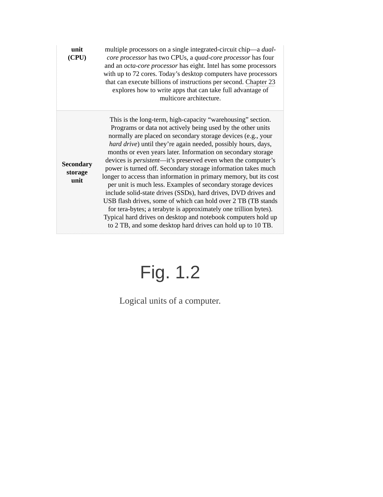

## 1.3 数据层次结构

计算机处理的数据项形成了一个数据层次结构，随着我们从简单的数据项（称为“位”）转向更丰富的数据项（如字符和字段），其结构变得越大、越复杂。图 1.3 展示了数据层次结构的一部分。

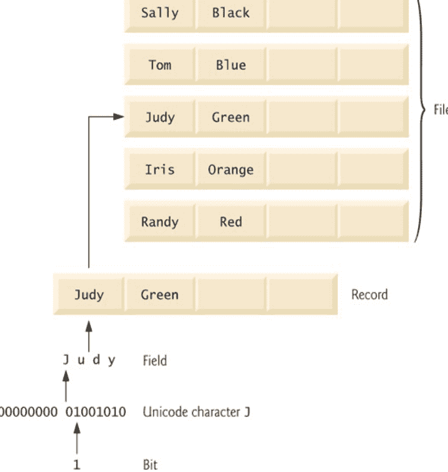

## 图 1.3 数据层次结构

### 位

计算机中最小的数据项可以取值 0 或值 1。它是一个位（binary digit 的缩写）——一个可以取两个值之一的数字。令人惊讶的是，计算机执行的惊人功能仅涉及对 0 和 1 最简单的操作——检查位的值和反转位的值（从 1 到 0 再到 1）。

### 字符

人们以位的低级形式处理数据是枯燥的。相反，他们更倾向于使用数字（0–9）、字母（A–Z 和 a–z）和特殊符号（例如 `$`、`@`、`%`、`&`、`*`、`(`、`)`、`+`、`:`、`?` 和 `/`）。数字、字母和特殊符号被称为字符。计算机的字符集是用于编写程序和表示数据项的所有字符的集合。计算机只处理 1 和 0，因此计算机的字符集将每个字符表示为 1 和 0 的模式。Java 使用 Unicode 字符，由一个、两个或四个字节（8、16 或 32 位）组成。Unicode 包含了世界上许多语言的字符。更多信息请参见附录 H。

### 字段

正如字符由位组成一样，字段由字节组成。字段是一组具有意义的字节。

### 记录

几个相关的字段可以组成一条记录。例如，在工资系统中，记录可能包括以下字段：

- 员工编号
- 姓名
- 地址
- 时薪率
- 年至今收入
- 扣缴金额

### 文件

文件是相关记录的组。注意：更广泛地说，文件包含任意数据。在某些操作系统中，文件被简单视为字节序列——字节的任何组织（例如将数据组织成记录）都是应用程序程序员创建的视图。一个组织拥有许多文件，某些文件包含数十亿甚至万亿个字符，这并不罕见。

### 数据库

数据库是为便于访问和操作而组织的数据集合。最流行的模型是关系型数据库，数据存储在简单的表中。表包含记录和字段。例如，学生表可能包括姓、名、专业、年、学生 ID 和平均学分。每个学生的数据是一条记录，每个记录中的各个信息单元是字段。你可以根据数据与多个表或数据库的关系进行搜索、排序和其他操作。例如，大学可能会将学生数据库与课程、校园住宿、餐饮计划等数据库结合使用。

### 大数据

全球产生的数据量巨大且增长迅速。根据 IBM 的数据，每天产生约 25 亿字节（2.5 艾字节），根据 Salesforce.com 的数据，截至 2015 年 10 月，世界 90% 的数据是在过去的 12 个月内产生的！根据 IDC 一项研究，全球数据供应到 2020 年将每年达到 40 泽字节（等于 40 万亿吉字节）。图 1.4 显示了一些字节测量。大数据应用程序处理海量数据，该领域正在快速发展，为软件开发人员创造了大量机会。全球范围内已有数百万 IT 工作在支持大数据应用程序。

| 单位 | 字节 | 大约等于 |
| --- | --- | --- |
| 1 千字节 (KB) | 1024 字节 | 准确等于 $2^{10}$ (1024) 字节 |
| 1 兆字节 (MB) | 1024 千字节 | $10^6$ (1,000,000) 字节 |
| 1 吉字节 (GB) | 1024 兆字节 | $10^9$ (1,000,000,000) 字节 |
| 1 太字节 (TB) | 1024 吉字节 | $10^{12}$ (1,000,000,000,000) 字节 |
| 1 拍字节 (PB) | 1024 太字节 | $10^{15}$ (1,000,000,000,000,000) 字节 |
| 1 艾字节 (EB) | 1024 拍字节 | $10^{18}$ (1,000,000,000,000,000,000) 字节 |
| 1 泽字节 (ZB) | 1024 艾字节 | $10^{21}$ (1,000,000,000,000,000,000,000) 字节 |

## 图 1.4 字节度量

## 1.4 机器语言、汇编语言和高级语言

程序员用各种编程语言编写指令，其中一些可以直接被计算机理解，而另一些则需要中间翻译步骤。今天有数百种这样的语言在使用。这些语言可以分为三大类型：

1. 机器语言
2. 汇编语言
3. 高级语言

### 机器语言

任何计算机只能直接理解其自身的机器语言，这种语言由其硬件设计定义。机器语言通常由数字字符串（最终还原为 1 和 0）组成，指示计算机逐个执行其最基础的操作。机器语言是取决于机器的（一种特定的机器语言只能用于一类型的计算机）。这些语言对人类来说是繁琐的。例如，这里有一个早期机器语言工资程序片段，它将加班费加到基本工资中，并将结果存储在总薪中：

```
+1300042774
+1400593419
+1200274027
```

### 汇编语言和汇编器

对于大多数程序员来说，用机器语言编程太慢且太枯燥了。程序员不再使用计算机可以直接理解的数字字符串，而是开始使用类英语的缩写来表示基本操作。这些缩写形成了汇编语言的基础。开发了称为汇编器的翻译程序，以便以计算机的速度将早期汇编语言程序转换为机器语言。以下汇编语言工资程序片段也将加班费加到基本工资中，并将结果存储在总薪中：

| load | basepay |
| --- | --- |
| add | overpay |
| store | grosspay |

虽然这种代码对人类来说更清晰，但在翻译成机器语言之前，计算机是无法理解的。

### 高级语言和编译器

随着汇编语言的出现，计算机的使用量迅速增加，但程序员即使完成最简单的任务也需要使用许多指令。为了加速编程过程，开发了高级语言，在语言中可以使用单条语句来完成重大任务。称为编译器的翻译程序将高级语言程序转换为机器语言。高级语言允许你编写看起来像日常英语并包含常用数学符号的指令。用高级语言编写的工资程序可能包含一条单一语句，例如：

```
grossPay = basePay + overTimePay
```

从程序员的角度来看，高级语言比机器语言和汇编语言更好。Java 是世界上应用广泛的高级编程语言。

### 解释器


将大型高级语言程序编译成机器语言可能需要大量的计算机时间。为了直接执行高级语言程序的解释器程序避免了编译延迟，尽管它们的运行速度比编译后的程序慢。我们将在**第 1.9 节**中更多地介绍解释器，你将了解到 Java 使用了一种巧妙的、经过优化的编译与解释混合来运行程序。

## 1.5 对象技术简介

今天，随着对新的、更强大的软件的需求激增，快速、正确且经济地构建软件仍然是一个难以实现的目标。对象，或者更准确地说产生对象的类，本质上是可重用的软件组件。日期对象、时间对象、音频对象、汽车对象、人员对象等。几乎任何名词都可以根据属性（例如名称、颜色和大小）和行为（例如计算、移动和通信）合理地表示为软件对象。软件开发小组可以使用模块化的、面向对象的设计实现方法，这比早期的流行技术（如“结构化编程”）高效得多——面向对象的程序通常更容易理解、纠正和修改。

### 1.5.1 作为对象的汽车

为了帮助你理解对象及其内容，让我们从一个简单的类比开始。假设你想开车并通过踩油门让它跑得更快。在执行操作之前可能会发生什么？（注：此处原文包含大量重复和损坏的 OCR 文本，已进行过滤）。

属性，例如其颜色、门的数量、油箱中的燃油量、当前速度以及行驶总里程数的记录（即里程表读数）。就像它的功能一样，汽车的属性被表示为其工程图设计的一部分（例如，这些图表包含了里程表和燃油表）。当你驾驶真实的汽车时，这些属性会随着汽车移动。每辆汽车都维护着自己的属性。例如，每辆汽车都知道自己的油箱里有多少油，但不知道其他汽车油箱里有多少油。

对象也拥有它在程序中使用时所携带的属性。这些属性被指定为对象类的一部分。例如，一个银行账户对象有一个余额（`balance`）属性，代表账户中的金额。每个银行账户对象都知道它所代表的账户的余额，但不知道银行中其他账户的余额。属性是通过类的实例变量来指定的。

## 1.5.7 封装与信息隐藏

类（及其对象）封装了（即包裹了）它们的属性和方法。类的（以及对象的）属性和方法是紧密相关的。对象之间可以相互通信，但它们通常不被允许知道其他是如何实现的——实现细节可以隐藏在对象内部。正如我们将看到的，这种信息隐藏对于良好的软件工程是至关重要的。

## 1.5.8 继承

可以通过继承方便地创建一种新的对象类——新类（称为子类）从现有类（称为父类）的特征开始，并可能进行自定义以及添加其独特的特征。在我们的汽车类比中，“敞篷”（convertible）类的对象无疑是更通用的“汽车”（automobile）类的对象，但更具体地说，它的顶可以升起或降低。

## 1.5.9 接口

Java 还支持接口——这是一组相关方法的集合，这些方法通常允许你告诉对象要做什么，而不是如何去做（在第 10 章讨论接口时，我们将在 Java SE 8 和 Java SE 9 中看到此规则的例外）。在汽车类比中，一个由方向盘、加速踏板和刹车踏板组成的“基本驾驶能力”接口可以让驾驶员告诉汽车要做什么。一旦你学会了如何使用这个接口进行转弯、加速和刹车，就可以驾驶许多类型的汽车，尽管制造商可能以不同的方式实现这些系统。

一个类实现（`implements`）零或多个接口，每个接口可以有一个或多个方法，就像汽车为基本驾驶功能、控制收音机、控制加热空调系统等实现了不同的接口一样。正如汽车制造商以不同的方式实现功能一样，类也可以以不同的方式实现接口的方法。例如，一个软件系统可能包含一个“备份”接口，它提供 `save`（保存）和 `restore`（恢复）方法。类可能会以不同的方式实现这些方法，取决于被备份的物品类型（如程序、文本、音频、视频等）以及存储这些项目的设备类型。

## 1.5.10 面向对象的分析与设计 (OOAD)

你很快就会用 Java 编写程序了。你将如何为你的程序创建代码（即程序指令）？也许，许多程序员你只需打开电脑并开始打字。这种方法对于小型程序（如我们在书开头章节介绍的程序）可能是有效的，但如果你被要求创建一个为大型银行控制成千上万台自动取款机的软件系统，该怎么办？或者假设你被要求加入一个由 1000 名软件开发人员组成的团队，构建下一代美国系统。对于如此复杂的项目，你不应该简单地坐下来开始打字。

为了创建出最佳解决方案，你应该遵循开源方法，在编写代码之前对系统进行详细分析。理想情况下，你应该通过开源方法来确定系统需求。

*(注：由于提供的原文后半部分存在大量内容重复，根据“不要重复输出原文”的原则，译文已对重复段落进行了去重处理。)*

Linux 发行版的多元性（例如 Red Hat Linux、Ubuntu Linux 等许多版本）阻止了它们在桌面计算机上的广泛使用。Linux 在服务器和嵌入式系统中变得极其流行，例如谷歌基于 Android 的智能手机。

## 1.6.3 Apple 的 macOS 和适用于 iPhone®、iPad® 和 iPod Touch® 设备的 iOS

Apple 由史蒂夫·乔斯（Steve Jobs）和史蒂夫·沃尼克（Steve Wozniak）于 1976 年创立，迅速成为个人计算领域的领导者。1979 年，几位 Apple 员工访问了施思 PARC（帕洛托研究中心），学习了具有图形用户界面（GUI）的施思桌面电脑。该 GUI 成为 Apple Macintosh 的灵感来源，并在 1984 年通过一次令人难忘的超级碗球广告隆重推出。

Objective-C 编程语言由布拉·科克斯（Brad Cox）和汤姆·洛夫（Tom Love）在 20 世纪 80 年代初 Stepstone 公司为 C 编程语言增加了面向对象编程（OOP）的能力。史蒂夫·乔斯于 1985 年离开 Apple 并创立了 NeXT Inc.。1988 年，NeXT 从 StepStone 授权了 Objective-C，并开发了 Objective-C 编译器和库，这些库被用作 NeXTSTEP 操作系统的用户界面以及构建图形用户界面的 Interface Builder 的平台。

乔斯在 1996 年 Apple 收 NeXT 后回到 Apple。Apple 的 macOS 操作系统是 NeXTSTEP 的后代。Apple 的专用操作系统 iOS 派自 Apple 的 macOS，用于 iPhone、iPad、iPod Touch、Apple Watch 和 Apple TV 设备。2014 年，Apple 推了新的 Swift 编程语言，并于 2015 年开源。iOS 应用开发社区正在从 Objective-C 转向 Swift。

## 1.6.4 谷歌的 Android

Android——增长最快的移动和智能手机操作系统——基于 Linux 内核和 Java。Android 应用也可以用 C++ 和 C 进行开发。开发 Android 应用的一个优点是该平台的开放性。该操作系统是开源且免费的。

Android 操作系统由 Android, Inc. 开发，该公司已于 2005 年被谷歌收购。2007 年，开放手机联盟（Open Handset Alliance™）

```
http://www.openhandsetalliance.com/oha_members.html
```

成立，旨在开发、维护和演进 Android，驱动移动技术创新并在降低成本的同时提升用户体验。根据 Statista.com 的数据，截至 2016 年第三季度，Android 占占全球智能手机 87.8% 的市场份额，而 Apple 为 11.5%。Android 操作系统用于许多智能手机、电子阅读器、平板电脑、店内的触摸屏自助机、汽车、机器人、多媒体播放器等。

7. https://www.statista.com/statistics/266136/global-market-share-held-by-smartphone-operating-systems

我们在教科书《Android 编程入门》（第三版）以及专业书籍《面向程序员的 Android 6：一种应用驱动的方法》（第三版）中向大家介绍了 Android 应用开发的介绍。在学习了 Java 之后，你会发现开发和运行 Android 应用非常简单。你可以将应用发布在 Google Play (play.google.com) 上，如果它们成功了，你甚至可以创立事业。只需记住——Facebook、微软和戴尔都是从大学宿舍起家的。

## 1.7 编程语言

图 1.6 提供了对几种流行编程语言的简要注释。在下一节中，我们将介绍 Java。

| 编程语言 | 描述 |
| --- | --- |
| Ada | Ada 基于 Pascal，是在 20 世纪 70 年代和 80 年代初在美国国防部（DOD）的赞助下开发的。美国国防部希望有一种能够满足其大部分需求的单一语言。这种基于 Pascal 的语言以诗人拜伦的女儿埃达·洛夫莱斯夫人（Lady Ada Lovelace）命名。她被认为在 19 世纪 80 年代初编写了世界上第一个计算机程序（用于查尔斯·巴贝奇设计的分析机机械设备）。Ada 也支持面向对象编程。 |
| Basic | Basic 是于 20 世纪 60 年代在达特茅学院开发的，让新手熟悉编程技术。它的许多最新版本都是面向对象的。 |
| C | C 是由丹尼斯·里奇（Dennis Ritchie）于 20 世纪 70 年代初在贝尔实验室开发的。它最初被广泛为人是 UNIX 操作系统的开发语言。今天，大多数通用操作系统的代码都是用 C 或 C++ 编写的。 |
| C++ | C++ 基于 C，是由比雅尼·斯特斯特鲁普（Bjarne Stroustrup）于 20 世纪 80 年代初在贝尔实验室开发的。C++ 提供了几项“增色”C 语言的特性，但更重要的是，它提供了面向对象编程的能力。 |
| C# | 微软的三种主要面向对象编程语言是 C#（基于 C++ 和 Java）、Visual C++（基于 C++）和 Visual Basic（基于原始 Basic）。C# 的开发是为了将网络集成到计算机应用程序中，现在广泛用于开发企业级应用和移动应用开发。 |
| COBOL | COBOL（COMon 面向业务的语言）于 20 世纪 50 年代末由计算机制造商、美国政府和工业计算机用户开发，基于格蕾丝·霍珀（Grace Hopper）开发的语言，她是一位职业美国海军军官和计算机科学家。（她于 2016 年 11 月被追授了总统自由勋章。）COBOL 仍广泛用于需要精确和高效处理大量数据的商业应用。其最新版本支持面向对象编程。 |
| Fortran | Fortran（公式翻译器）是 20 世纪 50 年代中期由 IBM 公司开发的，用于需要复杂计算的科学和工程应用。它仍然被广泛使用。 |
| JavaScript | JavaScript 是最广泛使用的脚本语言。所有主要的浏览器都支持它。 |
| Objective-C | Objective-C 是一种基于 C 的面向对象语言。它开发于 20 世纪 80 年代，随后被 NeXT 收购。它是 OS X 操作系统的关键语言，支持 iPad、iPhone 等设备。 |
| Pascal | 结构化编程是一种方法，使程序更清晰、更容易测试、调试和修改。 |
| PHP | PHP 是一种面向对象的开源脚本语言，受到开发者社区的支持并在许多网站中使用。PHP 是平台无关的——适用于所有主要的 UNIX、Linux 和 Windows 操作系统。 |
| Python | Python 是另一种面向对象的脚本语言，于 1991 年发布。由阿姆斯特丹国立数学计算机科学研究所的吉多·范罗姆（Guido van Rossum）开发，它借鉴了 Modula-3——一种系统语言。Python 是可扩展的——可以通过类进行扩展。 |
| Ruby on Rails | Ruby——于 20 世纪 90 年代中期由本裕弘（Yukihiro Matsumoto）创建——是一种开源面向对象编程语言，语法与 Python 类似。Ruby on Rails 将脚本语言 Ruby 与 37Signals 开发的 Rails 框架相结合。他们的书《Getting Real》（见 http://gettingreal.37signals.com/toc.php）是 Web 开发者的必读之。许多 Ruby on Rails 开发者报告在开发数据库密集型 Web 应用时比其他效率更高。 |
| Scala | Scala（http://www.scala-lang.org/what-is-scala.html）——简称“可扩展语言”，是由瑞士洛桑联邦理工学院（EPFL）的教授马丁·奥基（Martin Oky）设计的。Scala 于 2003 年发布，结合了面向对象和函数式编程范式，旨在与 Java 集成。使用 Scala 编程可以减少应用程序中的代码量。 |
| Swift | Swift 于 2014 年推出，是 Apple 未来开发 iOS 和 OS X 应用的编程语言。Swift 采用了来自 Objective-C、Java、C#、Ruby、Python 等语言的现代语言特性。根据 Tiobe Index，Swift 已经成为最流行的编程语言之一。Swift 现在是开源的，因此可以在非 Apple 平台上使用。 |

# 图 1.5

其他一些编程语言。

## 1.8 Java

微处理器革命到今为止最重要的贡献是它推动了个人电脑的发展。微处理器对智能消费电子设备也产生了深远影响，包括近期“物联网”的爆发式增长。太阳微系统（Sun Microsystems）在 1991 年就意识到了这一点，资助了一个由 James Gosling 领导的内部公司项目，该项目最终开发出了一种基于 C++ 的面向对象的编程语言，太阳将其命名为 Java。使用 Java，你可以编写可以在各种计算机系统和计算机控制设备上运行的程序。这被称为“一次编写，随运行”。

由于对互联网的现象级兴趣，Java 吸引了商业界的关注。现在，它被用于开发大型企业级应用、增强 Web 服务器（提供我们在网页浏览器中看到的内容的计算机）的功能、为消费设备（手机、智能手机、电视顶顶盒等）提供应用程序、开发机器人软件以及许多其他用途。它还是开发 Android 智能手机和平板电脑应用的关键语言。太阳微系统于 2010 年被甲骨文（Oracle）收购。

Java 已成为使用最广泛的通用编程语言，拥有超过 1000 万名开发者。

在本书中，你将学习 Java 的两个最新版本——Java 标准版 8 (Java SE 8) 和 Java 标准版 9 (Java SE 9)。

## Java 类库

你可以创建构建程序所需的每个类和方法。然而，大多数 Java 程序员都利用了 Java 类库中丰富的现有类和方法集合，也称为 Java API（应用程序编程接口）。


## 性能提示 1.1

使用 Java API 类和方法而不是编写自己的版本可以提高程序性能，因为它们经过精心编写以实现高效运行。这还缩短了程序的开发时间。

## 1.9 典型的 Java 开发环境

现在我们解释创建和执行 Java 应用程序的步骤。通常有五个阶段——编辑、编译、加载、验证和执行。我们在 Java SE 8 开发工具包（JDK）的背景下讨论这些阶段。请参考*开始之前*章节获取有关在 Windows、Linux 和 macOS 上下载和安装 JDK 的信息。

## 阶段 1：创建程序

阶段 1 包括使用编辑器程序编辑文件，该程序通常简单称为编辑器（图 1.6）。使用编辑器，你输入一个 Java 程序（通常称为**源码**），进行任何必要的修正并将其保存到次级存储设备上（如你的硬盘）。Java 源代码文件以 **java 扩展名** 结尾，表示该文件包含 Java 源代码。

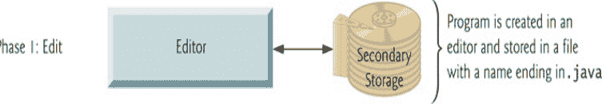

## 图 1.6

典型的 Java 开发环境——编辑阶段。

Linux 系统上广泛使用的两个编辑器是 vi 和 emacs ()。Windows 提供记事本（Notepad）。macOS 提供文本编辑（TextEdit）。网上还有许多免费软件和共享型编辑器可可用，包括 Notepad++ (http://notepad-plus-plus.org)、EditPlus (http://www.editplus.com)、TextPad (http://www.textpad.com)、jEdit (http://www.jedit.org) 等。

集成开发环境（IDE）提供了支持软件开发过程的工具，例如编辑器、用于定位导致程序执行错误的逻辑错误的调试器，而最流行的 Java IDE 有：

- Eclipse (http://www.eclipse.org)
- IntelliJ IDEA (http://www.jetbrainsbrains.com)
- NetBeans (http://www.netbeans.org)

在书的网站上：

http://www.deitel.com/books/jhtpi1

我们提供了视频向你演示如何执行本书中的 Java 应用程序，以及如何使用 Eclipse、NetBeans 和 IntelliJ IDEA 开发新的 Java 应用程序。

## 阶段 2：将 Java 程序编译为字节码

在阶段 2 中，你使用命令 `javac`（Java 编译器）来编译程序（图 1.7）。例如，要编译一个名为 `Welcome.java` 的程序，你需要在系统的命令行窗口中（即 Windows 中的**命令提示符**，macOS 中的**终端**应用程序）或 Linux 终端（在某些 Linux 版本中也称为**终端**）中输入：

```
javac Welcome.java
```

如果程序编译成功，编译器会生成一个 .class 文件 `Welcome.class`。IDE 通常提供菜单项，如 **Build**（构建）或 **Make**（制作），它可以为你调用 `javac` 命令。如果编译器检测到错误，你需要返回阶段 1 并修正它们。在[第 2 章]中，我们将介绍更多关于编译器可以检测的错误类型。


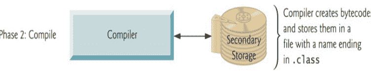

## 图 1.7

典型的 Java 开发环境——编译阶段。

## 常见编程错误 1.1

使用 `javac` 时，如果收到类似“不是命令或 'javac' 不是内部或外部命令”的消息，说明你的 `PATH` 变量未设置。请仔细检查此书中“开始之前”章节中的安装情况。Java 虚拟机（JVM）——JDK 的一部分执行字节码。Java 虚拟机（JVM）是一个模拟计算机的软件应用程序，它向程序隐藏了底层的操作系统和硬件。与依赖平台（即取决于特定硬件）的机器指令不同，字节码指令与平台无关的。因此，Java 的字节码是移植的——无需重新编译源码，相同的字节码可以在任何包含 JVM 的平台上执行。JVM 是最广泛使用的平台之一。微软的 .NET 使用了类似的架构。

## 阶段 3：将程序加载到内存

在阶段 3 中，JVM 将程序放入内存中——这被称为加载（图 1.8）。JVM 的类加载器获取包含字节码的 `.class` 文件并将其传输到主内存。它还会加载你的程序使用的 Java 提供的任何 `.class` 文件。`.class` 文件可以从系统的磁盘或通过网络（例如，你的本地公司网络或互联网）加载。

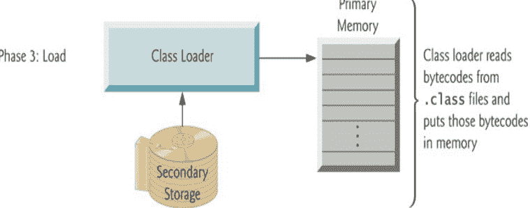

## 图 1.8

典型的 Java 开发环境——加载阶段。

## 阶段 4：字节码验证

在阶段 4 中，随着类的加载，字节码验证器会检查它们的字节码以确保它们是有效的且没有违反 Java 的安全限制（图 1.9）。Java 实施强安全机制，以确保通过网络到达的 Java 程序不会损坏你的文件或系统。

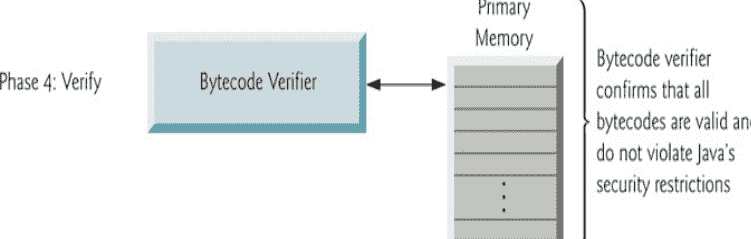

## 图 1.9

典型的 Java 开发环境——验证阶段。

## 阶段 5：执行

在阶段 5 中，JVM 执行字节码以执行程序指定的动作（图 1.10）。在早期的 Java 版本中，JVM 仅仅是一个 Java 字节码解释器。大多数程序的运行速度缓慢，因为 JVM 会一次解释并执行一个字节码。某些现代计算机架构可以并行执行多条指令。今天的 JVM 通常使用解释和即时编译相结合的方法来执行字节码。在此过程中，JVM 在解释字节码时对其进行分析，寻找`热点`——即频繁执行的字节码。对于这些部分，**即时（JIT) 编译器**（例如 Oracle 的 **Java HotSpot™ 编译器**）会将字节码翻译成计算机的机器语言。当 JVM 再次遇到这些编译过的部分时，就会执行更快的机器语言代码。

实际上通过两个编译阶段——第一个阶段是将 Java 代码翻译为字节码（为了在不同计算机平台上的 JVM 之间的可移植性），第二个阶段是在执行期间，将字节码翻译为执行该程序的计算机的机器语言。

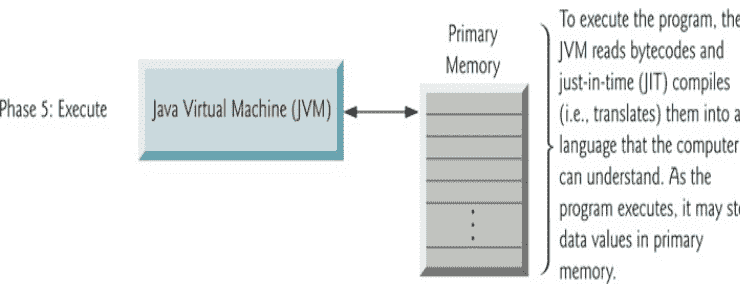

## 图 1.10

典型的 Java 开发环境——执行阶段。

描述

## 执行时可能出现的问题

程序在第一次尝试运行时可能无法正常工作。之前的每个阶段都可能因为我们在整本书中讨论的各种错误而失败。例如，一个正在运行的程序可能会尝试除以零（这在 Java 的整数算术中是一种非法操作）。这会导致 Java 程序显示错误消息。如果发生这种情况，你将返回编辑阶段，进行必要的修正，并重新通过剩余的阶段，以确定修正是否修复了问题。[注：Java 中的绝大多数程序都会输入或输出数据。当我们说一个程序显示消息时，我们通常是指它在你的计算机屏幕上显示了该消息。


## 常见编程错误 1.2

像除以零之类的错误是在程序运行时发生的，因此它们被称为运行时错误或执行时错误。致命的运行时错误会导致程序立即终止，而无法成功完成任务。非致命性运行时错误允许程序运行完成，但通常会产生错误的结果。

## 1.10 测试 Java 应用程序

在本节中，你将运行并与现有的 Painter 程序进行交互，该程序将在稍后的章节中构建。你将看到的元素和功能是你在书中将学习编程的典型内容。使用 Painter 的图形用户界面 (GUI)，你可以选择绘制颜色和笔画大小，然后拖动鼠标以指定的颜色和大小画圆圈。你还可以撤销每次绘制操作或清除整个绘图。[注：我们使用无衬线字体来强调窗口标题和菜单（例如 File 菜单）等屏幕特征，并使用等宽无衬线字体强调文件名和程序代码（例如 `ProgramName.java`）等非屏幕元素。]

本节中的步骤将向你展示如何从系统上的命令提示符（Windows）、shell（Linux）或终端（macOS）窗口运行 Painter 程序。在整书中，我们将这些窗口简称为命令窗口。我们假设书中的示例位于 Windows 的 `C:\examples`，或 Linux/macOS 上用户账户的 `Documents/examples` 文件夹中。

### 检查你的设置

阅读序言后的“开始之前”部分，以便在你的计算机上设置 Java，并确保你已将书中的示例下载到硬盘中。

### 切换到已完成应用程序的目录

打开命令窗口并使用 `cd` 命令切换到 Painter 程序的目录（也称为文件夹）：

- 在 Windows 上输入 `cd C:\examples\ch01\Painter`，然后按回车。
- 在 Linux/macOS 上，输入 `cd ~/Documents/examples/ch01/Painter`，然后按回车。

### 编译应用程序

在命令窗口中，输入以下命令并按回车编译 Painter 示例的所有文件：

```
javac *.java
```

`*` 表示所有以 `.java` 结尾的文件都应该被编译。

### 运行 Painter 应用程序

回想第 1.9 节，`java` 命令后跟应用程序的 `.class` 文件名（在本例中为 Painter）即可执行应用程序。输入命令 `java Painter` 然后按回车执行该程序。图 1.11 显示了分别在 Windows、Linux 和 macOS 上运行的 Painter。该程序在所有操作系统上的功能相同，因此本节的剩余步骤仅显示 Windows 截图。`java` 命令是对大小敏感的——即大写字母和小写字母不同。输入大写的 P 是重要的。否则应用程序将无法执行。此外，如果你收到错误消息“Exception in thread "main" java.lang.NoClassFoundError: Painter，”说明你的系统存在 `CLASSPATH` 问题。请参考开始之前部分。

#### a) 在 Windows 上运行 Painter

- 点击 **Black, Red** 单选按钮选择颜色
- 点击 **Small, Medium** 单选按钮选择笔画大小
- 撤销上一次操作
- 清除绘图

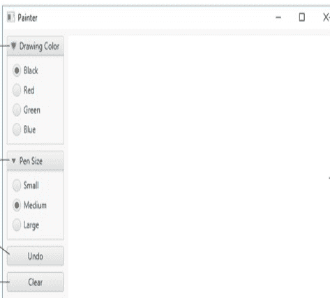

- 关闭按钮

#### b) 在 Linux 上运行 Painter

- 关闭按钮

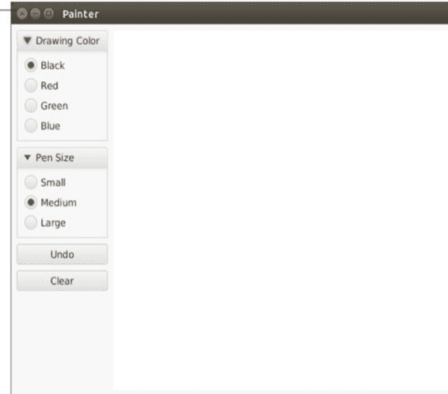

#### c) 在 macOS 上运行 Painter

- 关闭按钮


## 图 1.11

在 Windows、Linux 和 macOS 上执行 **Painter** 应用程序。

描述

### 绘制花瓣

在本节的剩余步骤中，你将画一朵带有绿色茎和蓝色雨的红色花。我们将从中等大小的花瓣开始。点击 **Red** 单选按钮将颜色改为红色。接下来，在绘图区域内移动鼠标画花瓣（图 1.12）。如果你不喜欢画的一部分，可以反复点击 **Undo** 按钮删除最近的圆圈，或者点击 **Clear** 按钮重新开始。

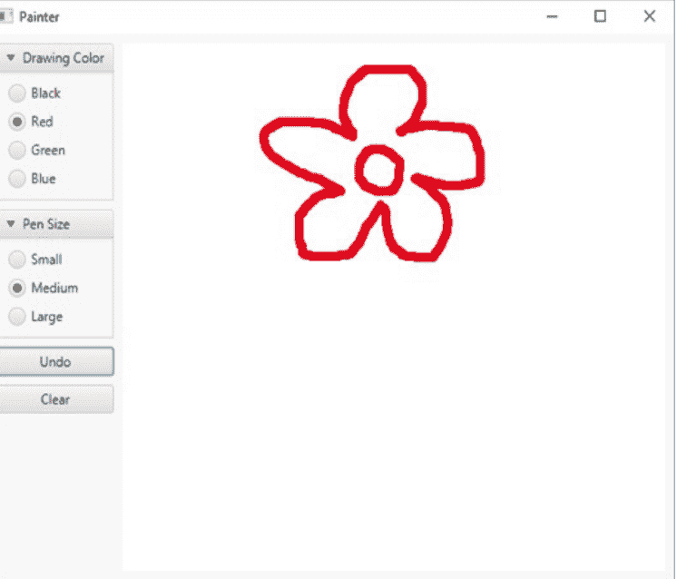

图 1.12 绘制花瓣。

### 绘制茎、叶和草

点击 **Green** 和 **Large** 单选按钮将颜色改为绿色，笔画大小改为大。然后，如图 1.13 所示画茎和叶。接下来，点击 **Medium** 单选按钮将笔画大小改为中等，然后如图 1.13 所示画草。

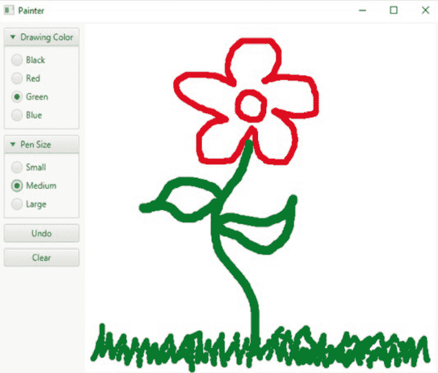

图 1.13 绘制茎和草。

### 绘制雨

点击 **Blue** 和 **Small** 单选按钮将颜色改为蓝色，笔画大小改为小。然后如图 1.14 所示画一些雨。

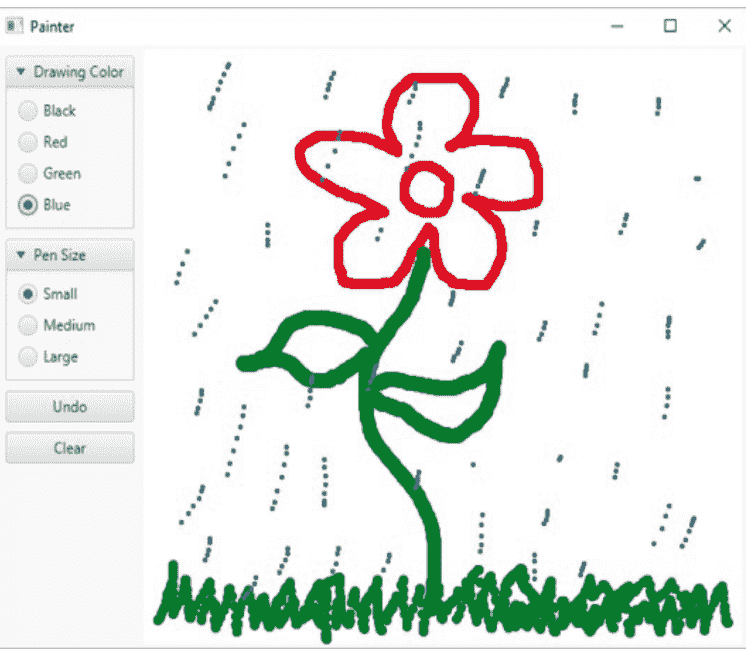

图 1.14 绘制雨。

### 退出 Painter 应用程序

此时，你可以关闭 **Painter** 应用程序。只需点击应用程序的关闭框即可（图 1.11 显示了 Windows、Linux 和 macOS 版）。

## 1.11 互联网和万维网

在 20 世纪 60 年代后期，ARPA（美国国防部高级计划署）制定了连接十几个大学和研究机构的主计算机系统的计划。这些计算机将通过速度为每秒 50,000 比特的通信线路连接，对于当时大多数人（少数拥有网络访问权限的人）通过电话线以每秒 10 比特的速度连接计算机，学术研究即将迎来巨大飞跃。ARPA 继续实施了迅速成为 ARPANET 的技术，它是今天**互联网**的前身。现在的互联网速度达到每秒数十亿比特，每秒万比特的速度指在可及！

情况与原始计划不同。尽管 ARPANET 使研究人员能够将计算机联网，但其主要优势被证明是通过电子邮件（e-mail）进行快速方便通信的能力。在当今的互联网上也是如此，电子邮件、即时消息、文件传输以及 Facebook 和 Twitter 等社交媒体让全球数十亿的人能够快速方便地通信。

在 ARPANET 上通信的协议（规则集）被称为传输控制协议 (TCP)。TCP 确保了由顺序编号的数据包（packet）组成的消息能正确地从发送者路由到接收者，完整到达并按正确顺序组装。

### 1.11.1 互联网：网络的网络

在互联网早期演变的同时，全球各机构都在实现自己的网络，用于组织内（即组织内部）和组织间（即组织之间）的通信。出现了大量的网络硬件和软件。一个挑战是让这些不同的网络能够相互通信。ARPA 通过开发互联网协议 (IP) 实现了这一点，创建了真正的“网络的网络”，即互联网目前的架构。组合协议集现在称为 TCP/IP。每个连接互联网的设备都有一个 IP 地址——这是通过 TCP/IP 通信的设备在互联网上定位彼此的唯一标识符。

企业迅速意识到，通过使用互联网，他们可以改进运营并为客户提供新、更好的服务。

存在。这导致了电信运营商以及硬件和软件供应商之间的激烈竞争，以满足日益增长的基础设施需求。结果是，互联网带宽——通信线路的信息承载能力——大幅增加，而硬件成本却大幅下降。

### 1.11.2 全球维网：让互联网更易于使用

全球维网（简称为“网页”）是与互联网相关的硬件和软件集合，它允许计算机用户定位并查看关于几乎任何主题的文档（包含文本、图形、音频和视频的各种组合）。1989年，欧洲核子研究组织（CERN）的蒂·伯纳斯-李（Tim Berners-Lee）开始开发超文本标记语言（HTML）——这是一种通过“超链接”文本文档共享信息的技术。他还编写了超文本传输协议（HTTP），作为他新的超文本信息系统的骨干，他将其称为全球维网。

1994年，伯纳斯-李创立了万维网联盟（W3C, http://www.w3.org），致力于开发网络技术。W3C 的主要目标之一是让每个人无论是否有残障、语言或文化，都能普遍访问网页。

### 1.11.3 Web 服务与杂合（Mashups）

在在线第 32 章中，我们实现了 Web 服务（图 1.15）。杂合的应用开发方法论允许你通过结合（通常是免费的）互补 Web 服务和其他形式的信息馈送，快速开发出强大的软件应用程序。最早的杂合之一是将 http://www.craiglist.org 提供的房地产列表与 Google Maps 的制图功能相结合，提供显示给定区域内出售或出租房屋位置的地图。ProgrammableWeb (http://www.programmableweb.com/) 提供了一个包含超过 16,500 个 API 和 6,300 个杂合的目录。他们的“API 大学”（https://www.programmableweb.com/api-university）包含了处理 API 和创建你自己的杂合的指南和示例代码。根据他们的网站，一些最广泛使用的 API 包括 Facebook、Google Maps、Twitter 和 YouTube。

| Web 服务来源 | 使用方式 |
| :--- | :--- |
| Google Maps | 地图绘制服务 |
| Twitter | 微博客 |
| YouTube | 视频搜索 |
| Facebook | 社交网络 |
| Instagram | 照片共享 |
| Foursquare | 移动签到 |
| LinkedIn | 商务社交网络 |
| Groupon | 社交商业 |
| Netflix | 电影租赁 |
| eBay | 互联网拍卖 |
| Wikipedia | 协作百科全书 |
| PayPal | 支付 |
| Last.fm | 互联网电台 |
| Amazon 电子商务 | 购买书籍及许多其他产品 |
| Salesforce.com | 客户关系管理 (CRM) |
| Skype | 互联网电话 |
| Microsoft Bing | 搜索 |
| Flickr | 照片共享 |
| Zillow | 房地产定价 |
| Yahoo Search | 搜索 |
| WeatherBug | 天气 |

## 图 1.15

一些流行的 Web 服务（https://www.programmableweb.com/category/all/apis）。

### 1.11.4 物联网

互联网不再仅仅是计算机网络——它是物联网（IoT）。“物”是指任何具有 IP 地址并能够在互联网上自动发送数据的对象。此类物品包括：

- 带有用于支付过路费感应器的汽车
- 车库停车位可用性的监控器
- 植入人体的心率监测器
- 饮用水质的监控器
- 报告能源消耗的智能电表
- 辐射探测器
- 仓库中的物品跟踪器
- 能够跟踪你的移动和位置的移动应用
- 根据预报和家中活动调整房间温度的智能恒温器
- 智能家用电器
- 以及更多。

根据 statista.com 的数据，目前已有超过 220 亿个物联网设备在使用，预计未来将超过 500 亿个物联网设备。

> 2020 年全球已有超过 220 亿个物联网设备在使用（statista.com/statistics/number-of-devices）。

## 1.12 敏捷开发

在软件开发中，敏捷开发是许多常见的术语。请查看敏捷联盟（agile.org）和敏捷宣言（agilemanifesto.org）。

| 技术 | 描述 |
| :--- | :--- |
| 敏捷开发 | 敏捷开发是一套在软件开发中使用更小、更快速的方法。 |
| 重构 | 重构涉及对程序进行修改，使其更清晰、更易维护。 |
| 设计模式 | 设计模式是构建软件的架构（设计模式）。 |
| LAMP | LAMP 是 Linux、Apache、MySQL 和 PHP 的缩写。 |

软件是复杂的。现实世界的软件应用程序可能需要几个月甚至几年时间来设计。当大型软件产品处于开发阶段时，通常向用户社区发布一系列版本，每个版本都比上一个更完整、更完善（图 1.15）。

软件产品发布术语。

## 1.13 解决你的疑问

有很多在线论坛可以让你获得关于 Java 问题的解答，并与其他 Java 程序员进行互动。一些流行的 Java 和通用编程论坛包括：

- StackOverflow.com
- Coderanch.com
- Oracle Java 论坛 -- https://community.oracle.com/community/java
- dream.in.code -- http://www.dreamincode.net/forums/forum/32-java/

## 自测练习题

### 1.1 为下列每个陈述填空：

- 计算机在一组被称为 ____ 的指令的控制下处理数据。
- 计算机的关键逻辑单元是 ____、____ 和 ____。
- 本章讨论的三类语言是 ____ 和 ____。
- 将高级语言程序翻译成机器语言的程序称为 ____。
- ____ 是一种基于 Linux 内核和 Java 的移动设备操作系统。
- 软件通常是功能完备的（据推）无错误的且供社区使用的。


- Wii 遥控器以及许多智能手机都使用`(n)____`，允许设备对动作做出响应。

## 1.2 为下列关于 Java 环境的每个句子填空：

- 来自 JDK 的 `____` 命令执行 Java 程序。
- 来自 JDK 的 `____` 命令编译 Java 程序。
- Java 源代码文件必须以文件扩展名 `____` 结尾。
- 当 Java 程序被编译时，编译器产生的文件以文件扩展名 `____` 结尾。
- Java 编译器产生的文件包含 `____`，由 Java 虚拟机执行。

## 1.3 为下列每个陈述填空（基于第 1.5 节）：

- 对象实现了 `____` 的设计实践——尽管对象之间可能知道如何通过定义良好的接口相互通信，但它们通常不允许知道其他对象是如何实现的。
- Java 程序员专注于创建 `____`，这些类包含字段以及一组操纵这些字段并为客户端提供服务的方法。
- 从面向对象的角度分析和设计系统的过程被称为 `____`。
- 可以通过 `____` 方便地创建新类对象——新类（称为子类）从现有类（称为父类）的特征开始，可能对其进行自定义并添加其特有的特征。
- `____` 是一种图形化语言，允许设计软件系统的人使用行业标准表示法来表示它们。
- 对象的尺寸、形状、颜色和重量被认为是对象类类的 `____`。

# 练习题

## 1.4 为下列每个陈述填空：

- 接收来自计算机外部的信息并供计算机使用的逻辑单元是 `____`。
- 指令计算机解决问题的过程被称为 `____`。
- `____` 是一种计算机语言，它使用类似英语的缩写作为机器指令。
- `____` 是一个将计算机处理过的信息发送到各种设备的逻辑单元，以便在计算机外部使用。
- `____` 是保留信息的计算机逻辑单元。
- `____` 是执行计算的计算机逻辑单元。
- `____` 是做出逻辑决策的计算机逻辑单元。
- `____` 语言对程序员来说最便于快速、容易地编写程序。
- 计算机能够直接理解的唯一语言是该计算机的 `____`。
- `____` 是协调所有其他逻辑单元活动的计算机逻辑单元。

## 1.5 为下列每个陈述填空：

- 这种编程语言现在被用于开发大型企业级应用、增强 Web 服务器功能、为消费设备提供应用程序以及许多其他用途。
- `____` 最初被广为人知的 UNIX 操作系统的开发语言。
- `____` 确保由按顺序编号的片段（称为字节）组成的消息被正确地从发送者路由、完整到达并按正确顺序组装。
- 该编程语言由 Bjarne Stroustrup 在 20 世纪 80 年代初在贝尔实验室开发。

## 1.6 为下列每个陈述填空：

- Java 程序通常经过五个阶段——`____`、`____` 和 `____`。
- A(n) 提供了许多支持软件开发过程的工具，例如用于编写和编辑程序的编辑器、用于定位程序中逻辑错误的调试器以及许多其他功能。
- `java` 命令调用 `____` 来执行 Java 程序。
- A(n) 是一种模拟计算机的软件应用程序，但为与其交互的程序隐藏了底层操作系统和硬件。
- `____` 获取包含程序字节码的 `.CLASS` 文件并将其传输到内存。
- `____` 检查字节码以确保其有效性。

## 1.7 解释 Java 程序的两个编译阶段。

## 1.8 世界上最常见的对象之一是手表。讨论以下术语和概念如何适用于“手表”的概念：对象、属性、行为、类、继承（例如考虑闹钟）、建模、消息、封装、接口和信息隐藏。

# 改变世界

“改变世界”将要求你关注对个人具有意义的问题。

## 1.9（测试驱动：碳足迹计算器）

一些科学家认为，化石燃料燃烧产生的排放会导致全球变暖，但如果个人和国家采取措施，就可以缓解。许多组织如 TerraPass `https://www.terrapass.com/carbon-footprint-calculator` 和 Carbon Footprint `https://www.carbonfootprint.com/aspx` 提供了碳足迹计算器。研究这些计算器。

## 1.10（测试驱动：体重指数计算器）

根据最近估计，美国三分之二的人体重超标。这导致糖尿病和心脏病等疾病的显著增加。为了判断一个人是否肥胖，可以使用体重指数（BMI）。美国健康与人类服务部在 `https://www.nlbi.nih.gov/guidelines/obesity/BMI/bmcalc.htm` 提供了计算器。

## 1.11

混合动力汽车越来越受欢迎，因为它们通常比纯汽油汽车更省油。浏览网页并研究今天几种流行汽车的特征，然后列出尽可能多的混合相关属性。例如，常见的属性包括城市路里程和高速公路路里程等。

## 1.12（性别中立）

一些人想要消除所有形式的性别歧视。你被要求创建一个程序处理文本并将性别特定词替换为性别中立词。假设你获得了一份性别特定词及其性别中立替换列表（例如，将“妻子”替换为“配偶”，将“男人”替换为“人”，将“女儿”替换为“孩子”等），解释你遍历文本并手动执行这些替换的方法。你的程序可能会生成“wordchild”这样的奇怪词？在第 4 章中，你将学习“过程”更正式的术语是“算法”，算法规定了要执行的步骤以及执行它们的顺序。

## 1.13（智能助手）

人工智能领域的发展在近年来一直在加速。许多公司提供计算机智能助手，如 IBM 的 Watson、Alexa、Apple 的 Siri、Google 的 Google Now 和微软的 Cortana。研究这些以及其他可以改善生活的助手。

## 1.14（大数据）

研究快速发展的大数据领域。列出在医疗保健和科学研究领域具有巨大前景的应用。

# 2 Java 应用程序简介；输入/输出与运算符

## 目标

在本章中，你将：

- 编写简单的 Java 应用程序。
- 使用输入和输出语句。
- 学习 Java 的基本类型。
- 理解基础内存概念。
- 使用算术运算符。
- 学习算术运算符的优先级。
- 使用决策语句。
- 使用关系运算符和相等运算符。

## 大纲

- 2.1 简介
- 2.2 你的第一个 Java 程序：打印一行文本
    - 2.2.1 编译应用程序
    - 2.2.2 运行应用程序
- 2.3 修改你的第一个 Java 程序
- 2.4 使用 printf 显示文本
- 2.5 另一个应用程序：整数相加
    - 2.5.1 `import` 导入声明
    - 2.5.2 声明并创建 `Scanner` 以从键盘获取用户输入
    - 2.5.3 提示用户输入
    - 2.5.4 声明变量存储整数并从键盘获取整数
    - 2.5.5 获取第二个整数
    - 2.5.6 在计算中使用变量
    - 2.5.7 显示计算结果
    - 2.5.8 Java API 文档
    - 2.5.9 在单独语句中声明和初始化变量
- 2.6 内存概念
- 2.7 算术
- 2.8 决策：相等和关系运算符
- 2.9 总结
    - 1. 总结
    - 2. 自测练习题
    - 3. 自测练习题答案
    - 4. 练习题
    - 5. 改变

## 2.1 简介

本章介绍 Java 编程。我们从在屏幕上显示（输出）消息的程序示例开始。然后，我们展示一个从用户处获取（输入）两个数字、计算它们的和并显示结果的程序。你将学习如何指示计算机执行算术计算并保存结果以备后用。最后一个示例演示了如何做出决策。该应用程序比较两个数字，然后显示比较结果的消息。你将使用 JDK 命令行工具来编译和运行本章的程序。如果你倾向于使用集成开发环境（IDE），我们还为三个最流行的 Java IDE——Eclipse、NetBeans 和 IntelliJ IDEA 发布了入门视频，地址如下：

```
http://www.deitel.com/books/jhtp11
```

## 2.2 你的第一个 Java 程序：打印一行文本

Java 应用程序是在使用 `java` 命令启动 Java 虚拟机 (JVM) 时执行的计算机程序。第 2.2.1–2.2.2 节讨论了如何编译和运行 Java 应用程序。首先我们考虑一个显示一行文本的简单应用程序。图 2.1 显示了程序，随后是一个显示其输出的框。

```
1 // Fig. 2.1: Welcome1.java
2 // Text-printing program.
3
4 public class Welcome1 {
5 // main method begins execution of Java application
6 public static void main(String[] args) {
7 System.out.println("Welcome to Java Program")
8 } // end method main
9 } // end class Welcome1
```

欢迎来到 Java 编程！

**图 2.1** 文本打印程序。

我们使用行号是为了教学目的——它们不是 Java 程序的一部分。这个示例说明了几个重要的 Java 特性。我们将看到第 7 行执行了工作——在屏幕上显示“Welcome to Java Programming!”短语。

### 为程序编写注释

我们插入注释来记录程序并提高其可读性。Java 编译器会忽略注释，因此在程序运行时它们不会导致计算机执行任何操作。

### 良好的编程实践 2.1

每个程序都应该以注释开始，说明程序的目的、作者、日期和时间。（我们不在书中的每个程序都遵循此惯例，因为这会占用大量空间。）

### 单行注释

以 `//` 开始的注释称为**单行注释**，它在该行结束时终止。

### 传统注释

以 `/*` 开始、以 `*/` 结束的注释称为**传统注释**或**多行注释**，可以跨越多行。

### Javadoc 注释

以 `/**` 开始、以 `*/` 结束的注释称为 **Javadoc 注释**，它允许使用 `javadoc` 程序生成程序文档。

### 类声明

第 4 行

```java
public class Welcome1 {
```

开始类声明，关键字 `class` 后面跟着类名 `Welcome1`。每个 Java 程序至少有一个用户定义的类。关键字 `public` 是一个访问修饰符。类名 `Welcome1` 是一个标识符。按照惯例，类名首字母大写，且每个后续单词的首字母大写（例如 `Welcome1`）。类体由左大括号 `{`（第 4 行末尾）和右大括号 `}`（第 9 行）界定。

### 良好的编程实践 2.2

按照惯例，类名首字母大写，且每个后续单词的首字母大写（例如 `Welcome1`）。

### 良好的编程实践 2.3

将左大括号 `{` 放在类声明的同一行末尾，将右大括号 `}` 单独放在一行，并与类声明的 `class` 关键字对齐。

### main 方法

第 5 行

```java
// main method begins execution of Java application
```

是一条注释，指示程序第 6–8 行的用途。第 6 行

```java
public static void main(String[] args) {
```

是每个 Java 程序的起始点。标识符 `main` 后的括号表示它是名为**方法**（method）的程序构建块。Java 类声明通常包含一个或多个方法。对于 Java 应用程序，其中一个方法**必须**命名为 `main`，且必须像第 6 行那样定义；否则程序将无法执行。方法体由左大括号 `{`（第 6 行末尾）和右大括号 `}`（第 8 行）界定。

### 良好的编程实践 2.4

在界定类声明的大括号之间，将每个类声明的整体缩进一个“级”。这种格式强调了类声明的结构，使其更易于阅读。我们使用三个空格形成一个缩进级——许多程序员更倾向于使用两个或四个空格。无论你选择哪种，请始终保持一致。

### 良好的编程实践 2.5

IDE 通常会为你完成代码缩进。Tab 键也可以用于缩进代码。你可以配置每个 IDE 以指定按下 Tab 键时插入的空格数。

### 常见编程错误 2.3

如果大括号没有成对出现，则是一处语法错误。

### 错误预防提示 2.1

当你输入左大括号 `{` 时，立即输入右大括号 `}`，然后将光标重新置到大括号之间并缩进，以开始输入主体。这种做法可以防止因缺少大括号导致的错误。许多 IDE 都会为你完成这一操作。

### 显示文本

第 7 行

```java
System.out.println("Welcome to Java Program")
```

指示计算机执行操作——在屏幕上打印字符串。`System.out` 称为**标准输出对象**，它允许 Java 应用程序在屏幕上显示信息。方法 `println` 显示一行文本。圆括号内的字符串 `"Welcome to Java Program"` 是传递给方法的参数。整行称为**语句**，以分号 `;` 结尾。

### 常见编程错误 2.4

省略语句末尾的分号 `;` 是一处语法错误。

### 编译和运行程序

要编译程序，请在命令提示符下输入 `javac Welcome1.java`。如果程序没有语法错误，此命令将创建一个名为 `Welcome1.class` 的文件，其中包含编译后的字节码。要运行程序，请输入 `java Welcome1`。这将启动 JVM，它会调用 `main` 方法执行程序。

### 修改你的第一个 Java 程序

图 2.2 显示了修改后的程序，它使用 `System.out.print` 和 `System.out.println` 显示两行文本。

```
1 // Fig. 2.2: Welcome2.java
2 // Text-printing program with two statements.
3
4 public class Welcome2 {
5 public static void main(String[] args) {
6 System.out.print("Welcome to ")
7 System.out.println("Java Programming!")
8 }
9 }
```

欢迎来到 Java Programming!

**图 2.2** 使用两条语句打印文本。

`System.out.print` 显示其参数但不换行，`System.out.println` 显示其参数并换行。

### 使用 printf 显示文本

`System.out.printf` 方法提供格式化输出功能。格式字符串包含固定文本和格式说明符（如 `%d`、`%f`、`%s`、`%n`）。

```
1 // Fig. 2.3: Welcome3.java
2 // Displaying formatted output with printf.
3
4 public class Welcome3 {
5 public static void main(String[] args) {
6 System.out.printf("%s %s%n", "Welcome to", "Java Programming!");
7 }
8 }
```

欢迎来到 Java Programming!

**图 2.3** 使用 printf 显示格式化文本。

### 另一个应用程序：整数相加

图 2.4 读取用户输入的两个整数并显示它们的和。

```
1 // Fig. 2.4: Addition.java
2 // Addition program that displays the sum of two integers.
3 import java.util.Scanner; // program uses class Scanner
4
5 public class Addition {
6 public static void main(String[] args) {
7 // create Scanner to obtain input from command window
8 Scanner input = new Scanner(System.in);
9
10 System.out.print("Enter first integer: "); // prompt
11 int number1 = input.nextInt(); // read first integer
12
13 System.out.print("Enter second integer: "); // prompt
14 int number2 = input.nextInt(); // read second integer
15
16 int sum = number1 + number2; // add numbers
17
18 System.out.printf("Sum is %d%n", sum); // display sum
19 }
20 }
```

输入第一个整数: 45
输入第二个整数: 72
和是 117

**图 2.4** 读取两个整数并显示它们的和。

#### 2.5.1 import 导入声明

第 3 行 `import java.util.Scanner;` 告诉编译器 `Scanner` 类在 `java.util` 包中。

#### 2.5.2 声明并创建 Scanner 以从键盘获取用户输入

第 8 行 `Scanner input = new Scanner(System.in);` 创建 `Scanner` 对象 `input` 读取标准输入。

#### 2.5.3 提示用户输入

第 10、13 行使用 `System.out.print` 提示用户。

#### 2.5.4 声明变量存储整数并从键盘获取整数

第 11 行 `int number1 = input.nextInt();` 声明 `int` 变量 `number1` 并赋值。

#### 2.5.5 获取第二个整数

第 14 行 `int number2 = input.nextInt();` 读取第二个整数。

#### 2.5.6 在计算中使用变量

第 16 行 `int sum = number1 + number2;` 计算和。

#### 2.5.7 显示计算结果

第 18 行 `System.out.printf("Sum is %d%n", sum);` 格式化输出。

#### 2.5.8 Java API 文档

Java API 文档描述了所有标准类和方法。可在线查阅。

#### 2.5.9 在单独语句中声明和初始化变量

变量可分开声明和初始化，如：
```java
int number1;
number1 = input.nextInt();
```

## 2.6 内存概念

变量对应内存中的存储位置。声明 `int number1;` 为变量分配内存并关联名称。赋值 `number1 = 45;` 将值存入该位置。变量有名称、类型、大小和值。

## 2.7 算术

Java 提供算术运算符：`+`（加）、`-`（减）、`*`（乘）、`/`（除）、`%`（取模）。整数除法截断小数部分。运算符优先级：`*`、`/`、`%` 高于 `+`、`-`。括号可改变求值顺序。

## 2.8 决策：相等和关系运算符

`if` 语句用于决策。关系运算符：`>`、`<`、`>=`、`<=`。相等运算符：`==`、`!=`。示例比较两个整数。

```
1 // Fig. 2.5: Comparison.java
2 // Compare integers using if statements, relational operators
3 // and equality operators.
4 import java.util.Scanner;
5
6 public class Comparison {
7 public static void main(String[] args) {
8 Scanner input = new Scanner(System.in);
9
10 System.out.print("Enter first integer: ");
11 int number1 = input.nextInt();
12
13 System.out.print("Enter second integer: ");
14 int number2 = input.nextInt();
15
16 if (number1 == number2)
17 System.out.printf("%d == %d%n", number1, number2);
18
19 if (number1 != number2)
20 System.out.printf("%d != %d%n", number1, number2);
21
22 if (number1 < number2)
23 System.out.printf("%d < %d%n", number1, number2);
24
25 if (number1 > number2)
26 System.out.printf("%d > %d%n", number1, number2);
27
28 if (number1 <= number2)
29 System.out.printf("%d <= %d%n", number1, number2);
30
31 if (number1 >= number2)
32 System.out.printf("%d >= %d%n", number1, number2);
33 }
34 }
```

## 2.9 总结

本章介绍了编写简单 Java 应用程序、输入输出、基本类型、内存概念、算术运算符、优先级、决策语句及关系/相等运算符。


方法执行任务并在完成任务时可以返回信息。我们将在 3.2.5 节中解释关键字 `static` 的作用。关键字 `void` 表示此方法将不返回任何信息。稍后，我们将看到方法如何返回信息。现在，只需在你的程序中模仿 `main` 的第一行即可。括号中的 `String[] args` 是 `main` 声明的必要部分——我们将在第 7 章中讨论这一点。

第 6 行尾的左大括号开始方法声明的主体。相应的右大括号结束了它（第 8 行）。第 7 行在大括号之间进行了缩进。


## 良好的编程实践 2.6

在界定方法主体的大括号之间，将每个方法声明的整体缩进一个“级”。这强调了方法的结构并使其更易于阅读。

## 使用 System.out.println 执行输出

第 7 行

```java
System.out.println("Welcome to Java Programming!");
```

指示计算机执行一个动作——即显示双引号之间的字符。引号本身不会被显示。引号本身及其之间的字符共同构成字符串，也被称为字符字符串或字符串字面量。字符串中的空白字符不会被编译器忽略。字符串不能跨多行——稍后我们将展示如何方便地处理长字符串。

`System.out` 对象——是为你预先定义的——被称为标准输出对象。它允许程序在执行程序的命令窗口中显示信息。在 Microsoft Windows 中，命令窗口是“命令提示符”（Command Prompt）。在 UNIX/Linux/macOS 中，命令窗口被称为终端（terminal）或外壳（shell）。许多程序员简单地将其称为命令行。

方法 `System.out.println` 在命令窗口中显示（或打印）一行文本。第 7 行括号中的字符串是方法的参数。当 `System.out.println` 完成任务时，它会将输出光标（下一个字符将显示的位置）置于命令窗口下一行的开头。这类似于你在文本编辑器中输入时按 Enter 键发生的情况——光标出现在文档下一行的开头。

## 常见编程错误 2.4

编译器错误信息“class welcome1 is public, should be declared in a file named Welcome1.java”表示文件名与公共类名不匹配，或者你错误地输入了类名。在学习编程时，有时通过“破坏”一个运行良好的程序来熟悉编译器的错误信息。这些信息并不总是给出代码中的具体问题。

## 2.3 修改你的第一个 Java 程序

在本节中，我们修改了图 2.1 中的示例，通过使用多个语句在单行内打印文本，以及使用单个语句在多行内打印文本。

### 使用多个语句显示单行文本

`Welcome to Java Programming!` 可以有多种方式显示。类 Welcome2

```java
1 // Fig. 2.3: Welcome2.java
2 // 使用多个语句打印一行文本
3
4 public class Welcome2 {
5 // main 方法开始 Java 应用程序的执行
6 public static void main(String[] args) {
7 System.out.print("Welcome to");
8 System.out.println("Java Programming!");
9 } // end method main
10 } // end class Welcome2
```

Welcome to Java Programming!

# 图 2.3

使用多个语句打印一行文本。

该程序与图 2.1 相似，因此我们只讨论这里的更改。第 2 行

```java
// 使用多个语句打印一行文本
```

是一个行尾注释，说明了程序的目的。第 4 行开始了 Welcome2 类的声明。main 方法中的第 7–8 行

```java
System.out.print("Welcome to");
System.out.println("Java Programming!");
```

显示了一行文本。第一个语句使用 System.out 的 `print` 方法显示一个字符串。每个 `print` 或 `println` 语句都会从上一个 `print` 或 `println` 停止的地方继续显示字符。与 `println` 不同，`print` 在显示完其参数后不会将输出光标置于下一行的开头——程序显示的下一个字符将紧接在 `print` 显示的最后一个字符出现。因此，第 8 行将其参数中的第一个字符（字母“J”）紧接在第 7 行显示的的最后一个字符之后（字符串双引号字符之前的空格字符）。

### 使用单个语句显示多行文本

单个语句可以使用换行符 (`\n`) 显示多行文本，换行符指示 System.out 的 `print` 和 `println` 方法在何时将输出光标置于命令窗口中下一行的开头。与空行、空格字符和制表符一样，换行符也是空白字符。图 2.4 中的程序输出了四行文本，使用换行符来决定何时开始每一行。程序的大部分与图 2.1 和 2.3 相同。

```java
1 // Fig. 2.4: Welcome3.java
2 // 使用单个语句打印多行文本
4 public class Welcome3 {
5 // main 方法开始 Java 应用程序的执行
6 public static void main(String[] args) {
7 System.out.println("Welcome\nto\nJava\nProgramming!");
8 } // end method main
9 } // end class Welcome3
```

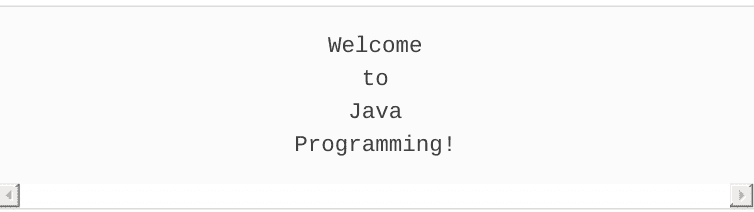

# 图 2.4

使用单个语句打印多行文本。

第 7 行

```java
System.out.println("Welcome\nto\nJava\nProgramming!")
```

在命令窗口中显示四行文本。通常情况下，字符串中的字符*完全*按照它们在双引号中出现的形式显示。然而，成对的字符 `\` 和 `\n`（在语句中重复三次）*不会*出现在屏幕上。*反斜线* (`\`) 是一个转义字符，对 `System.out.print` 和 `println` 方法具有特殊含义。当反斜线出现在字符串中时，Java 将与下一个字符结合形成一个*转义序列*——`\n` 表示换行符。当换行符出现在通过 `System.out` 输出的字符串时，换行符会导致屏幕输出光标移动到命令窗口中下一行的开头。

图 2.5 列出了几种转义序列，并描述了它们如何影响命令窗口中字符的显示。要查看转义序列的完整列表，请访问

`http://docs.oracle.com/javase/specs/jls/se8/html/jls-`

| 转义序列 | 描述 |
|---|---|
| `\n` | 换行。将屏幕光标置于下一行的开头。 |
| `\t` | 水平制表符。将屏幕光标移动到下一个制表位。 |
| `\r` | 回车。将光标置于当前行的行首——不要移动到下一行。在回车之后输出的任何字符将覆盖之前在该行上输出的字符。 |
| `\\` | 反斜线。用于打印反斜线字符。 |
| `\"` | 双引号。用于打印双引号字符。例如，`System.out.println("\"in quotes\"");` 显示 "in quotes"。 |

# 图 2.5

一些常见的转义序列。

## 2.4 使用 printf 显示文本

`System.out.printf` 中的 `f` 表示 "formatted"（格式），用于显示格式化数据。图 2.6 使用它在两行上输出字符串 "Welcome to" 和 "Java Programming!"。

```java
1 // Fig. 2.6: Welcome4.java
2 // 使用 System.out 方法显示多行
4 public class Welcome4 {
5 // main 方法开始 Java 应用程序的执行
6 public static void main(String[] args) {
7 System.out.printf("%s%n%s%n", "Welcome to", "Java Programming!");
8 } // end method main
9 } // end class Welcome4
```

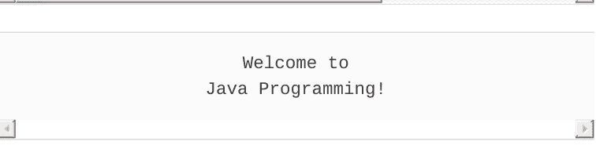

# 图 2.6

使用 System.out 方法显示多行

```java
System.out.printf("%s%n%s%n", "Welcome to", "Java Programming!")
```

在命令窗口中显示四行文本。通常情况下，字符串中的字符*完全*按照它们在双引号中出现的形式显示。然而，成对的字符 `\` 和 `\n`（在语句中重复三次）*不会*出现在屏幕上。调用 `printf` 也称为调用方法。当方法需要多个参数时，它们被放置在逗号分隔的列表中。


## 编程实践 2.7

在参数列表每个逗号后加一个空格 (,) 使程序更具可读性。printf 的第一个参数是格式字符串，可能包含固定文本和格式说明符。固定文本通过 printf 输出，就像 print 或 println 那样。每个格式说明符都是数值的占位符。例如，`%s` 是字符串的占位符。在格式说明符的位置，printf 替换第一个参数的值。因此此示例用 "Welcome to" 替换第一个 `%s`，用 "Java Programming!" 替换第二个 `%s`。输出显示了两行。

注意我们没有使用转义序列 `\n`，而是使用了 `%n` 格式说明符，它是一个跨操作系统的行分隔符。你不能在 `System.out.print` 或 `System.out.println` 使用 `%n`。在线 提供了关于使用 printf 输出的更多细节。

## 2.5 另一个应用程序：整数相加

我们的下一个应用程序读取（或输入）用户在键盘上输入的两个整数（如 -22 和 1024），计算它们的和并显示。该程序必须跟踪用户提供的数字，以便稍后计算。程序在计算机内存中记录数字和其他数据，并通过称为程序元素访问这些数据。图 2.7 中的程序演示了这些概念。在示例输出中，我们使用粗体文本来识别用户的输入（即 45 和 72）。按照我们之前程序的习惯，第 1–2 行说明了图号、文件名和程序的目的。

```java
1 // Fig. 2.7: Addition.java
2 Addition 程序输入两个数字然后
3 import java.util.Scanner; // 程序使用类
4
5 public class Addition {
6 // main 方法开始 Java 应用程序的执行
7 public static void main(String[] args) {
8 // 创建一个 Scanner 以获取输入
9 Scanner input = new Scanner(System.in);
10
11 System.out.print("Enter first integer: ");
12 int number1 = input.nextInt(); // 读取第一个
13
14 System.out.print("Enter second integer: ");
15 int number2 = input.nextInt(); // 读取第二个
16 int sum = number1 + number2;
17 System.out.println("The sum is " + sum);
18 } // end method main
19 } // end class Addition
```

```java
17 int sum = number1 + number2; // 相加数字
18
19 System.out.printf("Sum is %d%n", sum); // /
20 } // 方法 main 结束
21 } // 类 Addition 结束
```

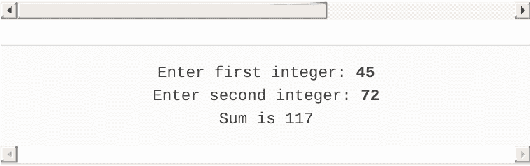

# 图 2.7

一个输入两个数字然后显示它们的和的 Addition 程序。

## 2.5.1 导入声明

Java 的一大强大之处在于拥有一组丰富的预定义类，你可以重用这些类，而不是“重复造轮子”。这些类被分组在包（packages）中——相关类的命名组——并统称为 Java 类库或 Java 应用程序编程接口（Java API）。第 3 行

```java
import java.util.Scanner; // 程序使用了 Scanner 类
```


是一个导入声明，帮助编译器找到此程序中使用的类。它表示程序使用了来自名为 `java.util` 包的预定义 `Scanner` 类（稍后讨论）。编译器随后确保你正确地使用了该类。


## 常见编程错误 2.5

所有的导入声明都必须出现在文件中第一个类声明之前。在类声明内部或之后放置导入声明会导致语法错误。


## 常见编程错误 2.6

忘记为必须导入的类包含导入声明会导致编译错误，错误信息中包含类似“找不到符号（cannot find symbol）”的消息。当发生此类情况时，请检查你是否提供了正确的导入声明，以及声明中的名称是否正确（包括正确的大小写）。

## 2.5.2 声明并创建 Scanner 以从键盘获取用户输入

**变量**是计算机内存中的一个位置，可以在其中存储一个值供程序以后使用。所有 Java 变量在可以使用*之前*必须用**名称**和**类型**进行声明。变量的*名称*允许程序访问内存中变量的*值*。变量名可以是任何有效的标识符——再次强调，由字母、数字、下划线 (`_`) 和美元符号 (`$`) 组成的字符序列，*不*以数字开头且*不*包含空格。变量的*类型*指定了内存中该位置存储什么类型的信息。与其他语句一样，声明语句以分号 (`;`) 结束。

main 方法的第 9 行

```java
Scanner input = new Scanner(System.in);
```

是一个**变量声明语句**，它指定了此程序使用的变量的**名称 (`input`)** 和**类型** (`Scanner`)。**Scanner**（包 `java.util`）允许程序读取数据（例如数字和字符串）供程序使用。数据可以来自许多源，例如键盘上的用户或磁盘上的文件。在使用 `Scanner` 之前，你必须先创建它并指定数据源。

第 9 行中的 `=` 表示 `Scanner` 变量 `input` 应该在声明时进行初始化（即为程序使用做好准备），其初始值为等号右侧表达式的结果——`new Scanner(System.in)`。这使用 `new` 关键字来创建一个 `Scanner` 对象，用于读取用户在键盘上输入的字符。标准输入对象 `System.in` 允许应用程序读取用户输入的字节数据。`Scanner` 将这些字节翻译成程序可以使用的类型（如 `int`）。


## 良好的编程习惯 2.8

选择有意义的变量名有助于程序实现自文档化（即人们只需通过阅读程序就能理解程序，而不是通过阅读相关的文档或创建和查看大量的注释）。


## 良好的编程习惯 2.9

按照惯例，变量名标识符使用首字母小写的驼峰命名命名法（camel-case），例如 `firstNumber`。

## 2.5.3 提示用户输入

第 11 行

```java
System.out.print("Enter first integer:"); // 提示
```

使用 `System.out.print` 显示消息“Enter first integer:”。这条消息被称为提示（prompt），因为它引导用户采取特定操作。我们在这里使用 `print` 方法而不是 `println`，是为了让用户的输入与提示在同一行。回想第 2.2 节，以大字母开头的标识符通常表示类名。`System` 类是 `java.lang` 包的一部分。


# 软件工程观察 2.1

默认情况下，`java.lang` 包在每个 Java 程序中都会导入；因此，`java.lang` 中的类是 Java API 中唯一不需要导入声明的类。

## 2.5.4 声明变量存储整数并从键盘获取整数

变量声明语句指定了此程序使用的变量的名称和类型。第 12 行的声明语句

```java
int number1 = input.nextInt(); // 读取第一个整数
```

声明了类型为 `int` 的变量 `number1`，并用从键盘读取的第一个整数对其初始化。程序假设用户输入的是有效的整数。如果不是，将会发生逻辑错误导致程序终止。第 11 节“异常处理：深入探讨”讨论了如何通过处理此类错误使程序更加健壮。

## 2.5.5 获取第二个整数

第 14 行

```java
System.out.print("Enter second integer:"); // 提示
```

提示用户输入第二个整数。第 15 行

```java
int number2 = input.nextInt(); // 读取第二个整数
```

声明了变量 `number2`，并用从键盘读取的第二个整数对其初始化。

## 2.5.6 在计算中使用变量

第 17 行

```java
int sum = number1 + number2; // 相加数字并存入
```

声明了变量 `sum`，并用 `number1 + number2` 的结果对其初始化。当程序遇到加法运算时，它使用存储在变量 `number1` 和 `number2` 中的值进行计算。

在上述述语句中，加法运算符是一个二元运算符，因为它有两个操作数——`number1` 和 `number2`。包含计算的语句部分被称为表达式。事实上，表达式是语句中任何具有值的部分。`number1 + number2` 表达式的值是这两个数字的和。同样，表达式 `input.nextInt()`（第 12 和 15 行）的值是用户输入的整数。

## 良好的编程习惯 2.10

在二元运算符的两侧留空格以提高可读性。

## 2.5.7 显示计算结果

计算完成后，第 19 行

```java
System.out.printf("Sum is %d%n", sum); // 显示和
```

使用 `System.out.printf` 方法显示和。格式占位符 `%d` 是 `int` 值的占位符（在此例中为 `sum` 的值）——d 代表“十进制整数”。格式字符串其余字符都是固定文本。因此，`printf` 方法显示“Sum is ”，随后是 `sum` 的值（位于 `%d` 格式占位符的位置）以及一个换行。

计算也可以在 `printf` 语句内部进行。我们可以将第 17 行的语句合并并将 19 放入语句中：

```java
System.out.printf("Sum is %d%n", (number1 + number2));
```

表达式 `number1 + number2` 外围的括号是可选的——包含它们是为了强调整个表达式的值被输出到 `%d` 格式占位符的位置。这种括号被认为是冗余的。

## 2.5.8 Java API 文档

对于我们使用的每个新的 Java API 类，我们都会标明它所属的包。这些信息可以帮助你在 Java API 文档中找到每个包和类的描述。该文档的 Web 版本可以在此处找到：

```
http://docs.oracle.com/javase/8/docs/api/index.html
```

你可以从以下地址的“**附加资源**（Additional Resources）”部分下载它：

```
http://www.oracle.com/technetwork/java/javase/download
```

附录 F 显示了如何使用此文档。

## 2.5.9 在单独语句中声明和初始化变量

在计算（或其他表达式）中使用变量之前，每个变量都必须有一个值。第 12 行的变量声明语句既声明了 `number1` 并用用户输入的值对其进行了初始化。

有时你会在一个语句中声明变量，并在另一个语句中对其初始化。例如，第 12 行可以写两条语句：

```java
int number1; // 声明 int 类型的变量 number1
number1 = input.nextInt(); // 分配用户的输入
```


第一条语句声明了 `number1`，但没有对其初始化。第二条语句使用赋值运算符 `=` 为 `number1` 分配（即赋予）用户输入的值。你可以这样读这条语句：“`number1` 获取了 `input.nextInt()` 的值。”赋值运算符 `=` 右侧的所有内容在执行赋值之前总是求值。

## 2.6 内存概念

如 `number1`、`number2` 和 `sum` 等变量名实际上对应计算机内存中的位置。每个变量都有名称、类型、大小（以字节为单位）和值。

在图 2.7 的加法程序中，当执行以下语句（第 12 行）时：

```java
int number1 = input.nextInt(); // 读取第一个数字
```

用户输入的数字被放置在与名称 `number1` 对应的内存位置中。假设用户输入了 45。计算机将该整数值放入位置 `number1` 中（图 2.8），替换该位置之前的值（如果有）。之前的值会丢失，因此这个过程被称为**破坏性**的。


## 图 2.8

显示变量 `number1` 名称和值的内存位置。

当语句（第 15 行）

```java
int number2 = input.nextInt(); // 读取第二个数字
```

执行时，假设用户输入了 72。计算机将该整数值 放置在位置 `number2` 中。内存现在看起来如图 2.9 所示。

| number1 | 45 |
|--- |--- |
| number2 | 72 |

## 图 2.9

存储 `number1` 和 `number2` 值后的内存位置。

图 2.7 的程序在获取 `number1` 和 `number2` 的值后，会将这些值相加，并将总和放入变量 `sum` 中。语句（第 17 行）

```java
int sum = number1 + number2; // 相加数字，然后存储和
```

执行加法，然后替换 `sum` 中的任何旧值。在计算出 `sum` 后，内存看起来如图 2.10 所示。`number1` 和 `number2` 的值与它们在用于计算 `sum` 之前的情况完全一样。当计算机执行计算时，这些值被使用了，但没有被破坏。当从内存位置读取一个值时，该过程是非破坏性的。

| number1 | 45 |
| number2 | 72 |
| sum | 117 |

## 图 2.10

存储 `number1` 和 `number2` 之和后的内存位置。

## 2.7 算术

大多数程序都会执行算术计算。算术运算符总结在图 2.11 中。注意使用了某些代数中未使用的符号。星号 `*` 表示乘法，百分号 `%` 是取余运算符，我们稍后会讨论。图 2.11 中的算术运算符是二元运算符，因为每个运算符作用于两个操作数。

| Java 操作 | 运算符 | 代数表达式 | Java 表达式 |
| --- | --- | --- | --- |
| 加法 | `+` | f+g | f + g |
| 减法 | `-` | p - c | p - c |
| 乘法 | `*` | bm | b * m |
| 除法 | `/` | x ÷ y | x / y |
| 取余 | `%` | r mod | r % s |

## 图 2.11

算术运算符。

整数除法产生整数商。例如，表达式 `7 / 4` 求值为 `1`，表达式 `17 / 5` 求值为 `3`。整数除法中的任何小数部分直接被截断（即——丢弃）。Java 提供了取余运算符，产生除法后的余数。表达式 `x % y` 产生 `x` 除以 `y` 的余数。因此，`7 % 4` 产生 `3`，`17 % 5` 产生 `2`。该运算符最常用于整数操作数，但也可以用于其他类型。在本章的练习和后续章节中，我们考虑了取余运算符的几种应用，例如判断一个数是否是另一个数的倍数。

## 直线形式的算术表达式

Java 中的算术表达式必须写成**直线形式**以便输入计算机。因此，如“a 除以 b”之类的表达式必须写成 `a/b`，以便所有常量、变量和运算符都出现在同一行内。以下代数表示法通常不被编译器接受：$\frac{a}{b}$

## 用于分组的括号

Java 表达式中的括号用于对项分组，方式与代数表达式相同。例如，为了乘以数量 `b + c`，我们写道：

```java
a * (b + c)
```

如果表达式包含嵌套括号，例如

```java
((a + b) * c)
```

则最内层括号中的表达式（在本例为 `(a + b)`）最先求值。

## 运算符优先级规则

Java 根据运算符优先级规则确定的精确顺序应用算术运算符。

1. 乘法、除法和取余运算首先执行，因为每个运算符作用于两个操作数。如果表达式包含多个此类运算符，则从左到右执行。
2. 加法和减法运算随后执行。如果表达式包含多个此类运算符，则从左到右执行。

这些规则允许 Java 以正确的顺序应用运算符。当我们说运算符从左到右应用时，指的是它们的**结合性**。某些从左到右结合。图 2.11 总结了这些优先级规则。完整的优先级表见附录 A。我们使用简单的示例来解释求值顺序。求值顺序问题出现在复杂的表达式中。更多信息，请参阅《Java 语言规范》(https://docs.oracle.com/javase/specs/se8/jls-15.html)。

| 运算符(s) | 操作(s) | 求值顺序（优先级） |
| --- | --- | --- |
| `*` | 乘法 | 首先执行。如果表达式包含多个此类运算符，则从左到右执行。 |
| `/` | 除法 | |
| `%` | 取余 | |
| `+` | 加法 | 随后执行。如果表达式包含多个此类运算符，则从左到右执行。 |
| `-` | 减法 | |
| `=` | 赋值 | 最后执行。 |

## 图 2.12

算术运算符的优先级。

## 代数与 Java 表达式示例

让我们考虑几个示例表达式。每个示例都显示了一个代数表达式及其 Java 等效表达式。以下是五个项平均值的示例：

```java
// Algebra: m = \frac{a+b+c+d+e}{5}
m = (a + b + c + d + e) / 5;
```

括号是必要的，因为除法的优先级高于加法。整个数量 `(a + b + c + d + e)` 被除以 5。如果错误地省略了括号，我们将得到不同的表达式：

```java
a + b + c + d + e / 5
```

这是一个直线方程的示例：

```java
// Algebra: y = mx + b
y = m * x + b;
```

不需要括号。乘法运算符首先应用，因为乘法的优先级高于加法。赋值最后发生，因为它的优先级低于乘法或加法。

以下示例包含取余（`%`）、乘法、除法、加法和减法操作：

| 代数: | z = pr % q + w / x - y |
| Java: | z = p * r % q + w / x - y; |
| | 6 | 1 | 2 | 4 | 3 | 5 |

说明

语句下方圆圈的数字表示了 Java 应用运算符的*顺序*。`*`、`%`、 和 `/` 操作按照*从左到右*的顺序首先求值（即它们从左到右结合），因为它们的优先级高于 `+` 和 `-`。接下来求值 `+` 和 `-` 操作。这些操作也从*左到右*应用。赋值操作 (`=`) 最后求值。

## 二次多项式的求值

为了更好地理解运算符优先级的规则，请考虑一个包含二次多项式 $ax^2 + bx + c$ 的赋值表达式的求值：

```java
y = a * x * x + b * x + c;
```

| | 6 | 1 | 2 | 4 | 3 | 5 |

说明

乘法操作按照从左到右的顺序首先求值（即它们从左到右结合），因为它们的优先级高于加法。（Java 没有用于幂的算术运算符，所以 $x^2$ 表示为 $x * x$。5.4节显示了执行幂的另一种方法。）加法操作从左到右求值。假设 $a, b, c$ 和 $x$ 的初始化（给定值）如下：$a = 2, b = 3, c = 7$  $x = 5$。图 2.13 展示了运算符应用的顺序。

- 步骤 1. `y = 2 * 5 * 5 + 3 * 5 + 7;`（最左边的乘法）
  `2 * 5` 是 10
- 步骤 2. `y = 10 * 5 + 3 * 5 + 7;`（最左边的乘法）
  `10 * 5` 是 50
- 步骤 3. `y = 50 + 3 * 5 + 7;`（加法之前的乘法）
  `3 * 5` 是 15
- 步骤 4. `y = 50 + 15 + 7;`（最后的加法）
  `50 + 15` 是 65
- 步骤 5. `y = 65 + 7;`（最后的加法）
  `65 + 7` 是 72
- 步骤 6. `y = 72`（最后一次操作——将 72 放入 y）

## 图 2.13

## 二次多项式的求值顺序。

说明

你可以使用冗余括号来使表达式更清晰。例如，前面的语句可以如下括号括起来：

```java
y = (a * x * x) + (b * x) + c;
```


## 2.8 决策：相等运算符和关系运算符

条件是一个可以为真或为假的表达式。本节介绍了 Java 的 `if` 选择语句，它允许程序根据条件的值做出决策。例如，“分数大于或等于 60”这一条件决定了学生是否通过了测试。如果 `if` 语句的条件为真，则执行其体体；如果条件为假，则不执行其体体。

`if` 语句中的条件可以使用图 2.14 汇总的相等运算符（`==` 和 `!=`）和关系运算符（`>`、`<`、`>=`、`<=`）形成。两个相等运算符具有相同的优先级，低于关系运算符的优先级。相等运算符从左到右结合。所有关系运算符具有相同的优先级，并且也从左到右结合。

| 代数运算符 | Java 等等或关系运算符 | Java 条件示例 | Java 条件的含义 |
|---|---|---|---|
| 相等运算符 | | | |
| = | `==` | `x == y` | x 等于 y |
| ≠ | `!=` | `x != y` | x 不等于 y |
| 关系运算符 | | | |
| > | `>` | `x > y` | x 大于 y |
| < | `<` | `x < y` | x 小于 y |
| ≥ | `>=` | `x >= y` | x 大于等于 y |
| ≤ | `<=` | `x <= y` | x 小于等于 y |

**图 2.14** 相等运算符和关系运算符。

图 2.15 使用了六个 `if` 语句来比较用户输入的两个整数。如果这些 `if` 语句中任何一个的条件为真，则执行与该语句相关的语句；否则，跳过该语句。我们使用 `Scanner` 从用户处输入整数并将其存储在变量 `number1` 和 `number2` 中。程序比较这些数字并显示为真的比较结果。我们展示了用户输入不同值时的三个示例输出。

```java
// 图 2.15: Comparison.java
// 使用 if 语句、关系
// 和相等运算符比较整数。
import java.util.Scanner; // 程序使用类

public class Comparison {

    // main 方法开始 Java 执行
    public static void main(String[] args) {

        // 创建 Scanner 从控制台获取输入
        Scanner input = new Scanner(System.in);

        System.out.print("Enter first integer:");
        int number1 = input.nextInt(); // 读取第一个数字

        System.out.print("Enter second integer:");
        int number2 = input.nextInt(); // 读取第二个数字

        if (number1 == number2) {
            System.out.printf("%d == %d\n", number1, number2);
        }

        if (number1 != number2) {
            System.out.printf("%d != %d\n", number1, number2);
        }

        if (number1 < number2) {
            System.out.printf("%d < %d\n", number1, number2);
        }

        if (number1 > number2) {
            System.out.printf("%d > %d\n", number1, number2);
        }

        if (number1 <= number2) {
            System.out.printf("%d <= %d\n", number1, number2);
        }

        if (number1 >= number2) {
            System.out.printf("%d >= %d\n", number1, number2);
        }

    } // 方法结束
} // 类结束
```

### 错误预防技巧 2.5

长语句可以跨多行显示。如果一个语句必须跨行拆，请选择自然的断开点，例如逗号分隔列表中的逗号之后，或者长表达式中的运算符之后。如果一个语句跨越两行或多行，请缩进所有后续行，直到语句结束。

### 目前为止讨论的运算符

图 2.16 显示了目前为止讨论的运算符，按优先级从高到低排列。除赋值运算符 `=` 外，所有运算符从左到右结合。赋值运算符 `=` 从右到左结合。表达式的值是赋值给赋值运算符左侧变量的值——例如，表达式 `x = 7` 的值为 7。因此，像 `x = y = 0` 这样的表达式的评估方式类似于 `x = (y = 0)`，它先将值 0 赋值给变量 `y`，然后将该赋值的结果 0 赋值给 `x`。

| 运算符 | 结合性 | 类型 |
| --- | --- | --- |
| `*` `/` `%` | 从左到右 | 乘法 |
| `+` `-` | 从左到右 | 加法 |
| `<` `<=` `>` `>=` | 从左到右 | 关系 |
| `==` `!=` | 从左到右 | 相等 |
| `=` | 从右到左 | 赋值 |

**图 2.16** 所讨论的运算符的优先级和结合性。


### 良好的编程实践 2.12

在编写包含许多运算符的表达式时，请参考运算符优先级表（附录 A）。确认表达式中的操作是按照你预期的顺序执行的。如果在复杂的表达式中，你不确定评估顺序，请使用括号强制规定顺序，就像你在代数表达式中会做的那样。

## 2.9 总结

在本章中，你学习了 Java 的许多重要特性，包括在命令行窗口中显示数据、从键盘输入数据、执行计算和做出决策。这里介绍的应用程序引入了许多基础编程概念。正如你在第 3 章中看到的，Java 程序通常只在 `main` 方法中包含几行代码——这些语句通常创建执行应用程序工作的对象。在第 3 章中，你将学习如何实现自己的类并在应用程序中使用这些类的对象。

## 总结

### 2.2 节 你的第一个 Java 程序：打印一行文本

- 当你使用 `java` 命令启动 JVM 时，就会执行 Java 应用程序（第 36 页）。
- 注释（第 37 页）对程序进行记录并提高其可读性。编译器会忽略它们。
- 行尾注释以 `//` 开始，并在其所在行的行尾结束。
- 传统注释（第 37 页）可以跨多行显示，并由 `/*` 和 `*/` 分隔。
- Javadoc 注释（第 37 页）由 `/**` 和 `*/` 分隔，允许你在代码中嵌入程序文档。`javadoc` 程序根据这些注释生成网页。
- 当编译器遇到违反 Java 语言规则的代码时，就会发生语法错误（第 37 页）。它类似于自然语言中的语法错误。
- 空行、空格字符和制表符统称为空白字符（第 38 页）。空白字符使程序更易读，通常会被编译器忽略。
- 关键字（第 38 页）是 Java 保留的，且始终全小写拼写。
- 关键字 `class`（第 38 页）引入类声明。
- 根据习惯，Java 中所有的类名都以大写字母开头，并且包含的每个单词的首字母大写（例如 `SampleClassName`）。
- Java 类名是一个标识符——由字母、数字、下划线 (`_`) 和美元符号 (`$`) 组成的序列，不以数字开头且不包含空格。
- `public`（第 38 页）类声明必须保存到与类同名的文件中，并带有“.java”文件扩展名。
- Java 是大小写敏感的（第 38 页）——也就是说，大写字母和小写字母是不同的。
- 每个类声明的主体（第 39 页）由括号 `{ }` 分隔。
- 方法 `main`（第 39 页）是每个 Java 应用程序的起点，必须以：

```java
public static void main(String[] args)
```


否则，JVM 将不会执行应用程序。

- 方法执行任务并在完成后返回信息。关键字 `void` 表示该方法将执行任务但不返回任何信息。
- 语句指示计算机执行操作。
- 双引号中的字符串有时称为字符字符串或字符串字面量。
- 标准输出对象 `System.out` 在命令行窗口中显示字符。
- 方法 `System.out.println` 在命令行窗口中显示其参数，后跟一个换行符以定位光标。

### 2.2.1 编译应用程序

- 你使用 `javac` 编译程序。如果程序不包含语法错误，就会创建一个包含字节码的类文件。当你执行应用程序时，JVM 会解释这些字节码。

### 2.2.2 执行应用程序

- 要运行应用程序，请输入 `java` 后跟类名。

### 2.2.3 修改你的第一个程序

- `System.out.print` 在最后一个字符后立即在输出光标处显示其参数。
- 字符串中的反斜杠 (`\`) 是转义序列，代表换行符。

### 2.2.4 使用 printf 显示文本

- `System.out.printf`（f 意味着 "格式化"）显示格式化数据。
- `printf` 的第一个参数是格式字符串，包含固定文本和/或格式说明符。每个格式说明符指示要输出的数据类型，并作为格式字符串之后对应参数的占位符。
- 格式说明符以百分号 (`%`) 开始，后跟一个表示数据类型的字符。格式说明符 `%s` 是字符串的占位符。
- `%n` 格式说明符是可移植的行分隔符。你不能在 `System.out.printf` 或 `System.out.println` 的参数中使用 `%n`；然而，`System.out.println` 在显示其参数后会输出行分隔符。

### 2.5.1 import 声明

- 导入声明帮助编译器定位程序使用的类。
- Java 丰富的预定义类被分到包——命名的类组。这些被称为 Java 类库，或 Java 应用程序接口（Java API）。

### 2.5.2 声明并创建 Scanner 从键盘获取用户输入

- 变量是计算机内存中的一个位置，用于存储供程序以后使用的值。所有变量在使用之前必须声明名称和类型。
- 变量名允许程序访问内存中的变量值。
- `Scanner`（包 `java.util`）允许程序读取程序将使用的数据。在使用 `Scanner` 之前，程序必须创建它并指定数据源。
- 变量应该初始化，以便准备在程序中使用。
- 表达式 `new Scanner(System.in)` 创建一个从标准输入对象读取的 `Scanner`。

### 2.5.3 提示用户输入

- 提示引导用户采取特定操作。

### 2.5.4 存储整数的变量并从键盘获取整数

- 数据类型 `int` 用于声明存储整数值的变量。`int` 的值范围为 -2,147,483,648 到 +2,147,483,647。
- 程序中使用的 `int` 值不能包含逗号；然而，为了提高可读性，你可以在数字中使用下划线（例如 `60_000_000`）。
- `float` 和 `double` 类型用于指定带有小数点的实数，例如 -11.19 和 3.4。
- `char` 类型的变量表示单个字符，例如大写字母（如 A）、数字（如 7）、特殊字符（如 * 或 %）或转义序列（如 tab, `\t`）。
- `int`、`float`、`double` 和 `char` 等类型是基本类型。基本类型名称是关键字；因此，它们必须全部以小写字母出现。
- `Scanner` 方法 `nextInt()` 获取一个整数供程序使用。

### 2.5.6 在计算中使用变量

- 语句中具有值的部分被称为表达式。

### 2.5.7 显示计算结果

- 格式化占位符 `%d` 是 `int` 值的占位符。

### 2.5.9 在单独语句中声明和初始化变量

- 变量在程序中使用之前必须为其赋一个值。
- 赋值运算符 `=` 允许程序为变量赋值。

### 2.6 内存概念

- 变量名对应于计算机内存中的位置。每个变量都有名称、类型、大小和值。
- 放置在内存位置中的值将替换该位置之前的值，旧值将丢失。

### 2.7 算术

- 算术运算符：`+`（加法）、`-`（减法）、`*`（乘法）、`/`（除法）和 `%`（取模）。
- 整数除法产生整数商。
- 取模运算符 `%` 产生除法后的余数。
- 算术表达式必须以直线形式书写。
- 如果表达式包含嵌套括号，则先求值最内层的括号。
- Java 按照由运算符优先级规则确定的精确顺序应用算术表达式中的运算符。
- 当我们说运算符按从左到右应用时，我们指的是它们的结合性。某些运算符是从右到左结合的。
- 冗余的括号可以使表达式更清晰。

### 2.8 决策：相等运算符和关系运算符

- `if` 语句根据条件的值（真或假）做出决策。
- `if` 语句中的条件可以使用相等运算符（`==` 和 `!=`）和关系运算符（`>`、`<`、`>=`、`<=`）形成。
- 一个 `if` 语句以关键字 `if` 开头，后跟括号内的条件，并期望其体包含一个语句。对于多条语句体，必须包含大括号。

## 自测习题

### 2.1 填写下列每个语句的空缺：

1. 一个 `{` 和一个 `}` 开始并结束方法的体。
2. 你可以使用 `if` 语句来做出决策。
3. `//` 这是一个行尾注释。
4. 空格、制表符和换行符 被称为空白符。
5. 关键字 被预留供 Java 使用。
6. Java 程序从方法 `main` 处开始执行。
7. 方法 `System.out.print` 和 `System.out.println` 可以在命令窗口中显示信息。

### 2.2 判断下列每项的正确与否。如果是错误的，请解释原因。

1. 注释导致计算机在程序执行时在屏幕上显示 `//` 之后的文本。
2. 所有变量在声明时必须赋予一个类型。
3. Java 认为变量 `number` 和 `NuMbEr` 是相同的。
4. 取模运算符（`%`）只能用于整数操作数。
5. 算术运算符 `*`、`/`、`%`、`+` 和 `-` 都具有相同的优先级级别。
6. 标识符 `_`（下划线）在 Java 中是有效的。

### 2.3 编写语句完成以下每个任务：

1. 声明变量 `c`、`thisIsVariable`、`q76354` 和 `number` 为 `int` 类型并将每个初始化为 0。
2. 提示用户输入一个整数。
3. 输入整数并将结果赋值给 `int` 变量 `value`。假设 `Scanner` 变量 `input` 可以从键盘读取值。
4. 在命令窗口的一行打印 "This is a Java program"。使用 `System.out.println`。
5. 在命令窗口的两行打印 "This is a Java program"。使用 `System.out.printf`。
6. 如果 `number` 不等于 7，显示 "number is not equal to 7"。

### 2.4 识别并纠正每个语句中的错误：

1. `if (c < 7); { System.out.println("c is less than 7"); }`
2. `if (c >= 7) { System.out.println("c is equal or greater than 7"); }`

### 2.5 编写语句完成以下每个任务：

1. 在同一行显示 "Enter an integer:"
2. 将 `b` 和 `c` 的乘积赋给 `int a`。
3. 提示用户输入第一个整数。
4. 从用户读取第一个整数并存储在 `x` 中。
5. 提示用户输入第二个整数。
6. 从用户读取第二个整数并存储在 `y` 中。
7. 提示用户输入第三个整数。
8. 从用户读取第三个整数并存储在 `z` 中。
9. 计算 `x`、`y` 和 `z` 的乘积并存储在变量 `result` 中。
10. 使用 `System.out.printf` 显示 "Product" 以及 `result` 的值。

### 2.6 使用你编写的语句，编写一个计算并打印三个整数程序。

## 习题

### 2.7 填写下列每个语句的空缺：

1. 注释 用于记录程序。
2. 在 Java 中可以做出 决策。
3. `*` 与 `/` 具有相同的优先级。
4. 在算术表达式中，先求值的是最内层 一组括号。
5. 变量 在程序的执行过程中保持 值。

### 2.9 判断下列每项的正确与否。如果是错误的，请解释原因。

1. Java 运算符从左到右求值。
2. 以下都是有效的名称：`_bar_`、`m92134`、`t5`、`sales$`、`account_total`、`a` 和 `z2`。
3. 无括号的算术表达式从左到右求值。
4. 以下都是无效的变量名：`3g`、`87`、`67h2` 和 `h2`。

### 2.10 假设 `x = 2`，`y = 3`，每个语句显示什么？

```java
System.out.printf("x = %d%n", x);
System.out.printf("Value of %d + %d is %d%n", x, x, (x + x));
System.out.printf("x = ");
System.out.printf("%d = %d%n", (x + y), (x + x));
```

### 2.11 下列 Java 语句中哪些包含值被修改的变量？

```java
int p = i + j + k + 7;
System.out.println("variables whose values are modified");
System.out.println("a = 5");
int value = input.nextInt();
```

### 2.12 给定 $y = ax^3 + 7$，哪些 Java 语句是该方程的正确的？

```java
int y = a * x * x * x + 7;
int y = a * x * x * (x + 7);
int y = (a * x) * x * (x + 7);
int y = (a * x) * x * x + 7;
int y = a * (x * x * x) + 7;
int y = a * x * (x * x + 7);
```

### 2.13 写出下面每个 Java 语句中操作符的求值顺序，并显示每个语句执行后 X 的值：

- `int x = 7 + 3 * 6 / 2 - 1;`
- `int x = 2 % 2 * 2 - 2 / 2;`
- `int x = (3 * 9 * (3 + 9 / (3)));`

### 2.14 写一个应用程序，将数字 1 到 4 显示在同一行上，每对相邻的数字之间用一个空格分隔。使用以下最佳技术：

- 使用一个 `System.out.println` 语句。
- 使用四个 `System.out.print` 语句。
- 使用一个 `System.out.printf` 语句。

### 2.15 写一个应用程序，要求用户输入两个整数，从用户处获取这两个整数并打印它们的和、积、差和商（除法）。使用图 2.7 所示的技术。

### 2.16（整数比较）写一个应用程序，要求用户输入两个整数，从用户处获取这两个整数并显示较大的数字，后面跟着单词 "is larger"。如果数字相等，则打印消息 "These numbers are equal"。使用图 2.15 所示的技术。

### 2.17（算术、最小和最大）写一个应用程序，从用户处输入三个整数，并显示这些数字的和、平均值、积、最小值和最大值。使用图 2.15 所示的技术。[注意：本练习中平均值的计算结果应该是平均值的整数表示。因此，如果数值之和为 7，平均值应该是 2，而不是 2.3333...]

### 2.18（用星号显示形状）写一个应用程序，使用星号（*）显示方框、椭圆、箭头和菱形。

### 2.19 下面代码打印什么？

```java
System.out.printf("%*n**%n****%n******%n*******%nn");
```

### 2.20 下面代码打印什么？

```java
System.out.println("*");
System.out.println("****");
System.out.println("*****");
System.out.println("******");
System.out.println("***");
```

### 2.21 下面代码打印什么？

```java
System.out.print("*");
System.out.print("****");
System.out.print("*****");
System.out.print("******");
System.out.println("***");
```

### 2.22 下面代码打印什么？

```java
System.out.print("*");
System.out.println("****");
System.out.println("*****");
System.out.print("******");
System.out.println("***");
```

### 2.23 下面代码打印什么？

```java
System.out.printf("%s%n%s%n%s%n", " * * ", " * * ");
```

### 2.24（最大和最小整数）写一个应用程序，读取五个整数并打印该组中最大和最小整数。只使用你在本章中学的编程技术。

### 2.25（奇数或偶数）写一个应用程序，读取一个整数并判断它是奇数还是偶数。[提示：使用取余运算符。偶数是 2 的倍数。任何 2 的倍数除以 2 的余数都是 0。]

### 2.26（倍数）写一个应用程序读取两个整数，判断第一个是否是第二个的倍数并打印结果。[提示：使用取余运算符。]

### 2.27（星号棋盘图案）写一个应用程序显示棋盘图案，如下：

```
* * * * * *
*     *     *
* * * * * *
*     *     *
* * * * * *
*     *     *
* * * * * *
*     *     *
* * * * * *
```

### 2.28（圆的直径、周长面积）这里预告一下。在本章中，你学习了整数和 `int` 类型。Java 还可以表示包含小数点的浮点数，例如 3.14159。写一个应用程序，以整数形式输入圆的半径，并使用浮点值 3.14159 作为 π 输出圆的直径、周长和面积。使用图 2.7 所示的技术。[注意：你可以使用预定义的常量 `Math.PI` 作为 π 的值。这个常量比值 3.14159 更精确。`Math` 类定义在 `java.lang` 包中。该包中的类会被自动导入，因此你不需要导入 `Math` 类即可使用它。] 使用以下公式（r 是半径）：

- 直径 = 2r
- 周长 = $2\pi r$
- 面积 = $\pi r^2$

不要将每次计算的结果存储在变量中。相反，应将每次计算指定为将在 `System.out.printf` 语句中输出的值。

### 2.29（字符的值）写一个应用程序，以整数形式输入圆的半径，并使用浮点值 3.14159 作为 π 输出圆的直径、周长和面积。使用图 2.7 所示的技术。[注意：你可以使用预定义的常量 `Math.PI` 作为 π 的值。这个常量比值 3.14159 更精确。`Math` 类定义在 `java.lang` 包中。该包中的类会被自动导入，因此你不需要导入 `Math` 类即可使用它。] 使用以下语句输出字符的值：

```java
System.out.printf("The value of %c is", ' ');
```

### 2.30（分离数字）写一个应用程序输入一个数字，将其数字分离并用空格隔开打印。例如，如果用户输入 423，程序应该打印：

```
4 2 3
```

[提示：使用除法和取余运算来“提取”每个数字。]

### 2.31（平方立方表）使用你在本章中学的技术，写一个应用程序计算 0 到 10 的平方和立方，并以表格格式打印结果，如下：

| 数字 | 平方 | 立方 |
| --- | --- | --- |
| 0 | 0 | 0 |
| 1 | 1 | 1 |
| 2 | 4 | 8 |
| 3 | 9 | 27 |
| 4 | 16 | 64 |
| 5 | 25 | 125 |
| 6 | 36 | 216 |
| 7 | 49 | 343 |
| 8 | 64 | 512 |
| 9 | 81 | 729 |
| 10 | 100 | 1000 |

### 2.32（负值、正值和零）写一个程序输入五个数字，并打印负数的个数、正数的个数和零的个数。

### 2.33（BMI 计算器）我们在练习 1.10 中介绍了体重质量指数（BMI）计算器。计算 BMI 的公式为：

$$BMI = \frac{weightInPounds \times 703}{heightInches \times heightInches}$$

或

$$BMI = \frac{weightInKilograms}{heightInMeters \times heightInMeters}$$

创建一个计算器，读取用户的磅数体重和英寸身高（或者，如果你愿意，读取公斤数体重和米身高），计算并显示用户的体重质量指数。同时显示来自国立健康肺和血液研究所的 BMI 分类及其数值：

http://www.nhlbi.nih.gov/health/educational/los


## 练习

### 2.34（世界人口增长计算器）
搜索互联网确定当前的世界人口和年度人口增长率。写一个应用程序输入这些值，然后显示一、二、三、四、五年后的预计世界人口。

### 2.35（拼车节省计算器）
研究几个拼车网站。创建一个应用程序计算你的每日驾驶成本，以便你可以估算通过拼车可以节省多少钱。拼车还有其他优点，例如减少碳排放和缓解交通拥堵。该应用程序应该输入以下信息，并显示用户每天通勤的成本：

1. 每日行驶总里程数。
2. 每加仑汽油的价格。
3. 平均每加仑行驶里程数。
4. 每日停车费。
5. 每日过路费。

## 类、对象、方法和字符串简介

## 目标

在本章中，你将：

- 声明一个类并使用它来创建对象。
- 将类的行为实现为方法。
- 将类的属性实现为实例变量。
- 调用对象的方法使其执行任务。
- 学习方法中的局部变量是什么，以及它们与实例变量有什么区别。
- 学习什么是基本类型和引用类型。
- 使用构造函数初始化对象的数据。
- 表示并使用包含小数点的数字。
- 学习为什么类是建模现实世界事物和抽象实体的自然方式。

## 提纲

1. 3.1 引言
2. 3.2 实例变量、set 方法和 get 方法
3. 3.2.1 带有实例变量以及 set 和 get 方法的 Account 类
4. 3.2.2 创建并使用 Account 类对象的 AccountTest 类
5. 3.2.3 编译和执行带有多个类的应用程序
6. 3.2.4 Account UML 类图
7. 3.2.5 关于类 AccountTest 的额外说明
8. 3.2.6 使用私有实例变量和公有 set/get 方法的软件工程
9. 3.3 Account 类：使用构造函数初始化对象
10. 3.3.1 声明用于自定义对象初始化的 Account 构造函数
11. 3.3.2 AccountTest 类：在创建时初始化 Account 对象
12. 3.4 带有余额的 Account 类；浮点数
13. 3.4.1 具有类型 double 余额实例变量的 Account 类
14. 3.4.2 使用 Account 类的 AccountTest 类
15. 3.5 基本类型对比引用类型
16. 3.6（可选）GUI 和图形形案例研究：一个简单的 GUI
17. 3.6.1 什么是图形用户界面？
18. 3.6.2 JavaFX Scene Builder 和 FXML
19. 3.6.3 Welcome App——显示文本和图像
20. 3.6.4 打开 Scene Builder 并创建 welcome.fxml
21. 3.6.5 向 Welcome.fxml 文件夹中添加图像
22. 3.6.6 创建 VBox 布局
23. 3.6.7 配置 VBox
24. 3.6.8 添加并配置 Label
25. 3.6.9 添加并配置 ImageView
26. 3.6.10 预览 Welcome GUI
27. 3.7 总结
28. 自测练习
29. 自测练习答案
30. 练习
31. 改变

### 3.1 引言

本章依赖于 1.5 节“对象技术简介”中介绍的面向对象编程术语和概念。在第 2 章中，你处理了现有的类、对象和方法。你使用了预定义的标准输出 `System.out.println` 在屏幕上显示信息。你使用了 `Scanner` 类创建一个对象，将用户在键盘上输入的数据读取到内存中。在整本书中，你将使用许多预定义的类和对象——这是 Java 作为面向对象语言的巨大优势之一。在本章中，你将创建自己的类和方法。你创建的每个新类都将变成一个新的类型，可以根据需要用于声明变量和创建对象。我们介绍了一个关于创建和使用简单的现实银行账户类——`Account` 的案例研究。此类应该维护实例变量（例如名称和余额），并提供诸如查询余额（`getBalance`）、增加余额的存款（`deposit`）和减少余额的取款（`withdraw`）的任务。

在第 2 章中，你使用数据类型 `int` 来表示整数。在本章中，我们引入了数据类型 `double` 来表示包含小数点的数字账户余额——此类数字被称为浮点数。在第 8 章中，当我们深入研究对象技术时，我们将开始使用 `BigDecimal` 类（位于 `java.math` 包）来精确地表示货币金额，正如你在编写工业级应用程序时应该做的那样。或者，你可以将货币金额视为分的单位整数，然后通过除法和取模运算将结果分别拆分为美元和分，并在美元和分之间插入句点。通常，你在本书中开发的程序将由两个或多个类组成。如果你成为工业界开发团队的一员，可能会处理包含数百甚至上千个类的应用程序。

### 3.2 实例变量、set 方法和 get 方法

在本节中，你将创建两个类——`Account`（图 3.1）和 `AccountTest`（图 3.2）。`AccountTest` 是一个应用程序类，其中 `main` 方法将创建并使用 `Account` 对象来演示 `Account` 类的功能。

### 3.2.1 带有实例变量以及 set 和 get 方法的 Account 类

不同的账户有不同的名称。因此，`Account` 类（图 3.1）包含一个名称实例变量。类的实例变量为类的每个对象（每个实例）维护数据。在本章后面，我们将添加一个名为 `balance` 的实例变量，以便跟踪账户中有多少钱。`Account` 类包含两个方法——`setName` 方法在对象中存储名称，`getName` 方法从对象中获取名称。

```java
// 图 3.1: Account.java
// Account 类包含名称实例变量
// 以及设置和获取的方法。

public class Account {

    private String name; // 实例变量

    // 设置对象中的名称
    public void setName(String name) {
        this.name = name; // 存储名称
    }

    // 从对象获取名称
    public String getName() {
        return name; // 返回名称的值给调用者
    }
}
```

#### 图 3.1
带有名称实例变量以及设置和获取方法的 Account 类。

#### 类声明

类声明从第 5 行开始：

```java
public class Account {
```

`public` 关键字（第 8 章将详细解释）是一种访问修饰符。目前，我们简单地将每个类声明为 `public`。每个 `public` 类必须存储在与类同名并以 `.java` 扩展名结尾的文件中；否则将发生编译错误。因此，公共类 `Account` 和 `AccountTest`（图 3.2）必须分别在单独的文件 `Account.java` 和 `AccountTest.java` 中声明。

每个类声明都包含关键字 `class`，后面是类名——在本例中为 `Account`。类的体封装在对括号中，如第 5 行和第 17 行。

#### 标识符和驼峰命名

回顾第 2 章，类名、方法名和变量名都是标识符，并且约定均使用驼峰命名法。同样根据约定，类名以大写字母开头，方法名和变量名以小写字母开头。

#### 实例变量 name

回顾第 1.5 节，对象具有属性，这些属性通过实例变量实现并贯穿其生命周期。实例变量在调用对象方法之前、在方法执行期间以及方法执行完毕后都存在。类的每个对象（实例）拥有类实例变量的副本。


#### 访问修饰符 public 和 private（私有）

大多数实例变量声明前面都有一个 `private` 关键字（如第 6 行所示）。与 `public` 类似，`private` 也是访问修饰符。用 `private` 声明的变量或方法只能由其所属类中的方法访问。因此，变量 `name` 只能在每个 `Account` 对象的方法中（在本例中为 `setName` 和 `getName`）使用。你很快就会发现，这提供了强大的软件工程机会。

#### Account 类的 setName 方法

让我们来看一下 `setName` 方法声明的代码（第 9–11 行）：

```java
public void setName(String name) {
    this.name = name; // 存储名称
}
```

我们将每个方法声明的第一行（在本例中为第 9 行）称为 `method header`（方法头）。方法的 `return type`（返回类型，在它出现在方法名之前）指定了方法在执行完任务后返回给调用者的数据类型。正如你很快将看到的，main 方法中第 19 行的语句（图 3.2）调用了方法 `setName`，因此在例例中 main 是 `setName` 的调用者。返回类型 `void`（图 3.1 中的第 9 行）表示 `setName` 将执行一项任务，但不会向调用者返回（即给出）任何信息。在第 2 章中，你使用过返回信息的方法——例如，你使用了 `Scanner` 方法 `nextInt` 来输入用户在键盘上输入的整数。当 `nextInt` 从用户处读取一个值时，它会返回该值以供程序使用。正如你很快看到的，`Account` 方法 `getName` 会返回一个值。

方法 `setName` 接收一个 `String` 类型的参数 `name`——它代表了将作为参数传递给方法的名称。当我们讨论图 3.2 第 19 行的方法调用时，你将看到参数和实参是如何协同工作的。

参数声明在参数列表（parameter list）中，该列表位于方法头方法名后面的括号内。当有多个参数时，每个参数之间用逗号隔开。每个参数必须指定一个类型（在本例中为 `String`），后跟一个变量名（在本例中为 `name`）。

#### 参数是局部变量

在第 2 章中，我们在 main 方法中声明了应用程序的所有变量。在特定方法体（如 main）内部声明的变量是局部变量，这些变量只能在该方法中使用。每个方法都可以访问自己的局部变量，而不能访问其他方法的局部变量。当方法终止时，其局部变量的值就会丢失。方法的参数也是该方法的局部变量。

#### setName 方法体

每个方法体都由一对大括号限定（如图 3.1 中的第 9 行和第 11 行），其中包含一个或多个执行该方法任务的语句。在本例中，方法体包含一条语句（第 10 行），该语句将参数 `name`（一个 `String`）的值赋值给类的 `name` 实例变量，从而在对象中存储账户名称。

如果方法中包含一个与实例变量同名的局部变量（分别如第 9 行和第 6 行），则该方法体将引用局部变量而不是实例变量。在这种情况下，局部变量被认为在方法体中“遮蔽”（shadow）了实例变量。方法体可以使用 `this` 关键字来显式地引用被遮蔽的实例变量，如第 10 行赋值语句左侧所示。在 10 行执行后，方法已完成其任务，因此它会返回到调用者。

> **良好的编程实践 3.2**
> 我们可以通过为第 9 行的参数选择不同的名称来避免对 `this` 关键字的需求，但如第 10 行所示使用 `this` 关键字是一种广泛接受的做法，可以尽可能减少标识符名称的泛滥。

#### Account 类的 getName 方法

方法 `getName`（第 14 行）：

```java
public String getName() {
    return name; // 返回名称
}
```

向调用者返回 `Account` 对象的名称。`getName` 方法有一个空参数列表，因此不需要额外信息。当图 3.2 第 14 行的语句调用它时，它返回一个 `String`。

### 3.2.2 创建并使用 Account 对象的 AccountTest 类

为了帮助你准备在书中遇到的更大的程序，我们定义 `AccountTest` 类及其 `main` 方法。在 `Account.java` 中，`AccountTest` 类的 `main` 方法被称为驱动类（driver class）。

```java
// 图 3.2: AccountTest.java
// 操作 Account 对象。
import java.util.Scanner;

public class AccountTest {
    public static void main(String[] args) {
        // 创建 Scanner 对象以获取输入
        Scanner input = new Scanner(System.in);

        // 创建 Account 对象并对其赋值
        Account myAccount = new Account();

        // 显示 name 的初始值（null）
        System.out.printf("Initial name is: %s%n", myAccount.getName());

        // 提示并读取名称
        System.out.println("Please enter the name:");
        String theName = input.nextLine(); // 读取
        myAccount.setName(theName); // 放置
        System.out.println(""); // 输出空行

        // 显示存储在对象中的名称
        System.out.printf("Name in Account: %s", myAccount.getName());
    }
}
```


Initial name is: null
Please enter the name:
Jane Green
Name in Account is: Jane Green

**图 3.2**

## 用于从用户处接收输入的 Scanner 对象

第 8 行创建了一个名为 `input` 的 `Scanner` 对象，用于从用户处输入名称。第 17 行提示用户输入名称。第 18 行使用 `Scanner` 对象的 `nextLine()` 方法从用户处读取名称并将其赋值给局部变量 `theName`。你输入名称并按回车将其提交给程序。按回车会在输入的字符之后插入换行符。`Scanner` 类可以看到各种其他输入方法，正如你将在书中看到的。一个与 `nextLine()` 类似的方法（名为 `next()`）读取下一个单词。

第 11 行创建一个 `Account` 对象并将其赋值给类型为 `Account` 的变量 `myAccount`。该变量通过 `new Account()` 的结果进行初始化——这是一个实例创建表达式。关键字 `new` 创建指定类的新对象——在本例中为 `Account`。括号是必须的。正如你将在 3.3 节中学到的，这些括号与类名结合使用表示对构造函数的调用，它类似于方法，但由 `new` 操作符隐式调用，用于在创建对象时初始化该对象的实例变量。在第 3.3 节中，你将看到如何在括号中放置一个参数，以为 `Account` 对象的 `name` 实例变量指定一个初始值——你将增强 `Account` 类以实现这一功能。现在，只需让括号为空即可。第 8 行包含一个创建 `Scanner` 对象的类实例创建表达式——该表达式用 `System.in` 初始化 `Scanner`，这告诉 `Scanner` 从哪里读取输入（即键盘）。

## 调用类 Account 的 getName 方法

第 14 行显示了初始名称，该名称是通过调用对象的 `getName()` 方法获取的。就就像我们可以使用对象 `System.out` 来调用它的方法 `printf()` 和 `println()` 一样，我们可以使用 `myAccount` 来调用它的方法 `getName()` 和 `setName()`。第 14 行使用第 11 行创建的 `myAccount` 对象调用了 `getName()`，后面是一个点分隔符（`.`），然后是方法名 `getName()` 和一组空括号，因为没有传递任何参数。当 `getName()` 被调用时：

1. 程序将执行从调用处（main 中的第 14 行）转移到方法 `getName()` 的声明（图 3.1 的第 14–16 行）。由于 `getName()` 是通过 `myAccount` 对象调用的，`getName()` “知道”要操作哪个对象的实例变量。
2. 接下来，方法 `getName()` 执行它的任务——即返回名称（图 3.1 的第 15 行）。当执行 `return` 语句时，程序执行从调用 `getName()` 的地方继续（图 3.2 的第 14 行）。
3. `System.out.printf()` 显示方法 `getName()` 返回的 `String`，然后程序在 main 中的第 17 行继续执行。


## 错误预防提示 3.1

永远不要使用从用户输入的字符串作为格式控制字符串。当 `System.out.printf()` 方法评估其第一个参数中的格式控制字符串时，该方法会根据字符串中的转换说明符执行任务。如果格式控制字符串是从用户获取的，恶意用户可能会提供被 `System.out.printf()` 执行的转换说明符，可能导致安全漏洞。

## null——String 变量的默认初始值

输出的第一行显示名称“null”。与不会自动初始化的局部变量不同，每个实例变量都有一个默认初始值——当你没有指定实例变量的初始值时，Java 会提供该值。因此，在程序中使用实例变量之前，不需要显式初始化——除非它们必须初始化为除默认值以外的值。`String` 类型的实例变量（如示例中的 `name`）的默认值是 `null`，我们将在第 3.5 节考虑引用类型时进一步讨论。

## 调用类 Account 的 setName 方法

第 19 行调用 `myAccount` 的 `setName()` 方法。方法调用可以提供参数，其值将被赋值给对应的方法参数。在这种情况下，括号中 `main` 局部变量 `theName` 的值是传递给 `setName()` 的参数，以便该方法执行其任务。当 `setName()` 被调用时：

1. 程序执行从 main 中的第 19 行转移到 `setName()` 方法声明（图 3.1 的 第 9-11 行），调用括号中的参数值（`theName`）被赋值给方法头中的对应参数（`name`）（图 3.1 的 第 9 行）。由于 `setName()` 是通过 `myAccount` 对象调用的，`setName()` “知道”要操作哪个对象的实例变量。
2. 接下来，方法 `setName()` 执行它的任务——即将参数的值赋值给实例变量 `name`（图 3.1 的 第 10 行）。
3. （此处原文似乎未完整，但根据逻辑推断为：执行完成后，程序将返回到 main 中的第 19 行继续执行）。

*(注：由于提供的原文文本在 `setName()` 方法描述处似乎存在断层，译文已根据原文提供的片段进行了对应翻译。)*

## AccountTest 类

### 静态方法 main

在第 2 章中，我们声明的每个类都有一个 `main()` 方法。请记住，当你执行应用程序时，Java 虚拟机（JVM）总是会自动调用 `main()` 方法。你必须显式地调用所有其他方法来告诉它们执行任务。在第 6 章中，你将学到 `toString()` 方法通常是被隐式调用的。

图 3.2 的第 6–25 行声明了 `main()` 方法。使 JVM 能够定位并调用 `main()` 方法以开始程序执行的关键部分是 `static` 关键字（第 6 行），它表示 `main()` 是一个静态方法。静态方法是特殊的，因为你可以在无需先创建该方法所属类的对象（在本例中为 `AccountTest` 类）的情况下直接调用它。我们将在第 6 章详细讨论静态方法。

## 关于 import 声明的说明

注意图 3.2 中的 `import` 声明（第 3 行），它告诉编译器该程序使用了 `Scanner` 类。正如你在第 2 章中学到的，`System` 和 `String` 类位于 `java.lang` 包中，该包会被隐式导入到每个 Java 程序中，因此所有程序都可以使用该包中的类而无需显式导入。你在 Java 程序中使用的其他大多数类都必须显式导入。

在同一目录下编译的类之间（如 `Account` 类和 `AccountTest` 类）存在一种特殊关系。默认情况下，这些类被认为处于同一个包中——即默认包。同一个包中的类会被隐式导入到该包内其他类的源文件中。因此，当包中的一个类使用同包中的另一个类时（例如 `AccountTest` 类使用 `Account` 类），不需要 `import` 声明。

如果我们在整个文件中通过 `java.util.Scanner` 来引用 `Scanner` 类（包含完整的包名和类名），则第 3 行的 `import` 声明就是可选的。这被称为类的完全限定名。例如，图 3.2 的第 8 行可以写为：

```java
java.util.Scanner input = new java.util.Scanner(System.in);
```


## 软件工程

### 观察 3.1

如果在每次使用类名时都指定完全限定类名，Java 编译器在 Java 源文件中不需要 `import` 声明。大多数 Java 程序员更倾向于使用 `import` 声明实现的更简洁的编程风格。

### 3.2.6 使用私有实例变量和公共 set/get 方法的软件工程

正如你看到的，通过使用 `set()` 和 `get()` 方法，你可以对私有数据的修改尝试进行验证，并控制这些数据呈现给调用者的方式——这些极具吸引力的软件工程优势。我们将在 3.4 节详细讨论这一点。

如果实例变量是 `public` 的，那么该类的任何客户端（即任何调用该类方法的其他类）都可以看到数据并对其进行任何想要的操作，包括将其设置为无效值。

你可能会认为，即使是类的客户端无法直接访问私有实例变量，客户端也可以通过公共的 `set()` 和 `get()` 方法对该变量做任何想做的事。你可能认为你可以通过公共 `get()` 方法随时查看私有数据，并通过公共 `set()` 方法随意修改私有数据。但 `set()` 方法可以被设计为验证其参数，并拒绝任何将数据设置为错误值的尝试，例如负体温、3 月份不在 1 到 31 日范围内的日期、不在公司产品目录中的产品代码等。而 `get()` 方法可以防止数据变成不同的形式。例如，`Grade` 类可能将分数存储为 0 到 100 之间的 `int`，但 `getGrade()` 方法可能会返回一个 `String` 类型的字母等级，例如对于 90 到 100 之间的分数返回 "A"，80 到 99 之间的分数返回 "B" 等。`set()` 方法可以被编程为验证其参数并拒绝任何将数据设置为坏值的尝试。这种对私有数据的访问控制可以增强程序的健壮性。

## 软件工程观察 3.2

使用访问修饰符声明实例变量和方法。通常，实例变量应该声明为 `private`，而方法声明为 `public`。

## 封装数据的 Account 对象概念视图

正如图 3.4 所示，你可以将 `Account` 对象视为被封装的私有实例变量（由内部圆圈表示）并由公共方法保护（由外部圆圈表示）。客户端只能通过调用公共方法来与 `Account` 对象交互。

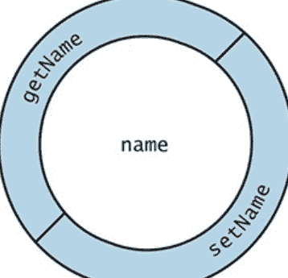

## 图 3.4

具有封装私有实例变量和公共方法的 Account 对象视图。

## 3.3 Account 类：使用构造函数初始化对象

正如 3.2 节，当创建 `Account` 类的对象（图 3.1）时，其实例变量被初始化为 `null`。但如果你想在创建对象时提供名称呢？你声明的每个类都可以提供构造函数来指定自定义初始化。Java 要求每个类都有构造函数，因此这是实例化变量的最佳时机。下一个示例增强了 `Account` 类（图 3.5），增加了一个接收名称并用其初始化实例变量的构造函数。

```java
1 // 图 3.5: Account.java
2 // 带有初始化名称构造函数的 Account 类
3 public class Account {
4
5 private String name; // 实例变量
6
7 // 构造函数使用 name 初始化
8 public Account(String name) { // 构造函数
9 this.name = name;
10 }
11
12 // 设置名称的方法
13 public void setName(String name) {
14 this.name = name;
15 }
16
17 // 获取名称的方法
18 public String getName() {
19 return name;
20 }
21 }
```

图 3.5

带有初始化名称构造函数的 Account 类。

### 3.3.1 为自定义对象初始化声明 Account 构造函数

当你声明类时，可以提供自己的构造函数为你的类对象指定自定义初始化。例如，你可能想在创建 `Account` 对象时指定一个名称，如图 3.6 的第 8 行所示：

```java
Account account1 = new Account("Jane Green");
```

在这种情况下，字符串参数 "Jane Green" 被传递给 `Account` 对象的构造函数并用于初始化 `name` 实例变量。之前的语句要求该类提供一个仅接受一个 `String` 参数的构造函数。

## 预防提示 3.2

虽然可行，但不要在构造函数中调用方法。我们将在第 10 章“面向对象编程：多态与接口”中解释这一点。

## Account 类构造函数和 setName 方法的参数名

回顾第 3.2.1 节，方法参数是局部变量。在图 3.5 中，构造函数和 `setName()` 方法都有一个名为 `name` 的参数。尽管这些参数具有相同的标识符（name），但第 8 行的参数是构造函数的局部变量，`setName()` 方法不可见；而第 13 行的参数是 `setName()` 的局部变量，构造函数不可见。

## 3.3.2 AccountTest 类：在创建时初始化 Account 对象

`AccountTest` 程序（图 3.6）使用构造函数初始化了两个 `Account` 对象。第 8 行创建并初始化了 `Account` 对象 `account1`。关键字 `new` 向系统请求内存以存储 `Account` 对象，然后隐式地调用该类的构造函数来初始化该对象。该调用通过类名后的括号表示，括号内包含用于初始化新对象 `name` 属性的参数 "Jane Green"。第 8 行将新对象赋值给变量 `account1`。第 9 行重复了这一过程，传递参数 "John Blue" 来初始化 `account2` 的 `name`。第 12–13 行使用每个对象的 `getName()` 方法获取名称，并证明它们在对象创建时确实已经过初始化。输出显示了不同的名称，确认了每个 `Account` 都维护自己的实例变量 `name` 副本。

```java
1 // Fig. 3.6: AccountTest.java
2 // Using the Account constructor to initialize t
3 // variable at the time each Account object is c
4
5 public class AccountTest {
6 public static void main(String[] args) {
7 // create two Account objects
8 account1 = new Account("Jane Green");
9 account2 = new Account("John Blue");
10
11 // display initial value of name for each
12 System.out.printf("account1 name is: %s%n", account1.getName());
13 System.out.printf("account2 name is: %s%n", account2.getName());
14 }
15 }
```

```
account1 name is: Jane Green
account2 name is: John Blue
```

## 图 3.6

使用 Account 构造函数在每个 Account 对象创建时初始化 name 实例变量。

## 构造函数不能返回值

构造函数和方法之间的一个重要区别是，*构造函数不能返回值*，因此它们*不能指定返回类型（即使是 void）*。通常，构造函数被声明为 `public`——在书的后面部分，我们将解释何时使用 `private` 构造函数。

## 默认构造函数

回顾图 3.2 中的第 11 行

```java
Account myAccount = new Account();
```


使用了 `new` 来创建一个 `Account` 对象。“new Account” 后的空括号表示对该类`默认构造函数`的调用——在任何没有显式声明构造函数的类中，编译器都会提供一个默认构造函数（该函数始终没有参数）。当一个类只有一个默认构造函数时，类的实例变量将初始化为它们的`默认值`。在第 8.5 节中，你将学习类可以有多个构造函数。

## 声明了构造函数的类没有默认构造函数

如果你为类声明了构造函数，编译器将不会为该类创建默认构造函数。在这种情况下，你无法通过类实例创建 `new Account()` 来像我们在图 3.2 中那样创建 `Account` 对象——除非你声明的自定义构造函数不接受参数。


## 软件工程观察 3.3

除非类实例变量的默认初始化是可以接受的，否则请提供一个自定义构造函数，以确保在创建类的每个新对象时，实例变量都能用有意义的值正确初始化。

## 在 Account UML 类图中添加构造函数

图 3.7 的 UML 类图对图 3.5 中的 `Account` 类进行了建模，该类有一个带有 `String name` 参数的构造函数。与操作一样，UML 在类图的第三部分中建模构造函数。为了区分构造函数和类的操作，UML 要求将“constructor”一词包含在双角括号（«constructor»）中并放在构造函数名称之前。习惯做法是在第三部分将构造函数列在其他操作之前。

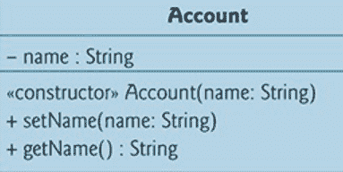

## 图 3.7

图 3.5 中 Account 类的 UML 类图。

描述

## 3.4 带有余额的 Account 类；浮点数

我们现在声明一个 `Account` 类，它除了名称外，还维护银行账户的余额。大多数账户余额不是整数。因此，`Account` 类将账户余额表示为浮点数——即带有小数点的数字，例如 43.95、0.0、-129.8873。[在第 8 章中，我们将开始使用 `BigDecimal` 类来精确地表示金额，正如你在编写工业级货币应用程序时应该做的那样。]

Java 提供了两种用于在内存中存储浮点数的原始类型：`float` 和 `double`。`float` 类型变量表示单精度浮点数，可以包含七位有效数字。`double` 类型的变量表示双精度浮点数。它们需要的内存是 `float` 变量的两倍，可以包含多达 15 位有效数字。事实上，Java 将源代码中所有的浮点数字面量（例如 3.1）视为 `double` 类型。参见附录 D 原始类型，关于浮点数的范围。

### 3.4.1 带有余额的 Account 类双精度类型实例变量

下一个是 `Account` 类（图 3.8）的版本，它维护名称和余额。典型的银行服务许多账户，每个账户都有自己的余额，因此第 7 行声明了一个 `double` 类型实例变量。

```java
// Fig. 3.8: Account.java

// Account class with a double instance variable

// and deposit method that perform validation.

public class Account {

private String name; // instance variable

private double balance; // instance variable

// Account constructor that receives two

Account(String name, double balance) {

this.name = name; // assign name to instance

// validate that the balance is greater

if (balance > 0.0) { // if the balance is

this.balance = balance; // assign it to

}

}

// method that deposits (adds) only a

void deposit(double depositAmount) {

if (depositAmount > 0.0) { // if the depos

balance = balance + depositAmount; // a a

}

}

// method returns the account balance

double getBalance() {

return balance;

}

// method that sets the name

void setName(String name) {

this.name = name;

}

// method that returns the name

String getName() {

return name;

}

}
```

## 图 3.8

带有 double 实例变量余额的 Account 类，以及具有验证功能的构造函数和 deposit 方法。

## Account 类双参数构造函数

该类有一个构造函数四个方法。开户时通常会立即存款，因此构造函数（第 10–18 行）现在接收第二个参数——代表初始余额的 `double` 类型 `balance`。第 15–17 行确保 `initialBalance` 大于 0.0。如果是，则将 `balance` 参数的值赋值给实例变量 `balance`。否则，实例变量 `balance` 将保持为 0.0——其默认初始值。

## Account 类 deposit 方法

`deposit` 方法（第 21–25 行）在完成任务后不返回任何数据，因此其返回类型为 `void`。该方法接收一个名为 `depositAmount` 的参数——只有当参数有效（即大于0）时，才会将其加到实例变量 `balance` 中。第 23 行先将当前余额与 `depositAmount` 相加，形成一个临时和，然后赋值给 `balance`，替换其原先的值（回顾加法的优先级高于赋值）。重要的是理解赋值运算符第 23 行右侧的计算并没有修改余额——这就是为什么这项作业是必要的。

## Account 类

### getBalance 方法

`getBalance` 方法（第 28–30 行）允许该类的客户端（即调用此类类方法的其他类）获取特定 `Account` 对象的余额值。该方法指定的返回类型为 `double`，且参数列表为空。

## Account 的所有方法都可以使用 balance

再次，第 15、16、23 和 29 行使用了 `balance` 变量，尽管它没有在任何一个方法中声明。我们可以在这些方法中使用 `balance`，因为它是该类的实例变量（instance variable）。

## 3.4.2 使用 AccountTest 类使用 Account 类

`AccountTest` 类（图 3.9）创建了两个 `Account` 对象（第 7–8 行），并分别将其初始化为 50.00 的有效余额和 -7.53 的无效余额——为了我们的示例，我们假设余额必须大于或等于零。第 11–14 行对 `System.out.printf` 方法的调用输账户名称和余额，这些值是通过调用每个 `Account` 的 `getName` 和 `getBalance` 方法获得的。

```java
// Fig. 3.9: AccountTest.java

// 输入和输出浮点数

import java.util.Scanner;

public class AccountTest {

public static void main(String[] args) {

account1 = new Account("Jane Green");

account2 = new Account("John Blue");

// 显示每个对象的初始余额

System.out.printf("%s balance: %.2f%n",

account1.getName(), account1.getBalance());

System.out.printf("%s balance: %.2f%n",

account2.getName(), account2.getBalance());

// 创建 Scanner 从终端获取输入

Scanner input = new Scanner(System.in);

System.out.printf("Enter deposit amount for: ");

double depositAmount = input.nextDouble();

System.out.printf("adding %.2f to account 1\n", depositAmount);

account1.deposit(depositAmount); // 添加到账户 2

// 显示余额

System.out.printf("%s balance: %.2f%n",

account1.getName(), account1.getBalance());

System.out.printf("%s balance: %.2f%n",

account2.getName(), account2.getBalance());

}

```

```java
System.out.print("Enter deposit amount for: ");

depositAmount = input.nextDouble()); // 获取

System.out.printf("%nadding %.2f to account 2\n", depositAmount);

account2.deposit(depositAmount); // 添加到

// 显示余额

System.out.printf("%s balance: $%.2f%n",

account1.getName(), account1.getBalance());

System.out.printf("%s balance: $%.2f%n",

account2.getName(), account2.getBalance());

}
```

Jane Green balance: $50.00
Jane Blue balance: $0.00
Enter deposit amount for account1: 25.53
adding 25.53 to account1 balance
Jane Green balance: $75.53
Jane Blue balance: $0.00
Enter deposit amount for account2: 123.45
adding 123.45 to account2 balance
Jane Green balance: $75.53
Jane Blue balance: $123.45

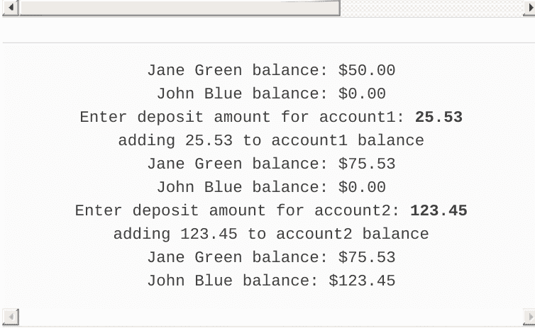

## 图 3.9

使用 Account 对象输入和输出浮点数。

## 显示 Account 对象的初始余额

当从第 12 行为 `account1` 调用 `getBalance` 方法时，`account1` 的余额值从图 3.8 的第 29 行返回，并由 `System.out.printf` 语句显示（图 3.9，第 11–12 行）。同样，当为 `account2` 调用 `getBalance` 方法时，`account2` 的余额值从图 3.8 的第 29 行返回，并由 `System.out.printf` 语句显示（图 3.9，13–14 行）。`account2` 的初始余额为 0.00，因为构造函数拒绝了用负余额启动 `account2` 的尝试，因此余额保留了其默认初始值。

## 为了显示格式化浮点数

每个余额都通过 `printf` 使用格式说明符 `%.2f` 输出。`%` 格式说明符用于输出 `float` 或 `double` 类型的值。`%` 和 `f` 之间的 `.2` 代表应该输出的小数位数（2）。任何使用 `%.2f` 输出的浮点数将四舍五入到小数点位数——即精度。例如，123.457 将舍入为 123.46，27.339 将舍入为 27.33。

## 从用户处读取浮点数值并存款

第 19 行（图 3.9）提示用户输入存款金额。第 20 行声明 `depositAmount` 以存储用户输入的值。与实例变量（如 `balance`）不同，局部变量（如 `depositAmount`）不会默认初始化——正如你所看到的，它们必须显式初始化。

## 常见的编程错误

如果你尝试使用未初始化的局部变量，Java 编译器将发出编译错误。这可以帮助避免运行时错误。

## main 中的重复代码

第 11–12、13–14、26–27、28–29、39 和 41 行的六语句几乎相同——它们都输出账户的名称和余额。它们仅在于账户对象的名称——`account1` 或 `account2`。当需要更新代码时，这种重复代码会导致维护问题——如果六处相同的代码有一个错误，你需要修改六次。练习 15 要求你修改图 3.9 以包含 `displayAccount` 方法，该方法将 `Account` 对象作为参数并输出对象的名称和余额。你随后通过调用 `displayAccount` 替换 `main` 中的重复语句，从而减少程序体积，并由于拥有一份显示账户名称和余额的代码而提高了程序的可维护性。


## 软件工程观察 3.4

用调用包含一份代码的方法替换重复代码可以减少程序体积并提高可维护性。

## Account 类的 UML 类图

图 3.10 中的 UML 类图简洁地对图 3.8 进行建模。该图在第二个隔间建模了私有属性 `String` 类型的 `name` 和 `double` 类型的 `balance`。


## 图 3.10

图 3.8 Account 类的 UML 类图。

描述

Account 类的构造函数建模在第三隔间，带有参数为 `String` 类型的 `name` 和 `double` 类型的 `initialBalance`。该类的四个公共方法也建模在第三隔间——带有 `double` 类型参数 `depositAmount` 的 `deposit` 操作、返回类型为 `double` 的 `getBalance` 操作、带有 `String` 类型参数 `name` 的 `setName` 操作以及返回类型为 `String` 的 `getName` 操作。

# 3.5 基本类型 vs. 引用类型

Java 的类型分为基本类型和`引用类型`。在第 2 章中，你处理了 `int` 类型的变量——这是基本类型之一。其他基本类型包括 `boolean, byte, char, short, long, float 和 double`，我们将在本书中讨论其中的每种类型——这些类型总结在附录 D 中。所有非基本类型都是*引用类型*，因此指定对象类型的类就是引用类型。

基本类型变量一次只能恰好持有其声明类型的*某一个*值。例如，一个 `int` 变量一次只能存储一个整数。当将另一个值赋给该变量时，新值将替换旧值——旧值随之丢失。

请记住，局部变量默认*不会*初始化。基本类型的实例变量默认*会*初始化——类型为 `byte, char, short, int, long, float 和 double` 的实例变量被初始化为 0，而类型为 `boolean` 的变量被初始化为 false。你可以在声明时通过赋值来为基本类型变量指定初始值，如下所示：

```java
private int numberOfStudents = 10;
```

程序使用引用类型的变量（通常称为引用）来存储对象的位置。这样的变量被称为引用程序中的某个对象。被引用的对象可能包含许多实例变量。图 3.2 的第 8 行：

```java
Scanner input = new Scanner(System.in);
```

创建一个 `Scanner` 类的对象，然后将该 `Scanner` 对象的引用赋给变量 `input`。图 3.2 的第 11 行：

```java
Account myAccount = new Account();
```


创建一个 `Account` 类的对象，然后将该 `Account` 对象的引用赋给变量 `myAccount`。引用类型的实例变量如果没有显式初始化，将被初始化为值 `null`——它代表“指向无的引用”。这就是图 3:2 第 14 行第一次调用 `getName` 返回 `null` 的原因——`name` 的值尚未设置，因此返回了默认的初始值 `null`。

要调用对象上的方法，你需要该对象的引用。在图 3.2 中，`main` 方法中的语句使用变量 `myAccount` 调用方法 `getName`（第 14 和 24 行）和 `setName`（第 19 行）来与 `Account` 对象交互。基本类型变量不引用对象，因此此类变量不能用于调用方法。

### 3.6（可选）GUI 和图形案例研究：一个简单的 GUI

本案例研究旨在那些希望在书早期就开始学习 Java 创建图形用户界面（GUI）和图形的强大能力的读者，在我们在第 12、13 和 22 章深入讨论这些主题之前。我们重点介绍了 Java——Java 未来 GUI、图形和多媒体技术。本案例研究的 Swing 版本在书籍的配套网站上提供。GUI 和图形案例研究章节总结在图 3.11 中。每个章节都引入了新概念，提供了带有屏幕截图的示例来展示示例交互，并紧随其一个或多个练习，你将在该节中使用中学的技巧。

| 章节或练习 | 你将要做什么 |
|---|---|
| 3.6 节：一个简单的 GUI | 显示文本和图像。 |
| 4.15 节：事件处理：画线 | 响应点击，使用 Java 图形能力画线。 |
| 5.11 节：绘图 | 绘制多种颜色的填充形状。 |
| 6.13 节：颜色和填充形状 | 绘制多种颜色的填充形状。 |
| 7.17 节：画弧 | 用弧画彩虹。 |
| 8.16 节：在图形中使用对象 | 将形状存储为对象。 |
| 10.14 节：使用多态进行绘图 | 识别形状类之间的相似性并创建形状类层次结构。 |
| 练习 13.9：交互式多态应用 | 一项终极练习，在其中你将允许用户选择要绘制的每个形状，配置其属性（如颜色和填充），并拖动鼠标调整形状大小。 |

#### 图 3.11

每章中 GUI 和图形案例研究的总结。

在早期的 GUI 和图形案例研究章节中，你将创建第一个图形化应用程序。在随后的章节中，你将使用面向对象的编程概念创建一个绘制各种形状的应用程序。案例研究的终极练习 13.9 将让你创建一个基于 GUI 的绘图应用程序，允许用户选择要绘制的每个形状及其颜色，然后通过拖动鼠标指定其大小和位置。我们希望你发现这个案例研究既丰富又有趣。

### 第 22 章，JavaFX 图形与多媒体

如果你喜欢处理 GUI 和图形，请务必阅读第 22 章，该章将详细讨论 JavaFX 图形和多媒体，包括 JavaFX 强大的动画能力。该章包含几十个具有挑战性且有趣的图形和多媒体项目练习，包括几个：

- SpotOn：挑战用户在时间过期前点击移动的点。
- Horse Race：增强 SpotOn 游戏的变体，其中马在移动，挑战用户在点从屏幕上消失前点击点击它们。
- Cannon：挑战用户摧毁一系列目标。

### 3.6.1 什么是图形界面？

图形用户界面（GUI）提供了一种易于交互的机制。GUI（发音为“GO-ee”）赋予应用程序独特的“外观和感觉”。GUI 由控件构建。控件是接收文本的 `Label` 对象和触发动作的 `Button` 对象。当用户与控件（如 `Button`）交互时，控件会产生事件。程序可以响应这些事件——被称为事件处理——来指定发生什么。这部分 GUI 章节有点长，因为你要走过每一个步骤。

### 3.6.2 JavaFX Scene Builder 和 FXML

在 GUI 和图形案例研究章节中，你将使用 Scene Builder——一种通过拖放预构建的 GUI 组件到设计区域来创建 GUI 的工具，实时编辑和预览功能允许你在创建时查看 GUI。你可以从此处下载适用于 Windows、macOS 和 Linux 的 Scene Builder：

```
http://gluon.com/labs/scene-builder/
```


### FXML（标记语言）

当你创建和修改 GUI 时，JavaFX Scene Builder 生成 FXML——一种无需 Java 代码即可定义和排列 JavaFX 控件的语言。你不需要知道 FXML，Scene Builder 会为你隐藏这些细节。

### 3.6.3 Welcome 应用——显示文本和图像

在本节中，在不编写任何代码的情况下，你将构建一个在 `Label` 中显示文本并在 `ImageView` 中显示图像的 GUI（图 3.12）。我们将可视化编程技术将 JavaFX 组件拖放到 Scene Builder 的内容面板——即设计区域中。接下来，你将使用 Scene Builder 的检查器配置选项，例如 `Label` 的文本和字体大小，以及 `ImageView` 的图像。最后，你将使用 Scene Builder 的在窗口中显示预览选项查看完成的 GUI。

### 3.6.4 打开 Scene Builder 并创建文件 Welcome.fxml

打开 Scene Builder，以便创建一个文件，Scene Builder 将定义 GUI 的 FXML 文件放入其中。窗口最初显示如图 3.13。顶部的 `Untitled` 表示 Scene Builder 创建了一个你尚未保存的新 FXML 文件。选择 `文件 > 另存为` 显示另存为对话框，然后选择存储文件的位置，将文件命名为 `Welcome.fxml` 并点击保存按钮。

#### 图 3.12

Microsoft Windows 10 上预览窗口中的最终欢迎界面 GUI。

你从库（Library）窗口的容器（Containers）、控件（Controls）和其他部分将 JavaFX 组件拖放到内容面板（content panel）上。

你使用内容面板设计 GUI。

你使用检查器（Inspector）窗口来配置内容面板中当前选中的项目。

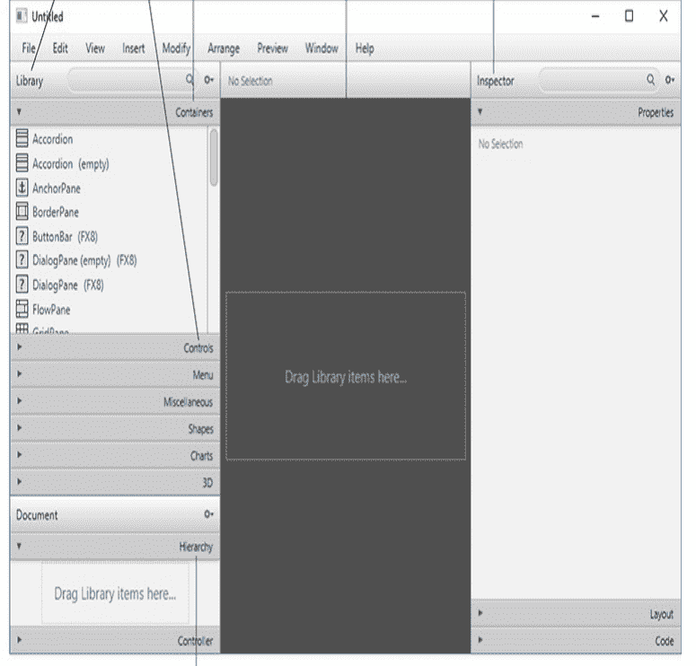

层级结构（Hierarchy）窗口显示 GUI 的结构，并帮助你选择和重新组织控件。

#### 图 3.13

首次打开 JavaFX Scene Builder 时的界面。

描述

### 3.6.5 将图像添加到包含 Welcome.fxml 的文件夹中

你将用于此应用程序的图像 (`bug.png`) 位于本章的 `ch03` 示例文件夹下的 `images` 子文件夹中。为了在你准备好将其添加到应用程序时方便找到该图像，请在你的文件系统中找到 `images` 文件夹，然后将 `bug.png` 复制到保存 `Welcome.fxml` 的文件夹中。

### 3.6.6 创建 VBox 布局容器

JavaFX 布局容器帮助你排列和调整控件的大小。对于此应用程序，你将一个 `Label` 和一个 `ImageView` 放置在 `VBox` 布局容器中，该容器从上到下垂直排列其节点。要将 `VBox` 添加到 Scene Builder 的内容面板中以便开始设计 GUI，请双击库窗口中 Containers 部分的 `VBox`。（你也可以从 Containers 部分将 `VBox` 拖放到内容面板上。）

## 3.6.7 配置 VBox

在本节中，你将指定 `VBox` 的对齐方式（alignment）、初始大小（initial size）和内边距（padding）。

#### 指定 VBox 的对齐方式

`VBox` 的对齐方式决定了控件在 `VBox` 中的位置。在 particular 应用程序中，我们希望 `Label` 和 `ImageView` 在 `VBox` 中水平居中，并且我们希望它们在垂直方向上也都垂直居中，这样在最终设计中，`Label` 上方和 `ImageView` 下方就会有相等的空间。为了实现这一点：

1. 点击一次，选择 Scene Builder 内容面板中的 `VBox`。Scene Builder 在 Scene Builder 检查器的属性（Properties）面板中显示了许多 `VBox` 属性。
2. 点击 Alignment（对齐）属性下拉列表的箭头，注意你可以使用的多种对齐值。点击 `CENTER` 设置对齐方式——这表示 `VBox` 的内容应该在 `VBox` 内水平和垂直方向上都居中。

为你为 JavaFX 对象指定的每个属性值都用于在 JavaFX 运行时创建对象时设置该对象的实例变量之一。

#### 指定 VBox 的首选尺寸

GUI 主布局（在本例中为 `VBox`）的**首选尺寸**（preferred size，宽度和高度）决定了 JavaFX 应用程序窗口的默认大小。要设置首选尺寸：

1. 选择 `VBox`。
2. 点击 Layout 旁边的右箭头 ( ) 展开 **Inspector** 检查器的 **Layout** 部分——这将展开该部分并将箭头改为向下箭头 ( )。点击向下箭头将折叠该部分。
3. 点击 Pref Width（首选宽度）属性的文本框，输入 `450` 并按 **Enter**（回车）键更改首选宽度。
4. 点击 Pref Height（首选高度）属性的文本框，输入 `300` 并按 **Enter**（回车）键更改首选高度。

### 3.6.8 添加并配置 Label

接下来，你创建一个在屏幕上显示 `Welcome to JavaFX!` 的 **Label**。

#### 向 VBox 中添加 Label

点击 Controls 旁边的右箭头 () 展开 Scene Builder 库窗口的 Controls 部分，从 Controls 部分将 `Label` 拖放到 Scene Builder 内容面板中的 `VBox` 上。（你也可以双击 Containers 部分中的 `Label` 来添加该 `Label`。）Scene Builder 根据 `VBox` 的 Alignment 属性，自动将 `Label` 对象在 `VBox` 中水平和垂直方向上居中（见图 3.14）。


#### 图 3.14

在 VBox 中居中的 Label。

#### 更改 Label 的文本

#### 更改 Label 的字体

对于此应用程序，我们将 `Label` 设置为大号粗体字体。要这样做，选择 `Label1`，然后在检查器的 Properties 部分中，点击 Font 属性右侧的值（见图 3.15）。在弹出的窗口中，将 Style 属性设置为 Bold（粗体），将 Size 属性设置为 30。设计现在应该如图 3.16 所示。

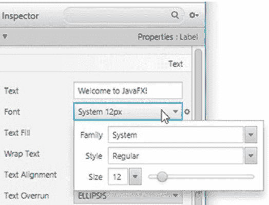

#### 图 3.15

设置 Label 的字体属性。

描述

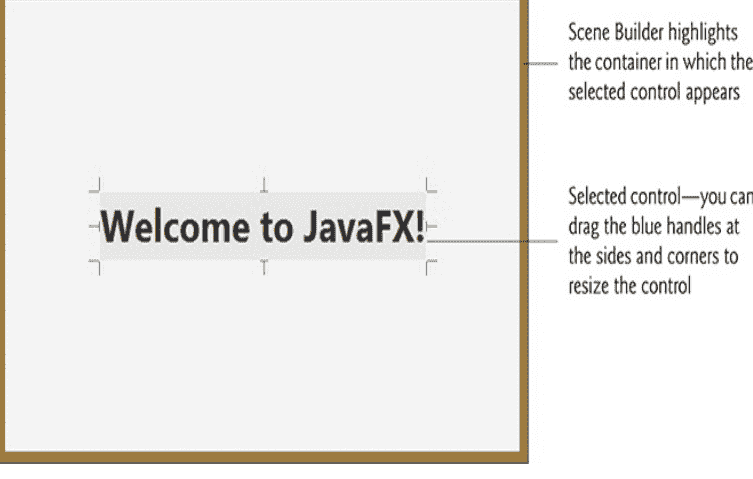

#### 图 3.16

添加并配置 Label 后欢迎 GUI 设计。

描述

### 3.6.9 添加并配置 ImageView

最后，你将添加显示 `bug.png` 的 `ImageView`。

#### 向 VBox 中添加 ImageView

从库窗口的 Controls 部分将 `ImageView` 拖放到 `Label` 下方，如图 3.17 所示。你也可以从 Controls 部分双击 `ImageView` 来添加。

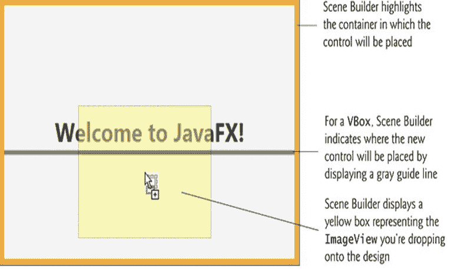

#### 图 3.17

拖放 ImageView 到 Label 下。

#### 设置 ImageView 的图像

接下来，你将设置图像：

1. 在检查器的 Properties 部分中点击 Image 属性右侧的省略号 (`...`)。Scene Builder 打开一个对话框。
2. 选择 `ImageView`，点击 Open（打开）。

#### 更改 ImageView 的尺寸

我们希望按原始尺寸显示图像。要设置这些属性：

1. 展开 **Inspector** 检查器的 **Layout** 部分。
2. 悬停在 **ImageView** 属性上。
3. 设置 Fit Width（适应宽度）和 Fit Height（适应高度）值以匹配图像的横比例。你现在已经完成了 GUI。通过选择 `File > Save`（文件 > 保存）保存 FXML 文件。


#### 图 3.18

内容面板中的完成 GUI。

描述

### 3.6.10 预览欢迎 GUI

你可以预览运行应用程序时的外观。要这样做，选择 `Preview > Show Window`（预览 > 显示窗口），如图 3.19 所示。


#### 图 3.19

在 Microsoft Windows 10 上预览欢迎 GUI——只有窗口边框会有不同。

描述

### GUI 与图形案例

#### 练习

3.1 使用 Flickr 等网站寻找四个地标图像。创建一个类似于 Welcome 的应用程序，将图像排列在组合中。添加标识每个地标的文本。你可以使用项目中的图像，也可以指定在线图像的 URL。

### 3.7 总结

在本章中，你学习了如何创建自己的类和方法，创建这些类的对象并调用这些对象的方法来执行操作。你声明了类的实例变量来维护每个对象的数据，并声明了自己的方法来操作这些数据。你学习了如何调用方法来让它执行任务，如何通过参数向方法传递信息（这些值会被赋值给方法参数），以及如何接收方法的返回值。你学习了方法的局部变量与类的实例变量之间的区别，并知道只有实例变量会自动初始化。你还学习了如何使用类的构造函数来指定对象实例变量的初始值。你了解了如何创建 UML 类图来可视化建模类的方法、属性和构造函数。你可能已经开始了可选的 GUI 与图形案例研究，学习如何编写你的第一个 GUI 应用程序。在下一章中，我们将开始介绍控制语句，它们指定了执行的顺序。

执行程序的操作。你将在方法中使用这些操作来指定它们应该如何排列任务。

# 总结

## 3.2 实例变量、set 方法和 get 方法

- 你创建的每个类都变成一种新类型，可用于声明变量和创建对象。
- 你可以根据需要声明新类；这是 Java 被认为是一种可扩展语言的原因之一。

### 3.2.1 带有实例变量、set 方法和 get 方法的 Account 类

- 任何以访问修饰符（第 70 页）`public` 开头的类声明都必须存储在与类名相同且以 `.java` 文件扩展名结尾的文件中。
- 每个类声明都包含关键字 `class`，后面紧跟类的类名。
- 类名、方法名和变量名都是标识符。按照惯例，它们都使用驼峰命名法（camel-case）。类名以大写字母开头，变量名以小写字母开头。
- 对象拥有属性，这些属性实现为实例变量（第 71 页），并在其整个生命周期内随对象存在。
- 实例变量在调用对象的方法之前、在方法执行期间以及方法执行完成后都存在。
- 类通常包含一个或多个方法，用于操作属于该类特定对象的实例变量。
- 类的每个对象（实例）都拥有该类每个实例变量的副本。
- 大多数实例变量的声明前面都有关键字 `private`（第 71 页），这是一种访问修饰符。用访问修饰符 `private` 声明的变量或方法仅对其所在类中的方法可访问。
- 参数声明在逗号分隔的参数列表（第 72 页）中，该列表位于方法声明中方法名后的括号内。多个参数之间用逗号分隔。每个参数必须指定一个类型，并在后跟一个变量名。
- 在特定方法体内部声明的变量是局部变量，只能在该方法中使用。当方法终止时，其局部变量的值就会丢失。方法的参数是该方法的局部变量。
- 每个方法的体都由左括号和右括号（`{` 和 `}`）分隔。
- 每个方法的体包含一个或多个执行方法任务的语句。
- 方法的返回类型指定了返回给方法调用者的数据类型。关键字 `void` 表示方法将执行任务但不返回任何信息。
- 方法名后的空括号表示该方法不需要任何参数来执行其任务。
- 当指定了 `void` 的返回类型（第 72 页）的方法被调用并完成任务时，该方法必须向其调用方法返回结果。
- `return` 语句（第 73 页）将值从被调用的方法传回给调用者。
- 类通常提供 `public` 方法，允许类的客户端设置或获取 `private` 实例变量。

### 3.2.2 创建并使用 Account 类对象的 AccountTest 类

- 创建另一个类的对象并调用该对象方法的类被称为驱动类（driver class）。
- `Scanner` 方法 `nextLine()`（第 74 页）读取字符直到遇到换行符为止，然后将这些字符作为 `String` 返回。
- `Scanner` 方法 `next()`（第 74 页）读取字符直到遇到任何空白字符为止，然后将这些字符作为 `String` 返回。
- 类实例创建表达式（第 74 页，`class instance creation expression`）以关键字 `new` 开头并创建一个对象。
- 构造方法类似于方法，但由 `new` 操作符隐式调用，用于在对象创建时初始化对象的实例变量。
- 要调用对象的方法，请在对象名后跟一个点分隔符（第 75 页）、然后是方法名和一组包含方法参数的括号。
- 局部变量不会自动初始化。每个实例变量都有一个默认初始值——当你不明确指定实例变量的初始值时，由 Java 提供的该值。
- `String` 类型实例变量的默认值为 `null`。
- 方法为每个方法参数提供值——称为参数（arguments）。每个参数的值被赋值给方法头部中对应的参数。
- 方法中的参数数量必须与方法声明中参数列表中的参数数量匹配。
- 方法调用中的参数类型必须与方法声明中对应参数的类型保持一致。

### 3.2.3 编译和运行具有多个类的应用程序

`javac` 命令可以同时编译多个类。只需在命令后列出源代码文件名，每个文件名之间用空格隔开。如果包含应用程序的目录只包含一个应用程序的文件，你可以使用命令 `javac *.java` 编译它的所有类。`*.java` 中的星号 (`*`) 表示当前目录中所有以 ".java" 扩展名结尾的文件都应该被编译。

### 3.2.4 Account：带有实例变量和 set、get 方法的 UML 类图

- 在 UML 中，每个类在类图（第 77 页）中建模为一个具有三个区域的矩形。顶部包含居中加粗的类名。中间包含属性，这些属性对应于实例变量。底部包含操作，这些操作对应于方法和构造方法。
- UML 将实例变量表示为属性名，后跟一个冒号和类型。
- 私有属性在 UML 中前面有一个减号 (`-`)。
- UML 通过列出操作名后跟一组括号来对操作进行建模。操作名前的加号 (`+`) 表示该操作是公共的（即 Java 中的公共方法）。
- UML 通过在括号内列出参数名、冒号和参数类型来对操作参数建模。
- UML 通过在括号后放置冒号和返回类型来指示操作的返回类型。
- UML 类图不为没有返回的操作指定返回类型。
- 将实例变量声明为私有被称为信息隐藏。

### 3.2.5 关于 AccountTest 的额外说明

- 你必须显式调用除 `main` 以外的其他方法以便它们执行任务。
- 使 JVM 定位并调用 `main` 以启动应用程序的关键部分是 `static` 关键字，它表示 `main` 是一个静态方法，可以在不先创建类对象的情况下调用。
- Java 程序中大多数类必须显式导入。同一目录下编译的类默认处于同一个包——即默认包。同一包内的类隐式导入到包内其他类的源文件中。当包中的一个类使用同包的另一个类时，不需要导入语句。
- 如果始终使用完全限定类名（包括包名和类名）来引用类，则不需要导入语句。

### 3.2.6 使用私有实例变量和公共 set、get 方法的软件工程

- 将实例变量声明为私有被称为信息隐藏。

## 3.3 Account 类：使用构造方法初始化对象

你声明的每个类都可以提供带参数的构造方法，用于在创建对象时初始化类的对象。

- Java 要求每个创建的对象都必须调用构造方法。
- 构造方法可以指定参数，但不能指定返回类型。
- 如果类没有定义构造方法，编译器会提供一个无参数的默认构造方法（第 82 页），类的实例变量将初始化为它们的默认值。
- 如果你为类声明了构造方法，编译器就不会为该类创建默认构造方法。
- UML 在类图的第三个区域对构造方法。为了区分构造方法与类的操作，UML 在构造方法名前用双角括号（`«` 和 `»`；第 82 页）放置“constructor”字样。

## 3.4 带有余额的账户类；浮点数

- 浮点数（第 83 页）是带有小数点的数字。Java 提供了两种原始类型在内存中存储浮点数——`float` 和 `double`。
- `float` 类型的变量表示单精度浮点数，具有七位有效数字。`double` 类型的变量表示双精度浮点数。它们需要的内存是 `float` 变量的两倍，并提供 15 位有效数字——大约是 `float` 变量精度的两倍。
- 浮点字面量（第 83 页）默认类型为 `double`。
- 格式符 `%f`（第 86 页）用于输出 `float` 或 `double` 类型的值。格式符 `%.2f` 指定在浮点数的小数点右侧输出两位精度（第 86 页）。
- `Scanner` 方法 `nextDouble()`（第 87 页）返回一个 `double` 值。
- `double` 类型实例变量的默认值为 `0.0`（或简单地为 `0`），`int` 类型实例变量的默认值为 `0`。

## 3.5 原始类型 v. 引用类型

- Java 中的类型分为两类——原始类型和引用类型。原始类型是 `boolean`、`byte`、`char`、`short`、`int`、`long`、`float` 和 `double`。所有其他类型都是引用类型，类指定了对象的类型，它们都是引用类型。
- 原始类型变量一次只能存储其声明类型的一个值。
- 原始类型实例变量会被默认初始化。`byte`、`char`、`short`、`int`、`long`、`float` 和 `double` 类型的变量初始化为 `0`。`boolean` 类型变量初始化为 `false`。
- 引用类型变量（称为引用；第 88 页）存储计算机内存中对象的位置。此类变量引用程序中的对象。被引用的对象可能包含许多实例变量和方法。
- 引用类型实例变量默认初始化为值 `null`。
- 调用对象的方法需要对对象的引用（第 88 页）。原始类型变量不引用对象，因此不能用于调用方法。

## 练习题

1. **3.1** 为下列每项填空：

   - 1. 每个以关键字 ____ 开头的类声明必须存储在与类名完全相同且以 .java 扩展名结尾的文件中。
   - 2. 类声明中的关键字 ____ 后面紧跟类的类名。
   - 3. 关键字 ____ 从系统请求内存以存储对象，然后调用相应类的构造函数来初始化对象。
   - 4. 每个参数必须指定一个（n）____ 和一个（n）____。
   - 5. 默认情况下，在同一目录下编译的类被认为在同一个包中，被称为 ____。
   - 6. Java 提供了两种原始类型在内存中存储浮点数：____ 和 ____。
   - 7. ____ 类型的数字变量。
   - 8. `Scanner` 方法 ____ 返回一个 `double` 值。
   - 9. 关键字 `public` 是一种访问 ____。
   - 10. 返回类型表示方法将不返回值。
   - 11. `Scanner` 方法 ____ 读取字符直到遇到换行符，然后将这些字符作为 `String` 返回。
   - 12. `String` 类位于包 ____ 中。
   - 13. 如果你始终使用类的完全限定名引用类，则不需要（n）____。
   - 14. （n）____ 是带有小数点的数字，例如 7.33、0.0975 或 1000.12345。
   - 15. `float` 类型的变量代表 ____ 精度浮点数。
   - 16. 格式符 ____ 用于输出 `float` 或 `double` 的值。
   - 17. Java 中的类型分为两类—— ____ 类型和 ____ 类型。

2. **3.2** 判断下列每项是正确的还是错误的。如果是错误的，请解释原因。

   - 1. 按照惯例，方法名以大写字母开头，名称中后续后的单词都以首字母开头。
   - 2. 当一个包中的一个类使用同一包中的另一个类时，不需要 import 声明。
   - 3. 方法声明中方法名后的空括号 ____ 表示该方法不需要任何参数来执行任务。
   - 4. 原始类型变量可以用来调用方法。
   - 5. 在特定方法体中声明的变量是实例变量，可以在该类的所有方法中使用。
   - 6. 每个方法的体都由左括号和右括号 `{ }` 隔开。
   - 7. 原始类型局部变量会被默认初始化。
   - 8. 引用类型实例变量默认初始化为值 `null`。
   - 9. 任何包含 `public static void main(String[] args)` 的类都可以用于执行应用程序。
   - 10. 方法调用中的参数数量必须与方法声明中参数列表中的参数数量匹配。
   - 11. 出现在源代码中的浮点值被称为浮点字面量，其默认类型为 `float`。

3. **3.3** 局部变量和实例变量之间有什么区别？

4. **3.4** 参数和参数之间有什么区别？

## 练习题

1. **3.5**（关键字 `new`）`new` 的目的是什么？
2. **3.6**（默认构造函数）什么是默认构造函数？
3. **3.7**（实例变量）实例变量的目的是什么？
4. **3.8**（不导入类使用类）大多数类在使用之前需要被导入。
5. **3.9**（不导入类使用类）程序如何使用 `Scanner`？
6. **3.10**（set 和 get 方法）类为什么可能提供 set 和 get 方法？
7. **3.11**（修改类）修改 `Account` 类（图 3.8）以提供从 `Account` 中取款的方法。确保取款金额不超过余额。如果超过，余额保持不变且方法应打印“withdrawal amount exceeded.”
8. **3.12**（Invoice 类）创建一个名为 `Invoice` 的类，可能可以使用它来表示已售物品的发票。`Invoice` 应该包含四项信息——零件号（`String` 类型）、描述（`String` 类型）、商品数量（`int` 类型）和单价价格（`double`）。你的类应该有一个初始化变量的构造函数。为每个实例变量提供一个 set 和 get 方法。此外，提供一个名为 `getInvoiceAmount` 的方法计算发票金额（即：数量乘以单价），然后返回金额。如果数量不为正，则应设置为 0。如果价格不为正，则应设置为 0。编写一个名为 `InvoiceTest` 的测试来展示类的功能。
9. **3.13**（Employee 类）创建一个名为 `Employee` 类，包含三个实例变量——名（`String` 类型）、姓（`String` 类型）和月薪（`double`）。提供一个初始化变量的构造函数。为每个实例变量提供 set 和 get 方法。如果月薪不为正，则不要设置其值。编写一个名为 `EmployeeTest` 的测试来展示 `Employee` 的功能。创建两个 `Employee` 对象并显示每个对象的年薪。然后给每个 `Employee` 涨薪 10%。
10. **3.14**（Date 类）创建一个 `Date` 类，包含三个实例变量——月份（`int` 类型）、日期（`int` 类型）和年份（`int` 类型）。提供一个初始化这三个变量的构造函数并假设值是正确的。为每个实例变量提供 set 和 get 方法。提供一个 `dateFormat` 方法，用斜杠（/）分隔月份、日期和年份。编写一个名为 `DateTest` 的测试来展示 `Date` 的功能。
11. **3.15**（移除方法中的重复代码）在图 3.9 的 `AccountTest` 中，`main` 方法包含六条语句（行 11–12、13–14、26–27、28–29、38–39 和 40–41），它们显示的 Account 对象仅取决于操作的 Account 对象——`account1` 或 `account2`。在此练习中，你将定义一个新的 `displayAccount` 方法，包含该输出语句的一个副本。该方法的参数是一个 `Account` 对象，该方法将输出对象的名称和余额。你随后把 `main` 中的六条重复语句替换为对 `displayAccount` 的调用并将特定的 `Account` 对象作为参数传递。修改图 3.9 中的 `Account` 类，在 `main` 方法的右括号之后、`AccountTest` 类右括号之前声明 `displayAccount` 方法（图 3.20）。将方法体中的注释替换为显示 `accountToDisplayName` 名称和余额的语句。

```java
// 代码块内容待补充
```


```java
public static void displayAccount(Account a) {

    // 在此处放置用于显示

    // accountToDisplay 的名称和余额的语句

}
```

## 图 3.20

添加到 `Account` 类的 `displayAccount` 方法。

请记住 `main` 是一个静态方法，因此它可以在不先创建 `main` 所在类对象的情况下被调用。我们也将 `displayAccount` 方法声明为静态方法。当 `main` 需要在不先创建该类对象的情况下调用同类中的另一个方法时，该方法也必须声明为静态。

一旦你完成了 `displayAccount` 的声明，请修改 `main`，将显示每个 `Account` 名称和余额的语句替换为对 `displayAccount` 的调用——根据情况分别接收 `account1` 或 `account2` 对象作为参数。然后，测试更新后的 `AccountTest` 类，以确保其输出与图 3.9 所示的输出相同。

## 改变

- 1. 3.16（目标心率计算器）在运动时，你可以使用心率监测仪查看你的心率是否在教练和导师建议的安全范围内。根据美国心脏协会（AHA）(http://bit.ly/TargetHeartRates)，计算你每分钟最大心率次数的公式为 220 减去你的年龄。[注意：你的目标心率是最大心率的 50–85% 范围。]这些公式由 AHA 提供。最大心率和目标心率可能会根据个人的健康状况、健身和性别而异。在开始或修改运动计划之前，请始终咨询医生或合格的医疗专业人员。创建一个 `HeartRates` 类。

类属性应包括人的名、姓和出生日期（由出生月份、日、年份的独立属性组成）。你的类应该有一个构造函数，接收这些数据作为参数。该类还应该包含一个计算并返回个人年龄（以岁为单位）的方法，以及一个计算并返回个人目标心率的方法。编写一个 Java 程序，提示输入人的信息，实例化 `HeartRates` 类的对象并打印对象中的信息——包括人的名、姓和出生日期——然后计算并打印人的年龄（岁）、最大心率和目标心率范围。

- 2. 3.17（健康记录的计算机化）最近新闻报道的一个健康问题是健康记录的计算机化。由于敏感的隐私和安全担忧等，这种可能性正在被谨慎对待。[我们将在后面的练习中解决这些问题。]健康记录计算机化可以让患者更容易在不同的医疗专业人员之间分享他们的健康状况和历史。这可以提高医疗质量，帮助避免药物冲突和错误处方，降低成本，并在紧急情况下拯救生命。在本次练习中，你将为一个人设计一个“启动器 `HealthProfile` 类”。类属性应包括人的名、姓、性别、出生日期（由出生月份、日、年份的独立属性组成）、身高（英寸）和体重（磅）。你的类应该有一个接收这些数据的构造函数。对于每个属性，提供 set 和 get 方法。该类还包含计算并返回用户年龄（岁）、最大心率和目标心率范围（参见练习 3.16）、体质量指数（BMI；参见练习 2.23）的方法。编写一个 Java 程序，提示输入人的信息，为这个人实例化 `HealthProfile` 类对象并打印该对象的信息——包括人的名、姓、性别、出生日期、身高和体重——然后计算并打印人的年龄（岁）、BMI、最大心率和目标心率范围。它还应该显示练习 2.33 中的 BMI 数值表。

# 4 控制语句：第 1 部分；赋值、++ 和 -- 运算符

## 目标

在本章中，你将：

- 学习基础解决问题的技术。
- 通过自顶向下、逐步细化的过程开发算法。
- 使用 `if` 和 `if...else` 选择语句在备选操作之间进行选择。
- 使用 `while` 迭代语句在程序中重复执行语句。
- 使用计数控制迭代和哨兵控制迭代。
- 使用复合赋值运算符以及递增和递减运算符。
- 了解基本数据类型的可移植性。

## 提纲

- 1. 4.1 引言
- 2. 4.2 算法
- 3. 4.3 伪代码
- 4. 4.4 控制结构
  - 1. 4.4.1 Java 中的顺序结构
  - 2. 4.4.2 Java 中的选择语句
  - 3. 4.4.3 Java 中的迭代语句
  - 4. 4.4.4 Java 控制语句总结
- 5. 4.5 if 单分支选择语句
- 6. 4.6 if...else 双重选择语句
  - 1. 4.6.1 嵌套 if...else 语句
  - 2. 4.6.2 悬空 else 问题
  - 3. 4.6.3 块
  - 4. 4.6.4 条件运算符 ( `?:` )
- 7. 4.7 Student 类：嵌套 if...else 语句
- 8. 4.8 while 迭代
- 9. 4.9 制定算法：计数控制迭代
- 10. 4.10 制定算法：哨兵控制迭代
- 11. 4.11 制定算法：控制语句
- 12. 4.12 复合赋值运算符
- 13. 4.13 递增和递减运算符
- 14. 4.14 基本类型
- 15. 4.15 (可选) GUI 和图形案例研究：事件处理；绘线
  - 1. 4.15.1 测试完成的程序
  - 2. 4.15.2 构建 GUI
  - 3. 4.15.3 程序化地与 GUI 交互
  - 4. 4.15.4 DrawController 类
  - 5. 4.15.5 Draw 类——主类
- 16. 4.16 总结
  - 1. 总结
  - 2. 自习练习
  - 3. 自习练习答案
  - 4. 练习
  - 5. 改变

## 4.1 引言

在编写解决问题的程序之前，你应该对问题有深入的理解，并有一个仔细计划的解决方法。在编写程序时，你还应该了解这些构建块并采用成熟的构造技术。在本章和下一章中，我们将讨论这些问题，这里提出的理论和原理对于构建类和操作对象至关重要。我们将详细讨论 Java 的 `if` 语句，并引入 `if...else` 和 `while` 语句——所有这些构建块允许你指定方法执行所需的逻辑。我们还引入了复合赋值运算符以及递增和递减运算符。最后，我们考虑了 Java 基本类型的可移植性。

## 4.2 算法

任何计算问题都可以通过按顺序执行一系列操作来解决。根据以下方面制定问题的程序：

1. 要执行的操作以及
2. 执行操作的顺序

就称为算法。接下来的示例证明了正确指定操作执行的顺序是重要的。

考虑“起床”算法，其后是一个高管去上班的执行过程：(1) 起床；(2) 脱掉睡衣；(3) 洗澡；(4) 穿衣服；(5) 吃早餐；(6) 开车上班。这个常规让高管为做出关键决策做好了准备。假设以略有不同的顺序执行相同的步骤：(1) 起床；(2) 脱掉睡衣；(3) 穿衣服；(4) 洗澡；(5) 吃早餐；(6) 开车上班。在这种情况下，我们的高管上班时是全身湿透的。指定语句执行的顺序被称为程序控制。

## 4.3 伪代码

伪代码是一种非正式语言，它可以帮助你开发算法，而无需担心 Java 语言语法的严格细节。我们展示的伪代码对于开发那些将将转换为 Java 程序结构化部分的算法特别有用。我们在本书中使用的伪代码类似于日常英语——它既方便又于用户，但它并不是一种真正的计算机编程语言。你将在图 4.7 中看到用伪代码编写的算法。当然，你可以使用自己的母语言（或多种语言）来编写自己的伪代码。

伪代码不会在计算机上执行。相反，它帮助你在尝试用编程语言（如 Java）编写程序之前，先在脑中“思考出”一个程序。本章提供了几个使用伪代码开发 Java 程序的示例。

我们展示的伪代码风格完全由字符组成，因此你可以使用任何文本编辑器程序方便地输入伪代码。一个准备得当的伪代码程序可以很容易转换为对应的 Java 程序。

伪代码通常只描述一条语句，代表你将程序从伪代码转换为 Java 并在计算机上运行程序后所发生的动作。

这些动作可能包括输入、输出或计算。在我们的伪代码中，我们通常不包含变量声明，但某些程序员选择列出变量并说明它们的用途。

## 4.4 控制结构

通常情况下，程序中的语句按照它们编写的顺序一个接一个执行。这一过程被称为顺序执行。我们很快将讨论的各种 Java 语句允许你指定下一个执行的语句不一定是序列顺序中的后一个。这被称为控制转移。

在 20 世纪 60 年代，人们清楚地看到，不加区分的转移是软件开发小组经历的许多困难的根源。人们将指责指向了 `goto` 语句（用于当时的大多数编程语言），它允许你将控制转移到程序中广泛范围的一个目标。[注：Java 没有 `goto` 语句；但是 `goto` 单词被 Java 保留，不应在程序中作为标识符使用]

Bohm 和 Jacopini¹的研究证明了可以在不使用 `goto` 语句的情况下编写程序。那个时代程序员面临的挑战是将他们的风格转向“无 goto 编程”。结构化编程这一术语几乎与“消除 goto”成为同义词。直到 20 世纪 70 年代，大多数程序员才认真对待结构化编程。结果是令人印象的。软件开发小组报告说开发时间缩短，系统按时交付频率更高，软件项目经常在预算内完成。这些成功的关键在于结构化程序更清晰、更容易调试和修改，而且从一开始就可能没有错误。

> C. Bohm and G. Jacopini, "Flow Diagrams, Turning Machines, and Languages with Two Formation Rules," Communications of the ACM, Vol. 9, No. 5, May 1966, pp. 336–371.

Bohm 和 Jacopini 的工作证明了所有程序都可以用三种控制结构来编写——**顺序结构**、**选择结构**和**迭代结构**。当我们引入 Java 的控制结构实现时，我们将使用 Java 语言规范中的术语将它们称为“控制语句”。

### 4.4.1 Java 中的顺序结构

顺序结构是构建在 Java 内部的。除非另有说明，否则计算机按照 Java 语句编写的顺序一个接一个地执行它们——即按顺序执行。图 4.1 中的 UML **活动图**展示了一个典型的顺序结构，其中按顺序执行两个计算。Java 允许你按顺序拥有任意数量的动作。正如我们很快看到的，在任何可以放置单个动作的地方，我们都可以按顺序放置多个动作。

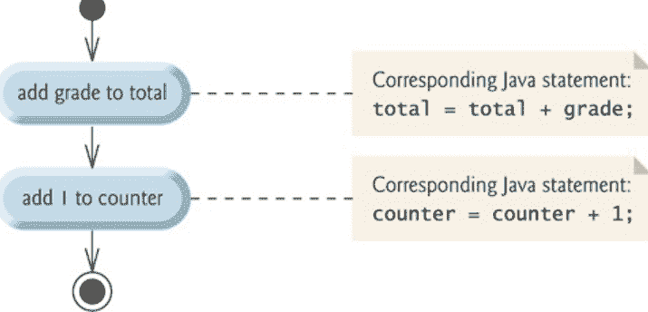

## 图 4.1

顺序结构活动图。

UML 活动图对软件系统部分的工作流（也称为活动）建模。此类工作流可能包括算法的一部分，例如图 4.1 中的顺序结构。活动图由符号组成，例如动作状态符号（左侧和右侧替换为向外圆弧的矩形）、菱形和小圆圈。这些符号由转换箭头连接，箭头代表活动的流——即动作应该发生的顺序。

与伪代码一样，活动图帮助你开发和表示算法。活动图清晰地显示了控制结构是如何运作的。我们在本章和第 5 章中使用 UML 来显示控制语句中的控制流。在线章节 33–34 在一个现实世界的自动取款机案例研究中使用了 UML。

考虑图 4.1 中的活动图。它包含两个动作状态，每个状态都包含一个动作表达式——“将分数加到总和”或“给计数器加1”，指定了执行特定动作。其他动作可能包括计算或输入/输出操作。箭头代表转换，指示了动作状态所代表的动作发生的顺序。实现图 4.1 所示所示的程序首先将分数加到总和，然后给计数器加 1。

活动图顶部的实心圆表示初始状态——在程序执行建模动作之前的工作流的开始。图底部由空心圆包围的实心圆表示最终状态——在程序执行其动作后的工作流的结束。

图 4.1 还包括右上角折叠的矩形。这些是 UML 注释（类似于 Java 中的注释）——解释性备注，用于说明每个动作相关的 Java 代码。虚线连接每个注释与它描述的元素。活动图通常如此。有关 UML 的更多信息，请参见在线章节 33–34 或访问 http://www.uml.org。

### 4.4.2 Java 中的选择语句

Java 有三种类型的选择语句（在本章中讨论）。`if` 语句在条件为真时执行动作，在条件为假时跳过它。`if...else` 语句在条件为真时执行动作，在条件为假时执行另一个动作。`switch` 语句（第 5 章）根据表达式的值执行许多动作之一。

`if` 语句是单选择语句，因为它选择一个动作（或正如我们所看到的，一组动作）。`if...else` 语句被称为双选择语句，因为它在两个不同的动作（或动作组）之间进行选择。`switch` 语句被称为多选择语句，因为它在许多不同的动作中进行选择。

### 4.4.3 Java 中的迭代语句

Java 四迭代语句也称为重复语句或循环语句），允许程序只要条件（称为循环条件）为真就重复执行语句。迭代语句是 `while`、`do...while`、`for` 和增强型 `for`。（第 5 章介绍了 `do...while` 和 `for` 语句，第 7 章介绍了增强型 `for` 语句。）`while` 和 `for` 语句执行其体内的零次或多次——如果循环条件最初为假，则动作（或动作组）将不执行。`do...while` 语句执行其体内的一次或多次动作。`if`、`else`、`switch`、`while`、`do` 和 `for` 是 Java 关键字。Java 关键字列表见附录 C。

### 4.4.4 Java 控制语句总结

Java 只有三种控制结构，从现在起我们将它们统称为控制语句：顺序语句、选择语句（三种）和迭代语句（四种）。每个程序都是通过组合尽可能多的这些语句构成的，以实现相应的算法。我们可以将每个控制语句建模为活动图。与图 4.1一样，每个图都包含一个初始状态和一个最终状态，分别代表控制语句的入口和出口点。

单入口/单出口控制语句使得构建程序变得简单——我们只需将一个语句的出口点连接到下一个语句的入口点。我们称这种为控制语句堆叠。

**嵌套**（nesting）——即一个控制语句出现在另一个语句*内部*。因此，Java 程序中的算法仅由三种控制语句构建而成，且仅以两种方式组合。这就是简单性的精髓。

## 4.5 if 单选择语句

程序使用选择语句在备行动方案之间进行选择。例如，假设考试及格线是 60 分。伪代码语句

```
If student's grade is greater than or equal to 60
    Print "Passed"
```

决定了“学生成绩大于或等于 60”这一条件是否为真。如果是，则打印“Passed”，并按顺序执行下一条伪代码。如果条件为假，则忽略 Print 语句，并按顺序执行下一条伪代码。该选择语句第二行的缩进是可选的，但建议这样做，因为这强调了结构化程序的固有结构。

上述的伪代码 If 语句可以在 Java 中写为：

```java
if (studentGrade >= 60) {
    System.out.println("Passed");
}
```

该 Java 代码与伪代码紧密对应。这是伪代码的特性之一，使其成为非常有用的程序开发工具。

### if 语句的 UML 活动图

图 4.2 展示了单选择 if 语句。该图包含了活动图中最重要的符号——菱形（或决策符号），它表示要做出决策。工作流沿着由符号相关的守护条件（guard conditions）决定的路径继续，这些条件为真或假。从决策符号发出的每个转换箭头都有一个守护条件（在箭头旁边的方括号指定）。如果守护条件为真，工作流进入转换箭头所指向的动作状态。在图 4.2 中，如果成绩大于或等于 60，程序打印“Passed”，然后转换到活动的最终状态。如果成绩小于 60，程序将直接转换到最终状态而不显示任何消息。

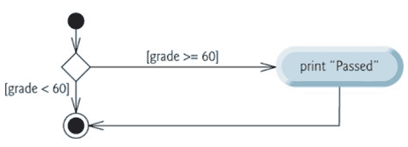

## 图 4.2

if 单选择语句 UML 活动图。

if 语句是一种单入口/单出口的控制语句。我们将看到，其余控制语句的活动图也包含初始状态、转换箭头、指示要执行动作的动作状态、指示要做出决策的决策符号（带有守护条件）以及最终状态。

## 4.6 if...else 双选择语句

if 单选择语句仅在条件为真时执行动作；否则，跳过该动作。if...else 双选择语句允许你在条件为真时执行一个动作，在条件为假时执行另一个动作。例如，伪代码语句

```
if student's grade is greater than or equal to 60
    Print "Passed"
Else
    Print "Failed"
```

如果学生成绩大于或等于 60，则打印“Passed”，但如果小于 60，则打印“Failed”。在何种情况下，打印发生后，都会按顺序执行下一条伪代码。

上述的 If...Else 伪代码语句可以在 Java 中写为：

```java
if (grade >= 60) {
    System.out.println("Passed");
} else {
    System.out.println("Failed");
}
```

else 的体也缩进了。无论你选择何种缩进规范，都应该在整个程序保持一致。

### 良好的编程实践 4.1

对 if...else 语句的体语句进行缩进。大多数 IDE 都会为你完成这一点。

### 良好的编程实践 4.2

如果有几层缩进，每一层都应该缩进相同的额外空间。

### if...else 语句的 UML 活动图

图 4.3 展示了 if...else 语句中的控制流。再次，UML 活动图中的符号（初始状态、转换箭头和最终状态外）代表动作状态和决策。

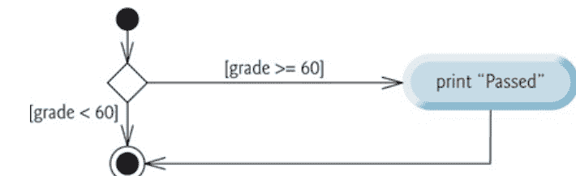

## 图 4.3

if...else 双选择语句 UML 活动图。

## 4.6.1 嵌套 if...else 语句

程序通过将 if...else 语句放在其他 if...else 语句内部来创建嵌套的 if...else 语句，测试多种情况。例如，以下伪代码表示嵌套的 if...else，对于大于或等于 90 的成绩打印 A，80 到 89 分打印 B，70 到 79 分打印 C，60 到 69 分打印 D，对所有成绩打印 F：

```
If student's grade is greater than or equal to 90
    Print "A"
else
    If student's grade is greater than or equal to 80
        Print "B"
    else
```


### 伪代码示例

If student's grade is greater than or equal to 70

    Print "C"

else

    Print "F"

### Java 实现

该伪代码可以写为 Java：

```java
if (studentGrade >= 90) {
    System.out.println("A");
} else if (studentGrade >= 80) {
    System.out.println("B");
} else if (studentGrade >= 70) {
    System.out.println("C");
} else {
    System.out.println("F");
}
```

### 错误预防提示 4.1

在嵌套的 `if...else` 语句中，确保你测试了所有可能的情况。许多程序员倾向于使用 `else if` 而不是嵌套的 `if` 语句，以保持代码的可读性。

### 4.6.2 悬悬 else 问题

在全文中我们总是将控制语句体包含在大括号 `{ }` 中。这避免了被称为“悬悬 else”的问题。我们在练习题 27-29 中研究这个问题。

### 4.6.3 块

`if` 语句通常在其体中期望一个语句。为了在 `if`（或 `if...else` 的 `else`）体中包含多个语句，请将语句在大括号内。在大括号中的语句（如方法的）形成一个**块**。块可以放置任何可以放置单个语句的地方。

以下示例在 `else` 部分包含了一个语句的块：

```java
if (grade >= 60) {
    System.out.println("Passed");
} else {
    System.out.println("Failed");
    System.out.println("You must take again");
}
```

在这种情况下，如果成绩小于 60，程序将执行 `else` 部分中的两个语句并打印：

```
Failed
You must take again
```

注意包裹这两个语句的大括号。这些大括号非常重要。如果没有大括号，语句

```java
System.out.println("You must take again");
```

将处于 `if...else` 语句 `else` 部分之外，无论成绩是否小于 60 都会执行。语法错误（如缺少大括号）会被编译器捕获。逻辑错误（例如块中漏掉了所有大括号）在执行时产生影响。非致命逻辑错误允许程序继续运行但会导致产生错误的结果。

就像块可以放置在任何可以放置单个语句的地方一样，也可以使用空语句。回顾第 2.8 节，空语句通过在通常会有语句的地方放置分号 (`;`) 来表示。

### 常见编程错误 4.1

在 `if` 或 `if...else` 语句的条件后放置分号，会导致单选择 `if` 语句的逻辑错误，以及双选择 `if...else` 语句的语法错误（当 `if` 部分包含实际体语句时）。

## 4.6.4 条件运算符 (?:)

Java 提供了条件运算符 (`?:`)，它可以替代简单的 `if...else` 语句。这可以让你的代码更短、更清晰。条件运算符是三元运算符（即它接受三个操作数）。操作数与 `?:` 符号共同构成一个条件表达式。第一个操作数（`?` 的左侧）是一个布尔表达式（即一个求值为布尔值——真或假的条件），第二个操作数（`?` 和 `:` 之间）是当条件为真时条件表达式的值，而第三个操作数（`:` 的右侧）是当条件为假时条件表达式的值。例如，以下语句打印了 `println` 的条件表达式参数的值：

```java
System.out.println(studentGrade >= 60 ? "Passed" : "Failed");
```

在该条语句中，如果布尔表达式 `studentGrade >= 60` 为真，则条件表达式求值为 "Passed"，如果为假，则求值为 "Failed"。因此这条带有条件运算符的语句执行的功能与本节之前所示的 `if...else` 语句基本相同。条件运算符的优先级较低，因此整个条件表达式通常放在括号中。条件表达式可以作为较大表达式的一部分，而 `if...else` 语句则不能。

### 错误预防提示 4.2

为 `?:` 运算符的第二和第三操作数使用相同类型的表达式，以避免细微的错误。

## 4.7 Student 类：嵌套 if...else 语句

图 4.4–4.5 的示例演示了嵌套的 `if...else` 语句，根据学生在课程中的平均分确定其字母等级。

### Student 类

`Student` 类（图 4.4）具有与 `Account` 类（在第 3 章中讨论）类似的特性。`Student` 类存储学生的姓名和平均分，并提供了操作这些值的方法。

```java
// 图 4.4: Student.java
// 存储学生姓名和平均分的 Student 类
public class Student {
    private String name;
    private double average;

    // 构造函数初始化实例变量
    public Student(String name, double average) {
        this.name = name;

        // 验证 average > 0.0 且 <= 100.
        // 保留实例变量 average 的默认值
        if (average > 0.0) {
            if (average <= 100.0) {
                this.average = average; // 赋值给实例
            }
        }
    }

    // 设置学生的姓名
    public void setName(String name) {
        this.name = name;
    }

    // 获取学生的姓名
    public String getName() {
        return name;
    }

    // 设置学生的平均分
    public void setAverage(double studentAverage) {
        // 验证 average > 0.0 且 <= 100.
        // 保留实例 average 的当前值
        if (average > 0.0) {
            if (average <= 100.0) {
                this.average = average; // 赋值给实例
            }
        }
    }

    // 获取学生的平均分
    public double getAverage() {
        return average;
    }

    // 确定并返回字母等级
    public String getLetterGrade() {
        String letterGrade = ""; // 初始化为空

        if (average >= 90.0) {
            letterGrade = "A";
        } else if (average >= 80.0) {
            letterGrade = "B";
        } else if (average >= 70.0) {
            letterGrade = "C";
        } else if (average >= 60.0) {
            letterGrade = "D";
        } else {
            letterGrade = "F";
        }

        return letterGrade;
    }
}
```

### 图 4.4 说明

存储学生姓名和平均分的 `Student` 类。

该类包含：

- 类型为 `String` 的实例变量 `name`（第 4 行），用于存储学生姓名
- 类型为 `double` 的实例变量 `average`（第 5 行），用于存储学生在课程中的平均分
- 一个构造函数（第 8–18 行），用于初始化姓名和平均分——在第 5.9 节中，你将学习如何使用可以测试多个条件的逻辑运算符简洁地表示第 13–14 行和第 34–35 行
- 方法 `setName`（第 21–23 行），用于设置学生的姓名
- 方法 `getName`（第 26–28 行），用于获取学生的姓名
- 方法 `setAverage` 和 `getAverage`（第 31–43 行），用于设置和获取学生的平均分
- 方法 `getLetterGrade`（第 47–67 行），它使用嵌套的 `if...else` 语句根据学生的平均分确定其字母等级

构造函数和 `setAverage`（第 13–17 行和第 34–38 行）验证平均分是否大于 0.0 且小于等于 100.0。`getLetterGrade` 方法（第 47–67 行）使用嵌套的 `if...else` 语句根据学生的平均分确定其字母等级。


## 代码片段

```java
if (average > 0.0) {
    if (average <= 100.0) {
        this.average = average; // 赋值给实例
    }
}

// 获取学生的平均分
public double getAverage() {
    return average;
}

// 确定并返回字母等级
public String getLetterGrade() {
    String letterGrade = ""; // 初始化为空

    if (average >= 90.0) {
        letterGrade = "A";
    } else if (average >= 80.0) {
        letterGrade = "B";
    } else if (average >= 70.0) {
        letterGrade = "C";
    } else if (average >= 60.0) {
        letterGrade = "D";
    } else {
        letterGrade = "F";
    }
    return letterGrade;
}
```

## 4.8 迭代语句

迭代语句允许你指定程序在条件为真时重复某个操作。伪代码语句：

```
当列表中还有商品时
  购买商品并划掉
```

描述了购物过程中的迭代。如果条件“列表中还有商品”为真，则执行“购买商品并划掉”这一动作。该动作会在条件为真时重复执行。包含在 `while` 中的语句称为其体，体可以是单个语句或块。最终，条件将变为假（当购物列表最后一个商品被购买并划掉时）。此时，迭代终止，执行 `while` 语句后的第一个语句。

作为 Java 迭代语句的示例，考虑寻找大于 100 的 3 的幂的程序段。在执行以下 `while` 语句后，`product` 包含结果：

```java
int product = 3;
while (product <= 100) {
    product = 3 * product;
}
```

每次迭代将 `product` 乘以 3，因此 `product` 连续取值为 9、27、81 和 243。当 `product` 变为 243 时，`product <= 100` 为假。这终止了迭代，因此 `product` 的最终值为 243。此时，程序执行继续到 `while` 语句后的下一个语句。

## 图 4.5 创建并测试 Student 对象

```java
// 图 4.5: StudentTest.java
// 存储学生姓名和平均分的 Student 类
public class StudentTest {
    public static void main(String[] args) {
        Student student1 = new Student("Alice", 92.5);
        Student student2 = new Student("Bob", 85.0);
        Student student3 = new Student("Charlie", 78.0);

        System.out.println("Alice's grade: " + student1.getLetterGrade());
        System.out.println("Bob's grade: " + student2.getLetterGrade());
        System.out.println("Charlie's grade: " + student3.getLetterGrade());
    }
}
```

在前述 `while` 语句中的控制。再次强调，图中的符号（初始状态、转换箭头、一个终止状态和三处注释之外）代表一个操作状态和一个决策。此图引入了 UML 的合并符号。UML 将合并符号和决策符号都表示为菱形。合并符号用于将多个活动流汇为一条。在图中，合并符号将来自初始状态和操作状态的转换合并在一起，因此它们都汇入决策节点，由该决策决定循环是否应该开始（或继续）执行。

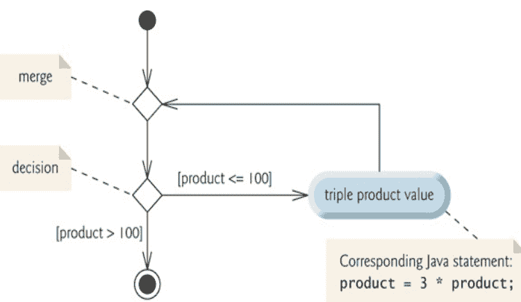

### 图 4.6 `while` 迭代语句的 UML 活动图

描述

决策符号和合并符号可以通过“输入”和“输出”转换箭头的数量来区分。决策符号有一个转换箭头指向菱形，并有两个或多个箭头从菱形指向外部，表示从该点可能发生的转换。此外，每个从决策符号输出的箭头旁边都有一个守卫条件。合并符号有两个或多个转换箭头指向菱形，且只有一个箭头从菱形指向外部，表示多个活动流合并以继续活动。与合并符号相关的转换箭头均不具有守卫条件。

图 4.6 清晰地展示了本节之前讨论的 `while` 语句的迭代。从操作状态出的转换箭头指向合并节点，程序流从那里转换回决策节点，该节点在每次循环迭代开始时进行测试。循环继续执行，直到守卫条件 `product > 100` 变为真。然后，`while` 语句退出（到达其终止状态），控制权传递给程序中顺序上的下一个语句。

## 4.9 算法的制定：计数控制迭代

为了说明算法是如何开发的，我们解决了两个计算学生平均分的变体问题。考虑以下问题陈述：

> 一个有十名学生的班级进行了测验。这次测验的成绩（0–100 范围内的整数）供你使用。确定该测验的班级平均分。

班级平均分等于分数总和除以学生人数。在计算机上解决此问题的算法必须输入每个分数，跟踪所有输入分数的总和，执行平均值计算并打印结果。

### 计数控制迭代的伪代码算法

让我们使用伪代码来列出要执行的操作并指定它们执行的顺序。我们使用计数控制迭代来逐个输入分数。这种技术使用一个名为计数器（或控制变量）的变量来控制一组语句执行的次数。计数控制迭代通常被称为**确定迭代**，因为在循环开始执行之前迭代次数是已知的。在这个示例中，当计数器超过 10 时迭代终止。本节介绍了一个完全开发的伪代码算法（图 4.7）以及实现该算法的相应 Java 程序（图 4.8）。在 4.10 节中，我们将演示如何使用伪代码从零开始开发此类算法。

注意图 4.7 算法中对总和（`total`）和计数器（`counter`）的引用。**总和**是一个用于累加多个值之和的变量。计数器是一个用于计数的变量——在这种情况下，分数计数器指示用户即将输入 10 个成绩中的哪一个。用于存储总和的变量在程序中使用之前，通常会被初始化为 0。


#### 软件工程观察 4.2

经验表明，在计算机上解决问题最困难的部分是开发解决方案的算法。一旦指定了正确的算法，从其生成一个良好的 Java 程序通常是简单的。

1. 将 `total` 设置为 0
2. 将计数器设为 1
3. 当计数器小于等于 10
4. 提示用户输入分数
5. 输入下一个分数
6. 将分数加到 `total`
7. 计数器加 1
8. 将 `total` 除以 10
9. 打印平均分

### 图 4.7 使用计数控制迭代的伪代码算法

### 计数控制迭代的实现

图 4.8 的 Java 代码实现了图 4.7 中描述的算法。`main` 方法使用计数控制迭代来解决平均分问题。

```java
import java.util.Scanner;

public class ClassAverage {
    public static void main(String[] args) {
        Scanner input = new Scanner(System.in);

        int total = 0;
        int gradeCounter = 1;

        while (gradeCounter <= 10) {
            System.out.print("Enter grade: ");
            int grade = input.nextInt();
            total += grade;
            gradeCounter++;
        }

        int average = total / 10;
        System.out.printf("Total of all 10 grades is %d\n", total);
        System.out.printf("Class average is %d\n", average);
    }
}
```

平均值。当执行到第 28 行时，程序终止。

注意，此示例只包含一个类，由一个方法完成所有工作。在本章和第 3 章中，你已经见过由两个类组成的示例——一个类包含实例变量和使用这些变量执行任务的方法，另一个类包含 `main` 方法，用于创建另一个类的对象并调用其方法。偶尔，当认为尝试创建一个可重用的类来演示某个概念并无太大意义时，我们将程序的语句完全放置在单个类的 `main` 方法中。

#### 关于整数除法和截断的说明

`main` 方法执行的平均值计算产生一个整数结果。程序的输出表明，示例执行中分数的数值总和为 846，当其除以 10 时，应该得到浮点数 84.6。然而，计算式 `total / 10`（图 4.8 的第 23 行）的结果是整数 84，因为 `total` 和 10 都是整数。两个整数相除的结果是整数除法——计算中的任何分数部分都会被截断（即丢失）。在下一节中，我们将看到如何从平均值计算中获得浮点结果。

#### 常见编程错误 4.4

假设整数除法会四舍五入（而不是截断）会导致错误的结果。例如，7 ÷ 4 在常规算术中得到 1.75，在整数算术中被截断为 1，而不是四舍五入为 2。

#### 关于算术溢出的说明

在图 4.8 的第 18 行：

```java
total = total + grade; // 将 grade 加到 total 中
```

将用户输入的每个分数加到 `total` 中。即使是这个简单的语句也存在潜在问题——整数相加可能导致结果无法存储在 `int` 变量中。这被称为算术溢出，会导致未定义行为，从而导致意料之外的结果，正如在处讨论：

> http://en.wikipedia.org/wiki/Integer_overflow#Security_ramifications

图 2.7 的加法程序在第 17 行存在相同的问题，它计算了用户输入的两个 `int` 值之和：

```java
int sum = number1 + number2; // 相加数字，然后存
```

可以存储在 `int` 变量中的最大值和最小值分别为 `Integer.MIN_VALUE` 和 `Integer.MAX_VALUE`。其他整数类型和浮点类型也有类似的常量。每个基本类型在 `java.lang` 包中都有一个对应的类类型。你可以在每个类的在线文档中查看这些常量的值。`Integer` 类的在线文档位于：

> http://docs.oracle.com/javase/8/docs/api/java/lang/Integer.html

在执行类似图 4.8 第 18 行和图 2.7 第 17 行那样的算术计算之前，确保它们不会溢出是一个良好的做法。执行此操作的代码在 CERT 网站上：

> http://www.securecoding.cert.org

只需搜索指南“NUM00-J”。该代码使用了 `&&`（逻辑与）和 `||`（逻辑或）运算符，这些运算符是在第 5 章引入的。在工业级代码中，你应该对所有计算进行此类检查。

#### 深入研究用户输入

每当程序从用户接收输入时，可能会出现各种问题。例如，在图 4.8 的第 17 行：

```java
int grade = input.nextInt(); // 输入下一个分数
```

我们假设用户将输入 0 到 100 范围内的整数分数。然而，输入分数的人可能会输入小于 0 的整数、大于 100 的整数、`int` 变量可存储值范围之外的整数、包含小数点的数字，或者包含字母或特殊符号（甚至不是整数）的值。

为了确保输入是有效的，工业级程序必须对所有可能的错误情况进行测试。输入分数的程序应该通过范围检查来对分数进行验证，以确保它们是 0 到 100 之间的值。你可以要求用户重新输入任何超出范围的值。如果程序需要来自特定值集的输入（例如，非连续的产品代码），你可以确保每个输入都匹配集合中的一个值。

## 4.10 制定算法：哨兵控制迭代

让我们对 4.9 节的类平均值问题进行推广。考虑以下问题：

> 开发一个类平均值程序，每次运行时都能处理任意数量学生的分数。

在之前的类平均值示例中，问题描述指定了学生人数，因此分数的数量（10）是预先已知的。在这个示例中，没有指示用户在程序执行期间将输入多少个分数。程序必须处理任意数量的分数。它如何确定何时停止输入分数？它将如何知道何时计算并打印平均值？

解决这个问题的一种方法是使用特殊值，称为哨兵值（也称为信号值、虚拟值或标记值），来指示“输入结束”。用户输入分数，直到所有合法分数输入完毕。哨兵控制迭代通常被称为**无限迭代**，因为循环开始之前迭代次数是未知的。显然，哨兵值必须选择一个不会与有效值混淆的值。测试分数是非负的，因此 -1 是此问题的有效哨兵值。因此，类平均值程序可能会处理输入流，直到哨兵值，然后应该计算并打印平均值。

### 使用自顶向下细化开发伪代码算法：顶部和第一次细化

我们使用自顶向下细化的技术来处理这个类平均值程序，这对于结构良好的程序至关重要。我们从顶部的伪代码表示开始——一个传达程序整体功能的语句：

```
确定测验的平均值
```

顶部实际上是程序的完整表示。遗憾的是，顶部很少能提供编写 Java 程序所需的足够细节。因此我们现在开始细化过程。我们将顶部分为一系列较小的任务，并按执行顺序列出它们。这产生了第一次细化：

```
初始化变量
输入、求和并计数测试分数
计算并打印平均值
```

这种细化只使用了顺序结构——列出的步骤应该一个接一个地执行。

#### 软件工程观察 4.3

每次细化以及顶部本身都是算法的完整规范——只是详细程度不同。

#### 软件工程观察 4.4

许多程序逻辑上可以分为三个阶段：初始化变量的初始化阶段；输入数据并相应调整程序变量的处理阶段；计算并输出最终结果的终止阶段。

### 进入第二次细化

之前的软件工程观察通常是自顶向下过程中第一次细化的全部需要。为了进入下一层次的细化——即第二次细化——我们落实特定的变量。在这个示例中，我们需要一个数字的运行和、已处理数字的计数、一个接收用户输入的每个分数的变量，以及一个存储计算平均值的变量。伪代码语句：

```
初始化变量
```

可以细化如下：

```
将 total 初始化为 0
将 counter 初始化为 0
```

只有 `total` 和 `counter` 在使用之前需要初始化。`average` 和 `grade`（分别用于计算平均值和用户输入）不需要初始化，因为它们的值在计算或输入时会被替换。

伪代码语句：

```
输入、求和并计数测试分数
```

需要通过迭代来输入每个成绩。我们无法预知将输入多少个成绩，因此我们将使用哨兵值控制迭代。用户一次输入一个成绩。在输入最后一个成绩后，用户输入哨兵值。程序在每次输入成绩后都会检查哨兵值，并在用户输入哨兵值时终止循环。对前述伪代码语句的第二次完善如下：

```
提示用户输入第一个成绩
输入第一个成绩（可能是哨兵值）
当用户尚未输入哨兵值时
  将此成绩累加到总和
  成绩计数器加 1
  提示用户输入下一个成绩
  输入下一个成绩（可能是哨兵值）
```

在伪代码中，我们不对构成 `while` 结构主体的语句使用大括号。我们只需对 `while` 下的语句进行缩进，以显示它们属于 `while`。再次，伪代码仅是一种非正式的程序开发辅助。

伪代码语句：

```
计算并打印班级平均分
```

可以完善如下：

```
如果计数器不等于零
    将平均设置为总和除以计数
    打印平均分
否则
    打印“未输入任何成绩”
```

我们在这里仔细地检查了除以零的可能性——这是一种逻辑错误，如果没有检测到，会导致程序失败或产生无效输出。班级平均分问题伪代码的完整第二次完善见图 4.9。

```
1 初始化总和为 0
2 初始化计数器为 0
3
4 提示用户输入第一个成绩
5 输入第一个成绩（可能是哨兵值）
6
7 当用户尚未输入哨兵值时
8 将此成绩累加到总和
9 成绩计数器加 1
10 提示用户输入下一个成绩
11 输入下一个成绩（可能是哨兵值）
12
13 如果计数器不等于零
14 将平均设置为总和除以计数
15 打印平均分
16 否则
17 打印“未输入任何成绩”
```

### 图 4.9 使用哨兵控制迭代的伪代码算法


# 图 4.9

使用哨兵值控制迭代的班级平均分伪代码算法。


# 错误预防技巧 4.4

在执行除法（`/`）或取模（`%`）计算且右操作数可能为零时，请对此进行测试并处理（例如显示错误消息），而不是让错误发生。

在图 4.7 和图 4.9 中，我们在伪代码中加入了空行和缩进，使其更具可读性。空行将算法分为不同的阶段并隔开控制语句；缩进则强调了控制语句的主体。

图 4.9 中的伪代码算法解决了更通用的班级平均分问题。该算法是在两次完善后开发的。有时需要更多的完善。


# 软件工程观察 4.5

当你指定的伪代码算法细节详尽到足够让你将伪代码转换为 Java 代码时，即可终止自顶向下、逐步完善的过程。通常情况下，实现 Java 程序是轻而易举的。

# 软件工程观察 4.6

某些程序员不使用伪代码等程序开发工具。他们觉得最终目标是在计算机上解决问题，而编写伪代码仅仅推迟了最终输出的产生。虽然这对于简单且熟悉的问题可能有效，但在大型复杂的项目中可能会导致严重的错误和延迟。

# 实现哨兵值控制迭代

在图 4.10 中，`main` 方法实现了图 4.9 的伪代码算法。虽然每个成绩都是整数，但平均分计算可能会产生一个带有小数点的数字——换句话说，是一个实数（浮点数）。`int` 类型无法表示此类的数字，因此该类使用 `double` 类型来表示。你还会看到控制语句可能会堆叠在一起（顺序执行）。`while` 语句（第 20–27 行）之后按顺序执行的是一个 `if...else` 语句（第 31–42 行）。该程序中的大部分代码与图 4.8 中的代码相同，因此我们集中在新概念上。

```java
// 图 4.10: ClassAverage.java

// 使用哨兵值解决班级平均分问题

import java.util.Scanner; // 程序使用 Scanner 类

public class ClassAverage {

    public static void main(String[] args) {

        // 创建 Scanner 以从控制台获取输入
        Scanner input = new Scanner(System.in);

        // 初始化阶段
        int total = 0; // 初始化成绩总和
        int gradeCounter = 0; // 初始化计数器

        // 处理阶段
        // 提示输入并读取成绩
        System.out.print("Enter grade or -1 to quit: ");
        int grade = input.nextInt();

        // 循环直到从用户处读取到哨兵值
        while (grade != -1) {
            total = total + grade; // 将成绩加到总和
            gradeCounter = gradeCounter + 1; // 计数器加1

            // 提示输入并读取下一个成绩
            System.out.print("Enter grade or -1 to quit: ");
            grade = input.nextInt();
        }

        // 终止阶段
        // 如果至少输入了一个成绩
        if (gradeCounter != 0) {
            // 使用小数计算平均分
            double average = (double) total / gradeCounter;

            // 输出总和和平均分（保留两位小数）
            System.out.printf("Total of %d grades: %d%n", gradeCounter, total);
            System.out.printf("Class average is %.2f%n", average);
        }
        else // 未输入成绩，因此输出
            System.out.println("No grades were entered");
    }
}
```

```text
Enter grade or -1 to quit: 97
Enter grade or -1 to quit: 88
Enter grade or -1 to quit: 72
Enter grade or -1 to quit: -1

Total of 3 grades: 257
Class average is 85.67
```

# 图 4.10

使用哨兵值控制迭代解决班级平均分问题。

# 哨兵迭代与计数迭代的程序逻辑

在图 4.10 中，`main` 方法实现了图 4.9 的伪代码算法。虽然每个成绩都是整数，但平均分计算可能会产生一个带有小数点的数字——换句话说，是一个实数（浮点数）。`int` 类型无法表示此类的数字，因此该类使用 `double` 类型来表示。你还会看到控制语句可能会堆叠在一起（顺序执行）。`while` 语句（第 20–27 行）之后按顺序执行的是一个 `if...else` 语句（第 31–42 行）。该程序中的大部分代码与图 4.8 中的代码相同，因此我们集中在新概念上。

在哨兵值控制循环中，提示信息应提醒用户哨兵值。

循环结束后，执行第 31–42 行的 `if...else` 语句。第 31 行的条件判断是否输入了成绩。如果没有输入，`if...else` 语句的 `else` 部分（第 40–42 行）将执行并显示“未输入任何成绩”，程序终止。

# while 语句中的括号

注意图 4.10 中 `while` 语句的块（第 20–27 行）。如果没有大括号，循环将认为其主体仅第一条语句，即将成绩加到总和。块中的最后三条语句将落在循环体之外，导致计算机错误地解释代码如下：

```java
while (grade != -1)
    total = total + grade; // 将成绩加到总和
gradeCounter = gradeCounter + 1; // 计数器加1
// 从用户处输入并读取下一个成绩
System.out.print("Enter grade or -1 to quit: ");
grade = input.nextInt();
```


# 良好的编程实践 4.3

如果用户在第 17 行没有输入哨值 -1（在 `while` 语句之前），上述代码会导致程序出现无限循环。


## 常见编程错误 4.5

漏掉限定代码块的括号会导致逻辑错误，例如无限循环。为了防止这个问题，一些程序员会将每个控制语句的体部括在括号中，即使该体部只包含一条语句。

## 基本数据类型之间的显式和隐式转换

如果至少输入了一个分数，图 4.10 中的第 33 行将计算分数的平均值。回想图 4.8，整数除法会产生整数结果。尽管变量 `average` 被声明为 `double`，但如果我们将平均值的计算写成：

```java
double average = total / gradeCounter;
```

那么在将除法结果赋值给 `average` 之前，该除法结果就已经丢失了商的小数部分。这是因为 `total` 和 `gradeCounter` 都是整数，而整数除法产生整数结果。

大多数平均值都不是整数（例如 0、-22 和 1024）。因此，在本示例中，我们将班平均分计算为浮点数。为了用整数值执行浮点运算，我们必须在计算中临时将这些值视为浮点数。Java 提供了一元转换运算符来完成此任务。图 4.10 的第 33 行使用 `(double)` 转换运算符来创建其操作数 `total` 的临时浮点数副本（该操作数似乎是运算符的）。以这种方式使用转换运算符被称为显式转换或类型转换。存储在 `total` 中的值仍然是整数。

现在的计算由一个浮点值（`total` 的临时 `double` 副本）除以整数 `gradeCounter` 组成。Java 只能评估操作数类型相同的算术表达式。为了确保这一点，Java 对选定的操作数执行了一种称为**提升**（或隐式转换）的操作。例如，在包含 `int` 和 `double` 值的表达式中，`int` 值被提升为 `double` 值以便在表达式中使用。在本示例中，`gradeCounter` 的值被提升为 `double` 类型，然后执行浮点除法并将计算结果赋值给 `average`。只要对计算中的任何变量应用 `(double)` 转换运算符，计算就会产生 `double` 结果。在本章稍后的部分，我们将讨论所有的基本数据类型。你将在第 6.7 节学习更多关于提升的规则。


## 常见编程错误 4.6

转换运算符可用于基本数值类型（如 `int` 和 `double`）以及相关引用类型之间的转换（正如我们在第 10 章“面向对象编程：多态与接口”中所讨论的）。转换为错误的类型可能会编译错误或运行时错误。

你通过在类型名称周围放置括号来形成转换运算符。该运算符是一个一元运算符——它只接受一个操作数。Java 还有加 (`+`) 和减 (`-`) 运算符，因此你可以写表达式 `-7` 或 `+5`。转换运算符从右到左关联，并与其他一元运算符具有相同的优先级。此优先级高于乘除运算符 `*`、`/` 和 `%` 的优先级。（参见附录 A 中的优先级表。）我们在优先级表中用 `(type)` 符号表示转换运算符，表示可以使用任何类型名称来形成转换运算符。

图 4.10 的第 38 行显示了班平均分。在本示例中，我们显示四舍五入到十分分之一的班平均分。`printf` 格式控制字符串中的格式指定符 `%.2f` 表示变量 `average` 的值在小数点后应显示两位精度——由格式中的 `.2` 表示。

## 浮点精度

浮点数并不总是精确的。浮点数在表示情况下是不精确的。


## 常见编程错误 4.7

以假设精确的方式使用浮点数会导致错误。

## 4.11 算法构造：嵌套控制语句

对于下一个示例，我们再次使用伪代码和自顶而下的细化来构造算法，并编写相应的 Java 程序。我们已经看到控制语句可以堆叠（在序列中）。在这种情况下，我们通过**嵌套**一个控制语句来实现另一个。

考虑以下问题：一所学院为学生准备房地产经纪人执业考试。去年，有十名完成该课程的学生参加了考试。学院想知道学生的考试情况。你被要求写一个程序来总结结果。你得到了这些学生的列表。每个名字旁边写着 1 表示通过考试，或 2 表示未通过考试。

你的程序应该如下分析结果：

- 输入每个测试结果（即 1 或 2）。每当程序请求另一个结果时，在屏幕上显示“Enter result”。
- 统计每个类型测试结果的数量。
- 显示结果总结，指出通过和未通过的人数。
- 如果通过人数

在仔细阅读问题描述后，我们做出了以下观察：

- 程序必须处理 10 个学生的测试结果。可以使用计数循环，因为测试结果的数量是预知的。
- 每个测试结果都有一个数值——可能是 1 或 2。每次读取结果时，程序必须判断它是 1 还是 2。我们在算法中测试 1。如果数字不是 1，我们就假设它是 2。（练习 4.24 考虑了这种假设的后果。）
- 使用两个计数器来跟踪考试结果——一个计算通过考试的人数，另一个计算未通过的人数。
- 在程序处理所有结果后，它必须决定通过人数是否超过 8 人。

我们的第一次细化是：

```text
初始化变量
输入 10 次考试结果，并统计通过和失败的次数
打印考试结果摘要并决定是否
```

在这里，尽管我们已经有了程序的完整表示，但仍然需要进行进一步的细化。我们现在确定具体的变量。需要计数器来记录通过和失败的次数，一个计数器将用于控制循环过程，还需要一个变量来存储用户输入。存储用户输入的变量在算法开始时并没有初始化，因为它的值是在循环的每次迭代中输入的。

伪代码语句：

```text
初始化变量
```

可以按如下方式进行细化：

```text
将通过次数初始化为零
将失败初始化为零
将学生计数器初始化为一
```

注意算法开始时只初始化了计数器。

伪代码语句：

```text
输入 10 次考试结果，并统计通过和失败的次数
```

需要一个循环来连续输入每次考试的结果。我们预先知道恰好有 10 个考试结果，因此使用计数器控制的循环是合适的。在循环内部（即嵌套在循环中），一个双选择结构将确定考试结果是通过还是失败，并增加相应的计数器。前述伪代码语句的细化如下：

```text
如果学生计数器小于或等于 10
    提示用户输入下一次考试结果
    输入下一次考试结果
    如果学生通过了
        将通过次数加 1
    否则
        将失败加 1
    将学生计数器加 1
```

我们使用空行来隔离 `If...Else` 控制结构，这提高了可读性。

伪代码语句：

```text
打印考试结果摘要并决定是否
```

可以按如下方式进行细化：

```text
打印通过的人数
打印失败人数
如果有超过八位学生通过了
    打印“给老师发奖金！”
```

# 伪代码的完整第二次细化及转换为类分析

完整的第二次细化见图 4.11。同样使用了空行来区分 `While` 结构，以提高程序的可读性。该伪代码现在已经足够细化，可以转换为 Java。

- 1 将通过次数初始化为零
- 2 将失败初始化为零
- 3 将学生计数器初始化为一
- 5 如果学生计数器小于或等于 10
- 6 提示用户输入下一次考试结果
- 7 输入下一次考试结果
- 9 如果学生通过了
- 10 将通过次数加 1
- 11 否则
- 12 将失败加 1
- 14 将学生计数器加 1
- 16 打印通过的人数
- 17 打印失败人数
- 19 如果超过八位学生通过了
- 20 打印“给老师发奖金！”

# 图 4.11

考试结果问题的伪代码。

实现该伪代码算法的 Java 类以及两个示例执行见图 4.12。`main` 方法的 11–13 行和 19 行声明了用于处理考试结果的变量。


# 错误预防技巧 4.5

在声明局部变量时对其初始化有助于避免因尝试使用未初始变量而可能引起的任何编译错误。虽然 Java 不要求将局部变量的初始化包含在声明中，但它要求在局部变量的值用于表达式之前必须已初始化。

`while` 语句（第 16-31 行）循环 10 次。在每次迭代中，循环输入并处理一个考试结果。注意，`if...else` 语句（第 22–27 行）用于

图 4.12 显示了程序两次示例执行的输入和输出。在第一次执行期间，`main` 方法第 37 行的条件为真——超过八位学生通过了，所以程序输出了消息。

```java
// 图 4.12 Analysis.java

import java.util.Scanner;

public class Analysis {

    public static void main(String[] args) {

        int passes = 0;
        int failures = 0;
        int studentCounter = 1;
        Scanner input = new Scanner(System.in);

        while (studentCounter <= 10) {
            System.out.print("Enter the next exam result: ");
            int result = input.nextInt();

            if (result >= 60) {
                passes++;
            } else {
                failures++;
            }
            studentCounter++;
        }

        System.out.println("Number of passes: " + passes);
        System.out.println("Number of failures: " + failures);

        if (passes > 8) {
            System.out.println("Bonus to instructor!");
        }
    }
}
```

# 图 4.14

递增和递减运算符。

使用前缀递增（或递减）运算符对变量加 1（或减去 1）被称为前置递增（或前置递减）。这会导致变量加 1（或减 1）；然后变量的新值将用于它所出现的表达式。使用后置递增（或后置递减）运算符对变量加 1（或减去 1）被称为后置递增（或后置递减）。这会导致变量的当前值被用于它所出现的表达式；然后变量的值加 1（或减 1）。


# 良好的编程实践 4.4

与二元运算符不同，一元递增和递减运算符应该放置在其操作数旁边，中间不要留空格。

# 前缀递增运算符与后置递增运算符的区别

图 4.15 展示了 `++` 递增运算符的前缀递增版本和后置递增版本的区别。递减运算符 (`--`) 的工作原理类似。

```java
// Fig 4.15: Increment.java

// 前缀递增和后置递增运算符

public class Increment {

    public static void main(String[] args) {

        // 演示后置递增运算符
        int c = 5;
```


## 代码示例：前缀/后置递增运算符演示

```java
8 System.out.printf(" c before postincrement: ");
9 System.out.printf(" postincrementing c: ");
10 System.out.printf(" c after postincrement: ");
11 System.out.println(); // 跳过一行
13
14 // 演示前缀递增运算符
15 c = 5;
16 System.out.printf(" c before preincrement: ");
17 System.out.printf(" preincrementing c: ");
18 System.out.printf(" c after preincrement: ");
19 }
20 }
```

### 运行输出

```
c before postincrement: 5
postincrementing c: 5
c after postincrement: 6

c before preincrement: 5
preincrementing c: 6
c after preincrement: 6
```

## 图 4.15

前缀递增和后置递增运算符。

第 7 行初始化变量 `c` 为 5，第 8 行输出 `c` 的初始值。第 9 行输出表达式 `c++` 的值。该表达式对变量 `c` 进行后置递增，因此输出 `c` 的原始值（5），然后 `c` 的值加 1（变为 6）。因此，第 10 行再次输出 `c` 的新值（6），以证明变量的值在第 9 行确实已经增加了。

第 15 行将 `c` 的值重置为 5，第 16 行输出 `c` 的值。第 17 行输出表达式 `++c` 的值。该表达式对 `c` 进行前置递增，因此其值增加；然后输出新值（6）。第 18 行再次输出 `c` 的值，显示在执行第 17 行后，`c` 的值仍然是 6。

## 使用算术复合赋值、递增和递减运算符简化语句

算术复合赋值运算符以及递增和递减运算符可以简化程序语句。例如，图 4.12 中的三个赋值语句（第 23、26 和 30 行）：

```java
passes = passes + 1;
failures = failures + 1;
studentCounter = studentCounter + 1;
```

可以使用复合赋值运算符写得更紧凑：

```java
passes += 1;
failures += 1;
studentCounter += 1;
```

或者使用前缀递增运算符：

```java
++passes;
++failures;
++studentCounter;
```

或者使用后置递增运算符：

```java
passes++;
failures++;
studentCounter++;
```

当在语句中对变量进行递增或递减时，前缀递增和后置递增具有**相同**的效果；只有当变量出现在更大的表达式中，前缀递增和后置递增的效果才不同。

## 编程错误 4.8

对非表达式使用递增或递减运算符是语法错误。例如，`++(x + 1)` 是语法错误。

## 优先级与结合性

图 4.16 显示了为止讨论的运算符的优先级和结合性。第二列描述了结合性。如果你对求值顺序不确定，请将其拆分为较小的语句或使用括号。

| 运算符 | 结合性 | 类型 |
| :--- | :--- | :--- |
| `++` `--` | 从右向左 | 一元后置 |
| `++` `--` | 从右向左 | 一元前置 |
| `*` `/` `%` | 从左向右 | 乘法 |
| `+` `-` | 从左向右 | 加法 |
| `<` `<=` `>` `>=` | 从左向右 | 关系 |
| `==` `!=` | 从左向右 | 相等 |
| `? :` | 从右向左 | 条件 |
| `=` `+=` `-=` `*=` `/=` `%=` | 从右向左 | 赋值 |

## 可移植性提示 4.6

Java 设计者为了确保可移植性，他们……

## 4.14 基本类型

附录 D 中的表格列出了基本类型。在 C 和 C++ 中，程序员经常需要编写不同版本的程序，因为基本类型并不保证相同。例如，`int` 在某些机器上可能用 16 位（2 字节）内存表示，在第二种机器上用 32 位（4 字节），在另一台机器上用 64 位（8 字节）。在 Java 中，`int` 始终 32 位（4 字节）。

## 可移植性提示 4.1

Java 基本类型在所有支持 Java 的平台上都是可移植的。附录 D 中的每种类型都列出了位（8 位为一个字节）和取值范围。由于 Java 设计者想要确保可移植性，他们使用了国际标准的字符格式（Unicode；更多信息访问 `http://www.unicode.org`）和浮点数（IEEE 754；更多信息请访问 `http://grouper.ieee.org/groups/754/`）。

回顾第 3.2 节，在方法之外声明为类实例的基本类型变量除非显式初始化，否则会自动分配默认值。`char`、`byte`、`short`、`int`、`long`、`float` 和 `double` 类型的实例变量默认赋值为 0。`boolean` 类型的实例变量默认赋值为 `false`。引用类型的实例变量默认初始化为 `null` 值。

## 4.15（可选）GUI 和图形案例分析：事件处理；绘制线条

Java 的一个吸引特性是支持图形和多媒体，这让你能够视觉上增强应用程序。第 22 章 JavaFX 图形和多媒体详细讨论了这些功能。

在本节及接下来几个 GUI 和图形案例分析中，我们将介绍 JavaFX 的一些图形功能。在本节中，你将构建一个在画布（可以绘制的矩形区域）上绘制线条的应用程序。点击按钮，我们在 Scene Builder 中指定的方法将被 JavaFX 调用并在 `Canvas` 上绘制线条。类似于第 3.6 节，这个 GUI 和图形案例分析部分比后续部分长一点，因为我们介绍了配置 GUI 的步骤。

### 4.15.1 测试完成的 DrawLines 应用

操作：

1. 在命令行窗口中，切换目录到本章 `ch04 examples` 文件夹下的 `IGraphicsCaseStudy04` 目录。
2. 使用以下命令编译应用，该命令会编译该应用的两个 Java 源代码文件：

```bash
javac *.java
```

3. 使用以下命令运行应用：

```bash
java DrawLines
```

当应用的窗口出现在屏幕上时（图 4.17(a)），点击 **Draw Lines**（绘制线条）按钮。图 4.17(b) 显示了用户点击 **Draw Lines** 按钮后应用的 GUI。

#### a) 初始 Draw Lines 应用窗口

标题栏

用户点击按钮（`Button`）控件告诉程序执行操作

工具栏（`ToolBar`）容器显示一个或多个控件

应用在画布（`Canvas`）上绘制线条

#### b) 用户点击 Draw Lines 按钮后的 Draw Lines 应用窗口

## 图 4.17

运行中的 Draw Lines 应用。

### 4.15.2 构建应用的 GUI

你将在 `DrawLines.fxml` 中构建应用的 GUI，并使用你在 3.6 节中学到的相同技术。该 GUI 包含以下控件：

- 一个你按下以绘制线条的按钮（`Button`）
- 一个显示图像的画布（`Canvas`）

你还将使用 `BorderPane` 和 `ToolBar`（稍后将讨论），帮助你在用户界面中安排按钮和画布。

#### 打开 Scene Builder 并创建文件 DrawLines.fxml

正如你在 3.6.4 节中所做的，打开 Scene Builder，然后选择 `File > Save` 以显示另存为对话框。选择一个存储 FXML 文件的位置，将文件命名为 `DrawLines.fxml` 并点击 Save 按钮创建文件。

#### 创建 BorderPane 布局容器

在 3.6 节中，你在 `VBox` 布局容器中安排了控件。对于剩余的 GUI 和图形案例研究应用，你将使用 **BorderPane 布局容器**，它将控件排列在图 4.18 所示的五个区域中的一个或多个。

## 视觉观察 4.1

**BorderPane** 中的所有区域都是可选的：如果顶部或底部区域为空，左侧、中间和右侧区域将垂直扩展以填充该区域。如果左侧或右侧区域为空，中间将水平延伸以填充该区域。

顶部和底部区域宽度与 `BorderPane` 相同。左侧、中间、右侧填充顶部和底部之间的垂直空间。每个区域可以只包含一个控件或一个布局容器，后者也可以包含其他控件。要开始设计 GUI，从 **Library**（库）窗口的 **Containers**（容器）部分将 **BorderPane** 拖到 Scene Builder 的内容面板上（你也可以双击 BorderPane 向内容面板添加一个）。

| 顶部 (Top) | | |
| :--- | :--- | :--- |
| 左侧 (Left) | 中间 (Center) | 右侧 (Right) |
| 底部 (Bottom) | | |

## 图 4.18

BorderPane 的五个区域。

#### 添加 ToolBar 并配置其按钮

接下来，你将向 `BorderPane` 的顶部区域添加一个 `ToolBar` 布局容器。`ToolBar` 默认水平排列控件。在此应用中，`ToolBar` 将仅包含应用的 Draw Lines 按钮——你将在 5.11 节中看到带有两个按钮的 `ToolBar`，书中后面的应用会将其他控件放在 `ToolBar` 中。

## 视觉观察 4.2

`ToolBar` 通常在布局的边缘组织多个控件，例如 `BorderPane` 的顶部、右侧、底部或左侧区域。

如图 4.19 所示，从 Scene Builder **Library** 的 **Containers** 部分将 **ToolBar** 拖到 **BorderPane** 的顶部区域。当你拖过 **BorderPane** 时，Scene Builder 会向你显示五个区域，以便你可以在松开时确定 **ToolBar** 将出现在哪里。默认情况下，你拖入布局的 **ToolBar** 有一个按钮（图 4.20）。

#### 配置按钮的文本

接下来，双击按钮以编辑其文本。输入 `Draw Lines` 并按回车。如图 21 所示。

#### 添加并配置画布

接下来，我们将从 Scene Builder 的 Library 部分将 `Canvas` 拖到 `BorderPane` 的中间区域，如图 22 所示。Scene Builder 将创建一个 200 像素的画布并将其水平和垂直居中。

#### 设置画布的宽度和高度

对于此应用，我们将画布的尺寸设置为 300 像素：

1. 点击画布以选择它。
2. 在 Inspector > Layout 节中，点击 Width 属性。
3. 为 Width 属性输入 300 并按回车。
4. 对 Height 属性重复上述步骤。

#### 配置 BorderPane 的尺寸

最后，我们将根据内容设置 BorderPane 的尺寸。正如你在 3.6 节中所注意的，在 GUI 交互中，如图 23 所示，BorderPane 的尺寸：

1. 在内容面板或通过 Hierarchy 节点击 BorderPane。
2. 在 Inspector 的 Layout 节中，点击 Pref Width 属性并选择 `COMPUTED_SIZE`。这告诉 BorderPane 根据其内容计算其首选宽度。在这种情况下，BorderPane 将是 300 像素。

#### 保存设计

你现在已完成 GUI。设计应如图 24 所示。通过选择 `File > Save` 保存 FXML。

### 4.15.3 准备程序化交互

你已经创建了对象（如 `Scanner`、`Account` 和 `Student`），并将它们赋值给变量，并通过这些变量与对象进行交互。JavaFX GUI 控件是可以程序化交互的对象。对于在 Scene Builder 中创建的 GUI，JavaFX 在应用程序启动时为你创建控件。

正如你在 4.15.1 节所示，当你按下应用的 Draw Lines 按钮时，应用通过在画布上绘制线条来响应该事件。在本节中，你将学习使用 Scene Builder 指定变量和方法的名称。我们将展示 Scene Builder 可以生成包含这些变量和方法的类。

#### 指定应用的控制器类

当然，实例变量和方法必须在类中声明。对于 FXML GUI，这些在一个被称为控制器类的类中声明，因为它控制应用程序对用户 GUI 交互的响应。你将在 4.15.4 节中看到此应用的控制器类。当你启动带有 FXML GUI 的 JavaFX 应用时，JavaFX 运行时：

- 创建 GUI，
- 创建你在 Scene Builder 中指定的控制器类的对象，
- 初始化你在 Scene Builder 中指定的控制器对象的任何实例变量，使其引用相应的控件对象，并
- 配置你在 Scene Builder 中指定的控制器对象的任何事件处理程序，以便在用户与相应控件交互时调用它们。

要指定控制器类的名称：

1. 展开 Scene Builder 窗口的 Controller 节（位于 Scene Builder 的左下角）。
2. 对于控制器类（Controller Class），输入 `DrawLinesController` 并按回车。按照惯例，控制器类的基名称与 FXML 文件名相同（`DrawLines.fxml` 中的 `DrawLines`），后面紧跟 `Controller`。

#### 指定 Canvas 的实例名称

为了在 `Canvas` 对象上画图，程序需要一个引用它的变量——这将是控制器类中的一个实例变量。控件的 `fx:id` 属性指定了实例变量的名称——当程序开始执行时，JavaFX 会用相应的控件对象初始化该实例变量。要指定 Canvas 的 `fx:id`：

1. 选择 Canvas，点击右侧的箭头指向 `Code` 以展开 Scene Builder 检查器（Inspector）的 Code 部分。
2. 对于 `fx:id` 属性，输入 `canvas` 并按回车。

#### 指定 Button 的事件处理器方法

事件处理器（event handler）是在响应用户交互时调用的方法，例如当用户点击此应用的 `Draw Lines` 按钮时。该方法由 JavaFX 运行时在控制器类对象上调用。要指定按钮事件处理器的名称：

1. 点击按钮以选择它。
2. 对于检查器 Code 部分中的 `On Action` 属性，输入方法名 `drawLinesButtonPressed` 并按回车。
3. 选择 `File > Save` 保存 FXML 文件。

#### 生成初始控制器类

Scene Builder 可以生成一个 `DrawLinesController` 类——我们称之为控制器骨架（controller skeleton），包含你指定的实例变量和事件处理器。通过 `View > Show Sample Controller Skeleton` 显示该类（图 4.25），它包含你指定的控制器类名、一个具有 Canvas 的 `fx:id` 的实例变量以及空的事件处理器方法 `drawLinesButtonPressed`。我们稍后会讨论 `@FXML` 注解。要在你的控制器类中使用这些代码，请点击 `Copy` 按钮，然后在与 `DrawLines.fxml` 相同的文件夹中创建一个名为 `DrawLinesController.java` 的 Java 源代码文件，将代码粘贴到该文件中并保存。你可以向该文件添加程序的逻辑。

```java
import javafx.fxml.FXML;
import javafx.scene.canvas.Canvas;

public class DrawLinesController {

    @FXML
    private Canvas canvas;

    @FXML
    void drawLinesButtonPressed(ActionEvent event) {

    }
}
```


## 图 4.25

由 Scene Builder 生成的控制器类骨架代码。

### 4.15.4 类 `DrawLinesController`

你在书中看到的每个 JavaFX 应用都至少有两个 Java 源代码文件：

- 一个控制器类，用于定义 GUI 的事件处理器和逻辑。在该应用中，`DrawLinesController.java`（图 4.26）包含了控制器类。
- 一个应用程序类，用于加载应用的 FXML 文件，创建 GUI，然后创建并配置相应的控制器类对象。在此应用中，`DrawLines.java`（图 4.28）包含了主应用类。按照惯例，该类的基名称与 FXML 文件相同（`DrawLines.fxml` 中的 `DrawLines`）。

`DrawLinesController`（图 4.26）执行绘图操作。第 5–6 行的 import 语句允许我们使用 `javafx.scene.canvas` 包中的两个类：

- `Canvas` 提供了绘图区域。
- `GraphicsContext` 提供了在 Canvas 上绘图的各种方法——每个 Canvas 都有一个 `GraphicsContext` 对象。

```
1 // Fig. 4.26: DrawLinesController.java
2 // 使用 strokeLine 连接 canvas 的四个角
3 import javafx.event.ActionEvent;
4 import javafx.fxml.FXML;
5 import javafx.scene.canvas.Canvas;
6 import javafx.scene.canvas.GraphicsContext;
7
8 public class DrawLinesController {
9     @FXML private Canvas canvas; // 用于获取 th
10
11     // 当用户按下 Draw Lines 按钮时，绘制 t
12     @FXML
13     void drawLinesButtonPressed(ActionEvent event) {
14         // 获取 GraphicsContext，用于 t
15         GraphicsContext gc = canvas.getGraphicsContext2D();
16
17         // 从左上到右下画线
18         gc.strokeLine(0, 0, canvas.getWidth(), canvas.getHeight());
19
20         // 从右上到左下画线
21         gc.strokeLine(canvas.getWidth(), 0, 0, canvas.getHeight());
22     }
23 }
```

## 图 4.26

使用 `strokeLine` 连接画布的四个角。

## @FXML 注解

回顾第 4.15.3 节，我们程序编程的每个控件都需要一个 `fx:id`。图 4.26 的第 9 行声明了控制类的实例变量。声明前的 `@FXML` 注解表示该变量名可以在 GUI 的 FXML 文件中使用。你在控制器类中指定的变量名必须与你在构建 GUI 时指定的 `fx:id` 精确匹配。注意，我们没有初始化这个变量。当 `DrawLines` 应用执行时，它会用 `DrawLines.fxml` 中的 `Canvas` 对象初始化 `canvas` 变量。方法前的 `@FXML` 注解（第 12 行）表示该方法可以在 FXML 文件中指定控件的事件处理器。当 `Draw Lines` 应用在用户按下按钮时，会执行 `drawLinesButtonPressed`（第 12–22 行）。按下按钮会生成一个 `ActionEvent` 对象，其中包含关于发生事件的信息。相应的事件处理方法必须返回 `void` 并接收一个 `ActionEvent` 参数（第 13 行）。（该参数包含了关于发生事件的信息。）

## 获取 GraphicsContext 以在 Canvas 上画图

每个 Canvas 都有一个 `GraphicsContext` 对象。通过调用 Canvas 的 `getGraphicsContext2D()` 方法获取它（第 15 行）：

```
GraphicsContext gc = canvas.getGraphicsContext2D();
```

按照惯例，该变量名为 `gc`。

## 坐标系

坐标系（图 4.27）是识别点的方案。在 Canvas 坐标系中，左上角的坐标为 (0,0)。一个 x-y 坐标对由 x 坐标（水平位置）和 y 坐标（垂直位置）组成。x 轴描述从左到右的移动，y 轴描述从上到下的移动。坐标指示图形应该显示的位置。坐标以像素（pixel）为单位。像素是显示器的最小地址单元。


## 图 4.27

Java 坐标系。单位为像素。

## 画线

图 4.26 中的第 18 行和第 21 行使用 `GraphicsContext` 变量 `gc` 绘制连接各个角的线。`GraphicsContext` 的 `strokeLine` 方法需要四个参数来画线——前两个是起点的 x-y 坐标，后两个是终点的 x-y 坐标。在第 18 行中：

```
1 // Fig. 4.28: DrawLines.java
2 // 主应用类用于
3 import javafx.application.Application;
4 import javafx.fxml.FXMLLoader;
5 import javafx.scene.Parent;
6 import javafx.scene.Scene;
7 import javafx.stage.Stage;
8 public class DrawLines extends Application {
9     @Override
10     public void start(Stage stage) throws Exception { // 加载 DrawLines.fxml 并配置
11         Parent root = FXMLLoader.load(getClass().getResource("DrawLines.fxml"));
12
13         Scene scene = new Scene(root); // 挂载场景
14         stage.setTitle("Draw Lines");
15         stage.setScene(scene); // 将场景设置到阶段
16         stage.show(); // 显示阶段
17     }
18     // 应用执行在此开始
19     public static void main(String[] args) {
20         launch(args); // 创建 DrawLines 对象
21     }
22 }
```

## 图 4.28

加载并显示 Draw Lines GUI 的应用类。

## GUI 与图形案例

## 学习练习

4.1 使用循环和控制语句画线可以产生许多有趣的设计。

- 1. 创建图 4.29 中的设计。这种设计从左上角开始画线，散开直到覆盖 Canvas 的上半部分。一种方法是将宽度和高度分成等数量的步数（我们发现 20 步效果良好）。每条线的第一个端点将左上角 (0,0)。第二个端点可以通过左下角向上移动一个垂直步并向右移动一个水平步找到。在两个端点之间画一条线。继续向上和向右移动步以找到后续的端点。


## 图 4.29

从角散开的线。

- 2. 修改部分 (a)，使线从四个角散开，如图 4.30 所示。相反角的线应该相交。

沿着中间位置。

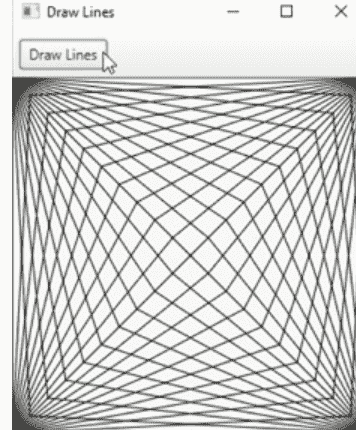

## 图 4.30

从四个角散发出的线条。

- 2.4.2 图 4.31–4.32 展示了使用循环和 `strokeLine` 创建的另外两个设计。
- 1. 创建图 4.31 所示的设计。开始将每条边等分为相同数量的增量单位（我们再次选择了 20 个）。第一条线从左上角开始，在底部边缘向右移动一步结束。对于后续每一条线，在左边缘向下移动一个增量，并在底部边缘向右移动一个增量。继续画线直到到达右下角。
- 2. 修改部分 (a) 以在所有四个角上镜像该设计，如图 4.32 所示。

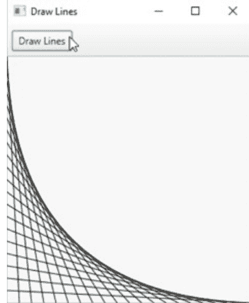

## 图 4.31

使用循环和 `strokeLine` 的线条艺术。

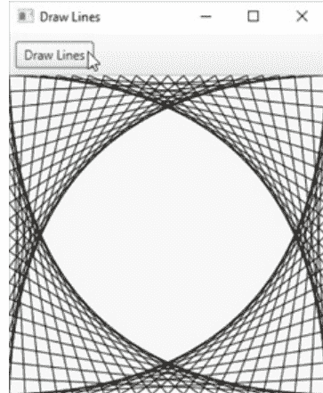

## 图 4.32

使用循环和 `strokeLine` 的线条艺术——从四个角重复出现。

# 4.16 结语

本章介绍了用于构建类和开发这些类的方法的基本解决问题。我们演示了如何构造一个算法（即解决问题的方法），然后如何通过几个阶段的伪代码开发来完善该算法，最终生成可以作为方法一部分执行的 Java 代码。本章展示了如何使用自顶向下、逐步细化的方法，来规划方法必须执行的特定动作，以及方法执行这些动作的顺序。

开发任何问题解决算法都需要三种类型的控制结构：顺序、选择和迭代。具体来说，本章演示了 `if` 单选择语句、`if...else` 双选择语句以及 `while` 迭代语句。这些是用于构建许多问题解决方案的构建块。我们使用控制语句堆叠来通过计数器-哨兵控制迭代对一组学生成绩进行求和并计算平均值，并使用控制语句嵌套来根据一组考试结果进行分析和决策。我们引入了 Java 的复合赋值运算符及其自增和自减运算符。最后，我们讨论了 Java 的原始类型。在第 5 章中，我们将继续对控制语句的讨论，引入 `for`、`do...while` 和 `switch` 语句。

# 总结

## 4.1 节简介

- 在编写解决问题的程序之前，你必须对问题有彻底的理解，并有一个仔细计划的解决方法。你还必须理解可用的构建块，并采用成熟的程序构造技术。

## 4.2 节算法

- 任何计算问题都可以通过按照特定顺序执行系列动作（第 105 页）来解决。
- 根据要执行的动作及其执行顺序来解决问题的程序称为算法（第 105 页）。
- 指定程序中语句执行的顺序称为程序控制（第 106 页）。

## 4.3 节 伪代码

- 伪代码（第 106 页）是一种非正式语言，可以帮助你开发算法，而无需担心 Java 语言语法的严格细节。
- 伪代码不是一种真正的计算机编程语言。当然，你可以使用自己的原生语言来开发自己的伪代码。
- 伪代码可以帮助你在尝试用 Java 等编程语言编写程序之前，先将程序“思考”出来。
- 仔细准备的伪代码可以很容易转换为对应的 Java 程序。

## 4.4 节 控制结构

### 4.4.1 节 Java 中的顺序结构

- 顺序结构是内置在 Java 中的。除非另有指示，否则计算机会按照语句编写的顺序逐一个执行 Java 语句——即按顺序执行。
- 任何单个动作都可以放置，多个动作可以按顺序放置。
- 活动图（第 107 页）是 UML 的一部分。活动图对软件系统的某部分工作流（第 107 页；也称为活动）进行建模。
- 活动图由符号（第 107 页）组成——例如动作状态符号、菱形和小圆圈——这些符号由转换箭头连接，箭头表示活动的流向。
- 动作状态（第 107 页）包含指定要执行特定动作的动作表达式。
- 活动图中的箭头表示转换，指示动作状态所代表的动作发生的顺序。
- 位于活动图顶部的实心圆表示活动的初始状态（第 108 页）——即程序在执行建模动作之前工作流的开始。
- 出现在图底部的空心圆包围的实心圆表示活动的最终状态（第 108 页）——即程序在执行建模动作之后工作流的结束。
- 右上角带有矩形是 UML 注释，用于描述符号的作用。

### 4.4.2 节 Java 中的选择语句

- Java 有三种类型的选择语句（第 108 页）。
- `if` 单选择语句仅在条件为真时执行其体体。
- `if...else` 双选择语句在两个动作之间选择。
- `switch` 语句被称为多选择语句，因为它在许多动作中进行选择。

### 4.4.3 节 迭代语句

- Java 提供了 `while`、`do...while` 和 `for` 迭代语句，只要循环继续条件（第 108 页）为真，程序就可以重复执行语句。
- `do...while` 语句执行其一次或多次。
- `if`、`else`、`switch`、`do` 和 `for` 是关键字，不能作为标识符。

### 4.4.4 节 控制语句总结

- 每个程序都是通过根据其实现的算法组合尽可能多的顺序、选择和迭代语句（第 108 页）形成的。
- 单入口/单出口控制语句通过将一个的入口连接到另一个的入口来连接在一起。这被称为控制语句堆叠。
- 控制语句也可以嵌套（第 109 页）在另一个内部。

## 4.5 节 if 单选择语句

- 程序使用选择语句在可选方案之间进行选择。
- 单选择 `if` 语句的活动图包含菱形符号，表示要做决策。工作流遵循符号守卫条件（第 109 页）。如果守卫条件为真，工作流进入箭头指向的动作状态。
- `if` 语句是单入口/单出口控制语句。

## 4.6 节 if...else 双选择语句

- `if` 单选择语句仅在条件为真时执行其体。
- `if...else` 双选择语句在条件为真时执行一个动作（或一组动作），在条件为假时执行另一个动作（或一组动作）。

### 4.6.1 节 嵌套 if... else 语句

- 程序可以使用嵌套的 `if...else` 语句测试多种情况（第 111 页）。

### 4.6.2 节 悬空 else 问题

- 除非通过括号的位置指示，否则 Java 编译器会将 `else` 与其紧前的 `if` 关联。

### 4.6.3 节 块

- 语句块（第 112 页）可以放置在任何可以放置语句的地方。
- 逻辑（第 113 页）在执行时产生影响。致命逻辑错误（第 113 页）会导致程序失败并提前终止。非致命逻辑错误（第 113 页）允许程序继续执行，但会导致产生错误的结果。
- 正如块可以放置在任何可以放置语句的地方，你也可以在通常放置语句的地方使用空语句（用分号 `;` 表示）。

### 4.6.4 节 条件运算符 (?:)

- 条件运算符 `?:` (第 113 页) 有三个操作数。操作数与 `?:` 符号共同构成一个条件表达式 (第 113 页)。第一个操作数（`?` 左侧）是一个布尔表达式，第二个是条件为 `true` 时的条件表达式的值，第三个是条件为 `false` 时的条件表达式的值。

## 4.8 节 while 迭代语句

- `while` 迭代语句 (第 116 页) 允许你指定程序在某些条件保持为真时重复执行某操作。
- UML 的合并符号 (第 117 页) 将两个活动流合并为一个流。
- 决策和合并符号可以通过输入和输出转换箭头的数量来区分。决策符号有一个指向菱形的转换箭头，并有两个或多个从菱形指向外部的转换箭头，表示从该点可能的转换。每个指向决策符号外部的转换箭头都有一个守卫条件（guard condition）。合并符号没有守卫条件。合并符号有两个或多个指向菱形的转换箭头，且只有一个从菱形指向外部的箭头，表示多个活动流合并以继续活动。与合并符号相关的转换箭头均没有守卫条件。

## 4.9 节 算法制定：计数控制迭代

- 计数控制迭代 (第 118 页) 使用一个名为计数器（或控制变量）的变量来控制一组语句执行的次数。
- 计数控制迭代通常被称为确定性迭代 (第 118 页)，因为迭代次数在循环开始执行之前就已经确定了。
- 总和 (第 118 页) 是用于累加多个值之和的变量。用于存储总和的变量通常在程序中使用之前初始化为 0。
- 局部变量的声明必须出现在在该方法中使用该变量之前。局部变量无法在其声明的方法之外访问。
- 两个整数相除的结果是整数除法——计算的小数部分被截断。

## 4.10 节 算法制定：哨兵控制迭代

- 在哨兵控制迭代 (第 122 页) 中，使用一个名为“哨兵”（sentinel，也称为信号值、哑值或标志值）的特殊值来指示“数据输入结束”。
- 必须选择一个不能与可输入值混淆的哨兵值。
- 自顶向下、逐步细化 (第 122 页) 对于开发结构良好的程序至关重要。
- 除以零是一个逻辑错误。
- 要使用整数值执行浮点计算，请将其中一个整数强制转换为 `double` 类型。
- Java 仅知道如何评估操作数类型相同的算术表达式。为了确保这一点，Java 对选定的操作数执行了一种名为“类型提升”（promotion）的操作。
- 一元强制转换运算符通过在类型名称周围加上括号形成。

## 4.12 节 复合赋值运算符

- 复合赋值运算符 (第 133 页) 是赋值的简写。形式如下的语句：

```
variable = variable operator expression;
```

其中 operator 是二进制运算符 `+`、`-`、`*`、`/` 或 `%` 之一，可以以 `operator= expression` 的形式写：

```
variable operator= expression;
```


- `+=` 运算符将运算符右侧表达式的值加上运算符左侧变量的值，并将结果存储在运算符左侧的变量中。

## 第 4.13 节 递增递减运算符

- 一元递增运算符 `++` 和一元递减运算符 `--` 给数值变量的值加 1 或减 1（第 134 页）。
- 前置于变量（第 134 页）的递增或递减运算符分别是前置递增或递减运算符。后置于变量（第 134 页）的递增或递减运算符分别是后置递增或递减运算符。
- 使用前置递增或递减运算符加减 1 分别称为前增或前递减。
- 变量的前增或前递减会导致变量加 1 或减 1；然后变量的新值将用于它所出现的表达式。
- 使用后置递增或递减运算符加减 1 分别称为后增或后递减。
- 变量的后增或后递减会导致其值用于它所出现的表达式；然后变量的值加 1 或减 1。
- 在单独的语句中对变量进行递增或递减时，前置和后置递增的效果相同，前置和后置递减的效果相同。

## 第 4.14 节 原始类型

- Java 要求所有变量必须有类型。
- Java 使用 Unicode 字符和 IEEE 754 浮点数。

## 自测练习

1. 4.1 填充每个语句中的空格：
   1. 所有程序都可以用 ________ 编写。
   2. 选择语句在 ________ 保持为真时重复某操作。
   3. 重复特定次数的指令被称为 ________。
   4. 当无法预知 ________ 将重复多少次时，使用 ________。
   5. ________ 按照它们出现的顺序执行。
   6. `char`、`short`、`long`、`float` 和 `double` 类型的实例变量默认是 ________。
   7. 递增运算符 ________ 变量，然后其新值将用于表达式。
   8. ________ 的值是。

2. 4.2 判断下列陈述是正确还是错误的。如果是错误的，请解释：
   - 算法是按顺序执行的程序。
   - 包含在括号内的语句被称为 ________。
   - 嵌套控制语句出现在 ________ 内部。
   - Java 提供 `+=`、`-=`、`*=`、`/=` 和 `%=` 来简化表达式。
   - 原始类型（boolean 和 double）仅在 Windows 平台通用。
   - 按顺序执行语句被称为 ________。
   - 一元强制转换运算符 `(double)` 创建操作数的整数副本。
   - boolean 类型的实例变量 ________。
   - 伪代码帮助你在编写程序之前 ________。

3. 4.3 写四种不同的 Java 语句分别变量变量。

4. 4.4 写 Java 语句完成以下任务：
   - 使用一条语句将 `x` 和 `y` 的和赋值给 `z`，然后将 `x` 加 1。
   - 测试变量 `count` 是否大于 10。如果是，打印“大于 10.”。
   - 使用一条语句将 `x` 减 1，然后从 `total` 中减去并将结果存储在 `total` 中。
   - 计算 `q` 除以 `divisor` 的余数并将结果赋值给 `q`。用两种方式编写此语句。

5. 4.5 写 Java 语句完成以下任务：
   - 声明类型为 `int` 的变量 `sum` 并初始化为 0。
   - 声明类型为 `int` 的变量 `x` 并初始化为 1。
   - 将变量 `x` 加到 `sum`，并将结果赋值给 `sum`。
   - 打印“The sum is: %d”，后面跟着变量 `sum` 的值。

6. 4.6 编写一个 Java 应用，计算并打印从 1 到 10 的整数和。使用 `while` 语句循环计算和递增。循环在 `x` 的值变为 11 时终止。

7. 4.7 确定语句 `product *= x++` 执行后变量的值。假设所有变量都是 `int` 且初始值为 5。

8. 4.8 识别并纠正每个代码段中的错误——假设所有变量已正确声明和初始化：

```java
while (c <= 5) {
    product *= c;
    ++c;
}
```

```java
if (gender == 1) {
    System.out.println("Woman");
} else;
    System.out.println("Man");
}
```

9. 4.9 下面的 `while` 语句有什么问题？

```java
while (z >= 0) {
    sum += z;
}
```

## 练习

1. 4.10 比较并对比 `if` 单分支选择语句和 `while` 迭代语句。这两个语句之间有什么相似之处？它们又有什么不同？

2. 4.11 解释当 Java 程序尝试用整数除以另一个整数时会发生什么。计算中的小数部分会发生什么？你如何避免该结果？

3. 4.12 描述控制语句组合的两种方式。

4. 4.13 计算前 100 个正整数之和使用哪种类型的迭代合适？计算任意数量正整数之和使用哪种类型的迭代合适？简述这些任务每个可以如何执行。

5. 4.14 变量的前置增和后置递增有什么区别？

6. 4.15 识别并修正以下每段代码中的错误。[注意：每段代码可能存在多一个错误。]

```java
int x = 1, total;

while (x <= 10) {
    total += x;
    ++x;
}
```

```java
while (x <= 100)
    total += x;
    ++x;
```

```java
while (y > 0) {
    System.out.println(y);
    y++;
}
```

7. 4.16 下面程序打印什么？

```java
// Exercise 4.16: Mystery.java
public class Mystery {
    public static void main(String[] args) {
        int x = 1;
        int total = 0;
        while (x <= 10) {
            int y = x * x;
            System.out.println(y);
            total += y;
            ++x;
        }
        System.out.printf("Total is %d%n", total);
    }
}
```

对于练习 4.17 到练习 4.20，请执行以下每个步骤：
1. 读取问题说明。
2. 使用伪代码和自顶向下的逐步细化方法制定算法。
3. 编写一个 Java 程序。
4. 测试、调试并执行 Java 程序。
5. 处理三组完整的数据。

8. 4.17 (油耗里程) 司机关注汽车的百里程数。一位司机通过记录每次满油的行驶英里数和消耗的加仑跟踪了多次行程。开发一个 Java 应用，输入每次行程的行驶英里数和消耗的加仑（均为整数）。该程序应计算并显示每次行程的每加仑英里，并打印到目前为止所有行程的合并每加仑英里。所有平均计算应产生浮点数结果。使用 `Scanner` 类和哨兵控制迭代从用户处获取数据。

9. 4.18 (信用额度计算器) 开发一个 Java 应用，判断几位百货商店客户是否超过了赊账账户的信用额度。对于每个客户，有以下事实：
   1. 账号
   2. 月初余额
   3. 客户本月所有计费项目的总和
   4. 本月应用于客户账户的所有贷记总和
   5. 允许的信用额度。
   程序应以整数形式输入所有这些事实，计算新余额（= 余额 + 贷记），显示新余额并判断新余额是否超过了客户的信用额度。对于超过信用额度的客户，程序应显示消息“Credit limit exceeded.”

10. 4.19 (销售佣金计算器) 一家大公司根据佣金向销售人员支付工资。销售人员每周获得 200 美元，加上该周销售总额的 9%。例如，销售人员每周销售了价值 5,000 美元的商品，将获得 200 美元加上 5,000 美元的 9%，总计 650 美元。你获得了一份每个销售人员销售的商品列表。这些商品的价值如图 4.33 所示。开发一个 Java 应用，输入一名销售人员上周销售的商品，计算并显示该销售人员的收入。销售商品的数量没有限制。

| 商品 | 价值 |
|---|---|
| 1 | 239.99 |
| 2 | 129.75 |
| 3 | 99.95 |
| 4 | 350.89 |

图 4.33

11. 4.20 (工资计算器) 开发一个 Java 应用，确定三名员工每个人的总工资。公司对每位员工工作的前 40 小时支付标准工资，对超过 40 小时的所有工作时间支付加班倍工资。你得到了一个员工列表、他们上周的工作小时数以及每小时率。你的程序应为每个员工输入这些信息，然后确定并显示员工的总工资。使用 `Scanner` 类输入数据。

12. 4.21 (寻找最大值) 寻找最大值的过程在计算机应用程序中经常使用。例如，确定销售竞赛胜者的程序将输入每个销售人员销售的单位数。销售单位最多的销售人员赢得竞赛。编写伪代码，然后编写一个 Java 应用，输入一系列 10 个整数并确定最大的整数。你的程序应至少使用三个变量：
   1. `counter`: 计数到 10（即：跟踪已输入了多少数字，并判断何时处理完 10 个数字）。
   2. `number`: 用户最近输入的整数。
   3. `largest`: 目前到为止发现的最大数字。

13. 4.22 (表格化输出) 编写一个 Java 应用，使用循环打印以下数值表：

| N | 10*N | 100*N | 1000*N |
|---|---|---|---|
| 1 | 10 | 100 | 1000 |
| 2 | 20 | 200 | 2000 |
| 3 | 30 | 300 | 3000 |
| 4 | 40 | 400 | 4000 |
| 5 | 50 | 500 | 5000 |

14. 4.23 (寻找两个最大值) 使用与练习 4.21 类似的方法，找到 10 个值中的两个最大值。[注意：]

15. 4.24 (验证输入) 使用与练习 4.21 类似的方法，修改图 4.12 中的程序以验证输入。

16. 4.25 下面程序打印什么？

```java
// Exercise 4.16: Mystery.java
public class Mystery {
    public static void main(String[] args) {
        int x = 1;
        int total = 0;
        while (x <= 10) {
            int y = x * x;
            System.out.println(y);
            total += y;
            ++x;
        }
        System.out.printf("Total is %d%n", total);
    }
}
```

17. 4.26 下面程序打印什么？

```java
// Exercise 4.25: Mystery2.java
public class Mystery2 {
    public static void main(String[] args) {
        int count = 1;
        while (count <= 10) {
            System.out.println(count);
            count++;
        }
    }
}
```

18. 4.27 (悬空 else 问题) Java 编译器总是将 `else` 与其最近的 `if` 关联，除非指示使用括号（{}）。这种行为会导致所谓的**悬空 else 问题**。缩进的语句

```java
if (x > 5) {
    if (y > 5) {
        System.out.println("x and y > 5");
    } else {
        System.out.println("x <= 5");
    }
}
```

似乎如果 x 大于 5，嵌套的 `if` 将判断 y 是否也大于 5。如果是，则输出“x and y > 5”。否则，如果 x 不大于 5，`else` 部分会输出“x <= 5”。同样糟糕的是，如果外部语句条件为假，整个 `if...else` 将被跳过，什么都不显示。对于此练习，为前面的代码段添加大括号，以强制嵌套 `if...statement` 按原意执行。

19. 4.28 (另一个悬空 else 问题) 根据练习 4.27 关于悬空 else 的讨论，说明当 x=9 且 y=11 以及 x=11 且 y=9 时，以下每个代码段的输出。我们删除了以下代码的缩进以使其更具挑战性。[提示：应用你学过的缩进规范。]

```java
if (x < 10)
    if (y > 10)
        System.out.println("******")
    else
        System.out.println("#####")
System.out.println("$$$$$\$")
```

```java
if (x < 10) {
    if (y > 10)
        System.out.println("******")
} else {
    System.out.println("#####")
    System.out.println("$$$$$\$")
}
```

20. 4.29 (另一个悬空 else 问题) 根据练习 4.27 关于悬空 else 的讨论，修改以下代码以产生所示输出。请使用适当的缩进技术。除了插入大括号和更改代码的缩进外，你不能进行任何额外的更改。我们删除了以下代码的缩进，以使问题更具挑战性。[注：可能不需要任何修改。]

```java
if (y == 8)
    if (x == 5)
        System.out.println("@@@@@");
    else
        System.out.println("######");
    System.out.println("$$$$$\$");
    System.out.println("&&&&&");
```

1. 假设 x = 5 且 y = 8，产生的输出如下：
```
@@@@@
$$$$$\$
&&&&&
```

2. 假设 x = 5 且 y = 8，产生的输出如下：
```
@@@@@
```

3. 假设 x = 5 且 y = 8，产生的输出如下：
```
@@@@@
&&&&&
```

4. 假设 x = 5 且 y = 7，产生的输出如下。[注：else 之后的最后三个输出语句都是一个块的一部分。]
```
#####
$$$$$$
&&$$&
```

21. 4.30 (星号平方) 编写一个应用程序，提示用户输入正方形的边长，然后显示由星号组成的该尺寸空心正方形。你的程序适用于边长在 1 到 20 之间的所有正方形。

22. 4.31 (回文) 回文是一个正读和反向读都相同的字符序列。例如，以下五位整数中的每一个都是 12321、55554 和 11611。编写一个应用程序读取一个五位整数并判断它是否为回文。如果数字不是五位数，则显示错误信息并允许用户输入新值。

23. 4.32 (打印二进制数的十进制等值) 编写一个应用程序，输入一个只包含 0 和 1 的整数（即二进制整数），并打印其十进制等值。[提示：使用取余运算符和除法运算符从右到左一次提取数字位。在十进制系统中，最右侧的数字位值为 1，左侧的下一个数字值为 10，然后是 100、1000 等等。十进制数字 234 可以解释为 4 * 1 + 3 * 10 + 2 * 100。在二进制系统中，最右侧的数字位值为 1，左侧的下一个数字位值为 2，然后是 4、8 等等。二进制 1101 的十进制等值为 1 * 1 + 0 * 2 + 1 * 4 + 1 * 8，或者 1 + 0 + 4 + 8 = 13。]

24. 4.33 (星号棋盘模式) 编写一个使用输出语句的应用程序

```java
System.out.print("* ");
System.out.print(" ");
System.out.println();
```

来显示下面的棋盘模式。不带参数的 `System.out.println` 方法调用会导致程序输出单个换行符。[提示：需要迭代语句。]


25. 4.34 (无限循环中的2的倍数) 编写一个应用程序，在命令行窗口中持续显示整数 2 的倍数——即 2、4、8、16……

26. 4.35 (这段代码有什么问题?) 编写一个应用程序计算 x 和 y 的和。

```java
System.out.println((x + y));
```


## 练习题

### 4.36 (三角形)
编写一个应用程序读取三个输入值并打印三角形。

### 4.37 (直三角形)
编写一个应用程序读取三个整数并判断它们是否可以构成直三角形。

### 4.38 (阶乘)
非负整数 $n$ 的阶乘定义为：

1. 编写一个应用程序计算 $n!$ 值。
2. 编写一个应用程序计算 $e$ 的值。

### 4.39 (强制加密)
互联网通信和数据存储极大地增加了隐私问题。编写一个加密方案，使未经授权者无法读取。

### 4.40 (世界人口)
世界人口近年来增长迅速。编写一个程序预测未来 75 年的人口，使用当前的增长百分比。第一列应显示 1 到 75 年。第二列显示该年底的预计人口。第三列显示该年的增长人数。如果这种增长率持续，根据你的结果确定人口何时会翻倍。

---

## 5.1 引言

本章通过介绍 Java 除一个外的所有剩余控制语句，继续介绍结构化编程的理论和原则。我们演示了 Java 的 `for`、`do...while` 和 `switch` 语句。通过一系列使用 `while` 和 `for` 的简短示例，我们探索了计数控制迭代的核心要素。我们使用 `switch` 语句来统计用户输入的一组数字成绩中 A、B、C、D 和 F 等级分数的数量。我们引入了 `break` 和 `continue` 程序控制语句。我们讨论了 Java 的逻辑运算符，这些运算符允许你在控制语句中使用更复杂的条件表达式。最后，我们总结了 Java 的控制语句，以及在本章和第 4 章中介绍的解决问题的技巧。

## 5.2 计数控制迭代的核心要素

本节使用第 4 章引入的 `while` 迭代语句来使执行计数控制迭代所需的元素形式化，这需要：

1. 一个控制变量（或循环计数器）
2. 控制变量的初始值
3. 每次通过循环时修改控制变量的增量（也称为循环的每次迭代）
4. 决定循环是否继续的循环持续条件。

为了直观这些计数控制迭代的元素，请考虑图 5.1 的应用，它使用循环来显示从 1 到 10 的数字。

```java
// 图 5.1: WhileCounter.java
// 使用 while 循环进行计数控制迭代

public class WhileCounter {
    public static void main(String[] args) {
        int counter = 1; // 声明并初始化 counter

        while (counter <= 10) { // 循环持续
            System.out.printf("%d ", counter);
            ++counter; // 控制变量自增
        }
        System.out.println();
    }
}
```

```
1 2 3 4 5 6 7 8 9 10
```

### 图 5.1
使用 while 迭代语句进行计数控制迭代。

在图 5.1 中，计数控制迭代的元素定义在第 6、8 和 10 行。第 6 行将控制变量 (`counter`) 声明为 `int` 类型，在内存中为其留出空间并将其初始值设置为 1。变量 `counter` 也可以通过以下局部变量声明和赋值语句进行声明和初始化：

```java
int counter; // 声明 counter
counter = 1; // 初始化 counter 为 1
```

第 9 行在循环的每次迭代中显示控制变量的值。第 10 行在循环的每次迭代中将控制变量加 1。`while` (第 8 行) 中的循环持续条件测试控制变量的值是否小于或等于 10（该条件为真的最终值）。当控制变量为 10 时，程序也会执行该 `while` 循环体。当控制变量超过 10 时（即 `counter` 变为 11），循环终止。

### 常见编程错误 5.1
由于浮点值可能是近似值，使用浮点变量控制循环可能会导致计数器值不精确以及终止测试不准确。

### 错误预防提示 5.1
使用整数来控制计数循环。

## 5.3 for 迭代语句

第 5.2 节介绍了计数控制迭代的核心要素。`while` 语句可用于实现任何计数控制循环。Java 还提供了 `for` 迭代语句，它可以在单行代码中指定计数控制迭代的细节。图 5.2 使用 `for` 重新实现了图 5.1 的应用。

```java
// 图 5.2: ForCounter.java
// 使用 for 迭代进行计数控制迭代

public class ForCounter {
    public static void main(String[] args) {
        // for 语句头部包含初始化、循环持续条件和增量
        for (int counter = 1; counter <= 10; counter++) {
            System.out.printf("%d ", counter);
        }
        System.out.println();
    }
}
```

### 图 5.2
使用 for 迭代语句进行计数控制迭代。

当 `for` 语句（第 8–10 行）开始执行时，控制变量 `counter` 被声明并初始化为 1。（回想第 5.2 节，计数控制迭代的前两个元素是控制变量和它的初始值。）接下来，程序检查 `counter <= 10`，它位于两个所需的分号之间。由于 `counter` 的初始值是 1，因此条件最初为真。因此，体语句（第 9 行）显示控制变量 `counter` 的值，即 1。在执行完循环体后，程序在表达式 `counter++` 中增加 `counter` 的值，该表达式出现在第二个分号的右侧。然后再次执行循环持续测试。此时 `counter` 的值为 2，条件仍然为真，因此再次执行循环体。这一过程持续到显示完 1 到 10 的数字，计数器变为 11，导致循环持续失败并迭代终止（在 10 次迭代后）。然后程序执行 `for` 之后的语句——即第 12 行。

图 5.2 在第 8 行使用了循环持续条件 `counter <= 10`。如果你错误地将 `counter < 10` 作为条件，循环将只会执行 9 次。这是一个常见的逻辑错误，被称为“差一错误”。

### 常见编程错误 5.2
在迭代语句的循环持续条件中使用错误的关系运算符或循环的最终值会导致差一错误。

### 错误预防提示 5.2
在循环条件中使用最终值和运算符 `<=` 可以避免差一错误。对于输出 1 到 10 的循环，循环持续条件应该是 `counter <= 10`，而不是 `counter < 10`（这会导致差一错误）或 `counter < 11`。许多程序员偏好所谓的零计数，计数器初始化为零且循环持续测试设为 `counter < 10`。

### 错误预防提示 5.3
正如第 4 章提到的，整数可能会溢出导致逻辑错误。循环的控制变量也可能溢出。编写循环条件时要小心。

## 5.3.1 for 语句头部

图 5.3 详细观察了图 5.2 中的 `for` 语句。第一行——包括 `for` 关键字以及括号内的所有内容（图 5.2 中的第 8 行）有时被称为 `for` 语句头部。`for` 头部“涵盖一切”——它指定了使用控制变量进行计数控制迭代的所有项。如果 `for` 体包含多个语句，则需要大括号来定义循环体。

### 图 5.3
for 语句头部组成部分

`for` 语句的通用格式为：

```
for (initialization; loopContinuationCondition; increment statements)
{
    // 循环体
}
```

其中 `initialization` 表达式命名循环的控制变量并可选地提供其初始值，`loopContinuationCondition` 决定循环是否继续执行，而 `increment statements` 修改循环变量的值，以便循环持续条件最终变为假。`for` 头部中的两个分号是必须的。如果循环持续条件最初为假，程序将不执行体。相反，执行 `for` 之后的语句。

### 使用等效的 while 语句表示 for 语句

`for` 语句通常可以表示为等效的 `while` 语句：

```
initialization;
while (loopContinuationCondition) {
    statements
    increment;
}
```

在第 5.8 节中，我们将展示一种 `for` 语句无法用等效的 `while` 语句表示的情况。通常，`for` 语句用于计数迭代，而 `while` 语句用于哨兵控制迭代。然而，`while` 和 `for` 都可以用于这两种迭代类型。

### for 语句控制变量的作用域

`for` 头部中的初始化表达式声明了控制变量（即：在变量名之前指定控制变量的类型，如图 5.2 所示），控制变量只能在 `for` 语句中使用——它不会在语句外存在。这种限制的使用被称为变量的**作用域**（scope）。变量的作用域定义了它在程序中何处可以使用。例如，局部变量只能在声明它的方法中使用，且仅从声明点到下一个右大括号 `}`（这通常是关闭方法体的大括号）。作用域将在第 6 章“方法：深入探讨”中详细讨论。

### 常见编程错误 5.3
当 `for` 语句的控制变量声明在 `for` 头部的初始化部分时，在 `for` 体之后使用该控制变量会导致编译错误。

### for 语句头部的表达式是可选的

`for` 头部的三个表达式都是可选的。如果省略了 `loopContinuationCondition`，Java 将假设它为真，从而创建一个无限循环。如果程序在循环之前已经初始化了控制变量，你可以省略初始化表达式。如果程序在循环体中使用语句计算增量，或者不需要增量，你可以省略增量表达式。`for` 语句中的增量表达式的作用就像是 `for` 体末尾的一个独立语句。因此，以下表达式：

```
counter = counter + 1
counter += 1
++counter
counter++
```

都是 `for` 语句中等效的增量表达式。

许多程序员倾向于使用 `counter++`，因为它简洁，而且 `for` 循环在执行完体后评估其增量表达式，因此后置增的形式看起来更自然。在这种情况下，被增加的变量没有出现在更大的表达式中，因此前增和后增的效果实际上是相同的。

### 常见编程错误 5.4
在 `for` 头部右括号的右侧立即放置分号会导致该 `for` 的体变成一个空语句。这通常是一个逻辑错误。

### 错误预防提示 5.4
当迭代语句中的循环条件永远不会变为假时，就会发生无限循环。为了防止计数控制循环中出现这种情况，请确保控制变量在循环的每次迭代中都被修改，以便循环条件最终变为假。在哨兵控制循环中，请确保哨兵值是可以被输入的。

### 在 for 语句头部放置算术表达式

`for` 语句的初始化、循环条件和增量部分可以包含算术表达式。例如，假设 `x = 2` 且 `y = 10`。如果 `x` 和 `y` 在循环体中没有被修改，则语句：

```
for (int j = x; j <= 4 * x * y; j += y / x)
```

等于语句：

```
for (int j = 2; j <= 80; j += 5)
```

`for` 语句的增量可以是负数，在这种情况下它是一个递量，循环向下计数。

### 在语句体中使用 for 语句的控制变量

程序经常在循环体内显示控制变量的值或将其用于计算，但这种使用**并不是强制的**。控制变量通常用于控制迭代，而无需在 `for` 的体中提到它。

### 错误预防提示 5.5
虽然可以在 `for` 循环体中改变控制变量的值，但要避免这样做，因为这种做法可能会导致细微的错误。

### for 语句的 UML 活动图

该语句的 UML 活动图与 `while` 语句相似（图 4.6）。图 5.4 显示了图 5.2 中 `for` 语句的活动图。该图清楚地表明，初始化在第一次评估循环条件之前发生**一次**，而增量在体语句执行**之后****每次**通过循环都会发生。

### 图 5.4
图 5.2 中 for 语句的 UML 活动图。

## 5.4 for 语句示例

以下示例展示了在 `for` 语句中改变控制变量的技术。在每种情况下，我们只写出适当的头部。注意递减控制变量的：

1. 从 1 到 100 增加。
2. 从 100 到 1 递减。
3. 从 7 到 77 增加（步长 7）。
4. 从 20 到 2 递减（步长 2）。
5. 以值 2, 5, 8, 11, 14, 17, 20 增加。
6. 以值 99, 88, 77, 66, 55, 44, 33, 22, 11, 0 递减。

```
1. for (int i = 1; i <= 100; i++)
2. for (int i = 100; i >= 1; i--)
3. for (int i = 7; i <= 77; i += 7)
4. for (int i = 20; i >= 2; i -= 2)
5. for (int i = 2; i <= 20; i += 3)
6. for (int i = 99; i >= 0; i -= 11)
```

初始化和增量表达式可以是逗号分隔的列表，允许你使用多个初始化表达式或多个增量表达式。例如，虽然这种做法不被推荐，你可以通过如下方式将图 5.5 中第 9-11 行的 `for` 语句体合并到 `for` 头部的增量部分：

```java
for (int number = 2; number <= 20; number += 2, total += number)
    ; // 空语句
```

### 常见编程错误 5.5
在向下计数的循环的循环条件中使用错误的关系运算符（例如，在向下计数的循环中用 `i <= 1` 而不是 `i >= 1`）通常是一个逻辑错误。

### 常见编程错误 5.6
如果循环的控制变量每次增加或递减超过 1，请勿在循环条件中使用相等运算符（`!=` 或 `==`）。例如，考虑语句 `for (int counter = 1; counter != 10; counter += 2)`。循环条件 `counter != 10` 永远不会变为假（导致无限循环），因为 counter 在每次迭代后增加 2。

### 错误预防提示 5.6
计数循环很容易出错。在后续章节中，我们将引入 lambda 和流——你可以使用这些技术来消除此类错误。

## 5.4.1 应用：计算 2 到 20 的偶数和

我们现在考虑两个展示 `for` 简单用法的示例。图 5.5 中的应用程序使用 `for` 语句累加 2 到 20 之间的偶数，并将结果存储在 `int` 变量 `total` 中。

```java
// Fig. 5.5: Sum.java
// Summing integers with the for statement.

public class Sum {
    public static void main(String[] args) {
        int total = 0;

        // total even integers from number 2 through 20
        for (int number = 2; number <= 20; number += 2) {
            total += number;
        }

        System.out.printf("Sum is %d%n", total);
    }
}
```


# 良好的编程实践 5.1

为了提高可读性，尽可能将控制语句头部的大小限制为单行。

## 5.4.2 实例：复利计算

接下来，让我们使用 `for` 语句来计算复利。考虑以下问题：

某人在一个储蓄账户中投资了 $1,000，利率为 5%。假设所有利息都保留在账户中，请计算并打印 10 年内每年年底账户中的金额。使用以下公式来确定金额：

> a = p(1 + r)^n

其中

- p 是投资的原始金额（即本金）
- r 是年利率（例如，5% 使用 0.05）
- n 是年数
- a 是第 n 年末存入（账户中）的金额。

该问题的解决方案（图 5.6）涉及一个循环，在资金留在账户的 10 年里，该循环每年都会执行一次指定的计算。`main` 方法中的第 6、7 和 15 行声明了 `double` 类型的变量 `principal`、`rate` 和 `amount`。第 6–7 行将 `principal` 初始化为 1000.0，将 `rate` 初始化为 0.05。第 15 行将 `amount` 初始化为复利计算的结果。Java 将 1000.0 和 0.05 等浮点数常量视为 `double` 类型。同样，Java 将 7 和 -22 等整数常量视为 `int` 类型。

```java
1 // Fig 5.6: Interest.java
2 // 使用 for 语句进行复利计算
3
4 public class Interest {
5     public static void main(String[] args) {
6         double principal = 1000.0; // initial amount
7         double rate = 0.05; // interest rate
8
9         // 显示头部
10         System.out.printf("%s%2s%n", "Year", "Amount");
11
12         // 计算每年的存款金额
13         for (int year = 1; year <= 10; ++year) {
14             // 计算新的存款金额
15             double amount = principal * Math.pow(1.0 + rate, year);
16
17             // 显示年份和金额
18             System.out.printf("%4d,%2.2f%n", year, amount);
19         }
20     }
21 }
```

| 年份 | 存款金额 |
| --- | --- |
| 1 | 1,050.00 |
| 2 | 1,102.50 |
| 3 | 1,157.63 |
| 4 | 1,215.51 |
| 5 | 1,276.28 |
| 6 | 1,340.10 |
| 7 | 1,407.10 |
| 8 | 1,477.46 |
| 9 | 1,551.33 |
| 10 | 1,628.89 |

图 5.6 使用 for 语句进行复利计算。

## 使用字段宽度和对齐方式格式化字符串

第 10 行输出两个列的头部。第一列显示年份，第二列显示该年底的存款金额。我们使用格式说明符 `%20s` 来输出字符串 "Amount on Deposit"。`%` 和转换字符 `s` 之间的整数 20 表示该值的字段宽度为 20——即 `printf` 显示的值至少占据 20 个字符位置。如果要输出的值宽度小于 20 个字符位置（在本例中为 17 个字符），该值默认在字段中**右对齐**。如果要输出的 `year` 值宽度超过四个字符位置，字段宽度将向右扩展以容纳整个值——这会将金额向右推，破坏我们表格输出的整齐列。要输出**左对齐**的值，只需在字段宽度前加上**负号 (-) 格式标志**（例如，`%-20s`）。

## 使用 Math 类的静态方法 pow 进行利息计算

`for` 循环体（第 13–19 行）计算每年的新金额。使用 `Math.pow(base, exponent)` 方法计算 `(1 + r)` 的 `year` 次方。将结果乘以本金并存储在 `amount` 变量中。然后使用 `printf` 打印金额。当 `year` 变量变为 11 时，循环在迭代 10 次后终止。

## 舍入值

在本示例中，我们将 `amount`、`principal` 和 `rate` 声明为 `double` 类型。我们处理的是美元的小数，因此需要允许小数点的类型。遗憾的是，浮点数可能会引起问题。以下是 `double`（或 `float`）出现问题的简单说明：机器中的两个美元金额可能是 14.234（在显示时通常会舍入为 14.23）和 18.673（在显示时通常会舍入为 18.67）。当这些金额相加时，产生内部和 32.907，在显示时通常会舍入为 32.91。因此，你的输出可能如下：

```
14.23
+ 18.67
  32.91
```

## 关于显示的警告

**注意事项 5.7**

不要使用 `double`（或 `float`）类型的变量进行精确的利息计算。浮点数的不精确性会导致错误。在练习中，你将学习如何使用整数进行精确的利息计算——Java 还提供了 `java.math.BigDecimal` 类用于此目的，我们在图 8.16 中演示了它。

**注意事项 5.8**

在全球经济中，处理货币、货币金额、转换、舍入和格式是复杂的。新的 JavaMoney API (http://javamoney.github.io) 是为了应对这些挑战而开发的。在编写此时，它尚未被整合到 JDK 中。第 8 章建议了一个 JavaMoney 项目练习。

## 5.5 do...while 迭代语句

`do...while` 迭代语句与 `while` 语句相似。`while` 在循环开始时、执行循环体之前测试其循环继续条件；如果条件为假，则循环体永远不会执行。`do...while` 则在执行循环体后测试其循环继续条件；循环体至少会被执行一次。当 `do...while` 语句结束时，程序将按顺序执行下一个语句。图 5.7 使用 `do...while` 输出数字 1–10。

```java
1 // Fig. 5.7: DoWhileTest.java
2 // do...while iteration statement
3
4 public class DoWhileTest {
5     public static void main(String[] args) {
6         int counter = 1;
7
8         do {
9             System.out.printf("%d ", counter);
10             ++counter;
11         } while (counter <= 10);
12
13         System.out.println();
14     }
15 }
```

输出：
```
1 2 3 4 5 6 7 8 9 10
```

图 5.7 do...while 迭代语句。

第 6 行声明并初始化了控制变量 `counter`。进入 `do...while` 语句后，第 9 行输出 `counter` 的值，第 10 行增加 `counter`。然后程序在循环体底部（第 11 行）评估循环继续测试。如果条件为真，循环从第一个循环体语句（第 9 行）继续。如果条件为假，循环终止，程序继续执行循环后的下一个语句。

## do...while 迭代语句的 UML 活动图

图 5.8 包含了 `do...while` 语句的 UML 活动图。该图清楚地表明，在循环至少执行一次动作状态之前，不会评估循环继续条件。请将此活动图与 `while` 语句的活动图（图 4.6）进行比较。

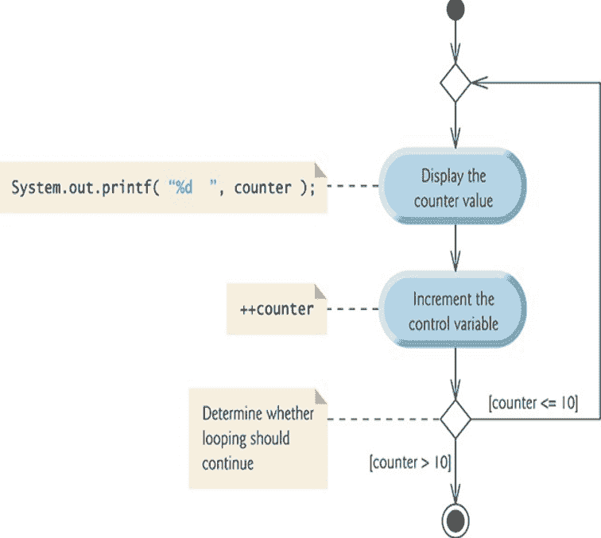

图 5.8 do...while 迭代语句 UML 活动图。

## 5.6 switch 多选择语句

第 4 章讨论了 `if` 单选择语句和 `if...else` 双重选择语句。`switch` 多选择语句根据 `byte`、`short`、`int` 或 `char` 类型的常量整数表达式（但不包括 `long`）的可能值来执行不同的操作。该表达式也可以是 `String`，我们将在 5.7 节中进行演示。

## 使用 switch 语句统计 A, B, C, D 和 F 成绩

图 5.9 计算了一组用户输入的数字成绩的平均分。程序的 `switch` 语句确定每个成绩是否等同于 A、B、C、D 或 F，并增加相应的成绩计数器。程序还显示了获得每个成绩的学生人数。

```java
1 // Fig. 5.9: LetterGrades.java
2 // LetterGrades class uses the switch statement
3 import java.util.Scanner;
4
5 public class LetterGrades {
6     public static void main(String[] args) {
7         int total = 0; // sum of grades
8         int gradeCounter = 0; // number of grades
9         int aCount = 0; // count of A grades
10         int bCount = 0; // count of B grades
11         int cCount = 0; // count of C grades
12         int dCount = 0; // count of D grades
13         int fCount = 0; // count of F grades
14
15         Scanner input = new Scanner(System.in);
16
17         System.out.printf("%s%n%s%n %s%n",
18             "Enter the integers in the range 0-100",
19             "Type the end-of-file indicator to terminate input:",
20             "On UNIX/Linux/macOS type <Ctrl> d then",
21             "On Windows type <Ctrl> z then");
22
23         // loop until the end-of-file
24         while (input.hasNext()) {
25             int grade = input.nextInt(); // read grade
26             total += grade; // add grade to total
27             gradeCounter++; // increment number of
28
29             // increment appropriate letter-grade
30             switch (grade / 10) {
31                 case 9: // grade was between
32                 case 10: // and 100, inclusive
33                     aCount++;
34                     break; // exits switch
35                 case 8: // grade was between 80 and
36                     bCount++;
37                     break; // exits switch
38                 case 7: // grade was between 70 and
39                     cCount++;
40                     break; // exits switch
41                 case 6: // grade was between 60 and 69
42                     dCount++;
43                     break; // exits switch
44                 default: // grade was less than 60
45                     fCount++;
46                     break; // optional; exits switch
47             }
48
49             // display grade report
50             System.out.printf("%nGrade Report:%n");
51             if (gradeCounter != 0) {
52                 // calculate average of all grades
53                 double average = (double) total / gradeCounter;
54
55                 // output summary of results
56                 System.out.printf("Total of %d grades: %d\n", gradeCounter, total);
57                 System.out.printf("Class average is %.2f\n", average);
58                 System.out.printf("%n%s%n%s%n%d%n%s%n",
59                     // Number of students who received each grade
60                     "A: ", aCount, // display number of A grade
61                     "B: ", bCount, // display number of B grade
62                     "C: ", cCount, // display number of C grade
63                     "D: ", dCount, // display number of D grade
64                     "F: ", fCount); // display number of F grade
65             } else { // no grades entered, so output
66                 System.out.println("No grades entered");
67             }
68     }
}
```

输入示例：
```
Enter the integer grades in the range 0-100.
Type the end-of-file indicator to terminate input:
On UNIX/Linux/macOS type <Ctrl> d then press Enter
On Windows type <Ctrl> z then press Enter

92
45
57
63
71
76
85
100
```

输出示例：
```
Grade Report:
Total of 10 grades entered is 77
Class average is 77.8
Number of students who received each grade: A: 4
B: 1
C: 2
D: 1
F: 2
```

图 5.9 LetterGrades 使用 switch 语句统计字母成绩。

与之前的平均分程序一样，`LetterGrades` 类的 `main` 方法（图 5.9）声明了局部变量 `total`（第 7 行）和 `gradeCounter`（第 8 行），分别跟踪用户输入的总成绩和成绩数量。第 9–13 行为每个成绩类别声明了计数器变量。注意第 7–13 行中的变量被明确初始化为 0。

`main` 方法有两个关键部分。第 24–48 行从用户处通过哨兵控制迭代读取任意数量的整数，更新实例变量 `total` 和 `gradeCounter`，并为每个成绩增加相应的字母成绩计数器。第 51–72 行输出一份包含所有输入成绩总和、成绩平均分以及获得每个成绩的学生人数报告。让我们详细检查这些部分。

## 从用户处读取成绩

第 17–21 行提示用户输入整数并输入文件结束符（end-of-file）以结束输入。文件结束符是一个取决于系统的按键组合，用户输入它来表示没有更多数据输入。在第 15 章“文件、输入输出流、NIO 和 XML 序列化”中，你将看到当程序从文件读取输入时如何使用文件结束符。

在 UNIX/Linux/macOS 系统上，通过输入以下序列输入文件结束符：

```
<Ctrl> d
```

此符号表示同时按下 Ctrl 键和 d 键。在 Windows 系统上，可以通过输入以下序列输入文件结束符：

```
<Ctrl> z
```


[注：在某些系统上，输入文件结束符键序列后必须按 Enter。此外，当输入文件结束符时，Windows 通常会在屏幕上显示字符 ^Z，如图 5.9 的输出所示。]


## 处理成绩

`switch` 语句（第 30–47 行）决定递增哪个计数器。我们假设用户输入了 0–100 范围内的有效成绩。90–100 范围内的成绩代表 A，80–89 代表 B，70–79 代表 C，60–69 代表 D，0–59 代表 F。`switch` 语句由一个包含一系列标签和可选的 `default` 情况（case）的块组成。在示例中，这些被用于根据成绩确定递增哪个计数器。

当控制流到达 `switch` 时，程序会求值关键字 `switch` 后面括号中的表达式 `(grade / 10)`。这是 `switch` 的控制表达式。程序将此表达式的值（必须求值为 `byte`、`char`、`short` 或 `int` 类型的整数或 `String`）与每个 `case` 标签进行比较。第 30 行的控制表达式执行整数除法，这会截断结果的小数部分。因此，当我们除以 0 到 100 之间的数值时，结果始终是 0 到 10 之间的值。我们在 `case` 标签中使用了几个值。例如，如果用户输入整数 85，控制表达式求值为 8。`switch` 将 8 与每个 `case` 标签进行比较。如果发生匹配（第 35 行的 `case 8:`），程序将执行该情况的语句。对于整数 8，第 36 行递增 `bCount`，因为 80 多分的成绩是 B。第 37 行的 `break` 语句导致程序控制执行 `switch` 之后的第一个语句——在本程序中，我们到达了 `while` 循环结束，因此控制返回到第 24 行的循环继续条件，以确定循环是否继续执行。

`case` 显式测试了值 10、9、8、7 和 6。注意第 31–32 行测试值 9 和 10 的 `case`（两者都代表 A 级成绩）。以这种方式连续列出 `case` 且在它们之间不留有任何语句，可以使这些 `case` 执行同一组语句——当控制表达式求值为 9 或 10 时，第 33–34 行的语句将执行。`switch` 语句没有提供测试值范围的机制，你需要测试的每个值都必须列在单独的 `case` 标签中。每个 `case` 可以有多个语句。`switch` 语句与其他控制语句的区别在于它不需要在 `case` 中的多个语句周围加括号。

## 没有 break 语句的情况

如果没有 `break` 语句，每次在 `switch` 中发生匹配，该 `case` 及后续情况的语句都会执行，直到遇到 `break` 语句或 `switch` 结束。这通常被称为“穿透”（falling through）到后续的语句。（这一功能非常适合编写一个简洁的程序来显示练习 5.29 中的迭代歌曲《圣诞节十二天》。）

## 常见编程错误 5.7

在 `switch` 中需要时忘记写 `break` 语句是一个逻辑错误。

## default 情况

如果控制表达式的值与 `case` 标签之间没有发生匹配，则执行 `default` 情况（第 44–46 行）。我们在示例中使用 `default` 情况来处理所有小于 6 的控制表达式值——即所有不及格的成绩。如果没有发生匹配且 `switch` 不包含 `default` 情况，程序控制将继续执行 `switch` 之后的第一个语句。

## 错误预防提示 5.9

在 `switch` 语句中，确保你测试了控制表达式的所有可能值。

## 显示成绩单

第 51–72 行根据输入的成绩输出报告（如图 5.9 中的输入/输出窗口所示）。第 54 行确定用户是否输入了至少一个成绩——这有助于避免除以零。如果是，第 56 行计算成绩的平均值。第 59–68 行输出所有成绩的总和、班级平均分以及获得每个字母成绩的人数。如果没有输入任何成绩，第 71 行输出适当的消息。图 5.9 中的输出显示了一个基于 10 个成绩的示例成绩单。

## switch 语句 UML 活动图

图 5.10 显示了通用 `switch` 语句的 UML 活动图。大多数 `switch` 语句在每个 `case` 中使用 `break` 在处理完该情况后终止 `switch` 语句。图 5.10 通过在活动图中包含 `break` 语句强调了这一点。该图清楚地表明 `case` 结尾的 `break` 语句会导致控制立即退出 `switch` 语句。

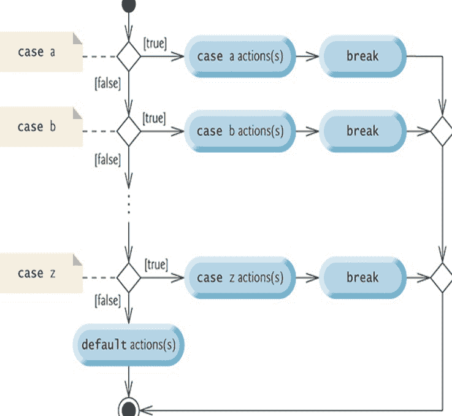

## 图 5.10

带有 `break` 语句的 `switch` 多路选择语句 UML 活动图。

描述

`switch` 的最后一个 `case`（或最后出现的可选 `default` 情况）不需要 `break` 语句，因为执行将继续进行 `switch` 之后的下一个语句。

## 错误预防提示 5.10

在 `switch` 语句中提供 `default` 情况。这让你关注处理异常情况。

## 良好编程实践 5.2

虽然 `switch` 中的每个 `case` 和 `default` 情况可以按任意顺序出现，如果 `default` 情况位于最后，则该情况不需要 `break`。

## 关于 case 表达式的注意事项

使用 `switch` 时，记住每个 `case` 必须是一个用 `final` 声明的常量——在整个程序中不会改变。

在第 10 章面向对象编程：多态与接口中，我们介绍了一种更优雅的实现 `switch` 逻辑的方式——我们使用名为*多态*的技术来创建更清晰、更容易维护的程序。

## 案例研究：switch 中的字符串

字符串可以作为 `switch` 语句的控制表达式，字符串字面量可以用 `case` 标签。为了演示这一点，我们将实现一个满足以下要求的应用程序：

你被一家经营以下东北部州的汽车保险公司聘用——康涅狄州、缅因州、马萨诸塞州、新罕布什尔州、新泽西州、纽约州、宾夕法尼亚州和佛蒙特州。公司希望你创建一个程序，报告每个汽车保单是否位于“无过错”州——马萨诸塞州、新泽西州、纽约州和宾夕法尼亚州。

满足这些要求的 Java 程序包含类——`AutoPolicy`（图 5.11）和 `AutoPolicyTest`（图 5.12）。

## AutoPolicy 类

`AutoPolicy` 类（图 5.11）代表一份汽车保单。该类包含：

- `int` 类型变量 `accountNumber`（第 4 行），用于存储保单账号
- `String` 类型变量 `makeAndModel`（第 5 行），用于存储汽车品牌和型号（如“丰田凯美瑞”）
- `String` 类型变量 `state`（第 6 行），用于存储保单所在州的两个字母缩写（例如马萨诸塞州为 "MA"）
- 一个构造函数（第 9–14 行），用于初始化类的实例变量
- `setAccountNumber` 和 `getAccountNumber` 方法（第 17–24 行），用于设置和获取 `AutoPolicy` 的 `accountNumber` 实例变量
- `setMakeAndModel` 和 `getMakeAndModel` 方法（第 27–34 行），用于设置和获取 `AutoPolicy` 的 `makeAndModel` 实例变量
- `setState` 和 `getState` 方法（第 37–44 行），用于设置和获取 `AutoPolicy` 的 `state` 实例变量
- `isNoFaultState` 方法（第 47–61 行），返回一个布尔值，指示保单是否位于无过错汽车州——对于返回布尔值的 get 方法，命名惯例是以 "is" 开头而不是 "get"（这种方法通常称为谓词方法）。

```java
// Fig. 5.11: AutoPolicy.java
// 代表汽车保单的类
public class AutoPolicy {
    private int accountNumber; // 保单账号
    private String makeAndModel; // 汽车品牌和型号
    private String state; // 州缩写
    // 构造函数
    public AutoPolicy(int accountNumber, String makeAndModel, String state) {
        this.accountNumber = accountNumber;
        this.makeAndModel = makeAndModel;
        this.state = state;
    }
    // sets the accountNumber
    public void setAccountNumber(int accountNumber) {
        this.accountNumber = accountNumber;
    }
    // returns the accountNumber
    public int getAccountNumber() {
        return accountNumber;
    }
    // sets the makeAndModel
    public void setMakeAndModel(String makeAndModel) {
        this.makeAndModel = makeAndModel;
    }
    // returns the makeAndModel
    public String getMakeAndModel() {
        return makeAndModel;
    }
    // sets the state
    public void setState(String state) {
        this.state = state;
    }
    // returns the state
    public String getState() {
        return state;
    }
    // predicate method returns whether the state
    public boolean isNoFaultState() {
        boolean noFaultState;
        // determine whether state has no-fault auto insurance
        switch (getState()) { // get AutoPolicy object's state
            case "MA": case "NJ": case "NY": case "PA":
                noFaultState = true;
                break;
            default:
                noFaultState = false;
                break;
        }
        return noFaultState;
    }
}
```

## 图 5.11

代表汽车保险单的类。

在 `isNoFaultState` 方法中，`switch` 语句的控制表达式（第 51 行）是 `AutoPolicy` 方法 `getState()` 返回的字符串。`switch` 语句将控制表达式的值与 `case` 标签（第 52 行）进行比较，以确定该保单是否位于马萨诸塞州、新泽西州、纽约州或宾夕法尼亚州（无过错州）。如果匹配成功，则第 53 行将局部变量 `noFaultState` 设置为 `true` 并终止 `switch` 语句；否则，`default` 情况将 `noFaultState` 设置为 `false`（第 56 行）。然后方法 `isNoFaultState()` 返回局部变量 `noFaultState` 的值。

为了简单起见，我们没有在构造函数或设置方法中对 `AutoPolicy` 的数据进行验证，并假设州缩写始终是两个大写字母。此外，真实的 `AutoPolicy` 类可能会包含许多其他实例变量和方法，用于处理账户持有人姓名、地址等数据。在练习 5.30 中，你将被要求使用第 5.9 节中学习的技巧通过验证州缩写来增强 `AutoPolicy`。

## 类 AutoPolicyTest

类 `AutoPolicyTest`（图 5.12）创建了两个 `AutoPolicy` 对象（第 6–9 行），并将每个对象都传递给静态方法 `policyInNoFaultState()`（第 18–25 行），该方法使用 `AutoPolicy` 方法来判断并显示所收到的对象是否代表无过错汽车保险州的保单。

```java
// Fig. 5.12: AutoPolicyTest.java
// Demonstrating Strings in switch.
public class AutoPolicyTest {
    public static void main(String[] args) {
        // create two AutoPolicy objects
        AutoPolicy policy1 = new AutoPolicy(11111111, "Toyota Camry", "NJ");
        AutoPolicy policy2 = new AutoPolicy(22222222, "Ford Fusion", "ME");
        // display whether each policy is in a no-fault state
        policyInNoFaultState(policy1);
        policyInNoFaultState(policy2);
    }
    // method that displays whether an AutoPolicy
    // is in a state with no-fault auto insurance
    public static void policyInNoFaultState(AutoPolicy policy) {
        System.out.println("The auto policy:");
        System.out.printf("Account #: %d; Car: %s;%nState %s %s a no-fault state%n",
            policy.getAccountNumber(), policy.getMakeAndModel(),
            policy.getState(),
            (policy.isNoFaultState()) ? "is" : "is not");
    }
}
```

```
The auto policy:
Account #: 11111111; Car: Toyota Camry;
State NJ is a no-fault state

The auto policy:
Account #: 22222222; Car: Ford Fusion;
State ME is not a no-fault state
```

## 图 5.12

在 switch 中演示字符串。

## 5.8 break 和 continue 语句

除了选择和迭代语句外，Java 还提供了 `break`（我们在 `switch` 语句的背景下讨论过）和 `continue`（在本节中介绍，见附录 L）语句来改变控制流。前一节展示了如何使用 `break` 终止 `switch` 语句的执行。本节讨论如何在迭代语句中使用 `break`。

## 5.8.1 break 语句

`break` 语句在 `while`、`for`、`do...while` 或 `switch` 中执行时会导致立即退出该语句。执行从控制语句之后的第一个语句继续。`break` 的常见用法提前退出循环或跳过循环的剩余部分。

图 5.13 展示了一个 `break` 语句。当第 8 行的嵌套 `if` 检测到 `count` 为 5 时，第 9 行的 `break` 语句终止了 `for` 语句，程序继续到第 15 行。

```java
// Fig. 5.13: BreakTest.java
// Demonstrating break in for.
public class BreakTest {
    public static void main(String[] args) {
        int count;
        for (count = 1; count <= 10; count++) {
            if (count == 5) {
                break; // terminates the loop
            }
        }
        System.out.println("Count reached: " + count);
    }
}
```

## 5.8.2 continue 语句

`continue` 语句在 `while`、`for`、`do...while` 或 `switch` 中执行时会跳过循环体的剩余部分，并从控制语句之后的第一个语句继续。图 5.14 使用了 `continue`（第 7 行）。在 `for` 语句中，增量表达式在程序评估迭代延续条件之前执行。

```java
// Fig. 5.14: ContinueTest.java
// Demonstrating continue in for.
public class ContinueTest {
    public static void main(String[] args) {
        for (int count = 1; count <= 10; count++) {
            if (count == 5) {
                continue; // skips remaining code in loop body
            }
            System.out.println("Count: " + count);
        }
    }
}
```


```java
continue; // skips the rest of the body

}

System.out.println("Count: " + count);

}

}

```

# 运算符

假设我们希望在程序的某处，在选择特定的执行路径之前，确保两个条件都为真。在这种情况下，我们可以使用 `&&`（条件与）运算符，如下所示：

```java
if (gender == FEMALE && age >= 65) {
  ++seniorFemales;
}
```

该语句包含两个简单条件。`gender == FEMALE` 条件将 `gender` 与常量 `FEMALE` 进行比较，以判断一个人是否为女性。`age >= 65` 条件的求值用于判断一个人是否为老年人。`if` 语句考虑组合条件：

`gender == FEMALE && age >= 65`

当且仅当两个简单条件都为真时，该条件为真。在这种情况下，语句体会将 `seniorFemales` 加 1。如果两个简单条件中的一个或两个为假，程序将跳过递加操作。

同样，以下条件确保成绩在 1–100 的范围内：

`grade >= 1 && grade <= 100`

该条件是**当且仅当 grade 大于或等于 1 且 grade 小于或等于 100 时为真**。某些程序员发现，当添加*冗余*的括号时，上述组合条件更具可读性，例如：

`(grade >= 1) && (grade <= 100)`

图 5.15 中的表格总结了 `&&` 运算符，显示了 **expression1** 和 **expression2** 的 **false** 和 **true** 值的四种可能组合。此类表格被称为**真值表**。Java 对所有包含关系运算符、相等运算符或逻辑运算符的表达式进行 **false** 或 **true** 评估。

| expression1 | expression2 | expression1 && expression2 |
| --- | --- | --- |
| false | false | false |
| false | true | false |
| true | false | false |
| true | true | true |

## 图 5.15

`&&`（条件与）运算符真值表。

## 5.9.2 条件或 (||) 运算符

现在假设我们希望在选择特定的执行路径之前，确保两个条件中的一个或两个都为真。在这种情况下，我们使用 `||` 条件或运算符，如下程序段所示：

```java
if ((semesterAverage >= 90) || (finalExam >= 90)) {
    System.out.println("Student grade is A");
}
```

该语句也包含两个简单条件。`semesterAverage >= 90` 条件的求值判断学生是否因为整个学期的表现稳健而在课程中获得 A 等。`finalExam >= 90` 条件的求值判断学生是否因为期末考试表现异而在课程中获得 A 等。`if` 语句随后考虑组合条件：

`(semesterAverage >= 90) || (finalExam >= 90)`

如果两个简单条件中的一个或两个都为真，则授予学生 A 等。只有当两个简单条件都为假时，才不打印“Student grade is A”消息。图 5.16 是运算符条件或 (`||`) 的真值表。`&&` 运算符的优先级高于 `||` 运算符。两个运算符都从左到右结合。

| expression1 | expression2 | expression1 || expression2 |
| --- | --- | --- |
| false | false | false |
| false | true | true |
| true | false | true |
| true | true | true |

## 图 5.16

`||`（条件或）运算符表。

## 5.9.3 复杂条件的短路求值

表达式中包含 `&&` 或 `||` 运算符的部分只会被求值，直到确定条件是真是假为止。因此，表达式：

`gender == FEMALE && (age >= 65)`

如果 `gender` 不等于 `FEMALE`，求值将立即停止（即整个表达式为 **false**）；如果 `gender` 等于 `FEMALE`，则继续（即如果条件 `age >= 65` 为真，整个表达式为 **true**）。这种条件与和条件或的特性被称为**短路求值**。


# 常见编程错误 5.8

在使用 `&&` 的表达式中，一个条件——我们称之为依赖条件——可能需要另一个条件为 **true** 以使依赖条件的评估有意义。在这种情况下，依赖条件应该放在 `&&` 运算符之后以防止错误。考虑表达式 `(i != 0) && (i == 2)`。依赖条件 `(i == 2)` 必须出现在 `&&` 之后以防止除零。

## 5.9.4 逻辑与 (&) 和 逻辑或 (|) 运算符

**逻辑与** (`&`) 和**逻辑或** (`|`) 运算符与 `&&` 和 `||` 运算符相同，但 `&` 和 `|` 运算符总是求值的*两个*操作数（即它们不执行短路求值）。因此，表达式：

`(gender == 1) & (age >= 65)`

无论 `gender` 是否等于 1，都会求值 `age >= 65`。如果右操作数有副作用（修改变量的值），这是很有用的。例如：

`(birthday == true) | (++age >= 65)`

保证了求值 `age >= 65`，无论整体表达式是真是假。

# 预防提示 5.11

为了清晰，避免在条件中使用带有副作用的表达式（如赋值）。它们会让代码更难理解并导致细微的逻辑错误。

# 预防提示 5.12

赋值 (`=`) 表达式通常不应在条件中使用。每个条件必须产生一个布尔值；只有当赋值给布尔变量时，赋值才会通过。

## 5.9.5 逻辑异或 (^)

包含逻辑异或 (`^`) 运算符的简单条件当且仅当一个操作数为真另一个为假时为真。如果两个都真或都为假，整个条件为假。图 5.17 是逻辑异或运算符 (`^`) 的表格。该运算符保证求值它的两个操作数。

| expression1 | expression2 | expression1 ^ expression2 |
|--- |--- |--- |
| false | false | false |
| false | true | true |
| true | false | true |
| true | true | false |

## 图 5.17

`^` 逻辑异或运算符真值表。

## 5.9.6 逻辑非 (!) 运算符

**逻辑非 (`!`)** 也称为**逻辑否定**或**逻辑取反**运算符，它会“反转”条件的含义。与组合两个条件的**二元**运算符 `&&`、`||` 和 `^` 不同，逻辑非运算符是一个只有一个条件作为操作数的*一元*运算符。该运算符置于条件*之前*，如果原始条件（没有逻辑非运算符）为*false*，则选择该执行路径：

```java
if (!(grade == sentinelValue)) {
    System.out.printf("The next grade is %d%n", grade);
}
```

只有当 **grade 不等于 sentinelValue** 时才执行 `printf` 调用。`grade == sentinelValue` 周围的括号是因为逻辑非运算符的优先级*高于*相等运算符。在大多数情况下，可以通过使用关系运算符不同的表示条件来避免逻辑非。例如，之前的语句也可以写为：

```java
if (grade != sentinelValue) {
    System.out.printf("The next grade is %d%n", grade);
}
```

这种灵活性可以帮助用更方便的方式表示条件。图 5.18 是逻辑否定运算符的真值表。

| expression | !expression |
|---|---|
| false | true |
| true | false |

## 图 5.18

`!`（逻辑非）运算符真值表。

## 5.9.7 逻辑运算符

图 5.19 使用逻辑运算符产生本节讨论的真值表。输出显示了求值的布尔表达式及其结果。我们使用 `%b` 标识符根据布尔表达式的值显示“true”或“false”。第 7–11 行产生 `&&` 的真值表。第 14–18 行产生 `||` 的真值表。第 21–25 行产生 `&` 的真值表。第 28–33 行产生 `|` 的真值表。第 36–41 行产生 `^` 的真值表。第 44–45 行产生 `!` 的真值表。

```java
// 图 5.19: LogicalOperators.java
// 逻辑运算符。

public class LogicalOperators {
    public static void main(String[] args) {
        // 为 &&（条件 A）创建真值表
        System.out.printf("%s%s: %b%s: %b%s\n",
            "Conditional AND &&", "false & false",
            "false & true", (false & true),
            "true & false", (true & false),
            "true & true", (true & true));

        // 为 ||（条件 B）创建真值表
        System.out.printf("%s%s: %b%s: %b%s\n",
            "Conditional OR |||", "false || false",
            "true || false", (true || false),
            "false || true", (false || true),
            "true || true", (true || true));

        // 为 &（逻辑与 &&）创建真值表
        System.out.printf("%s%s: %b%s: %b%s\n",
            "Boolean logical AND &&", "false & false",
            "false & true", (false & true),
            "true & false", (true & false),
            "true & true", (true & true));
    }
}
```

```java
System.out.printf("%s%n%s: %b%n%s: %b%n%s",
  "Boolean logical inclusive OR (||)",
  "false | false", (false | false),
  "false | true", (false | true),
  "true | false", (true | false),
  "true | true", (true | true));

// create truth table for ^ (boolean logical)
System.out.printf("%s%n%s: %b%n%s: %b%n%s",
  "Boolean logical exclusive OR (^))",
  "false ^ false", (false ^ false),
  "false ^ true", (false ^ true),
  "true ^ false", (true ^ false),
  "true ^ true", (true ^ true));

// create truth table for ! (logical negation)
System.out.printf("%s%n%s: %b%n%s: %b%n",
  "!false", (false), "true", (true));
}
```


## 条件与 (`&&`)

| 表达式 | 结果 |
| --- | --- |
| `false && false` | `false` |
| `false && true` | `false` |
| `true && false` | `false` |
| `true && true` | `true` |

## 条件或 (`||`)

| 表达式 | 结果 |
| --- | --- |
| `false || false` | `false` |
| `false || true` | `true` |
| `true || false` | `true` |
| `true || true` | `true` |

## 布尔逻辑与 (`&`)

| 表达式 | 结果 |
| --- | --- |
| `false & false` | `false` |
| `false & true` | `false` |
| `true & false` | `false` |
| `true & true` | `true` |

## 布尔逻辑包含或 (`|`)

| 表达式 | 结果 |
| --- | --- |
| `false | false` | `false` |
| `false | true` | `true` |
| `true | false` | `true` |
| `true | true` | `true` |

## 布尔逻辑异或 (`^`)

| 表达式 | 结果 |
| --- | --- |
| `false ^ false` | `false` |
| `false ^ true` | `true` |
| `true ^ false` | `true` |
| `true ^ true` | `false` |

## 逻辑非 (`!`)

| 表达式 | 结果 |
| --- | --- |
| `!false` | `true` |
| `!true` | `false` |

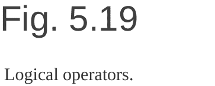

# 目前介绍的运算符的优先级和结合性

图 5.20 显示了目前介绍的 Java 运算符的优先级和结合性。运算符从上到下按优先级递减顺序排列。

| 运算符 | 结合性 | 类型 |
| --- | --- | --- |
| `++` `--` | 从右到左 | 一元后置 |
| `++` `--` `+` `-` `!` `(type)` | 从右到左 | 一元前置 |
| `*` `/` `%` | 从左到右 | 乘法 |
| `+` `-` | 从左到右 | 加法 |
| `<` `<=` `>` `>=` | 从左到右 | 关系运算符 |
| `==` `!=` | 从左到右 | 等于运算符 |
| `&` | 从左到右 | 布尔逻辑与 |
| `^` | 从左到右 | 布尔逻辑异或 |
| `|` | 从左到右 | 布尔逻辑包含或 |
| `&&` | 从左到右 | 条件与 |
| `||` | 从左到右 | 条件或 |
| `?:` | 从右到左 | 条件运算符 |
| `=` `+=` `-=` `*=` `/=` `%=` | 从右到左 | 赋值 |

> **图 5.20** 为止讨论的运算符的优先级/结合性。

# 5.10 结构化编程总结

正如建筑师通过利用职业集体智慧来设计建筑一样，程序员也应该设计程序。我们的领域比建筑学年轻得多，我们的集体智慧也稀疏得多。我们已经了解到，结构化编程产生的程序比非结构化程序更容易理解、测试、调试、修改，甚至在数学意义上证明是正确的。

## Java 控制语句是单入口/单出口的

图 5.21 使用 UML 活动图总结了 Java 的控制语句。初始状态和结束状态表示每个控制语句的单一入口点和单一出口点。在活动图中任意连接单个符号会导致非结构化程序。因此，编程领域选择了一组有限的控制语句，这些语句只能通过两种简单的方式组合来构建结构化程序。

为了简单起见，Java 只包含单入口/单出口控制语句——只有一种进入方式和一种退出方式。按顺序连接控制语句以形成结构化程序是简单的。一个控制语句的结束状态连接到下一个初始状态——我们称之为控制语句堆叠。构建结构化程序的规则还允许控制语句嵌套。

### 顺序

### 选择

- `if` 语句（单选择）
- `switch` 语句（多选择）

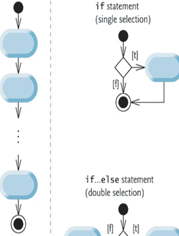
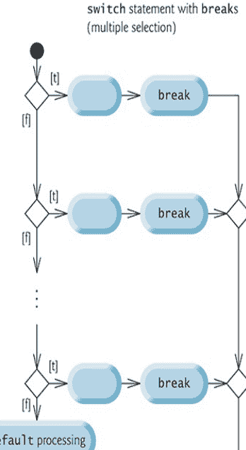

- `if...else` 语句（双选择）

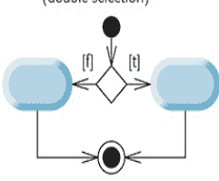

### 循环

- `while` 语句
- `do...while` 语句
- `for` 语句

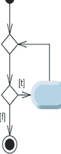
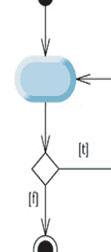
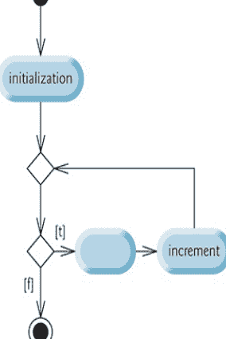

> **图 5.21** Java 的单入口/单出口顺序、选择和迭代。

## 构建结构化程序的规则

图 5.22 显示了构建结构化程序的规则。规则假设操作状态可以表示任何操作。规则还假设我们从最简单的活动图（图 5.23）开始，该图由一个初始状态、一个操作状态、一个结束状态和箭头组成。

| 构建结构化程序的规则 |
| --- |
| 1. 从简单的活动图开始（图 5.23）。 |
| 2. 任何操作状态都可以被两个顺序的操作状态替换。 |
| 3. 任何操作状态都可以被任何控制语句（`if`、`if...else`、`switch`、`do...while` 或 `for`）替换。 |
| 4. 规则 2 和 3 可以反复应用。 |

> **图 5.22** 构建结构化程序的规则。

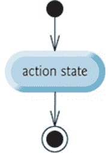

> **图 5.23** 简单的活动图。

应用图 5.22 中的规则始终会得到具有整齐积木块外观的结构化活动图。例如，反复对简单的活动图应用规则 2 会得到一个包含许多顺序操作状态的活动图（图 5.24）。规则 2 生成控制语句栈，因此我们将规则 2 称为堆叠规则。图 5.24 中的垂直虚线不是 UML 的部分——我们用它们来分离应用图 5.22 中规则 2 的活动图。

规则 3 是嵌套规则。反复对简单的活动图应用规则 3 会得到整齐嵌套的控制语句。例如，在图 5.25 中，简单的活动图中的操作状态被替换为双选择（`if...else`）语句。然后再次对双选择语句中的操作状态应用规则 3，将其每个替换为双选择语句。周围的虚操作状态符号表示被替换的操作状态。[注意：图 5.25 中所示的虚箭头和虚操作状态符号不是 UML 的。它们在这里用于说明任何操作状态都可以被控制语句替换。]

规则 4 生成更大、更复杂且嵌套更深的语句。应用图 5.22 中的规则产生的图构成了所有可能的结构化活动图集，因此也是所有可能的结构化程序集。结构化方法的优之处在于，我们只使用七种简单的单入口/单出口控制语句，并仅以两种简单的方式组装它们。

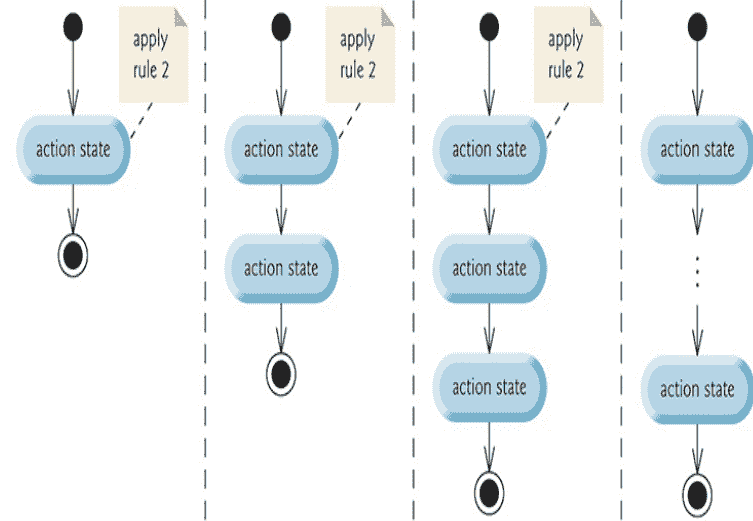

> **图 5.24** 反复将图 5.22 的规则 2 应用简单的活动图。

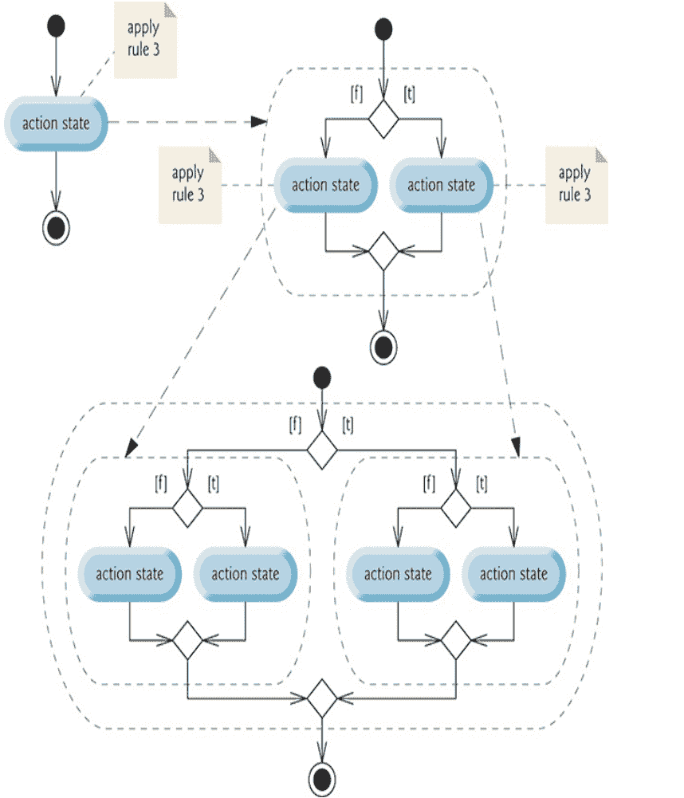

> **图 5.25** 反复将图 5.22 的规则 3 应用简单的活动图。

如果遵循图 5.22 中的规则，就无法创建“非结构化”的活动图（如图 5.26 所示）。如果你不确定某个特定图是否是结构化的，请反向应用图 5.22 的规则将其还原为最简单的活动图。如果你可以还原它，原始图就是结构化的；否则不是。

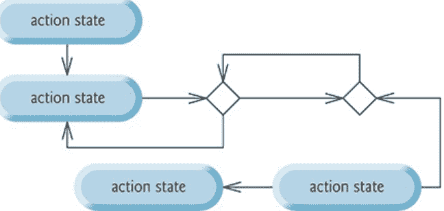

> **图 5.26** 非结构化活动图。

语句——我们将在 7.7 节中讨论它。很容易证明，`while` 语句足以提供*任何*形式的迭代。所有用 `do...while` 和 `for` 能够完成的操作，都可以用 `while` 语句完成（尽管可能没有那么方便）。

结合这些结果说明，Java 程序中需要的*任何*形式的控制结构都可以用以下术语表示：

- 顺序
- `if` 语句（选择）
- `while` 语句（迭代）

并且这些结构只有两种方式可以进行组合——堆叠和*嵌套*。事实上，结构化编程是简单性的本质。

## 5.11（可选）GUI 和图形案例研究：绘制矩形和椭圆

在本节中，我们将讨论 Draw Shapes 应用，该应用演示了如何使用 `GraphicsContext` 的 `strokeRect()` 和 `strokeOval()` 方法分别绘制矩形和椭圆。

### 创建 Draw Shapes 应用的 GUI

该应用的 GUI 在 `DrawShapes.fxml` 中定义，使用了你在 3.6 节和 4.15 节中学到的技术，并且与图 4.17 中的 GUI 几乎相同。为了构建 GUI，我们将 `DrawLines.fxml` 复制到一个新目录并重命名为 `DrawShapes.fxml`，然后在 Scene Builder 中打开 `DrawShapes.fxml` 并进行了以下更改：

- 我们在 Scene Builder 文档窗口的 Controller 部分将 `DrawShapesController` 指定为应用的 Controller 类。
- 我们在检查器的 Properties 部分中，将按钮的 `Text` 属性设置为 Draw Rectangles，并将按钮的 `On Action` 处理程序设置为 `drawRectanglesButtonPressed`（在检查器的 Code 部分）。
- 我们从 Scene Builder 库的 Controls 部分拖入另一个按钮到工具栏，并将该按钮的 `Text` 属性设置为 Draw Ovals，并将其 `On Action` 事件处理程序设置为 `drawOvalsButtonPressed`。

如有必要，请回顾 4.15.2–4.15.3 节中提供的步骤以进行这些更改。

### 类 `DrawShapesController`

与之前的 JavaFX 示例一样，该应用有两个 Java 源代码文件：

- `DrawShapes.java` 包含 JavaFX 应用的主类，它负责加载 `DrawShapes.fxml` 并配置 `DrawShapesController`。
- `DrawShapesController.java` 包含控制器类，根据用户点击的按钮绘制矩形或椭圆。

为了创建 `DrawShapes.java`，我们复制了 `DrawLines.java`，对其进行了重命名并进行了 4.15.5 节中描述的代码编辑。我们没有显示 `DrawShapes.java`，因为唯一的更改是类名（`DrawShapes`）、加载的 FXML 文件名（`DrawShapes.fxml`）以及阶段标题栏中显示的文本（Draw Shapes）。

类 `DrawShapesController`（图 5.27）在用户点击应用的任意按钮时执行绘制。当 Draw Shapes 应用执行时，它将：

- 配置 `DrawShapesController` 的 `canvas` 变量（第 9 行），指向 `DrawShapes.fxml` 中的 `Canvas`
- 配置 `drawRectanglesButtonPressed()` 方法（第 12–15 行），在用户按下 Draw Rectangles 按钮时执行，以及
- 配置 `drawOvalsButtonPressed()` 方法（第 18–21 行），在用户按下 Draw Ovals 按钮时执行。

`drawRectanglesButtonPressed()` 和 `drawOvalsButtonPressed()` 分别调用 `draw()` 方法（第 24–47 行），分别传递参数 `"rectangles"` 或 `"ovals"`，以指示显示哪些形状。

```java
// Fig. 5.27: DrawShapesController.java
// Using strokeRect and strokeOval to draw rectangles and ovals
import javafx.event.ActionEvent;
import javafx.fxml.FXML;
import javafx.scene.canvas.Canvas;
import javafx.scene.canvas.GraphicsContext;

public class DrawShapesController {
    @FXML private Canvas canvas;

    // when user presses Draw Rectangles button,
    @FXML
    void drawRectanglesButtonPressed(ActionEvent event) {
        draw("rectangles");
    }

    // when user presses Draw Ovals button, call
    @FXML
    void drawOvalsButtonPressed(ActionEvent event) {
        draw("ovals");
    }

    // draws rectangles or ovals based on which button pressed
    public void draw(String choice) {
        // get the GraphicsContext, which is used to draw
        GraphicsContext gc = canvas.getGraphicsContext2D();

        // clear the canvas for the next set of shapes
        gc.clearRect(0, 0, canvas.getWidth(), canvas.getHeight());

        int step = 10;

        // draw 10 overlapping shapes
        for (int i = 0; i < 10; i++) {
            // pick the shape based on the user's choice
            switch (choice) {
                case "rectangles": // draw rectangle
                    gc.strokeRect(10 + i * step, 10 + i * step,
                        90 + i * step, 90 + i * step);
                    break;

                case "ovals": // draw ovals
                    gc.strokeOval(10 + i * step, 10 + i * step,
                        90 + i * step, 90 + i * step);
                    break;
            }
        }
    }
}
```


## 总结

### 5.2 节 计数循环的核心要素

- 计数循环（第 165 页）需要一个控制变量、控制变量的初始值、每次通过循环（也称为循环的每次迭代）时控制变量所采用的增量，以及决定是否继续循环的循环继续条件。
- 你可以在同一条语句中声明变量并对其进行初始化。

### 5.3 节 循环语句

- `while` 语句可以用于实现任何计数循环。
- `for` 语句（第 166 页）在它的头部中指定了计数循环的所有细节。
- 当 `for` 语句开始执行时，它的控制变量会被声明并初始化。如果循环继续条件初始为 `true`（真），则执行循环体。在执行完循环体后，执行增量表达式。然后再次进行循环继续测试，以判断程序是否应该继续循环的下一次迭代。

- `for` 语句的一般格式为：

```java
for (initialization; loopContinuationCondition; increment) {
    statements
}
```

`initialization`（初始化）表达式指定了循环的控制变量并提供其初始值，`loopContinuationCondition`（循环继续条件）决定循环是否应该继续执行，而 `increment`（增量）修改控制变量的值，直到其变为 `false`（假）。`for` 头部的两个分号是必须的。

- 大多数 `for` 语句可以用等效的 `while` 语句表示，如下：

```java
initialization;
while (loopContinuationCondition) {
    statements;
    increment;
}
```


- 通常，`for` 语句用于计数循环而 `while` 语句用于哨兵控制循环。
- 如果 `for` 头部的初始化表达式声明了控制变量，则该控制变量只能在该 `for` 语句中使用——在 `for` 语句之外将不存在。
- `for` 头部的表达式是可选的。如果省略了 `loopContinuationCondition`，Java 会假设它始终为真，从而创建一个无限循环。如果控制变量在循环之前已经初始化，则可以省略初始化表达式。如果增量是通过循环体内的语句计算的，或者不需要增量，则可以省略增量表达式。
- `for` 的增量表达式的作用就像位于 `for` 循环体末尾的独立语句。
- `for` 语句可以使用负增量来递减计数——即递减（第 169 页）。
- 如果循环继续条件初始为 false，则 `for` 语句的循环体将不会执行。

## 5.4.2 节 应用：复利计算

- Java 将像 `1000.0` 和 `0.05` 这样的浮点常量视为 `double`。同样，Java 将像 `7` 和 `-22` 这样的整数常量视为 `int` 类型。
- 格式指定符 `%4s` 在字段宽度为 4（第 173 页）的字段中输出字符串——如果要输出的值字符较少，默认将右对齐（第 173 页）。如果值的字符更多，字段宽度将扩展到适当的字符数。要对值进行左对齐（第 173 页），请使用负整数来指定字段宽度。
- `Math.pow(x, y)`（第 174 页）计算 $x$ 的 $y$ 次幂。该方法接收两个 `double` 参数并返回一个 `double` 值。
- 格式指定符中的逗号 (`,`) 格式标记（第 174 页）表示浮点值应带有分组分隔符（第 174 页）输出。实际使用的分隔符取决于用户的本地设置（即国家）。在美国，数字将用逗号分隔每位数字，并用小数点分隔数字的小数部分，例如 `1,234.55`。
- 格式指定符中的点 (`.`) 表示其右侧整数是数字的精度。

## 5.5 节 do...while 循环语句

`do...while` 语句（第 175 页）与 `while` 类似，但 `do...while` 语句在执行循环体后测试循环继续条件；如果条件为 false，则不执行循环体。

## 5.6 节 switch 多选择语句

- `switch` 语句根据整型表达式（`byte`、`short`、`int`、`char` 或 `String`）的可能值执行不同的操作。
- `switch` 语句由一个控制表达式和多个 `case` 标签组成。如果发生匹配，程序将执行该 `case` 的语句。
- 在没有 `break` 语句的情况下，每个 `case` 将一直执行，直到遇到 `break` 语句或 `switch` 结束。
- 如果控制表达式和 `case` 标签之间没有发生匹配，则执行可选的 `default` case。如果 `switch` 不包含 `default` case，控制将直接继续执行 `switch` 之后的第一条语句。

## 5.7 节 类案例：switch 中的字符串

- 字符串可以用于 `switch` 语句的控制表达式和 `case` 标签。

## 5.8.1 节 break 语句

- `break` 语句在 `while`、`for`、`do...while` 或 `switch` 中执行时，会导致立即退出该语句。

### continue 语句

`continue` 语句跳过循环剩余的体语句并进入下一次迭代。在 `while` 和 `do...while` 语句中，程序立即评估循环继续测试。在 `for` 语句中，执行增量表达式，然后程序评估循环继续测试。

## 5.9 节 逻辑运算符

- 简单条件通过关系运算符 `>`、`>=`、`<=` 以及相等运算符 `==` 和 `!=` 表示，每个表达式只测试一个条件。
- 逻辑运算符（第 187 页）允许你通过组合简单条件形成更复杂的条件。逻辑运算符包括 `&&`（逻辑与）、`||`（逻辑或）、`&`（布尔逻辑与）、`|`（布尔逻辑包含或）、`^`（布尔逻辑异或）和 `!`（逻辑非）。

## 5.9.1 节 条件与 (&&) 运算符

- 要确保两个条件都为 `true`（真），请使用 `&&`（逻辑与）运算符。如果简单条件中任一为 `false`（假），整个表达式即为 `false`。

## 5.9.2 节 条件或 (||) 运算符

- 要确保两个条件中至少有一个为真，请使用 `||`（逻辑或）运算符，如果它的简单条件中任一为真，则该表达式即为真。

## 5.9.3 节 复杂条件的短路求值

- 使用 `&&` 或 `||` 运算符的条件（第 189 页）使用短路求值（第 189 页）——它们只会评估到确定条件为真或假为止。

## 5.9.4 节 布尔逻辑与 (&) 和 布尔逻辑包含性或 (|) 运算符

- `&` 和 `|` 运算符（第 189 页）的工作原理与 `&&` 和 `||` 运算符相同，但它们总是会评估两个操作数。

## 5.9.5 节 布尔逻辑异或 (^)

- 包含布尔逻辑异或 (`^`；第 190 页）运算符的简单条件，仅当其两个操作数之一为真而另一个为假时，结果为真。如果两个操作数都为真或都为假，则整个条件为假。该运算符也保证会评估它的两个操作数。

## 5.9.6 节 逻辑取反 (!) 运算符

- 一元运算符 `!`（逻辑取反；第 190 页）会“反转”条件的值。

## 自测习题

1. **5.1** 填充下列每个语句中的空缺：
   - 通常，`for` 语句用于计数控制的迭代，而 `while` 语句用于哨兵控制的迭代。
   - `do...while` 语句在测试循环继续条件之前执行循环体；因此，循环体至少会执行一次。
   - `switch` 语句根据整数变量或表达式或字符串的可能值，在多个动作之间进行选择。
   - `continue` 语句在迭代语句中执行时，会跳过循环体中剩余的语句并继续循环的下一次迭代。
   - `&&` 运算符（带有短路求值）可以用于在选择特定执行路径之前确保两个条件都为真。
   - 如果 `for` 头部中的循环继续条件初始为假，则程序将不执行 `for` 语句的循环体。
   - 执行常见任务且不需要对象的方法称为静态方法。

2. **5.2** 判断下列每个陈述是正确的还是错误的。如果是错误的，请解释原因。
   - `switch` 选择语句中必须有默认的（`default`）`case` 分支。
   - `switch` 选择语句的最后一个 `case` 必须有 `break` 语句。
   - 如果 `x > y` 为真或 `a < b` 为真，则表达式 `((x > y) && (a < b))` 为真。
   - 如果包含 `||` 运算符的表达式的两个操作数之一或两者都为真，则该表达式为真。
   - 格式说明符中的逗号 (`,`) 格式标志（例如 `%08.2f`）表示应带有分组分隔符输出值。
   - 在 `switch` 语句中测试范围值，请在 `case` 标签的范围起始值和结束值之间使用连字符 (`-`)。
   - 连续列出 `cases` 而在它们之间没有任何语句，允许这些 `cases` 执行同一组语句。

3. **5.3** 编写一个 Java 语句或一组 Java 语句来完成以下每个任务：
   - 使用 `for` 语句计算 1 到 99 之间奇数的之和。假设整数变量 `sum` 和 `count` 已经声明。
   - 使用 `pow` 方法计算 2.5 的 3 次幂。
   - 使用 `while` 循环和计数变量 `i` 打印 1 到 20 的整数。假设变量 `i` 已经声明但未初始化。每行只打印五个整数。[提示：使用计算 `i % 5`。当此表达式的值为 0 时，打印换行符；否则，打印制表符（tab）。假设这段代码是一个应用程序。使用 `System.out.println()` 方法输出换行符，并使用 `System.out.print('\t')` 方法输出制表符。]
   - 使用 `for` 语句重复第 (c) 部分。

4. **5.4** 找出以下每个代码段中的错误，并解释如何修正：

```
i = 1;
while (i <= 10);
  ++;
}
```

```
for (k = 0; k != 10; k += 1) {
  System.out.println(k);
}
```

```
switch (n) {
  case 1:
    System.out.println("The number");
  case 2:
    System.out.println("The number");
    break;
  default:
    System.out.println("The number");
    break;
}
```

```
n = 1;
while (n <= 10) {
  System.out.println(n++);
}
```

## 习题

1. **5.5** 描述计数控制迭代的基本元素。
2. **5.6** 比较 `while` 和 `for` 迭代语句。
3. **5.7** 在什么情况下使用 `do...while` 语句比 `while` 语句更合适。解释原因。
4. **5.8** 比较 `break` 和 `continue` 语句。
5. **5.9** 找出并修正每个代码段中的错误：

```
for (i = 100; i >= 1; i--) {
  System.out.println(i);
}
```

6. 下列代码应该打印整数值是奇数还是偶数：

```
switch (value % 2) {
  case 0:
    System.out.println("Even integer");
  case 1:
    System.out.println("Odd integer");
}
```

7. 下列代码应该输出从 19 到 1 的奇数：

```
for (i = 19; i >= 1; i -= 2) {
  System.out.println(i);
}
```

8. 下列代码应该输出从 2 到 100 的偶数：

```
int counter = 2;
do {
  System.out.println(counter);
  counter += 2;
} while (counter < 100);
```

9. **5.10** 下列程序的作用是什么？

```java
// Exercise 5.10: Printing.java
public class Printing {
  public static void main(String[] args) {
    for (int i = 1; i <= 10; i++) {
      for (int j = 1; j <= 5; j++) {
        System.out.print('@');
      }
      System.out.println();
    }
  }
}
```

10. **5.11** 编写一个寻找多个整数中最小值的应用程序。假设读取的第一个值指定输入的整数数量。
11. **5.12** 编写一个计算从 1 到 15 的奇数乘积的应用程序。
12. **5.13** 阶乘经常用于概率问题。正整数 n 的阶乘（写作 n!）等于从 1 到 n 的整数乘积。编写一个计算 1 到 20 阶的应用程序。使用 `long` 类型。什么可能阻止你计算 100 的阶乘？
13. **5.14** 修改图 5.6 中的应用程序，以 5%、6%、7%、8% 和 10% 的利率重复其复利步骤。
14. **5.15** 编写一个单独显示以下图案的应用程序。使用 `for` 循环生成图案。所有的星号 (`*`) 应由单个 `System.out.print('*')` 语句并列打印。使用 `System.out.println('')` 语句移动到下一行。程序中不应有其他输出语句。[提示：最后两个图案需要每行开头有适当的空格。]

| (a) | (b) | (c) | (d) |
| --- | --- | --- | --- |
| * | ***** | ****** | * |
| ** | ****** | ****** | ** |
| *** | ***** | ****** | *** |
| **** | ****** | ****** | **** |
| ***** | ***** | ***** | ***** |
| ****** | **** | **** | ****** |
| ******* | *** | *** | ******** |
| ******** | ** | ** | ******** |
| *********** | * | * | *********** |

15. **5.16** 计算机的一个有趣应用是显示图形和条形图。编写一个读取 1 到 30 之间五个数字的应用程序。对于读取的每个数字，程序应显示相同数量的星号。例如，如果程序读取数字 7，它应该显示 `*******`。在读取完五个数字后显示星号条。
16. **5.17** 网商销售种产品……编写一个读取一系列数字对的应用程序：
    - 产品编号
    - 销量
    你的程序应使用 `switch` 语句确定每个产品的零售价格。它应该计算并显示所有销售产品的总零售价值。使用哨兵循环确定程序何时停止并显示最终结果。
17. **5.18** 修改图 5.6 中的应用程序，仅使用整数计算复利。*提示：将所有金额视为整数分。*通过除法和取模操作将结果分为美元和分部分。在美元和分部分之间插入点。
18. **5.19** 假设 `i = 1, j = 2, k = 3, m = 2`。每个语句打印什么？

```
1. System.out.println(i == 1);
2. System.out.println(j == 3);
3. System.out.println((i >= 1) && (j < 4));
4. System.out.println((m <= 99) & (k < m));
5. System.out.println((j >= i) || (k == m));
6. System.out.println((k + m < j) | (3 - j >= k));
7. System.out.println(!(k > m));
```

19. **5.20** 计算无穷级数的值

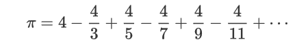

打印一个表格，显示通过计算该级数的前 200,000 项来近似的 π 值。你需要使用多少项才能得到一个以 3.14159 开头的数值？

20. **5.21 (勾股数)** 直角三角形的边长可以全为整数。直角三角形三条边长度的三个整数值被称为勾股数。三条边的长度长度必须满足这种关系：任意两条边长度的平方和等于斜边长度的平方。编写一个应用程序，显示边1、边2 和斜边的勾股数表格，且所有边长长度均都不超过 500。使用一个三层嵌套的 `for` 循环来尝试所有可能。这种方法是“暴力破解”计算的一个例子。在更高级的计算机科学课程中，你将学到对于某些问题，除了使用纯暴力破解之外没有已知的算法方法。
21. **5.22（修改后的三角形打印程序）** 修改练习 5.15，将你来自四个独立星号集合的代码组合起来，使得四个模式并排显示。[提示：巧妙地利用嵌套循环。]
22. **5.23 (德·摩根定律)** 在本章，我们讨论了逻辑运算符 `&`、`||`、`|`、`^` 和 `!`。德·摩根定律有时让我们更方便地表达逻辑表达式。这些规定表达式 `(!condition1 || condition2)` 在逻辑上等于表达式 `(!condition1 && !condition2)`。同样，表达式 `(!condition1 && !condition2)` 在逻辑上等于表达式 `(condition1 || condition2)`。利用德·摩根定律为以下每个编写等价表达式，编写一个应用程序来证明每个情况下原始表达式和新表达式产生相同的值：

```
1. !(x < 5) && !(y >= 7)
2. !(a == b) || !(g != 5)
3. !((x <= 8) && (y > 4))
4. !((i > 4) && (j <= 6))
```

23. **5.24 (菱形打印程序)** 编写一个打印以下菱形的应用程序。你可以使用打印单个星号 (`*`)、单个空格或单个换行符的输出语句。最大化地使用迭代（带有嵌套的 `for` 语句），并尽可能减少输出语句的数量。

| | |
|---|---|
| n | * |
| *** |
| ***** |
| ****** |
| * |
| ****** |
| ***** |
| *** |
| * |

24. **5.25 (修改后的菱形打印程序)** 修改你在练习 5.24 中编写的应用程序，读取 1 到 19 之间的奇数来指定菱形的行数。你的程序应显示相应大小的菱形。
25. **5.26** 对 `break` 语句和 `continue` 语句的批评是它们是非结构化的。实际上，这些语句总是可以用结构化语句替换，尽管这样做可能很麻烦。描述你如何从程序的循环删除任何 `break` 语句并将其替换为某些结构化的等价物。[提示：`break` 语句从循环体退出。另一种退出方法是失败循环继续测试。考虑使用第二个测试来指示“由于 'break' 条件而提前退出”。] 使用你在此处开发的技巧从图 5.13 中的应用程序中删除 `break` 语句。
26. **5.27** 下述程序段的作用是什么？

```
for (i = 1; i <= 5; i++) {
  for (j = 1; j <= 3; j++) {
    for (k = 1; k <= 4; k++) {
      System.out.print('*');
    }
    System.out.println();
  }
  System.out.println();
}
```


- 24. 5.28 描述你如何从循环删除 `continue` 语句并将其替换为某些结构化的等价物。使用你在此处开发的技巧从图 5.14 中的程序删除 `continue` 语句。

- 25. 5.29 (“圣诞十二天”歌曲) 编写一个使用迭代和 `switch` 语句的应用程序打印歌曲《圣诞十二天》。应该使用一个 `switch` 语句来打印天数（“first”、“second”等）。应使用另一个单独的 `switch` 语句来打印每节的其余部分。访问网站 en.wikipedia.org/wiki/The_Twelve_Days_of_Christmas_(song) 获取歌词。

- 26. 5.30 (修改后的 AutoPolicy 类) 修改图 5.11 中的 `AutoPolicy` 类，以验证东北州的双字母州代码。代码为：CT（康涅狄格州）、MA（马萨诸塞州）、ME（缅因州）、NH（新罕什州）、NJ（新泽西州）、NY（纽约州）、PA（宾夕法尼亚州）和 VT（佛蒙州）。在 `AutoPolicy` 方法 `setState` 中，使用逻辑或 (`|`) 运算符（第 5.9 节）在 `if...else` 语句创建一个复合条件，将方法的参数与每个双字母代码比较。如果代码错误，`if...else` 语句的部分显示错误消息。在后面的章节中，你将学习如何使用异常处理。

- 27. 5.31 (全球变暖) 全球变暖这一争议性问题已通过电影《不方便的真相》(An Inconvenient Truth) 广泛宣传，该片由前总统阿尔·戈尔主演，涉及联合国气候变化政府间小组对应对人为气候变化的共同努力。

- 28. 5.32 (税收计划) 有许多使税收更公平的建议。其中一个建议是取消所得税和其他税，转而对你购买的所有商品和服务征收 23% 的消费税。访问 http://www.fairtax.org 了解相关著作。

## 6.1 引言

经验表明，开发和维护大型程序的最佳方法是由许多小而简单的部分来构建它。这种技术被称为分治法。我们在第 3 章中介绍的方法（methods）可以帮助你实现程序逻辑模块化。在本章中，我们将进一步学习方法。

你将学习更多关于静态方法的知识，静态方法可以在不需要类对象的情况下被调用。你还将学习 Java 是如何跟踪当前正在执行哪个方法的、方法的局部变量如何在内存中维护的，以及方法在执行完成后如何知道该返回到哪里。

我们将简要介绍带有随机数生成的模拟技术，并开发一个名为“骰点”（craps）的骰子游戏版本，该游戏使用了你到目前为止用过的大部分编程技术。此外，你还将学习如何在程序中声明常量。

在开发应用程序时，你将使用或创建的许多类会有多个同名方法。这种技术被称为重载（overloading），用于实现对不同类型参数或不同数量参数的执行执行相似任务的方法。我们将在第 18 章“递归”中继续对方法的讨论。递归为思考方法和算法提供了一种引人的思维方式。

## 6.2 Java 中的程序单元

你已经在 Java 中处理过各种程序单元。你通过将新方法、类与 `Java 应用程序编程接口`（也称为 `Java API` 或 `Java 类库`）以及其他各种类库中的定义类相结合来编写程序。相关的类通常被分组在`包`（packages）中，这样它们就可以被`导入`到程序中并`重用`。你将在第 21.4.10 节学习如何将你自己的类分到`包`中。Java 9 引入了另一种程序单元`模块`（modules），我们将在第 36 章“Java 模块系统和其他 Java 9 特性”中讨论它。

Java API 提供了丰富的预定义类集合，其中包含了执行常用数学计算、字符串处理、字符处理、输入/输出操作、数据库操作、网络操作、文件处理、错误检查等的方法。


### 软件工程观察 6.1

熟悉 Java API (http://docs.oracle.com/javase/8/docs/api) 丰富的类和方法集合。第 6.8 节概述了几个常用的包。在线附录 F 解释了如何浏览 API 文档。不要重复轮子。可能的话，重用 Java API 类和方法。这可以减少程序开发时间并避免引入编程错误。

### 使用类和方法进行分治

类和方法通过将任务分为自包含的单元来帮助你实现程序的模块化。方法体中的语句只写一次，对其他方法隐藏，并且可以从程序的多个位置被重用。

将程序模块化为类和方法的动机之一是*分治*方法，它通过从小而简单的部分构建程序，使程序开发更易于管理。另一个是**软件重用性**——使用现有的类和方法作为构建块来创建新程序。通常，你可以大部分程度上从现有的类和方法创建程序，而不是通过构建自定义代码。例如，在早期的程序中，我们没有定义如何从键盘读取数据——Java 在 `Scanner` 类的方法中提供了这些功能。第三个动机是避免重复代码。

将程序划分为有意义的类和方法使程序更容易调试和维护。

### 软件工程观察 6.2

为了促进软件重用性，每个方法应该被限于执行单一的、定义良好的任务，且方法的名称应该有效地表达该任务。

### 错误预防提示 6.1

执行一个任务的方法比执行多个任务的方法更容易测试和调试。

### 软件工程观察 6.3

如果你无法选择执行单一任务的方法，那么该方法可能承担了太多任务。

### 方法调用之间的层级关系

当你调用一个方法时，在该方法执行完成后，它会将控制权并将结果返回给调用者。这种分层结构在图 6.1 中所示。将方法拆分为更小的单元有助于软件工程。图 6.1 显示了方法调用之间的层级关系。

方法 调用.层级关系，方法  6。。如果一个方法可能尝试执行太多任务，请将该方法拆分为更小的单元。图 6.1 显示了方法方法调用之间的层级关系。


### 错误预防提示 6.2

有些方法返回一个值表示该方法执行成功。当你调用这种方法时，请确保检查方法的返回值。


## 6.3 静态方法、字段和类方法

静态方法使用 `static` 关键字声明。静态方法通过类名和点符号来调用。例如，我们使用静态 Math 计算幂。静态方法不依赖于对象。

### Math 方法

Math 类提供了一系列方法，能够执行数学计算。例如，你可以使用静态方法计算 900 的平方根：

```
Math.sqrt(900)
```

该表达式的结果为 30.0。`sqrt` 方法接收 `double` 参数并返回 `double` 类型。为了在控制窗口输出该方法的值，你可以编写语句：

```java
System.out.println(Math.sqrt(900));
```

在该语句中，`sqrt` 返回的值成为 `println` 的参数。调用该方法时不需要创建 `Math` 对象。`Math` 方法是静态的——因此，每个方法都通过类名和点符号来调用。


### 软件工程观察 6.4

`Math` 类是 `java.lang` 包的一部分，该包由编译器隐含导入，因此使用其方法无需导入 `Math`。方法参数可以是常量、变量或表达式。如果 `c = 13.0, d = 3.0` 且 `f = 4.0`，那么语句

```java
System.out.println(Math.sqrt(c + d * f));
```

计算并打印 `13.0 + 3.0 * 4.0 = 25.0` 的平方根——即 `5.0`。图 6.2 总结了几个 `Math` 类方法。在图中，`x` 和 `y` 都是 `double` 类型。

### 图 6.2 Math 类方法

| 方法 | 说明 | 示例 |
| --- | --- | --- |
| `abs(x)` | x 的绝对值 | `abs(23.7)` 结果为 23.7<br>`abs(0.0)` 结果为 0.0<br>`abs(-23.7)` 结果为 23.7 |
| `ceil(x)` | 将 x 向上取整到最小整数 | `ceil(9.2)` 结果为 10.0<br>`ceil(-9.8)` 结果为 -9.0 |
| `cos(x)` | x 的余弦（x 为弧度） | `cos(0.0)` 结果为 1.0 |
| `exp(x)` | 指数方法 eˣ | `exp(1.0)` 结果为 2.71828<br>`exp(2.0)` 结果为 7.38906 |
| `floor(x)` | 将 x 舍入为小于等于 x 的最大整数 | `floor(9.2)` 是 9.0, `floor(-9.8)` 是 -10.0 |
| `log(x)` | x 的自然对数（底为 e） | `log(Math.E)` 是 1.0, `log(Math.E * Math.E)` 是 2.0 |
| `max(x, y)` | x 和 y 中的较大值 | `max(2.3, 12.7)` 是 12.7, `max(-2.3, -12.7)` 是 -2.3 |
| `min(x, y)` | x 和 y 中的较小值 | `min(2.3, 12.7)` 是 2.3, `min(-2.3, -12.7)` 是 -12.7 |
| `pow(x, y)` | x 的 y 次幂（即 x^y） | `pow(2.0, 7.0)` 是 128.0, `pow(9.0, 0.5)` 是 3.0 |
| `sin(x)` | x 的三角正弦值（x 为弧度） | `sin(0.0)` 是 0.0 |
| `sqrt(x)` | x 的平方根 | `sqrt(900.0)` 是 30.0 |
| `tan(x)` | x 的三角正切值（x 为弧度） | `tan(0.0)` 是 0.0 |

### 静态变量 (static Variables)

回顾第 3.2 节，类的每个对象都维护该类中每个实例变量的副本。但某些变量，类的每个对象*不需要*拥有独立的副本（稍后你就会看到）。这些变量被声明为 `static`，称为类变量。当创建包含静态变量的类的对象时，该类的所有对象都共享静态变量的一个副本。类的静态变量和实例变量合称为其字段（fields）。你将在第 8.11 节学习更多关于静态字段的知识。

### Math 类静态常量 PI 和 E

`Math` 类声明了两个常量：`Math.PI` 和 `Math.E`，它们代表常用数学常数的高精度近似：

- `Math.PI` (3.1415926535897932) 是圆周长与直径的比。
- `Math.E` (2.7182818284590451) 是自然对数的底（通过 `Math` 类的静态方法 `log` 计算）。

这些常量在 `Math` 类中用 `public`、`final` 和 `static` 修饰符声明。将它们设为 `public` 允许你在自己的类中使用它们。任何用 `final` 关键字声明的字段都是常量——其值在字段初始化后就无法更改。将这些字段设为 `static` 允许通过类名 `Math` 和点 (`.`) 分隔符访问它们，就像访问 `Math` 类的方法一样。

### 为什么 main 方法被声明为 static？

当你使用 `java` 命令执行 Java 虚拟机 (JVM) 时，JVM 会尝试调用你指定的类的 `main` 方法——此时尚未创建该类的对象。将 `main` 声明为 `static` 允许 JVM 在不创建类实例的情况下调用 `main`。当你执行应用程序时，你将类名作为 `java` 命令的参数指定，如下：

```
java ClassName argument1 argument2 ...
```

JVM 加载由 `ClassName` 指定的类，并使用该类名来调用 `main` 方法。在前面的命令中，`ClassName` 是 JVM 的一个命令行参数，告诉它要执行哪个类。在 `ClassName` 之后，你还可以指定一组由空格分隔的 `String` 作为命令行参数，JVM 会将这些参数传递给你的应用程序。这些参数可能用于指定运行应用程序的选项（例如文件名）。每个类都可能包含 `main`——但只有 `main` 的...

### 通过复用 Math.max 实现最大方法

我们最大方法的整个主体也可以通过两次调用 `Math.max` 来实现，如下：

```
return Math.max(x, Math.max(y, z));
```

第一次调用 `Math.max` 指定了参数 `x` 和 `Math.max(y, z)`。在调用任何方法之前，必须对其参数进行求值以确定它们的值。如果一个参数是方法调用，则必须执行该方法调用以确定其返回值。因此，在上述语句中，`Math.max(y, z)` 被求值以确定 `y` 和 `z` 的最大值。然后，该结果作为第二个参数传递给另一个 `Math.max` 调用，该调用返回其两个参数中的较大者。这是软件重用的良好示例——我们通过复用寻找两个值中最大值的 `Math.max`，从而找到了三个值中的最大值。注意，这段代码与图 6.3 中的第 26–38 行相比是多么简洁。

### 使用字符串拼接组合字符串

Java 允许你使用运算符 `+` 或 `+=` 将 `String` 对象组合成更大的字符串。这被称为字符串拼接。当运算符 `+` 的两个操作数都是 `String` 对象时

在图 6.3 的第 21 行中，表达式

```
"Maximum is: " + result
```

使用了操作数为 `String` 和 `double` 的 `+` 运算符。Java 中的每个基本类型值和对象都可以表示为 `String`。当 `+` 运算符的操作数之一是 `String` 时，另一个会被转换为 `String`，然后对两者进行拼接。在第 21 行中，`double` 值被转换为其字符串表示形式，并放置在 "Maximum is: " 的末尾。如果 `double` 值末尾有任何零，当该数字转换为 `String` 时，这些零会被丢弃——例如，`9.3500` 将被表示为 `9.35`。

用于字符串拼接的基本类型值会被转换为 `String`。与 `String` 拼接的布尔值将转换为字符串 `"true"` 或 `"false"`。所有对象都有一个 `toString` 方法，该方法返回对象的字符串表示。（我们将在后续章节中更详细地讨论 `toString`）。当一个对象与 `String` 拼接时，会隐式地调用对象的 `toString` 方法并返回对象的字符串表示。

`toString` 方法也可以被显式调用。

你可以将大的字符串字面量拆分成几个较小的 `String` 并将其放置在多行代码中以提高可读性。在这种情况下，可以使用拼接重新组合字符串。我们将在第 14 章讨论 `String` 的细节。


### 常见编程错误 6.2

跨行中断字符串字面量是一个语法错误。如有必要，你可以将字符串拆分为几个较小的 `String` 并使用拼接来形成所需的字符串。


### 常见编程错误 6.3

混淆用于字符串拼接的 `+` 运算符与用于加法的 `+` 运算符会导致奇怪的结果。Java 从左到右求运算符的操作的操作。例如，如果整数 `y` 的值为 5，表达式 `"y + 2 = " + y + 2` 的结果是字符串 `"y + 2 = 52"`，而不是 `"y + 2 = 7"`，因为首先 `y` 的值 (5) 被拼接到字符串 `"y + 2 = "` 中，然后值 2 被拼接到新的更大的字符串 `"y + 2 = 5"` 中。表达式 `"y + 2 =" + (y + 2)` 则产生预期的结果 `"y + 2 = 7"`。

## 6.5 关于声明和使用方法的注意事项

### 调用方法

调用方法有三种方式：

1. 仅使用方法名来调用同类的另一个方法——例如图 6.3 中第 18 行的 `maximum(number1, number2, number3)`。
2. 使用包含对象引用的变量，后跟一个点（`.`）和名称来调用引用对象的非静态方法——例如图 3.2 中第 14 行中的方法 `myAccount.getName()`，它从 `AccountTest` 的主方法调用了 `Account` 类的方法。非静态方法通常被称为实例方法。
3. 使用类名和点（`.`）来调用类的静态方法——例如第 6.3 节中的 `Math.sqrt(900.0)`。

### 从方法返回

有三种方式将控制返回给调用方法的语句：

- 当返回类型为 `void` 的方法到达方法结束的右括号时。
- 当返回类型为 `void` 的方法中执行以下语句时

```
return;
```

- 当方法通过如下形式的语句返回结果时，其中表达式被求值，其结果（以及控制权）被返回给调用者：

```
return expression;
```


# 常见编程错误 6.4

在类声明的主体之外或在另一个方法的体内部声明方法是语法错误。

# 常见编程错误 6.5

在方法中声明与方法参数之一同名的局部变量是编译错误。

# 常见编程错误 6.6

忘记从类型非 `void` 的方法中返回值是编译错误。

# 6.6 方法调用栈和激活记录

为了理解 Java 如何执行方法调用，我们首先需要考虑一种被称为**栈**（stack）的结构（即相关数据的集合）。将栈想象成一堆盘子。当一个盘子被放在堆上时，它位于顶部——这被称为将盘子**推入**（push）栈中。同样，当一个盘子从堆上移除时，它从顶部移除——这被称为从栈中**弹出**（pop）盘子。栈被称为**后进先出（LIFO）数据结构**——栈上最后被推入（插入）的项是第一个被弹出（移除）的项。

## 6.6.1 方法调用栈

计算机科学学生需要理解的最机制之一是**方法调用栈**（method-call stack，有时被称为**程序执行栈**）。这个数据结构——在“幕后工作”——支持方法的调用/返回机制。它还支持每个方法的局部变量的创建、维护和销毁。后进先出（LIFO）行为*恰好*是方法返回到调用它的方法所需要的。

## 6.6.2 栈帧

当每个方法被调用时，它可能会转而调用其他方法，而这些方法可能再次调用其他方法——这一切在任何方法返回之前完成。每个方法最终必须将控制权返回给调用它的方法。因此，系统必须某种方式跟踪每个方法返回到其调用方法所需的返回地址。方法调用栈是处理这些信息的完美数据结构。每当方法调用另一个方法时，栈中就会推入一项。该项被称为栈帧（stack frame）或激活记录（activation record），包含了被调用方法返回到调用方法所需的返回地址。它还包含一些我们将讨论的额外信息。如果被调用方法在返回之前没有调用其他方法，则方法调用的栈帧将被弹出，控制权转移到弹出栈帧中的返回地址。

调用栈的妙处在于，每个被调用方法总能在调用栈的顶部找到返回其调用者所需的信息。如果一个方法调用另一个方法，新方法的栈帧只需被推入调用栈。因此，新调用的方法返回其调用者所需的返回地址现在位于栈的顶部。

## 6.6.3 局部变量和栈帧

栈帧还有另一个职责。大多数方法都有局部变量——参数以及方法声明的任何局部变量。局部变量在方法执行期间需要存在。如果方法调用了其他方法，这些局部变量需要保持激活状态。但当被调用的方法返回到调用者时，被调用方法的局部变量就需要“消失”。被调用方法的栈帧是为这些局部变量预留内存的理想位置。只要被调用方法处于激活状态，该栈帧就会存在。当该方法返回且不再需要局部变量时，它的栈帧就会从栈中弹出，那些局部变量也不再存在。

## 6.6.4 栈溢出

当然，计算机的内存是有限的，因此只有有限的内存可以用于存储方法调用栈上的激活记录。如果发生方法调用次数超过了方法调用栈能存储的激活记录数量，就会发生被称为栈溢出的致命性错误——这通常是由无限递归引起的（第 18 章）。

1. 这就是网站 stackflow.com 名称的由来。这是一个获取编程问题问题的绝佳网站。

# 6.7 参数提升与类型转换

方法调用的另一个重要特性是**参数提升**——如果可能，将*参数的值*转换为方法在相应对应参数中期望接收的类型。例如，程序可以使用 `int` 参数调用 Math 方法 `sqrt`，尽管该方法期望的是一个 `double` 参数。该语句

```java
System.out.println(Math.sqrt(4));
```

该语句正确地评估了 `Math.sqrt(4)` 并打印出值 `2.0`。方法声明的参数列表导致 Java 在将值传递给方法 `sqrt` *之前*将 `int` 值 4 转换为 `double` 值 `4.0`。如果不满足 Java 的**提升规则**，此类转换可能会导致编译错误。这些规则规定了哪些转换是允许的——即在*不丢失数据*的情况下可以进行的转换。在上面的 `sqrt` 示例中，`int` 被转换为 `double` 而没有改变其值。然而，将 `double` 转换为 `int` 会*截断* `double` 值的数值部分——因此，部分数值丢失了。将较大的整数类型（例如从 `long` 转换为 `int`，或从 `int` 转换为 `short`）也可能导致值的改变。

提升规则适用于包含两个或多个原始类型值的表达式，也适用于作为参数传递给方法的原始类型值。每个值都被提升为表达式中“最高”的类型。实际上，表达式使用了每个值的临时副本——原始值的类型保持不变。图 6.4 列出了原始类型以及每种类型可以提升的类型。对于给定类型，有效的提升总是向表中更高的类型提升。例如，`int` 可以提升为更高阶类型 `long`、`float` 和 `double`。

将值转换为图 6.4 表中较低的类型，如果较低的类型无法表示高阶类型的值，将导致不同的值（例如，`int` 值 2000000 无法表示为 `short`，且任何带有小数数字的浮点数都无法用 `long`、`int` 或 `short` 等整数类型表示）。因此，在因转换可能导致信息丢失的情况下，Java 编译器要求你使用强制转换符（第 4.10 节引入）显式强制转换发生——否则会发生编译错误。这使你能够从编译器手中“接管控制权”。你本质上是在说：“我知道这种转换可能会导致信息丢失，但对我这里的目的来说，没关系。”假设方法 `square` 计算整数的平方，因此需要一个 `int` 参数。为了用一个名为 `doubleValue` 的 `double` 参数调用 `square`，我们需要将方法写为：

### 图 6.4 原始类型允许的提升

| 类型 | 有效的提升 |
| --- | --- |
| double | 无 |
| float | double |
| long | float or double |
| int | long, float or double |
| char | int, long, float or double |
| short | int, long, float or double（但不包括 char） |
| byte | short, int, long, float or double（但不包括 char） |
| boolean | 无（Java 中的布尔值不被视为数字） |

此方法调用显式地转换（转换）`doubleValue` 的值为一个临时整数，供方法 `square` 使用。因此，如果 `doubleValue` 的值是 4.5，方法接收到的值为 4 并返回 16，而不是 20.25。


## 常见编程错误 6.7

将原始类型值转换为另一种原始类型，如果新类型不是有效的提升，可能会改变值。例如，将浮点值转换为整数值可能会在结果中引入截断错误（丢失小数部分）。

# 6.8 Java API 包

正如你所见，Java 包含许多预定义类，这些类被分为相关的类类别，称为“包”（packages）。它们统称为 Java 应用程序编程接口（Java API），或 Java 类库。Java 的一大优势是 API 提供了成千上万的类。我们在书中使用的一些关键 Java API 包在图 6.5 中描述，它仅代表了 Java API 中可重用组件的一小部分。

### 图 6.5 Java API 包（子集）

| 包 | 描述 |
| --- | --- |
| java.awt.event | Java 抽象窗口工具包事件包包含类和接口，能够为 java.awt 和 javax.swing 包中的 GUI 组件启用事件处理。（参见第 26 章，Swing GUI 组件：部分 1，以及第 35 章，Swing GUI 组件：部分 2。） |
| java.awt.geom | Java 2D 形状包包含用于处理 Java二维图形的类和接口。（参见第 27 章，图形和二维图形。） |
| java.io | 输入/输出包包含用于程序输入和输出数据的类和接口。（参见第 15 章，文件、输入输出。） |
| java.lang | Java 语言包包含许多程序所需的类和接口。此包由编译器导入。 |
| java.net | 网络包包含用于通过计算机网络进行通信的类和接口。（参见第 28 章，网络。） |
| java.security | 安全包包含用于增强应用程序安全的类和接口。 |
| java.sql | JDBC 包包含用于处理数据库的类和接口。（参见第 24 章，使用 JDBC 访问数据库。） |
| java.util | 工具包包含存储和处理大量数据的工具类和接口。许多这些类和接口已更新以支持 Java 8 的这些功能。（参见第 16 章，泛型集合。） |
| java.util.concurrent | 并发包包含用于实现执行多个任务程序的工具类和接口。（参见第 23 章，并发。） |
| javax.swing | Swing GUI 组件包包含用于 Java Swing 组件的类和接口。此包仍使用 java.awt 包的一些元素。（参见第 26 章，Swing GUI 组件：部分 1，以及第 35 章，Swing GUI 组件：部分 2。） |
| javax.swing.event | Swing 事件包包含为 javax.swing 包中的 GUI 组件启用处理（例如响应按钮点击）的类和接口。（参见第 26 章……部分 1，以及第 35 章……部分 2。） |
| javax.xml.ws | JAX-WS 包包含用于在 Java 中处理网络服务的类和接口。（参见在线第 32 章，网络服务。） |
| javafx packages | JavaFX 是 Java 未来首选 GUI、图形和多媒体技术。我们在书中广泛介绍了 JavaFX。 |

## 本书使用的 Java SE 8 包

- `java.time`：Java SE 8 日期时间 API 包包含用于处理日期和时间的类和接口。（参见第 23 章，并发。）
- `java.util.function` 和 `java.util.stream`：这些包包含用于处理 Java SE 8 函数式编程能力的类和接口。（参见第 17 章，Lambda 和流。）

Java 可用的包非常庞大。除了图 6.5 中总结的包外，Java 还包括用于复杂图形、高级图形用户界面、打印、高级网络、安全、数据库处理、多媒体、辅助功能（针对残障人士）、并发编程、加密、XML 处理以及许多其他包。要查看 Java 包的概述，请访问：

```
http://docs.oracle.com/javase/8/docs/api/overview-sum-
```


你可以在 Java API 文档中找到有关预定义 Java 类方法的额外信息：

```
http://docs.oracle.com/javase/8/docs/api
```

访问此站点时，点击 `Index`（索引）链接可以查看 Java API 中所有类和方法的字母列表。找到类名并点击其链接以查看该类的在线描述。点击 `METHOD` 链接可以查看类方法的表格。每个静态方法会在其返回类型前列出“static”一词。

# 6.9 案例研究：安全随机数生成

我们现在简短地转向一种流行的编程应用类型——模拟和游戏开发。在本节和接下来的章节中，我们将开发一个具有多个方法的游戏程序。该程序使用了书中到为止介绍的大部分控制语句，并引入了几个新的编程概念。

**机会元素**可以通过 `SecureRandom` 类对象（位于 `java.security` 包中）引入程序中。此类对象可以产生随机的布尔、字节、float、double、int、long 和高斯值。在接下来的几个示例中，我们将使用 `SecureRandom` 类对象来生成随机值。

## 迁移到安全随机数

本书的最新版本使用了 Java 的 **Random** 类来获取“随机”值。该类产生的是*确定性的*值，这些值可以被恶意程序员*预测*。

`SecureRandom` 对象产生不可预测的非确定性随机数。

确定性随机数一直是许多软件安全漏洞的根源。大多数编程语言现在都拥有与 `SecureRandom` 类似的库功能，用于生成非确定性随机数以帮助防止此类问题。从文中此处开始：


对于关注构建日益安全的应用的开发者来说，Java 9 根据 JEP 273 增强了 `SecureRandom` 的功能。

### 创建 SecureRandom 对象

可以如下方式创建一个新的随机数生成器对象：

```java
SecureRandom randomNumbers = new SecureRandom();
```

然后可以使用它来生成随机值——我们在这里只讨论随机的 int 值。有关 `SecureRandom` 类的更多信息，请参阅：

```
http://docs.oracle.com/javase/8/docs/api/java/securit
```

### 获取随机 int 值

考虑以下语句：

```java
int randomValue = randomNumbers.nextInt();
```

`SecureRandom` 方法 `nextInt` 生成一个 int 值。如果它确实是随机产生值，那么范围内的每个值在每次调用 `nextInt` 时，都应该有相等的机会（或概率）被选中。

### 修改产生的数值范围

#### nextInt

方法 `nextInt` 产生的数值范围通常与特定 Java 应用所需的数值范围不同。例如，一个模拟掷硬币的程序可能只需要代表“正面”的 0 和代表“反面”的 1。模拟掷六面骰的程序可能需要 1–6 范围内的随机整数。一个在视频游戏中随机预测下一次飞越地平线的飞船类型（共四种可能）的程序可能需要 1–4 范围内的随机整数。对于这些情况，此版本的 `nextInt` 方法接收另一个 `int` 参数，并返回一个从 0 直到（但不包含）该参数值的值。例如，对于掷硬币，以下语句返回 0 或 1。

```java
int randomValue = randomNumbers.nextInt(2);
```

#### 掷六面骰

为了演示随机数，让我们开发一个模拟掷 20 次六面骰的程序，并显示每次掷的结果。我们首先使用 `nextInt` 产生 0–5 范围内的随机值，如下：

```java
int face = randomNumbers.nextInt(6);
```

参数 6——称为缩放因子——代表 `nextInt` 在此情况下应产生的唯一值个数，即 6 个值：0, 1, 2, 3, 4 和 5。这种操作被称为缩放 `SecureRandom` 方法 `nextInt` 产生的值的范围。

六面骰的每个面上的数字是 1–6，而不是 0–5。我们通过在之前的结果上加上一个偏移值（在本例中为 1）来位移产生的数值范围，如下所示：

```java
int face = 1 + randomNumbers.nextInt(6);
```

偏移值（1）指定了目标随机整数范围中的第一个值。前面的语句为 `face` 赋值了一个 1–6 范围内的随机整数。

#### 掷 20 次六面骰

图 6.6 显示了两个示例输出，证实了上述计算结果是 1–6 范围内的整数，且程序的每次运行都可以产生不同的随机数序列。第 3 行从 `java.security` 包中导入 `SecureRandom` 类。第 8 行创建 `SecureRandom` 对象 `randomNumbers` 以产生随机值。第 13 行循环循环执行 20 次以掷骰。循环中的 `if` 语句（第 18–20 行）每五个数字后开始新的一行输出，创建一个整洁的五列格式。

### 图 6.6 偏移并缩放后的随机整数

```java
// Fig 6.6: RandomIntegers.java
// 偏移并缩放后的随机整数。
import java.security.SecureRandom; // 程序使用

public class RandomIntegers {
    public static void main(String[] args) {
        // randomNumbers 对象将产生安全的
        SecureRandom randomNumbers = new SecureRandom();

        // 循环 20 次
        for (int counter = 1; counter <= 20; counter++) {
            // 从 1 到 6 选取随机整数
            int face = 1 + randomNumbers.nextInt(6);

            System.out.printf("%d ", face); // 显示

            // 如果 counter 能被 5 整除，则开始新行
            if (counter % 5 == 0) {
                System.out.println();
            }
        }
    }
}
```

| 1 5 3 6 2 |
| 5 2 6 5 2 |
| 4 4 4 2 6 |
| 3 1 6 2 2 |
| 6 5 4 2 6 |
| 1 2 5 1 3 |


### 掷 60,000 次六面骰

为了证明随机数的有效性，让我们编写一个程序模拟 60,000 次掷六面骰。为了证明 `nextInt` 产生的数字以相等概率出现，让我们在图 6.7 中模拟 60,000 次掷六面骰（注意图 6.7 中的第 18 行，我们使用了 `int` 值 60,000）。使用 1–6 范围内的随机整数。

### 图 6.7

```java
// Fig 6.7: RollDie.java
// 掷 60,000 次六面骰。
```


## RollDie 类示例

```java
import java.security.SecureRandom;

public class RollDie {
    public static void main(String[] args) {
        // randomNumbers 对象将产生安全的
        SecureRandom randomNumbers = new SecureRandom();

        // 计数 60,000 次
        for (int roll = 1; roll <= 60000; roll++) {
            // 使用 1 到 6 范围内的随机整数
            int face = 1 + randomNumbers.nextInt(6);

            switch (face) {
                case 1:
                    ++frequency1; // 增加 1 的计数
                    break;
                case 2:
                    ++frequency2; // 增加 2 的计数
                    break;
                case 3:
                    ++frequency3; // 增加 3 的计数
                    break;
                case 4:
                    ++frequency4; // 增加 4 的计数
                    break;
                case 5:
                    ++frequency5; // 增加 5 的计数
                    break;
                case 6:
                    ++frequency6; // 增加 6 的计数
                    break;
            }
        }

        System.out.println("Face\tFrequency");
        System.out.printf("1\t%d\n2\t%d\n3\t%d\n4\t%d\n5\t%d\n6\t%d\n",
                frequency1, frequency2, frequency3, frequency4, frequency5, frequency6);
    }
}
```

> *(注：代码中 `frequency` 变量的声明在截取片段中缺失，但根据逻辑它们是存在的)*

| Face | Frequency |
| :--- | :--- |
| 1 | 10001086 |
| 2 | 10000185 |
| 3 | 9999542 |
| 4 | 9996541 |
| 5 | 9998787 |
| 6 | 10002922 |

如示例输出所示，对 `nextInt` 生成的值进行缩放和偏移，使得程序能够模拟掷六面骰子。该应用程序使用了嵌套控制语句（`switch` 嵌套在 `for` 循环内部）来确定骰子每个面出现的次数。`for` 语句（第 18–42 行）迭代了 60,000,000 次。在每次迭代中，第 19 行产生一个 1 到 6 之间的随机值。该值用作 `switch` 语句（第 22–41 行）的控制表达式（第 22 行）。根据点数，`switch` 语句在循环的每次迭代中增加六个计数变量之一。此 `switch` 语句没有 `default` 分支，因为对于第 19 行表达式可能产生的每一个骰子点，我们都设置了相应的 `case`。运行程序并观察结果。如你所看到的，每次运行此程序，它都会产生不同的结果。

当我们在第 7 章学习数组时，我们将展示一种优雅的方法，用一个语句替换程序中的整个 `switch` 语句。然后，当我们在第 17 章学习 Java SE 8 的函数式编程能力时，我们将展示如何用一个语句替换掷骰子的循环、`switch` 语句以及显示结果的语句！

## SecureRandom 性能

使用 `SecureRandom` 代替 `Random` 来获得更高级别的安全性会带来显著的性能代价。对于“普通性”应用程序，你可能想使用 `java.util` 包中的 `Random` 类——只需将 `SecureRandom` 替换为 `Random` 即可。

## 随机数的通用缩放和偏移

之前，我们通过以下语句模拟掷六面骰子：

```java
int face = 1 + randomNumbers.nextInt(6);
```

该语句始终为变量 `face` 赋值一个 1 ≤ face ≤ 6 范围内的整数。该范围的宽度（即该范围内连续整数的个数）为 6，范围内的起始数字是 1。在前面的语句中，范围的宽度是由传递给 `SecureRandom` 方法 `nextInt` 的参数 6 决定的，而起始数字是由加到 `randomNumbers.nextInt(6)` 之上的数字 1 决定的。我们可以将此结果泛化为：

```java
int number = shiftingValue + randomNumbers.nextInt(scalingFactor);
```

其中 `shiftingValue` 指定所需的连续整数范围内的第一个数字，`scalingFactor` 指定了范围内有多少个数字。

也可以从连续整数范围以外的数值集中随机选择整数。例如，为了从序列 2, 5, 8, 11 和 14 中获取随机值，你可以使用语句：

```java
int number = 2 + 3 * randomNumbers.nextInt(5);
```

在这种情况下，`randomNumbers.nextInt(5)` 产生 0–4 范围内的值。产生的每个值都乘以 3，产生序列 0, 3, 6, 9 和 12 中的数字。我们对该值加上 2 以偏移数值范围，并从序列 2, 5, 8, 11 和 14 中获取值。我们可以将此结果泛化为：

```java
int number = shiftingValue + differenceBetweenValues * randomNumbers.nextInt(scalingFactor);
```

其中 `shiftingValue` 指定了目标数值范围内的第一个数字，`differenceBetweenValues` 代表序列中连续数字之间的常差，`scalingFactor` 指定了范围内有多少个数字。

## 6.10 案例研究：一种运气游戏；引入 enum 类型

一种流行的运气游戏是名为“骰点”（craps）的骰子游戏，在世界各地的赌场和小巷中流行。游戏的规则非常简单：

你掷两颗骰子。每个骰子有六个面，分别包含一、二、三、四、五和六个点数。骰子停止后，计算两个朝上面的点数的总和。如果第一次掷的总和为 7 或 11，你获胜。如果第一次掷的总和为 2、3 或 12（称为“掷点”），你输了（即“赌场”获胜）。如果第一次掷的总和为 4、5, 6, 8, 9 或 10，该总和将成为你的“点”。要获胜，你必须继续掷骰子，直到你“成了你的点”（即掷出相同的点数值）。如果你在成点之前掷出 7，你就输了。

图 6.8 使用方法来实现游戏逻辑，模拟了骰点游戏。`main` 方法（第 20–66 行）根据需要调用 `rollDice` 方法（第 69–80 行）来掷骰子并计算其总和。示例输出显示了第一次掷的胜与输，以及后续投掷的胜与输。

### 6.8: Craps.java

```java
import java.security.SecureRandom;

class Craps {
    // 用于 rollDice 方法的随机生成器
    private static SecureRandom randomNumbers = new SecureRandom();

    // 表示游戏状态的常量
    enum Status {CONTINUE, WON, LOST};

    // 表示常见的骰点结果
    final int SNAKE_EYES = 2;
    final int TREY = 3;
    final int SEVEN = 7;
    final int ELEVEN = 11;
    final int BOX_CARS = 12;

    public static void main(String[] args) {
        // 一局骰点游戏
        Status status;
        int sum;

        // 第一次掷骰确定状态
        sum = rollDice();

        if (sum == SEVEN || sum == ELEVEN) {
            status = Status.WON;
        } else if (sum == SNAKE_EYES || sum == BOX_CARS) {
            status = Status.LOST;
        } else {
            status = Status.CONTINUE;
            int point = sum;

            // 继续掷骰子
            while (status == Status.CONTINUE) {
                sum = rollDice();

                if (sum == SEVEN) {
                    status = Status.LOST;
                } else if (sum == point) {
                    status = Status.WON;
                }
            }
        }

        // 此掷或游戏的结果
        if (status == Status.WON) {
            System.out.println("Player wins");
        } else {
            System.out.println("Player loses");
        }
    }

    // 计算总和并显示结果
    private static int rollDice() {
        // 骰子值
        int die1 = 1 + randomNumbers.nextInt(6);
        int die2 = 1 + randomNumbers.nextInt(6);
        int sum = die1 + die2;

        // 结果
        System.out.printf("Player rolled %d + %d = %d%n", die1, die2, sum);
        return sum;
    }
}
```


Player rolled 5 + 6 = 11
Player wins

Player rolled 5 + 4 = 9
Point is 9

Player rolled 4 + 2 = 6
Player wins

Player rolled 3 + 6 = 9
Player loses

Player rolled 2 + 1 = 3
Player loses

Player rolled 1 + 6 = 7
Player loses

图. 6.8

Craps 类模拟了骰点游戏。

## rollDice 方法

在游戏规则中，玩家必须通过 69–80 行来掷骰子。我们声明 `rollDice` 方法（第 69–80 行）来掷骰子并计算其总和。`rollDice` 方法定义一次，但在 `main` 中的两个地方（第 24 和 46 行）被调用，`main` 包含了一局完整骰点游戏的逻辑。`rollDice` 方法不接受参数，因此其参数列表为空。每次调用时，`rollDice` 返回骰子的总和，因此在方法头（第 69 行）指示了返回类型 int。变量 `randomNumbers`（用于 71–72 行）没有在方法中声明。相反，它被声明为类的私有静态变量，并在第 7 行初始化。这使得可以在每次调用 `rollDice` 时重用 `SecureRandom` 对象。如果一个程序包含多个 `Craps` 类的实例，它们将共享这一个 `SecureRandom` 对象。

## main 方法的局部变量

游戏相当复杂。玩家可能在第一次掷中获胜或失败，也可能在随后的任何掷中获胜或失败。`main` 方法使用了

- 局部变量 `myPoint`（第 21 行），用于存储玩家在第一次掷骰子时未胜负的“点数”。
- 局部变量 `gameStatus`（第 22 行），用于跟踪游戏的整体状态。
- 局部变量 `sumOfDice`（第 24 行），用于存储最近一次掷骰子的点和。

变量 `myPoint` 初始化为零，以确保应用程序能够编译。如果你不初始化 `myPoint`，编译器会报错错误，因为在 `switch` 语句的每种情况下都没有给 `myPoint` 赋值，因此程序可能会在 `myPoint` 赋值之前尝试使用它。相比之下，`gameStatus` 在 `switch` 语句的每个情况下（包括 `default` 情况）都被了赋值——这保证了它在使用之前已初始化，因此我们不需要在第 22 行对其进行初始化。

## 类型状态

局部变量 `gameStatus`（第 22 行）被声明为一种名为 `Status` 的新类型（声明在第 10 行）。`Status` 类型是类 `Craps` 的私有成员，因为 `Status` 只会在该类中使用。`Status` 是一种被称为枚举类型（enum type）的类型，它的简单形式声明了一组由标识符表示的常量。枚举类型是一种特殊的类，通过 `enum` 关键字和类型名称（在本例中为 `Status`）引入。与类一样，大括号限定了枚举声明的体。在逗号分隔的枚举常量列表中，每个常量都代表一个唯一的值。枚举中的标识符必须是唯一的。你将在第 8 章学习更多关于枚举类型的知识。


## 良好的编程实践 6.1

在枚举常量名称中仅使用大写字母，使它们脱颖而出并提醒你它们是变量。

类型 `Status` 的变量只能被枚举中声明的三个常量（第 10 行）赋值，否则会发生编译错误。当游戏胜利时，程序将局部变量 `gameStatus` 设置为 `Status.WON`（第 30 行和第 50 行）。当游戏失败时，程序将局部变量 `gameStatus` 设置为 `Status.LOST`（第 35 行和第 54 行）。否则，程序将局部变量 `gameStatus` 设置为 `Status.CONTINUE`（第 38 行），表示游戏结束且必须重新掷骰子。


## 良好的编程实践 6.2

使用枚举常量（如 `Status.WON`、`Status.LOST` 和 `Status.CONTINUE`）而不是字面量（如 0、1 和 2）使程序更容易易读和维护。

## main 方法的逻辑

main 方法的第 24 行调用了 `rollDice`，该方法从 1 到 6 之间选取两个随机值，显示第一个骰子、第二个骰子以及它们的和的值，并返回该和。main 方法接下来进入 `switch` 语句（第 27–42 行），该语句使用第 24 行的 `sumOfDice` 值来判断游戏是胜利了、失败了，还是应该继续再次掷骰子。在第一次掷骰时导致胜利或失败的值在第 13–17 行中声明为 `private static final int` 常量。标识符名称使用了赌场术语来表示和。这些常量像枚举常量一样，按照约定用全大字母声明，以便它们在程序中脱颖而出。第 28–31 行确定玩家是否在第一次掷骰时通过 SEVEN (7) 或 YO_LEVEN (11) 获胜。第 32–36 行确定玩家是否在第一次掷骰时通过 SNAKE_EYES (2)、TREY (3) 或 BOX_CARS (12) 失败。第一次掷骰后，如果游戏未结束，`default` 情况（第 37–41 行）将 `gameState` 设置为 `Status.CONTINUE`，表示游戏结束且必须再次掷骰子。如果我们仍在尝试“获取点数”（第 45–57 行），如果 `sumOfDice` 匹配点数（第 49 行），第 50 行将 `gameState` 设置为 `Status.WON`。如果 `sumOfDice` 是 SEVEN（第 53 行），第 54 行将 `gameState` 设置为 `Status.LOST`。当游戏完成，第 60–65 行显示玩家胜利或失败的消息，并且程序结束。Craps 类使用了 `main` 和 `rollDice`（从 `main` 调用）的控制机制。`switch` 语句中的各种和（第 28–29 行的 SEVEN 和 YO_LEVEN；第 32–34 行的 SNAKE_EYES、TREY 和 BOX_CARS）。

## 为什么某些常量没有定义为枚举

你可能会好奇为什么我们将和定义为 `static final int` 常量而不是枚举常量。原因是程序必须将 `sumOfDice`（第 24 行）与这些常量进行比较以确定结果。如果我们把和声明为枚举常量，那么在 `switch` 语句中必须将 int 值转换为特定的枚举。遗憾的是，Java 没有提供一种方便将 int 转换为枚举的方法。

## 6.11 声明的作用范围

你已经看到了类、方法、变量和参数的声明。声明引入了引用这些实体的名称。声明的作用范围是该实体所在的程序部分。这引入了几个重要的作用域问题。基本规则如下：

1. 参数声明的作用范围是其所在的方法体。
2. 局部变量声明的作用范围是从其出现的地方到该块的结束。
3. `for` 语句初始化部分的局部变量声明的作用范围是 `for` 语句的主体和其他表达式。
4. 方法或字段的作用范围是整个类的体。这使得类的实例方法可以使用类的字段和其他方法。

任何块都可以包含变量声明。如果方法中的局部变量或参数与类的字段同名，该字段会被隐藏直到该块结束——这被称为遮蔽（shadowing）。要在块中访问被隐藏的字段：

- 如果字段是实例变量，在名称前加上 `this` 关键字和点 (.)，例如 `this.x`。
- 如果字段是静态类变量，在名称前加上类名和点 (.)，例如 `ClassName.x`。

如果在同一个方法中有多个同名的局部变量会导致编译错误。

图 6.9 展示了字段和局部变量的作用域。第 6 行声明并初始化了字段 `x` 为 1。在任何声明名为 `x` 的局部变量的块（或方法）中，该字段都被遮蔽。`main` 方法声明了一个局部变量 `x`（第 11 行）并将其初始化为 5。输出该局部变量的值是为了显示字段 `x`（值为1）在 `main` 方法中被遮蔽了。

```java
// Fig. 6.9: Scope.java
// Scope 类展示了字段和局部变量的作用域
public class Scope {
    // 所有方法都可以访问的字段
    private static int x = 1;

    // main 方法创建并初始化局部变量
    // 以及方法 useLocalVariable 和 useField
    public static void main(String[] args) {
        int x = 5; // 方法的局部变量 shadow 字段

        System.out.printf("%nlocal x in main is %d%n", x);

        useLocalVariable(); // useLocalVariable 有自己的局部 x
        useField(); // useField 使用类的字段 x
        useLocalVariable(); // useLocalVariable 重新创建局部 x
        useField(); // class Scope 类的字段 x 保留修改后的值
        System.out.printf("%nlocal x in main is %d%n", x);
    }
}
```

```java
// 在每次调用时创建并初始化局部变量 x
public static void useLocalVariable() {
    int x = 25; // 每次使用 useLocalVariable 时初始化
    System.out.printf(
        "%n进入方法 useLocalVariable 时 local x ");
    x++; // 修改该方法的局部变量
    System.out.printf(
        "退出 method useLocalVariable 前 local x " + x);
}

// 在每次调用时修改类 Scope 的字段 x
public static void useField() {
    System.out.printf(
        "%n进入方法 useField 时 field x ");
    x = 10; // 修改类 Scope 的字段 x
    System.out.printf(
        "退出 method useField 前 field x " + x);
}
```

main 方法中的 local x 为 5
进入 method useLocalVariable 时 local x 为 25
退出 method useLocalVariable 前 local x 为 25
进入 method useField 时 field x 为 1
退出 method useField 前 field x 为 10
进入 method useLocalVariable 时 local x 为 25
退出 method useLocalVariable 前 local x 为 25
进入 method useField 时 field x 为 10
退出 method useField 前 field x 为 100
main 方法中的 local x 为 5

### 图 6.9

### Scope 类演示了字段和局部变量的作用域。

程序声明了另外两个方法——`useLocalVariable`（第 24–32 行）和 `useField`（第 35–41 行），它们不接受任何参数也不返回值。`main` 方法各调用了两次方法（第 15–18 行）。`useLocalVariable` 方法内部声明了局部变量 `x`（第 25 行）。当第一次调用 `useLocalVariable` 时（第 15 行），它创建了变量 `x` 并将其初始化为 25，输出 `x` 的值（第 27–28 行），增加 `x`（第 29 行）并再次输出 `x` 的值（第 30–31 行）。当第二次调用 `useLocalVariable` 时（第 17 行），它会重新创建局部 `x` 并重新初始化为 25，因此 `useLocalVariable` 调用的输出是相同的。

`useField` 方法没有声明任何变量。因此，当它引用 `x` 时，使用的是类的字段 `x`（第 6 行）。当第一次调用 `useField` 方法时（第 16 行），它输出字段 `x` 的值（1）（第 36–37 行），将该字段乘以 10 倍（第 38 行），并在返回之前再次输出字段 `x` 的值（10）（第 39–40 行）。下次调用 `useField` 方法时（第 18 行），该字段已经有了被修改后的值（10），因此该方法输出 10，然后是 100。最后，在 `main` 方法中，程序再次输出局部变量 `x` 的值（第 20 行），以证明没有任何一个方法调用修改了 `main` 的局部变量 `x`，因为这些方法都引用了其他作用域中名为 `x` 的变量。

### 最小权限原则

从广义上说，“事物”应该拥有完成工作所需的能力，但仅此而已。变量的作用域就是一个例子。当变量不再被需要时，它不应该是可见的。


### 良好的编程实践 6.3

尽可能将变量声明在首次使用它们的地方的地方。

## 6.12 方法重载

在同一个类中可以声明同名的方法，只要它们具有不同的参数集合（由参数的数量、类型和顺序决定）——这被称为方法重载。当调用被重载的方法时，编译器会通过检查调用中参数的数量、类型和顺序来选择合适的方法。方法重载通常用于创建具有相同名称的方法以执行相似的任务，但具有不同的类型或数量。例如，`Math` 中的 `abs` 和 `max` 方法（见 6.3 节）重载了四种版本：

1. 两个 `double` 参数。
2. 两个 `float` 参数。
3. 两个 `int` 参数。
4. 两个 `long` 参数。

### 6.12.1 重载方法

下一个示例演示了声明和调用重载方法。`Overload` 类（图 6.10）声明了重载方法——一个接受 `int`，另一个接受 `double`。尽管这些方法名称相同且方法体相似，但请简单地认为它们是不同的。参数的顺序是重要的。

```java
// 图 6.10: Overload
// 重载声明
public class Overload {
    public static void main(String[] args) {
        System.out.printf("square with argument: %d\n", square(7));
        System.out.printf("square with argument: %f\n", square(7.5));
    }

    // square with argument
    public static int square(int x) {
        return x * x;
    }

    // square with argument
    public static double square(double x) {
        return x * x;
    }
}
```

square with argument: 49
square with argument: 56.250000

### 图 6.10
重载方法。

### 6.12.2 区分重载方法

编译器通过签名来区分重载方法——签名是方法名与参数类型和顺序的组合，但不包括返回值。如果在编译时只查看方法名，图 6.10 中的代码将是歧义的。在内部，编译器使用更长的方法名，包括原始名称、每个参数的类型以及参数的精确顺序。例如，在图 6.10 中，编译器（内部）使用“square of int”来表示 `int` 参数的 `square` 方法，使用“square of double”来表示 `double` 参数的 `square` 方法。如果 `method1` 的声明如下：

```java
void method1(int a, float b)
```

那么编译器可能会使用“method1 of int and float”。如果参数指定为：

```java
void method1(float a, int b)
```

那么编译器可能会使用“method1 of float and int”。编译器认为上述两个 `method1` 头部是*不同*的。

### 6.12.3 重载方法的返回值

在讨论编译器所使用的方法逻辑名称时，我们没有提到方法的返回值。*方法调用无法仅通过返回值来区分。*当两个方法具有相同的签名但不同的返回值类型时，编译器会抛出错误，指示该方法已定义。如果方法具有不同的参数列表，则重载方法*可以*具有不同的返回值。

### 常见编程错误 6.8
声明具有相同参数列表的重载方法是编译错误，无论返回值是否不同。

## 6.13 (可选) GUI 与图形案例研究：颜色与填充形状

`GraphicsContext` 类的功能远超绘制线条、矩形和椭圆。接下来的两个介绍的另外两个功能是颜色和填充形状。添加颜色可以丰富用户在计算机屏幕上看到的图效果。例如，IDE 通常会对 Java 代码进行“语法着色”，以帮助你识别不同的代码元素，如关键字和注释。形状可以填充实色。正如我们在第 22 章中所示的，形状也可以填充图像或所谓的在颜色之间逐渐过渡的渐变色。在本节中，我们将创建一个 `DrawSmiley` 应用，该应用将使用实色和填充形状来画一个笑脸。

在计算机屏幕上显示的实色由其红、绿、蓝分量（称为 RGB 值）定义，每个分量的整数值范围从 0 到 255。分量颜色数值越高，该颜色的色调越丰富。`Color` 类（位于 `javafx.scene.paint` 包）使用其 RGB 值表示颜色。为了方便起见，`Color` 类包含几十个预定义的静态 `Color` 对象，每个对象都可以通过类名加点（.）来访问，例如 `Color.RED`。有关预定义颜色的完整列表，请参见 `Color` 类的文档：

https://docs.oracle.com/javase/8/javafx/api/javafx/sc


`Color` 类还提供了允许你创建自定义颜色的方法，尽管我们在本示例中没有使用它们。

## 创建 Draw Smiley 应用的 GUI

该应用的 GUI 定义在 `DrawSmiley.fxml` 中。我们重用了图 4.17 所示的 `DrawLines.fxml` GUI，但对 `DrawSmiley.fxml` 做了以下更改：

- 我们在 Scene Builder 文档窗口的 `Controller` 部分将 `DrawSmileyController` 指定为应用程序的控制器类。
- 我们将 `Button` 的 `Text` 属性设置为 `Draw Smiley`（在 Inspector 的 `Properties` 部分），并将 `Button` 的 `OnAction` 事件处理器设置为 `drawSmileyButtonPressed`（在 Inspector 的 `Code` 部分）。

## DrawSmileyController 类

再次，我们没有显示 `DrawSmiley.java` 的代码，因为与早期的示例相比，唯一的更改是加载的 FXML 文件名（`DrawSmiley.fxml`）以及在同一阶段标题栏上显示的文本（`Draw Smiley`）。`DrawSmileyController` 类（图 6.11）执行绘图。`GraphicsContext` 方法 `fillRect` 和 `fillOval` 分别绘制填充的矩形和椭圆。这些参数与 `strokeRect` 和 `strokeOval` 相同（第 5.11 节）；前两个是形状左上角的坐标，后两个决定宽度和高度——请记住，对于椭圆，这些参数指定了显示椭圆的边界矩形。

```java
// DrawSmileyController.java

// 使用颜色和填充形状画笑脸

import javafx.event.ActionEvent;
import javafx.fxml.FXML;
import javafx.scene.canvas.Canvas;
import javafx.scene.canvas.GraphicsContext;
import javafx.scene.paint.Color;

public class DrawSmileyController {
    @FXML private Canvas canvas;

    // 画一个笑脸
    @FXML
    void drawSmileyButtonPressed(ActionEvent event) {
        // 获取 GraphicsContext，用于绘图
        GraphicsContext gc = canvas.getGraphicsContext();

        // 画脸
        gc.setFill(Color.YELLOW);
        gc.fillOval(10, 10, 280, 280);
        gc.strokeOval(10, 10, 280, 280);

        // 画眼睛
        gc.setFill(Color.BLACK);
        gc.fillOval(75, 85, 40, 40);
        gc.fillOval(185, 85, 40, 40);

        // 画嘴
        gc.fillOval(50, 130, 200, 120);

        // “修饰”嘴使其微笑
        gc.setFill(Color.YELLOW);
        gc.fillRect(50, 130, 200, 60);
        gc.fillOval(50, 140, 200, 90);
    }
}
```


## 图 6.11

使用颜色和填充形状画笑脸。

### 描述

方法 `drawSmileyButtonPressed` 在用户点击 `Draw Smiley` 按钮时画出笑脸。第 19 行使用 `GraphicsContext` 方法 `setFill` 将当前填充颜色设置为预定义的 `Color.YELLOW`——所有填充形状都将使用此填充颜色，直到你通过后续调用 `setFill` 将其更改。第 20 行使用 `fillOval` 绘制填充的椭圆。第 21 行使用 `strokeOval` 绘制描边的椭圆。第 24 行使用 `setFill` 将填充颜色设置为 `Color.BLACK`，第 25 和 26 行使用 `fillOval` 绘制眼睛。第 29 行使用 `fillOval` 绘制嘴巴。第 32 行使用 `setFill` 将填充颜色设置为 `Color.YELLOW`，第 33 行使用 `fillRect` 绘制矩形，第 34 行使用 `fillOval` 修饰嘴巴。

## 6.14 总结

在本章中，你学习了更多关于方法的知识。你还学习了实例方法和静态方法之间的区别，以及如何通过类名加点（`.`）分隔符来调用静态方法。你学习了如何使用运算符 `+` 和 `+=` 进行字符串拼接。我们讨论了方法调用栈和栈帧，它们跟踪了已调用的方法以及每个方法在完成任务后返回的地方。我们还讨论了 Java 在基本类型之间的隐式转换规则以及使用强制操作符执行显式转换。接下来，你学习了一些常用的包。你看到了如何使用枚举类型和 `private final` 变量来声明命名常量。你使用了 `SecureRandom` 为模拟生成随机数。你还学习了类中字段和局部变量的作用域。最后，你学习了通过提供具有相同名称但不同签名的方法，可以对类中的多个方法进行重载。

在第 7 章中，你将学习如何使用数组维护数据列表和表格。你将看到一个更优雅的实现：一个将骰子掷 60,000,000 次的应用程序。我们将介绍两个版本的 GradeBook 案例研究，该案例在 GradeBook 对象中存储学生成绩集。你还将学习如何访问应用程序开始执行时传递给 `main` 方法的命令行参数。

# 总结

## 第 6.1 节 引言

- 经验表明，开发和维护大型程序的最佳方法是将其由小的、简单的部分构建而成。这种技术被称为分治法（第 213 页）。

## 第 6.2 节 Java 中的程序单元

- 方法定义在类内部。类通常被分组在包（packages）中，以便被导入和重用。
- 方法允许你通过将任务分离为自包含的单元来实现程序的模块化。方法中的语句只需编写一次，并对其他方法隐藏。
- 使用现有的方法作为构建块来创建新程序是软件重用性（第 214 页）的一种形式，它允许你避免在程序中重复代码。

## 第 6.3 节 static 方法、static 字段和 Math 类

- 方法通过调用方法名称来发起调用，并提供被调用方法执行任务所需的参数。当方法调用完成后，该方法向其调用者返回结果，或简单返回控制权。
- 类可以包含静态方法，用于执行不需要该类对象的常见任务。静态方法执行任务可能需要的任何数据都可以作为参数通过方法调用传递给该方法。调用静态方法是通过指定该方法所在的类名，后面跟一个点 (`.`) 和方法名来实现的。
- `Math` 类提供了执行数学计算的静态方法。
- 常量 `Math.PI` (3.141592653589793；第 217 页) 是圆周长与直径的比值。常量 `Math.E` (2.71828182849045；第 217 页) 是自然对数的值（通过静态 `Math` 方法 `log` 计算）。
- `Math.PI` 和 `Math.E` 使用 `public`、`final` 和 `static` 修饰符声明。将其设为 `public` 允许你在自己的类中使用这些字段。使用 `final` 关键字声明的字段（第 217 页）是常量——其值在初始化后无法更改。PI 和 E 都声明为 `final`，因为它们的值永远不会改变。将这些字段设为 `static` 允许通过类名 `Math` 和点 (`.`) 分隔符访问它们，就像访问 `Math` 类的方法一样。
- 类的所有对象共享该类静态字段的一个副本。类变量（第 217 页）和实例变量共同代表了类的字段。
- 当你使用 `java` 命令执行 Java 虚拟机 (JVM) 时，JVM 会加载你指定的类并使用该类名来调用 `main` 方法。你可以指定额外的命令行参数（第 217 页），JVM 将这些参数传递给你的应用程序。
- 你可以在声明的每个类中放置一个 `main` 方法——只有你用于执行应用程序的类中的 `main` 方法会被 `java` 命令调用。

## 第 6.4 节 多个参数的方法

- 当方法被调用时，程序会创建方法参数值的副本并将其赋值给方法对应的参数。当程序控制返回到程序中调用方法的地方时，方法的参数将从内存中移除。
- 方法最多可以返回一个值，但返回的值可以是包含许多值的对象的引用。
- 只有当变量需要在类的多个方法中使用，或者程序需要在对类类方法的调用之间保存这些变量的值时，才应将变量声明为类的字段。
- 方法在逗号分隔的列表中指定参数。每个参数都必须有一个对应的参数。此外，每个参数必须与对应参数的类型一致。如果方法不接受参数，则参数列表为空。
- 字符串使用运算符 `+` 进行拼接（第 220 页），这会创建一个新的字符串，其中包含左侧操作数的字符，随后紧接着是右侧操作数的字符。
- Java 中的每个原始类型值和对象都可以表示为字符串（String）。当对象与字符串拼接时，该对象会被转换为字符串，然后将两个字符串拼接到在一起。
- 如果将布尔值（boolean）与字符串拼接，将使用单词 "true" 或 "false" 来表示该布尔值。
- Java 中的所有对象都带有一个命名为 `toString` 的特殊方法，该方法返回对象内容的字符串表示。当对象与字符串拼接时，JVM 会隐式地调用 `toString` 方法以获取对象的字符串表示。
- 你可以将大型的字符串字面量拆分为多个字符串并放置在多行代码中以提高可读性，然后使用拼接重新组合这些字符串。

## 第 6.5 节 声明和使用方法的注意事项

- 你已经看到了调用方法的几种方式——直接使用方法名来调用同类的另一个方法；使用包含对象引用的变量，通过点 (`.`) 和方法名……

## 第 6.6 节 方法调用栈和激活记录

- 栈（Stacks）被称为后进先出 (LIFO) 数据结构——最后被推入栈的项是第一个被移除的项。
- 方法调用栈包含每次调用中使用的局部变量。这些数据被称为方法调用的帧（stack frame）或激活记录（activation record）。当进行方法调用时，它的栈帧会被推入栈中。当方法返回其调用者时，它的栈帧会被弹出。
- 如果方法调用次数超过了方法调用栈能够存储栈帧的数量，就会发生称为栈溢出（stack overflow）的错误。应用程序可以编译，但在执行时会导致栈溢出。

## 第 6.7 节 参数提升和强制转换

- 参数提升（第 223 页）将参数值转换为方法期望接收的类型。
- 提升规则（第 223 页）适用于包含两个多个原始类型的表达式以及作为参数传递的原始类型值。每个值都被提升为“最高”类型。在因转换可能丢失信息的情况下，Java 编译器要求你使用强制转换来强制转换。

## 第 6.9 节 案例研究：安全随机数生成

- `SecureRandom` 类对象（package.security；第 226 页）可以产生非确定性的随机值。
- `SecureRandom` 方法 `nextInt`（第 227 页）生成随机 int 值。
- `SecureRandom` 类提供了另一个 `nextInt` 版本，它接收一个 int 参数并返回从 0 到但不包含该参数值的值。
- 范围内的随机数（第 227 页）可以通过以下方式生成：

```java
int number = shift + randomNumbers.nextInt(scale);
```

- 随机数可以从不连续的整数范围中选择，例如：

```java
int number = shift + difference * randomNumbers.nextInt();
```

## 第 6.10 节 案例研究：机会游戏；引入 enum 类型

- 枚举类型（第 234 页）通过 `enum` 关键字和类型名称引入。与任何类一样，大括号（`{` 和 `}`）界定了枚举声明的体部。大括号内部是用逗号分隔的枚举常量列表，每个常量代表一个唯一的值。枚举中的标识符必须是唯一的。枚举类型的变量只能赋值为该枚举类型的常量。
- 常量也可以声明为 `private static final` 变量。按照惯例，这些常量使用全大写字母声明，以便在程序中脱颖而出。

## 第 6.11 节 声明的作用域

- 作用域（第 236 页）是程序中可以通过名称引用实体（如变量或方法）的部分。该实体对于该程序的该部分被认为是“在作用域内”。
- 参数声明的作用域是该声明出现的方法体。
- 局部变量声明的作用域是从声明出现的地方到该块的结束。
- 出现在 `for` 语句头部初始化部分的局部变量声明的作用域是 `for` 语句体以及头部中的其他表达式。
- 类的方法或字段的作用域是整个类的体部。这使得类的方法可以使用简单的名称来调用类的方法并访问类的字段。
- 任何块都可以包含变量声明。如果方法中的局部变量或参数与字段同名，则该字段会被“遮蔽”（第 236 页），直到该块执行结束。

## 第 6.12 节 方法重载

- Java 允许在类中使用重载方法（第 238 页），只要这些方法具有不同的参数集合（由参数的数量、顺序和类型决定）。
- 重载方法通过其**签名**（第 239 页）来区分——即方法名称与参数数量、类型和顺序（signature）的组合，但不包括其返回类型。

## 自测练习题

### 6.1 填空以下每个语句的空白：

1. 方法是通过一个(n) \_\_\_\_ 被调用的。
2. 仅在声明它的方法内部已知的变量被称为(n) \_\_\_\_。
3. 被调用方法中的语句可以将表达式的值传回调用方法。
4. 关键字 \_\_\_\_ 表示该方法不返回值。
5. 数据只能从栈中添加或删除。
6. 栈被称为数据结构；最后一次推入（插入）到栈中的项是第一个从栈中弹出（移除）的项。
7. 从被调用方法将控制权返回给调用者的三种方法是 \_\_\_\_ 和 \_\_\_\_。
8. 类 \_\_\_\_ 的对象可以产生真正的随机数。
9. 方法调用栈包含了程序执行期间每次调用方法时每个方法局部变量的内存。这些数据被存储为方法调用栈的一部分，被称为方法调用的 \_\_\_\_ 或 \_\_\_\_。
10. 如果方法调用次数比方法栈能存储的要多，就会发生错误，表现为(n) \_\_\_\_。
11. 一个声明的 \_\_\_\_ 是程序中可以通过名称引用声明中实体的部分。
12. 可能有多个具有相同名称的方法，它们操作不同类型或不同数量的参数。这种特征被称为方法 \_\_\_\_。

### 6.2 对于图 6.8 中的 `Craps` 类，列出以下每个实体的作用域：

1. 变量 `randomNumbers`。
2. 变量 `die1`。
3. 方法 `rollDice`。
4. 方法 `main`。
5. 变量 `sumOfDice`。

### 6.3 编写一个应用程序，测试图 6.2 中的 `Math` 类方法调用示例是否真的产生了指示的结果。

### 6.4 为以下每个方法提供方法头部：

1. 方法 `hypotenuse`，它接受两个双精度浮点数参数 `side1` 和 `side2` 并返回一个双精度浮点结果。
2. 方法 `smallest`，它接受三个整数 `x`、`y` 和 `z` 并返回一个整数。
3. 方法 \_\_\_\_，它不接受任何参数也不返回结果。[注：此类方法通常用于向用户显示。]
4. 方法 `intFloat`，它接受一个整数参数并返回一个 `float`。

### 6.5 找出每个段落中的错误。解释如何纠正它们。

```java
void g() {
    System.out.println("Inside method");
}
```

```java
int sum(int x, int y) {
    int result;
    result = x + y;
}
```

```java
void f(float a) {
    float a;
    System.out.println(a);
}
```

```java
void product() {
    int a = 6;
    int b = 5;
    int c = 4;
    int result = a * b;
    System.out.printf("Result is %d%n", result);
}
```


## 6.6 定义 `sphereVolume` 方法计算球体积

使用以下语句计算半径：`double volume = (4.0/3.0) * Math.PI * Math.pow(radius, 3);`。编写一个应用程序调用 `sphereVolume` 并显示结果。

## 练习题

### 6.7 执行以下语句后，x 的值是多少？

1. `double x = Math.abs(7.5);`
2. `double x = Math.floor(7.5);`
3. `double x = Math.abs(0.0);`
4. `double x = Math.ceil(0.0);`
5. `double x = Math.floor(-6.4);`
6. `double x = Math.ceil(-6.4);`
7. `double x = Math.ceil(-8.5);`

### 6.8 停车费用

停车场对前三小时收取 $2.00 的最低费用。超过三小时的部分每小时额外收取 $0.50，每天最高 $10.00。编写一个应用程序读取小时数，并使用 `calculateCharges` 方法计算费用。

### 6.9 舍入

使用以下语句将 x 舍入到最接近的整数：

```java
double y = Math.floor(x + 0.5);
```

程序显示原始数字和舍入后的数字。

### 6.10 舍入到特定小数位

为了舍入到特定的小数位数，使用类似以下的语句：

```java
double y = Math.floor(x * 10) / 10;
```

将 x 舍入到十分位，或者

```java
double y = Math.floor(x * 100) / 100;
```

将 x 舍入到百分位。编写一个应用程序，定义四种舍入数字的方法：

1. `roundToInteger(number)`
2. `roundTenths(number)`
3. `roundToHundredths(number)`
4. `roundToThousandths(number)`

对于每个读取的值，你的程序应显示原始值、舍入到整数的值、十分位的值、百分位的值和千分位的值。

### 6.11 回答以下问题

1. 选择“随机”数字意味着什么？
2. `SecureRandom` 类的 `nextInt` 方法对模拟有什么用？
3. 为什么通常需要对 `SecureRandom` 对象产生的值进行缩放或偏移？
4. 为什么计算机模拟现实情况是一种很有用的技术？

### 6.12 编写语句在以下范围内为变量 `n` 分配随机整数

1. $1 \le n \le 2$
2. $1 \le n \le 100$
3. $0 \le n \le 9$
4. $1000 \le n \le 1112$
5. $-1 \le n \le 1$
6. $-3 \le n \le 11$

### 6.13 编写语句从以下集合中显示一个随机数

1. $2, 4, 6, 8, 10$
2. $3, 5, 7, 9, 11$
3. $6, 10, 14, 18, 22$

### 6.14 幂

编写一个方法 `integerPower(base, exponent)`，它返回 `base^exponent` 的值。例如，`integerPower(3, 4)` 计算 $3^4$（或 $3 * 3 * 3 * 3$）。假设 `exponent` 是正整数且 `base` 是整数。使用 `for` 或 `while` 语句控制计算。将此方法整合到一个应用程序中，读取基和指数的整数值并使用 `integerPower` 方法进行计算。

### 6.15 斜边计算

定义一个方法 `hypotenuse`，在给定直角三角形两条边长度的情况下，计算其斜边。该方法应接受两个 `double` 类型的参数，并返回 `double` 类型的斜边。将此方法整合到一个应用程序中，该程序读取 `side1` 和 `side2` 并调用斜边计算方法进行计算。使用 `Math.sqrt` 来确定下表中每个三角形的斜边长度。[注：`Math` 类还提供了 `hypot` 方法来执行此计算。]

#### 表：练习 6.15 中三角形边的数值

| 三角形 | 边 1 | 边 2 |
| :--- | :--- | :--- |
| 1 | 3.0 | 4.0 |
| 2 | 5.0 | 12.0 |
| 3 | 8.0 | 15.0 |

### 6.16 倍数

编写一个方法 `isMultiple`，判断一对整数中的第二个是否是第一个的倍数。该方法应接受两个整数参数，如果第二个是第一个的倍数则返回 `true`，否则返回 `false`。[提示：使用取余运算符。] 将此方法整合到一个应用程序中，该程序输入整数对（一次一对），并判断该对中的第二个值是否是第一个值的倍数。

### 6.17 奇偶数

编写一个方法 `isEven`，使用取余运算符 (`%`) 判断一个整数是否为偶数。该方法应接受一个整数参数，如果该整数为偶数则返回 `true`，否则返回 `false`。将此方法整合到一个应用程序中，该程序输入一组整数（一次一个），并判断每个是偶数还是奇数。

### 6.18 显示星号矩阵

编写一个方法 `squareOfAsterisks`，显示一个实心正方形（行数相等）的星号，其边长由整数参数 `side` 指定。例如，如果 `side` 为 4，该方法应显示：

```
****
****
****
****
```

将此方法整合到一个应用程序中，该程序从用户处读取一个整数，并使用 `squareOfAsterisks` 方法输出星号。

### 6.19 显示任意字符矩阵

修改练习 6.18 中创建的方法，接收第二个类型为 `char` 的参数 `fillCharacter`。使用提供的字符作为参数来构造正方形。因此，如果 `side` 为 5 且 `fillCharacter` 为 `#`，该方法应显示：

```
#####
#####
#####
#####
#####
```

使用以下语句（其中 `input` 是一个 `Scanner` 对象）从键盘读取一个字符：

```java
// next() 返回一个 String，charAt(0) 获取该 char
char fill = input.next().charAt(0);
```

### 6.20 圆面积

编写一个应用程序，提示用户输入圆的半径，并使用名为 `circleArea` 的方法计算圆面积。

### 6.21 分离数字

编写完成以下各项任务的方法：

1. 计算整数 `a` 除以整数 `b` 的商的整数部分。
2. 计算整数 `a` 除以整数 `b` 的整数余数。
3. 使用部分 (a) 和 (b) 中开发的方法编写 `displayDigits`，它接收一个 1 到 99999 之间的整数，并将其作为数字序列显示，每对数字之间用两个空格分隔。例如，整数 4562 应该显示为：

```
4  5  6  2
```

将这些方法整合到一个应用程序中，该程序输入一个整数，并将输入的整数传递给方法以调用 `displayDigits`。显示结果。

### 6.22 温度转换

实现以下方法：

1. 方法 `celsius`，使用计算公式返回华氏温度对应的摄氏度值：
   ```java
   celsius = 5.0 / 9.0 * (fahrenheit - 32);
   ```
2. 方法 `fahrenheit`，使用计算公式返回摄氏温度对应的华氏度值：
   ```java
   fahrenheit = 9.0 / 5.0 * celsius + 32;
   ```
3. 使用部分 (a) 和 (b) 中的方法编写一个应用程序，使用户输入华氏温度并显示等值的摄氏温度，或者输入摄氏温度并显示等值的华氏温度。

### 6.23 寻找最小值

编写一个方法 `minimum3`，返回三个浮点数中的最小值。使用 `Math.min` 方法实现 `minimum3`。将该方法整合到一个应用程序中，该程序从用户处读取三个值，确定最小值并显示结果。

### 6.24 完美数

如果一个整数被称为完美数，则意味着它的因子（包括 1 但不包括自身）之和等于该数。例如，6 是一个完美数，因为 6 = 1 + 2 + 3。编写一个方法 `isPerfect` 来判断一个数是否为完美数。在应用程序中使用此方法显示 1 到 1000 之间所有的完美数。显示每个数字的因子以确认该数确实是完美数。通过测试远大于 1000 的数字来挑战计算机的计算能力。显示结果。

### 6.25 质数

如果一个正整数只能被 1 和它本身整除，则它为质数。

1. 编写一个方法判断一个数是否为质数。
2. 在应用程序中使用此方法显示小于 1000 的所有质数。要测试 1000 以内的多少数字才能找到所有质数？最初你可能认为 $n$ 的平方根是限制，但运行该程序。

### 6.26 数字反转

编写一个方法接收一个整数并返回其反转后的数字。将该方法整合到一个应用程序中，该程序读取一个值并显示。

### 6.27 最大公约数

两个整数的最大公约数 (GCD) 是能整除这两个整数的最大整数。编写一个方法 `gcd` 返回两个整数的最大公约数。[提示：你可以在 wikipedia.org/Euclidean_algorithm 查找相关信息。] 将该方法整合到一个应用程序中，该程序读取两个值并显示结果。

### 6.28 评分

编写一个方法 `qualityPoints`，输入学生的平均分，分在 90–100 之间则返回 4，在 80–89 之间则返回 3，在 70–79 之间则返回 2，在 60–69 之间则返回 1，低于 60 则返回 0。将该方法整合到一个应用程序中，该程序读取一个值并显示结果。

### 6.29 抛硬币

编写一个模拟抛硬币的应用程序。当用户选择“掷”选项时，让程序抛一次硬币。统计硬币每个面出现的次数。显示结果。程序应该调用一个不带参数的方法 `flip` 并返回枚举 `Coin` 的值。

### 6.31 猜数字修改

修改 6.30 的程序以统计玩家猜测的次数。如果次数在 10 次以内，显示**你知道答案了**或**你运气不错！**如果玩家在 10 次内猜中数字，显示 阿哈！你知道答案了。如果玩家猜了超过 10 次，显示 你本可以做得更好！为什么不需要超过 10 次？嗯，通过每次“正确的猜测”，玩家应该能够排除一半数字，然后是剩余的一半，以此类推。

### 6.32 点间距离

编写方法 `distance` 计算两点 $(x1, y1)$ 和 $(x2, y2)$ 之间的距离。所有数字和返回值都应为 `double`。将此方法整合到一个应用程序中。

### 6.33 骰子游戏修改

修改图 6.8 中的骰子程序以允许下注。初始化变量 `bankBalance` 为 1000 美元。提示玩家输入注额。检查注额小于等于 `bankBalance`，如果不是，则用户重新输入注额，直到输入有效的为止。然后运行一局骰子游戏。如果玩家赢了，增加 `bankBalance` 注额。如果玩家输了，减少 `bankBalance` 注额，显示新的 `bankBalance`。如果玩家输了，检查 `bankBalance` 是否变为零，如果是，显示消息“抱歉。你破产了！”在游戏过程中，显示各种消息以营造“聊天”，例如“噢，你要破产了吗？”或“哎，放手一搏！”或“你赢大了。现在是兑现的时候了！”将“聊天”实现为一个独立的方法，该方法随机选择要显示的字符串。

## 改变

随着计算机成本的下降，每位学生（无论经济状况如何）拥有一台计算机并在学校使用已变得可行。这为提高全球所有学生的教育体验创造了令人兴奋的可能，正如以下练习所示。

[注意：请关注诸如“每个孩子一台电脑”计划（http://www.laptop.org）等倡议。此外，研究“绿色”笔记本电脑——这些设备具有哪些关键的“环保”特征？研究电子产品环境评估工具（http://www.epeat.net），它可以帮助你评估台式机、笔记本电脑和显示器的“绿色”程度，帮助你决定购买哪些产品。]

### 6.35 计算机辅助教学

在教育中使用计算机被称为计算机辅助教学（CAI）。编写一个程序来帮助小学生学习乘法。使用 `SecureRandom` 对象产生两个正的一位数整数。该程序应向用户提问一个问题，例如：

```text
6 乘以 7 等于几？
```


学生输入答案。接下来，如果答案正确，显示消息“Very good!”并询问另一个乘法题。如果答案错误，显示消息“No. Please try again.”并让学生反复尝试该问题，直到学生最终答对。应使用独立的方法来生成每个新问题。该方法在应用程序开始执行时调用一次，并在每次用户正确回答问题时调用一次。

- 2. 6.36（计算机辅助教学：减少学生疲劳）CAI 环境中的一个问题是学生疲劳。可以通过改变计算机的响应来保持学生的注意力。修改练习 6.35 的程序，使得对每个答案显示不同的注释，如下所示：

正确答案的可能响应：
- Very good!
- Excellent!
- Nice work!
- Keep up the good work!

错误答案的可能响应：
- No. Please try again.
- Wrong. Try once more.
- Don't give up!
- No. Keep trying.

使用随机数生成产生一个 1 到 4 之间的数字，用于为每个正确或错误的答案选择四个适当响应之一。使用 `switch` 语句来发布响应。

- 3. 6.37（计算机辅助教学：监控学生表现）更复杂的计算机辅助教学系统会一段时间地监控学生的表现。开始新主题的决定通常基于学生对之前主题的成功情况。修改练习 6.36 的程序，统计学生输入的正确和错误答案数量。在学生输入 10 个答案后，你的程序应计算正确百分百分比。如果百分比低于 75%，显示“Please ask your teacher for extra help.”，然后重置程序以便另一个学生尝试。如果百分比为 75% 或更高，显示“Congratulations, you are ready to go to the next level!”,然后重置程序以便另一个学生尝试。

- 4. 6.38（计算机辅助教学：难度级别）练习 6.35–6.37 开发了一个计算机辅助教学程序帮助小学生学习乘法。修改程序允许用户输入难度级别。在级别 1 下，程序在问题中只使用一位数；在级别 2 下，使用两位数，依此类推。

- 5. 6.39（计算机辅助教学：变换问题类型）修改练习 6.38 的程序，允许用户选择要学习的算术题类型。选项 1 表示仅限加法题，2 表示仅限减法题，3 表示仅限乘法题，4 表示仅限除法题，5 表示所有这些类型的随机混合。

# 7 数组和 ArrayList

## 目标

在本章中，你将：
- 学习数组是什么。
- 使用数组在值列表和表中存储数据并从其中检索数据。
- 声明数组、初始化数组并引用数组的单个元素。
- 使用增强型 `for` 语句遍历数组。
- 将数组传递给方法。
- 声明和操作多维数组。
- 使用变长参数列表。
- 将命令行参数读入程序中。
- 构建一个面向对象的教师成绩记录本类。
- 使用 `Arrays` 类的方法执行常见的数组操作。
- 使用 `ArrayList` 类操作一种动态调整大小的类数组数据结构。

## 大纲

- 1. 7.1 引言
- 2. 7.2 数组
- 3. 7.3 声明和创建数组
- 4. 7.4 使用数组的示例
  - 1. 7.4.1 创建并初始化数组
  - 2. 7.4.2 使用数组初始化器
  - 3. 7.4.3 计算存储在数组中的值
  - 4. 7.4.4 累加数组元素
  - 5. 7.4.5 使用柱状图图形化显示数组数据
  - 6. 7.4.6 使用数组元素作为计数器
  - 7. 7.4.7 使用数组分析调查结果
- 5. 7.5 异常处理：处理错误响应
  - 1. 7.5.1 `try` 语句
  - 2. 7.5.2 执行 `catch` 块
  - 3. 7.5.3 异常方法
- 6. 7.6 案例研究：洗牌与发牌
- 7. 7.7 增强型 `for` 语句
- 8. 7.8 将数组传递给方法
- 9. 7.9 值传递与引用传递
- 10. 7.10 案例研究：使用数组的成绩记录本
- 11. 7.11 多维数组
  - 1. 7.11.1 一维数组
  - 2. 7.11.2 不同长度的数组
  - 3. 7.11.3 创建多维数组
  - 4. 7.11.4 显示多维数组值
  - 5. 7.11.5 使用 `for` 语句进行多维数组操作
  - 6. 7.11.6 案例研究：使用多维数组的成绩记录本
  - 7. 7.11.7 变长参数列表
  - 8. 7.11.8 命令行参数
  - 9. 7.11.9 `Arrays` 类
  - 10. 7.11.10 集合介绍
  - 11. 7.11.11 `ArrayList` 类
  - 12. 7.11.12 (可选) GUI 与图形：绘图
  - 13. 7.11.13 总结

- 1. 总结
- 2. 自习练习题
- 3. 自习练习题答案
- 4. 练习
- 5. 特别章节：构建自己的计算机
- 6. 改变

## 7.1 引言

本章介绍了数据结构——相关项的集合。数组对象是由相同类型的项组成的数据结构。数组使得处理一组值变得方便。数组一旦创建，长度保持不变。我们在16-21章中深入研究数据结构。

在讨论了如何声明、创建和初始化数组后，我们提供了演示数组的实用示例。我们介绍了Java的异常处理机制，并使用它允许程序在尝试访问的元素时继续执行。我们还展示了一个案例研究，研究洗牌和发牌如何帮助模拟纸牌。我们介绍了增强型 `for` 语句，它比5.3节中的计数控制 `for` 语句更容易访问数组中的数据。我们构建了两个版本的教师成绩记录本案例研究，使用数组来维护和分析学生成绩。虽然数组被广泛使用，但其功能有限。例如，你必须指定数组的大小，如果以后想修改，必须通过创建新数组来实现。在本章末尾，我们引入了Java API集合类的一种预构建数据结构。它们比传统数组更强大。它们可重用、可靠、强大且高效。我们关注 `ArrayList`。`ArrayList` 与数组相似，但提供了额外的功能，例如根据需要动态调整大小以适应更多或更少的元素。

> Java 读完第17节“Lambda 与流”后，你将能够以更简洁优雅的方式重新实现第7章的许多示例，并且这种方式更容易进行并行化，以提高当今多核系统的性能。

> 回顾前言，第17节与书中的许多早期章节紧密相关，因此如果你愿意，可以方便地涵盖 Lambda 和流。我们建议在完成第7章后，阅读17.1–17.7节，这些节引入了 Lambda 和流的概念，并使用它们重做第4-7章的示例。

## 7.2 数组

数组是一组变量（称为`元素`或`组件`），其中包含的所有值都具有**相同**的类型。数组是*对象*，因此它们被视为引用类型。你很快就会发现，我们通常认为的数组实际上是由于内存中一个数组对象的*引用*。数组的*元素*可以是基本数据类型，也可以是引用类型（包括数组，正如我们在[第 7.11 节]中所看到的）。要引用数组中的特定元素，我们需要指定数组引用的*名称*以及该元素在数组中的*位置数字*。元素的数字位置被称为该元素的**索引**（index）或**下标**。

### 数组的逻辑表示

图 7.1 显示了一个名为 `c` 的整数数组的逻辑表示。该数组包含 12 个*元素*。程序通过**数组访问表达式**引用这些元素中的任意一个，该表达式包括数组的*名称*，后跟位于**方括号**（[]）中的特定元素的*索引*。每个数组的第一个元素的**索引为零**，有时被称为**零索引元素**。因此，数组 `c` 的元素是 `c[0]`、`c[1]`、`c[2]` 等等。数组 `c` 中的最大索引是 11，它比 12 小 1——即数组中元素的数量。数组名称遵循与其他变量名称相同的惯例。

索引必须是一个小于数组大小的非负整数。程序可以使用表达式作为索引。例如，如果我们假设变量 `a` 为 5，变量 `b` 为 6，那么语句

```
c[a + b] += 2;
```

将向数组元素 `c[11]` 加 2。带索引的数组名是一个数组访问表达式，可以用于赋值语句的左侧，以将新值放入数组元素中。


### 常见编程错误 7.1

索引必须是一个 `int` 类型的值，或者是可以提升为 `int` 的类型的值——即 `byte`、`short` 或 `char`，但不能是 `long`；否则会发生编译错误。

| 数组名称 (c) | 数组 c 中元素的索引（或下标） |
|---|---|
| c[ 0 ] | -45 |
| c[ 1 ] | 6 |
| c[ 2 ] | 0 |
| c[ 3 ] | 72 |
| c[ 4 ] | 1543 |
| c[ 5 ] | -89 |
| c[ 6 ] | 0 |
| c[ 7 ] | 62 |
| c[ 8 ] | -3 |
| c[ 9 ] | 1 |
| c[ 10 ] | 6453 |
| c[ 11 ] | 78 |

图 7.1：一个包含 12 个元素的数组。

### 描述

让我们仔细观察图 7.1 中的数组 `c`。数组的名称是 `c`。每个数组对象都知道自己的长度，并将其存储在 `length` 实例变量中。表达式 `c.length` 返回数组 `c` 的长度。尽管数组的长度实例变量是公共的，但它无法更改，因为它是一个 `final` 变量。该数组的 12 个元素被称为 `c[0]`、`c[1]`、`c[2]`、……`c[11]`。`c[0]` 的值为 -45，`c[1]` 的值为 6，`c[2]` 的值为 0，`c[7]` 的值为 62，`c[11]` 的值为 78。为了计算数组 `c` 前三个元素中包含的值之和，并将结果存储在变量 `sum` 中，我们会写：

```
sum = c[0] + c[1] + c[2];
```

要将 `c[6]` 的值除以 2 并结果赋值给变量 `x`，我们会写：

```
x = c[6] / 2;
```

## 7.3 声明和创建数组

数组对象占用内存空间。与其他对象一样，数组是用 `new` 关键字创建的。要创建一个数组对象，你需要在使用 `new` 关键字的**数组创建表达式**中指定数组元素的类型和元素数量。此类表达式返回一个可以存储在数组变量中的*引用*。下面的声明和数组创建表达式创建了一个包含 `int` 元素的对象，并将数组引用存储在名为 `c` 的变量中：

```
int[] c = new int[12];
```

此表达式可以创建图 7.1 中的数组。当创建数组时，它的每个元素都会获得一个默认值——数值基本类型元素为零，布尔元素为 `false`，引用为 `null`。你很快就会发现，在创建数组时可以提供非默认的元素值。

创建图 7.1 中的数组也可以通过以下两个步骤完成：

```
int[] c; // 声明数组变量
c = new int[12]; // 创建数组；分配数组
```

在声明中，类型后面的方括号表示 `c` 是一个数组。赋值语句存储了指向数组的引用。例如，`int[] c = new int[12];` 创建了一个包含 12 个元素的数组。

### 常见编程错误 7.2

在一个声明中声明多个数组变量会导致错误。考虑 `int[] a, b, c;`。如果 `a` 意图是数组，而 `b` 和 `c` 意图是单个变量，那么这种声明是错误的。为了可读性，我们倾向于每行声明一个变量：

```
int[] a;
int[] b;
int[] c;
```

### 常见编程错误 7.3

在一个声明中声明多个数组会导致错误。考虑 `int[] a, b, c;`。如果 `a` 意图是数组，而 `b` 和 `c` 意图是单个变量，那么这种声明是错误的。为了可读性，我们倾向于每行声明一个变量：

```
int[] a;
int[] b;
int[] c;
```

### 良好编程实践 7.1

为了可读性，每个声明只声明一个变量。方括号可以放在类型之后，也可以放在数组名称之后，例如：

```
int a[] = new int[10];
```

## 7.4 数组示例

本节展示了几个演示数组创建、初始化操作元素的示例。

### 7.4.1 创建和初始化数组

图 7.2 的应用使用 `new` 关键字创建一个包含 10 个整数元素的数组，这些元素初始零（整数的默认值）。第 7 行声明了数组——指向数组的引用——然后将变量初始化为指向包含 10 个元素的对象的引用。第 9 行输出表头。第一列包含每个元素的索引（0–9），第二列包含每个元素的默认值（0）。

```
// 图 7.2: InitArray.java
// 将数组初始化为默认值
public class InitArray {
    public static void main(String[] args) {
        // 声明变量数组并初始化
        int[] array = new int[10]; // 创建数组
        System.out.printf("%s%8s%n", "Index", "Value");
        // 输出每个元素的值
        for (int counter = 0; counter < array.length; counter++)
            System.out.printf("%5d%8d%n", counter, array[counter]);
    }
}
```

| Index | Value |
|---|---|
| 0 | 0 |
| 1 | 0 |
| 2 | 0 |
| 3 | 0 |
| 4 | 0 |
| 5 | 0 |
| 6 | 0 |
| 7 | 0 |
| 8 | 0 |
| 9 | 0 |

图 7.2：将数组元素初始化为默认零。

`for` 语句（第 12–14 行）输出索引（由 `counter` 表示）以及每个数组元素的值（由 `array[counter]` 表示）。控制变量 `counter` 初始化为 0——索引值从 0 开始，因此使用基于零的计数允许循环访问数组的每一个元素。`for` 循环的继续条件使用表达式 `array.length`（第 12 行）来确定数组的长度。在这个示例中，数组的长度为 10，因此只要变量 `counter` 的值小于 10，循环就会继续执行。10元素数组的最高索引值为 9，因此在循环继续条件中使用小于运算符可以确保循环不会尝试访问数组末尾之外的元素（即在循环的最后迭代中，`counter` 为 9）。我们很快就会看到 Java 在执行时遇到此类越界索引时会发生什么。

### 7.4.2 使用数组初始化器

你可以使用数组初始化器来创建数组并初始化其元素——数组初始化器是用花括号括起来的用逗号分隔的表达式列表（称为初始化列表）。在这种情况下，数组长度由初始化列表中元素的个数决定。例如：

```
int[] n = {10, 20, 30, 40, 50};
```

这创建了一个具有索引值 0–4 的五元素数组。元素 `n[0]` 被初始化为 10，`n[1]` 初始化为 20，依此类推。当编译器遇到包含初始化列表的数组声明时，它会计算列表中初始化器的数量来确定数组的大小，然后在“背后”设置好适当的 `new` 操作。

图 7.3 中的应用程序初始化了一个包含 10 个值的整数数组（第 7 行），并以表格格式显示该数组。显示数组元素的代码（第 12–14 行）与图 7.2（第 12–14 行）中的代码相同。

```
// Fig 7.3: InitArray.java
// 用 3 初始化数组的元素
public class InitArray {
    public static void main(String[] args) {
        // 初始化列表指定了初始值
        int[] array = {32, 27, 64, 18, 95, 14, 90, 70, 60, 37};
        System.out.printf("%s%s%n", "Index", "Value");
        // 输出每个元素的值
        for (int counter = 0; counter < array.length; counter++)
            System.out.printf("%5d%8d%n", counter, array[counter]);
    }
}
```

| Index | Value |
|---|---|
| 0 | 32 |
| 1 | 27 |
| 2 | 64 |
| 3 | 18 |
| 4 | 95 |
| 5 | 14 |
| 6 | 90 |
| 7 | 70 |
| 8 | 60 |
| 9 | 37 |

图 7.3：使用数组初始化器初始化数组元素。

### 7.4.3 计算存储在数组中的值

图 7.4 中的应用程序创建了一个 10 元素的数组，并将从 2 到 20 的偶数（2, 4, 6, ..., 20）赋值给每个元素。然后，应用程序以表格格式显示该数组。第 10–12 行的 `for` 语句通过控制变量 `counter` 的当前值乘以 2 然后加 2 来计算数组元素的值。

```
// Fig 7.4: InitArray.java
// 计算要放入数组的值
public class InitArray {
    public static void main(String[] args) {
        final int ARRAY_LENGTH = 10; // 声明常量
        int[] array = new int[ARRAY_LENGTH]; // 创建
        // 计算每个数组元素的值
        for (int counter = 0; counter < array.length; counter++)
            array[counter] = 2 + 2 * counter;
        System.out.printf("%s%8s%n", "Index", "Value");
        // 输出每个数组元素的值
        for (int counter = 0; counter < array.length; counter++)
            System.out.printf("%5d%8d%n", counter, array[counter]);
    }
}
```


| Index | Value |
|---|---|
| 0 | 2 |
| 1 | 4 |
| 2 | 6 |
| 3 | 8 |
| 4 | 10 |
| 5 | 12 |
| 6 | 14 |
| 7 | 16 |
| 8 | 18 |

图 7.4 计算要放入数组元素的值。

第 6 行使用 `final` 修饰符来声明值为 10 的常量变量 `ARRAY_LENGTH`。常量变量必须在使用之前初始化，并且之后不能再修改。如果你尝试在声明处初始化后修改 `final` 变量，编译器会发出如下错误：

```
cannot assign a value to final variableName
```

### 良好实践

常量变量也称为命名常量。它们通常能提高程序的可读性——像 `ARRAY_LENGTH` 这样的命名常量指示了它的用途，而字面量如 `10` 可能有不同的含义。

### 练习

常量约定使用全大写字母，多单词命名常量应用下划线分隔（`_`）。

### 错误

给 `final` 变量赋值是错误。同样，在初始化 `final` 变量之前访问其值会导致编译错误。

## 7.4.4 求数组元素

通常，数组元素代表值。例如，如果它们是考试成绩，教授可能希望对数组元素求和并用该总和计算平均分。7.14和18使用了这种技术。

图 7.5 求和 10 元素数组中包含的值。注意，作为初始化列表提供的值通常是从磁盘读取的。第 10–12 行执行计算。

图 7.5 数组求和。

## 7.4.5 使用条形图显示数据

许多程序以图形化的方式呈现数据。显示数据的一种简单方法是使用条形图按比例显示每个值。在这种图中，越长的条代表值越大。例如，数组中的成绩分布显示了每个范围的情况。星号的数量对应于范围内的成绩数量。

```java
1 // Fig. 7.6: BarChart.java
2 // 条形图程序。
3
4 public class BarChart {
5     public static void main(String[] args) {
6         System.out.println("Grade distribution:");
7         int[] array = {0, 0, 0, 0, 0, 0, 1, 2, 4, 2, 1};
8
9         for (int counter = 0; counter < array.length; counter++) {
10             if (counter == 10) {
11                 System.out.printf("%5d: %n", 100);
12             } else {
13                 System.out.printf("%02d-%02d: %n", counter * 10, counter * 10 + 9);
14             }
15             // 打印星号条
16             for (int stars = 0; stars < array[counter]; stars++) {
17                 System.out.print("*");
18             }
19             System.out.println();
20         }
21     }
22 }
```

成绩分布:

00-09:

10-19:

20-29:

30-39:

40-49:

50-59:

60-69: *

70-79: **

80-89: ****

90-99: **

100: *

显示在第一个分数范围旁边。在第 17 行中，格式 specifier `%02d` 表示一个 `int` 类型的值应被格式化为包含两个数字的字段。格式 specifier中的 `0` 标志对于数字少于字段宽度（2）的值，会在前面显示一个前导 `0`。

## 7.4.6 使用数组元素作为计数器

有时，程序使用计数器变量来汇总数据，例如调查结果。在图 6.7 中，我们在掷骰子程序中使用单独的计数器，在程序掷骰子 60,000,000 次的过程中，跟踪六面骰子每个面出现的次数。该应用程序的数组版本如图 7.7 所示。

```java
// Fig. 7.7: RollDie.java
// 使用数组代替 switch 的掷骰子程序
import java.security.SecureRandom;

public class RollDie {
    public static void main(String[] args) {
        SecureRandom randomNumbers = new SecureRandom();
        int[] frequency = new int[7]; // array of
        // 掷骰子 60,000,000 次；使用 value
        for (int roll = 1; roll <= 60_000_000; roll++) {
            ++frequency[1 + randomNumbers.nextInt(6)];
        }
        System.out.printf("%s%10s%n", "Face", "Frequency");
        // 输出每个数组元素的值
        for (int face = 1; face < frequency.length; face++) {
            System.out.printf("%4d%10d%n", face, frequency[face]);
        }
    }
}
```

| Face | Frequency |
|---|---|
| 1 | 9995532 |
| 2 | 10003079 |
| 3 | 10000564 |
| 4 | 10000726 |
| 5 | 9998994 |
| 6 | 10001105 |

图 7.7 使用数组代替 switch 的掷骰子程序。

图 7.7 使用数组 `frequency`（第 8 行）来统计骰子每个面出现的次数。该程序第 12 行的单语句替换了图 6.7 的第 19–41 行。第 12 行使用随机值来确定要增加哪个频率元素。第 12 行的计算产生 1 到 6 的随机数，因此数组 `frequency` 必须足够存储六个计数器。然而，我们使用了一个七元素数组，其中忽略了 `frequency[0]`——让点值 1 增加 `frequency[1]` 比比增加 `frequency[0]` 更符合逻辑。因此，每个点值都被用作数组 `frequency` 的索引。在第 12 行中，方括号内的计算首先求值，以确定要增加数组的哪个元素，然后 `++` 运算符对该元素加 1。我们还通过遍历数组 `frequency` 来输出结果（第 18–20 行），替换了图 6.7 的第 45–47 行。当我们在第 17 章学习 Java 8 的函数式编程能力时，我们将展示如何用一条语句替换第 11–13 行和 18–20 行。

## 7.4.7 使用数组分析调查结果

我们的下一个示例使用数组来汇总调查中收集的数据。考虑以下问题描述：

要求 20 名学生根据 1 到 5 分的分级对食堂食物的质量进行评分，1 代表“极糟糕”，5 代表“非常优秀”。将这 20 个响应放在一个整数数组中，并确定每个评分的频率。

这是一个典型的数组处理应用程序（图 7.8）。我们希望汇总每种类型（即 1–5）的响应数量。数组响应 `responses`（第 7–8 行）是一个包含 20 个元素的整数数组，包含了学生的调查响应。数组中的最后一个值故意被设为一个错误的响应（14）。当 Java 程序执行时，会检查数组元素索引的有效性——所有索引必须大于等于 0 且小于数组的长度。任何尝试访问该索引范围之外元素的尝试都会导致名为 `ArrayIndexOutOfBoundsException` 的运行时错误。在本节结束时，我们将讨论无效的响应值，演示数组边界检查并引入 Java 的异常处理机制，该机制可以用于检测和处理 `ArrayIndexOutOfBoundsException`。

### 频率 Array

我们使用六元素数组 `frequency`（第 9 行）来统计每个响应出现的次数。每个元素（元素 0 除外）都用用作一个可能的调查响应值的计数器——`frequency[1]` 统计将食物评为 1 分的学生数，`frequency[2]` 统计将食物评为 2 分的学生数，以此此类推。

```java
1 // Fig. 7.8: StudentPoll.java
2 // 调查分析程序。
3
4 public class StudentPoll {
5     public static void main(String[] args) {
6         // 学生响应数组（典型的），
7         int[] responses = {1, 2, 5, 4, 3, 2, 1, 3, 1, 4, 3, ...};
8
9         int[] frequency = new int[6]; // array of
10         // 对于每个答案，选择 responses 元素
11         // 作为频率索引来确定元素
12         for (int answer = 0; answer < responses.length; answer++) {
13             try {
14                 ++frequency[responses[answer]];
15             } catch (ArrayIndexOutOfBoundsException e) {
16                 System.out.println("Invalid response: " + responses[answer]);
17             }
18         }
19
20         System.out.printf("%s%10s%n", "Rating", "Frequency");
21         // 输出每个数组元素的值
22         for (int rating = 1; rating < frequency.length; rating++) {
23             System.out.printf("%6d%10d%n", rating, frequency[rating]);
24         }
25     }
}
```

| Rating | Frequency |
|---|---|
| 1 | 3 |
| 2 | 4 |
| 3 | 8 |
| 4 | 2 |
| 5 | 2 |

图 7.8 调查分析程序。

### 汇总结果

`for` 语句（第 13–22 行）从数组中读取响应并增加相应的计数器（在这种情况下是 `frequency[5]`）。让我们逐步执行语句的迭代：

- 当 `answer` 为 0 时，`responses[answer]` 为 1（即 1——见第 8 行），`frequency[1]` 增加。
- 下次 `answer` 为 1 时，`responses[answer]` 为 2（即 2——见第 8 行），`frequency[2]` 增加。
- 当 `answer` 为 2 时，`responses[answer]` 为 5（即 5——见第 8 行），`frequency[5]` 增加。

无论处理多少响应，只需要一个六元素数组（我们忽略零）就可以汇总结果，因为所有正确的响应都是 1 到 5，而六元素数组的索引值为 0–5。在程序的输出中，频率列只汇总了 20 个响应中的 19 个——数组的最后一个元素包含一个错误的响应。

## 7.5 异常处理：处理错误响应

异常表示程序执行时发生的问题。异常处理可以帮助你创建容错程序，能够解决（或处理）异常。在某些情况下，这允许程序继续执行，仿佛没有遇到问题一样。更严重的问题可能会阻止程序继续正常执行，要求它通知用户问题，然后终止。当 JVM 或方法检测到问题（例如无效的数组索引或无效的方法参数）时，它会抛出异常——即发生了异常。你自己类中的方法也可以抛出异常，你将在第 8 章学习。

### 7.5.1 try 语句

要处理异常，将任何可能抛出异常的代码放在 `try` 语句中（图 7.8 的第 14–21 行）。`try` 块（第 14–16 行）包含可能抛出异常的代码，而 `catch` 块（第 17–21 行）包含在发生异常时处理该异常的代码。你可以拥有多个 `catch` 块来处理相应 `try` 块中可能抛出的不同类型的异常。当第 15 行正确地增加频率数组元素的值时，第 17–21 行被忽略。分隔 `try` 和 `catch` 块体的大括号是必不可少的。

### 7.5.2 执行 catch 块

当程序在 `responses` 数组中遇到无效值 14 时，它尝试向 `frequency[14]` 加 1，这超出了数组的边界——`frequency` 数组只有六个元素（索引为 0–5）。由于边界检查是在运行时执行的，JVM 会产生一个异常——具体来说，第 15 行抛出一个 `ArrayIndexOutOfBoundsException` 以通知程序发生此问题。此时，`try` 块终止，`catch` 块开始——如果你在 `try` 块中声明了任何局部变量，它们现在已经离开了作用范围（并且不再存在），因此在 `catch` 块中无法访问它们。

`catch` 块声明了一个 `ArrayIndexOutOfBoundsException` 类型的异常参数 (`e`)。`catch` 块可以处理指定类型的异常。在 `catch` 块内部，你可以使用参数的标识符与捕获的异常对象进行交互。

### 错误预防提示 7.1

在编写访问数组元素的代码时，确保数组索引大于或等于 0 且小于数组的长度。如果你的程序是正确的，这将防止 `ArrayIndexOutOfBoundsExceptions`。

### 软件工程观察 7.1

工业中经过广泛测试的系统仍然可能包含错误。我们对工业级系统的偏好是捕获并处理运行时异常（例如 `ArrayIndexOutOfBoundsExceptions`），以确保系统保持运行或优雅地降级，并通知系统开发者该问题。

### 7.5.3 异常参数的 toString 方法

当第 17–21 行 `catch` 异常时，程序会显示一条指示所发生问题的消息。第 18 行隐式地调用异常对象的 `toString()` 方法，获取隐式存储在异常对象中的错误消息并将其显示。一旦消息在示例中显示，该异常就被认为已处理，程序将继续执行 `catch` 块结束大括号之后的下一个语句。在本示例中，到达了 `for` 语句的结束（第 22 行），因此程序继续执行第 13 行控制变量的增加。我们在第 8 章再次讨论异常处理，并在第 11 章进行深入讨论。

## 7.6 案例研究：扑牌洗牌与发牌模拟

本章之前的示例一直使用包含原始类型元素的数组。回想第 7.2 节，数组的元素可以是原始类型，也可以是引用类型。本节使用随机数生成和引用类型元素数组（即代表扑牌的类）来开发一个模拟洗牌和发牌的类。该类可以用于实现玩特定扑牌游戏的应用程序。章节末尾的练习使用这里开发的类来构建一个简单的扑牌应用程序。

我们首先开发 `Card` 类（图 7.9），它代表一张扑牌，具有面值（例如 "Ace"、"Deuce"、"Three"、..."Jack"、"Queen"、"King"）和花色（例如 "Hearts"、"Diamonds"、"Clubs"、"Spades"）。接下来，我们开发 `DeckOfCards` 类（图 7.10），它创建了一个包含 52 张扑牌的牌组，每个元素都是一个 `Card` 对象。然后我们构建一个测试应用程序（图 7.11），展示 `DeckOfCards` 类的洗牌和发牌能力。

### Card 类

`Card` 类（图 7.9）包含两个 `String` 实例变量——`face` 和 `suit`——用于存储特定 `Card` 的面值名和花色的引用。该类的构造函数（第 9–12 行）接收两个 `String` 并使用它们来初始化 `face` 和 `suit`。`toString()` 方法（第 15–17 行）返回特定 `Card` 的面值和花色的字符串表示。

```java
// Fig. 7.9: Card.java
// Card 代表一张扑牌。
public class Card {
    private final String face;
    private final String suit;

    // 两个参数构造函数初始化 face 和 suit
    public Card(String cardFace, String cardSuit) {
        this.face = cardFace;
        this.suit = cardSuit;
    }

    // 返回 Card 的字符串表示
    public String toString() {
        return face + " of " + suit;
    }
}
```

### DeckOfCards 类

`DeckOfCards` 类（图 7.10）创建一个包含 52 张扑牌的牌组，其中每个元素都是 `Card` 对象。


```java
// Fig. 7.10: DeckOfCards.java
// DeckOfCards 代表一组扑牌。
import java.security.SecureRandom;

public class DeckOfCards {
    // 随机数生成器
    private static final SecureRandom randomNumbers = new SecureRandom();
    private static final int NUMBER_OF_CARDS = 52;
    private Card[] deck = new Card[NUMBER_OF_CARDS];
    private int currentCard = 0; // 将要发的 Card 索引

    // 构造函数填充 Card 对象
    public DeckOfCards() {
        String[] faces = {"Ace", "Deuce", "Three", "Four", "Five", "Six", "Seven", "Eight", "Nine", "Ten", "Jack", "Queen", "King"};
        String[] suits = {"Hearts", "Diamonds", "Clubs", "Spades"};
        // 填充 Card 对象
        for (int count = 0; count < deck.length; count++) {
            deck[count] = new Card(faces[count % 13], suits[count % 4]);
        }
    }

    // 使用一次遍历算法洗牌牌
    public void shuffle() {
        // 下一次调用 dealCard 应该重新开始
        // 对于每个 Card，选取另一个随机 Card
        for (int first = 0; first < deck.length; first++) {
            // 选择 0 到 51 之间的随机数
            int second = randomNumbers.nextInt(NUMBER_OF_CARDS);
            // 将当前 Card 与随机选取的交换
            Card temp = deck[first];
            deck[first] = deck[second];
            deck[second] = temp;
        }
    }

    // 发一张 Card
    public Card dealCard() {
        // 判断是否还有 Card 可以发
        if (currentCard < deck.length) {
            return deck[currentCard++]; // 返回当前 Card
        } else {
            // 返回 null 表示没有更多可用 Card
            return null;
        }
    }
}
```

### DeckOfCards 构造函数

该类的构造函数使用 `for` 语句（第 20–23 行）来填充 `deck` 实例中的 `Card` 对象。循环初始化控制变量 `count` 为 0，并在 `count` 小于 `deck.length` 时循环，导致 `count` 取从 0 到 51 的每一个整数值（deck 数组的索引）。每个 `Card` 都被实例化并用两个 `String` 初始化——一个来自 `faces` 数组（其中包含了字符串 "Ace" 到 "King" 以及来自花色数组的一个（包含字符串 "Hearts"、"Diamonds"、"Clubs" 和 "Spades"）。计算 `count % 13` 总是得到一个 0 到 12 之间的值（第 15–16 行 `faces` 数组的 13 个索引），计算 `count / 13` 总是得到 0 到 3 之间的值（第 17 行 `suits` 数组的索引）。当循环完成后，deck 包含按花色顺序排列的 "Ace" 到 "King" 的 Cards（13 张 "Hearts"，然后是 13 张 "Diamonds"，然后 13 张 "Clubs"，最后是 13 张 "Spades"）。在这个示例中，我们使用 String 数组来表示点数和花色。在练习 7.34 中，我们让你修改此示例，使用枚举常量数组来表示点数和花色。

## DeckOfCards 方法 shuffle

`shuffle` 方法（第 27–41 行）洗牌牌组中的卡片。该方法遍历所有 52 张卡片（数组索引 0 到 51）。对于每张卡片，第 34 行选择 0 到 51 之间的随机索引以选择另一张卡片。接下来，第 37–39 行交换数组中当前卡片和随机选择的卡片。额外变量 `temp`（第 37 行）临时存储正在交换的两个 `Card` 对象。`for` 循环结束后，Card 对象被随机排序。在对整个数组的单次遍历中，总共进行了 52 次交换，Card 对象数组就洗牌完成了！

第 37–39 行的交换无法仅通过以下两个语句完成：

```
deck[first] = deck[second];
deck[second] = deck[first];
```

如果 `deck[first]` 是 "Spades" 的 "Ace"，而 `deck[second]` 是 "Hearts" 的 "Queen"，在第一次赋值后，两个数组元素都包含 "Hearts" 的 "Queen"，导致 "Spades" 的 "Ace" 丢失了——因此，需要额外的变量 `temp`。

[注：建议在真实的牌牌游戏中使用所谓的无偏置洗牌算法。这种算法确保了所有可能的洗牌卡牌序列出现的概率相等。练习 7.35 要求你研究流行的无偏置 Fisher-Yates 洗牌算法，并使用它重新实现 `DeckOfCards.shuffle` 方法。]

## DeckOfCards 方法 dealCard

`dealCard` 方法（第 44–52 行）分发数组中的一张 Card。记住，`currentCard` 表示下一个要分发的 Card 的索引（即牌组顶部的卡片）。因此，第 46 行将 `currentCard` 与 deck 数组的长度进行比较。如果 deck 为空（即 `currentCard` 小于 52），第 47 行返回“顶部” Card 并递增 `currentCard` 以为下一次调用 `dealCard` 做准备——否则，第 50 行返回 `null`。

## 洗牌与发牌

图 7.11 展示了 `DeckOfCards` 类。第 7 行创建名为 `myDeckOfCards` 的 `DeckOfCards` 对象。`DeckOfCards` 构造函数按花色和点数顺序创建包含 52 个 Card 对象的牌组。第 8 行调用 `myDeckOfCards` 的 `shuffle` 方法来重新排列 Card 对象。第 11–18 行分发所有 52 张卡片并按每列 13 张分为四列打印它们。第 13 行通过调用 `myDeckOfCards` 的 `dealCard` 方法分发一个 Card 对象，然后在一个 19 个字符的字段中左对齐。当 Card 作为字符串输出时，会隐式调用 Card 的 `toString` 方法（图 7.9）。图 7.11 中的第 15–17 行在每四张卡片后开始新行。

```java
// 图 7.11: DeckOfCardsTest.java
// 卡片的洗牌与发牌。

public class DeckOfCardsTest {
    // 执行应用程序
    public static void main(String[] args) {
        DeckOfCards myDeckOfCards = new DeckOfCards();
        myDeckOfCards.shuffle(); // 将卡片放入

        // 按顺序打印所有 52 张卡片
        for (int i = 1; i <= 52; i++) {
            // 分发并显示一张卡片
            System.out.printf("%-19s", myDeckOfCards.dealCard());

            if (i % 4 == 0) { // 输出换行
                System.out.println();
            }
        }
    }
}
```

| 黑桃 6 | 黑桃 8 | 梅花 6 | 红心 9 |
| 红心 Q | 梅花 7 | 黑桃 9 | 红心 K |
| 方片 3 | 梅花 2 | 红心 A | 黑桃 10 |
| 黑桃 4 | 梅花 A | 方片 7 | 红心 4 |
| 梅花 3 | 红心 2 | 黑桃 5 | 方片 J |
| 梅花 K | 红心 10 | 红心 3 | 方片 6 |
| 梅花 Q | 方片 8 | 方片 2 | 红心 10 |
| 黑桃 3 | 方片 K | 梅花 9 | 红心 6 |
| 黑桃 A | 方片 4 | 红心 A | 梅花 8 |
| 黑桃 2 | 红心 8 | 红心 5 | 黑桃 Q |
| 红心 J | 黑桃 7 | 梅花 4 | 黑桃 9 |
| 方片 A | 方片 Q | 方片 5 | 方片 K |
| 方片 5 | 梅花 10 | 黑桃 J | 梅花 J |

## 图 7.11

卡片的洗牌与发牌。

## 防止 NullPointerException

在图 7.10 中，我们创建了一个包含 52 个 Card 引用的 deck 数组——默认情况下，用 `new` 创建的引用类型数组的每个元素都将被初始化为 `null`。同样，类的引用类型字段也默认被初始化为 `null`。当你尝试对一个 `null` 引用调用方法时，就会发生 `NullPointerException`。在工业级代码中，在用引用调用方法之前确保引用不为 `null` 可以防止 `NullPointerException`。

## 7.7 增强型 for 语句

增强型 for 语句在不使用计数器的情况下遍历数组元素，从而避免了“超出”数组范围的可能性。增强型 for 语句的语法如下：

```
for (parameter : array) {
    statement
}
```

其中 `parameter` 有一个类型和一个标识符（例如 `int number`），而 `array` 是要遍历的数组。参数的类型必须与元素的类型一致。正如下一个示例所示，标识符代表数组中连续出现的值。图 7.12 使用增强型 for 语句（第 10–12 行）汇总数组中的整数。增强型的参数是 `int`，因为数组包含 `int` 值——循环在每次迭代期间从数组选择一个 `int` 值。语句头部可以读作“对于每次迭代，将元素的下一个赋值赋值 int number，然后执行语句。”这等同于以下计数器控制迭代：

```
for (int counter = 0; counter < array.length; counter++)
    total += array[counter];
```

```java
// 图 7.12: EnhancedForTest.java
// 使用增强型 for 汇总 int

public class EnhancedForTest {
    public static void main(String[] args) {
        int[] array = {87, 66, 94, 100, 83, 78, 85};
        int total = 0;

        // 将每个元素的值加到 total
        for (int number : array) {
            total += number;
        }

        System.out.printf("Total of array elements: %d\n", total);
    }
}
```

数组元素总和：849

当遍历数组的代码*不需要*访问用于指示当前数组元素索引的计数器时，可以使用增强型 for 语句代替计数器控制的 for 语句。例如，汇总数组中的整数只需要元素值——每个元素的索引无关。但是，如果程序出于简单遍历数组以外的原因必须使用计数器（例如在本章之前的示例中，在每个数组元素值旁边打印索引号），请使用计数器控制的 for 语句。

### 预防提示 7.2

增强型 for 语句简化了数组遍历。这使得代码更具可读性，并消除了几种错误可能性，例如不恰当地指定控制变量的初始值、循环继续测试和增量表达式。

## Java SE 8

`for` 语句和增强 `for` 语句都从一个起始值顺序迭代到一个结束值。在第 17 节“Lambda 表达式流”中，你将学习流。正如你所看到的，流提供了一种优雅、更简洁且不易出错的方法来遍历集合，这种方式允许某些迭代并行进行，从而获得更好的多核系统性能。

## 7.8 将数组传递给方法

本节演示了如何将数组和单个数组元素作为参数传递给方法。要将数组参数传递给方法，指定数组名称而不带任何括号。例如，如果声明了数组 `hourlyTemperatures`：

```
double[] hourlyTemperatures = new double[24];
```

那么方法调用

```
modifyArray(hourlyTemperatures);
```

会将数组 `hourlyTemperatures` 的引用传递给方法 `modifyArray`。每个数组对象都“知道”自己的长度。因此，当我们把数组引用传递到方法时，不需要将数组长度作为额外参数传递。

为了让方法通过方法调用接收数组引用，方法的参数列表必须指定一个数组参数。例如，方法 `modifyArray` 的头部可以写为：

```
void modifyArray(double[] b)
```

表示 `modifyArray` 接收参数 `b` 中 `double` 数组的引用。方法调用传递了 `hourlyTemperatures` 的引用，因此当被调用的方法使用数组变量 `b` 时，它指的是与调用者中的 `hourlyTemperatures` 相同的数组对象。

当方法的参数是整个数组或引用类型的单个数组元素时，被调用的方法接收的是引用的拷贝。然而，当方法的参数是原始类型的单个数组元素时，被调用的方法接收的是元素值的拷贝。此类原始值被称为标量或标量值。要将单个数组元素传递给方法，请在方法调用中使用数组元素的索引名作为参数。

图 7.13 演示了传递整个数组和传递原始类型数组元素给方法的区别。方法 `main` 调用了静态方法 `modifyArray`（第 18 行）和 `modifyElement`（第 30 行）。记住，静态方法可以在不使用类名和点（.）的情况下调用同类的其他静态方法。

```java
// Fig. 7.13: PassArray.java
// Passing arrays and individual array elements

public class PassArray {
    public static void main(String[] args) {
        int[] array = {1, 2, 3, 4, 5};
        // ... 后续代码省略
    }
}
```


"Value of element in modifyElement: %d"
47 }
48 }

传递引用到整个数组的影响：
原始数组的值为：

- 1 2 3 4 5

修改后数组的值为：

- 2 4 6 8 10

传递数组元素值的影响：
array[3] before modifyElement: 8
Value of element in modifyElement: 16
array[3] after modifyElement: 8

## Fig. 7.13

将数组和单个数组元素传递给方法。

第 14–16 行的增强 for 语句输出数组的元素。第 18 行调用 `modifyArray`（第 36–40 行），将数组作为参数传递。该方法接收数组引用的拷贝，并使用它将数组的每个元素乘以 2。为了证明数组元素已被修改，第 22–24 行再次输出元素。如输出所示，方法 `modifyArray` 将每个元素的值翻倍了。我们不能在 37–39 行使用增强 for 语句，因为我们正在修改数组元素。

图 7.13 接下来演示了当单个原始类型数组元素的拷贝传递给方法时，在被调用的方法中修改拷贝不会影响调用方法数组中该元素的原始值。第 26–28 行在调用 `modifyElement` 之前输出 `array[3]` 的值。记住，在调用 `modifyArray` 修改后，该元素的值已经是 8。第 30 行调用方法 `modifyElement` 并 `array[3]` 作为参数。记住 `array[3]` 实际上是数组中的一个 `int` 值 (8)。因此，程序传递了 `array[3]` 值的拷贝。方法 `modifyElement`（第 43–47 行）将接收到的参数值乘以 2，将结果存储在其参数 `element` 中，然后输出 `element` 的值 (16)。由于方法参数和局部变量一样，在定义它们的方法执行完毕后就不存在，因此当 `modifyElement` 结束时，方法参数 `element` 被销。当程序将控制权返回 `main` 时，第 31–32 行输出 `array[3]` 未修改的值（即 8）。

## 7.9 值传递 vs. 引用传递

上一个示例演示了数组和原始类型数组元素是如何作为参数传递给方法的。现在我们更仔细观察普通参数是如何按引用传递的（有时称为值传递）。在许多编程语言中，方法调用传递参数的两种方式是**值传递**（pass-by-value）和**引用传递**（pass-by-reference）。当参数按值传递时，方法接收的是参数的拷贝，方法内部对参数的更改不会影响调用者中的原始变量。当参数按引用传递时，方法接收的是引用的拷贝，方法内部对参数的更改会影响调用者中的原始对象。

## 成绩的数组

当应用程序（例如图 7.15 中的 `GradeBookTest` 类）创建一个 `GradeBook` 对象时，应用程序会将一个现有的 `int` 数组传递给构造函数，该构造函数将该数组的引用赋值给实例变量 `grades`（第 11 行）。`grades` 数组的大小由构造函数数组参数的 `length` 实例变量决定。因此，`GradeBook` 对象可以处理数量数量的成绩。参数中的值可以来自用户输入，可以从磁盘上的文件读取（在第 15 章讨论），或来自其他其他来源。在 `GradeBookTest` 类中，我们初始化了一个包含成绩分值的数组（图 7.15，第 7 行）。一旦成绩存储在 `GradeBook` 类的实例变量 `grades` 中，该类的所有方法都可以访问 `grades` 的元素。

```java
1 // Fig. 7.14: GradeBook.java
2 // GradeBook class using an array to store test
3
4 public class GradeBook {
5     private String courseName; // name of course
6     private int[] grades; // array of student grades
7     // constructor
8
9     public GradeBook(String courseName, int[] grades) {
10         this.courseName = courseName;
11         this.grades = grades;
12     }
13     // method to set the course name
14     public void setCourseName(String courseName) {
15         this.courseName = courseName;
16     }
17
18     // method to retrieve the course name
19     public String getCourseName() {
20         return courseName;
21     }
22
23     // perform various operations on the data
24     public void processGrades() {
25         // output grades array
26         outputGrades();
27
28         // call method getAverage to calculate the
29         System.out.printf("%sClass average is %.2f\n", getAverage());
30
31         // call methods getMinimum and getMaximum
32         System.out.printf("%d%nH\n", getMinimum(), getMaximum());
33
34         // call outputChart to print grade dist
35         outputChart();
36     }
37
38     // find minimum grade
39     public int getMinimum() {
40         int lowGrade = grades[0]; // assume grades
41         // loop through grades array
42         for (int grade : grades) {
43             // if grade lower than lowGrade, assign
44             if (grade < lowGrade) {
45                 lowGrade = grade; // new lowest grade
46             }
47         }
48         return lowGrade;
49     }
50
51     // find maximum grade
52     public int getMaximum() {
53         int highGrade = grades[0]; // assume grade
54         // loop through grades array
55         for (int grade : grades) {
56             // if grade greater than highGrade, assign
57             if (grade > highGrade) {
58                 highGrade = grade; // new highest grade
59             }
60         }
61         return highGrade;
62     }
63
64     // determine average grade for test
65     public double getAverage() {
66         int total = 0;
67         // sum grades for one student
68         for (int grade : grades) {
69             total += grade;
70         }
71         // return average of grades
72         return (double) total / grades.length;
73     }
74
75     // output bar chart grade distribution
76     public void outputBarChart() {
77         System.out.println("Grade distribution:");
78     }
79
80     // stores frequency of grades in each range
81     int[] frequency = new int[11];
82
83     // for each grade, increment the appropriate
84     for (int grade : grades) {
85         ++frequency[grade / 10];
86     }
87
88     // for each grade frequency, print bar
89     for (int count = 0; count < frequency.length; count++) {
89         // output bar label ("00-09: ", "10-19: ", ...)
90         if (count == 10) {
91             System.out.printf("%5d-100: %n", 100);
92         } else {
93             System.out.printf("%02d-%02d: ", count * 10, count * 10 + 9);
94         }
95
96         // print bar of asterisks
97         for (int stars = 0; stars < frequency[count]; stars++) {
98             System.out.print("*");
99         }
100         System.out.println();
101     }
102
103     // output the contents of the array
104     public void outputGrades() {
105         System.out.printf("The grades are:%n");
106         // output each student's grade
107         for (int student = 0; student < grades.length; student++) {
108             System.out.printf("Student %d: %d%n", student + 1, grades[student]);
109         }
110     }
111 }
```

图 7.14 使用数组存储测试成绩的 GradeBook 类

`processGrades` 方法（第 25-38 行）包含一系列输出成绩报告的方法调用。第 27 行调用 `outputGrades` 方法打印数组的内容。`outputGrades` 方法中的 119-122 行输出学生的成绩。在这种情况下，必须使用计数器控制的 `for` 语句，因为 120-121 行使用变量 `student` 输出特定学生的成绩（见图 7.15）。虽然数组索引从 0 开始，但教授可能从 1 开始编号。因此，120-121 行使用 `student + 1` 输出“Student 1: ”等标签。

`processGrades` 方法调用 `getAverage`（第 30 行）获取数组成绩的平均值。`getAverage` 方法（第 71-81 行）使用增强型 `for` 语句在计算平均值之前累加 `grades` 数组中的值。增强 `for` 头中的参数（例如 `int grade`）指示要平均的成绩数量。`processGrades` 方法中的第 33-34 行调用 `getMinimum` 和 `getMaximum` 分别确定任何学生的最低和最高成绩。这些方法都使用增强型 `for` 语句遍历 `grades` 数组。`getMinimum` 方法中的第 45-50 行遍历数组。47-49 行将每个成绩与 `lowGrade` 比较；如果成绩小于 `lowGrade`，则将该成绩设置为 `lowGrade`。当第 52 行执行时，`lowGrade` 包含数组中的最低成绩。`getMaximum` 方法（第 56-68 行）的工作原理与 `getMinimum` 类似。

最后，`processGrades` 方法中的第 37 行调用 `outputChart` 使用类似于图 7.6 技术打印成绩分布图。例如，我们手动计算每个类别的成绩数量（即 0–9, 10–19, ..., 90–99 和 100）。在这里，91-93 行使用类似于图 7.7–8 技术来计算每个类别的成绩频率。第 88 行声明并创建 11 个整数的数组 `frequency` 以存储每个类别的成绩频率。对于 `grades` 数组中的每个成绩，91-93 行增加相应的频率元素。为了确定增加哪一个，第 92 行使用整数除法处理当前成绩——例如，如果成绩为 85，第 92 行增加 `frequency[8]` 以更新 80–89 范围内的成绩计数。96-111 行根据 `frequency` 数组的值打印柱状图（如图 7.15 所示）。图 7.14 的 106-108 行使用 `frequency` 数组中的值确定每个图中显示的星号数量。

## GradeBookTest 类演示 GradeBook 类

图 7.15 的应用程序使用 `int` 数组 `gradesArray`（在第 7 行声明并初始化）创建 `GradeBook` 类对象。9-10 行将课程名称和 `gradesArray` 传递给 `GradeBook` 构造函数。11-12 行显示包含存储在 `GradeBook` 对象中的课程名称的欢迎消息。13 行调用 `GradeBook` 对象的 `processGrades` 方法。输出总结了 `myGradeBook` 中的 10 个成绩。


### 软件工程观察 7.2

测试平台（或测试应用程序）负责创建被测类的对象并提供数据。这些数据可以来自多个源的之一。测试数据可以直接放在带有数组初始化器的数组中，可以来自键盘上的用户，来自文件（如在第 15 章所示），来自数据库（如在第 24 章所示）或来自网络（如在线第 28 章所示）。将数据传递给类的构造函数以实例化对象后，测试平台应调用该对象以测试其方法并操作其数据。这样在测试平台中收集数据可以使该类更具重用性，能够处理来自多个源的数据。

```java
1 // Fig. 7.15: GradeBookTest.java
2 // GradeBookTest creates a GradeBook object using
3 // invokes method processGrades to analyze
4 public class GradeBookTest {
5     public static void main(String[] args) {
6         // array of student grades
7         int[] gradesArray = {87, 68, 94, 100, 83,
8
9         GradeBook myGradeBook = new GradeBook(
10             "CS101 Introduction to Java Programming"
11         );
12
13         System.out.printf("Welcome to the grade book\n", myGradeBook.getCourseName());
14         myGradeBook.processGrades();
15     }
16 }
```


# 欢迎来到 CS101 Java 编程入门的成绩单

成绩如下：

- 学生 1: 87
- 学生 2: 68
- 学生 3: 94
- 学生 4: 100
- 学生 5: 83
- 学生 6: 78
- 学生 7: 85
- 学生 8: 91
- 学生 9: 76
- 学生 10: 87

课程平均分为 84.90
最低分为 68
最高分为 100

成绩分布：
00-09:
10-19:
20-29:
30-39:
40-49:
50-59:
60-69: *
70-79: **
80-89: ****
90-99: **
100: *

# 图 7.15

`GradeBookTest` 使用成绩数组创建一个 `GradeBook` 对象，然后调用方法 `processGrades` 对其进行分析。

# Java SE 8

在第 17 章“Lambda 和流”中，图 17.9 的示例使用了流方法 `min`、`max`、`count` 和 `average` 来优雅且简洁地处理 `int` 数组的元素，而无需编写迭代语句。在第 23 章“并发”中，图 23.30 的示例使用了流方法 `summaryStatistics`，在一次方法调用中执行了所有这些操作。

## 7.11 多维数组

具有两个维度的多维数组通常表示数据按行和列排列的表格。要识别特定的表格元素，你需要指定两个索引。按照惯例，第一个索引标识元素的行，第二个索引标识列。需要两个索引来识别每个元素的称为二维数组。（多维数组可以超过两个维度。）Java 不直接支持多维数组，但它允许你指定一维数组，其元素也是一维数组，从而实现相同的效果。图 7.16 描述了一个具有三行四列的二维数组 `a`（即三乘四数组）。通常，具有 `m` 行 `n` 列的数组称为 `m-by-n` 数组。

| 列 0 | 列 1 | 列 2 | 列 3 |
|---|---|---|---|
| 行 0 | `a[0][0]` | `a[0][1]` | `a[0][2]` | `a[0][3]` |
| 行 1 | `a[1][0]` | `a[1][1]` | `a[1][2]` | `a[1][3]` |
| 行 2 | `a[2][0]` | `a[2][1]` | `a[2][2]` | `a[2][3]` |

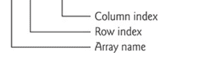

# 图 7.16

具有三行四列的二维数组。

### 描述

数组 `a` 中的每个元素都通过图 7.16 中的数组访问表达式来标识，格式为 `a[row][column]`；`a` 是数组名，`row` 和 `column` 是通过行索引和列索引唯一标识每个元素的索引。行 0 中的所有元素名称第一个索引均为 0，列 3 中的所有元素名称第二个索引均为 3。

### 7.11.1 一维数组的数组

与一维数组一样，多维数组可以在声明中使用数组初始化器进行初始化。一个具有两行两列的二维数组 `b` 可以如下所示，使用嵌套数组初始化器进行声明和初始化：

```java
int[][] b = {{1, 2}, {3, 4}};
```

初始值在大括号中按行分组。因此，1 和 2 分别初始化 `b[0][0]` 和 `b[0][1]`，而 3 和 4 分别初始化 `b[1][0]` 和 `b[1][1]`。编译器通过计算嵌套数组初始化器的数量（外层括号内的括号集合表示）来确定数组 `b` 的行数。编译器通过计算某行嵌套数组初始化器中的初始化值数量来确定该行的列数。

稍后我们将看到，这意味着行可以具有不同的长度。

多维数组被维护为一维数组的数组。因此，上述声明中的数组 `b` 实际上由两个独立的一维数组组成——一个包含第一个嵌套初始化列表 `{1, 2}` 中的值，另一个包含第二个嵌套初始化列表 `{3, 4}` 中的值。因此，数组 `b` 本身是一个包含两个元素的数组，每个元素都是一个包含 `int` 类型值的一维数组。

### 7.11.2 行长度不同的二维数组

多维数组的表表示方式使其变得非常灵活。事实上，`b` 中行的长度并不要求相同。例如：

```java
int[][] b = {{1, 2}, {3, 4, 5}};
```

这创建了一个具有两行的二维数组。第一行有两个元素，第二行有三个元素。

### 7.11.3 使用数组创建表达式创建二维数组

具有相同列数的多维数组可以使用数组创建表达式来创建。例如，以下行：

```java
int[][] b = new int[3][4];
```

在这种情况下，我们使用字面量 3 和 4 分别指定行数和列数，但这不是强制要求的。具有每行不同列数的多维数组可以如下创建：

```java
int[][] b = new int[2][];
b[0] = new int[5];
b[1] = new int[3];
```

### 7.11.4 二维数组示例：显示值

图 7.17 展示了如何使用初始化器初始化二维数组并使用嵌套 `for` 循环遍历元素。

```java
// 图 7.17: InitArray.java
// 初始化二维数组。

public class InitArray {

    // 创建并输出二维数组
    public static void main(String[] args) {

        // 创建二维数组
        int[][] array1 = {{1, 2, 3}, {4, 5, 6}};
        int[][] array2 = {{1, 2}, {3, 4, 5}};

        System.out.println("Values in array1 by row");
        outputArray(array1);

        System.out.printf("%nValues in array2 by row\n");
        outputArray(array2);
    }

    // 输出二维数组的行和列
    public static void outputArray(int[][] array) {

        // 遍历数组的行
        for (int row = 0; row < array.length; row++) {

            // 遍历当前行的列
            for (int column = 0; column < array[row].length; column++) {
                System.out.printf("%d ", array[row][column]);
            }
        }
        System.out.println("");
    }
}
```

### 7.11.5 使用 for 语句执行的多维数组操作

许多常见的数组操作使用 `for` 语句。例如，下面的 `for` 语句将图 7.16 中数组 `a` 的第 2 行中的所有元素设置为 0：

```java
for (int column = 0; column < a[2].length; column++)
    a[2][column] = 0;
```

我们指定了第 2 行；因此，我们知道第一个索引始终是 2（0 是第一行，1 是第 2 行）。这个 `for` 循环只改变第二个索引（即列索引）。如果数组 `a` 的第 2 行包含四个元素，那么之前的 `for` 语句等同于以下赋值语句：

```java
a[2][0] = 0;
a[2][1] = 0;
a[2][2] = 0;
a[2][3] = 0;
```

下面的嵌套 `for` 语句计算数组 `a` 中所有元素的总和：

```java
int total = 0;
for (int row = 0; row < a.length; row++) {
    for (int column = 0; column < a[row].length; column++)
        total += a[row][column];
}
```

这些嵌套的 `for` 语句一次计算一行数组元素的总和。外层 `for` 语句首先将行索引设置为 0，以便内层 `for` 语句计算第一行元素的总和。接着，外层 `for` 将 `row` 增加到 1，以便计算第二行的总和。然后，外层 `for` 将 `row` 增加到 2，以便计算第三行的总和。当外层 `for` 语句终止时，可以显示变量 `total`。在接下来的示例中，我们展示了如何使用嵌套的增强型 `for` 语句以类似的方式来处理二维数组。

## 7.12 案例研究：使用二维数组的 GradeBook 类

在第 7.10 节中，我们展示了 `GradeBook`（图 7.14），它使用一个一维数组来存储学生单次考试的成绩。在大多数学期中，学生会参加多次考试。教授可能希望分析整个学期的成绩，既针对单个学生，也针对整个班级。

### 在 Class GradeBook 中使用二维数组存储学生成绩

图 7.18 包含一个 `GradeBook` 类，该类使用二维数组 `grades` 来存储多个学生在多次考试中的成绩。数组的每一行代表一个学生在整个课程中的成绩，每一列代表所有参加某次特定考试的学生成绩。`Class GradeBookTest`（图 7.19）将数组作为参数传递给 `GradeBook` 构造函数。在这个示例中，我们使用了一个 10x3 的数组，用于 10 名学生三次考试的成绩。有五个方法执行数组操作来处理成绩。每个方法都与其早先的一维数组版本 `GradeBook`（图 7.14）中的对应方法相似。`getMinimum` 方法（图 7.18 的第 39–55 行）确定任何学生在该学期的最低分。`getMaximum` 方法（第 58–74 行）确定任何学生在该学期的最高分。`getAverage` 方法（第 77–88 行）确定特定学生的学期平均分。`outputBarChart` 方法（第 90–121 行）输出整个学生成绩的条形图。`outputGrades` 方法（第 124–148 行）以表格格式输出数组，并列出每个学生的学期平均分。

```java
// Fig. 7.18: GradeBook.java
// 使用二维数组的 GradeBook 类

public class GradeBook {

    private String courseName; // 课程名称
    private int[][] grades; // 二维数组

    // 两个参数的构造函数初始化课程
    public GradeBook(String courseName, int[][] grades) {
        this.courseName = courseName;
        this.grades = grades;
    }

    // 设置课程名称的方法
    public void setCourseName(String courseName) {
        this.courseName = courseName;
    }

    // 获取课程名称的方法
    public String getCourseName() {
        return courseName;
    }

    // 对数据执行各种操作
    public void processGrades() {
        // 输出 grades 数组
        outputGrades();

        // 调用 getMinimum 和 getMaximum 方法
        System.out.printf("%s %d%n%s %d%n",
            "Lowest grade in the grade book is", getMinimum(),
            "Highest grade in the grade book is", getMaximum());

        // 输出所有人的成绩分布图
        outputBarChart();
    }

    // 寻找最低分
    public int getMinimum() {
        // 假设 grades 数组的第一个元素
        int lowGrade = grades[0][0];

        // 遍历 grades 数组的行
        for (int[] studentGrades : grades) {
            // 遍历当前行的列
            for (int grade : studentGrades) {
                // 如果 grade 小于 lowGrade，赋值
                if (grade < lowGrade) {
                    lowGrade = grade;
                }
            }
        }
        return lowGrade;
    }

    // 寻找最高分
    public int getMaximum() {
        // 假设 grades 数组的第一个元素是
        int highGrade = grades[0][0];

        // 遍历 grades 数组的行
        for (int[] studentGrades : grades) {
            // 遍历当前行的列
            for (int grade : studentGrades) {
                // 如果 grade 大于 highGrade，
                if (grade > highGrade) {
                    highGrade = grade;
                }
            }
        }
        return highGrade;
    }

    // 确定特定集合平均分
    public double getAverage(int[] setOfGrades) {
        int total = 0;
        // 累加一个学生的成绩
        for (int grade : setOfGrades) {
            total += grade;
        }
        // 返回成绩平均值
        return (double) total / setOfGrades.length;
    }

    // 输出显示总体成绩的条形图
    public void outputBarChart() {
        System.out.println("Overall grade distribution\n");

        // 存储每个范围内成绩的频率
        int[] frequency = new int[11];

        // 对于 GradeBook 中的每个成绩，递增
        for (int[] studentGrades : grades) {
            for (int grade : studentGrades) {
                ++frequency[grade / 10];
            }
        }

        // 对于频率中的每个成绩，打印条形
        for (int count = 0; count < frequency.length; count++) {
            if (count == 10) {
                System.out.printf("%5d: ", 100);
            } else {
                System.out.printf("%02d-%02d: ",
                    count * 10, count * 10 + 9);
            }
            for (int i = 0; i < frequency[count]; i++) {
                System.out.print("*");
            }
            System.out.println();
        }
    }

    // 输出数组内容
    public void outputGrades() {
        System.out.println("The grades are:\n");

        for (int student = 0; student < grades.length; student++) {
            System.out.printf("Student %d: ", student + 1);
            for (int test : grades[student]) {
                System.out.printf("%d ", test);
            }
            // 调用 getAverage 来计算
            double average = getAverage(grades[student]);
            System.out.printf("Average: %.2f%n", average);
        }
    }
}
```


# 图 7.18
GradeBook 类，使用二维数组存储成绩。

# getMinimum 和 getMaximum 方法
`getMinimum`、`getMaximum`、`outputBarChart` 和 `outputGrades` 方法都通过嵌套的 `for` 语句遍历数组 `grades`——例如，`getMinimum` 方法中的嵌套 `for` 语句（第 44–52 行）。外层 `for` 语句遍历二维数组 `grades`，将连续的行分配给 `studentGrades`。参数名后的方括号表示 `studentGrades` 指向一个一维数组——即 `grades` 中的行。为了找到最低分，内层 `for` 语句将当前一维数组 `studentGrades` 的元素与 `lowGrade` 进行比较。例如，在外层 `for` 的第一次迭代中，`grades` 的第 0 行被赋值给 `studentGrades`。内层增强 `for` 语句遍历 `studentGrades` 并将每个成绩值与 `lowGrade` 比较。如果某个成绩小于 `lowGrade`，则将 `lowGrade` 设置为该成绩。在外层 `for` 语句的第二次迭代中，`grades` 的第 1 行被赋值给 `studentGrades`，并将该行的元素与变量 `lowGrade` 进行比较。重复此过程直到 `grades` 的所有行都被遍历。当嵌套语句执行完毕时，`lowGrade` 包含了二维数组中的最低分。`getMaximum` 方法与 `getMinimum` 方法类似。

## 方法 outputGrades
方法 `outputGrades`（第 124–148 行）使用嵌套的 `for` 语句来输出数组 `grades` 的值以及每个学生的学期平均分。输出（图 7.19）显示了结果，该结果类似于教授实体成绩本的表格格式。图 7.18 的第 129–131 行打印了每次测试的列标题。我们在这里使用计数控制的 `for` 语句，以便用数字识别每次测试。同样，第 136–147 行的 `for` 语句首先使用计数变量输出行标签以识别每个学生（第 137 行）。虽然数组索引从 0 开始，但第 130 和 137 行分别输出 `test + 1` 和 `student + 1`，以产生从 1 开始的测试和编号（参见图 7.19 中的输出）。内层 `for` 语句（图 7.18 的第 139–141 行）使用外层 `for` 语句的计数变量来遍历 `grades` 数组的特定行，并输出每个学生的成绩。增强型 `for` 语句可以嵌套在计数控制的 `for` 语句中，反之亦然。最后，第 145 行通过将当前行的成绩（即 `grades[student]`）传递给方法 `getAverage` 来获取每个学生的学期平均分。

## 方法 getAverage
方法 `getAverage`（第 77–87 行）接受一个参数——特定学生测试结果的一维数组。当第 145 行调用 `getAverage` 时，参数是 `grades[student]`，它指定将二维数组 `grades` 的某一行传递给 `getAverage`。例如，根据图 7.19 中创建的数组，参数 `grades[1]` 代表存储在二维数组 `grades` 第 1 行的三个值（一个一维成绩数组）。记住，二维数组是指元素是一维数组的数组。方法 `getAverage` 计算数组元素的和，将总和除以测试结果的数量，并将浮点结果作为 `double` 值返回（图 7.18 的第 86 行）。

## 展示类 GradeBook 的类 GradeBookTest
图 7.19 使用名为 `gradesArray` 的二维整型数组（在第 8–17 行声明并初始化）创建了 `GradeBook` 类对象。第 19–20 行将课程名称和 `gradesArray` 传递给 `GradeBook` 构造函数。第 21–22 行显示包含课程名称欢迎消息，然后第 23 行调用 `myGradeBook` 的 `processGrades` 方法来显示学生学期成绩的报告。

```java
// Fig. 7.19: GradeBookTest.java
// GradeBookTest creates GradeBook object using
// of grades, then invokes method processGrades

public class GradeBookTest {

    // main method begins program execution
    public static void main(String[] args) {

        // two-dimensional array of student grades
        int[][] gradesArray = {{87, 96, 70},
            {68, 87, 90},
            {94, 100, 90},
            {100, 81, 82},
            {83, 65, 85},
            {78, 87, 65},
            {85, 75, 83},
            {91, 94, 100},
            {76, 72, 84}};

        GradeBook myGradeBook = new GradeBook("CS101 Introduction to Java Programming");

        System.out.printf("Welcome to the grade book %s\n", myGradeBook.getCourseName());

        myGradeBook.processGrades();

    }
}
```

欢迎来到成绩本
CS101 Java 编程介绍

成绩如下：

| | Test 1 | Test 2 | Test 3 | Average |
|---|---|---|---|---|
| Student 1 | 87 | 96 | 70 | 84.33 |
| Student 2 | 68 | 87 | 90 | 81.67 |
| Student 3 | 94 | 100 | 90 | 94.67 |
| Student 4 | 100 | 81 | 82 | 87.67 |
| Student 5 | 83 | 65 | 85 | 77.67 |
| Student 6 | 78 | 87 | 65 | 76.67 |
| Student 7 | 85 | 75 | 83 | 81.00 |
| Student 8 | 91 | 94 | 100 | 95.00 |
| Student 9 | 76 | 72 | 84 | 77.33 |
| Student 10 | 87 | 93 | 73 | 84.33 |

成绩本中的最低分是 65
成绩本中的最高分为 100

整体成绩分布：
0-09:
10-19:
20-29:
30-39:
40-49:
50-59:
60-69:
70-79:
80-89:
90-99:
100:

`args`（即 `args.length` 为 3），其中 `args[0]` 包含字符串 `"5"`，`args[1]` 包含字符串 `"0"`，而 `args[2]` 包含字符串 `"4"`。程序决定如何使用这些参数——在图 7.21 中，我们将这三个命令行参数转换为 `int` 值并使用它们来初始化一个数组。当程序执行时，如果 `args.length` 不为 3，程序将打印错误消息并终止（第 7–11 行）。否则，第 12–32 行将根据命令行参数的值初始化并显示数组。

```java
// Fig 7.21: InitArray.java
// 使用命令行参数初始化数组

public class InitArray {

    public static void main(String[] args) {

        // 检查命令行参数的数量
        if (args.length != 3) {
            System.out.printf(
                "Error: Please re-enter the entire command, including\n" +
                "an array size, initial value and increment.\n"
            );
        } else {
            // 从第一个命令行参数获取数组长度
            int arrayLength = Integer.parseInt(args[0]);
            int[] array = new int[arrayLength];

            // 从命令行参数获取初始值和增量
            int initialValue = Integer.parseInt(args[1]);
            int increment = Integer.parseInt(args[2]);

            // 计算每个数组元素的值
            for (int counter = 0; counter < array.length; counter++) {
                array[counter] = initialValue + counter * increment;
            }

            System.out.printf("%s%8s%n", "Index", "Value");

            // 显示数组索引和值
            for (int counter = 0; counter < array.length; counter++) {
                System.out.printf("%5d%8d%n", counter, array[counter]);
            }
        }
    }
}
```

```text
$ java InitArray
Error: Please re-enter the entire command, including an array size, initial value and increment.
```

```text
# java InitArray 5 0 4
| Index | Value |
| :--- | :--- |
| 0 | 0 |
| 1 | 4 |
| 2 | 8 |
| 3 | 12 |
| 4 | 16 |
```

```text
# java InitArray 8 1 2
| Index | Value |
| :--- | :--- |
| 0 | 1 |
| 1 | 3 |
| 2 | 5 |
| 3 | 7 |
| 4 | 9 |
| 5 | 11 |
| 6 | 13 |
| 7 | 15 |
```

## 图 7.21
使用命令行参数初始化数组。

第 14 行获取 `args[0]`——一个指定数组大小的字符串——并将其转换为 `int` 值，程序在第 15 行使用该值创建数组。`Integer` 类的静态方法 `parseInt` 将其字符串参数转换为 `int`。

第 18–19 行将 `args[1]` 和 `args[2]` 命令行参数转换为 `int` 值并分别存储在 `initialValue` 和 `increment` 中。第 22–24 行计算每个数组元素的值。

第一次执行的输出显示应用程序接收到的命令行参数数量不足。第二次执行使用命令行参数 5、0 和 4 分别指定数组的大小（5）、第一个元素的值（0）以及数组中每个值的增量（4）。相应的输出显示这些值创建了一个包含整数 0、4、8、12 和 16 的数组。第三次执行的输出显示，命令行参数 8、1 和 2 产生了一个元素为 8 到 15 的非负整数的数组。

## 7.15 Arrays 类
`Arrays` 类通过提供用于数组操作的静态方法帮助你避免重复造轮子。这些方法包括用于排序的 `sort`（按升序排列元素）、用于搜索的 `binarySearch`（确定数组包含特定值，如果是则返回其位置）、`equals` 用于比较数组以及 `fill` 用于向数组填充值。这些方法针对基本数据类型数组和对象数组进行了重载。本节的重点是使用 Java API 提供的功能。第 19 章“排序与大复杂度”将介绍如何实现自己的排序和搜索算法，这是计算机科学研究人员、学生以及高性能系统开发人员感兴趣的话题。

图 7.22 使用 `Arrays` 方法、`binarySearch`、`fill` 以及 `System` 类的 `arraycopy` 方法来复制数组。`Arrays` 类的静态方法 `sort` 默认按升序排列数组元素。该方法的重载版本允许你对数组中的特定范围进行排序。第 10–14 行输出排序后的数组。

```java
// Fig 7.22: ArrayManipulations.java
// Arrays 方法和 System.arraycopy
import java.util.Arrays;

public class ArrayManipulations {

    public static void main(String[] args) {
        // 将 doubleArray 升序
        double[] doubleArray = {0.2, 3.4, 7.9, 8.4, 9.3};
        Arrays.sort(doubleArray);
        System.out.printf("doubleArray: %s%n", Arrays.toString(doubleArray));

        for (double value : doubleArray) {
            System.out.printf("%.1f, ", value);
        }

        // 用 7 填充 10 位数组
        int[] filledArray = new int[10];
        Arrays.fill(filledArray, 7);
        displayArray(filledArray, "filledArray");

        // 将 intArray 复制到数组
        int[] intArray = {1, 2, 3, 4, 5, 6};
        int[] intArrayCopy = new int[intArray.length];
        System.arraycopy(intArray, 0, intArrayCopy, 0, intArray.length);
        displayArray(intArray, "intArray");
        displayArray(intArrayCopy, "intArrayCopy");

        // 比较 intArray 和 intArrayCopy 是否相等
        boolean b = Arrays.equals(intArray, intArrayCopy);
        System.out.printf("intArray equals %s%n", b ? "==" : "!=");

        // 比较 intArray 和 filledArray 是否相等
        boolean b2 = Arrays.equals(intArray, filledArray);
        System.out.printf("intArray equals filledArray %s%n", b2 ? "==" : "!=");

        // 在 intArray 中查找值 5
        int location = Arrays.binarySearch(intArray, 5);
        if (location >= 0) {
            System.out.printf("Found 5 at element %d%n", location);
        } else {
            System.out.println("5 not found in intArray");
        }

        // 在 intArray 中查找值 8763
        location = Arrays.binarySearch(intArray, 8763);
        if (location >= 0) {
            System.out.printf("Found 8763 at element %d%n", location);
        } else {
            System.out.println("8763 not found in intArray");
        }
    }

    // 输出每个数组中的值
    static void displayArray(int[] array, String description) {
        System.out.printf("%s: %n", description);
        for (int value : array) {
            System.out.printf("%d, ", value);
        }
    }
}
```

```java
double[] doubleArray = {0.2, 3.4, 7.9, 8.4, 9.3};
int[] filledIntArray = {7, 7, 7, 7, 7, 7, 7, 7, 7, 7};
int[] intArray = {1, 2, 3, 4, 5, 6};
int[] intArrayCopy = {1, 2, 3, 4, 5, 6};

if (Arrays.equals(intArray, intArrayCopy)) {
    System.out.println("Found 5 at element 4 in intArray");
}

if (!Arrays.equals(intArray, filledIntArray)) {
    System.out.println("Found 5 at element 4 in intArray");
}
```


## 图 7.22
Arrays 类方法和 System.arraycopy。

第 18 行调用 `Arrays` 类的静态方法 `fill` 将 `filledIntArray` 的所有 10 个元素填充为 7。`fill` 的重载版本允许你用相同的值填充特定范围的元素。第 19 行调用我们类的 `displayArray` 方法（声明在第 62–68 行）输出 `filledIntArray` 的内容。

第 24 行将 `intArray` 的元素复制到 `intArrayCopy`。传递给 `System` 方法 `arraycopy` 的第一个参数 `intArray` 是要复制元素的源数组。第二个参数 `0` 是指定从数组中复制元素范围起始点的索引。此值可以是任何有效的数组索引。第三个参数 `intArrayCopy` 指定了存储拷贝的目标数组。第四个参数 `0` 指定了目标数组中存储复制元素的索引。最后一个参数指定了从第一个参数数组中复制的元素数量。在这种情况下，我们复制了数组中的所有元素。

第 29 和 34 行调用 `Arrays` 类的静态方法 `equals` 来判断两个数组的所有元素是否等效。如果数组包含相同顺序的相同元素，方法返回 `true`；否则返回 `false`。


### 错误预防技巧 7.3
比较数组内容时，始终使用 `Arrays.equals(array1, array2)`（比较两个数组的内容），而不是 `array1.equals(array2)`（比较的是 `array1` 和 `array2` 是否指向同一个对象）。

此返回值对于在排序数组中插入元素非常有用。第 19 章详细讨论了二分查找。


### 常见编程错误 7.6
将未排序的数组传递给 `binarySearch` 是逻辑错误——返回的值是未定义的。

### Java SE 8—Arrays 类方法 parallelSort
`Arrays` 类现在有了几个新的“并行”方法，可以利用多核硬件。`Arrays` 类的 `parallelSort` 方法可以在多核系统上更高效地排序大型数组。在第 23.12 节中，我们创建了一个非常大的数组，并使用 Date/Time API 的特性来比较 `sort` 和 `parallelSort` 排序数组所需的时间。

## 7.16 集合初类与 ArrayList 类
Java API 提供了几种预定义的数据结构，称为集合（collections），用于在内存中存储一组相关的对象。这些类提供了高效的方法来组织、存储和检索你的数据，而无需了解数据的存储方式。这缩短了应用程序的开发时间。

你曾使用数组来存储对象序列。数组在执行时不会自动更改大小以容纳额外的元素。集合类 `ArrayList<E>`（位于 `java.util` 包）为这个问题提供了一个方便的解决方案——它可以动态改变大小以容纳更多元素。在声明新的 ArrayList 时，将 `E`（根据约定俗定）替换为你希望 ArrayList 包含的元素类型。例如：

```java
ArrayList<String> list;
```

将 `list` 声明为存储 String 的 ArrayList 集合。这类带有可用于任何类型的占位符类的被称为泛型类（generic classes）。只有引用类型可以用于声明变量和创建泛型对象。然而，Java 提供了一种名为装箱（boxing）的机制，允许将原始值封装成对象以供泛型类使用。例如：

```java
ArrayList<Integer> integers;
```

将 `integers` 声明为存储 Integer 的 ArrayList。当你将一个 `int` 值放入 `ArrayList<Integer>` 时，该 `int` 值被装箱（封装）为 `Integer` 对象；而当你从 `ArrayList<Integer>` 获取一个 `Integer` 并将其赋值给 `int` 变量时，对象内部的 `int` 值会被拆箱（拆封）。

额外的泛型集合类和泛型将在第 16 章和第 20 章分别讨论。图 7.23 显示了 `ArrayList<E>` 类的一些常用方法。

### 图 7.23
`ArrayList<E>` 类的一些方法。

| 方法 | 说明 |
|---|---|
| add | 重载方法，用于向 ArrayList 的末尾或指定的索引处添加元素。 |
| clear | 移除 ArrayList 中的所有元素。 |
| contains | 如果 ArrayList 包含指定的元素则返回 true；否则返回 false。 |
| get | 返回指定索引处的元素。 |
| indexOf | 返回指定元素在 ArrayList 中首次位置的索引。 |
| remove | 重载方法。移除指定值的首次出现处或指定索引处的元素。 |
| size | 返回 ArrayList 中存储的元素数量。 |
| trimSize | 将 ArrayList 的容量调整为当前元素的数量。 |

### 演示 ArrayList<String>
**图 7.24** 展示了一些常用的 ArrayList 能力。第 8 行创建了一个新的空 String ArrayList，默认初始容量为 10 个元素。容量表示 ArrayList 在不增长的情况下可以容纳多少项。ArrayList 在后台使用一个传统的数组实现。当 ArrayList 增长时，它必须创建一个更大的内部数组并将每个元素复制到新数组中。这是一项耗时的操作。如果 ArrayList 在每次添加元素时都增长，效率将非常低。相反，它只在添加元素且元素数量等于容量时（即没有空间容纳新元素时）才增长。

```java
// Fig 7.24: ArrayListCollection.java
// 泛型 ArrayList<E> 集合演示。
import java.util.ArrayList;

public class ArrayListCollection {
    public static void main(String[] args) {
        // 创建一个默认初始容量为10的String ArrayList
        ArrayList<String> items = new ArrayList<String>();
        items.add("red"); // 在末尾添加项
        items.add(0, "yellow"); // 插入 "yellow"
        // 表头
        System.out.print("Display list contents with counter-counter\n");
        // 显示列表中的颜色
        for (int i = 0; i < items.size(); i++) {
            System.out.printf("%s", items.get(i));
        }
        // 使用增强 for 循环显示颜色
        display(items, "\nDisplay list contents with enhanced\n");
        items.add("green"); // 添加 "green"
        items.add("yellow"); // 添加 "yellow"
        display(items, "List with two new elements\n");
        items.remove("yellow"); // 移除第一个
        display(items, "Remove first instance of yellow\n");
        items.remove(1); // 移除索引1处的项
        display(items, "Remove second list element\n");
        // 检查值是否在列表中
        System.out.printf("%s is in the list\n", items.contains("red") ? "red" : "not");
        // 显示元素数量
        System.out.printf("Size: %d\n", items.size());
    }
    public static void display(ArrayList<String> items, String header) {
        System.out.print(header);
        for (String item : items) {
            System.out.printf("%s ", item);
        }
    }
}
```

### 图 7.24
泛型 `ArrayList<E>` 集合演示。
（完整实现见上方代码）

### 创建泛型类对象的菱形 (<>) 符号
考虑图 7.24 的第 8 行：

```java
ArrayList<String> items = new ArrayList<String>();
```

注意 `ArrayList<String>` 同时出现在变量声明和类实例创建表达式中。菱形 `<>` 符号简化了这样的语句。在泛型类对象的实例创建表达式中使用 `<>` 告诉编译器确定尖括号内的内容。前述语句可以写为：

```java
ArrayList<String> items = new ArrayList<>();
```

当编译器在泛型类的实例创建表达式中遇到菱形 `<>` 时，它利用变量 `items` 的声明来确定 ArrayList 的元素类型（String）——这被称为推断元素类型。

## 7.17（可选）GUI 与图形案例研究：绘制弧
在本节中，我们将构建一个名为 Draw Rainbow 的应用程序，它使用数组和迭代语句通过 `GraphicsContext` 的 `fillArc` 方法来绘制彩虹。在 JavaFX 中绘制弧与绘制椭圆类似——弧仅仅是椭圆的一部分。

### 创建 Draw Rainbow 应用程序的 GUI
该应用程序的 GUI 定义在 `DrawRainbow.fxml` 中。我们重用了图 4.17 所示的 `DrawLines.fxml` GUI，但对 `DrawRainbow.fxml` 进行了以下更改：
- 我们在 Scene Builder 文档窗口的 Controller 中将 `DrawRainbowController` 指定为应用程序的 Controller 类。
- 我们在检查器（Inspector）的 Properties 区域将 Button 的 Text 属性设置为 `Draw Rainbow`，并在检查器的 Code 区域将 Button 的 On Action 处理程序设置为 `drawRainbowPressed`。
- 我们在检查器的 Layout 区域将 Canvas 的 Width（宽度）和 Height（高度）属性分别设置为 400 和 200。

### DrawRainbowController 类
同样，我们没有显示 `DrawRainbow.java` 的代码，因为与之前的示例相比，唯一的更改是加载的 FXML 文件名（`DrawRainbow.fxml`）以及阶段标题栏中显示的文本（Draw Rainbow）。

在图 7.25 中，第 16–17 行使用各种预定义的颜色来初始化一个包含彩虹颜色的数组，从最内层的弧开始。数组以两个 `Color.WHITE` 元素开头，正如你将看到的，它们用于绘制彩虹中心处的空心弧。

```java
// Fig. 7.25: DrawRainbowController.java
// Drawing a rainbow using arcs.
import javafx.event.ActionEvent;
import javafx.fxml.FXML;
import javafx.scene.canvas.Canvas;
import javafx.scene.canvas.GraphicsContext;
import javafx.scene.paint.Color;
import javafx.scene.shape.ArcType;

public class DrawRainbowController {
    @FXML private Canvas canvas;

    // colors to use in the rainbow, starting from
    // The two white entries result in an empty array
    private final Color[] colors = {
        Color.WHITE, Color.WHITE, Color.VIOLET, Color.INDIGO,
        Color.BLUE, Color.GREEN, Color.YELLOW, Color.ORANGE,
        Color.RED
    };

    // draws a rainbow using arcs
    @FXML
    void drawRainbowButtonPressed(ActionEvent event) {
        // get the GraphicsContext, which is used
        GraphicsContext gc = canvas.getGraphicsContext2D();

        final int radius = 20; // radius of an arc

        // draw the rainbow near the bottom-center
        final double centerX = canvas.getWidth() / 2;
        final double maxY = canvas.getHeight() - 10;

        // draws filled arcs starting with the out
        for (int counter = colors.length; counter > 0; counter--) {
            // set the color for the current arc
            gc.setFill(colors[counter - 1]);

            // fill the arc from 0 to 180 degrees
            gc.fillArc(centerX - counter * radius,
                maxY - counter * radius, counter * radius * 2,
                counter * radius * 2, 0, 180, ArcType.ROUND);
        }
    }
}
```


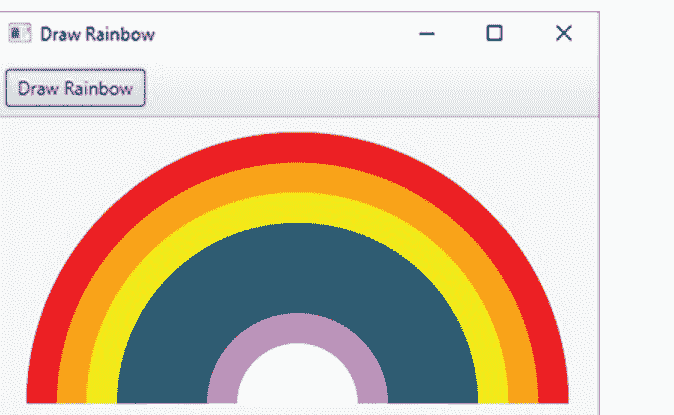

## 图 7.25

使用弧绘制彩虹。

### 描述

`drawRainbowButtonPressed` 方法中的第 25 行声明了局部变量 `radius`，它决定了每个弧的半径。局部变量 `centerX` 和 `maxY`（第 28–29 行）决定了彩虹底部中点的位置。第 32–40 行使用变量 `counter` 从数组元素倒序计数，先绘制最大的弧，并将后续每个较小的弧放置在前一个弧之上。第 34 行使用 `colors` 数组中的一个元素来设置当前弧的填充颜色。数组开头的两个 `Color.WHITE` 条目创建了中心的空心白色弧。你可以更改单个颜色和数组中的条目数量来创建新的设计。

第 37–39 行的 `fillArc` 方法调用绘制了一个填充半圆。`fillArc` 方法需要六个参数。前三个表示绘制弧的边界矩形。其中前两个指定边界矩形左上角的坐标，接下来两个指定其宽度和高度。第五个参数是椭圆上的起始角度，第六个指定扫描角度（即弧覆盖的量）。起始角度以度为单位。正的扫描角度表示逆时针绘制，负的扫描角度表示顺时针绘制。`ArcType.OPEN` 指定弧不进行填充。

## GUI 与图形案例研究

- 7.1（使用线条绘制）
- 7.2（使用弧绘制）


## 图 7.26

使用弧绘制彩虹。

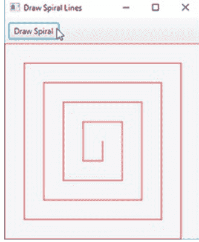

## 图 7.27

使用弧绘制彩虹。

- 7.3（旋转螺旋）
- 7.4（变色螺旋）
- 7.5（增强彩虹）

## 7.18 总结

本章开始了我们对数据结构的介绍，探索了使用数组从数值表中存储和检索数据。本章示例演示了如何声明数组、初始化数组以及引用数组的单个元素。本章引入了增强 `for` 语句来遍历数组。我们使用了异常处理来测试当程序尝试访问数组范围外的元素时产生的 `ArrayIndexOutOfBoundsException`。我们还说明了如何将数组传递给方法以及如何操作多维数组。

我们引入了泛型集合 `ArrayList<E>`，它提供了数组的所有功能和性能，并具有动态调整大小等其他有用能力。我们使用 `add` 方法向 `ArrayList` 的末尾添加新项，并在 `ArrayList` 中插入项。`remove` 方法用于删除指定项的首次出现，并使用重载版本的 `remove` 方法删除指定索引处的项。我们使用 `size` 方法获取 `ArrayList` 中的项目数量。

# 总结

## 7.1 节 引言

- 数组（第 258 页）是由相同类型的相关数据项组成的固定长度数据结构。

## 7.2 节 数组

- 数组是一组变量（称为元素或组件；第 259 页），包含所有具有相同类型的值。数组是对象，因此它们被视为引用类型。
- 程序通过数组访问表达式（第 259 页）引用数组的任意一个元素，该表达式包括数组名称，后跟位于方括号 `[]`（第 259 页）中的特定元素的索引。
- 每个数组的第一个元素的索引都为 0（第 259 页），有时被称为第 0 个元素。
- 索引必须是非负整数。程序可以使用表达式作为索引。
- 数组对象知道自己的长度并将此信息存储在 `length` 实例变量中（第 260 页）。

## 7.3 节 声明和创建数组

- 要创建一个数组对象，需要在一个使用关键字 `new` 的数组创建表达式（第 260 页）中指定数组的元素类型和元素数量。
- 当数组被创建时，每个元素都会接收一个默认值——数值基本类型元素为 0，布尔类型元素为 `false`，引用类型为 `null`。
- 在数组声明中，可以将类型和方括号结合在声明的开头，用以指示该声明中的所有标识符都是数组变量。
- 基本类型数组的每个元素都包含一个数组所声明类型的变量。引用类型数组的每个元素都是指向数组声明类型对象的引用。

## 7.4 节 数组使用示例

- 程序可以创建一个数组并使用数组初始化器（第 263 页）初始化其元素。
- 常量变量（第 264 页）用关键字 `final` 声明，必须在使用它们之前进行初始化，并且之后不能再修改。

## 7.5 节 异常处理：处理错误的响应

- 异常表示程序在执行期间发生的问题。
- 异常处理（第 270 页）允许你创建具有容错能力的程序。
- 当 Java 程序执行时，JVM 会检查数组索引以确保它们大于或等于 0 且小于数组长度。如果程序使用了无效索引，Java 会生成异常（第 270 页），以指示程序执行时发生了错误。
- 要处理异常，将任何可能抛出异常的代码（第 270 页）放在 `try` 语句中。
- `try` 块（第 270 页）包含可能抛出异常的代码，而 `catch` 块（第 270 页）包含发生异常时处理它的代码。
- 你可以拥有多个 `catch` 块来处理相应 `try` 块可能抛出的不同类型的异常。
- 当 `try` 块终止时，`try` 块中声明的所有变量将超出作用范围。
- `catch` 块声明一个类型和一个异常参数。在 `catch` 块内部，你可以使用参数的标识符与捕获的异常对象进行交互。
- 当程序执行时，会检查数组元素索引的有效性——所有索引必须大于或等于 0 小于数组长度。如果尝试使用无效索引访问元素，将发生 `ArrayOutOfBoundsException`（第 271 页）异常。
- 异常对象的 `toString` 方法返回异常的错误消息。

## 7.6 节 案例研究：洗牌和发牌模拟

- 当对象在需要字符串的地方被使用时，对象的 `toString` 方法会被隐式调用（例如，当 `printf` 使用 `%s` 格式说明符将对象输出为字符串，或当使用 `+` 运算符将对象连接到字符串时）。

## 7.7 节 增强 for 语句

- 增强型 for 语句（第 276 页）允许你在不使用计数器的情况下遍历数组或集合的元素。增强型 for 语句的语法为：

```java
for (Type parameter : arrayName) {
    statement
}
```

- 增强型 for 语句不能用于修改数组中的元素。如果程序需要修改元素，请使用传统的计数器控制 `for` 语句。

## 7.8 节 将数组传递给方法

- 当按值传递参数时，会创建参数值的副本并将其传递给被调用的方法。被调用的方法仅与副本进行操作。

## 7.9 节 值传递 vs. 引用传递

- 当按引用传递参数（第 279 页）时，被调用的方法可以直接访问调用者中的参数值，并可能对其进行修改。
- Java 中的所有参数都是按值传递的。方法调用可以向方法传递两种值——基本值的副本和对象引用的副本。尽管对象的引用是按值传递的（第 279 页），方法仍然可以与所引用对象进行交互。
- 当你将数组引用传递给方法时，方法接收的是引用的副本，允许它修改原始数组的元素。

## 7.11 节 多维数组

- 多维数组通常用于表示具有行和列的表格。
- 具有 $m$ 行 $n$ 列的二维数组（第 285 页）被称为 $m$-times-$n$ 数组。此类数组可以使用如下形式的初始化器进行初始化：

```java
arrayType[][] arrayName = {{row1}, {row2}};
```

- 多维数组被维护为独立的一维数组。二维数组中每行的长度并不要求相同。
- 每一行列数相同的多维数组可以使用如下表达式创建：

```java
arrayType[][] arrayName = new arrayType[rows][columns];
```

## 7.13 节 变长参数列表

- 参数列表中的参数类型后跟省略号（`...`; 第 295 页）表示该方法接收数量数量该类型参数。省略号只能在方法的参数列表中出现一次，且必须位于末尾。
- 变长参数列表在方法体内部被视为一个数组。可以使用数组的 `length` 字段获取参数的数量。

## 7.14 节 使用命令行参数

- 从命令行向 `main` 方法传递参数（第 296 页）是通过在 `main` 方法的参数列表中包含 `String[]` 类型的参数实现的。按照惯例，它命名为 `args`。
- Java 将 `java` 命令中类名之后出现的命令行参数作为 `args` 数组中的 `String` 传递给应用程序的 `main` 方法。

## 7.15 节 Arrays 类

- `Arrays` 类（第 298 页）提供了执行常见数组操作的静态方法，包括 `sort` 排序数组、`binarySearch` 搜索已排序数组、`equals` 比较数组以及 `fill` 在数组中填充项。
- `System` 类的 `arraycopy` 方法（第 299 页）允许你将一个数组的元素拷贝到另一个数组。

## 7.16 节 集合简介和 ArrayList 类

- Java API 的集合类提供了高效的方法来组织、存储和检索数据，无需了解存储方式。
- `ArrayList`（第 301 页）类似于数组，但可以动态调整大小。
- 带有一个参数的 `add` 方法（第 304 页）将元素添加到 ArrayList 的末尾。
- 带有两个参数的 `add` 方法在 ArrayList 的指定位置插入新元素。
- `size` 方法（第 304 页）返回 ArrayList 中当前的元素数量。
- 带有对象引用作为参数的 `remove` 方法删除第一个与参数值匹配的元素，并将移除元素索引之后的所有元素向下移动。
- 带有整数参数的 `remove` 方法删除指定索引处的元素，并将该索引之后的所有元素向下移动。

## 自测练习题

### 1. 7.1 为下列每个语句填空：

- 值的列表和表格可以存储在 ________ 和 ________ 中。
- 数组是一组（称为元素或组件）包含了一组值，且这些值都具有相同的 ________。
- ________ 允许你在不使用计数器的情况下的情况下遍历数组的元素。
- 用于指代特定数组的数字被称为元素的 ________。
- 使用两个索引的数组被称为一个(n) ________。
- 使用增强型 `for` 语句遍历双维数组中的数字。
- 命令行参数存储在 ________ 中。
- 使用表达式 ________ 来接收命令行中的参数总数。假设命令行参数存储在 `String[] args` 中。
- 给定命令 `java MyClass test`，第一个命令行参数是 ________。
- 方法参数列表中的 ________ 表明该方法可以接收任意数量的参数。

### 2. 7.2 判断下列每项是正确还是错误。如果为错误，请解释原因。

- 数组可以存储许多不同类型的值。
- 数组索引通常应该是 `float` 类型。
- 传递给方法并在该方法中修改的单个数组元素，在调用方法执行完成后将包含修改后的值。
- 命令行参数用逗号分隔。

### 3. 7.3 为名为 `fractions` 的数组执行以下任务：

- 声明一个初始化为 10 的常量 `ARRAY_SIZE`。
- 声明一个类型为 `double` 且元素数量 `ARRAY_SIZE` 的数组，并将元素初始化为 0。
- 引用数组元素 4。
- 将值 1.667 赋值给数组元素 9。
- 使用 `for` 语句对数组的所有元素求和。声明整数变量 `x` 作为循环的控制变量。

### 4. 7.4 为名为 `table` 的数组执行以下任务：

- 声明并创建一个具有三行三列的整数数组。假设常量 `ARRAY_SIZE` 已声明为 3。
- 该数组包含多少元素？
- 使用 `for` 语句将数组的每个元素初始化为其索引之和。假设整数变量 `x` 和 `y` 已声明为控制变量。

### 5. 7.5 找出并修正以下程序段中的错误：

```java
final int ARRAY_SIZE = 5;
ARRAY_SIZE = 10;
```

```java
int[] b = new int[10];
for (int i = 0; i <= b.length; i++)
    b[i] = 1;
```

```java
int[][] a = {{1, 2}, {3, 4}};
a[1, 1] = 5;
```

## 练习

### 1. 7.6 为下列每个语句填空：

- 一维数组 `p` 四个元素。这些元素的名称是 ________，________，________ 和 ________。
- 为数组命名、说明其类型并指定数组的维度，这被称为数组 ________。
- 在二维数组中，第一个索引标识元素的 ________，第二个索引标识元素的 ________。
- 一个 m 行 n 列的数组包含行、列和元素。
- 数组 `d` 中第 3 行第 5 列的元素名称是 ________。

### 2. 7.7 判断下列每项是正确还是错误。如果为错误，请解释原因。

- 要引用数组内的特定位置或元素，需指定数组的名称和特定元素的值。
- 数组声明为数组预留空间。
- 要表示为整数数组 `p` 预留 100 个位置，你编写声明：

```java
p[100];
```


## 7.8 编写 Java 语句以完成以下每个任务：

- 4. 一个将 15 元素数组初始化为零的应用程序必须包含一条语句。
- 5. 计算二维数组元素总和的应用程序必须包含嵌套的 `for` 语句。

- 1. 显示数组 `f` 中元素 6 的值。
- 2. 将一维整数数组 `g` 的五个元素均初始化为 8。
- 3. 计算 100 个元素的浮点数数组 `c` 的和。
- 4. 将 11 个元素的数组 `a` 复制到包含 34 个元素的数组 `b` 的前部分。
- 5. 确定并显示 99 个元素的浮点数数组 `w` 中包含的最小值和最大值。

## 7.9 考虑一个二乘三的整数数组 `t`。

- 1. 编写一条声明并创建 `t` 的语句。
- 2. `t` 有多少行？
- 3. `t` 有多少列？
- 4. `t` 有多少元素？
- 5. 为 `t` 的第 1 行的所有元素编写访问表达式。
- 6. 为 `t` 的第 2 列的所有元素编写访问表达式。
- 7. 编写单条语句将 `t` 的第 0 行第 1 列的元素设置为 0。
- 8. 编写一条初始化 `t` 所有元素的语句。
- 9. 编写一个 `for` 语句来初始化 `t` 的元素。
- 10. 编写一个 `for` 语句来输入 `t` 的元素。

## 7.10 编写 Java 语句以完成以下每个任务：

- 1. 编写一条声明并创建 `t` 的语句。
- 2. `t` 有多少行？
- 3. `t` 有多少列？
- 4. `t` 有多少元素？
- 5. 为 `t` 的第 1 行的所有元素编写访问表达式。
- 6. 为 `t` 的第 2 列的所有元素编写访问表达式。
- 7. 编写单条语句将 `t` 的第 0 行第 1 列的元素设置为 0。
- 8. 编写一条初始化 `t` 所有元素的语句。
- 9. 编写一个 `for` 语句来初始化 `t` 的元素。
- 10. 编写一个 `for` 语句来输入 `t` 的元素。

## 7.11 编写 Java 语句以完成以下每个任务：

- ...
- 7. 编写单条语句将 `t` 的第 0 行第 1 列的元素设置为 0。
- 8. 编写一条初始化 `t` 所有元素的语句。
- 9. 编写一个 `for` 语句来初始化 `t` 的元素。
- 10. 编写一个 `for` 语句来输入 `t` 的元素。

## 7.12 编写 Java 语句以完成以下每个任务：

- ...
- 11. 编写一系列语句来确定 `t` 中的最小值。
- 12. 编写一条单条语句显示 `t` 的第一行。
- 13. 编写一条语句计算 `t` 的第三列的总和。
- 14. 编写一系列语句显示 `t` 的内容。

## 7.13 (销售) 使用一维数组解决以下问题：公司按佣金制向员工发放工资。员工获得其销售额的 9%。例如，如果一名销售员卖了 $5,000，佣金为 $450。使用一维数组统计每个总和落在以下范围的次数：

- $000–$999
- $1000–$1999
- $2000–$2999
- $3000–$3999
- $4000–$4999
- $5000–$5999
- $6000–$6999
- $7000–$7999
- $8000–$8999
- $9000–$9999

使用一维数组统计每个总和落在这些范围的次数并以表格格式显示结果。

## 7.14 编写 Java 语句以完成以下每个任务：

- ...
- 7. 使用一维数组统计每个总和落在以下范围的次数：
    - $000–$999
    - $1000–$1999
    - $2000–$2999
    - $3000–$3999
    - $4000–$4999
    - $5000–$5999
    - $6000–$6999
    - $7000–$7999
    - $8000–$8999
    - $9000–$9999
使用一维数组统计每个总和落在这些范围的次数并以表格格式显示。

## 7.15 编写 Java 语句以完成以下每个任务：

- ...
- 7. 使用一维数组统计每个总和落在以下范围的次数：
- ...

## 7.16 判断下列每项是正确还是错误。如果为错误，请解释原因。

- 1. 数组可以存储许多不同类型的值。
- 2. 数组索引通常应该是 float 类型。
- 3. 传递给方法并在该方法中修改的单个数组元素，在调用方法执行完成后将包含修改后的值。
- 4. 命令行参数用逗号分隔。

## 7.17 (骰子) 编写一个应用程序模拟掷骰子。该程序使用 `Random` 对象分别掷第一颗骰子和第二颗骰子。然后计算值之和。每颗骰子可以显示 1 到 6 的整数，因此值的范围在 2 到 12 之间，7 最频繁，12 最少。图 7.28 显示了 36 种可能的组合。你的应用程序应该掷 36,000,000 次。使用一维数组统计每个可能总和出现的次数。以表格格式显示结果。

| | 1 | 2 | 3 | 4 | 5 | 6 |
|---|---|---|---|---|---|---|
| 1 | 2 | 3 | 4 | 5 | 6 | 7 |
| 2 | 3 | 4 | 5 | 6 | 7 | 8 |
| 3 | 4 | 5 | 6 | 7 | 8 | 9 |
| 4 | 5 | 6 | 7 | 8 | 9 | 10 |
| 5 | 6 | 7 | 8 | 9 | 10 | 11 |
| 6 | 7 | 8 | 9 | 10 | 11 | 12 |

**图 7.28 骰子的 36 种可能和。**

## 7.18 (骰子游戏) 编写一个应用程序运行 1,000,000 局骰子游戏（图 6.8）并回答以下问题：

1. 在第一次掷、第二次掷……直到第二十次掷中获胜了多少次？
2. 在第一次掷、第二次掷……直到第二十次掷中输掉了多少次？
3. 玩骰子的获胜概率是多少？[注：你应该发现骰子是赌场中最公平的游戏之一。你认为这意味着什么？]
4. 骰子游戏的平均长度是多少？
5. 获胜概率会随着游戏长度的增加而提高吗？

## 7.19 (航空公司订票系统) 一家小型航空公司刚为其新的自动订票系统购买了一台计算机。你被要求开发这个新系统。你需要编写一个应用程序，为航空公司唯一一架飞机的每班航班分配座位（容量：10 个座位）。

你的应用程序应该显示以下选项：**请输入 1 进入头等舱，请输入 2 进入经济舱。** 如果用户输入 1，你的应用程序应在头等舱分配一个座位（1-5 号座位）。如果用户输入 2，你的应用程序应在经济舱分配一个座位（6-10 号座位）。你的应用程序应该显示一张登机牌，上面注明乘客的座位号以及该座位位于飞机的头等舱还是经济舱。

使用一个基本类型为 `boolean` 的一维数组来表示飞机的座位图。将数组的所有元素初始化为 `false`，表示所有座位都是空的。每当分配一个座位时，将数组的相应元素设置为 `true`，表示该座位不再可用。

你的应用程序永远不能分配已经分配过的座位。当经济舱满时，你的应用程序应该询问人员是否可以安排在头等舱（反之亦然）。如果可以，进行相应的座位分配；如果不可以，显示消息“**下班飞机将于 3 小时后起飞。**”

## 7.20 (总销售额) 使用二维数组解决以下问题：公司有四名销售人员（1 到 4），销售五种不同的产品（1 到 5）。每天每位销售人员都会提交每种类型产品的单据。每张单据包含以下内容：

- 1. 销售人员编号
- 2. 产品编号
- 3. 该日销售产品的总美元价值

因此，每位销售人员每天提交 0 到 5 张单据。假设上个月所有单据的信息都是可用的。编写一个应用程序，读取上个月所有的销售信息，并按销售人员和产品汇总总销售额。所有总额都应存储在二维数组 `sales` 中。在处理完上个月的所有信息后，以表格格式显示结果，每列代表一名销售人员，每行代表一种产品。对每行进行求和，得到上个月每种产品的总销售额。对每列进行求和，得到上个月每位销售人员的总销售额。你的输出应将这些总和包含在汇总行的右侧和汇总列的底部。

## 7.21 (乌龟图形) Logo 让乌龟图形的概念闻名世。想象有一只在 Java 应用程序控制下行走的机械乌龟。乌龟在某个位置（抬起或落下）握着笔。当笔落下时，乌龟在移动时会画出形状和任何东西。在这个问题中，你将模拟乌龟的操作并创建一个计算机草图板。

使用一个初始化为 0 的 20x20 数组 `floor`。从包含这些命令的数组中读取命令。始终跟踪乌龟的当前位置，以及笔当前是抬起还是落下。假设乌龟从 `floor` 的 (0, 0) 位置带着笔开始。你的应用程序必须处理的一组乌龟命令如图 7.29 所示。

**图 7.29 乌龟图形命令。**

| 命令 | 含义 |
|---|---|
| 1 | 笔抬起 |
| 2 | 笔落下 |
| 3 | 右转 |
| 4 | 左转 |
| 5, 10 | 向前移动 10 格（将 10 替换为不同的格数） |
| 6 | 显示 20x20 数组 |
| 9 | 数据结束（哨兵） |

假设乌龟位于 `floor` 的某处，笔是落下的。你的应用程序必须处理的一组乌龟命令所示（此处省略图）：

- 2
- 5,12
- 3
- 5,12
- 3
- 5,12
- 3
- 5,12
- 1

当乌龟移动时，将 `floor` 的相应元素设置为 1。当给出命令 6 时，显示数组。选择一个字符来跟踪乌龟的笔是抬起还是落下。编写一个应用程序来实现这里讨论的乌龟图形能力。

## 7.22 (走骑士之旅) 走骑士之旅（Knight's Tour）是一个著名的概念。骑士之旅是一个迷人的数学谜题，由欧拉（Euler）提出。骑士在空棋盘上环绕整个棋盘，且每个格子只访问一次，这可能吗？我们深入研究这个问题。骑士呈 L 形移动：在一个方向移动两格，在垂直方向移动一格。如图 7.30 所示，从空棋盘的中间位置，骑士可以进行八种不同的移动（编号为 0 到 7）。

**图 7.30 一个八x8 数组，行和列从 0 到 7。**

1. 在纸上画一个 8x8 的棋盘，手动尝试骑士之旅。在第一个格子画 1，第二个格子画 2，第三个画 3，以此类推。在开始之前，估计一下你能走多远。你走了多少步？

2. 现在让我们开发一个应用程序让骑士在棋盘上移动。棋盘由一个八x8 数组表示。每个格子初始化为 0。我们根据其水平和垂直分量来描述每种可能的移动。例如，移动 0 水平移动两格，垂直移动一格。类型 2 的移动向左移动一格，向上移动两格。向左水平移动和向上垂直移动用负数表示。八种移动可以用二维数组 `horizontal` 和 `vertical` 来描述：

```
horizontal[0] = 2;
horizontal[1] = 1;
horizontal[2] = -1;
horizontal[3] = -2;
horizontal[4] = -2;
horizontal[5] = -1;
horizontal[6] = 1;
horizontal[7] = 2;
```

让变量 `currentRow` 和 `currentColumn` 分别指示骑士当前位置的行和列。为了执行类型为 `moveNumber` 的移动（`moveNumber` 在 0 到 7 之间），你的应用程序应该使用语句：

```
currentRow += vertical[moveNumber];
currentColumn += horizontal[moveNumber];
```


## 编写一个应用程序让骑士在棋盘上移动

保持一个从 1 到 64 的计数器。在骑士移动的每个格子中记录最新的计数。测试每个潜在移动。测试每个潜在移动以确保骑士不会跳出棋盘。运行应用程序。骑士走了多少步？

### 3. 启发式算法

在尝试编写和运行骑士之旅应用程序后，你可能获得了一些宝贵的见解。我们将利用这些见解来开发移动骑士的启发式算法（即常识规则）。启发式算法不能保证成功，但精心设计的启发式算法会大大提高成功的概率。你可能观察到外围格子比靠近中心的格子更难处理。

事实上，最棘手或难以触及的格子是四个角。

直觉可能认为，你应该尝试先将骑士移动到最棘手的格子，并留下那些容易到达的格子，这样当巡游结束时棋盘变得拥挤时，成功的机会更大。

我们可以通过根据格子的可访问性进行分类来开发一种“可访问性启发式算法”，并始终将骑士（使用其 L 形移动）移动到最不可访问的格子。我们用一个二维数组标记可访问性，用数字表示每个特定格子可以从多少个格子到达。在空白棋盘上，最靠近中心的 16 个格子中的每一个都被评为 8，每个角格子被评为 2，其他格子的可访问性数字为 3、4 或 6，如下所示：

| 2 | 3 | 4 | 4 | 4 | 3 | 2 |
|---|---|---|---|---|---|---|
| 3 | 4 | 6 | 6 | 6 | 4 | 3 |
| 4 | 6 | 8 | 8 | 8 | 6 | 4 |
| 4 | 6 | 8 | 8 | 8 | 6 | 4 |
| 4 | 6 | 8 | 8 | 8 | 6 | 4 |
| 3 | 4 | 6 | 6 | 6 | 4 | 3 |
| 2 | 3 | 4 | 4 | 4 | 3 | 2 |


使用可访问性启发式算法编写新版本的骑士巡游。骑士应该始终移动到可访问数字最低的格子。如果发生平局，骑士可以移动到平局格子中的任何一个。因此，巡游可以从四个角的任何一个开始。

> **注**：随着骑士在棋盘上移动，你的应用程序应该随着更多格子的占用而减少可访问性数字。这样，在巡游期间的任何时刻，每个可用格子的可访问性数字将精确等于到达该格子的格子数量。

你获得了一个完整的巡游吗？修改应用程序运行 64 次巡游，从棋盘上的每个格子开始。你得到了多少次完整巡游？

### 4. 改进的启发式算法

编写一个骑士巡游程序的版本，当遇到两个或多个格子之间的平局时，通过查看从这些“平局”格子可以到达的格子来决定选择哪个格子。你的应用程序应该移动到使其下次移动将到达可访问性数字最低格子的格子。

---

## 18. 7.23 (骑士巡游：暴力破解法)

在练习 7.22 的 (c) 部分，我们开发了一个解决骑士巡游问题的解决方案。所使用的方法被称为“可访问性启发式算法”，它可以生成许多解决方案并高效执行。

随着计算机性能的不断提高，我们将能够通过纯粹的计算力和相对简单的算法来解决更多问题。我们将这种方法称为“暴力破解”解决问题。

### 1. 随机巡游

使用随机数生成让骑士能够随机在棋盘上行走（按照其合法的 L 形移动）。你的应用程序应该运行一次巡游并显示最终棋盘。骑士移动了多远？

### 2. 1000 次尝试

大可能，(a) 部分的应用程序产生了一个相对较短的巡游。现在修改你的应用程序尝试 1,000 次巡游。使用一维数组来跟踪每个长度巡游的数量。当你的应用程序完成尝试 1000 次巡游后，它应该以整洁的表格格式显示这些信息。结果是什么？

### 3. 直到完整巡游

大可能，(b) 部分的应用程序给了你一些“体面”的巡游，但没有完整的巡游。现在让你的应用程序运行直到它产生一个完整的巡游。

> **警告**：此版本的应用程序在强大的计算机上可能会运行数小时。

再次保留每个长度巡游的数量，并在找到第一个完整巡游时显示该表。在产生完整巡游之前，你的应用程序尝试了多少次巡游？花了多久？

### 4. 对比分析

将暴力破解版的骑士巡游与可访问性启发式版本进行比较。哪一个对问题需要更仔细的研究？哪个算法更难开发？哪一个需要更多的计算能力？我们能（预先）确定通过可访问性启发式方法获得完整巡游吗？我们能（预先）确定通过暴力破解方法获得完整巡游吗？论述暴力破解解决问题的优缺点。

---

## 19. 7.24 (八皇后问题)

另一个谜题是八皇后问题，它问的是：是否可能在空棋盘上放置八个皇后，使得没有任何一个皇后会“攻击”任何其他皇后（即没有两个皇后在同一行、同一列或沿对角线）？使用在练习 7.22 中开发的思维方式为解决八皇后问题制定一个启发式算法。运行你的应用程序。

> **提示**：可以为棋盘的每个格子分配一个值，以指示如果在该格上放置皇后，棋盘上有多少个格子会被“消除”。如图 7.31 所示。当这些“消除数字”被赋值为 22 时（如所有 64 个格子中所示），一个合适的启发式算法可能如下：将下一个皇后放置在消除数字最小的子上。为什么这个策略在直觉上很有吸引力？

---

## 20. 7.25 (八皇后问题：暴力破解法)

在此练习中，你将为 7.24 引入的八皇后问题开发几种暴力破解方法。

### 描述

1. 使用随机数生成解决八皇后问题。
2. 使用穷举法技术来解决八皇后问题。
3. 为什么穷举法可能不适用于骑士巡游？
4. 比较对比骑士巡游的暴力破解法和穷举法。

---

## 26. (骑士巡游：闭环巡游)

在你在 7.22 中写的应用程序中，当骑士移动 64 次且每个格子接触一次时，就会发生闭环巡游。测试闭环巡游。

---

## 27. (埃拉托尼筛法)

质数是任何大于 1 且自身的整数。埃拉托尼筛法是一种寻找质数的方法。它的运行方式如下：

1. 创建一个原始类型数组，所有元素初始化为真。
2. 从索引 2 开始，确定元素是否为真。如果是，遍历数组剩余部分并将索引为 2 倍数的所有元素（4、6、10 等）设置为假。然后继续处理下一个真值元素并对索引 3（9、15 等）重复此操作。

当处理完成后，数组中仍为真的元素表示索引是质数。编写一个使用 1000 个元素的应用程序，来确定并显示 2 到 999 之间的质数。忽略元素 0 和 1。

---

## 23. 7.28 (模拟：乌龟和兔子)

在这个问题中，你将重现经典的乌龟和兔子赛。你将使用随机数生成来开发这一记忆事件的模拟。我们的参赛者在 70 个格子的第一格开始比赛。每个格子代表比赛中的一个可能位置。终点在第 70 格。第一个到达的人奖励一桶新鲜胡萝卜和生菜。路线在光滑的山体侧穿行，可能会导致参赛者失败。

时钟每秒滴答一次。每次滴答时，你的应用程序根据图 7.32 中的规则调整动物的位置。使用变量跟踪动物的位置（即位置编号为 1–70）。让每个动物从位置 1 开始（起点）。如果动物滑到位置 1 左侧，则将其移回位置 1。

### 图 7.32 调整乌龟和兔子位置的规则

| 动物 | 移动类型 | 时间占比 | 实际移动 |
| :--- | :--- | :--- | :--- |
| 乌龟 | 快爬 | 50% | 向右移动 3 格 |
| | 滑倒 | 20% | 向左移动 6 格 |
| | 慢爬 | 30% | 向右移动 1 格 |
| 兔子 | 睡觉 | 20% | 完全不移动 |
| | 大跨越 | 20% | 向右移动 9 格 |
| | 大滑倒 | 10% | 向左移动 12 格 |
| | 小跨越 | 30% | 向右移动 1 格 |
| | 小滑倒 | 20% | 向左移动 2 格 |

通过在范围 $1 \le i \le 10$ 内产生随机整数 $i$，生成图 7.32 所示的百分比。对于乌龟，当 $1 \le i \le 5$ 时执行“快速步进”，当 $6 \le i \le 7$ 时执行“滑倒”，当 $8 \le i \le 10$ 时执行“缓慢步进”。使用类似的技术来移动兔子。

通过显示以下内容开始比赛：

```
BANG !!!!!
AND THEY’RE OFF !!!!!
```

然后，时钟的每个跳动（即循环的每次迭代）都显示一个长度为 70 的行，在乌龟的位置显示字母 `T`，在兔子的位置显示字母 `H`。偶尔，竞争者会落在同一个格子里。在这种情况下，乌龟会咬住兔子，你的应用程序应该从该位置显示 `OUCH!!!`。除了 `T`、`H` 或 `OUCH!!!`（在平局的情况下）之外的所有位置都应该为空白。

在每行内容显示后，测试任一动物是否已到达或超过了第 70 格。如果是，显示胜利者并终止模拟。如果乌龟获胜，显示 `TORTOISE WINS!!! YAY!!!`。如果兔子获胜，显示 `Hare wins. 糟糕。`。如果两种动物在同一个时钟跳动内获胜，你可能想倾向于乌龟（“黑马”），也可能想显示 `It’s a tie`（平局）。如果两种动物都没有获胜，再次执行循环以模拟下一个时钟跳动。当你准备好运行应用程序时，召集一群粉丝观看比赛。你会对你的观众投入的程度感到惊讶的！

在书的后面部分，我们介绍了许多 Java 功能，如图形、图像、动画、声音和多线程。当你学习这些功能时，你可能会喜欢增强你的乌龟兔子竞赛模拟程序。

---

## 24. 7.29 (斐波那契数列)

斐波那契数列：0, 1, 1, 2, 3, 5, 8, 13, 21, ... 从项 0 和 1 开始，具有每个后续项都是前两个项之和的属性。

1. 写一个方法 `fibonacci(n)` 来计算第 n 个斐波那契数。将此方法整合到应用程序中，允许用户输入 n 的值。
2. 确定你的系统可以显示的最大斐波那契数。
3. 修改你在部分 (a) 中编写的应用，使用 `double` 代替 `int` 来计算并返回斐波那契数，并用这个修改后的应用程序重复部分 (b)。

---

## 练习 7.30–7.34 相当有挑战。一旦你完成了它们，你就应该能够轻松实现大多数流行的扑牌游戏。

### 1. 7.30 (洗牌与发牌)

修改图 7.11 以分发五张扑克牌手。然后修改图 7.10 中的 `DeckOfCards` 类，包含判断手牌是否包含以下内容的方法：

1. 一对
2. 两对
3. 三条（例如，三个 J）
4. 四条（例如，四张 A）
5. 同花色（即所有牌都是同一种花色）
6. 顺子（即五张具有连续点面值的牌）
7. 葫芦（即一个点面值的两张牌和另一个点面值的三张牌）

> **提示**：向图 7.9 中的 `Card` 类添加 `getFace()` 和 `getSuit()` 方法。

### 2. 7.31 (洗牌与发牌)

使用练习 7.30 中开发的方法编写一个应用程序，分发两手五张扑克牌手，评估每种手牌并确定哪种更好。

### 3. 7.32 (项目：洗牌与发牌)

修改练习 7.31 中开发的应用程序，使其能够模拟庄家。庄家的五张牌是“面朝下”发的，玩家看不见。应用程序随后应该评估庄家的手牌，并根据手牌的质量，庄家应该再抽取一、二或三张牌，以替换原牌中相应数量的未发牌。应用程序随后再次评估庄家的手牌。

> **注意**：这是一个困难的问题!

### 4. 7.33 (项目：洗牌与发牌)

修改练习 7.32 中开发的应用程序，使其能够自动处理庄家的手牌，但允许玩家决定替换手牌中的哪些牌。应用程序随后应该评估两个手牌并决定谁获胜。使用这个新应用程序与电脑玩 20 局。你还是电脑赢得局多？让一个朋友和电脑玩 20 局。谁赢得局多？根据这些问题的结果，完善你的扑克应用程序。（这同样是一个困难的问题。）再玩 20 局。

### 5. 7.34 (项目：洗牌与发牌)

修改练习 7.32 中开发的应用程序，使其能够自动处理庄家的手牌，但允许玩家决定替换手牌中的哪些牌。应用程序随后应该评估两个手牌并决定谁获胜。与电脑玩 20 局。你还是电脑赢得局多？让一个朋友和电脑玩 20 局。谁赢得局多？根据这些问题的结果，完善你的扑克应用程序。（这同样是一个困难的问题。）再玩 20 局。

### 6. 7.35 (Fisher-Yates 算法)

研究 Fisher-Yates 算法，然后使用它重新实现图 7.1 中的洗牌。

---

## SML 指令集

| 指令 | 代码 | 描述 |
| :--- | :--- | :--- |
| `ADD` | 30 | 累加器加上内存中特定位置的字（结果保留在累加器中）。 |
| `SUBTRACT` | 31 | 将累加器中的字减去内存中特定位置的字（结果保留在累加器中）。 |
| `DIVIDE` | 32 | 将累加器中的字除以内存中特定位置的字（结果保留在累加器中）。 |
| `MULTIPLY` | 33 | 将内存中特定位置的字乘以累加器中的字（结果保留在累加器中）。 |
| **控制转移操作** | | |
| `BRANCH` | 40 | 跳转到内存中的特定位置。 |
| `BRANCHNEG` | 41 | 如果累加器为负数，则跳转到内存中的特定位置。 |
| `BRANCHZERO` | 42 | 如果累加器为零，则跳转到内存中的特定位置。 |
| `HALT` | 43 | 停止。程序已完成任务。 |

第一个 SML 程序（图 7.34）从键盘读取两个数字并计算显示它们的和。指令 `+1007` 从键盘读取第一个数字并将其放入位置 07（该位置已初始化为 0）。然后指令 `+1008` 将下一个数字读入位置 08。加载指令 `+2007` 将第一个数字放入累加器，加法指令 `+3008` 将第二个数字加到累加器中的数字上。所有的 SML 算术指令都将其结果保留在累加器中。存储指令 `+2109` 将结果写回内存 09，写入指令 `+1109` 从该位置取出数字并将其显示（作为一个带符号的四位十进制）。停止指令 `+4300` 终止执行。

### 图 7.34 读取两个整数并计算其和的 SML 程序

| 位置 | 数字 | 指令 |
| :--- | :--- | :--- |
| 00 | +1007 | (读取 A) |
| 01 | +1008 | (读取 B) |
| 02 | +2007 | (加载 A) |
| 03 | +3008 | (加 B) |
| 04 | +2109 | (存储 C) |
| 05 | +1109 | (写入 C) |
| 06 | +4300 | (停止) |
| 07 | +0000 | (变量 A) |
| 08 | +0000 | (变量 B) |
| 09 | +0000 | (结果 C) |

第二个 SML 程序（图 7.35）从键盘读取两个数字，确定并显示较大的值。注意指令 `+4107` 作为条件控制转移的使用，类似于 Java 的 `if` 语句。

### 图 7.35 读取两个整数并确定较大者的 SML 程序

| 位置 | 数字 | 指令 |
| :--- | :--- | :--- |
| 00 | +1009 | (读取 A) |
| 01 | +1010 | (读取 B) |
| 02 | +2009 | (加载 A) |
| 03 | +3110 | (减去 B) |
| 04 | +4107 | (负则跳转到 07) |
| 05 | +1109 | (写入 A) |
| 06 | +4300 | (停止) |
| 07 | +1110 | (写入 B) |
| 08 | +4300 | (停止) |
| 09 | +0000 | (变量 A) |
| 10 | +0000 | (变量 B) |

编写新的 SML 程序以完成以下任务：

1. 使用哨值循环读取 10 个正数。计算并显示它们的和。
2. 使用计数器循环读取七个数字（正负均可），计算并显示它们的平均值。
3. 读取一系列数字，确定并显示最大数。第一个数字表示应处理多少个数字。

---

## 7.37 (模拟器)

当你运行 Simpletron 模拟器时，它应该首先显示：

> *** 欢迎使用 Simpletron! ***
> *** 请逐条输入你的程序（或数据字）。
> *** 我将显示内存位置和问号 (?)
> *** 然后输入该位置的字。
> *** 输入 -9999 停止你的程序。

你的应用程序应该模拟一个具有 100 个元素的一维内存。现在假设模拟器正在运行，让我们在输入练习 36 程序时查看对话：

```
00 ? +1009
01 ? +1010
02 ? +2009
03 ? +3110
04 ? +4107
05 ? +1109
06 ? +4300
07 ? +1110
08 ? +4300
09 ? -9999
```

程序应该显示内存位置，问号后面的每个值由用户输入。当输入哨值 -9999 时，程序应该显示：

> *** 程序完成 ***
> *** 执行开始 ***

SML 程序现在已放置（或加载）到数组中。Simpletron 从位置 0 开始顺序执行 SML 程序，除非通过控制转移到程序的其他部分。使用变量 `accumulator` 来表示累加器。使用变量 `instructionCounter` 来跟踪正在执行的指令的位置。使用变量 `operationCode` 表示当前执行的操作（即指令的左两位）。因此，`operand` 是指令的右两位。提取左两位放入 `operationCode`，提取右两位放入 `operand`。当 Simpletron 开始时，所有特殊寄存器都初始化为零。现在，让我们执行第一条 SML 指令 `+1009`。这个过程被称为指令周期。`instructionCounter` 告诉我们下一个要执行指令的位置。我们使用语句从内存获取该位置的内容：

```
instructionRegister = memory[instructionCounter]
```

通过语句从指令寄存器中提取操作码和操作数：

```
operationCode = instructionRegister / 100
operand = instructionRegister % 100
```


现在 Simpletron 必须在 SML 操作之间判断操作码。在 `switch` 语句中，各种 SML 指令的行为如图 7.36 所示。我们稍后会讨论跳转指令，剩下的留给你。

## 图 7.36

Simpletron 中若干 SML 指令的行为。

| 指令 | 说明 |
|---|---|
| read: | 显示提示“Enter integer”，然后输入整数并存储在 `memory[operand]` 中。 |
| load: | `accumulator = memory[operand];` |
| add: | `accumulator += memory[operand];` |
| halt | 终止 SML 程序执行并显示以下消息：*** Simpletron terminated terminated |

当 SML 程序完成执行时，应该显示每个寄存器的内容以及内存的完整内容。pprint 通常被称为内存转储（不，内存转储不是电脑存放的地方）。为了帮助你编写转储方法，图 7.37 显示了一个示例转储格式。执行 Simpletron 程序后的转储将显示执行结束时指令和数据的实际值。

| 0 | 1 | 2 | 3 | 4 | 5 | 6 | 7 |
|---|---|---|---|---|---|---|---|
| 0 | +0000 | +0000 | +0000 | +0000 | +0000 | +0000 | +0000 | +0000 |
| 10 | +0000 | +0000 | +0000 | +0000 | +0000 | +0000 | +0000 | +0000 |
| 20 | +0000 | +0000 | +0000 | +0000 | +0000 | +0000 | +0000 | +0000 |
| 30 | +0000 | +0000 | +0000 | +0000 | +0000 | +0000 | +0000 | +0000 |
| 40 | +0000 | +0000 | +0000 | +0000 | +0000 | +0000 | +0000 | +0000 |
| 50 | +0000 | +0000 | +0000 | +0000 | +0000 | +0000 | +0000 | +0000 |
| 60 | +0000 | +0000 | +0000 | +0000 | +0000 | +0000 | +0000 | +0000 |
| 70 | +0000 | +0000 | +0000 | +0000 | +0000 | +0000 | +0000 | +0000 |
| 80 | +0000 | +0000 | +0000 | +0000 | +0000 | +0000 | +0000 | +0000 |
| 90 | +0000 | +0000 | +0000 | +0000 | +0000 | +0000 | +0000 | +0000 |

获取要执行的下一条指令。

现在让我们考虑如何模拟分支指令——即控制权的转移。我们所做的就是相应地调整指令计数器中的值。因此，无条件分支指令 (40) 在 `switch` 语句中如下模拟：

```
instructionCounter = operand;
```

条件“如果累加器为零则跳转”指令的模拟方式为：

```
if (accumulator == 0) {
  instructionCounter = operand;
}
```

此时，你应该实现你的 Simpletron，并运行你在练习 7.36 中编写的每个 SML 程序。如果你愿意，可以带有额外的功能完成 SML，并在你的模拟器中为这些功能提供支持。

你的模拟器应该检查各种类型的错误。例如，在程序加载阶段，用户输入 Simpletron 内存的每个数字都必须在 -9999 到 +9999 范围内。你的模拟器应该测试输入的每个数字是否在这一范围内，如果不在，则持续提示用户重新输入该数字，直到用户输入正确的数字为止。

在执行阶段，你的模拟器应该检查各种严重错误，例如尝试除以零、尝试执行无效的操作码以及累加器溢出（即算术运算的结果大于 +9999 或小于 -9999）。此类严重错误被称为致命错误。当检测到致命错误时，你的模拟器应该显示错误信息，例如：

> *** 尝试除以零 ***
> *** Simpletron 执行异常终止 ***

并且应该以你之前讨论过的格式显示完整的计算机转储（dump）。这种处理将帮助用户定位程序中的错误。

## 7.38 (Simpletron 模拟器修改)

在练习 7.37 中，你编写了一个计算机的软件模拟器，它可以执行用 Simpletron 机器语言 (SML) 编写的程序。在本练习中，我们对 Simpletron 模拟器提出了若干修改和增强。在第 21 章的练习中，我们建议构建一个编译器，将高级编程语言（Basic 的变体）中的程序转换为 Simpletron 机器语言。执行编译器生成的程序可能需要进行某些修改和增强：

1. 扩展 Simpletron 模拟器的内存，使其包含 1,000 个内存单元，以便 Simpletron 处理更大的程序。
2. 允许 Simpletron 执行余数计算。此修改需要一条额外的 SML 指令。
3. 允许 Simpletron 执行幂运算。此修改需要一条额外的 SML 指令。
4. 修改模拟器使用十六进制而非整数值来表示 SML 指令。
5. 修改模拟器允许输出换行符。此修改需要一条额外的 SML 指令。
6. 修改模拟器以将浮点值转换为整数值。
7. 修改模拟器以处理字符串输入。*提示*：每个 Simpletron 字（word）可以分为两组，每组包含一个两位整数。每个两位整数代表机器语言指令的 ASCII（附录）十进制等效值，该指令将输入并存储字符串，从特定的 Simpletron 内存位置开始存储。该位置字的前半部分是字符串字符数量的计数（即字符串长度）。后续每个半字（half-word）包含一个用两个十进制数字表示的 ASCII 字符。机器指令将每个字符转换为其 ASCII 等效值并分配给半字。
8. 修改模拟器以处理以部分 (g) 格式的输出字符串。[提示：添加一条机器语言指令，将显示从特定 Simpletron 内存位置开始的字符串。该位置字的前半部分是字符串字符数量的计数（即字符串长度）。后续每个半字包含一个 ASCII 指令，通过检查长度并将每个两位数字翻译为等效字符来显示字符串。]

## 7.39 (增强型 GradeBook)

修改图 7.18 中的 `GradeBook` 类，使构造函数接受学生人数和考试次数作为参数，然后构建一个适当大小的二维数组，而不是接收一个预初始化的二维数组（并用 1 表示该元素未输入成绩）。添加一个 `setGrade` 方法，用于为特定考试的某次特定考试设置一个成绩。修改图 7.19 中的 `GradeBookTest`，以便为 `GradeBook` 输入学生人数和考试次数，并允许教师一次输入一个成绩。

# 产生影响

## 1. 7.40 (民意调查)

互联网和万网正让更多能够建立网络、加入某项事业、发表意见等。近期的总统候选人已密集使用互联网来传达他们的信息并为竞选筹集资金。在本练习中，你将编写一个简单的民意调查程序，允许用户从 1（最不）到 10（最重要）对五个社会意识问题进行评分。选择五个对你重要的起因（政治问题、全球环境问题）。使用一个一维数组（类型为 `String`）存储这五个起因。为了总结调查响应，使用一个 5 行 10 列的二维数组 `responses`（类型为 `int`），每行对应 `topics` 数组中的一个元素。当程序运行时，它应该要求用户对每个问题进行评分。让你的朋友和家人参与调查。然后让程序显示结果摘要，包括：

- 一个表格报告，左侧为五个主题，顶部横为 10 个评分标准，每列列出每个主题的评分次数。
- 在每行的右侧显示该主题的平均分。
- 哪个主题的评分最高？显示该结果。
- 哪个主题的评分最低？显示该结果。

# 8 类与对象：深入观察

## 目标

在本章中你将：

- 查看创建类的更多细节。
- 使用 `throw` 语句指示错误的发生。
- 使用 `this` 关键字在构造函数中调用同类的构造函数。
- 使用静态变量和方法。
- `import` 类的成员。
- 使用 `enum` 类型创建常量集。
- 使用 `BigDecimal` 进行计算。

## 提纲

1. 8.1 引言
2. 8.2 类研究
3. 8.3 控制访问
4. 8.4 使用 `this` 引用当前对象的成员
5. 8.5 类研究：重载构造函数
6. 8.6 默认和无参数构造函数
7. 8.7 set 和 get 方法的说明
8. 8.8 组合
9. 8.9 enum 类型
10. 8.10 垃圾收集
11. 8.11 静态类成员
12. 8.12 静态 import
13. 8.13 final 实例变量
14. 8.14 包访问
15. 8.15 使用 BigDecimal 进行精确的货币计算
16. 8.16（可选）GUI 和图形案例研究：使用对象处理图形
17. 8.17 总结
1. 总结
2. 自测练习
3. 自测练习答案
4. 练习
5. 产生影响

# 8.1 引言

现在我们深入观察构建类、控制成员访问以及创建构造函数。我们展示了如何抛出异常以指示错误的发生——第 7.5 节讨论了捕获异常。我们使用 `this` 关键字允许构造函数方便地调用同类的构造函数。我们讨论了组合——一种允许类拥有其他对象引用的能力。我们重新检查了 set 和 get 方法的使用。回顾第 6.10 节引入了基本的 enum 类型来声明常量集。在本章中，我们讨论了 enum 类型与类之间的关系，证明 enum 类型像类一样，可以在自己的文件中声明并带有构造函数、方法和字段。本章还详细讨论了静态类成员和 final 实例变量。我们展示了相同包类之间的特殊关系。最后，我们演示了如何使用 `BigDecimal` 进行精确的货币计算。两种额外的类类型——嵌套类和匿名内部类，将在后续关于 GUI、图形和多媒体的章节中详细讨论。

## 8.2 时间类案例研究

我们的第一个示例包含两个类——`Time1`（图 8.1）和 `Time1Test`（图 8.2）。`Time1` 类代表一天中的时间。`Time1Test` 的主方法创建了 `Time1` 类的一个对象并调用了它的方法。该程序的输出出现在图 8.2 中。

### Time1 类声明

`Time1` 类的私有 `int` 实例变量 `hour`、`minute` 和 `second`（图 8.1，第 5–7 行）代表通用时间格式的时间（24 小时制，其中小时范围在 0–23 之间）。`Time1` 包含公有的 `setTime` 方法（第 11–22 行）、`toUniversalString`（第 25–27 行）和 `toString`（第 30–34 行）。这些方法也被该类为其客户端提供的公共服务和公共接口。

```
1 // Fig. 8.1: Time1.java
2 // Time1 class declaration maintains the time in
3
4 public class Time1 {
5 private int hour; // 0 - 23
6 private int minute; // 0 - 59
7 private int second; // 0 - 59
9 // set a new time value using universal time;
10 // exception if the hour, minute or second is
11 public void setTime(int hour, int minute, int second) {
12 // validate hour, minute and second
13 if (hour < 0 || hour >= 24 || minute < 0 ||
14 second < 0 || second >= 60) {
15 throw new IllegalArgumentException(
16 "hour, minute and/or second was invalid");
17 }
18 }
19 this.hour = hour;
20 this.minute = minute;
21 this.second = second;
22 }
23 // convert to String in universal-time format
24 public String toUniversalString() {
25 return String.format("%02d:%02d:%02d", hour, minute, second);
26 }
27 // convert to String in standard-time format
28 public String toString() {
29 return String.format("%d:%02d:%02d %s",
30 (hour == 0 || hour == 12) ? 12 : hour,
31 minute, second, (hour < 12 ? "AM" : "PM"));
32 }
```


## 图 8.1

Time1 类声明以 24 小时格式维护时间。

## 默认构造函数

在这个示例中，`Time1` 类没有声明构造函数，因此编译器提供了一个默认构造函数（正如我们在第 3.3.2 节中所讨论的）。每个实例变量隐式地接收默认的 `int` 值。实例变量也可以在类体内声明时进行初始化，使用与局部变量相同的初始化语法。

## 方法 setTime 与抛出异常

`setTime` 方法（第 11–22 行）是一个公有方法，它声明了三个 `int` 参数并使用它们来设置时间。第 13–14 行测试每个参数以确定其值是否在有效范围之外。小时值必须大于等于 0 且小于 24，因为通用时间格式表示从 0 到 23 的整数（例如，下午 1 点是 13 点，晚上 11 点是 23 点；午夜是 0 点，中午是 12 点）。同样，分钟和秒都必须大于等于 0 且小于 60。对于这些区域之外的值，`setTime` 会抛出一个 `IllegalArgumentException` 异常（第 15–16 行），这通知客户端向方法传递了无效参数。正如你在第 7.5 节中所学习的，你可以使用 `try...catch` 来捕获异常并尝试恢复它们，我们将在图 8.2 中这样做。`throw` 语句中的类创建表达式（第 15 行）创建一个 `IllegalArgumentException` 类型的新对象。括号表示调用 `IllegalArgumentException` 构造函数。在这种情况下，我们调用允许指定自定义异常消息的构造函数。异常对象创建后，`throw` 语句立即终止方法，如果参数值有效，第 19–21 行将它们赋值给 `hour`、`minute` 和 `second` 实例变量。


## 软件工程观察 8.1

对于图 8.1 中的 `setTime` 方法，在使用它们设置实例变量之前验证所有参数，以确保只有在所有参数有效时才修改对象的数据。

## 方法 toUniversalString

`toString` 方法（第 25–27 行）不接受参数并返回一个通用时间格式的 `String`，每个小时、分钟和秒均为两位数字——记得你可以在 `printf` 格式字符串中使用 `0` 标志（例如 `"%02d"`），为未填满指定字段宽的值显示前导零。例如，如果时间是下午 1 点 30 分，该方法将返回 13:30:00。

## 方法 toString

`toString` 方法（第 30–34 行）不接受参数并返回一个标准时间格式的 `String`，每个小时、分钟和秒均为两位数字——记得你可以在 `printf` 格式字符串中使用 `0` 标志（例如 `"%02d"`），为未填满指定字段宽的值显示前导零。例如，如果时间是下午 1 点 30 分，该方法将返回 1:30:00 PM。

## 使用类1

`Time1Test` 类（图 8.2）使用了 `Time1`。第 7 行声明了 `Time1` 变量并使用 `new Time1()` 对进行初始化；注意 `new` 调用了默认构造函数，因为 `Time1` 没有声明任何构造函数。第 10 行调用 `displayTime` 输出时间的字符串表示。第 14 行调用 `setTime` 更改时间。然后，第 15 行再次调用 `displayTime` 以确认其设置正确。

## 为 Time1 方法传递无效值调用 setTime

为了说明方法 `setTime` 会验证其参数，第 20 行调用 `setTime` 方法并传入了无效的小时、分钟和秒参数（均为 99）。该语句放置在 `try` 块（第 19–21 行）中，以防 `setTime` 抛出 `IllegalArgumentException`，由于参数无效，它会这样做。当发生时，异常会在第 22–24 行被捕获，第 23 行通过调用 `getMessage` 方法显示异常的错误信息。第 27 行再次以两种格式输出时间，以确认提供无效参数时 `setTime` 未更改时间。

## Time1 类声明的软件工程

考虑关于 `Time1` 类设计的几个问题。实例变量 `hour`、`minute` 和 `second` 均被声明为 `private`。类内部使用的实际数据表示对类的客户端并不重要。例如，`Time1` 在内部将时间表示为自午夜以来的秒数或午夜以来的分钟和秒数是完全合理的。客户端可以使用相同的公共方法并获得相同的结果，而无需感知这一点。（练习 8.5 要求你将图 8.5 中 `Time2` 类中的时间表示为自午夜以来的秒数，并证明这种变化对类的客户端是可见的。）


## 软件工程观察 8.3

类简化了编程，因为客户端只需使用类的公共方法。此类方法通常是面向客户端的，而不是面向实现的。客户端既不了解类的实现，也不参与类的实现。客户端通常关心类能做什么，而不关心类是如何做的。


## 软件工程观察 8.4

接口的变更频率比实现要低。当实现发生变化时，依赖于实现的代码也随之发生变化。隐藏实现可以减少其他程序部分依赖于类实现细节的可能性。

## Java SE 8—日期/时间 API

本节的示例以及本章后的几个示例演示了表示日期和时间的类中的各种类实现概念。在专业的 Java 开发中，你通常不会构建自己的日期和时间类，而是重用 Java API 提供的类。虽然 Java 一直有处理日期时间的类，但 Java SE 8 引入了新的日期/时间 API——由 `java.time` 包中的类定义。使用 Java SE 8 构建的应用应该使用日期/时间 API 的功能，而不是早期 Java 版本中的功能。新 API 修复了旧类的各种问题，并为处理日期、时间、时区、日历等提供了更健壮、更易用的功能。你可以在第 23 章中使用一些日期/时间 API 特性。你可以在此处了解更多关于日期/时间 API 的类：

http://docs.oracle.com/javase/8/docs/api/java/time/package-summary.html

## 8.3 控制成员的访问

访问修饰符 `public` 和 `private` 控制对类变量和方法的访问。在第 9 章，我们将引入额外的访问修饰符 `protected`。**public** 方法的主要目的是向类的客户端展示该类提供的服务视图（即类的 **public** 接口）。客户端不需要担心类如何完成其任务。出于这个原因，类的 **private** 变量和 **private** 方法（即其实现细节）对其客户端是不可见的。

图 8.3 说明 **private** 类成员在类外部是不可见的。第 7–9 行尝试访问 `Time1` 对象 `time` 的 **private** 实例变量 `hour`、`minute` 和 `second`。当编译此程序时，编译器生成错误信息，说明这些 **private** 成员不可访问。此程序假设使用了图 8.1 中的 `Time1` 类。

```java
// Fig. 8.3: MemberAccessTest.java
// Private members of class Time1 are not access
public class MemberAccessTest {
    public static void main(String[] args) {
        Time1 time = new Time1(); // create and in
        time.hour = 7; // error: hour has private
        time.minute = 15; // error: minute has pri
        time.second = 30; // error: second has pri
    }
}
```

```
MemberAccessTest.java:7: error: hour has private ac
time.hour = 7; // error: hour has private access
^
MemberAccessTest.java:8: error: minute has private ac
time.minute = 15; // error: minute has private a
^
MemberAccessTest.java:9: error: second has private ac
time.second = 30; // error: second has private a
^
3 errors
```

## 图 8.3

`Time1` 类的私有成员不可访问。


## 常见错误 8.1

方法尝试访问类的私有成员将产生编译错误。

## 8.4 引用当前对象

每个实例方法都可以引用自己（有时称为 `this` 引用）。当为对象调用实例方法时，它使用 `this` 引用来访问自己的成员。第 8.1 节解释了为什么不在静态方法中使用 `this`。图 8.4 演示了 `this` 的隐式和显式使用。第 8.5 节展示了 `this` 的另一种用法。第 8.1 节解释了为什么如果构造函数使用了与实例变量相同的参数名，则需要 `this`。因此，在这个示例中，包含多个一个类的 .java 文件会产生独立的文件。

```java
// Fig. 8.4: ThisTest.java
// this used implicitly and explicitly to
public class ThisTest {
    public static void main(String[] args) {
        Time1 time = new Time1(15, 30, 45);
        System.out.println(time.buildString());
    }
}

// class Time1 demonstrates the "this"
class Time1 {
    private int hour;
    private int minute;
    private int second;

    // if the constructor uses parameter names
    public Time1(int hour, int minute, int second) {
        this.hour = hour;
        this.minute = minute;
        this.second = second;
    }

    // use explicit and implicit "this" to
    public String buildString() {
        return String.format("%s: %s",
            "this.toUniversalString()", this.toUniversalString());
    }

    // convert to String in universal-time
    public String toUniversalString() {
        // "this" is not required here to access
        // because method does not have local vari
        return String.format("%02d:%02d:%02d",
            this.hour, this.minute, this.second);
    }
}
```

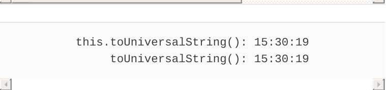

## 图 8.4

`this` 隐式和显式地引用对象的成员。

`Time1` 类（第 12–41 行）声明了三个私有实例变量——`hour`、`minute` 和 `second`（第 13–15 行）。类的构造函数（第 20–24 行）接收三个 `int` 参数来初始化一个 `Time1` 对象。再次，我们在构造函数使用了与类实例变量相同的参数名（第 13–15 行），因此我们在第 21–23 行中使用 `this` 引用来引用实例变量。


## 错误预防技巧 8.1

大多数 IDE 在你写 `x = x;` 而不是 `this.x = x;` 时会发出警告。语句 `x = x;` 通常被称为无操作（no-op）。

方法 `buildString`（第 27–31 行）返回一个由显式或隐式使用 `this` 引用的语句创建的 `String`。第 29 行显式地调用了 `toUniversal` 方法。第 30 行隐式地调用了相同的方法。这两行执行了相同的任务。你通常不会显式地使用 `this` 来引用当前对象中的其他方法。此外，`toUniversal` 方法中的第 39 行显式使用了 `this` 引用来访问实例变量。在这里这是没有的，因为该方法没有任何遮蔽类实例变量的局部变量。


## 性能技巧 8.1

每个类的每个方法只有一个副本——类的所有部分都共享该方法的代码。相反，每个对象都有类实例变量的自己的副本。类的非静态方法隐式地使用 `this` 来确定要操作的类的具体对象。

类 `ThisTest` 的 `main` 方法（第 5–8 行）演示了 `SimpleTime` 类。第 6 行创建了 `SimpleTime` 类的实例并调用了它的构造函数。第 7 行调用对象的 `buildString` 方法，然后显示结果。

## 8.5 时间类案例研究：重载构造函数

如你所知，你可以声明自己的构造函数来指定类对象应该如何初始化。接下来，我们将演示一个带有多个重载构造函数的类，这些构造函数允许该类的对象以不同的方式进行初始化。要重载构造函数，只需提供多个具有不同签名的构造函数声明。

## 带有重载构造函数的 Time2 类

图 8.1 中 `Time1` 类的默认构造函数将小时、分和秒初始化为默认值 0（即世界标准时间的午夜）。默认构造函数没有允许类的客户端用非零初始化时间。`Time2` 类（图 8.5）包含五个重载构造函数，提供了初始化对象的方便方法。在该程序中，其中四个构造函数调用了第五个构造函数，后者反过来确保提供的小时值在 0 到 23 之间，且分和秒的值均在 0 到 59 之间。编译器通过匹配构造函数调用中指定的参数的数量、类型和顺序，与每个构造函数声明中指定的参数的数量、类型和顺序，来调用相应的合适的构造函数。`Time2` 类还为每个实例变量提供了 `set` 和 `get` 方法。

```java
1 // 图 8.5: Time2.java
2 // 带有重载构造函数的 Time2 类声明
3
4 public class Time2 {
5     private int hour; // 0 - 23
6     private int minute; // 0 - 59
7     private int second; // 0 - 59
8
9     // Time2 无参数构造函数:
10     // 将每个实例变量初始化为零
11     public Time2() {
12         this(0, 0, 0); // 调用构造函数
13     }
14
15     // Time2 构造函数: 提供了小时，分
16     public Time2(int hour) {
17         this(hour, 0, 0); // 调用构造函数
18     }
19
20     // Time2 构造函数: 提供了小时和分
21     public Time2(int hour, int minute) {
22         this(hour, minute, 0); // 调用构造函数
23     }
24
25     // Time2 构造函数: 小时、分和秒
26     public Time2(int hour, int minute, int second) {
27         if (hour < 0 || hour >= 24) {
28             throw new IllegalArgumentException("hour");
29         }
30
31         if (minute < 0 || minute >= 60) {
32             throw new IllegalArgumentException("min");
33         }
34
35         if (second < 0 || second >= 60) {
36             throw new IllegalArgumentException("sec");
37         }
38
39         this.hour = hour;
40         this.minute = minute;
41         this.second = second;
42     }
43
44     // Time2 构造函数: 另一个 Time2 对象
45     public Time2(Time2 time) {
46         // 调用三个参数的构造函数
47         this(time.hour, time.minute, time.second);
48     }
49
50     // Set 方法
51     // 使用世界时间设置新的时间值;
52     // 验证数据
53     public void setTime(int hour, int minute, int second) {
54         if (hour < 0 || hour >= 24) {
55             throw new IllegalArgumentException("hour");
56         }
57         // ... (后续代码省略)
```


# 错误预防技巧 8.1

大多数 IDE 在你写 `x = x;` 而不是 `this.x = x;` 时会发出警告。语句 `x = x;` 通常被称为无操作（no-op）。

方法 `buildString()`（第 27–31 行）返回一个由显式或隐式使用 `this` 引用的语句创建的 `String`。第 29 行显式地调用了 `toUniversal()` 方法。第 30 行隐式地调用了相同的方法。这两行执行了相同的任务。你通常不会显式地使用 `this` 来引用当前对象中的其他方法。此外，`toUniversal()` 方法中的第 39 行显式使用了 `this` 引用来访问实例变量。在这里这是没有必要的，因为该方法没有任何遮蔽类实例变量的局部变量。

# 性能技巧 8.1

每个类的每个方法只有一个副本——类的所有部分都共享该方法的代码。相反，每个对象都有类实例变量的自己的副本。类的非静态方法隐式地使用 `this` 来确定要操作的类的具体对象。

类 `ThisTest` 的 `main()` 方法（第 5–8 行）演示了 `SimpleTime` 类。第 6 行创建了 `SimpleTime` 类的实例并调用了它的构造函数。第 7 行调用对象的 `buildString()` 方法，然后显示结果。

# 8.5 时间类案例研究：重载构造函数

如你所知，你可以声明自己的构造函数来指定类对象应该如何初始化。接下来，我们将演示一个带有多个重载构造函数的类，这些构造函数允许该类的对象以不同的方式进行初始化。要重载构造函数，只需提供多个具有不同签名的构造函数声明。

## 带有重载构造函数的 Time2 类

图 8.1 中 `Time1` 类的默认构造函数将小时、分和秒初始化为默认值 0（即世界标准时间的午夜）。默认构造函数没有允许类的客户端用非零值初始化时间。`Time2` 类（图 8.5）包含五个重载构造函数，提供了初始化对象的方便方法。在该程序中，其中四个构造函数调用了第五个构造函数，后者反过来确保提供的小时值在 0 到 23 之间，且分和秒的值均在 0 到 59 之间。编译器通过匹配构造函数调用中指定的参数的数量、类型和顺序，与每个构造函数声明中指定的参数的数量、类型和顺序，来调用相应的合适的构造函数。`Time2` 类还为每个实例变量提供了 `set` 和 `get` 方法。

```java
1 // Fig. 8.5: Time2.java
2 // Time2 class declaration with overloaded constructors
3
4 public class Time2 {
5     private int hour; // 0 - 23
6     private int minute; // 0 - 59
7     private int second; // 0 - 59
8
9     // Time2 no-argument constructor:
10     // initializes each instance variable to zero
11     public Time2() {
12         this(0, 0, 0); // invoke constructor with three arguments
13     }
14
15     // Time2 constructor: hour supplied, minute and second defaulted
16     public Time2(int hour) {
17         this(hour, 0, 0); // invoke constructor with three arguments
18     }
19
20     // Time2 constructor: hour and minute supplied, second defaulted
21     public Time2(int hour, int minute) {
22         this(hour, minute, 0); // invoke constructor with three arguments
23     }
24
25     // Time2 constructor: hour, minute and second supplied
26     public Time2(int hour, int minute, int second) {
27         if (hour < 0 || hour >= 24) {
28             throw new IllegalArgumentException("hour");
29         }
30
31         if (minute < 0 || minute >= 60) {
32             throw new IllegalArgumentException("min");
33         }
34
35         if (second < 0 || second >= 60) {
36             throw new IllegalArgumentException("sec");
37         }
38
39         this.hour = hour;
40         this.minute = minute;
41         this.second = second;
42     }
43
44     // Time2 constructor: another Time2 object supplied
45     public Time2(Time2 time) {
46         // invoke constructor with three arguments
47         this(time.hour, time.minute, time.second);
48     }
49
50     // Set Methods
51     // set a new time value using universal time; validate the data
52     public void setTime(int hour, int minute, int second) {
53         if (hour < 0 || hour >= 24) {
54             throw new IllegalArgumentException("hour");
55         }
56
57         if (minute < 0 || minute >= 60) {
58             throw new IllegalArgumentException("min");
59         }
60
61         if (second < 0 || second >= 60) {
62             throw new IllegalArgumentException("sec");
63         }
64
65         this.hour = hour;
66         this.minute = minute;
67         this.second = second;
68     }
69
70     // Time2 set method: set hour
71     public void setHour(int hour) {
72         if (hour < 0 || hour >= 24) {
73             throw new IllegalArgumentException("hour");
74         }
75         this.hour = hour;
76     }
77
78     // Time2 set method: set minute
79     public void setMinute(int minute) {
80         if (minute < 0 || minute >= 60) {
81             throw new IllegalArgumentException("min");
82         }
83         this.minute = minute;
84     }
85
86     // Time2 set method: set second
87     public void setSecond(int second) {
88         if (second < 0 || second >= 60) {
89             throw new IllegalArgumentException("sec");
90         }
91         this.second = second;
92     }
93
94     // Get Methods
95     // get hour
96     public int getHour() {
97         return hour;
98     }
99     // get minute
100     public int getMinute() {
101         return minute;
102     }
103     // get second
104     public int getSecond() {
105         return second;
106     }
}
```


## 减少代码重复

第 26–42 行声明了 `Time2` 构造函数，它接收三个 `int` 参数，分别代表小时、分钟和秒。该构造函数验证并初始化了实例变量。

第 45–48 行声明了一个 `Time2` 构造函数，它接收另一个 `Time2` 对象的引用。参数 `object` 的值被传递给三参数构造函数，以初始化小时、分和秒。第 47 行通过 `time.hour`、`time.minute` 和 `time.second` 表达式直接访问参数时间的小时、分、秒值——尽管 `hour`、`minute` 和 `second` 被声明为 `Time2` 类的私有变量。这是由于同类对象之间的一种特殊关系。


## 软件工程观察 8.5

当一个类的某个对象拥有另一个同类对象的引用时，第一个对象可以访问第二个对象的所有数据和方法（包括私有方法）。

## 类 Time2 的 setTime 方法

方法 `setTime`（第 53–69 行）如果方法的任何参数超出范围，则抛出 `IllegalArgumentException`（第 55、59 和 63 行）。否则，它将 `Time2` 的实例变量设置为参数值（第 66–68 行）。

## 关于类 Time2 的 Set 和 Get 方法及构造函数的说明

`Time2` 的 get 方法是从类的其他方法中调用的。特别是 `toUniversalString` 和 `toString` 方法分别在第 111 行和第 117–118 行调用了 `getHour()`、`getMinute()` 和 `getSecond()`。在这些情况下，方法可以直接访问类的私有数据无需调用 get 方法。然而，考虑将时间的表示从三个 `int` 值（需要 12 字节内存）更改为代表自午夜以来经过的总秒数的单个 `int` 值（仅需 4 字节内存）。如果我们进行了这样的更改，直接访问私有数据的方法体将需要更改——特别是三参数构造函数、`setTime` 方法以及用于小时、分、秒的单独 set 和 get 方法。`toUniversalString` 或 `toString` 方法体则不需要修改，因为它们没有直接访问数据。

同样，每个 `Time2` 构造函数都可以包含三参数构造函数中相应语句的副本。这样做可能会稍微高效一些，因为消除了额外的构造函数调用。但是，重复语句会使类的内部数据表示变得更加困难。让 `Time2` 构造函数调用三参数构造函数，要求对三参数构造函数实现的任何更改只需进行一次。此外，编译器可以通过删除对简单方法的调用并将其替换为其声明的展开代码来优化程序——这种技术被称为**代码内联**，它可以提高程序性能。

## 使用类 Time2 的重载构造函数

`Time2Test` 类（图 8.6）调用了重载的 `Time2` 构造函数（第 6–10 行和第 21 行）。第 6 行调用了 `Time2` 无参数构造函数。第 7–10 行演示了向其他 `Time2` 构造函数传递参数。第 7 行调用了图 8.5 第 16–18 行中接收 `int` 的单参数构造函数。图 8.6 的第 8 行调用了图 8.5 第 21–23 行的二参数构造函数。图 8.6 的第 9 行调用了图 8.5 第 26–42 行的三参数构造函数。图 8.6 的第 10 行调用了图 8.5 第 45–48 行中接收 `Time2` 的单参数构造函数。

接下来，应用程序显示每个 `Time2` 对象的字符串表示以确认其已正确初始化（图 8.6 第 13–17 行）。第 21 行通过创建一个新的 `Time2` 对象并向构造函数传递三个无效值来尝试初始化 `t6`。当构造函数尝试使用无效的小时值初始化对象时，会发生 `IllegalArgumentException`。我们在第 23 行捕获此异常并显示错误消息，这导致了输出的最后一行。

```java
// 图 8.6: TimeTest.java
// 重载构造函数用于初始化 Time2 对象

public class TimeTest {

    public static void main(String[] args) {

        Time2 t1 = new Time2(); // 00:00:00
        Time2 t2 = new Time2(2); // 02:00:00
        Time2 t3 = new Time2(21, 34); // 21:34:00
        Time2 t4 = new Time2(12, 25, 42); // 12:25:42
        Time2 t5 = new Time2(t4); // 12:25:42

        try {
            Time2 t6 = new Time2(27, 74, 99); // 尝试用无效值初始化 t6
        } catch (IllegalArgumentException e) {
            System.out.printf("%nException while initializing t6: %s%n", e.getMessage());
        }

        // 显示 Time2 对象
        displayTime("t1: all default arguments", t1);
        displayTime("t2: hour specified; default minute and second", t2);
        displayTime("t3: hour and minute specified; default second", t3);
        displayTime("t4: hour, minute and second specified", t4);
        displayTime("t5: Time2 object t4 specified", t5);
    }

    private static void displayTime(String header, Time2 t) {
        System.out.printf("%s%n%s%n%s%n", header, t.toUniversalString(), t.toString());
    }
}
```

**输出结果：**

```text
Constructed with:
t1: all default arguments 00:00:00
t2: hour specified; default minute and second 02:00:00
t3: hour and minute specified; default second 21:34:00
t4: hour, minute and second specified 12:25:42
t5: Time2 object t4 specified 12:25:42
Exception while initializing t6: hour must be 0-23
```

**图 8.6** 初始化 `Time2` 对象的重载构造函数。

## 8.6 默认和无参数构造函数

每个类至少有一个构造函数。如果你不在类声明中提供任何构造函数，编译器会在调用时创建一个不带参数的默认构造函数。默认构造函数将实例变量初始化为声明中指定的值或默认值（对于原始数值类型为 0，布尔值为 `false`，引用为 `null`）。

记住，如果你的类声明了构造函数，编译器将不会创建构造函数。在这种情况下，如果需要默认初始化，必须声明一个无参数构造函数。和默认构造函数一样，无参数构造函数通过空括号调用。`Time2` 无参数构造函数（图 8.5 第 11–13 行）通过向三参数构造函数传递每个参数 0 来显式地初始化 `Time2` 对象。由于 0 是 `int` 实例变量的默认值，因此无参数构造函数可以声明为空体。如果我们省略了无参数构造函数，该类的客户端将无法通过 `Time2()` 表达式创建 `Time2`。


> **预防技巧 8.2**  
> 确保不要在构造函数定义中包含返回类型。Java 允许除构造函数之外的方法与类同名并指定返回类型。此类方法不是构造函数，在实例化类对象时不会被调用。

> **常见编程错误 8.3**  
> 如果程序尝试通过向类的构造函数传递数量或类型不匹配的参数来初始化类对象，就会发生编译错误。

## 8.7 Set 和 Get 方法的说明

如你所知，客户端代码*只能*通过类的方法操作类的私有字段。典型的操作可能是通过 `computeInterest` 方法调整客户的银行余额（例如 `BankAccount` 类的 `private` 实例变量）。Set 方法也被称为**变器方法**，因为它们通常会*改变*对象的状态——即*修改*实例变量的值。Get 方法也被称为**访问器方法**或**查询方法**。

### Set 和 Get 方法与公共数据

似乎提供 `set` 和 `get` 功能与将类的实例变量设为公共本质是相同的。这是 Java 在软件工程中受欢迎的微妙之处之一。`public` 实例变量可以被任何包含该变量对象的方法读取或写入。如果实例变量被声明为 `private`，那么 `public get` 方法确实允许其他方法访问它，但 `get` 方法可以**控制**客户端访问它的方式。例如，一个 `get` 方法可以控制其返回的数据格式，使客户端代码免受实际数据表示的影响。公共的 `set` 方法可以——并且应该——仔细检查修改变量值的尝试，并在必要时抛出异常。例如，尝试将月份设置为 37 或将人的重量设置为负值的尝试将被**拒绝**。因此，尽管 `set` 和 `get` 方法提供了对私有数据的访问，但这种访问受到方法实现的限制。这有助于促进软件工程。


> **软件工程观察 8.6**  
> 类不应具有公共的非常量数据，但通过声明 `public static final` 可以让你为类的客户端提供常量。例如，`Math` 提供了公共的 `static final` 常量 `Math.E` 和 `Math.PI`。

### Set 方法中的有效性检查

数据完整性的好处并非仅仅因为实例变量被设为 `private` 就自动获得——你必须提供有效性检查。类的 `set` 方法可以判断是否尝试向类的对象分配无效数据。通常，`set` 方法具有 `void` 类型，并使用异常处理来指示分配无效数据的尝试。我们将在第 11 章详细讨论异常处理。


> **软件工程观察 8.7**  
> 在适当的情况下，提供公共方法来更改和检索私有实例变量的值。这种架构有助于向客户端隐藏类的实现，从而提高了程序的可修改性。


> **错误预防提示 8.3**  
> 使用 `set` 和 `get` 方法可以帮助你创建更容易调试和维护的类。如果只有一个方法执行某个特定任务（例如设置对象中的实例变量），那么该类将更易于调试和维护。如果实例变量没有被正确设置，实际修改实例变量的代码将局限在一个 `set` 方法中。你的调试工作可以集中在那一个方法上。

### 谓词方法

另一个访问方法的常用用途是测试条件是 *true* 还是 *false*——此类方法通常被称为**谓词方法**。一个例子是 `ArrayList` 类的 `isEmpty()` 方法，如果 `ArrayList` 为空则返回 *true*，否则返回 *false*。程序可能会在尝试从 `ArrayList` 中读取另一个项目之前测试 `isEmpty()`。


> **良好的编程实践 8.1**  
> 按照惯例，谓词方法名以 *is* 开头而不是 *get*。

## 8.8 组合

类可以拥有其他类对象的引用作为成员。这被称为**组合**，有时被称为**“有一个”关系**。例如，`AlarmClock` 对象需要知道当前时间*以及*它应该响闹钟的时间，因此在 `AlarmClock` 对象中包含*两个*对 `Time` 对象的引用是合理的。还如汽车方向盘、刹车踏板、加速踏板等。

### 类 Date

这个组合示例包含了类 `Date`（图 8.7）、`Employee`（图 8.8）和 `EmployeeTest`（图 8.9）。`Date` 类（图 8.7）声明了实例变量 `month`、`day` 和 `year`（第 5–7 行）来表示日期。构造函数接收三个 `int` 参数。第 15–18 行验证月份——如果超出范围，第 16–17 行抛出异常。第 21–25 行验证**日期**。如果日期根据特定*月份*的天数不正确（除 2 月 29 日需要对闰年进行特殊测试），第 23–24 行抛出异常。第 28–29 行对 2 月进行闰年测试。如果月份是 2 月且日期是 29 号且**年份**不是闰年，第 30–31 行抛出异常。如果没有抛出任何异常，则第 34–36 行初始化 `Date` 的实例变量和字符串。由于这是 `Date` 对象的引用，`toString()` 方法（第 42–44 行）被隐式调用以获取日期表示。在这个示例中，我们假设年份是正确的——工业级的 `Date` 类应该验证年份。

```java
// Fig. 8.7: Date.java
// 类声明。

public class Date {

    private int month;
    private int day;
    private int year;

    static final int[] daysPerMonth = {0, 31, 28, 31, 30, 30, 31, 31, 30, 31, 30, 31};

    public Date(int month, int day, int year) {
        if (month < 1 || month > 12) {
            throw new IllegalArgumentException("month must be between 1 and 12");
        }

        if (day < 1 || day > daysPerMonth[month]) {
            if (month == 2 && day == 29 && isLeapYear(year)) {
                // 处理闰年
            } else {
                throw new IllegalArgumentException("day invalid for month");
            }
        }

        if (month == 2 && day == 29 && !isLeapYear(year)) {
            throw new IllegalArgumentException("year is not a leap year");
        }

        this.month = month;
        this.day = day;
        this.year = year;
    }
}
```

### 类 Employee

`Employee` 类（图 8.8）拥有实例变量 `firstName` (`String`)、`lastName` (`String`)、`birthDate` (`Date`) 和 `hireDate` (`Date`)，展示了类可以拥有其他类的引用。

```java
// Fig. 8.8: Employee.java
// 拥有其他对象的类

public class Employee {

    private String firstName;
    private String lastName;
    private Date birthDate;
    private Date hireDate;

    // 初始化姓名、出生日期和入职日期的构造函数
    public Employee(String firstName, String lastName, Date birthDate, Date hireDate) {
        this.firstName = firstName;
        this.lastName = lastName;
        this.birthDate = birthDate;
        this.hireDate = hireDate;
    }

    // 将 Employee 转换为字符串格式
    public String toString() {
        return String.format("%s, %s Hired: %s Birthday: %s", lastName, firstName, hireDate, birthDate);
    }
}
```

### 类 EmployeeTest

`EmployeeTest` 类（图 8.9）分别创建 `Date` 对象来表示员工的生日和入职日期。第 8 行创建一个 `Employee`，通过向构造函数传递两个 `String`（代表员工的姓）和两个 `Date` 对象来初始化其实例变量。第 10 行隐式调用 `Employee` 的 `toString()` 方法以显示其实例变量的值，并证明该对象已正确初始化。

```java
// Fig. 8.9: EmployeeTest.java
// 组合演示。

public class EmployeeTest {

    public static void main(String[] args) {
        Date birth = new Date(7, 24, 1949);
        Date hire = new Date(3, 12, 1988);
        Employee employee = new Employee("Bob", "Blue", birth, hire);
        System.out.println(employee);
    }
}
```


# 图 8.9

组合演示。

## 8.9 枚举（enum）类型

在图 6.8 中，我们引入了基本的枚举类型，它定义了一组被表示为唯一标识符的常量。在那个程序中，枚举常量表示了游戏状态。在本节中，我们将讨论枚举类型与类之间的关系。和类一样，所有枚举类型都是引用类型。枚举类型通过 `enum` 声明来定义，该声明是一个用逗号分隔的枚举常量列表——该声明可以可选包含传统类的其他组件，如构造函数、字段和方法（正如你稍后将看到的）。每个 `enum` 声明都会声明一个具有以下限制的枚举类：

1. 枚举常量是隐式的 `final`（不可修改的）。
2. 枚举常量是隐式的 `static`（静态的）。
3. 任何使用 `new` 运算符创建枚举类型对象的尝试都会导致编译错误。

枚举常量可以用在任何可以使用常量的地方，例如 `switch` 语句中的 case 标签以及控制增强型 `for` 语句。

## 在枚举类型中声明实例变量、构造函数和方法

图 8.10 展示了枚举类型中的实例变量、构造函数和方法。`enum` 声明包含两个部分——枚举常量和枚举类型的其他成员。

```java
// 图 8.10: Book.java

// 声明一个带有构造函数和
// 这些字段的访问器的枚举类型

public enum Book {
    // 声明枚举类型的常量
    JHTP("Java to Program", "2018"),
    CHT("C to Program", "2016"),
    IW3HTTP("Internet & Wide Web How to Prog",
    CPPHT("C++ How to Program", "2017"),
    VBHT("Visual Basic to Program", "2014"),
    CSARPHT("Visual C# How to Program", "2017")

    // 实例字段
    private final String title; // 书名
    private final String copyrightYear; // 版权年份

    // 枚举构造函数
    Book(String title, String copyrightYear) {
        this.title = title;
        this.copyrightYear = copyrightYear;
    }

    // 字段 title 的访问器
    public String getTitle() {
        return title;
    }

    // 字段 copyrightYear 的访问器
    public String getCopyrightYear() {
        return copyrightYear;
    }
}
```

# 图 8.10

声明带有构造函数、显式实例字段以及这些字段的访问器的枚举类型。

第一部分（第 7–12 行）声明了六个常量。每个常量可选跟随参数，这些参数传递给枚举`构造函数`（第 19–22 行）。与类的构造函数一样，每个枚举构造函数可以指定任意数量的参数并可以重载。在这个示例中，枚举构造函数需要两个 `String` 参数——一个指定书名，另一个指定其版权年份。为了正确初始化每个枚举常量，我们在其后面跟上包含两个 `String` 参数的括号。

第二部分（第 15–32 行）声明了枚举类型的成员——实例变量 `title` 和 `copyrightYear`（第 15–16 行）、一个构造函数（第 19–22 行）以及两个方法（第 25–27 行和 30–32 行），分别返回书名和版权年份。枚举 `Book` 中的每个枚举常量都是枚举类型 `Book` 对象，拥有自己的实例变量副本。

## 使用枚举类型 Book

图 8.11 测试了 `Book` 枚举并说明了如何遍历其范围内的常量。对于每个枚举，编译器都会生成一个静态方法 `values()`（在第 10 行调用），它按照声明顺序返回枚举常量的数组。第 10-13 行显示了这些常量。第 12 行调用 `Book` 枚举的 `getTitle` 和 `getCopyrightYear` 方法来获取与常量关联的书名和版权年份。当枚举常量转换为 `String` 时（例如第 11 行中的 `book`），常量的标识符被用作该 `String` 的表示（例如第一个枚举常量使用 `JHTP`）。

```java
// 图 8.11: EnumTest.java

// 测试枚举类型 Book.
import java.util.EnumSet;

public class EnumTest {
    public static void main(String[] args) {
        System.out.println("All books:");

        // 打印枚举 Book 中所有的书籍
        for (Book book : Book.values()) {
            System.out.printf("%-10s-%45s%s%n");
        }
    }
}
```

所有书籍：

| ID | 标题 | 年份 |
| :--- | :--- | :--- |
| JHTP | Java How to Program | 2018 |
| CHT | C How to Program | 2016 |
| IW3HT | Internet & World Wide Web to Program | 2012 |
| CPPHT | C++ How to Program | 2017 |
| VBHP | Visual Basic How to Program | 2014 |
| CSHARP | Visual C# How to Program | 2017 |

# 图 8.11

测试枚举类型 Book。

所有书籍：

| JHTP | Java How to Program | 2018 |
| CHT | C How to Program | 2016 |
| IW3HT | Internet & World Wide Web to Program | 2012 |
| CPPHT | C++ How to Program | 2017 |
| VBHP | Visual Basic How to Program | 2014 |
| CSHARP | Visual C# How to Program | 2017 |

| JHTP | Java How to Program | 2018 |
| CHT | C How to Program | 2016 |
| IW3HT | Internet & World Wide Web to Program | 2012 |
| CPPHT | C++ How to Program | 2017 |
| VBHP | Visual Basic How to Program | 2014 |
| CSHARP | Visual C# How to Program | 2017 |

所有书籍：

## 常见错误 8.4

在枚举声明中，在构造函数、字段和方法之后声明常量会导致语法错误。

## 8.10 垃圾回收

每个对象都使用资源，例如内存。我们需要一种规范的方法在不再需要时将资源归还系统；否则可能会发生“资源泄漏”。JVM 执行垃圾回收来回收对象占用的内存。当一个对象没有更多引用时，该对象就可以被收回。垃圾回收通常发生在 JVM 执行垃圾回收器时，这可能要等一段时间，甚至在程序终止之前。因此，在 C 和 C++ 等语言中常见的内存泄漏在 Java 中较少发生，但仍然可能发生。

## 关于类 finalize 方法的说明

Java 中的每个类都拥有 `Object` 类（位于 `java.lang`），其中一个方法就是 `finalize`。（你将在第 9 章学习更多关于 `Object` 类的内容。）你永远不要使用 `finalize`，因为它可能会导致许多问题，而且无法确定它是否会在程序终止前被调用。

`finalize` 的原始意图是允许垃圾回收器在回收对象内存之前执行清理工作。现在，对于任何使用系统资源（如磁盘上的文件）的类，更好的做法是提供一个方法，让程序员在程序不再需要这些资源时调用。`AutoCloseable` 对象与 `try-with-resources` 语句使用时可以减少资源泄漏的可能性。正如其名所示，一旦 `try-with-resources` 语句完成使用，`AutoCloseable` 对象会自动关闭。我们将在 11.12 节详细讨论。

## 软件工程观察 8.8

许多 Java API 类（例如 `Scanner` 类以及从磁盘读取或写入磁盘文件的类）提供了 `close` 或 `dispose` 方法，让程序员在程序不再需要资源时调用以释放资源。

## 8.11 静态类成员

每个对象都拥有类中所有实例变量的副本。在某些情况下，某个特定变量的副本应该被该类的所有对象*共享*。在这种情况下，就会使用**静态字段**——也称为**类变量**。**静态变量提供了广泛的信息**——该类的所有对象共享*同一*份数据。*静态*变量的声明以关键字 `static` 开头。

## 引入静态变量的动机

让我们用一个例子来说明静态数据的必要性。假设我们有一个包含*火星人*（Martians）和其他太空生物的视频游戏。当*火星人*感知到现场至少有四个*火星人*时，每个*火星人*倾向于勇敢并愿意攻击其他太空生物。如果少于五个*火星人*，它们每一个都会变得胆小。因此，每个*火星人*都需要知道 `martianCount`。我们可以为类 *Martian* 赋予 `martianCount` 作为一个*实例变量*。如果我们这样做，那么每个*火星人*都将拥有该实例变量的*独立副本*，每当我们创建一个新的*火星人*时，都必须更新每个 Martian 对象中的实例变量 `martianCount`。这会因为冗余的副本而浪费空间，因为更新独立副本而浪费时间，并且容易出错。相反，我们将 `martianCount` 声明为静态的，使 `martianCount` 成为类级数据。每个火星人都可以看到 `martianCount`，就像它是 *Martian* 类的实例变量一样，但只维护一份静态的 `martianCount` 副本。我们通过让 Martian 构造函数增加静态 `martianCount` 来节省时间——因为只有一个副本，所以我们不需要为每个 Martian 对象增量独立的副本。


## 软件工程观察 8.9

当类的所有对象都必须使用变量的同一个副本时，请使用静态变量。

## 类作用域

静态变量具有类作用域——它们可以在类的所有方法中使用。我们可以通过该类任何对象的引用来访问类的公共静态成员，或者通过用类名加点（`.`）来限定成员名，例如 `Math.sqrt(2)`。类的私有静态成员只能通过该类的静态方法被客户端代码访问。实际上，即使不存在该类的对象，静态成员也存在——只要类在执行时加载到内存中，它们就是可用的。在类对象不存在时（即使在它们存在时）访问公共静态成员，请在静态成员名前加上类名和点（`.`），例如 `Math.PI`。在类对象不存在时访问私有静态成员，请提供一个公共静态方法，并用类名加点（`.`）限定其名称来调用它。


## 软件工程观察 8.10

即使没有实例化该类的对象，静态类变量和方法也存在并可以使用。

## 静态方法无法直接访问实例变量和实例方法

静态方法不能直接访问类的实例变量和实例方法，因为在没有实例化该类的对象时，静态方法也可以被调用。由于相同的原因，静态方法中不能使用 `this` 引用。`this` 引用必须指向该类的特定对象，而当调用静态方法时，内存中可能不存在该类的任何对象。

## 常见编程错误 8.5

如果静态方法仅使用方法名调用同一类中的实例方法，则会发生编译错误。同样，如果静态方法尝试仅使用变量名访问同一类中的实例变量，也会发生编译错误。

## 常见编程错误 8.6

在静态方法中引用 `this` 是编译错误。

## 跟踪已创建的员工对象数量

我们的下一个程序声明了两个类：`Employee`（图 8.12）和 `EmployeeTest`（图 8.13）。`Employee` 类声明了静态变量 `count`（图 8.12）和公共静态方法 `getCount`（第 32–34 行）。静态变量 `count` 维护到目前为止创建的 `Employee` 类对象的计数。该类变量在第 6 行被初始化为 0。如果静态变量没有初始化，编译器将为它分配一个默认值——在这种情况下是 0，`int` 类型的默认值。

```java
// 图 8.12: Employee.java

// 静态变量用于维护内存中
// Employee 对象的计数。

public class Employee {
    private static int count = 0; // Employee 的数量
    private String firstName;
    private String lastName;

    // 初始化 Employee，将静态计数加 1
    // 输出指示构造函数的 String
    public Employee(String firstName, String lastName) {
        this.firstName = firstName;
        this.lastName = lastName;

        ++count; // 增加 Employee 的静态计数
        System.out.printf("Employee constructor: %s %s, %d%n", firstName, lastName, count);
    }

    // 获取名
    public String getFirstName() {
        return firstName;
    }

    // 获取姓
    public String getLastName() {
        return lastName;
    }

    // 获取静态计数的静态方法
    public static int getCount() {
        return count;
    }
}
```

## 图 8.12

用于维护内存中 `Employee` 对象计数的静态变量。当 `Employee` 存在时，公共静态方法 `getCount`（第 32–34 行）返回到目前创建的 `Employee` 类对象的数量。当不存在该类的对象时，客户端代码可以通过类名调用方法来访问变量 `count`，例如 `Employee.getCount()`。

## 良好的编程实践 8.2

通过类名加点调用静态方法，以强调所调用的方法是静态方法。

## 类 EmployeeTest

`EmployeeTest` 方法 `main(String[] args)` 实例化了两个 `Employee` 对象（第 11–12 行）。当调用 `Employee` 对象的构造函数时，图 8.12 的第 13–14 行将 Employee 的名和姓赋值给实例变量 `firstName` 和 `lastName`。这些语句没有复制原始的 `String` 参数。Java 中的 `String` 是不可变的——它们在创建后无法被修改。因此，对一个 `String` 对象拥有多个引用是安全的。这在 Java 大多数中并不如此。如果 `String` 对象是不可变的，你可能会奇怪为什么我们能使用运算符 `+` 和 `+=` 来拼接 `String` 对象。字符串拼接实际上产生了一个包含拼接值的 `String` 对象。原始 `String` 对象没有被修改。

```java
public class EmployeeTest {
    public static void main(String[] args) {
        Employee e1 = new Employee("Susan", "Smith");
        Employee e2 = new Employee("Bob", "Jones");

        System.out.println("Employees before instantiation: " + Employee.getCount());
        System.out.println("Employees after instantiation: ");

        System.out.println("via e1.getCount(): " + e1.getCount());
        System.out.println("via e2.getCount(): " + e2.getCount());
        System.out.println("via Employee.getCount(): " + Employee.getCount());
    }
}
```

```
Employees before instantiation: 0
Employee constructor: Susan Smith, 1
Employee constructor: Bob Jones, 2
Employees after instantiation:
via e1.getCount(): 2
via e2.getCount(): 2
via Employee.getCount(): 2
Employee 1: Susan
Employee 2: Bob
```


## 图 8.13

静态成员演示。

当 `main` 终止时，局部变量 `e1` 和 `e2` 被丢弃——记住局部变量只存在于声明它的块执行完毕为止。由于 `e1` 和 `e2` 是第 11–12 行（图 8.13）创建的 `Employee` 对象的唯一引用，这些对象在 `main` 终止时变得“可被垃圾回收”。

在典型的应用程序中，垃圾回收器可能会回收任何符合回收条件的对象的内存。如果任何对象在程序终止之前没有被回收，操作系统将在程序终止时回收内存。JVM 不保证垃圾回收器何时执行、甚至是否执行。

## 8.12 静态导入

在第 6.3 节，你学习了 `Math` 类的静态字段和方法。我们通过在每个静态字段和方法前面加上类名 `Math` 和点（`.`）来访问 `Math` 类的静态字段和方法。静态导入声明允许你导入类或接口的静态成员，以便你可以在自己的类中使用它们的未限定名称来访问它们——也就是说，使用导入的静态成员时不需要使用类名和点（`.`）。

### 静态导入的形式

静态导入声明有两种形式——一种导入特定的静态成员（称为**单静态导入**），另一种是导入一个类的所有静态成员（称为**按需静态导入**）。以下语法导入一个特定的静态成员：

```java
import static packageName.ClassName.staticMemberName;
```

其中 `packageName` 是类的包名（例如 `java.lang`），`ClassName` 是类名（例如 `Math`），`staticMemberName` 是静态字段或方法名（例如 `PI` 或 `abs`）。在以下语法中，星号（`*`）表示类的所有静态成员都可以在文件中使用：

```java
import static packageName.ClassName.*;
```

静态导入声明只导入静态类成员。普通的 `import` 语句应用于指定程序使用的类。

### 演示静态导入

图 8.14 展示了静态导入。第 3 行是一个静态导入声明，它从 `java.lang` 包导入了 `Math` 类的所有静态字段和方法。第 7–10 行访问了 `Math` 类的静态方法 `sqrt`（第 7 行）和 `ceil`（第 8 行），以及静态字段 `E`（第 9 行）和 `PI`（第 10 行），而没有在字段或方法名前加上类名 `Math` 和点。


### 常见编程错误 8.7

如果程序尝试导入两个或多个具有相同签名的 `static` 方法或具有相同名称 `static` 字段，就会发生编译错误。

```java
// Fig. 8.14: StaticImportTest.java
// Math 类方法的静态导入。
import static java.lang.Math.*;

public class StaticImportTest {
    public static void main(String[] args) {
        System.out.printf("sqrt(900.0) = %.1f%n", sqrt(900.0));
        System.out.printf("ceil(-9.8) = %.1f%n", ceil(-9.8));
        System.out.printf("E = %f%n", E);
        System.out.printf("PI = %f%n", PI);
    }
}
```

| sqrt(900.0) = 30.0 |
| ceil(-9.8) = -9.0 |
| E = 2.718282 |
| PI = 3.141593 |

### Fig. 8.14

Math 类方法的静态导入。

## 8.13 final 实例变量

*最小权限原则*是良好软件工程的基础。在应用代码的上下文中，它规定代码应该被授予完成其指定任务所需的权限和访问权限，而不能更多。这通过防止代码意外（或恶意）修改变量值以及调用*不应该*被访问的方法，使你的程序更加健壮。

让我们看看这一原则如何应用于实例变量。有些变量是*可修改的*，而有些则不是。你可以使用关键字 `final` 来指定变量是*不可修改的*（即它是一个*常量*），并且任何修改它的尝试都是错误。例如，

```java
private final int INCREMENT;
```

这声明了一个类型为 `int` 的 `final`（常量）实例变量 `INCREMENT`。此类变量可以在声明时进行初始化。如果没有初始化，则它们*必须*在类的每个构造函数中进行初始化。在构造函数中初始化常量允许该类的每个对象对常量拥有不同的值。如果 `final` 变量没有在声明或在每个构造函数中进行初始化，就会发生编译错误。

### 常见编程错误 8.8

在初始化后尝试修改 `final` 实例变量会导致编译错误。

### 错误预防提示 8.4

修改 `final` 实例变量的尝试会在编译时被捕获，而不是导致运行时错误。如果可能，最好在编译时发现 bug，而不是让它们滑过到运行阶段（经验表明，那里的修复成本通常要贵得多）。

### 软件工程观察 8.11

将实例变量声明为 `final` 有助于强制最小权限原则。如果实例变量不应被修改，请将其声明为 `final` 以防止修改。例如，在图 8.8 中，实例变量 `firstName`、`lastName`、`birthDate` 和 `hireDate` 在初始化后从未被修改，因此它们应该声明为 `final`（练习 8.20）。我们将在后续的所有程序中执行这一做法。当每个可以是 `final` 的变量实际上都是 `final` 时，测试、调试和维护程序会变得更容易。你将在第 23 节“并发”中看到 `final` 的额外好处。


### 软件工程观察 8.12

如果一个 `final` 字段在声明时初始化为类的所有对象都相同的值，则它也应该声明为 `static`。在初始化之后，它的值永远不会改变。因此，我们不需要为类的每个对象都准备该字段的单独副本。将字段声明为 `static` 允许类的所有对象共享该 `final` 字段。

## 8.14 包访问

如果在类中声明方法或变量时没有指定访问修饰符（`public`、`protected` 或 `private`——我们将在第 9 节讨论 `protected`），则该方法或变量被认为具有包访问权限。在一个类定义的程序中，这没有特殊影响。然而，如果程序使用了来自同一个包的多个类（即一组相关的类），这些类可以通过适当类对象的引用直接访问彼此的包访问成员，或者在静态成员的情况下通过类名进行访问。包访问权限很少被使用。

图 8.15 演示了包访问。该应用在同一个源文件中包含两个类：`PackageDataTest` 类（第 5–19 行）和 `PackageData` 类（第 22–30 行）。同一个源文件中的类属于同一个包。因此，`PackageDataTest` 可以修改 `PackageData` 对象的包访问数据。当你编译此程序时，编译器会生成两个单独的 `.class` 文件——`PackageDataTest.class` 和 `PackageData.class`。你也可以将 `PackageData` 类（第 22–30 行）放在单独的源文件中。

```java
// Fig. 8.15: PackageDataTest.java
// 类的包访问成员在同包中是可以访问的。

public class PackageDataTest {
    public static void main(String[] args) {
        PackageData packageData = new PackageData();

        // 输出包字符串表示
        System.out.printf("After instantiation:%s%n", packageData);

        // 修改 packageData 中的包数据
        packageData.number = 77;
        packageData.string = "Goodbye";

        // 输出包字符串表示
        System.out.printf("%s\nAfter changing values\n", packageData);
    }
}

// 具有包访问实例变量的类
class PackageData {
    int number = 0; // 包访问实例变量
    String string = "Hello"; // 包访问实例变量

    // 返回 PackageData 对象字符串表示
    public String toString() {
        return String.format("number: %d; string: %s", number, string);
    }
}
```

```text
After instantiation:
number: 0; string: Hello
After changing values:
number: 77; string: Goodbye
```

## 8.15 使用 BigDecimal 进行精确货币计算

在前面的章节中，我们演示了使用 `double` 类型的值进行货币计算。在第 5 章中，我们讨论了某些 `double` 值是近似表示的。任何需要精确浮点计算的应用（例如金融类应用）都应该使用 `BigDecimal` 类（来自 `java.math` 包）。

1. 处理货币、货币金额、转换、舍入和格式化是复杂的。新的 JavaMoney API (http://javamoney.github.io) 是为了应对这些挑战而开发的。目前，JavaMoney 并不是 Java SE 或 Java EE 的一部分。练习 8.22 要求你研究 JavaMoney 并使用它构建一个货币转换器应用程序。

### 使用 BigDecimal 进行利息计算

图 8.16 使用 `BigDecimal` 类的对象重新实现了图 5.6 中的利息计算示例。我们还引入了 `NumberFormat` 类（`java.text` 包），用于将数值格式化为特定区域的字符串——例如，在美国区域（U.S. locale），值 1234.56 会被格式化为“1,234.56”，而在许多欧洲区域，它会被格式化为“1.234,56”。

```java
// Fig. 8.16: Interest.java
// 使用 BigDecimal 进行复利计算
import java.math.BigDecimal;
import java.text.NumberFormat;
import java.util.Locale;

public class Interest {
    public static void main(String[] args) {
        // 计息前的初始本金
        BigDecimal principal = BigDecimal.valueOf(1000);
        BigDecimal rate = BigDecimal.valueOf(0.05);
        Locale locale = Locale.US; // 假设使用美国区域

        // 显示表头
        System.out.printf("%s%20s%n", "Year", "Amortized Amount");

        // 计算每年的存款金额
        for (int year = 1; year <= 10; year++) {
            // 计算指定年份的新金额
            BigDecimal amount = principal.multiply(rate.add(BigDecimal.ONE).pow(year));
            
            // 显示年份和金额
            System.out.printf("%4d%20s%n", year,
                NumberFormat.getCurrencyInstance(locale).format(amount));
        }
    }
}
```

| 年份 | 存款金额 |
|---|---|
| 1 | $1,050.00 |
| 2 | $1,102.50 |
| 3 | $1,157.66 |
| 4 | $1,215.51 |
| 5 | $1,276.28 |
| 6 | $1,340.10 |
| 7 | $1,407.10 |
| 8 | $1,477.46 |
| 9 | $1,551.33 |
| 10 | $1,628.89 |

### 图 8.16

使用 BigDecimal 进行复利计算。

#### 创建 BigDecimal 对象

第 9–10 行使用 `BigDecimal` 静态方法 `valueOf` 声明并初始化变量 `principal` 和 `rate`，该方法接收一个 `double` 参数并返回一个表示指定精确值的 `BigDecimal` 对象。

#### 使用 BigDecimal 执行利息计算

第 18–19 行使用 `BigDecimal` 方法 `multiply`、`add` 和 `pow` 执行利息计算。

1. 首先，表达式 `rate.add(BigDecimal.ONE)` 将 1 加到速率上，产生一个包含 1.05 的 `BigDecimal`——这等同于图 5.6 第 15 行中的 `1.0 + rate`。`BigDecimal` 常量 `ONE` 代表值 1。`BigDecimal` 类还提供了常用的常量 `ZERO` (0) 和 `TEN` (10)。
2. 接下来，在前面的结果上调用 `BigDecimal` 方法 `pow` 将 1.05 乘方——这等同于图 5.6 第 15 行通过 `Math.pow` 方法传递 `1.0 + rate`。
3. 最后，我们对 `principal` 对象调用 `BigDecimal` 方法 `multiply`，并将前面的结果作为参数。这返回一个表示指定年底存款金额的 `BigDecimal`。

由于表达式 `rate.add(BigDecimal.ONE)` 在循环的每次迭代中产生相同的值，我们本可以简单地在图 8.16 的第 10 行将 `rate` 初始化为 1.05；然而，我们选择了模拟在图 5.6 第 15 行中使用的精确计算。

#### 使用 NumberFormat 格式化货币值

在循环的每次迭代中，图 8.16 的第 23 行

```java
NumberFormat.getCurrencyInstance().format(amount)
```

评估如下：

1. 首先，表达式使用 `NumberFormat` 的静态方法 `getCurrencyInstance` 获取一个预配置为将数值格式化为特定区域货币字符串的 `NumberFormat`——例如，在美国区域，数值 1628.89 被格式化为 $1,628.89。特定区域格式化是国际化的重要部分——即为用户的各种区域和语言定制应用程序的过程。
2. 接下来，表达式在对象上调用了 `format` 方法。

#### 舍入数值

除了精确计算外，`BigDecimal` 还允许你控制舍入——默认情况下，所有计算都是精确的。如果不指定如何舍入，就会发生 `ArithmeticException`。

#### 调整数值精度

`BigDecimal` 的标度（scale）是小数点右侧的位数。如果你需要将 `BigDecimal` 舍入到特定位数，可以调用方法：

```java
amount.setScale(2, RoundingMode.HALF_EVEN)
```

## 8.16（可选）GUI 与图形案例：使用对象处理图形

回顾第 3.6 节，本案例的目标之一是使用对象概念创建一个绘制形状的应用程序。最终，我们希望将用户绘制的形状存储在集合中。这样应用程序就能具备撤销功能——每当用户按下撤销按钮，你只需删除集合中的最后一个形状，然后遍历集合并重绘形状。为了实现这一点，我们将创建形状类。通过允许这些类在提供 JavaFX 对象时进行绘制，使它们变得“智能”。在本节的 DrawLines 示例中，我们将从一个封装线条信息的 `MyLine` 类开始。在本节中我们将 `MyLine` 对象存储在数组中，你也可以使用 `ArrayList<MyLine>`。

### MyLine 类

图 8.17 声明了 `MyLine` 类，它导入了 `GraphicsContext` 和 `Color` 类（第 3–4 行）。第 7–10 行声明了线条起点和终点的实例变量，第 11 行声明了存储线条颜色的实例变量。第 14–22 行的构造函数接收五个参数，对应每个实例变量。第 25–28 行的 `draw` 方法接收一个 `GraphicsContext` 并使用它在起点和终点之间绘制出正确颜色的线条。

```java
// Fig. 8.17: MyLine.java
// MyLine 类表示一条线
import javafx.scene.canvas.GraphicsContext;
import javafx.scene.paint.Color;

public class MyLine {
    private double x1; // 起点的 x 坐标
    private double y1; // 起点的 y 坐标
    private double x2; // 终点的 x 坐标
    private double y2; // 终点的 y 坐标
    private Color strokeColor; // 这条线的颜色

    // 带有输入值的构造函数
    public MyLine(double x1, double y1, double x2, double y2, Color strokeColor) {
        this.x1 = x1;
        this.y1 = y1;
        this.x2 = x2;
        this.y2 = y2;
        this.strokeColor = strokeColor;
    }
    
    // draw 方法
    public void draw(GraphicsContext gc) {
        gc.setStroke(strokeColor);
        gc.strokeLine(x1, y1, x2, y2);
    }
}
```


```java
this.y2 = y2;

this.strokeColor = strokeColor;

}
```

```java
// 使用指定的颜色画线
public void draw(GraphicsContext gc) {
    gc.setStrokeColor(strokeColor);
    gc.strokeLine(x1, y1, x2, y2);
}
```

## 图 8.17

`MyLine` 类表示一条线。

## 创建“绘制随机线条”应用程序的 GUI

该程序的 GUI 定义在 `DrawRandomLines.fml` 中。我们重用了图 4.17 所示的 `DrawLines.fxml` GUI，但对 `DrawRandomLines.fml` 进行了如下更改：

- 在 Scene Builder 文档窗口的 Controller 部分中，将 `DrawRandomLinesController` 指定为应用的控制器（Controller）类。

## DrawRandomLinesController 类

再次，我们没有显示 `DrawRandomLines.java` 的代码，因为与之前的示例相比，唯一的更改是加载的 FXML 文件名（`DrawRandomLines.fxml`）以及阶段标题栏中显示的文本（Draw Random Lines）。

在 `drawRandomButtonPressed` 方法（图 8.18）中，第 21 行创建了 `MyLine` 数组 `lines`，用于存储要绘制的 100 条线。第 23 行和 24 行存储了 `Canvas` 的宽度和高度，我们在 29–32 行选择随机坐标时使用了这些值。第 27–40 行为数组中的每个元素创建一个新的 `MyLine` 对象。第 29–32 行为每条线的端点生成随机坐标，第 35–36 行生成随机颜色。第 39 行使用随机生成的数值创建一个新的 `MyLine` 对象并将其存储在数组中。最后，第 43–47 行清除 `Canvas`，然后使用增强 `for` 语句遍历数组 `lines` 中的 `MyLine` 对象。每次迭代都会调用当前 `MyLine` 的 `draw` 方法并传递 `Canvas` 的 `GraphicsContext`。`MyLine` 对象实际上执行了自身的绘图操作。

```java
// 图 8.18: DrawRandomLinesController.java
// 使用 MyLine 对象绘制随机线条。

import javafx.security.SecureRandom;
import javafx.event.ActionEvent;
import javafx.fxml.FXML;
import javafx.scene.canvas.Canvas;
import javafx.scene.canvas.GraphicsContext;
import javafx.scene.paint.Color;
import javafx.scene.shape.ArcType;

public class DrawRandomLinesController {

    private static final SecureRandom randomNumber;
    @FXML private Canvas canvas;

    // 绘制随机线条
    @FXML
    void drawLinesButtonPressed(ActionEvent event) {
        // 获取 GraphicsContext，它被用于
        GraphicsContext gc = canvas.getGraphicsContext();

        MyLine[] lines = new MyLine[100]; // 存储

        final int width = (int) canvas.getWidth();
        final int height = (int) canvas.getHeight();

        // 创建线条
        for (int count = 0; count < lines.length; count++) {
            // 生成随机坐标
            double x1 = randomNumbers.nextInt(width);
            double y1 = randomNumbers.nextInt(height);
            double x2 = randomNumbers.nextInt(width);
            double y2 = randomNumbers.nextInt(height);

            // 生成随机颜色
            Color color = Color.rgb(randomNumbers.nextInt(256), randomNumbers.nextInt(256), randomNumbers.nextInt(256));

            // 将新的 MyLine 添加到数组
            lines[count] = new MyLine(x1, y1, x2, y2, color);
        }

        // 清除 Canvas 然后绘制线条
        gc.clearRect(0, 0, canvas.getWidth(), canvas.getHeight());

        for (MyLine line : lines) {
            line.draw(gc);
        }
    }
}
```


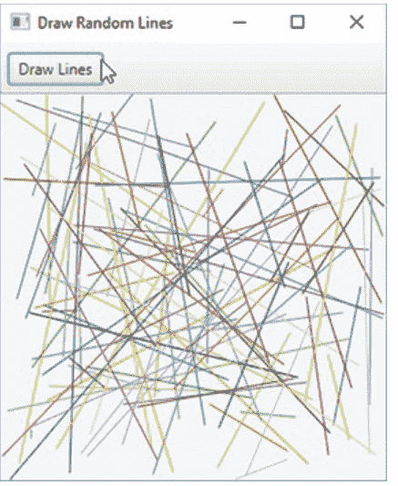

# 图 8.18

使用 `MyLine` 对象绘制随机线条。

## 描述

# GUI 与图形案例研究练习

- **8.1** 增强图 8.17–8.18 中的程序，以随机粗细绘制线条。你可以使用 `GraphicsContext` 的 `setLineWidth` 方法设置线条粗细。

- **8.2** 增强图 8.17–8.18 中的程序，随机绘制矩形和椭圆。创建 `MyRectangle` 和 `MyOval` 类。这两个类都应该包含 `x1`、`y1`、`x2`、`y2` 坐标、描边颜色、填充颜色以及一个判断形状是否填充的布尔标志位。在每个类中声明一个带有用于初始化实例变量参数的构造函数。为了绘制矩形和椭圆，每个类应该提供 `getUpperLeftX`、`getUpperLeftY`、`getWidth` 和 `getHeight` 方法，根据 `x1`、`y1`、`x2`、`y2` 坐标分别计算左上角的 x 坐标、左上角的 y 坐标、宽度和高度。左上角的 x 坐标是两个 x 值中的较小，左上角的 y 坐标是两个 y 值中的较小，宽度是 x 值之差的绝对值，高度是 y 值之差的绝对值。（声明类）

程序的 GUI 应该分离按钮，分别用于绘制 100 个随机 `MyRectangle` 和 100 个随机 `MyOval`。每个按钮都应该有一个相应的事件处理程序：

- 1. 带有参数的构造函数，用于初始化实例变量。为了绘制矩形和椭圆，每个类应该提供 `getUpperLeftX`、`getUpperLeftY`、`getWidth` 和 `getHeight` 方法，根据 `x1`、`y1`、`x2`、`y2` 坐标分别计算左上角的 x 坐标、左上角的 y 坐标、宽度和高度。左上角的 x 坐标是两个 x 值中的较小，左上角的 y 坐标是两个 y 值中的较小，宽度是 x 值之差的绝对值，高度是 y 值之差的绝对值。

- 2. 用于设置坐标的 set 方法。设置坐标的方法应验证参数是否大于或等于零，并将填充标志设为 false。

- 3. 用于访问坐标的 get 方法。`draw` 方法应该通过 get 方法而不是直接访问坐标。

# 8.17 总结

在本章中，我们介绍了额外的类概念。`Time` 类案例研究展示了一个完整的类声明，包括初始化的重载构造函数、用于操作数据的 set 和 get 方法，以及以不同格式返回 `Time` 表示的方法。还学会了每个类都可以声明一个 `toString` 方法来返回对象的字符串表示。我们展示了如何抛出异常来指示问题的发生。

你学会了 `this` 引用被隐式用于类的实例方法以访问类数据。你还看到了在构造函数中显式使用 `this` 引用来调用类的另一个构造函数。

我们讨论了类中静态字段的动机，并演示了如何在自己的类中声明和使用静态字段和方法。你还学会了如何声明和初始化 `final` 变量。

你学会了没有修饰符的字段默认具有包权限。你看到了同一包内类之间的关系，允许包中的每个类访问该包内其他类的包权限成员。最后，我们学习了 Java 的垃圾回收能力以及它是如何不可预测地回收不再使用的对象的内存。本章解释了包内其他类的静态访问成员。

最后，我们演示了如何使用 `BigDecimal` 类执行精确的货币计算。

在下一章中，你将学习 Java 面向对象编程的一个重要方面——继承。你将看到 Java 中的所有类都直接或间接地继承自 `Object` 类。你还将开始理解类之间的关系如何帮助你构建更强大的应用程序。

# 总结

# 8.2 Time 类案例研究总结

- 类的公共方法也称为类的公共服务或公共接口（第 330 页）。它们向类的客户端展示了类提供的服务视图。
- 类的私有成员对其客户端不可见。
- `String` 类的静态方法 `format`（第 332 页）与 `System.out.printf` 方法类似，区别在于 `format` 返回一个格式化的字符串而不是在命令窗口中显示它。
- Java 中的所有对象都有 `toString` 方法，返回对象的字符串表示。当对象出现在需要 `String` 的代码中时，`toString` 方法会被隐式调用。

## 第 8.3 节 控制成员的访问

- 访问修饰符 `public` 和 `private` 控制对类变量和方法的访问。
- `public` 方法的主要目的是为类的客户端提供该类所提供服务的视图。客户端无需关心类是如何完成其任务的。
- 类的私有变量和私有方法（即其实现细节）是客户端无法访问的。

## 第 8.4 节 使用 `this` 引用引用当前对象的成员

- 对象的实例方法隐式地使用关键字 `this`（第 336 页）来引用对象的实例变量和其他方法。关键字 `this` 也可以显式地使用。
- 编译器为每个编译后的类生成一个扩展名为 `.class` 的独立文件。
- 如果局部变量的名称与类中的字段同名，则该局部变量会遮蔽该字段。你可以在方法中使用 `this` 引用来显式地引用被遮蔽的字段。

## 第 8.5 节 Time 类
### 案例研究：重载构造函数

- 重载构造函数允许类的对象以不同的方式进行初始化。编译器通过其签名（第 338 页）来区分重载的构造函数。
- 要从类的一个构造函数调用同类的另一个构造函数，可以使用 `this` 关键字后跟包含构造参数的括号。如果使用，此类调用必须作为构造函数体的第一条语句。

## 第 8.6 节 默认和无参构造函数

- 如果类中没有提供任何构造函数，编译器会创建一个默认构造函数。
- 如果类声明了构造函数，编译器将不会创建默认构造函数。在这种情况下，如果需要默认初始化，必须声明一个无参构造函数（第 340 页）。

## 第 8.7 节 关于 Set 和 Get 方法的说明

- Set 方法通常被称为修改方法（mutator methods，第 344 页），因为它们通常会改变值。Get 方法通常被称为访问方法（accessor methods，第 344 页）或查询方法。谓词方法（predicate method，第 345 页）测试条件是否为假。

## 第 8.8 节 组合

- 类可以拥有其他对象的引用作为成员。这被称为组合（composition，第 345 页），有时被称为“有一个”（*has-a*）关系。

## 第 8.9 节 enum 类型

- 所有枚举类型（第 348 页）都是引用类型。枚举类型通过 `enum` 声明来定义，声明是一个用逗号分隔的枚举常量列表。声明可以可选地包含传统类的其他组件，如构造函数、字段和方法。
- 枚举常量是隐式 `final` 的，因为它们声明了不应修改的常量。
- 枚举常量是隐式 `static` 的。
- 任何尝试使用操作符 `new` 创建枚举类型对象的尝试都会导致编译错误。
- 枚举常量可以用在任何可以使用常量的地方，例如在 `switch` 语句的 `case` 标签中以及用于控制增强型 `for` 语句。
- 枚举声明中的每个枚举常量后面都可以可选地带有参数，这些参数会被传递给枚举构造函数。
- 对于每个枚举，编译器都会生成一个名为 `values` 的静态方法，它按声明顺序返回枚举常量的数组。
- `EnumSet` 静态方法 `range`（第 350 页）接收范围内的第一个和最后一个枚举常量，并返回一个包含这两个常量之间所有常量（包含自身）的 `EnumSet`。

## 第 8.10 节 垃圾回收

- Java 虚拟机（JVM）执行垃圾回收（第 351 页）以回收不再使用的对象所占的内存。当一个对象不再有引用时，该对象在 JVM 下次执行垃圾回收器时就符合回收条件。

## 第 8.11 节 static 类成员

- 静态变量（第 351 页）代表类对象之间共享的类级信息。
- 静态方法可以通过类名调用，不需要访问的实例。

## 第 8.12 节 static 导入

- 静态导入（static import）允许在不使用类名的情况下直接引用静态成员。
- 静态导入声明（static import declaration）可以导入所有静态成员。

## 第 8.13 节 final 实例变量

- `final` 关键字指定变量不可修改。

## 第 8.14 节 包访问权限

- 同包的类具有包访问权限。
- 如果没有指定访问修饰符，类被认为具有包访问权限（第 357 页）。
- 访问权限通过类方法。

## 第 8.15 节 使用 BigDecimal 进行精确计算

- 任何需要精确计算的应用都使用 `BigDecimal`（`java.math`）。
- `BigDecimal` 静态方法 `valueOf(double)` 返回一个精确的值。
- `BigDecimal` 常量 `ZERO` (0) 和 `ONE` (1) 是提供的。
- `BigDecimal` 方法 `add` 两个值。
- `BigDecimal` 方法 `pow` 将第一个参数为第二个参数的幂。
- `BigDecimal` 方法 `multiply` 两个值。
- `BigDecimal` 方法 `setScale` 允许你指定如何舍入。
- 如果给定的值无法精确表示，将抛出 `ArithmeticException`。
- 你可以通过提供 `MathContext` 对象来指定 `BigDecimal` 的舍入模式。你也可以向执行计算的各种 `BigDecimal` 方法提供 `MathContext`。默认情况下，每个预配置的 `MathContext` 使用银行舍入。
- `BigDecimal` 的精度是小数点右侧的位数。
- 如果你需要将 `BigDecimal` 舍入到特定的位数，可以调用 `setScale`。

- 14. 声明（A(n)）导入一个静态成员。
- 15. 该原则规定，应仅赋予代码完成其指定任务所需的权限数量和访问权限。
- 16. 该关键字指定变量在声明或构造函数中初始化后不再是可修改的。
- 17. 类（A(n)）导入类的静态成员。
- 18. 设置（Set）方法通常会被调用，因为它们通常会改变一个值。
- 19. 使用 `BigDecimal` 执行精确的货币计算。
- 20. 使用 `throw` 语句表示发生了问题。

# 练习

- 1. 8.2 (基于第 8.14 节) 解释 Java 中包访问的含义。解释包访问的负面影响。
- 2. 8.3 如果为构造函数指定了返回类型（即使是 `void`），会发生什么？
- 3. 8.4 (Rectangle 类) 创建具有 `length` 和 `width` 属性的 `Rectangle` 类，每个属性的默认值均为 1。提供计算矩形周长和面积的方法。为 `length` 和 `width` 都提供 set 和 get 方法。set 方法应验证 `length` 和 `width` 是否为大于 0.0 且小于 20.0 的浮点数。编写一个程序测试 `Rectangle` 类。
- 4. 8.5 (修改类的数据表示) 图 8.5 中的 `Time2` 类将时间内部表示为自午夜以来的秒数而不是小时、分、秒这三个整数值，将是完全合理的。客户端可以使用相同的公共方法并获得相同的结果。修改图 8.5 中的 `Time2` 类，将时间实现为自午夜以来的秒数，并证明该类的客户端对此变化不可见。
- 5. 8.6 (SavingsAccount 类) 创建 `SavingsAccount` 类。使用静态变量 `annualInterestRate` 存储所有账户的年利息。该类的每个对象包含一个私有实例变量 `savingsBalance`，表示储户当前的存款余额。提供方法 `calculateMonthlyInterest`，通过将 `savingsBalance` 乘以 `annualInterestRate` 除以 12 来计算每月利息——这应该被加到 `savingsBalance` 中。提供静态方法 `modifyInterestRate` 将 `annualInterestRate` 设置为新值。编写一个程序测试 `SavingsAccount` 类。实例化两个 `savingsAccount` 对象 `saver1` 和 `saver2`，余额分别为 $2000.00 和 $3000.00。将 `annualInterestRate` 设置为 4%，然后计算 12 个月中每个月的利息并打印两个储户的新余额。接下来，将 `annualInterestRate` 设置为 5%，计算下个月的利息并打印两个储户的新余额。
- 6. 8.7 (增强 Time2 类) 修改 `Time2` 类以包含一个 `tick` 方法，该方法将 `Time2` 对象中存储的时间增加一秒。提供方法 `incrementMinute` 将分钟增加一，以及方法 `incrementHour` 将小时增加一。编写一个程序测试 `tick` 方法、`incrementMinute` 方法和 `incrementHour` 方法，以确保它们正常工作。务必确保测试以下情况：
    - 1. 增加到下一分钟，
    - 2. 增加到下一个小时以及
    - 3. 增加到下一天（即从 11:59:59 PM 到 12:00:00 AM）。
- 7. 8.8 (增强 Date 类) 修改图 8.7 中的 `Date` 类，对变量 `month`、`day` 和 `year` 的初始化值进行错误检查（目前仅验证月和）。提供方法 `nextDay` 将日期增加一天。编写一个程序在循环中测试 `nextDay`，在每次迭代期间打印日期以说明该方法工作正常。测试以下情况：
    - 1. 增加到下个月以及
    - 2. 增加到下一年。
- 8. 8.9 重写图 8.14 中的代码，使用 `Math` 类的静态成员进行声明。
- 9. 8.10 创建一个枚举 `TrafficLight`，其常量（RED、GREEN、YELLOW）接受一个参数。编写一个程序测试 `TrafficLight`，使其显示常量及其时长。
- 10. 8.11 (复数) 创建一个用于复数运算的 `Complex` 类。编写一个程序测试该类。使用浮点变量表示类的私有变量 `realPart` 和 `imaginaryPart`。提供一个构造函数，在声明时初始化该类的对象。在没有初始化器的情况下，提供一个无参构造函数。提供公共方法执行以下操作：
    - 加两个复数：实部相加，虚部相加。
    - 减两个复数：左操作的实部减去右操作的实部，虚部减去右操作的虚部。
    - 以 `realPart + imaginaryPart` 的形式输出复数。
- 11. 12. (日期和时间) 创建 `DateTime` 类，结合练习 8.7 的 `Time2` 类和练习 8.8 的 `Date` 类。修改 `incrementHour` 以增加一天。方法 `toString` 和 `toDate` 输出日期。
- 12. 13 (整数集合) 创建 `IntegerSet` 类，它可以持有 0-100 之间的整数。提供以下方法：
    - 向集合插入一个新整数 `k`。
    - 删除整数 `m`。
    - `toString` 返回以空格分隔的数字列表。
    - `isEqual` 判断两个集合是否相等。
- 13. 14 (并集和交集) 增强 `IntegerSet` 类以包含以下方法：
    - 静态方法 `union` 创建两个集合的并集。
    - 静态方法 `intersection` 创建两个集合的交集。
    - 谓词方法 `contains` 如果整数存在于集合中则返回 true。
- 14. 15 (日期) 创建 `Date` 类，具有以下功能：
    - 1. 以多种格式输出日期，如 MM/DD/YYYY、June 1992、DDD YYYY。
    - 2. 使用重载构造函数创建日期：第一种情况接收三个整数；第二种情况接收一个字符串和两个整数；第三种情况接收两个整数，第一个表示年份。

可以使用格式指定符 `%b` 将值输出为单词“true”或“false”。

- 17. **8.18 (井字棋)** 创建一个名为 `TicTacToe` 的类，这将使你能够编写一个玩井字棋的程序。该类包含一个私有的 3x3 二维数组。使用枚举（`enum`）类型来表示数组中每个单元格的值。枚举的常量应被命名为 X、O 和 EMPTY（表示不包含 X 或 O 的位置）。构造函数应将棋盘元素初始化为 EMPTY。允许两个人类玩家进行对战。每当第一个玩家移动时，在指定的单元格中放置一个 X，在第二个玩家移动的地方放置一个 O。每次移动必须在空单元格上。每次移动后，判断游戏是否已经获胜，由计算机为其中一个玩家执行移动。此外，如果你觉得野心勃勃，可以修改你的程序，让玩家指定想先手还是后手。如果你觉得非常有野心，可以编写一个在 4x4x4 盘上玩三维井字棋的程序[注：这是一个极具挑战性的项目]！

- 18. **8.19 (带有 BigDecimal 的账户类)** 重写第 3 节中的 `Account` 类，将余额存储为 `BigDecimal` 对象，并使用 `BigDecimal` 执行所有计算。

- 19. **8.20 (final 实例变量)** 在图 8.8 中，`Employee` 类的实例变量在初始化后从未被修改过。任何此类实例变量都应该声明为 final。相应地修改 `Employee` 类，然后重新编译并运行程序以证明它产生相同的结果。

## 产生改变

- 1. 8.21 (项目：应急响应类) 北美的应急响应系统 9-1-1 将呼叫者连接到本地公共服务接听点（PSAP）。传统上，PSAP 会向呼叫者询问身份信息——包括呼叫者的地址、号码和紧急情况性质，然后派遣相应的应急响应人员（如警察、救护车或消防队）。增强型 9-1-1（或 E9-1-1）使用计算机和数据库确定呼叫者的物理地址，并将呼叫者引导至最近的 PSAP；无线增强型 9-1-1 为无线呼叫提供呼叫者的身份识别。该系统分阶段推出，第一阶段要求运营商提供无线电话号码以及传输呼叫的手机小区或基站的地址。第二阶段要求运营商提供呼叫者的位置（使用 GPS 等技术）。要了解更多关于 9-1-1 的信息，请访问 https://www.fcc.com/general/9-1-1-and-e9-1-1-services 和 http://people.howstuffworks.com/9-1-1。

创建一个类的一个重要部分是确定类的属性（实例变量）。在互联网上，设计一个研究 9-1-1 服务的类，该类可能用于面向对象的 9-1-1 应急响应系统。列出类对象可能用于表示紧急情况的属性。例如，该类可能包含关于报告紧急情况的人的信息（包括他们的电话号码）、紧急发生的地点、报告时间、紧急情况性质、响应类型和响应状态。类属性应完全描述问题的性质以及为了解决该问题正在采取的措施。

- 2. 8.22 (项目：处理全球经济中的货币——JavaMoney) 在全球经济中，处理货币、货币金额、舍入和格式化是非常复杂的。开发新的 JavaMoney API 是为了应对这些挑战。在本文写作时，它尚未被纳入 Java SE 或 Java EE。你可以在此处阅读关于 JavaMoney 的信息


https://java.net/projects/javamoney/pages/Home

http://jsr354.blogspot.ch

你可以在此处获取关于 JavaMoney 的文档

http://javamoney.github.io

使用 JavaMoney 开发一个可以在不同货币之间转换的应用。

# 9 面向对象编程：继承

## 目标

在本章中，你将：

- 理解继承以及如何通过基于现有类来创建新类。
- 学习父类和子类的概念。
- 使用 `extends` 关键字从类中继承属性。
- 使用 `protected` 修饰符允许子类访问父类成员。
- 学习构造函数在继承中的用法。
- 了解 `Object` 类的方法。

## 提纲

- 9.1 引言
- 9.2 父类与子类
- 9.3 protected 成员
- 9.4 父类与子类之间的关系
  - 9.4.1 创建父类
  - 9.4.2 创建并使用子类
  - 9.4.3 创建并使用继承关系
  - 9.4.4 使用 protected 实例变量
  - 9.4.5 子类中的构造函数
- 9.6 Object 类
- 9.7 使用组合与继承
- 9.8 总结
- 总结
- 自测练习题
- 自测练习题答案
- 练习题

### 9.1 引言

本章通过引入**继承**来继续讨论面向对象编程，继承是通过获取现有类并可能对其增强新功能来创建一个新类。通过继承，你可以基于调试良好的软件来节省开发时间。这增加了系统被有效实现和维护的可能性。

在创建类时，与其完全声明新的成员，你可以指定新类应该*继承*现有类的成员。现有类被称为**父类**（superclass），而新类被称为**子类**（subclass）。（C++ 语言将父类称为基类，将子类称为派生类。）子类可以成为未来子类的父类。因此，子类比父类*更具体*，代表了一个更专门的对象组。子类表现出父类的行为，并根据子类对其进行修改。这就是为什么继承有时被称为**专门化**。

**直接父类**是子类显式继承的父类。间接父类是类层次结构中直接父类之任何类，它定义了类之间的继承关系——正如我们在 9.2 节所示，图表可以帮助理解这些关系。在 Java 中，类层次结构始于 `Object` 类（位于 `java.lang` 包中），Java 中的所有类都直接或间接地扩展（或“继承自”）它。9.6 节列出了所有类继承的 Object 类方法。Java 只支持单继承，即每个类派生自一个直接父类。

is-a 表示对象也可以被视为其父类的对象——例如，汽车是车辆。相比之下，has-a 表示的是组合（见第 8 章）。在 has-a 关系中，对象包含指向其他对象的引用——例如，汽车有一个方向盘（以及汽车对象包含指向方向盘对象的引用）。

新类可以继承类库中的类。组织开发自己的类库，并利用全球范围内提供的其他类库。未来，大多数新软件可能会由标准化的重用组件构建，就像汽车一样。

硬件如今正被构建。这将促进更强大、更丰富且廉价的软件的快速发展。

## 9.2 超类与子类

通常，一个类的对象也是另一个类的对象。例如，汽车贷款（Car Loan）是一种贷款，装修贷款（HomeImprovement Loans）和住房贷款（MortgageLoans）也是。因此，在 Java 中，可以说汽车贷款继承自 `Loan` 类。在这种背景下，`Loan` 类是超类，`CarLoan` 类是子类。汽车贷款是贷款的一种特定类型，但声称每种贷款都是汽车贷款是不正确的——它可以是任何类型的贷款。图 9.1 列出了几个超类和子类的简单示例——超类倾向于“更通用”，而子类则“更具体”。

## 图 9.1

继承示例。

| 超类 | 子类 |
|---|---|
| 学生 (Student) | 研究生 (GraduateStudent), 本科生 (UndergraduateStudent) |
| 形状 (Shape) | 圆形 (Circle), 三角形 (Triangle), 矩形 (Rectangle), 球体 (Sphere), 立方体 (Cube) |
| 贷款 (Loan) | 汽车贷款 (CarLoan), 装修贷款 (HomeImprovementLoan), 住房贷款 (MortgageLoan) |
| 员工 (Employee) | 教职工 (Faculty), 工作人员 (Staff) |
| 银行账户 (BankAccount) | 支票账户 (CheckingAccount), 储蓄账户 (SavingsAccount) |

由于每个子类对象都是其超类的对象，且一个超类可以有多个子类，因此子类所代表的对象集通常比其任何子类所代表的对象集要大。例如，超类 `Vehicle` 代表*所有*车辆，包括汽车、卡车、船只、自行车等。相比之下，子类 `Car` 代表的是一个更小、更具体的车辆子集。

## 大学社区成员层级

继承关系构成了树形的*层级*结构。超类与其子类之间存在层级关系。让我们开发一个示例类层次结构（图 9.2），它也称为**继承层次结构**。大学社区拥有数千名成员，包括员工、学生和校友。员工要么是教职工或工作人员。教职工要么是行政人员（例如院长和系主任）或是教师。该层级结构可能包含许多其他类。例如，学生可以是研究生或本科生。本科生可以是大一、大二、大三或大四学生。

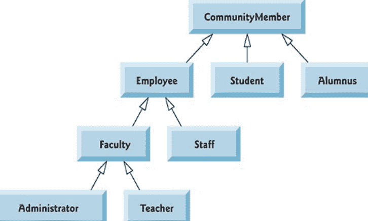

## 图 9.2

大学社区成员 (CommunityMembers) 的继承层次结构 UML 类图。

层级结构中的每个箭头都代表一种“是”（is-a）关系。在这个类层次结构中，我们向上追踪箭头，可以说：“*员工(Employee)是一个社区成员(CommunityMember)*”以及“*教师(Teacher)是一个教职工(Faculty)成员*”。*CommunityMember* 是*员工(Employee)、*学生(Student)* 和*校友(Alumnus)* 的直接超类，也是图中所有其他类的间接超类。从底部开始，你可以顺着箭头将“是”关系应用到最顶部的超类。例如，一个*行政人员(Administrator)是一个教职工(Faculty)成员*，*是一个员工(Employee)*，*是一个社区成员(CommunityMember)*，而且当然，*是一个对象(Object)*。

## 形状层级

现在考虑图 9.3 中的形状（Shape）继承层级。该层级结构从超类 `Shape` 开始，由子类 `TwoDimensionalShape`（二维形状）和 `ThreeDimensionalShape`（三维形状）扩展——形状要么是二维的三维。该层级的第三层包含特定类型的二维形状和三维形状。与图 9.2 所示，我们可以从该类层次结构的底部追踪箭头到最顶部的超类，以识别出若干“是”的关系。例如，三角形（Triangle）是一个二维形状且是一个形状，而球体（Sphere）是一个三维形状且是一个形状。该层级结构可能包含许多其他类。例如，椭圆和梯形也是二维形状。

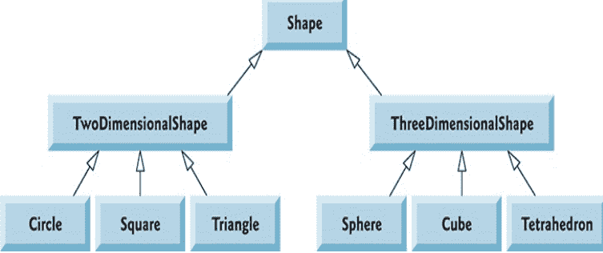

## 图 9.3

形状 (Shapes) 的继承层次结构 UML 类图。

并不是所有的类之间的关系都是继承关系。在第 8 章中，我们讨论了“拥有”（has-a）关系，在这种关系中，类拥有引用其他类对象的成员。此类关系通过现有类的组合来创建类。例如，给定类 `Employee`（员工）、`BirthDate`（出生日期）和 `TelephoneNumber`（电话号码），说一个员工是一个出生日期或说一个员工是一个电话号码是不恰当的。然而，一个员工*拥有*一个电话号码。

可以用类似的方式对待超类对象和子类对象——它们的共同点体现在超类的成员中。所有扩展公共超类的类对象都可以被视为该超类的对象——此类对象与超类具有“是”的关系。在本章的后半部分和第 10 章中，我们将考虑许多利用这种“是”关系的示例。

子类可以自定义它从超类继承的方法。要做到这一点，子类通过适当的实现来重写（重新定义）超类方法，正如我们在本章的代码示例中所看到的。

## 9.3 protected（受保护）成员

第 8 章讨论了访问修饰符 `public`（公共）和 `private`（私有）。
只要程序拥有该类或其某个子类对象的引用，该类的公共成员就是可访问的。类的私有成员仅在类内部可访问。在本节中，我们引入了访问修饰符 `protected`。使用 `protected` 访问提供了公共和私有之间的中间级别。超类的受保护成员可以被子类以及同一包中的其他类访问。

所有公共和受保护成员在成为子类的成员时都会保留其原始的访问修饰符——公共成员变为子类的公共成员，受保护成员变为子类的受保护成员。超类的私有成员在类本身之外是不可见的。它们对子类是隐藏的，并且只能通过继承自超类的公共或受保护方法进行访问。

子类方法只需通过使用成员名称即可引用公共和受保护成员。当子类重写继承的方法时，可以通过在超类名前加上 `super` 和点（`.`）来从子类访问超类版本的该方法。我们在第 9.4 节中讨论访问超类的被重写成员。


## 软件工程观察 9.1

子类的方法不能直接访问其超类的私有成员。子类只能通过超类提供并由子类继承的非私有方法来更改私有实例变量的状态。


## 软件工程观察 9.2

声明私有实例变量有助于你调试和正确修改系统。如果子类可以访问其超类的实例变量，那么继承该子类的类也可以访问。这会导致本应该是私有的实例变量的访问权限被扩散，信息隐藏的好处将消失。

## 9.4 超类与子类之间的关系

我们现在使用一个包含公司工资应用程序中员工类型的继承层级来讨论超类与其子类之间的关系。在公司公司，*佣金员工*（将作为超类的对象）根据销售额的百分比获得报酬，而*带薪的佣金员工*（将作为子类的对象）获得基本薪加销售额的百分比。

我们将这些类之间关系的讨论分为五个示例。第一个示例声明了 `CommissionEmployee` 类，它直接继承自 `Object` 并声明了 `private` 实例变量：名字、姓、社会安全号码、佣金率和总（即合计）销售额。

第二个示例声明了 `BasePlusCommissionEmployee` 类，它也直接继承自 `Object` 类，并声明了 `private` 实例变量：名字、姓、社会安全号码、佣金率、总销售额*以及*基本薪。我们通过*编写该类的每一行代码*来创建这个类——我们很快就会发现通过继承 `CommissionEmployee` 类来创建要高效得多。

第三个示例声明了一个新的 `BasePlusCommissionEmployee` 类，它继承了 `CommissionEmployee` 类（即 `BasePlusCommissionEmployee` 是一个拥有基本工资的 `CommissionEmployee`）。这种软件重用允许我们在开发新子类时编写少得的代码。在这个示例中，`BasePlusCommissionEmployee` 尝试访问 `CommissionEmployee` 类的私有成员——这会导致编译错误，因为子类无法访问父类的私有实例变量。

第四个示例显示，如果将 `CommissionEmployee` 的实例变量声明为 `protected`，则 `BasePlusCommissionEmployee` 子类可以直接访问这些数据。两个 `BasePlusCommissionEmployee` 类的功能相同，但我们展示了继承版本更容易创建和管理。

在讨论了使用 `protected` 实例变量的便利性之后，我们创建了第五个示例，将 `CommissionEmployee` 的实例变量恢复为 `private` 以强制良好的软件工程。然后我们展示了 `BasePlusCommissionEmployee` 子类如何使用 `CommissionEmployee` 的公共方法来（以控制的方式）操作从 `CommissionEmployee` 继承的私有实例变量。

## 9.4.1 创建和使用 CommissionEmployee 类

我们首先声明 `CommissionEmployee` 类（图 9.4）。第 4 行开始类声明，并指示 `CommissionEmployee` 类继承（即派生自）`Object` 类（来自 `java.lang` 包）。这使得 `CommissionEmployee` 继承了 `Object` 类的方法——`Object` 类没有任何字段。如果你不显式指定新类继承自哪个类，该类将隐式地继承 `Object`。由于这个原因，你通常不会在代码中包含 `extends Object`——我们在这个示例中这样做仅仅是为了演示。

```java
// Fig. 9.4: CommissionEmployee.java
// CommissionEmployee class represents an employee
// percentage of gross sales.
public class CommissionEmployee extends Object {
    private final String FirstName;
    private final String LastName;
    private final String socialSecurityNumber;
    private double grossSales; // gross weekly sal
    private double commissionRate; // commission p

    // five-argument constructor
    public CommissionEmployee(String FirstName, String LastName,
        String socialSecurityNumber, double grossSales,
        double commissionRate) {
        // implicit call to Object's default constr

        // if grossSales is invalid throw exception
        if (grossSales < 0.0) {
            throw new IllegalArgumentException("grossSales is invalid");
        }

        // if commissionRate is invalid throw exception
        if (commissionRate <= 0.0 || commissionRate < 0.0) {
            throw new IllegalArgumentException("commission rate must be positive");
        }

        this.firstName = firstName;
        this.lastName = lastName;
        this.socialSecurityNumber = socialSecurityNumber;
        this.grossSales = grossSales;
        this.commissionRate = commissionRate;
    }

    // return first name
    public String getFirstName() {
        return firstName;
    }

    // return last name
    public String getLastName() {
        return lastName;
    }

    // return social security number
    public String getSocialSecurityNumber() {
        return socialSecurityNumber;
    }

    // set gross sales amount
    public void setGrossSales(double grossSales) {
        if (grossSales < 0.0) {
            throw new IllegalArgumentException("grossSales is invalid");
        }
        this.grossSales = grossSales;
    }

    // return gross sales amount
    public double getGrossSales() {
        return grossSales;
    }

    // set commission rate
    public void setCommissionRate(double commissionRate) {
        if (commissionRate <= 0.0 || commissionRate > 100.0) {
            throw new IllegalArgumentException("Commission rate must be between 0.0 and 100.0");
        }
        this.commissionRate = commissionRate;
    }

    public double getCommissionRate() {
        return this.commissionRate;
    }

    public double earnings() {
        // return commission rate // String representation of CommissionEmployee
        // calculate earnings // that this method overrides
    }

    @Override
    public String toString() {
    }
}
```


```java
return String.format("%s: %s %s\n%s: %s\n%s: %s",
    "commission employee", firstName, lastName,
    "social security number", socialSecurity,
    "gross sales", grossSales,
    "commission rate", commissionRate);
}
```

图 9.4

`CommissionEmployee` 类代表一个按总销售额百分比支付工资的员工。

## 类概述

## CommissionEmployee 的方法和实例变量

`CommissionEmployee` 类的公共服务包括构造函数（第 12–33 行）以及 `earnings()` 方法（第 70 行）和 `toString()` 方法（第 73–80 行）。第 36–42 行为类的 `final` 实例变量声明了公共 get 方法（在第 5–7 行定义的 `firstName`、`lastName` 和 `socialSecurityNumber`）。这三个实例变量被声明为 `final`，是因为它们在初始化后不需要修改——这也是为什么我们没有提供对应的 set 方法。第 45–67 行为类的 `grossSales` 和 `commissionRate` 实例变量声明了公共 set 和 get 方法（在第 8–9 行）。该类将其实例变量声明为 `private`，因此其他类的对象无法直接访问这些变量。

## CommissionEmployee 类的构造函数

构造函数是不被继承的，因此 `CommissionEmployee` 类不继承 `Object` 类的构造函数。然而，父类的构造函数仍然可以被调用。事实上，Java 要求任何子类构造函数的首要任务是调用其直接父类，无论是显式的还是隐式的（如果没有指定构造函数调用），以确保从父类继承的实例变量得到妥善初始化。显式调用父类构造函数的语法将在第 9.4.3 节讨论。在这个示例中，`CommissionEmployee` 类的构造函数隐式地调用了 `Object` 的构造函数。如果代码中不包含对父类的显式调用，Java 会隐式地调用父类的默认或无参构造函数。图 9.4 中第 15 行的注释指示了隐式调用父类构造函数的位置（你不需要编写这部分代码）。`Object` 的默认构造函数什么都不做。即使一个类没有构造函数，编译器为该类隐式声明的默认构造函数也会调用父类的默认或无参构造函数。

在隐式调用 `Object` 构造函数后，第 18–20 行和 23–26 行验证了 `grossSales` 和 `commissionRate` 参数。如果这些参数是有效的（即构造函数没有抛出 `IllegalArgumentException`），则第 28–32 行将构造函数的参数赋值给类的实例变量。

在将其赋值给相应的实例变量之前，我们没有对 `firstName`、`lastName` 和 `socialSecurityNumber` 参数的值进行验证。我们可以对姓进行验证——也许是为了确保长度合理。同样，可以使用正则表达式（第 14.7 节）对社会安全码进行验证，以确保它包含九位数字，带或不带连字符（例如 `123-45-6789` 或 `123456789`）。

## CommissionEmployee 的 earnings 方法

`earnings()` 方法（第 20 行）计算 `CommissionEmployee` 的收益。该方法将 `commissionRate` 乘以 `grossSales` 并返回结果。

## CommissionEmployee 的 toString 方法

`toString()` 方法（第 73–80 行）是特殊的——它是每个类继承自 `Object` 类的方法之一（在第 9.6 节中总结）。`toString()` 方法返回对象的字符串表示。当对象必须转换为字符串表示时，它会被隐式调用，例如当对象通过 `printf` 输出或通过 `String.format()` 方法使用 `%s` 格式说明符输出时。`Object` 类的 `toString()` 方法返回一个包含对象类名称的字符串和对象的所谓 hashcode（参见第 9.6 节）。它主要是一个占位符，子类可以重写它以指定子类对象中数据的适当字符串表示形式。

`CommissionEmployee` 类的 `toString()` 方法重写（重定义）了 `Object` 类的 `toString()` 方法。当被调用时，`CommissionEmployee` 的 `toString()` 方法使用 `String` 类的 `format()` 方法返回一个包含 `CommissionEmployee` 信息的字符串。要重写父类方法，子类必须声明一个与父类方法签名相同（方法名、参数个数、参数类型和参数类型顺序）的方法——`Object` 类的 `toString()` 方法不接受参数，因此 `CommissionEmployee` 声明了一个不接受参数的 `toString()` 方法。

## @Override 注解

第 73 行使用了可选的 `@Override` 注解，用指示随后的方法声明（即 `toString()`）应该重写现有的父类方法。此注解有助于编译器捕捉一些常见的错误。例如，在此例中，你打算重写父类方法 `toS`，它的拼写是小写的“t”和大写的“S”。如果你不经意地使用了小写的“s”，编译器将将其标记为错误，因为父类并不包含一个名为小写“s”的 `toString()` 方法。如果你没有使用 `@Override` 注解，`toString()` 将是一个完全不同的方法，当在需要字符串的地方使用 `CommissionEmployee` 时，该方法不会被调用。

另一个常见的重写错误是在参数列表中声明了错误数量或类型的参数。这创建了父类方法的无意重载，而不是重写现有的方法。如果你随后尝试在子类对象上调用该方法（带有正确数量和类型的参数），将调用父类中的版本——这会导致细微的逻辑错误。当编译器遇到一个带有 `@Override` 声明的方法时，它会将该方法的签名与父类的方法签名进行比较。如果没有精确匹配，编译器会抛出错误信息，例如“method does not override or implement a method from a supertype”。随后你可以修正方法的签名，使其匹配父类中的某个方法。

## 错误预防小技巧 9.1

虽然 `@Override` 注解是可选的，但在声明重写的方法时使用它，以确保在编译时你正确定义了它们的方法签名。在编译时发现错误总比在运行时发现要好。出于这个原因，图 7.9 以及第 8 章示例中的 `toString()` 方法应该使用带有 `@Override` 的声明。


## 常见编程错误 9.1

使用更受限的访问修饰符重写方法是一个编译错误——公共的父类方法不能变成保护或私有的子类方法；保护的子类方法不能变成私有的子类方法。这样做将破坏“是关系”（is-relationship），即所有子类对象都应该能够对父类中声明的公共方法的调用做出响应。如果公共方法可以被重写为保护或私有方法，子类对象将无法像父类对象一样响应相同的方法调用。一旦方法在父类中声明为公共，该方法在该类的所有直接和间接子类中都保持为公共。

## CommissionEmployeeTest 类

图 9.5 测试了 `CommissionEmployee` 类。第 6–7 行实例化了 `CommissionEmployee` 的构造函数（图 9.4 的第 12–33 行），用 "Sue" 作为名字，“Jones" 作为姓氏，“222-22-2222" 作为社会安全号，10000 作为总销售额（$10,000）以及 .06 作为佣金率（即 6%）。第 11–20 行使用 `CommissionEmployee` 的 `get` 方法获取对象的实例变量值用于输出。第 22–23 行调用对象的 `setGrossSales()` 和 `setCommissionRate()` 来更改实例变量的值。第 25–26 行输出更新后的 `CommissionEmployee` 的字符串表示。当使用 `%s` 格式输出对象时，会隐式地调用对象的 `toString()` 方法以获取字符串表示。[注意在本章中我们没有在每个类中使用 `earnings()` 方法，但在第 10 章中会广泛使用。]

```java
// Fig 9.5: CommissionEmployeeTest.java
// CommissionEmployee 类测试程序。
public class CommissionEmployeeTest {
    public static void main(String[] args) {
        // 实例化 CommissionEmployee
        CommissionEmployee employee = new CommissionEmployee(
            "Sue", "Jones", "222-22-2222", 10000, .06);

        // 获取 employee 数据
        System.out.println("Employee information:");
        System.out.printf("%nFirst name is %s", employee.getFirstName());
        System.out.printf("%nLast name is %s", employee.getLastName());
        System.out.printf("%nSocial security number is %s", employee.getSocialSecurityNumber());
        System.out.printf("%nGross sales: %.2f", employee.getGrossSales());
        System.out.printf("%nCommission rate: %.2f", employee.getCommissionRate());

        // 更改值
        employee.setGrossSales(5000);
        employee.setCommissionRate(.1);

        // 输出更新信息
        System.out.println("\nUpdated employee information:");
        System.out.println(employee.toString());
    }
}
```

**输出结果：**

```text
Employee information:
First name is Sue
Last name is Jones
Social security number is 222-22-2222
Gross sales: 10000.00
Commission rate: 0.06

Updated employee information:
First name is Sue
Last name is Jones
Social security number is 222-22-2222
Gross sales: 5000.00
Commission rate: 0.10
```

## 9.4.2 创建和使用 BaseCommissionEmployee 类

我们现在通过声明和测试一个全新的、独立的 `BaseCommissionEmployee`（图 9.6）来讨论继承的第二部分，它包含名、姓、社会安全号、总销售额、佣金率和基本工资。`CommissionEmployee` 类的公共服务包括一个 `BaseCommissionEmployee` 构造函数（第 13–40 行）、`earnings()` 方法（第 89–91 行）以及 `toString()`（第 94–102 行）。第 43–88 行为私有实例变量（第 5–10 行）`firstName`、`lastName`、`socialSecurityNumber`、`grossSales`、`commissionRate` 和 `baseSalary` 声明了公共 get 和 set 方法。这些变量封装了基本工资员工的所有必要特征。注意此类与 `CommissionEmployee`（图 9.4）之间的相似性——在本例中，我们不会利用这种相似性。

```java
// Fig 9.6: BaseCommissionEmployee.java
// BaseCommissionEmployee 类表示一个
// 除佣金外还有基本工资的员工。
public class BaseCommissionEmployee {
    private final String firstName;
    private final String lastName;
    private final String socialSecurityNumber;
    private double grossSales; // 周总销售额
    private double commissionRate; // 佣金比例
    private double baseSalary; // 每周基本工资

    // 六参数构造函数
    public BaseCommissionEmployee(String firstName,
        String lastName, String socialSecurityNumber, double grossSales,
        double commissionRate, double baseSalary) {

        // 隐式调用 Object 的默认构造函数
        // 如果 grossSales 无效则抛出异常
        if (grossSales < 0.0) {
            throw new IllegalArgumentException("Gross sales cannot be negative");
        }

        // 如果 commissionRate 无效则抛出异常
        if (commissionRate <= 0.0 || commissionRate >= 1.0) {
            throw new IllegalArgumentException(
                "Commission rate must be > 0.0 and < 1.0");
        }

        // 如果 baseSalary 无效则抛出异常
        if (baseSalary < 0.0) {
            throw new IllegalArgumentException("Base salary cannot be negative");
        }

        this.firstName = firstName;
        this.lastName = lastName;
        this.socialSecurityNumber = socialSecurityNumber;
        this.grossSales = grossSales;
        this.commissionRate = commissionRate;
        this.baseSalary = baseSalary;
    }

    // 返回名字
    public String getFirstName() { return firstName; }

    // 返回姓
    public String getLastName() { return lastName; }

    // 返回社会安全号
    public String getSocialSecurityNumber() { return socialSecurityNumber; }

    // 返回总销售额
    public double getGrossSales() { return grossSales; }

    // 设置总销售额
    public void setGrossSales(double grossSales) { this.grossSales = grossSales; }

    // 返回佣金率
    public double getCommissionRate() { return commissionRate; }

    // 设置佣金率
    public void setCommissionRate(double commissionRate) { this.commissionRate = commissionRate; }

    // 返回基本工资
    public double getBaseSalary() { return baseSalary; }

    // 设置基本工资
    public void setBaseSalary(double baseSalary) { this.baseSalary = baseSalary; }

    // 计算收益
    public double earnings() {
        return (grossSales * commissionRate) + baseSalary;
    }

    // toString 方法
    public String toString() {
        return "First name: " + firstName + ", last name: " + lastName +
        ", social security number: " + socialSecurityNumber +
        ", gross sales: " + grossSales +
```


```java
", commission rate: " + commissionRate +
", base salary: " + baseSalary;
}
}
```

```java
50
51 // 设置总销售额
52 public void setGrossSales(double grossSales) {
53     if (grossSales < 0.0) {
54         throw new IllegalArgumentException("Gross sales cannot be negative");
55
57         this.grossSales = grossSales;
58     }
9
60 // 返回总销售额
61 public double getGrossSales() {return grossSales; }
62
63 // 设置佣率
64 public void setCommissionRate(double commissionRate) {
65     if (commissionRate <= 0.0 || commissionRate > 1.0) {
66         throw new IllegalArgumentException(
67             "Commission rate must be > 0.0 and < 1.0");
68     }
69
70     this.commissionRate = commissionRate;
71 }
72
73 // 返回佣率
74 public double getCommissionRate() {return commissionRate; }
75
76 // 设置基础工资
77 public void setBaseSalary(double baseSalary) {
78     if (baseSalary < 0.0) {
79         throw new IllegalArgumentException("Base salary cannot be negative");
81
82         this.baseSalary = baseSalary;
83     }
84
85 // 返回基础工资
86 public double getBaseSalary() {return baseSalary; }
87
88 // 计算收益
89 public double earnings() {
```

```java
90 public double getBaseSalary() {return baseSalary; }
91 }
92
93 // 返回 BasePlusCommissionEmployee 的字符串表示
94 @Override
95 public String toString() {
96     return String.format(
97         "%s: %s%n:%s: %s%n:%s: %.2f%n:%s: %.2f%n%s",
98         "base-salaried commission employee", firstName,
99         "social security number", socialSecurityNumber,
100         "gross sales", grossSales, "commission rate",
101         "base salary", baseSalary);
102 }
103 }
```

## 图 9.6

`BasePlusCommissionEmployee` 类表示一个除了领取基础工资外还能获得佣金的员工。

`BasePlusCommissionEmployee` 类在第 4 行没有指定 `extends Object`，该类隐式地继承了 `Object`。此外，与 `CommissionEmployee` 类的构造函数（图 9.4 第 12–33 行）一样，`BasePlusCommissionEmployee` 类的构造函数隐式地调用 `Object` 类的默认构造函数，如图 9.6 第 16 行的注释所示。

`BasePlusCommissionEmployee` 的 `earnings` 方法（第 89–91 行）返回 `BasePlusCommissionEmployee` 的基础工资加上佣率与员工总销售额乘积之和。

`BasePlusCommissionEmployee` 类重写了 `Object` 的 `toString` 方法，返回一个包含 `BasePlusCommissionEmployee` 信息的字符串。我们再次使用格式指定符 `%.2f` 将总销售额、佣率和基础工资格式化为小数点后两位精度（第 97 行）。

## 测试 BasePlusCommissionEmployee 类

图 9.7 测试了 `BasePlusCommissionEmployee` 类。第 7–9 行创建了一个 `BasePlusCommissionEmployee` 对象，并将 "Bob"、"Lewis"、"333-33-3333"、5000、.04 和 300 分别传递给构造函数，分别作为名字、社会安全号、总销售额、佣率和基础工资。第 14–25 行使用 `BasePlusCommissionEmployee` 的 `get` 方法获取对象实例变量的值以进行输出。第 27 行调用对象的 `setBaseSalary` 方法来更改基础工资。`setBaseSalary` 方法（图 9.6 第 77–83 行）确保实例变量 `salary` 不被赋予负值。图 9.7 的第 31 行显式调用 `toString` 方法以获取对象的字符串表示。

```java
1 // 图 9.7: BasePlusCommissionEmployeeTest.java
2 // BasePlusCommissionEmployee 测试程序。
3
4 public class BasePlusCommissionEmployeeTest {
5     public static void main(String[] args) {
6         // 实例化 BasePlusCommissionEmployee 对象
7         BasePlusCommissionEmployee employee =
8             new BasePlusCommissionEmployee(
9             "Bob", "Lewis", "333-33-3333", 5000, .04, 300);
10        // 获取薪资佣金员工数据
11        System.out.printf(
12            // 通过 get 获取的员工信息
13            System.out.printf("%s%n", "First name is",
14            employee.getFirstName());
15            System.out.printf("%s%n", "Last name is",
16            employee.getLastName());
17            System.out.printf("%s%n", "Social security number is",
18            employee.getSecurityNumber());
19            System.out.printf("%s%n", "Gross sales is",
20            employee.getGrossSales());
21            System.out.printf("%s%n", "Commission rate is",
22            employee.getCommissionRate());
23            System.out.printf("%s%n", "Base salary is",
24            employee.getBaseSalary());
25            employee.setBaseSalary(300);
26            System.out.printf("%s%n", "Updated employee information: ");
27            employee.toString());
28 }
29 }
```
*(注：由于原文提供的代码块中存在逻辑行错位或重复，如 11-27 行的描述逻辑混乱，翻译时已根据原文结构进行了调整以确保输出的一致性)*

（此处由于原文全部为代码块，根据规则，代码块不翻译，保持原状）

```java
38 return baseSalary + (commissionRate * grossSales);
}

// 返回 BasePlusComm 的字符串表示
@Override
public String toString() {
    return String.format(
        "%s: %s %s:%s %s:%s: %s: %.2f%n: %s: %.2f%n",
        "base-salaried commission employee", first,
        "social security number", socialSecurityN,
        "gross sales", grossSales, "commission ra",
        "base salary", baseSalary);
}
```

# 图 9.9

`BasePlusCommissionEmployee` 继承了 `CommissionEmployee` 的保护性实例变量。

## 子类对象包含其所有父类的实例变量

当你创建一个 `BasePlusCommissionEmployee` 对象时，它包含了到目前为止类层次结构中声明的所有实例变量——即来自 `Object` 类（不包含实例变量）、`CommissionEmployee` 和 `BasePlusCommissionEmployee`。`BasePlusCommissionEmployee` 没有继承 `CommissionEmployee` 的构造方法，而是显式地调用了它（第 12–13 行），以初始化继承自 `CommissionEmployee` 的 `BasePlusCommissionEmployee` 实例变量。同样，`CommissionEmployee` 的构造方法隐式地调用了 `Object` 类的构造方法。`BasePlusCommissionEmployee` 的构造方法必须显式调用 `CommissionEmployee` 的构造方法，因为 `CommissionEmployee` 没有可以隐式调用的无参构造方法。

## 测试类 BasePlusCommissionEmployee

此示例的 `BasePlusCommissionEmployeeTest` 类与图 9.7 相同，因此我们不再显示。虽然图 9.6 中的 `BasePlusCommissionEmployee` 类版本使用了继承，图 9.9 的版本也使用了，但这两个类都提供了相同的功能。图 9.9 中的源码（51 行）比图 9.6 中的源码（103 行）短得多，因为该类的大部分功能现在都继承自 `CommissionEmployee`——现在 `CommissionEmployee` 的功能只有一份副本。这使得代码更容易维护、修改和调试，因为与 `CommissionEmployee` 相关的代码仅存在于该类中。

## 使用保护实例变量的注意事项

在本示例中，我们将子类实例变量声明为 `protected`，以便子类可以访问它们。继承保护性实例变量允许子类直接访问这些变量。但在大多数情况下，使用 `private` 实例变量以促进良好的软件工程实践。你的代码将更容易维护、修改和调试。

使用 `protected` 实例变量会产生几个潜在问题。首先，子类对象可以直接设置继承变量的值，而不必使用 `set` 方法。因此，子类对象可以给变量分配无效值，可能导致对象处于不一致状态。例如，如果我们将 `CommissionEmployee` 的实例变量 `grossSales` 声明为 `protected`，子类对象（例如 `BasePlusCommissionEmployee`）就可以给 `grossSales` 分配一个负值。

使用 `protected` 实例变量的另一个问题是，子类方法的编写更有可能导致它们依赖于父类的数据实现。在实践中，子类应该只依赖于父类的服务（即非私有方法），而不依赖于父类的数据实现。如果父类中使用 `protected` 实例变量，一旦父类的实现发生变化，我们可能需要修改父类的所有子类。例如，如果由于某种原因我们将实例变量 `firstName` 和 `lastName` 更改为 `first` 和 `last`，那么我们必须对子类直接引用父类实例变量 `firstName` 和 `lastName` 的所有地方进行修改。这种类被认为是脆弱的（fragile）且易碎的（brittle），因为子类中的微小变化就可能“破坏”子类的实现。你应该能够在更改父类实现的同时，仍向子类提供相同的服务。当然，如果父类服务发生了变化，我们必须重新实现子类。

第三个问题是，类的 `protected` 成员对包含该成员的类的同包中的所有类都是可见的。这不是理想的。


## 软件工程观察 9.7

当父类应该只向其子类和同包内的其他类提供方法，而不提供给其他客户端时，请使用 `protected` 访问修饰符。

## 软件工程观察 9.8

将父类实例变量声明为 `private`（相对于 `protected`）允许父类更改这些实例变量的实现而不影响子类的实现。

## 错误预防提示 9.2

避免使用 `protected` 实例变量。相反，包含访问 `private` 实例变量的非私有方法。这将有助于类的对象保持一致的状态。

## 9.4.5 使用私有变量的 CommissionEmployee-BasePlusEmployee 继承层次结构

让我们再次检查层次结构，这次使用良好的软件工程实践。

## 类 CommissionEmployee

`CommissionEmployee` 类（图 9.10）将实例变量 `firstName`、`lastName`、`socialSales`、`grossSales` 和 `commissionRate` 声明为 `private`（第 5–9 行），并提供了公共方法 `getFirstName`、`getLast`、`getSocialSecurityNumber`、`setGrossSales`、`getGrossSales`、`setCommissionRate`、`getCommissionRate`、`earnings` 和 `toString` 来操作这些值。`earnings`（70–72 行）使用类方法来获取实例变量的值。如果我们决定更改实例变量的名称，`earnings` 和 `toString` 将需要修改——更改完全发生在父类内部——不需要对子类进行任何更改。这种局部化影响是良好的软件工程。

```java
public class CommissionEmployee {
    private final String firstName;
    private final String lastName;
    private final String socialSecurityNumber;
    private double grossSales;
    private double commissionRate;

    public CommissionEmployee(String firstName, String socialSecurityNumber, double grossSales, double commissionRate) {
        if (grossSales < 0.0) {
            throw new IllegalArgumentException("grossSales must be non-negative");
        }
        if (commissionRate <= 0.0 || commissionRate > 1.0) {
            throw new IllegalArgumentException("commissionRate must be between 0.0 and 1.0");
        }
        this.firstName = firstName;
        this.lastName = lastName;
        this.socialSecurityNumber = socialSecurityNumber;
        this.grossSales = grossSales;
        this.commissionRate = commissionRate;
    }

    public String getFirstName() {
        return firstName;
    }

    public String getLast() {
        return lastName;
    }

    public String getSocialSecurityNumber() {
        return socialSecurityNumber;
    }

    public void setGrossSales(double grossSales) {
```


```java
if (grossSales < 0.0) {
    throw new IllegalArgumentException("Gros");
}
this.grossSales = grossSales;
}

public double getGrossSales() {
    return grossSales;
}

public void setCommissionRate(double commissionRate) {
    if (commissionRate <= 0.0 || commissionRate
        throw new IllegalArgumentException("Commission rate must be ");
    }
    this.commissionRate = commissionRate;
}

public double getCommissionRate() {
    return commissionRate;
}

public double earnings() {
    return getCommissionRate() * getGrossSales();
}

@Override
public String toString() {
    return String.format(":%s %s%n:%s %s%n:%s %s:%s: %.2f%n: %s: %.2f%n",
        "commission employee", getFirstName(), g,
        "social security number", getSocialSecur,
        "gross sales", getGrossSales(),
        "commission rate", getCommissionRate());
}
}
```

# 图 9.10

`CommissionEmployee` 类使用方法来操作其私有实例变量。

## BasePlusCommissionEmployee 类

子类 `BasePlusCommissionEmployee`（图 9.11）继承了 `CommissionEmployee` 的非私有方法，并通过这些方法（以受控的方式）访问父类的私有成员。`BasePlusCommissionEmployee` 类有几处变化，使其与图 9.9 不同。`earnings` 方法（图 9.11 第 36–37 行）和 `toString` 方法（第 40–44 行）分别调用 `getBaseSalary()` 方法来获取基本工资值，而不是直接访问 `baseSalary`。如果我们决定重命名实例变量 `baseSalary`，则只有 `setBaseSalary()` 和 `getBaseSalary()` 方法体不会发生改变。

```java
1 // Fig 9.11: BasePlusCommissionEmployee.java
2 // BasePlusCommissionEmployee class inherits from
3 // and accesses the superclass’s private data via
4 // public methods.
5 public class BasePlusCommissionEmployee extends CommissionEmployee {
6     private double baseSalary; // base salary per week
7
8     // six-argument constructor
9     public BasePlusCommissionEmployee(String firstName, String lastName,
10         String socialSecurityNumber, double grossSales,
11         double commissionRate, double baseSalary) {
12         super(firstName, lastName, socialSecurityNumber,
13             grossSales, commissionRate);
14
15         // if baseSalary is invalid throw exception
16         if (baseSalary < 0.0) {
17             throw new IllegalArgumentException("Base salary cannot be negative");
18         }
19
20         this.baseSalary = baseSalary;
21     }
22
23     // set base salary
24     public void setBaseSalary(double baseSalary) {
25         if (baseSalary < 0.0) {
26             throw new IllegalArgumentException("Base salary cannot be negative");
27         }
28
29         this.baseSalary = baseSalary;
30     }
31
32     // return base salary
33     public double getBaseSalary() { return baseSalary; }
34
35     // calculate earnings
36     @Override
37     public double earnings() { return super.earnings() + getBaseSalary(); }
38
39     // return String representation of BasePlusCommissionEmployee
40     @Override
41     public String toString() {
42         return String.format("%s %s%n%s: %.2f", "base",
43             super.toString(), "base salary", getBaseSalary());
44     }
45 }
```


## 图 BasePlusCommissionEmployee 类自 CommissionEmployee 并通过继承的公共方法访问父类的私有数据。

### BasePlusCommissionEmployee 类的 earnings 方法

`earnings` 方法（第 36–37 行）重写了 `CommissionEmployee` 类的 `earnings` 方法（图 9.10 第 70–72 行），用于计算基本工资佣金员工的收入。新版本通过调用 `super.earnings()` `CommissionEmployee` 的 `earnings` 方法（图 9.11 第 37 行）来获取基于佣金部分的收入，并将基本工资加到该值上以计算总收入。注意从子类调用被重写的父类方法的语法——在父类方法名之前放置关键字 `super` 和点 (`.`) 分隔符。这种方法调用是一种良好的软件工程实践——如果一个方法执行了另一个方法所需的全部或部分操作，调用该方法而不是重复其代码。通过让 `BasePlusCommissionEmployee` 的 `earnings` 方法调用 `CommissionEmployee` 的 `earnings` 方法来计算 `BasePlusCommissionEmployee` 对象的部分收入，我们避免了代码重复并减少了代码维护中的问题。


## 常见编程错误 9.2

当子类中重写父类方法时，子类版本通常会调用父类版本来完成部分工作。在调用父类方法时，如果没有在方法名前面加上 `super` 关键字和点 (`.`) 分隔符，会导致子类方法调用自身，可能导致无限递归，最终导致方法调用栈溢出——这是一个致命的运行时错误。递归如果使用得当，是第 18 章讨论的一种强大能力。

### BasePlusCommissionEmployee 类的 toString 方法

同样，`BasePlusCommissionEmployee` 的 `toString` 方法（图 9.11 第 40–44 行）重写了 `CommissionEmployee` 的 `toString` 方法（图 9.10 第 75–82 行），以返回一个适用于基本工资佣金员工的字符串表示。新版本通过使用表达式 `super.toString()`（图 9.11 第 43 行）调用 `CommissionEmployee` 的 `toString` 方法，创建了 `BasePlusCommissionEmployee` 对象字符串表示的一部分（即字符串 "commission employee" 和 `CommissionEmployee` 类私有实例变量的值）。随后，`BasePlusCommissionEmployee` 的 `toString` 方法完成 `BasePlusCommissionEmployee` 对象字符串表示的剩余部分（即 `CommissionEmployee` 的基本工资值）。

### 测试类 BasePlusCommissionEmployee 表示

`BasePlusCommissionEmployeeTest` 类对 `BasePlusCommissionEmployee` 执行相同的操作。`BasePlusCommissionEmployee` 的表示与 `BasePlusCommissionEmployee` 的输出相同。`BasePlusCommissionEmployeeTest` 类对 `BasePlusCommissionEmployee` 执行相同的操作。

## 9.5 子类中的构造函数

正如我们之前提到的，实例化子类会开始一个构造函数链，子类显式使用 `super` 调用父类，然后执行自己的任务。例如，考虑图 9.10–9.11 中的 BasePlusCommissionEmployee。链中最后调用的构造函数总是 `Object` 的。每个子类构造函数初始化继承的变量。当 `CommissionEmployee` 构造函数执行完成后，它会将控制权返回给 `BasePlusCommissionEmployee` 构造函数，后者初始化 `baseSalary`。


## 软件工程观察 9.9

Java 确保即使构造函数没有为实例变量赋值，该变量仍会被初始化为默认值（对于原始数值类型为 0，布尔类型为 false，引用类型为 null）。

## 9.6 Object 类

正如在本章早期讨论过的，Java 中的所有类都直接或间接继承自 `Object` 类（包 java.lang），因此它的 11 个方法（部分已重载）被所有其他类继承。图 9.12 总结了 `Object` 的方法。我们在书中范围内讨论了几个 `Object` 方法（如图 9.12 所示）。

| 方法 | 描述 |
| --- | --- |
| equals | 该方法比较两个对象的相等性，如果相等则返回 true，否则返回 false。该方法接受任何 `Object` 作为参数。当需要对特定的对象进行相等比较时，该类应该重写方法以比较对象的内容。实现此功能的要求（包括重写 `hashCode` 方法），http://docs.oracle.com/java/8/docs/api/java/lang/Object 默认 equals 实现使用运算符 `==` 来判断两个引用是否指向内存中的同一个对象。 |
| hashCode | 哈希值是 int 值，用于快速存储和检索信息哈希表数据结构（见节 16.10）。该方法也被 Object 的默认 `toString` 实现调用。 |
| toString | 该方法（在第 9.4.1 节引入）返回对象的字符串表示。默认实现返回对象的包名和类名，通常跟在 `hashCode` 方法返回值的十六进制表示之后。 |
| wait, notify, notifyAll | `notify`、`notifyAll` 以及三个重载版本的 `wait` 方法涉及多线程，这将在第 23 章中讨论。 |
| getClass | Java 中的每个对象在运行时都知道自己的类型。`getClass` 方法（见第 10.5 和 12.5 节）返回一个 `Class` 类（包 java.lang）的对象。 |

包含有关对象类型的信息，例如其类名（通过 `getName()` 方法返回）。

| 方法 | 描述 |
| :--- | :--- |
| finalize | 此受保护方法由垃圾回收器调用，在垃圾回收器回收对象内存之前对对象执行清理工作。回想第 8.10 节，不确定 `finalize` 是否会被调用，以及何时被调用；由于这个原因，大多数程序员应该避免使用 `finalize` 方法。 |
| clone | 此受保护方法不接受参数，并返回一个指向被调用对象副本的 `Object` 引用。默认实现执行浅拷贝——将一个对象中的实例变量值复制到另一个相同类型的对象中。对于引用类型，仅复制引用。典型的 `clone` 重写实现会执行深拷贝，为每个引用类型的实例变量创建一个新对象。正确地实现 `clone` 是困难的，这也是为什么不建议使用它的原因。行业专家建议应该使用对象序列化来代替它。我们曾在第 15 章中讨论过对象序列化。记住数组是对象。因此，和所有其他对象一样，数组继承了 `Object` 的成员。每个数组都有一个重写的 `clone` 方法来复制数组。然而，数组存储的是对对象的引用，对象并没有被复制——执行的是浅拷贝。 |

## 图 9.12 Object 方法。

## 9.7 使用组合 vs. 继承进行设计

软件工程社区对于组合和继承的相对优缺点有许多讨论。它们各有自己的用武之地，但继承往往被过度使用，而在许多情况下，组合更为合适。组合和继承的混合通常是一种合理的设计方法，正如你在练习 9.16.1 中看到的那样。

1. 我们在本节中介绍的概念在软件工程社区中广泛讨论，并源于许多来源，最著名的书籍是：Gamma, MA, Erich 等人的 *Design Patterns: Elements of Reusable Object-Oriented Software*。Reading, MA: Addison-Wesley, 1995, 以及 Bloch, Joshua. *Effective Java*. Upper Saddle River, NJ: Addison-Wesley, 2008.


## 软件工程观察 9.10

作为一名大学生，你学习了创建解决方案的工具。在工业界，问题比你在大学课程中看到的更大、更复杂。通常，你正在解决的问题的需求是独特的，并且可能要求你重新思考使用可用工具的正确方法。作为一名大学生，你倾向于自己解决问题。在工业界，解决问题通常需要许多同事之间的互动。你很少能让项目中的每个人都对解决方案的“正确”方法达成一致。此外，任何特定方法也很少是“完美”的。你经常需要比较不同方法的优缺点，就像我们在本节中所做的那样。

## 基于继承的设计

继承在层次结构中的类之间创建了紧耦合——每个子类通常依赖于其直接或间接父类的实现。父类实现的更改可能会影响子类的行为，而且往往以微妙的方式。紧耦合的设计比松散耦合、基于组合的设计（稍后讨论）更难修改。改变是规则而非例外——这鼓励了组合的使用。

通常情况下，只有在存在真正的 *is-a*（是一种）关系时才使用继承，在这种关系，你可以将子类对象赋值给父类引用。当你通过父类引用调用子类对象的方法时，会执行子类对应的方法。这被称为多态行为，我们在第 10 章中探索它。


## 软件工程观察 9.11

继承的某些困难发生在大型项目中，在层次结构中的不同类由不同的人控制。当继承层次结构完全由一个人的控制时，问题会少很多。

## 基于组合的设计

组合是松散耦合的。当你将一个引用作为类的实例变量进行组合时，它是该类实现细节的一部分，这些细节对类的客户端代码是隐藏的。如果引用的类类型发生变化，你可能需要对组合类的内部细节进行更改，但这些更改不会影响客户端代码。

此外，继承是在编译时完成的。组合更灵活——它也可以在编译时完成，但也可以在运行时完成，因为组合对象的非 final 引用可以被修改。我们称之为动态组合。这是松散耦合的另一个方面——如果引用是父类类型，你可以用任何与引用的类类型具有 *is-a* 关系的对象来替换引用对象。

当你使用组合方法而不是继承时，你通常会创建更多较小的类，每个类关注一个职责。较小的类通常更容易测试、调试和修改。

Java 不提供多重继承——Java 中的每个类只能扩展一个类。然而，新类可以通过组合来重用一个或多个类的能力。正如你在第 10 章《多态与接口》中看到的，通过实现多个接口也可以获得多重继承的许多好处。


## 性能提示 9.1

组合的一个潜在缺点是它需要更多的对象，这可能会影响垃圾回收性能。虚拟内存体系和性能问题通常在操作系统课程中讨论。


## 软件工程观察 9.12

组合类的公共方法可以调用组合对象的方法来为组合类执行任务。这被称为方法转发（forwarding），是通过组合而非继承重用类能力的常用方法。

## 软件工程观察 9.13

在实现新类并选择应该通过继承还是组合重用现有类时，如果现有类的公共方法不应该是新类接口的一部分，请使用组合。

## 推荐练习

练习 9.3 要求你使用组合而非继承来实现本章的 CommissionEmployee–BasePlusEmployee 层次结构。练习 9.16 要求你使用组合和继承的结合来实现层次结构，你将在其中看到组合松耦合的优势。

## 9.8 总结

本章介绍了继承——通过获取现有类的成员来创建类（无需复制粘贴代码），并具有增强它们的能力。你学习了父类和子类的概念，并使用关键字 extends 创建了继承自父类成员的子类。我们展示了如何使用 `@Override` 注解来防止意外的重载，指示该方法覆盖了父类方法。我们引入了受保护修饰符 protected；子类方法可以直接访问受保护的父类成员。你学习了如何使用 super 来访问被覆盖的父类成员。你还看到了构造函数在继承层次结构中是如何使用的。

你学习了 Object 类的方法，它是所有 Java 类的直接或间接子类。最后，我们讨论了使用组合与继承进行类设计。

在第 10 章《多态与接口》中，我们在对继承的讨论基础上引入多态——这是一种面向对象的概念，使我们能够以更通用、更方便的方式处理通过继承、接口或二者相关的各种类的对象。

面向对象编程的技术。

# 总结

## 第 9.1 节 引言

- 继承（p. 374）缩短了程序开发时间。
- 子类的直接父类（p. 374）是子类所继承的那个类。子类的间接父类（p. 374）是类层次结构中比该子类向上两个或多个级别的类。
- 在单继承（p. 374）中，一个类派生自一个父类。在多重继承中，一个类派生自多个直接父类。Java 不支持多重继承。
- 子类比其父类更具体，并代表了一组更小的对象（p. 374）。
- 子类的每个对象也是该类父类的对象。然而，父类对象不是该类子类的对象。
- *is-a*（是一个）关系（p. 375）代表继承。在 *is-a* 关系中，子类的对象也可以被视为其父类的对象。
- *has-a*（包含一个）关系（p. 375）代表组合。在 *has-a* 关系中，类对象包含对其他类对象的引用。

## 第 9.2 节 父类与子类

- 单继承关系形成了树状的层次结构——父类与其子类之间存在层次关系。

## 第 9.3 节 受保护的成员

- 只要程序拥有该父类或其某个子类对象的引用，就可以访问该父类的公共（public）成员。
- 父类的私有（private）成员只能在父类的声明内部被直接访问。
- 父类的保护（protected）成员（p. 377）在公共和私有访问之间具有中间级别的保护。它们可以通过父类的成员、其子类的成员以及同一包中其他类的类的成员进行访问。
- 父类的私有成员在子类中是隐藏的，只能通过继承自父类的公共或保护方法进行访问。
- 如果父类方法名前面有 `super`（p. 377）和点 (.) 分隔符，则可以在子类中访问被重写的父类方法。

## 第 9.4 节 父类与子类之间的关系

- 子类无法访问父类的私有成员，但可以访问非私有成员。
- 子类可以使用关键字 `super` 后跟一组包含父类构造函数参数的括号来调用其父类的构造函数。这必须作为子类构造函数体的第一条语句。
- 可以在子类中重写父类方法，以为子类声明合适的实现。
- `@Override` 注解（p. 381）表示该方法应该重写父类方法。当编译器遇到用 `@Override` 声明的方法时，它会将该方法的签名与父类的方法签名进行比较。如果没有精确匹配，编译器将发出错误信息，例如“method does not override or implement a method from a supertype”。
- 方法 `toString` 不接受参数并返回一个字符串。`Object` 类的 `toString` 方法通常会被子类重写。
- 当使用 `%s` 格式说明符输出对象时，会隐式调用对象的 `toString` 方法以获取其字符串表示。

## 第 9.5 节 子类中的构造函数

- 子类构造函数的第一个任务是调用其直接父类的构造函数，以确保从父类继承的实例变量已初始化。

## 第 9.6 节 类 Object

- 查看图 9.12 中的 `Object` 类方法表。

## 自测练习题

1. 9.1 填入每个陈述中的空格：
   1. __________ 是软件重用的一种形式，在其中新类获取现有类的成员，并用新功能来修饰这些成员。
   2. 父类的成员可以在父类声明和子类声明中被访问。
   3. 在 __________ 关系中，子类的对象也可以被视为其父类的对象。
   4. 在(n) 关系中，类对象拥有指向其他类对象的引用作为成员。
   5. 在单继承中，一个类与其子类之间存在(n) 关系。
   6. 只要程序拥有该父类或其某个子类对象的引用，父类的成员在任何地方都可以被访问。
   7. 当实例化子类对象时，会隐式或显式地调用父类。
   8. 子类构造函数可以通过关键字调用父类构造函数。

2. 9.2 判定以下每个陈述的对错。如果陈述错误，请解释原因。
   1. 父类的构造函数不被子类继承。
   2. *has-a* 关系是通过继承实现的。
   3. `Car` 类与 `SteeringWheel` 和 `Brakes` 类存在 *is-a* 关系。
   4. 当子类使用相同签名重定义父类方法时，该子类被认为重载（overload）了该父类方法。

# 练习

1. 9.3 (推荐：使用组合而非继承) 许多用继承编写的程序可以使用组合编写，反之亦然。重写 `BasePlusCommissionEmployee` 类（图 9.11），使其包含对 `CommissionEmployee` 对象的引用，而不是继承自 `CommissionEmployee` 类。重新测试 `BasePlusCommissionEmployee` 以证明它仍然提供相同的功能。
2. 9.4 (软件重用) 讨论继承促进软件重用、在程序开发过程中节省时间以及帮助减少错误的方法
3. 9.5 (学生继承层次结构) 绘制一个类似于图 9.2 的大学继承层次结构。使用 `Student` 作为父类，然后扩展出 `UndergraduateStudent` 和 `GraduateStudent`。继续扩展层次结构，尽可能深（即层级越多）。例如，`Freshman`、`Sophomore`、`Junior` 和 `Senior` 可以扩展 `UndergraduateStudent`，`DoctoralStudent` 和 `MastersStudent` 为 `GraduateStudent` 的子类。讨论这些类之间的关系。[注意：不需要编写代码。]
4. 9.6 (形状继承) 形状的世界比图 9.3 中包含的继承层次结构丰富得多。写下你能想的所有形状（包括二维和三维），并将它们形成一个更完整的 `Shape` 层次结构，尽可能深。你的层次结构应该有 `TwoDimensionalShape`，且 `ThreeDimensionalShape` 扩展 `Shape`。在必要的位置添加额外的子类，如 `Quadrilateral` 和 `Sphere`。
5. 9.7 (保护 private) 一些程序员倾向于不使用保护访问，因为他们认为这破坏了父类的封装性。讨论在父类中使用保护访问与私有访问的优点。
6. 9.8 (四边形继承层次) 为 `Quadrilateral`、`Trapezoid`、`Parallelogram`、`Rectangle` 和 `Square` 类编写继承层次结构。使用 `Quadrilateral` 作为层次结构的父类。创建并使用 `Point` 类来表示每个形状中的点。使层次结构尽可能深（即层级越多）。指定每个类的实例变量和方法。`Quadrilateral` 的私有实例变量应该是四个端点的 x-y 坐标对。编写一个程序初始化类对象并输出每个对象的面积（`Quadrilateral` 除外）。
7. 9.9 (每个代码段的作用是什么?)
   1. 假设以下方法调用位于子类被重写的 `earnings` 方法中：
```
super.earnings()
```


### super.earnings()

```
2. 假设以下代码行代码出现在方法声明之前：
```

### @Override

```
3. 假设以下代码行代码出现在构造函数体的第一条语句：
```

```
super(firstArgument, secondArgument);
```


# 9.10 编写一行代码

编写一行代码来执行以下各项任务：

1. 指定类 `PieceWorker` 继承自类 `Employee`。
2. 在子类 `PieceWorker` 的 `toString` 方法中调用父类 `Employee` 的 `toString` 方法。
3. 在子类 `PieceWorker` 的构造函数中调用父类 `Employee` 的构造函数——假设父类构造函数接收三个代表名、姓和社会安全号的字符串。

# 9.11 在构造函数体中使用 `super`

解释为什么要在子类体的第一条语句中使用 `super`。

# 9.12 在实例方法体中使用 `super`

解释为什么要在子类实例方法的体中使用 `super`。

# 9.13 在类体中调用方法

在图 9.10-9.11 中，`earnings` 和 `toString` 方法调用了同类中的各种 `get` 方法。解释在类内部调用这些 `get` 方法的好处。

# 9.14 Employee 层次结构

在本章，你学习了继承自 `CommissionEmployee` 类的 `BasePlusCommissionEmployee` 类继承层次结构。然而，并不是所有类型的员工都是 `CommissionEmployee`。在练习中，你将创建一个更通用的 `Employee` 子类，包含 `CommissionEmployee` 类中所有员工共有的属性和行为。所有员工的共同属性和行为是 `firstName`、`lastName`、`socialSecurityNumber`、`getSocialSecurityNumber` 以及一个 `toString` 方法。创建一个新的父类 `Employee`，其中包含实例变量、方法和一个构造函数。接下来，将第 9.4.5 节中的 `CommissionEmployee` 类重写为 `Employee` 的子类。`CommissionEmployee` 类应只包含父类 `Employee` 中未定义的实例变量和方法。它的 `toString` 方法应该调用 `Employee` 的 `toString` 方法。完成这些修改后，使用这些新类运行 `CommissionEmployeeTest` 和 `BasePlusCommissionEmployeeTest`，以确保程序对 `CommissionEmployee` 对象和 `BasePlusCommissionEmployee` 对象分别显示相同的结果。

# 9.15 创建 Employee 的新子类

其他类型的员工可能包括：固定周薪的 `SalariedEmployees`、按产量支付工资的 `PieceWorkers`，以及对于工作超过 40 小时的部分按加班费（小时工资的 1.5 倍）支付工资的 `HourlyEmployees`。

创建类 `HourlyEmployee`，它继承自 `Employee`。包含代表工作时间的实例变量 `hours` (`double`)，代表每小时工资的实例变量 `wage` (`double`)；包含一个接收名、姓、安全号、小时工资和工作小时作为参数的构造函数；以及操作 `hours` 和 `wage` 的 `get` 方法；一个根据工作时间计算 `HourlyEmployee` 工资的 `earnings` 方法以及一个返回 `HourlyEmployee` 字符串表示的 `toString` 方法。`setWage` 方法应确保 `hours` 的值在 0 到 168 之间（一周中的总小时数）。在类似于示例的测试程序中使用类 `HourlyEmployee`。

# 9.16 推荐项目：组合与继承的结合

在章中，我们创建了 `CommissionEmployee-BasePlusCommissionEmployee` 继承层次结构来模拟两种类型员工之间的关系以及如何计算每个人的工资。观察该问题的另一种方式是：`CommissionEmployee` 都是 `Employee`，`BasePlusCommissionEmployee` 都是 `Employee`，且每个都有一个不同的 `CompensationModel` 对象。

> 感谢 Oracle 的 Java 语言架构师 Brian Goetz，他建议了我们在练习中使用的类架构。

`CompensationModel` 将提供一个 `earnings` 方法。`CompensationModel` 的子类将包含特定员工薪酬详情：

1. `CommissionCompensationModel`——用于员工。`CompensationModel` 子类将包含 `grossSales` 和 `commissionRate` 实例变量，并定义 `earnings` 返回 `grossSales * commissionRate`。
2. `BasePlusCommissionCompensationModel`——用于领取底薪加佣金的员工。`CompensationModel` 子类将包含实例变量 `grossSales`、`commissionRate` 和 `baseSalary`，并定义 `earnings` 返回 `baseSalary + grossSales * commissionRate`。

`Employee` 类的 `earnings` 方法只需调用组合的 `CompensationModel` 的 `earnings` 方法并返回其结果。

这种方法比我们原始的层次结构更灵活。例如，考虑一个获得晋升的员工。使用此处描述的方法，你只需将组合的 `CompensationModel` 引用赋值给适当的子类对象即可更改 `Employee` 的 `CompensationModel`。在 `CommissionEmployee-BasePlusCommissionEmployee` 层次结构中，你需要通过创建适当类的新对象并将数据从旧对象移动到新对象来更改员工的类型。

实现练习中讨论的 `Employee` 类和 `CompensationModel` 层次结构。除了 `firstName`、`lastName`、`socialSecurityNumber` 和 `CompensationModel` 实例变量外，`Employee` 类应提供：

1. 一个接收三个字符串和一个 `CompensationModel` 的构造函数以初始化实例变量。
2. 一个允许客户端代码更改员工 `CompensationModel` 的 setter 方法。
3. 一个调用 `CompensationModel` 的 `earnings` 方法并返回其结果的 `earnings` 方法。

当你通过父类 `CompensationModel` 引用子类对象（类型为 `CommissionCompensationModel` 或 `BasePlusCommissionCompensationModel`）调用 `earnings` 方法时，你可能会执行父类 `CompensationModel` 的 `earnings` 方法。实际上发生了什么？子类对象的 `earnings` 方法执行了。这被称为多态行为，我们在第 10 章中探讨。

在你的测试应用程序中，创建两个 `Employee` 对象——一个带有 `CommissionCompensationModel`，另一个带有 `BasePlusCommissionCompensationModel`——然后显示每个员工的工资。接下来，更改每个员工的 `CompensationModel` 并重新显示每个员工的工资。在第 10 章中，我们将研究如何将 `CompensationModel` 实现为接口而不是类。

# 10 面向对象编程：多态与接口

## 目标

在本章中，你将：
- 学习多态的概念以及它如何实现通用编程。
- 使用重写方法。
- 区分抽象类和具体类。
- 声明抽象方法以创建抽象类。
- 学习多态如何使系统具有扩展性和可维护性。
- 在运行时确定对象的类型。
- 声明并实现接口，并熟悉 Java 8 接口。

## 大纲

1. 10.1 引言
2. 10.2 多态示例
3. 10.3 展示多态行为
4. 10.4 抽象类和方法
5. 10.5 案例研究：使用多态的工资系统
   1. 10.5.1 抽象父类 Employee
   2. 10.5.2 具体子类 SalariedEmployee
   3. 10.5.3 具体子类 HourlyEmployee
   4. 10.5.4 具体子类 CommissionEmployee
   5. 10.5.5 具体子类 BasePlusCommissionEmployee
   6. 10.5.6 多态处理、instanceof 和向下转型
6. 10.6 父类与子类变量间的赋值
7. 10.7 final 方法和类
8. 10.8 关于构造函数中调用方法的深度解释
9. 10.9 创建接口
   1. 10.9.1 开发 Payable 层次结构
   2. 10.9.2 接口 Payable
   3. 10.9.3 类 Invoice
   4. 10.9.4 修改类 Employee 实现接口 Payable
   5. 10.9.5 使用接口 Payable 多态处理发票和员工
   6. 10.9.6 Java API 的一些常用接口
10. 10.10 Java 8 接口增强
    1. 10.10.1 default 接口方法
    2. 10.10.2 static 接口方法
    3. 10.10.3 泛型接口
11. 10.11 Java 9 private 接口方法
12. 10.12 private 构造函数
13. 10.13 面向接口编程
    1. 10.13.1 接口实现继承适用于少数紧耦合类
    2. 10.13.2 接口继承更具灵活性
    3. 10.13.3 重新思考 Employee 层次结构
14. 10.14 (可选) GUI 和图形案例研究：使用多态绘图
15. 10.15 总结
    1. 总结
    2. 自测练习
    3. 自测练习题答案
    4. 练习题
    5. 贡献

## 10.1 引言

我们将通过对继承层次结构的**多态**进行解释和演示，继续对面向对象编程的学习。多态使你能够“针对*泛化*的类型进行编程”，而不是“针对*特定*的类型进行编程”。特别是，多态允许你编写程序来处理直接或间接共享相同父类的对象，就好像它们都是该父类的对象一样；这简化了编程。

考虑下面这个关于多态的示例。假设我们创建一个程序，用于生物研究中模拟多种类型动物的运动。`Fish`（鱼）、`Frog`（蛙）和 `Bird`（鸟）类代表研究的动物类型。想象每个类都继承自父类 `Animal`（动物），该父类包含一个 `move` 方法，并用 `x-y` 坐标维护动物的当前位置。子类实现了 `move`。我们的程序维护了一个 `Animal` 数组，其中包含指向各种 `Animal` 子类对象的引用。为了模拟动物的运动，程序每秒向每个对象发送一次*相同*的消息——即 `move`。每种特定类型的 `Animal` 都以自己的方式对 `move` 消息做出响应——`Fish` 可能游三英尺，`Frog` 可能跳五英尺，而 `Bird` 可能飞十英尺。每个对象都根据如何根据*特定的*运动类型相应地修改其 `x-y` 坐标。依靠每个对象知道如何在响应相同方法调用时“做正确的事”（即执行适用于该类型对象的操作）是多态的核心概念。发送给各种对象的相同消息（在本例中为 move）具有许多形式的结果——这就是“多态”一词的由来。

### 为了扩展性进行实现

通过多态，我们可以设计并实现易扩展的系统——只要新类是程序泛化处理的继承层次结构的一部分，就可以在对程序通用部分进行很少或不修改的情况下添加新类。新类可以直接“插入”。程序中必须修改的部分仅是那些需要直接了解我们添加到层次结构中的新类的部分。例如，如果我们扩展 `Animal` 类来创建 `Tortoise`（乌龟）类（它可能通过爬行来响应 `move` 消息），我们只需要编写 `Tortoise` 类以及实例化 `Tortoise` 对象的模拟部分。告诉每个 `Animal` 泛化移动的模拟部分可以保持不变。

### 章节概述

首先，我们讨论多态的常见示例。然后，我们提供一个简单的示例来演示多态行为。我们使用父类引用以多态的方式处理父类对象和子类对象。

接着，我们展示了一个案例研究，重新回顾第 9.4.5 节中的员工层次结构。我们开发了一个简单的薪资应用程序，使用每个员工的收入方法多态地计算几种不同类型员工的周薪。虽然每个类型员工的收入是以特定方式计算的，但多态允许我们以“泛化”的方式处理员工。在案例研究中，我们扩大层次结构以包含两个新类：`SalariedEmployee`（月薪员工，针对支付固定周薪的人）和 `HourlyEmployee`（时薪员工，针对按小时支付工资且加班费为“一加半”的人）。我们在更新的层次结构中，在一个“抽象”的 `Employee` 类中声明了所有类的共同功能，“具体”类 `SalariedEmployee`、`HourlyEmployee` 和 `CommissionEmployee`（佣金员工）直接继承自它，而“具体”类 `BasePlusCommissionEmployee` 则间接继承。你会发现，当我们从父类 `Employee` 引用调用每个员工的收入方法时（无论员工类型如何），由于 Java 内置的多态能力，都会执行正确的子类计算。

### 针对特定性进行编程

偶尔在执行多态处理时，我们需要“针对特定性”进行编程。我们的员工案例研究表明，程序可以在执行时确定对象的类型并对该对象采取相应行动。在案例研究中，我们决定 `BasePlusCommissionEmployees` 应该获得其基础薪资的 10%。因此，我们使用这些能力来确定特定的员工对象是否为 `BasePlusCommissionEmployee`。

### 接口

本章继续介绍 Java 接口，它们对于不相关的类非常有用。这允许实现相同接口的对象以多态的方式进行处理。为了演示创建和使用接口，我们修改了薪资应用程序，使其能够通用地计算员工的应付金额。

## 10.2 多态示例

在执行多态处理的情况下，让我们考虑多态的几个额外示例。

### 四边形

如果 `Rectangle`（矩形）派生自 `Quadrilateral`（四边形），那么 `Rectangle` 就是 `Quadrilateral` 的一个特定版本。这些操作也可以应用于其他四边形（例如计算周长或面积）。当程序通过父类 `Quadrilateral` 变量调用方法时，根据存储在 `Quadrilateral` 变量中的类型，会调用正确的子类版本。

### 视频游戏中的对象

假设我们设计一个处理 `Martian`（火星人）、`Venusian`（金星人）、`Plutonian`（冥星人）、`SpaceShip`（飞船）和 `LaserBeam`（激光束）类对象的视频游戏。想象每个类都继承自父类 `SpaceObject`，该类包含方法 `draw`。屏幕管理器维护一个指向各种类的集合（例如 `SpaceObject` 数组）。为了刷新屏幕，屏幕管理器定期向每个对象发送相同的消息——即 `draw`。然而，每个对象根据自己的类做出响应。例如，`Martian` 对象可能会画出红色的眼睛。`SpaceShip` 可能会画成亮银色的飞碟。再次，发送给各种对象的相同消息（在本例中为 draw）具有许多形式的结果。

屏幕管理器可能利用多态在以最少修改代码的情况下添加新类。假设我们想向视频游戏添加 `Mercurian` 对象。为此，我们将构建一个扩展 `SpaceObject` 的 `Mercurian` 类，并提供自己的 `draw` 方法。当 `Mercurian` 对象出现在 `SpaceObject` 集合时，屏幕管理器的代码调用 `draw` 方法，就像对集合中的其他对象调用的一样。因此，新的 `Mercurian` 对象可以直接“插入”，而无需程序员修改屏幕管理器的代码。因此，无需修改系统（除了构建新类和修改创建新对象的代码），你就可以使用多态方便地包含在创建系统时尚未考虑到的额外类型。

## 10.3 演示多态行为

第 9.4 节创建了一个层次结构，其中 `BasePlusCommissionEmployee` 类继承自 `CommissionEmployee`。该节中的示例通过使用对 `Employee` 和 `BasePlusCommissionEmployee` 对象的引用来调用它们的方法——我们让父类变量指向父类对象，让子类变量指向子类对象。这些赋值是自然且直观的——父类变量旨在指向父类对象，而子类变量旨在指代子类对象。然而，正如你很快会看到的，其他赋值也是可能的。

在接下来的示例中，我们让一个父类引用指向一个子类对象。然后我们展示了如何通过父类引用调用子类对象的方法来触发子类功能——即被引用对象的类型，而不是变量的类型，决定了调用哪种方法。这个示例说明了子类对象可以被视为其父类的一个对象，从而实现有趣的操作。程序可以创建一个父类变量数组，指向许多不同子类类型的对象。这是被允许的，因为每个子类对象都是其父类的一个对象。例如，我们可以将 `BasePlusCommissionEmployee` 的引用赋值给父类变量 `CommissionEmployee`，因为一个 `BasePlusCommissionEmployee` 就是一个 `CommissionEmployee`——所以我们可以把 `BasePlusCommissionEmployee` 视为 `CommissionEmployee`。

正如你将在在本章后面部分学到的，你不能将父类对象视为子类对象，因为父类对象不是其任何一个子类的对象。例如，我们不能将 `CommissionEmployee` 的引用赋值给子类变量 `BasePlusCommissionEmployee`，因为 `CommissionEmployee` 不是 `BasePlusCommissionEmployee`——`CommissionEmployee` 没有 `baseSalary` 实例，也没有 `setBaseSalary` 和 `getBaseSalary` 方法。`is-a`（是一个...）关系仅适用于从子类到其直接（及间接）父类的向上层次结构，而反之则不然（即不适用于从父类到其子类的向下层次结构）。

如果我们显式地将父类引用强制转换为子类类型，Java 编译器允许将父类引用赋值给子类变量。我们为什么要执行这样的赋值呢？父类引用只能被用于调用在父类中声明的方法——尝试通过父类引用调用子类特有的方法会导致编译错误。如果程序需要对由子类变量引用的子类对象执行子类特有的操作，程序必须首先通过名为“向下转型”（`downcasting`）的技术将父类转换为子类引用。这使得程序能够调用父类中不存在的子类方法。我们在第 10.5 节中演示向下转型的机制。

> **软件工程观察 10.3**
> 尽管这是允许的，但你通常应该避免使用向下转型。

图 10.1 中的示例演示了使用父类和子类变量来存储对父类和子类对象引用的三种方法。前两种是直观的——如第 9.4 节所示，我们将父类引用赋值给父类变量，将子类引用赋值给子类变量。然后我们通过将子类引用赋值给父类变量，演示了子类与父类之间的关系（即 `is-a` 关系）。程序分别使用了图 9.10 和图 9.11 中的 `CommissionEmployee` 和 `BasePlusCommissionEmployee`。

```


// Fig. 10.1: PolymorphismTest.java

// 将父类和子类引用赋值给子类变量。

```java
public class PolymorphismTest {

    public static void main(String[] args) {

        // 将父类引用赋值给父类变量
        CommissionEmployee employee = new CommissionEmployee("Sue", "Jones", "222-22-2222", 10000, .6);

        // 将子类引用赋值给子类变量
        BasePlusCommissionEmployee basePlusCommissionEmployee = new BasePlusCommissionEmployee("Bob", "Lewis", "333-33-3333", 5000, .04);

        // 通过父类引用调用子类对象的 toString
        System.out.printf("%s:%s\n%s\n%s\n",
            "Call CommissionEmployee's toString with subclass object", employee);

        // 通过子类引用调用子类对象的 toString
        System.out.printf("%s:%s\n%s\n",
            "Call BasePlusCommissionEmployee's toString with subclass object", basePlusCommissionEmployee);

    }
}
```


## 10.4 抽象类和方法

当我们思考一个类时，假设程序会创建该类型的对象。有时，我们需要声明一些类——称为抽象类——你从未打算创建它们的对象。对于继承层次结构中的父类，我们称之为抽象父类。抽象父类不能用于实例化对象，因为正如我们很快会看到的，抽象类是不完整的。子类必须声明“缺失的部分”以成为“具体类”，从而可以实例化对象。否则，这些子类也将是抽象的。在第 10.5 节中演示抽象类。

### 抽象类的目的

抽象类的目的是提供一个合适的父类，其他类可以从中继承并共享共同的设计。例如，在图 9.3 的 `Shape` 层次结构中，子类继承了关于什么是 `Shape` 的概念——可能包括位置、颜色和边框粗细等公共属性，以及 `draw`、`move`、`resize` 和 `setColor` 等行为。

类提供了它们声明的每个方法的实现（其中某些实现可以被继承）。例如，我们可以从抽象父类 `TwoDimensionalShape` 派生具体的类 `Circle`、`Square` 和 `Triangle`。同样，我们可以从抽象父类 `ThreeDimensionalShape` 派生具体的类 `Sphere`、`Cube` 和 `Tetrahedron`。抽象父类过于通用，无法创建真实对象——它们仅指定了子类之间的共同点。在创建对象之前，我们需要更具体地定义。例如，如果你向抽象类 `TwoDimensionalShape` 发送 `draw` 消息，该类知道多维形状应该是可绘制的，但它并不知道要绘制哪种具体的形状，因此它无法实现具体的 `draw` 方法。具体类提供了具体的细节，这使得实例化对象变得合理。

并不是所有的层级结构都包含抽象类。然而，你经常会编写只使用抽象父类类型的客户端代码，以减少客户端对一系列子类类型的依赖。例如，你可以写一个参数为抽象父类类型的方法。当调用时，该方法可以接收任何直接或间接扩展了参数类型指定父类的具体类对象。

抽象类有时会构成层级结构的多个层次。例如，图 9.3 中的 `Shape` 层级从抽象类 `Shape` 开始。在层级的下一层是抽象类 `TwoDimensionalShape` 和 `ThreeDimensionalShape`。下一层声明了用于 `TwoDimensionalShapes`（`Circle`、`Square` 和 `Triangle`）和 `ThreeDimensionalShapes`（`Sphere`、`Cube` 和 `Tetrahedron`）的具体类。

## 声明抽象类和抽象方法

通过使用 `abstract` 关键字声明类，可以将类变为抽象类。抽象类通常包含一个或多个抽象方法。抽象方法是在声明中带有 `abstract` 关键字的实例方法，如下：

```java
public abstract void draw(); // abstract method
```

抽象方法不提供实现。包含任何抽象方法的类必须显式声明为 `abstract`，即使该类包含一些具体的（非抽象）方法。抽象父类的每个具体子类也必须为父类的抽象方法提供具体的实现。构造函数和静态方法不能声明为抽象。构造函数是不被继承的，因此抽象构造函数永远无法实现。虽然非私有的静态方法会被继承，但它们不能被重写。由于抽象方法旨在通过重写以便根据其类型处理对象，因此将静态方法声明为抽象是没有意义的。


## 软件工程观察 10.4

抽象类声明了类层级中类的属性和行为（抽象和具体的）。抽象类通常包含一个或多个抽象方法，如果子类想要成为具体的，则必须重写这些方法。抽象类的实例变量和具体方法遵循标准的继承规则。


## 常见编程错误 10.1

尝试实例化抽象类的对象会导致编译错误。


## 常见编程错误 10.2

如果类声明了抽象方法，或者继承了抽象方法但未提供它们的具体实现，则必须将其声明为抽象类；否则会发生编译错误。

## 使用抽象类声明变量

虽然我们不能实例化抽象父类的对象，但你很快会发现，可以使用抽象父类来声明变量，持有派生自这些抽象父类的任何具体类对象的引用。我们将使用此类变量以多态的方式操作子类对象。你还可以使用抽象父类的名称来调用在这些抽象父类中声明的静态方法。

考虑多态的另一个应用。绘图程序需要显示许多形状，包括你在编写绘图程序后添加到系统的形状类型。绘图程序可能需要显示派生自抽象类 `Shape` 的形状，如 `Circles`、`Triangles`、`Rectangles` 或其他。绘图程序使用 `Shape` 变量来管理显示的对象。为了绘制此继承层级中的任何对象，绘图程序使用包含子类对象引用的父类 `Shape` 变量来调用 `draw` 方法。

## 分层软件系统

多态在实现分层系统方面特别有效。例如，在操作系统中，每种设备的操作方式可能不同。尽管如此，从设备读取的命令可能具有某种统一性。对于每个设备，操作系统使用称为“驱动程序”的软件来控制所有设备。发送到任何设备的消息都需要在该类型的语境下进行解释。面向对象的操作系统可能会使用抽象父类为所有驱动程序提供合适的接口。然后，通过对该抽象父类的继承，形成行为相似的子类。这些方法被声明为抽象。新设备总是在开发中，通常在操作系统发布很久之后。当你购买新设备时，它会带有一个供应商提供的驱动程序。安装驱动程序后，设备立即可以使用。这是多态如何使系统具有扩展性的另一个优雅示例。

## 10.5 案例研究：使用多态的工资系统

本节重新审视了我们在 9.4 中探索过的 `CommissionEmployee` 和 `BasePlusCommissionEmployee` 层级结构。现在我们使用抽象方法，根据满足以下要求的增强型员工层级进行薪资计算：

公司按周向员工发放工资。员工分为四类：薪制员工无论工作小时多少，都获得固定的周薪；计时制员工按小时支付工资，并对超过 40 小时的所有工作时间获得加班费（即每小时工资率的 1.5 倍）；佣金员工按销售额的百分比支付工资；底薪加佣金员工获得底薪加销售额的百分比。在当前期内，公司决定通过在他们的底薪基础上增加 10% 来奖励底薪加佣金员工。公司要求你编写一个以多态方式执行工资计算的应用程序。

我们使用抽象类 `Employee` 表示员工的通用概念。扩展 `Employee` 的类有 `SalariedEmployee`、`CommissionEmployee` 和 `HourlyEmployee`。`BasePlusCommissionEmployee` 类代表最后一种员工类型。图 10.2 中的 UML 类图显示了我们多态员工工资程序的继承层级结构。抽象类名 `Employee` 使用斜体——这是 UML 的规范。


## 图 10.2

员工层级 UML 类图。抽象父类 `Employee` 声明了层级的“接口”，即程序对所有 `Employee` 对象可以调用的方法集。我们在这里泛义地使用“接口”一词是指程序与任何 `Employee` 子类对象通信的各种方式。

注意不要将“接口”的通用概念与 Java 接口的正式概念（第 10.9 节的主题）混淆。每位员工无论其薪水计算方式如何，都有一个名字、一个姓和一个安全号；私有实例变量 `firstName`、`lastName` 和 `socialSecurityNumber` 出现在抽象父类 `Employee` 中。

图 10.3 显示了左侧层级结构中的五个类中的每一个，以及位于顶部的 `earnings` 和 `toString` 方法。对于每个类，该图显示了每个方法预期的结果。我们没有列出父类 `Employee` 的 `get` 方法，因为它们在任何子类中都没有被重写——这些方法中的每一个都被每个子类继承并“原样”使用。

| earnings | toString |
| --- | --- |
| Employee | abstract | firstName lastName social security number: S |
| SalariedEmployee | weeklySalary | salaried employee: firstName social security number: S weekly salary: weeklySalary |
| HourlyEmployee | if (hours <= 40) { wage * hours } else { 40 * wage + (hours - 40) * wage * 1.5 } | hourly employee: firstName social security number: S hourly wage: wage; hours worked: hours |
| CommissionEmployee | commissionRate * grossSales | commission employee: firstName social security number: S gross sales: grossSales commission rate: commissionRate |
| BasePlusCommissionEmployee | (commissionRate * grossSales) + baseSalary | base salaried commission emp. firstName lastName social security number: S gross sales: grossSales commission rate: commissionRate base salary: baseSalary |

## 图 10.3

用于 `Employee` 层次结构类的多态接口。

接下来的章节实现了图 10.2 中的 `Employee` 类层次结构。第一部分实现了抽象父类 `Employee`。接下来的四个部分分别实现了其中一个具体类。最后一部分实现了一个测试程序，该程序构建了所有这些类的对象并多态地处理这些对象。

## 10.5.1 抽象父类 Employee

`Employee` 类（图 10.4）提供了 `earnings` 和 `toString` 方法，以及返回 `Employee` 实例变量值的 `get` 方法。`earnings` 方法显然可以通用地适用于所有员工。但每个 `earnings` 计算都取决于员工的特定类。因此，我们在父类 `Employee` 中将 `earnings` 声明为 `abstract`（抽象），因为对该方法来说，特定的默认实现是没有意义的——没有足够的信息来确定 `earnings` 应该返回多少金额。

每个子类都用适当的实现重写 `earnings`。为了计算员工的薪水，程序为父类 `Employee` 变量分配指向员工对象的引用，然后在该变量上调用 `earnings` 方法。我们维护了一个 `Employee` 变量数组，每个变量都持有对一个 `Employee` 对象的引用。你不能直接使用 `Employee` 来创建 `Employee` 对象，因为 `Employee` 是一个抽象类。然而，通过继承，所有 `Employee` 子类的对象都可以被视为 `Employee` 对象。程序将遍历数组并对每个 `Employee` 对象调用方法 `earnings`。Java 以多态的方式处理这些方法调用。在 `Employee` 中将 `earnings` 声明为 `abstract` 方法，可以使得通过 `Employee` 变量对 `earnings` 的调用能够通过编译，并强制每个 `Employee` 的直接具体子类重写 `earnings`。

`Employee` 类中的 `toString` 方法返回一个包含员工名字、姓和安全号的 `String`。正如我们将看到的，`Employee` 的每个子类都重写 `toString`，以创建该类对象的字符串表示，该表示包含员工的类型（例如，“salaried employee:”），随后是员工的其余信息。

让我们考虑 `Employee` 的声明（图 10.4）。该类包含一个接收名字、姓和安全号的构造函数（第 10–15 行）；返回名字、姓和安全号的 `get` 方法（第 18、21 和 24 行）；`toString` 方法（第 27–31 行），返回 `Employee` 的字符串表示；以及抽象方法 `earnings`（第 34 行），将由每个子类实现。`Employee` 构造函数在该示例中没有验证参数；通常这应该由子类提供。

```java
// Fig. 10.4: Employee.java
// 抽象父类。

public abstract class Employee {
    private final String firstName;
    private final String lastName;
    private final String socialSecurityNumber;

    // 构造函数
    public Employee(String firstName, String lastName, String socialSecurityNumber) {
        this.firstName = firstName;
        this.lastName = lastName;
        this.socialSecurityNumber = socialSecurityNumber;
    }

    // 返回名字
    public String getFirstName() { return firstName; }

    // 返回姓
    public String getLastName() { return lastName; }

    // 返回安全号
    public String getSocialSecurityNumber() { return socialSecurityNumber; }

    // 返回对象的字符串表示
    @Override
    public String toString() {
        return String.format("%s %s %s",
            getFirstName(), getLastName(), getSocialSecurityNumber());
    }

    // 子类必须重写
    public abstract double earnings(); // 实现
}
```


# 图 10.4

Employee 抽象父类。

为什么我们决定将 `earnings` 声明为抽象方法？在 `Employee` 类中提供该方法的特定实现是没有意义的。我们无法为一般的 `Employee` 计算薪水——必须知道具体的 `Employee` 类型才能确定。通过将此方法声明为抽象，我们指示每个具体子类必须提供 `earnings` 实现，并且程序可以使用 `Employee` 变量多态地调用 `earnings`。

## 10.5.2 具体子类 SalariedEmployee

`SalariedEmployee` 类（图 10.5）继承自 `Employee` 类（第 4 行）并重写了抽象方法（第 34–35 行），使 `SalariedEmployee` 成为一个具体类。该类包含一个构造函数（第 8–18 行），接收名字、姓、安全号和周薪；一个为实例变量 `weeklySalary` 赋值非负值的 `set` 方法（第 21–28 行）；一个返回 `weeklySalary` 值的 `get` 方法（第 31 行）；一个计算 `SalariedEmployee` 薪水的 `earnings` 方法（第 34–35 行）；以及一个 `toString` 方法（第 38–42 行），返回一个包含“salaried employee:” 随后由父类 `Employee` 的 `toString` 方法和 `SalariedEmployee` 的 `getWeeklySalary` 方法生成的特定信息的字符串。`SalariedEmployee` 的构造函数将名字、姓和安全号传递给 `Employee` 构造函数（第 10 行），以初始化父类的私有实例变量。

# 预防错误 10.1

我们说过不要在构造函数调用类的实例方法——你可以调用静态类方法并调用父类构造函数之一。如果你遵循这一建议，就可以避免直接或间接调用类的可重写方法，这会导致运行时错误。更多细节请见第 10.8 节。

```java
// Fig. 10.5: SalariedEmployee.java
// SalariedEmployee 具体类继承自抽象

public class SalariedEmployee extends Employee {
    private double weeklySalary;

    // 构造函数
    public SalariedEmployee(String firstName, String lastName, String socialSecurityNumber, double weeklySalary) {
        super(firstName, lastName, socialSecurityNumber);
        if (weeklySalary < 0.0) {
            throw new IllegalArgumentException("Weekly salary cannot be negative");
        }
        this.weeklySalary = weeklySalary;
    }

    // set salary
    public void setWeeklySalary(double weeklySalary) {
        if (weeklySalary < 0.0) {
            throw new IllegalArgumentException("Weekly salary must be >= 0.0");
        }
        this.weeklySalary = weeklySalary;
    }

    // return salary
    public double getWeeklySalary() {
        return weeklySalary;
    }

    // calculate earnings; override abstract method
    @Override
    public double earnings() {
        return weeklySalary;
    }

    // return String representation of SalariedEmployee
    @Override
    public String toString() {
        return String.format("salaried employee: %s, %s: %s",
                super.toString(), "weekly salary", getWeeklySalary());
    }
}
```

# 图 10.5

具体类 SalariedEmployee 继承了抽象类 Employee。

`earnings` 方法重写了 `Employee` 的抽象方法 `earnings`，以提供返回 `SalariedEmployee` 周薪的具体实现。如果我们不实现 `earnings`，则 `SalariedEmployee` 类必须声明为抽象类——否则，`SalariedEmployee` 类将无法编译。当然，在这个示例中我们希望 `SalariedEmployee` 是一个具体类。

`toString` 方法（第 38–42 行）重写了 `Employee` 的 `toString`。如果 `SalariedEmployee` 类没有重写 `toString`，它将继承 `Employee` 的版本。在这种情况下，`SalariedEmployee` 的 `toString` 方法只会返回员工的全名和安全号，这不能充分表示一个 `SalariedEmployee`。为了生成 `SalariedEmployee` 的一个完整的字符串表示，子类的 `toString` 方法返回 "salaried employee: "，随后是调用父类 `toString` 方法（第 41 行）获取的父类 `Employee` 特有信息（即名、姓和安全号）——这是一个很好的代码复用示例。`SalariedEmployee` 的字符串表示还包含了通过调用类的 `getWeeklySalary` 方法获取的员工周薪。

## 10.5.3 具体子类 HourlyEmployee

类 `HourlyEmployee`（图 10.6）也继承了 `Employee`（第 4 行）。该类包含一个构造方法（第 9–24 行），接收名、姓、安全号、时薪和工作小时数。第 27–33 行和 39–46 行声明了分别为实例变量 `wage` 和 `hours` 分配新值的方法。`setWage` 方法确保 `wage` 非负，而 `setHours` 方法确保 `hours` 的值在 0 到 168（一周的总小时数）之间（包含边界）。`HourlyEmployee` 类还包含 get 方法（第 36 行和 49 行）分别返回 `wage` 和 `hours` 的值；`earnings` 方法（第 52–60 行）用于计算 `HourlyEmployee` 的收益；`toString` 方法返回一个包含员工类型（"hourly employee:"）和员工特定信息的字符串。`HourlyEmployee` 构造方法像 `SalariedEmployee` 构造方法一样，将名、姓和安全号传递给父类 `Employee` 构造方法（第 11 行）以初始化私有实例变量。此外，`toString` 方法调用父类的 `toString` 方法（第 66 行）来获取 `Employee` 特有信息（即名、姓和安全号）——这是另一个很好的代码复用示例。

```java
// 图 10.6: HourlyEmployee.java
// HourlyEmployee class extends Employee.

public class HourlyEmployee extends Employee {
    private double wage; // hourly wage
    private double hours; // weekly hours

    // constructor
    public HourlyEmployee(String firstName, String lastName, String socialSecurityNumber, double wage, double hours) {
        super(firstName, lastName, socialSecurityNumber);
        if (wage < 0.0) { // validate wage
            throw new IllegalArgumentException("Hourly wage must be >= 0.0");
        }

        if ((hours < 0.0) || (hours > 168.0)) { // validate hours
            throw new IllegalArgumentException(
                "Hours worked must be >= 0.0 and <= 168.0");
        }

        this.wage = wage;
        this.hours = hours;
    }

    // set wage
    public void setWage(double wage) {
        if (wage < 0.0) { // validate wage
            throw new IllegalArgumentException("Hourly wage must be >= 0.0");
        }

        this.wage = wage;
    }

    // return wage
    public double getWage() { return wage; }

    // set hours worked
    public void setHours(double hours) {
        if ((hours < 0.0) || (hours > 168.0)) { // validate hours
            throw new IllegalArgumentException(
                "Hours worked must be >= 0.0 and <= 168.0");
        }

        this.hours = hours;
    }

    // return hours
    public double getHours() { return hours; }

    @Override
    public double earnings() {
        return wage * hours;
    }

    @Override
    public String toString() {
        return String.format("hourly employee: %s\nwage: $%.2f\nhours: %.1f",
                super.toString(), wage, hours);
    }
}
```

# 图 10.6: HourlyEmployee.java

## 10.5.4 具体子类 CommissionEmployee

```java
public class CommissionEmployee extends Employee {
    private double grossSales; // gross sales
    private double commissionRate; // commission rate

    // constructor
    public CommissionEmployee(String firstName, String lastName, String socialSecurityNumber, double grossSales, double commissionRate) {
        super(firstName, lastName, socialSecurityNumber);
        if (grossSales < 0.0) { // validate sales
            throw new IllegalArgumentException("Gross sales must be >= 0.0");
        }

        if ((commissionRate < 0.0) || (commissionRate > 1.0)) { // validate commission rate
            throw new IllegalArgumentException("Commission rate must be between 0.0 and <= 1.0");
        }

        this.grossSales = grossSales;
        this.commissionRate = commissionRate;
    }

    // set gross sales
    public void setGrossSales(double grossSales) {
        if (grossSales < 0.0) { // validate sales
            throw new IllegalArgumentException("Gross sales must be >= 0.0");
        }

        this.grossSales = grossSales;
    }

    // return gross sales
    public double getGrossSales() { return grossSales; }

    // set commission rate
    public void setCommissionRate(double commissionRate) {
        if ((commissionRate < 0.0) || (commissionRate > 1.0)) { // validate commission rate
            throw new IllegalArgumentException("Commission rate must be between 0.0 and <= 1.0");
        }

        this.commissionRate = commissionRate;
    }

    // return commission rate
    public double getCommissionRate() { return commissionRate; }

    @Override
    public double earnings() {
        return commissionRate * grossSales;
    }

    @Override
    public String toString() {
        return String.format("commission employee: %s\ngross sales: $%.2f\ncommission rate: %.2f",
                super.toString(), grossSales, commissionRate);
    }
}
```

# 图 10.7: CommissionEmployee.java

## 10.5.5 间接具体子类 BasePlusCommissionEmployee

`BasePlusCommissionEmployee`（图 10.8）继承自 `CommissionEmployee`（第 4 行），因此是 `Employee` 类的间接子类。

`BasePlusCommissionEmployee` 有一个构造函数（第 8–19 行），接收一个名、姓、社会安全号、销售额、佣金率和基本薪水。然后，它将除基本薪水以外的所有参数传递给 `CommissionEmployee` 构造函数（第 11–12 行），以初始化父类的实例变量。

`BasePlusCommissionEmployee` 还包含一个 set 方法（第 22–28 行），用于为实例变量 `baseSalary` 分配新值，以及一个 get 方法（第 31 行），用于返回 `baseSalary` 的值。`earnings` 方法（第 34–35 行）计算 `BasePlusCommissionEmployee` 的收益。`earnings` 方法中的第 35 行调用了父类 `CommissionEmployee` 的 `earnings` 方法来计算员工收益中基于佣金的部分——这是代码复用的另一个很好的例子。


## BasePlusCommissionEmployee 的 `toString` 方法

`BasePlusCommissionEmployee` 的 `toString` 方法（第 38–43 行）创建了一个 `BasePlusCommissionEmployee` 的字符串表示，该表示包含 "base-salaried"，随后是调用父类 `CommissionEmployee` 的 `toString` 方法获取的字符串（第 41 行），然后是基本薪水。结果是一个以 "base-salaried commission employee" 开头的字符串，后面是 `BasePlusCommissionEmployee` 的其余信息。记住，`CommissionEmployee` 的 `toString` 通过调用其超父类（即 `Employee`）的 `toString` 方法来获取员工的名字、姓和社会安全号——这是另一个代码复用的例子。

`BasePlusCommissionEmployee` 的 `toString` 方法启动了一个跨越 `Employee` 层次结构三层方法的调用链。

```java
1 // Fig. 10.8: BasePlusCommissionEmployee.java
2 // BasePlusCommissionEmployee class extends CommissionEmployee
3
4 public class BasePlusCommissionEmployee extends CommissionEmployee {
5     private double baseSalary; // base salary per
6
7     // constructor
8     public BasePlusCommissionEmployee(String firstName, String lastName
9         , String socialSecurityNumber, double grossSalary,
10         double commissionRate, double baseSalary) {
11         super(firstName, lastName, socialSecurityNumber,
12             grossSalary, commissionRate);
13
14         if (baseSalary < 0.0) { // validate baseSalary
15             throw new IllegalArgumentException("Base salary cannot be negative");
16         }
17
18         this.baseSalary = baseSalary;
19     }
20
21     // set base salary
22     public void setBaseSalary(double baseSalary) {
23         if (baseSalary < 0.0) { // validate baseSalary
24             throw new IllegalArgumentException("Base salary cannot be negative");
25         }
26
27         this.baseSalary = baseSalary;
28     }
29
30     // return base salary
31     public double getBaseSalary() { return baseSalary; }
32
33     // calculate earnings; override method
34     @Override
35     public double earnings() { return super.earnings() + baseSalary; }
36
37     // return String representation of BasePlusCommissionEmployee
38     @Override
39     public String toString() {
40         return String.format("%s; %s: $%.2f",
41             "base-salaried", super.toString(),
42             "base salary", getBaseSalary());
43     }
44 }
```

图 10.8 `BasePlusCommissionEmployee` 类继承 `CommissionEmployee`。

## 10.5 多态处理、instanceof 和向下类型转换

为了测试 `Employee` 层次结构，图 10.9 中的应用程序创建了 `SalariedEmployee`、`HourlyEmployee`、`CommissionEmployee` 和 `BasePlusCommissionEmployee` 这四个具体类的每个对象。程序通过每个对象自身的类型变量对这些对象进行多态处理，然后通过一个 `Employee` 数组对它们进行多态处理。在以多态方式处理这些对象时，程序将每个 `BasePlusCommissionEmployee` 的基本薪水增加了 10%——这需要在执行运行时确定对象的类型。最后，程序以多态方式确定并输出了数组中每个对象的类型。第 7–16 行创建了四个子类的对象。第 20–28 行以多态方式输出这些对象的字符串表示和收益。当对象作为 `%s` 格式说明符输出为字符串时，每个对象的 `toString` 方法都会被隐式地调用。

```java
1 // Fig. 10.9: PayrollTest.java
2 // Employee hierarchy test program.
3
4 public class PayrollTest {
5     public static void main(String[] args) {
6         // create subclass objects
7         SalariedEmployee salariedEmployee =
8             new SalariedEmployee("John", "Smith", "111-11-1111", 8000.0);
9         HourlyEmployee hourlyEmployee =
10             new HourlyEmployee("Karen", "Price", "222-22-2222", 1200.0);
11         CommissionEmployee commissionEmployee =
12             new CommissionEmployee("Sue", "Jones", "333-33-3333", 10000.0);
13         BasePlusCommissionEmployee basePlusCommissionEmployee =
14             new BasePlusCommissionEmployee("Bob", "Lewis", "444-44-4444", 5000.0, 0.1, 500.0);
15         System.out.println("Employees processed:");
16         System.out.printf("%s: %s: $%.2f%n",
17             salariedEmployee, "earned", salariedEmployee.earnings());
18         System.out.printf("%s: %s: $%.2f%n",
19             hourlyEmployee, "earned", hourlyEmployee.earnings());
20         System.out.printf("%s: %s: $%.2f%n",
21             commissionEmployee, "earned", commissionEmployee.earnings());
22         System.out.printf("%s: %s: $%.2f%n",
23             basePlusCommissionEmployee, "earned", basePlusCommissionEmployee.earnings());
24
25         // create four-element Employee array
26         Employee[] employees = new Employee[4];
27
28         // initialize array with Employee
29         employees[0] = salariedEmployee;
30         employees[1] = hourlyEmployee;
31         employees[2] = commissionEmployee;
32         employees[3] = basePlusCommissionEmployee;
33
33         System.out.printf("Employees processed polymorphically:");
34         // generically process each element in array
35         for (Employee currentEmployee : employees) {
36             System.out.println(currentEmployee);
37             // determine whether element is a BasePlusCommissionEmployee
38             if (currentEmployee instanceof BasePlusCommissionEmployee) {
39                 // downcast Employee reference to BasePlusCommissionEmployee reference
40                 BasePlusCommissionEmployee employee = (BasePlusCommissionEmployee) currentEmployee;
41                 employee.setBaseSalary(1.10 * employee.getBaseSalary());
42                 System.out.printf("new base salary with 10%% increase: $%.2f%n",
43                     employee.getBaseSalary());
44             }
45             System.out.printf("earned $%.2f%n%n", currentEmployee.earnings());
46         }
47
48         // get type name of each object in employee array
49         for (int j = 0; j < employees.length; j++) {
50             System.out.printf("Employee %d is a %s%n",
51                 j, employees[j].getClass().getName());
52         }
53     }
54 }
```

*(注：由于原文代码行中，译文中的代码块已根据逻辑进行了微调对齐，以保持结构一致)*

只能通过 `Employee` 变量调用 `Employee` 类的方法（当然，`Employee` 包含了 `Object` 类的方法）。父类引用可以仅用于调用子类的方法——子类方法的实现将以多态的方式被调用。

### 对 BasePlusCommissionEmployee 执行类型特定操作

我们对 `BasePlusCommissionEmployee` 对象进行特殊处理——当我们在执行期间遇到这些对象时，我们将它们的基本工资增加 10%。在以多态方式处理对象时，我们通常不需要担心具体细节，但为了调整基本工资，我们必须在执行运行时确定 `Employee` 对象的特定类型。第 46 行使用 `instanceof` 运算符来判断特定 `Employee` 的类型是否为 `BasePlusCommissionEmployee`。如果 `currentEmployee` 引用的对象是 `BasePlusCommissionEmployee`，则第 46 行的条件为真。由于子类与其父类之间存在“是”（is-a）关系，对于任何 `BasePlusCommissionEmployee` 子类的对象，该条件也为真。第 49–50 行将 `currentEmployee` 从 `Employee` 类型向下转型为 `BasePlusCommissionEmployee` 类型——这种转换仅在对象与 `BasePlusCommissionEmployee` 具有“是”关系时才允许。第 46 行的条件确保了这一点。如果我们要在当前 `Employee` 对象上调用子类 `BasePlusCommissionEmployee` 的方法 `getBaseSalary` 和 `setBaseSalary`，就需要这种转换——正如你即将看到的，直接在父类引用上调用子类专用方法会导致编译错误。


### 常见编程错误 10.3

将父类变量赋值给子类变量会导致编译错误。


### 常见编程错误 10.4

向下转型引用时，如果执行期间引用的对象与转换运算符中指定的类型没有“是”关系，则会发生 `ClassCastException`。

如果第 46 行的 `instanceof` 表达式为真，则第 49–56 行执行对 `BasePlusCommissionEmployee` 对象所需的特殊处理。使用 `BasePlusCommissionEmployee` 变量 `employee`，第 52 行调用子类专用方法 `getBaseSalary` 和 `setBaseSalary` 来获取并更新增加了 10% 加薪的员工基本工资。

### 多态地调用 earnings

第 59–60 行调用方法 `earnings currentEmployee`，该方法会以多态方式调用相应子类对象的 `earnings` 方法。在第 59–60 行以多态方式获取 `SalariedEmployee`、`HourlyEmployee` 和 `CommissionEmployee` 的收益，产生的结果与在第 20–25 行单独获取这些员工的收益的结果相同。第 59–60 行中 `BasePlusCommissionEmployee` 的结果比第 26–28 行获得的高，这是因为其基本工资增加了 10%。

### 获取每个员工的类名

第 64–67 行将每个员工的类型显示为 `String`。每个对象都知道自己的类，并可以通过 `getClass` 方法访问此信息，所有类都继承自 `Object` 类。`getClass` 方法返回一个 `Class` 类型的对象（来自 `java.lang` 包），其中包含对象类型的信息，包括类名。第 66 行在当前对象上调用 `getClass` 以获取其类。`getClass` 用的结果用于调用 `getName` 以获取对象的类名。

### 通过向下转型避免编译错误

在上例中，我们通过在第 49–50 行将 `Employee` 变量向下转型为 `BasePlusCommissionEmployee` 变量，避免了多个编译错误。如果你删除第 50 行的转换运算符 `(BasePlusCommissionEmployee)` 并尝试直接将 `Employee` 变量 `currentEmployee` 赋值给 `BasePlusCommissionEmployee` 变量，你将收到“类型不兼容”的编译错误。这表明不允许将父类 `currentEmployee` 的引用赋值给子类变量 `employee`。编译器阻止了这种赋值，因为 `CommissionEmployee` 并不是一个 `BasePlusCommissionEmployee`——“是”关系仅适用于子类及其父类之间，反之则不然。

同样地，如果第 52 行和第 56 行使用父类变量 `currentEmployee` 来调用子类专用方法 `getBaseSalary` 和 `setBaseSalary`，我们会在这些行收到“找不到符号”的编译错误。不允许通过父类变量调用子类专用方法——尽管第 46 行的 `instanceof` 返回真时，这些行才会执行，这表示 `currentEmployee` 持有指向 `BasePlusCommissionEmployee` 对象的引用。使用父类 `Employee` 变量，我们只能调用在 `Employee` 类中的方法——`earnings`、`toString` 以及 `Employee` 的 `get` 和 `set` 方法。


### 软件工程观察 10.5

尽管实际调用的方法取决于变量引用对象的运行时类型，但变量只能调用该变量类型的成员方法，这一点由编译器进行验证。

## 10.6 父类与子类变量之间允许的赋值

现在你已经看到一个以多态方式处理不同子类的完整应用程序，我们总结一下使用父类和子类变量可以做什么和不能做什么。虽然子类可以被视为其父类，但这两个类仍然是不同的。由于子类可能具有额外的成员，在没有显式转换的情况下不允许将子类引用赋值给父类变量。我们讨论了三种赋值父类和子类变量正确方法：

- 将子类引用赋值给父类变量是直接的。
- 将子类引用赋值给子类变量是直接的。
- 将父类引用赋值给子类变量是安全的。

如果代码通过父类变量引用子类成员，将报错。

## 10.7 final 方法和类

我们在 6.3 节和 6.10 节可以看到变量可以声明为 `final`，以表示初始化后无法修改——此类变量代表常量。你也可以将方法参数声明为 `final` 以防止它们在方法体内被修改。还可以对方法和类使用 `final` 修饰符。

### final 方法不可重写

父类中的 final 方法不能在子类中重写——这保证了 final 方法实现将被所有直接和间接子类使用。声明为 `private` 的方法隐式是 final 的，因为无法在子类中重写它们。声明为 `static` 的方法也是隐式的。final 方法的声明永远不会改变，因此所有子类使用相同的方法实现，对 final 方法的调用在编译解析——这被称为静态绑定。

### final 类不能作为父类


final 类不能被扩展创建子类。final 类中的所有方法隐式是 final 的。`String` 类就是 final 类的示例。如果你允许创建 `String` 的子类，那么该子类的对象就可以在任何需要 String 的地方使用。由于类无法被扩展，使用 Strings 的程序依赖于 Java API 指定 String 对象的功能。将类设置为 final 还可以防止程序员创建绕过安全限制的子类。

我们现在讨论了将变量、方法和类声明为 final，并且我们强调了如果某些东西可以是 final，就应该是 final——这是最小权限原则的另一个例子。当我们在第 23 节学习并发时，你会发现 final 变量让你的程序更容易并行化，以用于今天的多核心处理器。关于使用 final 的更多见解，请访问：

```
http://docs.oracle.com/javase/tutorial/java/IandI/fin
```


## 错误 10.5

尝试声明一个 `final` 类的子类会导致编译错误。


## 软件工程观察 10.6

在 Java API 中，大多数类都没有被声明为 `final`。这实现了继承和多态。然而，在某些情况下，将类声明为 `final` 是重要的——通常出于安全性。此外，除非你为了扩展而仔细设计了一个类，否则你应该将类声明为 `final` 以避免（往往是微妙的）错误。


## 软件工程观察 10.7

虽然 `final` 类不能被扩展，但你可以通过组合（composition）来重用它们。

## 10.8 关于构造函数中调用方法的深层解释

我们已经过，你不应该在构造函数中调用可以被重写的方法。为了理解为什么，回想当你构造一个子类对象时，子类的构造函数首先调用其直接父类中的构造函数。此时，子类构造函数体中的任何子类实例变量初始化代码尚未执行。如果父类构造函数随后调用了一个被子类重写的方法，则将执行子类的版本。如果子类方法使用了尚未充分初始化的实例变量（因为子类构造函数尚未执行完毕），这可能会导致微妙且难以检测的错误。

假设一个构造函数和一个设置方法（set method）对某个特定的实例变量执行相同的验证。你应该如何处理这些公共代码呢？

- 如果验证代码很短，你可以在构造函数和设置方法中重复它。这是消除我们在这里考虑的问题的一种简单方法。

- 对于较长的验证，你可以定义一个静态验证方法——通常是一个私有的 `static` 辅助方法——然后在构造函数和设置方法中调用它。在构造函数中调用静态方法是可以接受的，因为静态方法是不可重写的。

构造函数调用 `final` 实例方法也是可以的，前提是该方法没有直接或间接地调用任何可以被重写的实例方法。

## 10.9 接口的创建与使用

[注：Java SE 8 接口增强在第 10.10 节引入并在第 17 章详细讨论。Java SE 9 接口增强在第 10.11 节引入。] 我们的下一个示例重新检查了 10.5 节中的工资系统。假设相关公司希望在一个应付应用程序中执行多个会计操作——除了计算必须支付给每个员工的收入外，公司还必须计算几张发票的应付金额（即购买货物的账单）。尽管应用于不相关的事务（员工和发票），但这两项操作都与获取付款金额有关。对于员工来说，付款是员工的收入；对于发票，付款是发票上列出的商品总成本。我们可以在单个应用程序中以多态的方式计算这些员工和发票的应付付款吗？Java 是否提供了一种要求无关类实现一组公共方法的能力（例如，计算付款金额的方法）？Java 接口正提供了这种能力。

### 标准化交互

接口定义并标准化了诸如人和系统相互交互的方式。例如，收音机上的控制按钮作为收音机用户与收音机内部组件之间的接口。这些控制允许用户执行一组有限的操作（例如，更改状态、调整音量、在 AM 和 FM 之间切换），不同的收音机可能以不同的方式实现这些控制（例如，使用推动按钮、旋钮、语音命令）。接口规定了收音机必须执行的操作，但没有规定这些操作是如何执行的。

同样，在我们第 1.5 节的汽车类比中，接口定义了基本的驾驶能力，由方向盘、加速板和刹车板组成。当你使用该接口时，它告诉汽车该做什么。一旦知道了该接口，制造商就可以以不同的方式实现这些系统——例如盘式刹车、鼓刹车、防锁刹车、液压刹车等。对于许多类型的类可以实现该接口，当你按下刹车板时，实际的刹车系统是无关的。

### 通过接口通信

软件对象通过接口进行通信。Java 接口描述了可以在对象上调用的方法，例如执行某些任务或返回某些信息。下一个示例引入了一个名为 `Payable` 的接口，用于描述任何必须支付的对象的功能，并必须确定付款金额。接口定义以 `interface` 关键字开头，仅包含常量和抽象方法。与类不同，接口的所有成员必须是 `public` 的，接口不指定任何实现细节，如具体方法和实例变量。接口中声明的所有方法隐含为 `public abstract`，所有字段隐含为 `static final`。

1. 10.10-10.11 节引入了 Java SE 8 和 Java SE 9 的接口增强，分别允许接口方法实现和私有方法。

### 使用接口

要使用接口，具体类必须指定它实现了该接口，并按照接口中的签名声明每个方法。要指定类实现了接口，可以在类声明的第一行末尾添加 `implements` 关键字和接口名称，如下：

```
public class ClassName extends Superclass implements Interface
```

```
public class ClassName implements InterfaceName
```

代码中的 `InterfaceName` 可以是逗号分隔的接口列表。

实现接口就像与编译器签一份合同，声明：“我会声明接口指定的所有抽象方法，否则我将我的类声明为抽象类。”


## 常见编程错误 10.6

在实现接口的具体类中，如果没有实现接口的任何抽象方法，会导致编译错误，指示该类必须声明为抽象类。

### 关联异类型

当异构类（即类之间没有类层次结构关系）需要共享公共方法和常量时，通常使用接口。这允许无关类的对象以多态方式进行处理——实现相同接口的类的对象会对相同的方法调用做出响应（针对接口的方法）。例如，在本节中开发的应付应用程序中，我们在任何必须能够计算付款金额的类中实现了 `Payable` 接口。

### 接口与抽象类

当没有可以继承的默认实现时，应该使用接口代替抽象类——即没有字段和具体的方法实现。与 `public abstract` 类一样，接口通常是 `public` 类型。与 `public` 类一样，`public` 接口必须声明在与接口同名的文件中，并使用 `.java` 扩展名。

许多开发者认为接口是一种比类（classes）更重要的建模技术，特别是在 Java SE 8 增强了接口功能之后（见第 10.10 节）。

## 标记接口

标记接口（也称为标记接口，marker interface）是一个没有方法或常量值的空接口。它们被用于为类添加“是一个”（is-a）的关系。例如，Java 有一种名为对象序列化的机制，它可以使用 `ObjectOutputStream` 和 `ObjectInputStream` 类将对象转换为字节表示，并将这些字节表示转换回对象。要让此机制对你的对象起作用，你只需要在类声明的第一行末尾添加 `implements Serializable` 来标记它们即可。拥有与 `Serializable` 的“是一个”关系——这就是实现基本对象序列化的全部要求。

### 10.9.1 开发可支付层次结构

为了构建一个可以确定员工和发票付款所需的应用程序，我们首先创建 `Payable` 接口，它包含方法 `getPaymentAmount`，该方法返回一个实现该接口的任何类对象必须支付的 `double` 类型金额。`getPaymentAmount` 方法是 `Employee` 层级结构中 `earnings` 方法的通用版本——`earnings` 方法专门为 `Employee` 计算付款金额，而 `getPaymentAmount` 可以应用于广泛的可能不相关的对象。在声明 `Payable` 接口后，我们引入了 `Invoice` 类，它实现了 `Payable`。然后我们修改了 `Employee` 类，使其也实现了 `Payable` 接口。

`Invoice` 和 `Employee` 类都代表了公司必须能够计算付款金额的事物。这两个类都实现了 `Payable` 接口，因此程序可以对 `Invoice` 对象和 `Employee` 对象调用 `getPaymentAmount` 方法。正如我们很快看到的，这使得公司应付账款应用程序所需的对 `Invoice` 和 `Employee` 的多态处理成为可能。


## 实践 10.1

在接口中声明方法时，选择一个能以通用方式描述该方法目的的方法名，因为该方法可能由许多不相关的类实现。

## 包含接口的 UML 图

图 10.10 中的 UML 类图显示了我们应付账款应用程序使用的接口和类层次结构。该层次结构从接口 `Payable` 开始。UML 通过在接口名称上方使用双角号（« »）放置“interface”一词将接口与类区分开。UML 通过称为“实现”（realization）的关系来表达类与接口之间的关系。一个类被认为实现了或执行了接口的方法。类图将实现建模为带有空心箭头的虚线，从实现类指向接口。图 10.10 中的图表示 `Invoice` 和 `Employee` 类分别实现了 `Payable` 接口。正如图 10.2 中的类图一样，`Employee` 类以斜体形式显示，表示它是一个抽象类。具体类 `SalariedEmployee` 扩展 `Employee`，继承了其父类与 `Payable` 接口的实现关系。


## 图 10.10

Payable 层次结构的 UML 类图。

### 10.9.2 接口 Payable

`Payable` 接口的声明在图 10.11 中以 `interface` 关键字开始。接口包含名为 `getPaymentAmount` 的公共方法。接口方法默认是 `public` 且 `abstract` 的，不需要特此声明。`Payable` 接口只有一个方法，但接口可以有任意数量的方法。此外，`getPaymentAmount` 方法没有参数，但接口方法可以有参数。接口还可以包含 `final static` 常量。


## 实践 10.2

在声明接口方法时显式使用 `public` 和 `abstract` 以使你的意图更清晰。正如我们在 Java 8 以及 10.10-10.11 节中看到的，接口方法可以

```java
// 图 10.11: Payable.java
// 接口声明。
public interface Payable {
    public abstract double getPaymentAmount();
}
```

### 10.9.3 类 Invoice

`Invoice` 类代表一个包含发票信息的事物，它实现了 `Payable`。`Invoice` 类（图 10.12）包含构造函数（第 11-26 行）、方法（第 29-38 行）以及一个 `toString` 方法（第 41-46 行），返回发票对象的字符串表示。

```java
// 图 10.12: Invoice.java
// 实现了 Payable 的类。
public class Invoice implements Payable {
    private final String partNumber;
    private final String partDescription;
    private final int quantity;
    private final double priceItem;

    public Invoice(String partNumber, String partDescription, int quantity, double priceItem) {
        if (quantity < 0)
            throw new IllegalArgumentException("Quantity cannot be negative");
        if (priceItem < 0.0)
            throw new IllegalArgumentException("Price per item must be >= 0.0");
        this.quantity = quantity;
        this.partNumber = partNumber;
        this.partDescription = partDescription;
        this.priceItem = priceItem;
    }

    public String getPartNumber() {
        return partNumber;
    }

    public String getPartDescription() {
        return partDescription;
    }

    public int getQuantity() {
        return quantity;
    }

    public double getPriceItem() {
        return priceItem;
    }

    @Override
    public String toString() {
        return String.format("%s: %s (%d) $%.2f",
            "invoice", getPartNumber(), getQuantity(), priceItem);
    }

    @Override
    public double getPaymentAmount() {
        return getQuantity() * priceItem();
    }
}
```

图 10.12

实现了 Payable 的 Invoice 类。第 4 行表示 `Invoice` 类实现了 `Payable`。与所有类一样，`Invoice` 类也扩展了 `Object`。`Invoice` 类实现了 `Payable` 接口中的唯一抽象方法——`getPaymentAmount` 方法在第 49-52 行。该方法计算支付发票所需的总金额。该方法将 `quantity` 和 `priceItem` 的值（通过相应的 `get` 方法获取）相乘并返回结果。此方法满足了 `Payable` 接口对该方法的实现要求——我们与编译器完成了接口约定。

## 类只能扩展一个类但可以实现多个接口

Java 不允许子类继承多个父类，但它允许一个类继承一个父类并实现它所需的多个接口。要实现多个接口，在类声明的 `implements` 关键字后使用逗号分隔的接口名称列表，如下：

```java
public class ClassName extends Superclass implements SecondInterface, ...
```


## 软件工程观察 10.9

实现多个接口的类对象与每个实现的接口类型具有“是一个”的关系。

`ArrayList` 类（第 17.16 节）是许多 Java API 类之一。例如，`ArrayList` 实现了 `Iterable` 接口，这使得增强型 `for` 语句可以遍历 `ArrayList` 元素。`ArrayList` 还实现了 `List` 接口（第 16.6 节），该接口声明了你可以使用的通用方法（如 `add`、`remove` 和 `contains`）。

调用代表项目列表任何对象。

### 10.9.4 修改 Employee 类以实现接口 Payable

我们现在修改 `Employee` 类以实现接口 `Payable`（图 10.13）。该类声明与图 10.4 相同，但有两个异常：

- 图 10.13 的第 4 行表示 `Employee` 类现在实现了 `Payable`。

- 第 38 行实现了 `Payable` 接口的 `getPaymentAmount` 方法。

注意，`getPaymentAmount` 只是调用了 `Employee` 的抽象方法 `earnings`。在执行时，当对 `Employee` 子类对象调用 `getPaymentAmount` 时，`getPaymentAmount` 会调用该子类的具体 `earnings` 方法，该方法知道如何计算该子类对象的收益。


```java
// Fig. 10.13: Employee.java
// Employee abstract superclass that implements Payable

public abstract class Employee implements Payable {
    private final String firstName;
    private final String lastName;
    private final String socialSecurityNumber;

    // constructor
    public Employee(String firstName, String lastName,
                    String socialSecurityNumber) {
        this.firstName = firstName;
        this.lastName = lastName;
        this.socialSecurityNumber = socialSecurityNumber;
    }

    // return first name
    public String getFirstName() { return firstName; }

    // return last name
    public String getLastName() { return lastName; }

    // return social security number
    public String getSocialSecurityNumber() { return socialSecurityNumber; }

    // return String representation of Employee
    @Override
    public String toString() {
        return String.format("%s %s %nsocial security number: %s",
                getFirstName(), getLastName(), getSocialSecurityNumber());
    }

    // abstract method must be overridden by subclass
    public abstract double earnings(); // no implementation

    // implementing getPaymentAmount here enables
    // class hierarchy to be used in an app that implements Employee
    public double getPaymentAmount() { return earnings(); }
}
```

### 图 10.13 Employee 实现 `Payable` 的 `Employee` 抽象父类。

## Employee 的子类和接口 Payable

当一个类实现一个接口时，适用于与继承相同的 *is-a*（是一个）关系。`Employee` 类实现了 `Payable`，因此我们可以说 `Employee` 子类是一个 `Payable`，从而任何 `Employee` 的对象都是一个 `Payable`。因此，如果我们用图 10.13 中的新 `Employee` 子类更新第 10.5 节中的类层次，那么 `SalariedEmployee`、`HourlyEmployee` 和 `BasePlusCommissionEmployee` 都是 `Payable` 对象。正如我们可以将 `SalariedEmployee` 子类对象的引用赋予父类 `Employee` 变量一样，我们可以将 `SalariedEmployee` 对象（或任何其他派自 `Employee` 的对象）的引用赋予 `Payable` 变量。`Invoice` 实现了 `Payable`，因此 `Invoice` 对象也是一个 `Payable` 对象，我们可以将 `Invoice` 对象的引用赋予 `Payable` 变量。


### 软件工程观察 10.10

继承和接口在实现 *is-a* 关系方面是相似的。实现接口的类的对象可以被视为该接口类型的对象。实现接口的类的任何子类的对象也可以被视为该接口类型的对象。


### 软件工程观察 10.11

父类与子类之间、以及接口与实现它们的类之间存在的 *is-a* 关系在将对象传递给方法时依然有效。当方法参数接收到父类或接口类型的参数时，该方法会多态地处理作为参数接收的对象。


### 软件工程观察 10.12

使用父类引用，我们可以多态地调用父类及其父类（例如 `Object` 类）中声明的任何方法。使用接口引用，我们可以多态地调用接口、其超接口（一个接口可以扩展另一个接口）以及 `Object` 类中声明的任何方法——接口类型的变量必须引用一个对象才能调用方法，而所有对象都拥有 `Object` 类的方法。

## 10.9.5 使用接口 Payable 多态地处理 Invoice 和 Employee

`PayableInterfaceTest`（图 10.14）说明了接口 `Payable` 可以在单个应用程序中多态地处理一组 `Invoice` 和 `Employee`。第 7–12 行声明并初始化了四个元素的数组 `payableObjects`。第 8–9 行将 `Invoice` 对象的引用放在 `payableObjects` 的前两个元素中。第 10–11 行将 `SalariedEmployee` 对象的引用放在 `payableObjects` 的最后元素中。这些元素允许用 `Invoice` 和 `SalariedEmployee` 初始化，因为 `Invoice` 是一个 `Payable`，`SalariedEmployee` 是一个 `Employee`。

```java
// Fig. 10.14: PayableInterfaceTest.java
// Payable interface program processing Invoices
// and Employees polymorphically.
class PayableInterfaceTest {
    public static void main(String[] args) {
        // create four-element Payable array
        Payable[] payableObjects = new Payable[4];
        // place references of Invoice objects in
        payableObjects[0] = new Invoice("INV1001", 14500.00);
        payableObjects[1] = new Invoice("INV1002", 3050.50);
        // place references of SalariedEmployee objects in
        payableObjects[2] = new SalariedEmployee("John", "Smith", "123-45-6789", 50000);
        payableObjects[3] = new SalariedEmployee("Jane", "Doe", "987-654-3210", 60000);

        // generically process each element in
        for (Payable payableObject : payableObjects) {
            System.out.printf("%s %s%n",
                    payableObject.toString(), payableObject.getPaymentAmount());
        }
    }
}
```

**Invoices and Employees processed polymorphically:**

```text
INV1001 14500.0
INV1002 3050.5
John Smith 123-45-6789 5000.0
Jane Doe 987-654-3210 5000.0
```

**图 10.14** Payable interface test program processing Invoices and Employees polymorphically.

| 接口 | 描述 |
| :--- | :--- |
| GUI 事件监听器接口 | 之前的站点。浏览器对你的交互做出响应并执行所需任务。你的交互被称为事件（event），而浏览器用于响应事件的代码被称为事件处理器（event handler）。在第 12 章“JavaFX 图形用户界面：第一部分”中，你将开始学习如何通过声明响应用户交互的事件处理器来构建 GUI。事件处理器声明在实现了适当事件监听器接口（event-listener interface）的类中。每个事件监听器接口指定了一个或多个必须实现以响应用户交互的方法。 |
| `AutoCloseable` | 由可用于 `try-with-resources` 语句的类实现（第 11 章“异常处理：深入探讨”），有助于防止资源泄漏。我们在第 15 章“文件、输入/输出流、NIO 和 XML 序列化”以及第 24 章“使用 JDBC 访问数据库”中使用此接口。 |

### 图 10.15 Java API 常用接口。

## 10.10 Java SE 8 接口增强

本节介绍了在 Java SE 8 中添加的接口特性。我们将在后面的章节中详细讨论这些内容。

### 10.10.1 默认接口方法

在 Java SE 8 之前，接口方法只能是公共抽象方法。这意味着接口指定了实现类必须执行的操作，但没有规定该类应该如何执行这些操作。

从 Java SE 8 开始，接口还可以包含公共的默认方法（public default methods），并带有具体的默认实现，规定了当实现类没有重写这些方法时如何执行操作。如果一个类实现了这样的接口，该类也将接收接口的默认实现（如果有）。要声明默认方法，请在方法的返回类型之前放置 `default` 关键字，并提供具体的方法实现。

#### 向现有接口中添加方法

在 Java SE 8 之前，向接口中添加方法会破坏任何没有实现新方法的实现类。请记住，如果你没有实现接口的每个方法，你必须将你的类声明为抽象类（`abstract`）。

任何实现原始接口的类在添加默认方法时都不会被破坏——该类只需接收新的默认方法即可。当一个类实现 Java SE 8 接口时，该类与编译器“签了一份合同”，说明：“我将声明接口指定的所有抽象方法，或者我将我的类声明为抽象类”——实现类不需要重写接口的默认方法，但如有需要也可以重写。


#### 软件工程观察 10.13

Java SE 8 默认方法允许你通过向接口添加新方法来演进现有接口，而不会破坏使用这些接口的代码。

#### 接口 vs 抽象类

在 Java SE 8 之前，当没有可以继承的实现细节（没有字段和方法实现）时，通常使用接口（而不是抽象类）。有了默认方法，你反而可以在接口中声明公共方法的实现。这在设计类时为你提供了更大的灵活性，因为一个类可以实现多个接口，但只能扩展一个超类。

### 10.10.2 静态接口方法

在 Java SE 8 之前，通常的做法是关联一个接口类，该类包含静态辅助方法，用于处理实现了该接口的对象。在第 16 章中，你将学习 `Collections` 类，它包含了许多静态辅助方法，用于处理实现 `Collection`、`List`、`Set` 等接口的类。例如，`Collections.sort` 方法可以对任何实现 `List` 接口的类的对象进行排序。有了静态接口方法，此类辅助方法现在可以直接声明在接口中，而不是在单独的类中。

### 10.10.3 函数式接口

在 Java SE 8 中，任何只包含一个抽象方法的接口被称为函数式接口（functional interface）——这些也称为 SAM（单抽象方法）接口。Java API 中有很多此类接口。你在书中将使用的某些函数式接口包括：

- `ChangeListener`（第 12 章）——你将实现此接口来定义一个方法，当用户与滑块图形用户控件交互时调用该方法。
- `Comparator`（第 16 章）——你将实现此接口来定义一个可以比较给定类型两个对象的方法，以判断第一个对象小于、等于还是大于第二个对象。
- `Runnable`（第 23 章）——你将实现此接口来定义一个可能与程序其他部分并行运行的任务。

函数式接口广泛用于我们在第 17 章中引入的 Java Lambda 能力。Lambda 提供了实现函数式接口的简记法。

## 10.11 Java SE 9 私有接口方法

如你所知，类的私有方法只能由该类的其他方法调用。从 Java 9 开始，你可以通过私有接口方法在接口中声明辅助方法。接口的私有实例方法只能由接口的其他方法直接调用（即不通过对象引用）。接口的私有静态方法可以由接口的任何实例方法调用。


### 编程错误 10.7

在私有接口方法的声明中包含 `default` 关键字会导致编译错误——默认方法必须是公共的。

## 10.12 私有构造函数

在第 3.4 节中，我们提到构造函数通常声明为公共的。有时，将类的一个或多个构造函数声明为私有（`private`）是有用的。

### 防止对象实例化

你可以通过将类的构造函数设为私有，防止客户端代码创建该类的对象。例如，考虑 `Math` 类，它只包含静态常量和静态方法。使用该类的常量和方法不需要创建 `Math` 对象，因此它的构造函数是私有的。

### 在构造函数间共享初始化代码

私有构造函数的常用用法是在类的构造函数之间共享初始化代码。你可以使用委托构造函数（如图 8.5 所示）调用包含共享初始化代码的私有构造函数。

### 工厂方法

私有构造函数的另一种常见用法是强制客户端代码使用所谓的工厂方法来创建对象。工厂方法是创建并初始化指定类型（可能是相同类）对象的公共静态方法，然后返回其引用。这种架构的一个优势是方法的返回类型可以是接口或超类（无论是抽象还是具体的）。我们将在在线设计模式附录中更详细讨论工厂方法。

## 10.13 面向接口编程，而不是面向实现

### 10.13.1 紧耦合类的缺点

实现继承主要用于声明具有许多相同实例变量和方法实现的密切相关的类。每个子类对象与父类之间都存在“is-a”关系，因此在任何预期父类对象的地方，都可以提供一个子类对象。

使用实现继承声明的类是紧耦合的——你在父类中定义通用的实例变量和方法，然后将它们继承到子类中。对父类的变动会直接影响所有相应的子类。当你使用父类变量时，只能将父类对象或其任一子类对象赋值给该变量。

实现继承的一个主要缺点是，类之间的紧耦合可能使得修改层级结构变得非常困难。例如，考虑在第 10.5 节的 `Employee` 层次结构中支持退休计划。这里有许多不同类型的退休计划（例如 401(k) 和 IRA）。我们可能会为 `Employee` 类添加一个 `makeRetirementDeposit` 方法，然后定义各种子类，如 `SalariedEmployeeWith401K`、`SalariedEmployeeWithIRA`、`HourlyEmployeeWith401K` 等。每个子类将根据特定的员工和退休计划类型相应地重写 `makeRetirementDeposit`。如你所见，你很快就会面临子类激增的问题，导致层级结构变得难以维护。

正如我们在第 9 章中提到的，由一个人控制的小型继承层级通常比由很多人维护的大型层级更易管理。即使对于与实现继承相关的紧耦合，这一点也是成立的。

### 10.13.2 接口继承是灵活性的最佳选择

接口继承通常比实现继承需要更多工作，因为你必须为接口抽象方法提供实现——即使这些实现在类之间是相似或相同的。然而，通过消除类与类之间的紧耦合，这为你提供了额外的灵活性。当你使用接口类型的变量时，你可以直接或间接地将其赋值为实现了该接口的任何类型的对象。这允许你轻松地向代码中添加新类型，并用新的改进的实现类对象替换现有对象。第 10.4 节末尾关于抽象类背景下的设备驱动程序的讨论，是接口如何使系统易于修改的良好示例。

#### 软件工程观察 10.14

Java SE 8 和 Java 9 的接口增强（第 10.10–10.11 节）允许接口包含带有实现的公共、私有实例方法以及静态方法——这使得使用接口编程适用于几乎所有以前可能使用抽象类的场景。除了字段外，你获得了类所提供的所有益处，而且类可以实现任意数量的接口，但只能扩展一个类（抽象类或具体类）。

#### 软件工程观察 10.15

正如父类可以改变，接口也可以改变。如果接口方法的签名发生变化，所有相应的类都需要修改。经验表明，接口的改变频率比实现要低得多。

### 10.13.3 重新思考 Employee 层次结构

让我们用组合和接口重新考虑第 10.5 节的 `Employee` 层次结构。我们可以说层级结构中的每种类型的员工都是一个拥有 `CompensationModel` 的 `Employee`。我们可以将 `CompensationModel` 声明为带有抽象 `earnings` 方法的接口，然后声明 `CompensationModel` 的实现，指定员工获取工资的各种方式：

- `SalariedCompensationModel` 将包含一个 `weeklySalary` 实例变量，并实现 `earnings` 以返回 `weeklySalary`。


- `HourlyCompensationModel` 将包含一个 `hours` 实例变量，并实现 `earnings` 以返回 `hours * rate`（*注：原文此处可能漏掉了rate，此处根据逻辑推断*）。

- （后续省略，根据原文逻辑翻译）

（此处根据原文继续：

每个子类将根据特定的员工和退休计划类型相应地重写 `makeRetirementDeposit`。如你所见，你很快就会面临子类激增的问题，导致层级结构变得难以维护。）

程序员可以为层次结构中的任何形状独立地设置任何数据。

- 4 个针对单个坐标和颜色的 Get 方法，允许程序员独立地检索层次结构中任何形状的任何数据。

- 5 抽象方法

```java
public abstract void draw(GraphicsContext gc);
```

程序将调用该方法来告诉 `MyShape` 实例在屏幕上如何绘制自己。

为了确保良好的封装，`MyShape` 中的所有数据都必须是私有的（`private`）。这需要声明合适的 set 和 get 方法来操作数据。`MyLine` 类应该提供一个无参数构造函数，以及一个带有坐标和描边颜色参数的带参构造函数。`MyOval` 类和 `MyRectangle` 类应该提供一个无参数构造函数，以及一个带有坐标、描边颜色、填充颜色以及确定形状是否填充的参数的构造函数。无参数构造函数除了设置默认值外，还应该将形状的填充标志设置为 `false`，以便未填充的形状成为默认值。

如果你知道空间中的两个点，就可以绘制直线、矩形和圆形。直线需要 `x1`、`y1`、`x2` 和 `y2` 坐标。`GraphicsContext` 方法 `strokeLine` 将用直线连接提供的两个点。如果你为圆形和矩形拥有相同的四个坐标值（`x1`, `y1`, `x2` 和 `y2`），你可以计算出绘制它们所需的四个参数。每个参数需要一个左上 x 坐标值（两个 x 坐标中较小的）、一个左上 y 坐标值（两个 y 坐标中较小的）、一个宽度（两个 x 坐标差的绝对值）和一个高度（两个 y 坐标差的绝对值）。

程序中不应该有 `MyLine`、`MyOval` 或 `MyRectangle` ——只有包含指向 `MyLine`、`MyOval` 和 `MyRectangle` 对象引用的 `MyShape` 。程序应该生成随机形状并将它们存储在 `ArrayList<MyShape>` 中。当需要绘制 `MyShape` 对象时，遍历 `ArrayList<MyShape>` 并多态地调用每个形状的 `draw` 方法。允许用户指定生成的形状数量。程序随后将生成并显示指定数量的形状。在创建形状时，使用随机数生成来选择创建哪种形状，并为该形状的坐标、描边颜色以及（对于矩形和圆形而言）形状是否填充及其填充颜色指定默认值。

### 10.2（绘制应用程序的修改）

在之前的练习中，你创建了一个 `MyShape` 层次结构，其中 `MyLine`、`MyOval` 和 `MyRectangle` 类直接扩展 `MyShape`。注意 `MyOval` 和 `Rectangle` 类之间的相似之处。重新设计并实现 `MyOval` 和 `MyRectangle` 类的代码，将共同特征“提取”到抽象类 `MyBoundedShape` 中，产生图 10.17 所示的层次结构。`MyBoundedShape` 类应该声明两个模仿 `MyShape` 类构造函数，但增加了一个用于指定形状是否填充的参数。`MyBoundedShape` 类还应该声明用于操作填充标志和填充颜色的 get 和 set 方法，以及计算左上 x 坐标、左上 y 坐标、宽度和高度的方法。记住，绘制圆形或矩形所需的值可以从两个 (x, y) 坐标计算出来。如果设计得当，新的 `MyOval` 和 `MyRectangle` 类每个应该只有两个构造函数和一个 `draw` 方法。


#### 图 10.17

带有 `MyBoundedShape` 的 `MyShape` 层次结构。

### 10.15 总结

本章介绍了多态性——处理类层次结构中共享相同父类的对象的能力，就像它们都是该父类的对象一样。我们讨论了多态性如何使系统具有扩展性和可维护性，然后演示了如何使用重写的方法来实现多态行为。我们引入了抽象类，它允许你提供一个合适的父类，其他类可以从其继承。我们演示了通过重写方法来实现多态行为。我们引入了抽象类，它允许你提供一个合适的父类，其他类可以从其继承。通过多态性在执行运行时处理对象的类型。我们讨论了抽象类，接口，以及态态态态态态。我们我们了类如何通过实现接口来实现多态性。我们讨论了 Java 8 中引入的接口增强——默认方法和静态方法，以及 Java 9 中的——私有方法。我们还讨论了构造函数的作用。最后，我们讨论了面向接口编程与面向类编程，以及如何通过接口实现多态性。

你现在应该熟悉类、对象、封装、继承接口以及多态性——这些面向对象编程的核心方面。

在下一章中，你将学习异常，它对于处理运行中的错误非常有用。

## 总结

### 10.1 引言

- 多态性 (p. 408) 允许我们处理共享相同父类的对象，就像它们都是该父类的对象一样；这可以简化程序。
- 通过多态性，我们可以设计出易于扩展的系统。只有需要直接了解子类的部分才需要修改。

### 10.3 展示多态行为

- 当编译器遇到通过变量调用的方法时，它会检查该类是否包含该方法（或继承了它）。在执行期间，变量所引用的对象类型决定了实际使用的方法。

### 10.4 抽象类和方法

- 抽象类 (p. 413) 不能用于实例化对象，因为它们是不完整的。
- 抽象类的主要目的是提供一个合适的父类，其他类可以从其继承并共享共同的设计。
- 可以用于实例化的类被称为具体类 (p. 414)。它们为声明的方法提供了实现（某些实现可以继承）。
- 程序员经常编写只使用抽象父类（p. 414）的代码来减少代码对特定子类的依赖。
- 抽象类有时构成层次结构中的多个层次。
- 抽象类通常包含一个或多个抽象方法 (p. 414)。
- 抽象方法不提供实现。
- 任何包含抽象方法的类必须声明为抽象类 (p. 414)。每个具体子类都必须提供其每个抽象方法的实现。
- 构造函数和静态方法不能声明为抽象。
- 抽象子类变量可以持有任何派生自该子类的对象的引用。程序通常使用此类变量多态地操作子类对象。
- 多态性对于实现分层软件系统特别有效。

### 10.5 案例研究：使用多态性的工资系统

- 层次结构设计者可以通过在父类中包含抽象方法，要求每个具体子类提供适当的方法实现。
- 大多数方法调用在执行时解析，基于所操作对象的类型。这一过程被称为动态绑定 (p. 428) 或晚绑定。
- 父类变量可以用于调用父类中声明的方法。
- `instanceof` 运算符 (p. 429) 判断对象是否与特定类型具有 is-a 关系。
- Java 中的每个对象都知道自己的类，并通过 `Object` 的 `getClass` 方法 (p. 429) 访问它，该方法返回一个 `Class` 类型的对象。
- is-a 关系仅适用于子类与其父类之间，反之则不然。

### 第 10.6 节 超类与子类变量之间的允许赋值

- 未经显式类型转换，不允许将父类引用赋值给子类变量。

### 第 10.7 节 final 方法和类

- 在父类中声明为 `final`（第 431 页）的方法不能在子类中重写。
- 声明为 `private` 方法是隐式的 `final`，因为你无法在子类中重写它们。
- 声明为 `static` 方法是隐式的 `final`。
- `final` 方法的声明永远不会改变，因此所有子类都使用相同的实现，且对 `final` 方法的调用将在编译时解析——这被称为静态绑定（第 431 页）。
- 编译器可以通过删除对 `final` 方法的调用并在每个方法调用位置内联其展开后的代码来优化程序。
- 声明为 `final` 的类不能被派生（第 431 页）。
- `final` 类中的所有方法都是隐式的 `final`。

### 第 10.8 节 关于从构造函数调用方法问题的深层解释

- 如果构造函数和 set 方法对某个特定的实例变量执行相同的验证，且验证代码很简短，你可以在构造函数和 set 方法中重复该代码。
- 对于较长的验证，你可以定义一个静态验证方法。

### 第 10.9 节 接口的创建与使用

- 接口（第 432 页）规定了允许哪些操作，但不规定如何执行。
- Java 接口描述了可以在对象上调用的方法集。
- 接口声明以 `interface` 关键字开始（第 433 页）。
- 接口中声明的所有方法都是隐式的 `public abstract` 方法，同时是 `static` 和 `final` 的。
- 要使用接口，具体类必须指定它实现（第 433 页）该接口，并必须按照接口声明中指定的签名声明每个接口抽象方法。没有实现接口抽象方法的类必须声明为 `abstract`。
- 实现接口就像是与编译器签署了一份合同，合同中写道：“我将声明接口所指定的所有抽象方法，或者我将把我的类声明为 `abstract`。”
- 当不同（即不相关）的类需要共享公共方法和常量时，通常使用接口。这允许不相关类的对象以多态方式进行处理——实现相同接口的类对象可以响应相同的方法调用。
- 你可以创建一个描述所需功能的接口，然后在任何需要该功能的类中实现该接口。
- 当没有可以继承的默认实现时，接口通常用于替代抽象类——即没有实例变量且没有默认实现。
- 与 `public abstract` 类一样，接口通常是 `public` 类型，因此它们通常独立在文件中声明，文件名与接口相同并以 `.java` 扩展名。
- Java 不允许子类继承自多个父类，但它允许一个类继承自一个父类并实现多个接口。
- 实现多个接口的类的所有对象与每个已实现的接口类型都具有 *is-a* 关系。
- 接口可以声明常量。这些常量是隐式的 `public`、`static` 和 `final` 的。

### 第 10.10 节 Java SE 8 接口增强

- 在 Java SE 8 中，接口可以声明 `default` 方法——即具有具体实现的 `public` 方法，该方法规定了如何执行操作。
- 当类实现接口时，如果类没有重写它们，则该类将接收接口的 `default` 具体实现。
- 在接口中声明 `default` 方法，你只需要在方法的返回类型之前放置 `default` 关键字，并提供一个完整的方法体。
- 当你用 `default` 方法增强现有接口时——任何实现原始接口的类都不会破坏——它们只会接收到 `default` 方法的实现。
- 通过 `default` 方法，你可以在接口（而不是 `abstract` 类）中声明公共方法的实现，这为你在设计类时提供了更灵活的灵活性。
- 从 Java SE 8 开始，接口可以包含 `public static` 方法。
- 从 Java SE 8 开始，任何只包含一个方法的接口被称为函数式接口（functional interface）。在 Java API 中有许多这样的接口。
- 函数式接口广泛用于 Java SE 8 的 lambda 表达式。正如你将看到的，lambdas 提供了实现函数式接口的简写表示法。

### 第 10.11 节 Java SE 9 私有接口方法

- 从 Java SE 9 开始，你可以通过 `private` 接口实例方法和静态方法在接口中声明辅助方法。

### 第 10.12 节 私有构造函数

- 你可以通过将类的构造函数设置为 `private` 来防止客户端代码创建该类的对象。
- 你可以使用委托构造函数（delegating constructors）调用包含共享初始化代码的 `private` 构造函数。
- 使用 `private` 构造函数是为了强制客户端代码使用工厂方法来创建和初始化对象。

### 第 10.13 节 面向接口而非面向实现编程

- 通过接口继承，类实现一个描述各种抽象方法的接口，新类必须提供这些方法。
- 接口还可以扩展一个或多个接口。
- 实现继承（implementation inheritance）主要用于声明具有许多相同实例变量和方法实现的密切相关的类。
- 使用实现继承声明的类是紧耦合的。父类的更改会直接影响所有子类。
- 实现继承的一个主要缺点是类之间的紧密耦合使得修改层级结构变得困难。
- 接口继承通过消除紧密耦合为你提供了额外的灵活性。当你使用接口类型的变量时，你可以直接或间接地赋值一个实现了该接口的任何类型的对象。
- Java SE 8 和 SE 9 的接口增强使得使用接口编程适用于以前会使用抽象类的几乎所有情况。
- 接口继承通常比实现继承需要更多工作，因为你必须提供抽象方法的实现——即使这些实现在类之间是相似或相同的。

## 自测练习

### 1. **10.1** 为下列句子填空：

- 如果一个类包含至少一个抽象方法，它就是 ________ 类。
- 可以实例化对象的称为 ________ 类。
- ________ 指使用父类变量在父类和子类对象上调用，从而实现“泛型编程”。
- 不是接口方法且没有提供实现的方法必须使用关键字 ________ 声明。
- 将存储在父类变量中的引用转换为子类类型称为

### 2. **10.2** 说明下列每个陈述是 *true* 还是 *false*。如果是错误的，请解释原因。

- `abstract` 类中的所有方法必须声明为 `abstract` 方法。
- 通过子类变量调用子类特有的方法是不允许的。
- 如果父类声明了一个 `abstract` 方法，子类必须实现该方法。
- 实现接口类的对象可以被认为是该接口的对象。

### 3. **10.3 (Java SE 8 和 Java SE 9 接口)** 为下列句子填空：

- 1. 在 Java SE 8 中，接口可以声明——即具有具体实现的公共方法，用于指定如何执行某项操作。
- 2. 从 Java SE 8 开始，接口可以包含辅助方法。
- 3. 从 Java SE 8 开始，任何只包含一个方法的接口被称为（函数式接口）。
- 4. 从 Java SE 9 开始，任何接口都可以包含实例方法和静态方法。

## 练习题

- 1. **10.4 多态如何让你能够进行“通用性编程”而非“特定性编程”？** “通用性编程”的主要优势。
- 2. **10.5 什么是抽象方法？** 描述适用于抽象方法的场景。
- 3. **10.6 多态如何促进可扩展性？**
- 4. **10.7 讨论将父类和子类引用赋值给父类和子类类型变量的三种正确方法。**
- 5. **10.8 比较并对比抽象类和接口。** 为什么要使用抽象类？为什么要使用接口？
- 6. **10.9 (Java SE 8 接口)** 解释 `default` 方法如何让你向现有接口添加新方法，而不破坏实现原始接口的类。
- 7. **10.10 (Java SE 8 接口)** 什么是函数式接口？
- 8. **10.11 (Java SE 8 接口)** 为什么在接口中添加静态方法是有用的？
- 9. **10.12 (Java SE 9 接口)** 为什么在接口中添加 `private` 方法是有用的？
- 10. **10.13 (工资系统修改)** 修改图 10.4–10.9 中的工资系统。在 `Employee` 类中使用私有 `private` 变量 `birthDate`。使用图 8 中的 `Date` 类表示员工的生日。为 `Date` 类添加 `get` 方法。假设工资每月处理一次。创建一个 `Employee` 变量数组来存储对各种员工对象的引用。在循环中，计算每个员工的支付金额（使用多态），如果当前月份是员工生日所在的月份，则为该工资金额增加 100.00 的奖金。
- 11. **10.14 (项目：形状层次结构)** 实现图 9.3 所示的 `Shape` 层次结构。每个 `TwoDimensionalShape` 应该包含 `getArea` 方法来计算二维形状的面积。每个 `ThreeDimensionalShape` 应该有 `getArea` 和 `getVolume` 方法，分别计算三维形状的表面积和体积。创建一个程序，使用 `Shape` 引用数组指向层次结构中每个具体类的对象。程序应打印每个数组元素引用对象的文本描述。此外，在处理数组中所有形状的循环中，判断每个形状是 `TwoDimensionalShape` 还是 `ThreeDimensionalShape`。如果是 `TwoDimensionalShape`，显示其面积；如果是 `ThreeDimensionalShape`，显示其面积和体积。
- 12. **10.15 (工资系统修改)** 修改图 10.4–10.9 中的工资系统，增加一个额外的员工子类 `PieceWorker`，它代表根据产量数量支付工资的员工。`PieceWorker` 类应包含私有 **private** 实例变量 `wage`（存储每件产品的工资）和 `pieces`（存储产量数量）。在 `PieceWorker` 类中提供方法 **earnings** 的具体实现，通过产量数量乘以每件工资来计算员工收入。创建一个 `Employee` 变量数组来存储新层次结构中每个具体类对象的引用。对于每个 `Employee`，显示其 **String** 字符串表示和收入。
- 13. **10.16 (应付款系统修改)** 在本次练习中，我们修改图 10.11–10.14 的应付款应用程序，包含图 10.4–10.9 工资应用的完整功能。该程序仍应处理两个 `Invoice` 对象，但现在处理四个员工子类中的各一个对象。如果当前处理的对象是 `BasePlusEmployee`，应用程序应将其基数增加 10%。完成以下步骤以创建：


- 使用接口，正如你在本章中所学的那样，你可以为可能不同的类指定相似的行为。全球各政府和公司对碳足迹（每年向大气中释放二氧化碳）日益关注，这来自燃烧各种燃料供热的建筑、燃烧燃料动力的车辆等。许多科学家将这些温室气体归咎于全球变暖现象。创建三个互不相关的继承的小类——类 `Building`、`Car` 和 `Bicycle`。给每个类提供一些与其他类不共有的独特属性和行为。编写一个接口 `CarbonFootprint`，并包含一个 `getCarbonFootprint` 方法。让你的每个类实现该类相应的碳足迹（查看一些解释如何计算碳足迹的网站）。编写一个程序，创建这三个类的每个对象，将这些对象的引用放在 `ArrayList<CarbonFootprint>` 中，然后遍历 `ArrayList`，多态地调用每个对象的 `getCarbonFootprint` 方法。对于每个对象，打印一些标识信息和对象的碳足迹。

- 1. `SalariedModel`——对于领取固定工资的员工，该类应包含 `weeklySalary` 实例变量，并应方法 `earnings` 返回 `weeklySalary`。

- 2. `HourlyModel`——对于按小时付费且每周工作超过 40 小时获得加班费的员工，该类应包含 `wage` 和 `hours` 实例变量，并根据工作小时编写 `earnings` 方法。

- 3. `CommissionModel`——对于按佣金付费的员工，该类应包含 `grossSales` 和 `commissionRate` 实例变量，并方法 `earnings` 返回 `grossSales * commissionRate`。

- 4. `BasePlusCommissionModel`——对于领取底薪加佣金的员工，该类应包含 `grossSales`、`commissionRate` 和 `baseSalary` 变量，并方法 `earnings` 返回 `baseSalary + grossSales * commissionRate`。

- 14. **10.17 (项目：组合与继承)** 我们感谢 Oracle 语言架构师 Brian Goetz 了我们使用的架构。练习 9.16 要求你重构 `Employee`，每个 `Employee` 有一个不同的 `CompensationModel` 对象。在本次练习中，重新实现 9.16：

- 15. **10.18 (项目：实现 Payable 接口)** 修改来自 10.17 的 `Employee` 类，使其实现图 10.11 的 `Payable` 接口。将图 10.14 程序中的 `SalariedEmployee` 对象替换为来自 10.17 的 `Employee` 对象，并演示多态地处理 `Employee` 和 `Invoice` 对象。

- 1. **10.19 (碳足迹接口：多态)** 使用接口，正如你在本章中所学的那样，你可以为可能不同的类指定相似的行为。全球各政府和公司对碳足迹（每年向大气中释放二氧化碳）日益关注，这来自燃烧各种燃料供热的建筑、燃烧燃料动力的车辆等。许多科学家将这些温室气体归咎于全球变暖现象。创建三个互不相关的继承的小类——类 `Building`、`Car` 和 `Bicycle`。给每个类提供一些与其他类不共有的独特属性和行为。编写一个接口 `CarbonFootprint`，并包含一个 `getCarbonFootprint` 方法。让你的每个类实现该类相应的碳足迹（查看一些解释如何计算碳足迹的网站）。编写一个程序，创建这三个类的每个对象，将这些对象的引用放在 `ArrayList<CarbonFootprint>` 中，然后遍历 `ArrayList`，多态地调用每个对象的 `getCarbonFootprint` 方法。对于每个对象，打印一些标识信息和对象的碳足迹。

## 11 异常处理：深入探讨

## 目标

在本章中，你将学习：

- 学习为什么异常处理是响应运行时问题的有效机制。
- 使用 `try` 块界定可能发生异常的代码区域。
- 使用 `throw` 指明问题。
- 使用 `catch` 块指定异常处理程序。
- 学习何时使用异常处理。
- 理解异常类层次结构。
- 使用 `finally` 块释放资源。
- 通过捕获一个异常并抛出另一个异常来构建异常链。
- 创建自定义异常。
- 使用调试功能 `assert` 来断言方法中特定点应为真的条件。
- 学习 `try-with-resources` 如何在 `try` 块结束时自动释放资源。

## 大纲

- 1. 11.1 引言
- 2. 11.2 示例：不使用异常处理的除零操作
- 3. 11.3 示例：处理 ArithmeticException 和 InputMismatchException
- 4. 11.4 何时使用异常处理
- 5. 11.5 Java 异常层次结构
- 6. 11.6 finally 块
- 7. 11.7 栈回溯和从异常获取信息
- 8. 11.8 异常链
- 9. 11.9 声明新异常类型
- 10. 11.10 前提和后置
- 11. 11.11 断言
- 12. 11.12 try-with-Resources：自动资源释放
- 13. 11.13 总结
- 1. 总结
- 2. 自测练习题
- 3. 自测练习题答案
- 4. 练习题

### 11.1 引言

如你在第 7–8 章所知，异常表示程序在执行过程中发生了问题。异常处理允许应用程序解决（或处理）异常。在某些情况下，程序可以继续执行，仿佛没有遇到过问题一样。本章介绍的功能可以帮助你编写健壮且容错的程序，这些程序能够处理问题并继续执行或优雅地终止。

> 1 Java 异常处理部分基于 Andrew Koenig 和 Bjarne Stroustrup 的工作——A. Koenig and B. Stroustrup, "Exception Handling for C++ (revised)," Proceedings of the Usenix C++ Conference, p. 149–176, San Francisco, April 1990.

首先，我们处理一个当方法尝试将整数除以 0 时发生的异常。我们将讨论何时使用异常处理，并展示异常处理类层次结构的一部分。正如你所看到的，只有 `Throwable` 的子类才能用于异常处理。我们引入了 `try` 语句的 `finally` 块，无论是否发生异常，它都会执行。然后我们展示了如何使用异常链来添加特定特定的信息，以及如何创建自己的异常类型。接下来，我们引入了前提（preconditions）和后置（postconditions），它们分别在方法被调用和返回时必须为真。随后我们介绍了断言（assertions），你可以在开发期间使用它们来帮助调试代码。我们还讨论了用一个 `catch` 处理器捕获多个异常，以及 `try-with-resources` 语句，它会在资源在 `try` 块中使用后自动释放资源。

本章重点关注异常处理概念，并提供了几个演示各种特性的机械化示例。许多 Java API 方法会抛出异常，我们在代码中处理了这些异常。图 11.1 显示了你已经看到的某些异常类型以及你将学习的其他类型。


## 软件工程观察 11.1

在工业界，你可能会发现公司有严格的设计、编码、测试、调试和维护标准。这些标准在公司之间往往不同。公司通常有自己的异常处理标准，这些标准对应用程序类型敏感，例如实时系统、高性能数学计算、大数据、基于网络的分布式系统等。本章的提示提供了与这些行业政策一致的观察结果。

| 章节 | 使用的异常示例 |
|---|---|
| 第 7 章 | ArrayIndexOutOfBoundsException |
| 第 8–10 章 | IllegalArgumentException |
| 第 11 章 | ArithmeticException, InputMismatchException |
| 第 15 章 | SecurityException, FileNotFoundException, IOException, ClassNotFoundException, IllegalStateException, FormatterClosedException, NoSuchElementException |
| 第 16 章 | ClassCastException, UnsupportedOperationException, NullPointerException, 自异常类型 |
| 第 20 章 | ClassCastException, 自异常类型 |
| 第 21 章 | IllegalArgumentException, 自异常类型 |
| 第 23 章 | InterruptedException, IllegalMonitorStateException, ExecutionException, CancellationException |
| 第 24 章 | SQLException, IllegalStateException, PatternSyntaxException |
| 第 28 章 | MalformedURLELException, EOFException, SocketException, InterruptedException, UnknownHostException |
| 第 31 章 | SQLException |

## 图 11.1

你将在本书中看到的各种异常类型

### 11.2 示例：不使用异常处理的除零操作

首先，我们演示当错误出现在未使用异常处理的应用程序中时会发生什么。图 11.2 提示用户输入两个整数并将它们传递给方法 `quotient`。在此示例，你将看到方法在检测到问题并无法处理它时抛出异常（即发生异常）。

```java
// Fig. 11.2: DivideByHandling.java
// 不使用异常处理的除零。
import java.util.Scanner;

public class DivideByZero {
    // 演示当...时抛出异常
    public static int quotient(int numerator, int denominator) {
        return numerator / denominator;
    }

    public static void main(String[] args) {
        Scanner scanner = new Scanner(System.in);
        System.out.print("Please enter integer numerator: ");
        int numerator = scanner.nextInt();
        System.out.print("Please enter integer denominator: ");
        int denominator = scanner.nextInt();
        int result = quotient(numerator, denominator);
        System.out.printf("%nResult: %d / %d = %d%n", numerator, denominator, result);
    }
}
```

```text
Please enter integer numerator: 100
Please enter integer denominator: 7

Result: 100 / 7 = 14
```

```text
Please enter integer numerator: 100
Please enter integer denominator: 0
Exception in thread "main" java.lang.ArithmeticException: / zero
at DivideByZero.quotient(DivideByZero.java:8)
at DivideByZero.main(DivideByZero.java:19)
```

```text
Please enter integer numerator: 100
Please enter integer denominator: hello
Exception in thread "main" java.util.InputMismatchException
at java.util.Scanner.throwFor(Unknown Source)
at java.util.Scanner.next(Unknown Source)
at java.util.Scanner.nextInt(Unknown Source)
at java.util.Scanner.nextInt(Unknown Source)
at DivideByZero.main(DivideByZero.java:17)
```

## 图 11.2

不使用异常处理的除零。

## 栈回溯

图 11.2 中的第一个示例执行显示了成功的除法。在第二次执行中，用户将值 θ 作为分母。响应这种无效输入会显示几行信息。这些信息被称为栈回溯（stack trace），它包含了异常名称（`java.lang.ArithmeticException`）以及描述性消息，指示了问题以及异常发生时的方法调用栈（即调用链）。栈回溯包含了通向异常方法的执行路径。这有助于你调试程序。即使没有发生问题，你也可以随时通过调用 `Thread.dumpStack()` 查看栈回溯。

## ArithmeticException 的栈回溯

第一行指定发生了 `ArithmeticException`。异常名称后面的文本（“/ zero”）指示该异常由于尝试除以 0 导致。Java 不允许整数算术中的除以 0。当这种情况发生时，Java 会抛出 `ArithmeticException`。`ArithmeticException`（算术异常）可能由许多问题引起，因此额外的数据（“/by zero”）提供了更具体的信息。

从堆栈跟踪的最后一行开始，我们看到异常在 `main` 方法的第 19 行被检测到。堆栈跟踪的每行都包含类名和方法（例如 `DivideByZeroExceptionHandling.main`），随后是文件名和行号（例如 `DivideByZeroExceptionHandling.java:19`）。向上移动堆栈跟踪，我们看到异常发生在 `quotient` 方法的第 8 行。调用链的顶端指示了抛出点——即异常发生的初始点。此异常的抛出点位于 `quotient` 方法的第 8 行。

## 关于浮点数运算的备注

Java 允许对浮点值进行除以零的操作。此类计算会导致正无穷或负无穷，表示为显示为“Infinity”或“-Infinity”的浮点值。如果你将 0.0 除以 0.0，结果是 NaN（非数字），表示为显示为“NaN”的浮点值。如果你需要将浮点值与 NaN 进行比较，请使用 `Float` 类（针对 float 值）或 `Double` 类（针对 double 值）的 `isNaN` 方法。`Float` 和 `Double` 类位于 `java.lang` 包。

## InputMismatchException 的堆栈跟踪

在第三执行中，用户输入字符串 "hello" 作为分母。再次注意到显示了堆栈跟踪。这告诉我们发生了 `InputMismatchException`（位于 `java.util` 包）。我们之前的关于输入数值的示例假设用户会输入一个正确的整数。然而，用户有时会犯错并输入非整数值。当 `Scanner` 方法 `nextInt` 读取到的一个不代表有效整数的字符串时，就会发生 **InputMismatchException**。从堆栈跟踪的末尾开始，我们看到异常在 `main` 方法的第 17 行被检测到。向上移动堆栈跟踪，我们看到异常发生在 `nextInt` 方法中。注意，在文件名和行号的位置，我们提供的是文本 `Unknown Source`。这意味着为该方法类提供文件名和行号信息的所谓*调试符号*对 JVM 是不可用的——这在 Java API 的类中通常是如此。许多 IDE 都可以访问 Java API 源代码，并在堆栈跟踪中显示文件名和行号。

## 程序终止

在图 11.2 的示例执行中，当发生异常并显示堆栈跟踪时，程序也会退出。这在 Java 中并不总是发生。有时，即使发生了异常并打印了堆栈跟踪，程序也可以继续运行。在这种情况下，应用程序可能会产生意外的结果。例如，图形用户界面（GUI）应用程序通常会继续执行。在图 11.2 中，两种异常都在 `main` 方法中被检测到。在下一个示例中，我们将看到如何处理这些异常，以便让程序能够正常运行完成。

### 11.3 示例：处理 ArithmeticExceptions 和 InputMismatchExceptions

图 11.3 中的应用程序基于图 11.2，使用异常处理来处理任何产生的 `ArithmeticException` 和 `InputMismatchException`。应用程序仍然提示用户输入两个整数，并将它们传递给 `quotient` 方法，该方法计算商并返回一个 `int` 结果。该版本的应用程序使用异常处理，因此如果用户出错，程序会捕获并处理（即应对）异常——在这种情况下，允许用户重新输入内容。


```java
1 // Fig. 11.3: DivideByZeroExceptionHandling
2 // Handling ArithmeticExceptions and InputMismatch
3 import java.util.InputMismatchException;
4 import java.util.Scanner;
5
6 public class DivideByZeroExceptionHandling
7 {
8 // demonstrates throwing an exception when a
9 public static int quotient(int numerator, int denominator
10 throws ArithmeticException{
11 return numerator / denominator; // possible
12 }
13
14 public static void main(String[] args) {
15 Scanner scanner = new Scanner(System.in);
16 boolean continueLoop = true; // determines
17
18 do {
19 try { // read two numbers and calculate
20 System.out.print("Please enter an integer numerator: ");
21 int numerator = scanner.nextInt();
22 System.out.print("Please enter an integer denominator: ");
23 int denominator = scanner.nextInt();
24
25 int result = quotient(numerator, denominator);
26 System.out.printf("%nResult: %d / %d = %d%n", numerator, denominator, result);
27 continueLoop = false; // input success
28 catch (InputMismatchException inputMismatchException) {
29 System.err.printf("%nException: %s%n", inputMismatchException);
30 scanner.nextLine(); // discard input
31 System.out.printf("You must enter integers. Please try again.\n");
32 }
33 catch (ArithmeticException arithmeticException) {
34 System.err.printf("%nException: %s%n", arithmeticException);
35 System.out.printf("Zero is invalid denominator. Please try again.\n");
36 }
37 } while (continueLoop);
38 }
39 ```

Please enter an integer numerator: 100

Please enter an integer denominator: 7

```
Result: 100 / 7 = 14
```

Please enter an integer numerator: 100

Please enter an integer denominator: 0

Exception: java.lang.ArithmeticException: / zero

Zero is invalid denominator. Please try again.

Please enter an integer numerator: 100
Please enter an integer denominator: hello
Exception: java.util.InputMismatchException: String "hello"
You must enter integers. Please try again.

```
Result: 100 / 7 = 14
```

# 图 11.3 处理 `ArithmeticExceptions` 和 `InputMismatchExceptions`

图 11.3 的首次执行没有遇到问题。在第二次执行中，用户输入零分母，发生了 `ArithmeticException`。在第三次执行中，用户将字符串 "hello" 作为分母，发生了 `InputMismatchException`。对于每个异常，都会通知用户并要求重试。在每次执行中，程序都会运行完成。

`InputMismatchException` 类在第 3 行导入。`ArithmeticException` 类不需要导入，因为它位于 `java.lang` 包。第 16 行创建了布尔变量 `continueLoop`，如果用户尚未输入有效输入，则为 true。18-29 行反复请求用户输入。

## 在 try 块中封装代码

19-29 行包含一个 try 块，封装了可能抛出异常的代码以及发生异常时不应执行的代码（即如果发生异常，try 块中的剩余代码将通过跳过）。`try` 块由 `try` 关键字后跟一个大括号包裹的代码块组成。[注意：“try 块”有时仅指 `try` 关键字之后的代码块（不包括 `try` 关键字）。为了简单起见，我们使用“try 块”来指代 `try` 关键字之后的代码块以及关键字本身。] 从键盘读取整数的语句（第 21 行和 23 行）分别使用 `nextInt` 方法读取 `int` 值。如果读取的值不是整数，`nextInt` 方法将抛出 `InputMismatchException`。

导致 `ArithmeticException` 的除法不在 try 块中执行。相反，对 `quotient` 方法的调用（第 25 行）了尝试除法的代码；当分母为零时，JVM 会抛出一个 `ArithmeticException` 对象。


## 软件工程观察 11.2

异常可以通过 try 块中显式提到的代码、try 块代码发起的深层嵌套方法调用或 Java 虚拟机执行 Java 字节码时出现。

## 捕获异常

此示例中的 try 块后跟着两个 catch 块——一个处理 `InputMismatchException`（第 30–36 行），另一个处理 `ArithmeticException`（第 37–41 行）。`catch` 块（也称为 catch 子句或异常处理器）捕获（即接收）并处理异常。`catch` 块以关键字 `catch` 开始，后面紧跟一个括号括内的参数（称为异常参数，稍后将讨论）以及用大括号括围的代码块。

`try` 块后面必须紧跟至少一个 `catch` 块或 `finally` 块（在第 11.6 节中讨论）。每个 `catch` 块在括号中指定一个异常参数，该参数用于标识处理器可以处理的异常类型。当 `try` 块中发生异常时，执行的 `catch` 块是第一个类型与发生异常的类型匹配的块（即 `catch` 块中的类型与抛出的异常类型完全匹配，或者是该异常类型的直接或间接父类）。异常参数的名字允许 `catch` 块与被捕获的异常对象交互——例如，隐式地调用被捕获异常的 `toString` 方法（如第 31–32 行和 38 行），这会显示异常的基本信息。注意，我们使用 `System.err`（标准错误流）对象输出错误消息。默认情况下，`System.err` 的打印方法（类似于 `System.out`）将数据显示在命令行提示符上。

第一个 `catch` 块的第 33 行调用了 Scanner 的 `nextLine` 方法。由于发生了 `InputMismatchException`，用户数据对 `nextInt` 方法的调用从未成功发生——因此我们通过调用 `nextLine` 方法来读取输入。此时我们不对对输入进行任何操作，因为我们知道它是无效的。每个 `catch` 块都会显示错误消息并要求用户再次尝试。在其中一个 `catch` 块终止后，将提示用户进行输入。我们将很快深入探讨异常处理中这种控制流是如何运作的。


## 常见编程错误 11.1

在 `try` 块与其相应的 `catch` 块之间放置代码是语法错误。

## 多捕获 (Multi-catch)

`try` 块后面跟着几个 `catch` 块来处理不同类型的异常是比较常见的。如果多个 `catch` 块的体是相同的，你可以使用多捕获功能在单个 `catch` 处理器中捕获这些异常类型并执行相同的任务。多捕获的语法如下：

```java
catch (Type1 | Type2 | Type3 e)
```

每个异常类型之间用竖线 (`|`) 隔开。之前的代码行表示*任何*一种类型（或其子类）都可以在异常处理器中被捕获。多捕获中可以指定任意数量的 `Throwable` 类型。在这种情况下，异常参数是指定类型的的公共父类。

## 未捕获的异常

**未捕获的异常**是指没有匹配的 `catch` 块的异常。你在图 11.2 的第二次和第三次输出中看到了未捕获的异常。记住，当该示例中发生异常时，应用程序提前终止（在显示异常的堆栈跟踪后）。这并不总是由未捕获的异常导致的。Java 使用程序执行的“多线程”模型——每个线程都是一个并发活动。一个程序可以有很多线程。如果程序只有**一个线程**，未捕获的异常将导致程序终止。如果程序有**多个线程**，未捕获的异常将**仅终止发生发生的线程**。然而在这些程序中，某些线程依赖于其他线程，如果一个线程由于未捕获的异常而终止，可能会对程序的其余部分产生不利影响。第 23 节并发将深入讨论这些问题。

## 异常处理的终止模型

如果在 `try` 块中发生异常（例如由于图 11.3 第 23 行代码导致抛出 `InputMismatchException`），`try` 块将立即终止，程序控制转移到后续异常参数类型与异常类型匹配的第一个 `catch` 块。在图 11.3 中，第一个 `catch` 块捕获 `InputMismatchException`（当输入无效输入时发生），第二个 `catch` 块捕获 `ArithmeticException`（当尝试除以零时发生）。异常被处理后，程序控制不会返回到抛出点，因为 `try` 块已经过期（其局部变量已丢失）。相反，控制在 `catch` 块之后恢复。这被称为异常处理的终止模型。某些语言使用异常处理的恢复模型，在异常被处理后，控制紧接抛出点之后恢复。

注意，我们根据类型来命名异常参数（`inputMismatchException` 和 `arithmeticException`）。Java 程序员通常简单地使用字母 `e` 作为其异常参数的名字。

在执行 `catch` 块后，该程序的控制流将继续到最后一个 `catch` 块之后的第一个语句（在本例中为第 42 行）。`do...while` 语句中的条件为真（变量 `continueLoop` 包含其初始值 `true`），因此控制返回到循环开头并再次提示用户输入。该控制语句将一直循环，直到输入有效输入。此时，程序控制到达第 28 行，该行将 `false` 赋值给变量 `continueLoop`。如果 `try` 块中没有抛出异常，`catch` 块将被跳过，控制将从最后一个 `catch` 块之后的第一个语句继续。

## 使用 throws 子句

在 `quotient` 方法（图 11.3，第 9–12 行）中，第 10 行被称为 `throws` 子句。它指定了方法可能抛出的异常。该子句必须出现在方法参数列表之后、体之前，包含一个用逗号分隔的异常类型列表。我们在此应用程序中添加了 `throws` 子句，表示方法可能会抛出 `ArithmeticException`。某些异常类型（如 `ArithmeticException`）不需要列在 `throws` 子句中。对于需要列出的类型，方法可以抛出与列出的类具有 is-a 关系的异常。你将在第 11.5 节中学习更多相关内容。

### 错误预防技巧 11.1

在程序中使用方法之前，阅读其在线 API 文档。文档指定了方法抛出的异常（如果有），并指示了发生此类异常的原因。接下来，阅读指定异常类的在线 API 文档。异常类的文档通常包含此类异常发生的潜在原因。

变量将超出作用范围。

如果第 21 行或第 23 行产生 `InputMismatchException`，try 块将*终止*，执行将*继续*到第 30–36 行的 catch 块。在这种情况下，方法 `quotient` 不会被调用。然后方法 `main` 将在最后一个 catch 块之后继续执行。

# 11.4 何时使用异常处理

异常处理的设计用于处理同步错误，这些错误在语句执行时发生。我们在书中书中看到的常见示例包括数组索引越界、算术溢出（即值超出可表示的范围）、除以零、无效的方法参数以及线程中断（我们将在第 23 章中看到）。异常处理并不用于处理与异步事件相关的问题（例如磁盘 I/O 完成、网络消息到达、鼠标点击和按键输入），这些事件与程序的控制流并行发生，且独立于控制流。


# 软件工程观察 11.3

从设计过程初期就将你的异常处理和错误恢复策略整合到系统中——在系统实现后再考虑这些内容是非常困难的。

# 软件工程观察 11.4

异常处理为记录、检测和从错误中恢复提供了一种单一、统一的技术。这有助于从事大型项目的程序员相互理解彼此的错误处理代码。

# 软件工程观察 11.5

各种情况都可能产生异常——某些异常比其他异常更容易恢复。

# 软件工程观察 11.6

有时你可以通过先验证数据来防止异常发生。例如，在执行整数除法之前，你可以确保分母不为零，从而防止在除以零时发生 `ArithmeticException`。

## 11.5 Java 异常层次结构

所有 Java 异常类都直接或间接继承自 `Exception` 类，形成一个继承层次结构。你可以用自己的异常类来扩展此层次结构。

图 11.4 显示了 `Throwable` 类（`Object` 的子类）继承层次结构的一部分，它是 `Exception` 类的父类。只有 `Throwable` 对象可以用于异常处理机制。`Throwable` 类有两个直接子类：`Exception` 和 `Error`。`Exception` 类及其子类——例如 `java.lang` 包中的 `RuntimeException` 和 `java.io` 包中的 `IOException`——代表 Java 程序中发生且可以被应用程序捕获的异常情况。`Error` 类及其子类代表发生在 JVM 中的异常情况。大多数 `Error` 发生频率较低，不应被应用程序捕获——应用程序通常无法从 `Error` 中恢复。


# 图 11.4

`Throwable` 类继承层次结构的一部分。

描述

Java 异常层次结构包含数百个类。关于 Java 异常类的信息可以在整个 Java API 中随处找到。你可以在此处查看 `Throwable` 的文档：

```
http://docs.oracle.com/javase/8/docs/api/java/lang/Throwable
```

从那里，你可以查看该类的子类，以获取关于 Java 异常（Exceptions）和错误（Errors）的更多信息。

# 检查异常 vs 非检查异常 (Checked vs. Unchecked Exceptions)

Java 区分了检查异常（checked exceptions）和非检查异常（unchecked exceptions）。这种区分是非常重要的，因为 Java 编译器对检查异常强制执行特殊要求（稍后讨论）。异常的类型决定了它是检查的还是非检查的。

# RuntimeException 是非检查异常

所有 `RuntimeException`（`java.lang` 包）的直接或间接子类的异常类型都是非检查异常。这些通常是由程序代码中的缺陷引起的。非检查异常的示例包括：

- `ArrayIndexOutOfBoundsException`（第 7 章讨论）——你可以通过确保索引始终大于等于 0 且小于数组长度来避免它。

- `ArithmeticException`（如图 11.3 所示）——你可以可以在计算之前检查分母确定其是否为 0，来避免除以零时发生 `ArithmeticException`。

直接或间接继承自 `Error` 类（图 11.4）的类是非检查的，因为 `Error` 通常是不可恢复的，所以你的程序甚至不应该尝试处理它们。例如，`VirtualMachineError` 的文档说这些错误“被抛出以表示 Java 虚拟机已损坏或运行所需的继续操作所需的资源”。在此时，你的程序无能为力。

# 检查异常

所有继承自 `Exception` 类但未直接或间接继承自 `RuntimeException` 类的类都被视为检查异常。此类异常通常由不受程序控制的情况引起——例如，在文件处理中，如果文件不存在，程序无法打开文件。

# 编译器与检查异常

编译器检查每个方法调用和方法声明，以确定该方法是否抛出了检查异常。如果是，编译器将验证该检查异常是否被捕获或在 `throws` 子句中声明——这被称为“捕获或声明”（catch-or-declare）要求。我们将在接几个示例中展示如何捕获或声明检查异常。


回想 11.3 节，`throws` 子句指定了方法抛出的异常。这些异常在方法内部没有被捕获。为了满足“捕获或声明”要求的“捕获”部分，产生代码必须封装在 `try` 块中，并为检查异常类型（或其一个父类）提供 catch 处理器。为了满足“捕获或声明”要求的“声明”部分，包含异常的方法必须在其参数列表之后、方法体之前提供 `throws` 子句。如果未满足捕获或声明要求，编译器将报错。


# 错误预防技巧 11.2

你必须处理检查异常。这比简单忽略它们产生更健壮的代码。


# 常见编程错误 11.2

如果子类方法重写父类方法，子类方法在 `throws` 子句中列出的异常比父类多是错误的。然而，子类的 `throws` 子句可以包含父类 `throws` 子句的子集。


# 软件工程观察 11.7

如果你的方法调用了其他抛出检查异常的方法，这些异常必须被捕获或声明。如果异常可以在方法中有意义地被处理，则方法应该捕获异常而不是声明它。


# 软件工程观察 11.8

检查异常代表了程序通常可以恢复的问题，因此要求程序员处理它们。

# 编译器与非检查异常

与检查异常不同，Java 编译器不检查代码以确定非检查异常是否被捕获或声明。非检查异常通常可以通过适当的代码来防止。例如，图 11.3 中 `quotient` 方法（第 9–12 行）抛出的非检查 `ArithmeticException` 如果方法在执行除法之前确保分母不为零，就可以避免。非检查异常不需要列在方法的 `throws` 子句中——即使列出了，也不要求应用程序捕获此类异常。


# 软件工程观察 11.9

尽管编译器不强制执行非检查异常的捕获或声明要求，但在已知可能发生此类异常时，应提供适当的异常处理代码。例如，程序应该处理 `Integer.parseInt` 抛出的 `NumberFormatException`，尽管 `NumberFormatException` 是 `RuntimeException` 的间接子类（因此是非检查异常）。这使得你的程序更加健壮。

# 异常

如果编写的 catch 处理器用于捕获父类异常对象，它也可以捕获该类所有子类的对象。这使得 catch 能够以多态的方式处理相关异常。如果每个子类需要不同的处理方式，你可以单独捕获每个子类。

# 仅执行第一个匹配的 catch

如果有多个 catch 块匹配特定的异常类型，当发生该类型的异常时，只有第一个的 catch 块会执行。在与特定 try 块关联的两个不同 catch 块中捕获完全相同的类型将导致编译错误。然而，可以存在多个匹配异常的 catch 块——即有多个类型与异常类型相同或为该类型之父类的 catch 块。例如，我们可以在一个类型为 `ArithmeticException` 的 catch 块后面跟一个类型为 `Exception` 的 catch 块——两者都能匹配 `ArithmeticException`，但只有第一个匹配的 catch 块会执行。


# 常见编程错误 11.3

在其他捕获子类异常类型的 catch 块之前放置一个父类异常类型的 catch 块，会导致那些 catch 块无法执行，从而产生编译错误。

# 错误预防提示 11.3

如果你忘记显式测试一个或多个子类类型，则单独捕获子类类型可能会出错；捕获父类可以确保所有子类对象都被捕获。将父类类型的 catch 块放在所有其他子类 catch 块之后，可以确保所有子类异常最终被捕获。

# 软件工程观察 11.10

在工业界，不建议抛出或捕获 `Exception` 类型——我们在本章中使用它仅仅是为了演示异常处理机制。在后续章节中，我们通常会抛出并捕获更具体的异常类型。

## 11.6 finally 块

获取某些资源的程序必须将其返回给系统，以避免所谓的**资源泄漏**。在 C 和 C++ 等编程语言中，最常见的资源泄漏是**内存泄漏**。Java 通过程序对内存进行自动*垃圾回收*，从而避免了大多数内存泄漏。然而，可能会发生其他类型的资源泄漏。例如，不再需要后没有正确关闭的文件、数据库连接和网络连接可能会被其他程序使用。


# 错误预防提示 11.4

一个微妙的问题是 Java 并没有完全消除内存泄漏。在没有剩余引用之前，Java 不会对对象进行垃圾回收。因此，如果你错误地保留了不需要对象的引用，就会发生内存泄漏。

可选的 **finally** 块（有时称为 **finally 子句**）由 `finally` 关键字以及花括号包围的代码组成。如果存在，它被放在最后一个 `catch` 块之后。如果没有 `catch` 块，则必须提供 `finally` 块并在 try 块之后。

## finally 块何时执行

无论相应的 try 块是否抛出异常，finally 块都会执行。如果 try 块通过使用 `return`、`break` 或 `continue` 语句退出，或者简单地到达结束括号，finally 块也会执行。finally 块不会执行的一种情况是应用程序通过调用 `System.exit` 提前从 try 块退出。该方法我们在第 15 章中演示，它会立即终止应用程序。

如果在 try 块中发生的异常无法被 try 块的任何 catch 处理器捕获，如果 catch 块抛出异常，finally 块仍然会执行。然后该异常将传递给下一个外层的 try 块——同样，通常是在调用方法中。

## 在 finally 块中释放资源

由于 finally 块总是执行，因此它通常包含释放资源的代码。假设在 try 块中分配了一个资源。如果没有发生异常，catch 块将被跳过，控制进入 finally 块，该块释放资源。然后控制继续到 finally 块后的第一条语句。如果 try 块中发生异常，try 块将终止。如果程序在相应的 catch 块之一中捕获了异常，它将处理异常，然后 finally 块释放资源，控制继续到 finally 块后的第一条语句。如果程序没有捕获异常，finally 块仍然释放资源，并尝试在调用方法中捕获该异常。


# 错误预防提示 11.5

finally 块是释放 try 块中获取的资源（如打开的文件）的理想位置，这有助于消除资源泄漏。

# 性能提示 11.1

始终在资源不再需要的最早时刻显式释放资源。这使得资源能够尽早被重用，从而提高资源利用率和程序性能。

## 演示 finally 块

图 11.5 显示，即使相应的 try 块中没有抛出异常，finally 块也会执行。程序包含静态方法 `main`（第 5–14 行）、`throwException`（第 17–35 行）和 `doesNotThrowException`（第 38–50 行）。方法 `throwException` 和 `doesNotThrowException` 声明为静态，因此 `main` 可以直接调用它们而无需实例化。

```java
// 图11.5: UsingExceptions
// try...catch...finally 机制
public class UsingExceptions {
    public static void main(String[] args) {
        try {
            throwException();
        } catch (Exception exception) {
            System.err.println("Exception handled in main");
        } finally {
            System.out.println("Finally executed in main");
        }
    }

    public static void throwException() {
        try {
            throw new ArithmeticException();
        } catch (Exception exception) {
            System.err.println("Exception handled in throwException");
        } finally {
            System.out.println("Finally executed in throwException");
        }
    }

    public static void doesNotThrowException() {
        try {
            // 没有抛出异常
        } catch (Exception exception) {
            System.err.println("Exception handled in doesNotThrowException");
        } finally {
            System.out.println("Finally executed in doesNotThrowException");
        }
    }
}
```

# 软件工程观察 11.12

抛出异常时可以不包含关于发生问题的信息。在这种情况下，仅仅知道发生了特定类型的异常可能就为处理程序正确处理该问题提供了足够的信息。

# 软件工程观察 11.13

从构造函数中抛出异常以指示构造函数参数无效——这可以防止对象在无效状态下被创建。

## 重新抛出异常

图 11.5 的第 25 行**重新抛出了异常**。当 catch 块接收到异常后，决定无法处理该异常或只能部分处理该异常时，就会重新抛出异常。重新抛出异常是将异常处理（或其部分内容）传递到与外层 try 语句关联的另一个 catch 块。通过 `throw` 关键字后跟刚刚捕获的异常对象的引用来重新抛出异常。异常不能在 finally 块中重新抛出，因为 catch 块中的异常参数（一个局部变量）不再存在。

当发生重新抛出时，下一个外层的 try 块会检测到重新抛出的异常，并且该 try 块的 catch 块将尝试处理它。在这种情况下，下一个外层的 try 块位于 main 方法的第 6–8 行。但在处理重新抛出的异常之前，finally 块（第 30–32 行）会执行。然后 method 检测到 try 块中重新抛出的异常并在 catch 块（第 9–11 行）中处理它。

接下来，main 调用 methodNotThrowException（第 13 行）。doesNotThrowException 的 try 块（第 39–41 行）没有抛出异常，因此程序跳过了 catch 块（第 42–44 行），但 finally 块（第 45–47 行）仍然执行。控制继续到 finally 块之后的语句（第 49 行）。然后控制返回 main，程序终止。


# 编程错误 11.4

进入 finally 块时异常未被捕获，且 finally 块抛出了未在 finally 块中捕获的异常，则第一个异常将丢失，来自 finally 块的异常将返回给调用方法。


# 预防技巧 11.6

避免在 finally 块中放置可能抛出异常的代码。如果需要此类代码，请将代码封装在 finally 块内的 try...catch 中。


# 编程错误 11.5

假设从 catch 块抛出的异常将由该 catch 块或与同一个 try 语句关联的任何其他 catch 块处理，会导致逻辑错误。


# 良好实践 11.1

异常处理将错误处理代码从程序的主逻辑中移除，以提高程序的清晰度。不要在每个可能抛出异常的语句周围放置 try...catch... finally。这会降低可读性。相反，在你代码的大部分周围放置一个 try 块，其后跟处理每个可能的异常的 catch 块，catch 块之后再跟一个 finally 块（如果需要的话）。

## 11.7 栈回溯和从异常获取信息

当异常在特定方法中抛出但未被捕获时，方法调用栈会被“回溯”，并尝试在下一个外层的 try 块中捕获该异常。这个过程被称为栈回溯。回溯方法调用栈意味着未捕获异常的方法终止，方法中的所有局部变量都超出作用范围，控制返回到最初调用该方法的语句。如果有 try 块包含该语句，则会尝试捕获该异常。如果 try 块没有包含该语句或异常未被捕获，则会再次发生栈回溯。图 11.6 展示了栈回溯，main 中的异常处理器显示了如何访问异常对象中的数据。

```java
// Fig. 11.6: UsingExceptions.java
// 栈回溯和从异常获取数据
public class UsingExceptions {
    public static void main(String[] args) {
        try {
            method1();
        } catch (Exception exception) { // catch 异常
            System.err.printf("%s%n%n", exception.getMessage());
            exception.printStackTrace();
            // 获取堆栈轨迹信息
            StackTraceElement[] traceElements = exception.getStackTrace();
            System.out.printf("%nStack trace from getStackTrace:%n");
            System.out.println("Class\tFile\t\tLine\tMethod");
            // 遍历 traceElements 以获取 exception 的堆栈轨迹
            for (StackTraceElement element : traceElements) {
                System.out.printf("%s\t", element.getClassName());
                System.out.printf("%s\t", element.getFileName());
                System.out.printf("%s\t", element.getLineNumber());
                System.out.printf("%s\n", element.getMethodName());
            }
        }
    }

    // 调用 method2; 抛出异常
    public static void method1() throws Exception {
        method2();
    }

    // 重新抛出异常; 返回到 method1
    public static void method2() throws Exception {
        method3();
    }

    // 异常返回到 method2
    public static void method3() throws Exception {
        throw new Exception("Exception thrown in method3");
    }
}
```

```
Exception thrown in method3
java.lang.Exception: Exception thrown in method3
at UsingExceptions.method3(UsingExceptions.java)
at UsingExceptions.method2(UsingExceptions.java)
at UsingExceptions.method1(UsingExceptions.java)

Stack trace from getStackTrace:
Class Line Method
UsingExceptions UsingExceptions.java 41 method3
UsingExceptions UsingExceptions.java 36 method2
UsingExceptions UsingExceptions.java 31 method1
UsingExceptions UsingExceptions.java 7 main
```


# 图 11.6

栈回溯和从异常对象获取数据


# 栈回溯

在 `main` 中，`try` 块（第 6–8 行）调用 `method1`（第 30–32 行），`method1` 又调用 `method2`（第 35–37 行），`method2` 又调用 `method3`（第 40–42 行）。因为 `method3` 的第 41 行抛出了 `Exception`——这就是抛出点。由于 `throw` 语句被包含在 `try` 块中，发生了栈回溯——`method3` 在 41 行终止，然后返回到调用它的 `method2`（即 36 行）。由于没有 `try` 块包含 36，再次发生栈回溯——`method2` 在 36 行终止，并返回到调用它的 `method1`（即 31 行）。由于没有 `try` 块包含 31，再次发生一次栈回溯——`method1` 在 31 行终止，并返回到调用它的 `main` 语句（即 7 行）。第 6–8 行的 `try` 块包含了该语句。异常未被处理，因此 `try` 块终止，第一个匹配的 `catch` 块（第 9–26 行）捕获并处理了异常。如果没有匹配的 `catch` 块，且每个抛出异常的方法都没有声明该异常，则会导致编译错误——`main` 没有 `throws` 子句，因为 `main` 捕获了异常。记住这并非总是如此——对于未检查异常，应用程序可以编译，但运行结果会产生意外。

# 从异常对象获取数据

所有异常都继承自 `Throwable` 类，该类有一个 `printStackTrace` 方法，向标准错误流输出堆栈轨迹（见第 11.2 节）。这在测试和调试中通常很有帮助。`Throwable` 类还提供了 `getStackTrace` 方法，用于获取可能由 `printStackTrace` 输出的堆栈轨迹信息。`Throwable` 的 `getMessage` 方法（被所有 `Throwable` 子类继承）返回存储在异常中的描述性字符串。`Throwable` `toString` 方法（同样被所有 `Throwable` 子类继承）返回一个包含异常类名和描述性消息的字符串。

应用程序中未被捕获的异常将导致 Java 默认异常处理器运行。这会显示异常的名称、指示所发生问题的描述性消息以及完整的执行堆栈跟踪。在具有单个执行线程的应用程序中，应用程序将终止。在具有多个线程的应用程序中，导致异常的线程将终止。我们将在第 23 节讨论多线程。

图 11.6 中的 `catch` 处理程序（第 9–26 行）演示了 `getMessage`、`printStackTrace` 和 `getStackTrace` 的用法。如果我们想将堆栈跟踪信息输出到标准错误流以外的流，可以使用 `getStackTrace` 返回的信息并将其输出到另一个流，或者使用 `printStackTrace` 方法的重载版本之一。将数据发送到其他流将在第 15 节中讨论。

第 10 行调用异常的 `getMessage` 方法获取异常描述。第 11 行调用异常的 `printStackTrace` 方法以输出指示异常发生位置的堆栈。第 14 行调用异常的 `getStackTrace` 方法以 `StackTraceElement` 对象数组的形式获取堆栈跟踪信息。第 20–25 行获取数组中的每个 `StackTraceElement` 并调用其方法 `className`、`getFileName`、`getLineNumber` 和 `getMethodName`，分别获取该 `StackTraceElement` 的类名、文件名、行号和方法名。每个 `StackTraceElement` 代表方法调用栈上的一次方法调用。

程序的输出显示 `printStackTrace` 的输出遵循模式：`className.methodName(fileName:lineNumber)`，其中 `className`、`methodName` 和 `fileName` 分别表示发生异常的类、方法和文件的，而 `lineNumber` 表示异常发生在文件中的位置。你在图 11.2 的输出中见过这一点。`getStackTrace` 允许对异常信息进行自定义处理。比较 `printStackTrace` 的输出与从 `StackTraceElements` 创建的输出，你会发现它们包含相同的堆栈跟踪信息。


## 软件工程观察 11.14

有时，你可能想通过编写一个体空的 `catch` 处理程序来忽略异常。在这样做之前，确保该异常没有指示调用栈中更高处的代码可能想要知道或恢复的状况。

## Java SE 9: 栈遍历 API

`Throwable` 方法 `printStackTrace` 和 `getStackTrace` 分别处理整个方法调用栈。

在调试时，这可能是无效的——例如，你可能只对对应特定类方法的栈帧感兴趣。Java SE 9 引入了栈遍历 API（`java.lang` 包中的 `StackWalker` 类），它使用 lambda 和流（在第 17 节引入）以更高效的方式访问方法调用栈信息。你可以在此处了解更多关于此 API 信息：

```
http://openjdk.java.net/jeps/259
```

## 11.8 链式异常

有时，方法通过抛出特定于当前应用程序的不同异常类型来响应异常。如果 `catch` 块抛出一个新异常，原始异常和堆栈跟踪将会丢失。早期的 Java 版本没有提供将原始异常信息封装在新异常中的机制，以提供显示原始问题发生位置的完整堆栈跟踪。这使得调试此类问题变得尤为困难。**链式异常**允许异常对象维护来自原始异常的完整堆栈跟踪信息。图 11.7 演示了链式异常。

```java
// UsingChainedExceptions.java
// 链式异常。

public class UsingChainedExceptions {
    public static void main(String[] args) {
        try {
            method1();
        }
        catch (Exception exception) { // exception
            exception.printStackTrace();
        }
    }
}
```

```java
// 调用 method2; 将异常抛回给 main
public static void method1() throws Exception {
    try {
        method2();
    }
    catch (Exception exception) { // exception
        throw new Exception("Exception thrown")
    }
}
```

```java
// 调用 method3; 将异常抛回给 method
public static void method2() throws Exception {
    try {
        method3();
    }
    catch (Exception exception) { // exception
        throw new Exception("Exception thrown")
    }
}
```

```java
// 将异常抛回给 method2
public static void method3() throws Exception {
    throw new Exception("Exception thrown in main")
}
```

```
java.lang.Exception: Exception thrown in method1
at UsingChainedExceptions.method1(UsingChainedExceptions)
at UsingChainedExceptions.main(UsingChainedExceptions)
Caused by: java.lang.Exception: Exception thrown in main
at UsingChainedExceptions.method2(UsingChainedExceptions)
at UsingChainedExceptions.method1(UsingChainedExceptions)
... 1 more
Caused by: java.lang.Exception: Exception thrown in main
at UsingChainedExceptions.method3(UsingChainedExceptions)
at UsingChainedExceptions.method2(UsingChainedExceptions)
... 2 more
```

## 图. 11.7

链式异常。

## 程序控制流

程序有四个方法——`main` (5–12)、`method1` (15–22)、`method2` (25–32) 和 `method3` (35–37)。`main` 的 `try` 块中的第 7 行调用 `method1`。`method1` 的 `try` 块中的第 17 行调用 `method2`。`method2` 的 `try` 块中的第 27 行调用 `method3`。`method3` 的第 36 行抛出一个 `Exception`。因为 36 行不在 `try` 块中，`method3` 终止并将异常返回给 `method2` 第 27 行。该语句在 `try` 块中，因此 `try` 块终止，异常在 29–31 行捕获。`catch` 块中的第 30 行抛出一个新异常，并将捕获的异常作为 `Exception` 构造函数的第二个参数。因为 `catch` 块抛出了异常，`method1` 终止并将新异常返回给 `main` 第 7 行。`main` 的 `try` 块终止，异常在 9–11 行捕获。第 10 行打印堆栈跟踪。

### Throwable 方法

对于任何链式异常，都可以通过 `getCause` 获取最初导致该异常的 `Throwable`。

### 程序输出

注意程序输出，前三行显示了最近抛出的异常（即 `method1` 第 20 行的）。接下来的四行表示从 `method2` 第 27 行抛出的异常。最后，最后四行代表从 `method3` 第 36 行抛出的异常。还要注意，当你反向读取时，它会显示剩余多少个链式异常。

## 11.9 定义新异常类型

大多数 Java 程序员使用现有的 Java 类、第三方供应商和免费类库（通常从互联网下载）来构建 Java 应用程序。这些类的方法通常在发生问题时声明为抛出适当的异常。你编写处理这些现有异常的代码以使程序更加健壮。

如果你构建了其他程序员使用的类，那么声明自己的异常类是适用于另一个程序员在使用你的可重用类时可能发生的特定问题。

## 新异常类型必须扩展现有类型

新异常类必须扩展现有的异常类，以确保该类可以与异常机制配合。异常类就像任何其他类一样；但典型的新异常类除了四个构造函数外不包含其他成员：

- 不接收任何参数并将一个默认错误消息 `String` 传递给父类构造函数
- 接收一个作为 `String` 类型的自定义错误消息并将其传递给父类构造函数
- 接收一个作为 `String` 类型的自定义错误消息和一个 `Throwable`（用于异常链式），并将两者都传递给父类构造函数
- 接收一个 `Throwable`（用于异常链式）并将其传递给父类构造函数。


## 良好的编程实践 11.2

将每种严重的运行时故障与命名适当的 `Exception` 类关联起来可以提高程序的清晰度。


## 软件工程观察 11.15

大多数程序员并不需要声明自己的异常类。在定义自己的异常类之前，请学习 Java API 中现有的异常类，并尝试选择一个已经存在的类。如果没有合适的现有异常类，请尝试扩展相关的异常类。例如，如果你正在创建一个新类来表示方法尝试除以零的情况，你可能会扩展 `ArithmeticException`，因为除以零发生在算术运算期间。如果现有的类不是你新异常类的合适父类，请决定你的新异常类应该是受检查异常（checked exception）还是未检查异常（unchecked exception）。如果要求客户端处理该异常，则新的异常类应该是受检查异常类（即扩展 `Exception` 但不是 `RuntimeException`）。客户端应用程序应该能够合理地从此类异常中恢复。如果客户端代码能够忽略该异常（即该异常是未检查异常），则新的异常类应该扩展 `RuntimeException`。


## 良好的编程实践 11.3

按照惯例，所有异常类的名称都应该以单词 Exception 结尾。

## 11.10 前条件和后条件

程序员花费大量时间来维护和调试代码。为了方便这些任务并改进整体设计，你可以指定方法执行前执行后的预期状态。这些状态分别称为前条件（preconditions）和后条件（postconditions）。

### 前条件

**前条件**在方法被*调用*时必须为真。前条件描述了对方法参数的约束，以及方法在*开始执行之前*对程序当前状态的任何其他预期。如果不满足前条件，方法的行为将是*未定义的*的——它可能会抛出异常、带有非法值继续执行，或尝试从错误中恢复。如果未满足前条件，你不应该期望得到一致的行为。

### 后条件

**后条件**在*方法成功返回后*为真。

后条件描述了对返回值以及方法可能产生的任何其他副作用的约束。在定义方法时，你应该记录所有后条件，以便其他人在调用你的方法时知道预期的会得到什么，并且你应该确保在后条件确实满足的情况下，你的方法遵守了所有的后条件。

## 当前条件或后条件不满足时抛出异常

当方法的的前条件或后条件不满足时，通常会抛出异常。例如，检查 `String` 方法 `charAt`，它有一个一个 `int` 参数——`String` 中的 `index`。对于前条件，方法 `charAt` 假设 `index` 大于或等于零且小于 `String` 的长度。如果满足前条件，后条件规定该方法将返回参数 `index` 指定的 `String` 位置上的字符。该方法抛出 `IndexOutOfBoundsException`。我们相信只要我们满足了前条件，方法 `charAt` 就满足了它的后条件。我们不需要担心方法实际上如何检索索引处的字符的细节。

通常，方法的的前条件和后条件作为其规范的一部分被描述。在设计自己的方法时，你通常会在方法声明之前的注释中说明前条件和后条件。

## 11.11 断言

在实现和调试类时，有时说明方法中某一点应该为真的条件是有用的。这些条件被称为**断言（assertions）**，它们通过在开发期间捕获潜在的 bug 并识别可能的逻辑错误来确保程序的有效性。前条件和后条件是两种断言。前条件是关于方法被调用时程序状态的断言，而后条件是关于方法完成后状态的断言。

虽然断言可以作为注释写来指导你的程序开发，但 Java 包含了两个版本的 `assert` 语句，用于程序化的断言验证。`assert` 语句评估一个 `boolean` 表达式，如果为假，则抛出一个 `AssertionError`（`Error` 的子类）。`assert` 语句的第一种形式是

```
assert expression;
```

如果 *expression* 为假，它将抛出 `AssertionError`。第二种形式是

```
assert expression1 : expression2;
```

它评估 `expression1`，如果 `expression1` 为假，则以 `expression2` 作为错误消息抛出 `AssertionError`。

你可以使用断言通过程序化实现前条件，或验证任何其他有助于确保代码正确运行的中间状态。图 11.8 展示了 `assert` 语句。第 9 行提示用户输入一个范围内的数字，然后第 10 行读取该数字。第 13 行确定用户输入的范围是否有效。如果数字超出范围，`assert` 语句将报告错误；否则，程序正常继续。

```java
// Fig. 11.8: AssertTest.java
// Checking with assert that a value is within
import java.util.Scanner;

public class AssertTest {
    public static void main(String[] args) {
        Scanner input = new Scanner(System.in);

        System.out.print("Enter a number between
        int number = input.nextInt();

        // assert that the value is >=
        assert (number >= 0 && number <= 10) : "ba

        System.out.printf("You entered %d%n", number);

    }
}
```

```
Enter a number between 0 and 10: 5
You entered 5
```

```
Enter a number between 0 and 10: 50
Exception in thread "main" java.lang.AssertionError:
at AssertTest.main(AssertTest.java:13)
```

在执行程序时必须显式启用断言，因此使用 java 命令行选项，例如：

```
java -ea AssertTest
```


## 软件工程观察 11.16


用户不应该遇到 `AssertionError`——这些应该只在程序开发期间使用。因此，你不应该捕获 `AssertionError`。相反，允许程序终止，以便看到错误消息，然后定位并修复问题根源。你不应该在生产代码中使用 `assert` 来指示运行时问题（正如我们在图 11.8 中为了演示所做的那样）——为此目的请使用异常机制。

## 11.12 资源：自动资源释放

通常资源释放代码应该放在 `finally` 块中，以确保无论在相应的 `try` 块在使用资源时是否发生异常都能释放资源。另一种符号——`try-with-resources` 语句简化了获取一个或多个资源并在 `try` 块中使用并在 `finally` 块中释放它们的代码。例如，文件处理应用程序可以使用 `try-with-resources` 语句处理文件，以确保文件在不再需要时被正确关闭——我们在第 15 章中演示这一点。每个资源必须是实现了 `AutoCloseable` 接口的类对象，从而提供了 `close` 方法。

`try-with-resources` 语句的通用形式是：

```
try (ClassName object = new ClassName()) {
    // 在此处使用 object，然后释放其资源
    // try 块的结束
}
catch (Exception e) {
    // 捕获使用 res 时发生的异常
}
```

其中 `ClassName` 是实现 `AutoCloseable` 的类。此代码创建一个 `ClassName` 对象，在 `try` 块中使用它，然后在 `try` 块结束时调用它的 `close` 方法——或者如果发生异常，在 `catch` 块结束时——释放对象的资源。你可以通过分号（`;`）在随后的 `try` 中创建多个 `AutoCloseable` 对象。你将在第 15 章和第 24 章看到 `try-with-resources` 语句的示例。

## Java SE 9: try-with-Resources 可以使用有效 final 变量

Java SE 8 引入了有效 final（effectively final）局部变量。如果编译器可以推断变量可能被声明为 `final`，因为其所在的方法在声明和初始化后从未修改该变量，那么该变量就是有效 final。此类变量经常与 lambda 使用（第 17 章，Lambdas and Streams）。

从 Java SE 9 开始，你可以创建一个 `AutoCloseable` 对象并将其赋值给显式声明为 `final` 或有效 final 的局部变量。然后，你可以在 `try-with-resources` 语句中使用它，该语句会在 `try` 块结束时释放对象的资源。

```
ClassName theObject = new ClassName();

try (theObject) {
    // 在此处使用 theObject，然后释放其资源
    // try块结束
} catch (Exception e) {
    // 捕捉在使用资源时发生的异常
}
```


与之前一样，你可以在 `try` 后面的括号中使用分号 (`;`) 分隔多个 `AutoCloseable` 对象。这简化了 `try-with-resources` 语句的代码，特别是当语句使用并释放多个 `AutoCloseable` 对象时。

## 11.13 总结

在本章中，你学习了如何使用异常处理来处理错误。你学习了异常处理能够让你从程序执行的“主线”中移除错误处理代码。我们展示了如何使用 `try` 块包含异常，以及如何使用 `catch` 块处理可能出现的异常。

你学习了异常处理的终止模型，该模型规定异常处理后，程序控制不会返回到抛出点。我们讨论了检查异常（checked exceptions）与未检查异常（unchecked exceptions），以及如何使用 `throws` 子句指定方法可能抛出的异常。

你学习了如何使用 `finally` 块无论是否发生异常来释放资源。你还学习了如何抛出和重新抛出异常。我们展示了如何使用 `printStackTrace`、`getStackTrace` 和 `getMessage` 方法获取异常信息。接下来，我们介绍了链式异常（chained exceptions），它允许你用新的异常信息封装原始异常信息。然后，我们展示了如何创建你自己的异常类。

我们引入了前置条件（preconditions）和后置条件（postconditions），以帮助使用你方法的程序员理解调用方法时和返回时必须满足的条件。当前置和后置条件不满足时，方法通常会抛出异常。我们讨论了 `assert` 语句以及如何使用它来帮助调试程序。特别是，`assert` 可以用于确保满足前置和后置条件。

我们还引入了多捕获（multi-catch）用于在同一个 `catch` 处理器中处理多种类型的异常，以及 `try-with-resources` 语句用于在 `try` 块中使用资源后自动释放内存。在下一章中，我们将更深入地研究图形用户界面（GUI）。

## 总结

### 节 11.1 引言

- 异常是程序执行过程中发生问题的指示。
- 异常处理让程序员能够创建可以解决异常的应用程序。

### 节 11.2 示例：无异常处理的除零

- 当方法检测到问题且无法处理时，会抛出异常（第 457 页）。
- 异常的堆栈轨迹（第 458 页）包含消息中的异常名称，该消息指示了发生的问题以及异常发生时的完整方法调用堆栈。
- 程序中发生异常的点称为抛出点（throw point）。

### 节 11.3 示例：处理算术异常和输入不匹配异常

- 当方法检测到问题且无法处理时，会抛出异常（第 457 页）。
- `try` 块包含异常，`catch` 块处理可能出现的异常。
- 我们展示了如何使用 `try` 块包含异常，以及如何使用 `catch` 块处理可能出现的异常。
- 你学习了异常处理的终止模型，该模型规定异常处理后，程序控制不会返回到抛出点。
- 我们讨论了检查异常与未检查异常，以及如何使用 `throws` 子句指定方法可能抛出的异常。
- 你学习了如何使用 `finally` 块无论是否发生异常来释放资源。
- 你还学习了如何抛出和重新抛出异常。
- 我们展示了如何使用 `printStackTrace`、`getStackTrace` 和 `getMessage` 方法获取异常信息。
- 接下来，我们介绍了链式异常，它允许你用新的异常信息封装原始异常信息。
- 然后，我们展示了如何创建你自己的异常类。
- 我们引入了前置条件和后置条件，以帮助使用你方法的程序员理解调用方法时和返回时必须满足的条件。
- 当前置和后置条件不满足时，方法通常会抛出异常。
- 我们讨论了 `assert` 语句以及如何使用它来帮助调试程序。特别是，`assert` 可以用于确保满足前置和后置条件。
- 我们还引入了多捕获用于在同一个 `catch` 处理器中处理多种类型的异常，以及 `try-with-resources` 语句用于在 `try` 块中使用资源后自动释放内存。
- 异常处理处理同步错误（第 465 页），这些错误在语句执行时发生。
- 异常处理设计用于处理异步事件（第 465 页），这些事件与程序的控制流并行且独立发生。

### 节 11.5 Java 异常层次

- 所有 Java 异常类直接或间接继承自 `Exception` 类。
- 程序员可以通过自己的异常类扩展 Java 异常层次。
- `Throwable` 类是 `Exception` 的父类，因此也是所有异常的父类。只有 `Throwable` 对象可以使用异常处理机制。
- `Throwable` 类（第 465 页）有两个子类：`Exception` 和 `Error`。
- `Exception` 类及其子类代表 Java 程序可能发生并由应用程序捕捉的问题。
- `Error` 类及其子类代表 Java 运行时系统中可能发生的问题。错误频繁发生，通常不应由应用程序捕捉。
- Java 将异常分为两类（第 466 页）：检查异常和未检查异常。
- Java 编译器不检查未检查异常是否被捕获或声明。未检查异常通常可以通过良好的编码来防止。
- `RuntimeException` 的子类代表未检查异常。继承自 `Exception` 但未继承自 `RuntimeException` 的异常类型（第 466 页）是检查异常。

### 第 11.6 节 finally 块

- 获取某些类型资源的程序必须将它们返回给系统，以避免所谓的资源泄漏（第 469 页）。释放资源的代码通常放在 `finally` 块中（第 469 页）。
- `finally` 块是可选的。如果存在，它被放置在最后一个 `catch` 块之后。
- 无论相应的 `try` 块或任何相应的 `catch` 块是否抛出异常，`finally` 块都会执行。
- 如果异常无法被 try 块关联的某个 `catch` 处理器捕获，控制将进入 `finally` 块。然后，异常将传递给下一个外层的 `try` 块。
- 如果 `catch` 块抛出异常，`finally` 块仍然执行。然后，异常将传递给下一个外层的 `try` 块。
- `throw` 语句（第 471 页）可以抛出任何 `Throwable` 对象。
- 当 `catch` 块在接收到异常后决定无法处理该异常或只能部分处理它时，异常会被重新抛出（第 472 页）。重新抛出异常会将异常处理（或部分处理）推迟另一个 `catch` 块。
- 当发生重新抛出时，下一个封装的 `try` 块会检测到该异常，该 `try` 块的 `catch` 块将尝试处理它。

### 第 11.7 节 栈回溯和从异常获取信息

- 当异常被抛出但在特定方法中未被捕获时，方法调用栈将回溯，并尝试在下一个外层语句中捕获该异常。
- `Throwable` 类提供了一个 `printStackTrace` 方法，它可以打印方法调用栈。这在测试和调试中通常非常有帮助。
- `Throwable` 类还提供了 `getStackTrace` 方法，用于获取与 `printStackTrace` 打印相同的栈跟踪信息（第 475 页）。
- `Throwable` 类的 `getMessage` 方法（第 475 页）返回存储在异常中的描述性字符串。
- 方法 `getStackTrace`（第 475 页）以 `StackTraceElement` 对象数组的形式获取栈跟踪信息。每个 `StackTraceElement` 代表方法调用栈上的一次方法调用。
- `StackTraceElement` 方法（第 475 页）的 `getClassName`、`getFileName`、`getLineNumber` 和 `getMethodName` 分别获取类名、文件名、行号和方法名。

### 第 11.8 节 链式异常

- 链式异常（第 476 页）允许异常对象维护完整的栈跟踪信息，包括引起当前异常的先前异常的信息。

### 第 11.9 节 声明新异常类型

- 新异常类必须继承现有的异常类，以确保该类可以用于异常处理机制。

### 第 11.10 节 前置条件和后置条件

- 方法的前置条件（第 479 页）在方法调用时必须为真。
- 方法的后置条件（第 479 页）在方法成功返回后为真。
- 在设计自己的方法时，应该在方法声明之前的注释中说明前置条件和后置条件。

### 第 11.11 节 断言

- 断言（第 479 页）有助于捕潜在的 bug 并识别可能的逻辑错误。
- `assert` 语句（第 480 页）允许通过程序验证断言。
- 要在运行时启用断言，在运行 `java` 命令时使用 `-ea` 选项。

### 第 11.12 节 try-with-Resources: 自动资源释放

- `try-with-resources` 语句（第 481 页）简化了此类代码的编写：即获取资源、在 `try` 块中使用并在相应的 `finally` 块中释放资源。相反，你在 `try` 关键字后面的括号中分配资源，并在 `try` 块中使用该资源；然后语句会在 `try` 块结束时隐式地调用资源的 `close` 方法。
- `try` 关键字后括号中指定的每个资源必须是实现了 `AutoCloseable` 接口的类。

## 复习练习

1. 11.1 列出五种常见的异常示例。
2. 11.2 为什么异常处理对于构造函数特别适用？
3. 11.3 什么是“资源泄漏”？
4. 11.4 如果 `try` 块没有抛出异常，控制将流向何处？
5. 11.5 使用异常处理的优势是什么？
6. 11.6 应该捕获 `Error` 对象吗？
7. 11.7 如果没有 `catch` 处理器匹配抛出的异常类型，会发生什么？
8. 11.8 如果有多个 `catch` 块匹配抛出的异常，会发生什么？
9. 11.9 为什么要在 `catch` 块中指定父类异常类型？
10. 11.10 使用 `finally` 块的关键原因是什么？
11. 11.11 当 `catch` 块抛出异常时会发生什么？
12. 11.12 `throw` 语句在 `catch` 块中做什么？
13. 11.13 当 `try` 块抛出异常时，局部变量？

## 练习

1. **11.14 异常情况** 列出到目前为止过的各种异常情况。尽可能列出更多的异常情况。对于每种情况，简述如何使用本章讨论的异常处理技术来处理这些异常。典型的异常包括除以零和数组越界。
2. **11.15 构造函数失败** 在本章之前，我们发现处理构造函数检测到的错误有点麻烦。解释为什么异常处理是处理构造函数失败的手段。
3. **11.16 使用父类捕获异常** 使用继承创建一个异常父类（称为 ExceptionA）以及异常子类 ExceptionB 和 ExceptionC，其中 ExceptionB 继承自 ExceptionA。编写一个程序证明类型为 ExceptionA 的 `catch` 块可以捕获类型为 ExceptionB 和 ExceptionC 的异常。
4. **11.17 使用 Exception 类捕获异常** 编写一个程序，演示各种异常是如何被捕获的。这一次，定义类 ExceptionA（继承自 `Exception`）和 ExceptionB（继承自 ExceptionA）。在你的程序中，创建 `try` 块并抛出类型为 ExceptionA、ExceptionB、`NullPointerException` 和 `IOException` 的异常。所有异常都应该用指定 `Exception` 的 `catch` 块进行捕获。
5. **11.18 catch 块的顺序** 编写一个程序证明 `catch` 块的顺序非常重要。如果你尝试在捕获子类类型之前捕获父类异常，编译器应该产生错误。
6. **11.19 构造函数失败** 编写一个程序显示构造函数如何将构造失败的信息传递给异常处理器。定义类 `SomeClass`，其在构造函数中抛出 `Exception`。你的程序应该尝试创建一个 `SomeClass` 对象并捕获从构造函数抛出的异常。
7. **11.20 重新抛出异常** 编写一个演示重新抛出异常的程序。定义方法 `someMethod` 和 `someMethod2`。`someMethod2` 初始化异常。`someMethod` 调用 `someMethod2`，捕获异常并重新抛出。在 `main` 方法中调用 `someMethod`，并捕获此异常的栈跟踪。
8. **11.21 使用外部作用域捕获异常** 编写一个程序显示带有自己的 `try` 块的方法不需要捕获该块内部生成的每一个可能的错误。某些异常可能会溢出并在其他作用域中被处理。

# 12 JavaFX 图形用户界面：第一部分

## 目标

在本章中，你将：

- 构建 JavaFX GUI 并处理用户交互产生的事件。
- 理解 JavaFX 窗口的结构。
- 使用 JavaFX Scene Builder 创建 FXML 文件，用于描述包含 Label、ImageView、TextField、Slider 和 Button 的 JavaFX 场景，而无需编写任何代码。
- 使用 VBox 和 GridPane 容器布局 GUI 组件。
- 使用控制器类为 JavaFX FXML GUI 定义事件处理程序。
- 构建两个 JavaFX 应用。

## 大纲

- 1. 12.1 引言
- 2. 12.2 JavaFX Scene Builder
- 3. 12.3 JavaFX 应用窗口结构
- 4. 12.4 欢迎 GUI——显示文本和图像
    - 1. 12.4.1 打开 Scene Builder 并创建文件 Welcome.fxml
    - 2. 12.4.2 向包含 Welcome.fxml 的文件夹中添加图像
    - 3. 12.4.3 创建 VBox 布局容器
    - 4. 12.4.4 配置 VBox 布局容器
    - 5. 12.4.5 添加并配置 Label
    - 6. 12.4.6 添加并配置 ImageView
    - 7. 12.4.7 预览欢迎 GUI
- 5. 12.5 小费计算器应用——事件处理简介
    - 1. 12.5.1 测试小费计算器应用
    - 2. 12.5.2 技术概述
    - 3. 12.5.3 构建应用的 GUI
    - 4. 12.5.4 TipCalculator 类
    - 5. 12.5.5 TipCalculatorController 类
- 6. 12.6 其他 JavaFX 章节涵盖的特性
- 7. 12.7 总结
    - 1. 总结
    - 2. 自测练习题
    - 3. 自测练习题答案
    - 4. 练习题
    - 5. 做出改变

## 12.1 引言

图形用户界面（GUI）为与应用程序交互提供了一种易于操作的机制。GUI（读作“GOO-ee”）为应用程序提供了独特的“外观和感受”。GUI 由 GUI 组件构建——这些组件也称为控件（controls）或小部件（widgets，window gadgets 的缩写）。GUI 组件是用户可以通过鼠标、键盘或其他输入形式（如语音识别）与之交互的节点。


### 外观和感受观察 12.1

为不同的应用提供一致、直观的界面组件，可以让用户对新应用产生熟悉感，从而让他们更快地学习并高效地使用它。

## Java 中 GUI 的历史

Java 最初的 GUI 库是抽象窗口工具包（AWT）。Swing 在 Java SE 1.2 中引入该平台。直到最近，Swing 一直是主要的 Java GUI 技术。Swing 将继续作为 Java 的一部分，并且仍被广泛使用。我们将在在线章节 26 和 35 中讨论 Swing。

JavaFX 是 Java 未来的 GUI、图形和多媒体 API。Sun Microsystems（于 2010 年被 Oracle 收购）在 2007 年宣布 JavaFX 作为 Adobe Flash 和 Microsoft Silverlight 的竞争对手。JavaFX 1.0 于 2008 发布。在 2.0 版本之前，开发者使用 JavaScript 编写 JavaFX 应用，并编译为 Java 字节码，允许 JavaFX 应用在 Java 虚拟机上运行。从 2011 年 2.0 版本开始，JavaFX 被重新实现为可以在 Java 应用中直接使用的 Java 类。JavaFX 相比 Swing 的优势包括：

- JavaFX 更容易使用——它为客户端功能提供了一个 API，包括 GUI 图形和多媒体（图像、动画、音频和视频）。Swing 仅用于 GUI，因此你需要使用其他 API 来处理多媒体应用。
- 使用 Swing，许多 IDE 提供了 GUI 设计工具，可以将组件拖放到布局中；然而，每个 IDE 产生的代码都不同（例如变量和方法名）。JavaFX Scene Builder（第 12.2 节）可以独立使用，也可以与 IDE 集成，并且无论使用哪种 IDE，它生成的代码都是相同的。
- 虽然 Swing 组件可以自定义，但 JavaFX 允许你通过层级样式表（CSS）完全控制 JavaFX GUI 的外观和感受（第 13 章）——这与用于网页样式化的技术是同。
- JavaFX 具有更好的线程支持，这对于在当今的多核系统上获得最佳性能至关重要。
- JavaFX 使用 GPU（图形处理器）进行硬件加速渲染。
- JavaFX 支持用于重新定位和调整 JavaFX 组件取向的变换，以及用于随时间改变 JavaFX 组件属性的动画。这些可以使应用程序更加直观、易于使用。
- JavaFX 为增强现有 GUI 提供了多种升级路径——Swing GUI 能力可以通过 `SwingNode` 类嵌入到 JavaFX 应用中，而 JavaFX 能力可以通过 `JFXPane` 类嵌入到 Swing 应用中。

本章介绍了 JavaFX GUI 基础知识——我们将对 JavaFX 给出更详细的介绍。

## 12.2 JavaFX Scene Builder

Scene Builder 允许你通过从设计区域拖放组件来创建 GUI，然后修改 FXML。Scene Builder 是一个独立的工具，可以与各种 IDE 配合。你可以下载 Scene Builder：

```
http://gluon.com/products/
```


### FXML (FX 标记语言)

当你创建和修改 GUI 时，JavaFX Scene Builder 会生成 FXML——一种用于定义 GUI 控件的 XML 词汇。XML（扩展标记语言）是一种广泛使用的语言。在 JavaFX 中，FXML 简洁地描述了 GUI。学习本章不需要了解 FXML 或 XML。正如你在第 12.4 节中看到的，JavaFX Scene Builder 为你隐藏了 FXML 的细节——这是声明式编程的一个示例。


### 软件工程观察 12.1

FXML 代码与程序逻辑分离——这种界面（GUI）与实现（Java 代码）的分离使得调试、修改和维护 JavaFX GUI 应用变得更容易。

## 12.3 JavaFX 应用窗口结构

Java 应用窗口由几个部分组成（图 12.1）。


### 图 12.1

JavaFX 应用窗口部分。

### 控件

控件是 GUI 组件，例如显示文本的 `Label`、允许程序接收用户输入的 `TextField`、用户点击以触发操作的 `Button` 等。

### 舞台

显示 JavaFX 应用 GUI 的窗口称为舞台（stage），它是 `Stage` 类的实例（包 `javafx.stage`）。

### 场景

舞台包含活动场景（scene），将 GUI 定义为场景图（scene graph）——应用程序视觉元素的树数据结构，例如 GUI 控件、形状、图像、视频、文本等（树在第 21.7 节中讨论）。场景是 `Scene` 类的实例（包 `javafx.scene`）。

### 节点

场景图中的每个视觉元素都是节点——`Node`（包 `javafx.scene`）子类的实例，该类定义了所有节点的公共属性和行为。根节点——场景图中的每个节点都有父节点。节点可以变换（例如移动、旋转和缩放）、透明度（节点是透明、半透明还是不透明）、效果（例如阴影、模糊、反射和 lighting）等内容我们将在第 22 章中介绍。

## 布局容器 (Layout Containers)

拥有子节点的节点通常是布局容器，用于在场景中排列其子节点。你将在本章中使用的 `VBox` 和 `GridPane` 两个布局容器，并在第 13–22 章学习更多。在布局容器中排列的节点是控件的组合，在更复杂的 GUI 中，还可能是其他布局容器。

## 事件处理器和控制器类 (Event Handler and Controller Class)

当用户与控件交互时（例如点击 `Button` 或在 `TextField` 中输入文本），控件会产生一个事件。程序可以对这些事件做出响应——这被称为事件处理——以指定当每次用户交互发生时应该发生什么。事件处理器是响应用户交互的方法。FXML GUI 的事件处理器定义在所谓的控制器类中（如你将在第 12.5.5 节中看到的所示）。

## 12.4 欢迎应用——显示文本和图像

在本节中，你*无需编写任何代码*，就能构建一个 GUI，该 GUI 在 `Label` 中显示文本，并在 `ImageView` 中显示图像（图 12.2）。你将使用视觉编程技术将 JavaFX 组件拖放到 Scene Builder 的内容面板——即设计区域上。接下来，你将使用 Scene Builder 的**检查器 (Inspector)** 来配置选项，例如 `Label` 的文本和字体大小以及 `ImageView` 的图像。最后，你将使用 Scene Builder 的**在窗口中预览 (Show Preview in Window)** 查看完成的 GUI。在第 12.5 节的**提示计算器 (Tip Calculator)** 应用中，我们将讨论加载和显示 FXML GUI 所需的 Java 代码。然后，在练习 12.3 中，你将创建一个显示你在本节中构建的**欢迎 (Welcome)** GUI 的 Java 。


## 图 12.2

Microsoft Windows 10 上预览窗口中的最终欢迎 GUI。

### 12.4.1 打开 Scene Builder 并创建文件 Welcome.fxml

打开 Scene Builder 以便创建定义 GUI 的 FXML 文件。窗口最初显示如图 12.3 所示。窗口顶部的“未标题 (Untitled）”表示 Scene Builder 创建了一个你尚未保存的新 FXML 文件。1. 选择“文件 (File) > 保存 (Save）”显示“另存为”对话框，然后选择存储文件的位置，将文件命名为 `Welcome.fxml` 并点击保存按钮。

1. 我们在 Microsoft Windows 10 上展示 Scene Builder 截图，但 Scene Builder 在 Windows、macOS 和 Linux 上几乎完全相同。主要的区别是 macOS 的菜单栏位于屏幕顶部，而 Windows 和 Linux 的菜单栏是窗口的一部分。

库 (Library) 包含 JavaFX 容器、控件以及可以在画布上拖放的其他项目。

你使用内容面板设计 GUI，并使用检查器 (Inspector) 窗口配置内容面板中当前选中的项目。

文档 (Document) 窗口的层级结构 (Hierarchy) 显示了 GUI 的结构，并允许你选择和重新排列控件。


## 图 12.3

首次打开 JavaFX Scene Builder 时的界面。

### 12.4.2 向包含 Welcome.fxml 的文件夹添加图像

你将为此应用使用的图像 (`bug.png`)位于本章示例文件夹的 images 子文件夹中。为了方便在你准备好将其添加到应用时找到该图像，请在文件系统中找到 images 文件夹，然后将 `bug.png` 复制到保存 `Welcome.fxml` 的文件夹中。

### 12.4.3 创建 VBox 布局容器

对于此应用，你将把 `Label` 和 `ImageView` 放置在 `VBox` 布局容器（包名为 `javafx.scene.layout`）中，它将成为场景图的根节点。`VBox` 容器帮助你排列和调整 GUI 组件的大小。`VBox` 从上到下垂直排列其节点。我们将在第 12.5 节讨论 `GridPane` 布局容器，并在第 13 章讨论其他几种。要将 `VBox` 添加到 Scene Builder 的内容面板以便开始设计 GUI，请双击库窗口容器 (Containers) 部分中的 `VBox`。（你也可以从容器部分将 `VBox` 拖放到 Scene Builder 的内容面板上。）

### 12.4.4 配置 VBox 布局容器

现在你将指定 `VBox` 的对齐方式、初始大小和内边距。

#### 指定 VBox 的对齐方式

`VBox` 的对齐方式决定了 `VBox` 子节点的布局位置。在该应用中，我们希望每个子节点（`Label` 和 `ImageView`）在场景中水平居中，并希望两个子节点都垂直居中，这样 `Label` 上方和 `ImageView` 下方就有相等的空间。为了实现这一点：

- 点击 Scene Builder 内容面板中的 `VBox` 以选中它。Scene Builder 在 Scene Builder 属性 (Properties) 部分显示了许多 `VBox` 属性。
- 点击对齐 (Alignment) 属性的下拉列表，注意你可以使用的多种潜在对齐值。点击 `CENTER` 设置对齐方式。

#### 指定 VBox 的首选大小

你为 `VBox` 指定的每个属性值都将被场景用于确定其布局。场景图根节点的**首选大小（宽度和高度）**在应用启动时会被窗口使用。要设置大小：

1. 选择 `VBox`，然后在检查器的属性部分展开布局 (Layout) 章节。
2. 点击首选宽度 (Pref Width) 文本框，输入 450 并按回车。
3. 点击首选高度 (Pref Height) 文本框，输入 300 并按回车。

### 12.4.5 添加并配置 Label

接下来，你将创建一个显示“Welcome to JavaFX!”的 `Label`。

#### 向 VBox 添加 Label

点击库窗口控件 (Controls) 部分旁边的箭头展开控件部分，然后将 `Label` 从控件 (Controls) 部分拖拽放到 Scene Builder 内容面板中的 `VBox` 中。（你也可以双击库中控件部分的 `Label`，这种情况下 Scene Builder 会自动将新的 `Label` 对象放置在 `ImageView` 下方。）Scene Builder 根据 `VBox` 的对齐属性在 `VBox` 中水平居中 `Label`。

#### 更改 Label 的字体

对于此应用，我们将 `Label` 设置为大号粗体字体。要这样做，选择 `Label`，然后在检查器的属性部分点击字体 (Font) 属性右侧的值。在出现的窗口中，将样式 (Style) 属性设置为**粗体 (Bold)**，并将大小 (Size) 属性设置为 30。设计现在应该如图 12.4 所示。


## 图 12.4

添加并配置 `Label` 后的欢迎 GUI 设计。

### 12.4.6 添加并配置 ImageView

最后，你将添加显示 `bug.png` 的 `ImageView`。

#### 向 VBox 添加 ImageView

从库窗口控件 (Controls) 部分将 `ImageView` 拖放到 `Label` 正下方，如图 12.5 所示。你也可以双击库中的 `ImageView`，这种情况下 Scene Builder 会自动将新的 `ImageView` 对象放置在 `Label` 下方。你可以在文档窗口的层级结构 (Hierarchy) 部分（图 12.3）中重新排列节点。Scene Builder 自动在 `VBox` 中水平居中 `ImageView`。同样注意 `Label` 和 `ImageView` 垂直居中，`Label` 上方和 `ImageView` 下方会出现相同的空间。

#### 设置 ImageView 的图像

接下来你将设置要显示的图像：

- 选择 `ImageView`，然后在检查器的属性部分点击图像 (Image) 属性右侧的 `(...)`。默认情况下，Scene Builder 会打开显示 FXML 文件所在文件夹的对话框。这就是你在第 12.4.2 节中放置图像文件 `bug.png` 的地方。
- 选择图像文件，然后点击打开。Scene Builder 显示图像并调整 `ImageView` 的大小以匹配图像的宽高比例——即图像宽度与高度的比例。


## 图 12.5

将 `ImageView` 拖到 `Label` 下方。

### 更改 ImageView 的大小

我们希望按原始大小显示图像。如果重置 `ImageView` 默认的 `Fit Width`（适应宽度）和 `Fit Height`（适应高度）属性值——这些值是 Scene Builder 在你将 `ImageView` 添加到设计中时设置的——Scene Builder 就会将 `ImageView` 调整为图像的精确尺寸。要重置这些属性：

1. 展开检查器的 Layout（布局）部分。
2. 将鼠标悬停在 `Fit Width` 属性的值上。这将显示属性值右侧的按钮。点击该按钮并选择 Reset to Default（重置为默认）以重置该值。此技术可用于任何属性值以重置其默认值。
3. 重复步骤 2 以重置 `Fit Height` 属性的值。

你现在已完成，GUI Scene Builder 的内容面板现在应该如图 12.6 所示。选择 File > Save 保存 FXML 文件。


## 图 12.6

Scene Builder 内容面板中完成的欢迎界面 GUI。

## 12.4.7 预览欢迎 GUI

你可以预览设计在运行应用程序窗口中的外观。要这样做，选择 **Preview > Show Preview in Window**（预览 > 在窗口中显示预览），这将显示图 12.7 所示的窗口。


## 图 12.7

在 Microsoft Windows 10 上预览欢迎界面 GUI——在 Linux、macOS 和较早版本的 Windows 上只有窗口边框会有不同。

## 12.5 小费计算器应用——事件处理简介

小费计算器应用（图 12.8(a)）计算并显示餐厅账单小费总额。默认情况下，应用程序按 15% 的小费计算总额。你可以通过移动 `Slider` 滑块来指定 0% 到 30% 的小费百分比——这将更新小费百分比（图 12.8(b) 和 (c)）。在本节中，你将使用多个 JavaFX 组件构建小费计算器应用，并学习如何响应与 GUI 的交互。


b) 输入金额 34.56 并点击**Calculate Button** 后的 GUI


点击**Calculate Button** 显示小费和总额

c) 用户移动 `Slider` 滑块将百分比更改为 20%，然后点击**Calculate Button** 后的 GUI

用户移动 `Slider` 滑块后更新的小费百分比


## 图 12.8

输入账单金额并计算小费。

你将从测试应用程序开始，使用它来计算 15% 和 20% 的小费。然后我们将概述创建该应用将要用的技术。你将使用 Scene Builder 构建应用的 GUI。最后，我们将提供应用程序的完整 Java 代码并进行详细的代码梳理。

## 12.5.1 测试小费计算器应用

使用本章示例编译并运行位于 TipCalculator 文件夹中的应用程序。包含 `main` 方法的类名为 `TipCalculator`。

### 输入账单总额

使用键盘输入 34.56，然后按 Calculate Button。`Tip` 和 `Total` `TextFields` 将显示 15% 小费时的小费金额和账单总额（图 12.8(b)）。

### 选择自定义小费百分比

使用 `Slider` 指定自定义的小费百分比。拖动 `Slider` 的滑块直到百分比显示为 20%（图 12.8(c)），然后按 Calculate Button 显示更新的小费和小总额。当你拖动滑块时，`Slider` 左侧 `Label` 中的小费百分比会持续更新。默认情况下，`Slider` 允许选择从 0.0 到 100.0 的值，但在应用程序中，我们将 `Slider` 限制为选择 0 到 30 的整数。

## 12.5.2 技术概述

本节介绍了用于构建**小费计算器**应用的技术。

### Application 类

负责启动 JavaFX 的类是 `Application`（包 `javafx.application`）的子类。当子类的 **main** 方法被调用时：

- `main` 方法调用 `Application` 类的静态 `launch` 方法开始执行应用程序。
- 子类的 `start` 方法创建 GUI。
- `start` 方法接收 `Stage`。

### 使用 GridPane 布局 JavaFX 组件

记住 `GridPane`（包 `javafx.layout`）在网格中排列组件。网格的每个单元格可以包含一个节点。网格由列和行定义。你可以指定列和行，或者让布局根据内容决定。节点可以在单元格内对齐并调整大小。要了解更多关于 `GridPane` 的信息，请访问：

```
https://docs.oracle.com/javase/8/javafx/scene/GridPane.html
```


# 图 12.9

完成的欢迎界面 GUI。

## 创建并自定义 GUI

你将使用 Scene Builder 创建 GUI，包括 `Label`、`TextField` 和 `Slider`。

- `TextField`（package `javafx.control`）可以接受文本输入。
- `Slider`（package `javafx.control`）表示一个值。
- `Button`（package `javafx.control`）允许用户启动操作。

## 格式化数字和字符串

你将使用 `Number`（package `java.text`）创建特定的货币和字符串。记住 JavaMoney API（http://javamoney.github.io）是为了处理货币、金额、转换和四舍入而开发的。在本文编写时，它尚未并入 JDK。

## 事件处理

通常，用户通过与应用程序的 GUI 交互来指示应用程序执行的任务。例如，当你写电子邮件时，点击应用程序的 **Send** 按钮告诉应用程序将电子邮件发送到指定的。

GUI 是事件驱动的。当用户与 GUI 组件交互时，这种交互——被称为事件——驱动程序执行任务。引起应用程序执行任务的常见用户交互包括点击按钮、在文本字段中输入、从菜单中选择项目、关闭窗口和移动。响应事件执行任务的代码被称为事件处理器，而响应事件的过程被称为事件处理。

在应用程序响应特定控件的事件之前，你必须：

1. 定义一个实现适当接口的事件处理器——被称为事件监听接口。
2. 指示当事件发生时应该通知该类的对象——被称为注册事件处理器。

应用程序应用程序，你将对两个事件进行响应——当用户移动 Slider 滑块时，应用程序将更新显示小费百分比的 Label；当用户点击 Calculate Button 时，应用程序将计算并显示账单总额。

你会发现对于某些事件——例如当用户点击 `Button` 时——你可以通过 Scene Builder 检查器的 Code 部分将控件链接到其事件处理方法。在这种情况下，事件监听接口已为你实现，你只需调用指定的方法。对于当控件属性值更改而发生的事件——例如当用户移动 Slider 滑块以更改 `Slider` 值时，你会发现你必须创建完全通过代码实现事件处理程序。

## 实现接口 ChangeListener 处理滑块滑块位置的变化

你将实现 `ChangeListener`（`javafx.beans.value`）接口来响应用户移动滑块（`Slider`）滑块的操作。具体来说，你将使用该接口的 `changed` 方法在用户移动滑块滑块时显示更新的小费百分比。

## 模型-视图-控制器 (MVC) 架构

使用 FXML 实现 GUI 的 JavaFX 遵循模型-视图-控制器（MVC）设计模式，该模式将应用的数据（包含在模型中）、应用程序的 GUI（视图）以及应用程序的处理逻辑（控制器）隔离开来。

控制器实现处理用户输入的逻辑。模型包含应用程序数据，视图展示存储在模型中的数据。当用户提供某些输入时，控制器会根据给定的输入修改模型。在小费计算器（Tip Calculator）中，模型是账金额、小费和总额。当模型发生变化时，控制器会更新视图以显示更改后的数据。

在 JavaFX FXML 应用中，控制器类定义了实例变量用于程序化地与控件交互，以及响应用户交互的事件处理方法。控制器类可能还会声明额外的实例变量和支持应用运行的方法。在像小费计算器这样简单的应用中，模型和控制器通常合并为一个类，正如我们在本示例中所做的那样。

## FXMLLoader 类

当 JavaFX FXML 应用开始执行时，使用 `FXMLLoader` 类的静态方法 `load` 来加载代表应用 GUI 的 FXML 文件。该方法：

- 创建 GUI 的场景图（scene graph——包含 GUI 的布局和控件），并返回一个指向场景图根节点的 `Parent`（package `javafx.scene`）引用。
- 为进行程序化操作的组件初始化控制器的实例变量。
- 为 FXML 中指定的任何事件创建并注册事件处理程序。

我们将在第 12.5.4–12.5.5 节中详细讨论这些步骤。

## 12.5.3 构建应用的 GUI

在本节中，我们将展示创建小费计算器 GUI 的精确步骤。在完成这些步骤之前，GUI 看起来将不会像图 12.8 所示的样子。

## 本应用控件的 fx:id 属性值

如果控制器类将程序化地操作控件或布局（正如我们将对一个 `Label`、所有 `TextField` 和 `Slider` 所做），你必须为该控件或布局提供一个名称。在第 12.5.4 节中，你将学习如何为 FXML 中的每个组件声明 Java 变量，并将讨论如何为你初始化这些变量。每个对象的名称都是通过其 `fx:id` 属性指定的。你可以通过在场景中选择一个组件并展开检查器（Inspector）窗口的 **Code** 部分来设置此属性的值——`fx:id` 属性出现在 Code 的的顶部。图 12.10 显示了小费计算器中程序化操作控件的 `fx:id` 属性。为了清晰起见，我们的命名规范是在 `fx:id` 属性中使用控件的类名。

## 图 12.10

**小费计算器**的程序化操作控件，并标记了它们的 **fx:ids**。

## 创建 TipCalculator.fxml 文件

正如你在第 12.4.1 节中所做的那样，打开 Scene Builder 创建一个新的 FXML 文件。然后，选择 **File > Save** 显示 **Save As** 对话框，指定存储文件的位置，将文件命名为 `TipCalculator.fxml` 并点击 **Save** 按钮。

## 步骤 1：添加 GridPane

从 **Library** 窗口的 **Containers** 部分拖入一个 `GridPane` 到 Scene Builder 的内容面板。默认情况下，**GridPane** 包含两列和三行，如**图 12.11** 所示。

## 图 12.11

具有两列（0 和 1）和三行（0, 1 和 2）的 GridPane。

## 步骤 2：向 GridPane 添加行

回想图 12.9 中的 GUI 有两列五行。在这里你将添加两行。要在现有行之上或下方添加行：

1. 右键点击任何行的行数字并选择 `GridPane > Add Row` 或 `GridPane > Add Below`。
2. 重复此过程以添加另一行。

添加两行后，GridPane 应该像图 12.12 所示。你可以使用类似的步骤添加列。你可以通过右键点击包含其行或列的标签并选择 Delete 来删除行或列。

## 图 12.12

添加两行后的 GridPane。

## 步骤 3：向 GridPane 添加控件

你将图 12.9 中的控件添加到 GridPane。对于图 12.10 中具有 **fx:id** 的每个控件，当你将控件拖到 **GridPane** 上时，执行以下步骤设置：

1. **添加标签**：从 **Library** 窗口将 `Label` 拖入列 0 的前四行（GridPane 的左侧）。在检查器窗口的 **Code** 部分设置标签的文本。
2. **添加文本框**：从 **Library** 窗口将 `TextField` 拖入列 1 的第 0、2、3 行（GridPane 的右）。
3. **添加滑块**：从 **Library** 窗口将水平 `Slider` 拖入列 1 的第 1 行。
4. **添加按钮**：从 **Library** 窗口将 `Button` 拖入列 1 的第 4 行。将按钮的文本设置为 **Calculate**。你可以通过双击按钮或在检查器窗口的 **Properties** 部分设置其文本。

GridPane 应该像图 12.13 所示。

## 图 12.13

填充了控件的 GridPane。

## 步骤 4：调整 GridPane 大

通过添加布局开始设计 GUI 时，Scene Builder 会将布局对象的 `Pref Width` 属性设置为 600，`Pref Height` 属性设置为 400，这远大于此 GUI 的最终宽度和高度。对于此应用，我们希望布局的大小是根据内容计算的。要进行此更改：

1. 首先，通过点击 GridPane 来选择它，而不是点击你放入其列中的任何控件。有时，在 Scene Builder 窗口的层次结构（Hierarchy）部分选择 GridPane 比较容易。
2. 在检查器的 **Layout** 部分，将 `Pref Width` 和 `Pref Height` 属性值重置为默认值（如你在第 12.4.4 节中所做的）。这将两个属性的值设置为 `USE_COMPUTED_SIZE`，以便布局计算其自身的大小。

布局现在像图 12.14 所示。

## 图 12.14

适应内容的 GridPane。

## 步骤 5：右对齐 GridPane 列 0 内容

GridPane 列的内容默认是左对齐的。要右对齐列 0 的内容，点击该列顶部或底部的标签以选择它，然后在检查器的 **Layout** 部分，将 **Alignment**（水平对齐）属性设置为 **RIGHT**。

## 步骤 6：调整 GridPane 列以适应内容

默认情况下，Scene Builder 将每个 GridPane 列的宽度设置为 100 像素，每行的高度设置为 30 像素，以确保你可以轻松将控件拖到 GridPane 的单元格中。在此应用中，我们调整每个列以适应其内容。要这样做，点击该列顶部或底部的标签选择列 0，然后在检查器的 **Layout** 部分，将 `Pref Width` 属性重置为默认大小（即 `USE_COMPUTED_SIZE`），表示该列的宽度应基于其最宽的子元素——在本例中是 **Amount Label**）。对列 1 重复此过程。GridPane 应该像图 12.15 所示。

## 图 12.15

列宽适应内容的网格布局（GridLayout）。

## 第 7 步：调整按钮尺寸

默认情况下，Scene Builder 根据按钮文本设置按钮的宽度。对于此应用程序，我们选择让按钮的宽度与 GridPane 右列中的其他控件相同。要做到这一点，请选择按钮，然后在检查器（Inspector）的布局（Layout）部分中，将最大宽度（Max Width）属性设置为 `MAX_VALUE`。这将导致按钮的宽度增长以填满列的宽度。

## 预览 GUI

通过选择预览（Preview） > 在窗口中显示预览（Show Preview in Window）来预览 GUI。如图 12.16 所示，左列的标签与右列控件之间没有间距。此外，GridPane 周围没有间距，因为默认情况下 Stage（舞台）的大小是适应 Scene（场景）内容的。许多控件都接触到了窗口边界。你将在下一步中修复这些问题。

## 图 12.16

调整尺寸后带有 TextField 和 Button 的 GridPane。

## 第 8 步：配置 GridPane 的内边距及列之间的水平间距

节点内容与其顶部、右、底部和左边缘之间的空间被称为**内边距**padding），它将内容与节点的边缘隔离开。由于 GridPane 的大小决定了 Stage 窗口的大小，GridPane 的内边距将其子元素与窗口边缘隔离开。要设置内边距，选择 GridPane，然后在检查器的布局部分，将内边距（Padding）属性的四个值（代表上、右、下、左）设置为 14——这是 JavaFX 推荐的控件边缘与 Scene 边缘之间的距离。

你可以分别通过 `Hgap`（水平间距）和 `Vgap`（垂直间距）属性指定 GridPane 的列和行之间的默认空间大小。由于 Scene Builder 将每个 GridPane 行的高度设置为 30 像素——这大于此应用程序控件的高度——因此组件之间已经存在一些垂直空间。要指定列之间的水平间距，在文档窗口的层次结构（Hierarchy）部分中选择 GridPane，然后在检查器的布局部分，将 `Hgap` 设置为 8——这是控件之间的推荐距离。如果你想精确控制组件之间的垂直空间，可以 true每行的预设高度（Pref Height）重置为默认值，然后设置 GridPane 的 `Vgap` 属性。

## 第 9 步：使 tipTextField 和 totalTextField 变为不可编辑且不可聚焦

`tipTextField` 和 `totalTextField` 在此应用程序中仅显示结果，而不接收文本输入。因此，它们不应具有交互性。只有当 TextField “获得焦点”时，你才能从中输入内容——即它是用户正在交互的控件。当你点击交互式控件时，它会获得焦点。同样，当你按下 Tab 键时，焦点会从当前的可聚焦控件转移到下一个——这是按照控件被添加到 GUI 的顺序发生的。交互式控件（如 `TextField`、`Slider` 和 `Button`）默认是可聚焦的。非交互式控件（如 `Label`）是不可聚焦的。

在此应用程序中，`tipTextField` 和 `totalTextField` 既不可编辑也不可聚焦。要进行这些更改，选择这两个 TextField，然后在检查器的属性（Properties）部分取消勾选可编辑（Editable）和可焦点遍历（Focus Traversable）属性。要一次选择多个控件，可以点击第一个（在文档窗口的层次结构部分或内容面板中），然后按住 Shift 键并点击其他每一个控件。

## 第 10 步：设置 Slider 的属性

为了完成 GUI，你现在将配置小费计算器的 Slider。默认情况下，Slider 的范围是 0 到 100，其初始值为 0.0。此应用程序仅允许 0 到 30 之间的整数小费百分比，默认值为 15。要进行这些更改，选择 Slider，然后在检查器的属性部分，将 Slider 的 `Max` 属性设置为 30，并将 `Value` 属性设置为 15。我们还设置 `Block Increment`（块增量）属性为 5——这是当用户点击 Slider 的端点与滑块之间时，`Value` 增加或减少的量。选择文件（File） > 保存（Save）保存 FXML 文件。

尽管我们将 `Max`、`Value` 和 `Block Increment` 属性用于整数值，但当用户移动滑块时，Slider 仍然产生浮点值。在应用程序的 Java 代码中，我们在响应其事件时会将 Slider 的值限制为整数。

## 预览最终布局

你已经完成了小费计算器的设计。选择预览（Preview） > 在窗口中显示预览（Show Preview in Window）来查看最终 GUI（图 12.17）。在第 12.5.5 节讨论 `TipCalculatorController` 类时，我们将展示如何在 FXML 文件中指定计算按钮（Calculate Button）的事件处理器。

## 图 12.17

设计的最终 GUI。

## 指定控制器类

如 12.5.2 节所述，在 JavaFX 应用程序中，控制器类定义了与控件交互的实例变量以及方法。为了确保在应用程序加载 FXML 时创建控制器类的对象，必须在 FXML 中指定控制器类：

1. 展开 Scene Builder。
2. 在类（Controller Class）字段中输入 `TipController`——该类名与 FXML 文件相同并以 Controller 结尾。

## 指定计算按钮的事件处理器名称

你可以在 FXML 文件中指定处理特定事件的方法。当用户点击按钮时，将调用 Action 字段中指定的方法。在 Action 字段中输入 `calculateButtonPressed`。

## 生成示例类

Scene Builder 生成你将要使用的初始类。选择视图（View） > 显示控制器（Show Controller）生成骨架（图 12.18）。如你所示，示例类具有你指定的类名和一个空的事件处理器。要使用此骨架创建内容，你可以点击复制按钮，然后将其粘贴到名为 `TipController.java` 的文件中。

```java
import javafx.fxml.FXML;
import javafx.scene.control.Label;
import javafx.scene.control.Slider;
import javafx.scene.control.TextField;

public class TipController {

    @FXML
    private Label tipPercentageLabel;

    @FXML
    private TextField amountTextField;

    @FXML
    private TextField tipTextField;

    @FXML
}
```


# 图 12.18

Scene Builder 生成的骨架代码。

```java
private TextField totalTextField;

@FXML
private Slider tipPercentageSlider;

@FXML
void calculateButtonPressed(ActionEvent event) {

}
```

## 12.5.4 TipCalculator 类

简单的 JavaFX FXML 应用程序包含两个 Java 源文件。对于小费计算器应用程序，这些是：

- `TipCalculator.java`——此文件包含 `TipCalculator` 类（本节讨论），它声明了加载 FXML 文件创建 GUI 并将其挂载到显示在 Stage 上的 Scene 的 `main` 方法。
- `TipCalculatorController.java`——此文件包含 `TipCalculatorController` 类（12.5.5 节讨论），你在其中利用 Slider 和 Button 控件的事件处理器。

图 12.19 展示了 `TipCalculator` 类。正如我们在 12.5.2 节提到的，JavaFX 应用程序的起点是 Application 子类，因此 `class TipCalculator extends Application`（第 9 行）。`main` 方法调用 Application 类的静态 `launch` 方法（第 22 行）来初始化 JavaFX 运行时并开始执行应用程序。该方法会导致 JavaFX 运行时创建 `TipCalculator` 类的对象并调用其 `start` 方法（第 11–19 行），传递代表 Stage 的应用程序将显示的窗口。JavaFX 运行时创建该窗口。

```java
// 12.19: TipCalculator.java
// Main app class that loads and displays the Ti
import javafx.application.Application;
import javafx.fxml.FXMLLoader;
import javafx.scene.Parent;
import javafx.scene.Scene;
import javafx.stage.Stage;

public class TipCalculator extends Application {
    @Override
    public void start(Stage stage) throws Exception {
        Parent root = FXMLLoader.load(getClass().getResource(
            "TipCalculator.fxml"));
        Scene scene = new Scene(root); // attach s
        stage.setTitle("Tip Calculator"); // displ
        stage.setScene(scene); // attach scene to
        stage.show(); // display the stage
    }

    public static void main(String[] args) {
        // create a TipCalculator object and call
        launch(args);
    }
}
```

# 图 12.19

加载并显示 TipCalculator GUI 的主应用程序类。

## 重写的 Application 方法 start

`start` 方法（第 11–19 行）创建 GUI，将其附加到 Scene，并将其放置在 `start` 方法接收到的参数的 Stage 上。第 12–13 行使用 `FXMLLoader` 静态方法 `load` 来创建 GUI 的场景图。该方法：

- 返回一个 `Parent`（包为 `javafx.scene`）引用，指向场景图的根节点——这是该应用程序中 GUI 的 `GridPane` 的引用。
- 创建 FXML 文件中指定的 `TipCalculatorController` 类对象。
- 为用于程序化操作的组件初始化控制器的实例变量。
- 将 FXML 中指定的事件处理器附加到相应的控件上。这被称为注册事件处理器，并使控件在用户与应用程序交互时能够调用相应的方法。

我们将在第 12.5.5 节讨论控制器的实例变量的初始化和事件处理器的注册。

## 创建 Scene

要显示 GUI，你必须将其附加到 Scene，然后将 Scene 附加到 `start` 方法接收到的参数的 Stage 上。要将 GUI 附加到 Scene，第 15 行创建了一个 Scene，并将 `root`（场景图的根节点）作为参数传递给构造函数。默认情况下，Scene 的大小由场景图根节点的大小决定。Scene 构造函数的重载版本允许你指定 Scene 的大小和填充（颜色、渐变或图像），这些将显示在 Scene 的背景中。第 16 行使用 Stage 的 `setTitle` 方法指定出现在 Stage 窗口标题栏中的文本。第 17 行调用 Stage 的 `setScene` 方法将 Scene 放置在 Stage 上。最后，第 18 行调用 Stage 的 `show` 方法显示 Stage 窗口。

## 12.5.5 TipCalculatorController 类

图 12.20–12.23 展示了 `TipCalculatorController` 类，它负责响应用户与应用程序中 Button 和 Slider 的交互。

## TipCalculatorController 的 import 语句

图 12.20 显示了 `TipCalculatorController` 类的 import 语句。

```java
// TipCalculatorController.java
// Controller that handles calculateButton and t
import java.math.BigDecimal;
import java.math.RoundingMode;
import java.text.NumberFormat;
import javafx.beans.value.ChangeListener;
import javafx.beans.value.ObservableValue;
import javafx.event.ActionEvent;
import javafx.fxml.FXML;
import javafx.scene.control.Label;
import javafx.scene.control.Slider;
import javafx.scene.control.TextField;
```

# 图 12.20

TipCalculatorController 的 import 声明。

`TipCalculatorController` 类使用的类和接口包括：

- `java.math` 包中的 `BigDecimal` 类（第 3 行）用于精确计算。`java.math` 包中的 `RoundingMode` 枚举（第 4 行）用于指定 `BigDecimal` 值的舍入方式。
- `java.text` 包中的 `NumberFormat` 类（第 5 行）提供数值能力，例如货币和百分比格式。例如，在美国区域设置下，货币值 34.95 被格式化为 $34.95，而百分比 34.95 被格式化为 15%。
- `javafx.beans.value` 中的 `ChangeListener` 接口（第 6 行）用于在用户移动 Slider 时做出响应。
- `ObservableValue` 接口（第 7 行）是一个变化的值。
- `javafx.event` 中的 `ActionEvent` 类（第 8 行）是由 Button 产生的事件。
- `javafx.fxml` 中的 `FXML` 注解（第 9 行）用于在 FXML 文件中标记 Java 组件。
- `javafx.scene.control` 包（第 10–12 行）包含 `Label`、`Slider` 和 `TextField`。

## TipCalculatorController 的静态和实例变量

第 16–37 行（图 12.21）声明了控制类的实例变量。`NumberFormat` 对象（第 16–19 行）分别用于货币和百分比。

```java
public class TipCalculatorController {
    // formatters for currency
    static final NumberFormat currency = NumberFormat.getCurrencyInstance();
    static final NumberFormat percent = NumberFormat.getPercentInstance();

    private BigDecimal tipPercentage;

    @FXML
    private TextField amountField;

    @FXML
    private Label tipPercentageLabel;

    @FXML
    private Slider tipPercentageSlider;

    @FXML
    private TextField tipTextField;

    @FXML
    private TextField totalTextField;
}
```

# 图 12.21

TipCalculatorController 的静态和实例变量

## @FXML 注解

回顾第 12.5.3 节，此应用程序在 Java 源码中操作的每个控件都需要一个 `fx:id`。第 24–37 行（图 12.21）声明了控制类的实例变量。`@FXML` 注解位于每个声明之前（第 24、27、30 和 36 行），表示该变量名可以在 FXML 文件中使用。你在控制器类中指定的变量名必须与你构建构建 GUI 时指定的 `fx:id` 值精确匹配。当 FXML 加载 `TipCalculator.fxml` 来创建 GUI 时，它还会初始化每个使用 `@FXML` 声明的控制器实例变量，以确保它们指向 FXML 文件中对应的 GUI 组件。

## TipCalculatorController 的 calculateButtonPressed 事件处理器

图 12.22 展示了 `TipCalculatorController` 类的 `calculateButtonPressed` 方法，该方法在用户点击计算按钮时被调用。方法之前的 `@FXML` 注解（第 40 行）表示该方法用于在 FXML 文件中指定控件的处理器。对于产生 `ActionEvent` 的控件（JavaFX 控件的情况），事件处理方法必须返回 `void` 并接收一个 `ActionEvent` 参数（第 41 行）。

```java
// calculates and displays the tip and total
@FXML
private void calculateButtonPressed(ActionEvent event) {
    try {
        BigDecimal amount = new BigDecimal(amountField.getText());
        BigDecimal tip = amount.multiply(tipPercentage);
        BigDecimal total = amount.add(tip);

        tipTextField.setText(currency.format(tip));
        totalTextField.setText(currency.format(total));
    } catch (NumberFormatException ex) {
        amountField.setText("Enter amount");
        amountField.selectAll();
        amountField.requestFocus();
    }
}
```

# 图 12.22

TipCalculatorController 的 calculateButtonPressed 事件处理程序。

## 注册计算按钮的事件处理器

当 `FXMLLoader` 加载 `TipCalculator.fxml` 来创建 GUI 时，它会为计算按钮的 `ActionEvent` 创建并注册一个事件处理器。该事件的事件处理器必须实现 `EventHandler<ActionEvent>` 接口。`EventHandler` 是一个泛型，类似于 `ArrayList`（在第 7 章中引入）。此接口包含一个 `handle` 方法，该方法返回 `void` 并接收一个 `ActionEvent` 参数。该方法的体反过来，在用户点击计算按钮时调用 `calculateButtonPressed` 方法。`FXMLLoader` 为你通过 Scene Builder 检查器窗口的 Code 部分所指定的每个事件监听器执行类似的任务。

## 计算并显示小费和总金额

第 43–48 行计算并显示小费和总金额。第 43 行调用 `amountField` 的 `getText` 方法获取用户使用的账单金额。这个 String 被传递给 `BigDecimal` 的构造函数，如果其参数不是数字，它将抛出 `NumberFormatException`。在这种情况下，第 51 行调用 `TextField` 的 `setText` 方法在 `TextField` 中显示消息“Enter amount”。第 52 行调用 `selectAll` 选中 `TextField` 的文本，第 53 行调用 `requestFocus` 赋予 `TextField` 焦点。现在，用户可以立即在 `amountField` 中输入值，而无需先选择其文本。`getText`、`setText` 和 `selectAll` 方法是 `TextField` 类从 `TextInputControl` 类（包 `javafx.scene.control`）继承的，而 `requestFocus` 方法是 `TextField` 类从 `Node` 类（包 `javafx.scene`）继承的。

如果第 43 行没有抛出异常，第 44 行通过调用 `multiply` 方法将金额乘以 `tipPercentage` 来计算小费，第 45 行通过将小费加上账单金额来计算总金额。第 47 和 48 行使用货币对象的 `format` 方法创建表示小费和总金额的货币格式化 String，我们将分别将其显示在 `tipTextField` 和 `totalTextField` 中。

## TipCalculatorController 的 initialize 方法

图 12.23 展示了 `TipCalculatorController` 类的 `initialize` 方法。

此方法可用于在 GUI 显示之前配置控制器。第 60 行调用 `currency` 对象的 `setRoundingMode` 方法来指定货币值应如何舍入。`RoundingMode.HALF_UP` 值表示大于或等于 .5 的值向上舍入——例如，34.567 将被格式化为 34.57，而 34.564 将被格式化为 34.56。

```java
// 由 FXMLLoader 调用以初始化
public void initialize() {
    // 0-4 向下舍，5-9 向上舍
    currency.setRoundingMode(RoundingMode.HALF_UP);

    // tipPercentageSlider 变化的监听器
    tipPercentageSlider.valueProperty().addListener(
        new ChangeListener<Number>() {
            @Override
            public void changed(ObservableValue<? extends Number> observable,
                                Number oldValue, Number newValue) {
                tipPercentage = BigDecimal.valueOf(newValue.doubleValue());
                tipPercentageLabel.setText(percent.format(tipPercentage));
            }
        }
    );
}
```


## 图 12.23

`TipCalculatorController` 的 `initialize` 方法。

## 使用匿名内部类进行事件处理

每个 JavaFX 控件都有属性。某些属性——例如 `Slider` 的值——在它们发生变化时会产生事件。对于此类事件，你必须手动注册一个实现了 `ChangeListener` 接口（包 `javafx.beans.value`）的对象作为事件处理器。

`ChangeListener` 是一个泛型类型，根据属性的类型进行专门化。对 `valueProperty` 的调用（第 63 行）返回一个表示 `Slider` 值的 `DoubleProperty`（包 `javafx.beans.property`）。一个 `DoubleValue<Number>` 可以在值发生变化时通知监听器。每个实现 `ObservableValue` 的类都提供了 `addChangeListener` 方法（在第 63 行调用），用于注册一个实现 `ChangeListener` 接口的事件处理器。对于 `Slider` 的值，`addListener` 的参数是一个实现 `ChangeListener<Number>` 的对象，因为 `Slider` 的值是一个数值。

如果一个事件处理器不被复用，你通常将其定义为匿名内部类的实例——该类声明时没有名称，通常出现在方法内部。`addListener` 方法的参数在第 64–72 行中指定为一个语句，该语句：

- 声明监听器的类，
- 创建该类的对象
- 将其注册为 `tipPercentageSlider` 值变化的监听器。

由于匿名内部类没有名称，你必须在声明处创建该类的对象（因此在第 64 行使用 `new` 关键字）。随后将该对象的引用传递给 `addListener`。在 `new` 关键字之后，语法如下：

```
ChangeListener<Number>()
```

在第 64 行开始声明实现 `ChangeListener<Number>` 接口的匿名内部类。这类似于使用以下代码开始类声明：

```java
public class MyHandler implements ChangeListener<Number>
```


第 64 行的左大括号和第 72 行的右大括号界定了匿名内部类。第 65–71 行声明了接口的 `changed` 方法，该方法接收指向发生变化的 `ObservableValue` 的引用、一个包含事件发生前 Slider 旧值的 `Number`，以及一个包含 Slider 新值的 `Number`。当用户移动 Slider 的滑块时，第 68–70 行更新 `tipPercentageLabel`。（第 66 行中的 `? extends Number` 表示法表示 `ObservableValue` 是 `Number`。我们在第 20.7 节中详细解释这种表示法。）

### 匿名内部类

匿名内部类可以访问其顶层类的变量，但只能访问 `final` 或有效 `final` 的变量。


### 软件工程

事件处理器必须实现相应的接口。

### 常见编程错误

如果你忘记为特定的 GUI 组件注册事件处理器对象，该类型的事件将被忽略。

### Java 8: 使用 Lambda 实现 ChangeListener

布局并使用 CSS 为您的 GUI 设置样式。您还将学习更多关于 JavaFX 属性，以及如何使用数据绑定技术，用新数据自动更新 GUI 中的元素。

# 总结

## 第 12.1 节 简介

- 图形用户界面（GUI）为与应用程序交互提供了一种友好的交互机制。GUI（读作“GOO-ee”）为应用程序提供了独特的“外观和感觉”。
- GUI 由 GUI 组件构建——这些组件有时称为控件（controls）或部件（widgets）。
- 为不同的应用程序提供一致、直观的用户界面组件，可以使用户对新应用程序产生熟悉感，从而让他们更快地学习并更高效地使用它。
- Java 未来的 GUI、图形和多媒体 API 是 JavaFX。

## 第 12.2 节 JavaFX Scene Builder

- Scene Builder 工具是一个独立的 JavaFX GUI 视觉布局工具，也可以与各种 IDE 配合使用。
- JavaFX Scene Builder 允许您通过将 Scene Builder 库中的组件拖放到设计区域来创建 GUI，然后对 GUI 进行修改和样式设置——这一切无需编写任何代码。
- JavaFX Scene 的实时编辑和预览功能允许您在创建和修改 GUI 时查看它，而无需编译和运行应用程序。
- 您可以使用级联样式表（CSS）来更改 GUI 的整体外观和感觉——这种概念被称为“换肤”（skinning）。
- 当您创建和修改 GUI 时，JavaFX Scene Builder 会生成 FXML（FX 标记语言）——这是一种用于定义和排列 JavaFX GUI 控件的 XML 语法，无需编写任何 Java 代码。
- XML（可扩展标记语言）是一种广泛用于描述事物的语言——计算机和人类均可读。
- FXML 简要地描述了 GUI、图形和多媒体元素。
- FXML 代码与 Java 源码中定义的程序逻辑分离。
- 将界面（GUI）与实现（Java 代码）分离，使得调试、修改和维护 JavaFX GUI 应用程序更加容易。

## 第 12.3 节 JavaFX 窗口结构

- 显示 JavaFX 应用程序 GUI 的窗口被称为阶段（stage），它是 `Stage` 类（包名 `javafx.stage`）的一个实例。
- 阶段包含一个场景（scene），该场景将 GUI 定义为场景图（scene graph）——它是应用程序视觉元素的树形结构，例如 GUI 控件、形状、图像、视频、文本等。场景是 `Scene` 类（包名 `javafx.scene`）的一个实例。
- 场景图中的每个视觉元素都是节点（node）——它是 `Node` 类（包名 `javafx.scene`）的一个子类，`Node` 定义了场景图中所有节点的共同属性和行为。
- 场景图中的第一个节点被称为根节点（root node）。
- 有子节点的节点通常是布局容器（layout containers），它们在场景中排列其子节点。
- 布局在布局容器中的节点是控件与其他可能的布局容器的组合。
- 当用户与控件交互时，它会产生一个事件（event）。程序使用事件处理来指定当每次用户交互发生时应该发生什么。
- 事件处理器（event handler）是一个响应用户交互的方法。FXML GUI 的事件处理器定义在控制器类（controller class）中。

## 第 12.4 节 欢迎应用程序——显示文本和图像

- 可视化编程技术允许您将 JavaFX 组件拖放到 Scene Builder 的设计区域（称为内容面板），然后使用 Scene Builder 的检查器（Inspector）配置选项。
- 布局容器帮助您排列和调整 GUI 组件的大小。
- `VBox` 布局容器（包名 `javafx.scene.layout`）从上到下垂直排列其节点。
- 要向 Scene Builder 的内容面板添加布局，请双击库（Library）窗口部分中的布局，或从容器（Containers）部分将布局拖放到 Scene Builder 的内容面板中。
- `VBox` 的 Alignment（对齐）属性决定了 `VBox` 子节点的布局位置。
- 您为 JavaFX 对象指定的每个属性值都用于在 JavaFX 运行时创建对象时设置其其中一个实例变量。
- 场景图根节点的首选尺寸（宽度和高度）被场景用于在应用程序执行时确定其窗口大小。
- 要向布局中添加控件，请从库将控件拖放到 Scene Builder 内容面板中的布局中。您也可以通过双击库中的项来添加它。
- 要设置 `Label` 的文本，可以双击它并输入文本，或者在检查器的 Properties 部分中设置 `Label` 并设置其 Text 属性。
- 要设置 `Label` 的字体，选择 `Label`，然后在检查器的 Properties 部分中，点击弹出的窗口中 Font 属性右侧的值，设置字体的属性。
- 您可以通过在 `VBox` 中或在 Scene Builder **Document** 窗口的 **Hierarchy** 部分中拖动控件来重新排列 `VBox` 控件的顺序。
- 要指定 `ImageView` 的图像，选择 `ImageView`，然后在 **Inspector’s Properties** 部分点击 **Image** 属性右侧的省略号 (...) 按钮。从对话框中选择图像。
- 要将属性重置为默认值，将鼠标悬停在属性上并选择 **Reset to Default**（重置为默认值）。
- 您可以通过选择 **Show Preview**（显示预览）来预览设计效果。

## 第 12.5 节 技术概述

- JavaFX 应用程序的主类继承自 `Application`（包 `javafx.application`）。
- `start` 方法创建 GUI 并将其作为参数放置在 `Stage` 上。
- `GridPane`（包名 `javafx.scene.layout`）将 JavaFX 节点排列成矩形网格中。
- `GridPane` 中的每个单元格可以包含一个或多个控件，包括布局容器。
- 每个组件可以跨列或跨行。
- `TextField`（包名 `javafx.scene.control`）可以接受文本或显示文本。
- `Slider`（包名 `javafx.scene.control`）代表 0.0 到 100.0 范围的值，允许用户通过移动滑块来选择数字。
- `Button`（包名 `javafx.scene.control`）允许用户启动操作。
- `NumberFormat` 类（包 `java.text`）可以格式化特定区域的货币和百分比字符串。
- GUI 是事件驱动的。当用户与 GUI 组件交互时，该交互（称为事件）驱动程序执行任务。
- 响应事件并执行任务的代码被称为事件处理器。
- 对于某些事件，您可以使用检查器的 Code 部分将控件链接到事件处理方法。在这种情况下，将为您创建一个实现监听器的类并调用您指定的方法。
- 对于控件属性值变化时发生的事件，您必须在代码中完全创建监听器。
- 您实现 `ChangeNotifier` 接口（包 `javafx.beans.value`）来响应用户移动 `Slider`。
- 使用 FXML 实现 GUI 的 JavaFX 应用程序遵循模型-视图-控制器（MVC）设计模式，它将应用程序的数据（包含在模型中）与应用程序的 GUI（视图）以及应用程序的处理逻辑（控制器）分离。控制器实现处理逻辑。视图展示存储在模型中的。当用户提供输入时，控制器使用输入修改模型。当模型发生变化时，控制器更新视图以展示更改的数据。在简单的应用程序中，模型和控制器通常合并为一个类。
- 在 JavaFX FXML 应用程序中，您在控制器类中定义应用程序的事件处理器。控制器类定义了用于编程交互控件的实例变量，以及事件处理方法。
- `FXML` 类的静态方法 `load` 使用表示 GUI 的 FXML 文件来创建 GUI 的场景图，并返回场景图根节点的 `Parent`（包 `javafx.scene`）引用。它还会初始化控制器的实例变量，并创建和注册 FXML 中指定的任何事件的事件处理器。

## 第 12.5.3 节 构建应用程序的 GUI

- 如果要在控制器类中通过程序化操作某个控件或布局，你必须为该控件或布局提供一个名称。每个对象的名称通过其 `fcid` 属性指定。你可以通过在场景中选择组件，然后展开检查器（Inspector）窗口来设置此属性值——`fcid` 显示在顶部。
- 默认情况下，`GridPane` 包含两列三行。若要在现有行上方或下方添加行，请右键点击该行的标签，并选择 `GridPane > Add Row Above`（在上方添加行）或 `GridPane > Add Row Below`（在下方添加行）。
- 可以点击包含行号的标签并选择 Delete（删除）来删除某行或某列。
- 你可以通过双击 `Button` 来设置文本，或者选择 `Button` 并在检查器窗口的 Properties（属性）部分设置其 Text 属性。
- `GridPane` 的内容默认左对齐。要更改对齐方式，请点击列顶部或底部的标签选择该列，然后在检查器的 Layout（布局）部分中设置 Alignment（对齐）属性。
- 将 `GridPane` 列的节点的 Pref Width（首选宽度）属性设置为其默认的 `USE_COMPUTED_SIZE` 值，表示宽度应基于最宽的子元素。
- 若要使 `Button` 的宽度与 `GridPane` 列中的其他控件相同，请选择 `Button`，然后在检查器的 Layout 部分中将 Max Width（最大宽度）属性设置为 `MAX_VALUE`。
- 节点内容与其顶、右、底、左边缘之间的空间称为 padding（内边距），它将内容与边缘隔离开。要设置内边距，请选择节点，然后在检查器的 Layout 部分设置 Padding 属性的值。
- 你可以分别通过它的 **Hgap**（水平间距）和 **Vgap**（垂直间距）属性指定 `GridPane` 列与行之间的默认间距。
- 只有当 `TextField` 处于“聚焦”状态时，你才能向其输入内容——也就是说它是用户正在交互的控件。当你点击一个交互式控件时，它就会获得焦点。同样，当你按下 `Tab` 键时，焦点会从当前的可聚焦控件转移到下一个——这种转移按照控件添加到 GUI 的顺序进行。

## 第 12.5.4 节 TipCalculator 类

- 若要显示 GUI，你必须将其附加到 `Scene`（场景）上，然后将 `Scene` 附加到传入 `Application` `start` 方法的 `Stage`（阶段）上。
- 默认情况下，`Scene` 的大小由图表根节点的大小决定。`Scene` 构造函数的重载版本允许你指定 `Scene` 的大小和填充（颜色、渐变或图像），它将显示在 `Scene` 的背景中。
- `Stage` 方法 `setTitle` 指定显示在 `Stage` 窗口标题栏中的文本。
- `Stage` 方法 `setScene` 将 `Scene` 放置到 `Stage` 上。
- `Stage` 方法 `show` 显示 `Stage` 窗口。

## 第 12.5.5 节 TipCalculatorController 类

- 包 `java.math` 中的 `RoundingMode`（舍入模式）用于指定在计算过程中或将浮点数格式化为字符串时 `BigDecimal` 值的舍入方式。
- 包 `java.text` 中的 `NumberFormat` 类提供了数值格式化功能，例如特定区域的货币和百分比格式。
- `Button` 的事件处理器接收一个 `ActionEvent`（动作事件），这表示 `Button` 被点击了。许多 JavaFX 控件都支持 `ActionEvents`。
- 包 `javafx.scene.control` 包含许多 JavaFX 控件类。
- 代表实例变量的 `@FXML` 注解表示该变量名可以在描述应用程序 GUI 的 FXML 文件中使用。你在控制器类中指定的变量名必须与构建 GUI 时指定的 `fxid` 值精确匹配。
- 当 `FXMLoader` 加载 FXML 文件来创建 GUI 时，它还会初始化每个每个用 `@FXML` 声明的控制器实例变量，以确保它们准备好与 FXML 文件中对应的 GUI 组件相绪。
- 代表方法的 `@FXML` 注解表示该方法可以在描述应用程序 GUI 的 FXML 文件中指定控件的事件处理器。
- 当 `FXMLLoader` 创建控制器类的一个对象时，它会判断该类是否包含一个无参数的 `initialize` 方法，如果是，则调用它。
- 内部类（inner class）是没有名称的类，通常声明在另一个类内部。
- 内部类可以访问外部类的静态变量，但对局部变量的访问权限有限。

### 自测 (Self-Review)

- 12.1 填空：
- 12.2 判断下列陈述的对错：
- 12.3 使用以下内容：
- 12.4 解释以下内容：
- 12.5 陈述以下内容：
- 12.6 填空：
- 12.7 解释以下内容：
- 12.8 陈述以下内容：
- 12.9 填空：
- 12.10 解释以下内容：

### 练习题 (Exercises)

- 1. **12.3 (运行 Welcome App)** 在第 12.4 节，你构建了 **Welcome** 应用程序的 GUI 并使用 Scene Builder 的 *Show Preview*（显示预览）选项进行了预览。创建一个 `Application` 子类——如 12.5.4 所示——在 Java 窗口中加载并显示 `Welcome.fxml`。
- 2. **12.1 (Addition App)** 创建图 2.7 中加法程序的 JavaFX 版本。使用 `TextFields` 接收用户输入，并使用 `Button` 启动计算。在 `Label` 中显示结果。由于 `TextField` 方法 `getText()` 返回的是 `String`，你必须将 `String` 转换为 `int`。回想 `Integer` 类的静态方法 `parseInt` 接收 `String` 参数并返回 `int` 类型的值。
- 3. **12.2 (Scrapbooking App)** 在网上找到四张著名地标的照片。创建一个类似于 **Welcome** 应用程序的程序，将图像排列成拼贴。添加标识每个地标的文本。你可以使用项目中的图像，也可以指定在线图片的 URL。
- 4. **12.3 (Enhanced Tip Calculator App)** 修改 **Tip Calculator** 应用程序，允许用户输入人数。计算并显示如果分摊账单，每人应支付的金额。
- 5. **12.4 (Mortgage Calculator App)** 创建一个抵押贷款计算器，允许用户输入价格、首付款金额和利率。根据这些值，程序应计算贷款金额（价格减去首付款）并显示 10 年、20 年和 30 年贷款的月供。使用 `Slider` 允许用户选择自定义贷款期限（年），并显示自定义贷款期限的月供。
- 6. **12.5 (College Loan Payoff Calculator App)** 银行提供的大学贷款可以在 5、10、15、20、25 或 30 年内还清。编写一个程序，允许用户输入贷款金额和利率，然后显示每种期限的月供。

用户输入贷款金额和年利率。根据这些值，应用程序应该显示贷款期限（以年为单位）以及相应的每月还款额。

- 7. **12.6（贷款计算器应用）)** 通常，银行提供贷款期为二至五年（24 至 60 个月）的汽车贷款。借款人按月分期偿还贷款。每月还款金额取决于贷款期限、借款金额和利率。创建一个应用程序，允许客户输入汽车价格、首付款金额和贷款年利率。该程序应显示贷款期限（以月为单位）以及两年、三年、四年和五年贷款的每月还款额。多样化的选项允许用户轻松地比较还款计划并选择最合适的一个。
- 8. **12.7（每加仑英里计算器应用）)** 驾驶员通常想知道汽车的每加仑英里数，以便估计油耗。开发一个应用程序允许用户输入行驶的英里数和消耗的加仑数计算并显示相应的每加仑英里。

### 做出贡献

- 1. **12.8（体质指数计算器应用）)** 我们计算 BMI 的公式如下

$$BMI = \frac{weightInPounds \times 703}{heightInInches \times heightInInches}$$

或者

$$BMI = \frac{weightInKilograms}{heightInMeters \times heightInMeters}$$

创建一个 BMI 计算器应用程序，允许用户输入他们的体重和身高，以及输入时使用的是英制单位还是公制单位，然后计算并显示用户的体质指数。该程序还应显示来自健康与人类服务部/国立健康研究所的以下信息，以便用户评估自己的 BMI：

| BMI 值 |
| :--- |
| 体轻：小于 18.5 |
| 正常：在 18.5 到 24.9 之间 |
| 超重：在 25 到 29.9 之间 |
| 肥胖：30 或更高 |

- 2. **12.9（目标心率计算器应用）)** 运动时，你可以使用心率监测仪查看心率保持在教练和导师建议的安全范围内。根据美国心脏协会（AHA）的说法，计算最大心率（每分钟心数）的公式为 220 减去你的年龄（岁）（http://bit.ly/AHATargetHeartRates）。你的目标心率是你最大心率的 50-85% 范围。[注：最大心率和心率公式是 AHA 提供的估计值。速率可能会根据个人的健康、健身状况和性别而异。在开始或修改运动计划之前，请始终咨询医生或合格的医疗专业人员。]编写一个应用程序输入年龄，然后计算并显示该人的最大心率和目标心率范围。

# 13 JavaFX GUI：第 2 部分

## 目标

在本章中，你将：

- 学习使用 JavaFX 布局面板在场景图中布局节点的更多详细信息。
- 继续使用 Scene Builder 构建 JavaFX GUI。
- 创建并操作 `RadioButtons` 和 `ListViews`。
- 使用 `BorderPanes` 和 `TitledPanes` 布局控件。
- 处理鼠标事件。
- 使用属性绑定和属性监听器在控件属性值更改时执行任务。
- 通过程序创建布局和控件。
- 使用自定义单元格工厂自定义 `ListView` 的单元格。
- 查看其他 JavaFX 功能的概述。
- 了解 Java SE 9 中的 JavaFX 9 更新。

## 大纲

- 1. 13.1 简介
- 2. 13.2 在场景图中布局节点
- 3. 13.3 绘画程序应用：RadioButtons、鼠标事件和形状
  - 1. 13.3.1 技术概述
  - 2. 13.3.2 创建 Painter.fxml 文件
  - 3. 13.3.3 构建 GUI
  - 4. 13.3.4 Painter 的 Application 子类
  - 5. 13.3.5 PainterController 类
- 4. 13.4 颜色选择器应用：属性绑定和属性监听器
  - 1. 13.4.1 技术概述
  - 2. 13.4.2 构建 GUI
  - 3. 13.4.3 ColorChooser 的 Application 子类
  - 4. 13.4.4 ColorChooserController 类
- 5. 13.5 封面查看器：使用 JavaFX 集合的数据驱动 GUI
  - 1. 13.5.1 技术概述
  - 2. 13.5.2 向应用程序文件夹添加图像
  - 3. 13.5.3 构建 GUI
  - 4. 13.5.4 CoverViewer 的 Application 子类
  - 5. 13.5.5 CoverViewerController 类
- 6. 13.6 封面查看器应用：自定义 ListView 单元格
  - 1. 13.6.1 技术概述
  - 2. 13.6.2 复制 CoverViewer 应用
  - 3. 13.6.3 ImageTextCell 自定义单元格工厂类
  - 4. 13.6.4 CoverViewerController 类
- 7. 13.7 额外的 JavaFX
- 8. 13.8 JavaFX 更新
- 9. 13.9 总结
  - 1. 总结
  - 2. 自测练习
  - 3. 自测练习答案

| 布局窗格 | 属性说明 |
| :--- | :--- |
| `Pane` | 布局窗格的基类。它可以将节点置在固定位置——这被称为绝对定位。 |
| `StackPane` | 将节点堆叠放置。每个新节点节点都会堆叠在上一个节点之上。例如，你可以用它将文本放置在图像上方。 |
| `TilePane` | 等大小瓷格的水平或垂直网格。水平平铺的节点会在 `TilePane` 的宽度处换行。垂直平铺的节点会在 `TilePane` 的高度处换列。 |
| `HBox` | 在一行内水平方向排列节点。 |
| `VBox` | 在一列内垂直方向排列节点。 |

**图 13.1** JavaFX 布局窗格。

## 13.3 绘图程序 (Painter App)：单选按钮、鼠标事件与形状

在本节中，你将创建一个简单的绘图程序（图 13.2），允许你通过拖动鼠标来绘图。首先，我们将概述你将使用的技术，然后讨论创建应用程序的项目并构建其 GUI。最后，我们将展示 `Painter` 和 `PainterController` 类的源代码。


**图 13.2** **Painter** 应用程序。

### 13.3.1 技术概述

本节介绍了你将在绘图程序中使用的 JavaFX 特性。

#### 单选按钮 (RadioButtons) 与 切换组 (ToggleGroups)

单选按钮用于互斥选项。你可以将多个单选按钮添加到切换组中，以确保在给定组内同时只有一个单选按钮被选中。对于此程序，你将使用 JavaFX Scene Builder 的功能在 FXML 中指定每个 `RadioButton` 的 `ToggleGroup`；但是，你也可以在 Java 中创建一个 `ToggleGroup`，然后使用 `RadioButton` 的 `setToggleGroup` 方法来指定它的切换组。

#### BorderPane 布局容器

`BorderPane` 布局容器将控件在图 13.3 所示的五个区域中的一个或多个。顶部和底部区域的宽度与 `BorderPane` 相同。左侧、中间和右侧区域填充顶部和底部之间的垂直空间。

每个区域可能只包含一个控件或一个布局容器，而该容器反过来包含其他控件。

> **外观观察 13.1**
>
> `BorderPane` 中的所有区域都是可选的：如果顶部或底部区域为空，左侧、中间和右侧区域将垂直方向扩展以填充该区域。如果左侧或右侧区域为空，中间区域将水平扩展以填充该区域。

| 顶部 | | |
| :--- | :--- | :--- |
| 左侧 | 中间 | 右侧 |
| 底部 | | |

**图 13.3** `BorderPane` 的五个区域。

#### TitledPane 布局容器

`TitledPane` 布局容器在其顶部显示标题，并且是一个包含布局节点的的可折叠面板，该节点反过来包含其他节点。你将使用 `TitledPanes` 来组织程序的单选按钮，并帮助用户理解每个单选按钮组的目的。

#### JavaFX 形状

`javafx.scene.shape` 包包含各种用于创建 2D 和 3D 形状节点的类，这些节点可以显示在场景图中。在程序中，你将在用户拖动鼠标时通过程序化创建 `Circle` 对象，然后将它们附加到程序的绘图区域，以便显示在场景图中。

#### Pane 布局容器

你程序化创建的每个 `Circle` 都会附加到 `Pane` 布局（绘图区域），其坐标是相对于 `Pane` 左上角的指定的 x-y。

#### 鼠标事件处理

当你拖动鼠标时，程序的控制器会响应，并在 `Pane` 中的当前鼠标位置显示一个圆（使用当前选定的颜色和笔画大小）。JavaFX 节点支持各种鼠标事件，总结在图 13.4 中。对于此程序，你将为 `Pane` 配置一个 `onMouseDragged` 事件处理器。JavaFX 还支持其他类型的输入事件。例如，对于触摸屏设备，有各种触摸相关的事件；对于键盘，有各种按键事件。JavaFX 节点事件的完整列表，请参见 `Node` 类中以“on”开头的属性：

```


http://docs.oracle.com/javase/8/javafx/scene/

| 鼠标事件 | 事件在给定节点上发生的时机 |
| :--- | :--- |
| `onMouseClicked` | 用户点击鼠标按钮时——即在鼠标光标位于该节点内时按下并释放鼠标按钮且不移动鼠标。 |
| `onMouseDragEntered` | 在鼠标拖拽期间，鼠标光标进入节点边界时——即用户正按住鼠标按钮移动鼠标。 |
| `onMouseDragExited` | 在鼠标拖拽期间，鼠标光标离开节点边界时。 |
| `onMouseDragged` | 用户在鼠标光标位于该节点内开始鼠标拖拽，并继续按住鼠标按钮移动时。 |
| `onMouseDragOver` | 当在不同节点开始的拖拽操作在鼠标光标越过给定节点时继续进行。 |
| `onMouseDragReleased` | 用户完成在该节点内开始的拖拽操作时。 |
| `onMouseEnter` | 鼠标光标进入节点边界时。 |
| `onMouseExited` | 鼠标光标离开该节点边界时。 |
| `onMoved` | 鼠标光标在节点边界内移动时。 |
| `onPressed` | 用户在鼠标光标位于该节点边界内按下鼠标按钮时。 |
| `onMouseReleased` | 用户在鼠标光标位于该节点边界内释放鼠标按钮时。 |

## 图 13.4
鼠标事件。

### 设置控件数据

每个 JavaFX 控件都有一个 `setUserData` 方法，接收一个 `Object`。你可以用它来存储与该控件关联的任何对象。对于每个绘图颜色单选按钮，我们存储它代表的特定 `Color`。对于每个笔画大小单选按钮，我们存储对应笔画大小的枚举常量。然后我们会在处理鼠标事件时使用这些对象。

## 13.3.2 创建 Painter.fxml 文件

在你的系统上为此示例的文件创建一个文件夹，然后打开 Scene Builder 并将新的 FXML 文件保存为 `Painter.fxml`。如果你已经有一个 FXML 文件，也可以选择 `File > New` 来创建一个新的 FXML 文件，然后将其保存。

## 13.3.3 构建 GUI

在本节中，我们将讨论绘图程序的 GUI。我们不会像第 12 章那样提供具体的步骤，而是将提供构建 GUI 的通用指令，并关注新概念的特定细节。


## 软件工程观察 13.1
在构建 GUI 时，通过 Scene Builder 层次窗口操作布局和控件比直接在阶段区域操作更容易。

### 程序控件的 fx:id 属性值

图 13.5 显示了程序控件的 `fx:id` 属性。在构建 GUI 时，你应该在 FXML 文档中设置相应的 `fx:id`，正如我们在第 12 章中提到的。


## 图 13.5
带有程序控件 `fx:id` 的 Painter GUI。

## 描述

### 步骤 1：添加 BorderPane 作为根布局节点

从 Scene Builder 库窗口的 Containers 部分拖入一个 `BorderPane` 到内容面板上。

### 步骤 2：配置 BorderPane

我们将 `BorderPane` 的 `PrefWidth` 和 `PrefHeight` 属性分别设置为 640 和 480。记住，阶段的大小取决于 FXML 文档中根节点。设置 `BorderPane` 的 `Padding` 属性为 8，使其距离边缘有内边距。

### 步骤 3：添加 VBox 和 Pane

将 `VBox` 拖入 `BorderPane` 的左侧区域，并将一个 `Pane` 拖入中间区域。当你拖过 `BorderPane` 时，Scene Builder 会显示布局的五个区域，并高亮显示释放鼠标时放置项的区域。如图 13.5 所示，将 `Pane` 的 `fx:id` 设置为 `drawingAreaPane`。

对于 `VBox`，将其 `Spacing` 属性（在检查器的 Layout 部分）设置为 8，以便在添加到此容器的控件之间添加垂直间距。设置其右侧 `Margin` 属性为 8，以便在 `VBox` 和添加的 `Pane` 之间添加水平间距。还重置其 `PrefWidth` 和 `PrefHeight` 属性为默认值（`USE_COMPUTED_SIZE`），并将 `MaxHeight` 属性设置为 `MAX_VALUE`。这将使 `VBox` 能够达到适应其子节点的宽度，并占据整个列的高度。

重置 `Pane` 的 `PrefWidth` 和 `PrefHeight` 为默认的 `USE_COMPUTED_SIZE` 值，并将 `MaxWidth` 和 `MaxHeight` 设置为 `MAX_VALUE`，以便它占据 `Pane` 中间区域的完整宽度和高度。在 JavaFX CSS 窗口的 Properties 部分，点击 Style 下方的字段（初始为空）并选择 `-fx-background-color` 以表示你想指定 `Pane` 的背景颜色。在右侧字段中指定白色。

### 第 5 步：自定义 TitledPane

在完成的 GUI 中，每个 `TitledPane` 包含多个 `RadioButton`。我们将在 `TitledPane` 中使用一个 `VBox` 来帮助排列控件。将一个 `VBox` 拖到每个 `TitledPane` 上。对于每个 `VBox`，将其 `Spacing` 属性设置为 8，并将其 `Pref Width` 和 `Pref Height` 设置为 `USE_COMPUTED_SIZE`，这样 `VBox` 就会根据其内容调整大小。

### 第 6 步：向 VBox 添加 RadioButtons

从 Library 窗口的 Controls 中，将四个 `RadioButton` 拖到“颜色”（Drawing Color）`TitledPane` 的 `VBox` 中，将三个 `RadioButton` 拖到“笔画”（Pen Size）`TitledPane` 的 `VBox` 中，然后如图 13.5 所示配置它们的 `Text` 属性。选择 `blackRadioButton` 并确保其 `Selected` 属性已勾选，对 `mediumRadioButton` 执行相同的操作。

### 第 7 步：为 RadioButtons 指定 ToggleGroups

选择第一个 `TitledPane` 的 `VBox` 中的所有四个 `RadioButton`，将 `Toggle Group` 属性设置为 `colorToggleGroup`。当加载 FXML 文件时，将根据名称创建一个 `ToggleGroup` 对象，并将四个 `RadioButton` 与其关联，以确保每次只有一个被选中。对第二个 `TitledPane` 的 `VBox` 中的三个 `RadioButton` 重复此步骤，但将 `Toggle Group` 属性设置为 `sizeToggleGroup`。

### 第 8 步：更改 TitledPanes 的优先宽度和高度

对于每个 `TitledPane`，将其 `Pref Width` 和 `Pref Height` 设置为 `USE_COMPUTED_SIZE`，以便 `TitledPanes` 将根据其内容调整大小。

### 第 9 步：添加按钮

在 `TitledPanes` 下方添加两个 `Button`，然后如图 13.5 所示配置它们的 `Text` 属性和 `fx:id`。将 `Button` 的 `Max Width` 属性设置为 `MAX_VALUE`，以便它们填满 `VBox` 的宽度。

### 第 10 步：设置 VBox 的宽度

我们希望 `VBox` 的宽度仅恰足够显示该列中的控件。要指定这一点，请在 **Document** 窗口的 **Hierarchy** 部分选择 `VBox`。将该列的 **Min Width** 和 **Pref Width** 设置为 `USE_COMPUTED_SIZE`，然后让 **Max Width** 使用 `USE_PREF_SIZE`（这意味着最大宽度应为首选宽度）。此外，将 **Max Height** 重置为默认的 `USE_COMPUTED_SIZE` 值。GUI 现在已完成，应该如图 13.5 所示。

### 第 11 步：指定控制类的类名

正如我们在第 12.5.2 节提到的，在 JavaFX FXML 应用中，应用的控制器类通常定义了程序化与控件交互的实例变量，以及事件处理方法。为了确保在应用程序运行时加载 FXML 文件时创建一个控制类对象，你必须在 FXML 文件中指定控制类的名称：

- 展开 Scene Builder 的 **Controller** 窗口（位于 **Hierarchy** 窗口下方）。
- 在 **Controller Class** 字段中输入 **PainterController**。

### 第 12 步：指定事件处理方法名称

接下来，你将在 **Inspector** 窗口的 **Code** 部分指定将调用处理特定控件事件的方法名称：

- 对于 `drawingAreaPane`，指定 `drawingAreaMouseDragged` 为 **Mouse Dragged** 事件处理程序（位于 **Code** 部分的 **Mouse** 处理程序下方）。该方法将为每次拖动事件以指定的颜色和大小绘制一个圆。
- 对于四个 **Drawing Color** `RadioButton`，指定 `colorRadioButtonSelected` 为每个 `RadioButton` 的 **On Action** 事件处理程序。该方法将根据用户的选择设置当前的绘图颜色。
- 对于三个 **Pen Size** `RadioButton`，指定 `sizeRadioButtonSelected` 为每个 `RadioButton` 的 **On Action** 事件处理程序。该方法将根据用户的选择设置当前的笔画大小。
- 对于 **Undo** 按钮，指定 `undoButtonPressed` 为 **On Action** 事件处理程序。该方法将移除用户在屏幕上画的最后一个圆。
- 对于 **Clear** 按钮，指定 `clearButtonPressed` 为 **On Action** 事件处理程序。该方法将清除整个画布。

### 第 13 步：生成示例控制器类

正如你在第 12.5 节所看到的，当你选择 `View > Show Controller Skeleton` 时，Scene Builder 会为你生成初始的类骨架。你可以将此代码复制到 `PainterController.java` 文件中，并将其存储与 `Painter.fxml` 相同的文件夹中。我们在第 13.3.5 节显示完整的 `PainterController` 类。

## 13.3.4 Painter 应用子类

图 13.6 显示了启动应用程序 `Painter` 子类，其启动应用程序的任务与第 12.5.4 节中描述的小费计算器应用相同。

```java
// Fig. 13.5: Painter.java

// 加载并显示的主应用程序类

import javafx.application.Application;
import javafx.fxml.FXMLLoader;
import javafx.scene.Parent;
import javafx.scene.Scene;
import javafx.scene.stage.Stage;

public class Painter extends Application {

    @Override
    public void start(Stage stage) throws Exception {
        Parent root = FXMLLoader.load(getClass().getResource("Painter.fxml"));
        Scene scene = new Scene(root);
        stage.setTitle("Painter");
        stage.setScene(scene);
        stage.show();
    }

    public static void main(String[] args) {
        launch(args);
    }
}
```

```java
// if there are any shapes remove the last
if (count > 0) {
    drawingAreaPane.getChildren().remove(co);
}

// handles Clear Button's ActionEvents
@FXML
private void clearButtonPressed(ActionEvent e) {
    drawingAreaPane.getChildren().clear(); // /
}
```


# Painter 程序的控制器

## PenSize 枚举

第 15–25 行定义了嵌套类型 `PenSize`，它指定了三种笔画：`SMALL`、`MEDIUM` 和 `LARGE`。每个尺寸都有一个相应的半径，在响应鼠标拖动事件创建 `Circle` 对象时将使用该半径。

Java 允许你在其他类内部声明类、接口和枚举作为嵌套类型。除了第 12.5.5 节引入的匿名内部类外，我们讨论过的所有类、接口和枚举都是顶层的——也就是说，它们没有声明在另一个类型内部。枚举类型 `PenSize` 在这里被为私有嵌套类型，因为它只供 `PainterController` 类使用。我们将在书的后面部分详细介绍嵌套类型。

## 实例变量

第 28–37 行声明了控制器使用的 `@FXML` 实例变量，这些变量用于程序化与 GUI 交互。请记住，这些变量的名称必须与你在 `Painter.fxml` 中指定的 `fx:id` 值匹配；否则 `FXMLoader` 将无法将 GUI 组件连接到实例变量。两个 `@FXML` 实例变量是 `ToggleGroups`——在 `RadioButton` 的事件处理器中，我们将使用它们来判断选择了哪个 `RadioButton`。第 40–44 行定义了两个额外的实例变量，分别存储当前的绘制颜色（`Color`）和当前的笔尺寸（`PenSize`）。

## 方法 initialize

回想当 `FXMLoader` 创建控制器类对象时，`FXMLoader` 会确定该类是否包含一个无参数的 `initialize` 方法，如果是，则调用该方法来初始化控制器。第 44–53 行定义了 `initialize` 方法，以指定每个 `RadioButton` 对应的用户数据对象——可以是 `Color` 或是 `PenSize`。你将在 `RadioButton` 的事件处理器中使用这些对象。

## drawingAreaMouseDragged 事件处理器

第 56–61 行是 `drawingAreaMouseDragged`，它响应于 `drawingAreaPane` 中的拖动事件。你定义的每个鼠标事件处理器都必须有一个 `MouseEvent` 参数（来自 `javafx.scene.input` 包）。当事件发生时，会产生其位置、任何鼠标按钮是否被按下、用户与哪个节点进行了交互等信息。你在 Scene Builder 中将 `drawingAreaMouseClicked` 指定为 `drawingAreaPane` 的 **On Mouse Dragged**（鼠标拖动）事件处理器。

第 58–59 行使用构造函数创建一个新的 `Circle` 对象，该构造函数接受参数为中心点的 x 坐标、y 坐标、`Circle` 的半径以及 `Circle` 的颜色。

接下来，第 60 行将新的 `Circle` 附加到 `drawingAreaPane`。每个布局面板方法都会返回一个包含布局子节点的 `ObservableList<Node>`。`ObservableList` 提供了添加和删除元素的方法。你将在本章稍稍后的部分学习 `ObservableList`。第 60 行使用 `ObservableList` 的 `add` 方法向 `drawingAreaPane` 添加一个新 `Node`——所有 JavaFX 形状都间接继承自 `javafx.scene` 包中的 `Node` 类。

## colorRadioButtonSelected 事件处理器

第 64–69 行定义了 `colorRadioButtonSelected`，它响应于绘制 `RadioButtons` 的 `ActionEvents`——这些事件每次选择一个新的 `RadioButton` 时都会发生。你在 Scene Builder 中将此事件处理器指定为四个绘制颜色 `RadioButtons` 的 On Action（动作）事件处理器。

第 67–68 行设置当前颜色。`ColorToggleGroup` 方法 `setSelectedToggle` 返回当前选中的 `Toggle`。`ToggleButton` 是实现 `Toggle` 的多个控件之一（其他还有 `RadioButtonItem` 和 `ToggleButton`）。然后我们使用 `Toggle` 的 `getUserData` 方法来获取在 `initialize` 中与相应 `RadioButton` 关联的用户 `Object`。对于颜色 `RadioButtons`，此 `Object` 始终是 `Color`，因此我们将 `Object` 强制转换为 `Color` 并将其赋值给 `brushColor`。

## sizeRadioButtonSelected 事件处理器

第 72–77 行定义了 `sizeRadioButtonSelected`，它响应笔尺寸 `RadioButtons` 的 `ActionEvents`。你将此事件处理器指定为三个尺寸 `RadioButtons` 的 On Action 处理器。第 75–76 行设置当前的 `PenSize`，使用的方法与方法 `colorRadioButtonSelected` 中设置当前颜色的方法相同。

## undoButtonPressed 事件处理器

第 80–88 行定义了 `undoButtonPressed`，它通过移除显示的最后一个 `Circle` 来响应来自 `undoButton` 的 `ActionEvent`。你在 Scene Builder 中将此事件处理器指定为 `undoButton` 的 On Action 事件处理器。

要撤销最后一个 `Circle`，我们从 `drawingAreaPane` 的子节点集合中移除最后一个元素。首先，第 82 行获取该集合中的元素数量。然后，如果大于 0，第 86 行移除集合中最后一个索引处的节点。

## clearButtonPressed 事件处理器

第 91–94 行定义了 `clearButtonPressed`，它通过清空 `drawingAreaPane` 的子节点集合来响应来自 `clearButton` 的 `ActionEvent`。你在 Scene Builder 中将此事件处理器指定为 `clearButton` 的 On Action 事件处理器。

# 13.4 颜色选择器：绑定与监听器

在本节中，我们将展示一个演示属性绑定和属性监听器的颜色选择器（ColorChooser）。

## 技术概述

在本节中，我们将介绍构建颜色选择器将用的技术。

### 类属性

JavaFX 广泛使用属性。属性通过创建 `set` 和 `get` 方法来定义。通常，定义读/写属性的一对方法形式如下：

```java
public final void setName(Type propertyName)

public final Type getPropertyName()
```

通常此类方法会操作与属性同名的私有实例变量，但这不是必须的。例如，`setHour` 和 `getHour` 方法共同表示名为 `hour` 的属性，且通常以“is”而不是“get”开头——例如 `ArrayList` 的方法 `isEmpty`。

> **观察 13.2** 定义属性的方法应该声明为 `final`，以防止子类覆盖方法，这可能会导致客户端代码出现意外结果。

### 属性绑定

JavaFX 属性的实现方式是可观测的——当属性值变化时，其他对象可以做出响应。这类似于事件处理。响应属性变化的一种方法是通过属性绑定，它允许当另一个对象的属性发生变化时更新一个对象的属性。例如，你将使用属性绑定，在用户移动 `Slider` 滑块时让 `TextField` 显示相应的 `Slider` 的值。属性绑定不仅限于 JavaFX 控件。`javafx.beans.property` 包含许多你可以用于在自己的类中定义可绑属性的类。

### 属性监听器

属性监听器与属性绑定类似。属性监听器是在属性值变化时被调用的事件处理器。在事件处理器中，你可以以适合应用程序的方式响应属性变化。在本应用程序中，当 `Slider` 的值变化时，属性监听器会将该值存储在相应的实例中，并根据四个 `Slider` 的值创建一个新颜色，并将该颜色作为填充颜色用于显示当前颜色的矩形对象。

## 13.4.2 构建 GUI

在本节中，我们将讨论颜色选择器（Color Chooser）应用程序的 GUI。我们不会像第 12 章那样提供具体的步骤，而是将提供构建 GUI 的通用说明，并关注新概念的特定细节。在构建 GUI 时，通过 Scene Builder 文档窗口的层级结构（Hierarchy）部分操作布局和控件，通常比直接在舞台（stage）设计区域操作更简单。

在继续之前，打开 Scene Builder 并创建一个名为 `ColorChooser.fxml` 的 FXML 文件。

### 此应用程序控件的 fx:id 属性值

图 13.9 显示了颜色选择器应用程序中程序化控制控件的 `fx:id` 属性。在构建 GUI 时，你应该像第 12 章中学的那样，在 FXML 文档中设置相应的 `fx:id` 属性。

#### 步骤 1：添加一个 GridPane

从 **Library** 窗口的 **Containers** 部分将 **GridPane** 拖到 Scene Builder 的内容面板上。

#### 步骤 2：配置 GridPane

此应用程序的 **GridPane** 需要四行四列。

使用你之前学过的技术向 GridPane 添加两列和一行。将 GridPane 的 **Hgap** 和 **Padding** 属性设置为 8，以使 GridPane 距离舞台边缘内缩，并在列与列之间提供空间。

#### 步骤 3：添加控件

以图 13.9 为指导，向 GridPane 添加 Labels（标签）、Sliders（滑动块）、TextFields（文本框）、Circle（圆形）和一个 Rectangle（矩形）。圆形和矩形位于 Scene Builder 库的 Shapes 部分。在添加圆形和矩形时，将它们都放在最右侧列的第一行。确保在添加矩形之前添加圆形，这样它在布局中就会位于矩形的后面。按照图示所示设置 Labels 和 TextFields 的文本，并在添加每个控件时设置所有相应的 **fx:id** 属性。

#### 步骤 4：配置 Sliders

对于红色、绿色和蓝色的 Slider，将 **Max** 属性设置为 255（RGBA 颜色方案中给定颜色的最大值）。对于 alpha Slider，将其 **Max** 属性设置为 1.0（RGBA 颜色方案中的最大不透明度）。

#### 步骤 5：配置 TextFields

将所有 TextField 的 Pref Width 属性设置为 50。

#### 步骤 6：配置 Rectangle

将 Rectangle 的 Width 和 Height 属性设置为 100，然后将其 Row Span 属性设置为 Remainder（剩余），使其跨越所有四行。

#### 步骤 7：配置 Circle

将 Circle 的 Radius 属性设置为 40，然后将其 Row Span 属性设置为 Remainder（剩余），使其跨越所有四行。

#### 步骤 8：配置行

将所有四列的 Pref Height 属性设置为 `USE_COMPUTED_SIZE`，使得行的高度仅与其内容一致。

#### 步骤 9：配置列

将所有四列的 **Pref Width** 属性设置为 `USE_COMPUTED_SIZE`，使得列的宽度仅与其内容一致。对于最左侧的列，将 **Halignment** 属性设置为 RIGHT（右对齐）。对于最右侧的列，将 **Halignment** 属性设置为 CENTER（居中对齐）。

#### 步骤 10：配置 GridPane

将 GridPane 的 **Pref Width** 和 **Pref Height** 属性设置为 `USE_COMPUTED_SIZE`，使其根据内容自动调整大小。你的 GUI 现在应该如图 13.9 所示。

#### 步骤 11：指定控制器类名

为了确保在应用程序加载 FXML 文件时创建控制器类对象，请像你之前做的那样，在 FXML 文件中指定 **ColorChooserController** 为控制器类。

#### 步骤 12：生成控制器类

选择 **View > Show Controller Skeleton**，然后将此代码复制到 `ColorChooserController.java` 文件中，并存储与 `ColorChooser.fxml` 相同的文件夹中。13.4.4 节将显示完整的 ColorChooserController 类。

## 13.4.3 ColorChooser Application 子类

图 13.10 显示了 Application 子类，该类加载并显示应用程序，正如之前的 Java 示例所示。

```java
// 图 13.10: ColorChooser.java

// 加载并显示

// 主应用程序类

import javafx.application.Application;
import javafx.fxml.FXMLLoader;
import javafx.scene.Parent;
import javafx.scene.Scene;
import javafx.stage.Stage;

public class ColorChooser extends Application {

    @Override
    public void start(Stage stage) throws Exception {
        Parent root = FXMLLoader.load(getResource("ColorChooser.fxml"));
        Scene scene = new Scene(root);
        stage.setTitle("Color Chooser");
        stage.show();
    }

    public static void main(String[] args) {
        launch(args);
    }
}
```

## 13.4.4 ColorChooserController 类

图 13.11 显示了 ColorChooser 类的最终版本，带有此应用程序的新功能。

```java
// 图 13.11: ColorChooserController.java

// 颜色选择器应用程序的控制器

import javafx.beans.value.ChangeListener;
import javafx.beans.value.ObservableValue;
import javafx.fxml.FXML;
import javafx.scene.control.Slider;
import javafx.scene.control.TextField;
import javafx.scene.paint.Color;
import javafx.scene.shape.Rectangle;

public class ColorChooserController {

    // 与 GUI 交互的实例变量
    @FXML private Slider redSlider;
    @FXML private Slider greenSlider;
    @FXML private Slider blueSlider;
    @FXML private Slider alphaSlider;
    @FXML private TextField redTextField;
    @FXML private TextField greenTextField;
    @FXML private TextField blueTextField;
    @FXML private TextField alphaTextField;
    @FXML private Rectangle colorRectangle;

    // 管理数据的实例变量
    private int red = 0;
    private int green = 0;
    private int blue = 0;
    private double alpha = 1.0;

    public void initialize() {
        // 将 TextField 值绑定到相应的...
        redTextField.textProperty().bind(redSlider.valueProperty().asString("%d"));
        greenTextField.textProperty().bind(greenSlider.valueProperty().asString("%d"));
        blueTextField.textProperty().bind(blueSlider.valueProperty().asString("%d"));
        alphaTextField.textProperty().bind(alphaSlider.valueProperty().asString("%d"));

        // 根据设置 Rectangle 填充色的监听器
    }
}
```


redSlider.valueProperty().addListener(new ChangeListener<Number>() {

    @Override
    public void changed(ObservableValue<? extends Number> oldValue, Number newValue) {
        red = newValue.intValue();
        colorRectangle.setFill(Color.rgb(red, green, blue, alpha));
    }
});

greenSlider.valueProperty().addListener(new ChangeListener<Number>() {

    @Override
    public void changed(ObservableValue<? extends Number> oldValue, Number newValue) {
        green = newValue.intValue();
        colorRectangle.setFill(Color.rgb(red, green, blue, alpha));
    }
});

blueSlider.valueProperty().addListener(new ChangeListener<Number>() {

    @Override
    public void changed(ObservableValue<? extends Number> oldValue, Number newValue) {
        blue = newValue.intValue();
        colorRectangle.setFill(Color.rgb(red, green, blue, alpha));
    }
});

alphaSlider.valueProperty().addListener(new ChangeListener<Number>() {

    @Override
    public void changed(ObservableValue<? extends Number> oldValue, Number newValue) {
        alpha = newValue.doubleValue();
        colorRectangle.setFill(Color.rgb(red, green, blue, alpha));
    }
});

}

}

```


## 实例变量

第 13–27 行声明了控制器的实例变量。`red`、`green`、`blue` 和 `alpha` 变量分别存储 `redSlider`、`greenSlider`、`blueSlider` 和 `alphaSlider` 的当前值。这些值用于在用户每次移动 `Slider` 滑块时更新 `colorRectangle` 的填充颜色。

## initialize 方法

第 29–81 行定义了方法 `initialize()` 在 GUI 创建后初始化控制器。在此应用程序中，`initialize` 配置了属性绑定和属性监听器。

## 属性间的绑定

第 31–38 行设置了 `Slider` 的值与相应的 `TextField` 文本之间的属性绑定，使得更改 `Slider` 会更新相应的 `TextField`。考虑 31–32 行，它们将 `redSlider` 的 `valueProperty` 绑定到 `redTextField` 的 `textProperty`：

```
textField.textProperty().bind(redSlider.valueProperty().asString("%.0f"));
```

每个 `TextField` 都有一个文本属性，通过其 `textProperty()` 方法作为 `StringProperty`（`javafx.beans.property` 包）返回。`StringProperty` 绑定接收一个 `ObservableValue` 作为参数。当 `ObservableValue` 变化时，绑定的属性会随之更新。在这种情况下，`ObservableValue` 是表达式 `redSlider.valueProperty().asString("%.0f")` 的结果。`Slider` 的 `valueProperty()` 方法将 Slider 的值属性作为 `DoubleProperty` 返回——这是一种可观测的双精度数值值。由于 `TextField` 的文本属性必须绑定到 `String`，因此我们调用 `DoubleProperty` 的 `asString` 方法，它返回一个 `StringBinding` 对象（一种 `ObservableValue`），该对象产生 `DoubleProperty` 的字符串表示。此版本的 `asString` 接收一个指定 `DoubleProperty` 格式的格式控制 `String`。

## 属性监听器 (Property Listeners)

要在属性值变化时执行任意任务，请注册一个属性监听器。41–80 行为 `Sliders` 的值属性注册了属性监听器。考虑 41–50 行，它们注册了当用户移动 `redSlider` 滑块时执行的 `ChangeListener`。正如我们在第 12.5 节中为小费计算器的 `Slider` 所做的那样，我们使用匿名内部类来定义监听器。每个 `ChangeListener` 都将 `newValue` 参数的 `int` 值存储在相应的实例变量中，然后调用 `colorRectangle` 的 `setFill` 方法来更改其颜色，使用 `Color.rgb` 方法创建新的 `Color` 对象。

## 13.5 封面查看器应用：使用 JavaFX 集合数据驱动的 GUI

应用通常需要编辑和显示数据。JavaFX 提供了一个全面的模型，允许 GUI 与数据进行交互。在本节中，你将构建 Cover Viewer 应用（图 13.12），它将一个 `Book` 对象列表绑定到 `ListView`。当用户在 `ListView` 中选择一个项时，相应的 `Book` 封面图像将显示在 `ImageView` 中。

## 图 13.12

带有 Java 编程选择的**封面查看器 (Cover Viewer)**。

描述

### 13.5.1 技术概述

此应用使用 `ListView` 控件来显示书籍标题集合。虽然你可以单独向 `ListView` 添加项，但在此应用中，你将把 `ObservableList` 对象绑定到 `ListView`。如果你对 `ObservableList` 进行了更改，它的观察者（在应用中的 `ListView`）将自动收到这些更改。`javafx.collections` 包定义了 `ObservableList`（类似于 `ArrayList`）以及其他可观测集合接口。`FXCollections` 类提供了创建和操作可观测集合的静态方法。你将使用属性监听器在用户从 `ListView` 中选择一个项时显示正确的图像——在这种情况下，发生变化的属性是选中的项。

### 13.5.2 将图像添加到应用文件夹中

从本章的示例文件夹中，将 `images` 文件夹（包含大、小子文件夹）复制到保存此应用 FXML 文件以及源代码文件 `CoverViewer.java` 和 `CoverViewerController.java` 的文件夹中。虽然在这个示例中仅使用大图，但你将复制此应用文件夹以创建下一个示例，该示例将使用两组图像。

### 13.5.3 构建 GUI

在本节中，我们将讨论 Cover Viewer 应用的 GUI。正如你之前做的那样，创建一个新的 FXML 文件，然后将其保存为 `CoverViewer.fxml`。

### 此应用控件的 fx:id 属性值

图 13.13 显示了 Cover Viewer 应用程序化处理控件的 `fx:id` 属性。在构建 GUI 时，你应该在 FXML 文档中设置相应的 `fx:id` 属性。


## 图 13.13

**程序化处理控件**的**封面查看器 (Cover Viewer)**。

该类还提供了一个 `toString` 方法来返回书籍的标题，以及一个初始化三个实例变量的构造函数。你应该将本章示例文件夹中的 `Book` 类复制到包含 `CoverViewer.fxml`、`CoverViewer.java` 和 `CoverViewerController.java` 的文件夹中。

## 实例变量 books

第 18–19 行将 `books` 实例变量定义为 `ObservableList<Book>`，并通过调用 `FXCollections` 静态方法 `observableArrayList` 对其进行初始化。该方法返回一个实现了 `ObservableList` 接口的空集合对象（类似于 `ArrayList`）。

## 初始化 books ObservableList

在 `create` 方法中第 24–37 行创建了 `Book` 对象并将它们添加到 `books` 集合中。第 38 行将此集合传递给 `ListView` 的 `setItems` 方法，从而将 `ListView` 绑定到该 `ObservableList`。这种数据绑定允许 `ListView` 自动显示 `Book` 对象。默认情况下，`ListView` 显示每个 `Book` 对象的 `String` 表示。（在下一个示例中，你将对其进行自定义。）

## 监听 ListView 选择变化

为了让显示的书籍封面与当前选中的书籍同步，我们通过监听 `ListView` 已选项的变化。默认情况下，`ListView` 支持单选——一次只能选择一个项目。`ListView` 也支持多选。选择类型由 `ListView` 的 `MultipleSelectionModel`（来自 `javafx.scene.control` 包的 `SelectionModel` 的子类）管理，该模型包含可观测属性以及用于操作相应 `ListView` 项目的各种方法。

为了响应选择变化，你为 `MultipleSelectionModel` 的 `selectedItem` 属性注册了一个监听器（第 41–51 行）。`ListView` 的 `getSelectionModel` 方法返回一个 `MultipleSelectionModel` 对象。在本示例中，`MultipleSelectionModel` 的 `selectedItemProperty` 方法返回一个 `ReadOnlyProperty<Book>`，相应的 `ChangeListener` 分别将 `oldValue` 和 `newValue` 参数接收之前选中的和新选中的 `Book` 对象。

第 47–48 行使用 `newValue` 的大图像路径来初始化一个新的 `Image`（来自 `javafx.scene.image` 包）——这会从该路径加载图像。然后我们将新的 `Image` 传递给 `coverImageView` 的 `setImage` 方法以显示该图像。

## 13.6 Cover Viewer 应用：自定义 ListView 单元格

在之前的示例中，`ListView` 显示的是 `Book` 的 `String` 表示（即其标题）。在本示例中，你将创建一个自定义的 `ListView` 单元格工厂，使用 `VBox`、`ImageView` 和 `Label` 创建显示每个书籍缩略图和标题的单元格（图 13.16）。


## 图 13.16

使用《Java How to Program》选中的 Cover Viewer 应用。

### 描述

### 13.6.1 技术概述

### 用于自定义 ListView 单元格格式的 ListCell 类

正如你在第 13.5 节所示，`ListView` 单元格默认显示 `ListView` 项目的 `String` 表示。要创建自定义单元格格式，你必须首先定义 `ListCell` 泛型类的子类（来自 `javafx.scene.control` 包），指定如何创建 `ListView` 单元格。当 `ListView` 显示项目时，它会从其单元格工厂获取 `ListCells`。你将使用 `ListView` 的 `setCellFactory` 方法将默认单元格工厂替换为返回 `ListCell` 子类对象的工厂。你将覆盖该类的 `updateItem` 方法以指定单元格的自定义布局和内容。

## 程序创建布局和控件

到为止，你已经使用 Java Scene Builder 可视化地创建了 GUI。在这个应用中，你还将通过编程创建部分 GUI——事实上，我们在 Scene Builder 中向你展示的内容也可以直接通过 Java 代码实现。特别是，你将创建并配置一个包含 `ImageView` 和 `Label` 的 `VBox` 布局。该 `VBox` 代表自定义的 `ListView` 单元格格式。

## 13.6.2 复制 CoverViewer 应用

此应用的 FXML 布局和 `CoverViewer` 类与之前相同，但 `CoverViewerController` 类增加了一个语句。对于本示例，我们将展示一个实现了 `ListView` 单元格工厂的类，而不是从零开始创建一个应用。

## 13.6.3 ImageCell

### 单元格类

`ImageCell`（图 13.17）定义了 `ListView` 的自定义布局。该类继承 `ListCell<Book>`，因为它定义了 `Book` 的展示方式。

```java
import javafx.geometry.Pos;
import javafx.scene.control.Label;
import javafx.scene.control.ListCell;
import javafx.scene.image.Image;
import javafx.scene.image.ImageView;
import javafx.scene.layout.VBox;

// 图 13.16: ImageCell.java
public class ImageCell extends ListCell<Book> {

    private VBox vbox = new VBox(8.0);
    private ImageView thumbView = new ImageView();
    private Label label = new Label();

    // 构造函数
    public ImageCell() {
        vbox.setAlignment(Pos.CENTER);
        thumbView.setPreserveRatio(true);
        thumbView.setFitHeight(100.0);
        vbox.getChildren().add(thumbView);
        label.setWrapText(true);
        label.setAlignment(Pos.CENTER);
        vbox.getChildren().add(label);
        setPrefWidth(USE_PREF_SIZE);
    }

    @Override
    protected void updateItem(Book item, boolean empty) {
        super.updateItem(item, empty);
        if (empty || item == null) {
            setGraphic(null);
        } else {
            thumbView.setImage(new Image(item.getPath()));
            label.setText(item.getTitle());
            setGraphic(vbox);
        }
    }
}
```


## 图 13.17

显示图像和文本的自定义 `ListView` 单元格工厂。

### 构造函数

构造函数（17–29 行）配置实例变量以构建展示。第 18 行指定 `VBox` 的子项居中。第 20–22 行配置 `ImageView` 并将其添加到 `VBox` 子项中。第 20 行指定 `ImageView` 应该保持图像的比例，第 21 行指定 `ImageView` 高为 100 像素。第 22 行将 `ImageView` 添加到 `VBox`。

第 24–26 行配置 `Label` 并将其添加到 `VBox` 子项中。第 24 行指定如果文本太宽无法放入 `Label` 宽度内，则进行换行，第 25 行指定文本在 `Label` 中居中。第 26 行将 `Label` 添加到 `VBox`。最后，第 28 行指定单元格使用其首选宽度，该宽度由其父级 `ListView` 决定。

### updateItem 方法

`updateItem` 方法（32–46 行）配置 `Label` 的文本和 `ImageView` 的图像，然后在 `ListView` 中显示展示。当 `ListView` 需要单元格时，其单元格工厂会调用此方法——即 `ListView` 首次显示以及 `ListView` 单元格即将进入屏幕时。该方法接收要显示的 `Book` 以及一个指示单元格是否为空的布尔值。你必须调用父类的 `updateItem` 版本（第 35 行），以确保自定义单元格显示正常。

如果单元格为空或 `item` 参数为 `null`，则没有 `Book` 可显示，第 38 行调用 `ImageCell` 继承的 `setGraphic` 方法并传入 `null`。该方法接收作为参数的要在单元格中显示的 `Node`。

提供，这为自定义单元格外观提供了巨大的灵活性。

如果有要显示的书籍（`Book`），第 40–45 行配置了 `ImageTextCell` 的 `Label` 和 `ImageView`。第 42 行配置了书籍的图像并设置为在 `ImageView` 中显示。第 43 行将标签文本设置为书籍标题。最后，第 38 行使用 `setGraphic` 方法将 `ImageTextCell` 的 `VBox` 设置为自定义单元格的形式。


## 性能提示 13.1

为了获得最佳的 `ListView` 性能，最佳是将自定义呈现控件定义为 `ListCell` 子类中的实例变量，并在子类的构造函数中进行配置。这可以最大限度地减少每次调用 `updateItem` 方法时所需的工作。

## 13.6.4

### CoverViewController 类

一旦定义了自定义单元格布局，更新 `CoverViewController` 以使用它就需要设置 `ListView` 的单元格工厂（cell factory）。将以下代码作为 `CoverViewController` 中的最后一条语句：

```
booksListView.setCellFactory(
  new Callback<ListView<Book>, ListCell<Book>>() {
    @Override
    public ListCell<Book> call(ListView<Book> listv) {
      return new ImageTextCell();
    }
  }
);
```

并添加 `javafx.util.Callback` 的导入。

`ListView.setCellFactory` 的参数是函数式接口 `Callback` 的实现（位于 `javafx.util` 包）。该泛型接口提供了一个 `call` 方法，它接收一个参数并返回一个值。在这种情况下，我们通过匿名内部类对象实现了 `Callback` 接口。`Callback` 尖括号中的第一个类型（`ListView<Book>`）是接口 `call` 方法的参数类型，第二个（`ListCell<Book>`）是 `call` 方法的返回值。参数代表自定义单元格将要出现的 `ListView`。`call` 方法简单地创建并返回一个 `ImageTextCell` 类的对象。

每当 `ListView` 需要新单元格时，匿名内部类的 `call` 方法就会被调用以获取一个新的 `ImageTextCell`。然后，将调用 `ImageTextCell` 的 `update` 方法来创建自定义单元格呈现。注意，通过使用 Java SE 8 lambda（第 17 章）而不是匿名内部类，你可以用单行代码替换设置单元格工厂的整个语句。

## 13.7 额外的 JavaFX 功能

本节概述了 JavaFX 8 和 JavaFX 9 中提供的各种额外 JavaFX 功能。

### TableView 控件

第 13.5 节演示了如何将数据绑定到 `ListView` 控件。你通常从数据库加载此类数据（第 29 章“使用 JDBC 访问数据库”以及第 29 章“Java 持久 API (JPA)”）。JavaFX 的 `TableView` 控件（`javafx.scene.control` 包）以行和列的形式显示表格数据，并支持用户与这些数据进行交互。

### 辅助功能

在 Java SE 8 的一次更新中，JavaFX 增加了辅助功能，以帮助视觉障碍人士使用他们的设备。例如，各种操作系统的屏幕阅读器可以朗读屏幕文本或你提供的文本，以帮助视觉障碍人士理解控件的用途。

视觉障碍用户必须启用其操作系统的屏幕阅读功能。JavaFX 控件还支持：

- 通过键盘进行 GUI 导航——例如，用户可以按 `Tab` 键从一个控件跳转到下一个控件。如果启用了屏幕阅读器，当用户在控件之间移动焦点时，屏幕阅读器将朗读关于每个控件的适当信息（下文讨论）。
- 高对比模式，使控件更易读——就像阅读器一样，视觉障碍用户必须在他们的操作系统中启用此功能。

请查看你操作系统的文档以获取有关启用屏幕阅读器和高对比模式的信息。

每个 JavaFX `Node` 子类还具有以下辅助功能相关的属性：

- `accessibleTextProperty`——屏幕阅读器为控件朗读的字符串。例如，屏幕阅读器通常会朗读显示在 `Button` 上的文本，但为 `Button` 设置此属性会导致阅读器转而朗读此属性的文本。你还可以设置此属性，为没有文本的控件（如 `ImageView`）提供辅助功能文本。
- `accessibleHelpProperty`——比 `accessibleTextProperty` 更详细的控件描述字符串。此属性的文本应该帮助用户理解你的应用程序上下文中控件的用途。
- `accessibleRoleProperty`——来自枚举 `AccessibleRole`（`javafx.scene` 包）的值。屏幕阅读器使用此属性值来确定控件支持的属性和操作。
- `accessibleRoleDescriptionProperty`——控件的文本描述，屏幕阅读器通常会朗读该描述，随后朗读控件的内容（如 `Button` 上的文本）或 `accessibleTextProperty` 的值。

此外，你还可以在 GUI 中添加描述其他控件的 `Label`。在这种情况下，你应该将每个 `Label` 的 `labelFor` 属性设置为该 `Label` 所描述的特定控件。例如，用户可以在一个 `TextField` 中输入电话号码，其前面有一个包含“电话号码”文本的 `Label`。如果 `Label` 的 `labelFor` 属性引用了 `TextField`，那么屏幕阅读器在向用户描述 `TextField` 时也会朗读 `Label` 的文本。

### 第三方 JavaFX 库

JavaFX 正在变得越来越流行。有各种开源第三方库，定义了你可以整合到应用程序中的额外 JavaFX 功能。一些流行的 JavaFX 库包括：

- ControlsFX (http://www.controlsfx.org/) 提供了常用的对话框、额外控件、`SpreadsheetView`、`TableView` 增强等。你可以在 http://docs.controlsfx.org/ 找到 API 文档并在 http://controlsfx.org 查看各种代码示例。我们在第 22 章使用了 ControlsFX 的对话框。
- JFXtras (http://jfxtras.org/) 也提供了许多 JavaFX 控件，包括日期/时间选择器、维护日程的控件、日历控件、额外的窗口等。
- Medusa 提供了许多类似于时钟、速度表的 JavaFX 仪表。你可以在 https://github.com/HanSolo/Medusa/blob/master/README.md 查看示例。

# 访问

http://bit.ly/JavaFXResources


访问丰富且不断增长的 JavaFX 资源列表，其中包含链接到：

- 文章
- 教程（免费和付费）
- 关键博客和网站
- YouTube® 视频
- 书籍（付费）
- 许多库、工具、项目和框架
- JavaFX 演示的幻灯片
- 以及各种 JavaFX 的实际应用示例。

## 13.8 JavaFX 9: Java SE 9 JavaFX 更新

本节概述了 JavaFX 9 的若干更改和增强。

### Java SE 9 模块化

Java SE 9 最重大的软件工程特性是模块系统。这同样适用于 JavaFX 9。关键的 JavaFX 9 模块有：

- `javafx.base`——包含所有 JavaFX 9 应用所需的包。所有其他 JavaFX 9 模块都依赖于此模块。
- `javafx.controls`——包含控件、布局和图表的包，包括我们在本章和第 12 章中演示的各种控件。
- `javafx.fxml`——包含用于处理 FXML 的包，包括我们在本章和第 12 章中演示的 FXML 功能。
- `javafx.graphics`——包含用于处理图形、动画、CSS（用于节点样式设置）、文本等的包（第 22 章，JavaFX 图形与多媒体）。
- `javafx.media`——包含整合音频和视频的包（第 22 章，JavaFX 图形与多媒体）。
- `javafx.swing`——包含将 Swing GUI 组件集成到 JavaFX 9 应用中的包（第 26 章，Swing GUI 组件：第一部分，以及第 35 章，Swing GUI 组件：第二部分）。
- `javafx.web`——包含用于集成网页内容的包。

在你的应用中，如果你使用了模块化和 JDK 9，在运行时只会加载你的应用所需的模块。否则，你的应用将继续像以前一样工作，前提是你没有使用所谓的内部 API——即未文档的、不供公用户使用的 Java API。在模块化的 JDK 9 中，此类 API 将自动变为私有且你的应用无法访问——任何依赖 Java-SE-9 内部 API 的代码将无法编译。我们将在关于 Java 9 的在线介绍中详细讨论模块化。详情请参前言。

### 新的公共皮肤 API

在第 22 章“JavaFX 图形与多媒体”中，我们演示了如何使用一种称为级联样式表（CSS）的技术格式化 JavaFX 对象，该技术最初是为网页元素的样式设计的。正如你所看到的，CSS 允许将表现（例如字体、间距、大小、颜色、位置）与 GUI 的结构和内容（布局容器、形状、类型、GUI 组件等）分开指定。如果 JavaFX GUI 的表现完全由样式表（指定 GUI 样式规则的）决定，你可以简单地切换一个新的样式表（有时称为皮肤）来更改 GUI 的外观。这通常被称为皮肤化（skinning）。

每个 JavaFX 控件都有一个决定默认外观的皮肤类。在 JavaFX 8 中，皮肤类被定义为内部 API，但许多开发者通过扩展这些皮肤类创建自定义皮肤。在 JavaFX 9 中，皮肤类现在是 `javafx.scene.control.skin` 包中的公共 API。你可以扩展相应的皮肤类来定制特定类型控件的视觉效果。然后，你创建一个自定义皮肤类的对象，并通过该控件的 `setSkin` 方法将其设置。

### Linux 上的 GTK+ 3 支持

GTK+（GIMP Toolkit——http://gtk.org）是一个 GUI 工具包，JavaFX 在 Linux 上使用它来渲染 GUI 和图形。在 Java SE 9 中，JavaFX 现在支持 GTK+3——GTK+ 的最新版本。

### 高 DPI 屏幕支持

在 Java SE 8 的更新中，JavaFX 增加了对 Windows 和 macOS 高 DPI（每英寸点数）屏幕的支持。Java SE 9 增加了对 Linux 高 DPI 的支持以及程序化控制 Windows、macOS 和 Linux 上 JavaFX 应用比例的能力。

### 更新 GStream

JavaFX 使用开源 GStream 框架（https://gstreamer.freedesktop.org）实现音频和视频多媒体功能。JavaFX 9 包含了较新版本的 GStream 以及各种错误修复和性能改进。

### 更新 WebKit

JavaFX 的 WebView 控件允许你在应用中嵌入网页内容。WebView 基于开源 WebKit 框架（http://www.webkit.org）——一种支持加载和渲染网页的浏览器引擎。JavaFX 9 包含了更新版本的 WebKit。

## 13.9 总结

在本章中，我们继续介绍了 JavaFX 的表现。我们详细地讨论了 JavaFX 布局面板，并使用了 `BorderPane`、`TitledPane` 和 `Pane` 来排列控件。你学习了 JavaFX 节点支持的许多鼠标事件，并在用户拖动鼠标通过 `Pane` 时，在简单的 Painter 应用中使用了 `onMousePressed` 事件。Painter 允许用户从互斥的 `RadioButtons` 中选择当前颜色和笔大小。你使用了 `ToggleGroups` 管理每组中 `RadioButtons` 之间的关系。你还学习了如何提供一个所谓的 `Object`。

- 每个 JavaFX 控件都有一个 `setUser` 方法，它接收一个 `Object`。你可以使用它来存储任何你想与该控件关联的对象——通常这个 `Object` 会在响应控件事件时使用。

## 13.3.2 节 创建 Painter.fxml 文件

- 如果你已经在 Scene Builder 中打开了一个 FXML 文件，可以选择 `File > New` 来创建一个新的 FXML 文件，然后将其保存。

## 13.3.3 节 构建 GUI

- `VBox` 的 `Spacing` 属性指定了其内部控件之间的垂直间距。
- 将节点的 `Max Height` 属性设置为 `MAX_VALUE` 可以使节点占据其父节点的全高度。
- `Style -fx-background-color` 指定了节点的背景颜色。
- `TitledPane` 的 `Text` 属性指定了 `TitledPane` 顶部的标题。
- `IconButton` 的 `Text` 属性指定了出现在 `IconButton` 旁边的文本。
- `IconButton` 的 `Selected` 属性指定 `RadioButton` 是否被选中。
- 在 FXML 中设置 `RadioButton` 的 `Toggle Group` 属性会将 `RadioButton` 添加到该 `ToggleGroup` 中。
- 将控件的 `Max Width` 属性设置为 `MAX_VALUE` 可以使控件填充其父节点的宽度。
- 控件的 `On Dragged` 事件处理程序（位于代码部分的 `Mouse` 标题下）指定了用户在控件上拖动鼠标时执行的操作。
- 要指定用户与 `RadioButton` 交互时执行的操作，请设置其 `On Action` 事件处理程序。
- 要指定用户与 `Button` 交互时执行的操作，请设置其 `On Action` 事件处理程序。

## 13.3.5 节 PainterController 类

- 顶级类型不会声明在另一个类型内部。
- Java 允许在类内部声明类、接口和枚举——这些被称为嵌套类型。
- 你定义的每个鼠标事件处理程序必须提供一个类型为 `MouseEvent scene.input` 的参数。当事件发生时，该参数包含事件的信息，例如它的位置、按了哪些鼠标按钮、用户与哪个节点交互了等。
- 每个布局面板都有一个 `getChildren` 方法，返回一个包含布局子节点的 `Observable<Node>` 集合。`ObservableList` 提供了添加和删除元素的方法。
- 所有 JFX 形状都直接继承自 `javafx.scene` 包中的 `Node` 类。
- `ToggleGroup` 方法 `getSelectedToggle` 返回当前选中的 `Toggle`。`RadioButton` 类是实现 `Toggle` 接口的多个控件之一（其他还有 `RadioButtonMenuItem` 和 `ToggleButton`）。
- `Toggle` 的 `getData` 方法获取与控件关联的用户数据 `Object`（user data）。

## 13.4.1 节技术概述

- 在 RGBA 颜色系统中，每种颜色都由其红、绿、蓝颜色值表示，每个值的范围从 0 到 255，0 表示无颜色，255 表示全色。Alpha 值（A）——其范围从 0.0 到 1.0——代表颜色的透明度，0.0 为完全透明，1.0 为完全不透明。
- 属性通过创建具有特定命名规范的 set 和 get 方法来定义。通常，此类方法会操作一个与属性同名的对应私有实例变量，但并非强制。如果属性代表一个布尔值，其 get 方法通常以 "is" 而不是 "get" 开头。
- JavaFX 属性是可观察的——当属性值发生变化时，其他对象可以做出相应的响应。
- 响应属性变化的一种方法是通过属性绑定，这使得当一个对象的属性发生变化时，另一个对象的属性得以更新。
- 属性绑定不仅限于 JavaFX 控件。`javafx.beans.property` 包含了许多类，你可以使用它们在自己的类中定义可绑定的属性。
- 属性监听器是在属性值发生变化时被调用的事件处理程序。在事件处理程序中，你可以以合适的方式响应属性变化。

## 13.4.2 节 构建 GUI

- `Circle` 和 `Rectangle` 位于 Shapes 库。

## 13.4.4 节 ColorChooser 类

- 控制器的初始化方法通常配置属性绑定和属性监听器。
- 每个 `TextField` 有一个 `text` 属性，由 `textProperty`（`javafx.beans.property`）返回。
- `StringProperty` 接收一个 `ObservableValue` 作为参数。当 `ObservableValue` 变化时，相应地进行更新。
- `Slider` 方法 `valueProperty` 返回一个 `DoubleProperty`。
- `DoubleProperty` 方法 `asString` 返回一个 `StringBinding`（这是一个 `ObservableValue`），产生一个字符串表示。
- 要在属性变化时执行任意任务，可以注册属性监听。

## 13.5 节 查看器：使用 JavaFX Collections 构建数据驱动的 GUI

- JavaFX 提供了一个让 GUI 与数据交互的框架。

### 13.5.1 节技术概述

- `ListView` 控件显示一个集合。
- 虽然你可以单独向 `ListView` 添加项，但通常会将 `ObservableList` 绑定到 `ListView`，`ListView` 会自动感知这些变化。
- `javafx.collections` 包定义了 `ObservableList`（类似于 `ArrayList`）以及其他观察接口。
- `FXCollections` 类提供了创建和操作观察集合的静态方法。

### 13.5.5 节 Controller 类

- `FXCollections` 静态方法 `observableArrayList` 返回一个实现 `ObservableList` 的空集合（类似于 `ArrayList`）。
- `ListView` 方法 `setItems` 接收一个 `ObservableList` 并允许 `ListView` 显示其对象。
- 默认情况下，`ListView` 支持单选——一次只能选择一个项目。`ListView` 也支持多选。选择类型由 `ListView` 的 `MultipleSelectionModel`（来自 `javafx.scene.control` 的 `SelectionModel` 子类）管理，它包含了观察属性以及操作相应项的各种方法。
- 要响应选择变化，为 `MultipleSelectionModel` 的 `selectedItem` 属性注册监听器。
- `ListView` 方法 `getSelectionModel` 返回一个 `SelectionModel`。
- `MultipleSelectionModel` 的 `selectedItemProperty` 方法返回 `ReadOnlyProperty`，对应的 `ChangeListener` 分别接收旧值和新值参数。

### 13.6.1 节技术概述

- 要创建自定义单元格式，必须定义 `ListCell` 泛型类（`javafx.scene.control`）的子类，指定如何创建 `ListView` 单元。
- 当 `ListView` 显示项时，它从单元工厂获取 `ListView` 单元。
- 你将使用 `ListView` 的 `setCellFactory` 方法将默认工厂替换为返回 `ListCell` 子类对象的工厂。你重写该类的 `updateItem` 方法来指定单元的自定义布局和内容。
- 在 Scene Builder 中可以完成的一切都可以通过 Java 代码实现。

### 13.6.3 节 ImageText 自定义单元工厂类

- `ListView` 单元布局定义为 `ListCell<Type>` 的子类，其中 `Type` 是 `ListView` 单元中显示的对象的类型。
- `ListCell<Type>` 子类的 `updateItem` 方法创建自定义呈现。该方法由 `ListView` 的单元工厂在需要 `ListView` 单元时调用——即当 `ListView` 首次显示以及 `ListView` 单元即将滚动进入屏幕时。
- `updateItem` 方法接收要显示的对象以及指示单元是否正被创建的布尔值。你必须调用父类的 `updateItem` 版本以确保自定义单元显示正确。
- `ListCell<Type>` 的 `setGraphic` 方法接收一个代表自定义单元外观的 JavaFX `Node`。

## 第 13.6.4 节 CoverViewerController 类

- 一旦定义了自定义单元布局，就必须设置 `ListView` 的单元工厂。
- `ListView` 方法 `setCellFactory` 的参数是 `CallBack` 接口的实现（包 `javafx.util`）。该泛型接口提供了一个 `call` 方法，该方法接收一个参数并返回一个自定义 `ListCell<Type>` 子类的对象。

## 第 13.7 节 额外的 JavaFX 功能

- JavaFX 的 `TableView` 控制（包 `javafx.scene.control`）以行和列的形式显示数据，并支持用户与这些数据进行交互。
- 在 Java SE 8 的更新中，JavaFX 添加了辅助功能特性，以帮助视觉障碍人士使用其设备。这些特性包括屏幕阅读器支持、通过键盘进行 GUI 导航以及使控件更易读的高对比度模式。
- 请参阅您操作系统的文档以获取有关启用屏幕阅读器和高对比模式的信息。
- 每个 JavaFX `Node` 子类也具有与辅助功能相关的属性。
- `accessibleTextProperty` 是一个字符串，屏幕阅读器会为控件朗读该字符串。
- `accessibleHelpProperty` 是一个比 `accessibleTextProperty` 更详细的控件描述字符串。该属性的文本应该帮助用户理解控件在您的应用语境中的用途。
- `accessibleRoleProperty` 是来自枚举 `AccessibleRole`（包 `javafx.scene`）的取值。屏幕阅读器使用此值来确定给定控件支持的属性和操作。
- `accessibleRoleDescriptionProperty` 是控件的字符串文本描述，屏幕阅读器通常在读取该描述后，读取控件的内容或 `accessibleTextProperty` 的值。
- 您可以向 GUI 中添加 `Label` 来描述其他控件。在这种情况下，您应该将每个 `Label` 的 `labelFor` 属性设置为该 `Label` 描述的特定控件。如果 `Label` 的 `labelFor` 属性引用了另一个控件，屏幕阅读器在向用户描述控件时将读取 `Label` 的文本。
- 您可以通过扩展现有的 JavaFX 类来对其进行自定义，或者通过直接扩展 JavaFX 的 `Control` 类来创建自定义控件。
- Scenic View (http://www.scenic-view.org/) 是一个用于 JavaFX 场景和节点的调试工具。您可以将 Scenic View 直接嵌入到应用程序中，或将其作为独立程序运行。您可以检查您的 JavaFX 场景和节点，并动态修改它们以查看更改如何影响它们在屏幕上的呈现效果——而无需为每次更改都重新编辑代码、重新编译并重新运行。

## 第 13.8 节 JavaFX 9：Java SE 9 JavaFX 更新

- JavaFX 9 最大的新特性是模块化。
- 在您的应用中，如果使用了模块化和 JDK 9，则在运行时只会加载应用所需的模块。否则，您的应用将继续像以前一样工作，前提是您没有使用内部 API——即那些不供公开使用的、未记录的 Java API。
- 如果一个 JavaFX GUI 的呈现完全由样式表（该样式表指定了 GUI 的样式规则）决定，您可以简单地更换一个新的样式表（有时是换皮 skin）来更改 GUI 的外观。这通常被称为“换肤”。
- 每个 JavaFX 控件还有一个 skin 类，该类决定了其默认外观。
- 在 JavaFX 8 中，skin 类被定义为内部 API。在 JavaFX 9 中，skin 类现在是 `javafx.scene.control.skin` 包中的公共 API。
- 您可以扩展相应的 skin 类来为特定类型的控件定制外观和感受。您通过创建一个自定义 skin 类的对象，并通过 `setSkin` 方法设置它。
- JavaFX 9 支持 GTK+——GTK 的最新版本。
- 在 Java SE 8 的更新中，JavaFX 添加了对 Windows 和 macOS 上高-DPI（每英寸像素）屏幕的支持。Java SE 9 增加了对 Linux 高-DPI 支持。
- JavaFX 9 添加了功能，可以程序化地操作 JavaFX 应用在 Windows、macOS 和 Linux 上的缩放比例。
- JavaFX 9 使用开源 Gstreamer 框架 (https://gstreamer.freedesktop.org) 实现其音频和视频多媒体能力。JavaFX 9 整合了包含各种错误修复和性能增强的更新版本的 GStreamer。
- JavaFX 的 WebView 控制允许您将 Web 内容嵌入到您的 JavaFX 应用中。WebView 基于开源 WebKit 框架 (http://www.webkit.org)——这是一种支持加载和渲染网页的浏览器引擎。JavaFX 9 整合了更新版本的 WebKit。

## 自测练习题

### 1. 13.1 为下列每项内容填空：

1. 您向一个(n) 中添加多个 `RadioButton`，以确保给定组中同时只有一个 `RadioButton` 被选中。
2. 一个(n) 决定了场景图中节点的大小和位置。
3. 一个(n) 在顶部显示标题，是一个包含布局节点的可折叠面板，该节点又包含其他节点。
4. 某某包包含了各种类，用于创建 2D 和 3D 形状节点，这些节点可以显示在场景图中。
5. 控件的事件处理器指定了当用户鼠标悬过控件时执行的操作。
6. 要指定当用户与控件交互时做什么，请注册一个事件处理器。
7. 每个 `TextField` 都有一个文本属性，通过其 `textProperty`（包 `javafx.beans.property`）返回。
8. `DoubleProperty asString` 返回一个作为 `ObservableValue` 的字符串表示。
9. 尽管您通常将一个(n) 对象绑定到 `ListView` 上。
10. 类提供了创建和操作可观察集合的静态方法。
11. `ListView` 在显示项时获取其单元格。
12. JavaFX 控件允许您在 JavaFX 应用中嵌入 Web 内容。

### 2. 13.2 判断下列陈述对错。如果错误，请解释原因：

1. 通常情况下，节点的大小应该是显式定义的。
2. 节点的位置应该相对于其父节点定义。
3. 大多数布局面板使用固定定位。
4. `RadioButton` 的功能是互斥的。
5. 布局面板是容器节点，根据它们的大小和位置排列子节点。
6. `ToggleGroup getToggle` 返回选中的 `Toggle`。
7. 每个布局面板都有一个 `getChildren` 方法，返回一个包含布局子节点的 `ObservableList<Node>` 集合。
8. 响应属性变化的唯一方法是通过属性绑定，这允许当另一个对象的属性发生变化时，更新一个对象的属性。
9. JavaFX 属性是可观察的——当属性值改变时，其他对象可以做出相应。
10. 属性绑定限于 JavaFX 控件。
11. 在 RGBA 颜色系统中，每种颜色由其红、绿、蓝颜色值表示，范围从 0 到 255，其中 0 表示无色，255 表示全色。Alpha 值（A）范围从 0.0 到 1.0 代表颜色透明度，0.0 完全透明，1.0 完全不透明。
12. 要响应 `ListView` 的选择变化，请为 `SingleSelectionModel` 的 `selectedItem` 属性注册监听器。
13. 要创建自定义的 `ListView` 单元格格式，您必须先定义 `CellFormat` 泛型类（包 `javafx.scene.control`）的子类，以指定如何创建 `ListView` 单元。
14. 您只能通过 Scene Builder 构建 JavaFX GUI。
15. JavaFX 的 `TableView` 控制（包 `javafx.scene.control`）以行和列的形式显示表格数据，并支持用户与这些数据进行交互。

## 练习题

1. **13.3 (绘图应用修改)** 将你在颜色选择器应用（第 13.4 节）中创建的 RGBA 选择器整合到绘图应用（第 13.3 节）中，使用户可以选择任何绘制颜色。更改 `Slider` 的值应更新显示给用户的颜色色块，并将 `brushColor` 实例变量设置为当前颜色。
2. **13.4 (联系人应用)** 模仿封面查看器应用（第 13.5–13.6 节）创建一个联系人应用。使用 `ObservableList<Contact>` 列表来存储联系人信息。`Contact` 类应包含名、姓和电话号码属性（你可以提供其他属性）。当用户从联系人列表中选择一个联系人时，其信息应显示在 `TextField` 的网格中。当信息发生修改时（更新 `Contact` 数据、添加新联系人或删除现有联系人），联系人列表应显示更新。`ListView` 应该显示联系人的姓名。
3. **13.5 (联系人应用修改)** 修改前面练习题中的联系人应用，为每个联系人添加一张图片。提供一个自定义的 `ListView` 单元工厂，按姓的字母顺序显示联系人的全名和图片。
4. **13.6 (小费计算器修改)** 第 12.5 节的小费计算器应用不需要按钮来执行计算。重新实现此应用，使用属性监听器在用户修改账金额或更改自定义小费百分比时执行计算。还要使用属性绑定来更新显示百分比的 `Label`。
5. **13.7 (高级项目：颜色选择器应用修改)** 颜色选择器应用（第 13.4 节）中创建的属性允许在 `Slider` 值改变时更新 `TextField` 的文本，但反之则不然。JavaFX 还支持双向属性绑定。在网上研究双向属性绑定，然后在 `Slider` 和 `TextField` 之间创建双向绑定，使得修改 `TextField` 的值可以更新相应的 `Slider`。
6. **13.8 (项目：微型网络浏览器)** 研究 JavaFX 的 `WebView` 控制和 `WebEngine` 类的功能，然后创建一个提供基础网络浏览能力的 JavaFX 应用。要介绍这些类，请访问 https://docs.oracle.com/javase/8/javafx/embeddedbrowsertutorial。

# (可选) GUI 和图形案例研究练习：交互式多态绘图应用

1. **13.9 (项目：交互式多态绘图应用)** 实现一个 JavaFX 应用，使用来自 GUI 和图形案例研究练习 10.2 的 `MyShape` 层次结构创建一个完全交互式的应用程序。`MyShape` 层次结构的类不需要额外的更改。你的应用应该将形状存储在 `ArrayList<MyShape>` 中。用户应该指定的绘制特征，例如绘制哪个形状、描边颜色、填充颜色以及形状应该是空心的还是填充。提供鼠标事件处理，使用户通过拖动鼠标确定每个形状的位置和大小。还要允许用户撤销上一个绘制形状并清除整个图形。

## 14 字符串、字符和正则表达式

## 目标

在本章中，你将：

- 创建和操作 `String` 类不可变字符字符串对象。
- 创建和操作 `StringBuilder` 类的可变字符字符串对象。
- 创建和操作 `Character` 类对象。
- 使用 `String` 方法 `split` 将字符串对象拆分为标记。
- 使用正则表达式来验证输入到应用程序中的 `String` 数据。

## 大纲

- 14.1 引言
- 14.2 字符和字符串的基础
- 14.3 `String` 类
  - 14.3.1 `String` 构造函数
  - 14.3.2 `String` 方法 `length`, `charAt` 和 `getChars`
  - 14.3.3 比较字符串
  - 14.3.4 定位字符和子字符串
  - 14.3.5 从字符串中提取子字符串
  - 14.3.6 合并字符串
  - 14.3.7 杂项 `String` 方法
  - 14.3.8 `String` valueOf
- 14.4 `StringBuilder` 类
  - 14.4.1 `StringBuilder` 构造函数
  - 14.4.2 `StringBuilder` 方法 `length`, `capacity` 和 `ensureCapacity`
  - 14.4.3 `StringBuilder` 方法 `charAt`, `setCharAt`, `getChars` 和 `reverse`
  - 14.4.4 `StringBuilder` 方法 `append`
  - 14.4.5 `StringBuilder` 插入和删除
- 14.5 `Character` 类
- 14.6 字符串分词
- 14.7 正则表达式、`Pattern` 类和 `Matcher` 类
  - 14.7.1 替换子字符串和分割字符串
  - 14.7.2 `Pattern` 和 `Matcher` 类
- 14.8 总结
- 总结
- 练习题
- 自习练习题答案
- 练习题
- 特殊章节：字符串操作练习题
- 特殊章节：挑战性字符串操作项目
- 差异

## 14.1 引言

本章介绍了字符串和字符功能。这里讨论的技术适用于验证输入、显示信息和执行其他基于文本的操作。我们在前面的章节中介绍了一些字符串处理功能。本章还将详细讨论 `java.lang` 包中的 `String`、`StringBuilder` 和 `Character` 类，以及 `java.util.regex` 包中的 `Matcher` 和 `Pattern`。

## 14.2 字符和字符串的基础

字符是 Java 程序的元素。每个程序由字符组成，当字符按意义分组时，会被 Java 编译器解释为字符串。程序可以包含字符字面量。字面量的值是用单引号表示的整数。例如，`'z'` 代表 z 的整数，`'\t'` 代表制表符的整数。字符的值是 Unicode 整数。附录 B 给出了 ASCII 字符集的整数值，它是 Unicode 的子集。

字符串包括字母、数字和各种特殊字符（如 `+`, `*`, `$`）。字符串是 `String` 类的对象。字符串字面量（在内存中存储为 `String` 对象）被写为双引号内的字符序列，例如：

| John Q. Doe | 姓名 |
| 9999 Main Street | 街道地址 |
| Waltham, Massachusetts | 城市和州 |
| (201) 555-1212 | 电话号码 |

字符串字面量可以赋值给 `String` 引用。

```


String color = "blue";

初始化 String 变量 color 指向一个包含字符串 "blue" 的 String 对象。

## 性能提示 14.1

为了节省内存，Java 将所有内容相同的字符串字面量视为同一个 String 对象，该对象有多个引用。

## 14.3 String 类

String 类用于在 Java 中表示字符串。接下来的小节将介绍 String 的许多功能。

### 14.3.1 String 构造函数

String 类提供了多种初始化 String 对象的构造函数。图 14.1 的 main 方法中演示了其中四种构造函数。

```java
// Fig. 14.1: StringConstructors.java
// String class constructors.
public class StringConstructors {
    public static void main(String[] args) {
        char[] arrayOf = {'b', 'i', 'r', 't', 'h', ' ', 'd', 'a', 'y'};
        String s = new String("hello");
        // use String constructors
        String s1 = new String();
        String s2 = new String(s);
        String s3 = new String(arrayOf);
        String s4 = new String(arrayOf, 6, 3);
        System.out.printf(
            "s1=%s%ns2 = %s%ns3 = %s%ns4 = %s");
    }
}
```

```
s1 = 
s2 = hello
s3 = birth day
s4 = day
```

### 图 14.1

String 类构造函数。

第 10 行使用 String 类的无参构造函数实例化了一个新的 String 对象，并将其引用赋值给 s1。新的 String 对象不包含任何字符（即空字符串，也可以表示为 ""），且长度为 0。

第 11 行使用 String 类的以 String 对象作为参数的构造函数实例化了一个新的 String 对象，并将其引用赋值给 s2。新的 String 对象包含了与传递给构造函数的 String 对象 s 相同的字符序列。


## 性能提示 14.3

没有必要复制现有的 String 对象。String 对象是不可变的，因为 String 类没有提供允许在创建对象后修改 String 对象内容的方法。事实上，很少需要调用 String 构造函数。

第 12 行使用 String 类的以 char 数组作为参数的构造函数实例化了一个新的 String 对象，并将其引用赋值给 s3。新的 String 对象包含了数组中字符的副本。

第 13 行使用 String 类的以 char 数组和两个整数作为参数的构造函数实例化了一个新的 String 对象，并将其引用赋值给 s4。第二个参数指定了从数组中访问字符的起始位置（偏移量）。记住第一个字符位于位置 0。第三个参数指定了要从数组访问的字符数量（计数）。新的 String 对象是由访问的字符形成的。

如果作为参数指定的偏移量或计数导致访问字符数组边界之外的元素，将抛出 `StringIndexOutOfBoundsException`。

### 14.3.2 String 方法 length, charAt 和 getChars

String 方法 length、charAt 和 getChars 分别返回 String 的长度、获取 String 中特定位置的字符，以及从 String 中检索一组字符并作为 char 数组返回。图 14.2 展示了这些方法。

```java
// Fig. 14.2: StringMiscellaneous.java
// 此应用程序演示了 String 类的 length、charAt 和 getChars 方法。
public class StringMiscellaneous {
    public static void main(String[] args) {
        String s1 = "hello there";
        char[] charArray = new char[5];
        System.out.printf("s1: %s", s1);
        // test length method
        System.out.printf("%nLength of s1: %d", s1.length());
        // loop through characters in s1 with charAt
        System.out.printf("%nThe string reversed is ");
        for (int count = s1.length() - 1; count >= 0; count--) {
            System.out.printf("%c", s1.charAt(count));
        }
        // copy characters from string to charArray
        s1.getChars(0, 5, charArray, 0);
        System.out.printf("%nThe character array is %s\n", new String(charArray));
        for (char character : charArray) {
            System.out.print(character);
        }
        System.out.println();
    }
}
```

```
s1: hello there
Length of s1: 11
The string reversed is: ereht olleh
The character array is: hello
```

### 图 14.2

String 方法 length, charAt 和 getChars。

第 13 行使用 String 方法 length 来确定 String s1 中的字符数量。像数组一样，字符串知道自己的长度。然而，与数组不同，你通过 String 类的 length 方法来访问 String 的长度。

第 18–20 行按反顺序打印 String s1 的字符。String 方法 charAt（第 19 行）返回 String 中特定位置的字符。方法 charAt 接收一个整数参数作为索引并返回该位置的字符。像数组一样，String 的第一个元素位于位置 0。

第 23 行使用 String 方法 getChars 将 String 的字符复制到字符数组中。第一个参数是复制字符的起始索引。第二个参数是 String 中要复制的最后一个字符之后的索引。第三个参数是字符将要复制入的字符数组。最后一个参数是复制的字符放置于目标字符数组中的起始索引。接下来，第 26–28 行逐个字符打印 char 数组的内容。

### 14.3.3 比较字符串

第 19 章讨论了数组的排序和搜索。通常，正在被排序或搜索的信息由字符串组成，必须对它们进行比较以便按顺序排列。

### 图 14.3

String 方法 equals、equalsIgnoreCase、compareTo 和 regionMatches。

#### String 方法 equals

第 15 行使用方法 `equals`（一个在 String 中重写的 Object 方法）来比较 String `s1` 与字符串字面量 "hello" 是否相等。对于 String，该方法判断两个 String 的内容是否相同。如果是，则返回 `true`；否则返回 `false`。前面的条件为真是因为 String `s1` 使用字面量 "hello" 初始化了。方法 `equals` 使用字典顺序比较——它比较表示每个 String 中每个字符的整数 Unicode 值（更多信息请参阅在线附录 H）。因此，如果将字符串 "hello" 与字符串 "HELLO" 进行比较，结果为 `false`，因为小写字母的整数表示与其对应的大写字母不同。

#### 使用 == 运算符比较字符串

第 23 行的条件使用相等运算符 `==` 来比较 String `s1` 与字符串字面量 "hello" 是否相等。当基本类型值使用 `==` 比较时，如果两个值相同，则结果为 `true`。当引用使用 `==` 比较时，如果两个引用指向内存中的同一个对象，则结果为 `true`。要比较对象的实际内容（或状态信息）是否相等，必须调用方法。对于 String，该方法就是 `equals`。第 23 行的条件求值为 `false`，是因为引用 `s1` 通过以下语句初始化：

```java
s1 = new String("hello");
```

这创建了一个带有字符串字面量 "hello" 拷贝的新 String 对象，并将新对象赋值给变量 `s1`。如果 `s1` 使用以下语句初始化：

```java
s1 = "hello";
```

直接将字符串字面量 "hello" 赋值给变量 `s1`，则条件将为 `true`。记住，Java 将所有内容相同的字符串字面量对象视为同一个 String 对象，该对象可以有很多引用。因此，第 6、15 和 23 行中的 "hello" 字面量都指向同一个 String 对象。


#### 常见编程错误 14.1

使用 `==` 比较引用会导致逻辑错误，因为 `==` 比较引用以判断它们是否指向同一个对象，而不是判断两个对象的内容相同。当两个包含相同值的独立对象使用 `==` 比较时，结果将为 `false`。在比较对象以确定它们具有相同内容时，请使用方法 `equals`。

#### String 方法 equalsIgnoreCase

在对字符串排序时，你可能会使用 `equalsIgnoreCase` 方法进行相等比较，该方法执行忽略大小写的比较。因此，"hello" 和 "HELLO" 比较结果相等。第 31 行使用 String 方法 `equalsIgnoreCase` 比较 String `s3`——Happy Birthday——与 String `s4`——happy birthday 是否相等。此比较的结果为 `true`，因为比较忽略了大小写。

#### String 方法 compareTo

第 39–48 行使用方法 `compareTo` 比较字符串。

`String` 类实现了 `Comparable` 接口，该接口声明了 `compareTo` 方法。第 40 行比较 String `s1` 和 String `s2`。如果字符串相等，方法 `compareTo` 返回 0；如果调用 `compareTo` 的字符串小于作为参数的字符串，则返回一个负数；如果调用 `compareTo` 的字符串大于作为参数的字符串，则返回一个正数。方法 `compareTo` 使用字典顺序比较——它比较每个 String 中对应字符的数值。

#### String 方法 regionMatches

第 51 行的条件使用 String 方法 `regionMatches` 的一个版本来比较两个 String 部分是否相等。该方法的第一个参数是调用该方法的 String 中的起始索引。第二个参数是用于比较的字符串。第三个参数是比较字符串中的起始索引。最后一个参数是两个 String 之间要比较的字符数。只有当指定数量的字符在字典上相等时，方法才返回 `true`。

最后，第 60 行的条件使用五参数版本的 String 方法 `regionMatches` 来比较两个 String 部分是否相等。当第一个参数为 `true` 时，该方法会忽略所比较字符的大小写。其余参数与四参数 `regionMatches` 方法描述的相同。

#### String 方法 startsWith 和 endsWith

图 14.4 展示了 String 方法 `startsWith` 和 `endsWith`。`main` 方法创建了一个包含 "started"、"starting"、"ended" 和 "ending" 的字符串数组。`main` 方法的部分由 `for` 语句组成，用于测试数组元素以确定它们是否以特定的字符集开头或结尾。

```java
// Fig. 14.4: StringStartEnd.java
// String methods startsWith and endsWith.
public class StringStartEnd {
    public static void main(String[] args) {
        String[] strings = {"started", "starting", "ended", "ending"};
        // test method startsWith
        for (String string : strings) {
            if (string.startsWith("st")) {
                System.out.printf("%s starts with \"st\"%n", string);
            }
        }
        System.out.println();
        // test method startsWith with offset
        for (String string : strings) {
            if (string.startsWith("art", 2)) {
                System.out.printf("\"%s\" starts with \"art\" at position 2%n", string);
            }
        }
        System.out.println();
        // test method endsWith
        for (String string : strings) {
            if (string.endsWith("ed")) {
                System.out.printf("%s ends with \"ed\"%n", string);
            }
        }
    }
}
```

```
started starts with "st"
starting starts with "st"

"started" starts with "art" at position 2
"starting" starts with "art" at position 2

started ends with "ed"
starting ends with "ed"
ended ends with "ed"
ending ends with "ed"
```

### 图 14.4

String 方法 startsWith 和 endsWith。

第 9–13 行使用了接收 String 参数的 `startsWith` 方法版本。第 10 行的条件确定字符串是否以 "st" 开头。第 18–23 行使用了接收 String 参数和偏移量的 `startsWith`。第 19 行的条件确定字符串是否在位置 2 处以 "art" 开头。第 26–30 行使用了接收 String 参数的 `endsWith`。第 27 行的条件确定字符串是否以 "ed" 结尾。

### 14.3.4 在字符串中定位字符和子字符串

通常，搜索一个字符串以查找某个字符或一组字符是非常有用的。例如，如果你正在创建一个文字处理器，你可能希望提供搜索文档的功能。图 14.5 展示了多个版本的 String 方法 `indexOf` 和 `lastIndexOf`。

```java
// Fig. 14.5: StringIndexMethods.java
// String methods indexOf and lastIndexOf
public class StringIndexMethods {
    public static void main(String[] args) {
        String letters = "abcdefghijklmabcdefghijklm";
        // test indexOf to locate a character in string
        System.out.printf("'c' is located at index %d%n", letters.indexOf('c'));
        System.out.printf("'a' is located at index %d%n", letters.indexOf('a'));
        System.out.printf("'$' is located at index %d%n%n", letters.indexOf('$'));
        // test lastIndexOf to find a character in string
        System.out.printf("Last 'c' is located at index %d%n", letters.lastIndexOf('c'));
        System.out.printf("Last 'a' is located at index %d%n", letters.lastIndexOf('a', 25));
        System.out.printf("Last '$' is located at index %d%n%n", letters.lastIndexOf('$'));
        // test indexOf to locate a substring in string
        System.out.printf("\"def\" is located at index %d%n", letters.indexOf("def"));
        System.out.printf("\"def\" is located at index %d%n", letters.indexOf("def", 7));
        System.out.printf("\"hello\" is located at index %d%n", letters.indexOf("hello"));
        // test lastIndexOf to find a substring in string
        System.out.printf("Last \"def\" is located at index %d%n", letters.lastIndexOf("def"));
        System.out.printf("Last \"def\" is located at index %d%n", letters.lastIndexOf("def", 25));
        System.out.printf("Last \"hello\" is located at index %d%n", letters.lastIndexOf("hello"));
    }
}
```


'c' is located at index 2
'a' is located at index 13
'$' is located at index -1

Last 'c' is located at index 15
Last 'a' is located at index 13
Last '$' is located at index -1

"def" is located at index 3
"def" is located at index 16
"hello" is located at index -1

```
Last "def" is located at index 16
Last "def" is located at index 16
Last "hello" is located at index -1
```

# 图 14.5

String 搜索方法 `indexOf` 和 `lastIndexOf`。

示例中的所有搜索都是针对字符串 `letters`（初始化为 "abcdefghijklmabcdefghijklm"）进行的。第 9–14 行使用了 `indexOf` 方法用于定位字符在字符串中第一次出现的位置。如果该方法找到了字符，它将返回该字符在字符串中的索引；否则，返回 -1。有两个版本的 `indexOf` 可用于在字符串中搜索字符。第 10 行的表达式使用了 `indexOf` 方法的版本，该方法接收要查找字符的整数表示形式。第 12 行的表达式使用了另一个版本的 `indexOf` 方法，它接收两个整数参数——字符以及开始搜索字符串的起始索引。

第 17–22 行使用 `lastIndexOf` 方法定位字符在字符串中最后一次出现的位置。该方法从字符串的末尾向开头搜索。如果它找到了字符，它将返回该字符在字符串中的索引；否则，返回 -1。有两个版本的 `lastIndexOf` 可用于在字符串中搜索字符。第 18 行的表达式使用了接收字符整数表示形式的版本。第 20 行的表达式使用了接收两个整数参数的版本——字符的整数表示形式以及开始反向搜索的索引。

第 25–38 行演示了 `indexOf` 和 `lastIndexOf` 方法的不同版本，它们都接受一个 `String` 作为第一个参数。这些版本的执行方式与之前描述的相同，不同之处在于它们搜索的是由 `String` 参数指定的字符序列（或子字符串）。如果找到了子字符串，这些方法将返回子字符串中第一个字符在原字符串中的索引。

## 14.3.5 从字符串中提取子字符串

`String` 类提供了两个 `substring` 方法，允许通过复制现有 `String` 对象的部分来创建一个新的 `String` 对象。每个方法都返回一个新的 `String` 对象。图 14.6 演示了这两种方法。

```java
1 // Fig. 14.6: SubString.java
2 // String class substring methods.
3
4 public class SubString {
5     public static void main(String[] args) {
6         String letters = "abcdefghijklklmabcdefghijkl"
7
8         // test substring methods
9         System.out.printf("Substring from index 20 to end: %s\n",
10             letters.substring(20));
11         System.out.printf("%s%s%n",
12             "Substring from index 3 up to, but not\n", +
13             letters.substring(3, 6));
14
15     }
}
```

| 从索引 20 到结束的子字符串是 "hijklm" |
| 从索引 3 开始但不包含 6 的子字符串是 "def" |

## Fig 14.6

### String 类的 substring 方法。

第 10 行的表达式 `letters.substring(20)` 使用了接收一个整数参数的 `substring` 方法。该参数指定了原始字符串 `letters` 中的起始索引，从该索引处开始复制字符。返回的子字符串包含了从起始索引到字符串末尾字符的副本。指定一个在字符串范围之外的索引会导致抛出 `StringIndexOutOfBoundsException`。

第 13 行使用了接收两个整数参数的 `substring` 方法——从原始字符串中开始复制字符的起始索引，以及要复制的最后一个字符之后的一个索引（即复制到字符串中的该索引处，但不包含该索引）。返回的子字符串包含了原始字符串中指定字符的副本。指定一个在字符串范围之外的索引会导致抛出 `StringIndexOutOfBoundsException`。

## 14.3.6 字符串拼接

`String` 方法 `concat`（图 14.7）拼接两个 `String` 对象（类似于使用 `+` 运算符），并返回一个包含两个原始字符串字符的新 `String` 对象。第 11 行的表达式 `s1.concat(s2)` 通过将 `s2` 中的字符追加到 `s1` 中的字符之后形成一个字符串。`s1` 和 `s2` 所引用的原始字符串不会被修改。

```java
1 // Fig. 14.7: StringConcatenation.java
2 // String method concat.
3
4 public class StringConcatenation {
5     public static void main(String[] args) {
6         String s1 = "Happy ";
7         String s2 = "Birthday";
8
9         System.out.printf("%s%s%n", s1, s2);
10         System.out.printf("Result of s1.concat(s2) = %s%n", s1.concat(s2));
11         System.out.printf("s1 after concatenation = %s%n", s1);
12     }
}
```

s1 = Happy 

s2 = Birthday

Result of s1.concat(s2) = Happy Birthday

s1 after concatenation = Happy 

## Fig. 14.7

### String 方法 concat。

## 14.3.7 其他 String 方法

`String` 类提供了几种方法可以返回修改后的字符串或字符数组——这些方法不会修改被调用的原始字符串——在图 14.8 中进行了演示。

```java
1 // Fig. 14.8: StringMiscellaneous.java
2 // String methods replace, toLowerCase, toUpperCase
3
4 public class StringMiscellaneous {
5     public static void main(String[] args) {
6         String s1 = "hello";
7         String s2 = "GOODBYE";
8         String s3 = " spaces";
9         System.out.printf("s1 = %s%ns2 = %s%ns3 = %s%n", s1, s2, s3);
10
11        System.out.printf("Replace 'l' with 'L' in s1: %s%n", s1.replace('l', 'L'));
12        System.out.printf("s2 = %s%n", s2.toLowerCase());
13        System.out.printf("s3 = %s%n", s3.trim());
14
15        char[] charArray = s1.toCharArray();
16        for (char character : charArray) {
17            System.out.print(character);
18        }
19        System.out.println();
20    }
21 }
```

s1 = hello

s2 = GOODBYE

s3 =  spaces

s1 = heLLO

s2 = goodbye

s3 = spaces

## Fig. 14.8

### String 方法 replace, toLowerCase, toUpperCase, trim, toCharArray。

第 11 行使用 `replace` 方法，返回一个将 `s1` 中所有小写 'l' 替换为大写 'L' 的新字符串。如果字符串中没有该参数中的字符，则返回原始字符串。

第 12 行使用 `toLowerCase` 方法生成一个将 `s2` 中所有大写字母转换为小写字母的新字符串。如果字符串中没有要转换的字母，则返回原始字符串。

第 13 行使用 `trim` 方法生成一个删除了字符串开头或结尾空白字符的新字符串。该方法返回一个不包含前后空格的字符串。原始字符串保持不变。

第 15 行使用 `toCharArray` 方法创建一个包含 `s1` 中字符的字符数组。第 16–19 行输出数组中的每个字符。

```java
25 | System.out.printf("float = %s%n", String.valueOf(floatv))
26 | System.out.printf("double = %s%n", String.valueOf(doublev))
28 | System.out.printf("Object = %s", String.valueOf(objectv))
29 | }
30 | }
```

```java
char array = abcdef
part of char array = def
boolean = true
char = Z
int = 7
long = 10000000000
float = 2.5
double = 33.333
Object = hello
```

# 图 14.9

String `valueOf` 方法。

第 16 行的表达式 `String.valueOf(charArray)` 使用字符数组 `charArray` 来创建一个新的 `String` 对象。第 18 行的表达式 `String.valueOf(charArray, 3, 3)` 使用字符数组 `charArray` 的部分来创建一个新的 `String` 对象。第二个参数指定了使用字符的起始索引。第三个参数指定了要使用的字符数量。

还有七个版本的 `valueOf` 方法，它们分别接受 `boolean`、`char`、`int`、`long`、`float`、`double` 和 `Object` 类型的参数。这些在第 19–28 行中得到了演示。接受 `Object` 作为参数的 `valueOf` 版本之所以可行是因为所有对象都可以通过 `toString` 方法转换为 `String`。

> **注意**：第 10–11 行使用字面量 `100000000000L` 和 `2.5f` 分别作为 `long` 变量 `longValue` 和 `float` 变量 `floatValue` 的初始值。默认情况下，Java 将整数字面量视为 `int` 类型，将浮点字面量视为 `double` 类型。在字面量 `100000000000` 后添加字母 `L` 以及在字面量 `2.5` 后添加字母 `f` 是告诉编译器 `100000000000` 应该被视为 `long`，而 `2.5` 应该被视为 `float`。可以使用大写的 `L` 表示 `long` 类型的变量，可以使用大写的 `F` 或小写的 `f` 表示 `float` 类型的变量。

## 14.4 StringBuilder 类

我们现在讨论 `StringBuilder` 类的特性，它用于创建和操作动态字符串信息——即可修改的字符串。每个 `StringBuilder` 都能存储由其容量（capacity）指定的数量字符。如果超过了 `StringBuilder` 的容量，容量将会扩展以容纳额外的字符。

## 性能提示 14.4

Java 可以对某些涉及 `String` 对象的操作进行优化（例如从多个变量引用同一个 `String` 对象），因为它知道这些对象不会改变。如果数据不会改变，应该使用 `String`（而不是 `StringBuilder`）。

## 性能提示 14.5

在频繁执行字符串拼接或其他字符串修改的程序中，使用 `StringBuilder` 类来实现这些修改通常更高效。

## 软件工程观察 14.1

`StringBuilder` 不是线程安全的。如果多个线程需要访问相同的动态字符串信息，请在代码中使用 `StringBuffer` 类。`StringBuilder` 和 `StringBuffer` 类提供了相同的功能，但 `StringBuffer` 是线程安全的。更多关于线程的细节，请参见第 23 章。

### 14.4.1 StringBuilder 构造函数

`StringBuilder` 类提供了四个构造函数。我们在图 14.10 中演示了其中三个。第 6 行使用无参数的 `StringBuilder` 构造函数创建一个不包含任何字符且初始容量为 16 个字符的 `StringBuilder`（这是 `StringBuilder` 的默认值）。第 7 行使用接受整数参数的 `StringBuilder` 构造函数创建一个不包含任何字符且初始容量由该整数参数指定的 `StringBuilder`（即 10）。第 8 行使用接受 `String` 参数的 `StringBuilder` 构造函数创建一个包含该 `String` 参数中字符的 `StringBuilder`。其初始容量是 `String` 参数中的字符数加上 16。第 10–12 行隐式地使用 `StringBuilder` 类的 `toString` 方法通过 `printf` 方法输出 `StringBuilder`。在第 14.4.4 节中，我们将讨论 Java 如何使用 `StringBuilder` 对象来实现用于字符串拼接的 `+` 和 `+=` 运算符。

```java
1   // 图 14.10: StringBuilderConstructors.java
2   // StringBuilder 构造函数。
3
4   public class StringBuilderConstructors {
5       public static void main(String[] args) {
6           StringBuilder buffer1 = new StringBuilder();
7           StringBuilder buffer2 = new StringBuilder(10);
8           StringBuilder buffer3 = new StringBuilder("hello");
9
10          System.out.printf("buffer1 = %s%n", buffer1);
11          System.out.printf("buffer2 = %s%n", buffer2);
12          System.out.printf("buffer3 = %s%n", buffer3);
13      }
14  }
```

```
buffer1 = ""
buffer2 = ""
buffer3 = "hello"
```

# 图 14.10

StringBuilder 构造函数。

### 14.4.2 StringBuilder 方法 length, capacity, setLength 和 ensureCapacity

`StringBuilder` 类的 `length` 和 `capacity` 方法分别返回 `StringBuilder` 中当前的字符数量以及在不分配内存的情况下可以存储的字符数量。`ensureCapacity` 方法保证 `StringBuilder` 至少具有指定的容量。`setLength` 方法增加或减少 `StringBuilder` 的长度。图 14.11 展示了这些方法。

```java
1   // 图 14.11: StringBuilderCap.java
2   // StringBuilder length, setLength, capacity
3
4   public class StringBuilderCap {
5       public static void main(String[] args) {
6           StringBuilder buffer = new StringBuilder("Hello, world!");
7           System.out.printf("buffer = %s%n", buffer.toString());
8           System.out.printf("length = %d%n", buffer.length());
9           buffer.ensureCapacity(75);
10          System.out.printf("New capacity = %d%n", buffer.capacity());
11          buffer.setLength(5);
12          System.out.printf("buffer = %s%n", buffer.toString());
13      }
14  }
```

```
buffer = Hello, world!
length = 13
New capacity = 75
```

# 图 14.11

StringBuilder 方法 length, setLength, capacity 和 ensureCapacity。


包含一个名为 `buffer` 的 `StringBuilder`。第 6 行使用接受 `String` 参数的 `StringBuilder` 构造函数将其初始化为 "Hello, world!"。第 8–9 行打印 `StringBuilder` 的内容、长度和容量。注意初始容量为 35。第 11 行使用 `ensureCapacity` 将容量扩展到 75。如果指定的长度小于容量则保持不变。第 14 行使用 `setLength` 将 `StringBuilder` 的长度设置为 10。如果指定的长度小于 `StringBuilder` 中的字符数，内容将被截断（即 `StringBuilder` 中指定长度之后的字符将被丢弃）。

### 14.4.3 StringBuilder 方法 charAt, setCharAt, getChars 和 reverse

`StringBuilder` 提供了 `charAt`、`setCharAt`、`getChars` 和 `reverse` 方法来操作字符。`charAt`（第 10 行）接受整数参数并返回 `StringBuilder` 中指定索引处的字符。`getChars`（第 13 行）将 `StringBuilder` 中的字符复制到字符数组中。该方法接受四个参数——从 `StringBuilder` 复制的起始索引、从 `StringBuilder` 复制的最后一个字符的索引、接收字符的字符数组以及在字符数组中放置第一个字符的起始位置。`setCharAt`（第 20 和 21 行）接受整数和字符参数，并设置 `StringBuilder` 指定位置的字符。`reverse`（第 24 行）反转 `StringBuilder` 的内容。尝试访问 `StringBuilder` 边界之外的字符会导致 `StringOutOfBoundsException`。

```java
1 // 图 14.12: StringBuilderChars.java
2 // StringBuilder charAt, setCharAt, getChars and reverse
3
4 public class StringBuilderChars {
5 public static void main(String[] args) {
6 StringBuilder buffer = new StringBuilder("Hello, world!");
7 System.out.printf("charAt(0) = %c%n", buffer.charAt(0));
8 9 char[] array = new char[5];
10 buffer.getChars(0, 5, array, 0);
11 System.out.printf("getChars: %s%n", new String(array));
12 13 buffer.setCharAt(0, 'J');
14 System.out.printf("setCharAt(0) = %c%n", buffer.charAt(0));
15 16 buffer.reverse();
17 System.out.printf("reverse: %s%n", buffer.toString());
18 }
}
```

```
charAt(0) = H
getChars: Hello
setCharAt(0) = J
reverse: !dlrow ,olleJ
```

## 性能提示 14.6

动态增加 `StringBuilder` 的容量可能需要较长的时间。执行大量此类操作会降低应用程序的性能。如果 `StringBuilder` 将大幅增加，可能涉及多次，在开始时设置高容量将提高性能。

```java
2 // StringBuilder methods charAt, setCharAt, getChar

public class StringBuilderChars {
    public static void main(String[] args) {
        StringBuilder buffer = new StringBuilder("hello there");

        System.out.printf("%s\n", buffer);
        System.out.printf("Character at 0: %s\n", buffer.charAt(0), buffer.charAt(4));

        char[] arrayOf = new char[buffer.length()];
        buffer.getChars(0, buffer.length(), arrayOf, 0);
        System.out.printf("The characters are: ");

        for (char character : arrayOf) {
            System.out.print(character);
        }

        buffer.setCharAt(0, 'H');
        buffer.setCharAt(6, 'T');
        System.out.printf("\nbuffer = %s\n", buffer);

        buffer.reverse();
        System.out.printf("\nbuffer = %s\n", buffer);
    }
}
```

```
buffer = hello there
Character at 0: h
Character at 4: o

The characters are: hello there

buffer = Hello There

buffer = erehT ollehH
```

# 图 14.12

StringBuilder 方法 charAt, setCharAt, getChars 和 reverse。

## 14.4.4 StringBuilder append 方法

StringBuilder 类提供了重载的 `append` 方法（见图 14.13），允许将各种类型的值追加到 StringBuilder 的末尾。它为每种基本数据类型以及字符数组、String、Object 等都提供了相应的版本（请记住，方法 `toString` 会产生任何 Object 的字符串表示形式）。每个方法都接收其参数，将其转换为字符串并追加到 StringBuilder 中。调用 `System.getProperty("line.separator")` 返回一个平台无关的换行符。

| 1 | // 图 14.13: StringBuilderAppend.java |
| 2 | // StringBuilder append 方法。 |
| 3 | |
| 4 | public class StringBuilderAppend |
| 5 | { |
| 6 | public static void main(String[] args) |
| 7 | { |
| 8 | Object objectRef = "hello"; |
| 9 | String string = "goodbye"; |
| 10 | char[] charArray = {'a', 'b', 'c', 'd', 'e'}; |
| 11 | boolean booleanValue = true; |

```java
12 char characterValue = 'Z';
13 int integerValue = 7;
14 long longValue = 10000000000L;
15 float floatValue = 2.5f;
16 double doubleValue = 33.333;
17 StringBuilder lastBuffer = new StringBuilder();
18 StringBuilder buffer = new StringBuilder();
19 buffer.append(objectRef)
20 .append(System.getProperty("line.separator"))
21 .append(string)
22 .append(System.getProperty("line.separator"))
23 .append(charArray)
24 .append(System.getProperty("line.separator"))
25 .append(charArray, 0, 3)
26 .append(System.getProperty("line.separator"))
27 .append(booleanValue)
28 .append(System.getProperty("line.separator"))
29 .append(characterValue);
30 .append(System.getProperty("line.separator"))
31 .append(integerValue)
32 .append(System.getProperty("line.separator"))
33 .append(longValue)
34 .append(System.getProperty("line.separator"))
35 .append(floatValue)
36 .append(System.getProperty("line.separator"))
37 .append(doubleValue)
38 .append(System.getProperty("line.separator"))
39 .append(lastBuffer);
40 System.out.printf("buffer contains%n%s\n", buffer);
41 }
42 }
```

```
buffer contains
hello
goodbye

abcdef
abc
true
Z
7
10000000000
2.5
33.333 last buffer
```

# 图 14.13

StringBuilder append 方法。

编译器可以使用 StringBuilder 和 append 方法来实现 `+` `+=` 字符串拼接操作符。例如，假设声明如下：

```java
String string1 = "hello";
String string2 = "BC";
int value = 22;
```

语句

```java
String s = string1 + string2 + value;
```

将拼接 "hello"、"BC" 和 22。拼接可以如下方式执行：

```java
String s = new StringBuilder().append("hello").append(22).toString();
```

首先，前面的语句创建了一个空的 StringBuilder，然后向其追加字符串 "hello" 和 "BC" 以及整数 22。接下来，StringBuilder 的 `toString` 方法将 StringBuilder 转换为 String 对象，并赋值给 String s。语句

```java
s += "!";
```

可以如下方式执行（这可能因编译器不同而异）：

```java
s = new StringBuilder().append(s).append("!").toString();
```

这创建了一个空的 StringBuilder，然后向其追加 s 的当前内容以及 "!"。接下来，StringBuilder 的 `toString`（在这里必须显式调用）将 StringBuilder 的内容作为 String 返回，结果赋值给 s。

## 14.4.5 插入和删除

StringBuilder 提供了重载的 `insert` 方法，用于在任意位置插入各种类型的值。它为基本数据类型以及字符数组、String、CharSequence 等提供了版本。每个方法接收第一个参数作为索引，并将第二个参数插入。如果第一个参数小于 0 或大于 StringBuilder 的长度，则会抛出 `IndexOutOfBoundsException`。StringBuilder 还提供了 `delete` 和 `charAt` 方法在任意位置删除字符。`delete` 方法接收两个参数——起始索引和结束索引——删除起始索引范围内的字符。`charAt` 方法接收一个参数——要删除的字符。图 14.14 展示了 `insert` 方法。

```java
// 图 14.14: StringBuilderInsert.java
// StringBuilder 插入方法
public class StringBuilderInsert {
    public static void main(String[] args) {
        Object objectRef = "hello";
        String string = "goodbye";
        char[] charArray = {'a', 'b', 'c', 'd', 'e'};
        boolean booleanValue = true;
        char characterValue = 'Z';
        int integerValue = 7;
        long longValue = 10000000000L;
        float floatValue = 2.5f;
        double doubleValue = 33.333;
        StringBuilder lastBuffer = new StringBuilder();
        StringBuilder buffer = new StringBuilder();
        buffer.append(objectRef)
            .append(System.getProperty("line.separator"))
            .append(string)
            .append(System.getProperty("line.separator"))
            .append(charArray)
            .append(System.getProperty("line.separator"))
            .append(charArray, 0, 3)
            .append(System.getProperty("line.separator"))
            .append(booleanValue)
            .append(System.getProperty("line.separator"))
            .append(characterValue)
            .append(System.getProperty("line.separator"))
            .append(integerValue)
            .append(System.getProperty("line.separator"))
            .append(longValue)
            .append(System.getProperty("line.separator"))
            .append(floatValue)
            .append(System.getProperty("line.separator"))
            .append(doubleValue)
            .append(System.getProperty("line.separator"))
            .append(lastBuffer);
        System.out.printf("buffer contains%n%s\n", buffer);
    }
}
```

```
buffer contains
hello
goodbye

abcdef
abc
true
Z
7
10000000000
2.5
33.333 last buffer
```

buffer inserts:


## 14.5 Character 类

Java 提供了包装类——Boolean、Character、Double、Float、Short、Integer 和 Long——它们允许基本类型的值被当作对象处理。在本节中，我们介绍了 Character——针对基本类型 char 的包装类。

大部分 Character 方法都是静态方法，设计用于处理单个字符值。这些方法至少接收一个字符参数，并对其进行测试或操作。Character 类包含一个接收 char 参数的构造函数来初始化 Character 对象。关于 Character 类（以及所有包装类）的更多信息，请参阅 java.lang 包。图 14.15 展示了用于测试字符是否为特定类型以及进行字符大小转换的静态方法。你可以输入任何字符并应用这些方法。


```java
// 图 14.15: StaticCharMethods.java
// 用于测试字符的 Character 静态方法
import java.util.Scanner;

public class StaticCharMethods {
    public static void main(String[] args) {
        Scanner scanner = new Scanner(System.in);
        System.out.println("Enter a character and press Enter:");
        String input = scanner.next();
        char c = input.charAt(0); // 获取字符

        // 显示字符信息
        System.out.printf("is defined: %b\n", Character.isDefined(c));
        System.out.printf("is digit: %b\n", Character.isDigit(c));
        System.out.printf("is first character in a Java identifier: %b\n", Character.isIdentifierStart(c));
        System.out.printf("is part of a Java identifier: %b\n", Character.isIdentifierPart(c));
        System.out.printf("is letter: %b\n", Character.isLetter(c));
        System.out.printf("is letter or digit: %b\n", Character.isLetterOrDigit(c));
        System.out.printf("is lower case: %b\n", Character.isLowerCase(c));
        System.out.printf("is upper case: %b\n", Character.isUpperCase(c));
        System.out.printf("to upper case: %s\n", Character.toUpperCase(c));
        System.out.printf("to lower case: %s\n", Character.toLowerCase(c));
    }
}
```

```
是小写: false
是大写: true
转为大写: A
转为小写: a
```

```
输入一个字符并按回车
8
已定义: true
是数字: true
是 Java 标识符的开头: false
是 Java 标识符的一部分: true
是字母: false
是字母或数字: true
是小写: false
是大写: false
转为大写: 8
转为小写: 8
```

```
输入一个字符并按回车
$
已定义: true
是数字: false
是 Java 标识符的开头: true
是 Java 标识符的一部分: true
是字母: false
是字母或数字: false
是小写: false
是大写: false
转为大写: $
转为小写: $
```

# 图 14.15

`Character` 类使用静态方法来测试字符并转换大小写。

第 13 行使用 `Character` 方法 `isDefined()` 来判断字符 `c` 是否在 Unicode 字符集中定义。如果是，该方法返回 `true`；否则，返回 `false`。

第 14 行使用 `Character` 方法 `isDigit()` 来判断字符 `c` 是否为定义的 Unicode 数字。如果是，该方法返回 `true`，否则返回 `false`。

第 16 行使用 `Character` 方法 `isIdentifierStart()` 来判断 `c` 是否为可以作为 Java 标识符首字母字符——即字母、下划线 (`_`) 或美元符号 (`$`)。如果是，该方法返回 `true`；否则返回 `false`。第 18 行使用 `Character` 方法 `isIdentifierPart()` 来判断字符 `c` 是否为可以在 Java 标识符使用的字符——即数字、字母、下划线 (`_`) 或美元符号 (`$`)。如果是，该方法返回 `true`；否则返回 `false`。

第 19 行使用 `Character` 方法 `isLetter()` 来判断字符 `c` 是否为字母。如果是，该方法返回 `true`；否则返回 `false`。第 21 行使用 `Character` 方法 `isLetterOrDigit()` 来判断字符 `c` 是否为字母或数字。如果是，该方法返回 `true`；否则返回 `false`。

第 23 行使用 `Character` 方法 `isLowerCase()` 来判断 `c` 是否为小写字母。如果是，该方法返回 `true`；否则返回 `false`。第 25 行使用 `isUpperCase()` 来判断 `c` 是否为大写字母。如果是，该方法返回 `true`；否则返回 `false`。第 27 行使用 `Character` 方法 `toUpperCase()` 将字符 `c` 转换为其等效的大写字符。如果该字符有大写形式，该方法返回转换后的字符，否则返回原始参数。第 29 行使用 `Character` 方法 `toLowerCase()` 将字符 `c` 转换为其等效的小写字符。如果该字符有小写形式，该方法返回转换后的字符，否则返回原始参数。

图 14.16 展示了 `Character` 的静态方法 `digit()` 和 `forDigit()`，它们分别在不同的进制中将字符转换为数字以及数字转换为字符。常见的进制包括十进制（基 10）、八进制（基 8）、十六进制（基 16）和二进制（基 2）。数的基也称为 radix。关于数制之间转换的更多信息，请参见在线附录 J。

```java
1 // Fig. 14.16: StaticCharMethods.java
2 // Character 类静态转换方法。
3 import java.util.Scanner;
4
5 public class StaticCharMethods2 {
6 public static void main(String[] args) {
7 Scanner scanner = new Scanner(System.in);
8
9 // 获取进制
10 System.out.println("Please enter a radix:");
11 int radix = scanner.nextInt();
12
13 // 获取用户选择
14 System.out.printf("Please choose one:%n1 -- Convert digit to character\n2 -- Convert character to digit: ");
15 int choice = scanner.nextInt();
16
17 // 处理请求
18 switch (choice) {
19 case 1: // 数字转字符
20 System.out.println("Enter a digit:");
21 int digit = scanner.nextInt();
22 System.out.printf("Convert digit to character: %c%n", Character.forDigit(digit, radix));
23 case 2: // 字符转数字
24 System.out.println("Enter a character:");
25 char character = scanner.next().charAt(0);
26 System.out.printf("Convert character to digit: %d%n", Character.digit(character, radix));
27 break;
28 }
29 }
```

```
请输入进制:
16
请选择一个:
1 -- 数字转字符
2 -- 字符转数字
输入一个字符:
A
字符转数字: 10

请输入进制:
16
请选择一个:
1 -- 数字转字符
2 -- 字符转数字
输入一个数字:
13
数字转字符: d
```

# 图 14.16

`Character` 类静态转换方法。

第 24 行使用 `forDigit()` 方法将指定进制的整数转换为字符。例如，十六进制的数字 13 对应的字符为 `'d'`（小写和大写在数制中值是相同的）。第 30 行使用 `digit()` 方法将指定进制的字符转换为整数。例如，十六进制的字符 `'d'` 对应的整数为 13。

（注：此处原文中存在大量重复的描述，已按逻辑整合翻译）

# 图 14.18

使用 `String` 方法 `split()` 进行分词处理。

## 14.7 正则表达式、类模式和类匹配器

正则表达式是一个用于描述匹配其他字符串中字符的搜索模式的字符串（`String`）。此类表达式对于验证输入和确保数据符合特定格式非常有用。例如，邮政编码必须由五个数字组成，而姓氏必须包含字母、空格、撇号和连字符。正则表达式的一个应用是辅助编译器的构建。通常情况下，会使用一个大且复杂的正则表达式来验证程序的语法。如果程序代码不匹配正则表达式，编译器就会知道代码中存在语法错误。

`String` 类提供了几种执行正则表达式操作的方法，其中最简单的是匹配操作。`String` 方法 `matches()` 接收一个指定正则表达式的 `String`，并将调用它的 `String` 对象的内容与该正则表达式进行匹配。该方法返回一个布尔值，表示匹配是否成功。

正则表达式由字面字符和特殊符号组成。图 14.19 指定了一些可以与正则表达式一起使用的预定义字符类。字符类表示字符组的转义序列。数字是指任何数字字符。单词字符是指任何字母（大写或小写）、任何数字或下划线字符。空白字符是指空格、制表符、回车、换行符或分页符。每个字符类匹配我们尝试用正则表达式匹配的 `String` 中的单个字符。

| 字符 | 匹配 | 字符 | 匹配 |
|---|---|---|---|
| `\d` | 任意数字 | `\D` | 非数字 |
| `\w` | 任意单词字符 | `\W` | 非单词字符 |
| `\s` | 任意空白字符 | `\S` | 非空白字符 |

# 图 14.19

预定义的字符类。

正则表达式不仅限于这些预定义的字符类。表达式使用各种运算符和其他形式的符号来匹配复杂模式。

我们在图 14.20 和 14.21 的应用中检查了这些技术，该应用通过正则表达式验证用户输入。[注：此应用程序并非设计用于匹配所有可能的有效用户输入。]

```java
1 // 图 14.20: ValidateInput.java
2 // 使用正则表达式验证用户信息
3
4 public class ValidateInput {
5
6 // 验证名字
7 public static boolean validateFirstName(String firstName) {
8 return firstName.matches("[A-Z][a-zA-Z]*");
9 }
10
11 // 验证姓氏
12 public static boolean validateLastName(String lastName) {
13 return lastName.matches("[a-zA-Z]+(['\\-][a-z]+)*");
14 }
15
16 // 验证地址
17 public static boolean validateAddress(String address) {
18 return address.matches("\\d+\\s+([a-zA-Z]+|[a-zA-Z]+\\s[a-zA-Z]+)");
19 }
20
21 // 验证城市
22 public static boolean validateCity(String city) {
23 return city.matches("([a-zA-Z]+|[a-zA-Z]+\\s[a-zA-Z]+)");
24 }
25
26 // 验证州
27 public static boolean validateState(String state) {
28 return state.matches("([a-zA-Z]+|[a-zA-Z]+\\s[a-zA-Z]+)");
29 }
30
31 // 验证邮政编码
32 public static boolean validateZip(String zip) {
33 return zip.matches("\\d{5}");
34 }
35
36 // 验证电话
37 public static boolean validatePhone(String phone) {
38 return phone.matches("[1-9]\\d{2}-[1-9]\\d{4}");
39 }
40 }
```

# 图 14.20

使用正则表达式验证用户信息。

```java
1 // 图 14.21: Validate.java
2 // 使用正则表达式验证用户数据
3 import java.util.Scanner;
4
5 public class Validate {
6 public static void main(String[] args) {
7 // 获取用户输入
8 Scanner scanner = new Scanner(System.in);
9 System.out.println("请输入名字:");
10 String firstName = scanner.nextLine();
11 System.out.println("请输入姓氏:");
12 String lastName = scanner.nextLine();
13 System.out.println("请输入地址:");
14 String address = scanner.nextLine();
15 System.out.println("请输入城市:");
16 String city = scanner.nextLine();
17 System.out.println("请输入州:");
18 String state = scanner.nextLine();
19 System.out.println("请输入邮政编码:");
20 String zip = scanner.nextLine();
21 System.out.println("请输入电话:");
22 String phone = scanner.nextLine();
23
24 // 验证用户输入并显示错误信息
25 System.out.printf("%n验证结果:");
26
27 if (!ValidateInput.validateFirstName(firstName)) {
28 System.out.println("名字无效");
29 } else if (!ValidateInput.validateLastName(lastName)) {
30 System.out.println("姓氏无效");
31 } else if (!ValidateInput.validateAddress(address)) {
32 System.out.println("地址无效");
33 } else if (!ValidateInput.validateCity(city)) {
34 System.out.println("城市无效");
35 } else if (!ValidateInput.validateState(state)) {
36 System.out.println("州无效");
37 } else if (!ValidateInput.validateZip(zip)) {
38 System.out.println("邮政编码无效");
39 } else if (!ValidateInput.validatePhone(phone)) {
40 System.out.println("电话无效");
41 } else {
42 System.out.println("所有输入均有效。");
43 }
44 }
45 }
```


量词仅影响紧接在量词之前的子表达式。量词问号（`?`）匹配其所修饰表达式的零次或一次。包含一个数字的大括号（`{n}`）匹配其所修饰表达式恰好 `n` 次。我们在图 14.20 的第 33 行中演示了该量词来验证邮政编码。在大括号内的数字后包含逗号表示匹配被量化表达式的至少 `n` 次。包含两个数字的大括号（`{n, m}`）匹配其所修饰表达式的 `n` 到 `m` 次之间的次数。量词可以应用于括号括起的模式，以创建更复杂的正则表达式。

| 量词 | 匹配项 |
| :--- | :--- |
| `*` | 匹配模式的零次或多次出现。 |
| `+` | 匹配模式的一次或多次出现。 |
| `?` | 匹配模式的零次或一次出现。 |
| `{n}` | 恰好匹配 `n` 次。 |
| `{n, }` | 至少匹配 `n` 次。 |
| `{n, m}` | 匹配 `n` 到 `m`（包含在内）次。 |

### 图 14.22 正则表达式中使用的量词

所有量词都是贪婪的。这意味着只要匹配仍然成功，它们将尽可能匹配尽可能多的次数。然而，如果这些量词中的任何一个后面跟着一个问号（`?`），则该量词将变为非贪婪的（有时称为懒惰的）。它将在匹配仍然成功的前提下，尽可能匹配尽可能少的次数。

邮政编码（图 14.20 中的第 33 行）匹配五次数字。该正则表达式使用了数字字符类和一个在大括号中带有数字 5 的量词。电话号码（图 14.20 中的第 38 行）匹配三个数字（第一个不能为 0），后面是一个连字符，然后是另外三个数字（同样第一个不能为 0），最后是四个数字。

`String` 方法检查整个字符串是否符合某个正则表达式。例如，我们想要接受 `"Smith"` 作为姓氏，但不接受 `"9@Smith#"`。如果只有子串匹配正则表达式，`matches` 方法返回 `false`。

## 14.7.1 替换子字符串和分割字符串

有时，替换字符串的一部分或将字符串分割成片段是非常有用的。为了这个目的，`String` 类提供了 `replaceAll`、`replaceFirst` 和 `split` 方法。这些方法在图 14.23 中得到了演示。

```java
// Fig 14.23: RegexSubstitution.java
// String methods replaceFirst, replaceAll and split
import java.util.Arrays;

public class RegexSubstitution {
    public static void main(String[] args) {
        String firstString = "This sentence ends in 5 stars ****";
        String secondString = "1, 2, 3, 4, 5, 6, 7,";

        System.out.printf("Original String 1: %s%n", firstString);

        // 将 '*' 替换为 '^'
        firstString = firstString.replaceAll("\\*", "^");

        System.out.printf("Every * replaced by ^: %s%n", firstString);

        // 将 'stars' 替换为 'carets'
        firstString = firstString.replaceAll("\\w+", "carets");

        System.out.printf("carets substituted for \"stars\": %s%n", firstString);

        // 将单词替换为 'word'
        firstString = firstString.replaceAll("\\w+", "word");

        System.out.printf("Original String 2: %s%n", secondString);

        // 将前三个数字替换为 'digit'
        for (int i = 0; i < 3; i++) {
            secondString = secondString.replaceFirst("\\d", "digit");
        }
        System.out.printf("First 3 digits replaced by \"digit\": %s%n", secondString);
        System.out.print("String split at commas: ");
        String[] results = secondString.split(",\\s*");
        System.out.println(Arrays.toString(results));
    }
}
```

**输出结果：**

```
Original String 1: This sentence ends in 5 stars ****
^ substituted for *: This sentence ends in 5 stars ^^
"carets" substituted for "stars": This sentence ends
Every word replaced by "word": word word word word word

Original String 2: 1, 2, 3, 4, 5, 6, 7, 8
First 3 digits replaced by "digit" : digit, digit, di
String split at commas: [digit, digit, digit, 4, 5, 6
```

### 图 14.23 String 方法 replaceFirst, replaceAll 和 split

`replaceAll` 方法在原始字符串匹配正则表达式（第一个参数）的地方，将字符串中的文本替换为新文本（第二个参数）。第 13 行将 `firstString` 中的每个 `"*"` 实例替换为 `"^"`。正则表达式 (`"\\*"`) 在字符 `*` 前面跟了两个反斜杠。在通常情况下，`*` 是一个量词，表示正则表达式应该匹配前一个模式的任意次数的出现。但在第 13 行中，我们想要找到字面字符 `*` 的所有出现处——为了这一点，我们必须用反斜杠对其进行转义。在字符串字面量中，反斜杠本身必须被转义，因此我们使用两个反斜杠来表示正则表达式中的一个反斜杠。

`replaceFirst` 方法在字符串中只替换正则表达式的第一次出现。第 30 行使用 `replaceFirst` 将数字替换为 `"digit"`。由于 `String` 是不可变的，`replaceFirst` 返回一个新的字符串。

`split` 方法根据正则表达式将字符串分割为字符串数组。第 35 行我们使用 `split` 在逗号出现的地方分割字符串。参数 `",\\s*"` 匹配逗号后跟任意数量的空白字符。方法返回一个包含子字符串的数组。

## 14.7.2 Pattern 和 Matcher 类

除了 `String` 的正则表达式功能，Java 还提供了 `java.util.regex` 中的其他类来帮助开发者操作正则表达式。`Pattern` 类表示正则表达式模式，`Matcher` 类包含一个正则表达式模式和一个要在其中搜索的 `CharSequence`。

`CharSequence`（`java.lang` 包）是一个对字符序列的可读接口。该接口声明了 `charAt`、`length`、`subSequence` 和 `toString` 方法。`String` 和 `StringBuilder` 实现了 `CharSequence`，因此这两个类的任何实例都可以用于 `Matcher`。

### 常见编程错误 14.2

正则表达式可以对任何实现 `CharSequence` 接口的对象进行测试，但正则表达式必须是 `String`。尝试使用 `StringBuilder` 创建正则表达式是错误的。

如果正则表达式将只使用一次，可以使用静态 `Pattern` 方法 `matches`。该方法接收指定正则表达式的 `String` 和在一个上面执行匹配的 `CharSequence`。该方法返回一个布尔值，表示搜索对象（第二个参数）是否匹配该表达式。

如果正则表达式将使用多次（例如在循环中），更有效的方法是使用静态 `Pattern` 方法 `compile` 为该正则表达式创建一个特定的 `Pattern` 对象。该方法接收表示正则表达式的 `String` 并返回一个新的 `Pattern` 对象，该对象可以调用 `matcher` 方法。该方法接收要搜索的 `CharSequence` 并返回一个 `Matcher` 对象。

`Matcher` 的 `matches` 方法的功能与 `Pattern` 的 `matches` 方法相同，但它不接收参数——搜索模式和搜索对象被封装在 `Matcher` 对象中。`Matcher` 类提供了其他方法，包括 `find`、`lookingAt`、`replaceFirst` 和 `replaceAll`。

图 14.24 展示了一个使用正则表达式的简单示例。该程序根据正则表达式匹配生日。该表达式仅匹配发生在 4 月且名字以 `"J"` 开头的用户的生日。

```java
// Fig. 14.24: RegexMatches.java
// Classes Pattern and Matcher.
import java.util.regex.Matcher;
import java.util.regex.Pattern;

public class RegexMatches {
    public static void main(String[] args) {
        // create regular expression
        Pattern expression = Pattern.compile("J.*\\d[0-5]-\\d");
        String string1 = "Jane's Birthday is 05-"
            + "Dave's Birthday is 11-04\n" + 
            "John's Birthday is 04-28\n" + 
            "Joe's Birthday is 12-17";

        // match regular expression to string
        Matcher matcher = expression.matcher(string1);

        while (matcher.find()) {
            System.out.println(matcher.group());
        }
    }
}
```


输出：
```
Jane's Birthday is 05-
Dave's Birthday is 11-04
John's Birthday is 04-28
Joe's Birthday is 12-17
```

# 图 14.24

Pattern 和 Matcher 类。

# 常见错误 14.3

`matches` 方法（来自 `String`、`Pattern` 或 `Matcher` 类）只有在整个搜索对象匹配正则表达式时才返回 `true`。`find` 和 `lookingAt` 方法（来自 `Matcher` 类）在搜索对象的某部分匹配正则表达式时返回 `true`。图 14.24 显示了 `string1` 中找到的两次匹配。

## Java SE 8

如你在节 17.13 所示，你可以将正则表达式处理与 Java SE 8 的 lambda 表达式和流 API 结合，以实现强大的字符串处理。

## Java SE 9：新方法

Java SE 9 添加了几个新的 `Matcher` 方法重载：`appendReplacement`、`appendTail`、`replaceAll`、`results` 和 `replaceFirst`。`appendReplacement` 和 `appendTail` 接收 `StringBuilder` 而不是 `StringBuffer`。`replaceAll`、`results` 和 `replaceFirst` 用于 lambda 表达式和流。我们将在第 17 章展示这三个方法。

## 14.8 总结

在本章中，你学习了更多用于选择字符串部分的 `String` 方法。你学习了 `Character` 类以及它处理字符的一些方法。本章还讨论了 `StringBuilder` 类创建字符串的能力。本章最后讨论了正则表达式，它提供了强大的搜索和匹配特定模式字符串的能力。在下一章中，你将学习文件处理，包括持久数据的存储和检索。

## 总结

### 14.2 节 字符和字符串的基础

- 字符字面量的值（第 565 页）是其在 Unicode 中的整数值（第 565 页）。字符串可以包含字母、数字以及如 `+`、`*`、`/` 和 `$` 等特殊字符。Java 中的字符串是 `String` 对象。字符串字面量（第 566 页）在程序中使用双引号编写。

### 14.3 节 String 类

- `String` 对象是不可变的（第 567 页）——创建后，它们的字符内容无法更改。
- `String` 方法 `length`（第 567 页）返回字符串中的字符数。
- `String` 方法 `charAt`（第 567 页）返回指定位置的字符。
- `String` 方法 `regionMatches`（第 569 页）比较字符串部分的相等性。
- `String` 方法 `equals` 测试相等性。如果字符串内容相等则返回 `true`，否则返回 `false`。`equals` 方法对字符串使用字典比较（第 571 页）。
- 当使用 `==` 比较基本类型值时，如果两个值相同则结果为 `true`。当使用 `==` 比较引用时，如果指向同一个对象则结果为 `true`。
- Java 将所有内容的字符串字面量视为单个 `String` 对象。
- `String` 方法 `equalsIgnoreCase` 执行区分大小写的字符串比较。
- `String` 方法 `compareTo` 使用字典比较，如果字符串相等则返回 `0`；如果调用 `compareTo` 的字符串小于参数 `String`，返回负数；如果调用 `compareTo` 的字符串大于参数 `String`，返回正数。
- `String` 方法 `startsWith` 和 `endsWith`（第 572 页）分别确定字符串是否以指定的字符开头或结尾。
- `String` 方法 `indexOf` 定位字符串中字符或子字符串首次出现的位置。
- `String` 方法 `lastIndexOf` 定位字符串中字符或子字符串最后出现的位置。
- `String` 方法 `substring` 复制并返回现有字符串对象的一部分。
- `String` 方法 `concat`（第 576 页）连接两个字符串对象并返回一个新的字符串对象。
- `String` 方法 `replace` 返回一个新的字符串对象，将字符串中的每个第一个字符参数替换为第二个字符参数。该方法的重载版本允许你替换子字符串而不是单个字符。
- `String` 方法 `toUpperCase`（第 578 页）返回在原始字符串小写字母位置返回大写字母的新字符串。`String` 方法 `toLowerCase`（第 578 页）在原始字符串大写字母位置返回小写字母的新字符串。
- `String` 方法 `trim`（第 578 页）返回一个新的字符串对象，其中字符串首尾的所有空白字符（如空格、换行符和制表符）都已移除。
- `String` 方法 `toCharArray`（第 578 页）返回一个字符数组。
- `String` 类静态方法 `valueOf` 将参数转换为字符串。

### 14.4 节 StringBuilder

- `StringBuilder` 类提供了构造函数，允许用空字符、初始容量或字符拷贝来初始化 `StringBuilder`。
- 方法 `length`（第 581 页）返回 `StringBuilder` 中存储的字符数。`capacity`（第 581 页）返回 `StringBuilder` 可以存储的字符数。
- `ensureCapacity`（第 581 页）确保 `StringBuilder` 至少有指定的容量。`setLength` 增加或减少 `StringBuilder` 的长度。
- 方法 `charAt`（第 582 页）返回指定索引的字符。`setCharAt`（第 582 页）设置指定位置的字符。`getChars`（第 582 页）将 `StringBuilder` 中的字符复制到字符数组中。
- `StringBuilder` 的重载 `append` 方法（第 583 页）将基本类型、字符数组、`String`、`Object` 或 `CharSequence` 添加到 `StringBuilder` 末尾。
- `StringBuilder` 的重载 `insert` 方法（第 585 页）在 `StringBuilder` 的任意位置插入基本类型、字符数组、`String`、`Object` 或 `CharSequence`。

### 14.5 节 Character

- 方法 `isDefined`（第 588 页）确定字符是否在 Unicode 字符集中。
- 方法 `isDigit`（第 588 页）确定字符是否是定义的 Unicode 数字。
- 方法 `isIdentifierStart`（第 588 页）确定字符是否是 Java 标识符的起始字符。`isIdentifierPart`（第 588 页）确定字符是否可以用于标识符。
- 方法 `isLetter`（第 588 页）确定字符是否是字母。`isLetterOrDigit`（第 588 页）确定字符是否是字母或数字。
- 方法 `isLowerCase`（第 588 页）确定字符是否是小写字母。`isUpperCase`（第 588 页）确定字符是否是大写字母。
- 方法 `toUpperCase`（第 588 页）将其字符转换为其大写等效字符。`Character` 方法 `toLowerCase`（第 588 页）将字符转换为其小写等效字符。
- 方法 `digit`（第 589 页）将其字符参数转换为按其整数参数指定的数字进制系统中的整数。方法 `forDigit`（第 589 页）将其整数参数数字转换为按其整数参数指定的数字进制系统中的字符。
- 方法 `charValue`（第 590 页）返回 `Character` 对象中存储的 `char`。方法 `toString` 返回 `Character` 的字符串表示。

### 14.6 节 字符串分词

- `String` 类的 `split` 方法（第 591 页）根据作为参数指定的分隔符对 `String` 进行分词，并返回一个包含这些标记的 `String` 数组（第 591 页）。

### 14.7 节 正则表达式、Pattern 类和 Matcher 类

- 正则表达式（第 592 页）是用于描述其他字符串中匹配字符搜索模式的 `String`。它们对于验证输入和确保数据符合特定格式非常有用。

- `String` 方法 `matches`（第 592 页）接收一个指定正则表达式的字符串，并将调用该方法的 `String` 对象的内容与正则表达式进行匹配。该方法返回一个布尔值，表示匹配是否成功。

- 字符类（character class）是一个表示字符组的转义序列。每个字符类都匹配我们尝试用正则表达式进行匹配的字符串中的单个字符。

- 单词字符（`\w`；第 592 页）是任何字母（大写或小写）、任何数字或下划线字符。

- 空白字符（`\s`）是空格、制表符、回车、换行符或分页符。

- 数字（`\d`）是任何数字字符。

- 要匹配没有预定义字符类的字符集（第 592 页），请使用方括号 `[]`。范围可以通过在两个字符之间放置连字符（`-`）来表示。如果括号中的第一个字符是 `^`，则表达式接受除指示字符以外的任何字符。

- 当正则表达式运算符 `*` 出现在正则表达式中，程序尝试匹配紧跟在 `*` 之前的子表达式的零次或多次出现。

- 运算符 `+` 尝试匹配前置子表达式的一次或多次出现。

- 字符 `|` 允许匹配其左侧或右侧的表达式。

- 括号 `()` 用于组合正则表达式的部分。

- 星号 `*` 和 `+` 在形式上被称为量词（quantifiers）（第 596 页）。

- 量词只影响其前面的子表达式。

- 量词问号（`?`）匹配其所量化的表达式的零次或一次出现。

- 包含一个数字的大括号（`{n}`）匹配其所量化的表达式的恰好 n 次出现。如果括号内的数字包含逗号，则表示至少 n 次。

- 包含两个数字的大括号（`{n,m}`）匹配其所量化的表达式的 n 到 m 次之间的出现。

- 量词是贪婪的（第 597 页）——只要匹配成功，它们就会尽可能多地匹配次数。如果量词后面跟着问号（`?`），则该量词变为懒惰的（第 597 页），只要匹配成功，就会尽可能少地匹配次数。

- `String` 方法 `replaceAll`（第 597 页）在原始字符串匹配正则表达式（第一个参数）的任何地方替换字符串中的文本（第二个参数）。

- 使用 `\` 转义正则表达式字符，会指示正则表达式匹配引擎查找实际的字符，而不是它在正则表达式中代表的含义。

- `String` 方法 `replaceFirst`（第 597 页）替换模式匹配的第一次出现，并返回一个已替换相应字符的新字符串。

- `String` 方法 `split` 在任何匹配指定正则表达式的位置将字符串划分为子字符串，并返回子字符串的数组。

- `Pattern` 类（第 599 页）表示一个正则表达式。

- `Matcher` 类（第 599 页）包含一个正则表达式模式和一个要在其中搜索的 `CharSequence`。

- `CharSequence` 是一个（第 599 页）接口，允许访问字符序列。`String` 和 `StringBuilder` 都实现了此接口，因此它们可以与 `Matcher` 类配合使用。

- 如果正则表达式仅使用一次，静态方法 `Pattern.matches`（第 599 页）接收一个指定正则表达式的字符串和一个在该上面执行匹配的 `CharSequence`。该方法返回一个布尔值，表示搜索对象是否匹配正则表达式。

- 如果正则表达式将使用多次，则使用静态方法 `Pattern.compile`（第 599 页）为正则表达式创建一个特定的 `Pattern` 对象会更有效。该方法接收一个表示模式的字符串并返回一个新的 `Pattern` 对象。

- `Pattern` 方法 `matcher`（第 599 页）接收一个用于搜索的 `CharSequence` 并返回一个 `Matcher` 对象。

- `Matcher` 方法 `matches`（第 599 页）执行与 `Pattern.matches` 相同的任务，但不需要参数。

- `Matcher` 方法 `find`（第 599 页）尝试将搜索对象的部分匹配搜索模式。每次调用此方法都会从上一次结束的地方开始，因此可以找到多个匹配。

- `Matcher` 方法 `lookingAt`（第 599 页）执行与 `find` 相同的操作，但它始终从搜索对象的开头开始，如果有匹配，它将找到第一个匹配。

- `Matcher` 方法 `group`（第 600 页）返回搜索对象中匹配的字符串。返回的字符串是调用 `find` 或 `lookingAt` 时匹配的那个。

## 自测练习题

1. **14.1** 判断下列每个项陈述的对错。如果是错误的，请解释原因。
   - 使用 `==` 比较 `String` 对象时，如果它们包含相同的值，结果为 `true`。
   - `String` 在创建后可以被修改。
2. **14.2** 对于以下每一项，编写一个语句来执行指定的任务：
   - 比较字符串 `s1` 和字符串 `s2` 的内容是否相等。
   - 使用 `+=` 将字符串 `s2` 附加到字符串 `s1` 之后。
   - 确定字符串 `s1` 的长度。

## 练习题

1. **14.3（比较字符串）** 使用 `compareTo` 编写一个应用程序，比较两个输入的字符串。输出第一个字符串是否小于、等于或大于第二个。
2. **14.4（比较字符串部分）** 使用 `matches` 编写一个应用程序，比较用户输入的字符串的部分。输出这些字符是否相等。在比较时忽略大小写。
3. **14.5（随机句子）** 使用 `random` 生成句子。使用由 `article`、`noun`、`verb` 和 `preposition` 的四个数组。通过选择数组中的单词创建句子。在选择单词时，句子以大字母开头并以句号结束。数组包含 `the`、`some`、`any`、`boy`、`girl`、`dog`、`car`、`drove`、`jumped`、`ran` 和 `skipped`。显示生成的句子。允许用户输入句子，然后显示转换后的句子。
4. **14.6（项目：五律诗）** 五律诗是一种五行的诗，其中第一、二行与第五行押韵，第三、四行彼此押韵。使用类似于练习题 14.5 开发的方法，编写一个 Java 应用程序生成五律诗。完善此应用程序以产生良好的五律诗是一个挑战性问题，但值得的！
5. **14.7（拉丁语）** 编写一个应用程序将英语短语编码为拉丁语。拉丁语有许多不同的形式。为了简单起见，使用以下算法：通过 `split` 方法将英语短语分词为单词。将每个英语单词翻译成拉丁语单词：将单词的首字母放在单词末尾并添加字母“ay”。因此，“jump” 变成“umpay”，“word” 变成“orday”，“computer” 变成“umputercay”。单词之间的空格保留。英语短语由空格分隔的单词组成，没有标点符号，所有单词都有两个或更多字母。方法 `printWord` 显示每个单词。每个标记传递给 `printWord` 以打印拉丁语单词。
6. **14.8（分词电话号码）** 编写一个应用程序，输入格式为 `(555) 555-5555` 的电话号码。该程序使用 `String.split` 提取区号作为标记，电话号码的前三位数字作为标记以及后四位数字作为标记。电话号码的七位数字应合并为一个字符串。区号和电话号码都应该打印。记得分词过程中需要更改分隔符。
7. **14.9（反转单词显示句子）** 编写一个应用程序，输入一行文本，使用 `String.split` 对行分词并反序输出标记。使用空格作为分隔符。
8. **14.10（显示大写和小写字符串）** 编写一个应用程序，输入一行文本并输出两次文本——一次是全大写，一次是全小写。
9. **14.11（搜索字符串）** 编写一个应用程序，输入一行文本和一个搜索字符，并使用 `String` 方法 `indexOf` 确定该字符在文中出现的次数。
10. **14.12（搜索字符串）** 基于练习题 14.11 编写一个应用程序，输入一行文本并使用 `String` 方法 `indexOf` 确定每个字母出现的总次数。

文本中的字母表。大写字母和小写字母应该合并计数。将每个字母的总数存储在数组中，并在确定总数后以表格格式打印这些值。

11. **14.13（字符串的分词与比较）** 编写一个应用程序，读取一行文本，使用空格字符作为分隔符对行进行分词，并仅输出以字母 "b" 开头的单词。
12. **14.14（字符串的分词与比较）** 编写一个应用程序，读取一行文本，使用空格字符作为分隔符对其进行分词，并仅输出以字母 "ED" 结尾的单词。
13. **14.15（整数值转换为字符）** 编写一个应用程序，输入字符的整数代码并显示相应的字符。修改此程序，使其能够生成 000 到 255 范围内所有可能的三位数代码，并尝试打印相应的字符。
14. **14.16（定义你自己的字符串方法）** 编写你自己的字符串搜索方法 `indexOf` 和 `lastIndexOf` 版本。
15. **14.17（从五字母单词创建三字母字符串）** 编写一个应用程序，从用户处读取一个五字母单词，并产生由该单词字母派生的所有可能的三字母字符串。例如，从单词 "bathe" 产生的三字母单词包括 "ate"、"bat"、"bet"、"tab"、"hat"、"the" 和 "tea"。

## 特别章节：字符串操作练习

之前的练习与文本相关，旨在测试你对基础字符串操作概念的理解。本节包含了一系列中级和高级字符串操作练习。你会发现这些问题既具有挑战性，又很有趣。这些问题的难度差异很大。有些需要一到两个小时的应用编写和实现。另一些适用于可能需要两三周时间学习和实现的实验作业。有些是具有挑战性的项目。

1. **14.18（文本分析）** 字符串操作为分析伟大作家的著作提供了有趣的方法。许多注意力集中在威廉·莎士比亚是否真的存在过。一些学者认为有充分的证据表明克里斯托弗·马洛撰写了归于莎士比亚的名作。研究人员使用计算机寻找这两位作者作品之间的相似之处。本练习考察了使用计算机分析文本的三种方法。

   - 编写一个应用程序，从键盘读取一行文本，并打印一个表格，指示文本中字母表中每个字母出现的次数。例如，短语

     > To be, or not to be: that is the question

     包含一个 "a"、两个 "b"、没有 "c" 等。

2. 编写一个应用程序，读取一行文本，并打印一个表格，指示文本中单字母单词、双字母单词、三字母单词等的出现次数。例如，图 14.25 显示了短语


Whether 'tis nobler in the mind to suffer

``` 的计数

- 3. 编写一个应用程序，读取一行文本，并打印一个表格，指示文中每个不同单词出现的次数。应用程序应按照单词在文中出现的相同顺序将其包含在表中。例如，以下行

```
To be, or not to be: that is the question

Whether 'tis nobler in the mind to suffer
```

包含单词 "to" 三次，单词 "be" 两次，单词 "or" 一次等。

| 单词长度 | 出现次数 |
|---|---|
| n|1 | 0 |
| 2 | 2 |
| 3 | 1 |
| 4 | 2 (包括 'tis) |
| 5 | 0 |
| 6 | 2 |
| 7 | 1 |

## Fig. 14.25
### 字符串的长度计数

> "Whether 'tis nobler in the mind to suffer"

- 2. 14.19 (以各种格式打印日期) 日期以几种常见的格式打印。其中两种最常见的格式是

```
04/25/1955 and April 25, 1955
```

编写一个应用程序，读取第一格式的日期并以第二种格式打印它。

- 3. 14.20 (支票保护) 计算机经常被用于支票打印系统，例如工资和应付账款应用程序。有关于周薪支票（错误地）打印金额超过 1000 美元的奇怪故事。由于人为错误或机器故障，计算机化的支票打印系统会打印错误的金额。系统设计人员在系统中构建了控制措施，以防止签此类错误支票。

另一个严重问题是计划欺诈兑现支票的人故意更改支票金额。为了防止美元金额被更改，某些计算机化的支票打印系统采用了支票保护技术。设计用于计算机打印的支票包含固定数量的空格，计算机可以在其中打印金额。假设一张周薪支票包含八个空格，计算机本应在其中打印周薪金额。如果金额很大，则所有空格将被填满。例如，

```
1230.60 (支票金额)

------

12345678 (位置数字)
```

另一方面，如果金额小于 1000 美元，则会留几个空格为空白。例如，

```
99.87

------

12345678
```

包含空白。如果打印支票时留有空白，某人更容易更改金额。为了防止美元金额被更改，某些计算机化的支票打印系统采用了支票保护。设计用于计算机打印的支票包含固定数量的空格，计算机可以在其中打印金额。假设一张周薪支票包含八个空格，计算机本应在其中打印周薪金额。如果金额很大，则所有空格将被填满。例如，

- 4. 14.21 (金额的单词形式) 延续 14.20 中的讨论，我们重申了写金额的重要性。一种常见方法是用单词写金额。例如，数值金额 112 应写为 ONE twelve。

- 5. 14.22 (摩斯密码) 在所有编码方案中，著名的可能是摩斯密码，它是塞缪尔·摩斯在 1832 年为电报系统开发的。摩斯密码为每个字母、每个数字以及一些字符（例如句号、逗号）分配了一系列点和划。在声音导向的系统中，点代表短音，划代表长音。其他点划表示用于光导向的系统。单词之间的间隔由空格表示。国际版本的摩斯密码见图 14.26。

| 字符 | 代码 | 字符 | 代码 | 字符 | 代码 |
|---|---|---|---|---|---|
| A | . - | N | -. | 数字 | |
| B | ... | O | --- | 1 | -- - |
| C | - . - | P | . - | 2 | .. - |
| D | - .. | Q | - . - | 3 | ... - |
| E | . | R | .. - | 4 | ... - |
| F | .. - | S | ... | 5 | .... |
| G | - - | T | - | 6 | -... |
| H | ... | U | .. - | 7 | - - |
| I | .. | V | ... | 8 | .. - |
| J | - --- | W | -- - | 9 | - ---- |
| K | - .. | X | - . - | 0 | --- - |
| L | - . - | Y | --- | | |
| M | -- | Z | - . - | | |

## Fig. 14.26
### 以国际摩斯密码表示字母和数字

编写一个应用程序读取英语短语并将其编码为摩斯密码。编写另一个应用程序读取摩斯密码短语并转换为英语等价形式。每个摩斯字母之间留一个空白，每个摩斯单词之间留三个空白。

- 6. **14.23 (公制转换)** 编写一个应用程序协助用户进行公制转换。你的应用程序应允许用户通过字符串指定单位和英寸（例如，公制系统的厘米、升、克等，以及英寸），并回答简单问题，例如

> "2 米里有多少英尺?"
"10 夸脱里有多少升?"

你的应用程序应该识别无效的转换。例如，问题

> "5 公斤里有多少英尺？”是没有意义的，因为“英尺”是长度单位，而“公斤”是质量单位。


您的应用程序应该要求用户输入一个单词。应用程序在 `WordList` 数组中查找该单词。如果单词在数组中，您的应用程序应该打印“Word is spelled correctly.”。如果单词不在数组中，您的应用程序应该打印“Word is not spelled correctly.”。然后，您的应用程序应该尝试在 `WordList` 中查找用户可能想要输入的其他单词。例如，你可以尝试对相邻字母的所有单次易换，以发现“default”一词与 `WordList` 中的某个单词直接匹配。当然，这意味着您的应用程序将检查所有其他单次易换，例如“edfault”、“dfeault”、“default”、“defaut”和“default”。当您发现与 `wordList` 中的项匹配的新单词时，请在消息中打印它，例如：

```
Did you mean "default"?
```

实现其他测试，例如将每个双字母替换为单字母，以及你能够开发的任何其他改进拼写检查器价值的测试。

- 14.2.25（项目：填字游戏生成器）大多数人都做过填字游戏，但很少有人尝试过生成一个。这里建议将生成填字游戏作为一项需要相当复杂性和努力的字符串处理项目。

程序员必须解决许多问题才能让最简单的填字游戏生成器程序运行。例如，你如何在计算机内部表示填字游戏的网格？你应该使用一系列字符串还是二维数组？

程序员需要一个单词来源（即计算机化的字典），供应用程序直接引用。这些单词应该以什么种形式存储，以便于应用程序所需的复杂操作？

如果你真的很有雄心壮志，你将想要生成谜题的提示部分，其中会打印每个单词和每个纵向单词的简短提示。仅仅打印空白填字游戏本身的版本并不是一个简单的问题。

# 带来改变

- 14.6（使用更健康的食材烹饪）美国的肥胖率正以惊人的速度增长。查看疾病控制与预防中心（CDC）的地图 `http://www.cdc.gov/obesity/data/adult.html`，该地图显示了过去20年美国肥胖趋势。随着肥胖率的增加，相关问题（例如心脏病、高血压、胆固醇、2型糖尿病）也随之增加。编写一个程序帮助用户在烹饪时选择更健康的食材，并帮助对某些食物过敏的人（例如坚果、麸质）找到替代品。程序应该从用户处读取食谱并为某些食材提供替代方案。为了简单起见，你的程序应该假设食谱中没有茶匙、杯和汤匙等单位的缩写，并使用数字表示数量（例如，1个蛋，2杯），而不是拼写出来（一个蛋，两杯）。一些常见的替代方案如图14.27所示。你的程序应该显示此类警告，例如，“在对饮食做出重大改变之前，务必咨询您的医生。”

| 食材 | 替代品 |
| :--- | :--- |
| 1 杯奶油 | 1 杯酸奶 |
| 1 杯牛奶 | 1/2 杯蒸乳乳和 1/2 杯水 |
| 1 茶匙柠檬汁 | 1/2 茶匙醋 |
| 1 杯糖 | 1/2 杯蜂蜜、1 杯糖糖蜜或 1/4 杯仙舌树糖 |
| 1 杯黄油 | 1 杯人造奶油或酸奶 |
| 1 杯面粉 | 1 杯黑麦粉或米粉 |
| 1 杯蛋黄酱 | 1 杯奶渣芝士或 1/8 杯蛋黄酱和 7/8 杯酸奶 |
| 1 个蛋 | 2 汤匙玉米淀、西根粉或土豆粉或 2 个蛋蛋白或 1/2 个大香蕉（压碎） |
| 1 杯牛奶 | 1 杯豆奶 |
| 1/4 杯油 | 1/4 杯苹果酱 |
| 白面包 | 全麦面包 |

## 图 14.27
### 食材替代方案。

您的程序应该考虑替代品并不总是一对一的。例如，如果蛋糕食谱要求三个鸡蛋，它可能会合理地使用六个鸡蛋。测量和替代品的转换数据可以在以下网站获取：

```
http://chinesefood.about.com/od/recipeconversion

http://www.pioneering.com/eggsub.html

http://www.gourmetsleuth.com/conversions.htm
```


您的程序应该考虑用户的健康问题，例如高胆固醇、高血压、麸质过敏等。对于高胆固醇，程序应该建议鸡蛋和乳制品的替代品；如果用户想要减肥，可以建议糖等食材的低热量替代品。

- **14.28（垃圾邮件扫描器）** 垃圾邮件（或垃圾邮件）每年美国机构在垃圾邮件防护软件、设备、网络资源、带宽和生产力损失上花费数十亿美元。在在线上研究一些最常见的垃圾邮件信息和单词，并检查你自己的邮箱文件夹。创建一个包含 30 个常见于垃圾邮件的单词和短语的列表。编写一个应用程序，用户在其中输入一条电子邮件。然后扫描消息以查找这 30 个关键词或短语。消息中这些词每出现一次，就为消息的“垃圾邮件评分”加分。接下来，根据收的分数对该消息是垃圾邮件的可能性进行评分。

- **14.28（短信语言）** 短信息服务（SMS）是一种允许发送 160 个字符以内文本信息的通信服务。随着全球手机的普及，短信被用于政治目的（例如表达意见和反对）、报告自然灾害等。由于短信长度限制，短信缩写在电子邮件、即时消息等——非常常见。例如，“我的意见”在短信中是 `imo`。`IMO` 也可以代表“国际海事组织”。在线研究短信语言。编写一个应用程序，用户在其中输入短信，然后点击按钮将其翻译成英语（或你的语言）。一个潜在的问题是一个短信缩写可以扩展为多种短语。

# 15 文件、输入/输出流、NIO 和 XML 序列化

## 目标
在本章中你将：

- 创建、读取、写入和更新文件。
- 使用 NIO 获取文件和目录信息。
- 学习文本文件和二进制文件的区别。
- 使用 `Formatter` 输出文本。
- 使用 `Scanner` 输入文本。
- 使用顺序文件处理开发一个真实的查询程序。
- 使用 XML 序列化和 JAXB 从文件中写入和读取对象。
- 使用 `JFileChooser` 对话框允许用户选择磁盘上的文件或目录。
- 可选 `java.io` 接口执行基于字节和基于字符的输入输出。

## 大纲

1. 15.1 引言
2. 15.2 文件与流
3. 15.3 使用 NIO 类和接口获取目录信息
4. 15.4 顺序文件
   - 15.4.1 创建顺序文本文件
   - 15.4.2 从顺序文本文件中读取数据
   - 15.4.3 案例研究：查询程序
   - 15.4.4 更新顺序文件
5. 15.5 XML 序列化
   - 15.5.1 使用 XML 序列化创建顺序文件
   - 15.5.2 从顺序文件中读取并反序列化数据
6. 15.6 `FileChooser` 和 `DirectoryChooser` 对话框
7. 15.7 (可选) 额外的 `java.io` 类
   - 15.7.1 基于字节的输入输出接口和类
   - 15.7.2 基于字符的输入输出接口和类
8. 15.8 结语
   1. 总结
   2. 自测练习题
   3. 自测练习题答案
   4. 练习题

# 15.1 引言

存储在变量和数组中的数据是暂时的——当局部变量超出范围或程序终止时，数据就会丢失。为了长期保留数据（即使在创建数据的程序终止后），计算机会使用文件。你每天都会使用文件完成编写文档或创建电子表格等任务。计算机将文件存储在辅助存储设备上，包括硬盘、闪存驱动、DVD 等。维护在文件中的数据是持久性数据——它们存在于程序执行周期之外。在本章中，我们将解释 Java 程序如何创建、更新和处理文件。

我们首先讨论 Java 用于程序化处理文件的架构。接下来，我们将解释数据可以存储在文本文件和二进制文件中以及它们之间的区别。我们将演示使用 `Paths` 和 `Files` 类以及 `Path` 和 `DirectoryStream` 接口（来自 `java.nio.file` 包）检索有关文件和目录的信息，然后讨论对文件的写入和读取。我们将创建并操作文本文件。然而，正如你将看到的，将数据从文本文件读回对象形式是非常笨拙的。许多面向对象的语言（包括 Java）提供了从文件中写入对象和读取对象的便捷方法（称为序列化和反序列化）。为了演示这一点，我们将重新创建一些使用文本文件的顺序程序，这次通过在文件中存储对象和从文件中检索对象。我们将在第 24 章“使用 JDBC 访问数据库”和第 29 章“Java 持久化 API (JPA)”中讨论数据库。

## 15.2 文件与流

Java 将每个文件视为字节的顺序流（图 15.1）。每个操作系统都提供了一种确定文件末尾的机制，例如文件结束标记，或者记录在系统维护的内部数据结构中的文件总字节数。处理字节流的 Java 程序只需在到达流末尾时接收来自操作系统的指示——程序不需要知道底层平台如何表示文件或流。在某些情况下，文件结束指示会以异常的形式出现；在其他情况下，该指示是流处理对象上调用的方法的返回值。

> Java 的 NIO API 还包括实现了所谓的基于通道的架构的类和接口，用于高性能的 I/O。这些主题超出了本书的范围。

| 0 | 1 | 2 | 3 | 4 | 5 | 6 | 7 | 8 | 9 | ... | n-1 |
|---|---|---|---|---|---|---|---|---|---|---|---|
| | | | | | | | | | | | | 文件结束标记 |

**图 15.1** Java 对 n 字节文件的视图。

### 基于字节的流和基于字符的流

文件流可用于作为字节或字符输入和输出数据。

- **基于字节的流**以二进制格式输出和输入数据——一个 `char` 是两个字节，一个 `int` 是四个字节，一个 `double` 是八字节，等。
- **基于字符的流**作为字符序列输出和输入数据，其中每个字符都是两个字节——给定值的字节数取决于此。例如，值 `20000000000` 需要 20 个字节（每个字符 2 个字节，共 10 个字符），而值 `7` 只需要两个字节（每个字符 2 个字节，共 1 个字符）。

使用基于字节流创建的文件是**二进制文件**，而使用基于字符流创建的文件是**文本文件**。文本文件可以由文本编辑器读取，而二进制文件由理解文件特定内容及其顺序的程序读取。二进制文件中的数值可以用于计算，而字符 `5` 仅仅是一个可以用于文本字符串的字符，例如“Sarah Miller is 15 years old”。

### 标准输入、标准输出和标准错误流

Java 程序通过创建一个对象并将其与字节流或字符流关联来**打开**一个文件。该对象的构造函数与操作系统交互以打开文件。Java 还可以将流与不同的设备关联。当 Java 程序开始执行时，它会创建三个与设备关联的流对象——`System.err`、`System.out` 和 `System.in`。`System.in`（标准输入流）对象通常允许程序从键盘输入字节。`System.out`（标准输出流）对象通常允许程序向屏幕输出字符数据。`System.err`（标准错误流）对象通常允许程序向屏幕输出基于字符的错误信息。每个流都可以被重定向。对于 `System.in`，这种功能允许程序从不同的源读取字节。对于 `System.out` 和 `System.err`，它允许将输出发送到不同的位置，例如磁盘上的文件。`System` 类提供了 `setIn`、`setOut` 和 `setErr` 方法来分别重定向标准输入、输出和错误流。

### `java.io` 和 `java.nio` 包

Java 程序使用来自 `java.io` 包和 `java.nio` 子包的类和接口执行流处理——`java.nio` 是 Java 的新 I/O API，首次在 Java SE 6 中引入，并在之后得到了增强。Java API 中其他包也包含了基于 `java.io` 和 `java.nio` 中类的类和接口。基于字符的输入和输出可以通过 `Scanner` 和 `Formatter` 完成，正如你在第 15.4 节中看到的。统一资源标识符 (URI) 是用于定位文件的统一资源定位符 (URL) 的更通用形式。

> Java SE 8 增加了另一种流，第 17 章“Lambda 和流”引入了一种新类型的流，用于处理集合（如数组），而不是本章讨论的字节流。

## 15.3 使用 NIO 类获取文件和目录信息

`Paths` 和 `Files` 类的 `Path` 和 `DirectoryStream` 接口（均来自 `java.nio.file` 包）对于检索有关文件和目录的信息非常有用：

- `Path` 接口——实现 `Path` 的类对象代表文件或目录的位置。`Path` 对象不打开文件或提供任何文件处理能力。`File` 类（包 `java.io`）也常用于此目的。
- `Paths` 类——提供了静态方法用于获取表示文件或目录的 `Path` 对象。
- `Files` 类——提供了用于常用文件和目录操作的静态方法，例如复制文件；创建和删除文件目录；获取文件和目录信息；读取文件内容；获取允许你操作文件和目录内容的对象；等。
- `DirectoryStream` 接口——实现此接口的类对象允许程序遍历目录的内容。

### 创建 `Path` 对象

你将使用 `Paths` 类的静态方法 `get` 将代表文件或目录位置的 `String` 转换为 `Path` 对象。然后你可以使用 `Path` 接口和 `Files` 类的方法来确定指定文件或目录的信息。我们稍后会讨论几种方法。

### 绝对路径与相对路径

文件或目录的路径指定了它们在磁盘上的位置。路径包含了通往文件或目录的部分或全部目录。绝对路径包含了从根目录开始的通往特定文件或目录的所有目录。特定磁盘驱动器上的每个文件或目录在其路径中具有相同的根目录。相对路径是“相对于”另一个目录的——例如相对于应用程序开始执行目录的路径。

### 从 URI 获取 `Path` 对象

`Files` 静态方法 `get` 的重载版本使用 `URI` 对象来定位文件或目录。

网站。例如，URL `http://www.deitel.com/` 是 Deitel & Associates 网站的 URL。用于定位文件的 URI 在不同操作系统中有所差异。在 Windows 平台上，URI

```
file://C:/data.txt
```

标识出存储在 C: 盘根目录下的 `data.txt` 文件。在 UNIX/Linux 平台上，URI

```
file://home/student/data.txt
```

标识出存储在用户 student 主目录下的 `data.txt` 文件。

# 示例：获取文件和目录信息

图 15.2 提示用户输入文件或目录名称，然后使用 `Paths`、`Path`、`Files` 和 `DirectoryStream` 类输出关于该文件或目录的信息。

```java
// 图 15.2: FileAndDirectoryInfo.java
// 用于获取文件和目录的类
import java.io.IOException;
import java.nio.file.DirectoryStream;
import java.nio.file.Files;
import java.nio.file.Path;
import java.nio.file.Paths;
import java.util.Scanner;

public class FileAndDirectoryInfo {
    public static void main(String[] args) throws IOException {
        Scanner input = new Scanner(System.in);
        System.out.println("File or directory");
        // 根据用户输入创建 Path 对象
        Path path = Paths.get(input.nextLine());
        if (Files.exists(path)) {
            // 显示文件（或目录）信息
            System.out.printf("%s exists%n", path);
            System.out.printf("%s is a directory%n", Files.isDirectory(path) ? "Is" : "Is not");
            System.out.printf("%s is an absolute path%n", path.isAbsolute() ? "Is" : "Is not");
            System.out.printf("Last modified: %s%n", Files.getLastModifiedTime(path));
            System.out.printf("Size: %s%n", Files.size(path));
            System.out.printf("Path: %s%n", path);
            System.out.printf("Absolute path: %s%n", path.isAbsolute());
            if (Files.isDirectory(path)) {
                // 输出目录内容
                System.out.printf("%s%n", Files.list(path));
                // 用于遍历目录的对象
                DirectoryStream<Path> directoryStream = Files.newDirectoryStream(path);
                for (Path p : directoryStream) {
                    System.out.println(p);
                }
            }
        } else {
            // 不是文件或目录，输出错误
            System.out.printf("%s does not exist%n", path);
        }
    } // end main
} // end class FileAndDirectoryInfo
```


输入文件或目录名称：
`c:\examples\ch15`

ch15 exists
Is a directory
Is an absolute path
Last modified: 2013-11-08T19:50:00.838256Z
Size: 4096
Path: `c:\examples\ch15`
Absolute path: `c:\examples\ch15`

Directory contents:
`C:\examples\ch15\fig15_02`
`c:\examples\ch15\fig15_12_13`
`C:\examples\ch15\SerializationApps`
`C:\examples\ch15\TextApps`


输入文件或目录名称：
`c:\examples\ch15\fig15_02\FileAndDirectoryInfo.java`

FileAndDirectoryInfo.java exists
Is not a directory
Is an absolute path
Last modified: 2013-11-08T19:59:01.848255Z
Size: 2952
Path: `c:\examples\ch15\fig15_02\FileAndDirectoryInfo.java`
Absolute path: `c:\examples\ch15\fig15_02\FileAndDirectoryInfo.java`


# 图 15.2 用于获取文件和目录信息的 File 类。

程序首先提示用户输入文件或目录（第 14 行）。第 17 行输入文件名或目录名并将其传递给 `Paths` 静态方法 `get`，它将 `String` 转换为 `Path`。第 19 行调用 `Files` 静态方法 `exists`，它接收一个 `Path` 并判断它是否在磁盘上存在（作为文件或目录）。

如果名称不存在，控制将转移到第 45 行，该行显示一条包含 `Path` 字符串表示“does not exist”的消息。否则，执行第 21–42 行：

- `Path` 方法 `getName`（第 21 行）获取不带任何位置信息的文件或目录的字符串名称。
- `Files` 静态方法 `isDirectory`（第 23 行）接收一个 `Path` 并返回一个布尔值，表示 `Path` 代表磁盘上的一个目录。
- `Path` 方法 `isAbsolute`（第 25 行）返回一个布尔值，表示 `Path` 代表一个绝对路径。
- `Files` static `getLastModifiedTime`（第 27 行）接收一个 `Path` 并返回最后修改时间。
- `Files` static `size`（第 28 行）接收一个 `Path` 并返回文件中的字节数。
- `Path` 方法 `toString`（第 29 行）返回 `Path` 的字符串表示。
- `Path` 方法 `isAbsolute`（第 30 行）返回 `Path` 是否为绝对路径的布尔值。如果 `Path` 代表目录（第 32 行），第 36–37 行使用 `Files` `newDirectoryStream` 获取 `DirectoryStream`。

```
用于遍历目录的对象
DirectoryStream<Path> directoryStream = Files.newDirectoryStream(path);
```


客户欠公司应收商品和服务的费用。每个客户的数据构成了该客户的“记录”。此应用程序使用账户号作为记录键——文件的记录将按照账户号的顺序创建并维护。程序假设用户按账户号的顺序输入记录。在一个全面的应收账系统（基于顺序文件）中，将提供排序功能，使用户可以以任何顺序输入记录。然后这些记录将会被排序并写入文件。

## Class CreateTextFile

`CreateTextFile` 类（图 15.3）使用 `Formatter` 输出格式化后的字符串，其具有与 `System.out.printf` 方法相同的格式化功能。`Formatter` 对象可以输出到各种位置，例如命令行窗口或文件，正如我们在示例中所做。`Formatter` 对象在 `try-with-resources` 语句中实例化（第 13 行；第 11.12 节引入）——记住 `try-with-resources` 在 `try` 块成功结束或因异常终止时关闭其资源。此处使用的构造函数使用包含文件名（包括路径）的 `String`。如果未指定路径，则 JVM 假设文件位于程序执行的目录中。对于文本文件，我们使用 `.txt` 扩展名。如果文件不存在，将被创建。如果打开了一个现有文件，其内容将被截断——文件中的所有数据都将被丢弃。

如果没有发生异常，文件处于打开状态，生成的 `Formatter` 对象可用于向文件写入数据。

```java
// Fig. 15.3: CreateTextFile.java
// Writing data to a sequential text file with c
import java.io.FileNotFoundException;
import java.lang.SecurityException;
import java.util.Formatter;
import java.util.FormatterClosedException;
import java.util.NoSuchElementException;
import java.util.Scanner;

public class CreateTextFile {
    public static void main(String[] args) {
        // open clients.txt, output data to the file
        try (Formatter output = new Formatter("clients.txt")) {
            Scanner input = new Scanner(System.in);
            System.out.printf("%s%n%s%n%s%n",
                "Enter account number, first name, last name and balance.",
                "Enter end-of-file indicator to end input.",
                "? ");

            while (input.hasNext()) { // loop until end-of-file indicator
                try {
                    // output new record to file; assumes valid input
                    output.format("%d %s %s %.2f%n",
                        input.nextInt(), input.next(), input.next(),
                        input.nextDouble());
                } catch (NoSuchElementException elementException) {
                    System.err.println("Invalid input. Please try again.");
                    input.nextLine(); // discard input so user can try again
                }
                System.out.print("? ");
            }
        } catch (SecurityException | FileNotFoundException | FormatterClosedException exception) {
            exception.printStackTrace();
        }
    }
}
```

| 输入账户号、名字、姓氏和余额，输入文件结束符以结束输入。 |
|---|
| ? 100 Bob Blue 24.98 |
| 200 Steve Green -345.67 |
| 300 Pam White 0.06 |
| 400 Sam Red -42.16 |
| 500 Sue Yellow 224.26 |
| ?Z |

## Fig. 15.3

使用 `Formatter` 类向顺序文本文件写入数据。

第 33–36 行是一个多异常捕获（multi-catch），处理了几种异常。

- 如果用户没有权限向第 13 行打开的文件写入数据，则发生 `SecurityException`；
- 如果文件不存在且可以创建新文件，或者在第 13 行打开文件时出错，则发生 `FileNotFoundException`；以及
- 如果在尝试第 22–23 行使用 `Formatter` 对象写入文件时它已被关闭，则发生 `FormatterClosedException`。

对于这些异常，我们显示堆栈跟踪，然后程序终止。

## 向文件写入数据

第 15–17 行提示用户输入每个记录的各个字段，或在数据输入完成后输入文件结束键序列。图 15.4 列出了各种计算机系统命令行窗口输入文件结束符的键组合——某些 IDE 不支持这些用于控制台的输入（因此你可能需要从命令行窗口执行程序）。第 19 行使用 `Scanner` 方法 `hasNext` 来确定是否输入了文件结束键组合。循环一直执行到 `hasNext` 遇到文件结束。

| 操作系统 | 键组合 |
|---|---|
| macOS 和 Linux | <Enter> <Ctrl> d |
| Windows | <Ctrl> z |

## Fig. 15.4

文件结束键组合。

第 22–23 行使用 `Scanner` 从用户处读取数据，然后使用 `Formatter` 将数据作为记录输出。如果数据格式错误（例如在需要 `int` 的时候提供了 `String`）或没有数据，每个 `Scanner` 输入方法都会抛出 `NoSuchElementException`（在第 25–28 行处理）。如果没有发生异常，文件处于打开写入状态，生成的 `Formatter` 对象可用于向文件写入数据。格式字符串 `"%d %s %s %.2f%n"` 表示当前记录将是一个整数（账户号），后面跟着一个 `String`（名字）、另一个 `String`（姓氏）和一个浮点值（余额）。文件中的数据将保留小数点后两位数字（`.2f`）。[注：你也可以使用 `PrintWriter` 向文件输出数据，它提供了格式化和 `printf` 功能。]

当用户输入文件结束键组合时，`try-with-resources` 语句会关闭 `Formatter` 和底层文件。然而，当文件不再需要时，你应该显式关闭它。

## 示例输出

图 15.5 显示了此应用程序的示例数据。在示例输出中，用户输入五个账户的信息，然后输入文件结束符以信号数据输入完成。示例输出没有显示记录实际出现在文件中。为了验证文件创建成功，我们提供了一个读取文件并打印其内容的程序。

| 示例数据 | | | |
|---|---|---|---|
| 100 | Bob | Blue | 24.98 |
| 200 | Steve | Green | -345.67 |
| 300 | Pam | White | 0.06 |
| 400 | Sam | Red | -42.16 |
| 500 | Sue | Yellow | 224.26 |

## Fig. 15.5

图 15.3 中程序的示例数据。

## 15.4.2 从顺序文件读取数据

数据存储在文件中以便在需要时检索。15.4.1 节演示了如何创建用于顺序访问。本节展示了如何从文本文件中顺序读取数据。我们演示了如何使用 `Scanner` 类从文件而非键盘输入。应用程序（图 15.6）从 15.4.1 创建的“clients.txt”文件中读取记录并显示记录内容。第 14 行创建了从文件检索输入的 `Scanner`。

```java
// Fig. 15.6: ReadTextFile.java
// This program reads a text file and displays each record
import java.io.IOException;
import java.nio.file.Files;
import java.nio.file.Path;
import java.nio.file.Paths;
import java.util.NoSuchElementException;
import java.util.Scanner;

public class ReadFile {
    public static void main(String[] args) {
        // open clients.txt, reads its contents and displays them
        try (Scanner input = new Scanner(Paths.get("clients.txt"))) {
            System.out.printf("%-10s%-12s%-12s%10s%n",
                "Account", "First Name", "Last Name", "Balance");

            // read record from file
            while (input.hasNext()) { // while there is more data
                // display record contents
                System.out.printf("%-10d%-12s%-12s%10.2f%n",
                    input.nextInt(), input.next(), input.next(),
                    input.nextDouble());
            }
        } catch (IOException | NoSuchElementException | IllegalStateException e) {
            e.printStackTrace();
        }
    }
}
```

| Account | First Name | Last Name | Balance |
| :--- | :--- | :--- | :--- |
| 100 | Bob | Blue | 24.98 |
| 200 | Steve | Green | -345.67 |
| 300 | Pam | White | 0.00 |
| 400 | Sam | Red | -42.16 |
| 500 | Sue | Yellow | 224.62 |

## Fig. 15.6

使用 `Scanner` 顺序读取文件。

`try-with-resources` 语句通过实例化一个 `Scanner` 对象（第 14 行）打开文件进行读取。我们向构造函数传递一个 `Path` 对象，该对象指定 `Scanner` 将读取从应用程序执行目录下的 "clients.txt" 文件。如果找不到文件，则会发生 `IOException`。该异常在第 25–28 行中处理。

第 15–16 行显示应用程序输出中列的标题。第 19–23 行读取并显示文件内容，直到到达文件结束标记——在这种情况下，方法 `hasNext` 将在第 19 行返回 `false`。第 21–22 行使用 `Scanner` 的方法 `nextInt`、`next` 和 `nextDouble` 来输入一个 `int`（账号）、两个 `String`（名和姓）以及一个 `double` 值（余额）。每条记录都是文件中的某行数据。如果文件中的信息格式不正确（例如，在在应该有余额的地方出现了姓氏），则在输入记录时会发生 `NoSuchElementException`。如果在输入数据之前关闭了 `Scanner`，则会发生 `IllegalStateException`。这些异常在第 25–28 行中处理。注意第 21 行格式化字符串中的：账号、名和姓是左对齐，而余额是右对齐并保留两位精度。循环的每次迭代都会从文本文件中输入一行文本，这代表一条记录。当循环终止并到达第 24 行时，`try-with-resources` 语句会隐式地调用 `Scanner` 的 `close` 方法来关闭 `Scanner` 和文件。

## 15.4.3 案例研究：信用查询程序

为了从文件中顺序检索数据，程序从文件开头开始，并连续读取所有数据，直到找到所需信息。在程序执行期间，可能需要多次（从文件开头开始）顺序处理文件。`Scanner` 类不允许重新定位到文件开头。如果需要再次读取文件，程序必须关闭文件并重新打开。

图 15.7–15.8 中的程序允许信用经理获取余额为零的客户列表（即不欠任何钱的客户）、信用余额客户列表（即公司欠客户钱的客户）以及借方余额客户列表（即因收到的商品和服务而欠公司钱的客户）。信用余额金额为负数，借方余额为正数。

### MenuOption 枚举

我们首先创建一个枚举类型（图 15.7），来定义信用经理将拥有的不同菜单选项——如果你需要为枚举常量提供特定值，则这是必须的。选项及其值列在第 5–8 行中。

```java
// 图 15.7: MenuOption.java
// 用于信用查询程序的 op 的枚举类型
public enum MenuOption {
    // 枚举类型的内容
    ZERO_BALANCE(1),
    CREDIT_BALANCE(2),
    DEBIT_BALANCE(3),
    END(4);

    private final int value; // 当前菜单选项

    // 构造函数
    private MenuOption(int value) {
        this.value = value;
    }
}
```

## Fig. 15.7

信用查询程序菜单选项的枚举类型。

### CreditInquiry 类

图 15.8 包含了信用查询程序的功能。该程序显示文本菜单并允许信用经理输入三个选项之一来获取信用信息：

- 选项 1 (`ZERO_BALANCE`) 显示余额为零的账户。
- 选项 2 (`CREDIT_BALANCE`) 显示信用余额（负数）的账户。
- 选项 3 (`DEBIT_BALANCE`) 显示借方余额（正数）的账户。
- 选项 4 (`END`) 终止执行。

```java
// 图 15.8: CreditInquiry.java
// 此程序读取文件并根据账户类型
//（信用余额、借方余额或零余额）显示内容
import java.io.IOException;
import java.lang.IllegalStateException;
import java.nio.file.Paths;
import java.util.NoSuchElementException;
import java.util.Scanner;

public class CreditInquiry {
    private final MenuOption[] choices;

    public static void main(String[] args) {
        Scanner input = new Scanner(System.in);

        // 获取用户请求（例如：零、信用、借方）
        MenuOption accountType = getRequest(input);

        while (accountType != MenuOption.END) {
            switch (accountType) {
                case ZERO_BALANCE:
                    System.out.printf("余额为零的账户：\n");
                    break;
                case CREDIT_BALANCE:
                    System.out.printf("信用余额的账户：\n");
                    break;
                case DEBIT_BALANCE:
                    System.out.printf("借方余额的账户：\n");
                    break;
            }

            // 此处逻辑根据示例代码补全，仅翻译注释
            accountType = getRequest(input);
        }
    }

    // 从用户处获取请求
    private static MenuOption getRequest(Scanner input) {
        int request = 4;

        // 显示请求
        System.out.printf("输入请求：\n%s\n%s\n%s\n%s",
            "1 - 零余额账户",
            "2 - 信用余额的账户",
            "3 - 借方余额的账户",
            "4 - 终止程序");

        try {
            do { // 输入请求
                request = input.nextInt();
            } while (request < 1 || request > 4);
        } catch (NoSuchElementException | IllegalStateException e) {
            System.err.println("处理文件出错");
            System.exit(1);
        }
        return MenuOption.values()[request - 1];
    }
}
```


```java
return choices[request - 1];
}

private static void readRecords(MenuOption accountType) {
    try (Scanner input = new Scanner(Paths.get("clients.txt"))) {
        while (input.hasNext()) {
            int accountNumber = input.nextInt();
            String firstName = input.next();
            String lastName = input.next();
            double balance = input.nextDouble();

            if (shouldDisplay(accountType, balance)) {
                System.out.printf("%-10d-%12s-%12s\n", accountNumber, firstName, lastName);
            } else {
                input.nextLine();
            }
        }
    } catch (NoSuchElementException | IllegalStateException | IOException e) {
        System.err.println("处理文件出错");
        System.exit(1);
    }
}

private static boolean shouldDisplay(MenuOption option, double balance) {
    if (option == MenuOption.CREDIT_BALANCE) {
        return true;
    } else if (option == MenuOption.DEBIT_BALANCE) {
        return true;
    } else if (option == MenuOption.ZERO_BALANCE) {
        return true;
    }
    return false;
}
```

*(注：由于原文提供的代码块内容在逻辑上可能不完整或存在断层，翻译时严格遵循“不翻译代码，仅翻译注释”的原则。)*

# 图 15.8 信贷查询程序

记录信息通过读取文件并确定每条记录是否符合所选账户类型的标准来收集。`main` 方法中的第 18 行调用 `getRequest` 方法（第 39–60 行）来显示菜单选项，将用户输入的数字转换为 `MenuOption`，并将结果存储在 `MenuOption` 类型的变量 `accountType` 中。第 20–35 行循环执行，直到用户指定程序终止。第 21–31 行为当前输出到屏幕的记录集显示表头。第 33 行调用 `readRecords` 方法（第 63–87 行），该方法会遍历文件并读取每条记录。

`readRecords` 方法使用 `try-with-resources` 语句创建一个 `Scanner`，以打开文件进行读取（第 65 行）。每次调用 `readRecords` 时都会用新的 `Scanner` 打开文件进行读取，以便我们可以再次从文件开始读取。第 67–70 行读取一条记录。第 73 行调用 `shouldDisplay` 方法（第 90–103 行）来确定当前记录是否满足请求的账户类型。如果 `shouldDisplay` 返回 `true`，程序将显示账户信息。当到达文件结束标记时，循环终止，`try-with-resources` 语句会关闭 `Scanner` 和文件。一旦读取完所有记录，控制权将返回 `main` 并再次调用 `getRequest`（第 34 行）以获取用户的下一个菜单选项。

## 15.4.4 更新顺序文件

许多顺序文件中的数据在不损坏文件中其他数据风险的情况下是无法修改的。例如，如果需要将姓名“White”更改为“Worthington”，则不能简单地覆盖旧名称，因为新名称需要更多空间。White 的记录写入文件的方式如下：

| 300 Pam White 0.00 |

如果从文件中的相同位置开始使用新名称重写该条记录，则该记录将变为：

| 300 Pam Worthington 0.00 |

新记录比原始记录大（字符更多）。“Worthington”将覆盖当前记录中的“0.00”，而“Worthington”中第二个“o”之后的字符将覆盖文件中下一条顺序记录的开头。这里的问题在于，文本文件中的字段（因此记录）的大小是可变的。例如，7、14、-117、2074 和 27383 在内部都是以相同字节数（4 字节）存储的 `int`，但当作为文本写入文件时，它们是不同大小的字段。因此，顺序文件中的记录通常不是原地更新——而是重写整个文件。为了实现上述名称更改，`300 Pam White 0.00` 之前的记录将被复制到新文件中，写入新记录（其大小可能与被替换的记录不同），然后将 `300 Pam White 0.00` 之后的记录复制到新文件中。为了仅更新某条记录而重写整个文件是不经济的，但如果需要更新大量记录则是合理的。

## 15.5 XML 序列化

在第 15.4 节中，我们演示了如何将记录的各个字段作为文本写入文件，以及如何从文件中读取这些字段。有时我们想要写入一个整个对象以便读取一个整个对象——正如你将在在线 REST Web 服务章节中看到的——通过网络连接进行传输。第 12 章，XML（可扩展标记语言）是一种广泛用于描述数据的语言。XML 是常用的表示对象的格式之一。在我们的在线 Web 服务章节中，我们还将使用另一种名为 JSON（JavaScript 对象表示）的常用格式在互联网上传输对象。我们在本节中选择 XML 而不是 JSON，因为作为 XML 操作对象的 API 是内置于 Java 的，而作为 JSON 操作对象的 API 属于 Java EE（企业版）。在本节中，我们将使用 JAXB（Java Architecture Binding）来操作对象。正如你将看到的，对象的序列化 JAXB 称为编化（marshaling）。序列化对象由 XML 表示。当序列化对象写入文件后，可以从文件中读取并反序列化——即通过 XML 数据在内存中重建对象。

### 15.5.1 使用 XML 创建顺序文件

在本节中显示的序列化是基于字符流的，因此结果是一个可以在文本编辑器中查看的文本文件。我们从创建并将序列化对象写入。

### 定义 Account 类

我们定义 `Account` 类（图 15.9），它封装了序列化示例使用的记录信息。本节的类以及 15.5.2 节中的类位于 `SerializationApps` 目录下。`Account` 类包含实例变量 `account`、`firstName`、`lastName` 和 `balance`（第 4–7 行），以及访问这些实例变量的 set 和 get 方法。虽然本示例中的 set 方法没有验证数据，但通常情况下应该验证。

```java
// 图 15.9: Account.java
// 用于存储记录的 Account 类
public class Account {
    private int accountNumber;
    private String firstName;
    private String lastName;
    private double balance;

    // 默认构造函数
    public Account() {}

    // 带参数构造函数
    public Account(int accountNumber, String firstName, String lastName, double balance) {
        this.accountNumber = accountNumber;
        this.firstName = firstName;
        this.lastName = lastName;
        this.balance = balance;
    }

    // 获取账户号码
    public int getAccountNumber() { return accountNumber; }

    // 设置账户号码
    public void setAccountNumber(int accountNumber) {
        this.accountNumber = accountNumber;
    }

    // 获取名字
    public String getFirstName() { return firstName; }

    // 设置名字
    public void setFirstName(String firstName) {
        this.firstName = firstName;
    }

    // 获取姓氏
    public String getLastName() { return lastName; }

    // 设置姓氏
    public void setLastName(String lastName) {
        this.lastName = lastName;
    }

    // 获取余额
    public double getBalance() { return balance; }

    // 设置余额
    public void setBalance(double balance) {
        this.balance = balance;
    }
}
```

因为实例变量不是公共的，且没有对应的公共读写属性。

# 将 XML 序列化对象写入文件

图 15.11 所示程序将一个 `Accounts` 对象序列化到文本文件中。该程序与 15.4 节中的程序类似，因此我们只关注新功能。第 9 行从 `java.xml.bind` 包中导入了 `JAXB` 类。该包包含了许多实现我们执行的 XML 序列化的相关类，但 `JAXB` 类包含了易于使用的静态方法，用于执行最常见的操作。

```java
// 1 // Fig. 15.11: CreateSequentialFile.java
// 2 // 使用 JAXB 和 Buffer 向文件写入对象
// 3 import java.io.BufferedWriter;
// 4 import java.io.IOException;
// 5 import java.nio.file.Files;
// 6 import java.nio.file.Paths;
// 7 import java.util.NoSuchElementException;
// 8 import java.util.Scanner;
// 9 import java.xml.bind.JAXB;
// 10 public class CreateSequentialFile {
// 12 public static void main(String[] args) {
// 13 // 打开 clients.xml，向其写入对象
// 14 try(BufferedWriter output = Files.newBufferedWriter(Paths.get("clients.xml"))) {
// 16
// 17 Scanner input = new Scanner(System.in);
// 18
// 19 // 在 XML 序列化之前存储 Accounts
// 20 Accounts accounts = new Accounts();
// //
// 22 System.out.printf("%s%n%s%n%n",
// 23 "输入账号、名字、姓氏和余额: ",
// 24 "输入文件结束指示符以结束输入: ");
// 25
// 26 while (input.hasNext()) { // 循环直到 EOF
// 27 try {
// 28 // 创建新记录
// 29 Account record = new Account(input.next(), input.next(), input.nextDouble());
// 31
// 32 // 添加到 AccountList
// 33 accounts.getAccounts().add(record);
// 34 }
// 35 catch (NoSuchElementException element) {
// 36 System.err.println("输入无效");
// 37 input.nextLine()); // 丢弃错误输入
// 38 }
// 39 System.out.printf("? ");
// 41 }
// //
// 43 // 将 AccountList 的 XML 写入输出
// 44 JAXB.marshal(accounts, output);
// 45 }
// 46 catch (IOException ioException) {
// 47 System.err.println("打开文件出错: " + ioException.getMessage());
// 48 }
// 49 }
```


输入账号、名字、姓氏和余额:
输入文件结束指示符以结束输入:

? 100 Bob Blue 24.98
? 200 Steve Green -345.67
? 300 Pam White 0.00
? 400 Sam Red -42.16
? 500 Sue Yellow 224.62
? ^Z

# 图 15.11

使用 JAXB 和 BufferedWriter 向文件写入对象。

为了打开文件，第 14–15 行调用了 `Files` 静态方法 `newBufferedWriter`，它接收一个指定要写入文件的 `Path`（"clients.xml"），并——如果文件存在——返回一个 `BufferedWriter`，JAXB 将使用它向文件写入文本。以这种方式打开现有文件会被截断。XML 文件的标准扩展名是 `.xml`。第 14–15 行在打开文件时发生问题（例如程序没有访问文件的权限或文件以只读方式打开）会抛出 `IOException`。如果是这样，程序将显示错误消息（第 46–48 行）并终止。否则可以使用 `output` 变量写入文件。

第 20 行创建包含 `List<Account>` 的 `Accounts` 对象。第 26–41 行循环，每条记录创建一个 `Account` 对象（第 29–30 行）并将其添加到列表中（第 33 行）。当用户输入文件结束指示符时，第 44 行使用 `JAXB` 类的静态方法 `marshal` 来序列化包含 `List<Account>` 的 `Accounts` 对象。第一个参数是要序列化的对象。此 `marshal` 方法重载的第二个参数是 `java.io.Writer` 的子类。第 14–15 行获得的 `BufferedWriter` 写入整个 `Accounts` 对象及其 `List<Account>` 中的所有对象。注意，在图 15.11 的程序示例执行中，只需要一条语句即可。

# XML 输出

图 15.12 显示了 `clients.xml` 的内容。虽然你不需要了解 XML 来操作此示例，但请注意 XML 是人类可读的。当 JAXB 序列化对象时，它使用类名的小写字母作为对应的 XML 元素，因此 `accounts` 元素（第 2–33 行）代表 `Accounts` 对象。记得 `Accounts` 类中的第 9 行在 `List<Account>` 实例变量之前带有注解：

```java
@XmlElement(name="account")
```

除了启用 JAXB 序列化实例变量外，该注解指定了 XML 元素名称（"account"），代表 `List` 中的每个对象。例如，图 15.12 中的第 3–8 行代表 Bob Blue 的 `Account`。JAXB 序列化的许多方面都是自定义的。更多细节，请参见 https://docs.oracle.com/tutorial/jaxb/intro/

```xml
<?xml version="1.0" encoding="UTF-8" standalone="yes"?>
<accounts>
<account>
  <accountNumber>100</accountNumber>
  <balance>24.98</balance>
  <firstName>Bob</firstName>
  <lastName>Blue</lastName>
</account>
<account>
  <accountNumber>200</accountNumber>
  <balance>-345.67</balance>
  <firstName>Steve</firstName>
</account>
</accounts>
```


<lastName>Green</lastName>

</account>

<account>

  <accountNumber>300</accountNumber>

  <balance>0.0</balance>

  <firstName>Pam</firstName>

  <lastName>White</lastName>

</account>

<account>

  <accountNumber>400</accountNumber>

  <balance>-42.16</balance>

  <firstName>Sam</firstName>

  <lastName>Red</lastName>

</account>

<account>

  <accountNumber>500</accountNumber>

  <balance>224.62</balance>

  <firstName>Sue</firstName>

  <lastName>Yellow</lastName>

</account>

</accounts>

```

# 图 15.12

`clients.xml` 的内容。

`Account` 的每个属性都有一个与属性同名的 XML 元素。例如，第 4–7 行是 Bob Blue 的 `accountNumber`、`balance`、`firstName` 和 `lastName` 的 XML 元素——JAXB 按字母顺序排列了 XML 元素，尽管这不是要求的或保证的。这些元素内部是属性的值——`accountNumber` 为 100，`balance` 为 24.98，`firstName` 为 Bob，`lastName` 为 Blue。第 9–32 行代表我们在示例执行中输入程序的另外四个 `Account` 对象。

# 15.5.2 从顺序文件读取并反序列化数据

上一节展示了如何创建一个包含 XML 对象的的文件。在本节中，我们讨论如何从文件中读取序列化数据。图 15.13 从 15.5.1 节程序创建的文件中读取对象并显示。程序通过调用 `Files` 静态方法 `newBufferedReader` 打开文件进行输入，它接收一个指定打开文件的 `Path`，如果文件存在且没有发生异常，则返回一个用于读取文件的 `BufferedReader`。

```java
// Fig 15.13: ReadSequentialFile.java

// 读取 XML 序列化对象文件

// BufferedReader 并显示每个对象。

import java.io.BufferedReader;
import java.io.IOException;
import java.nio.file.Files;
import java.nio.file.Paths;
import jakarta.xml.bind.JAXB;

public class ReadSequentialFile {

    public static void main(String[] args) {

        // 尝试打开文件进行反序列化
        try (BufferedReader input = Files.newBufferedReader(Paths.get("accounts.xml"))) {

            // 反序列化文件内容
            Accounts accounts = JAXB.unmarshal(input, Accounts.class);

            // 显示内容
            System.out.printf("%-10s%-12s%-12s%-10s%n", "Account Number", "First Name", "Last Name", "Balance");

            for (Account account : accounts.getAccounts()) {
                System.out.printf("%-10d%-12s%-12s%-10.2f%n",
                    account.getAccountNumber(), account.getFirstName(),
                    account.getLastName(), account.getBalance());
            }

        } catch (IOException e) {
            e.printStackTrace();
        }
    }
}
```

*(注：原文提供的原始代码块中存在逻辑混乱/重复，排版时已根据上下文修正了代码逻辑错误，如 `Files.newBufferedWriter` 改为 `newBufferedReader`，修正 `printf` 格式字符串与参数不匹配问题，补充 `JAXB.unmarshal` 缺失的类型参数，并更新包名为 `jakarta.xml.bind`)*

读取 `clients.xml` 的内容并将 XML 转换为 `Accounts` 对象。这里使用的 `unmarshal` 重载方法从 `Reader`（包 `java.io`）读取 XML，并创建一个与第二个参数指定的类型对象——`BufferedReader` 是 `Reader` 的子类。在第 13–14 行获取的 `BufferedReader` 从文件中读取文本。`unmarshal` 方法的第二个参数是一个 `Class<T>` 对象（包 `java.lang`），表示要从 XML 创建的对象的类型——`Accounts.class` 符号是 Java 编译器的简写，相当于

```java
Accounts.class
```

再次注意，有一个语句读取了整个文件并重建了 `Accounts` 对象。如果没有发生任何异常，第 19–26 行将显示 `Accounts` 对象的内容。

## 15.6 FileChooser 和 DirectoryChooser 对话框

JavaFX 类 `FileChooser` 和 `DirectoryChooser`（包 `javafx.stage`）用于显示对话框，分别允许用户选择文件或目录。为了演示这些对话框，我们增强了 15.3 节中的示例。该示例（图 15.14–15.15）包含一个 JavaFX 图形界面，但显示的数据与早期的示例相同。

### 创建 JavaFX GUI

该 GUI（图 15.15(a)）由一个 600x400 的 `BorderPane` 组成，其 `fxid` 为 `borderPane`：

- 在 `BorderPane` 的顶部，我们放置了一个 `ToolBar` 布局（来自 `Containers` 章节的 Scene Builder 库），它水平（默认情况下）或垂直排列其控件。通常，你将 `ToolBar` 放置在边缘，例如 `BorderPane` 的顶部、右侧、底部或左侧。
- 在 `BorderPane` 的中心，我们放置了一个 `fxid` 为 `textArea` 的 `TextArea` 控件。我们将控件的 `Text` 属性设置为“Select file or directory”，并启用了 `Wrap Text`（换行）属性，以确保长文本行换行到下一行。如果要显示的文本行多于 `TextArea` 的垂直行数，该控件将显示垂直滚动条。（当未启用 `Wrap Text` 时，如果文本宽到无法显示，`TextArea` 还会显示水平滚动条。）

默认情况下，你拖到布局上的 `ToolBar` 有一个 `Button`。你可以将其他控件拖到 `ToolBar` 上，并在必要时移除默认的 `Button`。我们添加了第二个 `Button`。对于第一个 `Button`，我们设置了：

- `Text` 属性为“Select File”，
- `fxid` 属性为 `selectFileButton`，以及 `On Action` 事件处理器为 `selectFileButtonPressed`。

对于第二个 `Button`，我们设置了：

- `Text` 属性为“Select Directory”，
- `fxid` 属性为 `selectDirectoryButton`，以及 `On Action` 事件处理器为 `selectDirectoryButtonPressed`。

最后，我们指定 `FileChooserTest` 为 FXML 的控制器。

### 启动应用程序的类

`FileChooserTest` 类（图 15.14）使用你在第 12–13 节中学到的相同技术启动 JavaFX 应用程序。

## 图 15.14

演示 `FileChooser` 和 `DirectoryChooser`。

### 控制器类

`FileChooserTestController` 类（图 15.15）

```java
// Fig. 15.14: FileChooserTest.java
// App to test classes FileChooser and DirectoryChooser
import javafx.application.Application;
import javafx.fxml.FXMLLoader;
import javafx.scene.Parent;
import javafx.scene.Scene;
import javafx.stage.Stage;

public class FileChooserTest extends Application {
    @Override
    public void start(Stage stage) throws Exception {
        Parent root = FXMLLoader.load(getClass().getResource("FileChooserTest.fxml"));
        Scene scene = new Scene(root);
        stage.setTitle("File Chooser Test");
        stage.setScene(scene);
        stage.show();
    }

    public static void main(String[] args) {
        launch(args);
    }
}
```

```java
// Fig. 15.15: FileChooserTestController.java
// Displays information about a selected file or directory
import java.io.File;
import java.io.IOException;
import java.nio.file.DirectoryStream;
import java.nio.file.Files;
import java.nio.file.Path;
import java.nio.file.Paths;
import javafx.event.ActionEvent;
import javafx.fxml.FXML;
import javafx.scene.control.Button;
import javafx.scene.control.TextArea;
import javafx.scene.layout.BorderPane;
import javafx.stage.DirectoryChooser;
import javafx.stage.FileChooser;

public class FileChooserTestController {
    @FXML private BorderPane borderPane;
    @FXML private Button selectFileButton;
    @FXML private Button selectDirectoryButton;
    @FXML private TextArea textArea;

    // handles selectFileButton's events
    @FXML
    private void selectFileButtonPressed(ActionEvent event) {
        FileChooser fileChooser = new FileChooser();
        fileChooser.setTitle("Select File");
        fileChooser.setInitialDirectory(new File(System.getProperty("user.home")));
        File file = fileChooser.showOpenDialog(borderPane.getScene().getWindow());
        if (file != null) {
            textArea.setText(file.getAbsolutePath());
        } else {
            textArea.setText("");
        }
    }

    @FXML
    private void selectDirectoryButtonPressed(ActionEvent event) {
        DirectoryChooser directoryChooser = new DirectoryChooser();
        directoryChooser.setTitle("Select Directory");
        directoryChooser.setInitialDirectory(new File(System.getProperty("user.home")));
        File dir = directoryChooser.showOpenDialog(borderPane.getScene().getWindow());
        if (dir != null) {
            textArea.setText(dir.getAbsolutePath());
        } else {
            textArea.setText("");
        }
    }
}
```


# 图 15.15

显示关于选中文件或文件夹的信息。

## 方法 selectFileButtonPressed

当用户按下**选择文件**（Select File）按钮时，方法 `selectFileButtonPressed`（第 24–44 行）会创建、配置并显示 `FileChooser`。第 28 行设置了 `FileChooser` 标题栏中显示的文本。第 31 行指定了当 `FileChooser` 的 `setInitialDirectory` 接收代表目录位置的 `File` 对象时应打开的初始目录——"."表示启动应用程序的当前文件夹。

第 34–35 行通过调用其 `showOpenDialog` 方法来显示 `FileChooser`，从而弹出一个带有**打开**（Open）按钮的对话框以打开文件。还有一个 `showSaveDialog` 方法，它会显示一个带有**保存**（Save）按钮的对话框以保存文件。该方法接收应用程序**窗口**（Window）的引用作为参数。非空参数使 `FileChooser` 成为模态对话框，在对话框关闭（即用户选择文件或点击取消）之前，防止用户与应用程序的其他部分进行交互。要获取应用程序的窗口，我们使用 `borderPane` 的 `getScene` 方法获取其父级 `Scene` 的引用，然后使用 `Scene` 的 `getWindow` 方法获取包含 `Scene` 的窗口引用。

方法 `showOpenDialog` 返回一个表示所选文件位置的 `File`，如果用户点击了取消按钮，则返回 `null`。如果 `File` 不为空，第 39 行调用 `analyzePath` 来显示 `toPath`，其返回一个表示位置的 `Path` 对象。否则，第 42 行在 `TextArea` 中显示一条消息，告诉用户选择文件或目录。图 15.15(b) 和 (c) 中的屏幕截图显示了选择了 `FileChooserTest.java` 文件的 `FileChooser` 对话框，以及在用户按下打开按钮后显示了文件信息的界面。

## 方法 selectDirectoryButtonPressed

当用户按下**选择目录**（Select Directory）按钮时，方法 `selectDirectoryButtonPressed`（第 47–67 行）会创建、配置并显示 `DirectoryChooser`。该方法执行与 `selectFileButtonPressed` 相同的任务。关键区别在于第 57 行，它调用 `DirectoryChooser` 方法 `showDialog` 来显示对话框——选择文件夹时没有单独的打开和保存对话框。方法 `showDialog` 返回一个表示所选 `Directory` 位置的 `File`，如果用户点击了取消，则返回 `null`。如果 `File` 不为空，第 62 行调用 `analyzePath` 来显示关于选中目录的信息。否则，第 65 行在 `TextArea` 中显示一条消息，告诉用户选择文件或目录。图 15.15(d) 和 (e) 中的屏幕截图显示了选择了 `fig15_14-15` 目录的 `DirectoryChooser` 对话框，以及在用户按下打开按钮后显示了目录信息的界面。

# 15.7（可选）额外的 java.io 类

本节概述了额外的接口和类（来自 `java.io` 包）。

## 15.7.1 基于字节的输入输出的接口和类

`InputStream` 和 `OutputStream` 是抽象类，分别声明了执行基于字节的输入输出的方法。

### 管道流

管道是线程之间的同步通信通道。我们将在第 23 章中讨论线程。Java 提供了 `PipedOutputStream`（`OutputStream` 的子类）和 `PipedInputStream`（`InputStream` 的子类），在程序中的两个线程之间建立管道。一个线程通过向 `PipedOutputStream` 写入数据向另一个线程发送数据。目标线程通过 `PipedInputStream` 从管道读取信息。

### 过滤流

`FilterInputStream` 过滤一个 `InputStream`，`FilterOutputStream` 过滤一个 `OutputStream`。**过滤**简单意味着过滤流提供了额外的功能，例如将字节聚合为有意义的原始类型单元。`FilterInputStream` 和 `FilterOutputStream` 通常用作超类，它们的某些过滤功能由其子类提供。

`PrintStream`（`FilterOutputStream` 的子类）向指定的流执行文本输出。实际上，到目前为止，我们在全文一直在使用 `PrintStream` 输出——`System.out` 和 `System.err` 都是 `PrintStream` 对象。

### 数据流

以原始字节读取数据很快，但很粗糙。通常，程序将数据作为形成 `int`、`float`、`double` 等的字节聚合来读取。Java 程序可以使用多个类来以聚合的形式输入和输出数据。

接口 `DataInput` 描述了读取原始值的方法。`DataInputStream` 和 `RandomAccessFile` 实现此接口以读取一组字节。`DataOutput` 描述了写入原始值的方法。`DataOutputStream`（`FilterOutputStream` 的子类）和 `RandomAccessFile` 实现此接口以写入原始值。

### 缓冲流

缓冲是一种 I/O 增强技术。使用 `BufferedOutputStream`（`FilterOutputStream` 的子类），每次输出并不一定会导致向输出设备的实际传输（与内存相比，这非常慢）。相反，每次输出操作都指向内存中的一个区域，该缓冲区足够容纳数据。然后每当缓冲区填满时，就会执行向输出设备的实际传输。指向内存的输出操作通常称为逻辑输出操作。使用 `BufferedOutputStream`，可以通过调用 `flush` 方法随时将部分填充的缓冲区强制刷新到设备。

使用缓冲可以极大提高应用程序的性能。与访问计算机内存数据的速度相比，典型的 I/O 操作极其缓慢。缓冲通过在内存中将较小的输出组合在一起来减少 I/O 操作次数。与程序发出的 I/O 请求数相比，实际物理 I/O 操作的数量很少。因此，使用缓冲的程序效率更高。


# 性能提示 15.1

缓冲 I/O 相比非缓冲 I/O 可以产生显著的性能提升。

使用 `BufferedInputStream`（`FilterInputStream` 的子类），从文件中读取的许多“逻辑”数据块作为一次大的物理输入操作读取到内存缓冲区。当程序请求每个新数据块时，它从缓冲区中获取。（这种过程有时被称为逻辑输入操作。）当缓冲区为空时，将执行来自输入设备的下一次实际物理输入操作，以读取下一组逻辑数据块。因此，与程序发出的读取请求相比，实际物理输入操作的数量很少。

## 基于内存的字节数组流

Java 流 I/O 包含了从内存字节数组输入和向内存字节数组输出的能力。`ByteArrayInputStream`（`InputStream` 的子类）从内存字节数组读取。`ByteArrayOutputStream`（`OutputStream` 的子类）向内存字节数组输出。字节数组 I/O 的用途之一是数据验证。程序可以一次从输入流读取一整行数据到字节数组中。然后验证例程可以检查字节数组的内容并在必要时更正数据。最后，程序可以继续从字节数组输入，“知道”输入数据是正确格式的。向字节数组输出是利用 Java 流强大的输出格式化能力的一种良好方法。例如，可以将数据存储在字节数组中，使用稍后显示时相同的格式，并且字节数组可以然后输出到文件以保留格式。

### 来自多个流的输入排序

`SequenceInputStream`（`InputStream` 的子类）在逻辑上连接了多个 `InputStream`——程序将该组视为一个连续的 `InputStream`。当程序到达一个输入流的末尾时，该流关闭，序列中的下一个流将打开。

## 15.7.2 基于字符的输入输出的接口和类

除了基于字节的流，Java 还提供了 `Reader` 和 `Writer` 类，这些是基于字符的流，类似于你在 15.4 节中用于文本文件处理的类。大多数基于字节的流都有对应的基于字符的 `Reader` 或 `Writer` 类。

### 基于字符缓冲

#### Readers 和 Writers

`BufferedReader`（抽象类 `Reader` 的子类）和 `BufferedWriter`（抽象类 `Writer` 的子类）为基于字符的流提供了缓冲。记住，基于字符的流使用 Unicode 字符——此类流可以处理 Unicode 字符集表示的任何语言的数据。

#### 基于内存的 char 数组 Readers 和 Writers

`CharArrayReader` 和 `CharArrayWriter` 类分别将字符流读取和写入 `char` 数组。`LineNumberReader`（`BufferedReader` 的子类）是一个缓冲字符流，它会记录已读取的行数——换行符、返回符以及回车-换行符组合会增加行计数。如果程序需要通知读者某个特定行的错误，那么跟踪行号将非常有用。

#### 基于字符的文件、管道和字符串 Readers 和 Writers

可以通过 `InputStreamReader` 类将 `InputStream` 转换为 `Reader`。同样，可以通过 `OutputStreamWriter` 类将 `OutputStream` 转换为 `Writer`。`FileReader` 类（`InputStreamReader` 的子类）和 `FileWriter` 类（`OutputStreamWriter` 的子类）分别从文件读取和向文件写入字符。`PipedReader` 和 `PipedWriter` 类实现了管道字符流，用于在线程之间传输数据。`StringReader` 和 `StringWriter` 分别从字符串读取字符或向字符串写入字符。`PrintWriter` 将字符写入流中。

# 15.8 总结

在本章中，你学习了如何操作持久化数据。我们比较了基于字节的流和基于字符的流，并引入了来自 `java.io` 和 `java.nio.file` 包的几个类。你使用了 `Files` 和 `Paths` 类以及 `Path` 和 `DirectoryStream` 接口来获取有关文件和目录的信息。你使用了顺序文件处理来操作按记录键字段按顺序存储的记录。你使用了 XML 序列化来存储和检索整个对象。本章以使用 `JFileChooser` 对话框的示例结束，允许用户从 GUI 方便地选择文件。下一章将讨论 Java 用于处理数据集合的类——例如 `ArrayList` 类，我们在 7.16 节中介绍过它。

## 15.1 节 引言

- 计算机使用文件长期保留大量持久化数据（第 613 页），即使在创建数据的程序终止后也是如此。
- 计算机将文件存储在次级存储设备上（第 613 页），例如固态硬盘。

## 15.2 节 文件和流

- Java 将每个文件视为字节的顺序流（第 613 页）。
- 每个操作系统都提供了一种确定文件末尾的机制，例如文件结束标记（第 613 页）或文件中总字节数。
- 基于字节的流（第 614 页）以二进制格式表示数据。
- 基于字符的流（第 614 页）将数据表示为字符序列。
- 使用基于字节的流创建的文件是二进制文件（第 614 页）。使用基于字符的流创建的文件是文本文件（第 614 页）。文本文件可以用文本编辑器读取，而二进制文件可以通过转换为人类可读格式的程序读取。
- Java 还可以将流与不同的设备关联。当 Java 程序开始执行时，会有流对象与设备关联——`System.in`、`System.out` 和 `System.err`。

## 15.3 节 使用 NIO 类和接口获取文件和目录信息

- `Path`（第 615 页）表示文件或目录的位置。`Path` 对象不打开文件也不提供任何文件处理功能。
- `Files` 和 `Paths` 类以及 `Path` 和 `DirectoryStream` 接口用于获取有关文件和目录的信息。
- 使用顺序文件处理来操作按记录键字段按顺序存储的记录。
- 使用 XML 序列化来存储和检索整个对象。
- 本章以使用 `JFileChooser` 对话框的示例结束，允许用户从 GUI 方便地选择文件。
- 下一章将讨论 Java 用于处理数据集合的类——例如 `ArrayList` 类，我们在 7.16 节中介绍过它。

## 15.5.2 节 从顺序文件读取和反序列化数据

- `Files` 类方法 `newBufferedReader` 接收一个指定要打开文件的 `Path`，如果文件存在，则返回一个可以用于从文件中读取文本的 `BufferedReader`。
- `JAXB` 类方法 `unmarshal` 读取文件内容并将 XML 转换为方法第二个参数所指定的类型对象。第二个参数是一个 `Class<T>` 对象（属于 `java.lang` 包），表示要创建的对象的类型。
- 符号 `ClassName.class` 是 `new Class<ClassName>` 的简写符号。

## 15.6 节 FileChooser 和 DirectoryChooser 对话框

- JavaFX 类 `FileChooser` 和 `DirectoryChooser` (`javafx.stage`) 显示对话框，使用户分别能够轻松选择文件或目录。
- `ToolBar` 布局（位于 Scene Builder 库的 Containers 容器中）按水平（默认）或垂直方向排列其控件。
- `TextArea` 控件显示多行文本。其 `Wrap Text` 属性确保长文本换行到下一行。
- 如果文本过多无法显示，`TextArea` 将显示垂直滚动条。当未设置 `Wrap Text` 时，`TextArea` 也可以显示水平滚动条。
- 默认情况下，你拖入布局的 `ToolBar` 拥有一个 `Button`。你可以将额外的控件拖入 `ToolBar`，并在必要时移除默认的 `Button`。
- `FileChooser` 方法 `setInitialDirectory` 接收一个 `File` 对象，代表在对话框中初始显示的文件夹。
- `FileChooser` 方法 `showOpenDialog` 显示一个打开对话框——还有一个 `showSaveDialog` 方法显示用于保存文件的对话框。该方法接收应用程序 `Window` 的引用作为参数。提供非空参数将使 `FileChooser` 成为模态对话框。它会防止用户在对话框关闭之前与程序的其余部分交互。
- 方法 `showOpenDialog` 返回表示所选文件位置的 `File` 对象，如果用户点击取消按钮则返回 `null`。
- `File` 方法 `toPath` 返回一个表示位置的 `Path` 对象。
- `DirectoryChooser` 方法 `showDialog` 显示对话框。该方法返回一个表示所选目录位置的 `File` 对象，如果用户点击取消按钮则返回 `null`。

## 15.7 节（可选）额外的 java.io 类

- `InputStream` 和 `OutputStream` 是执行字节级 I/O 的抽象类。
- 管道（第 641 页）是线程之间的同步通信通道。一个线程通过 `PipedOutputStream`（第 641 页）发送数据。目标线程通过 `PipedInputStream`（第 641 页）从管道读取信息。
- 过滤器流（第 641 页）提供额外的功能，例如将数据字节聚合成有意义的原始类型单元。`FilterInputStream`（第 641 页）和 `FilterOutputStream` 通常被扩展，因此它们的一些过滤功能由其具体子类提供。
- `PrintStream`（第 641 页）执行文本输出。`System.out` 和 `System.err` 都是 `PrintStream`。
- 接口 `DataInput` 描述了从输入流中读取原始类型的方法。`DataInputStream`（第 642 页）和 `RandomAccessFile` 分别实现了此接口。
- 接口 `DataOutput` 描述了向输出流写入原始类型的方法。`DataOutputStream`（第 642 页）和 `RandomAccessFile` 分别实现了此接口。
- 缓冲是一种 I/O 性能增强技术。缓冲通过在内存中组合较小的输出来减少 I/O 操作的次数。物理 I/O 操作次数远少于程序发布的 I/O 请求次数。
- 使用 `BufferedOutputStream`（第 642 页），每个输出操作都将定向到一个缓冲区（第 642 页），该缓冲区足够大，可以容许多输出操作的数据。当缓冲区满时，将通过一次大型物理输出操作（第 642 页）传输到输出设备。部分填充的缓冲区可以随时强制刷新到设备（调用 `flush` 方法）。
- 使用 `BufferedInputStream`（第 642 页），从文件中读取的“块”数据是通过一次大型物理输入操作。
- `ByteArrayOutputStream` 输出到字节数组。
- `SequenceInputStream` 连接了多个 `InputStream`。请求流的末尾。
- `Reader` 和 `Writer` 是抽象类。
- `CharArrayReader` 和 `CharArrayWriter` 操作数据。
- `LineNumberReader` 跟踪行数。
- `FileReader` 和 `FileWriter` 执行 I/O。
- `PipedReader` 和 `PipedWriter` 在线程之间传输数据。
- `StringReader` 和 `StringWriter` 分别从字符串读取字符或向字符串写入字符。

## 自我复习

### 1. 15.1 判断以下陈述的真假。如果是假，请解释原因：

- 你必须显式创建 `System.in`、`System.out` 和 `System.err`。
- 从 `Scanner` 读取数据时，如果你想多次读取，必须关闭并重新打开文件。
- `Files` 类方法 `exists` 接收一个 `Path` 并判断其是否存在。
- XML 文件是可读的。
- 绝对路径包含所有目录。
- `Formatter` 包含 `printf` 方法允许输出到屏幕。

### 2. 15.2 完成以下内容，假设每个适用：

- 使用 `inOldMaster` 打开 `oldmaster.txt` 进行输入。
- 使用 `inTransaction` 打开 `trans.txt` 进行输入。
- 使用 `outNewMaster` 打开 `newmaster.txt` 进行输出。
- 编写从 `oldmaster.txt` 读取记录的语句。假设 `Account` 类如图 15.9 所示。
- 编写从 `trans.txt` 读取记录的语句。该记录是一个 `TransactionRecord` 对象。假设 `Transaction` 类包含 `setAccount(int)` 设置账户号码以及 `setAmount(double)` 设置交易金额。
- 使用 `outNewMaster` 向 `newmaster.txt` 输出记录。该记录是 `Account` 类型的对象。

### 3. 15.3 编写语句执行以下操作：

- 使用 XML 序列化和 `BufferedWriter` 输出名为 `accounts` 的 `Accounts` 对象。
- 使用 `BufferedReader` 将 XML 序列化对象输入到名为 `accounts` 的 `Accounts` 对象。

## 15.4（文件匹配） 自我复习练习 15.2 要求你编写一系列单语句。实际上，这些语句构成了一个重要的文件处理程序的核心——即文件匹配程序。在商业数据处理中，每个账户系统中通常会有多个文件。例如，在应收账系统中，通常有一个主文件，包含每个客户的详细信息，如名称、地址、电话号码、余额、信用额度、折扣条款、合同安排以及可能的近期购买和现金付款简要历史。

交易文件匹配必须处理某些单文件程序中不会出现的问题。例如，匹配并不总是发生。如果主文件上的客户在当前业务期间内没有进行任何购买或现金付款，则交易文件中就不会出现该客户的记录。同样，确实进行了一些购买或现金付款的客户可能刚刚搬到这个社区，如果是这样，公司可能来得及为该客户创建主记录。

编写一个完整的文件匹配应收账程序。使用每个文件上的账户号码作为匹配的记录键。假设每个文件都是按账户号码递增顺序存储的顺序文本文件。

1. 定义 `TransactionRecord` 类。该类的对象包含交易的账户号码和金额。提供修改和检索这些值的方法。
2. 修改图 15.9 中的 `Account` 类，包含 `combine` 方法，该方法接收一个 `TransactionRecord` 对象并合并 `Account` 对象的余额与 `TransactionRecord` 对象的金额值。
3. 编写一个程序为测试程序创建数据。使用图 15.16 和 15.17 中的示例账户数据。运行该程序创建 `trans.txt` 和 `oldmast.txt` 文件，供你的文件匹配程序使用。

| 数字 | 姓名 | 余额 |
| --- | --- | --- |
| 100 | Alan Jones | 348.17 |
| 300 | Mary Smith | 27.19 |
| 500 | Sam Sharp | 0.00 |
| 700 | Suzy Green | -14.22 |

**图 15.16** 主文件的示例数据。

4. 创建 `FileMatch` 类来执行文件匹配功能。该类应包含读取 `oldmast.txt` 和 `trans.txt` 的方法。当发生匹配时（即主文件和交易文件中都出现了相同账户号的记录），将交易记录中的金额加到主记录的当前余额中，并写入 "newmast.txt" 记录。（假设交易文件中的正金额表示购买，负金额表示付款。）当某个特定账户有主记录但没有对应的交易记录时，仅将主记录写入 "newmast.txt"。当有交易记录但没有对应的主记录时，向日志文件打印消息“账户号...的未匹配交易记录”（account number from the transaction record在此处从交易记录中填入账户号）。日志文件应是一个命名为 "log.txt" 的文件。

| 交易文件账户号 | 交易金额 |
| --- | --- |
| 100 | 27.14 |
| 300 | 62.11 |
| 400 | 100.56 |
| 900 | 82.17 |

**图 15.17** 交易文件的示例数据。

### 15.5（多条交易的文件匹配）

具有相同记录键的多个交易记录是可能的（且实际上如此）。这种情况会发生，例如当客户在一段业务期内进行多次购买和现金支付。重写练习 15.4 中的应收账文件匹配程序，以提供处理多个具有相同记录键的交易记录的可能性。修改 `CreateData.java` 的测试数据，包含图 15.18 中额外的交易记录。

| 账户号 | 金额 |
| --- | --- |
| 300 | 83.89 |
| 700 | 80.78 |

**图 15.18** 额外的交易记录。

### 15.6（使用 XML 序列化的文件匹配）

使用 XML 序列化重新创建练习 15.5 的解决方案。你可能想要创建应用程序来读取存储在 .xml 文件中的数据——[Section 15.5.2] 中的代码可以为此进行修改。

### 15.7（电话号码单词生成器）

标准电话键盘包含数字 0 到 9。2 到 9 的每个数字都关联三个字母（图 15.19）。许多人发现很难记忆电话号码，因此他们利用数字与字母之间的对应关系，开发出与其电话号码对应的七字母单词。例如，电话号码为 686-2337 的人使用图 15.19 所示的对应关系开发了七字母单词“NUMBERS”。每个七字母单词精确对应一个七位数字电话号码。希望增加外卖业务的餐厅可以使用 825-3688 这个号码（即“TAKEOUT”）来实现。

每个七位电话号码对应许多不同的七字母单词，但这些单词中的大多数代表字母的无法识别的组合。然而，理发店主可能会得知其店的电话号码 424-7288 对应“HAIRCUT”而感到高兴。电话号码为 738-2223 的兽医可能会得知该号码对应字母“PETCARE”而感到高兴。汽车经销商可能会得知其经销商号码 639-2277 对应“NEWSCARS”而感到高兴。

| 数字 | 字母 | 数字 | 字母 | 数字 | 字母 |
| --- | --- | --- | --- | --- | --- |
| 2 | A B C | 5 | J K L | 8 | T U V |
| 3 | D E F | 6 | M N O | 9 | W X Y |
| 4 | G H I | 7 | P R S | | |

**图 15.19** 电话键盘数字和字母。

编写一个程序，给定一个七位数字，使用 `Formatter` 对象向文件写入该数字对应的所有可能的七字母单词组合。共有 2,187 ($3^7$) 种组合。避免包含数字 0 和 1 的电话号码。

### 15.8（学生民意）

图 7.8 包含一个硬编码在程序中的调查响应数组。假设我们希望处理存储在文件中的调查结果。此练习需要两个独立的程序。

### 15.9（网络钓鱼）

图 7.8 包含一个硬编码在程序中的调查响应数组。假设我们希望处理存储在文件中的调查结果。此练习需要两个独立的程序。

# 16.1 引言

在第 7.16 节，我们介绍了泛型 `ArrayList` 集合——一种动态调整大小的类数组数据结构，它存储了创建 `ArrayList` 时指定的类型对象的引用。在本章中，我们将继续讨论集合框架，该框架包含了许多其他内置的泛型数据结构。

集合的一些示例包括你存储在智能手机或媒体播放器上的喜爱的歌曲、你的联系人列表、你在牌游戏中手持的牌、你喜欢的运动队成员以及你在学校修的课程。

我们将讨论声明每个集合类型能力的集合框架接口、实现这些接口的各种类、处理集合对象的方法以及“遍历”集合的迭代器。

## Java SE 8

在读完第 17 章“Lambda 和流”后，你将能够以更简洁、优雅的方式重新实现第 16 章中的许多示例，并且这种方式使其更容易并行化，以提高当今多核系统上的性能。在第 23 章“并发”中，你将学习如何使用 Java 的并发集合和并行流操作来提高多核系统的性能。

## Java SE 9

第 16.14 节介绍了 Java SE 9 的新便利工厂方法，这些方法可以帮助你创建一旦创建后不可修改的小型不可变集合。

# 16.2 集合概述

集合是一个数据结构——实际上是一个对象——它可以持有指向其他对象的引用。通常，集合包含任何与集合框架接口具有 *is-a*（是一个）关系的对象的引用，这些接口声明了在各种类型集合上泛型执行的操作。图 16.1 列出了某些集合框架接口。框架内部提供了这些接口的几种实现。你也可以提供自己的实现。

| 接口 | 描述 |
| --- | --- |
| Collection | 集合层次结构中的根接口，`Set`、`Queue` 和 `List` 接口均派生于它。 |
| Set | 不包含重复元素的集合。 |
| List | 一种可以包含重复元素的有序集合。 |
| Map | 将键与值关联起来的集合，且不能包含重复的键。`Map` 不派生自 `Collection`。 |
| Queue | 通常是先进先出的集合，用于模拟等待队列；也可以指定其他顺序。 |

**图 16.1** 某些集合框架接口。

## 基于对象的集合

集合框架的类和接口是 `java.util` 包的成员。在早期的 Java 版本中，集合框架类只存储和操作 `Object` 引用，允许你将任何对象存储在集合中，因为所有类直接或间接地派生自 `Object` 类。程序通常需要处理特定类型的对象。因此，从集合获取的 `Object` 引用需要向下转换为适当类型，以便程序正确处理这些对象。正如我们在第 10 章中讨论的，通常应该避免向下转换。

## 泛型集合

为了消除这个问题，集合框架通过泛型能力得到了增强，这种能力是我们在第 7 章通过泛型 `ArrayList` 引入的，并在第 20 章“泛型类和方法：深入探讨”中进行了更详细的讨论。泛型允许你指定存储在集合中的精确类型，并带给你编译时检查的优势——如果你在集合中使用不适当的类型，编译器会发出错误信息。一旦你在泛型集合中指定了类型，从集合中检索的任何引用都将具有该类型。这消除了对显式类型转换的需求，如果引用的对象不是适当类型，显式转换可能会抛出 `ClassCastException`。此外，泛型集合与泛型引入之前的旧 Java 代码向下兼容。


# 良好的编程实践 16.1

避免重复造轮子——与其构建自己的数据结构，不如使用 Java 集合框架中的接口和集合，它们经过了仔细的测试和调整，能够满足大多数应用程序的需求。

## 选择集合

每个集合的文档都讨论了它的内存需求以及其方法在添加和删除元素、搜索元素、排序元素等操作上的性能特征。在选择集合之前，请查看你正在考虑的集合类别（`Set`、`List`、`Map`、`Queue` 等）的在线文档，然后选择最符合你应用程序需求的实现。第 19 章“搜索、排序和大 O 表示”讨论了描述算法执行任务难易程度的方法——这基于要处理的数据项数量。读完第 19 章后，你将更好地理解在线文档中描述的每个集合的性能特征。

# 16.3 类型包装类

每个基本类型（列在附录 D 中）都有对应的类型包装类（在 `java.lang` 包中）。这些类被称为 `Boolean`、`Byte`、`Character`、`Double`、`Float`、`Integer`、`Long` 和 `Short`。它们允许你将基本类型值作为对象进行操作。这是重要的，因为我们在第 16-21 章未使用或开发的数据结构处理并共享对象——它们无法操作基本类型的变量。然而，它们可以操作包装类的对象，因为每个类最终都派生自 `Object`。

每个数值类型包装类——`Byte`、`Short`、`Integer`、`Long`、`Float` 和 `Double`——都继承自 `Number` 类。此外，包装类是 `final` 类，因此你不能扩展它们。基本类型没有方法，因此与基本类型相关的方法位于包装类中（例如 `parseInt`，它将 `String` 转换为 `int`）。

# 16.4 自动装箱和自动拆箱

Java 提供了装箱和拆箱转换，可以在基本类型值和包装类对象之间自动转换。**装箱转换**将基本类型值转换为相应的包装类对象。**拆箱转换**将包装类对象转换为基本类型值。这些转换被称为**自动装箱**和**自动拆箱**——它们会自动执行。考虑以下代码：

```java
```


Integer[] integerArray = new Integer[5]; // 创建

integerArray[0] = 10; // 将 10 赋值给

int value = integerArray[0]; // 获取

```
Integer[] integerArray = new Integer[5]; // 创建
integerArray[0] = 10; // 将 10 赋值给
int value = integerArray[0]; // 获取
```

在这种情况下，将 `int` 值 (10) 赋值给 `integerArray[0]` 时发生了自动装箱，因为 `integerArray` 存储的是 `Integer` 对象而不是 `int` 值。将 `integerArray[0]` 赋值给 `value` 时发生了自动拆箱，因为 `value` 存储的是 `int` 值而不是 `Integer` 对象的引用。装箱转换也发生在条件判断中，其结果可以是基本布尔值或 `Boolean` 对象。

## 16.5 Collection 接口和 Collections 类

`Collection` 接口包含了**批量操作**（即作用于*整个集合*的操作），例如*添加*、*清空*和*比较*集合中的对象（或元素）。`Collection` 还可以转换为数组。此外，`Collection` 接口提供了一个返回 `Iterator` 对象的方法，允许程序遍历集合并在迭代期间删除元素。我们在第 16.6.1 节中讨论了 `Iterator` 类。`Collection` 接口的其他方法允许程序确定集合的*大小*以及集合是否*为空*。


### 软件工程观察 16.1

`Collection` 常作为方法的参数类型，以便对所有实现 `Collection` 接口的对象进行多态处理。

### 软件工程观察 16.2

大多数集合实现都提供一个接受 `Collection` 参数的构造函数，从而允许构建一个包含指定集合元素的新集合。

`Collections` 类提供了静态便利方法，用于对集合进行搜索、排序和执行其他操作。第 16.7 节详细讨论了 `Collections` 方法。我们还涵盖了 `Collections` 的包装方法，允许您将集合视为同步集合（第 16.11 节）或不可修改集合（第 16.12 节）。同步集合用于多线程（第 23 节讨论），这使得程序能够并行执行操作。当程序的两个线程共享一个集合时，可能会发生问题。类比一下，考虑一个交通路口。如果允许所有汽车同时进入路口，可能会发生碰撞。因此，提供了红绿灯来控制对路口的访问。同样，我们可以对集合的访问进行同步，以确保一次只有一个线程在操作集合。`Collections` 类的同步包装方法返回集合的同步版本，这些集合可以在程序的线程之间共享。第 23 节还讨论了 `java.util.concurrent` 包中的一些类，该包为多线程应用程序提供了更健壮的集合。当类的客户端需要查看集合元素，但不允许其通过添加和删除元素来修改集合时，不可修改集合非常有用。

## 16.6 列表 (Lists)

`List`（有时称为序列）是顺序元素的 `Collection`，可以包含重复元素。与数组索引一样，`List` 索引是从 0 开始（即第一个元素的索引为 0）。除了继承自 `Collection` 的方法外，`List` 还提供了通过其索引操作元素、操作指定范围的元素、搜索元素以及获取 `ListIterator` 以访问元素的方法。

`List` 接口由多个类实现，包括 `ArrayList` 和 `LinkedList`。当你向这些类的对象中添加基本数据类型值时，会发生自动装箱，因为它们只存储对对象的引用。`ArrayList` 类是 `List` 的可伸缩数组实现。在 `ArrayList` 的现有元素之间插入元素是一个低效的操作——新元素之后的所有元素都必须移出位置，对于包含大量元素的集合来说，这可能是一个开销巨大的操作。`LinkedList` 允许在集合中间高效地插入（或删除）元素，但在跳转到集合中的特定元素方面效率远不如 `ArrayList`。我们在第 21 节中讨论了列表的架构。

以下两个子节演示了第 16.6 节所示的 `List` 和 `Collection` 能力。第 16.6.1 节使用 `Iterator` 从 `ArrayList` 中移除元素。第 16.6.2 节使用了 `ListIterator` 以及几个 `List` 和 `LinkedList` 特有的方法。

### 16.6.1 ArrayList 和 Iterator

图 16.2 使用 `ArrayList`（第 7.16 节引入）演示了 `Collection` 接口的多种功能。程序将两个 `Color` 数组放入 `ArrayList` 中，并使用 `Iterator` 从第一个 `ArrayList` 集合中移除第二个 `ArrayList` 中的元素。

```java
// 图 16.2: CollectionTest.java
// 通过 Array 演示 Collection 接口
import java.util.List;
import java.util.ArrayList;
import java.util.Collection;
import java.util.Iterator;

public class CollectionTest {
    public static void main(String[] args) {
        // 将 colors 数组中的元素添加到 list
        String[] colors = {"MAGENTA","RED","WHITE"};
        List<String> list = new ArrayList<String>();
        for (String color : colors) {
            list.add(color); // 将颜色添加到末尾 c
        }

        // 将 removeColors 数组中的元素添加到 r
        String[] removeColors = {"RED", "WHITE"};
        List<String> removeList = new ArrayList<String>();
        for (String color : removeColors) {
            removeList.add(color);
        }

        // 输出 list 内容
        System.out.println("ArrayList: ");
        for (int count = 0; count < list.size(); count++) {
            System.out.printf("%s ", list.get(count));
        }

        // 从 list 中移除 list 包含的颜色
        removeColors(list, removeList);

        // 输出 list 内容
        System.out.printf("%n%n%nArrayList after calling removeColors:\n");
        for (String color : list) {
            System.out.printf("%s ", color);
        }
    }

    // 从集合中移除 collection2 中指定的颜色
    private static void removeColors(Collection<String> collection1, Collection<String> collection2) {
        // 获取迭代器
        Iterator<String> iterator = collection1.iterator();
        // 当集合有项时循环
        while (iterator.hasNext()) {
            if (collection2.contains(iterator.next())) {
                iterator.remove(); // 移除当前
            }
        }
    }
}
```

```
ArrayList:
MAGENTA RED WHITE BLUE CYAN

ArrayList after calling removeColors:
MAGENTA CYAN
```

## 图 16.2

通过 `ArrayList` 对象演示 `Collection` 接口。

第 11 行和第 19 行声明并初始化了 `String` 数组 `colors` 和 `removeColors`。第 12 行和第 20 行创建了 `ArrayList<String>` 对象，并将它们的引用分别赋值给 `List<String>` 变量 `list` 和 `removeList`。记住 `ArrayList` 是一个泛型类，因此我们可以指定类型参数（本例中为 `String`）来指示每个列表中元素的类型。由于我们在编译时指定了集合中的类型，泛型集合提供了编译类型安全，允许编译器捕捉非法类型。例如，你不能在集合中存储员工。第 14 到 16 行使用 `colors` 数组中的字符串填充 `list`，第 22 到 24 行使用 `removeColors` 数组中的字符串填充 `removeList`。第 29 到 31 行输出 `list` 的每个元素。第 29 行调用 `List` `size()` 获取 `ArrayList` 中的元素数量。第 30 行使用 `List` `get()` 获取单个元素值。第 29 到 31 行也使用了增强 for 语句。

第 34 行调用 `removeColors`（第 45-56 行），将 `list` 和 `removeList` 作为参数。`removeColors` 方法从 `list` 中删除 `removeList` 中的字符串。第 39 到 41 行在 `removeColors` 完成任务后打印 `list` 的元素。

`removeColors` 方法通过 `Iterator` 访问第一个集合 (`collection1`) 的元素。第 48 行调用 `Collection` `iterator()` 获取集合的 `Iterator`。`Collection` 和 `Iterator` 接口都是泛型类型。循环继续条件（第 51 行）调用 `Iterator` `hasNext()` 来判断是否有更多元素可以迭代。`hasNext()` 方法在存在另一个元素时返回 `true`，否则返回 `false`。

第 52 行的 `if` 条件调用 `Iterator` `next()` 获取下一个元素的引用，然后使用第二个集合 (`collection2`) 的 `contains` 方法检查由 `next()` 返回的元素。如果是 `true`，第 53 行调用 `Iterator` `remove()` 从集合 `collection1` 中移除该元素。

### 常见编程错误 16.1

如果在为集合创建迭代器后，通过其方法之一修改了集合，该迭代器将立即失效——使用迭代器执行的任何操作都会立即失败并抛出 `ConcurrentModificationException`。由于这个原因，迭代器被称为“快速失败”（fail fast）。快速失败迭代器有助于确保可修改集合不会被两个或多个线程同时操作，否则可能会损坏集合。在第 23 节“并发”中，你将学习并发集合（`java.util.concurrent` 包），这些集合可以被多个并发线程安全地操作。

### 软件工程观察 16.3

我们在本示例中通过 `List` 变量引用 `ArrayList`。这使得我们的代码更具活性且易于修改——如果我们以后发现 `LinkedList` 更合适，只需要修改创建 `ArrayList` 的行即可。

`ArrayList` 对象（第 12 行和第 20 行）需要修改。通常情况下，当你创建一个集合对象时，请使用相应集合接口类型的变量来引用该对象。同样，实现 `removeColors` 方法以接收 `Collection` 引用使得该方法适用于任何实现了 `Collection` 接口的集合。

### 使用 <> 符号进行类型推断

第 12 行和第 20 行指定了初始化语句两侧 `ArrayList` 中存储的类型（即 `String`）。你也可以在声明和创建泛型类型变量及对象的语句中使用 `<>` 来进行类型推断——这被称为“钻石操作符”。例如，第 12 行可以写为：

```java
List<String> list = new ArrayList<>();
```

在这种情况下，Java 使用声明左侧括号中的类型（即 `String`）作为声明右侧创建的 `ArrayList` 中存储的类型。我们将在本章剩余示例中使用这种语法。

### 16.6.2 LinkedList

图 16.3 展示了 `LinkedList` 的各种操作。程序创建了两个 `String` 类型的 `LinkedList`。将一个列表的元素添加到另一个列表中。然后将所有 `String` 转换为大写，并删除了一范围内的元素。

```java
// Fig. 16.3: ListTest.java
// Lists, LinkedLists and ListIterators.
import java.util.List;
import java.util.LinkedList;
import java.util.ListIterator;

public class ListTest {
    public static void main(String[] args) {
        // add colors elements to list1
        String[] colors = {"black", "yellow", "green", "blue", "violet"};
        List<String> list1 = new LinkedList<>();

        for (String color : colors) {
            list1.add(color);
        }

        // add colors elements to list2
        String[] colors2 = {"gold", "white", "brown", "blue", "gray"};
        List<String> list2 = new LinkedList<>();

        for (String color : colors2) {
            list2.add(color);
        }

        list1.addAll(list2); // concatenate lists
        list2 = null; // release resources

        printList(list1); // print list1 elements

        convertToUppercaseStrings(list1); // convert
        printList(list1); // print list1 elements

        System.out.printf("%ndeleting elements 4 to 6...\n");
        removeItems(list1, 4, 7); // remove items
        printList(list1); // print list1 elements
        printReversedList(list1); // print reversed list
    }

    // output List contents
    private static void printList(List<String> list) {
        System.out.printf("%nlist:%n");
        for (String color : list) {
            System.out.printf("%s ", color);
        }
        System.out.println();
    }

    // locate String objects and convert to upper
    private static void convertToUppercaseStrings(List<String> list) {
        ListIterator<String> iterator = list.listIterator();

        while (iterator.hasNext()) {
            String color = iterator.next(); // get
            iterator.set(color.toUpperCase()); // set
        }
    }

    // obtain sublist and use clear method to delete
    private static void removeItems(List<String> list, int start, int end) {
        list.subList(start, end).clear(); // remove
    }

    // print reversed list
    private static void printReversedList(List<String> list) {
        ListIterator<String> iterator = list.listIterator(list.size());
        System.out.printf("%nReversed list:%n");
        while (iterator.hasPrevious()) {
            System.out.printf("%s ", iterator.previous());
        }
        System.out.println();
    }
}
```


list:
black yellow green blue violet silver gold white brown
list:
BLACK YELLOW GREEN BLUE VIOLET SILVER GOLD WHITE BROWN
deleting elements 4 to 6...
list:
BLACK YELLOW GREEN WHITE BROWN GRAY SILVER GRAY
Reversed List:
SILVER GRAY BLUE BROWN WHITE GREEN YELLOW BLACK

## Fig. 16.3

Lists, LinkedLists and ListIterators.

第 12 行和第 21 行创建了 `String` 类型的 `LinkedList` `list1` 和 `list2`。`LinkedList` 是一个带类型参数的泛型类，在此示例中为它指定了类型参数 `String`。第 14–16 行和第 23–25 行调用 `List` 的 `add` 方法将数组 `colors` 和 `colors2` 中的元素分别添加到 `list1` 和 `list2` 的末尾。

第 27 行调用 `addAll` 方法将 `list2` 的所有元素添加到 `list1` 的末尾。第 28 行将 `list2` 设置为 `null`，因为 `list2` 不再需要。第 29 行调用 `printList` 方法（第 41–49 行）输出 `list1` 的内容。第 31 行调用 `convertToUpperCaseStrings`（第 52–59 行）将每个 `String` 元素转换为大写，然后第 32 行调用 `printList`。第 35 行调用 `removeItems`（第 62–65 行）删除一个范围内的元素。第 37 行调用 `printReversedList`（第 68–77 行）反序打印列表。

## convertToUpperCaseStrings

`convertToUpperCaseStrings` 方法（第 52–59 行）将每个 `String` 元素转换为大写。它使用 `ListIterator` 遍历列表。对于每个元素，它获取并将其设置为大写形式。

## removeItems

`removeItems` 方法（第 62–65 行）从列表中删除一个范围的元素。它使用 `sublist` 方法获取该范围的视图，然后对该视图调用 `clear` 方法。子列表从起始索引到但不包含结束索引。

## printReversedList

`printReversedList` 方法（第 68–77 行）反向打印列表。它使用初始化在列表末尾的 `ListIterator`。`while` 循环检查是否还有之前的元素，并获取并打印每一个元素。

colors:
青
黑
蓝
黄
绿
红
粉

# 图 16.4

将数组视为 List 并将 List 转换为数组。

第 9 行构建了一个包含 `colors` 数组元素的字符串 `LinkedList`。数组方法 `asList` 返回一个数组的 List 视图，然后使用它通过其构造函数初始化 `LinkedList`，该构造函数接收一个 `Collection` 作为参数（List 是一个 `Collection`）。第 11 行调用 `LinkedList` 方法 `addLast` 将 "red" 添加到链末尾。第 12–13 行调用 `LinkedList` 方法 `add` 将 "pink" 作为最后一个元素添加，并将 "green" 作为索引 3 处的元素（即第四个元素）。`addLast` 方法的工作方式与单参数 `add` 方法相同。第 14 行调用 `LinkedList addFirst` 将 "cyan" 添加为 `LinkedList` 中的新第一个项。允许这些 `add` 操作的原因是因为它们操作的是 `LinkedList` 对象，而不是由 `asList` 返回的视图。[注意：当 "cyan" 作为第一个元素添加时，"green" 变为 `LinkedList` 中的第五个元素。]

第 17 行调用接口 `List` 的 `toArray` 方法从 `links` 获取一个字符串数组。该数组是列表元素的副本——修改数组的内容不会修改列表。传递给方法 `toArray` 的数组类型是你希望 `toArray` 方法返回的类型。如果数组中的元素个数大于或等于 `LinkedList` 中的元素个数，`toArray` 将列表元素复制到它的数组参数中并返回该数组。如果 `LinkedList` 拥有的元素个数多于传递给 `toArray` 的数组的元素个数，`toArray` 将分配一个与其接收的参数相同类型的新数组，将列表元素复制到新数组中并返回该新数组。


## 常见编程错误 16.2

将包含数据的数组作为 `toArray` 参数传递可能会导致逻辑错误。如果数组的元素个数小于调用 `toArray` 的列表元素个数，则会分配一个新数组来存储列表元素——而不会保留数组参数的元素。如果数组的元素个数大于列表的元素个数，则数组的元素（从索引零开始）会被列表元素覆盖。数组剩余部分的第一个元素被设置为 `null`，以指示列表的结束。

# 16.7 Collections

## 方法

`Collections` 类提供了若干种用于操作集合元素的高性能算法。这些算法（图 16.5）以静态方法的形式实现。`sort`、`binarySearch`、`reverse`、`shuffle`、`fill` 和 `copy` 方法作用于 `List`。方法 `min`、`max`、`addAll`、`frequency` 和 `disjoint` 作用于 `Collection`。


## 软件工程观察 16.4

集合框架方法具有多态性。也就是说，每个方法都可以操作实现了特定接口的对象，无论其底层实现如何。

| 方法 | 描述 |
| --- | --- |
| sort | 对 `List` 的元素进行排序。 |
| binarySearch | 使用我们在第 7.15 节介绍并在第 19.4 节详细讨论的高效二分查找算法在 `List` 中查找对象。 |
| reverse | 反转 `List` 的元素。 |
| shuffle | 随机排列 `List` 元素的顺序。 |
| fill | 将每个 `List` 元素设置为指向指定的对象。 |
| copy | 将引用从一个 `List` 复制到另一个 `List`。 |
| min | 返回 `Collection` 中最小的元素。 |
| max | 返回 `Collection` 中最大的元素。 |
| addAll | 将数组中的所有元素追加到 `Collection`。 |
| frequency | 计算集合中有多少元素等于指定的元素。 |
| disjoint | 判断两个集合是否没有共同元素。 |

# 图 16.5

某些 Collections 方法。

## 16.7.1 方法 sort

方法 `sort` 对 `List` 的元素进行排序。元素的类型必须实现 `Comparable`。顺序由通过 `compareTo` 方法实现的元素类型的自然顺序决定。例如，数值的自然顺序是升序，而字符串的自然顺序是基于它们的字典顺序（第 14.3 节）。方法 `compareTo` 声明在接口 `Comparable` 中，有时被称为自然比较方法。`sort` 调用可以使用第二个参数指定一个 `Comparator` 对象，该对象决定元素的另一种排序方式。

### 升序排序

图 16.6 使用 `Collections` 方法 `sort` 将 `List` 的元素按升序排序（第 15 行）。第 12 行创建一个字符串列表 `List<String>`。第 13 行和第 16 行分别使用对列表的 `toString` 方法的隐式调用，以输出所示的格式输出列表内容。

```java
// Fig. 16.6: Sort1.java
// Collections method sort.
import java.util.List;
import java.util.Arrays;
import java.util.Collections;

public class Sort1 {
    public static void main(String[] args) {
        String[] suits = {"Hearts", "Diamonds", "Clubs", "Spades"};
        // 创建并显示包含这些元素的列表
        List<String> list = Arrays.asList(suits);
        System.out.printf("Unsorted array elements: \n%s\n", list);
        Collections.sort(list); // sort ArrayList
        System.out.printf("Sorted array elements: \n%s\n", list);
    }
}
```

未排序的数组元素: [Hearts, Diamonds, Clubs, Spades]
已排序的数组元素: [Clubs, Diamonds, Hearts, Spades]


# 图 16.6

Collections 方法 sort。

### 降序排序

图 16.7 对图 16.6 中使用的相同字符串列表进行降序排序。示例引入了 `Comparator` 接口，它用于以不同的顺序对集合元素。第 16 行调用 `Collections` 的 `sort` 方法对 `List` 进行降序排序。静态 `Collections.reverseOrder` 返回一个按反序排列集合元素的 `Comparator`。由于正在排序的集合是 `List<String>`，`reverseOrder` 返回一个 `Comparator<String>`。

```java
// Fig. 16.7: Sort2.java
// 使用 Comparator 方法 sort。
import java.util.List;
import java.util.Arrays;
import java.util.Collections;

public class Sort2 {
    public static void main(String[] args) {
        String[] suits = {"Hearts", "Diamonds", "Clubs", "Spades"};
        // 创建并显示包含这些元素的列表
        List<String> list = Arrays.asList(suits);
        System.out.printf("Unsorted array elements: %s\n", list);
        // 使用 comparator 降序排序
        Collections.sort(list, Collections.reverseOrder());
        System.out.printf("Sorted list elements: %s\n", list);
    }
}
```


# 图 16.7

带有 Comparator 对象的 sort 方法。

### 使用 Comparator 排序

图 16.8 创建了一个名为 `TimeComparator` 的自定义 `Comparator` 类，它实现了 `Comparator` 接口来比较两个 `Time2` 对象。`Time2` 类在图 8.5 中声明，表示带有小时、分、秒的时间。

```java
// Fig. 16.8: TimeComparator.java
// 比较两个时间的自定义 Comparator 类
import java.util.Comparator;

public class TimeComparator implements Comparator<Time2> {
    @Override
    public int compare(Time2 time1, Time2 time2) {
        int hourDifference = time1.getHour() - time2.getHour();
        if (hourDifference != 0) { // 测试小时
            return hourDifference;
        }
        int minuteDifference = time1.getMinute() - time2.getMinute();
        if (minuteDifference != 0) { // 然后测试分
            return minuteDifference;
        }
        int secondDifference = time1.getSeconds() - time2.getSeconds();
        return secondDifference;
    }
}
```

# 图 16.8

比较两个 Time2 对象的自定义 Comparator 类。

`TimeComparator` 类实现了接口 `Comparator`，这是一个接受一个类型参数的泛型类型（在本例中为 Time2）。实现 `Comparator` 的类必须声明 `compare` 方法，该方法接收两个参数，如果第一个参数小于第二个参数，则返回一个负整数；如果参数相等，则返回 0；如果第一个参数大于第二个参数，则返回一个正整数。`compare` 方法（第 6–22 行）执行 `Time2` 对象之间的比较。第 8 行计算两个 `Time2` 对象之间小时数的差异。如果小时数不同（第 10 行），我们返回此值。如果该值为正，则说明第一个小时大于第二个小时，第一个时间也大于第二个时间。如果该值为负，则说明第一个小时小于第二个小时，第一个时间也小于第二个时间。如果该值为 0，则小时数相同，我们必须测试分钟（可能还有秒）来确定哪个时间更大。

图 16.9 使用自定义的 `Comparator` 类 `TimeComparator` 对列表进行排序。第 9 行创建了一个 `Time2` 对象的 `ArrayList`。回想起 `ArrayList` 和 `List` 泛型都接受一个类型参数，用于指定集合的元素类型。第 11–15 行创建了五个 `Time2` 对象并将它们添加到此列表中。第 21 行调用了 `sort` 方法，并传入了我们 `Comparator` 类的对象（图 16.8）。

```java
// Fig. 16.9: Sort3.java
// Collections method sort with a custom
import java.util.List;
import java.util.ArrayList;
import java.util.Collections;

public class Sort3 {
    public static void main(String[] args) {
        List<Time2> list = new ArrayList<>(); // 
        list.add(new Time2(6, 24, 34));
        list.add(new Time2(18, 14, 58));
        list.add(new Time2(6, 5, 34));
        list.add(new Time2(12, 14, 58));
        list.add(new Time2(6, 24, 22));
        // output List elements
        System.out.printf("Unsorted array elements:%n");
        // sort in order using a comparator
        Collections.sort(list, new TimeComparator());
        // output List elements
        System.out.printf("Sorted list elements:%n");
    }
}
```

Unsorted array elements:
[6:24:34 AM, 6:14:58 PM, 6:05:34 AM, 12:14:58 PM, 6:24:22 AM]
Sorted list elements:
[6:05:34 AM, 6:24:22 AM, 6:24:34 AM, 12:14:58 PM, 6:14:58 PM]

# 图 16.9

使用自定义 `Comparator` 对象的 `Collections.sort` 方法。

## 16.7.2 Method shuffle

`shuffle` 方法随机打乱 `List` 元素的顺序。

第 7 章介绍了一个洗牌和发牌模拟，它使用循环来洗了一副牌。图 16.10 使用 `shuffle` 方法来洗一幅 `Card` 对象的牌，这可能用于纸牌游戏模拟器。

`Card`（第 8–32 行）代表牌组中的一张牌。每个 `Card` 都有一个面值（face）和一个花色（suit）。第 9–11 行声明了两个枚举类型——`Face` 和 `Suit`——代表牌的面值和花色。

```java
// Fig. 16.10: DeckOfCards.java
// Card shuffling and dealing with Collections
import java.util.List;
import java.util.Arrays;
```


```java
import java.util.Collections;

// class to represent a Card in a deck of cards
class Card {
    public enum Face {Ace, Deuce, Three, Four, Five, Seven, Eight, Nine, Ten, Jack, Queen, King}
    public enum Suit {Clubs, Diamonds, Hearts, Spades}

    private final Face face;
    private final Suit suit;

    // constructor
    public Card(Face face, Suit suit) {
        this.face = face;
        this.suit = suit;
    }

    // return face of the card
    public Face getFace() {return face;}

    // return suit of Card
    public Suit getSuit() {return suit;}

    // return String representation of Card
    public String toString() {
        return String.format("%s %s", face, suit);
    }
}

// class DeckOfCards declaration
public class DeckOfCards {
    private List<Card> list; // declare List

    // set up deck of Cards and shuffle
    public DeckOfCards() {
        Card[] deck = new Card[52];
        int count = 0; // number of cards

        // populate deck with Card objects
        for (Card.Suit suit : Card.Suit.values()) {
            for (Card.Face face : Card.Face.values()) {
                deck[count] = new Card(face, suit);
                ++count;
            }
        }

        list = Arrays.asList(deck); // get List
        Collections.shuffle(list); // shuffle deck
    }

    // output deck
    public void printCards() {
        // display 52 cards
        for (int i = 0; i < list.size(); i++) {
            System.out.printf("%-19s", list.get(i),
            ((i + 1) % 4 == 0) ? System.lineSeparator() : " ");
        }
    }

    public static void main(String[] args) {
        DeckOfCards cards = new DeckOfCards();
        cards.printCards();
    }
}
```

# 图 16.10
使用 `Collections.shuffle` 方法洗牌和发牌。

`shuffle` 方法随机打乱 `List` 元素的顺序。

第 56–62 行 `printCards` 方法显示 52 张牌。第 58 行的循环以 `i` 开始。第 59 行使用 `System.out.printf` 输出 19 字符对齐的牌。第 60 行根据 `(i+1) % 4 == 0` 的结果输出系统换行符或空格。第 63–66 行 `main` 方法实例化 `DeckOfCards` 并调用 `printCards` 方法。

`shuffle` 方法在第 52 行调用，打乱了 `list` 列表。第 44–49 行使用增强 `for` 循环填充牌组。第 51 行使用 `Arrays.asList(deck)` 获取 `List` 视图。

`shuffle` 方法需要一个 `List` 参数，因此在洗牌之前必须获取 `List` 视图。第 44–49 行使用 `Card.Suit` 和 `Card.Face` 类型构造牌组。

## 16.7.3 Methods reverse, fill, copy, min

`Collections` 类提供了反转、填充和复制 `List` 方法。`reverse` 方法反转 `List` 元素的顺序，`fill` 方法使用指定值覆盖 `List` 中的元素。`fill` 操作对于初始化 `List` 有用。`copy` 方法接受两个参数——目标 `List` 和源 `List`。源 `List` 中的每个元素都被复制到目标 `List` 中。目标 `List` 必须与源 `List` 一一样，否则会发生 `IndexOutOfBoundsException`。如果目标 `List` 更长，未被覆盖的元素保持不变。

到为止我们看到的每个方法都作用于 `List`。`min` 和 `max` 方法均作用于任何 `Collection`。`min` 返回集合中的最小元素，而 `max` 返回集合中的最大元素。这两个方法都可以带 `Comparator` 对象作为第二个参数调用，以便对对象进行自定义比较，例如图 16.9 中的 `TimeComparator`。

图 16.11 展示了 `reverse`、`fill`、`copy`、`max` 和 `min` 方法。

```java
// Fig. 16.11: Algorithms1.java
// Collections methods reverse, fill, copy, max
import java.util.List;
import java.util.Arrays;
import java.util.Collections;

public class Algorithms1 {
    public static void main(String[] args) {
        // create and display a List<Character>
        Character[] letters = {'P', 'C', 'M'};
        List<Character> list = Arrays.asList(letters);
        System.out.println("list contains: ");
        output(list);

        // reverse and display the List<Character>
        Collections.reverse(list); // reverse order
        System.out.printf("%nAfter calling reverse\n");
        output(list);

        // create copy from an array of 3 Characters
        Character[] lettersCopy = new Character[3];
        List<Character> copyList = Arrays.asList(lettersCopy);

        // copy the contents of list into copyList
        Collections.copy(copyList, list);
        System.out.printf("%nAfter copying,\n");
        output(copyList);

        // fill list with Rs
        Collections.fill(list, 'R');
        System.out.printf("%nAfter calling fill, ");
        output(list);
    }

    // output List information
    private static void output(List<Character> li) {
        System.out.printf("The list is: ");
        System.out.printf("%nMax: %s", Collections.max(list));
        System.out.printf("%nMin: %s%n", Collections.min(list));
    }
}
```

**输出结果：**
```
list contains:
The list is: P C M
Max: P Min: C

After calling reverse, list contains:
The list is: M C P
Max: P Min: C

After copying, copyList contains:
The list is: M C P
Max: P Min: C

After calling fill, list contains:
The list is: R R R
Max: R Min: R
```

# 图 16.11
Collections methods reverse, fill, copy, max and min.

Line 11 creates `List<Character>` variable `list` and initializes it with a List view of the Character array `letters`. Lines 12–13 output the current contents of the List. Line 16 calls `Collections` method `reverse` to reverse the order of `list`. Method `reverse` takes one List argument. Since `list` is a List view of the array `letters`, the array's elements are now in reverse order. The reversed contents are output in lines 17–18. Line 25 uses `Collections` method `copy` to copy `list`'s elements into `copyList`. Changes to `copyList` do not change `letters`, `copyList` is a separate List that's not a List view of the array `letters`. Method `copy` requires two List arguments—the destination List and the source List. Line 30 calls `Collections` method `fill` to place the character 'R' in each `list` element. Because `list` is a List view of the array `letters`, this operation changes each element in `letters` to 'R'. Method `fill` requires a List for the first argument and an object of the List's element type for the second argument—in this case, the object is the boxed version of 'R'. Lines 43–44 in method `output` call `Collections` methods `max` and `min` to find the largest and the smallest element of a Collection, respectively. Recall that interface `List` extends interface `Collection`, so a List is a Collection.

## 16.7.4 方法 binarySearch 方法

高速二分查找算法——我们将在第 19.4 节详细讨论——内置在 Java 集合框架中，作为一个静态 `Collections` 方法 `binarySearch` 用于在 `List`（例如，`LinkedList` 或 `ArrayList`）中定位一个对象。如果找到了该对象，则返回其索引。如果未找到该对象，`binarySearch` 将返回一个负值。Method `binarySearch` determines this negative value by first calculating the insertion point and making its sign negative. Then, `binarySearch` subtracts 1 from the insertion point to obtain the return value, which guarantees that method `binarySearch` returns positive numbers (>= 0) if and only the object is found. If multiple elements in the list match the search query, there is no guarantee which one will be located first. Figure 16.12 uses `binarySearch` to search for a series of strings in an `ArrayList`.

```java
// 图. 16.12: BinarySearchTest.java
// Collections method java.util.binarySearch.
import java.util.List;
import java.util.Arrays;
import java.util.Collections;
import java.util.ArrayList;

public class BinarySearchTest {
    public static void main(String[] args) {
        // 从代码中创建一个 ArrayList<String>
        List<String> colors = Arrays.asList("red", "white", "blue", "purple", "tan", "pink");
        List<String> list = new ArrayList<>(colors);

        Collections.sort(list); // 排序 ArrayList
        System.out.printf("Sorted ArrayList: %s%n", list);

        // 在 list 中搜索各种值
        printSearchResults(list, "black");
        printSearchResults(list, "red");
        printSearchResults(list, "pink");
        printSearchResults(list, "aqua"); // 下
        printSearchResults(list, "gray"); // 存在
        printSearchResults(list, "teal"); // 存在
    }

    // 执行搜索并显示结果
    private static void printSearchResults(List<String> list, String key) {
        System.out.printf("Searching for: %s%n", key);
        int result = Collections.binarySearch(list, key);
        if (result >= 0) {
            System.out.printf("Found at index %d%n", result);
        } else {
            System.out.printf("Not Found (%d)%n", result);
        }
    }
}
```

**输出结果：**
```
Sorted ArrayList: [black, blue, pink, purple, red, tan]
Searching for: black
Found at index 0

Searching for: red
Found at index 4

Searching for: pink
Found at index 2

Searching for: aqua
Not Found (-1)

Searching for: gray
Not Found (-3)

Searching for: teal
Not Found (-7)
```


# 图 16.12

`Collections` 方法 `binarySearch`。

Line 13 将 `list` 初始化为包含 `colors` 数组拷贝的 `ArrayList`。Method `binarySearch` 期望其 `List` 参数按升序排列，因此 `binarySearch` 的结果是未定义的。Line 16 使用 `Collections.sort` 对 `list` 进行排序。如果 `List` 参数未排序，`binarySearch` 的结果将是未定义的。Line 19 输出排序后的列表。Lines 24–41 调用 `printSearchResults` 执行搜索并输出结果。Line 32 调用 `binarySearch` 搜索指定的 `key`。Method `binarySearch` 接收 `List` 作为第一个参数，并将 search key 作为第二个参数。

## 16.7.5 方法 addAll, frequency 和 disjoint

`Collections` 类还提供了 `addAll`、`frequency` 和 `disjoint` 方法。Method `addAll` 接收两个参数——一个用于插入新元素的 `Collection` 以及一个提供待插入元素的等长度列表。Method `frequency` 接收一个 `Collection` 并返回第二个参数在集合中出现的次数。Method `disjoint` 接收两个 `Collections`，如果它们没有共同元素，则返回 `true`。图 16.13 展示了 `addAll`、`frequency` 和 `disjoint` 的用法。

```java
// 图. 16.13: Algorithms2.java
// Collections methods addAll, frequency and disjoint
import java.util.ArrayList;
import java.util.List;
import java.util.Arrays;
import java.util.Collections;

public class Algorithms2 {
    public static void main(String[] args) {
        // 初始化 list1 和 list2
        String[] colors = {"red", "white", "yellow"};
        List<String> list1 = Arrays.asList(colors);
        ArrayList<String> list2 = new ArrayList<>();
        list2.add("black"); // 将 "black" 添加
        list2.add("red"); // 将 "red" 添加到末尾
        list2.add("green"); // 将 "green" 添加
        System.out.print("Before addAll, list2 contains: ");
        // 显示 list2 中的元素
        for (String s : list2) {
            System.out.printf("%s ", s);
        }
        Collections.addAll(list2, colors); // 添加 colors
        System.out.printf("%nafter addAll, list2 contains: ");
        // 显示 list2 中的元素
        for (String s : list2) {
            System.out.printf("%s ", s);
        }
        // 获取 "red" 的频率
        int frequency = Collections.frequency(list2, "red");
        System.out.printf("%nFrequency of red in list2: %d%n", frequency);
        // 检查 list1 和 list2 是否共同元素
        boolean disjoint = Collections.disjoint(list1, list2);
        System.out.printf("list1 and list2 %s elements in common%n", disjoint ? "do not have" : "have");
    }
}
```

```
Before addAll, list2 contains: black red green
After addAll, list2 contains: black red green red white yellow
Frequency of red in list2: 2
list1 and list2 have elements in common
```

## 16.8 PriorityQueue 类和 Queue 接口

回想一下队列（queue）是一个表示等待队列的集合——通常，插入发生在队列的尾部，而删除发生在队列头部。在第 21.6 节中，我们将讨论并实现队列数据结构。在第 23 节并发中，我们将使用并发队列。在本节中，我们将研究 Java 来自 `java.util` 包的 `Queue` 接口和 `PriorityQueue` 类。`Queue` 接口扩展了 `Collection` 接口，并为队列中元素的插入、移除和检查提供了额外的操作。`PriorityQueue` 实现了 `Queue` 接口，它根据 `Comparable` 元素的 `compareTo` 方法指定的自然排序，或者根据传递给构造函数的 `Comparator` 对象对元素进行排序。

`PriorityQueue` 类提供了相关功能，能够以排序顺序向底层数据结构中进行元素的插入，并从底层数据结构的前端进行删除。在向 `PriorityQueue` 中添加元素时，元素按优先级顺序插入，使得优先级最高的元素（即最大值）将是第一个从 `PriorityQueue` 中移除的元素。

常用的 `PriorityQueue` 操作有：`offer` 根据优先级顺序在适当位置插入元素；`poll` 移除优先级队列中的最高元素（即队列头部）；`peek` 获取优先级队列中最高元素的引用（不移除元素）；`clear` 移除优先级队列中的所有元素；`size` 获取优先级队列中的元素数量。

图 16.14 展示了 `PriorityQueue` 类。第 8 行创建了一个 `PriorityQueue`，存储初始容量为 11 个元素的 `Double`，并根据对象的自然排序（`PriorityQueue` 的默认值）对元素排序。`PriorityQueue` 是一个泛型类。第 8 行使用类型参数 `Double` 实例化 `PriorityQueue`。`PriorityQueue` 类提供了几个额外的构造函数。其中一个接受一个 `int` 和一个 `Comparator` 对象，创建一个初始容量由该 `int` 指定且排序由 `Comparator` 决定的 `PriorityQueue`。第 11–13 行使用 `offer` 方法向优先级队列添加元素。如果程序尝试向队列添加 `null` 对象，`offer` 方法将抛出 `NullPointerException`。第 18–21 行使用 `size` 方法判断优先级队列是否为空（第 18 行）。当还有更多元素时，第 19 行使用 `PriorityQueue` 方法 `peek` 获取队列中的最高元素用于输出（而不会将其从队列中实际移除）。第 20 行使用 `poll` 方法移除队列中的最高元素，该方法返回被移除的元素。

```java
// Fig. 16.14: PriorityQueueTest.java
// 优先级队列测试程序。
import java.util.PriorityQueue;

public class PriorityQueueTest {
    public static void main(String[] args) {
        // 容量为11的队列
        PriorityQueue<Double> queue = new PriorityQueue<>();
        // 向队列插入元素
        queue.offer(3.2);
        queue.offer(9.8);
        queue.offer(5.4);
        System.out.print("Polling from queue: ");
        // 显示队列中的元素
        while (queue.size() > 0) {
            System.out.printf("%.1f ", queue.peek());
            queue.poll(); // 移除顶部元素
        }
    }
}
```

```
Polling from queue: 3.2 5.4 9.8
```

## Fig. 16.14
优先级队列测试程序。

## 16.9 Set（集合）

`Set` 是唯一元素的集合（即没有重复项）。
集合框架包含了多个 `Set` 实现，包括 `HashSet` 和 `TreeSet`。`HashSet` 将其元素（无序地）存储在哈希表中，而 `TreeSet` 将其元素（有序）存储在树中。哈希表将在第 16.10 节介绍。树将在第 21.7 节中讨论。图 16.15 使用 `HashSet` 从 `List` 中移除重复字符串。回想 `List` 和 `Collection` 都是泛型，因此第 14 行创建了一个包含 `String` 对象的 `List`，第 18 行将集合传递给 `printNonDuplicates` 方法（第 22–33 行），该方法接受一个 `Collection` 参数。第 24 行从 `Collection<String>` 参数构造一个 `HashSet<String>`。根据定义，`Set` 不包含重复项，当构造 `HashSet` 时，它会移除 `Collection` 中的任何重复项。第 28–30 行输出 `Set` 中的元素。

```java
// Fig. 16.15: SetTest.java
// 使用 HashSet 移除重复值
import java.util.List;
import java.util.Arrays;
import java.util.HashSet;
import java.util.Set;
import java.util.Collection;

public class SetTest {
    public static void main(String[] args) {
        // 创建并显示 List<String>
        String[] colors = {"red", "white", "blue", "orange", "tan", "white", "cyan"};
        List<String> list = Arrays.asList(colors);
        System.out.printf("%s%n", list);
        // 消除重复项后打印唯一元素
        printNonDuplicates(list);
    }
    private static void printNonDuplicates(Collection<String> col) {
        // 创建一个 HashSet
        Set<String> set = new HashSet<>(col);
        System.out.printf("%s%n", "duplicates are: ");
        for (String value : set) {
            System.out.printf("%s ", value);
        }
        System.out.println();
    }
}
```

```
List: [red, white, blue, orange, tan, white, cyan]
duplicates are: white blue orange tan cyan
```

## Fig. 16.15
使用 HashSet 移除列表中的重复值。

## 16.9 Sorted Sets（有序集合）

集合框架还包括 `SortedSet` 接口（扩展自 `Set`），用于以排序顺序维护元素的集合——既可以是自然顺序，也可以由 `Comparator` 指定的顺序。`TreeSet` 类实现了 `SortedSet`。图 16.16 中的示例将 `String` 元素放入 `TreeSet`。元素在放入 `TreeSet` 时是排序的。`SortedSet` 提供了范围方法，允许程序查看集合的一部分。

```java
// Fig. 16.16: SortedSetTest.java
// 使用 SortedSets 和 TreeSets。
import java.util.Arrays;
import java.util.SortedSet;
import java.util.TreeSet;

public class SortedSetTest {
    public static void main(String[] args) {
        // 从数组创建 TreeSet
        String[] colors = {"yellow", "green", "white", "orange", "red", "green"};
        SortedSet<String> tree = new TreeSet<>(Arrays.asList(colors));
        System.out.print("sorted set: ");
        printSet(tree);
        // 获取 "orange" 的 headSet
        System.out.print("headSet(\"orange\"): ");
        printSet(tree.headSet("orange"));
        // 获取 "orange" 的 tailSet
        System.out.print("tailSet(\"orange\"): ");
        printSet(tree.tailSet("orange"));
        // 获取第一个和最后一个元素
        System.out.printf("first: %s%n", tree.first());
        System.out.printf("last: %s%n", tree.last());
    }
    // 使用增强 for 循环输出 SortedSet
    private static void printSet(SortedSet<String> set) {
        for (String s : set) {
            System.out.printf("%s ", s);
        }
        System.out.println();
    }
}
```


sorted set: green green orange red white yellow
headSet("orange"): green green
tailSet("orange"): orange red white
first: green
last: yellow

## Fig. 16.16
使用 SortedSets 和 TreeSets。

## 16.10 Map

Map 将键（keys）与值（values）关联起来。Map 中的键必须是唯一的，但关联的值不需要。如果一个 Map 同时包含唯一的键和唯一的值，则称它实现了一对一映射。如果只有键是唯一的，则称该 Map 实现多对一映射——多个键可以映射到同一个值。

Map 与 Set 的不同在于，Map 包含键和值，而 Set 只包含值。实现 `Map` 接口的类是 `HashMap` 和 `TreeMap`。`HashMap` 在哈希表中存储元素，而 `TreeMap` 在树中存储元素。本节将讨论哈希表并提供一个使用 `HashMap` 存储键值对的示例。`SortedMap` 接口扩展了 `Map` 并按顺序维护键——可以是元素的自然顺序或由 `Comparator` 指定顺序。`TreeMap` 类实现了 `SortedMap`。

## 使用哈希表实现 Map

当程序创建对象时，它可能需要高效地存储和检索它们。如果你的数据的某个方面直接匹配数值键值，且键是唯一且紧密排列的，那么使用数组存储和检索信息是高效的。如果你有 100 名拥有九位社会安全码的员工，并且你想使用社会安全码作为键来存储和检索员工数据，该任务将需要一个包含超过 8 亿元素的数组，因为根据社会安全局网站，九位社会安全码必须以 001–899 开头（不包括 666）。


对于几乎所有使用社会安全码作为键的应用程序来说，这都是不实际的。拥有如此数组的程序可以通过简单地使用社会安全码作为数组索引，从而实现存储和检索员工记录的高性能。

许多应用程序都有这个问题——即要么键的类型错误（例如，不是对应数组下标的正整数），要么它们的类型正确，但在巨大的范围内稀疏分布。我们需要一种高速方案，将各种形式的键（如社会安全码、库存零件号等）转换为唯一的数组索引。然后，当应用程序需要存储某些内容时，该方案可以将应用程序的键快速转换为索引，并将记录存储在数组的该位置上。检索的完成方式相同：一旦应用程序拥有了想要检索数据记录的键，应用程序只需对该键应用转换——这就会产生存储和检索数据的数组索引。

我们在这里描述的方案是称为**哈希（hashing）**的技术的基础。为什么叫这个名字？当我们把键转换为数组索引时，我们实际上是打乱了位，形成了一种“混合”状态或哈希状态。这个数字除了在存储和检索特定数据记录的用途外，并没有实际意义。

方案中的故障被称为**冲突（collision）**——当两个不同的键“哈希到”数组中的同一个单元（或元素）时就会发生这种情况。我们不能在同一个空间存储两个值，因此我们需要为第一个哈希到特定数组索引之外的所有值寻找备选位置。有很多方法可以这样做。其中一种是“再次哈希”（即对键应用另一个哈希转换，以提供数组中的下一个候选单元）。哈希过程的设计旨在将值分布在整个表中，因此假设只需经过几次哈希就能找到一个可用单元。

另一种方案使用一个哈希来定位第一个候选单元。如果该单元被占用，则按顺序搜索后续单元，直到找到可用单元为止。检索的工作方式相同：对键进行一次哈希以确定初始位置，并检查它是否包含所需数据。如果是，则搜索结束。如果不是，则线性搜索后续单元，直到找到所需数据。

哈希表冲突最流行的解决方案是让表的每个单元成为一个哈希“桶（bucket）”，通常是一个包含所有哈希到该单元的键值对的链表。这是 Java 的 `HashMap` 类（来自 `java.util` 包）使用的解决方案。`HashMap` 实现了 `Map` 接口。

哈希表的**负载因子（load factor）**影响哈希方案的性能。负载因子是哈希表中占用单元数与哈希表总单元数之比。这个比例越接近 1.0，冲突的概率越大。


## 性能提示

哈希表的负载因子是内存空间/执行时间权衡的经典示例：增加负载因子可以获得更好的内存利用，但程序运行速度会变慢。通过降低负载因子，我们可以获得程序速度，因为表的很大一部分保持为空。

计算机学生在“数据结构”和“算法”课程中学习哈希。`HashMap` 让你能够使用哈希而无需实现复杂的逻辑。正确地设计接口是面向对象编程领域最受重视的之一。

```java
import java.util.HashMap;
import java.util.Map;
import java.util.Scanner;
import java.util.TreeSet;
import java.util.Scanner;

public class TypeCount {

    public static void main(String[] args) {

        // 创建 HashMap 来存储 String 键和 Integer

        Map<String,Integer> myMap = new HashMap<>();

        createMap(myMap);

        displayMap(myMap);

    }

    private static void createMap(Map<String, Integer> map) {

        Scanner scanner = new Scanner(System.in);

        System.out.println("Enter a string:");

        String input = scanner.nextLine();

        // 分分分输入

        String[] tokens = input.split(" ");

        // 处理输入文本

        for (String token : tokens) {

            String word = token.toLowerCase();

            // 如果 map 包含该单词

            if (map.containsKey(word)) {

                int count = map.get(word);

                map.put(word, count + 1);

            } else {

                // 添加新单词

                map.put(word, 1);

            }

        }

    }

    private static void displayMap(Map<String, Integer> map) {

        // 获取键

        Set<String> keys = map.keySet();

        // 排序键

        TreeSet<String> sortedKeys = new TreeSet<>(keys);

        System.out.printf("%nmap contains:%nKey");

         // 为 map 中的每个键生成输出

        for (String key : sortedKeys) {

            System.out.printf("%-10s%10s%n", key, map.get(key));

        }

        System.out.printf("%nsize: %d%nisEmpty: %b%n", map.size(), map.isEmpty());

    }

}
```

```text
Enter a string:

this is a sample sentence with several words this is sentence with several different words

map contains:

a              1

another        1

different       1

is             2

sample         2

sentence       2

several        2

this           2

with           2

words          2

size: 10

isEmpty: false
```

Fig. 16.17: TypeCount.java 统计字符串中每个单词的出现次数

String. 第 14 行调用方法 `createMap`（第 19–40 行），该方法使用 `Map` 来存储句子中每个单词出现的次数。第 22 行获取用户输入，第 25 行对其进行分词（tokens）。对于每个标记，第 28–39 行将标记转换为小写字母（第 29 行），然后调用 `Map` 方法 `containsKey`（第 32 行）来确定单词是否在 map 中（以及是否在字符串中出现过）。如果 `Map` 不包含该单词，第 37 行使用 `Map` 方法 `put` 创建一个新条目，键为单词，值为一个包含 1 的 `Integer` 对象。当程序将整数 1 传递给 `put` 方法时会发生自动装箱（Autoboxing），因为 map 存储的是次数。如果单词存在于 map 中，第 33 行使用 `Map` 方法 `get` 获取 map 中与键关联的值（计数）。第 34 行增加该值并使用 `put` 替换键的关联值。`put` 方法返回键之前的关联值，如果键不在 map 中则返回 `null`。


## 错误预防提示 16.1

始终在 `Map` 中使用不可变的键。键决定了对应值存放的位置。如果键自插入操作后发生了变化，当您随后尝试检索该值时，可能无法找到。在本章的示例中，我们使用 `String` 作为键，而 `String` 是不可变的。

`displayMap` 方法（第 43–58 行）显示 map 中的所有条目。它使用 `HashMap` 方法 `keySet`（第 44 行）获取键的集合。map 中的键的类型为 `String`，因此 `keySet` 方法返回一个参数指定为 `String` 的泛型 `Set`。第 47 行创建了键的 `TreeSet`，其中键是经过排序的。第 52–54 行访问 map 中的每个键及其对应的值。第 53 行使用格式说明符 `%-10s` 左对齐每个键，使用格式说明符 `%10s` 右对齐每个值。键按升序排列显示。第 57 行调用 `Map` 方法 `size` 获取 map 中键值对的数量，并调用 `Map` 方法 `isEmpty`，该方法返回一个指示 map 是否为空的布尔值。

## 16.11 同步集合

在第 23 章中，我们将讨论多线程。集合框架中的集合默认是非同步的，在不需要多线程时，它们可以高效运行。然而，由于它们是非同步的，多个线程对 `Collection` 的并发访问可能会导致不确定的结果或致命错误——正如我们在第 23 章中所演示的。为了防止潜在的线程问题，为可能被多个线程访问的集合提供了同步包装器。包装器接收方法调用，添加线程同步（以防止并发访问集合），并将调用委托给被包装的集合。`Collections` 类提供了静态方法来将集合包装为同步版本。某些同步包装器的方法头列如图 16.18 所示。有关这些方法的详细信息可以在 http://docs.oracle.com/javase/8/docs/api/java/util/ 获取。每个方法接收一个集合并返回其同步视图。例如，下面的代码创建了一个存储 `String` 对象的同步 `List(list2)`：

```java
List<String> list1 = new ArrayList<>();
List<String> list2 = Collections.synchronizedList(list1);
```

`java.util.concurrent` 包提供了更适合并发访问的健壮集合，我们将在第 23 章介绍它们。

| 公有静态方法头 |
| :--- |
| `<T> Collection<T> synchronizedCollection(Collection<T> c)` |
| `<T> List<T> synchronizedList(List<T> aList)` |
| `<T> Set<T> synchronizedSet(Set<T> s)` |
| `<T> SortedSet<T> synchronizedSortedSet(SortedSet<T> s)` |
| `<K, V> Map<K, V> synchronizedMap(Map<K, V> m)` |
| `<K, V> SortedMap<K, V> synchronizedSortedMap(SortedMap<K, V> m)` |

## 图 16.18

一些同步包装器方法。

## 16.12 不可修改集合

`Collections` 类提供了创建不可修改包装器的静态方法。如果尝试修改集合，不可修改包装器将抛出 `UnsupportedOperationException`。第 16.12 节讨论的不可修改包装器返回的集合创建了*可变集合*的不可变视图——原始可变集合的引用仍用于修改该集合。有关这些方法的详细信息可以在 http://docs.oracle.com/javase/8/docs/api/ 获取。下面的代码创建一个存储 `String` 对象的同步 `List(list2)`：

```java
List<String> list1 = new ArrayList<>();
List<String> list2 = Collections.unmodifiableList(list1);
```


## 16.13 抽象实现

集合框架提供了各种抽象实现，你可以从这些实现快速“填充”完整的实现。这些抽象实现包括一个名为 `AbstractCollection` 的 `Collection` 实现、一个名为 `AbstractList` 的 `List` 实现、一个名为 `AbstractMap` 的 `Map` 实现、一个允许对其元素进行顺序访问（从头到尾）的 `List` 实现、名为 `AbstractSet` 的 `Set` 实现以及一个名为 `AbstractQueue` 的 `Queue` 实现。你可以在 http://docs.oracle.com/javase/8/docs/api/ 更多更多这些类。要编写自定义实现，你可以扩展最符合你需求的抽象实现，实现类的每个抽象方法，并在必要时重写类的具体方法。

## 16.14 Java SE 9: 不可变集合的便利工厂方法

Java SE 9 为 `List`、`Set` 和 `Map` 接口增加了静态便利工厂方法，使你能够创建小型不可变集合——它们一旦创建就无法修改（JEP 269）。我们在第 10.12 节中引入了工厂方法——*工厂*一词表示这些方法创建对象。它们之所以很*便利*，是因为你只需要将元素作为参数传递给便利工厂方法，该方法就会为你创建集合并将元素添加到集合中。

第 16.12 节讨论的不可修改包装器返回的集合创建了可变集合的不可变视图——原始集合的引用仍用于修改该集合。相反，便利工厂方法返回自定义的集合对象，这些对象是真正的不可变的，并针对存储小型集合进行了优化。

在第 17 和 23 章中，我们解释了对不可变实体使用 lambda 和流如何帮助创建“可并行”的代码，这些代码在当今的多内核架构上运行得更高效。图 16.20 展示了用于 `List`、`Set` 和两个 `Map` 的这些便利工厂方法。


```java
import java.util.Map;
import java.util.Set;

public class FactoryMethods {

    public static void main(String[] args) {

        // create a List

        List<String> colorList = List.of("red", "orange", "yellow", "green", "blue", "indigo", "violet");

        System.out.printf("colorList:%s%n%n", colorList);

        // create a Set

        Set<String> colorSet = Set.of("red", "orange", "yellow", "green", "blue", "indigo");

        System.out.printf("colorSet:%s%n%n", colorSet);

        // create a Map using method "of"

        Map<String, Integer> dayMap = Map.of("Monday", 1, "Wednesday", 3, "Thursday", 4, "Friday", 5, "Sunday", 7);

        System.out.printf("dayMap:%s%n%n", dayMap);

        // create a Map using method "ofEntries"
```


```
Map<String, Integer> daysMonthMap = Map.ofEntries(
    Map.entry("January", 31),
    Map.entry("February", 28),
    Map.entry("March", 31),
    Map.entry("April", 30),
    Map.entry("May", 31),
    Map.entry("June", 30),
    Map.entry("July", 31),
    Map.entry("August", 31),
    Map.entry("September", 30),
    Map.entry("October", 31),
    Map.entry("November", 30),
    Map.entry("December", 31)
);

System.out.printf("monthMap:%s%n", daysMonthMap);
```


# 图. 16.20

Java SE 9 集合工厂方法。

## List 接口的便利工厂方法 of

第 10–11 行使用 List 的便利工厂方法 `of` 来创建一个不可变的 `List<String>`。`of` 方法针对 0 到 10 个元素的 List 有重载，并且还有一个可以接收任意数量元素的额外重载。第 12 行显示了 List 内容的字符串表示——请记住，这会自动遍历 List 中的元素以创建字符串。此外，返回的 List 元素保证与 `of` 方法参数的顺序一致。

### 性能提示 16.2

由便利工厂方法返回的集合针对多达 10 个元素（对于 Lists 和 Sets）或键值对（对于 Maps）进行了优化。

### 软件工程观察 16.7

`of` 方法针对 0 到 10 个元素进行了重载，是因为研究表明，这些情况涵盖了需要不可变集合绝大多数场景。

### 性能提示 16.3

`of` 方法针对 0 到 10 个元素的重载消除了处理变长参数列表的额外开销。这提高了创建小型不可变集合的应用的性能。

### 常见编程错误 16.4

便利工厂方法返回的集合不允许包含 null 值——如果任何参数为 null，这些方法将抛出 `NullPointerException`。

## Set 接口的便利工厂方法 of

第 15–16 行使用 Set 的便利工厂方法 `of` 来创建一个不可变的 `Set<String>`。与 List 的 `of` 方法一样，Set 的 `of` 方法针对 0 到 10 个元素的 Set 有重载，并且还有一个可以接收任意数量元素的额外重载。第 17 行显示了 Set 内容的字符串表示。注意，我们展示了两次输出，且 Set 元素的顺序在每次输出中都是*不同的*。根据 Set 接口文档，便利工厂方法返回的集合的迭代顺序是*未指定的*——如输出所示，顺序在执行之间可能会改变。

### 常见编程错误 16.5

如果任何参数重复，`of` 方法将抛出 `IllegalArgumentException`。

## Map 接口的便利工厂方法 of

第 20–22 行使用 Map 的便利工厂方法 `of` 创建一个不可变的 `Map<String, Integer>`。与 List 的 `of` 方法一样，`of` 方法针对 0 到 10 个元素有重载，并且还有一个可以接收任意数量元素的额外重载。第 23 行显示了 Map 内容的字符串表示。注意，我们展示了两次输出，且 Set 元素的顺序在每次输出中都是*不同的*。根据 Set 接口文档，便利工厂方法返回的集合的迭代顺序是*未指定的*——如输出所示，顺序在执行之间可能会改变。

### 常见编程错误 16.6

如果任何参数重复，`of` 方法将抛出 `IllegalArgumentException`。

*(注：原文文本在 Map 接口部分的 Set 描述中似乎出现了内容重复或逻辑错误，翻译时已根据原文结构进行对应处理)*

## 第 16.5 节 接口集合与类集合

- `Collection` 方法 `iterator()` (p. 658) 获取集合的迭代器 (p. 656)。
- `Collections` 类 (p. 656) 提供了用于操作集合的静态方法。

## 第 16.6 节 列表

- 接口 `List` 由 `ArrayList` 类 和 `LinkedList` 类实现。`ArrayList` (p. 656) 是一种可调整大小的数组实现。`LinkedList` (p. 656) 是 `List` 的链表实现。
- Java 支持在声明和创建泛型类型变量及对象的语句中使用 `< >` 符号来支持类型推断。
- `Iterator` 方法 `hasNext()` (p. 658) 确定集合是否包含另一个元素。方法 `next()` 返回集合中下一个对象的引用并推进迭代器。
- `List` (p. 662) 是一个按顺序排列的元素集合，可以包含重复元素。
- 方法 `subList()` (p. 662) 返回 `List` 的视图。对此视图所做的更改也会应用到原始 `List`。
- 方法 `clear()` (p. 662) 从 `List` 中移除元素。
- 方法 `toArray()` (p. 662) 将集合的内容作为数组返回。

## 第 16.7 节 集合

### 方法

- Algorithms `sort()` (p. 664)、`binarySearch()`、`reverse()` (p. 670)、`shuffle()` (p. 668)、`fill()` (p. 670) 作用于 Lists。Algorithms `min()` 和 `max()` (p. 670) 作用于 Collections。
- Algorithm `addAll()` 将数组中的所有元素添加到集合中 (p. 673)，`frequency()` (p. 674) 计算集合中等于指定元素的个数，`disjoint()` (p. 674) 确定两个集合是否具有共同元素。
- Algorithms `min()` 和 `max()` 查找集合中最小和最大的项。
- `Comparator` 接口 (p. 665) 提供了一种以自然顺序之外的其他排序排序集合元素的方法。
- `Collections` 方法 `reverseOrder()` (p. 665) 返回一个 `Comparator` 对象，该对象可以配合 `sort()` 使用，以反序排序集合的元素。
- Algorithm `shuffle()` (p. 668) 随机排列 `List` 的元素。
- Algorithm `binarySearch()` (p. 672) 在排序后的 `List` 中定位键。

## 第 16.8 节 类 PriorityQueue 与接口 Queue

- 接口 `Queue` (p. 675) 扩展了 `Collection` 接口，并提供了在队列中插入、移除和检查元素的额外操作。
- `PriorityQueue` (p. 675) 实现 `Queue` 接口，并根据元素的自然顺序或提供给构造函数的 `Comparator` 对象对元素进行排序。
- `PriorityQueue` 方法 `offer()` (p. 675) 根据优先级顺序在适当的位置插入元素。方法 `poll()` (p. 675) 移除优先级队列中优先级最高的元素。方法 `peek()` 获取优先级队列中最高元素的引用。方法 `clear()` (p. 675) 移除优先级队列中的所有元素。方法 `size()` (p. 675) 获取优先级队列中的元素数量。

## 第 16.9 节 集合

- `Set` (p. 676) 是一个不包含重复元素的无序集合。`HashSet` (p. 676) 在哈希表中存储其元素。`TreeSet` (p. 676) 在树中存储其元素。
- 接口 `SortedSet` (p. 677) 扩展并表示一个按排序顺序维护其元素的集合。`TreeSet` 类实现了 `SortedSet`。
- `TreeSet` 方法 `headSet()` (p. 678) 获取一个包含小于指定元素的 `TreeSet` 视图。方法 `tailSet()` (p. 678) 获取一个包含大于或等于指定元素的 `TreeSet` 视图。对这些视图所做的任何更改都会应用到原始 `TreeSet`。

## 第 16.10 节 映射

- `Maps` (p. 679) 存储从键到值的映射。`HashMap` (p. 679) 在哈希表中存储其元素。`TreeMap` (p. 679) 在树中存储其元素。
- 接口 `NavigableMap` (p. 680) 扩展了 `Map`，并提供了查找距离给定键的键的导航方法。`TreeMap` 类实现了 `NavigableMap`。
- `TreeMap` 方法 `lowerKey()` (p. 681) 返回严格小于给定键的最大键。方法 `higherKey()` (p. 681) 返回严格大于给定键的最小键。对这些视图所做的任何更改都会应用到原始 `TreeMap`。

## 第 16.11 节 同步集合

- 同步包装器 (p. 682) 为特定的集合提供了线程安全的版本。

## 第 16.12 节 不可修改集合

- 不可修改包装器 (p. 683) 返回不可修改的集合视图。

## 第 16.13 节 抽象实现

- 集合框架提供了接口的抽象实现以减少冗余代码。

## 第 16.14 节 Java SE 9：便利工厂方法

- Java SE 9 增加了静态工厂方法，用于创建不可变的 `List`、`Set` 和 `Map` 集合。

## 练习题

### 16.3 定义每个术语：

1. 集合 (`Collection`)
2. `Collections`
3. 比较器 (`Comparator`)
4. 列表 (`List`)
5. 负载因子 (`load factor`)
6. 冲突 (`collision`)
7. 哈希中的空间时间权衡 (`space/time-trade-off in hashing`)
8. `HashMap`

### 16.4 解释为什么在当前大小小于容量的 `ArrayList` 对象中插入额外元素是较快的操作，而在当前大小等于容量的 `ArrayList` 对象中插入额外元素是较慢的操作。

### 16.5 简答以下问题：

1. `Set` 和 `Map` 之间的主要区别是什么？
2. 向集合添加基本类型（例如 `double`）值时会发生什么？
3. 能否使用不使用 `Iterator` 打印集合中的所有元素？如果可以，如何实现？

### 16.6 简要解释以下每个 `Iterator` 相关方法的操作：

1. `iterator()`
2. `hasNext()`
3. `next()`

### 16.7 简要解释 `HashMap` 类中每个方法的操作：

1. `put()`
2. `get()`
3. `isEmpty()`
4. `containsKey()`
5. `keySet()`

### 16.8 确定每个陈述是*正确*（true）还是*错误*（false）。如果是*错误*，请解释原因。

1. `Collection` 中的元素在执行 `binarySearch` 之前必须按升序排序。
2. 方法 `first()` 获取 `TreeSet` 中的第一个元素。
3. 使用 `Arrays.asList` 方法创建的 `List` 是可调整的。

### 16.9 重写图 16.3 中的第 10–25 行，使用 `asList` 方法和接受 `Collection` 参数的 `LinkedList` 构造函数来使代码更简洁。

### 16.10 (去重) 编写一个程序，读取名字并通过将它们存储在 `Set` 中来消除重复。允许用户搜索名字。

### 16.11 (字母计数) 修改图 16.17 的程序，以统计每个字母出现的次数，而不是每个单词的出现次数。例如，字符串 "HELLO THERE" 包含两个 H、三个 E、两个 L、一个 O、一个 T 和一个 R。显示结果。

### 16.12 (颜色选择器) 使用 `HashMap` 创建一个可重用的类，用于选择类预定义的 13 种颜色之一。颜色名称应作为键，预定义的 `Color` 对象应作为值。在一个应用程序中使用你的新类，该程序允许用户选择颜色并用该颜色绘制形状。

### 16.13 (统计重复单词) 编写一个程序，确定并打印句子中重复单词的数量。区分大写和小写。忽略标点符号。

### 16.14 (按排序向 LinkedList 插入元素) 编写一个程序，按顺序向 `LinkedList` 对象插入 25 个 0 到 100 的随机整数。程序应该对元素进行排序，然后计算元素的和和浮点平均值。

### 16.15 (复制和反转 LinkedList) 编写一个程序创建一个包含 10 个字符的 `LinkedList` 对象，然后创建第二个包含第一个列表但顺序反转的 `LinkedList` 对象。

### 16.16 (质数和质因子) 编写一个程序，从用户输入整数并判断它是否为质数。如果该数不是质数，显示其唯一的质因子。记住质数的因子是 1 和质数本身。每个非质数都有唯一的质因分解。例如，考虑数字 54。54 的质因子是 2, 3, 3 和 3。当这些值相乘时，结果为 54。对于数字 54，质因子的输出应该是 2 和 3。使用 `Sets` 作为解决方案的一部分。

### 16.17 (使用 TreeSet 排序单词) 编写一个程序，使用 `String.split()` 分词输入的文本并将标记放入 `TreeSet` 中。打印 `TreeSet` 的元素。[注意：这会导致元素按升序打印。]

### 16.18 (更改 PriorityQueue 的排序) 图 16.14 的输出显示 `PriorityQueue` 按升序排列元素。重写图 16.14 使其按降序排列元素（即，9 应该是最高元素而不是 3）。

# 17 Lambdas 和 Streams

## 目标

在本章中，你将：
- 学习各种函数式编程技术以及它们如何辅助面向对象编程。
- 使用 lambda 和 streams 简化任务。
- 学习什么是流以及流是如何从流源、中间操作和终端操作形成的。
- 创建表示随机 int 流。
- 使用 lambda 实现函数接口。
- 对 `IntStreams` 执行 `filter`、`mapToObj` 和 `sorted` 以及终端操作 `count`、`sum`、`average`。
- 对 `Streams` 执行 `distinct`、`mapToDouble` 和 `sorted` 以及终端操作 `collect`、`findFirst` 和 `reduce`。处理无限流。
- 使用 lambda 实现事件处理器。

## 目录

1. 17.1 引言
2. 17.2 Streams 和 Reduction
   1. 17.2.1 使用 for 循环求和 1 到 10 的整数
   2. 17.2.2 使用 Iterator 进行外部迭代
   3. 17.2.3 使用 Stream 和 Reduction 求和
   4. 17.2.4 内部迭代
3. 17.3 Mapping 和 Lambdas
   1. 17.3.1 Lambda 表达式
   2. 17.3.2 Lambda 语法
   3. 17.3.3 中间和终端操作
4. 17.4 过滤
5. 17.5 元素如何通过管道
6. 17.6 方法引用
   1. 17.6.1 创建随机值的 IntStream
   2. 17.6.2 使用 forEach 和方法引用对每个流元素执行任务
   3. 17.6.3 使用 mapToObj 将整数映射为 String 对象
   4. 17.6.4 使用 collect 拼接字符串
7. 17.7 IntStream 操作
   1. 17.7.1 创建 IntStream 并显示其值
   2. 17.7.2 终端操作 count, sum 和 average
   3. 17.7.3 终端操作 reduce
   4. 17.7.4 排序 IntStream 值
8. 17.8 函数接口
9. 17.9 Lambdas：深入观察
10. 17.10 Stream<Integer> 操作
    1. 17.10.1 创建 Stream<Integer>
    2. 17.10.2 排序流并收集结果
    3. 17.10.3 过滤流并存储结果供以后使用
    4. 17.10.4 过滤、排序流并收集结果
    5. 17.10.5 排序之前收集的结果
11. 17.11 Stream<String> 操作
    1. 17.11.1 将字符串映射为大写
    2. 17.11.2 过滤字符串并按忽略大小写的升序排序
    3. 17.11.3 过滤字符串并按忽略大小写的降序排序
12. 17.12 Stream<Employee> 操作
    1. 17.12.1 创建并显示 List<Employee>
    2. 17.12.2 薪资在指定范围内的员工
    3. 17.12.3 按多个字段排序员工
    4. 17.12.4 将员工映射为唯一的姓氏字符串
    5. 17.12.5 按部门分组员工
    6. 17.12.6 统计每个部门的员工人数
    7. 17.12.7 员工薪资求和求平均
13. 17.13 从文件创建 Stream<String>
14. 17.14 随机值的流
15. 17.15 无限流
16. 17.16 Lambda 事件处理器
17. 17.17 关于 Java SE 8 接口的额外说明
18. 17.18 总结
    1. 总结
    2. 自测练习
    3. 自测练习的答案
    4. 练习题

# 17.1 引言

1. 我们非常有幸邀请 Brian Goetz（Oracle Java 语言架构师、Java SE 8 Project Lambda 规范负责人以及《Java Concurrency in Practice》合著者）对《Java How to Program, 10e》进行了详细审查。他彻底审查了该版本中出现的本章节版本，并提供了许多额外的建议，这些建议反映在新的版本《Java How to Program, 11e》中。书中任何剩余错误都是我们自己的。

你思考 Java 编程的方式将发生根本性的变化。在 Java SE 8 之前，Java 支持三种范式：过程化编程、面向对象编程和泛型编程。Java SE 8 增加了 lambda 和 streams——函数式编程的关键技术。

2. 我们在本章中讨论的流与第 15 章文件、输入输出流、NIO 和 XML 序列化中讨论的输入输出流不同，后者是从文件读取字节流或向文件写入字节流。17.13 节使用 lambda 和 streams 处理文件内容。

## 软件工程观察 17.1

在第 23 章“并发”中你会发现，如果任务需要修改程序的状态（即修改其变量的值），则很难创建出运行正确的并行任务。因此，你在本章中将学习的技术将侧重于**不可变性**——不修改正在处理的数据源或任何其他程序状态。

本章展示了许多 lambda 和流（stream）的示例（图 17.1），从展示实现你在第 5 章中编写的任务的更好方法开始。前几个示例的呈现方式允许它们在前面章节的背景下被涵盖。因此原因，某些术语将在本章的后部分进行讨论。图 17.2 显示了后续章节中对 lambda 和流的更多涵盖。

### 图 17.1

本章关于 lambda 和流的讨论与示例。

| 节 | 可能在之后章节涵盖 |
| :--- | :--- |
| 17.2–17.4 节介绍了基础的 lambda 和流功能，这些功能处理整数范围并消除了对计数器控制循环的需求。 | 第 5 章，控制语句；第 2 部分；逻辑运算符 |
| 17.6 节介绍了方法引用，并与 lambda 和流结合使用来处理整数范围 | 第 6 章，方法：深度观察 |
| 17.7 节介绍了处理一维数组的 lambda 和流功能。 | 第 7 章，数组和 ArrayList |
| 17.8–17.9 节讨论了关键函数接口和额外的 lambda 概念，并将这些与本章早期的示例联系起来。第 10.10 节引入了 Java SE 8 的增强接口特性（默认方法、静态方法和函数接口的概念），这些特性支持 Java 中的函数式编程技术。 | 第 10 章，面向对象编程：多态和接口 |
| 17.16 节展示了如何使用 lambda 实现一个 JavaFX 事件监听器函数接口。 | 第 12 章，JavaFX 图形用户界面：第 1 部分 |
| 17.11 节展示了如何使用 lambda 和流处理 String 对象的集合。 | 第 14 章，字符串、字符和正则表达式 |
| 17.13 节展示了如何使用 lambda 和流处理来自文件的文本行——本节中的示例还使用了第 14 章中的某些正则表达式功能。 | 第 15 章，文件、输入/输出流、NIO 和 XML 序列化 |

### 图 17.2

后续 lambda 和流的涵盖。

| 涵盖 | 章节 |
| :--- | :--- |
| 使用 lambda 实现 Swing 事件监听器函数接口。 | 第 35 章，Swing GUI 组件：第 2 部分 |
| 显示函数程序更容易并行化，从而利用多核架构来增强性能。演示了并行流处理。展示了 `Arrays` 方法 `parallelSort()` 在排序大数组时，可以提高多核架构优于单核架构的性能。 | 第 23 章，并发 |
| 使用 lambda 实现 Swing 事件监听器函数接口。 | 第 26 章，Swing GUI 组件：第 1 部分 |
| 使用流处理数据库查询结果。 | 第 29 章，Java 持久化 API (JPA) |

## 17.2 流与规约

*本节演示如何使用流来简化你在第 5 章学习的编程任务，即控制语句：第 2 部分；逻辑运算符。*

在计数器控制迭代中，你通常确定你想完成什么，然后使用 `for` 循环指定如何完成。在本节中，我们将研究那种方法，然后向你展示一种完成相同任务的更好方法。

### 17.2.1 使用 for 循环累加 1 到 10 的整数

假设你想完成的是累加 1 到 10 的整数。在第 5 章中，你看到可以使用一个受计数器控制的循环来实现这一点：

```java
int sum = 0;
for (int i = 1; i <= 10; i++) {
    sum += i;
}
System.out.println(sum);
```


int total = 0;

for (int number = 1; number <= 10; number++) {

    total += number;

}

这个循环精确地指定了如何执行任务——通过一个 `for` 语句处理控制变量 `number` 从 1 到 10 的每个值，在每次迭代中将 `number` 的当前值加到 `total`，并在每次加法操作后增加 `number`。这被称为**外部迭代**，因为你指定了所有的迭代细节。

## 17.2.2 使用 for 进行外部迭代容易出错

让我们考虑上述代码的潜在问题。按照实现，该循环需要两个变量（`total` 和 `number`），代码在循环迭代期间会改变（即修改）它们。当你编写修改变量的代码时，都可能向代码中引入错误。上述代码中有多次出错的机会。例如，你可以：

- 错误地初始化变量 `total`
- 错误地初始化 `for` 循环变量 `number`
- 使用错误的循环继续条件
- 错误地增加控制变量 `number` 或
- 错误地将 `number` 的每个值加到 `total`。

此外，随着你执行的任务变得越来越复杂，理解代码如何工作会阻碍对代码的的。这使得代码更难以阅读、调试和修改，并且更容易包含错误。

### 17.2.3 使用流和规约进行累加

现在让我们尝试不同的方法，指定“做什么”而不是“怎么做”。在图 17.3 中，我们只指定了想完成什么——即累加 1 到 10 的整数——然后简单地让 Java 的 `IntStream`（包 `java.util.stream`）来处理。第 9 到 10 行的表达式关键在于：

```java
import java.util.stream.IntStream;

public class StreamReduce {

  public static void main(String[] args) {

    // 累加 1 到 10

    System.out.printf("Sum of 1 through 10 is: %d",

        IntStream.rangeClosed(1, 10).sum());

  }

}
```

1 到 10 的和是：55

## 图 17.3 使用 IntStream 累加 1 到 10

## 流与流水线

第 9–10 行的链式调用创建了一个流流水线。流是你执行任务的元素序列，流流水线通过一系列任务（或处理步骤）移动流。


# 良好的编程

实践练习

在使用链式调用时，请像我们在图 17.3 第 9–10 行那样垂直对齐点（`.`）。

# 指定数据源

流流水线通常以创建一个流的方法调用开始——这被称为数据源。第 9 行通过方法调用指定数据源：

```java
IntStream.rangeClosed(1, 10)
```

它创建了一个表示有序数值范围的 `IntStream`。方法命名为 `rangeClosed`，是因为它产生一个闭区间范围的数值——即包含方法的两个参数（1 和 10）的范围。`IntStream` 还提供了 `range` 方法，它产生一个从第一个参数到但不包含第二个参数的半开范围——例如，

```java
IntStream.range(1, 10)
```

产生一个包含有序整数元素 1, 2, 3, 4, 5, 6, 7, 8 和 9 的 `IntStream`，但不包含 10。

# 计算 IntStream 元素的和

接下来，第 10 行通过处理步骤完成了流流水线：

```java
.sum()
```

这调用了 `IntStream` 的 `sum` 实例方法，返回流中所有整数的和——在本例中，是 1 到 10 整数的和。

由 `sum` 方法执行的处理步骤被称为**规约**（reduction）——它将值流规约为单个值（和）。这是预定义的 `IntStream` 规约之一——第 17.7 节介绍了预定义的规约 `count`、`min`、`max`、`average` 和 `summaryStatistics`，以及用于定义自定义规约的 `reduce` 方法。

终端操作会启动流管道的处理并产生结果。`IntStream` 方法 `sum` 是一种终端操作，用于产生流元素的和。同样，`count`、`min`、`max`、`average`、`summaryStatistics` 和 `reduce` 都是终端操作。你将在本书中看到其他的终端操作。第 17.3.3 将详细讨论终端操作。

## 17.2.4 内部迭代

上一个示例的关键在于它指定了我们想要完成的任务——计算从 1 到 10 的整数的和——而不是如何完成它。这是声明式编程（指定做什么）与命令式编程（指定怎么做）的对比。我们将目标拆分成了两个简单的任务：生成闭区间范围（1–10）内的数字并计算它们的和。在内部，`IntStream`（即数据源本身）已经知道如何执行这些每个任务。我们不需要指定如何遍历元素，也不需要声明和使用任何可变变量。这被称为内部迭代，因为 `IntStream` 处理了所有的迭代细节——这是函数式编程的一个关键方面。与使用 `for` 语句的外部迭代不同，图 17.3 第 9 行主要的潜在错误风险是将错误的起始和/或结束值作为参数。一旦你习惯了它，流管道代码也可以变得更易读。


## 软件工程观察 17.2

函数式编程技术允许你编写更高级的代码，因为许多细节由 Java 流库替你实现了。你的代码变得更加简洁，这提高了生产力并帮助你快速进行原型开发。


## 软件工程观察 17.3

函数式编程技术消除了大类错误，例如差一错误（因为迭代细节对你是隐藏的）以及错误地修改变量（因为你关注的是不可变性，因此不修改数据）。这使得编写正确的程序变得更容易。

## 17.3 映射与 Lambda 表达式

[本节演示了如何使用流来简化你在第 5 章中学的编程任务：控制语句：部分 2；逻辑运算符。]

上一个示例指定的流管道只包含一个数据源和一个产生结果的终端操作。大多数流管道还包含中间操作，在终端操作产生结果之前，指定了对流元素上执行的任务。

在这个示例中，我们引入了一种名为映射（mapping）的常用中间操作，它将流元素转换为新值。结果是一个元素数量相同的流，其中包含了转换的结果。有时映射后的元素类型与原始流元素的类型不同。

为了演示映射，让我们重温图 5.5 中的程序，在图中我们使用外部迭代计算了从 2 到 20 的偶数之和，如下：

```java
int total = 0;

for (int number = 2; number <= 20; number += 2) {

    total += number;

}
```

图 17.4 使用流和内部迭代重新实现了这一任务。

```java
1  // Fig. 17.4: StreamMapReduce.java

2  // Sum the even integers from 2 through 20 with

3  import java.util.stream.IntStream;

4  

5  public class StreamMapReduce {

6  public static void main(String[] args) {

7      // sum the even integers from 2 through 20

8      System.out.printf("Sum of the even ints from \

9      IntStream.rangeClosed(1, 10)

10             .map((int x) -> {return x * 2});

11             .sum());

12     }

13 }
```

从 2 到 20 的偶数之和为：110

## 图 17.4

使用 IntStream 计算从 2 到 20 的偶数和。

第 9–11 行中的流管道执行了三次链式方法调用：

- 第 9 行创建数据源——一个包含元素 1, 2, 3, 4, 5, 6, 7, 8, 9 和 10 的 `IntStream`。
- 第 10 行（稍后我们将详细讨论）执行了一个处理步骤，将流中的每个元素 (x) 映射为该元素乘以 2。结果是一个包含偶数 2, 4, 6, 8, 10, 12, 14, 16, 18 和 20 的流。
- 第 11 行将流元素归约为单个值——元素的和。这是一个启动管道处理的终端操作，然后对流元素进行求和。

这里的新功能是第 10 行的映射操作，在这种情况下，它将每个流元素乘以 2。`IntStream` 方法 `map` 接收的参数（第 10 行）是

```java
(int x) -> {return x * 2};
```

### 17.3.2 Lambda 语法

Lambda 由一个参数列表、一个箭头标记 (`->`) 和一个体组成，如下：

```java
(parameterList) -> {statements}
```

在这种情况下，体是一个包含在大括号内的语句的语句块。编译器推断返回类型。

```java
(int x) -> {return x * 2};
```

### 17.3.3 消除 Lambda 参数类型

Lambda 的参数类型通常可以省略，如下：

```java
(x) -> {return x * 2};
```

在这种情况下，编译器根据 Lambda 的上下文推断参数和返回类型。如果由于任何原因编译器无法推断参数或返回类型（如果存在多个类型），它将生成错误。

### 1.3.4 简化 Lambda 的体

如果体只包含一个表达式，可以省略 `return` 关键字、大括号和分号，如下：

```java
(x) -> x * 2
```

在这种情况下，Lambda *隐式地*返回表达式的值。

### 1.3.5 简化 Lambda 参数列表

如果参数列表只包含一个参数，可以省略括号，如下：

```java
x -> x * 2
```

### 1.3.6 空参数列表的 Lambda

要定义具有空参数列表的 Lambda，在箭头标记 (`->`) 左侧使用空括号，如下：

```java
() -> System.out.println("Welcome to lambdas!")
```

## 方法引用

除了上述 Lambda 语法变体外，还有 Lambda 的特殊简写形式被称为方法引用，我们将在第 17.6 节中介绍。

## 软件工程观察 17.4

Lambda 和流允许你许多面向对象编程的优点。


Method `map` 是许多中间操作之一，用于指定在流的元素上执行的任务。

## 惰性与急进操作

中间操作使用惰性求值——每个中间操作都会产生一个新的流对象，但在调用终端操作来产生结果之前，它不会对流的元素执行任何操作。这允许库开发者优化流处理的性能。例如，如果你有 1,000,000 个 `Person` 对象，并且你正在寻找姓为 "Jones" 的第一个对象，那么与其处理所有 1,000,000 个元素，流处理可以在找到第一个匹配的 `Person` 对象后立即终止。


## 性能提示 17.1

惰性求值通过确保只在需要时执行操作来帮助提高性能。

终端操作是急进的——它们在被调用时执行请求的操作。我们在本章中遇到惰性和急进操作时，会对它们介绍更多内容。你将在第 17.5 节中看到惰性操作如何提高性能，该节讨论了流流水线中的中间操作是如何应用于每个流元素的。

图 17.5 和 17.6 分别显示了一些常见的中间操作和终端操作。

| 常见的中间流操作 |
| :--- | :--- |
| filter | 返回一个包含满足条件（作为谓词）的元素的流。新流的元素通常比原始流少。 |
| distinct | 返回一个仅包含唯一元素的流——消除了重复项。 |
| limit | 返回一个从原始流开始包含指定数量元素的流。 |
| map | 返回一个流，其中原始流的每个元素都被映射到一个新值（可能具有不同的类型）——例如，将数值映射到该数值的平方，或将数字成绩映射到字母成绩（A, B, C, D 或 F）。新流的元素数量与原始流相同。 |
| sorted | 返回一个元素按排序排列的流。新流的元素数量与原始流相同。我们将展示如何指定升序和降序。 |

### 图 17.5

常见的中间流操作。

| 常见的终端流操作 |
| :--- | :--- |
| forEach | 对流中的每个元素进行处理（例如，显示每个元素）。 |
| 规操作——获取流中的所有值并返回单个值 |
| | |
| average | 返回数值流元素的*平均值*。 |
| count | 返回流中的*元素数量*。 |
| max | 返回流中的*最大值*。 |
| min | 返回流中的*最小值*。 |
| reduce | 使用关联累加函数将集合的元素归约为*单个值*（例如，一个加上两个元素并返回和的 lambda）。 |

### 图 17.6

常见的终端流操作。

## 17.4 过滤

[本节演示了如何使用流来简化你在第 5 章中学的编程任务，控制语句：部分 2；逻辑运算符。]

另一个常见的中间流操作是对元素进行*过滤*以选择符合条件（称为*谓词*）的元素。例如，以下代码选择 1–10 范围内的偶整数，将每个整数乘以 3 并对结果求和：

```java
int total = 0;

for (int x = 1; x <= 10; x++) {

  if (x % 2 == 0) { // 如果 x 是偶数

    total += x * 3;

  }

}
```


## 图 17.7 使用流重新实现了此循环

```java
// 图 17.7: StreamFilterMapReduce.java
// 将 2 到 10 的偶数乘以 3，然后求和
import java.util.stream.IntStream;

public class StreamFilterMapReduce {
    public static void main(String[] args) {
        // 计算偶整数的三倍之和
        System.out.printf(
            "Sum of the triples of the even integers from 2 to 10: %d%n",
            IntStream.rangeClosed(1, 10)
                .filter(x -> x % 2 == 0)
                .map(x -> x * 3)
                .sum());
    }
}
```

### 图 17.7 说明

使用 `IntStream` 将 2 到 10 的偶数乘以 3 然后求和。

第 10–13 行中的流流水线执行了四次链调用：

- 第 10 行创建了数据源——一个通过 1 到 10 闭范围的 `IntStream`。
- 第 11 行通过仅选择可被 2 整除的元素（即偶整数）来过滤流元素，产生一个包含 2, 4, 6, 8 的偶整数流。
- 第 12 行将流中的每个元素 (`x`) 映射为该元素乘以 3，产生一个包含 6, 12, 18, 24 的偶整数流。
- 第 13 行将流规约为其元素的和。

这里的新功能是第 11 行中的过滤操作。第 11 行的 `filter` 方法接收一个 `Predicate`，该 `Predicate` 的 lambda 表达式 `x -> x % 2 == 0` 决定了参数是否可被 2 整除（如果是，则返回 `true`）。如果为真，则该元素包含在流中。第 12 行的 `map` 方法将元素乘以 3。第 13 行的 `sum()` 触发了终端操作。

## 错误预防提示 17.1

流操作的顺序非常重要。例如，过滤 1–10 的偶数得到 2, 4, 6, 8, 10，然后将它们映射为三倍数得到 6, 12, 18, 24, 30。相反，先将 1–10 的所有数映射为三倍数得到 3, 6, 9, 12, 15, 18, 21, 24, 27, 30，然后过滤偶数得到 6, 12, 18, 24, 30。

## 17.5 元素如何通过流流水线

第 17.3 节提到每个中间操作都会产生一个新的流。每个新流仅仅是包含已指定处理步骤的对象。链式中间操作方法调用增加了对每个元素执行的处理步骤集合。

当你使用终端操作启动流流水线时，中间操作的处理步骤在应用于下一个元素之前，就会应用于当前元素。因此，图 17.7 中的流流水线运行如下：

```
对于每个元素
    如果元素是偶整数
        将其乘以 3 并加上结果
```

为了证明这一点，请考虑图 17.7 流流水线的修改版本，其中每个 lambda 显示中间操作名称和当前流元素的值：

```java
IntStream.rangeClosed(1, 10)
    .filter(
        x -> {
            System.out.printf("filter: %d%n", x);
            return x % 2 == 0;
        })
    .map(
        x -> {
            System.out.println("map: " + x);
            return x * 3;
        })
    .sum();
```

修改后的流水线输出如下（我们添加了注释），清晰地显示每个偶整数的 `map` 步骤在下一个元素的 `filter` 步骤之前应用：

```
filter: 1 // 奇数，所以不执行 map 步骤
filter: 2 // 偶数，接下来执行 map 步骤
map: 2
filter: 3 // 奇数，所以不执行 map 步骤
filter: 4 // 偶数，接下来执行 map 步骤
map: 4
filter: 5 // 奇数，所以不执行 map 步骤
filter: 6 // 偶数，接下来执行 map 步骤
map: 6
filter: 7 // 奇数，所以不执行 map 步骤
filter: 8 // 偶数，接下来执行 map 步骤
map: 8
filter: 9 // 奇数，所以不执行 map 步骤
filter: 10 // 偶数，接下来执行 map 步骤
map: 10
```

对于奇数元素，`map` 步骤**没有**被执行。当 `filter` 步骤返回 `false` 时，该元素的后续处理步骤将被**忽略**，因为该元素未被包含在结果中。（图 17.7 的此版本位于该示例的子文件夹中。）

## 17.6 方法引用

[本节演示了如何使用流来简化你在第 6 章“方法：深入探讨”中学习的编程任务。]

对于仅简单调用另一个方法的 lambda，你可以用该方法的名称替换 lambda——这被称为**方法引用**（method reference）。编译器会将方法引用转换为相应的 lambda 表达式。

与图 6.6 类似，图 17.8 使用 `SecureRandom` 来获取 1–6 范围内的随机数。程序使用流来创建随机值，并使用方法引用来帮助显示结果。我们将在 17.6.1–17.6.4 节中分析代码。

```java
// Fig. 17.8: RandomIntegers.java
// 偏移和缩放后的随机整数。
import java.security.SecureRandom;
import java.util.stream.Collectors;

public class RandomIntegers {
    public static void main(String[] args) {
        SecureRandom randomNumbers = new SecureRandom();

        // 分行显示 10 个随机整数
        System.out.println("Random numbers on separate lines:");
        randomNumbers.ints(10, 1, 7)
            .forEach(System.out::println);
    }
}
```

### 17.6.1 创建随机值的 IntStream

`SecureRandom` 类的 `ints` 方法返回一个包含随机数整数的 `IntStream`。在第 12–13 行的流流水线中：

```java
randomNumbers.ints(10, 1, 7)
```

创建了一个 `IntStream` 数据源，包含指定数量的随机 `int` 值（10），范围从第一个参数（1）开始，但不包含第二个参数（7）。因此，第 12 行产生了一个在 1–6 范围内的 10 个随机整数的 `IntStream`。

### 17.6.2 使用 forEach 和方法引用对每个流元素执行任务

接下来，流流水线的第 13 行使用 `IntStream.forEach`（一个终端操作）对每个流元素执行任务。`forEach` 方法接收一个方法作为其参数，该方法接收一个参数并使用该参数的值执行某项任务。

给 `forEach` 的参数：

```java
System.out::println
```

在这种情况下是一个方法引用——它是调用指定方法的 lambda 简写形式。形式如下的：

```
objectName::instanceMethod
```

是一个**绑定实例方法引用**（bound instance method reference）——“绑定”意味着 `::` 左侧特定的对象（`System.out`）必须用于调用 `::` 右侧的实例方法（`println`）。编译器将 `System.out::println` 转换为类似下方的单参数 lambda：

```java
x -> System.out.println(x)
```

它将 lambda 的参数——当前流元素（用 `x` 表示）——传递给 `System.out` 对象的 `println` 方法，该方法会隐式地输出参数的字符串表示。第 12–13 行的流流水线等同于以下 `for` 循环：

```java
for (int i = 1; i <= 10; i++) {
    System.out.println(1 + randomNumbers.nextInt(6));
}
```

### 17.6.3 使用 mapToObj 将整数转换为字符串对象

第 16–19 行的流流水线：

```java
String numbers = randomNumbers.ints(10, 1, 7)
    .mapToObj(String::valueOf)
    .collect(Collectors.joining(" "));
```

创建一个包含 10 个在 1–6 范围内的空格分隔随机整数的 `String`。该流水线执行了三次方法调用：

- 第 17 行创建数据源——包含 10 个随机整数的 `IntStream`。
- 第 18 行将每个 `int` 映射到它的字符串表示，产生一个中间 `String` 流。
- 第 19 行使用 `mapToObj` 方法，它允许将 `IntStream` 映射为 `String` 元素流。在本示例中，`mapToObj` 的参数是静态引用 `String::valueOf`（返回一个单参数 lambda，该 lambda 调用 `valueOf` 并将当前流元素作为参数，正如我们在 17.6.4 节中详细讨论的）。
- 第 20 行使用 `collect` 拼接字符串。

考虑图 17.8 的第 19 行。`Stream` 终端操作使用收集器将流的元素收集到一个对象中。这与归约相似，但 `collect` 返回的是 `String` 类型。在本示例中，我们使用预定义的收集器 `Collectors.joining(" ")`，它会创建一个拼接后的字符串表示，将每个元素附加到上一个元素。

## 17.7 IntStream 操作

[本节演示了如何使用 lambda 和流来简化你在第 7 章“数组和 ArrayList”中学习的编程任务。]

图 17.9 展示了流上额外的 `IntStream` 操作。在本示例及之前的示例中所示的 `IntStream` 技术也适用于 `LongStream` 和 `DoubleStream`。我们将在 17.7.1–17.7.4 节中分析代码。

```java
// Fig. 17.9: IntStreamOperations.java
// 演示 IntStream 操作。
import java.util.Arrays;
import java.util.stream.Collectors;
import java.util.stream.IntStream;

public class IntStreamOperations {
    public static void main(String[] args) {
        int[] values = {3, 10, 6, 1, 4, 8, 2, 5, 9, 7};

        // 显示原始值
        System.out.print("Original values: ");
        System.out.println(IntStream.of(values)
            .mapToObj(String::valueOf)
            .collect(Collectors.joining(",")));

        System.out.printf("Count: %d%n", IntStream.of(values).count());
        System.out.printf("Min: %d%n", IntStream.of(values).min().getAsInt());
        System.out.printf("Max: %d%n", IntStream.of(values).max().getAsInt());
        System.out.printf("Sum: %d%n", IntStream.of(values).reduce(0, (x, y) -> x + y));
        System.out.printf("Average: %.2f%n", IntStream.of(values).average().getAsDouble());
        System.out.printf("Sum via reduce method: %d%n", IntStream.of(values).reduce(0, (x, y) -> x + y));
        System.out.printf("Product via reduce method: %d%n", IntStream.of(values).reduce((x, y) -> x * y).getAsInt());
        System.out.printf("Sum of squares via map and sum: %d%n", IntStream.of(values).map(x -> x * x).sum());
        System.out.printf("Values displayed in sorted order: %s%n", IntStream.of(values)
            .sorted()
            .mapToObj(String::valueOf)
            .collect(Collectors.joining(" ")));
    }
}
```

显示流的元素。首先，第 14 行为 `values` 数组创建了一个 `IntStream`，然后第 15–16 行如图 17.8 所示使用 `mapToObj` 和 `collect` 方法获取用逗号分隔的流元素的字符串表示。我们在本示例及后续示例中多次使用这种技术来显示流元素。

此示例使用以下代码反复从数组值中创建 `IntStream`：

```java
IntStream.of(values)
```


你可能认为我们可以简单地存储流并重用它。然而，一旦流流水线通过终端操作进行处理，该流就无法重用，因为它并不维护原始数据源的副本。

## 17.7.2 终端操作 count, min, max, sum 和 average

`IntStream` 类为 `int` 值流的常见流归约提供了各种终端操作：

- `count`（第 19 行）返回流中元素的个数。
- `min`（第 21 行）返回一个 `OptionalInt`（位于 `java.util` 包），它可能包含流中最小的 `int`。对于任何流，流中可能没有元素。返回 `OptionalInt` 使得 `min` 在流至少包含一个元素时能够返回最小值。在本示例中，我们知道流有 10 个元素，因此我们调用 `OptionalInt` 类的 `getAsInt` 方法来获取最小值。如果没有元素，`OptionalInt` 将不包含 `int`，且 `getAsInt` 将抛出 `NoSuchElementException`。为了防止这种情况，你可以转而调用 `orElse`（如果存在值则返回 `OptionalInt` 的值），否则调用 `orElseGet`。
- `max`（第 23 行）返回一个 `OptionalInt`，它可能包含流中最大的 `int`。同样，我们调用 `OptionalInt` 的 `getAsInt` 来获取最大值，因为我们知道这个流包含元素。
- `sum`（第 24 行）返回流中所有 `int` 的总和。
- `average`（第 26 行）返回一个 `OptionalDouble`（位于 `java.util` 包），它可能包含流中 `int` 值的 `double` 类型值。在本示例中，我们知道流的元素，因此我们调用 `OptionalDouble.getAsDouble` 来获取平均值。如果没有元素，`OptionalDouble` 将不包含平均值，且 `getAsDouble` 将抛出 `NoSuchElementException`。与 `OptionalInt` 一样，为了防止此异常，你可以转而调用方法 `orElse`（存在值则返回 `OptionalDouble` 的值），否则返回传递给 `orElseGet` 的值。

`IntStream` 类还提供了 `summaryStatistics` 方法，它可以在一次 `IntStream` 元素遍历中执行 `count`、`min`、`max`、`sum` 和 `average` 操作，并将结果作为 `IntSummaryStatistics` 对象（位于 `java.util`）返回。相比为每个单独的操作反复处理 `IntStream`，这显著提升了性能。该对象拥有获取每个结果的方法，以及一个汇总所有结果的 `toString` 方法。例如，该语句：

```java
System.out.println(IntStream.of(values).summaryStatistics());
```

产生输出：

```
IntSummaryStatistics{count=10, sum=55, min=1, average=5.5, max=10}
```

对应图 17.9 中的数组 `values`。

## 17.7.3 终端操作 reduce

到目前为止，我们介绍了各种预定义的 `IntStream` 归约。你可以通过 `IntStream` 的 `reduce` 方法定义自己的归约——事实上，第 17.7.2 节讨论的每种终端操作都是 `reduce` 的特殊实现。第 30–31 行的流流水线

```java
IntStream.of(values).reduce(0, (x, y) -> x + y)
```

展示了如何使用 `reduce` 而不是 `sum` 来计算 `IntStream` 值的总和。

`reduce` 的第一个参数（identity）是操作的**恒等值**——该值与任何流元素结合（使用 `reduce` 第二个参数中的 lambda 表达式）时，会产生元素的原始值。例如，在累加元素时，恒等值是 0，因为任何 `int` 值加上 0 得到原始的 `int` 值。同样，在获取元素乘积时，恒等值为 1，因为任何 `int` 值乘以 1 得到原始的 `int` 值。

方法 `reduce` 的第二个参数是一个方法，它接收两个 `int` 值（代表二元运算符的左操作数和右操作数），对这些值执行计算并返回结果。lambda

```java
(x, y) -> x + y
```

将值相加。带有两个或多个参数的 lambda *必须*将它们括在括号中。

### 错误预防提示 17.2

由 `reduce` 参数指定的操作必须具有结合律——也就是说，`reduce` 将操作应用于流元素的顺序必须不重要。这非常重要，因为 `reduce` 允许以任何顺序对流元素应用其操作。非结合律的操作可能会根据处理顺序产生不同的结果。例如，减法不是结合律操作——表达式 `7 – (5–3)` 产生 5，而表达式 `(7–5) – 3` 产生 –1。具有结合律的 `reduce` 操作至关重要。

## 17.8 函数式接口

[本节需要第 10.9–10.10 节引入的接口概念]。

第 10.10 节介绍了 Java SE 8 的增强接口特性——默认方法和静态方法，并讨论了函数式接口——一种恰包含一个抽象方法的接口（也可以包含默认和静态方法）。此类接口也称为单抽象方法（SAM）接口。函数式接口广泛用于函数式 Java 编程。函数式程序员处理的是具有引用透明性的所谓“纯函数”——即它们：

- 仅依赖于其参数
- 没有副作用且
- 不维护任何状态。

在 Java 中，纯函数是实现函数式接口的方法——通常定义为 lambda 表达式，就像你在本章前面的示例中看到的那样。状态变化通过将数据从一个方法传递到另一个方法来实现。不共享数据。

## 软件工程观察 17.5

纯函数更安全，因为它们不会修改程序的状态（变量）。这使得它们更不容易出错，因此更容易测试、修改和调试。

### java.util.function 包中的函数式接口

`java.util.function` 包包含多个函数式接口。图 17.10 显示了六种基础泛型函数式接口，其中几种已经在本章的示例中使用。在整个表格中，`T` 和 `R` 是泛型类型，分别代表函数式接口操作的对象类型以及方法的返回类型。`java.util.function` 包中的许多其他函数式接口是图 17.10 中接口的特化版本。大多数用于 `int`、`long` 和 `double` 原始值。还有针对二进制操作（即接收两个参数的方法）的 `Consumer`、`Function` 和 `Predicate` 的泛型定制。对于我们展示的接收 lambda 的 `IntStream` 方法，该方法的参数实际上是这些接口之一的 `int` 特化版本。

| 接口 | 描述 |
| --- | --- |
| `BinaryOperator<T>` | 表示接收两个相同类型参数并返回该类型值的方法。使用参数执行任务（如计算）并返回结果。你传递给 `IntStream reduce`（第 17.7 节）的 lambda 实现了 `IntBinaryOperator`——`BinaryOperator` 的 `int` 特定版本。 |
| `Consumer<T>` | 表示返回 `void` 的单参数方法。使用参数执行任务，例如输出对象、调用对象的方法。你传递给 `IntStream forEach` 方法的 lambda 实现了 `IntConsumer`——`Consumer` 的 `int` 特化版本。后续章节介绍了多个 `Consumer` 示例。 |
| `Function<T, R>` | 表示对参数执行任务并返回结果的单参数方法——结果可能与参数不同。你传递给 `IntStream mapToObj`（第 17.6 节）的 lambda 实现了 `IntFunction`——`Function` 的 `int` 特化版本。后续章节介绍了多个 `Function` 示例。 |
| `Predicate<T>` | 表示返回布尔结果的单参数方法。确定参数是否满足某个条件。你传递给 `IntStream filter` 方法（第 17.4 节）的 lambda 实现了 `IntPredicate`——`Predicate` 的 `int` 特化版本。后续章节介绍了多个 `Predicate` 示例。 |
| `Supplier<T>` | 表示返回结果的无参数方法。通常用于创建集合对象，其中存放流操作的结果。你将从第 17.13 节开始看到多个 `Supplier` 示例。表示返回与其参数相同类型结果的参数方法。 |
| `UnaryOperator<T>` | `IntStream map` 方法实现了 `IntUnaryOperator`——`UnaryOperator` 的 `int` 特化版本。后续章节展示了更多 `UnaryOperator` 示例。 |

## 图 17.10

`java.util.function` 包中的六种基础泛型函数式接口。

## 17.9 Lambda：深入观察

### 类型推断与 Lambda 的目标类型

Lambda 表达式可以在任何期望函数式接口的地方使用。Java 编译器通常可以推断 lambda 的类型，这取决于 lambda 所处的上下文。例如，在 `IntStream` 的流式管道中：

```java
IntStream.rangeClosed(1, 10)
  .map(x -> x * 2)
```

目标类型是 `IntUnaryOperator`，表示接收一个 `int` 参数并返回 `int` 结果的方法。在这种情况下，编译器推断 lambda 的返回类型为 `int`。

```java
IntStream.rangeClosed(1, 10)
  .map(x -> {
      return x * 2;
  })
```

目标类型是 `IntUnaryOperator`，表示接收一个 `int` 参数并返回 `int` 结果的方法。

```java
IntStream.rangeClosed(1, 10)
  .filter(x -> x % 2 == 0)
```

目标类型是 `IntPredicate`，表示接收一个 `int` 参数并返回 `boolean` 结果的方法。

### Lambda 的作用域

与方法不同，lambda 没有它们自己的作用域。因此，你无法通过变量遮蔽方法。在这种情况下会导致编译错误。

### 捕获 Lambda 与 final 变量

引用局部变量（称为有效 final）的 lambda 是**捕获 lambda**。lambda 使用的任何局部变量必须是 `final` 或有效 final。对于这种变量，编译器确保 lambda 捕获的是初始化后且不再改变的值。

## 17.10 Stream<Integer> 操作

[本节需要第 10.9–10.10 节引入的接口概念]。

到为止，我们处理的是 `IntStream`。`Stream` 仅仅是为常见操作提供方法的 `int` 优化流。图 17.11 对 `Stream<Integer>` 执行过滤和排序，使用了与之前示例类似的技术，并展示了如何将流的结果放入新集合。我们将在后续示例中处理引用类型的 `Stream`。

```java
// 图 17.11: ArraysAndStreams.java
// 使用数组演示 lambda 流
import java.util.Arrays;
import java.util.List;
import java.util.stream.Collectors;

public class ArraysAndStreams {
    public static void main(String[] args) {
        Integer[] values = {2, 9, 5, 0, 3, 7, 1, 4};

        // 显示原始值
        System.out.printf("Original values: %s%n", Arrays.toString(values));

        // 按升序排序值
        System.out.printf("Sorted values: %s%n",
            Arrays.stream(values)
                .sorted()
                .collect(Collectors.toList()));

        // 大于 4 的值
        List<Integer> greaterThan4 =
            Arrays.stream(values)
                .filter(value -> value > 4)
                .collect(Collectors.toList());

        System.out.printf("Values greater than 4: %s%n", greaterThan4);

        // 过滤大于 4 的值然后排序
        System.out.printf("Sorted values greater than 4: %s%n",
            Arrays.stream(values)
                .filter(value -> value > 4)
                .sorted()
                .collect(Collectors.toList()));

        // 使用流对 greaterThan4 List 进行排序
        System.out.printf("Values greater than 4 (ascending with): %s%n",
            greaterThan4.stream()
                .sorted()
                .collect(Collectors.toList()));
    }
}
```

# 图 17.11

使用 Integer 数组演示 lambda 和流（streams）。

在本示例中，我们使用了用 `int` 值初始化的 `Integer` 数组值（第 9 行）——编译器将每个 `int` 装箱为 `Integer` 对象。第 12 行在执行任何流处理之前显示了 `values` 的内容。`Arrays` 方法 `asList` 创建了 `values` 数组的 `List<Integer>` 视图。泛接口 `List`（在第 16 章详细讨论）由 `ArrayList`（第 7 章）等集合实现。第 12 行显示 `List<Integer>` 的默认表示，它由方括号（`[` 和 `]`）以及逗号分隔的元素列表组成——我们在整个示例中都使用这种字符串表示。我们将在第 17.10.1–17.10.5 节中介绍剩余的代码。

## 17.10.1 创建 Stream<Integer>

`Arrays` 类的 `stream` 方法可以从对象数组创建 `Stream`——例如，第 16 行产生一个 `Stream<Integer>`，因为流的参数是一个 `Integer` 数组。接口 `Stream`（包 `java.util.stream`）是一个用于对任何引用类型执行流操作的泛型接口。处理的对象类型由 `Stream` 的源决定。

`Arrays` 类还提供了重载的 `stream` 方法版本，用于从 `int`、`long` 和 `double` 数组或数组中的元素范围创建 `IntStream`、`LongStream` 和 `DoubleStream`。

## 17.10.2 对流进行排序并收集结果

第 16–18 行中的流流水线：

```java
Arrays.stream(values)
  .sorted()
  .collect(Collectors.toList())
```


使用流技术对 `values` 数组进行排序并将结果收集到 `List<Integer>` 中。首先，第 16 行从 `values` 创建一个 `Stream<Integer>`。接下来，第 17 行调用 `Stream` 方法 `sorted` 对元素进行排序——这产生了一个按升序排列值的中间结果 `Stream<Integer>`。（第 17.11.3 节讨论了如何进行降序排序。）

## 创建新集合

### 包含流流水线的结果

在处理流时，你通常会创建一个包含结果的*新*集合，以便以后对它们执行操作。要这样做，你可以使用流的终端操作 `collect`（见图 17.11，第 18 行）。随着流流水线的执行，方法 `collect` 会执行一个*可变操作*，该操作会创建一个 *List*、*Map* 或 *Set*，并通过将流流水线的结果放入集合来修改它。你也可以使用可变归约操作 `toArray` 将结果置于流元素类型的新数组中。

第 18 行中 `collect` 方法的版本接收一个实现 `Collector` 接口的对象作为参数（包 `java.util.stream`），该接口指定了如何执行可变归约。`Collectors` 类（包 `java.util.stream`）提供了静态方法，这些方法返回预定义的 `Collector` 实现。`Collectors` 方法 `toList`（第 18 行）返回一个 `Collector`，将 `Stream<Integer>` 元素放入 `List<Integer>` 集合中。在第 15–18 行中，结果 `List<Integer>` 通过对其 `toString` 方法的*隐式*调用进行显示。

可变归约可选地执行最终的数据转换。例如，在图 17.8 中，我们用 `Collectors` 方法 `joining` 返回的对象调用了 `IntStream` 方法 `collect`。在后台，该 Collector 使用了 `StringJoiner`（包 `java.util`）来拼接流元素的字符串表示，然后调用 `StringJoiner` 的 `toString` 方法将结果转换为 `String`。我们在第 17.12 节中展示了额外的 `Collectors`。更多预定义的 `Collectors` 请访问：

```
https://docs.oracle.com/javase/8/docs/api/java/util/
```

### 17.10.3 过滤流并存储结果供以后使用

图 17.11 第 21–24 行的流流水线：

```java
List<Integer> greaterThan4 =
    Arrays.stream(values)
          .filter(value -> value > 4)
          .collect(Collectors.toList());
```

创建了一个 `Stream<Integer>`，过滤流以定位所有大于 4 的值，并将结果收集到 `List<Integer>` 中。`Stream` 方法 `filter` 的 lambda 参数实现了 `Predicate` 接口（包 `java.util.function`），该接口表示一个单参数方法，返回一个布尔值，指示参数值是否满足谓词。

我们将流流水线产生的 `List<Integer>` 赋值给变量 `greaterThan4`，该变量在第 25 行用于显示大于 4 的值，并再次在第 37–39 行用于仅对大于 4 的值执行额外操作。

### 17.10.4 过滤并排序流并收集结果

第 29–32 行的流流水线：

```java
Arrays.stream(values)
      .filter(value -> value > 4)
      .sorted()
      .collect(Collectors.toList());
```

第 29 行创建一个 `Stream<Integer>`，第 30 行过滤流以定位大于 4 的值，第 31 行进行排序，第 32 行收集结果。首先，第 29 行创建了流。第 30 行过滤了元素。最后，第 32 行收集了结果。

> **性能提示 17.2**：调用 `filter` 以过滤大于 4 的值。

### 17.10.5 排序后的结果

第 37–39 行的流流水线：

```java
greaterThan4.stream()
            .sorted()
            .collect(Collectors.toList());
```

使用 `greaterThan4` 流处理大于 4 的值。

在此例中，编译器将 `String::toUpperCase` 转换为类似 lambda 的表达式：

```java
s -> s.toUpperCase()
```

它返回 lambda 参数的大写版本。第 19 行将结果收集到一个 `List<String>` 中，并将其作为 `String` 输出。

### 17.11.2 过滤字符串

#### 然后按不区分大小写升序排序

第 23–26 行的流流水线：

```java
Arrays.stream(strings)
      .filter(s -> s.compareToIgnoreCase("n") < 0)
      .sorted(String.CASE_INSENSITIVE_ORDER)
      .collect(Collectors.toList());
```

过滤并排序字符串。第 23 行从数组 `strings` 创建一个 `Stream<String>`，然后第 24 行调用 `Stream` 方法 `filter` 来定位所有小于 "n" 的字符串，在 `Predicate` lambda 表达式中使用不区分大小写进行比较。第 25 行对结果进行排序，第 26 行将它们收集到一个 `List<String>` 中，并将其作为 `String` 输出。

在此例中，第 25 行调用了接收 `Comparator` 作为参数的 `Stream.sorted` 方法。`Comparator` 定义了一个 `compare` 方法，如果比较的第一个值小于第二个值，则返回负值；如果相等，则返回 0；如果第一个值大于第二个值，则返回正值。默认情况下，`sorted` 方法使用该类型的自然顺序——对于 `String` 来说，自然顺序是区分大小写的，这意味着 "Z" 小于 "a"。

**传递预定义的 `Comparator`**
使用 `String.CASE_INSENSITIVE_ORDER` 执行*不区分大小写的排序*。

### 17.11.3 过滤字符串

#### 然后按不区分大小写降序排序

第 30–33 行的流流水线：

```java
Arrays.stream(strings)
      .filter(s -> s.compareToIgnoreCase("n") < 0)
      .sorted(String.CASE_INSENSITIVE_ORDER.reversed())
      .collect(Collectors.toList());
```

执行与第 23–26 行相同的任务，但按*降序*排序字符串。函数式接口 `Comparator` 包含 `default` 方法 `reversed`，它会反转现有 `Comparator` 的顺序。当你对 `String.CASE_INSENSITIVE_ORDER` 应用 `reversed` 时，`sorted` 会执行不区分大小写的排序，并将字符串按*降序*排列。

### 17.12 Stream<Employee> 的操作

> [本节演示了如何使用 lambda 和流来简化你在第 16 章（泛型集合）中学习的编程任务。]

本章之前的示例对原始类型（如 `int`）和 Java 库类型（如 `Integer` 和 `String`）进行了流操作。当然，你也可以对程序员自定义类型的集合执行操作。

图 17.13–17.21 中的示例展示了使用 `Stream<Employee>` 的各种 lambda 和流功能。`Employee` 类（图 17.13）代表一个具有姓、名、薪水和部门的员工，并提供了获取这些值的方法。此外，该类还提供了 `getName` 方法（第 39–41 行），返回姓和名组合的 `String`，以及一个 `toString` 方法（第 44–48 行），返回一个包含员工姓、名、薪水和部门的格式化 `String`。我们将在 17.12.1–17.12.7 中介绍剩余代码。

```java
// Fig 17.13: Employee.java
// Employee 类。
```

```java
public class Employee {
    private String firstName;
    private String lastName;
    private double salary;
    private String department;

    // 构造函数
    public Employee(String firstName, String lastName, double salary, String department) {
        this.firstName = firstName;
        this.lastName = lastName;
        this.salary = salary;
        this.department = department;
    }

    // 获取名字
    public String getFirstName() {
        return firstName;
    }

    // 获取姓
    public String getLastName() {
        return lastName;
    }

    // 获取薪水
    public double getSalary() {
        return salary;
    }

    // 获取部门
    public String getDepartment() {
        return department;
    }

    // 返回组合的员工姓名
    public String getFullName() {
        return String.format("%s %s", getFirstName(), getLastName());
    }

    // 返回一个包含员工信息的
    @Override
    public String toString() {
        return String.format("%-8s %-8s %8.2f %s",
                             getFirstName(), getLastName(), getSalary(), getDepartment());
    }
}
```

**图 17.13** 用于图 17.14–17.21 的 `Employee` 类。

### 17.12.1 创建并显示 List<Employee>

`ProcessingEmployees` 类（图 17.14–17.21）被分成了几张图，这样我们可以让示例中的 lambda 和流操作与对应的代码保持一致。每张图还包含了与图中所示代码对应的程序输出部分。

图 17.14 创建了一个 `Employee` 数组（第 15–22 行）并获取其 `List` 视图（第 25 行）。第 29 行创建了一个 `Stream<Employee>`，然后使用 `forEach` 方法显示每个员工的 `String` 表示。`forEach` 期望一个实现了 `Consumer` 接口的参数，该接口代表在流的每个元素上执行的操作。

```java
// Fig. 17.14: ProcessingEmployees.java
// ProcessingEmployees。

import java.util.Arrays;
import java.util.List;
import java.util.stream.Collectors;

public class ProcessingEmployees {
    public static void main(String[] args) {
        Employee[] employees = {
            new Employee("John", "Doe", 50000, "Sales"),
            new Employee("Jane", "Smith", 60000, "IT"),
            new Employee("Bob", "Johnson", 55000, "Sales"),
            new Employee("Alice", "Williams", 70000, "HR")
        };

        List<Employee> list = Arrays.asList(employees);

        list.stream()
            .filter(e -> e.getSalary() < 60000)
            .forEach(System.out::println);
    }
}
```


```java
this.firstName = firstName;

this.lastName = lastName;

this.salary = salary;

this.department = department;

}

// 获取名字

public String firstName() {

    return firstName;

}

// 获取姓

public String lastName() {

    return lastName;

}

// 获取薪水

public double getSalary() {

    return salary;

}

// 获取部门

public String getDepartment() {

    return department;

}

}

// 返回组合的员工姓名

public String getFullName() {

    return String.format("%s %s", firstName(), lastName());

}

```

```java

43 // 返回一个包含员工信息的
44 @Override
45 public String toString() {
46     return String.format("%-8s %-8s %8.2f %s",
47         getFirstName(), getLastName(), getSalary(), department());
48 }
49 }

```

# 图 17.13
用于图 17.14–17.21 的 `Employee` 类。

## 17.12.1 创建并显示 List<Employee>

`ProcessingEmployees` 类（图 17.14–17.21）被分成了几张图，这样我们可以让示例中的 lambda 和流操作与对应的代码保持一致。每张图还包含了与图中所示代码对应的程序输出部分。

图 17.14 创建了一个 `Employee` 数组（第 15–22 行）并获取其 `List` 视图（第 25 行）。第 29 行创建了一个 `Stream<Employee>`，然后使用 `forEach` 方法显示每个员工的 `String` 表示。`forEach` 期望一个实现了 `Consumer` 接口的参数，该接口代表了在流的每个元素上执行的操作。

*(注：由于原文文本在某些处似乎不完整或存在断句，上述翻译基于上下文进行了逻辑对齐)*


## 17.12.5 按部门分组员工

之前，我们使用终端流操作 `collect` 将流元素连接成字符串表示形式，并将流元素放入 `List` 集合中。图 17.19 使用了 Stream 方法 `collect`（第 93 行）按部门分组员工。

```java
89 // 按部门分组员工
90 System.out.printf("%nEmployees by department%n");
91 Map<String, List<Employee>> groupedByDepartment =
92 list.stream()
93 .collect(Collectors.groupingBy(Employee::getDepartment));
94 groupedByDepartment.forEach(
95 (department, employeesInDepartment) ->
96 System.out.printf("%n%s%n", department);
97 employeesInDepartment.forEach(
98 employee -> System.out.printf("  %s%n", employee.getName()));
99 ));
```

按部门划分的员工：

| 销售部 (Sales) |
| :--- |
| Matthew | Indigo | 3587.50 | Sales |
| Jason | Blue | 3200.00 | Sales |

| IT部 (IT) |
| :--- |
| Jason | Red | 5000.00 | IT |
| Ashley | Green | 7600.00 | IT |
| Luke | Indigo | 6200.00 | IT |

| 市场部 (Marketing) |
| :--- |
| James | Indigo | 4700.77 | Marketing |
| Wendy | Brown | 4236.40 | Marketing |

# 图 17.19

按部门分组员工。

回想 `collect` 的参数是一个 `Collector`，它指定了如何将数据汇总为有用的形式。在这种情况下，我们使用 `Collectors` 静态方法 `groupingBy` 返回的 `Collector`，它接收一个对流中的对象进行分类的 `Function`。该函数返回的值被用作 `Map` 集合的键。对应的值默认是包含给定类别中流元素的 `List`。

当 `collect` 方法与此 `Collector` 配合使用，结果是一个 `Map<String, List<Employee>>`，其中每个 `String` 键是一个部门，每个 `List<Employee>` 包含该部门的员工。我们将此 `Map` 赋值给变量 `groupedByDepartment`，并在第 94–100 行中使用它来显示按部门分组的员工。`Map` 方法 `forEach` 对 Map 的每个键值对执行操作——在本例情况下，键是部门，值是给定部门员工的集合。该方法的参数是一个实现 `BiConsumer` 泛型接口的对象，它代表一个不返回结果的双参数方法。对于 `Map` 来说，第一个参数表示键，第二个参数代表对应的值。

## 17.12.6 统计每个部门的员工人数

图 17.20 再次演示了 Stream 方法 `collect` 和 `Collectors` 静态方法 `groupingBy`，但这种情况下我们统计的是每个部门的员工人数。

| 行 | 代码 |
| :--- | :--- |
| 102 | // 每个部门的员工人数 |
| 103 | System.out.printf("%nCount of Employees by department%n"); |
| 104 | Map<String, Long> employeeCountByDepartment = |
| 105 | list.stream() |
| 106 | .collect(Collectors.groupingBy(Employee::getDepartment, |
| 107 | Collectors.counting())); |
| 108 | employeeCountByDepartment.forEach(( |
| 109 | (department, count) -> System.out.printf( |
| 110 | "%s has %d employee(s)%n", department, count)); |
| 111 | )); |

 # 图 17.20

统计每个部门的员工人数。

104–107 行的流管道产生了一个 `Map<String, Long>`，其中每个 `String` 键是部门名称，对应的 `Long` 值是该部门的员工人数。在这种情况下，我们使用 `Collectors` 静态方法 `groupingBy` 的一个版本，它接收两个参数：

- 第一个是分类流中对象的 `Function`
- 第二个是另一个 `Collector`（称为下游 Collector），用于收集由函数分类的对象。

我们使用 `Collectors.counting` 调用作为第二个参数。此生成的 `Collector` 将给定分类中的元素归数量，而不是将它们收集到 `List` 中。108–110 行输出 `Map<String, Long>` 的键值对。

## 17.12.7 汇总员工工资

之前我们展示了基本类型元素的流可以映射到对象流（位于 `IntStream`、`LongStream` 和 `DoubleStream`）。同样，对象的 `Stream` 也可以映射到 `IntStream`、`LongStream` 或 `DoubleStream`。图 17.21 演示了 `mapToDouble` 方法（116、123 和 129 行），它将对象映射为双精度值并返回 `DoubleStream`。在这种情况下，我们将 `Employee` 对象映射到它们的工资，以便计算总和和平均值。`mapToDouble` 方法接收一个实现 `ToDoubleFunction` (java.util.function) 的对象，它代表一个返回 double 值的单参数方法。116、123 和 129 行向 `mapToDouble` 传递了 `Employee::getSalary` 方法引用。编译器将此方法引用转换为一个在其参数上调用 `getSalary` 的单参数 lambda。

| 行 | 代码 |
| :--- | :--- |
| 112 | // 使用 DoubleStream 汇总员工工资 |
| 113 | System.out.printf("%nSum of Employee salaries (via sum): %d%n", |
| 114 | list.stream().mapToDouble(Employee::getSalary).sum()); |
| 115 | // 通过 reduce 汇总员工工资: |
| 116 | ... |

 # 图 17.21

汇总并平均计算员工工资。

115–117 行创建一个 `Stream<Employee>`，将其映射为 `DoubleStream`，然后调用 `DoubleStream` 方法 `average` 来总计员工工资。122–124 行也汇总了员工工资，但使用的是 `DoubleStream reduce` 而不是 `sum`——注意第 124 行中的 lambda 可以被静态方法 `Double::sum` 代替。

`Double` 类的 `sum` 方法接收两个 double 并返回它们的和。最后，128–131 行使用 `DoubleStream average` 计算员工工资的平均值，如果 `DoubleStream` 不包含元素，它将返回一个 `OptionalDouble`。在这里，我们知道流包含元素，因此只需调用 `OptionalDouble` 方法 `getAsDouble` 来获取结果。

## 17.13 从文件创建 Stream<String>

图 17.22 使用 lambda 和流来总结文件中每个单词出现的次数，然后按首字母顺序分组显示单词的摘要。这通常被称为**词索引（concordance）**：

`http://en.wikipedia.org/wiki/Concordance_(publishing)`

词索引通常用于分析出版作品。例如，威廉·莎士比亚和克里斯托弗·马洛的作品（等）的词索引一直被用于质疑他们是否为同一个人。图 17.23 显示了程序的输出。图 17.22 的第 14 行创建了一个正则表达式 `Pattern`，我们将用它将文本行拆分为单个单词。模式 `\s+` 表示一个或多个连续的空格字符——回想由于 `\` 在字符串中表示转义序列，我们必须在正则表达式中将每个 `\` 指定为 `\\`。按照目前的写法，该程序假设它读取的文件没有标点符号，但可以使用第 14.7 节的正则表达式技术来移除标点符号。

# 图 17.22

在文本文件中统计单词出现的次数。

| A | I | R |
|---|---|---|
| a: 2 | inputs: 1 | result: 1 |
| and: 3 | instruct: 1 | results: 2 |
| application: 2 | introduces: 1 | run: 1 |
| arithmetic: 1 | | |
| J | S | |
| B | java: 1 | save: 1 |
| begin: 1 | jdk: 1 | screen: 1 |
| | show: 1 | |
| C | L | sum: 1 |
| calculates: 1 | last: 1 | |
| calculations: 1 | later: 1 | T |
| chapter: 1 | learn: 1 | that: 3 |
| chapters: 1 | | the: 7 |
| commandline: 1 | M | their: 2 |
| compares: 1 | make: 1 | then: 2 |
| comparison: 1 | messages: 2 | this: 2 |
| compile: 1 | | to: 4 |
| computer: 1 | N | tools: 1 |
| D | numbers: 2 | two: 2 |
| decisions: 1 | | |
| demonstrates: 1 | U | |
| display: 1 | obtains: 1 | use: 2 |
| displays: 2 | of: 1 | user: 1 |
| | on: 1 | | |
| E | output: 1 | W |
| example: 1 | we: 2 | |
| examples: 1 | P | with: 1 |
| | perform: 1 | | |
| F | present: 1 | Y |
| for: 1 | program: 1 | you'll: 2 |
| from: 1 | programming: 1 | |
| | programs: 2 | |
| | how: 2 | |

图 17.23

图 17.22 的输出按三列排列。

### 总结文件中每个单词的出现次数

第 17–21 行的流式流水线：

```java
Map<String, Long> wordCounts = 
Files.lines(Paths.get("Chapter2Paragraph.txt"))
  .flatMap(line -> pattern.splitAsStream(line))
  .collect(Collectors.groupingBy(String::toLowerCase,
      TreeMap::new, Collectors.counting()));
```

将文本文件 "Chapter2Paragraph.txt"（位于示例所在的文件夹中）的内容总结到 `Map<String, Long>` 中，其中每个 String Key 是文件中的一个单词，对应的 Long Value 是该单词的出现次数。该流水线执行了以下任务：

- 第 18 行调用 `Files.lines` 方法（在 Java SE 8 中添加），返回一个 `Stream<String>`，它从文件中读取文本行并将每行作为 `String` 返回。`Files` 类（位于 `java.nio.file` 包）是 Java API 中许多类之一，它们提供了返回 `Stream` 的方法。
- 第 19 行使用 Stream 方法 `flatMap` 将每行文本拆分为各个独立的单词。`flatMap` 方法接收一个 `Function`，该函数将一个对象映射为元素的 `Stream`。在这种情况下，对象是包含单词的 `String`，结果是用于单词的 `Stream<String>`。第 19 行中的 Lambda 表达式将代表文本行的 `String` 传递给 `Pattern.splitAsStream` 方法（在 Java SE 8 中添加），该方法使用 `Pattern` 中指定的正则表达式（第 14 行）将 `String` 分词为各个单词。第 19 行的结果是所有文本行中所有独立单词的 `Stream<String>`。此 Lambda 表达式可以用方法引用 `pattern::splitAsStream` 来替换。
- 第 20–21 行使用 Stream 方法统计每个单词的频率，并将单词放入 `TreeMap<String, Long>` 中，因为 `TreeMap` 按排序顺序维护其键。这里，`Collectors.groupingBy` 方法的一个版本接收三个参数——分类器（classifier）、Map 工厂和下游收集器（downstream Collector）。分类器是一个返回用于作为 Map Key 的对象的 `Function`——即转换为小写。`String::toLowerCase` 将每个单词转换为小写。Map 工厂是一个实现 `Supplier` 接口的对象，并返回一个新的 Map 集合——在这里我们使用构造方法引用 `TreeMap::new`，它返回一个按排序顺序维护键的 `TreeMap`。编译器将构造方法引用转换为返回新 `TreeMap` 的无参数 Lambda 表达式。`Collectors.counting()` 是下游收集器，用于确定流中每个键的出现次数。`TreeMap` 的键由分类器 `Function` 的返回类型（String）决定，`TreeMap` 的值由下游收集器决定——`Collectors.counting()` 返回一个 `Long`。

### 按首字母分组摘要

接下来，第 24–33 行的流式流水线根据键的首字母对 `wordCounts` Map 中的键值对进行分组：

```java
wordCounts.entrySet()
  .stream()
  .collect(
    Collectors.groupingBy(entry -> entry.getKey().charAt(0),
      TreeMap::new, Collectors.toList()))
.forEach((letter, wordList) -> {
    System.out.printf("%n%s%n", letter);
    wordList.stream().forEach(word -> System.out.printf("%13s: %n", word));
}));
```

# 图 17.24

使用流掷 60,000,000 次骰子。

`SecureRandom` 类拥有重载的方法 `ints`、`longs` 和 `doubles`，这些继承自 `Random` 类（`java.util` 包）。这些方法分别返回 `IntStream` 或 `DoubleStream`，表示随机数流。每个方法都有四个重载。我们在这里描述 `ints` 的重载方法——`longs` 和 `doubles` 方法对 `long` 和 `double` 类型流执行相同的任务：

- `ints()`——创建一个表示无限随机整数值流（第 17.15 节）的 `IntStream`。
- `ints(long)`——创建一个包含指定数量随机整数的 `IntStream`。
- `ints(int, int)`——创建一个在从第一个参数开始到但不包含第二个参数的左开区间范围内的无限随机值流的 `IntStream`。
- `ints(long, int, int)`——创建一个在从第一个参数开始到但不包含第二个参数的范围内包含指定数量随机值的 `IntStream`。

第 13 行使用了重载的 `ints` 版本（我们在第 17.6 节中引入的），在 1–6 范围内创建一个包含 60,000,000 个随机整数值的 `IntStream`。

## 将 IntStream 转换为 Stream<Integer>

我们通过将掷点频率收集到一个 `Map<Integer, Long>` 中来总结此示例中的掷点频率，其中每个 `Integer` 键是骰子的一面，每个 `Long` 值是该面的频率。遗憾的是，Java 不允许集合中包含原始类型，因此为了在 `Map` 中汇总结果，我们必须先将 `IntStream` 转换为 `Stream<Integer>`。我们通过调用 `IntStream` 方法 `boxed` 来实现。

## 汇总骰子频率


第 15–16 行调用 `Stream` 方法 `collect()` 将结果汇总到 `Map<Integer, Long>`。`Collectors` 方法 `groupingBy()`（第 15 行）的第一个参数调用了 `Function` 接口的静态方法 `identity()`，它创建了一个简单返回其参数的 `Function`。这允许实际返回值作为 Map 的键。`groupingBy()` 方法的第二个参数统计每个键出现的次数。

## 显示结果

第 17–18 行调用结果 Map 的 `forEach()` 方法来显示结果摘要。该方法接收一个实现 `BiConsumer` 函数式接口的对象作为参数。记住，对于 Map，第一个参数表示键，第二个参数表示对应的值。第 17–18 行中的 lambda 使用参数 `face` 作为键，使用 `frequency` 作为值，并显示点数和频率。

## 17.15 无限流

数据结构（如数组或集合）始终表示有限数量的元素——所有元素存储在内存中，而内存是有限的。当然，任何从有限数据结构创建的流都具有有限数量的元素，本文之前的示例也是如此。

惰性求值使得处理未知且可能的无限数量元素的无限流成为可能。例如，你可以定义一个方法 `nextPrime()`，每次调用它时都会按顺序产生下一个质数。然后你可以用它来定义一个概念上表示所有质数的无限流。然而，由于流在执行终端操作之前是惰性的，你可以使用中间操作来限制在执行终端操作时实际计算的元素总数。考虑下面的伪代码流流水线：

```
创建一个表示所有质数的无限流
如果质数小于 10,000
  显示该质数
```

尽管我们从无限流开始，但只会显示小于 10,000 的有限质数集。

你使用流接口方法 `iterate()` 和 `generate()` 创建无限流。为了讨论起见，我们将使用这些方法的 `IntStream` 版本。

### IntStream 方法 iterate

考虑以下无限流流水线：

```
IntStream.iterate(1, x -> x + 1)
    .forEach(System.out::println);
```

`IntStream` 方法 `iterate()` 生成一个从第一个参数中的种子值（1）开始的有序值序列。后续每个元素都是通过对序列中的前一个值应用 `iterate()` 第二个参数指定的 `IntUnaryOperator` 产生的。上一个流水线生成无限序列 1, 2, 3, 4, 5, ..., 但这个流水线存在一个问题。我们没有指定产生多少个元素，因此这等同于无限循环。

### 限制无限流的元素数量

限制无限流产生元素总数的一种方法是短路终端操作 `limit()`，它指定了从流中处理的最大元素数量。对于无限流，`limit()` 会终止元素的无限生成。因此，以下流流水线

```
IntStream.iterate(1, x -> x + 1)
  .limit(10)
  .forEach(System.out::println);
```

从无限流开始，但将产生的元素总数限制为 10 个，因此它显示了从 1 到 10 的数字。同样，流水线：

```
IntStream.iterate(1, x -> x + 1)
  .map(x -> x * x)
  .limit(10)
  .sum()
```

从无限流开始，但只求加 1 到 10 的整数的平方。


## 错误预防提示 17.4

确保使用产生无限流方法的流流水线限制了元素数量。

### IntStream 方法 generate

你也可以使用方法 `generate()` 创建无序的无限流，它接收一个 `IntSupplier`，表示一个不接受参数并返回 `int` 方法。例如，如果你有一个名为 `random` 的 `SecureRandom` 对象，下面的流流水线将生成并显示 10 个随机整数：

```
IntStream.generate(() -> random.nextInt())
  .limit(10)
  .forEach(System.out::println);
```

这等同于使用 `SecureRandom` 的无参数 `ints()` 方法（第 17.14 节）：

```
random.ints()
  .limit(10)
  .forEach(System.out::println);
```

## 17.16 Lambda 事件处理器

在 12.5.5 节中，你学习了如何使用匿名内部类实现事件处理器。带有一个方法的事件监听接口（如 `ChangeListener`）是函数式接口。对于此类接口，你可以用 lambda 实现事件处理器。例如图 12.23 中的以下滑块事件处理器：

```
tipPercentageSlider.valueProperty().addListener(
new ChangeListener<Number>() {
  @Override
  public void changed(ObservableValue<? extends Number> v, Number oldValue, Number newValue) {
    tipPercentage = BigDecimal.valueOf(newValue.intValue()) / 100;
    tipPercentageLabel.setText(percent.format(tipPercentage));
  }
}
);
```

可以使用 lambda 更简洁地实现：

```
tipPercentageSlider.valueProperty().addListener(
  (ov, oldValue, newValue) -> {
    tipPercentage = BigDecimal.valueOf(newValue.intValue()) / 100;
    tipPercentageLabel.setText(percent.format(tipPercentage));
  }
);
```

对于简单的事件处理器，lambda 显著减少了你需要编写的代码量。

## 17.17 关于 Java 8 接口的补充说明

### Java 8 接口允许方法的继承

函数式接口*必须*只包含一个**抽象**方法，但也可以包含在接口声明中完全实现的**默认**方法和**静态**方法。例如，在函数式编程中广泛使用的 `Function` 接口拥有方法 `apply()`（abstract）、`compose()`（default）以及 `andThen()`（default）以及 `identity()`（static）。当一个类实现带有**默认**方法的接口且*没有*重写它们时，该类就会继承**默认**方法的实现。接口设计者现在可以通过添加新的**默认**和**静态**方法来演进接口，而破坏实现该接口的现有代码。例如，`Comparator` 接口（第 16.7.1 节）现在包含了许多**默认**和**静态**方法。

但实现此接口的旧类在 Java SE 8 中仍然可以正常编译和运行。

回想一个类可以实现多个接口。如果一个类实现了两个或多个不相关的接口，且这些接口提供了具有相同签名的默认方法，则实现该类必须重写该方法；否则会发生编译错误。

## Java SE 8: @FunctionalInterface 注解

你可以通过确保每个接口只包含一个抽象方法，以及零或多个默认和/或静态方法，来创建自己的函数式接口。虽然不是强制要求的，但你可以在接口前面加上 `@FunctionalInterface` 注解来声明该接口是一个函数式接口。编译器将确保该接口只包含一个抽象方法；否则它将生成编译错误。

## 17.18 总结

在本章中，你学习了 Lambda 表达式、流（Streams）和函数式接口。我们提供了许多示例，通常展示了使用更简单的方法来实现你在之前章节中编写程序的任务。

你学习了如何处理 `IntStream` 中的元素——`int` 值的流。你创建了一个表示闭区间整数范围的 `IntStream`，然后使用中间操作和终端流操作来创建并处理一个产生结果的流流水线。我们使用 Lambda 表达式创建实现函数式接口的匿名方法，并将这些 Lambda 传递给流流水线中的方法，以指定流元素的处理步骤。我们还从现有的 `int` 值数组创建了 `IntStream`。

我们讨论了流的中间处理步骤如何在移动到下一个元素之前应用到每个元素上。我们展示了如何使用 `forEach()` 终端操作对每个流元素执行操作。我们使用了规约（reduction）操作来计算流元素数量、确定最小值和最大值，并求和和平均值。你还使用了 `reduce()` 方法创建了自己的规约操作。

你使用了中间操作来过滤匹配谓词的元素并将元素映射到新值——在每情况下，这些操作都会产生中间流，你可以在上面执行额外的处理。你还学习了如何按升序和降序排序元素，以及如何根据多个字段对对象。

你了解到各种类都可以创建流数据源。例如，你使用 `Files.lines()` 方法获取一个 `Stream<String>`，用于读取文件中的文本行；并使用 `SecureRandom.ints()` 方法获取一个随机值的 `IntStream`。你还学习了如何将 `IntStream` 转换为 `Stream<Integer>`（通过 `boxed()` 方法），以便你可以使用 `Stream.collect()` 方法来汇总 `Integer` 值的频率并将结果存储在 `Map` 中。

我们引入了无限流，并展示了如何限制它们生成的元素数量。你看到了如何使用 Lambda 实现一个事件处理函数式接口。最后，我们提供了关于 Java SE 8 接口和流的额外信息。在下一章中，我们将讨论递归编程，即方法会直接或间接地调用它们自己。

## 总结

## 17.1 节 引言

- Java SE 8 增加了 Lambda 和流——这是函数式编程的关键技术。
- Lambda 和流允许你比以前的技术更快速、更简单、更简洁且更少 Bug 地编写某些类型的程序。

## 17.2 节 流与规约

- 在计数控制迭代中，你通常先确定你想完成的*什么*，然后使用 *for* 循环精确地指定*如何*完成它。

## 17.2.1 节 使用 for 循环求加 1 到 10 的整数

- 通过外部迭代，你指定所有的迭代细节。

## 17.2.2 节 使用 for 进行外部迭代极易出错

- 外部迭代在每次循环迭代期间都会改变变量。
- 每当你编写修改变量的代码时，都有可能引入引入错误。

## 17.2.3 节 使用流和规约求和

- `IntStream` 类（位于 `java.util.stream` 包中）方便地定义了方法，允许你规避计数控制迭代。
- 流是一个元素序列，你在其上执行任务。
- 流流水线让流的元素通过一系列任务（或处理步骤）。
- 流流水线通常从一个创建流的方法调用开始——这被称为数据源。
- `IntStream` 静态方法 `rangeClosed()` 创建一个包含闭区间范围值的 `IntStream`——即包含该方法两个参数的元素范围。
- `IntStream` 方法 `range()` 生成从第一个参数到但不包含第二个参数的半开区间范围值。
- `IntStream` 的实例方法 `sum()` 返回流中所有 `int` 的和。
- 方法 `sum()` 执行规约——它将值流规约为单个值。其他预定义的规约包括 `count()`、`min()`、`max()`、`average()` 和 `summaryStatistics()`，以及用于定义你自定义规约的 `reduce()`。
- 终端操作启动流流水线的处理并产生结果。
- `IntStream` 方法 `sum()` 是一个终端操作，用于产生流元素的和。

## 17.2.4 节 内部迭代

- 在内部，`IntStream` 已经知道如何遍历它的元素，无需你声明和使用任何可变变量。这被称为内部迭代，因为 `IntStream` 处理了迭代细节——这是函数式编程的一个方面。
- 一旦你习惯了，流流水线代码也可能更容易阅读。

## 17.3 节 映射与 Lambda

- 大多数流流水线包含中间操作，这些操作指定了在终端操作产生结果之前对流元素执行的任务。
- 映射（mapping）中间操作将流的元素转换为新值。结果是一个元素数量相同的流，其中包含转换的结果。有时，映射后的元素类型与原始流的元素类型不同。
- `IntStream` 方法 `map()` 接收的参数是一个表示具有一个参数并返回结果的方法的对象。
- 对于流中的每个元素，`map()` 会调用它接收到的参数方法，并将当前流元素传递给该方法。方法的返回值成为 `map()` 返回的新流的一部分。

## 17.3.1 节 Lambda 表达式

- 许多中间和终端流操作接收方法作为参数，这些方法通常由 Lambda 表达式实现。
- Lambda 表达式表示匿名方法——即没有名字的方法。
- Lambda 表达式（简称为 lambdas）允许你创建可以被视为数据的方法。你可以将 Lambda 表达式作为参数传递给其他方法，将 Lambda 表达式赋值给变量以供稍后使用，并从方法返回 Lambda 表达式。

## 17.3.2 节 Lambda 语法

- Lambda 由一个*参数*列表后跟一个箭头标记 (->) 和一个主体组成，如下：
  `{parameterList} -> {statements}`
- 主体是一个语句块，可能包含包裹在花括号中的一个或多个语句。
- 编译器从 Lambda 的上下文中推断返回类型。
- 与方法声明一样，Lambda 在逗号分隔的列表中指定多个参数。
- Lambda 的参数类型通常可以省略，在这种情况下，编译器通过 Lambda 的上下文推断参数和返回类型。
- 如果主体只包含一个表达式，则可以省略主体中的 `return` 关键字、花括号和分号。在这种情况下，Lambda 隐式返回表达式的值。
- 如果参数列表只包含一个参数，可以省略括号。
- 要定义具有空参数列表的 Lambda，在箭头标记 (->) 左侧使用空括号。

## 第 17.3.3 中间操作与终止操作

- 中间操作是惰性的（lazy）的——每个中间操作都会产生一个新的流对象，但在调用终止操作产生结果之前，它不会对流中的元素执行任何操作。这允许库开发者优化流式处理的性能。
- 终止操作是急切的（eager）的——它们在被调用时会执行请求的操作。

## 第 17.4 过滤

- 另一种常见的中间流操作是过滤元素，用以选择符合特定条件的元素——该条件被称为谓词（predicate）。
- `IntStream` 方法 `filter()` 接收的参数是一个方法，该方法接收一个参数并返回一个布尔结果。如果给定的元素的结果为 `true`，则该元素被包含在结果流中。
- 当执行终止操作时，由中间操作指定的组合处理步骤将应用于每个元素。

## 第 17.5 元素如何在流式处理流水线中移动

- 每个新流都是一个对象，代表了到流水线目前为止指定的所有处理步骤。
- 链式调用中间操作会为每个流元素增加需要执行的处理步骤集合。
- 流式流水线中的最后一个流对象包含了对每个流元素执行的所有处理步骤。
- 当你通过终止操作启动流式流水线时，在应用于下一个流元素之前，流水线中间操作指定的所有处理步骤都会被应用于给定的流元素。

## 第 17.6 方法引用

- 在任何可以使用 lambda 的地方，你都可以通过方法引用使用现有方法的名称——编译器会将每个方法引用转换为适当的 lambda 表达式。
- 当 lambda 仅仅是调用相应方法时，你就可以使用方法引用。

### 第 17.6.1 创建包含随机值的 IntStream

- 类 `SecureRandom` 类的 `ints()` 方法返回一个包含随机数的 `IntStream`。

### 第 17.6.2 使用 forEach 和方法引用对每个流元素执行任务

- `IntStream` 方法 `forEach()`（一种终止操作）会对每个流元素执行一个任务。
- 方法 `forEach()` 接收的参数是一个方法，该方法接收一个参数并使用该参数的值执行任务。
- 方法引用是调用指定方法的 lambda 简写形式。
- 形式为 `className::instanceMethodName` 的方法引用是绑定的实例方法引用，表示 `::` 左侧的特定对象必须被用来调用 `::` 右侧的实例方法。编译器将该方法引用转换为一个单参数 lambda，其中 lambda 的体在指定对象上调用该方法，并将当前流元素作为参数传递。

### 第 17.6.3 使用 mapToObj 将整数映射到字符串对象

- `IntStream` 方法 `map()` 返回另一个 `IntStream`。
- `IntStream` 方法 `mapToObj()` 将 `ints` 映射为引用类型元素的流。
- 静态引用的形式为 `ClassName::staticMethodName`，编译器将其转换为一个单参数 lambda，该 lambda 在指定的类上调用静态方法，并将当前流元素作为参数传递。
- 流的终止操作 `collect()` 可用于拼接 `String` 流的元素。`collect()` 方法是归约（reduction）的一种，因为它返回一个对象。

## 第 17.6.4 使用 collect 拼接字符串

- 流的终止操作 `collect()` 接收的参数是一个收集器（collector）对象，它指定了如何将流的元素收集到一个对象中。
- 由 `Collectors` 静态方法 `joining()` 返回的预定义收集器会创建流元素拼接后的字符串表示，用 `joining()` 方法的参数将每个元素与下一个元素隔开。`collect()` 方法随后返回生成的生成的字符串。

## 第 17.7 IntStream 操作

- `LongStreams` 和 `DoubleStreams` 分别处理 `long` 和 `double` 类型值的流。

### 第 17.7.1 创建 IntStream 并显示其值

- `IntStream` 静态方法 `of()` 接收一个 int 数组参数，并返回一个用于处理数组值的 `IntStream`。
- 一旦流式流水线通过终止操作完成处理，该流就不能再重用，因为它不维护元素的副本。


### 第 17.7.2 终止操作 count, min, sum 和 average

- `IntStream` 方法 `count()` 返回流中元素的数量。
- `IntStream` 方法 `min()` 返回一个 `OptionalInt`（`java.util`），可能包含流中的最小整数。
- 对于任何流，可能不存在元素。如果流包含一个元素，`OptionalInt` 能够返回该值。
- `OptionalInt` 的 `getAsInt()` 方法在有值时获取该值，否则抛出 `NoSuchElementException`。
- `IntStream` 方法 `max()` 返回一个包含流中最大整数的 `OptionalInt`。
- `IntStream` 方法 `average()` 返回一个 `OptionalDouble`（`java.util`），可能包含流中元素的平均值。`OptionalDouble` 的 `getAsDouble()` 方法在有值时获取该值，否则抛出 `NoSuchElementException`。
- `IntStream` 方法 `summaryStatistics()` 在一次遍历中执行 count、max、sum 和 average 操作，并返回 `IntSummaryStatistics` 对象（`java.util`）。

### 第 17.7.3 终止操作 reduce

- 你可以通过 `IntStream` 的 `reduce()` 方法定义自己的归约。
- `reduce()` 的第一个参数是操作的等值——与任何流元素（使用第二个参数中的 lambda）结合产生元素的值。
- `reduce()` 的第二个参数接收两个 `int` 值（二元运算符的左右操作数），对值进行计算并返回结果。
- 单参数 `reduce()` 方法返回一个 `OptionalInt`，如果流有元素，则包含结果。与其从等值和流的第一个元素开始归约，单参数 `reduce()` 方法从流的前两个元素开始。
- 在实现流式流水线时，将处理步骤分解为易于理解的任务是有帮助的。

### 第 17.7.4 排序 IntStream 值

- `IntStream` 中间操作 `sorted()` 默认按升序排列流元素。

### 第 17.8 函数式接口

- 函数式接口仅包含一个抽象方法。这种接口被称为单抽象方法（SAM）接口。
- 函数式程序员处理所谓的纯函数，这些函数仅依赖于参数——它们没有副作用，也不维护任何状态。
- 纯函数是函数式接口的实现——通常定义为 lambda。
- `java.util.function` 包包含多个函数式接口。

### 第 17.9 Lambda：深入观察

- Lambda 表达式可以使用函数式的地方。
- Java 编译器通常可以根据 lambda 使用的上下文推断其参数类型和返回类型。这取决于 lambda 的目标类型——即 lambda 出现处预期的函数接口类型。
- 与方法不同，lambda 没有自己的作用域。
- 引用闭包方法局部变量（作为 lambda 的词法作用域）的 lambda 是捕获型 lambda。编译器捕获该局部变量的值并存储在 lambda 中，以便在 lambda 执行时使用该值。
- lambda 在词法作用域中引用的任何局部变量必须是 `final` 或有效的 `final`。
- 如果编译器推断局部变量可以声明为 `final`（因为其闭包方法在声明和初始化后从未修改过该变量），那么该变量就是有效的 `final`。

### 第 17.10 节 Stream<Integer> 操作

- Streams 可以引用类型的对象执行任务。
- `Arrays` 方法 `asList()` 创建数组的 List 视图。

### 第 17.10.1 节 创建 Stream<Integer>

- `Arrays` 方法 `stream()` 可从对象数组创建 Stream。
- 接口 `Stream`（包 `java.util.stream`）是一个泛型接口，用于对任何引用类型执行流操作。
- `Arrays` 类还提供了 `stream()` 方法的重载版本，用于从 `int`、`long` 和 `double` 数组或数组中的元素范围创建 `IntStream`、`LongStream` 和 `DoubleStream`。

### 第 17.10.2 节 对流进行排序并收集结果

- 在处理流时，你通常会创建一个包含结果的新集合，以便在稍后对这些结果执行操作。要创建一个集合，可以使用 Stream 的终端操作 `collect()`。
- 方法 `collect()` 执行一个可变归约操作，创建一个 List、Map 或 Set，并通过将流流水线的结果放入该集合中来修改它。
- 可变的 `toArray()` 将结果放在 Stream 元素类型的新数组中。
- `Collector`（包 `java.util.stream`）指定了如何执行可变归约。
- `Collectors` 类（包 `java.util.stream`）提供了返回预定义 Collector 实现的静态方法。
- `Collectors` 方法 `toList()` 返回一个 Collector，该 Collector 会将 Stream 的元素放入 List 中。

### 第 17.10.3 节 过滤流并存储结果以供以后使用

- Stream 方法 `filter()` 的 lambda 参数实现了函数式接口 `Predicate`（包 `java.util.function`），该接口表示一个单参数方法，返回一个 `boolean`，指示参数值是否满足该谓词。

### 第 17.10.5 节 排序之前收集的结果

- List 方法 `stream()` 从集合创建 Stream。

### 第 17.11.1 节 将字符串映射为大写

- Stream 方法 `map()` 接收一个实现函数式接口 `Function` 的对象参数。该接口表示一个单参数方法，该方法对其参数执行任务然后返回结果。
- 未绑定的实例方法引用的形式为 `ClassName::instanceMethodName`。编译器将其转换为一个单参数 lambda，该 lambda 在其参数上调用实例方法，该参数的类型必须为 `ClassName`。

### 第 17.11.2 节 过滤字符串按不区分大小的升序排序

- Stream 方法 `sorted()` 的重载版本接收一个 `Comparator`，它定义了一个 `compare()` 方法，如果第一个比较的值小于第二个，则返回负值；如果相等，则返回 0；如果第一个值大于第二个，则返回正值。
- 默认情况下，方法 `sorted()` 使用该类型的自然顺序。传递预定义的 `Comparator` `String.CASE_INSENSITIVE_ORDER` 可执行不区分大小的排序。

### 第 17.11.3 节 过滤字符串后按不区分大小的降序排序

- 函数式接口 `Comparator` 包含默认方法 `reversed()`，它可以反转现有 Comparator 的排序。

### 第 17.12.1 节 创建并显示 List<Employee>

- Stream 方法 `forEach()` 期望接收一个实现 `Consumer` 函数式接口的对象作为参数，该接口表示在流的每个元素上执行的操作——对应的方法接收一个参数并返回 `void`。

### 第 17.12.2 节 按指定范围过滤员工工资

- 你可以将 lambda 存储在变量中供以后使用。
- `Comparator` 接口的静态方法 `comparing()` 接收一个 `Function`，该方法对其参数执行任务并返回结果。方法 `comparing()` 返回的 `Comparator` 在两个流元素中的每一个上调用其 `Function` 参数，如果第一个元素小于第二个，则返回负值；如果相等，则返回 0；如果第一个元素大于第二个，则返回正值。
- 惰性求值（lazy evaluation）的优秀性能特性之一是能够执行短路求值，一旦获得所需结果立即停止处理流流水线。
- Stream 方法 `findFirst()`——一种短路操作——处理流流水线，并在一旦从流的中间操作中找到第一个对象就终止处理。
- 方法 `findFirst()` 然后返回一个包含找到的对象的 Optional（如果存在的话）。Optional 方法 `get()` 返回匹配的对象；否则，它抛出 `NoSuchElementException`。

### 第 17.12.3 节 按多个字段对员工进行排序

- Comparator 可以通过默认方法 `thenComparing()` 进行组合。
- `java.util.function` 包中的许多函数式接口提供了默认方法，允许你组合功能。
- `IntPredicate` 接口的默认方法 `and()` 在被调用的 IntPredicate 和其接收的参数的 IntPredicate 之间执行带短路求值的逻辑与（AND）。
- `IntPredicate` 接口的默认方法 `negate()` 反转被调用的 IntPredicate 的布尔值。
- `IntPredicate` 接口的默认方法 `or()` 在被调用的 IntPredicate 和其接收的参数的 IntPredicate 之间执行带短路求值的逻辑或（OR）。
- 接口 `Predicate` 表示一个返回 boolean 方法，指示其对象是否满足条件。`Predicate` 还包含用于反转谓词的方法。

### 第 17.12.4 节 将员工映射为唯一姓

- Stream 方法 `distinct()` 消除流中的重复项。

### 第 17.12.5 节 按部门分组员工

- `Collectors` 静态方法 `groupingBy()` 返回的 Collector 接收一个对流中对象的 `Function`。该 Function 返回的值被用作 Map 中的键。对应的值默认情况下是包含流元素的 List。
- Map 方法 `forEach()` 对 Map 的每个键值对执行操作。该方法的参数是一个实现函数式接口 `BiConsumer` 的对象，该接口表示一个两个参数但不返回结果的方法。对于 Map，第一个参数代表键，第二个代表值。

### 第 17.12.6 节 统计每个部门的员工人数

- `Collectors` 静态方法 `groupingBy()` 接收两个参数：一个对对象进行分类 Function 以及另一个 Collector（称为下游 Collector），用于收集由 Function 分类的对象。
- `Collectors` 静态方法 `counting()` 将给定分类的元素归约为计数，而不是将其收集到 List 中。

### 第 17.12.7 节 求和和平均员工工资

- Stream 方法 `mapToDouble()` 将对象映射为 `double` 值并返回一个 `DoubleStream`。
- 方法 `mapToDouble()` 接收一个 `ToDoubleFunction`（包 `java.util.function`），它表示一个返回 `double` 值的单参数方法。
- `DoubleStream` 方法 `average()` 在 DoubleStream 不包含任何元素时返回一个 `OptionalDouble`。

### 第 17.13 节 从文件创建 Stream<String>

- `Files` 方法 `lines()` 创建一个 `Stream<String>` 用于读取文件中的文本行。Stream 方法 `flatMap()` 接收一个 `Function`，将对象映射为流——例如，将一行文本映射为单词。
- `Pattern` 方法 `splitAsStream()` 使用正则表达式对字符串进行分词。
- `Collectors` 方法 `groupingBy()` 接收三个参数：分类器、一个 Map 工厂和一个下游 Collector。分类 Function 返回的对象将用作结果 Map 中的键。Map 工厂是一个实现 `Supplier` 接口并返回一个新的 Map 集合。下游 Collector 决定如何收集分组元素。
- Map 方法 `entrySet()` 返回一个包含 Map 键值对的 `Map.Entry` 对象 Set。
- Set 方法 `stream()` 返回一个用于处理 Set 元素的流。

### 第 17.14 随机值流

- `SecureRandom` 类的 `ints()`、`longs()` 和 `doubles()` 方法（继承自 `Random` 类）分别返回 `IntStream`、`LongStream` 和 `DoubleStream`，用于随机数流。
- 无参数的 `ints()` 方法创建一个用于无限随机 `int` 值流的 `IntStream`。无限流是元素数量未知——你使用短路终端操作（short-circuiting terminal operation）来完成对无限流的处理。
- 带有 `long` 参数的 `ints()` 方法创建一个具有指定数量随机 `int` 值的 `IntStream`。
- 带有两个 `int` 参数的 `ints()` 方法创建一个 `IntStream`，其范围从第一个参数开始但不包含第二个参数，用于无限随机 `int` 值流。
- 带有一个 `long` 参数和两个 `int` 参数的 `ints()` 方法创建一个 `IntStream`，其范围从第一个参数开始但不包含第二个参数，包含指定数量的随机 `int` 值。
- 要将 `IntStream` 转换为 `Stream<Integer>`，调用 `IntStream` 方法 `boxed()`。
- `Function` 静态方法 `identity()` 创建一个简单返回其参数的 `Function`。

### 第 17.15 无限流

- Java 的流接口还支持表示未知且可能无限数量元素的数据源。这些被称为无限流。
- `IntStream` 方法 `iterate()` 生成一个有序的值序列，其起始值为其第一个参数中的种子值。随后的每个元素都是通过将作为 `iterate` 第二个参数的 `IntUnaryOperator` 应用于序列中的前一个值而产生的。
- 你可以通过调用 `limit()` 来限制无限流产生的元素总数，`limit()` 指定了从流中处理的最大元素数量。
- 你也可以使用方法 `generate()` 创建无序的无限流，该方法接收一个 `IntSupplier`。该接口表示一个不接受参数并返回 `int` 的方法。

### 第 17.16 Lambda 事件处理器

- 某些事件监听接口是函数式接口。对于此类接口，你可以使用 lambda 实现事件处理器。对于简单的事件处理器，lambda 显著减少了你需要编写的代码量。

### 第 17.17 关于 Java SE 8 接口的额外说明

- 函数式接口必须包含一个抽象方法，但可以包含在接口声明中完全实现的默认方法和静态方法。
- 当一个类实现一个带有默认方法的接口且没有重写它们时，该类会继承默认实现。接口设计者可以通过添加新的默认静态方法来演进接口，而不会破坏实现该接口的现有代码。
- 如果一个类从两个接口继承相同的默认方法，则该类必须重写该方法；否则编译器将生成编译错误。
- 你可以通过确保每个接口只包含一个抽象方法，以及零或多个默认和/或静态方法，来创建你自己的函数式接口。
- 你可以通过在接口前加上 `@FunctionalInterface` 注解来声明该接口为函数式接口。编译器将确保该接口只包含一个抽象方法；否则它将生成编译错误。

# 自我复习练习题

## 1. 17.1 填入每个陈述中的空缺：

1. Lambda 表达式实现了 ________。
2. 通过迭代（iteration），库决定如何访问集合中的所有元素以执行任务。
3. 函数式程序更容易被 ________（即同时执行多个操作），以便你的程序利用多核架构来增强性能。
4. 函数式接口的实现接收两个 `T` 参数，对它们执行操作（例如计算）并返回一个类型为 `T` 的值。
5. 函数式接口的实现接收一个 `T` 参数并返回布尔值，测试 `T` 参数是否满足某个条件。
6. `(n)` 代表匿名方法——实现函数式接口的简写表示法。
7. 中间流操作是 ________——它们在调用终端操作之前不会执行。
8. 终端流操作对流中的每个元素执行处理。
9. lambdas 使用来自外部闭包词法作用域的局部变量。
10. 惰性求值（lazy evaluation）的性能特性是能够执行 ________ 评估——即一旦获得所需结果立即停止处理流水线。
11. 对于 `Map` 来说，`BiConsumer` 的第一个参数代表 ________，第二个参数代表对应的 ________。

## 2. 17.2 判断以下每个陈述是 true 还是错误的。如果为错误的，请解释原因。

1. Lambda 表达式可以用任何需要函数式接口的地方。
2. 终端操作是惰性的——它们在被调用时执行请求的操作。
3. `reduce()` 方法的第一个参数正式称为恒等值（identity value）——当该值使用 `IntBinaryOperator` 与流元素结合时，产生流元素的原始值。例如，在对元素求和时，恒等值是 0；在获取元素乘积时，恒等值是 0。
4. 流方法 `findFirst()` 是一个短路终端操作，它处理流流水线但在一旦找到对象就会停止处理。
5. 流方法 `flatMap()` 接收一个 `Function`，将一个流映射到一个对象。例如，该对象可以是一个包含单词的 `String`，结果可以是另一个用于单个单词的中间 `Stream<String>`。
6. 当一个类实现带有默认方法的接口并重写了它们时，该类会继承默认实现。

## 3. 17.3 为以下每一项编写一个 lambda 或方法引用：

1. 写一个打印 `String` 的 lambda。
2. 写一个返回 `String` 大写版本的 lambda。
3. 写一个返回整数平方的 lambda。
4. 写一个检查整数是否为偶数的 lambda。
5. 写一个返回两个整数之和的 lambda。

# 练习

## 1. 17.4 填入每个陈述中的空缺：

1. 流由 ________、中间操作和终端操作组成。
2. 以下代码使用了迭代技术：


```java
int sum = 0;
for (int counter = 0; counter < value; counter++)
    sum += counter;
```

### 3. 函数式编程关注 ________——而不是修改数据源或程序状态。

### 4. 函数式接口的实现接收一个 `T` 参数，返回 `void` 并执行任务，例如输出对象。

### 5. 函数式接口的实现不接受参数并产生一个 `T` 值——这通常用于创建。

### 6. 流是实现接口的对象，允许你对元素执行函数式任务。

### 7. 中间流操作产生一个包含满足元素的流。

### 8. 终端操作将流流水线的结果放入 ________。

### 2. 17.5 判断以下每个陈述是 true 还是错误的。如果为错误的，请解释原因。

#### 1. 中间操作指定了要在流上执行的任务；这是高效的，因为它避免了创建新流。

#### 2. 归约操作接收流中的所有值并将转换为新的流。

#### 3. 如果你需要一个有序的 `int` 值序列，可以使用 `IntStream` 方法 `range` 和 `rangeClosed` 创建包含这些值的 `IntStream`。这两个方法都接收两个表示范围的 `int` 参数。`rangeClosed`产生从第一个参数开始但不包含第二个参数的序列。`range`产生包含其两个参数的序列。

#### 4. 文件类（包 `java.nio.file`）是 Java API 中许多已增强支持流的类之一。

#### 5. `Map` 接口不包含任何返回流的方法。

#### 6. `Function` 接口拥有 `apply`（抽象）、`compose`（抽象）、`andThen`（默认）和 `identity`（静态）方法。

#### 7. 如果一个类从两个接口继承相同的默认方法，则该类必须重-ride该方法；否则，编译器将生成编译器不知道应该使用哪种方法，因此生成了编译错误。

### 3. 17.6 为下列每个任务编写一个 lambda 表达式或方法引用：

- **1.** 编写一个 lambda 表达式，它接收两个 double 类型的参数 `a` 和 `b` 并返回它们的乘积。使用显式列出每个参数类型的 lambda 形式。

- **2.** 使用不列出每个参数类型的 lambda 形式，重写第 (a) 部分的 lambda 表达式。

- **3.** 使用隐式返回 lambda 体表达式值的 lambda 形式，重写第 (b) 部分的 lambda 表达式。

- **4.** 编写一个无参数的 lambda，它隐式地返回字符串 "Welcome to lambda!"。

- **5.** 为类 `ArrayList` 编写一个构造方法引用。

- **6.** 使用 lambda 作为事件处理程序重新实现以下语句：

| 行 | 代码 |
|---|---|
| 1 | slider.valueProperty().addListener() { |
| 2 | ChangeNotifier<Number>() { |
| 3 | @Override |
| 4 | public void changed(ObservableValue< |
| 5 | Number oldValue, Number newValue |
| 6 | System.out.printf("The slider's ne |
| 7 | | |
| 8 | } |
| 9 | ); |

### 4. 17.7 下述流流水（stream pipeline）哪里有问题？

| 行 | 代码 |
|---|---|
| 1 | list.stream() |
| 2 | .filter(value -> value % 2 != 0) |
| 3 | .sum() |

### 5. 17.8 假设 `list` 是一个 `List<Integer>`，详细解释该流流水：

```java
list.stream()
  .filter(value -> value % 2 != 0)
  .reduce(0, Integer::sum)
```

### 6. 17.9 假设 `random` 是一个 `SecureRandom` 对象，详细解释该流流水：

```java
random.ints(1000000, 1, 3)
  .boxed()
  .collect(Collectors.groupingBy(Function
    Collectors.counting()))
  .forEach((side, frequency) ->
    System.out.printf("%-6d%d%n", side,
```

### 7. 17.10（汇总文件中的字符）修改图 17.22 的程序，以汇总文件中每个字符出现的次数。

### 8. 17.11（汇总目录中的文件类型）第 15.3 节演示了如何获取磁盘上文件和目录的信息。此外，你还使用 `DirectoryStream` 来显示目录的内容。`DirectoryStream` 现在包含一个默认方法 `entries`，该方法返回一个 `Stream`。使用第 15.3 节中的技术、`DirectoryStream` 的 `entries` 方法、lambda 和流来汇总指定目录中的文件类型。

### 9. 17.12（操作 Stream<Invoice>）按照本章练习提供的 `Invoice` 类创建一个 `Invoice` 对象的数组。使用图 17.25 所示所示数据。`Invoice` 类包含四个实例变量——`partNumber`（类型为 `String`）、`partDescription`（类型为 `String`）、购买物品的数量（类型为 `int`）和 `priceItem`（类型为 `double`）以及相应的 `get` 方法。在 `Invoice` 对象的数组上执行以下查询并显示结果：

- **1.** 使用流按 `partDescription` 对 `Invoice` 对象排序，然后显示结果。

- **2.** 使用流按 `pricePerItem` 对 `Invoice` 对象排序，然后显示结果。

- **3.** 使用流将每个 `Invoice` 映射到它的 `partDescription` 和 `quantity`，按 `quantity` 对结果排序，然后显示结果。

- **4.** 使用流将每个 `Invoice` 映射到它的 `partDescription` 和 `Invoice` 的值（即 `quantity * pricePerItem`）。

# 18 递归

## 目标

在本章中，你将：

- 学习递归的概念。
- 编写并使用递归方法。
- 确定递归算法中的基本情况（base case）和递归步骤。
- 学习系统如何处理递归方法调用。
- 学习递归与迭代之间的区别，以及何时该使用它们。
- 学习什么是分形，以及如何使用递归和 JavaFX 的 `Canvas` 和 `GraphicsContext` 类来绘制它们。
- 学习什么是回溯，以及为什么它是一种有效的解决问题技术。

## 大纲

- 1. 18.1 引言
- 2. 18.2 递归概念
- 3. 18.3 递归示例：阶乘
- 4. 18.4 使用 BigInteger 重新实现 FactorialCalculator 类
- 5. 18.5 递归示例：斐波那契数列
- 6. 18.6 递归与方法调用栈
- 7. 18.7 递归 vs 迭代
- 8. 18.8 汉诺塔
- 9. 18.9 分形
  - 1. 18.9.1 柯赫曲线分形
  - 2. 18.9.2 (可选) 案例研究：Lo 羽毛分形
  - 3. 18.9.3 (可选) 分形应用 GUI
  - 4. 18.9.4 (可选) FractalController 类
- 10. 18.10 递归回溯
- 11. 18.11 总结
  - 1. 总结
  - 2. 自测练习题
  - 3. 自测练习题答案
  - 4. 练习题

## 18.1 引言

我们目前为止讨论的程序通常结构为以层级方式相互调用的方法。对于某些问题，让一个方法*调用自身*是有用的——这被称为**递归方法**。这种方法可以*直接地*调用自己，也可以*通过另一个方法*调用自己。递归是高级计算机科学课程中的一个重要课题。在这里，我们从概念上考虑递归，然后展示了几个递归方法的示例。图 18.1 总结了书中的递归示例和练习题。

| 章节 | 本中的递归示例和练习题 |
| --- | --- |
| 18 | 阶乘方法（图 18.3 和 18.4） |
| | 斐波那契方法（图 18.5） |
| | 汉诺塔（图 18.11） |
| | 分形（图 18.20） |
| | 这段代码是做什么的？（练习题 18.7、18.12 和 18.13） |
| | 找出以下代码中的错误（练习题 18.8） |
| | 整数的整数幂计算（练习题 18.9） |
| | 递归可视化（练习题 18.10） |
| | 最大公约数（练习题 18.11） |
| | 判断字符串是否为回文（练习题 18.14） |
| | 八皇后（练习题 18.15） |
| | 打印数组（练习题 18.16） |
| | 逆序打印数组（练习题 18.17） |
| | 数组中的最小值（练习题 18.18） |
| | 星形分形（练习题 18.19） |
| | 使用递归回溯遍历迷宫（练习题 18.20） |
| | 随机生成迷宫（练习题 18.21） |
| | 任意大小的迷宫（练习题 18.22） |
| | 计算斐波那契数的时间（练习题 18.23） |
| | 柯赫曲线（练习题 18.24） |
| | 柯赫雪花（练习题 18.25） |
| | 递归文件目录操作（练习题 18.26） |
| | 合并排序（图 19.6） |
| | 线性搜索（练习题 19.8） |
| | 二分搜索（练习题 19.9） |
| | 快速排序（练习题 19.10） |
| | 二叉树插入（图 21.15） |
| | 二叉树前序遍历（图 21.15） |
| | 二叉树中序遍历（图 21.15） |
| | 二叉树后序遍历（图 21.15） |
| | 逆序打印链表（练习题 21.20） |
| | 链表搜索（练习题 21.21） |

## 18.2 递归概念

递归解决问题的方法有很多共同点。当调用一个递归方法来解决问题时，它实际上只能解决最简单的情况（或基本情况）。如果用一个更复杂的问题调用该方法，它会将问题分为两部分：一部分它是如何处理的，另一部分它不知道。为了使递归调用可行，后者必须与原始问题相似，但规模稍小。因为这个新问题解决了原始问题，方法会调用它的一个副本来处理较小的问题——这被称为递归调用，也是递归步骤。递归步骤通常包含一个 `return` 语句，因为它的结果将与方法已知的部分合并，形成返回给原始调用者的结果。这种将问题分为两个小部分的概念在第 6 章引入的。当原始方法调用仍在激活时（即尚未执行完毕），递归步骤可能会产生更多的递归调用。为了使递归最终终止，每次方法调用原始问题的更简单版本时，一系列越来越小的问题必须收敛于基本情况。当方法识别出基本情况时，它会将结果返回给上一个方法。我们将在 18.3 说明这一过程。递归方法可能会调用另一个方法，后者可能会再次调用递归方法。这被称为间接调用或间接递归。例如，A 调用方法 B，B 回调方法 A。由于第一次调用 A 仍在激活，这仍然递归。

### 递归结构

为了更好地理解递归的概念，让我们来看一个计算机用户熟悉的示例——文件系统的递归定义。计算机通常在目录中存储相关文件。目录可以是空的，可以包含文件或包含其他目录（通常称为子目录）。这些子目录每一个也可以包含文件和目录。如果我们想列出目录中的每个文件（包括子目录中的所有文件），我们需要创建一个方法，首先列出初始目录的文件，然后递归调用列出每个子目录的文件。当到达不包含任何子目录的目录时，发生了基本情况。此时，原始目录中的所有文件都已列出，进一步的递归是必要的。练习题 18.26 要求你编写一个递归遍历目录结构的程序。

## 18.3 递归示例：阶乘

让我们写一个递归程序来执行常用的数学计算。考虑正整数 $n$ 的阶乘，写作 $n!$（读作“n factorial”），它是积 $n \cdot (n-1) \cdot (n-2) \cdot \dots \cdot 1$，其中 $1!$ 等于 1，$0!$ 定义为 1。例如，$5!$ 是积 $5 \cdot 4 \cdot 3 \cdot 2 \cdot 1$，等于 120。

*整数 number*（其中 number $\ge 0$）的阶乘可以使用 `for` 语句*迭代地*（非递归地）计算如下：

```java
factorial = 1;
for (int counter = number; counter >= 1; counter--) {
    factorial *= counter;
}
```

通过观察以下关系，可以大于大于1 的整数阶乘递归声明：

$n! = n \cdot (n-1)!$

例如，$5!$ 显然等于 $5 \cdot 4!$，如下所示：

```
5! = 5 \cdot 4 \cdot 3 \cdot 2 \cdot 1
5! = 5 \cdot (4 \cdot 3 \cdot 2 \cdot 1)
5! = 5 \cdot (4!)
```

$5!$ 的评估将如图 18.2 所示。图 18.2(a) 显示了递归调用如何进行，直到 $1!$（基本情况）被求值为 1，从而终止递归。图 18.2(b) 显示了每个递归调用返回给其调用者的值，直到最终值被计算并返回。

图 18.3 使用递归来计算并打印 0 到 21 整数的阶乘。递归方法 `factorial`（第 6-13 行）首先测试确定`终止条件`（第 7 行）是否为真。如果 `number` 小于或等于 1（基本情况），`factorial` 返回 1，不再需要进一步递归，方法返回。（在本示例中调用方法 `factorial` 的先决条件是参数必须是非负的。）如果 `number` 大于 1，第 11 行将问题表示为 `number` 与递归调用 `factorial` 计算 `number - 1` 的阶乘的积，这是一个比原始计算 `factorial(number)` 规模稍小的问题。


## 图 18.2

5! 的递归求

描述

### 常见编程错误 18.1

遗漏基础情况或错误地编写递归步骤导致其无法收敛到基础情况，会导致类似于**无限递归**的逻辑错误，其中递归调用会不断进行，直到内存耗尽或方法调用堆栈溢出。这种错误与迭代（非递归）解决方案中的无限循环问题类似。

```java
1 // 图 18.3: FactorialCalculator.java
2 // 递归阶乘方法。
3
4     public class FactorialCalculator {
5     // 递归方法 factorial (假设其 pa
6     public static long factorial(long number) {
7         if (number <= 1) { // 测试基础情况
8             return 1; // 基础情况: 0! = 1 和 1!
9         }
10    else { // 递归步骤
11        return number * factorial(number - 1);
12    }
13}
14
15    public static void main(String[] args) {
16        // 计算 0 到 2 的阶乘
17        for (int counter = 0; counter <= 21; count
18            System.out.printf("%d! = %d%n", counter
19        }
20    }
21} }
```

```
0! = 1
1! = 1
2! = 2
3! = 6
4! = 24
5! = 120
...
12! = 479001600 — 12! 导致 int 变量溢出
```

```
21! = 2432902008176640000
21! = -4249290049419214848 — 21! 导致溢出
```

## 图 18.3

递归阶乘方法。

方法 main (15–20) 显示了 0–21 的阶乘。调用 factorial 方法发生在第 18 行。方法 factorial 接收类型为 long 的参数并返回类型为 long 的结果。程序的输出显示阶乘值增长非常快。我们使用 long 类型（可以表示较大的整数），以便程序能够计算大于 12! 的阶乘。遗憾的是，阶乘方法产生大值的速度很快，以至于当我们尝试计算 21! 时，超过了 long 的最大值，正如你在程序输出的最后一行所示。

- 1. 本章示例 main 方法中的循环可以使用 lambdas 和 streams（使用 IntStream 及其 rangeClosed 和 forEach 方法）来实现（练习题 18.27）。

由于整数（integral）类型的局限性，最终可能需要 float 或 double 变量来计算更大数字的阶乘。这指向了某些编程语言的弱点——即它们无法通过新类型轻松扩展以处理独特的应用程序需求。正如我们在第 9 章中看到的，Java 是一种可扩展的语言，允许我们在需要时创建任意大小的整数。事实上，java.math 包提供了 BigInteger 和 BigDecimal 类，专门用于无法使用原始类型执行的任意精度计算。你可以在此处学习更多关于这些类

```
http://docs.oracle.com/javase/8/docs/api/java/math/BigInteger
http://docs.oracle.com/javase/8/docs/api/java/math/BigDecimal
```

## 使用 Lambdas 和 Streams 计算阶乘

如果你读过第 17 章，可以尝试练习题 18.28，该题要求你使用 lambdas 和 streams 计算阶乘，而不是递归。

## 18.4 使用 BigInteger 重新实现 FactorialCalculator 类


# 图 18.4 使用 BigInteger 变量重新实现了 FactorialCalculator 类

为了演示比 `long` 变量存储更大的值，我们计算了 0–50 数字的阶乘。第 3 行从 `java.math` 包导入了 `BigInteger` 类。新的 `factorial` 方法（第 7–15 行）接收一个 `BigInteger` 作为参数并返回一个 `BigInteger`。

```
1      // 图 18.4: FactorialCalculator.java
2      // 递归阶乘方法。
3      import java.math.BigInteger;
4
5      public class FactorialCalculator {
6      // 递归方法 factorial (假设其 pa
7      public static BigInteger factorial(BigInteger number) {
8          if (number.compareTo(BigInteger.ONE) <= 0)
9              return BigInteger.ONE; // 基础情况: O
10     }
11         else { // 递归步骤
12         return number.multiply(
13             factorial(number.subtract(BigInteger.ONE)));
14         }
15     }
16
17     public static void main(String[] args) {
18         // 计算 0 到 5 的阶乘
19         for (int counter = 0; counter <= 50; counter++) {
20             System.out.printf("%d = %d%n", counter, factorial(BigInteger.valueOf(counter)));
21         }
22     }
23 }
```

由于 `BigInteger` 不是原始类型，我们不能对 `BigIntegers` 使用算术或关系运算符；相反，我们必须使用 `BigInteger` 方法来执行这些任务。`compareTo` 方法将 `BigInteger` 与参数进行比较。如果 `BigInteger` 小于参数则返回 -1，如果相等则返回 0，如果 `BigInteger` 大于参数则返回 1。第 8 行使用 `compareTo` 测试基础情况。第 12–13 行递归

## 18.5 使用递归示例：斐波那契数列

斐波那契数列 0, 1, 1, 2, 3, 5, 8, 13, 21, ... 从 0 和 1 开始，每个后续数字都是前两个数字的和。这种数列出现在自然界并描述了一种螺旋。相邻斐波那契数之比收敛于常数 1.618...，这被称为黄金比例或黄金分割。人类倾向于认为黄金分割是美的。建筑师经常设计长宽符合黄金比例的房间和建筑。明片通常按照黄金分割比例设计。

斐波那契数列可以递归地定义如下：

```
fibonacci(0) = 0
fibonacci(1) = 1
fibonacci(n) = fibonacci(n - 1) + fibonacci(n - 2)
```

斐波那契计算有两个基础情况：`fibonacci(0)` 定义为 0，`fibonacci(1)` 定义为 1。图 18.5 递归地计算第 i 个斐波那契数，使用方法 `factorial` (9–18)。方法 `main` (20–26) 测试 `fibonacci`，显示 0–40 的斐波那契值。在循环头（第 22 行）创建的变量指示了每次循环要计算哪一个斐波那契数。斐波那契数增长很快（虽然没有阶乘快）。因此，我们使用 `BigInteger` 类型作为方法的参数类型和返回类型。

```
1 // 图 18.5: FibonacciCalculator.java
2 // 递归 fibonacci 方法。
3 import java.math.BigInteger;
4
5 public class FibonacciCalculator {
6 static final BigInteger TWO = BigInteger.valueOf(2);
7
8 递归声明方法 fibonacci
9 public static BigInteger fibonacci(BigInteger number) {
10 if (number.equals(BigInteger.ZERO) ||
11 number.equals(BigInteger.ONE)) { // b
12 return number;
13 }
14 else { // 递归步骤
15 return fibonacci(number.subtract(BigInteger.ONE)).add(
16 fibonacci(number.subtract(TWO)));
17 }
18 }
19
20 public static void main(String[] args) {
21 // 显示 0 到 40 的斐波那契值
22 for (int counter = 0; counter <= 40; counter++) {
23 System.out.printf("Fibonacci of %d is: %s%n", counter,
24 fibonacci(BigInteger.valueOf(counter)));
25 }
26 }
27 }
```

```
0 的斐波那契数是：0
1 的斐波那契数是：1
2 的斐波那契数是：1
3 的斐波那契数是：2
4 的斐波那契数是：3
5 的斐波那契数是：5
6 的斐波那契数是：8
7 的斐波那契数是：13
8 的斐波那契数是：21
9 的斐波那契数是：34
10 的斐波那契数是：55

...
37 的斐波那契数是：24157817
38 的斐波那契数是：39088169
39 的斐波那契数是：63245986
40 的斐波那契数是：102334155
```

# 图 18.5

递归斐波那契方法。

从 `main` 对方法 `fibonacci`（第 24 行）调用并不是递归调用，但随后从第 15–16 行执行的所有 `fibonacci` 调用都是递归的，因为在那个时刻，调用是由方法 `fibonacci` 自己发起的。每当 `fibonacci` 被调用时，它会立即测试基础情况——数字等于 0 或数字等于 1（第 10–11 行）。我们使用 `BigInteger` 常量 `ZERO` 和 `ONE` 分别表示值 0 和 1。如果第 10–11 行的条件为真，`fibonacci` 将直接返回 `number`，因为 `fibonacci(0)` 是 0 而 `fibonacci(1)` 是 1。有趣的是，如果 `number` 大于1，递归步骤会生成两个递归调用（第 15–16 行），每个调用都比原始 `fibonacci` 调用处理的问题小一点。第 15–16 行使用 `BigInteger` 的 `add` 和 `subtract` 方法辅助实现递归步骤。我们还使用了一个在第 6 行定义的名为 `TWO` 的 `BigInteger` 类型常量。

# 分析对方法 Fibonacci 的调用

图 18.6 显示了方法 `fibonacci` 如何计算 `fibonacci(3)`。在图底部，我们留下了值 1、0 和 1——这些计算基础情况的结果。前两个返回值（从左到右）1 和 0 分别作为调用 `fibonacci(1)` 和 `fibonacci(0)` 的值返回。1 加 0 的和作为 `fibonacci(2)` 的值返回。这个和被加到调用 `fibonacci(1)` 的结果（1）上，产生了值 2。这个最终值随后作为 `fibonacci(3)` 的值返回。

图 1 引起了关于 Java 编译器求值运算符操作数顺序的某些有趣问题。该顺序与运算符应用于其操作数的顺序不同——即由运算符优先级规则决定的顺序不同。从图 18.6 来看，在计算 `fibonacci(3)` 时，将产生两个递归调用——`fibonacci(2)` 和 `fibonacci(1)`。但它们将以什么顺序被调用呢？Java 语言规定操作数的求值顺序是从左到右。因此，首先调用 `fibonacci(2)`，后调用 `fibonacci(1)`。


# 图 18.6

`fibonacci(3)` 的递归调用集。

# 复杂度问题

对于像我们在这里用于生成斐波那契数的递归程序，需要提个醒。`fibonacci` 方法的每次不匹配基础情况（0 或 1）的调用都会导致对 `fibonacci` 方法的另外两个递归调用。因此，这组递归调用会迅速失控。使用图 18.5 中的程序计算 20 的斐波那契值需要 21,891 次调用。第 15–16 行使用 `BigInteger` 方法 `add` 和 `subtract` 来帮助实现递归步骤。我们还使用了一个在第 6 行定义的名为 `TWO` 的 `BigInteger` 类型常量。

*(注：由于提供的待翻译文本后续存在大量重复和乱码片段，上述翻译已根据原文逻辑进行了处理，并确保格式符合要求。)*

## 18.7 递归与迭代

我们已经学习了阶乘（factorial）和斐波那契数列（fibonacci）方法，这些方法可以很容易通过递归或迭代来实现实现。在本节中，我们将比较这两种方法，并讨论在特定情况下你可能选择其中一种而不是另一种。

迭代和递归都基于控制语句。迭代使用迭代语句（例如 `for`、`while` `do...while`），而递归使用选择语句（例如 `if`、`if...else` 或 `switch`）：

- 迭代和递归都涉及迭代：迭代显式地使用迭代语句，而递归通过重复的方法调用来实现迭代。
- 迭代和递归都涉及终止测试：迭代在循环继续条件不满足时终止，而递归在到达基准情形（base case）时终止。
- 计数器控制的迭代和递归都会逐渐接近终止：迭代不断修改计数器直到计数器的取值使得循环继续条件不满足；而递归不断产生原始问题的更小版本，直到到达基准情形。
- 迭代和递归都可能无限发生：如果循环继续测试从不变为假，迭代就会发生无限循环；如果递归步骤每次没有以能够收敛到基准情形的方式减少问题，或者没有测试基准情形，就会发生无限递归。

为了说明迭代和递归之间的区别，让我们来看一个阶乘问题的迭代解决方案（图 18.9，第 10–12 行）。在这里我们使用迭代语句而不是选择语句（图 18.3，第 7–12 行）。两种解决方案都使用了终止测试。在递归解决方案（图 18.3）中，第 7 行测试基准情形。在图 18.9 的迭代解决方案中，第 10 行测试循环继续条件——如果测试失败。最后，迭代解决方案不是产生原始问题的更小版本，而是使用一个计数器，直到循环继续条件变为假。

```
1 // Fig. FactorialCalculator.java
2 // Iterative factorial method.
3
4 public class FactorialCalculator {
5 // iterative declaration of method factorial
6 public long factorial(long number) {
7 long result = 1;
8
9 // iteratively calculate factorial
10 for (long i = number; i >= 1; i--) {
11 result *= i;
12 }
13
14 return result;
15 }
16
17 public static void main(String[] args) {
18 // calculate the factorials of 0 through 1
19 for (int counter = 0; counter <= 10; counter++) {
20 System.out.printf("%d! = %d%n", counter, factorial(counter));
21 }
22 }
```

```
0! = 1
1! = 1
2! = 2
3! = 6
4! = 24
5! = 120
6! = 720
7! = 5040
8! = 40320
9! = 362880
10! = 3628800
```

## 图 18.9

迭代阶乘方法。

递归有很多负面影响。它反复调用方法调用机制，因此导致了调用开销。这种迭代在处理器调用和内存空间方面都是昂贵的。每次递归调用都会创建方法的副本（实际上是存储在栈帧中的方法变量）——这组副本可能会消耗大量的内存空间。由于迭代发生在方法内部，因此避免了重复的方法调用和额外的内存分配。


## 软件工程

## 观察 18.1

任何可以用递归解决的问题都可以用迭代解决，反之亦然。当递归方法能更自然地反映问题，并且生成的程序更易于理解和调试时，递归方法优于迭代方法。递归方法通常可以用更少的代码行来实现。选择递归方法的另一个原因是，迭代方法可能并不直观。


### 性能提示 18.2

当性能至关重要时，你可能想要尝试不同的迭代和递归方法，看看哪种能实现你的目标。


### 常见编程错误 18.2

无意中让方法直接或通过另一个方法间接调用自己会导致无限递归。

## 18.8 汉诺塔

在本章前面，我们学习了可以很容易通过递归和迭代实现的方法。现在我们介绍一个问题，它的递归解决方案展示了递归的优雅，而其迭代解决方案可能没有那么直观。汉诺塔是每位计算机科学家必须面对的经典问题之一。传说在古代印度，祭司们试图将一叠 64 个盘从一个柱子移动到另一个柱子（图 18.9）。初始堆的盘从下到上按大小减小排列。约束条件是：每次只能移动一个盘，且不能将大盘放在小盘之上。提供了三个柱子，其中一个用于临时存放盘；据说，当祭司们完成任务时，世界就会结束，因此我们没有什么动力去帮助他们。


## 图 18.10

四个盘情况的汉诺塔。假设祭司们试图将盘从柱子 1 移动到柱子 3。我们希望开发一种算法，打印出柱与柱之间转移的精确序列。如果我们尝试寻找迭代解决方案，我们会发现自己陷入了管理盘的混乱中。相反，通过递归解决这个问题可以得到一个解决方案。$n$ 个盘可以看作只移动 $n-1$ 个盘（因此递归），如下：

- 将 $n-1$ 个盘从柱子 1 移动到柱子 2，使用柱子 3 作为临时存放区。
- 将最后一个盘（最大的）从柱子 1 移动到柱子 3。
- 将 $n-1$ 个盘从柱子 2 移动到柱子 3，使用柱子 1 作为临时存放区。

当最后一个任务涉及移动 $n=1$ 个盘时，过程结束（即基准情形）。这一任务不需要临时存放区即可完成。在图 18.11 中，`Towers`（第 5–22 行）在给定盘的总数、起始柱、结束柱和临时柱参数的情况下解决了汉诺塔问题。

```
1 // Fig. 18.11: TowersOfanoi.java
2 // 使用递归方法的汉诺塔解决方案
3 public class TowersOfanoi {
4 // 递归移动塔间的盘
5 public static void solveTowers(int disks, int sourcePeg, int destinationPeg, int tempPeg) {
6 // 基准情形 —— 只移动一个盘
7 if (disks == 1) {
8 System.out.printf("%d -> %d%n", sourcePeg, destinationPeg);
9 return;
10 }
11 // 递归步骤 —— 将 n-1 个盘
12 // 移动到 tempPeg
13 solveTowers(disks - 1, sourcePeg, tempPeg, destinationPeg);
14 // 将最后一个盘从 sourcePeg 移动到 destinationPeg
15 System.out.printf("%d -> %d%n", sourcePeg, destinationPeg);
16
17 // 将 n-1 个盘从 tempPeg 移动到 destinationPeg
18 solveTowers(disks - 1, tempPeg, destinationPeg, sourcePeg);
19 }
20
21 public static void main(String[] args) {
22 int startPeg = 1; // 用表示 1
23 int endPeg = 3; // 用表示 3
24 int tempPeg = 2; // 用表示 2
25 int totalDisks = 3; // 盘的数量
26 // 初始递归调用：移动所有盘
27 solveTowers(totalDisks, startPeg, endPeg, tempPeg);
28 }
29 }
```

```
1 --> 3
1 --> 2
3 --> 2
1 --> 3
2 --> 1
2 --> 3
1 --> 3
```

## 图 18.11

使用递归方法的汉诺塔解决方案。

基准情形（第 8–11 行）在只需要从起始柱移动一个盘到结束柱时发生。递归步骤（第 15–21 行）将 $n-1$ 个盘（第 15 行）从起始柱（sourcePeg）移动到临时存放柱（tempPeg）。当所有的盘都移动到临时柱时，第 18 行将最大的盘从起始柱移动到结束柱。第 21 行通过递归调用 `Towers` 方法完成剩下的 $n-1$ 个盘从临时柱（tempPeg）移动到结束柱（destinationPeg），这次使用起始柱（sourcePeg）作为临时柱。


`main` 中的第 31 行调用了递归方法 `solveTowers`，该方法会将步骤输出到命令行提示符。

## 18.9 分形

分形是一种可以通过递归重复的模式生成的几何图形（图 18.12）。通过递归地将该模式应用于原始图形的每个段，对图形进行修改。虽然这类图形在 20 世纪之前就已经被研究过，但在 20 世纪 70 年代，数学家曼德布洛（Benoit Mandelbrot）引入了“分形”一词，并介绍了分形创建的具体方法及其实际应用。曼德布洛的分形几何为自然界发现的许多复杂形式（如山脉、云和海岸线）提供了数学模型。分形在数学和科学中有许多用途。它们可以用于更好地理解出现在自然界（例如生态系统）、人体（例如脑褶）或宇宙（例如星系团）中的系统或模式。并不是所有的分形都像自然界中的物体。绘制分形已成为一种流行的艺术形式。分形具有自相似性——当被分为部分时，每个部分都像整体的缩小复制。许多分形在分形的一个部分被放大时，会产生原始图形的精确复制——这种分形被称为严格自相似的。

### 18.9.1 科赫曲线分形

作为一个例子，让我们来看看严格自相似的科赫曲线分形（图 18.12）。它是通过移除图形中每条线的中间三分之一，并用两条形成顶点的线替换它形成的，这样如果原始线的中间三分仍然保留，就会形成一个等边三角形。创建分形的公式通常涉及移除全部或部分之前的分形图像。这种模式已经针对这种分形确定——我们在这里关注如何在递归解决方案中使用这些公式。

(a) 第 0 级

(b) 第 1 级


(c) 第 2 级

(d) 第 3 级


(e) 第 4 级

(f) 第 5 级


# 图 18.12

科赫曲线分形。

我们从一条直线开始（图 18.12(a)）并应用该模式，在中间三分之一处创建一个三角形（图 18.12(b)）。然后我们对每条直线再次应用该模式，得到图 18.12(c)。每当应用一次模式，我们就说分形处于一个新的级别，或者（有时也使用“阶”这一术语）。分形可以在许多级别显示——例如，第 3 级分形应用了三次模式迭代（图 18.12(d)）。仅经过几次迭代，这种分形就开始看起来像雪花的一部分（图 18.12(e 和 f)）。由于这是一个严格自相似的分形，它的每个部分都包含分形的精确复制。例如，在图 18.12(f) 中，我们用虚线框突出了分形的一个部分。如果增大框内图像的大小，它看起来将与部分 (f) 的整个分形完全一样。练习 18.24 要求你使用在本节中学习的绘制技术来实现科赫曲线。

一种类似的分形——科赫雪花，与科赫曲线相似，但它从三角形而不是直线开始。相同的模式被应用于三角形的每一边，产生一个看起来像封闭雪花的图像。练习 18.25 要求你研究科赫雪花，然后创建一个绘制它的应用程序。

### 18.9.2 (可选) 案例研究：Lo 羽毛分形

我们现在通过编写一个创建严格自相似分形的程序，来演示如何使用递归来绘制分形。我们将其称为“Lo 羽毛分形”，以创建它的 Deitel Associates 同事 Lo 命名。该分形最终将变成羽毛的一半（见图 18.20 中的输出）。基准情况（base case），或称第 0 级分形，从两点 A 和 B 之间的直线开始（图 18.13）。要创建更高的一级，我们找到直线的中点 (C)。要计算 C 点的位置，使用以下公式：

```
xC = (xA + xB) / 2;
yC = (yA + yB) / 2;
```

[注：每个字母左边的 x 和 y 指该点的 x 坐标和 y 坐标。例如，`xA` 指点 A 的 x 坐标，而 `yC` 指点 C 的 y 坐标。在我们的图中，我们用字母表示点，后面跟着两个表示 x 和 y 坐标的数字。]


# 图 18.13

第 0 级的“Lo 羽毛分形”。

为了创建这种分形，我们需要找到 AC 段左侧的一个点 D，形成一个等腰三角形 ADC。要计算 D 点的位置，使用以下公式：

```
xD = xA + (xC - xA) / 2;
yD = yA + (yC - yA) / 2;
```

我们现在按照以下方式从第 0 级移动到第 1 级（以虚线显示）：首先，移除原始线并添加 DA 和 DB。


# 图 18.14

Lo 羽毛分形的第 1 级。

为了实现第 2 级，图 18.15 中的三条线被移除，并用新的 C 和 D 点替换。图 18.16 显示了新的线（为了方便起见，以虚线显示）。


# 图 18.15

第 1 级的“Lo 羽毛分形”，包含 C 和 D 点。

描述

图 18.17 显示了没有第 1 线的第 2 级。一旦这个过程重复几次，分形将开始看起来像羽毛的一半，如图 18.20 的输出所示。


# 图 18.16

第 2 级的“Lo 羽毛分形”。

### 18.9.3 (可选) 分形应用 GUI

在本节和下一节中，我们将构建一个 JavaFX 分形应用来显示 Lo 分形——我们不显示示例的 Application 类，因为它执行了第 12-13 章中演示的加载和显示 FXML 的任务。

图 18.18 显示了程序访问的控件的 `fx:id` 值。像 13.3 节中的 Painter 程序一样，此应用使用了白色背景的 `BorderPane` 布局：

- 在顶部，我们放置了一个 `Toolbar`（位于 Scene Builder 库的 Containers 部分）。`Toolbar` 布局水平（默认）或垂直排列控件。通常，你将 `Toolbar` 放置在 GUI 的边缘，例如 `BorderPane` 的顶、左、底或右。
- 在中心，我们放置了一个 400x480 像素的 `Canvas`（来自 Scene Builder 库的 Miscellaneous 部分）。`Canvas` 是一个 `Node` 子类，你可以使用 `GraphicsContext`（均在 `javafx.scene.canvas` 包中）在其上绘制。我们在示例中展示如何绘制特定颜色，并在 22.10 节中详细讨论 `Canvas` 和 `GraphicsContext` 类。

为了适应 `BorderPane` 布局，我们将 `Pref Width` 和 `Pref Height` 属性值（如你在第 13 章中所学到的）重置为 `USE_COMPUTED_SIZE`。


# 图 18.18

带有 `fx:ids` 标签的、用于程序化操作控件的分形 GUI。

描述

## 工具栏及其额外控件

默认情况下，你拖到布局中的 `ToolBar` 包含一个按钮（`Button`）。你可以将额外的控件拖到工具栏上，并在必要时移除默认按钮。我们添加了一个颜色选择器控件（`ColorPicker`，带有 `fx:id colorPicker`）和一个标签（`Label`，带有 `fx:id levelLabel`）。对于这两个按钮和一个标签，我们按照图 18.18 所示设置了它们的文本。

## 颜色选择器

`ColorPicker` 提供了一个预定义的颜色选择的 GUI，默认情况下，它允许用户通过颜色块（采样颜色的小正方形）来选择颜色。初始选中的颜色为白色。我们将在应用程序控制器中程序化地将其设置为蓝色。图 18.19 显示了 `ColorPicker` 的默认 GUI，以及点击 `ColorPicker` 的“自定义颜色（Custom Color...）”链接时出现的自定义控件。自定义颜色 GUI 允许你选择任何自定义颜色。

## 事件处理器

当用户在默认 GUI 中选择颜色，或在自定义颜色 GUI 中自定义颜色并按下保存（Save）时，会发生 `ActionEvent`。在 Scene Builder 中，对于 `ColorPicker` 的 On Action 事件处理器，我们指定了 `colorSelected`。此外，对于降低级别（Decrease Level）按钮和增加级别（Increase Level）按钮的 On Action 事件处理器，我们分别指定了 `decreaseLevelButtonPressed` 和 `increaseLevelButtonPressed`。


点击“自定义颜色...”将显示用于选择任何颜色的自定义颜色 GUI

# 图 18.19

`ColorPicker` 的预定义 GUI。

描述

### 18.9.4（可选）FractalController 类

图 18.20 展示了 `FractalController` 类，它定义了应用程序的事件处理器以及递归绘制 Lo-featheral 方法。输出显示了分形从 0–5 层的发展，然后是第 8 层和 11 层。如果我们关注此分形的一个分支，它将与整个图像完全相同。这一属性定义了分形是严格自相似的。

```java
1 // Fig. 18.20: FractalController.java
2 // 使用递归绘制“Lo feather fractal”
3 import javafx.event.ActionEvent;
4 import javafx.fxml.FXML;
5 import javafx.scene.canvas.Canvas;
6 import javafx.scene.canvas.GraphicsContext;
7 import javafx.scene.control.ColorPicker;
8 import javafx.scene.paint.Color;
9 import javafx.scene.shape.Line;
10 
11 public class FractalController {
13
// 常量
private static final int MIN_LEVEL = 0;
private static final int MAX_LEVEL = 15;
16
// 指向 GUI 组件的实例变量
@FXML private Canvas canvas;
@FXML private ColorPicker colorPicker;
@FXML private Label levelLabel;
21
// 其他实例变量
private Color currentColor = Color.BLUE;
private int level = MIN_LEVEL; //初始帧数
private GraphicsContext gc; // 用于绘制
26
// 初始化控制器
public void initialize() {
levelLabel.setText("Level: " + level);
colorPicker.setValue(currentColor); // 设置
gc = canvas.getGraphicsContext2D(); // 获取
32
drawFractal();
}
33
34
// 当用户选择新颜色时设置 setColor
36
@FXML
void colorSelected(ActionEvent event) {
currentColor = colorPicker.getValue(); // 更新
39
drawFractal();
}
41
// 降低级别并重绘分形
43
@FXML
void decreaseLevelPressed(ActionEvent event) {
if (level > MIN_LEVEL) {
--level;
46
levelLabel.setText("Level: " + level);
drawFractal();
49
}
51
}
52
// 增加级别并重绘分形
53
@FXML
54 void increaseLevelButtonPressed(ActionEvent e) {
55 if (level < MAX_LEVEL) {
56 ++level;
57 levelLabel.setText("Level: " + level);
58 drawFractal();
59 }
60
61
62
 // 清空 Canvas，设置绘制颜色并绘制 t
63 private void drawFractal() {
64 gc.fillRect(0, 0, canvas.getWidth(), canvas.getHeight());
65 gc.setStroke(currentColor);
66 drawFractal(level, 40, 40, 350, 350);
67 }
68
69
70 // 递归绘制分形
71 public void drawFractal(int level, int xA, int yA, int xB, int yB) {
72 // 基础情况：绘制连接两点的线
73 if (level == 0) {
74 gc.strokeLine(xA, yA, xB, yB);
75 }
76 else { // 递归步骤：确定新点
77 // 计算 (xA, yA) 之间的中点
78 int xC = (xA + xB) / 2;
79 int yC = (yA + yB) / 2;
80
81 // 计算第四个点 (xD, yD)
82 // (xA, yA) 之间的等腰三角形
83 // 其中直角在 (xD, yD)
84 int xD = xA + (xC - xA) / 2 - (yC - yA) / 2;
85 int yD = yA + (yC - yA) / 2 + (xC - xA) / 2;
86
87 // 递归绘制分形
88 drawFractal(level - 1, xD, yD, xA, yA);
89 drawFractal(level - 1, xD, yD, xC, yC);
90 drawFractal(level - 1, xD, yD, xB, yB);
91 }
92 }
```


# 18.10 递归回溯

我们的递归方法都具有相似的结构——如果到达基础情况（base case），则返回结果；否则，进行一次或多次递归调用。本节探索了一种更复杂的递归技术，它用于寻找迷宫中的路径，如果存在可能的解决方案则返回真。该解决方案涉及一步步移动迷宫，移动方向可以是向下、向右、向上或向左（不允许对角移动）。从迷宫中的当前位置（从入口开始），采取以下步骤：对于每个可能的方向，向该方向移动并进行递归调用，从新位置解决迷宫的剩余部分。当遇到死胡同（即我们无法在不撞墙的情况下继续向前）时，我们回溯到上一个位置并尝试不同的方向。如果没有其他方向可以走，我们就再次回溯。这个过程一直持续，直到我们在迷宫中找到可以向另一个方向移动的点。一旦找到这样的位置，我们就向新方向移动，并继续另一个递归调用来解决迷宫的其余部分。

为了回溯到迷宫中的上一个位置，我们的递归方法只需返回假，沿着方法调用链向上移动上一个递归调用（该调用引用了迷宫中的上一个位置）。使用递归返回更早的决策点被称为“递归回溯”。如果一组递归调用没有产生问题的解决方案，程序将回溯到上一个决策点并做出不同的决策，这通常会导致另一组递归调用。在这个示例中，上一个决策点是迷宫中的上一个位置，要做的决策是下一次移动应该采取的方向。一个方向通向了死胡同，因此搜索通过另一个方向继续。迷宫问题的递归回溯解决方案使用递归返回方法调用链的中间部分，然后尝试不同的方向。如果回溯到了迷宫的入口位置，并且所有方向的路径都已尝试过，则该迷宫没有解决方案。

练习题要求你实现迷宫问题的递归回溯解决方案（练习题 18.20–18.22）以及八皇后问题（练习题 18.15），八皇后问题试图找到一种方法，在空国际棋盘上放置八个皇后，使得任何一个皇后都不会“攻击”任何其他皇后（即没有两个皇后位于同一行、同一列或沿同一条对角线）。

# 18.11 总结

在本章中，你学习了如何创建递归方法——即调用它们自身的方法。你学习了递归方法通常将问题划分为两个概念上的部分——一个方法知道如何处理的部分（基础情况）以及一个方法不知道如何处理的部分（递归步骤）。递归步骤是原始问题的稍小版本，并由递归方法执行。你看到了一些流行的递归示例，包括计算阶乘和生成斐波那契数列中的值。然后，你学习了递归在“底层”是如何运作的，包括递归调用在程序执行栈上的推送（push）或弹出（pop）顺序。接下来，你比较了递归和迭代方法。你学习了如何使用递归来解决更复杂的问题——哈诺伊塔和显示分形。本章以介绍递归回溯结束终，这是一种解决问题的技术，涉及通过递归调用进行回溯以尝试不同的解决方案。在下一章中，你将学习许多用于对数据列表进行排序以及在数据列表中查找项的技巧，并将探索在何种情况下应该使用每种搜索和排序技术。

# 总结

## 第 18.1 节引言

- 递归方法（第 757 页）直接或间接地通过另一个方法调用自身。

## 第 18.2 节 递归概念

- 当调用递归方法（第 758 页）来解决问题时，它只能解决最简单的情况，或基础情况。如果带基础情况调用（第 758 页），则返回结果。

- 如果带基础情况调用更复杂的问题，递归方法通常将问题划分为两个概念部分——方法知道如何处理的部分和一个方法不知道如何处理的部分。


- 为了使递归可行，递归步骤是原始问题的稍小版本，并由递归方法执行。为了递归最终终止，不断产生原始问题的简单版本。
- 当递归方法识别基础情况时，它返回结果。
- 为了使递归可行，递归方法回溯到上一个调用。
- 递归方法通过重复的方法调用实现迭代。这被称为递归或间接递归。

## 第 18.3 节 使用递归的示例：阶乘

- 忽略基础情况或错误编写递归步骤导致无法收敛到基础情况，会导致无限递归（第 760 页），这类似于迭代解决方案中的无限循环。

## 第 18.5 节 使用递归的示例：斐波那契数列

- 斐波那契数列（第 763 页）从 0 和 1 开始，其特性是每个后续数字都是两个数之和。
- 连续斐波那契数之比收敛于常量 1.618... 这个值被称为黄金比例或黄金分割（第 763 页）。
- 某些递归解决方案（如斐波那契）会导致方法调用的“爆炸”。

## 第 18.6 节 递归与方法调用栈

- 执行的方法始终位于栈顶部的栈帧，该方法的栈帧包含其局部变量的值。

## 第 18.7 节 递归对比 迭代

- 迭代和递归都基于控制语句：迭代使用迭代语句，递归使用选择语句。
- 迭代和递归都涉及迭代：迭代显式使用迭代语句，递归通过重复的方法调用实现迭代。
- 迭代和递归均涉及终止测试：迭代在循环条件失败时终止，递归在识别基础情况时终止。
- 计数器控制迭代和递归逐渐接近终止：迭代不断修改计数器，直到计数器取到一个使循环条件失败的值，递归不断产生原始问题的简单版本直到到达基础情况。

## 第 18.9 节 分形

- 分形（第 771 页）是一种根据无限次递归重复的模式生成的几何图形。
- 分形具有自相似性（第 772 页）——子部分是整体的按比例缩小的副本。
- `ToolBar`（工具栏）布局水平（默认情况下）或垂直排列其控件。通常情况下，你将 `ToolBar` 放置在 GUI 的边缘。
- `Canvas`（画布）是 `Node` 的子类，在其中你可以使用 `GraphicsContext` 类的对象绘制图形。这两个类都位于 `javafx.scene.canvas` 包中。
- 默认情况下，你拖入布局的 `ToolBar` 包含一个 `Button`。你可以将额外的控件拖到 `ToolBar` 上，并在必要时移除默认的 `Button`。
- `ColorPicker`（颜色选择器）提供了一个预定义的颜色选择 GUI，默认情况下允许用户通过颜色块（颜色的微样本）选择颜色，但也提供了一个自定义颜色 GUI 来选择任何自定义颜色。
- 当用户在默认 GUI 中选择颜色，或在自定义颜色 GUI 中自定义颜色并点击保存（Save）时，会发生一个 `ActionEvent`。
- `Color` 类（包 `javafx.scene.paint`）包含各种常用颜色常量，并提供了创建自定义颜色的方法。
- `ColorPicker` 方法 `getValue()` 返回当前选的颜色。
- `GraphicsContext` 方法 `fillRect()` 清除 `Canvas` 的矩形区域。
- `Canvas` 方法 `getWidth()` 和 `getHeight()` 分别返回 `Canvas` 的宽度和高度。
- `GraphicsContext` 方法 `setStroke()` 设置绘制颜色。
- `GraphicsContext` 方法 `strokeLine()` 在两点之间画线。

## 第 18.10 节 递归回溯

- 在递归回溯（第 782 页）中，如果一组递归调用没有产生解决方案，程序将回溯到上一个决策点并做出不同的决定，这通常会导致另一组递归调用。

## 自测习题

1. 18.1 请判断下列各项陈述的对错。如果错误，请解释原因。
   1. 间接调用自身的方法不是递归的示例。
   2. 递归在计算上可以是高效的，因为减少了内存空间的使用。
   3. 当调用递归方法来解决问题时，它实际上只能解决最简单的情况，或基础情况（base case）。
   4. 为了使递归可行，递归解决方案中的递归步骤必须类似于原始问题，但必须是其稍大一点的版本。

2. 18.2 需要 A 来终止递归。
   1. 递归步骤 (recursion step)
   2. `break` 语句
   3. `void` 返回类型
   4. 基础情况 (base case)

3. 18.3 首次调用递归方法的调用是
   1. 不是递归的
   2. 是递归的
   3. 是递归步骤
   4. 以上都不是

4. 18.4 每当应用一次分形的模式时，就就认为该分形处于一个新的
   1. 宽度
   2. 高度
   3. 层级 (level)
   4. 体积

5. 18.5 迭代和递归都涉及一个
   1. 迭代语句
   2. 终止测试
   3. 计数器变量
   4. 以上都不是

6. 18.6 填空每个陈述中的空白：
   1. 连续斐波那契数之比收敛于常数 1.618...，这个数字被称为黄金比例或**黄金分割**。
   2. 迭代通常使用迭代语句，而递归通常使用一个**选择语句**。
   3. 分形具有一种属性——当被细分为若干部分时，每个部分都是整体的按比例缩放的副本。这种属性称为**自相似性**。

## 习题

1. 18.7 下面代码做了什么？

```java
public int mystery(int a, int b) {
    if (b == 1) {
        return a;
    }
    else {
        return a + mystery(a, b - 1);
    }
}
```

2. 18.8 找到以下递归方法中的错误，并解释如何修正它们。

```java
public int sum(int n) {
    if (n == 0) {
        return 0;
    }
    else {
        return n + sum(n);
    }
}
```

3. 18.9 （递归方法）编写一个递归方法 `power(base, exponent)`，在被调用时返回 $base^{exponent}$。假设 `exponent` 是一个大于等于 1 的整数。提示：递归步骤应该类似于原始问题，但必须是其稍小一点的版本。

4. 18.10 （可视化递归）观察递归的运行是有趣的。修改 18.3 以在每次递归调用时打印局部变量。

5. 18.11 （最大公约数）$x$ 和 $y$ 的最大公约数是同时整除 $x$ 和 $y$ 的最大整数。编写一个递归函数返回该值。算法定义如下：如果 $y$ 等于 0，则返回 $x$；否则，使用余数运算符。

6. 18.12 下面程序做了什么？

```java
// 18.12: MysteryClass.java
public class MysteryClass {
    public static String mystery(int[] array, int x) {
        if (x < array.length) {
            return String.format("%sd", mystery(array, x + 1));
        } else {
            return "";
        }
    }
    public static void main(String[] args) {
        int[] array = {1, 2, 3, 4, 5, 6, 7};
        String result = mystery(array, 0);
        System.out.println(result);
    }
}
```

7. 18.14 （回文）回文是指正读和反读都相同的字符串。回文的示例包括“radar”、“able was ere i saw”以及（忽略空格时）“a man a plan a canalama”。编写一个递归方法 `testPalindrome`，如果存储数组中的字符串是回文则返回 true，否则返回 false。该方法应忽略空格和标点符号。[提示：`toCharArray()` 获取包含字符串的字符数组。]

8. 18.15 （皇后问题）象棋爱好者的难题是：是否可以在空棋盘上放置八个皇后，使得没有两个棋子相互攻击（即不在同一行、同一列或同一对角线上）？例如，如果在棋盘的左上角放置一个皇后，其他皇后就无法放置在图 18.21 所示的标记格中。用递归解决该问题。[提示：你的解决方案应该从第一列开始，在该列中寻找可以放置棋子的位置——最初将棋子放在第一行。解决方案随后应搜索剩余的列。在前几列中，会有多个可以放置棋子的位置。选取第一个可用位置。如果到达某一列且没有可能的棋子位置，程序应返回上一列，并将该列中的棋子移动到新行。这种不断回溯并尝试新替代方案的方法是递归回溯的一个示例。]

### 图 18.21

在棋盘左上角放置皇后后被排除的格子。

描述

10. 18.16 （打印数组）编写一个递归方法 `printArray`，显示整数数组中的所有元素，并用空格分隔。

11. 18.17 （反向打印数组）编写一个递归方法 `stringReverse`，接受一个包含字符串的字符数组作为参数并反向打印该字符串。

12. 18.18 （在数组中寻找最小值）编写一个递归方法 `recursiveMinimum`，用于确定整数数组中的最小元素。该方法在接收到包含一个元素的数组时应返回。

13. 18.19 （分形）重复第 18.9 节中的分形模式以形成具有多种颜色的星形。从五条线开始（见图 18.22）而不是一条，其中每条线代表星形的一个不同分支。在星形的每个分支上应用“Lo 羽毛分形”模式。


练习 18.19 的示例输出。

14. 18.20 （使用递归回溯遍历迷宫）图 18.23 中由 `#` 和点号 (`.`) 组成的网格是迷宫的二维数组表示。`#` 代表迷宫的墙，`.` 代表迷宫可能路径上的位置。只能移动到包含点号的数组位置。

### 图 18.23

迷宫的二维数组表示。

编写一个递归方法 (`mazeTraversal`) 来遍历如 18.23 节中那样的迷宫。该方法接收的参数为：一个表示迷宫的 12x12 字符数组，以及迷宫中的当前位置（第一次调用此方法时，当前位置应为迷宫的入口）。当 `mazeTraversal` 尝试寻找出口时，它应该在路径上的方格中放置字符 `x`。有一种用于遍历迷宫的简单算法，可以保证找到出口（如果没有出口，你将回到起始位置）。该算法如下：从迷宫的当前位置开始，向任何可能的方向（下、右或左）移动一个格格。如果至少可以向其中一个方向移动，则递归调用 `mazeTraversal`，并将迷宫上的新位置作为当前位置传递。如果无法向任何方向移动，则“回溯”到迷宫中的上一个位置并为该位置尝试新方向（这是递归回溯的一个示例）。编写该方法在每次移动后显示迷宫，用户可以观察迷宫被破解的过程。迷宫的最终输出应该只显示解决迷宫所需的路径——如果向特定方向移动导致死胡同，则该方向上的 `x` 不应存在。[提示：为了只显示最终路径，用另一个字符（如 'θ'）标记导致死胡同的位置可能会有所帮助]。

15. **18.21 （随机生成迷宫）** 编写一个方法 `mazeGenerator`，接收一个 12x12 的二维字符数组作为参数，并随机生成一个迷宫。该方法还应提供迷宫的起点和终点。使用几个随机生成的迷宫测试你 18.20 节中的 `mazeTraversal` 方法。

16. **18.22 （任意尺寸的迷宫）** 通用化练习 18.20 节和 18.21 节中的 `mazeTraversal` 和 `mazeGenerator` 方法，使其能够生成任意宽度和高度的迷宫。

17. **18.23 （计算斐波纳契数的时间）** 增强图 18.5 节中的斐波纳契程序，使其计算执行该计算所需的大致时间以及对递归方法的调用次数。为此，调用 `static` 方法 `currentTimeMillis()`，该方法不接受参数并返回计算机当前的毫秒时间。调用此方法两次——一次在调用 `fibonacci()` 之前，一次之后。保存每个值并计算时间差，以确定执行计算需要多少毫秒。然后向 `FibonacciCalculator` 类中添加一个变量，并使用该变量来确定计算所需的时间。

18. **18.24 （雪花线）** 重复第 18.9 节中的分形模式以绘制雪花线。

19. **18.25 （雪花线）** 使用第 18.9 节中的技术绘制雪花线。

# Lambda 与流

## 练习

- 1. **18.26 （递归文件和目录）** 递归遍历目录并报告文件类型。
- 2. **18.27 （递归迷宫）** 使用 `IntStream` 的 `range()` 方法遍历范围，然后使用 `IntStream` 的 `forEach()` 方法执行结果。
- 3. **18.28 （计算阶乘）** 使用 `IntStream` 的 `range()` 方法来生成范围。
- 4. **18.29 （计算斐波纳契数）** 使用 `IntStream` 的 `range()` 方法来生成范围。
- 5. **18.30 （遍历迷宫）** 使用 `IntStream` 的 `range()` 方法来生成范围。

## 算法详情

| 章节 | 算法 | 位置 |
| --- | --- | --- |
| 搜索算法： | | |
| 16 | `Collections` 类的 `binarySearch()` 方法 | 图 16.12 |
| 19 | 线性搜索<br>二分搜索<br>递归线性搜索<br>递归二分搜索 | 第 19.2 节<br>第 19.4 节<br>练习 19.8<br>练习 19.9 |
| 21 | `List` 的线性搜索<br>二叉树搜索 | 练习 21.21<br>练习 21.23 |
| 排序算法： | | |
| 16 | `Collections` 类的 `sort()` 方法<br>`SortedSet` 集合 | 图 16.6-16.9<br>图 16.16 |
| 19 | 选择排序<br>插入排序<br>递归合并排序<br>冒泡排序<br>桶排序<br>递归快速排序 | 第 19.6 节<br>第 19.7 节<br>第 19.8 节<br>练习 19.5 和 19.6<br>练习 19.7<br>练习 19.10 |
| 21 | 二叉树排序 | 第 21.7 节 |

### 图 19.1

本文涵盖的搜索和排序算法。

## 关于示例中计数控制 for 循环的说明

在整个章节中，我们使用了许多计数控制的 for 循环来演示各种算法进行搜索和排序的机制。这些许多循环现在可以使用 Java SE 8 的流处理能力（第 17 章）来实现。

## 19.2 线性搜索

查询电话号码、通过搜索引擎查找网站以及在字典中检查单词定义都涉及对大量数据的搜索。本节和第 19.4 节讨论了两种常见的搜索算法：一种容易编程但效率相对较低（线性搜索），另一种效率较高但编程实现较复杂（二分搜索）。

### 线性搜索算法

线性搜索算法按顺序搜索数组中的每个元素。如果搜索键与数组中的元素不匹配，算法将测试每个元素，当到达数组末尾时，通知用户搜索键不存在。如果搜索键在数组中，算法将测试每个元素，直到找到一个与搜索键匹配的元素，并返回该元素的索引。

例如，考虑一个包含以下值的数组：

| 34 | 56 | 2 | 10 | 77 | 51 | 93 | 30 | 5 | 52 |

以及一个正在搜索 51 的程序。使用线性搜索算法，程序首先检查 34 是否匹配搜索键。如果不匹配，算法将检查 56 是否匹配搜索键。程序继续顺序遍历数组，测试 2，然后是 10，然后是 77。当程序测试 51 时，它与搜索键匹配，程序返回索引 5，即 51 在数组中的位置。如果检查了数组中的每个元素后，程序确认为搜索键与数组中的任何元素都不匹配，它将返回一个哨兵值（例如 -1）。

### 线性搜索实现

`LinearSearchTest`（图 19.2）包含用于对 `int` 数组进行搜索的静态方法 `linearSearch()`，以及用于测试 `linearSearch()` 的 `main()` 方法。


```java
// Fig 19.2: LinearSearchTest.java
// 顺序搜索数组中的某项。
import java.security.SecureRandom;
import java.util.Arrays;
import java.util.Scanner;

public class LinearSearch {
    // 对数据执行线性搜索
    public static int linearSearch(int[] data, int searchQuery) {
        // 顺序遍历数组
        for (int index = 0; index < data.length; index++) {
            if (data[index] == searchQuery) {
                return index; // 返回项的索引
            }
        }
        return -1; // 未找到整数
    }

    public static void main(String[] args) {
        Scanner input = new Scanner(System.in);
        SecureRandom generator = new SecureRandom();

        int[] data = new int[10]; // 创建数组

        for (int i = 0; i < data.length; i++) {
            data[i] = 10 + generator.nextInt(90);
        }

        System.out.printf("%s%n%n", Arrays.toString(data));

        // 获取用户输入
        System.out.print("Please enter an integer: ");
        int searchInt = input.nextInt();

        // 重复输入整数；未找到则返回 -1
        while (searchInt != -1) {
            int position = linearSearch(data, searchInt);

            if (position == -1) { // 未找到
                System.out.printf("%d was not found%n", searchInt);
            } else { // 找到
                System.out.printf("%d was found at position %d%n", searchInt, position);
            }
        }
    }
}
```

比较次数是固定的——它不会随着数组的增加而增长。一个测试数组第一个元素是否与后续三个元素中的任何一个相等的算法，即使需要两次比较，仍然是 `O(1)`。

## 19.3.2 O(n) 算法

测试数组第一个元素是否与数组中其他任何元素相等的算法最多需要 `n-1` 次比较。

## 19.3.3 O(n²) 算法

现在假设你有一个算法，用于测试数组中的任何元素是否在数组其他地方重复。第一个元素必须与数组中的每个其他元素进行比较。第二个元素必须与除第一个以外的每个元素进行比较（它已经和第一个元素比较过了）。第三个元素必须与前两个元素以外的每个元素进行比较。最后，该算法将产生 `(n-1)+(n-2)+...+2+1` 或 `n²/2-n/2` 次比较。随着 `n` 的增加，`n²` 项占据主导地位，而 `n` 项变得无关紧要。同样，大 O 符号法突出了 `n²` 项，留下了 `n/2`。但是，正如我们将很快看到的，大 O 符号法省略了常数因子。

当 `n` 较小时，`O(n²)` 算法（在今天的计算机上）不会明显地影响性能，但随着 `n` 的增长，你会开始注意到性能下降。运行在百万元素数组上的 `O(n²)` 算法将需要一万次“操作”（每条操作都可能执行几条机器指令）。我们在当前的台式电脑上测试了本章中的一个 `O(n²)` 算法，它运行了七分钟。一个十亿级元素的数组（在如今的大数据应用中并不稀奇）将需要万亿次操作，在同一台台式电脑上大约需要 13.3 年才能完成！遗憾的是，`O(n²)` 算法很容易编写，正如你在本章中看到的。你还会看到具有更优大 O 测量的算法。这些高效算法通常需要更多的技巧和工作来创建，但它们卓越的性能完全值得额外的努力，特别是当 `n` 变得很大以及算法被集成到更大的程序中。

## 19.3.4 线性搜索的大 O 阶

线性搜索算法在 `O(n)` 时间内运行。该算法的最坏情况是必须检查每个元素以确定搜索项是否存在于数组中。如果数组的大小**翻倍**，算法必须执行的比较次数也会**翻倍**。如果匹配搜索键的元素恰好位于数组前端，线性搜索可以提供出色的性能。但我们寻求的是在平均情况下*所有*搜索中都表现良好的算法，包括那些匹配搜索键的元素位于数组末尾的情况。

线性搜索很容易编程，但与其他搜索算法相比，它可能很慢。如果程序需要对大型数组执行多次搜索，最好实现更高效的算法，例如我们接下来要介绍的二分搜索。


## 性能提示 19.1

有时，最简单的算法性能很好。它们的优点通常是容易编写、测试和调试。有时，需要更复杂的算法来实现最大性能。

## 19.4 二分搜索

**二分搜索算法**比线性搜索更高效，但它要求数组是有序的。该算法的第一次迭代测试数组中的*中间*元素。如果它匹配搜索键，算法结束。假设数组是按*升序*排列的，那么如果搜索键*小于*中间元素，则它就无法匹配数组后半部分的任何元素，算法将继续处理数组的前半部分（即从第一个元素到但不包括中间元素的元素）。如果搜索键*大于*中间元素，它就无法匹配数组前半部分的任何元素，算法将继续处理后半部分（即从中间元素*之后*的元素到最后一个元素的元素）。每次迭代都测试数组剩余部分的中间值。如果搜索键不匹配该元素，算法将排除掉一半的剩余元素。算法通过找到匹配搜索键的元素或将子数组缩小为零来结束。

## 示例

考虑一个排序后的 15 元素数组作为示例：

| 2 | 3 | 5 | 10 | 27 | 30 | 34 | 51 | 56 | 65 | 77 | 81 | 82 | 93 | 99 |

## 搜索键为 65。实现二分搜索算法的程序将首先检查 51 是否为搜索键（因为 51 是数组的中间元素）。搜索键（65）大于 51，因此忽略 51 以及数组的前半部分（所有小于 51 的元素），留下：

```
56 65 77 81 82 93 99
```

接下来，算法检查 81（数组剩余部分的中间元素）是否匹配搜索键。搜索键（65）小于 81，因此丢弃 81 以及所有大于 81 的元素。经过两次测试，算法已经排除了一半的剩余元素。算法通过找到匹配搜索键的元素或将子数组缩小为零大小来结束。

```java
public String format(int[] data, int low, int high) {
    StringBuilder temporary = new StringBuilder();

    // append spaces for alignment
    for (int i = 0; i < low; i++) {
        temporary.append(" ");
    }

    // append elements left in array
    for (int i = low; i <= high; i++) {
        temporary.append(data[i] + " ");
    }

    return String.format("%s%n", temporary);
}

public static void main(String[] args) {
    Scanner input = new Scanner(System.in);
    SecureRandom generator = new SecureRandom();

    // create array of 15 random integers in s
    int[] data = generator.ints(15, 10, 91).toArray();
    System.out.printf("%s%n", Arrays.toString(data));

    // get input from user
    System.out.print("Please enter an integer: ");
    int searchInt = input.nextInt();

    // repeatedly input an integer; -1 terminates
    while (searchInt != -1) {
        // perform search
        int location = binarySearch(data, searchInt);

        if (location == -1) { // not found
            System.out.printf("%d was not found%n", searchInt);
        } else { // found
            System.out.printf("%d was found in position %d%n", searchInt, location);
        }

        // get input from user
        System.out.print("Please enter an integer: ");
        searchInt = input.nextInt();
    }
}
```

[13, 18, 29, 36, 42, 47, 56, 57, 63, 68, 80, 81, 82, 88, 88]

请输入一个整数（-1 退出）： 18

13 18 29 36 42 47 56 57 63 68 80 81 88 88

*

13 18 29 36 42 47 56

13 18 29

*

18 在位置 1 找到

请输入一个整数（-1 退出）： 82

13 18 29 36 42 47 56 57 63 68 80 81 88 88

*

63 68 80 81 82 88 88

*

82 88 88

*

82

*

82 在位置 12 找到

请输入一个整数（-1 退出）： 69

13 18 29 36 42 47 56 57 63 68 80 81 82 88 88

*

63 68 80 81 82 88 88

*

63 68 80

*

## 图 19.3

使用二分查找法在数组中定位项目（输出中的 `**` 标记标记中间元素）。

第 9–40 行声明了方法 `binarySearch`，该方法接收要搜索的数组（`data`）和搜索键（`key`）。第 10–12 行计算程序当前搜索的数组部分的低端索引、高端索引和中间索引。方法开始时，低端为 0，高端为数组长度减 1，中间位置是这两个值的平均值。第 13 行将元素的位置初始化为 -1——如果未找到元素，将返回此值。第 15–37 行循环，直到低端大于高端（未找到键）或位置不等于 -1（找到键）。第 26 行测试中间元素是否等于键。如果是，第 27 行将位置赋值给 `location`，循环终止并返回调用者。循环的每次迭代测试一个值（第 26 行），如果该值不是键，则排除数组中剩余的一半值（第 29–34 行）。

## 19.4.2 二分查找的效率

在最坏情况下，使用二分查找搜索*已排序的* `10³` 个元素的数组只需*10 次比较*。反复将 `10³` 除以 2（因为每次比较后都可以排除数组的一半）并向下取整（因为我们移除了中间元素），得到 511、255、127、63、31、15、7、3 和 1。`10³-1` 除以 10 次得到 0，表示没有更多元素需要测试。除以 2 等同于二分查找中的一次比较。因此，对于拥有 1,048,575 (`2²⁰-1`) 个元素的数组，最多*20 次比较*即可找到键；而十亿元素的数组最多*30 次比较*即可找到键。相对于线性查找这是一个巨大的改进。对于十亿元素的数组，线性查找平均需要 5 亿次比较，而二分查找最多只需 30 次比较。任何排序数组二分查找所需的最多比较次数是大于元素数量的 2 的幂，表示为 `log₂ n`。所有对数的增长率大致相同，因此在大 O 表示中可以省略底数。这导致二分查找的时间为 `O(log n)`，被称为**对数时间**。

## 19.5 排序算法

数据排序（即将数据按特定顺序排列，如升序或降序）是最重要的计算应用之一。数据排序是一个有趣的、计算密集型的问题。关于排序的一个重要点是：无论使用哪种算法，最终结果（排序后的数组）都是相同的。算法的选择仅影响程序的运行时间和内存使用。本章介绍了常见的排序算法。前两种——选择排序和插入排序容易编写但效率低下。最后一种——合并排序比选择排序和插入排序快得多，但编写较难。我们专注于原始数据（即 `int`）数组的排序。正如第 16.7 节所示，也可以排序类数组。

## 19.6 选择排序

**选择排序**是一种简单但低效的排序算法。如果你按升序排序，它的第一次迭代选择数组中的最小元素并与第一个元素交换。第二次迭代选择次小元素（剩余元素中的最小元素）并与第二个元素交换。算法持续进行，直到最后一次选择最大的元素并与倒数索引交换，将最大的元素留在最后一个索引。在第 `i` 次迭代后，数组中最小的 `i` 个元素将升序排列在前 `i` 个元素中。例如，考虑以下数组：

| 3 | 5 | 4 | 10 | 5 | 3 | 10 |

实现选择排序程序首先确定该数组的最小元素（4），位于索引 2。程序将 4 与 3 交换，得到：

| 4 | 5 | 3 | 10 | 5 | 3 | 10 |

程序接着确定剩余元素（除4以外的所有元素）的最小值，即 5，位于索引 8（原文索引可能有误，此处保留原文逻辑）。程序将 5 与 5 交换，得到：

| 4 | 5 | 3 | 10 | 5 | 3 | 10 |

在第三次迭代中，程序确定下一个最小值（10）并将其与 3 交换。

过程持续直到数组完全排序。

第一次迭代后，最小元素位于第一个位置。第二次迭代后，两个最小元素在前两个位置有序。第三次迭代后，三个最小元素在前三个位置有序。

### 19.6.1 选择排序的实现

`SelectionSortTest` 类（图 19.4）包含：

- 静态方法 `selectionSort`，使用选择排序算法对 `int` 数组排序；
- 静态方法 `swap`，交换两个数组元素的值；
- 静态方法 `printPass`，显示每次通过后的数组内容；
- `main` 方法，用于测试 `selectionSort`。

在 `main` 方法中，第 61 行使用 Java 8 流创建一个名为 `data` 的 `int` 数组，并填充 10–99 之间的随机 `int`。第 64 行调用 `selectionSort` 方法将数组元素按升序排序。

```java
// Fig. 19.4: SelectionSortTest.java
// 使用选择排序对数组。
import java.security.SecureRandom;
import java.util.Arrays;

public class SelectionSortTest {
    // 使用选择排序对数组
    public static void selectionSort(int[] data) {
        // loop over data.length -1 elements
        for (int i = 0; i < data.length - 1; i++) {
            int smallest = i; // first index of remaining

            // loop to find index of smallest element
            for (int index = i + 1; index < data.length; index++) {
                if (data[index] < data[smallest]) {
                    smallest = index;
                }
            }

            swap(data, i, smallest); // swap smallest element
            printPass(data, i + 1, smallest); // output array
        }
    }

    // 交换两个元素中值的辅助方法
    private static void swap(int[] data, int first, int second) {
        int temporary = data[first]; // 存储第一个
        data[first] = data[second]; // 替换第一个
        data[second] = temporary; // 放入临时值
    }

    // 打印算法的一轮
    private static void printPass(int[] data, int pass, int index) {
        System.out.printf("after pass %2d: ", pass);
    }
}
```


# 选择排序与插入排序实现细节

## 代码片段：选择排序

```java
System.out.printf("%d*", data[index]); //
```

```java
}
System.out.printf("%s \n"); // 用于对齐
// 表示数组已排序的数量
for (int j = 0; j < pass; j++) {
    System.out.print("- ");
}
```

```java
System.out.println();
}
```

```java
public static void main(String[] args) {
    SecureRandom generator = new SecureRandom();
    // 创建包含10个随机整数的无序数组
    int[] data = generator.ints(10, 10, 91).toArray();
```

```java
System.out.printf("Unsorted array: %s%n%n", data);
selectionSort(data); // 排序数组
System.out.printf("%nSorted array: %s%n", data);
}
}
```

## 选择排序运行示例

Unsorted array: [40, 60, 59, 46, 98, 82, 23, 51, 31, 36]

after pass 1: 23 60 59 46 98 82 40* 31 36

after pass 2: 23 31 59 46 98 82 40 51 60* 36

after pass 3: 23 31 36 46 98 82 40 51 60 59

after pass 4: 23 31 36 40 98 46* 51 60 59

after pass 5: 23 31 36 40 82 98* 51 60 59

after pass 6: 23 31 36 40 46 51 98 82* 60 59

after pass 7: 23 31 36 40 46 51 59 82 60 98

after pass 8: 23 31 36 40 46 51 59 60 82* 98

after pass 9: 23 31 36 40 46 51 59 60 82* 98

Sorted array: [23, 31, 36, 40, 46, 51, 59, 60, 82, 98]

## 图 19.4：使用选择排序对数组进行排序

### 方法 `selectionSort` 和 `swap`

第 8–23 行声明了 `selectionSort` 方法。第 10–22 行循环 `data.length - 1` 次。第 11 行声明并初始化了变量 `smallest`（初始化为当前索引 `i`），它存储了剩余数组中最小元素的索引。第 14–18 行遍历数组中剩余的元素。对于这些元素中的每一个，第 15 行将它的值与最小元素的值进行比较。如果当前元素的值小于最小元素，则第 16 行将当前元素的索引赋值给 `smallest`。当此循环结束时，`smallest` 将包含剩余数组中最小元素的索引。第 20 行调用 `swap` 方法（第 26–30 行），将剩余元素放置在数组中下一个有序位置。

### 方法 `printPass`

`printPass` 方法使用破折号（第 51–53 行）表示每轮之后数组的已排序部分。在每一轮中与最小元素交换的元素位置旁边放置一个星号。在每一轮中，星号旁边的元素（在第 41 行指定）和最右侧破折号上方的元素进行了交换。

## 19.6.2 选择排序的效率

选择排序算法的运行时间为 $O(n^2)$。`selectionSort` 方法使用了嵌套的 `for` 循环。外层循环（第 10–22 行）遍历数组的前 $n-1$ 个元素，将剩余项中最小的一个交换到它的有序位置。内层循环（第 14–18 行）遍历剩余数组中的每个项，寻找最小元素。该循环在外层循环的第一次迭代中执行 $n-1$ 次，在第二次迭代中执行 $n-2$ 次，然后是 $n-3, \dots, 3, 2, 1$ 次。这个内层循环总共将执行 $n(n-1)/2$ 次或 $(n^2-n)/2$ 次。在大 O 表示法中，较小项和常数被忽略，结果为 $O(n^2)$。

# 19.7 插入排序

插入排序是另一种简单但低效的排序算法。插入排序的第一次迭代获取数组的第二个元素，如果它小于第一个元素，则与第一个元素交换。第二次迭代查看第三个元素并将其插入到前两个元素的正确位置，使得三个元素是有序的。该算法的第 $i$ 次迭代使得原始数组中的前 $i$ 个元素是有序的。考虑以下数组，它与讨论选择排序时使用的相同：

| 34 | 56 | 4 | 10 | 77 | 51 | 93 | 30 | 52 |

程序首先查看数组的前两个元素 34 和 56。它们已经是有序的，所以程序继续（如果它们无序，程序将交换它们）。在下一次迭代中，程序查看第三个值 4。该值小于 56，因此程序将 4 存储在临时变量并将 56 向右移动。程序接着检查 4 小于 34，因此将 34 向右移动。程序现在到达数组的开头，因此将 4 放在零元素。数组现在是：

| 4 | 34 | 56 | 10 | 77 | 51 | 93 | 30 | 52 |

在下一次迭代中，程序将 10 存储在临时变量中。然后它将 10 与 56 进行比较，因为它大于 10。程序接着将 10 与 34 比较，将 34 向右移动。当程序比较 10 和 4 时，它发现 10 大于 4，并将 10 放在元素 1 处。数组现在是：

| 4 | 10 | 34 | 56 | 77 | 51 | 93 | 30 | 52 |

使用该算法，在第 $i$ 次迭代，原始数组的前 $i$ 个元素是有序的，但它们可能不在最终位置——较小值可能位于数组后部。

## 19.7.1 插入排序实现

`InsertionSortTest` 类（图 19.5）包含：

- 使用插入算法排序整数的静态方法 `insertionSort`
- 显示每轮之后数组内容的静态方法 `printPass`
- 测试 `insertionSort` 的 `main` 方法

`main` 方法（第 51–60 行）与图 19.4 中的 `main` 方法相同，但第 55 行调用 `insertionSort` 将数组元素升序。

```java
// 图 19.5: InsertionSort.java
// 使用插入排序对数组
import java.security.SecureRandom;
import java.util.Arrays;

public class InsertionSortTest {
    // 使用插入排序数组
    public static void insertionSort(int[] data) {
        // 遍历 data.length - 1 个元素
        for (int next = 1; next < data.length; next++) {
            int insert = data[next]; // 要插入的值
            int moveItem = next; // 放置位置
            // 寻找放置当前元素的位置
            while (moveItem > 0 && data[moveItem - 1] > insert) {
                // 元素向右移动一位
                data[moveItem] = data[moveItem - 1];
                moveItem--;
            }
            data[moveItem] = insert; // 插入
            printPass(data, next, moveItem);
        }
    }

    // 打印算法的一轮
    public static void printPass(int[] data, int pass, int index) {
        System.out.printf("after pass %2d: ", pass);
        // 输出直到交换元素
        for (int i = 0; i < index; i++) {
            System.out.printf("%d ", data[i]);
        }
        System.out.printf("%d* ", data[index]); //
        // 完成输出数组
        for (int i = index + 1; i < data.length; i++) {
            System.out.printf("%d ", data[i]);
        }
        System.out.printf("%n "); // 用于对齐
        // 表示数组已排序的数量
        for (int i = 0; i <= pass; i++) {
            System.out.print("- ");
        }
        System.out.println();
    }

    public static void main(String[] args) {
        SecureRandom generator = new SecureRandom();
        // 创建包含10个随机整数的无序数组
        int[] data = generator.ints(10, 10, 91).toArray();
        System.out.printf("Unsorted array: %s%n%n", data);
        insertionSort(data);
        System.out.printf("%nSorted array: %s%n%n", data);
    }
}
```

## 插入排序运行示例

Unsorted array: [34, 96, 12, 87, 40, 80, 16, 50, 30, 45]

after pass 1: 34* 96 12 87 40 80 16 50 30 45

after pass 2: 12 34* 96 87 40 80 16 50 30 45

after pass 3: 12 34 87* 96 40 80 16 50 30 45

after pass 4: 12 34 40 87* 96 80 16 50 30 45

after pass 5: 12 34 40 80* 96 16 50 30 45

after pass 6: 12 16 34 40 80 96* 50 30 45

after pass 7: 12 16 34 40 80 50* 96 30 45

after pass 8: 12 16 34 40 80 50 30* 96 45

after pass 9: 12 16 34 40 80 50 30 45* 96

Sorted array: [12, 16, 30, 34, 40, 45, 50, 80, 87, 96]

循环结束后，第 21 行将元素插入到位置。

### 方法 `printPass`

方法 `printPass` 的输出（第 27–49 行）使用连字符表示每次遍历后数组中已排序的部分。在该遍历中插入到位置的元素旁边放置一个星号。

## 19.7.2 插入排序的效率

插入排序算法的时间复杂度同样为 $O(n^2)$。与选择排序一样，插入排序的实现（第 8–24 行）包含两个循环。`for` 循环（第 10–23 行）迭代 `data.length` - 1 次，将元素插入到已排序元素中的适当位置。对于此应用程序而言，`data.length` - 1 等于 $n - 1$（因为 `data.length` 是数组的大小）。`while` 循环（第 15–19 行）遍历数组中前面的元素。在最坏情况下，该 `while` 循环将需要 $n - 1$ 次比较。每个单独的循环的运行时间为 $O(n)$。在大 O 符号法中，嵌套循环意味着你必须将比较次数相乘。对于外层循环的每次迭代，内层循环会有一定次数的迭代。在此算法中，外层循环的每次 $O(n)$ 次迭代，内层循环会有 $O(n)$ 次迭代。将这些值相乘得到大 O 符号 $O(n^2)$。

# 19.8 合并排序

合并排序是一种高效的排序算法，但在概念上比选择排序和插入排序复杂。合并排序算法通过将数组拆分为两个等大的子数组，对每个子数组进行排序，然后将它们合并为一个更大的数组来排序。当元素个数为奇数时，算法创建的两个子数组使得其中一个比另一个多一个元素。

此示例中的合并排序实现是递归的。基本情况是一个只有一个元素的数组，该数组显然是有序的，因此在这种情况下合并排序会立即返回。递归步骤将数组拆分为两个大致相等的部分，递归地排序它们，然后将两个排序后的数组合并成一个更大的排序数组。

假设算法已经合并了较小的数组以创建了排序后的数组 A：

| 4 | 10 | 34 | 56 | 77 |

以及 B：

| 5 | 30 | 51 | 52 | 93 |

合并排序将这些数组合并为一个更大的排序数组。A 中最小的元素是 4（位于 A 的索引 0 ）。B 中最小的元素是 5（位于 B 的索引 0）。为了确定较大数组中的最小元素，算法比较了 4 和 5。来自 A 的值较小，因此 4 成为合并数组的第一个元素。算法继续比较 10（A 中的第二个元素）和 5。来自 B 的值较小，因此 5 成为较大数组的第二个元素。算法继续比较 10 和 30，10 成为数组中的第三个元素，依此类推。

## 19.8.1 合并排序实现

图 19.6 声明了 `MergeSortTest` 类，该类包含：

- 静态方法 `mergeSort`，使用合并排序算法启动 `int` 数组的排序
- 静态方法 `sortArray`，执行递归合并排序算法——该方法由方法 `mergeSort` 调用
- 静态方法 `merge`，将两个排序后的子数组合并为一个排序后的子数组
- 静态方法 `subarrayString`，为了输出目的获取子数组的 `String` 表示
- `main` 方法，用于测试方法 `mergeSort`

方法 `main`（第 104–113 行）与图 19.4–19.5 中的 `main` 相同，第 111 行调用方法 `mergeSort` 将数组元素按升序排序。此程序的输出显示了合并排序执行的拆分和合并，展示了算法每一步的排序进度。花时间逐步查看这些输出以完全理解这种优雅的排序算法是非常值得的。


```java
// Fig. 19.6: MergeSortTest.java
// 使用合并排序对数组。
import java.security.SecureRandom;
import java.util.Arrays;

public class MergeSortTest {
    // 调用递归 sortArray 方法开始
    public static void mergeSort(int[] data) {
        sortArray(data, 0, data.length - 1); // so
    }
    // 拆分数组、子数组并合并
    private static void sortArray(int[] data, int low, int high) {
        // 测试基本情况；数组大小等于 1
        if ((high - low) >= 1) { // if not base ca
            int middle1 = (low + high) / 2; // calc
            int middle2 = middle1 + 1; // calculate
            // 输出拆分步骤
            System.out.printf("split: %s%n", subarrayString(data, low, high));
            System.out.printf("%s%n", subarrayString(data, low, middle1));
            System.out.printf("%s%n", subarrayString(data, middle2, high));
            // 将数组一分为二；排序每个半部分
            sortArray(data, low, middle1); // first
            sortArray(data, middle2, high); // sec
        }
    }
    // 拆分后合并排序数组
    private static void merge(int[] data, int low, int middle2, int high) {
        // 合并两个子数组
        int leftIndex = low;
        int rightIndex = middle2 + 1;
        int combinedIndex = 0;
        int[] combined = new int[high - low + 1];
        while (leftIndex <= middle2 && rightIndex <= high) {
            if (data[leftIndex] <= data[rightIndex]) {
                combined[combinedIndex++] = data[leftIndex++];
            } else {
                combined[combinedIndex++] = data[rightIndex++];
            }
        }
        while (leftIndex <= middle2) {
            combined[combinedIndex++] = data[leftIndex++];
        }
        while (rightIndex <= high) {
            combined[combinedIndex++] = data[rightIndex++];
        }
        for (int i = 0; i < combined.length; i++) {
            data[low + i] = combined[i];
        }
    }
    private static String subarrayString(int[] data, int low, int high) {
        StringBuilder sb = new StringBuilder();
        for (int i = low; i <= high; i++) {
            sb.append(data[i]);
            if (i < high) sb.append(" ");
        }
        return sb.toString();
    }
    public static void main(String[] args) {
        SecureRandom generator = new SecureRandom();
        int[] data = generator.ints(10);
        System.out.printf("Unsorted array: %s%n", Arrays.toString(data));
        mergeSort(data);
        System.out.printf("Sorted array: %s%n", Arrays.toString(data));
    }
}
```

*(注：由于原文代码块部分显示不完整或存在断句，根据指令“代码块不需要翻译”的原则，此处保留了代码逻辑结构，仅对代码中的注释进行了对应性对齐以确保文档完整性)*

左侧数组中的元素较小，第 56 行将其放在合并数组的相应位置。如果右侧数组中的元素较小，第 59 行将其放在合并数组的相应位置。当 `while` 循环完成时，一个整个子数组已放入合并数组中，但另一个子数组仍然包含数据。第 64 行测试左数组是否已到达末尾。如果是，第 66–68 行用右数组的元素填充合并数组。如果左数组未到达末尾，则右数组已到达末尾，第 72–74 行用左数组的元素填充合并数组。最后，第 78–80 行将合并数组复制回原始数组。

## 19.8.2 合并排序的效率

归并排序的效率远高于插入排序或选择排序。考虑 `sortArray` 的第一次（非递归）调用。这会导致两次对 `sortArray` 的递归调用，每个子数组的大小大约是原数组的一半，以及一次 `merge` 的调用，后者在最坏情况下需要 $n-1$ 次比较来填充原始数组，复杂度为 $O(n)$。（回想每个元素可以通过比较每个子数组中的一个元素来选择。）两次 `sortArray` 调用导致另外四次递归的 `sortArray` 调用，每次的子数组大小大约是原数组的四分之一，加上两次 `merge` 调用，每次调用在最坏情况下需要 $n/2-1$ 次比较，总比较次数为 $O(n)$。此过程持续进行，每个 `sortArray` 调用都会生成两个额外的 `sortArray` 调用和一个 `merge` 调用，直到算法将数组拆分为单元素子数组为止。在每一层中，都需要 $O(n)$ 次比较来合并子数组。每一层都将数组平一半，因此数组大小翻倍需要额外增加。数组大小变为四倍需要额外增加两层。这种模式是对数级的，产生了 $\log_2n$ 层。这导致了总效率为 $O(n \log n)$。

## 19.9 本章查找与排序算法的 Big O 总结

图 19.7 总结了本章涵盖的查找和排序算法及其 Big O 复杂度。图 19.8 列出了本章中涵盖的 Big O 值，以及若干 $n$ 取值，以突出增长率的差异。

| 算法 | 位置 | Big O |
| --- | --- | --- |
| 查找算法: | | |
| 线性查找 | 第 19.2 节 | $O(n)$ |
| 二分查找 | 第 19.4 节 | $O(\log n)$ |
| 递归线性查找 | 练习 19.8 | $O(n)$ |
| 递归二分查找 | 练习 19.9 | $O(\log n)$ |
| 排序算法: | | |
| 选择排序 | 第 19.6 节 | $O(n^2)$ |
| 插入排序 | 第 19.7 节 | $O(n^2)$ |
| 合并排序 | 第 19.8 节 | $O(n \log n)$ |
| 冒泡排序 | 练习 19.5 和 19.6 | $O(n^2)$ |

## 图 19.7

带有 Big O 值的查找和排序算法。

| n = | O(log n) | O(n) | O(n log n) | O(n^2) |
|---|---|---|---|---|
| 1 | 0 | 1 | 0 | 1 |
| 2 | 1 | 2 | 2 | 4 |
| 3 | 1 | 3 | 3 | 9 |
| 4 | 1 | 4 | 4 | 16 |
| 5 | 1 | 5 | 5 | 25 |
| 10 | 1 | 10 | 10 | 100 |
| 100 | 2 | 100 | 200 | 10,000 |
| 1000 | 3 | 1000 | 3000 | 10^6 |
| 1,000,000 | 6 | 1,000,000 | 6,000,000 | 10^12 |
| 1,000,000,000 | 30 | 1,000,000,000 | 30,000,000,000 | 10^18 |

## 图 19.8

带有 Big O 值的查找和排序算法。

## 19.10 大规模并行

## 19.11 总结

## 19.1 引言

## 19.2 线性查找

## 19.3 Big O 表示法

## 19.4 二分查找

## 19.6 选择排序

## 第19.7 节 插入排序 (Insertion Sort)

- 插入排序的第一次迭代（第 805 页）取数组中的第二个元素，如果它小于第一个元素，则与第一个元素交换。第二次迭代查看第三个元素，并将其相对于前两个元素插入到正确的位置。在进行插入排序的第 $ith$ 次迭代后，原始数组中的前 $i$ 个元素已经排好序了。
- 插入排序算法的时间复杂度为 $O(n^2)$（第 809 页）。

## 第19.8 节 合并排序 (Merge Sort)

- 合并排序（第 809 页）是一种比选择排序和插入排序更快但实现起来更复杂的排序算法。合并排序算法通过将数组分成两个等大小的子数组，递归地排序每个子数组，并将这些子数组合并为一个更大的数组来完成排序。
- 合并排序的基准情况是一个只有一个元素的数组。单元素数组已经是排序的，因此当用单元素数组调用合并排序时，合并排序会立即返回。合并排序的合并部分是将两个已排序的数组合并成一个更大的有序数组。
- 合并排序通过查看每个数组中的第一个元素来执行合并，该元素也是数组中的最小元素。合并排序取这些元素中的最小的一个并放在较大数组的第一个位置。如果子数组中仍有元素，合并排序会查看第二个元素（现在是剩余的最小元素），并将其与另一个子数组的第一个元素进行比较。合并排序继续此过程直到较大数组被填充。
- 在最坏情况下，合并排序的第一次调用必须进行 $O(n)$ 次比较来填充最终数组中的 $n$ 个位置。
- 排序算法的合并部分是在两个子数组上进行的，每个子数组的大小约为 $n/2$。合并其中每一个子数组每个子数组都需要 $n/2 - 1$ 次比较，即 $O(n)$ 次比较。这种模式持续下去，因为每一层处理的数组数量增加一倍，但每个数组的大小都是前一个数组的一半。
- 与二分查找类似，将数组对半划分会导致 $\log n$ 层，总效率为 $O(n \log n)$（第 814 页）。

## 自我复习练习 (Self-Review Exercises)

1. 19.1 填充以下每个陈述中的空格：
   1. 选择排序在 128 元素数组上的运行时间大约是 32 元素数组上运行时间的 ______ 倍。
   2. 合并排序的效率是 ______。
2. 19.2 二分查找和合并排序的哪一个关键方面解释了它们各自大 $O$ 表示法中的对数部分？
3. 19.3 在何种意义上，插入排序优于合并排序？在何种意义上，合并排序优于插入排序？
4. 19.4 在文中，我们说合并排序将数组分成两个子数组后，它会对这两个子数组进行排序并合并它们。为什么有人会对我们说的“会对这两个子数组进行排序”感到困惑？

## 练习 (Exercises)

1. **19.5 (冒泡排序)** 实现冒泡排序——另一种简单但低效的排序技术。它被称为冒泡排序或下沉排序，因为较小的值会像水中的气泡上升一样逐渐“泡”到数组的顶部（即第一个元素），而较大的值则下沉到数组的底部（末尾）。该技术使用嵌套循环对数组进行多次遍历。每一轮都会比较相邻的元素对。如果一对元素是升序的（或值相等），冒泡排序保持这些值不变。如果一对元素是降序的，冒泡排序会交换它们在数组中的值。第一次遍历比较数组的第一个元素，并在必要时交换它们的值。然后比较数组中的第二个和第三个元素。该轮的结束比较数组的最后两个元素，并在必要时交换它们。遍历一次后，最大的元素将位于最后一个索引。两次遍历后，最大的两个元素将位于最后两个索引。解释为什么冒泡排序是 $O(n^2)$ 算法。
2. **19.6 (改进冒泡排序)** 对你在练习 1 中开发的冒泡排序进行以下修改以提高性能：
   - 第一次遍历后，最大的元素保证位于最后一个位置。第二次遍历后，第二大元素位于倒数第二个位置。
   - 如果在一次遍历期间没有发生交换，说明数组已经排序，算法可以终止。
   - 在最坏情况下（逆序数组），算法仍然执行 $O(n^2)$ 次比较。
3. **19.7 (桶排序)** 桶排序从一个包含 $n$ 个桶的一维数组开始，每个桶是一个链表或动态数组。该算法假设输入数据在 $[0, 1)$ 区间均匀分布。然后：
   - 对于输入的每个元素，计算它属于哪个桶并插入其中。
   - 使用另一种排序算法（如插入排序）对每个桶单独排序。
   - 连接排序后的桶以产生最终有序数组。
4. **19.8 (递归线性查找)** 修改图 19.2，使用递归方法 `recursiveLinearSearch` 执行线性查找。该方法应接收键和起始索引作为参数。如果找到了键，返回其索引；否则返回 -1。
5. **19.9 (递归二分查找)** 修改图 19.3，使用递归方法 `recursiveBinarySearch` 执行二分查找。该方法应接收键、起始索引和结束索引作为参数。如果找到了键，返回其索引；否则返回 -1。
6. **19.10 (快速排序)** 称为快速排序的递归排序技术对一维数组使用以下基本算法：
   - **分区步骤 (Partitioning Step)**：选择一个元素作为基准。重新排列数组，使得所有小于基准元素都在其左侧，所有大于基准元素都在其右侧。此时基准位于其最终的排序位置。
   - **递归步骤 (Recursive Step)**：递归地对基准左右两侧的子数组应用快速排序。

元素 12 使用斜体表示它刚刚被交换。

从数组左侧开始，但从 12 之后的元素开始，将每个元素与 37 比较，直到找到大于 37 的元素——然后交换 37。大于 37 的元素是 89，因此 37 和 89 被交换。新数组是

| 12 | 2 | 6 | 4 | 37 | 8 | 10 | 89 | 45 |

从右侧开始，但从 89 之前的元素开始，将每个元素与 37 比较，直到找到小于 37 的元素——然后交换 37。小于 37 的元素是 10，因此 37 和 10 被交换。新数组是

| 12 | 2 | 6 | 4 | 10 | 8 | 37 | 89 | 45 |

从左侧开始，但从 10 之后的元素元素开始，将每个元素与 37 比较，直到找到大于 37 的元素——然后交换 37。没有更多大于 37 的元素了，当我们把 37 与自身比较时，知道 37 已被放在它的最终位置。37 左侧的每个值都比它小，37 右侧的每个值都比它大。

一旦分区完成，有两个未排序的子数组。小于 37 的子数组包含 12、2、6、4、10 和 8。大于 37 的子数组包含 89、68 和 45。排序继续，两个子数组以原数组相同的方式进行分区。

根据前面的讨论，编写一个递归方法 `quickSortHelper` 来对一维整数数组进行排序。该方法应该接收被排序数组的起始索引和结束索引作为参数。

## 差异

-1. **19.11（排序算法可视化）** 在前面的章节中，我们展示了计算机如何帮助学习过程。在本章中，你学习了各种排序算法。它们的目标相同——产生一个排序后的数组——但每个算法的操作方式都不同。使用图形、动画和声音让每个算法“生动起来”是有帮助的。在网上流行的视频网站上搜索“排序算法可视化”，并描述你将如何实现自己的。在第 22 节 JavaFX 图形和多媒体以及第 23 节并发中，你将学习实现自己的多媒体排序应用程序的技术。

# 20 泛型类和方法：深入观察

## 目标

在本章中你将：

- 创建对不同类型执行相同任务的泛型方法。
- 创建用于存储任何类或接口对象的泛型 Stack 类。
- 学习泛型方法和类的编译时翻译。
- 学习如何用非泛型方法重载泛型方法。
- 当方法体不需要参数的精确类型信息时使用通配符。

## 大纲

-1. 20.1 引言
2. 20.2 泛型方法的动机
3. 20.3 泛型方法：实现和编译时翻译
4. 20.4 额外的编译时翻译问题：使用类型参数作为返回类型的方法
5. 20.5 重载泛型方法
6. 20.6 泛型类
7. 20.7 接受类型参数的方法中的通配符
8. 20.8 总结
1. 总结
2. 自测练习题
3. 自测练习题答案
4. 练习题

# 20.1 引言

你在第 7 节和第 16 节中使用现有的泛型方法和类。在本章中，你将学习如何编写自己的。

如果我们能写一个单一的 sort 方法来对 Integer 数组、String 数组或任何支持排序（即其元素可以比较）的类型的数组元素进行排序，那就很好。如果我们能写一个单一的 Stack 类，可以被用作整数栈、浮点数栈、String 栈或任何类型的栈，那也很好。如果我们能在编译时检测到类型不匹配，那就更完美了。

# 20.2 泛型的方法的


# 重载方法与泛型方法

重载方法通常用于对不同类型执行相同的操作。为了说明泛型方法，让我们从示例开始，泛型方法（见 20.1）可以处理不同的类型。

```java
// OverloadedMethods.java
// 使用重载方法
public class OverloadedMethods {
    // 排序方法
    public static void sort(Integer[] array) {
        // ...
    }

    public static void sort(String[] array) {
        // ...
    }
}
```

## 图 20.2

`printArray` 方法，将实际类型名称替换为泛型类型名称（在此例中为 `T`）。

## 20.3 泛型方法：实现与编译时翻译

如果多个重载方法执行的操作对于每个参数类型都是相同的，则可以使用泛型方法更方便地编写这些重载方法。你可以编写一个单一的泛型方法声明，可以使用不同类型的参数进行调用。编译器根据传递给泛型方法的参数类型，确保每次方法调用都是恰当的。在编译时，编译器确保你的代码的类型安全，防止许多运行时错误。

图 20.3 使用泛型 `printArray` 方法重新实现了图 20.1（位于图 20.3 的第 20–27 行）。第 12、14 和 16 行中的 `printArray` 调用与图 20.1 相同。这展示了泛型的表达能力。

```java
// 图 20.3: GenericMethodTest.java
// 使用泛型方法打印数组元素

public class GenericMethodTest {
    public static void main(String[] args) {
        // 创建 Integer、Double 和 Character 数组
        Integer[] integerArray = {1, 2, 3, 4, 5};
        Double[] doubleArray = {1.1, 2.2, 3.3, 4.4, 5.5, 6.6, 7.7};
        Character[] characterArray = {'H', 'E', 'L', 'L', 'O'};

        System.out.println("Array integerArray contains:");
        printArray(integerArray);
        System.out.println("\nArray doubleArray contains:");
        printArray(doubleArray);
        System.out.println("\nArray characterArray contains:");
        printArray(characterArray);
    }

    public static <T> void printArray(T[] inputArray) {
        // 显示数组元素
        for (T element : inputArray) {
            System.out.printf("%s ", element);
        }
        System.out.println();
    }
}
```

```
Array integerArray contains: 1 2 3 4 5
Array doubleArray contains: 1.1 2.2 3.3 4.4 5.5 6.6 7.7
Array characterArray contains: H E L L O
```

## 图 20.3

使用泛型方法 `printArray` 打印数组元素。

## 泛型方法的类型参数部分

所有泛型方法声明都有一个类型参数部分（第 20 行；本例中为 `<T>`），它用尖括号分隔，并位于方法的返回类型之前。每个类型参数部分包含一个或多个类型参数，并用逗号分隔。类型参数（也称为类型变量）指定了一个泛型类型名称。类型参数可以用于声明泛型方法声明中的返回类型、参数和局部变量，并且它们充当传递给泛型方法的参数类型的占位符，这些类型被称为实际类型参数。泛型方法的体声明方式与任何其他方法相同。类型参数只能表示引用类型——不能表示基本类型（如 `int`、`double` 和 `char`）。此外，整个方法声明中的类型参数名称必须与类型参数部分中声明的匹配。例如，第 22 行将 `element` 声明为类型 `T`，这与第 20 行中的类型参数（`T`）匹配。类型参数在类型参数部分只能声明一次，但在方法的参数列表中可以出现多次。例如，类型参数名称 `T` 在方法的参数列表中出现了两次：

```java
public static <T> T maximum(T value1, T value2)
```

类型参数名称在不同的泛型方法之间不需要是唯一的。在 `printArray` 方法中，`T` 出现在两个位置，就像图 20.1 中重载的 `printArray` 方法指定 `Integer`、`Double` 或 `Character` 作为数组元素类型。`printArray` 的其余部分与图 20.1 中提供的版本相同。


## 良好的编程实践 20.1

字母 `T`（代表 "type"）、`E`（代表 "element"）、`K`（代表 "key"）和 `V`（代表 "value"）通常用作类型参数。其他常用的类型，请参阅 <http://docs.oracle.com/javase/tutorial/java/generics/types.html>。

## 测试泛型 printArray 方法

如图 20.1 所示，图 20.3 中的程序首先声明并初始化了六元素的 `Integer` 数组 `integerArray`（第 7 行）、七元素的 `Double` 数组 `doubleArray` 和五个元素的 `Character` 数组 `characterArray`（第 9 行）。第 12、14 和 16 行中的 `printArray` 调用与图 20.1 相同。编译器根据传递给泛型方法的参数类型，确保每次方法调用都是恰当的。在编译时，编译器确保你的代码的类型安全，防止许多运行时错误。

## 编译时的擦除

当编译器将泛型 `printArray` 转换为字节码时，它会移除类型参数部分并将类型参数替换为实际类型。这一过程被称为擦除。默认情况下，所有泛型类型都被替换为 `Object`。因此，`printArray` 的编译版本如图 20.4 所示，只有一份代码。这与其他语言中的类似机制（如 C++ 模板）大不同，后者为每个作为参数的类型生成独立的代码副本。正如你在 20.4 节中看到的，泛型的翻译和编译比我们讨论的要复杂一些。

通过在图 20.3 中将 `printArray` 声明为泛型方法，我们消除了图 20.1 的重载方法，并创建了一个输出任何数组元素字符串表示的可重用方法。然而，这个特定的示例也可以像图 20.4 所示声明 `printArray` 方法，使用 `Object` 数组作为参数。由于任何 `Object` 都可以输出为字符串，这将产生相同的结果。在泛型方法中，当你对类型参数设置限制时，其优势变得更加明显，正如我们在下一节中演示的那样。

```java
public static void printArray(Object[] inputArray) {
    // 显示数组元素
    for (Object element : inputArray) {
        System.out.printf("%s ", element);
    }
    System.out.println();
}
```

## 图 20.4

编译器擦除后的泛型方法 `printArray`

## 20.4 额外的编译翻译问题：使用类型参数作为返回类型的方法

考虑一个在返回类型和参数列表中使用类型参数的泛型方法（图 20.5）。该应用使用泛型方法 `maximum` 来确定并返回三个相同类型参数的最大值。遗憾的是，关系运算符 `>` 不能用于引用类型。然而，如果该类实现了 `Comparable<T>` 接口（来自 `java.lang` 包），则可以比较同类的两个对象。所有基本类型的包装类都实现了该接口。泛型接口允许你通过单一接口声明指定一组相关的类型。`Comparable<T>` 对象具有 `compareTo` 方法。例如，两个 `Integer` 对象 `integer1` 和 `integer2` 可以通过以下表达式进行比较：

```java
integer1.compareTo(integer2)
```

当你声明一个实现了 `Comparable<T>` 的类时，你必须定义 `compareTo` 方法，使其比较该类中两个对象的内容并返回比较结果。`compareTo` 方法必须返回：

- 如果两个对象相等，返回 0；
- 如果 object1 小于 object2，返回一个负整数；或者
- 如果 object1 大于 object2，返回一个正整数。

例如，`Integer` 类的 `compareTo` 方法比较两个 `Integer` 对象中存储的 `int` 值。实现 `Comparable<T>` 接口的好处是，`Comparable<T>` 对象可以用于 `Collections` 类（`java.util` 包）的排序和搜索方法。我们在第 16 章中讨论过这些方法。在这个示例中，我们将在 `maximum` 方法中使用 `compareTo` 来帮助确定最大值。

```java
// Fig. 20.5: MaximumTest.java
// Generic method maximum returns the largest of 3

public class MaximumTest {
    public static void main(String[] args) {
        System.out.printf("Maximum of %d, %d and %d is %d\n", 3, 4, 5, maximum(3, 4, 5));
        System.out.printf("Maximum of %.1f, %.1f and %.1f is %.1f\n", 6.6, 8.8, 7.7, maximum(6.6, 8.8, 7.7));
        System.out.printf("Maximum of %s, %s and %s is %s\n", "pear", "apple", "orange", maximum("pear", "apple", "orange"));
    }

    // determines the largest of three Comparables
    public static <T extends Comparable<T>> T maximum(T x, T y, T z) {
        T max = x; // assume x is initially the largest
        if (y.compareTo(max) > 0) {
            max = y; // y is the largest so far
        }
        if (z.compareTo(max) > 0) {
            max = z; // z is the largest
        }
        return max; // returns the largest object
    }
}
```

```
Maximum of 3, 4 and 5 is 5
Maximum of 6.6, 8.8 and 7.7 is 8.8
Maximum of pear, apple and orange is pear
```

## 图 20.5

带有类型参数上界的泛型方法 `maximum`。

## 泛型方法 maximum 和指定类型参数的上界

泛型方法 `maximum`（第 15–27 行）使用类型参数 `T` 作为其返回类型（第 15 行），作为方法参数 `x`、`y` 和 `z` 的类型（第 15 行），以及局部变量 `max` 的类型（第 16 行）。类型参数部分指定 `T extends Comparable<T>`——只有实现了 `Comparable<T>` 接口的类对象才能用于此方法。`Comparable<T>` 被称为类型参数的上界。默认情况下，`Object` 是上界，这意味着任何类型的对象都可以使用。边界参数的类型参数声明始终使用 `extends` 关键字，无论类型参数是扩展类还是实现接口。上界可以是一个由逗号分隔的列表，其中包含零或一个类以及零或多个接口。

`maximum` 方法的类型参数比图 20.3 中为 `printArray` 指定的更为严格，后者能够输出包含任何类型对象的数组。`Comparable<T>` 限制是非常重要的，因为并不是所有对象都是可以比较的。然而，`Comparable<T>` 对象保证具有 `compareTo` 方法。

`maximum` 方法使用了我们在第 6.4 节中使用的算法来确定其三个参数中的最大值。该方法假设第一个参数 `x` 是最大的，并将其赋值给局部变量 `max`（图 20.5 第 16 行）。接下来，第 18–20 行的 `if` 语句判断 `y` 是否大于 `max`。该条件调用 `y` 的 `compareTo(max)`，该方法返回一个负整数或正整数，以确定 `y` 与 `max` 的关系。如果 `compareTo` 的返回值大于 0，则 `y` 较大并赋值给变量 `max`。同样，第 22–24 行的 `if` 语句判断 `z` 是否大于 `max`，如果是，则将 `z` 赋值给 `max`。然后第 26 行将 `max` 返回给调用者。

## 调用方法 maximum

在 `main` 方法中，第 7 行使用整数 3、4 和 5 调用了 `maximum`。当编译器遇到此调用时，它首先寻找接受三个 `int` 类型参数的 `maximum` 方法。没有这样的方法，因此编译器寻找可使用的泛型方法，并找到了泛型方法 `maximum`。然而，请记住泛型方法的参数必须是引用类型。因此，编译器将三个值自动装箱为 `Integer` 对象，并指定这三个 `Integer` 对象将传递给 `maximum`。`Integer` 类（`java.lang` 包）实现了 `Comparable<Integer>` 接口，使得 `compareTo` 方法比较两个 `Integer` 对象中的 `int` 值。因此，`Integer` 是方法 `maximum` 的有效参数。当返回代表最大值的 `Integer` 时，我们尝试使用 `%d` 格式说明符输出它，这是一个基本类型值。因此，`maximum` 的返回值作为 `int` 值输出。


对于第 9 行传递给 `maximum` 的三个 `double` 参数也发生了类似的过程。每个 `double` 自动装箱为 `Double` 对象并传递给 `maximum`。再次，这是允许的，因为 `Comparable<T>` 限制是非常重要的，因为并不是所有对象都是可以比较的。然而，`Comparable<T>` 对象保证具有 `compareTo` 方法。`maximum` 方法使用了我们在第 6.4 节中使用的算法来确定三个参数中的最大值。该方法假设第一个参数 `x` 是最大的，并将其赋值给局部变量 `max`（图 20.5 第 16 行）。接下来，第 18–20 行的 `if` 语句判断 `y` 是否大于 `max`。该条件调用 `y` 的 `compareTo(max)`，返回一个负整数或正整数，以确定 `y` 与 `max` 的关系。如果 `compareTo` 的返回值大于 0，则 `y` 较大并赋值给变量 `max`。同样，第 22–24 行的 `if` 语句判断 `z` 是否大于 `max`，如果是，则将 `z` 赋值给 `max`。然后第 26 行将 `max` 返回给调用者。对于第 9 行传递给 `maximum` 的三个 `double` 参数发生了类似的过程。每个 `double` 自动装箱为 `Double` 对象并传递给 `maximum`。再次，这是允许的，因为 `Comparable<T>` 限制是非常重要的，因为并不是所有对象都是可以比较的。然而，`Comparable<T>` 对象保证具有 `compareTo` 方法。`maximum` 第 11 行是 `String`。

# 擦除与类型参数

当编译器将泛型方法翻译成字节码时，它使用擦除来替换类型参数。图 20.6 通过显示类型参数部分模拟了 `maximum` 的类型擦除。擦除后，方法 `maximum` 指定返回 `Comparable`。然而，调用方法并不接收 `Comparable`。它期望接收与传递给 `maximum` 的参数相同的类型——`Integer`、`Double` 或 `String`。当编译器用上界替换类型参数时，会在每次调用之前插入显式强制转换，以确保返回值是调用者预期的类型。因此，图 20.5 第 7 行对 `maximum` 的调用之前有一个 `Integer` 强制转换，如：

`(Integer) maximum(3, 4, 5)`

第 9 行对 `maximum` 的调用之前有一个 `Double` 强制转换，如：

`(Double) maximum(6.6, 8.8, 7.7)`

第 11 行对 `maximum` 的调用之前有一个 `String` 强制转换，如：

`(String) maximum("pear", "apple", "orange")`

# 20.5 重载泛型方法

泛型方法可以像其他方法一样被重载。类可以提供多个具有相同方法名但不同参数的泛型方法。例如，图 20.3 中的泛型方法 `printArray` 可以重载另一个泛型 `printArray` 方法，带有额外的参数 `lowSubscript` 以指定输出数组数组（参见练习题 20.5）。

泛型方法也可以被非泛型方法重载。当编译器遇到方法调用时，它会寻找与方法名和调用中指定的参数类型最匹配的方法声明——如果两个或多个重载方法都可以被视为最佳匹配，则会发生错误。例如，图 20.3 中的泛型方法 `printArray` 可以重载一个专门针对 `String` 的版本，以整齐的表格格式输出 `String`（参见练习题 20.6）。

## 20.6 泛型类

栈等数据结构可以独立于它所操作的元素类型来理解。泛型类提供了一种以类型无关的方式描述栈（或任何其他类）概念的方法。我们可以实例化泛型类的特定类型对象。泛型为软件重用提供了很好的机会。

一旦你有了泛型类，就可以使用简单、简洁的表示法来指示替换类类型参数的类型。在编译时，编译器会确保代码的类型安全，并使用第 20.3–20.4 节描述的擦除技术，使客户端代码能够与泛型类交互。

例如，一个泛型 `Stack` 类可以作为创建许多逻辑 `Stack` 类的基础（例如“Double 栈”、“Integer 栈”、“Character 栈”、“员工栈”）。这些类被称为参数化类或参数化类型，因为它们接受一个或多个类型参数。记住，类型参数仅代表引用类型，这意味着 `Stack` 泛型类不能用基本类型实例化。但是，我们可以实例化一个存储 Java 包装类对象的 `Stack`，并允许 Java 使用自动装箱（autoboxing）将基本值转换为对象。当基本类型的值（例如 `int`）推入包含包装类对象（例如 `Integer`）的 `Stack` 时，就会自动装箱。当包装类对象从 `Stack` 弹出并赋值给基本类型变量时，就会发生自动拆箱（auto-unboxing）。

# 实现泛型栈类

图 20.7 出于目的声明了一个泛型 `Stack` 类——`java.util` 包已经包含一个泛型 `Stack` 类。泛型类的声明看起来像非泛型类，但名称后面跟着一个类型参数部分（第 6 行）。在这种情况下，类型参数 `E` 代表 `Stack` 将操作的元素类型。通过泛型方法，泛型类的类型参数部分可以拥有多个由逗号分隔的一个或多个类型参数。（你将在练习 20.8 中创建一个带有两个类型参数的泛型类。）类型参数 `E` 在整个 `Stack` 类声明中均被用于表示元素类型。此示例使用 `ArrayList` 实现了 `Stack`。

```java
1 // 图 20.7: Stack.java
2 // Stack 泛型类声明。
3 import java.util.ArrayList;
4 import java.util.NoSuchElementException;
5
6 public class Stack<E> {
7 private final ArrayList<E> elements; // 数组
9 // 无参数构造函数创建一个栈
10 public Stack() {
11 this(10); //默认栈大小
12 }
13 // 构造函数创建一个指定容量的栈
14 public Stack(int capacity) {
15 int initCapacity = capacity > 0 ? capacity : 10;
16 elements = new ArrayList<E>(initCapacity);
17 }
18
19 // 将元素推入栈
20 public void push(E pushValue){
21 elements.add(pushValue); // 放置 pushValue
22 }
23 // 如果不为空则返回顶部元素；否则
24 public E pop() {
25 if (elements.isEmpty()) // 如果栈为空
26 throw new NoSuchElementException("Stack is empty");
27 }
28 // 并返回栈的顶部元素
29 return elements.remove(elements.size() - 1);
30 }
```

# 图 20.7

Stack 泛型类声明。

类 `Stack` 将变量 `elements` 声明为 `ArrayList<E>`（第 7 行）。此 `ArrayList` 将存储 `Stack` 的元素。如你所知，`ArrayList` 可以动态增长，因此我们的 `Stack` 类对象也可以动态增长。`Stack` 无参数构造函数（第 10–12 行）调用单参数构造函数（第 15–18 行），创建一个底层 `ArrayList` 容量为 10 个元素的 `Stack`。单参数构造函数也可以直接调用，以创建一个具有指定初始容量的 `Stack`。第 16 行验证了构造函数的参数。第 17 行创建指定容量的 `ArrayList`（如果容量无效则为 10）。

`push` 方法（第 21–23 行）使用 `ArrayList` 方法将推入的项目添加到 `elements` 列表的末尾。`ArrayList` 中的最后一个元素代表栈的*顶部*（top）。

`pop` 方法（第 26–33 行）首先确定是否尝试从空 `Stack` 中弹出元素。如果是，第 28 行抛出一个 `NoSuchElementException`（包 `java.util`）。否则，第 32 行通过移除底层 `ArrayList` 的最后一个元素来返回 `Stack` 的元素。

与泛型方法一样，当编译泛型类时，编译器会对类的类型参数进行*擦除*（erasure），并将其替换为它们的上界。对于 `Stack` 类（图 20.7），没有指定上界，因此使用了默认的上界 *Object*。泛型类类型参数的作用范围是整个类。然而，类型参数*不能*用于类的*静态*（static）变量声明。

# 测试泛型栈类

现在，让我们考虑使用 `Stack` 泛型类（图 20.7）的应用程序（图 20.8 见文）。图 20.8 的第 11–12 行初始化了 `Stack<Double>` 和 `Stack<Integer>` 变量。`Double` 和 `Integer` 类型被称为类型参数。编译器使用它们替换类型参数以便进行类型检查。我们稍后会讨论转换操作。第 15–16 行创建了容量为 5 和 10 的 `Stack<Double>` 和 `Stack<Integer>`，以演示该示例中的两个栈。第 19–23 行调用 `testDouble(doubleStack, doubleElements)`，第 24–33 行调用 `testInteger(integerStack, integerElements)`。

```java
1 // 图 20.8: StackTest.java
2 // Stack 泛型测试程序。
3 import java.util.NoSuchElementException;
4
5 public class StackTest {
6 public static void main(String[] args) {
 // 创建 Stack<Double> 和 Stack<Integer>
8 Stack<Double> doubleStack = new Stack<>(5);
9 Stack<Integer> integerStack = new Stack<>(10);
10
11 double[] doubleElements = {1.1, 2.2, 3.3, 4.4, 5.5};
12 int[] integerElements = {1, 2, 3, 4, 5};
13
14 testDouble(doubleStack, doubleElements);
15 testInteger(integerStack, integerElements);
16 }
17 // 将元素推入 doubleStack
18 static void testDouble(Stack<Double> stack, double[] values) {
19 System.out.printf("Pushing elements onto doubleStack:\n");
20 for (double value : values) {
21     System.out.printf("%.1f ", value);
22     stack.push(value);
23 }
24
25 System.out.printf("\nPopping elements from doubleStack:\n");
26 try {
27     while (true) {
28         System.out.printf("%.1f ", stack.pop());
29     }
30 } catch (NoSuchElementException e) {
31     System.err.println();
32     e.printStackTrace();
33 }
34 }
35 // 将元素推入 integerStack
36 static void testInteger(Stack<Integer> stack, int[] values) {
37 System.out.printf("Pushing elements onto integerStack:\n");
38 for (int value : values) {
39     System.out.printf("%d ", value);
40     stack.push(value);
41 }
42
43 System.out.printf("\nPopping elements from integerStack:\n");
44 try {
45     while (true) {
46         System.out.printf("%d ", stack.pop());
47     }
48 } catch (NoSuchElementException e) {
49     System.err.println();
50     e.printStackTrace();
51 }
52 }
53
```

```
at StackTest.main(StackTest.java:16)
Pushing elements onto integerStack
1 2 3 4 5 6 7 8 9 10
Popping elements from integerStack
10 9 8 7 6 5 4 3 2 1
java.util.NoSuchElementException: Stack is empty, can
at StackTest.pop(Stack.java:28)
at StackTest.testPopInteger(StackTest.java:75)
at StackTest.main(StackTest.java:20)
```

# 图 20.8

Stack 泛型类测试程序。

# 方法 testPushDouble 和 testPopDouble

方法 `testPushDouble`（第 24–33 行）调用 `push` 方法（第 31 行），将数组 `doubleElements` 中的 double 类型值 1.1、2.2、3.3 和 5.5 放入 `doubleStack`。当程序试图将原始 double 类型值推入 `doubleStack`（该栈仅存储 Double 对象的引用）时，在第 31 行发生了自动装箱（Autoboxing）。

方法 `testPopDouble`（第 36–52 行）在无限循环（第 43–46 行）中调用 Stack 方法 `pop`（第 44 行），以从栈中移除所有值。输出显示：

这些值确实按照后进先出的顺序（栈的定义特征）被弹出。当循环尝试弹出第六个值时，`doubleStack` 为空，因此 `pop` 抛出一个 `NoSuchElementException`，导致程序进入 catch 块（第 48–51 行）。堆栈轨迹指示了发生的异常，并显示 `pop` 方法在 `Stack.java` 文件的第 28 行生成了异常（图 20.7）。轨迹还显示 `pop` 是由 `StackTest.java` 第 44 行（图 20.8）的 `testPopDouble` 方法调用的，而 `testPopDouble` 方法又是由 `StackTest.java` 第 16 行的 `main` 方法调用的。这些信息允许你确定异常发生时处于方法调用栈中的方法。由于程序捕获了该异常，该异常被认为已处理，程序可以继续执行。

当程序将从栈弹出的 Double 对象赋值给 double 原始变量时，在第 44 行发生了自动拆箱（Auto-unboxing）。回想第 20.4 节，编译器会插入强制转换以确保从泛型方法返回正确的类型。擦除后，Stack 方法 `pop` 返回类型 `Object`，但 `testPopDouble` 中的客户端代码期望在 `pop` 返回时接收一个 double。因此编译器插入了 Double 类型转换，如下：

```
popValue = (Double) stack.pop();
```

赋值给 `popValue` 的值将从 `pop` 返回的 Double 对象拆箱。

# 方法 testPushInteger 和 testPopInteger

方法 `testPushInteger`（第 55–64 行）调用 `push` 方法将值放入 `integerStack` 直到填满。方法 `testPopInteger`（第 67–83 行）调用 Stack 方法 `pop` 从 `integerStack` 中移除值。同样，值按后进先出的顺序被弹出。在擦除期间，编译器识别出 `testPopInteger` 方法中的客户端代码期望在 `pop` 返回时接收一个 int。因此编译器插入了 Integer 类型转换，如下：

```
popValue = (Integer) stack.pop();
```

赋值给 `popValue` 的值将从 `pop` 返回的 Integer 对象拆箱。

# 创建泛型方法来测试类 Stack<E>

方法 `testPushDouble` 和 `testPushInteger` 中的代码在分别向 `Stack<Double>` 或 `Stack<Integer>` 推入值时几乎相同，方法 `testPopDouble` 和 `testPopInteger` 中的代码在从 `Stack<Double>` 或 `Stack<Integer>` 弹出值时也几乎相同。这提供了另一个使用泛型方法的机会。图 20.9 声明了泛型方法 `testPush`（第 24–33 行），执行与图 20.8 中 `testPushDouble` 和 `testPushInteger` 相同的任务——即向 `Stack<E>` 推入值。同样，泛型方法 `testPop`（图 20.9，第 36–52 行）执行与图 20.8 中 `testPopDouble` 和 `testPopInteger` 相同的任务——即从 `Stack<E>` 中弹出值。图 20.9 的输出与图 20.8 完全一致。


# 图 20.9: StackTest2.java

将 `Stack` 对象传递给泛型方法。

```java
// 图 20.9: StackTest2.java
// 将 Stack 对象传递给泛型方法
import java.util.NoSuchElementException;

public class StackTest2 {
    public static void main(String[] args) {
        Double[] doubleElements = {1.1, 2.2, 3.3};
        Integer[] integerElements = {1, 2, 3, 4, 5};

        // 创建 Stack<Double> 和一个 Stack<Integer>
        Stack<Double> doubleStack = new Stack<>(5);
        Stack<Integer> integerStack = new Stack<>(5);

        // 将 doubleElements 的元素推入 doubleStack
        testPush("doubleStack", doubleStack, doubleElements);
        testPop("doubleStack", doubleStack); //

        // 将 integerElements 的元素推入 integerStack
        testPush("integerStack", integerStack, integerElements);
        testPop("integerStack", integerStack); //
    }
}
```

# 图 20.10

对 `List<Number>` 中的数字进行求和。

```java
// 创建、初始化并输出 Number 列表
// 同时包含 Integers 和 Doubles，然后显示
Number[] numbers = {1, 2, 4, 3, 4.1}; // 在
List<Number> numberList = new ArrayList<>();
for (Number element : numbers) {
    numberList.add(element); // 放置每个
}
System.out.printf("numberList contains: %s\n", numberList);
System.out.printf("Total of the elements %f\n", sum(numberList));

public static double sum(List<Number> list) {
    double total = 0; // 初始化 total
    // 计算和
    for (Number element : list) {
        total += element.doubleValue();
    }
    return total;
}
```

**输出：**

```
numberList contains: [1, 2, 4, 3, 4.1]
Total of the elements in numberList: 10.5
```

第 10 行声明并初始化了一个 `Number` 数组。由于初始化值是基本类型，Java 将每个基本类型自动装箱为其对应的包装类型对象。`int` 值 1 和 3 被装箱为 `Integer` 对象，而 `double` 值 2.4 和 4.1 被装箱为 `Double` 对象。第 11 行创建了一个存储 `Number` 的 `ArrayList` 对象并将其赋值给 `List` 变量 `numberList`。

第 13–15 行遍历数组 `numbers` 并将每个元素放入 `numberList` 中。第 17 行通过隐式调用 `List` 的 `toString` 方法输出 `List` 的内容。第 18–19 行显示调用方法 `sum` 返回的元素总和。

`sum` 方法（第 23–32 行）接收一个 `Number` 列表并计算其数字总和。该方法使用 `double` 值进行计算，并以 `double` 类型返回结果。第 27–29 行对 `List` 的元素求和。`for` 语句将每个 `Number` 分配给变量，然后使用 `Number` 方法 `doubleValue` 获取 `Number` 的底层基本类型值 `double`。结果加到 `total` 中。当循环结束时，第 31 行返回 `total`。

## 使用通配符类型实现 sum 方法

### 参数中的参数

回想一下图 20.10 中 `sum` 方法的目的是对 `List` 中存储的任何类型的 `Number` 进行求和。我们创建了一个包含 `Integer` 和 `Double` 对象的 `Number` 列表。图 20.10 的输出证明了 `sum` 方法工作正常。鉴于 `sum` 方法可以对 `Number` 列表的元素进行求和，你可能认为该方法也适用于仅包含一种类型元素的 `List`，例如 `List<Integer>`。因此，我们修改了 `TotalNumbers` 类来创建一个 `Integer` 列表并将其传递给 `sum` 方法。当我们编译程序时，编译器会发出以下错误信息：

```
TotalNumbersErrors.java:19: error: incompatible types
List<Integer> cannot be converted to List<Number>
```

尽管 `Number` 是 `Integer` 的父类，但编译器并不认为 `List<Number>` 类型是 `List<Integer>` 的父类型。如果是的话，我们在 `List<Number>` 上可以执行的任何操作也可以在 `List<Integer>` 上执行。考虑这样一个事实：你可以向 `List<Number>` 添加一个 `Double` 对象，因为 `Double` 是一个 `Number`；但你不能向 `List<Integer>` 添加一个 `Double` 对象，因为 `Double` 不是 `Integer`。因此，子类型关系并不成立。

我们该如何创建一个更灵活的 `sum` 方法版本，使其能够对任何包含 `Number` 任意子类元素的 `List` 进行求和呢？这正是**通配符类型参数**（wildcard type arguments）重要之处。通配符允许你指定方法参数、返回值、变量或字段等，这些类型可以作为参数化类型的父类型或子类型存在。在图 20.11 中，`sum` 方法的参数在第 52 行声明，其类型为：

```
List<? extends Number>
```

通配符类型参数由问号 (`?`) 表示，代表一个“未知类型”。在这种情况下，通配符 **extends**（扩展）类 **Number**，这意味着该通配符有一个 **Number** 作为上界。因此，该未知类型参数必须是 **Number** 或 **Number** 的子类。通过通配符类型参数，方法 **sum** 可以接收一个包含任何类型 `Number` 的 **List** 参数，例如 `List<Integer>`（第 20 行）、`List<Double>`（第 34 行）或 `List<Number>`（第 48 行）。

# 图 20.11: WildcardTest.java

通配符测试程序。

```java
// 图 20.11: WildcardTest.java
// 通配符测试程序
import java.util.ArrayList;
import java.util.List;

public class WildcardTest {
    public static void main(String[] args) {
        // 创建、初始化并输出 Integer 列表
        // 显示元素总和
        Integer[] integers = {1, 2, 3, 4, 5};
        List<Integer> integerList = new ArrayList<>();

        // 在 integerList 中插入元素
        for (Integer element : integers) {
            integerList.add(element);
        }

        System.out.printf("integerList contains: %s", integerList);
        System.out.printf("Total of the elements %f", sum(integerList));

        // 创建、初始化并输出 Double 列表
        // 显示元素总和
        Double[] doubles = {1.2, 2.3, 3.4, 4.5, 5.5};
        List<Double> doubleList = new ArrayList<>();

        // 在 doubleList 中插入元素
        for (Double element : doubles) {
            doubleList.add(element);
        }

        System.out.printf("doubleList contains: %s", doubleList);
        System.out.printf("Total of the elements %f", sum(doubleList));

        // 创建、初始化并输出 Number 列表
        // 同时包含 Integers 和 Doubles，然后显示
        Number[] numbers = {1, 2, 4, 3, 4.1}; // 在
        List<Number> numberList = new ArrayList<>();

        // 在 numberList 中插入元素
        for (Number element : numbers) {
            numberList.add(element);
        }

        System.out.printf("numberList contains: %s", numberList);
        System.out.printf("Total of the elements %f", sum(numberList));
    }

    public static double sum(List<? extends Number> list) {
        double total = 0; // 初始化 total
        // 计算和
        for (Number element : list) {
            total += element.doubleValue();
        }
        return total;
    }
}
```


**图 20.11** 通配符测试程序。

第 10–20 行创建并初始化了一个 `List<Integer>`，通过调用 `sum` 方法输出元素并求和。第 24–34 行和 38–48 行对 `List<Double>` 以及包含 `Integer` 和 `Double` 的 `List<Number>` 执行了相同的操作。

在 `sum` 方法（第 52–61 行）中，尽管方法直接不知道 `List` 参数的元素，但已知它们至少是 `Number`，因为通配符指定了上界为 `Number`。由于这个原因，第 57 行是允许的，因为所有 `Number` 对象都有 `doubleValue` 方法。

## 通配符限制

由于方法头部（第 52 行）中的通配符 (`?`) 没有指定类型参数名称，你不能在整个方法中使用它作为类型名称（即你不能用 `?` 替换 `Number`）。然而，你可以如下所示声明 `sum` 方法：

```java
public static <T extends Number> double sum(List<T> list)
```


这允许方法接收包含任何 `Number` 子类元素的 `List`。然后你可以在整个方法中使用类型参数 `T`。

如果指定通配符时没有上界，则只能在通配符类型的值上调用 `Object` 的方法。此外，在参数类型参数中使用通配符的方法不能向参数所引用的集合添加元素。

## 常见编程错误 20.3

在方法的类型参数部分使用通配符或在方法体中将通配符作为变量的显式类型是语法错误。

## 20.8 总结

本章介绍了泛型。你学习了如何通过在类型参数部分指定类型参数来声明泛型方法和类。我们展示了如何指定类型参数的上界，以及 Java 编译器如何使用擦除和强制转换来支持带有多种类型的泛型方法和类。你还学习了如何在泛型方法或泛型类中使用通配符。

在第 21 章，你将学习如何实现你自定义的、可以在执行期间增长或缩小的动态数据结构。特别是，你将使用在本章中学到的泛型能力来实现这些数据结构。

# 总结

## 第 20.1 节 引言

- 泛型方法允许你通过一个方法声明一组相关的方法。
- 泛型类和接口允许你指定一组相关的类型。

## 第 20.2 节 泛型方法的动机

- 方法重载通常用于对不同类型的数据执行相似的操作。
- 当编译器遇到方法调用时，它会尝试寻找一个名称和参数与方法调用中的参数类型相匹配的方法声明。

## 第 20.3 节 泛型方法：实现与编译时翻译

- 如果多个重载方法对每个参数类型执行的操作是相同的，则可以使用泛型方法进行更紧凑、方便的编码。单一泛型方法声明可以使用不同数据类型的参数进行调用。编译器根据传递给泛型方法的参数类型，适当地处理每次调用。
- 所有的泛型方法声明都有一个类型参数部分，由角括号 `<` 和 `>` 分隔，位于方法的返回类型之前。
- 类型参数部分包含一个或多个用逗号分隔的类型参数。
- 类型参数是一个指定泛型类型名的标识符。类型参数可以用作泛型方法声明中的返回类型、参数类型和局部变量，它们作为传递给泛型方法的参数类型的占位符，这些参数被称为实际类型参数。类型参数仅代表引用类型。
- 在整个方法声明中使用的类型参数名称必须与类型参数部分中声明的名称匹配。类型参数名称在类型参数部分只能声明一次，但在方法的参数列表中可以出现多次。
- 当编译器遇到方法调用时，它会确定参数类型并尝试寻找具有相同名称和匹配参数类型参数的方法。如果没有这样的方法，编译器将搜索具有相同名称和兼容参数的方法，以及匹配的泛型方法。
- 实现了 `Comparable` 接口的类对象可以通过接口的 `compareTo` 方法进行比较，如果对象相等，则返回 0；如果第一个对象小于第二个对象，则返回负整数；如果第一个对象大于第二个对象，则返回正整数。
- 所有基本数据类型的类型包装类都实现了 `Comparable`。
- `Comparable` 对象可以用于 `Collections` 类的排序和搜索方法。
- 当编译泛型方法时，编译器执行擦除操作以移除类型参数部分并将类型参数替换为实际类型。默认情况下，每个类型参数都被替换为它的上界，除非另有指定，否则为 `Object`。

## 第 20.4 节 额外的编译翻译问题：使用类型参数作为返回类型的方法

- 当对返回类型变量的方法执行擦除时，会在每个方法调用前插入显式的强制类型转换，以确保返回的值具有调用者预期的类型。

## 第 20.5 节 重载泛型方法

- 泛型方法可以与其它泛型方法或非泛型方法进行重载。

## 第 20.6 节 泛型类

- 泛型类提供了一种以类型无关的方式描述类的方法。然后我们可以实例化该泛型类的特定类型的对象。
- 泛型类的声明看起来像非泛型类的声明，不同之处类名后面跟着类型参数部分。泛型类的类型参数部分可以有一个或多个用逗号分隔的类型参数。
- 当编译泛型类时，编译器对类的类型参数执行擦除，并将其替换为它们的上界。
- 类型参数不能用于类的 `static` 声明中。
- 在实例化泛型类对象时，类名后角括号中指定的类型被称为类型参数。编译器使用它们来替换类型参数，以便执行类型检查并在必要时插入强制转换操作。

## 第 20.7 节 接受类型参数的方法中的通配符

- `Number` 是 `Integer` 和 `Double` 的子类。
- `Number` 方法 `doubleValue()` 将 `Number` 的底层值作为 `double` 获取。
- 通配符类型参数允许你指定方法参数、返回值、变量等，作为参数化类型的超类型。通配符类型参数用 `?` 表示，代表“未知类型”。通配符也可以有一个上界。
- 因为通配符 (`?`) 不是类型参数名称，所以你不能在整个方法体中使用它作为类型名。
- 如果指定没有上界的通配符，则只能对通配符类型的值调用 `Object` 类型的方法。
- 使用通配符作为类型参数的方法不能用于向参数引用的集合添加元素。

## 自测练习题

1. **20.1** 判断下列每项的对错。如果为错，请解释原因。
   - 泛型方法不能与非泛型方法具有相同的名称。
   - 所有的泛型方法声明都有一个紧接在方法之前的类型参数部分。
   - 泛型方法可以被具有不同方法参数的泛型方法重载。
   - 类型参数在类型参数部分只能声明一次，但在方法的参数列表中可以出现多次。
   - 不同泛型方法之间的类型参数名称必须是唯一的。
   - 泛型类类型参数的作用范围是整个类，其静态成员除外。

2. **20.2** 填空每项的空白处：
   - 允许你通过单个方法声明指定一组相关方法，或者通过单个类声明指定一组相关类型。
   - 类型参数部分由 `<` 和 `>` 分隔。
   - 泛型方法的用于指定方法的参数类型、指定方法的返回类型以及在方法内部声明变量。
   - 在泛型类声明中，类名后面跟着类型参数部分。
   - 语法指定通配符的上界为 `Object`。

## 练习题

1. **20.3 (解释符号)** 解释 Java 程序中使用以下符号：

```java
public class Array<T> { }
```

2. **20.4 (泛型方法)** 根据图 19.4 的排序程序编写一个泛型方法 `selectionSort`。编写一个测试程序，输入、排序并输出 `Integer` 数组和 `Float` 数组。提示：在 `selectionSort` 的类型参数部分使用 `<T extends Comparable<T>>`，以便可以使用 `compareTo` 比较 `T` 所代表的对象。

3. **20.5 (重载泛型方法 printArray)** 重载图 20.3 中的泛型 `printArray`，使其接受两个整数参数 `lowSubscript` 和 `highSubscript`。调用此方法仅打印数组指定的区域。验证 `lowSubscript` 和 `highSubscript`。如果任一超出范围，重载的 `printArray` 方法应抛出 `InvalidSubscriptException`；否则 `printArray` 返回打印的元素个数。然后修改并在 `integerArray`、`doubleArray` 和 `characterArray` 数组上练习两个版本的 `printArray`。测试所有 `printArray` 版本的功能。

4. **20.6 (泛型方法的重载)** 泛型方法如何进行重载？

5. **20.7 (泛型 isEqualTo 方法)** 编写一个简单的泛型版本的 `isEqualTo` 方法，该方法比较它的两个参数，如果它们相等则返回 `true`，否则返回 `false`。在一个程序中使用此泛型方法，用各种内置类型（如 `Object` 或 `Integer`）调用 `isEqualTo`。当你运行此程序时，传递给 `isEqualTo` 的对象是根据其内容还是其引用进行比较的？

6. **20.8 (泛型类 Pair)** 编写一个泛型类 `Pair`，它具有两个类型参数——`F` 和 `S`——分别代表元组中第一个和第二个元素的类型。为元组的第一、第二个元素添加 `get` 和 `set` 方法。[提示：类头应为 `public class Pair<F,S>`]

7. **20.9 (泛型方法的重载)** 泛型方法如何进行重载？

8. **20.10 (重载解析)** 编译器在调用方法时会执行匹配过程以确定调用哪种方法。在什么情况下，尝试进行匹配会导致编译错误？

9. **20.11 (这条语句是做什么的？)** 解释为什么 Java 程序可能会使用以下语句：

```java
List<Employee> workerList = new ArrayList<>();
```

# 21 自定义泛型数据结构

## 目标

在本章中，你将：

- 使用引用、自引用类、递归和泛型来构建链式数据结构。
- 创建并操作动态数据结构，如链表、队列、栈和二叉树。
- 学习链式数据结构的各种重要应用。
- 使用组合创建可重用的数据结构。
- 将类组织在包中以促进重用。

### 目录

- 21.1 引言
- 21.2 自引用类
- 21.3 动态内存分配
- 21.4 链表
  - 21.4.1 单向链表
  - 21.4.2 实现泛型列表类
  - 21.4.3 泛型类 ListNode 和 List
  - 21.4.4 类 ListTest
  - 21.4.5 List 方法 insertAtFront
  - 21.4.6 List 方法 insertAtBack
  - 21.4.7 List 方法 removeFromFront
  - 21.4.8 List 方法 removeBack
  - 21.4.9 List 方法 print
  - 21.4.10 创建自己的包
- 21.5 栈
- 21.6 队列
- 21.7 树
- 21.8 总结
  - 总结
  - 自测练习题
  - 自测练习题答案
  - 练习题
  - 特别：构建你自己的编译器

## 21.1 引言

本章展示了如何构建在执行期间增长和收缩的**动态数据结构**。**链表**是“按链条连接起来”的数据项集合——可以在链表的*任何地方*进行插入和删除。**栈**在编译器和操作系统中至关重要；插入和删除只发生在栈的一端——*栈顶*。**队列**代表等待队列；插入发生在队列的末尾（也称为*尾部*），删除发生在前端（也称为*头部*）。**二叉树**有助于数据的高速搜索和排序，高效地消除重复数据项，表示文件系统目录，将表达式编译为机器语言以及许多其他有趣的应用。

我们将讨论这些主要的数据结构类型的每一种，并编写了创建和操作它们的程序。我们使用类和组合来创建它们，以实现可重用性和可维护性。我们还解释了如何将类组织到包中以促进重用。本章适用于需要了解如何构建链式数据结构的计算机科学和计算机工程专业的学生。


## 软件工程

### 观察 21.1

绝大多数软件开发者应该使用我们在第 16 章中讨论过的预定义泛型集合类，而不是开发自定义的链式数据结构。

## 构建你自己的编译器项目

如果你心心勃勃，可能想尝试“构建你自己的编译器”特别练习章节中描述的大项目。你一直在使用 Java 编译器将你的 Java 程序翻译成字节码，以便执行这些程序。在这个项目中，你将构建自己的编译器。它将读取用一种类似于流行语言 BASIC 早期简单但强大的高级语言编写的语句，并将这些语句翻译成 Simpletron 语言（SML——SML 是你在第 7 章特别章节“构建你自己的计算机”中学的语言）。你的 Simpletron 仿真程序将执行由你的编译器生成的 SML 程序！使用面向对象的方法实现此项目将让你有机会练习在书中学过的大部分内容。特别章节将仔细带你了解该高级语言的规范，并描述了你将每个高级语言语句转换为机器语言所需的算法。

## 21.2 自引用类

**自引用类**包含一个指向相同类型对象的实例变量。例如，泛型 `Node` 声明：

```java
class Node<E> {
    private E data;
    private Node<E> next;

    public Node(E data) { /* 构造函数 */ }
    public void setData(E data) { /* 方法 */ }
    public E getData() { /* 方法 */ }
    public void setNext(Node<E> next) { /* 方法 */ }
    public E getNext() { /* 方法 */ }
}
```

具有私有变量——`data`（泛型 `E`）和 `next`。`next` 指向相同类型，因此被称为“自引用类”。`Node<E>` 类型还有五个方法：一个接收值初始化数据的构造函数，一个设置数据的 `setData` 方法，一个返回数据的 `getData` 方法，一个设置 `next` 的 `setNext` 方法以及一个返回 `next` 的 `getNext` 方法。

程序可以将引用对象连接起来以形成列表、队列和树等数据结构。图 21.1 展示了形成列表的引用对象。按照惯例，在代码中我们使用 `null` 来表示数据结构的结束。


图 21.1 自引用类对象连接在一起。

## 21.3 动态内存分配

创建和维护动态数据结构需要**动态内存分配**——允许程序在运行时获取更多内存空间来存放新节点并释放所需的空间。记住，Java 不需要你显式释放动态分配的内存。相反，Java 对不再被引用的对象进行自动垃圾回收。

动态内存分配的限制可以等于计算机可用物理内存的大小或虚拟内存系统的可用磁盘空间。通常限制要小得多，因为计算机的可用内存必须在许多应用程序之间共享。

声明和类实例化表达式：

```java
// 10 是 nodeToAdd 的数据
Node<Integer> nodeToAdd = new Node<Integer>(10);
```

分配一个 `Node<Integer>` 对象并返回其引用，赋值给 `nodeToAdd`。如果*内存不足*，前述表达式将抛出 `OutOfMemoryError`。接下来的章节将讨论列表、栈、队列和树——所有这些都使用动态内存分配和自引用类来创建动态数据结构。

## 21.4 链表

链表是自引用类对象的线性集合（即序列），这些对象被称为**节点**，通过引用链接连接起来——因此被称为“链”式列表。通常，程序通过对第一个节点的引用来访问链表。程序通过存储在前一个节点中的链接引用来访问随后的每个节点，链表最后一个节点的链接引用被设置为 `null`，以表示“列表末尾”。数据是动态地存储在链表中并从链表中移除的——程序根据需要创建和删除节点。栈和队列也是线性数据结构，正如我们所看到的，它们是链表的受限版本。*非线性*数据结构则是。

数据列表可以存储在传统的 Java 数组中，但链表提供了许多优势。当数据结构中表示的元素数量是*不可预测的*时，链表是合适的。链表是动态的，因此列表长度可以根据需要增加或减少，而传统的 Java 数组的大小无法更改——它在程序创建数组时就已经固定了。当然，`ArrayLists` 可以增长和缩小。传统数组会满。链表只有当系统*内存不足*以满足动态存储分配请求时才会满。`java.util` 包包含 `LinkedList` 类（在第 16 章中讨论），用于实现和操作程序执行过程中增长和缩小的链表。


# 性能提示 21.1

找到插入点后，向链表中插入是非常非常快的——只需要修改两个引用。所有现有的节点对象保持在内存中的当前位置。

通过只需将每个元素插入到列表的正确位置，就可以简单地维护排序顺序。（当然，定位找到正确的插入点需要时间。）现有的列表元素不需要移动。


# 性能提示 21.2

在排序数组中插入和删除可能非常耗时——被插入或删除元素之后的所有元素都必须相应地移动。

### 21.4.1 单向链表

链表节点通常不是连续存储在内存中的。相反，它们在逻辑上是连续的。图 21.2 展示了一个包含多个节点的链表。该图展示了一个单向链表——每个节点包含一个指向列表中下一个节点的引用。通常情况下，链表被实现为双向链表——每个节点包含一个指向列表中下一个节点的引用*以及*一个指向前一个节点的引用。

# 性能提示 21.3

数组的元素在内存中是连续的。这允许立即访问任何数组元素，因为其地址可以直接根据其从数组开始的偏移量进行计算。链表不提供这种即时访问——只能通过从头遍历列表（双向链表中从尾遍历）来访问元素。


# 图 21.2

链表的图形化表示。

描述

### 21.4.2 实现泛型列表类

图 21.3–21.4 的程序使用我们的泛型 `List` 类对象来操作杂对象列表。程序由三个类组成——`ListNode`（图 21.3，第 8–28 行）、`List`（图 21.3，第 31–132 行）和 `ListTest`（图 21.4）。每个 `List` 对象中封装的是一个 `ListNode` 对象的链表。

[注意：`List` 和 `ListNode` 类存放在 `com.deitel.datastructures` 包中，以便它们可以在整个章节中重用。在第 21.4.10 节中，我们讨论了包语句（图 21.3 第 1 行），并展示了如何编译和运行使用自定义包的程序。]

```java
// Fig. 21.3: ListNode.java
package com.deitel.datastructures;

import java.util.NoSuchElementException;
```


# ListNode 和 List 类声明

## 类定义

```java
class ListNode<E> {

    E data;

    ListNode<E> next;

    ListNode(E object) {

        data = object;

        next = null;

    }

    ListNode(E object, ListNode<E> node) {

        data = object;

        next = node;

    }

    E getData() {

        return data;

    }

    ListNode<E> getNext() {

        return next;

    }

}
```

```java
// Fig. 21.3: List.java
package com.deitel.datastructures;

import java.util.NoSuchElementException;

public class List<E> {

    private ListNode<E> firstNode;

    private ListNode<E> lastNode;

    private String name;

    public List() {
    }

    public List(String name) {
        name = name;
        firstNode = null;
    }

    public void insertFront(E insertItem) {

        if (isEmpty()) {

            firstNode = lastNode = new ListNode<E>(insertItem);

        } else {

            lastNode.next = new ListNode<E>(insertItem);

        }

    }

    public void insertBack(E insertItem) {

        if (isEmpty()) {

            firstNode = lastNode = new ListNode<E>(insertItem);

        } else {

            lastNode.next = new ListNode<E>(insertItem);

            lastNode = lastNode.next;

        }

    }

    public E removeFront() {

        if (isEmpty()) {

            throw new NoSuchElementException();

        }

        E removedItem = firstNode.data;

        if (firstNode == lastNode) {

            firstNode = lastNode = null;

        } else {

            firstNode = firstNode.next;

        }

        return removedItem;

    }

    public E removeBack() {

        if (isEmpty()) {

            throw new NoSuchElementException();

        }

        E removedItem = lastNode.data;

        if (firstNode == lastNode) {

            firstNode = lastNode = null;

        } else {

            ListNode<E> current = firstNode;

            while (current.next != lastNode) {

                current = current.next;

            }

            lastNode = current;

            current.next = null;

        }

        return removedItem;

    }

    public boolean isEmpty() {

        return firstNode == null;

    }

    public void print() {

        if (isEmpty()) {

            System.out.printf("Empty %s%n", name);

            return;

        }

        System.out.printf("The %s is: ", name);

        ListNode<E> current = firstNode;

        while (current != null) {

            System.out.printf("%s ", current.data);

            current = current.next;

        }

        System.out.println();

    }

}
```

## 21.4.3 泛型类 `ListNode` 和 `List`

泛型类 `ListNode`（图 21.3，第 8–28 行）声明了包字段 `data` 和 `nextNode`。`data` 字段是类型 `E` 的引用，因此其类型将在客户端创建相应的 `List` 对象时确定。变量 `nextNode` 存储指向链表中下一个 `ListNode` 对象的引用（如果该节点是列表最后一个，则为 `null`）。

`List` 类（第 31–132 行）的第 32–33 行声明了 `List` 中第一个和最后一个 `ListNode` 的引用（分别为 `firstNode` 和 `lastNode`）。构造函数（第 37 行和 40–43 行）将这两个引用初始化为 `null`。`List` 类最重要的方法是 `insertFront`（第 46–53 行）、`insertBack`（第 55–63 行）、`removeFront`（第 66–82 行）和 `removeBack`（第 85–109 行）。`isEmpty` 方法（第 112 行）是一个谓词方法，用于用于确定列表是否为空（即指向列表第一个节点的引用是否为空）。谓词方法通常测试条件并且不修改其调用的对象。如果列表为空，`isEmpty` 方法返回 `true`；否则返回 `false`。`print` 方法（第 115–131 行）显示了列表的内容。在讨论 `ListTest` 类之后，我们将详细讨论 `List` 类的方法。

## 21.4.4 类 `ListTest`

`ListTest` 类的 `main` 方法（图 21.4）创建一个 `List<Integer>` 对象（第 8 行），然后使用 `insertAtFront` 方法在列表头部插入对象，使用 `insertAtBack` 方法在列表尾部插入对象，使用 `removeFromFront` 从头部删除对象，并使用 `removeFromBack` 从尾部删除对象。在每次插入和删除操作后，`ListTest` 调用 `List` 方法 `print` 显示当前列表的内容。如果尝试从空列表中删除项，将抛出 `NoSuchElementException`，因此将 `removeFromFront` 和 `removeFromBack` 的调用放在 `try` 块中，并后跟适当的异常处理器。注意第 11、13、15 和 17 行，应用程序将字面量 `int` 值传递给 `insertAtFront` 和 `insertAtBack` 方法。这些方法每个在声明时都带有泛型类型 `E` 的参数（图 21.3，第 46 和 56 行）。由于此示例操作的是 `List<Integer>`，因此类型 `E` 代表类型包装类 `Integer`。在这种情况下，JVM 将每个字面量值自动装箱为 `Integer` 对象，该对象实际上被插入到列表中。

```java
// 图 21.4: ListTest.java
// 用于演示 List 能力的 ListTest 类
import com.deitel.datastructures.List;
import java.util.NoSuchElementException;

public class ListTest {

    public static void main(String[] args) {
        List<Integer> list = new List<>();

        // 在列表中插入整数
        list.insertFront(-1);
        list.print();
        list.insertAtFront(0);
        list.print();
        list.insertAtBack(1);
        list.print();
        list.insertAtBack(5);
        list.print();

        // 从列表中删除对象；删除后打印
        try {
            int removedItem = list.removeFront();
            System.out.printf("%d removed%n", removedItem);
            list.print();

            removedItem = list.removeFront();
            System.out.printf("%d removed%n", removedItem);
            list.print();

            removedItem = list.removeBack();
            System.out.printf("%d removed%n", removedItem);
            list.print();

            removedItem = list.removeBack();
            System.out.printf("%d removed%n", removedItem);
            list.print();

        } catch (NoSuchElementException noElementException) {
            noElementException.printStackTrace();
        }
    }
}
```

```
The list is: -1
The list is: 0 -1
The list is: 0 -1 1
The list is: 0 -1 1 5

0 removed
The list is: -1 1 5

-1 removed
The list is: 1 5
5 removed
The list is: 1

1 removed
Empty list
```

## 21.4.5 List 方法：`insertAtFront`

现在我们详细讨论 `List` 类的每个方法（图 21.3），并提供图表显示 `insertFront`、`insertAtBack`、`removeFromFront` 和 `removeFromBack` 方法执行的引用操作。`insertAtFront` 方法（图 21.3 的第 46–53 行）将新节点置于列表头部。步骤如下：

1. 调用 `isEmpty` 确定列表是否为空（第 47 行）。
2. 如果列表为空，将用 `insertItem` 化的 `ListNode` 赋值给 `firstNode` 和 `lastNode`（第 48 行，注意赋值运算符从右向左计算）。第 14 行的 `ListNode` 构造函数将实例变量指向 `insertItem` 并将 `nextNode` 设置为 `null`。
3. 如果列表不为空，通过将 `firstNode` 设置为新的 `List` 对象并用 `insertItem` 和 `lastNode` 初始化该对象将新节点“链接”到列表中（第 51 行）。当第 18–21 行的 `ListNode` 构造函数执行时，它将实例变量指向作为参数的 `insertItem`，并通过将新节点的 `nextNode` 设置为作为参数的 `ListNode` 来完成插入。

在图 21.5 中，(a) 部分显示了 `insertFront` 操作期间列表和新节点。(b) 部分的虚线说明了 `insertFront` 操作的第 3 步，该操作使包含项的节点成为列表的第一个节点。

## 图 21.5

`insertFront` 操作的图示表示。

## 21.4.6 List 方法：`insertAtBack`

`insertAtBack` 方法（图 21.3 的第 56–63 行）将新节点置于列表尾部。步骤如下：

1. 调用 `isEmpty` 确定列表是否为空（第 57 行）。
2. 如果列表为空，将用 `insertItem` 化的 `ListNode` 赋值给 `firstNode` 和 `lastNode`（第 58 行，注意赋值运算符从右向左计算）。第 14 行的 `ListNode` 构造函数将实例变量指向 `insertItem` 并将 `nextNode` 设置为 `null`，因为这是列表中的节点。
3. 如果列表不为空，通过将 `lastNode` 设置为新的 `List` 对象并用 `insertItem` 和 `firstNode` 初始化该对象将新节点“链接”到列表中（第 61 行）。当第 18–21 行的 `ListNode` 构造函数执行时，它将实例变量指向作为参数的 `insertItem` 并通过将新节点的 `nextNode` 设置为作为参数的 `ListNode` 来完成插入。

在图 21.6 中，(a) 部分显示了 `insertAtBack` 操作期间列表和新节点。(b) 部分的虚线说明了 `insertAtBack` 操作的第 3 步，该操作使包含项的节点成为列表的最后一个节点。

## 图 21.6

`insertAtBack` 操作的图示表示。

## 21.4.8 List 方法：`removeFromBack`

`removeFromBack` 方法（图 21.3 的第 85–109 行）删除列表的最后一个节点并返回被删除数据的引用。如果列表为空，该方法抛出 `NoSuchElementException`（第 86–88 行）。步骤如下：

1. 将 `lastNode.data`（被删除的数据）赋值给 `removedItem`（第 90 行）。
2. 如果 `firstNode` 和 `lastNode` 指向同一个对象（第 93 行），此时列表只有一个元素。因此，第 94 行将 `firstNode` 和 `lastNode` 设置为 `null` 以删除该节点（使列表为空）。
3. 如果列表有多个节点，创建 `ListNode` 引用 `current` 并将其赋值为 `firstNode`（第 97 行）。
4. 现在使用 `current` “遍历列表”，直到它指向最后一个节点之前的节点。只要 `current.nextNode`（列表中的下一个节点）不是 `lastNode`，`while` 循环（第 100–102 行）就会将 `current.nextNode` 赋值给 `current`。
5. 定位倒数第二个节点后，将 `current` 赋值给 `lastNode`（第 104 行），以更新列表中的节点。
6. 将 `current.nextNode` 设置为 `null`（第 105 行），从列表中删除最后一个节点并在当前结束列表。
7. 返回 `removedItem` 引用（第 108 行）。

图 21.8 的 (a) 部分展示了删除操作之前的列表。(b) 部分的虚线和箭头显示了引用操作。


## 图 21.8

`removeFromBack` 操作的图示表示。

## 21.4.9 List 方法：`print`

`print` 方法（图 21.3 的第 115–131 行）首先确定列表是否为空（第 116–119 行），如果是，则显示消息并将控制权返回给调用方法。否则，`print` 输出列表的数据。第 122 行创建 `ListNode` `current` 并将其初始化为 `firstNode`。当 `current` 不为空，列表中还有更多项。因此，第 126 行输出了 `current.data` 的字符串表示。第 127 行通过将引用 `current.nextNode` 的值赋值给 `current` 来移动到列表下一个节点。这种打印算法对于链表、栈和队列是相同的。

## 21.4.10 创建你自己的包


如你所知，Java API 类型（类、接口和枚举）被组织在包中，包将相关的类型组合在一起。通过允许程序导入现有的类，而不是将它们复制到每个使用它们的程序的文件夹中，包促进了软件的重用性。程序员使用包来组织程序组件，特别是在大型程序中。例如，你可能有一个包包含构成你程序图形界面的类型，另一个包是管理应用程序数据的类型的包，第三个包是用于通过网络与服务器通信的类型的包。此外，包还可以帮助为你声明的每个类型指定唯一名称，这（正如我们将要讨论的）可以防止类名冲突。本节介绍了如何创建和使用你自己的包。我们讨论的大部分内容都由 NetBeans、Eclipse 和 IntelliJ 等 IDE 为你处理。我们重点关注使用 JDK 的命令行工具创建和使用包。

## 声明可重用类的步骤

在类被导入到多个程序之前，它必须被放在包中以使其变得可重用。创建可重用类的步骤如下：

1. 声明一个或多个公共类型（类、接口和枚举）。只有公共类型才能在声明的包之外被重用。
2. 选择一个唯一的包名，并为每个应该作为该包一部分的可重用类型在源文件中添加包声明。
3. 编译这些类型，以便它们被放置在适当的包目录中。
4. 将可重用类型导入到程序并使用它们。

我们将更详细地讨论这些每一个步骤。

## 步骤 1：创建用于重用的公共类型

对于步骤 1，你声明了将放置在包中的类型，包括可重用类型和任何支持类型。在图 21.3 中，类 `List` 是公共的（`public`），因此它在包外部是可重用的。然而，`ListNode` 类不是公共的，因此它只能被 `List` 类以及同一包中声明的任何其他类型使用。如果一个源文件包含多个类型，当文件编译时，文件中的所有类型都放置在同一个包中。

## 步骤 2：添加包语句

对于步骤 2，你提供了一个包含包名称的包声明。所有包含应该是同一个包一部分的类型的源文件必须包含相同的包声明。图 21.3 包含：

```
package com.deitel.datastructures;
```

这表示在该文件中声明的所有类型——图 21.3 中的 `ListNode` 和 `List`——都是 `com.deitel.datastructures` 包的一部分。

每个 Java 源文件可能只包含一个包声明，且它必须位于所有其他声明和语句之前。如果 Java 源文件中没有提供包语句，则在该文件中声明的类型被放置在所谓的“默认包”中，并且仅供位于相同目录的默认包中的其他类访问。本书中之前的所有程序都使用了这个默认包。

## 包的命名

### 惯例

包名的部分由点（`.`）分隔，通常有两个或更多部分。为了确保包名的唯一性，你通常以你机构的 Internet 域名反序开始命名——例如，我们的域名是 `deitel.com`，所以我们的包名以 `com.deitel` 开始；如果你的域名是 `yourcollege.edu`，你会以 `edu.yourcollege` 开始包名。

在反转的域名之后，你可以在包名中指定额外的部分。如果你属于一个拥有许多学校的大学或拥有许多公司的公司，你可能将学校或公司名称作为包名的一部分。

## 全限定名称

包还可以帮助为你声明的每个类型指定唯一名称，这（正如我们将要讨论的）可以防止类名冲突。

## 步骤 3：编译包中的类型

编译包中的类型时，需确保目录结构与包名层级一致。使用 `javac` 编译器的 `-d` 选项可指定编译输出的根目录，编译器会自动创建与包名对应的子目录。

## 步骤 4：从你的包导入类型

一旦它们被编译到包中，就可以被导入（步骤 4）。`ListTest` 类（图 21.4）位于默认包中，因为其源文件不包含包声明。`ListTest` 与 `List` 位于不同的包，所以你必须导入 `List` 以便 `ListTest` 可以使用它（图 21.4 第 3 行），或者你可以在 `ListTest` 中的所有地方使用全限定名称。例如，图 21.4 的第 8 行可以写成：

```
com.deitel.datastructures.List<Integer> list =
new com.deitel.datastructures.List<>();
```

### 单类型导入与按需导入声明的区别

图 21.4 的第 3-4 行是**单类型导入声明**——它们每个都指定了一个要导入的类。当一个源文件使用某个包中的多个类时，你可以使用**按需导入声明**来导入这些类，格式如下：

```
import packagename.*;
```

这种声明在末尾使用星号 `*` 来告知编译器，`package` 包中的*所有公共*类都可以无需全限定名称直接使用。只有被*使用*的类在执行时才会被加载。之前的 `import` 允许你使用 `package` 包中任何类型的简单名称。在本书中，我们提供单类型导入声明作为文档的一种，向你展示每个程序使用了哪些类型。

#### 常见编程错误 21.1

使用 `import java.*;` 声明会导致编译错误。你必须指定你想要从哪个完整的包名导入类。

#### 错误预防提示 21.1

使用单类型导入声明通过只导入你代码中实际使用的类型来帮助避免命名冲突。

## 指定类路径

### 编译程序时

在编译 `ListTest` 时，`javac` 必须找到 `List` 类的 `.class` 文件，以确保 `ListTest` 类正确使用。编译器使用一个称为类加载器的特殊对象来定位它所需的类。类加载器首先搜索与 JDK 捆绑的标准 Java 类。然后，它会搜索可选包。Java 提供了一种扩展机制，允许为了开发和执行目的向 Java 中添加新的（可选）包。如果在标准 Java 类或扩展类中未找到该类，则类加载器将搜索类路径——这是一个包含可重用类型的目录或归档文件列表。每个目录或归档文件通过目录分隔符分开（Windows 上为 `;`，UNIX/Linux/macOS 上为 `:`）。归档文件是包含其他文件目录的单个文件，通常采用压缩格式。例如，你的程序使用的标准类包含在 `rt.jar` 归档文件中，该文件随 JDK 安装。归档文件通常以 `.jar` 或 `.zip` 扩展名结尾。

默认情况下，类路径仅包含当前目录。然而，可以通过以下方式修改类路径：

1. 为 `javac` 编译器提供 `-classpath listOfDirectories` 选项，或
2. 设置 `CLASSPATH` 环境变量（这是一个你定义并操作系统维护的特殊变量，以便程序可以在指定位置搜索类）。

如果你在不指定 `-classpath` 选项的情况下编译 `ListTest.java`，如下：

```
javac ListTest.java
```

类加载器将假设 `ListTest` 程序使用的额外包位于当前目录。正如我们提到的，我们将包放在了父目录，以便本章中的其他程序可以使用。要编译 `ListTest.java`，请在 Windows 上使用命令：

```
javac -classpath ..;. ListTest.java
```

或在 UNIX/Linux/macOS 上使用命令：

```
javac -classpath ..:. ListTest.java
```

类路径中的 `.` 使类加载器能够在当前目录中定位 `ListTest`。`..` 使类加载器能够在父目录中定位包 `com.deitel.datastructures` 的内容。`-classpath` 选项也可以缩写为 `-cp`。

### 常见编程错误 21.2

指定类路径会将当前目录从类路径中移除。这防止了当前目录中的类（包括当前目录中的包）无法正常加载。如果必须从当前目录加载类，请在类路径中包含点 (`.`) 以指定当前目录。

### 软件工程观察 21.2

通常情况下，使用编译器的 `-classpath` 选项优于 `CLASSPATH` 环境变量来指定程序的类路径。这使得每个程序都有自己的类路径。

### 预防提示 21.2

使用 `CLASSPATH` 环境变量指定类路径可能会在使用不同版本相同包的程序产生微妙且难以定位的错误。

## 执行程序时指定类路径

当你执行程序时，JVM 必须能够找到程序类的 `.class` 文件。与编译器一样，`java` 命令也使用类加载器，它首先搜索标准类和扩展类，然后搜索类路径（默认是当前目录）。可以使用与编译器讨论的相同技术显式地指定类路径。与编译器一样，通过命令行 JVM 选项指定单个程序的类路径更好。你可以通过 `java` 命令中的 `-classpath` 或 `-cp` 命令行选项指定类路径，后面跟一个目录或归档文件列表。再次，如果必须从当前目录加载类，请确保在类路径中包含一个点 (`.`) 以指定当前目录。要执行 `ListTest` 程序，请使用以下命令：

```
java -classpath ..;. ListTest
```

（再次，在 UNIX/Linux/macOS 上使用 `:` 而不是 `;`。）你需要为本章剩下的每个示例使用类似的 `javac` 和 `java` 命令。更多关于类路径的信息，请访问 `docs.oracle.com/javase/8/docs/technotes/tools/index`。

## 21.5 栈

栈是一种受限列表——新节点只能在栈顶添加和删除。由于此特性，栈被称为后进先出（LIFO）数据结构。底部节点中的 `link` 成员被设置为 `null` 以表示栈的底部。栈并不要求实现为链表——它也可以使用数组或 `ArrayList` 实现。

## 栈操作

操作栈的主要方法是 `push` 和 `pop`，它们分别向栈顶添加新节点和从栈顶移除节点。`pop` 方法还返回从被弹出节点获取的数据。

## 栈的应用

栈有许多有趣的应用。例如，当程序调用一个方法时，被调用的方法必须知道如何返回其调用者，因此调用方法的返回地址被推到程序执行栈（在 6.6 节讨论）。如果发生系列方法调用，连续的返回地址按后进先出的顺序推入栈中，以便每个方法都能返回其调用者。栈支持递归方法调用的方式与支持传统的非递归方法调用相同。

程序执行栈还包含程序执行期间每个方法调用时局部变量的内存。当方法返回其调用者时，该方法的局部变量内存会从栈中弹出，这些变量不再被程序感知。如果局部变量是一个引用且它引用的对象没有其他变量引用它，则该对象可以被垃圾收集。

编译器使用栈来求算算术表达式并生成处理它们的机器语言代码。本章的练习探索了栈的几种应用，包括使用它们开发一个完整的编译器。

## 基于 List<E> 的 Stack<E> 类

我们利用列表和栈之间紧密的关系，通过重用 `List<E>` 类来实现栈类（图 21.3）。通过包含一个 `List` 对象的引用作为私有实例变量来使用组合。本章的列表、栈和队列数据结构被实现为存储任何类型对象的引用，以鼓励进一步的重用性。`Stack<E>` 类（图 21.9）声明在包 `com.deitel.datastructures` 中（第 3 行）以便重用。`Stack<E>` 的源码没有导入 `List<E>`，因为这些类在同一个包中。使用以下命令编译 Stack：

```
javac -d . -cp .. Stack.java
```

```
1 // 图 21.9: Stack.java
2 // Stack 使用一个 List 对象。
3 package com.deitel.datastructures;
4
5 import java.util.NoSuchElementException;
6
7 public class Stack<E> {
8     private List<E> stackList;
9
10     // 构造函数
11     public Stack() { stackList = new List<E>(); }
12
13     // 将对象加入栈
14     public void push(E object) { stackList.insertAtFront(object); }
15
16     // 从栈中移除对象
17     public E pop() throws NoSuchElementException {
18         return stackList.removeFromFront();
19     }
20
21     // 判断栈是否为空
22     public boolean isEmpty() { return stackList.isEmpty(); }
23
24     // 输出栈内容
25     public void print() { stackList.print(); }
26 }
```

### Stack<E> 方法

`Stack<E>` 类有四个方法——`push`、`pop`、`isEmpty` 和 `print`——它们本质上是 `List<E>` 的 `insertAtFront`、`removeFromFront`、`isEmpty` 和 `print` 方法。`List<E>` 的其他方法（如 `insertAtBack` 和 `removeFromBack`）不应被 `Stack<E>` 客户端代码可见——组合私有的 `List<E>`（第 8 行）而不是继承来实现我们的 `Stack<E>`，使能够隐藏剩余的 `List<E>` 方法。

我们将每个 `Stack<E>` 方法实现为对 `List<E>` 方法的调用。这被称为委托——每个 `Stack<E>` 方法将其工作委托给适当的 `List<E>` 方法。特别是，`Stack<E>` 将调用委托给 `List<E>` 方法 `insertAtFront`（第 14 行）、`removeFromFront`（第 18 行）、`isEmpty`（第 22 行）和 `print`（第 25 行）。

### 测试类 Stack<E>

`StackTest` 类（图 21.10）创建一个 `Stack<Integer>` 名为 `stack` 的对象（第 8 行）。程序将整数推入栈中（第 11、13、15 和 17 行）。自动装箱将每个参数转换为 `Integer`。第 21–33 行从栈中弹出对象。如果在空栈上调用 `pop`，则该方法将抛出 `NoSuchElementException`。在这种情况下，程序会显示异常的堆栈跟踪，它显示了异常发生时程序执行栈上的方法。程序在每次执行 `pop` 操作后都会输出栈的内容。使用以下命令编译并运行 `StackTest` 类：

```
javac -cp ..;. StackTest.java
java -cp ..;. StackTest
```

```
1 // 图 21.10: StackTest.java
2 // 栈操纵程序。
3 import com.deitel.datastructures.Stack;
4 import java.util.NoSuchElementException;
5
6 public class StackTest {
7     public static void main(String[] args) {
8         Stack<Integer> stack = new Stack<>();
9
10         // 使用 push 方法
11         stack.push(-1);
12         stack.print();
13         stack.push(0);
14         stack.print();
15         stack.push(1);
16         stack.print();
17         stack.push(5);
18         stack.print();
19
```

输出结果：

```
栈是：-1
栈是：0 -1
栈是：1 0 -1
栈是：5 1 0 -1
5 弹出
栈是：1 0 -1
1 弹出
栈是：0 -1
0 弹出
栈是：-1
-1 弹出
空栈
java.util.NoSuchElementException: list is empty
    at com.deitel.datastructures.List.removeFromFront(
    at com.deitel.datastructures.Stack.pop(
```


at `StackTest.main(StackTest.java:25)`

# 图 21.10

栈操纵程序。

## 21.6 队列

另一种常用的数据结构是队列。队列类似于超市的结账队列——收银员*首先*服务队列*开头*的人。其他客户只能从末尾进入队列并等待服务。

### 队列操作

队列节点仅从队列的*头部*（或前端）删除，并仅在*尾部*（或结尾）插入。由于这个原因，队列是一种**先进先出 (FIFO)** 数据结构。插入和删除操作被称为**入队 (enqueue)** 和**出队 (dequeue)**。

### 队列应用

队列在计算机系统中有很多用途。计算机 CPU 的每个核心一次只能服务一个应用程序。每个需要处理时间的应用程序都可以放在队列中。队列头部的应用程序是下一个接受服务的。随着前面的应用程序接受服务，每个应用程序逐渐向前移动。

队列还用于支持**打印缓冲 (print spooling)**。例如，单台打印机可能被网络的所有用户共享。即使打印机忙碌，许多用户也可以向打印机发送打印任务。这些打印任务可以放在队列中，直到打印机可用。名为 spooler（缓冲器）的程序管理队列，确保每个打印任务完成后，下一个任务发送到打印机。

数据包也在计算机网络的队列中等待。每当数据包到达网络节点时，它必须按照指向目的地的路径路由到下一个节点。路由节点一次路由一个数据包，因此额外的数据包会被入队，直到路由器可以路由它们。

计算机网络中的文件服务器处理来自网络许多客户端的文件访问请求。服务器处理客户端请求的能力有限。当超过容量时，客户端请求在队列中等待。

### 包含 `List<E>` 的 `Queue<E>` 类

图 21.11 创建了一个包含 `List<E>` 对象（图 21.3）的 `Queue<E>` 类，并提供了 `enqueue`、`dequeue`、`isEmpty` 和 `print` 方法。`List<E>` 类包含一些方法（例如 `insertAtFront` 和 `removeFromBack`），这些方法不应通过 `Queue<E>` 的接口访问。使用组合（composition）允许我们从客户端代码隐藏 `List<E>` 类的其他公共方法。每个 `Queue<E>` 方法委托给 `List<E>` 方法——`enqueue` 调用 `insertBack`（图 21.11，第 14 行），`dequeue` 调用 `removeFront`（第 18 行），`isEmpty` 调用 `isEmpty`（第 22 行），`print` 调用 `print`（第 25 行）。为了重用，`Queue<E>` 类声明在 `com.deitel.datastructures` 包中。同样，我们没有导入 `List<E>`，因为它在同一个包中。

```java
1 // 图 21.11: Queue.java
2 // Queue 使用 List 类。
3 package com.deitel.datastructures;
4
5 import java.util.NoSuchElementException;
6
7 public class Queue<E> {
8     private List<E> queueList;
9
10     // 构造函数
11     public Queue() {
12         queueList = new List<E>();
13     }
14
15     // 向队列添加对象
16     public void enqueue(E object) {
17         queueList.add(object);
18     }
19
20     // 从队列移除对象
21     public E dequeue() throws NoSuchElementException {
22         return queueList.removeFirst();
23     }
24
25     // 判断队列是否为空
26     public boolean isEmpty() {
27         return queueList.isEmpty();
28     }
29
30     // 输出队列内容
31     public void print() {
32         queueList.print();
33     }
34 }
```

# 图 21.11

Queue 使用 `List` 类。

### 测试 `Queue<E>` 类

`QueueTest` 类（图 21.12）的 `main` 方法创建并初始化了 `Queue<E>` 变量 `queue`（第 8 行）。第 11、13、15 和 17 行入队四个整数，利用自动装箱将 `Integer` 对象插入队列。第 21–23 行按先进先出的顺序弹出对象。当队列为空时，`dequeue` 方法抛出 `NoSuchElementException`，程序显示异常的堆栈跟踪。

```java
1   // 图 21.12: QueueTest.java
2   // QueueTest.
3   import com.deitel.datastructures.Queue;
4   import java.util.NoSuchElementException;
5
6   public class QueueTest {
7       public static void main(String[] args) {
8           Queue<Integer> queue = new Queue<>();
9
10          // 使用 enqueue 方法
11          queue.enqueue(-1);
12          queue.print();
13          queue.enqueue(0);
14          queue.print();
15          queue.enqueue(1);
16          queue.print();
17          queue.enqueue(5);
18          queue.print();
19
20          // 使用 dequeue 方法
21          boolean continueLoop = true;
22          while (continueLoop) {
23              try {
24                  int removedItem = queue.dequeue();
25                  System.out.printf("%n%d dequeued%n", removedItem);
26                  queue.print();
27              } catch (NoSuchElementException e) {
28                  continueLoop = false;
29                  e.printStackTrace();
30              }
31          }
32      }
33  }
```

输出结果：

```
栈是：-1
栈是：0 -1
栈是：1 0 -1
栈是：5 1 0 -1

5 弹出
栈是：1 0 -1

1 弹出
栈是：0 -1

0 弹出
栈是：-1

-1 弹出
空栈
java.util.NoSuchElementException: list is empty
    at com.deitel.datastructures.List.removeFromFront(
    at com.deitel.datastructures.Stack.pop(
    at StackTest.main(StackTest.java:25)
```

## 21.7 树

列表、栈和队列都是**线性数据结构**（即序列）。树是一种非线性的、二维的数据结构，具有特殊的属性。树节点包含两个或多个链接。本节讨论二叉树（图 21.13），其每个节点都包含两个链接（一个或两者都可能为空）。**根节点**指的是树中的第一个节点。根节点中的每个链接指向一个**孩子**。**左孩子**是**左子树**中的第一个节点（也称为左子树的根节点），**右孩子**是**右子树**中的第一个节点（也称为右子树的根节点）。

在我们的示例中，我们创建了一个特殊的二叉搜索树。这种树（没有重复节点值）的特点是：任何左子树中的值都小于该子树父节点的值，任何右子树中的值都大于该子树父节点的值。图 21.14 展示了一个具有 12 个整数值的二叉搜索树。对应于一组数据的二叉搜索树的形状可以变化，取决于值插入树的顺序。


图 21.13

二叉树的图形化表示。


图 21.14

包含 12 个值的二叉搜索树。

### 描述

图 21.15–21.16 创建了一个通用的二叉搜索树类，并使用它来操作整数树。图 21.16 中的应用程序使用递归的中序、前序和后序遍历（即遍历其节点）来遍历该树（树几乎总是以递归方式处理的）。程序生成了 10 个随机数并将每个数插入到树中。`Tree<E>` 类声明在 `com.deitel.datastructures` 包中以供复用。

```java
1 // 图 21.15: Tree.java
2 // 二叉搜索树的 TreeNode 和类声明
3 package com.deitel.datastructures;
4
5 // class TreeNode 定义
6 class TreeNode<E extends Comparable<E>> {
7     // 包访问成员
8     TreeNode<E> leftNode;
9     E data; // 节点值
10     TreeNode<E> rightNode;
11
12     // 构造函数初始化数据并使
13     public TreeNode(E nodeData) {
14         data = nodeData;
15         leftNode = rightNode = null; // 节点
16     }
17
18     // 定位插入点并插入新节点
19     public void insert(E insertValue) {
20         // 在左子树中插入
21         if (insertValue.compareTo(data) < 0) {
22             // 插入新的 TreeNode
23             if (leftNode == null) {
24                 leftNode = new TreeNode<E>(insertValue);
25             } else { // 继续遍历左子树
26                 leftNode.insert(insertValue);
27             }
28         }
29
30         // 在右子树中插入
31         else if (insertValue.compareTo(data) > 0) {
32             // 插入新的 TreeNode
33             if (rightNode == null) {
34                 rightNode = new TreeNode<E>(insertValue);
35             } else { // 继续遍历右子树
36                 rightNode.insert(insertValue);
37             }
38         }
39     }
40 }
41
42 // class Tree 定义
43 public class Tree<E extends Comparable<E>> {
44     private TreeNode<E> root;
45
46     // 构造函数初始化一个空的整数树
47     public Tree() {
48         root = null;
49     }
50
51     // 在二叉搜索树中插入新节点
52     public void insertNode(E insertValue) {
53         if (root == null) {
54             root = new TreeNode<E>(insertValue); //
55         } else {
56             root.insert(insertValue); // 调用 i
57         }
58     }
59
60     // 开始前序遍历
61     public void preorderTraversal() {
62         preorderHelper(root);
63     }
64
65     // 执行前序遍历的递归方法
66     private void preorderHelper(TreeNode<E> node) {
67         if (node == null) {
68             return;
69         }
70         System.out.printf("%s ", node.data); // 输出
71         preorderHelper(node.leftNode); // 遍历
72         preorderHelper(node.rightNode); // 遍历
73     }
74
75     // 开始中序遍历
76     public void inorderTraversal() {
77         inorderHelper(root);
78     }
79
80     // 执行中序遍历的递归方法
81     private void inorderHelper(TreeNode<E> node) {
82         if (node == null) {
83             return;
84         }
85         inorderHelper(node.leftNode); // 遍历
86         System.out.printf("%s ", node.data); // 输出
87         inorderHelper(node.rightNode); // 遍历
88     }
89
90     // 开始后序遍历
91     public void postorderTraversal() {
92         postorderHelper(root);
93     }
94
95     // 执行后序遍历的递归方法
96     private void postorderHelper(TreeNode<E> node) {
97         if (node == null) {
98             return;
99         }
100         postorderHelper(node.leftNode); // 遍历
101         postorderHelper(node.rightNode); // 遍历
102         System.out.printf("%s ", node.data); // 输出
103     }
104 }
```

# 图 21.15

二叉搜索树的 `TreeNode` 和 `Tree` 类声明。

插入以下值：

49 64 14 34 85 64 46 14 37 55

前序遍历


# 图 21.16

二叉树测试程序。

让我们来看这个二叉树程序。`TreeTest` 类的 `main` 方法（图 21.16）从实例化一个空的 `Tree<E>` 开始。图 21.16 中的应用程序使用递归的中序、前序和后序遍历（即遍历其节点）来遍历该树（树几乎总是以递归方式处理的）。程序生成了 10 个随机数并将每个数插入到树中。`Tree<E>` 类声明在 `com.deitel.datastructures` 包中以供复用。

### `Tree<E>` 概述

图 21.15–21.16 创建了一个通用的二叉搜索树类，并使用它来操作整数树。图 21.16 中的应用程序使用递归的中序、前序和后序遍历（即遍历其节点）来遍历该树（树几乎总是以递归方式处理的）。程序生成了 10 个随机数并将每个数插入到树中。`Tree<E>` 类声明在 `com.deitel.datastructures` 包中以供复用。

### `TreeNode`

二叉搜索树处理去重。在构建树时，插入操作会识别重复值，因为它遵循相同的“向左”或“向右”决策。因此，插入操作最终会将重复值与具有相同值的节点进行比较。此时，插入操作可以决定丢弃重复值（如本示例所示）。在我们的 `Tree<E>` 实现中，如果 `insertValue` 已经存在于树中，则会被简单忽略。注意这 15 个随机值中的两个重复值。

### `insertNode`

二叉搜索树处理去重。在构建树时，插入操作会识别重复值，因为它遵循相同的“向左”或“向右”决策。因此，插入操作最终会将重复值与具有相同值的节点进行比较。此时，插入操作可以决定丢弃重复值（如本示例所示）。在我们的 `Tree<E>` 实现中，如果 `insertValue` 已经存在于树中，则会被简单忽略。注意这 15 个随机值中的两个重复值。

### `Tree<E>` 方法

引用 `root` 是程序员不应该访问的实现细节。通过提供这些辅助方法，`Tree<E>` 类允许客户端代码启动遍历，无需将根节点传递给方法。`preorderTraversal`、`inorderTraversal` 和 `postorderTraversal` 分别调用辅助方法 `preorderHelper`（第 66–73 行）、`inorderHelper`（第 81–88 行）和 `postorderHelper`（第 96–103 行）来遍历该树并打印节点值。

### 中序遍历和后序遍历

每个辅助方法的基准情况都会确定其接收到的引用是否为空，如果是，则立即返回。

中序遍历在处理该节点左子树中的所有值之前，不会处理该节点的值。图 21.17 中树的中序遍历如下：


# 图 21.17

包含七个值的二叉搜索树。

`preorderHelper` 方法（图 21.15，第 66–73 行）定义了前序遍历的步骤：

1. 处理节点中的值（第 70 行）。
2. 调用 `preorderHelper` 遍历左子树（第 71 行）。
3. 调用 `preorderHelper` 遍历右子树（第 72 行）。

前序遍历在访问每个节点时处理该节点的值。在处理完特定节点的值后，它处理左子树中的值，然后处理右子树中的值。图 21.17 中树的前序遍历为：

```
27 13 6 17 42 33 48
```

`postorderHelper` 方法（图 21.15，第 96–103 行）定义了后序遍历的步骤：

1. 调用 `postorderHelper` 遍历左子树（第 100 行）。
2. 调用 `postorderHelper` 遍历右子树（第 101 行）。
3. 处理节点中的值（第 102 行）。

后序遍历在处理完该节点所有子节点的值后，处理每个节点的值。图 21.17 中树的后序遍历为：

```
6 17 13 33 48 42 27
```

## 二叉树搜索性能


在二叉树中搜索与键值匹配的值是非常快速的，特别是对于紧凑（或平衡）的树。在紧凑树中，每一层包含的元素数量大约是上一层的两倍。图 21.17 是一棵紧凑的二叉树。一个包含 `n` 个元素的紧凑二叉搜索树具有 $\log_2 n$ 层。因此，找到匹配项或确定不存在匹配项最多需要 $\log_2 n$ 次比较。搜索一棵（紧凑的）1000 个元素的二叉搜索树最多需要 10 次比较，因为 $2^{10} > 1000$。搜索一棵（紧凑的）1,000,000 个元素的二叉搜索树最多需要 20 次比较，因为 $2^{20} > 1,000,000$。

## 其他树算法

本章节练习介绍了其他几种二叉树操作的算法，例如从二叉树中删除项目、以二维树格式打印二叉树以及执行**二叉树的层序遍历**。层序遍历按行访问树节点，从根节点层开始。在二叉树的每一层上，层序遍历从左到右访问节点。其他二叉树练习还包括允许二叉搜索树包含重复值、在二叉树中插入字符串值以及确定二叉树中包含多少层。

## 21.8 总结

本章完成了我们对数据结构的介绍。我们从第 16 章开始，介绍了 Java 集合框架的内置集合，并在第 20 章继续展示了如何实现泛型方法和集合。在本章中，你学习了构建可以在执行运行时增长和收缩的泛型动态数据结构。你学习了链表是“按链连接起来”的数据项集合。你还看到应用程序可以在链表的开头和结尾执行插入和删除。你学习了栈和队列数据结构是列表的受限版本。对于栈，你看到插入和删除只在顶部进行。对于代表等待线的队列，你看到插入在尾部而删除从头部进行。你还学习了二叉树数据结构。你看到二叉搜索树可以实现数据的高速搜索和排序，并高效地消除重复数据项。在整个章节中，你学习了如何创建和封装这些数据结构以实现可重用和可维护性。

在下一章中，我们将演示额外的 JavaFX 特性，包括图形、多媒体以及使用 JavaFX 的 CSS（级联样式表）功能自定义 GUI 的外观和感觉。

## 总结

### 节 21.1 引言

- 动态数据结构（第 847 页）可以在执行运行时增长和收缩。
- 链表（第 847 页）是“按链连接起来”的数据项集合——可以在链表的任何位置进行插入和删除。
- 栈（第 847 页）在编译器和操作系统中很重要——插入和删除只在栈的顶部（第 847 页）进行。
- 在队列中，插入在尾部（第 847 页）进行，删除从头部（第 847 页）进行。
- 二叉树（第 847 页）有助于高速搜索和排序，高效地消除重复数据项，表示文件系统目录并将表达式编译成机器语言。

### 节 21.2 自引用

- 自引用类（第 848 页）引用相同类型的另一个对象。

### 节 21.3 动态分配

- 动态内存分配（第 848 页）用于列表元素数量不可预测的情况。
- 如果没有可用内存，将抛出 `OutOfMemoryError`。

### 节 21.4 链表

- 当列表元素数量动态时，链表是合适的。
- 列表的大小可以增加或减少。
- 程序执行栈还包含每次方法调用的局部变量内存。当方法返回时，该方法的局部变量空间被弹出，这些变量不再对程序可用。
- 单类导入声明（第 860 页）指定要导入的类。
- 按需导入声明（第 861 页）仅导入程序使用的类。
- 编译器使用类加载器（第 861 页）在类路径中查找它需要的类。类路径由目录或存档文件组成，每个文件由目录分隔符分隔。
- 编译器和 JVM 的类路径可以通过向 `java` 命令提供 `-classpath` 或 `-cp` 选项（第 862 页），或设置 `CLASSPATH` 环境变量来指定。如果必须从当前目录加载类，请在类路径中包含点 (`.`)。

### 节 21.5 栈

- 栈是一种后进先出（LIFO）数据结构（第 863 页）。操作栈的主要方法是 `push`（第 863 页）和 `pop`（第 863 页），分别向栈顶部添加新节点和从顶部移除节点。`pop` 方法返回被移除节点的数据。
- 当调用方法时，被调用方法必须知道如何返回调用者，因此返回地址被推入程序执行栈。如果发生系列方法调用，连续的返回值将按后进先出的顺序推入栈。
- 栈被编译器用于求值表达式并生成处理这些表达式的机器语言。
- 将每个栈方法实现为调用 `List` 方法的技术称为委托——被调用的栈委托（第 864 页）调用传递给相应的 `List` 方法。

### 第 21.6 节 队列

- 队列类似于超市中的结账队列——队列中的第一个人先接受服务，其他客户只能从队尾进入队列并等待服务。
- 队列节点仅从队列头部移除，且仅在尾部插入。由于这个原因，队列被称为先进先出（FIFO）数据结构。
- 队列的插入和删除操作被称为入队（`enqueue`，第 866 页）和出队（`dequeue`，第 866 页）。
- 队列在计算机系统中有很多许多用途。每个内核一次时间只能处理一个应用程序。其他应用程序的条目被放在队列中。队列前面的条目是下一个接受服务的项。随着应用程序接受服务，每个条目逐渐移动到队列头部。

### 第 21.7 节 树

- 树是一种非线性的、二维数据结构。树节点包含两个或多个链接。
- 二叉树（第 868 页）是所有节点都包含两个链接的树。根节点（第 868 页）是树中的第一个节点。
- 根节点中的每个链接都指向一个孩子（第 868 页）。左孩子（第 868 页）是左子树中的第一个节点，右孩子（第 868 页）是右子树中的第一个节点（第 868 页）。
- 节点的节点被称为兄弟节点（第 868 页）。没有子节点的节点是叶子节点（第 868 页）。
- 在没有重复值的二叉搜索（第 869 页）中，任何左子树中的值都小于该子树的父节点，任何右子树中的值都大于子树父节点的值。节点只能作为叶子节点插入到二叉搜索树中。
- 二叉搜索树的中序遍历（第 869 页）按升序处理值。
- 在先序遍历（第 869 页）中，在访问每个节点时处理该节点的值。然后处理左子树的值，最后处理右子树的值。
- 在后序遍历（第 869 页）中，在处理完孩子的值之后处理每个节点的值。
- 二叉搜索有助于去重（第 873 页）。在创建树时，插入重复值的尝试会被识别出来，因为重复值在每次比较中都会遵循与原值相同的“左”或“右”决策。因此，重复值最终会与包含相同值的节点进行比较。此时可以丢弃该重复值。
- 在紧密排列树（第 874 页）中，每一层包含的元素数量大约是上一层的两倍。具有 `n` 个元素的紧密二叉搜索树有 $\log_2 n$ 层，为了找到匹配项或确定不存在匹配项，最多需要 $\log_2 n$ 次比较。搜索一个（紧密的）1000 元素的二叉搜索树最多需要 10 次比较，因为 $2^{10} > 1000$。搜索一个（紧密的）1,000,000 元素的二叉搜索树最多需要 20 次比较，因为 $2^{20} > 1,000,000$。

## 自测练习题

1. 21.1 填充下列每个陈述中的空格：
   1. 自引用类用于形成可以在执行时增长和缩小的动态数据结构。
   2. 栈是链表的受限版本，其中节点只能从列表的开头插入和删除。
   3. 一种不改变链表但通过查看它来判断是否为空的方法是 `isEmpty`。
   4. 队列被称为先进先出（FIFO），因为先进入的元素是先被服务的。
   5. 链表中指向下一个节点的引用被称为链接。
   6. Java 中自动回收分配的内存被称为垃圾回收。
   7. 队列是链表的受限版本，其中节点只能在列表的末尾插入。
   8. 树是一种非线性的二维数据结构，包含两个或多个链接。
   9. 栈被称为后进先出（LIFO），因为后插入的元素是先被移除的。
   10. 树节点包含链接成员。
   11. 树的第一个节点是根节点。
   12. 树节点中的每个链接指向该节点的孩子。
   13. 没有孩子的树节点被称为叶子节点。
   14. 文中提到的二叉搜索树的三种遍历算法是中序、先序和后序。
   15. 在编译包类型时，`javac -d` 选项指定了存储位置并导致编译器创建包目录。
   16. 编译路径可以通过 `javac -classpath` 选项或设置 `CLASSPATH` 环境变量指定。
   17. 类路径可以在 Java 源文件中指定，且必须在 `package` 声明之前。
2. 21.2 链表和栈有什么区别？
3. 21.3 栈和队列有什么区别？
4. 21.4 评论以下实体对数据结构重用性的贡献：
   - 中序、先序和后序遍历
   - 二叉树
   - 组合

## 练习题

1. 21.6（合并列表）编写一个合并链表对象的程序。`Concatenate` 类应包含一个静态方法，接收两个列表参数并将第二个列表连接到第一个列表。
2. 21.7（插入有序列表）编写一个程序，将 0 到 100 的随机整数插入到有序列表中。
3. 21.8（合并有序列表）修改 21.7 中的 `SortedList`，包含一个 `merge` 方法，接收另一个列表作为参数并进行合并。
4. 21.9（反向复制列表）编写一个静态方法 `reverseCopy`，接收一个 `List<E>` 作为参数并返回一个元素反转的 `List` 副本。在应用程序中测试此方法。
5. 21.10（反序打印句子）编写一个程序输入文本并使用栈反序显示单词。
6. 21.11（回文测试）编写一个程序，使用栈判断字符串是否为回文（即字符串正反读都相同）。程序应忽略空格和标点符号。
7. 21.12（中缀表达式到后缀表达式转换）栈被编译器用于辅助评估表达式和生成机器代码。在本练习和下一个练习中，我们将研究编译器如何评估由常量、运算符和括号组成的表达式。

| 步骤 | 说明 |
| :--- | :--- |
| 5 | 如果中缀表达式中的当前字符为操作数 |
| 7 | 如果中缀表达式中的当前字符为运算符 |
| 9 | 如果中缀表达式中的当前字符为 `(` |
| 10 | 将优先级高于或等于当前运算符的运算符（如果有）弹出到后缀表达式。 |
| 12 | 将中缀表达式中的当前字符入栈 |
| 14 | 如果中缀表达式中的当前字符为 `)` |
| 16 | 从栈顶弹出运算符 |
| 17 | 直到栈顶是一个左括号 |
| 18 | 弹出（并丢弃）左括号 |


# 图 21.19

创建后缀表达式的算法。

表达式中允许以下算术运算：

- `+` 加法
- `-` 减法
- `*` 乘法
- `/` 除法
- `^` 幂运算
- `%` 取余

栈应该用栈节点来维护，每个节点包含数据和指向下一个栈节点的引用。你可能需要提供以下方法：

- 方法 `convertToPostfix`，将中缀表达式转换为后缀表示法。
- 方法 `isOperator`，判断 `c` 是否为运算符。
- 方法 `precedence`，确定 `operator1`（来自中缀表达式）的优先级是否小于、等于或大于 `operator2`（来自栈）的优先级。如果 `operator1` 的优先级低于 `operator2`，则返回 `true`。否则返回 `false`。
- 方法 `peek`（这应添加到栈类中），返回栈顶值而不弹出栈。

## 21.13 (后缀表达式求值器) 编写 `PostfixEvaluator` 类，对如下后缀表达式求值

```
6 2 + 5 * 8 / -
```

程序应该将由数字和运算符组成的后缀表达式读入 `StringBuffer` 中。程序应读取表达式并对其求值（假设它是有效的）。求值后缀表达式的算法如图 20 所示。

| 步骤 | 说明 |
| :--- | :--- |
| 1 | 在末尾附加一个右括号 `)` |
| 2 | 遇到字符，不再进行后续处理 |
| 3 | 直到遇到右括号 |
| 4 | 如果当前字符是数字，则 |
| 5 | 将其整数值压入栈 |
| 6 | Unicode 字符集中的值 |
| 7 | 否则，如果当前字符是运算符 |
| 8 | 弹出栈顶的两个元素 |
| 9 | 计算 `y operator x`。 |
| 10 | 将计算结果压入栈 |
| 11 | 当遇到右括号时 |
| 12 | 栈顶元素即为后缀表达式的结果。 |

# 图 21.20

求值后缀表达式的算法。

[注：在上述第 4-12 行中（基于本练习开始时的示例表达式），如果运算符是 `/`，栈顶为 4，栈中的下一个元素为 40，则将 4 弹出入 `x`，将 40 弹出入 `y`，计算 `y / x` 并将 10 压回栈。此注也适用于其他运算符。] 表达式允许的算术运算有：`+`（加法）、`-`（减法）、`*`（乘法）、`/`（除法）、`^`（幂运算）和 `%`（取余）。

栈应该使用练习 21.12 中修改过的栈类来维护。你可能需要提供以下方法：

- 方法 `evaluatePostfixExpression`，求值后缀表达式。
- 方法 `calculate`，求值表达式 `op1 operator op2`。

## 21.14 (后缀表达式求值器修改) 修改练习 21.13 的后缀求值程序，使其能够处理大于 9 的整数操作数。

## 21.15 (超市模拟) 编写一个模拟超市收银队列的程序。该队列是一个队列对象。客户（即客户对象）以 1 到 4 分钟的随机间隔到达。此外，每个客户也以 1 到 4 分钟的随机间隔接受服务。显然，速率需要保持平衡。如果平均到达速率大于平均服务速率，队列将无限增长。即使在速率“平衡”的情况下，随机性仍可能导致长队。使用图 21.21 中的算法运行一整 12 小时（720 分钟）的超市模拟。回答以下每个问题：

- 队列在任何时间的最大人数是多少？
- 任何客户经历的最长等待时间是多少？
- 如果到达间隔从 1 到 4 分钟改为 1 到 3 分钟会发生什么？

| 步骤 | 说明 |
| :--- | :--- |
| 1 | 在 1 和 4 之间选择一个随机整数作为 `t` |
| 2 | 在第一个客户到达时，执行 `t` |
| 3 | 确定客户的服务时间 (`rand`) |
| 4 | 开始服务客户。 |
| 5 | 安排下一个客户的到达时间 |
| 6 | 对于一天中模拟的每一分钟，检查 |
| 7 | 如果下一个客户到达，继续执行 |
| 8 | 将客户入队。 |
| 9 | 安排下一个客户的到达时间 |
| 10 | 如果服务完成 |
| 11 | 确定客户的服务时间 |
| 12 | 当前时间)。 |

# 图 21.21

超市模拟的算法。

11. 21.16 (在二叉树中允许重复) 修改图 21.15 和 21.16，允许二叉树包含重复项。
12. 21.17 (处理字符串二叉树) 编写基于图 21.25 的程序，输入一行文本，将其分割为单词，将其插入二叉树并打印中序、前序和后序遍历。
13. 21.18 (重复消除) 在本章中，我们看到创建二叉搜索树时重复消除是简单的。描述如何使用一维数组执行重复消除。比较数组重复消除与基于二叉搜索树重复消除的性能。
14. 21.19 (二叉树的深度) 修改图 21.25 和 21.16，使 `Tree` 类提供一个方法 `getHeight` 来确定树有多少层。在一个向 `Tree` 插入随机整数的应用程序中测试该方法。
15. 21.20 (递归反向打印列表) 修改 `List<E>` 类（图 21.23），增加一个方法 `listBackward`，递归反向输出链表对象中的项。编写一个测试程序，创建一个整数列表并反向打印列表。
16. 21.21 (递归搜索列表) 修改 `List<E>` 类（图 21.23），增加一个方法 `search`，在链表对象中递归搜索指定的值。如果找到，则返回该值的引用；否则返回 `null`。在一个创建整数列表的测试程序中使用你的方法。程序提示用户输入一个要在列表中查找的值。
17. 21.22 (二叉树删除) 在本练习中，我们讨论了从二叉搜索树中删除元素。删除算法并不像插入算法那样简单。删除时会遇到三种情况——项位于叶子节点（即没有子节点）、或者位于只有一个子节点的节点，或者位于有两个子节点的节点。

如果要删除的项位于叶子节点，则删除该节点并将父节点的引用设置为 `null`。

如果要删除的项位于只有一个子节点的节点，则将父节点的引用设置为该子节点，并删除包含数据的节点。这使得子节点接替被删除节点在树中的位置。

最后一种情况是最复杂的。当删除有两个子节点的节点时，树中的另一个节点必须接替它的位置。然而，父节点的引用不能简单地分配被删除节点的子之一。在大多数情况下，生成的二叉搜索树将不再符合二叉搜索树（无重复值）的特征：任何左子树的值都小于父节点的值，任何右子树的值都大于父节点的值。

使用哪个节点作为替换节点来维护这一特性？

它可能是树中小于被删除节点值的最大值节点，或者是树中大于被删除节点值的最小值节点。让我们考虑值较小的那个节点。在二叉搜索树中，小于父节点值的最大值位于父节点的左子树中，并保证包含在子树的最右侧节点上。该节点通过向左子树向下并向右移动来找到，直到当前节点的右孩子引用为 `null`。我们现在引用的是替换节点，它可能是一个叶子节点，也可能是一个左侧有一个子节点的节点。如果替换节点是叶子节点，执行删除操作的步骤如下：

1. 将待删除节点的引用存储在一个临时引用变量中。
2. 将被删除节点父节点的引用设置为指向替换节点。
3. 将替换节点父节点的引用设置为 `null`。
4. 将替换节点的右子树引用设置为指向被删除节点的右子树。
5. 将替换节点的左子树引用设置为指向被删除节点的左子树。

对于具有左孩子的替换节点，其删除步骤与没有孩子的替换节点类似，但算法必须将子节点移动到树中替换节点的位置。如果替换节点是一个具有左孩子的节点，执行删除操作的步骤如下：

1. 将待删除节点的引用存储在一个临时引用变量中。
2. 将被删除节点父节点的引用指向替换节点。
3. 将替换节点父节点的引用指向替换节点的左孩子。
4. 将替换节点的右子树引用设置为指向被删除节点的右子树。
5. 将替换节点的左子树引用设置为指向被删除节点的左子树。

编写方法 `deleteNode`，其参数为要删除的值。`deleteNode` 应该在树中定位到包含该值的节点，并使用此处讨论的算法删除该节点。如果在树中未找到该值，该方法应显示一条提示消息。修改图 21.15 和 21.16 的程序使用此方法。在删除项目后，调用 `inorderTraversal`、`preorderTraversal` 和 `postorderTraversal` 方法以确认删除操作执行正确。


- 18. 21.23（二叉树搜索）修改图 21.15 中的 `Tree` 类以包含 `contains` 方法，该方法尝试在二叉搜索树对象中定位指定的值。该方法应以要查找的搜索键作为参数。如果找到包含搜索键的节点，该方法返回该节点数据的引用；否则，它应该返回 `null`。

- 19. 21.24（层序二叉树遍历）图 21.15 和 21.16 的程序展示了三种遍历二叉树的递归方法——中序遍历、前序遍历和后序遍历。本练习介绍了二叉树的层序遍历，其中节点值按层打印，从根节点层开始。每层上的节点从左到右打印。层序遍历不是递归的。它使用一个 `queue` 对象来控制节点的输出。算法如图 21.22 所示。编写方法 `levelOrder` 以对二叉树对象执行层序遍历。修改图 21.15 和 21.16 的程序使用此方法。[注：你还需要使用图 21.22 中的队列处理方法。]

> 将根节点插入队列。
>
> 2. 当队列中还有节点时，
>
> 3. 获取队列中的下一个节点。
>
> 4. 打印节点的值。
>
> | |
> |---|---|
> | 7 | 如果当前节点的左孩子为 |
> | 8 | 将左孩子插入队列 |
> | 9 | |
> | 10 | 如果当前节点的右孩子为 |
> | 11 | 将右孩子插入队列 |

# 图 21.22

层序遍历的算法

- 20. 21.25（打印二叉树）修改图 21.15 中的 `Tree` 类以包含 `contains` 方法，该方法尝试在二叉搜索树对象中定位指定的值。该方法应以要查找的搜索键作为参数。如果找到包含搜索键的节点，该方法返回该节点数据的引用；否则，它应该返回 `null`。

二叉树的层序遍历，其中节点值按层打印，从根节点层开始。每层上的节点从左到右打印。层序遍历不是递归的。它使用一个 `queue` 对象来控制节点的输出。算法如图 21.22 所示。编写方法 `levelOrder` 以对二叉树对象执行层序遍历。修改图 21.15 和 21.16 的程序使用此方法。[注：你还需要使用图 21.22 中的队列处理方法。]

| |
|---|---|
| 1 | 当当前节点的引用不是 |
| 2 | 递归调用 `outputTree` |
| 3 | 使用语句计数 |
| 4 | 输出当前节点的值。 |
| 5 | 将当前节点的引用设置为 |
| 6 | `totalSpaces` 增加 5。 |

# 图 21.23

递归 `outputTree` 的示例

| |
|---|---|
| 1 | 当当前节点的引用不是 |
| 2 | 递归调用 `outputTree` |
| 3 | 使用语句计数 |
| 4 | 输出当前节点的值。 |
| 5 | 将当前节点的引用设置为 |
| 6 | `totalSpaces` 增加 5。 |

# 图 21.24

打印二叉树的算法

- 22. 21.27（无尾引用的列表和队列）我们的链表实现（图 21.3）同时使用了 `firstNode` 和 `lastNode`。`lastNode` 对于 `List` 类的 `insertBack` 和 `removeFromBack` 方法有用。重写 `List` 类使其不使用 `lastNode`。这样对列表尾部的操作将从头部开始。这会影响我们对 `Queue` 类的实现（图 21.11）吗？

- 23. 21.28（二叉树排序和搜索的性能）二叉树排序的一个问题是数据的插入顺序影响树的形状——对于该数据集，不同的顺序会产生形状差异巨大的二叉树。二叉树排序和搜索算法对树的底部敏感。如果数据按增加顺序插入，二叉树会是什么样的？或按减少顺序？树应该是怎样的才能达到最大性能？

- 24. 21.29（索引列表）如文所述，链表必须按顺序搜索。对于大型列表，这会导致性能不佳。提高列表搜索性能的常用技术是为列表创建并维护一个索引。索引是列表中位置位置集合。例如，一个搜索大型姓名列表的应用程序可以通过创建一个包含 26 个条目的索引（每个字母对应一个）来提高性能。对于以 'Y' 开头的姓名的搜索操作开始，首先搜索索引以确定 'Y' 条目开始的位置，然后从该点“跳””列表并线性搜索直到找到所需的姓名。这比从头开始搜索列表快得多。使用图 21.3 中的 `List` 类作为 `IndexedList` 类的基础。编写一个演示索引列表操作的程序。确保包含 `insertIndexedList`、`searchIndexedList` 和 `deleteFromIndexedList` 方法。

# 特别章节：构建你自己的编译器

在练习 7.36–7.38 中，我们引入了 Simpletron 机器语言（SML），你实现了一个 Simpletron 计算机模拟器来执行 SML 程序。在练习 21.30–21.34 中，我们将构建一个编译器，将用高级编程语言编写的程序转换为 SML。这一章节将整个编程过程“串联”了一起。你将用这种新的高级语言编写程序，在你构建的编译器上对它们进行编译，并在你在练习 7.37 中构建的模拟器上运行它们。你应当尽力以面向对象的方式来实现你的编译器。

## 1. 21.30 (Simple 语言)

在我们开始构建编译器之前，我们先讨论一种简单但强大的高级语言，它类似于流行语言 BASIC 的早期版本。我们把这种语言称为 Simple。每个 Simple 语句由一个行号和一个 Simple 指令组成。行号必须按升序出现。每个指令都以以下 Simple 命令之一开头：rem, input, let, print, goto, if/goto 或 end（见图 21.25）。除 end 之外的所有命令都可以重复使用。Simple 仅使用 `+`、`-`、`*` 和 `/` 计算整数表达式。这些运算符的优先级与 Java 中的相同。可以使用括号来改变表达式求值的顺序。

## 图 21.25：Simple 命令。

| 命令 | 示例语句 | 描述 |
| :--- | :--- | --- |
| rem | 50 rem this is a remark | 命令后的任何文本仅用于文档说明，会被编译器忽略。 |
| input | 30 input x | 显示问号提示用户输入 x。从键盘读取该整数并存储在 x 中。 |
| let | 80 let u = 4 * (j - 56) | 赋值 `4 * (j-56)` 的值。注意，等号右侧可以是任意复杂的表达式。 |
| print | 10 print w | 显示 w 的值。 |
| goto | 70 goto 45 | 将程序控制转移到第 45 行。 |
| if/goto | 35 if i == z goto 80 | 比较 i 和 z 是否相等，如果条件为真，将程序控制转移到第 80 行；否则，继续执行下一语句。 |
| end | 99 end | 终止程序执行。 |

我们的 Simple 编译器只识别小写字母。Simple 文件中的所有字符都应该是小写的。（大写字母会导致语法错误，除非它们出现在 rem 语句中，在这种情况下它们会被忽略。）变量名是一个简单的字母。Simple 不允许使用描述性变量名，因此应该在注释中解释变量在程序中的用途。Simple 仅使用整数变量。Simple 没有变量声明——只需在程序中提到变量名，该变量就会被声明并初始化为零。Simple 的语法不允许字符串操作（读取字符串、比较字符串等）。如果在 Simple 程序中遇到字符串（rem 命令以外的命令之后），编译器将产生语法错误。我们编译器的第一个版本假设 Simple 程序输入是正确的，练习 21.33 要求读者修改编译器以执行语法错误检查。

Simple 使用条件分支 if/goto 语句和无条件 goto 语句来改变程序执行期间的控制流。如果 if/goto 语句为真，控制将转移到程序的特定行。在 if/goto 语句中，以下关系运算符和相等运算符是有效的：`<`、`<=`、`>=`、`==` 或 `!=`。这些运算符的优先级与 Java 相同。

现在让我们考虑几个展示 Simple 特性的程序。第一个程序（图 21.26）从键盘读取两个整数，将值存储在变量 a 和 b 中，并计算它们的和（存储在变量 c 中）。

| 行号 | 代码 |
| :--- | :--- |
| 10 | rem determine and print the sum of |
| 15 | rem |
| 20 | rem input the two integers |
| 30 | input a |
| 40 | input b |
| 45 | rem |
| 50 | rem add integers and store result in |
| 60 | let c = a + b |
| 65 | rem |
| 70 | rem print the result |
| 80 | print c |
| 90 | rem terminate program execution |
| 99 | end |

## 图 21.26：确定两个整数之和的 Simple 程序。

图 21.27 的程序确定并打印两个整数中的较大者。整数从键盘输入并存储在 s 和 t 中。if/goto 语句测试条件 `s >= t`。如果条件为真，控制转移到第 90 行并输出 s；否则，输出 t 控制转移到第 99 行的 end 语句，程序在此终止。

| 行号 | 代码 |
| :--- | :--- |
| 10 | rem determine and print the larger of |
| 20 | input s |
| 30 | input t |
| 32 | rem |
| 35 | rem test if s >= t |
| 40 | if s >= t goto 90 |
| 45 | rem |
| 50 | rem t is greater than s, so print t |
| 60 | print t |
| 70 | goto 99 |
| 75 | rem |
| 80 | print s |
| 90 | goto 99 |
| 99 | end |

## 图 21.27：寻找两个整数较大者的 Simple 程序。

Simple 不提供循环语句（如 while）。然而，Simple 可以使用 if/goto 和 goto 语句模拟每一种循环。

只有当行号是语句中的第一个标记时，行号才会存入符号表中。`symbolTable` 对象是一个 `TableEntry` 对象的数组，代表程序中的每个符号。程序中可以出现的符号数量没有限制。因此，某个特定程序的 `symbolTable` 可能会很大。目前将其设为一个包含 100 个元素的数组。一旦程序运行，你可以增加或减少它的尺寸。


# 图 21.29

编写、编译和执行 Simple 语言程序。

每个 `TableEntry` 对象包含三个字段。`symbol` 字段是一个整数，包含变量名（变量名为单个字符）、行号或常量的 Unicode 表示。`type` 字段是以下字符之一，表示符号的类型：'C' 表示常量，'L' 表示行号，'V' 表示变量。`location` 字段包含该符号所指的 Simpletron 内存位置（00 到 99）。Simpletron 内存是一个包含 100 个整数的数组，用于存储 SML 指令和数据。对于行号，该位置是 Simpletron 内存数组中 SML 指令开始的元素。对于变量或常量，该位置是 Simpletron 内存数组中存储该变量或常量的元素。变量和常量从 Simpletron 内存的末尾向前分配。第一个变量或常量存储在位置 99，下一个存储在位置 98，依此类推。

符号表在将 Simple 程序转换为 SML 时起着不可或缺的作用。我们在第 7 章中了解到，一个 SML 指令是一个四位整数，由两部分组成——操作码和操作数。操作码由 Simple 中的命令决定。例如，命令 `input` 对应 SML 操作码 10（read），而 Simple 命令 `print` 对应 SML 操作码 11（write）。操作数是一个内存位置，其中包含操作操作执行任务时所需要的数据（例如，操作码 10 从键盘读取一个值并将其存储在操作数所指定的内存位置中）。编译器通过搜索 `symbolTable` 来确定每个符号的 Simpletron 内存位置，从而可以使用相应的位置来完成 SML 指令。

每个 Simple 语句的编译都基于其命令。例如，在 `rem` 语句的行号插入符号表后，编译器将忽略该语句的剩余部分，因为注释仅用于文档。`input`、`print`、`goto` 和 `end` 语句分别对应 SML 的 `read`、`write`、`branch`（跳转到特定位置）和 `halt` 指令。包含这些 Simple 命令的语句直接转换为 SML。[注意：`goto` 语句可能包含未解析的引用，如果指定的行号指向 Simple 程序文件中后面的语句；这有时被称为前向引用。]

当编译带有未解析引用的 `goto` 时，必须对 SML 指令进行标记，以指示编译器的第二遍必须完成该指令。标记存储在一个包含 100 个元素的 `int` 类型 `flags` 数组中，其中每个元素都初始化为 -1。如果 Simple 程序中的行号所指的内存位置尚未知（即它不在符号表中），行号将存储在 `flags` 数组中索引为该未完成指令的元素中。未完成指令的操作数临时设置为 00。例如，一个无条件跳转指令（产生前向引用）将保持为 `+4000` 直到编译器的第二遍。稍后将描述第二遍。

`if/goto` 和 `let` 语句的编译比其他语句复杂——它们是唯一产生多条 SML 指令的语句。对于 `if/goto` 语句，编译器产生测试条件并在必要时跳转到另一行的代码。跳转的结果可能是未解析的引用。每个关系和相等运算符都可以通过 SML 的跳转和分支指令模拟。对于 `let` 语句，编译器产生评估由整数变量和常量组成的任意复杂算术表达式的代码。

# 第二遍

编译器的第二遍执行两个任务：解析任何未解析的引用并将 SML 代码输出到文件。引用解析过程如下：

a. 搜索 `flags` 数组中的未解析引用（即非 -1 的元素）。

b. 在 `symbolTable` 中定位存储 `flags` 数组中的符号（确保该符号类型为 'L' 表示行号）。

c. 将 `location` 字段中的内存位置插入到未解析引用的指令中（包含未解析引用的指令的操作数为 θ）。

d. 重复步骤 (a)、(b) 和 (c)，直到 `flags` 数组结束。

解析过程完成后，整个包含 SML 代码的数组输出到磁盘文件，每行一条 SML 指令。该文件可以被 Simple 读取执行（在模拟器修改为从文件读取输入之后）。

# 完整示例

下面的示例说明了 Simple 编译器将 Simple 程序转换为 SML 的完整过程。考虑一个输入整数并计算从 1 到该整数之和的 Simple 程序。程序和 Simple 编译器产生的 SML 指令如图 21.30 所示。第一遍构建的符号表如图 21.31 所示。

| 增 y | 无 | 注释忽略 |
|---|---|---|
| 30 let y = y + 1 | 04 +2098 | 将 y 加入累加器 |
| | 05 +3097 | 向累加器加 1 (97) |
| | 06 +2196 | 存储在临时位置 96 |
| | 07 +2096 | 从临时位置 96 加载 |
| | 08 +2198 | 将累加器存储到 y |
| 35 rem add y to total | 无 | 注释忽略 |
| 40 let t = t + y | 09 +2095 | 将 t (95) 加入累加器 |
| | 10 +3098 | 向累加器加 y |
| | 11 +2194 | 存储在临时位置 94 |
| | 12 +2094 | 从临时位置 94 加载 |
| | 13 +2195 | 将累加器存储到 y |
| 45 rem loop y | 无 | 注释忽略 |
| 50 goto 20 | 14 +4001 | 跳转到位置 01 |
| 55 rem output result | 无 | 注释忽略 |
| 60 print t | 15 +1195 | 将 t 输出到屏幕 |
| 99 end | 16 +4300 | 终止执行 |

## 图 21.31

图 21.30 程序的符号表。

| 符号 | 类型 | 位置 |
| --- | --- | --- |
| 5 | L | 00 |
| 10 | L | 00 |
| 'x' | V | 99 |
| 15 | L | 01 |
| 20 | L | 01 |
| 'y' | V | 98 |
| 25 | L | 04 |
| 30 | L | 04 |
| 1 | C | 97 |
| 35 | L | 09 |
| 40 | L | 09 |
| 't' | V | 95 |
| 45 | L | 14 |
| 50 | L | 14 |
| 55 | L | 15 |
| 60 | L | 15 |
| 99 | L | 16 |

大多数简单语句直接转换为单条 SML 指令。例外是注释、第 20 行的 if/goto 语句以及 let 语句。注释不会被翻译成机器语言。然而，注释的行号会被放置在符号表中，以防该行号被 goto 语句或 if/goto 语句引用。程序的第 20 行指定了，如果条件 y == x 为真，则程序控制将转移到第 60 行。由于第 60 行出现在程序的后面，编译器的第一次扫描尚未将 60 存放在符号表中。（语句行号只有在它们作为语句的第一个标记出现时才会被放入符号表中。）因此，此时无法确定 SML 指令数组中位置 03 处的 SML 分支指令的操作数。编译器将 60 放在标志数组的位置 03 处，以指示第二次扫描完成此指令。


我们必须跟踪 SML 数组中下一条指令的位置，因为简单语句与 SML 指令之间并不是一一对应的对应关系。例如，第 20 行的 `if/goto` 语句编译成三条 SML 指令。每当产生指令时，我们就将指令计数器增加到 SML 数组中的下一个位置。注意，Simpletron 的内存可能会对于具有许多语句、变量和常量的简单程序产生问题。编译器可能会耗尽内存。为了测试这种情况，程序应该包含一个数据计数器，以跟踪下一个变量或常量存储在 SML 数组中的位置。如果数据计数器的值大于计数器的值，则 SML 数组满了。在这种情况下，编译过程应该终止，编译器应该打印内存耗尽的错误。这强调了尽管程序员从内存管理的负担中解脱出来，但编译器本身必须在编译过程中仔细确定指令在内存中的位置。

## 编译过程的逐步视图

让我们逐步走一遍图 21.30 中简单程序的编译过程。编译器读取程序的第一行：

```
5 rem sum to x
```

使用 `StringTokenizer`（见第 14 章）确定行号。`StringTokenizer` 返回的标记通过 `parseInt()` 转换为整数。如果在符号表中未找到符号，则将其插入符号表。我们处于程序的开头，此时还没有符号。因此，5 作为 L 插入符号表，并分配 SML 数组的第一个位置（00，因为这是一行注释，符号表中仍分配了行号的空间，以防被 `goto` 或 `if/goto` 引用）。注释语句不产生代码，因此指令计数器不变。

语句：

```
10 input
```

被标记。行号 10 作为 L 插入符号表，并分配 SML 数组的位置（00）。命令指示下一个标记是变量（`input` 直接对应于 SML 操作码）；因此编译器只需确定 x 在 SML 数组中的位置。符号表中未找到符号 x，因此将其作为 x 的表示插入符号表，赋予类型 V 并分配 SML 数组的位置 99（数据存储从 99 开始）。现在可以为该语句生成 SML 代码。操作码 10（SML 读取操作码）乘以 10，然后将 x 的位置（在符号表中确定）相加以完成指令。指令随后存储在 SML 数组的位置 00 处。因为产生了一条 SML 指令，所以指令计数器加一。

语句：

```
15 rem check y == x
```

被标记。符号表中查找行号 15（未找到）。行号作为 L 插入并分配数组的下一个位置 01。（记住注释不产生代码，因此指令计数器不变。）

语句：

```
20 if y == goto 60
```

被标记。行号 20 作为 L 插入符号表，位于 SML 数组的位置 01。命令指示要评估条件。符号表中未找到变量 y，将其插入并赋予类型 V 和 SML 位置 98。接下来，生成 SML 指令来评估条件。SML 中没有 `if/goto` 的直接等价物；必须通过使用 x 和 y 进行计算并根据结果进行跳转来模拟。如果 y 等于 x，则 y 减 x 的结果为零，因此可以使用跳转指令配合计算结果来模拟 `if/goto` 语句。第一步是将 y（从 SML 位置 98）加载到累加器。这产生了指令 `01 +2098`。接下来，从累加器减去 x。这产生了指令 `02 +3199`。累加器中的值可能是零、正或负。运算符是 `==`，所以我们想要跳转。首先，在符号表中查找跳转位置（情况下为 60），未找到。因此，将 60 放在标志数组的位置 03 处，并生成指令 `03 +4200`。（我们无法添加跳转位置，因为我们还没有为 SML 区域第 60 行分配位置。）计数器增加到 04。

编译器继续处理语句：

```
25 rem increment y
```

行号 25 作为 L 插入符号表并分配 SML 位置 04。计数器不增加。

当语句：

```
30 let y = y + 1
```

被标记时，行号 30 作为 L 插入符号表并分配 SML 位置 04。命令指示该行是一个赋值语句。首先，将行上的所有符号插入符号表（如果还没有的话）。整数 1 作为类型 C 添加到符号表中，并分配 SML 位置 97。接下来，将赋值的右侧从中缀表达式转换为后缀表示。

然后评估后缀表达式 `(y 1+)`。在符号表中找到符号 y，将其对应的内存位置推入栈中。在符号表中找到符号 1，将其对应的内存位置推入栈中。当遇到运算符 `+` 时，后缀评估器将栈弹出到运算符的右操作数，再次将栈弹出到运算符的左操作数，然后产生 SML 指令：

| Simple 程序 | SML 位置 | 说明 |
|---|---|---|
| 25 rem increment y | 无 | 注释忽略 |
| 30 let y = y + 1 | 04 +2098 | 将 y 加入累加器 |
| | 05 +3097 | 向累加器加 1 (97) |
| | 06 +2196 | 存储在临时位置 96 |
| | 07 +2096 | 从临时位置 96 加载 |
| | 08 +2198 | 将累加器存储到 y |
| 35 rem add y to total | 无 | 注释忽略 |
| 40 let t = t + y | 09 +2095 | 将 t (95) 加入累加器 |
| | 10 +3098 | 向累加器加 y |
| | 11 +2194 | 存储在临时位置 94 |
| | 12 +2094 | 从临时位置 94 加载 |
| | 13 +2195 | 将累加器存储到 y |
| 45 rem loop y | 无 | 注释忽略 |
| 50 goto 20 | 14 +4001 | 跳转到位置 01 |
| 55 rem output result | 无 | 注释忽略 |
| 60 print t | 15 +1195 | 将 t 输出到屏幕 |
| 99 end | 16 +4300 | 终止执行 |

读者应该立即注意到 SML 指令似乎是多余的。我们稍后讨论这个问题。

当语句

```
35 rem add y to total
```

被分词化时，行号 35 被作为类型 L 插入符号表，并分配位置 09。

语句

```
40 let t = t + y
```

与第 30 行相似。变量 t 被作为类型 V 插入符号表，并分配 SML 位置 95。其生成的指令在逻辑和格式上与第 30 行相同，并生成了指令 `09 +2095`、`+30 +3098`、`11 +2194`、`12 +2094` 和 `13 +2195`。请注意，`t + y` 的结果在赋值给 t (95) 之前被分配到临时位置 94。再次，读者应该注意，内存位置 11 和 12 中的指令似乎是多余的。同样，我们稍后讨论这个问题。

语句

```
45 rem loop y
```

是一条注释，因此行号 45 被作为类型 L 插入符号表，并分配 SML 位置 14。

语句

```
50 goto 20
```

将控制权转移到第 20 行。行号 50 被作为类型 L 插入符号表，并分配 SML 位置 14。SML 中的 `goto` 等于无条件分支 (40) 指令，它将控制权转移到特定的 SML 位置。编译器在符号表中查找第 20 行，发现它对应 SML 位置 01。操作码 (40) 乘以 100，加上位置 01，生成指令 `14 +4001`。

语句

```
55 rem output result
```

是一条注释，因此行号 55 被作为类型 L 插入符号表，并分配 SML 位置 15。

语句

```
60 print t
```

是输出语句。行号 60 被作为类型 L 插入符号表，并分配 SML 位置 15。SML 中的 `print` 等于操作码 11（写）。t 的位置从符号表中确定，并加到操作码乘以 100 的结果上。

语句

```
99 end
```

是程序的最后一行。行号 99 存储类型 L 存储在符号表中，并分配 SML 位置 16。`end` 命令产生 SML 指令 `+4300` (43 是 SML 中的 `halt`)，它被写入 SML 内存数组的最后一条指令。

这完成了编译器的第一次扫描。我们现在考虑第二遍扫描。在标志数组中搜索 -1 以外的值。位置 03 完成了 60，因此编译器知道指令 03 是不完整的。编译器通过在符号表中查找 60 来完成该指令，确定其位置并将该位置添加到不完整的指令中。在这种情况下，搜索确定第 60 行对应 SML 位置 15，因此生成了完整的指令 `03 +4215`，替换了 `+4200`。Simple 程序现在已成功编译。

为了构建该编译器，你将需要执行以下每项任务：

1.  修改你在练习 7.37 中编写的 Simpletron 模拟器程序，使其从用户指定的文件读取输入（见第 15 章）。模拟器应将结果输出到磁盘文件，格式与屏幕输出相同。将模拟器转换为面向对象的程序。特别是，将硬件的每个部分都成为对象。使用继承将指令排列成类层次结构。然后只需通过告诉每条指令执行 `executeInstruction` 消息来以多态方式执行程序。

2.  修改练习 21.12 中的中缀转后缀求值算法，以处理多位整数和单字母变量名操作数。[`StringTokenizer` 可以定位表达式中的常量和变量，常量可以使用 `Integer` 类将字符串转换为整数。后缀表达式的数据表示必须修改以支持变量名和整数。]

3.  修改后缀求值算法，以处理多位整数和变量名操作数。此外，算法现在应该实现之前讨论的“钩子”，产生 SML 指令而不是直接求值表达式。[`StringTokenizer` 可以定位表达式中的常量和变量，常量可以使用 `Integer` 类将字符串转换为整数。后缀表达式的数据表示必须修改以支持变量名和整数。]

4.  构建编译器。整合 let 语句的 b) 和 c) 部分。你的程序应该包含一个执行编译器第一遍扫描的方法和一个执行第二遍扫描的方法。这两个方法可以调用其他方法来完成任务。让你的编译器尽可能面向对象。

## 21.32（优化 Simple 编译器）

当程序被编译转换为 SML 时，会生成一组指令。某些指令组合经常重复，通常称为三元组（productions）。三元组由三条指令组成，如 `load`、`add` 和 `store`。例如，图 21.32 展示了程序 21.30 生成的五条 SML 指令。前三条指令是给 y 加 1 的产生。注意指令 06 和 07 将值存储在临时位置 96，将值读回累加器，以便指令 08 操作该位置，从而使 Simple 运行得更快。图 21.33 展示了图 21.30 程序的优化 SML。注意指令更少——空间节省了 25%。

### 图 21.30 程序的优化代码

| Simple 程序 | SML 位置 | 说明 |
|---|---|---|
| 1 | 04 +2098 | load |
| 2 | 05 +3097 | add |
| 3 | 06 +2196 | store |
| 4 | 07 +2096 | load |
| 5 | 08 +3098 | store |
| 6 | 09 +2196 | load |
| 7 | 10 +4001 | branch to |
| 8 | 11 +1196 | output t to screen |
| 9 | 02 +3199 | sub x |
| 10 | 03 +4211 | if zero |
| 15 | 04 +2098 | load y into accumulator |
| 20 | 05 +3097 | add 1 to accumulator |
| 25 | 06 +2196 | store y in location |
| 30 | 07 +2096 | load t from accumulator |
| 31 | 08 +3098 | store t in temporary location |
| 32 | 09 +2196 | load a, b |
| 33 | 10 +4001 | branch to |
| 34 | 11 +1196 | output t to screen |

### 图 21.30 程序的未优化代码

| Simple 程序 | SML 位置 | 说明 |
|---|---|---|
| 10 | 00 +1099 | input x |
| 15 | 01 +2098 | check x |
| 20 | 02 +3199 | if y == x |
| 25 | 03 +4211 | increment y |
| 30 | 04 +2098 | let y = y |
| 40 | 05 +3097 | rem add y to total |
| 45 | 06 +2196 | rem loop y |
| 50 | 07 +2096 | goto 20 |
| 55 | 08 +3098 | rem output result |
| 60 | 11 +1196 | print t |
| 99 | 12 +4300 | end |

## 21.33（对 Simple 编译器的修改）

对 Simple 编译器进行以下修改可能也需要对练习 7.37 中编写的 Simpletron 模拟器进行修改。

1.  允许在 `let` 语句中使用取余运算符 (`%`)。Simple 语言必须修改以包含取余指令。
2.  允许在 `let` 语句中使用 `^` 作为幂运算符。Simple 语言必须修改以包含幂运算指令。
3.  允许编译器识别 Simple 语句中的大写和小写字母（例如，'A' 等于 'a'）。不需要修改 Simpletron 模拟器。
4.  允许输入语句读取多个变量的值，如 `input x, y`。对 Simple 编译器执行此增强不需要修改 Simpletron 模拟器。
5.  允许编译器从单个 `print` 语句输出多个值，如 `print a, b, c`。执行此增强不需要修改 Simpletron 模拟器。
6.  允许编译器具有语法检查功能，以便在 Simple 程序中遇到语法错误时输出错误信息。不需要修改 Simpletron 模拟器。
7.  允许整数数组。执行此增强不需要修改 Simpletron 模拟器。
8.  允许由 Simple 命令 `gosub` 和 `return` 指定子程序。`gosub` 命令将程序控制权传递给子程序，`return` 命令将控制权传回 `gosub` 语句。这类似于 Java 中的方法调用。同一个子程序可以被分布在程序各处的多个 `gosub` 命令调用。不需要修改 Simpletron 模拟器。
9.  允许如下形式的循环语句：
    ```
    for x = 2 to 10 step 2
    Simple statements
    next
    ```
    此 `for` 语句从 2 循环到 10，增量为 2。`next` 行标记 `for` 语句体的结束。需要对 Simpletron 模拟器进行修改。
10. 允许如下形式的循环语句：
    ```
    for x = 2 to 10
    Simple statements
    next
    ```
    此 `for` 语句从 2 循环到 10，默认增量为 1。不需要修改 Simpletron 模拟器。
11. 允许编译器处理字符串输入和输出。这需要修改 Simpletron 模拟器以处理和存储字符串值。[提示：每个 Simpletron 字（即内存位置）可以分为两组，每组包含一个两位整数，代表字符的 Unicode 进制等效值。添加一条机器语言指令，可以从特定的 Simpletron 内存位置开始打印字符串。该位置 Simpletron 字的前半部分是字符串字符数的计数（即字符串的长度）。随后的每个半字包含一个用两位十表示的 Unicode 字符。机器语言指令检查长度并通过将每个两位数转换为其等效字符来打印字符串。]
12. 允许编译器处理除整数之外的浮点值。Simpletron 模拟器也必须修改以处理浮点值。

## 21.34 (简单解释器)

解释器是一种程序，它读取高级语言程序语句，确定该语句要执行的操作并立即执行该操作。高级语言程序不会先被转换为机器语言。解释器的执行速度比编译器慢，因为解释器程序中遇到的每个语句都必须在执行时首先解码。如果语句包含在循环中，它们在每次循环中遇到时都会被解码。早期的 BASIC 编程语言是用解释器实现的。

为**练习 21.30** 中讨论的 Simple 语言编写一个解释器。该程序应该使用在**练习 21.12** 中开发的中缀转后缀转换器以及在**练习 21.13** 中开发的后置求值器来评估 `let` 语句中的表达式。该程序应遵守**练习 21.30** 中对 Simple 语言实施的相同限制。使用**练习 21.30** 中编写的 Simple 程序测试解释器。将解释器中运行这些程序的结果与编译 Simple 程序并在**练习 7.37** 中构建的 Simpletron 模拟器中运行的结果进行比较。

## 22 JavaFX 图形与多媒体

## 目标

在本章中，你将：

- 使用 JavaFX 图形和多媒体功能通过图形、动画、音频和视频让你的应用程序“活起来”。
- 使用外部级联样式表（CSS）在保持节点功能的同时自定义外观。
- 自定义字体属性，如字体族、大小和样式。
- 显示 `Line`、`Rectangle`、`Circle`、`Ellipse`、`Arc`、`Path`、`Polyline` 和 `Polygon` 类型的二维形状节点。
- 使用实色、图像和渐变自定义形状的描边和填充。
- 使用变换（Transforms）重新定位和重新调整节点的朝向。
- 使用 `Media`、`MediaPlayer` 和 `MediaView` 显示并控制视频播放。
- 使用 `Transition` 和 `Timeline` 动画制作 Node 属性。
- 使用 `AnimationTimer` 创建逐帧动画。
- 在 `Canvas` 节点上绘制图形。
- 显示 3D 形状。

## 大纲

1.  22.1 引言
2.  22.2 使用级联样式表 (CSS) 控制字体
    1.  22.2.1 用于 GUI 的 CSS
    2.  22.2.2 定义 GUI 的 FXML——XML 标记简介
    3.  22.2.3 从 FXML 引用 CSS 文件
    4.  22.2.4 指定 VBox 的样式类
    5.  22.2.5 程序化加载 CSS
3.  22.3 显示二维形状
    1.  22.3.1 使用 FXML 定义二维形状
    2.  22.3.2 用于二维形状的 CSS
    3.  22.3.4 指定 VBox 的样式类

在以 `.css` 文件名扩展名结尾的单独文件中指定字体属性、间距和内边距的规则，然后从 FXML 中引用该文件。正如你所看到的，


- 在从 FXML 引用 CSS 文件之前，Scene Builder 会显示不带样式的 GUI
- 在从 FXML 引用 CSS 文件之后，Scene Builder 会将 CSS 规则应用到相应的对象并渲染 GUI

要查看完整的参考，其中包含了：
- 所有的 JavaFX CSS 属性
- 可以应用这些属性的 JavaFX `Node` 类型
- 每个属性的允许值

请访问：
```
https://docs.oracle.com/javase/8/javafx/api/javafx/scene
```

## 22.2.1 用于设置 GUI 的 CSS

图 22.1 展示了此应用的 CSS 规则，它们指定了 `VBox` 和每个 `Label` 的样式。该文件与示例的其他文件位于同一个文件夹中。

## .vbox CSS 规则——样式类选择器

第 4–7 行定义了 `.vbox` CSS 规则，该规则将应用于应用的 `VBox` 对象（图 22.2 的第 8–18 行）。每条 CSS 规则都以 CSS 选择器开头，指定将由该规则样式化的 JavaFX 对象。在 `.vbox` CSS 规则中，`.vbox` 是样式类选择器。此规则中的 CSS 属性应用于任何具有值为 "vbox" 的 `styleClass` 属性 JavaFX 对象。在 CSS 中，类选择器以点 (`.`) 开头，后跟其类名（不要与 Java 类混淆）。按照惯例，名称通常全为小写字母，多单词名称使用连字符 (`-`) 分隔每个单词。

```
/* Fig. 22.1: FontsCSS.css */
/* 设置 VBox 和 Labels 样式的 CSS 规则 */
3 .vbox {
4 5 -fx-spacing: 10;
6 -fx-padding: 10;
7 }
8 9 #label1 {
10 -fx-font: bold 14pt Arial;
11 }
12 13 #label2 {
14 -fx-font: 16pt "Times New Roman";
15 }
16 17 #label3 {
18 -fx-font: bold italic 16pt "Courier New";
19 }
20 21 #label4 {
22 -fx-font-size: 14pt;
23 -fx-underline: true;
24 }
25 26 #label5 {
27 -fx-font-size: 14pt;
28 }
29 30 #label5 .text {
31 -fx-strikethrough: true;
32 }
```

### 图 22.1

每个 CSS 规则的主体由一组必需的大括号 (`{}`) 定义，其中包含了应用于匹配 CSS 选择器的对象的 CSS 属性。每个 JavaFX CSS 属性名称都以 `-fx-` 开头，后面跟的是对应 JavaFX 对象属性名称全部小写字母。因此，图 22.1 中第 5 行的 `-fx-spacing` 定义了 JavaFX 对象间距属性的值，而第 6 行的 `-fx-padding` 定义了 JavaFX 对象内边距属性的值。

每个属性的值指定在必需的冒号 (`:`) 右侧。在这种情况下，我们将 `-fx-spacing` 设置为 10，以便在 `VBox` 对象之间留出 10 像素的垂直空间，并将 `-fx-padding` 设置为 10，以便 `VBox` 的内容与 `VBox` 的边缘在顶部、右侧、底部和左侧隔开 10 像素。你也可以用四个由空格分隔的值来指定 `-fx-padding`。例如：

```
-fx-padding: 10 5 10 5
```

指定顶部 10 像素、右侧 5 像素、底部 10 像素和左侧 5 像素。我们展示了如何将 `vbox` CSS 规则应用于 22.2 节中。对于 JavaFX CSS 参考指南 `https://docs.oracle.com/javase/8/javafx/api/javafx/scene/files/css.html`，JavaFX CSS 属性名的设计是为了在可能包含 HTML 的样式表中处理。由于此原因，JavaFX 的 CSS 属性名带有 `-fx-` 前缀，以确保它们与 HTML 的对应属性不同。

### #label1 CSS 规则——ID 选择器

第 9–11 行定义了 `#label1` CSS 规则。以 `#` 开头的选择器被称为 ID 选择器——它们应用于指定 ID 的对象。在这种情况下，`#label1` 选择器匹配 `fx:id` 为 `label1` 的对象——即图 22.2 中第 12 行的 `Label` 对象。`#label1` CSS 规则指定 `-fx-font: bold 14pt Arial`，设置了对象的字体属性。应用此规则的对象以粗体、14 点、Arial 字体显示。`-fx-font` 属性可以指定字体的所有方面，包括其样式、权重和字体族——大小和字体族是必需的。还有用于设置每个字体组件的属性：`-fx-font-style`、`-fx-font-weight`、`-fx-font-size` 和 `-fx-font-family`。关于指定 CSS 属性的更多信息，请参见 `https://docs.oracle.com/javase/8/javafx/api/scene`。CSS 选择器的完整列表以及如何组合它们，请参见 `https://www.w3.org/TR/css-selectors/`。

### #label2 CSS 规则

第 13–15 行定义了 `#label2` CSS 规则，该规则将应用于 `fx:id` 为 `label2` 的 `Label`。CSS 属性：

```
-fx-font: 16pt "Times New Roman";
```

指定了字体大小 (16pt) 和字体族 ("Times New Roman")——多单词的字体族必须包含双引号。

### #label3 CSS 规则

第 17–19 行定义了 `#label3` CSS 规则，该规则将应用于 `fx:id` 为 `label3` 的 `Label`。CSS 属性：

```
-fx-font: bold italic 16pt "Courier New";
```

指定了所有的字体组件——权重 (`bold`)、斜体 (`italic`)、大小 (16pt) 和字体族 ("Courier New")。

### #label4 CSS 规则

第 21–24 行定义了 `#label4` CSS 规则，该规则将应用于 `fx:id` 为 `label4` 的 `Label`。CSS 属性：

```
-fx-font-size: 14pt;
```

指定字体大小为 14pt——该 `Label` 字体的其他方面继承自 `Label` 的父容器。CSS 属性：

```
-fx-underline: true;
```

指示 `Label` 中的文本应下划线——该属性的默认值为 `false`。

### #label5 CSS 规则

第 26–28 行定义了 `#label5` CSS 规则，该规则将应用于 `fx:id` 为 `label5` 的 `Label`。CSS 属性：

```
-fx-font-size: 14pt;
```

指定字体大小为 14pt。

### #label5 .text CSS 规则

第 30–32 行定义了 `#label5 .text` CSS 规则，该规则将应用于 `fx:id` 值为 "label5" 的 `Label` 中的 `Text` 对象。在这种情况下，选择器是 ID 选择器和样式类选择器的组合。每个 `Label` 包含一个具有 CSS 类 `.text` 的 `Text`。应用此 CSS 规则时，JavaFX 首先定位到 ID 为 `label5` 的对象，然后在该对象内部查找类 `text` 的嵌套对象。CSS 属性：

```
-fx-strikethrough: true;
```

指示 `Label` 中的文本应带有删除线显示。

## 22.2.2 定义 GUI 的 FXML——XML 标记介绍

在本章许多示例中，在 Scene Builder 中创建 GUI 后，我们使用文本编辑器对 FXML 进行格式化，移除 Scene Builder 插入的属性以及通过 CSS 规则指定的属性。出于此原因，当你从头构建这些内容时，你的 FXML 可能与本章所示不同。你也可以在 Scene Builder 中将属性设置为其默认值以将其从 FXML 中移除。

图 22.2 显示了 `FontCSS.fxml` 的内容——FontCSS 应用的 FXML GUI，由包含五个 `Label` 元素（第 12–16 行）的 `VBox` 元素（第 8–18 行）组成。当你第一次将五个 `Label` 拖入 `VBox` 并配置它们的文本时（图 22.2(a)），所有的 `Label` 在 Scene Builder 中最初外观相同。此外，最初 `VBox` 中的 `Label` 之间和周围没有间距。

```
<?xml version="1.0" encoding="UTF-8"?>
<!-- Fig. 22.2: FontCSS.fxml -->
<!-- 通过外部 CSS 设置样式的 FontCSS GUI -->
5 <?import javafx.scene.control.Label?>
6 <?import javafx.scene.layout.VBox?>
8 <VBox styleClass="vbox" stylesheets="@FontCSS.css"
9 xmlns="http://javafx.com/javafx/8.0.60"
10 xmlns:fx="http://javafx.com/fxml/1">
11 <children>
12 <Label fx:id="label1" text="Arial 14pt bold" />
13 <Label fx:id="label2" text="Times New Roman 16pt" />
14 <Label fx:id="label3" text="Courier New 16pt bold italic" />
15 <Label fx:id="label4" text="Default font 14pt underline" />
16 <Label fx:id="label5" text="Default font 14pt strikethrough" />
17 </children>
18 </VBox>
```

**a) 在引用完成的 CSS 文件之前在 Scene Builder 中显示的 GUI**

Arial 14pt 粗体
Times New Roman 16pt 普通
Courier New 16pt 粗体和斜体
默认字体 14pt 带下划线
默认字体 14pt 带删除线

**b) 在引用 FontCSS.css 文件后在 Scene Builder 中显示的 GUI，该文件包含对 VBox 和 Labels 进行样式的规则**

Arial 14pt 粗体
Times New Roman 16pt 普通
Courier New 16pt 粗体和斜体
默认字体 14pt 带下划线
默认字体 14pt 带删除线

**c) 在运行中的 GUI**

Arial 14pt 粗体
Times New Roman 16pt 普通
Courier New 16pt 粗体和斜体
默认字体 14pt 带下划线
默认字体 14pt 带删除线

### 图 22.2

通过外部 CSS 进行样式的 FontCSS GUI。

#### XML 声明

每个 FXML 文档都以一个 XML 声明（第 1 行）开头，它必须是文件的第一行，并指示文档包含 XML 标记。对于 FXML 文档，第 1 行必须如图 22.2 所示。XML 声明的 `version` 属性指定了使用的 XML 语法版本（1.0）。`encoding` 属性指定了文档的字符格式——XML 文档通常包含 UTF-8 格式的字符（`https://en.wikipedia.org/wiki/UTF-8`）。

#### 属性

每个 XML 属性的格式为：

```
name="value"
```

`name` 和 `value` 之间由 `=` 分隔。多个 `name value` 对由空格分隔。

#### 注释

第 2–3 行是 XML 注释，以 `<!--` 开头以 `-->` 结束，可以放在 XML 文档的任何位置。XML 注释可以跨行。

#### FXML 导入声明

第 5–6 行是 FXML 导入声明，指定文档中使用的 JavaFX 完全限定名。此类声明由 `<?import ...?>` 隔开。

#### 元素

XML 文档包含指定结构的元素。大多数元素由如下组成：

- 起始标签由尖括号 `<` 和 `>` 组成，包含元素名称以及零或多个属性。例如，第 8–10 行的 `VBox` 元素的起始标签包含了属性。
- 结束标签由带有斜杠 `/` 的尖括号组成——例如第 18 行的 `</VBox>`。

元素的起始和结束标签封装了元素的内容。在这种情况下，第 11–17 行声明了 `VBox` 内容。每个 XML 文档必须有一个包含所有其他元素的根元素。在图 22.2 中，`VBox` 是根元素。布局元素始终包含 `children` 元素（第 11–17 行），这些元素由布局进行排列。对于 `VBox`，`children` 元素按照从上到下的顺序显示在屏幕上。第 12–16 行的元素代表 `VBox` 的 `Labels`。这些使用简写起始标签表示法的空元素：

```
<ElementName attributes />
```

其中空元素的起始标签以 `/>` 结尾而不是 `>`。空元素：

```
<Label fx:id="label1" text="Arial 14pt bold" />
```

等同于：

```
<Label fx:id="label1" text="Arial 14pt bold"></Label>
```

后者起始和结束标签之间没有内容。空元素通常具有属性（例如 `Label` 元素的 `fx:id` 和 `text`）。

#### XML 命名空间

在第 9–10 行，`VBox` 属性：

```
xmlns="http://javafx.com/javafx/8.0"
xmlns:fx="http://javafx.com/fxml/"
```

指定了 FXML 标记中使用的 XML 命名空间。XML 命名空间指定了可以在文档使用的元素和属性集合。属性 `xmlns="http://javafx.com/javafx/8.0"` 指定了默认命名空间。FXML 导入声明（如第 5–6 行所示）向此命名空间添加名称。属性 `xmlns:fx="http://javafx.com/fxml/"` 指定了 JavaFX 的 `fx` 命名空间。来自此命名空间的元素和属性（例如 `fx:id` 属性）由 `FXMLLoader` 类内部使用。例如，对于每个指定了 `fx:id` 的 FXML 元素，`FXMLLoader` 会在控制器类中初始化相应的变量。`fx:` 是一个命名空间前缀，定义了属性 (`id`) 的命名空间 (`fx`)。图 22.2 中不以 `fx:` 开头的元素或属性名都是默认命名空间的一部分。

## 22.2.3 从 FXML 引用 CSS 文件

为了让 `Labels` 以图 22.2(b) 所示的字体显示，必须从 FXML 引用 `FontCSS.css` 文件。这允许 Scene Builder 将 CSS 规则应用于 GUI。我们引用 CSS 文件：

1. 在 Scene Builder 中选择 `VBox`。
2. 在属性检查器中，点击 Stylesheets 标题下的 `+` 按钮。
3. 在弹出的对话框中，选择 `FontCSS.css` 文件并点击 Open。

这为 `VBox` 的起始标签添加了 `stylesheets` 属性（第 8 行）：

```
stylesheets="@FontCSS.css"
```

`@` 符号（称为本地运算符）表示 `FontCSS.css` 相对于 FXML 文件。

## 22.2.4 指定 VBox 的 Style 类

之前的步骤根据 ID 选择器将字体样式应用于 `Labels`，但没有将间距和填充应用于 `VBox`。记得对于 `VBox`，我们使用类选择器定义了一个 CSS 规则。要将 CSS 规则应用到 `VBox`：

1. 在 Scene Builder 中选择 `VBox`。
2. 在属性检查器中，在 Style Class 标题下，指定不带点的值 `vbox`，然后按 Enter。

这为 `VBox` 的起始标签添加了 `styleClass` 属性：

```
styleClass="vbox"
```

## 22.2.5 程序化加载 CSS

在 FontCSS 应用中，FXML 直接引用了 CSS 表格（第 8 行）。也可以动态加载 CSS 文件并将其添加到 `Scene` 的样式表集合中。你可能会这样做，例如在一个允许用户选择偏好外观的应用中，例如浅色背景深色文本与深色背景浅色文本。

要动态加载样式表，在 `Application` 子类的 `start` 方法中添加以下语句：

```
scene.getStylesheets().add(getClass().getResource("FontCSS.css").toExternalForm());
```


在上述语句中：

- 继承的方法 `getClass` 获取表示应用 `Application` 子类的 `Class` 对象。
- `Class` 方法 `getResource` 返回表示 `FontCSS.css` 位置的 `URL`。`getResource` 在加载 `Application` 子类的相同位置查找该文件。
- `URL` 方法 `toExternalForm` 返回 `URL` 的字符串表示。这被传递给 `Scene` 样式表集合的 `add` 方法。

## 22.3 显示二维形状

JavaFX 有两种方式绘制形状：

- 你可以定义 `Shape` 和 `Shape3D`（package `javafx.scene.shape`）子类对象，将它们添加到 JavaFX 容器中并像其他 JavaFX `Node` 一样操作它们。
- 你可以将 `Canvas` 对象（package `javafx.scene.canvas`）添加到 JavaFX 容器中，然后使用各种 `GraphicsContext` 方法在其上绘制。

本节的 BasicShapes 示例将向你展示如何显示 `Line`、`Rectangle`、`Circle`、`Ellipse` 和 `Arc` 等二维 `Shape`。与其他 `Node` 类型一样，你可以从 Scene Builder Library 的 Shapes 类别拖入形状到设计区域，然后通过 Inspector 的 Properties、Layout 和 Code 部分对其进行配置。

## 22.3.1 使用 FXML 定义二维形状

图 22.3 显示了 BasicShapes 应用完成后的 FXML，它引用了我们在 22.3.2 节中介绍的 `BasicShapes.css` 文件（第13行）。对于此应用，我们在 `Pane` 布局上拖入了两个直线（Lines）、一个矩形（Rectangle）、一个圆（Circle）、一个椭圆（Ellipse）和一个圆弧（Arc），并在 Scene Builder 中配置了它们的尺寸和位置。

| 1 | `<?xml version="1.0" encoding="UTF-8"?>` |
| 2 | `<!-- Fig. 22.3: BasicShapes.fxml -->` |
| 3 | `<!-- 定义形状对象并通过 CSS 样式` |
| 4 | `4` |
| 5 | `<?import javafx.scene.layout.Pane;?>` |
| 6 | `<?import javafx.scene.shape.Arc;?>` |
| 7 | `<?import javafx.scene.shape.Circle;?>` |
| 8 | `<?import javafx.scene.shape.Ellipse;?>` |
| 9 | `<?import javafx.scene.shape.Line;?>` |
| 10 | `<?import javafx.scene.shape.Rectangle;?> 11` |
| 11 |  |
| 12 | `<Pane id="Pane" height="110.0" prefWidth="63` |
| 13 | `stylesheets="@BasicShapes.css" xmlns="http://` |
| 14 | `xmlns:fx="http://javafx.com/fxml/1" 15` |
| 15 |  |
| 16 | `<children><Line id="Line1" endX="100.0" endY="100` |
| 17 | `startX="10.0" startY="10.0" /` |
| 18 | `<Line id="Line2" endX="10.0" endY="100.` |
| 19 | `startX="100.0" startY="10.0" /` |
| 20 | `<Rectangle id="rectangle" height="90.0"` |
| 21 | `layout="10.0" width="90.0" /` |
| 22 | `<Circle id="circle" centerX="270.0" cen` |
| 23 | `radius="45.0" /` |
| 24 | `<Ellipse id="ellipse" centerX="430.0" c` |
| 25 | `radiusX="100.0" radiusY="45.0" /` |
| 26 | `<Arc fxid="arc" centerX="590.0" centerY="` |
| 27 | `radiusX="45.0" radiusY="45.0" startAng` |
| 28 | `</children>` |
| 29 | `</Pane>` |


a) 在 Scene Builder 中应用了 CSS 的 GUI——椭圆的图像填充未显示。


b) 运行应用中的 GUI——椭圆的图像填充显示正常。


# 图 22.3

通过 CSS 定义形状对象并设置样式。

描述

对于你在 Scene Builder 中可以设置的每个属性，在 FXML 中都有一个对应的属性。例如，Scene Builder 中 `Pane` 对象的 `Pref Height` 属性对应 FXML 中的 `prefHeight` 属性（第12行）。当你在 Scene Builder 中构建此 GUI 时，请使用图 22.3 所示的 FXML 属性值。请注意，当你将每个形状拖入设计中时，Scene Builder 会自动配置某些属性，例如矩形、圆、椭圆和圆弧的填充（Fill）颜色和描边（Stroke）颜色。对于图 22.3 中未显示对应属性的每个此类属性，你可以通过在 Scene Builder 中将该属性设置为其默认值，或通过手动编辑 FXML 来移除该属性。

第 6–10 行导入了 FXML 中使用的形状类。我们还为两条直线指定了 `fx:id` 值（第 16 行和第 18 行）——我们在 CSS 规则中使用这些值配合 ID 选择器来为每条直线定义单独样式。我们移除了 Scene Builder 自动生成的形状填充、描边和描边类型（`strokeType`）属性。形状的默认填充颜色是黑色。默认描边是一条一像素宽的黑线。默认描边类型是居中的（centered）——根据描边的厚度，一半厚度在形状边界内部，另一半在外部。你也可以让形状的描边完全显示在形状边界内或边界外。我们通过 22.3.2 节中的样式指定了描边和填充。

### 直线对象

第 16–17 行和 18–19 行定义了两直线。每条直线连接由 `startX`、`startY`、`endX` 和 `endY` 属性指定的两个端点。x 和 y 坐标从 `Pane` 的左上角测量，x 坐标从左向增加，y 坐标从上向下。如果你指定了直线的 `layoutX` 和 `layoutY` 属性，那么 `startX`、`startY`、`endX` 和 `endY` 属性将从该点开始测量。

### 矩形对象

第 20–21 行定义了一个矩形对象。矩形根据其 `layoutX`、`layoutY`、`width` 和 `height` 属性显示：

- 矩形的左上角位于由 `layoutX` 和 `layoutY` 属性指定的坐标处，这些属性继承自 `Node` 类。
- 矩形的尺寸由 `width` 和 `height` 属性指定——在这种情况下它们具有相同的值，因此该矩形定义了一个方形。

### 圆对象

第 22–23 行定义了一个圆对象，其中心位于由 `centerX` 和 `centerY` 属性指定的点。`radius` 属性决定了圆围绕其中心点的大小（半径的两倍）。

### 椭圆对象

第 24–25 行定义了一个椭圆对象。与圆一样，椭圆的中心由 `centerX` 和 `centerY` 属性指定。你还指定了 `radiusX` 和 `radiusY` 属性来确定椭圆的宽度（中心点左右）和高度（中心点上下）。

### 圆弧对象

第 26–27 行定义了一个圆弧对象。与椭圆一样，圆弧的中心由 `centerX` 和 `centerY` 属性指定，`radiusX` 和 `radiusY` 属性决定了圆弧的宽度和高度。对于圆弧，你还指定了：

- `length`——圆弧长度（0–360）。
- `startAngle`——圆弧开始的角度。
- `sweep`——是否逆时针旋转。
- `type`——圆弧是封闭还是开放。

# 图 22.4

用于二维形状的 CSS

### 为不同对象指定通用属性

第 4–6 行的 CSS 规则定义了所有形状的 `fx-stroke-width`。要将此规则应用于多个形状，我们使用逗号分隔的选择选择器。因此，第 4 行表示该规则适用于直线、圆、椭圆和圆弧。当 JavaFX 渲染对象时，它会结合适用于对象的所有 CSS 规则来确定其外观。

```css
/* 图 22.4: BasicShapes.css */

Line, Rectangle, Circle, Ellipse, Arc {
    fx-stroke-width: 10;
}

#line1 {
    fx-stroke: red;
}

#line2 {
    fx-stroke: rgba(0, 255, 0, 0.5);
    fx-stroke-cap: round;
}

rectangle {
}

circle {
    fx-stroke: blue;
}

ellipse {
}

arc {
    fx-stroke: purple;
}
```

### 设置直线样式

第 8–10 行的 CSS 规则将 `fx-stroke` 设置为纯红色。此规则适用于 `fx-id` 为 "line1" 的直线。此规则是对第 4–6 行设置所有直线描边宽的补充。颜色可以通过以下方式指定：

- 命名颜色（如 "red"、“green" 和 "blue"）
- 通过红、绿、蓝和 alpha（透明度）组件定义的颜色，
- 通过色相、饱和度、亮度和 alpha（透明度）组件定义的颜色，

以及更多。有关在 CSS 中指定颜色的所有方法的详细信息，请参见 <https://docs.oracle.com/javase/8/javafx/api/javafx/scene>。


对于矩形、圆形、椭圆和圆弧，你可以指定形状边界的 `-fx-stroke` 以及 `-fx-fill`（后者指定形状内部填充的颜色或模式）。第 17–22 行的规则使用 CSS 类型选择器指示矩形具有红色边框（第 18 行）和黄色填充（第 21 行）。第 19–20 行定义了矩形的 `-fx-arc-width` 和 `-fx-arc-height` 属性，它们指定了水平和垂直平分的椭圆的宽度和高度，然后用于圆化矩形的角。由于这些属性在应用程序中具有相同的值（50），因此四个角每个都是直径为 50 的圆的分之一。

### 设置圆形的样式

第 24–27 行的 CSS 规则适用于所有 `Circle` 对象。第 25 行将圆形的描边设置为蓝色。第 26 行使用渐变设置圆形的填充——颜色从一种颜色逐渐过渡到另一种颜色。你可以根据需要进行任意数量的颜色过渡，并指定改变颜色的点（颜色停止点）。任何指定颜色的属性都可以使用渐变。在这种情况下，我们使用了 CSS 函数 `radial-gradient`，颜色从中心点向外逐渐变化。

```css
-fx-fill: radial-gradient(center 50% 50%, radius 60%,
```

表示渐变应该从 50% 50% 的中心点开始——即形状水平方向和垂直方向的中间位置。半径指定了从中心开始距离，在该距离会出现颜色的均匀混合。这种径向渐变从中心的白色开始，在圆形填充的外边缘结束为红色。我们稍后讨论线性渐变。

### 设置椭圆的样式

第 29–32 行的 CSS 规则适用于所有 `Ellipse` 对象。第 30 行指定椭圆应该具有绿色描边。第 31 行指定椭圆的填充应该是文件 `yellowflowers.png` 中的图像，该文件位于应用程序的文件夹中。此图像随章节示例提供在 images 文件夹中——如果你是从零开始构建此应用程序，请将视频复制到系统中的应用程序文件夹中。要指定图像作为填充，请使用 CSS 函数 `image-pattern`。[注：在编写本文时，如果使用 CSS `image-pattern` 指定形状的填充，Scene Builder 无法正确显示。你必须运行示例来查看填充，如图 22.3(b)所示所示]

### 设置圆弧的样式

第 34–37 行的 CSS 规则适用于所有 `Arc` 对象。第 35 行指定圆弧应该具有紫色描边。在这种情况下，第 36 行

```css
-fx-fill: linear-gradient(to right, cyan, white);
```

指定圆弧用线性渐变填充——此类渐变在水平、垂直或对角线方向从一种颜色逐渐过渡到另一种颜色。你可以根据需要进行多种颜色过渡并指定改变颜色的点。要创建线性渐变，你使用 CSS 函数 `linear-gradient`。在这种情况下，`to right` 表示渐变应该从形状的左边缘开始，过渡到形状的右边缘。我们在这里只指定了两种颜色——渐变左边缘的青色和右边缘的白色——逗号分隔的列表中可以指定两种或更多颜色。有关配置径向渐变、线性渐变和图像模式的所有选项的更多信息，请参见 <https://docs.oracle.com/javase/8/docs/api/javafx/scene/html>。

## 22.4 折线、多边形和路径

有几种 JavaFX 形状允许你创建自定义形状：

- `Polyline`（折线）：绘制由一组点定义的一系列连接线。
- `Polygon`（多边形）：绘制由一组点定义的一系列连接线并将最后一个点与第一个点连接。
- `Path`（路径）：通过移动到给定点、绘制直线、圆弧和曲线来绘制一系列连接的 `PathElements`（路径元素）。

在 PolyShapes 应用程序中，你通过选择左列中的一个 `RadioButton` 来选择想要显示的形状。你通过点击显示形状的 `AnchoredPane` 处来指定形状的点。

对于此示例，我们没有显示 `Application` 的 `PolyShapes` 子类（位于示例的 `PolyShapes.java` 文件中），因为它加载 FXML 并显示 GUI，如第 12 和 13 节所示。

## 22.4.1 GUI 和 CSS

此应用程序的 GUI（图 22.5）与第 13.3 节中的 Painter 应用程序类似。由于由于原因，我们只显示关键 GUI 元素的 `fx:id` 属性值，而不是完整的 XML——每个 `fx:id` 属性值以 GUI 元素的类型结尾。在此 GUI 中：

- 三个 `RadioButton` 是一个 `fx:id` 为 "toggleGroup" 的 `ToggleGroup` 的部分。`Polyline` 默认应被选中。我们还将每个 `RadioButton` 的 `On Action` 事件处理程序设置为 `shapeRadioButtonSelected`。
- 我们从 Scene Builder 库的 Shapes 部分将一个 `Polyline`、一个 `Polygon` 和一个 `Path` 拖到显示形状的 `Pane` 上，并将它们的 `fx:ids` 设置为 `polyline`、`polygon` 和 `path`。

## 22.4.2 PolyController 类

图 22.6 显示此 `PolyController` 类，它响应用户交互。枚举 `ShapeType`（第 17 行）定义了常量。变量 `shape`（第 29 行）存储当前选中的形状。正如你很快将看到的，`sweepFlag` 用于确定 `Path` 中的弧是用负角度还是正角度绘制的。

```java
35 polylineRadioButton.setData(ShapeType).
36 polygonRadioButton.setData(ShapeType).
37 pathRadioButton.setData(ShapeType).PATH
38
39 displayShape(); // 设置折线的可见性
40
}
42 // 处理 drawingArea 的 onMouseClicked 事件
43 @FXML
44 private void drawingAreaMouseClicked(MouseEvent e) {
45 polyline.getPoints().addAll(e.getX(), e.getY());
46 polygon.getPoints().addAll(e.getX(), e.getY());
48 // 如果 path 为空，移动到第一个点击点
49 if (path.getElements().isEmpty()) {
50 path.getElements().add(new MoveTo(e.getX(), e.getY()));
51 path.getElements().add(new ClosePath());
}
53 else // 在之间插入新的路径段
// 创建一个弧段并将其插入
55 ArcTo arcTo = new ArcTo();
56 arcTo.setX(e.getX());
57 arcTo.setY(e.getY());
58 arcTo.setRadius(100.0);
59 arcTo.setRadius(100.0);
60 arcTo.setSweepFlag(sweepFlag);
61 sweepFlag = !sweepFlag;
62 path.getElements().add(arcTo);
63 path.getElements().add(new ClosePath());
64 }
66
66
// 处理颜色 RadioButton 的 ActionEvents
67 @FXML
```


## 方法 `shapeRadioButtonSelected`

```java
private void shapeRadioButtonSelected(ActionEvent e) {
    // 每个颜色 RadioButton 的用户数据是
    shapeType = (ShapeType) toggleGroup.getSelectedToggle();
    displayShape(); // 显示当前形状
}
```

## 方法 `displayShape`

```java
// 显示当前选的形状
private void displayShape() {
    polyline.setVisible(shapeType == ShapeType.POLYLINE);
    polygon.setVisible(shapeType == ShapeType.POLYGON);
    path.setVisible(shapeType == ShapeType.PATH);
}
```

## 方法 `clearButtonPressed`

```java
// 重置每个形状
@FXML
private void clearButtonPressed(ActionEvent e) {
    polyline.getPoints().clear();
    polygon.getPoints().clear();
    path.getElements().clear();
}
```

## 图 22.6
绘制折线、多边形和路径。

## 方法 `initialize`

回想第 13.3.1 节，你可以通过 `setUserData` 方法将任何对象与每个 JavaFX 控件关联。对于此应用程序中的 RadioButtons，我们存储了每个按钮所代表的特定 `ShapeType`（第 35–37 行）。我们在处理 RadioButton 事件时使用这些值来设置形状的实例变量。第 39 行随后调用 `displayShape` 方法来显示当前选中的形状（默认是折线 Polyline）。初始时，形状是不可见的，因为它还没有任何点。

## 方法 `drawingAreaMouseClicked`

当用户点击应用程序的 Pane 时，`drawingAreaMouseClicked` 方法（第 43–64 行）会修改三个形状，以包含用户点击位置的新点。折线（Polylines）和多边形（Polygons）将它们的点存储为 Double 值的集合，其中前两个值表示第一个点的位置，接下来的两个值表示第二个点的位置，以此类推。第 45 行获取折线对象的点集合，然后通过调用其 `addAll` 方法并传递 `MouseEvent` 的 x 和 y 坐标值，将新的点击点添加到集合中。这会将新点的信息添加到集合的末尾。第 46 行对多边形对象执行相同任务。

第 49–63 行操作路径对象。路径（Path）由 `PathElements` 集合表示。此示例中使用的 `PathElement` 子类包括：

- `MoveTo`——移动到特定位置而不绘制任何内容。
- `ArcTo`——从上一个 PathElement 的端点到指定位置绘制一段圆弧。我们稍后会详细讨论这一点。
- `ClosePath`——通过从最后一个 PathElement 点到第一个 PathElement 起点绘制直线来关闭路径。

其他未涵盖的 PathElements 包括 `LineTo`、`HLineTo`、`VLineTo`、`CubicCurveTo` 和 `QuadCurveTo`。

当用户点击 Pane 时，第 49 行检查 Path 是否包含元素。如果没有，第 50 行通过向 PathElements 集合添加 `MoveTo` 将路径的起点移动到鼠标点击位置。第 51 行添加一个新的 `ClosePath` 元素以完成路径。对于每次鼠标点击，第 55–60 行创建一个 `ArcTo` 元素，第 62 行通过调用 PathElements 集合的 `add` 方法将其插入 `ClosePath` 元素之前。第 56–57 行将 `ArcTo` 元素的端点设置为 `MouseEvent` 的坐标。圆弧作为椭圆的一部分绘制（第 58–59 行）。第 60 行设置 `ArcTo` 的 `sweepFlag`，它决定圆弧向正向（true；逆时针）还是负向（false；顺时针）扫描。默认情况下，ArcTo 元素绘制的是 PathElement 端点到 ArcTo 元素指定点之间的最短弧。要让圆弧绕过椭圆，将 `ArcTo` 的 `largeArcFlag` 设置为 true。对于每次鼠标点击，第 61 行反转控制器的 `sweepFlag` 值，以便 ArcTo 元素在正角度和负角度之间切换。

## 方法 `shapeRadioButtonSelected`

当用户点击形状时，第 70–71 行设置控制器的 `shapeType` 实例变量，然后第 72 行调用 `displayShape` 显示选中的形状。尝试创建 Polyline、Polygon 和 Path 以查看点如何在每个形状中使用。

## 方法 `displayShape`

第 77–79 行根据当前的 `shapeType` 设置三个形状的可见性。将选中形状的可见性设置为 true 以显示形状，其他形状设置为 false。

## 方法 `clearButtonPressed`

当用户点击 Clear 按钮，第 85–86 行清除折线和多边形的点集合，第 87 行清除路径的 PathElements 集合。

## 22.5 变换

变换可以应用于任何 UI 元素以重新定位或调整方向。JavaFX 内变换是 `Transform` 的子类。某些子类包括：

- `Translate`——将对象移动到新位置。
- `Rotate`——绕某点旋转对象。
- `Scale`——按指定量缩放对象的大小。

下一个示例使用 Polygon 控件并使用 `Rotate` 变换绘制了一圈彩色星。此应用程序的 FXML 布局由一个带有 `fx:id="pane"` 的 300x300 Pane 布局组成。我们将控制器设置为 `DrawStarsController`。图 22.7 显示了应用程序控制器和示例输出。`initialize` 方法（第 14–37 行）定义了星，应用变换并将星附加应用程序的 pane。第 16–18 行使用 Double 数组定义星——Polygon 中存储的点集合是用泛型集合实现的，因此必须使用 `Double` 类型（注意基本类型不能用于 Java 泛型）。数组中的每对值代表 Polygon 中一个点的 x 和 y 坐标。我们在数组中定义了十个点。

```java
// 图 22.7: DrawStarsController.java
// 使用 Polygons 和 Rotate 创建星形圆

import java.security.SecureRandom;
import javafx.fxml.FXML;
import javafx.scene.layout.Pane;
import javafx.scene.paint.Color;
import javafx.scene.shape.Polygon;
import javafx.scene.transform.Transform;

public class DrawStarsController {

    @FXML private Pane pane;

    private static final SecureRandom random = new SecureRandom();

    public void initialize() {
        // 定义五角星的点
        Double[] points = {205.0,150.0,217.0,186.0,223.0,240.0,233.0,246.0,205.0,222.0,
                           223.0,240.0,233.0,246.0,205.0,222.0};

        // 创建 18 星
        for (int count = 0; count < 18; ++count) {
            // 创建一个新的 Polygon 并拷贝现有点
            Polygon newStar = new Polygon();
            newStar.getPoints().addAll(points);

            // 创建随机颜色并将 Stroke 设置为新描边
            newStar.setStroke(Color.GREY);
            newStar.fill(Color.rgb(random.nextInt(255), random.nextInt(255), random.nextDouble()));

            // 对形状应用旋转
            newStar.getTransforms().add(Transform.rotate(count * 20, 150, 150));
            pane.getChildren().add(newStar);
        }
    }
}
```


# 图 22.7
使用 Polygons（多边形）和 Rotate（旋转）变换创建一个星形。

## 描述

在循环的每次迭代中，第 23–34 行使用 `points` 数组中的点创建一个 `Polygon`，并应用不同的 `Rotate` 变换。这在屏幕截图中形成了圆形的 `Polygon` 集合。为了为每颗星星生成随机颜色，我们使用 `SecureRandom` 对象创建三个 0–255 之间的随机值分别用于颜色的红、绿、蓝分量，并使用一个 0.0–1.0 之间的随机值用于颜色的 alpha 透明度值。我们将这些值传递给 `Color` 类的静态方法 `rgb` 以创建一个 `Color` 对象。

为了对新的 `Polygon` 应用旋转，我们在 `Polygon` 的 `Transforms` 集合中添加了一个 `Rotate` 变换（第 33–34 行）。要创建 `Rotate` 变换对象，我们调用 `Transform` 的静态方法 `rotate`（第 34 行），它返回一个 `Rotate` 对象。该方法的第一个参数是旋转角度。循环的每次迭代通过将控制变量乘以 20 作为 `rotate` 方法的第一个参数，分配了一个新的旋转角度值。该方法的后续两个参数是 `Polygon` 旋转时围绕的点的 x 和 y 坐标。星形圆的中心是 `Polygon (150, 150)`，因为我们围绕该点旋转了所有 18 颗星。将每个 `Polygon` 作为 `pane` 对象的新子元素添加，可以使 `Polygon` 渲染在屏幕上。

## 22.6 使用 Media、MediaPlayer 和 MediaViewer 播放视频

今天许多最流行的应用程序都是多媒体密集型的。JavaFX 通过 `javafx.scene` 包中的类提供了音频和视频多媒体能力：

- 对于简单的音频播放，可以使用 `AudioClip` 类。
- 对于具有更多播放控制的音频播放以及视频播放，可以使用 `Media`、`MediaPlayer` 和 `MediaView` 类。

在本节中，你将构建一个基础视频播放器。我们会在项目控制器类（第 22.6.2 节）遇到它们时解释 `Media`、`MediaPlayer` 和 `MediaView` 类。示例中使用的视频来自 NASA 的多媒体库，并从以下地址下载：

> http://www.nasa.gov/centers/kennedy/multimedia/HD-ind-

视频文件 `sts117.mp4` 在本章示例的 `video` 文件夹中。在从头构建应用程序时，请将视频复制到应用程序文件夹中。

### 媒体格式

对于视频，JavaFX 支持 MPEG-4（也称为 MP4）和 Flash Video 格式。我们下载了示例中使用的视频文件的 Windows WMV 版本，然后通过免费在线转换器将其转换为 MP4。

### ControlsFX 的 ExceptionDialog

`ExceptionDialog` 是通过开源项目 ControlsFX 提供的许多额外 JavaFX 控件之一，位于：

> http://controlsfx.org

我们在此应用中使用 `ExceptionDialog` 来在媒体播放期间发生错误时向用户显示消息。

你可以从前面的网页下载最新版本的 ControlsFX，然后解压 ZIP 文件的内容。将提取出的 ControlsFX JAR 文件（在本文编写时命名为 `controlsfx-8.40.12.jar`）放置在项目文件夹中——JAR 文件是类似于 ZIP 文件的压缩包，但它包含 Java 类文件及其相应的资源。我们在最终示例中包含了 JAR 文件的副本。

### 使用 ControlsFX 编译和运行应用程序

要编译此应用程序，你必须指定 JAR 文件作为应用程序的一部分。要这样做，使用 `javac` 命令的 classpath 参数：

```bash
javac -cp .;controlsfx-8.40.12
```

同样，运行应用程序，使用 `java` 命令的 cp 参数：

```bash
java -cp .;controlsfx-8.40.12
```

Linux 和 macOS 用户应使用冒号（:）而不是分号（;）来分隔路径。


# 图 22.7

使用 Polygons（多边形）和 Rotate（旋转）变换创建一个星形。

## 描述

在循环的每次迭代中，第 23–34 行使用 `points` 数组中的点创建一个 `Polygon`，并应用不同的 `Rotate` 变换。这在屏幕截图中形成了圆形的 `Polygon` 集合。为了为每颗星星生成随机颜色，我们使用 `SecureRandom` 对象创建三个 0–255 之间的随机值分别用于颜色的红、绿、蓝分量，并使用一个 0.0–1.0 之间的随机值用于颜色的 alpha 透明度值。我们将这些值传递给 `Color` 类的静态方法 `rgb()` 以创建一个 `Color` 对象。

为了对新的 `Polygon` 应用旋转，我们在 `Polygon` 的 `Transforms` 集合中添加了一个 `Rotate` 变换（第 33–34 行）。要创建 `Rotate` 变换对象，我们调用 `Transform` 的静态方法 `rotate()`（第 34 行），它返回一个 `Rotate` 对象。该方法的第一个参数是旋转角度。循环的每次迭代通过将控制变量乘以 20 作为 `rotate()` 方法的第一个参数，分配了一个新的旋转角度值。该方法的后续两个参数是 `Polygon` 旋转时围绕的点的 x 和 y 坐标。星形圆的中心是 `Polygon (150, 150)`，因为我们围绕该点旋转了所有 18 颗星。将每个 `Polygon` 作为 `pane` 对象的新子元素添加，可以使 `Polygon` 渲染在屏幕上。

# 22.6 使用 Media、MediaPlayer 和 MediaView 播放视频

今天许多最流行的应用程序都是多媒体密集型的。JavaFX 通过 `javafx.scene` 包中的类提供了音频和视频多媒体能力：

- 对于简单的音频播放，可以使用 `AudioClip` 类。
- 对于具有更多播放控制的音频播放以及视频播放，可以使用 `Media`、`MediaPlayer` 和 `MediaView` 类。

在本节中，你将构建一个基础视频播放器。我们会在项目控制器类（第 22.6.2 节）遇到它们时解释 `Media`、`MediaPlayer` 和 `MediaView` 类。示例中使用的视频来自 NASA 的多媒体库，并从以下地址下载：

http://www.nasa.gov/centers/kennedy/multimedia/HD-ind-

视频文件 `sts117.mp4` 在本章示例的 `video` 文件夹中。在从头构建应用程序时，请将视频复制到应用程序文件夹中。

## 媒体格式

对于视频，JavaFX 支持 MPEG-4（也称为 MP4）和 Flash Video 格式。我们下载了示例中使用的视频文件的 Windows WMV 版本，然后通过免费在线转换器将其转换为 MP4。

## ControlsFX 的 ExceptionDialog

`ExceptionDialog` 是通过开源项目 ControlsFX 提供的许多额外 JavaFX 控件之一，位于：

http://controlsfx.org

我们在此应用中使用 `ExceptionDialog` 来在媒体播放期间发生错误时向用户显示消息。

你可以从前面的网页下载最新版本的 ControlsFX，然后解压 ZIP 文件的内容。将提取出的 ControlsFX JAR 文件（在本文编写时命名为 `controlsfx-8.40.12.jar`）放置在项目文件夹中——JAR 文件是类似于 ZIP 文件的压缩包，但它包含 Java 类文件及其相应的资源。我们在最终示例中包含了 JAR 文件的副本。

## 使用 ControlsFX 编译和运行应用程序

要编译此应用程序，你必须指定 JAR 文件作为应用程序的一部分。要这样做，使用 `javac` 命令的 classpath 参数：

```
javac -cp .;controlsfx-8.40.12
```

同样，运行应用程序，使用 `java` 命令的 cp 参数：

```
java -cp .;controlsfx-8.40.12
```

Linux 和 macOS 用户应使用冒号（:）而不是分号（;）来分隔路径。

```java
import java.net.URL;

import javafx.beans.Binding;

import javafx.beans.property.DoubleProperty;

import javafx.event.ActionEvent;

import javafx.fxml.FXML;

import javafx.scene.control.Button;

import javafx.scene.media.Media;

import javafx.scene.media.MediaPlayer;

import javafx.scene.media.MediaView;

import javafx.util.Duration;

import org.controlsfx.dialog.ExceptionDialog;

public class VideoPlayerController {

    @FXML private MediaView mediaView;

    @FXML private Button playPauseButton;

    private MediaPlayer mediaPlayer;

    private boolean playing = false;

    public void initialize() {

        // 获取视频文件的 URL
        URL url = VideoPlayerController.class.getResource("/sts117.mp4");

        // 为指定的媒体创建 Media 对象
        Media media = new Media(url.toExternalForm());

        // 创建 MediaPlayer 来控制 Media
        mediaPlayer = new MediaPlayer(media);

        // 指定 MediaView 中显示哪个 MediaPlayer
        mediaView.setMediaPlayer(mediaPlayer);

        // 设置视频结束时调用的处理器
        mediaPlayer.setOnEndOfMedia(new Runnable() {
            public void run() {
                playing = false;
                playPauseButton.setText("Play");
                mediaPlayer.seek(Duration.ZERO);
                mediaPlayer.pause();
            }
        });

        // 设置显示 ExceptionDialog 的处理器
        mediaPlayer.setOnError(new Runnable() {
            public void run() {
                ExceptionDialog dialog = new ExceptionDialog(mediaPlayer);
                dialog.showAndWait();
            }
        });

        // 设置调整窗口大小适应视频的处理器
        mediaPlayer.setOnReady(() -> {
            // 准备就绪的实现
        });
    }
}
```

```java
new Runnable() {
    public void run() {
        DoubleProperty width = mediaView.
        DoubleProperty height = mediaView;
        width.bind(Bindings.selectDouble(
            mediaView.sceneProperty(), "width"));
        height.bind(Bindings.selectDouble(
            mediaView.sceneProperty(), "height"));
    }
};
```

# 图 22.9

使用 Media、MediaPlayer 和 MediaView 播放视频。

## 实例变量

第 16–19 行声明了控制器的实例变量。当应用加载时，`mediaView` 变量（第 16 行）被赋值为应用 FXML 中声明的 `MediaPlayer` 对象的引用。`MediaPlayer` 变量（第 18 行）在 `initialize` 方法中配置，用于加载由 `Media` 对象指定的视频，并由 `playPausePressed` 方法（第 73–85 行）用于播放和暂停视频。

## 创建表示要播放视频的 Media 对象

`initialize` 方法配置了媒体播放并为 `MediaPlayer` 事件注册了事件处理程序。第 23 行获取一个代表 `sts117.mp4` 视频文件位置的 URL。该表示法

```
VideoController.class
```

创建一个表示 `VideoController` 类的 Class 对象。这等同于调用继承的方法 `getClass()`。接下来的第 26 行创建了一个表示视频的 `Media` 对象。`Media` 构造函数的参数是一个表示视频位置的字符串，我们通过 `URL` 方法的 `toExternalForm()` 获取它。该 URL 字符串可以代表你计算机上的本地文件，也可以是网络上的位置。`Media` 构造函数会抛出各种异常，如果找不到媒体或媒体格式不受支持的格式，则会抛出 `MediaException`。

## 创建用于加载视频和控制播放的 MediaPlayer 对象

为了加载视频并准备播放，你必须将其与 `MediaPlayer` 对象关联（第 29 行）。播放多个视频需要为每个 `Media` 对象准备一个独立的 `MediaPlayer`。然而，给定的 `Media` 对象可以与多个 `MediaPlayer` 关联。如果 `Media` 为空，`MediaPlayer` 构造函数将抛出 `NullPointerException`；如果在构造 `MediaPlayer` 对象期间发生问题，则会抛出 `MediaException`。

## 将 MediaPlayer 对象附加到 MediaView 以显示视频

`MediaPlayer` 不提供显示视频的视图。为了此目的，你必须将 `MediaPlayer` 与 `MediaView` 关联。当 `MediaView` 已经存在时（例如在 FXML 中创建它时），你调用 `MediaView` 的 `setMediaPlayer()` 方法（第 32 行）来完成此任务。在通过程序创建 `MediaView` 对象时，你可以将 `MediaPlayer` 传递给 `MediaView` 的构造函数。`MediaView` 类似于场景图中的任何其他 Node，因此你也可以对其应用 CSS 样式、变换和动画（第 22.7–22.9 节）。

## 为 MediaPlayer 事件配置事件处理程序

`MediaPlayer` 在各种状态之间切换。一些常见状态包括 ready（就绪）、playing（播放中）和 paused（已暂停）。对于这些或其他状态，你可以在 `MediaPlayer` 进入相应状态时执行某个任务。此外，你还可以指定在播放结束或播放期间发生错误时执行的任务。要为给定的状态执行任务，你需要指定一个实现 `Runnable` 接口（位于 `java.lang` 包）的对象。该接口包含一个无参数且返回 `void` 的 `run()` 方法。

例如，第 35–44 行调用了 `MediaPlayer` 的 `setEndOfMedia()` 方法，传递一个实现 `Runnable` 接口的匿名内部类对象，以便视频播放完成后执行。第 38 行将布尔值 `playing` 设置为 `false`，第 39 行将 `playPauseButton` 的文本改为 "Play"。第 40 行调用 `seek()` 方法跳转到视频开头。第 47–55 行调用 `setOnError()` 方法，当 `MediaPlayer` 进入错误状态时执行任务。在这种情况下，显示 `ExceptionDialog` 消息。调用 `ExceptionDialog` 的 `showAndWait()` 方法，以便在用户关闭对话框之前继续执行。

## 将 MediaView 的尺寸绑定到 Scene

第 58–69 行配置了 `setReady()` 方法，当 `MediaPlayer` 进入就绪状态时执行任务。我们使用绑定来处理 `MediaView` 的宽度和高度。`sceneProperty()` 返回一个 `ReadOnlyProperty<Scene>`，你可以通过它访问 Scene 的宽度和高度。`Bindings` 类提供了许多静态方法。`selectDouble()` 方法获取 `DoubleProperty` 对象。

## playPauseButtonPressed

`playPauseButtonPressed` 方法（第 73–85 行）切换媒体播放。当 `playing` 为 `true` 时，第 78 行将 `playPauseButton` 的文本设置为 "Pause"；第 79 行调用 `mediaPlayer.play()`；否则，第 82 行将 `playPauseButton` 的文本设置为 "Play"；第 83 行调用 `mediaPlayer.pause()`。

## 使用 Java 8 Lambdas 实现 Runnable

`initialize` 方法中的每个匿名内部类都可以使用 Lambda 表达式更简洁地实现，如第 17 章所示。

## 22.7 动画

JavaFX 应用中的动画在指定时间内将 Node 的属性值转换到另一个值。Node 的大多数属性是可以动画的。例如，`FadeTransition` 随时间改变 Node 的透明度值（决定 Node 是不透明还是透明），而 `PathTransition` 则沿着 Path 改变 Node 的位置。本节重点介绍 `javafx.animations` 包中定义的 Transition 子类。尽管我们展示了所有的动画示例，但体验它们的最佳方式是自己运行这些示例。

### 22.7.1 TransitionAnimations.fxml

图 22.10 显示了此应用的 GUI 运行截图。当你点击 `startButton`（第 17–19 行）时，应用控制器的 `startButtonPressed` 事件处理程序会为 `Rectangle`（第 15–16 行）创建一个动画序列。`Rectangle` 使用来自 `TransitionAnimations.css` 文件的以下 CSS 样式：

```css
Rectangle {
  -fx-stroke-width: 10;
  -fx-stroke: red;
  -fx-arc-width: 50;
  -fx-arc-height: 50;
  -fx-fill: yellow;
}
```


这产生了一个具有 10 像素红色边框和黄色填充的圆角矩形。

| 行号 | 代码 |
| :--- | :--- |
| 1 | `<?xml version="1.0" encoding="UTF-8"?>` |
| 2 | `<!-- Fig. 22:10: TransitionAnimations.fxml -->` |
| 3 | `<!-- FXML for a Rectangle and Button -->` |
| 5 | `<?import javafx.scene.control.Button?>` |
| 6 | `<?import javafx.scene.layout.Pane?>` |
| 7 | `<?import javafx.scene.shape.Rectangle?>` |
| 9 | `<Pane id="Pane" prefHeight="200.0" prefWidth="180"` |
| 10 | `stylesheets="@TransitionAnimations.css"` |
| 11 | `xmlns="http://javafx.com/javafx/8.0.60"` |
| 12 | `xmlns:fx="http://javafx.com/fxml/1"` |
| 13 | `fx:controller="TransitionAnimationsController"` |
| 14 | `<children>` |
| 15 | `<Rectangle fx:id="rectangle" height="90.0"` |
| 16 | `layoutY="45.0" width="90.0" />` |
| 17 | `<Button fx:id="startButton" layoutX="38.0"` |
| 18 | `mnemonicParsing="false"` |
| 19 | `onAction="#startButtonPressed" text="St` |
| 20 | `</children>` |
| 21 | `</Pane>` |


d) 正在进行旋转过渡的矩形


e) 正在进行路径过渡的矩形


f) 正在进行缩放过渡的矩形


# 图 22.10 矩形和按钮的 FXML

## 22.7.2 TransitionAnimationsController 类

图 22.11 显示了此应用的控制器类，它定义了 `startButton` 事件处理器（第 25–87 行）。该事件处理器定义了几个顺序播放的动画。

```java
// Fig 22.11: TransitionAnimationsController.java
// 在矩形上应用过渡动画。

import javafx.animation.FadeTransition;
import javafx.animation.FillTransition;
import javafx.animation.Interpolator;
import javafx.animation.ParallelTransition;
import javafx.animation.PathTransition;
import javafx.animation.RotateTransition;
import javafx.animation.ScaleTransition;
import javafx.animation.SequentialTransition;
import javafx.animation.StrokeTransition;
import javafx.event.ActionEvent;
import javafx.fxml.FXML;
import javafx.scene.paint.Color;
import javafx.scene.shape.LineTo;
import javafx.scene.shape.MoveTo;
import javafx.scene.shape.Path;
import javafx.scene.shape.Rectangle;
import javafx.util.Duration;

public class TransitionAnimationsController {

  @FXML private Rectangle rectangle;

  // 配置并启动过渡动画
  @FXML
  private void startButtonPressed(ActionEvent e) {
    // 改变形状填充色的过渡
    FillTransition fillTransition = new FillTransition(Duration.seconds(1));
    fillTransition.setValue(Color.CYAN);
    fillTransition.setCycleCount(2);
    // 每个偶数循环反向播放过渡
    fillTransition.setAutoReverse(true);

    // 改变形状描边颜色的过渡
    StrokeTransition strokeTransition = new StrokeTransition(Duration.seconds(1));
    strokeTransition.setValue(Color.BLUE);
    strokeTransition.setCycleCount(2);
    strokeTransition.setAutoReverse(true);

    // 并行处理多个过渡
    ParallelTransition parallelTransition = new ParallelTransition(fillTransition, strokeTransition);

    // 改变节点不透明度的过渡
    FadeTransition fadeTransition = new FadeTransition(Duration.seconds(1));
    fadeTransition.setFromValue(1.0); // 不透明度
    fadeTransition.setToValue(0.0); // 透明度
    fadeTransition.setCycleCount(2);
    fadeTransition.setAutoReverse(true);

    // 旋转节点的过渡
    RotateTransition rotateTransition = new RotateTransition(Duration.seconds(1));
    rotateTransition.setAngle(360.0);
    rotateTransition.setCycleCount(2);
    rotateTransition.setInterpolator(Interpolator.LINEAR);
    rotateTransition.setAutoReverse(true);

    // 沿路径移动节点的过渡
    Path path = new Path(new MoveTo(45, 45), new LineTo(90, 0), new LineTo(90, 90));
    PathTransition translateTransition = new PathTransition(Duration.seconds(2), path);
    translateTransition.setCycleCount(2);
    translateTransition.setInterpolator(Interpolator.LINEAR);
    translateTransition.setAutoReverse(true);

    // 缩放形状的过渡
    ScaleTransition scaleTransition = new ScaleTransition(Duration.seconds(1));
    scaleTransition.setByX(0.75);
    scaleTransition.setByY(0.75);
    scaleTransition.setCycleCount(2);
    scaleTransition.setInterpolator(Interpolator.EASE_OUT);
    scaleTransition.setAutoReverse(true);

    // 应用一系列过渡的顺序过渡
    SequentialTransition sequentialTransition = new SequentialTransition(rectangle,
        fadeTransition, rotateTransition, scaleTransition);
    sequentialTransition.play(); // 执行过渡
  }
}
```

# 图 22.11 在矩形上应用过渡动画。

### FillTransition
第 28–34 行配置了一个改变形状填充色的单秒 `FillTransition`。第 30 行指定了填充颜色为青色。第 31 行设置了循环次数为 2，第 34 行指定动画在初始化后自动反向播放（在每个偶数循环中反向播放）。

### StrokeTransition
第 37–41 行配置了一个改变形状描边颜色的单秒 `StrokeTransition`。第 39 行指定了描边颜色为蓝色。第 40 行设置了循环次数为 2，第 41 行指定动画在初始化后自动反向播放。

### ParallelTransition
第 44–45 行配置了一个并行执行多个过渡的 `ParallelTransition`。`ParallelTransition` 构造函数接收用逗号分隔的过渡列表。在此情况下，`FillTransition` 和 `StrokeTransition` 将在矩形上并行执行。

### FadeTransition
第 48–53 行配置了一个改变节点不透明度的单秒 `FadeTransition`。第 50 行指定了初始不透明度为 1.0（完全不透明）。第 51 行指定了最终不透明度为 0.0（完全透明）。我们再次设置了循环次数为 2，并指定动画在初始化后自动反向播放。

### RotateTransition
第 56–61 行配置了一个旋转节点的单秒 `RotateTransition`。你可以通过指定的角度（第 58 行）旋转节点，也可以使用 `RotateTransition` 方法指定起始和结束角度。每个过渡动画都使用插值器在动画期间计算新的属性值。默认是 `LINEAR` 插值器。对于 `RotateTransition`，第 60 行使用了 `EASE_BOTH` 插值器。所有插值器的列表请参见：`https://docs.oracle.com/javase/8/javafx/api/animation`

### PathTransition
第 64–70 行配置了一个沿路径移动改变形状位置的二秒 `PathTransition`。第 64–65 行创建了 `Path`，并将其作为 `PathTransition` 构造函数的第二个参数。`LineTo` 从上一个 `PathElement` 的端点到指定位置绘制一条直线。第 69 行指定该动画使用 `EASE_IN` 插值器，它在开始时移动缓慢，然后以全速执行动画。

### ScaleTransition
第 73–79 行配置了一个改变节点尺寸的单秒 `ScaleTransition`。第 75 行指定对象沿 x 轴放大 0.75 倍（水平方向），第 76 行指定对象沿 y 轴放大 0.75 倍（垂直方向）。第 78 行指定该动画使用 `EASE_OUT` 插值器，它在开始时以全速缩放形状，随着动画的完成逐渐减慢。

### SequentialTransition
第 82–86 行配置了一个顺序执行一系列过渡的 `SequentialTransition`——当每个过渡完成后，序列中的下一个过渡就会执行。`SequentialTransition` 构造函数接收应用该动画序列的节点，随后是逗号分隔的要执行过渡列表。事实上，每个过渡动画类都有一个允许指定节点的构造函数。在本示例中，我们没有在创建其他过渡时指定节点，因为它们都将由 `SequentialTransition` 应用到矩形上。

## 22.8 时间轴动画

在本节中，我们将继续讨论动画，使用 `Timeline` 动画让一个 `Circle` 对象随时间推移在应用的 `Pane` 中跳动。`Timeline` 动画可以更改任何可修改的 `Node` 属性。你通过一个或多个 `KeyFrame` 对象来指定如何更改属性值，`Timeline` 动画会按顺序执行这些帧。对于此应用，我们指定了一个的 `KeyFrame` 来修改 `Circle` 的位置，然后我们将无限播放该 `KeyFrame`。图 22.12 显示了应用的 FXML，它定义了一个具有 5 像素黑色边框且填充颜色为 DODGERBLUE 的 `Circle` 对象。

```xml
<?xml version="1.0" encoding="UTF-8"?>
<!-- Fig. 22.12: TimelineAnimation.fxml -->
<!-- 将用于动画的 Circle 的 FXML -->
<?import javafx.scene.layout.Pane?>
<?import javafx.scene.shape.Circle?>
<Pane id="Pane" fx:id="pane" prefHeight="400.0" prefWidth="600.0" xmlns:fx="http://javafx.com" xmlns="http://javafx.com/javafx/8.0.60" fx:controller="TimelineAnimationController">
<children>
<Circle fx:id="c" fill="DODGERBLUE" layoutX="40.0" layoutY="40.0" radius="40.0" stroke="BLACK" strokeType="ROUND" strokeWidth="5.0" />
</children>
</Pane>
```

# 图 22.12 由控制器控制动画的 Circle 的 FXML。

应用程序控制器（图 22.13）在 `initialize` 方法中配置并播放 `Timeline` 动画。第 22–45 行定义了动画，第 48 行指定动画应该无限循环（直到程序终止或调用动画的 `stop` 方法），第 49 行播放动画。

```java
// Fig. 22.13: TimelineAnimationController.java
// 使用 Timeline 在窗口周围让圆跳动
import java.security.SecureRandom;
import javafx.animation.KeyFrame;
import javafx.animation.Timeline;
import javafx.event.ActionEvent;
import javafx.event.EventHandler;
import javafx.fxml.FXML;
import javafx.geometry.Bounds;
import javafx.scene.layout.Pane;
import javafx.scene.shape.Circle;
import javafx.util.Duration;

public class TimelineAnimationController {

  @FXML Circle c;
  @FXML Pane pane;

  public void initialize() {
    SecureRandom random = new SecureRandom();
    // 定义时间轴动画
    Timeline timelineAnimation = new Timeline(
      new KeyFrame(Duration.millis(10),
        new EventHandler<ActionEvent>() {
          int dx = 1 + random.nextInt(5);
          int dy = 1 + random.nextInt(5);

          // 通过 dx 和 dy 移动圆
          @Override
          public void handle(final ActionEvent e) {
            c.setLayoutX(c.getLayoutX() + dx);
            c.setLayoutY(c.getLayoutY() + dy);
            Bounds bounds = pane.getBounds();
            if (hitRightOrLeftEdge(bounds)) {
              dx *= -1;
            }
            if (hitTopOrBottom(bounds)) {
              dy *= -1;
            }
          }
        }
      )
    );
    // 指明时间轴动画应该无限循环
    timelineAnimation.setCycleCount(Timeline.INDEFINITE);
    timelineAnimation.play();
  }

  // 假设存在的边界检测辅助方法
  private boolean hitRightOrLeftEdge(Bounds bounds) {
    return c.getLayoutX() <= 0 || c.getLayoutX() + c.getRadius() * 2 >= bounds.getWidth();
  }

  private boolean hitTopOrBottom(Bounds bounds) {
    return c.getLayoutY() <= 0 || c.getLayoutY() + c.getRadius() * 2 >= bounds.getHeight();
  }
}
```


```java
timelineAnimation.setCycleCount(Timeline.MAX);
timelineAnimation.play();
```

// 判断圆是否撞击了左边缘
```java
private boolean hitRightOrLeftEdge(Bounds bounds) {
    return (c.getLayoutX() <= bounds.getMinX() || c.getLayoutX() >= bounds.getMax());
}
```

// 判断圆是否撞击了上边缘
```java
private boolean hitTopOrBottom(Bounds bounds) {
    return (c.getLayoutY() <= bounds.getMinY() || c.getLayoutY() >= bounds.getMax());
}
```


# 图 23 使用 Timeline 动画在窗口周围让圆跳动。

## 创建 Timeline

第 22–45 行使用的 `Timeline` 构造函数可以接收逗号分隔的 `KeyFrame` 列表作为参数——在本例中，我们传递了单个 `KeyFrame`。每个 `KeyFrame` 在动画的特定时间发出 `ActionEvent`。我们可以通过更改 `Node` 的属性值来响应该事件。这里使用的 `KeyFrame` 构造函数指定 10 毫秒后发生 `ActionEvent`。由于我们将 `Timeline` 的循环设置为无限，`Timeline` 每 10 毫秒会执行此 `KeyFrame`。第 24–43 行定义了 `ActionEvent` 的 `EventHandler`。

## KeyFrame 的 EventHandler

在 `KeyFrame` 的 `EventHandler` 中，我们定义了实例变量 `dx` 和 `dy`（第 25–26 行），并使用随机值初始化它们，以便每次播放时更改 `Circle` 的 x 和 y 坐标。`EventHandler` 的 `handle` 方法（第 29–42 行）将这些值添加到 `Circle` 的 x 和 y 坐标（第 31–32 行）。接下来，第 35–41 行执行边界检查，判断 `Circle` 是否碰撞 `Pane` 的边缘。如果 `Circle` 撞击左或右边缘，第 36 行将 `dx` 乘以 -1 以反转 `Circle` 的水平方向。如果 `Circle` 撞击上或下边缘，第 40 行将 `dy` 乘以 -1 以反转 `Circle` 的垂直方向。

## 使用 AnimationTimer 的逐帧动画

实现 JavaFX 动画的第三种方法是通过 `AnimationTimer`，它允许你定义逐帧动画。你指定在给定帧内对象应该如何移动，然后 JavaFX 会聚合所有的绘制操作并显示帧。为了实现流畅动画，JavaFX 尝试每秒显示 60 帧。帧率取决于动画的复杂程度以及处理器的忙状态。因此，`handle` 方法接收一个纳秒级的时间戳，你可以用它确定自上一个帧以来的时间，然后相应地缩放对象的移动。这允许你定义无论帧率如何都以相同速度运行的动画。图 22.14 使用 `AnimationTimer` 重新实现了图 2.13 中的动画。除了文件名和控制器名称外，大部分代码与图 22.13 相同——我们在下面将讨论关键变化。

```java
1 // Fig. 22.14: BallAnimationTimerController.java
2 // 使用 AnimationTimer 在窗口周围让圆跳动
3 import java.security.SecureRandom;
4 import javafx.animation.AnimationTimer;
5 import javafx.fxml.FXML;
6 import javafx.geometry.Bounds;
7 import javafx.scene.layout.Pane;
8 import javafx.scene.shape.Circle;

public class BallAnimationTimerController {

    @FXML Circle c;
    @FXML Pane pane;

    public void initialize() {
        SecureRandom random = new SecureRandom();

        // 定义时间轴动画
        AnimationTimer timer = new AnimationTimer() {
            int dx = 1 + random.nextInt(5);
            int dy = 1 + random.nextInt(5);
            int velocity = 60; // 用于缩放位移
            long previousTime = System.nanoTime();

            // 指定当前帧如何移动 Circle
            @Override
            public void handle(long now) {
                double elapsedTime = (now - previousTime) / 1e9;
                previousTime = now;
                double scale = elapsedTime * velocity;

                Bounds bounds = pane.getBounds();
                c.setLayoutX(c.getLayoutX() + dx * scale);
                c.setLayoutY(c.getLayoutY() + dy * scale);

                if (hitRightOrLeftEdge(bounds)) {
                    dx *= -1;
                }
                if (hitTopOrBottom(bounds)) {
                    dy *= -1;
                }
            }
        };

        timer.start();
    }

    // 判断圆是否撞击左/右
    private boolean hitRightOrLeftEdge(Bounds bounds) {
        return (c.getLayoutX() <= bounds.getMinX() || c.getLayoutX() >= bounds.getMax() - c.getWidth());
    }

    // 判断圆是否撞击上/下
    private boolean hitTopOrBottom(Bounds bounds) {
        return (c.getLayoutY() <= bounds.getMinY() || (c.getLayoutY() >= bounds.getMaxY() - c.getHeight()));
    }
}
```


# 图 22.14 使用 AnimationTimer 类在窗口周围让圆跳动

## 扩展抽象类 AnimationTimer

`AnimationTimer` 类是一个抽象类，因此你必须创建一个类。在示例中，第 19–44 行创建一个扩展 `AnimationTimer` 的匿名内部类。第 20–23 行定义了匿名内部类的变量：

- 正如图 22.13 所示，`dx` 和 `dy` 增量地改变 `Circle` 的位置，并采用随机值，以便 `Circle` 在每次执行时速度不同。
- 变量 `velocity` 用作倍数，确定每帧移动的实际距离——我们稍后会再次讨论。
- 变量 `previousTime` 代表上一个动画帧的时间戳（纳秒）——这将用于确定帧与帧之间的时间。我们使用 `System.nanoTime()` 初始化 `previousTime`，它返回自 JVM 启动应用的纳秒数。

## 重写 handle 方法

第 26–43 行重写 `AnimationTimer` 的 `handle` 方法，指定在每个动画帧期间做什么：

- 第 28 行计算自上一个动画帧以来经过的秒数。如果 `handle` 确实每秒被调用 60 次，那么帧与帧之间的时间将约为 0.0167 秒——即 1/60 秒。
- 第 29 行将时间戳存储在 `previousTime` 中，供下一个帧使用。
- 当我们更改 `Circle` 的 `layoutX` 和 `layoutY`（第 33–34 行）时，我们将 `dx` 和 `dy` 乘以缩放比例（第 30 行）。在图 22.13 中，`Circle` 的速度是通过每 10 毫秒沿 x 轴和 y 轴移动 1 到 5 个像素决定的——值越大，`Circle` 移动越快。如果我们只用 `elapsedTime` 乘以 `dx` 或 `dy`，每帧 `Circle` 只能移动 `dx` 和 `dy` 的一小部分——根据其随机选择的值，大约为 0.0167 秒（1/60 秒）到 0.083 秒（5/60 秒）。因此，我们将 `elapsedTime` 乘以速度（60）来缩放每帧的移动距离。这产生的数值约为 1 到 5 像素，如图 22.13 所示。

# 22.10 在 Canvas 上绘图

到目前为止，你已经显示并操作了位于场景图中的 JavaFX 二维形状对象。在本节中，我们将演示使用 `javafx.scene.canvas` 包类似的绘图能力，该包包含两个类：

- `Canvas` 类是 `Node` 的子类，你可以在其中绘制图形。
- `GraphicsContext` 类在 `Canvas` 上执行绘制操作。

正如你所看到的，`GraphicsContext` 对象允许你指定之前在 `Shape` 对象上使用的相同绘制特性。然而，通过 `GraphicsContext`，你必须通过编程方式设置这些特性并绘制形状。为了演示各种 Canvas 的功能，图 22.15 重新实现了第 22.3 节的“BasicShapes”示例。在这里，你会看到各种 JavaFX 类和枚举（来自 `javafx.scene.image`、`javafx.scene.paint` 和 `javafx.scene.shape` 包），JavaFX 的 CSS 能力在后台使用这些类来为 `Shape` 设置样式。


## 性能提示 22.1

Canvas 通常优于于性能导向的图形，例如带有移动元素的游戏图形。

```java
// Fig. 22.15: CanvasShapesController.java
// 在 Canvas 上绘图。
import javafx.fxml.FXML;
import javafx.scene.canvas.Canvas;
import javafx.scene.canvas.GraphicsContext;
import javafx.scene.image.Image;
import javafx.scene.paint.Color;
import javafx.scene.paint.CycleMethod;
import javafx.scene.paint.ImagePattern;
import javafx.scene.paint.LinearGradient;
import javafx.scene.paint.RadialGradient;
import javafx.scene.paint.Stop;
import javafx.scene.shape.ArcType;
import javafx.scene.shape.StrokeLineCap;

public class CanvasShapesController {
    // 指向 GUI 组件的实例变量
    @FXML private Canvas drawingCanvas;

    // 绘制 Canvas
    public void initialize() {
        GraphicsContext gc = drawingCanvas.getGraphicsContext2D();
        gc.setLineWidth(10); // 设置所有描边宽度

        // 绘制红色线条
        gc.setStroke(Color.RED);
        gc.strokeLine(10, 10, 100, 100);

        // 绘制绿色线
        gc.setGlobalAlpha(0.5); // 半透明
        gc.setLineCap(StrokeLineCap.ROUND);
        gc.setStroke(Color.GREEN);
        gc.strokeLine(100, 10, 10, 100);

        gc.setGlobalAlpha(1.0); // 重置 alpha

        // 绘制带有红色框的圆矩形
        gc.setStroke(Color.RED);
        gc.setFill(Color.YELLOW);
        gc.fillRoundRect(120, 10, 90, 90, 50, 50);
        gc.strokeRoundRect(120, 10, 90, 90, 50, 50);

        // 绘制带有蓝色框的红白圆形
        gc.setStroke(Color.BLUE);
        Stop[] stops = {new Stop(0, Color.RED), new Stop(1, Color.WHITE)};
        RadialGradient radialGradient = new RadialGradient(0, 0.6, 0.5, 0.5, true, CycleMethod.NO_CYCLE, stops);
        gc.setFill(radialGradient);
        gc.fillOval(230, 10, 90, 90);
        gc.strokeOval(230, 10, 90, 90);

        // 绘制带有绿色框的椭圆
        gc.setStroke(Color.GREEN);
        gc.setFill(new ImagePattern(new Image("yel")));
        gc.fillOval(340, 10, 200, 90);
        gc.strokeOval(340, 10, 200, 90);

        // 绘制带有紫色框和青色的圆弧
        gc.setStroke(Color.PURPLE);
        Stop[] stops2 = {new Stop(0, Color.CYAN), new Stop(1, Color.WHITE)};
        LinearGradient linearGradient = new LinearGradient(0, 0, 1, 1, true, CycleMethod.NO_CYCLE, stops2);
        gc.setFill(linearGradient);
        gc.fillArc(560, 10, 90, 90, 45, 270, ArcType.ROUND);
        gc.strokeArc(560, 10, 90, 90, 45, 270, ArcType.ROUND);
    }
}
```


## 图 22.15 在 Canvas 上绘图

### 获取 GraphicsContext

要在 Canvas 上绘图，首先通过调用 `getGraphicsContext2D()` 方法（第 22 行）获取 `GraphicsContext`。

### 为所有形状设置线宽

当你设置 `GraphicsContext` 的绘制特性时，它们会被适当地应用于你绘制的所有形状。例如，第 23 行调用 `setLineWidth()` 指定 `GraphicsContext` 的线宽（10）。所有后续绘制线条或形状的 `GraphicsContext` 方法将使用此设置。这类似于图 22.4 中为所有形状指定的 CSS 属性 `-fx-stroke-width`。

### 绘制线条

第 26–33 行绘制红色和绿色线条：

- `GraphicsContext` 的 `setStroke()` 方法（第 26 和 32 行）指定用于绘制线条的 `Paint` 对象（`javafx.scene.paint`）。`Paint` 可以是 `Color`、`ImagePattern`、`LinearGradient` 或 `RadialGradient` 的子类（均来自 `javafx.scene.paint`）。我们在示例中演示了这些用法——线条使用 `Color`，其他形状填充使用 `Color`、`ImagePattern` 或 `RadialGradient`。
- `GraphicsContext` 的 `strokeLine()` 方法（第 27 和 33 行）使用当前设置的 `Paint` 对象绘制线条。四个参数分别是起点和终点的 x-y 坐标。
- `GraphicsContext` 的 `setLineCap()` 方法（第 31 行）设置线端，类似于图 22.4 中的 CSS 属性 `-fx-stroke-line-cap`。该方法的参数必须是枚举 `StrokeLineCap`（`javafx.scene.shape`）。
- `GraphicsContext` 的 `setGlobalAlpha()` 方法（第 30 行）设置你绘制的所有形状的 alpha 透明度。对于绿色线条，我们使用了 0.5，即 50% 透明。绘制绿色线条后，我们将其重置为默认的 1.0（第 35 行），以便后续形状不透明。

### 绘制圆矩形

第 38–41 行绘制带有红色框的圆矩形：

- 第 38 行将框颜色设置为 `Color.RED`。
- `GraphicsContext` 的 `setFill()` 方法（第 39、49、55 和 65 行）指定填充形状的 `Paint` 对象。在这里我们用 `Color.YELLOW` 填充矩形。
- `GraphicsContext` 的 `fillRoundRect()` 方法使用当前设置的 `Paint` 对象绘制一个带有圆角的填充矩形。该方法的前四个参数分别代表矩形的左上 x 坐标、左上 y 坐标、宽度和高度。最后两个参数代表用于圆角的弧宽（arc width）和弧高。它们与图 22.4 中的 CSS 属性 `-fx-arc-width` 和 `-fx-arc-height` 工作完全相同。`GraphicsContext` 还提供了一个绘制圆角的 `strokeRoundRect()` 方法。
- `GraphicsContext` 的 `strokeRoundRect()` 方法参数与 `fillRoundRect()` 相同，但它绘制的是带有圆角的矩形。`GraphicsContext` 还提供了 `strokeRect()` 来绘制不带圆角的矩形。

### 使用径向渐变绘制圆形

第 44–51 行绘制带有蓝色框和红白径向渐变填充的圆形。第 44 行将框颜色设置为 `Color.BLUE`。第 45–48 行配置 `RadialGradient`——这些行执行了与图 22.4 中 CSS 函数 `radial-gradient` 的任务。

首先，第 45–46 行创建一个 `Stop` 对象数组（`javafx.scene.paint`），表示颜色停止。每个 `Stop` 都有一个从 0.0 到 1.0 的偏移量，代表距离渐变起点的偏移（百分比）以及一个 `Color`。在这里，这些 `Stop` 表示径向渐变将从渐变起点的红色过渡到结尾的白色。

`RadialGradient` 构造函数（第 47–48 行）接收参数：

- 聚焦角度（focus angle），指定径向渐变焦点相对于渐变中心的方向；
- 焦点距离百分比（0.0–1.0）；
- 中心点的 x 和 y 位置相对于填充形状宽度和高度的百分比（0.0–1.0）；
- 一个布尔值，指示渐变是否会缩放以填充其形状；
- 来自 `CycleMethod` 枚举（`javafx.scene.paint`）的常量，表示颜色停止的应用方式；
- 以及一个 `Stop` 对象数组——这也可以是逗号分隔的 Stops 列表或 `List<Stop>` 对象。

第 49–50 行使用 `GraphicsContext` 的 `fillOval()` 和 `strokeOval()` 方法分别绘制填充和空心的椭圆。每个方法接收的参数包括：绘制椭圆的矩形区域（即包围框）的左上角 x 坐标、左上角 y 坐标、以及宽度和高度。由于宽度和高度相同，因此这些调用绘制的是圆形。

### 使用 ImagePattern 填充绘制椭圆

第 54–57 行绘制了一个具有绿色边框并包含图像的椭圆：

- 第 54 行将边框颜色设置为 `Color.GREEN`。
- 第 55 行将填充方式设置为 `ImagePattern` —— 它是 `Paint` 类的一个子类，用于从本地系统或指定为字符串的 URL 载入一个 `Image`。`ImagePattern` 是图 22.4 中 CSS 函数 `image-pattern` 所使用的类。
- 第 56–57 行分别绘制了一个填充的椭圆和一个空心的椭圆。

### 使用 LinearGradient 填充绘制圆弧

第 60–67 行绘制了一个具有紫色边框并用青色-到白色线性渐变填充的圆弧：

- 第 60 行将边框颜色设置为 `Color.PURPLE`。
- 第 61–64 行配置了 `LinearGradient`，它是图 22.4 中 CSS 函数 `linear-gradient` 所使用的类。构造函数的前四个参数是代表渐变方向和角的终点坐标——如果 x 坐标相同，渐变是垂直的；如果 y 坐标相同，渐变是水平的；所有其他线性渐变均沿对角线。当这些值指定在 0.0 到 1.0 范围内且构造函数的第五参数为 `true` 时，渐变将缩放以填充形状。下一个参数是 `CycleMethod`。最后一个参数是 `Stop` 对象的数组——同样，这是一个逗号分隔的 `Stop` 列表或 `List<Stop>` 对象。

第 66–67 行使用 `GraphicsContext` 的 `fillArc()` 和 `strokeArc()` 方法分别绘制填充和空心的圆弧。每个方法接收的参数包括：

- 绘制椭圆的矩形区域（即包围框）的左上角 x 坐标、左上角 y 坐标、宽度和高度，
- 以度表示圆弧起始角度和扫描角（sweep），
- 来自 `ArcType` 枚举（包 `javafx.scene.shape`）的常量。

## 额外的 GraphicsContext 特性

有许多额外的 `GraphicsContext` 特性，可以通过以下地址进行探索：

https://docs.oracle.com/javase/8/javafx/api/javafx/scene-


## 未讨论的功能

我们在这里没有讨论的一些功能包括：

- 绘制和填充文本——类似于 22.2 节中的字体功能。
- 绘制和填充折线、多边形和路径——类似于 22.4 节中相应的 `Shape` 子类。
- 应用效果和变换——类似于 22.5 节中的变换。
- 绘制图像。
- 通过 `PixelWriter` 操作 `Canvas` 中绘图的单个像素。
- 通过 `save` 和 `restore` 方法保存和恢复图形状态。

## 22.11 三维形状

在本章中，我们演示了许多二维图形。在 Java SE 8 中，JavaFX 添加了几个三维形状和相应的功能。这些三维形状是 `javafx.scene.shape` 包中 `Shape3D` 类的子类。在本节中，你将使用 Scene Builder 创建 `Box`（立方体）、`Cylinder`（圆柱）和 `Sphere`（球），并指定它们的若干属性。然后，在应用程序的控制器中，你将创建所谓的“材质”，将颜色和图像应用到三维形状上。

### Box、Cylinder 和 Sphere 的 FXML

图 22.16 显示了我们用 Scene Builder 创建的完整 FXML：

- 第 16–21 行定义了 `Box` 对象。
- 第 22–27 行定义了 `Cylinder` 对象。
- 第 28–29 行定义了 `Sphere` 对象。

我们从 Scene Builder 库的 Shapes 部分将这些 `Shape3D` 子类的每个对象拖入设计区域，并分别为它们分配了 id `box`、`cylinder` 和 `sphere`。


**图 22.17** 设置 3D 形状上显示的材质。

### Box 的 PhongMaterial

第 20–22 行配置并设置了 Box 对象的 `PhongMaterial`。`setDiffuseColor` 方法设置应用到 Box 表面（即侧面）的颜色。场景的光照效果决定了应用到每个可见表面的颜色深浅。这些深浅根据光线射向物体的角度而发生变化。

### Cylinder 的 PhongMaterial

第 25–27 行配置并设置了 Cylinder 对象的 `PhongMaterial`。`setDiffuseMap` 方法设置应用到 Cylinder 表面的 `Image`。同样，场景的光照影响了图像在表面上的阴影处理方式。在输出中，请注意图像在左右边缘较暗（那里光线较少），在底部几乎不可见（那里几乎没有光线到达）。

### Sphere 的 PhongMaterial

第 30–34 行配置并设置了 Sphere 对象的 `PhongMaterial`。我们将漫反射颜色设置为红色。`setSpecularColor` 设置亮点的颜色，使 3D 形状看起来有光泽。`setSpecularPower` 方法决定该亮点的强度。尝试实验不同的高光功率，以观察亮点强度的变化。

## 22.12 总结

在本章中，我们完成了从第 12 章和第 13 章开始的 JavaFX 讨论。在这里，我们展示了各种 JavaFX 图形和多媒体功能。

我们使用了外部层级样式表（CSS）来定制 JavaFX Node 的外观，包括 Labels 以及各种 `Shape` 的子类的对象。我们显示了二维形状，包括线条、矩形、圆形、椭圆、圆弧、折线、多边形和自定义路径。

我们展示了如何对 Node 应用变换，将 `Polygon` 对象绕过特定点旋转以创建一个星形组成的圆圈。我们使用 `Media` 类指定视频位置，使用 `MediaPlayer` 类加载视频并控制其播放，以及使用 `MediaView` 类显示视频，从而创建了一个简单的视频播放器。

我们使用 `Transition` 和 `Timeline` 动画对 Node 进行动画处理，这些动画随时间将 Node 属性更改为新值。我们使用了内置的 `Transition` 动画来更改特定的 JavaFX 属性（如 Node 的描边和填充颜色、不透明度、旋转角度和缩放）。我们使用了带有 KeyFrames 的 `Timeline` 动画让一个 `Circle` 在窗口周围跳动，并展示了此类动画可用于更改任何修改属性。我们还展示了如何使用 `AnimationTimer` 创建逐帧动画。

接下来，我们展示了使用 `GraphicsContext` 对象在 `Canvas` Node 上进行绘制的各种功能。我们看到 `GraphicsContext` 支持许多与通过 `Shape` Node 实现相同的绘制特性和形状。最后，我们展示了 `Box`、`Cylinder` 和 `Sphere` 这三维形状，并演示了如何使用材质将颜色和图像应用到它们上。有关关于 JavaFX 的更多信息，请访问 FX Experience 博客：

http://fxexperience.com/


# 总结

## 22.2 使用层级样式表 (CSS) 控制字体

- JavaFX 对象可以使用层级样式表 (CSS) 进行格式化。
- CSS 允许你将呈现效果（例如字体、间距、大小、颜色、定位）与 GUI 的结构和内容（布局容器、形状、文本、GUI 组件等）分开。

### 22.2.1 样式化 GUI 的 CSS

- 每个 CSS 规则体由一个 CSS 选择器分隔，该选择器指定了将根据规则进行样式化的 JavaFX 对象。
- 使用类选择器的规则适用于任何具有样式类名的对象。在 CSS 中，样式类选择器以点 (`.`) 开头，后跟其的类名。
- 每个 CSS 规则体由一组必需的大括号 (`{}`) 隔开，其中包含了应用到匹配 CSS 选择器的对象的 CSS 属性。
- 每个 JavaFX CSS 属性名都以 `-fx-` 开头，随后是对应 JavaFX 属性的全部小写字母名称。
- `-fx-spacing` 属性指定对象之间的垂直空间。
- `-fx-padding` 属性将对象与其容器的边缘隔开。
- 以 `#` 开头的选择器被称为 ID 选择器——它们应用于具有指定 ID 的对象。
- `-fx-font` 属性可以指定字体的各个方面，包括样式、粗细、大小和字体族——大小和字体族是必需的。
- 字体属性也可以通过 `-fx-font-style`、`-fx-font-weight`、`-fx-font-size` 和 `-fx-font-family` 指定。这些被应用于 JavaFX 对象的同名属性上。

### 22.2.2 定义 GUI 的 FXML——XML 标记介绍

- 每个 FXML 文档都以 XML 声明开始，必须是文件的第一行，并指示该文档包含 XML 标记。
- 每个 XML 属性都有名称和值，用 `=` 分隔，值被放在引号 (`""`) 中。多个 `name = value` 对通过空白字符分隔。
- XML 注释以 `<!--` 开始，以 `-->` 结束，并可以跨行。
- FXML 导入声明指定文档中使用的 Java 类型的完全限定名。此类声明由 `<? import` 和 `?>` 分隔。
- XML 文档包含指定文档结构的元素。大多数元素由起始标签和结束标签隔开。
- 起始标签由包含元素名称的角括号 (`<` 和 `>`) 组成，后面紧跟零或多个属性。
- 结束标签由角括号内带有正斜杠 (`/`) 的元素名称组成。
- 每个 XML 文档必须恰好有一个根元素。
- 根元素包含了所有其他元素。
- FXML 布局元素包含子元素。
- 空元素使用自闭标记法 `/>`，而不是 `>`。
- XML 命名空间指定了可以在文档使用的元素和属性名称。

### 22.2.3 从 FXML 引用 CSS

- 如果从 FXML 引用 CSS 文件，Scene Builder 可以将规则应用于 GUI。
- `@` 符号在 FXML 中称为本地解析符，表示文件相对于 FXML 文件。

### 22.2.4 指定 VBox 的样式类

- 为 Scene Builder 中的对象应用 CSS 类，设置对象的 Style Class，不带点 (`.`)。

### 22.2.5 程序化加载 CSS

- 可以动态加载 CSS 文件并将其添加到场景的样式表中，可以通过 `getStylesheets()` 方法访问它们。

## 22.3 显示二维形状

- 你可以将 `Shape` 和 `Shape3D` (package `javafx.scene.shape`) 的子类添加到 JavaFX 阶段的容器中。
- 你可以将 `Canvas` 对象 (package `javafx.scene.canvas`) 添加到 JavaFX 阶段的容器中，然后使用各种 `Canvas` 方法在其绘制。
- 像其他 `Node` 类型一样，你可以从 Scene Builder 库的 Shapes 类别拖形状到设计区域，然后通过属性、布局和代码查看器进行配置。你也可以程序化创建任何 Java `Node` 类型。

### 22.3.1 使用 FXML 定义二维形状

- Scene Builder 中看到的每个属性在 FXML 中都有相应的属性。
- 当你将每个形状拖到设计中时，Scene Builder 会配置某些属性，例如矩形、圆形、椭圆和圆弧的填充和描边颜色。
- 你可以通过在 Scene Builder 中将属性设置为默认值或手动编辑 FXML 来移除该属性。
- 默认填充颜色为黑色。
- 默认描边是居中的，基于描边的厚度——一半线条在形状边界内，一半在外部。也可以将形状的描边完全位于边界内或外部。
- `Line` 连接由 `startX`、`startY`、`endX` 和 `endY` 属性指定的端点。
- x 和 y 坐标值默认从布局的左上角测量，x 坐标从左到右增加，y 坐标从上到下增加。
- 如果指定了 `Line` 的 `layoutX` 和 `layoutY` 属性，那么 `startX`、`startY`、`endX` 和 `endY` 属性将从该点测量。
- 圆形（`Circle`）对象的中心位于 `centerX` 和 `centerY` 属性指定的点。`radius` 属性决定圆形围绕中心点的大小。
- 椭圆（`Ellipse`）的中心由 `centerX` 和 `centerY` 属性指定。其 `radiusX` 和 `radiusY` 属性决定椭圆的宽度和高度。
- 弧（`Arc`）的中心由 `centerX` 和 `centerY` 属性指定，`radiusX` 和 `radiusY` 属性决定弧的宽度和高度。你还必须指定弧的长度（`length`）、起始角度（`startAngle`）和类型（`type`）。

### 22.3.2 用于样式二维形状的 CSS

- 你通过 JavaFX 类名来指定 CSS 类型选择器。
- 当 JavaFX 渲染对象时，它会结合所有应用于该对象的 CSS 规则来确定其外观。
- 颜色可以指定为命名颜色（如 `"red"`、`"green"` 和 `"blue"`）、由色相、饱和度、亮度和 alpha 通道定义的 RGBA 颜色等。
- CSS 函数 `rgba()` 根据其红、绿、蓝和 alpha 通道定义一种颜色。
- `-fx-stroke-line-cap` CSS 属性指示线条的末端处理方式。
- `-fx-fill` CSS 属性指定形状内部显示的颜色或图案。
- 矩形的 `-fx-arc-width` 和 `-fx-arc-height` 属性指定一个椭圆的宽度和高度，该椭圆被水平和垂直平分，然后用于圆角矩形的角。
- 渐变（gradient）定义了从一种颜色到另一种颜色逐渐过渡的颜色。
- CSS 函数 `radial-gradient()` 产生从中心点向外逐渐变化的颜色。
- 要将图像作为填充，你可以使用 CSS 函数 `image-pattern()`。
- 线性渐变（linear gradient）在水平、垂直或对角线方向上使颜色逐渐过渡。
- 折线（`Polyline`）根据一组点绘制一系列连接的线。
- 多边形（`Polygon`）根据一组点绘制一系列连接的线，并将最后一个点与第一个点连接。
- 路径（`Path`）通过移动到给定点，然后绘制线、弧和曲线来绘制一系列连接的路径元素（`PathElement`）。

## 22.4.2 PolyshapesController 类

路径由路径元素（`PathElement`）集合表示。

- `PathElement` 的 `MoveTo` 子类移动到特定位置但不绘制任何内容。
- `PathElement` 的 `ArcTo` 子类从上一个 `PathElement` 的端点到指定位置绘制一条弧。
- `PathElement` 的 `ClosePath` 子类通过从最后一个 `PathElement` 的端点到第一个 `PathElement` 的起点绘制一条直线来闭合路径。
- `ArcTo` 的 `sweepFlag` 决定弧向正角度方向（`true`；逆时针）还是负角度方向（`false`；顺时针扫描）。
- 默认情况下，`ArcTo` 元素绘制为最后一个 `PathElement` 端点与 `ArcTo` 元素指定点之间的最短弧。要让弧绕椭圆长距离扫描，将 `ArcTo` 的 `largeArcFlag` 设置为 `true`。

## 22.5 变换（Transforms）

- 变换可以应用于任何 UI 元素，以重新定位或重新调整图形的方向。
- 平移（`Translate`）变换将对象移动到新位置。
- 旋转（`Rotate`）变换围绕某点并按指定的旋转角度旋转对象。
- 缩放（`Scale`）变换按指定的数量缩放对象的大小。
- 要创建 `Rotate` 变换，调用 `Transform` 类的静态方法 `rotate()`，它会返回一个 `Rotate` 对象。方法的第一个参数是旋转角度。后续两个参数是形状围绕其旋转的点的 x 和 y 坐标。

## 22.6 使用 Media、MediaPlayer 和 MediaView 播放视频

- JavaFX 的音频和视频功能位于 `javafx.scene.media` 包中。
- 对于简单的音频播放，你可以使用 `AudioClip` 类。对于具有更多播放控制的音频播放以及视频播放，可以使用 `Media`、`MediaPlayer` 和 `MediaView` 类。
- 对于视频，JavaFX 支持 MPEG-4（也称为 MP4）和 Flash Video 格式。

### 22.6.1 VideoPlayer GUI

- `MediaView` 位于 Scene Builder 库的 **Controls**（控件）部分。
- `ToolBar` 位于 Scene Builder 库的 **Containers**（容器）部分。默认情况下，当你将 **ToolBar** 拖到布局中时，Scene Builder 会向 **ToolBar** 添加一个 **Button**（按钮）。

### 22.6.2 VideoPlayerController 类

- `Media` 对象指定要播放媒体的位置，并提供对媒体各种信息的访问权限，例如其持续时间、尺寸等。
- `MediaPlayer` 对象加载 `Media` 对象并控制播放。此外，`MediaPlayer` 在媒体加载和播放期间会经历各种状态。你可以提供响应状态转换而执行的 `Runnable`。
- `MediaView` 显示由给定 `MediaPlayer` 对象播放的 `Media`。
- 要加载视频并为播放做准备，你必须将其与 `MediaPlayer` 对象关联。
- 播放多个视频需要每个视频对象一个独立的 `MediaPlayer`。然而，一个特定的 `Media` 对象可以与多个 `MediaPlayer` 关联。
- `MediaPlayer` 不提供显示视频的视图。为此，你必须将其与 `MediaView` 关联。

## 22.7 Transition 动画

- 每一个 `Transition`（过渡）都有一个启动动画的 `play()` 方法。

## 22.8 Timeline 动画

- `Timeline` 动画可以更改任何可修改的 `Node` 属性。你通过一个或多个 `KeyFrame`（关键帧）对象来指定如何更改属性值，`Timeline` 动画按顺序执行这些对象。
- 每个 `KeyFrame` 在动画的特定时间触发 `ActionEvent`。应用程序可以通过更改 `Node` 的属性值来响应该事件。
- 将动画的循环次数（cycle count）设置为 `Timeline.INDEFINITE` 将持续执行动画，直到调用其 `stop()` 方法或程序终止。

## 22.9 使用 AnimationTimer 进行逐帧动画

- `AnimationTimer`（位于 `javafx.animation` 包）允许你定义逐帧动画。你指定对象在给定帧内如何移动，然后 JavaFX 会聚合所有的绘图操作并显示该帧。
- JavaFX 在绘制动画帧之前，会调用每个 `AnimationTimer` 的 `handle()` 方法。
- 为了实现平滑的动画，JavaFX 尝试以每秒 60 帧的速度显示动画帧。
- `handle()` 方法接收一个纳秒（十亿分之一秒）时间戳，你可以用它来确定自上一个动画帧以来经过的时间，然后相应地缩放对象的移动。这使得你能够定义以相同整体速度运行的动画，无论给定设备上的帧率如何。
- `AnimationTimer` 类是一个抽象类，因此你必须创建一个子类来使用它。

## 22.10 在 Canvas 上绘图

- `javafx.scene.canvas` 包包含两个类：`Canvas` 是 `Node` 的子类，你可以在其中绘制图形；而 `GraphicsContext` 则在 `Canvas` 上执行绘图操作。
- 要在 `Canvas` 上绘图，你必须通过调用 `Canvas.getGraphicsContext2D()` 获取其 `GraphicsContext`。
- 当你设置 `GraphicsContext` 的绘图特性时，这些特性将（根据情况）应用到你之后绘制的所有形状上。例如，你调用 `setLineWidth()` 来指定 `GraphicsContext` 的线宽，所有后续的 `GraphicsContext` 方法调用将使用此设置绘制线条或形状边界。
- `GraphicsContext` 的 `setStroke()` 方法指定用于绘制线条的 `Paint` 对象（位于 `javafx.scene.paint` 包）。`Paint` 可以是 `Color`、`ImagePattern`、`LinearGradient` 或 `RadialGradient` 的任何子类之一。
- `GraphicsContext` 的 `strokeLine()` 方法使用当前设置为描边（stroke）的 `Paint` 对象绘制线条。四个参数分别是起点和终点的 x-y 坐标。
- `GraphicsContext` 的 `setLineCap()` 方法设置线帽（line cap）。
- `GraphicsContext` 的 `setGlobalAlpha()` 方法设置你之后绘制的所有形状的 alpha 透明度。
- `GraphicsContext` 的 `setFill()` 方法指定用于填充形状的 `Paint` 对象。
- `GraphicsContext` 的 `strokeRoundRect()` 方法绘制一个带圆角的空心矩形。
- `GraphicsContext` 的 `fillRoundRect()` 方法与 `strokeRoundRect()` 的参数相同，但它使用当前设置为填充（fill）的 `Paint` 对象绘制一个带圆角的实心矩形。
- `GraphicsContext` 的 `strokeRect()` 方法绘制一个不带圆角的空心矩形。
- `GraphicsContext` 的 `fillRect()` 方法绘制一个不带圆角的实心矩形。
- `RadialGradient`（径向渐变）指定从焦点向外辐射的渐变。
- `Stop` 对象代表渐变中的颜色停止点。
- `GraphicsContext` 的 `fillOval()` 和 `strokeOval()` 方法分别绘制填充的椭圆和空的椭圆。
- `ImagePattern` 是 `Paint` 的子类，它可以从本地系统或指定为字符串的 URL 加载 `Image`。
- `LinearGradient`（线性渐变）指定沿直线在颜色之间过渡的渐变。
- `GraphicsContext` 的 `fillArc()` 和 `strokeArc()` 方法分别绘制填充的弧和空的弧。

## 22.11 三维形状

- 三维形状是 `javafx.scene.shape` 包中 `Shape3D` 的子类。这些包括 `Box`（箱）、`Cylinder`（圆柱）和 `Sphere`（球）。
- 你在 Scene Builder 中看到的三维形状阴影来自于场景的默认光照。可以使用 `javafx.scene.AmbientLight` 和 `PointLight` 来添加你的光照效果。
- 你可以使用相机对象从不同的角度和距离查看场景。
- 对象的深度沿 z 轴测量，z 轴与你的屏幕垂直——当你沿着 z 轴移动对象时，它们会向你靠近，当它们远离你时则会变小。
- 三维形状上的颜色和图像通过向形状应用材质（materials）来创建。
- JavaFX 类 `PhongMaterial` 用于定义材质。
- “Phong”是一个 3D 图形术语——Phong shading（冯光照着色）是一种为 3D 表面应用颜色和阴影的技术。
- `PhongMaterial` 的 `diffuseColor` 属性设置应用到三维形状表面上的颜色。场景的光照效果决定了应用到每个可见表面的颜色深浅。
- `PhongMaterial` 的 `diffuseMap` 属性设置应用到三维形状表面上的 `Image`。
- `PhongMaterial` 的 `specularColor` 属性设置亮点的颜色，使 3D 形状看起来发光。`PhongMaterial` 的 `specularPower` 属性决定该亮点的强度。

## 自测练习题

1. 22.1 填充以下内容的空格：
   - 1. 以 `#` 开头的选择器被称为 ID 选择器。
   - 2. XML 注释以 `<!--` 开始，以 `-->` 结束。
   - 3. x 和 y 坐标通过测量。
   - 4. CSS 属性 `-fx-stroke-line-cap` 指示如何处理线条末端。
   - 5. 渐变定义了逐渐过渡的颜色。
   - 6. 变换可以被应用于任何 UI 元素。
   - 7. `PathElement` 子类 `MoveTo` 移动到特定位置但不绘制任何内容。
   - 8. 对于视频，JavaFX 支持 MPEG-4（也称为 MP4）和 Flash Video 格式。
   - 9. 播放多个视频需要每个 `Media` 对象对应一个 `MediaPlayer`。
   - 10. `Transition` 动画在指定时间内将 `Node` 的属性值从一个变为另一个。一次只能有一个属性可以被动画化。
   - 11. 将动画的循环次数设置为 `Timeline.INDEFINITE` 将持续执行动画，直到调用其 `stop()` 方法或程序终止。
   - 12. 为了实现平滑的动画，JavaFX 尝试以每秒 60 帧的速度显示动画帧。
   - 13. 你可以定义以相同整体速度运行的动画，无论给定设备上的帧率如何。
   - 14. 类 `AnimationTimer` 是抽象类。
   - 15. 如果你调用 `setLineWidth()` 来指定 `GraphicsContext` 的线条粗细，所有后续绘制线条或形状边界的 `GraphicsContext` 方法调用将使用此设置。
   - 16. 三维对象的深度是沿垂直于屏幕的 z 轴测量的。
   - 17. `PhongMaterial` 的 `specularColor` 属性设置亮点的颜色，使 3D 形状看起来有光泽。`PhongMaterial` 的 `specularPower` 属性确定该点的强度。

2. 22.2 判断下列内容的真假。如果错误，请解释原因：
   - 1. 每个 CSS 规则以选择器开头，它指定了将根据规则进行样式化的 JavaFX 对象。
   - 2. XML 标签由角括号 (`<` `>`) 组成，包含元素名称以及零或多个属性。
   - 3. 可以动态加载 CSS 文件并将其添加到 `Scene` 的样式表集合，可以通过 `getStylesheets()` 方法访问该集合。
   - 4. 在 Scene Builder 中设置的每个属性在 FXML 中都有对应的属性。
   - 5. 你通过使用 JavaFX 类名来指定 CSS 类型选择器。
   - 6. `Polyline` 通过一组点绘制一系列连接的线，但不将最后一个点连接到第一个点（那是 `Polygon` 的行为）。

## 练习

- 1. 22.3 (增强版 DrawStars 应用) 修改第 22.5 节中的 DrawStars 示例，使所有的星星都具有无限执行的 `Rotate` 过渡动画——即将每个动画的循环次数设置为 `Animation.INDEFINITE`。
- 2. 22.4 (PolyLine 应用) 创建一个应用程序，当用户在窗口周围移动鼠标光标时，圆（`Circle`）和多折线（`Polyline`）会跟随光标。该程序的外观应如图 22.18 所示。始终应该有一个中心位于当前鼠标光标位置的圆。此外，该位置也应该是多折线的第一个点。当你响应每次鼠标移动事件时，使用鼠标光标的位置作为圆的新中心，并将该位置插入到多折线点集的开头。多折线的长度不应无限增加——一旦多折线达到 50 个点，每当你插入一个新的起始点时，就删除最后一个点。


圆和多折线在窗口内跟随鼠标光标。

- 3. 22.5 (UsingGradients 应用) 创建一个 UsingGradients 应用，显示一个矩形（`Rectangle`）并允许用户用径向渐变或线性渐变对其进行填充。该程序应允许用户通过指定起始和结束渐变颜色的 RGBA 值来修改任意一种渐变。使用单选按钮（`RadioButton`）允许用户选择渐变类型。[提示：你需要在此示例中通过编程方式创建并应用渐变。]

## 项目练习

[给教师的：不提供这些项目的解决方案。]

- 1. 22.6 (使用 Canvas 节点创建艺术) 创建类似于第 13.3 节中 Painter 应用的艺术程序，允许你通过在 `Canvas` 中点击和拖动鼠标来绘制形状。包括选项：
  - 1. 选择要绘制的形状——线条、矩形或椭圆。
  - 2. 更改描边颜色和粗细。
  - 3. 指定矩形和椭圆的填充颜色。
  提供红、绿、蓝三个滑动块，允许你选择线条或填充的 RGBA 颜色。在三个滑动块下方包含一个颜色切换器，当你移动每个滑动块时，颜色切换器会显示当前的绘图颜色。还包括允许将光标调整为橡擦并清除绘图的选项。

- 2. 22.7 (使用场景图中的形状创建艺术) 创建类似于第 13.3 节中 Painter 应用的艺术程序，允许你通过在 `Pane` 中点击和拖动鼠标并向场景图添加适当的 `Shape` 对象来绘制形状。包括选项：
  - 1. 选择要绘制的 `Shape` 子类——`Line`、`Rectangle`、`Circle` 或 `Ellipse`。
  - 2. 更改描边颜色和粗细。
  - 3. 指定 `Rectangle`、`Circle` 或 `Ellipse` 的填充颜色。
  提供红、绿、蓝三个滑动块，允许你选择线条或填充的 RGBA 颜色。在三个滑动块下方包含一个颜色色块，当你移动每个滑动块时，颜色色块会显示当前的绘图颜色。还包括允许撤销绘图和清除整个绘图的选项。允许用户选择现有形状并移动或删除它。

- 3. 22.8 (使用 Canvas 和 AnimationTimer 的随机 2D 动态艺术) 编写一个应用程序，在 `Canvas` 上连续绘制你选择的形状。使用随机的位置、大小、线宽、填充和 Alpha 透明度。形状应该在 `Canvas` 上以不同的方向和不同的速度随机移动。

- 4. 22.9 (使用 Shapes、场景图和 AnimationTimer 的随机 2D 动态艺术) 编写一个应用程序，在 `Pane` 上连续显示 `Shape` 类对象，具有随机的大小、位置、描边宽度、填充和 Alpha 透明度。Shapes 应该在 `Pane` 上以不同的方向和不同的速度随机移动。你需要通过编程创建并操作 `Shapes`，然后类似于你在第 22.10 节中指定 `GraphicsContext` 设置的方式配置它们的设置。你创建的每个 `Shape` 都应该有自己的 `AnimationTimer`。

- 5. 22.10 (使用场景图和 AnimationTimer 的随机 3D 动画艺术) 使用你在第 22 节中学的技巧，创建一个应用程序，在 `Pane` 上连续显示 `Box`、`Cylinder` 和 `Sphere`，具有随机的大小、位置和漫反射颜色。对于每个三维形状，创建一个 `AnimationTimer` 让形状围绕移动并旋转。为了边界测试，假设 z 轴的深度为 400 像素。当形状沿 z 轴移动时，当远离用户时应该缩小，靠近用户时应该变大。

- 6. 22.11 (实验 3D 灯光和相机效果) JavaFX 支持灯光和相机效果。类有 `AmbientLight`、`PointLight`、`PerspectiveCamera`（包 `javafx.scene`）。你需要通过编程创建并操作 `Shapes`，然后类似于你在第 22.10 节中指定 `GraphicsContext` 设置的方式配置它们的设置。你创建的每个 `Shape` 都应该有自己的 `AnimationTimer`。

- 7. 22.12 (使用场景图的吊字游戏应用) 重现经典的吊字游戏。游戏开始时，显示一个类别。用户必须猜字母。

- 8. 22.13 (使用 Shapes 的打砖游戏) 使用你在本节中学的动画技术，创建一个 Breaker 游戏。球掉出屏幕底部，用户应该失去一条生命。当用户清除方块或失去所有生命时，游戏结束。

- 9. 22.14 (增强版打砖游戏) 修改练习 22.13 中的 Breaker 游戏如下：
  - 1. 当挡板击中球时，根据交叉点更改其 `dx`。例如，假设挡板有三个区域。如果球击中左区域，`dx` 应设置为 -5，以便球在每次位置变化时向左移动 5 像素。如果球击中右区域，`dx` 应设置为 5，以便球在每次位置变化时向右移动 5 像素。如果球击中中心区域，它在每次位置变化时在 x 方向上继续移动 2 像素。
  - 2. 添加多个关卡。在每一关中，球的速度应该增加 10%，挡板的大小应该减少 5%。
  - 3. 提供一种连续模式，在该模式下，当用户清除一行时，现有方块向下移动一行，并在顶部添加新行方块。

- 10. 22.15 (使用场景图的单词搜索应用) 创建一个填充屏幕的字母网格。网格中隐藏至少十个单词。单词可以是水平、垂直或对角的，并且在每种情况下都是正向、反向或向下。允许用户通过跨字母移动鼠标或点击单词的每个字母来高亮单词。包含一个计时器。用户完成游戏的时间越短（即高亮所有合法单词的字母），分数越高。

- 11. 22.16 (使用 Canvas 的动画分形应用) 使用你在本节中学的动画技术，修改第 18.9 节的分形程序，允许用户指定层数，使分形从第 1 层动画到用户指定的层。用随机颜色绘制线条。

- 12. 22.17 (使用 Canvas 的万花筒应用) 创建一个模拟万花筒的应用程序。允许用户点击按钮（`Button`）来清屏并绘制另一幅万花筒图像。

- 13. 22.18 (基于 Canvas 的贪吃蛇游戏 App) 在线研究贪吃蛇游戏以及一个允许用户玩该游戏的应用程序。

- 14. 22.19 (带有场景图和时间线动画的数字钟 App) 创建一个在屏幕上用标签（`Label`）中显示数字钟的应用程序。包含闹钟功能。使用每秒执行一次的 `Timeline` 动画。

- 15. 22.20 (基于 Canvas 和动画计时器的模拟钟 App) 创建一个显示模拟钟的应用程序，具有时针、分针和秒针，这些指针随时间的变化而相应移动。使用 `AnimationTimer` 并根据动画帧之间经过的时间来缩放秒针的移动。

- 16. 22.21 (带有形状、场景图和路径过渡的动画汉诺塔 App) 课本第 18.8 节介绍了递归的汉诺塔。为汉诺塔编写一个动画化的解决方案，显示位于圆柱杆之间的圆盘。允许用户输入圆盘的数量。

- 17. 22.22 (场景图中的形状上的文本) 显示一个包含“JavaFX”字样的 `Label`，并对文本应用投影阴影。在 https://docs.oracle.com/javase/8/javafx/javafx/scene/docfiles/cssref.html 研究 JavaFX CSS 函数 `dropshadow()`，然后将 `drop-shadow` 作为 CSS 属性 `-fx-effect` 的值，该属性可以应用于任何 `Node`。

- 18. 22.23 (场景图中用于形状的线性和径向渐变) 创建具有各种线性和径向渐变的形状。在 https://docs.oracle.com/javase/8/javafx/javafx/scene/docfiles/cssref.html 研究 JavaFX CSS 的渐变能力。

- 19. 22.24 (场景图中的矩形带阴影) 创建一个显示带阴影的矩形的应用程序，并允许用户使用滑动块（`Slider`）控制阴影。研究 `DropShadow` 类（位于 `javafx.scene.effect` 包中）。使用 `Node` 方法 `setEffect()` 应用 `DropShadow`。

- 20. 22.25 (Canvas 上的同心圆) 编写一个在 `Canvas` 上绘制八个同心圆的应用程序。对于每一个新圆，增加半径。

- 21. 22.26 (场景图中的 ImageView 操作) 编写一个应用程序将 `ImageView` 中的彩色图像转换为深褐色调（`SepiaTone`，位于 `javafx.scene.effect` 包中）。

- 22. 22.27 (在 Canvas 上随机擦除图像) 假设 `Canvas` 上显示了一幅图像。擦除图像的一种简单方法是立即将每个像素设置为相同的颜色，但视觉效果很枯燥。编写一个应用程序显示图像，然后使用随机数生成选择单个像素进行擦除。在大部分图像被擦除后，一次性擦除所有剩余像素。你可以尝试此程序的几种变体。例如，你可以绘制线、圆或形状来随机擦除屏幕的区域。集成接口 `PixelWriter`（位于 `javafx.scene.image` 包中），它可以用于操作 `Canvas` 上的图像。使用 `GraphicsContext` 的 `getPixelWriter()` 方法获取 `PixelWriter`。

- 23. 22.28 (Canvas 上的滚动灯牌标志) 创建一个应用程序，让点状字符从右向左（或如果适合你的语言则从左向右）穿过一个类似灯牌的标志。作为一个选项，以连续循环的方式显示文本，以便文本在末端消失后，它会在另一端重复。

- 24. 22.29 (Canvas 上的滚动图像灯牌) 创建一个应用程序，在 `Canvas` 上的灯牌屏幕上滚动一系列图像。

- 25. 22.30 (Canvas 上的单臂老虎机) 开发一个“单臂老虎机”的多媒体模拟。设置三个旋转的轮子。在每个轮子上放置符号和各种水果。使用随机数生成来模拟轮子的旋转。当每个轮子停止时，根据结果播放声音。

- 26. 22.31 (基于 Canvas 的台球游戏) 创建一个多媒体模拟的台球游戏。使用 `Canvas` 显示球，根据击球力度和角度移动，让球落入袋中。

- 27. 22.32 (场景图中的矩形带阴影) 创建一个显示带阴影的矩形的应用程序，并允许用户使用滑动块控制阴影。研究 `DropShadow` 类（位于 `javafx.scene.effect` 包中）。使用 `Node` 方法 `setEffect()` 应用 `DropShadow`。

- 28. 22.33 (Canvas 上的视力测试) 你可能做过视力测试。在这些检查中，要求你遮住一只眼睛，读出视力表上的字母。使用 `Canvas` 显示视力表。随着你移动，字体大小减小。用户开始时有三个生命值，显示在左下角。如果点在用户点击之前消失，应用程序播放冲水声（disappear.mp3）且用户失去一个生命值。当生命值耗尽且动画结束时，游戏结束并显示一个对话框（`javafx.scene.control`）。

- 29. 22.34 (使用场景图形状的 SpotOn 游戏)

### 描述

在游戏中，点在移动时会缩小，使其更难以点击。游戏从第一级开始——等级越高，点的移动越快。当用户点击点时，应用程序播放命中声（hit.mp3）且点消失。每个点击的点将获得当前等级乘以 10 的积分。任何未中的点击都会播放未命中声（miss.mp3）并减少当前等级乘以 15 的分值。

创建 SpotOn 应用程序。定义一个 `Circle` 的子类 `Spot`，封装点的数据和功能。对于每个 `Spot`：

- 使用点图像（`red_spot.png` 或 `green_spot.png`）填充其圆形，就像你为图 22.3 中的 `Ellipse` 做的那样。
- 提供随机起点和随机终点，并确保 `Spot` 完全位于 `Pane` 的边界内。
- 提供一个响应 `Spot` 内点击的事件处理器，可以通过继承的 `Node` 方法 `setOnMouseClicked()` 设置。
- 为了让每个 `Spot` 移动，使用一个 `ParallelTransition`（第 22.7 节），它由一个将点从原始大小缩小到 25% 的 `ScaleTransition` 和一个将点从起点移动到终点的 `PathTransition` 组成。注册在 `ParallelTransition` 运行时执行的事件处理器——在这种情况下，由于点未被点击，用户应该失去一个生命值。

`Timeline`（第 22.8 节）应该创建初始点——每半秒一个。之后，每当用户成功点击一个点或点动画完成且未被点击时，就会创建一个后续点。为了检查未中的点击，为应用程序的 `Pane` 注册鼠标点击处理器。

- 30. 22.35 (赛马游戏 App) 游乐场有很多赛马游戏的变体，马匹会对你滚球入洞、用水枪击中目标等做出反应。修改练习 22.34 中的 SpotOn 游戏，让一个包含马的 `ImageView` 横跨屏幕。只有当用户成功点击点时，马才会移动。如果用户点击了屏幕但未点中点，马应该向后移动。使用 `PathTransition` 让马移动。对每次成功点击做出响应。你也可以并行运行 `RotateTransition`，让马在移动时前后摇晃。在网上寻找一个公有领域、可下载的《威廉·退尔序曲》音频剪辑（例如 https://archive.org/details/WilliamTellOverture_414 中的那个），并在比赛期间在背景播放。

- 31. 22.36 (使用 Canvas 和 AnimationTimer 的大炮游戏应用)
  [注：此游戏需要二维动画几何形状和一些基础三角函数知识来确定大炮的角度。] 大炮游戏应用挑战你在十秒时间限制结束前破坏九个目标（图 22.20）。此练习所需的所有音频都位于本章示例的 `exerciseResources` 文件夹中，不过你也可以使用许多网站上的免费声音或创建自己的声音。


完成的大炮游戏应用。

### 描述

游戏由大炮、炮弹、九个目标以及防御目标的阻挡组成——阻挡不能被破坏。阻挡和每个目标以不同的速度垂直移动，在碰到 `Canvas` 的顶部或底部时反转方向。你通过点击鼠标来瞄准并发射大炮——大炮炮管随后旋转对准点击位置，并向该方向直线发射炮弹。

如果你在时间结束前破坏了所有九个目标，你就赢——如果计时器归零，你就输。如果你破坏了一个目标，剩余时间将增加三秒奖励。当你击中阻挡时，剩余时间将减少三秒惩罚。游戏结束时，应用将显示一个 `Alert` 对话框（`javafx.scene.control` 包），指示你的输负情况，并显示发射次数和经过的时间。

当你发射大炮时，游戏会播放发射声（cannon.wav），炮弹开始从大炮炮管向阻挡和目标移动。当炮弹击中目标时，会播放玻璃破碎声（target_hit.wav）并消失。当炮弹击中阻挡时，会播放击中声（blocker_hit.wav），炮弹会向大炮弹回。

使用 `Canvas` 实现游戏的图形。此应用应通过使用 `AnimationTimer` 更新游戏元素来手动执行动画，如第 22.9 节所示。考虑定义表示各种游戏元素的类——每个类都可以定义自己的 `AnimationTimer` 来指定如何移动该类型的游戏元素。

为了简单起见，基于炮弹的包围框（bounding box）——即绘制炮弹的正方形区域——进行碰撞检测，而不是基于炮弹的圆形区域。如果炮弹的边界框与阻挡或目标的边界相交，则发生了碰撞。在下一次练习中，你将使用场景图中的 `Shape` 重新实现游戏。正如你所看到的，`Shape` 提供了基于实际形状进行更精确碰撞检测的能力，而不是你在本练习中使用的不精确的矩形边界框。

[注：今天的许多游戏是使用游戏开发框架实现的，这些框架提供了更复杂的“像素级”碰撞检测能力。某些框架包含物理引擎，可以模拟质量、重力、摩擦、速度、加速度等真实世界属性。有各种免费和付费的框架可用于从最简单的 2D 游戏到最复杂的 3D 主机游戏（例如用于 Sony PlayStation® 和 Microsoft Xbox 的游戏）。]

- 32. 22.37 (使用 Shapes 和 TransitionAnimations 的大炮游戏应用) 重新实现练习 22.36，使用 `Circle` 和 `Rectangle` 表示游戏元素，并使用 `Transition` 动画移动它们。`Shape` 类提供了静态方法，可以基于实际形状（即炮弹的 `Circle` 和阻挡者及目标的 `Rectangle`）进行碰撞检测，而不是练习 22.36 中使用的不精确、简化的边界框方法。

- 33. 22.38 (大炮游戏增强) 添加以下大炮游戏增强以及你选择的其他功能：
  - 1. 每当炮弹击中一个目标时添加一个“爆炸动画”。使动画与击中目标时播放的“爆炸声”匹配。
  - 2. 当阻挡撞击屏幕顶部或底部时，播放声音。
  - 3. 当目标撞击屏幕顶部或底部时，播放声音。
  - 4. 为炮弹添加轨迹；当炮弹击中目标时将其擦除。

# 23 并发

## 目标

在本章中，你将学习：

- 理解并发、并行和多线程。
- 学习线程生命周期。
- 使用 `ExecutorService` 启动执行 `Runnable` 的并发线程。
- 使用 `synchronized` 方法协调对共享可变数据的访问。
- 理解生产者/消费者关系。
- 使用 JavaFX 的并发 API 以线程安全的方式更新 GUI。
- 比较多核系统上 `Arrays` 方法的 `sort()` 和 `parallelSort()` 性能。
- 使用并行流（parallel streams）在多核系统上获得更好的性能。
- 使用 `CompletableFuture` 异步执行长时间计算并在未来获取结果。

## 提纲

1. 23.1 引言
2. 23.2 线程状态和生命周期
   1. 23.2.1 新状态和可运行状态
   2. 23.2.2 等待状态
   3. 23.2.3 定时等待状态
   4. 23.2.4 阻塞状态
   5. 23.2.5 终止状态
   6. 23.2.6 操作系统对可运行状态的视角
   7. 23.2.7 线程优先级和调度
   8. 23.2.8 无期推迟和死锁
3. 23.3 使用 Executor 框架创建和执行线程
4. 23.4 同步
   1. 23.4.1 不变数据
   2. 23.4.2 监视器（Monitors）
   3. 23.4.3 非同步数据共享
   4. 23.4.4 同步数据共享
5. 23.5 无同步的生产者/消费者关系
6. 23.6 生产者/消费者关系：`ArrayBlockingQueue`
7. 23.7（高级）使用 `synchronized`、`notifyAll` 的生产者/消费者关系
8. 23.8（高级）生产者/消费者关系：边界缓冲区（Bounded Buffers）
9. 23.9（高级）生产者/消费者关系：`Lock` 和 `Condition`
10. 23.10 并发集合
11. 23.11 JavaFX 中的多线程
    1. 23.11.1 在工作线程中执行计算：斐波那契数
    2. 23.11.2 处理中间结果：埃拉托斯特尼筛
12. 23.12 使用 Java 8 日期 API 的 `sort()`/`parallelSort()` 计时
13. 23.13 Java SE 8：顺序流与并行流
14. 23.14（高级）接口 `Callable` 和 `Future`
15. 23.15（高级）Fork/Join 框架
16. 23.16 总结

## 23.1 引言

例如，血液循环、消化、思考和行走是可以并行发生的，正如所有的感官——视觉、听觉、触觉、嗅觉和味觉一样。人们认为这种并行性是可能的，因为人类大脑被认为包含数十亿“处理器”。今天的多核计算机拥有多个处理器，可以并行执行任务。


### 性能提示 23.1

单线程应用程序的一个可能导致响应不佳的问题是：耗时较长的活动必须在其他活动开始之前完成。在多线程应用程序中，线程可以分布在多个核心上（如果可用），这样多个任务就可以并行执行，应用程序也可以运行得更高效。多线程还可以提高单处理器系统上的性能——当一个线程无法继续进行（例如，它正在等待某个 I/O 操作的结果）时，另一个线程可以使用处理器。

### 并发编程用处

我们将讨论并发编程的许多应用。例如，在互联网上流传输音频或视频时，用户可能不想等待整个音频或视频下载完成后再播放。为了解决这个问题，可以使用多个线程——一个线程用于下载音频或视频（在章节的后半部分我们将其称为*生产者*），另一个线程用于播放（在章节的后半部分我们将其称为*消费者*）。这些活动并行进行。为了避免播放卡顿，对线程进行同步处理（即协调它们的动作），使得播放线程在内存中有足够的音频或视频内容以保持播放线程忙碌状态之前不开始。生产者和消费者线程共享内存——我们将展示如何协调这些线程以确保正确执行。Java 虚拟机（JVM）创建用于运行程序的线程以及用于执行垃圾回收等管理任务的线程。

### 并发编程是困难的

编写多线程程序可能是复杂的。尽管人类大脑可以并行执行功能，但人们发现很难在并行的思维流之间切换。为了了解为什么多线程程序难以编写和理解，请尝试以下实验：打开三本书到第 1 页，并尝试并发阅读这些书。从第一本书读几个字，然后从第二本书读几个字，再从第三本书读几个字，然后循环回到第一本书读接下来几个字，以此类推。在这个实验之后，你将体会到多线程的许多挑战——在书籍之间切换、短时间阅读、记住你在每本书中的位置、将你正在读的书移近以便看清它，以及把正在读的书推到一边——而且在所有混乱中，还要试图理解书籍的内容！

### 尽可能使用并发 API 的预构建类

编写并发应用程序是困难且容易出错的。如果你必须在程序中使用同步，请遵循这些指南：

1. 大多数程序员应该使用我们在第 23.6 节中讨论的 `ArrayBlockingQueue` 类（`BlockingQueue` 接口的实现）中的集合类和接口。另外两个你经常使用的并发 API 是 `LinkedBlockingQueue` 和 `ConcurrentHashMap`（每个都在图 23.22 中进行了概述）。并发 API 类由专家编写，经过了充分的测试和调试，运行高效，并有助于避免常见的陷阱和坑。第 23.10 节概述了 Java 的预构建并发集合。
2. 对于想要控制同步的高级程序员，使用 `synchronized` 关键字以及 `Object` 的 `wait()`、`notify()` 和 `notifyAll()` 方法，我们在可选的第 23.7 节中讨论了这些。
3. 只有最高级的程序员应该使用 `Lock` 和 `Condition`（我们在可选的第 23.9 节中引入），以及如 `LinkedTransferQueue` 类（`TransferQueue` 接口的实现，我们在图 23.22 中进行了总结）。

你可能想阅读我们对第 2 和 3 点提到的更高级功能的讨论，尽管你可能不会使用它们。我们解释这些是因为：

- 它们为理解多线程应用程序如何同步提供了坚实的基础。
- 通过向你展示这些低级功能涉及的复杂性，我们希望尽可能让你使用简单的预构建功能。

## 23.2 线程状态和生命周期

在任何时刻，线程都被认为处于几种状态之一——如图 23.1 所示。图中的几个术语在后面的章节中定义。这些讨论有助于你理解多线程环境“底层”发生了什么。


### 23.2.1 新状态和可运行状态

线程从**新建（new）**状态开始其生命周期。它一直保持在该状态，直到程序启动线程将其放入**可运行（runnable）**状态。*可运行*状态的线程被认为正在执行。

### 23.2.2 等待状态

有时，*可运行*线程在等待另一个线程执行任务时会转换到**等待（waiting）**状态。只有当另一个线程通知它时，*等待*线程才会转换回*可运行*状态。

### 23.2.3 定时等待状态

*可运行*线程可以进入指定时间间隔的**定时等待（timed waiting）**状态。当该时间间隔到期或它正在等待的事件发生时，它会转换回*可运行*状态。*定时等待*线程和*等待*线程无法使用处理器，即使有空闲。如果*可运行*线程在等待另一个线程执行任务时提供了一个等待间隔，它就可以转换到*定时等待*状态。该线程在被另一个线程通知或定时间隔到期时（以先到者为准）返回可运行状态。将线程放入定时等待状态的另一种方法是让可运行线程睡眠——睡眠线程在指定时间内保持在定时等待状态（称为睡眠间隔），之后它返回可运行状态。当线程暂时没有工作要执行时，线程会睡眠。例如，文字处理程序可能包含一个线程，定期将当前文档备份（即写入副本）到磁盘以供恢复之用。如果该线程在连续备份之间不睡眠，它将需要一个循环，在其中不断测试是否应该将文档副本写入磁盘。这个循环将消耗处理器时间而不执行生产性工作，从而降低系统性能。在这种情况下，更高效的方法是线程指定睡眠间隔（等于连续备份之间的时间）并进入定时等待状态。该线程在睡眠间隔到期后返回可运行状态，此时它将文档副本写入磁盘并重新进入定时等待状态。

### 23.2.4 阻塞状态

当一个可运行线程尝试执行一个无法立即完成的任务且必须临时等待该任务完成时，它会转换到阻塞（blocked）状态。例如，当一个线程发出输入/输出请求后，操作系统会阻塞该线程的执行，直到该 I/O 请求完成——此时，阻塞的线程将变为可运行状态，从而可以恢复执行。阻塞的线程无法使用处理器，即使有空闲。

### 23.2.5 终止状态

当一个线程成功完成任务或以其他方式发生转换（可能是由于错误）时，它会进入终止状态（有时称为死亡状态）。在图 23.1 的 UML 状态图中，终止状态之后是 UML 最终状态（牛心靶符号），用于表示状态转换的结束。

### 23.2.6 操作系统视角下的可运行状态

在操作系统层面，Java 的可运行状态通常包含两个独立的状态（图 23.2）。操作系统向 JVM 隐藏了这些状态，JVM 只看到可运行状态。当一个线程首次从新状态转换到可运行状态时，它处于就绪状态。当操作系统为线程分配处理器时——也称为线程调度，就绪线程进入运行状态（即开始执行）。在大多数操作系统中，每个线程都会被分配少量的处理器时间——称为量子或时间片，用于执行其任务。决定量子的大小是操作系统课程中的一个关键课题。当量子过期时，线程返回到就绪状态，操作系统将另一个线程分配给处理器。就绪状态和运行状态之间的转换完全由操作系统处理。JVM 并不“看到”这些转换——仅仅将线程视为可运行的，并交给操作系统在就绪和运行之间进行转换。操作系统用于确定调度哪个线程的过程称为线程调度，它取决于线程优先级。


### 23.2.7 线程优先级和线程调度

每个 Java 线程都有一个线程优先级，有助于确定线程调度的顺序。每个新线程都会继承其创建的线程的优先级。非正式地说，高优先级线程对程序更重要，应该在低优先级线程之前分配处理器时间。尽管如此，线程优先级无法保证线程执行的顺序。

建议你不要显式创建和使用 `Thread` 来实现并发，而是使用 `Executor` 接口（在第 23.3 节中描述）。`Thread` 类确实包含一些静态方法，你将在本章后面的部分中使用它们。

大多数操作系统支持时间片技术，这使得等优先级的线程可以共享处理器。如果没有时间片，一组等优先级线程中的每个线程都会在运行完成（除非它离开可运行状态并进入等待状态或定时等待状态，或被高优先级线程中断）之前，其他等优先级的线程才有机会执行。有了时间片，即使一个线程在量子过期时尚未完成执行，处理器也会从该线程手中被夺走，并交给下一个等优先级的线程（如果有的话）。

操作系统的线程调度器决定下一个运行的是哪个线程。一种简单的线程调度器实现方式是始终保持最高优先级的线程运行，如果有多个最高优先级线程，则确保所有此类线程都以轮询（round-robin）的方式各执行一个量子。这个过程一直持续到所有线程运行完毕。

#### 软件工程观察 23.1

Java 提供了高级别的并发工具来隐藏这些许多复杂性，并使多线程编程更不容易出错。线程优先级在后台用于与操作系统交互，但大多数使用 Java 多线程的程序员将不会关心设置和调整线程优先级。

#### 可移植性提示 23.1

线程调度依赖于平台——多线程程序的行为在不同的 Java 实现之间可能会有所不同。

### 23.2.8 无期推迟和死锁

当高优先级线程进入就绪状态时，操作系统通常会抢占运行中的线程（这种操作称为抢占式调度）。取决于操作系统，高优先级线程的持续涌入可能会推迟（可能是无限）低优先级线程的执行。这种无限推迟有时被形象地称为饥饿。操作系统采用一种称为老化的技术来防止饥饿——当线程在就绪状态等待时，操作系统会逐渐增加线程的优先级，以确保线程最终能够运行。

另一个与无限推迟相关的问题是死锁。这发生在一个等待的线程（我们称之为 thread1）无法继续，因为它在等待（直接或间接）另一个线程（我们称之为 thread2）继续，而同时 thread2 也无法继续，因为它在等待（直接或间接）thread1 继续。两个线程互相等待，因此能够使每个线程能够继续执行的动作永远不会发生。

## 23.3 使用 Executor 框架创建和执行线程

### 使用 Runnable 接口创建并发任务

你实现 `Runnable` 接口（位于 `java.lang` 包）来指定可以与其他任务并发执行的任务。`Runnable` 接口声明了单方法 `run()`，该方法包含了定义 `Runnable` 对象应该执行的任务的代码。

### 使用 Executor 执行 Runnable 对象

为了让 `Runnable` 执行其任务，你必须执行它。`Executor` 对象执行 `Runnable`。它通过创建和管理一组被称为线程池（thread pool）的线程来实现这一点。当 `Executor` 开始执行一个 `Runnable` 时，`Executor` 会调用 `Runnable` 对象的 `run()` 方法。

`Executor` 接口声明了一个单方法 `execute()`，它接受一个 `Runnable` 作为参数。`Executor` 将传递给 `execute()` 方法的每个 `Runnable` 分配给线程池中的空闲线程。如果没有空闲线程，`Executor` 将创建一个新线程，或者等待线程可用并将该线程分配给传递给 `execute()` 方法的 `Runnable`。

使用 `Executor` 比自己创建线程有许多优势。`Executor` 可以重用现有线程以消除为每个任务创建新线程的开销，并通过优化线程数量来提高性能，确保处理器忙碌，同时又不会创建过多线程导致应用程序资源耗尽。

#### 软件工程观察 23.2

虽然可以显式创建线程，但建议使用 `Executor` 接口来管理 `Runnable` 对象的执行。

### 使用 Executors 类获取 ExecutorService

`ExecutorService` 接口（位于 `java.util.concurrent` 包）扩展了 `Executor` 并声明了管理 `Executor` 生命周期的各种方法。你通过调用 `Executors` 类（位于 `java.util.concurrent`）声明的静态方法来获取 `ExecutorService` 对象。我们在示例中使用 `ExecutorService` 接口和 `Executors` 类的一个方法（图 23.4），该示例执行了三个任务。

### 实现 Runnable 接口

`PrintTask` 类（图 23.3）实现了 `Runnable`（第 5 行），因此多个 `PrintTask` 可以并发执行。变量 `sleepTime`（第 7 行）存储在 `PrintTask` 构造函数（第 15 行）中创建的 0 到 5 秒之间的随机整数。运行 `PrintTask` 的每个线程都会睡眠 `sleepTime` 指定的时间，然后输出其任务名称和一条指示已完成睡眠的消息。

```java
// 此处为代码占位符，原文未提供完整代码内容
```


// PrintTask class sleeps for a random time from 0 to 5 seconds

```java
import java.security.SecureRandom;

public class PrintTask implements Runnable {

    private static final SecureRandom generator = new SecureRandom();

    private final int sleepTime; // random sleep

    private final String taskId;

    // constructor

    public PrintTask(String taskId) {

        this.taskId = taskId;

        // pick random sleep time between 0 and 5000

        sleepTime = generator.nextInt(5000);

    }

    // method run contains the code that a thread

    @Override

    public void run() {

        try { // put thread to sleep for sleepTime

            System.out.printf("%s going to sleep for %d milliseconds%n", taskId, sleepTime);

            Thread.sleep(sleepTime); // put thread

        } catch (InterruptedException exception) {

            exception.printStackTrace();

            Thread.currentThread().interrupt();

        }

        // print task name

        System.out.printf("%s done sleeping%n", taskId);

    }

}
```

# 图 23.3

PrintTask 类休眠 0 到 5 秒之间的随机时间。

当线程调用 `PrintTask` 的 `run()` 方法时，会执行一个 `PrintTask`。第 22–23 行显示一条消息，指示当前执行的任务名称，以及该任务将睡眠 `sleepTime` 毫秒。第 24 行调用静态 `Thread` 方法 `sleep()`，以将线程置于指定时间内的定时等待状态。在此时，线程失去了处理器控制权，系统允许另一个线程执行。当线程唤醒时，它会重新进入可运行状态。当 `PrintTask` 再次被分配给处理器时，第 32 行输出一条消息，指示任务已完成睡眠，`run()` 方法终止。第 26–29 行的 `catch` 块是必须的，因为如果正在睡眠的线程的 `interrupt()` 方法被调用，`sleep()` 方法可能会抛出受检的 `InterruptedException`。

# 让线程处理 InterruptedExceptions

让执行线程处理 `InterruptedException` 被认为是一种良好的做法。通常，你通过声明方法 `run()` 抛出该异常而不是捕获异常来实现这一点。然而，回想第 11 章，当你重写方法时，`throws` 子句可能只包含原始方法 `throws` 子句中声明的相同或子集的异常类型。`Runnable` 方法 `run()` 没有 `throws` 子句，因此我们无法在第 20 行提供它。为了确保执行线程接收到 `InterruptedException`，第 28 行首先通过调用静态方法 `currentThread()` 获取当前执行线程的引用，然后使用 `Thread` 的 `interrupt()` 方法将 `InterruptedException` 传递给当前线程。

1. 有关处理线程中断的详尽信息，请参阅 Brian Goetz 等人著《Java Concurrency in Practice》（Addison-Wesley Professional, 2006）第 7 章。

# 使用 ExecutorService 管理执行 PrintTasks 的线程

图 23.4 使用 `ExecutorService` 对象来管理执行 `PrintTask`（如图 23.3 所示）的线程。图 23.4 中的第 9–11 行创建并命名了三个要执行的 `PrintTask`。第 16 行使用 `Executors` 方法 `CachedThreadPool()` 获取一个 `ExecutorService`，当没有现有线程可复用时，它会创建新线程。这些线程被 `ExecutorService` 用于执行 `Runnable`。

```java
// Fig 23.4: TaskExecutor.java
// 使用 ExecutorService 执行 Runnables

import java.util.concurrent.Executors;
import java.util.concurrent.ExecutorService;

public class TaskExecutor {

    public static void main(String[] args) {

        // 创建并命名每个 Runnable

        PrintTask task1 = new PrintTask("task1");
        PrintTask task2 = new PrintTask("task2");
        PrintTask task3 = new PrintTask("task3");

        System.out.println("Starting Executor");

        // 创建 ExecutorService 管理线程

        ExecutorService executorService = Executors.newCachedThreadPool();

        // 三个 PrintTasks

        executorService.execute(task1); // 执行任务
        executorService.execute(task2); // 执行任务
        executorService.execute(task3); // 执行任务

        // 关闭 ExecutorService--它决定何时关闭

        executorService.shutdown();

        System.out.printf("Tasks started, main ends");

    }
}
```

**输出示例 1：**

```
Starting Executor
Tasks started, main ends
task1 going to sleep for 4806 milliseconds
task2 going to sleep for 2513 milliseconds
task3 going to sleep for 1132 milliseconds
task3 done sleeping
task2 done sleeping
task1 done sleeping
```

**输出示例 2：**

```
Starting Executor
task1 going to sleep for 3161 milliseconds
task3 going to sleep for 532 milliseconds
task2 going to sleep for 3440 milliseconds
Tasks started, main ends
task3 done sleeping
task1 done sleeping
task2 done sleeping
```

# 图 23.4

使用 `ExecutorService` 执行 `Runnable`。

第 19–21 行调用 `ExecutorService` 的 `execute()` 方法，执行其 `Runnable` 参数（见图 23.3）。在此时，线程失去了处理器控制权，系统允许另一个线程执行。当线程唤醒时，它会重新进入可运行状态。当 `PrintTask` 再次被分配给处理器时，第 32 行输出一条消息，指示任务已完成睡眠，`run()` 方法终止。第 26–29 行的 `catch` 块是必须的，因为如果正在睡眠的线程的 `interrupt()` 方法被调用，`sleep()` 方法可能会抛出受检的 `InterruptedException`。

# 主线程

`run()` 方法中的代码（图 23.3）显示了 `PrintTask` 如何处理被中断。如果线程在睡眠期间被中断，`InterruptedException` 将被捕获，打印堆栈轨迹并重新设置线程的中断状态。

# 示例输出

示例输出显示了完成顺序。在第一个输出中，`task3` 先完成，接着是 `task2`，然后是 `task1`。在第二个输出中，顺序有所不同：`task3`、`task1`，然后 `task2`。这是由于给每个任务分配了随机睡眠时间。

# 等待任务完成

调度任务后，你通常希望等待任务完成——以便可以使用任务的结果。在调用 `shutdown()` 方法后，可以调用 `ExecutorService` 的 `awaitTermination()` 来等待任务完成。我们在图 23.7 中演示了这一点。在图 23.4 中我们特意没有调用 `awaitTermination()`，是为了演示程序在主线程终止后可以继续执行。

# 23.4 线程同步

当多个线程共享一个对象并被一个或多个线程修改时，除非妥善管理对共享对象的访问，否则可能会出现不确定的结果（如示例所示）。如果一个线程正在更新共享对象，而另一个线程尝试更新它，无法确定哪个线程的更新效果生效。同样，如果一个线程正在更新共享对象，而另一个线程尝试读取它，无法确定读取线程将看到旧值还是新值。在这种情况下，程序的行为是不可信的——程序有时会产生正确的结果，有时则不会，且没有任何迹象表明共享对象被错误操作了。

该问题可以通过每次允许一个线程对访问共享对象的代码进行独占访问来解决。在此期间，想要访问对象的其他线程将保持等待状态。当拥有独占访问权的线程完成访问时，将允许等待的线程之一继续。这种过程被称为**线程同步**，它协调了多个并发线程对共享数据的访问。通过这种方式同步线程，可以确保每个访问共享对象的线程都排除其他线程同时进行——这被称为**互斥**。

## 23.4.1 不变数据

实际上，线程同步仅对于共享的可变数据是必要的，即在在其生命周期内可能会改变的数据。对于不会改变的共享不可变数据，线程不太可能由于另一个线程对该数据进行操作而看到旧值或错误值。

当你跨线程共享不可变数据时，请将相应的数据字段声明为 `final`，用以指示变量的值在初始化后不会改变。这可以防止对共享数据的意外修改，这种修改可能会破坏线程安全。将对象引用标记为 `final` 表示该引用不会改变，但它并不保证所引用的对象是不可变的——这完全取决于对象的属性。但是，将不会改变的引用标记为 `final` 仍然是一个良好的实践习惯。


## 软件工程观察 23.3

始终将你不预期会发生改变的数据字段声明为 `final`。声明为 `final` 的原始类型变量可以安全地跨线程共享。声明为 `final` 的对象引用可以确保被引用的对象在程序使用之前已完全构造并初始化，并防止引用指向另一个对象。

## 23.4.2 监视器

执行同步的一种常用方法是使用 Java 内置的**监视器（monitors）**。每个对象都有一个监视器和一个**监视器锁（或内置锁，intrinsic lock）**。监视器确保在任何时刻对象的监视器锁最多只有一个线程持有。因此，监视器和监视器锁可以用于强制互斥。如果某个操作需要执行线程在执行操作期间持有锁，则线程在继续执行操作之前必须获取锁。其他尝试执行需要相同锁的操作线程将被阻塞，直到第一个线程释放锁，此时，被阻塞的线程可能会尝试获取锁并继续执行操作。

要指定线程必须持有监视器锁才能执行一段代码块，应将代码放置在**同步代码语句（synchronized statement）**中。此类代码被称为被监视器锁保护；线程必须获取锁才能执行受保护的语句。监视器一次只允许一个线程执行在同一对象上的同步语句，因为同一时刻只有一个线程可以持有监视器锁。同步语句使用 `synchronized` 关键字声明：

```java
synchronized (object) {
  statements
}
```

其中 `object` 是将获取其监视器锁的对象；如果该对象是同步语句中出现的对象，则 `object` 通常是 `this`。如果不同线程中的多个同步语句尝试在同一个对象上同时执行，则只有其中一个可以在对象上处于活动状态——所有其他尝试进入同一对象同步语句的线程都会被置于阻塞状态。

当同步语句执行完毕时，对象的监视器锁会被释放，并允许一个尝试进入同步语句的阻塞线程获取锁并继续。Java 还允许使用同步方法。在执行之前，同步实例方法必须获取调用该方法所用对象的锁。同样，静态同步方法必须获取代表声明该方法的所属类的 `Class` 锁。`Class` 对象是 JVM 加载到内存中的类在执行时的表示。


## 软件工程观察 23.4

使用同步块来强制互斥是被称为 Java 监视器模式（Java Monitor Pattern）的设计模式示例（参见 Brian Goetz 等人的《Java并发编程》，Addison-Wesley Professional, 2006 第 4.2.1 节）。

## 23.4.3 非同步可变数据共享

首先，我们来说明在没有适当同步的情况下跨线程共享对象的危险性。在这个示例中（图 23.5–23.7），两个 `Runnable` 维护对单个整数数组的引用。每个 `Runnable` 向数组写入三个值，然后终止。这看起来似乎是无害的，但我们将看到，如果在没有同步的情况下操纵数组，可能会导致错误。

### 类 SimpleArray

我们将在多个线程之间共享一个 `SimpleArray` 对象（图 23.5）。`SimpleArray` 将允许这些线程将 `int` 值放入 `array` 中（在第 8 行声明）。第 9 行初始化变量 `writeIndex`，它决定了下一个应该写入数组的元素。构造函数（第 12 行）创建一个指定大小的整数数组。


# 图 23.5: SimpleArray.java

管理用于共享的整数数组的类（注意：非线程安全）。

```java
// 图 23.5: SimpleArray.java
// 管理用于共享的整数数组的类
import java.security.SecureRandom;
import java.util.Arrays;

public class SimpleArray { // 注意：非线程安全
    private static final SecureRandom generator = new SecureRandom();
    private final int[] array; // 共享数组
    private int writeIndex = 0; // 共享索引

    // 构建指定大小的 SimpleArray
    public SimpleArray(int size) {
        array = new int[size];
    }

    // 向共享数组添加值
    public void add(int value) {
        int position = writeIndex; // 存储位置

        try {
            // 让线程睡眠一段时间
            Thread.sleep(generator.nextInt(500));
        } catch (InterruptedException e) {
            Thread.currentThread().interrupt();
        }

        array[position] = value; // 将值放入
        System.out.printf("%s wrote %d to element %d%n",
            Thread.currentThread().getName(), value, position);

        writeIndex++; // 增加索引
    }

    @Override
    public String toString() {
        return Arrays.toString(array);
    }
}
```


图 23.5 管理被多个线程共享的整数数组。（注意：图 23.5–23.7 的示例不是线程安全的）。`add` 方法（第 15–33 行）将新值放入数组。第 16 行存储了 `writeIndex` 的值。第 20 行让线程睡眠 0 到 499 毫秒之间的随机时间。这样做是为了让与非同步访问共享可变数据相关的问题更加明显。线程睡眠后，第 27 行将传递给 `add` 的值插入数组指定的位置。第 28–29 行显示执行线程的名称、添加的值以及该值在数组中的索引。第 31 行增加 `writeIndex`，以便下一次调用 `add` 时插入数组的下一个元素。第 36–39 行覆盖了 `toString` 方法以创建数组内容的字符串表示。

# 图 23.6: ArrayWriter.java

向与其他共享的数组添加整数。

```java
// 图 23.6: ArrayWriter.java
// 向与其他共享的数组添加整数
import java.lang.Runnable;

public class ArrayWriter implements Runnable {
    private final SimpleArray sharedSimpleArray;
    private final int startValue;

    public ArrayWriter(int value, SimpleArray array) {
        startValue = value;
        sharedSimpleArray = array;
    }

    @Override
    public void run() {
        for (int i = startValue; i < startValue + 3; i++) {
            sharedSimpleArray.add(i);
        }
    }
}
```

`ArrayWriter` 类（图 23.6）实现了 `Runnable` 接口，定义了向 `SimpleArray` 对象插入值的任务。构造函数（第 9–12 行）接收一个 `int` 表示该任务将向 `SimpleArray` 对象插入的第一个值，以及要操纵的 `SimpleArray` 对象的引用。第 17 行调用 `SimpleArray` 的 `add` 方法。在第 16–18 行添加从 `startValue` 开始的三个连续整数后，任务完成。

# SharedArrayTest 类

类 `SharedArrayTest`（图 23.7）执行了两个 `ArrayWriter` 向单个 `SimpleArray` 对象添加值。第 10 行构造了一个包含六元素的 `SimpleArray` 对象。第 13–14 行创建了两个新的 `ArrayWriter` 任务，一个将值 1 到 3 放入 `SimpleArray` 对象中，另一个将值 11 到 13 放入。第 17–19 行创建一个 `ExecutorService` 并执行了两个 `ArrayWriter`。第 21 行调用 `ExecutorService` 的 `shutdown` 方法以防止其接受额外的任务，并允许应用程序在当前执行的任务执行完毕后终止。

```java
// 图 23.7: SharedArrayTest.java
// 执行两个 Runnable 向共享数组添加元素
import java.util.concurrent.Executors;
import java.util.concurrent.ExecutorService;
import java.util.concurrent.TimeUnit;

public class SharedArrayTest {
    public static void main(String[] args) {
        // 共享对象
        SimpleArray sharedArray = new SimpleArray(6);
        // 创建两个向共享写入的任务
        ArrayWriter writer1 = new ArrayWriter(1, sharedArray);
        ArrayWriter writer2 = new ArrayWriter(11, sharedArray);
        // 使用 ExecutorService 执行任务
        ExecutorService executorService = Executors.newFixedThreadPool(2);
        executorService.execute(writer1);
        executorService.execute(writer2);
        executorService.shutdown();
        try {
            // 等待 1 分钟让写入器完成
            boolean tasksEnded = executorService.awaitTermination(1, TimeUnit.MINUTES);
            if (tasksEnded) {
                System.out.printf("Contents of SimpleArray: %s\n", sharedArray.toString());
            } else {
                System.out.println("等待任务时超时");
            }
        } catch (InterruptedException ex) {
            ex.printStackTrace();
        }
    }
}
```

## 程序输出示例

```
pool-1-thread-1 wrote 1 to element 0.
Next write index: 1
pool-1-thread-1 wrote 2 to element 1.
Next write index: 2
pool-1-thread-1 wrote 3 to element 2.
Next write index: 3
```

```
pool-1-thread-2 wrote 11 to element 0.
Next write index: 4
pool-1-thread-2 wrote 12 to element 4.
Next write index: 5
pool-1-thread-2 wrote 13 to element 5.
Next write index: 6
```

SimpleArray 的内容:

```
[11, 2, 3, 0, 12, 13]
```


执行两个 Runnable 向共享数组添加元素。

*斜体文本是我们的注释，不是程序输出的一部分。（注意：图 23.5–23.7 的示例不是线程安全的。）*

# ExecutorService 方法：awaitTermination

回想 `ExecutorService` 方法 `shutdown` 会立即返回。因此，在第 21 行调用 `ExecutorService` 方法 `shutdown` 之后的任何代码，只要主线程仍分配给处理器，就会继续执行。我们希望输出 `SimpleArray` 对象以向你展示线程完成任务后的结果。因此，我们需要程序在主线程输出 `SimpleArray` 的内容之前等待线程完成。

接口 `ExecutorService` 为此目的提供了 `awaitTermination` 方法。当 `ExecutorService` 中执行的所有任务都完成，或者指定的超时时间结束时，该方法会将控制权返回给调用者。如果所有任务在 `awaitTermination` 超时之前已完成，则该方法返回 `true`；否则返回 `false`。`awaitTermination` 的两个参数代表超时值和一个通过 `TimeUnit` 类常量指定的测量单位（在本例中，为 `TimeUnit.MINUTES`）。

如果调用线程正在等待其他线程终止，方法 `awaitTermination` 将抛出 `InterruptedException`。由于我们在应用程序的 main 方法中捕获了此异常，因此没有重新中断主线程，因为该程序会在 main 终止时立即终止。

在这个示例中，如果两个任务都在 `awaitTermination` 超时之前完成，则第 30 行将显示 `SimpleArray` 对象的内容。否则，第 33–34 行将显示一条消息，指示任务在 `awaitTermination` 超时之前未完成。

# 程序输出分析

图 23.7 的输出显示了（输出中突出）由于未能同步共享可变数据的访问可能导致的问题。值 1 被写入元素 0，稍后被值 11 覆盖。此外，当 `writeIndex` 增加到 3 时，没有内容写入该元素，如数组中该元素中的 0 所示。

回想一下，我们在对共享可变数据的操作之间调用了 `Thread` 方法 `sleep`，以强调线程调度的不可预测性，并增加产生错误输出的概率。即使这些操作允许按照正常速度进行，你仍然可以在程序的输出中看到错误。然而，现代处理器处理 `SimpleArray` 方法 `add` 的速度非常快，因此你可能看不到两个线程并发执行此方法引起的错误。

多线程编程的挑战之一在于发现错误——它们发生得如此频繁且不可预测，以至于在测试期间程序没有产生错误的结果。这就是使用处理这些问题的定义集合的原因。

# 23.4.4 同步数据——使操作原子化

图 23.7 的输出可以归因于未能同步共享可变数据的访问，导致 `SimpleArray` 在被多个线程并发访问时是不安全的。问题在于 `add` 方法，它存储 `writeIndex` 值，在元素中放置新值，然后增加 `writeIndex`。这在单线程程序中不会出现问题。然而，如果一个线程获取了 `writeIndex` 值，但在它向数组放置值之前另一个线程增加了它。如果发生这种情况，第一个线程将根据过时的 `writeIndex` 值写入数组——即一个已失效的值。另一种可能性是，一个线程在另一个线程增加元素之前获取了 `writeIndex` 值。在这种情况下，第一个线程也会使用无效的 `writeIndex` 值。

`SimpleArray` 不是线程安全的，因为它允许任意数量的线程并发读取和修改可变数据，这会导致错误。为了使 `SimpleArray` 安全，我们必须确保没有两个线程同时访问其可变数据。当一个线程正在存储 `writeIndex`、向数组添加值、增加 `writeIndex` 的过程中，其他线程在这些操作的任何期间读取或更改数组的值。换句话说，我们希望这三个操作——存储 `writeIndex`、写入数组、增加 `writeIndex`——是一个原子操作，不能分为更小的子操作。（正如我们在后面的示例中看到的，对可变数据的读取操作也应该是原子的。）我们可以通过确保一次只有一个线程执行这三个操作来模拟原子性。任何需要执行该操作的其他线程都必须等待第一个线程完成整个 `add` 操作。

原子性可以使用 `synchronized` 关键字来实现。通过将我们的三个子操作放在 `synchronized` 语句或 `synchronized` 方法中，我们允许一次只有一个线程获取锁执行操作。当该线程完成同步块中的所有操作并释放锁时，另一个线程可能会获取锁并开始执行。这确保了执行操作的线程将看到可变数据的实际值，并且这些值不会由于另一个线程的修改而在操作过程中发生意外变化。

## 软件工程观察 23.5

将所有可能被多个线程共享的可变数据访问放在对同一个锁同步的同步语句或同步方法中。当在共享可变数据上执行多个操作时，在整个操作期间持有锁，以确保该操作实际上是原子的。

# 图 23.8: 带有同步的 SimpleArray 类

图 23.8 显示了带有适当同步的 `SimpleArray` 类。注意，它与图 23.5 中的 `SimpleArray` 完全相同，不同之处在于 `add` 现在是一个同步方法（图 23.8 的第 18 行）。因此，一次只有一个线程可以执行此方法。我们使用了上一个示例中的 `ArrayWriter`（图 23.6）和 `SharedArrayTest`（图 23.7），因此在这里不再重复显示它们。

```java
// 图 23.8: SimpleArray.java
// 一个用于管理整数数组的类，供多个线程
// 同步共享。
import java.security.SecureRandom;
import java.util.Arrays;

public class SimpleArray {
    private static final SecureRandom generator = new SecureRandom();
    private int[] array; // 共享数组
    private int writeIndex = 0; // 下一个元素的索引

    // 构造一个给定大小的 SimpleArray
    public SimpleArray(int size) {
        array = new int[size];
    }

    // 将值添加到共享数组中
    public synchronized void add(int value) {
        int position = writeIndex; // 存储 writeIndex 的值

        try {
            // 在实际应用中，你不应该
            Thread.sleep(generator.nextInt(500)); 
        } catch (InterruptedException ex) {
            Thread.currentThread().interrupt();
        }

        // 将值放入相应的元素中
        array[position] = value;
        System.out.printf("%s wrote %2d to element %d%n",
            Thread.currentThread().getName(), value, position);

        ++writeIndex; // 元素索引递增
        System.out.printf("%s%n", Thread.currentThread().getName());
    }

    // 用于输出共享的内容
    @Override
    public synchronized String toString() {
        return Arrays.toString(array);
    }
}
```


## 图 23.8 说明

一个用于管理多线程同步共享整数数组的类。

第 18 行将 `add` 方法声明为 `synchronized`，使得该方法中的所有操作都表现为单一的原子操作。第 19 行执行第一个子操作——存储 `writeIndex` 的值。第 30 行执行第二个子操作——将值写入索引位置的元素中。第 34 行执行第三个子操作——递增 `writeIndex`。当方法在第 36 行执行完毕时，执行线程隐式地释放 `SimpleArray` 对象的锁，使得另一个线程能够开始执行 `add` 方法。


在同步的 `add` 方法中，我们在控制台上打印消息，以指示线程执行此方法时的进度，同时也执行了在数组中插入值所需的实际操作。这样做是为了确保消息按正确的顺序打印，允许我们通过将这些输出与之前未同步示例的输出进行比较，来判断方法是否正确地同步。在随后的示例中，我们仅出于演示目的继续在同步块中输出消息；通常情况下，不应在同步块中执行 I/O 操作，因为减少对象被锁的时间是非常重要的。[注意：此示例中的第 23 行调用了 `Thread.sleep()`（仅用于演示）以强调线程调度的不可预测性。在实际应用中，你永远不要在持有锁的情况下调用 `sleep`。]


# 性能提示 23.2

尽可能缩短保持同步状态语句的持续时间，这可以减少阻塞线程的等待时间。避免在持有锁时执行 I/O 或长时间的操作。

# 23.5 无同步的生产者/消费者关系

在**生产者/消费者关系**中，应用程序的生产者部分生成数据并*存储在共享对象中*，而应用程序的消费者部分*从共享对象中读取数据*。生产者/消费者关系将待处理的任务与实际执行的任务隔离开。

# 生产者/消费者关系的示例

生产者/消费者关系的一个示例是**打印**。虽然当你想要从应用程序打印时（即生产者）打印机可能不可用，但你可以仍然“完成”打印任务，因为数据被临时放在磁盘上。同样，当打印机（即消费者）可用时，它不需要等待用户想要打印。一旦打印机可用，打印作业就可以打印。另一个生产者/消费者关系的示例是应用程序将数据放入固定大小的缓冲区，当缓冲区清空时数据“写入”到 DVD。

# 同步与状态依赖

在多线程生产者/消费者关系中，**生产者线程**生成数据并将其放入名为 `buffer` 的共享对象中。**消费者线程**从 `buffer` 中读取数据。（此处省略了原文中大量重复的描述）……（等一下，OCR 存在重复文本，我将进行清理。）

# 缺乏同步导致的逻辑错误

考虑如果我们不进行同步，会产生什么样的逻辑错误。（图 23.9–23.13）实现了一个没有正确同步的生产者/消费者关系。生产者线程将数字 1 到 10 写入共享缓冲区。消费者线程从缓冲区读取数据。程序的输出显示了生产者写入（生产）到共享缓冲区中的值，以及消费者从共享缓冲区读取（消费）的值。生产者线程写入共享缓冲区的每个值必须被消费者线程恰好消费一次。然而，此示例中的线程没有同步。因此，如果生产者在消费者读取之前数据之前将新数据放入共享缓冲区，数据可能会丢失或混乱。此外，如果消费者在生产者产生下一个值之前再次消费数据，数据可能会被错误地复制。

```java
1 // 图 23.9: Buffer.java
2 // Buffer 接口指定了 P 调用的方法
3 public interface Buffer {
4 // 将 int 值放入 Buffer
5 public void blockingPut(int value) throws InterruptedException

6 // 从 Buffer 返回 int 值
7 public int blockingGet() throws InterruptedException
8 }
```

# 图 23.9

Buffer 接口指定了生产者（Producer）和消费者（Consumer）调用的方法。（注意：图 23.9–23.13 的示例不是线程安全的。）

# Producer 类

Producer 类（图 23.10）实现了 `Runnable` 接口，允许其作为任务在单独线程中执行。构造函数（第 10–12 行）将 `Buffer` 引用 `sharedLocation` 初始化为在 main 方法中创建的对象（图 23.13 的第 13 行），并传递给构造函数。正如我们将看到的，这是一个 `UnsynchronizedBuffer` 对象，它实现了 `Buffer` 接口，但没有对共享对象的访问进行同步处理。

```java
1 // 图 23.10: Producer.java
2 // Producer 具有一个插入值的 run 方法
3 import java.security.SecureRandom;
4
5 public class Producer implements Runnable {
6 private static final SecureRandom generator = new SecureRandom();
7 private final Buffer sharedLocation; // 引用
8
9 // 构造函数
10 public Producer(Buffer sharedLocation) {
11 this.sharedLocation = sharedLocation;
12
13 }
14 // 在 sharedLocation 中存储 1 到 10 的值
15 @Override
16 public void run() {
17 int sum = 0;
18
19 for (int count = 1; count <= 10; count++) {
20 try { // 休 0 到 3 秒，然后放置
21 Thread.sleep(generator.nextInt(3000));
22 sharedLocation.blockingPut(count);
23 sum += count; // 累加值的之和
24 System.out.printf("\t%2d\n", sum);
25 } catch (InterruptedException exception) {
26 Thread.current().interrupt();
27 }
28 }
29 System.out.printf("Producer done producing%nTerminating Producer%n");
30 }
```

# 图 23.10

Producer 具有一个在缓冲区中插入 1 到 10 值的 run 方法。（注意：图 23.9–23.13 的示例不是线程安全的。）

此程序中的 Producer 线程执行 run 方法指定的任务（图 23.10，第 15–33 行）。循环的每次迭代都会调用 `Thread.sleep` 方法（第 21 行），将 Producer 线程放入 0 到 3 秒随机时间间隔的定时等待状态。当线程唤醒时，第 22 行将控制变量 `count` 的值传递给 `Buffer` 对象的 `blockingPut` 方法，以设置共享缓冲区的值。第 23–24 行维护到目前为止产生的所有值的总和并输出该值。当循环完成后，第 31–32 行显示一条消息，指示生产者已完成数据生产并正在终止。接下来，run 方法终止，这意味着生产者已完成其任务。从 `Runnable` 的 `run` 方法调用的任何方法（例如 `Buffer` 方法 `blockingPut`）都作为该任务执行线程的一部分执行。在第 23.6–23 节我们为生产者/消费者关系添加同步时，这一点将变得非常重要。

# Consumer 类

Consumer 类（图 23.11）也实现了 `Runnable` 接口，允许消费者与生产者并发执行。第 10–12 行将 `Buffer` 引用 `sharedLocation` 初始化为实现 `Buffer` 接口的对象（在 main 方法中创建，图 23.13），并作为参数 `sharedLocation` 传递给构造函数。正如我们将看到的，这与初始化生产者对象使用的是同一个 `UnsynchronizedBuffer` 对象——两个线程共享同一个对象。此程序中的 Consumer 线程执行 run 方法指定的任务。图 23.11 中的第 19–29 行迭代 10 次。每次迭代都会调用 `Thread.sleep` 方法（第 22 行），将 Consumer 线程放入最长 3 秒的等待状态。接下来，第 23 行使用 `Buffer` 的 `blockingGet` 方法检索共享缓冲区中的值，然后将该值加到变量 `sum` 中。第 24 行显示到目前为止消费的所有值的总和。当循环完成后，run 方法第 31–32 行显示已消费值的总和。方法随后终止，这意味着消费者已完成其任务。一旦两个线程进入终止状态，程序即结束。

```java
1 // 图 23.11: Consumer.java
2 // Consumer 具有一个循环读取值的 run 方法
3 import java.security.SecureRandom;
4
5 public class Consumer implements Runnable {
6 private static final SecureRandom generator = new SecureRandom();
7 private final Buffer sharedLocation; // 引用
8
9 // 构造函数
10 public Consumer(Buffer sharedLocation) {
11 this.sharedLocation = sharedLocation;
12 }
13
14 // 读取 sharedLocation 的值
15 @Override
16 public void run() {
17 int sum = 0;
18
19 for (int count = 1; count <= 10; count++) {
20 try { // 休 0 到 3 秒，读取 sharedLocation 的值
21 Thread.sleep(generator.nextInt(3000));
22 sum += sharedLocation.blockingGet();
23 System.out.printf("\t%2d\n", sum);
24 } catch (InterruptedException exception) {
25 Thread.current().interrupt();
26 }
27 }
28 System.out.printf("Consumer done producing%nTerminating Consumer%n");
29 }
```

# 图 23.11

Consumer 具有一个循环读取值的 run 方法。（注意：图 23.9–23.13 的示例不是线程安全的。）

# 我们调用 Thread Sleep 仅用于演示

我们在 Producer 和 Consumer 类的 run 方法中调用 `Thread.sleep`，是为了强调事实上：在多线程应用程序中，线程何时执行以及执行多长时间是不可预测的。如果没有 sleep，生产者可能会在消费者有机会执行之前完成其任务。如果消费者先执行，它可能会在生产者产生第一个值之前消费数据。

# UnsynchronizedBuffer 未对缓冲区访问进行同步

`UnsynchronizedBuffer`（图 23.12）实现了 `Buffer`（第 4 行），但没有对缓冲区访问进行同步。第 5 行声明了实例变量并将其初始化为 -1。再次，`blockingPut` 方法（第 8–12 行）和 `blockingGet` 方法（第 15–19 行）没有对缓冲区访问进行同步。

```java
1 // 图 23.12: UnsynchronizedBuffer.java
2 // UnsynchronizedBuffer 维护共享的 int
3 // 一个生产者线程和一个消费者线程
4 public class UnsynchronizedBuffer implements Buffer {
5 private int buffer = -1; // 生产者和消费者共享
6
7 // 将值放入缓冲区
8 @Override
9 public void blockingPut(int value) throws InterruptedException {
10 System.out.printf("Producer writes\t%2d\n", value);
11 buffer = value;
12 }
13
14 // 从缓冲区返回值
15 @Override
16 public int blockingGet() throws InterruptedException {
17 System.out.printf("Consumer reads\t%2d\n", buffer);
18 return buffer;
19 }
}
```

# 图 23.12

UnsynchronizedBuffer 维护生产者线程和消费者线程访问的共享整数。

# SharedBufferTest 类

在 `SharedBufferTest` 类（图 23.13）中，第 10 行创建一个 `ExecutorService` 来执行 `Producer` 和 `Consumer` `Runnable`。第 13 行创建一个 `UnsynchronizedBuffer` 并将其分配给 `Buffer` 变量 `sharedLocation`。第 22–23 行创建并执行 `Producer` 和 `Consumer`。这些行还启动线程并调用每个 `Runnable` 的 `run` 方法。最后，第 25 行调用 `shutdown` 方法，以便应用程序在执行生产者和消费者的线程完成任务后能够终止，第 26 行等待调度任务完成。当 main 方法终止时，main 执行线程进入终止状态。

```java
// 图. 23.13: SharedBufferTest.java
// 具有两个操作未同步缓冲器的线程的应用程序
import java.util.concurrent.ExecutorService;
import java.util.concurrent.Executors;
import java.util.concurrent.TimeUnit;

public class SharedBufferTest {
    public static void main(String[] args) throws InterruptedException {
        // 创建新的线程池
        ExecutorService executorService = Executors.newFixedThreadPool(2);

        // 创建未同步的缓冲区以存储数据
        Buffer sharedLocation = new UnsynchronizedBuffer();

        System.out.println(
            "Action\t\tValue\t\tProduced\t\tSum");
        System.out.printf("---\t\t---\t--");

        // 执行生产者和消费者，并赋予
        // 对 sharedLocation 的访问
        executorService.execute(new Producer(sharedLocation));
        executorService.execute(new Consumer(sharedLocation));

        executorService.shutdown(); // 在...后终止
        executorService.awaitTermination(1, TimeUnit.SECONDS);
    }
}
```

| 操作 | 值 | 生产总和 | 消费总和 |
| --- | --- | --- | --- |
| 生产者写入 | 1 | 1 | |
| 生产者写入 | 2 | 3 | -1 丢失 |
| 生产者写入 | 3 | 6 | -2 丢失 |
| 消费者读取 | 3 | | 3 |
| 生产者写入 | 4 | 10 | |
| 消费者读取 | 4 | | 7 |
| 生产者写入 | 5 | 15 | |
| 生产者写入 | 6 | 21 | -5 丢失 |
| 生产者写入 | 7 | 28 | -6 丢失 |
| 消费者读取 | | 14 | |
| 消费者读取 | 7 | | 21—7 再次读取 |
| 生产者写入 | 8 | 36 | |
| 消费者读取 | 8 | | 29 |
| 消费者读取 | 8 | | 37—8 再次读取 |
| 生产者写入 | 9 | 45 | |
| 生产者写入 | 10 | 55 | -9 丢失 |
| 生产者完成生产 | | | |
| 终止生产者 | | | |
| 消费者读取 | 10 | | 47 |
| 消费者读取 | 10 | | 57 — 10 再次读取 |
| 消费者读取 | 10 | | 67 — 10 再次读取 |
| 消费者读取 | 10 | | 77 — 10 再次读取 |

消费者读取值总计为 77

终止消费者

| 操作 | 值 | 生产总和 | 消费总和 |
| --- | --- | --- | --- |
| 消费者读取 | -1 | | -1— 读取了 -1 脏数据 |
| 生产者写入 | 1 | 1 | |
| 消费者读取 | 1 | | 0 |
| 消费者读取 | 1 | | 1—1 再次读取 |
| 消费者读取 | 1 | | 2—1 再次读取 |
| 消费者读取 | 1 | | 3—1 再次读取 |
| 消费者读取 | 1 | | 4—1 再次读取 |
| 生产者写入 | 2 | 3 | |
| 消费者 | | | |
| 生产者写入 | 3 | 6 | |
| 消费者读取 | 3 | | 9 |
| 生产者写入 | 4 | 10 | |
| 消费者读取 | 4 | | 13 |
| 生产者写入 | 5 | 15 | |
| 生产者写入 | 6 | 21 — 5 丢失 | |
| 消费者读取 | 6 | | 19 |

消费者读取值总计为 19

终止消费者

| 生产者写入 | 7 | 28—7 从未被读取 |
| 生产者写入 | 8 | 36—8 从未被读取 |
| 生产者写入 | 9 | 45—9 从未被读取 |
| 生产者写入 | 10 | 55—9 从未被读取 |
| 生产者完成生产 | | |
| 终止生产者 | | |

# 图. 23.13


应用程序——具有两个线程操作未同步缓冲器——输出中的*斜体文本*是我们的注释，它不是程序输出的一部分。（注意：图 23.9–23.13 的示例不是线程安全的）。

回想，生产者应该先执行，它生产的每个值都应该被消费者恰好消费一次。然而，在图 23.13 的第一次输出中，注意到在消费者读取第一个值（3）之前，生产者已经写入了 1、2 和 3。因此，值 1 和 2 丢失了。随后，5、6 和 9 丢失了，而 7 和 8 被读取了两次，且 10 被生产了四次，导致了 77 的错误总计，而不是正确的 55 总计。（输出中生产者或消费者执行顺序不当的行已高亮显示。）在第二次输出中，在生产者写入任何值之前，消费者就读取了值 1。与此同时，5、7、8 和 10 均丢失了——消费者在生产者之前就终止了。结果是错误的消费者总计 19。


## 预防技巧 23.1

通过多线程访问共享对象必须小心控制，否则可能会导致错误的结果。使用同步机制来解决丢失数据和重复读取的问题。23.6 节展示了 `ArrayQueue` 这种方法。

## 生产者/消费者关系：ArrayQueue

生产者应该先执行，它生产的每个值都应该被消费者恰好消费一次。然而，在图 23.13 的第一次输出中，注意到在消费者读取第一个值（3）之前，生产者已经写入了 1、2 和 3。因此，值 1 和 2 丢失了。随后，5、6 和 9 丢失了，而 7 和 8 被读取了两次，且 10 被生产了四次，导致了 77 的总总。（Queue 输出 生产者

。。

. 23.14

使用 `ArrayQueue` 来同步共享。`Buffer`（图 23.10）和 `Consumer`（图 23.11）在 23.5 节的示例中被修改了。23.6 节展示了 `ArrayQueue` 这种方法。`Buffer` 23.14 展示了 `ArrayQueue` 这种方法。 ..... 线程安全的。

```java
// 图. 23.13: SharedBufferTest.java
// 具有两个操作未同步缓冲器的线程的应用程序
import java.util.concurrent.ExecutorService;
import java.util.concurrent.Executors;
import java.util.concurrent.TimeUnit;

public class SharedBufferTest {
    public static void main(String[] args) throws InterruptedException {
        // 创建新的线程池
        ExecutorService executorService = Executors.newFixedThreadPool(2);

        // 创建未同步的缓冲区以存储数据
        Buffer sharedLocation = new UnsynchronizedBuffer();

        System.out.println(
            "Action\t\tValue\t\tProduced\t\tSum");
        System.out.printf("--("--t\t-\-\--");--");

        //生产者生产者消费者，并赋予
        // 对 sharedLocation 的访问
        executorService.execute(new Producer(sharedLocation));
        executorService.execute(new Consumer(sharedLocation));

        executorService.shutdown(); // 在...后终止
        executorService.awaitTermination(1, TimeUnit.SECONDS);
    }
}
```

执行线程进入终止状态。

```java
// 图. 23.13: SharedBufferTest.java
// 具有两个操作未同步缓冲器的线程的应用程序
import java.util.concurrent.ExecutorService;
import java.util.concurrent.Executors;
import java.util.concurrent.TimeUnit;

public class SharedBufferTest {
    public static void main(String[] args) throws InterruptedException {
        // 创建新的线程池
        ExecutorService executorService = Executors.newFixedThreadPool(2);

        // 创建未同步的缓冲区以存储数据
        Buffer sharedLocation = new UnsynchronizedBuffer();

        System.out.println(
            "Action\t\tValue\t\tProduced\t\tSum");
        System.out.printf("---\t\t---\t--");

        // 执行生产者和消费者，并赋予
        // 对 sharedLocation 的访问
        executorService.execute(new Producer(sharedLocation));
        executorService.execute(new Consumer(sharedLocation));

        executorService.shutdown(); // 在...后终止
        executorService.awaitTermination(1, TimeUnit.SECONDS);
    }
}
```

| 操作 | 值 | 生产总和 | 消费总和 |
| --- | --- | --- | --- |
| | | | - |
| 生产者写入 | 1 | 1 | |
| 生产者写入 | 2 | 3 | -1 丢失 |
| 生产者写入 | 3 | 6 | -2 丢失 |
| 消费者读取 | 3 | | 3 |
| 生产者写入 | 4 | 10 | |
| 消费者读取 | 4 | | 7 |
| 生产者写入 | 5 | 15 | |
| 生产者写入 | 6 | 21 | -5 丢失 |
| 生产者写入 | 7 | 28 | -6 丢失 |
| 消费者读取 | | 14 | |
| 消费者读取 | 7 | | 21—7 再次读取 |
| 生产者写入 | 8 | 36 | |
| 消费者读取 | 8 | | 29 |
| 消费者读取 | 8 | | 37—8 再次读取 |
| 生产者写入 | 9 | 45 | |
| 生产者写入 | 10 | 55 | -9 丢失 |
| 生产者完成生产 | | | |
| 终止生产者 | | | |
| 消费者读取 | 10 | | 47 |
| 消费者读取 | 10 | | 57 — 10 再次读取 |
| 消费者读取 | 10 | | 67 — 10 再次读取 |
| 消费者读取 | 10 | | 77 — 10 再次读取 |

### 消费者读取值总计为 77

### 终止消费者

| 操作 | 值 | 生产总和 | 消费总和 |
| --- | --- | --- | --- |
| --- | --- | --- | --- |
| ---- | ---- | ------ | ----- |
| 消费者读取 | -1 | | -1— 读取了 -1 脏数据 |
| 生产者写入 | 1 | 1 | |
| 消费者读取 | 1 | | 0 |
| 消费者读取 | 1 | | 1—1 再次读取 |
| 消费者读取 | 1 | | 2—1 再次读取 |
| 消费者读取 | 1 | | 3—1 再次读取 |
| 消费者读取 | 1 | | 4—1 再次读取 |
| 生产者写入 | 2 | 3 | |
| 消费者 | | | |
| 生产者写入 | 3 | 6 | |
| 消费者读取 | 3 | | 9 |
| 生产者写入 | 4 | 10 | |
| 消费者读取 | 4 | | 13 |
| 生产者写入 | 5 | 15 | |
| 生产者写入 | 6 | 21 — 5 丢失 | |
| 消费者读取 | 6 | | 19 |

### 消费者读取值总计为 19

### 终止消费者

| 生产者写入 | 7 | 28—7 从未被读取 |
| --- | --- | --- |
| 生产者写入 | 8 | 36—8 从未被读取 |
| 生产者写入 | 9 | 45—9 从未被读取 |
| 生产者写入 | 10 | 55—9 从未被读取 |
| 生产者完成生产 | | |
| 终止生产者 | | |

## 图. 23.13

应用程序——具有两个线程操作未同步缓冲器——输出中的*斜体文本*是我们的注释，它不是程序输出的一部分。（注意：图 23.9–23.13 的示例不是线程安全的）。

回想，生产者应该先执行，它生产的每个值都应该被消费者恰好消费一次。然而，在图 23.13 的第一次输出中，注意到在消费者读取第一个值（3）之前，生产者已经写入了 1、2 和 3。因此，值 1 和 2 丢失了。随后，5、6 和 9 丢失了，而 7 和 8 被读取了两次，且 10 被生产了四次，导致了 77 的错误总计，而不是正确的 55 总计。（输出中生产者或消费者执行顺序不当的行已高亮显示。）在第二次输出中，在生产者写入任何值之前，消费者就读取了值 1。与此同时，5、7、8 和 10 均丢失了——消费者在生产者之前就终止了。结果是错误的消费者总计 19。


## 预防技巧 23.1

通过多线程访问共享对象必须小心控制，否则可能会导致错误的结果。使用同步机制来解决丢失数据和重复读取的问题。23.6 节展示了 `ArrayQueue` 这种方法。

## 生产者/消费者关系：ArrayQueue

使用 `ArrayQueue` 来同步共享。`Buffer`（图 23.10）和 `Consumer`（图 23.11）在 23.5 节的示例中被修改了。23.6 节展示了 `ArrayQueue` 这种方法。

```java
// // 两个线程操作一个实现了
// 生产者/消费者关系的阻塞缓冲区。
import java.util.concurrent.ExecutorService;
import java.util.concurrent.Executors;
import java.util.concurrent.TimeUnit;

public class BlockingBufferTest {
    public static void main(String[] args) throws {
        // 创建新的线程池
        ExecutorService executorService = Executors.newFixedThreadPool(2);
        // 创建 BlockingBuffer 来存储 int
        Buffer sharedLocation = new BlockingBuffer();

        executorService.execute(new Producer(sharedLocation));
        executorService.execute(new Consumer(sharedLocation));

        executorService.shutdown();
        executorService.awaitTermination(1, TimeUnit.SECONDS);
    }
}
```

| 生产者写入 | 1 | Buffer单元格占用: 1 |
|---|---|---|
| 消费者读取 | 1 | Buffer单元格占用: 0 |
| 生产者写入 | 2 | Buffer单元格占用: 1 |
| 消费者读取 | 2 | Buffer单元格占用: 0 |
| 生产者写入 | 3 | Buffer单元格占用: 1 |
| 消费者读取 | 3 | Buffer单元格占用: 0 |
| 生产者写入 | 4 | Buffer单元格占用: 1 |
| 消费者读取 | 4 | Buffer单元格占用: 0 |
| 生产者写入 | 5 | Buffer单元格占用: 1 |
| 消费者读取 | 5 | Buffer单元格占用: 0 |
| 生产者写入 | 6 | Buffer单元格占用: 1 |
| 消费者读取 | 6 | Buffer单元格占用: 0 |
| 生产者写入 | 7 | Buffer单元格占用: 1 |
| 消费者读取 | 7 | Buffer单元格占用: 0 |
| 生产者写入 | 8 | Buffer单元格占用: 1 |
| 消费者读取 | 8 | Buffer单元格占用: 0 |
| 生产者写入 | 9 | Buffer单元格占用: 1 |
| 消费者读取 | 9 | Buffer单元格占用: 0 |
| 生产者写入 | 10 | Buffer单元格占用: 1 |


## 图 23.15

两个线程操作一个正确实现了生产者/消费者关系的阻塞缓冲区。

虽然 `ArrayBlockingQueue` 的 `put` 和 `take` 方法经过了同步，但 `BlockingBuffer` 的 `blockingPut` 和 `blockingGet` 方法（图 23.14）并未声明为 `synchronized`。因此，在 `blockingPut` 方法中执行的语句——put 操作（图 23.14，第15行）和输出（第16–17行）不是原子的；`blockingGet` 方法中的语句——take 操作（第23行）和输出（第24–25行）也不是原子的。因此，无法保证每次输出都在相应的 `put` 或 `take` 操作立即发生，且输出可能会出现顺序混乱。即使如此，`ArrayBlockingQueue` 对象也对数据的访问进行了正确的同步，这从消费者读取的值之和始终正确的证明了这一点。

## 23.7（高级）

使用 synchronized、wait、notify 和 notifyAll 实现生产者/消费者关系

[注：本节面向想要控制同步的高级程序员。] 上一个一个示例展示了如何使用 `ArrayBlockingQueue` 类以线程安全的方式共享单元素缓冲区，该类封装了保护共享可变数据所需的同步。为了教学目的，我们现在解释如何使用 `synchronized` 关键字和 `Object` 类的方法自己实现一个共享缓冲区。使用 `ArrayBlockingQueue` 通常会产生更具维护性的性能更好的代码。

2. 关于 `wait`、`notify` 和 `notifyAll` 的详细信息，请参见 Brian Goetz 等人编写的《Java并发》第14章（Addison-Wesley Professional, 2006）。

在确定共享可变数据和同步策略（即将数据与保护它的锁关联）之后，同步缓冲区访问的下一步是将 `blockingGet` 和 `blockingPut` 实现为 `synchronized` 方法。这要求线程在尝试访问缓冲区之前获取 `Buffer` 对象的监视锁。

我们需要一种允许线程等待的方法。在向缓冲区放入项时，允许操作继续的条件是“缓冲区未满”。在从缓冲区获取项时，允许操作继续的条件是“缓冲区为空”。如果条件为真，线程可以继续；如果为假，线程必须等待。

### 方法 wait、notify 和 notifyAll

`wait`、`notify` 和 `notifyAll` 可以配合条件使用以让线程等待。当线程获取监视锁时，它可以在对象上调用 `wait`，这会释放监视锁并将线程于等待状态。当线程被通知时，它会在从 `wait()` 返回之前尝试重新获取监视锁。使用 `notifyAll()` 通知所有等待的线程变为可运行是非常重要的，因为使用 `notify()` 可能会导致线程饥饿。

### 常见编程错误 23.1

如果线程在未获取锁的情况下对对象发出 `wait`、`notify` 或 `notifyAll`，则是一个错误。这会导致 `IllegalStateException`。

### 错误预防提示 23.2

使用 `notifyAll` 通知等待的线程变为可运行是一个良好的做法。这样做可以避免程序忘记等待的线程，否则它们将导致饥饿。

图 23.16 和图 23.17 展示了生产者和消费者通过同步机制访问共享缓冲区。在这种情况下，生产者总是先产生一个值，消费者在生产者产生值后正确消费，生产者只有在消费者了上一个值后才会正确产生下一个值。我们重用了23.5中的 `Buffer` 接口以及 `Producer` 和 `Consumer` 类，但删除了第24行。

### Synchronized 类

同步由 `SynchronizedBuffer` 的 `blockingPut` 和 `blockingGet` 方法处理（图 23.16）。再次，我们在同步方法中输出消息仅用于演示——不应在同步块中执行 I/O，因为减少对象被“锁定”的时间很重要。


```java
// 图 23.16: SynchronizedBuffer.java
// 对共享可变数据的同步
// 方法 wait 和 notifyAll()
public class SynchronizedBuffer implements Buffer {
    private int buffer = -1; // 共享
    private boolean occupied = false;
    // 将值放入缓冲区
    @Override
    public synchronized void put(int value)
        throws InterruptedException {
        // 当没有空位置
        while (occupied) {
            // 输出线程信息和缓冲区
            System.out.println("Producer tries to put");
            displayState("Buffer full. Producer waits");
            wait();
        }
        buffer = value; // 设置新的缓冲区值
        // 表示生产者无法存储另一个
        // 直到消费者检索当前缓冲区
        occupied = true;
        displayState("Producer writes " + buffer);
        notifyAll(); // 通知所有等待的线程
    } // 方法put结束；释放对对象的锁
    // 从缓冲区返回值
    @Override
    public synchronized int get() throws InterruptedException {
        // 当缓冲区为空时
        while (!occupied) {
            // 输出线程信息和缓冲区
            System.out.println("Consumer tries to take");
            displayState("Buffer empty. Consumer waits");
            wait();
        }
        int value = buffer;
        // 表示生产者可以存储另一个
        occupied = false;
        displayState("Consumer reads " + value);
        notifyAll(); // 通知所有等待的线程
        return value;
    }
}
```

```java
public synchronized int blockingGet() {
    // while no data to read, place thread in
    while (occupied) {
        // output thread information and buffer
        System.out.println("Consumer tries to r");
        displayState("Buffer empty. Consumer wa");
        wait();
    }
    // indicate that producer can store another
    // because consumer just retrieved
    occupied = false;
    displayState("Consumer reads " + buffer);
    notifyAll(); // tell waiting thread(s) to
    return buffer;
} // end method blockingGet(); releases lock on

// display current operation and buffer state
private synchronized void displayState(String s) {
    System.out.printf("%-40s%d\t%b%n%n", s, ..., ...);
}
```

图 23.16

使用 `Object` 的 `wait` 和 `notifyAll` 方法对共享可变数据的访问进行同步。

## 类的字段与方法

### SynchronizedBuffer

`SynchronizedBuffer` 类包含字段 `buffer`（第 5 行）和 `occupied`（第 6 行）——你必须对这两个字段的访问进行同步，以确保 `SynchronizedBuffer` 类是线程安全的。方法 `blockingPut`（第 9–29 行）和 `blockingGet`（第 32–51 行）被声明为同步的——在特定的 `SynchronizedBuffer` 对象上，时刻只有一个线程可以调用这两个方法中的任意一个。字段 `occupied` 用于判断轮到生产者还是消费者执行任务。该字段在 `blockingPut` 和 `blockingGet` 方法的条件表达式均未使用。如果 `occupied` 为 `false`，则 `buffer` 为空，消费者无法读取 `buffer` 的值，但生产者可以将一个值放入 `buffer` 中。如果 `occupied` 为 `true`，消费者无法从 `buffer` 中读取值，但生产者无法向 `buffer` 中放入值。

## 方法 blockingPut 方法与生产者线程

当生产者线程的 `run` 方法调用同步方法 `blockingPut` 时，该线程尝试获取 `SynchronizedBuffer` 的监视器锁。如果监视器锁可用，生产者线程将隐式地获取该锁。然后，第 13–18 行的循环首先确定 `occupied` 是否为 `true`。如果是，则缓冲区已满，我们希望等待直到缓冲区为空，因此第 15 行输出一条消息，指示生产者线程正在尝试写入值，第 16 行调用 `displayState`（第 54-56 行）输出另一条消息，指示缓冲区已满且生产者正在等待空间出现。第 17 行调用方法（`SynchronizedBuffer` 从 `Object` 继承）将调用 `blockingPut` 的线程（即生产者线程）置于 `SynchronizedBuffer` 对象的等待状态。对 `wait` 的调用会导致调用线程隐式地释放对 `SynchronizedBuffer` 对象的锁。这很重要，因为该线程目前无法执行其任务，并且应该允许其他线程（在此情况下为消费者）访问对象，以便条件（`occupied`）发生变化。现在，另一个线程可以尝试获取 `SynchronizedBuffer` 对象的锁并调用对象的 `blockingPut` 或 `blockingGet` 方法。

生产者一直保持等待状态，直到另一个线程通知生产者它可以继续执行——此时，生产者返回可运行状态，并尝试隐式地重新获取 `SynchronizedBuffer` 对象的锁。如果锁可用，生产者线程会重新获取它，`blockingPut` 方法将从 `wait` 调用后的下一语句继续。由于 `wait` 在循环中被调用，将再次测试循环继续条件以确定线程是否可以继续。如果不是，则再次调用 `wait`——否则，`blockingPut` 方法继续执行循环后的下一语句。

`blockingPut` 方法中的第 20 行将值赋予 `buffer`。第 24 行将 `occupied` 设置为 `true`，指示缓冲区现在包含一个值（即消费者可以读取该值，但生产者尚不能在其处放入另一个值）。第 26 行调用 `displayState` 方法输出消息，指示生产者正在向缓冲区写入新值。第 28 行调用 `notifyAll` 方法（从 `Object` 继承）。如果有任何线程在等待 `SynchronizedBuffer` 对象的监视器锁，这些线程将进入可运行状态，并且现在可以尝试重新获取锁。`notifyAll` 方法立即返回，然后 `blockingPut` 方法返回给调用者（即生产者的 `run` 方法）。当 `blockingPut` 返回时，它隐式地释放了 `SynchronizedBuffer` 对象的监视器锁。

## 方法 blockingGet 方法与消费者线程

`blockingGet` 和 `blockingPut` 方法的实现类似。当消费者线程的 `run` 方法调用同步方法 `blockingGet` 时，该线程尝试获取 `SynchronizedBuffer` 对象的监视器锁。如果锁可用，消费者线程获取它。然后，第 35–40 行的 `while` 循环确定 `occupied` 是否为 `false`。如果是，则缓冲区为空，因此第 37 行输出消息指示消费者线程正在尝试读取值，第 38 行调用 `displayState` 方法输出消息，指示缓冲区为空且消费者正在等待。第 39 行调用 `wait` 方法将调用 `blockingGet` 的线程（即消费者）置于 `SynchronizedBuffer` 对象的等待状态。再次，`wait` 的调用会导致调用线程隐式地释放对 `SynchronizedBuffer` 对象的锁，因此另一个线程可以尝试获取 `SynchronizedBuffer` 的锁并调用对象的 `blockingGet` 方法。如果 `SynchronizedBuffer` 的锁可用（例如，如果生产者尚未从 `blockingPut` 方法返回），则消费者被阻塞，直到锁可用。消费者一直保持等待状态，直到另一个线程通知消费者它可以继续执行（此处原文误为 Producer，应为 Consumer）——此时，消费者返回可运行状态，并尝试隐式地重新获取 `SynchronizedBuffer` 对象的锁。如果锁可用，消费者线程重新获取它，`blockingGet` 方法从 `wait` 调用后的下一语句继续。由于 `wait` 在循环中被调用，将再次测试循环继续条件以确定线程是否可以继续。如果不是，则再次调用 `wait`——否则，`blockingGet` 方法继续执行循环后的下一语句。

`blockingGet` 方法中的第 44 行将 `occupied` 设置为 `false`，指示缓冲区现在为空（即生产者可以放入另一个值）。第 46 行调用 `displayState` 输出消息指示消费者正在读取，第 48 行调用 `notifyAll`。如果有任何线程在等待 `SynchronizedBuffer` 对象的监视器锁，这些线程将进入可运行状态，并且现在可以尝试重新获取锁。`notifyAll` 方法立即返回，然后 `blockingGet` 方法将 `buffer` 的值返回给调用者（即消费者的 `run` 方法）。当 `blockingGet` 返回时，它隐式地释放了 `SynchronizedBuffer` 对象的监视器锁。

```java
import java.util.concurrent.TimeUnit;
public class SharedBufferTest {
    public static void main(String[] args) {
        // 创建新的 CachedThreadPool
        ExecutorService executor = Executors.newCachedThreadPool();
        // 创建 SynchronizedBuffer 来存储整数
        Buffer sharedLocation = new SynchronizedBuffer();
        System.out.printf("%-40s\t%-40s\t%-40s\n", "Buffer", "Occupied",
        // 执行生产者和消费者任务
        executor.execute(new Producer(sharedLocation));
        executor.execute(new Consumer(sharedLocation));
        executor.shutdown();
        executor.awaitTermination(1, TimeUnit.SECONDS);
    }
}
```

| 操作 | 缓冲区 | 占用 |
| :--- | --- | --- |
| 消费者尝试读取。 | | |
| 缓冲区为空。等待中。 | 1 | false |
| 生产者写入 1 | 1 | true |
| 消费者读取 1 | 1 | false |
| 消费者尝试读取。 | | |
| 缓冲区为空。等待中。 | 1 | false |
| 生产者写入 2 | 2 | true |
| 消费者读取 2 | 2 | false |
| 生产者写入 3 | 3 | true |
| 消费者读取 3 | 3 | false |
| 生产者写入 4 | 4 | true |
| 生产者尝试写入。 | | |
| 缓冲区为空。等待中。 | 4 | true |
| 消费者读取 4 | 4 | false |
| 生产者写入 5 | 5 | true |
| 消费者读取 5 | 5 | false |
| 生产者写入 6 | 6 | true |
| 生产者尝试写入。 | | |
| 缓冲区为空。等待中。 | 6 | true |
| 消费者读取 6 | 6 | false |
| 生产者写入 7 | 7 | true |
| 生产者尝试写入。 | | |
| 缓冲区为空。等待中。 | 7 | true |
| 消费者读取 7 | 7 | false |
| 生产者写入 8 | 8 | true |
| 消费者读取 8 | 8 | false |
| 消费者尝试读取。 | | |
| 缓冲区满。等待中。 | 8 | false |
| 生产者写入 9 | 9 | true |
| 消费者读取 9 | 9 | false |
| 消费者尝试读取。 | | |
| 缓冲区为空。等待中。 | 9 | false |
| 生产者写入 10 | 10 | true |
| 消费者读取 10 | 10 | false |


## 图 23.17

两个线程正确地操作同步缓冲区。

研究图 23.17 中的输出。观察发现每个生成的整数恰好被消费一次——没有值丢失，也没有值被重复消费。同步机制确保了生产者只有在缓冲区为空时产生值，而消费者只有在缓冲区满时才消费。生产者总是先运行，如果生产者在消费者上次消费后没有产生新值，则消费者将进行等待；如果消费者尚未消费生产者最近产生的值，则生产者将进行等待。多次运行此程序以确认每个生成的整数恰好被消费一次。在示例输出中，注意高亮显示的行，它们指示了生产者和消费者必须等待以执行各自的任务。

## 23.8（高级）生产者/消费者关系：有界缓冲区

第 23.7 节中的程序使用线程同步来保证两个线程能够正确操作共享缓冲区中的数据。然而，该程序的性能可能并非最优。如果两个线程以不同的速度运行，其中一个将花费更多（甚至是大部分）时间在等待。例如，在第 23.7 节的程序中，我们在两个线程之间共享了一个整数变量。如果生产者产生值的速度快于消费者消费的速度，那么生产者线程就会等待消费者，因为缓冲区中没有其他地方可以存放下一个值。同样，如果消费者消费的速度快于生产者产生的速度，消费者将等待生产者将下一个值放入共享缓冲区。即使我们拥有以相同相对速度运行的线程，这些线程偶尔也可能在一段时间内变得“不同步”，导致其中一个在等待另一个。

### 性能提示 23.3

我们无法对并发线程的相对速度做假设——与操作系统、网络、用户和其他组件发生的交互可能会导致线程以不同且不断变化的速度运行。当这种情况发生时，线程就会进行等待。当线程过度等待时，程序的效率会降低，交互式程序的响应速度会变慢，应用程序将遭受更长时间的延迟。

### 有界缓冲区

为了尽可能地减少共享资源且以平均速度运行的线程的等待时间，我们可以实现一个有界缓冲区，它提供固定数量的缓冲区单元，生产者可以将值放入这些单元中，消费者可以从中取回这些值。（事实上，第 23.6 节中的 `ArrayBlockingQueue` 类就是一个有界缓冲区。）如果生产者临时产生值的速度快于消费者消费的速度，只要缓冲区还有空间，生产者就可以将额外的值写入缓冲区。这使得消费者即使在生产者准备好提取值时，也能保持忙碌。使用有界缓冲区的生产者/消费者关系示例是视频流媒体，我们在第 23.1 节中讨论过。

如果生产者和消费者持续以不同的速度运行，即使是有界缓冲区也是不适当的。如果消费者总是比生产者快，那么包含一个位置的缓冲区就足够了。如果生产者总是执行得更快，只有具有“无限”数量位置的缓冲区才能吸收额外的产生。然而，如果生产者和消费者以大致相同的速度执行，有界缓冲区有助于平滑任何加速或减速的影响。

对于以相同速度运行的生产者和消费者，使用有界缓冲区的关键在于提供足够的位置来处理预期的额外额外产生。如果在一段时间内，我们发现生产者产生的值比消费者消费的多出三个，那么我们可以提供一个至少三个单元的缓冲区。将缓冲区做得太小会导致线程等待更久。

注意：如我们在图 23.22 中提到的，`ArrayBlockingQueue` 可以与多个生产者和多个消费者一起工作。例如，生产速度非常快的工厂需要更多的送货车（即消费者）来快速地从仓库区域（即有界缓冲区）移除这些产品，以便工厂能够继续以满负荷生产。


### 性能提示 23.4


即使使用有界缓冲区，生产者线程也可能填满缓冲区，从而迫使生产者等待消费者消费一个值以释放缓冲区中的元素。同样，如果缓冲区在任何给定时间都是空的，消费者必须等待生产者产生另一个值。使用有界缓冲区的关键是优化缓冲区大小，以减少线程等待时间，同时又不浪费空间。

## 使用 ArrayBlockingQueue 实现有界缓冲区

实现有界缓冲区简单的方法是使用 `ArrayBlockingQueue` 作为缓冲区，这样所有的同步细节都由你处理。这可以通过修改第 23.6 节的示例，将有界缓冲区所需的大小传递给 `ArrayBlockingQueue` 构造函数来实现。与其重复之前大小不同的 `ArrayBlockingQueue` 示例，我们而是提供一个展示如何自己构建有界缓冲区的示例。再次，使用 `ArrayBlockingQueue` 将产生更具可维护性的代码以及性能更好的代码。在练习 23.13 中，我们要求你使用第 23.9 节介绍的 Java并发 API 技术重新实现本节的示例。

## 实现你自己的环形边界缓冲区

图 23.18 和 23.19 中的程序演示了生产者和消费者通过同步机制访问边界缓冲区。我们再次复用了第 23.5 节示例中的 `Buffer` 接口以及 `Producer` 和 `Consumer` 类，但删除了 `Producer` 类和 `Consumer` 类中的第 24 行。我们将缓冲区（图 23.18）实现为一个使用共享元素数组的环形缓冲区。环形缓冲区按照顺序对数组元素进行写，从第一个单元开始移动到最后一个。当生产者或消费者到达最后一个元素时，它们会返回第一个单元并分别从那里开始写入或读取。在这个版本的生产者/消费者关系中，只有当数组不为空时消费者才会消费值，只有当数组不满时生产者才会生产值。再次强调，此类同步方法中使用的输出语句仅用于演示。

```java
// Fig. 23.18: CircularBuffer.java
// Synchronizing access to a shared three-element bounded buffer
public class CircularBuffer implements Buffer {
    private final int[] buffer = {-1, -1, -1}; // buffer
    private int occupiedCells = 0; // count number of occupied cells
    private int writeIndex = 0; // index of next write
    private int readIndex = 0; // index of next read

    // place value into buffer
    @Override
    public synchronized void blockingPut(int value)
        throws InterruptedException {
        // wait until buffer has space available,
        // while no empty locations, place thread
        while (occupiedCells == buffer.length) {
            System.out.printf("Buffer is full. ");
            wait(); // wait until a buffer cell is available
        }
        buffer[writeIndex] = value; // set new buffer
        // update circular write index
        writeIndex = (writeIndex + 1) % buffer.length;
        ++occupiedCells; // one more buffer cell occupied
        displayState("Producer writes " + value);
        notifyAll(); // notify threads waiting to read
    }

    // return value from buffer
    @Override
    public synchronized int blockingGet() throws InterruptedException {
        // wait until buffer has data, then read value
        // while no data to read, place thread in
        while (occupiedCells == 0) {
            System.out.printf("Buffer is empty. ");
            wait(); // wait until a buffer cell is available
        }
        int readValue = buffer[readIndex]; // read value
        // update circular read index
        readIndex = (readIndex + 1) % buffer.length;
        --occupiedCells; // one fewer buffer cells occupied
        displayState("Consumer reads " + readValue);
        notifyAll(); // notify threads waiting to write

        return readValue;
    }

    // display current operation and buffer state
    public synchronized void displayState(String operation) {
        // output operation and number of occupied cells
        System.out.printf("%s%d%n", operation, "buffer cells occupied: ", occupiedCells);

        for (int value : buffer) {
            System.out.printf("%2d ", value); // value
        }
        System.out.printf("%s\n");

        for (int i = 0; i < buffer.length; i++) {
            System.out.print("---- ");
        }
        System.out.printf("%s\n");

        for (int i = 0; i < buffer.length; i++) {
            if (i == writeIndex && i == readIndex)
                System.out.print(" WR "); // both writing and reading
            } else if (i == writeIndex)
                System.out.print(" W "); // just writing
            } else if (i == readIndex) {
                System.out.print(" R "); // just reading
            } else {
                System.out.print(" "); // neither
            }
        }
        System.out.printf("%n%n%n");
    }
}
```

### 图 23.18

同步对共享三元素边界缓冲区的访问。

第 4 行将数组 `buffer` 初始化为包含三个元素的 `int` 数组，代表环形缓冲区。变量 `occupiedCells`（第 6 行）计算缓冲区中包含待读数据的元素数量。当 `occupiedCells` 为 0 时，环形缓冲区为空，消费者必须等待；当 `occupiedCells` 为 3（环形缓冲区的大小）时，环形缓冲区已满，生产者必须等待。变量 `writeIndex`（第 7 行）指示生产者可以放置值的下一个位置。变量 `readIndex`（第 8 行）指示消费者可以读取值的下一个位置。

```java
// Fig. 23.19: CircularBufferTest.java
// 生产者和消费者线程正确地操作
import java.util.concurrent.ExecutorService;
import java.util.concurrent.Executors;
import java.util.concurrent.TimeUnit;

public class CircularBufferTest {
    public static void main(String[] args) throws InterruptedException {
        // 创建新线程池
        ExecutorService executorService = Executors.newFixedThreadPool(2);
        // 创建用于存储整数的 CircularBuffer
        CircularBuffer sharedLocation = new CircularBuffer();
        // 显示 CircularBuffer 的初始状态
        sharedLocation.displayState("Initial State");
        // 执行生产者和消费者任务
        executorService.execute(new Producer(sharedLocation));
        executorService.execute(new Consumer(sharedLocation));
        executorService.shutdown();
        executorService.awaitTermination(1, TimeUnit.SECONDS);
    }
}
```


缓冲区单元格: 1 -1 -1

            -----

            WR

缓冲区为空。消费者等待。

生产者写入 2（缓冲区单元格占用: 1）

缓冲区单元格: 1 2 -1

            -----

            R W

消费者读取 2（缓冲区单元格占用: 0）

缓冲区单元格: 1 2 -1

            -----

            WR

生产者写入 3（缓冲区单元格占用: 1）

缓冲区单元格: 1 2 3

            -----

            W R

消费者读取 3（缓冲区单元格占用: 0）

缓冲区单元格: 1 2 3

            -----

            WR

生产者写入 4（缓冲区单元格占用: 1）

缓冲区单元格: 4 2 3

            -----

            R W

生产者写入 5（缓冲区单元格占用: 2）

缓冲区单元格: 4 5 3

            -----

            R W

消费者读取 4（缓冲区单元格占用: 1）

缓冲区单元格: 4 5 3

            -----

R W

生产者写入 6（缓冲区单元格占用: 2）

缓冲区单元格: 4 5 6

            ------

W R

生产者写入 7（缓冲区单元格占用: 3）

缓冲区单元格: 7 5 6

            ------

WR

消费者读取 5（缓冲区单元格占用: 2）

缓冲区单元格: 7 5 6

            ------

W R

生产者写入 8（缓冲区单元格占用: 3）

缓冲区单元格: 7 8 6

            ------

WR

消费者读取 6（缓冲区单元格占用: 2）

缓冲区单元格: 7 8 6

            ------

R W

消费者读取 7（缓冲区单元格占用: 1）

缓冲区单元格: 7 8 6

            ------

R W

生产者写入 9（缓冲区单元格占用: 2）

缓冲区单元格: 7 8 9

            ------

W R

消费者读取 8（缓冲区单元格占用: 1）

缓冲区单元格: 7 8 9

            ------

消费者读取 9（缓冲区单元格占用: 0）

缓冲区单元格: 7 8 9

------

WR

生产者写入 10（缓冲区单元格占用: 1）

缓冲区单元格: 10 8 9

------

      R W

生产者完成生产

终止生产者

消费者读取 10（缓冲区单元格占用: 0）

缓冲区单元格: 10 8 9

------

WR

消费者读取数值总和: 55

终止消费者

### 图 23.19

生产者和消费者线程正确地操作循环缓冲区。

每当生产者写入一个值或消费者读取一个值时，程序都会输出一条消息，表示执行的操作（读取或写入）、缓冲区的内容以及 `writeIndex` 和 `readIndex` 的位置。在图 23.19 的输出中，生产者首先写入了值 1。

缓冲区在第一个单元格中包含值 1，在另外两个单元格中包含值 -1（我们用于输出目的的默认值）。写入索引更新到第二个单元格，而读取索引保持在第一个单元格。接下来，消费者读取 1。缓冲区包含相同的值，但读取索引已更新到第二个单元格。消费者再次尝试读取，但缓冲区是空的，消费者被迫等待。在本次程序的执行中，只有一次某个线程需要等待。

## 23.9（进阶）生产者/消费者关系：Lock 和 Condition 接口

虽然 `synchronized` 关键字提供了大多数基础的线程同步需求，但 Java 还提供了其他工具来帮助开发并发程序。在本节中，我们将讨论 `Lock` 和 `Condition` 接口。这些接口让你对线程同步有更精确的控制，但使用起来更复杂。只有最高级的程序员才应该使用这些接口。

### Lock 接口和 ReentrantLock 类

任何对象都可以包含一个实现 `Lock` 接口（位于 `java.util.concurrent.locks` 包）的对象的引用。

### 错误预防提示 23.3

应在 `finally` 块中调用 `unlock()`。


`ReentrantLock`（位于 `java.util.concurrent.locks` 包）是 `Lock` 的基本实现。`ReentrantLock` 的构造函数接受一个布尔参数，指定锁是否具有公平性。如果参数为 `true`，`ReentrantLock` 的公平策略是“等待最长的线程将获取锁”。设置为 `false`，则不保证哪个等待线程会获取锁。

# 软件工程观察 23.6

使用公平 Lock 可以避免无限期等待。

# 性能提示 23.5

在大多数情况下，非公平锁是首选，因为使用公平锁会降低性能。

# Condition 对象和 Condition 接口

如果拥有 Lock 的线程确定在某些条件满足之前无法继续执行，则线程就可以在该条件上等待。`Condition` 对象与特定的 `Lock` 关联，并通过调用 Lock 的 `newCondition()` 方法创建，该方法返回实现 `Condition` 接口的对象（`java.util.concurrent.locks`）。要在 Condition 上等待，线程可以调用其 `await()` 方法（对应于 Object 的 `wait()` 方法）。这会立即释放关联的 Lock 并将线程置于等待状态。其他线程可以尝试获取 Lock。

当一个可运行线程完成任务并确定等待线程现在可以继续时，可运行线程可以调用 Condition 的 `signal()` 方法（对应于 Object 的 `notify()` 方法），允许处于 Condition 等待状态的线程返回可运行状态。此时，从等待状态转换为可运行状态的线程可以尝试重新获取 Lock。即使它重新获取了 Lock，线程可能仍然无法执行其任务——在这种情况下，线程可以调用 Condition 的 `await()` 方法释放 Lock 并重新进入等待状态。

如果在调用 `signal()` 时有多个线程处于 Condition 的等待状态，Condition 的默认实现会通知等待最长的线程转换为可运行状态。如果线程调用 Condition 的 `signalAll()` 方法（对应于 Object 的 `notifyAll()` 方法），则所有等待该条件的线程都将转换为可运行状态，并获得重新获取 Lock 的资格。这些线程中只有一个可以获取对象的 Lock——其他的将等待 Lock 可用。

该锁具有公平性策略，等待时间最长的线程将获取锁。当线程完成对共享对象的操作后，它必须调用 `unlock()` 方法来释放锁。


# 错误预防技巧 23.5

当多个线程使用锁操作共享对象时，请确保如果一个线程调用了 `await()` 方法进入条件对象的等待状态，另一个线程最终会调用 `Condition.signal()` 方法，将等待该条件对象的线程切换回可运行状态。如果可能有多个线程在等待该条件对象，另一个线程可以调用 `Condition.signalAll()` 作为一种安全措施，以确保所有等待的线程都有另一次机会执行它们的任务。如果不这样做，可能会发生饥饿。


# 常见编程错误 23.2

如果线程对一个从 `ReentrantLock` 创建的 `Condition` 对象发出 `await()`、`signal()` 或 `signalAll()`，但没有先获取该条件对象的锁，则抛出 `IllegalMonitorStateException`。

## Lock 和 Condition 与 synchronized 关键字

在某些应用程序中，使用 `Lock` 和 `Condition` 对象可能比使用 `synchronized` 关键字更好。锁允许你中断等待的线程，或者为获取锁的等待指定超时时间，这是使用 `synchronized` 无法实现的。此外，`Lock` 不限于在同一个代码块中获取和释放，而 `synchronized` 关键字正是如此。`Condition` 对象允许你指定线程等待的多个条件。通过在该 `Condition` 对象上调用 `signal()` 或 `signalAll()`，特定的条件对象现在变为真。使用 `synchronized` 时，无法显式地说明线程等待的条件，因此无法在不通知等待其他任何条件的线程的情况下，通知等待某一个条件的线程可以继续执行。使用 `Lock` 和 `Condition` 对象还有其他可能的优势，但通常情况下，除非你的应用程序需要高级同步功能，否则最好使用 `synchronized` 关键字。

## 软件工程

### 观察 23.7

将 `Lock` 和 `Condition` 视为 `synchronized` 的高级版本。`Lock` 和 `Condition` 支持超时等待、可中断等待以及每个锁对应多个 `Condition` 队列——如果你不需要这些功能之一，那么你就不需要 `Lock` 和 `Condition`。


## 错误预防技巧 23.6

使用接口 `Lock` 和 `Condition` 很容易出错——无法保证 `unlock()` 一定会被调用，而 `synchronized` 语句中的监视器会在语句执行完毕时总是被释放。当然，如果你将 `unlock()` 放置在 `finally` 块中，就可以保证它会被调用，正如我们在图 23.20 中所示。

## 使用 Locks 和 Conditions 实现同步

我们现在使用 `Lock` 和 `Condition` 对象实现生产者/消费者关系，以协调对共享单元素缓冲区的访问（图 23.20 和 23.21）。在这种情况下，每个产生的值都恰好地被消费一次。再次，我们复用了第 23.5 节示例中的 `Buffer` 接口以及 `Producer` 和 `Consumer` 类，但删除了 `Producer` 类和 `Consumer` 类中的第 24 行。

### SynchronizedBuffer 类

`SynchronizedBuffer` 类（图 23.20）包含五个字段。第 10 行使用 `ReentrantLock` 初始化了 `Lock` 实例 `accessLock`。在这个示例中我们没有指定公平策略，因为在任何时候都只有一个生产者或消费者在等待获取锁。第 13–14 行使用 `Lock` 方法 `newCondition()` 创建了两个 `Condition`：

- `Condition canWrite` 包含一个队列，供生产者线程在缓冲区满时等待（即缓冲区中存在消费者尚未读取的数据）。如果缓冲区满了，生产者会在该 `Condition` 上调用 `await()`。当消费者从满的缓冲区中读取数据时，它会在该 `Condition` 上调用 `signal()` 方法。

- `Condition canRead` 包含一个队列，供消费者线程在缓冲区为空时等待（即缓冲区中没有供消费者读取的数据）。如果缓冲区为空，消费者会在该 `Condition` 上调用 `await()` 方法。当生产者向空缓冲区写入数据时，它会在该 `Condition` 上调用 `signal()` 方法。

`int` 变量 `buffer`（第 16 行）持有共享的可变数据。布尔变量 `occupied`（第 17 行）跟踪缓冲区当前是否持有消费者应该读取的数据。

```java
// Fig 23.20: SynchronizedBuffer.java
// 使用接口对共享整数的访问进行同步
import java.util.concurrent.locks.Lock;
import java.util.concurrent.locks.ReentrantLock;
import java.util.concurrent.locks.Condition;

public class SynchronizedBuffer implements Buffer {
    // 用于控制同步的锁
    private final Lock accessLock = new ReentrantLock();
    // 用于控制读写的条件
    private final Condition canWrite = accessLock.newCondition();
    private final Condition canRead = accessLock.newCondition();

    private int buffer = -1; // 生产者共享
    private boolean occupied = false; // 是否占用

    // 将值放入缓冲区
    @Override
    public void blockingPut(int value) throws InterruptedException {
        accessLock.lock(); // 锁定此对象
        // 输出线程信息和缓冲区
        try {
            // 如果缓冲区不空，则放入值
            while (occupied) {
                System.out.println("Producer tries to put");
                displayState("Buffer full. Producer waiting");
                canWrite.await();
            }
            buffer = value; // 生产者写入
            occupied = true; // 设置占用
            displayState("Producer writes " + buffer);
            canRead.signalAll(); // 通知读取者
        } finally {
            accessLock.unlock();
        }
    }

    // 从缓冲区获取值
    @Override
    public int blockingGet() throws InterruptedException {
        int returnValue = 0; // 初始化返回值
        accessLock.lock(); // 锁定此对象
        // 消费者尝试
        try {
            // 如果缓冲区为空，则等待
            while (!occupied) {
                System.out.println("Consumer tries to get");
                displayState("Buffer empty. Consumer waiting");
                canRead.await();
            }
            occupied = false; // 消费者读取
            returnValue = buffer; // 获取缓冲区值
            displayState("Consumer reads " + buffer);
            canWrite.signalAll(); // 通知写入者
        } finally {
            accessLock.unlock();
        }
        return returnValue; // 返回值
    }

    // 显示操作和状态
    private void displayState(String operation) {
        try {
            accessLock.lock(); // 锁定此对象
            System.out.printf("%40s\t%b%n", operation, occupied);
        } finally {
            accessLock.unlock();
        }
    }
}
```


# 图 23.20: 使用 Lock 和 Condition 接口对共享整数的访问进行同步

`blockingPut()` 方法调用 `accessLock` 的 `lock()` 方法（第 22 行）。如果锁是可用的（没有其他线程获取），该线程现在拥有了锁并继续执行。如果锁不可用（被另一个线程持有），`lock()` 方法将等待锁被释放。获取锁后，执行第 25–43 行。第 27 行判断缓冲区是否满。如果满了，第 28–29 行显示一条线程将等待的消息。第 30 行在 `canWrite` 条件对象上调用 `await()` 方法，这会临时释放 `SynchronizedBuffer` 的锁并等待消费者来自缓冲区可用的信号。当缓冲区可用时，方法继续，写入 `buffer`（第 33 行），将 `occupied` 设置为 `true`（第 37 行），并显示生产者写入了值的消息（第 39 行）。第 42 行在 `canRead` 条件对象上调用 `signalAll()` 方法，通知等待的消费者（如果有的话）。

`blockingGet()` 方法第 53 行调用 `lock()` 方法获取锁。该方法将等待锁可用。一旦获取锁，第 58 行判断缓冲区是否为空。如果是，第 61 行在 `canRead` 上调用 `await()`。记住，在 `blockingPut()` 方法中在变量 `canRead` 上调用了 `signalAll()` 方法（第 42 行）。当条件对象被信号时，`blockingGet()` 方法继续执行。


# 常见编程错误 23.3

忘记信号等待的线程是一个逻辑错误。该线程将保持在等待状态，阻止其继续执行。这会导致无限期延迟或死锁。

# SharedBufferTest2 类

`SharedBufferTest2` 类（图 23.21）与图 23.17 相同。研究图 23.21 中的输出。观察发现每个生成的整数恰好被消费一次——没有值丢失，也没有值被多次消费。`Lock` 和 `Condition` 对象确保了生产者和消费者在未轮到自己的回合时无法执行任务。生产者必须先执行；如果生产者自消费者上次消费后没有产生过新数据，则消费者必须等待；如果消费者尚未消费生产者最近产生的值，则生产者必须等待。多次运行此程序以确认每个生成的整数恰好被消费一次。在示例输出中，请注意高亮显示的行，这些行指示了生产者和消费者何时等待执行各自的任务。

```java
// Fig. 23.21: SharedBufferTest2.java
// 两个操作同步缓冲区的线程
import java.util.concurrent.ExecutorService;
import java.util.concurrent.Executors;
import java.util.concurrent.TimeUnit;

public class SharedBufferTest2 {
    public static void main(String[] args) throws InterruptedException {
        // 创建新线程池
        ExecutorService executor = Executors.newFixedThreadPool(2);

        // 创建 SynchronizedBuffer 来存储 int
        SynchronizedBuffer sharedBuffer = new SynchronizedBuffer();

        // 执行生产者和消费者任务
        executor.execute(new Producer(sharedBuffer));
        executor.execute(new Consumer(sharedBuffer));

        executor.shutdown();
        executor.awaitTermination(1, TimeUnit.MINUTES);
    }
}
```

| 操作 | 缓冲区 | 占用 |
| --- | --- | --- |
| 生产者写入 1 | 1 | true |
| 生产者尝试写入。缓冲区满。生产者等待。 | 1 | true |
| 消费者读取 1 | 1 | false |
| 生产者写入 2 | 2 | true |
| 生产者尝试写入。 | 2 | true |
| 消费者读取 2 | 2 | false |
| 生产者写入 3 | 3 | true |
| 消费者读取 3 | 3 | false |
| 生产者写入 4 | 4 | true |
| 消费者读取 4 | 4 | false |
| 消费者尝试读取。缓冲区空。消费者等待。 | 4 | false |
| 生产者写入 5 | 5 | true |
| 消费者读取 5 | 5 | false |
| 消费者尝试读取。缓冲区空。消费者等待。 | 5 | false |
| 生产者写入 6 | 6 | true |
| 消费者读取 6 | 6 | false |
| 生产者写入 7 | 7 | true |
| 消费者读取 7 | 7 | false |
| 生产者写入 8 | 8 | true |
| 消费者读取 8 | 8 | false |
| 生产者写入 9 | 9 | true |
| 消费者读取 9 | 9 | false |
| 生产者写入 10 | 10 | true |
| 生产者完成生产，正在终止 | 10 | false |
| 消费者读取 10 | | |
| 消费者读取数值总和为 55 | | |


# 图 23.21

两个操作同步缓冲区的线程。

## 23.10 并发集合

在第 16 章中，我们引入了 Java Collections API 中的各种集合。我们还提到，可以获取这些集合的同步版本，以便允许只有一个线程访问可能在多个线程之间共享的集合。`java.util.concurrent` 包中的集合是专为多线程间共享集合而设计和优化的。

图 23.22 列出了 `java.util.concurrent` 包中的许多并发集合。`ConcurrentHashMap` 和 `LinkedBlockingQueue` 的条目加粗显示，因为它们是最频繁使用的并发集合。与第 16 章中引入的集合一样，这些集合在 Java SE 8 中被增强以支持 lambda 表达式。然而，并发集合并没有提供支持流的方法，而是提供了各种类流操作的自己的实现——例如，`ConcurrentHashMap` 拥有 `forEach`、`reduce` 和 `search` 方法——这些方法是为线程间共享的并发集合设计并优化的。有关并发集合的更多信息，请访问：

```
http://docs.oracle.com/javase/8/docs/api/java/util/Collection.html
```

| 集合 | 描述 |
|---|---|
| `ArrayBlockingQueue` | 固定大小队列，支持生产者/消费者关系——可能有许多生产者和消费者。 |
| `ConcurrentHashMap` | 基于哈希的映射（类似于第 16 章引入的 `HashMap`），允许任意数量的读取线程和有限数量的写入线程。该集合和 `LinkedBlockingQueue` 是目前最常用的并发集合。 |
| `ConcurrentLinkedDeque` | 双端队列的并发链表实现。 |
| `ConcurrentLinkedQueue` | 可以动态增长的队列的并发链表实现。 |
| `ConcurrentSkipListMap` | 按键排序的并发映射。 |
| `ConcurrentSkipListSet` | 并发集合。 |
| `CopyOnWriteArrayList` | 线程安全的 `ArrayList`。每次修改集合的操作都会创建内容的副本。 |
| `CopyOnArraySet` | 使用 `CopyOnWriteArrayList` 的集合。 |
| `DelayQueue` | 包含 `Delayed` 对象的变长队列。只有在延迟过期后才能移除对象。 |
| `LinkedBlockingDeque` | 基于链表实现的双端阻塞队列，可以固定大小。 |
| `LinkedBlockingQueue` | 基于链表实现的阻塞队列，可以固定大小。 |
| `LinkedTransferQueue` | `TransferQueue` 的链表实现。生产者可以选择等待消费者接收元素（通过 `transfer`）或简单地放入队列（通过 `put`）。还提供了重载的 `tryTransfer` 立即传输给等待的消费者或在指定时间内完成。如果传输无法完成，则元素不会放入队列。 |
| `PriorityBlockingQueue` | 基于优先级的变长阻塞队列（类似于 `PriorityQueue`）。 |
| `SynchronousQueue` | [专家级] 没有内部容量的阻塞队列实现。线程的插入操作必须等待另一个线程的移除操作，反之亦然。 |

# 图 23.22

并发集合总结（package `java.util.concurrent`）。

## 23.11 JavaFX 中的多线程

JavaFX 应用为多线程编程带来了独特的挑战。所有的 JavaFX 应用都有一个线程，称为 JavaFX 线程，用于处理与控件的交互。典型的交互包括渲染控件或处理用户操作。所有需要与 GUI 交互的任务都将放在事件队列中，并由 JavaFX 线程顺序执行。

JavaFX 的场景图不是线程安全的——它的节点不能被多个线程操作，否则可能会导致损坏场景图的风险。与本章介绍的其他示例不同，JavaFX 的线程安全性不是通过同步线程操作，而是通过确保程序只从 JavaFX 线程操作场景图来实现。这种技术被称为线程局域（thread confinement）。允许只有一个线程访问非线程安全的对象，可以消除多个线程并发访问这些对象导致损坏的可能性。

在 JavaFX 线程上执行与 GUI 组件操作相关的简短任务是可以的——例如在第 12 章的小费计算器应用中计算小费和金额。如果应用程序必须执行耗时的任务，在响应用户交互的任务执行期间，如果 JavaFX 应用程序线程被该任务占用，它将无法渲染控件或响应事件。这会导致 GUI 变得无响应。更好的做法是在单独线程中处理耗时任务，释放 JavaFX 应用程序线程以继续管理其他 GUI 交互。当然，你必须在 JavaFX 应用程序线程中使用计算结果更新 GUI，而不是在执行计算的工作线程中更新。

与 JavaFX 类似，Swing 也使用单线程来处理交互和显示 GUI。Swing 与本节讨论的 JavaFX 并发功能相似的特性位于 `javax.swing` 包中。`SwingUtilities` 类的 `invokeLater` 方法调度一个 `Runnable` 以便稍后在所谓的事件分派线程（event-dispatch thread）中执行。`SwingWorker` 类在工作线程中执行耗时任务，并可以从事件分派线程在 GUI 中显示结果。

### Platform Method `runLater`

JavaFX 提供了从其他线程更新 GUI 的多种机制。其中一种是调用静态方法 `runLater`（包 `javafx.application`）。该方法接收一个 `Runnable` 并将其调度在未来的某个时间在 JavaFX 应用程序线程上执行。此类 `Runnable` 应该只执行微小的更新，以保持 GUI 的响应性。

### Class `Task` and Interface `Worker`

耗时或计算密集型任务应该在单独的工作线程上执行，而不是 JavaFX 应用程序线程。`javafx.concurrent` 包为此提供了此目的的 `Worker` 接口以及 `Task` 和 `ScheduledService` 类：

- `Worker` 是一个应该使用一个或多个单独线程执行的任务。
- `Task` 类是 `Worker` 的一种实现，它允许你在工作线程中执行任务（如耗时计算），并根据任务结果从 JavaFX 应用程序线程更新 GUI。`Task` 实现了多个接口，包括 `Runnable`，因此 `Task` 对象可以被调度在单独线程中执行。`Task` 类还提供了保证在 JavaFX 应用程序线程中更新其属性的方法——正如你将看到的，这允许程序将 `Task` 的属性绑定到 GUI 控件以实现自动更新。一旦 `Task` 完成，无法重新启动——再次执行该任务需要一个新的 `Task` 对象。我们将在接下来的两个示例中演示 `Task`。
- `ScheduledService` 类是 `Worker` 的一种实现，用于创建和管理 `Task`。与 `Task` 不同，`ScheduledService` 可以重置和重启。它还可以配置为在成功完成后以及因异常失败时自动重启。

## 23.11.1 在工作线程中执行计算：斐波那契数

在下一个示例中，用户输入一个数字 $n$，程序获取第 $n$ 个斐波那契数，我们使用第 18.5 节中讨论的递归算法进行计算。由于该算法对于大值来说非常耗时，我们使用 `Task` 对象在工作线程中执行递归计算。GUI 还提供了一套单独的组件，在每次点击 `Button` 时显示序列中的下一个斐波那契数。这组组件直接在事件分派线程中执行其短时间计算。程序能够产生高达第 92 个斐波那契数——后续值超出了 `long` 类型能表示的范围。回想你可以使用 `BigInteger` 类来表示任意大的整数值。

### 创建 Task

`FibonacciTask` 类（图 23.23）扩展了 `Task<Long>`（第 5 行），以便在工作线程中执行递归斐波那契计算。实例变量 `n`（第 6 行）代表要计算的斐波那契数。重写的 `call` 方法（14–20 行）计算第 $n$ 个斐波那契数并返回结果。`Task` 的类型参数 `Long`（第 5 行）决定了调用的返回类型（第 15 行）。继承的 `Task` 方法 `updateMessage()`（在第 16 和 18 行中调用）在 JavaFX 应用程序线程中更新 `Task` 的 `message` 属性。正如你在图 23.25 中看到的，这允许我们将 JavaFX 控件绑定到 `FibonacciTask` 的 `message` 属性，以便在任务执行期间显示消息。

```java
// Fig 23.23: FibonacciTask.java
// 用于计算斐波那契数的 Task 子类
import javafx.concurrent.Task;

public class FibonacciTask extends Task<Long> {
    private final int n; // 要计算的斐波那契数

    // 构造函数
    public FibonacciTask(int n) {
        this.n = n;
    }

    // call() 方法，包含要在工作线程中运行的耗时代码
    @Override
    protected Long call() {
        updateMessage("Calculating...");
        long result = fibonacci(n);
        updateMessage("Done calculating.");
        return result;
    }

    // 递归方法 fibonacci(number); 计算第 n 个斐波那契数
    public long fibonacci(long number) {
        if (number == 0 || number == 1) {
            return number;
        } else {
            return fibonacci(number - 1) + fibonacci(number - 2);
        }
    }
}
```

### Fig 23.23

在后台计算斐波那契数的 Task 子类。

当工作线程进入运行状态时，`FibonacciTask` 的 `call()` 方法开始执行。首先，第 16 行调用继承的 `updateMessage()` 方法来更新 `FibonacciTask` 的 `message` 属性，指示任务正在计算。接着，第 17 行使用变量 `n` 的值调用递归方法 `fibonacci()`（第 23–30 行）。当 `fibonacci()` 返回时，第 18 行再次更新 `FibonacciTask` 的 `message` 属性以指示任务已完成，第 19 行将结果返回给 JavaFX 应用程序线程。

### Fibonacci GUI

`FibonacciController`（图 23.24）显示了带有 fx:id 的应用 GUI。在这里指出了我们在图 23.25 中看到的关键元素和事件处理方法。完整布局请打开 `Fibonacci.fxml`。GUI 的主布局是一个包含两个 `TitledPane` 的 `VBox`。

### Fig 23.24

带有 fx:id 的 Fibonacci GUI。

Description

- **带有 FibonacciTask 的 TitledPane** 提供了允许用户输入斐波那契数并在工作线程中启动 `FibonacciTask` 的控件。该面板随更新显示 `Task` 的属性值，并在可用时显示 `Task` 的最终结果。
- **不带 FibonacciTask 的 TitledPane** 提供了 **Next Number** 按钮，允许用户计算序列中的下一个斐波那契数。该面板显示正在计算的斐波那契数（即“Fibonacci of n”）以及对应的斐波那契值。实例变量 `n1` 和 `n2`（第 20–21 行）包含序列中的两个斐波那契数，并分别初始化为 0 和 1。实例变量 `number` 跟踪用户点击 Next Number 按钮时将要计算并显示的斐波那契值——因此第一次点击此按钮时，将显示斐波那契数 1。


### FibonacciNumbersController

类显示一个包含以下两组的窗口：

```java
// Fig. 23.25: FibonacciNumbersController.java
// 使用 Task 在应用程序线程中执行长时间计算
// import java.util.concurrent.Executors;
import java.util.concurrent.ExecutorService;
import javafx.event.ActionEvent;
import javafx.fxml.FXML;
import javafx.scene.control.Button;
import javafx.scene.control.Label;
import javafx.scene.control.TextField;

public class FibonacciNumbersController {
    @FXML private TextField numberTextField;
    @FXML private Button goButton;
    @FXML private Label messageLabel;
    @FXML private Label fibonacciLabel;
    @FXML private Label nthLabel;
    @FXML private Label nthFibonacciLabel;
    private long n1 = 0; // 初始化斐波那契
    private long n2 = 1; // 初始化斐波那契
    private int number = 1; // 当前斐波那契

    // 开始在后台启动 FibonacciTask 以进行计算
    @FXML
    void goButtonPressed(ActionEvent event) {
        // 获取要计算的斐波那契数
        try {
            int input = Integer.parseInt(numberTextField.getText());

            // 创建、配置并启动 FibonacciTask
            FibonacciTask task = new FibonacciTask(input);

            // 在 messageLabel 中显示任务消息
            messageLabel.textProperty().bind(task.messageProperty());

            // 任务开始时清空 fibonacciLabel
            task.setOnRunning((succeededEvent) -> {
                goButton.setDisable(true);
                fibonacciLabel.setText("");
            });

            // 任务完成时设置 fibonacciLabel
            task.setOnSucceeded((succeededEvent) -> {
                fibonacciLabel.setText(task.getValue().toString());
                goButton.setDisable(false);
            });

            // 创建 ExecutorService 管理线程
            ExecutorService executorService = Executors.newFixedThreadPool(1);
            executorService.execute(task); // 开始
            executorService.shutdown();
        } catch (NumberFormatException e) {
            numberTextField.setText("Enter an integer number");
            numberTextField.selectAll();
            numberTextField.requestFocus();
        }
    }

    // 计算下一个斐波那契值
    @FXML
    void nextNumberPressed(ActionEvent event) {
        // 显示下一个斐波那契数
        nthLabel.setText("Fibonacci of " + number);
        long temp = n1 + n2;
        n1 = n2;
        n2 = temp;
        number++;
        nthFibonacciLabel.setText(String.valueOf(n2));
    }
}
```

在后台开始计算 45 的斐波那契数


在计算 45 的斐波那契数时，继续计算斐波那契值


45 的斐波那契数计算完成


## 图 23.25 使用 Task 在 JavaFX 应用程序线程之外执行长时间计算

### 描述

#### 方法 `goButtonPressed()`


当用户点击 Go 按钮时，执行 `goButtonPressed` 方法（第 25–60 行）。第 29 行获取 `numberTextField` 中输入的值并尝试将其解析为整数。如果失败，第 56–58 行提示用户输入整数，选择 `numberTextField` 中的文本并使 `numberTextField` 获得焦点，以便用户可以立即输入新值。第 32 行创建一个新的 `FibonacciTask` 对象，并传入用户的值。第 35 行将 `messageLabel` 的文本属性（一个 `StringProperty`）绑定到 `FibonacciTask` 的消息属性（一个只读 `ReadOnlyProperty`——当 `FibonacciTask` 更新此属性时，`messageLabel` 会显示新值。

所有的 Worker 都会经过各种状态。`Task` 类——`Worker` 的实现——允许你为这些状态中的若干几个注册监听器：

- 第 38–41 行使用 `setOnRunning` 注册一个监听器（通过 lambda 实现），该监听器在 Task 进入运行状态时被调用——即 Task 被分配了处理器并开始执行其 `call` 方法时。在这种情况下，我们禁用了 `goButton`，使用户在当前任务完成无法启动另一个 `FibonacciTask`，然后我们清空 `fibonacciLabel`（这样当新的 `FibonacciTask` 开始时就不会显示旧结果）。
- 第 44–47 行使用 `setOnSucceeded` 注册一个监听器（通过 lambda 实现），该监听器在 Task 进入成功状态时被调用——即 Task 成功运行完成时。在这种情况下，我们调用 Task 的 `getValue`（来自 `Worker` 接口）来获取结果，将其转换为字符串，然后显示在 `fibonacciLabel` 中。然后我们启用 `goButton`，用户可以启动一个新的 `FibonacciTask`。

你还可以为 Task 的取消（canceled）、失败（failed）和调度（scheduled）状态注册监听器。最后，第 50–53 行使用 `ExecutorService` 启动 `FibonacciTask`（第 52 行），将其调度在单独的工作线程中执行。`execute` 方法不会等待 `FibonacciTask` 执行完毕。它会立即返回，允许 GUI 在执行计算时继续处理其他事件。

### 方法 nextNumberPressed

如果用户点击 Next Number 按钮，执行 `nextNumberPressed` 方法（第 63–72 行）。第 66–67 行更新 `nthLabel` 显示正在显示哪一个斐波那契数，然后更新 `fibonacciLabel` 显示 `n2` 的值。接下来，第 68–71 行将存储在 `n1` 和 `n2` 中的前两个斐波那契数相加，以确定序列中的下一个数字（将在下次调用 `nextNumberPressed` 时显示），更新 `n1` 和 `n2` 为新值并增加 `number`。

这些计算的代码位于 `nextNumberPressed` 方法中，因此它们在 JavaFX 应用程序线程上执行。在此线程中处理此类短计算不会导致 GUI 变得无响应，就像使用递归算法计算大数的斐波那契数那样。由于较长的斐波那契计算是在单独的工作线程中执行的，因此在递归计算进行期间，可以点击 Next Number 按钮来获取下一个斐波那契数。

## 23.11.2 处理中间结果：埃拉托尼筛

`Task` 类提供了额外的方法和属性，允许你在工作线程中执行 Task 时更新 GUI。下一个示例使用了以下 Task 方法和属性：

- `updateProgress` 更新 Task 的进度属性，表示完成百分比。
- `updateValue` 更新 Task 的值属性，持有中间值。

与 `updateMessage` 类似，`updateProgress` 和 `updateValue` 保证在 JavaFX 线程中更新。

### 用于查找质数的 Task

图 23.26 展示了扩展 `Task<Integer>` 的类，用于工作线程中计算前 n 个数。正如你在 `FindPrimesController` 中看到的，我们将此 Task 的进度属性绑定到 `ProgressBar` 控件，应用程序可以提供完成部分的视觉指示。控制器还为值的变化注册了监听器——我们将每个质数存储在绑定到 `ListView` 的 `ObservableList` 中。

```java
// 图 23.26: PrimeCalculatorTask.java
// 计算前 个质数并发布它们
import javafx.concurrent.Task;
import java.util.Arrays;

public class PrimeCalculatorTask extends Task<Integer> {
    private final boolean[] primes;

    // 构造函数
    public PrimeCalculatorTask(int max) {
        primes = new boolean[max];
        Arrays.fill(primes, true);
    }
}
```

### 埃拉托尼筛

`PrimeCalculatorTask` 使用 `primes` 数组和埃拉托尼筛算法（见练习 7.27）查找小于 max 的质数。埃拉托尼筛接收一个整数列表并从第一个质数开始过滤掉该质数的所有倍数。移动到下一个质数（下一个未被过滤的数），并消除它的所有倍数。持续直到列表结束且非质数已被过滤掉。

#### 重写的 Task 方法 call

在 `call` 方法（第 16–52 行）中，循环控制变量 `i`（第 22–49 行）代表实现埃拉托尼筛的当前索引。第 23 行调用的 Task 方法 `cancel` 来判断用户是否点击了 Cancel 按钮。如果是，第 24 行更新 Task 的 `message` 属性，然后第 25 行返回 0 以立即终止 Task。

`updateProgress` 方法用于在 JavaFX 应用线程中更新 `progress` 属性。完成百分比通过将该方法的第一个参数除以第二个参数来得出。

接下来，第 38 行测试当前的 `primes` 元素是否为 `true`（即为质数）。如果是，则第 39 行增加目前找到的质数计数，第 40 行用一个包含计数的字符串更新 `Task` 的 `message` 属性。然后，第 41 行将索引 `i` 传递给 `updateValue` 方法，该方法会在 JavaFX 应用线程中更新 `Task` 的 `value` 属性——正如你将在控制器中看到的，我们处理了这个中间结果并显示 GUI。当遍历完整个数组后，第 51 行返回 0，我们在控制器中忽略了它，因为它不是质数。

由于计算进展非常快，频繁地发布值可能会在 JavaFX 应用线程上发生堆积，导致其忽略某些更新。这就是为什么为了演示目的，我们在循环的每次迭代中让工作线程睡眠 10 毫秒。计算速度被恰好放慢，足以让 JavaFX 应用线程能够跟上更新，并使 GUI 保持响应。

## FindPrimes GUI

图 23.27 显示了应用的 GUI（定义在 `FindPrimes.fxml` 中），并标记了它的 `fx:id`。在这里，我们指出了关键元素以及你将在 `FindPrimesController` 类中看到的事件处理方法（图 23.28）。如需查看完整的布局细节，请在 Scene Builder 中打开 `FindPrimes.fxml`。GUI 的主布局是一个 `BorderPane`，在顶部和底部区域包含两个 `ToolBar`。控制器类定义了两个事件处理器：

- `getPrimesButtonPressed` 在点击“Get Primes”（获取质数）按钮时被调用——这会启动工作线程来寻找小于用户输入数值的质数。
- `cancelButtonPressed` 在点击“Cancel”（取消）按钮时被调用——这会终止工作线程。

我们没有显示 `JavaFX Application` 子类（位于 `FindPrimes.java`），因为它执行了你之前看到的相同任务，用于加载应用的 FXML GUI 并初始化控制器。


**图 23.27** 带有 fxids 的 FindPrimes GUI。

### 类 FindPrimesController

`FindPrimesController` 类（图 23.28）创建了一个 `ObservableList<Integer>`（第 24–25 行）并将其绑定到应用的 `primesListView`（第 30 行）。控制器为“Get Primes”和“Cancel”按钮提供了事件处理器。

```java
// Fig. 23.28: FindPrimesController.java
// 在计算质数时显示质数
import java.util.concurrent.Executors;
import java.util.concurrent.ExecutorService;
import javafx.collections.FXCollections;
import javafx.collections.ObservableList;
import javafx.event.ActionEvent;
import javafx.fxml.FXML;
import javafx.scene.control.Button;
import javafx.scene.control.Label;
import javafx.scene.control.ListView;
import javafx.scene.control.ProgressBar;
import javafx.scene.control.TextField;

public class FindPrimesController {
    @FXML private TextField inputTextField;
    @FXML private Button getPrimesButton;
    @FXML private ListView<Integer> primesListView;
    @FXML private Button cancelButton;
    @FXML private ProgressBar progressBar;
    @FXML private Label statusLabel;

    // 存储从 PrimeCalculatorTask 接收到的质数列表
    private ObservableList<Integer> primes = FXCollections.observableArrayList();
    private PrimeCalculatorTask task; // 绑定 pr

    // 将 primesListView 的项绑定到 ObservableList
    public void initialize() {
        primesListView.setItems(primes);
    }

    // 在后台开始计算质数
    @FXML
    void getPrimesButtonPressed(ActionEvent event) {
        primes.clear();
        // 获取 Fibonacci 数以进行计算
        try {
            int input = Integer.parseInt(inputTextField.getText());
            task = new PrimeCalculatorTask(input); //
            // 在 statusLabel 中显示任务消息
            statusLabel.textProperty().bind(task.messageProperty());
            // 根据任务的进度更新 progressBar
            progressBar.progressProperty().bind(task.progressProperty());
            // 在 ObservableList 中存储中间结果
            task.valueProperty().addListener(
                (observable, oldValue, newValue) -> {
                    if (newValue != 0) { // task 返回
                        primes.add(newValue);
                        primesListView.scrollTo(primesListView.getItems().size() - 1);
                    }
                });
        } catch (NumberFormatException e) {
            inputTextField.setText("Please enter an integer.");
        }
        // 当用户点击时取消任务
        // ... (此处省略后续监听器注册与线程启动代码)
    }

    @FXML
    void cancelButtonPressed(ActionEvent event) {
        if (task != null) {
            // 终止任务
            task.cancel();
            getPrimesButton.setDisable(false);
            cancelButton.setDisable(true);
        }
    }
}
```


**图 23.28** 在计算质数时显示它们并更新 ProgressBar。

#### 方法 getPrimesButtonPressed

当点击“Get Primes”按钮时，`getPrimesButtonPressed` 被调用——这会启动工作线程寻找小于用户输入数值的质数。

- 第 44 行将 `statusLabel` 的文本属性绑定到任务的 `message` 属性，以便在发现质数时自动更新状态标签。
- 第 47 行将 `progressBar` 的进度属性绑定到任务的 `progress` 属性，根据完成百分比更新进度条。
- 第 50–55 行注册了一个监听器（使用 Lambda 表达式），它在任务的 `value` 属性变化时被调用。如果 `newValue` 不为 0（任务返回），第 53 行将 `newValue` 添加到名为 `primes` 的 `ObservableList` 中——记得该列表绑定到了 `primesListView`。第 54–55 行将列表滚动到最后一个元素，以便用户可以看到显示的值。
- 第 61–71 行为任务的 *running* 和 *succeeded* 注册了监听器。我们根据这些状态启用或禁用应用的按钮。
- 第 74–77 行在单独线程中启动任务。

#### 方法 cancelButtonPressed

当点击“Cancel”按钮时，`cancelButtonPressed` 被调用——它调用 `PrimeCalculatorTask` 继承的 `cancel` 方法（第 90 行）来终止任务，然后启用 `getPrimesButton` 并禁用 `cancelButton`。

## 23.12 sort/parallelSort Timings with the Java SE 8 Date/Time API

在节 7.15 中，我们使用了 `Arrays` 类的静态方法 `sort` 对数组进行排序，并引入了静态方法 `parallelSort` 以更有效地排序大数组。图 23.29 使用了两种方法对 100,000,000 个随机整数数组进行排序，借此演示 `parallelSort` 在多核心系统中相比 `sort` 的性能提升（我们在四核系统上运行此示例）。

4. 在此示例中创建 100,000,000 个元素的数组时，我们使用了 `Random` 而不是 `SecureRandom`，因为 `Random` 执行速度快得多。

```java
public static void main(String[] args) {
    Random random = new Random();

    // 创建随机整数数组，然后进行复制
    int[] array1 = random.ints(100_000_000).toArray();
    int[] array2 = array1.clone();

    // 使用 Arrays 排序 array1 的时间
    System.out.println("Starting sort");
    Instant startTime = Instant.now();
    Arrays.sort(array1);
    Instant endTime = Instant.now();

    // 显示计时结果
}
```


```java
long realtime = Duration.between(startTime, endTime).toMillis();

System.out.printf("Total time in milliseconds: %d\n", realtime);

// 使用 Arrays 排序 array2 的时间

System.out.println("Starting parallel sort");

Instant parallelSortStart = Instant.now();

Arrays.parallelSort(array2);

Instant parallelSortEnd = Instant.now();

// 显示计时结果

long parallelSortTime = Duration.between(parallelSortStart, parallelSortEnd).toMillis();

System.out.printf("Total time in milliseconds: %d\n", parallelSortTime);

// 显示时间差异的百分比

String percentage = NumberFormat.getPercentInstance().format((double) parallelSortTime / realtime);

System.out.printf("sort took %s more time\n", percentage);
```

# 开始排序

毫秒总时间: 8883
开始 parallelSort
毫秒总时间: 2143
sort 比 parallelSort 多了 315% 的时间

# 图 23.29

比较 `Arrays` 方法 `sort` 和 `parallelSort` 的性能。

# 创建 Arrays

第 14 行使用 `Random` 类的 `ints` 方法创建一个包含 100,000,000 个随机整数值的 `IntStream`，然后调用 `IntStream` 的 `toArray` 方法将这些值放入数组中。第 15 行调用 `clone` 方法创建 `array1` 的副本，使得 `sort` 和 `parallelSort` 的调用处理的是同一组值。

# 使用 Date/Time API 类 Instant 和 Duration 对 Arrays 方法 sort 进行计时

第 19 行和第 21 行分别调用 `Instant` 的静态方法 `now` 来获取调用 `sort` 之前后的当前时间。为了确定两个 `Instant` 之间的差异，第 24 行使用 `Duration` 类的静态方法 `between`，它返回一个包含时间差的 `Duration` 对象。接下来，我们调用 `Duration` 方法 `toMillis` 来获取毫秒差。

# 使用 Date/Time API 类 Instant 和 Duration 对 Arrays 方法 parallelSort 进行计时

第 29–31 行对 `Arrays` 方法 `parallelSort` 的调用进行计时。然后，第 34–35 行计算 `Instant` 之间的差异。

# 显示排序时间之间的百分比差异

第 40–41 行使用 `NumberFormat`（`java.text` 包）将排序时间的比例格式化为百分比。

`NumberFormat` 静态方法 `getPercentInstance` 返回一个用于将数字格式化为百分比的 `NumberFormat`。`NumberFormat` 方法 `format` 执行格式化。如示例输出所示，`sort` 方法排序这 100,000,000 个随机整数所花费的时间比 `parallelSort` 多了 300% 以上。5

5. 根据你的电脑设置、核心数、操作系统是否运行在虚拟机中等，你可能会看到显著不同的性能。

# 其他并行数组操作

除了 `parallelSort` 方法外，`Arrays` 类现在还包含了 `parallelSetAll` 和 `parallelPrefix` 方法，它们执行以下任务：

- **parallelSetAll**——使用生成器函数产生的值填充数组，该函数接收一个 `int` 并返回 `int`、`long`、`double` 或数组元素类型的值。取决于 `parallelSetAll` 方法的重载版本，生成器函数是 `IntUnaryOperator`（针对 `int` 数组）、`IntToLongFunction`（针对 `long` 数组）、`IntToDoubleFunction`（针对 `double` 数组）或 `IntFunction<T>`（针对任何非基本类型数组）的实现。
- **parallelPrefix**——将 `BinaryOperator` 应用于当前和上一个数组元素，并将结果存储在当前元素中。例如，考虑：

```java
int[] values = {1, 2, 3, 4, 5};

Arrays.parallelPrefix(values, (x, y) -> x + y);
```

此 `parallelPrefix` 调用使用了一个相加两个值的 `BinaryOperator`。调用完成后，数组包含 1, 3, 6, 10 和 15。同样，接下来的 `parallelPrefix` 调用使用了一个相乘两个值的 `BinaryOperator`。调用完成后，数组包含 1, 2, 6, 24 和 120：

```java
int[] values = {1, 2, 3, 4, 5};

Arrays.parallelPrefix(values, (x, y) -> x * y);
```

# 23.13 Java SE 8：顺序流 vs. 并行流

在第 17 章，你学习了 Java SE 8 的 lambda 和流。我们提到流很容易并行化，使程序能够从多核系统的性能提升中受益。使用 23.12 节引入的计时功能，图 23.30 展示了在包含 50,000,000 个随机 `long` 值的数组（在第 15 行创建）上的顺序和并行流操作，以比较性能。

```java
1 // 图. 23.30: StreamStatisticsComparison.java
2 // 比较顺序和并行的性能
3 import java.time.Duration;
4 import java.time.Instant;
5 import java.util.Arrays;
6 import java.util.SummaryStatistics;
7 import java.util.stream.LongStream;
8 import java.util.Random;
9
10 class StreamStatisticsComparison {
11 public static void main(String[] args) {
12 Random random = new Random();
13
14 // 创建随机 long 数组
15 long[] values = random.longs(50_000_000, 1)
```

# 流 (Stream)

第 37–46 行展示了通过使用 `LongStream` 方法 `summaryStatistics()`，在一次遍历对顺序 `LongStream`（所有流默认都是顺序的）中同时确定计数、总和、最小值、最大值和平均值，所获得的性能提升。此操作耗时约占单独执行这五项操作所需时间的 43%。

# 使用并行流单次遍历执行流操作

第 49–50 行展示了通过在并行 `LongStream` 上使用 `LongStream` 方法 `summaryStatistics()` 所获得的性能提升。要获取一个可以利用多核处理器优势的并行流，只需在现有流上调用 `parallel()` 方法即可。如示例输出所示，在并行流上执行操作进一步缩短了总所需时间——仅占顺序 `LongStream` 计算时间的 47% 左右，而仅占单独执行这五项操作所需时间的 20%。

## 23.14（高级）接口 Callable 和 Future

`Runnable` 仅为多线程编程提供了最基本的功能。事实上，这个接口具有局限性。假设一个 `Runnable` 正在执行一项长时间计算，而应用程序想要获取该计算的结果。由于 `run` 方法无法返回值，因此需要共享的可变数据将该值传回调用线程。正如你现在所知的，这将需要线程同步。`Callable` 接口（属于 `java.util.concurrent` 包）修复了这一局限性。该接口声明了一个名为 `call()` 的单方法，该方法返回一个代表 `Callable` 任务结果的值——例如长时间计算的结果。

创建 `Callable` 的应用程序可能希望让它与其他 `Runnable` 和 `Callable` 并发运行。`ExecutorService` 方法 `submit()` 执行其传入的 `Callable` 参数并返回一个类型为 `Future` 的对象（属于 `java.util.concurrent` 包），该对象代表 `Callable` 的未来结果。`Future` 接口方法 `get()` 会阻塞调用线程，等待 `Callable` 完成并返回其结果。该接口还提供了方法，允许你取消 `Callable` 的执行、判断 `Callable` 是否被取消以及判断 `Callable` 是否完成了其任务。

## 使用 CompletableFuture 执行异步任务

Java SE 8 引入了 `CompletableFuture` 类（属于 `java.util.concurrent` 包），它实现了 `Future` 接口并允许你*异步地*执行 `Runnables` 或返回值的 *Suppliers*。`Supplier` 接口像 `Callable` 接口一样，是一个函数式接口，包含一个方法（在此例中为 `get()`），该方法不接收参数并返回结果。`CompletableFuture` 类为高级程序员提供了许多额外功能，例如：在不立即执行的情况下创建 `CompletableFutures`、组合一个或多个 `CompletableFutures` 以便你可以等待其中任何一个或全部完成、在 `CompletableFuture` 完成后执行代码等。

图 23.31 顺序执行了两次长时间计算，然后使用 `CompletableFuture` 再次异步执行了这些计算，以展示在多核系统上异步执行带来的性能提升。为了演示目的，我们的长时间计算是通过一个递归斐波那契方法完成的（第 69–76 行；与第 18.5 节中展示的类似）。对于较大的斐波那契值，递归实现可能需要大量的计算时间——实践中，使用循环计算斐波那契值要快得多。

```java
1   // Fig. 23.31: FibonacciDemo.java
2   // 同步执行斐波那契计算
3   import java.time.Duration;
4   import java.text.NumberFormat;
5   import java.time.Instant;
6   import java.util.concurrent.CompletableFuture;
7   import java.util.concurrent.ExecutionException;
8
9   // 存储时间中两个 Instant 的类
10  class TimeData {
11  public Instant start;
12  public Instant end;
13
14  // 返回秒为单位的总时间
15  public double timeInSeconds() {
16    return Duration.between(start, end).toMillis()
17  }
18 }
19
20  public class FibonacciDemo {
21  public static void main(String[] args) throws InterruptedException, ExecutionException {
22    TimeData data1 = new TimeData();
23    data1.start = Instant.now();
24    System.out.println("Synchronous Run:");
25    // 同步执行
26    long result = fibonacci(45);
27    data1.end = Instant.now();
28    System.out.printf("fibonacci(45) = %d%n", result);
29    System.out.printf("Time: %.3f seconds%n", data1.timeInSeconds());
30
31    TimeData data2 = new TimeData();
32    data2.start = Instant.now();
33    System.out.println("Asynchronous Run:");
34    // 异步执行
35    CompletableFuture<Long> f1 = CompletableFuture.supplyAsync(() -> fibonacci(45));
36    CompletableFuture<Long> f2 = CompletableFuture.supplyAsync(() -> fibonacci(45));
37    long res1 = f1.get();
38    long res2 = f2.get();
39    data2.end = Instant.now();
40    System.out.printf("fibonacci(45) = %d%n", res1);
41    System.out.printf("fibonacci(45) = %d%n", res2);
42    System.out.printf("Time: %.3f seconds%n", data2.timeInSeconds());
43
44    double syncTime = data1.timeInSeconds();
45    double asyncTime = data2.timeInSeconds();
46    double percentage = (asyncTime - syncTime) / syncTime * 100;
47    System.out.printf("Asynchronous calculations took %.2f%% more time than the同步 ones%n", percentage);
48  }
49
50  // 递归斐波那契方法
51  private static long fibonacci(int n) {
52    if (n <= 1) {
53      return n;
54    }
55    else {
56      return fibonacci(n - 1) + fibonacci(n - 2);
57    }
58  }
59}
```


# 流 (Stream)

第 37–46 行展示了通过使用 `LongStream` 方法 `summaryStatistics()`，在一次遍历对顺序 `LongStream`（所有流默认都是顺序的）中同时确定计数、总和、最小值、最大值和平均值，所获得的性能提升。此操作大约约占单独执行这五项操作所需时间的 43%。

# 使用并行流单次遍历执行流操作

第 49–50 行展示了通过在并行 `LongStream` 上使用 `LongStream` 方法 `summaryStatistics()` 所获得的性能提升。要获取一个可以利用多核处理器优势的并行流，只需在现有流上调用 `parallel()` 方法即可。如示例输出所示，在并行流上执行操作进一步缩短了总所需时间——仅占顺序 `LongStream` 计算时间的 47% 左右，而仅占单独执行这五项操作所需时间的 20%。

## 23.14（高级）接口 Callable 和 Future

`Runnable` 仅为多线程编程提供了最基本的功能。事实上，这个接口具有局限性。假设一个 `Runnable` 正在执行一项长时间计算，而应用程序想要获取该计算的结果。由于 `run` 方法无法返回值，因此需要共享的可变数据将该值传回调用线程。正如你现在所知的，这将需要线程同步。`Callable` 接口（属于 `java.util.concurrent` 包）修复了这一局限性。该接口声明了一个名为 `call()` 的单方法，该方法返回一个代表 `Callable` 任务结果的值——例如长时间计算的结果。

创建 `Callable` 的应用程序可能希望它与其他 `Runnable` 和 `Callable` 并发运行。`ExecutorService` 方法 `submit()` 执行其传入的 `Callable` 参数并返回一个类型为 `Future` 的对象（属于 `java.util.concurrent` 包），该对象代表 `Callable` 的未来结果。`Future` 接口方法 `get()` 会阻塞调用线程，等待 `Callable` 完成并返回其结果。该接口还提供了方法，允许你取消 `Callable` 的执行、判断 `Callable` 是否被取消以及判断 `Callable` 是否完成了其任务。

## 使用 CompletableFuture 执行异步任务

Java SE 8 引入了 `CompletableFuture` 类（属于 `java.util.concurrent` 包），它实现了 `Future` 接口并允许你*异步地*执行 `Runnables` 或返回值的 *Suppliers*。`Supplier` 接口像 `Callable` 接口一样，是一个函数式接口，包含一个方法（在此例中为 `get()`），该方法不接收参数并返回结果。`CompletableFuture` 类为高级程序员提供了许多额外功能，例如：在不立即执行的情况下创建 `CompletableFutures`、组合一个或多个 `CompletableFutures` 以便你可以等待其中任何一个或全部完成、在 `CompletableFuture` 完成后执行代码等。

图 23.31 顺序执行了两次长时间计算，然后使用 `CompletableFuture` 再次异步执行了这些计算，以展示在多核系统上异步执行带来的性能提升。为了演示目的，我们的长时间计算是通过一个递归斐波那契方法完成的（第 69–76 行；与第 18.5 节中展示的类似）。对于较大的斐波那契值，递归实现可能需要大量的计算时间——实践中，使用循环计算斐波那契值要快得多。

```java
// Fig. 23.31: FibonacciDemo.java
// 同步执行斐波那契计算
import java.time.Duration;
import java.text.NumberFormat;
import java.time.Instant;
import java.util.concurrent.CompletableFuture;
import java.util.concurrent.ExecutionException;

// 存储时间中两个 Instant 的类
class TimeData {
    public Instant start;
    public Instant end;

    // 返回秒为单位的总时间
    public double timeInSeconds() {
        return Duration.between(start, end).toMillis() / 1000.0;
    }
}

public class FibonacciDemo {
```

...。当此调用完成时，第 27 行调用 `startFibonacci(44)` 来启动 `fibonacci(44)` 计算并存储其 `TimeData`。接下来，第 28–29 行将 `TimeData` 对象传递给方法 `calculateTime`（89–103 行），该方法返回以秒为单位的总计算时间。第 30–31 行显示同步斐波那契计算的总时间。

## 异步执行斐波那契计算

`main` 方法中的第 35–38 行在单独线程中启动异步斐波那契计算。`CompletableFuture` 静态方法 `supplyAsync` 执行一个返回值的异步任务。该方法接收的参数是一个实现了 `Supplier` 接口的对象——在这种情况下，我们使用带有空参数列表的 lambda 表达式来调用 `startFibonacci(45)`（第 36 行）和 `startFibonacci(44)`（第 38 行）。编译器推断出 `supplyAsync` 返回 `CompletableFuture<TimeData>`，因为 `startFibonacci` 返回 `TimeData`。`CompletableFuture` 类还提供了静态方法 `runAsync`，用于执行不返回结果的异步任务——该方法接收一个 `Runnable`。

# 获取异步计算结果

`CompletableFuture` 类实现了 `Future` 接口，因此我们可以通过调用 `Future` 方法 `get`（第 41–42 行）来获取异步任务的结果。这些是阻塞调用——它们会阻塞主线程，直到异步任务完成并返回结果。在我们的案例中，结果是 `TimeData` 对象。一旦两个任务都返回，第 43–44 行将两个 `TimeData` 对象都传递给方法 `calculateTime`（89–103 行），以获取以秒为单位的总计算时间。然后，第 45–46 行显示异步斐波那契计算的总时间。最后，第 49–52 行计算并显示同步计算与异步计算之间执行时间的百分比差异。

# 程序输出

在我们的四核计算机上，同步计算总共耗了 7.122 秒。虽然单个异步计算花费的时间与相应的同步计算大致相同，但异步计算的总时间仅为 4.403 秒，因为这两个计算实际上是并行执行的。正如你在输出中所看到的，同步计算完成所需的时间多出 62%，因此异步执行提供了显著的性能提升。

## 23.15 (高级) Fork/Join 框架

Java 的并发 API 包含了 Fork/Join 框架，它可以帮助程序员实现算法并行化。该框架超出了本书的范围。专家告诉我们，尽管如此，大多数 Java 程序员仍然会从 Java API 和其他第三方库在“后台”使用 Fork/Join 框架中受益。例如，Java SE 8 流处理的并行能力就是使用该框架实现的。

Fork/Join 框架特别适用于分治风格的算法，例如我们在第 19.8 节中实现的递归合并排序。回想递归合并排序算法通过将数组拆分为两个等大的子数组、对每个子数组进行排序、然后将它们合并成一个更大的数组来对数组排序。每个子数组都是通过对该子数组执行相同的算法来排序的。对于像合并排序这样的算法，可以使用 Fork/Join 框架创建并发任务，以便它们可以分布在多个处理器上并真正地并行执行——将任务分配给不同处理器的细节由框架为你处理。练习 23.20–23.21 要求你进一步研究 Fork/Join 框架，并使用它重新实现递归合并排序和快速排序算法。练习 23.22 问你为什么可能不想花力气用 Fork/Join 重新实现二分查找算法。要了解更多关于 Fork/Join 的信息，请查看以下 Oracle 教程和其他在线教程：

```
https://docs.oracle.com/javase/tutorial/essential/concurrency/forkjoin.html
```

## 23.16 总结

在本章中，我们介绍了 Java 用于增强多核系统上应用性能的并发能力。你学习了并发执行和并行执行之间的区别。我们讨论了 Java 如何通过多线程为你提供并发能力。你还了解到 JVM 本身会创建线程来运行程序，并且创建线程来执行垃圾回收等管理任务。

我们讨论了线程的生命周期以及线程在其寿命期间可能占据的状态。接下来，我们介绍了 `Runnable` 接口与其他任务并发执行。该接口的 `run` 方法是由执行任务的线程调用的。然后我们展示了如何使用 `Executor` 接口通过线程池管理 `Runnable` 对象的执行，线程池可以重用现有线程以消除为每个任务创建新线程的开销，并通过优化线程数量来确保处理器保持忙碌，从而提高性能。

你了解到，当多个线程共享一个对象且其中一个或多个线程修改该对象时，除非正确管理对共享对象的访问，否则可能会出现不确定的结果。我们向你展示了如何通过线程同步来解决这个问题，通过协调多个并发线程数据的访问。你学习了执行同步的几种技术——首先是内置类 `ArrayBlockingQueue`（它为你处理了所有的同步细节），然后是 Java 内置监视器和 `synchronized` 关键字，最后是 `Lock` 和 `Condition` 接口。

我们讨论了 JavaFX GUI 不是线程安全的，所有与 GUI 的交互和修改必须在 JavaFX 线程中执行。我们还讨论了在该线程中执行耗时计算相关的问题。然后我们展示了如何使用 `Task` 类在工作线程中执行耗时计算。你学习了如何使用 `Task` 的属性在计算完成后在 GUI 中显示任务结果，以及在计算仍在进行时如何显示中间结果。

我们重新查看了 `Arrays` 类的 `sort` 和 `parallelSort` 方法，以演示在多核处理器上使用并行算法的益处。我们使用了 Java 8 日期时间 API 的 `Instant` 和 `Duration` 类来对排序操作进行计时。

你了解到 Java SE 8 流很容易并行化，使程序能够在多核系统上获得性能增强，要获取并行流，只需对现有流调用 `parallel()`。

我们讨论了 `Callable` 和 `Future` 接口，它们分别允许你执行返回结果的任务并获取这些结果。我们还展示了使用 Java 8 的 `CompletableFuture` 类同步和异步执行耗时任务的示例。

# 总结

## 节介绍

- 两个并发的任务都在取得进展。
- 两个并行的任务正在同时执行。从这个意义上说，并行是并发的一个子集。今天的多核计算机拥有多个处理器，可以并行执行任务。
- Java 通过语言和 API 提供并发。
- Java 程序可以有多个执行线程，每个线程都有自己的方法调用栈和程序计数器，允许它与其他线程并发执行。这种能力被称为多线程。
- JVM 创建线程来运行程序以及用于垃圾回收等管理任务。
- 在多线程应用程序中，线程可以分布在多个处理器上（如果可用），以便多个任务并行执行，应用程序运行得更高效。
- 多线程在单处理器系统上也可以提高性能——当一个线程无法继续（例如，它正在等待 I/O 操作的结果）时，另一个线程可以使用处理器。
- 大多数程序员应该使用并发 API 中现有的集合类和接口，它们为你管理同步。

## 第 23.2 节 线程状态与生命周期

- 新线程从*新建*(new)状态（第 967 页）开始生命周期。当程序启动线程时，它被放入*可运行*(runnable)状态。处于*可运行*状态的线程被认为正在执行其任务。
- *可运行*线程会转换为等待（waiting）状态（第 967 页）以等待另一个线程。当另一个线程通知它继续执行时，等待状态的线程转换为*可运行*。
- *可运行*线程可以进入指定时间间隔超时等待（timed waiting）状态（第 967 页），在该时间间隔结束或其正在等待的事件发生时，返回到*可运行*状态。
- 如果*可运行*线程在等待另一个线程执行任务时提供了可选的等待，则它可以转换到超时等待（timed waiting）状态。当该线程被另一个线程通知或超时时间间隔结束时，它将返回*可运行*状态。
- 睡眠（sleeping）线程（第 967 页）在超时等待状态下保持指定的时间，之后它返回*可运行*状态。
- *可运行*线程在尝试执行无法立即完成的任务时，会转换到阻塞（blocked）状态（第 967 页），线程必须临时等待该任务完成。此时，*阻塞*线程将转换为*可运行*状态，以便其恢复执行。
- 当*可运行*线程成功完成其任务或以其他方式（可能由于错误）终止时，它进入*终止*(terminated)状态（第 967 页）。
- 在操作系统层级，*可运行*状态（第 968 页）包含了两个独立的状态。当线程首次从新建状态转换到*可运行*状态时，它处于*就绪*(ready)状态（第 968 页）。当操作系统调度它时，*就绪*线程进入*运行*(running)状态（第 968 页）。
- 大多数操作系统会分配一个时间片（quantum）（第 968 页），线程在时间片内执行其任务。当时间片结束时，线程返回*就绪*状态，另一个线程被分配到处理器。
- 线程调度根据线程优先级决定分发哪个线程。
- 操作系统线程调度器（第 968 页）的工作是决定下一个运行哪个线程。
- 当高优先级的线程进入*就绪*状态时，操作系统通常会抢占当前正在*运行*的线程（这种操作称为抢占式调度；第 969 页）。
- 根据操作系统的不同，高优先级线程可能会推迟——可能是无限期（第 969 页）——低优先级线程的执行。

## 第 23.3 节 使用执行器框架创建和执行线程

- `Runnable`（第 969 页）对象代表一个可以与其他任务并发执行的任务。
- `Runnable` 接口声明了 `run` 方法（第 969 页），你在该方法中放置定义要执行任务的代码。执行 `Runnable` 的线程通过调用 `run` 方法来执行任务。
- 程序在最后一个线程完成执行之前不会终止。
- 即使你知道线程被创建和启动的顺序，也无法预测线程被调度的顺序。
- 使用 `Executor` 接口（第 969 页）来管理 `Runnable` 对象的执行。`Executor` 通常会创建并管理一组线程——称为线程池（thread pool）（第 969 页）。`Executors`（第 970 页）可以重用线程并通过优化线程数量来提高性能，以确保处理器保持忙碌。
- `Executor` 方法 `execute`（第 969 页）接收一个 `Runnable` 并将其分配给线程池中可用线程。如果没有可用线程，`Executor` 将创建一个新线程或等待某个线程变为可用。
- `ExecutorService` 方法 `execute`（第 969 页）在未来的某个时间执行其 `Runnable`。该方法在每次调用时都会立即返回——程序不会等待每个任务完成。
- `ExecutorService` 方法 `shutdown`（第 973 页）通知 `ExecutorService` 停止接收新任务，但继续执行现有的任务，并在这些任务完成执行后终止。

## 第 23.4 节 线程同步

- 线程同步（thread synchronization）（第 974 页）协调多个并发线程对共享可变数据的访问。
- 通过对线程进行同步，你可以确保每个访问共享对象的线程都排除了其他线程同时进行访问的操作——这被称为互斥（mutual exclusion）（第 974 页）。
- 执行同步的常用方法是使用 Java 内置的监视器（monitors）。每个对象都有一个监视器和一个监视器锁（monitor lock）（第 974 页）。监视器确保在任何时候其对象的锁只有一个线程持有，因此可以用于强制互斥。
- 如果某个操作需要执行线程在执行操作期间持有锁，则线程必须在继续操作之前获取锁（acquire the lock）（第 974 页）。任何其他尝试执行需要相同锁的操作的线程将被*阻塞*，直到第一个线程释放锁，此时*阻塞*线程可能会尝试获取锁。
- 为了指定线程必须持有监视器锁以执行某代码块，应将代码放置在 *synchronized* 语句（第 974 页）中。此类代码被称为受监视器锁保护。
- *synchronized* 语句使用 *synchronized* 关键字声明：

```java
synchronized (object) {
    statements
}
```


`object` 是将获取其监视器锁的对象；如果 `object` 是同步语句出现的那个对象，则它通常就是该对象。

- Java 还允许同步方法（synchronized methods）（第 975 页）。在执行之前，同步实例方法必须获取用于调用方法的对象的锁。类似地，静态同步方法必须获取代表方法定义所在类的类对象（Class object）。类对象是 JVM 加载到内存中的类在执行时的表示。
- `ExecutorService` 方法 `awaitTermination`（第 979 页）强制程序等待线程终止。当指定的超时时间结束时，它将控制权返回给调用者。如果 `ExecutorService` 中执行的所有任务在超时到期前完成，则它返回 `true`；否则返回 `false`。
- 你可以通过确保一次只有一个线程执行一组操作，来模拟原子性（atomicity）（第 980 页）。原子性可以通过 `synchronized` 语句或同步方法实现。
- 当你在跨线程共享不可变数据时，你应该将相应的数据字段声明为 `final`，以指示变量的值不会改变。

## 第 23.7 节（高级）使用 synchronized、wait、notify 和 notifyAll 的生产者/消费者关系

- 你可以使用 `synchronized` 关键字和 `Object` 的 `wait`、`notify` 以及 `notifyAll` 方法（第 993 页）自己实现一个共享缓冲区。
- 线程可以调用 `Object` 方法 `wait` 来释放对象的监视锁，并在等待状态下，而其他线程尝试进入对象的 `synchronized` 语句（或方法）。
- 当执行 `synchronized` 语句（或方法）的线程完成或满足了另一个线程可能等待的条件时，它可以调用 `Object` 方法 `notify`（第 993 页），允许等待的线程转换到可运行状态。此时，该由于发生状态转换的线程可以尝试重新获取该对象的监视锁。
- 如果线程调用了 `notifyAll`（第 993 页），则所有等待监视锁的线程都有资格重新获取锁（即它们都转换到可运行状态）。

## 第 23.8 节（高级）生产者/消费者关系：有界缓冲区

- 你无法对并发线程的相对速度做出假设。
- 有界缓冲区（第 1000 页）可用于减少共享资源且以平均速度运行的线程的等待时间。如果生产者临时产生值的速度快于消费者消耗的速度，生产者可以将额外的值写入额外的缓冲区空间（如果有可用空间）。如果消费者的速度快于生产者产生新值的速度，消费者可以从缓冲区中读取额外的值（如果有的话）。
- 对于相同速度运行的生产者和消费者，使用有界缓冲区的关键在于为缓冲区提供足够的空间来处理预期的“额外”产出。
- 实现有界缓冲区最简单的方法是使用 `ArrayBlockingQueue` 作为缓冲区，这样所有的同步细节都由它为你处理。

## 第 23.9 节（高级）生产者/消费者关系：Lock 和 Condition 接口

- `Lock` 和 `Condition` 接口（第 1007 页）为程序员提供了对线程同步更精确的控制，但比使用起来更复杂。
- 任何对象都可以包含一个实现 `Lock` 接口（`java.util.concurrent.locks` 包）的对象的引用。线程调用 `Lock` 的 `lock` 方法（第 1007 页）来获取锁。一旦一个线程获取了 `Lock`，在第一个线程释放它之前（通过调用 `Lock` 的 `unlock` 方法；第 1007 页），`Lock` 将不会允许另一个线程获取它。
- 如果多个线程同时尝试在同一个 `Lock` 对象上调用 `lock` 方法，只有一个线程可以获取锁——其他线程被置于等待状态。当线程调用 `unlock` 时，对象的锁被释放，尝试调用该对象的等待线程将继续执行。
- `ReentrantLock` 类（第 1008 页）是 `Lock` 接口的一种基本实现。
- `ReentrantLock` 构造函数接收一个布尔值，用于指定锁是否具有公平性策略（第 1008 页）。如果为 `true`，`ReentrantLock` 的公平性策略是“等待时间最长的线程在锁可用时将获取锁”——这防止了无限推迟。如果参数为 `false`，则无法保证当锁可用时哪个等待线程将获取锁。
- 如果拥有 `Lock` 的线程确定在满足某些条件之前无法继续其任务，则该线程可以在一个 `Condition` 对象上等待（第 1008 页）。使用 `Lock` 对象允许你显式地声明线程可能需要等待的条件。
- `Condition` 对象（第 1008 页）与特定的 `Lock` 关联，并通过调用 `Lock` 的 `newCondition` 方法创建，该方法返回一个 `Condition` 对象。要在 `Condition` 上等待，线程可以调用 `Condition` 的 `await` 方法。这会立即释放关联的 `Lock` 并将线程置于 `Condition` 的等待状态。其他线程随后可以尝试获取 `Lock`。
- 当一个可运行的线程完成任务并确定等待的线程现在可以继续时，该可运行线程可以调用 `Condition.signal`，允许处于 `Condition` 等待状态的线程返回可运行状态。此时，从等待状态转换到可运行状态的线程可以尝试重新获取 `Lock`。
- 如果在触发 `Condition` 信号时有多个线程处于 `Condition` 的等待状态，`Condition` 信号的默认实现会将等待时间最长的线程转换到可运行状态。
- 如果线程调用 `Condition.signalAll`，则所有等待该条件的线程都转换到可运行状态，并有资格重新获取 `Lock`。
- 当线程完成对共享对象的操作后，必须调用 `unlock` 方法来释放 `Lock`。
- `Lock` 允许你中断等待的线程或为获取锁指定超时时间——这是 `synchronized` 无法实现的。此外，`Lock` 对象并不被限制在同一个代码块中获取和释放，而 `synchronized` 关键字具有此类限制。
- `Condition` 对象允许你指定线程可能等待的多个条件。因此，可以通过调用 `Condition` 对象的 `signal` 或 `signalAll` 方法（第 1008 页），告知等待线程某个特定条件对象现在为真。使用 `synchronized` 则没有方法显式说明线程正在等待的条件。

## 第 23.10 节 并发集合

- `java.util.concurrent` 中的集合是专门为线程共享而设计和优化的。
- 并发集合提供了各种操作的自定义实现——例如 `ConcurrentHashMap`——这些都是为线程设计的。

## 第 23.11 节 JavaFX 中的多线程

- 所有的 JavaFX 都只有一个线程，称为 JavaFX 应用程序线程，用于处理与应用程序的交互。JavaFX 中的线程安全不是通过同步线程操作实现的，而是通过确保只从 JavaFX 线程访问场景图（scene graph）来实现的。这种技术被称为线程限制（thread confinement）。
- 你应该在单独线程中处理耗时计算。`Platform` 类（`javafx.application`）的静态方法 `runLater` 接收一个 `Runnable` 并将其调度到 JavaFX 线程上执行。此类 `Runnable` 用于执行微小的更新，以保持 GUI 响应。
- `javafx.concurrent` 包提供了 `Worker` 接口以及 `Task` 和 `ScheduledService` 类，用于在 JavaFX 线程之外实现任务。
- `Worker` 是一个执行一个或多个分离线程的任务。
- `Task` 是 `Worker` 的实现，允许你在工作线程中执行任务并在 JavaFX 线程中更新 GUI。
- `Task` 实现了多个接口，包括 `Runnable`，因此 `Task` 对象可以调度在分离线程中执行。
- `Task` 类提供的方法保证在 JavaFX 线程中更新其属性。
- `Task` 完成后无法重启。
- `ScheduledService` 是 `Worker` 的实现，它可以创建并管理 `Task`。它可以被重置和重启，并配置为在成功完成或异常失败时自动重启。

### 第 23.11.1 节 在工作线程中执行计算：斐波那契数

- `Task` 的 `call` 方法执行任务的工作并返回结果。`Task` 的类型参数指示了 `call` 的返回类型。
- 继承自 `Task` 方法 `updateMessage` 在 JavaFX 线程中更新 `Task` 的消息属性。
- 你可以将 JavaFX 控件绑定到 `Task` 的属性以显示它们的值。
- 所有的 `Worker` 都会经过各种状态。`Task` 类（`Worker` 的实现）允许你为这些状态注册监听器。
- `Task` 的 `setOnRunning` 方法在 `Task` 进入运行状态时调用监听器——即当 `Task` 的 `call` 方法在工作线程中开始执行时。
- `Task` 的 `setOnSucceeded` 方法在 `Task` 进入成功完成状态时调用监听器。
- `Task` 的 `getValue` 方法（来自 `Worker` 接口）获取 `Task` 的结果。
- 你还可以为 `Task` 的已取消、失败和已调度状态注册监听器。

### 第 23.11.2 节 处理中间结果：埃拉托尼筛法

- `Task` 类提供了额外的方法和属性，允许你在 `Task` 在工作线程继续执行时，使用其中间结果更新 GUI。
- 你还可以为 `Task` 的取消（canceled）、失败（failed）和调度（scheduled）状态注册监听器。
- `updateProgress` 方法更新 `Task` 的 `progress` 属性，该属性代表完成百分比。
- `updateValue` 方法更新 `Task` 的 `value` 属性，该属性持有每个中间值。
- 与 `updateMessage`，`updateProgress` 和 `updateValue` 保证在 JavaFX 线程中更新对应的属性。
- `Task` 方法 `isCancelled` 在 `Task` 已被取消时返回 `true`。
- `Task` 继承的 `cancel` 方法会终止该任务。

## 第 23.12 节 sort/parallelSort Java SE 8 计时 日期/时间 API

- `Instant` 类的静态方法 `now` 获取当前时间。
- 要确定两个 `Instant` 之间的差异，请使用 `Duration` 类的静态方法 `between`，它返回一个包含时间差的 `Duration` 对象。
- `Duration` 方法 `toMillis` 将 `Duration` 返回为毫秒的 `long` 值。
- `NumberFormat` 静态方法 `getPercentInstance` 返回一个用于将数字格式化为百分比的 `NumberFormat`。
- `NumberFormat` 方法 `format` 返回其参数在指定数值格式下的字符串表示。
- `Arrays` 静态方法 `parallelSetAll` 填充由生成器函数产生的数组，该函数接收一个 `int` 并返回 `int`、`long`、`double` 或数组元素类型的值。取决于所使用的 `parallelSetAll` 重载版本，生成器函数是一个实现 `IntToDoubleFunction`（用于 `double` 数组）、`IntUnaryOperator`（用于 `int` 数组）、`IntToLongFunction`（用于 `long` 数组）或 `IntFunction<T>`（用于任何非原始类型数组）的对象。
- `Arrays` 静态方法 `parallelPrefix` 将 `BinaryOperator` 应用于当前和之前的数组元素，并将结果存储在当前元素中。

## 第 23.13 节 Java SE 8：顺序流 vs 并行流

- 流（Streams）很容易并行化，使程序能够从多核系统的性能提升中获益。
- 要获取并行流，只需在现有流上调用 `parallel` 方法即可。

## 第 23.14 节（高级）接口 Callable 和 Future

- `Callable` 接口（第 1034 页，位于 `java.util.concurrent` 包）声明了一个单方法 `call`，允许任务返回值。
- `ExecutorService` 方法 `submit`（第 1034 页）执行作为参数的 `Callable`。`submit` 方法返回一个 `Future` 类型的对象（位于 `java.util.concurrent` 包），代表执行 `Callable` 的未来结果。
- `Future` 接口（第 1034 页）声明了方法 `get` 来返回结果。该接口还提供了允许你取消 `Callable` 执行、判断 `Callable` 是否被取消以及判断 `Callable` 是否完成任务的方法。
- Java SE 8 引入了新的 `CompletableFuture` 类（位于 `java.util.concurrent` 包，第 1034 页），它实现了 `Future` 接口，并允许你异步执行执行任务的 `Runnable` 或返回值的 `Supplier`。
- `Supplier` 接口（第 1034 页）与 `Callable` 接口一样，是一个只有一个方法（在本例中为 `get`）的函数式接口，该方法不接收参数并返回结果。
- `CompletableFuture` 静态方法 `supplyAsync`（第 1033 页）异步执行返回值的 `Supplier` 任务。
- `CompletableFuture` 静态方法 `runAsync`（第 1034 页）异步执行不返回结果的 `Runnable` 任务。
- `CompletableFuture` 方法 `get` 是阻塞方法——会导致调用线程等待直到异步任务完成并返回结果。

## 第 23.15 节（高级）Fork/Join 框架

- Java 的并发 API 包含了 Fork/Join 框架，帮助程序员实现算法并行化。Fork/Join 框架特别适用于分治风格的算法，例如归并排序。

## 自测练习题

### 23.1 填充下列句子的空白：

1. 当 ________ 时，线程进入 `terminated` 状态。
2. 为了让线程暂停 ________ 毫秒并恢复执行，应该调用 ________ 类的方法。
3. 可运行线程进入 ________ 状态一段时间。
4. 在操作系统层面，`runnable` 状态实际上包含了两个状态，________ 和 ________。
5. `Runnable` 使用实现 ________ 的类执行。
6. `ExecutorService` 方法 `shutdown` 停止接收新任务，但继续执行已提交的任务。
7. 在 ________ 关系中，生成数据并存储在共享对象中，而从共享对象中读取数据。
8. 一时间只有一个线程可以执行 `synchronized` 语句或块。

### 23.2 （高级可选）填充下列句子的空白：

1. `notify` 方法将 `waiting` 状态的单个线程移动到 `runnable` 状态。
2. `wait` 方法释放关联的锁并将线程放入 `waiting` 状态。
3. 某些操作系统对等优先级的线程使用 ________ 技术。
4. 当线程的时间片用尽时，线程返回到 `runnable` 状态，因为操作系统将其分配给了处理器。
5. 在不使用时间片的单处理器系统中，一组等优先级线程中的每个在运行完成之前，其他等优先级线程才有执行机会。

### 23.3 判断下列陈述对错。如果错误，请解释原因。

1. 如果线程已终止，则它是可运行的。
2. 要确定两个 `Instant` 之间的差异，请使用 `Duration` 类的静态方法 `difference`，它返回一个包含时间差的 `Duration` 对象。
3. 流很容易并行化，使程序能够从多核系统的性能提升中获益。
4. `Supplier` 接口与 `Callable` 接口一样，是一个只有一个不接收参数并返回值的函数式接口。
5. `CompletableFuture` 静态方法 `runAsync` 异步执行不返回结果的 `Runnable` 任务。

### 23.4 （高级可选）判断下列陈述对错。如果错误，请解释原因。

## 练习题

### 3. 23.3

- 1. 正确。
- 2. 错误。`Duration` 类的静态方法 `between` 用于计算两个 `Instant` 之间的差异。
- 3. 正确。
- 4. 正确。
- 5. 正确。

### 4. 23.4

- 1. 错误。用于计算两个 `Instant` 之间差异的 `Duration` 方法名为 `between`。
- 2. 正确。
- 3. 正确。
- 4. 错误。异步执行 `Supplier` 的方法是 `supplyAsync`。
- 5. 错误。异步执行 `Runnable` 的方法是 `runAsync`。

## 练习

- 1. **23.5 (判断对错)** Determine 下列每个陈述是否正确。如果错误，请解释原因。
- 2. 当线程处于睡眠时，`sleep` 方法不消耗处理器时间。
- 3. JavaFX 组件是线程安全的。
- 4. **(高级)** 声明一个方法为 `synchronized` 可以保证不会发生死锁。
- 5. **(高级)** 一旦线程获取了 `ReentrantLock`，在第一个线程释放锁之前，`ReentrantLock` 不允许另一个线程获取锁。
- 2. **23.6 (多线程术语)** 定义以下每个术语。
  - 1. 线程 (thread)
  - 2. 多线程 (multithreading)
  - 3. 就绪状态 (runnable state)
  - 4. 定时等待状态 (timed waiting state)
  - 5. 抢占式调度 (preemptive scheduling)
  - 6. `Runnable` 接口 (Runnable interface)
  - 7. 生产者/消费者关系 (producer/consumer relationship)
  - 8. 量子 (quantum)
- 3. **23.7 (高级：多线程术语)** 在 Java 线程机制的背景下讨论以下每个术语：
  - 1. `synchronized`
  - 2. `wait`
  - 3. `notify`
  - 4. `notifyAll`
  - 5. `Lock`
  - 6. `Condition`
- 4. **23.8 (阻塞状态)** 列出进入阻塞状态的原因。对于每种原因，描述程序通常如何离开阻塞状态并进入就绪状态。
- 5. **23.9 (死锁和无限推期)** 在允许线程等待的系统中可能会发生两个问题：一个或多个线程将永远等待一个不会发生的事件，以及无限推期（即一个或多个线程被意外地延迟了很长时间）。给出一个每种问题在多线程 Java 程序中发生的示例。
- 6. **23.10 (蹦球)** 编写一个程序，使用本章介绍的 JavaFX 线程技术在 `Pane` 内部让一个蓝球弹跳。球应该从用户点击鼠标的点开始随机方向开始移动。当球撞到 `Pane` 的边缘时，它应该从边缘反弹并继续向相反方向。
- 7. **23.11 (多个蹦球)** 修改练习 23.10 中的程序，每当用户点击鼠标时添加一个新球。提供至少 20 个球。为每个新球随机选择颜色。
- 8. **23.12 (带阴影的蹦球)** 修改练习 23.11 中的程序以添加阴影。当球移动时，在 `Pane` 底部画一个实心黑色椭圆。你可以考虑在球撞击 `Pane` 边缘时增加或减少每个球的大小来添加 3D 效果。
- 9. **23.13 (高级：带锁和条件的循环缓冲区)** 使用第 23.9 节提出的 `Lock` 和 `Condition` 概念重新实现第 23.8 节中的示例。
- 10. **23.14 (边界缓冲区：真实世界示例)** 描述公路出口通往本地道路如何是带有边界缓冲器的生产者/消费者关系的良好示例。特别是，讨论设计人员可能如何选择出口的大小。

## 并行流

对于练习 23.15–23.17，你可能需要创建更大的数据集以看到显著的性能差异。

- 1. **23.15 (汇总文件中的单词)** 使用并行流重新实现图 17.22。使用你在第 23.12 节学习的 Date/Time API 计时技术，比较程序的顺序和并行版本所需的时间。
- 2. **23.16 (汇总文件中的字符)** 使用并行流重新实现练习 17.10。使用你在第 23.12 节学习的 Date/Time API 计时技术，比较程序的顺序和并行版本所需的时间。
- 3. **23.17 (汇总目录中的文件类型)** 使用并行流重新实现练习 17.11。使用你在第 23.12 节学习的 Date/Time API 计时技术，比较程序的顺序和并行版本所需的时间。
- 4. **23.18 (并行化 60,000 次骰掷)** 使用你在第 23.12 节学习的 Date/Time API 计时技术，比较程序的顺序和并行版本所需的时间。
- 5. **23.19 (并行化 60,000 次求和)** 使用你在第 23.12 节学习的 Date/Time API 计时技术，比较程序的顺序和并行版本所需的时间。
- 6. **23.20 (并行化 60,000 次求和)** 使用你在第 23.12 节学习的 Date/Time API 计时技术，比较程序的顺序和并行版本所需的时间。
- 7. **23.21 (并行化 60,000 次求和)** 使用你在第 23.12 节学习的 Date/Time API 计时技术，比较程序的顺序和并行版本所需的时间。
- 8. **23.22 (并行化 60,000 次求和)** 使用你在第 23.12 节学习的 Date/Time API 计时技术，比较程序的顺序和并行版本所需的时间。

## 并行排序与搜索

对于练习 23.23–23.25，你可能需要 Fork/Join 框架。

- 1. **23.23 (使用 Fork/Join 框架并行排序)**
- 2. **23.24 (使用 Fork/Join 框架二分查找)**
- 3. **23.25 (使用 Fork/Join 框架快速排序)**

## 24 访问数据库

## 目标

在本章中你将：

- 学习关系数据库概念。
- 使用结构化查询语言 (SQL) 操作数据。
- 使用 JDBC 类和接口操作数据库。
- 使用 JDBC 驱动。
- 通过 Swing 嵌入。
- 填充 `JTable`。
- 使用 `RowSet` 简化连接。
- 创建预编译 SQL 语句。

## 大纲

- 1. 24.1 引言
- 2. 24.2 关系数据库
- 3. 24.3 books
- 4. 24.4 SQL
  - 1. 24.4.1 查询
  - 2. 24.4.2 WHERE 子句
  - 3. 24.4.3 ORDER BY 子句
  - 4. 24.4.4 多表连接：INNER JOIN
  - 5. 24.4.5 INSERT 语句
  - 6. 24.4.6 UPDATE 语句
  - 7. 24.4.7 DELETE 语句
- 5. 24.5 设置 Java 数据库
  - 1. 24.5.1 在 Windows 上创建章节数据库
  - 2. 24.5.2 在 macOS 上创建章节数据库
  - 3. 24.5.3 在 Linux 上创建章节数据库
- 6. 24.6 连接并查询数据库
  - 1. 24.6.1 自动驱动发现
  - 2. 24.6.2 连接到数据库
  - 3. 24.6.3 创建执行查询语句
  - 4. 24.6.4 执行查询
  - 5. 24.6.5 处理查询结果集
- 7. 24.7 查询 books 数据库
  - 1. 24.7.1 `ResultSetTableModel` 类
  - 2. 24.7.2 `DisplayQueryResults` 的 GUI
  - 3. 24.7.3 `DisplayQueryResultsController` 类
- 8. 24.8 `RowSet` 接口
- 9. 24.9 `PreparedStatements`
  - 1. 24.9.1 使用 `PreparedStatements` 的应用程序
  - 2. 24.9.2 `Person` 类
  - 3. 24.9.3 `PersonQueries` 类
  - 4. 24.9.4 `AddressBook` GUI
  - 5. 24.9.5 `AddressBookController` 类
- 10. 24.10 存储过程
- 11. 24.11 事务处理
- 12. 24.12 总结

## 24.1 引言

**数据库**是数据的组织集合。有许多不同的策略来组织数据，以便于数据的访问和操作。**数据库管理系统 (DBMS)** 为许多用户提供了存储、组织、检索和修改数据的机制。数据库管理系统允许在不考虑数据内部表示的情况下对数据进行访问和存储。

### 结构查询语言

今天最流行的数据库系统是*关系型数据库*（第 24.2 节）。一种名为 **SQL** 的语言（读作“sequel”，或逐字母读音）是国际标准语言，几乎通用于关系型数据库用于执行**查询**（即请求满足给定标准的信息）和处理数据。[注：在学习 SQL 时，你会看到有些作者写成“a SQL statement”（假设读音为“sequel”），另一些人写成“an SQL statement”（假设是逐字母读音）。在本书中，我们将 SQL 读作“sequel”。]

### 流行的关系型数据库管理系统

一些流行的关系型数据库管理系统（RDBMS）包括 Microsoft SQL Server、Oracle、Sybase 以及 DB2。PostgreSQL、MariaDB 和 MySQL 是流行的开源 DBMS，任何人都可以免费下载和使用。JDK 8 自带了一个纯 Java 的 RDBMS，称为 Java DB——它是 Apache Derby 的 Oracle 标识。

### JDBC

Java 程序使用 Java 数据库连接 (JDBC™) API 与数据库交互。JDBC 驱动允许 Java 应用程序连接到特定 DBMS 中的数据库，并允许你使用 JDBC API 操作该数据库。


#### 软件工程观察 24.1

JDBC API 是可移植的——相同的代码可以操作各种 RDBMS 中的数据库。

大多数流行的数据库管理系统都提供 JDBC 驱动程序。在本章中，介绍了 JDBC 并使用它来操作 Java DB 数据库。我们在这里演示的技术可以用于操作具有 JDBC 驱动程序的其他数据库。如果没有，第三方供应商也会为许多 DBMS 提供 JDBC 驱动程序。

### Java 持久化 API (JPA)

在在线章节 29 节中，我们将介绍 Java 持久化 API (JPA)。在该节中，你将学习如何自动生成表示数据库表以及它们之间关系的 Java 类（称为对象关系映射），然后使用这些类的对象与数据库交互。正如你将看到的，存储在数据库中和从数据库中检索数据将由你为你处理——在本章中学习的许多 JDBC 技术通常对你隐藏在 JPA 中。

### JDK 9 注意事项

从 JDK 9 开始，Oracle 不再将 Java DB 包含在 JDK 中。如果你在本章中使用 JDK 9，请按照 Apache Derby 的下载和安装说明进行：

```


http://db.apache.org/derby/papers/DerbyTut/install_sc

然后再继续本章的示例。

## 24.2 关系型数据库

关系型数据库是数据的逻辑表示，允许在不考虑其物理结构的情况下访问数据。关系型数据库将数据存储在表中。图 24.1 展示了可能用于人事系统的示例表。该表名为 `Employee`（员工），其主要用途是存储员工的属性。表由行组成，每行描述一个单一实体——在图 24.1 中即一个员工。行由列组成，列中存储了值。该表包含六行。每行的 `Number`（编号）列是表的主键——一列（或一组列），其值对于每一行都是唯一的。这保证了每行都可以通过其主键被标识。主键列的良好示例是社会安全号、员工 ID 和库存系统中的零件号，因为这些列中的值被保证是唯一的。图 24.1 中的行按主键显示。在这种情况下，行按主键升序排列，也可以按无特定顺序排列。

每一列代表不同的数据属性。表中的行是唯一的（通过主键），但列的值在行之间可能会重复。例如，`Employee` 表的 `Department`（部门）列中有三个不同的行包含 413。

| Number | Name | Department | Salary | Location |
|---|---|---|---|---|
| 23603 | Jones | 413 | 1100 | New Jersey |
| 24568 | Kerwin | 413 | 2000 | New Jersey |
| 34589 | Larson | 642 | 1800 | Los Angeles |
| 35761 | Myers | 611 | 1400 | Orlando |
| 47132 | Neumann | 413 | 9000 | New Jersey |
| 78321 | Stephens | 611 | 8500 | Orlando |

**图 24.1**
Employee 表示例数据。

## 选择数据子集

数据库的不同用户通常对不同的数据以及数据之间的不同关系感兴趣。大多数用户只需要行和列的子集。查询指定了从表中选择的数据子集。例如，你可能会从 `Employee` 表中选择数据以显示每个部门的位置。此结果按部门编号排序。

| Department | Location |
|---|---|
| 413 | New Jersey |
| 611 | Orlando |
| 642 | Los Angeles |

**图 24.2**
主键列

| | Basic 2010 | | | |
| :--- | :--- | :--- | :--- | :--- |
| 0133406954 | Visual Basic 2012 How to Program | 6 | 2014 | |
| 0133379337 | Visual C# 2012 How to Program | 5 | 2014 |
| 0136151574 | Visual C++ 2008 How to Program | 2 | 2008 |
| 0133378713 | C++ How to Program | 9 | 2014 |
| 0133570924 | Android How to Program | 2 | 2015 |
| 0133570924 | Android for Programmers: An App-Driven Approach, Volume 1 | 2 | 2014 |
| 0132121360 | Android for Programmers: An App-Driven Approach | 1 | 2012 |

## 图 24.6

书籍数据库中 Titles 表的示例数据。

## AuthorISBN 表

`AuthorISBN` 表（如图 24.7 所示）由两个列组成，用于维护每本书的 ISBN 及其对应的作者 ID 数字。此表将作者与其书籍相关联。`Author ID` 列是一个外键——即该表中与另一个表的主键列匹配的列（即 `Authors` 表中的 `Author ID`）。`ISBN` 列也是一个外键——它与 `Titles` 表中的主键列（即 `ISBN`）匹配。一个数据库可能包含许多表。设计数据库的目标之一是尽可能减少数据库表之间的重复数据。外键是在创建数据库时在数据库中指定的，它们连接了多个表中的数据。该表中的 `Author ID` 和 `ISBN` 列共同构成了一个复合主键。该表中的每一行都唯一地匹配一个作者和一个书籍的 ISBN。图 24.8 包含了书籍数据库中 `AuthorISBN` 表的数据。[注：为了节省空间，我们将表分成了两列，每列都包含 `Author ID` 和 `ISBN` 列。]

| 列名 | 描述 |
| :--- | --- |
| Author ID | 作者的 ID 数字，指向 Authors 表的外键。 |
| ISBN | 书籍的 ISBN，指向 Titles 表的外键。 |

## 图 24.27

源自书籍数据库的 AuthorISBN 表。

每一个外键值都必须作为另一个表的主键值出现，以便数据库管理系统（DBMS）能够确保外键值是有效的——这被称为**引用完整性规则**。例如，DBMS 通过检查 `Authors` 表中是否存在以该 `AuthorID` 作为主键的行，来确保 `AuthorISBN` 表某行的 `AuthorID` 值是有效的。

| AuthorID | ISBN | AuthorID | ISBN |
|---|---|---|---|
| 1 | 0132151006 | 2 | 0133379337 |
| 2 | 0132151006 | 1 | 0136151574 |
| 3 | 0132151006 | 2 | 0136151574 |
| 1 | 0133807800 | 4 | 0136151574 |
| 2 | 0133807800 | 1 | 0133378713 |
| 1 | 0132575655 | 2 | 0133378713 |
| 2 | 0132575655 | 1 | 013376036 |
| 1 | 01329904X | 2 | 013376036 |
| 2 | 01329904X | 3 | 013376036 |
| 1 | 013290601 | 1 | 013357024 |
| 2 | 013290601 | 2 | 013357024 |
| 3 | 013290601 | 3 | 013357024 |
| 1 | 013340954 | 1 | 013212360 |
| 2 | 013340954 | 2 | 013212360 |
| 3 | 013340954 | 3 | 013212360 |
| 1 | 0133379337 | 5 | 013212360 |

## 图 24.8

书籍 ISBN 表的示例数据。

外键还允许从多个表中选择相关数据——这被称为**连接（joining）**。主键与相应的外键之间存在一对多的关系（例如，一个作者可以写多本书，一本书可以由多个作者编写）。这意味着外键可以在自己的表中出现多次，但在另一个表中（作为主键）只出现一次。例如，ISBN `0132151006` 可以出现在 `AuthorISBN` 的多行中，但在 `Titles` 表中仅出现一次。

## 实体关系 (ER) 图

图 24.9 是书籍数据库的实体关系 (ER) 图。它展示了数据库表及其之间的关系。每个单元格的第一个包含表名，其余单元格包含表的列。*斜体名称是主键*。表的主键唯一标识表中的每行。每行都必须有一个主键值。

| Authors | | AuthorISBN | Titles |
|---|---|---|---|
| AuthorID | 1 | 1 | ISBN |
| FirstName | | AuthorID | Title |
| LastName | | ISBN | EditionNumber |
| | | | Copyright |

## 图 24.9

书籍数据库中的表关系。

`Titles` 和 `AuthorISBN` 表之间的线表示一对多的关系——一本书由多个作者编写。注意表之间的线将 `Titles` 中的主键 `ISBN` 连接到 `AuthorISBN` 中相应的外键。图 24.9 中的关系说明了 `AuthorISBN` 表提供了 `Authors` 和 `Titles` 表之间的多对多关系——一个作者可以写多本书，一本书可以有很多作者。

## 24.4 SQL

我们现在结合书籍数据库来讨论 SQL。你将在本章节后面的示例中使用这里讨论的 SQL。接下来几个小节将演示使用图 24.10 中 SQL 关键字的 SQL 查询和语句。其他 SQL 关键字不在本文的范围之内。

| SQL 关键字 | 描述 |
|--- | --- |
| SELECT | 从一个或多个表中检索数据。 |
| FROM | 查询涉及的表。每个 SELECT 必须包含。 |
| WHERE | 选择标准，确定要检索、删除或更新的行。SQL 语句可选。 |
| GROUP BY | 分组行的标准。SELECT 查询可选。 |
| ORDER BY | 排序行的标准。SELECT 查询可选。 |
| INNER JOIN | 合并来自多个表的行。 |
| INSERT | 将行插入到指定的表中。 |
| UPDATE | 更新指定表中的行。 |
| DELETE | 从指定的表中删除行。 |

## 图 24.10

SQL 查询关键字。

## 24.4.1 基本 SELECT 查询

让我们考虑几个从书籍数据库中提取信息的 SQL 查询。SQL 查询从数据库中的一个或多个表中“选择”行和列。此类选择是由带有 `SELECT` 关键字的查询完成的。`SELECT` 查询的 Basic 形式是：

```sql
SELECT * FROM tableName
```

其中星号 (`*`) 通配符表示应该从 `tableName` 检索所有列。例如，要检索 `Authors` 表中的所有数据，使用：

```sql
SELECT * FROM Authors
```

大多数程序不需要表中的所有数据。要仅检索特定列，请将 `*` 替换为逗号分隔的列名列表。例如，要仅检索 `Authors` 表中所有行的 `AuthorID` 和 `LastName` 列，请使用查询：

```sql
SELECT AuthorID, LastName FROM Authors
```

此查询返回图 24.11 中列的数据。

| AuthorID | LastName | AuthorID | LastName |
|---|---|---|---|
| 1 | Deitel | 4 | Quirk |
| 2 | Deitel | 5 | Morgano |
| 3 | Deitel | | |

## 图 24.11

来自 Authors 表的示例 AuthorID 和 LastName 数据。


## 软件工程观察 24.2

通常，通过预知列顺序来处理结果——例如，从 `Authors` 中选择 `AuthorID` 和 `LastName` 可以确保这些列在结果中按该顺序出现。通过名称选择列可以避免返回不必要的列，并防止实际数据库列顺序的变化产生影响。程序随后可以通过指定列号来处理结果列（第一列从 1 开始）。


## 常见编程错误 24.1

如果你假设使用星号 (`*`) 的查询总是以相同的顺序返回列，程序可能会错误地处理结果。如果表中的列顺序发生变化，或者在稍后添加了额外的列，结果中的列顺序也将随之发生变化。

## 24.4.2 WHERE 子句

在大多数情况下，有必要定位数据库中满足特定选择标准的行。只有满足选择标准（正式称为谓词）的行会被选中。SQL 在查询中使用可选的 `WHERE` 子句来指定查询的选择标准。带有选择标准的查询基本形式为：

```sql
SELECT columnName1, columnName2, ... FROM tableName WHERE ...
```

例如，要从 `Titles` 表中选择 `Copyright` 日期大于 2013 年的 `Title`、`EditionNumber` 和 `Copyright` 列，请使用以下查询：

```sql
SELECT Title, EditionNumber, Copyright
FROM Titles
WHERE Copyright > '2013'
```

SQL 中的字符串由单引号 (`'`) 而不是双引号 (`"`) 定界。图 24.12 显示了上述查询的结果。

| Title | EditionNumber | Copyright |
|---|---|---|
| Java How to Program | 10 | 2015 |
| Java How to Program, Late Objects Version | 10 | 2015 |
| Visual Basic 2012 How to Program | 6 | 2014 |
| Visual C# 2012 How to Program | 5 | 2014 |
| C++ How to Program | 9 | 2014 |
| Android How to Program | 2 | 2015 |
| Android for Programmers: An App-Driven Approach, Volume 1 | 2 | 2014 |

## 图 24.12

来自 Titles 表的 2013 年之后版权的标题示例。

## 模式匹配：零或多个字符

`WHERE` 子句标准可以包含运算符 `<`、`>`、`<=`、`>=`、`=`、`<>`（不等于）和 `LIKE`。`LIKE` 运算符用于配合通配符百分号 (`%`) 和下划线 (`_`) 进行**模式匹配**。模式匹配允许 SQL 搜索匹配给定模式的字符串。

包含百分字符 (`%`) 的模式搜索在模式中百分号位置具有零或多个字符的字符串。例如，下一个查询定位了所有姓以字母 D 开头的作者行：

```sql
SELECT AuthorID, FirstName, LastName
FROM Authors
WHERE LastName LIKE 'D%'
```

此查询选取了图 24.13 所示的两行——五位作者中有三位的姓以字母 D 开头（后面跟着零或多个字符）。`WHERE` 子句中 `LIKE` 模式的 `%` 符号表示 `LastName` 中的字母 D 之后可以出现任意数量的字符。模式字符串由单引号包围。

| AuthorID | FirstName | LastName |
| --- | --- | --- |
| 1 | Paul | Deitel |
| 2 | Harvey | Deitel |
| 3 | Abbey | Deitel |

## 图 24.13

来自 Authors 表的姓以 D 开头的作者。


## 可移植性提示 24.1

查看你的数据库系统的文档，以确定你的系统中 SQL 是否区分大小写，并确定 SQL 关键字（如 `LIKE` 运算符）的语法。

## 模式匹配：任意字符

模式中的下划线 (`_`) 表示模式中位置的单个通配符。例如，以下查询定位了所有以任意字符（由 `_` 指定）开头、字母 o、后面跟着任意额外字符（由 `%` 指定）的作者行：

```sql
SELECT AuthorID, FirstName, LastName
FROM Authors
WHERE LastName LIKE '_o%'
```

前面的查询产生了所示行，因为我们的数据库中只有一个作者的姓的第二个字母是 O。

| AuthorID | FirstName | LastName |
|---|---|---|
| 5 | Michael | Morgano |

## 图 24.14

Authors 表中姓的第二个字母为 O 的唯一作者。

## 24.4.3 ORDER BY 子句

查询结果中的行可以使用可选的 `ORDER BY` 子句按升序或降序排序。带有 `ORDER BY` 子句的查询基本形式为：

```sql
SELECT columnName1, columnName2, ... FROM tableName
ORDER BY column [ASC | DESC]
```

其中 `ASC` 指定升序，`DESC` 指定降序，`column` 指定排序依据的列。例如，要按姓升序获取作者列表（图 24.15），请使用查询：

```sql
SELECT AuthorID, FirstName, LastName
FROM Authors
ORDER BY LastName
```

| AuthorID | FirstName | LastName |
|---|---|---|
| 1 | Paul | Deitel |
| 2 | Harvey | Deitel |
| 3 | Abbey | Deitel |
| 5 | Michael | Morgano |
| 4 | Dan | Quirk |

## 图 24.15

升序的表数据。

## 降序排序

默认排序顺序是升序，因此 `ASC` 是可选的。要按姓降序获取相同的作者列表（图 24.16），请使用查询：

```sql
SELECT AuthorID, FirstName, LastName
FROM Authors
ORDER BY LastName DESC
```

| AuthorID | FirstName | LastName |
|---|---|---|
| 4 | Dan | Quirk |
| 5 | Michael | Morgano |
| 1 | Paul | Deitel |
| 2 | Harvey | Deitel |
| 3 | Abbey | Deitel |

## 图 24.16

降序的表数据。

## 多列排序

可以使用多列配合以下 `ORDER BY` 子句进行排序：

```sql
ORDER BY column1, column2
```


其中 `column` 为 `ASC` 或 `DESC`。每个列的排序不需要完全相同。查询：

```sql
SELECT AuthorID, FirstName, LastName
FROM Authors
ORDER BY LastName, FirstName
```

按姓后按名升序排序所有行。如果任何行具有相同的姓，它们将按名排序（图 24.17）。

| AuthorID | FirstName | LastName |
| --- | --- | --- |
| 3 | Abbey | Deitel |
| 2 | Harvey | Deitel |
| 1 | Paul | Deitel |
| 5 | Michael | Morgano |
| 4 | Dan | Quirk |

### 图 24.17
按 `LastName` 和 `FirstName` 升序的表数据。

## 结合 WHERE 和 ORDER BY 子句

`WHERE` 和 `ORDER BY` 子句可以组合在一个查询中，如下：

```sql
SELECT ISBN, Title, EditionNumber, Copyright
FROM Titles
WHERE Title LIKE '%How to Program'
ORDER BY Title ASC
```

它返回 `Titles` 表中包含 "How to Program" 的每本书的 `ISBN`、`Title`、`EditionNumber` 和 `Copyright`，并按升序排序。查询结果在图 24.18 中。

| ISBN | Title | EditionNumber | Copyright |
| --- | --- | --- | --- |
| 0133740636 | Android How to Program | 2 | 2015 |
| 013299044X | C How to Program | 7 | 2013 |
| 0133378713 | C++ How to Program | 9 | 2014 |
| 0132151006 | Internet & Wide Web How to Program | 5 | 2012 |
| 0133807800 | Java How to Program | 10 | 2015 |
| 0133406954 | Visual Basic 2012 How to Program | 6 | 2014 |
| 0133379337 | Visual C# 2012 How to Program | 5 | 2014 |
| 0136151574 | Visual C++ 2008 How to Program | 2 | 2008 |

### 图 24.18
来自 `Titles` 表的标题以 How to Program 结尾按 `Title` 升序排序的书示例。

## 24.4.4 从多个表合并数据：INNER JOIN

数据库设计人员经常将相关数据拆分成单独表，以确保数据库不存储冗余数据。例如，在书籍数据库中，`AuthorISBN` 表存储了作者与其相应标题之间的关系数据。如果我们不将这些信息拆分到单独表中，我们就需要在 `Titles` 表的每个条目中包含作者信息。这将导致数据库为编写多本书的作者存储重复的作者信息。通常，有必要将来自多个表的数据合并到单个结果中。连接这些表，这是通过 `INNER JOIN` 算符来指定的，它通过匹配两个表中共同列的值来合并两个表中的行。`INNER JOIN` 的基本形式如下：

```sql
SELECT columnName1, columnName2, ...
FROM table1
INNER JOIN table2
ON table1.columnName = table2.columnName
```

`INNER JOIN` 的 `ON` 子句指定了每个表中用于比较的列，以确定合并哪些行——在被连接的表中，其中一个是主键，另一个是外键。例如，以下查询将生成一个作者列表以及每个作者编写的 `ISBN` 列表：

```sql
SELECT FirstName, LastName, ISBN
FROM Authors
INNER JOIN AuthorISBN
ON Authors.AuthorID = AuthorISBN.AuthorID
ORDER BY LastName, FirstName
```

该查询将 `Authors` 表中的 `FirstName` 和 `LastName` 列与 `AuthorISBN` 表中的 `ISBN` 列合并，并按 `LastName` 和 `FirstName` 升序排序结果。注意在 `ON` 子句中使用了 `tableName.column` 语法。这种语法（称为限定名）指定了用于连接表时应比较的每个表的列。如果两个表中的列同相同，则必须使用 `"tableName."` 语法。在任何 SQL 语句中都可以使用相同的语法来区分不同表中具有相同名的列。在某些系统中，可以使用带有数据库名的限定表名来执行跨数据库查询。一如既往，查询可以包含 `ORDER BY` 子句。图 24.19 显示了上述查询的结果，按 `LastName` 和 `FirstName` 排序。

### 常见编程错误 24.2
对于在两个或多个表中具有相同名的列未指定限定名是一种错误。在这种情况下，语句必须在列名之前加上其表名和点（例如，`Authors.AuthorID`）。

| FirstName | LastName | ISBN | FirstName | LastName | ISBN |
| --- | --- | --- | --- | --- | --- |
| Abbey | Deitel | 0132121360 | Harvey | Deitel | 013299044X |
| Abbey | Deitel | 0133570924 | Harvey | Deitel | 0132575655 |
| Abbey | Deitel | 0133764036 | Paul | Deitel | 0133406954 |
| Abbey | Deitel | 0133406954 | Paul | Deitel | 0132990601 |
| Abbey | Deitel | 0132990601 | Paul | Deitel | 0132121360 |
| Abbey | Deitel | 0132151006 | Paul | Deitel | 0133570924 |
| Harvey | Deitel | 0132121360 | Paul | Deitel | 0133764036 |
| Harvey | Deitel | 0133570924 | Paul | Deitel | 0133378713 |
| Harvey | Deitel | 0133807800 | Paul | Deitel | 0136151574 |
| Harvey | Deitel | 0132151006 | Paul | Deitel | 0133379337 |
| Harvey | Deitel | 0133764036 | Paul | Deitel | 013299044X |
| Harvey | Deitel | 0133378713 | Paul | Deitel | 0132575655 |
| Harvey | Deitel | 0136151574 | Paul | Deitel | 0133807800 |
| Harvey | Deitel | 0133379337 | Paul | Deitel | 0132151006 |
| Harvey | Deitel | 0133406954 | Michael | Morgano | 0132122360 |
| Harvey | Deitel | 0132990601 | Dan | Quirk | 013615154 |

### 图 24.19
及其所写书籍的 ISBN 采样。按 `LastName` 和 `FirstName` 升序。

## 24.4.5 INSERT 语句

`INSERT` 语句向表中插入一行。其基本形式为：

```sql
INSERT INTO tableName (columnName1, columnName2, ...) VALUES (value1, value2, ..., valueN)
```

其中 `tableName` 是要插入行的表。`tableName` 后面是括号内由逗号分隔的列名（如果 `INSERT` 操作为表的每列指定了值，则不需要此列表）。列名列表后面是 SQL 关键字 `VALUES` 以及括号内由逗号分隔的值。此处的值必须与表名之后指定的列顺序和类型匹配（例如，如果 `columnName1` 是 `FirstName` 列，则 `value1` 应该是单引号括的字符串）。插入行时始终列出列名。如果表的顺序发生变化或添加了新列，仅使用 `VALUES` 可能会导致错误。`INSERT` 语句

```sql
INSERT INTO Authors (FirstName, LastName)
VALUES ('Sue', 'Red')
```

向 `Authors` 表插入了一行。该语句表示为 `FirstName` 和 `LastName` 列提供了值。相应的值为 `'Sue'` 和 `'Red'`。在示例中我们没有指定 `AuthorID`，因为 `AuthorID` 是自增列。对于添加到此表的每行，DBMS 都会分配一个唯一的 `AuthorID` 值（例如，1, 2, 3 等）。Sue 被分配了 `AuthorID` 数字 6。图 24.20 显示了 `INSERT` 操作后的 `Authors` 表。注意：并不是每个数据库系统都支持自增列。

### 常见编程错误 24.3
SQL 使用单引号 (`''`) 限定字符串。包含单引号的字符串（例如 `O'Malley`）在单引号出现的位置必须有两个单引号（例如 `'O''Malley'`）。在 SQL 语句的字符串部分未转义单引号是一个语法错误。

### 常见编程错误 24.4
为自增列指定值通常是一个错误。

| AuthorID | FirstName | LastName |
| --- | --- | --- |
| 1 | Paul | Deitel |
| 2 | Harvey | Deitel |
| 3 | Abbey | Deitel |
| 4 | Dan | Quirk |
| 5 | Michael | Morgano |

### 图 24.20
`INSERT` 操作后 `Authors` 表中的数据。

## 24.4.6 UPDATE 语句

`UPDATE` 语句修改表中的数据。其基本形式为：

```sql
UPDATE tableName
SET columnName1 = value1, columnName2 = value2, ...
WHERE criteria
```

其中 `tableName` 是要更新的表。`tableName` 后面是关键字 `SET` 和逗号分隔的 `columnName = value` 对列表。可选的 `WHERE` 子句提供了要更新哪些行的标准。除非对每行都进行更改，否则通常会使用 `WHERE` 子句。`UPDATE` 语句

```sql
UPDATE Authors
SET LastName = 'Black'
WHERE LastName = 'Red' AND FirstName = 'Sue'
```

更新 `Authors` 表中的一行。该语句表示为 `LastName` 为 `Red` 且 `FirstName` 为 `Sue` 的行分配 `LastName` 值为 Black。注意：如果有多个匹配行，此语句将修改所有行名为“Black”。如果我们在 `UPDATE` 操作之前已经知道了 `AuthorID`（可能是因为之前搜索过），则 `WHERE` 子句可以简化为：

```sql
WHERE AuthorID = 6
```

图 24.21 显示了 `UPDATE` 操作后的 `Authors` 表。

| AuthorID | FirstName | LastName |
| --- | --- | --- |
| 1 | Paul | Deitel |
| 2 | Harvey | Deitel |
| 3 | Abbey | Deitel |
| 4 | Dan | Quirk |
| 5 | Michael | Morgano |
| 6 | Sue | Black |

### 图 24.21
`UPDATE` 操作后 `Authors` 表中的数据。

## 24.4.7 DELETE 语句

SQL `DELETE` 语句从表中删除行。其基本形式为：

```sql
DELETE FROM tableName WHERE criteria
```

其中 `tableName` 是要删除的表。可选的 `WHERE` 子句指定了确定删除哪些行的标准。如果省略此子句，表的所有行都将被删除。`DELETE` 语句

```sql
DELETE FROM Authors
WHERE LastName = 'Black' AND FirstName = 'Sue'
```

删除了 `Authors` 表中的 Sue Black 这一行。如果我们在 `DELETE` 操作之前已经知道了 `AuthorID`，则 `WHERE` 子句可以简化为：

```sql
WHERE AuthorID = 6
```

图 24.22 显示了 `DELETE` 操作后的 `Authors` 表。

| AuthorID | FirstName | LastName |
| --- | --- | --- |
| 1 | Paul | Deitel |
| 2 | Harvey | Deitel |
| 3 | Abbey | Deitel |
| 4 | Dan | Quirk |
| 5 | Michael | Morgano |

### 图 24.22
`DELETE` 操作后 `Authors` 表中的数据。

# JDK 安装目录

Java DB 软件位于 JDK 安装目录下的 `db` 子目录。列出的目录以下是 Oracle 8 JDK 更新版本 112 的路径：

- Windows 32 位 JDK: `C:\Program Files (x86)\Java\jdk1.8.0_112`
- Windows 64 位 JDK: `C:\Program Files\Java\jdk1.8.0_112`
- macOS: `/Library/Java/JavaVirtualMachines/jdk1.8.0_112.jdk/Contents/Home`
- Ubuntu Linux: `/usr/lib/jvm/java-8-oracle`

对于 Linux，安装位置取决于你使用的安装程序以及你可能使用的 Linux 版本。此处使用的是测试目的的 Ubuntu Linux。

根据你的平台，如果你使用的是不同的 JDK 版本，JDK 安装文件夹的名称可能会不同。在接后的指令中，你应该根据正在使用的 JDK 版本更新 JDK 安装文件夹的名称。

## Java DB 配置

Java DB 带有几个文件，允许你对其进行配置和运行。在从命令行窗口执行这些文件之前，必须设置环境变量 `JAVA_HOME` 指向上面列出的 JDK 安装目录（或与上述列出的不同的你安装 JDK 的位置）。请参本书的“开始之前”章节获取有关设置环境变量的信息。

## 24.5.1 在 Windows 上创建章节数据库

设置 `JAVA_HOME` 环境变量后，请执行以下步骤：

1. 以管理员身份运行记事本。在 Windows 7 上，选择“开始 > 所有程序 > 附件”，右键点击记事本并选择“以管理员身份运行”。在 Windows 10 上，搜索记事本，在搜索结果中右键点击它，选择应用栏中的“高级”，然后选择“以管理员身份运行”。
2. 从记事本打开 JDK 安装文件夹 `db\bin` 文件夹下的批文件 `setEmbeddedCP.bat`。
3. 找到此行

```bat
@rem set DERBY_INSTALL=
```

将其更改为

```bat
@set DERBY_INSTALL=%JAVA_HOME%\db
```

保存更改并关闭此文件。

4. 打开命令提示符窗口并进入 JDK 安装文件夹的 `db\bin` 文件夹。然后输入 `setEmbeddedCP.bat` 并按回车设置 Java DB 所需的环境变量。
5. 使用 `cd` 命令进入本章节的示例文件夹，然后进入子文件夹 `books_examples`。此文件夹包含一个用于构建 books 数据库的 SQL 脚本 `sql.sql`。
6. 执行以下命令（带引号）以启动 Java DB 命令行工具——双引号是必要的，因为环境变量 `%JAVA_HOME%` 包含的路径存在空格。

```bat
"%JAVA_HOME%\db\bin\ij"
```

7. 在 `ij>` 提示符下输入以下命令并按 Enter，在当前目录创建 books 数据库，并创建用户 deitel（密码为 `deitel`）以访问数据库：

```sql
connect 'jdbc:derby:books;create=true;user=deitel;password=deitel';
```

8. 为了创建数据库表并在其中插入示例数据，我们在示例目录中提供了 `books.sql` 文件。要执行此 SQL 脚本，请输入：

```sql
run 'books.sql';
```

一旦创建了数据库，你可以执行第 24.4 节中提出的 SQL 语句以确认它们的执行。你在 `ij>` 提示符下输入的每个命令必须以分号 (`;`) 结束。

9. 切换到 ch24 文件夹下的 `addressbook_example` 子文件夹，该文件夹包含构建 addressbook 数据库的 SQL 脚本 `addressbook.sql`。*步骤 6–9*。在每一步中，将 books 替换为 addressbook。

10. 要终止 Java DB 命令行工具，请输入

```sql
exit;
```


你现在准备好执行本章节的示例了。

## 24.5.2 在 macOS 上创建章节数据库

设置 `JAVA_HOME` 环境变量后，请执行以下步骤：

1. 打开终端，然后输入：
```
DERBY_HOME=/Library/Java/JavaVirtualMachines/jdk/Contents/Home/db
```
并按 Enter。然后输入：
```
export DERBY_HOME
```
并按 Enter。这指定了 Java DB 在你的 Mac 上的位置。

2. 在终端中，切换到 JDK 安装文件夹的 `db/bin` 文件夹。然后输入 `./setEmbeddedCP` 并按 Enter 设置 Java DB 所需的环境变量。

3. 在终端中，使用 `cd` 命令进入 `books_examples` 目录。此目录包含一个构建 books 数据库的 SQL 脚本 `books.sql`。

4. 执行以下命令启动与 Java DB 交互的命令行工具：
```
$JAVA_HOME/db/bin/ij
```

5. 执行第 24.5.1 节的步骤 7–9 以创建 books 数据库。

你现在准备好执行本章节的示例了。

## 24.5.3 在 Linux 上创建章节数据库

设置 `JAVA_HOME` 环境变量后，请执行以下步骤：

1. 打开 shell 窗口。

2. 执行第 24.5.2 节中的步骤，但在步骤 1 中，将 `DERBY_HOME` 设置为：
```
DERBY_HOME=/Library/Java/JavaVirtualMachines/jdk/Contents/Home/db
```
在我们的 Ubuntu 系统上，这是：
```
DERBY_HOME=/usr/lib/jvm/java-oracle
```

你现在准备好执行本章节的示例。

## 24.6 连接并查询数据库

图 24.23 的示例对 books 数据库执行简单查询，检索整个表并显示数据。随后的讨论介绍了该程序的关键方面。

### 图 24.23 显示表内容

```java
import java.sql.Connection;
import java.sql.DriverManager;
import java.sql.ResultSet;
import java.sql.ResultSetMetaData;
import java.sql.Statement;
import java.sql.SQLException;

public class DisplayAuthors {
    public static void main(String[] args) {
        final String DATABASE_URL = "jdbc:derby:books";
        final String SELECT_QUERY = "SELECT authorID, firstName, lastName FROM authors";

        try (Connection connection = DriverManager.getConnection(DATABASE_URL, "deitel", "deitel");
             Statement statement = connection.createStatement();
             ResultSet resultSet = statement.executeQuery(SELECT_QUERY);
             ResultSetMetaData metaData = resultSet.getMetaData();
             int numberOfColumns = metaData.getColumnCount()) {

            System.out.println("Authors Table:");

            for (int i = 1; i <= numberOfColumns; i++) {
                System.out.printf("%s\t", metaData.getColumnName(i));
            }

            System.out.println();

            while (resultSet.next()) {
                for (int i = 1; i <= numberOfColumns; i++) {
                    System.out.printf("%s\t", resultSet.getString(i));
                }
                System.out.println();
            }
        } catch (SQLException sqlException) {
            sqlException.printStackTrace();
        }
    }
}
```

| AUTHORID | FIRST | LASTNAME |
|---|---|---|
| 1 | Paul | Deitel |
| 2 | Harvey | Deitel |
| 3 | Abbey | Deitel |
| 4 | Dan | Quirk |
| 5 | Michael | Morgan |

`getConnection`。该方法的参数为：

- 一个指定数据库 URL 的 String，
- 一个指定用户名的 String，以及
- 一个指定密码的 String。

该方法尝试连接到由其 URL 参数指定的数据库——如果无法连接，它将抛出的一个 `SQLException`（位于 `java.sql` 包）。`books` 数据库的用户名和密码是在第 24.5 节创建数据库时设置的。如果你在处使用了不同的用户名和密码，则需要替换第 18–19 行中传递给 `getConnection` 方法的用户名（第二个参数）和密码（第三个参数）。

URL 用于定位数据库。在本章的示例中，数据库位于本地计算机上，但它也可以位于网络上。URL `jdbc:derby:books` 指定了：

- 通信协议 (jdbc)，
- 通信子协议 (derby)，以及
- 数据库名称 (books)。

子协议 `derby` 表示程序使用 Java DB/Apache Derby 特有的子协议连接到数据库——请记住，Java DB 仅仅是 Apache Derby 的 Oracle 品牌版本。图 24.24 列出了几种流行 RDBMS 的 JDBC 驱动程序名称和数据库 URL 格式。

## 软件工程观察 24.3

大多数数据库管理系统要求用户在访问数据库内容之前登录。`DriverManager` 方法 `getConnection` 有重载版本，允许程序提供用户名和密码以获得访问。

| RDBMS | 数据库 URL 格式 |
| --- | --- |
| MySQL | `jdbc:mysql://hostname:portNumber/databaseName` |
| ORACLE | `jdbc:oracle:thin:@hostname:portNumber/databaseName` |
| DB2 | `jdbc:db2:hostname:portNumber/databaseName` |
| PostgreSQL | `jdbc:postgresql://hostname:portNumber/databaseName` |
| Java DB/Apache Derby | `jdbc:derby:databaseName` (嵌入式，本章使用) `jdbc:derby://hostname:portNumber/databaseName` (网络) |
| Microsoft SQL Server | `jdbc:sqlserver://hostname:portNumber;databaseName=databaseName` |
| Sybase | `jdbc:sybase:Tds:hostname:portNumber/databaseName` |

## 图 24.24

流行的 JDBC 数据库 URL 格式。

## 24.6.3 创建执行查询的 Statement

图 24.23 的第 20 行调用 `Connection` 方法 `createStatement` 以获取一个实现 `Statement` 接口（位于 `java.sql` 包）的对象。你使用 `Statement` 对象向数据库提交 SQL 语句。

## 24.6.4 执行查询

第 21 行使用 `Statement` 对象的 `executeQuery` 方法提交一个查询，用于从 `Authors` 表中选择所有作者信息。该方法返回一个实现 `ResultSet` 接口的对象，其中包含查询结果。

## 24.6.5 处理查询的 ResultSet

第 24–41 行处理 `ResultSet`。第 24 行获取 `ResultSet` 的 `ResultSetMetaData` 对象（位于 `java.sql` 包）。元数据描述了 `ResultSet` 的内容。程序可以通过编程方式使用元数据来获取有关 `ResultSet` 列名和类型的信息。第 25 行使用 `ResultSetMetaData` 方法 `getColumnCount` 来检索 `ResultSet` 中的列数。第 30–32 行显示列名。


## 软件工程观察 24.4

当预先不知道 `ResultSet` 的详细信息时，元数据允许程序动态地处理 `ResultSet` 内容。

第 36–41 行显示 `ResultSet` 中每行的数据。首先，程序将 `ResultSet` 游标（指向正在处理的行）置于第一行。方法 `next`（第 36 行）如果能够移动下一行则返回布尔值 `true`；否则，该方法返回 `false` 表示已到达 `ResultSet` 的末尾。


```java
public class ClassSetTableModel extends AbstractTableModel {

    private final Connection connection;
    private final Statement statement;
    private ResultSet resultSet;
    private ResultSetMetaData metaData;
    private int numberOfRows;

    // 跟踪数据库连接状态
    private boolean connectedToDatabase = false;

    // 构造函数初始化 resultSet 并获取
    // 确定行数
    public ClassSetTableModel(String url, String password, String query) throws SQLException {

        // 连接到数据库
        connection = DriverManager.getConnection(url, null, password);

        // 创建 Statement 以查询数据库
        statement = connection.createStatement(
            ResultSet.TYPE_SCROLL_INSENSITIVE, ResultSet.TYPE_READ_ONLY);

        // 更新数据库连接状态
        connectedToDatabase = true;

        // 设置并执行查询
        setQuery(query);
    }

    // 获取表示列类型的类
    public Class getObjectClass(int column) throws SQLException {

        // 确保数据库连接可用
        if (!connectedToDatabase) {
            throw new IllegalStateException("Not connected to the database");
        }

        // 确定列的 Java 类
        try {
            String className = metaData.getColumnClassName(column);
            // 返回对应的 Class 对象
            return Class.forName(className);
        } catch (Exception exception) {
            exception.printStackTrace();
        }

        return Object.class; // 如果发生问题
    }

    // 获取 ResultSet 中的列数
    public int getColumnCount() throws SQLException {

        // 确保数据库连接可用
        if (!connectedToDatabase) {
            throw new IllegalStateException("Not connected to the database");
        }

        // 确定列数
        try {
            return metaData.getColumnCount();
        } catch (SQLException sqlException) {
            sqlException.printStackTrace();
        }

        return 0; // 如果上方发生问题，返回 0
    }

    // 获取 ResultSet 中特定列的名称
    public String getColumnName(int column) throws SQLException {

        // 确保数据库连接可用
        if (!connectedToDatabase) {
            throw new IllegalStateException("Not connected to the database");
        }

        // 确定列名
        try {
            return metaData.getColumnName(column + 1);
        } catch (SQLException sqlException) {
            sqlException.printStackTrace();
        }

        return ""; // 如果发生问题，返回空字符串
    }

    // 返回 ResultSet 中的行数
    public int getRowCount() throws SQLException {

        // 确保数据库连接可用
        if (!connectedToDatabase) {
            throw new IllegalStateException("Not connected to the database");
        }

        return numberOfRows;
    }

    // 获取特定行和列的值
    public Object getValueAt(int row, int column) throws IllegalStateException {

        // 确保数据库连接可用
        if (!connectedToDatabase) {
            throw new IllegalStateException("Not connected to the database");
        }

        // 在指定的 ResultSet 中获取值
        try {
            resultSet.absolute(row + 1);
            return resultSet.getObject(column + 1);
        } catch (SQLException sqlException) {
            sqlException.printStackTrace();
        }

        return null; // 如果发生问题，返回 null
    }

    // 设置新的数据库查询字符串
    public void setQuery(String query) throws SQLException, IllegalStateException {

        // 确保数据库连接可用
        if (!connectedToDatabase) {


```java
throw new IllegalStateException("Not connected to the database");
}

// 指定并执行查询
resultSet = statement.executeQuery(query);

// 获取 ResultSet 的元数据
metaData = resultSet.getMetaData();

// 确定 ResultSet 中的行数
resultSet.last(); // 移动到最后一行
numberOfRows = resultSet.getRow(); // 获取行号
fireTableStructureChanged(); // 通知 JTable
}

// 关闭 Statement 和 Connection
public void disconnectFromDatabase() {
    if (connectedToDatabase) {
        // 关闭 Statement 和 Connection
        try {
            resultSet.close();
            statement.close();
            connection.close();
        } catch (SQLException exception) {
            exception.printStackTrace();
        } finally {
            // 更新数据库连接状态
            connectedToDatabase = false;
        }
    }
}
```

# 图 24.25
一个为 `JTable` 提供 `ResultSet` 数据的 `TableModel`。

# ResultSetTableModel 构造函数
`ResultSetTableModel` 构造函数（第 29–43 行）接受四个 `String` 参数——URL、用户名、密码和查询。该构造函数建立了与数据库的连接，创建 `Statement` 并执行查询。它随后获取 `ResultSet` 的元数据并确定行数。它通知 `JTable` 表结构发生了变化。`disconnectFromDatabase` 方法关闭 `Statement` 和 `Connection`，并更新连接状态。

## ResultSetTableModel 方法 getColumnName
`getColumnName` 方法（第 85–100 行）返回模型底层 `ResultSet` 中的列名。第 93 行使用 `ResultSetMetaData` 方法 `getColumnName` 从 `ResultSet` 获取列名。如果发生异常，第 95–97 行的 `catch` 块会打印栈跟踪，第 99 行返回空字符串作为默认列名。

## ResultSetTableModel 方法 getRowCount
`getRowCount` 方法（第 103–110 行）返回模型底层 `ResultSet` 中的行数。当 `setQuery` 方法（第 134–154 行）执行查询时，它会将行数存储在变量 `numberOfRows` 中。

## ResultSetTableModel 方法 getValueAt
`getValueAt` 方法（第 113–131 行）返回模型底层 `ResultSet` 中特定行和列的 `Object`。第 123 行使用 `ResultSet` 方法 `absolute` 将 `ResultSet` 游标置到特定行。第 124 行使用 `ResultSet` 方法 `getObject` 获取当前行特定列的 `Object`。如果发生异常，第 126–128 行的 `catch` 块会打印栈跟踪，第 130 行返回空字符串作为默认值。

## ResultSetTableModel 方法 setQuery
`setQuery` 方法（第 134–154 行）执行接收到的查询参数，以获取新的 `ResultSet`（第 143 行）。第 146 行获取新 `ResultSet` 的 `ResultSetMetaData`。第 149 行使用 `ResultSet` 方法 `last` 将 `ResultSet` 游标置于 `ResultSet` 的最后一行。[注：如果表包含许多行，这可能会很慢。] 第 150 行使用 `ResultSet` 方法 `getRow` 获取 `ResultSet` 中当前行的行号。第 153 行调用方法 `fireTableStructureChanged`（继承自 `AbstractTableModel` 类），通知任何使用 `ResultSetTableModel` 对象作为模型的 `JTable` 模型结构已发生变化。这会导致 `JTable` 使用新的 `ResultSet` 数据重新填充其行和列。`setQuery` 方法会将其内部发生的任何异常抛回给调用 `setQuery` 的应用程序。

## ResultSetTableModel 方法 disconnectFromDatabase
`disconnectFromDatabase` 方法（第 157–172 行）为 `ResultSetTableModel` 类实现了适当的终止方法。类设计者应该提供一个公共方法，让客户端显式调用该方法以释放对象已使用的资源。在这种情况下，`disconnectFromDatabase` 方法关闭 `ResultSet`、`Statement` 和 `Connection`（第 161–163 行）。`ResultSetTableModel` 类的客户端在 `ResultSetTableModel` 不再需要时应始终调用此方法。在方法释放资源之前，第 158 行验证应用程序当前是否连接到数据库。如果没有，方法将返回。`disconnectFromDatabase` 方法将 `connectedToDatabase` 设置为 `false`（第 169 行），以确保客户端在实例终止后不再使用该实例。`ResultSetTableModel` 类中的其他方法在 `connectedToDatabase` 为 `false` 时均会抛出 `IllegalStateException`。

## 24.7.2 DisplayQueryResults 应用的 GUI
图 24.28 显示了应用程序的 GUI（定义在 `DisplayQueryResults.fxml` 中），并标记了其 `fx:ids`。

你在之前的章节中构建了许多 FXML GUI，因此我们指出了 `DisplayQueryResultsController` 类中实现的关键元素和事件处理方法（图 24.29）。如需完整的布局细节，请在 Scene Builder 中打开 `DisplayQueryResults.fxml` 文件，或在文本编辑器中查看 FXML。GUI 的主布局是带有 `fx:id="borderPane"` 的 `BorderPane`——我们在控制器类中使用它动态地将一个包含 `JTable` 的 `SwingNode` 添加到 `BorderPane` 的中心位置（第 24.7.3 节）。`BorderPane` 的顶部和底部包含包含其他控件的 `GridPane`。控制器类定义了两个事件处理方法：

- 点击提交按钮时调用 `submitQueryButtonPressed`。
- 点击应用过滤器按钮时调用 `applyFilterButtonPressed`。


### 24.7.3 DisplayQueryResultsController
`DisplayQueryResultsController`（图 24.29）完善了 GUI，通过 `JTable` 对象与 `ResultSetTableModel` 交互并响应 GUI 的事件。我们没有显示位于 `DisplayQueryResults.java` 中的 JavaFX 子类，因为它执行了你之前看到的加载应用程序 FXML GUI 并初始化控制器的相同任务。

```java
// Fig 24.29: DisplayQueryResultsController.java
// DisplayQueryResults 应用的控制器
import java.sql.SQLException;
import java.util.regex.PatternSyntaxException;
import javafx.embed.swing.SwingNode;
import javafx.event.ActionEvent;
import javafx.fxml.FXML;
import javafx.scene.control.Alert;
import javafx.scene.control.Alert.AlertType;
import javafx.scene.control.TextArea;
import javafx.scene.control.TextField;
import javafx.scene.layout.BorderPane;
import javax.swing.JScrollPane;
import javax.swing.JTable;
import javax.swing.RowFilter;
import javax.swing.table.TableModel;
import javax.swing.table.TableRowSorter;

public class DisplayQueryResultsController {
    @FXML private BorderPane borderPane;
    @FXML private TextArea queryTextArea;
    @FXML private TextField filterTextField;

    // database URL, username and password
    private static final String DATABASE_URL = "jdbc:sqlite:sample.db";
    private static final String USERNAME = "user";
    private static final String PASSWORD = "password";

    // default query retrieves all data
    private static final String DEFAULT_QUERY = "SELECT * FROM table";

    private ResultSetTableModel tableModel;
    private TableRowSorter<TableModel> sorter;

    public void initialize() {
        queryTextArea.setText(DEFAULT_QUERY);

        // create ResultSetTableModel and display
        try {
            // 为表创建 ResultSetTableModel
            tableModel = new ResultSetTableModel(DATABASE_URL, USERNAME, PASSWORD, DEFAULT_QUERY);

            // 根据模型创建 JTable
            JTable result = new JTable(tableModel);

            // 为 JTable 设置行排序
            sorter = new TableRowSorter<>(result.getModel());
            result.setRowSorter(sorter);

            // 配置 SwingNode 以显示 JTable
            SwingNode swingNode = new SwingNode();
            swingNode.setContent(new JScrollPane(result));
            borderPane.setCenter(swingNode);
        } catch (SQLException e) {
            displayAlert(AlertType.ERROR, "Database error", e.getMessage());
            tableModel.disconnectFromDatabase();
            System.exit(1); // 终止应用程序
        }
    }

    // 查询数据库并显示结果
    @FXML
    void submitQueryButtonPressed(ActionEvent event) {
        // 执行查询
        try {
            tableModel.setQuery(queryTextArea.getText());
        } catch (SQLException e) {
            displayAlert(AlertType.ERROR, "Database error", e.getMessage());

            // 通过执行默认查询来恢复无效的用户查询
            try {
                tableModel.setQuery(DEFAULT_QUERY);
                queryTextArea.setText(DEFAULT_QUERY);
            } catch (SQLException e2) {
                displayAlert(AlertType.ERROR, "Database error", e2.getMessage());
                tableModel.disconnectFromDatabase();
                System.exit(1); // 终止应用程序
            }
        }
    }

    // 对结果应用指定的过滤器
    @FXML
    void applyFilterButtonPressed(ActionEvent event) {
        String text = filterTextField.getText();
        if (text.length() == 0) {
            sorter.setRowFilter(null);
        } else {
            try {
                sorter.setRowFilter(RowFilter.regexFilter(".*" + text + ".*"));
            } catch (PatternSyntaxException pse) {
                displayAlert(AlertType.ERROR, "Regex error", "Bad regex pattern");
            }
        }
    }

    // 显示 Alert 对话框
    private void displayAlert(AlertType type, String title, String message) {
        Alert alert = new Alert(type);
        alert.setTitle(title);
        alert.setContentText(message);
        alert.showAndWait();
    }
}
```

### a) 显示 Authors 表中的所有作者
```sql
SELECT * FROM authors
```

| AUTHORID | FIRSTNAME | LASTNAME |
|---|---|---|
| 1 | Paul | Deitel |
| 2 | Harvey | Deitel |
| 3 | Abbey | Deitel |
| 4 | Dan | Quirk |
| 5 | Michael | Morgano |

输入过滤文本：

### b) 显示作者的姓和名，并与他们编写的书籍标题和版号连接
```sql
SELECT firstName, lastName, title, edition FROM authors
INNER JOIN isbn ON authors.authorID = isbn.authorID
INNER JOIN titles ON isbn.isbn = titles.isbn
```


| FIRSTNAME | LASTNAME | TITLE | EDITIONNUMBER |
|---|---|---|---|
| Paul | Deitel | Internet & Wi... | 5 |
| Harvey | Deitel | Internet & Wi... | 5 |
| Abbey | Deitel | Internet & Wi... | 5 |
| Paul | Deitel | Java How to Program | 10 |
| Harvey | Deitel | Java How to Program | 10 |
| Paul | Deitel | Java How to Progra... | 10 |

输入过滤文本：

c) 过滤上一个查询的结果，只显示标题中包含 "Java" 的书籍。

```sql
SELECT firstName, lastName, title, edition FROM authors
INNER JOIN sbn ON authors.authorID=sbn.authorID
INNER JOIN titles ON authors.isbn=titles.isbn
```

| FIRSTNAME | LASTNAME | TITLE | EDITIONNUMBER |
|---|---|---|---|
| Paul | Deitel | Java How to Program | 10 |
| Harvey | Deitel | Java How to Program | 10 |
| Paul | Deitel | Java How to Progra... | 10 |
| Harvey | Deitel | Java How to Progra... | 10 |

输入过滤文本：Java

# 图 24.29

DisplayQueryResults 应用的控制器。

## 描述

### 静态字段

第 27–29 行和第 32 行声明了 `URL`、用户名、密码和默认查询，这些内容被传递给 `ResultTableModel` 构造函数，以建立与数据库的初始连接并执行默认查询。

### 方法 initialize

当 `FXMLoader` 调用控制器的 `initialize` 方法时，第 44–45 行创建了一个 `ResultTableModel` 对象，将其赋值给实例变量 `viewModel`（在第 35 行声明）并完成 GUI 构建。第 48 行创建 `JTable` 对象，该对象将显示 `ResultTableModel` 的 `ResultSet`。我们使用了接收 `TableModel` 对象的 `JTable` 构造函数。该构造函数将 `JTable` 注册为 `ResultTableModel` 生成的 `TableModelEvents` 的监听器。当发生此类事件时（例如，当你输入新查询并点击“提交查询”时），`JTable` 会根据 `ResultTableModel` 当前的 `ResultSet` 自动更新自身。当 `ResultSetTableModel` 尝试执行默认查询时发生异常，第 59–64 行将捕获该异常，显示 `Alert` 对话框（通过调用第 113–119 行中的 `displayAlert` 方法），关闭连接并终止应用程序。

`JTable` 允许用户根据特定列的数据对行进行排序。第 51 行创建了一个 `TableRowSorter`（来自 `javax.swing.table` 包）并将其赋值给实例变量 `sorter`（在第 36 行声明）。`TableRowSorter` 使用我们的 `ResultSetTableModel` 对 `JTable` 中的行进行排序。

用户点击 `JTable` 列的标题时，`TableRowSorter` 与底层的 `TableModel` 交互，根据列数据重新排列行。第 52 行使用 `JTable` 方法 `setRowSorter` 为 `resultTable` 指定 `TableRowSorter`。

第 55–57 行创建并配置了一个 `SwingNode`。这个 Java SE 8 类允许你将 Swing GUI 控件嵌入到 JavaFX GUI 中。`SwingNode` 方法 `setContent` 的参数是一个 `JComponent`——它是所有 Swing GUI 控件的子类。在这种情况下，我们传递了一个新的 `JScrollPane` 对象——它是 `JComponent` 的子类——并用 `JTable` 对其进行了初始化。`JScrollPane` 为内容多于其屏幕区域显示范围的 Swing GUI 组件提供滚动条。对于 `JTable` 而言，取决于其行数和列数，`JScrollPane` 会根据需要提供垂直和水平滚动条。第 57 行将 `SwingNode` 附加到 `BorderPane` 的中心区域。


## 软件工程观察 24.6

`SwingNode` 类允许你通过将现有的 Swing GUI 或特定的 Swing 控件嵌入到新的 JavaFX 应用程序中来复用它们。

## 方法 submitQueryButtonPressed

当用户点击“提交查询”按钮时，方法 `submitQueryButtonPressed`（第 68–91 行）调用 `ResultSetTableModel` `setQuery`（第 72 行）来执行新查询。如果用户的查询失败（例如，由于用户输入存在语法错误），第 81–82 行执行默认查询。如果默认查询也失败，可能存在更严重的错误，因此第 87 行确保数据库连接已关闭，第 88 行终止程序。图 24.29 中的截图显示了两次查询的结果。图 24.29(a) 显示了从 books 数据库的 Authors 表检索所有数据的默认查询。图 24.29(b) 显示了从 Authors 表检索所有名和姓，并将其与 books 表中所有书籍的标题和版号结合的默认查询。图 24.29(c) 显示了过滤后仅显示包含 "Java" 记录的查询结果。

## 方法 applyButtonPressed

`JTable` 可以根据特定列的数据显示行的子集——这被称为过滤。当用户在 `TextField` 中输入文本并按下“应用过滤器”时，执行 `applyButtonPressed`（第 94–110 行）。第 96 行获取过滤文本。如果用户没有指定过滤器，第 99 行使用 `JTable` 方法 `setRowFilter` 将过滤器置为空以移除之前的过滤。否则，第 103 行根据用户输入使用 `setRowFilter`（来自 `javax.swing`）。`RowFilter` 类提供了创建过滤的方法。静态方法 `regex` 接收一个包含正则表达式的字符串以及一组可选的索引。如果没有指定索引，则搜索所有列。在此示例中，正则表达式是用户输入的文本。一旦设置过滤器，`JTable` 显示的数据将根据 `TableModel` 进行更新。

## 方法 displayAlert

当发生异常时，应用程序调用方法 `displayAlert`（第 113–119 行）创建并显示包含消息的 `Alert` 对话框。第 115 行创建对话框，并将 `AlertType` 传递给构造函数。`AlertType.ERROR` 常量显示一个带有红色 X 图标的错误消息对话框。第 116 行设置对话框标题栏中的标题。第 117 行设置对话框内部的消息。最后，第 118 行调用 `showAndWait`，使其成为模态对话框。用户必须关闭对话框后才能与应用程序的其他部分进行交互。

## 24.8 RowSet 接口

在前面的示例中，你学习了通过显式建立数据库连接、准备查询语句并执行查询来查询数据库。在本节中，我们将演示 `RowSet` 接口，它可以自动配置数据库连接并准备查询语句。`RowSet` 接口提供了多个 `set` 方法，允许你指定建立连接所需的属性（如数据库 `URL`、用户名和密码）以及创建语句（如查询）。`RowSet` 还提供了多个 `get` 方法来返回这些属性。

### 连接和离线的 RowSet

有两种 `RowSet` 对象——连接的和离线的。连接的 `RowSet` 对象连接到数据库，并在对象使用期间保持连接。离线的 `RowSet` 对象连接到数据库，执行查询从数据库检索数据，然后关闭连接。程序在离线状态下可以更改离线 `RowSet` 中的数据。在连接后，修改后的数据可以更新到数据库中。

`RowSet` 重新建立与数据库的连接。

`java.sql.rowset` 包包含 `RowSet` 的两个子接口——`JdbcRowSet` 和 `CachedRowSet`。`JdbcRowSet` 是一个连接型的 `RowSet`，它作为 `ResultSet` 对象的包装器，允许你遍历并更新 `ResultSet` 中的行。请记住，默认情况下，`ResultSet` 对象是不可滚动且只读的——你必须显式将结果集类型常量设置为 `TYPE_SCROLL_INSENSITIVE`，并将结果并发常量设置为 `CONCUR_UPDATEABLE` 以使 `ResultSet` 对象变得可滚动且可更新。`JdbcRowSet` 对象默认是可滚动和可更新的。`CachedRowSet` 是一个离线的 `RowSet`，它将 `ResultSet` 的数据缓存在内存中并与数据库断开连接。与 `JdbcRowSet` 一样，`CachedRowSet` 对象默认也是可滚动和可更新的。`CachedRowSet` 对象还是可序列化的，因此它可以通过网络（如互联网）在 Java 应用程序之间传递。然而，`CachedRowSet` 有局限性——内存中可以存储的数据量是有限的。`java.sql.rowset` 包还包含 `RowSet` 的另外三个子接口。


## 可移植性提示 24.4

`RowSet` 可以为不支持可滚动 `ResultSet` 的驱动提供滚动能力。

## 使用 RowSet

图 24.30 使用 `RowSet` 重新实现了图 24.23 的示例。图 24.30 不再显式地建立连接和创建 `Statement`，而是使用 `JdbcRowSet` 对象来自动创建 `Connection` 和 `Statement`。

```java
// Fig. 24.30: JdbcRowSetTest.java
// Displaying the contents of the Authors table
import java.sql.ResultSetMetadata;
import java.sql.SQLException;
import java.sql.rowset.JdbcRowSet;
import javax.sql.rowset.RowSetProvider;

public class JdbcRowSetTest {
    // JDBC driver name and database URL
    private static final String DATABASE_URL = "jdbc:mysql:books.db";
    private static final String USERNAME = "deitel";
    private static final String PASSWORD = "deitel";

    public static void main(String args[]) {
        // connect to database books and query data
        try (JdbcRowSet rowSet = RowSetProvider.newFactory().createJdbcRowSet()) {

            // specify JdbcRowSet properties
            rowSet.setUrl(DATABASE_URL);
            rowSet.setUsername(USERNAME);
            rowSet.setPassword(PASSWORD);
            rowSet.setCommand("SELECT * FROM Author");
            rowSet.execute(); // execute query

            // process query results
            ResultSetMetadata metaData = rowSet.getMetaData();
            int numberOfColumns = metaData.getColumnCount();
            System.out.printf("Authors Table of Books:\n");

            // display rowset header
            for (int i = 1; i <= numberOfColumns; i++) {
                System.out.printf("%-8s\t", metaData.getColumnName(i));
            }

            System.out.println();

            // display each row
            while (rowSet.next()) {
                for (int i = 1; i <= numberOfColumns; i++) {
                    System.out.printf("%-8s\t", rowSet.getObject(i));
                }
                System.out.println();
            }
        } catch (SQLException e) {
            e.printStackTrace();
            System.exit(1);
        }
    }
}
```

Books 的 Authors 表数据库：

| AUTHORID | FIRSTNAME | LASTNAME |
|---|---|---|
| 1 | Paul | Deitel |
| 2 | Harvey | Deitel |
| 3 | Abbey | Deitel |
| 4 | Dan | Quirk |
| 5 | Michael | Morgano |

## Fig. 24.30

使用 `JdbcRowSet` 显示 Authors 表的内容。

`RowSetProvider`（`javax.sql.rowset` 包）提供了静态方法 `newFactory()`，该方法返回一个实现了 `RowSetFactory` 接口（`javax.sql.rowset` 包）的对象。该对象可以用于创建各种类型的 `RowSet`。try-with-resources 语句中的第 16–17 行使用 `RowSetFactory` 方法 `createJdbcRowSet` 来获取一个 `JdbcRowSet` 对象。

第 20–22 行设置了 `DriverManager` 用于建立数据库连接的 `RowSet` 属性。第 20 行调用 `JdbcRowSet` 方法 `setUrl` 来指定数据库 `URL`。第 21 行调用 `JdbcRowSet` 方法 `setUsername` 来指定用户名。第 22 行调用 `JdbcRowSet` 方法 `setPassword` 来指定密码。第 23 行调用 `JdbcRowSet` 方法 `setCommand` 来指定填充 `RowSet` 的 SQL 查询语句。第 24 行调用 `JdbcRowSet` 方法 `execute` 来执行 SQL 查询。`execute` 方法执行了四项操作：建立到数据库的 `Connection`、准备查询语句 `Statement`、执行查询以及存储查询返回的 `ResultSet`。`Connection`、`Statement` 和 `ResultSet` 被封装在 `JdbcRowSet` 对象中。

其余代码与图 24.23 几乎相同，不同之处在于第 27 行（图 24.30）从 `JdbcRowSet` 获取一个 `ResultSetMetaData` 对象，第 38 行使用它显示表头，第 29 行使用它获取列数，第 30 行打印标题，第 31–33 行循环列打印表头，第 34–35 行打印换行，第 36–38 行循环行，第 39–40 行循环列打印数据，第 41–42 行打印换行，第 44–49 行处理异常。

虽然我们在在这个示例中没有使用地址 ID，但我们将其包含在 `Person` 类中，以便在练习 24.7–24.8 中使用。

```java
// 图 24.31: Person.java
// 表示地址簿中条目的 Person 类
public class Person {
    private int addressID;
    private String firstName;
    private String lastName;
    private String email;
    private String phoneNumber;

    // 构造函数
    public Person() {}

    // 构造函数
    public Person(int addressID, String firstName,
        String lastName, String email, String phoneNumber) {
        setAddressID(addressID);
        setFirstName(firstName);
        setLastName(lastName);
        setEmail(email);
        setPhoneNumber(phoneNumber);
    }

    // 设置 addressID
    public void setAddressID(int addressID) {
        this.addressID = addressID;
    }

    // 返回地址ID
    public int getAddressID() {
        return addressID;
    }

    // 设置名字
    public void setFirstName(String firstName) {
        this.firstName = firstName;
    }
}
```


this.firstName = firstName;
}

35 public String getFirstName() { return firstName; }

// 设置姓
38 public void setLastName(String lastName) { this.lastName = lastName; }

// 返回姓
41 public String getLast() { return lastName; }

// 设置电子邮件地址
44 public void setEmail(String email) { this.email = email; }

// 返回电子邮件地址
47 public String getEmail() { return email; }

// 设置电话号码
50 public void setPhoneNumber(String phoneNumber) { this.phoneNumber = phoneNumber; }

// 返回电话号码
55 public String getPhoneNumber() { return phoneNumber; }

// 返回 Person 对象的字符串表示
@Override
59 public String toString() { return getLast() + " , " + getFirstName(); }
}

图 24.31 表示地址簿中一个条目的 `Person` 类。

## 24.9.3 类 PersonQueries

`PersonQueries` 类（图 24.32）管理地址簿应用程序的数据库连接，并创建用于与数据库交互的 `PreparedStatements`。第 17–19 行声明了三个 `PreparedStatement` 变量。构造函数（第 22–47 行）在第 24–25 行连接数据库。

```java
// 图 24.32: PersonQueries.java
// 地址簿应用使用的 PreparedStatements
import java.sql.Connection;
import java.sql.DriverManager;
import java.sql.PreparedStatement;
import java.sql.ResultSet;
import java.sql.SQLException;
import java.util.List;
import java.util.ArrayList;

public class PersonQueries {
    private static final String URL = "jdbc:derby:addressbook";
    private static final String USERNAME = "admin";
    private static final String PASSWORD = "password";

    private Connection connection; // 管理连接
    private PreparedStatement selectAllPeople;
    private PreparedStatement selectPeopleByLastName;
    private PreparedStatement insertNewPerson;

    // 构造函数
    public PersonQueries() {
        try {
            connection = DriverManager.getConnection(URL, USERNAME, PASSWORD);

            // 创建选择所有条目的查询
            selectAllPeople = connection.prepareStatement(
                "SELECT * FROM Addresses ORDER BY LastName");

            // 创建选择以指定字符开头的条目
            selectPeopleByLastName = connection.prepareStatement(
                "SELECT * FROM Addresses WHERE LastName LIKE ?" + "ORDER BY LastName, FirstName");

            // 创建添加新条目的插入语句
            insertNewPerson = connection.prepareStatement(
                "INSERT INTO Addresses " + "(FirstName, LastName, Email, Phone)" + "VALUES (?, ?, ?, ?)");
        } catch (SQLException sqlException) {
            sqlException.printStackTrace();
            System.exit(1);
        }
    }

    // 获取数据库中所有的地址
    public List<Person> getAllPeople() {
        // executeQuery 返回包含内容的 ResultSet
        try (ResultSet resultSet = selectAllPeople.executeQuery()) {
            List<Person> results = new ArrayList<Person>();

            while (resultSet.next()) {
                results.add(new Person(
                    resultSet.getInt("AddressID"),
                    resultSet.getString("FirstName"),
                    resultSet.getString("LastName"),
                    resultSet.getString("Email"),
                    resultSet.getString("PhoneNumber")));
            }
        } catch (SQLException sqlException) {
            sqlException.printStackTrace();
            return null;
        }
        return results;
    }

    // 按姓查询
    public List<Person> getPeopleByLastName(String lastName) {
        try {
            selectPeopleByLastName.setString(1, lastName + "%");
        } catch (SQLException sqlException) {
            sqlException.printStackTrace();
            return null;
        }

        // executeQuery 返回包含内容的 ResultSet
        try (ResultSet resultSet = selectPeopleByLastName.executeQuery()) {
            List<Person> results = new ArrayList<Person>();
            while (resultSet.next()) {
                results.add(new Person(
                    resultSet.getInt("AddressID"),
                    resultSet.getString("FirstName"),
                    resultSet.getString("LastName"),
                    resultSet.getString("Email"),
                    resultSet.getString("PhoneNumber")));
            }
        } catch (SQLException sqlException) {
            sqlException.printStackTrace();
            return null;
        }
        return results;
    }

    // 添加条目
    public int addPerson(String firstName, String lastName, String email, String phoneNumber) {
        try {
            insertNewPerson.setString(1, firstName);
            insertNewPerson.setString(2, lastName);
            insertNewPerson.setString(3, email);
            insertNewPerson.setString(4, phoneNumber);
            return insertNewPerson.executeUpdate();
        } catch (SQLException sqlException) {
            sqlException.printStackTrace();
            return 0;
        }
    }

    // 关闭数据库连接
    public void close() {
        try {
            connection.close();
        } catch (SQLException sqlException) {
            sqlException.printStackTrace();
        }
    }
}
```

## 24.9.4 AddressBook GUI

图 24.33 显示了该应用的 GUI（定义在 `AddressBook.fxml` 中），并用其 `fx:ids` 进行了标记。在这里我们仅指出关键元素及其事件处理方法，你将在 `AddressBookController` 类（图 24.34）中看到这些内容。要查看完整的布局细节，请在 Scene Builder 中打开 `AddressBook.fxml`。GUI 的主布局是一个 `BorderPane`。控制器类定义了三个事件处理方法：

- 当点击“添加记录”（Add Entry）按钮时，调用 `addEntryButtonPressed`。
- 当点击“查找”（Find）按钮时，调用 `findButtonPressed`。
- 当点击“浏览全部”（Browse All）按钮时，调用 `browseAllButtonPressed`。

| 电话簿 | | |
|---|---|---|
| Brown, Mary | | |
| Green, Mike | | |
| 名字：Mary | | |
| 姓：Brown | | |
| 邮箱：demo2@deitel.com | | |
| 电话：555-1234 | | |
| 添加记录 | | |
| 按姓查找： | 查找 | 浏览全部 |

图 24.33 带有 `fx:ids` 的 AddressBook GUI。

## 24.9.5 类 AddressBookController

`AddressBookController` 类（图 24.34）使用一个 `PersonQueries` 对象与数据库进行交互。我们在这里没有显示 JavaFX Application 子类（位于 `AddressBook.java` 中），因为它执行的是你之前见过的相同任务，用于加载应用的 FXML GUI 并初始化控制器。

```java
// Fig 24.34: AddressBookController.java
// AddressBook 应用的控制器
import java.util.List;
import javafx.application.Platform;
import javafx.collections.FXCollections;
import javafx.collections.ObservableList;
import javafx.event.ActionEvent;
import javafx.fxml.FXML;
import javafx.scene.control.Alert;
import javafx.scene.control.Alert.AlertType;
import javafx.scene.control.ListView;
import javafx.scene.control.TextField;

public class AddressBookController {
    @FXML private ListView<Person> listView;
    @FXML private TextField firstNameField;
    @FXML private TextField lastNameField;
    @FXML private TextField emailTextField;
    @FXML private TextField phoneTextField;
    @FXML private TextField findByLastNameTextField;

    // 与数据库交互
    private final PersonQueries personQueries = new PersonQueries();

    // 存储结果 Person 对象列表
    private final ObservableList<Person> contactList = FXCollections.observableArrayList();

    // 填充 listView 并设置监听器
    public void initialize() {
        listView.setItems(contactList); // 绑定到
        getAllEntries(); // 填充 contactList,

        // 当 ListView 选择发生变化时，显示
        listView.getSelectionModel().selectedItemProperty().addListener(
            (observableValue, oldValue, newValue) -> {
                displayContact(newValue);
            });
    }

    // 从数据库获取所有记录以填充
    private void getAllEntries() {
        contactList.setAll(personQueries.getAllPeople());
        selectFirstEntry();
    }

    // 选择 listView 中的第一个项
    private void selectFirstEntry() {
        listView.getSelectionModel().selectFirst();
    }

    // 显示联系信息
    private void displayContact(Person person) {
        if (person != null) {
            firstNameTextField.setText(person.getFirstName());
            lastNameTextField.setText(person.getLastName());
            emailTextField.setText(person.getEmail());
        }
    }
}
```


```java
59 phoneTextField.setText(person.getPhoneNumber());

60 }

61 else {

62 firstNameTextField.clear();

63 lastNameTextField.clear();

64 emailTextField.clear();

65 phoneTextField.clear();

66 }

67 }

// 添加新记录

69 @FXML

70 void addEntryButtonPressed(ActionEvent event) {

71 int result = personQueries.addPerson(

72 firstNameField.getText(), lastNameField.getText(),

73 emailTextField.getText(), phoneTextField.getText());

74 

75 if (result == 1) {

76 displayAlert(AlertType.INFORMATION, "新记录添加成功.");

77 } else {

78 displayAlert(AlertType.ERROR, "无法添加记录.");

79 }

80 

81 getAllEntries();

82 }

// 查找指定姓的记录

84 @FXML

85 void findButtonPressed(ActionEvent event) {

86 List<Person> people = personQueries.getPeopleLastName(

87 findLastNameTextField.getText() + "%");

88 

89 if (people.size() > 0) { // 显示所有

90 contactList.setAll(people);

91 selectFirstEntry();

92 } else {

93 displayAlert(AlertType.INFORMATION, "没有指定姓氏的记录.");

94 }

95 }

// 浏览所有记录

97 @FXML

98 void browseAllButtonPressed(ActionEvent event) {

99 getAllEntries();

100 }

// 显示 Alert

102 private void displayAlert(AlertType type, String title, String message) {

103 Alert alert = new Alert(type);

104 alert.setTitle(title);

105 alert.setContentText(message);

106 alert.showAndWait();

107 }
```

a) 初始化电话簿显示记录。
b) 显示 Mike 的联系人。
c) 添加 Mary Brown 的记录。
d) 查找以 Gr 开头的姓氏。
e) 点击浏览全部返回列表。
f) 显示 Green 的记录。
g) 添加 Sue 的记录。
h) 查找以 Brown 开头的姓氏。
i) 数据库中的所有记录。
j) 显示 Green 的数据。

# 方法 browseAllButtonPressed

当用户点击**浏览全部**按钮时，方法 `browseAllButtonPressed`（第 105–108 行）简单调用 `getAllEntries` 方法获取所有数据库条目并将其显示在 ListView 中。

## 24.10 存储过程

许多数据库管理系统可以将一组独立的 SQL 语句存储在数据库中，以便访问该数据库的程序可以调用它们。此类命名的 SQL 语句集合被称为存储过程。JDBC 允许程序使用 `CallableStatement` 接口的对象来调用存储过程。`CallableStatements` 可以接收通过从 `PreparedStatement` 继承的方法指定的参数。此外，`CallableStatements` 还可以指定输出参数，存储过程可以在这些参数中放置返回值。`CallableStatement` 包含了指定存储过程中哪些参数是输出参数的方法。该接口还包括获取从存储过程返回的输出参数值的方法。

## 可移植性提示 24.5

虽然创建存储过程的语法在不同的数据库管理系统之间有所不同，但 `CallableStatement` 接口为指定存储过程的输入和输出参数以及调用存储过程提供了统一的接口。

## 可移植性提示 24.6

根据 `CallableStatement` 接口的 Java API 文档，为了实现数据库之间的最大可移植性，程序在获取输出参数值之前，应该处理更新计数（指示更新了多少行）或 `ResultSets`。

## 24.11 事务处理

许多数据库应用程序要求在继续处理下一个数据库操作之前，确保一系列插入、更新和删除操作执行正常。例如，当账户之间电子转账时，多个因素决定了事务是否成功。你首先指定源账户和要转账的金额。接下来，指定目标账户。检查源账户资金是否足够完成转账。如果是，则扣除指定金额，如果一切顺利，将其存入目标账户以完成转账。如果在从源账户扣款后转账失败会发生什么？在正确的系统中，银行会在源账户中存回资金。如果从源账户扣减了资金但未能存入目标账户，你会有什么感觉？**事务处理**允许与数据库交互的程序将**数据库操作（或一组操作）视为单个操作**。这种操作也称为**原子操作**或**事务**。在事务结束时，可以决定**提交**事务或回滚事务。提交事务会完成数据库操作；作为事务执行的所有插入、更新和删除不需要执行新的数据库操作。回滚事务使数据库恢复到操作前的状态。当事务的一部分执行失败时非常有用。在我们的账户转账讨论中，如果无法存入目标账户，事务将回滚。

Java 通过 `Connection` 接口提供事务处理。`setCommit` 方法指定每个 SQL 语句在完成后是否提交（`true` 参数），或是否将多个 SQL 语句分组为一个事务（`false` 参数）。如果 `setCommit` 为 `false`，程序必须在最后一个 SQL 语句后调用 `Connection` 的 `commit` 方法（提交数据库更改）或 `rollback` 方法（将数据库恢复到操作前的状态）。`Connection` 接口还提供 `getCommit` 方法确定自动提交状态。

## 24.12 总结

在本章中，你学习了数据库基础概念、如何使用 SQL 在数据库中查询和操作数据，以及如何使用 JDBC 让 Java 应用程序与 Java 数据库交互。你学习了 SQL 命令 `SELECT`、`INSERT`、`DELETE` 以及 `WHERE`、`ORDER BY` 和 `INNER JOIN` 等子句。

你通过预定义的 SQL 脚本在 Java DB 中创建并配置了数据库。你学习了获取数据库 `Connection`、创建与数据交互的 `Statement`、执行语句并处理结果。你通过 `SwingNode` 将 `JTable` 组件整合到 JavaFX GUI 中，并使用 `TableModel` 将 `ResultSet` 绑定到 `JTable`。

接下来，你使用 `RowSet` 简化了连接数据库的过程。你使用 `PreparedStatements` 创建预编译的 SQL 语句。我们提供了 `CallableStatements` 和事务处理的概述。在下一书（章）中，你将学习 `JShell`——一个 REPL（读取-求值-打印循环），它可以让你快速探索、发现并实验 Java 语言和 API 特性。

## 总结

## 24.1 引言

- 数据库（第 105 页）是数据的集合。数据库管理系统（DBMS；第 105 页）提供了存储、组织、检索和修改数据的机制。
- 今天流行的数据库管理系统是关系型数据库（第 105 页）系统。
- SQL（第 105 页）是用于查询和操作数据的国际标准语言。
- Java 程序使用 Java Database Connectivity (JDBC) API 与数据库交互——该软件促进了数据库与 JDBC 驱动程序（第 102 页）之间的通信，使 Java 应用程序能够连接。

## 24.2 关系数据库

- 关系数据库（第 102 页）将数据存储在表（第 102 页）中。表由行（第 102 页）组成，其中存储值。
- 表的主键（第 102 页）在每行中都有唯一值。
- 表的每一列（第 102 页）代表不同的属性。

## 24.3 数据库

- 主键由多个列组成。
- 标识列是表示自增列（第 104 页）的 SQL 标准方式。SQL `IDENTITY` 关键字（第 104 页）标记列为标识列。
- 外键是表中的一列，它必须匹配另一个表的主键列。这被称为引用完整性规则（第 105 页）。
- 表之间的一对多关系（第 106 页）表示一个表中的行可以在另一个表中具有许多行。
- 每行都必须有一个主键值，且该值在表中必须是唯一的。这被称为实体完整性规则（第 106 页）。
- 外键允许连接多个表的信息。主键与其对应的外键之间存在一对多关系。

## 24.4.1 基础 SELECT 查询

查询（第 108 页）的基本形式是：

```sql
SELECT * FROM tableName
```

其中星号（`*`；第 108 页）表示选择 `tableName` 中的所有列，`tableName` 指定要检索行的表。

要检索特定列，请将 `*` 替换为用逗号分隔的列名。

## 24.4.2 WHERE 子句

查询可选的 WHERE 子句（第 108 页）指定查询的筛选标准。带有筛选标准的查询（第 108 页）的基本形式是：

```sql
SELECT columnName1, columnName2, ... FROM tableName
WHERE criteria
```

- 模式中的百分号（`%`；第 109 页）表示匹配模式的字符串在模式中百分号位置可以有零或多个字符。
- 模式字符串中的下划线（`_`；第 109 页）表示模式中该位置对应单个字符。

## 24.4.3 ORDER BY 子句

- 查询结果可以使用 ORDER BY 子句进行排序（第 1060 页）。ORDER BY 子句的最简单形式是：

```sql
SELECT columnName1, columnName2, ... FROM tableName
ORDER BY column [ASC | DESC]
```

其中，`ASC` 指定升序，`DESC` 指定降序，`column` 指定作为排序依据的列。默认排序顺序为升序，因此 `ASC` 是可选的。

- ORDER BY 子句可以使用多个列进行排序（多列排序），其形式如下：

```sql
ORDER BY column1 sortingOrder, column2 sortingOrder
```

- WHERE 子句和 ORDER BY 子句可以在同一个查询中使用。如果使用，ORDER BY 必须是查询中的最后一个子句。

## 24.4.4 从多个表合并数据：INNER JOIN

- INNER JOIN（第 1062 页）通过匹配存在于两个表中共同的列中的值来合并两个表中的行。INNER JOIN 算符的基本形式为：

```sql
SELECT columnName1, columnName2, ...
FROM table1
INNER JOIN table2
ON table1.columnName = table2.columnName
```

ON 子句（第 1062 页）指定每个表中用于比较的列，以确定哪些行被连接。如果 SQL 语句使用了多个表的同名列，则必须通过在列名前面加上表名和点（`.`）对列名进行完全限定（第 1063 页）。

## 24.4.5 INSERT 语句

- INSERT 语句（第 1063 页）向表中插入新行。该语句的基本形式为：

```sql
INSERT INTO tableName (columnName1, columnName2, ...)
VALUES (value1, value2, ..., valueN)
```

其中 `tableName` 是要插入行的表。`tableName` 之后是括号内的、用逗号分隔的列名列表。列名列表之后是 SQL 关键字 `VALUES`（第 1064 页）以及括号内的用逗号分隔的数值列表。

- SQL 使用单引号（`''`）来界定字符串。要在 SQL 中指定一个包含单引号的字符串，请使用另一个单引号对该单引号进行转义（即 `'\'\'`）。

## 24.4.6 UPDATE 语句

- UPDATE 语句（第 1064 页）修改表中的数据。UPDATE 语句的基本形式为：

```sql
UPDATE tableName
SET columnName1 = value1, columnName2 = value2
WHERE criteria
```

其中 `tableName` 是要更新的表。关键字 `SET`（第 1065 页）之后是用逗号分隔的 `columnName = value` 列表。可选的 WHERE 子句决定了要更新哪些行。

## 24.4.7 DELETE 语句

- DELETE 语句（第 1065 页）从表中删除行。最简单的 DELETE 语句形式是：

```sql
DELETE FROM tableName WHERE criteria
```


其中 `tableName` 是要删除行（或多行）的表。可选的 `WHERE criteria` 决定了要删除哪些行。如果省略该子句，则表的所有行都将被删除。

## 24.5 设置 Java DB 数据库

- Oracle 的纯 Java 数据库 Java DB（第 1066 页）随 JDK 安装在 Windows、macOS 和 Linux 上。
- Java DB 同时具有嵌入版本和网络版本。
- Java DB 带有若干文件，允许你对其进行配置和运行。
- 位于 JDK 安装目录的 `db` 子目录中。在从命令行窗口执行这些文件之前，你必须设置环境变量 `JAVA_HOME` 指向 JDK 的准确安装目录。
- 你使用 `setEmbeddedCP.bat` 或 `setEmbeddedCP` 文件（取决于你的操作系统平台）来配置用于操作 Java DB 嵌入数据库的 `CLASSPATH`。
- Java DB `ij` 工具允许你从命令行与 Java DB 交互。你可以使用它来创建数据库、运行 SQL 脚本并执行 SQL 查询。在 `ij>` 提示符处输入的每条命令必须以分号（`;`）结束。

## 24.6 连接到并查询数据库

- 包 `java.sql` 包含了在 Java 中访问关系型数据库的类和接口。
- `Connection` 对象（第 1070 页）管理 Java 程序与数据库之间的连接。`Connection` 对象允许程序创建访问数据的 SQL 语句。
- `DriverManager`（第 1070 页）方法 `getConnection`（第 1070 页）尝试连接到指定 URL 处的数据库，该 URL 指定了通信的协议和数据库名称的子协议（第 1071 页）。
- `Connection` 方法 `createStatement`（第 1071 页）创建一个 `Statement` 对象（第 1071 页），该对象可用于向数据库提交 SQL 语句。
- `Statement` 方法 `executeQuery`（第 1071 页）执行查询并返回一个 `ResultSet` 对象（第 1071 页）。`ResultSet` 方法允许程序处理查询结果。
- `ResultSetMetaData` 对象（第 1072 页）描述 `ResultSet` 的内容。程序通过编程方式使用元数据来获取有关 `ResultSet` 列名和类型的信息。
- `ResultSetMetaData` 方法 `getCount`（第 1072 页）检索列的数。
- `ResultSet` 方法 `next`（第 1072 页）将光标移动到下一行，如果行存在则返回 `true`；否则返回 `false`。必须调用此方法以开始处理，因为光标最初被置在第一行之前。
- 可以将每一列提取为 Java 类型。`ResultSetMetaData` 方法 `getTypeName` 返回列的类型字符串。
- `ResultSetMetaData` 方法 `getCount`（第 1072 页）返回列的数量。
- `ResultSet` 行和列索引从 1 开始。
- `ResultSetMetaData` 方法 `getName`（第 1072 页）返回 `ResultSet` 中的列名（字符串形式）。
- 每个 `Statement` 对象一次只能打开一个 `ResultSet`。当 `Statement` 返回新的 `ResultSet` 时，它会关闭之前的 `ResultSet`。
- `ResultSet` 方法 `absolute`（第 1079 页）将光标置于特定的行。

## 24.7 查询数据库

- `TableModel`（第 1073 页）返回一个类对象，代表特定列中所有对象的超类。`JTable` 使用此信息设置该列的默认渲染器和单元格编辑器。
- `Connection` 方法 `createStatement` 有一个重载版本，接收 `ResultSet` 的滚动类型和并发性。并发（第 1078 页）指定 `ResultSet` 是否可以更新。
- 部分 JDBC 驱动程序（第 1078 页）不支持滚动或可更新的 `ResultSet`。
- `ResultSetMetaData` 方法 `getColumnName`（第 1078 页）获取列名。
- `TableModel` 方法 `getCount`（第 1078 页）返回 `ResultSet` 中的列数。
- `TableModel` 方法 `getName`（第 1078 页）返回 `ResultSet` 中的列名。
- `ResultSetMetaData` 方法 `getColumnName`（第 1079 页）获取 `ResultSet` 列名。
- `TableModel` 方法 `getRowCount`（第 1078 页）返回模型中的行数。
- `TableModel` 方法 `getValueAt`（第 1078 页）返回模型底层 `ResultSet` 中特定行的 `Object`。
- `AbstractTableModel` 方法 `fireStructureChanged`（第 1079 页）通知 `JTable` 模型已发生变化，`JTable` 需要更新。
- `TableRowSorter`（来自 `javax.swing.table`）为 `JTable` 提供行排序功能。
- `SwingNode` 允许你将 Swing GUI 控件嵌入到 JavaFX GUI 中。
- `SwingNode` 方法 `setContent` 的参数是 `JComponent`——Swing GUI 控件的超类。
- `JScrollPane` 为内容多于其在屏幕显示区域的 Swing GUI 组件提供滚动条。
- `JTable` 可以显示底层 `TableModel` 数据的子集——这被称为过滤数据。
- `JTable` 方法 `setRowFilter` 指定一个 `RowFilter`（来自 `javax.swing`），该类提供了创建过滤器的方法。静态方法 `regexFilter` 接收包含正则表达式模式的字符串作为参数，以及一个可选的索引集以指定过滤哪些列。如果没有指定索引，则将搜索所有列。

## 第 24.8 节 RowSet 接口

- `RowSet` 接口（第 1085 页）配置数据库连接并自动执行查询。
- 已连接的 `RowSet`（第 1085 页）在对象使用期间保持与数据库的连接。断开连接的 `RowSet`（第 1085 页）会建立连接、执行查询，然后关闭连接。
- `JdbcRowSet`（第 1085 页）封装了一个 `ResultSet` 对象，并允许你对其行进行滚动和更新。与 `ResultSet` 对象不同，`JdbcRowSet` 默认是可滚动和可更新的。
- `CachedRowSet`（第 1086 页）是一种断开连接的 `RowSet`，它将 `ResultSet` 的数据缓存在内存中。`CachedRowSet` 是可滚动和可更新的。`CachedRowSet` 可序列化。
- `RowSetProvider` 类（包 `javax.sql.rowset`；第 1087 页）提供了静态方法 `newFactory`，该方法返回一个实现 `RowSetFactory` 接口（包 `javax.sql.rowset`）的对象，该接口用于创建各种类型的 `RowSet`。
- `RowSetFactory`（第 1087 页）方法 `createJdbcRowSet` 返回一个 `JdbcRowSet` 对象。
- `JdbcRowSet` 方法 `setUrl` 指定数据库 URL。
- `JdbcRowSet` 方法 `setUsername` 指定用户名。
- `JdbcRowSet` 方法 `setPassword` 指定密码。
- `JdbcRowSet` 方法 `setCommand` 指定用于填充 `RowSet` 的 SQL 查询语句。
- `JdbcRowSet` 方法 `execute` 执行 SQL 查询。方法 `execute` 建立到数据库的 `Connection`，准备 `Statement`，执行查询并存储查询返回的 `ResultSet`。`Connection`、`Statement` 和 `ResultSet` 被封装在 `JdbcRowSet` 对象中。

## 第 24.9 节 预编译语句

- `PreparedStatements`（第 1088 页）是经过编译的，因此它们的执行效率比 `Statements` 更高。
- `PreparedStatements` 可以带有参数，因此同一个查询可以使用不同的参数执行。
- 参数在 SQL 语句中使用问号（`?`）指定。在执行 `PreparedStatement` 之前，你必须使用 `PreparedStatement` 的方法来指定参数值。
- `PreparedStatement` 方法 `setString`（第 1088 页）的第一个参数表示要设置的参数编号，第二个参数是该参数的值。
- 参数编号从 1 开始计数，从第一个问号（`?`）开始。
- 方法 `setString` 会根据需要自动对 `String` 参数值进行转义。
- `PreparedStatement` 接口为每个支持的 SQL 类型提供了 `set` 方法。

## 第 24.10 节 存储过程

- JDBC 使程序能够调用存储过程（第 1100 页）的 `CallableStatement`（第 1100 页）对象。
- `CallableStatement` 可以指定输入参数。`CallableStatement` 可以指定输出参数（第 1100 页），存储过程可以在其中参数放置返回值。

## 第 24.11 节 事务处理

- 事务处理（第 1100 页）使与数据库交互的程序能够将数据库操作（或一组操作）视为一个单一操作——即原子操作（第 1100 页）或事务（第 1100 页）。
- 在事务结束时，可以做出提交（commit）或回滚（roll back）事务的决定。
- 提交事务（第 1100 页）将最终确定数据库操作——插入、更新和删除在不执行新的数据库操作的情况下无法撤销。
- 回滚事务（第 1100 页）将数据库恢复到数据库操作之前的状态。
- Java 通过 `Connection` 接口的方法提供了事务处理功能。
- 方法 `setAutoCommit`（第 1001 页）指定每个 SQL 语句在完成后是否都提交（传入 `true` 参数），或者是否应将几条 SQL 语句分组为一个事务。
- 当禁用自动提交时，程序必须在事务的最后一条 SQL 语句之后调用 `Connection` 方法 `commit`（以将更改提交到数据库；第 1001 页）或 `Connection` 方法 `rollback`（以返回更改）。
- 方法 `getConnection`（第 1001 页）决定自动提交状态。

## 自测习题

1. 24.1 填空下列语句中的空格：
   1. 标准 SQL 语言是 ________
   2. 一个表由 ________ 组成
   3. `Statement` 对象返回 ________ 结果
   4. ________ 唯一标识表中的行。
   5. SQL 关键字后跟 ________ 指定选择标准。
   6. SQL 关键字指定行的排序顺序。
   7. 合并多个数据库表被称为 ________。
   8. ________ 是数据的有序集合。
   9. 与另一个表的主键值匹配 ________。
   10. 使用 ________ 获取到数据库的 `Connection`。
   11. 接口 ________ 有助于管理与数据库连接。
   12. ________ 对象用于提交查询。
   13. 与 `ResultSet` 对象不同，________ 默认是可滚动和可更新的。
   14. ________ 是一种断开连接的 `RowSet`，将数据缓存在内存中。

## 练习

1. 24.2 查询应用程序 使用本章的技术为数据库定义查询应用程序。提供以下预定义查询：
   - 从 `Authors` 表选择所有作者。
   - 选择特定作者并列出其所有的书籍。按作者姓名的字母顺序排序标题。
   - 选择特定标题并列出该标题的所有作者。按姓名的字母顺序排序。
   - 提供任何你认为合适的其他查询。为每个预定义查询显示合适的下拉框。也允许用户提供自己的查询。

2. 24.3 数据操作应用程序 为书籍数据库定义一个数据操作应用程序。用户应该能够编辑现有数据并向数据库添加新数据（遵守完整性约束）。允许用户以以下方式编辑数据库：
   - 添加新作者。
   - 编辑作者的现有信息。
   - 为作者添加新标题。（记住书籍必须在 `AuthorISBN` 表中有一个条目）。
   - 在 `AuthorISBN` 表中添加新条目以链接作者和标题。

3. 24.4 员工 在第 10.5 节中，我们引入了工资层次结构来计算每个员工的工资。在本练习中，我们提供了一个与工资层次结构对应的员工数据库。（提供了创建员工数据库的 SQL 脚本。）编写一个应用程序允许用户：
   1. 向 `Employee` 表添加员工。
   2. 为每个新员工向相应的表添加工资信息。例如，薪制员工将工资信息添加到 `SalariedEmployees` 表中。
   图 24.35 是员工数据库的实体关系图。

4. 24.5 员工数据库查询应用程序 修改练习 24.4，提供一个下拉框和一个文本区域，允许用户执行从下拉框选择或在文本区域中输入的查询。示例预定义查询包括：
   - 选择在 `SALES` 部门工作的员工。
   - 选择工作时间超过 30 小时的计时制员工。
   - 按佣金率降序选择所有佣金员工。

5. 24.6 员工数据库数据操作应用程序 修改练习 24.5 以执行以下任务：
   1. 将所有底薪+佣金员工的底薪增加 10%。
   2. 如果员工的生日在当月，增加 100 美元的奖金。
   额外奖励。
   3. 对于所有总销售额超过 $10,000 的佣金员工，增加 $100 奖金。

6. **24.7 (通讯录修改：更新现有条目)** 修改第 24.9 节中的程序，在 `PersonQueries` 类中包含一个名为 `updatePerson` 的方法。该方法应更新数据库中的现有条目。当用户点击此“更新”（Update）按钮时，控制器类中的事件处理程序应调用 `PersonQueries` 的 `updatePerson` 方法，用 `TextFields` 中的数据更新当前显示的联系人。

7. **24.8 (通讯录修改：删除现有条目)** 修改练习 24.7 的程序，在 `PersonQueries` 类中包含一个名为 `deletePerson` 的方法。该方法应删除数据库中的现有条目。提供一个“删除”（Delete）按钮。当用户点击此按钮时，控制器类中的事件处理程序应调用 `PersonQueries` 的 `deletePerson` 方法移除当前选中的联系人，用数据库中当前的条目集更新 `ListView`，并选择第一个条目。

8. **24.9 (可选项目：带数据库的 ATM 案例研究)** 修改可选的 ATM 案例研究（位于本书的在线章节——参见书内扉页），使用实际数据库来存储账户信息。我们提供了一个与章节示例对应的 SQL 脚本来创建 `BankDatabase`，它包含一个由以下列组成的单表——`AccountNumber`（int 型）、`PIN`（int 型）、`AvailableBalance`（double 型）和 `TotalBalance`（double 型）。

## 25 JShell 简介：Java 9 用于交互式 Java 的 REPL

## 目标

在本章中，你将：

- 了解如何使用 JShell 通过让你探索、发现和实验 Java 语言和 API 特性来增强学习和软件开发。
- 启动一个 JShell 会话。
- 执行代码片段。
- 显式声明变量。
- 评估表达式。
- 编辑现有的代码片段。
- 声明并使用类。
- 将片段保存到文件。
- 打开 JShell 代码片段文件并对其评估。
- 自动补全代码和 JShell 命令。
- 显示方法参数和重载。
- 在 JShell 中通过 Java API 文档进行发现和探索。
- 声明并使用方法。
- 前置引用尚未声明的方法。
- 了解 JShell 如何封装异常。
- 导入自定义包供 JShell 会话使用。
- 控制 JShell 的反馈级别。

## 大纲

- 1. 25.1 简介
- 2. 25.2 安装 JDK 9
- 3. 25.3 JShell 简介
  - 1. 25.3.1 启动 JShell 会话
  - 2. 25.3.2 执行语句
  - 3. 25.3.3 显式声明变量
  - 4. 25.3.4 列出并执行之前的片段
  - 5. 25.3.5 评估表达式并隐式声明变量
  - 6. 25.3.6 使用隐式声明的变量
  - 7. 25.3.7 查看变量的值
  - 8. 25.3.8 重置 JShell 会话
  - 9. 25.3.9 编写多行语句
  - 10. 25.3.10 编辑代码片段
  - 11. 25.3.11 退出 JShell
- 4. 25.4 JShell 中的命令行输入
- 5. 25.5 声明和使用类
  - 1. 25.5.1 在 JShell 中创建类
  - 2. 25.5.2 显式声明引用类型变量
  - 3. 25.5.3 创建对象
  - 4. 25.5.4 操作对象
  - 5. 25.5.5 为表达式创建一个有意义的变量名
  - 6. 25.5.6 保存和打开代码片段文件
- 6. 25.6 使用 JShell 自动补全进行发现
  - 1. 25.6.1 自动补全标识符
  - 2. 25.6.2 自动补全 JShell 命令
- 7. 25.7 探索类的成员并查看文档
  - 1. 25.7.1 列出 `Math` 类的静态成员
  - 2. 25.7.2 查看方法的参数
  - 3. 25.7.3 查看方法的文档
  - 4. 25.7.4 查看公共字段的文档
  - 5. 25.7.5 查看类的文档
  - 6. 25.7.6 查看方法重载
  - 7. 25.7.7 探索特定对象的成员
- 8. 25.8 声明方法
  - 1. 25.8.1 前置引用未声明的方法——声明方法 `displayCube`
  - 2. 25.8.2 声明一个之前未声明的方法
  - 3. 25.8.3 测试 `cube` 并替换其声明
  - 4. 25.8.4 测试更新后的方法 `cube` 和方法 `displayCube`
- 9. 25.9 异常
- 10. 25.10 导入类并将包添加到 CLASSPATH
- 11. 25.11 使用外部编辑器
- 12. 25.12 JShell 命令总结
  - 1. 25.12.1 在 JShell 中获取帮助
  - 2. 25.12.2 `/edit` 命令：其他功能
  - 3. 25.12.3 `/reload` 命令
  - 4. 25.12.4 `/drop` 命令
  - 5. 25.12.5 反馈模式
  - 6. 25.12.6 可配置的 JShell 功能
  - 7. 25.12.7 代码片段编辑快捷键
  - 8. 25.12.8 交互式 Java 使用
  - 9. 25.12.9 IDE 支持
  - 10. 25.12.10 常见编程错误提示
  - 11. 25.12.11 总结
  - 12. 25.12.12 结语
- 1. 练习题
- 2. 练习题答案

## 25.1 简介

正如你所知，我们强调在书中使用生动教学方法的价值，专注于完整的、可工作程序。JShell 将这种方法带到了单个片段级别。当你输入每一行时，代码就变得生动。当然，当你输入片段时仍然会遇到错误。JShell 以每个片段为单位向你报告编译错误。

### 什么是 JShell？

神奇之处在哪里？很简单。JShell 提供了一个快速且友好的环境，让你能够探索、发现和实验 Java 语言特性。像这样的 REPL 已经存在了几十年。在 20 世纪 60 年代，最早的 REPL 之一让 LISP 编程语言的交互式开发成为可能。那个时代的学生发现它既快又有趣。

JShell 用它的读取-评估-打印循环替换了枯燥的编辑、编译和执行周期。与其编写完整的程序，不如编写 JShell 命令和代码片段。当你输入一个片段时，JShell 会立即对其进行读取、评估并打印结果。通过完成第 25 章大量的示例和练习，你将看到 JShell 及其即时反馈如何吸引你的注意力、提高性能并加速学习和开发过程。

输入名称（类、方法、变量等）的部分并按下 Tab 键，JShell 就会为你补全名称，或列出所有以你目前输入的内容开头的所有可能的名称列表。然后你可以轻松地显示方法参数，甚至是描述这些方法的文档。

### 快速原型设计

专业人员通常使用 JShell 进行快速原型设计，而不是用于完整的软件开发。一旦你开发并测试了一小段代码，就可以将其粘贴到你较大的项目中。

### 本章的结构

第 25 章是可选的。对于那些想要使用 JShell 的读者，本章被设计成一系列单元，其节奏与纸质书中的某些早期章节保持一致。每个单元都以这样的语句开头：“本节可以在阅读完第 2 章后阅读。”因此，你应该先阅读第 2 章，然后阅读本章中相应的章节——随后的章节也同样如此。

### 第 2 章 JShell 练习

在学习本章时，请在 JShell 中执行每个代码段和命令，以确认这些功能是否如描述所示工作。第 25.3–25.4 节的设计是在你阅读完这些章节后阅读的，我们建议你完成第 25 章中的几十个自测练习。JShell 鼓励你“在做中学”，因此这些练习让你编写并测试代码段，以练习第 2 章中的许多 Java 特性。

自测练习短小且切中要，并提供了答案帮助你快速熟悉 JShell 的功能。完成后，你对 JShell 的核心内容有一个很好的理解。请告诉我们对这个新 Java 工具的看法。谢谢！

与其泛泛谈论 JShell 的优势，我们将让 JShell 本身来说服你。如果你在学习以下示例和练习时有任何问题，请写邮件至 `deitel@deitel.com`，我们一直会及时回复。

## 25.2 安装 JDK 9

Java 9 及其 JShell 是仍在开发中的早期访问技术。本对 JShell 的介绍是基于 JDK 9 开发者预览（早期访问版本 163）。要使用 JShell，你必须先安装 JDK 9，它可以通过以下地址获取早期访问：

```
https://jdk.java.net/9/
```


https://jdk9.java.net/download/

序言之后的“开始之前”部分讨论了 JDK 版本命名方案，然后展示了如何在你的特定平台上管理多个 JDK 安装。

# 25.3 JShell 简介

[注：本节可以在学习完第 2 章“Java 应用简介；输入/输出与运算符”后阅读。]

在第 2 章中，为了创建一个 Java 程序，你：

- 创建了一个包含 `main` 方法的类。
- 在 `main` 中声明运行程序时执行的语句。
- 编译程序并修复发生的任何编译错误。此步骤必须重复，直到程序无错误编译。
- 运行程序以查看结果。

通过在你完成每个表达式或语句时自动编译和执行代码，JShell 消除了以下开销：

- 创建包含你想要测试的代码的类，
- 编译类以及
- 执行该类。

相反，你可以专注于交互式地发现和实验 Java 的语言和 API 特性。如果你输入了无法编译的代码，JShell 会立即报告错误。然后你可以使用 JShell 的编辑功能快速修复并重新执行代码。

## 25.3.1 启动 JShell 会话

要在以下环境启动 JShell 会话：

- Microsoft Windows：打开**命令提示符**，然后输入 `jshell` 并按下 **Enter**。
- macOS（原 OS X）：打开**终端**窗口，然后输入以下命令并按下 **Enter**。

```
$JAVA_HOME/bin/jshell
```

- Linux：打开 shell 窗口，然后输入 `jshell` 并按下 **Enter**。

上述命令将执行一个新的 JShell 会话并显示以下消息和 `jshell>` 提示符：

> Welcome to JShell -- Version 9-ea
> | 如需介绍请输入： /help intro

```
jshell>
```

在上面的第一行中，“Version 9-ea” 表示你正在使用 JDK 9 的 ea（即早期访问）版本。JShell 在信息性消息前带有垂直竖线 (`|`)。你现在准备好输入 Java 代码或 JShell 命令了。

## 25.3.2 执行语句

[注：在学习本章时，请在每个 `jshell>` 提示符处输入我们相同的代码和 JShell 命令，以确保你在屏幕上看到的内容与我们的示例输出相匹配。]

JShell 有两种输入类型：

- Java 代码（JShell 文档将其称为代码段 snippets）
- JShell 命令。

在本节和 25.3.3 节中，我们从 Java 代码段开始。后续章节将介绍 JShell 命令。

你可以在 `jshell>` 提示符处输入任何表达式或语句，然后按 Enter 执行代码并立即查看结果。考虑图 2.1 中的程序，我们在图 25.1 中再次展示它。为了演示 `System.out.println` 如何工作，该程序需要许多行代码和注释，你需要编写、编译和执行它们。即使没有注释，仍然需要五行代码（第 4-9 行）。

```
1 // 图 25.1: Welcome1.java
2 // 文本打印程序。
3
4 public class Welcome1 {
5 // main 方法
6 public static void main(String[] args) {
7 System.out.println("Welcome to Java!");
8 // end main
9 } // end class
```

Welcome to Java!

在这种情况下，JShell 在 `jshell>` 提示符下方显示输出：

```
jshell> System.out.println("Welcome to Java!")
Welcome to Java!
jshell>
```

注意我们没有输入前面语句的分号 (`;`)。Shell 不要求分号是 Shell 为了方便交互式使用而解释标准 Java 的例子之一。

第二个 `jshell>` 提示符之前的空行是 `println` 显示换行符的结果，JShell 在每个 `jshell>` 提示符之前总是显示换行符。使用 `print` 而不是 `println` 可以消除空行：

```
jshell> System.out.print("Welcome to Java!")
```

JShell 会跟踪你输入的所有内容，这对于重新执行之前的语句以及修改语句以更新它们执行的任务非常有用。

## 25.3.3 显式声明变量

在典型的 Java 源文件中声明的几乎任何内容也可以在 JShell 中声明（第 25.14 节讨论了你无法使用的一些特性）。例如，你可以如下显式声明变量：

```
jshell> int number1
number1 => 0
jshell>
```

当你输入变量声明时，JShell 会显示变量名（在本例中为 `number1`），后跟一个 `==>`（意为“值为”）和变量的初始值（0）。如果你不显式指定初始值，变量将初始化为其类型的默认值——在本例中，对于 `int` 变量是如此。

可以在声明时初始化变量——让我们重新声明 `number1`：

```
jshell> int number1 = 30
number1 => 30
jshell>
```

JShell 显示

> number1 => 30

表示 `number1` 现在的值为 30。当你在当前 JShell 会话中声明一个与另一个变量相同名称的新变量时，JShell 会用新声明替换第一个声明。因为 `number1` 之前已经声明过，我们本可以直接赋值 `number1` 一个值，例如：

```
jshell> number1 = 45
number1 => 45
jshell>
```

重新声明已存在的变量是 JShell 为交互式使用而重新解释标准 Java 的另一个示例。这种行为与 Java 编译器处理对已存在变量的新声明的方式不同——这种“双重声明”会产生编译错误。

### JShell 中的编译错误

在 JShell 中使用变量之前必须对其声明。以下对 `int` 变量 `sum` 的声明尝试使用我们尚未声明的名为 `number2` 的变量，JShell 会报告编译错误，指示编译器无法找到名为 `number2` 的变量：

```
jshell> int sum = number1 + number2
| Error:
| cannot find symbol
| symbol: variable number2
| int sum = number1 + number2;
|             ^-----^
jshell>
```

错误信息使用符号 `^-----^` 来突出语句中的错误。对于之前声明的变量 `number1` 没有报告错误。由于此代码段存在编译错误，它是无效的。然而，JShell 仍然会将该代码段作为 JShell 会话历史的一部分保留，其中包含了有效代码段、无效代码段以及你输入的命令。正如你很快将看到的，你可以回溯这个无效代码段并在以后再次执行它。JShell 的 `/history` 命令显示当前会话的历史——即你输入过的所有内容：

```
jshell> /history
System.out.println("Welcome to Java Programming!")
System.out.print("Welcome to Java Programming!")
int number1
int number1 = 45
number1 = 45
int sum = number1 + number2
/history
jshell>
```

### 修复错误

JShell 可以让你轻松修复之前的错误并重新执行代码段。让我们通过首先声明 `number2` 值为 72 来修复之前的错误：

```
jshell> int number2 = 72
number2 => 72
jshell>
```

随后的代码段现在可以使用 `number2`——稍后，你将重新执行那个用 `number1 + number2` 声明并初始化 `sum` 代码段。

### 回溯并重新执行之前的代码段

现在 `number1` 和 `number2` 都已声明，我们可以声明 `int` 变量 `sum`。你可以使用向上和向下方向键在之前输入的代码段和 JShell 命令之间向后和向前导航。与其重新输入 `sum` 的声明，你可以连续三次向上方向键来回溯之前失败的声明。JShell 会按反序回溯你之前的输入——你输入的最后一行文本首先被回溯。因此，第一次按下向上方向键时，`jshell>` 提示符处会出现以下内容：

```
jshell> int number2 = 72
```

第二次按下向上方向键时，会出现 `/history` 命令：

```
jshell> /history
```

第三次按下向上方向键时，会出现 `sum` 之前的声明：

```
jshell> int sum = number1 + number2
```

现在你可以按回车键来重新执行该声明并初始化 `sum` 的代码段：

```
jshell> int sum = number1 + number2
sum == 117
jshell>
```

JShell 将 `number1` (45) 和 `number2` (72) 的值相加，将结果存储在新变量 `sum` 中，然后显示 `sum` 的值 (117)。

## 25.3.4 列出并执行之前的代码段

你可以使用 JShell 的 `/list` 命令查看所有之前的 Java 代码段列表——JShell 按你输入的顺序显示代码段：

```
jshell> /list
1 : System.out.println("Welcome to Java Programming"
2 : System.out.print("Welcome to Java Programming!")
4 : int number1 = 30;
5 : number1 = 45
6 : int number2 = 72;
7 : int sum = number1 + number2;
```

每个有效代码段都由一个顺序代码段 ID 标识。上方缺少 ID 为 3 的代码段，是因为我们替换了原始代码段：

```
int number1
```

替换为前面的 `/list` 中 ID 为 4 的那个。请注意，`/list` 可能不会显示 `/history` 的所有内容。正如你所记得的，如果你漏掉了分号，JShell 会在后台为你插入它。当你输入 `/list` 时，只有声明（代码段 4、6 和 7）实际上显示了 JShell 插入的分号。

上面的代码段 1 只是一个表达式。如果我们带有终止分号输入它，它就是一个表达式语句。

### 通过 ID 数字执行代码段

你可以通过输入 `/id` 执行任何之前的代码段，其中 `id` 是代码段的 ID。例如，当你输入 `/1` 时：

```
jshell> /1
System.out.println("Welcome to Java Programming!")
Welcome to Java Programming!
jshell>
```

JShell 显示输入的第一个代码段，执行它并显示结果。你可以使用 `/!` 重新执行你输入的最后一个代码段（无论它是有效还是无效）：

```
jshell> /!
System.out.println("Welcome to Java Programming!")
Welcome to Java Programming!
jshell>
```

JShell 显示输入的第一个代码段，执行它并显示结果。像任何其他声明的变量一样，你可以在表达式中使用隐式声明的变量。例如，以下将 `number1` (45) 和 `$10` (16) 的结果赋值给现有变量 `sum`：

```
jshell> sum = number1 + $10
sum == 61
jshell>
```

代码段列表现在为：

```
jshell> /list
1 : System.out.println("Welcome to Java Programming")
2 : System.out.print("Welcome to Java Programming!")
4 : int number1 = 30;
5 : number1 = 45
6 : int number2 = 72;
7 : int sum = number1 + number2;
8 : System.out.println("Welcome to Java Programming")
9 : System.out.println("Welcome to Java Programming")
10 : 11 + 5
11 : sum = number1 + $10
jshell>
```

注意，隐式声明的变量 `$10` 在列表中仅显示为 10 而没有 `$`。

## 25.3.5 表达式和声明变量

当你在 JShell 中输入一个表达式时，它会评估该表达式，创建一个名为 `$` 的新变量并将结果赋值给 `$`。

## 25.3.6 使用隐式声明的变量

像任何其他声明的变量一样，你可以在表达式中使用隐式声明的变量。例如，以下将 `number1` (45) 和 `$10` (16) 的结果赋值给现有变量 `sum`：

```
jshell> sum = number1 + $10
sum == 61
jshell>
```

## 25.3.7 查看变量的值

你可以通过输入变量名并按*回车键*随时查看变量的值：

```
jshell> sum
sum == 61
jshell>
```

JShell 将变量名视为表达式并简单评估其值。

## 25.3.8 重置 JShell 会话

你可以通过输入 `/reset` 命令移除 JShell 会话中的之前的代码：

```
jshell> /reset
| Resetting state.
jshell> /list
jshell>
```

随后的 `/list` 命令显示所有之前的代码段已被移除。JShell 显示的确认消息，例如

> Resetting state.

当你刚熟悉 JShell 时，这些非常有帮助。在第 25.12.5 节中，我们将展示如何更改 JShell 的反馈模式，使其更加详细或不那么详细。

## 25.3.9 编写多行语句

接下来，我们编写一个 `if` 语句来判断 45 是否小于 72。首先，我们将 45 和 72 存储在隐式声明变量中，如下：

```
jshell> 45
$1 --> 45
jshell> 72
$2 --> 72
jshell>
```

接下来，开始输入 `if` 语句：

```
jshell> if ($1 < $2) {
...>
```

JShell 知道该 `if` 语句是不完整的，因为你输入了左侧大括号，但没有提供语句体或右侧大括号。因此，JShell 显示了延续提示符 `...>`，你可以在此处输入更多的控制语句。以下内容完成并评估了该 `if` 语句：

```
jshell> if ($1 < $2) {
...> System.out.printf("%d < %d%n", $1, $2);
...> }
45 < 72
jshell>
```

在这种情况下，出现了第二个延续提示符，因为 `if` 语句仍然缺少结束的右大括号 (`{}`)。注意，`if` 语句体内 `System.out.printf` 语句末尾的终止分号 (`;`) 是必须的。我们手动对 `if` 的语句体进行了缩进——JShell 不会像 IDE 那样为你添加空格或大括号。此外，JShell 为每个多行代码片段（例如 `if` 语句）仅分配一个片段 ID。现在的代码片段列表如下：

```
jshell> /list
1 : 45
2 : 72
3 : if ($1 < $2) {
   System.out.printf("%d < %d%n", $1, $2);
}
jshell>
```

## 25.3.10 编辑代码片段

有时，你可能想根据当前 JShell 会话中的现有片段创建一个新片段。例如，假设你想创建一个 `if` 语句来判断 `$1` 是否大于 `$2`。执行此任务的语句

```
if ($1 > $2) {
    System.out.printf("%d > %d%n", $1, $2);
}
```

与第 25.3.9 节中的 `if` 语句几乎完全相同，因此编辑现有语句比从头开始输入新语句更容易。当你编辑一个片段时，JShell 会将编辑后的版本保存为具有序列中下一个片段 ID 的新片段。

### 编辑单行片段

要编辑单行片段，请使用上方向键找到它，在片段内进行更改，然后按回车键进行评估。请参阅 25.13 节了解一些可以帮助你编辑单行片段的键盘快捷键。

### 编辑多行片段

对于跨越几行的较大片段——例如包含一个或多个语句的 `if` 语句——你可以使用 JShell 的 `/edit` 命令在 JShell 编辑面板中（图 25.2）打开该片段，从而编辑整个片段。该命令

```
/edit
```

会打开 JShell 编辑面板并显示你到目前为止输入的所有有效代码片段。要编辑特定片段，请包含该片段的 ID，例如

```
/edit id
```

因此，命令：

```
/edit 3
```

会在 JShell 编辑面板中显示第 25.3.9 节中的 `if` 语句（图 25.2）——此窗口不显示片段 ID。JShell 编辑面板的窗口是模态的——也就是说，当它打开时，你不能在 JShell 提示符处输入代码片段或命令。


接下来的 `jshell>` 提示符。现在输入输入语句：

```
jshell> int number1 = input.nextInt()
```


此时，JShell 等待你的输入。输入光标位于 `jshell>` 提示符和刚才刚刚输入的代码片段的下方（如上方的下划线 `_` 所示），而不是像第 2 章中那样位于“Enter first integer:” 提示符旁边。现在输入一个整数并按回车键将其赋值给 `number1`——上一个代码片段的执行现在完成，下一个 `jshell>` 提示符出现：

```
jshell> int number1 = input.nextInt()
45
number1 ==> 45
jshell>
```

虽然你可以在 JShell 中使用 `Scanner` 进行命令行输入，但在大多数情况下这是没有必要的。之前的交互的目标仅仅是为了将一个整数值存储在变量 `number1` 中。你可以在 JShell 中通过简单的赋值来实现这一点：

```
jshell> int number1 = 45
number1 ==> 45
jshell>
```

由于这个原因，你通常会在 JShell 中使用赋值，而不是命令行输入。我们在这里引入 `Scanner`，是因为有时你可能将在 JShell 中开发的代码复制到传统的 Java 程序中。

## 25.5 类的声明与使用

[注：本节可以在学习第 3 章“类、对象、方法和字符串”后阅读。]

在第 25.3 节中，我们演示了 JShell 的基本功能。在本节中，我们将创建一个类并操作该类的对象。我们将使用图 3.1 所示的 `Account` 类版本。

### 25.5.1 在 JShell 中创建类

启动一个新的 JShell 会话（或使用 `/reset` 重置当前），声明类 `Account`——忽略图 3.1 中的注释：

```
jshell> public class Account {
    private String name;
    public void setName(String name) {
        this.name = name;
    }
    public String getName() {
        return name;
    }
...> }
..> }
| created class Account
jshell>
```

JShell 会识别到你输入了类的右括号——然后显示

```
| created class Account
```

并给出下一个 `jshell>` 提示符。注意，`Account` 类体内的所有分号都是必须的。

为了节省时间，你不需要像上面那样输入类的代码，而是可以将现有的源代码加载到 JShell 中，如第 25.5.6 节所示。尽管你可以为类（或其他类型）指定 `public` 等修饰符，但 JShell 会忽略顶层类型的所有访问修饰符，除了 `abstract`（在第 10 章讨论过）。

### 查看已声明的类

要查看你到为止声明的类名，输入 `/types` 命令：

> /types 实际上会显示你声明的所有类型，包括类、接口和枚举。

```
jshell> /types
```

### 25.5.2 显式声明引用类型变量

以下代码创建了 `Account` 变量 `account`：

```
jshell> Account account
account => null
jshell>
```

引用类型变量的默认值为 `null`。

### 25.5.3 创建对象

你可以创建新对象。以下代码创建了一个名为 `account` 的 `Account` 变量并用一个新对象初始化它：

```
jshell> account = new Account()
account => Account@56ef9176
jshell>
```

这种奇怪的表示

```
Account@56ef9176
```

是新 `Account` 对象的默认文本表示。如果类提供了自定义的文本表示，你将看到它。我们在第 7.6 节展示了如何为类的对象提供自定义文本表示。我们在第 9.6 节讨论了对象的默认文本表示。`@` 符号后的值是对象的哈希码。我们在第 16.10 节讨论了哈希码。

#### 使用对象初始化隐式 Account 变量

如果你使用表达式 `new Account()` 创建对象，JShell 将对象赋值给类型为 `Account` 的隐式变量，如下：

```
jshell> new Account()
$4 = Account@ed404b
```

注意，这个对象的哈希码（`ed404b`）与之前的对象的哈希码（`56ef9176`）是不同的，但无法保证。

#### 查看声明的变量

你可以使用 JShell 的 `/vars` 命令查看你到为止声明的所有变量：

```
jshell> /vars
  account = Account@56ef9176
  $4 = Account@ed404b
jshell>
```

对于每个变量，JShell 显示类型和变量名，后面跟着变量文本表示。

### 25.5.4 操作对象

一旦你有了对象，就可以调用它的方法。事实上，你已经通过调用 `println`、`print` 和 `printf` 方法这样做过了。以下代码设置了对象的名称：

```
jshell> account.setName("Amanda")
```

`setName` 方法的返回类型为 `void`，因此它不返回值，JShell 不显示任何输出。以下代码获取了对象的名称：

```
jshell> account.getName()
$6 = "Amanda"
jshell>
```

`getName` 方法返回 `String`。当你调用返回值的方法时，JShell 将值存储在隐式变量中。在这种情况下，类型推断为 `String`。

#### 在语句中使用方法的返回值

如果你在一个语句的一部分中调用方法，返回值将在语句中使用而不是被存储。例如，以下代码使用 `println` 显示对象的名称：

```
jshell> System.out.println(account.getName())
Amanda
jshell>
```

### 25.5.5 为表达式创建有意义的名字

你可以为 JShell 之前赋值给隐式变量的值赋予有意义的名字。例如，使用以下代码片段：

```
jshell> account.getName()
```

这意味着你应该同时按下 `Shift` 和 `Tab` 键，然后松开并再次按 `Tab` 来完成命名。JShell 推断表达式的类型并在表达式前插入 `String` 和等号（`=`），如下：

```
jshell> account.getName()
String _ = account.getName()
```

JShell 还会将光标置于 `=` 之前（如上方的 `_` 所示），你只需输入变量名，如下：

```
jshell> String name = account.getName()
$6 = "Amanda"
jshell>
```

当你按下回车键时，JShell 计算新片段并将值存储在指定的变量中。

### 25.5.6 保存和打开代码片段文件

可以将会话的所有有效代码片段保存到文件中，然后根据需要将其加载到 JShell 会话中。

#### 保存片段到文件

要保存有效片段，使用 `/save` 命令，如下：

```
/save filename
```

默认情况下，文件会在启动 JShell 的文件夹中创建。要将文件存储在不同位置，请指定文件的完整路径。

#### 从文件加载片段

一旦保存了片段，就可以使用 `/open` 命令重新加载：

```
/open filename
```

这会执行文件中的每个片段。

#### 使用 /open 加载 Java 源代码

你可以使用 `/open` 打开源代码。例如，假设你想对图 3.1 中的 `Account` 类进行实验（如你在第 25.5.1 节中所做）。与其将代码输入 JShell，不如通过源文件 `Account.java` 加载类来节省时间。在命令行窗口中，切换到包含 `Account.java` 的文件夹，执行 JShell，然后使用以下命令将类声明加载到 JShell：

```
/open Account.java
```

要从另一个文件夹加载文件，你可以指定文件的完整路径。在第 25.10 节中，我们将展示如何在 JShell 中使用已编译的类。

## 25.6 使用 JShell 自动完成发现

[注：本节可以在学习第 3 章“类、对象、方法和字符串”并完成第 25.5 节后阅读。]

JShell 可以帮助编写代码。当你部分输入现有类、变量或方法的名称并按下 `Tab` 键时，JShell 会执行以下操作之一：

- 如果没有其他名称匹配你输入的内容，JShell 会为你输入剩余的名称。
- 如果有多个以相同字母开头的名字，JShell 会显示名称列表以帮助你决定输入什么——然后你可以输入下一个字母（或字母）并再次按 `Tab` 来完成命名。
- 如果没有名称匹配你输入的内容，JShell 将什么都不做，并播放操作系统的警报声作为反馈。

自动完成通常是 IDE 的功能，但在 JShell 中它是独立于 IDE 的。

让我们先列出自上次 `/reset` 以来（来自第 25.5 节）输入的片段：

```
jshell> /list
1 : public class Account {
    private String name;
    public void setName(String name) {
        this.name = name;
    }
    public String getName() {
        return name;
    }
2 : Account account;
3 : account = new Account();
4 : new Account()
5 : account.setName("Amanda")
6 : account.getName()
7 : System.out.println(account.getName())
8 : String name = account.getName()
jshell>
```

### 25.6.1 标识符的自动补全

到目前为止以小写 "a" 开头的变量只有 `account`，它是在代码 2 中声明的。自动补全是区分大小写的，“a”不会匹配类名 `Account`。如果你在 `jshell` 提示符处输入 "a"：

```
jshell> a
```

然后按 `Tab` 键，JShell 会自动补全名称：

```
jshell> account
```

如果你接着输入一个点。

```
jshell> account.
```

然后按 `Tab` 键，JShell 不知道你想调用哪个方法，因此它会显示所有出现在点右侧的项——在这种情况下是所有方法：

```
jshell> account.
equals() getClass() getName() hashCode()
notifyAll() setName() toString() wait()
```

列表后面跟着一个新的 `jshell>` 提示符，其中包含了你目前为止输入的内容。该列表包含了我们在 `Account` 类中声明的方法（代码 1）以及所有 Java 类都拥有的若干个方法（正如我们在第 9 章中讨论的）。在方法名列表中：

- 后面跟着 `()` 的方法是不需要参数的方法。
- 后面跟着 `(` 的方法是那些至少需要一个参数的方法，或者是所谓的重载方法——即多个同名但参数列表不同的方法（在第 6.11 节中讨论）。

假设你只想使用 **Account 的 setName** 方法来更改存储在 account 对象中的名称为 "John"。只有一个以 "s" 开头的方法，所以你可以输入 s 然后按 `Tab` 键来自动补全 `setName`：

```
jshell> account.setName(
```

JShell 自动插入了方法调用的左括号。现在你可以像这样补全代码片段：

```
jshell> account.setName("John")
jshell>
```

### 25.6.2 JShell 命令的自动补全

自动补全适用于 JShell 命令。如果你输入 `/` 然后按 `Tab` 键，JShell 会显示 JShell 命令列表：

```
jshell> /
/! ? /drop /edit /env
/help /history /imports /list /meth
/reload /reset /save /set /type
```

再次按 tab 键查看摘要
```
jshell> /
```

如果你接着输入 h 并按 `Tab` 键，JShell 只会显示以 `/h` 开头的命令：

```
jshell> /h
/help      /history
<再次按 tab 键查看摘要>
jshell> /h
```

最后，如果你输入 "i" 并按 `Tab` 键，JShell 会自动补全 `/history`。同样，如果你输入 `/l` 并按 `Tab` 键，JShell 会将该命令补全为 `/list`，因为只有该命令是以 `/l` 开头的。

## 25.7 探索类的成员并查看文档

[注：本节可以在学习完第 6 章“方法：深入探讨”以及第 25 章之前的部分后阅读。]

上一节介绍了基本的自动补全功能。在使用 JShell 进行实验和发现时，你通常会在使用某个类之前想要更多关于它的信息。在本节中，我们将展示如何：

- 查看方法所需的参数，以便能够正确调用它
- 查看方法的文档
- 查看类字段的文档
- 查看类的文档，以及
- 查看给定方法的重载列表。

为了演示这些功能，让我们探索 `Math` 类。启动一个新的 JShell 会话或使用 `/reset` 重置当前会话。

### 25.7.1 列出 Math 类的静态成员

正如我们在第 6 章中讨论的，`Math` 类只包含静态成员——用于各种数学计算的静态方法以及静态常量 `PI` 和 `E`。要查看完整列表，请输入 `Math.` 然后按 `Tab` 键：

```
jshell> Math.
E               remainder( PI           abs(
acos(          addExact( asin(      atan(
atan2(          cbrt(      ceil(      class
copySign(      cosh(      decrementExact(
exp(           expm1(      floor(      floorDiv(
floorMod(      fma(      hypot(
incrementExact( log(       log10(     logp(
max(           min(       multiplyFull(
multiplyHigh(  negateExact(  nextAfter(
nextUp(        pow(       random(    rint(
round(         scalb(      signum(    sin(
sinh(          sqrt(      subtractExact( tan(
tanh(          toDegrees(  toRadians(
ulp
```

如你所知，JShell 自动补全会显示所有出现在点（`.`）右侧的内容。在这里我们输入了类名和一个点（`.`），所以 JShell 只显示类的静态成员。后面没有跟任何括号的名字（`E` 和 `PI`）是类的变量。

- 任何后面跟着 `()` 的方法——在这种情况下只有 `random`——是不需要参数的。
- 任何只跟着一个左括号 `(` 的方法至少需要一个参数或重载。

你可以轻松地查看常量 `PI` 和 `E` 的值：

```
jshell> Math.PI
$ == 3.14159265358979
jshell> Math.E
$ == 2.7182818245904
jshell>
```

### 25.7.2 查看方法的参数

假设你想要测试 `Math` 的 `pow` 方法（在第 5.4 节中引入），但你不知道它需要的参数。你可以输入

```
Math.
```

然后按 `Tab` 键自动补全名称：

```
jshell> Math.pow(
```

由于没有其他以 "pow" 开头的方法，JShell 插入左括号以表示方法调用的开始。接下来，你可以按 `Tab` 键查看方法的参数：

```
jshell> Math.pow(
double Math.pow(double a, double b)
<再次按 tab 键查看文档>
jshell> Math.pow(
```

JShell 显示方法的返回类型、名称和完整的参数列表，后面是包含你目前为止输入内容的下一个 `jshell>` 提示符。正如你看到的，该方法需要两个 `double`。

### 25.7.3 查看方法的文档

JShell 集成了文档，让你方便地在 JShell 中查看文档，而不需要使用浏览器。假设你想在完成代码片段之前了解更多关于 `pow` 的信息，再次按 `Tab` 键查看方法的文档（即 javadoc）——我们省略了部分文档文本并用省略号 (`...`) 代替：

```
jshell> Math.pow(
double Math.pow(double a, double b) 返回第一个参数的第二个参数幂。特殊情况：
* 如果第二个参数是零或负零，结果为 1.0...
<再次按 tab 键查看下一页>
```

对于长文档，JShell 显示一部分，然后显示

```
<再次按 tab 键查看下一页>
```

你可以按 `Tab` 查看文档的下一页。下一个 `jshell>` 提示符显示你目前为止输入的内容：

```
jshell> Math.pow(
```

### 25.7.4 查看公共字段的文档

你可以利用 `Tab` 功能了解更多类的公共字段。例如，如果你输入 `Math.PI` 然后按 `Tab`，JShell 显示：


```
jshell> Math.PI
PI

Signatures:
Math.PI:double

<再次按 tab 键查看文档>
```

显示了 `Math.PI` 的类型，并指示你可以再次 Tab 查看文档。这样做会显示：

```
jshell> Math.PI
Math.PI:double
比任何其他 double 值都接近圆，圆周与直径的比值。

jshell> Math.PI
```

下一个 `jshell>` 提示符显示你目前为止输入的内容。

# 25.7.5 查看类的文档

你还可以输入类名然后按 Tab 查看类的完全限定名。例如，输入 `Math` 然后按 Tab 显示：

```
jshell> Math
Math          MathContext

Signatures:
java.lang.Math

<再次按 tab 键查看文档>

jshell> Math
```

指示 `Math` 类位于 `java.lang` 包中。再次按 Tab 显示类文档的开头：

```
jshell> Math
java.lang.Math
Math 类包含了执行基本计算的方法
```

在这种情况下，还有更多文档可以查看，你可以按 Tab 查看。无论你是否查看剩余的文档，`jshell>` 提示符都会显示你目前为止输入的内容。

```js
jshell> Math
```

## 25.7.6 查看方法重载

许多类都拥有重载方法。当你按下 Tab 键查看重载方法的参数时，JShell 会显示重载的完整列表，显示每个重载方法的参数。例如，`Math.abs` 方法有四个重载：

```
jshell> Math.abs(
$1 $2

Signatures:
int Math.abs(int a)
long Math.abs(long a)
float Math.abs(float a)
double Math.abs(double a)

<再次按 tab 查看文档>
jshell> Math.abs()
```

当你再次按下 Tab 键查看文档时，JShell 向你显示第一个重载的文档：

```
jshell> Math.abs(
int Math.abs(int a)
```

返回 int 值的绝对值。如果参数为负数，则返回该参数。如果参数为正数，则返回参数的取反。……

然后你可以按 Tab 查看列表中下一个重载的文档。同样，无论你是否查看剩余的文档，`jshell>` 提示符都会显示你目前输入的代码片段。

## 25.7.7 探索特定对象的成员

第 25.7.1–25.7.6 节所示的探索功能也适用于特定对象的成员。让我们创建一个并探索 `String` 对象：

```
jshell> String dayName = "Monday"
dayName ==> "Monday"

jshell>
```

要查看可以在 `dayName` 对象上调用的方法，输入 `"dayName."` 并按下 Tab 键：

```
jshell> dayName.

charAt( chars() codePointAt(
codePointBefore( codePointCount( codePoints(
compareTo() compareToIgnoreCase( concat(
contains() contentEquals() endsWith(
equals() equalsIgnoreCase() getBytes(
getChars() getClass() hashCode()
indexOf() intern() isEmpty()
lastIndexOfOf() length() matches(
notify() notifyAll() offsetByCodePoints(
regionMatches() replace() replaceAll(
replaceFirst() split() startsWith(
subSequence() substring() toCharArray(
toLowerCase() toString() toUpperCase(
trim() wait(
jshell> dayName.
```

### 探索 toUpperCase

让我们研究一下 `toUpperCase` 方法。继续输入 `"toU"` 并按下 Tab 键自动补全它的名称：

```
jshell> dayName.toUpperCase(
toUpperCase(
jshell> dayName.toUpperCase(
```

然后，输入 Tab 查看其参数：

```
jshell> dayName.toUpperCase(
Signatures:
String String.toUpperCase(Locale locale)
String String.toUpperCase()

<再次按 tab 查看文档>
jshell> dayName.toUpperCase()
```

此方法有两个重载。你可以使用 Tab 了解有关每个重载的信息，或者只需通过指定合适的参数（如果有）来选择你想要使用的那一个。在这种情况下，我们将使用无参数的版本来创建一个包含 MONDAY 的新 `String`，因此我们只需输入方法调用的右括号并按回车：

```
jshell> dayName.toUpperCase()
$2 == "MONDAY"

jshell>
```

### 探索 substring

假设你想创建一个新的 `String` "DAY"——这是隐式变量 `$2` 字符的子集。为了这个目的，`String` 类提供了重载方法 `substring`。首先输入 `"$2.subs"` 并按下 Tab 键自动补全该方法的名称：

```
jshell> $2.substring(
substring(
jshell>
```

接下来，使用 Tab 查看该方法的重载：

```
jshell> $2.substring(
Signatures:
String String.substring(int beginIndex)
String String.substring(int beginIndex, int endIndex)

<再次按 tab 查看文档

jshell> $2.substring>
```

接下来，再次使用 Tab 查看第一个重载的文档：

```
jshell> $2.substring(
String String.substring(int beginIndex)
返回一个该字符串的子字符串。它从该字符串指定索引处的字符开始，一直到该字符串的结束。
 ……
<再次按 tab 查看下一页>
```

如你从文档所示，该方法的重载允许你获取从特定字符索引（即位置）开始并持续到 `String` 末尾的子字符串。`String` 中的第一个字符索引为 0。这是我们想要使用的方法版本，用于从 "MONDAY" 获取 "DAY"，因此我们可以回到 `jshell>` 提示符下的代码片段：

```
jshell> $2.substring(
```

最后，我们可以完成对 `substring` 的调用并按回车查看结果：

```
jshell> $2.substring(3)
$3 ==> "DAY"
jshell>
```

## 25.8 声明方法

[注意：本节可以在学习第 6 章“方法：深入探讨”以及第 25 节的前后部分之后阅读。]

你可以使用 JShell 创建方法的原型。例如，假设我们想要编写显示 1 到 10 值的立方的代码。为了讨论，我们将定义两个方法：

- 一个返回参数的立方。
- 另一个显示立方值。

### 25.8.1 引用未声明的方法

让我们从一个新的 JShell 会话开始，输入以下声明：

```
jshell
void displayCubes() {
for (int i = 1; i <= 10; i++) {
    System.out.println("Cube of " + i + " is " + cube(i));
}
```

注意在你输入大括号时，JShell 显示 `(...)`，因为 `displayCubes` 依赖于未声明的方法。这就是引用未声明的方法。一旦你定义了 `cube`，你就可以调用 `displayCubes`。

### 25.8.2 声明未声明的方法

接下来，让我们声明 `cube`，但故意让返回平方而不是立方：

```
jshell> int cube(int x) {
return x * x;
}
```

此时，你可以使用 JShell 的 `/methods` 命令查看已声明方法的完整列表：

```
jshell> /methods
void displayCubes()
int cube(int)
```

注意 JShell 在参数列表右侧显示返回类型。

### 25.8.3 测试 cube 并替换声明

现在 `cube` 方法已声明，让我们用参数 2 测试它：

```
jshell> cube(2)
$3 ==> 4

jshell>
```

方法正确地返回了 4（即 2 * 2），基于方法的实现方式。然而，我们方法的目的是计算参数的立方，因此结果应该是 8（2 * 2 * 2）。你可以编辑 `cube` 来解决这个问题。由于 `cube` 被声明为多行代码片段，编辑它的简单方法是使用 JShell Edit Pad。你可以使用 `/list` 确定片段的 ID，然后使用 `/edit` 加上 ID 打开片段。你也可以通过指定名称来编辑方法，例如：

```
jshell /edit cube
```

在 JShell Edit Pad 窗口中，将 `cube` 的主体改为：

```
return x * x * x;
```

然后按 Exit。JShell 显示：modified method cube(int)。

现在让我们再次测试：

```
jshell> cube(2)
$5 ---> 8

jshell> cube(10)
$6 ---> 1000

jshell>
```

方法正确地返回了 2 的立方（即 8）和 10 的立方（即 1000），并将结果存储在隐式变量 `$5` 和 `$6` 中。

现在让我们测试 `displayCubes`。如果你输入 `"di"` 并按下 Tab 键，JShell 会补全名称，包括方法调用的括号，因为 `displayCubes` 不接收任何参数。

```
jshell> displayCubes()
Cube of 1 is 1
Cube of 2 is 8
Cube of 3 is 27
Cube of 4 is 64
Cube of 5 is 125
Cube of 6 is 216
Cube of 7 is 343
Cube of 8 is 512
Cube of 9 is 729
Cube of 10 is 1000
jshell>
```

## 25.9 异常

[注：本节可以在学习第 7 章和第 25 章的前节后阅读。]

在第 7.5 节中，我们介绍了 Java 的异常处理机制，展示了如何捕获在使用越界数组索引时发生的异常。在 JShell 中，不需要捕获异常——它会自动捕获每个异常并显示相关信息，然后显示下一个 JShell 提示符，以便你可以继续会话。这对于在普通 Java 程序中强制捕获的检查异常（第 11.5 节）尤为重要——如你所知，捕获异常需要将代码封装在 `try...catch` 语句中。通过自动捕获所有异常，JShell 使你能够实验那些抛出检查异常的方法。

在接下来的 JShell 会话中，我们声明了一个 `int` 值的数组，然后演示了有效和无效的数组访问表达式：

```
jshell int[] values = {10, 20, 30}
values ==> int[3] { 10, 20, 30 }

jshell values[1]
$ --> 20
```

```
jshell> values[10]
| java.lang.ArrayIndexOutOfBoundsException thrown: 
|     at (#3:1)

jshell>
```

片段 `values[10]` 尝试访问越界元素——回想这会导致 `ArrayIndexOutOfBoundsException`。即使我们没有在 `try...catch` 中编写代码，JShell 也会捕获该异常并显示其字符串表示。这包括异常的类型和错误消息（在本例中为无效的索引 10），随后是用于指示问题发生位置的所谓堆栈跟踪。表示法如下

> | at (#3:1)

表示异常发生在 ID 为 3 的代码片段第 1 行。第 6.6 节讨论了方法调用栈。堆栈跟踪指示了异常发生时位于方法调用栈上的方法。典型的堆栈跟踪包含几个如所示的“at”行——每个堆栈帧对应一行。JShell 显示下一个 `jshell>` 提示符。第 11 章详细讨论了堆栈跟踪。

## 25.10 导入类和将包添加到类路径（CLPATH）

[注：本节可以在学习第 21 章“自定义泛型数据结构”和第 25 章的前节后阅读。]

在 JShell 中工作时，你可以从 Java 9 的包中导入类型。事实上，有包被 Java 开发者频繁使用，JShell 会自动为你导入它们。（你可以通过 JShell 的 `/set` 命令更改此设置——参见第 25.12 节。）

你可以使用 JShell 的 `/imports` 命令查看当前会话的导入声明列表。以下列表显示了在你启动新的 JShell 会话时自动导入的包：

```
jshell> /imports
| import java.io.*
| import java.math.*
| import java.net.*
| import java.nio.file.*
| import java.util.*
| import java.util.concurrent.*
| import java.util.function.*
| import java.util.prefs.*
* import java.util.regex.*
* import java.util.stream.*
jshell>
```

`java.lang` 包的内容在 JShell 中始终可用，正如同在任何 Java 源代码文件中一样。

除了 Java API 的包外，你还可以导入自己的或第三方的包以便在 JShell 中使用它们的类型。首先，你使用 JShell 的 `/env -class-path` 命令将包添加到 JShell 的 `CLASSPATH` 中，这指定了额外包的位置。然后，你可以使用 `import` 声明在 JShell 中对包的内容进行实验。

### 使用我们自定义的泛型 List 类

在第 21 章中，我们声明了一个自定义的泛型 `List` 数据结构，并将其放在 `com.deitel.datastructures` 包中。在这里，我们将该包添加到 JShell 的 `CLASSPATH`，导入我们的 `List` 类，然后在 JShell 中使用它。如果你打开了当前的 JShell 会话，请使用 `/exit` 终止。然后，切换目录到 `ch21` 示例文件夹并启动新的 JShell 会话。

### 将包的位置添加到 CLSPATH

`ch21` 文件夹包含一个名为 `com` 的文件夹，它是嵌套文件夹集中的第一个，代表了我们 `com.deitel.datastructures` 包中编译后的类。以下操作将此包添加到 `CLSPATH`：

```
jshell> /env -class-path .
| Setting new options and restoring state.

jshell>
```

点 (`.`) 表示启动 JShell 的当前文件夹。你也可以指定系统上其他文件夹的完整路径，或者包含编译类包的 JAR（Java 归档）文件的路径。

### 从包导入类

现在，你可以导入 `List` 以在 JShell 中使用。以下显示了在当前会话中导入我们的类：

```
jshell> /imports
| import java.io.*
| import java.math.*
| import java.net.*
| import java.nio.file.*
| import java.util.*
| import java.util.concurrent.*
| import java.util.function.*
| import java.util.prefs.*
* import java.util.regex.*
* import java.util.stream.*
jshell>
```

`java.lang` 包的内容在 JShell 中始终可用，正如同在任何 Java 源代码文件中一样。

除了 Java API 的包，你还可以导入自己的或第三方的包以便在 JShell 中使用它们的类型。首先，你使用 JShell 的 `/env -class-path` 命令将包添加到 JShell 的 `CLASSPATH` 中，这指定了额外包的位置。然后，你可以使用 `import` 声明在 JShell 中对包的内容进行实验。

### 使用类

最后，你可以使用 `List` 在 JShell 中。以下我们创建了 List 并显示每次操作后的结果：

```
jshell> List<String> list = new List>()

jshell> list.add("red")
list => true

jshell> list.add(0, "blue")
list => true

jshell> list.print()
[blue, red]
```

### 关于导入的说明

正如在本节开头看到的，JShell 在每个会话中都会导入整个 `java.util` 包——第 6.6 节。如果我们使用了以下导入：

```
import java.util.*;
```

那么我们必须通过完全限定名（即 `com.deitel.datastructures.List`）来引用我们的类，以区别于它。

## 25.11 使用外部编辑器


## 25.11 使用自定义文本编辑器

第 25.3 节演示了使用 `Edit` 编辑片段。该工具仅提供简单的编辑功能。许多程序员倾向于使用更强大的文本编辑器。通过 JShell 的 `/set editor` 命令，你可以指定你喜欢的文本编辑器。例如，我们在 Windows 系统上有一个名为 EditPlus 的文本编辑器，位于：

```
C:\Program Files\EditPlus\editplus.exe
```

JShell 命令：

```
jshell> /set editor C:\Program Files\EditPlus\editplus.exe
Editor set to: C:\Program Files\EditPlus\editplus.exe

jshell>
```

将 EditPlus 设置为当前 JShell 会话的片段编辑器。`/set editor` 命令的参数取决于操作系统。例如，在 Ubuntu Linux 上，你可以通过命令使用内置的 `gedit` 文本编辑器：

```
/set editor gedit
```

而在 macOS 上，需要 `-wait` 选项，这样 JShell 才不会打开外部编辑器后立即返回下一个 `jshell>` 提示符。

```
/set editor -wait -a TextEdit
```

### 使用自定义文本编辑器编辑片段

当你使用自定义编辑器时，每次保存片段编辑，JShell 都会立即重新评估任何更改的片段，并将结果（而不是片段本身）显示在 JShell 输出中。以下显示了一个 JShell 会话，其中我们设置了自定义编辑器，然后进行了 JShell 交互——我们稍后会解释 `/edit` 命令后的两行输出：

```
jshell> /set editor C:\Program Files\EditPlus\editplus.exe
Editor set to: C:\Program Files\EditPlus\editplus.exe

jshell> int x = 10
x ==> 10

jshell> int y = 10
y ==> 10

jshell> /edit
```

```
y ==> 20
10 + 20 = 30
jshell> /list

1 : int x = 10;
2 : int y = 20;
3 : System.out.print(x + " " + y + " = " + (x + y));
jshell>
```

我们声明了 `int` 类型变量 `x` 和 `y`，然后启动了外部编辑器来编辑我们的代码片段。最初，编辑器显示了声明 `x` 和 `y` 的代码片段（图 25.4）。


接下来，我们修改了 `y` 的声明，赋予它新值 `20`，然后我们添加了一个新的代码片段来显示这两个值及其它们的和（图 25.5）。

当我们在文本编辑器中保存更改时，JShell 将 `y` 的原始声明替换为更新后的声明，并显示：

```
y ==> 20
```

表示 `y` 的值发生了变化。然后，JShell 执行了新的 `System.out.print` 代码片段并显示了其结果：

```
10 + 20 = 30
```

最后，当我们关闭外部编辑器并在命令行窗口按下回车键时，JShell 显示了下一个 `jshell>` 提示符。


### 保留编辑器设置

可以通过以下方式为未来的 JShell 会话保留你的编辑器设置：

```
/set editor -retain commandToLaunchYourEditor
```

### 将 JShell 编辑面板恢复为默认编辑器

如果你没有保留自定义编辑器，后续的 JShell 会话将使用 **JShell Edit Pad**。如果你保留了自定义编辑器，可以使用以下命令将 **JShell Edit Pad** 恢复为默认：

```
/set editor -retain -default
```

## 25.12 JShell 命令总结

图 25.6 显示了基础 JShell 命令。本章中已经介绍了这些命令中的许多。其他的将在本节中讨论。

| 命令 | 描述 |
| :--- | :--- |
| `/help` / `/?` | 显示 JShell 的命令列表。 |
| `/help intro` | 显示 JShell 的简要介绍。 |
| `/help shortcuts` | 显示几个 JShell 快捷键的描述。 |
| `/list` | 默认列出当前会话中输入的有效代码片段。要列出所有代码片段，使用 `/list -all`。 |
| `/!` | 回忆并重新评估上一个代码片段。 |
| `/id` | 回忆并重新评估指定 id 的片段。 |
| `/-n` | 回忆并重新评估之前的代码片段——对于 `n`，`1` 是上一个片段，`2` 是倒数第二个，以此类推。 |
| `/edit` | 默认打开一个 JShell Edit Pad 窗口，其中包含当前会话中输入的有效代码片段。通过第 25.11 节了解如何配置外部编辑器。 |
| `/save` | 将当前会话的有效代码片段保存到指定文件。 |
| `/open` | 打开指定的代码片段文件，将片段加载到当前会话并评估加载的片段。 |
| `/vars` | 显示当前会话的变量及其对应的值。 |
| `/methods` | 显示当前会话中声明的方法签名。 |
| `/types` | 显示当前会话中声明的类型。 |
| `/imports` | 显示当前会话的导入声明。 |
| `/exit` | 终止 JShell 会话。 |
| `/reset` | 重置 JShell 会话，删除所有代码片段。 |
| `/reload` | 重新加载 JShell 会话并执行有效片段（第 25.12.3 节）。 |
| `/drop` | 从当前会话中删除指定的片段（第 25.12.4 节）。 |
| `/env` | 修改 JShell 环境，例如添加包或模块，以便在 JShell 中使用这些类型。 |
| `/history` | 列出当前会话中输入的所有内容，包括所有片段（有效的、无效的或覆盖的）以及 JShell 命令——`/list` 命令仅显示片段。 |
| `/set` | 设置各种 JShell 配置，例如响应 `/edit` 命令的编辑器、用于 JShell 提示符的文本、指定会话开始时的导入等（第 25.12.5–25.12.6 节）。 |

**图 25.6 JShell 命令。**

### 25.12.1 在 JShell 中获取帮助

JShell 的帮助文档通过 `/help` 或 `/?` 直接整合。`/?` 是 `/help` 的简写。要快速介绍 JShell，输入：

```
/help intro
```

显示 JShell 的命令列表，输入：

```
/help
```

要获取给定命令选项的更多信息，输入：

```
/help command
```

例如，显示 `/list` 命令的更详细的帮助。同样，显示 `/set start` 选项的详细帮助。对于 JShell 中的快捷键列表，输入：

```
/help shortcuts
```

### 25.12.2 `/edit` 命令：附加功能

我们讨论了使用 `/edit` 将所有有效片段、指定 ID 的片段或指定名称的方法加载到 JShell Edit Pad。你可以为想要编辑的任何变量、方法或类型指定标识符。例如，如果当前 JShell 会话包含名为 `Account` 的类声明，以下操作将该类加载到 JShell Edit Pad：

```
/edit Account
```

### 25.12.3 `/reload` 命令

在编写时，你无法使用 `/id` 命令执行范围之前的片段。然而，JShell 的 `/reload` 命令可以重新执行当前会话中的所有有效片段。考虑第 25.3–25.10 会话：

```
jshell> /list

1 : 45
2 : 72
3 : ($1 < $2) {
    System.out.printf("%d %n", $1, $2);
}
4 : ($1 < $2) {
    System.out.printf("%d %n", $1, $2);
}
5 : $1 = 100;
6 : ($1 < $2) {
    System.out.printf("%d %n", $1, $2);
}
jshell>
```

以下一次性重新加载该会话：

```
jshell> /reload
| 正在启动并恢复状态。
-: 45
-: 72
-: ($1 < $2) {
    System.out.printf("%d %n", $1, $2);
}
45 < 72
-: ($1 < $2) {
    System.out.printf("%d %n", $1, $2);
}
-: $1 = 100;
```

每个重新加载的片段前面都有 `-`，在 `if` 语句的情况下，输出（如果有）会紧跟在每个语句之后。如果你不想在片段重新加载时看到它们，可以使用 `/reload` 命令的 `-quiet` 选项：

```
jshell> /reload -quiet
| 正在启动并恢复状态。
45 < 72
100 > 72
jshell>
```

在这种情况下，只显示输出语句的结果。然后可以使用 `/list` 命令查看重新加载的片段。

### 25.12.4 `/drop` 命令

你可以使用 JShell 的 `/drop` 命令后跟片段 ID 或标识符从当前会话中消除片段。以下 JShell 会话声明了一个变量 `x` 和一个方法 `cube`，然后通过片段 ID 删除 `x`，并通过标识符删除 `cube`：

```
jshell> int x = 10
x ==> 10

jshell> int cube(int y) {return y * y * y;}
| created method cube(int)

jshell> /list

1 : int x = 10;
2 : int cube(int y) {return y * y * y;}

jshell> /drop 1
| dropped variable x

jshell> /drop cube
| dropped method cube(int)

jshell> /list

jshell>
```

### 25.12.5 反馈模式

JShell 有几种反馈模式，决定每次交互后显示的内容。要更改反馈模式，请使用 JShell 的 `/set feedback` 命令：

```
/set feedback mode
```

其中 `mode` 为 `concise`（简洁）、`normal`（默认）、`silent`（安静）或 `verbose`（详细）。本章之前所有的 JShell 交互都使用了普通模式。

#### 反馈模式 verbose

下面是一个新的 JShell 会话，我们在其中详细模式，初学者可能更喜欢这种：

```
jshell> /set feedback verbose
| 反馈模式: verbose

jshell> int x = 10
x ==> 10
| created variable x : int

jshell> int cube(int y) {return y * y * y;}
| created method cube(int)

jshell> cube(x)
$3 ==> 1000
| created scratch variable $3 : int

jshell> x = 5
x ==> 5
| assigned to x : int

jshell> cube(x)
$5 ==> 125
| created scratch variable $5 : int

jshell>
```

注意额外的反馈，指示：

- 创建了变量 `x`，
- 在第一次调用 `cube` 时创建了变量 `$3`——JShell 将隐式结果称为*临时变量*（scratch variable），
- 将 `int` 赋值给变量 `x`，
- 在第二次调用 `cube` 时创建了临时变量 `$5`。

#### 反馈模式 concise

接下来，`/reset` 会话，然后将反馈模式设置为 `concise` 并重复之前的会话：

```
jshell> /set feedback concise
jshell> int x = 10
jshell> int cube(int y) {return y * y * y;}
jshell> cube(x)
$3 ==> 1000
jshell> x = 5
jshell> cube(x)
$5 ==> 125
jshell>
```

接下来，我们 `/reset` 重置会话，将反馈模式设置为静音（`silent`），并重复之前的会话：

```
jshell> /set feedback silent
-> int x = 10
-> int cube(int y) {return y * y * y;}
-> cube(x)
-> x = 5
-> cube(x)
-> /set feedback normal
| Feedback mode: normal
```

在这种情况下，`jshell>` 提示符变为 `->`，并且只显示错误反馈。如果你从 Java 源文件中复制了代码并粘贴到 JShell 中，但不想看到每一行的反馈，可以使用这种模式。

### 25.12.6 可通过 `/set` 配置的其它 JShell 特性

到为止，我们已经演示了 `/set` 命令设置外部代码编辑器和设置反馈模式的能力。`/set` 命令提供了通过以下命令创建自定义反馈模式的扩展功能：

- `/set mode`
- `/set prompt`
- `/set truncation`
- `/set format`

`/set mode` 命令创建一个用户定义的自定义反馈模式。然后，你可以使用其他三个命令来定制 JShell 反馈的所有方面。这些命令的细节超出了本章的范围。更多信息请参阅上述每个命令的 JShell 帮助文档。

### 自定义 JShell 启动

第 25.10 节展示了 JShell 在每个会话开始时导入的常用包。使用 JShell 的 `/set start` 命令：

```
/set start filename
```

你可以提供一个包含 Java 代码片段和 JShell 命令的文件，当由于 `/reset` 或 `/reload` 命令导致重启时，这些内容将被使用。你也可以通过以下命令移除所有启动片段：

```
/set start -none
```

或通过以下命令返回默认启动片段：

```
/set start -default
```

在所有三种情况下，除非你包含了 `-retain` 选项，否则设置仅适用于当前会话。例如，以下命令表示后续所有的 JShell 会话都加载指定的启动片段文件：

```
/set start -retain filename
```

可以使用以下命令恢复后续会话的默认设置：

```
/set start -retain -default
```

## 25.13 代码片段编辑的快捷键

除了图 25.6 中的命令外，JShell 还支持许多用于编辑代码的快捷键，例如快速跳转到行首或行尾，或者在行的单词之间跳转。JShell 的命令行功能是由一个名为 JLine 2 的库实现的，该库提供了命令行编辑和历史记录功能。图 25.7 显示了可用快捷键示例。

**图 25.7 在 `jshell>` 提示符下编辑当前代码片段的一些快捷键。**

| 快捷键 | 说明 |
| :--- | :--- |
| `Ctrl + A` | 将光标移动到行首。 |
| `Ctrl + E` | 将光标移动到行尾。 |
| `Alt + B` | 光标向后移动一个单词。 |
| `Alt + F` | 光标向前移动一个单词。 |
| `Ctrl + R` | 在输入 `Ctrl + R` 后输入字符，搜索包含这些字符的上一个命令或代码片段。 |
| `Ctrl + T` | 反转光标左侧的两个字符。 |
| `Ctrl + K` | 剪切从光标到行尾的所有内容。 |
| `Ctrl + U` | 剪切从行首到（但不包含）光标位置字符的所有内容。 |
| `Ctrl + W` | 剪切光标前的单词。 |
| `Alt + D` | 剪切光标后的单词。 |

## 25.14 JShell 如何为了交互式使用而重新解释 Java

在 JShell 中：

- 不需要方法。
- 独立语句不需要分号。
- 变量不需要在类或方法中声明。
- 方法不需要在类体内部声明。
- 语句不需要写在方法内部。
- 重新声明变量、方法或类型仅会丢弃之前的声明并替换为新声明，而 Java 编译器通常会报错。
- 你不需要捕获异常，但如果你需要测试异常处理，也可以这样做。
- JShell 忽略顶层访问修饰符以及 `public`、`static`、`final`、`abstract` 和 `synchronized` 等修饰符。
- 不允许包级别的语句。

## 25.15 IDE 支持

在本书期间，JShell 在 NetBeans、IntelliJ IDEA 和 Eclipse 等主流 IDE 中的支持刚刚开始。未来可能会特性包括：

- 源码着色
- 自动缩进和插入闭合括号 `{}`
- 调试器集成
- 项目集成

## 25.16 总结

在本章中，你使用 JShell 探索了交互环境的各种特性。我们展示了如何清除会话，使用向上和向下方向键调用之前的代码片段。我们演示了如何从包导入已编译的类，然后使用该类。

- 3. first1
- 4. 1first
- 8. **25.8** 证明在字符串字面量内部，大括号并不一定成对出现。
- 9. **25.9** 演示当你在 JShell 中输入以下每个代码段时会发生什么：
  1. `System.out.println("seems OK")`
  2. `System.out.println("missing something")`
  3. `System.out.println("missing something else")`


- 10. **25.10** 证明在 `System.out.print` 之后，下一个打印结果将紧接在上一个结果之后的同一行。[提示：要演示这一点，请重置当前会话，输入两个 `System.out.print` 语句，然后使用以下两个命令将片段保存到文件中，重新加载并重新执行它们：

```
/save snippets
/open snippets
```

`/open` 命令加载 mysni 文件的内容并执行它们。

- 11. **25.11** 证明在 `System.out.println` 之后，下一个打印的内容将显示在下一行的左侧。[提示：要演示这一点，请重置当前会话，输入一个 `System.out.println` 语句后跟另一个打印语句，然后使用以下两个命令将片段保存到文件中，重新加载并重新执行它们：

```
/save snippets
/open snippets
```

`/open` 命令加载 mysnippets 文件的内容并执行它们。

- 12. **25.12** 演示你可以重置 JShell 会话以移除所有之前的片段并从头开始，而无需退出 JShell 并启动新会话。

- 13. **25.13** 使用 `System.out.println` 演示转义序列 `\n` 会导致输出产生一个换行。使用字符串

```
"Welcome\nto\nJSShell!"
```

- 14. **25.14** 演示转义序列 `\t` 会导致输出产生一个制表符。注意，你的输出将取决于系统中制表符的设置。使用字符串

```
"before\tafter\nbefore\t\tafter"
```

- 15. **25.15** 演示当在字符串中包含单个反斜杠 (`\`) 时会发生什么。确保反斜杠后的字符不会创建一个有效的转义序列。

- 16. **25.16** 显示一个包含 `\\` 的字符串（`\\` 是反斜杠的转义序列）。显示了多少个反斜杠？

- 17. **25.17** 使用转义序列 `\"` 显示一个带引号的字符串。

- 18. **25.18** 当以下代码在 JShell 中执行时会发生什么：

```
System.out.println("Happy Birthday!\rSunny")
```

- 19. **25.19** 考虑以下语句

分别故意犯以下错误以查看会发生什么。

  1. 省略参数列表周围的括号。

  2. 省略逗号。

  3. 省略其中一个 `%S%n` 序列。

  4. 省略其中一个字符串（即第二个或第三个参数）。

  5. 将第一个 `%s` 替换为 `%d`。

  6. 将字符串 `"Welcome to "` 替换为整数 `23`。

- 20. **25.20** 当你在新的 JShell 会话中输入 `/imports` 命令时会发生什么？

- 21. **25.21** 导入类 `Scanner`，然后创建一个 `Scanner` 对象用于从 `System.in` 读取输入。当执行语句：

```
int number = input.nextInt()
```

且用户输入字符串 `"hello"` 时会发生什么？

- 22. **25.22** 在新的 `/reset` JShell 会话中，在不导入 `Scanner` 类的情况下重复练习 25.21，以证明 `java.util` 包已经在 JShell 中导入了。

- 23. **25.23** 演示当你在进行 `Scanner` 输入操作之前没有提供告知用户输入内容的意义性提示时会发生什么。输入以下语句：

```
Scanner input = new Scanner(System.in)
int value = input.nextInt()
```

- 24. **25.24** 演示你不能在类中放置 `import` 语句。

- 25. **25.25** 通过分别声明 `String` 和 `int` 类型的变量证明标识符是敏感的。同时使用 `/list` 命令显示代表两个独立变量的片段。

- 26. **25.26** 证明初始化语句如

```
String month = "April"
int age = 65
```

确实用指定的值初始化了它们的变量。

- 27. **25.27** 演示当你执行以下操作时会发生什么：

  1. 在最大的 `int` 值 `2,147,483,647` 上加 1。

  2. 从最小的整数 `-2,147,483,648` 减 1。

- 28. **25.28** 证明如 `123,456,780` 的大整数与其带有下划线分隔符的对应值等效，即 `1234567890`：

  1. 打印这些值中的每一个并证明你得到了相同的结果。

  2. 将这些值中的每一个都除以 2 并证明你得到了相同的结果。

- 29. **25.29** 在算术表达式中运算符周围放置空格不会影响该表达式的值。特别是，以下表达式是等效的：

```
17+23
17 + 23
```

使用 `if` 语句 `(17+23) == (17 + 23)` 这一点。

- 30. **25.30** 证明以下语句中 `number1 + number2` 周围的括号是不必要的：

```
System.out.printf("Sum is %d%n", (number1 + number2))
```

- 31. **25.31** 声明 `int x` 并将其初始化为 `14`，然后证明后续赋值 `x = 27` 是破坏性的。

- 32. **25.32** 证明打印以下变量是非破坏性的：

```
int y = 29
```

- 33. **25.33** 使用声明：

```
int b = 7
m = 9
```

  1. 证明在 Java 中将变量名挨在一起放置如 `bm` 来尝试代数乘法不可行的。

  2. 证明 Java 表达式 `b * m` 确实乘以两个操作数。

- 34. **25.34** 使用以下表达式证明整数除产生整数结果：

  1. `8 / 4`

  2. `7 / 5`

- 35. **25.35** 当你尝试以下整数除时发生什么：

  1. `0 / 1`

  2. `1 / 0`

  3. `0 / 0`

- 36. **25.36** 证明以下表达式的值是不同的：

  1. `(3 + 4 + 5) / 5`

  2. `3 + 4 / 5`

因此，如果你想定义整个 `3 + 4 + 5`。

- 37. **25.37** 计算以下表达式的值：

```
5 / 2 * 4 % 9 - 3
```

手动观察运算符优先级的规则。在 JShell 中确认结果。

- 38. **25.38** 在两个值 `7` 和 `7` 上测试两个相等运算符和四个关系运算符。例如 `7 == 7`, `7 < 7` 等。

- 39. **25.39** 使用值 `7` 和 `9` 重复练习 25.38。

- 40. **25.40** 使用值 `11` 和 `9` 重复练习 25.38。

- 41. **25.41** 证明在 `if` 语句的条件括号后意外放置分号可能是逻辑错误。

```
if (3 == 5); {
    System.out.println("3 is equal to 5");
}
```

- 42. **25.42** 给定声明：

```
int x = 1
int y = 2
int z = 3
int a
```

执行以下语句后 `a`, `x`, `y` 和 `z` 的值是多少？

```
a = x = y = z = 10
```

- 43. **25.43** 手动确定以下表达式的值，然后使用 JShell 检查你的工作：

```
(3 * 9 * (3 + (9 * 3 / (3))))
```

## Web 章节

以下可以在《Java How to Program, 11/e》配套网站 (www.pearsonhighered.com/deitel) 获取 PDF 文档：

- 第 26 章，Swing GUI Components：Part 1
- 第 27 章，Graphics and Java 2D
- 第 28 章，Networking
- 第 29 章，Java Persistence API (JPA)
- 第 30 章，JavaServer™ Web Apps：Part 1
- 第 31 章，JavaServer™ Web Apps：Part 2
- 第 32 章，REST Web Services
- 第 33 章（可选）ATM案例，第一部分：使用 UML 进行面向对象的设计
- 第 34 章（可选）ATM Case研究，第二部分：实现面向对象的设计
- 第 35 章，Swing GUI Components：Part 2
- 第 36 章，Java 模块系统和其他 Java 9 特性

这些文件可以使用 Adobe® Reader®(get.adobe.com/reader) 查看。

# 运算符优先级图

运算符按优先级从高到低显示（图 A.1）。

| 运算符 | 描述 | 结合性 |
|---|---|---|
| `++` | 一元后置自增 | 右到左 |
| `--` | 一元后置自减 | |
| `++` | 一元前置自增 | |
| `--` | 一元前置自减 | |
| `+` | 一元加 | |
| `-` | 一元负号 | 右到左 |
| `!` | 一元逻辑否定 | |
| `~` | 一元位取反 | |
| `(type)` | 一元类型转换 | |
| `*` | 乘法 | |
| `/` | 除法 | 从左到右 |
| `%` | 余数 | |
| `+` | 加法或字符串拼接 | 从左到右 |
| `-` | 减法 | |
| `<<` | 左移 | 从左到右 |
| `>>` | 有符号右移 | |
| `>>>` | 无符号右移 | |
| `<` | 小于 | |
| `<=` | 小于或等于 | |
| `>` | 大于 | 从左到右 |
| `>=` | 大于或等于 | |
| `==` | 等于 | 从左到右 |
| `!=` | 不等于 | |
| `&` | 按位与 / 布尔逻辑与 | 从左到右 |
| `^` | 按位异或 / 逻辑异或 | 从左到右 |
| `|` | 按位或 / 逻辑包含或 | 从左到右 |
| `&&` | 条件与 | 从左到右 |
| `||` | 条件或 | 从左到右 |
| `?:` | 三元运算符 | 从右到左 |
| `=` | 赋值 | |
| `+=` | 加法赋值 | |
| `-=` | 减法赋值 | |
| `*=` | 乘赋值 | |
| `/=` | 除法赋值 | |
| `%=` | 取模赋值 | 从右到左 |
| `&=` | 按位与赋值 | |
| `^=` | 按位异或赋值 | |
| `|=` | 按位或赋值 | |
| `<<=` | 按位左移赋值 | |
| `>>=` | 有符号右移赋值 | |
| `>>>=` | 无符号右移赋值 | |

## 图 A.1

运算符优先级图。

## B ASCII 字符集

| 0 | 1 | 2 | 3 | 4 | 5 | 6 | 7 | 8 | 9 | |
|---|---|---|---|---|---|---|---|---|---|---|
| 0 | nul | soh | stx | etx | esc | enq | ack | bel | bs | dc |
| 1 | nl | vt | ff | cr | so | si | dle | dc1 | dc2 | dc3 |
| 2 | dc4 | | | etx | can | em | sub | esc | fs | gs |
| 3 | rs | us | sp | `!` | `"` | `#` | `$` | `%` | `&` | `'` |
| 4 | `(` | `)` | `*` | `+` | `,` | `.` | `0` | `/` | | `1` |
| 5 | `2` | `3` | `4` | `5` | `6` | `7` | `8` | `9` | `;` | |
| 6 | `>` | `=` | `>` | `?` | `@` | `A` | `B` | `C` | `D` | `E` |
| 7 | `F` | `G` | `H` | `I` | `J` | `K` | `L` | `M` | `N` | `O` |
| 8 | `P` | `Q` | `R` | `S` | `T` | `U` | `V` | `W` | `X` | `Y` |
| 9 | `Z` | `[` | `\` | `]` | `^` | `'` | `a` | `b` | `c` | |
| 10 | `d` | `e` | `f` | `g` | `h` | `i` | `j` | `k` | `l` | `m` |
| 11 | `n` | `o` | `p` | `q` | `r` | `s` | `t` | `u` | `v` | `w` |
| 12 | `x` | `y` | `z` | `{` | `}` | `~` | del | | | |

图 B.1

ASCII 字符集。

表格左侧的数字是字符代码十进制值（0–127）的左位数，表格顶部的数字是字符代码的右位数。例如，“F”的字符代码是 70，“&”的字符代码是 38。

本书的大多数用户对用于许多计算机上表示英文的 ASCII 字符集感兴趣。ASCII 字符集是 Java 用于表示世界上大多数语言字符的 Unicode 字符集的子集。有关 Unicode 字符集的更多信息，请参阅在线附录 H。

## C 关键字和保留字

| Java 关键字 | | |
|---|---|---|
| `abstract` | `assert` | `boolean` |
| `break` | `byte` | |
| `case` | `catch` | `char` |
| `class` | `continue` | |
| `default` | `do` | `double` |
| `else` | `enum` | |
| `extends` | `final` | `finally` |
| `float` | `for` | |
| `if` | `implements` | `import` |
| `instanceof` | `int` | |
| `interface` | `long` | `native` |
| `new` | `package` | |
| `private` | `protected` | `public` |
| `return` | `short` | |
| `static` | `strictfp` | `super` |
| `switch` | `synchronized` | |
| `this` | `throw` | `throws` |
| `transient` | `try` | |
| `void` | `volatile` | `while` |

| 当前未使用的关键字 | | |
|---|---|---|
| `const` | `goto` | |

## 图 C.1

Java 关键字。

Java 还包含保留字 `true` 和 `false`（它们是布尔字面量），以及 `null`（表示引用为空的字面量）。与关键字一样，这些保留字不能用作标识符。

## D 原数据类型

| 类型 | 大小（位） | 值 |
|---|---|---|
| `boolean` | | `true` 或 `false` |
| `char` | 16 | `'\u0000'` 到 `'\uFFFF'` (0 到 65535) |
| `byte` | 8 | -128 到 +127 ($-2^7$ 到 $2^7 - 1$) |
| `short` | 16 | -32,768 到 +32,767 ($-2^{15}$ 到 $2^{15} - 1$) |
| `int` | 32 | -2,147,483,648 到 +2,147,483,647 ($-2^{31}$ 到 $2^{31} - 1$) |
| `long` | 64 | -9,223,372,036,854,775,808 到 +9,223,372,036,854,775,807 ($-2^{63}$ 到 $2^{63} - 1$) |
| `float` | 32 | 浮点数 |
| `double` | 64 | 浮点数 |

## 图 D.1

原始数据类型。

## E 使用调试器

### 目标

在本章中，你将：

- 使用调试器设置断点。
- 使用调试器运行程序。
- 在断点处停止程序。
- 使用调试器评估表达式。
- 使用调试器修改变量值。
- 使用单步执行和逐语句控制执行。
- 使用清除命令移除断点。

### 大纲

1. E1 导言
2. E2 断点以及运行、停止、继续命令
3. E3 打印命令
4. E4 单步执行和逐语句控制执行
5. E5 查看 命令
6. E6 清除命令
7. E7 总结

### E1 导言

在第二章中，你学习了两种类型的错误——语法错误和逻辑错误——并且你学会了如何消除语法错误。逻辑错误不会阻止程序成功编译，但会导致程序产生错误的结果。JDK 包含了一个调试器，允许你监控程序的执行以帮助定位逻辑错误。许多集成开发环境（IDE）提供了自己的调试器，与 JDK 自带的类似。

本附录演示了调试器的关键功能，我们使用了不接受用户输入的命令行应用程序。为了专注于调试器功能，我们选择了不接受用户输入的命令行应用程序。调试接受用户输入的程序会变得稍微复杂。

有关 Java 调试器的更多信息，请查阅：

```
https://docs.oracle.com/javase/8/docs/technotes
```

### E2 断点以及运行、停止、继续命令

我们通过研究断点开始学习调试器，断点是可以设置在任何执行代码行上的标记。当到达断点时，执行会暂停，允许你检查变量的值。例如，你可以检查存储计算结果的变量，以确定计算是否正确。在调试器处于状态时，你可以停止程序运行或继续运行。在不可执行的代码行上设置断点（例如注释）会导致调试器显示错误消息。


为了演示调试器的功能，我们使用了应用程序 `AccountTest`（图 E.1），它创建并操纵 `Account` 对象（图 3.8）。`AccountTest` 的执行从 `main` 方法开始。第 5 行创建了一个初始余额为 $50.00 的 `Account` 对象。`Account` 的构造函数接受一个参数，指定 `Account` 的初始余额。第 8–9 行使用 `getBalance` 方法输出 `Account` 余额。第 11 行声明并初始化了一个局部变量 `depositAmount`。第 13–15 行打印 `depositAmount` 并使用 `deposit` 方法将其加到 `Account` 中。最后，第 18–19 行显示新余额。[注意：附录 E 目录包含一个与图 3.8 相同的 `Account.java` 副本]。

```java
// 图 E.1: AccountTest.java
// 创建并操纵 Account 对象。
public class AccountTest {
    public static void main(String[] args) {
        Account account = new Account("Jane Green")
        // 显示 Account 对象的初始余额
        System.out.printf("initial account balance: $%.2f\n", account.getBalance());
        double depositAmount = 25.0; // 存款金额
        System.out.printf("%nadding %.2f to account\n", depositAmount);
        account.deposit(depositAmount); // 加到账户余额中
        // 显示新余额
        System.out.printf("new account balance: $%.2f\n", account.getBalance());
    }
}
```

# 图 E.1

创建并操作 Account 对象。

在接下来的步骤中，你将使用断点和各种调试器命令来检查在 `AccountTest`（图 E.1）中声明的变量 `depositAmount` 的值。

1.  **打开命令行窗口并切换目录。** 为你的操作系统平台打开一个窗口，然后切换到书籍示例目录下的 `appE`（附录 E）目录。

2.  **为调试编译应用程序。** Java 调试器仅适用于使用 `-g` 编译器选项编译的 `.class` 文件，该选项会生成调试器用于帮助你调试应用程序所需的调试信息。通过输入 `javac -g *.java` 使用 `-g` 命令行选项编译应用程序。这将编译工作目录中的所有 java 文件以供调试。

3.  **启动调试器。** 在命令行窗口中，输入 `jdb`（图 E.2）。此命令将启动 Java 调试器并允许你使用它的功能。

```
C:\examples\appE> javac AccountTest.java Account.java
C:\examples\appE> jdb
Initializing jdb ...
>
```

# 图 E.2

启动 Java 调试器。

4.  **在调试器中运行应用程序。** 通过输入 `run AccountTest`（图 E.3）通过调试器运行 `AccountTest` 应用程序。如果你在调试器中运行应用程序之前没有设置任何断点，应用程序将像使用 `java` 命令运行时一样。

```
C:\examples\appE> jdb
Initializing jdb ...
> run AccountTest
run AccountTest
Set uncaught java.lang.Throwable
Set deferred-u
>
VM Started: initial account balance: $50.00

adding 25.00 to account balance

new account balance: $75.00

The application exited
```

# 图 E.3

通过调试器运行 AccountTest 应用程序。

5.  **重启调试器：** 为了正确使用调试器，你必须在运行应用程序之前设置一个断点。输入 `jdb` 重启调试器。

6.  **在 Java 中插入断点。** 你在代码的特定行设置断点。这些步骤中使用的行号来自图 E.1 中的源代码。在图 E.1 的第 8 行设置断点。`stop at` 命令在 `AccountTest:8` 处插入断点（图 E.4）。在命令指定的行号后设置停止。你可以设置任意数量的断点。通过输入 `stop at AccountTest:15`（图 E.4）在图 E.1 的第 15 行设置另一个断点。当应用程序运行时，它会在任何包含断点的行挂起执行。当调试器暂停应用程序的执行时，该应用程序处于断点模式。即使在调试过程开始后也可以设置断点。调试器命令 `stop in` 后跟类名、点和方法名（例如，在 `Account.credit` 中），会指示调试器在指定方法的第一个可执行语句处设置断点。当程序控制进入该方法时，调试器会暂停执行。

```
C:\examples\app> jdb
Initializing jdb ...
> stop at AccountTest:8
Deferring breakpoint AccountTest:8.
It will be set after the class is loaded.
> stop at AccountTest:15
Deferring breakpoint AccountTest:15.
It will be set after the class is loaded.
>
```

# 图 E.4

在第 8 行和第 15 行设置断点。

7.  **运行应用程序并开始调试过程。** 输入 `run AccountTest` 执行应用程序并开始调试过程（图 E.5）。调试器打印文本，指示在图 E.1 的第 8 行和第 15 行设置了断点。它将每个断点称为“延迟断点”，因为每个断点都在应用程序在调试器中运行之前设置。当执行到达第 8 行的断点时，应用程序暂停。此时，调试器通知你已到达断点，并显示第 (8) 行的源代码。该行代码是下一个将执行的语句。

```
> It will be set after the class is loaded.

> run AccountTest

run AccountTest
Set uncaught java.lang.Throwable
Set deferred uncaught java.lang.Throwable
>
VM Started: Set deferred breakpoint AccountTest
Set deferred breakpoint AccountTest:8

Breakpoint hit: "thread=main", AccountTest.main
8 System.out.printf("initial account 

main[1]
```

# 图 E.5

重启 AccountTest 应用程序。

8.  **使用 `cont` 命令恢复执行。** 输入 `cont`。`cont` 命令导致应用程序继续运行直到到达下一个断点（第 15 行），此时调试器会通知你（图 E.6）。`AccountTest` 的正常输出出现在来自调试器的消息之间。

```
main[1] cont
> initial account balance: $50.00

adding 25.00 to account balance

Breakpoint hit: "thread=main", AccountTest.main
15 account.deposit(depositAmount); //

main[1]
```

# 图 E.6

执行到达第二个断点。

9.  **检查变量的值。** 输入 `print depositAmount` 显示存储在 `depositAmount` 变量中的当前值（图 E.7）。`print` 命令允许你查看计算机内部的其中一个变量的值。此命令将帮助你发现并消除代码中的逻辑错误。该值为 25.0——图 E.1 的第 15 行。

```
main[1] print depositAmount
depositAmount = 25.0
main[1]
```

# 图 E.7

检查 depositAmount 的值。

10. **继续执行。** 输入 `cont` 继续运行应用程序。没有更多断点了，因此应用程序将继续执行并最终终止（图 E.8）。

```
main[1] cont
> new account balance: $75.00

The application exited
```

# 图 E.8

继续执行应用程序并退出调试器。

# 图 E.9

当调试器到达第 15 行的断点时，应用程序执行暂停。

```
main[1] print depositAmount - 2.0
  depositAmount - 2.0 = 23.0
main[1] print depositAmount == 23.0
  depositAmount == 23.0 = false
  main[1]
```

# 图 E.10

检查算术表达式和布尔表达式的值。

11. **修改值。** 调试器允许你在应用程序执行期间更改变量的值。这对于尝试不同的值以及定位应用程序中的逻辑错误非常有价值。你可以使用调试器的 `set` 命令来更改变量的值。输入 `set depositAmount = 75.0`。调试器更改了 `depositAmount` 的值并显示了其新值（图 E.11）。

```
main[1] set depositAmount = 75.0
  depositAmount = 75.0 = 75.0
  main[1]
```

# 图 E.11

修改 depositAmount 的值。

12. **查看应用程序结果。** 输入 `cont` 继续执行应用程序。`AccountTest` 的第 19 行（图 E.1）执行，将 `depositAmount` 传递给 `Account` 类的 `credit` 方法。`main` 方法显示新的余额。结果为 $125.00（图 E.12）。这表明上一步操作将 `depositAmount` 的值从其初始值（25.0）更改为了 75.0。

```
main[1] cont
> new account balance: $125.00

The application exited

C:\examples\appE>
```

# 图 E.12

显示根据修改后的 `depositAmount` 值得到的新账户余额的输出。

## E.4 控制执行

使用 `step`、`step up` 和 `next` 命令

有时，你需要逐行执行应用程序并找到错误。通过这种方式跟踪应用程序的某部分可以帮助你验证方法的代码是否执行正确。在本节中，你将学习如何使用调试器完成此任务。你在本节中学习的命令允许你逐行执行一个方法、一次执行一个方法的所有语句，或仅执行该方法剩余的语句（如果你已经执行了该方法中的某些语句）。

再次，我们假设你正在包含附录 E 示例的目录中工作，并且使用 `-g` 编译器选项进行了调试编译。

1.  **启动调试器。** 通过输入 `jdb` 启动调试器。

2.  **设置断点。** 输入 `stop at AccountTest:15` 在图 E.1 的第 15 行设置断点。

3.  **运行应用程序。** 输入 `run AccountTest` 运行应用程序。在应用程序显示两个输出消息后，调试器指示已到达断点并显示第 15 行的代码。调试器和应用程序将暂停并等待输入下一个命令。

4.  **使用 `step` 命令。** `step` 命令执行应用程序中的下一条语句。如果要执行的语句是方法调用，则控制权将转移到被调方法。`step` 命令允许你进入一个方法并研究该方法的单独语句。例如，你可以使用 `print` 和 `set` 命令查看并修改方法内部的变量。现在你将通过输入 `step`（图 E.13）进入 `Account` 类的 `credit` 方法（图 3.8）。调试器指示 `step` 已完成并显示下一条可执行的语句——在这种情况下，是 `Account` 类的第 22 行（图 3.8）。

```
main[1] step
>
Step completed: "main", Account.deposit(
22 if (depositAmount > 0.0) { // if th
```


5.  **使用 `step up` 命令。** 进入 `credit` 方法后，输入 `step up`。该命令执行方法中剩余的语句并返回到调用方法的地方。`credit` 方法仅包含一条语句，即将方法的参数金额加到实例余额上。`step up` 命令执行该语句，然后在 `AccountTest` 的第 18 行（图 E.1）之前暂停。因此，接下来将发生的操作将打印新的账户余额（图 E.14）。在很长的方法中，你可能想查看几行代码，然后继续调试调用者的代码。`step up` 命令适用于你不想继续逐行步入整个方法的情况。

```
main[1] step up
Step completed: "thread=main"

main[1]
```

# 图 E.14

跳出方法。

6.  **使用 `cont` 命令继续执行。** 输入 `cont` 命令（图 E.15）显示新余额。此时，应用程序和调试器均终止。

```
main[1] cont
> new account balance: $75.00

The application exited

C:\examples\appE>
```

# 图 E.15

继续执行 AccountTest。

7.  **重启调试器。** 通过输入 `jdb` 重启调试器。

8.  **设置断点。** 断点会持续到调试会话结束（一旦调试器退出，所有断点将被移除）。为了在步骤 7 中设置第 15 行的断点，再次输入 `stop at AccountTest:15`。

9.  **运行应用程序。** 输入 `run AccountTest` 运行应用程序。应用程序运行到到达第 15 行的断点，然后调试器暂停并等待下一个命令。

10. **使用 `next` 命令。** 输入 `next`。如果要执行的语句包含方法调用，则 `next` 命令的行为与 `step` 命令不同。在这种情况下，被调方法将完整执行，应用程序推进到方法调用后的下一可执行行（图 E.16）。回顾步骤 4，`step` 命令会进入被调方法。在本例中，`next` 命令导致 `credit` 方法执行，然后暂停在 `AccountTest` 的第 18 行。

```
main[1] next
>
Step completed: "thread=main", AccountTest.main
System.out.printf("new account balance ")

main[1]
```

# 图 E.16

跳过方法调用。

11. **使用 `exit` 命令。** 使用 `exit` 命令结束调试会话（图 E.17）。该命令会导致 `AccountTest` 应用程序立即终止，而不是执行 `main` 中的剩余语句。调试某些类型的应用程序（例如 GUI 应用程序）时，即使调试会话结束应用程序也会继续执行。

```
main[1] exit

C:\examples\appE>
```

# 图 E.17

退出调试器。

## E.5 watch 命令

在前面的两个章节中，我们介绍了 `watch` 命令，它告诉调试器监控一个字段。当该字段发生变化时，调试器将通知你。在本节中，你将学习如何使用 `watch` 命令查看在 `AccountTest` 执行期间 `Account` 对象的余额是如何修改的。

与之前相同，假设你已经按照节 E.2 中的步骤 1 和步骤 2 打开了命令行窗口，更改到正确的示例目录并编译了 `AccountTest` 和 `Account` 类（即使用 `-g` 编译器选项）。

1.  **启动调试器。** 通过输入 `jdb` 启动调试器。

2.  **监控类字段。** 通过输入 `watch Account.balance` 监控 `Account` 余额字段（图 E.18）。你可以在调试器执行期间对任何字段设置监控。每当调试器进入中断模式并通知值即将变化时，调试器就会通知。监控只能放在字段上，不能放在局部变量上。

3.  **运行应用程序。** 使用命令 `run AccountTest` 运行应用程序。调试器现在将通知你字段的值即将变化（图 E.19）。当应用程序开始时，会创建一个初始余额为 $50.00 的 `Account` 实例，并将 `Account` 对象的引用赋值给局部变量 `account`（图 E.1 第 9 行）。回顾图 3.8，该对象的构造函数会运行，如果参数 `initialBalance` 大于 0.0，则实例变量 `balance` 将被赋予参数的值 `initialBalance`。调试器通知你 `balance` 的值将被设置为 50.0。

```
C:\examples\appE> jdb
Initializing jdb ...
> watch Account.balance
Deferring watch modification of Account.balance
It will be set after the class is loaded.
```


# 图 E.18

为 Account 的 balance 字段设置监视点。

```
> run AccountTest
run AccountTest
Set uncaught java.lang.Throwable
Set deferred uncaught java.lang.Throwable
VM Started: Set deferred watch modification of
```

# 图 E.19

运行应用程序并触发监视点。


Field (`Account.balance`) is 0.0, will be 50.0:

`Account.<init>()`, line=16 bci=17

`this.balance = balance;` // assign

`main[1]`

```

```

# 图 E.19

当 `Account` 被创建且 `balance` 字段将被修改时，`AccountTest` 停止。

- 4. 向账户注款。输入 `cont` 继续执行应用程序。应用程序在到达图 E.1 中第 15 行的代码之前正常执行，该代码调用 `Account credit` 来按指定金额增加 对象的余额。调试器通知你实例 `balance` 将发生变化（图 E.20）。尽管 `AccountTest` 类第 15 行调用了 `deposit` 方法，但 `Account` 方法 `deposit` 中的第 23 行（图 3.8）实际上更改了 `balance` 值。

```
main[1] cont
> initial account balance: $50.00
adding 25.00 to account balance
```

Field (`Account.balance`) is 50.0, will be 75.0;
`Account.deposit()`, line=23 bci=13
23 `balance = balance + depositAmount`

```

```

# 图 E.20

通过调用 `Account` 方法 `credit` 更改 `balance` 值。

- 5. 继续执行。输入 `cont`——应用程序将完成执行，因为应用程序没有尝试对 `balance` 进行任何额外更改（图 E.21）。

```
main[1] cont
> new account balance: $75.00
The application exited
```

# 图 E.21

继续执行 `AccountTest`。

- 6. 重启调试器并重置对变量的监视点。输入 `jdb` 重启调试器。再次通过输入 `watch Account.balance` 为 `Account` 实例变量 `balance` 设置监视点，然后输入 `run AccountTest` 运行应用程序。

- 7. 移除字段上的监视点。假设你只想在程序执行的一部分监控某个字段。你可以通过输入 `unwatch.balance` 调试器对变量 `balance` 的监视（图 E.22）。输入 `cont`——应用程序将完成执行，而不会再次进入断点模式。

```
main[1] unwatch.balance
Removed: watch modification of Account.balance
main[1] cont
> initial account balance: $50.00
adding 25.00 to account balance
new account balance: $75.00
The application exited
C:\examples\appE>
```

# 图 E.22

移除对变量 `balance` 的监视点。

## E.6 clear 命令

在上一节中，你学习了如何使用 `watch` 命令移除对字段的监视点。调试器还提供了 `clear` 命令来移除应用程序中的断点。你经常需要调试包含重复操作的应用程序。你可能想在循环的几次（但可能不是所有）迭代期间检查变量的值。如果在循环中设置了断点，调试器将在每次执行包含断点的行之前暂停。在确定循环工作正常后，你可能想移除断点并让剩余迭代正常进行。在本节中，我们使用图 5.6 中的复利应用程序来演示在 `for` 语句体中设置断点时调试器的行为，以及如何在调试会话移除断点。

- 1. 打开命令行窗口，更改目录并为调试编译应用程序。打开命令行窗口，为了方便起见，我们提供了 `Interest.java` 文件的副本。输入 `javac -g Interest.java` 为调试编译应用程序。

- 2. 启动调试器并设置断点。输入 `jdb` 启动调试器。通过 `stop Interest:10` 然后 `stop Interest:18` 在 `Interest` 的第 10 和 18 行设置断点。

- 3. 运行应用程序。输入 `run Interest` 运行应用程序。应用程序执行到第 10 行的断点（图 E.23）。它将在类加载后设置。

```
> run Interest
run Interest
Set uncaught java.lang.Throwable
Set deferred uncaught java.lang.Throwable
VM Started: Set deferred breakpoint Interest:18
Set deferred breakpoint Interest:10
Breakpoint hit: "thread=main", Interest.main(),
System.out.printf("%s%n", "Year 10")
main[1]
```

```

```

# 图 E.23

到达 `Interest` 应用程序第 10 行的断点。

- 4. 继续执行。输入 `cont`——第 10 行执行，打印标题 "Year" 和 "Amount on deposit"。第 10 行（图 5.6）出现在 `Interest` 第 13-19 行的 `for` 语句之前。执行继续直到在 `for` 的第一次迭代到达第 18 行的断点（图 E.24）。

```
main[1] cont
> Year on deposit
Breakpoint hit: "thread=main", Interest.main(),
System.out.printf("%d,%f%n", 18)
main[1]
```

```

```

# 图 E.24

到达 `Interest` 应用程序第 18 行的断点。

- 5. 检查变量值。输入 `print year` 检查变量 `year` 的当前值（即 `for` 的控制变量）。也打印 `print amount`（图 E.25）。

- 6. 继续执行。输入 `cont` 继续执行。第 18 行执行并打印 `year` 和 `amount` 的当前值。在 `for` 进入第二次迭代后，调试器通知你第 18 行的断点再次到达。当断点出现在循环中时，调试器会在每次迭代期间暂停。再次打印 `year` 和 `amount` 的值，查看自 `for` 的第一次迭代以来值的变化（图 E.26）。

```
main[1] print year
year = 1
main[1] print amount
amount = 1050.0
main[1]
```

# 图 E.25

`for` 的第一次迭代期间打印 `year` 和 `amount`。

```
main[1] cont
> 1,050.00
```

```
Breakpoint hit: "thread=main", Interest.main(),
18 System.out.printf("%d,%2f%n");
```

```
main[1] print amount
amount = 1102.5
main[1] print year
year = 2
main[1]
```

```

```

# 图 E.26

`for` 的第二次迭代期间打印 `year` 和 `amount`。

- 7. 移除断点。你可以通过输入 `clear` 显示当前设置的断点列表（图 E.27）。假设你对 `Interest` 应用程序的 `for` 语句正常工作满意，因此想移除第 18 行的断点（图 5.6），让循环的剩余迭代正常进行。你可以 `clear Interest:18`。现在输入 `clear` 列出应用程序中剩余的断点。调试器应该指示剩余第 10 行的断点（图 E.27）。该断点已经到达，因此不再影响执行。

```
main[1] clear
Breakpoints set:
breakpoint Interest:10
breakpoint Interest:18
main[1] clear Interest:18
Removed: breakpoint Interest:18
main[1] clear
Breakpoints set:
breakpoint Interest:10
main[1]
```

# 图 E.27

移除第 18 行的断点。

- 8. 移除断点后继续执行。输入 `cont` 继续执行。记得它上次在第 18 行的 `printf` 语句之前暂停（图 5.6）。如果第 18 行的断点移除成功，继续应用程序将为 `for` 语句的当前和剩余迭代产生正确输出，而不会停止应用程序（图 E.28）。

```
main[1] cont
> 2 1,102.50
> 3 1,157.63
> 4 1,215.51
> 5 1,276.28
> 6 1,340.10
> 7 1,407.10
> 8 1,477.46
> 9 1,551.33
> 10 1,628.89
The application exited
:\examples\appE>
```

# 图 E.28

应用程序在未设置第 22 行断点的情况下执行。

# E.7 总结

在本附录中，你学习了如何在调试器中插入和移除断点。断点允许你暂停应用程序的执行，以便能够使用调试器的 `print` 命令来检查变量值。此功能将帮助你定位并修复应用程序中的逻辑错误。你看到了如何使用 `print` 命令来检查表达式和变量的值。你还学习了调试器命令（包括用于更改变量值的 `set` 命令，以及 `step`、`step up` 和 `next` 命令），这些命令可用于判断方法是否执行正确。你学习了如何使用 `watch` 命令在整个应用程序的生命周期内跟踪字段。最后，你学习了如何使用 `clear` 命令列出为应用程序设置的所有断点，或移除单个断点以在不使用断点的情况下继续执行。

# 网页上的附录

以下附录可以在《Java How to Program, 11/e》的配套网站（www.pearsonhigered.com/deitel）以 PDF 文档获取：

- 附录 F，使用 Java API 文档
- 附录 G，使用 javadoc 创建文档
- 附录 I，Unicode
- 附录 J，格式化输出
- 附录 K，数字系统
- 附录 L，位操作
- 附录 M，标签的 `break` 和 `continue` 语句
- 附录 N，UML 2：其他图类型
- 附录 O，设计模式

这些文件可以使用 Adobe Reader (get.adobe.com/reader) 查看。

# 索引

> [注意：术语定义出现的页码以**加粗红色**显示。]

# 符号

- `--` 减/后自减 134
- `-` 减法 51, 52
- `^` 布尔逻辑异或 187, 190
  - 真值表 190
- `_` SQL 通配符字符 1059, 1060
- `,`（逗号）格式标记 174
- `!` 逻辑非 187, 190
  - 真值表 191
- `!=` 不等于 54
- `?` (通配符类型参数) 839
- `?:` 三元条件运算符 113, 136
- `.` 分隔符 75
- `{` 左括号 39
- `}` 右括号 39
- `@FunctionalInterface` 注解 742
- `@Override` 注解 381
- `*` 乘 51, 52
- `*` SQL 通配符字符 1058
- `*` 文件名中的通配符 76
- `*=` 乘法赋值运算符 134
- `/` 除 51, 52
- `/` 结束标签中的正斜杠 907
- `!` JShell 命令 1117, 1143
- `?` JShell 命令 1144
- `/* */` 传统注释 37
- `/** */` Java 文档注释 37
- `//` 行尾注释 37
- `/=` 除法赋值运算符 134
- `/classpath` JShell 命令 1144
- `/drop` JShell 命令 1144, 1146
- `/edit` JShell 命令 1121, 1143, 1145
- `/env-class-path` JShell 命令 1139
- `/exit` JShell 命令 1123, 1144
- `/help` JShell 命令 1144
- `/history` JShell 命令 1115, 1144
- `/id` JShell 命令 1117, 1143
- `/imports` JShell 命令 1139, 1144
- `/list` JShell 命令 1116, 1143
- `/methods` JShell 命令 1137, 1144
- `/open` JShell 命令 1128, 1144
- `/reload` JShell 命令 1117, 1144, 1145
- `/reset` JShell 命令 1119, 1144
- `/save` JShell 命令 1128, 1147
- `/set` JShell 中的编辑器命令 1141
- `/set feedback` JShell 命令 1144
- `/set` JShell 命令 1144, 1148
- `/set start` JShell 命令 1139, 1144, 1148
- `/types` JShell 命令 1125, 1126, 1144
- `/vars` JShell 命令 1144
- `\` 转义序列 44
- `\"` 双引号转义序列 44
- `\n` 换行转义序列 43, 44
- `\r` 回车转义序列 44
- `\t` 水平表转义序列 44
- `&` 布尔逻辑与 187, 189
- `&&` 条件与 187, 189
  - 真值表 188
- `%` 余数 51, 52
- `%` SQL 通配符字符 1059
- `%=` 余数赋值运算符 134
- `%b` 格式标识符 191
- `%c` 格式标识符 36
- `%d` 格式标识符 48
- `%f` 格式标识符 65, 86
- `%s` 格式标识符 44
- `+` 加 51, 52
- `-`（减号）格式标记 173
- `++` 前自增/后自增 134
- `+=` 加赋值运算符 133
- `+=` 字符串拼接赋值运算符 580
- `<` 小于 54
- `<! >` XML 标签 907
- `<=` 小于等于 54
- `<>` XML 元素的尖括号 907
- `<>` 泛型推断 659
- `=` 除法赋值运算符 134
- `==` 等于 54
- `==` 确定同一个对象 399
- `->` (lambda 箭头) 702
- `>` 大于 54
- `>=` 大于等于 54
- `|` 布尔逻辑或 187, 189
- `||` 条件或 187, 188
  - 真值表 189

# 数字

- `0` 格式 267, 332
- `15` 练习 959

# A

- 赋值表达式 133
- `abs` `Math` 方法 216
- `absolute` `ResultSet` 方法 179
- `absolute` 路径 615, 618
- `absolute` 位置 225
- `absolute` 值 216
- `abstract` 类 409, 413, 414, 415
- `abstract` 实现 684
- `abstract` 关键字 414, 416, 170
- `abstract` 超父类 314
- `Abstract Window Toolkit (AWT)` 489
- `Abstract Window Toolkit Event` 224
- `AbstractCollection` 类 684
- `AbstractList` 类 684
- `AbstractMap` 类 684
- `AbstractQueue` 类 684
- `AbstractSequentialList` 类 684
- `AbstractSet` 类 684
- `AbstractTableModel` 类 1073, 1079
  - `fireTableChanged` 1079
- `accelerometer` 5
- `access` 访问修饰符 70, 71
  - `private` 71, 335, 377
  - `protected` 335, 377
  - `public` 70, 335, 377
- `access modifier in UML` (`private`) 77
- `access` 共享数据 989
- `accessibility` 551
- `accessibility` 启发式 318
- `accessor` 方法 344
- `Accounts Payable System` 练习 453
- `accounts receivable` 文件 650
- `accumulator` 寄存器 323, 325
- `acquire a lock` 974, 974
- `action` 110, 117
- `action expression in UML` 107
- `action state in UML` 107, 195
- `action state symbol` 107
- `action to execute` 105
- `ActionEvent` 类 (JavaFX) 510, 512
- `activation record` 222
- `activity diagram` 107, 110, 170, 195
  - `do...while` 语句 176
  - `for` 语句 170
  - `if` 语句 109
  - `if...else` 语句 110
  - `in the UML` 117
  - `sequence` 语句 107
  - `switch` 语句 181
  - `while` 语句 117
- `activity in the UML` 107
- `actual type` 825
- `Ada Lovelace` 16
- `Ada` 编程语言 16
- `add` 方法
  - `ArrayList<E>` 304
  - `BigDecimal` 360


- `Integer` 764
- `LinkedList<T>` 663
- `List<T>` 658, 611
- add packages to JShell's `CLASSPATH` 139
- add rows or columns to a `GridPane` 503
- `addAll` 方法
- `Collections` 664, 673
- `List` 661
- `addFirst` 方法 `LinkedList` 663
- addition 6, 51
- addition 复合赋值运算符 `+=` 133
- `addLast` 方法 `LinkedList` 663
- `addListener` 方法 interface `ObservableValue` 514
- `addTableModelListener` 方法 of `TableModel` 1073
- “administrative” section of computer 6
- Agile Alliance
- (www.agile.org) 29
- Agile Manifesto
- (www.agilemanifesto.org) 29
- agile software development 29, Airline Reservation System 315
- `Alert` 类 1085
- `AlertType.ERROR` 1085
- algebraic notation 51
- algorithm 105, 118, 125, 765
  - binary search 797
  - bubble sort 818
  - bucket sort 818
  - in Java Framework 664
  - insertion sort 805
  - linear search 793
  - merge sort 809
  - quicksort 819
  - recursive binary search 819
  - recursive linear search 819
  - selection sort 802
- alignment in a `VBox` (JavaFX) 92, 494
- `Alignment` property of a `VBox` (JavaFX) 92, 93, 494
- alpha software 31
- alphabetizing 569
- `ALU` (arithmetic and logic unit) 6
- `AmbientLight` 类 945, 957
- Analog Clock App 练习 958
- Analytical Engine 16
- `AnchorPane` 类 (JavaFX) 525, 909
- `AND` (in SQL) 1065
- `and` method of functional interface `IntPredicate` 729
- `and` method of interface `Predicate` 730
- Android 15
  - Google Play 16
  - operating system 15
  - smartphone 15
- angle bracket (`<`) for XML elements 907
- angle brackets (`<` and `>`) 825
- animation
  - cycle indefinitely 934
  - `Animation.INDEFINITE` constant 956
  - `AnimationTimer` 类 937
    - `handle` method 937

- 匿名内部类 330, 514
- 匿名方法 701
- Apache 软件基金 14
- API（应用程序编程接口） 46, 213
- `StringBuilder` 的 `append` 方法 583
- `Matcher` 类的 `appendReplacement` 方法 600
- `Matcher` 类的 `appendTail` 方法 600
- Apple 15
- Apple Macintosh 15
- Apple TV 15
- Apple Watch 15
- application 36
  - 命令行参数 217
  - `Application` 类 (JavaFX) 499, 531, 539
    - `launch` method 499, 508
    - `start` method 499, 508, 509
  - 应用程序编程接口 (API) 18, 213
  - `Arc` 类 (JavaFX) 909, 911
    - `length` property 911
    - `radiusX` property 911
    - `radiusY` property 911
    - `startAngle` property 911
    - `type` property 911
  - 归档文件 861
  - `Path` 的 `ArcTo` 元素 919
  - `ArcType` 枚举 943
  - 圆面积 253
  - `args` 参数 296
  - 参数提升 223
  - 方法的参数 40, 75
  - 算术逻辑单元 (ALU) 6
- 算术计算 50
- 算术复合赋值运算符 133
- 算术运算符 50
- 算术溢出 121, 465
- `ArithmeticException` 类 360, 458, 464
- ARPANET 26
- 数组 258, 613
  - 边界检查 268
  - 忽略索引 0 的元素 270
  - `length` 实例变量 260
  - 将数组元素传递给方法 278
  - 将数组传递给方法 278
  - 数组访问表达式 259
  - 数组创建表达式 260
  - 数组初始化器 263
  - 多维数组的 `for` 286
    - 嵌套 286
  - 一维数组的数组 466
  - `ArrayBlockingQueue` 类 989, 990, 1001, 1015
    - `put` method 990, 991
    - `size` method 991
    - `take` method 990, 991
- `System` 类的 `arraycopy` 方法 299, 300
- `ArrayList<E>` 泛型类 301
  - `add` method 304
  - `clear` method 302
  - `contains` method 302, 304
  - `get` method 304
  - `indexOf` method 302
  - `remove` method 302, 304
  - `size` method 304
  - `trimSize` method 302
- `ArrayList<T>` 泛型类 656, 672
  - `isEmpty` method 345
  - `toString` method 839
- `Arrays` 类 298
  - `asList` method 662, 718
  - `binarySearch` method 298
  - `equals` method 298
  - `fill` method 298
  - `parallelPrefix` method 1031
  - `parallelSetAll` method 1030
  - `parallelSort` method 301, 1028
  - `sort` method 298, 714, 1028
  - `stream` method 718, 719
  - `toString` method 599, 795
- 箭头
  - UML 中的 107
  - lambda 中的 (`->`) 702
- 升序 299
  - SQL 中的 `ASC` 1060
- ASCII（美国信息交换）字符集 8, 182, 328
- ASCII 字符集附录 1169
- `Arrays` 的 `asList` method 662, 718
- 比例 95
- 汇编器 10
- 汇编语言 10
- `assert` statement 480, 1170
- assertion 479
- `AssertionError` 类 480
- 给变量赋值 49
- 父类和子类变量 412
  - 赋值运算符 133
  - 关联
    - 从左到右 136
    - 从右到左 128, 136
  - 归约操作 713
  - 关联图 136
  - 关联性 52, 57, 136
    - 从左到右 57
    - 从右到左 52
- property 的 `asString` 542
- 星号 (`*`) SQL 字符 1058
- 异步事件 465
- 原子性操作 980, 1000
  - 属性
    - UML 中的 12
    - 类的 11
    - 对象的 12
    - XML 中的 906
  - `AudioClip` (JavaFX) 921
- Books 的 `Author` 表 1053, 1055
- books 的 `Authors` 表 1053, 1054
- 自动提交 1101
- 自动拆箱 655
- 将 `int` autobox 829
- 自动装箱 590, 655, 829
- `AutoCloseable` 接口 351, 441, 1070
  - `close` method 481
- 自动完成 1111, 1128, 1138
- 自动增 1054, 1064
- 自动驱动发现 (JDBC) 1070
- 自动垃圾回收 469
- 平均值 118, 120
- `DoubleStream` 的 `average` method 734
- `IntStream` 的 `average` method 712
- `Condition` 接口的 `await` method 1008, 1012
- `ExecutorService` 接口的 `awaitTermination` method 979
- AWT (抽象窗口工具包) 489

# B

- Babbage Charles 16
- 备份数组 662
- 反斜杠 (`\`) 43
- 回溯 782
- 带宽 27
- 银行家舍入 361
- 柱图 209, 265, 267
  - 星号的 265, 267
- 边界情况 758, 764, 765, 771
- 基类 374
- 数字进制 589
- `BasePlusEmployee` 继承 `CommissionEmployee` 425
- BASIC（初学者通用符号指令） 847
- BASIC 编程语言 16
- 行为
  - 类的 11
- Beta 版本软件 31
- `Duration` 类的 `between` method 755, 1030
- `BiConsumer` 接口 732, 739
- 双向迭代器 661
- 大数据 9
- 大 O 符号 796, 802, 805, 808, 814
- `BigDecimal` 类 129, 175, 358, 510, 761
  - `add` method 360
  - `ArithmeticException` 类 360
  - `multiply` method 360
  - `ONE` 常量 360
  - `pow` method 360
  - `setScale` method 361
  - `TEN` 常量 360
  - `value` method 360
  - `ZERO` 常量 360
- `BigInteger` 类 761, 1017
  - `add` method 764
  - `compareTo` method 762
  - `multiply` method 763
  - `ONE` 常量 762, 764
  - `subtract` method 763, 764
  - `ZERO` 常量 764
- 二进制 255
- 二进制位 (bit) 76
- 二进制文件 614
- 二进制整数 161
- 二进制运算符 48, 50, 190
- 二分搜索算法 672, 797, 801
- 二叉搜索树 868, 873
- 二叉树 847, 873
  - 删除 883
  - 搜索 884
  - 排序 873
- `BinaryOperator` 接口 715
- `Arrays` 的 `binarySearch` method 298, 298
- 集合 664, 672
  - 绑定到集合 513
  - property 的 `asString` 542
  - `Bindings` 类 927
- 二进制位 (bit) 7
- 位运算符 187
- Bjarne Stroustrup 16
- 空行 38, 125
- 空格 56, 112
- 块 342
- 块增 957
- 阻塞的 (JavaFX) 506
- 阻塞状态 967
- `BlockingQueue` 接口 990
  - `put` method 990, 991
  - `take` method 990, 991
- body
  - 类的 39
  - 循环的 117
  - 方法的 39
  - `if` 语句的 54
- 体重指数 (BMI) 34
  - 计算器 34
  - **体重指数计算器** 应用 521
  - 体重指数计算器 66
- Bohm C. 106
- 书籍 1053
  - 表 1057, 1108
- `Boolean` 类 655
- `boolean` 183
  - 类型 113, 1170
  - 提升 224
  - 逻辑与 `&` 187
  - 逻辑异或 `^` 187, 190
    - 真值表 190
  - 逻辑或 `|` 189
  - 基本类型 113, 1170
- `BorderPane` (JavaFX) 139, 524, 526
- 边界引用 708
- 边界缓冲区 1000
- 边界框 943
- 边界检查 268
- `Box` 类 944
- `DoubleStream` 的装箱 method 739
- 装箱转换 655, 829
- 大括号 `{` 和 `}` 112, 127, 168, 263
  - 不需要 180
  - 大括号 `{}` 56
- `break` 模式 1175
- `break` 语句 180, 185, 210, 1170
- 断点 1173
- 插入 1175, 1177
- 列表 1185
- 删除 1185
- 脆弱的软件 394
- 暴力破解 319
- 骑士游 319
- 泡泡排序 818
  - 提高性能 818
- 桶排序 818
- 缓冲区 642, 982
- 缓冲 I/O 642
- 缓冲输入流 642
- 缓冲输出流 642
  - 刷新 method 642
- 缓冲读取器 634, 643
- 缓冲写入器 632, 643
- 构造块外观 195
- 构建块 105
- 构建你自己的编译器 847, 889
- 构建你自己的计算机 322
- `ByteArrayOutputStream` 类 643
- 字节码 20, 41, 847
- 字节码验证器 **21**

# C

- C 编程语言 16
- C# 编程语言 16, 16
- C++ 编程语言 16
- `CachedRowSet` 接口 1086
  - `close` 方法 1088
- 计算 6, 57, 107
- 引用传递 279
- 值传递 279
- 调用 `Task` 类的 `call` 方法 1017, 1018
- 调用 `Callable` 接口的 `call` 方法 1034
- `Callable` 接口 1034
  - `call` 方法 1034
- `CallStatement` 接口 1100
- `Callback` 接口 (JavaFX) 551
- 调用方法 (调用者) 214
- 驼峰命名法 38
- `SwingWorker` 类的 `cancel` 方法 1028
- `Task` 类的 `cancel` 方法 1028
- `Task` 的已取消状态 1022
- `Canvas` 类 (JavaFX) 138, 145, 775, 909, 939
  - `getGraphicsContext2D` 方法 146, 941
  - `getHeight` 方法 146
  - `getWidth` 方法 146, 200
- `capacity` 方法
  - 属于 `StringBuilder` 类的 581
- `StringBuilder` 的容量 579
- 捕获 lambda 717
  - 汽车付款计算器应用程序练习 521
- 碳足迹计算器 34
- 牌牌 271
- 纸牌洗牌与发牌 322
  - 使用 `Collections` 的 `shuffle` 方法 668
- 拼车节省计算器练习 67
- 回车 44
- 级联 490
  - 级联样式表 (CSS) 490, 490, 554, 901, 902
  - `image-pattern` 函数 914, 943
  - 线性渐变函数 914, 953
  - 径向渐变函数 913
  - `rgba` 函数 913
  - 类型选择器 912
- `case` 关键字 179, 1170
- 大写敏感 38
  - Java 命令 23
- 赌场 231
- 转换
  - 向下转型 411
  - 运算符 66, 128, 223
- `catch`
  - 子类异常 468
  - 一个异常 460
  - 块 270, 462, 464, 465, 469, 472, 474
  - 子句 462, 1170
  - 关键字 462
  - `catch` 处理器
  - 多异常捕 463
  - `catch` 或声明要求 467
  - 捕获异常 486, 487
- `cd` 切换目录 40


- `Math` 类的 `ceil` 方法 216
- `GridPane` 中的单元 499
- 摄氏
    - 华氏温度的等值 253
- `Circle` 的 `centerX` 属性 911
- `Ellipse` 的 `centerX` 属性 911
- `Circle` 的 `centerY` 属性 911
- `Ellipse` 的 `centerY` 属性 911
- 中央处理器 (CPU) 6
- 链式异常 476
- 切换目录 40
- `ChangeListener` (JavaFX) 的 `changed` 方法 510
- `ChangeListener` 接口 (JavaFX) 501, 510, 513, 741
- `char`
    - 数组 567
    - 关键字 1170, 1171
    - 基本类型 47, 176
    - 提升 224
    - 字符 7
    - 常量 182
    - 字面量 565
    - 集合 66
    - 基于字符的流 614
    - `Character` 类 565, 588, 555
        - `charValue` 方法 590
        - `digit` 方法 589
        - `forDigit` 方法 589
        - `isDefined` 方法 588
        - `isDigit` 方法 588
        - `isIdentifierPart` 方法 588
        - `isIdentifierStart` 方法 588
        - `isLetter` 方法 588
        - `isLetterOrDigit` 方法 588
        - `isLowerCase` 方法 588
        - `isUpperCase` 方法 588
        - 静态转换方法 589
        - `toLowerCase` 方法 588
        - `toUpperCase` 方法 588
    - 字符集 7
- 字符字符串 40
- `CharArrayReader` 643
- `CharArrayWriter` 643
    - `String` 类的 `charAt` 方法 567
    - 属于 `StringBuilder` 类的 582
- `CharSequence` 接口 599
    - 类 590 的 `charValue` 方法
- 检查保护 607
- 检查异常 466
- 棋盘格图案 65
- 使用 `assert` 检查值是否在范围内 480
- 子节点 868
- `VBox` 的子元素 907
- `Circle` 类 (JavaFX) 527, 535
- `Circle` 类 (JavaFX) 909, 911
    - `centerX` 属性 911
    - `centerY` 属性 911
    - `radius` 属性 911
- 环形缓冲区 1001
- 周长 65
- 类 11
    - 匿名类 330, 513
    - 关键字 71
    - 构造函数 74, 80
    - 默认 82
    - 字段 221
    - 文件 41
    - `get` 方法 338
    - 实例变量 12
    - 名称 38
    - 嵌套类 330
    - `set` 方法 338
    - 类 8
    - 问题 118, 119, 124, 125
    - 无法扩展 `final` 类 431
    - 类 399, 429, 1078
    - `getName` 方法 399, 429
    - `.class` 文件 20, 41
    - 每一个类 336
    - 类层次 374, 415
    - 类表达式 74, 332
    - 菱形符号 `<>` 304, 304
    - 关键字 38, 71, 170
    - 类库 375
    - 加载器 20, 861
    - 方法 215
    - 名称
    - 全限定 78
    - CSS 选择器 903
    - 类名
    - 驼峰命名法 71
    - 类变量 217, 351
    - 类宽信息 351
    - `ClassCastException` 654
    - 类
        - `AbstractCollection` 684
        - `AbstractList` 684
        - `AbstractMap` 684
        - `AbstractQueue` 684
        - `AbstractSequentialList` 684
        - `AbstractSet` 684
        - `AbstractTableModel` 1073, 1079
        - `ActionEvent` (JavaFX) 510, 512
        - `Alert` 1085
        - `AmbientLight` 945, 957
        - `AnchorPane` (JavaFX) 525
        - `AnimationTimer` 937
        - `Application` (JavaFX) 499, 531, 539
        - `Arc` 909, 911
        - `ArithmeticException` 360, 458
        - `ArrayBlockingQueue` 989, 990, 1001, 1015
        - `ArrayIndexOutOfBoundsException` 268, 271
        - `ArrayList<E>` 301, 302, 304
        - `ArrayList<T>` 656, 657, 672
        - `Arrays` 298
        - `AssertionError` 480
        - `AudioClip` 921
        - `BigDecimal` 129, 175, 358, 510, 761
        - `BigInteger` 761, 1017
        - `Bindings` 927
        - `Boolean` 655
        - `BorderPane` (JavaFX) 139, 524, 526
        - `Box` 944
        - `BufferedInputStream` 542
        - `BufferedOutputStream` 642
        - `BufferedReader` 634, 643
        - `BufferedWriter` 632, 643
        - `Byte` 655
        - `ByteArrayInputStream` 643
        - `ByteArrayOutputStream` 643
        - `Canvas` 138, 145, 775, 909, 939
        - `Character` 565, 583, 588, 655
        - `CharArrayReader` 643
        - `CharArrayWriter` 643
        - `Circle` 909, 911
        - `Circle` (JavaFX) 535
        - `Circle` 类 (JavaFX) 527
        - `Class` 399, 427, 103
        - `Collections` 656, 828
        - `Collector` 709, 719
        - `Color` 240, 780
        - `ColorPicker` 776
        - `CompletableFuture` 类 1034
        - `ConcurrentHashMap` 1015
        - `ConcurrentLinkedDeque` 1015
        - `ConcurrentModificationException` 659
        - `ConcurrentSkipMap` 1015
        - `ConcurrentSkipSet` 1015
        - `ConcurrentWriteArrayList` 1015
        - `ConcurrentWriteArray` 1015
        - `Cylinder` 944
        - `DataInputStream` 642
        - `DelayQueue` 1015
        - `Double` 655
        - `Double` (JavaFX) 513, 542
        - `DriverManager` 170
        - `Ellipse` 909, 911
        - `EnumSet` 350
        - `Error` 465
        - `Exception` 465
        - `Executors` 970
        - `FadeTransition` 933
        - `File` 615
        - `FileChooser` 635, 640
        - `FileReader` 643
        - `Files` 615
        - `FillTransition` 932
        - `FilterInputStream` 641
        - `FilterOutputStream` 641
        - `Float` 655
        - `FlowPane` (JavaFX) 525
        - `Formatter` 615
        - `FXCollections` (JavaFX) 501, 509
        - `GraphicsContext` (JavaFX) 145, 941
        - `GridPane` (JavaFX) 499, 525
        - `HashSet` 676
        - `HBox` (JavaFX) 525
        - `IllegalMonitorStateException` 994
        - `Image` (JavaFX) 547
        - `ImageView` (JavaFX) 90, 492
        - `InputMismatchException` 459
        - `InputStream` 641
        - `InputStreamReader` 643
        - `Instant` 731
        - `Integer` 655, 838
        - `Interpolator` 933
        - `InterruptedException` 971
        - `IntSummaryStatistics` 712
        - `JAXB` 631
        - `JScrollPane` 1084
        - `JTable` 1073
        - `KeyFrame` 934
        - `Label` 902
        - `Label` (JavaFX) 90, 138
        - `Line` 909, 911
        - `LineNumberReader` 643
        - `LinkedBlockingDeque` 1015
        - `LinkedBlockingQueue` 1015
        - `LinkedList` 656
        - `LinkedTransferQueue` 1015
        - `ListCell` (JavaFX) 548
        - `ListView` (JavaFX) 524
        - `Long` 655
        - `Matcher` 565, 599
        - `Math` 215, 216
        - `Media` 921, 924, 926
        - `MediaPlayer` 921, 924, 926, 927
        - `MediaView` 921, 924, 927
        - `MouseEvent` (JavaFX) 535
        - `Node` (JavaFX) 491, 527
        - `Number` 838
        - `NumberFormat` 359, 500, 510, 1030
        - `Object` 351
        - `ObservableList` (JavaFX) 535
        - `Optional` 类 727
        - `OptionalDouble` 712, 734
        - `OptionalInt` 711
        - `OutputStream` 643
        - `OutputStreamWriter` 643
        - `Paint` 941, 942, 943
        - `Pane` 909
        - `Pane` (JavaFX) 524, 525, 527
        - `ParallelCamera` 957
        - `ParallelTransition` 933
        - `Parent` (JavaFX) 501, 509
        - `Path` 914
        - `PathElement` 914
        - `Paths` 615
        - `PathTransition` 933
        - `Pattern` 565, 599
        - `PerspectiveCamera` 957
        - `PhongMaterial` 946
        - `PipedInputStream` 641
        - `PipedOutputStream` 641
        - `PipedReader` 644
        - `PipedWriter` 644
        - `Platform` 1016
        - `PointLight` 945, 957
        - `Polygon` 914
        - `Polyline` 914
        - `PrintStream` 641
        - `Printer` 644
        - `PriorityBlockingQueue` 1015
        - `PriorityQueue` 675
        - `RadioButton` (JavaFX) 524
        - `RadioButtonMenuItem` (JavaFX) 535
        - `Random` 315
        - `Reader` 643
        - `ReadOnlyObjectProperty` (JavaFX) 547
        - `Rectangle` 909, 911
        - `Rectangle` (JavaFX) 524
        - `ReentrantLock` 1008, 1010
        - `Rotate` 919
        - `RotateTransition` 933
        - `RowFilter` 1085
        - `RowSetProvider` 1087
        - `RuntimeException` 466
        - `Scale` 919
        - `ScaleTransition` 933
        - `Scanner` 46
        - `Scene` (JavaFX) 491, 499, 509
        - `SecureRandom` 226
        - `SelectionModel` (JavaFX) 547
        - `SequentialTransition` 933
        - `Shape` 909
        - `Shape 3D` 909, 944
        - `Short` 655
        - `Slider` (JavaFX) 497, 500, 524
        - `Sphere` 944
        - `SQLException` 1071
        - `SQLFeatureNotSupportedException` 1078
        - `StackTraceElement` 475
        - `StackWalker` 476
        - `Stage` (JavaFX) 491, 499, 509
        - `Stop` 942
        - `String` 565
        - `StringBinding` (JavaFX) 542
        - `StringBuilder` 580
        - `StringBuilder` 565, 579
        - `StringIndexOutOfBoundsException` 576
        - `StringJoiner` 719
        - `StringProperty` (JavaFX) 542
        - `StringReader` 644
        - `StringWriter` 644
        - `StrokeTransition` 932
        - `SwingNode` 1084
        - `SynchronousQueue` 1015
        - `TableModel` 1084
        - `TableRowSorter` 1084
        - `TableView` 1073
        - `Table` (JavaFX) 551
        - `Task` 1016, 1017
        - `TextArea` 635
        - `TextField` (JavaFX) 138, 500
        - `Throwable` 465, 475
        - `TilePane` (JavaFX) 525
        - `Timeline` 934
        - `TitledPane` (JavaFX) 524, 527, 530
        - `ToggleButton` (JavaFX) 535
        - `ToolBar` 140, 635
        - `Toolbar` 775
        - `Transform` 919


- Translate 919
- TreeMap 679
- TreeSet 676
- Types 1072
- UnsupportedOperationException 662
- VBox 902
- VBox (JavaFX) 525
- Vbox (JavaFX) 92, 493
- Writer 632, 643

## CLASSPATH

- 环境变量 41, 861
- 类路径 861, 1070
- `-classpath` 命令行参数
    - 用于 `java` 862
    - 用于 `javac` 861
    - CLASSPATH 问题 23
    - 清除调试器命令 1185

- `clear` 方法
    - `ArrayList<E>` 的 302
    - `List<T>` 的 662
    - `PriorityQueue` 的 675
    - 类 `GraphicsContext` 类的 `clearRect` 方法
    - `clearRect` 方法 781
    - 类 `GraphicsContext` 类的 `clearRect` 方法
    - `clearRect` 方法 200
    - 点击按钮 500

- 类的客户端 78
- 客户端代码 411
- `Object` 的 `clone` 方法 400
    - 克隆对象
    - 拷贝拷贝 400
- 浅拷贝 400
- 关闭窗口 500
    - `close` 方法
    - `CachedRow` 的 1088
- `Connection` 的 1073
- `Formatter` 的 621
- 接口 `Connection` 的 1073
- 接口 `Statement` 的 1073
- `JdbcRow` 的 1088
- `ResultSet` 的 1073
- `Scanner` 的 623
- 接口 `AutoCloseable` 的 `close` 方法 481
    - 整数闭区间 699
    - 闭合 320
    - `Path` 中的 `ClosePath` 元素 919

- 云计算 30
- COBOL（面向对象的语言）17
    - 代码 13
    - 代码维护 87
    - Coder.com 31
    - 抛硬币 227, 254
    - 接口 `IntStream` 的 `collect` 方法 709, 709, 711
    - `Stream` 的 `collect` 方法 719, 720, 731
    - 集合 301, 653
    - 集合实现 683
    - 接口 `Collection` 654, 655, 658
    - `contains` 方法 658
    - `iterator` 方法 658
    - 集合
    - 便利方法 684
    - 同步集合 656
    - 不可修改集合 656
    - `Collections` 类 656, 828
    - `addAll` 方法 664, 673
    - `binarySearch` 方法 664, 672, 673
    - `copy` 方法 664, 670
    - `disjoint` 方法 664, 674
    - `fill` 方法 664, 670
    - `frequency` 方法 664, 674
    - `max` 方法 664, 670
    - `min` 方法 664, 670
    - `reverse` 方法 664, 670
    - `reverseOrder` 方法 665
    - `shuffle` 方法 664, 668, 670
    - `sort` 方法 664
    - 包装方法 656
    - 集合框架 653
    - 收集器 709
    - 接口 `Collector` 719
    - `Collectors` 类 709, 719
    - `groupBy` 方法 731, 732, 736, 739
    - `joining` 方法 709
    - `toList` 方法 719
    - 奖金计算器练习 521
    - 哈希表冲突 679
    - `Color` 类 240, 780
    - `rgb` 方法 542
    - 颜色停止点 913
    - `ColorPicker` 类 776, 776
    - 颜色 240
    - 列 285, 1052, 1053
    - 二维数组列 285
    - 逗号 172
    - 逗号标记 174
    - 参数列表中的逗号 44
    - 逗号分隔列表 172
    - 参数 44
    - 参数 219
    - 命令行 40
    - 命令行参数 217, 296
    - 命令提示符 20, 40
    - 窗口 22, 40

- 注释
    - 行尾（单行），37, 40
    - Javadoc 37
    - 单行 40
    - XML 中的注释 907
    - 商业数据处理 649
    - 佣金 158, 314
    - 派自 `Employee` 的 `Commission` 类 423
    - 提交事务 1100
    - 接口 `Connection` 的 `commit` 方法 1001
    - 接口 `Comparable` 872
    - 接口 `Comparable<T>` 441, 572, 664, 827, 872
    - `compareTo` 方法 664, 827
    - 接口 `Comparator` 665, 666, 722, 722
    - `compare` 方法 667
    - `thenComparing` 方法 728
    - `Comparator` 对象 665, 670, 777, 679
    - 在排序中 665
    - 接口 `Comparator` 的 `compare` 方法 667

- `compareTo`
    - `String` 类 569, 572
    - `Comparable` 的 664
    - `BigInteger` 类的 `compareTo` 方法 762
    - `Comparable<T>` 的 `compareTo` 方法 827
    - 比较 `String` 对象 569
    - 比较运算符 441
    - UML 类图中的区域 77
    - 编译错误 37
    - 编译错误 41
    - JShell 1115
    - 编译过程 893
    - 编译 40, 41
    - 编译程序 19
    - `Pattern` 类的 `compile` 方法 599
    - 编译期错误 37
    - 编译类型安全 658
    - 编译器 10
    - 编译器错误 37
    - 编译器选项 `-d` 860
    - 编译类型安全 822
    - 编译带有多个类的应用程序 76
    - `CompletableFuture` 类 1034
    - `runAsync` 方法 1037
    - `supplyAsync` 方法 1037

- Complex 369
- 复数 370
- 复数（练习）369
- 复杂度理论 765
- 组件 10
- 数组的组件 259
- 复合主键 1055, 1056
- 组合 345, 375, 377
- 复合赋值运算符 133, 136
- 复利 227, 254
- 复合语句 56
- 难度 256
- 监控性能 255
- 减轻疲劳 255
- 计算机转储 326
- 计算机程序 4
- 计算机模拟器 325
- 计算机教育 515
- 计算机在 255
- `String` 的 `concat` 方法 576
- 拼接字符串 354
- 复合 220
- 具体类 414
- 派生类 419
- 并发处理 API 965
- 多线程并发访问集合 683
- 并发操作 964
- 并发编程 965
- 并发线程 989
- `ConcurrentHashMap` 类 1015
- `ConcurrentLinkedDeque` 1015
- `ConcurrentLinkedDeque` 类 1015
- `ConcurrentModificationException` 类 659
- `ConcurrentSkipListMap` 类 1015
- `ConcurrentSkipListSet` 类 1015
- 条件 54, 176
- `Condition` 接口 1008, 1010
    - `await` 方法 1008, 1012
    - `signal` 方法 1008
    - `signalAll` 方法 1009
- 条件对象 1008
- 逻辑与 `&&` 187, 189
- 真值表 188
- 条件表达式 113
- 条件运算符 `? :` 113, 136
- 逻辑或 `||` 187, 188
- 真值表 189
- 连接数据库 1068
- 连接的 `RowSet` 1085
- Java 程序与数据库的连接 1070
- `Connection` 接口 1070, 1073, 1077, 1101
- `close` 方法 1073
- `commit` 方法 1101
- `createStatement` 方法 1071, 1077
- `getAutoCommit` 方法 1101
- `prepareStatement` 方法 1093
- `rollBack` 方法 1101
- `setAutoCommit` 方法 1101
- 常数 356
- `Math.PI` 65
- 常数整数表达式 176, 181
- 常数运行时间 796
- `*` 必须初始化 264
- `*` 构造函数 74, 80
- `*` 使用 `this` 调用同一类中的另一个构造函数 340
- `*` 多个参数 82
- `*` 无参数 340
- `*` 重载 338
- `*` 构造函数失败练习 487
- `*` 构造函数引用 736
- `*` 构造函数不能指定返回值 822
- `*` 消耗内存 769
- `*` 消费者 965, 982
- `*` 消费设备 18
- `*` `Consumer` 泛型接口 715, 724
- `*` 消费者线程 982
- `*` `cont` 调试命令 1176
- `*` `contains` 方法
- `*` `Collection` 的 658
- `*` `ArrayList<E>` 的 `contains` 方法 302, 304
- `*` `Map` 的 `containsKey` 方法 682
- `*` 内容面板 (Scene Builder) 90, 492
- `*` `continue` 语句 185, 186, 210, 211, 1170
- `*` 连续 beta 31
- `*` 控制语句 106, 107, 108, 109, 767
- `*` 嵌套 109, 195
- `*` 堆叠 108, 193
- `*` `if` 控制语句 56
- `*` 控制变量 118, 165, 166
- `*` 控制器（在 MVC 架构中）501
- `*` `Controller` (Scene Builder) 507, 531
- `*` 控制器类 (JavaFX) 143, 492, 501, 507, 531
- `*` 初始化实例变量 509
- `*` `initialize` 方法 513
- `*` 控制器骨架 144, 507
- `*` `switch` 的控制表达式 179
- `*` 控制 90, 489, 491
- `*` ControlsFX 开源项目 922
- `*` 便利工厂方法 684, 686
- `*` 收敛到基本情况 758
- `*` 转换
- `*` 数字进制之间 589
- `*` 使用更健康食材烹饪练习 609
- `*` 坐标系 146
- `*` 坐标 (0, 0) 146
- `*` `Collections` 的 `copy` 方法 664, 670
- `*` 复制文件 615
- `*` 复制对象
- `*` 深拷贝 400
- `*` 浅拷贝 400
- `CopyOnWriteArrayList` 类 1015
- `CopyOnWriteArraySet` 类 1015
- `*` `core` 包 41
- `*` 数学意义上的正确 193
- `*` `Math` 的 `cos` 方法 216
- `*` 余弦 216
- `IntStream` 接口的 `count` 方法 711
- `*` 计数器 118, 123, 130
- `*` 计数控制迭代 118, 119, 126, 129, 130, 165, 166, 325, 768
- `-cp` 命令行参数
    - 传递 `java` 862
    - 传递 `javac` 862
- CPU (中央处理器) 6
- Craigslist (www.craiglist.org) 27
- `*` 掷骰子 (赌场游戏) 231, 254, 315
- `*` 创建可复用类 859
- `*` 创建类的对象 74
- `*` 创建并使用自定义包 859
- `RowSetFactory` 接口的 `createJdbcRowSet` 方法 1087
- `Connection` 的 `createStatement` 方法 1071, 1077
- `*` 创建并初始化数组 262
- `*` 创建文件 615
- `*` 创建静态艺术练习 956, 957
- `*` 信用卡账户信用额度 157
- `*` 字字游戏生成器 609
- CSS (层联样式表) 490, 530
- `*` 选择器 902
- `.css` 文件扩展名 902
- CSS 属性 (JavaFX)
    - `-fx-arc-height` 913, 942, 942
    - `-fx-arc-width` 913, 942, 942
    - `-fx-fill` 913
    - `-fx-font` 904
    - `-fx-font-size` 904
    - `-fx-padding` 903
    - `-fx-spacing` 903
    - `-fx-strikethrough` 905
    - `-fx-stroke` 913
    - `-fx-stroke-line-cap` 913, 941, 941
    - `-fx-stroke-width` 912
    - `-fx-underline` 905
- CSS 属性名 (JavaFX) 903
    - CSS 规则 902
    - `Ctrl` 键 179
    - `-Ctrl-d` 179
    - `-Ctrl-z` 179
    - 类 `currentThread` 方法 971, 976
    - `System` 的 `currentTimeMillis` 方法 789
- `*` 光标 40, 43
- `*` 自定义 JavaFX 控件 552
- `*` 无限循环 (动画) 934
- `*` `Cycle` 枚 942
- `Cylinder` 类 944

# D

- `cd` 编译器选项 860
- `-` dangling-else 问题 159, 159
- `*` 数据 4
- `*` 数据绑定 547
- `*` 数据分级 7
- `*` 数据完整性 344
- `*` 数据源 (流) 699, 701, 705
- `*` 数据结构 258
- `*` 数据库 8, 1051, 1057
- `*` 表格 1052
- `*` 数据库管理系统 (DBMS) 1051
- `DataInput` 接口 642
- `DataInputStream` 类 642
- `DataOutput` 接口 642
- `*` `writeBoolean` 方法 642
- `*` `writeByte` 方法 642
- `*` `writeBytes` 方法 642
- `*` `writeChar` 方法 642
- `*` `writeChars` 方法 642
- `*` `writeDouble` 方法 642
- `*` `writeFloat` 方法 642
- `*` `writeInt` 方法 642
- `*` `writeLong` 方法 642
- `*` `writeShort` 方法 642
- `*` `writeUTF` 方法 642
- `DataOutputStream` 类 642
- Date and Time 类 (练习) 370
- `Date` 类
- Date/Time API 225, 301, 335
- DB2 1051
- `*` 摩根定律 210
- `*` 死锁状态 967
- `*` 死锁 969, 1012, 1048
- `*` 处理 271
- `*` 调试器 1173
- `*` `break` 模式 1175
- `*` 断点 1173
- `*` `clear` 命令 1185
- `*` `cont` 命令 1176
- `*` 定义 173
- `*` `exit` 命令 1181
- `*` `g` 编译器选项 174
- `*` 插入断点 1175
- `*` `jdb` 命令 1174
- `*` 逻辑错误 173
- `*` `next` 命令 1181
- `*` `print` 命令 1176, 1177
- `*` `run` 命令 1175, 1177
- `*` `set` 命令 1177, 1178
- `*` `step` 命令 179
- `*` `step up` 命令 179
- `*` `stop` 命令 1175, 1177
- `*` 暂停程序执行 177
- `*` `unwatch` 命令 1181, 1183
- `*` `watch` 命令 1181
- `*` decimal 十进制 7
- `*` 十进制整数格式 48
- `*` 决策 54, 109
- `*` UML 中的符号 109
- `*` 声明
- `*` 类 38
- `*` `import` 46
- `*` 方法 39
- `*` 声明式编程 491, 700
- `*` 在 JShell 中声明变量 1114
- `*` 递减控制变量 169
- `*` 递减运算符 `-`134
- `*` 解密 163
- `*` 深拷贝 400
- `*` 深嵌套语句 195
- `*` `switch` 中的 `default case` 179, 181, 230
- `*` 默认构造函数 82, 343, 381
- `*` 默认异常处理器 475
- `*` 默认初始值 75


- `接口方法` (Java SE 8) 441
- `default` 关键字 1170
- `默认区域` 511
- `接口中的默认方法` 441, 715, 741
- `默认包` 78, 859
- `类型参数的默认上限` (Object) 832
- `默认值` 75, 137
- `确定迭代` 118
- `DelayQueue` 类 1015
- `委托方法调用` 864
- `委托构造函数` 341, 443
- `StringBuilder` 的 `delete` 方法 585
- `DELETE` SQL 语句 1057, 1065
- `StringBuilder` 的 `deleteCharAt` 方法 585
- `从二叉树中删除项` 874
- `删除目录` 615
- `删除文件` 615
- `标记分隔符` 591
- `分隔符字符串` 591
- `部门` (DOD) 166
- `依赖条件` 189
- `派类` 374
- `降序排列` 299
- `反序列化对象` 628
- `设计区域` 146, 492
- `设计模式` 29
- `设计过程` 13
- `UML` 中的菱形 108
- `泛型中的菱形符号` 231, 304
- `钻石游戏` 231
- `掷骰子` 315
- `值之间的差异` (随机) 231
- `字节` 7
- `翻转数字` 254
- `类` 711 的 `digit` 方法
- `字节分隔符` 75
- `断开连接的 RowSet` 1085
- `显示一行文本` 40
- `显示显示器` 146
- `显示输出` 57
- `Stream` 的 `distinct` 方法 730
- `分治法` 213-58
- `编写文档` 37
- `美元符号` ($) 38, 46
- `点` (.) 分隔符 75, 174, 215, 216
- `UML` 中的虚线 108
- `(double)` 强制转换 128
- `double` 类 655, 838
- `双精度浮点数` 83
- `双型 primitive类型` 47, 83, 125, 1170, 1171
- `提升` 224
- `双引号` 40, 43, 44
- `双重选择` 197
- `双重选择语句` 108, 130
- `DoubleProperty` 类 (JavaFX) 513, 542
- `asString` 方法 542
- `SecureRandom` 的 `doubles` 方法 738
- `DoubleStream` 接口 710, 733
- `average` 方法 734
- `reduce` 方法 734
- `sum` 方法 733
- `Number` 的 `doubleValue` 方法 839
- `转型` 429, 654
- `强制转换` 411
- `下游 Collector` 732
- `拖动鼠标绘图` 526
- `论坛` 31
- `驱动类` 73
- `DriverManager` 类 1070
- `getConnection` 方法 1070
- `双核处理器` 6
- `哑值` 122
- `Thread` 类的 `dumpStack` 方法 458
- `去重` 314, 873
- `重复值` 875
- `删除重复单词练习` 754
- `Duration` 类
  - `between` 方法 755, 1030
  - `toMillis` 方法 755, 1030
- `动态绑定` 413, 428
- `动态组合` 401
- `动态数据结构` 847
- `动态内存分配` 848
- `动态调整大小` 259

# E

- `懒加载` 703
- `早期访问软件` 31
- `EASE_BOTH` 插值器 933
- `EASE_IN` 插值器 933
- `EASE_OUT` 插值器 933
- `Eclipse`
  - `演示视频` (www.deitel.com/books/jhtp11) 36
  - `Eclipse` (www.eclipse.org) 19
- `Eclipse 基金会` 14
- `编辑程序` 19
- `编辑器` 19
- `事实性局部变量` 717
- `事实性局部变量` (Java SE 8) 481
- `...的效率`
  - `二分查找` 801
  - `冒泡排序` 818
  - `插入排序` 808
  - `线性查找` 797
  - `合并排序` 814
  - `选择排序` 805
- `八皇后皇后练习` 319, 787
- `暴力破解法` 319
- `元素` (XML) 907
- `数组的元素` 259
- `机会元素` 226
- `可被垃圾回收的` 355
- `消除资源泄漏` 470
- `Ellipse` 类 (LensFlare) 909, 911
  - `centerX` 属性 911
  - `centerY` 属性 911
  - `radiusX` 属性 911
  - `radiusY` 属性 911
- `方法参数列表省略号` (...) 295
- `else` 关键字 110, 1170
- `emacs` 19
- `电子邮件` (electronic mail) 26
- `在 JavaFX GUIs 中嵌入 Swing GUI 控件` 1084
- `嵌入式系统` 15
- `Java DB` 的嵌入式版本 1066
- `Employee` 抽象超类 416
- `Employee` 类层次结构测试程序 426
- `实现 Payable 的 Employee 类` 438
- `员工编号` 8
- `空元素` 907
- `空集` 370
- `空语句`（一个分号；) 113
- `空字符串` 567
- `封装` 12
- `xml 声明中的 encoding 属性` 906
- `加密` 162
- `"数据输入结束"` 122
- `文件结束(EOF)` 标识符 179
- `组合键` 621
- `标记` 613
- `行尾注释`（单行注释），`//` 37, 40
- `结束标签` 907
- `String` 类的 `endsWith` 方法 572
- `Line` 类的 `endX` 属性 911
- `Line` 类的 `endY` 属性 911
- `使用加密保护隐私练习` 162
- `类英语的缩写` 10
- `增强 for 语句` 276
- `增强 Date 类练习` 369
- `增强 Time2 类练习` 369
- `队列的入队操作` 866
- `StringBuilder` 类的 `ensureCapacity` 方法 581
- `Enter` (或 `Return`) 键 40
- `在 JShell 中输入表达式` 1118
- `实体关系图` 1056
- `DirectoryStream` 接口的 `entries` 方法 754
- `Map` 接口的 `entry` 方法 687
- `入口` 193
- `enum` 234
  - `常量` 348
  - `构造函数` 349
  - `声明` 348
  - `EnumSet` 类 350
  - `关键字` 234, 1170
  - `values` 方法 349
- `enum` 类型 234
- `枚举常量` 234
- `EnumSet` 类 350
  - `range` 方法 350
- `环境变量`
  - `CLASPATH` 41
  - `PATH` 20
- `等等概率` 228
- `使用等号运算符 == 比较 String 对象` 569
- `等号运算符` 54
- `equals` 方法
  - `Arrays` 类的 298
  - `Object` 类的 399
  - `String` 类的 569, 571
- `String` 类的 `equalsIgnoreCase` 方法 569, 572
- `擦除` 826, 829, 830
- `电子阅读器` 16
- `Error` 类 465
- `错误预防概述`
- `转义字符` 43, 1064
- `转义序列` 43, 47, 619
- `44`
- `双引号` 44
- `\n` 换行 43, 44
- `\t` 制表符 44
- `欧几里得算法` 254
- `Euler` 317
- `评估表达式` 879
- `事件` 90, 143, 441, 492, 500
- `事件驱动` 500
- `事件处理器` 144, 441, 492, 500
  - `使用 lambda` 741
  - `lambda` 741
- `事件处理` 90, 138, 492, 500
- `事件监听器` 341
- `接口` 500, 514
- `事件分发线程` 1016
- `EventHandler<ActionEvent>` (JavaFX) 512
- `检查结果` 131
- `异常` 270, 271, 456
- `处理器` 270
- `处理` 268
- `参数` 271
- `异常类` 465
- `异常处理器` 462
- `异常参数` 462
- `21, 40`
- `在 JShell 中执行语句` 1113
- `execute` 方法
  - `JdbcRowSet` 类的 969, 972, 973
- `最后代码片段` (JShell) 1117
- `executeQuery`
  - `PreparedStatement` 类的 1094
  - `Statement` 类的 1071
- `PreparedStatement` 类的 `executeUpdate` 方法 1094
- `执行应用` 23
- `执行时间错误` 22
- `Executor` 接口 969
- `execute` 方法 969, 972, 973
- `Executors` 类 970
- `newCachedThreadPool` 方法 971
- `ExecutorService` 接口 970, 1034
- `awaitTermination` 方法 779
- `shutdown` 方法 973
- `submit` 方法 1034
- `exists` 方法 617
- `exit` 调试器命令 1181
- `System` 类的 `exit` 方法 469
- `exit点` 193
- `控制语句` 108
- `退出 for 语句` 186
- `Math` 类的 `exp` 方法 216
- `使用 3D 灯光和效果` 957
- `显式转换` 128
- `指数方法` 216
- `幂` 327
- `幂运算符` 173
- `表达式` 48
- `表达式语句` 1117
- `extend` 类 374
- `extends` 关键字 378, 388, 1170
- `可扩展性` 411
- `可扩展语言` 69
- `扩展机制`
- `使用额外的库扩展 Java` 861
- `外部迭代` 697, 737
- `外部代码片段` (JShell) 1148

# F

- `Facebook` 15
- `阶` 162, 208, 759
  - `递归方法` 762
- `阶` 方法 759
- `工厂方法` 443, 684
- `FadeTransition` 类 933
- `华氏`
  - `摄氏温度` 253
- `快速失败` 659
- `Task` 的 `失败状态` 1022
- `锁的公平性策略` 1008
- `false` 关键字 54, 113, 1170
- `fatal`
  - `错误` 113, 327
  - `逻辑错误` 113
  - `运行时错误` 22
- `容错性` 48, 270, 456
- `功能完整` 31
- `反馈模式` (JShell) 1119, 1146
- `反馈模式` (JSShell) 1146
- `fetch` 326
- `波那契方法` 764
- `波那契数列` 321, 763
- `字段` 4
- `字段初始值` 75
- `类的字段` 221, 236
- `字段` 613
- `类的字段` 217
- `File` 类 615
- `FilePath` 方法 641
- `FileNotFoundException` 621
- `FileReader` 类 643
- `复制` 615
- `创建` 615
- `获取` 615
- `操控` 615
- `读取` 615
- `Files` 类 615, 736
  - `exists` 方法 617
  - `getLastTime` 方法 618
  - `isDirectory` 方法 618
  - `lines` 方法 736
  - `newBufferedReader` 方法 634
  - `newBufferedWriter` 方法 632
  - `newDirectoryStream` 方法 618
  - `size` 方法 418
  - `walk` 方法 790
- `FileWriter` 类 643
- `填充颜色` 542
- `fill` 方法
  - `Arrays` 类的 298, 300
  - `Collections` 类的 664, 670
  - `GraphicsContext` 类的 `fill` 方法 305, 306, 943
- `填充形状` 240
- `GraphicsContext` 类的 `fillOval` 方法 241, 942
- `GraphicsContext` 类的 `fillRect` 方法 241, 942
- `GraphicsContext` 类的 `fillRoundRect` 方法 942
- `FillTransition` 类 932
- `过滤流` 641
- `过滤流元素` 704, 705
- `IntStream` 接口的 `filter` 方法 705
- `Stream` 接口的 `filter` 方法 720, 722
- `过滤数据` 1085
- `FilterInputStream` 类 641
- `FilterOutputStream` 类 641
- `final`
  - `类` 431
  - `关键字` 182, 217, 264, 356, 430, 974, 1170
  - `方法` 431
  - `变量` 264
- `最终释放` 31
- `UML` 中的 `最终状态` 108, 193
- `最终值` 166
- `finalize` 方法 351, 399
- `finally`
  - `块` 462, 469, 1012
  - `子句` 469, 1170
  - `关键字` 462
- `Matcher` 类的 `find` 方法 599
- `数组中查找最小值的练习` 788
- `Stream` 接口的 `findFirst` 方法 727
- `AbstractTableModel` 类的 `fireTableStructureChanged` 方法 1079
- `先进先出` (FIFO) 数据结构 866
- `SortedSet` 的 `first` 方法 678
- `第一遍` (first pass) 889
- `第一次细化` (first refinement) 130
- `自顶向下、逐步细化中的第一次细化` 123
- `ImageView` (JavaFX) 的 `Fit` Width 属性 95, 496
- `固定文本` 48
- `以格式形式` 44
- `标志位值` 122
- `优盘` 613
- `Stream` 接口的 `flatMap` 方法 736
- `float`
  - `原始类型` 47, 83, 1170, 1171
  - `原始类型提升` 224
- `Float` 类 655
- `浮点常量` 172
- `浮点字面量` 83
- `默认双精度` 83
- `浮点数` 83, 121, 125, 128
- `除法` 128
- `双精度` 83
- `double` 原始类型 83
- `float` 原始类型 83
- `单精度` 83
- `Math` 类的 `floor` 方法 216
- `控制流` 117, 126
- `if...else` 语句中的控制流 110
- `FlowPlane` 类 (JavaFX) 525
- `BufferedOutputStream` 类的 `flush` 方法 642
- `焦点` 506
- `Label` (JavaFX) 的 `字体 Font` 属性 93, 495
- `for` 迭代语句 108, 166, 169, 170, 172, 173, 197, 1170
  - `活动图` 170
  - `增强的` (enhanced) 276
  - `示例` 170
  - `头部` (header) 168
  - `嵌套` (nested) 267, 288
  - `嵌套增强型 for` 288
- `Character` 类的 `forDigit` 方法 589
- `IntStream` 接口的 `forEach` 方法 708
- `Map` 接口的 `forEach` 方法 732
- `外键` 1055, 1057
- `Fork/Join Framework` 1038, 1049
- `Fork/Join` 1038
- `Formatter` 类的 `format` 方法 621
- `NumberFormat` 类的 360, 1030
- `String` 类的 332
- `格式占位符` (format specifiers) 44
  - 用于带精度的浮点数的 `%.2f` 128
  - 用于布尔值的 `%b` 191
  - `%c` 66
  - `%d` 48
  - `%f` 65, 86
  - `%n` (换行符) 45
  - `%s` 45
- `格式化字符串` 44
- `格式化输出`
  - `,` (逗号) 格式标志 174
  - `%f` 格式占位符 86
  - `-` (负号) 格式标志 173
  - `0` 标志 267, 332
  - `布尔值` 191
  - `逗号` (, ) 格式标志 174
  - `字段宽度` 173
  - `浮点数` 86
  - `分组符分隔符` 174
  - `左对齐` 173


# 索引

## 符号

- **减号 (−) 格式标志** 173
- **精度** 86
- **右对齐** 173
- **, (逗号) 格式标志** 174
- **%f 格式占位符** 86
- **- (负号) 格式标志** 173
- **0 标志** 267, 332
- **%c** 66
- **%d** 48
- **%f** 65, 86
- **%n (换行符)** 45
- **%s** 45
- **%.2f** 128
- **%b** 191

## A

- **算法制定 (formulating algorithms)** 118

## C

- **Character 类的 `forDigit` 方法** 589
- **Collections 类的 `frequency` 方法** 664, 674

## F

- **Formatter 类** 615, 619
  - **`close` 方法** 621
  - **`format` 方法** 621
- **FormatterClosedException 类** 621
- **格式化 (formatting)**
  - **显示格式化数据** 44
  - **格式化字符串** 44
  - **格式化输出**
    - **布尔值** 191
    - **浮点数** 86
    - **字段宽度** 173
    - **分组符分隔符** 174
    - **左对齐** 173
    - **精度** 86
    - **右对齐** 173
- **格式占位符** 44
- **Fortran (FORmula TRANslator)** 17
- **论坛 (forums)**
  - **`</dream.in.code>`** 31
  - **Coderanch.com** 31
  - **StackOverflow.com** 31
  - **The Oracle Java Forum** 31
- **分形 (fractal)** 771
  - **“Lo fractal”** 773, 774, 775
  - **深度** 772
  - **科赫曲线 (Koch Curve)** 772
  - **科赫雪花 (Koch Snowflake)** 773
  - **层级 (level)** 772
  - **顺序 (order)** 772
  - **自相似性** 772
  - **自相似分形** 772, 777
  - **练习** 788
- **Fractal App** 958
- **脆弱的软件 (fragile software)** 394
- **帧率** 937
- **转发方法调用** 401
- **前向引用未声明的方法 (JShell)** 1136
- **FROM 子句** 105
- **全限定类名** 86
- **类名** 860
- **增强型 for** 288
  - **嵌套** 267, 288
  - **嵌套增强型 for** 288
- **外键** 1055, 1057
- **Fork/Join Framework** 1038, 1049
- **Fork/Join 框架** 1038

## I

- **接口** 715, 722
- **恒等方法 (identity method)**
- **IntStream 接口的 `forEach` 方法** 708

## M

- **Map 接口的 `forEach` 方法** 732

## N

- **NumberFormat 类的 `format` 方法** 360, 1030

## S

- **String 类的 `format` 方法** 332
- **结束标签中的正斜杠字符 (/)** 907


# 索引

## Character 类
- `forDigit` 方法 589

## IntStream 接口
- `forEach` 方法 708

## Map 接口
- `forEach` 方法 732

## 外键
- 1055, 1057

## Fork/Join Framework / Fork/Join 框架
- 1038, 1049

## Formatter 类
- `format` 方法 621
- `close` 方法 621
- `FormatterClosedException` 类 621
- 615, 619

## NumberFormat 类
- 360, 1030

## String 类
- 332

## 格式化输出
### 格式占位符
- 44
- 用于带精度的浮点数的 `%.2f` 128
- 用于布尔值的 `%b` 191
- `%c` 66
- `%d` 48
- `%f` 65, 86
- `%n` (换行符) 45
- `%s` 45

### 格式化字符串
- 44

### 格式标志
- `,` (逗号) 格式标志 174
- `-` (负号/减号) 格式标志 173
- `0` 标志 267, 332

### 格式化参数
- 字段宽度 173
- 精度 86
- 左对齐 173
- 右对齐 173
- 分组符分隔符 174

### 数据类型格式化
- 布尔值 191
- 浮点数 86

### 显示格式化数据
- 44

## 算法制定
- 118

## Fortran (FORmula TRANslator)
- 17

## 论坛
- `</dream.in.code>` 31
- Coderanch.com 31
- StackOverflow.com 31
- The Oracle Java Forum 31

## 转发方法调用
- 401

## 前向引用未声明的方法 (JShell)
- 1136

## 结束标签中的正斜杠字符 (/)
- 907

## 分形
- 771
- “Lo fractal” 773, 774, 775
- 深度 772
- 练习 788
- 科赫曲线 772
- 科赫雪花 773
- 层级 772
- 顺序 772
- 自相似性 772
- 自相似分形 772, 777

## Fractal App
- 958

## 脆弱的软件
- 394

## 帧率
- 937

## Collections 类
- `frequency` 方法 664, 674

## FROM 子句
- 105

## 全限定类名
- 86

## 类名
- 860

## 接口
- 715, 722

## 恒等方法

## 增强型 for
- 288
- 嵌套 267, 288
- 嵌套增强型 for 288


# 索引

## A
- **前向引用未声明的方法 (JShell)** 1136

## B
- **结束标签中的正斜杠字符 (/)** 907

## C
- **Collections 类的 `frequency` 方法** 664, 674

## D
- **深度** 772

## F
- **分形** 771
- **“Lo fractal”** 773, 774, 775
- **科赫曲线** 772
- **科赫雪花** 773
- **层级** 772
- **顺序** 772
- **自相似性** 772
- **自相似分形** 772, 777
- **Fractal App** 958
- **脆弱的软件** 394
- **帧率** 937
- **FROM 子句** 105
- **全限定类名** 86
- **类名** 860
- **恒等方法**
- **增强型 for** 288
- **嵌套** 267, 288
- **嵌套增强型 for** 288
- **`Character` 类的 `forDigit` 方法** 589
- **`IntStream` 接口的 `forEach` 方法** 708
- **`Map` 接口的 `forEach` 方法** 732
- **外键** 1055, 1057
- **Fork/Join Framework** 1038, 1049
- **Fork/Join 框架** 1038
- **`Formatter` 类的 `format` 方法** 621
- **`NumberFormat` 类的 `format` 方法** 360, 1030
- **`String` 类的 `format` 方法** 332
- **格式占位符** 44
- **用于带精度的浮点数的 `%.2f`** 128
- **用于布尔值的 `%b`** 191
- **`%c`** 66
- **`%d`** 48
- **`%f`** 65, 86
- **`%n` (换行符)** 45
- **`%s`** 45
- **格式化字符串** 44
- **格式化输出**
- **`,` (逗号) 格式标志** 174
- **`%f` 格式占位符** 86
- **`-` (负号) 格式标志** 173
- **`0` 标志** 267, 332
- **布尔值** 191
- **逗号 (`,`) 格式标志** 174
- **字段宽度** 173
- **浮点数** 86
- **分组符分隔符** 174
- **左对齐** 173
- **减号 (−) 格式标志** 173
- **精度** 86
- **右对齐** 173
- **`Formatter` 类** 615, 619
- **`close` 方法** 621
- **`format` 方法** 621
- **`FormatterClosedException` 类** 621
- **格式化**
- **显示格式化数据** 44
- **算法制定** 118
- **Fortran (FORmula TRANslator)** 17

## I
- **接口** 715, 722

## 论
- **论坛**
- **`</dream.in.code>`** 31
- **Coderanch.com** 31
- **StackOverflow.com** 31
- **The Oracle Java Forum** 31

## Z
- **转发方法调用** 401


- Matcher 类的 `find` 方法 599
- 数组中查找最小值的练习 788
- Stream 接口的 `findFirst()` 方法 727
- AbstractTableModel 类的 `fireTableStructureChanged()` 方法 1079
- 先进先出 (FIFO) 数据结构 866
- SortedSet `first()` 方法 678
- 第一遍 (first pass) 889
- 第一次细化 (first refinement) 130
- 自顶向下、逐步细化中的第一次细化 123
- ImageView (JavaFX) 的 `Fit` Width 属性 95, 496
- 固定文本 48
- 以格式形式 44
- 标志位值 122
- 优盘 613
- Stream 接口的 `flatMap()` 方法 736
- float
  - 原始类型 `47, 83`, 1170, 1171
  - 原始类型提升 224
- Float 类 `655`
- 浮点常量 172
- 浮点字面量 `83`
  - 默认双精度 83
- 浮点数 `83`, 121, 125, 128
  - 除法 128
  - 双精度 83
  - double 原始类型 83
  - float 原始类型 83
  - 单精度 83
- Math 类的 `floor()` 方法 216
- 控制流 117, 126
- if...else 语句中的控制流 110
- FlowPlane 类 (JavaFX) 525
- BufferedOutputStream 类的 `flush()` 方法 642
- 焦点 506
- Label (JavaFX) 的字体 Font 属性 93, 495
- for 迭代语句 108, 166, 169, 170, 172, 173, 197, 1170
  - 活动图 170
  - 增强的 (enhanced) 276
  - 示例 170
  - 头部 (header) 168
  - 嵌套 (nested) 267, 288
  - 嵌套增强型 for 288
- Character 类的 `forDigit()` 方法 589
- IntStream 接口的 `forEach()` 方法 708
- Map 接口的 `forEach()` 方法 732
- 外键 1055, 1057
- Fork/Join Framework 1038, 1049
- Fork/Join 框架 1038
- Formatter 类的 `format()` 方法 621
- NumberFormat 类的 `format()` 方法 360, 1030
- String 类的 `format()` 方法 332
- 格式占位符 (format specifiers) 44
  - 用于带精度的浮点数的 `%.2f` 128
  - 用于布尔值的 `%b` 191
  - `%c` 66
  - `%d` 48
  - `%f` 65, 86
  - `%n` (换行符) 45
  - `%s` 45
- 格式化字符串 44
- 格式化输出
  - `,` (逗号) 格式标志 174
  - `%f` 格式占位符 86
  - `-` (负号) 格式标志 173
  - `0` 标志 267, 332
  - 布尔值 191
  - 逗号 (, ) 格式标志 174
  - 字段宽度 173
  - 浮点数 86
  - 分组符分隔符 174
  - 左对齐 173
  - 减号 (−) 格式标志 173
  - 精度 86
  - 右对齐 173
- Formatter 类 615, 619
  - `close()` 方法 621
  - `format()` 方法 621
- FormatterClosedException 类 621
- 格式化 (formatting)
  - 显示格式化数据 44
  - 算法制定 (formulating algorithms) 118
- Fortran (FORmula TRANslator) 17
- 论坛 (forums)
  - `</dream.in.code>` 31
  - Coderanch.com 31
  - StackOverflow.com 31
  - The Oracle Java Forum 31
- 转发方法调用 401
- 前向引用未声明的方法 (JShell) 1136
- 结束标签中的正斜杠字符 (`/`) 907
- 分形 (fractal) 771
  - “Lo fractal” 773, 774, 775
  - 深度 772
  - 练习 788
  - 科赫曲线 (Koch Curve) 772
  - 科赫雪花 (Koch Snowflake) 773
  - 层级 (level) 772
  - 顺序 (order) 772
  - 自相似性 772
  - 自相似分形 772, 777
- Fractal App 958
- 脆弱的软件 (fragile software) 394
- 帧率 937
- Collections 类的 `frequency()` 方法 664, 674
- FROM 子句 105
- 全限定类名 86
- 类名 860
- 接口 715, 722
- 恒等方法
- 增强型 for 288
- 嵌套 267, 288
- 嵌套增强型 for 288
- Character 类的 `forDigit()` 方法 589
- IntStream 接口的 `forEach()` 方法 708
- Map 接口的 `forEach()` 方法 732
- 外键 1055, 1057
- Fork/Join Framework 1038, 1049
- Fork/Join 框架 1038
- Formatter 类的 `format()` 方法 621
- NumberFormat 类的 `format()` 方法 360, 1030
- String 类的 `format()` 方法 332
- 练习 787
- 贪婪修饰符 597
- GridPane 类 (JavaFX) 499, 525
  - 添加行或列 503
  - Hgap 属性 506
  - Padding 属性 529
  - Pref Height 属性 529
  - Pref Width 属性 529
  - 控制的 Row Span 属性 539
  - Vgap 属性 506
- 总薪 158
- GROUP BY 1057
- Matcher 类的 `group()` 方法 600
- 分组分隔符（格式化输出）174
- Collectors 类的 `groupBy()` 方法 731, 732, 736, 739
- GStreamer 框架 555, 560
- Linux GTK+ 3 支持 554
- UML 中的守卫条件 109
- 使用锁保护代码 974
- “猜数字游戏” 254
- GUI（图形用户界面）15
- GUI（图形用户界面）441
- GUI（图形用户界面）组件 90, 489
  - BorderPane (JavaFX) 139, 526
  - BorderPane 类 (JavaFX) 139, 526
  - ImageView (JavaFX) 90, 492
  - Label (JavaFX) 90, 138, 492
  - Label 类 (JavaFX) 90, 138
  - 命名规范 502
  - Slider (JavaFX) 497, 500
  - TextField (JavaFX) 500
- 双角号 (« 和 ») 82

# H

- 半字 328


# 索引

## 整数的半开区间
699

## 处理异常
460

## AnimationTimer 类的 handle 方法
937

## 吊字游戏 App 练习
957

## 硬盘
4, 6

## 硬件
2, 9

## has-a 关系
345, 375

## 哈希表
676, 680

## Object 类的 hashCode 方法
399

## 哈希处理
679

## HashMap 类
679

## keySet
682

## HashSet 类
676

## 哈希冲突
680

## hasNext 方法
- `Scanner` 类的：179, 621
- `Iterator` 接口的：658, 662

## ListIterator 的 hasPrevious 方法
662

## HBox 类 (JavaFX)
525

## 队列头
847, 866

## TreeSet 类的 headset 方法
678

## Rectangle 的 height 属性
911

## 辅助方法
333, 873

## 在接口中
443

## 启发式算法
318

## 十六进制（16 进制）数系统
255, 328

## GridPane 的 `Hgap` 属性
506

## 隐藏字段
236

## 隐藏实现细节
214, 334

## 层级主方法/工作方法方法关系
214

## **Hierarchy** (Scene Builder)
495

## 高 DPI（每英寸像素点）屏幕
555, 560

## 高级语言
10

## 持有锁
974

## Hopper, Grace
17

## 水平坐标
146

## 水平制表符
44

## 字节码中的热点
21

## 自 Employee 的 HourlyEmployee 类
621

## HTML（超文本标记语言）
27

## HTTP（超文本传输协议）
27

## **HugeInteger** 类
371

## 练习
371

## 超文本标记语言 (HTML)
27

## 超文本传输协议 (HTTP)
27

## 直角三角形的斜边
252

## I/O 性能增强
642

## IBM
- DB2：1051
- IBM 公司：17
- ID 选择器 (JavaFX)：904, 905

## IDE（集成开发环境）
19

## 标识符
38, 46
- 驼峰命名：71

## 标识列
1054, 1089

## IDENTITY 关键字 (SQL)
1054

## 泛式接口 Function 的 identity 方法
739

## 归约中的标识值
712

## IEEE 754 浮点数
1171

## if 单选择语句
54, 56, 108, 109, 176, 197, 198, 1170
- 活动图
- if...else 双重选择语句：108, 110, 125, 176, 197

## 活动图
110

## 忽略数组元素
270

## IllegalArgumentException 类
331

## IllegalMonitorStateException
994, 1009

## IllegalStateException
623

## Image 类 (JavaFX)
547

## Image 属性
94, 95, 495, 496

## image-pattern 函数
914, 943

## ImageView 类 (JavaFX)
90, 492
- Fit Width：95, 496
- Image 属性：94, 95, 495, 496
- setImage 方法：547

## 虚数部分
369

## 不变性
696

## 不变
567

## 不变集合
684

## 不变数据
974

## 不变对象
354

## 不变 String
567

## 过程式编程
700

## implement
- 接口：438
- 实现接口：409, 433
- 依赖实现代码：334
- 实现继承：443
- 函数实现：419

## implements
13

## implements 关键字
433, 437

## 隐式转换
128

## JShell 中的隐式变量
1118

## 导入声明
46, 78, 1170

## 导入到 JShell
1139

## 改进泡排序性能
818

## 并行
964

## 递增
172

## 控制变量
165

## 表达式
186

## for 语句
169

## ++
134

## 递增控制变量
165

## 增减运算符
134

## Animation 的 INDEITE 常量
956

## 无限循环
122

## 无限推迟
969, 1012, 1048

## 缩进
56, 110, 112

## 索引（下标）
259, 268

## 索引 0
259

## 索引列表
885

## ArrayList<E> 类的 indexOf 方法
302

## String 类的 indexOf 方法
573

## IndexOutOfBoundsException 类
670

## 间接递归
758

## 间接调用
758

## 间接超类
374, 376

## 使用钻石 <> 推断类型
304

## 推断变量的类型
1118

## lambda 中的间接参数类型
716

## 推断 lambda 的参数类型
702

## 推断 lambda 的返回类型
702

## 无限循环
117, 127, 169

## 无限递归
398, 760, 768, 769

## 无限序列
209

## 无限流
738, 739

## 无穷符号
1057

## 中缀表示法
879

## 中缀转后缀后缀的算法
880

## 信息隐藏
12, 79

## 继承
12, 374
- 示例：375
- extends 关键字：378, 388
- 层级：375, 415
- 大学 CommunityMembers 的层级：376
- 实现：444
- 接口：444
- 多个：374
- 单一：374

## 初始状态
193

## UML 中的初始状态
108

## 控制变量初始值
165

## 初始化阶段
123

## 初始化控制器的实例变量
509

## 在声明中初始化变量
46

## 控制器的 initialize 方法
535

## JavaFX 控制器类的 initialize 方法
513

## 初始化列表
263

## 在声明中初始化二维数组
287

## 方法内联调用
342

## 内部类
- 匿名类：514
- SQL INNER JOIN 子句：1057, 1062

## 最内层括号
270

## 中序遍历
869

## 键盘输入数据
537

## 输入设备
5

## 输入/输出操作
107, 323

## 输入/输出包
225

## 输入单元
5

## InputMismatch 类
459, 462

## InputStream 类
641

## InputStreamReader
643

## StringBuilder 类的 insert 方法
585

## SQL INSERT 语句
1057, 1063

## 插入点
301

## 插入排序
805
- 算法：808

## Inspector (Scene Builder)
92, 494

## NetBeans 中的 Inspector 窗口
91

## 实例
1

## 实例（非静态）方法
352

## 实例变量
12, 73, 216

## instanceof 运算符
429, 1170

## Instant 类
1037
- now 方法：755, 1030

## 指令执行周期
326

## Java How to Program 资源

## int 原型类型
47, 125, 134, 176, 1170
- 提升：224

## IntBinaryOperator 泛型接口
715, 716

## 整数
45
- 数组：263
- 除法：321
- 商：51
- 值：47

## Integer 类
298, 655, 838
- parseInt 方法：298

## 整数除法
51

## integerPower 方法
252

## 积分表达式
181

## 集成开发环境 (IDE)
19

## 智能消费电子设备
18

## IntelliJ IDEA
- 演示视频 (www.deitel.com/books/jhtp)：36
- IntelliJ IDEA (www.jetbrains.com)：19

## 交互式绘画应用练习
563

## 利率
172

## 接口
13, 409, 432, 434, 440, 1071
- AutoCloseable：351, 441, 481, 1070
- BiConsumer：732, 739
- BinaryOperator：715
- BlockingQueue：990
- CachedRowSet：1086
- Callable：1034
- CallableStatement：1100
- ChangeListener (JavaFX)：501, 510, 513, 741
- CharSequence：599
- Collection：654, 655, 664
- Collector：719
- Comparable：441, 572, 664, 827
- Comparator：665, 666, 722
- Condition：1008, 1010
- Connection：1070, 1073, 1077
- Consumer：715, 724
- DataInput：642
- DataOutput：642
- 声明：433
- 默认方法 (Java SE 8)：441
- DirectoryStream：615
- DoubleStream：710
- EventHandler<ActionEvent> (JavaFX)：512
- Executor：969
- ExecutorService：970, 1034
- Function：716, 722
- Future：1034
- IntBinaryOperator：715
- IntFunction：716, 1030
- IntPredicate：716
- IntStream：698, 710
- ToDoubleFunction：1030
- ToLongFunction：1030
- IntUnaryOperator：1030, 716
- Iterator：856
- JdbcRow：1085
- List：654, 662
- ListIterator：656
- Lock：1007
- LongStream：710
- Map：654, 679
- Map.Entry：737
- MultipleSelectionModel (JavaFX)：547
- ObservableList (JavaFX)：543
- ObservableValue (JavaFX)：510, 514
- Path：615
- PixelWriter：959
- Predicate：716, 725
- PreparedStatement：1100
- 私有方法 (Java SE 9)：443
- Queue：654, 675
- ResultSet：1071
- ResultSetMetaData：1072
- RowSet：1085
- RowSetFactory：1087
- Runnable：441, 927, 969
- Serializable：441
- Set：654, 676
- SortedMap：679
- SortedSet：677
- Statement：1073
- 静态方法 (Java SE 8)：442
- Stream：717, 718
- Supplier：716, 1034, 1037
- TableModel：1073
- ToDoubleFunction：733
- Toggle：535
- UnaryOperator：716
- Worker：1016

## 接口 Builder
15

## 接口继承
444

## 接口关键字
433, 435, 1170

## 中间流操作
701, 704

## 接口 IntStream 的 filter 方法
705

## 接口 Stream 的 filter 方法
720, 722

## 接口 Stream 的 flatMap 方法
736

## 接口 IntStream 的 map 方法
701

## 接口 Stream 的 map 方法
721, 722

## 接口 IntStream 的 mapToObj 方法
709, 711

## 接口 IntStream 的 sorted 方法
714

## 接口 Stream 的 sorted 方法
719, 720, 722

## 内部迭代
700

## 国际化
360, 500

## 互联网
26

## 倒序的互联网域名
859

## 物联网 (IoT)
28

## 互联网协议 (IP)
27

## 插值器类 (JavaFX)
933
- EASE_BOTH 插值器：933
- EASE_IN 插值器：933
- EASE_OUT 插值器：933
- LINEAR 插值器：933

## 解释器
10

## Thread 类的 interrupt 方法
971

## InterruptedException 类
971

## 两个集合的交集
370

## IntFunction 泛接口
716

## IntFunction<T> 泛接口
1030

## IntPredicate 泛接口
716
- and 方法：729
- negate 方法：729
- or 方法：729

## 内生锁
774

## Secure 类的方法
708, 738

## Secure (Java SE 8) 类的方法
795

## IntStream 泛接口
698, 710
- average 方法：712
- boxed 方法：739
- collect 方法：709, 711
- count 方法：711
- filter 方法：705
- forEach 方法：708
- generate 方法：740
- iterate 方法：740
- limit 方法：740
- map 方法：701
- mapObj 方法：709, 711
- max 方法：712
- min 方法：711
- range 方法：699
- rangeClosed 方法：699
- reduce 方法：712
- sorted 方法：714
- sum 方法：699, 712
- summaryStatistics 方法：712

## IntSummaryStatistics
712

## IntToDoubleFunction 泛接口
1030

## IntToLongFunction 泛接口
1030

## IntUnaryOperator 泛接口
716, 1030

## invoke 方法
44, 214

## Swing 类的 invokeLater 方法
1016

## IOException 类
632

## iOS
14

## IP 地址
27, 28

## iPad
15

## iPhone
15

## iPod Touch
15

## 关系
375, 410

## Path 接口的 isAbsolute 方法
618

## Task 类的 isCancelled 方法
1024

## Character 类的 isDefined 方法
588

## Character 类的 digit 方法
588

## Files 类的 is 方法
618

## isEmpty 方法
- ArrayList：345
- Map：682

## Character 类的 isIdentifierPart 方法
588

## Character 类的 isIdentifierStart 方法
588

## Character 类的 isLetter 方法
588

## Character 类的 isLetterDigit 方法
588

## Character 类的 isLowerCase 方法
588

## Character 类的 isUpperCase 方法
588

## IntStream 接口的 iterate 方法
740

## 迭代
120, 767
- counter：118, 126, 130
- define：118
- 循环：165, 186
- sentinel：122, 123, 124, 125, 126
- for 循环的迭代：269

## 迭代语句
107, 108, 116, 123, 767
- do...while：108
- for：108
- while：108, 116, 117, 120, 125

## 迭代终止
116

## 迭代 (非递归)
759

## 迭代阶乘方案
768

## 迭代器
653
- 失败：659
- Iterator 接口：556
  - hasNext 方法：658
  - next 方法：658
  - remove 方法：659
- Collection 类的 iterator 方法：658

# J

## Jacopini, G.
106

## Java 2D Shapes 包
225

## Java Abstract Toolkit Event 包
224

## Java 应用程序接口 (Java API)
18, 46, 213, 224
- 文档：49

## Java XML 绑定架构 (JAXB)
628

## Java 类库
18, 46, 213

## java 命令
20, 23, 36

## Java 编译器
19

## Java 并包
225

## Java 数据库连接 (JDBC)
1052

## Java DB
1051, 1066
- 嵌入：1066

## Java DB 开发者指南
1054


# Java 索引

## Java 开发工具与环境
- Java 调试器 1173
- Java 开发环境 19, 20, 21, 22
- Java 开发包 (JDK) 40
- Java 企业版 (Java EE) 3
- .java 扩展名 19
- .java 文件名扩展名 71
- Java HotSpot 编译器 21
- Java 如何编程 教师资源 xlii
- Java 输入输出包 225
- `java` 解释器 41
- Java 关键字 1170
- Java 语言包 225
- Java 语言规范 525
- Java 微型版 (Java ME) 4
- Java 网络包 225
- Java 持久化 API (JPA) 1052
- Java 编程语言 15
- Java REPL 1110
- Java SE 8 259, 277, 285, 301, 335
- Java Swing 事件包 225
- Java Swing GUI 组件包 225
- Java 工具包 225
- Java 虚拟机 (JVM) 20, 36
- `JAVA_HOME` 环境变量 1066

## Java 核心包
- `java.awt.event` 包 224, 225
- `java.awt.geom` 包 225
- `java.io` 包 225, 614
- `java.lang` 包 47, 216, 225, 378, 399, 565, 969
    - 在每个 Java 程序中被导入
- `java.math` 包 129, 358, 510, 761
- `java.net` 包 225
- `java.nio.file` 包 613, 614, 615, 736
- `java.security` 包 226
- `java.sql` 包 225, 1070, 1072
- `java.text` 包 359, 500, 510
- `java.time` 包 225, 335
- `java.util` 包 46, 225, 301, 654, 849
- `java.util.concurrent` 包 225, 970, 990, 1014, 1008
- `java.util.function` 包 715
- `java.util.regex` 包 565
- `java.util.stream` 包 698

## 编译与文档工具
- `javac` 编译器 19, 41
- Javadoc 注释 37
- `javadoc` 程序实用工具 37

## JavaFX
- JavaFX 88, 489, 901
- `@FXML` 注解 145, 511
- `ActionEvent` 类 510, 512
- VBox 中的对齐 92, 494
- `AnchorPane` 类 525
- AnchorPane 布局 909
- `Application` 类 499, 531, 539
- `Arc` 类 909, 911
- `ArcType` 枚举 943
- `AudioClip` 类 921
- `BorderPane` 类 139, 524, 525, 526
- `CallBack` 接口 551
- `Canvas` 类 909
- 层叠样式表 (CSS) 490
- `ChangeListener` 接口 501, 510, 513, 741
- `Circle` 类 909, 911
- `controller` 类 143, 492, 501, 507, 531
- ControlsFX 开源项目 922
- CSS 属性名 903
- 自定义控件 552
- `CycleMethod` 枚举 942
- `DoubleProperty` 类 513
- `Ellipse` 类 909, 911
- 嵌入 Swing 控制 1084
- `EventHandler<ActionEvent>` 接口 512
- `FadeTransition` 933
- `FillTransition` 932
- `FlowPane` 类 525
- `fx:id` 属性 501
- `-fx-arc-height` CSS 属性 913, 942
- `-fx-arc-width` CSS 属性 913, 942
- `FXCollections` 类 543
- `-fx-fill` CSS 属性 913
- `-fx-font` CSS 属性 904
- `-fx-font-size` CSS 属性 904
- FXMLML (FX 标记语言) 90, 490
- `FXMLLoader` 类 501, 509
- `-fx-padding` CSS 属性 903
- `-fx-spacing` CSS 属性 903
- `-fx-strikethrough` CSS 属性 905
- `-fx-stroke` CSS 属性 913
- `-fx-stroke-line-cap` CSS 属性 913, 941
- `-fx-stroke-width` CSS 属性 912
- `-fx-underline` CSS 属性 905
- `GridPane` 类 499, 499, 525
- `HBox` 类 525
- ID 选择器 904, 905
- `Image` 类 547
- `ImageView` 类 90, 492
- `Interpolator` 类 933
- `KeyFrame` 动画类 934
- `Label` 类 90, 138, 139, 492, 526
- 布局面板 525
- `Line` 类 909, 911
- `ListCell` 548
- `ListView` 类 524
- `Width` 属性 505
- 最大尺寸 525
- `width` 属性 525
- `Media` 类 921, 924, 926
- `MediaPlayer` 类 921, 924, 927
- `MediaView` 类 921, 924, 927
- `MinHeight` 属性 525
- 最小尺寸 525
- `MinWidth` 属性 525
- `SelectionModel` 类 547
- `node` 491
- `Node` 类 491
- node 事件 527
- observable 属性 535
- `ObservableList` 535
- `ObservableValue` 接口 514
- `onMouseClicked` 事件 528
- `mouseDragEntered` 事件 528
- `mouseDragExited` 事件 528
- `mouseDragged` 事件 527, 528
- `onMouseDragOver` 事件 528
- `onMouseDragReleased` 事件 528
- `onMouseEntered` 事件 528
- `onMouseExited` 事件 528
- `onMouseMoved` 事件 528
- `onMousePressed` 事件 528
- `onMouseReleased` 事件 528
- `padding` 505
- `Padding` 属性 506
- `Pane` 类 524, 525, 527
- `ParallelTransition` 933
- `Parent` 类 501, 509
- `Path` 914
- `PathElement` 914
- `PathTransition` 933
- `Polygon` 914
- `Polyline` 形状 914
- `Pref Height` 属性 92, 142, 492, 494, 504, 505
- `Pref Width` 属性 92, 142, 494, 504, 505
- 首选尺寸 494, 525
- 布局的首选尺寸 92
- `prefHeight` 属性 525
- `prefWidth` 属性 525
- property 绑定 537
- property listener 537
- `RadioButton` 类 524
- `RadioButton` 控制 526
- `RadioButtonMenuItem` 535
- `ReadOnlyObject` 547
- `Rectangle` 524, 535, 909, 911
- 注册事件处理器 509
- `Rotate` 919
- `RotateTransition` 933
- `Scale` 919
- `ScaleTransition` 933
- `scene` 491
- `Scene` 491, 499, 509
- 场景图 491
- `SelectionModel` 类 547
- `SequentialTransition` 933
- `Shape` 909
- `Shape3D` 类 909
- `Slider` 497, 500, 524
- `stage` 491
- `Stage` 491, 499, 509
- `StringBinding` 542
- `StringProperty` 542
- `StrokeLineCap` 枚举 941
- `StrokeTransition` 932
- style 类选择器 905
- `SwingNode` 1084
- `TableView` 类 551
- `TextField` 类 500
- `TilePane` 525
- `Timeline` 动画类 934
- `TitledPane` 524, 527, 530
- `ToggleButton` 类 535
- `ToggleGroup` 526
- `Transform` 919
- `Translate` 919
- `VBox` 类 525
- `Vbox` 92, 493
- VBox 布局 902
- JavaFX 线程 1016
- JavaFX Scene Builder 90, 139, 490, 492
- JavaFX Script 489

### JavaFX 形状
- `Circle` 527
- `Rectangle` 524

### JavaFX 包
- `javafx.application` 包 499
- `javafx.beans.binding` 包 527
- `javafx.beans.property` 包 537
- `javafx.beans.value` 包 510, 513
- `javafx.collections` 包 543
- `javafx.concurrent` 包 1016
- `javafx.event` 包 510
- `javafx.fxml` 包 511
- `javafx.scene` 包 491, 501, 509
- `javafx.scene.canvas` 776, 709
- `javafx.scene.control` 500, 511
- `javafx.scene.layout` 92, 493, 494, 504, 525
- `javafx.scene.media` 921
- `javafx.scene.paint` 939
- `javafx.scene.shape` 491, 527, 509
- `javafx.util` 535, 541, 553, 574, 581, 584

## JShell
- `*` 查看定义的变量 1126
- `*` jshell 命令 1113
- `*` JShell 命令

```
/
! 1117, 1143
/ ? 1143, 1144
/ /classpath 1144
/ /drop 1144
/ /edit 1121, 1143, 1145
/ /env-class-path 1139
/ /exit 1123, 1144
/ /help 1143, 1144
/ /history 1115, 1144
/ /id 1117, 1143
/ /imports 1139, 1144
/ /list 1116, 1143
/ /methods 1137, 1144
/ /open 1128, 1144
/ /reload 1117, 1144, 1145
/ /reset 1119, 1144
/ /save 1128, 1143
/ /set 1144, 1148
/ /set start 1139
/ /types 1125, 1126, 1144
/ /vars 1144
/ drop 1146
```

- `-` 设置反馈 1146
- `set start` 1144, 1148
- `-` JShell 编辑器 1121
- `jshell>` 提示 1113

## 其他
- JSON (JavaScript 对象表示) 628
- JSRs (Java 规范请求) xl
- `JTable` 类 1073
    - `RowFilter` 1085
    - `setRowFilter` 方法 1085
    - `setRowSorter` 方法 1084
    - `TableRowSorter` 1084
- `-` 即时编译 21
- 即时 (JIT) 编译器 21

# K

- `*` 万花筒应用程序练习 958
- 内核 14
- 键值 874
- 键值对 680
- 键盘 4, 45, 489
- `KeyFrame` 类 (JavaFX) 934
- key 方法
    - `*` `HashMap` 类中的 682
- `*` 关键字 38, 108
- 关键字 108
    - `*` `abstract` 414
    - `boolean` 113, 1178
    - `break` 180
    - `case` 179
    - `catch` 462
    - `char` 47
    - `class` 38, 71
    - `continue` 185
    - `default` 179
    - `do` 108, 175
    - `double` 47, 83
    - `*` `else` 108
    - `*` `enum` 234
    - `*` `extends` 378, 388
    - `*` `false` 110, 113, 1170
    - `*` `final` 182, 217, 264, 974
    - `*` `finally` 462
    - `*` `float` 47, 83
    - `*` `for` 108, 166
    - `*` `if` 108
    - `*` `implements` 433
    - `*` `import` 46
    - `*` `instanceof` 429
    - `*` `int` 47
    - `*` `interface` 433, 435
    - `*` `new` 47, 74, 260, 422
    - `*` `null` 88, 137, 260, 1170
    - `*` `private` 71, 335, 343
    - `*` `public` 38, 70, 71, 219, 335
    - `*` Java 11 中保留但未使用的 1170
    - `*` `return` 70, 73, 214, 225
    - `*` `static` 173, 215
    - `*` `super` 377, 398
    - `*` `switch` 108
    - `*` `synchronized` 974
    - `*` 关键字和保留字表 1170
    - `*` `this` 72, 336, 352
    - `-` `throw` 472
    - `-` `true` 110, 113, 1170
    - `-` `try` 461
    - `-` `void` 39, 72
    - `-` `while` 108, 175
- `-` 骑士巡游 317
- `-` 暴力破解法 319
- `-` 闭合回路测试 320
- `-` 科赫曲线分形 772
- `-` 科赫雪花分形 773
- `-` Andrew Koenig 456

# L

- `*` `Label` 类 902
- `Label` 类 (JavaFX) 90, 492
    - 字体属性 93, 495
    - 文本属性 93, 494
- `*` switch 中的 label 179
- 埃达·皇后·洛夫莱斯夫人 16
- lambda 表达式 443, 701
    - 箭头标记 (`->`) 702
    - 事件处理器 741
    - 方法引用 703
    - 参数列表 702
    - 语句块 702
    - 目标类型 716
    - 类型推断 716
    - 空空参数列表 703
- `*` LAMP 30
- 语言包 225
- 后进先出 (LIFO) 顺序 835
- 后进先出 (LIFO) 数据结构 863
- `ResultSet` 方法 1079
- `-` `SortedSet` 方法 678
- 后进先出 (LIFO) 222
- `String` 的 `lastIndexOf` 方法 573
- 晚绑定 428
- (JavaFX) `launch` 方法 499, 508
- 布局容器 (JavaFX) 92, 492
- 布局面板 (JavaFX)
    - `getChildren` 方法 535
- 布局s
    - `GridPane` 499
    - `Vbox` 92, 493
    - `Node` 的 `layoutX` 属性 911
    - `Node` 的 `layoutY` 属性 911
- 懒性求值 703
- 懒性量化 597
- 叶节点 868
- 二叉树中的 873
- 左大括号 `{` 39
- 左孩子 668
- 左对齐 110, 173
- 左子树 668, 873, 883
- 左到右求值 53
- 数组字段 260
- 数组变量 260
- `String` 的 `length` 方法 567
- `StringBuilder` 的 `length` 方法 581
- `Circle` 的 `length` 属性 911
- 字母 7
- 缩进 110
- 层序遍历 874, 884
- 词法作用域 717
- 字典序比较 571, 572
- (Scene Builder) 库 93
- Scene 中的库 92, 139, 494
- 线程生命周期 966, 968
- 后进先出 (LIFO) 222, 835
- 光和相机效果 955
- (SQL) `LIKE` 运算符 1059
- `LIKE` 子句 1060, 1061
- Litericks 505
- `IntStream` `limit` 方法 740
- (JavaFX) `Line` 类 909, 911
    - `endX` 属性 911
    - `endY` 属性 911
    - `startX` 属性 911
    - `startY` 属性 911
- 线性集合 849
- 线性结构 868
- 线性渐变 914
- `LINE` 插值器 933
- 线性运行 796
- 线性搜索算法 793, 795, 802
- 线性渐变 CSS 914, 943


# 索引

## L

- `LineReader` 类 643
- `Files` 的 `lines()` 方法 736
- `System` 的换行符 670
- `Path` 的 `LineTo` 元素 933
- 链接 849, 868
- 到另一个节点 848
- 链表 847, 849
- `LinkedBlockingDeque` 类 1015
- `LinkedBlockingQueue` 类 1015
- `LinkedList` 类 656, 672, 692
    - `add()` 方法 663
    - `addFirst()` 方法 663
    - `addLast()` 方法 663
- `LinkedTransferQueue` 1015
- `LinkedTransferQueue` 类 1015
- Linux 系统 14, 14, 40
    - 内核 15
- `List` 接口 654, 662, 665, 670
    - `add()` 方法 658, 661
    - `clear()` 方法 662
    - `get()` 方法 658
    - `listIterator()` 方法 661
    - `of()` 方法 686, 725
    - `size()` 方法 658, 662
    - `stream()` 方法 720
    - `subList()` 方法 662
    - `toArray()` 方法 662
- JShell 中的有效代码列表 1116
- (JavaFX) `ListCell` 类 548
    - `setGraphic()` 方法 550
    - `updateItem()` 方法 548
- `ListIterator` 接口 656
    - `hasPrevious()` 方法 662
    - `previous()` 方法 662
    - `set()` 方法 662
- `List` 接口的 `listIterator()` 方法 661
- (JavaFX) `ListView` 类 524
    - 自定义单元工厂 524
    - `getSelectionModel()` 方法 547
    - `setCellFactory()` 方法 548, 551
    - `setItems()` 方法 547
- 字面量
    - 浮点数 83
- "科赫分形" 773, 774
- 载入因子 680
- (JavaFX) `load()` 方法 501, 509
- 加载/存储操作 323
- 加载 20
- 嵌套接口 `Entry` 687
    - `of()` method 687
    - `ofEntries()` method 687
    - `put()` method 682
    - `size()` method 682
- `IntStream` 接口的 `map()` method 701
- `Stream` 的 `map()` method 721, 722
- `Map.Entry` 接口 737
- `Map` 的嵌套接口 `Map.Entry` 687
- mapping (streams) 中间操作 700
- `Stream` 接口的 `mapToDouble()` method 733
- `IntStream` 接口的 `mapToObj()` method 709, 711
- `VBox` 的 `Margin` 属性 529
- MariaDB 105
- 标记接口 434
- JAXB 类的 `marshal()` method 632
- 序列化 628
- 混杂 289
- 大规模并行 815
- 主文件 649
- `Matcher` 类 565, 599
    - `appendReplacement()` method 600
    - `appendTail()` method 600
    - `find()` method 599
    - `group()` method 600
    - `lookingAt()` method 599
    - `matches()` method 599
    - `replaceAll()` method 599
    - `replaceFirst()` method 599
    - `results()` method 600
    - `Pattern` 类的 `matcher()` method 599
    - `Matcher` 类的 `matches()` method 599
    - `Pattern` 类的 `matches()` method 592
- 匹配 `catch` 462
- `Math` 类 174, 215, 216
    - `abs()` method 216
    - `ceil()` method 216
    - `cos()` method 216
    - `E` 常量 217
    - `exp()` method 216
    - `floor()` method 216
    - `log()` method 217
    - `max()` method 216
    - `min()` method 216
    - `PI` 常量 217, 248
    - `pow()` method 174, 215, 216, 248
    - `sin()` method 216
    - `sqrt()` method 215, 216, 223
    - `tan()` method 216
- `Math.PI` 常量 65
- `MathContext` 类 361
- 数学计算 17
- Matsumoto, Yukihiro 17
- 列的 **Max Height** 属性 530
- `Pane` 的 **Max Height** 属性 530
- `VBox` 的 **Max Height** 属性 529
- `max()` method
    - `Collections` 664, 670
    - `IntStream` 712
    - `Math` 216
- `Slider` (JavaFX) 的 **Max property** 506
- **Max Width** 属性
    - `Button` 530
    - `column` 530
    - JavaFX 控件 505
    - `Pane` 530
- 最大尺寸 (JavaFX) 525
    - JavaFX 控件的 `MaxWidth` 属性 525
- 使用递归回溯的迷宫遍历练习 789
- 任意尺寸迷宫练习 789
- **Media** 类 (JavaFX) **921**, 924, 926
- **MediaPlayer** 类 (JavaFX) **921**, 924, 926, 927
    - `pause()` method **928**
    - `play()` method 928
    - `seek()` method 927
    - `setEndOfMedia()` method 927
    - `setError()` method 927
    - `setOnReady()` method 927
- `MediaView` 类 (JavaFX) 921, 924, 927
    - `setMediaPlayer()` method 927
- memory 4, 6
- 缓冲区 642
- 内存泄漏 351, 469
- 内存位置 49
- 内存/时间权衡 680
- 内存单元 6
- 内存利用率 680
- 从表中合并记录 1062
- 合并排序 809, 1049
- 合并排序算法 809, 814
- UML 中的合并符号 117
- 合并两个数组 809
- 元数据 1072
- method 11, 39
- 局部变量 72
- 参数列表 72
- 签名 239
- `static` 173
- 方法调用 12, 214, 219
- 方法转发 401
- 方法调用栈 222
- 方法内的调用 `fibonacci()` 766
- 程序执行栈 767
- 方法声明 219
- 方法头 72
- 方法名称
    - 驼峰命名 71
- 方法重载 238
    - 参数列表 295
- 方法引用 707
    - 绑定实例方法 708
    - 构造方法引用 736
    - 静态方法 709
    - 未绑定实例方法 722
- 方法引用 703
- `final` 方法 431
- 转换 608
- Microsoft
    - SQL Server 1051
- Microsoft Windows 179
- 里程获取 157
- 每加仑计算器应用 521

## N

- `n` 格式指定符 (换行符) 45
- 命名冲突 860
- 名称冲突 860
- 变量名 49
- 数组名 260
- 命名常量 264
- 命名规范
    - GUI (图形用户界面) 组件 502
    - 返回 boolean 方法 183
    - 属性命名规范 537
- `System` 类的 `nanoTime()` method 938
- `native` 关键字 1170
- 自然比较方法 665
- 自然对数 216
- 自然顺序 722
- `IntPredicate` 函数式接口的 `negate()` method 729
- `Predicate` 函数式接口的 `negate()` method 730
- 嵌套数组初始化器 286
- 嵌套构建块 198
- 嵌套类 330
- 嵌套控制语句 129, 195, 198, 230
    - 考试结果问题 132
    - 嵌套 `for` 语句 267, 287, 288, 289, 292
        - 增强 `for` 288
    - 嵌套 `if` 选择语句 115
    - 嵌套 `if...else` 选择语句 111, 159, 160
    - 嵌套括号 51
    - 嵌套类型 534
    - 嵌套规则 195
- NetBeans 窗口 91
    - 库窗口 91
- 演示视频 (www.deitel.com/htp1) 36
- 模态对话框
    - 模态窗口 1121
- model (in MVC) 501
- Model-View-Controller (MVC) 501
- 修改类的内部表示 (练习) 369
- 使用方法模块化程序 214
- 模块系统 (Java SE 9)
- 财务计算 175, 358
- 监视器 974
- 监视器锁 974
- 摩尔定律 4
- 摩斯密码 608
- 运动信息 5
- 鼠标 4, 489
- `MouseEvent` (JavaFX) 535
- `Path` 的 `MoveTo` 918
- Mozilla Foundation 14
- multi-catch 463
- 多核 696
- 多核处理器 6
- 多维数组 285, 287
- JShell 中的多行语句 1119
- 单一源文件中的多个类声明 336
- 多重继承 374
- 多重选择语句 108
- `MultipleSelectionModel` 类 (JavaFX) 547
    - `selectedItemProperty()` method 547
- 乘法 50, 51
- 乘法复合赋值运算符 `*=` 134
- 乘法运算符 `*`, `/`, `%` 128
- `BigDecimal` 类的 `multiply()` method 360
- `BigInteger` 类的 `multiply()` method 763
- 多线程 656, 965
- 可变数据 974
- 可变归约操作 719
- 变器方法 344
- 互斥 974
- 互斥选项 526
- MVC (Model-View-Controller) 501
- `MyShape` 层级结构 447
    - `MyBoundedShape` 448
- MySQL 30, 1051

## O

- O(1) 796
- O(log n) 802
- O(n log n) 814
- O(n) 796
- O(n^2) 797
- object 2, 10
- `Object` 类 351, 374, 378
    - `clone()` method 400
    - `equals()` method 399
    - `finalize()` method 399
    - `getClass()` method 399, 429
    - `hashCode()` method 399
    - `notify()` method 399, 993
    - `notifyAll()` method 399, 993, 996, 997
    - `toString()` method 381, 399
    - `wait()` method 399, 993
- 派生类的对象 411
- 派生类对象的实例化 398
- 面向对象分析与设计 (OOAD) 13
- 面向对象语言 13
- 面向对象编程 (OOP) 2, 13, 15, 374
- Objective-C 15
- 可观察集合 543
- 可观察属性 (JavaFX) 537
- `FXCollections` 类的 `observableArrayList()` 方法 547
- `ObservableList` 接口 (JavaFX) 535, 543
- `ObservableValue` 接口 (JavaFX) 510, 514, 542
    - `addListener()` method 514
- 八核处理器 6
- 进制计数系统（8 进制） 255
- `IntStream` 接口的 `of()` method 711
- `List` 接口的 `of()` method 686, 725
- `Map` 接口的 `of()` method 687
- `Set` 接口的 `of()` method 687
- `Map` 接口的 `ofEntries()` method 687
- 差错误 (off-by-one error) 167
- `PriorityQueue` 的 `offer()` method 575
- `RadioButton` 的 On Action 属性 535
- ON 子句 1062
- `Pane` 的 On Mouse Dragged 属性 535
- 单臂老虎机练习 (One-Armed Bandit exercise) 959
- `BigDecimal` 类的 `ONE` 常量 360
- `BigInteger` 类的 `ONE` 常量 762, 764
- 单一职责 401
- 一对多关系 1056
- 一对一映射 679
- `onMouseClicked` 事件 (JavaFX) 528
- `onMouseDidEnter` 事件 (JavaFX) 528
- `onMouseDragExited` 事件 (JavaFX) 528
- `onMouseDragged` 事件 (JavaFX) 527, 528
- `onMouseOver` 事件 (JavaFX) 528
- `onMouseDragReleased` 事件 (JavaFX) 528
- `onMouseEnter` 事件 (JavaFX) 528
- `onMouseExited` 事件 (JavaFX) 528
- `onMoved` 事件 (JavaFX) 528
- `onMousePressed` 事件 (JavaFX) 528
- `onMouseReleased` 事件 (JavaFX) 528
- OOAD (面向对象分析与设计) 13
- OOP (面向对象编程) 13, 374
- 透明度 536
- 打开文件 614
- 开放手机联盟 (Open Handset Alliance) 15
- 开源 14, 15
- 操作数 48, 128, 323
- 操作系统 14, 15
- 机器码 323
- UML 中的操作 77
- UML 中的操作参数 77
- 运算符 49
    - 优先级和结合性表 136
    - 运算符优先级 51, 765
    - 运算符优先级表 128
    - 运算符优先级表附录 1167
    - 规则 51

### 运算符详表

- `--` 前增/后置递减 134
- `--` 前置递减/后置递减 134, 135
- `^` 布尔逻辑异或 187, 190
- `!` 逻辑非 187, 190
- `?` 三元条件运算符 113, 136
- `*=` 乘法赋值运算符 134
- `/=` 除法赋值运算符 134
- `&` 布尔逻辑与 187, 189
- `&&` 条件与 187, 189
- `%=` 取模赋值运算符 134
- `++` 前置增/后置增 134
- `+=` 加法赋值运算符 133
- `=` 49
- `-=` 减法赋值运算符 134
- `|` 布尔逻辑或 187, 189
- `||` 条件或 187, 188
- 算术的 50
- 二元的 48, 50
- 布尔逻辑与 `&` 187, 189
- 布尔逻辑异或 `^` 187, 190
- 布尔逻辑包含位或 `|` 189
- 类型转换 128
- 复合赋值 133, 136
- 条件与 `&&` 187, 189
- 条件运算符 `?:` 113, 136
- 条件或 `||` 187, 188, 189
- 递减运算符 `--` 134, 135
- 递增 `++` 134
- 增递减 134
- 逻辑复合的 190
- 逻辑否定 190
- 逻辑运算符 187, 190, 191
- 乘法 `*` 50
- 乘法: `*`, `/`, `%` 128
- 后置递减 134
- 后置增 134
- 前置递减 134
- 前置增 134
- 余数 161
- 余数 `%` 50, 51
- 减法 51
- 优化代码 897
- 优化编译器 174
- 优化简单编译器 896
- `Optional` 727
- `Optional` 类 727
- `optional` 包 861
    - `OptionalDouble` 类 712, 734
        - `getAsDouble()` method 712, 734
        - `orElse()` method 712
    - `OptionalInt` 类 711
        - `getAsInt()` method 712
    - `or()` method of functional interface `IntPredicate` 729
    - `or()` method of functional interface `Predicate` 730
- Oracle 公司 1051


# 索引

## 顺序 106

## SQL 类 1057, 1060, 161

## 执行顺序 105

## catch 练习 487

## 异常处理器 487

## 记录 1057

## orElse method of class OptionalDouble 712

## 方向信息 5

## OS 14, 15

## 越界索引 465

## 括号 270

## OutMemoryError 849

## 输出 40

## 光标 40, 43

## 输出设备 5

## 输出参数用于 CallableStatement 1100

## 单位 5

## OutputStream 类 641

## OutputStreamWriter 543

## 溢出 465

## 错误 327

## 重载方法 238

## 重载构造函数 338

## 重载方法 822

## 泛型方法 830

## 可重写的方法

## 不调用构造函数 431

## 重写父类方法 377, 381

# P

## PaaS (平台即服务) 30

## 包 46, 213, 224, 858

### 访问 357

#### 类的成员 357

#### 访问方法 357

### 包声明 859

### 目录名称 860

### 目录结构 859

### JShell 的 CLASPATH 139

### 关键字 1170

### 名称 78

## 包 525, 527, 535, 543, 551

### 创建你自己的 859

### 默认包 78

### java.awt.event 224, 225

### java.awt.geom 225

### java.io 225, 614

### java.lang 47, 216, 225, 378, 399, 565, 969

### java.math 129, 358, 510, 761

### java.net 225

### java.nio.file 613, 614, 615, 736

### java.security 226

### java.sql 225, 1070, 1072

### java.text 359, 500, 510

### java.time 225, 335

### java.util 46, 225, 301

### java.util.concurrent 225, 970, 990, 1014, 1038

### java.util.concurrent.ck 1007, 1008

### java.util.function 715

### java.util.regex 565

### java.util.stream 698

### javafx.application 499

### javafx.beans.binding 527

### javafx.value 510

### javafx.concurrent 1014

### javafx.event 5

### javafx.fxml 511

### javafx.scene 491, 509

### javafx.scene.canvas 776, 909

### javafx.scene.control 500, 511

### javafx.scene.image 939

### javafx.scene.paint 939

### javafx.scene.shape 909

### javafx.stage 491

### java.sql.rowset 1085

### java.swing 225

### java.swing.event 225

### java.swing.table 1073, 1084

### java.xml.bind.annotation on 630

### 命名 859

### Padding (JavaFX) 505

### GridPane 的 Padding 529

### Java 布局容器的 Padding 506

### 页面布局软件 565

### Paint 类 941, 942, 943

### 括号对 `{ }` 56

### 回回文 161, 787

### 练习 787

### Pane 类 (JavaFX) 524, 225, 527

### Max Height 属性 530

### Max Width 属性 530

### On Mouse Dragged 属性 535

### Pref Height 属性 530

### Pref Width 属性 530

### 并行 964

### 并行操作 964

### 并行流 (parallel stream) 1033

### ParallelCamera 类 957

### Arrays 的 parallelPrefix method 1031

### Arrays 的 parallelSetAll method 1030

### Arrays 的 parallelSort method 301, 1028

### ParallelTransition 类 933

### 参数 75

### UML 中的参数 77

### 参数列表 72

### lambda 中的参数列表 702

### 参数化类 831

### 参数化类型 831

### 父类 (JavaFX) 501, 509

### 父节点 525, 868, 883

### 括号 39, 51

### 嵌套 51

### 冗余 53

### 强制执行顺序的括号 136

### Integer 的 parseInt method 298, 520

### 快速排序中的划分步骤 819, 820

### LineTo 元素 933

### MoveTo 元素 918

### PathElement 918

### PATH 环境变量 xviii, 20

### Path 接口 615

#### getFileName 方法 618

#### isAbsolute 方法 618

#### toAbsolutePath 方法 618

#### toString 方法 618

### PathElement 类 (JavaFX) 914, 918

### Paths 类 615

#### get 方法 615, 617

### PathTransition 类 933

### Pattern 类 565, 599

#### compile 方法 599

#### matcher 方法 599

#### matches 方法 599

#### splitAsStream 方法 736

### 模式匹配 1059

### 1 和 0 的模式

### MediaPlayer 类的 pause 方法 928

### Payable 接口声明 435

### Payable 接口层级 UML 类图 435

### Payable 接口测试程序：态化处理发票和员工 439

### 薪资系统修改练习 453

### PriorityQueue 类的 peek 方法 675

### 百 (%) SQL 通配符 1059

### 完美数（练习） 253

### 执行计算 57

### 执行任务 72

### 执行操作 340

### 二叉树排序和搜索的性能 885

### 性能提示概述 xxxix

### 并发操作 964

### 持久的 6

### 持久数据 613

### PerspectiveCamera 类 957

### 阶段 123

### 钓鱼扫描 651

### 冯光着色 (phong shading) 946

### PhongMaterial 类 946

#### setDiffuseColor 方法 947

#### setDiffuseMap 方法 947

#### setSpecular 方法 947

#### setSpecularPower 方法 947

### PHP 17, 30

### 物理输入操作 642

### 物理输出操作 642

### “取出”每个数字 66

### 猪语 (Pig Latin) 605

### 管道 (pipe) 641

### PipedInputStream 类 641

### PipedOutputStream 类 641

### PipedReader 类 644

### PipedWriter 类 644

### 像素 (“图像元素”) 146

### PixelWriter 接口 959

### 简单的 Java 对象 (POJO) 630

### 平台即服务 (PaaS) 30

### Platform 类 1016

#### runLater 1016

### 平台依赖 969

### 平台无关的 20

### MediaPlayer 类的 play 方法 928

### Transition 类的 play 方法 934

### PointLight 类 945, 957

### POJO (Plain Old Java Object) 630

### 扑克 322

### PriorityQueue 的 poll 方法 675

### Polygon 类 914

### Polyline 类 (JavaFX) 914

### 多态化处理

#### 集合的 656

#### 相关异常的多态化处理 468

#### 多态化处理发票和员工 439

### 多态 182, 402, 408

### 警察的 (policial) 53

### 从栈中弹出 222

### 栈弹出操作 863

### 可移植性提示概述 xxxix

### 可移植的 20

### 位置数字 259

### 后置条件 479

### 后置减 134

### 后置递减运算符 134

### 后置表达式求值算法 880

### 后置增运算符 134, 169

### 后置表示法 879

### PostgreSQL 1051

### 后置增 134, 136

### 后序遍历 869, 872

### BigDecimal 类的 pow 方法 360

### Math 类的 pow 方法 174, 215, 216, 248

### 幂（指数） 216, 253

### 大于 100 的 2 的幂 116

### 预置数据结构 653

### 优先级 51, 57, 136, 765

#### 算术运算符 52

#### 图表 52, 128

#### 优先级图 136

#### 优先级图附录 1167

### 精确的浮点计算 358

### 浮点数格式的精度 128

### 格式化浮点数的精度 86

### 前置条件 479

### 前置减 134

### 预定义字符类 592

### 谓词 (predicate) 704, 1058

### Predicate 泛型接口 716, 720, 722, 725

#### and 方法 730

#### negate 方法 730

#### or 方法 730

### predicate 方法 183, 345, 853

### 抢占式调度 969

### Pref Height 属性

#### GridPane 529

#### GridPane 控件 92, 142, 494, 504

#### Pane 530

#### VBox 529, 530

### Pref Width 属性

#### 列 530

#### GridPane 529

#### GridPane 控件 92, 142, 494, 504

#### 504, 505

#### Pane 530

#### VBox 529, 530

### 首选大小 (JavaFX) 494, 525

### 布局的首选大小 92, 142

### 节点的 prefHeight 属性 225

### 前置递减运算符 134

### 前置增运算符 134

### 节点的 prefWidth 属性 225

### 前置增 134, 136

### 前置增和后置增 135

### 前序遍历 869

### PreparedStatement 接口 1088, 1089, 1091, 1093, 1100

#### executeQuery 方法 1094

#### executeUpdate 方法 1094

#### getString 方法 1088, 1094

#### Connection 的 prepareStatement 方法 1093

### ListIterator 的 previous 方法 662

### 主键 1052, 1057

#### 复合 1056

### 主内存 6

### 质 253, 292

### 质数 320

### 基本数据类型 47, 88, 137, 223

#### 布尔型 1178

#### byte 176

#### char 47, 176

#### double 47, 83, 125

#### float 47, 83

#### int 47, 49, 125, 134, 176, 1123

#### long 176

#### 名字 47

#### 按值传递 280

#### 提升/自动类型转换 224

#### short 176

### 权益计算 172

### 最小权限原则 238, 356, 431

### 打印一行文本 40

### 打印一个数组 788

### 打印练习 788

### 反向打印 788

### 递归地 788

### 调试器命令 176

### System.out 的 print 方法 42

### 打印多行 42

### 打印池 866, 982

### System.out 的 printf 方法 44

### 以二维格式打印二叉树 874

### 打印树 884

### System.out 的 println 方法 40, 42

### Throwable 的 printStackTrace 方法 475

### PrintStream 类 621, 644

### 线程优先级 968

### PriorityBlockingQueue 类 1015

### PriorityQueue 类 675

#### clear 方法 675

#### offer 方法 675

#### peek 方法 675

#### poll 方法 675

#### size 方法 675

### private

#### 访问修饰符 71, 335, 377

#### 数据 344

#### 字段 344

#### 关键字 344, 1170

### private interface (Java SE 9) 443

### private static

#### 类成员 352

### 概率 227

### 解决问题的步骤 105

### 处理阶段 123

### 流水线中的处理步骤 699

### 处理单元 4

### 生产者 965, 982

### 生产者线程 982

### 生产者/消费者关系 982, 1001

### 奇数乘积 208

### 程序 4

### 程序构造原理 202

### 程序控制 106

### 程序开发工具 109, 125

### 程序执行栈 222, 863

### 通用程序 408, 452

### 特殊程序 408

### ProgrammableWeb 28

### 程序员 4

### 类的属性 1022, 1024

### 提升 128

### 参数 223

### 规则 128, 223

### 基本类型的类型转换 224

### 提示 47

### 属性

#### 命名规范 537

#### 属性绑定 (JavaFX) 537, 542

#### 属性监听器 (JavaFX) 537, 542

#### 对象的属性 537

### protected 访问修饰符 335, 377, 1170

### 通信协议 (jdbc) 1071

### 伪代码 106, 110, 118, 129, 131

#### 算法 124

#### 第一次抽象 123, 130

#### 第二次抽象 123, 131

#### 抽象方法 433

#### 访问修饰符 70, 71, 219, 335, 377

#### final static 数据 433

#### 接口 330

#### 关键字 38, 71, 1170

#### 子类成员 377

#### 方法 331, 335

#### 对象中封装的方法 334

#### 服务 330

#### 静态类成员 352

#### 静态方法 352

### 函数式编程中的纯函数 715

### 推入栈 222

### 栈栈操作 863

### BlockingQueue 接口的 put 方法 990, 991

### Map 接口的 682

### 勾股数 210

### Python 17

### 四核处理器 6

### 平方时间复杂度 797

### 限定名 1063

### 正则表达式中的量词 596

### 量子 968

### 查询 1051, 1053

### 数据库 1069

### 图籍数据库查询应用程序 1107

### 查询方法 344

### 队列 675, 847, 866

### Queue 接口 654, 675

### 快速排序 1049

### 快速排序算法 819

### nextInt 227, 230

### 随机五行诗 605

### 随机数之间的差 231

### 机会元素 226

### 生成 271

### 用于创建句子的生成 605

### 缩放 227

### 缩放因子 227, 231

### 偏移范围 227

### 偏移值 227, 231

### 随机擦除练习 959

### 范围检查 122

### EnumSet 类的 range 方法 350

### IntStream 接口的 range 方法 699

### range-view 方法 662, 677

### IntStream 接口的 rangeClosed 方法 699

### 连续斐波那契数之比 763

### Rational 类 370

### 有理数（练习） 370

### 只读文件 632

### 可读性 37, 38, 130

### Reader 类 643

### 读取-评估-打印循环 (REPL) 1110

### 读取文件 615

### ReadOnlyObjectProperty 类 (JavaFX) 547

### 就绪 968


- 实数 47, 125
- 实部 369
- UML 中的实现 434
- 在 `JSShell` 中回溯之前的代码片段 1116
- 计算机的“接收”部分 5
- 回收内存 355
- 记录 8, 619
- 矩形 369
  - `Rectangle` 类（练习） 369
  - `Rectangle` 类 (JavaFX) 524, 909, 911
    - `height` 属性 911
    - `width` 属性 911
- 递归
  - 开销 769
  - 快速排序 819
  - 递归步骤 758, 764
  - 递归回溯 782
  - 递归二分查找算法 819
  - 递归调用 758, 764, 765
  - 递归求 760
  - 5! 的递归求 760
  - 递归阶乘方法 759
  - 递归线性查找算法 819
  - 递归方法 757
  - 递归幂方法练习 786
  - 递归步骤 819
  - 递归生成斐波那契数 765
  - 递归反向打印列表 882
  - 递归搜索列表 882

# 递归练习
- 二分查找 819
- 八皇后问题 787
- 寻找数组中的最小值 788
- 分形几何 788
- 随机生成迷宫 789
- 最大公约数 787
- 线性查找 819
- 使用递归回溯遍历迷宫 789
- 任意尺寸的迷宫 789
- 回回文 787
- 打印数组 788
- 反向打印数组 788
- 快速排序 819
- 递归幂方法 786
- 计算斐波那契数的时间 789
- 可视化递归 786
- 递归回溯 789
- 重定向标准流 614
- `DoubleStream` 接口的 `reduce` 方法 734
- `IntStream` 接口的 `reduce` 方法 712
- 流中的归约 699
- 归约操作 704
- 多余括号 49, 53
- 重入锁 997
- `ReentrantLock` 1008, 1010
- 重构 29
- 引用对象 88
- 引用 88
- 引用类型 88, 357
- 引用透明性 715
- 精炼过程 123
- `RowFilter` 类的 `regexFilter` 方法 1085
- `String` 类的 `regionMatches` 方法 569
- 注册事件处理器 (JavaFX) 509
- 注册事件处理器 500
  - `^` 595
  - `?` 596
  - `.` 600
  - `{n, }` 596
  - `{n, m}` 596
  - `{n}` 596
  - `*` 596
  - `\D` 592
  - `\d` 592
  - `\S` 592
  - `\s` 592
  - `\w` 592
  - `+` 596
  - `?` 596
- 重造轮子 12, 46, 298
- 关系型数据库 1051, 1052
- 关系型数据库系统 (RDBMS) 1051
- 关系型表 1052
- 关系运算符 54
- 相对路径 615
- 相对定位 325
- 释放锁 974, 996
- 释放资源 469, 470
- 释放候选 31
- 懒性量词 597
- 剩余数 51
- 复合运算符 `%=` 134
- 剩余运算符 50, 51, 161
- 删除重复 676
- `ArrayList<E>` 的 `remove` 方法 302, 304
- `Iterator` 接口的 `remove` 方法 659
- `Table` 接口的 `removeTableModel` 方法 1073
- 重复 197
- 重复语句 108
  - `do...while` 175, 176, 197, 197
  - `for` 170, 197
  - `while` 166, 197, 198
- REPL (read-eval-print-loop) `JShell` 1110, 1111, 1113
- `replaceAll` 方法
  - `Matcher` 类的 599, 600
  - `String` 类的 997
- `replaceFirst` 方法
  - `Matcher` 类的 599, 600
  - `String` 类的 997
- 在 `JShell` 中替换声明 1115
- `Node` 类的 `requestFocus` 方法 513
- 需求 13, 182
- 保留系统 315
- 保留字 1170
- `null` 75, 88
- 重置 `JShell` 会话 1119
- `List` 的可调整实现 656
- 资源泄漏 351, 469
- 资源释放代码 469
- 调查响应 268
- 结果 1058
- 结果集并发 1078
- 结果集类型 1077
- `Matcher` 类的 `results` 方法 600
- `ResultSet` 接口 1071, 1077, 1079
  - `absolute` 方法 1079
  - `close` 方法 1073
  - `column name` 1072
  - `column number` 1072
  - `CONCUR_READ_ONLY` 常量 1078
  - `CONCUR_UPDATABLE` 常量 1078
  - `concurrency` 常量 1078
  - `getInt` 方法 1072
  - `getobject` 方法 1072, 1079
  - `get` 方法 1079
  - `last` 方法 1079
  - `next` 方法 1072
  - `TYPE_FORWARD_ONLY` 常量 1077
  - `TYPE_SCROLL_INSENSITIVE` 常量 1077 (注：原文为INSENSITIVE，此处翻译)
  - `TYPE_SCROLL_SENSITIVE` 常量 1077
- `ResultSetMetaData` 接口 1072, 1078, 1079
  - `getColumnClassName` 方法 1078
  - `getColumnCount` 方法 1072, 1078
  - `getColumnName` 方法 1079
  - `getColumnType` 方法 1072
- `ResultSetTableModel` 允许 `JTable` 显示 `ResultSet` 的内容 1073
- 异常处理模型 463
- 抛出异常 472, 487
- 抛出异常练习 487
- `return` 关键字 73, 214, 221, 1170
- `return` 语句 758
- 返回类型
  - 方法的 72
- 可复用性 831, 847
- 可复用软件组件 10, 224, 375
- 复用 11, 46
- `StringBuilder` 类的 `reverse` 方法 582
- `Collections` 的 `reverse` 方法 664, 670
- `Comparator` 接口的 `reversed` 方法 722
- `Collections` 的 `reverseOrder` 方法 665
- `Color` 类的 `rgb` 方法 542
- RGB 值 240
- RGBA 颜色系统 536
- 右括号 `{` 39, 39, 120, 127
- 右孩子 868
- 右对齐输出 173
- 右子树 873, 883
- 右对齐列内容 504
- 升起算法 105
- Ritchie, Dennis 16
- 健壮性 48
- 健壮的应用 456
- 回滚事务 1100
- `Connection` 接口的 `rollback` 方法 1001
- 根目录 615
- 根元素 (XML) 907
- 根节点 868
- `Rotate` 类 919
- `RotateTransition` 类 933
- 用于显示的舍入浮点数 128
- 轮询调度 968
- 数字的舍入 51, 121, 174, 251
- `RoundingMode` 361, 510
- 行 1052, 1057, 1059, 1060, 1063
- `GridPane` 中控件的 `Row` 属性 539
- `RowFilter` 类 1085
- 二维数组的行 285
- 要检索的行 1057
- `RowSet` 接口 1087
- `RowSetFactory` 接口 1087
  - `createJdbcRowSet` 方法 1087
- `RowSetProvider` 类 1087
  - `newFactory` 方法 1087
- Ruby on Rails 17
- Ruby 语言 17
- 实体完整性规则 1056
- 完整性规则 1055
- 构建结构化程序的规则 193
- 运算符优先级规则 51, 765
- 运行调试器命令 1175
- `Runnable` 接口的 `run` 方法 969
- `CompletableFuture` 类的 `runAsync` 方法 1037
- `Platform` 类的 `runLater` 方法 1016
- `Runnable` 接口 441, 927, 969
- `run` 方法 969
- 可运行 967
- 运行应用程序 23
- 运行状态 968
- `Task` 1021
- 运行总计 123
- 运行时错误 22
- `RuntimeException` 类 466

# S
- SaaS (软件即服务) 30
- `SalariedEmployee` 抽象类继承 `Employee` 抽象类 420
- 销售佣金 314
- SAM (单抽象方法) 接口 442
- SAM 接口 715
- 储蓄账户 172
- `SavingsAccount` 类（练习）369
- Scala 18
- 标量 277
- `Scale` 类 919
- `ScaleTransition` 类 933
- 缩放（随机数） 427
- 缩放因子 227, 231
- `BigDecimal` 值的缩放 361
- `Scanner` 类 46
  - `close` 方法 623
  - `hasNext` 方法 179
  - `next` 方法 74
  - `nextDouble` 方法 87
  - `nextLine` 方法 74
- 扫描图像 5
- Scene Builder 90, 139, 490, 492
  - 内容面板 90, 492
  - 控制器 507, 531
  - 层级结构 495
  - 检查器 92, 494
  - 库 93, 494
  - 库窗口 92, 139
  - 选择多个控件 506
  - 在窗口中显示预览选项 90, 95, 492, 497
- Scene Builder (JavaFX) 90, 490
- `Scene` 类 (JavaFX) 491, 499, 509
- 场景图 509, 524, 525
- JavaFX 应用中的场景图 491
- JavaFX 应用中的场景 491
- `Task` 的调度状态 1022
- 线程调度 968
- 范围 168
- 声明的作用范围 236
- 类型参数的作用范围 832
- 变量的作用范围 168
- 剪贴画应用练习 520
- 临时变量 (`JShell`) 1147
- 屏幕 4, 5
- 屏幕光标 44
- 屏幕管理器程序 410
- 滚动图片灯箱练习 959
- 滚动灯牌标志练习 959
- SDK (软件开发包) 30
- 搜索算法
  - 二分搜索 797
  - 线性搜索 793
  - 递归二分搜索 819
- 搜索键 792
- 搜索 847
- 搜索数据 792
- 二次多项式 53
- 第二遍 889
- 第二次精炼 131
- 自顶向下、步进式精炼中的第二次精炼 123
- 辅助存储 5
- 设备 613
- 单位 6
- `SecureRandom` 类 226
  - 文档 227
  - `doubles` 方法 738
  - `ints` 方法 708, 738
  - `ints` 方法 (Java SE 8) 795
  - `longs` 方法 738
  - 随机数流 708, 738
- 安全 21
- 安全破露 75, 226
- `SecurityException` 类 621
- `MediaPlayer` 类的 `seek` 方法 927
- seful 615
- 选择多个控件 (Scene Builder) 506
- `SELECT` SQL 1058, 1060, 1061
- `TextInputControl` 类的 `selectAll` 方法 513
- `Bindings` 类的 `selectDouble` 方法 927
- `MultipleSelectionModel` 类的 `selectedItemProperty` 方法 547
- 从菜单中选择项目 500
- 选择 108, 195, 197
- 选择标准 1058
- 选择排序算法 802, 805
- 选择语句 107, 108
  - `if` 108, 109, 176, 197, 198
  - `if...else` 108, 110, 125, 176, 197
  - `switch` 108, 176, 181
- `SelectionModel` 类 (JavaFX) 547
- 选择器 902
- 自解释性 47
- 自解释性代码 47
- 自引用类 848, 849
- 自相似属性 772
- 分号 `;);)` 40, 46, 56
- 向对象发送消息 12
- 哨兵控制迭代 122, 123, 124, 124, 125, 126, 127
- 哨兵控制重复 209, 325
- 哨兵值 122, 123, 127
- 分隔符 618
- 序列 108, 195, 197, 656, 868
- 序列结构 107
- 序列结构活动图 107
- `SequenceInputStream` 类 643
- 顺序执行 106
- 顺序文件 619
- 在数组中顺序查找某项 794
- `SequentialTransition` 类 933
- `Serializable` 接口 441
- 序列化 (XML) 628
- 序列化对象 628
- 类的服务 335
- `set` 调试器命令 1177
- `set` 接口 654, 676, 677, 639
  - `of` 方法 687
  - 流方法 737
- `ListIterator` 接口的 `set` 方法 662
- `set` 方法 338
- `Integer` 集合 (练习) 370
- `SET` SQL 子句 1065
- 集合论交集 370
- 集合论并集 370
- `Connection` 接口的 `setAutoCommit` 方法 1101
- `ListView` 类的 `setCellFactory` 方法 548, 551
- `StringBuilder` 类的 `setCharAt` 方法 582
- `JdbcRow` 接口的 `setCommand` 方法 887
- `SwingNode` 类的 `setContent` 方法 1084
- `PhongMaterial` 类的 `setDiffuseColor` 方法 947
- `PhongMaterial` 类的 `setDiffuseMap` 方法 947
- `System` 类的 `setErr` 614
- `GraphicsContext` 类的 `setFill` 方法 942
- `GraphicsContext` 类的 `setFill` 方法 242
- `GraphicsContext` 类的 `setGlobalAlpha` 方法 441
- `ListCell` 类的 `setGraphic` 方法 550
- `ImageView` 类的 `setImage` 方法 547
- `System` 类的 `setIn` 方法 614
- `ListView` 类的 `setItems` 方法 547
- `StringBuilder` 类的 `setLength` 方法 581
- `GraphicsContext` 类的 `setLineWidth` 方法 941
- `MediaView` 类的 `setMediaPlayer` 方法 927
- `MediaPlayer` 类的 `setEndOfMedia` 方法 927
- `MediaPlayer` 类的 `setOnError` 方法 927
- `MediaPlayer` 类的 `setOnReady` 方法 927
- `Task` 类的 `setOnRunning` 方法 1021
- `Task` 类的 `setOnSucceeded` 方法 1022
- `System` 类的 `setOut` 方法 614
- `JdbcRow` 接口的 `getString` 方法 1088, 1094
- `GraphicsContext` 类的 `setStroke` 方法 941
- `TextInputControl` 类的 `setText` 方法 513
- 设置 `PATH` 变量 xlv
- `JdbcRow` 接口的 `setUrl` 方法 187
- JavaFX 控件的 `setUserData` 方法 528, 918
- `JdbcRow` 接口的 `setUsername` 方法 187
- 阴影 72
- 字段阴影 236
- 浅拷贝 400
- `Shape` 类 (JavaFX) 909
- `Shape` 类层级 376, 404
- 练习 453
- `Shape3D` 类 (JavaFX) 909, 944
- 共享内存 965
- 共享缓冲区 983
- shell 40
- Linux 20
- 偏移 (随机数) 227


- 偏移值 227, 231
- 计算机“shipping”部分
- 购物列表 116
- 短路求值 189
- `Short` 类 655
- 短原始类型 176, 1170
- 促销 224
- 短路终端操作 727
- 快捷键组合 (JShell) 1144
- 在窗口中显示预览 (Scene Builder) 90, 95, 492, 497
- `DirectoryChooser` 类的 `showDialog` 方法 641
- `FileChooser` 类的 `showOpenDialog` 方法 640
- `FileChooser` 类的 `showSaveDialog` 方法 640
- 洗牌 271
- 算法 668
- `Collections` 类的 `shuffle` 方法 664, 668, 670
- `ExecutorService` 类的 `shutdown` 方法 973
- 兄弟节点 868
- 旁效应 189
- 埃拉托尼筛 320, 1024
- `Condition` 接口的 `signal` 方法 1008, 1012
- 信号值 122
- `Condition` 接口的 `signalAll` 方法 1009
- 方法签名 239, 240
- 简单命令 886
- 简单编译器 896
- 简单条件 187
- 简单解释器 899
- 简单语言 886
- 最简单的活动图 195
- Simpletron 机器语言 (SML) 323, 847
- Simpletron 模拟器 325, 327, 848
- 模拟 226
- 抛币 254
- 模拟：乌龟与兔子 320
- 模拟器 323
- `Math` 类的 `sin` 方法 216
- 正弦波 216
- 单抽象方法 (SAM) 接口 715
- 单入口点 193
- 单入口/单出口控制语句 108, 193
- 单出口点 193
- 单继承继承 374
- 单行（行尾）注释 40
- 单精度浮点数 83
- 单引号字符 565, 1059
- 单次选择语句 108, 109, 197
- 单静态导入 355
- 单类型导入声明 861
- 单次选择语句 `if` 109
- 单向链表 850
- `size` 方法
  - `ArrayBlockingQueue` 类 991
  - `ArrayList<E>` 类 304
  - `PriorityQueue` 类 675
  - `List` 接口 658, 662
  - `Map` 接口 682
  - `Files` 类的 `size` 方法 618
- 变量大小 49
- 皮肤 554
- 皮肤处理 490, 554
- 睡眠间隔 967
- `Thread` 类的 `sleep` 方法 971, 985, 586
- `Slider` 类 (JavaFX) 497, 500, 524
- 块增量属性 506
- 最大值属性 506
- 值属性 506
- `valueProperty` 方法 513, 542
- UML 中的小圆 107
- `StrokeLineCap` 枚举 941
- `GraphicsContext` 类的 `strokeOval` 方法 198, 200, 942
- `GraphicsContext` 类的 `strokeRect` 方法 198, 200, 942
- `GraphicsContext` 类的 `strokeRoundRect` 方法 942
- `StrokeTransition` 类 932
- Stroustrup, Bjarme 456
- 文档结构 554, 902
- 结构化编程 106, 165, 187, 195
- 总结 193
- 结构查询语言 (SQL) 1051, 1053, 1057
- 学生调查练习 651
- 样式类选择器 (JavaFX) 902, 905
- 子类 12, 374
- 子列表 662
- `List` 类的 `subList` 方法 662
- `ExecutorService` 类的 `submit` 方法 1034
- 通信子协议 1071
- 下标 (索引) 259
- `String` 类的 `substring` 方法 575, 576
- `BigDecimal` 类的 `subtract` 方法 763, 764
- 减法 6, 51
- 运算符 `-` 51
- 减法复合赋值运算符 `-=` 134
- Task 的成功状态 1022
- `DoubleStream` 接口的 `sum` 方法 733
- `IntStream` 接口的 `sum` 方法 699, 712
- 求数组元素的和 265
- 汇总调查回复结果 268
- `IntStream` 接口的 `summaryStatistics` 方法 712
- `super` 关键字 377, 398, 1170
- 调用父类构造函数 390
- 父类 12, 374
- 构造函数 380
- 构造函数调用语法 390
- 默认构造函数 381
- 直接的 374, 376
- 间接的 374, 376
- 子类中被重写的方法 398
- 超市模拟 881
- `Supplier` 接口 716, 1034, 1037
- `CompletableFuture` 类的 `supplyAsync` 方法 1037
- 数值交换 802, 805
- 扫描 306
- Swift 编程语言 125
- Swing 事件包 225
- Swing GUI 组件包 225
- `SwingNode` 类 1084
- `setContent` 方法 1084
- `SwingUtilities` 类 1016
- switch 逻辑 182
- switch 多路选择语句 108, 176, 181, 197, 230, 1170
- 带有 `break` 语句的活动图 181
- case 标签 179, 180
- default case 179, 181, 230
- Sybase 1051
- 符号表 889
- 同步 974, 994
- 同步包装器 683
- 同步 965
- 对集合进行同步访问 656
- `synchronized`
  - 关键字 683, 974, 1170
  - 方法 975
  - 语句 974
- 同步集合 656
- 同步错误 465
- `SynchronousQueue` 类 1015
- 语法错误 37
- `System` 类
  - `arraycopy` 299, 300
  - `currentTimeMillis` 方法 789
  - `exit` 方法 469
  - `lineSeparator` 方法 670
  - `nanoTime` 方法 938
  - `setErr` 方法 614
  - `setIn` 方法 614
  - `setOut` 614
- `System.err` (标准错误流) 462, 614, 641
- `System.in` (标准输入流) 614
- `System.out`
  - `print` 方法 42, 42
  - `printf` 方法 44
  - `println` 方法 40, 42
- `System.out` (标准输出流) 40, 614, 641

# T

- 制表符 `\t` 44
- Tab 键 39
- 制表位 44
- 表格 285, 1052
- 表格元素 285
- 数值表 285
- `TableModel` 接口 1073
  - `addTableModelListener` 1073
  - `getColumnClass` 方法 173, 178
  - `getColumnCount` 方法 173, 178
  - `getColumnName` 方法 173, 179
  - `getRowCount` 方法 173
  - `getValueAt` 方法 173
  - `removeTableModelListener` 173
- `TableModelEvent` 类 1084
- `TableRowSorter` 类 1084
- 平板电脑 16
- `TableView` 类 1073
- TableView (Java) 551
- 表格格式 263
- 标记接口 434
- 队列尾部 847, 866
- `TreeSet` 类的 `tailSet` 方法 678
- `BlockingQueue` 类的 `take` 方法 990, 991
- `Math` 类的 `tan` 方法 216
- 正切 216
- lambda 的类型 716
- 心率计算器应用 521
- 心率计算器练习 102
- `Task` 类 1016, 1017
  - `call` 1017, 118
  - `cancel` 方法 128
  - 取消状态 122
  - 失败状态 122
  - `isCancelled` 方法 124
  - progress 属性 122, 124
  - 运行状态 121
  - 调度状态 122
  - `setOnRunning` 方法 121
  - `setSucceeded` 方法 122
  - 成功状态 122
  - `updateMessage` 1017, 118
  - `updateProgress` 方法 122, 124
  - `updateValue` 方法 122, 124
  - value 属性 122, 124
- 税收计划 211
- TCP (传输控制协议) 27
- TCP/IP 27
- 电话号码生成器 650
- 临时 128
- `BigDecimal` 常量 360
- 太字节 6
- Terminal (窗口) 40
- Terminal (OS) 20
- 终端操作 699, 701, 708, 711, 719
  - `IntStream` 接口的 `average` 方法 712
  - `IntStream` 接口的 `collect` 方法 709, 711
  - `Stream` 接口的 `collect` 方法 719, 720, 731, 732, 733
  - `IntStream` 接口的 `count` 方法 711
  - `Stream` 接口的 `findFirst` 方法 727
  - `Stream` 接口的 `mapToDouble` 方法 733
  - `IntStream` 接口的 `max` 方法 712
  - `IntStream` 接口的 `min` 方法 711
  - 可变 reduction 719
  - `IntStream` 接口的 `reduce` 方法 712
  - reduction 699, 704
  - 短路化 727
  - `IntStream` 接口的 `sum` 方法 699, 712
  - `IntStream` 接口的 `summaryStatistics` 方法 712
  - `Stream` 接口的 `toArray` 方法 719
- 终止循环 123
- 终止状态 967
- 终止清理 351, 399
- 异常处理模型 463
- 终止阶段 123
- 终止测试 768
- 三元运算符 113
- 文本分析 606
- 编辑器 40, 565
- 文本文件 613, 614
- Button 的 Text 530
- Label (JavaFX) 的 Text 93, 494
- RadioButton 的 Text 530
- `TextArea` 类 635
- TextEdit 19
- `textProperty` 方法 542
- `TextInputControl` (JavaFX) 类 513
- `TextField` 类的 `textProperty` 方法 542
- “公平税” 211
- Java 语言规范 52
- Oracle Java Forum 31
- `Comparator` 函数型接口的 `thenComparing` 方法 728
- `this`
  - 关键字 72, 336, 352, 1170
  - 引用 336
  - 调用同一类的构造函数 340
- 线程 463
  - 生命周期 966, 968
  - 执行 965
  - 调度 968, 986
  - 状态 966
  - 同步 683, 974

# Thread 类

- `currentThread` 方法 971, 976
- `dumpStack` 方法 458
- `interrupt` 方法 971
- `sleep` 方法 971
- 线程内存 1016
- 线程生命周期状态 966, 968
- 线程池 969
- 线程优先级 968
- 线程安全 799
- 线程调度器 968
- 阻塞 967
- 死锁 967
- 新 967
- 就绪 968
- 可运行 967
- 运行 968
- 终止 967
- 等时等待 967
- 等待 967
- 三维形状 404
- 抛出异常 270, 457, 461
- 抛出状态 331
- `throw` 关键字 1170
- 抛出点 459
- `throw` 语句 471
- `Throwable` 类 465, 475
- `throws` 子句 464
- `throws` 关键字 1170
- 井棋 371
- `TilePane` (JavaFX) 类 525
- 数字计算练习 789
- 等时等待状态 967
- `Timeline` 动画类 (JavaFX) 934
- 时间片 968
- 时间跨度 968
- `TitledPane` (JavaFX) 类 524, 527, 530
- 图籍数据库的 Titles 表 1053, 1054
- `Path` 接口的 `toAbsolutePath` 方法 618
- `List` 接口的 `toArray` 方法 662, 663
- `Stream` 接口的 `toArray` 方法 719
- `String` 类的 `toCharArray` 方法 578, 577
- `ToDoubleFunction` 函数型接口 733
- RadioButton 的 Toggle Group 530
- `Toggle` 接口 (JavaFX) 535
  - `getUserData` 方法 535
- `ToggleButton` (JavaFX) 类 535
- `ToggleGroup` (JavaFX) 类 526
  - `getSelectedToggle` 方法 535
- String 的 token 591
- 分词 591
- `Collectors` 类的 `toList` 方法 719
- `Character` 类的 `toLowerCase` 方法 588
- `String` 类的 `toLowerCase` 方法 578, 662
- `Duration` 类的 `toMillis` 方法 755, 1030
- `Toolbar` 类 140, 635, 775
- top 122
- 自顶向下, 逐步细化 122, 123, 125, 130, 131
- 顶层类型 534
- 栈顶 847
- `File` 类的 `toPath` 方法 641
- 乌龟和兔子 320
- `toString` 方法
  - `ArrayList` 类的 665, 839
  - `Arrays` 类的 599, 795
  - `Object` 类的 381, 399
  - 对象的 `toString` 方法 220
  - `Path` 接口的 `toString` 方法 618
- 总计 118, 123
- 总销售额 316
- `Character` 类的 `toUpperCase` 方法 588
- `String` 类的 `toUpperCase` 方法 578, 662
- 汉诺塔 769
- 汉诺塔 App 练习题 958
- 四盘情况的汉诺塔 770
- 传统注释 37
- 尾随空白字符 478
- 事务文件 649
- 事务处理 1100
- 事务记录 650
- 控制流转移 106, 324, 325, 327
- 转换 transform 919
- `Transform` 类 919
- 翻译 9
- 翻译程序 10
- 传输控制协议 (TCP) 27
- 遍历树 873
- 遍历数组 287
- 树 676, 868
- `TreeSet` 类 676, 677, 678
  - `headSet` 方法 678
  - `tailSet` 方法 678
- 三角函数余弦 216
- 三角函数弦 216
- 三角函数正切 216
- `String` 类的 `trim` 方法 578
- `ArrayList<E>` 类的 `trimToSize` 方法 302
- `true` 保留字 54, 113, 1170
- 截断 51
- 截断计算的小数部分 121
- 已截断的 620
- 真值表 188
- 真值表
  - 运算符 `^` 190
  - 运算符 `!` 191
  - 运算符 `&&` 188
  - 运算符 `||` 189
- `try` 块 270, 461, 474
- 终止 463
- `try` 关键字 461, 1170
- `try` 语句 270, 464
- `try-with-resources` 语句 481, 619, 623
- 海龟图形学 316
- 24小时时钟格式 330
- 二维数组
  - 迷宫的表示 789
- 二维数据结构 868
- 两个最大值 159
- `TwoDimensionalShape` 类 404
- 类型 46
- 类型参数 833
- 类型转换 128
- 需需导入类型声明 861
- 使用 `<>` 符号的泛型类型推断 659
- 变量类型 49
- 类型参数 825, 831, 837
  - 作用域 832
  - 章节 825, 831
- Circle 类的类型属性 911
- 类型安全 824
- 类型选择器 (CSS) 912
- 类型变量 825
- 类型包装类 586, 655, 827
  - 实现 `Comparable` 827
- `TYPE_FORWARD_ONLY` 常量 1077
- `TYPE_SCROLL_INSENSITIVE` 常量 1077
- `TYPE_SCROLL_SENSITIVE` 常量 1077
- `Types` 类 1072


# U

- **UML** (统一建模语言) 13
  - 活动图 107, 110, 117, 170, 176
  - 箭头 107
  - 类图 77
  - 类图中的区域 77
  - 菱形 109
  - 虚线 108
  - 最终状态 108
  - 守卫条件 109
  - 合并符号 117
  - 注释 108
  - 实心圆 108
  - 空心圆包围实心圆 108
  - **UML** (www.uml.org) 108
  - 一元运算符 128, 190
- 强制转换 128
- 一元函数接口 716
- 无偏随机洗牌 274
- 无界实例引用 722
- 拆箱 831, 835
- 拆箱转换 655
- 未捕获的异常 463
- 非检查的异常 466
- 底层数据结构 675
- SQL 字符 1059, 1060
- 为了可读性在数字分隔符 477
- **Unicode** 字符集 7, 66, 137, 182, 565, 571, 888, 1171
- 统一建模语言 (**UML**) 13
- 统一资源标识符 (**URI**) 616
- 统一资源定位符 (**URL**) 616
- 集合并 370
- 通用时间格式 330, 331, 333
- **UNIX** 40
- `Lock` 接口的解锁方法 1007
- `JAXB` 的解marshal 方法 335
- 不可变集合 656
- 不可变包装 683
- 未指定的参数 295
- 不支持的操作类 662
- 调试器 813
- 调用栈 473
- SQL `UPDATE` 语句 1057, 1064
- `Cell` 类的 `updateItem` 方法 548
- `Task` 类的 `updateMessage` 方法 1017, 1018
- `Task` 类的 `updateProgress` 方法 1022, 1024
- `Task` 类的 `updateValue` 方法 1022, 1024
- 上界 828
- 通配符 `*` 839
- 类型上界 828, 829
- 左上角 146
- 大写字母 38, 47
- 在数组中二分查找 799
- 调试器 918
- 工具类 225

# V

- va 221
- 有效标识符 46
- 验证 122
- 有效性检查 344
- 变量值 49
- JavaFX 中的值属性 506
- `Task` 类的值属性 1022, 1024
- 接近整数的值 251
- `BigDecimal` 类的 `valueOf` 方法 360
- `String` 类的 `valueOf` 方法 578
- `Slider` 类的 `value` 方法 513, 542
- 枚举的 `value` 方法 349
- SQL `VALUES` 子句 1064
- 变量 46, 49
- 变量名 46
- 驼峰命名 71
- 变量是不可修改的 356
- 变长参数列表 295
- 变量作用域 168


## V

- **VBox** (JavaFX) 92–1400
- **vi editor** 19
- **video game** 227
- **video streaming** 1000
- **view** (in MVC) 501
- **view class documentation** (JShell) 1130
- **view field documentation** (JShell) 1130
- **view method documentation** (JShell) 1130
- **view method parameters** (JShell) 1130
- **view overloaded methods** (JShell) 1130
- **viewing declared types in JShell** 1125
- **viewing declared variables in JShell** 1126
- **virtual machine** (VM) 20
- **Visual Basic** 语言 18
- **Visual C++** 语言 16
- **视觉化编程** 90
- **可视化递归** 786
- **void** 关键字 39
- **volatile** 信息 75
- **volatile** 关键字 1170
- **球体体积** 248
- `DataOutput` 接口的 `writeShort` 方法 642
- `DataOutput` 接口的 `writeUTF` 方法 642
- **金额的单词等值** 608

## X

- **x 坐标** 146
- **x 轴** 146
- **Xerox PARC** (帕洛托研究中心) 15
- **XML** (扩展性标记语言)
  - **声明** 906
  - **元素** 907
  - **空元素** 907
  - **结束标签** 907
  - **根元素** 907
  - **起始标签** 907
- **XML** (扩展性标记语言) 490, 628
- **XML 属性** 906
- **XML 注释** 907
- **XML 序列化** 628
- `@XMLElement` 注解 630

## Y

- **y 坐标** 146
- **y 轴** 146
- **Yukihiro** 17

## Z

- **z 轴** 945
- **从 0 开始计数** 167, 262
- `BigDecimal` 类中的 `ZERO` 常数 360
- `BigInteger` 类中的 `ZERO` 常数 764
- **第 0 个元素** 259

## 附加评论


来自最新版本

评审人员

“对传统 Java 核心和编程主题的涵盖范围很广，还涵盖了 lambda 表达式等新领域，以及并发编程等日益关键的领域。我喜欢 `bank-account` 类示例。数组和 `ArrayList` 章节是一个很棒的章节。类章节对数据类型的创建提供了很好的探讨。异常处理章节写得很好。对文件、流、序列化、泛型以及手动管理的基于节点的数据结构的覆盖也非常出色。”——Evan Golub, 马里里兰大学

“这是一本学习世界上最流行的编程语言的极佳书籍。对面向对象编程基础知识的解释非常棒且清晰。多态性章节非常优秀。涵盖了字符串的所有要点。引入了 JavaFX，这种用 Java 开发客户端应用程序的绝佳新方法——我喜欢使用 Scene Builder 通过拖放设计来创建 GUI，而不是手动操作，这展示了应该如何去做。看到 `use-with-resources` 和 `DirectoryStream` 很好。”——Simon Ritter, Oracle

“对类概念的早期介绍非常清晰。对控制结构以及新程序员容易掉入的陷阱进行了全面的概述。我赞赏作者们具有针对性的研究和说明性示例。数组非常复杂且有趣。这是我遇到过的“按值传递”和“按引用传递”最清晰的解释。继承的逻辑演进，以及在涉及继承层次的系统中正确实现封装的原理非常到位。多态和异常处理的讨论是我见过的最好的。字符串章节是一个非常出色的章节。我喜欢对‘Lo Fractal’的递归和回溯算法的讨论，这在计算机视觉应用中非常有用。这是通向数据结构课程的一个很好的引言。”——Ric Heishman, 乔治梅森大学

“教学编程基础的实用自顶向下解决方案式方法，涵盖了伪代码、算法开发和活动图。对于面向对象方法的从业者和学生来说具有巨大的价值。揭示了继承和多态的奥秘，并说明了它们在获取优雅、简单且易于维护的代码方面的应用。可选的 OO 设计案例研究以简单的方式介绍了面向对象的方法，从需求到 Java 代码。”——Vinod Varma, Astro Infotech Private Limited

“大多数主要概念通过完整的、带注释的程序进行了说明。大量的练习提高了你对材料的理解。JDBC 解释得很好。”——Shyamal Mitra, 德克萨斯大学奥汀分校

“易于阅读的对话式风格。清晰的代码示例促使读者精通 Java。”——Patty Kraft, 圣地亚州立大学

“有了这本书，你将开启成为优秀 Java 程序员的道路。”——Peter Pilgrim, Java 冠军, 顾问

“对搜索和排序算法的描述非常出色，对 Big O 有了浅的介绍——示例提供了算法的代码，以及输出创建了算法如何运行的图景。”——Diana Franklin, 加州大学圣芭芭拉分校

“优美的练习集。对如何使用 Java 生成令人印象深刻的图形说明非常好。”——Amr Sabry, 印第安大学

“可选的 OOD ATM 案例研究将之前章节的许多概念整合到一个大型程序的计划中，展示了面向对象的设计过程——对继承和多态的讨论特别好。”——Susan Dodger, 杜克大学

“极好的教科书和参考书。对包括 lambda 在内的最新 Java 特性提供了详尽的细节。代码示例使概念变得容易理解。GUI 示例非常好，练习经过深思熟虑。图形示例易于遵循；练习很好且具有挑战性。”——Lance Andersen, Oracle 技术部首席成员

“对字符串的完美介绍。我见过的 Java Java2D 介绍！集合框架解释得很好。对最核心数据结构的介绍。对 JavaFX 的一个很棒介绍。”——Manfred Riem, Java 冠军

“大量深思熟虑的练习。我喜欢 `DeckOfCards` 示例、员工多态示例、正则表达式的清晰定义以及猪圈语（Pig Latin）练习。对集合和哈希表性能有很好的介绍。线程处理非常扎实。”——Dr. Danny Coward, Oracle

“继承章节写得非常棒；示例是性别中性的，这非常完美。”——Khallai Taylor, Triton College 助理教授 Lonestar College 兼任教授—Kingwood

“对从伪代码到 Java 的翻译很好。我喜欢这种方式。出色的异常处理。”——Jorge Vargas, Java 冠军

“Making Difference 练习很有启发性——它们以带回……的方式具有现代感。”——Vince O’Brien, Pearson

“介绍简单……的工作非常令人赞赏。”——Marty Allen, 威斯康星大学Larosse

# 评审练习答案

## 1.1

1. programs.

## 2.1

1. java.

## 3.2

2. java.

## 4.2

3. class.

## 5.2

4. attributes.

## 6

main.

## 7.2

`System.out.print`, `System.out.println` 和 `System.out.printf`.

## 3. 2.3 评审练习 2.3 的答案是：

1. `int c = 0; int thisIsAVariable = 0; int76354 = 0; int number = 0;`
2. `System.out.print("Enter an integer:");`
3. `int value = input.nextInt();`
4. `System.out.println("This is a Java program");`
5. `System.out.printf("%s%n%s%n", "This is a Java", "program");`
6. `if (number != 7) {System.out.println("The variable number is not equal to 7")};`

## 4. 2.4 评审练习 2.4 的答案是：

1. Error: Semicolon after the right parenthesis of the condition `(c < 7)` in the `if`. As a result, the output statement executes regardless of whether the condition in the `if` is true.
2. Error: The relational operator `=>` is incorrect. Correction: Change `=>` to `>=`.

## 5. 2.5 评审练习 2.5 的答案是：

1. `// Calculate the product of three integers`
2. `Scanner input = new Scanner(System.in);`
3. `System.out.print("Enter first integer:");`
4. `int x = input.nextInt();`
5. `System.out.print("Enter second integer:");`
6. `int y = input.nextInt();`
7. `System.out.print("Enter third integer:");`
8. `int z = input.nextInt();`
9. `int result = x * y * z;`
10. `System.out.printf("Product is %d%n", result);`

## 2.6 自测练习题 2.6 的答案是：

```java
1 // Ex. 2.6: Product.java
2 // 计算三个整数的乘积
3 import java.util.Scanner; // 程序使用了
4
5 public class Product {
6     public static void main(String[] args) {
7         // 创建 Scanner 获取输入
8         Scanner input = new Scanner(System.in);
9
10         System.out.print("Enter first integer: ");
11         int x = input.nextInt(); // 读取第一个
12
13         System.out.print("Enter second integer: ");
14         int y = input.nextInt(); // 读取第二个
15
16         System.out.print("Enter third integer: ");
17         int z = input.nextInt(); // 读取第三个
18
19         int result = x * y * z; // 计算
20
21         System.out.printf("Product is %d%n", result);
22     } // end method main
23 } // end class Product
```


Enter first integer: 10
Enter second integer: 20
Enter third integer: 30
Product is 6000


# 自测练习题答案

## 1. 3.1

- public.
- class.
- new.
- type, name.
- default package.
- float, double.
- double-precision.
- nextDouble.
- modifier.
- void.
- nextLine.
- java.lang.
- import declaration.
- floating-point number.
- single.
- %f.
- primitive, reference.

## 2. 3.2

1. 错误. 按照惯例，方法名以小写字母开头，名称中所有后续单词的首字母均大写。
2. 正确。
3. 正确。
4. 错误. 原始类型变量不能用于调用方法——需要一个对象的引用来调用对象的方法。
5. 错误. 这种变量被称为局部变量，只能在声明它们的方法中使用。
6. 正确。
7. 错误. 原始类型的实例变量会有默认初始化。每个局部变量必须显式地赋值。
8. 正确。
9. 正确。
10. 错误. 此类字面量的默认类型为 `double`。

## 3.3

局部变量在方法体中声明，并且从声明点开始到方法声明结束都可以使用。实例变量在类中声明，但在类的任何方法体之外声明。此外，实例变量对类中的所有方法都是可见的。（我们将在第 8 章看到这里的例外。）

## 3.4

参数代表方法执行其任务所需的额外信息。方法所需的每个参数都在方法声明中指定。实参是方法参数的实际值。当调用方法时，实参值被传递给方法的对应参数，以便其能够执行任务。

# 自测练习题答案

## 1. 4.1

- 顺序、选择、迭代。
- if...else.
- 计数器控制（或确定）。
- 哨兵、信号、标志或哑值。
- 顺序。
- 0 (零)。
- 前缀。
- [注意：你可能认为赋值语句处会有编译错误。Java 语言规范规定复合赋值运算符会对运算符右侧表达式的值进行隐式转换，以匹配运算符左侧变量的类型。因此，计算出的值 `5 + 3.3 = 8.3` 实际上被转换为 `int` 类型的值 `8`]。

## 2. 4.2

1. 正确。
2. 错误. 包含在一对括号 `{` 和 `}` 内的一组语句称为块。
3. 错误. 迭代语句指定当某些条件为真时重复执行动作。
4. 正确。
5. 正确。
6. 错误. 原始类型（`boolean`, `char`, `byte`, `short`, `int`, `long`, `float` 和 `double`）在所有支持 Java 的计算机平台上都是可移植的。
7. 正确。
8. 错误. 一元强制转换运算符 `(double)` 会创建其操作数的临时浮点数副本。
9. 错误. `boolean` 类型的实例变量默认值为 `false`。
10. 正确。

## 3. 4.3

给 `x` 加 1 的四种方法是：

```java
x = x + 1;
x += 1;
++x;
x++;
```

## 4. 4.4 答案：

1. `z = x + y;`

```java
if (count > 10) {
    System.out.println("Count is great")
}
```

3. `total -= x;`

```java
q %= divisor;
q = q % divisor;
```

## 5. 4.5 答案：

1. `int sum = 0;`
2. `int x = 1;`
3. `sum += x;` 或 `sum = sum + x;`
4. `System.out.printf("The sum is: %d%n", sum);`

## 4.6 练习 4.6 的答案如下：

```java
1 // Exercise 4.6: Calculate.java
2 // 计算 1 到 10 的整数的和
3 public class Calculate {
4     public static void main(String[] args) {
5         int sum = 0;
6         int x = 1;
7         while (x <= 10) { // x 小
8             sum += x; // 将 x 加到 sum
9             x++; // x 增
10         }
11         System.out.printf("The sum is: %d%n", sum);
12     }
}
```

| The sum is: 55 |

## 4.7 答案：

1. 错误: `while` 语句缺少右括号。修正：在语句后添加右括号。
2. 错误: `else` 后的分号会导致逻辑错误。第二个语句将始终执行。修正：删除 `else` 后的分号。

## 9. 4.9

`z` 的值在 `while` 语句中从未改变。因此，如果循环条件 `z >= 0` 为真，就会死循环。为了防止死循环，必须减小 `z` 使其小于 0。

# 自测练习题答案

## 1. 5.1

- for, while.
- after.
- switch.
- continue.
- `&&` (逻辑与)。
- false.
- static.
- Secure-Random。
- 栈帧 (stack frame), 激活记录 (activation record)。
- 栈溢出 (stack overflow)。
- 作用域 (scope)。
- 重载 (overloading)。

## 2. 5.2

1. 错误. `default case` 是可选的。如果不需要默认操作，则不需要 `default case`。
2. 错误. `break` 语句用于退出 `switch` 语句。`switch` 语句的最后一个 `case` 不需要 `break` 语句。
3. 错误. 使用 `&&` 运算符需要两个关系表达式都为真，整个表达式才为真。
4. 正确。
5. 正确。


- 6. `switch` 语句不提供范围测试机制，因此每个值必须在单独的 `case label` 中测试。
- 7. 正确。

### 5.3 答案

```java
1 sum = 0;
2 for (count = 1; count <= 99; count++) {
3     sum += count;
4 }
```

```java
double result = Math.pow(2.5, 3);
```

```java
1 i = 1;
2 while (i <= 20) {
3     System.out.print(i);
4     if (i % 5 == 0) {
5         System.out.println();
6     } else {
7         System.out.print('\t');
8     }
9     ++i;
10 }
```

```java
1 for (i = 1; i <= 20; i++) {
2     System.out.print(i);
3     if (i % 5 == 0) {
4         System.out.println();
5     } else {
6         System.out.print('\t');
7     }
8 }
```

### 5.4 答案

- 1. 错误：`while` 头部后的分号导致死循环，并且缺少左括号。修正：将分号替换为 `{`，或者删除分号并添加 `}`。
- 2. 错误：使用浮点数控制 `for` 语句可能不起作用，因为大多数计算机对浮点数只是近似表示。修正：使用整数并进行适当计算以获得所需的值，如下：

```java
1 for (k = 1; k != 10; k++) {
2     System.out.println((double) k / 10);
3 }
```

- 3. 错误：缺失的代码是第一个 `case` 语句中的 `break` 语句。修正：在第一个 `case` 语句末尾添加 `break` 语句。如果你希望每次执行 `case 1` 语句时都执行 `case 2` 的语句，这种遗漏并不一定是错误。
- 4. 错误：在 `while` 的持续条件使用了不当的关系运算符。修正：使用 `<=` 而不是 `<`，或者将 `10` 改为 `11`。

## 3. 6.3 下述解决方案演示了图 6.2 中的 `Math` 类方法

```java
1 // Exercise 6.3: MathTest.java
2 // Testing the Math class methods.
3 public class MathTest {
4     public static void main(String[] args) {
5         System.out.printf("Math.abs(23.7) = %f\n", Math.abs(23.7));
6         System.out.printf("Math.abs(0.0) = %f\n", Math.abs(0.0));
7         System.out.printf("Math.abs(-23.7) = %f\n", Math.abs(-23.7));
8         System.out.printf("Math.ceil(9.2) = %f\n", Math.ceil(9.2));
9         System.out.printf("Math.ceil(-9.8) = %f\n", Math.ceil(-9.8));
10        System.out.printf("Math.cos(0.0) = %f\n", Math.cos(0.0));
11        System.out.printf("Math.exp(1.0) = %f\n", Math.exp(1.0));
12        System.out.printf("Math.exp(2.0) = %f\n", Math.exp(2.0));
13        System.out.printf("Math.floor(9.2) = %f\n", Math.floor(9.2));
14        System.out.printf("Math.floor(-9.8) = %f\n", Math.floor(-9.8));
15        System.out.printf("Math.log(Math.E) = %f\n", Math.log(Math.E));
16        System.out.printf("Math.log(Math.E * Math.E) = %f\n", Math.log(Math.E * Math.E));
17        System.out.printf("Math.max(2.3, 12.7) = %f\n", Math.max(2.3, 12.7));
18        System.out.printf("Math.max(-2.3, -12.7) = %f\n", Math.max(-2.3, -12.7));
19        System.out.printf("Math.min(2.3, 12.7) = %f\n", Math.min(2.3, 12.7));
20        System.out.printf("Math.min(2.3, -12.7) = %f\n", Math.min(2.3, -12.7));
21        System.out.printf("Math.pow(2.0, 7.0) = %f\n", Math.pow(2.0, 7.0));
22        System.out.printf("Math.pow(9.0, 0.5) = %f\n", Math.pow(9.0, 0.5));
23        System.out.printf("Math.sin(0.0) = %f\n", Math.sin(0.0));
24        System.out.printf("Math.sqrt(9.0) = %f\n", Math.sqrt(9.0));
25        System.out.printf("Math.tan(0.0) = %f\n", Math.tan(0.0));
26    }
27 }
```

```
Math.abs(23.7) = 23.700000
Math.abs(0.0) = 0.000000
Math.abs(-23.7) = 23.700000
Math.ceil(9.2) = 10.000000
Math.ceil(-9.8) = -9.000000
Math.cos(0.0) = 1.000000
```

```
Math.exp(1.0) = 2.718282
Math.exp(2.0) = 7.389056
Math.floor(9.2) = 9.000000
Math.floor(-9.8) = -10.000000
Math.log(Math.E) = 1.000000
Math.log(Math.E * Math.E) = 2.000000
Math.max(2.3, 12.7) = 12.700000
Math.max(-2.3, -12.7) = -2.300000
Math.min(2.3, 12.7) = 2.300000
Math.min(2.3, -12.7) = -12.700000
Math.pow(2.0, 7.0) = 128.000000
Math.pow(9.0, 0.5) = 3.000000
Math.sin(0.0) = 0.000000
Math.sqrt(9.0) = 3.000000
Math.tan(0.0) = 0.000000
```

### 6.4 答案

- 1. `double hypotenuse(double side1, double side2)`
- 2. `int smallest(int x, int y, int z)`
- 3. `void instructions()`
- 4. `float floatFloat(int number)`

### 6.5 答案

- 1. 错误：`h` 在方法内部声明。修正：将 `h` 的声明移动到方法外部。
- 2. 错误：方法应该返回整数但没有。修正：在方法中使用 `return x + y;` 或在方法末尾添加 `return result;`。
- 3. 错误：参数列表后的分号错误，且不应重新声明。修正：删除参数列表后的分号和 `float a;`。
- 4. 错误：方法返回了值但应该是 `void`。修正：将返回类型从 `void` 改为 `int`。

### 6.6 下述解决方案使用用户输入的半径计算球的体积

```java
1 // Exercise 6.6: Sphere.java
2 // Calculate the volume of a sphere.
3 import java.util.Scanner;
4 public class Sphere {
5     // obtain radius from user and display
6     public static void main(String[] args) {
7         Scanner input = new Scanner(System.in);
8         System.out.print("Enter radius of sphere: ");
9         double radius = input.nextDouble();
10        System.out.printf("Volume is %f%n", sphereVolume(radius));
11    }
12    // calculate and return
13    static double sphereVolume(double radius) {
14        double volume = (4.0 / 3.0) * Math.PI * Math.pow(radius, 3);
15        return volume;
16    }
}
```

```
Enter radius of sphere: 4
Volume is 268.082573
```

## 自习答案

### 7.1 答案

- 1. arrays, collections.
- 2. variables, type.
- 3. enhanced for statement.
- 4. index (or array subscript or position).
- 5. two-dimensional.
- 6. `for (double d : numbers)`
- 7. an array of Strings, `args` by convention.
- 8. `args.length`
- 9. test.
- 10. ellipsis (`...`)

### 7.2 答案

- 1. 错误。数组只能存储相同类型的值。
- 2. 错误。数组索引必须是整数或整数表达式。
- 3. 错误。对于数组的原始类型元素：方法接收的是该元素的值副本，因此不会影响原始值。但如果传递的是数组的引用，那么对数组元素的修改将反映在原始数组中。
- 4. 正确。对于引用类型的元素：方法接收的是该元素的引用副本，对对象的更改将反映在原始数组中。
- 5. 错误。命令行参数是用空格分隔的。

### 7.3 答案

- 1. `final int ARRAY_SIZE = 10;`
- 2. `double[] fractions = new double[ARRAY_SIZE];`
- 3. `fractions[4]`
- 4. `fractions[9] = 1.667;`
- 5. `fractions[6] = 3.333;`

| 行号 | 代码 |
| :--- | :--- |
| 1 | `double total = 0.0` |
| 2 | `for (int x = 0; x < fractions.length; )` |
| 3 | `total += fractions[x];` |

### 7.4 答案

- 1. `int[][] table = new int[ARRAY_SIZE][ARRAY_SIZE];`
- 2. 我的。

| 行号 | 代码 |
| :--- | :--- |
| 1 | `for (int x = 0; x < table.length; x++) {` |
| 2 | `for (int y = 0; y < table[x].length; y++) {` |
| 3 | `table[x][y] = x + y;` | |

### 7.5 答案

- 1. 错误：常量初始化后对其赋值。修正：在 `final int ARRAY_SIZE` 声明中为常量分配正确的值或声明另一个变量。
- 2. 错误：引用了数组范围外的元素 (`b[10]`)。修正：将 `<=` 运算符改为 `<`。
- 3. 错误：数组索引执行不正确。修正：将语句改为 `a[1][1] = 5;`

## 自习练习答案

### 8.1

- 1. 按需静态导入。
- 2. 格式。
- 3. 隐藏 (`shadows`)。
- 4. 公共服务，公共接口。
- 5. 单个静态导入。
- 6. 默认构造函数。
- 7. `toString`。
- 8. 访问器方法，查询方法。
- 9. 谓词 (`predicate`)。
- 10. `values`。
- 11. 包含 (`has-a`)。
- 12. 枚举 (`enum`)。
- 13. `static`。
- 14. 单个静态导入。
- 15. 权限原则。
- 16. `final`。
- 17. 按需静态导入。
- 18. 修改器方法 (`mutator methods`)。
- 19. `BigDecimal`。
- 20. 抛出 (`throw`)

以统一的方式处理它们。然而，通常单独处理子类类型对于更精确的异常处理是有用的。

- 10. **11.10** `finally` 块是释放资源以防止资源泄漏的优方法。
- 11. **11.11** 首先，如果存在 `finally` 块，控制将传递到那里。然后异常将由与嵌套 `try` 块（如果存在）关联的 `catch` 块（如果存在）处理。
- 12. **11.12** 在执行当前 `try` 语句的 `finally` 块后，它会重新抛出异常，以便由嵌套 `try` 语句的异常处理器处理。
- 13. **11.13** 引用离开了作用范围。如果引用的对象变得不可达，该对象可以被垃圾收集。

## 自测练习答案

### 1. 12.1

- 1. `TextField`
- 2. `GridPane`
- 3. `Hierarchy`
- 4. `ChangeListener<Number>`
- 5. `Stage`
- 6. `initialize`
- 7. scene graph
- 8. nodes
- 9. JavaFX Scene Builder
- 10. `FXML`

### 2. 12.2

- 1. 错误。你可以使用 JavaFX Scene Builder 在不编写任何代码的情况下创建 JavaFX GUI。
- 2. 正确。
- 3. 错误。属性名称是 `Halignment`。
- 4. 正确。
- 5. 错误。你重写 `Application` 类的 `start()` 方法来显示 JavaFX 应用的阶段（stage）。
- 6. 正确。
- 7. 错误。默认情况下，`Slider` 允许你从 `0.0` 到 `100.0` 之间选择值。
- 8. 正确。
- 9. 正确。

## 自测练习答案

### 1. 13.1

- 1. `ToggleGroup`
- 2. `layout`
- 3. `TitledPane`
- 4. `javafx.scene.shape`
- 5. On Mouse Dragged
- 6. On Action
- 7. `StringProperty`
- 8. `StringBinding`
- 9. `ObservableList`
- 10. `FXCollections`
- 11. cell factory
- 12. `WebView`
- 13. accessibility features

### 2. 13.2

- 1. 错误。通常情况下，节点的大小不应该显式定义。
- 2. 正确。
- 3. 错误。大多数 JavaFX 布局面板使用相对定位。
- 4. 正确。
- 5. 正确。
- 6. 错误。`ToggleGroup` 方法 `getSelectedToggle()` 返回当前选中的 `Toggle`。
- 7. 正确。
- 8. 错误。你也可以用属性监听器（property listener）来响应属性变化，这是一种在属性值改变时被调用的事件处理器。
- 9. 正确。
- 10. 错误。属性绑定不仅限于 JavaFX 控件。`javafx.beans.property` 包包含许多你用于在自己的类中定义可绑定属性的类。
- 11. 正确。
- 12. 错误。若要响应 `ListView` 的选择变化，你需要为 `MultipleSelectionModel` 的 `selectedItem` 属性注册一个监听器。
- 13. 错误。要创建自定义的 `ListView` 单元格格式，必须定义 `ListCell` 泛型类（`javafx.scene.control`）的子类，并指定如何创建 `ListView` 单元格。
- 14. 错误。在 Scene Builder 中能做的一切都可以通过 Java 代码实现。
- 15. 正确。
- 16. 你可以在 GUI 中添加用于描述其他控件的 `Label`。在这些情况下，你应该将每个 `Label` 的 `labelFor` 属性设置为该 `Label` 所描述的特定控件。

## 自测练习答案

### 1. 14.1 a) 和 b) 的答案

- 1. 错误。`String` 对象使用运算符 `==` 来进行比较，以判断它们在内存中是否为同一个对象。
- 2. 错误。`String` 对象是不可变的，创建后无法修改。`StringBuilder` 对象在创建后是可以修改的。

### 2. 14.2 a) 到 c) 的答案

- 1. `s1.equals(s2)`
- 2. `s1 += s2;`
- 3. `s1.length()`


# 自测练习答案

## 1. 15.1

1. 错误。这些流在 Java 启动时创建。
2. 正确。
3. 正确。
4. 错误。XML 文件对机器是可读的。
5. 正确。
6. 错误。`Formatter` 方法将数据格式化到屏幕或文件。

## 2. 15.2 a) 到 f) 的答案

1. `Scanner oldInput = new Scanner(Paths.get("old.txt"));`
2. `Scanner inTransaction = new Scanner(Paths.get("trans.txt"));`
3. `Formatter outNewMaster = new Formatter("new.txt");`
4. 
```java
Account account = new Account();
account.setAccount(inOldMaster.nextInt());
account.setFirstName(inOldMaster.next());
account.setLastName(inOldMaster.next());
account.getBalance(inOldMaster.nextDouble());
```
5. 
```java
Transaction transaction = new Transaction();
transaction.setAccount(inTransaction.nextInt());
transaction.setAmount(inTransaction.nextDouble());
```
6. `outNewMaster.format("%d %s %.2f%n", account.getAccount(), account.getFirstName(), account.getBalance());`

## 3. 15.3 a) 和 b) 的答案

1. `JAXB.marshal(accounts, writer);`
2. `Accounts account = JAXB.unmarshal(reader, Accounts.class);`

---

## 自测练习答案

## 1. 16.1

1. `Iterator`。
2. `internal`。
3. `parallelize`。
4. `BinaryOperator<T>`。
5. `Predicate<T>`。
6. `lambda expression`。
7. `lazy`。
8. `forEach`。
9. `Capturing`。
10. `short-circuit`。
11. `key`, `value`。

## 2. 16.2 a) 到 h) 的答案

1. 错误。当向集合添加基本类型时会发生自动装箱（`Autoboxing`），这意味着基本类型转换为其包装类。
2. 错误。`Set` 不包含重复值。
3. 错误。`Map` 不包含重复键。
4. 正确。
5. 错误。`Collections` 是一个类；`Collection` 是接口。
6. 正确。
7. 错误。随着负载因数的增加，可用槽位减少，因此冲突概率增加。
8. 错误。插入 `null` 元素会导致 `NullPointerException`。

---

## 自测练习答案

## 1. 17.1

1. `functional interfaces`。
2. `internal`。
3. `parallelize`。
4. `BinaryOperator<T>`。
5. `Predicate<T>`。
6. `lambda expression`。
7. `lazy`。
8. `forEach`。
9. `Capturing`。
10. `short-circuit`。
11. `key`, `value`。

## 2. 17.2

1. 正确。
2. 错误。终端操作是急切的（`eager`）——它们在被调用时执行请求的操作。
3. 错误。当求加元素时，恒等值为 0；当求元素乘积时，恒等值为 1。
4. 正确。
5. 错误。`Stream` 方法 `flatMap` 接收一个将对象映射为流 `Function`。
6. 错误。应该是：“没有覆盖它们……”而不是“覆盖了它们”。

## 3. 17.3 a) 到 e 的答案

1. `value -> System.out.printf("%d", value)`
2. `String::toUpperCase`
3. `() -> "Welcome to lambdas!"`
4. `Math::sqrt`
5. `value -> value * value * value`

---

## 自测练习答案

## 1. 18.1

1. 错误。这种方式调用自身的方法是间接递归的示例。
2. 错误。递归在计算上可能是低效的，因为有多次方法调用和过多的内存使用。
3. 正确。
4. 错误。为了使递归可行，递归解决方案中的递归步骤必须与原始问题相似，但必须是其一个*更小*的版本。

## 2. 18.2 d.

## 3. 18.3 a.

## 4. 18.4 c.

## 5. 18.5 b.

## 6. 18.6

1. 黄金比例，黄金分割。
2. `selection`。
3. `self-similar`。

---

## 自测练习答案

## 1. 19.1

1. 16，因为 $O(n^2)$ 算法排序四倍信息所需的时间是原来的的 16 倍。
2. $O(n \log n)$。

## 2. 19.2

这两种算法都包含了“减半”——以某种方式将某些东西减少一半。二分查找在每次比较后都排除数组的一半。合并排序在每次被调用时都将数组对半。

## 3. 19.3

插入排序比合并排序更容易理解和编写。合并排序的效率 $[O(n \log n)]$ 远高于插入排序 $[O(n^2)]$。

## 4. 19.4

在某种意义上，它并没有真正排序这两个子数组。它只是不断地拆分原始数组，直到提供一个单元素子数组，这自然是有序的。然后它通过合并这些单元素数组来形成更大的子数组，从而构建原始数组，然后继续合并，以此类推。

---

# 自习练习答案

## 1. 20.1

1. 错误。普通方法和泛型方法可以有相同的名称。泛型方法可以使用相同的方法名但不同的参数来重载另一个泛型方法。泛型方法还可以通过提供具有方法名和参数数量的泛型方法来重载。
2. 错误。所有使用命名类型参数（而非通配符）的泛型方法声明都有一个紧接在方法返回值之前的类型参数部分。
3. 正确。
4. 正确。
5. 错误。不同泛型方法之间的类型参数名称不需要是唯一的。
6. 正确。

## 2. 20.2

1. 泛型方法，泛型类。
2. 括号 (`<` 和 `>`)。
3. 类型参数。
4. 类型参数部分。
5. `? extends T`。

---

## 自习练习答案

## 1. 21.1

1. 引用的 (`referential`)。
2. 栈 (`stack`)。
3. 谓词 (`predicate`)。
4. 先进先出 (`FIFO`)。
5. 链接 (`link`)。
6. 垃圾回收 (`garbage collection`)。
7. 队列 (`queue`)。
8. 树 (`tree`)。
9. 后进先出 (`LIFO`)。
10. 二叉 (`binary`)。
11. 根节点 (`root`)。
12. 子节点或子树 (`child or subtree`)。
13. 叶节点 (`leaf`)。
14. 中序、前序、后序 (`inorder, preorder, postorder`)。
15. `-d`。
16. 类加载器 (`class loader`)。
17. `-classpath` 或 `-cp`, `CLASSPATH`。
18. 包声明 (`package declaration`)。

## 2. 21.2

可以在链表的任何位置插入节点并从任何位置删除节点。栈中的节点只能插入到栈顶，队列则只能从栈顶删除。

## 3. 21.3

队列是一种 `FIFO` 数据结构——节点可以插入到尾部并从头部删除。栈是一种 `LIFO` 数据结构，它有一个指向栈顶的引用，节点的插入和删除都在该处执行。

## 4. 21.4 a) 和 b) 的答案

1. 允许我们根据需要创建任意数量的数据结构对象。
2. 组合允许类通过在字段中存储对另一个类的引用来复用代码。实例的公共方法可以被包含该引用的类的方法调用。

## 5. 21.5

中序遍历为：

| 11 | 18 | 19 | 28 | 32 | 40 | 44 | 49 | 69 | 71 | 72 | 83 | 92 | 97 | 99 |
|---|---|---|---|---|---|---|---|---|---|---|---|---|---|---|

前序遍历为：

| 49 | 28 | 18 | 11 | 19 | 40 | 32 | 44 | 83 | 71 | 69 | 72 | 97 | 92 | 99 |
|---|---|---|---|---|---|---|---|---|---|---|---|---|---|---|

后序遍历为：

| 11 | 19 | 18 | 32 | 44 | 40 | 28 | 69 | 72 | 71 | 92 | 99 | 97 | 83 | 49 |
|---|---|---|---|---|---|---|---|---|---|---|---|---|---|---|

---

## 自习练习答案

## 1. 22.1

1. `#`。
2. `<!--`。
3. 左上角 (`top-left`)。
4. `-fx-stroke-line-cap`。
5. 渐变 (`gradient`)。
6. 变换 (`transform`)。
7. `Runnable`。
8. 透明度 (`opacity`)。
9. 插值器 (`Interpolator`)。
10. 图形上下文 (`GraphicsContext`)。
11. 停止 (`Stop`)。
12. 材料 (`materials`)。
13. Phong 材质 (`PhongMaterial`)。

## 2. 22.2

1. 错误。每个 CSS 规则都以 CSS 选择器开始，选择器指定了将根据规则进行样式的 javafx 对象。
2. 错误。起始标签由包含元素名称的括号 (`<` 和 `>`) 组成，后跟零或多个属性。
3. 正确。
4. 正确。
5. 正确。
6. 错误。`Polygon` 绘制一组由点定义的连接线，并将最后一个点连接到第一个点。
7. 正确。
8. 正确。
9. 错误。`Node` 的大多数属性都可以制作动画。
10. 错误。将动画的循环次数设置为 `Timeline` 将使动画一直执行直到调用其 `stop` 方法或程序终止。
11. 错误。为了实现平滑动画，JavaFX 尝试每秒显示 60 帧。
12. 错误。方法接收以纳秒（一秒的十亿）为单位的时间戳，你可以用它来确定自上一帧以来的通过时间，因此你可以定义无论设备如何都以相同速率运行的动画。
13. 错误。`AnimationTimer` 是抽象类，所以你必须创建一个子类来使用。
14. 正确。三维对象的深度是沿 z 轴衡量的。
15. 正确。

---

# 自习练习

## 1. 24.1

1. `SQL`。
2. 行 (`rows`)。
3. `ResultSet`。
4. 主键 (`primary key`)。
5. `WHERE`。
6. `ORDER BY`。
7. 链接 (`joining`)。
8. 数据库 (`database`)。
9. 外键 (`foreign key`)。
10. `DriverManager`。
11. `Connection`。
12. `Statement`。
13. `JdbcResultSet`。
14. `CachedRowSet`。

---

## 自习练习答案

## 1. 25.1

```java
jshell> System.out.println("Happy Birthday!")
Happy Birthday!
```

## 2. 25.2

```java
jshell> System.out.println("Happy Birthday!")
Happy Birthday!
```

## 3. 25.3

```java
jshell> // comments are not executable
```

## 4. 25.4

```java
jshell> /* opening line of multi-line comment
...> System.out.println("Welcome to Java Program")
...> closing line of multi-line comment */
```

## 5. 25.5

编译错误，第二个 `/*` 被视为多行注释的一部分。

```java
jshell> /* incomplete multi-line comment
...> System.out.println("Welcome to Java Program")
...> complete multi-line comment */
```

## 6. 25.6

```java
jshell> System.out.println("A")
A
jshell> System.out.println("A") // indented
A
jshell> System.out.println("A") // indent
A
```

## 7. 25.7

1. 正确。
2. 错误（不允许空格）。
3. 正确。
4. 错误（不能以数字开头）。

```java
jshell> int first
first => 0

jshell> int number
| Error:
| ';' expected
| first
| ^
```

## 8. 25.8

```java
jshell> int first1
first1 => 0
jshell> int 1first
| Error:
| '.class' expected
| int 1first
| ^
| Error:
| not a statement
| int 1first
| ^--^
| Error:
| unexpected type
| required: value
| found: class
| int 1first
| ^--^
| Error:
| missing return statement
| int 1first
|> ^------^
```

## 9. 25.9

```java
jshell> "Unmatched brace { in a string is OK"
$1 => "Unmatched brace { in a string is OK"
```

## 10. 25.10

```java
jshell> System.out.println("seems OK")
seems OK
jshell> System.out.println("missing something")
| Error:
|   unclosed string literal
| System.out.println("missing something")
                                     ^

jshell> System.out.println("missing else"
| Error:
|   ';' expected
| System.out.println("missing else?")
                                     ^
| Error:
|   cannot find symbol
|   symbol: variable println
| System.out.println("missing else?")
                                     ^
```

## 11. 25.11

```java
jshell> System.out.print("Happy")
Happy
jshell> System.out.print("Birthday")
Birthday
jshell> /save mysession

jshell> /open mysession
Happy Birthday
```

## 12. 25.12

```java
jshell> int x = 10
x == 10

jshell> int y = 20
y == 20

jshell> x + y
$3 --> 30

jshell> /reset
| Resetting state.

jshell> /list
```

## 13. 25.13

```java
jshell> System.out.println("Welcome\nto\nShell")
Welcome
to
JShell!
```

## 14. 25.14

```java
jshell> System.out.println("before\tafter\nbefore")
before	after
before
```

## 15. 25.15

```java
jshell> System.out.println("Bad escape\e")
| Error:
|   illegal escape character
| System.out.println("Bad escape\e")
                                     ^
```


## JShell 示例集合

### 16. 25.16 Two

```java
jshell> System.out.println("Displaying backslashes")

      Displaying backslashes \\
```

### 17. 25.17

```java
jshell> System.out.println("\"This is a string")

      "This is a string in quotes"
```

### 18. 25.18

```java
jshell> System.out.println("Happy Birthday!\rSu")

Sunny Birthday!
```

### 19. 25.19

```java
jshell> System.out.printf("%s%n%s%n", "Welcome Programming!")

| Error:

|   ')' expected

| System.out.printf("%s%n%s%n", "Welcome"

|                   ^
```

```java
jshell> System.out.printf("%s%n", "Welcome to

Welcome to

$6 ==> java.io.PrintStream@6d4b1c02

jshell>
```

```java
jshell> System.out.printf("%s%n%s%n", "Welcome to Java")

    | java.util.MissingFormatArgumentException: specifier '%s'

    | at Formatter.format(Formatter)

    | at PrintStream.format(PrintStream)

    | at PrintStream.printf(PrintStream)

    | at (#7:1)

jshell>
```

```java
jshell> System.out.printf("%d%n%s%n", "We Programming!")

    | java.util.IllegalFormatConversionException: d = java.lang.String

    | at Formatter$FormatSpecifier.fail(Formatter.java:4275)

    | at Formatter$FormatSpecifier.pre(Formatter.java:2790)

    | at Formatter$FormatSpecifier.pre(Formatter.java:2744)

    | at Formatter.format(Formatter)

    | at PrintStream.format(PrintStream)

    | at PrintStream.printf(PrintStream)

    | at (#8:1)

jshell>
```

```java
jshell> System.out.printf("%s%n%s%n", 23, 23)

$9 => java.io.PrintStream@6d4b1c02

jshell>
```

### 20. 25.20

```java
jshell> /imports

import java.io.*

import java.math.*

import java.net.*

import java.nio.file.*

import java.util.*

import java.util.concurrent.*

import java.util.function.*

import java.util.prefs.*

import java.util.regex.*

import java.util.stream.*

jshell>
```

### 21. 25.20

```java
jshell> import java.util.Scanner

jshell> Scanner input = new Scanner(System.in)

input => java.util.Scanner[delimiters=\p{java\E}][infinity string=\Q=\E]

jshell> int number = input.nextInt()

hello

at java.util.InputMismatchException thrown:

at Scanner.throwFor (Scanner.java:860)

at Scanner.next (Scanner.java:1497)

at Scanner.nextInt (Scanner.java:2161)

at Scanner.nextInt (Scanner.java:2115)

at at (#2:1))
```

```java
jshell> class Demonstration {

...> import java.util.Scanner;

...> }

| Error:

|   illegal start of type

|

| import java.util.Scanner;

| ^

| Error:

|   <identifier> expected

|

| import java.util.Scanner;

| ^
```

```java
jshell> import java.util.Scanner

jshell> class Demonstration {

... }

created class Demonstration

jshell>
```

### 25. 25.25

```java
jshell> /reset
Resetting state.
```

```java
jshell> String id = "Natasha"
id ==> "Natasha"
```

```java
jshell> int ID = 413
ID ==> 413
```

```java
jshell> /list

+   1 : String id = "Natasha"
2 : int ID = 413;

jshell>
```

### 26. 25.26

```java
jshell> String month = "April"

month == "April"

jshell> System.out.println(month)

April

jshell> int age = 65

age ==> 65

jshell> System.out.println(age)

65

jshell>
```

### 27. 25.27

```java
jshell> 2147483647 + 1

$9 ==> -2147483648

jshell> -2147483648 - 1

$10 ==> 2147483647

jshell>
```

### 28. 25.28

```java
jshell> 1234567890 == 1234567890

$4 ==> true

jshell> System.out.println(1234567890)

1234567890

jshell> System.out.println(1234567890)

1234567890

jshell> 1234567890 / 2

$5 ==> 617283945

jshell>
```

### 29. 25.29

```java
jshell> (17 + 23) == (17 + 23)

$7 ==> true

jshell>
```

### 30. 25.30

```java
jshell> int number1 = 10

number1 => 10

jshell> int number2 = 20

number2 => 20

jshell> System.out.printf("Sum is %d%n", number1)

Sum is 10

$10 => java.io.PrintStream@6d4b1c2

jshell> System.out.printf("Sum is %d%n", number2)

Sum is 20

$11 => java.io.PrintStream@6d4b1c2

jshell>
```

### 31. 25.31

```java
jshell> int x = 14

x => 14

jshell> x = 27

x ==> 27

jshell>
```

### 32. 25.32

```java
jshell> int y = 29

y ==> 29

jshell> System.out.println(y)

29

jshell>
```

### 33. 25.33

```java
jshell> int b = 7

b ==> 7

jshell> int m = 9

m ==> 9

jshell> bm

Error:

cannot find symbol

symbol: bm

jshell> b * m

$3 ==> 63

jshell>
```

### 34. 25.34

```java
jshell> 8 / 4

$4 ==> 2

jshell> 7 / 5

$5 ==> 1

jshell>
```

### 35. 25.35

```java
jshell> 0 / 1

$6 ==> 0

jshell> 0 / 0

java.lang.ArithmeticException thrown: / zero

at (#7:1)

jshell> 0 / 0

java.lang.ArithmeticException thrown: / zero

at (#8:1)

jshell>
```

### 36. 25.36

```java
jshell> (3 + 4 + 5) / 5

$9 ==> 2

jshell> 3 + 4 + 5 / 5

$10 ==> 8

jshell>
```

### 37. 25.37

```java
jshell> 5 / 2 * 2 + 4 % 3 + 9 - 3

$11 --> 11

jshell>
```

### 38. 25.38

```java
jshell> 7 == 7

$12 ==> true

jshell> 7 != 7

$13 ==> false

jshell> 7 < 7

$14 ==> false

jshell> 7 <= 7

$15 ==> true

jshell> 7 > 7

$16 ==> false

jshell> 7 >= 7

$17 ==> true

jshell>
```

### 39. 25.39

```java
jshell> 7 == 9

$18 ==> false

jshell> 7 != 9

$19 ==> false

jshell> 7 < 9

$20 === true

jshell> 7 <= 9

$21 === true

jshell> 7 > 9

$22 ==> false

jshell> 7 >= 9

$23 ==> false

jshell>
```

### 40. 25.40

```java
jshell> 11 == 9

$24 === false

jshell> 11 != 9

$25 === true

jshell> 11 < 9

$26 === false

jshell> 11 <= 9

$27 === false

jshell> 11 > 9

$28 === true

jshell> 11 >= 9

$29 === true

jshell>
```

### 41. 25.41

```java
jshell> if (3 == 5) {

  System.out.println("3 is equal to 5");

}

3 is equal to 5
```

### 42. 25.42

```java
jshell> int x = 1

x => 1

jshell> int y = 2

y => 2

jshell> int z = 3

z => 3

jshell> int a

a => 0

jshell> a = x = y = z = 10

a => 10

jshell> x

x => 10

jshell> y

y => 10

jshell> z

z => 10

jshell>
```

### 43. 25.43

```java
jshell> (3 * 9 * (3 + (9 * 3 / (3))))

$42 ==> 324

jshell>
```
