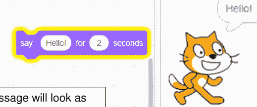
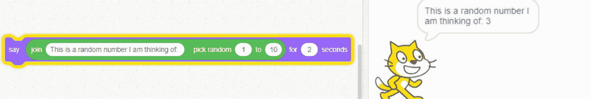
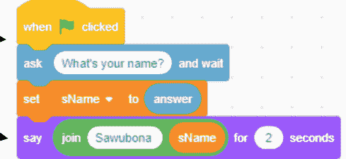
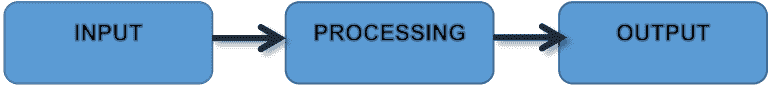
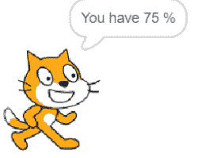
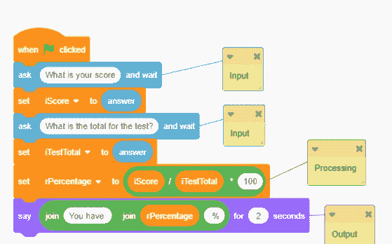
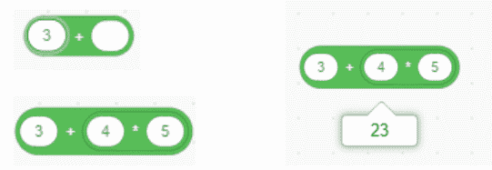
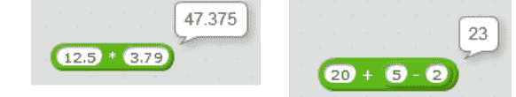
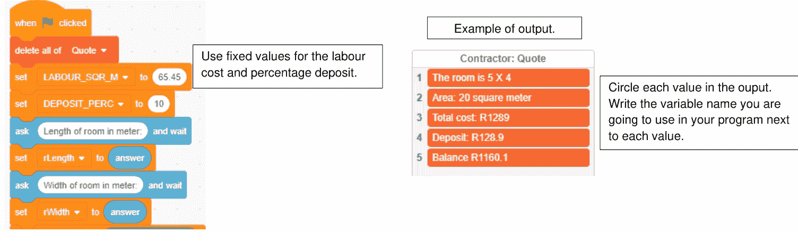
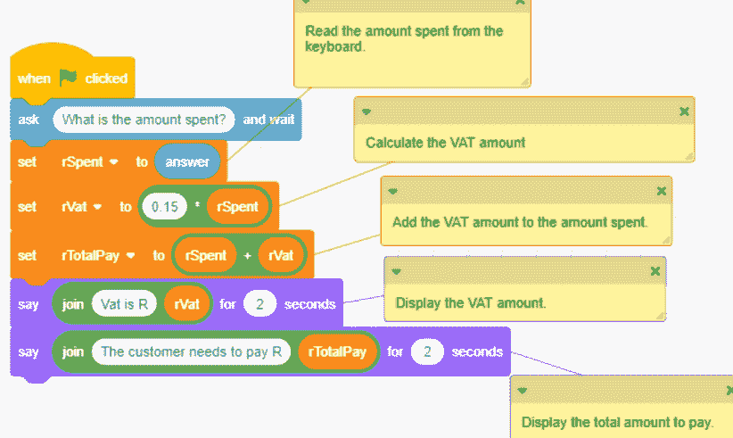

# Java 程序设计：后期对象（第 11 版）

## 单元 2：Scratch 中的基础程序

### 变量的数据类型

### 变量的命名规范

### 多行输出

### 整数值的计算

### 输出后获取更多输入

### 反思

### 参考来源

你掌握自己的学习 – 因此你需要对自己的学习过程进行反思。在每节结束时，你需要自己和/或同学和/或讲师进行讨论，以反思当天的课程。参见章节末尾的“反思”，了解可以在讨论中包含的问题示例。

## 单元 2：Scratch 中的基础程序

### 评估标准

本单元涵盖的内容与以下成果和评估标准相关：

| 模块描述 单元 1：问题解决 |
| :--- |
| 成果：学生必须能够应用逻辑和知识解决基础问题。 |
| 评估标准 |
| 通过重写不包含冗余信息的问题，可以从基础编程问题中排除冗余信息。 |
| 通过列出缺失的数据元素，可以识别基础编程语句中的缺失数据。 |
| 需要逻辑思维流的问题可以通过叙述、图表或完成表格进行分析并提供解决方案。 |

| 模块描述 单元 2：基础编程原理 |
| :--- |
| 成果：学生必须能够将算法问题解决应用于基础数学和编程问题。 |
| 评估标准 |
| 可以识别给定编程问题的输入和输出。 |
| 通过完成输入-处理-输出（IPO）表格可以识别算法所需的变量。 |
| 可以遵循所用 OOP 语言的最佳实践提供有效的变量名。 |
| 通过在算法的正确部分编写来识别程序使用的常量。 |
| 通过在算法中指定数据类型可以建议变量的有效类型。 |
| 在编写数学计算的伪代码时可以应用处理顺序规则。 |

- 可以使用输入-输出-处理（IPO）表格来规划解决方案。
- 可以设计一个解决需要顺序步骤的基本数学问题的算法，以伪代码的形式呈现，并现在提供正确输出的编程语言中实现它。
- 可以在程序中添加注释以阐明程序的流程。

## 变量介绍

在数学代数中，你已经学习过使用变量。通常用单个字母来表示变量，它代表一个未知的值。例如，在方程 $p = 2l + 2w$ 中，字母 $l$ 和 $w$ 代表矩形的长度和宽度。一旦有人测量了矩形的长度和宽度，就可以在方程中替换这些值，例如 $p = 2(5) + 2(2) = 10 + 4$。矩形的周长是 14。因此，变量代表一个值，或者你可以说它是一个值的“守门人（keeper）”。在编程中，变量也可以称为一个值的“存储空间”或“容器”，它被用于程序中记住一个值。让我们来看一个需要使用变量的例子。

在第 1 单元中，你创建了一个程序（小游戏），用户必须点击一个移动的小精灵（小球 Ball sprite）。当用户成功点击球时，它会改变位置并播放一个声音（Boing）。

我们想改进这个游戏，以便记录球被击中的次数。这是我们需要做这些工作：

- 创建一个“容器”，让计算机可以将分数存放在其中以“记住”击中次数（一个变量）。
- 当程序启动时，我们必须在容器中放置值（0），表示还没有发生任何击中。
- 每当球被击中时，我们指示计算机将容器中的值加 1。

> 在编程语言中，这种用于值的“容器”被称为变量。变量有一个名称，并且一次只能包含一个数据项（例如一个数字或名称）。在接下来的活动中，我们将向你展示如何向现有程序添加一个变量来计算击中次数。

## 活动 1：向现有程序添加变量

打开你在第 1 单元活动 11 中编写的程序。

- 添加一个变量（一个容器）。
    - 点击变量（Variables）类。
    - 创建变量（Make a Variable）。
    - 选择仅对此小精灵（For sprite only）。
    - 输入变量名称，例如 `iHits`，并点击确定。

> 为变量使用有意义的名称是良好的编程习惯，这能描述变量的用途以及将存储在其中的值的类型。存储在此变量中的值类型必须是整数，即整型（integer），因此我们在变量名前面加上数字 `i`，以提醒自己该变量包含的是一个整数值。注意：当你编写更复杂的程序时，变量是对所有小精灵可见还是仅对特定小精灵可见将会很重要。在这个程序中，选择哪种选项都无关，因为只有一个小精灵。然而，将变量分配给它所属的小精灵是一个良好的编程原则。勾选名称旁边的复选框。

添加所示的代码块（这些块可以在变量类中找到）。输出显示（Readout）：舞台上显示变量信息的窗口。当你勾选变量名称旁边的复选框时，会出现输出显示。

要创建将变量 `iHits` 加 1 的指令，查看从哪个类获取这些代码块。在脚本（scripts）区域组合不同的代码块并加上数字 `1`。

- 运行程序。注意变量名称和变量的值显示在舞台上。
- 每次你点击球，变量的值就会增加 1，更新后的值将显示在输出中。
- 小精灵的名称。
- 右键点击输出显示。你可以选择输出的格式。

## 注意以下编程概念

- 该语句 `0` 被称为赋值语句（assignment statement）。
- 将值 `0` 分配（放入）变量 `iHits`。
- 这对应于代数方程如 $x = 0$。在这种情况下 `iHits = 0`。

- 该语句也是赋值语句。
- `iHits` 的当前值增加了 1。结果被“放回”变量 `iHits`。
- 这对应于代数方程如 $y = y + 1$。在这种情况下 `iHits = iHits + 1`。

## 记住

- 编程变量具有有意义的名称。你可以将变量命名为 `x` 或 `y`。但在长项目中，如果使用单字母变量名，很多变量会混淆。在编程中，我们使用有意义的名称如 `iNumStudents`、`iTestTotal`、`iScore` 来代替 `x`、`y` 和 `z`。
- 整数（integer）是一个不是数的数字，如 `10`、`25`、`16`。
- 在带有小数点的编程语言中，如 `12.8`、`145.07823`、`0.678`，这些数字被称为浮点数。它们也可以被称为实数（real numbers）、测量数或测量数值。在编程语言中，注意值 `5` 是整数，但值 `5.0` 是小数（实值）。
- 在程序中命名变量时，包含存储在变量中的数字类型引用是有帮助的。例如 `iHits` 表示变量将存储一个整数值。`rAvg` 表示变量将存储一个实数。

在代数中，你学习过当一个表达式的结果计算出来时，它变成了一个方程。例如：如果我们计算速度，可以写一个方程（使用有意义的变量）：

```
speed = distance / time
```

在编程中，我们使用方程来确定如何计算某些值，方程右侧的计算结果赋值给左侧的变量。在 Scratch 中我们将编写代码：

以下是其他代数方程及其对应的 Scratch 赋值语句：

| 代数方程 | Scratch 赋值语句 |
| :--- | :--- |
| avg = testTotal + 100 | set rAvg to rScore / rTotal |
| totalCost = price * 1.15 | set rTotalCost to rPrice |
| points = points + 25 | set iPoints to iPoints + 25 |

### 活动 2：为不同的小精灵创建变量

- 创建一个包含两个小精灵的程序——一个苹果和一个西瓜。
- 食堂经理想确定他应该为学生提供哪些水果，他在收银台设置了一台电脑，并要求学生点击他们的水果。
- 每当学生点击水果精灵时，程序应该显示每种水果的票数。

## 有用的提示：

- 为每个小精灵创建一个变量。选择“仅对此小精灵（For sprite only）”选项。不同小精灵的变量可以使用相同的名称（`iVote`）。舞台上的输出包含小精灵的名称，因此可以清楚看到每个值属于谁。
- 为每个小精灵添加指令，在点击绿色旗帜时将变量初始化为 0。

> 注意
> 在活动 2 中，你使用了两个小精灵，每个小精灵有一个变量。它们各自控制自己的变量。

### 活动 3：示例：使用对舞台和所有小精灵可见的变量

- 创建一个包含两个小精灵的程序——字母 I 和字母 O。
- 此程序可用于跟踪停车场内的汽车数量。当汽车驶入停车场时，用户点击字母 I。当汽车驶出时，他们点击字母 O。
- 停车场内的汽车总数应该显示在舞台（stage）上。
- 点击积木调面板中的变量（Variables）。
- 选择建立变量（Make a Variable）。
- 选择对于所有角色（For all sprites）旁边的单选按钮。
- 输入变量名称，例如 `iNumCars`，并点击确定。
- 为每个角色添加一个脚本。当用户点击字母 I 时，`iNumCars` 的值加 1。当用户点击字母 O 时，变量 `iNumCars` 的值减 1（这是同一个变量）。
- 在舞台上添加一条指令，将变量 `iNumCars` 初始化为 0。
- 点击舞台（Stage）图标。为[当绿旗被点击]事件添加代码。

## 注意

- 在活动 3 中，你使用了 2 个角色，但只使用了 1 个变量 (`iNumCars`)。
- 当创建变量 `iNumCars` 时，你选择了对于所有角色选项。这意味着所有角色都可以访问该变量（并对其进行修改）。此变量“属于”舞台。就像演员可以看到舞台上的所有物体一样，角色也可以看到并更改舞台上的所有变量。
- 为了初始化变量 `iNumCars`，最好将代码添加到舞台的脚本中。

## “对于所有角色”与“对于此角色”的区别

| 对于此角色 (For this sprite only) | 对于所有角色 (For all sprites) |
| :--- | :--- |
| 只有该角色可以访问变量的值。 | 舞台上的所有角色都可以访问该变量。 |
| 变量具有角色作用域。 | 变量具有舞台作用域。 |
| 类似于演员只能读取自己脚本上的文字，而不能读取其他演员的脚本。 | 类似于一个可以看到舞台上放置的所有横幅或道具的演员。 |
| 舞台上的显示在变量名称和值之前显示角色的名称。 | 舞台上的显示只显示变量的名称和值。 |

- 横幅 (Banner)
- 道具 (Prop)

演员表演时在舞台或屏幕上使用的物体被称为戏剧道具。这简短为“道具”（props）。因此，道具指的是舞台上任何可移动或携带的物品。

- 舞台作用域
- 角色作用域。

在下一个活动中，你将使用 4 个角色和 1 个变量。每个角色都必须能够访问该变量。

## 活动 4：食物营养 – 舞台作用域变量

编写一个程序，让用户点击他们每天吃的食物。每种食物都有一个与其相关的分值。

| 食物 | 分数 |
| :--- | :--- |
| 玛芬蛋糕 (Muffin) | +10 |
| 蛋糕 (Cake) | -20 |
| 水果沙拉 (Fruit salad) | +25 |
| 奶酪泡泡 (Cheesy Puffs) | -12 |

初始分为 0。每当选择一个项目，分数就会根据该食物类型的分值进行调整。程序应该为用户显示总分。

记得通过在舞台上放置代码来将变量 `iScore` 初始化为 0。

你将使用的赋值语句示例：

`iFoodScore = iFoodScore + 10`

`iFoodScore = iFoodScore - 12`

> 此变量具有舞台作用域。因此，在显示之前不会显示角色的名称。所有角色都可以访问同一个变量。

此程序与之前的程序的唯一区别在于，你有更多的角色，而且变量不是简单的加 1 或减 1。

## 从用户处获取值（用户交互 - 输入）

大多数程序都会与程序的用户进行交互——用户需要点击屏幕上的某处或在键盘上输入数据（如数值）。我们现在将学习如何从用户处获取值。

## 活动 5：根据伪代码编写程序

根据提供的伪代码，在 Scratch 中编写以下程序。

### 伪代码

- 当用户点击绿旗时
- 重复 3 次
    - 向屏幕顶部移动 100 步
    - 等待 0.5 秒
    - 向底部移动 100 步
- 等待 0.5 秒
- 结束

注意，你需要创建一个变量。[询问]（ask）积木会提示用户通过键盘输入数据。

### 活动 6：从用户处获取值（输入）

使用以下伪代码从用户处获取值。

### 伪代码

```
当用户点击绿旗时
重复 iJumps
  向上移动 100 步
  等待 0.5 秒
结束
```

[询问]积木来自传感器（Sensing）组。[回答] 变量位于传感器类。注意：跳转次数是一个整数。

## 新知识

| 伪代码 | Scratch 积木 | 说明 |
| :--- | :--- | :--- |
| 询问“我应该跳转几次？” | [询问 我应该跳转几次?] | [询问]积木（传感器组）提示用户通过键盘输入数据。 |
| 输入 iJumps | [将 Jumps 设为] | [设置]积木（来自变量）将回答的内容传递给右侧的变量 Jumps。 |

### 活动 7：获取两个值

使用以下伪代码创建一个 Scratch 程序。选择一个较小的角色，例如球。注意你需要创建变量。

- 当用户点击绿旗时
- 清除所有之前的图形
- 抬笔
- 移动到位置 (-160, 160)
- 看屏幕右侧
- 落笔
- 询问“画正方形我应该走多少步（100 到 300 之间）？”
- 输入 `steps`

用于画笔的代码块可以在画笔（Pen）类中找到。你需要点击添加扩展图标使画笔类可见。


询问“画笔必须有多厚（1 到 10 之间）？”
输入 `iPen`
将画笔大小设置为 `iPen`
重复 4 次
    移动 `steps`
    顺时针旋转 90 度
    等待 1 秒
结束

## 在屏幕上显示消息（输出）

当计算机程序在屏幕上显示内容时，这被称为程序的输出。在单元 1 中，你曾在许多程序中使用 `[说]` 积木在角色旁边的气泡中显示文字。

> `[说]` 积木用于创建程序的输出。

在这个例子中，“Hello!” 是程序的输出。



> 指示这种类型消息的伪代码如下：
显示 "Hello!"

此示例中的输出是一个单词。在编程术语中，由字母字符和/或数字和/或或其他特殊字符（例如 $ 或 *）组成的“单词或句子”被称为**字符串**（string）或**文本**（text）。

在伪代码和大多数编程语言的代码中，使用双引号表示某个值是一个字符串，例如，"Hallo!" 就是一个字符串。这些是字符串的更多例子：

- "I am dancing"
- "This is gr8!"
- "PO Box 58234"

你可以使用操作符类中的 `[join]` 块来组合模块以创建输出。 `[join]` 块有两个编辑框，你可以在其中输入要显示的句子或变量名。

以下是使用 `[say]`（说）、`[join]` 和其他块创建输出的示例：



你可以使用多个 `[join]` 块来拼接（相加）不同的组件，以形成一条输出消息。

表示此代码的伪代码如下：

```
iAge = 8
display "I am " + iAge + " years old"
```

`+` 符号表示不同的组件必须连接以形成输出。这些组件是：

| " I am " | + | iAge | + | " years old |
| :--- | --- | : | --- | :--- |
| 字符串 | | 变量 | | 字符串 |

## 活动8：显示输出

在程序 Unit 2 JUMP 中添加代码，让精灵显示一条消息，报告它跳了多少次。例如：

表示此类消息的伪代码如下：

display "I jumped " + jumps + " times"

注意，你需要在第一个字符串的末尾和第二个字符串的开头留出空格。
如果你不在输出字符串中留任何空格，输出将看起来像这样：

查看下方的伪代码算法以及对应的 Scratch 代码。

### 伪代码

### Scratch 代码

```
when the user clicks the green flag
ask "What's your name? "
enter sName
display "Sawubona " + sName
```




end

### 注意以下内容

- 每一行伪代码都翻译为一条编程指令（程序块）。
- 名字由字母组成，因此它是一个字符串，我们在变量名后添加字母 `s` 以提醒自己该变量将包含一个字符串。包含用户在键盘上输入数值的变量名是 `sName`。
- 为了在单词 `Sawubona` 和 `sName` 的值之间显示一个空格，请在单词 `Sawubona` 之后输入一个空格。这在伪代码示例中也可以看到，即在结束文本字符串的闭合单引号之前输入了一个空格 - `"Sawubona "`。

## 活动9：显示姓名和年龄

为一个程序编写伪代码，让精灵询问人的名字和年龄，并显示诸如“Good day Katlego, you are 16 years old.”的句子。根据伪代码编写一个 Scratch 程序。

- 界面
- 比较
- 获取

## 编写基础程序

我们目前为止编写的程序都非常简单，旨在向你介绍 Scratch 界面和基础编程语言术语。然而，计算机的实际用处在于它们能够快速、准确地执行计算。学习编程的目标是学习如何指示计算机处理数据并执行计算。

在尝试编写代码解决问题之前，我们需要理解计算机是如何工作的。简之，计算机接收输入、处理输入并给出输出。



是一些输入和输出的示例。

| 输入 | 处理 | 输出 |
| :--- | :--- | :--- |
| 程序用户输入的值。 | | 计算机显示的结果/答案。 |
| 你借了几本书？晚了几天？ | | 你的罚金是 R 20 |
| 5 | 计算机进行的计算。作为程序用户，你不需要知道是如何计算的。 | |
| 矩形长度 矩形宽度 | | 面积为 44.1 周长为 32.2 |
| 12.6 3.5 | | |

为了让计算机完成任务：
- 接收输入（来自各种来源，例如键盘、鼠标、存储媒体）
- 执行计算（通常是数学性质的）
- 进行比较（然后根据结果执行某些动作）
- 给出输出（给各种设备，如屏幕、存储媒体、打印机）
- 存储和检索数据

因此，学习编程的第一步是学习如何指示计算机处理数据并执行计算。

以下是一些输入和输出的示例。

| 输入 | 处理 | 输出 |
| :--- | :--- | :--- |
| 程序用户输入的值。 | | 计算机显示的结果/答案。 |
| 你借了多少本书？晚了几天？ | | 你的罚金是 R 20 |
| 5 | 计算机进行的计算。作为程序用户，你不需要知道是如何计算的。 | |
| 矩形长度 矩形宽度 | | 面积为 44.1 周长为 32.2 |
| 12.6 3.5 | | |

（注：原文中存在重复内容，已按要求处理）

此示例中的输出是一个单词。在编程术语中，由字母字符和/或数字和/或或其他特殊字符（例如 `$` 或 `*`）组成的“单词或句子”被称为字符串（`string`）或文本（`text`）。

在伪代码和大多数编程语言的代码中，使用双引号表示某个值是一个字符串，例如，`"Hallo!"` 就是一个字符串。这些是字符串的更多例子：

- `"I am dancing"`
- `"This is gr8!"`
- `"PO Box 58234"`

你可以使用操作符类中的 `[join]` 块来组合模块以创建输出。`[join]` 块有两个编辑框，你可以在其中输入要显示的句子或变量名。

以下是使用 `[say]`（说）、`[join]` 和其他块创建输出的示例：


你可以使用多个 `[join]` 块来拼接（相加）不同的组件，以形成一条输出消息。

表示此代码的伪代码如下：

```
iAge = 8
display "I am " + iAge + " years old"
```

`+` 符号表示不同的组件必须连接以形成输出。这些组件是：

| " I am " | + | iAge | + | " years old |
| :--- | --- | : | --- | :--- |
| 字符串 | | 变量 | | 字符串 |

## 活动8：显示输出

在程序 `Unit 2 JUMP` 中添加代码，让精灵显示一条消息，报告它跳了多少次。例如：

表示此类消息的伪代码如下：

`display "I jumped " + jumps + " times"`

注意，你需要在第一个字符串的末尾和第二个字符串的开头留出空格。如果你不在输出字符串中留任何空格，输出将看起来像这样：

查看下方的伪代码算法以及对应的 Scratch 代码。

### 伪代码

### Scratch 代码

```
```


when the user clicks the green flag

ask "What's your name? "

enter `sName`

display "Sawubona " + `sName`

```

```

end

### 注意以下内容

- 每一行伪代码都翻译为一条编程指令（程序块）。
- 名字由字母组成，因此它是一个字符串，我们在变量名后添加字母 's' 以提醒自己该变量将包含一个字符串。包含用户在键盘上输入数值的变量名是 `sName`。
- 为了在单词 Sawubona 和 `sName` 的值之间显示一个空格，请在单词 Sawubona 之后输入一个空格。这在伪代码示例中也可以看到，即在结束文本字符串的闭合单引号之前输入了一个空格 - "Sawubona ",

## 活动9：显示姓名和年龄

为一个程序编写伪代码，让精灵询问人的名字和年龄，并显示诸如“Good day Katlego, you are 16 years old.”的句子。根据伪代码编写一个 Scratch 程序。

- 界面
- 比较
- 获取

## 编写基础程序

我们目前为止编写的程序都非常简单，旨在向你介绍 Scratch 界面和基础编程语言术语。然而，计算机的实际用处在于它们能够快速、准确地执行计算。学习编程的目标是学习如何指示计算机处理数据并执行计算。

在尝试编写代码解决问题之前，我们需要理解计算机是如何工作的。简之，计算机接收输入、处理输入并给出输出。


是一些输入和输出的示例。

| 输入 | 处理 | 输出 |
| :--- | :--- | :--- |
| 程序用户输入的值。 | | 计算机显示的结果/答案。 |
| 你借了多少本书？晚了几天？ | | 你的罚金是 R 20 |
| 5 | 计算机进行的计算。作为程序用户，你不需要知道是如何计算的。 | | |
| 矩形长度 矩形宽度 | | 面积为 44.1 周长为 32.2 |
| 12.6 3.5 | | |

为了让计算机完成任务
- 接收输入（来自各种来源，例如键盘、鼠标、存储媒体）
- 执行计算（通常是数学性质的）
- 进行比较（然后根据结果执行某些动作）
- 给出输出（给各种设备，如屏幕、存储媒体、打印机）
- 存储和检索数据
- 因此，学习编程的第一步是学习如何指示计算机处理数据并执行计算。

多次运行程序。每次使用不同的名称和票据数量。观察输出如何变化，因为程序使用了你提供的变量值。

工作实例示例：计算百分比
一个学生需要一个程序来计算测试的百分比。需要输入学生的得分和测试的总分。

## 自己尝试解决问题

同样，你需要分析问题，并能够自己解决它。

规划常量、输入、处理和输出

| 常量值(s) 和输入 | 处理 | 输出 |
| :--- | :--- | :--- |
| 步骤 2：你知道哪些值在程序运行期间不会改变？ | 步骤 4：假设你知道输入值(s)，你将如何计算答案？ | 步骤 1：你需要计算和/或显示什么？ |
| 没有固定值 | 假设学生在 60 分中得了 45 分。那么我们将按照以下方式计算百分比： | 测试的百分比 |
| 步骤 3：你需要哪些数据值？ | 45/100 = 75 | |
| 学生的得分。 | 你可以将其写成公式： | |
| 测试的总分。 | | |
| 学生的得分 (`iScore`) | `rPercentage = iScore/iTestTotal * 100` | 测试的百分比 (`rPercentage`) |
| 测试的总分 (`iTestTotal`) | | |



## 为程序编写算法。

完整的伪代码算法如下：

当用户点击绿色旗帜时

```pseudocode
// 输入                               注释释。

ask "你的得分是多少?"

enter `iScore`

ask "测试的总分是多少?"

enter `iTestTotal`

// 处理

`rPercentage = iScore/iTestTotal * 100`

// 输出

display "你的得分是 " + `rPercentage` + "%"
```

双正斜杠 `//` 用于表示程序中的注释。你在 `//` 之后编写的任何内容都会提供关于程序的更多信息。


- 测试数据

你可以计算 45/60 的百分比。结果是 75。当你运行程序时，可以使用值 45 作为 `iScore`，使用 60 作为 `iTestTotal`。这些值 45 和 60 然后被称为你程序的测试数据。

## 注意

你的程序应该适用于**任何**得分和总分，而不仅仅是 45 和 60。这就是为什么你必须在程序中使用变量。

结束

## 将算法翻译成编程代码。


第 2 单元：Scratch 中的基础程序



## 活动 11：计算百分比

- 查看视频了解如何使用运算符模块创建计算的指令。
- 编写程序，当从键盘读取测试得分和总分时计算百分比。
- 多次运行程序，对得分和测试使用不同的值。

5_CalculationsUsingOperatorBlocks


> Scratch 将显示答案的所有小数值。例如 44/60 = 73.3333333333。当你学习使用 Java 进行编程时，你将学习如何更改变量的值以显示特定位数的小数。

## 计算中的优先级

我们已经知道如何进行计算并应用数学规则。例如，

在**计算数学**中，你学习了算术运算的优先级：

3 + 4 * 5 = 3 + (4 * 5) = 3 + 20 = 23。

大多数编程语言内置了计算优先级的“知识”；例如，乘法和除法在加法和减法之前执行：

| 括号 () |
| :--- |
| 幂 ^ |
| 乘 除 取模数 (`* / %`) (左侧运算符先执行) |
| 加 减 (`+ -`) (左侧运算符先执行) |

第 2 单元：Scratch 中的基础程序

不是同一个答案！

如果给计算机进行以下计算，它将先计算 12/4。

3 + 8 + 12/4 = 3 + 8 + 3 = 14

当你希望加法或减法先执行时，需要使用括号。例如，在计算三个数的平均值时，应该这样做：

```math
(3 + 8 + 12) / 3 = 23 / 3 = 7.66
```

> 除法在加法之前完成。如果给计算机进行以下计算，它将先计算 12/4。

3 + 8 + 12/4 = 3 + 8 + 3 = 14

在 Scratch 中，使用括号来确保计算的执行顺序。例如，在伪代码语言中，括号的使用方式如下：

(70 + 65 + 81) / 3 = 216 / 3 = 72

以下是使用运算符 块来实现计算优先级的步骤：

- 1. 将乘法块添加到脚本区域。
- 2. 将加法块添加到脚本区域。
- 3. 将乘法块添加到加法块的右侧。
- 4. 在块中输入值。
- 5. 点击块查看结果。


第 2 单元：Scratch 中的基础程序

注意乘法块显示更高。它位于栈的顶部。这里是使用堆叠的更多示例：



## 活动 12：练习优先级

使用运算符块计算以下：

- 1. 5 加 20。
- 2. 你在 60 分中得了 45 分。计算你的百分比。
- 3. 计算 68 和 77 的平均值。
- 4. 计算 (3 + 2) / (1)。
- 5. 计算汽车在 8 分钟内行驶 14 公里的速度，km/h。
- 6. 将 100 增加 15%。
- 7. 计算 100 的 15%。
- 8. 将 100 减少 15%。

如果你想快速测试计算，不需要使用精灵编写完整的程序。只需要数学运算符块，在槽中输入值，然后点击块。气泡将显示答案 

## 活动 13：增值税和总金额

使用提供的模板规划解决方案，并为以下问题编写算法以及 Scratch 程序：

读取客户在书店花费的金额。程序必须计算并显示客户应支付的增值税，以及应支付的总金额（原始金额 + 增值税）。

规划常量、输入、处理和输出

| 常量值(s) 和输入 | 处理 | 输出 |
| :--- | :--- | :--- |
| 步骤 2：你知道哪些值在程序运行期间不会改变？ | 步骤 4：假设你知道输入值(s)，你将如何计算答案？ | 步骤 1：你需要计算和/或显示什么？ |
| 增值税是花费金额的 15%。 | 假设客户花费了 R245。 | 应支付的增值税金额。 |
| 步骤 3：你需要哪些数据值？ | | 应支付的总金额。 |

# 输入 处理 输出

`rVAT` =
`rTotalToPay` =


```text
// Input

ask "花费的金额是多少？ "

enter `rSpent`

// Processing

`rVat` =

`rTotalPay` =

// Output

display

display

end
```

# 将算法翻译为编程代码。

测试数据：使用以下数值来测试你的程序。

| `rSpent` | `rVat` | `rTotalPay` |
|---|---|---|
| 100 | 15 | 115 |
| 250.88 | 37.632 | 288.512 |

> 注意
> 每当你运行一次程序时，你都可以为金额使用不同的数值。这就是为什么输入值和输出值被称为变量。
> 你不应该在程序代码中硬编码测试数据的值，例如 100 或 250.88。

所有的小数值都将显示出来，而不仅仅我们在显示货币金额时希望保留的2 位小数。当你用 Java 编程时，你将学习如何只显示 2 位小数。

货币金额

`C:\Users\wassermannu\AppData\Local\Programs\Scratch Desktop`

第 2 单元：Scratch 中的基础程序

## 活动 14：零花钱

询问用户的年龄。计算要支付的零花钱。每个月的零花钱计算方法为每每年年龄 R20。因此，一个 5 岁的人每年将获得 R100 的零花钱。让年份为一个整数值。

创建一个 IPO 表，完成算法并编写一个 Scratch 程序来实现该算法。

## 活动 15：计算 3 个值的平均值

输入学生的姓名以及该学生本学期参加的三次测试的成绩（百分比形式）。确定这三个分数的平均分。将学生的姓名和平均分作为输出。

创建一个 IPO 表，完成算法并编写一个 Scratch 程序来实现该算法。

## 活动 16：计算今年的年龄

询问用户当前年份和出生年份，然后计算并告诉用户他们今年几岁了。

创建一个 IPO 表，完成算法并编写一个 Scratch 程序来实现该算法。

## 活动 17：计算周和和面积

建筑师想要计算房间地板的周和和表面积。根据你的数学知识，计算矩形区域的面积和周长需要长度和宽度。下表显示了所需的输入、输出以及数据处理。

| 输入 | 处理 | 输出 |
|---|---|---|
| 房间的长度 (`rLength`) | `rPerimeter = 2 x rLength + 2* rwidth` | 周长 (`rPerimeter`) |
| 房间的宽度 (`rWidth`) | `rArea = rLength * rwidth` | 面积 (`rArea`) |

编写一个算法获取数据、执行计算并显示输出。

编写一个 Scratch 程序来实现该算法。

## 变量的数据类型

所有的编程语言都可以处理不同类型的数据。例如，你已经使用过：

- 整数（整数，负数或正数，例如 -5; 8; 350）
- 实数值（小数，例如 3.44; -6.768686）
- 字符串（文本值，例如姓名 "James"，或地址 "2 College Road ", 或手机号 "08845561289"。你不能对字符串值进行数值计算。）

还有更多类型的数据，我们将在本模块中学习如何使用它们：

- 操作
- 小数值


5_不同的数据类型

## Scratch 特有的编程原理

大多数编程语言要求在声明变量时指定变量的数据类型。Scratch 不需要此。相反，数据类型是由 Scratch 根据在变量上执行的操作和计算决定的。


- 声明变量


> 货币金额具有小数——即使金额是 R5.00 且数值的小数部分为0，你也希望显示2位小数，例如 R67.70。注意：'R' 字符不是数值内容的一部分。作为程序员，你必须在输出中显示字母 'R'。


## 变量的命名规范

大多数编程语言要求在声明变量时指定变量的数据类型。Scratch 不需要此。为了防止在另一种语言中编程时产生混淆，建议遵循以下规则：

- 变量名称的第一个字符应该是字母，而不是数字或符号。
- 变量名中不要使用空格。
- 变量名中不要使用非字母字符，如 '/' 或 '*'。只允许下划线 '_'。
- 变量名应描述其内容。例如，使用 `Term_Mark` 而不是 `Term DateOfBirth`。

第 2 单元：Scratch 中的基础程序


## 活动 18：变量命名

判断以下变量名是否正确：

- a) `rCount`
- b) `sDate`
- c) `rAverage`
- d) `rNum`
- e) `sSum`
- f) `sName`
- g) `rTo`
- h) `sAmount`
- i) `rable`
- j) `sops`
- k) `sCourse`

## 活动 19：合适的变量名

为以下场景选择合适的变量名：

- a) `rReport`
- b) `smarks`
- c) `rYear`
- d) `sTo`
- e) `rSeason`
- f) `sstudent`
- g) `rincome`
- h) `sable`
- i) `rThis`
- j) `sLate`
- k) `rAge`

## 活动 20：周长

距离房间是 500 米，学生每周走多少公里？计算周长。

使用伪代码来计算周长。

完成该方案的 IPO 表：

```
当点击绿色旗时

  询问“距离房间有多远（米）？”

  等待 `rDist`

  询问“你走了几天？”

  等待 `numDays`

  显示“你走了 ", `rKm`, " 公里”

结束
```

| 输入 | 处理 | 输出 |
|---|---|---|
| | | |

## 活动 21：图书馆罚金

如果书逾还，图书馆每天每本书收取 50 分的罚金。

| 学生有 4 本书逾还了 5 天。罚金是多少？ | 学生有 9 本书逾还了 4 天。罚金是多少？ | 编写一个公式计算 x 本书逾还 y 天的罚金。

## 活动 22：买糖

100 克糖花费 R6.50。需要一个程序让店主输入客户购买的糖重量（克），然后程序将显示应付金额。

在数学中，你是这样计算的：

| 100g | R6.50 |
|---|---|
| `rCandyWeight` | `rAmount` |

交叉相乘，`100 * rAmount = 6.5 * rCandyWeight`

$\Rightarrow rAmount = \frac{6.5 * rCandyWeight}{100}$

使用有效的变量名开发一个算法，读取购买的重量，然后计算并显示金额。

| 糖重 | 金额 |
|---|---|
| 350 | R22.75 |
| 120 | R7.80 |

## 活动 23：苹果利润

一袋苹果（10个）花费 R30。如果你每个苹果卖 R5，你会获得多少利润？（在此处计算。）

一袋苹果（22个）花费 R50。如果你每个苹果卖 R1.50，你会获得多少利润？（在此处计算。）


使用伪代码编写一条赋值语句，使用以下变量名计算利润：

```
`iNumApples` // 一袋中苹果的数量

`rProfit` // 所有苹果售完后的总利润

`costBag` // 一袋苹果的成本

`rSellOne` // 你对每个苹果收取的费用
```


# 编写伪代码算法：苹果销售利润计算

编写一个伪代码算法，使程序能够读取一袋里有多少苹果、这袋苹果的成本，以及你每个苹果收多少钱。程序应该计算并显示所有苹果售完后的总利润。

# 活动 24：计算通话费用

使用提供的模板来规划解决方案，并针对以下问题编写算法以及一个 Scratch 程序：
通话的前三分钟每分钟费用 50 分。剩余的分钟数（超过 3 分钟的部分）每分钟费用 15 分。编写一个程序，在提供通话时长时计算通话的总费用。假设用户输入的数值永远不会小于 3。

你可以画一个像下面这样的图表来表示通话费的计算方式。

| 前 3 分钟 | 第 4 分钟 | 第 5 分钟 | 第 6 分钟 | ... |
| --- | --- | --- | --- | --- |
| 每分钟 50 分 | 15 分 | 15 分 | 15 分 | ... |

## 规划输入、处理和输出

**步骤 1：你需要计算或显示什么？（输出）**
通话的总费用。

**步骤 2：你必须使用哪些值？**
- 前 3 分钟每分钟费用 50 分
- 剩余分钟每分钟费用 15 分

**步骤 3：你需要哪些信息？（输入）**
通话时长（分钟）。

**步骤 4：如果你使用测试值，你将如何计算答案？**
假设通话时长为 10 分钟。

| 问题 | 计算 |
| --- | --- |
| 前三分钟的费用是多少？ | `3 * 50 = 150` 分 |
| 超过 3 分钟的共有多少分钟？ | `10 - 3 = 7` 分钟 |
| 上述超过 3 分钟的那些分钟的费用是多少？ | `7 * 15 = 105` 分 |
| 编写一个公式来计算总费用。 | `rTotalCost = (3 * 50) + ((iDuration - 3) * 15)` |

### 输入、处理、输出 表

| 输入 | 处理 | 输出 |
| --- | --- | --- |
| `iDuration` | `rFirstCost = 3 * 50`<br>`iRem = iDuration - 3`<br>`rTotalCost = rFirstCost + (iRem * 15)` | `rTotalCost` |

## 为程序编写算法

用伪代码完成该算法：

```
当用户点击绿旗时
// 常量值
FIRST_MIN_RATE = 50
ADDITIONAL_MIN_RATE = 15
FIRST_MINS = 3

// 输入
问 "通话时长是多少？"
等待 iDuration

// 处理
rFirstCost = FIRST_MINS * FIRST_MIN_RATE
iRem = iDuration - FIRST_MINS
rTotalCost = rFirstCost + (iRem * ADDITIONAL_MIN_RATE)

// 输出
显示 rTotalCost
```

## 将算法翻译为编程代码

```scratch
when green flag clicked
// 常量值
set FIRST_MIN_RATE to 50
set ADDITIONAL_MIN_RATE to 15
set FIRST_MINS to 3
// 输入
ask "通话时长是多少？" and wait
set iDuration to answer
// 处理
set rFirstCost to FIRST_MINS * FIRST_MIN_RATE
set iRem to iDuration - FIRST_MINS
set rTotalCost to rFirstCost + (iRem * ADDITIONAL_MIN_RATE)
// 输出
add "总费用: " + rTotalCost + " 分" to [Results v]
```

---

# 多行输出

## 实例示例：输出到列表

在之前的活动中，你必须计算矩形的周长和面积。这是该程序的代码：

输出显示的方式并不理想，因为每个值只显示 2 秒钟就会消失。使用一种让所有输出行都可见的结构更好。在 Scratch 中，我们可以使用一种名为“列表”的结构。它可以在“变量”类中找到。列表是一个由许多行组成的结构——每行包含一个值。当我们使用列表输出时，每行都将包含一个字符串。屏幕上的输出看起来如下：

- 列表
- 字符串

### 第 2 单元：Scratch 中的基础程序

- 此程序中角色的名称是 `Calculator`。
- 列表的名称是 `Results`。
- 有四行输出（行数在列表底部指示为 4）。

算法可以写如下：

```
当用户点击绿旗时

// 输入
问 "矩形的长度？"
等待 rLength
问 "矩形的宽度？"
等待 rWidth
// 处理
rArea = rLength * rWidth
rPerimeter = 2 * rLength + 2 * rWidth
// 输出到列表
addToList "长度 = " + rLength
addToList "宽度 = " + rWidth
addToList "面积是: " + rArea
addToList "周长是: " + rPerimeter
end
```

程序看起来如下：

- 要添加一个列表，你需要点击“变量”类中的“制作列表”按钮。在这个例子中，列表的名称是 `Results`。
- 在其他编程语言中，列表被称为“数组”。
- 屏幕上会出现一个空列表。角色的名称和列表的名称将显示。选择了 `Results` 这个名称，现在用户将更清楚输出的含义了。
- `[删除全部]` 模块移除列表中的所有行。因此，当程序第二次执行时，之前的输出将被删除。
- `[添加 ... 到]` 模块会将 `[拼接]` 模块创建的字符串添加到列表底部。
- 角色被重命名为 `Calculator`。
- 每个 `[添加]` 模块都会将输出字符串添加到列表底部。
- 列表中的每行都有编号（在本例中为 1 到 4）。
- 列表中的行数显示在列表底部（在本例中为 4）。

| Calculator: Results | 变量 |
| --- | --- |
| 长度 = 12 | `rLength` |
| 宽度 = 5 | `rWidth` |
| 面积是 60 | `rArea` |
| 周长是 34 | `rPerimeter` |

有时输出可以帮助你规划输出的值。在截图中可以看到这些值是变量。

实数（也称为浮点数）存储时带有 `0.00000000001`，这是不准确的。在 Java 中你可以看到这种功能。

---

## 活动 25：面积和周长 - 输出到列表

实例示例：输出到列表

| Calculator: Results | Calculator: Results |
| --- | --- |
| 长度 = 12 | `rLength` |
| 宽度 = 5 | `rWidth` |
| 面积是 60 | `rArea` |
| 周长是 34 | `rPerimeter` |

---

## 活动 26：工资 - 输出到列表

William 是一个临时工，前 5 小时每小时获得 100 兰特，超过 5 小时的任何额外工资增加 15%。他需要根据总收入的 22% 缴纳税。计算他的总收入、纳税额和净收入。

- 画一个图表来表示工资情况。
- 使用变量指示输出。
- 使用任何数字（例如 12）作为输入。
- 通过将你的答案与测试数据对比来完成计算。编写完整的算法，然后编写 Scratch 代码。

---

## 活动 27：承包费用 - 显示输出

某承包商以每平方米 65.45 兰特的费率铺设地板砖。计算特定长度和宽度（由用户指定）的房间铺砖的总费用。承包商在开始工作前要求支付 10% 的定金，并在工作完成后支付余额。计算定金和余额。显示面积、成本、定金和余额。在相关处使用固定变量。

### 第 2 单元：Scratch 中的基础程序



---

## 活动 28：快乐狗狗犬舍

Happy Doggie 犬舍收取以下寄宿费用：

- 第一天 R60.00
- 第二天及以后每天 R52.50

犬舍还会额外收取总寄宿费用的 25% 作为狗狗的每日运动费用。狗主应单独支付狗粮费用，按每天计费。计算并显示寄宿费用、运动费用以及食物费用。（所有狗将至少停留两天。）

### 寄宿费

```
当用户点击绿色旗帜时

// 定义固定值（常量）
FIRSTDAY = 60
OTHERDAYS = 52.5
EXERCISEPERC = 25

// 输入
display "How many days did the dog stay? "
enter iNumDays
display "What is the cost of food per day? "
enter rCostFoodday

// 计算
rKennelFee = FIRSTDAY + (iNumDays - 1) * OTHERDAYS
rExerciseFee = rKennelFee * EXERCISEPERC / 100
rKennel_Exercise = rKennelFee + rExerciseFee
rTotalFood = iNumDays * rCostFoodday

// 输出到列表
addToList "Kennel and exercise fee R", rKennel_Exercise
addToList "Cost for food R", rTotalFood
```

> **注意**
>
> 计算（处理）过程中使用了 4 个变量。其中两个是输出变量（`rTotalFood` 和 `rKennel_Exercise`）。
>
> 另外两个变量用于计算以确定输出值，但它们不会显示（`rKennelFee` 和 `rExerciseFee`）。这类变量被称为中间变量。

`end`

---

## 活动 29：4 周的工资

Josephine 在一家餐厅兼职服务员：

- 从键盘读取她的每时工资。
- 她每天工作 8 小时。
- 她每周工作 5 天。
- 她在周日也工作 5 小时。
- 周日的薪资标准是每时工资的两倍。
- 她通常每小时获得大约 R50 的小费。

计算她在包含 4 周的月份里的（约略）收入。

提供了一个输出示例。请根据输出确定需要计算并显示哪些值。

根据伪代码编写一个 Scratch 程序。

| Josephine: 工资计算器 |
| --- |
| 1 | 时薪：R120 |
| 2 | 工作时长收入：R21600 |
| 3 | 小费收入：R8500 |
| 4 | 总收入：R30100 |
| | 长度 4 = |

---

# 活动 30：卖 Magwinyia

Pulani 制作了 magwinyia（一种点心）卖给同学。她没有卖掉的麦芬会送给有需要的学生（因此她不会收取这些的钱）。她想要一个程序来计算她每天的利润。

以下数值为常量：

特定一天应输入以下数值：

- 烘焙一打的成本。
- 一个 magwinyia 的售价。
- 她烘出的 magwinyia 数量。
- 她卖出的 magwinyia 数量。

```
当用户点击绿色旗帜时

// 定义固定变量
COSTDOZEN = 32
COSTONE = 3.5

// 输入
display "How many dozens of magwinya did she bake? "
enter iNumDozens
display "How many magwinya did she sell? "
enter iNumMagwinyaSold

// 处理
moneyNeeded = iNumDozens * COSTDOZEN
rPercSold = (iNumMagwinyaSold / (iNumDozens * 12)) * 100
moneyFromSales = iNumMagwinyaSold * COSTONE
Profit = moneyFromSales - moneyNeeded

// 输出
addToList("Money needed was R" + moneyNeeded)
addToList("Percentage sold: " + rPercSold + "%")
addToList("Money earned from sales R" + moneyFromSales)
addToList("Profit made R" + Profit)
end
```

计算并显示：

- 她烘焙 magwinyia 需要多少钱，
- 她卖出了百分之几的 magwinyia，
- 她从销售中获得了多少钱，
- 她赚了多少利润。

---

# 整数值的计算

在计算中你学习了许多计算需要对整数进行。以下是结果为整数的各种计算示例。表格包含了数学方程式、伪代码和 Scratch 程序块。

| 数学场景 | 伪代码 | Scratch 程序块 |
| --- | --- | --- |
| 我们有 13 块糖，需要分给 4 个人。每个孩子将得到多少糖？我们需要使用整数除法。<br>`13 / 4 = 3` <br>（`3 * 4 = 12`，所以每个孩子得到 3 块糖）<br>我们也可以使用 `floor`（向下取整）符号来去掉小数部分（截断）。 | 我们如何计算对于任意数量的糖，每个孩子应该得到多少糖？<br>使用以下变量：<br>`iNumSweets; iNumChildren`<br>`iNumEach = iNumSweets / iNumChildren` <br>或 <br>`iNumEach = floor(iNumSweets / iNumChildren)` | `set NumEach to floor(NumSweets / NumChildren)` |
| 我们有 13 块糖，需要平均分给 4 个人。每个孩子收到相同数量的糖后，还会剩下多少块？我们需要使用模运算符（MOD）。<br>`13 MOD 4 = 1` (`13 = 4 * 3 + 1`，所以每个孩子得到 3 块糖，剩余 1 块)。 | 我们如何计算对于任意数量的糖，剩余多少块糖？<br>使用以下变量：<br>`iNumSweets; iNumChildren; iNumLeft` | `set NumLeft to NumSweets mod NumChildren` |

Joseph 想给他的家里刷漆，计算出需要 164 升漆。然而，漆是 20 升一桶出售的。他必须买几桶漆？

`164 / 20 = 8.2` —— 因此我们需要买 9 桶。数值 8.2 必须“向上取整”。

在数学中，我们可以使用 `ceiling`（向上取整）符号表示一个值应该向上取整。

`⌈164 / 20⌉`

```
iNumLeft = iNumSweets MOD iNumChildren
或者
iNumLeft = iNumSweets % iNumChildren
```

我们如何计算对于任意数量的糖需要多少桶？使用以下变量：

```
iPaint; Container
```

编程语言有许多“向上取整”的方法。在 Scratch 中有 `ceiling` 方法。


### 第 2 单元：Scratch 基础程序

## 确定整数除法的结果

可以使用以下任何方法确定整数除法和 MOD 的结果：

### 示例 1

`15 / 6`

在你的计算器上结果是 `2.5`。整数除法的结果是小数点前的数字。只是分数。

`15 = 6 * 2`

### 示例 2

`15 / 7`

`15 = 7 * 2 + 1` (注：原文 `15 = 7 + 5` 似为笔误，整数除法应为 `15 = 7 * 2 + 1`)

---

## 活动 31：整数除法和模

找出缺失的数字：

| 除法 | 取模 |
| --- | --- |
| `35 / 6` | `35 MOD 6` |
| `9 / 2` | `9 MOD 2` |
| `134 / 7` | `134 MOD 7` |
| `36 / 6` | `36 MOD 6` |
| `12 / 2.5` | `12 MOD 2.5` |

---

## 活动 32：学生中心的椅子

TUT 有若干把椅子可以放在学生中心参加会。编写一个算法来计算可以填满多少行 54 把椅子。计算将剩下多少把椅子。（可用数量必须从键盘读取。）

根据算法编写一个 Scratch 程序。

---

## 活动 33：瓶装药片

药厂有数量的药片（从键盘读取药片数量）。他们有两种瓶子。一种可以装 250 片药片，另一种可以装 15 片。他们想先填满所有能装 250 片的瓶子，然后将剩余的药片放在装 15 片的瓶子里。计算并显示每个规格可以包装多少瓶，剩余多少。使用以下变量（如果需要，你也可以使用其他变量）：

`iNumTablets; iNumB250; iNumB15; iRemTablets`

| 药剂：药片摘要 |
| --- |
| 1 | 1200 片药片 |
| 2 | 4 瓶 250 片的药片 |
| 3 | 13 瓶 15 片的药片 |
| 4 | 剩余 5 片药片 |
| | 长度 4 = |

---

## 活动 34：85g 包的数量

学校收到了两桶糖，每桶含有若干公斤糖（从键盘读取重量）。使用两个桶的糖可以包装多少个 85g 的小糖包？

编写一个解决该问题的算法，根据该算法编写一个 Scratch 程序。

| 老师：糖的摘要 |
| --- |
| 1 | 8 + 5 kg |
| 2 | 你有 13 kg 糖 |
| 3 | 你可以制作 152 个 85g 的包 |
| | 长度 3 = |

---

# 在输出后获取更多输入

在活动 13 中：我们编写了以下程序：

当你购买若干物品时，在向收银员付钱之前，你会先等待收银台显示你需要支付的金额。例如，如果你需要支付 R45.00，你可以用一张 R50.00 的钞票支付，并找回 R5.00 的找零。或者你可以用一张 R100.00 的钞票支付，找回 R55.00 的找零。



我们将对该程序进行调整：

- 这一次我们在显示金额后，将询问用户支付金额，
- 然后计算并显示返回给客户的找零金额。

## 为该程序编写算法

```
when the user clicks the green flag
// Constant value
VAT_PERC = 0.15
// Input
ask "What is the amount spent? "
enter rSpent
// Processing
rVat = VAT_PERC * rSpent
rTotalPay = rSpent + rVat
// Output to a List
addToList("Amount is R" + rSpent)
addToList("VAT R" + rVat)
addToList("Customer needs to pay R" + rTotalPay)
// Input - user needs to see the total amount before deciding what to pay
ask "How much does the customer pay? "
enter rMoney
// Processing
rChange = rMoney - rTotalPay
// Output to a List
addToList("Customer paid R" + rMoney)
addToList("Change is R" + rChange)
```

应付金额将在列表中。程序的用户可以看到需要支付的金额。

程序将显示一个提示，询问用户客户支付的金额，并从键盘读取一个值（输入）。

## 将算法翻译为编程代码

- 完整的程序如下所示：

```scratch
when green flag clicked
delete all of [cashRegister v]
set [VAT_PERC v] to 0.15
ask "What is the amount spent? " and wait
set [rSpent v] to answer
set [rVAT v] to (VAT_PERC * rSpent)
set [rTotalPay v] to (rSpent + rVAT)
add (join "Amount is R" (rSpent)) to [cashRegister v]
add (join "VAT is R" (rVAT)) to [cashRegister v]
add (join "Customer needs to pay R" (rTotalPay)) to [cashRegister v]
ask "How much does the customer pay? " and wait
set [rMoney v] to answer
set [rChange v] to (rMoney - rTotalPay)
add (join "Customer paid R" (rMoney)) to [cashRegister v]
add (join "Change is R" (rChange)) to [cashRegister v]
```

## 输出示例

| cashRegister |
| --- |
| Amount is R350 |
| VAT is R52.5 |
| Customer needs to pay R402.5 |
| Customer paid R500 |
| Change is R97.5 |
| 长度 5 = |


## 活动 35：计算成本和折扣

编写一个执行以下操作程序的伪代码：

- 读取客户购买的物品数量和单件物品的价格。（所有物品价格相同。）
- 显示物品总价，并询问折扣百分比。
- 显示折扣金额以及最终支付金额。

提供了输出示例。根据输出确定需要计算的值。根据伪代码编写 Scratch 程序。

```
| Cashregister: Results |
|---|
| 1 Number of items: 10 |
| 2 Cost of one item: R55 |
| 3 Total cost: R550 |
| 4 Discount is 6% |
| 5 Discount amount: R33 |
| 6 Amount to pay: R517 |
```

## 活动 36：计算每月金额

编写一个执行以下操作程序的伪代码：

- 读取某人贷款的金额。
- 读取利率。
- 显示贷款总。
- 询问用户要在多少几年还清贷款。
- 计算并显示每月的还款金额。

提供了输出示例。根据输出确定需要计算的值。根据伪代码编写 Scratch 程序。

```
| InstallmentCalculator: Results |
|---|---|
| 1 Loan amount is R15000 |
| 2 Interest rate is 8% |
| 3 Final loan is R16200 |
| 4 You will pay for 2 years |
| 5 Each month you pay R675 |
```

## 活动 37：问题

a) 什么是变量？

b) 单选按钮（radiobutton）和复选框（checkbox）有什么区别？

c) 如何使用输出显示（readout）来发现程序错误？

d) 如何确定变量是舞台范围还是角色范围？

e) 什么是 IPO 表？

f) 什么是算法？

g) 算法中使用什么字符表示注释？

h) 在程序中将某些值声明为常量有什么用？

i) 你如何向学生解释整数除和模（MOD）？

j) 你会建议程序员给程序添加注释吗？说明理由。

## 活动 38：技能清单

确保你能完成以下操作：

| | 我掌握 ✓ |
|---|---|
| a) 为给定的编程问题定义输入输出。 | |
| b) 在设计算法时完成 IPO 表。 | |
| c) 根据最佳标准选择有效的变量名。 | |
| d) 识别固定值变量（常量）并编写它们。 | |
| e) 为变量建议有效的数据类型。 | |
| f) 应用处理顺序规则。 | |
| g) 设计算法解决数学问题。 | |
| h) 为程序添加注释。 | |
| i) 使用输出显示变量。 | |
| j) 决定变量是舞台范围还是角色范围。 | |
| k) 使用加、减等数学运算。 | |
| l) 在舞台上显示多行。 | |
| m) 使用列表进行输出。 | |


