# Java 编程指南：对象，全球版：附在线章节/附录


您的新教科书提供了 12 个月的数字资源访问权限，这些资源可能包括 VideoNotes（关于编程概念的逐步视频教程）、源代码、网页章节、测验等。详细资源列表请参阅教材中的序言。

请按照以下说明注册 Paul Deitel 和 Harvey Deitel 编写的《Java™ 程序设计：后期对象，第十一版，全球版》的配套网站。

1. 访问 `www.pearsonglobalededitions.com/deitel`。
2. 输入您的教材标题或按作者姓名浏览。
3. 点击 `Companion Website`（配套网站）。
4. 点击 `Register`（注册）并按照屏幕上的说明创建登录名和密码。

# ISSLDO-WHIFF-SAURY-LAMBS-DOLBY-LIKES

> 使用您在注册期间创建的登录名和密码开始使用与教材配套的数字资源。

此预付费订阅不包括对 `MyProgrammingLab` 的访问，该平台可在 `www.myprogramminglab.com` 购买。

此激活码只能使用一次。订阅自激活起有效期 12 个月，不可转让。

需技术支持请访问 `https://support.pearson.com/getssupport`

配合 Java™ SE 8 或 Java™ SE 9 使用

Paul Deitel

Deitel & Associates, Inc.

Harvey Deitel

Deitel & Associates, Inc.

配合

Java™ SE 8

或 Java™ SE 9 使用

书中引用的自其他来源的致谢和感谢经许可在书中复制，出现在第 6 页。

以及全球各关联公司

访问我们的全球网站：`www.pearsonglobaleditions.com`

此电子书是一个独立产品，可能包含或不包含印刷版中的所有资产。它不提供对 `MyLab` 和 `Mastering` 等其他 Pearson 数字产品的访问权限。出版者保留随时删除此电子书中的任何材料的权利。

电子书由 `GEX Inc.` 格式化。

> 缅念 Henry Heimlich 博士：

Barbara Deitel 使用了您的海姆利克急救法救了 Abbey Deitel。


目录末列出的在线章节和附录位于书籍配套网站（`http://www.pearsonitions.com`）——详情请参阅书首页。

## 前言

### 序言

### 在开始之前

### I 计算机、互联网与 Java 简介

### 23 并发

- 25.8.3 测试代码并替换其声明 1147
- 25.8.4 测试更新后的方法 `displayCubes` 1147
- 25.9 异常 1148
- 25.10 导入类并将包添加到 `CLSPATH` 1149
- 25.12 `JShell` 命令总结 1153

## 前言

在我的职业生涯中，我遇到并采访了许多专家 Java 开发者，他们通过 Paul 和 Harvey 编写的一个或多个大学教材、专业书籍、视频和企业培训向他们学习。许多 Java 用户组围绕着 Deitel 的出版物聚集在一起，这些书籍被国际用于大学课程和专业培训计划。你正在加入一个精英群体。

### 我如何成为一名专家 Java 开发者？

这是我在面向大学生的演讲以及 Java 专业人士活动中收到的常见问题之一。学生们想成为专家开发者——而现在是成为开发者的绝佳时机。

市场非常广阔，充满了机会和迷人的项目，特别是对于那些花时间学习、实践和掌握软件开发的人来说。世界需要优秀、专注的开发者。

那么，你该如何做？让我们明确一点：软件开发是困难的。但不要气馁。精通会开启巨大机会的大门。虽然困难，但请拥抱复杂性，享受其中。你对技能的扩展没有限制。

软件开发是一项惊人的技能。它可以带你去任何地方。你可以在任何领域工作。从让世界变得更好的非营利组织，到尖端的生物技术。从金融世界的疯狂运转，到宗教的深层奥秘。从音乐到艺术——一切都至关重要。计划的成功或失败取决于开发者的知识和技能。

促使你获得相关技能使得《Java How to Program》这一版如此引人注目。这本书为学生和开发者编写，易于遵循。它由作为教育工作者和开发者的作者编写，多年来吸收了世界领先学者和专业 Java 专家——Java Champions、开源 Java 开发者，甚至是 Java 本身的创建者的建议。他们的集体知识和经验将指导你。即使是资深 Java 专业人士也会从这些页的智慧中学习并增长他们的专业知识。

### 这本书如何帮助你成为专家？

Java 发布于 1995 年——Paul 和 Harvey 为 1996 年的课程准备了第一版《Java How to Program》。自从那本开创性的书籍以来，我们又编写了十个版本，保持与 Java 软件工程社区的最新进展和惯用法同步。你手中拿着的是一张让你能够快速开发 Java 技能的地图。

Deitel 夫妇将巨大的 Java 世界分解为定义明确、特定的目标。投入你的全部注意力，有意识地“攻克”每一章。你会发现自己正沿着通往卓越的道路前进。由于本书同时包含了 Java 8 和 Java 9，你将拥有最新 Java 技术的技能。

最重要的是，这本书不仅仅是为了让你阅读——它是为了让你练习。它是为了课堂或家庭作业设计的，通过丰富的示例代码进行实验，并利用极其丰富多样的练习集进行练习。完成所有这些的时间都在这里，你将走向达到一个让专业人士都感到挑战的专家水平。在从事 Java 超过 20 年后，我可以告诉你这不是夸言。

例如，我最喜欢的章节之一是 Lambda 和 Stream。该章节涵盖了细节以及练习——开发者每天都会遇到的许多真实世界挑战，并将帮助你磨练技能。在这些练习之后，新手和经验丰富的开发者都能理解这些重要的 Java 特性。如果你有问题，不要害羞——Deitel 在他们写的每本书中公布他们的电子邮件地址以鼓励互动。

这就是为什么我喜欢关于 `JShell` 的章节——这是一个允许交互式 Java 的新 Java 9 工具。`JShell` 允许你探索、发现和实验新的概念、语言特性和 API，犯错（无论是无意还是故意的）并纠正它们，以及快速构建新代码原型。它是利用你的语言和生产力最重要的工具。Paul 和 Harvey 对 `JShell` 进行了详尽介绍。


### 使用 Java SE 8 或新的 Java SE 9 的灵活性

为了满足我们读者的需求，我们为基于 Java SE 8 或 Java SE 9 的大学和专业课程设计了此本书，从现在起，我们将其简称为 Java 8 和 Java 9。Java 8 或 Java 9 中引入的每个特性都配有 8 或 9 图标，就像本段左侧的图标一样。Java 9 的新功能位于标记清晰、易于包含或省略的章节和节中——部分在印刷书中，部分在在线上。图 1 和图 2 分别列出了我们涵盖的 Java 8 和 9 关键特性。

| Java 8 特性 | |
|---|---|
| **图 1** | 我们在 Java 8 中引入的一些关键特性。 |
| **图 2** | 我们在 Java 9 中引入的一些关键特性。 |

本书的模块化组织有助于教师规划教学大纲。

《Java How to Program, Late Objects, 11/e》适用于各种级别的编程课程。第 1–25 章在核心 CS 1 和 CS 2 课程以及相关学科的入门课程中非常流行——这些章节出现在印刷书中。第 26–36 章旨在用于高级课程，位于书籍的伴随网站上。

#### 第四部分：JavaFX 图形用户界面、图形与多媒体

- 第 12 章：JavaFX 图形用户界面：部分 1
- 第 13 章：JavaFX GUI：部分 2
- 第 22 章：JavaFX 图形与多媒体

#### 第五部分：数据结构、泛型集合、Lambda 与流

- 第 16 章：泛型集合
- 第 17 章：Lambda 与流
- 第 18 章：递归
- 第 19 章：搜索、排序与大 O 表示
- 第 20 章：泛型类与方法：深入探讨
- 第 21 章：泛型数据结构

#### 第六部分：并发；网络

- 第 23 章：并发
- 第 28 章：网络

#### 第七部分：数据库驱动的桌面开发

- 第 24 章：使用 `JDBC` 访问数据库
- 第 29 章：Java 持久 API (`JPA`)

#### 第八部分：Web 应用开发与 Web 服务

- 第 30 章：`JavaServer Faces` Web 应用：部分 1
- 第 31 章：`JavaServer Faces` Web 应用：部分 2
- 第 32 章：`REST` Web 服务

#### 第九部分：其他 Java

- 第 36 章：Java 模块系统和其他 Java 9 话题

#### 第十部分：（可选）：面向对象设计

- 第 33 章：ATM 案例研究，部分 1：使用 `UML` 进行面向对象设计
- 第 34 章：ATM 案例研究部分 2：实现面向对象设计

#### 第十一部分：（可选）：Swing 图形界面与 Java 2D 图形

- 第 26 章：Swing GUI 组件：部分 1
- 第 27 章：图形与 Java 2D
- 第 35 章：Swing GUI 组件：部分 2

### JShell 讨论

| JShell 讨论 | 可以在以下章节后涵盖 |
|---|---|
| 第 25.7 节介绍了用于实验和发现的 `JShell` 自动补全功能，包括方法参数、文档和方法重载。 | 第 5 章，方法 |
| 第 25.8 节展示了如何在 `JShell` 中声明和使用方法，包括对 `JShell` 会话中不存在的方法进行前向引用。 | |
| 第 25.9 节展示了如何在 `JShell` 中处理异常。 | 第 6 章，数组和 `ArrayList` |
| 第 25.10 节展示了如何将包添加到类路径中并导入它们以便在 `JShell` 中使用。 | 第 21 章，自定义泛型数据结构 |

剩余的 `JShell` 章节是参考材料，可以在第 25.10 节之后涵盖。主题包括外部编辑器、`/reload` 命令的摘要、`/drop` 命令、反馈方法、`/edit` 命令的其他 `JShell` 特性、通过 `/set` 配置、代码片段编辑的快捷键、`JShell` 如何解释 Java 用于交互式使用、`IDE` 支持。

**图 3** | 第 25 章 `JShell` 讨论，设计用于在特定的早期章节之后涵盖。（2 部分，共 2 部分）

### 新章节——模块系统和其他 Java 话题

由于此本书出版时 Java 仍在开发中，我们在书籍的配套网站上包含了一个在线章节，讨论了 Java 9 的模块系统以及各种其他 Java 9 话题。这些在线内容将在 2017 年秋季课程前提供。

### 面向对象编程（第 3 部分）

面向对象编程。我们使用了最新的方法，在前面的章节中涵盖了编程基础，如数据类型、变量、运算符、控制语句、方法和数组。学生在第 7 章中开发他们的第一个自定义类和对象。[对于需要“早期对象”方法的课程，您可能想考虑我们的姐妹书《Java程序设计：早期对象》第 11 版]

真实世界案例研究。章节中的面向对象编程演示介绍了 `Account`、`Time`、`Employee`、`GradeBook` 以及洗牌发牌等案例研究。

继承

异常处理。我们从第 6 章开始整合基础异常处理，并在第 11 章中进行更深层次的探讨。异常处理对于构建任务关键和业务关键型应用程序至关重要。要使用 Java 组件，你需要不仅要了解该组件在“一切顺利”时的行为，还要了解该组件在“情况糟糕”时“抛出”的异常以及你的代码应该如何处理这些异常。

**类和数组**。第 6 章涵盖了数组——包含执行常用数组操作的方法——以及 `ArrayList`——它实现了一个动态调整大小的类数组结构。这遵循了我们的哲学，即在学习定义自己的类的同时，通过现有类进行大量练习。该章丰富的练习选择使通过软件模拟技术进行关于**构建你自己的计算机**的重大项目成为可能。第 21 章包含一个关于**构建你自己的编译器**的后续项目，该编译器可以将高级语言程序编译成可以在你的计算机上实际执行的语言代码。分别第一第一和第二门编程课程的学生将享受这些挑战。

### 灵活的 JavaFX GUI、图形、动画和视频涵盖（第 4 部分）以及可选 Swing 涵盖（第 11 部分）

学生喜欢构建带有 GUI、图形、动画和视频的应用程序。教授入门课程的老师可以根据想要涵盖的 GUI、图形、动画和视频数量——从一个都没有到下面讨论的所有四种选项。希望在课程中使用新的 **JavaFX GUI、图形、动画和视频能力**（当今大学课程和专业人士最受欢迎的选项）的人可以选择：

- 在第 12、13 和 22 章中对 JavaFX GUI、图形（2D 和 3D）、动画和视频进行深度处理
- 在配套网站上对 JavaFX GUI 和 2D 图形进行轻量处理，可以在第 7 章之后教授。

希望在课程中继续使用旧的 **Swing GUI 和 Java 2D 图形**的人可以从配套网站上的以下选项中选择：

- 在在线第 26、27 和 35 章中对 Swing GUI 和 Java 2D 图形进行深度处理
- 可以在第 7 章之后任何时间教授的 Swing GUI 和 Java 2D 图形的轻量处理。

让我们详细考虑一下这四个选项。

#### 在第 12、13、22 章中对 JavaFX GUI、图形、动画和视频进行深度处理

对于此第 11 版，我们显著更新了 JavaFX 演示，并在打印书中增加了三个章节，取代了 **Swing GUI 和图形涵盖**（现在位于想要继续使用 Swing 的讲师的配套网站上）。

在第 12–13 章中，我们使用 JavaFX 和 `Scene Builder`——这是一个拖放式工具，用于快速构建多个演示各种 Java GUI 布局、控件和事件处理能力的应用程序。在 `Swing` 中，拖放工具及其生成的代码是*依赖 IDE 的*。`Scene Builder` 是一个独立的工具，你可以单独使用它或与任何 Java `IDE` 配合进行拖放 GUI 设计。

在第 22 章中，我们介绍了 JavaFX 2D 和 3D 图形、动画和视频能力。我们还提供了 36 个编程练习和项目，学生会发现它们具有挑战性且有趣，包括许多游戏编程练习。第 22 章可以在第 13.3 节之后立即涵盖。我们还在第 23 章并发的几个基于 GUI 的示例以及第 24 章使用 `JDBC` 访问数据库中使用了 JavaFX。

#### JavaFX GUI 和 2D 图形的轻量处理

对于喜欢引入 JavaFX 轻量处理的讲师，我们在第 22 章之前介绍了，这种内容可以在配套网站上提供，并在第 7 章之后教学。我们的目标是让学生在学习 JavaFX 的特性（如颜色和填充）时，通过鼠标选择。

| 章节 | 你可以做什么 |
|---|---|
| 1. 简单 GUI | |
| 2. 事件处理和绘制线条 | |
| 3. 绘制矩形和椭圆 | |
| 4. 填充的颜色 | |
| 5. 绘制弧形 | |
| 6. 使用对象进行绘制 | |
| 7. 带有泛型的绘制 | |
| 8. 泛型绘制 | |

**图 4**

#### Swing GUI 和 Java 2D 图形的深度处理

对于想要继续使用 Swing 的讲师，我们将在在线章节中对 Swing GUI 和 Java 2D 图形进行深度处理，这些章节位于：

- 在线第 26、27 和 35 章
- 可以在第 7 章之后任何时间教授的 Swing GUI 和 Java 2D 图形的轻量处理。

#### 集成 Swing 组件

如果你转向 JavaFX，你仍然可以使用 Swing。例如，在第 24 章中，我们展示了如何将其在 GUI 中。

### 灵活的 Lambda 和流涵盖（第 17 章）

Java 8 最显著的特性是 Lambda 和流。本书有几个，包括：

- 喜欢对 Lambda 和流进行显著介绍的
- 想要简单示例进行基础介绍的

#### Swing GUI 和 Java 2D 图形的深度处理

对于想要继续使用 Swing 的讲师，我们将在在线章节中对 Swing GUI 和 Java 2D 图形进行深度处理，这些章节位于：

- 在线第 26、27 和 35 章
- 可以在第 7 章之后任何时间教授的 Swing GUI 和 Java 2D 图形的轻量处理。

### 关于 Lambda 和流的讨论

| 关于 Lambda 和流的讨论 | 可以在哪些章节涵盖 |
|---|---|
| 第 17.1—17.5 节介绍了基本的 Lambda 和流功能，你可以用这些功能来替代循环，并讨论了流处理的机制。 | 第 4 章，控制语句：第 2 部分；逻辑操作符 |
| 第 17.6 节引入了方法引用和额外的流功能。 | 第 5 章，方法 |
| 第 17.7 节引入了处理一维数组的流功能。 | 第 6 章，数组和 `ArrayList` |
| 第 17.8—17.10 节演示了额外的流功能，并介绍了用于流式处理的各种函数式接口。 | 第 10 章，面向对象编程：多态与接口——第 10.10 节引入了 Java 8 特性（默认方法）以及支持 Lambda 和流的函数式接口概念。 |
| 第 17.11 节使用 Lambda 和流处理字符串集合。 | 第 14 章，字符与正则表达式 |
| 第 17.12 节使用 Lambda 和流处理 `List<Employee>`。 | 第 16 章，泛型集合 |
| 第 17.13 节使用 Lambda 和流处理文件中的文本。 | 第 15 章，文件、输入/输出流、`NIO` 和 `XML` 序列化 |
| 第 17.14 节引入了随机值流 | 第 17 章之前的所有章节。 |
| 第 17.15 节引入了无限流 | 第 17 章之前的所有章节。 |
| 第 17.16 节使用 Lambda 实现了 `JavaFX` 事件监听器接口。 | 第 12 章，JavaFX 图形化用户界面：第 1 部分 |


# 第 23 章“并发”展示了使用 Lambda 和流通常更容易并行化，从而可以利用多核架构来增强性能。该章演示了并行流处理，并展示了 `Arrays` 类的 `parallelSort` 方法在排序大型数组时如何提高多核架构上的性能。

图 5 | Java Lambda 和流的讨论与示例。

## 并发与多核性能（第 6 部分）

我们非常有幸邀请到了 Brian Goetz（《Java 并发编程》，Addison-Wesley 出版）的作者对《Java 程序设计》进行评审。我们使用 Java 8 技术和惯用法更新了第 23 章“并发”。我们增加了一个 `parallelSort` 与 `sort` 的对比示例，使用 Java 8 日期/时间 API 来更改操作，并演示了 `parallelSort` 在多核系统上更好的性能。我们包含了一个 Java 8 并行与顺序流处理的示例，再次使用日期/时间 API 来展示性能的提升。我们还添加了 Java 8 `CompletableFuture`，用于演示长运行计算的顺序执行和并行执行，并在在线的 Java 9 章中讨论了 `CompletableFuture` 的未来增强功能。最后，我们添加了几个新练习题，其中一个演示了并行化 Java 8 非结合律操作的问题，另有几个让读者研究并使用 `Fork/Join` 框架对递归算法进行并行化的。

### JavaFX 并发

在本版中，我们将第 23 章基于 Swing 的 GUI 元素转换为了 JavaFX。我们现在使用 JavaFX 并发特性，包括使用 `Task` 类在单独线程中执行长运行任务并在 JavaFX 线程中显示结果，以及使用 `Platform` 类的 `runLater` 方法在 JavaFX 线程中调度 `Runnable`。

## 数据库：JDBC 和 JPA（第 7 部分）

### JDBC

第 24 章涵盖了广泛使用的 JDBC 并介绍了如何使用 Java 数据库管理系统。该章引入了结构化查询语言 (SQL)，并包含一个开发 JavaFX 驱动的地址簿的案例研究，其中演示了语句（statements）。在 JDK 9 中，Oracle 不再捆绑 DB（Apache Derby 的 Oracle 品牌版本）。JDK 9 用户可以改为下载并使用 Apache Derby（https://db.apache.org/derby/）。

### Java 持久 API (JPA)

第 29 章涵盖了较新的 Java 持久 API (JPA)——这是一种对象关系映射 (ORM) 标准，它在底层使用 JDBC。

## Web 应用开发与服务（第 8 部分）

### Java Server Faces (JSF)

第 30—31 章引入了用于构建应用的 JSF 技术。第 30 章关注构建 GUI、表单验证和会话跟踪。第 31 章讨论了数据驱动的 JSF。

### Web 服务

第 32 章专注于创建和消费 Web 服务。

## 可选：面向对象设计案例研究（第 10 部分）

### 面向对象设计与 Java 实现

第 33—34 章包含一个使用 UML（统一建模语言——一种行业标准的图形语言）进行建模的案例研究。我们设计并实现了一个简单的自动取款机 (ATM)，确定了所需的类、类的属性、行为以及类之间如何交互以满足系统需求，并提供了完整的 Java 实现。

# 教学方法

《Java 程序设计》第 11 版包含了数百个完整的代码示例。我们强调程序的清晰性和构建良好的软件。

## 语法高亮

为了可读性，我们对所有 Java 代码进行了语法高亮，类似于流行的 Java 集成开发环境和编辑器。我们的语法高亮规则如下：

```
注释显示为浅灰色
关键字加粗
常量和字面量加粗灰色
所有其他代码显示为黑色
```

## 代码高亮

我们在关键代码段上覆盖了灰色矩形。

## 使用字体强调

我们对关键术语加粗，并在索引中列出每个术语在文中出现的页码以便查阅。

## 目标

章节目标提供了章节内容的高层概述。

## 插图

包含了大量的表格、线条图、UML 图表、程序和程序输出。

## 要点总结

我们提供了分章节的要点列表总结。为了方便查阅，我们通常会注明每个术语在文中定义的页码。

## 自测练习与答案

书中包含了大量的自测练习和答案以供自学。可选 ATM 案例研究中的所有练习均有完整解答。

## 练习

章节练习包括：

- 对重要术语和概念的简单记忆
- 这段代码有什么问题？
- 这段代码的作用是什么？
- 编写单个语句以及方法和类的小部分
- 编写完整的方法、类和程序
- 大型项目
- 在许多章节中，“贡献社会”练习，鼓励你使用计算机和互联网研究并解决重大的社会问题。
- 在本版中，我们为游戏编程系列（点球、赛马、大炮、15点牌、方块消除、蛇游戏和搜索）增加了练习，以及关于 Java API、`final` 实例变量、操作与继承的结合、接口操作、绘制分形、递归搜索目录、算法可视化以及使用 `Fork/Join` 框架实现并行递归算法的其他练习。其中许多练习要求学生研究额外的 Java 特性并使用它们。

## 什么是 JEP、JSR 和 JCP？ 39

### 索引

我们包含了一个详尽的索引。关键术语的出现处用加粗页码突出显示。纸质书索引仅提到了纸质书中使用的术语。配套网站上的在线章节包含了所有纸质书术语和在线章节术语。

## 编程智慧

我们包含了数百个编程提示，帮助你关注程序开发的重要方面。这些提示代表了我们从九十年的编程和教学经验中汲取的最佳成果。

- **良好的编程实践 (Good Programming Practice)**

  良好的编程实践关注那些能够帮助你编写出更清晰、更易理解且更易于维护的程序的技巧。

- **常见编程错误 (Common Programming Error)**

  指出这些常见编程错误可以减少你犯下这些错误的概率。

- **错误预防提示 (Error-Prevention Tip)**

  这些提示包含了关于暴露 bug 并从程序中移除它们的建议；还描述了 Java 的许多防止 bug 从源头上进入程序的各个方面。

- **性能提示 (Performance Tip)**

  这些提示强调了让你的程序运行更快或减少其占用内存量的机会。

- **可移植性提示 (Portability Tip)**

  可移植性提示帮助你编写运行在各种平台的代码。

- **软件工程观察 (Software Engineering Observation)**

  软件工程观察强调了影响软件系统构建（尤其是大规模系统）的架构和设计问题。

- **外观观察 (Look-and-Feel Observation)**

  外观观察强调了图形用户界面规范。这些观察帮助你设计出符合行业标准、具有吸引力且用户友好的图形界面。

## 什么是 JEP、JSR 和 JCP？

在整本书中，我们鼓励你研究 Java 的各个方面。你可能会看到的缩写有 JEP、JSR 和 JCP。

**JEP（JDK 增强提案）** 由 Oracle 用于收集 Java 社区提出的关于 Java 语言、API 和工具更改的提案，并为未来的 Java 标准版 (Java SE)、Java 企业版 (Java EE) 和 Java 微型版 (Java ME) 平台版本创建路线图，以及定义它们的 JSR（Java 规范请求）。JEP 的完整列表可以在此处找到：

```
http://openjdk.net/jeps/0
```

**JSR（Java 规范请求）** 是 Java 平台特性规范的正式描述。每一个添加到 Java（标准版、企业版或微型版）的新特性都有对应的 JSR，在特性被添加到 Java 之前需要经过评审和批准过程。有时 JSR 会组合成一个伞形规范。例如，JSR 337 是 Java 8 特性的伞，JSR 379 是 Java 9 特性的伞。JSR 的完整列表可以在此处找到：

```
https://www.jcp.org/en/jsr/all
```

**JCP（Java 社区进程）** 负责开发 JSR。JCP 专家组创建 JSR，这些 JSR 公开评审并反馈。你可以了解更多关于 JCP 的信息：

```
https://www.jcp.org
```

## 安全 Java 编程

构建能够抵御病毒、蠕虫和其他形式“恶意软件”攻击的工业级系统是非常困难的。今天，通过互联网，此类攻击可以是瞬时的全球性的。在开发周期的早期将安全性构建到软件中大大减少漏洞。我们根据 CERT Oracle Java 安全编码标准对本书进行了审核：

```
http://bit.ly/CERTOracleSecureJava
```

并根据这一水平的教科书，遵循了各种安全编码实践。

CERT 协调中心（www.cert.org）的建立是为了分析并迅速响应攻击。CERT——计算机应急响应小组是卡内基·梅隆大学软件工程学院的一个政府资助组织，CERT 发布并推广各种流行编程语言的安全编码标准，帮助软件开发者通过采用防止系统攻击成功的编程实践来实现强健系统。

我们要感谢 Robert C. Secard。几年前，当 Secard 先生担任 CERT 的安全编码经理以及卡内基·梅隆大学计算机科学兼职教授时，他是我们的书籍《C How to Program, 7e》的技术评审员，在该书中，我们从安全角度审查了 C 语言程序，并建议我们遵循 CERT C 安全编码标准。这一经历也影响了我们在《C++ How to》和《Java How to, 11e》中的编码实践。

## 配套网站：源代码、视频笔记、在线章节和附录

书中示例的所有源代码都可以在书籍配套网站获取，该网站还包含视频笔记（VideoNotes）、在线章节和附录：

```
www.pearslobaleditions.com
```

## Java How to Program, Early Objects Version, 11/e

请参阅书籍内封面获取访问配套网站的信息。

在详尽的视频笔记中，共同作者 Paul Deitel 清楚地解释了书中核心章节中的大多数程序。学生喜欢通过视频笔记来强化核心概念并获得额外的见解。

## Java How to Program, 11/e 使用的软件

本书所需的所有软件都可以从互联网免费下载。请参阅本序言中的“开始之前”（Before You Begin）部分，其中提供了每个下载的链接。我们使用免费的 Java 标准版开发工具包（JDK）8 编写了大部分示例。对于可选的 Java 9 内容，我们使用了 OpenJDK 的早期版本 JDK 9。所有的 Java 9 程序都运行在 Windows、macOS 和 Linux 上。

## Java 链接

在整书中，我们提供了 Java 文档的链接，你可以在那里学习更多我们介绍的各个话题。对于 Java 8 文档，链接开头为

```
http://docs.oracle.com/javase/
```

对于 Java 9 文档，链接开头为

```
http://download.java.net/jdk/
```

## Java How to Program, Early Objects Version, 11/e

有多种方法可以教授 Java 类。最流行的两种是后期对象方法和早期对象方法。为了满足这些需求，我们出版了两个版本的书籍：

- Java How to Program, Early Objects Version, 11e（本书）
- Java How to Program, Late Objects Version, 11e

它们的主要区别在于我们介绍第 1-7 章的顺序。从 8 章及以后的内容相同。教师可以通过他们的代表申请测试任一本书。

## 教师辅助材料

以下辅助材料仅供合格教师通过 Pearson 教育资源中心（www.pearslobaleditions.com）获取：

- PowerPoint 幻灯片，包含文中所有的代码和图表以及总结要点的符号列表。
- 测试题库，包含选题及答案（每部分约有两个）。
- 答案手册，包含大部分课后练习的答案。在布置练习作为作业之前，教师应检查 IRC 以确保其包含答案。我们不为“项目”练习提供答案。

请勿向我们请求访问 教师资源中心，该中心包含书籍的教师辅助材料。访问权限限于使用本书的大学教师。教师仅可以通过其 Pearson 代表获取访问。我们不为“项目”练习提供答案。如果你不是注册教职员工，请联系你的 Pearson 代表。

# 致谢

我们要感谢 Barbara Deitel 为该项目付出的大量时间。我们荣幸能与 Pearson 敬业的专业团队合作。我们感谢计算机科学执行编辑 Tracy Johnson 的指导、智慧和精力。Tracy 和她的团队处理我们所有的学术教科书。Kristy Alaura 招募了书籍评审员并管理了评审过程。Bob Engelhardt 管理书籍的出版。我们选择了封面艺术并由 Chuti Praserith 签名。

## 评审员

我们要感谢近期评审员的努力——这是一个由学者、Oracle Java 成员、Oracle Java Champions 以及其他行业人士组成的卓越群体。他们审查了文本和程序，并为改进演示提供了无数建议。书中任何剩余缺陷都是我们自己的。

我们感谢 JavaFX 专家 Jim Weaver 和 Johan Vos（《Pro JavaFX 8》合著者）、Jonathan Gilles 和 Simon Ritter 对三个 JavaFX 章节的指导。

### 第 11 版评审员

第 11 版评审员包括：Marty Allen（威斯康星大学拉克罗斯分校）、Robert Field（仅限 JShell 章节；Oracle JShell 架构师）、Trish Gee（JetBrains，Java 冠军 Java Champion）、Jonathan Giles（Oracle 技术人员员工部特聘成员）、Brian Goetz（仅限 JShell 章节；Oracle Java 语言架构师）、Edwin Harris（佛罗里达州立大学计算学院硕士讲师）、Maurice Naftalin（Java 冠军 Java Champion）、José Antonio González Seo（顾问）、Bruno Souza（SouJava——巴西 Java 协会主席，Java 冠军 Java Champion 以及 Java 社区进程的 SouJava 代表）、Venkat Subramaniam（President Developer, Inc. 总裁，休斯顿大学教学教授，Instructional 教授，Java 冠军 Java Champion）、John Vos（Java 云端产品技术官，Java 冠军 Java Champion）。

### 第 10 版评审员

第 10 版评审员包括：Lance Anders（Oracle 公司）、Brian Goetz（Oracle 公司）、Evan Gubol（马里兰大学）、Huiwei Guan（北岸社区学院计算机与信息科学教授）、Manfred Reim（Java 冠军 Java Champion）、Simon Ritter（Oracle 公司）、Robert C. Secard（CERT，软件工程研究所，Ellie Mellon）、Khallai Taylor（Triton 学院助理教授，Leonestar 学院兼职教授）、Jorge Vargas（Yumbling 及 Java 冠军 Java Champion）、John Vos（JDK 和 Oracle 冠军）以及 James L. Weaver（Weaver 公司及 Pro JFX2 作者）。

### 更早版本的评审员

更早版本的评审员包括：Soundarajan Angusamy（Sun Systems）、Joseph Bowbow（顾问）、William E. Duncan（路易斯安那州立大学）、Diana Franklin（加州大学圣巴巴拉分校）、Edward F. Gehringer（北卡罗来纳州立大学）、Ric Heishman（乔治梅森大学）、Heinz Kabutz 博士（Javaists.com）、Patty Kraft（圣地亚哥州立大学）、Lawrence Premkumar（Microsystems）、Tim Margush（阿克隆大学）、McFarland Metzger（维拉诺瓦大学）、Shyamal Mitra（奥斯汀大学）、Peter Pilgrim（杜克大学）、Manjeet Rege 博士（罗彻斯特学院）、Susan Rodriguez（杜克大学）、Amr Sabry（印第安纳大学）、José Antonio González Seo（安达卢西亚议会）、Sang Shin（Sun Systems）、S. Sivakumar（Infotech 有限）、Raghavan Srinivas（Intuit）、Monica Sweat（佐治亚理工）、Vinod Varma（Infotech 有限）以及 Alexander Zuer（Sun Systems）。

## 特别感谢 Robert Field

Oracle 的 JShell 架构师 Robert Field 评审了新的 JShell 章节，在我们询问 JShell 问题时回复了我们的大量邮件，报告了我们在 JShell 演进过程中遇到的 bug 并提出了改进建议。能够由负责 JShell 的人员进行审阅是我们的荣幸。

## 前言

## 特别感谢 Brian Goetz

Brian Goetz 是 Oracle Java 语言架构师、Java 8 Project Lambda 负责人，也是《Java并发编程》的合著者，他对第 10 版进行了全书评审。他为我们提供了极其丰富的见解和评论。对于第 11 版，他对我们新的 JShell 章节进行了详细评审，并在整个项目期间回答了我们的 Java 问题。

好了，以上就是全部内容！在您阅读这本书时，我们非常欢迎您的意见、批评、纠正和改进建议。请将您的问题及所有其他信函发送至：

deitel@deitel.com

我们将及时回复。我们希望您在使用《Java程序设计》（第 11 版）时的体验，能像我们研究和编写它一样愉快！

Paul Deitel 和 Harvey Deitel

# 关于作者


Associates, Inc. 已向全球客户交付了数百门编程课程，包括思科、IBM、西门子、Sun Microsystems (Oracle)、Deitel、富达、肯尼迪航天中心的 NASA、国家强风暴实验室、白沙导弹发射场、Rogue Wave Software、波音、松圣教育、北特尔网络、Puma、iRobot、Invisens 等许多机构。他和他的合著者 Harvey M. Deitel 是全球畅销的编程语言教材/专业书籍/视频作者。

Harvey M. Deitel 博士是 `Deitel & Associates, Inc.` 的主席兼首席战略官，在计算领域拥有超过 55 年的经验。Deitel 博士在麻省理工学院（MIT）获得电气工程学士和硕士学位，并在波士顿大学获得数学博士学位——在这些专业分出计算机科学之前，他在每个项目中都学习过计算。他拥有丰富的大学教学经验，在 1991 年与儿子 Paul 共同创立 `Deitel & Associates, Inc.` 之前担任波士顿大学计算机科学系主任。Deitel 的出版物赢得了国际认可，译文涵盖日、德、俄、西、法、波、意、语、简体中文、繁体中文、韩语、葡语、希腊语、乌尔都语和土耳其语。

# 关于 `Deitel® & Associates, Inc.`

`Deitel & Associates, Inc.` 由 Paul Deitel 和 Harvey Deitel 创立，是一家国际认可的授权和企业培训机构，专门从事编程语言、对象技术、移动应用开发和 Web 软件技术。公司的培训客户包括世界上许多大型公司、政府机构、军方分支和学术机构。公司在全球范围内提供主要编程语言和平台的讲师指导课程，包括 `Java™`、`Android` 开发、`Swift` 和 `iOS` 应用开发、`C++`、`C`、`Visual C®`、对象技术、互联网和 Web 编程，以及不断增加的其他编程和软件开发课程。

通过与 Pearson/Prentice Hall 达 42 年的合作，`Deitel & Associates, Inc.` 出版了领先的纸质和电子教材，并集成了 `MyLab`。

# 在开始之前

本节包含您在使用本书之前应审阅的信息。此外，我们提供了入门视频，演示“在开始之前”中的操作。

## 字体和命名规范

我们使用字体来区分屏幕组件（如菜单名称和菜单项）与 Java 代码或命令。我们的约定是对屏幕组件使用无衬线 Helvetica 字体（例如 `File`），对 Java 代码和命令使用无衬线 Lucida 字体（例如 `System.println()`）。

## Java 开发工具包 (JDK)

本书所需的软件可以从网上免费下载。大多数示例都是使用 `Java SE 8`（也称为 `JDK 8`）测试的。最新的 JDK 版本可从以下地址获取：

```
http://www.oracle.com/technetwork/java/javase/downloads/index.html
```

在写作期间，当前的 JDK 版本为 `JDK 8u121`。

## Java 9

我们在可选章节和章节中讨论的 Java 9 特有功能需要 `JDK 9`。在写作期间，`JDK 9` 以早期访问版本的形式提供。如果您在 `JDK 9` 发布之前使用本书，请参见后文“安装和配置 JDK 9 早期访问版本”章节。我们还讨论了如何在 Windows、macOS 和 Linux 上管理多个 JDK 版本。

## JDK 安装说明

下载 JDK 安装程序后，请务必按照以下地址针对您的平台的安装说明进行操作：

```
https://docs.oracle.com/javase/8/docs/technotes/guides/install1_overview.html
```

您需要更新任何特定说明中的 JDK 版本号。例如，说明中提到了 `1.8.0`，但当前的版本为 `1.8.0_121`。

某些方法可能提供了更简单的 JDK 安装方式。例如，你可以在这里学习如何在 Ubuntu 上安装 JDK：

```
http://askubuntu.com/questions/64755/how-to-install-openjdk-8-on-14-04-lts
```

## 设置 PATH 环境变量

计算机上的 `PATH` 环境变量指定了计算机在查找应用程序时搜索的目录，例如允许你编译和运行 Java 程序的工具（分别称为 `javac` 和 `java`）。请仔细遵循你所在平台的 Java 安装说明，以确保你正确设置了 `PATH` 变量。设置环境变量的步骤因操作系统而异。各种平台的说明如下：

```
http://www.java.com/download/help/path.xml
```

如果你在 Windows 和某些 Linux 安装中没有正确设置 `PATH`，当你使用 JDK 工具时，会收到类似的消息：

> 'java' 不是内部外部命令、可运行程序或批文件。

在这种情况下，请返回设置 `PATH` 的安装说明并重新检查你的步骤。如果你下载了新版本的 JDK，可能需要更改 `PATH` 变量中 JDK 安装目录的名称。

## JDK 安装与 bin 子目录

JDK 的安装目录随平台而异。下面列出的目录适用于 Oracle `JDK 8 update 121`：

- Windows: `C:\Program Files\Java\jdk1.8.0_121`
- macOS (原 OS X): `/Library/Java/JavaVirtualMachines/jdk1.8.0_121.jdk/Contents/Home`
- Ubuntu Linux: `/usr/lib/jvm/java-8-oracle`

取决于你使用的平台，如果你使用的是不同的 `JDK 8`，JDK 安装文件夹的名称可能会不同。对于 Linux，安装位置取决于你使用的安装程序以及可能取决于 Linux 版本（因为我们使用的是 Ubuntu Linux）。`PATH` 环境变量必须指向 JDK 目录下的 `bin` 子目录。

在设置 `PATH` 时，请确保为你安装的特定 JDK 版本使用正确的 JDK 目录名称——随着 JDK 版本的发布，安装名称会随新的更新版本而变化。例如，在编写本文时，最新的 `JDK 8` 版本是 update 121。对于此版本，JDK 安装目录的名称通常以 `_121` 结尾。

## CLASSPATH 环境变量

如果你尝试运行 Java 程序并收到类似下面的消息：

> Exception in thread "main" java.lang.NoClassDefFoundError: YourClass

那么你的系统中有一个必须修改的 `CLASSPATH` 环境变量。要修复上述错误，请按照设置 `PATH` 环境变量的步骤找到 `CLASSPATH` 变量，然后编辑变量的值以包含本地目录——通常表示为点（`.`）。在 Windows 上，在 `CLASSPATH` 值的开头添加 `;`（在这些字符前后不要留空格）。在 macOS 和 Linux 上，添加 `:`。

## 设置 JAVA_HOME 环境变量

你将在第 24 章和几个在线章节中使用的 Java DB 数据库要求你将 `JAVA_HOME` 环境变量设置为 JDK 的安装目录。你用于设置 `PATH` 的步骤也可以用于设置其他环境变量，例如 `JAVA_HOME`。

## Java 集成开发环境 (IDEs)

有许多可以用于 Java 编程的集成开发环境。由于使用这些工具的步骤各不相同，我们在书的大部分示例中仅使用了 JDK 命令行工具。我们提供了入门视频，展示了如何下载、安装和使用三个流行的 IDE——`NetBeans`、`Eclipse` 和 `IntelliJ IDEA`。我们在书的几个章节使用了 `NetBeans`。

## NetBeans 下载

你可以从此处下载 `JDK/NetBeans` 捆绑包：

```
http://www.oracle.com/technology/java/javase/downloads/index.html
```

与 JDK 捆绑的 `NetBeans` 版本用于 `Java SE` 开发。在线 `Java Server Faces (JSF)` 章节和服务器章节使用的是 `Java` 企业版 (`Java EE`) 版本的 `NetBeans`，你可以从此处下载：

```
https://netbeans.org/downloads/
```

该版本同时支持 `Java SE` 和 `Java EE` 开发。

## Eclipse 下载

你可以从此处下载 `Eclipse IDE`：

```
https://eclipse.org/downloads/eclipse-packages/
```

对于 `Java SE` 开发，请选择 `Eclipse IDE for Java Developers`。对于 `Java` 企业版 (`Java EE`) 开发（如 `JSF` 和 Web 服务），请选择 `Eclipse IDE for Java EE Developers`——此版本支持 `Java SE` 和 `Java EE` 开发。

## IntelliJ IDEA 版下载

你可以从此处下载免费的 `IntelliJ Community`：

```
https://www.jetbrains.com/idea/download/index.html
```

免费版本仅支持 `Java SE` 开发。

## Scene Builder

我们的 `JavaFX`、图形和多媒体示例（从第 12 章开始）使用免费的 `Scene Builder` 工具，它允许你通过拖放技术创建图形用户界面 (GUIs)。你可以从此处下载 `Scene Builder`：

```
http://gluonhq.com/labs/scene-builder/
```

## 获取代码示例

《Java How to Program, 11/e》的示例可以在此处下载：

```
http://www.deitel.com/books/jhtp11OV/
```

点击 `Code Examples` 链接下载包含示例的 ZIP 压缩包——通常，文件将保存在你的用户目录中。

其中 `#` 是当前默认 JDK 的版本号。这会将终端窗口的 `JAVA_HOME` 环境变量设置为该 JDK 的位置。在启动 `Jshell` 时将使用此环境变量。

# 在 Linux 上管理多个 JDK

在 Linux 上管理多个 JDK 版本的方法取决于你是如何安装 JDK 的。如果你使用 Linux 发行版的工具来安装软件（在 Ubuntu Linux 上，我们使用了 `apt-get`），那么在许多 Linux 类的 Linux 发行版中，你可以使用以下命令列出已安装的 JDK：

```
sudo update-alternatives --config java
```

如果安装了多个版本，上述命令将向你显示一个带编号的 JDK 列表——你只需输入你想要作为默认的 JDK 编号即可。要查看如何在 Ubuntu Linux 上使用 `apt-get` 安装 JDK 的教程，请参考：

```
https://www.digitalocean.com/community/tutorials/how-to-install-java-with-apt-get-on-ubuntu-16-04
```

如果你是通过下载 `tar.gz` 文件并将其解压到系统中来安装 `JDK 9` 的，你需要在 shell 窗口中指定 JDK 的 `bin` 文件夹路径。要实现这一点，请在 shell 窗口中输入以下命令：

```
export PATH=location:$PATH
```

其中 `location` 是 `JDK 9` `bin` 文件夹的路径。这会将 `javac` 和 `java` 等 JDK 命令的位置更新 `PATH` 环境变量，以便你在 shell 窗口中执行 JDK 命令。

你现在已准备好通过《How to Program, Late Objects, 11e》开始你的 Java 学习。我们希望你喜欢这本书！

# 计算机、与与 Java 简介

## 目标

在本章中，你将：

- 学习计算机领域令人兴奋的新进展。
- 学习计算机硬件、软件和网络基础知识。
- 理解数据层次结构。
- 理解不同类型的编程语言。
- 理解 Java 以及其他领先编程语言的重要性。
- 理解面向对象编程基础。
- 学习互联网和 Web 基础知识。
- 学习典型的 Java 开发环境。
- 测试 Java 应用程序。
- 学习一些关键软件技术。
- 了解如何跟上技术的动态。


# 第一章 计算机、与与 Java 简介


## 1.1 引言

- 1.2 硬件与软件
  - 1.2.1 摩尔定律
  - 1.2.2 计算机结构
- 1.3 数据层次结构
- 1.4 机器语言、汇编语言与高级语言
- 1.5 对象术语基础介绍
  - 1.5.1 作为对象的汽车
  - 1.5.2 方法与类
  - 1.5.3 实例化
  - 1.5.4 复用
  - 1.5.5 消息与方法调用
  - 1.5.6 属性与实例变量
  - 1.5.7 封装与信息隐藏
  - 1.5.8 继承
  - 1.5.9 接口
  - 1.5.10 面向对象分析与设计 (OOAD)
  - 1.5.11 UML (统一建模语言)
- 1.6 操作系统
  - 1.6.1 Windows——专有操作系统
  - 1.6.2 Linux——开源操作系统
  - 1.6.3 Apple 的 macOS 以及针对 iPhone、iPad 和 iPod Touch 的 Apple iOS
  - 1.6.4 Google Android
- 1.7 编程语言
- 1.8 Java
- 1.9 典型的 Java 开发环境
- 1.10 测试 Java 应用程序
- 1.11 互联网与万维网
  - 1.11.1 互联网：网络的网络
  - 1.11.2 万维网：让互联网更对用户友好
  - 1.11.3 Web 服务与杂烩
  - 1.11.4 物联网
- 1.12 软件技术
- 1.13 解答你的疑问

自习题 | 自习题答案 | 练习题 | 改变世界

## 1.1 引言

欢迎学习——这是世界上最广泛使用的计算机编程语言之一，根据 TIOBE 指数，它是全球最流行的¹。你可能对计算机所执行的强大任务很熟悉。通过本教材，你将使用 Java 语言编写指令来命令计算机执行这些任务。软件（即你编写的指令）控制硬件（即计算机）。

你将学习面向对象编程——当今的关键编程方法论。你将创建并处理许多软件对象。

对于许多组织而言，Java 是企业级编程的首选语言。它也被广泛用于实现基于互联网的应用程序以及通过网络通信的软件。

根据 Oracle 2016 年 JavaOne 主题演讲²，全球现在有 1000 万 Java 开发者，Java 运行在 150 亿设备上（图 1.1），包括 20 亿汽车和 3.5 亿医疗设备。此外，手机、平板电脑和其他设备的爆炸增长为移动应用编程创造了巨大的机会。

1. <http://www.tiobe.com/tiobe-index/>
2. <http://bit.ly/JavaOne>

### 设备

| 访问对象 | 硬件 | |
| :--- | :--- | :--- |
| 汽车 | 蓝光播放机 | 控制系统 |
| 电缆系统 | 复印机 | 信用卡 |
| CT 扫描仪 | 台面式计算机 | 阅读器 |
| 游戏机 | GPS | 家电器 |
| 家庭安全 | 互联网网关 | 灯开关 |
| 逻辑控制 | 彩票系统 | 医疗设备 |
| 手机 | MRI（磁共振成像） | 网络交换机 |
| 光传感器 | 停车收费表 | 个人电脑 |
| POS 终端 | 打印机 | 信用卡 |
| 路由器 | 智能手机 | 恒温器 |
| 平板电脑 | 电视机 | 车辆系统 |
| 交通 | | |

### 标准版

Java 的发展如此迅速，已经成为了一种标准。在本书中，我们将展示你如何使用 `Java 8` 的特性。标准版 (`Java SE`) 面向可以运行的应用程序。

### 企业版

企业版 (`Java EE`) 面向大规模分布式应用程序。在本书中，我们将讨论如何使用 `Java EE` 特性。

### 微型版

微型版 (`Java ME`) 面向资源受限设备的应用程序，如智能手表、电视顶盒和智能电表。

## 1.2 硬件与软件

它们拥有的辅助存储（如固态硬盘存储）用于较长时间存储程序和数据的容量，以及它们的处理器速度——即它们执行程序（即完成工作）的速度。

通信领域也发生了类似的增长——随着对通信带宽（即信息承载能力）的巨大需求吸引了激烈的竞争，成本大幅下降。我们未见过有其他任何技术进步如此快、成本下降如此迅速的领域。这种现象级的改进确实在推动着信息革命。

## 1.2.2 计算机结构

无论物理外观如何不同，计算机都可以被构想为各种逻辑单元或部分（图 1.2）。

| 逻辑单元 | 描述 |
|---|---|


## 计算机的逻辑单元

### 输入单元
这一“接收”部分从输入设备获取信息（数据和计算机程序），并将其交给其他单元进行处理。大多数用户输入是通过键盘、触摸屏和鼠标设备输入计算机的。其他输入形式还包括语音命令、扫描图像和条形码、从辅助存储设备（如硬盘、DVD 驱动器、蓝光光盘™和 USB 闪存驱动——也称为“优存盘”或“内存棒”）读取、接收网络摄像头的视频以及让你的计算机从互联网接收信息（如从 YouTube 流式视频或从 Amazon 下载电子书）。较新的输入形式包括来自 GPS 设备的位置数据、来自智能手机或游戏控制器中加速度计（一种对上下、左右和前后加速度有响应的设备）的运动和方向信息（例如用于 Xbox 的 Microsoft® Kinect、Wii Remote 和 Sony® Move），以及来自 Amazon Echo 和 Google 等智能代理的语音输入。

### 输出单元
这一“转换”部分将计算机已处理的信息放在各种输出设备上，以便在计算机之外使用。今天输出大部分信息显示在屏幕（包括触摸屏）上，打印在纸上（“叫卖”阻碍了这种做法）、在 PC 和媒体播放器（如 Apple 的 iPod）上以音频或视频形式播放，在体育馆的巨屏上播放，或通过互联网或其他设备（如机器人和“智能”家电）传输。信息通常也输出到存储设备，如固态设备（SSD）、硬盘、DVD 驱动器和 USB 闪存驱动器。近期流行的输出形式是手机和游戏控制器的振动、如 Oculus Rift 和 Google Cardboard™ 等虚拟现实设备以及如 Microsoft 的 HoloLens™ 等混合现实设备。

**图 1.2** 计算机的逻辑单元。（部分 1，共 2 部分）。

## 第一章 计算机、互联网与 Java 简介

| 逻辑单元 | 描述 |
|---|---|
| 内存单元 | 这一快速访问、容量较低的“仓库”部分保留通过输入单元输入的信息，以便在需要时能够立即用于处理。内存单元还保留信息直到其被放置在输出单元。内存单元中的信息是易失的——当计算机关闭电源时，信息通常会丢失。内存单元通常被称为内存、主存或 RAM（随机存存储器）。台式机和笔记本电脑上的内存包含高达 128 GB 的 RAM，尽管 2 到 16 GB 最常见。GB 代表千字节；一个千字节大约是十亿字节。一个字节是八个位。一个位可以是 0 或 1。 |
| 算术逻辑单元 (ALU) | 这一“制造”部分执行计算，如加法、减法、乘法和除法。它还包含决策机制，允许计算机（例如）比较内存单元中的两个项目以确定它们是否相等。在今天的系统里，ALU 实现为下一个逻辑单元 CPU 的一部分。 |
| 中央处理器 (CPU) | 这一“管理”部分协调并监督其他部分的运行。CPU 告诉输入单元何时读取内存单元，告诉 ALU 何时应从内存单元中提取数据进行计算，并告诉输出单元何时从内存单元发送信息以创建输出设备。今天的许多计算机都有多个 CPU，并可以同时执行许多操作。多核处理器在单个集成电路芯片上实现多个处理器——双核处理器有两个 CPU，四核处理器有四个，八核处理器有八个。Intel 拥有高达 72 核的处理器。如今的台式计算机每秒可以执行数十亿条指令。第 23 章探讨了应用程序如何充分利用多核架构。 |
| 辅助存储单元 | 这是一个长期、高容量的“仓储”部分。未被其他单元使用的数据通常存放在辅助存储设备（例如你的硬盘）上，直到需要它们（可能在几小时、几个月甚至几年后）。辅助存储设备上的信息是持久的——当计算机关闭电源时，信息会被保留。辅助存储访问主内存中信息的时间较长，但单位成本要低得多。辅助存储设备的示例包括固态硬盘 (SSD)、硬盘、DVD 驱动器和 USB 闪存驱动器，其中一些可以存储超过 2 TB (TB 太字节；一个兆字节大约是万亿字节)。台式机和笔记本电脑上的典型硬盘容量高达 2 TB，某些台式硬盘容量可达 10 TB。 |

**图 1.2** 计算机的逻辑单元。（部分 2，共 2 部分）。

## 1.3 数据层级

计算机处理的数据项形成了一个层级，随着我们从最简单的数据项（称为“位”）到更丰富项目（如字符和字段），这个层级变得越大、越复杂。图 1.3 展示了数据层级的一部分。

| Sally | Black | | | |
|---|---|---|---|---|
| Tom | Blue | | | |
| Judy | Green | | | |
| Iris | Orange | | | |
| Randy | Red | | | |
| Judy | Green | | 记录 |
|---|---|---|---|

Judy 字段

`00000000 01001010` Unicode 字符 J 

1 位

**图 1.3** 数据层级。

### 位

计算机中最小的数据项可以取值为 0 或 1。它是一个位（binary digit 的简称——可以取两个值之一的数字）。神奇的是，计算机执行的强大功能仅涉及对 0 和 1 最简单的操作——检查位的值、设置位的值以及反转位的值（从 1 变为 0）。

### 字符

以位的形式处理数据是繁琐的。相反，人们更倾向于使用进制数字（0–9）、字母（A–Z 和 a–z）以及特殊符号（例如 `$`, `@`, `%`, `&`, `(`, `)`, `+`, `?`, `/`）。数字和特殊符号被称为字符。计算机的字符集是编写程序和表示数据所需的所有字符的集合。Unicode 将字符表示为一个、两个或四个字节（16 或 32 位）。Unicode 包含了世界上许多语言。有关 Unicode 的更多信息请参阅附录 H。

## 1.4 机器语言、汇编语言和高级语言

### 大数据

全球产生的数据量极其巨大且增长迅速。根据 IBM 的数据，每天产生约 2.5 百亿字节（2.5 EB）的数据⁴；根据 Salesforce.com 的数据，截至 2015 年 10 月，全球 90% 的数据是在过去的 12 个月内产生的⁵。根据 IDC 的一项研究，全球数据供应到 2020 年每年将达到 40 ZB（即 40 兆亿字节）。⁶ 图 1.4 显示了常见的字节单位。大数据应用处理海量数据，该领域正在快速增长，为软件开发人员创造了大量机会。全球有数百万 IT 工作岗位支持着大数据应用。

| 单位 | 字节 | 约等于 |
|---|---|---|
| 1 千字节 (KB) | 1024 字节 | 恰等于 10³ (1,024) 字节 |
| 1 兆字节 (MB) | 1024 千字节 | 10⁶ (1,000,000) 字节 |
| 1 吉字节 (GB) | 1024 兆字节 | 10⁹ (1,000,000,000) 字节 |
| 1 太字节 (TB) | 1024 吉字节 | 10¹² (1,000,000,000,000) 字节 |
| 1 拍字节 (PB) | 1024 太字节 | 10¹⁵ (1,000,000,000,000,000) 字节 |
| 1 艾字节 (EB) | 1024 拍字节 | 10¹⁸ (1,000,000,000,000,000,000) 字节 |
| 1 兆字节 (ZB) | 1024 艾字节 | 10²¹ (1,000,000,000,000,000,000,000) 字节 |

**图 1.4** 字节单位。

## 1.4 机器语言、汇编语言和高级语言

程序员使用各种编程语言编写指令，有些指令可以直接被计算机理解，而有些则需要中间翻译。如今有成百种这样的语言。它们可以分为三个大类：

1. 机器语言
2. 汇编语言
3. 高级语言

### 机器语言

任何计算机只能直接理解其由硬件设计定义的自身的机器语言。机器语言通常由数字字符串（最终归结为 1 和 0）组成，指示计算机一次执行其最基础的操作。机器语言具有依赖性（一种特定的机器语言只能在一种类型的计算机上使用）。这类语言对人类来说非常繁琐。

### 汇编语言和汇编器

对于大多数程序员来说，用机器语言编程太慢且太枯燥了。[等待，更正] ... 例如，这里有一个早期机器语言工资程序的一个片段，它将加班费加上基本工资并将结果存储在总工资中：

| | +130004277774 |
| | +1400593419 |
| | +14002724072 |

程序员不再使用计算机可以直接理解的数字字符串，而是开始使用类似英语的缩写来表示基础操作。这些缩写构成了汇编语言的基础。开发了被称为“汇编器”的翻译程序，以便以计算机的速度将汇编语言程序转换为机器语言。下面的汇编语言工资程序片段也将加班费加上基本工资并将结果存储在总工资中：

```
load basepay
add   overpay
store grosspay
```

虽然这种代码对人类来说更清晰，但在翻译成机器语言之前，计算机对它们是不可理解的。

### 高级语言和编译器

随着汇编语言的出现，计算机的使用量迅速增加，但程序员仍然需要使用许多指令来完成最简单的任务。为了加速编程过程，人们开发了高级语言，在高级语言中，可以使用单个语句来完成重大任务。翻译编译器将高级语言程序转换为机器语言。高级语言允许你编写看起来几乎像日常英语并包含常用数学符号的指令。用高级语言编写的工资程序可能包含如下单条语句：

```
grossPay = basePay + elapsedTime
```

从程序员的角度来看，高级语言比机器语言和汇编语言更好。Java 是世界上使用最广泛的高级编程语言。

### 解释器

将大型高级语言程序编译成机器语言可能需要大量的计算机时间。解释器程序的开发是为了直接执行高级程序，避免编译带来的延迟，尽管它的运行速度比编译后的程序慢。我们将在 1.9 节中详细介绍解释器，在那里你将学到 Java 使用经过调优的编译与解释混合机制运行程序。

## 1.5 对象术语基础介绍

[注：在 Java 中，即使是从第 2 章开始的简单程序，也会使用“类”和“方法”等面向对象的概念。本节介绍了这些基础知识。]

随着对软件需求的增加，对象——更准确地说是它们所属的类——本质上是可重用的组件。几乎任何名词都可以根据属性（例如名称和大小）和行为（例如计算、移动）表示为一个对象。面向对象的程序更容易理解、纠正和修改。

### 1.5.1 对象的汽车类比

为了帮助你理解对象及其内容，我们从一个简单的类比开始。假设你想开车并通过踩油门让它变快。在这之前会发生什么？嗯，在开车之前，必须先设计它。汽车通常从工程图开始，类似于描述房屋的蓝图。这些图纸包含了油门的设计。油门隐藏了汽车加速的机制，就像刹车隐藏了减速机制，方向盘隐藏了转向机制。还有音频对象、视频对象、移动对象等。这使得对引擎工作、制动和转向毫无知识的人也能开车。

### 1.5.2 方法和类

让我们用这个例子引入一些面向对象的概念。执行程序中的任务需要一个方法。方法包含了执行任务的语句。方法向用户隐藏这些语句，就像汽车的油门向司机隐藏了加速机制一样。在 Java 中，我们编程单元调用类来包含执行类任务的方法集。例如，银行账户类可能包含一个存款的方法，另一个取款的方法以及查询账户当前余额的方法。类在概念上类似于汽车的工程图，它包含了油门、方向盘等的设计。

### 1.5.3 实例化

正如必须从工程图中建造出汽车才能真正开车一样，你必须先为类创建一个对象，程序才能执行类方法定义的任务。这一过程被称为实例化。对象被称为该类的实例。

### 1.5.4 重用

正如汽车的工程图可以多次重复使用以建造许多汽车一样，你可以多次重用一个类来构建许多对象。

## 第一章 计算机、网络与 Java 简介

类和程序可以节省时间和精力的。重用还能帮助你构建更可靠、更有效的系统。

## 软件工程观察 I.1

使用积木化的方法来创建你的程序。避免重复造轮子——尽可能使用现有的高质量组件。这种软件重用是面向对象编程的核心优势之一。

### 1.5.5 方法与调用

当你开车时，踩下油门会向汽车发送一条消息来执行某项任务——即跑得更快。同样，你也会向对象发送消息。每条消息都实现为`方法调用`（method call），告诉对象的某个方法去执行其任务。例如，一个程序可能会调用银行账户对象的`存款`（deposit）方法来增加账户余额。

### 1.5.6 属性与实例变量

汽车除了完成任务的能力外，还具有`属性`（attributes），例如颜色、扇门数量、油箱中的油量、速度以及行驶里程记录（即里程表读数）。就像它的能力一样，汽车的属性在工程设计中被表示为设计的一部分（例如，包括里程表和油表）。当你驾驶一辆真实的汽车时，这些属性随汽车移动。每辆汽车都维护着*自己的属性*。例如，每辆车都知道自己的油箱里有多少油，*而不是其他汽车*油箱里有多少油。

同样，对象也拥有在程序中使用时携带的属性。例如，一个银行账户对象有一个`余额属性`（balance attribute），代表账户中的金额。每个银行账户对象都知道账户的余额，但它代表的是，*而不是银行中其他账户的余额*。属性是由类的`实例变量`（instance variables）指定的。

### 1.5.7 封装与信息隐藏

类（及其对象）会`封装`（encapsulate），即封装它们的属性和方法。类（及其对象）的属性和方法紧密相关。对象之间相互通信，但它们通常不被允许知道其他是如何实现的——实现细节可以*隐藏*在对象内部。这种`信息隐藏`（information hiding）正如我们将要看到的，它对于良好的软件工程至关重要。

### 1.5.8 继承

通过继承（Inheritance），可以方便地创建新的对象类——新类（称为`子类`，subclass）从现有类（称为`父类`，superclass）的特征开始。

### 1.5.9 接口

Java 还支持接口（interfaces）——一组相关方法的集合，通常允许你告诉对象要做什么，而不是如何去做（我们将在第 10 章讨论的 Java SE 8 和 Java SE 9 中看到这些例外）。在汽车的类比中，一个由方向盘、加速踏板和刹车踏板组成的“基本驾驶能力”接口将允许驾驶员告诉汽车应该做什么。一旦你学会了如何使用它来转弯、加速和刹车，你就可以驾驶许多类型的汽车，尽管制造商实现这些系统的方式不同。

一个类可以实现零或多个接口，每个接口可以有一个或多个方法，就像一个类为基本驾驶功能、控制收音机、控制加热和空调系统等实现了不同的接口一样。由于汽车制造商实现能力的方式不同，类也可以以不同的方式实现接口的方法。例如，一个软件系统可能包含一个“备份”接口，它提供 `save`（保存）和 `restore`（恢复）方法。根据被备份物品的类型（如程序、文本、音频、视频等）以及存储这些内容的设备类型，类可能会以不同的方式实现这些方法。

### 1.5.10 面向对象分析与设计 (OOAD)

很快你就将用 Java 写程序了。你如何为你的程序创建代码（即程序指令）呢？许多程序员可能直接打开电脑并开始打字。这种方法对于小型程序（如书开头章节中的程序）可能有效，但如果你想创建一个软件系统来控制某大银行的数千台自动取款机（ATM）呢？或者假设被要求加入一个由 1000 名软件开发人员组成的团队，构建下一代美国空中交通系统？对于大型且复杂的项目，你不应该简单地坐下来就开始写程序。

为了创建最佳的解决方案，你应该遵循详细的分析过程来确定你的需求（即定义系统应该做什么），并开发满足这些需求的设计（即指定系统应该如何做）。理想情况下，你应该在编写任何代码之前，经历这个过程并仔细审查设计（并让其他专业人士审阅你的设计）。这个过程涉及从面向对象的角度对你的系统进行分析和设计，它被称为面向对象分析与设计（OOAD）过程。像 Java 这样的语言是面向对象的。在这样的语言中编程被称为面向对象编程（OOP），它允许你将面向对象的设计实现为一个运行的系统。

### 1.5.11 UML（统一建模语言）

尽管存在许多 OOAD 过程，但一种用于交流任何 OOAD 过程结果的单一图形语言已被广泛使用。统一建模语言（UML）是面向对象系统建模最广泛使用的图形模式。在第 3 章和第 4 章讨论控制语句时，我们使用了 UML 图；在第 7 到 11 章讨论面向对象编程时，我们也使用了 UML 图。在第 33 到 34 章可选的 ATM 软件工程案例研究中，我们在引导你学习的过程中展示了 UML 特性的简单子集。

## 1.6 操作系统

**操作系统**（Operating systems）是让用户、应用程序开发者和系统管理员更方便使用计算机的软件系统。它们提供的服务允许应用程序安全、高效并发（即并行）运行。包含操作系统核心组件的软件被称为内核。流行的操作系统包括 Linux、Windows 和 macOS（之前的 OS X）。手机和平板电脑上常用的操作系统是 Google 的 Android 和 Apple 的 iOS。

### 1.6.1 Windows——私有操作系统

在 20 世纪 80 年代中期，微软开发了 Windows 操作系统，它是在 DOS（一种通过命令交互的极其流行的操作系统）之上的图形用户界面。Windows 源于 Xerox PARC 开发的许多概念（如图标、菜单和窗口），并被早期 Macintosh 系统普及。Windows 10 是微软最新的操作系统——其功能包括开始菜单和用户界面的改进、用于语音交互的 Cortana、接收通知的操作中心以及微软的新浏览器，而且 Windows 是一个`私有`（proprietary）操作系统——它由微软独控制。Windows 是世界上最常用的桌面系统。

### 1.6.2 Linux——开源操作系统

Linux 操作系统可能是开源运动最大的成功。开源软件背离了主导软件早期的私有开发风格。在开源开发中，个人和公司贡献开发、维护和演进系统的努力，以换取使用该软件的权利，通常是免费的。开源代码比私有软件受到更大观众的审查，因此错误更容易删除。开源还促进创新。IBM、Oracle 等许多企业系统公司对 Linux 开源开发投入了大量资金。

开源社区的一些组织包括：

- Eclipse 基金会（Eclipse 集成开发环境帮助程序员方便地开发软件）
- Mozilla 基金会（Firefox 浏览器的创建者）
- Apache 软件基金会（用于开发 Web 应用程序的 Apache 服务器）
- GitHub（提供管理开源项目的工具——它有数百万个项目正在开发中）。

计算和通信的快速改进、成本的降低以及开源软件使得创建基于软件的变得更加容易且经济。

## 1.6 操作系统 67

现在的业务规模比十年前要大得多。一个极佳的例子是 Facebook，它诞生于大学宿舍，并使用开源软件构建完成。


Linux 内核是最流行的开源、免费分发的完整操作系统的核心。它由一个组织松散的志愿者团队开发，在服务器、个人电脑和嵌入式系统（如手机、智能电视和汽车系统中的计算机系统）中非常流行。与微软 Windows 和 Apple 的 macOS 等专有操作系统不同，Linux 源代码（程序代码）向公开审查和修改，并可以免费下载和安装。因此，Linux 用户受益于一个活跃调试和改进内核的开发者社区，并能够根据特定需求定制操作系统的能力。

各种问题——例如微软的市场主导地位、易用的 Linux 应用程序数量较少，以及 Linux 发行版的多样性（如 Red Hat Linux、Ubuntu Linux 等许多版本）——阻止了 Linux 在桌面电脑上的广泛使用。Linux 在服务器和嵌入式系统（如 Google-Android 智能手机）上极其流行。

### 1.6.3 Apple 的 macOS 以及用于 iPhone、iPad 和 iPod Touch 设备的 Apple iOS

Apple 由 Steve Jobs 和 Steve Wojniak 于 1976 年创立，迅速成为个人计算领域的领导者。1979 年，几位 Apple 员工访问了施乐 PARC（帕洛奥托研究中心），学习了具有图形用户界面（GUI）的施乐桌面电脑。GUI 为 Apple Macintosh 提供了灵感，该产品于 1984 年在一场令人难忘的超级碗广告中隆大宣传地推出。

Objective-C 编程语言由 Brad Cox 和 Tom Love 在 80 年代初开发，它为 C 编程语言增加了面向对象编程（OOP）的能力。Steve Jobs 于 1985 年离开 Apple 并创立了 NeXT 公司。1988 年，NeXT 从 Stepone 开发了 Objective-C，并开发了 Objective-C 库和小组件，这些组件被用作 NeSTEP 操作系统的用户界面以及 Interface Builder——用于构建图形用户界面。

1996 年 Apple 收购 NeXT 时，Jobs 回到了 Apple。Apple 的 macOS 操作系统是 NeSTEP 的后代。Apple 的专有操作系统 iOS 派自 Apple 的 macOS，用于 iPhone、iPad、iPod Touch、Apple Watch 和 Apple TV。2014 年，Apple 引入了新的 Swift 编程语言，并在 2015 年流行起来。iOS 社区正在从 Objective-C 转向 Swift。

### 1.6.4 Google 的 Android

Android——最快的移动和智能手机操作系统——基于 Linux 内核和 Java。Android 应用也可以用 C++ 和 C 开发。开发 Android 的优势之一是平台的开放性。该操作系统是开源且免费的。

Android 操作系统由 Android, Inc. 开发，该公司于 2005 年被 Google 收购。2007 年，开放手机设备联盟（Open Handset Alliance™）

```
http://www.openhandsetalliance.com/oha_members.html
```

成立旨在开发、维护和演进 Android，驱动移动技术创新并在降低成本的同时提升用户体验。根据 Statista.com 的数据，截至 2016 年第三季度，Android 占了 87.8% 的智能手机市场份额，而 Apple 为 11.5%。Android 操作系统用于许多智能手机、电子阅读器、平板电脑、商店触摸屏自助机、汽车、机器人、多媒体播放器等。

我们在我们的教科书《Android 程序设计（第三版）》以及专业书籍《Android 6 程序员教程：一种应用驱动的方法（第三版）》中提供了 Android 开发的介绍。在你学习了 Java 之后，你会发现开始开发和运行 Android 应用非常简单。你可以将应用发布在 Google Play (play.google.com)，如果它们成功了，你可能开启业务。只需记住——Facebook、微软和戴尔都是在大学宿舍创立的。

## 1.7 编程语言

图 1.6 对几种编程语言进行了简要注释。在下一节中，我们将介绍 Java。

| 编程语言 | 描述 |
| :--- | :--- |
| Ada | Ada 基于 Pascal，是在 20 世纪 70 年代和 80 年代初在美国国防部（DOD）的赞助下开发的。国防部想要一种单一语言。它以诗人埃达·洛夫莱斯（Ada Lovelace）的名字命名，她被认为编写了第一个计算机程序。 |
| COBOL | COBOL（通用面向事务语言）由 20 世纪 50 年代由计算机制造商、美国政府和工业用户开发。它仍用于需要精确处理数据的商业应用。 |
| Fortran | Fortran（公式翻译器）由 IBM 公司在 20 世纪 50 年代中期开发，用于需要复杂数学计算的科学和工程应用。 |
| JavaScript | JavaScript 是最常用的脚本语言。它主要用于为网页添加编程功能——例如动画和与用户的交互。所有网络浏览器都支持它。 |
| Objective-C | Objective-C 是一种基于 C 的面向对象语言。它开发于 20 世纪 80 年代初，后来被 NeXT 收购，随后被 Apple 收购。它成为所有 iOS 设备（如 iPhone 和 iPad）的关键编程语言。 |
| Pascal | 20 世纪 60 年代的研究产生了结构化编程——一种有纪律的程序编写方法，比以前的技术更清晰、更易调试且更容易修改。Pascal 语言由 Niklaus Wirth 教授于 1971 年开发，源于这项研究。它在几十年中被用于教学结构化编程。 |
| PHP | PHP 是一种面向对象的开源脚本语言，由开发者社区支持并用于许多网站。PHP 平台独立——所有主要的 UNIX、Linux、Mac 和 Windows 操作系统都有实现。 |
| Python | Python 是一种面向对象的脚本语言，发布于 1991 年。由阿姆斯特丹国立数学和计算机科学研究所的 Guido van Rossum 开发，深度借鉴了 Modula-3。Python 是“可扩展的”——可以通过类和编程接口进行扩展。 |
| Ruby on Rails | Ruby——由吉田裕弘于 20 世纪 90 年代中期创建——是一种开源面向对象的编程语言，语法与 Python 相似。Ruby on Rails 将脚本语言 Ruby 与 37Signals 公司开发的 Rails Web 框架相结合。 |

**图 1.6** | 一些编程语言。（部分 1，共 2 部分）。

| 编程语言 | 描述 |
|---|---|
| Scala | Scala (http://www.scala-lang.org/what-is-scala.html)——“scalable language”（可扩展语言）的缩写——由瑞士洛桑联邦理工学院（EPFL）教授 Martin Odersky 设计。Scala 于 2003 年发布，同时使用了面向对象编程和函数式编程范式，并设计用于与 Java 集成。使用 Scala 编程可以显著减少应用程序中的代码量。 |
| Swift | Swift 出于 2014 年，是 Apple 用于开发 iOS 和 OS X 应用程序（apps）的未来编程语言。Swift 是一种现代语言，包含了 Objective-C、Java、Ruby、Python 等语言中的流行编程特性。Swift 已经成为最流行的编程语言之一。Swift 现在是开源的，因此可以在非 Apple 平台上使用。 |
| Visual Basic | 微软的 Visual Basic 语言于 20 世纪 90 年代初推出，旨在简化 Microsoft 应用程序的开发。其功能与 C# 相当 |

**图 1.5** | 一些编程语言。（3 部分中的部分。）

## 1.8 Java

微处理器到目前为止最重要的贡献是它促进了个人电脑的发展。微处理器对智能消费电子设备也产生了深远影响，包括近期“物联网”的爆炸式增长。由于早早意识到了这一点，Sun Microsystems（太阳系统公司）于 1991 年资助了由 James Gosling 主导的一个国际企业研究项目，结果产生了一种基于 C++ 的面向对象编程语言，称为 Java。使用 Java，你可以编写在各种系统和计算机控制设备上运行的程序。这有时被称为“一次编写，随处运行”。

由于对互联网的极大兴趣，Java 引起了商业界的关注。它现在被用于开发大型企业级应用程序、增强 Web 服务器（提供我们在浏览器中看到的内容的计算机）的功能、为消费设备（手机、智能手机、电视机顶盒）提供应用程序，以及开发机器人软件等许多其他用途。它还是开发 Android 智能手机和平板电脑应用的关键语言。Sun Microsystems 于 2010 年被 Oracle 收购。

Java 已成为最常用的通用编程语言，拥有超过 1000 万开发者。在本文中，你将学习 Java 的两个最新版本——Java 标准版 8 (Java SE 8) 和 Java 标准版 9 (Java SE 9)。

### Java 类库

你可以创建构建程序所需的每个类和方法。然而，大多数 Java 程序都利用了 Java 类库中丰富的类和方法，也称为 Java API（应用程序编程接口）。

## 1.9 典型的 Java 开发环境

> ### 性能提示 I.1
>
> 使用 Java API 类和方法而不是编写你自己的版本可以提高程序性能，因为它们经过精心编写以实现高效运行。这还缩短了程序的开发时间。

我们解释了创建和执行 Java 应用程序的步骤。通常有五个阶段——编辑、编译、加载、验证和执行。我们在 Java SE 8 开发工具包（JDK）的背景下讨论这些阶段。我们在“开始之前”部分提供了有关在 Windows、Linux 和 macOS 上下载和安装 JDK 的信息。

### 阶段 1：创建程序

阶段 1 包括使用编辑器程序编辑文件，通常称为源编辑器（图 1.6）。使用编辑器，你输入 Java 程序（通常称为源代码），进行任何必要的修正并将其保存到辅助存储设备上，如你的硬盘。Java 源代码文件以 `.java` 扩展结尾命名，表示该文件包含 Java 源代码。

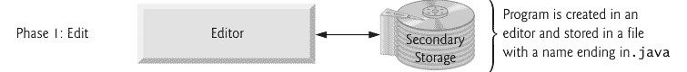

图 1.6 | 典型的 Java 环境——编辑阶段。

Linux 系统上广泛使用的两个编辑器是 `vi` 和 `emacs`。Windows 提供记事本（Notepad），macOS 提供 TextEdit。还有许多免费和共享软件编辑器，包括 Notepad++ (http://www.notepad-plus-plus.org)、EditPlus (http://www.editplus.com)、TextPad (http://www.textpad.com)、jEdit (http://www.jedit.org) 等。

集成开发环境（IDEs）提供了支持软件开发过程的工具，例如编辑器、用于定位导致程序执行错误的逻辑错误的调试器等。最流行的 Java IDE 有：

- Eclipse (http://www.eclipse.org)
- IntelliJ IDEA (http://www.jetbrains.com)
- NetBeans (http://www.netbeans.org)

在本书的网站上

```
http://www.deitel.com/books/jhtp11LOVE
```

我们提供了视频，展示如何执行书中的 Java 应用程序，以及如何使用 Eclipse、NetBeans 和 IntelliJ IDEA 开发新的 Java 应用程序。

### 阶段 2：将 Java 程序编译为字节码

在阶段 2 中，你使用 `javac`（Java 编译器）来编译程序（图 1.7）。例如，要编译名为 `Welcome.java` 的程序，你输入

```
javac Welcome.java
```

在系统的命令窗口中输入（即 Windows 中的 Command Prompt，macOS 中的 Terminal 应用程序或 Linux shell（在某些 Linux 版本中也称为 Terminal））。如果程序编译成功，编译器会生成一个名为 `Welcome.class` 的 `.class` 文件。IDE 通常提供一个菜单项，例如 Build 或 Make，它们会为你调用 `javac` 命令。如果编译器检测到错误，你需要回到阶段 1 并修正它们。

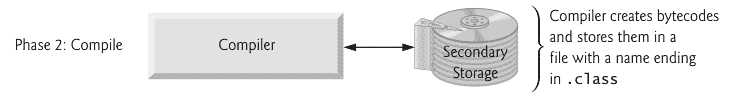

**图 1.7** | 典型的 Java 开发环境——编译阶段。

## 常见编程错误 1.1

在使用 `javac` 时，如果你收到类似“错误的命令或文件名”、“javac: 找不到命令”或“java 不是内部或外部命令、程序或批文件”的消息，说明你的 Java 软件安装未完成。这表明系统的 PATH 环境变量未正确设置。请仔细查看书中“开始之前”部分的说明。在某些系统中，修正 PATH 后，你可能需要重启计算机或打开一个新的命令窗口使这些设置生效。

Java 编译器将 Java 源代码翻译成代表执行任务（阶段 5）的字节码。Java 虚拟机（JVM）——JDK 的一部分也是 Java 程序的基础——执行字节码。虚拟机 VM 是一种模拟计算机的软件应用程序，它为与其交互的程序隐藏了底层的操作系统和硬件。同一个 VM 在许多计算机平台上都有实现，为该类型 VM 编写的程序可以 Microsoft.NET 使用最广泛使用的虚拟机架构。

与机器语言指令（即依赖于特定计算机硬件的平台）不同，字节码指令是平台无关的。因此，Java 的字节码可以在无需重新编译源代码的情况下移植，每个字节码指令都可以在任何包含与其编译时的 Java 版本的 JVM 的平台上执行。JVM 是通过 `java` 命令调用的。例如，为了执行名为 `Welcome` 的应用程序，你会在命令窗口中输入命令

```
java Welcome
```

通过该命令调用 JVM，随后它将启动执行该应用程序所需的任务。这开始了阶段 3。IDE 通常提供一个菜单项，例如 Run，它们会为你调用 `java` 命令。

### 阶段 3：将程序加载到内存

在阶段 3 中，JVM 将程序放入内存中以执行它——这被称为加载（图 1.8）。JVM 的类加载器获取包含程序字节码的 `.class` 文件代码并将其传输到主内存。它还会加载你的程序所使用的 Java 提供的任何 `.class` 文件。这些 `.class` 文件可以从你系统上的磁盘加载，也可以通过网络（例如，你的本地大学网络或公司网络，或互联网）加载。

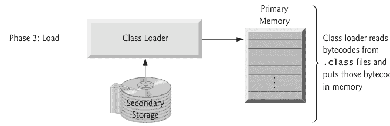

图 1.8 | 典型的 Java 开发环境——加载阶段。

### 第 4 阶段：字节码验证

在第 4 阶段，随着类的加载，字节码验证器会检查它们的字节码，以确保它们是有效的且没有违反 Java 的安全限制（图 1.9）。Java 实施强安全机制，以确保通过网络到达的 Java 程序不会损坏你的文件或系统（就像计算机病毒和蠕虫那样）。

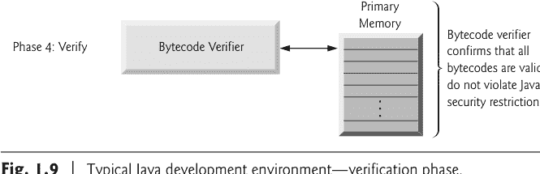

图 1.9 | 典型的 Java 开发环境——验证阶段。

### 第 5 阶段：执行

在第 5 阶段，JVM 执行字节码以执行指定的动作。在早期的 Java 版本中，JVM 仅仅是一个 Java 字节码解释器。大多数程序的执行速度很慢，JVM 会一次解释并执行一个字节码。某些现代计算机架构可以并行执行多条指令。现在的 JVM 通常使用解释和即时编译（JIT）相结合的方法来执行字节码。在这个过程中，JVM 在解释字节码时对其进行分析，寻找“热点”代码——即频繁执行的字节码。对于这些部分，即时编译（JIT）编译器（如 Oracle 的 HotSpot 编译器）会将字节码翻译成计算机的机器语言。当 JVM 遇到这些编译后的部分时，就会执行更快的机器语言代码。这些程序通过两个编译阶段：第一个阶段将 Java 代码翻译成字节码（以便在不同计算机平台上的 JVM 之间具有可移植性），第二个阶段是在执行期间，将字节码翻译成执行程序所在的计算机的机器语言。

| 第 5 阶段：执行 | Java 虚拟机 (JVM) | 主内存 |
| :--- | :--- | :--- |
| 为了执行程序，JVM 读取字节码并将其即时编译（JIT）（即：翻译）为计算机可以理解的语言。 | 随着程序的执行，它可能会将数据值存储在内存中 | |

**图 1.10** | 典型的 Java 开发环境——执行阶段。

### 执行时可能出现的问题

程序在第一次尝试时可能无法运行。之前的每个阶段都可能因为我们在整本书中讨论的各种错误而失败。例如，正在执行的程序可能会尝试除以零（这在 Java 的整数算术中是非法操作）。这会导致 Java 程序显示错误消息。如果发生这种情况，你必须返回编辑阶段，进行必要的修正，并再次通过剩余的阶段，以确定修正是否修复了问题。[注：Java 中的大多数程序都会输入或输出数据。当我们说程序显示一条消息时，通常是指它在你的计算机屏幕上显示该消息。]


### 常见编程错误 1.2

诸如程序运行时出现的除以零等错误，因此它们是运行时错误或执行时错误。致命错误会导致程序立即终止而未能成功完成任务。非致命错误允许程序运行完成，但通常产生错误的结果。

## 1.10 测试 Java 应用程序


在本节中，你将学习如何与 Java Painter 应用程序交互，该程序将在稍后的章节中构建。你看到的元素和功能是你在本书中将学习编程的典型内容。使用 Painter 的图形用户界面 (GUI)，你可以选择绘图颜色和笔画大小；拖动鼠标以指定的颜色和大小画圆。你还可以撤销每个绘图操作或清除整个绘图。[注：我们使用无衬线字体强调窗口标题和菜单（例如，文件菜单），并使用等宽无衬线字体强调非屏幕元素，如文件名和程序代码（例如，`grammar.java`）。]

本节的步骤将向你展示如何从你系统上的命令提示符（Windows）、shell（Linux）或终端（macOS）中执行 Painter 应用程序。在整本书中，我们将这些称为命令窗口。我们假设书中的示例位于 Windows 上的 `C:\examples`，或者位于 Linux 或 macOS 上的用户 `Documents/examples` 文件夹中。

### 检查你的设置

阅读“之前”部分以在你的计算机上设置 Java，并确保你已将书中的示例下载到硬盘。

## 1.10 测试 Java 应用程序

### 切换到应用程序目录

打开命令窗口并使用 `cd` 命令更改 Painter 应用程序的目录（也称为文件夹）：

- 在 Windows 上输入 `cd C:\examples\ch01\Painter`，然后按回车。
- 在 Linux/macOS 上，输入 `cd Documents/examples/ch01/Painter`，然后按回车。

### 编译应用程序

在命令窗口中输入以下命令然后按回车，编译 Painter 示例的文件：

```
javac *.java
```

`*` 表示应编译所有以 `.java` 结尾的文件。

### 运行应用程序

在命令窗口中，输入以下命令然后按回车，以运行 Painter 示例：

```
java Painter
```

运行 Painter 后，你会看到一个窗口出现。你可以尝试使用它的各种功能来画画。如果你遇到任何问题，请查看书中的“常见问题”部分。

### 关闭 Painter 应用程序

此时，你可以关闭 Painter 应用程序。要这样做，只需点击图 1.11 中所示应用程序关闭框（适用于 Windows、Linux 和 macOS）。

## 1.11 互联网与万维网

在 ARPANET 上进行通信的协议（一组规则）被称为传输控制协议（TCP）。TCP 确保了由顺序编号的分包（`数据包`）组成的消息能够正确地从发送者路由到接收者、完整地到达并按正确的顺序组装。

### 1.11.1 互联网：网络之网络

在互联网早期演变的同时，全球各地的机构都在实现自己的网络，分别用于组织内（即组织内部）和组织间（即组织之间）的通信。各种网络硬件和软件大量涌现。一个挑战是让这些不同的网络能够相互通信。ARPA 通过开发互联网协议（IP）实现了这一目标，它创建了一个真正的“网络之网络”，即当前互联网的架构。这套组合协议现在被称为 TCP/IP。每个连接的设备都有一个 IP 地址——这是通过 TCP/IP 通信的设备在互联网上定位彼此的唯一标识符。

企业很快意识到，通过使用互联网，他们可以改进运营并为客户提供更好的服务。公司开始投入大量资金开发和增强其互联网影响力。这导致了电信运营商、硬件和软件供应商之间产生了激烈竞争，以满足增长的基础设施需求。结果，互联网上的带宽——通信线的信息承载能力——大幅增加，而硬件成本却骤降。

### 1.11.2 万维网：让互联网更易于使用

万维网（简单称为“网页”）是与互联网相关的硬件和软件集合，允许计算机用户定位并查看关于任何主题的文档（带有文本、图形、动画、视频的各种组合）。1989年，欧洲核研究组织（CERN）的蒂姆·伯纳斯-李（Tim Berners-Lee）开始开发超文本标记语言（HTML）通过“超链接”文档共享信息的技术。他还编写了通信协议，如超文本传输协议（HTTP），以形成他的超文本信息系统的骨干，他将其称为万维网。

1994年，伯纳斯-李创立了万维网联盟（W3C, `http://www.w3.org`），致力于开发网络技术。W3C 的主要目标之一是让每个人无论身体残障、语言或文化如何，都能普遍访问网页。

### 1.11.3 Web 服务与混杂

在在线第 2 章中，我们实现了 Web 服务（图 1.15）。混杂的应用开发方法允许你通过结合（通常是免费的）互补 Web 服务和其他形式的信息馈送来快速开发强大的应用程序。最早的混杂之一是将来自 `http://www.craigslist.org` 提供的房产列表与 Google Maps 的制图功能相结合，提供显示给定区域待售或出租房屋位置的地图。`http://www.programmableweb.com/` 提供了一个包含 16,500 个 API 和 6,300 个混杂的目录。他们的 Twitter API 大学（`https://www.programmableweb.com/api-university`）包含了如何操作 API 以及创建自己的地图的指南和示例代码。根据你的网站显示，一些最广泛使用的 API 是 Facebook、Google Maps、Twitter 和 YouTube。

| Web 服务来源 | 如何使用 |
| :--- | :--- |
| Google Maps | 地图服务 |
| Twitter | 微博客 |
| YouTube | 视频搜索 |
| Facebook | 社交网络 |
| Instagram | 照片共享 |
| Foursquare | 移动签到 |
| LinkedIn | 商务社交网络 |
| Groupon | 社交商务 |
| Netflix | 电影租赁 |
| eBay | 互联网拍卖 |
| Wikipedia | 协作百科全书 |
| PayPal | 支付 |
| Last.fm | 互联网广播 |
| Amazon eCommerce | 购买书籍及许多其他产品 |
| Salesforce.com | 客户关系管理 (CRM) |
| Skype | 互联网电话 |
| Microsoft Bing | 搜索 |
| Flickr | 照片共享 |
| Zillow | 房地产定价 |
| Yahoo Search | 搜索 |
| WeatherBug | 天气 |

> **图 1.15** | 一些流行的 Web 服务（`https://www.programmableweb.com/category/all/apis`）。

### 1.11.4 物联网

互联网不再仅仅是计算机网络——它是一个**物联网 (IoT)**。一个*物*是指任何具有 IP 地址并能够在互联网上自动发送数据的对象。此类物体包括：

- 智能电表
- 智能家电
- 智能恒温器
- 智能汽车
- 智能办公

（注：原文后续部分存在大量重复的段落，已根据核心含义进行处理。）

## 1.13 解答您的疑问

| 版本 | 说明 |
| --- | --- |
| Alpha | Alpha 软件是软件产品的最早版本，仍处于活跃开发阶段。Alpha 版本通常包含许多错误、不完整且不稳定，发布给相对较少的开发者以测试新功能并获取早期反馈。Alpha 软件也被称为“早期访问（early access）”。Beta 版本在开发过程的后期阶段发布给更多的开发者，此时主要错误已修复，新功能也已基本完成。Beta 软件更稳定，但仍可能发生变化。 |
| 发布 (Release) | 发布候选版本（Release candidates）通常在功能上是完整的，且（大部分情况下）没有错误，供社区使用，这提供了一个多样化的测试环境——软件在不同的系统上运行，具有不同的限制并用于各种用途。正式发布（Final release）发布日期出现的任何错误都会被修正，最终产品将向普通公众发布。软件公司通常通过互联网发布增量更新。 |
| 持续 Beta (Continuous beta) | 使用这种方法开发的软件（例如 Google 搜索或 Gmail）通常没有版本号。它托管在云端（不安装在你的计算机上）并不断演进，使用户始终拥有最新版本。 |

### 1.17 软件产品发布

## 1.13 解答您的疑问

在许多在线论坛中，你可以获得 Java 问题的解答并与其他 Java 程序员互动。一些流行的 Java 和通用的编程论坛包括：

- `StackOverflow.com`
- `Coderanch.com`
- Oracle Java 论坛—`https://community.oracle.com/community/java`
- `dreamin.code`—`http://www.dreamincode.net/forums/forum/32-java/`

## 自测练习

- **I.1** 为下列每个陈述的空处填空：
  a) 计算机在被称为 ________ 的指令集控制处理数据。
  b) 计算机的关键逻辑单元是 ________ 和 ________。
  c) 本章讨论的三类语言是 ________ 和 ________。
  d) 将高级语言程序翻译成机器语言的程序称为 ________。
  e) ____ 是一种基于 Linux 内核和 Java 的移动设备操作系统。
  f) ____ 软件通常是功能完备、（据说是）无错误的，并准备好社区使用。
  g) Wii 控制器以及许多智能手机使用一种(n) ____，允许设备对动作做出响应。

- **1.2** 为下列关于 Java 环境的每个句子的空处填空：
  a) JDK 中的 ____ 命令执行 Java 应用程序。
  b) JDK 中的 ____ 命令编译 Java 程序。
  c) Java 源代码文件必须以 ____ 文件扩展名结尾。
  d) 当 Java 程序被编译时，编译器产生的文件以 ____ 扩展名结尾。
  e) Java 编译器产生的文件包含 ____，这些字节码由 Java 虚拟机执行。

- **1.3** 为下列每个陈述的空处填空（根据第 1.5 节）：
  a) 对象的设计实践允许 ____，尽管它们可能知道如何通过定义良好的接口相互通信，但它们通常不知道其他对象是如何实现的。
  b) Java 程序员专注于 ____，即哪些字段和操纵这些字段的方法集为客户端提供服务。
  c) 从面向对象的角度分析和设计系统的过程是 ____。
  d) 可以通过 ____ 创建一类新对象——新类（子类）从现有类（父类）的特征开始，可能对其进行自定义并添加自身的独特特征。
  e) ____ 是一种图形化语言，允许设计软件系统的人使用行业标准符号来表示它们。
  f) 对象的尺寸、形状、颜色和重量被认为是对象所在类的 ____。

## 自测练习答案

- **1.1** a) 程序, b) 输入单元, 内存单元, 中央处理器, 算术逻辑，存储单元。c) 机器语言, 汇编语言, 高级语言。d) 编译器, e) Android。f) 发布候选版本, g) 加速度计。
- **1.2** a) `java`. b) `javac`. c) `java`. d) `.class` e) `bytecodes`。
- **1.3** a) 信息隐藏, b) 类。c) 面向对象分析设计 (OOAD) d) 继承, e) 统一建模语言 (UML), f) 属性。

## 练习题

- **1.4** 为下列每个陈述的空处填空：
  a) 接收计算机外部信息供计算机使用的逻辑单元是 ____。
  b) 指令计算机解决问题的过程是 ____。
  c) ____ 是一种计算机语言，使用类似英语的缩写作为机器指令。
  d) ____ 是发送已由各种设备处理信息的逻辑单元，以便其在计算机外部使用。
  e) ____ 和 ____ 是保留信息的计算机逻辑单元。
  f) ____ 是执行计算的计算机逻辑单元。
  g) ____ 是做出逻辑决策的计算机逻辑单元。
  h) ____ 语言对程序员来说最方便快速快捷地编写程序。
  i) 计算机可以直接理解的唯一语言是该计算机的 ____。
  j) ____ 是协调所有其他逻辑单元运行活动的计算机逻辑单元。

- **1.5** 为下列每个陈述的空处填空：
  a) ____ 是一种平台无关的语言，为在各种设备上运行而构建。
  b) ____ 和 ____ 是 Java 的。
  c) ____ 是承载信息的容量。
  d) ____ 是一种将高级语言转换为机器语言的翻译器。
  e) 编译器产生的文件包含 ____。
  f) Java 虚拟机 (JVM) 执行 ____。

- **1.6** 为下列每个陈述的空处填空：
  a) ____ 经历了五个开发阶段。
  b) ____ 提供了许多工具，例如用于编写程序的编辑器。
  c) ____ 命令调用 Java 程序。
  d) ____ 是一种隐藏实现细节的软件。
  e) 编译器产生的文件以 ____ 结尾。
  f) ____ 确保程序是有效的。

- **1.7** 解释什么是即时编译 (JIT)。
- **1.8** 讨论以下各项如何应用于 Java：对象、继承和封装。
- **1.9** 测试：碳足迹 某些科学家认为化石燃料的排放对全球变暖有重大影响。研究碳足迹并使用计算器确定自己的。
- **1.10** 测试：体重指数 最近估计，美国三分之二的人肥胖。这导致糖尿病和心脏病等疾病增加。为了判断一个人是否肥胖，可以使用称为体重指数 (BMI) 的指标。美国卫生服务部提供了一个计算器 `https://www.nih.gov/guidelines/bmi.html`。使用它计算自己的。
- **1.11** 混合动力汽车的属性 在这一章你学习了属性。现在你将充实“混合动力汽车”类的方面。混合动力汽车越来越受欢迎，因为它们的油耗更好。浏览网页并研究今天四种混合动力汽车，然后列出许多与其相关的属性。例如，常见属性包括城市路耗和高速路路耗。
- **1.12** 性别中立 你被要求创建一个程序来处理一段文本并将性别特定词替换为性别中性词。假设你有一份性别特定词及其性别中性替换的列表（例如将“妻子”替换为“配偶”，将“男人”替换为“人”，将“女儿”替换为“孩子”等），解释你用来阅读文本并手动执行这些替换的过程。你的过程可能会产生什么奇怪的术语？
- **1.13** 智能助手 人工智能领域的发展一直在加速。许多公司现在提供计算机智能助手，例如 IBM 的 Watson、Amazon 的 Alexa、Apple 的 Siri、Google 的 Google Now 和 Microsoft 的 Cortana。研究这些以及其他可以改善生活的助手。
- **1.14** 大数据 研究快速发展的数据领域。列出医疗和科学研究领域具有巨大前景的应用。
- **1.15** 物联网 现在可以在任何设备头部放置微处理器，并将这些设备连接到互联网。这导致了物联网 (IoT) 概念的产生，它已经连接了数百亿个设备。

# Java 应用程序简介：输入/输出与运算符

## 2 目标

在本章中，你将：

- 编写简单的 Java 应用程序。
- 使用输入和输出语句。
- 学习 Java 的原始数据类型。
- 理解基础内存概念。
- 使用算术运算符。
- 学习算术运算符的优先级。
- 编写决策语句。
- 使用关系运算符和相等运算符。


## 第 2 章 Java 应用程序简介：输入/输出与运算符

## 2.1 引言

## 2.2 你的第一个 Java 程序：打印文本

### 2.2.1 编译应用程序

### 2.2.2 执行应用程序

## 2.3 修改你的第一个 Java 程序

## 2.4 使用 printf 显示文本

## 2.5 另一个应用程序：整数相加

### 2.5.1 导入声明

### 2.5.2 声明并创建 Scanner 以从键盘获取输入

### 2.5.3 提示用户输入

### 2.5.4 声明变量以存储整数并从键盘获取整数

### 2.5.5 获取第二个整数

### 2.5.6 在计算中使用变量

### 2.5.7 显示计算结果

### 2.5.8 Java API 文档

### 2.5.9 在单独语句中声明和初始化变量

## 2.6 内存概念

## 2.7 算术

## 2.8 决策：相等运算符和关系运算符

## 2.9 总结

总结 | 自测练习题 | 自测练习题答案 | 练习题 | 改变自我

## 2.1 引言

本章介绍了 Java 编程。我们从一个在屏幕上显示（输出）信息的程序示例开始。然后我们展示了一个从用户那里获取（输入）两个数字、计算它们的和并显示结果的程序。你将学习如何指示计算机执行算术计算并保存结果以备后用。最后一个示例演示了如何做出决策。该应用程序比较两个数字，然后显示比较结果。你将使用 JDK 命令行工具来编译和运行本章的程序。如果你更喜欢使用集成开发环境 (IDE)，我们还在 `http://www.deitel.com/books/jhtp11LOV` 发布了针对最流行的三个 Java IDE——Eclipse、NetBeans 和 IntelliJ IDEA 的入门视频。

## 2.2 你的第一个 Java 程序：打印文本

Java 应用程序是在你使用 `java` 命令启动 Java 虚拟机 (JVM) 时执行的计算机程序。2.2.1—2.2.2 节讨论了如何编译和运行 Java 应用程序。我们首先考虑一个显示一行文本的简单应用程序。图 2.1 显示了该程序，随后是一个显示其内容的框。

```java
// 图 2.1: Welcome.java
// 文本打印程序。
public class welcome1 {
    // main 方法开始执行 Java 应用程序
    public static void main(String[] args) {
        System.out.println("Welcome to Java Programming!");
    } // main 方法结束
 // 类 welcome1 结束
```

图 2.1 | 文本打印程序。（2 部分中的第 1 部分）。

## 2.2 你的第一个 Java 程序：打印文本

欢迎来到 Java 编程！

**图 2.1** | 文本打印程序。（2 部分中的第 2 部分）


# 我们使用行号是为了教学目的——它们不是 Java 程序的一部分

这个示例说明了几个重要的 Java 特性。我们将看到第 7 行完成了工作——在屏幕上显示“Welcome to Java Programming!”短语。

## 程序注释

我们插入注释来记录程序并提高其可读性。Java 编译器忽略注释，因此在程序运行时，它们不会导致计算机执行任何操作。

按照惯例，我们每个程序都以注释开头，指示图号和程序的文件名。参见第 1 行的注释。

```java
// 图 2.1: Welcome.java
```

以 `//` 开头，表示行尾注释——它在出现 `//` 的行的行尾结束。行尾注释不需要另起一行；也可以从行的中间开始并持续到行尾（如第 5、8 和 9 行）。第 2 行，

```java
// 文本打印程序。
```

按照惯例，这是一个描述程序用途的注释。Java 还有传统的注释，可以跨越几行：

```java
/* 这是一个传统的注释。它可以跨多行 */
```

它们以分隔符 `/*` 开头，以 `*/` 结束。编译器忽略分隔符之间的所有文本。Java 分别在 C 和 C++ 编程语言中引入了传统的和行尾注释。

Java 提供了第三类型的注释——Javadoc 注释。它们由 `/**` 和 `*/` 分隔。编译器忽略分隔符之间的所有文本，以便在程序中直接生成程序文档。此类注释是业界首选的 Java 文档格式。Javadoc 工具程序（JDK 的一部分）读取 Javadoc 注释并使用它们准备 HTML5 格式的程序文档。我们在代码中到处使用 `//` 注释，而不是传统的/Javadoc 注释，以节省空间。我们在附录“使用 javadoc 创建文档”中演示了 Javadoc 注释和 javafx 工具。

## 常见编程错误 2.1

忘记分隔符的 Javadoc 注释是语法错误。当编译器遇到违反 Java 语言规则的代码时，就会发生语法错误。语法错误也被称为编译错误，因为编译器在编译时检测到它们。在程序正常编译之前，你必须消除所有的编译错误。


## 良好的编程习惯 2.1

某些组织要求每个程序都以注释开头，说明程序的目的以及作者、修改日期和时间。

## 空行

空行（如第 3 行）、空格字符和制表符可以让程序更易读。它们统称为空白。编译器忽略空白。

## 良好的编程习惯 2.2

使用空白增强程序的可读性。

## 类的声明

```java
public class Welcome1 {
```

是 `Welcome1` 的类声明。每个 Java 程序至少包含一个类。`class` 关键字引入类声明，后面紧跟类名（`Welcome1`）。关键字是 Java 保留的，并全小写。完整的列表见附录 C。

在第 2-6 章中，我们定义的每个类都使用 `public` 关键字。现在只需简单要求。你将在第 8 章学习更多关于公共类和非公共类的知识。

## 公类的文件名

公类必须放在文件名格式为 `ClassName.java` 的文件中，如 `Welcome1` 存储在 `Welcome1.java` 中。

## 常见编程错误 2.2

如果公类文件名与类名（拼写和大小写）不完全相同，就会发生编译错误。

## 类名和标识符

按照惯例，类名以大写字母开头，并将包含的每个单词的首字母大写（例如：`ClassName`）。标识符由字母、数字、下划线和美元符号 (`$`) 组成，不以数字开头且不包含空格。有效的标识符有 `welcome1`、`$value`、`_value`、`inputField1andbutton7`。`7button` 不是有效的标识符，因为它以数字开头。通常不以大写字母开头的标识符不是类名。Java 是大小写敏感的——大写和小写字母是不同的——所以 `value` 和 `Value` 是不同的（有效的）标识符。

## 良好的编程习惯 2.3

按照惯例，类名标识符以大写字母开头。例如，类名标识符 `DollarAmount` 的第一个单词 `Dollar` 以大写 D 开头，第二个单词 `Amount` 以大写 A 开头。这种命名约定被称为驼峰命名法（camel case），因为大写字母就像驼峰的背一样突出。

### Java 9 中的下划线 (`_`)

从 Java 9 开始，你不能再单独使用一个下划线 (`_`) 作为标识符。

## 类体 (Class Body)

左括号（位于第 4 行末尾）`{` 开始每个类声明的体部。相应的右括号（位于第 9 行）`}` 必须结束每个类声明。第 5–8 行进行了缩进。


### 良好的编程实践 2.4

将每个类声明的整个体部在界定类的大括号之间缩进一个“级”。这种格式强调了类声明的结构并使其更易于阅读。我们使用三个空格作为一个缩进层——许多程序员更倾向于使用两个或四个空格。无论你选择哪种，请保持一致。

### 良好的编程实践 2.5

IDE 通常会自动为你代码进行缩进。Tab 键也可用于代码缩进。你可以配置每个 IDE 来指定按下 Tab 键时插入的空格数。

### 常见的编程错误 2.3

如果大括号没有成对出现，则为语法错误。

### 错误预防贴士 2.1

当你输入左大括号 `{` 时，立即输入右大括号 `}`，然后将光标置在大括号之间并缩进以开始输入体部。这种做法可以防止因缺少括号导致的错误。许多 IDE 都会为你完成这一点。

## 声明方法 (Declaring a Method)

第 5 行

```java
// main method begins execution of Java application
public static void main(String[] args) {
```

是一行注释，指示程序第 6–8 行的用途。标识符 `main` 后的括号表示它是一个名为方法的程序构建单元。类声明通常包含一个或多个方法。对于 Java 应用程序，所有方法必须被调用并定义；否则程序将无法执行。

方法执行任务，并在完成任务时返回信息。我们将在 7.2.5 节解释关键字 `static` 的用途。关键字 `void` 表示此方法将不返回任何信息。我们将看到方法如何返回信息。现在，只需在程序中模仿 `main` 的第一行。括号中的 `String[] args` 是 `main` 声明的必要部分——我们将在第 6 章讨论此。

第 6 行末尾的左括号是方法声明的体部。相应的右括号结束了它（第 8 行）。第 7 行在大括号之间缩进。

### 良好的编程实践 2.6

将每个方法声明的整个体部在定义方法体部的大括号之间缩进一个“级”。这强调了方法的结构并使其更易于阅读。

# 第 2 章 Java 应用程序简介；输入/输出与运算符

## 使用 System.out.println 执行输出

第 7 行

```java
System.out.println("Welcome to Java Programming!");
```

指示计算机执行一个动作——即显示双引号之间的字符。引号本身不会被显示。引号本身及其之间的字符合称为字符字符串或字符串字面量。字符串中的空白字符不会被编译器忽略。字符串不能跨越代码行——稍后我们将展示如何方便地处理长字符串。

`System.out` 对象（由为你定义）被称为标准输出对象。它允许程序在执行程序的命令窗口中显示信息。在 Microsoft Windows 中，命令窗口是“命令提示符”（Command Prompt）。在 UNIX/Linux/macOS 中，命令窗口是终端（terminal）或 shell（shell）。许多程序员可以轻松地调用此命令。

方法 `System.out.println` 在命令窗口中显示（或打印）一行文本。第 7 行括号中的字符串是参数。`System.out.println` 完成输出后，它将光标（下一个字符将显示的位置）置在命令窗口下一行的开头。这与你在文本编辑器中打字时按 Enter 键的情况类似——光标出现在文档下一行的开头。

整个第 7 行，包括 `System.out.println`、括号中的参数 `"Welcome to Java Programming!"` 以及分号 (`;`)，被称为语句 (statement)。方法通常包含执行其任务的语句。大多数语句以分号结束。

## 在右括号上使用行尾注释以提高可读性

为了帮助编程初学者，我们在结束方法声明的右括号之后以及结束类声明的右括号之后添加了行尾注释。例如，第 8 行

```java
// end method main
```

表示方法 `main` 的右括号；第 9 行

```java
// end class Welcome
```

表示类 `Welcome` 的右括号。每条注释都指示了右括号终止的方法或类。我们在本章之后将省略此类结束注释。

### 2.2.1 编译应用程序

我们现在准备好编译并执行程序了。我们假设你正在使用 Java 开发工具包（JDK）的命令行工具，而不是 IDE。以下指令假设书中的示例位于 Windows 上的 `c:\examples` 或 Linux/macOS 上用户账户下的 `Documents/examples` 文件夹中。

要准备程序，打开命令窗口并切换到存储程序的目录。许多操作系统使用命令来切换目录（或文件夹）。在 Windows 上，例如：

```
cd c:\examples\ch02\fig02_01
```

切换到 `ch02` 目录。在 UNIX/Linux/macOS 上，命令：

```
cd ~/Documents/examples/ch02/fig02_01
```

切换到 `fig02_01` 目录。要编译程序，输入

```
javac Welcome1.java
```

如果程序不包含编译错误，此命令将创建平台无关的 `Welcome1.class`（`Welcome1.class` 文件），其中包含应用程序的 Java 字节码。当我们在给定平台上使用 `java` 命令执行应用程序时，JVM 将这些字节码转换为底层操作系统和硬件理解的指令。

### 常见程序错误 2.4

编译器错误信息“class Welcome1 is public, should be declared in a file Welcome1.java”指示文件名与公共类名不匹配，或者你在编译时拼写错了类名。

在学习编程时，通过“破坏”一个良好的程序有助于熟悉编译错误信息。这些信息并不总是指出代码的具体问题。尝试从图 2.1 的程序中删除一个分号或括号，以查看生成的错误。

### 错误预防贴士 2.2

当编译器报告语法错误时，它可能并不是错误信息指示的那一行。首先，检查报告错误的行。如果在该行没有找到错误，请检查之前的行。每条编译错误信息都包含发生错误的文件名和行号。例如，`Welcome1.java:6` 表示在 `Welcome1.java` 的第 6 行发生了错误。信息的其余部分提供了有关语法错误的信息。

### 2.2.2 执行应用程序

现在你已经编译了程序，输入以下命令并按回车：

```
java Welcome1
```

启动 JVM 并加载 `Welcome1.class` 文件。该命令省略了 `.class` 文件扩展名；否则 JVM 将无法执行程序。JVM 调用 `main` 方法。图 2.2 的第 7 行显示程序在 Windows 命令提示符窗口中执行，文字为白色。[注意：许多环境的命令窗口为黑色背景，请调整这些设置以确保我们的截图清晰。]

### 错误预防贴士 2.3

当尝试运行程序时，如果收到类似消息 `Exception in thread "main" java.lang.NoClassDefFoundError: Welcome1`，说明你的 CLASSPATH 变量未设置正确。请仔细阅读本书“在开始之前”部分的安装说明。在某些系统上，配置 CLASSPATH 后可能需要重启计算机或打开新的命令窗口。

```
命令提示符
c:\examples\ch02\fig02_01>javac Welcome1.java
c:\examples\ch02\fig02_01>java Welcome1
Welcome to Java Programming!
c:\examples\ch02\fig02_01>
```

你输入此命令来执行应用程序

程序输出到屏幕上

Welcome to Java Programming!

**图 2.2** 从命令行执行 Welcome。

### 2.3 修改你的第一个 Java 程序

在本节中，我们修改了图 2.1 中的示例，通过使用多个语句在单行打印文本，以及使用单个语句打印多行文本。

#### 使用多个语句显示单行文本

`Welcome to Java Programming!` 有多种显示方式。图 2.3 所示的类 `Welcome2` 使用两个语句（第 7–8 行）产生如图 2.1 所示的输出。[注：从现在开始，我们将在每个代码列表中突出显示新特性和关键特性，正如我们对第 7–8 行所做的那样。]

```java
// Fig. 2.3: Welcome2.java
// 使用多个语句打印一行文本。
public class Welcome2 {
    // main 方法开始 Java 应用程序的执行
    public static void main(String[] args) {
        System.out.print("Welcome to ");
        System.out.println("Java Programming!");
    } // end main method
} // end class Welcome2
```

> Welcome to Java Programming!

**图 2.3** | 使用多个语句打印一行文本。

该程序与图 2.1 类似，因此我们只讨论这里的变化。第 2 行

```java
// 使用多个语句打印一行文本.
```

是一个行尾注释，说明了程序的目的。第 4 行开始 `Welcome2` 类的声明。`main` 方法中的第 7–8 行

```java
System.out.print("Welcome to ");
System.out.println("Java Programming!");
```

显示其中一条文本。第一个语句使用 `System.out` 的 `print` 方法显示字符串。每个 `print` 或 `println` 语句都会从上一个 `print` 或 `println` 停止显示字符的地方开始显示字符。与 `println` 不同，`print` 在显示其参数时不会将输出光标置于下一行的开头——程序显示的字符将紧接在程序显示的最后一个字符之后出现。第 8 行将其参数中的第一个字符（字母 "J"）立即置在第 7 行显示的最后一个字符（字符串结束引号字符之前的空格字符）之后。

#### 使用单个语句显示多行文本

单个语句可以使用换行符（`\n`）显示多行内容，换行符指示 `System.out.print` 和 `println` 方法将输出光标置到命令行窗口中下一行的开头。和空行一样，空格字符和制表符字符都是空白字符。图 2.4 中的程序输出四行文本，使用换行符来决定何时开始每一行新内容。该程序的大部分与图 2.1 和图 2.3 中的内容相同。

```java
// Fig. 2.4: Welcome3.java
// 使用单个语句打印多行文本
public class Welcome3 {
    // main 方法开始 Java 应用程序的执行
    public static void main(String[] args) {
        System.out.println("Welcome\nto\nJava\nProgramming!");
    } // end method main
} // end class Welcome3
```

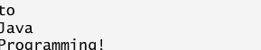

**图 2.4** | 使用单个语句打印多行文本。

### 第 7 行

```java
System.out.println("Welcome\nto\nJava\nProgramming!");
```

在命令行窗口中显示四行文本。通常，字符串中的字符按照它们在双引号中出现的形式进行显示。然而，成对的字符 `\`（在语句中重复了三次）不会显示在屏幕上。反斜杠 `\` 是一个转义字符，对 `System.out.print` 和 `println` 具有特殊含义。当字符串中出现反斜杠时，Java 将其与下一个字符结合形成一个转义序列——`\n` 表示换行符。当使用 `System.out` 在字符串输出中出现换行符时，该换行符会导致屏幕输出光标移动到命令行窗口中下一行的开头。

图 2.5 列出了几个转义序列，并描述了它们如何影响命令行窗口中字符的显示。要查看转义序列的完整列表，请访问

```
http://docs.oracle.com/javase/specs/jls/se8/html/jls-3.html#jls-3.10
```

| 转义序列 | 说明 |
| --- | --- |
| `\n` | 换行。将屏幕光标移动到下一行的开头。 |
| `\t` | 水平制表符。将屏幕光标移动到下一个制表位。 |
| `\r` | 回车。将屏幕光标置于当前行的开头——不要移动到下一行。回车后输出的任何字符将覆盖该行上之前输出的内容。 |
| `\\` | 反斜杠。用于打印反斜杠字符。 |

**图 2.5** | 一些转义序列。

### 2.4 使用 printf 显示文本

`System.out.printf` 方法（格式化输出）显示格式化数据。图 2.6 使用此方法输出行。


# 第 2 章 Java 简介：输入/输出与操作符

## 2.5 另一个应用程序：整数相加

我们的下一个应用程序通过键盘读取（输入）两个整数（例如 -22、7 以及 0 和 1024），计算它们的和并显示。该程序必须跟踪用户提供的数字以进行计算。程序在计算机内存中记录数字和其他数据并访问这些变量。图 2.7 中的程序演示了这些概念。在示例输出中，我们使用粗体文本来识别用户的输入（即 45 和 72）。按照我们之前程序的习惯，第 1–2 行说明了图号、文件名和程序的目的。

```java
// Fig. 2.7: Addition.java
// 输入两个数字并显示其和的程序。
import java.util.Scanner; // 程序使用 Scanner 类
public class Addition {
    // main 方法开始 Java 应用程序的执行
    public static void main(String[] args) {
        // 创建一个从命令行窗口获取输入
        Scanner input = new Scanner(System.in);
        System.out.print("Enter first integer: "); // 提示
        int number1 = input.nextInt(); // 从用户处读取第一个数字
        System.out.print("Enter second integer: "); // 提示
        int number2 = input.nextInt(); // 从用户处读取第二个数字
        int sum = number1 + number2; // 相加，将和存储在 sum 中
        System.out.printf("Sum is %d%n", sum); // 显示和
    }
} // end class Addition
```

**图 2.7** | 输入两个数字并显示它们的和的程序。（第 1 部分，共 2 部分）

| 输入第一个整数：45 |
| :--- |
| 输入第二个整数：32 |
| 和为 117 |

**图 2.7** | 输入两个数字并显示它们的和的程序。（第 2 部分，共 2 部分）

### 2.5.1 导入声明

Java 的一大优势在于它拥有一套预定义的类，你可以重用这些类，而不是“造轮子”。这些类被分组在包（packages）中——即相关类的命名组——并统称为 Java 类库或 Java 应用程序编程接口（Java API）。第 3 行

```java
import java.util.Scanner; // 程序使用 Scanner 类
```

是一条导入声明，帮助编译器定位此程序使用的某个类。它表示程序使用了 `java.util` 包中预定义的 `Scanner` 类（稍后将讨论）。随后，编译器会确保你正确地使用了该类。


**常见编程错误 2.5** 所有导入声明都必须出现在文件中第一个类声明之前。在类声明内部或之后放置导入声明会导致语法错误。


**常见编程错误 2.6** 忘记为必须导入的类包含导入声明，会导致编译错误，错误信息可能包含类似“cannot find symbol（无法找到符号）”的消息。当发生此类错误时，请检查是否提供了正确的声明，以及声明中的名称是否正确（包括正确的大小写）。

### 2.5.2 声明并创建 Scanner 以从键盘获取输入

变量是计算机内存中的一个位置，可以在其中存储一个值以供程序后续使用。所有 Java 变量在使用之前都必须用名称和类型对它们进行声明。变量名允许程序访问内存中的变量值。变量名可以是任何标识符——再次强调，它是一个由字母、数字、下划线 (`_`) 和美元符号 (`$`) 组成的字符序列，且不以数字开头，也不包含空格。变量的类型指定了在该位置存储什么类型的信息。与其他语句一样，声明语句以分号 (`;`) 结束。main 方法第 9 行

```java
Scanner input = new Scanner(System.in);
```

是一个变量声明语句，指定了此程序使用的变量的名称 (`input`) 和类型 (`Scanner`)。`Scanner`（位于 `java.util` 包）允许程序读取数据（例如数字和字符串）供程序使用。数据可以来自许多源，例如键盘上的用户或文件磁盘。在使用 `Scanner` 之前，你必须创建它并指定数据源。

第 9 行的 `=` 表示 `Scanner` 变量 `input` 应在声明时使用等号右侧表达式的结果 `new Scanner(System.in)` 进行初始化（即为在程序中使用它做好准备）。该表达式使用 `new` 关键字来创建一个 `Scanner` 对象，用于读取用户在键盘上输入的字符。标准输入对象 `System.in` 允许应用程序读取用户输入的字节数据。`Scanner` 将这些字节转换成程序可以使用的类型（如 `int`）。


**良好的编程实践 2.8** 选择有意义的变量名有助于程序自文档化（即人们只需阅读代码即可理解程序，而不是通过阅读相关的文档或创建和查看大量的注释）。


**良好的编程实践 2.9** 按照惯例，变量名标识符使用驼峰命名法（camel case），且首字母小写——例如，`firstName`。

### 2.5.3 提示用户输入

第 11 行

```java
System.out.print("Enter first integer: "); // 提示
```

使用 `System.out.print` 显示消息“Enter first integer: ”。这条消息是一个提示，引导用户执行特定操作。我们在这里使用方法 `print` 而不是 `println`，是为了让用户的输入与提示显示在同一行。回想第 2.2 节，带有大写字母的标识符通常表示类名。`System` 类是 `java.lang` 包的一部分。


**软件观察 2.1** 默认情况下，`java.lang` 包在每个程序中都会导入；`java.lang` 中的类是 Java API 中唯一不需要导入声明的类。

### 2.5.4 声明变量存储整数并从键盘获取一个整数

第 12 行的变量声明语句

```java
int number1 = input.nextInt(); // 从用户处读取第一个数字
```

声明 `number1` 持有 `int` 类型的数据——即整数值，如 72、-117 和 0 这样的整数。`int` 的取值范围是 -2,147,483,648 到 2,147,483,647。

### 2.5.5 获取第二个整数

第 14 行

```java
System.out.print("Enter second integer:"); // 提示
```

提示用户输入第二个整数。第 15 行

```java
int number2 = input.nextInt(); // 从用户处读取第二个数字
```

声明变量 `number2` 并使用读取的整数对其初始化。

### 2.5.6 在计算中使用变量

```java
sum = number1 + number2; // 相加数字并将总和存储在 sum 中
```

在语句中，加法运算符是一个二元运算符，因为它有两个操作数 `number1` 和 `number2`。包含计算的语句部分被称为表达式。事实上，表达式是语句中任何具有值的部分。表达式 `number1 + number2` 的值是数字的和。同样，表达式 `input.nextInt()`（第 12 行和 15 行）的值是用户输入的整数。

> **良好的编程实践 2.10** 在二元操作符两侧留空格以提高可读性。

### 2.5.7 显示计算结果

完成计算后，第 19 行

```java
System.out.printf("Sum is %d%n", sum); // 显示和
```

使用 `System.out.printf` 显示和。格式说明符 `%d` 是 `int` 值的占位符（即 `sum` 的值）——字母 `d` 代表“十进制”。格式字符串中的其余字符都是固定的。因此，`printf` 方法显示“Sum is ”随后是 `sum` 的值（位于 `%d` 格式说明符的位置）以及一个换行符。

### 2.5.8 Java API 文档

对于每个 Java API 类，我们都指出了它所在的包。这些信息帮助你在 Java API 文档中找到每个包和类的描述。该文档的 Web 版本可以在此处找到：

```
http://docs.oracle.com/javase/8/docs/api/index.html
```

你也可以从附加资源部分下载：

```
http://www.oracle.com/technetwork/java/javase/downloads
```

在线附录显示了如何使用该文档。

### 2.5.9 在独立语句中声明和初始化变量

在将变量用于计算（或其他表达式）之前，每个变量都必须有一个值。第 12 行的变量声明语句既声明了 `number1`，又用用户输入的值对其进行了初始化。

有时你会在一个语句中声明变量，然后在另一个语句中初始化。例如，第 12 行可以写成两个语句：

```java
int number1; // 声明变量 number1
number1 = input.nextInt(); // 将用户的输入赋值给 number1
```

第一条语句声明了 `number1`，但没有对其进行初始化。第二条语句使用赋值运算符 `=` 来赋值用户输入的值。你可以将这条语句读为 `number1` 获取了 `input.nextInt()` 的值。赋值运算符 `=` 右侧的所有内容始终在执行赋值之前进行求值。

## 2.6 内存概念

变量名如 `number1`、`number2` 和 `sum` 实际上对应计算机内存中的位置。每个变量都有一个名称、一个类型、一个大小（以字节为单位）和一个值。

在图 2.7 的加法程序中，当执行以下语句（第 12 行）时：

```java
int number1 = input.nextInt(); // 从用户读取第一个数字
```

用户输入的数字被放置在与名称 `number1` 对应的内存位置。假设用户输入了 45。计算机将该整数放入位置 `number1`（图 2.8），替换掉该位置之前的值（如果有的话）。之前的值丢失了，因此这个过程被称为是破坏性的。

| number1 | 45 |
| :--- | :--- |

**图 2.8** | 显示变量 `number1` 名称和值的内存位置。

当执行语句（第 15 行）时：

```java
int number2 = input.nextInt(); // 从用户读取第二个数字
```

假设用户输入了 72。计算机将该整数值置于位置 `number2`。此时的内存看起来如图 2.9 所示。

| number1 | 45 |
| :--- | :--- |
| number2 | 72 |

**图 2.9** | 用于存储变量 `number1` 和 `number2` 值的内存位置。

图 2.7 程序在获取 `number1` 和 `number2` 的值后，将这两个值相加并将总和存入变量 `sum`。语句（第 17 行）：

```java
int sum = number1 + number2; // 相加数字，然后将总和存储在 sum 中
```

执行加法，然后替换 `sum` 中任何之前的值。在 `sum` 计算完成后，内存看起来如图 2.10 所示。`number1` 和 `number2` 的值与它们在参与 `sum` 计算之前的显示完全一样。在计算机执行计算时，这些值被使用了，但并没有被破坏。当从内存位置读取一个值时，该过程是非破坏性的。

| number1 | 45 |
| :--- | :--- |
| number2 | 72 |
| sum | 117 |

**图 2.10** | 存储 `number1` 和 `number2` 之和后的内存位置。

## 2.7 算术

大多数算术操作总结在图 2.11 中。

| 运算符 | 符号 | Java 表达式 |
| :--- | :--- | :--- |
| 加法 | `+` | `f + 7` |
| 减法 | `-` | `p - c` |
| 乘法 | `*` | `b * m` |
| 除法 | `/` | `x / y` |
| 取余 | `%` | `r % s` |

### 2.7.1 直线形式算术

算术表达式通常以直线形式编写。例如，要将 `a` 乘以 `b`，我们写道：

```
a * b
```

#### 用于分组的括号

括号用于分组。例如，要将 `(a + b)` 乘以 `c`，我们使用：

```
(a + b) * c
```

#### 运算符优先级规则

以下规则定义了优先级：

1. 先应用乘法、除法和取余。如果有多个此类运算符，则从左到右进行求值。
2. 接下来应用加法和减法。如果有多个此类运算符，则从左到右进行求值。
3. 最后进行赋值。

#### 代数和 Java 表达式示例

让我们考虑几个示例表达式。每个例子都显示了一个代数表达式及其 Java 表达式。以下是五个数平均值的示例：

```
Algebra: m = (a + b + c + d + e) / 5
Java: m = (a + b + c + d + e) / 5;
```

`(a + b + c + d + e)` 外的括号确保加法先于除法进行。整体除以 5。如果错误地漏掉了括号，我们得到：

```
a + b + c + d + e / 5
```

这是一个直线方程示例：

```
Algebra: y = mx + b
Java: y = m * x + b;
```

不需要括号。乘法运算符先应用，因为乘法的优先级高于加法。赋值最后发生，因为它优先级低于乘法或加法。

以下示例包含取余（`%`）、除法和减法操作：

```
Algebra: z = pr % q + w / x - y
Java: z = p * r % q + w / x - y;
```

语句下方的圆圈数字表示 Java 应用运算符的顺序。`*`、`%` 和 `/` 操作首先按照从左到右顺序评估（即从左到右结合），因为它们的优先级高于 `+` 和 `-`。接下来评估 `+` 和 `-`。这些操作也从左到右应用。赋值操作 (`=`) 最后被评估。

#### 二次多项式的评估

为了更好地理解运算符优先级的规则，考虑一个包含二次多项式 `ax² + bx + c` 的赋值语句的评估：

```java
y = a * x * x + b * x + c;
```

乘法操作首先按照从左到右顺序评估（即从左到右结合），因为它们的优先级高于加法。（Java 没有用于幂的算术运算符，因此 `x²` 表示为 `x * x`。第 4.4 节显示了执行幂运算的另一种方法）。接下来从左到右评估加法操作。假设 `a`、`b`、`c` 和 `x` 的初始化（给定值）如下：`a = 2`、`b = 3`、`c = 7`、`x = 5`。图 2.13 展示了运算符应用的顺序。

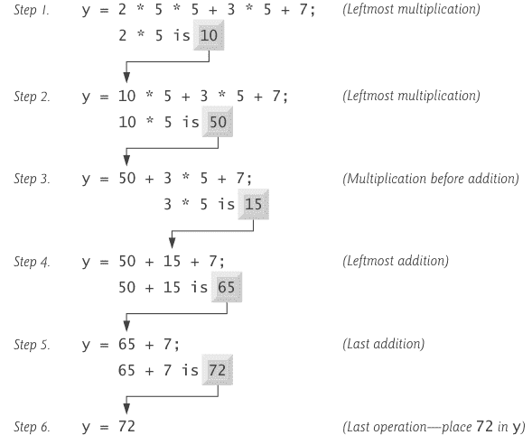

**图 2.13** | 二次多项式评估的顺序。

你可以使用冗余的括号使表达式更清晰。例如，前面的语句可以括为：

```java
y = (a * x * x) + (b * x) + c;
```

## 2.8 决策：相等运算符和关系运算符

条件是一个为真或为假的表达式。本节介绍了 Java 的 `if` 语句，它允许程序根据条件的值做出决策。例如，“成绩大于或等于 60”条件决定了学生是否通过了测试。如果 `if` 语句的条件为真，则执行其体；如果条件为假，则不执行其体。


## 2.8 决策：相等运算符和关系运算符

`if` 语句中的条件可以用图 2.14 总结的相等运算符（`==` 和 `!=`）组成。两个相等运算符的优先级相同，低于关系运算符的优先级。相等运算符从左到右结合。所有关系运算符具有相同的优先级，并且都从左到右结合。

| 代数运算符 | Java 相等或关系运算符 | 示例 Java 条件 | Java 条件的含义 |
| --- | --- | --- | --- |
| 相等运算符 | `==` | `x == y` | 等于 y |
| | `!=` | `x != y` | 不等于 y |
| 关系运算符 | `>` | `x > y` | x 大于 y |
| | `<` | `x < y` | x 小于 y |
| | `>=` | `x >= y` | x 大于或等于 y |
| | `<=` | `x <= y` | x 小于或等于 y |

图 2.14 相等运算符和关系运算符。

### 2.15 使用 `if` 语句比较用户输入的两个整数

如果这些语句中的任何一个条件为真，则执行与该条件相关的语句；否则，跳过该语句。我们使用 `Scanner` 从用户处输入整数并将其存储在变量 `number1` 和 `number2` 中。程序比较这些数字并显示结果为真的比较结果。我们展示了用户输入不同值的三个示例输出。

```java
// Fig. 2.15: Comparison.java
// 使用 if 语句、关系运算符
// 和相等运算符比较整数。
import java.util.Scanner; // 程序使用 Scanner 类

public class Comparison {
    // main 方法开始
    // 使用 Scanner 获取输入
    public static void main(String[] args) {
        // 创建 Scanner 对象
        Scanner input = new Scanner(System.in);
        // 提示输入第一个整数
        System.out.print("Enter first integer: ");
        int number1 = input.nextInt();
        // 提示输入第二个整数
        System.out.print("Enter second integer: ");
        int number2 = input.nextInt();

        // 比较整数
        if (number1 == number2) {
            System.out.println(number1 + " is equal to " + number2);
        } else if (number1 != number2) {
            System.out.println(number1 + " is not equal to " + number2);
        }

        if (number1 > number2) {
            System.out.println(number1 + " is greater than " + number2);
        } else if (number1 < number2) {
            System.out.println(number1 + " is less than " + number2);
        }

        if (number1 >= number2) {
            System.out.println(number1 + " is greater than or equal to " + number2);
        } else if (number1 <= number2) {
            System.out.println(number1 + " is less than or equal to " + number2);
        }
        // 关闭 Scanner
        input.close();
    }
}
```

*(注：由于提供的待翻译文本在代码块部分存在严重的文本重复和错乱，翻译时已根据逻辑进行了梳理并补全了代码结构，以确保符合语义。)*

## 第 2 章 Java 应用简介：输入/输出与运算符

## 总结

### 2.2 节 你的第一个 Java 程序：打印一行文本

- 应用程序在你使用 `java` 命令启动 JVM 时会执行。编译器会忽略它们。
- 注释用于阐述程序并提高其可读性。
- 行尾注释以 `//` 开始，并在其所在的行尾结束。
- 传统注释可以跨越多行，并由 `/* */` 分隔。
- Javadoc 注释由 `/**` 和 `*/` 分隔，允许你将程序文档嵌入代码中。Java 程序会根据这些注释生成页面。
- 语法错误当编译器遇到违反 Java 语言规则的代码时就会发生。这类似于自然语言中的语法错误。
- 空行、空格字符和制表符被称为空白符。空白符使程序更易读，且通常会被编译器忽略。
- 关键字是 Java 预留使用的，且始终使用小写字母。
- `Class` 引入一个类声明。
- 按照约定，Java 中所有的类名都大写字母开头，并且每个单词的首字母都大写（例如 `SampleClassName`）。
- Java 类是一个标识符——由字母、数字、下划线 (`_`) 和美元符号 (`$`) 组成且不包含空格的字符序列。
- `public` 类必须在一个与类同名的文件中说明，并以 `.java` 扩展名结尾。
- Java 是大小写敏感——也就是说，大写和小写字母是不同的。
- 每个类的体由大括号 `{}` 分隔。
- 方法 `main` 是每个 Java 程序的起点，并可能如下所示：
  ```java
  public static void main(String[] args)
  ```
  否则，JVM 将不会执行。
- 方法执行任务并在完成后返回信息。关键字 `void` 表示该方法将执行任务但不返回任何信息。
- 双引号括起的字符有时被称为字符字面量或字符串字面量。
- 标准输出对象 `System.out` 在命令窗口中显示字符。
- `System.out.println` 在命令窗口中显示其参数，随后是一个换行符，将输出光标置于下一行的开头。

#### 2.2.1 编译应用程序

- 你使用 `javac` 命令编译程序。如果程序不包含语法错误，就会创建一个包含 Java 字节码的类文件。这些字节码在你执行程序时由 JVM 解释。

#### 2.2.2 执行应用程序

- 要运行应用程序，输入 `java` 后面紧跟包含 `main` 方法的类名。

### 2.3 修改你的第一个程序

- `System.out.print` 显示其参数并将输出光标置在最后一个字符之后。
- 字符串中的反斜杠 `\` 是转义字符。Java 将其与下一个字符结合形成一个转义序列——表示换行符。

### 2.4 使用 printf 显示文本

- `System.out.printf`（`f` 意味着“格式化”）显示格式化数据。
- 方法的第一个参数是格式字符串，包含固定文本和/或格式说明符。
- 每个格式说明符指示要输出的数据类型，并作为出现在格式字符串之后的对应参数的占位符。
- 格式说明符以百分比符号 `%` 开头，后跟一个表示数据类型的字符。格式说明符 `%%` 是字符串的占位符。
- `%n` 格式说明符是跨平台的行分隔符。你不能在 `System.out.printf` 或 `System.out.println` 的参数中使用 `%n`；`System.out.println` 输出的行分隔符在不同操作系统之间是通用的。

### 2.5.1 import 声明

- 声明帮助编译器加载程序中使用的类。
- Java 丰富的预定义类被分组为包——命名的类组。这些被称为 Java 类库或 Java 应用程序接口（API）。

### 2.5.2 声明并创建 Scanner 以从键盘获取输入

- 变量位于一个可以存储值以供程序稍后使用的位置。所有变量在使用之前必须声明名称和类型。
- 变量名允许程序访问内存中的变量值。
- `Scanner`（`java.util` 包）允许你读取程序将要使用的数据。在使用 Scanner 之前，程序必须创建它并指定数据源。
- 变量应该初始化，以便为在程序中使用做好准备。
- 表达式 `new Scanner(System.in)` 创建了一个从标准输入对象 `System.in`（通常是键盘）读取的 Scanner。

### 2.5.3 提示用户输入

- 提示引导用户执行特定操作。

### 2.5.4 声明变量存储数据并从键盘获取整数

- 数据类型 `int` 用于声明将持有整数的变量。`int` 的值范围是 -2,147,483,648 到 +2,147,483,647。
- 程序中使用的 `int` 值不能包含逗号；但为了可读性，你可以使用下划线（例如 `60_000_000`）。
- `float` 和 `double` 需要带有小数点的数字。
- 原始类型是 `int`、`double`、`float`、`char` 和 `boolean`。
- `String` 不是原始类型。
- 原始类型是内置 Java 的。
- Scanner 方法 `nextInt()` 获取下一个整数输入。

### 2.5.6 使用变量

- 嵌套括号被称为表达式。

### 2.5.7 显示结果

- 格式说明符 `%d` 是整数的占位符。

### 2.5.9 声明和初始化变量

- 赋值运算符允许程序给变量赋值。

### 2.6 内存概念

- 变量对应于内存中的位置。每个变量都有名称、大小和值。
- 放在内存位置中的值会替换该位置的值。

### 2.7 算术

- 算术运算符包括 `+`（加法）、`-`（减法）、`*`（乘法）、`/`（除法）和 `%`（取模）。
- 整数除法产生整数。
- 取模运算符 `%` 产生除法运算后的余数。
- 在带有嵌套括号的表达式中，首先计算内层。
- Java 按优先级的精确顺序应用运算符。
- 当说运算符从左到右应用时，指的是结合性。某些运算符从右到左结合。
- 冗余的括号可以使表达式更清晰。

### 2.8 决策：相等关系运算符

- `if` 语句根据条件的值（真或假）做出决策。
- `if` 语句中的条件可以使用相等（`==` 和 `!=`）和关系（`>`、`<`、`>=` 和 `<=`）运算符形成。
- `if` 语句以关键字开头，后面跟着括号内的条件，并期望一个语句。对于多个语句体，必须包含大括号。

## 自测练习

2.1 填充下列语句中的空白：

- a) 一个(n) ________ 和一个(n) ________ 是方法的结束。


- b) 你可以使用 `if` 语句做出决策。
- c) `//` 开始行尾注释。
- d) 空格、换行符和制表符 被称为空白符。
- e) 关键字 是 Java 预留使用的。
- f) Java 程序从方法 `main` 执行。
- g) 方法 `System.out.print`、`System.out.println` 和 `System.out.printf` 在命令窗口中显示信息。

## 2.2 判断下列各项是否正确。如果错误，请解释原因。

- a) 注释会导致程序执行时将 `//` 之后的文本显示在屏幕上。
- b) 所有变量在声明时必须赋予类型。
- c) Java 认为变量 `number` 和 `NumBer` 是相同的。

# 自测练习题答案 113

- d) 取余运算符 (`%`) 只能与整数类型的操作数一起。
- c) 算术运算符 `*`、`/`、`%`、`+` 和 `-` 的优先级相同。
- f) 标识符 `_`（下划线）在 Java 9 中是有效的。

## 2.3 编写语句完成以下每个任务：

- a) 声明变量 `thisVariable`、`q6354`，类型为 `int`，并将它们初始化为 0。
- b) 提示用户输入一个整数。
- c) 输入整数并将结果赋值给 `int` 变量 `value`。使用 `Scanner` 变量 `input` 可以从键盘读取值。
- d) 在命令行窗口中单行打印 "This is a Java program"。使用 `System.out.println()`。
- e) 在命令行窗口中分行打印 "This is a Java program"。第一行以 Java 结尾。使用 `System.out.printf` 和两个 `%` 格式说明符。
- f) 如果变量 `number` 不等于 7，则显示 "The variable number is not equal to 7"。

## 2.4 识别并纠正每个语句中的错误：

- a)
```
if (c < 7) {

System.out.println("c is less than 7");

}
```
- b)
```
if (c => 7) {

System.out.println("c is equal to or greater than 7");

}
```

## 2.5 编写声明、语句或注释完成以下每个任务：

- a) 说明程序将计算三个整数的乘积。
- b) 创建 `Scanner` 类实例 `input`，从标准输入读取值。
- c) 提示用户输入第一个整数。
- d) 从用户处读取第一个整数并存储在 `int` 变量 `x` 中。
- e) 提示用户输入第二个整数。
- f) 从用户处读取第二个整数并存储在 `int` 变量 `y` 中。
- g) 提示用户输入第三个整数。
- h) 从用户处读取第三个整数并存储在 `int` 变量 `z` 中。
- i) 计算变量 `x`、`y` 和 `z` 中三个整数的乘积，并将结果存储在 `int` 变量 `result` 中。
- j) 使用 `System.out.printf` 显示消息 "Product is"，后跟变量 `result` 的值。

## 2.6 使用你在练习 2.5 中编写的语句，编写一个完整的程序，计算并打印三个整数的乘积。

# 自测练习题答案

- 2.1 左大括号 (`{`)，右大括号 (`}`): b `if`. `//` d 空格、换行符和制表符。e 关键字 `main`. g `System.out.print`、`System.out.println` 和 `System.out.printf`。

- 2.2 练习 2.2 的答案是：

- a) 错误。当程序执行时，注释不会引起任何操作。它们用于记录程序并提高其可读性。
- b) 正确。
- c) 错误。Java 是区分大小写的，因此变量是不同的。
- d) 错误。在 Java 中，取余运算符 `*` 和 `%` 必须与非整数操作数使用（注：此处原文可能有误，`*` 是乘法运算符）。
- e) 错误。运算符 `*`、`/` 和 `%` 的优先级高于运算符 `+` 和 `-`。
- f) 错误。从 Java 9 开始，单独的 `_`（下划线）不再有效的标识符。

# 114 第 2 章 Java 应用介绍；输入/输出与运算符

## 2.3 自测练习题 2.3 的答案是：

- a)
```
int c = 0;

int thisIsVariable = 0;

int q76354 = 0;

int number = 0;
```
- b) `System.out.print("Enter an integer: ");`
- c) `int value = input.nextInt();`
- d) `System.out.printf("%s%s%s\n", "This is a Java", "program");`
- f)
```
if (number != 7) {

   System.out.println("The variable is not equal to 7:");

}
```

## 2.4 自测练习题 2.4 的答案是：

- a) 错误：右括号 `(c < 7)` 后的分号会导致无论条件是否为真都输出。
  纠正：删除右括号后的分号。
- b) 错误：关系运算符 `=>` 是错误的。
  纠正：将 `=>` 改为 `>=`。

## 2.5 自测练习题 2.5 的答案是：

## 2.6 自测练习题 2.6 的答案是：

```java
// Ex. 2.6. Product.java
// 计算三个整数的乘积。
import java.util.Scanner; // 程序使用了 Scanner
public class Product {
    public static void main(String[] args) {
        // 从命令行窗口获取输入
        Scanner input = new Scanner(System.in);

        System.out.print("Enter first integer: "); // 提示输入
        int x = input.nextInt(); // 读取第一个整数

        System.out.print("Enter second integer: "); // 提示输入
        int y = input.nextInt(); // 读取第二个整数

        System.out.print("Enter third integer: "); // 提示输入
        int z = input.nextInt(); // 读取第三个整数

        int result = x * y * z; // 计算数字乘积
        System.out.printf("Product is %d\n", result);
    } // 方法结束
} // 类 Product 结束
```

# 练习 115

第一个整数：10

第二个整数：20

第三个整数：30

乘积为 600

## 练习

## 2.7 填空以下语句：

- a) 注释 用于记录程序并提高其可读性。
- b) 在 Java 程序中可以使用 `if` 语句进行决策。
- c) 与乘法优先级相同的算术运算符是 `/` 和 `%`。
- d) 当算术表达式中的括号嵌套时，首先求值的 是最内层括号内的表达式。
- e) 程序执行过程中包含不同值的内存位置称为 变量。

## 2.8 编写语句完成每个任务：

- a) 在同一行显示消息 "Enter an integer: "。
- b) 将变量 `b` 和 `c` 的值赋值给 `int a`。
- c) 使用注释说明程序。

## 2.9 判断每个是否为真。如果是假，请解释原因。

- a) 在表达式 `a * (c + d)` 中，首先执行加法。
- b) 以下都是标识符：`AccountValue`、`value`、`account_1234`、`checking_account` 和 `name`。
- c) 在 `2 + 3` 中，加法的优先级最高。
- d) 以下都是无效的标识符：`name@com`、`77_99`。

## 2.10 假设 `x = 5` 且 `y = 1`，哪些语句显示：

- a) `System.out.printf("%d = %d\n", x + 5);`
- b) `System.out.printf("%d = %d\n", x * y);`
- c) `System.out.printf("%d is %d\n", x, y);`
- d) `System.out.printf("%d is not equal to %d\n", (x + y));`

## 2.11 哪些语句修改了变量的值？

- a
```
m = (p + 2) + 3;

System.out.printf("m = %d\n", m + 1);
```
- b `m = p / 2;`
- c `j = k + 2;`

## 2.12 给定 `y = x^2 + 5x + 2`，哪些语句是该方程方程？

- a) `y = x * x + 5 * x + 2;`
- b) `y = x * x + (5 * x) + 2;`
- c) `y = x * x + 5 * (x + 2);`
- d) `y = x * (x) + 5 * x + 2;`
- e) `y = x * (x + 5) * x + 2;`
- f) `y = a * (x * 5 + 2)`

## 2.13 执行以下代码段后将打印什么输出？解释原因。

```
p = 5;

System.out.printf("%d, %d", p + 2 * 4);

System.out.printf("%d, %d", p * 2 + 4);
```

# 116 第 2 章 Java 应用介绍；输入/输出与运算符

## 2.14 编写一个程序，在同一行显示数字 1 到 4，每对数字之间隔一个空格。使用以下技术：

- a) 使用 `System.out.println` 语句。
- b) 使用 `System.out.print` 语句。
- c) 使用 `System.out.printf` 语句。

## 2.15 (算术) 编写一个程序，要求用户输入两个整数，获取它们并打印每个平方、平方和以及平方差（第一个平方减去第二个平方）。使用图 2.7 中的技术。

## 2.16 (比较) 编写一个程序，要求用户输入一个整数，获取它并显示该数字及其平方大于、不等于或小于 100。使用图 2.15 中的技术。

## 2.17 (算术，最小和最大) 编写一个程序，从用户处输入三个整数，并显示数字的和、平均值、乘积、最小值和最大值。使用图 2.15 中的技术。[注：本练习中的平均值计算应得到平均值的整数表示。因此，如果值之和为 7，平均值应为 2，2.3333....]

## 2.18 (用星号显示形状) 编写一个程序，使用星号 (`*`) 显示方框、椭圆、箭头和菱形，如下：


## 2.19 以下代码打印什么？

```
System.out.printf("%s%n%s%n%s%n%s%n%s%n%n");
```

## 2.20 以下代码打印什么？

```
System.out.println("****");

System.out.println("*****");

System.out.println("******");

System.out.println("*****");

System.out.println("****");
```

## 2.21 以下代码打印什么？

```
System.out.print("****");

System.out.print("*****");

System.out.print("******");

System.out.print("*****");

System.out.println("****");
```

## 2.22 以下代码打印什么？

```
System.out.print("****");

System.out.println("*****");

System.out.println("******");

System.out.print("*****");

System.out.println("****");
```

## 2.23 执行以下代码段后将打印什么输出？解释原因。

```
p = 5;

System.out.printf("%d, %d", p + 2 * 4);

System.out.printf("%d, %d", p * 2 + 4);
```

## 2.24 (最大和最小整数) 编写一个应用程序，读取五个整数，并确定并打印该组中的最大和最小整数。仅使用在本章中学的编程技术。

## 2.25 (能被 3 整除) 编写一个应用程序，读取一个整数，并判断它是否能被 3 整除。[提示：使用取余数运算符。如果一个数除以 3 的余数为 0，则它可以被 3 整除。]

## 2.26 (倍数) 编写一个应用程序，读取两个整数，判断第一个数字是否是第二个数字的倍数，并打印结果。[提示：使用取余数。]

## 2.27 (星号棋盘图案) 编写一个应用程序，显示如下的棋盘图案：


## 2.28 (圆的直径、周长和面积) 这里让我们预习一下。在本章中，你学习了整数和 `int` 类型。Java 还可以表示包含小数点的浮点数，例如 3.14159。编写一个应用程序，从用户处输入整数圆半径，并使用浮点值打印圆的周长和面积。使用图 2.7 所示的技术。[注意：你也可以使用预定义的 `Math.PI` 作为 π 的值。这个常量比值 3.14159 更精确。`Math` 类定义在 `java.lang` 包中。该包中的类会被自动导入，因此你不需要导入 `Math` 类即可使用它。使用以下公式（`r` 是半径）：

```
diameter = 2*r
circumference = 2*pi*r
area = pi*r^2
```

不要将每次计算的结果存储在变量中。相反，应将每次计算指定为将在 `System.out.printf` 语句中输出的值。周长和面积计算产生的值是浮点数。此类值可以使用 `System.out.printf` 中的格式指定符 `%f` 输出。你将在第 3 章学习更多关于浮点数的知识。

## 2.29 (字符的整数值) 这里是另一个预习。在本章中，你学习了整数和类型（`char`）。Java 还可以表示大写字母、小写字母以及各种特殊符号。每个字符都有一个对应的整数表示。计算机使用的字符集合以及这些字符对应的整数表示合称为计算机的字符集。你可以通过简单地将字符括在单引号中在程序中定义字符值，例如 `'A'`。

你可以通过在字符前加上 `(int)` 来确定该字符的整数等效值，如：

```
(int) 'A'
```

这种形式的运算符是强制转换运算符。（你将在第 3 章学习强制转换运算符）。以下语句输出一个字符及其对应的整数值：

```
System.out.printf("The character %c has the value %d%n")
```

当执行前述语句时，它会将字符 A 和值 65（来自 Unicode 字符）作为字符串的一部分显示。格式指定符 `%c` 是字符的占位符（在这种情况下是字符 'A'）。

使用与之前练习中所示类似的 `using` 语句，编写一个应用程序，显示某些大写字母、小写字母和特殊符号的整数等效值。显示以下字符的整数等效值：A B C a c 0 1 2 $ * + / 以及空格字符。

## 2.30 (分离整数数字) 编写一个应用程序，从用户处输入一个由数字组成的数字，将该数字分成单个数字，并打印用三个空格分隔的数字。例如，如果用户输入数字 4239，程序应该打印：

```
4 2 3 9
```

假设用户输入了正确数量的数字。当你输入超过五位的数字时会发生什么？[提示：可以使用在本章中学的技巧完成此练习。你需要使用除法和取余操作来“提取”每个数字。]

## 2.31 (平方和立方表) 使用在本章中学的编程技术，编写一个应用程序，计算从 0 到 10 的数字的平方和立方，并以表格格式打印结果，如下。

| number | square | cube |
| :--- | :--- | :--- |
| 0 | 0 | 0 |
| 1 | 1 | 1 |
| 2 | 4 | 8 |
| 3 | 9 | 27 |
| 4 | 16 | 64 |
| 5 | 25 | 125 |
| 6 | 36 | 216 |
| 7 | 49 | 343 |
| 8 | 64 | 512 |
| 9 | 81 | 729 |
| 10 | 100 | 1000 |

## 2.32 (负值、正值和零值) 编写一个程序，输入五个数字，并确定并打印输入的负数个数、正数个数零个数。

## 产生影响

## 2.33 (身体质量指数计算器) 我们在练习 1.10 中引入了身体质量指数 (BMI) 计算器。BMI 的公式为：

```
BMI = weightPounds / heightInches
```

创建一个应用程序，从用户处输入磅（重量）和英寸（身高），并使用浮点值计算并显示 BMI。使用图 2.7 所示的技术。[注意：你也可以使用预定义的 `Math.PI` 作为 π 的值。这个常量比值 3.14159 更精确。`Math` 类定义在 `java.lang` 包中。该包中的类会被自动导入，因此你不需要导入 `Math` 类即可使用它。使用以下公式（`r` 是半径）：

```
diameter = 2*r
circumference = 2*pi*r
area = pi*r^2
```

不要将每次计算的结果存储在变量中。相反，应将每次计算指定为将在 `System.out.printf` 语句中输出的值。周长和面积计算产生的值是浮点数。此类值可以使用 `System.out.printf` 中的格式指定符 `%f` 输出。你将在第 3 章学习更多关于浮点数的知识。


## 2.29 字符的整数值

这里是另一个预习。在本章中，你学习了整数和 `char` 类型。Java 还可以表示大写字母、小写字母以及各种特殊符号。每个字符都有一个对应的整数表示。计算机使用的字符集合以及这些字符对应的整数表示合称为计算机的字符集。你可以通过简单地将字符括在单引号中在程序中定义字符值，例如 `'A'`。

你可以通过在字符前加上 `(int)` 来确定该字符的整数等效值，如：

```
(int) 'A'
```

这种形式的运算符是强制转换运算符。（你将在第 3 章学习强制转换运算符）。以下语句输出一个字符及其对应的整数值：

```
System.out.printf("The character %c has the value %d%n"
```

当执行前述语句时，它会将字符 A 和值 65（来自 Unicode 字符）作为字符串的一部分显示。格式指定符 `%c` 是字符的占位符（在这种情况下是字符 `'A'`）。

使用与之前练习中所示类似的 `using` 语句，编写一个应用程序，显示某些大写字母、小写字母和特殊符号的整数等效值。显示以下字符的整数等效值：A B C a c 0 1 2 $ * + / 以及空格字符。

## 2.30 分离整数数字

编写一个应用程序，从用户处输入一个由数字组成的数字，将该数字分成单个数字，并打印用三个空格分隔的数字。例如，如果用户输入数字 4239，程序应该打印：

```
4 2 3 9
```

假设用户输入了正确数量的数字。当你输入超过五位的数字时会发生什么？[提示：可以使用在本章中学的技巧完成此练习。你需要使用除法和取余操作来“提取”每个数字。]

## 2.31 平方和立方表

使用在本章中学的编程技术，编写一个应用程序，计算从 0 到 10 的数字的平方和立方，并以表格格式打印结果，如下。

| number | square | cube |
| :--- | :--- | :--- |
| 0 | 0 | 0 |
| 1 | 1 | 1 |
| 2 | 4 | 8 |
| 3 | 9 | 27 |
| 4 | 16 | 64 |
| 5 | 25 | 125 |
| 6 | 36 | 216 |
| 7 | 49 | 343 |
| 8 | 64 | 512 |
| 9 | 81 | 729 |
| 10 | 100 | 1000 |

## 2.32 负值、正值和零值

编写一个程序，输入五个数字，并确定并打印输入的负数个数、正数个数零个数。

## 产生影响

### 2.33 身体质量指数计算器

我们在练习 1.10 中引入了身体质量指数 (BMI) 计算器。BMI 的公式为：

```
BMI = weightPounds / heightInches
```

创建一个应用程序，从用户处输入磅（重量）和英寸（身高），并使用浮点值计算并显示 BMI。使用图 2.7 所示的技术。[注意：你也可以使用预定义的 `Math.PI` 作为 π 的值。这个常量比值 3.14159 更精确。`Math` 类定义在 `java.lang` 包中。该包中的类会被自动导入，因此你不需要导入 `Math` 类即可使用它。使用以下公式（`r` 是半径）：

```
diameter = 2*r
circumference = 2*pi*r
area = pi*r^2
```

## 3.3 伪代码

伪代码是一种非正式语言，可以帮助你开发算法，而无需担心 Java 语言语法的严格细节。我们展示的伪代码对于开发将将转换为 Java 程序结构化部分的算法特别有用。我们在书中使用的伪代码类似于日常英语——它方便且用户友好，但它不是一种真正的计算机编程语言。你将在图 3.5 中看到用伪代码编写的算法。当然，你可以使用自己的母语言来编写伪代码。

伪代码并不在计算机上执行。相反，它帮助你在尝试用如 Java 等编程语言编写程序之前，先“思考出”程序的逻辑。本章提供了几个使用伪代码开发 Java 程序的示例。

我们展示的伪代码风格纯粹由字符组成，因此你可以使用任何文本编辑器程序方便地输入伪代码。一个经过精心设计的伪代码程序可以很容易转换为对应的 Java 程序。

伪代码通常只描述在你将程序从伪代码转换为 Java 并在计算机上运行后所发生的动作的语句。动作可能包括输入、输出或计算。在我们的伪代码中，通常通常不包含变量声明，但有些程序员会选择列出变量并说明它们的用途。

## 3.4 控制结构

通常，程序中的语句按照它们的编写顺序逐一个执行。这个过程被称为顺序执行。我们将讨论的各种 Java 语句允许你指定下一个执行的语句不一定是是顺序上的下一条。这被称为控制转移。

在 20 世纪 60 年代，人们清楚地发现，无限制使用控制转移是软件开发小组经历的许多困难的根源。指责指向了 `goto` 语句（用于当时大多数编程语言），它允许你指定将控制转移到 Java 中广泛范围内的一个目标之一。[注意：Java 没有 `goto` 语句；然而，`goto` 单词是 Java 保留的关键字，不应在程序中作为标识符使用]

Bohm 和 Jacopini 的研究证明了可以在没有 `goto` 语句的情况下编写程序。那个时代程序员面临的挑战是将风格转向“无 goto 编程”。结构化编程这一术语几乎与“消除 goto”成为同义。直到 20 世纪 70 年代，大多数程序员才开始认真对待编程。结果令人深刻。软件开发小组报告开发时间缩短，系统按时交付的频率更高。这些成功的关键在于结构化程序更清晰、更容易调试和修改，并且从一开始就可能没有错误。

Bohm 和 Jacopini 的工作证明了所有程序都可以用三种控制结构编写——顺序结构、选择结构和迭代结构。当我们引入 Java 的控制结构实现时：

1. Bohm and G. Jacopini, “Flow Diagrams, Turing Machines, and Languages with Only Two Formation Rules,” Communications of the ACM, Vol. 9, No. 5, May 1966, pp. 336–371.

活动图顶部的**实心圆圈**代表**初始状态**——即程序执行所建模动作**之前**工作流的*开始*。图底部的**空心圆包围实心圆**代表**结束状态**——即程序执行其动作后工作流的*结束*。

图 3.1 还包含了带有折叠角的矩形。这些这些是 **UML 注释**（类似于 Java 中的注释）——描述图中符号用途的解释性备注。图 3.1 使用注释来显示与每个动作状态相关的 Java 代码。虚线将每个节点与它所描述的元素连接起来。活动图不显示相应的 Java 代码。我们在这里这样做是为了说明图如何与 Java 代码相关。有关 UML 的更多信息，请参阅可选的面向对象设计案例研究（第 33–34 章）或访问 http://www.uml.org。

### 3.4.2 Java 中的选择语句

Java 有三种类型的选择语句（在本章和第 4 章中讨论）。`if` 语句在条件为真时执行一个动作，如果条件为假则跳过它。`if...else` 语句在条件为真时执行一个动作，在条件为假时执行另一个动作。`switch` 语句（第 4 章）根据表达式的值执行许多不同动作中的一种。

`if` 语句是单路选择语句，因为它选择或忽略单个动作（或单组动作）。`if...else` 语句被称为双路选择语句，因为它在两个不同的动作（或动作组）之间进行选择。`switch` 语句被称为多路选择语句，因为它在许多不同的动作（或动作组）中进行选择。

### 3.4.3 Java 中的迭代语句

Java 提供了迭代语句（也称为重复语句或循环语句），允许程序只要条件（循环继续条件）一直保持为真，就重复执行语句。迭代语句包括 `while`、`do...while` 和增强 `for`（第 4 章介绍了 `do...while` 和 `for` 语句，第 6 章介绍了增强 `for`）。`while` 和 `for` 语句执行其主体中的动作（或动作组）零次或多次——如果循环继续条件最终为假，则该动作（或动作组）将不会执行。`do...while` 语句执行其主体中的动作（或动作组）一次或多次。

### 3.4.4 Java 控制语句总结

Java 只有三种控制结构：顺序语句、选择语句（三种）和迭代语句（四种）。每个程序都是通过组合尽可能多的这些语句构成的。我们将看到其余语句的活动图也包含初始状态、转换箭头、指示要执行动作的动作状态、指示要做出决策的符号（带有相应的保护条件）以及结束状态。与图 3.1 类似，每个图包含一个入口和一个出口。我们称之为控制语句堆叠。控制语句嵌套是连接语句的另一种方式。

## 3.5 if 选择语句

程序使用选择语句来选择可选方案。例如，假设考试及格线是 60 分。伪代码语句

> 如果成绩大于或等于 60
>
> 打印“通过”

决定了“学生成绩大于或等于 60”条件是否为真。如果打印了“通过”，则执行下一个伪代码语句。如果条件为假，则忽略打印语句，执行下一个伪代码语句。选择语句第二行的缩进是可选的，但建议这样做，它强调了结构化程序的内在结构。上述伪代码 `if` 语句可以用 Java 写为

```java
if (studentGrade >= 60) {
    System.out.println("Passed");
}
```

Java 代码与伪代码对应紧密。这是伪代码作为有用工具的属性之一。

### if 语句的 UML 活动图

图 3.2 展示了单路选择语句。该图包含了活动图中最重要的符号——菱形，决策符号，它表示需要做出决策。工作流根据符号的保护条件继续，这些条件可能是真或假的。从决策符号发出的每个箭头都有一个保护条件（在箭头旁边的方括号中指定）。如果成绩为真，工作流进入箭头指向的动作。在图 3.2 中，如果成绩大于或等于 60，程序打印“通过”，然后转换到活动的结束状态。如果成绩小于 60，程序直接转换到结束状态而不显示任何消息。


图 3.2 | if 单路选择语句 UML 活动图。

该语句是单入口/单出口控制语句。我们将看到其余语句的活动图也包含初始状态、转换箭头、指示要执行动作的动作状态、指示要做出决策的符号（带有相应的保护条件）以及结束状态。

## 3.6 if...else 双重选择语句

单选择语句仅在条件为真时执行缩进的操作；否则，跳过该操作。`if...else` 双重选择语句允许你指定当条件为真时执行一个动作，当条件为假时执行另一个动作。例如，伪代码语句

```
if student's grade is greater than or equal to 60
    Print "Passed"
Else
    Print "Failed"
```

如果学生的成绩大于或等于 60，则输出 "Passed"，但如果小于 60，则输出 "Failed"。在任何情况下，在打印发生后，序列中的下一条伪代码语句都会被“执行”。

上述 If...else 伪代码语句可以用 Java 写为：

```java
if (grade >= 60) {
    System.out.println("Passed");
} else {
    System.out.println("Failed");
}
```

`else` 的体也是缩进的。无论你选择哪种缩进规范，都应该应用于整个程序。

- **良好的编程实践 3.1**: 对 `if...else` 语句的体语句进行缩进。大多数 IDE 都会为你完成这一点。

- **良好的编程实践 3.2**: 如果有多个层级的缩进，每一层应该缩进相同的额外空间。

### if...else 语句的 UML 活动图

图 3.3 展示了 `if...else` 语句中的控制流。再次，UML 活动图中的符号（初始状态、转换箭头和终止状态除外）代表动作状态和决策。

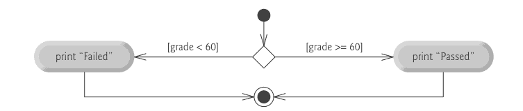

图 3.3 | if...else 双重选择语句 UML 活动图。

如果 `studentGrade` 大于或等于 90，则嵌套 `if...else` 语句中的前四个条件将为真，只有第一部分的语句将执行。在该语句执行后，“最外层”`if...else` 语句的 `else` 部分将被跳过。许多程序员倾向于将上述的嵌套 `if...else` 语句写为：

```java
if (studentGrade >= 90) {
    System.out.println("A");
} else if (studentGrade >= 80) {
    System.out.println("B");
} else if (studentGrade >= 70) {
    System.out.println("C");
} else if (studentGrade >= 60) {
    System.out.println("D");
} else {
    System.out.println("F");
}
```

这两种形式除了间距和缩进外是完全相同的，后一种形式会导致代码右侧产生深层缩进。这种缩进会导致源代码行的剩余空间很少，从而迫使换行。

## 3.6.2 悬空 else (Dangling-else) 问题

在全文中，我们始终将控制语句体包含在大括号 (`{` 和 `}` 中。这避免了一种被称为“悬空 else”的逻辑错误。我们将在练习 3.27–3.29 中研究这个问题。

## 3.6.3 块 (Blocks)

语句通常只在体中期望一个语句。要在 `if` 的体中（或 `if...else` 语句的 `else` 体中）包含多个语句，请将语句包裹在大括号块（例如方法体）中。块可以放置在方法中任何可以放置单个语句的地方。下面的示例在 `if...else` 语句的 `else` 部分包含了一个多个语句的块：

```java
if (grade >= 60) {
    System.out.println("Passed");
} else {
    System.out.println("Failed");
    System.out.println("You must take this course again.");
}
```

在这种情况下，如果 `grade` 小于 60，程序将执行 `else` 体中的两个语句并打印：

Failed

You must take this course again.

注意 `else` 子句中围绕两个语句的大括号。这些大括号是非常重要的。如果没有大括号，语句

`System.out.println("You must take this course again.");`

将位于 `if...else` 语句 `else` 部分之外，并且无论成绩是否小于 60 都会执行。

## 3.7 while 迭代语句

迭代语句允许你指定程序在某些条件保持为真时重复动作。`while` 语句包含的语句构成了它的体，体可以是单个语句，也可以是一个块。最终，条件将变为假（当购买最后一个项目时）。此时，迭代终止，执行 `while` 语句后的第一个语句。

`while` 迭代语句的一个示例，考虑一个寻找第一个大于 100 的 3 倍数的程序片段。在执行以下语句后，乘积结果：

```java
int product = 3;

while (product <= 100) {
    product = 3 * product;
}
```

`while` 语句的每次迭代都会将 `product` 乘以 3，因此 `product` 连续取值为 9、27、81 和 243。当 `product` 变为 243 时，`product <= 100` 变为假。这终止了迭代，因此 `product` 的最终值为 243。此时，程序继续执行 `while` 语句之后的下一个语句。

- **常见编程错误 3.2**: 在 `while` 语句体中没有提供最终会导致 `while` 中的条件变为假的动作，这通常会导致被称为无限循环的逻辑错误（循环永远不会终止）。

### while 语句的 UML 活动图

图 3.4 中的 UML 活动图展示了上述 `while` 语句中的控制流。再次，图中的符号（初始状态、转换、箭头和三个注释除外）代表动作和决策。此图引入了 UML 的合并符号。UML 用菱形同时表示合并符号和决策符号。合并符号将两个活动流合并为一个流。在图图中，合并符号将来自初始状态和动作状态的转换合并，因此它们都进入了决定是否开始（或继续）执行循环的决策。

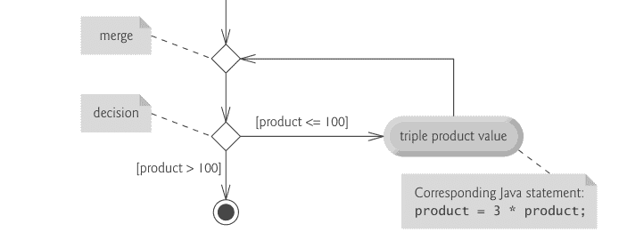

图 3.4 | while 迭代语句 UML 活动图。

## 3.8 算法制定：计数控制迭代

决策符号和合并符号可以通过“输入”和“输出”转换箭头的数量来区分。决策符号有一个箭头指向菱形，并有两个或多个箭头从菱形指向外部，表示从该点可能可能的转换。此外，每个从决策符号出的转换箭头旁边都有一个保护条件（guard condition）。合并符号有两个或多个转换箭头指向菱形，且只有一个箭头从菱形出来，表示多个流合并以继续活动。与合并符号相关的所有转换箭头都没有保护条件。

图 3.4 清晰地展示在本节之前讨论的 `while` 语句的迭代。从动作状态出的转换箭头指向合并节点，程序流从该处跳转到每次迭代开始时测试的决策。循环继续执行，直到保护条件 `product > 100` 变为真。然后 `while` 语句退出（到达最终状态），控制权传递给程序中的下一个顺序语句。

## 3.8 算法制定：计数控制迭代

为了说明算法是如何开发的，我们解决了两个计算学生平均分的变体问题。考虑以下问题描述：

- 有十名学生参加了测验（分数范围为 0–100 的整数），你可以获得这些分数。确定测验的班级平均分。

班级平均分等于总和除以学生人数。在计算机上解决此问题的算法必须输入每个分数，跟踪所有输入分数的总和，执行平均计算并打印结果。

## 计数控制迭代的伪代码算法


让我们使用伪代码来列出动作，并执行计数控制迭代来逐个输入分数。这种技术使用一个名为 `counter`（或控制变量）的变量来控制一组语句执行的次数。计数控制迭代通常被称为确定迭代（definite iteration），在本例中，迭代在计数器超过 10 时终止。本节介绍了一个完全开发的伪代码算法（图 3.5）以及实现该算法的相应 Java 程序（图 3.6）。在第 3.9 节中，我们将演示如何使用伪代码从零开始开发此类算法。

注意图 3.5 算法中对 `total` 和 `counter` 的引用。`total` 是用于累加多个值之和的变量。`counter` 是用于计数的变量——在这种情况下，分数表示用户应该输入 10 个分数中的哪一个。用于存储总和的变量通常在程序中使用之前初始化为零。

## 软件工程观察 3.1

经验表明，在计算机上解决问题最困难的部分是开发解决方案的算法。一旦指定了正确的算法，从其生成可行的 Java 程序通常是直接的。


## 第 3 章 控制语句：第一部分；赋值：++ 和 -- 运算符

- 将 `total` 设置为零
- 将 `gradeCounter` 设置为一
- 当 `gradeCounter` 小于或等于十
- 提示用户输入下一个分数
- 输入下一个分数
- 将分数加到 `total`
- 给 `gradeCounter` 加一
- 将班级平均分设置为 `total` 除以十
- 打印班级平均分

**图 3.5** 使用计数控制迭代解决班级平均分问题的伪代码算法。

### 实现计数控制迭代

在图 3.6 中，`classAverage` 的 `main` 方法实现了图 3.5 伪代码描述的班级平均分算法——它允许用户输入 10 个分数，计算并显示平均分。

```java
// Fig. 3.6: ClassAverage.java
// 使用计数控制迭代解决班级平均分问题。
import java.util.Scanner; // 程序使用 Scanner 类
public class ClassAverage {
    public static void main(String[] args) {
        // 创建 Scanner 以从命令行获取输入
        Scanner input = new Scanner(System.in);
        // 初始化阶段
        int total = 0; // 初始化用户输入的分数的总和
        int gradeCounter = 0; // 初始化待输入的分数数量
        // 处理阶段使用计数控制迭代
        while (gradeCounter < 10) { // 循环 10 次
            System.out.printf("Enter grade: "); // 提示
            int grade = input.nextInt(); // 输入下一个分数
            total = total + grade; // 加到总和
            gradeCounter = gradeCounter + 1; // 计数器加一
        }
        // 终止阶段
        int average = total / 10; // 整数除产生结果
        // 显示分数的总和和平均分
        System.out.printf("%nTotal of all 10 grades is %d\n", total);
        System.out.printf("Class average is %d\n", average);
    }
}
```

**图 3.6** 使用计数控制迭代解决班级平均分问题。（第一部分，共两部分）。

## 3.8 算法制定：计数控制迭代 133

Enter grade: 67

Enter grade: 78

Enter grade: 89

Enter grade: 67

Enter grade: 87

Enter grade: 98

Enter grade: 93

Enter grade: 85

Enter grade: 82

Enter grade: 100

Total of all 10 grades is 846

Class average is 84

**图 3.6** 使用计数控制迭代解决班级平均分问题。（第二部分，共两部分）。

### main 方法局部变量

在图 3.6 中，`classAverage` 的 `main` 方法实现了图 3.5 伪代码描述的班级平均分算法——它允许用户输入 10 个分数，计算并显示平均分。

变量 `total`、`gradeCounter`、`grade` 和 `average` 是 `main` 方法的局部变量。它们只能在 `main` 方法内部访问。

### 终止阶段：计算并显示班级平均分

当循环终止时，第 23 行计算并将结果赋值给变量 `average`。

### 初始化阶段：初始化 total 和计数

在图 3.6 中，第 11-12 行初始化 `total` 和 `gradeCounter`。

### 从用户读取分数

在图 3.6 中，第 15-20 行是从用户读取分数的 `while` 循环。

### 常见错误 3.4

假设整数除法会四舍五入而不是截断会导致错误的结果。例如，在整数运算中得到 1.75 的 7/4 截断为 1。

### 关于算术溢出的说明

在图 3.6 中，第 18 行

```java
total = total + grade; // 将分数加到总和
```

每个增加的分数都会增加 `total` 的值。每条语句都有潜在的问题——整数相加的结果可能是一个 `int` 变量无法存储的值。这被称为算术溢出，会导致未定义行为，从而导致意外的结果，正如在处讨论所示：

> http://en.wikipedia.org/wiki/Integer_overflow#Security_ramifications

## 3.9 算法制定：哨兵值控制迭代

只需搜索指南 "NUM00-J"。该代码使用了 `&&`（逻辑与）和 `||`（逻辑或）运算符，这些运算符在第 4 章中介绍。在工业级代码中，你应该对所有这些计算进行检查。

### 深入理解用户输入

当程序接收用户的输入时，可能会发生各种问题。例如，在 3.6 的第 17 行中

```java
int grade = input.nextInt(); // input next grade
```

我们假设用户输入 0 到 100 范围内的整数分数。然而，输入分数的人可能会输入小于 0 的整数、大于 100 的整数、超出 `int` 变量可存储值范围的整数、包含小数点的数字，或者包含字母或特殊符号的非整数值。

为了确保输入有效，工业级程序必须对所有可能的错误情况进行测试。输入程序的程序应该使用范围检查来验证分数，以确保它们是 0 到 100 之间的值。然后你可以要求用户重新输入任何超出范围的值。如果程序需要从特定的值集中获取输入（例如，非连续的产品代码），你可以确保每个匹配项都符合集合中的值。

让我们将 3.8 的类平均分问题泛化。考虑以下问题：

- 开发一个类平均分程序，每次运行时处理任意数量学生的分数。

在之前的类平均分示例中，问题描述指定了学生人数，分数数量（10个）是预先知的。在这个示例中，没有指示用户在程序执行期间将输入多少个分数。程序必须处理任意数量的分数。它如何确定何时停止输入分数？它如何知道何时计算并打印类平均分？

解决此问题的方法之一是使用特殊的哨兵值（sentinel value，也称为信号值、虚拟值或标志值）来指示“数据输入结束”。用户不断输入分数，直到输入哨兵值表示不再输入更多分数。哨兵值控制迭代通常是因为在循环开始之前不知道迭代次数。

显然，必须选择一个不会与可输入值混淆的哨兵值。对于非负整数，-1 是该问题可以接受的哨兵值。因此，类平均分程序的运行可能会处理如 95, 96, 75, 74, 89 和 -1 在内的输入流。程序将计算并打印分数 95, 96, 75, 74 和 89 的类平均分；由于 -1 是哨兵值，它不应进入平均值计算。

## 使用自顶向下、逐步细化的方法开发伪代码算法：顶层和第一次细化

我们使用一种称为“自顶向下、逐步细化”（top-down, stepwise refinement）的技术来处理这个类平均分程序，这对于开发结构良好的程序至关重要。我们从顶层的伪代码表示开始——一个传达程序整体功能的单一语句：

确定测验的类平均分

顶层实际上是程序的完整表示。遗憾的是，顶层很少能提供足够编写 Java 程序的详细信息。因此，我们现在开始细化过程。我们将顶层划分为一系列较小的任务，并按照执行的顺序列出。这产生了第一次细化，它只使用顺序结构——列出的步骤按顺序一个接一个执行：

- 初始化变量
- 输入、求和并统计测验分数
- 计算并打印类平均分


## 软件工程观察 3.2

每次细化以及顶层本身都是算法的完整规范——只是详细程度不同。


## 软件工程观察 3.3

许多程序逻辑上可以分为三个阶段：初始化变量的初始化阶段；输入数据值并相应调整变量的处理阶段；以及计算并输出结果的终止阶段。

### 进入第二次细化

上述的软件工程观察是你在自顶向下过程中进行第一次细化所需要的所有内容。要进入第二次细化，我们必须确定特定的变量。在这个示例中，我们需要一个数字的运行总和、一个记录已处理数字数量的计数器、一个接收用户输入的每个分值的变量，以及一个存储计算出的平均值的变量。伪代码语句

初始化变量

可以细化为如下：

- 初始化 `total` 为零
- 初始化 `counter` 为零

只有变量 `total` 和 `counter` 需要在它们被使用之前初始化。变量 `average` 和 `grade`（分别用于计算的平均值和用户输入）不需要初始化，因为它们的值在计算或输入时会被替换。

伪代码语句

输入、求和并统计测验分数

需要迭代来连续输入每个分数。我们不知道会输入多少个分数，所以我们将使用哨兵值控制迭代。用户一个接一个输入。在输入最后一个分数后，用户输入哨兵值。程序在每个分数输入后都会检查哨兵值，并在用户输入哨兵值时终止循环。上述伪代码语句的第二次细化是：

```
提示用户输入第一个分数
输入第一个分数（可能是哨兵值）
当用户未输入哨兵值
将此分数累入运行总和
counter 加 1
提示用户输入下一个分数
输入下一个分数（可能是哨兵值）
```

在伪代码中，我们不为 While 结构使用大括号。我们通过缩进语句显示它们属于 While。伪代码语句

计算并打印类平均分

可以细化为：

```
如果 counter 不等于零
将 total 除以 counter 得到 average
打印 average
否则
打印“未输入分数”
```

我们仔细测试除以零的可能性——这种错误如果没有被发现，会导致程序失败或产生无效输出。类平均分问题的完整细化如图 3.7 所示。


> **预防技巧 3.4**
>
> 执行除法 (`/`) 或取模 (`%`) 操作时，如果右操作数为零，请对此进行测试并处理（例如显示错误消息）。

> 1 初始化为零
>
> 2 初始化 counter 为零
>
> 3
>
> 4 提示用户输入第一个分数
>
> 5 输入第一个分数（可能是哨兵值）
>
> 6
>
> 7 当用户未输入哨兵值
>
> 8 将此分数累入运行总和
>
> 9 counter 加 1
>
> 10 提示用户输入下一个分数
>
> 11 输入下一个分数（可能是哨兵值）
>
> 12
>
> 13 如果 counter 不等于零
>
> 14 将 total 除以 counter 得到 average
>
> 15 打印 average
>
> 16 否则
>
> 17 打印“未输入分数”
>
> Fig. 3.7 | 使用哨兵值控制迭代的类平均分伪代码

在图 3.5 和图 3.7 中，我们在伪代码中包含了空行和缩进以提高可读性。空行将算法分为不同的阶段；缩进强调了控制语句体。图 3.7 中的伪代码解决了通用类平均分问题。该算法是在两次细化后开发的。


## 软件工程观察 3.4

当你指定的伪代码细节足够足够转换为 Java 时，就可以停止自顶向下、逐步细化的过程。通常，实现 Java 程序是简单的。


## 软件工程观察 3.5

某些程序员不使用伪代码等程序开发工具。他们认为最终目标是在计算机上解决问题，编写伪代码会推迟最终输出的产生。虽然这对于简单熟悉的问题有效，但在大型复杂的项目中会导致严重的错误和延迟。

## 实现哨兵值控制迭代

在图 3.8 中，`main` 方法实现了图 3.7 的伪代码算法。每个分数都是整数，换句话说，平均值计算可能会产生带有小数点的数字，`int` 类型无法表示这种数字，因此本类使用 `double`。你还会看到控制语句可以堆叠（顺序执行）。`while` 语句（图 3.8，20-27 行）后面是 `if-else` 语句（31-42 行）。该程序的大部分代码与图 3.6 相同，因此我们关注新概念。

## 哨兵值控制迭代与计数控制迭代的逻辑

第 12 行将 `gradeCounter` 初始化为 0，因为还没有输入分数。然而，为了准确记录输入的数的数量，程序只在用户输入有效分数时才增加 `gradeCounter` 的值。

## 浮点数的精度和内存要求

大多数平均值都不是整数。因此，本示例将类平均分计算为浮点数——带有小数点的数字，例如 43.95，0.0–129.8873。Java 提供了两种在内存中存储浮点数的类型——`float` 和 `double`。`float` 类型的变量表示单精度浮点数，可以存储最多七位有效数字。`double` 类型的值表示双精度浮点数。这两种类型需要的内存是 `float` 变量的两倍，可以存储最多十五位有效数字——大约是 `float` 变量精度的两倍。

大多数程序员使用 `double`。事实上，Java 默认将你在源代码中输入的浮点数（如 7.33 和 0.0975）视为 `double` 值。源代码中的值被称为浮点数字面量。参见附录 D 原始类型，获取 `float` 和 `double` 的精确值范围。

## 哨兵值控制重复与计数控制重复的逻辑

将此处使用的哨兵值控制迭代逻辑与图 3.6 中使用的计数控制迭代进行比较。在计数控制迭代中，`while` 语句

## 3.9 算法制定：哨兵控制迭代

```java
// Fig. 3.8: ClassAverage.java
// 使用哨兵控制迭代解决课程平均分问题。
import java.util.Scanner; // 程序使用了 Scanner
public class ClassAverage {
    public static void main(String[] args) {
        // 创建 Scanner 以从命令行窗口获取输入
        Scanner input = new Scanner(System.in);
        // 初始化阶段
        int total = 0; // 初始化总和
        int gradeCounter = 0; // 初始化已输入的成绩数量

        // 处理阶段
        // 提示输入并从用户处读取成绩
        System.out.print("Enter grade or -1 to quit: ");
        int grade = input.nextInt();

        // 循环直到从用户处读取哨兵值
        while (grade != -1) {
            total = total + grade; // 将成绩加总总
            gradeCounter = gradeCounter + 1; // 计数加1
            // 提示输入并从用户处读取下一个成绩
            System.out.print("Enter grade or -1 to quit: ");
            grade = input.nextInt();
        }

        // 终止阶段
        if (gradeCounter != 0) {
            // 使用带小数点的数字计算成绩平均分
            double average = (double) total / gradeCounter;
        } else {
            // 如果没有输入成绩，输出相应消息
            System.out.println("No grades were entered");
        }
    }
}
```

输入成绩或 -1 退出: 97

输入成绩或 -1 退出: 88

输入成绩或 -1 退出: 72

输入成绩或 -1 退出: -1

输入的3个成绩总和为 257

课程平均分数为 85.67

**图 3.8** 使用哨兵控制迭代解决课程平均分问题。


图 3.6 的第 15–20 行根据指定的迭代次数从用户处读取值。在哨兵控制迭代中，程序在 `while` 循环之前会读取第一个值（图 3 的第 16–17 行）。该值决定了程序的控制流是否应该进入 `while` 循环。如果条件为假，则用户输入了哨兵，因此 `while` 循环体不执行（即没有输入成绩）。另一方面，如果 `while` 执行，循环会将成绩加到总和中并增加 `gradeCounter`（第 21–22 行）。接下来，循环体括号（27行）内的第 25–26 行通过 `while` 条件（20行）继续执行，该条件使用了用户最近一次输入的成绩。`grade` 的值始终在程序测试 `while` 条件之前立即从用户处输入，因此程序可以在处理该值之前确定刚刚输入的值是否为哨兵值（即：是否将其加到总和中！）。如果输入了哨兵值，循环终止，程序不会将 -1 加到总和中。

## 良好的编程实践 3.3

在哨兵控制循环中，提示信息应当提醒用户哨兵。


循环结束后，第 31–42 行的 `if...else` 语句执行。如果没有输入，`if...else` 语句的 `else` 部分（40–42行）执行并显示消息“No grades were entered”，然后程序终止。

## while 语句中的大括号

注意图 3.8 中 `while` 语句的块（第 20–27 行）。如果没有大括号，循环体仅包含第一条语句，即将成绩加到总和的语句。最后三个语句将落在循环体之外，导致程序错误地解释代码为：

```java
while (grade != -1)
    total = total + grade; // 将成绩加总
    gradeCounter = gradeCounter + 1; // 计数加1

    // 提示输入并从用户处读取下一个成绩
    System.out.print("Enter grade or -1 to quit: ");
    grade = input.nextInt();
```

如果用户在第 17 行（`while` 语句之前）没有输入哨兵 -1，上述代码会导致程序出现无限循环。

## 常见编程错误 3.5

省略大括号会将代码块限制为逻辑错误，例如无限循环。为了防止这个问题，一些程序员会将每个控制语句的体封装在大括号中，即使该体只包含一条语句。

## 原始类型之间的显式和隐式转换

如果至少输入了一个成绩，图 3.8 的第 33 行会计算成绩的平均值。回想 36，整数除法产生整数结果。即使变量 `average` 被声明为 `double`，如果我们把平均值计算写成：

```java
double average = total / gradeCounter;
```

在除法结果赋值给 `average` 之前，它会丢失商的小数部分。这是因为 `total` 和 `gradeCounter` 都是整数，除法产生整数结果。

## 3.9 算法制定：哨兵控制迭代

大多数平均值都不是整数（例如 0、-22 和 1024）。因此，在这个示例中，我们将课程平均分作为浮点数。为了执行浮点运算，我们必须临时将整数视为浮点数。在包含 `int` 和 `double` 的表达式中，Java 将操作数提升为 `double`。例如，在本例中，`gradeCounter` 被提升为 `double`，然后执行浮点除法。

## 常见错误 3.6


强制转换运算符可用于数值类型之间的转换，例如 `int` 和 `double`。转换为错误的类型会导致编译错误或运行时错误。

通过在类型名称周围加上括号来形成转换。

图 3.8 的第 38 行显示课程平均分。在本示例中，我们将课程平均分舍入到最近的百分位。`printf` 格式控制字符串中的格式说明符 `.2f` 表示平均值应小数点后显示两个数字。`printf` 方法使用格式说明符中的精度将值舍入到指定的位数。在此程序中，平均值被舍入到百分分位，并显示为 85.67。

## 浮点精度数字

浮点数并不总是 100% 精确的，但它们有许多应用。例如，当我们说体温正常为 98.6 时，我们不需要精确到很多位数。当我们从温度计上读取的温度为 98.5999473210643 时，将这个数字简单地称为 98.6 对于大多数涉及体温的应用都是足够的。

## 142 第 3 章 控制语句：第一部分；赋值；++ 和 -- 运算符

浮点数通常是除法运算的结果，例如本示例中的班级平均分计算。在常规算术中，我们将 10 除以 3，结果是 3.3333333...，数字 3 的序列无限重复。计算机只为此类值分配固定大小的存储空间，因此存储的浮点值可能是一个近似值。

由于浮点数的不精确性，`double` 类型比 `float` 类型更受青睐，因为 `double` 变量可以更准确地表示浮点数。出于这个原因，我们在书中主要使用 `double`。在某些应用中，`float` 和 `double` 变量的精度可能不够。对于精确的浮点数（例如货币计算所需的数字），Java 提供了 `BigDecimal`（位于 `java.math` 包），我们将在第 8 章讨论它。

## 常见编程错误 3.7

以假设浮点数被精确表示的方式来使用它们会导致错误的结果。

## 3.10 制定算法：嵌套控制语句

对于下一个示例，我们将再次通过使用伪代码和自顶向下、逐步细化的方法来制定算法，并编写相应的 Java 程序。我们已经看到控制语句可以相互嵌套（顺序执行）。在这种情况下，我们检查控制语句连接的另一种唯一方式——即将一个控制语句嵌套在另一个控制语句内部。

考虑以下问题：

某大学提供一门课程，为学生参加房地产经纪人执业考试做准备。后来，完成这门课程的十名学生参加了考试。大学想知道学生在考试中的表现如何。你被要求编写一个程序来总结结果。你得到了这 10 名学生的列表。在每个名字旁边，如果学生通过考试则为 1，如果未通过则为 2。

你的程序应如下所示分析考试结果：

1. 输入每个测试结果（即 1 或 2）。每当程序请求测试结果时，在屏幕上显示“Enter result”（输入结果）。
2. 统计每种测试结果的数量。
3. 显示测试结果的摘要，说明通过和未通过的人数。
4. 如果超过八名学生通过了考试，打印“Bonus to instructor!”（给老师发奖金！）。

在仔细阅读题述后，我们得出了以下观察：

1. 程序必须处理 10 名学生的测试结果。可以使用计数器控制循环，因为测试结果的数量是预先已知的。
2. 每个测试结果都有数值——要么是 1，要么是 2。每次读取测试结果时，程序必须判断它是 1 还是 2。我们在算法中测试是否为 1。如果该数字不是 1，我们假设它是 2。（练习 3.24 考虑了这一假设的后果）
3. 使用两个计数器来跟踪考试结果：一个用于统计通过的人数，另一个用于统计未通过的人数。
4. 在程序处理完所有结果后，它必须判断是否有超过八名学生通过了考试。

让我们从顶部的表示开始自顶向下逐步细化：

> 分析考试结果并决定是否应该支付奖金

再次，程序是程序的完整表示，但在伪代码自然演变为 Java 程序之前，可能需要进行几次细化。我们的第一次细化是：

- 初始化变量
- 输入 10 个考试结果，并统计通过和失败的数量
- 打印考试结果摘要并决定是否应该支付奖金

在这里，尽管我们有了程序的完整表示，但仍需进一步细化。我们现在确定具体的变量。需要计数器来记录通过和失败，一个计数器将用于控制循环过程，一个变量用于存储用户输入。存储用户输入的变量在算法开始时没有初始化，因为它的值在循环的每次迭代中输入。伪代码语句 `Initialize variables`（初始化变量）可以细化为：

- 将通过数初始化为零
- 将失败数初始化为零
- 将学生计数器初始化为一

注意，算法开始时只有计数器被初始化。伪代码语句

> Input the 10 exam results, and count passes and failures（输入10个考试结果并统计通过和失败的数量）

需要一个循环来连续输入每次考试的结果。我们预先知道恰有 10 个考试结果，因此计数器控制循环是合适的。在循环内部（即嵌套在循环中），一个双选择结构将确定考试结果是通过还是失败，并增加相应的计数器。前一个伪代码语句的细化如下：

> 如果学生计数器小于或等于 10
> - 提示用户输入下一个考试结果
> - 如果学生通过了
>   - 将通过数加 1
> - 否则
>   - 将失败数加 1
> - 给学生计数器加 1

我们使用空行来隔离 If...Else 控制结构，以提高可读性。

## 144 第 3 章 控制语句：第一部分；赋值，++ 和 -- 运算符

伪代码语句 `Print a summary of the exam results and decide whether a bonus should be paid`（打印考试结果摘要并决定是否支付奖金）可以细化如下：

```
打印通过的数量
打印失败的数量
如果超过八名学生通过了
打印 "Bonus to instructor!"
```

### 伪代码的完整第二次细化及转换为 Java

完整的第二次细化见图 3.9。同样使用了空行来提高可读性。

- 将通过数初始化为零
- 将失败数初始化为零
- 将学生计数器初始化为一
- 当学生计数器小于或等于 10
- 提示用户输入下一个考试结果
- 如果学生通过了
- 将通过数加 1
- 否则
- 将失败数加 1
- 给学生计数器加 1
- 打印通过的数量
- 打印失败的数量
- 如果超过八名学生通过
- 打印 "Bonus to instructor!"

**错误预防 3.5**：声明时初始化局部变量可以避免由于使用未初始化变量引起的编译错误。Java 不要求在声明时包含初始化。

## 3.10 制定算法：嵌套控制语句

```java
// 图 3.10 Analysis.java
// 使用嵌套控制语句分析结果。
import java.util.Scanner; // 类使用 Scanner
public class Analysis {
    public static void main(String[] args) {
        // 创建 Scanner 从命令行获取输入
        Scanner input = new Scanner(System.in);

        // 在声明中初始化变量
        int passes = 0;
        int failures = 0;
        int studentCounter = 1;

        // 使用计数器循环处理10名学生
        while (studentCounter <= 10) {
            // 提示用户输入并从用户处获取值
            System.out.print("Enter result (1 = pass, 2 = fail): ");
            int result = input.nextInt();
            if (result == 1) {
                passes += 1;
            } else {
                failures = failures + 1;
            }

            // 增加 studentCounter最终终止
            studentCounter = studentCounter + 1;
        }

        // 终止阶段：准备并显示结果
        System.out.printf("Passed: %d\nFailed: %d\n", passes, failures);
        // 判断是否有超过8名学生通过
        if (passes > 8) {
            System.out.println("Bonus to instructor!");
        }
    }
}
```

```
Enter result (1 = pass, 2 = fail): 1
Enter result (1 = pass, 2 = fail): 2
Enter result (1 = pass, 2 = fail): 1
Enter result (1 = pass, 2 = fail): 1
Enter result (1 = pass, 2 = fail): 1
Enter result (1 = pass, 2 = fail): 1
Enter result (1 = pass, 2 = fail): 1
Enter result (1 = pass, 2 = fail): 1
Enter result (1 = pass, 2 = fail): 1
Enter result (1 = pass, 2 = fail): 1
Passed: 9
Failed: 1
Bonus to instructor!
```

图 3.10 使用嵌套控制语句分析考试结果。（第一部分，共2部分。）

# 146 第3章 控制语句：第一部分；赋值运算符：++ 和 -- 运算符

```
Enter result (1 = pass, 2 = fail): 1
Enter result (1 = pass, 2 = fail): 2
Enter result (1 = pass, 2 = fail): 1
Enter result (1 = pass, 2 = fail): 2
Enter result (1 = pass, 2 = fail): 1
Enter result (1 = pass, 2 = fail): 2
Enter result (1 = pass, 2 = fail): 1
Enter result (1 = pass, 2 = fail): 1
Passed: 4
Failed: 4
```

**图 3.10** | 使用嵌套控制对考试结果进行分析。（第 2 部分）

`while` 语句（16–31行）循环 10 次。在每次迭代中，循环会输入并处理一个结果。用于处理每个结果的 `if...else` 语句嵌套在 `while` 语句中。如果结果为 1，则 `if...else` 语句增加通过人数；否则，它假设结果为 2 并增加失败人数。第 30 行在第 16 行再次测试条件之前增加了 `studentCounter`。在输入 10 个值后，循环终止，第 34 行显示通过人数和失败的人数。第 37–39 行的语句判断是否有超过八名学生通过考试，如果是，则输出消息“Bonus to instructor!”（给导师奖励！）。

图 3.10 显示了程序两次示例执行的输入和输出。在第一次执行中，`main` 方法第 37 行的条件为真——超过八名学生通过了考试，因此程序输出了一条消息来奖励导师。

## 3.11 复合赋值运算符

复合赋值运算符允许你简化赋值表达式。例如，你可以将语句

```java
c = c + 3; // 给 c 加上 3
```

使用加法复合赋值运算符 `+=` 写为

```java
c += 3; // 更简洁地给 c 加上 3
```

`+=` 运算符将右侧表达式的值加到左侧变量的值，并将结果存储在左侧变量中。因此，赋值表达式 `c += 3` 等于 `c = c + 3`。通常，像下面的语句

```java
variable = variable operator expression;
```

其中 `operator` 是二元运算符之一、`+`、`-`、`*`、`/` 或 `%`（我们将在文中稍后讨论），并且同一个变量名可以使用如下形式

```java
variable operator= expression;
```

图 3.11 显示了算术复合赋值运算符、使用运算符的示例以及运算符作用的说明。务必完成自测练习 3.1(g) 以了解复合赋值运算符的一个微妙特性。

## 3.12 递增和递减运算符

| 赋值运算符 | 示例表达式 | 说明 | 赋值结果 |
| :--- | :--- | :--- | :--- |
| *假设:* `int c = 3, d = 5, e = 4, g = 12;` | | | |
| `+=` | `c += 7` | `c = c + 7` | 10 赋值给 c |
| `-=` | `d -= 4` | `d = d - 4` | 1 赋值给 d |
| `*=` | `e *= 5` | `e = e * 5` | 20 赋值给 e |
| `/=` | `f /= 3` | `f = f / 3` | 2 赋值给 f |
| `%=` | `g %= 9` | `g = g % 9` | 3 赋值给 g |

图 3.11 | 算术赋值运算符。

Java 提供了两个单目运算符（总结于图 3.12），用于对数值加 1 或减 1。这些是单目递增运算符 `++` 和单目递减运算符 `--`。程序可以使用递增运算符 `++` 将变量 `c` 的值加 1，而不是使用表达式 `c = c + 1` 或 `c += 1`。位于变量（之前）的递增或递减运算符分别称为前缀递增运算符或前缀递减运算符。位于变量（之后）的递增或递减运算符分别称为后置递增运算符或后置递减运算符。

| 运算符 | 示例表达式 | 说明 |
| :--- | :--- | :--- |
| `++` (前缀递增) | `++a` | 将 `a` 加 1，然后在 `a` 所在的表达式中使用 `a` 的新值。 |
| `++` (后置递增) | `a++` | 在 `a` 所在的表达式中使用 `a` 的当前值，将 `a` 加 1。 |
| `--` (前缀递减) | `--b` | 将 `b` 减 1，然后在 `b` 所在的表达式中使用 `b` 的新值。 |
| `--` (后置递减) | `b--` | 在 `b` 所在的表达式中使用 `b` 的当前值，然后将 `b` 减 1。 |

图 3.12 | 递增和递减运算符。


# 使用前缀递增（或递减）运算符对变量加 1（或减 1）被称为前递增（或前递减）

这会导致变量增加（或减少）1；然后在该变量出现的表达式中使用该变量的新值。使用后置递增（或递减）运算符对变量加 1（或减 1）被称为后递增（或后递减）。这会导致变量的当前值用于它所在的表达式；然后变量的值增加（或减少）1。

# 第3章 控制语句：第一部分；赋值；++ 和 -- 运算符

| 运算符 | | | 结合性 | 类型 |
|---|---|---|---|---|
| `++` | `--` | | 从右到左 | 一元后置 |
| `++` | | `(type)` | 从右到左 | 一元前置 |
| `*` | `/` | `%` | 从左到右 | 乘法 |
| `+` | | | 从左到右 | 加法 |
| `<` | `<=` | `>` | `>=` | 从左到右 | 关系 |
| `==` | `!=` | | | 从左到右 | 等于 |
| `?:` | | | 从右到左 | 条件 |
| `=` | `+=` | `*=` | `%=` | 从右到左 | 赋值 |

**图 3.14** 目前讨论过的运算符的优先级和结合性。

## 3.13 基本类型

附录 D 列出了 Java 中的八种基本类型。与 C 和 C++ 不同，Java 要求所有变量都有类型[^2]。

在 C 和 C++ 中，程序员经常需要编写不同版本的程序来支持不同的计算机平台，因为基本类型无法保证在不同计算机之间是完全相同的。例如，一台机器上的 `int` 可能用 16 位（2 字节）内存表示，在第二台机器上用 32 位（4 字节），而在另一台机器上用 64 位（8 字节）。在 Java 中，`int` 值始终是 32 位（4 字节）。

> **移植性提示 3.1**
>
> Java 的基本类型在所有支持 Java 的计算机平台上具有移植性。


附录 D 中的每种类型都列出了其位数（共有八种类型）和取值范围。由于 Java 设计者希望确保移植性，他们使用了国际认可字符格式标准（Unicode；更多信息请访问 `http://www.unicode.org`）和浮点数标准（IEEE 754；信息请访问 `http://grouper.ieee.org/groups/754/`）。

## 3.14 总结

本章介绍了解决问题的方法。我们演示了如何构建算法（即解决问题的方法），然后如何通过几个阶段的伪代码来完善算法，最终生成可以作为方法一部分执行的 Java 代码。本章展示了如何使用自顶向下的逐步细化方法来规划方法必须执行的特定动作以及方法执行这些动作的顺序。

开发任何解决问题的算法只需要三种类型的控制结构：顺序、选择和迭代。具体来说，本章演示了 `if` 选择语句和 `while` 迭代语句。这些是构建许多问题解决方案的基石。我们使用了控制语句堆叠来通过计数器和哨兵控制的迭代计算一组学生成绩的总分和平均分，并使用了控制语句嵌套来根据一组考试结果进行分析和决策。我们引入了 Java 的复合赋值运算符以及增/减运算符。最后，我们讨论了 Java 的基本类型。在第 4 章中，我们将继续讨论控制语句，引入 `for`、`do...while` 和 `switch` 语句。

[^2]: 我们将在第 17 章“Lambda 表达式与流”中看到此规则的例外。

# 总结

### 第 3.1 节 引言

- 在编写解决问题的程序之前，你必须对问题有彻底的理解，并有一个计划好的解决方法。你还必须理解可构建模块并采用程序构建技术。

### 第 3.2 节 算法

- 任何计算问题都可以通过按特定执行一系列动作（第 121 页）来解决。
- 根据要执行的动作及其执行顺序来解决问题的程序称为算法（第 121 页）。
- 规定程序中语句执行的顺序称为程序控制（第 121 页）。

### 第 3.3 节 伪代码

- 伪代码（第 122 页）是一种非正式语言，可以帮助你开发算法，而无需担心 Java 语法的严苛细节。
- 伪代码不是一种真正的编程语言。当然，你可以使用自己的母语言来开发你自己的伪代码。
- 在尝试用编程语言（如 Java）编写程序之前，伪代码可以帮助你“理清”程序的逻辑。
- 准备充分的伪代码可以很容易转换为 Java 程序。

### 第 3.4 节 控制结构

#### 第 3.4.1 节 Java 中的结构

- 顺序结构是内置在 Java 中的。除非另有指示，否则计算机将按照编写的顺序一个一个执行语句——即顺序执行。
- 在可以放置任何单个动作的地方，可以放置多个动作。
- 活动图（第 123 页）是 UML 的一部分。活动图对软件系统的工作流（第 123 页；也称为活动）进行建模。
- 活动图由符号（第 123 页）组成——动作风格的符号、菱形和小实圆——这些符号由转换箭头连接，箭头代表活动的流向。
- 动作状态（第 123 页）包含指定要执行特定动作的动作表达式。
- 活动图中的箭头表示转换，指示了动作状态所代表的动作发生的顺序。
- 位于活动图顶部的实心圆表示初始状态（第 123 页）——程序执行动作之前工作流的开始。
- 位于图底部的实心圆表示结束状态（第 123 页）——程序执行动作后工作流的结束。
- 带圆角的矩形是 UML 符号——描述符号目的的标记。

#### 第 3.4.2 节 Java 中的选择语句

- Java 有三种类型的选择语句（第 124 页）。
- `if` 选择语句（第 124 页）选择一个或多个动作。
- `if...else` 双选择语句在两个动作或动作组之间选择。
- `switch` 选择语句（第 124 页）在许多不同的动作或动作组中选择。

#### 第 3.4.3 节 Java 中的迭代语句

- Java 提供了 `while`、`do...while` 和 `for` 迭代语句，允许程序只要循环条件为真就选择。
- `while` 和 `for` 语句根据其循环条件（第 124 页）执行体体零或多次。`do...while` 语句执行一次或多次。
- `if`、`else`、`switch`、`while` 和 `do` 是 Java 关键字。关键字不能用作标识符（变量名）。

#### 第 3.4.4 节 Java 控制语句总结

- 每个程序通过组合合适的顺序、选择和迭代语句（第 124 页）形成，以实现相应的算法。
- 单入口单出口控制语句（第 124 页）通过将一个的出口点连接到另一个的入口点相互连接。这被称为控制语句堆叠。
- 控制语句也可以嵌套（第 124 页）在另一个控制语句内部。

### 第 3.5 节 if 单选择语句

- 程序使用选择语句在不同的方案之间进行选择。
- 单选择语句的活动图包含菱形符号，表示要做出决策。工作流根据符号相关的守卫条件（第 125 页）遵循路径。如果条件为真，工作流进入转换箭头指向的动作状态。
- `if` 语句是单入口单出口控制语句。

### 第 3.6 节 if...else 双选择语句

- `if` 单选择语句在条件为真时执行其语句体。
- `if...else` 双选择语句在条件为真时执行一个动作（或动作组），在条件为假时执行另一个动作（或动作组）。

#### 第 3.6.1 节 嵌套 if...else 语句

- 程序可以使用嵌套的 `if...else` 语句测试多个情况（第 127 页）。

### 第 3.6.2 悬空 else 问题 (Dangling-else Problem)

- 除非通过大括号明确说明，否则 Java 编译器会将 `else` 与紧邻之前的 `if` 关联。

### 第 3.6.3 块 (Blocks)

- 语句块（第 128 页）可以放置在任何可以放置单个语句的地方。
- 逻辑错误（第 129 页）在执行时产生。致命逻辑错误（第 129 页）会导致程序失败并提前终止。非致命逻辑错误（第 129 页）允许程序继续执行，但它会产生错误的结果。
- 正如块可以放置在任何放置单个语句的地方，你也可以使用空语句，通过在通常放置语句的地方放置分号 `;` 来表示。

### 第 3.6.4 三元运算符 (?:)

- 三元运算符 `?:`（第 129 页）接受三个操作数。这三个操作数与 `?:` 符号共同构成了一个条件表达式（第 129 页）。第一个操作数（`?` 左侧）是一个布尔表达式，第二个是条件为真时的条件表达式值，第三个是条件为假时的条件表达式值。
- UML 的合并（merge，第 130 页）将两个活动流合并为一个流。
- 决策符号和合并符号通过输入和输出转换的数量来区分。决策符号有一个指向菱形的转换，以及两个或多个从菱形指向外部的转换，用以表示转换。每个从决策符号指向外部的转换箭头都有一个守卫条件（guard condition）。合并符号有两个或多个指向菱形的转换，且只有一个从菱形指向外部的转换，表示活动流合并以继续活动。与合并符号相关的任何转换都不具有守卫条件。

### 第 3.7 节 while 迭代语句

- `while` 迭代语句（第 130 页）允许你指定程序在某些条件保持为真之前重复执行。
- UML 的合并（merge，第 130 页）将两个活动流合并为一个流。

### 第 3.8 节 算法制定：计数控制循环 (Counter-Controlled Iteration)

- 计数控制循环（第 131 页）使用变量（或控制变量）来控制一组语句执行的次数。
- 计数控制循环通常称为确定迭代（definite iteration，第 131 页），因为迭代次数在循环开始前就已经已知。
- 总和（total，第 131 页）允许你累加几个变量的和。用于存储总和的变量通常在程序中使用之前初始化为零。
- 局部变量的声明必须出现在该方法使用该变量之前。局部变量不能在声明它的方法之外访问。
- 两个整数相除的结果是除——计算的小数部分会被截断。

### 第 3.9 节 算法制定：哨兵控制循环 (Sentinel-Controlled Iteration)

- 在哨兵控制循环（第 135 页）中，使用特殊值（也称为信号值、哑值或标记值）来指示“数据输入结束”。
- 必须选择一个不会与接受的输入值混淆的哨兵值。
- 自顶向下逐步细化（top-down, stepwise refinement，第 135 页）对于开发结构良好的程序至关重要。
- 除以零是一个逻辑错误。
- 要使用整数值进行浮点计算，将其中一个整数转换为 `double` 类型。

### 第 3 章 控制语句：第一部分；赋值；++ 和 -- 运算符

- Java 只知道如何评估操作数类型完全相同的算术表达式。为了确保这一点，Java 对选定的操作数执行一种名为“提升”（promotion）的操作。
- 一元强制类型运算符通过在类型名称周围放置括号来形成。

### 第 3.11 节 复合赋值运算符

- 复合赋值运算符（第 146 页）是赋值的简写。形式为 `variable = variable operator expression;` 的语句（其中 `operator` 是二元运算符 `+`、`-`、`*` 或 `%` 之一）可以写成 `variable operator=` 的形式。
- `+=` 运算符将运算符右侧表达式的值加上运算符左侧的值，并将结果存储在运算符左侧的变量中。

### 第 3.12 节 增减运算符

- 一元递增运算符 `++` 和递减运算符 `--` 在数值变量的值上加 1 或减 1（第 147 页）。
- 前置于变量（prefix，第 147 页）的递增或递减运算符分别是前置递增运算符或前置递减运算符。后置于变量（suffix，第 147 页）的递增或递减运算符分别是后置递增运算符或后置递减运算符。
- 使用前置递增或递减运算符加或减 1 分别是前递增（preincrementing）或前递减（predecrementing）。
- 前递增变量允许变量加或减 1；然后变量的新值将用于它所在的表达式中。
- 使用后置递增或递减运算符加或减 1 分别是后递增（postincrementing）或后递减（postdecrementing）。
- 后递增或后递减会导致变量的值在它所在的表达式中使用；然后变量的值加 1 或减 1。
- 在语句本身中对变量进行递增或递减时，前置和后置递增的效果相同，前置和后置递减的效果相同。

### 第 3.13 节 基本类型 (Primitive Types)

- Java 要求所有变量必须有类型。
- Java 使用 IEEE 754 浮点数标准。

# 自习练习

## 3.2 判断下列陈述的正确或错误。如果是错误的，请解释原因。

a) 算法是解决问题的步骤，按照它们的执行顺序排列。
b) 包含在括号内的语句集被称为块。
c) 选择语句在条件保持为真时重复执行。
d) 嵌套语句出现在任何其他语句的体内。
e) Java 提供复合赋值运算符 `+=`、`-=`、`*=` 和 `%=`。
f) 基本类型 `boolean`、`char`、`byte`、`short`、`int`、`float` 和 `double` 是移植的。
g) 指定哪些语句执行被称为控制。
h) 一元转换运算符 `(double)` 创建操作数的临时副本。
i) 变量默认赋予真值。
j) 伪代码帮助你在编写程序之前进行思考。

## 3.3 写四个语句，每个给变量加 1。

## 3.4 写 Java 语句完成以下操作：

a) 使用一个语句将 `x + y` 的和赋值给 `z`，然后将 `x` 加 1。
b) 测试 `count` 是否大于 10。如果是，打印“Count is greater 10”并将结果存储在 `count` 中。
c) 使用一个语句将 `x` 减 1，然后从 `total` 中减去它并将结果存储在 `total` 中。
d) 计算 `d` 除以 `divisor` 的余数，并将结果赋值给 `q`。用两种不同的方式编写。

## 3.5 写语句完成以下操作：

a) 声明变量 `sum` 类型为 `int` 并初始化为 0。
b) 声明变量 `x` 类型为 `int` 并初始化为 1。
c) 将 `x` 加到 `sum`，并将结果赋值给 `sum`。
d) 打印“The value is:”，随后是 `sum` 的值。

## 3.6 将你在练习 3.5 中写的语句组合成 Java 程序，计算并打印从 1 到 10 的整数和。使用 `while` 语句循环计算和递增。循环在 `x` 的值变为 11 时终止。

## 3.7 在执行语句 `product *= x++;` 后，确定各个变量的值。假设所有变量都是 `int` 类型且值为 5。

## 3.8 识别并纠正以下代码段中的错误——假设所有变量已正确声明和初始化：

a)
```java
while (c <= 5) {
    product *= c;
    c++;
}
```

b)
```java
if (gender == 1) {
    System.out.println("Woman");
} else {
    System.out.println("Man");
}
```

## 3.9 下面的 while 语句哪里有错？

```java
while (z >= 0) {
    sum += z;
}
```

# 自测习题答案

## 3.1

a) 顺序（sequence）、选择（selection），
b) `if...else`。
c) 计数控制（或确定）。
d) 哨兵（sentinel）、信号（signal）、标志（flag）或哑（dummy）。
e) 顺序结构。
f) 前缀（prefixed）。
g) [注意：你可能认为赋值语句会导致编译错误。Java 语言规范规定，复合运算符会对右侧表达式进行隐式转换，以匹配运算符左侧变量的类型。因此，计算出的值 5 + 3.3 = 8.3 实际上被转换为 `int` 值 8]。

## 3.2

a) 正确。
b) 错误。包含在一对大括号 `{` 和 `}` 内的语句组称为块（block）。
c) 错误。迭代语句指定当某个条件仍为真时重复执行某操作。
d) 正确。
e) 正确。
f) 错误。基本类型（`boolean`、`char`、`byte`、`short`、`int`、`long`、`float` 和 `double`）在所有支持 Java 的平台上都是可移植的。
g) 正确。
h) 错误。一元运算符 `(double)` 会为其操作数创建一个临时浮点数副本。
i) 错误。`boolean` 类型的实例变量默认赋值为 `false`。
j) 正确。

## 3.3 给 x 加 1 的四种方法：

```java
x = x + 1;
x += 1;
++x;
x++;
```

## 3.4 答案：

a) `z = x++ + y;`

b)
```java
if (count > 10) {
    System.out.println("Count is greater than 10");
}
```

c) `total -= --x;` 或 `total = total - --x;`

d)
```java
q %= divisor;
q = q % divisor;
```

## 3.5 答案：

a) `int sum = 0;`
b) `int x = 1;`
c) `sum += x;` 或 `sum = sum + x;`
d) `System.out.printf("The sum is: %d%n", sum);`

## 3.6 习题 3.6 的答案如下：

```java
// Exercise 3.6: Calculate.java
// 计算 1 到 10 的整数之和
public class Calculate {
    public static void main(String[] args) {
        int sum = 0;
        int x = 1;

        while (x <= 10) { // 当 x 小于等于 10 时
            sum += x; // 将 x 加到 sum
            x++; // x 递增
        }
        System.out.printf("The sum is: %d\n", sum);
    }
}
```

```
The sum is: 55
```

## 3.7 `product = 25, x = 6`

# 习题

## 3.10 比较对比 `if` 选择语句和 `while` 迭代语句。这两个语句相似吗？它们有什么不同？

## 3.11 解释当 Java 程序尝试用一个整数除以另一个整数时会发生什么。计算中的部分分数会发生什么？你如何避免这种情况？

## 3.12 描述控制语句结合的两种方式。


### 3.13 对于从用户获取输入直到用户指示没有更多输入，哪种类型的重复合适？对于计算 5 的阶乘，哪种类型合适？简述这些任务各是如何执行的。

### 3.14 如果整数 `x` 和 `y` 被设置为 7 和 3，在执行 `y = y` 和 `x = ++y` 之后 `x` 的值是多少？

### 3.15 识别并纠正以下每个代码中的错误。[注意：每段代码中可能不止一个错误]。

```java
a) if (age >= 65) {
    System.out.println("Age is greater than or equal to 65");
} else
    System.out.println("Age is less than 65");
b) int x = 1, total = 0;
while (x <= 10) {
    total += x;
    System.out.println(x);
}
c) while (x <= 100) {
    total += x;
    x++;
d) while (y != 0)
```

### 3.16 下面程序打印什么？

```java
// Exercise 3.16: Mystery.java
public class Mystery {
    public static void main(String[] args) {
        int x = -2;
        int total = 0;
        while (x <= 10) {
            int y = x + 2;
            total += y;
            System.out.printf("Y is %d and total %d\n", y, total);
        }
    }
} // end class Mystery
```

对于习题 3.17 到习题 3.20，请执行以下每个步骤：

- a) 读取题描述。
- b) 使用伪代码和自顶而下的逐步细化方法拟制定算法。
- c) 编写程序。
- d) 测试、调试并执行程序。
- e) 处理三组数据。

**3.17 (油耗里程)** 司机关注行驶的里程数。一位司机必须跟踪已使用的英里。开发一个 Java 程序，输入英里和加仑数（均为整数），计算应产生浮点数结果。使用 `Scanner` 输入数据。

**3.18 (额度限制)** 开发一个 Java 程序判断任何客户是否超过了信用额度。例如，使用以下变量：

- a) `counter`：计数到 10（即跟踪已输入多少个数字）。
- b) `number`：最近输入的整数。
- c) `largest`：迄今为止发现的最大数。

**3.19 (销售佣金)** 一家大公司按佣金支付销售费用。例如，上周销售 $5,000 的销售人员获得 $200 加上销售的 9%。

**3.20 (税务计算器)** 开发一个 Java 程序计算三位公民的总税额。收入在 30,000 以下的部分税率为 15%，超过该部分的税率为 20%。已知他们的收入。

**3.21 (寻找最大数)** 寻找最大值的过程在计算机应用程序中经常使用。例如，确定竞赛胜者的程序需要每位销售人员的销售数量。销量最多的人获得竞赛。编写伪代码，然后编写一个 Java 程序输入一系列整数并确定最大值。

**3.22 (表格化输出)** 编写一个 Java 程序，使用循环打印以下数值表：

| N | N² | N³ |
| --- | --- | --- |
| 1 | 1 | 1 |
| 2 | 4 | 8 |
| 3 | 9 | 27 |
| 4 | 16 | 64 |
| 5 | 25 | 125 |

**3.23 (寻找两个最大数)** 使用类似于 3.21 的方法，找到输入的 10 个值中的两个最大值。[注意：每个数字只能输入一次。]

**3.24 (验证用户输入)** 修改图 3.10 中的程序以验证其输入。例如，如果值不是 1 或 2，则继续循环直到用户输入正确的值。

**3.25** 下面程序打印什么？

```java
// Exercise 3.25: Mystery2.java
public class Mystery2 {
    public static void main(String[] args) {
        int count = 1;
        while (count <= 20) {
            System.out.println(count % 3 == 1 ? "#######" : "+++++");
            count++;
        }
    }
}
```

### 3.26 下一个程序会打印什么？

```java
// 练习 3.26: Mystery3.java
public class Mystery3 {
    public static void main(String[] args) {
        int row = 10;
        while (row >= 0) {
            int column = 1;
            while (column <= 10) {
                System.out.print(row % 2 == 1 ? "<" : ">");
                column++;
            }
            --row;
            System.out.println();
        }
    }
}
```

### 3.27 悬空 else 问题

除非通过大括号 (`{` 和 `}`) 的放置另行指定，否则 Java 编译器会将 `else` 与其紧邻的 `if` 关联。这种行为会导致所谓的“悬空 else”问题。嵌套语句的意图如下：

```java
if (x > 5)
    if (y > 5)
        System.out.println("x and y > 5");
else
    System.out.println("x <= 5");
```

看起来如果 `x` 大于 5，嵌套语句将决定 `y` 是否也大于 5，因此语句打印字符串 "x and y > 5"。否则，看起来如果 `x` 不大于 5，则 `if...else` 的 `else` 部分将执行字符串 "x <= 5"。注意！这的执行方式并不如你预期的那样。编译器将该语句解释为：

```java
if (x > 5)
    if (y > 5)
        System.out.println("x and y > 5");
    else
        System.out.println("x <= 5");
```

其中第一个 `if` 的体是一个嵌套的 `if...else`。外部语句测试 `x` 是否大于 5，如果 `true` 则继续测试 `y` 是否大于 5。如果第二个条件为真，则显示字符串 "x and y > 5"。然而，如果条件为假，则显示字符串 "x <= 5"，尽管我们知道 `x` 大于 5。同样，如果外部 `if` 语句的条件为假，内部 `if...else` 将被跳过且不显示。对于这个练习，请为前面的代码段添加大括号，以强制嵌套 `if...else` 语句按照原始意图执行。

### 3.28 （另一个悬空 else 问题）

根据练习 3.27 中关于悬空 else 的讨论，请说明 `x` 为 9 且 `y` 为 11 以及 `x` 为 11 时，以下每个代码段的输出。我们删除了以下代码的缩进，以增加问题的挑战性。（提示：应用你学过的缩进规范。）

```java
if (x < 10)
    if (y > 10)
        System.out.println("*****")
    else
        System.out.println("#####")
System.out.println("$$$$");
```

a)

```java
if (x < 10)
    if (y > 10)
        System.out.println("*****")
    else
        System.out.println("#####")
System.out.println("$$$$");
```

### 3.29 （另一个悬空 else 问题）

根据练习 3.27 中关于悬空 else 的讨论，修改以下代码以产生所示输出。使用适当的缩进技术。你不能进行插入大括号和更改代码缩进之外的任何修改。我们删除了以下代码的缩进以改变代码长度，增加问题的挑战性。（注意：可能不需要修改。）

```java
if (y == 8)
    if (x == 5)
        System.out.println("00000")
    else
        System.out.println("#####")
System.out.println("$$$$");
```

a) 假设 `x = 5` 且 `y = 8`，产生如下输出：

| 00000 |
| $$$$$ |
| &&&& |

b) 假设 `x = 5` 且 `y = 8`，产生如下输出：

| 00000 |

c) 假设 `x = 5` 且 `y = 8`，产生如下输出：

| 00000 |
| &&&& |

d) 假设 `x=5` 且 `y=7`，产生如下输出。[注意：`else` 后最后的三个输出语句都是一个代码块的一部分]。

```
#####
SSSS
######
```

**3.30（直角三角形）** 编写一个应用程序，提示用户输入三角形底的长度，并使用它绘制一个由星号组成的直角三角形。你的程序应该适用于底长为 1 和 10 的三角形。

**3.31（回文）** 回文是一个正读和反读都相同的字符序列。以下五位整数中的每一个都是回文：12321、55555、45554 和11611。编写一个应用程序，读取一个五位整数并判断它是否为回文。如果不是五位数，显示错误消息并允许用户输入新值。

**3.32（二进制转十进制）** 编写一个应用程序，输入仅包含 0 和 1 的整数（即二进制整数）并打印其十进制等值。[提示：使用取模和除运算符逐个提取数字。在十进制系统中，最右侧的数字值为 1，左侧的值为 10，以此类推。十进制数 234 可以解释为 2*100 + 3*10 + 4*1。在二进制系统中，最右侧的数字值为 1，左侧的值为 2，以此类推。1101 的十进制等值为 1*8 + 0*4 + 1*1]。

**3.33（星号棋格图案）** 编写一个仅使用输出语句的应用程序：

```java
System.out.print(" ");
System.out.print("*");
System.out.println();
```

以显示如下棋格图案。[提示：需要循环语句]。

```
* * * *
  *   *
* * * *
  *   *
* * * *
  *   *
* * * *
  *   *
```

**3.34（读取数字直到达到指定和）** 编写一个应用程序，向用户询问一个数字，并继续从用户处读取整数，直到和等于或大于最初的值。

**3.35（编写 java 语句）** 执行以下语句后 `x` 的值是多少？假设执行前 `x` 为 5。

```java
x += --5;
```

**3.36（创建比较器）** 编写一个作为比较器的应用程序。你的程序应该从用户处读取两个数，如果相等则打印 0，如果第一个数较大则打印 1，如果第二个数较大则打印 -1。

**3.37（两点之间的距离）** 编写一个应用程序读取平面上两点的坐标，并打印它们是否位于垂直于轴的直线上。

**3.38（阶乘）** 非负整数 $n$ 的阶乘写为 $n!$（读作“n 的阶乘”），对于大于或等于 1 的值：

$n! = n \cdot (n - 1) \cdot (n - 2) \cdot \dots \cdot 1$

以及对于值 0：

$0! = 1$

例如，$5! = 5 \cdot 4 \cdot 3 \cdot 2 \cdot 1$，即 120。

- a) 编写一个应用程序读取一个非负整数并计算其阶乘。
- b) 编写一个应用程序使用公式估计数学常数 $e$ 的值。允许用户输入计算的项数。

$e = 1 + \frac{1}{1!} + \frac{1}{2!} + \frac{1}{3!} + \dots$

- c) 编写一个应用程序使用以下公式计算 $e^x$ 的值。允许用户输入计算的项数。

$e^x = 1 + \frac{x}{1!} + \frac{x^2}{2!} + \frac{x^3}{3!} + \dots$

### 3.39（用加密保护隐私）互联网通信和联网设备数据存储的爆炸式增长增加了隐私担忧。加密学涉及对数据进行编码，使未经授权的用户难以读取（并希望不可能）。在本练习中，你将研究一种简单的数据加密和解密方案。在互联网上发送数据的简单方法是编写一个程序对其进行加密，以便更安全地传输。所有数据应读取用户输入的四位整数并按如下方式加密：将每个数字替换为数字加 7 后所得的新值除以 10 的余数。然后交换第一位和第三位，交换第二位和第四位。然后打印加密后的整数。编写一个独立的应用程序输入四位整数并将其解密（通过反转加密方案）以形成原始数字。[可选阅读项目：“公钥加密”和 PGP（极好的隐私）公钥方案。你可能还想研究广泛应用于工业领域的方案。

### 3.40（世界人口增长）几个世纪以来，世界人口增长了巨大。持续的增长将挑战呼吸空气、饮用水、耕地和其他资源的极限。有证据表明近年来增长正在放缓，世界人口可能会在本世纪某些时候达到顶点，然后开始下降。

在本练习中，研究世界人口增长问题。调查关于当前世界人口及其增长率（今年可能增加的百分比）的各种观点。编写一个程序计算未来75年每年的人口增长，使用当前增长率保持不变的简化假设。第一列应显示从第 1 年到第 75 年。第二列应显示该年底的预计世界人口。第三列应显示该当年世界人口的数值增长。使用你的结果，确定如果你的增长率持续，哪一年人口将翻倍到现在的倍数。

# 控制语句：第 2 部分；逻辑运算符

## 目标

在本章中，你将：

- 学习计数控制循环的基本要素。
- 使用 `for` 和 `do...while` 迭代语句在程序中重复执行某些语句。
- 学习使用 `switch` 语句进行多重选择。
- 使用 `break` 和 `continue` 程序控制语句改变程序的控制流。
- 使用逻辑运算符在控制语句中构建复杂的条件表达式。

## 4.1 引言

本章通过介绍 Java 的所有控制语句继续介绍结构化编程理论和原理。我们演示了 `for`、`while` 和 `switch` 语句。通过一系列使用 `while` 和 `for` 的短示例，我们探索了计数控制循环的基本要素。我们使用 `switch` 语句处理用户输入的数值。我们引入了 `break` 和 `continue` 程序控制语句。我们讨论了 Java 的逻辑运算符，它们允许在控制中使用更复杂的条件表达式。最后，我们总结了 Java 的控制语句以及本章提出的问题技巧。

## 4.2 计数控制循环的基本要素

本节使用第 3 章引入的 `while` 迭代语句来形式化执行计数控制循环所需的元素，这些：

1. 一个计数变量（循环计数）
2. 控制变量的初始值
3. 每次循环修改控制变量的（称为循环的每次迭代）
4. 决定循环是否继续的循环条件

为了观察这些计数控制循环的要素，请看 4.1 的应用，它使用循环显示 1 到 10 的数字。计数控制循环的要素定义在第 6、8和10 行。第 6 行将控制变量（`counter`）声明为 `int`，分配内存并将其初始值设置为 1。变量也可以通过以下局部变量声明和赋值语句进行：

```java
int counter; // 声明计数
counter = 1; // 初始化计数为1
```

```java
// 图 4.1: WhileCounter.java
// 使用 while 迭代语句的计数控制循环。
public class WhileCounter {
    public static void main(String[] args) {
        int counter = 1; // 声明并初始化控制变量
        while (counter <= 10) { // 循环条件
            System.out.printf("%d\n", counter);
            counter++; // 控制变量计数
        }
        System.out.println();
    }
}
```

图 4.1 使用 while 迭代语句的计数控制循环。

第 9 行在每次迭代期间显示控制变量 `counter` 的值。第 10 行在每次迭代中将控制变量加1。循环中的循环条件（第 8 行）测试控制变量是否小于等于10（控制变量为真的最后一个值）。当控制变量为 10 时，程序仍执行循环体。当控制变量超过 10 时，循环终止（即计数变为 11）。

## 常见编程错误 4.1

由于浮点值可能是近似的，使用浮点变量控制循环可能会导致计数值不精确和终止测试不准确。

## 预防技巧 4.1

使用整数进行计数循环。

## 4.3 for 迭代语句


# 第 4 章 控制语句：第 2 部分；逻辑运算符

## 4.3 for 迭代语句

第 4.2 节介绍了计数控制循环的基本要素。虽然 `while` 语句可以实现任何计数控制循环，但 Java 还提供了 `for` 语句，它在一行代码中指定计数控制循环的细节。图 4.2 使用 `for` 重新实现了图 4.1 的应用。

当语句（第 8-10 行）执行时，控制变量被声明并初始化为 1。（回想第 4.2 节，计数控制循环的前两个要素是声明和初始化）。循环条件（第 8 行）测试控制变量是否小于等于 10（控制变量为真的最后一个值）。当控制变量为 10 时，程序执行循环体。当控制变量超过 10 时，循环终止（即计数变为 11）。

### 常见编程错误 4.3

当 `for` 语句的控制变量在 `for` 头部的初始化部分声明时，在 `for` 循环体之后使用该控制变量将导致编译错误。

### for 语句头部的表达式是可选的

`for` 头部中的三个表达式都是可选的。如果省略了循环继续条件，Java 认为其为真，从而创建一个无限循环。如果程序在循环之前初始化了变量，则可以省略初始化表达式。如果程序在循环体中使用语句计算了增量，或者没有使用增量，则可以省略增量表达式。`for` 语句中的增量表达式的作用就像是 `for` 循环体末尾的一条独立语句。因此，以下表达式

```
counter += 1
counter = 1
++counter
counter++
```

都是 `for` 语句中等价的增量表达式。许多程序员偏于使用 `counter++`，因为它非常简洁，而且 `for` 循环在执行完循环体后才评估其增量表达式，因此后置递增看起来更自然。在这种情况下，被递增的变量没有出现在更大的表达式中，因此前置递增和后置递增实际上具有相同的效果。

### 常见编程错误 4.4

在 `for` 头部的括号右侧立即放置分号会导致 `for` 循环体变成一个空语句。这通常是一个逻辑错误。

### 错误预防提示 4.4

当迭代语句中的循环条件从不变为假时，就会发生无限循环。为了防止计数控制的循环中出现这种情况，请确保在循环的每次迭代期间修改控制变量，以便循环条件最终变为假。在哨兵控制的循环中，请确保哨兵值是可以被输入的。

### 在 for 语句头部放置算术表达式

`for` 语句的初始化、循环条件和增量部分可以包含算术表达式。例如，假设 `x = 2` 且 `y = 10`。如果 `x` 和 `y` 在循环体中没有被修改，则语句

```java
for (int j = x; j < 4 * x * y; j += y / x)
```

等价于语句

```java
for (int j = 2; j <= 80; j += 5)
```

`for` 语句的增量也可以是负数，在这种情况下，它是递减，循环将向下计数。

### 在语句体中使用 for 语句的控制变量

程序经常在循环体内显示控制变量的值或将其用于计算，但这并不是强制要求的。控制变量通常用于控制迭代，而不会在 `for` 循环体中提到。

### 错误预防提示 4.5

虽然可以在 `for` 循环体中改变控制变量的值，但请避免这样做，因为这种做法可能会导致细微的错误。

### for 语句的 UML 活动图

`for` 语句的 UML 活动图与 `while` 语句的图类似（图 3.4）。图 4.4 显示了图 4.2 中 `for` 语句的活动图。该图清楚地表明，初始化在第一次评估循环继续测试之前发生一次，而增量在主体语句执行后每次通过循环时都会发生。

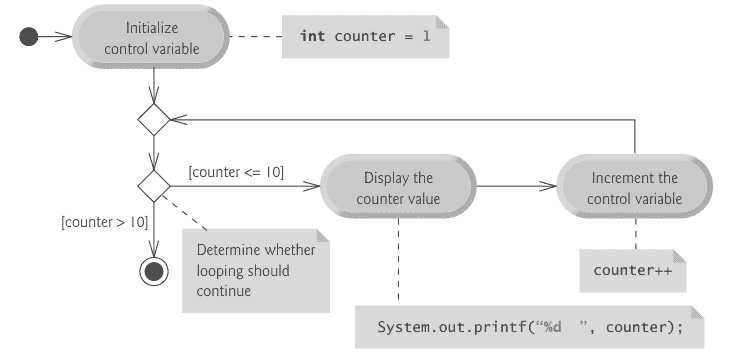

**图 4.4** | 图 4.2 中 `for` 语句的 UML 活动图。

## 4.4 使用 for 语句的示例

以下示例展示了在 `for` 语句中改变控制变量的技巧。在每种情况下，我们只编写适当的头部。注意对于递减控制变量的循环，关系运算符的变化。

- a) 增量为 1 将控制变量从 1 变为 100。

`for (int i = 1; i < 100; i++)`

- b) 递减为 1 将控制变量从 100 变为 1。

`for (int i = 100; i >= 1; i--)`

- c) 增量为 7 将控制变量从 7 变为 7。

`for (int i = 7; i <= 7; i += 7)`

- d) 递减为 2 将控制变量从 20 变为 2。

`for (int i = 20; i >= 2; i -= 2)`

- e) 在值 2, 5, 8, 11, 14, 17, 20 之间改变控制变量。

`for (int i = 2; i <= 20; i += 3)`

- f) 在值 99, 88, 77, 66, 55, 44, 33, 22, 11, 0 之间改变控制变量。

`for (int i = 99; i >= 0; i -= 11)`

### 常见编程错误 4.5

在向下计数的循环继续条件中使用错误的运算符（例如，在向下计数到 1 的循环中使用 `i <= 1` 而不是 `i >= 1`）通常是一个逻辑错误。

### 常见编程错误 4.6

如果循环变量的增量或减少大于 1，则不要在循环继续条件中使用相等运算符（`!=` 或 `=`）。例如，考虑 `(int i = 0; i != 10; i += 2)` 的语句头部。循环继续测试 `i != 10` 永远不会变为假（导致无限循环），因为 `i` 每次增加 2。

### 错误提示 4.6

计数错误是罕见的。在后续章节中，我们将引入 lambda 和流——这些你可以用来消除错误的技术。

### 4.4.1 应用：整数求和

我们现在考虑两个展示 `for` 简单使用的应用。图 4.5 使用 `for` 语句对从 2 开始的偶数求和。

```java
// 图 4.5: Sum.java
public class Sum {
    public static void main(String[] args) {
        int total = 0;

        // 直到 20
        for (int number = 2; number <= 20; number += 2) {
            total += number;
        }

        System.out.printf("Sum is %d\n", total);
    }
}
```

**图 4.5** | 使用 `for` 语句求和整数。

### 4.4.2 应用：复利计算

接下来，让我们使用 `for` 语句计算复利。考虑以下问题：

一个人在利率为 5% 的储蓄账户中投资了 1000 美元。假设所有利息都留在账户中，计算并打印 10 年内每年账户中的金额。使用以下公式确定

`a = p (1 + r)^n`

其中

- `p` 是原始投资金额（即本金）
- `r` 是年利率（例如，5% 使用 0.05）
- `n` 是年数
- `a` 是第 `n` 年末账户中的存款金额

```java
// 图 4.6: Interest.java
public class Interest {
    public static void main(String[] args) {
        double principal = 1000.0; // 初始本金
        double rate = 0.05; // 利率

        // 显示表头
        System.out.printf("%20s%20s\n", "Year", "Amount on deposit");

        // 计算每年的金额
        for (int year = 1; year <= 10; year++) {
            // 计算复利
            double amount = principal * Math.pow(1 + rate, year);
            // 显示年份和金额
            System.out.printf("%d%.2f\n", year, amount);
        }
    }
}
```

| 年份 | 存款金额 |
| :--- | :--- |
| 1 | 1050.00 |
| 2 | 1102.50 |
| 3 | 1157.63 |
| 4 | 1215.51 |
| 5 | 1276.28 |
| 6 | 1340.10 |
| 7 | 1407.46 |
| 8 | 1477.46 |
| 9 | 1551.33 |
| 10 | 1628.89 |

**复利计算**使用了 `for` 语句。在示例中，我们使用了 `double` 类型来表示金额和利率。`Math.pow(base, exponent)` 方法用于计算基数的幂。`System.out.printf` 方法用于格式化输出，其中 `%20s` 表示输出一个宽度为 20 字符的字符串，`%d%.2f` 表示输出一个整数和一个两位小数的浮点数。

### 格式化浮点数

在 `printf` 方法中，可以使用格式说明符来控制浮点数的显示方式。`%f` 用于格式化浮点数。在 `%f` 之前可以指定宽度和精度。例如，`%.2f` 表示保留两位小数。

逗号（`,`）标志可以表示在浮点数中使用分组位分隔符。实际使用的分隔符取决于用户的本地设置（locale）。例如，在美国，数字将使用逗号分隔千分位，如 `1,234.45`。格式说明符中的数字 `20` 表示输出值将对齐到宽度为 20 的字段。`.2` 表示精度——在本例中，数字会被四舍五入到两位。

### 关于舍入值的警告

在示例中，我们将变量 `amount` 和 `rate` 声明为 `double` 类型。我们需要处理美元的小数部分，因此需要允许小数点的类型。遗憾的是，浮点数可能会引起问题。以下是使用 `double`（或 `float`）表示金额时可能出现简单说明（假设美元金额显示为小数点后两位）：机器中存储的两个 `double` 可能是 `14.23`（显示时通常会舍入为 14.23）和 `18.67`（显示时通常会舍入为 18.67）。当这些金额相加时，产生的结果是 `32.907`，在显示时通常会舍入为 `32.91`。因此，你的输出可能如下：

14.23

+ 18.67

32.91

但一个相加显示的单个数字的人会预期和为 `32.90`。你已经收到警告了！

> **错误预防提示 4.7**：不要使用 `double`（或 `float`）进行精确的货币计算。浮点数的不精确会导致错误。在练习中，你将学习如何使用整数进行货币计算——Java 同时也提供了 `java.math.BigDecimal` 类。

## 4.6 switch 多重选择语句

| 行号 | 代码 |
| :--- | :--- |
| 8 | `int gradeCounter = 0; // 输入的成绩数量` |
| 9 | `int aCount = 0; // A 等成绩数量` |
| 10 | `int bCount = 0; // B 等成绩数量` |
| 11 | `int cCount = 0; // C 等成绩数量` |
| 12 | `int dCount = 0; // D 等成绩数量` |
| 13 | `int fCount = 0; // F 等成绩数量` |

```java
Scanner input = new Scanner(System.in);

System.out.printf("%s%n%s%n%s%n",
    "请输入 0-100 范围内的整数成绩：",
    "输入文件类型指示符 <ctrl> d 可结束输入",
    "在 UNIX/Linux/macOS 上输入 <ctrl> z 然后按回车键",
    "在 Windows 上输入 <ctrl> z 然后按回车键");

// 循环直到用户输入文件结束指示符
while (input.hasNextInt()) {
    int grade = input.nextInt(); // 读取成绩
    total += grade; // 将成绩加到总和
    gradeCounter++; // 成绩数量计数

    // 增加相应的字母等级计数
    switch (grade / 10) {
        case 9: // 成绩在 90 之间
        case 10: // 以及所有 100，包含在
            aCount++;
            break; // 退出 switch
        case 8: // 成绩在 80 到 89 之间
            bCount++;
            break; // 退出 switch
        case 7: // 成绩在 70 到 79 之间
            cCount++;
            break; // 退出 switch
        case 6: // 成绩在 60 到 69 之间
            dCount++;
            break; // 退出 switch
        default: // 成绩小于 60
            fCount++;
            break; // 可选；从任何地方退出 switch
    }
}
```

```java
// 显示成绩报告
System.out.printf("%n成绩报告:%s%n");

// 如果用户至少输入了一个成绩：
if (gradeCounter != 0) {
    // 计算所有输入成绩的平均值
    double average = (double) total / gradeCounter;

    // 输出结果摘要
    System.out.printf("录入 %d 份成绩总和为 %d%n", gradeCounter, total);
    System.out.printf("班级平均分为 %.2f%%", average);
    System.out.printf("%s%%n%s%%n%s%%n%s%%n%s%%n%s%%n%n",
        "获得每个等级的学生人数：",
        "A", aCount, // 显示 A 等成绩数量
        "B", bCount, // 显示 B 等成绩数量
        "C", cCount, // 显示 C 等成绩数量
        "D", dCount, // 显示 D 等成绩数量
        "F", fCount); // 显示 F 等成绩数量
} else { // 没有输入成绩，因此输出适当的消息
    System.out.println("未输入任何成绩");
}
```

请输入 0-100 范围内的整数成绩：

结束输入的文件指示符：

在 UNIX/Linux/macOS 上输入 `<ctrl> d` 按回车

在 Windows 上输入 `<Ctrl> z` 按回车

成绩报告：

录入 10 份成绩总和为 778

班级平均分为 77.80

获得每个等级的学生人数：

A: 1

B: 1

C: 2

D: 1

F: 2

> **图 4.9** | `LetterGrades` 类使用 `switch` 语句统计字母等级。（3 部分中的 3 部分）

`main` 方法包含两个部分。第 24–48 行使用哨兵控制迭代从用户处读取任意数量整数，更新实例变量 `total` 和 `gradeCounter`，并为输入的每个成绩增加相应的字母等级计数。第 51–72 行输出一份包含所有输入成绩总和、成绩平均值以及获得每个字母等级的学生数的报告。让我们详细检查这些部分。

### 从用户处读取成绩

第 17–21 行提示用户输入整数成绩，并输入文件结束指示符以终止输入。文件结束指示符是一种取决于系统的组合，用户输入它来表示没有更多数据需要输入。在第 15 章《文件、输入/输出流、NIO 和 XML 序列化》中，你将看到当程序从文件读取输入时如何使用文件结束指示符。


# 第 4 章 控制语句：部分 2；逻辑运算符

## switch 多重选择语句

| 行号 | 代码 |
| :--- | :--- |
| 8 | `int gradeCounter = 0; // 输入的成绩数量` |
| 9 | `int aCount = 0; // A 等成绩数量` |
| 10 | `int bCount = 0; // B 等成绩数量` |
| 11 | `int cCount = 0; // C 等成绩数量` |
| 12 | `int dCount = 0; // D 等成绩数量` |
| 13 | `int fCount = 0; // F 等成绩数量` |

```java
Scanner input = new Scanner(System.in);

System.out.printf("%s%n%s%n%s%n",
    "请输入 0-100 范围内的整数成绩：",
    "输入文件类型指示符 <ctrl> d 可结束输入",
    "在 UNIX/Linux/macOS 上输入 <ctrl> z 然后按回车键",
    "在 Windows 上输入 <ctrl> z 然后按回车键");

// 循环直到用户输入文件结束指示符
while (input.hasNextInt()) {
    int grade = input.nextInt(); // 读取成绩
    total += grade; // 将成绩加到总和
    gradeCounter++; // 成绩数量计数
    // 增加相应的字母等级计数
```

```java
switch (grade / 10) {
    case 9: // 成绩在 90 之间
    case 10: // 以及所有 100，包含在
        aCount++;
        break; // 退出 switch
    case 8: // 成绩在 80 到 89 之间
        bCount++;
        break; // 退出 switch
    case 7: // 成绩在 70 到 79 之间
        cCount++;
        break; // 退出 switch
    case 6: // 成绩在 60 到 69 之间
        dCount++;
        break; // 退出 switch
    default: // 成绩小于 60
        fCount++;
        break; // 可选；从任何地方退出 switch
}
```

```java
// 显示成绩报告
System.out.printf("%n成绩报告:%s%n");

// 如果用户至少输入了一个成绩：
if (gradeCounter != 0) {
    // 计算所有输入成绩的平均值
    double average = (double) total / gradeCounter;
    // 输出结果摘要
    System.out.printf("录入 %d 份成绩总和为 %d%n", gradeCounter, total);
```

```java
System.out.printf("班级平均分为 %.2f%%", average);

System.out.printf("%s%%n%s%%n%s%%n%s%%n%s%%n%s%%n%n",
    "获得每个等级的学生人数：",
    "A", aCount, // 显示 A 等成绩数量
    "B", bCount, // 显示 B 等成绩数量
    "C", cCount, // 显示 C 等成绩数量
    "D", dCount, // 显示 D 等成绩数量
    "F", fCount); // 显示 F 等成绩数量
} else { // 没有输入成绩，因此输出适当的消息
    System.out.println("未输入任何成绩");
}
```

> 图 4.9 | LetterGrades 类使用 switch 语句统计字母等级。（3 部分中的 3 部分）

## 从用户处读取成绩

第 17–21 行提示用户输入整数成绩，并输入文件结束指示符以终止输入。文件结束指示符是一种取决于系统的组合，用户输入它来表示没有更多数据需要输入。在第 15 章《文件、输入/输出流、NIO 和 XML 序列化》中，你将看到当程序从文件读取输入时如何使用文件结束指示符。

在 UNIX/Linux/macOS 系统上，通过在单独一行输入序列来输入文件结束：

```
<Ctrl>d
```

此符号表示同时按下 `Ctrl` 键和 `d`。在 Windows 系统上，通过输入以下序列来输入文件结束：

```
<Ctrl>z
```

[注：在某些系统上，在输入文件结束键序列后必须按回车键。此外，当输入文件结束指示符时，Windows 在屏幕上显示字符 æ，如图 4.9 的输出所示。]

## 可移植性提示

在 UNIX/Linux/macOS 系统上，通过在单独一行输入序列来输入文件结束：

```
<Ctrl>d
```

此符号表示同时按下 `Ctrl` 键和 `d`。在 Windows 系统上，通过输入以下序列来输入文件结束：

```
<Ctrl>z
```

[注：在某些系统上，在输入文件结束键序列后必须按回车键。此外，当输入文件结束指示符时，Windows 在屏幕上显示字符 æ，如图 4.9 的输出所示。]

## 程序逻辑分析

`main` 方法包含两个部分。第 24–48 行使用哨兵控制迭代从用户处读取任意数量整数成绩，更新实例变量 `total` 和 `gradeCounter`，并为输入的每个成绩增加相应的字母等级计数。第 51–72 行输出一份包含所有输入成绩总和、成绩平均值以及获得每个字母等级的学生数的报告。让我们详细检查这些部分。

### 循环读取成绩

```java
while (input.hasNextInt()) {
    int grade = input.nextInt(); // 读取成绩
    total += grade; // 将成绩加到总和
    gradeCounter++; // 成绩数量计数
    // 增加相应的字母等级计数
```

### switch 语句统计等级

```java
switch (grade / 10) {
    case 9: // 成绩在 90 之间
    case 10: // 以及所有 100，包含在
        aCount++;
        break; // 退出 switch
    case 8: // 成绩在 80 到 89 之间
        bCount++;
        break; // 退出 switch
    case 7: // 成绩在 70 到 79 之间
        cCount++;
        break; // 退出 switch
    case 6: // 成绩在 60 到 69 之间
        dCount++;
        break; // 退出 switch
    default: // 成绩小于 60
        fCount++;
        break; // 可选；从任何地方退出 switch
}
```

### 示例运行输出

```text
请输入 0-100 范围内的整数成绩：
结束输入的文件指示符：
在 UNIX/Linux/macOS 上输入 <ctrl> d 按回车
在 Windows 上输入 <Ctrl> z 按回车

成绩报告：
录入 10 份成绩总和为 778
班级平均分为 77.80

获得每个等级的学生人数：
A: 1
B: 1
C: 2
D: 1
F: 2
```


## 4.6 switch 多重选择语句

```java
case 9: // 成绩在 90 之间
case 10: // 以及所有 100，包含在
    aCount++;
    break; // 退出 switch

case 8: // 成绩在 80 到 89 之间
    bCount++;
    break; // 退出 switch

case 7: // 成绩在 70 到 79 之间
    cCount++;
    break; // 退出 switch

case 6: // 成绩在 60 到 69 之间
    dCount++;
    break; // 退出 switch

default: // 成绩小于 60
    fCount++;
    break; // 可选；从任何地方退出 switch
}
```

### 错误预防提示 4.10
在 `switch` 语句中提供一个默认情况（`default case`）。这能让你关注到处理异常情况的需要。

### 良好的编程实践 4.2
虽然 `switch` 中的每个 `case` 和 `default case` 之间以任何顺序出现，但请将 `default case` 放在最后。当使用 `default case` 时，不需要为该 `case` 使用 `break` 语句。

### 关于 switch 中每个 case 表达式的说明
在 `switch` 中，每个 `case` 必须包含一个字符串或一个常量整数表达式——即任何求值为常量值的整数常量组合（例如，`-7` 或 `221`）。整数常量仅仅是一个整数值。此外，你还可以使用字符常量——括在单引号内的特定字符，如 `'A'`、`'7'` 或 `'$'`——它们代表字符的整数值。附录 B 显示了 ASCII 字符集的整数值，它是 Java 使用的 Unicode 集的子集。

每个 `case` 中的表达式也可以是一个常量变量——即整个程序运行过程中值不再发生变化的变量。此类变量使用关键字 `final` 声明（在第 5 章中讨论）。Java 有一种名为枚举类型（`enum types`）的特性，我们也会在第 5 章中介绍它——枚举类型常量也可以用于 `case` 标签。

在第 10 章“面向对象编程：多态与接口”中，我们将介绍一种更优雅的实现 `switch` 逻辑的方法——我们使用一种多态技术来创建比使用 `switch` 逻辑更清晰、更易于维护且更容易扩展的程序。

## 4.7 break 和 continue 语句

除了选择语句和迭代语句外，Java 还提供了 `break` 语句（我们在 `switch` 语句上下文中讨论过）和 `continue` 语句（在本节和在线附录 L 中介绍）来改变控制流。前一节展示了如何使用 `break` 终止 `switch` 语句的执行。本节讨论了如何在迭代语句中使用 `break`。

### 4.7.1 break 语句
在 `while`、`do...while` 或 `switch` 中执行的 `break` 语句会导致**立即退出**该语句。执行将从控制语句后的第一条语句继续。`break` 的常见用途是跳出循环或跳过 `switch` 的剩余部分（如图 4.9 所示）。图 4.11 展示了 `break` 退出 `for` 循环。当嵌套在第 8-10 行的 `if` 语句检测到 `count` 为 5 时，第 9 行的 `break` 语句终止 `for` 循环，程序继续到第 15 行（紧接该语句），该处显示一条消息，指示循环终止时控制变量的值。循环体完整执行了四次，而不是 10 次。

```java
// Fig 4.11: BreakTest.java
// break 语句退出 for 语句
public class BreakTest {
    public static void main(String[] args) {
        int count; // 循环结束后使用的控制变量
        for (count = 1; count <= 10; count++) { // 循环 10 次
            if (count == 5) {
                break; // 如果 count 为 5 则终止循环
            }
            System.out.printf("%d ", count);
        }
        System.out.printf("%n跳出循环 at count = %d\n", count);
    }
}
```

### 4.7.2 continue 语句
在 `while`、`for`、`do...while` 中执行的 `continue` 语句会跳过循环体剩余语句，并进入循环的**下一次迭代**。在 `do...while` 语句中，程序在 `continue` 语句执行后立即评估循环延续。在 `for` 语句中，执行递增表达式，然后程序评估循环延续。

图 4.12 使用 `continue`（第 7 行）在嵌套条件检测到 `count` 的值为 5 时跳过第 10 行的语句。当 `continue` 语句执行时，程序控制继续执行 `for` 语句中控制变量的增加（第 5 行）。

```java
// Fig 4.12: ContinueTest.java
// continue 语句终止一次迭代。
public class ContinueTest {
    public static void main(String[] args) {
        for (int count = 1; count <= 10; count++) { // 循环 10 次
            if (count == 5) {
                continue; // 如果 count 为 5 则跳过循环剩余部分
            }
            System.out.printf("%d ", count);
        }
    }
}
```

## 4.8 逻辑运算符

```java
if ((semesterAverage >= 90) || (finalExam == 90)) {
    System.out.println("Student grade is A");
}
```

在这里，简单条件 `semesterAverage >= 90` 被求值，以根据 `semesterAverage` 判断该学生在课程中是否获得 A。条件 `finalExam >= 90` 被求值，以根据 `finalExam` 成绩判断该学生是否获得 A。`if` 语句随后考虑复合条件：

```java
(semesterAverage >= 90) || (finalExam == 90)
```

并且如果简单条件中有一个或两个都为真，则授予学生 A。只有当两个简单条件都为假时，才不打印“Student grade is A”消息。图 4.14 是运算符或 (`||`) 的真值表。运算符 `&&` 的优先级高于运算符 `||`。二者都从左到右结合。

| expression1 | expression2 | expression1 \|\| expression2 |
|---|---|---|
| false | false | false |
| false | true | true |
| true | false | true |
| true | true | true |

**图 4.14** `||`（条件逻辑或）运算符真值表。

### 4.8.3 复杂条件的短路求值
包含 `&&` 或 `||` 运算符的表达式部分的求值*仅*持续到确定条件为真或为假为止。因此，表达式：

```java
(gender == FEMALE && (age >= 65))
```

如果 `gender` 不等于 `FEMALE`（即整个表达式为假），则该求值将立即停止；如果 `gender` 等于 `FEMALE`，则继续（即如果条件 `age >= 65` 为真，则整个表达式可能为真）。逻辑与和逻辑或表达式的这种特性被称为**短路求值**。

### 常见编程错误 4.8
在使用 `&&` 时，其中一个条件——我们称之为依赖条件——可能需要另一个条件为真才能进行依赖求值。在这种情况下，应将依赖条件放在 `&&` 运算符之后以防止错误。例如表达式 `(i != 0 && (10 / i == 2))`。依赖条件 `(10 / i == 2)` 必须出现在 `&&` 之后，以防止除以零的可能性。

### 4.8.4 逻辑与 (&) 和布尔逻辑或 (|) 运算符
布尔逻辑与 (`&`) 和布尔逻辑或 (`|`) 运算符与 `&&` 和 `||` 运算符相同，不同在于 `&` 和 `|` 运算符总是求值两个操作数（即它们不执行短路求值）。因此，表达式：

```java
(gender == 1) & (age >= 65)
```

无论 `gender` 是否等于 1，都会求值 `age >= 65`。如果右操作数具有所需的副作用——修改变量的值，则这种方法非常有用。例如，`(birthday = true | (++age >= 65))` 保证了 `++age >= 65` 被求值。因此，无论整个表达式是真是假，`age` 都会增加。

#### 错误预防提示 4.11
为了清晰起见，避免在条件中使用带有副作用（如赋值）的表达式。它们会使代码更难以理解，并导致细微的错误。

#### 错误预防提示 4.12
赋值 (`++`) 表达式通常不应在条件中使用。每个条件必须产生布尔值；否则会发生编译错误。在条件中，只有将布尔表达式赋值给布尔值时，赋值编译才会进行。

### 4.8.5 逻辑异或 (^)
包含逻辑异或 (`^`) 运算符的简单条件当且仅当其中一个操作数为真而另一个为假时为真。如果两个都为真或都为假，则整个条件为假。图 4.15 是逻辑异或运算符 (`^`) 的真值表。该运算符保证求值它的两个操作数。

| expression1 | expression2 | expression1 ^ expression2 |
|---|---|---|
| false | false | false |
| false | true | true |
| true | false | true |
| true | true | false |

**图 4.15** `^`（逻辑异或）运算符真值表。

### 4.8.6 逻辑否定 (!) 运算符
`!`（逻辑非，也称为逻辑否定或逻辑取反）运算符“反转”条件的含义。与 `&&`、`|` 和 `^` 等结合两个条件的二元运算符不同，逻辑否定只有一个条件作为操作数。该运算符放在条件之前，以便在原始条件（无逻辑否定运算符）为假时选择执行路径，如下代码段：

```java
if (grade == sentinelValue) {
    System.out.printf("The grade is %d%%", grade);
}
```

只有当 `grade` 不等于 `sentinelValue` 时才执行 `printf` 调用。由于逻辑否定运算符的优先级高于相等运算符，括号求值为条件。

在大多数情况下，可以通过关系运算符或相等运算符来避免使用逻辑否定。例如，之前的语句也可以写成：

```java
if (grade != sentinelValue) {
    System.out.printf("The next grade is %d\n", grade);
}
```


这种灵活性可以帮助用更方便的方式表达条件。图 4.16 是该逻辑运算符的真值表。

| expression | !expression |
|---|---|
| true | false |
| false | true |

**图 4.16** | `!`（逻辑非）运算符真值表。

### 4.8.7 逻辑运算符

本节讨论的逻辑运算符用于控制程序的执行流。`&&`、`||`、`^` 和 `!` 等逻辑运算符用于创建复杂的条件。这些条件用于 `if` 语句和循环中，根据布尔值做出决策。

## 4.9 结构化编程总结

### 目前为止介绍的操作符优先级和结合性

图 4.18 显示了目前介绍的 Java 运算符的优先级和结合性。运算符按优先级从高到低的顺序向下显示。

| 运算符 | 结合性 | 类型 |
| :--- | :--- | :--- |
| `++` `--` | 从右到左一元后置 |
| `++` `-` `+` `!` `(type)` | 从右到左一元前置 |
| `*` `/` `%` | 从左到右乘法 |
| `+` | 从左到右加法 |
| `<` `<=` `>` `>=` | 从左到右关系 |
| `!=` `==` | 从左到右相等 |
| `&` | 从左到右逻辑与 |
| `^` | 从左到右逻辑异或 |
| `\|` | 从左到右逻辑或 |
| `&&` | 从左到右条件与 |
| `\|\|` | 从左到右条件或 |
| `?:` `=` `+=` `-=` `*=` `/=` `%=` | 从右到左赋值 |

**图 4.18** 目前为止讨论的运算符优先级/结合性。

### Java 控制语句是单入口/单出口

图 4.19 使用 UML 图总结了 Java 的控制语句。初始状态和结束状态表示每个控制语句的单一入口点和单一出口点。在活动图中任意连接单个符号都可以导致结构化程序。因此，编程领域有一组有限的控制语句，这些语句只能以两种方式组合来构建结构化程序。

为了简单，Java 只包含单入口/单出口的控制语句——每个控制语句只有一种进入方式和一个退出方式。顺序连接控制语句以形成结构化程序是简单的。控制语句的结束状态与下一个语句的初始状态连接——也就是说，控制语句在程序中顺序放置。我们称之为控制语句堆叠。形成结构化程序的规则允许控制语句进行嵌套。

#### 顺序

- `if` 语句（单选择）
- 带有 `break` 的 `switch` 语句（多选择）

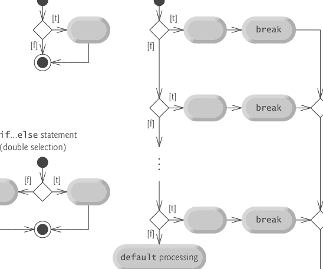

- `if...else` 语句（双选择）

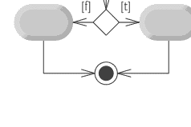

#### 重复

- `while` 语句
- `do..while` 语句
- `for` 语句

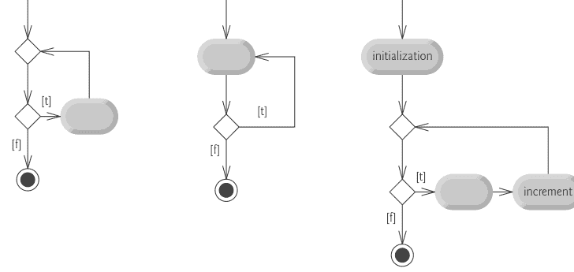

**图 4.19** | Java 的单入口/单出口顺序、选择和迭代语句。

### 构建结构化程序的规则

图 4.20 显示了形成结构化程序的规则。规则假设动作状态可以表示任何动作。规则还假设我们从最简单的活动图（图 4.21）开始，该图仅包含一个初始状态、一个动作状态、一个结束状态和转换箭头。

| 构建结构化程序的规则 |
| :--- |
| 1. 从最简单的活动图开始（图 4.21）。 |
| 2. 任何动作状态都可以被两个顺序的动作状态替换。 |
| 3. 任何动作状态都可以被任何控制语句（`if`, `if...else`, `switch`, `while`, `do...while` 或 `for`）替换。 |
| 4. 规则 2 和 3 可以根据需要并按顺序尽可能应用。 |

**图 4.20** | 构建结构化程序的规则。


**图 4.21** | 最简单的活动图。

应用图 4.20 中的规则始终会导致具有整洁区块结构的活动图。例如，对简单活动重复规则 2 会产生包含许多顺序动作状态的活动图（图 4.22）。规则 2 生成控制语句的状态，因此我们称之为堆叠规则。图 4.22 中的垂直线不是 UML 的一部分——我们使用它们来分离图 4.20 规则 2 的活动图。

规则 3 是嵌套规则。将规则 3 应用于简单活动会导致整洁嵌套的控制语句。例如，在图 4.23 中，简单活动中的动作状态被双选择（`if...else`）语句替换。然后将规则 3 应用双选择语句中的动作状态，将其替换为控制语句。虚线表示被替换的动作状态。[注释：它们在这里说明任何动作状态都可以被控制语句替换。]

规则 4 生成更大、更复杂的嵌套语句。应用图 4.20 中的规则构成了所有可能的结构化图，增强了结构化方法的优势，即我们只使用简单的单入口/单出口控制语句并仅以两种方式组合它们。


**图 4.22** | 对简单活动图重复应用图 4.20 的规则 2。

如果遵循图 4.20 中的规则，则无法创建“非结构化”活动图（如图 4.24）。如果你不确定某个特定图是结构化的，反向应用图 4.20 的规则将其还原为简单活动图。如果可以还原，则原始图是结构化的；否则不是。


**图 4.24** | “非结构化”活动图。

任何形式的迭代。用 `do...while` 和 `for` 完成的所有都可以用 `while` 语句完成（尽管可能不方便）。

结合这些结果说明，Java 程序中需要的任何形式的控制都可以用：
- 顺序
- `if` 语句（选择）
- `while` 语句（迭代）

并且这些只能以两种方式组合——堆叠和嵌套。事实上，结构化编程是简单的本质。

### 控制的三种形式

结构化编程促进简单。实现算法只需要三种形式的控制：
- 顺序
- 选择
- 迭代

顺序结构是显而易见的。只需按应执行的顺序列出语句。选择通过三种方式实现：
- `if` 语句（单选择）
- `if...else` 语句（双选择）
- `switch` 语句（多选择）

事实上，很容易证明简单的 `if` 语句足以提供任何形式——`if...else` 语句和 `switch` 语句也可以实现（尽管可能没有那么清晰和高效）。迭代通过三种方式实现：
- `while` 语句
- `do..while` 语句
- `for` 语句

[注释：还有第四种迭代——增强型 `for` 语句——我们在 6.7 节中讨论。]很容易证明 `while` 语句是足够的。


**图 4.23** | 对简单活动图重复应用图 4.20 的规则 3。

## 4.10 总结

在本章中，我们完成了对控制语句的介绍，控制语句允许你控制方法中的执行流。第 3 章讨论了 `if`、`if...else` 和 `while`。本章演示了 `for`、`do...while` 和 `switch`。我们展示了任何算法都可以顺序结构、三种选择语句（`if`、`if...else` 和 `switch`）以及三种迭代语句（`while`、`do...while`）的组合来开发。在本章和第 3 章中，你可以组合这些构建块来利用程序构建和问题解决技术。你使用了 `break` 语句来退出 `switch` 语句并立即终止循环，使用了 `continue` 语句终止循环的当前迭代并继续循环的下一次迭代。本章还引入了 Java 的逻辑运算符，允许你在控制语句中使用更复杂的表达式。在第 5 章中，我们将更深入地研究方法。

### 第 4.2 节 计数控制迭代的要点

- 计数控制迭代（第 165 页）需要一个控制变量、控制变量的初始值、每次循环运行时修改控制变量的增量（也称为循环的迭代）以及决定是否继续循环的循环继续条件。
- 你可以在同一语句中声明变量并初始化它。

### 第 4.3 节 `for` 迭代语句

- `while` 语句可以实现任何计数循环。
- `for` 语句（第 160 页）在其头部中指定了计数控制迭代的所有细节。
- 当 `for` 语句开始执行时，其控制变量被声明并初始化。如果循环继续条件为真，则执行循环体。在执行循环体后，执行增量表达式。然后再次执行循环继续测试，以确定程序是否继续循环的下次迭代。
- `for` 语句的通用格式为：

```java
for (initialization; loopContinuationCondition; increment) {
  statements
}
```

其中初始化命名循环控制变量并提供其初始值，`loopContinuationCondition` 判断循环是否继续，`increment` 修改控制变量的值，以便循环继续条件最终变为假。`for` 头部中的两个分号是必须的。

### 摘要

- 大多数 `for` 语句可以用以下等价的 `while` 语句表示：

```java
while (loopContinuation) {
  statements
  increment;
}
```


# 第 4 章 控制语句：第 2 部分；逻辑运算符

## 4.4.1 for 迭代语句

- 通常情况下，`for` 语句用于计数器控制的迭代，而 `while` 语句用于传感器控制的迭代。
- 如果头部中的初始化表达式声明了控制变量，则该控制变量只能在该语句中使用——它不会在语句体外存在。
- 头部中的表达式是可选的。如果省略了循环继续条件，Java 会假设它始终为真，从而创建一个无限循环。如果控制变量在循环之前已经初始化，则可以省略初始化表达式。如果控制是通过循环体内的语句计算的，或者不需要递增，则可以省略递增表达式。
- `for` 的递增表达式的作用等同于 `for` 循环体末尾的一条独立语句。
- `for` 语句可以使用负递增量来实现倒计时——即使用递减操作（见第 169 页）。
- 如果循环继续条件初始为假，则 `for` 语句将不执行。

## 4.4.2 应用：复合整数计算

- Java 将浮点数常量（如 `1000.0` 和 `0.05`）视为 `double`。同样，Java 将整型常量（如 `7` 和 `-22`）视为 `int` 类型。
- 格式指定符 `%s` 在字段宽度为 4（见第 172 页）的情况下输出一个字符串——即 4 个字符。如果值的字符数少于 4，则默认右对齐（见第 172 页）。如果值的字符数更多，字段宽度将扩大以容纳相应的字符数。若要左对齐，请使用负整数来指定字段宽度（如 `%-17s`）。
- `Math.pow(x, y)`（见第 173 页）计算 x 的 y 次幂值。该方法接收两个 `double` 参数并返回一个 `double` 值。
- 格式指定符中的逗号（`,`）格式标志（见第 174 页）表示输出浮点值时应带有分组分隔符（见第 174 页）。实际使用的分隔符由用户的本地区域设置（即国家）指定。数字每三位将有一个分隔符，并用小数点分隔数字的小数部分，例如 `1,234.45`。
- `.` 格式指定表示其右侧的内容为数字的精度。

## 4.5 do...while 迭代语句

- `do...while` 语句（见第 175 页）与 `while` 类似。在 `while` 中，程序在循环开始、执行循环体之前测试循环继续条件；如果条件为假，循环体永远不会执行。`do...while` 语句在执行循环体后执行循环继续测试；因此，循环体至少会执行一次。

## 4.6 switch 多重选择语句

- `switch` 语句（见第 176 页）根据常量整数表达式的可能值（`byte`、`short`、`int` 或 `char` 类型的常量值，但不是 `long`）或 `String` 来执行相应的操作。
- 文件结束指示符是一个取决于系统的按键，用于终止用户输入。在 Unix/Linux/macOS 系统上，通过在单独的一行输入 `<Ctrl> d` 来输入文件结束。此符号表示同时按下 `<Ctrl>` 和 `d` 键。在 Windows 系统上，通过输入 `<Ctrl> z` 来输入文件结束。
- `Scanner` 方法 `next()`（见第 179 页）确定是否有更多数据需要输入。如果有更多数据，该方法返回 `true`；否则返回 `false`。只要没有输入文件结束指示符，`next()` 就会返回 `true`。
- `switch` 语句由一个块组成，该块包含一系列 `case` 标签（见第 179 页）和一个可选的 `default case`（见第 179 页）。
- 在 `switch` 中，程序对控制表达式进行求值计算，并将其值与每个 `case` 标签进行比较。如果发生匹配，程序将执行该 `case` 的语句。
- 列出之间没有语句的 `case` 可以允许这些 `case` 执行相同的语句集合。
- 在 `switch` 中你想要测试的每个值都必须列在 `case` 标签中。
- 每个 `case` 可以有多条语句，且这些语句不需要包含在大括号中。
- 一个 `case` 的语句通常以 `break`（见第 179 页）结束，这会终止 `switch` 的执行。
- 如果没有 `break` 语句，`switch` 中的每个匹配项都会发生，该 `case` 的语句以及后续 `case` 的语句将执行，直到遇到 `break` 语句或 `switch` 结束。
- 如果控制表达式的值与 `case` 标签之间没有发生匹配，则执行可选的 `default case`。如果没有匹配且 `switch` 不包含 `default case`，程序控制将直接继续执行 `switch` 后的第一条语句。

## 4.7.1 break 语句

- `break` 语句在 `for`、`do...while` 或 `switch` 中执行，会导致立即退出该语句。

## 4.7.2 continue 语句

- `continue` 语句（见第 182 页）在 `for`、`do...while` 中执行时，会跳过循环体剩余的语句并进入下一次迭代。在 `while` 和 `do...while` 语句中，则执行循环继续测试。

## 4.8 逻辑运算符

- 简单条件用关系运算符 `<`、`!=` 和 `==` 表示。

### 4.8.1 逻辑与 (&&)

- 为了确保两个条件为真，使用 `&&`（逻辑与运算符）。

### 4.8.2 逻辑或 (||)

- 为了确保一个或两个条件为真，使用 `||`（逻辑或运算符）。

### 4.8.3 复杂条件的短路求值

- 使用 `&&` 或 `||` 运算符（见第 185 页）形成复杂条件。

### 4.8.4 逻辑与 (&) 和 逻辑或 (|)

- `&` 和 `|` 运算符（见第 185 页）与 `&&` 和 `||` 相同，但总是求值。

### 4.8.5 布尔异或 (^)

- `^` 运算符（见第 186 页）当操作数中仅有一个为真时为真。

### 4.8.6 逻辑取反 (!)

- 一元运算符 `!`（见第 186 页）用于“反转”条件的值。

## 自测

### 4.1 填写下列语句的空白：

a) 通常，________ 语句用于计数器控制的迭代，而 ________ 语句用于传感器控制的迭代。
b) `do...while` 语句在执行循环体**之后**测试循环继续条件；循环体至少执行一次。
c) ________ 语句根据常量整数表达式的可能值（整数或 `String`）来选择多种操作。
d) ________ 语句在迭代中执行时，会跳过循环体剩余的语句并进入下一次迭代。
e) ________ 运算符可以用于在选择特定路径之前确保两个条件为真。
f) 如果 `for` 头部的循环条件初始为 ________，则程序将不执行。
g) 执行常用任务且不需要对象的都是 ________。

### 4.2 说明下列陈述的真假。如果是假，请说明原因。

a) `switch` 语句需要 `default case`。
b) `switch` 语句的最后一个 `case` 需要 `break` 语句。
c) 表达式 `((x > y) && (a == b))` 在 `x > y` 为真或 `a < b` 为真时为真。
d) 使用 `||` 运算符的表达式在操作数任一为真时为真。
e) 格式指定符中的逗号（`,`）（例如 `%,20f`）表示输出应带有分组分隔符。
f) 在 `switch` 中测试范围，在范围的起始和结束值之间使用连字符 (`-`)。
g) 列出之间没有语句的 `case` 可以允许这些 `case` 执行相同的语句。

### 4.3 编写函数或一组 Java 语句来完成每个任务：

a) 使用 `for` 语句累加 1 到 99 之间的奇数。假设整数变量 `sum` 和 `count` 已经声明。
b) 使用 `while` 循环和计数 `i` 计算 2 的 5 次幂。
c) 使用 `while` 循环和计数 `i` 打印 1 到 20 的整数。假设变量 `i` 已经声明但未初始化。每行只打印五个整数。[提示：使用表达式 `i % 5`。当该表达式的值为 0 时，打印换行符；否则，打印制表符。假设此代码是一个应用程序。使用 `System.out.println()` 方法输出换行符，使用 `System.out.print('\t')` 方法输出制表符。]
d) 重复部分 (c)，使用 `for` 语句。

### 4.4 找出下列每个代码段中的错误，并解释如何修正它们：

a)
```java
i = 1;
while (i <= 10);
i++;
}
```

b)
```java
for (k = 0.1; k != 1.0; k += 0.1) {
    System.out.println(k);
}
```

c)
```java
switch (n) {
  case 1:
    System.out.println("The number is 1");
  case 2:
    System.out.println("The number is 2");
    break;
  default:
    System.out.println("The number is not 1 or 2");
    break;
}
```

d) 下面代码应该打印 1 到 10 的值：
```java
n = 1;
while (n < 10) {
    System.out.println(n++);
}
```

## 自测练习答案

### 4.1
a) `for`, `while`
b) `after`
c) `switch`
d) `continue`
e) `&&` (逻辑与)
f) `false`
g) `static`

### 4.2
a) 错误。`default` 是可选的。如果不需要默认操作，则不需要 `default` 分支。
b) 错误。`break` 语句用于退出 `switch` 语句。在 `switch` 语句的最后一个 `case` 不需要 `break` 语句。
c) 错误。当使用 `&&` 运算符时，两个关系表达式都必须为真，该表达式才为真。
d) 正确。
e) 正确。
f) 错误。`switch` 语句没有提供测试值范围的机制，因此每个必须测试的值都应该列在单独的 `case` 标签中。
g) 正确。

### 4.3 答案：

a)
```java
sum = 0;
for (count = 1; count <= 99; count += 2) {
    sum += count;
}
```

b)
```java
double result = Math.pow(2, 5);
```

c)
```java
i = 1;
while (i <= 20) {
    System.out.print(i);
    if (i % 5 == 0) {
        System.out.println();
    } else {
        System.out.print("\t");
    }
    i++;
}
```

d)
```java
for (i = 1; i <= 20; i++) {
    System.out.print(i);
    if (i % 5 == 0) {
        System.out.println();
    } else {
        System.out.print("\t");
    }
}
```

### 4.4 答案：

- a) 错误：`while` 头部后的分号导致无限循环，并且缺少一个左大括号。
  修正：删除分号并添加左大括号 `{`。
- b) 错误：使用浮点数控制 `for` 语句可能不起作用，因为大多数计算机仅以近似方式表示浮点数。
  修正：使用整数，并进行适当计算以获得所需的值，如：
  ```java
  for (k = 1; k != 10; k++) {
      System.out.println((double) k / 10);
  }
  ```
- c) 错误：第一个 `case` 的语句组中缺少了 `break` 语句。
  修正：在第一个 `case` 语句组的末尾添加 `break` 语句。如果你希望 `case 2` 的语句在每次 `case 1` 执行时都执行，那么这种遗漏不是错误。
- d) 错误：在 `while` 的延续条件使用了不当的关系运算符。
  修正：使用 `<=` 而不是 `<`，或者将 `10` 改为 `11`。

## 练习

- **4.5** 描述计数控制迭代的四个基本元素。
- **4.6** 比较对比 `while` 和 `for` 迭代语句。
- **4.7** 如果你需要至少执行一次循环体，使用 `do...while` 语句还是 `while` 语句更好？
- **4.8** 比较对比 `break` 和 `continue` 语句。
- **4.9** 发现并修正下列每个代码段中的错误：
  - a) `while (int i = 1; i < 10; i++) System.out.println(i);`
  - b) 下面代码应该打印整数值是负数还是零：
    ```java
    switch (value) {
        case value < 0:
            System.out.println("Negative");
        case 0:
            System.out.println("Zero");
    }
    ```
  - c) 下面代码应该输出从 19 到 1 的奇数：
    ```java
    for (int i = 19; i > 1; i -= 2)
        System.out.println(i);
    ```
  - d) 下面代码应该输出 1 到 50 的偶数：
    ```java
    do {
        counter = 0;
        System.out.println(counter + 1);
        counter += 2;
    } while (counter <= 51);
    ```
- **4.10** 下面程序的作用是什么？
  ```java
  // Exercise 4.10: Printing.java
  public class Counting {
      public static void main(String[] args) {
          Scanner s = new Scanner(System.in);
          for (int i = 1; i < 3; i++) {
              for (int j = 1; j < 5; j++) {
                  System.out.print("*");
              }
              System.out.println("\n");
          }
      }
  }
  ```
- **4.11** (极值) 编写一个程序找到若干整数中的最小值和最大值，然后询问用户输入多少值。
- **4.12** (3 整除的整数) 编写一个程序计算 1 到 30 之间被 3 整除的整数的和。
- **4.13** (序列和) 求序列 1, 2, 3 ... n 的和，n 范围从 1 到 100。使用表格格式显示结果。如果是求积而不是和，在使用累积变量时会遇到什么困难？
- **4.14** (修改后的复利程序) 修改图 4.6 的程序，以 5%、6%、7%、8%、9% 和 10% 的利率重复步骤。使用 `for` 循环改变利率。
- **4.15** (三角形打印程序) 编写一个交替生成如下内容的程序，使用一个循环。所有星号 (`*`) 应该由单个 `System.out.print('*')` 语句并排打印。每一行可以使用 `System.out.println()` 移动到下一行。可以使用 `System.out.print(' ')` 来显示最后一行。[提示：最后一行需要每行开头有适当的空白。]

  | (a) | (b) | (c) | (d) |
  | --- | --- | --- | --- |
  | ***** | ****** | | |
  | **** | ***** | ****** | |
  | *** | **** | ****** | |
  | ** | *** | ****** | |
  | * | ** | ****** | |
  | | * | ****** | |
  | | | | ******* |

- **4.16** (条形图打印) 计算机的一个有趣应用是显示图形和条形。对于读取的每个数字，程序应该显示相同数量的星号。例如，如果你的程序读取数字 7，在读完所有数字后应该显示 `*******`。
- **4.17** (成绩) 一组学生获得了以下成绩：学生 1 'A'；学生 2 'C'；学生 3 'B'；学生 4 'A' 以及学生 5 'B'。编写一个读取如下序列的程序：
  a) 学生姓名
  b) 学生字母成绩
  你的程序应该使用 `switch` 语句确定有多少学生得了 'A'、多少 'B'、多少 'C' 以及多少 'D'。使用循环输入这五个学生，最后显示结果。
- **4.18** (修改后的复利程序) 修改图 4.6 中的程序，仅使用整数计算复利。通过除法取模运算符将结果分为美元和分。在美元和分之间插入句点。
- **4.19** 假设 `i = 2, j = 3, k = 2, m = 2`。每个语句打印什么？
  a) `System.out.println(i == k);`
  b) `System.out.println(j == m);`
  c) `System.out.println((i >= 0) && (j <= 3));`
  d) `System.out.println((m <= 100) && (k < m));`
  e) `System.out.println((j >= i) || (k != m));`
  f) `System.out.println((k + i < j) || (4 - j >= k));`
  g) `System.out.println((k > j));`
- **4.20** (计算 $\pi$ 值) 从无限级数计算 $\pi$ 的值：
  $$
  \pi = 4 - \frac{4}{3} + \frac{4}{5} - \frac{4}{7} + \frac{4}{9} - \dots
  $$


打印一个表格，显示通过计算该级数的前 200,000 项来近似 $\pi$ 的值。你需要使用多少项才能得到以 3.14159 开头的值？

# 4.21 (勾股数)

直角形的边可以是整数。这三个整数被称为勾股数。三边的长度必须满足：两条边的平方和等于斜边的平方。编写一个程序，显示 s1、s2 和不大于 500 的斜边的勾股数表格。使用嵌套 `for` 循环尝试所有可能性。这种方法是“暴力破解”的例子。在更高级的计算机科学课程中，你会学到对于有趣的问题，除了暴力破解外没有已知的算法。

# 4.22 (修改后的三角形打印程序)

修改练习 4.15，将四个星号组合，使所有模式并排排列。[提示：制作用于循环的代码。]

# 4.23 (德·摩根定律)

在本章中我们讨论了逻辑 `&&`、`||`、`!`。德·摩根定律有时让我们更容易表达逻辑表达式。这些定律规定表达式 `(condition1 && condition2)` 逻辑等价于表达式 `(!condition1 || !condition2)`。同样，表达式 `(!condition1 || condition2)` 逻辑等价于表达式 `(!condition1 && !condition2)`。使用德·摩根定律为各项编写等价表达式，然后编写程序显示在每情况下原始表达式和新表达式产生相同的值：

a) `!(x < 5) && (y > 7)`
b) `!(a == b) || !(g == 5)`
c) `!(x < 8) && (y > 4)`
d) `!(x < 4) || (j < 6)`

# 4.24 (打印矩阵)

编写一个打印以下二维矩阵的程序。使用循环最小化输出次数。

```
1 1 1 1 1
2 2 2 2 2
3 3 3 3 3
4 4 4 4 4
5 5 5 5 5
```

# 4.25 (修改后的菱形打印程序)

修改你在 4.24 中写的程序，读取 1 到 19 之间的奇数作为菱形的行数。你的程序应该显示相应大小的菱形。

# 4.26

对 `break` 语句的批评是 `continue` 语句是非结构化的。实际上，这些语句可以被结构化语句替换，尽管这样做可能很麻烦。概括你如何移除程序中循环中的任何 `break` 语句并将其替换为某些结构化的等价形式。{提示：`break` 语句从循环体退出循环。另一种方法是使循环延续测试失败。考虑在循环延续测试中使用第二个测试，用以指示“由于 'break' 条件而提前退出”。} 使用你在此处开发的技术从图 4.11 的程序中移除 `break` 语句。

## 4.27 下述程序段的作用是什么？

```java
for (i = 1; i < 5; i++) {
  for (j = 1; j < 3; j++) {
    for (k = 1; k < 4; k++) {
      System.out.print("*");
    }
  }
}
System.out.println();
```

# 4.28

描述你如何从程序的循环中移除任何 `continue` 语句并将其替换为某些结构化的等价形式。使用你在此处开发的技术从图 4.12 的程序中移除 `continue` 语句。

# 4.29 (《圣诞节十二天》歌曲)

编写一个使用迭代和 `switch` 语句的程序来打印歌曲《圣诞节十二天》。使用一个 `switch` 语句来打印日期（“first”、“second”等）。使用另一个 `switch` 语句来打印每个事实的剩余部分。访问网站 en.wikipedia.org/wiki/The_Twelve_Days_of_Christmas.song 获取歌曲歌词。

# 4.30 (全球变暖事实测验)

全球变暖这一争议性问题已由电影《不容忽视》广泛发布，该电影由副总统阿尔·戈尔主演。戈尔先生、联合国科学家网络、气候变化政府间小组因其建立和传播有关气候变化的更多知识的努力而共同获得了 2007 年诺贝尔奖。研究该问题的两个方面。创建一个关于全球变暖的五道选择题，每个问题四个选项（编号 1-4）。保持客观并尝试公平地表示问题的两个方面。接下来，编写一个程序来管理该测验，计算正确答案的数量（0 到五个）并向用户返回消息。如果用户正确回答了五个问题，打印“Excellent”；如果是四个，打印“Very good”；如果是三个或更少，打印“Time to brush up on your knowledge of global warming”，并列出你找到事实的网站列表。

# 4.31 (税收替代方案；“公平税”)

有许多重新思考税收的建议。查看美国的 FairTax 倡议网站 http://www.fairtax.org。研究拟议的 FairTax 如何用对你使用的所有产品和服务征收 23% 的消费税取代所得税。一些 FairTax 的反对者质疑 23% 这个数字，并说根据税计算方法，说税率为 30% 更准确——请仔细检查这一点。编写一个程序，提示用户输入他们拥有的各种费用类别的支出（例如：住房、食物、服装、交通、教育、医疗保健、假期），然后打印该个人预计支付的公平税。

# 5 方法

## 目标

在本章中，你将学习：

- 静态方法和字段如何与类而非对象关联。
- 方法调用/返回机制如何通过方法调用栈支持。
- 关于参数提升和强制类型转换。
- 包如何将相关类分组。
- 如何使用安全的随机数生成来实现游戏类应用程序。
- 声明的可见性如何限制在程序的特定区域。
- 什么是方法重载以及如何创建重载方法。

## 5.1 引言

经验表明，开发和维护大型程序的最好方法是从小而简单的部分构建它们。在本章中，我们将学习如何通过将任务分离为自包含的单元来实现程序的模块化。方法只编写一次，并可以从多个位置重用。例如，在之前的程序中，我们没有定义如何从键盘读取数据——Java 在 `Scanner` 类的方法中提供了这些功能。我们将学习如何声明和使用方法，以及重载是一种什么技术。不要发明轮子。可能时使用现有的类和方法。这可以减少开发时间并避免引入错误。

## 5.2 Java 中的程序单元

Java API 提供了一组用于数学计算、字符串处理、输入/输出操作、数据库操作、文件处理和错误检查的方法。

相关类通常分在包以便导入。我们将学习如何将你自己的类分在包。方法调用/返回机制通过方法调用栈支持。我们将学习方法调用栈、激活记录、栈帧和局部变量。我们还将学习参数提升和转换。我们将学习如何使用安全的随机数生成来实现游戏类应用程序。我们将学习声明的可见性如何限制在程序的特定区域。

什么是方法重载以及如何创建重载方法。方法重载是一种多个方法具有相同名称通过不同参数执行相似任务的技术。

### 方法调用之间的层级关系

方法通过调用触发，当被调用方法完成任务时，它会将控制权和可能的结果返回给调用者。这种程序结构的类比是管理的层级格式（图 5.1）。

任务。老板方法（`boss method`）不知道工人方法（`worker method`）是如何执行指定任务的。工人方法可能会调用其他工人方法，而老板并不知。这种对实现细节的“隐藏”有助于良好的软件工程。图 5.1 显示了老板方法以分级的方式与多个工人方法通信。老板方法将其职责分配给不同的工人方法。在这里，`worker1` 当 `worker4` 和 `worker5` 的“老板”。

#### 错误预防提示 5.2

某些方法会返回一个值，指示该方法是否成功执行了任务。当你调用此类方法时，务必检查该方法的返回值，如果该方法执行失败，请妥善处理该问题。

## 5.3 静态方法、静态变量和 Math 类

大多数方法是为了响应特定对象的方法调用而执行的。然而，有时方法执行的任务并不依赖于任何特定对象。这种方法适用于声明它的类，被称为静态方法（`static method`）或类方法。（在第 10.10 节，你会看到接口也包含静态方法。）

类通常包含方便的静态方法来执行常用任务。例如，回想我们在图 4.6 中如何使用 `Math` 类的静态方法 `pow()` 来计算一个值的幂。对于导入到程序中的任何类，你都可以通过类名后跟一个点 (.) 和方法名来调用该类的静态方法，如下：

```
ClassName.methodName(arguments)
```

### Math 类方法

在这里使用类方法来介绍静态方法的概念。`Math` 类提供了一系列方法，允许你执行常用的数学计算。例如，你可以通过静态方法调用计算 900.0 的平方根：

```
Math.sqrt(900.0)
```

该表达式的值为 30.0。`Math.sqrt()` 接收一个 `double` 类型的参数并返回一个 `double` 类型的结果。为了输出上一个方法调用的值，你可能会编写语句：

```
System.out.println(Math.sqrt(900.0));
```

在这一语句中，`sqrt()` 返回的值作为参数传递给方法 `println()`。注意，在调用 `sqrt()` 之前不需要创建 `Math` 对象。此外，`Math` 类方法是静态的——因此，每个方法的调用都是在其名称前加上类名 `Math` 和分隔符点 (.)。

#### 软件工程观察 5.4

`Math` 类是 `java.lang` 包的一部分，编译器会隐式导入它，因此无需导入 `Math` 类即可使用它的方法。

方法参数可能包含常量、变量或表达式。如果 `c = 13.0`，`d = 3.0` 且 `f = 4.0`，则语句

```
System.out.println(Math.sqrt(c + d * f));
```


计算并打印 `13.0 + 3.0 * 4.0 = 25.0` 的平方根——即 `5.0`。图 5.2 总结了所有的 `Math` 类方法。在图中，`x` 和 `y` 的类型均为 `double`。

| 方法 | 说明 | 示例 |
| :--- | :--- | :--- |
| `abs(x)` | `x` 的绝对值 | `abs(23.7)` 是 `23.7`<br>`abs(0.0)` 是 `0.0`<br>`abs(-23.7)` 是 `23.7` |
| `ceil(x)` | 舍入不小于 `x` 的最小整数 | `ceil(9.2)` 是 `9.0`<br>`ceil(-9.8)` 是 `-10.0` |
| `cos(x)` | `x` 的三角余弦（弧度） | `cos(0.0)` 是 `0.0` |
| `exp(x)` | 指数方法 `e^x` | `exp(1.0)` 是 `2.71828`<br>`exp(2.0)` 是 `7.38906` |
| `floor(x)` | 舍入不大于 `x` 的最大整数 | `floor(9.2)` 是 `9.0`<br>`floor(-9.8)` 是 `-10.0` |
| `log(x)` | `x` 的自然对数（底为 `e`） | `log(Math.E)` 是 `1.0`<br>`log(Math.E * Math.E)` 是 `2.0` |
| `max(x, y)` | `x` 和 `y` 的较大值 | `max(2.3, 12.7)` 是 `12.7`<br>`max(-2.3, -12.7)` 是 `-2.3` |
| `min(x, y)` | `x` 和 `y` 的较小值 | `min(2.3, 12.7)` 是 `2.3`<br>`min(-2.3, -12.7)` 是 `-12.7` |
| `pow(x, y)` | `x` 的 `y` 次幂（即 `x^y`） | `pow(2.0, 7.0)` 是 `128.0`<br>`pow(9.0, 7.0)` 是 |
| `sin(x)` | `x` 的三角正弦（弧度） | `sin(0.0)` 是 `0.0` |
| `sqrt(x)` | `x` 的平方根 | `sqrt(900.0)` 是 `30.0` |
| `tan(x)` | `x` 的三角正切（弧度） | `tan(0.0)` 是 `0.0` |

## 5.4 声明方法

这使得 `main` 方法（另一个静态方法）可以像第 18 行所示直接调用 `maximum`，而无需使用类名 `MaximumFinder` 来限定方法名——同一类中的静态方法可以直接相互调用。任何使用 `maximum` 的其他类都必须完全限定方法名，例如使用 `MaximumFinder.maximum(10, 30, 20)`。本章和下一章的示例中的每个方法声明都以 `public` 和 `static` 关键字开头。（你从第 7 章开始学习非公共和非静态方法。）

### 返回类型

在关键字 `public` 和 `static` 之后是方法的返回类型，它指定了方法在执行完任务后返回（即交给我们）的数据类型。例如，当你去自动取款机（ATM）并查询你的账户余额时，你期望 ATM 给你一个代表你余额的值。同样，当本例中的一个语句调用 `maximum` 时，该语句期望接收三个值中最大的那一个。返回类型 `double` 表示该方法将执行一项任务，然后向调用方法返回一个 `double`（即在本例中）。你已经使用过返回信息的方法——例如，`Scanner.nextInt()` 输入用户在键盘上输入的整数，然后返回该值供程序使用。在某些情况下，可以定义执行任务但不返回任何信息的方法。此类方法使用返回类型 `void`（如 `main`）。

### 方法名和参数

方法名 `maximum` 紧跟在返回类型之后。类名、方法名和变量名都是标识符，按照约定，它们都采用第 2 章讨论的驼峰命名法（camel case）。同样按照约定，类名以大写字母开头，而方法名和变量名以小写字母开头。

方法名后的括号表示这是一个方法。对于需要额外信息来执行任务的方法，该方法可以指定一个或多个参数来代表这些额外信息。如果参数为空，则该方法执行任务时不需要额外信息。

参数定义在一个用逗号分隔的参数列表中，该列表位于方法名后的括号内。每个参数必须指定一个类型和一个标识符。方法 `maximum` 需要三个参数，我们把它们命名为 `x`、`y` 和 `z`。在特定方法体（如 `maximum`）中声明的变量是局部变量，它们只能在该方法中使用。每个方法都可以访问自己的局部变量，但不能访问其他方法的局部变量。第 25 行中的元素统称为方法头（method header）。


参数列表中的每个参数都需要一个类型。声明相同类型的 `double x, double y` 而不是 `double x, y` 是语法错误。

### 方法 `maximum()` 的方法体

方法头之后总是紧跟着方法体，它由左右大括号括定，如第 25 行和第 39 行所示。方法体包含一个或多个执行方法任务的语句。

为了确定最大值，首先假设参数 `x` 包含最大值，因此第 26 行声明了局部变量 `maximumValue` 并将其初始化为参数 `x` 的值。由于 `y` 或 `z` 可能包含实际的最大值，因此我们必须将这些每一个值与 `maximumValue` 进行比较。第 29–31 行确定 `y` 是否大于 `maximumValue`。如果是，第 30 行将 `y` 赋值给 `maximumValue`。第 34–36 行确定 `z` 是否大于 `maximumValue`。如果是，第 35 行将 `z` 赋值给 `maximumValue`。此时，最大值存储在 `maximumValue` 中，因此第 38 行使用返回语句返回到调用 `maximum` 的程序位置（第 18 行）。当程序控制返回到调用 `maximum` 的地方时，`maximum` 的参数 `x`、`y` 和 `z` 不再存在于内存中。

### 方法 `main` 和调用方法 `maximum`

`main` 程序的第 11–15 行输入三个 `double` 值，然后通过 `Scanner.nextDouble()` 从用户处读取它们，该方法将用户输入作为 `double` 值返回。方法调用为方法的每个参数提供值——称为参数（arguments）。例如，`System.out.println` 方法指定了要在命令行窗口显示的数据。当从第 18 行调用 `maximum` 时，参数 `x`、`y` 和 `z` 分别用参数 `number1`、`number2` 和 `number3` 的值初始化。方法声明中的每个参数都必须有一个参数。此外，每个参数的类型必须与对应的类型一致。例如，`double` 类型的参数可以接收如 `7.35` 或 `-0.03456` 这样的值，但不能接收像 `"hello"` 这样的 `String` 或布尔值 `true` 或 `false`。第 5.7 节讨论了对于所有基本类型参数，你可以在方法调用中提供的参数类型。

### 使用拼接组合字符串

Java 允许使用运算符 `+` 或 `+=` 将 `String` 对象组合成更大的字符串。这被称为字符串拼接（string concatenation）。当运算符 `+` 的两个操作数都是 `String` 对象时，该运算符创建一个新的 `String` 对象，其中包含左侧操作数的字符，随后是右侧操作数的字符——表达式 `"hello " + "there"` 创建字符串 `"hello there"`。

在图 5.3 的第 21 行中，表达式

> `"maximum is: " + result`

使用了类型为 `String` 和 `double` 的运算符 `+`。Java 中的每一个基本类型值和对象都可以被表示为 `String`。当 `+` 的操作数之一是 `String` 时，另一个会被转换为 `String`，然后将两者拼接。在第 21 行中，`double` 值被转换为 `String` 并接到 `"maximum is: "` 的末尾。

---

## 5.5 关于声明和使用方法的说明

### 编程错误 5.2

跨行字符串是语法错误。在必要时，你可以将字符串拆分成几行。

### 编程错误 5.3

混淆用于字符串拼接的 `+` 运算符与用于加法的 `+` 运算符会导致奇怪的结果。Java 从左到右求值运算符的操作数。例如，如果变量 `y` 的值为 `5`，表达式 `"y + 2"` 的结果是 `"7"`。

### 通过复用 `Math.max` 实现方法

我们的整个方法体也可以通过调用 `Math.max` 来实现，如下：

```java
return Math.max(x, Math.max(y, z));
```

第一个 `Math.max()` 调用指定参数 `x` 和 `Math.max(y, z)`。在调用任何方法之前，必须求值其参数。如果参数是方法调用，必须执行该方法以确定其返回值。因此，在前面的语句中，`Math.max(y, z)` 被求值以确定 `y` 和 `z` 的最大值。然后结果作为第二个参数传递给另一个 `Math.max` 调用，它返回两个参数中较大的。这是一个软件重用的好例子——我们通过复用寻找两个值的 `Math.max` 来找到三个值的最大值。与图 5.3 的第 26–38 行相比，注意这种方法是多么简洁。

## 第 5 章 方法

- 当方法通过如下形式的语句返回结果时，表达式将被求值，其结果（以及控制权）将返回给调用者：
  `return expression;`

> **常见编程错误 5.4**
> 在类声明体之外或另一个方法的体内部声明方法是语法错误。

> **常见编程错误 5.5**
> 在方法中声明与该方法参数同名的局部变量是编译错误。

> **常见编程错误 5.6**
> 对于应该返回结果的方法，忘记返回结果是编译错误。如果指定了 `void` 以外的返回类型，则方法必须包含一个返回与方法返回类型一致的值的 `return` 语句。从声明为 `void` 的方法返回值是编译错误。

## 5.6 方法栈与激活记录

为了理解 Java 如何执行方法调用，我们首先需要考虑一种被称为栈（stack）的数据结构（即相关数据项的集合）。可以将栈想象成一堆盘子。当一个盘子放在栈上时，它被放在顶部——这被称为“推”（pushing）入栈。同样，当一个盘子从栈中取出时，它是从顶部取出的——这被称为“弹出”（popping）栈。栈被称为后进先出（LIFO）数据结构——最后被推入（插入）栈的项是第一个被从栈中弹出（移除）的项。

### 5.6.1 方法调用栈

对于计算机专业的学生来说，最重要的机制之一是理解方法调用栈（有时称为程序执行栈）。这种数据结构在“幕后”工作，支持方法的调用/返回机制。它还支持每个方法局部变量的创建、维护和销毁。后进先出（LIFO）行为正是方法为了返回到其被调用的方法时所需要的特性。

### 5.6.2 栈帧

当每个方法被调用时，它可能会转而调用其他方法，而这些方法又可能调用其他方法——这一切在任何方法返回之前都会发生。因此，每个方法最终必须将控制权返回给它调用的方法。系统必须以某种方式跟踪每个方法返回到其调用方法所需的返回地址。方法调用栈是处理此类信息的完美数据结构。每当一个方法调用另一个方法时，栈中就会压一个条目。这个条目被称为栈帧（stack frame）或激活记录（activation record），包含了被调用方法返回到调用方法所需的返回地址。它还包含了一些稍后讨论的附加信息。如果被调用方法在返回之前直接返回而不是调用另一个方法，该方法调用的栈帧就会弹出，控制权转移到被弹出栈帧中的返回地址。

调用栈的优之处在于，每个方法总是在调用栈的顶部找到返回给其调用者所需的信息。而且，如果一个方法调用了另一个方法，新方法调用的栈帧就会简单地推入调用栈。因此，新调用的方法返回到其调用者所需的返回地址现在位于栈帧的顶部。

### 5.6.3 局部变量与栈帧

栈帧还有另一个重要职责。大多数方法都有局部变量——参数以及该方法声明的任何局部变量。局部变量在方法执行期间存在。如果方法调用了其他方法，这些变量需要保持激活状态。当被调用方法返回其调用者时，被调用方法的局部变量需要“消失”。被调用方法的栈帧是为其局部变量保留内存的完美位置。只要被调用的方法处于激活状态，该栈帧就存在。当该方法返回——且其帧从栈中弹出时，那些局部变量就不存在了。

### 5.6.4 栈溢出

当然，计算机的内存是有限的，因此只有有限的内存可以用于存储方法调用栈上的激活记录。如果方法调用的次数超过了存储在方法调用栈上的激活记录，就会发生被称为栈溢出（stack overflow）的致命错误——这是由无限递归引起的（第 18 章）。

## 5.7 参数提升与类型转换

方法调用的另一个重要特性是**参数提升**（argument promotion）——如果类型不是基本类型，将基本类型值转换为另一种基本类型。例如，`int` 可以提升为 `long` 或 `double`。以下规则适用于包含基本类型的表达式。这些规则规定了允许哪些转换——即哪些可以在不丢失数据的情况下执行。

| 类型 | 有效的提升 |
| :--- | :--- |
| `double` | 无 |
| `float` | `double` |
| `long` | `float` 或 `double` |
| `int` | `long`、`float` 或 `double` |
| `char` | `int`、`long`、`float` 或 `double` |
| `short` | `int`、`long`、`float` 或 `double`（但不包括 `char`） |
| `byte` | `short`、`int`、`long`、`float` 或 `double`（但不包括 `char`） |
| `boolean` | 无（`boolean` 值不被视为数字） |

**图 5.4** 允许的基本类型提升。

如果低类型无法表示高级类型的值，将值转换为低类型将导致不同的值（例如，`int` `2000000` 不能表示为 `short`，任何带有小数点的浮点数都无法表示为 `long` 等整数类型）。因此，在因转换可能丢失信息的情况下，Java 编译器要求你使用类型转换运算符（在 3.9 节引入）显式强制执行转换——否则会发生编译错误。这让你能够从编译器手中“夺回控制权”。你实际上是在说：“我知道这种转换可能会导致信息丢失，但对我来说没关系。”假设方法 `square` 计算整数的平方，因此需要一个 `int` 参数。为了对命名为 `doubleValue` 的 `double` 参数进行平方运算，需要编写如下方法调用：

```java
square((int) doubleValue)
```


该方法显式地转换（强制转换）`doubleValue` 的值为一个临时整数，供方法 `square` 使用。因此，如果 `doubleValue` 的值是 4.5，方法接收到的值是 4 并返回 16，而不是 20.25。

> **常见编程错误 5.7**
> 将基本类型值转换为另一种基本类型可能会改变值（如果该类型不是基本类型）。例如，将浮点值转换为整数值可能会在结果中引入截断误差（丢失小数部分）。

## 5.8 Java API 包

Java 包含许多预定义类，这些类被分为若干相关类的类别，称为包（packages）。它们统称为 Java 应用程序接口（Java API，或称为 Java 类库）。Java 的一大优势是其 Java API 拥有超过 4,000 个类和其他类型。我们在书中用到的一些关键 API 包如图 5.5 所示，这仅代表了 Java API 中可重用组件的一小部分。

| 包 | 描述 |
| --- | --- |
| `java.awt.event` | Java 抽象窗口事件包包含类和接口，能够为 `java.awt` 和 `javax.swing` 包中的 GUI 组件实现事件处理。（参见第 26 章，Swing GUI 组件：第一部分，以及第 35 章，Swing GUI 组件：第二部分。） |
| `java.awt.geom` | Java 2D 形状包包含用于处理 Java 高级二维图形能力的类和接口。（参见第 27 章，图形与 Java 2D。） |
| `java.io` | Java 输入/输出包包含允许程序进行输入和输出数据的类和接口。（参见第 15 章，文件、输入/输出流、NIO 和 XML 序列化。） |
| `java.lang` | 语言包包含许多 Java 程序都需要的类和接口（贯穿全书讨论）。编译器在所有程序中都会导入此包。 |
| `java.net` | 网络包包含允许程序通过互联网等计算机网络通信的类和接口。（参见第 28 章，网络。） |
| `java.security` | 安全包包含用于增强应用程序安全性的类和接口。 |
| `java.sql` | JDBC 包包含用于操作数据库的类和接口。（参见第 24 章，使用 JDBC 访问数据库。） |
| `java.util` | Java 工具包包含允许存储和处理大量数据的类和接口。其中许多类和接口已更新，以支持 Java 8 的 lambda 功能。（参见第 16 章，泛型集合。） |
| `java.util.concurrent` | 并发包包含用于实现可以并行执行多个任务程序的类和接口。（参见第 23 章，并发。） |
| `javax.swing` | Swing GUI 包包含用于 Java Swing 组件的类和接口。该包使用了旧版 `java.awt` 包的某些元素。（参见第 26 章，Swing GUI 组件：第一部分，以及第 35 章，Swing GUI 组件：第二部分。） |
| `javax.swing.event` | Java Swing 事件包包含允许 `javax.swing` 中 GUI 组件实现事件处理（例如，响应按钮点击）的类和接口。（参见第 26 章，Swing GUI 组件：第一部分，以及第 35 章，Swing GUI 组件：第二部分。） |
| `javax.xml.ws` | JAX-WS 包包含在 Java 中处理 Web 服务的类和接口。（参见在线第 32 章，REST Web 服务。） |
| `javafx packages` | JavaFX 是 Java 首选的 GUI 和面向未来的多媒体技术。我们在书中详尽介绍了 JavaFX。 |

**图 5.5** Java API 包（子集）。（2 部分中的第 1 部分。）

| 包 | 描述 |
| --- | --- |
| `java.time`, `java.util.function` and `java.util.stream` | Java SE 8 日期时间 API 包包含处理日期和时间的类和接口。（参见第 23 章，并发）；这些包包含用于处理 Java SE 8 函数式编程能力的类和接口。（参见第 17 章，Lambdas 和 Streams。） |

**图 5.5** Java API 包（子集）。（2 部分中的第 2 部分。）

Java 中提供的包非常庞大。除了图 5.5 中总结的包之外，Java 还包括用于复杂图形、图形用户界面、打印、高级网络、安全、数据库处理、多媒体、辅助功能（针对残障人士）、并发编程、密码学、XML 处理等许多功能的包。要概述 Java 包，请访问：

```
http://docs.oracle.com/javase/8/docs/api/overview-summary.html
```

你可以在 Java API 文档中找到预定义 Java 类方法的附加信息：

```
http://docs.oracle.com/javase/8/docs/api
```

访问时，点击 Index（索引）可以跳转到 Java API 中所有类和方法的字母列表。找到类名并点击其链接以查看该类的在线描述。使用 METHOD 链接查看类的方法表。每个静态方法都会在其返回类型之前列出“static”一词。

## 5.9 案例研究：安全随机数生成

我们将简要转向一种流行的编程类型——模拟和游戏。在本节和下一节中，我们将开发一个具有多个方法的游戏程序。该程序使用了书中此处介绍的大部分控制语句，并引入了几个新的编程概念。

可以通过 `SecureRandom` 类对象（`java.security` 包）引入变化。此类对象可以产生随机的 `boolean`、`byte`、`float`、`double`、`int` 和高斯值。在接下来的示例中，我们使用 `SecureRandom` 的对象来产生随机值。

### 转向安全随机数

本书的最近版本使用 Java 的 `Random` 类来获取“随机”值。这会产生可以被恶意程序员预测的确定性值。`SecureRandom` 对象产生无法预测的非确定性随机数。

确定性随机数是许多软件漏洞的根源。大多数编程语言都有类似于 `SecureRandom` 的库功能来产生随机数。从现在起，当我们提到“随机数”时，指的是“安全数字”。

### 创建 SecureRandom 对象

可以如下创建一个新的生成器对象：

```java
SecureRandom randomNumbers = new SecureRandom();
```

有关 `SecureRandom` 的更多信息，请参：

```
http://docs.oracle.com/javase/8/docs/api/java/security/SecureRandom.html
```

### 获取随机值

考虑以下语句：

```java
int randomValue = randomNumbers.nextInt();
```

`SecureRandom.nextInt()` 生成一个随机值。如果它确实产生随机值，范围内的每个值都应该有相同的被选中概率。

### 更改 NextInt 产生的范围

`nextInt` 产生的范围通常与特定应用程序所需的范围不同。例如，模拟硬币掷的程序可能只需要 0 代表“正面”，1 代表“反面”。模拟掷六面骰的程序可能需要 1–6 范围内的整数。视频游戏中随机预测跨越平线的飞船类型的程序可能需要 1–4 范围内的整数。对于这种情况，`SecureRandom` 提供了另一个 `nextInt` 版本，它接收一个 `int` 并返回从 0 到但不包含该值的值。例如，对于硬币掷，以下语句返回 0 或 1。

```java
int randomValue = randomNumbers.nextInt(2);
```

### 掷六面骰

为了演示随机数，让我们开发一个程序模拟 20 次掷六面骰以及每次掷的结果。通过使用 `nextInt` 在 0–5 范围内产生随机值，如下：

```java
int face = randomNumbers.nextInt(6);
```

参数 6（称为缩放因子）代表 `nextInt` 应产生的唯一值数量，在这种情况下是 0, 1, 2, 3, 4 和 5。这种操作通过缩放 `SecureRandom.nextInt()` 方法产生的范围来完成。

六面骰子的面上数字是 1–6，而不是 0–5。因此，我们通过增加一个偏移值（在本例中为 1）来移动数字范围：

```java
int face = 1 + randomNumbers.nextInt(6);
```

## 第 5 章 方法

### 掷 20 次六面骰子

图 5.6 显示了两个示例输出，证实了前面的计算结果是 1-6 范围内的整数，并且程序的每次运行都可以产生不同的随机数序列。第 3 行从 `java.security` 包导入了 `SecureRandom` 类。第 8 行创建了 `SecureRandom` 对象 `randomNumbers` 来产生随机值。第 13 行在循环中执行 20 次以掷骰子。循环中的语句（18-20 行）在每五个数字后会开始一个新的一行输出，以创建一个整齐的五列格式。

```java
// 图 5.6: RandomIntegers.java
// 经过偏移和缩放的随机整数。

import java.security.SecureRandom; // 程序使用 SecureRandom 类

public class RandomIntegers {

    public static void main(String[] args) {

        // randomNumbers 将产生安全的随机数
        SecureRandom randomNumbers = new SecureRandom();

        // 循环 20 次
        for (int counter = 1; counter <= 20; counter++) {

            // 从 1 到 6 随机选取整数
            int face = 1 + randomNumbers.nextInt(6);

            System.out.printf("%d ", face); // 显示生成的数值

            // 如果 counter 能被 5 整除，开始新的一行输出
            if (counter % 5 == 0) {
                System.out.println();
            }
        }
    }
}
```

```
1 5 3 6 2
5 2 6 5 2
4 4 4 2 6
3 1 6 2 2

6 5 4 2 6
1 2 5 1 3
6 3 2 2 1
6 4 2 6 4
```

**图 5.6** 经过偏移并缩放的随机整数。

### 掷 60,000,000 次六面骰子

为了证明 `nextInt` 产生的数字概率大致相等，让我们结合图 5.7 中的应用程序，对 60,000,000 次掷骰子进行统计。1 到 6 的每个整数都应该出现大约 10,000,000 次。注意第 18 行，我们使用了 `_` 分隔符使 `int` 值 `60_000_000` 更易读。记住，我们不能用逗号分隔数字。例如，如果你将 `int` 值 `60_000_000` 替换为 `60,000,000`，编译器会在语句头部（第 18 行）生成多个编译错误。注意此示例执行可能需要几秒钟——参见示例后的关于 `SecureRandom` 性能的说明。

```java
// 图 5.7: RollDie.java
// 掷 60,000,000 次六面骰子。

import java.security.SecureRandom;

public class RollDie {

    public static void main(String[] args) {

        // randomNumbers 对象将产生随机数
        SecureRandom randomNumbers = new SecureRandom();

        int frequency1 = 0; // 掷出 1 的计数
        int frequency2 = 0; // 掷出 2 的计数
        int frequency3 = 0; // 掷出 3 的计数
        int frequency4 = 0; // 掷出 4 的计数
        int frequency5 = 0; // 掷出 5 的计数
        int frequency6 = 0; // 掷出 6 的计数

        // 统计 60,000,000 次掷骰子的计数
        for (int roll = 1; roll <= 60_000_000; roll++) {

            int face = 1 + randomNumbers.nextInt(6); // 从 1 到 6 的数字

            // 使用 1-6 的点数值决定增加哪个计数器
            switch (face) {
                case 1:
                    frequency1++; // 增加 1 的计数器
                    break;
                case 2:
                    frequency2++; // 增加 2 的计数器
                    break;
                case 3:
                    frequency3++; // 增加 3 的计数器
                    break;
                case 4:
                    frequency4++; // 增加 4 的计数器
                    break;
                case 5:
                    frequency5++; // 增加 5 的计数器
                    break;
                case 6:
                    frequency6++; // 增加 6 的计数器
                    break;
            }
        }

        System.out.println("Face\tFrequency"); // 输出头部
        System.out.printf("%d\t%d\n%d\t%d\n%d\t%d\n%d\t%d\n%d\t%d\n%d\t%d\n",
            frequency1, frequency2, frequency3, frequency4,
            frequency5, frequency6);
    }
}
```

| 点数 | 频率 |
| :--- | :--- |
| 1 | 10001086 |
| 2 | 10000185 |
| 3 | 9999542 |
| 4 | 9996541 |
| 5 | 9998787 |
| 6 | 10000000 |

**图 5.7** 掷 60,000,000 次六面骰子。


```java
SecureRandom randomNumbers = new SecureRandom();

// 循环 20 次
for (int counter = 1; counter <= 20; counter++) {
    // 从 1 到 6 随机选取整数
    int face = 1 + randomNumbers.nextInt(6);
    System.out.printf("%d ", face); // 显示生成的数值

    // 如果 counter 能被 5 整除，开始新的一行输出
    if (counter % 5 == 0) {
        System.out.println();
    }
}
```

1 5 3 6 2
5 2 6 5 2
4 4 4 2 6
3 1 6 2 2

6 5 4 2 6
1 2 5 1 3
6 3 2 2 1
6 4 2 6 4

**图 5.6** 经过偏移并掷了 60,000,000 次六面骰子

### 掷 20 次六面骰子

为了证明 `nextInt` 产生的数字概率大致相等，让我们结合图 5.7 中的应用程序，对 60,000,000 次掷骰子进行缩放。1 到 6 的每个整数都应该出现大约 10,000,000 次。注意第 18 行，我们使用了 `_` 分隔符使 `int` 值 `60_000_000` 更易读。记住，我们不能用逗号分隔数字。例如，如果你将 `int` 值 `60_000_000` 替换为 `60,000,000`，编译器会在语句头部（第 18 行）生成多个编译错误。注意此示例执行可能需要几秒钟——参见示例后的关于 `SecureRandom` 性能的说明。

```java
// 图 5.7: RollDie.java
// 掷 60,000,000 次六面骰子。
import java.security.SecureRandom;

public class RollDie {
    public static void main(String[] args) {
        // randomNumbers 对象将产生随机数
        SecureRandom randomNumbers = new SecureRandom();

        int frequency1 = 0; // 掷出 1 的计数
        int frequency2 = 0; // 掷出 2 的计数
        int frequency3 = 0; // 掷出 3 的计数
        int frequency4 = 0; // 掷出 4 的计数
        int frequency5 = 0; // 掷出 5 的计数
        int frequency6 = 0; // 掷出 6 的计数

        // 统计 60,000,000 次掷骰子的计数
        for (int roll = 1; roll <= 60_000_000; roll++) {
            int face = 1 + randomNumbers.nextInt(6); // 从 1 到 6 的数字

            // 使用 1-6 的点数值决定增加哪个计数器
            switch (face) {
                case 1:
                    frequency1++; // 增加 1 的计数器
                    break;
                case 2:
                    frequency2++; // 增加 2 的计数器
                    break;
                case 3:
                    frequency3++; // 增加 3 的计数器
                    break;
                case 4:
                    frequency4++; // 增加 4 的计数器
                    break;
                case 5:
                    frequency5++; // 增加 5 的计数器
                    break;
                case 6:
                    frequency6++; // 增加 6 的计数器
                    break;
            }
        }

        System.out.println("Face " + tFrequency + ":"); // 输出头部
        System.out.printf("%d%n%d%n%d%n%d%n%d%n%d%n",
            frequency1, frequency2, frequency3, frequency4,
            frequency5, frequency6);
    }
}
```

图 5.7 | 掷 60,000,000 次六面骰子。（2 部分中的第 1 部分）

| 点数 | 频率 |
|---|---|
| 1 | 10001086 |
| 2 | 10000185 |
| 3 | 9999542 |
| 4 | 9996541 |
| 5 | 9998787 |
| 6 | 1000000 |

| 点数 | 频率 |
|---|---|
| 1 | 10001086 |
| 2 | 10000185 |
| 3 | 9999542 |
| 4 | 9996541 |
| 5 | 9998787 |
| 6 | 1000000 |

**图 5.7** 掷 60,000,000 次六面骰子。

*(注：由于原文提供的文本中存在部分重复和乱码，译文已根据逻辑进行了清理和对齐，确保翻译的连贯性)*

## 224 第 5 章 方法

```java
// 表示游戏状态的常量枚举类型
private enum Status {CONTINUE, WON, LOST};

// 表示常见骰子点数的常量
private static final int SNAKE_EYES = 2;
private static final int TREY = 3;
private static final int SEVEN = 7;
private static final int YO_LEVEN = 11;
private static final int BOX_CARS = 12;

// 玩一局骰子
public static void main(String[] args) {
    int myPoint = 0; // 如果第一次掷没有输赢则记录点数
    Status gameStatus; // 可以是 CONTINUE、WON 或 LOST
    int sumOfDice = rollDice(); // 第一次掷骰子

    // 根据第一次掷确定游戏状态和点数
    switch (sumOfDice) {
        case SEVEN: // 第一把掷为 7 胜
        case YO_LEVEN: // 第一把掷为 11 胜
            gameStatus = Status.WON;
            break;
        case SNAKE_EYES: // 第一把掷为 2 输
        case TREY: // 第一把掷为 3 输
        case BOX_CARS: // 第一把掷为 12 输
            gameStatus = Status.LOST;
            break;
        default: // 未胜输，记住点数
            gameStatus = Status.CONTINUE; // 游戏未结束
            myPoint = sumOfDice; // 记住点数
            System.out.printf("Point is %d%%\n", myPoint);
            break;
    }

    // 当游戏未完成时
    while (gameStatus == Status.CONTINUE) { // 未胜负
        sumOfDice = rollDice(); // 再次掷骰子

        // 确定游戏状态
        if (sumOfDice == myPoint) { // 通过掷出点数胜
            gameStatus = Status.WON;
        } else {
            if (sumOfDice == SEVEN) { // 在掷出点数前掷出 7 输
                gameStatus = Status.LOST;
            }
        }
    }
}
```

图 5.8 | Craps 类模拟骰子游戏。（3 部分中的第 2 部分。）

## 5.10 案例：概率游戏：引入枚举 225

```java
// 显示胜利或输了的消息
if (gameStatus == Status.WON) {
    System.out.println("Player wins");
} else {
    System.out.println("Player loses");
}

// 掷骰子，计算总和并显示结果
public static int rollDice() {
    // 随机骰子点数
    int die1 = 1 + randomNumbers.nextInt(6); // 第一次掷骰子
    int die2 = 1 + randomNumbers.nextInt(6); // 第二次掷骰子
    int sum = die1 + die2; // 骰子值之和

    // 显示本次掷的结果
    System.out.printf("Player rolled %d + %d = %d\n", die1, die2, sum);
    return sum;
}
```

玩家掷出 5 + 6 = 11
玩家胜利

玩家掷出 5 + 4 = 9
点数是 9
玩家掷出 4 + 2 = 6
玩家掷出 3 + 6 = 9
玩家胜利

玩家掷出 1 + 2 = 3
玩家输了

玩家掷出 2 + 6 = 8
点数是 8
玩家掷出 5 + 1 = 6
玩家掷出 2 + 1 = 3
玩家掷出 1 + 6 = 7
玩家输了

**图 5.8** Craps 模拟骰子游戏。（3 部分中的第 3 部分）

## 方法 rollDice

在游戏规则中，玩家每次掷必须掷两个骰子。我们声明了 `rollDice` 方法来计算并打印它们。`rollDice` 方法声明了一次，在 `main` 方法中两个地方（第 24 行和第 42 行）被调用，`main` 包含了完整骰子游戏的逻辑。`rollDice` 方法不接受参数，有一个空参数列表。每次被调用时，`rollDice` 返回骰子的总和。

## 第 5 章 方法

返回类型 `int` 在方法头中（第 69 行）指定。尽管第 71 行和第 72 行看起来相同（骰子名称除外），但它们并不一定产生相同的结果。每个语句在 1–6 的范围内产生一个*随机*值。变量 `randomNumbers`（用于第 71–72 行）*没有*在方法中声明。它是类的私有静态 final 变量，并在第 7 行初始化。这使得我们能够创建一个 `SecureRandom` 对象，并在每次调用 `rollDice()` 时使用。

## 方法 main() 的局部变量

游戏相当复杂。玩家可能在第一次掷中胜或输，也可能在后续任何掷中胜或输。`main` 方法（第 20–66 行）使用了：

- 变量 `myPoint`（第 21 行），在玩家第一次掷没有胜输时存储“点数”，
- 变量 `gameStatus`（第 22 行）跟踪整个游戏状态，
- 变量 `sumDice`（第 24 行）保存最近一次掷骰子的总和。

变量 `myPoint` 初始化为 0 以确保应用程序可以编译。如果你不初始化 `myPoint`，编译器会发出错误。

## 第 5 章 方法

2. 局部变量声明的作用范围从声明出现的地方开始到代码块的结束。
3. 语句头部中局部变量声明的作用范围是该语句的主体以及头部中的其他表达式。
4. 方法或字段的作用范围是整个类的主体。

任何代码块都可以包含变量声明。如果方法中的局部变量或参数与字段具有同名，则该字段在代码块术语下被*隐藏*——这被称为*遮蔽*（shadowing）。你可以通过在被遮蔽的静态变量名前加上类名和点（.）来访问被遮蔽的静态变量，如 `ClassName.x` 所示。（第 7.2.1 节讨论了所谓的实例变量）。

如果在同一个方法中，多个局部变量具有相同的名称，则会发生编译错误。

图 5.9 展示了字段和局部变量的作用范围。第 6 行声明并初始化字段 x 为 1。在任何声明了同名为 x 的局部变量的代码块（或方法）中，该值都会被*遮蔽*。`main` 方法声明了变量 x（第 11 行）并将其初始化为 5。输出该局部变量的值是为了证明字段 x 在 `main` 方法中被*遮蔽*了。

```java
// Fig. Scope.java
// Scope 展示了字段和局部变量的作用范围。
public class Scope {
    // 字段对该类的所有方法都可见
    private int x = 1;

    // 方法创建并初始化局部变量 x
    // 并调用方法 useLocalVariable 和 useField
    public static void main(String[] args) {
        int x = 5; // 方法局部变量遮蔽了字段 x
        System.out.printf("local x in main is %d\n", x);
        useLocalVariable(); // useLocalVariable 拥有局部 x
        useField(); // useField 使用类的字段 x
        useLocalVariable(); // useLocalVariable 重新初始化局部 x
        useField(); // 类 Scope 的字段保留其值
        System.out.printf("local x in main is %d\n", x);
    }

    // 在每次调用时创建并初始化局部变量 x
    public static void useLocalVariable() {
        int x = 25; // 每次调用 useLocalVariable 时初始化
        System.out.printf("\nx on entering method useLocalVariable is %d\n", x);
        x++;
        System.out.printf("local x before exiting method useLocalVariable is %d\n", x);
    }

    // 在每次调用时修改类 Scope 的字段 x
    public static void useField() {
        System.out.printf("\n%n x on entering method useField is %d%n", x);
        x = 10; // 修改类 Scope 的字段 x
        System.out.printf("\n%n field x before exiting method useField is %d%n", x);
    }
}
```

图 5.9 | Scope 展示了字段和局部变量的作用范围。（两部分中的第二部分）。


```
local x in main is 5
local x on entering method localVariable is 25
local x before exiting method localVariable is 26
field x on entering method useField is 1
field x before exiting method useField is 10
local x on entering method localVariable is 25
local x before exiting method localVariable is 26
field x on entering method useField is 10
field x before exiting method useField is 100
local x in main is 5
```

**图 5-9** | Scope 展示了字段和局部作用的作用范围。（两部分中的第二部分。）

程序声明了两个方法——`localVariable`（第 35–41 行）和 `useField`（不接受参数且无返回值）。`main` 方法各调用了两次方法（第 15–18 行）。`localVariable` 方法声明了局部变量 `x`（第 25 行）。当第一次调用 `localVariable` 时（第 15 行），它创建了局部变量 `x` 并将其初始化为 25，输出 `x` 的值（第 27–28 行），将 `x` 递增 1 并输出 `x` 的值（第 30–31 行）。当第二次调用 `localVariable` 时（第 17 行），它会重新创建局部 `x` 并将其重新初始化为 25，因此每次调用 `localVariable` 都会产生相应的输出。

`useField` 没有声明任何局部变量。因此，当它引用 `x` 时，使用的是字段 `x`（第 6 行）。当调用 `useField` 时（第 16 行），它输出字段 `x` 的值（1）（第 36–37 行），将字段乘以 10（第 38 行），并在返回之前输出字段 `x` 的值（10）（第 39–40 行）。当下一次调用 `useField` 时（第 18 行），该字段已经是被修改后的值（10），因此方法输出了 10 和 100。最后，在 `main` 方法中，程序输出了局部变量 `x` 的值（再次为 5），以证明没有任何方法调用修改 `main` 的局部变量 `x`，因为所引用的方法定义在其他作用范围中。

## 特权原则 (Principle of Privilege)

从一般意义上说，“事物”应该拥有完成工作所需的能力，但仅此而已。作用范围就是一个例子。变量在不需要它时不应该是可见的。


## 良好实践 (Good Programming Practice)

在通常情况下，“事物”应该拥有其完成任务所需的能力，但不要更多。作用范围是其中之一。变量在需要它时才应该是可见的。（注：原文此处 "should not be visible when it's needed" 似乎有笔误，意为“在需要时才可见”）。

## 5.13 总结

在本章中，你学习了方法的声明以及如何调用静态方法。
你学习了如何使用操作符 `+` 来执行字符串拼接。我们讨论了方法调用和栈帧（stack frames）如何跟踪已调用的方法，以及每个方法在完成任务后必须返回何处。我们还讨论了 Java 在原始数据类型之间进行隐式转换的提升规则，以及如何使用强制类型运算符进行转换。接下来，你学习了 Java API 中一些常用的包。

你了解了如何使用枚举类型（enum）和 `private static final` 变量来声明命名常量。你还使用了 `secureRandom` 来为模拟生成随机数。你也学习了类中字段和局部变量的作用域。最后，你学习了一个类中的多个方法可以通过提供具有相同名称但不同签名的方法来实现重载。此类方法可以使用不同类型或数量的参数来执行相同或相似的任务。

在第 6 章中，你将学习如何在数组中维护数据列表和表格。你将看到一个滚动 60,000,000 个数组应用程序的更优雅的实现。你还将学习如何访问在应用程序开始执行时传递给 `main` 方法的命令行参数。

## 5.1 节 引言

- 经验表明，开发和维护大型程序的办法是从小的开始构建。

## 5.2 节 Java 中的程序单元

- 在类内部声明的方法。类通常被分组在包中，以便被导入和重用。
- 方法允许你通过将任务分离为自包含的单元来实现程序的模块化。方法中的语句只写一次，并且对其他方法隐藏。
- 使用现有的方法作为构建块来创建新程序是软件可重用的一种形式（第 206 页），它允许你避免在程序中重复代码。

## 5.3 节 静态方法、静态字段和类 Math

- 方法可以调用静态方法来执行不需要类对象的任务。静态方法执行任务时可能需要的任何数据都作为方法调用中的参数传递给该方法。调用静态方法是通过指定该方法所在的类名，后跟一个点 (`.`) 和方法名，例如：`ClassName.methodName(arguments)`。
- `Math` 类提供了执行常用数学计算的静态方法。
- 常量 `Math.PI` (3.141592653589793; p. 208) 是圆周长与直径的比值。常量 `Math.E` (2.71828128459045; p. 208) 是自然对数的底数（通过静态 `Math` 方法计算）。
- `Math.PI` 和 `Math.E` 使用 `public`、`final` 和 `static` 修饰符声明。将它们设置为 `public` 允许你在自己的代码中使用这些字段。使用关键字 `final` 声明的字段（第 209 页）是常量——它的值在初始化后无法更改。PI 和 E 都是 final，因为它们的值永远不会改变。将这些字段设置为 `static` 允许通过类名和点 (`.`) 分隔符进行访问，就像类方法一样。
- 当使用 `java` 命令执行 Java 虚拟机 (JVM) 时，JVM 会加载类并使用该类名来调用方法。你可以指定额外的命令行参数（第 209 页），JVM 将把这些参数传递给你的应用程序。
- 你可以在声明的每个类中放置 `main` 方法——只有你用于执行应用程序的类中的 `main` 方法会被 `java` 命令调用。

## 5.4 节 方法声明

- 类名和变量名是标识符。按照惯例，所有命名使用驼峰法（camel case）。类名以大写字母开头，变量名以小写字母开头。
- 参数在逗号分隔的列表中声明（第 211 页），列表位于方法名声明后的括号内。多个参数用逗号分隔。每个参数必须指定类型，后跟一个变量名。
- 每个方法体都由左右大括号 `{ }` 分隔。
- 每个方法体包含一个或多个执行方法任务的语句。
- 方法的返回类型指定了返回的数据类型。关键字 `void` 表示方法将执行某项任务但不会返回任何信息。
- 方法名后的空括号表示该方法没有参数。
- 当调用指定了 `void` 以外返回类型（第 211 页）的方法并完成任务时，该方法必须返回到它的调用方法。
- `return` 语句（第 212 页）将值从被调用方法传回给调用者。
- 当方法被调用时，程序会创建方法参数值的副本并将其赋值给方法对应的参数。当程序返回到调用方法的位置点时，方法的参数将从内存中移除。
- 字符串可以使用操作符 `+` 进行拼接（第 212 页），这会创建一个新的 `String`，其中包含左侧操作数的字符，紧接着是右侧操作数的字符。
- Java 中的每个原始值和对象都可以拼接为 `String`。当对象转换为 `String` 时，这两个字符串就会拼接在一起。
- 单词 `"true"` 或单词 `"false"` 用于表示表示字符串形式的布尔值。
- Java 中的所有对象都有一个特殊的名为 `toString` 的方法，它返回对象内容的字符串表示形式。当对象与字符串拼接时，JVM 会隐式地调用对象的 `toString` 以获取对象的表示形式。
- 你可以为了可读性将长字符串拆分成更短的行。

## 5.5 节 声明和使用的注意事项

- 存在三种方法可以调用静态方法：直接使用方法名；使用类名和点 (`.`) 调用；以及使用变量名和点 (`.`) 调用。
- 存在三种方式向调用者返回控制：到达方法结束的大括号时；`return` 语句执行时；以及抛出异常时。

## 5.6 节 方法调用和激活记录

- 栈被称为后进先出 (LIFO) 数据结构——最后推入（插入）栈的项是第一个弹出（移除）栈的项。
- 被调用方法必须知道如何返回到调用者，因此在调用时方法的返回地址会被推入栈。如果发生系列方法，连续的返回地址会被推入栈。
- 方法调用栈包含了每次调用方法时使用的局部变量内存。这被称为栈帧或激活记录。当方法被调用时，方法的栈帧被推入栈。当方法返回到调用者时，其栈帧从栈中弹出，局部变量不再可用。
- 如果方法的数量超过方法调用栈可以存储栈帧的数量，就会发生栈溢出错误。应用程序可以正确编译，但其执行会导致栈溢出。

## 5.7 节 参数提升和强制类型转换

- 提升（规则 215）将参数的值转换为方法期望接收的类型。
- 提升规则（规则 215）适用于包含两个或多个原始类型的表达式以及作为参数传递给方法的原始类型值。在转换可能会丢失信息的情况下，Java 编译器要求你使用强制类型转换来强制执行转换。

## 5.9 节 案例研究：SecureRandom-随机数生成

- `SecureRandom` 类对象（包 `java.security`；第 218 页）可以产生非确定值。
- `SecureRandom.nextInt`（第 219 页）生成随机 `int`。
- `SecureRandom` 类提供了另一个版本的 `nextInt` 方法，它接收一个 `int` 参数并返回从 0 到但不包括参数值的值。
- 范围内的数字（第 219 页）可以通过以下方式生成：

`int number = shift + randomNumbers.nextInt(scale);`

其中 `shift` 指定所需连续整数范围中的第一个数字，`scale` 指定范围内的数字个数。

## 5.10 节 案例研究：机会游戏；引入 enum 类型

- enum 类型（第 226 页）通过关键字 `enum` 和类型名称来标识。与任何类一样，大括号 `{` 和 `}` 限制了 enum 声明的主体。大括号内部是一个由逗号分隔的常量列表，每个常量代表一个唯一的值。enum 中的标识符必须唯一。enum 类型的变量可以赋值该 enum 类型的常量。
- 常量也可以声明为 `private final` 变量。按照惯例，此类常量使用全大写字母声明，以便在程序中脱颖而出。

## 5.11 节 声明的作用域

- 作用域（第 227 页）是程序可以通过名称引用实体（如变量或方法）的部分。该实体被称为在该程序范围内“在作用域内”。
- 局部变量声明的作用域是该声明出现的方法体，直到该代码块结束。
- 出现在 `for` 语句初始化部分的局部变量声明的作用域是该语句的主体以及头部的其他表达式。
- 类的方法或字段的作用域是整个类的主体。
- 任何代码块都可以包含变量声明。如果方法中的局部变量或参数与字段同名，则该字段会被遮蔽（第 228 页），直到该块执行结束。

## 5.12 节 方法重载

- Java 允许在类中使用重载方法（第 230 页），只要这些方法具有不同的参数集合（由参数的数量、顺序和类型决定）。
- 重载方法通过其签名（第 231 页）来区分——即签名是方法名称以及参数的数量、类型和顺序的组合，但不包括其返回类型。

## 自测练习

- 5.1 填充以下每个语句的空白：
  - a) 方法通过一个(n) ____________________ 调用。
  - b) 仅在声明它的方法内部已知的变量被称为一(n) ____________________。
  - c) 被调用方法中的 ____________________ 语句可以将异常值传回给调用方法。
  - d) 关键字 ____________________ 表示该方法不返回值。
  - e) 数据只能从栈的 ____________________ 添加或删除。
  - f) 栈被称为 ____________________ 数据结构；最后推入（插入）到栈中的项是第一个从栈中弹出（移除）的项。
  - g) 从被调用方法返回控制权给调用者的三条方法是 __________ 和 ____。
  - h) 类的对象可以产生真正的随机数。
  - i) 方法调用栈包含了程序执行期间每次调用方法时局部变量的内存。这些数据存储作为方法调用栈的一部分，被称为方法调用帧（or of the method call）。
  - j) 如果方法调用栈上的方法多到无法调用，则会发生一(n) ____________________ 错误。
  - k) 声明的 ____________________ 作用域是程序中可以引用声明名称中实体的部分。
  - l) 可能有多个同名的方法，每个方法作用于不同的类型或参数。这种特征被称为方法重载。

- 5.2 对于图 5.8 中的 `Figs` 类，以下每个实体的作用域：
  - a) 变量 `randomNumbers`。
  - b) 变量 `dice1`。
  - c) 方法 `roll1dice`。
  - d) 方法 `main`。
  - e) 变量 `sumOfDice`。

- 5.3 编写一个应用程序，测试图 5.2 中所示 Math 方法调用示例是否实际产生了所指示的结果。

- 5.4 为以下每个方法提供方法头（method header）：
  - a) `hypoten` 方法，接收两个双精度浮点数参数 `side1` 并返回一个双精度浮点数结果。
  - b) `smallest` 方法，接收三个整数 `x` 和 `y` 并返回一个整数。
  - c) `instructions` 方法，不接受任何参数且不返回值。
  - d) `intFloat` 方法，接收整数参数 `number` 并返回一个 `float`。

- 5.5 找出每个程序段中的错误。解释如何纠正错误。

```java
void g() {
    System.out.println("Inside method g");
    void h() {
        System.out.println("Inside method h");
    }
}
```

```java
int sum(int x, int y) {
    int result;
    result = x + y;
}
```

```java
void f(float a); {
    float a;
    System.out.println("a");
}
```

- 5.6 声明方法 `volume` 来计算并返回球的体积。使用以下语句计算值：`double volume = (4.0 / 3.0) * Math.PI * Math.pow(radius, 3);`。编写一个 Java 应用程序提示用户输入半径，调用 `volume` 计算体积并显示。

## 自测练习答案

- a) 方法调用 (method call)。
- b) 局部变量 (local variable)。
- c) return (return)。
- d) void。
- e) 顶部 (top)。
- f) 后进先出 (LIFO)。
- g) 到达方法结束的右大括号、执行 `return` 语句、抛出异常。
- h) `SecureRandom`。
- i) 栈帧 (stack frame)。
- j) 栈溢出 (stack overflow)。
- k) 声明 (declaration)。
- a) 类体 (class body)。
- b) `rollDice` 的体。
- c) 类体 (class body)。
- d) `main` 的体。

## 练习 5.3: MathTest.java

```java
public class MathTest {
    public static void main(String[] args) {
        System.out.printf("Math.abs(23.7) = %f\n", Math.abs(23.7));
        System.out.printf("Math.abs(0.0) = %f\n", Math.abs(0.0));
        System.out.printf("Math.abs(-23.7) = %f\n", Math.abs(-23.7));
        System.out.printf("Math.ceil(0.2) = %f\n", Math.ceil(0.2));
        System.out.printf("Math.ceil(-0.8) = %f\n", Math.ceil(-0.8));
        System.out.printf("Math.cos(0.0) = %f\n", Math.cos(0.0));
        System.out.printf("Math.exp(1.0) = %f\n", Math.exp(1.0));
        System.out.printf("Math.exp(2.0) = %f\n", Math.exp(2.0));
        System.out.printf("Math.floor(9.2) = %f\n", Math.floor(9.2));
        System.out.printf("Math.floor(-9.8) = %f\n", Math.floor(-9.8));
        System.out.printf("Math.log(E) = %f\n", Math.log(E));
        System.out.printf("Math.log(E) = %f\n", Math.log(E));
    }
}
```


```java
System.out.printf("Math.max(3.3, 12.7) = %f\n", Math.max(3.3, 12.7));

System.out.printf("Math.max(-2.3, 12.7) = %f\n", Math.max(-2.3, 12.7));

System.out.printf("Math.min(2.3, 12.7) = %f\n", Math.min(2.3, 12.7));

System.out.printf("Math.min(-2.3, 12.7) = %f\n", Math.min(-2.3, 12.7));

System.out.printf("Math.pow(2.0, 7.0) = %f\n", Math.pow(2.0, 7.0));

System.out.printf("Math.pow(9.0, 0.5) = %f\n", Math.pow(9.0, 0.5));

System.out.printf("Math.sin(0.0) = %f\n", Math.sin(0.0));

System.out.printf("Math.sqrt(900.0) = %f\n", Math.sqrt(900.0));

System.out.printf("Math.tan(0.0) = %f\n", Math.tan(0.0));
```

## 5.4 答案

- a) `double hypoten(double side1, double side2)`
- b) `int smallest(int x, int y, int z)`
- c) `void instructions()`
- d) `float floatToInt(int number)`

## 5.5 答案

- a) 错误：`h` 在方法 `g` 内部声明。
  修正：将 `h` 的声明移动到 `g` 声明之外。
- b) 错误：方法应该返回一个整数，但没有返回。
  修正：删除变量 `result`，并在方法中使用 `return x + y;`，或者在方法体最后添加语句 `return result;`。
- c) 错误：参数列表后的分号是错误的，不应在方法中重新声明参数。
  修正：删除参数列表括号后的分号，并删除声明 `float a;`。
- d) 错误：方法在不应该返回时返回了值。
  修正：将返回类型从 `void` 改为 `int`。

## 5.6 答案

```java
// 练习 5.6: Sphere.Java

// 计算球的体积。

import java.util.Scanner;

public class Sphere {

    // 从用户获取半径并显示球的体积

    public static void main(String[] args) {

        Scanner input = new Scanner(System.in);

        System.out.print("Enter radius of sphere: ");

        double radius = input.nextDouble();

        System.out.printf("Volume is %f\n", sphereVolume(radius));

    }

    public static double sphereVolume(double radius) {

        return (4.0 / 3.0) * Math.PI * Math.pow(radius, 3);

    }

}
```

# 练习 239

```java
// 计算并返回球体体积

public static double sphereVolume(double radius) {

    double volume = (4.0 / 3.0) * Math.PI * Math.pow(radius, 3);

    return volume;

}
```

输入球的半径: 4
体积为 26.082573

## 练习

5.7 在执行完以下每个语句后，x 的值是多少？

- a) `x = Math.abs(-7.5)`
- b) `x = Math.floor(5 + 2.5)`
- c) `x = Math.abs(8) + Math.ceil(2.2)`
- d) `x = Math.ceil(-5.2)`
- e) `x = Math.abs(-5) + Math.floor(5.2)`
- f) `x = Math.abs(-6.4) - Math.floor(5.2)`
- g) `x = Math.ceil(-1.3 - Math.floor(-2.5))`

5.8 (停车费用) 停车库对停车三小时以内的车辆收取 $2.00 的最低费用。超过三小时的部分，每小时或不足小时额外收取 $0.50。任何 24 小时内的最高收费为 $10.00。假设没有车辆连续停车时间超过 24 小时。编写一个应用程序，计算并显示昨天在该停车库停车的每个客户的费用。你应该保留当前客户的费用，并计算并显示昨天收据的累计总额。它应该使用方法 `calculateCharges` 来确定每个客户的费用。

5.9 (数字舍入) `Math.floor` 可以将数字舍入到最近的整数——例如 `double y = Math.floor(x + 0.5)` 将 x 舍入到最近的整数并将赋值给 y。编写一个应用程序，使用上述语句将每个数字舍入到最近的整数。对于处理的每个数字，显示原始数字和舍入后的数字。

5.10 (数字舍入) 要将数字舍入到特定的小数，可以使用类似 `double y = Math.floor(x * 10 + 0.5) / 10;` 的语句，这会将 x 舍入到十分位（小数点右侧第一位），或使用 `y = Math.floor(x * 100 + 0.5) / 100;`，这会将 x 舍入到百分位（小数点右侧第二位）。

- a) `roundToInteger(number)`
- b) `roundToTenths(number)`
- c) `roundToHundreds(number)`
- d) `roundToThousands(number)`

对于读取的每个值，你的程序应该显示原始值、舍入到最近整数的数字、舍入到最近百位的数字，以及舍入到最近千分位的数字。

# 第 5 章 方法

回答以下每个问题：
a) 选择“随机”数字意味着什么？
b) 为什么 `SecureRandom` 类的 `nextInt` 方法对于模拟机会游戏很有用？
c) 为什么通常需要缩放或平移 `SecureRandom` 对象产生的值？
d) 为什么计算机模拟现实世界是一种实用的技术？

- 编写语句，将以下范围内的随机整数赋值给变量 `n`：
a) 2 ≤ n ≤ 6.
b) 4 ≤ n ≤ 50.
c) 0 < n ≤ 7.
d) 1000 ≤ n ≤ 1030.
e) -5 ≤ n ≤ 1.
f) -2 ≤ n ≤ 9.

- 编写语句，从以下每个集合中显示一个随机数：
a) 0, 3, 6, 9, 12.
b) 1, 2, 4, 8, 16, 32.
c) 10, 20, 30, 40.

**(Floor 和 Ce)** 编写两个方法 `myFloor` 和 `myCeil`，它们返回正整数 `int myFloor(double num)` 和 `int myCeil(double num)`。
`myFloor` 方法接收 `num` 并返回小于等于 x 的最大整数。
`myCeil` 函数接收 `num` 并找到大于等于 x 的最小整数。不要使用任何 Math 方法。将此方法整合到应用程序中，向函数发送 `double` 值并测试它们计算所需输出的能力。

**(直角边计算)** 定义一个方法，在给定另外两条边长度时计算直角三角形的斜边。该方法接受两个 `double` 类型的参数并返回 `double` 类型的斜边。将此方法整合到应用程序中，读取 `side1` 和 `side2` 的值并使用斜边方法进行计算。使用 Math 方法 `pow` 和 `sqrt` 来确定图 5.11 中每个三角形的斜边长度。[注：Math 类还提供了 `hypot` 方法来执行此计算。]

| 三角形 | 边 1 | 边 2 |
|---|---|---|
| 1 | 3.0 | 4.0 |
| 2 | 5.0 | 12.0 |
| 3 | 8.0 | 15.0 |

**图 5.11** | 练习 5.15 中三角形边的值。

**(倍数)** 编写方法 `isMultiple`，用于判断一对整数中的第二个整数是否是第一个整数的倍数。该方法接受两个参数，如果第二个是第一个倍数则返回 `true`，否则返回 `false`。[提示：使用取模运算符。]将此方法整合到应用程序中，输入一系列整数（一次一对），并判断每对中的第二个值是否是第一个倍数。

**(被 5 整除)** 编写方法 `isDivisible`，使用取模运算符 (`%`) 判断整数是否能被 5 整除。该方法接受一个整数参数，如果被 5 整除则返回 `true`，否则返回 `false`。将此方法整合到应用程序中，输入一系列整数（一次一个）并确定结果。

# 5.18 (显示星号矩阵) 编写方法 `squareOfAsterisks`，根据整数参数 `side` 显示一个实心星号矩阵（行列数相同）。例如，如果 `side` 为 4，方法应该显示：
```
****
****
****
****
```
将此方法整合到应用程序中，从用户处读取整数 `side` 值并输出 `squareOfAsterisks`。

# 5.19 (显示字符矩阵) 修改练习 18 中的方法，以接收 `char` 类型的第二个参数。使用提供的字符形成正方形。如果 `side` 为 5 且 `fillCharacter` 为 `#`，方法应该显示：
```
#####
#####
#####
#####
#####
```
使用以下语句（`Scanner` 对象）从键盘读取一个字符：
```java
char fill = input.next().charAt(0);
```


# 5.20 (闰年) 编写一个应用程序，提示用户输入年份并使用方法 `isYear` 检查是否为闰年。

# 5.21 (字符串美化) 编写完成以下任务的方法：
- a) 检查字符串是否以句号结尾，如果没有，添加句号。
- b) 检查字符串是否以大写字母开头，如果没有，将首字母大写。
- c) 使用 (a) 和 (b) 部分的方法编写方法 `beautifulString`，接收用户输入的字符串，然后调用 (a) 和 (b) 方法确保字符串格式正确（即末尾有句号且首字母大写）。在美化后输出该字符串！

# 5.22 (温度转换) 实现以下整数方法：
- a) 方法 `Kelvin` 使用计算公式 `Kelvin = Celsius + 273.15` 返回摄氏温度对应的开尔文温度；
- b) 方法 `Celsius` 使用计算公式 `Celsius = Kelvin - 273.15` 返回开尔文温度对应的摄氏温度；
- c) 使用 (a) 和 (b) 部分的方法编写应用程序，允许用户输入开尔文温度并显示摄氏温度，或输入摄氏温度并显示开尔文温度。

# 5.23 (回文数) 如果一个正整数的数字反转后值相同，则为回文数。例如，13231 是回文数，而 12563 不是。编写方法判断数字是否为回文数。使用此方法编写应用程序，判断输入的数字是否为回文数并在控制台打印结果。

# 5.24 (完美数) 如果一个整数的因子（包括整数本身）之和等于该整数，则被称为完美数。例如，6 是完美数，因为 6 = 1 + 2 + 3。编写方法判断数字是否为完美数。使用此方法显示 1 到 1000 之间的完美数。显示每个完美数的因子以确认该数确实是完美数。通过测试大于 1000 的数字来挑战计算机的计算能力。显示结果。

# 5.25 (质数) 如果一个正整数只能被 1 和自身整除，则为质数。例如，2、3、5 和 7 是质数，6 和 9 不是。根据定义，数字 1 不是质数。

- a) 编写方法判断数字是否为质数。
- b) 使用此方法编写应用程序，确定并显示小于 10000 的所有质数。你需要测试到 10000 的多少数字才能确保找到所有质数？
- c) 起初使用 `n/2` 为上限的循环来确保数字是质数，但只需要测试到 `n` 的平方根。重写程序并运行两者。

# 5.26 (计算数字和) 编写方法接收四位整数值并返回数字之和。例如，给定数字 7631，方法应返回 17。将此方法整合到应用程序中，从用户处读取值并显示结果。

# 5.27 (最大公约数) 两个整数的最大公约数 (GCD) 是能整除这两个数字的最大整数。编写方法 `gcd` 返回两个整数的最大公约数。提示：你可能想使用欧几里得算法。可以在 `https://en.wikipedia.org/wiki/Euclidean_algorithm` 找到相关信息。将此方法整合到应用程序中，从用户处读取两个值并显示结果。

# 5.28 编写方法 `sports` 返回一个摄氏温度，如果是 20–30℃，返回“今天天气真好！”；如果是 10–40℃，返回“今天天气适中。”；否则，返回“请运动时务必的小心，注意天气！”。创建一个应用程序来测试该方法。

# 5.29 (抛硬币) 编写一个模拟抛硬币的应用程序。让程序每次每次选择“抛硬币”菜单时抛一次。统计硬币每次出现的次数。显示结果。程序应该调用不带参数的方法 `flip` 并返回硬币的值（HEADS 和 TAILS）。注：如果程序实际模拟抛硬币，硬币每一面的出现概率大致一半。

# 5.30 (猜数字) 编写一个按以下逻辑“猜数字”的应用程序：你的程序通过在 1 到 1000 范围内选择一个随机整数来决定要猜的数字。应用程序显示“猜一个 1 到 1000 之间的数字”。玩家输入第一次猜测。如果猜测错误，程序应该显示“太高了，再试。”或“太低了，再试。”让玩家逐渐接近答案。程序应该提示下一个用户。当用户输入正确答案时，显示“恭喜你。”。

# 改变 243

猜数字 1，并允许用户选择是否再次玩。[注：本题中的猜数字技术是二分查找，在第 19 章“搜索、排序与大 O”中有讨论过。]

**5.31 (猜数字修改)** 修改练习 5.30 的程序，统计玩家猜数字的次数。如果次数为 10 次或少，显示“要么是你知道秘密了，要么是你运气好！”如果玩家尝试了 10 次，显示“啊！你知道秘密了！”如果玩家猜的次数超过 10 次，显示“你本可以做得更好！”为什么不需要 10 次就能猜出来呢？嗯，通过每一次“正确的猜测”，玩家应该能够排除一半剩余的数字，以此类推。

**5.32 (点之间的距离)** 编写方法 `distance` 来计算两点 (x1, y1) 和 (x2, y2) 之间的距离。所有数字和返回值都应该是 `double`。将此方法整合到应用程序中，允许用户输入点的坐标。

**5.33 (崩溃游戏修改)** 修改图 588 中的程序以允许下注。提示玩家输入赌注金额。检查赌注是否小于或等于余额，如果不是，则让用户重复直到输入有效的赌注。然后运行其中一种游戏。如果玩家赢了，则余额增加赌注金额并显示新余额。如果玩家输了，则余额减少赌注金额，如果余额变为零，显示消息“抱歉。你破产了！”游戏会显示一些“闲聊”信息：“噢，你想博一把，是吗？你赢大了！现在是时候兑筹码了。”将“闲聊”实现为一个独立的方法，用于随机选择要显示的字符串。

**5.34 (二进制、八进制和十六进制表)** 编写一个应用程序，显示 1 到 256 范围内十进制数的二进制、八进制和十六进制值。如果你不熟悉这些数字系统，请阅读在线附录 j。

# 改变

随着计算机的普及，每个学生无论情况如何，拥有一台计算机并在学校使用它已变得可行。这为提高全球所有学生的教育体验创造了令人兴奋的机会，正如以下练习所示。[注：关注诸如如“每个孩子一台电脑”计划 (`http://www.laptop.org`) 等倡议。此外，研究“绿色”笔记本电脑——我们所谓的这些设备的“绿色”是什么？查看电子环境评估工具 (`http://www.epeat.net`)，它可以帮助你评估台式机、笔记本电脑和显示器的“绿色程度”，帮助你决定购买哪种。]

**5.35 (计算机辅助教学)** 在教育中使用计算机被称为计算机辅助教学 (CAI)。编写一个可以帮助小学生学习乘法的程序。使用 `SecureRandom` 对象产生正的一位数整数。程序应向用户提问，例如：“6 乘以 7 等于？”

学生输入答案。接下来，程序检查学生的答案。如果正确，显示消息“非常得！！”并询问另一个乘法问题。如果答案错误，显示消息“不。请重试。”并让学生反复尝试直到答对。应该使用一个独立的方法来生成每个新问题。该方法在应用程序启动时以及每次正确回答问题时各调用一次。

**5.36 (计算机辅助教学：减轻学生疲劳)** CAI 环境中的一个问题是学生疲劳。可以通过改变计算机的响应来吸引学生的注意力。修改练习 5.35 的程序，以便对每个答案显示不同的注释，如下所示：

正确答案的可能响应：
- 非常好！
- 棒极了！
- 做得好！
- 继续保持良好！

错误答案的可能响应：
- 不。请重试。
- 错误。再试一次。
- 不要放弃！
- 继续尝试。

使用随机生成来选择一个 1 到 4 之间的数字，用于为每个正确或错误的答案选择一个合适的指令消息。使用 `switch` 语句来发布响应。

**5.37 (计算机辅助教学：性能监控)** 更高级的计算机辅助教学监控学生的性能。修改练习 5.35 的程序以显示正确答案的百分比。如果百分比达到 75% 或更高，显示“恭喜，你准备好进入下一个水平了！”如果小于 75%，显示“帮助”。

**5.38 (计算机辅助教学：难度级别)** 修改练习 5.35 的程序，允许用户选择难度级别：1 表示加法，2 表示减法，3 表示乘法，4 表示除法。

**5.39 (计算机辅助教学：多样化类型)** 修改练习 5.35 的程序，使用混合算术运算。

## 6.2 基本类型 vs. 引用类型

Java SE 8
在读完第 17 章“Lambdas 和流”之后，你将能够以更简洁优雅的方式重新实现第 6 章中的许多示例，并且这种方式使它们更易于并行化，以提高在当今多核系统上的性能。

回想前言，第 17 章与书中的许多早先章节密切相关，因此如果你愿意，可以方便地涵盖 lambdas 和流。如果是这样，我们建议你完成第 6 章，然后阅读第 17.1–17.7 节，这些节介绍了 lambdas 和流的概念，并使用它们来重构第 4–6 章的示例。

## 6.2 基本类型 vs. 引用类型

Java 的类型分为基本类型和引用类型。你之前主要处理过 `int` 和 `double` 类型的变量——这是两种基本类型。其他基本类型还有 `boolean`、`char`、`short`、`long` 和 `float`——这些总结在附录中。所有非基本类型都是引用类型，因此指定对象类型的类（classes）也是引用类型。

基本类型变量一次只能存储其声明类型的一个精确值。对于赋值给该变量的 `int` 变量，新值将替换旧值——旧值随之丢失。

程序使用引用类型的变量（通常称为引用，references）来存储对象的位置。这样的变量被称为引用程序中的某个对象。例如，一个语句：

```
Scanner input = new Scanner(System.in);
```

你在许多程序中使用它，它创建了 `Scanner` 类的对象，并将变量 `input` 赋值为该 `Scanner` 对象的引用。

要调用对象的方法，你需要引用该对象。例如：

```
int number = input.nextInt();
```

使用变量 `input`（它引用一个 `Scanner` 对象）调用 `Scanner` 对象的 `nextInt` 方法。

如果对象的方法需要额外数据来执行任务，你可以在方法调用中传递参数。例如：

```
int face = 1 + randomNumbers.nextInt(6);
```

5.6 第 13 行使用了 `randomNumbers`（它引用一个 `SecureRandom` 对象），调用对象的 `nextInt` 方法并向其传递参数 `6`。基本类型变量不引用对象，因此变量不能用于调用方法。

## 6.3 数组

数组是一组变量（称为元素 elements 或分量 components），包含所有具有相同类型的值。数组是对象，因此它们被视为引用类型。正如你将看到的，我们通常认为的数组实际上是对内存中数组对象的引用。数组的元素可以是基本类型也可以是引用类型（包括数组，正如我们在第 6.10 节中看到的）。要引用数组中的特定元素，我们指定数组引用的名称以及该元素在数组中的位置数字。元素的数字被称为索引（index）或下标（subscript）。

### 逻辑数组表示

图 6.1 显示了名为 `c` 的整数数组的逻辑表示。该数组包含 12 个元素。程序使用数组访问表达式引用这些元素中的任何一个，该表达式包含数组名称，后跟方括号 `[]` 内的特定元素的索引。每个数组的第一个元素索引为零，被称为第零元素（zeroth element）。数组的元素为 `c[0]`、`c[1]`、`c[2]` 等。数组中的最高索引是 11，比 12 小 1——即数组中的元素数量。数组名称遵循与数组大小相同的约定。

索引必须是一个小于尺寸的非负整数。程序有时可以使用表达式向其赋值一个新值。例如，如果变量 `a` 为 5 且变量 `b` 为 6，那么：

```
c[a + b] += 2;
```

向数组元素 `c[11]` 加了 2。带索引的数组名是一个数组访问表达式，可以用于赋值的左侧，将新值放入数组元素中。

**常见编程错误 6.1**
索引必须是一个 `int` 值或可以向上提升为 `int` 的类型值——即 `short` 或 `char`，但不是 `long`；否则会发生编译错误。

| 数组名称 (c) | |
|---|---|
| c[0] | -45 |
| c[1] | 6 |
| c[2] | 0 |
| c[3] | 72 |
| c[4] | 1543 |
| c[5] | -89 |
| c[6] | 0 |
| c[7] | 62 |
| c[8] | -3 |
| c[9] | 1 |
| c[10] | 6453 |
| c[11] | 78 |

图 6.1 | 一个 12 元素的数组。

让我们更仔细检查检查 6.1 中的数组 `c`。数组的名称是 `c`。每个数组都知道自己的长度并将其存储在 `length` 实例变量中。表达式 `c.length` 返回 `c` 的长度。尽管数组的 `length` 实例变量是公共的，但它不能被更改，因为它是一个常量。该数组的 12 个元素被称为 `c[0]`、`c[1]`、`c[2]`...`c[11]`。`c[0]` 的值为 -45，`c[1]` 为 6，`c[2]` 为 0，`c[7]` 为 62，`c[11]` 为 78。要计算数组 `c` 前三个元素的值之和并将结果存储在变量 `sum` 中，我们将：

```
sum = c[0] + c[1] + c[2];
```

将 `c[6]` 除以 2并将结果赋值给变量 `x`，我们将写：

```
x = c[6] / 2;
```

## 6.4 声明和创建数组

数组对象占用内存中的空间。像其他对象一样，数组使用 `new` 关键字创建。要创建一个数组对象，你需要在使用 `new` 关键字的数组创建表达式中指定数组元素的类型和元素数量。此类表达式返回一个可以存储在数组变量中的引用。接下来的声明和数组创建表达式可以创建 12 个元素，并将数组引用存储在变量 `c` 中：

```
int[] c = new int[12];
```


## 6.2 基本类型 vs. 引用类型

### Java SE 8
在读完第 17 章“Lambdas 和流”之后，你将能够以更简洁优雅的方式重新实现第 6 章中的许多示例，并且这种方式使它们更易于并行化，以提高在当今多核系统上的性能。

回想前言，第 17 章与书中的许多早先章节密切相关，因此如果你愿意，可以方便地涵盖 lambdas 和流。如果是这样，我们建议你完成第 6 章，然后阅读第 17.1–17.7 节，这些节介绍了 lambda 和流的概念，并使用它们来重构第 4–6 章的示例。

## 6.2 基本类型 vs. 引用类型

Java 的类型分为基本类型和引用类型。你之前主要处理过 `int` 和 `double` 类型的变量——这是两种基本类型。其他基本类型还有 `boolean`、`char`、`short`、`long` 和 `float`——这些总结在附录中。所有非基本类型都是引用类型，因此指定对象类型的类也是引用类型。

基本类型变量一次只能存储其声明类型的一个精确值。对于赋值给该变量的 `int` 变量，新值将替换旧值——旧值随之丢失。

程序使用引用类型的变量（通常称为引用）来存储对象的位置。这样的变量被称为引用程序中的某个对象。例如，一个语句：

```
Scanner input = new Scanner(System.in);
```

你在许多程序中使用它，它创建了 `Scanner` 对象，并将变量 `input` 赋值为该 `Scanner` 对象的引用。

要调用对象的方法，你需要引用该对象。例如：

```
int number = input.nextInt();
```

使用变量 `input`（它引用一个 `Scanner` 对象）调用 `Scanner` 对象的 `nextInt` 方法。

如果对象的方法需要额外数据来执行任务，你可以在方法调用中传递参数。例如：

```
int face = 1 + randomNumbers.nextInt(6);
```

5.6 第 13 行使用了 `randomNumbers`（它引用一个 `SecureRandom` 对象），调用对象的 `nextInt` 方法并向其传递参数 `6`。基本类型变量不引用对象，因此变量不能用于调用方法。

## 6.3 数组

数组是一组变量（称为元素或分量），包含所有具有相同类型的值。数组是对象，因此它们被视为引用类型。正如你将看到的，我们通常认为的数组实际上是对内存中数组对象的引用。数组的元素可以是基本类型也可以是引用类型（包括数组，正如我们在第 6.10 节中看到的）。要引用数组中的特定元素，我们指定数组引用的名称以及该元素在数组中的位置数字。元素的数字被称为索引或下标。

### 逻辑数组表示

每个数组的第一个元素索引为零，被称为第零元素。数组的元素为 `c[0]`、`c[1]`、`c[2]` 等。数组中的最高索引是 11，比 12 小 1——即数组中的元素数量。数组名称遵循与数组大小相同的约定。

索引必须是一个小于尺寸的非负整数。程序有时可以使用表达式向其赋值一个新值。例如，如果变量 `a` 为 5 且变量 `b` 为 6，那么：

```
c[a + b] += 2;
```

向数组元素 `c[11]` 加了 2。带索引的数组名是一个数组访问表达式，可以用于赋值的左侧，将新值放入数组元素中。

**常见编程错误 6.1**
索引必须是一个 `int` 值或可以向上提升为 `int` 的类型值——即 `short` 或 `char`，但不是 `long`；否则会发生编译错误。

| 数组名称 (c) | |
|---|---|
| c[0] | -45 |
| c[1] | 6 |
| c[2] | 0 |
| c[3] | 72 |
| c[4] | 1543 |
| c[5] | -89 |
| c[6] | 0 |
| c[7] | 62 |
| c[8] | -3 |
| c[9] | 1 |
| c[10] | 6453 |
| c[11] | 78 |

图 6.1 | 一个 12 元素的数组。

让我们更仔细检查检查 6.1 中的数组 `c`。数组的名称是 `c`。每个数组都知道自己的长度并将其存储在 `length` 实例变量中。表达式 `c.length` 返回 `c` 的长度。尽管数组的 `length` 实例变量是公共的，但它不能被更改，因为它是一个常量。该数组的 12 个元素被称为 `c[0]`、`c[1]`、`c[2]`...`c[11]`。`c[0]` 的值为 -45，`c[1]` 为 6，`c[2]` 为 0，`c[7]` 为 62，`c[11]` 为 78。要计算数组 `c` 前三个元素的值之和并将结果存储在变量 `sum` 中，我们将：

```
sum = c[0] + c[1] + c[2];
```

将 `c[6]` 除以 2 并将结果赋值给变量 `x`，我们将写：

```
x = c[6] / 2;
```

## 6.4 声明和创建数组

数组对象占用内存中的空间。像其他对象一样，数组使用 `new` 关键字创建。要创建一个数组对象，你需要在使用 `new` 关键字的数组创建表达式中指定数组元素的类型和元素数量。此类表达式返回一个可以存储在数组变量中的引用。接下来的声明和数组创建表达式可以创建 12 个元素，并将数组引用存储在变量 `c` 中：

```
int[] c = new int[12];
```

此表达式可以用于创建图 6.1 中的数组。当数组被创建时，它的每个元素都会接收一个默认值——基本类型元素为 0，`boolean` 元素为 `false`，引用类型为 `null`。


向数组元素 `c[11]` 加了 2。带索引的数组名是一个数组访问表达式，可以用于赋值的左侧，将新值放入数组元素中。

**常见编程错误 6.1**
索引必须是一个 `int` 值或可以向上提升为 `int` 的类型值——即 `short` 或 `char`，但不是 `long`；否则会发生编译错误。

| 数组名称 (c) | |
|---|---|
| c[0] | -45 |
| c[1] | 6 |
| c[2] | 0 |
| c[3] | 72 |
| c[4] | 1543 |
| c[5] | -89 |
| c[6] | 0 |
| c[7] | 62 |
| c[8] | -3 |
| c[9] | 1 |
| c[10] | 6453 |
| c[11] | 78 |

图 6.1 | 一个 12 元素的数组。

让我们更仔细检查检查 6.1 中的数组 `c`。数组的名称是 `c`。每个数组都知道自己的长度并将其存储在 `length` 实例变量中。表达式 `c.length` 返回 `c` 的长度。尽管数组的 `length` 实例变量是公共的，但它不能被更改，因为它是一个常量。该数组的 12 个元素被称为 `c[0]`、`c[1]`、`c[2]`...`c[11]`。`c[0]` 的值为 -45，`c[1]` 为 6，`c[2]` 为 0，`c[7]` 为 62，`c[11]` 为 78。要计算数组 `c` 前三个元素的值之和并将结果存储在变量 `sum` 中，我们将：

```
sum = c[0] + c[1] + c[2];
```

将 `c[6]` 除以 2并将结果赋值给变量 `x`，我们将写：

```
x = c[6] / 2;
```

## 6.4 声明和创建数组

数组对象占用内存中的空间。像其他对象一样，数组使用 `new` 关键字创建。要创建一个数组对象，你需要在使用 `new` 关键字的数组创建表达式中指定数组元素的类型和元素数量。此类表达式返回一个可以存储在数组变量中的引用。接下来的声明和数组创建表达式可以创建 12 个元素，并将数组引用存储在变量 `c` 中：

```
int[] c = new int[12];
```

此表达式可以用于创建图 6.1 中的数组。当数组被创建时，它的每个元素都会接收一个默认值——基本类型元素为 0，`boolean` 元素为 `false`，引用类型为 `null`。

## 6.5 数组示例

| 2 | 0 |
| 3 | 0 |
| 5 | 0 |
| 6 | 0 |
| 7 | 0 |
| 8 | 0 |
| 9 | 0 |

**图. 6.2** 用默认值零初始化数组元素。（2 部分中的 2 部分）

该语句（第 12–14 行）输出每个数组元素的索引（由计数器 `counter` 表示）和值（由 `array[counter]` 表示）。控制变量 `counter` 初始值为 0，索引值从 0 开始，因此基于零的计数允许循环访问数组的每个元素。数组的循环继续条件使用表达式 `array.length` 来确定数组的长度。在这个示例中，数组的长度为 10，因此只要控制变量的值小于 10，循环就会继续。具有 10 个元素的数组的最大索引值为 9，因此在循环继续条件中使用小于运算符可以确保循环不会尝试访问超出数组的元素（即在循环的最后一次迭代中，`counter` 为 9）。我们很快就会看到 Java 在执行时遇到超出范围的索引会发生什么。

### 6.5.2 使用数组初始化器

你可以使用数组初始化器创建一个数组并初始化它——它是一个用大括号括起来的逗号分隔的表达式列表（称为初始化列表）。在这种情况下，数组的长度由初始化列表中的元素数量决定。例如，

```java
int[] n = {10, 20, 30, 40, 50};
```

创建了一个索引值为 0–4 的数组。元素 `n[0]` 初始化为 10，`n[1]` 初始化为 20，依此类推。当编译器遇到包含初始化列表的数组声明时，它会计算初始化器的数量以确定数组的大小，然后在“在幕后”设置好适当的操作。

图 6.3 所示应用程序初始化了一个包含 10 个值的整数数组（第 7 行），并以表格格式显示该数组。初始化数组元素的代码（第 12–14 行）与图 6.2（第 12–14 行）中的代码相同。

```java
// Fig. 6.3: InitArray.java
// 使用数组初始化器初始化数组元素。
public class InitArray {
    public static void main(String[] args) {
        // 初始化列表指定了每个元素的初始值
        int[] array = {32, 27, 64, 18, 95, 14, 90, 70, 60, 37};
        System.out.printf("%s%8s%n", "Index", "Value"); // 列标题
```

**图. 6.3** 用数组初始化器初始化数组元素。（2 部分中的 1 部分）

```java
// 输出每个数组元素的值
for (int counter = 0; counter < array.length; counter++) {
    System.out.printf("%5d%8d%n", counter, array[counter]);
}
```

| Index | Value |
|---|---|
| 0 | 32 |
| 1 | 27 |
| 2 | 64 |
| 3 | 18 |
| 4 | 95 |
| 5 | 14 |
| 6 | 90 |
| 7 | 70 |
| 8 | 60 |
| 9 | 37 |

**图. 6.3** 用数组初始化器初始化数组元素。（2 部分中的 2 部分。）

### 6.5.3 计算存储在数组中的值

图 6.4 所示应用程序创建了一个包含 10 个元素的数组，并为每个元素分配了 2 到 20 之间的偶数之一（2, 4, 6, ..., 20）。然后该应用程序以表格格式显示该数组。第 10-12 行的 `for` 语句通过将控制变量 `counter` 的值乘以 2 然后加 2 来计算每个数组的值。

```java
// Fig. 6.4: InitArray.java
// 计算要放入数组元素的值。
public class InitArray {
    public static void main(String[] args) {
        final int ARRAY_LENGTH = 10; // 声明常量
        int[] array = new int[ARRAY_LENGTH]; // 创建数组
        // 计算每个数组元素的值
        for (int counter = 0; counter < array.length; counter++) {
            System.out.printf("%5s%8s%n", "Index", "Value"); // 列标题
            array[counter] = 2 + 2 * counter;
        }
        // 输出每个数组元素的值
        for (int counter = 0; counter < array.length; counter++) {
            System.out.printf("%5d%8d%n", counter, array[counter]);
        }
    }
}
```

**图. 6.4** 计算要放入数组元素的值。（2 部分中的 1 部分）

| Index | Value |
|---|---|
| 0 | 2 |
| 1 | 4 |
| 2 | 6 |
| 3 | 8 |
| 4 | 10 |
| 5 | 12 |
| 6 | 14 |
| 7 | 16 |
| 8 | 18 |
| 9 | 20 |

**图. 6.4** 计算要放入数组元素的值。（2 部分中的 2 部分）

### 6.5.4 求数组元素的和

通常，数组被用于存储数据。例如，你可能想求数组元素的和。你可以使用循环遍历数组并在变量中累加总和。

```java
// Fig. 6.5: SumArray.java
// 求数组元素的和。
public class SumArray {
    public static void main(String[] args) {
        int[] array = {32, 27, 64, 18, 95, 14, 90, 70, 60, 37};
        int total = 0;
        // 将每个元素加到 total
        for (int counter = 0; counter < array.length; counter++) {
            total += array[counter];
        }
        System.out.printf("Total of array: %d%n", total);
    }
}
```

**图. 6.5** 求数组元素的和。

### 6.5.5 使用条形图图形化显示数组

许多程序以图形方式向用户展示数据。例如，数值通常以条形图的形式显示。在条形图中，较大的条形代表较大的值。图形化显示数值的一种简单方法是使用用星号（*）表示每个数值的条形图。

教授通常喜欢检查考试的成绩分布。教授可能会对多个类别的成绩进行可视化。假设成绩为 87, 68, 94, 100, 83, 78, 85, 91, 76 和 87。它们包括一个 100 分、两个 90 分、四个 80 分、两个 70 分，且没有低于 60 分的。图 6.6 用包含 11 个元素的数组显示了这种成绩分布，每个元素对应一个成绩类别。例如，`array[0]` 表示 0–9 分的人数，`array[7]` 表示 70–79 分范围的人数，`array[10]` 表示 100 分数。

```java
// Fig. 6.6: BarChart.java
// 条形图打印程序。
public class BarChart {
    public static void main(String[] args) {
        int[] array = {0, 0, 0, 0, 0, 0, 1, 2, 4, 1, 1};
        System.out.println("Grade distribution:");
        for (int counter = 0; counter < array.length; counter++) {
            System.out.printf("%2d: ", counter);
            for (int i = 0; i < array[counter]; i++) {
                System.out.print("*");
            }
            System.out.println();
        }
    }
}
```

**图. 6.6** 条形图打印程序。

```java
// 对于每个数组元素，输出图表的条形
for (int counter = 0; counter < array.length; counter++) {
    // 输出条形标签 ("00-09:", ..., "90-99:", ..., "100:")
    if (counter == 10) {
        System.out.printf("%5d: ", 100);
    } else {
        System.out.printf("%02d-%02d: ",
            counter * 10, counter * 10 + 9);
    }
    // 打印星号形
    for (int stars = 0; stars < array[counter]; stars++) {
        System.out.print("*");
    }
    System.out.println();
}
```

| 分数分布： | |
| :--- | :--- |
| 00-09: | |
| 10-19: | |
| 20-29: | |
| 30-39: | |
| 40-49: | |
| 50-59: | |
| 60-69: | * |
| 70-79: | ** |
| 80-89: | *** |
| 90-99: | **** |
| 100: | ***** |

图6.6 | 条形图打印程序。（2/2 部分。）

第 7.7–7.8 节中的 GradeBook 类包含了计算这组成绩频率的代码。现在，我们手动创建一个包含分数频率的数组。应用程序从数组中读取数字并将信息以条形图的形式绘制。它显示每个分数范围，随后紧跟一个星号形，表示该范围内的分数数量。为了标记每个条形，第 13–19 行根据当前的计数器值输出一个分数范围（例如“70-79”）。当计数器为10 时，第 14 行输出宽度为 5 的 100，后面跟着冒号和空格，以便标签“100:”与其他条形标签对齐。用于星号的嵌套语句（第 22–24 行）输出条形。第 22 行的循环继续条件是 `stars < array[counter]`。每次程序进入内部 for 循环，循环都会从 0 计数到 `array[counter]`，使用该值来确定要显示的星号数量。在这种情况下，没有学生的成绩低于 60 分，因此 `array[0–5]` 包含 0，在前六个分数范围旁边没有显示星号。在第 17 行中，格式指定符 `%02d` 表示应将整数值格式化为两个数字的字段。格式指定符中的 `0` 标志会在数字少于字段宽的值前显示前导 0。

### 6.5.6 使用数组元素作为计数器

有时，程序使用计数器变量来汇总数据，例如调查结果。在图 5.7 中，我们在掷骰子程序中使用单独的计数器，在程序投掷 60,000,000 次的过程中，追踪六面骰子每个面出现的次数。该应用程序的版本如图 6.7 所示。

```java
// 图 6.7: RollDie.Java
// 使用数组代替 switch 的掷骰子程序。
import java.security.SecureRandom;
public class RollDie {
    public static void main(String[] args) {
        SecureRandom randomNumbers = new SecureRandom();
        int[] frequency = new int[7]; // 频率计数器数组
        // 掷 60,000,000 次；使用骰子值作为频率索引
        for (int roll = 1; roll <= 60000000; roll++) {
            ++frequency[1 + randomNumbers.nextInt(6)];
        }
        System.out.printf("%s%10s\n", "Face", "Frequency");
        // 输出每个元素的值
        for (int face = 1; face < frequency.length; face++) {
            System.out.printf("%4d%10d\n", face, frequency[face]);
        }
    }
}
```

| 面 | 频率 |
| :--- | :--- |
| 1 | 9995532 |
| 2 | 1000379 |
| 3 | 10000564 |
| 4 | 1000726 |
| 5 | 9998994 |
| 6 | 1001105 |

**图 6.7** 使用数组代替 switch 的掷骰子程序。

6.7 使用数组频率（第 8 行）来计算骰子每个面出现的次数。该程序第 12 行的简单语句替换了图 5.7 的第 19–41 行。第 12 行使用随机值来确定递增哪个频率元素。第 12 行的计算产生 1 到 6 之间的随机数，因此频率数组必须足够大以存储六个计数器。然而，我们使用了七元素数组，其中忽略了 `frequency[0]`，因为让面值 1 对应 `frequency[1]` 比对应 `frequency[0]` 更符合逻辑。因此，每个面值都被用作数组索引。在第 12 行中，方括号中的计算首先计算以确定要递增的数组元素，`++` 运算符增加该元素。通过遍历数组频率输出结果（第 18–20 行），替换了图 5.7 的第 45–47 行。当我们使用 Java 的函数编程功能时，将展示如何用一个语句替换 11–13 行和 18–20 行。

### 7. 使用数组分析结果

我们的下一个示例使用数组来汇总调查收集的数据。考虑以下语句：有 20 名学生根据 1 到 5 分的标准对食堂的质量进行评分，1 分为“糟糕”，5 分为“优秀”。将 20 个响应放入整数数组并确定每个评分的频率。这是一个典型的数组处理应用程序（图 6.8）。数组（第 7–8 行）包含 20 个学生的响应。数组中的最后一个值故意是错误的（14）。当 Java 程序执行时，会检查数组元素的有效性——所有索引必须大于 0 且小于数组长度。任何访问范围之外元素的尝试都会导致运行时错误 `ArrayIndexOutOfBounds`。在本节最后，我们将讨论索引值、数组边界并引入 Java 的异常处理机制，该机制用于检测和处理 `ArrayIndexOutOfBounds`。

```java
// 图 6.8: StudentPoll.java
// 调查分析程序。
public class StudentPoll {
```


```java
public static void main(String[] args) {

    // 响应数组（通常在运行时输入）

    int[] responses = {1, 2, 5, 4, 3, 2, 1, 3, 3, 1, 4, 3, 3, 2, 14};

    int[] frequency = new int[6]; // 频率计数器

    // 对于每个答案，选择响应并使用该值作为频率索引确定要递增的元素

    for (int answer = 0; answer < responses.length; answer++) {

        try {

            frequency[responses[answer]]++;

        } catch (ArrayIndexOutOfBoundsException e) {

            System.out.println(e);

            System.out.printf("[%d] = %d\n", answer, responses[answer]);

        }

    }

    System.out.printf("%s%10s\n", "Rating", "Frequency");

    for (int rating = 1; rating < frequency.length; rating++) {

        System.out.printf("%d%10d\n", rating, frequency[rating]);

    }

}
```

**图 6.8** 调查分析程序。（1/2 部分。）

```
java.lang.ArrayIndexOutOfBoundsException: 14
responses[16] = 14
```

| 评分 | 频率 |
| :--- | :--- |
| 1 | 3 |
| 2 | 4 |
| 3 | 8 |
| 4 | 2 |
| 5 | 2 |

图 6.8 | 调查分析程序。（2/2 部分。）

### 频率数组

我们使用六元素数组 `frequency`（第 9 行）来计算每个响应出现的次数。每个元素（元素 0 外）都被用作可能的响应频率的计数器——`frequency[1]` 计算为 1 分的人数，`frequency[2]` 计算为 2 分的人数，以此类推。

### 汇总结果

该语句（第 13–22 行）一次性从数组读取响应并递增计数器 `frequency[1]` 到 `frequency[5]`；我们忽略 `frequency[0]`，因为调查响应限制在 1–5 范围内。循环中的关键语句出现在第 15 行。该语句根据 `responses[answer]` 的值增加相应的频率计数器。

让我们逐步执行的前几次迭代：

- 当 `answer` 为 0 时，`responses[answer]` 是 `responses[0]` 的值（即 1——见第 8 行）。因此，`frequency[responses[answer]]` 计算为 `frequency[1]`，计数器 1 增加一。为了解释这个表达式，我们从最内层的括号（`answer`，当前为 0）开始。`answer` 的值代入表达式，下一组计算作为频率数组的索引，以确定递增哪个计数器（在本例中为 `frequency[1]`）。
- 循环下次执行 `answer` 为 1，`responses[answer]` 是 `responses[1]` 的值（即 2——见第 8 行），因此 `frequency[responses[answer]]` 增加导致 `frequency[2]` 增加。
- 当 `answer` 为 2 时，`responses[answer]` 是 `responses[2]` 的值（即 5——见第 8 行），`frequency[responses[answer]]` 被解释为 `frequency[5]`，导致其增加，以此类推。

无论处理多少个响应，汇总结果都只需要一个六元素数组（忽略元素 0），尽管所有正确响应都是从 1 到 5，且六元素数组的索引值为 0–5。在程序的输出中，频率列仅汇总了 `responses` 数组中 20 个值中的 19 个——数组的最后一个元素包含一个（故意）错误的响应，未被计数。

## 6.6 异常处理：处理错误的响应

异常表示程序执行过程中发生的问题。**异常处理可以帮助你创建容错程序来解决（或处理）异常。** 在某些情况下，这允许程序继续执行，仿佛没有遇到任何问题一样。例如，Student11 应用尽管一个响应超出范围，但显示了结果（图 6.8）。更严重的问题可能会阻止程序继续正常执行，要求其向用户通知问题或终止。当 JVM 或方法检测到问题（例如无效的数组索引或无效的方法参数）时，*它会抛出一个异常——即抛出异常。* 你类中的方法也可以抛出异常，你将在第 8 章中学习这一点。

### 6.6.1 try 语句

要处理异常，将任何可能抛出异常的代码放在 **try 语句**中（图 6.8 的第 14–16 行）。**try 块**（第 14–16 行）包含在发生异常时可能抛异常的代码。你可以有多个 **catch 块**（第 17–21 行），这些代码处理相应 try 块中可能抛出的不同类型的异常。当第 15 行递增频率数组元素时，第 17–21 行被忽略。大括号界定了所需的 try 和 catch 块的边界。

### 6.6.2 执行 catch 块

当程序在响应数组中遇到无效值 14 时，它尝试给 `frequency[14]` 加 1，而这**超出了**数组的边界——频率数组只有六个元素（索引为 0–5）。由于数组边界检查是在执行时完成的，JVM 会生成一个*异常*——具体来说，第 15 行抛出一个 `ArrayIndexOutOfBoundsException` 以通知程序发生该问题。此时，try 块终止，catch 块开始执行——如果你在 try 块中声明了任何变量，它们将*超出作用范围*（不再存在），因此在 catch 块中无法访问它们。

catch 块声明了一个类型为 `ArrayIndexOutOfBoundsException` 的异常参数 (e)。catch 块可以处理指定泛的异常。在 catch 块内部，你使用参数的标识符来与被捕获的异常对象进行交互。

> **错误预防提示 6.1**
> 在编写访问数组元素的代码时，确保索引大于或等于 0 且小于数组的长度。如果你的程序是正确的，这将防止 `ArrayIndexOutOfBoundsException`。


> **软件工程观察 6.1**
> 经过广泛测试的工业级系统仍然可能包含 bug。我们的倾向是捕获并处理运行时异常（例如 `ArrayIndexOutOfBoundsException`），以确保系统能够保持运行或优雅地降级，并通知系统开发者该问题。


### 6.6.3 异常参数的 toString 方法

当第 17–21 行捕获到异常时，程序会显示一条指示发生问题的消息。第 18 行隐式地调用异常对象的 `toString` 方法来获取存储在异常对象中的错误消息并显示它。在本例中，消息被显示，异常被视为已处理，程序继续执行 catch 块括号后的下一个语句。例如，到达语句末尾（第 22 行），因此程序继续执行第 13 行控制变量的递增。我们将在第 8 章再次讨论异常处理，并在第 11 章进行更深入讨论。

## 6.7 增强 for 语句

增强语句通过不用计数器遍历数组元素，从而避免了“跳出”数组的可能性。我们将在第 6.14 节展示如何结合 Java API 的预构建数据结构（称为集合）使用增强 for 语句。增强型 for 语句的语法如下：

```java
for (type parameter : arrayName)
```

其中 `parameter` 是一个类型和一个标识符（例如 `int number`），`arrayName` 是要遍历的数组。参数的类型必须与数组中元素的类型一致。正如下一个示例所示，标识符代表在循环连续迭代中数组中连续的元素值。

图 6.9 使用增强型 for 语句（第 10–12 行）对学生成绩数组中的整数求和。增强型 for 语句的参数类型为 `int`，因为数组包含 `int` 值——循环在每次迭代期间从数组中选择一个 `int` 值。增强型 for 语句逐个遍历数组中的连续值。语句的头部可以读作：“对于每次迭代，将数组的下一个元素赋值给 `int` 变量，然后执行以下操作。”因此，对于每次迭代，标识符代表数组中的一个 `int` 值。第 10–12 行与图 6.5 第 10–12 行中的以下计数器控制迭代等效，用于计算数组中整数的总和，但计数细节在增强 for 语句中对你隐藏了：

```java
for (int counter = 0; counter < array.length; counter++) {
    total += array[counter];
}
```

```java
// EnhancedForTest.java
// 使用增强语句计算数组中整数的总和。

public class EnhancedForTest {

    public static void main(String[] args) {

        int[] array = {87, 68, 94, 100, 83, 78, 85, 91, 76};

        int total = 0;

        for (int number : array) {

            // 将每个元素的值加到 total

            total += number;

        }

        System.out.printf("Total of array elements: %d%n", total);

    }

}
```

图 6.9 使用增强 for 语句对数组中的整数求和。（1/2）

## 6.8 将数组传递给方法

增强语句只能获取元素——它不能修改元素。如果你的程序需要修改元素，请使用计数器控制 for 语句。当遍历数组不需要访问索引时，可以使用增强语句代替计数器控制语句。例如，计算数组总和只需要访问元素——索引无关。然而，如果程序由于遍历数组以外的原因需要计数器（例如在每个数组元素旁边打印索引号，如前面的示例所示），请使用计数器控制 for 语句。

> **错误预防提示 6.2**
> 增强语句简化了数组遍历。这使得代码更易读，并消除了控制变量初始值、循环延续测试和递增表达式可能出现的多种错误。

### Java SE 8

for 和增强语句各都是从起始值顺序迭代到索引。在第 17 章 Lambda 表达式和流中，你将学习流。正如你所见，流提供了一种优雅、更简洁且不易出错的方法来遍历集合，允许迭代与其他操作并行以获得更好的多核系统性能。

本节演示了如何将数组和单个数组元素作为参数传递给方法。将数组传递给方法只需指定数组名称而不带括号。如果数组声明为：

```java
double[] hourlyTemperatures = new double[24];
```

那么方法调用

```java
modifyArray(hourlyTemperatures);
```

会将数组 `hourlyTemperatures` 的引用传递给方法 `modifyArray`。每个数组“知道”自己的长度。因此，当我们把数组引用传递到方法时，不需要将数组长度作为额外的参数传递。

要使一个方法能够通过方法调用接收数组引用，该方法的参数列表必须指定一个数组参数。例如，`modifyArray` 方法的头部可以写成：

```java
void modifyArray(double[] b) {
```

这表示 `modifyArray` 接收参数 `b` 中 double 数组的引用。方法调用传递了数组 `hourlyTemperature` 的引用，因此当方法使用数组变量 `b` 时，它指的是调用者中名为 `hourlyTemperature` 的数组对象。

当方法的参数是整个数组或引用类型的某个单个元素时，被调用的方法接收引用的拷贝。然而，当方法的参数是基本类型的某个单个元素时，被调用的方法接收元素值的拷贝。基本类型值是作为标量或标量进行拷贝的。要将单个数组传递给方法，请使用数组的索引名称作为方法的参数。

图 6.10 展示了向方法传递数组引用与向方法传递基本类型数组的区别。`Main` 调用了静态方法 `modifyArray`（第 18 行）和 `modifyElement`（第 30 行）。回想，静态方法可以在不需要类名和点（`.`）的情况下调用同一类的其他静态方法。

```java
// 图 6.10: PassArray.java
// 向方法传递数组和单个数组元素。

public class PassArray {

    // main 创建并调用 modifyArray 和 modifyElement

    public static void main(String[] args) {

        int[] array = {1, 2, 3, 4, 5};

        System.out.printf("%n传递整个数组引用的影响：%n" + 
            "原始数组的值为：%n");

        // 输出原始数组元素

        for (int value : array) {

            System.out.printf("%d", value);
        }

        // 传递数组引用
        modifyArray(array);

        System.out.printf("%n%n修改后的数组值为：%n");

        for (int value : array) {
            System.out.printf("%d", value);
        }

        System.out.printf("%n%n传递单个数组元素的影响：%n" +
            "array[3] 的值为 %d%n", array[3]);

        modifyElement(array[3]);

        System.out.printf(
            "modifyElement 之后的 array[3]: %d%n", array[3]);
    }

    // 将数组的每个元素乘以 2

    public static void modifyArray(int[] array) {

        for (int counter = 0; counter < array.length; counter++) {

            array[counter] *= 2;

        }

    }

    // 将参数乘以 2

    public static void modifyElement(int element) {

        element *= 2;

        System.out.printf(
            "modifyElement 中元素的值: %d%n", element);

    }
}
```

图 6.10 向方法传递数组和单个数组元素。（2 部分中的第 1 部分。）


传递整个数组引用的影响：
原始数组的值为：
1 2 3 4 5
修改后的数组的值为：
2 4 6 8 10
传递元素值的影响：
modifyElement 之前的 array[3]: 8
modifyElement 的: 16
modifyElement 之后的 array[3]: 8

**图 6.10** 向方法传递数组和单个元素。（2 部分中的第 2 部分）

第 14–16 行的增强 `for` 语句输出数组元素。第 18 行调用 `modifyArray`（36–40），将数组作为参数传递。该方法接收数组引用的拷贝，并使用它将数组的每个元素乘以 2。为了证明数组元素已被修改，第 22–24 行输出结果。如输出所示，`modifyArray` 将数组的值翻了一倍。我们不能在第 37–39 行使用增强 `for` 语句，因为我们正在修改数组的元素。

图 6.10 展示了当基本类型数组的拷贝传递给方法时，在被调用方法中修改拷贝不会影响调用方法中数组的原始值。第 26–28 行输出了修改之前 `array[3]` 的值。记住，在调用 `modifyArray` 并在修改后，该元素的值变为 8。第 30 行调用 `modifyElement` 将 `array[3]` 作为参数传递。记住 `array[3]` 实际上是值传递的 `int` (8)。因此，程序传递了 `array[3]` 值的拷贝。方法 `modifyElement`（43–47 行）将接收到的参数值乘以 2，将结果存储在其参数 `element` 中，然后输出 `element` 的值（16）。由于参数和局部变量一样，在声明执行完成后不再存在，因此当 `modifyElement` 终止时，参数 `element` 被销毁。当程序将控制权返回 `main` 时，第 31–32 行输出了 `array[3]` 未修改的值（即 8）。

# 6.9 按值传递 vs. 按引用传递

前面的示例演示了数组和基本类型数组元素如何作为参数传递给方法。现在我们更仔细地观察普通参数是如何传递给方法的。在许多编程语言中，方法调用中传递参数的方式有两种：值传递（`pass-by-value`）和引用传递（`pass-by-reference`，有时称为按引用调用）。当按值传递参数时，参数值的拷贝被传递给被调用的方法。被调用的方法仅对拷贝进行操作。对被调用方法拷贝的修改不会影响调用者中原始变量的值。

当按引用传递参数时，被调用的方法可以直接访问调用者中的参数值，并在必要时修改该数据。引用传递通过消除拷贝可能大量数据的需求来提高性能。

与其他语言不同，Java 不允许按值传递或按引用传递——Java 只有按值传递。对于引用类型，传递的是引用的拷贝。这意味着，被调用的方法可以修改调用者中对象的内容，但不能改变调用者中的引用本身。

# 第 6 章 数组与 ArrayList

创建一个包含两个元素的整数数组 `b`（由嵌套数组初始化器的数量决定），它表示二维数组的行。`b` 的每个元素都是指向 `int` 变量的一维数组的引用。第 0 行的 `int` 数组是一个包含两个元素（1 和 2）的一维数组。

## 6.10.3 使用数组创建表达式创建二维数组

每一行列数都相同的多维数组可以使用数组创建表达式来创建。例如，以下代码声明了数组 `b` 并将其赋值为一个三行四列的数组：

```java
int[][] b = new int[3][4];
```

在这种情况下，我们使用字面量 `3` 和 `4` 分别指定行数和列数，但这不是必须的。程序可以使用变量来指定数组维度，因为新数组是在运行时创建的，而不是在编译时创建。多维数组的元素在数组对象创建时被初始化。

每一行列数可能不同的多维数组可以通过以下方式创建：

```java
int[][] b = new int[2]; // 创建 2 行
b[0] = new int[5]; // 为第 0 行创建 5 列
b[1] = new int[3]; // 为第 1 行创建 3 列
```

前面的语句创建了一个二维数组，其中第 0 行有 5 列，第 1 行有 3 列。

## 6.10.4 二维数组示例：显示元素

图 6.12 展示了使用嵌套循环遍历二维数组并显示元素。`InitArray` 类使用初始化器初始化 `array1` 和 `array2`。第 7 行的 `array1` 声明使用了初始化器，将其初始化了一个包含 2 行的二维数组。第 0 行有 5 列，第 1 行有 3 列。

```java
// 6.12: InitArray.java
// 创建二维数组
public class InitArray {
    public static void main(String[] args) {
        int[][] array1 = {
            {1, 2, 3, 4, 5},
            {6, 7, 8}
        };
        System.out.println("Values in array1:");
        for (int row = 0; row < array1.length; row++) {
            for (int column = 0; column < array1[row].length; column++) {
                System.out.print(array1[row][column] + " ");
            }
            System.out.println();
        }
        int[][] array2 = new int[2][];
        array2[0] = new int[5];
        array2[1] = new int[3];
        System.out.println("Values in array2:");
        for (int row = 0; row < array2.length; row++) {
            for (int column = 0; column < array2[row].length; column++) {
                System.out.print(array2[row][column] + " ");
            }
            System.out.println();
        }
    }
}
```

## 6.10.5 使用 for 语句执行常见的二维数组操作

许多数组操作使用 `for` 语句。例如，图 6.11 中的以下语句将 `array1` 的所有元素设置为 0：

```java
for (int column = 0; column < array1[2].length; column++) {
    array1[2][column] = 0;
}
```

我们指定了索引 2；因此我们知道第一个索引总是 0，第二个索引是 1。这个循环改变第二个索引（即列）。如果 `a[2]` 包含四个元素，那么前面的 `for` 语句等同于：

```java
a[2][0] = 0;
a[2][1] = 0;
a[2][2] = 0;
a[2][3] = 0;
```

下面的嵌套 `for` 语句计算 `a` 中所有元素的总和：

```java
int total = 0;
for (int row = 0; row < a.length; row++) {
    for (int column = 0; column < a[row].length; column++) {
        total += a[row][column];
    }
}
```

## 6.11 变长列表

通过变长列表，你可以创建接收未知数量参数的方法。省略号 `...` 在参数列表中表示该方法可以接收多个相同类型的参数。Java 将变长列表视为一个数组。

### 常见编程错误

在参数列表中间放置指示变长列表的省略号是语法错误。省略号只能放在列表的末尾。

## 6.12 使用命令行参数

可以通过 `main` 方法的 `String[]` 参数从命令行传递参数，该参数接收一个 `String` 数组。按照惯例，该参数名为 `args`。当使用 `java` 命令执行应用程序时，Java 将类名之后的命令行参数作为 `args` 数组中的 `String` 传递给应用程序的 `main` 方法。命令行参数的数量通过访问数组的 `length` 属性获取。命令行参数的常见用途包括向应用程序传递选项和文件名。

接下来，我们使用命令行参数来确定数组的大小、第一个元素的值以及计算数组剩余元素值的增量。命令

`java InitArray 5 0 4`

将参数 5、0 和 4 传递给以初始化 `InitArray`。命令行参数之间用空格分隔，而不是逗号。当执行此命令时，`InitArray` 的 `main` 方法会接收到一个包含三个元素的数组 `args`（即长度为 3），其中 `args[0]` 包含字符串 "5"，`args[1]` 包含字符串 "0"，`args[2]` 包含字符串 "4"。程序决定如何使用这些参数——在图 6.14 中，将这三个命令行参数转换为 `int` 值并初始化一个数组。当程序执行时，如果 `args.length` 不为 3，程序将打印错误消息并终止（7–11）。否则，12–32 行根据命令行参数的值初始化数组。

```java
// 图 6.14: InitArray.java
// 使用命令行参数初始化数组。
public class InitArray {
    public static void main(String[] args) {
        // 检查命令行参数的数量
        if (args.length != 3) {
            System.out.printf("Error: Please re-enter the entire command, including%n" + 
                "an array size, initial value and increment.%n");
        } else {
            // 从命令行参数获取数组长度
            int arrayLength = Integer.parseInt(args[0]);
            int[] array = new int[arrayLength];
            // 从命令行参数获取初始值和增量
            int initialValue = Integer.parseInt(args[1]);
            int increment = Integer.parseInt(args[2]);
            // 计算每个数组元素的值
            for (int counter = 0; counter < array.length; counter++) {
                array[counter] = initialValue + increment * counter;
            }
            System.out.printf("%s%s%n", "Index", "Value");
            // 显示数组索引和值
            for (int counter = 0; counter < array.length; counter++) {
                System.out.printf("%d%d%n", counter, array[counter]);
            }
        }
    }
}
```

**图 6.14** 使用命令行参数初始化数组。（部分 1，共 2 部分）

| java InitArray |
| :--- |
| Error: Please re-enter the entire command, including an array size, initial value and increment. |

| java InitArray 5 0 4 |
| Index | Value |
| :--- | :--- |
| 0 | 0 |
| 1 | 4 |
| 2 | 8 |
| 3 | 12 |
| 4 | 16 |

| java InitArray 8 1 2 |
| Index | Value |
| :--- | :--- |
| 0 | 1 |
| 1 | 3 |
| 2 | 5 |
| 3 | 7 |
| 4 | 9 |
| 5 | 11 |
| 6 | 13 |
| 7 | 15 |

**图 6.14** 使用命令行参数初始化数组。（部分 2，共 2 部分）

第 14 行获取 `args[0]`——一次执行时使用了数组大小——并将其转换为数组，程序在第 15 行使用该数组创建数组。`Integer` 的静态方法 `parseInt` 将其转换为 `int`。第 18–19 行将 `args[1]` 和 `args[2]` 命令行参数转换为 `int` 值并分别存储在 `initialValue` 和 `increment` 中。第 22–24 行计算每个数组元素的值。第一次执行的输出显示应用程序接收到的命令行参数 5、0 和 4，分别指定数组的大小（5）、第一个元素的值（0）和数组中每个值的增量（4）。第三次执行的输出显示命令行参数 8、1 和 2 产生了一个元素为 0 到 15 的非负整数数组。

## 6.13 Arrays 类

`Arrays` 类通过提供数组操作的静态方法帮助你避免重复造轮子。这些方法包括 `sort`（对数组进行升序排序）、`binarySearch`（在已排序数组中搜索，即确定是否包含特定值及其位置）、`equals`（比较数组）以及 `fill`（向数组填充值）。这些方法针对基本类型数组和对象数组进行了重载。我们的重点是使用 Java API 提供的功能。排序和 Big O 分析展示了如何实现排序和搜索算法，这对于计算机科学研究人员、学生以及高性能系统的开发人员来说非常有意义。图 6.15 使用了 `Arrays` 方法、`binarySearch`、`fill` 以及 `System` 的静态 `arraycopy` 方法。在 `main` 方法中，第 9 行的 `sort` 方法按升序对数组。我们将在后面讨论如何进行降序排序。`sort` 的重载版本允许你对数组中的特定范围进行排序。

```java
// 图 6.15: ArrayManipulations.java
// Arrays 类方法和 System.arraycopy。
import java.util.Arrays;
public class ArrayManipulations {
    public static void main(String[] args) {
        // 将 doubleArray 升序排序
        double[] doubleArray = {0.2, 3.4, 4, 7.9, 8.4, 9.3};
        Arrays.sort(doubleArray);
        System.out.printf("%ndoubleArray: %s\n", doubleArray);
        for (double value : doubleArray) {
            System.out.printf("%.1f, ", value);
        }
        // 用 7 填充 10 数组
        int[] filledIntArray = new int[10];
        Arrays.fill(filledIntArray, 7);
        displayArray(filledIntArray, "filledIntArray");
        // 将 intArray 拷贝到 intArrayCopy
        int[] intArray = {1, 2, 3, 4, 5, 6};
        int[] intArrayCopy = new int[intArray.length];
        System.arraycopy(intArray, 0, intArrayCopy, 0, intArray.length);
        displayArray(intArray, "intArray");
        displayArray(intArrayCopy, "intArrayCopy");
        // 比较 intArray 和 intArrayCopy 是否相等
        boolean b = Arrays.equals(intArray, intArrayCopy);
        System.out.printf("%nintArray %s: %s\n", b ? "==" : "!=");
        // 比较 intArray 和 filledIntArray 是否相等
        b = Arrays.equals(intArray, filledIntArray);
        System.out.printf("%nfilledIntArray %s: %s\n", b ? "==" : "!=");
        // 在 intArray 中搜索值 5
        int location = Arrays.binarySearch(intArray, 5);
    }
}
```

**图 6.15** Arrays 类方法和 System.arraycopy。（部分 1，共 2 部分）


```java
if (location >= 0) {
    System.out.printf(
        "Found 5 at element %d in intArray%n", location);
} else {
    System.out.println("5 not found in intArray");
}

// 在 intArray 中搜索值 8763
location = Arrays.binarySearch(intArray, 8763);

if (location >= 0) {
    System.out.printf(
        "Found 8763 at element %d in intArray%n", location);
} else {
    System.out.println("8763 not found in intArray");
}
```

```java
// 输出每个数组中的值
public static void display(int[] array, String description) {
    System.out.printf("%s: %s%n", description);
    for (int value : array) {
        System.out.printf("%d ", value);
    }
}
```

```
doubleArray[] = {0.2 3.4 4 7.9 8.4 9.3};
int[] filledArray = {7 7 7 7 7 7 7 7 7 7};
int[] intArray = {1 2 3 4 5 6};
int[] intArrayCopy = {1 2 3 4 5 6};
intArray = intArrayCopy;
Array != filledArray;
Found 5 at element 4 in intArray
8763 not found in intArray
```

**图 6.15** `Arrays`静态方法和 `System.arraycopy`。（部分 2，共 2 部分。）

第 18 行使用 `Arrays` 类的静态 `fill` 方法将 `filledIntArray` 的所有 10 个元素填充为 7。`fill` 的重载版本允许你为特定范围的元素填充相同的值。第 19 行调用我们类的 `display` 方法（定义在第 62–68 行）来输出 `filledIntArray` 的内容。第 24 行将 `intArray` 的元素拷贝到 `intArrayCopy`。传递给 `System` 静态 `arraycopy` 方法的第一个参数（`intArray`）是源数组。第二个参数（0）是指定要拷贝元素范围起始点的索引。该值可以是任何有效的数组索引。第三个参数（`intArrayCopy`）指定存储拷贝的目标数组。第四个参数（0）指定目标数组中从第一个拷贝元素开始的索引。最后一个参数指定了从第一个参数的数组中复制的元素数量。在这种情况下，我们复制了数组中的所有元素。

第 29 行和 34 行调用了 `Arrays` 类的静态 `equals` 方法，判断两个数组的所有元素是否相同且顺序相同；该方法返回 `true`；否则返回 `false`。

## 错误预防技巧 6.3

在比较数组内容时，始终使用 `Arrays.equals(array1, array2)`，它比较的是两个数组的内容，而不是 `array1.equals(array2)`，后者比较的是 `array1` 和 `array2` 是否引用同一个数组对象。

第 39 行和 50 行调用了 `Arrays` 类的静态 `binarySearch` 方法对 `intArray` 执行二分查找，使用第二个参数（分别为 5 和 8763）作为键。如果找到了该值，`binarySearch` 返回该元素的索引；否则，`binarySearch` 返回一个负值。返回的负值基于搜索键的插入点——如果我们执行的是插入操作，该索引将在数组中插入的位置。在 `binarySearch` 确定插入点后，它将其符号变为负数并从返回值减去 1。例如，在图 6.15 中，值 8763 的插入点是数组中索引为 6 的元素。`binarySearch` 将插入点改为 -6，减去 1 后返回。从插入点减去 1 保证了当且仅当找到键时，`binarySearch` 才会返回正数（>= 0）。该返回值对于向数组中插入元素非常有用。第 19 章将详细讨论二分查找。


## 6.14 编程错误 6.6

将无序数组传递给 `binarySearch` 是一个逻辑错误——返回值是未定义的。

## 8 Java SE—Arrays 方法 parallelSort

`Arrays` 类现在有了新的“并行”方法，可以利用多核硬件。`Arrays.parallelSort` 可以在多核系统上更高效地排序大数组。在第 23.12 节，我们创建了一个非常大的数组，并使用 Time API 的功能比较使用 `parallelSort` 排序数组所需的时间。

## 6.14 集合简介与 ArrayList 类

Java API 提供了预定义的数据结构——集合，用于在内存中存储一组相关的对象。这些类提供了高效的方法来组织、存储和检索数据，而无需了解数据的存储方式。这缩短了应用程序的开发时间。

你曾使用数组来存储对象序列。数组不会自动改变大小以容纳额外的元素。集合类 `ArrayList<E>`（`java.util` 包）为这个问题提供了一个方便的解决方案——它可以动态改变大小以容纳更多元素。`E`（根据惯例）是一个占位符——在声明新的 `ArrayList` 时，将其替换为你希望你的 `ArrayList` 拥有的元素类型。例如：

```java
ArrayList<String> list;
```

将 `list` 声明为可以存储 `String` 的 `ArrayList` 集合。带有这种占位符的类可以与任何类型一起使用，被称为泛型类。只有引用类型可以用于声明变量和创建泛型类的对象。然而，Java 提供了一种机制——通称为装箱，它允许原始值被封装成对象以供泛型类使用。例如：

```java
ArrayList<Integer> integers;
```


# 第 6 章 数组和 ArrayList

## 6.14 向集合插入元素和 ArrayList 类

将 `integers` 声明为只能存储 `Integer` 的 `ArrayList`。当你将一个 `int` 值放入 `ArrayList<Integer>` 时，该 `int` 值被装箱（封装）为 `Integer` 对象；而当你从 `ArrayList<Integer>` 获取一个 `Integer` 对象并将该对象赋值给 `int` 变量时，对象内部的 `int` 值被拆箱（提取）。

额外的泛型集合类和泛型将在第 16 章和第 20 章分别讨论。图 6.16 显示了 `ArrayList<E>` 类的一些常用方法。

| 方法 | 说明 |
| --- | --- |
| `add` | 重载，用于将元素添加到 `ArrayList` 的末尾或 `ArrayList` 中的指定索引处。 |
| `clear` | 移除 `ArrayList` 中的所有元素。 |
| `contains` | 如果 `ArrayList` 包含指定的元素，则返回 `true`；否则返回 `false`。 |
| `get` | 返回指定索引处的元素。 |
| `indexOf` | 返回指定元素在 `ArrayList` 中第一次出现位置的索引。 |
| `remove` | 重载。移除指定值的第一次出现处或指定索引处的元素。 |
| `size` | 返回存储在 `ArrayList` 中的元素数量。 |
| `trimToSize` | 将 `ArrayList` 的容量修剪为当前元素的数量。 |

**图 6.16** `ArrayList<E>` 类的一些方法。

### 演示 ArrayList<String>

图 6.17 展示了一些常用的 `ArrayList` 功能。第 8 行创建了一个默认容量为 10 的新 `String` 类型的 `ArrayList`。容量表示该 `ArrayList` 在不扩大的情况下可以容纳多少项。`ArrayList` 在背后是使用常规数组实现的。当 `ArrayList` 增长时，它必须创建一个更大的内部数组并将每个元素复制到新数组中。这是一个耗时的操作。如果 `ArrayList` 每次添加元素时都进行增长，其效率将非常低。相反，它只在添加元素且元素数量等于容量时才增长——即没有空间存放新元素了。

```java
// Fig. 6.17: ArrayListCollection.java
// 泛型 ArrayList<E> 集合演示。
import java.util.ArrayList;
```

## 6.15 总结

本章开始了我们对数据结构的介绍，探索了使用数组存储数据以及从值列表和表中检索数据的方法。本章演示了如何声明数组、初始化数组以及引用数组的单个元素。本章引入了 `for` 语句来遍历数组。我们使用异常处理来测试当程序尝试访问数组边界之外的元素时发生的 `ArrayOutOfBoundsException`。我们还说明了如何将数组传递给方法，以及如何声明和操作多维数组。我们展示了如何使用变长参数列表来编写方法，以及如何从命令行读取传递给程序的参数。

我们引入了 `ArrayList<E>` 泛型集合，它提供了数组的所有功能和性能，以及如动态调整大小等其他有用能力。我们使用 `add` 方法向 `ArrayList` 的末尾添加新项，并向 `ArrayList` 插入项。使用 `remove` 方法删除指定项的第一次出现处，并使用重载版本删除指定索引处的项。我们使用 `size` 方法获取 `ArrayList` 中项的数量。

我们将在第 16 章“泛型集合”中继续对数据结构的介绍，该章节引入了 Java 集合框架中的几个额外集合以及 `Arrays` 类的其他方法。在阅读完本章后，你可以使用第 16 章中讨论的一些 `Arrays` 方法，但某些 `Arrays` 方法需要书中后部分介绍的概念知识。

我们现在已经引入了控制语句、方法、数组和集合的基本概念。在第 7 章中，你会发现 Java 程序的 `main` 方法通常只包含几行代码——这些语句通常创建执行应用程序工作的对象。在第 7 章中，你将学习如何实现自己的类并在应用程序中使用这些类的对象。

# 总结

## 第 6.1 节 数组

- 数组（第 246 页）是由相同类型的相关项组成的固定长度数据结构。

## 第 6.2 节 基本类型与引用类型

- Java 中的类型分为两类——基本类型和引用类型。基本类型包括 `boolean`、`byte`、`char`、`short`、`int`、`long`、`float` 和 `double`。所有其他类型都是引用类型，即类，它们指定了所引用的对象的类型。
- 基本类型变量一次只存储其声明类型的一个值。
- 引用类型变量（称为引用；第 247 页）存储对象在计算机内存中的位置。此类变量引用程序中的对象。
- 调用对象的方法需要对象的引用（第 247 页）。基本类型变量不引用对象，因此不能用于调用方法。

## 第 6.3 节 数组

- 数组是一组变量（称为元素或组件；第 247 页），其中包含的所有值都具有相同的类型。数组是对象，因此它们被视为引用类型。
- 每个数组的第一个元素的索引为 0（第 248 页），有时被称为第 0 个元素。
- 索引必须是非负整数。程序可以使用表达式作为索引。
- 数组对象知道自己的长度，并将此信息存储在名为 `length` 的实例变量中（第 248 页）。

## 第 6.4 节 数组的声明与创建

- 要创建一个数组对象，需要在使用关键字 `new` 的创建表达式（第 249 页）中指定数组的类型和元素数量。
- 当数组被创建时，每个元素都会接收一个默认值——基本类型元素为零，`boolean` 元素为 `false`，引用类型为 `null`。
- 在数组声明中，类型和方括号可以在声明开头组合，以指示声明中的所有标识符都是数组变量。
- 基本类型数组的每个元素包含一个数组声明类型的变量。引用类型数组的每个元素都是对数组声明类型对象的引用。

## 第 6.5 节 数组使用示例

- 程序可以创建一个数组并使用数组初始化器对其初始化（第 251 页）。
- 常量变量（第 253 页）用关键字 `final` 声明，必须在使用之前初始化，并且之后不能修改。

## 第 6.6 节 异常处理：处理错误的响应

- 异常表示发生了问题，允许你创建具有容错能力的程序。
- 当 Java 程序执行时，JVM 会检查索引以确保它们大于等于 0 且小于数组的长度。如果程序使用了无效索引，Java 会生成异常（第 259 页）以指示程序在执行时发生了错误。
- 要处理异常，请在 `try` 语句中使用任何可能抛出异常的代码（第 259 页）。
- `try` 块（第 259 页）包含可能抛出异常的代码，`catch` 块（第 259 页）包含在发生异常时处理异常的代码。
- 你可以有多个 `catch` 块来处理相应块可能抛出的不同异常。
- 当 `try` 块结束时，`try` 块中声明的所有变量将超出作用域。
- `catch` 块声明一个类型和一个异常参数。在 `catch` 块内部，可以使用参数标识符与捕获的异常进行交互。
- 当程序执行时，JVM 会检查索引以确保它们大于等于 0 且小于数组的长度。如果尝试使用无效索引，会发生 `ArrayOutOfBoundsException`（第 259 页）。
- 返回异常的消息。

## 第 6.7 节 增强 for 语句

- 增强型 `for` 语句（第 260 页）允许你在没有计数器的情况下遍历数组或集合的元素。增强 `for` 的语法为：

```java
for (Type parameter : arrayName) {

}
```

## 第 6.8 节 将数组传递给方法

- 当参数按值传递时，会创建该参数的副本并将其传递给方法。

## 第 6.9 节 按值传递与按引用传递

- Java 中的所有参数都是按值传递的。方法接收两种类型的值——基本值和对象引用。虽然对象的引用是按值传递的（第 264 页），但方法仍然可以通过调用其方法与对象进行交互。
- 当你向方法传递数组或引用类型的数组元素时，被调用的方法接收的是该数组或元素的副本。当你传递一个基本类型的单个元素时，它接收到的是该值的副本。

## 第 6.10 节 多维数组

- 具有两个维度的多维数组用于表示由行和列信息组成的表。
- 具有 m 行 n 列的二维数组（第 264 页）是 m 行 n 列的数组。此类数组可以使用数组初始化器进行初始化：

```java
type[][] arrayName = {row1 initializer, row2 initializer, ...};
```

- 多维数组被维护为一维数组的数组。因此，二维数组每行的长度并不要求相同。
- 每行列数相同的多维数组可以使用如下形式的数组表达式创建：

```java
type[][] arrayName = new type[numRows][numColumns];
```

## 第 6.11 节 变长参数列表

- 方法参数列表中跟随省略号（第 268 页）的参数表示该方法接收数量不定的特定类型参数。省略号在方法的参数列表中只能出现一次，且必须位于参数列表的末尾。
- 变长参数列表（第 268 页）在方法体内被视为数组。可以使用数组的 `length` 字段获取参数的数量。

## 第 6.12 节 使用命令行参数

- 从命令行向 `main` 方法传递参数（第 269 页）是通过在 `main` 的参数列表中包含一个 `String[]` 类型参数来实现的。惯例上，`main` 的参数命名为 `args`。
- Java 将 `java` 命令中类名之后的命令行参数作为字符串数组 `args` 中的 Strings 传递给应用程序的 `main` 方法。

## 6.13 数组类

- `Arrays` 类（第 271 页）提供了执行常用数组操作的静态方法，包括用于排序数组的 `sort`、`binarySearch` 用于搜索已排序的数组、`equals` 用于比较数组以及 `fill` 用于向数组填充项。
- `System` 类的 `arraycopy` 方法（第 272 页）允许你将一个数组的元素复制到另一个数组中。

## 6.14 向集合插入元素和 ArrayList 类

- Java API 的集合类提供了高效的方法，可以存储和检索数据，而无需了解数据是如何存储的。
- `ArrayList<E>`（第 274 页）与数组类似，但可以动态调整大小。
- 带有一个参数的 `add` 方法（第 277 页）将元素添加到 `ArrayList` 的末尾。
- 带有两个参数的 `add` 方法在 `ArrayList` 的指定位置插入新元素。
- `size` 方法（第 277 页）返回 `ArrayList` 中当前的元素个数。
- 带有对象引用的 `remove` 方法删除第一个与参数值匹配的元素，被删除元素之后的所有元素都会向下移动一位。
- 带有整数参数的 `remove` 方法删除指定索引处的元素，该索引之后的所有元素都会向下移动一位。
- `contains` 方法在 `ArrayList` 中找到该元素时返回 `true`，否则返回 `false`。

# 自测练习

## 6.1 为下列每个陈述填空：

a) 列表和表格可以存储在 ________ 和 ________ 中。
b) 数组是一组 ________（称为元素或组件），包含所有具有相同 ________ 的值。
c) ________ 允许你在不使用计数器的情况下遍历数组的元素。
d) 用于指代特定数组元素的数字被称为该元素的 ________。
e) 具有两个索引的数组称为 ________ 数组。
f) 使用增强型 `for` 语句遍历双精度数组数字。
g) 命令行参数存储在 ________ 中。
h) 使用表达式 ________ 来接收命令行中的参数总数。假设命令行参数存储在 `String[] args` 中。
i) 给定命令 `java MyClass test`，第一个命令行参数是 ________。
j) 方法参数列表中的 ________ 表示该方法可以接收数量不定的参数。

## 6.2 判断下列每个陈述的对错。如果是错误的，请解释原因。

a) 数组可以存储许多类型的值。
b) 数组索引通常应该是 `float` 类型。
c) 传递给方法并在方法中被修改的单个数组元素，在调用方法执行完毕时将包含修改后的值。
d) 命令行参数用逗号分隔。

## 6.3 为名为 `fractions` 的数组执行以下任务：

a) 声明一个初始化为 10 的常量 `ARRAY_SIZE`。
b) 声明一个类型为 `double` 且具有 `ARRAY_SIZE` 个元素的数组，并将元素初始化为 0。
c) 引用数组元素 4。
d) 为元素 9 赋值 1.667。
e) 为元素 6 赋值 3.333。
f) 使用 `for` 语句求数组所有元素的和。声明整数变量 `x` 作为循环的控制变量。

## 6.4 为名为 `table` 的数组执行以下任务：

a) 声明并创建一个类型为 `int` 的数组，其有三行三列。假设常量 `ARRAY_SIZE` 已声明为 3。
b) 该数组包含多少个元素？
c) 使用 `for` 语句将数组的每个元素初始化为其索引之和。假设整数变量 `x` 和 `y` 已声明为控制变量。

## 6.5 发现并纠正以下程序段中的错误：

```java
int ARRAY_SIZE = S;

ARRAY_SIZE = 10;
```

```java
int[] b = new int[10];

for (int i = 0; i <= b.length; i++)
  b[i] = 1;
```

```java
int[][] a = {{1, 2}, {3, 4}};

a[1, 1] = 5;
```


# 自测练习答案

## 6.1
a) arrays, b) variables, type. c) enhanced for statement. d) index (or position number), e) two-dimensional. f) for (double d numbers), g) an array of Strings, called args by convention. h) args.length. i) test. j) ellipsis.

## 6.2 答案
a) 错误。数组只包含相同类型的值。
b) 错误。索引必须是整数或整数型表达式。
c) 对于数组的原始类型元素：错误。调用的方法接收并操作此类元素的值，修改不会影响原始值。如果将数组的引用传递给方法，调用方法中对数组元素的修改将反映在原始数组中。对于引用类型的单个元素：正确。调用的方法接收此类元素引用的副本，对引用对象的更改将反映在原始数组中。
d) 错误。命令行参数用空格分隔。

## 6.3 答案
a) `final int ARRAY_SIZE = 10;`
b) `double[] fractions = new double[ARRAY_SIZE];`
c) `fractions[4]`
d) `fractions[9] = 1.667;`
e) `fractions[6] = 3.333;`
f) `double total = 0.0;` `for (int x = 0; x < fractions.length; x++) total += fractions[x];`

## 6.4 答案
a) `int[][] table = new int[ARRAY_SIZE][ARRAY_SIZE];`
b) `for (int x = 0; x < table.length; x++)` `for (int y = 0; y < table[x].length; y++)`

## 6.5 答案
a) 错误：在初始化后给常量赋值。纠正：`final int ARRAY_SIZE = 10;`
b) 错误：访问了数组范围外的元素 (`b[10]`）。纠正：将 `<` 改为 `<=`。
c) 错误：索引方式错误。纠正：`a[1][1] = 5;`

# 练习题

## 6.6
在下列陈述中填空：
a) 一维数组 `p` 包含四个元素。这些元素的名称是 ________ 和 ________。
b) 指明其类型和维度的数组称为 ________。
c) 在二维数组中，第一个索引标识元素，第二个索引标识 ________。
d) m 行 n 列数组包含 ________ 行，________ 列和 ________ 个元素。
e) 数组 `d` 第 3 行第 5 列的元素是 ________

## 6.7
判断下列对错。解释原因。
a) 为了引用数组中的特定位置或元素，我们指定数组名称和元素的顺序，假设顺序从 1 开始。
b) 数组声明会初始化元素。
c) 为了为数组 `p` 留出 200 个位置，编写 `int p[] = new int[200];`。
d) 对于将二十元素数组初始化为零的应用程序，最好使用某种循环。
e) 使用循环访问二维数组中的所有元素，行的遍历必须在外层循环中完成，列的遍历在内层循环中完成。

## 6.8
编写语句完成以下任务：
a) 显示数组 `r` 的第十个元素。
b) 将一维数组 `g` 的每个元素初始化为 -1。
c) 找到浮点数组 `c` 前百个元素的最大值。
d) 将百元素数组 `a` 复制到百元素数组 `b` 中，但反序。
e) 计算百元素数组 `w` 中第三到第十个元素的积。

## 6.9
考虑一个二三型整数数组 `t`。
a) 编写声明并创建 `t` 的语句。
b) `t` 有几行？
c) `t` 有几列？
d) `t` 有多少元素？
e) 编写访问 `t` 第 1 行所有元素的表达式。
f) 编写访问 `t` 第 2 列所有元素的表达式。
g) 编写语句将 `t` 第 0 行第 1 列的元素设置为零。
h) 编写单独语句将 `t` 的每个元素初始化为零。
i) 编写语句将 `t` 的每个元素初始化为零。
j) 编写语句从用户处输入 `t` 的元素。
k) 编写一系列语句确定 `t` 中的最小值。
l) 编写单一打印语句显示 `t` 第一行的元素。
m) 编写语句计算 `t` 第三列元素的总和。不要使用迭代。
o) 编写一系列语句以表格格式显示 `t` 的内容。将内容列在顶部，行在每行的左侧。

## 6.10 (像素量化)
使用一维数组解决此问题：你想对图像进行一些基础压缩。假设你只对图像的一行进行操作，并且像素颜色以数组中的简单数字表示。你需要对行中的像素值进行量化。也就是说，任何出现在范围内的像素值都将分配如下所示的范围内的值。这产生了冗余，可以实现更好的压缩。
a) 0–20
b) 21–40: 30
c) 41–60: 50
d) 61–80: 70
e) 81–100: 90
f) 101–120: 110
g) 121–140: 130
h) 141–160: 150
i) 161–180: 170，对于所有其他值，假设量化值为 190
打印带有新量化值的数组。

## 6.11
编写语句执行以下一维操作：
a) 将数组 `counts` 索引 10 到 20（包含两端）的元素设置为零。
b) 将整数数组的二十个元素中的每个元素乘以 2。
c) 显示整数数组 `bestScores` 的十个值，或另起一行显示。

## 6.12 (去重)
使用一维数组解决此问题：编写一个应用程序，放入十个数字，每个数字都在 10 到 100 之间（包含边界）。将读取的每个数字保存在已初始化为 -1 的数组中。假设值 -1 表示数组为空。然后你要处理数组，并从输入数字的数组中删除重复。显示数组的内容以证明重复值已被实际移除。[注意：不要显示值为 -1 的元素]。

## 6.13
标记五行六二维数组的元素，以指示它们被以下程序段设置为零的顺序：

```java
for (int col = 0; col < 6; col++) {
    for (int row = 0; row < 5; row++) {
        table[row][col] = 0;
    }
}
```

## 6.14 (可变参数列表)
编写一个应用程序，使用可变参数列表计算解析到方法中的整数的平均值。使用多次调用该方法进行测试，每次调用的参数数量不同。

## 6.15 (命令行参数)
编写一个程序，接收命令行参数并计算其最大值和最小值的平均值。在尝试任何计算之前，确保已传递了命令行参数。

## 6.16 (使用增强 for 语句)
编写一个应用程序，使用增强型 for 语句通过命令行参数找到 n1 个数字的绝对值。

## 6.17 (掷骰子)
编写一个应用程序来模拟掷两个骰子。该应用程序应使用 `Random` 类的对象来掷第一颗骰子和第二颗骰子。然后计算两个值的和。每个骰子可以显示 1 到 6 之间的整数值，因此值的和范围在 2 到 12 之间，其中 7 最频繁，2 和 12 最少出现。6.18 显示了两个骰子的 36 种可能组合。你的应用程序应该掷 36,000 次骰子。使用一维数组来统计每个和出现的次数。以表格格式显示结果。

| | 1 | 2 | 3 | 4 | 5 | 6 |
|---|---|---|---|---|---|---|
| 1 | 2 | 3 | 4 | 5 | 6 | 7 |
| 2 | 3 | 4 | 5 | 6 | 7 | 8 |
| 3 | 4 | 5 | 6 | 7 | 8 | 9 |
| 4 | 5 | 6 | 7 | 8 | 9 | 10 |
| 5 | 6 | 7 | 8 | 9 | 10 | 11 |
| 6 | 7 | 8 | 9 | 10 | 11 | 12 |

**6.18** 两个骰子的 36 种可能和。

## 6.18 (骰子游戏)
编写一个应用程序运行 1,000,000 局骰子游戏（图 5.8）并回答以下问题：
- a) 第一次掷、第二次掷、……第二十次掷以及第二十次掷之后有多少局赢了？
- b) 第一次掷、第二次掷、……第二十次掷以及第二十次掷之后有多少局输了？
- c) 骰子游戏的胜率是多少？[注：你会发现骰子游戏是最好的赌场之一。你认为这意味着什么？
- d) 骰子游戏的平均长度是多少？
- e) 胜率是否随着游戏长度而提高？

## 6.19 (航空公司订座系统)
一家小型航空公司刚为其新的自动化系统购买了一台计算机。你被要求为该航空公司唯一的架飞机（容量：10 座）开发新系统。编写一个应用程序为每班航班分配座位。你的应用程序应显示以下选项：输入 1 代表头等舱，输入 2 代表经济舱。如果用户输入 1，你的应用程序应分配头等舱区域（1–5）的座位。如果用户输入 2，你的应用程序应分配经济舱区域（6–10）的座位。使用一维布尔数组表示飞机的座位图。将所有元素初始化为 `false`，表示所有座位均为空。每分配一个座位时，将数组的相应元素设置为 `true`，表示该座位不再可用。你的应用程序不应分配已经分配过的座位。当经济舱满时，你的应用程序应询问该人员是否可以安排在头等舱（反之亦然）。如果是，则进行相应的分配。如果不是，则显示消息。一组四位朋友访问一家运动俱乐部，他们决定玩射箭。每个玩家有 3 次机会，在每次机会中，他们可以得到 0 到 10 分之间的分数。3 次机会后得分最高的玩家获胜。编写一个应用程序模拟这个游戏，并表格格式打印所有玩家的分数，并打印获胜者。表格中的每行应包含：
- 1) 玩家编号
- 2) 他们的第一次机会得分
- 3) 他们的第二次机会得分
- 4) 他们的第三次机会得分
- 5) 他们在三次机会后的总分
使用多维数组存储玩家在每次机会中的分数。

## 6.20 (海龟绘图)
Logo 让海龟图形的概念闻名于世。想象一只机械海龟在控制下绕房间行走。它以两种位置之一握着笔：抬起或落下。当笔落下时，海龟在移动时会画出形状；当笔抬起时，海龟自由移动而不写任何东西。使用一个初始化为零的 20x20 数组。从包含命令的数组中读取命令。始终跟踪海龟的位置以及笔当前是抬起还是落下。假设海龟从地板的 (0,0) 位置开始，笔抬起。你的应用程序必须处理的一组海龟命令如图 6.19 所示。

| 命令 | 含义 |
|---|---|
| 1 | 笔抬起 |
| 2 | 笔落下 |
| 3 | 右转 |
| 4 | 左转 |
| 5-10 | 向移动 10 格（用不同的数字替换 10） |
| 6 | 显示 20x20 数组 |
| 9 | 数据结束（哨兵值） |

图 6.19 | 海龟命令。

假设海龟在地板中心附近。下面的“程序”将绘制并显示一个 12x12 的正方形，笔抬起：

```
2
5,12
3
5,12
3
5,12
1
6
9
```

当海龟带着笔移动时，将数组的相应元素设置为 1。当给出命令 6（显示数组）时，数组中为 1 的地方显示你选择的字符。任何为 0 的地方显示空白。编写一个应用程序来实现海龟绘图。编写几个程序来增强你的海龟语言功能。

## 6.22
象棋爱好者的一个趣味谜题是“马走巡游”，它由数学家欧拉提出。国际马可以在空棋盘上移动且仅访问每个 64 个格子一次吗？深入研究这个问题。国际马进行 L 形移动（在一个方向移动两格，在垂直方向移动一格）。正如如图 6.20 所示，从棋盘中心的一个位置开始，马（标记为 K）可以进行不同的移动（0 到 7）。

| 0 | 1 | 2 | 3 | 4 | 5 | 6 | 7 |
|---|---|---|---|---|---|---|---|
| 0 | | | | | | | |
| 1 | | 2 | | | | | |
| 2 | | | 3 | | | | |
| 3 | | | | K | | | | |
| 4 | | | | 4 | | | 7 |
| 5 | | | | 5 | 6 | | |
| 6 | | | | | | | | |
| 7 | | | | | | | | |

**6.20** 国际马移动。

a) 在纸上画一个 8x8 的棋盘，并尝试手动巡游。在起点格子写 1，第二个格子写 2，第三个格子写 3，以此类推。在开始巡游之前，估计你能走多远，记住完整的巡游包含 64 个格子。你的估计是多少？
b) 现在让我们开发一个应用程序让国际马移动。棋盘由一个 8x8 数组表示。每个格子初始化为 0。我们根据水平和垂直分量来描述八种可能的移动。例如，如图 6.20 所示，类型 0 的移动是向右移动两格并向上移动一格。类型 2 的移动是向左移动一格并向上移动两格。向左的水平移动和向上的垂直移动用负数表示。八种移动可以用两个一维数组 horizontal 和 vertical 描述如下：

```java
horizontal[0] = 2;    vertical[0] = -1
horizontal[1] = 1;    vertical[1] = -2
horizontal[2] = -1;   vertical[2] = -2
horizontal[3] = -2;   vertical[3] = -1
horizontal[4] = -2;   vertical[4] = 1
horizontal[5] = -1;   vertical[5] = 2
horizontal[6] = 1;    vertical[6] = -2
horizontal[7] = 2;    vertical[7] = 1
```

让变量 `currentRow` 和 `currentCol` 分别指示马当前位置的行和列。要执行 `moveNumber` 移动（`moveNumber` 为 0 到 7），你的应用程序应使用：

```java
currentRow += vertical[moveNumber];
currentCol += horizontal[moveNumber];
```

编写一个应用程序让马在棋盘上移动。保持一个从 1 到 64 的计数。在马移动的每个格子记录计数。测试每次移动以检查马是否已经访问过该格子。测试可能的移动以确保马不会落在棋盘之外。马走了多少次？
c) 在尝试移动和运行马走巡游后，你可能会观察到有价值的结果。我们将利用这些结果开发一种移动马的启发式（即常识规则）。启发式不保证成功，但精心设计的启发式可以提高成功率。你可能会观察到角落比中心格子更难处理。事实上，最难以到达的格子是四个角。限制可能建议你应该将马移动到最难处理的格子，并留下容易到达的格子，这样当棋盘接近巡游结束时，会有更大的成功机会。

我们通过根据格子的易用性进行分类并始终将马移动到最难到达的格子来开发易用性启发式。我们在二维数组上标记数字，表示每个特定格子可以访问的格子数量。在棋盘上，最靠近中心的 16 个格子被评为 8，其他格子的易用性数字为 3、4 或 6 或 8，如下：

```
2 3 4 4 3 2
3 4 6 6 6 4 3
4 6 8 8 8 6 4
4 8 8 8 8 6 4
4 8 8 8 8 6 4
3 4 6 6 6 4 3
2 3 4 4 4 3 2
```


# 练习 289

将精确等于从该方格可以到达的方格数量。]运行此版本的应用程序。你获得了一个完整的巡游吗？将应用程序修改为 64 步，从棋盘的每个方格开始一个。你获得了多少次完整巡游？

- d) 编写一个版本的骑士巡游（Knight's Tour）应用程序，当在两个或多个方格之间遇到平局时，通过查看从“平局方格”可以到达的方格来决定选择哪个方格。你的应用程序应该移动那个使其下一次移动到达可访问数字最低的方格。

## 6.23 (骑士巡游：暴力破解法)

在练习 6.22 的第 (c) 部分中，我们开发了骑士巡游问题的解决方案。使用的方法称为“可访问性启发式”，它能生成许多解决方案并高效执行。

随着计算机能力的增强，我们将能够通过纯粹的计算机算力和相对不复杂的算法来解决更多问题。我们将这种方法称为“暴力破解”解决问题。

- a) 使用随机数生成让马在棋盘上随机移动（按照其合法的 L 型移动）。你的应用程序应该运行一次巡游并显示最终棋盘。马是如何到达那里的？
- b) 很可能，a) 中的应用程序产生了一个相对短的巡游。修改你的应用程序以尝试 1000 次巡游。使用一维数组跟踪每个单元格的数量。当你的应用程序完成 1000 次巡游时，它应该以表格格式显示这些信息。结果是什么？
- c) 很可能，b) 中的应用程序给了你一些“体面”的巡游，但没有完整的巡游。现在让你的应用程序运行直到它产生一个完整的巡游。[注意：记录每个长度的巡游数量，并在找到第一个完整巡游时显示此表。]你的应用程序在产生完整巡游之前尝试了多少次巡游？花费了多久？
- d) 将暴力破解版的骑士巡游与访问性启发式版本进行比较。哪一个需要对问题进行更仔细的研究？哪个算法更难开发？哪一个需要更多的计算机能力？我们是否可以（提前）通过暴力破解方法获得完整巡游？论述暴力破解解决问题的优缺点。

## 6.24 (八皇后)

另一个关于八皇后问题的谜，该问题是：是否可以在空棋盘上放置八个皇后，使得没有一个皇后“攻击”任何其他皇后（即没有两个皇后位于同一行、同一列或任何一条对角线上）？使用练习 6.22 中开发的技术为解决八皇后问题制定一个启发式方法。运行你的应用程序。[提示：可以为棋盘的每个方格分配一个值，表示如果在该方格放置皇后，会有多少方格被“消除”。每个角都将被分配值 22，如图 6.21 所示；一旦将这些“消除数字”放在所有 64 个方格中，适当启发式方法如下：将下一个皇后放在消除数字最小的方格中。这种策略在直觉上上有力吗？]

## 6.25 (八皇后：暴力破解法)

在此练习中，你将开发几种暴力破解方法来解决练习 6.24 中的八皇后问题。

- a) 使用练习 6.23 中开发的随机暴力破解技术解决八皇后问题。
- b) 使用穷举技术（即尝试棋盘上皇后的所有可能的组合）解决八皇后问题。
- c) 为什么穷举暴力破解方法可能不适用于骑士巡游问题？
- d) 比较对比随机暴力破解和穷举暴力破解方法。

## 6.26 (骑士巡游：闭环测试)

在骑士巡游（练习 6.22）中，当骑士移动 64 步且仅访问一次棋盘的每个方格时，就会发生完整巡游。当第 64 步距离骑士开始的方格仅一步时，就会发生闭环巡游。修改你在练习 6.22 中使用的应用程序，测试是否发生了闭环巡游。

## 6.27 (埃拉托尼筛法)

质数是任何大于 1 且只能被自身和 1 整除的整数。埃拉托尼筛法是寻找质数的方法。其运行如下：

- a) 一个原始类型的布尔数组，所有元素初始化为 `true`。质数索引的元素将保持为 `true`。所有其他元素最终将被设置为 `false`。
- b) 从数组索引 2 开始，确定给定元素是否为 `true`。如果是，遍历数组的剩余部分，并将每个索引的倍数元素设置为 `false`。对下一个值为 `true` 的元素继续此过程。对于数组索引 2，数组中超过 2 且索引为 2 的倍数的所有元素（索引 4, 6, 8, 10, 等）将被设置为 `false`；对于索引 3，数组中超过 3 且索引为 3 的倍数的所有元素（索引 6, 9, 12, 15, 等）将被设置为 `false`；依此类推。

当此过程完成后，索引为质数的数组元素仍为 `true`。这些索引可以显示出来。编写一个使用 1000 个元素的数组应用程序来确定并显示 2 到 999 之间的质数。整数元素 0 和 1 被忽略。

## 6.28 (模拟：乌龟和兔子)

在这个问题中，你将重现经典的龟兔赛跑。你将使用随机数生成来开发这一难忘事件的模拟。

我们的竞争者从 70 个方格中的 1 号格子开始比赛。每个方格代表沿线的一个可能位置。终点在 70 号格子。第一个到达或超过 70 号格子的动物将获得胡萝卜和生菜的奖赏。乌龟会爬上山，时钟每跳动一次。根据 6.22 的规则调整动物的位置。每秒钟跳动一次，显示一条 70 格行，显示 `T` 为乌龟的位置和 `H` 为兔子的位置。偶尔，竞争者会落在同一个方格上。在这种情况下，乌龟咬了兔子，你的应用程序应该在开头显示 `OUCH!!!`。

# 练习 291

| 动物 | 移动类型 | 百分比 | 实际移动 |
| --- | --- | --- | --- |
| 乌龟 | 快跑 | 50% | 向右 3 格 |
| 乌龟 | 滑倒 | 20% | 向左 6 格 |
| 乌龟 | 慢跑 | 30% | 向右 1 格 |
| 兔子 | 睡觉 | 20% | 不移动 |
| 兔子 | 大跳跃 | 20% | 向右 9 格 |
| 兔子 | 大滑倒 | 10% | 向左 12 格 |
| 兔子 | 小跳跃 | 30% | 向右 1 格 |
| 兔子 | 小滑倒 | 20% | 向左 2 格 |

比赛开始 `BANG !!!!!`
它们出发了 `!!!!!!`

然后，对于时钟的每一次移动（即循环的每次迭代），显示一条 70 格行，显示 `T` 为乌龟的位置和 `H` 为兔子的位置。偶尔，它们会落在同一个方格。在这种情况下，显示 `OUCH!!!`。除了 `T` 或 `H` 或 `OUCH!!!`（平局时）的所有输出位置将为空。

在显示每行后，测试是否一个动物到达或超过 70 号格子。如果是，显示获胜者并终止。如果乌龟赢了，显示 `TORTOISE WINS!!!`。如果兔子赢了，显示 `HARE WINS!!!`。如果同一时钟跳动时两者都获胜，你可能倾向于乌龟（黑马），或者你可能显示 `IT'S A TIE.`。如果哪个动物都没有获胜，再次执行循环以模拟下一个时钟跳动。当你准备好运行你的应用程序时，会被你的观众的表现所震惊！

在书的后面部分，我们介绍了许多 Java 能力，如图形、图像、声音和多线程。当你学习这些功能时，你可能会喜欢增强你的龟兔模拟。

## 6.29 (斐波纳契数列)

0, 1, 1, 2, 3, 5, 8, 13, ... 从 0 和 1 开始，具有每个后续数字都是前两个项之和的特性。

- a) 编写方法 `Fibonacci(n)` 计算第 `n` 个斐波纳契数。将此方法整合到应用程序中，允许用户输入 `n` 的值。
- b) 确定系统中可以显示的最大斐波纳契数。
- c) 修改你在 a) 部分编写的应用程序，使用 `long` 代替 `int` 来计算和返回斐波纳契数，并使用此修改后的应用程序重复 b) 部分。

## 特别章节：构建你自己的计算机

在接下来的问题中，我们将暂时偏离高层语言编程的世界，去“拆解”一台计算机并观察其内部结构。我们将引入机器语言编程，并编写几段机器语言程序。为了让这次经历具有特别价值，我们将构建一台计算机（通过软件基础的模拟技术），你可以在其上执行你的机器语言程序。

### 6.30（机器语言编程）

让我们创建一个名为 Simpleton（简单人）的计算机。正如其名所示，它是一台简单的机器，但功能强大。Simpleton 运行由它直接指令的语言编写的程序：Simpleton 机器语言（SML）。

Simpleton 包含一个累加器（accumulator）——这是一个特殊的寄存器，在 Simpleton 以各种方式对信息进行计算或检查之前，会将该信息存入其中。Simpleton 中的所有信息都以“字”（words）为单位进行处理。一个字是一个带符号的四位十进制，例如 `+3364`、`-1293`、`-0007` 和 `+0001`。Simpleton 配备有 100 字内存，其字通过位置编号 00, 01, ..., 99 进行引用。

在运行 SML 程序之前，我们必须将程序加载（或放置）到内存中。每个 SML 程序的第一条指令（或语句）始终放置在位置 00。Simpleton 将从该位置开始执行。

SML 中的每条指令都占用 Simpleton 内存中的一个字（因此指令是带符号的四位十进制数）。我们假设 SML 指令的符号始终为正，但数据字的符号可以是正，也可以是负。Simpleton 内存中的每个位置可能包含一条指令、一个程序使用的数据值，或一个未使用的（且未定义的）内存区域。每条 SML 指令的前两个数字是操作码（operation code），用于指明要执行的操作。SML 操作码总结如下：

| 操作码 | 含义 |
| --- | --- |
| **输入/输出操作：** | |
| `final int READ = 10;` | 从键盘读取一个字到内存中的特定位置 |
| `final int WRITE = 11;` | 将特定位置的字写入屏幕 |
| **加载/存储操作：** | |
| `final int LOAD = 20;` | 从内存的特定位置加载一个字到累加器 |
| `final int STORE = 21;` | 将累加器中的字存储到内存特定位置 |
| **算术操作：** | |
| `final int ADD = 30;` | 将内存特定位置的字加到累加器的字上（结果留在累加器中） |
| `final int SUBTRACT = 31;` | 从累加器中的字中减去内存特定位置的字（结果留在累加器中） |
| `final int DIVIDE = 32;` | 将累加器中的字除以内存特定位置的字（结果留在累加器中） |
| `final int MULTIPLY = 33;` | 将内存特定位置的字乘以累加器中的字（结果留在累加器中） |
| **控制转移操作：** | |
| `final int BRANCH = 40;` | 跳转到内存中的特定位置 |
| `final int BRANCHNEG = 41;` | 如果累加器为负数，则跳转到内存中的特定位置 |
| `final int BRANCHZERO = 42;` | 如果累加器为零，则跳转到内存中的特定位置 |
| `final int HALT = 43;` | 停止 |

SML 指令的最后两个数字是操作数（operand）——包含被操作数之字的内存位置地址。让我们考虑几段 SML 程序。

**图 6.24** | SML 程序读取两个整数并计算和。

| Location | Number | Instruction |
| --- | --- | --- |
| 00 | +1009 | (Read A) |
| 01 | +1010 | (Read B) |
| 02 | +2009 | (Load A) |
| 03 | +3010 | (Add B) |
| 04 | +2109 | (Store C) |
| 05 | +1109 | (Write C) |
| 06 | +4300 | (Halt) |
| 07 | +0000 | (Variable A) |
| 08 | +0000 | (Variable B) |
| 09 | +0000 | (Result C) |

**图 6.25** | SML 程序读取两个整数并决定较大的值。

| Location | Number | Instruction |
| --- | --- | --- |
| 00 | +1009 | (Read A) |
| 01 | +1010 | (Read B) |
| 02 | +2009 | (Load A) |
| 03 | +3110 | (Subtract B) |
| 04 | +4107 | (Branch negative to 07) |
| 05 | +1109 | (Write A) |
| 06 | +4300 | (Halt) |
| 07 | +1110 | (Write B) |
| 08 | +4300 | (Halt) |
| 09 | +0000 | (Variable A) |
| 10 | +0000 | (Variable B) |

### 6.31（计算机模拟器）

在这个问题中，你将构建你自己的计算机。我们稍后会讨论跳转指令。

SML 程序已经放置（或加载）到内存中。现在 Simpleton 从位置 00 执行。当 Simpleton 开始执行时，特殊寄存器都初始化为零。

不要直接从内存执行。相反，将要执行的指令转移到名为 `instructionRegister` 的变量中。然后提取左边的数字放入 `operationCode`，并提取右边的数字放入 `operand`。

现在，让我们走一遍程序第一条指令的执行——即位置 00 的 `+1009`。正如我们指出的，`switch` 语句通过提示用户输入一个值、读取该值并存储在内存位置 `memory[operand]` 来模拟这一过程。

```
*** 程序加载完成

*** 程序执行开始
```


## 第 6 章 数组与 ArrayList

### 6.27 内存转储示例

**寄存器：**
- 累加器 `+0000`
- 指令计数器 `00`
- 指令寄存器 `+0000`
- 操作码 `+0000`
- 操作数 `00`

**内存：**

| | 0 | 1 | 2 | 3 | 4 | 5 | 6 | 7 | 8 | 9 |
|---|---|---|---|---|---|---|---|---|---|---|
| 0 | +0000 | +0000 | +0000 | +0000 | +0000 | +0000 | +0000 | +0000 | +0000 | |
| 10 | +0000 | +0000 | +0000 | +0000 | +0000 | +0000 | +0000 | +0000 | +0000 | |
| 20 | +0000 | +0000 | +0000 | +0000 | +0000 | +0000 | +0000 | +0000 | +0000 | |
| 30 | +0000 | +0000 | +0000 | +0000 | +0000 | +0000 | +0000 | +0000 | +0000 | |
| 40 | +0000 | +0000 | +0000 | +0000 | +0000 | +0000 | +0000 | +0000 | +0000 | |
| 50 | +0000 | +0000 | +0000 | +0000 | +0000 | +0000 | +0000 | +0000 | +0000 | |
| 60 | +0000 | +0000 | +0000 | +0000 | +0000 | +0000 | +0000 | +0000 | +0000 | |
| 70 | +0000 | +0000 | +0000 | +0000 | +0000 | +0000 | +0000 | +0000 | +0000 | |
| 80 | +0000 | +0000 | +0000 | +0000 | +0000 | +0000 | +0000 | +0000 | +0000 | |
| 90 | +0000 | +0000 | +0000 | +0000 | +0000 | +0000 | +0000 | +0000 | +0000 | |

图 6.27 内存转储示例。

此时，第一条指令的模拟已经完成。剩下的工作是准备 Simpleton（简单机器）执行下一条指令。由于刚刚执行的指令不是控制转移，我们只需要增加指令计数器寄存器：

```java
instructionCounter++;
```

此操作完成了对第一条指令的模拟执行。整个过程（即指令取-执行周期）将随着获取要执行的指令重新开始。

现在，让我们考虑指令计数器中模拟控制转移的情况。因此，无条件分支 (40) 在 `switch` 语句中被模拟为：

```java
instructionCounter = operand;
```

条件指令“如果累加器 == 0”被模拟为：

```java
if (accumulator == 0) {
    instructionCounter = operand;
}
```

此时，你应该实现你的 Simpleton 并运行你在练习 6.30 中写的每个 ML（机器语言）程序。如果你愿意，可以使用额外功能来完善你的模拟器，并提供这些功能：你的模拟器应该检查各种类型的错误。例如，在加载阶段，用户输入内存的每个数字都必须在 -9999 到 +9999 范围内。你的模拟器应该测试每个数字是否在此范围内，如果不在，则提示用户重新输入，直到用户输入正确的数字为止。

在执行阶段，你的模拟器应该检查各种错误，例如尝试除以零、尝试执行无效的操作码以及累加器溢出（即算术运算导致的结果大于 +9999 或小于 -9999）。此类错误被称为致命错误。当检测到致命错误时，你的模拟器应该显示错误信息：

```
*** 尝试除以零 ***
*** Simpleton 异常终止 ***
```

并应该以我们之前讨论的格式显示完整的内存转储。这种处理方法将帮助用户定位程序中的错误。

### 练习 6.31 模拟器增强

在练习 6.31 中，你编写了一个执行用机器语言（ML）编写程序的计算机软件模拟器。在本次练习中，我们对模拟器提出了几项修改和增强。以下修改中的某些项可能是必须的：

- 扩展模拟器的内存，使其包含 1000 个位置，以处理更大型程序。
- 允许模拟器执行余数计算。此修改需要一条额外的指令。
- 允许模拟器执行幂运算。此修改需要一条额外的指令。
- 修改模拟器，使用十六进制而不是整数值表示 ML 指令。
- 修改模拟器以使用十六进制表示 ML 指令。这需要额外的指令。
- 修改模拟器以处理字符串。这需要额外的指令。
- 修改模拟器以处理输出。这需要额外的指令。
- 修改模拟器以处理输入。这需要额外的指令。

---

## 第 7 章 类与对象简介

从本书的这部分开始，你将开发的许多应用程序将由两个或多个类组成。如果你进入了工业界的开发团队，你可能会处理包含成百甚至数千个类的应用程序。

### 7.2 实例变量、set 方法和 get 方法

在本节中，你将创建两个类——`Account`（图 7.1）和 `AccountTest`（图 7.2）。`AccountTest` 类是一个应用程序类，其 `main` 方法将创建并使用 `Account` 对象来演示 `Account` 的功能。

#### 7.2.1 带有实例变量以及 set 和 get 方法的 Account 类

不同的账户通常有不同的名称。出于这个原因，`Account` 类（图 7.1）包含一个名为 `name` 的实例变量。类的实例变量为该类的每个对象（即每个实例）维护数据。在稍后的内容中，我们将添加一个名为 `balance` 的实例变量，以便跟踪账户中的金额。`Account` 类包含两个方法：`setName` 在 `Account` 对象中存储名称，而 `getName` 则从 `Account` 对象中获取名称。

```java
// Fig. 7.1: Account.java
// Account 类包含一个名称实例变量
// 以及用于设置和获取其值的方法。
public class Account {
    private String name; // 实例变量

    // 在对象中设置名称的方法
    public void setName(String name) {
        this.name = name; // 存储名称
    }

    // 从对象中检索值的方法
    public String getName() {
        return name; // 向调用者返回 name 的值
    }
}
```

图 7.1 | 包含一个名称实例变量以及设置和获取该值方法的 Account 类

##### 类声明

类声明从第 5 行开始：

```java
public class Account {
```

关键字 `public`（第 8 章将进行详细解释）是一种访问修饰符。现在，我们只需简单地将每个类都声明为 `public`。每个 `public` 类声明必须存储在与类名相同且以 `.java` 扩展名结尾的文件中；否则将发生编译错误。因此，`public` 类 `Account` 和 `AccountTest`（图 7.2）必须分别在单独的文件 `Account.java` 和 `AccountTest.java` 中声明。

每个类声明都包含关键字 `class`，后面紧跟类名——在本例中是 `Account`。类的类体包含在一对左右括号中，如图 7.1 的第 5 行和第 17 行所示。

##### 标识符和驼峰命名法

方法名和变量名一样，类名也是标识符，并按照习惯使用驼峰命名法（camel case）。同样习惯，类名以大写字母开头，方法名和变量名以小写字母开头。

##### 实例变量 name

回顾第 1.5 节，对象具有属性，这些属性通过实例变量实现并贯穿它的生命周期。实例变量在调用对象的方法之前存在，在方法执行期间以及方法执行之后都存在。类的每个对象（实例）都拥有该类实例变量的副本。一个类通常包含一个或多个操作该类特定对象的实例变量的方法。

实例变量声明在类声明内部、类方法体外部。第 6 行

```java
private String name; // 实例变量
```

声明了类型为 `String` 的实例变量 `name`，位于 `setName`（第 9–11 行）和 `getName`（第 14–16 行）方法体之外。如果有多个 `Account` 对象，每个对象都有自己的 `name`。因为它是实例变量，所以它可以被类的每个方法操纵。

> **良好的编程实践 7.1**
> 我们倾向于将类的实例变量首先列在类体中，这样在在类方法中使用它们之前就能看到变量的名称和类型。你可以在类的方法声明之外的类任何位置列出实例变量，但散布实例变量会导致代码难以阅读。

##### 访问修饰符 public 和 private

大多数实例变量使用关键字 `private` 声明（如第 6 行所示）。与 `public` 一样，`private` 也是一种访问修饰符。用 `private` 声明的变量或方法仅对声明所在类中的方法可见。因此，变量 `name` 只能在 `Account` 对象的方法中使用（在本例中为 `setName` 和 `getName`）。你很快就会发现这提供了强大的软件工程机会。

##### Account 类的 setName 方法

在前面的章节中，你已经在每个类中只声明了静态（static）方法。类的非静态方法被称为实例方法（instance methods）。方法 `setName` 的声明代表将作为参数传递给方法的名称。方法的返回类型为 `void`，表示 `setName` 在完成任务后不返回任何值。

记住，声明在方法中的变量是局部变量，它们仅在方法执行期间有效。`Account` 类方法体中的第 10 行包含一个语句，将 `String` 类型的值赋值给实例变量。如例所示，第 10 行使用 `this` 关键字显式地引用实例变量。

> **良好的编程实践 7.2**
> 我们可以通过为第 9 行的参数选择不同的名称来避免对 `this` 关键字的需求，但在第 10 行使用 `this` 是一种广泛接受的做法，以减少标识符名称的扩散。

在第 10 行执行后，方法完成了其任务，返回到调用者。如例所示，`main` 方法的第 19 行调用了 `setName` 方法。

##### Account 类的 getName 方法

方法 `getName`（图 7.1 的第 14–16 行）向调用者返回特定 `Account` 的名称。该方法返回 `String` 且参数列表为空，因此不需要额外信息即可执行任务。

#### 7.2.2 AccountTest 类创建并使用 Account 对象

接下来，我们想在程序中使用 `Account` 类及其方法。包含 `main` 方法的类开始 Java 应用程序的执行。类本身不能执行，因为它不包含 `main` 方法——如果你在命令行窗口输入 `Account`，将得到错误“在类 Account 中未找到 main 方法”。要解决这个问题，你必须声明一个包含 `main` 方法的独立类，或者在 `Account` 类中放置 `main` 方法。

##### 驱动类 AccountTest

人通过告诉汽车做什么（前进、加速、左转、右转等）来驾驶汽车——而不需要知道汽车内部机械的工作原理。同样，方法（如所示）通过调用其方法来“驱动” `Account` 对象——而不需要知道类内部机制的工作原理。在这种情况下，包含 `main` 的类被称为驱动类（driver class）。为了帮助你准备本书和工业界中遇到的更大的程序，我们在 `AccountTest.java` 文件中定义了 `AccountTest` 类及其 `main` 方法（图 7.2）。一旦 `main` 开始，将执行该类和其他类的方法，这些方法可能会再次调用其他方法，依此类推。`AccountTest` 类的 `main` 方法创建一个 `Account` 对象并调用它的 `getName` 和 `setName` 方法。

```java
// Fig. 7.2: AccountTest.java
// 创建并操作 Account 对象。
import java.util.Scanner;

public class AccountTest {
    public static void main(String[] args) {
        // 创建一个 Scanner 对象以从命令行窗口获取输入
        Scanner input = new Scanner(System.in);

        // 创建 Account 对象并将其赋值给 myAccount
        Account myAccount = new Account();

        // 显示 name 的初始值 (null)
        System.out.printf("Initial value is: %s%n%n", myAccount.getName());

        // 提示并读取名称
        System.out.println("Please enter the name:");
        String name = input.nextLine(); // 读取一行文本
        myAccount.setName(name); // 将名称存入 myAccount

        System.out.println(); // 输出一个空行

        // 显示存储在对象 myAccount 中的名称
        System.out.printf("Name in object myAccount is:%s%n%n",
            myAccount.getName());
    }
}
```


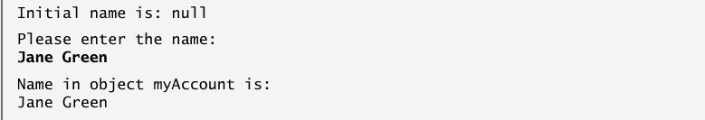

**图 7.2** 创建并操作 Account 对象。（2 个部分中的第 2 部分）

## 用于接收用户输入的 Scanner 对象

第 8 行创建了一个名为 `input` 的 `Scanner` 对象，用于输入用户提供的名称。第 18 行提示用户输入名称。`Scanner` 对象的 `nextLine()` 方法读取名称并将其赋值给局部变量 `name`。你输入名称并按 `Enter` 键后，会在你键入字符后插入一个换行符。`nextLine()` 方法读取字符（包括空白字符，例如 "Jane Green" 中的空格），直到遇到换行符，返回一个包含到换行符之前但不包括换行符的字符的 `String`，而换行符被**丢弃**。

正如你所看到的，`Scanner` 还提供了许多其他输入方法。与 `next` 类似的方法读取*下一个单词*。当你输入某些文本并按 `Enter` 键后，`next()` 方法会读取字符，直到遇到*空白字符*（如空格、制表符或换行符），然后返回一个包含到空白字符之前但不包括该空白字符的字符的 `String`，该空白字符被**丢弃**。第一个空白字符之后的所有信息都会丢失——除非由程序稍后调用 `Scanner` 方法的后续语句恢复。

## 实例化对象——关键字 `new` 和构造方法

第 11 行创建了一个 `Account` 对象，并将其赋值给类型为 `Account` 的变量 `myAccount`。该变量通过 `new Account()` 的结果初始化——这是一个类创建表达式。关键字 `new` 创建指定类的类对象——在本例中，是 `Account` 类。括号是必不可少的。正如你将在第 7.4 节中学到的，这些括号与类名结合表示对构造方法的调用，构造方法类似于方法，但由 `new` 隐式地调用，以便在创建对象时初始化实例变量。在第 7.4 节中，你将看到如何在括号中放置参数，以为 `Account` 的 `name` 实例变量指定一个初始值——你将通过增强 `Account` 类来启用这一功能。现在，我们留空括号。第 8 行包含一个 `Scanner` 对象的类实例创建表达式——该表达式用 `System.in` 初始化 `Scanner`，这告诉 `Scanner` 从何处读取输入（即键盘）。

## 调用 Account 的 getName 方法

第 14 行显示初始名称，该名称是通过调用账户的 `getName()` 方法获得的。正如你可以使用 `Object` 来调用它的 `printf()` 和 `println()` 方法一样，我们也可以使用 `myAccount` 来调用它的 `getName()` 和 `setName()` 方法。第 14 行包含了第 11 行创建的 `myAccount` `Account` 对象，通过点分隔符（`.`），然后是方法名 `getName()` 和一组空括号，因为没有传递任何参数。当调用 `getName()` 时：

1. 应用程序将执行流从调用处转移（图 7.2 的第 14–16 行）。
2. `getName()` 方法返回 `name` 实例变量的值。
3. 执行流返回到调用处，完成方法调用。

# 306 第 7 章 类与对象简介

## 顶部区域 (Top Compartment)

在 UML 中，每个类在类图中都被建模为一个具有三个区域的矩形。在该图中，顶部区域包含类名，水平居中，并使用**粗体**字体显示。

## 中间区域 (Middle Compartment)

中间区域包含属性名，对应 Java 中的实例变量。在 Java 中，实例变量是私有的，因此 UML 类图在属性名之前列出了访问修饰符 `-`。属性名之后是冒号和类型，在本例中为 `String`。

## 底部区域 (Bottom Compartment)

底部区域包含类的操作 `setName()` 和 `getName()`，对应 Java 中的方法。UML 通过在操作前加上访问修饰符来建模操作，在本例中为 `+getName()`。`+` 表示操作是公的（因为在 Java 中是 `public`）。`getName()` 没有任何参数，因此操作后的括号是空的，正如图 7.1 第 14 行的方法所示。`setName()` 也是一个公共操作，参数为 `String`。

## 返回类型 (Return Types)

UML 通过在操作名称括号后放置冒号和返回类型来指示操作的返回类型。`getName()`（图 7.1）具有 `String` 类型。`setName()` 不返回值（因为在 Java 中返回 `void`），因此 UML 类图在操作括号后没有指定返回类型。

## 参数 (Parameters)

UML 与 Java 处理参数的方式不同，它通过在操作名称括号后列出参数、冒号和参数类型来建模。UML 有自己的数据类型，与 Java 类似，但为了简单起见，我们将使用 Java 数据类型。`setName()`（图 7.1）有一个名为 `name` 的参数，因此图 7.3 列出了 `name : String`，位于方法名括号之间。

## 7.2.5 关于 Account 的补充说明

### 静态方法说明 (Notes on static)

静态方法可以直接调用同一类的其他静态方法（即直接使用方法名），并直接操作同一类中的静态变量。要访问类的实例变量和方法，静态方法必须使用对象的引用。记住，静态方法相对于整个类，而实例方法与类的特定实例（对象）相关，并可以实例化该对象的实例变量。许多对象可以同时存在，每个对象都有自己的实例变量拷贝。假设一个静态方法直接调用实例方法，它如何知道操作哪个对象的实例变量？如果在调用方法时不存在该对象会发生什么？因此，Java 不允许静态方法直接访问同一类的实例变量和方法。

### 导入声明说明 (Notes on Import Declarations)

注意图 7.2（第 3 行）中的导入声明，它指示编译器使用 `Scanner` 类。正如你在第 2 章中学到的，`System` 和 `String` 在 `java.lang` 包中，它被隐式导入到每个 Java 程序中，因此所有程序都可以使用该包的类。Java 程序中使用的其他类必须显式导入。

编译在同一目录下的类（例如 `Account` 类和 `AccountTest` 类）之间存在特殊关系。默认情况下，类被认为在同一个包中（即默认包）。同包中的类会被隐式导入到该包的文件源码，因此一个类使用同包的另一个类时（例如 `AccountTest` 使用 `Account`），不需要导入。如果在整个文件中将 `Scanner` 类引用为 `java.util.Scanner`（这包含了完整的包名和类名），则不需要第 3 行的导入声明。例如，7.2 的第 8 行可以写为：

```java
java.util.Scanner input = new java.util.Scanner(System.in);
```


## 软件工程观察 7.1

如果每次使用类名时都指定限定类名（qualified class name），Java 源码文件就不需要导入声明。大多数程序员更倾向于导入声明提供的更简洁的编程风格。

## 7.2.6 使用私有变量和公共 set/get 方法的软件工程

正如你所看到的，通过使用 `set` 和 `get` 方法，你可以对数据的修改尝试进行验证并控制数据呈现给调用者的方式——这些是非常巨大的软件工程优势。我们将在 7.5 节中详细讨论。

如果实例变量是公有的，该类的任何客户端（即任何其他类）都可以看到类的方法，并对它进行任何操作，包括将其设置为无效值。

你可能认为，尽管类的客户端无法直接访问第 80 到 89 行之间的私有实例变量，但严格控制对私有数据的访问和呈现可以大幅减少错误，同时提高程序的健壮安全性。

使用访问修饰符 `private` 声明实例变量被称为信息隐藏。当程序创建（实例化）`Account` 类的对象时，变量 `name` 被封装（隐藏）在对象中，且只能通过方法访问。


## 7.2 实例变量、方法和 get 方法

## 7.4 Account 类：使用构造函数初始化对象

正如在第 7.2 节提到的，当创建 `Account` 对象（图 7.1）时，变量 `name` 被初始化为 `null`。但如果我们想在创建对象时提供名称呢？你定义的每个类都可以提供一个带参数的构造函数来初始化对象。Java 下一个示例为 `Account` 类（图 7.5）增加了一个可以接收名称并在创建对象时初始化实例变量的构造函数。

```java
// 图 7.5: Account.java

// 带有初始化名称构造函数的 Account 类

public class Account {

    private String name; // 实例变量

    // 构造函数通过参数 name 初始化

    public Account(String name) { // 构造函数名为类名

        this.name = name;

    }

    // 设置名称的方法

    public void setName(String name) {

        this.name = name;

    }

    // 获取名称的方法

    public String getName() {

        return name;

    }

}
```

**图 7.5** | 带有初始化名称构造函数的 Account 类。

## 7.4.1 为自定义对象初始化声明 Account 构造函数

声明一个类时，可以提供自己的构造函数为该类的对象指定自定义初始化。例如，你可能想在创建 `Account` 对象时指定一个名称，正如你在图 7.6 第 8 行所示：

```java
Account account1 = new Account("Jane Green");
```

在这种情况下，`String` 参数 "Jane Green" 被传递给 `Account` 对象的构造函数并用于初始化实例变量。前面的语句要求该类提供一个只接受 `String` 参数的构造函数。图 7.5 包含了具有此类构造函数的修改 `Account` 类。

# 310 第 7 章 类与对象简介

执行任务所需的数据。第 8 行表示构造函数恰好有一个参数——名为 `name` 的字符串。当你创建一个新的 `Account` 对象时，你会将人的姓名传递给构造函数的 `name` 参数。然后，构造函数会将 `name` 参数的值赋值给实例变量 `name`（第 9 行）。

> **错误预防提示 7.2**
> 尽管可以这样做，但请不要在构造函数中调用方法。我们将在第 10 章“面向对象编程：多态与接口”中解释这一点。

### 类 Account 构造函数的参数名与方法 setName
回顾第 7.2.1 节的内容，方法参数是局部变量。在图 7.5 中，构造函数和方法都有一个名为 `name` 的参数。尽管这些参数具有相同的标识符（`name`），但第 8 行的参数是构造函数的局部变量，对方法 `setName()` 可可见；而第 13 行的是 `setName()` 的局部变量，对构造函数不可见。

## 7.4.2 AccountTest: 在创建时初始化 Account 对象

`AccountTest` 程序（图 7.6）使用构造函数初始化两个 `Account` 对象。第 8 行创建并初始化了 `Account` 对象 `account1`。关键字 `new` 请求系统分配内存来存储 `Account` 对象，这隐式地调用了类的构造函数来初始化账户。参数 `"Jane Green"` 用于初始化新对象的 `name`。第 8 行将新对象赋值给引用变量 `account1`。第 9 行重复此过程，传递参数 `"John Blue"` 来初始化 `account2` 的 `name`。由于第 12–13 行使用每个对象的 `setName()` 获取名称，并显示它们在对象创建时确实已初始化。输出显示了不同的名称，证实了每个 `Account` 都维护自己的实例变量 `name` 副本。

```java
// Fig 7.6: AccountTest.java

// 使用构造函数在每个 Account 对象创建时

// 初始化 name 实例变量。

public class AccountTest {

    public static void main(String[] args) {

        // 创建两个 Account 对象

        Account account1 = new Account("Jane Green");

        Account account2 = new Account("John Blue");

        // 显示每个 Account 的 name 初始值

        System.out.printf("account1 name is: %s\n", account1.getName());

        System.out.printf("account2 name is: %s\n", account2.getName());

    }

}
```

**图 7.6** 使用构造函数在每个 Account 对象创建时初始化 `name` 实例变量。（部分 1，共 2 部分。）

## 7.4 Account 类：使用构造函数初始化对象 311

| | |
| :--- | :--- |
| account1 name: | Jane Green |
| account2 name: | John Blue |

**图 7.6** 使用 Account 构造函数在每个对象创建时初始化 `name` 实例变量。（部分 2，共 2 部分。）

## 构造函数不能返回值

构造函数与方法的一个重要区别是，构造函数不能返回值，因此它们不能指定返回类型（即使是 `void` 也不行）。通常，构造函数被声明为 `public`——在书的后面我们将解释何时使用 `private` 构造函数。

## 默认构造函数

回顾图 7.2 中的第 11 行：

```java
Account myAccount = new Account();
```

它用于创建一个 `Account` 对象。`new Account` 之后的空括号表示对该类默认构造函数的调用——在任何没有显式声明构造函数的类中，编译器都会提供一个默认构造函数（该函数始终没有参数）。当一个类只有一个默认构造函数时，该类的实例变量将初始化为它们的默认值。在第 8.5 节中，你将学习类可以有多个构造函数。

## 声明了构造函数的类没有默认构造函数

如果你声明了一个构造函数，编译器将不会为该类创建默认构造函数。在这种情况下，你无法使用表达式 `new Account()` 像我们在图 7.2 中做的那样创建 `Account`——这与声明的无参数自定义构造函数不同。

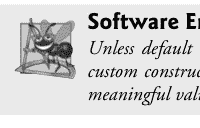

> **软件工程观察 7.3**
> 除非你可以接受类实例变量的初始化，否则请提供一个自定义构造函数，以确保在创建类的每个新对象时，你的实例变量被正确初始化为有意义的值。

**在 Account 类的 UML 类图中添加构造函数**
图 7.7 中的 UML 类模型了图 7.5 中的 `Account`，它有一个带有 `String name` 参数的构造函数。所有的操作，UML 模型都绘制在类图的第三个区域中。为了区分构造函数和类的操作，UML 要求将“constructor”一词包含在双角括号 («»）中并放在构造函数名称之前。习惯做法是在第三个区域将构造函数列在其他操作之前。

| Account |
| :--- |
| name : String |
| <<constructor>> Account(name: String) |
| + setName(name: String) |
| + getName() : String |

**图 7.7** 图 7.5 Account 类的 UML 类图。

## 7.5 带有余额的 Account 类

我们现在声明一个 `Account` 类，除了名称外还维护银行账户的余额。大多数账户余额不是整数。因此，`Account` 类将账户余额表示为 `double`。[在第 8.1 节中，你将学习类可以有多个构造函数]。

```java
// Fig 7.8: Account

// 使用构造函数在每个 Account 对象创建时

// 初始化 name 实例。

public class Account {

    private String name;

    private double balance;

    // 构造函数接收两个参数

    public Account(String name, double balance) {

        this.name = name; // 赋值给实例变量

        this.balance = balance; // 赋值给实例变量

    }

    // 存款方法

    public void deposit(double depositAmount) {

        if (depositAmount > 0) { // 如果存款金额有效

            balance += depositAmount; // 累加余额

        }

    }
```


// 获取余额方法

public double getBalance() {

    return balance; // 返回余额

}

// 设置名称方法

public void setName(String name) {

    this.name = name; // 赋值给实例变量

}

// 获取名称方法

public String getName() {

    return name; // 返回名称

}

}

```

**图 7.8：Account 类使用构造函数在每个 `Account` 对象创建时初始化 `name` 实例。**

# 第 7 章 类与对象介绍

Jane Green: $50.00
John Blue: $0.00
输入 account1 的存款金额：25.53
正在向 account1 余额添加 25.53
Jane Green: $75.53
John Blue: $0.00
输入 account2 的存款金额：123.45
正在向 account2 余额添加 123.45
Jane Green: $75.53
John Blue: $123.45

**图 7.9 使用 `Account` 对象输入和输出浮点数。（部分 2，共 2）**

## 7.5 带有余额的 `Account` 类

### 显示 对象的初始余额

当第 12 行为 `account1` 调用 `getBalance()` 时，`account1` 余额的值将从图 7.8 的第 29 行返回，并由 `System.out.printf` 语句显示（图 7.9，第 11–12 行）。同样地，当第 14 行为 `account2` 调用 `getBalance()` 时，该对象的余额值将从图 7.8 的第 29 行返回，并由 `System.out.printf` 语句显示（图 7.9，第 13–14 行）。`account2` 的余额初始为 0.00，因为构造函数拒绝了用负余额启动 `account2` 的尝试，所以余额保留了其初始值。

### 为显示格式化浮点数

每个余额都通过 `printf` 使用格式说明符 `%.2f` 输出。`%` 和 `f` 之间的 `.` 代表浮点数小数点右侧应有的位数——也称为精度。任何带有 `%.2f` 的浮点值都会四舍五入到百分位——例如，`123.457` 会被舍入到 `123.46`，`23.77379` 会被舍入到 `23.77`。

### 从用户处读取浮点值并存款

第 19 行提示用户输入 `account1` 的存款金额。第 20 行声明了局部变量 `depositAmount` 用于存储用户输入的每个存款金额。与实例变量（如 `Account` 类中的 `name` 和 `balance`）不同，局部变量（`main` 方法中的 `depositAmount`）默认不会初始化，因此必须显式初始化。正如你很快将学到的，变量 `depositAmount` 的初始值将由用户决定。

> **错误预防提示 7.3**
> 如果你尝试使用未初始化变量的值，Java 编译器会抛出编译错误。这有助于你避免危险的运行时逻辑错误。在编译时解决程序错误总比在执行时解决要好。


第 20 行通过 `Scanner` 对象 `input` 的 `nextDouble()` 方法从用户处获取输入。第 21–22 行显示 `depositAmount`。第 23 行用 `depositAmount` 作为参数调用 `account` 的 `deposit()` 方法。当该方法被调用时，参数的值被赋值给方法 `deposit()` 的参数；然后 `deposit()` 方法将该值加到余额上。第 26–29 行（图 7.9）输出两个 `Account` 的名称和余额，以显示只有 `account1` 的余额发生了变化。

第 31 行提示用户输入 `account2` 的存款金额。第 32 行通过调用 `Scanner` 对象 `input` 的 `nextDouble()` 获取用户输入。第 33–34 行显示 `depositAmount`。第 35 行用 `depositAmount` 作为参数调用 `account2` 的 `deposit()` 方法；然后 `deposit()` 方法将该值加到余额上。最后，第 38–41 行输出两个 `Account` 的名称和余额，显示只有 `account2` 的余额发生了变化。

### Main 中的重复代码

第 11–12、13–14、26–27、28–29、38–39 和 40–41 行的语句几乎相同——它们输出 `Account` 的名称和余额。区别仅在于 `Account` 对象——`account1` 或 `account2`。这种代码需要更新代码可能会产生维护问题——如果六份相同的代码有一个错误或需要更新，你必须修改六次且不能出错。练习 7.14 要求你修改图 7.9，包含一个 `displayAccount()` 方法，该方法接收 `Account` 对象作为参数并输出该对象的名称和余额。你用六次 `displayAccount()` 的调用替换 `main` 中的重复语句，从而减小了程序的大小，并通过只保留一份显示 `Account` 名称和余额的代码副本，提高了其可维护性。

### 软件工程观察 7.4

用调用包含该代码副本的方法来替换重复代码，可以缩小程序体积并提高可维护性。


### `Account` 的 UML 类图

图 7.10 中的 UML 类图简洁地建模了图 7.8 中的 `Account` 类。该图在第二个隔间显示了 `String` 类型的私有属性 `name` 和 `double` 类型的 `balance`。`Account` 的构造函数建模在第三个隔间，具有 `String` 类型的参数和 `double` 类型的初始余额。该类的公共方法也建模在第三个隔间——带有 `depositAmount` 参数的操作 `deposit()`。

| Account | 
| :--- |
| - name: String |
| - balance: double |
| <<constructor(name: String, balance: double)> |
| + deposit(depositAmount: double) |
| + getBalance(): double |
| + setName(name: String) |
| + getName(): String |

**图 7.10 `Account` 的 UML 类图**

## 7.6 案例研究：类洗牌与发牌

第 6 章的示例使用数组演示了洗牌和发牌。`DeckOfCards` 包含基本类型数组。数组的元素可以是基本类型或引用类型。本章末的练习使用引用类型来构建简单的应用程序。

我们首先开发 `Card` 类（图 7.11），它代表一张牌（"Ace", "Deuce", ..., "Jack", "Queen", "King"）以及花色（"Hearts", "Diamonds", "Clubs", "Spades"）。接着，我们开发 `DeckOfCards` 类（图 7.12），它包含 52 张牌，展示了洗牌和发牌能力。

### `Card` 类

`Card` 类（图 7.11）包含两个 `String` 实例变量——`face` 和 `suit`——用于存储特定牌的名称和花色。构造函数（9–12）接收两个 `String` 并初始化它们。`toString()` 方法（15–17）创建一个表示牌和花色的 `String`。当在需要 `String` 的地方使用对象时，对象的 `toString()` 方法会被隐式调用（例如当使用 `printf` 的 `%s` 说明符或使用 `+` 运算符连接到字符串时）。为了实现这种情况，`toString()` 必须按照图 7.11 所示头部进行声明。

```java
// Fig 7.11: Card.java

// Card 代表一张牌。

public class Card {

    private final String face; // 牌 ("Ace", "Deuce", ...)

    private final String suit; // 花色 ("Hearts", "Diamonds", ...)

    // 双参数构造函数初始化牌和花色

    public Card(String cardface, String cardsuit) {

        this.face = cardface; // 初始化牌

        this.suit = cardsuit; // 初始化花色

    }

    // 返回 Card 的表示

    public String toString() {

        return face + " of " + suit;

    }

}
```

**图 7.11 `Card` 类**

### `DeckOfCards` 类

`DeckOfCards` 类（图 7.12）创建并管理 `Card` 引用数组。常量 `NUMBER_OF_CARDS`（第 8 行）指定了牌组的数量（52）。第 10 行声明并初始化了一个实例变量 `deck`，它指向一个具有 `NUMBER_OF_CARDS` (52) 个元素的新数组——数组的元素默认为 `null`。回顾第 7 章，`null` 代表“对空值的引用”，因此还没有任何 `Card`。引用类型的数组声明方式与其他任何数组一样。`DeckOfCards` 还声明了实例变量 `currentCard`（第 11 行），代表从牌中发的下一张牌的序列号（0–51）。

```java
// 图 7.12: DeckOfCards.java

// DeckOfCards 类代表一副扑克牌。

import java.security.SecureRandom;

public class DeckOfCards {

    // 随机数生成器

    private static final SecureRandom randomNumbers = new SecureRandom();

    private static final int NUMBER_OF_CARDS = 52; // 牌数

    private Card[] deck = new Card[NUMBER_OF_CARDS]; // 引用

    private int currentCard = 0; // 下一个要发出的牌索引 (0-51)

    public DeckOfCards() {

        String[] faces = {"Ace", "Deuce", "Three", "Four", "Five", "Six",
        "Seven", "Eight", "Nine", "Ten", "Jack", "Queen", "King"};

        String[] suits = {"Hearts", "Diamonds", "Clubs", "Spades"};

        // 用 Card 对象填充牌组

        for (int count = 0; count < deck.length; count++) {

            deck[count] = new Card(faces[count % 13], suits[count / 13]);

        }

    }

    public void shuffle() {

        // 使用单遍算法洗牌牌组

        // 下一次调用 dealCard() 应该再次从 deck[0] 开始

        currentCard = 0;

        // 对于每张 Card，选取另一个随机 Card (0-51) 并交换它们

        for (int first = 0; first < deck.length; first++) {

            // 在 0 到 51 之间选择一个随机数

            int second = randomNumbers.nextInt(NUMBER_OF_CARDS);

            // 将当前 Card 与随机选取的 Card 交换

            Card temp = deck[first];

            deck[first] = deck[second];

            deck[second] = temp;

        }

    }

    // 发一张 Card

    public Card dealCard() {

        // 判断是否还有牌可以发

        if (currentCard < deck.length) {

            return deck[currentCard++]; // 返回数组中当前的 Card

        } else {

            return null; // 返回 null 表示所有牌已发完

        }

    }

}
```

**图 7.12 `DeckOfCards` 类代表一副扑克牌。**

## 7.6 案例研究：洗牌与发牌模拟

### `DeckOfCards` 构造函数

构造函数使用循环（第 20–23 行）在实例变量 `deck` 中填充 `Card` 对象。循环从 0 开始迭代，直到 `count` 小于 `deck.length`，这使得 `count` 获得 0 到 51 之间的每个整数值（数组索引）。每张 `Card` 都初始化了两个 `String`——一个来自 `faces` 数组（包含字符串 "Ace" 和 "King"），另一个来自 `suits` 数组（包含字符串 "Hearts," "Diamonds," "Clubs" 和 "Spades"）。计算 `count % 13` 的结果始终是 0 到 12 之间的值（第 15–16 行 `faces` 数组的索引），计算 `count / 13` 的结果是 0 到 3 之间的值（第 17 行 `suits` 数组的四个索引）。当循环完成后，`deck` 包含了按花色排序的 "Ace" 到 "King" 的 `Card`（13 张 "Hearts"，然后是 13 张 "Diamonds"，接着是 13 张 "Clubs"，最后是 13 张 "Spades"）。我们使用 `String` 数组来表示点和花色。在练习 7.20 中，我们让你修改此练习，使用枚举数组来表示点和花色。

### `DeckOfCards` 方法 `shuffle()`

`shuffle()` 方法洗牌牌组中的 `Card`。该方法遍历所有的 52 张 `Card`（数组索引 0 到 51）。对于每张牌，代码在 0 到 51 之间选择一个随机索引来选取另一张 `Card`。接着，第 37–39 行交换数组中的当前 `Card` 和随机选取的 `Card`。额外变量 (`temp`) 存储了正在交换的两个对象之一。`for` 循环结束后，`Card` 对象就被随机排列了。仅通过对整个数组进行单次遍历并进行 52 次交换，`Card` 对象的数组就被洗乱了！第 37–39 行的交换可以通过以下语句完成：

```java
deck[first] = deck[second];
deck[second] = temp;
```

如果 `deck[first]` 是 "Spades" 的 "Ace"，而 `deck[second]` 是 "Hearts" 的 "Queen"，在第一次赋值后，数组元素包含了 "Hearts" 的 "Queen"，而 "Spades" 的 "Ace" 丢失了——因此需要额外变量。

> **注意**：我建议在实际游戏中使用所谓的“无偏算法”。此类算法可以确保所有洗牌序列出现的概率相等。练习 7.21 让你研究 Fisher-Yates 方法并使用它来实现 `DeckOfCards` 的洗牌功能。

### `DeckOfCards` 方法 `dealCard()`

`dealCard()` 方法（第 44–52 行）发出数组中的一张 `Card`。记住 `currentCard` 指明要发出的 `Card` 的索引（即牌组顶部的 `Card`）。如果牌组不为空（即 `currentCard` 小于 52），第 47 行返回“顶部的” `Card` 并增加 `currentCard` 以为下一次发牌做准备；否则，第 50 行返回 `null`。

### 洗牌与发牌

图 7.13 展示了 `DeckOfCards` 类。第 7 行创建了一个名为 `myDeckOfCards` 的 `DeckOfCards` 对象。`DeckOfCards` 构造函数按花色顺序创建包含 52 个 `Card` 对象的牌组。第 8 行调用 `DeckOfCards` 的 `shuffle()` 方法重新排列 `Card` 对象。第 11–18 行发完所有 52 张 `Card`，并每 13 张为列打印出来。第 13 行通过调用 `myDeckOfCards` 的 `dealCard()` 方法发出一张牌，然后在 19 个字符宽的字段中左对齐显示该 `Card`。当 `Card` 作为字符串输出时，会隐式地调用 `Card` 的 `toString()` 方法（图 7.11）。第 15–17 行在四张牌后开始换行。

```java
// 图 7.13: DeckOfCardsTest.java

// 洗牌与发牌。

public class DeckOfCardsTest {

    public static void main(String[] args) {

        DeckOfCards myDeckOfCards = new DeckOfCards();

        myDeckOfCards.shuffle(); // 将 Card 随机排序

        // 按照发牌顺序打印所有 52 张 Card

        for (int i = 1; i <= 52; i++) {

            // 显示并播放一张 Card
```


# 第7章 类与对象介绍

## 7.7 案例研究：使用数组存储成绩的 GradeBook 类

```java
// 输出显示成绩分布的柱状图
public void outputBarChart() {
    System.out.println("Grade distribution:");
    // 存储每个 10 分范围内成绩的出现次数
    int[] frequency = new int[11];
    // 对于每个成绩，增加相应的频率
    for (int grade : grades) {
        ++frequency[grade / 10];
    }
    // 对于每个成绩频率，在图表中打印柱体
    for (int count = 0; count < frequency.length; count++) {
        // 输出柱("00-09: ", ..., "90-99: ", "100: ")
        if (count == 10) {
            System.out.printf("%d: %d\n", count, 100);
        } else {
            System.out.printf("%02d-%02d: %d\n", count * 10, count * 10 + 9, frequency[count]);
        }
        // 打印星号柱体
        for (int stars = 0; stars < frequency[count]; stars++) {
            System.out.print("*");
        }
        System.out.println();
    }
}

// 输出数组的内容
public void outputGrades() {
    System.out.printf("The grades are:%n");
    // 输出每个学生的成绩
    for (int student = 0; student < grades.length; student++) {
        System.out.printf("Student %d: %d\n", student + 1, grades[student]);
    }
}
```

**图 7.14** 使用数组存储测试成绩的 GradeBook 类。（3 部分中的第3 部分）。

`MethodGrades`（第 25–38 行）包含了一系列输出成绩的方法调用。第 27 行调用 `outputGrades` 来打印数组的内容。`MethodGrades` 中的第 19–22 行输出学生信息。在这种情况下，必须使用计数器控制的 `for` 语句，因为第 20–21 行使用学生的值在特定的学生编号旁边输出每个成绩（参见图 7.15 中的输出）。虽然数组索引从 0 开始，但教授通常会使用从 1 开始的学号。因此，图 7.14 中的第 20–21 行使用 `student + 1` 作为学生编号，以产生 "Student 1: "、“Student 2: " 等标签。

`MethodGrades` 调用 `methodAverage`（第 30 行）来获取平均分。`MethodAverage`（第 71–81 行）使用增强型 `for` 循环来累加一个学生的总分，并在第 80 行返回成绩的平均值。`MethodGrades` 在第 33–34 行调用 `getMinimum` 和 `getMaximum`。`getMinimum` 在第 45–50 行遍历 `grades` 数组：在第 47–49 行，如果成绩小于 `lowGrade`，则将其赋值给 `lowGrade`。最后，`MethodGrades` 在第 37 行调用 `outputMathClass` 来打印成绩分布图。

## 7.8 案例研究：使用二维数组的 Class GradeBook

在 7.7 中，我们展示了 Class GradeBook（图 7.14），它使用一维数组存储单次考试的成绩。在大多数学期中，学生会参加多次考试。教授可能会分析整个学期的成绩，包括针对单个学生以及针对整个班级。

### 在 Class GradeBook 中二维数组存储学生成绩

图 7.16 包含一个 GradeBook，它使用二维数组存储多个学生在多次考试中的成绩。数组的每一行代表一个学生整个课程的成绩，每一列代表参加了某次考试的所有学生的成绩。Class GradeBookTest（图 7.17）将该数组作为参数传递给 GradeBook 构造函数。在这个示例中，我们使用了一个 10x3 的数组表示 10 个学生在三次考试中的成绩。我们通过数组操作来处理成绩。每个方法都与其之前的一维版本 GradeBook（图 7.14）中的对应方法相似。`getMinimum` 方法（图 7.16 的第 39–55 行）确定任何学生在该学期的最低分。`getMaximum` 方法（第 58–74 行）确定任何学生在该学期的最高分。`getAverage` 方法（第 77–88 行）确定特定学生的学期平均分。`outputBitCount` 方法（第 90–121 行）输出整个学期学生成绩的柱状图。`outputGrades` 方法（第 124–148 行）以表格格式输出数组，显示每个学生的平均分。

```java
// Fig. 7.16: GradeBook.java
// 使用二维数组存储成绩的 GradeBook 类。
public class GradeBook {
    private String courseName; // 代表此成绩单的名称
    private int[][] grades; // 成绩的二维数组
    // 双参数构造函数初始化 courseName 和 grades 数组
    public GradeBook(String courseName, int[][] grades) {
        this.courseName = courseName;
        this.grades = grades;
    }
    // 设置课程名称的方法
    public void setCourseName(String courseName) {
        this.courseName = courseName;
    }
    // 获取课程名称的方法
    public String getCourseName() {
        return courseName;
    }
}
```

图 7.16 使用二维数组存储成绩的 GradeBook 类。（4 部分中的第一部分）

```java
// 对数据执行各种操作
public void processGrades() {
    // 输出 grades 数组
    outputGrades();
    // 调用 getMinimum 和 getMaximum 方法
    System.out.printf("%s%n%s%n%s%n%n",
        "Lowest grade in the grade book is,", getMinimum(),
        "Highest grade in the grade book is,", getMaximum());
    // 输出所有测试所有成绩的分布图
    outputBarChart();
}

// 寻找最低分
public int getMinimum() {
    // 假设 grades 数组的第一个元素最小
    int lowGrade = grades[0][0];
    // 遍历 grades 数组的行
    for (int[] studentGr : grades) {
        // 遍历当前行的列
        for (int grade : studentGr) {
            // 如果 grade 小于 lowGrade，则将其赋值给 lowGrade
            if (grade < lowGrade) {
                lowGrade = grade;
            }
        }
    }
    return lowGrade;
}

// 寻找最高分
public int getMaximum() {
    // 假设 grades 数组的第一个元素最大
    int highGrade = grades[0][0];
    // 遍历 grades 数组的行
    for (int[] studentGr : grades) {
        // 遍历当前行的列
        for (int grade : studentGr) {
            // 如果 grade 大于 highGrade，则将其赋值给 highGrade
            if (grade > highGrade) {
                highGrade = grade;
            }
        }
    }
    return highGrade;
}
```

图 7.16 使用二维数组存储成绩的 GradeBook 类。（4 部分中的第二部分。）

```java
// 为一组特定成绩计算平均分
public double getAverage(int[] setOfGrades) {
    int total = 0;
    // 累加一个学生的成绩
    for (int grade : setOfGrades) {
        total += grade;
    }
    // 返回成绩的平均值
    return (double) total / setOfGrades.length;
}

// 输出显示整体成绩分布的柱状图
public void outputBarChart() {
    System.out.println("Overall grade distribution:");
    // 存储 10 个范围内成绩的频率
    int[] frequency = new int[11];
    // 对于 GradeBook 中的每个成绩，增加相应的频率
    for (int[] studentGrades : grades) {
        for (int grade : studentGrades) {
            frequency[grade / 10]++;
        }
    }
    // 针对每个频率
    // 打印星号条
    for (int stars = 0; stars < frequency[count]; stars++) {
        System.out.print("*");
    }
    System.out.println();
}

// 输出 grades 的内容
public void outputGrades() {
    System.out.printf("The grades are:%n");
    // 为测试创建列标题
    for (int test = 0; test < grades[0].length; test++) {
        System.out.printf("Test %d", test + 1);
    }
    System.out.println("Average");
    // 创建代表成绩的行/列
    for (int student = 0; student < grades.length; student++) {
        System.out.printf("Student %d", student + 1);
        for (int test : grades[student]) { // 输出成绩
            System.out.printf("%d ", test);
        }
        // 调用 getAverage 计算学生平均分；将 grades 行作为参数
        double average = getAverage(grades[student]);
        System.out.printf("%.2f%n", average);
    }
}
```


## 图 7.16 使用二维数组存储成绩的 GradeBook 类（4 部分中的第三部分）

### getMinimum 和 getMaximum 方法

`getMinimum`、`getMaximum`、`outputBarChart` 和 `outputGrades` 使用嵌套的 `for` 语句遍历 `grades`——例如，`getMinimum` 中第 44–52 行的外部 `for` 语句遍历二维数组，将行赋值给 `studentGrades`。方括号表示 `studentGrades` 指向一维数组——即 `grades` 中的一个学生成绩。为了找到最低分，内部语句比较当前一维数组的元素。例如，外部循环的第一次迭代将 `grades[0]` 赋值给 `studentGrades`。内部 `for` 语句遍历 `studentGrades` 并比较每个值。如果成绩小于 `lowGrade`，则将 `lowGrade` 设置为该成绩。外部循环的第二次迭代将 `grades[1]` 赋值给 `studentGrades`，并将元素与 `lowGrade` 进行比较，直到遍历所有 `grades` 行。嵌套语句执行，`lowGrade` 包含了二维数组中的最低分。`getMaximum` 方法的工作类似于 `getMinimum`。

### outputBarChart 方法

图 7.16 中的 `outputBarChart` 与图 7.14 的几乎相同。但为了输出整个学生的平均分，该方法使用嵌套 `for` 语句（第 97–101 行）根据二维数组中的所有成绩创建一个一维频率数组。显示图表的其余代码相同。

### outputGrades 方法

`outputGrades`（第 124–148 行）使用嵌套 `for` 语句输出 `grades` 数组的值以及每个学生的学期平均分。输出（图 7.17）显示的结果类似于教授成绩单的表格格式。图 7.16 的第 129–131 行打印每次测试的列标题。我们在这里使用计数控制 `for` 语句以便用数字识别每次测试。同样，第 136–147 行的语句首先输出识别学生的标签（第 137 行）。另一个数组索引从 0 开始，第 130 和 137 行分别输出 `test + 1` 和 `student + 1`，产生从 1 开始的学生（见图 7.17 输出）。图 7.16 第 139–141 行的内部 `for` 语句使用外部 `for` 语句的计数变量遍历 `grades` 行以及每个学生的测试成绩。增强语句可以嵌套在计数控制 `for` 语句中，反之亦然。最后，第 145 行通过将 `grades` 行（即 `grades[student]`）传递给 `getAverage` 方法输出每个学生的平均分。

### getAverage 方法

`getAverage`（第 77–87 行）接收一个参数——特定学生的测试结果的一维数组。当第 145 行调用 `getAverage` 时，指定二维数组行的 `grades[student]` 被传递给 `getAverage`。例如，根据图 7.17 创建的数组，参数 `grades[1]` 代表存储在二维数组第 1 行的三个值（成绩的一维数组）。回想二维数组是一维数组。`getAverage` 计算数组元素的和，将其除以测试次数，并将浮点数结果作为 `double` 返回（图 7.16 的第 86 行）。

## 演示 Class GradeBook 的 GradeBookTest 类

图 7.17 使用名为 `gradesArray` 的 `int` 二维数组创建 `GradeBook` 类对象（在第 8–17 行声明并初始化）。第 19–20 行将课程名称和成绩传递给 `GradeBook` 构造函数。第 21–22 行显示包含课程名称的欢迎信息，然后第 23 行调用 `processGrades` 显示学期学生成绩的总结报告。

```java
// Fig. 7.17: GradeBookTest.java

// GradeBookTest 使用成绩二维数组创建 GradeBook 对象，
// 然后调用 processGrades 方法分析它们。

public class GradeBookTest {

    // main 方法开始程序执行
    public static void main(String[] args) {

        // 学生成绩的二维数组
        int[][] gradesArray = {{87, 96, 70},
                               {68, 87, 90},
                               {94, 100, 90},
                               {100, 81, 82}};
    }
}
```

## 7.9 总结

```java
GradeBook myGrade = new GradeBook("CS101 Introduction to Java Programming", gradesArray);
System.out.printf("Welcome to the grade book%n%s%n%n", myGradeBook.getCourseName());
myGrade.processGrades();
```


# 欢迎使用成绩单
## CS101 Java 编程入门

### 成绩如下：

| 学生 | 测试 1 | 测试 2 | 测试 3 | 平均分 |
| :--- | :--- | :--- | :--- | :--- |
| 学生 1 | 87 | 96 | 70 | 84.33 |
| 学生 2 | 68 | 87 | 90 | 81.67 |
| 学生 3 | 94 | 100 | 90 | 94.67 |
| 学生 4 | 100 | 81 | 82 | 82.67 |
| 学生 5 | 83 | 65 | 85 | 77.67 |
| 学生 6 | 78 | 87 | 65 | 76.67 |
| 学生 7 | 85 | 75 | 83 | 81.00 |
| 学生 8 | 91 | 94 | 100 | 95.00 |
| 学生 9 | 76 | 72 | 84 | 77.33 |
| 学生 10 | 87 | 93 | 73 | 84.33 |

成绩单中的最低分是 65
成绩单中的最高分是 100

### 总体成绩分布：
```text
00-09:
10-19:
20-29:
30-39:
40-49:
50-59:
60-69: ***
70-79: *****
80-89: ********
90-99: ******
100: ***
```

> 图 7.17 | `GradeTest` 使用成绩二维数组创建 `GradeBook` 对象，并调用 `processGrades` 对其进行分析。（部分部分的 2 部分。）

在本章中，你学习了如何创建类、创建这些类的对象以及调用这些对象的方法来执行有用操作。你声明了实例变量来维护类中每个对象的数据，并声明了方法来对这些数据进行操作。你学习了方法的局部变量与类的实例变量之间的区别，以及实例变量是自动初始化的。你使用了类的构造函数来为对象的实例变量指定初始值。你了解了如何创建 UML 类图，以视觉化的方式对类的方法、属性和构造函数进行建模。最后，我们展示了三个重要的面向对象案例研究——关于洗牌和发牌以及 `GradeBook` 类的两种变体。第一个使用一维数组记录了 10 名学生单次考试的成绩。第二个使用二维数组记录了 10 名学生三次考试的成绩。我们被引入了控制语句、方法、数组、集合、类和对象的基本概念。在第 8 章中，我们将更深入地研究类和对象。

## 总结

## 第 7.2 节 实例变量、set 方法和 get 方法

- 你创建的每个类都变成一种新类型，可以用于声明变量和对象。
- 你可以根据需要声明新类；这就是 Java 被称为可扩展语言的原因。

## 第 7.2.1 节 带有实例变量、set 方法和 get 方法的 Account 类

- 每个类声明都以访问修饰符（第 300 页）`public` 开始，它将存储在与类同名且以 `.java` 结尾的文件中。
- 每个类声明都包含关键字 `class`，后面紧随其后的是类名。
- 类名、方法名和变量名是标识符。按照惯例，它们都使用驼峰命名法。类名以大写字母开头，方法名和变量名以小写字母开头。
- 对象拥有通过实例变量（第 301 页）实现的属性，并贯穿整个生命周期。
- 实例变量在调用对象方法之前就已经存在，在方法执行期间以及方法完成执行后都存在。
- 类通常包含一个或多个方法，用于操作该类特定对象的实例变量。
- 实例变量声明在类声明内部，但在类方法声明的体之外。
- 每个（该类的）对象都有一份类实例变量的副本。
- 大多数实例变量声明之前都有关键字 `private`（第 301 页），它是一种修饰符。用访问修饰符 `private` 声明的变量或方法在声明时仅对该类的方法可访问。
- 类提供了公共方法，允许客户端设置或获取实例变量。

## 第 7.2.2 节 创建并使用类对象的 AccountTest 类

- 每个类声明都以访问修饰符（第 300 页）`public` 开始，它将存储在与类同名且以 `.java` 结尾的文件中。
- 每个类声明都包含关键字 `class`，后面紧随其后的是类名。
- 类名、方法名和变量名是标识符。按照惯例，它们都使用驼峰命名法。类名以大写字母开头，方法名和变量名以小写字母开头。
- 对象拥有通过实例变量（第 301 页）实现的属性，并贯穿整个生命周期。
- 实例变量在调用对象方法之前就已经存在，在方法执行期间以及方法完成执行后都存在。
- 类通常包含一个或多个方法，用于操作该类特定对象的实例变量。
- 实例变量声明在类声明内部，但在类方法声明的体之外。
- 每个（该类的）对象都有一份类实例变量的副本。
- 大多数实例变量声明之前都有关键字 `private`（第 301 页），它是一种修饰符。用访问修饰符 `private` 声明的变量或方法在声明时仅对该类的方法可访问。
- 类提供了公共方法，允许客户端设置或获取实例变量。

- 图 7.17 | `GradeTest` 使用成绩二维数组创建 `GradeBook` 对象，并调用 `processGrades` 对其进行分析。（部分部分的 2 部分。）
- 类的公共方法允许客户端设置或获取实例变量。
- UML 在方法名后面紧跟一组括号表示参数。
- UML 括号内出参数的名称和类型。
- UML 在括号后面放置冒号和返回类型。
- UML 类图不指定返回类型。
- 声明实例变量私 被称为信息隐藏。
- 构造函数类似于方法，但通过 `new` 隐式调用。
- 调用对象方法时，在对象名后加点号。
- 局部变量不会自动初始化。
- `String` 类型实例变量的默认值是 `null`。
- 方法中的参数数量必须与声明匹配。
- 方法中的参数类型必须与声明中的类型一致。
- 静态方法不需要创建对象即可调用。
- 默认类在同一个包中。

## 总结 333

- 构造函数类似于方法，但通过 `new` 隐式调用。
- 调用对象方法时，在对象名后加点号。
- 局部变量不会自动初始化。
- `String` 类型实例变量的默认值是 `null`。
- 方法中的参数数量必须与声明匹配。
- 方法中的参数类型必须与声明中的类型一致。

## 第 7.3 节 编译和运行多个类的程序

- `javac` 命令可以一次编译多个类。只需在命令后列出源文件名，并用空格分隔。如果包含路径的目录只包含 `.java` 文件，你可以使用 `javac *.java` 编译所有文件。星号 (`*`) 表示编译当前目录下所有以 `.java` 结尾的文件。

## 第 7.4 节 UML 类图

- 在 UML 中，每个类在类图（第 305 页）中建模为一个具有三个区域的矩形。顶部区域水平居中显示类名。中间区域包含类的属性，这些对应于 Java 中的实例变量。底部区域包含类的操作（第 306 页），对应于 Java 中的方法和构造函数。
- UML 将实例变量表示为属性名，后跟一个冒号和类型。
- 私有属性在 UML 中以减号 (`-`) 前缀。
- UML 通过列出操作名并紧跟一组括号来建模操作。操作名前的加号 (`+`) 表示它是 UML 中的公共方法（即 Java 中的公共方法）。
- UML 通过括号内列出参数名称和类型来建模操作的参数。
- UML 在括号后面放置冒号和返回类型来表示操作的返回类型。

## 第 7.5 节 关于 UnitTest 类的额外说明

# 334 第 7 章 类与对象简介

隐式导入到该包中其他类的源文件中。当一个包中的一个类使用同一个包中的另一个类时，不需要导入声明。

- 如果你始终使用类的完全限定名称（包括包名和类名）来引用该类，则不需要导入声明。

## 7.2.6 节 使用 private 实例变量和 public 及 get 方法的软件工程

- 将实例变量声明为 `private` 被称为信息隐藏。

## 7.3 节 实例变量的默认和显式初始化

- 原始类型实例变量会被默认初始化。类型为 `byte`、`char`、`short`、`int`、`long`、`float` 和 `double` 的变量初始化为 0。`boolean` 类型的变量初始化为 `false`。
- 引用类型实例变量默认初始化为值 `null`。

## 7.4 节 Account 类：使用构造函数初始化对象

- 你声明的每个类都可以可选地提供一个带参数的构造函数，该构造函数可以在创建类时用于初始化对象。
- Java 要求每个创建的对象都必须调用构造函数。
- 构造函数可以指定参数，但没有返回类型。
- 如果类没有定义构造函数，编译器会提供一个无参数的默认构造函数（第 311 页），并且类的实例变量将初始化为默认值。
- 如果你为一个类声明了构造函数，编译器将不会为该类创建默认构造函数。
- UML 在类图的第三个区域模拟构造函数。为了区分构造函数与类的操作，UML 在构造函数名称之前用双角括号 (`«` `»`；第 311 页）放置单词 "constructor"。

## 7.5 节 带有余额的 Account 类

- 格式指定符 `%.2f` 指定在小数点数字右侧输出两位精度（第 315 页）。
- `Scanner` 方法 `nextDouble`（第 315 页）返回一个 `double` 值。
- `double` 类型实例变量的默认值为 0.0（或简单地为 0），`int` 类型实例变量的默认值为 0。

## 7.6 节 案例研究：洗牌和发牌模拟

- 当对象在期待字符串的场所使用时，对象的 `toString` 会被隐式调用（例如，当 `print` 使用 `%s` 格式指定符将对象输出为字符串，或者当使用 `+` 运算符将对象与字符串拼接时）。

## 自测习题

### 7.1 填空以下内容：

a) 每一个以关键字 ____ 开头的声明都必须存储在与类名完全相同且以 `.java` 扩展名结尾的文件中
b) 类声明中的关键字 ____ 后面紧跟类的类名。
c) 关键字 ____ 从系统请求内存以存储对象，然后调用对应类的构造函数来初始化对象。
d) 每个方法参数必须同时指定一个（种）____ 和一个（种）____。

e) 默认情况下，在同一目录下编译的类被认为在同一个包中，称为 ____。

f) 关键字 `public` 是一种访问 ____。

g) `Scanner` 方法 ____ 读取字符直到遇到换行符为止，然后将这些字符作为 `String` 返回。

### 7.2 判断以下每个陈述的对错。如果认为错误，请说明原因。

a) 当一个包中的一个类使用同一个包中的另一个类时，不需要导入声明。
b) 在特定方法体中声明的变量被称为实例变量，可以在类的所有方法中使用。
c) 原始类型的局部变量会被默认初始化的。
d) 引用类型实例变量默认初始化为值 `null`。

### 7.3 局部变量和实例变量之间的区别是什么？

## 自测习题答案

**7.1** a) `public`. b) `class`. c) `new`. d) `type`. e) `default package`. f) `modifier`. g) `nextLine`.

**7.2** a) 正确。b) 错误。这种变量被称为局部变量，只能在声明它们的方法中使用。c) 错误。原始类型的实例变量会被默认初始化。d) 正确。每个局部变量都必须赋值。

**7.3** 局部变量声明在方法体中，并且只能从声明处开始到方法声明结束处使用。实例变量声明在类中，但在类的任何方法体中都不声明。此外，实例变量对类的所有方法都是可访问的。（我们将在 8 章将看到此的例外。）

## 练习题

**7.4** (关键字 `new`) 关键字 `new` 的目的是什么？解释当你使用它时会发生什么。

**7.5** (默认构造函数) 什么是默认构造函数？如果一个类只有一个默认构造函数，对象的实例变量是如何初始化的？

**7.6** (实例变量) 解释实例变量的作用。

**7.7** (不导入直接使用类) 大多数类在应用中使用之前需要导入。为什么允许直接使用 `System` 和 `String` 类而无需导入？

**7.8** (不导入直接使用类) 解释程序如何在不输出它的情况下使用 `Scanner`。

**7.9** (set 和 get 方法) 解释为什么一个类可能会为实例变量提供一个 `set` 方法和一个 `get` 方法。

**7.10** (修改后的 Account) 修改类 `Account`（图 7.8）以提供一个从 `Account` 中取款的方法。如果金额超过余额，该方法应打印一条指示“取款超出范围”的消息。

**7.11** (发票) 创建一个具有四个变量类——零件号 (`String`)，一个计算金额并返回 `double` 方法。

**7.12** (汽车) 创建一个具有三个变量类——型号 (`String`)、类型 (`String`) 和价格 (`double`)。为价格提供 5% 的折扣。

**7.13** (时钟) 创建一个具有三个变量类——时 (`int`)、分 (`int`) 和秒 (`int`)。提供一个以“hh:mm:ss”格式显示时间的方法。

**7.14** (移除 main 中的重复代码) 在 7.9 的 `AccountTest` 中，`main` 方法包含六条显示 `Account` 对象名称和余额的语句。研究这些语句并注意到它们仅区别于所操作的 `Account` 对象——`account` 或 `account2`。在此练习中，定义一个新的 `displayAccount` 方法，其中包含其中一条语句。

**7.15** (增强型 GradeBook) 修改 `GradeBook` 类，使其接受人数和考试次数的参数，然后构建一个适当大小的二维数组，而不是像现在这样接收二维数组。将新二维数组的每个元素设置为 -1，以表示尚未输入成绩。

特定的考试。修改图 7.17 中的 `GradeBookTest`，以输入 `GradeBook` 的学生人数和考试次数，并允许教师一次输入一个成绩。

练习 7.16–7.21 具有相当挑战性。一旦你完成了这些练习，你应该能够轻松地实现大多数流行的牌类游戏。

**7.16** (纸牌洗牌与发牌) 修改图 7.13 以分发五张扑克牌手牌。然后修改图 7.12 中的 `DeckOfCards` 类，包含包含方法来判断手牌是否包含：

- a) 一对 (pair)
- b) 二对 (two pairs)
- c) 三条 (three of a kind，例如三张 J)
- d) 四条 (four of a kind，例如四张 A)
- e) 同花 (flush，即所有花色都相同)
- f) 顺子 (straight，即五张数值相同的牌和三张另一个数值的牌*注：原文描述有误，通常指连续五数值*)
- g) 葫芦（full house，即两张一个数值的牌和三张另一个数值的牌）

*提示：为图 7.11 中的 `Card` 类添加 `getFace` 和 `getSuit` 方法。*

**7.17** (纸牌洗牌与发牌) 使用练习 7.16 中开发的方法编写一个应用程序，分发两张扑克牌手牌，评估每手手牌并判断优劣。

**7.18** (项目：纸牌洗牌与发牌) 修改练习 7.17 开发的应用程序来模拟游戏。庄家的五张手牌是“面朝下”发的，玩家看不到。应用程序应该评估庄家的手牌，并根据手牌的质量，庄家应该抽取两、一张或三张牌来替换原始手牌所需的牌数。应用程序随后应重新评估庄家的手牌。*注意：这是一个困难的问题！*

**7.19** (项目：纸牌洗牌与发牌) 修改练习 7.18 开发的应用程序，使其能够处理庄家的手牌，但允许玩家决定替换其手牌中的哪些牌。应用程序随后应评估两手牌牌并决定胜负。现在使用此应用程序与电脑玩 20 局。你还是电脑赢得更多？让你的朋友与电脑玩 20 局。谁赢得更多？根据这些游戏的结果，完善你的扑克游戏策略。（这也是一个困难的问题。）玩 20 局。使用你修改后的应用程序能玩出更好的游戏吗？

**7.21** (Fisher-Yates 洗牌算法) 在网上研究 Fisher-Yates 洗牌算法，然后使用它来实现图 7.12 中的 `shuffle` 方法。

**7.22** (目标心率计算器) 运动时，你可以使用心率监测仪来查看你的心率是否保持在教练和医生监督的安全范围内。根据美国心脏协会 (AHA) (http://bit.ly/TargetHeartRates)，计算你每分钟最大心率的公式是 220 减去你的年龄。你的目标心率是最大心率的 50–85%。*注意：这些公式是 AHA 提供的估算值。最大心率和目标心率可能会根据个人的健康状况、健身水平和性别而异。在开始或修改运动计划之前，务必咨询医生或合格的医疗专业人员。*创建一个名为 `HeartRates` 的类。类属性应包括人的名、姓和出生日期（由出生月、日、年的独立属性组成）。你的类应该有一个接收这些数据作为参数的构造函数。为每个属性提供 `set` 和 `get` 方法。该类还应包含一个计算并返回个人年龄（岁为单位）的方法、一个计算并返回个人最大心率的方法以及一个计算并返回个人目标心率的方法。编写一个 Java 应用程序，提示个人信息，实例化 `HeartRates` 类的对象并打印该对象的信息——包括人的名、姓和出生日期——然后计算并打印人的年龄（岁）、最大心率和目标心率范围。

**7.23** (健康记录的计算机化) 最近新闻中提到的一个健康保健问题是健康记录的计算机化。由于敏感的隐私和安全问题等原因，这种可能性正被谨慎地对待。[我们将在后面的练习中解决这些问题。] 健康记录计算机化可以让患者更容易地在各种医疗专业人员之间共享他们的健康状况和历史。这可以提高护理质量，避免药物冲突和错误处方，降低成本，并在紧急情况下拯救生命。在本次练习中，你将为一个人设计一个“启动” `Profile` 类。类属性应包括人的名、姓、性别、出生日期（由出生月、日、年的独立属性组成）、身高（英寸为单位）和体重（磅为单位）。你的类应该有一个接收这些数据的构造函数。为每个属性提供 `set` 和 `get` 方法。该类还应包含计算并返回用户年龄、最大心率和目标心率范围（参见练习 7.22）以及身体质量指数（BMI）的方法（参见练习 2.33）。编写一个 Java 应用程序提示个人信息，为该个人实例化 `Profile` 类对象并打印该对象的信息——包括人的名、姓、性别、出生日期、身高和体重——然后计算并打印人的年龄、BMI、最大心率和目标心率范围。它还应该显示练习 2.33 中的 BMI 数值表。

# 第 7 章 类与对象简介

## 类与对象：深入观察

# 8

## 目标

在本章中，你将：

- 查看创建类声明的更多细节。
- 使用 `throw` 语句表示发生了问题。
- 在构造函数中使用 `this` 关键字调用同一类中的另一个构造函数。
- 使用静态变量和方法。
- 导入类的 `static` 成员。
- 使用 `enum` 类型创建具有唯一标识符的常量集。
- 带有参数的 `enum` 常量。
- 使用 `BigDecimal` 进行精确的货币计算。


# 第 8 章 类与对象：深入观察

| 8.1 引言 | 8.10 垃圾回收 |
|---|---|
| 8.2 Time 类研究 | 8.11 static 成员 |
| 8.3 控制成员的访问 | 8.12 导入 |
| 8.4 使用 this 引用当前对象的成员 | 8.13 final 实例变量 |
| 8.5 Time 类研究：重载构造函数 | 8.14 包访问 |
| 8.6 默认和无参数构造函数 | 8.15 使用 BigDecimal 进行精确计算 |
| 8.7 Set 和 Get 方法的说明 | 8.16（可选）GUI 和图形：使用图形的案例研究 |
| 8.8 组合 | 8.17 总结 |
| 8.9 enum 类型 | 自我回顾练习 |
| 自我回顾练习答案 | 练习 |

我们深入观察构建类、控制成员访问和创建构造函数。我们展示了如何抛出异常以表示发生了问题——第 7.5 节讨论了异常。我们使用 `this` 关键字允许一个构造函数方便地调用同一类的另一个。我们讨论了组合——允许类拥有其他类对象的引用。我们检查了 `set` 和 `get` 方法的使用。回顾 6.10 节介绍了类型与类之间的关系。在本章中，我们讨论了 `enum` 类型像类一样在自己的文件中声明，带有构造函数、方法和字段。本章还详细讨论了静态成员和 `final` 实例变量。我们展示了同一包内类之间的特殊关系。最后，我们演示了如何使用 `BigDecimal` 进行精确计算。两种额外的类型——嵌套类和匿名内部类——在我们关于 GUI、图形和多媒体的后续章节中详细讨论。

## 8.2 Time 类研究

我们的第一个示例由两个类组成：`Time`（图 8.1）和 `TimeTest`（图 8.2）。`Time` 代表一天的时间。`TimeTest` 的 `main` 方法创建 `Time` 的对象并调用其方法。该程序的输出出现在 8.2 中。

### Time 类声明

`Time` 的私有 `int` 实例变量 `minute` 和 `second`（图 8.1， 5–7 行）表示通用时间格式的时间（24 小时制，小时在 0–23 之间，秒在 0–59 之间）。`Time` 包含公共方法 `setTime`（第 11–22 行）、`toUniversalString`（第 25–27 行）和 `toString`（第 30–34 行）。这些方法也被称为类向客户端提供的公共服务或公共接口。


// Fig. 8.1: Time1.java

// Time class declaration maintains the time in 24-hour format.

public class Time1 {

    private int hour; // 0 - 23

    private int minute; // 0 - 59

    private int second; // 0 - 59

    // 使用 universal time 设置 a new time value; 如果 hour, minute or second is invalid 则 throw an exception

    public void setTime(int hour, int minute, int second) {

        // validate hour, minute and second

        if (hour < 0 || hour >= 24 || minute < 0 || minute >= 60 || second < 0 || second >= 60)

            throw new IllegalArgumentException(

                "hour, minute andor second was out of range");

        this.hour = hour;

        this.minute = minute;

        this.second = second;

    }

    // convert to String in universal-time format (HH:MM:SS)

    public String toUniversalString() {

        return String.format("%02d:%02d:%02d", hour, minute, second);

    }

    // convert to String in standard-time format (H:MM AM or PM)

    public String toString() {

        return String.format("%d:%02d:%02d %s",

            (hour == 0 || hour == 12) ? 12 : hour % 12,

            minute, second, hour < 12 ? "AM" : "PM");

    }

}

**Fig. 8.1** | 时间类声明以 24 小时格式维护时间。

### 默认构造函数

在这个示例中，`Time1` 没有声明构造函数，编译器提供了一个默认构造函数（如第 3.3.2 节所示）。每个实例都隐式地接收默认 `int` 值。实例变量也可以在声明时初始化，使用与局部变量相同的初始化语法。

### 方法 `setTime` 和抛出异常

`setTime`（第 11–24 行）是一个公共方法，它声明了三个 `int` 参数并使用它们来设置时间。第 13–14 行测试每个参数以确定该值是否在范围之外。`hour` 值必须大于等于 0 且小于 24，因为通用时间格式将小时表示为 0 到 23 的整数（例如，下午 1 点是 13 点，晚上 11 点是 23 点；午夜是 0 点和 12 点）。同样地，`minute` 和 `second` 都必须大于等于 0 且小于 60。对于这些范围之外的值，`setTime` 会抛出 `IllegalArgumentException` 类型的异常（第 15–16 行），这通知客户端代码向方法传递了无效参数。正如你从第 7.5 节中学到的那样，你可以使用 `try...catch` 来捕获异常并尝试从中恢复，我们将在图 8.2 中这样做。`throw` 语句中的类实例异常（图 8.1；第 15 行）创建了一个类型为 `IllegalArgumentException` 的新对象。括号表示对 `IllegalArgumentException` 构造函数的调用。在此处，我们调用构造函数来指定一个自定义的错误消息。在创建异常对象后，`throw` 语句会立即终止方法，并将异常返回到尝试设置时间的调用方法。如果参数值均有效，第 19–21 行将它们赋值给 `hour`、`minute` 和 `second` 变量。

### 软件工程观察 8.1

对于图 8.1 中的方法 `setTime`，在使用它们设置实例值之前，先验证所有参数，以确保对象的数据仅在所有参数有效时才被修改。


### 方法 `toUniversalString`

`toUniversalString`（第 25–27 行）不接受参数并返回一个通用时间格式的 `String`，其由小时、分钟和秒的两位数字组成——你可以将其用于 `printf` 格式规范符（例如 `"%02d"`）中，为未使用指定字段宽度内所有字符位置的值显示前导零。例如，如果时间是下午 1:30:07，该方法将返回 13:30:07。第 26 行使用静态方法类 `String` 返回包含 `hour`、`minute` 和 `second` 值的 `String`，每个值都有一个数字和一个可能的前导 0（通过 0 标志指定）。方法 `format` 与 `System.out.printf` 类似，它返回一个格式化的 `String` 而不是在命令行窗口中显示它。方法 `toUniversalString` 返回该格式化的 `String`。

### 方法 `toString`

`toString`（第 30–34 行）不接受参数并返回一个标准时间格式的 `String`，由冒号分隔的小时、分钟、秒值组成，并跟着 AM 或 PM（例如 11:30:17 AM 或 1:27:06 PM）。方法 `toUniversalString`、`toString` 使用静态 `String` 方法 `format` 来格式化分钟和秒的数字值，必要时添加前导零。第 32 行使用条件运算符 (`?:`) 来确定 `String` 中的值——如果小时为 0 或 12（AM 或 PM），它显示为 12；否则，它显示为 1 到 11 之间的值。第 33 行的条件运算符决定返回 AM 还是 PM。

### 使用 Time 类

图 8.2 中的 `TimeTest` 类展示了在调用 `toString` 之前如何初始化 `Time` 对象，因为 `Time1` 没有声明构造函数。

```java
// Fig. 8.2: TimeTest.java

// Time object used in app.

public class TimeTest {

    public static void main(String[] args) {

        // create a Time object

        Time time = new Time();

        // display the default time

        displayTime("Default time", time);

        // set the time and display it

        time.setTime(13, 30, 7);

        displayTime("Updated time", time);

        // attempt to set the time with invalid values

        try {

            time.setTime(25, 60, 60);

        } catch (IllegalArgumentException e) {

            System.out.println("Exception: " + e.getMessage());

        }

    }

    // displays a time in 24-hour formats

    private static void displayTime(String header, Time t) {

        System.out.printf("%s: %s, %s%n", header, t.toUniversalString(), t.toString());

    }

}
```

**Fig. 8.2** | 用于应用程序 Time 对象。（部分 1/2）

### 软件工程观察 8.2

声明为 `private` 修饰符的方法只能由类的其他方法调用。此类方法通常称为工具方法或辅助方法。


### 使用无效值调用 Time1 方法

为了说明方法验证了其参数，第 20 行使用无效的 `hour`、`minute` 和 `second` 值调用方法。此语句放在 `try` 块（第 19–21 行），当参数无效时会触发 `IllegalArgumentException`。发生这种情况时，异常在第 22–24 行被捕获，第 23 行输出错误消息，以确认 `setTime` 发生了异常。

```java
    // displays a time in 24-hour formats

    private static void displayTime(String header, Time t) {

        System.out.printf("%s: %s, %s%n", header, t.toUniversalString(), t.toString());

    }
```

### 时间类声明的软件工程

考虑关于类设计的几个问题。`hour`、`minute` 和 `second` 变量都是私有的。类内部使用的实际数据表示对类的客户端无关。例如，在类内部将时间表示为自午夜起的秒数或自午夜起的分钟数是完全合理的。练习 8.5 要求你将 `Time2` 中的时间表示为自午夜起的秒数，并证明对客户端不可可见。

### Java SE 8—日期/时间 API

本示例以及本章后面的几个示例在表示日期和时间的类中演示了各种类实现概念。在专业的 Java 开发中，你通常会使用 Java API 提供的类，而不是自己构建日期和时间类。Java 一直以来用于处理日期和时间的类；Java SE 8 引入了新的 Date/Time API——由 `java.time` 包中的类定义。使用 Java SE 8 构建的应用程序应该使用 Date/Time API 的功能，而不是早期的版本。新 API 修复了这些类中的各种问题，并为处理日期、时间、时区、日历等提供了更健壮、更易用的功能。我们在第 23 章中介绍了一些 Date/Time API 的特性。你可以在此处学习到更多关于 Date/Time API 类的信息：

```
http://docs.oracle.com/java/8/docs/api/java/time/package-summary.html
```

## 8.3 控制成员的访问

`public` 和 `private` 访问修饰符控制对类变量和方法的访问。在第 9 章中，我们引入了额外的访问修饰符 `protected`。`public` 方法的主要目的是向客户端展示该类提供的服务（即该类的公共接口）。客户端不需要担心类如何完成其任务。出于这个原因，类的私有变量和私有方法（即实现细节）对其客户端是不可见的。

图 8.3 展示了私有成员在类外部是不可见的。第 7–9 行尝试访问 `Time` 对象的私有实例变量 `hour`、`minute` 和 `second`。当编译此程序时，编译器会生成错误信息，说明私有成员不可访问。此程序假设使用了图 8.1 中的 `Time` 类。

```java
// Fig. 8.3: MemberAccessTest.java

// Time 类的私有成员不可访问。

public class MemberAccessTest {

    public static void main(String[] args) {

        Time time = new Time(); // 创建并初始化 Time 对象

        time.hour = 7; // error: hour has private access in Time

        time.minute = 15; // error: minute has private access in Time

        time.second = 30; // error: second has private access in Time

    }

}
```

```
MemberAccessTest.java:7: error: hour has private access in Time
time.hour = 7; // error: hour has private access in Time
MemberAccessTest.java:8: error: minute has private access in Time
time.minute = 15; // error: minute has private access in Time
MemberAccessTest.java:9: error: second has private access in Time
time.second = 30; // error: second has private access in Time
```

**Fig. 8.3** Time 类的私有成员不可访问。

### 常见编程错误 8.1

非类成员方法尝试访问该类的私有成员将产生编译错误。

## 8.4 使用 `this` 引用引用当前对象的成员

每个对象都可以通过关键字 `this` 使用一个指向自身的引用（有时称为 `this` 引用）。当为特定对象调用实例方法时，方法体会隐式地使用 `this` 关键字来引用实例变量和其他方法。这使得类代码知道应该操作哪个对象。正如你在图 8.4 中所示，你也可以在实例方法的体中显式地使用 `this` 关键字。第 8.5 节展示了 `this` 关键字的另一种用法。第 8.1 节解释了为什么该关键字不能在静态方法中使用。

图 8.4 展示了 `this` 引用的隐式和显式使用。此示例是我们第一次在一个文件中声明两个类——`class TestTest` 声明在第 4-9 行，`class SimpleTime` 声明在第 12-41 行。在包含多个类的 `.java` 文件中，编译器会为每个类生成单独的 `.class` 文件；会产生两个文件——`SimpleTime.class` 和 `TestTest.class`。当一个源代码（.java）文件包含多个类声明时，编译器会将 `.class` 文件放在同一个目录下。同样注意图 8.4 中的 `class TestTest` 类被声明为 `public`。一个源代码文件只能包含一个 `public` 类——否则会发生编译错误。非公共类可以被同一个包中的其他类使用——回想第 3.2.5 节，本示例中编译的类 `SimpleTime` 仅被 `TestTest` 类使用。

```java
// Fig. 8.4: TestTest.java

// 隐式和显式地使用 this 引用对象的成员。

public class TestTest {

    public static void main(String[] args) {

        SimpleTime time = new SimpleTime(15, 30, 19);

        System.out.println(time.buildString());

    }

}

// class SimpleTime 展示了 "this" 引用

class SimpleTime {

    private int hour; // 0-23

    private int minute; // 00-59

    private int second; // 00-59

    // 如果构造函数的参数名与实例变量名相同，则使用 "this" 引用来区分这些名称

    public SimpleTime(int hour, int minute, int second) {

        this.hour = hour; // 设置 "this" 对象的 hour

        this.minute = minute; // 设置 "this" 对象的 minute

        this.second = second; // 设置 "this" 对象的 second

    }

    // 使用显式和隐式的 "this" 调用 toUniversalString

    public String buildString() {

        return String.format("%02d:%02d:%02d",

            this.hour, this.minute, this.second);

    }

    // 使用显式和隐式的 "this" 调用 toUniversalString

    public String toString() {

        return String.format("%02d:%02d:%02d",

            hour, minute, second);

    }

    // 使用显式和隐式的 "this" 调用 toUniversalString

    public String toUniversalString() {

        return "";

    }

}
```


**Fig. 8.4** 隐式和显式地使用 `this` 引用对象的成员。

## 8.4 使用 `this` 引用对象的成员

| 行 | 代码 |
| :--- | :--- |
| 122 | `this.hour = hour;` // 设置 "this" 对象的 hour |
| 123 | `this.minute = minute;` // 设置 "this" 对象的 minute |
| 124 | `}` |
| 125 | |
| 126 | // 使用显式和隐式的 "this" 调用 `toUniversalString` |
| 127 | `public String build() {` |
| 128 | `return String.format("%02d:%02d:%02d",` |
| 129 | `this.hour, this.minute, this.second);` |
| 130 | `}` |
| 131 | |
| 132 | // 使用显式和隐式的 "this" 调用 `toUniversalString` |
| 133 | `public String toString() {` |
| 134 | `return String.format("%02d:%02d:%02d",` |
| 135 | `hour, minute, second);` |
| 136 | `}` |
| 137 | |
| 138 | // 使用显式和隐式的 "this" 调用 `toUniversalString` |
| 139 | `public String toUniversalString() {` |
| 140 | `return "";` |
| 141 | `}` |

**Fig. 8.4** 隐式和显式地使用 `this` 引用对象的。（Part I of 2）。

# 第 8 章 类与对象：深入观察

`TestTest` 的 `main` 方法（第 5–8 行）展示了类。第 6 行创建 `SimpleTime` 的实例。第 7 行调用 `buildString` 方法，然后显示结果。

## 8.5 案例研究：重载构造函数

如你所知，你可以声明构造函数来指定如何初始化类。接下来，我们展示一个具有多个重载构造函数的类。要重载构造函数，只需提供具有不同签名的构造函数声明。

### 带有重载构造函数的 Time2

图 8.1 中的 `Time1` 类构造将小时、分钟和秒初始化为默认值（即午夜）。默认构造函数没有允许类初始化为非零值。`Class2`（图 8.5）包含了五个重载构造函数，提供了方便的初始化方式。在该程序中，四个构造函数调用第五个，后者确保了所提供的 `hour` 值在 0 到 23 之间，`minute` 和 `second` 的值均在 0 到 59 之间。编译器通过匹配构造函数中指定的参数的数量、类型和顺序与每个构造函数声明中指定的参数的数量、类型和顺序来调用相应的构造函数。`Time2` 还为每个实例变量提供了 `set` 和 `get` 方法。

**Fig. 8.5** Time2 类带有重载构造函数的声明。（Part 1 of 3）。

```java
// Fig. 8.5: Time2.java
// 带有重载构造函数的 Time2 类声明。

public class Time2 {

    private int hour; // 0-23
    private int minute; // 0-59
    private int second; // 0-59

    // Time2 无参数构造函数：
    // 将实例变量初始化为零
    public Time2() {
        this(0, 0, 0); // 调用三个参数的构造函数
    }

    // Time2 构造函数：传入了小时，分钟和秒默认为 0
    public Time2(int hour) {
        this(hour, 0, 0); // 调用三个参数的构造函数
    }

    // Time2 构造函数：提供了小时和分钟，秒默认为 0
    public Time2(int hour, int minute) {
        this(hour, minute, 0); // 调用三个参数的构造函数
    }
}
```

### Time2 类学习：重载的构造函数（续）

**图 8.5** 带有重载构造函数的 Time2 类声明。（3 部分中的第 2 部分）。

```java
// Time2 构造函数：提供小时、分钟和秒
public Time2(int hour, int minute, int second) {
    if (hour < 0 || hour >= 24) {
        throw new IllegalArgumentException("hour must be 0-23");
    }
    if (minute < 0 || minute >= 60) {
        throw new IllegalArgumentException("minute must be 0-59");
    }
    if (second < 0 || second >= 60) {
        throw new IllegalArgumentException("second must be 0-59");
    }
    this.hour = hour;
    this.minute = minute;
    this.second = second;
}

// Time2 构造函数：提供另一个 Time2 对象
public Time2(Time2 time) {
    // 调用带有三个参数的构造函数
    this(time.hour, time.minute, time.second);
}

// Set 方法
// 使用通用时间设置新的时间值；
// 验证数据
public void setTime(int hour, int minute, int second) {
    if (hour < 0 || hour >= 24) {
        throw new IllegalArgumentException("hour must be 0-23");
    }
    if (minute < 0 || minute >= 60) {
        throw new IllegalArgumentException("minute must be 0-59");
    }
    if (second < 0 || second >= 60) {
        throw new IllegalArgumentException("second must be 0-59");
    }
    this.hour = hour;
    this.minute = minute;
    this.second = second;
}

// 验证并设置小时
public void setHour(int hour) {
    if (hour < 0 || hour >= 24) {
        throw new IllegalArgumentException("hour must be 0-23");
    }
    this.hour = hour;
}

// 验证并设置分钟
public void setMinute(int minute) {
    if (minute < 0 || minute >= 60) {
        throw new IllegalArgumentException("minute must be 0-59");
    }
    this.minute = minute;
}

// 验证并设置秒
public void setSecond(int second) {
    if (second < 0 || second >= 60) {
        throw new IllegalArgumentException("second must be 0-59");
    }
    this.second = second;
}

// Get 方法
// 获取小时值
public int getHour() { return hour; }
// 获取分钟值
public int getMinute() { return minute; }
// 获取秒值
public int getSecond() { return second; }

// 转换为通用时间格式的字符串 (HH:MM:SS)
public String toUniversalString() {
    return String.format("%02d:%02d:%02d", getHour(), getMinute(), getSecond());
}

// 转换为标准时间格式的字符串 (H:MM AM 或 PM)
public String toString() {
    return String.format("%d:%02d:%02d %s",
        (getHour() == 0 || getHour() > 12 ? 12 : getHour() % 12),
        getMinute(), getSecond(), getHour() < 12 ? "AM" : "PM");
}
```

### Time2 构造函数——从一个构造函数调用另一个

第 11-13 行声明了一个所谓的无参数构造函数，它在不带任何参数的情况下调用。一旦你在类中声明了任何构造函数，编译器就不会再提供默认构造函数。这个无参数构造函数确保了 `Time2` 的客户端可以使用默认值创建 `Time2` 对象。这种构造函数只是按照构造函数体中的指定初始化对象。在函数体中，我们引入了 `this` 的使用，它仅允许作为构造函数体的第一条语句。第 12 行使用这种方法调用语法来调用带有三个参数的 `Time` 构造函数（第 26–42 行），小时、分钟和秒的值设置为 0。像此处所示使用这种方法是复用类其他构造函数提供的代码流行做法，而不是在无参数构造函数体中定义代码。以这种方式调用另一个构造函数的构造被称为**委托构造函数**（delegating constructor）。我们在五个构造函数中的四个处使用了这种语法，以便类更易维护和修改。如果我们需要更改类对象的初始化方式，只需要修改类其他构造函数将要修改那个构造函数。


### 常见编程错误

如果在构造函数体中使用 `this` 调用类的另一个构造函数，但它不是构造函数的第一条语句，则会导致编译错误。当方法尝试通过 `this` 直接调用构造函数时，也是编译错误。第 16–18 行声明了一个带有单个 `int` 表示小时的 `Time` 构造函数，它将分钟和秒的 0 传递给第 26–42 行的构造函数。第 21–23 行声明了一个接收两个 `int` 表示小时和分钟的 `Time` 构造函数，它将秒的 0 传递给第 26–42 行的构造函数。与无参数构造函数一样，这些构造函数中的每一个都调用了两个参数的构造函数以减少代码重复。第 26–42 行声明了接收三个参数的 `Time` 构造函数。该构造函数验证并初始化了实例。第 45–48 行声明了接收另一个 `Time2` 对象的 `Time` 构造函数。

## 8.6 默认构造函数与无参数构造函数

```java
// 尝试用无效值初始化 t6
try {
    Time2 t6 = new Time2(27, 74, 99); // 无效值
} catch (IllegalArgumentException e) {
    System.out.printf("%sException while initializing t6: %s\n", e.getMessage());
}

// 以24制和12小时制格式显示 Time2 对象
private static void displayTime(String header, Time2 t) {
    System.out.printf("%s\n%s %s\n", header, t.toUniversalString(), t.toString());
}
```


构造结果：
- t1: 使用所有默认参数 | 00:00:00 | 12:00:00 AM
- t2: 指定了小时；默认分和秒 | 02:00:00 | 2:00:00 AM
- t3: 指定了小时和分钟；默认秒 | 21:34:00 | 9:34:00 PM
- t4: 指定了小时、分钟和秒 | 12:25:42 | 12:25:42 PM
- t5: 指定了 `Time2` 对象 t4 | 12:25:42 | 12:25:42 PM

初始化 t6 时发生异常：小时必须为 0-23

**图 8.6** | 用于初始化 `Time2` 对象的重载构造函数。（2部分中的2部分。）

每个类都必须至少有一个构造函数。如果你在类的声明中没有提供任何构造函数，编译器会在调用它时创建一个不接受参数的默认构造函数。默认构造函数将实例变量初始化为在其声明中指定的初始值，或初始化为默认值（基本数值类型为 0，布尔值为 false，而引用类型为 null）。

请记住，如果你的类声明了构造函数，即使需要默认初始化，编译器也不会再创建默认构造函数。与默认构造函数一样，无参数构造函数是用空参数调用的。`Time2` 的无参数构造函数（8.5 节第 11–13 行）通过向三参数构造函数传递参数 0 来显式地初始化 `Time2` 对象。由于 0 是实例变量的默认值，此示例中的无参数构造函数实际上可以声明为空函数体。在这种情况下，当调用无参数构造函数时，每个实例变量都将接收其默认值。如果我们省略了无参数构造函数，该类的客户端将无法通过 `Time2()` 表达式创建 `Time2` 对象。

## 错误预防提示 8.2

确保你没有在构造函数定义中包含返回类型。Java 允许类的其他方法作为与类同名并指定类型的构造函数。此类方法不是构造函数，且在实例化类对象时不会被调用。

## 常见编程错误 8.3

如果程序尝试通过向类的构造函数传递错误数量或类型的参数来初始化类对象，则会发生编译错误。

## 8.7 关于 Set 和 Get（访问器）方法的说明

如你所知，代码只能通过类的方法来操作类的私有字段。一种典型的操作可能是通过 `computeInterest` 方法调整客户的银行余额（例如 `BankAccount` 类的私有实例）。设置（Set）方法通常也是修改器方法（mutator methods），因为它们通常会改变对象的状态——即修改实例变量。获取（Get）方法通常也是访问器方法（accessor methods）或查询方法。

### Set 和 Get 方法与公有数据

看起来提供 set 和 get 方法本质上等同于将类的实例变量设公共。这是 Java 使软件工程变得如此具有吸引力的细微之处之一。公有实例变量可以被任何拥有该对象引用的方法进行读取或写入。如果实例变量是私有的，公有的 get 方法允许他人访问它，但该方法控制了客户端可以如何访问它。例如，get 方法可以控制其返回数据的格式，从而将客户端从实际的数据表示中隔离开来。公有的 set 方法可以——并且**能够**——仔细检查变量的值，并在必要时抛出异常。例如，尝试将月份中的某天设为 37 或将重量设为负值的尝试都应该被拒绝。因此，尽管 set 和 get 方法提供了对私有数据的访问权限，但这种访问受到方法实现方式的限制。这有助于促进良好的软件工程实践。

## 软件工程观察 8.6

类永远不应该具有公有的非常量数据，但将数据声明为 `static final` 允许你为类的客户端提供常量。例如，`Math` 类提供了公有的 `static final` 常量 `Math.E` 和 `Math.PI`。

### Set 方法中的有效性检查

数据完整性的优势并不会因为实例变量被声明为私有而自动实现——你必须提供有效性检查。类的 set 方法可以判断尝试给类对象分配无效数据的情况。通常情况下，set 方法具有 `void` 返回类型，并使用异常处理来指示分配无效数据的尝试。我们将在第 11 章详细讨论异常处理。


## 8.8 组合

### 软件工程观察 8.7

在适当的情况下，发布用于创建和检索私有变量值的方法。这种架构有助于类从客户端中实现。


### 错误预防提示 8.3

使用 set 方法有助于创建更易调试的类。如果一个方法执行特定任务（如设置实例变量），调试工作将集中在该方法上。

### 谓词方法

访问方法的另一个用途是测试条件是否为真或假——此类方法通常被称为谓词方法。例子是 `isEmpty()`，它返回 true 或 false。


## 良好编程规范 8.1

> 根据约定，谓词方法名以 `is` 而不是 `get` 开头。

类可以拥有其他对象的引用作为成员。这被称为组合，有时被称为“拥有”关系。例如，`AlarmClock` 需要知道当前时间以及何时响铃，因此在 `AlarmClock` 中包含两个 `Time` 对象的引用是合理的。

### Date 类

此示例包含 `Date` (8.7)、`Employee` (8.8) 和 `EmployeeTest` (8.9)。`Date` 类 (8.7) 声明了实例变量、月份和年份（5–7 行）来表示一个日期。构造函数接收三个参数。第 15–18 行验证月份——如果超出范围，第 16–17 行抛出异常。第 21–25 行验证日期。如果日期根据该月份的天数不正确（但二月 29 日需要特殊测试），第 23–24 行抛出异常。第 28–29 行对二月进行闰年测试。如果月份是二月且日期为 29 且不是闰年，第 30–31 行抛出异常。如果没有抛出异常，则第 34 行初始化 `Date` 的变量，第 38 行将引用作为字符串输出。由于这是当前 `Date` 对象的引用，将隐式调用对象的 `toString` 方法（第 42–44 行）以获取字符串表示。在本示例中，我们假设年份是正确的——工业级的 `Date` 类也应该验证年份。

**图 8.7** | `Date` 声明。

### Employee 类

`Employee` 类（如图 8.8）具有引用类型的实例变量 `firstName` (`String`)、`lastName` (`String`)、`birthDate` (`Date`) 和 `hireDate` (`Date`)，展示了类可以拥有其他对象的实例变量。`Employee` 构造函数（第 11–17 行）接收四个参数，代表名、姓、出生日期和入职日期。参数引用的对象被赋值给 `Employee` 对象的实例变量。当调用 `Employee` 的 `toString` 时，它会返回一个包含员工姓名以及两个 `Date` 对象字符串表示的字符串。这些字符串每一个都是通过隐式调用 `Date` 类的 `toString` 方法获得的。

```java
// Fig. 8.8: Employee.java
// 包含其他对象引用的 Employee 类。
public class Employee {
    private String firstName;
    private String lastName;
    private Date birthDate;
    private Date hireDate;
    // 初始化姓名、出生日期和入职日的构造函数
    public Employee(String firstName, String lastName, Date birthDate, Date hireDate) {
        this.firstName = firstName;
        this.lastName = lastName;
        this.birthDate = birthDate;
        this.hireDate = hireDate;
    }
    public String toString() {
        return String.format("%s, %s Hired: %s Birthday: %s",
            lastName, firstName, hireDate, birthDate);
    }
}
```

**Fig. 8.8** | 包含其他对象引用的 `Employee` 类。

### Class EmployeeTest

`EmployeeTest`（图 8.9）创建了两个 `Date` 对象分别代表员工的出生日期和入职日期。第 8 行创建了一个 `Employee` 对象，通过向构造函数传递两个字符串（代表员工的姓和名）和两个 `Date` 对象（代表出生和入职日期）来初始化其实例变量。第 10 行隐式调用 `Employee` 的 `toString` 方法来显示其实例变量的值，并证明了对象已被正确初始化。

```java
// Fig. 8.9: EmployeeTest.java
// 组合演示。
public class EmployeeTest {
    public static void main(String[] args) {
        Date birth = new Date(7, 24, 1949);
        Date hire = new Date(3, 12, 1988);
        Employee employee = new Employee("Bob", "Blue", birth, hire);
        System.out.println(employee);
    }
}
```

日期 7/24/1949 的 `Date` 对象构造函数
日期 3/12/1988 的 `Date` 对象构造函数
Blue, Bob Hired: 3/12/1988 Birthday: 7/24/1949

**Fig. 8.9** | 组合演示。（部分 2/2。）

## 8.9 enum 类型

在 6.8 中，我们引入了基本的枚举类型（enum），它定义了一组由唯一标识符表示的常量。在这个程序中，枚举常量表示游戏的状态。在本节中，我们将讨论枚举类型与类之间的关系。和类一样，所有枚举类型都是引用类型。枚举类型通过 `enum` 声明来定义，声明是一个用逗号分隔的枚举常量列表——该声明可以选择性包含传统类的其他组件，如构造函数、字段和方法（正如你稍后看到的）。每个声明都声明了一个具有以下限制的枚举类：

1. 枚举常量是隐式的 `final` 的。
2. 枚举常量是隐式的 `static` 的。
3. 任何尝试使用 `new` 运算符创建枚举类型的对象的尝试都会导致编译错误。

枚举常量可以在任何可以使用常量的地方使用，例如 `switch` 语句的 `case` 标签，以及用于控制增强 `for` 语句。

### 在枚举类型中声明实例变量、构造函数和方法

图 8.10 展示了枚举类型中的实例变量、构造函数和方法。枚举声明包含两个部分——枚举常量和枚举类型的其他成员。

```java
// Fig. 8.10: Book.java
// 声明一个带有构造函数、显式实例字段 
// 以及这些字段的访问器方法的枚举类型
public enum Book {
    // 声明枚举类型的常量
    JHTP("Java How to Program", "2018"),
    HTTP("C How to Program", "2016"),
    IWTP("Internet and Wide Web How to Program", "2012"),
    CPPTP("C++ How to Program", "2017"),
    VBHTP("Visual Basic How to Program", "2014"),
    CSHARPTP("Visual C# How to Program", "2017");
    // 实例字段
    private final String title; // 书名
    private final String copyrightYear; // 版权年份
    // 枚举构造函数
    Book(String title, String copyrightYear) {
        this.title = title;
        this.copyrightYear = copyrightYear;
    }
    // 字段 title 的访问器
    public String getTitle() {
        return title;
    }
    // 字段 copyrightYear 的访问器
    public String getCopyrightYear() {
        return copyrightYear;
    }
}
```

**Fig. 8.10** | 声明一个带有构造函数、显式实例字段以及这些字段的访问器方法的枚举类型。（部分 2/2）

第一部分（7–12）声明了六个常量。每个常量可选地跟随参数，这些参数被传递给**枚举构造函数**（19–22行）。和类的构造函数一样，枚举构造函数可以指定任意数量的参数并可以重载。在这个示例中，枚举构造函数需要两个 `String` 参数——一个指定书名，另一个指定版权。为了正确初始化每个枚举，我们在它后面跟上包含 `String` 参数的括号。

第二部分（15–32）声明了枚举类型的其他成员——实例变量 `title` 和 `copyrightYear`（15–16行）、一个构造函数（19–22行）以及两个方法（25–27行和30–32行），分别返回书名和版权年份。枚举类型中的每个枚举常量都是 `Book` 类型的对象。

### 使用枚举类型

图 8.11 测试了枚举并说明了如何遍历常量范围。编译器为枚举生成了静态方法 `values()`（在第 10 行调用），它按照声明顺序返回常量数组。10–13 行调用 `Book` 的 `getTitle()` 和 `getCopyrightYear()` 方法来获取常量相关的标题和版权年份。当枚举常量转换为 `String` 时（例如在第 11 行），使用常量的标识符作为字符串表示（例如第一个枚举常量的 JHTP）。

```java
// Fig. 8.11: EnumTest.java
// 测试枚举类型 Book。
import java.util.EnumSet;
public class EnumTest {
    public static void main(String[] args) {
        System.out.println("All books:\n\n");
        // 打印枚举中的所有书
        for (Book book : Book.values()) {
            System.out.printf("%-10s-%45s%s%n", book, book.getTitle(), book.getCopyrightYear());
        }
        System.out.printf("%nDisplay a range of enum constants:%n");
        // 打印前四本书
        for (Book book : EnumSet.range(Book.JHTP, Book.CPPTP)) {
            System.out.printf("%-10s-%45s%s%n", book, book.getTitle(), book.getCopyrightYear());
        }
    }
}
```


| All books: | | |
| :--- | :--- | :--- |
| JHTP | Java How to Program | 2018 |
| HTTP | C How to Program | 2016 |
| IWTP | Internet and Wide Web How to Program | 2012 |
| CPPTP | C++ How to Program | 2017 |
| VBHTP | Visual Basic How to Program | 2014 |
| CSHARPTP | Visual C# How to Program | 2017 |

| Display a range of enum constants: | | |
| :--- | :--- | :--- |
| JHTP | Java How to Program | 2018 |
| HTTP | C How to Program | 2016 |
| IWTP | Internet and Wide Web How to Program | 2012 |
| CPPTP | C++ How to Program | 2017 |

# 编程错误 8.4

> *在枚举声明中，在枚举类型的构造函数、字段和方法之后声明枚举常量是语法错误。*

## 8.10 垃圾回收

每个对象都会使用系统资源，例如内存。我们需要一种自律的方法，在资源不再需要时将它们归还系统；否则，可能会发生“资源泄漏”，导致资源无法被你的程序或其他程序重用。JVM 执行自动垃圾回收，以回收不再使用的对象所占用的内存。当对一个对象不再有任何引用时，该对象就可以被回收。垃圾回收通常在 JVM 执行其垃圾回收器时发生，这可能在一段时间后才发生，或者在程序终止前根本不会发生。因此，在 C 和 C++ 等其他语言中常见的内存泄漏（因为这些语言中内存不会被自动回收）在 Java 中较少发生，但仍然可能以微妙的方式失败。除了内存泄漏之外的资源泄漏也可能发生。例如，应用程序可能会打开磁盘上的一个文件来修改其内容——如果程序没有关闭该文件，那么它必须在任何其他程序使用该文件之前终止。

### 关于对象的 `finalize()` 方法的说明

Java 中的每个类都拥有 `Object` 类（位于 `java.lang` 包）的方法，其中一个就是 `finalize()` 方法。（你将在第 9 章学习更多关于 `Object` 类的知识。）你永远不应该使用 `finalize()`，因为它可能会导致问题，而且在程序终止之前它是否会被回收存在不确定性。

`finalize()` 的原始意图是允许垃圾回收器在回收对象内存之前执行清理工作。现在，对于任何使用系统资源（如磁盘上的文件）的类，更好的做法是提供一个可以让程序员调用的方法，以便在程序不再需要资源时释放它们。在使用 `try-with-resources` 语句使用 `AutoCloseable` 对象时，可以减少资源泄漏的可能性。正如其名称所示，当 `try-with-resources` 语句完成对对象的使用时，`AutoCloseable` 对象会自动关闭。我们将在 11.12 节中详细讨论这一点。


## 8.11 静态类成员

每个对象都拥有类中所有实例变量的副本。在某些情况下，某个变量的副本应该由该类的所有对象共享。在这种情况下，会使用静态字段——称为类变量。静态变量代表类信息——该类的所有对象共享同一份数据。静态变量的声明以关键字 `static` 开头。

### 静态的动机

让我们用一个例子来说明静态数据的动机。假设我们有一个包含火星人和和其他太空生物的游戏。每个火星人都必须勇敢，并且只有在现场至少有四个其他火星人的情况下才愿意攻击其他火星人。如果火星人数少于五个，他们中的每个人都会变得胆小。因此，每个火星人都需要知道 `martinCount`。我们可以为 `Martian` 类赋予实例变量 `martinCount`。如果我们这样做，每个火星人都将拥有实例变量的独立副本，每当我们创建一个新的火星人时，都必须更新每个火星人对象的实例变量 `martinCount`。这由于冗余副本浪费了空间，更新副本浪费了时间，并且容易出错。我们将 `martinCount` 声明为 `static`，使得每个火星人都能看到 `martinCount`，就像它是 `Martian` 的实例变量一样，但只维护一份静态 `martinCount` 副本。这节省了空间。我们通过让构造函数递增静态 `martinCount` 节省了时间——只有一份副本，所以我们不需要为每个火星人对象递增静态副本。


### 软件工程观察 8.9

当类的所有对象都使用变量的同一个副本时，使用静态变量。

### 类作用域

静态变量具有类作用域——它们可以在类的所有方法中使用。我们可以通过该类的任何对象的引用，或者通过类名加点（.）来限定成员名（例如 `Math.sqrt(2)`）来访问类的公共静态成员。类的私有静态成员只能通过类的方法被访问。实际上，当类对象不存在时，静态类成员也存在——只要类在执行时加载到内存中，它们就可以可用。要在类对象不存在时（即使在它们存在时）访问公共静态成员，请在静态成员前加上类名和点（.），例如 `Math.PI`。要在类对象不存在时访问私有静态成员，请提供一个公共静态方法，并通过类名和点来限定其名称来调用它。


### 软件工程观察 8.10

静态变量和方法存在并且可以使用，即使该类还没有实例化过任何对象。

### 静态方法无法直接访问实例变量和实例方法

静态方法不能直接访问类的实例变量和实例方法，因为即使在没有实例化类对象的情况下，静态方法也可以被调用。出于相同的原因，`this` 引用不能在静态方法中使用。`this` 引用必须指向类的特定对象，而当调用静态方法时，内存中可能没有该类的对象。


### 常见编程错误 8.5

如果静态方法仅通过方法名调用同一类中的实例方法，将发生编译错误。

### 常见编程错误 8.6

如果静态方法仅通过变量名访问同一类中的实例变量，将发生编译错误。

### 常见编程错误 8.7

在静态方法中引用 `this` 会导致编译错误。

## 8.12 静态导入

### 良好的编程实践 8.2

使用类名和点运算符 (.) 来调用每个静态方法，以强调所调用的方法是一个静态方法。

当对象存在时，也可以通过任何指向 `Employee` 对象的引用调用静态方法 `getCount`。这与前面的“良好的编程实践”相矛盾，事实上，Java SE 编译器会在图 8.13 的第 16–17 行发出警告。

### `EmployeeTest`

`EmployeeTest` `main`（图 8.13）实例化了两个 `Employee` 对象（第 11–12 行）。当每个 `Employee` 对象的构造函数被调用时，图 8.12 的第 13–14 行将 `Employee` 的姓名赋值给实例变量 `firstName` 和 `lastName`。这些语句并没有复制原始的 `String` 参数。Java 中的 `String` 是不可变的——它们在创建后无法被修改。因此，对一个 `String` 对象拥有多个引用是安全的。这对于大多数其他类来说是不正常的。如果 `String` 对象是不可变的，你可能会奇怪为什么我们可以使用 `+` 和 `+=` 运算符来拼接字符串。字符串拼接实际上会产生一个包含拼接值的新对象。原始的 `String` 对象不会被修改。

```java
// 静态成员演示。

public class EmployeeTest {

    public static void main(String[] args) {

        // 显示在创建 Employees 之前 count 为 0

        System.out.printf("Employees before instantiation: %d\n",

        Employee.getCount());

        // 创建两个 Employees; count 应该是 2

        Employee e1 = new Employee("Susan", "Baker");

        Employee e2 = new Employee("Bob", "Blue");

        // 显示在创建 Employees 后 count 为 2

        System.out.printf("Employees after instantiation: %d\n", e1.getCount());

        System.out.printf("via e1.getCount(): %d\n", e1.getCount());

        System.out.printf("via e2.getCount(): %d\n", e2.getCount());

        System.out.printf("via Employee.getCount(): %d\n", Employee.getCount());

        // 获取 Employees 的名字

        System.out.printf("%nEmployee 1: %s\nEmployee 2: %s\n",

        e1.getFirstName(), e1.getLastName(),

        e2.getFirstName(), e2.getLastName());

    }

}
```

```
Employees before instantiation: 0
Employee constructor: Susan Baker; count = 1
Employee constructor: Bob Blue; count = 2
```

图 8.13 | 静态成员演示。（部分 1，共2）。

```
Employees after instantiation:

via e1.getCount(): 2

via e2.getCount(): 2

via Employee.getCount(): 2
```

Employee 1: Susan Baker
Employee 2: Bob Blue

**图 8.13** 静态演示。（部分 2，共2。）

当 `main` 终止时，局部变量 `e1` 和 `e2` 被丢弃——记住局部变量只在声明它的代码块执行完毕之前存在。由于 `e1` 和 `e2` 是第 11–12 行（图 8.13）创建的 `Employee` 唯一引用，这些对象在 `main` 终止时变得“符合垃圾回收的条件”。

在典型的应用程序中，垃圾回收器最终可能会回收任何符合回收条件的对象的内存。如果任何对象在程序终止前未被回收，操作系统将回收程序所使用的内存。JVM 不保证垃圾回收器何时执行，或是否会执行。当它执行时，可能只收集部分对象或不收集对象。

### 8.12 静态导入

在第 6.3 节中，你学习了 `Math` 类的静态字段和方法。我们通过在每个静态字段和方法前加上类名 `Math` 和点运算符 () 来访问类的静态字段和方法。`static` 声明允许你导入类或接口的静态成员，这样你就可以在类中使用其未限定的名称来访问它们——也就是说，在使用已导入的静态成员时，不需要使用类名和点运算符 ()。

#### 静态导入的形式

静态导入有两种形式——一种是导入特定的成员（称为**单项静态导入**），另一种是导入类的所有成员（称为**按需静态导入**）。以下语法导入一个特定的静态成员：

```java
import static packageName.ClassName.staticMemberName;
```

其中 `packageName` 是类的包（例如 `java.lang`），`ClassName` 是类名（例如 `Math`），而 `staticMemberName` 是静态字段或方法名（例如 `PI` 或 `abs`）。在以下语法中，星号 (\*) 表示类的所有静态成员都可以在文件中可用：

```java
import static packageName.ClassName.*;
```

静态导入声明导入了静态类成员。普通的 `import` 语句应用于指定程序使用的类。

#### 演示静态导入

图 8.14 展示了静态导入。第 3 行是一个静态导入，它从 `java.lang` 包导入 `Math` 类的所有静态字段和方法。第 7–10 行访问了 Math 类的静态方法 `sqrt`（第 7 行）和 `ceil`（第 8 行）以及其静态字段 `E`（第 9 行）和 `PI`（第 10 行），无需在字段名或方法名前加上类名 `Math` 和点运算符。

> **常见编程错误 8.7**
> 如果程序尝试导入两个或多个具有相同签名的类静态方法，或具有相同名的静态字段，则会发生编译错误。

```java
// Fig. 8.14: StaticImportTest.java

// 静态导入 Math 类方法。

import static java.lang.Math.*;

public class StaticImportTest {

    public static void main(String[] args) {

        System.out.printf("sqrt(90.0) = %.1f\n", sqrt(90.0));

        System.out.printf("ceil(-9.8) = %.1f\n", ceil(-9.8));

        System.out.printf("E = %f\n", E);

        System.out.printf("PI = %f\n", PI);

    }

}
```

```
sqrt(90.0) = 30.0
ceil(-9.8) = -9.0
E = 2.718282
PI = 3.141593
```

**图 8.14** Math 方法的静态导入。

## 8.13 `final` 变量

最小权限原则是软件工程的基础。在应用程序的上下文中，它指出代码应被授予其所需的权限，不能更多。通过将实例变量声明为 `final` 有助于这一权限原则。例如：

```java
private final INCREMENT;
```

> **常见编程错误 8.8**
> 尝试修改 `final` 变量会导致编译错误。

## 8.14 包访问

如果在声明方法或变量时没有指定访问修饰符（`public`、`protected` 或 `private`——我们将在第 9 章讨论 `protected`），则该方法或变量具有包访问。在一个类的程序中，这没有特殊影响。然而，如果程序使用了来自同一个包的多个类（一组相关类），这些类可以通过对对象的引用，或者在静态成员的情况下通过类名直接访问彼此。包访问并不常用。

图 8.15 展示了包访问。该包包含两个源代码类——包含 `main` 方法的 `PackageTestData` 类（5–19 行）和 `PackageData` 类（22–30 行）。这些类位于同一个源文件中。因此，`PackageTestData` 类允许修改 `PackageData` 的包访问数据。编译此程序时，编译器会生成两个字节码文件——`PackageData.class` 和 `PackageTestData.class`。编译器将这两个文件放在同一个目录下。你也可以将 `PackageData` 类（22–30 行）放在单独的源文件中。

```java
// PackageData.java

// 包访问成员可以被同一个包中的类访问。

public class PackageTestData {

    public static void main(String[] args) {

        PackageData packageData = new PackageData();

        // 输出 packageData 的字符串表示

        System.out.printf("After instantiation:%n%s%n", packageData);

        // 修改 packageData 对象中的包级访问数据

        packageData.number = 77;

        packageData.string = "Goodbye";

        // 输出 packageData 的字符串表示

        System.out.printf("After changing values:%n%s%n", packageData);

    }

}

// 具有包级访问实例变量类
```

### 软件工程观察 8.12

### 预防提示 8.4

如果字段被初始化为所有类对象都相同的值，则也应被声明为 `static`。初始化之后，它的值永远不会改变。因此，我们不需要为每个对象准备该字段的副本。静态字段允许类的所有对象共享 `final` 字段。

### 软件工程观察 8.11

将实例变量声明为 `final` 有助于权限原则。例如，在 8.8 中，实例变量 `firstName`、`lastName`、`birthDate` 和 `hireDate` 在初始化后从未被修改。我们在后续的所有程序中都坚持这一做法。当每个变量都可以是 `final` 时，程序的测试、调试和维护将变得更容易。你在第 23 章“并发”中将看到 `final` 的更多收益。

### 软件工程观察 8.10

### 练习 8.20

### 软件工程观察 8.9

### 练习 8.6

### 软件工程观察 8.8

### 练习 8.2

### 软件工程观察 8.7

### 练习 8.4

### 软件工程观察 8.6

### 练习 8.1

### 软件工程观察 8.5

### 练习 8.3


## PackageData 类示例

```java
class PackageData {
    int number = 0; // 包级访问实例变量
    String string = "Hello"; // 包级访问实例变量

    public String toString() {
        return String.format("number: %d; string: %s", number, string);
    }
}
```

实例化后：
number: 0; string: Hello

修改值后：
number: 77; string: Goodbye

**图 8.15** 类的包级成员可以被包中的其他类访问。（2部分中的2部分。）

`PackageData` 类的声明，第23–24行定义了实例变量 `number` 和 `string`，且没有访问修饰符——因此，这些是包级访问实例变量。`PackageData` 类的 `main` 方法创建了 `PackageData` 类的实例（第7行），以演示直接修改 `PackageData` 实例变量的能力（如第13–14行所示）。修改结果可以在输出窗口中看到。

## 8.15 使用 BigDecimal 进行精确货币计算

在前面的章节中，我们演示了使用 `double` 类型的值进行货币计算。在第5章中，我们讨论了某些 `double` 值是以*近似方式*表示的。任何需要精确浮点计算的应用（例如金融类应用）都应该使用 `BigDecimal` 类（来自 `java.math`）。¹

### 8.16 使用 BigDecimal 计算利息

使用 `BigDecimal` 类对象进行计算，重新实现了图 5.6 中的利息计算示例。我们还引入了 `NumberFormat`（包 `java.text`）用于将数值格式化为特定区域的字符串——例如，在美国，值 1234.56 被格式化为 "1,234.56"，而在许多欧洲地区，它会被格式化为 "1.234,56"。

```java
// 图 8.16: Interest.java
// 使用 BigDecimal 进行复利计算。

import java.math.BigDecimal;
import java.text.NumberFormat;

public class Interest {
    // 计算利息前的初始本金
    public static void main(String[] args) {
        BigDecimal principal = BigDecimal.valueOf(1000.0);
        BigDecimal rate = BigDecimal.valueOf(0.05); // 利率

        // 显示表头
        System.out.printf("%20s%n", "Year", "Amount on deposit");

        // 计算十年的金额
        for (int year = 1; year <= 10; year++) {
            // 计算指定年份的新金额
            BigDecimal amount = principal.multiply(rate.add(BigDecimal.ONE).pow(year));

            // 显示年份和金额
            System.out.printf("%4d%20s%n", year,
                NumberFormat.getCurrencyInstance().format(amount));
        }
    }
}
```

| 年份 | 存款金额 |
| :--- | :--- |
| 1 | $1,050.00 |
| 2 | $1,102.50 |
| 3 | $1,157.62 |
| 4 | $1,215.51 |
| 5 | $1,276.28 |
| 6 | $1,340.10 |
| 7 | $1,407.10 |
| 8 | $1,477.46 |
| 9 | $1,551.33 |
| 10 | $1,628.89 |

**图 8.16** | 使用 BigDecimal 进行复利计算。

¹ 处理货币、金额、转换、舍入和格式化是非常复杂的。新的 JavaMoney API (http://javanoney.github.io/) 是为了应对这些挑战而开发的。目前，JavaMoney 并不是 Java SE 或 EE 的一部分。练习 8.22 要求你研究 Java-Money 并使用它构建一个货币转换器应用。

### 创建 BigDecimal 对象

第9–10行使用 `BigDecimal` 静态方法 `valueOf` 定义并初始化了变量 `principal` 和 `rate`，该方法接收一个 `double` 参数并返回一个表示指定精确值的 `BigDecimal` 对象。

### 使用 BigDecimal 执行利息计算

第18–19行使用 `BigDecimal` 的 `multiply` 和 `pow` 方法执行利息计算。第19行的表达式求值如下：

- 首先，表达式 `rate.add(BigDecimal.ONE)` 在 `rate` 上加上 1，产生一个包含 1.05 的 `BigDecimal`——这等同于图 5.6 第15行中的 `1.0 + rate`。`BigDecimal` 常量 `ONE` 代表值 1。类还提供了常用的常量 `ZERO` (0) 和 `TEN` (10)。
- 接下来，使用 `BigDecimal` 方法 `pow` 将 `BigDecimal` 乘方。
- 第三，我们将本金乘以结果。

### 使用 NumberFormat 格式化货币值

在前面的章节中，我们演示了使用 `double` 类型的值进行货币计算。在第5章中，我们讨论了某些 `double` 值是以*近似方式*表示的。任何需要精确浮点计算的应用（例如金融类应用）都应该使用 `BigDecimal` 类。

### 舍入 BigDecimal

`BigDecimal` 的 `scale` 是小数点右侧的位数。默认情况下，它使用银行家舍入法 (`HALF_EVEN`)。如果你需要特定的舍入位数，可以调用 `setScale`。

## 第 8 章 类与对象：深入观察

### MyLine 类

```java
// 图 8.17: MyLine.java
// MyLine 类表示一条线。

import javafx.scene.canvas.GraphicsContext;
import javafx.scene.paint.Color;

public class MyLine {
    private double x1; // 第一个端点的 x 坐标
    private double y1; // 端点的 y 坐标
    private double x2; // 第二个端点的 x 坐标
    private double y2; // 第二个端点的 y 坐标
    private Color strokeColor; // 此线的颜色

    // 带有输入值的构造函数
    public MyLine(double x1, double y1, double x2, double y2, Color strokeColor) {
        this.x1 = x1;
        this.y1 = y1;
        this.x2 = x2;
        this.y2 = y2;
        this.strokeColor = strokeColor;
    }

    // 用指定的颜色绘制线条
    public void draw(GraphicsContext gc) {
        gc.strokeLine(x1, y1, x2, y2);
    }
}
```

**图 8.17** | MyLine 类表示一条线。

### 创建“绘制随机线条”应用的 GUI

应用的 GUI 定义在 `DrawRandomLines.fxml` 中。我们重用了图 4.17 所示的 `DrawLines.fxml` GUI，但对 `DrawRandomLines.fxml` 做了以下更改：

- 我们在 Scene Builder 窗口部分将 `DrawRandomLinesController` 指定为应用的控制器类。

### DrawRandomLinesController 类

同样，我们没有显示 `DrawRandomLines.java` 的代码，因为与之前的示例相比，唯一的变化是要加载的 FXML 文件名（`DrawRandomLines.fxml`）以及阶段标题栏中显示的文本（Draw Random Lines）。

在 `drawButtonButtonPressed` 方法（图 8.18）中，第 21 行创建了 `MyLine` 数组，用于存储 100 条待绘制的线条。第 23 行和 24 行存储了 Canvas 的宽度和高度，我们在 29–32 行中使用它们来选择随机坐标。第 27–40 行为数组中的每个元素创建一个新的 `MyLine`。第 29–32 行为每个端点生成随机坐标，第 35–36 行生成随机颜色。第 39 行用随机生成的值创建一个新的 `MyLine` 对象并将其存储在数组中。最后，第 43–47 行清空 Canvas，然后使用增强 for 语句遍历数组中的 `MyLine` 对象。每次迭代都会调用当前 `MyLine` 的 `draw` 方法并将其传递给 Canvas 的 `GraphicsContext`。`MyLine` 对象实际上绘制了自己。

```java
// 图 8.18: DrawRandomLinesController.java
// 使用 MyLine 对象绘制随机线条。

import java.security.SecureRandom;
import javafx.event.ActionEvent;
import javafx.fxml.FXML;
import javafx.scene.canvas.Canvas;
import javafx.scene.canvas.GraphicsContext;
import javafx.scene.paint.Color;
import javafx.scene.shape.ArcType;

public class DrawRandomLinesController {
    private static final SecureRandom randomNumbers = new SecureRandom();

    @FXML
    // 绘制随机线条
    void drawButtonButtonPressed(ActionEvent event) {
        // 获取 GraphicsContext，用于在 Canvas 上绘制
        GraphicsContext gc = canvas.getContext2D();
        MyLine[] lines = new MyLine[100]; // 存储 MyLine 对象
        final int width = (int) canvas.getWidth();
        final int height = (int) canvas.getHeight();

        // 创建线条
        for (int count = 0; count < lines.length; count++) {
            // 生成随机坐标
            double x1 = randomNumbers.nextInt(width);
            double y1 = randomNumbers.nextInt(height);
            double x2 = randomNumbers.nextInt(width);
            double y2 = randomNumbers.nextInt(height);

            // 生成随机颜色
            Color color = Color.rgb(randomNumbers.nextInt(256),
                randomNumbers.nextInt(256), randomNumbers.nextInt(256));

            // 将 MyLine 添加到数组
            lines[count] = new MyLine(x1, y1, x2, y2, color);
        }

        // 清空画布 然后绘制线条
        gc.clearRect(0, 0, canvas.getWidth(), canvas.getHeight());
        for (MyLine line : lines) {
            line.draw(gc);
        }
    }
}
```


**图 8.18** 使用 `MyLine` 对象绘制随机线条。（2 部分中的第 1 部分。）

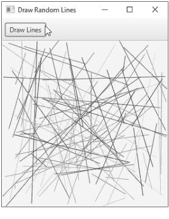

**图 8.18** 使用 `MyLine` 对象绘制线条。（2 部分中的第 2 部分。）

### GUI 与图形案例研究练习

**8.1** 增强图 8.17–8.18 中的程序，以随机的粗细绘制线条。你可以使用 `GraphicsContext` 的方法 `lineWidth` 设置线条粗细。

**8.2** 增强图 8.17–8.18 中的程序，以随机的粗细绘制线条。你可以使用 `GraphicsContext` 的方法 `lineWidth` 设置线条粗细。

## 8.16（可选）GUI 与图形案例研究：在图形中使用对象

# 第 8 章 类与对象：深入探讨

- 公有方法的主要目的是向类的客户端展示该类所提供的服务视图。客户端不需要关心该类是如何完成其任务的。
- 类的私有变量和私有方法（即其实现细节）对客户端是不可访问的。

## 8.4 节 使用 `this` 引用引用当前对象的成员

- 实例方法使用关键字 `this`（第 346 页）来引用对象的实例变量和其他方法。该关键字也可以显式地使用。
- 编译器会为每个编译后的类生成一个以 `.class` 扩展结尾的独立文件。
- 如果局部变量与类的字段同名，则局部变量会遮蔽该字段。你可以在方法中使用 `this` 引用来显式地引用被遮蔽的字段。

## 8.5 节 Time 类研究：重载的构造函数

- 重载构造函数允许类的对象以不同的方式进行初始化。编译器通过其构造函数的签名（第 348 页）来区分重载的构造函数。
- 要从同类的一个构造函数调用另一个构造函数，你可以使用 `this` 关键字后跟包含构造函数参数的括号。如果使用此类构造函数调用，必须作为构造函数体的第一条语句。

## 8.6 节 默认和无参数构造函数

- 如果类中没有提供构造函数，编译器会创建一个默认构造函数。
- 如果类声明了构造函数，编译器将不会创建默认构造函数。在这种情况下，如果需要默认初始化，必须声明一个无参数构造函数（第 350 页）。

## 8.7 节 Set 和 Get 方法注意事项

- Set 方法通常被称为修改器方法（第 354 页），因为它们通常会改变一个值。Get 方法通常被称为访问器方法（第 354 页）或查询方法。谓词方法（第 355 页）返回条件是否为真或假。

## 8.8 节 组合

- 类拥有其他类对象的引用作为成员。这被称为组合（第 355 页），有时被称为“有一个……”的关系（`has-a` relationship）。

## 8.9 节 枚举类型

- 所有枚举类型（第 358 页）都是引用类型。枚举类型用 `enum` 声明定义，它是一个用逗号分隔的枚举常量列表。该声明可选地包含传统类的其他组件，如构造函数、字段和方法。
- 枚举常量是隐式 `final` 的；它们声明了不应被修改的常量。
- 枚举常量是隐式静态的。
- 任何尝试使用 `new` 运算符创建枚举类型对象的尝试都会导致编译错误。
- 枚举常量可以使用任何可以使用常量的地方，例如 `switch` 语句的类标签以及控制增强型 `for` 语句。
- 枚举声明中的每个常量后面都可以可选地跟随参数，这些参数会被传递给构造函数。
- 对于每个枚举，编译器都会生成一个名为 `values`（第 359 页）的静态方法，该方法按照声明顺序返回枚举常量的数组。
- `EnumSet` 静态方法 `range`（第 360 页）接收范围内的第一个和最后一个常量，并返回一个包含这两个常量之间所有常量（包含边界）的 `EnumSet`。

## 总结

## 8.10 节 垃圾回收

- Java 虚拟机（JVM）执行垃圾回收（第 361 页），以回收不再使用的对象所占的内存。当一个对象不再有引用时，该对象在 JVM 下次执行垃圾回收器时符合垃圾回收条件。

## 8.11 节 静态类成员

- 静态变量（第 361 页）代表类对象之间共享的类信息。
- 静态变量具有作用域。类的公有静态成员可以通过该类的任何对象的引用来访问，也可以通过用类名和点（`.`）限定成员名访问。客户端只能通过类的方法访问私有静态类成员。
- 只要类被加载到内存中，静态成员就存在。
- 静态方法不能直接访问类实例变量和实例方法，因为在没有实例化类的任何对象的情况下，也可以调用静态方法。
- `this` 引用不能在静态方法中使用。

## 8.12 节 静态导入

- 静态导入（第 365 页）允许你在不使用类名和点（`.`）的情况下引用已导入的静态成员。单条静态导入声明导入一个静态成员，而静态导入要求导入类的所有静态成员。

## 8.13 节 `final` 实例变量

- 在应用代码的上下文中，最小权限原则规定代码应仅获得完成其指定任务所需的权限和访问权限。
- 关键字 `final` 指定变量是不可修改的。此类变量必须在声明时进行初始化，或者通过类的每个构造函数之一进行初始化。

## 8.14 节 包访问权限

- 如果在类中声明方法或变量时未指定修饰符，则方法或变量被认为具有包访问权限（包访问权限成员通过对相应类对象的引用直接访问，或者对于静态成员，通过类名访问）。
- 同一包中的类之间可以通过包访问权限成员相互访问。

## 8.15 节 使用 `BigDecimal` 进行精确货币计算

- 任何需要无舍入误差的浮点计算的应用（例如金融应用）都应该使用 `BigDecimal`。
- 语言特定格式是为了适应用户的语言。
- 默认所有计算都是精确的。`BigDecimal` 的精度是小数点右的数字位数。
- 使用 `MathContext` 控制舍入。
- `BigDecimal` 的 `setScale` 方法可以指定精度。

## 自测练习

填空下列句子中的空格：

1. 为了在进行浮点计算时不产生舍入误差，我们应该使用 `BigDecimal`。
2. 任何需要无舍入误差的浮点计算的应用（例如金融应用）都应该使用 `BigDecimal`。

i) 谓词 (predicate), j) 值 (values), k) 有 (has-a), l) 枚举 (enum), m) 静态 (static), n) 单静态 (single static), o) 最小权限原则 (principle of least privilege), p) Final (final), q) 按需静态导入 (static import on demand), r) 修改方法 (mutator methods), s) BigDecimal, t) 抛出 (throw)。

## 练习

**8.2** （基于第 8.14 节）解释 Java 中包访问的概念。解释包访问的负面影响。

**8.3** (Cylinder 类) 创建一个带有 `radius` 和 `height` 属性的 `Cylinder` 类，每个默认值为 1。提供一个计算圆柱体积的方法，即 pi 乘以半径平方高度。为 `radius` 和 `height` 提供 set 和 get 方法。set 方法应验证 `radius` 和 `height` 为正数。编写程序测试 `Cylinder` 类。

**8.4** (修改类的内部数据表示) 8.5 节中的 `Time` 类将时间内部表示为自午夜以来的秒数，而不是三个整数值（分钟和秒），这是完全合理的。客户端可以使用公共方法并获取结果。让 8.5 节中的 `Time` 类实现时间为自午夜以来的秒数，并证明对类的客户端来说没有变化。

**8.5** (储蓄账户) 创建一个 `SavingsAccount` 类。使用静态变量 `annualInterestRate` 来存储所有账户持有人的年利率。该类的每个对象都有一个私有实例变量 `savingsBalance`。使用 `calculateMonthlyInterest` 通过 `savingsBalance` 乘以 `annualInterestRate` 除以 12 来计算每月利息——此利息应加到 `savingsBalance` 中。提供一个静态方法 `modifyInterest` 将 `annualInterestRate` 设置为某个值。编写程序测试 `SavingsAccount` 类。实例化两个存款对象 `saver1` 和 `saver2`，余额分别为 $2000.00 和 $3000.00。将 `annualInterestRate` 设置为 4%，为每个 12 个月计算每月利息，并打印各自的新余额。接下来，将 `annualInterestRate` 设置为 5%，计算下个月的利息并打印两个对象的余额。

**8.6** (增强 Time 类) 修改 8.5 节的 `Time` 类，包含一个 `tick` 方法，该方法使 `Time` 对象中存储的时间加 1。提供 `incrementMinute` 将时间加 1 分钟，提供 `incrementHour` 将小时加 1。编写程序测试 `tick` 方法、`incrementMinute` 方法和 `incrementHour` 方法，以确保它们正常工作。务必测试以下情况：

- 增加到下一分钟
- 增加到下一个小时
- 增加到下一天（即从晚上 11:59:59 到凌晨 12:00:00）

**8.7** (增强 Date 类) 修改 8.5 节的 `Date` 类，对月份、日和年的初始化器变量进行错误检查（它仅验证月份和日期）。提供一个 `nextDay` 方法将日期加 1。编写程序在循环中测试 `nextDay`，并在每次迭代期间打印日期以说明该方法正常工作。测试以下情况：

- 增加到下个月
- 增加到下一年

**8.8** 编写代码生成 10–100 范围内的随机数。[注意：仅导入 `Scanner` 和 `Random` 类。]

**8.9** 编写一个枚举类型 `Food`，其常量（`APPLE`, `BANANA`, `CARROT`）接受两个参数——类型（蔬菜或水果）和卡路里。编写程序测试 `Food` 枚举，使其显示名称和信息。

**8.11** (复数) 创建一个名为 `Complex` 的类用于执行复数算术。复数的形式为：

`realPart + imaginaryPart * i`

其中 i 是：

`√-1`

编写程序测试你的类。使用浮点数变量表示类的私有数据。提供一个构造函数，使该类在声明时能够进行初始化。如果没有提供初始化器，则提供一个带有默认值的无参构造函数。提供公共方法执行以下操作：

- a) 相加两个复数：实部相加，虚部相加。
- b) 相减两个复数：从左操作数的实部减去右操作数的实部，从左操作数的虚部减去右操作数的虚部。
- c) 以 `(realPart, imaginaryPart)` 的形式打印复数。

**8.12** (日期和时间) 创建一个 `DateAndTime` 类，结合了练习 8.7 节修改后的 `Time` 类以及当时间增加到下一天时修改后的方法调用 `nextDay`。修改 `toString` 方法以日期格式提供输出。编写程序测试新类 `DateAndTime`，特别是将时间增加到下一天。

**8.13** (整数集合) 创建一个 `IntegerSet` 类，可以持有 0-100 范围内的整数。该集合由布尔数组表示。如果整数 `i` 在集合中，则每个元素 `flag[i]` 为 `true`。无参构造函数初始化空集合（所有值均为 `false`）。

**8.14** 提供以下方法：静态方法 `union` 从两个集的并集创建一个新集合（即新集合中的元素位于任一集合中）。静态方法 `intersection` 从两个集的交集创建一个新集合（即新集合中的元素同时位于两个集合中，否则集合为空）。`insert` 方法将整数 `k` 添加到集合中。`delete` 方法删除整数 `m`。`toString` 返回包含元素的字符串。编写程序测试你的 `IntegerSet`。

**8.15** (花式 Time) 创建一个 `Time` 类，具有以下功能：

- a) 以以下格式输出：
  - HH:MM:SS (12 小时制)
  - HH:MM:SS (24 小时制)
  - HH:MM (24 小时制)
- b) 使用重载构造函数创建不同值的 `Time` 对象。
- c) 提供一个允许用户指定输出格式的方法。编写程序测试你的 `Time` 类。

**8.16** (分数) 创建一个 `Rational` 类，使用整数变量表示分子和分母。提供一个构造函数，使该类在声明时能够进行初始化。如果没有提供初始化器，则提供一个带有默认值的无参构造函数。提供公共方法执行以下操作：

- a) 相加两个分数：结果以约简形式存储。
- b) 相减两个分数：结果以约简形式存储。
- c) 相乘两个分数：结果以约简形式存储。
- d) 除以两个分数：结果以约简形式存储。
- e) 以 `a/b` 的形式返回分数的字符串表示，其中 `a` 是分子，`b` 是分母。
- f) 以浮点格式返回分数的字符串表示（考虑提供允许用户指定小数点后位数）。

**8.17** (HugeInteger 类) 创建一个 `HugeInteger` 类，使用 40 位数字数组存储高达 40 位的整数。提供 `parse`、`add` 和 `subtract` 方法。方法应使用 `charAt` 接收每个数字并将其放入数组。对于比较 `HugeInteger` 对象，提供以下方法：`equals`、`isEqual`、`greaterThan`、`isLess`、`isGreaterThan`、`isEqualTo`。每个方法在关系成立时返回 `true`，否则返回 `false`。提供 `multiply` 和 `divide` 方法。[注意：原始布尔值可以输出为 "false" 或 "true"]。

**8.18** (井字棋) 创建一个 `TicTacToe` 类用于玩井字棋游戏。该类包含一个 3x3 的二维数组。使用枚举表示数组每个单元格的值。枚举的常量应该是 `X`、`O` 和 `EMPTY`（表示空位置）。构造函数应将板元素初始化为 `EMPTY`。当第一个玩家移动时，在指定的单元格放置 `X`，当第二个玩家移动时放置 `O`。每次移动必须到空单元格。每次移动后判断游戏是否获胜或为平局。如果你有野心，可以修改程序让计算机代表一个玩家移动。此外，允许玩家选择先手还是后手。

**8.19** (带有 BigDecimal 余额的 Account 类) 重写 3.4 节中的 `Account` 类，将余额存储为 `BigDecimal` 对象，并使用 `BigDecimal` 执行所有计算。

**8.20** (`final` 实例变量) 在图 8.8 中，`Employee` 类的实例变量在初始化后从未被修改。任何此类实例变量都应声明为 `final`。修改 `Employee` 类，然后运行程序以证明它产生相同的结果。

## 产生影响

**8.21** （项目：应急响应类）北美应急响应服务 9-1-1 将呼叫者连接到本地公共服务应答点（PSAP）。传统上，PSAP 会要求呼叫者提供身份信息——包括呼叫者的地址、电话号码和紧急情况的性质，然后派遣应急响应人员（如警察、救护车或消防队）。增强型 9-1-1（或 E9-1-1）利用计算机和数据库确定呼叫者的物理地址，将呼叫者引导至最近的 PSAP，并向接线员显示呼叫者的号码和地址。无线 9-1-1 为接线员提供无线通话的身份信息。该服务分两个阶段实施：第一阶段要求运营商使用电话号码和传输通话的手机小区或基站的位置；第二阶段要求运营商提供呼叫者的位置（使用 GPS 等技术）。要了解更多关于 9-1-1 的信息，请访问 `https://www.fcc.gov/general/9-1-1-and-e9-1-1-services` 和 `http://people.howstuff.com/9-1-1.htm`。

创建一个类的重要部分是确定类的属性（实例变量）。对于这个类设计练习，请在互联网上研究 9-1-1 服务。然后，设计一个名为 `Emergency` 的类，该类的对象将代表一个紧急情况。例如，类属性可能包括报告紧急情况的人员（包括其电话号码）、紧急发生的地点、报告时间、紧急情况的性质、响应类型以及响应状态。类属性应该完全描述问题的性质以及为了解决该问题所正在发生的操作。

**8.22** （项目：处理全球经济中的货币——JavaMoney）在全球经济中，处理货币、货币金额、转换和格式化是非常复杂的。新的 JavaMoney API 是为了应对这些挑战而开发的。在编写本文时，它尚未整合到 Java SE 或 Java EE 中。你可以在此处阅读关于 JavaMoney 的介绍：


https://java.net/projects/javamoney/pages/Home

http://jsr354.blogspot.com

并获取软件和文档：

http://javamoney.github.io

使用 JavaMoney 开发一个应用程序，可以在用户指定的两种货币之间进行转换。

# 面向对象编程：继承

## 目标
在本章中，你将：

- 理解继承以及如何基于现有类开发新类。
- 学习超类（superclasses）和子类（subclasses）的概念及其之间的关系。
- 使用关键字 `extends` 创建继承另一个类属性和行为的类。
- 在超类中使用访问修饰符 `protected`，允许子类方法访问这些超类成员。
- 在子类中使用 `super` 访问超类成员。
- 学习构造函数在继承体系中如何使用。
- 学习 `Object` 类的方法，它是所有类的直接或间接超类。


# 第9章 面向对象编程：继承

- 9.1 引言
- 9.2 超类与子类
- 9.3 成员
- 9.4 超类与子类之间的关系
- 9.4.1 创建子类
- 9.4.2 创建子类
- 9.4.3 继承
- 9.4.4 实例变量
- 9.4.5 构造函数
- 9.6 Object 类
- 9.7 组合与继承
- 9.8 总结 | 课后习题 | 练习习题答案

# 9.1 引言

本章通过引入继承继续讨论面向对象编程（OOP）。继承允许通过获取现有类的成员创建新类，从而在开发过程中节省时间。在创建类时，与其声明全新的成员，不如让继承现有类。现有类是超类，新类是子类（C++ 语言将超类和子类称为派生类）。子类可以添加自己的字段和方法。因此，子类比超类更具体。继承通常被称为特化。直接超类是子类显式继承的类。间接子类是类层次中的任何类——正如9.2节所示。在Java中，所有类直接或间接 `extends` 类。

# 9.2 超类与子类

通常，一个类是另一个类的对象。例如，汽车贷款（`CarLoan`）是一种贷款（`Loan`）。因此，在Java中，`CarLoan` 类可以继承 `Loan` 类。在这种背景下，`Loan` 类是超类，`CarLoan` 类是子类。`CarLoan` 是贷款的一种类型，但并不是所有贷款都是汽车贷款。图9.1列出了超类和子类的几个示例——超类倾向于更“通用”，而子类更“具体”。

| 超类 | 子类 |
| --- | --- |
| 学生 | 研究生、本科生 |
| 形状 | 圆形、三角形、矩形、球体、立方体 |
| 贷款 | 汽车贷款、房屋装修贷款、抵押贷款 |
| 员工 | 教职工、员工 |
| 银行账户 | 支票账户、储蓄账户 |

**图9.1** | 继承示例

由于子类对象都是其超类的对象，且一个类可以有多个子类，超类所代表的对象集通常比其任何一个子类所代表的对象集要大。例如，超类 `Vehicle` 代表了所有车辆，包括汽车、卡车、船只和自行车等。相比之下，子类代表了更小、更具体的子集。

# 社区成员层次结构

继承关系形成了层级结构。超类与其子类之间存在架构关系。让我们开发一个示例类层次结构（图9.2），也称为继承体系。大学社区拥有成员，包括学生和校友。员工可以是教职工或工作人员。教职工可以是行政人员（如院长和系主任）或教师。该体系可能包含许多其他类。例如，学生可以是研究生或本科生。本科生可以是大一、大二、大三或大四学生。

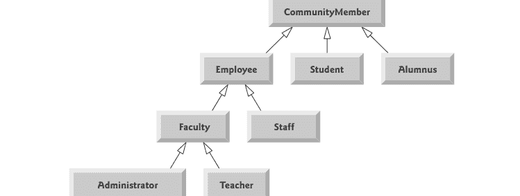

**图 9.2 | 大学成员（CommunityMembers）的继承层次结构 UML 图。**

层次结构中的每个箭头代表一种“是一种”（is-a）的关系。通过遵循该类层次结构中的箭头，我们可以说：“员工（`Employee`）是一个社区成员（`CommunityMember`）”，“教师（`Teacher`）是一个教职人员（`Faculty member`）”。`CommunityMember` 是 `Employee`、`Student` 和 `Alumnus`（校）的直接父类。`Alumnus` 是图中所有其他类的间接子类。从底部开始，你可以顺着箭头将“是一种”关系应用到最顶部的父类。例如，管理员（`Administrator`）是教职人员，是员工，是社区成员，当然，也是对象（`Object`）。

## 形状层次结构

现在考虑图 9.3 中的形状（`Shape`）继承层次结构。该层次结构从 `Shape` 开始，由子类二维形状（`TwoDimensionalShape`）和三维形状（`ThreeDimensionalShape`）扩展——形状要么是二维形状，要么三维形状。该层次结构的第三层包含特定类型的二维形状和三维形状。在图 9.2 中，我们可以沿着从图底部到该类层次结构最顶端父类的箭头，来识别出几种“是一种”的关系。例如，三角形（`Triangle`）是二维形状也是形状，而球体（`Sphere`）是三维形状也是形状。该层次结构可能包含许多其他类。例如，椭圆（ellipses）和梯形（trapezoids）也是二维形状。

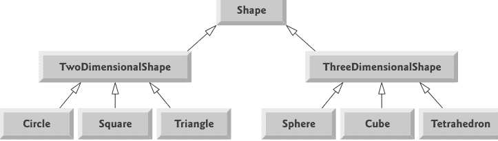

**图 9.3 | 形状的继承层次结构 UML 类图。**

# 9.3 protected 成员

并不是所有的类关系都是继承。在第 8 章中，我们讨论了“拥有一个”（has-a）的关系，其中类拥有指向其他类对象的成员。这些关系通过现有类的组合来创建新类。例如，给定类 `Employee`、`BirthDate`（出生日期）和 `TelephoneNumber`（电话号码），说“员工是一个出生日期”或“员工是一个电话号码”是不恰当的。然而，员工**拥有**一个出生日期，员工**拥有**一个电话号码。

可以相似地对待子类及其类——公共属性在子类的成员中表示。所有扩展公共子类的类对象都可以被视为该子类的对象——此类对象与父类具有“一种”关系。这种情况发生在本章以及第 10 章中，我们考虑了许多利用“一种”关系的例子。

子类可以自定义它从父类继承的方法。要实现这一点，子类通过用合适的实现来重写（覆盖，重新定义）父类方法，正如我们在本章代码示例中所看到的。

第 8 章讨论了公有（public）和私有（private）的访问。类的公共成员在任何引用该类或其子类对象的地方都是可访问的。类的私有成员仅在类内部可访问。在本节中，我们引入了访问修饰符 `protected`。使用 `protected` 提供了 public 和 private 之间的中间级别访问权限。子类的 protected 成员可以被该子类的成员、其子类的成员以及同一包中其他类的成员访问——protected 成员也具有访问权限。

所有 public 和 protected 子类都保留其原始的访问修饰符 public 成员；父类的 public 成员变为子类的 protected 成员。子类的私有成员在类外部是不可访问的。相反，它们从子类中被隐藏了，并且只能通过从父类继承的 public 或 protected 方法访问。

子类只需通过使用成员名即可引用继承自父类的 public 和 protected 成员。当子类重写一个继承的方法时，可以通过在父类方法名前加上 `super` 和点（`.`）来从子类访问父类版本的方法。我们在第 9.4 节中讨论对子类重写成员的访问。

# 9.4 父类与子类的关系

我们使用一个包含公司薪资应用程序中员工类型的继承层次结构，来讨论父类与其子类之间的关系。在这家公司里，员工（将用父类对象表示）按销售额的百分比支付工资，而底薪加佣金员工（将用子类对象表示）获得基本工资加上销售额的百分比。

我们将对这些类之间关系的讨论分为五个例子。

第一个声明了 `CommissionEmployee`（佣金员工），它直接继承自 `Object` 类，并声明了私有实例变量：名（`firstName`）、姓（`lastName`）、社会安全号（`social security number`）、佣金率（`commission rate`）和总销售额。

第二个例子声明了 `BasePlusCommissionEmployee`（底薪加佣金员工），它也继承自 `Object` 类，并声明了私有实例变量：名、姓、社会安全号、佣金率、金额和基本工资。我们通过编写每一行代码来创建这个类。

第三个例子声明了一个新的 `BaseEmployee` 类，它扩展了 `CommissionEmployee`（即拥有薪水的 Base员工）。这种软件复用让我们在开发新子类时编写更少的代码。在这个例子，`BasePlusCommissionEmployee` 尝试访问 `CommissionEmployee` 的私有成员——这会导致编译错误，因为子类无法访问父类的实例变量。

第四个例子显示，如果将 `CommissionEmployee` 的实例变量声明为 `protected`，则 `BasePlusCommissionEmployee` 子类就可以直接访问数据。两个 `BaseEmployee` 类包含的功能相同，但我们展示了继承版本更容易创建和管理。

在我们讨论了使用保护 实例变量的便利之后，我们创建了第五个例子，它将 `CommissionEmployee` 的实例变量设回私有以强制良好的软件工程。然后我们展示了 `BasePlusCommissionEmployee` 子类如何使用 `CommissionEmployee` 的公共方法来操纵（受控地）继承自 `CommissionEmployee` 的私有变量。

## 9.4.1 创建和使用 CommissionEmployee 类

我们开始声明 `CommissionEmployee`（见图 9.4）。第 4 行开始声明并指示 `CommissionEmployee` 扩展（即继承自）`Object`（来自 `java.lang` 包）。这导致 `CommissionEmployee` 继承了 `Object` 的方法——`Object` 类没有任何字段。如果你不显式指定新类扩展哪个类，该类将隐式扩展 `Object`。由于这个原因，你通常不需要 "extends Object"——我们在本示例中这样做仅是为了演示。

```java
// Fig. 9.4: CommissionEmployee.java
// CommissionEmployee 类代表一个按销售额
// 百分比支付工资的员工。

public class CommissionEmployee extends Object {

    private final String firstName;
    private final String lastName;
    private final String socialSecurityNumber;
    private double grossSales; // 每周销售额
    private double commissionRate; // 佣金百分比

    // 五参数构造函数
    public CommissionEmployee(String firstName, String lastName,
        String socialSecurityNumber, double grossSales,
        double commissionRate) {

        // 隐式调用 Object 的默认构造函数
        if (grossSales < 0.0) {
            throw new IllegalArgumentException("Gross sales must be >= 0.0");
        }

        // 如果 commissionRate 无效则抛出异常
        if (commissionRate <= 0.0 || commissionRate >= 1.0) {
            throw new IllegalArgumentException(
                "Commission rate must be > 0.0 and < 1.0");
        }

        this.firstName = firstName;
        this.lastName = lastName;
        this.socialSecurityNumber = socialSecurityNumber;
        this.grossSales = grossSales;
        this.commissionRate = commissionRate;
    }

    // 返回名字
    public String getFirstName() { return firstName; }

    // 返回姓
    public String getLastName() { return lastName; }

    // 返回社会安全号
    public String getSocialSecurityNumber() { return socialSecurityNumber; }

    // 设置总销售额
    public void setGrossSales(double grossSales) {
        if (grossSales < 0.0) {
            throw new IllegalArgumentException("Gross sales must be >= 0.0");
        }
        this.grossSales = grossSales;
    }

    // 返回总销售额
    public double getGrossSales() { return grossSales; }

    // 设置佣金率
    public void setCommissionRate(double commissionRate) {
        if (commissionRate <= 0.0 || commissionRate >= 1.0) {
            throw new IllegalArgumentException(
                "Commission rate must be > 0.0 and < 1.0");
        }
        this.commissionRate = commissionRate;
    }

    // 返回佣金率
    public double getCommissionRate() { return commissionRate; }

    // 计算收益
    public double earnings() { return commissionRate * grossSales; }

    // CommissionEmployee 的字符串表示
    @Override
    // 表示此方法重写了超类方法
    public String toString() {
        return String.format("%s: %s %s: %s: %.2f %s: %.2f",
            "commission employee", firstName, lastName,
            "social security number", socialSecurityNumber,
            "gross sales", grossSales,
            "commission rate", commissionRate);
    }
}
```


**图 9.4** | `CommissionEmployee` 类表示按销售额百分比支付佣金的员工。（3 部分第 3 部分）

### `CommissionEmployee` 方法和实例变量概述

`CommissionEmployee` 的公有服务包括一个构造函数（第 12–33 行）以及 `earnings` 方法（第 70 行）和 `toString` 方法（第 73–80 行）。第 36–42 行声明该类的 `final` 实例变量（声明在第 5–7 行）`firstName`、`lastName` 和 `socialSecurityNumber` 的公有 get 方法。这些实例变量被声明为 `final`，是因为它们在初始化后不需要修改——这就是为什么我们没有提供相应的 set 方法。第 45–62 行为该类的 `grossSales` 和 `commissionRate` 变量（声明在第 8–9 行）声明了公有的 get 和 set 方法。该类将这些实例声明为私有，因此其他类的对象无法直接访问这些变量。

### `CommissionEmployee` 构造函数

构造函数是不可继承的，因此 `CommissionEmployee` 不继承 `Object` 类的构造函数。然而，子类的构造函数仍然可以被子类调用。事实上，Java 要求任何子类构造函数的第一个任务是显式或隐式地（如果未指定构造函数）调用其超类构造函数，以确保从超类继承的实例变量得到正确的初始化。显式调用超类构造函数的语法在 9.4.3 节中讨论。在本示例中，`CommissionEmployee` 的构造函数隐式调用了 `Object` 的构造函数。如果代码不包含对超类构造函数的显式调用，Java 会隐式地调用超类的默认或无参数构造函数。图 9.4 第 15 行的注释指示已隐式调用了超类 `Object` 的默认构造函数（你不需要编写该调用代码）。`Object` 的默认构造函数什么都不做。即使一个类有构造函数，编译器为该类隐式声明的默认构造也会调用超类的默认或无参数构造函数。

在隐式调用 `Object` 的构造函数后，第 18–20 行和 23–26 行验证了 `grossSales` 和 `commissionRate` 参数。如果这些是有效的（即构造函数没有抛出 `IllegalArgumentException`），第 28–32 行将构造函数的参数赋值给类的实例变量。

在将 `firstName`、`lastName` 和 `socialSecurityNumber` 赋值给相应的实例变量之前，我们没有验证这些参数的值。我们可以确保它们的长度合理。同样，可以使用正则表达式（第 14 节）对社会安全号进行验证，以确保它包含九位数字，无论带不带连字符（例如 `123-45-678` 或 `123456789`）。

### `CommissionEmployee` 的 `earnings` 方法

`earnings` 方法（第 70 行）计算 `CommissionEmployee` 的收益。该方法将 `commissionRate` 与 `grossSales` 相乘并返回结果。

### `CommissionEmployee` 的 `toString` 方法

`toString` 方法（第 73–80 行）是特殊的——它是每个类直接或间接从 `Object` 类继承的方法之一（在第 9.6 节中引用）。`toString` 返回对象的字符串表示。每当对象必须转换为字符串表示时，它就会被调用，例如当对象通过 `printf` 输出或通过 `%s` 格式指定符通过 `String.format` 输出时。`Object` 的 `toString` 返回一个包含类名和对象所谓哈希码（第 9.6 节）的字符串。它主要用作占位符，可以被子类重写，以指定子类中数据的适当字符串表示。

`CommissionEmployee` 类的 `toString` 方法重写了 `Object` 的 `toString` 方法。当被调用时，`CommissionEmployee` 重写了 `Object` 的 `toString` 方法。

### `@Override` 注解

`@Override` 注解用于指示某个方法旨在重写超类方法。它可以帮助编译器捕获错误，例如方法签名与超类不完全匹配的情况。例如，在第 7.9 节和第 8 章中，`toString` 方法都使用 `@Override` 进行了声明。

### 错误预防技巧 9.1

用更受限的访问修饰符重写方法是一个编译错误——公有的子类方法不能变成保护或私有；保护的子类方法不能变成私有。这样做将破坏“是”关系，该关系要求所有子类都能够响应对公有方法的调用。一旦方法在超类中被声明为 `public`，该方法对于所有类和间接子类都保持为 `public`。

### 常见编程错误 9.1

图 9.5 测试了 `CommissionEmployee`。第 6–17 行初始化了一个 `CommissionEmployee` 对象并调用 `CommissionEmployee` 构造函数（图 9.4 第 12–33 行），用“Sue”作为名字，“Jones”作为姓，“222-22-2222”作为社会安全号，10000 作为总销售额（$10,000），0.06 作为佣金率（例如 6%）。第 11–22 行调用 `CommissionEmployee` getter 获取对象的实例变量值以便输出。第 22–23 行调用对象的 `setGrossSales` 和 `setCommissionRate` 方法来更改实例 `grossSales` 和 `commissionRate` 的值。第 25–26 行输出更新后的 `CommissionEmployee` 的字符串表示。当使用 `%s` 格式指定符输出对象时，对象的 `toString` 方法会被隐式调用以获取该对象的字符串表示。[注意：在本章中，我们没有在每个类中使用 `earnings` 方法，但它在第 10 章中被广泛使用]。

### `CommissionEmployeeTest`

```java
// CommissionEmployeeTest.java
// CommissionEmployee 类测试程序。

public class CommissionEmployeeTest {
    public static void main(String[] args) {
```

图 9.5：`CommissionEmployee` 类测试程序。（2 部分第 1 部分。）

## 9.4 超类与子类之间的关系 393

| 行 | 代码 |
| :--- | :--- |
| 5 | // 实例化 CommissionEmployee |
| 6 | `CommissionEmployee employee = new CommissionEmployee(` |
| 7 | `"Sue"` |

通过 get 方法获取的员工信息：

- 名字为 Sue
- 姓为 Jones
- 社会安全号为 222-22-2222
- 销售总额为 10000.0
- 佣金率为 0.06

通过 `toString` 获取的更新后的员工信息：

`CommissionEmployee` employee: Sue Jones
- 社会安全号: 222-22-2222
- 销售总额: 5000.0
- 佣金率: 0.10

图 9.5 | `CommissionEmployee` 类测试程序。（2 部分共 2 部分。）

### 9.4.2 创建和使用 `BasePlusCommissionEmployee` 类

我们现在通过声明和测试（一个完全独立的）类 `BasePlusCommissionEmployee`（图 9.6）来讨论继承介绍的第二部分，该类包含名字、姓、社会安全号、销售总额、佣金率和基本工资。`BasePlusCommissionEmployee` 的公共服务包括 `BasePlusCommissionEmployee` 构造函数（第 13–40 行）以及 `earnings` 方法（第 89–91 行）和 `toString` 方法（第 94–102 行）。第 43–86 行为类的私有实例变量（声明在第 5–10 行）声明公共 get 和 set 方法：`firstName`、`lastName`、`socialSecurityNumber`、`grossSales`、`commissionRate` 和 `baseSalary`。变量和方法封装了基本薪制员工的所有必要特征。注意该类与 `CommissionEmployee` 类（图 9.4）之间的相似性——在这个示例中，我们不会利用这种相似性。

```java
// Fig 9.6: BasePlusCommissionEmployee.java
// BasePlusCommissionEmployee 类表示一个除了佣金外
// 还领取基本工资的员工。

public class BasePlusCommissionEmployee {
    private final String firstName;
    private final String lastName;
    private final String socialSecurityNumber;
    private double grossSales; // 每周销售总额
    private double commissionRate; // 佣金百分比
    private double baseSalary; // 每周基本工资

    // 六参数构造函数
    public BasePlusCommissionEmployee(String firstName, String lastName,
        String socialSecurityNumber, double grossSales,
        double commissionRate, double baseSalary) {
        // 此处隐式调用了 Object 的默认构造函数
        if (grossSales < 0.0) {
            throw new IllegalArgumentException("Gross sales must be >= 0.0");
        }
        if (commissionRate <= 0.0 || commissionRate > 1.0) {
            throw new IllegalArgumentException("Commission rate must be > 0.0 and < 1.0");
        }
        if (baseSalary < 0.0) {
            throw new IllegalArgumentException("Base salary must be >= 0.0");
        }
        this.firstName = firstName;
        this.lastName = lastName;
        this.socialSecurityNumber = socialSecurityNumber;
        this.grossSales = grossSales;
        this.commissionRate = commissionRate;
        this.baseSalary = baseSalary;
    }

    // 返回名字
    public String getFirstName() { return firstName; }
    // 返回姓
    public String getLastName() { return lastName; }
```

**图 9.6** `BasePlusCommissionEmployee` 类表示一个除了佣金外还领取基本工资的员工。（第 1 部分共 3 部分）

```java
// 返回社会安全号
public String getSocialSecurityNumber() { return socialSecurityNumber; }
// 设置销售总额
public void setGrossSales(double grossSales) {
    if (grossSales < 0.0) {
        throw new IllegalArgumentException("Gross sales must be >= 0.0");
    }
    this.grossSales = grossSales;
}
// 返回销售总额
public double getGrossSales() { return grossSales; }
// 设置佣金率
public void setCommissionRate(double commissionRate) {
    if (commissionRate < 0.0 || commissionRate >= 1.0) {
        throw new IllegalArgumentException("Commission rate must be >= 0.0 and < 1.0");
    }
}
// 返回佣金率
public double getCommissionRate() { return commissionRate; }
// 设置基本工资
public void setBaseSalary(double baseSalary) {
    if (baseSalary < 0.0) {
        throw new IllegalArgumentException("Base salary must be >= 0.0");
    }
    this.baseSalary = baseSalary;
}
// 返回基本工资
public double getBaseSalary() { return baseSalary; }
// 计算收入
public double earnings() {
    return baseSalary + (commissionRate * grossSales);
}

@Override
public String toString() {
    return String.format("%s: %s%n%s: %.2f%n%s: %.2f%n%s: %.2f", "base-salaried commission employee", firstName, lastName,
```

图 9.6 `BasePlusCommissionEmployee` 类表示一个除了佣金外还领取基本工资的员工。（第 2 部分共 3 部分。）

```java
99 "social security number", socialSecurityNumber,
100 "gross sales", grossSales,
101 "commission rate", commissionRate,
102 "base salary", baseSalary);
103 }
```

**图 9.6** `BasePlusCommissionEmployee` 类表示一个除了佣金外还领取基本工资的员工。（第 3 部分共 3 部分）

`BasePlusCommissionEmployee` 在第 4 行没有指定 `extends Object`，所以像 `CommissionEmployee` 类（图 9.4）一样，它隐式继承自 `Object`。此外，`BasePlusCommissionEmployee` 的 `earnings` 方法（第 89–91 行）返回基本工资加上佣金的结果。`BasePlusCommissionEmployee` 的 `toString` 方法重写以返回字符串表示。再次，我们使用格式说明 `%.2f` 将销售总额格式化为小数点后两位。

### 测试 `BasePlusCommissionEmployee`

```java
// Fig. 9.7: BasePlusCommissionEmployeeTest.java
// BasePlusCommissionEmployee 测试程序。

public class BasePlusCommissionEmployeeTest {
    public static void main(String[] args) {
        // 实例化 BasePlus 对象
        BasePlusCommissionEmployee employee = new BasePlusCommissionEmployee(
            "Bob", "Lewis", "333-3333", 5000, .04, 300);
        // 获取基本薪制佣员工数据
        System.out.printf("First name: %s\n", employee.getFirstName());
        System.out.printf("Last name: %s\n", employee.getLastName());
        System.out.printf("Security number: %s\n", employee.getSocialSecurityNumber());
        System.out.printf("Gross sales: %.2f\n", employee.getGrossSales());
        System.out.printf("Commission rate: %.2f\n", employee.getCommissionRate());
        System.out.printf("Base salary: %.2f\n", employee.getBaseSalary());
        // 更新基本工资
        employee.setBaseSalary(1000);
        // 通过 toString 获取更新后的员工信息
        System.out.printf("%n:%s\n%s", "Updated employee information by toString",
            employee.toString());
    }
}
```


**图 9.7** BasePlusCommissionEmployee 测试程序。（第 1 部分共 2 部分。）

# 398 第 9 章 面向对象编程：继承

我们直接从 `CommissionEmployee` 类复制了代码并将其粘贴到 `BasePlusCommissionEmployee` 类中，然后修改了 `BasePlusCommissionEmployee` 类以包含一个基本工资以及操作基本工资的方法。这种“复制-粘贴”的方法往往容易出错且耗时。然而，它在整个系统中重复了相同的代码副本，导致了维护问题——对代码的修改需要在多个类中进行。是否有一种方法可以“获取”一个类的实例变量和方法并使它们成为其他类的一部分，而无需重复代码？我们将使用一种更优雅的类构建方法来回答这个问题，这种方法强调了继承的优势。

## 软件工程观察 9.3

通过继承，层级结构中所有类相同的实例变量和方法都会在超类中声明。在超类中对这些功能的修改将由子类继承。如果没有继承，则需要对所有包含相关代码副本的源文件修改。

## 9.4.3 创建 CommissionEmployee-BasePlusCommissionEmployee 继承层次结构

现在我们声明类 `BasePlusCommissionEmployee`（图 9.8）扩展类 `CommissionEmployee`（图 9.4）。一个 `BasePlusCommissionEmployee` 对象是一个 `CommissionEmployee`，因为继承传递了类变量 `baseSalary`（图 9.8，第 4 行）。关键字 `extends`（第 3 行）表示继承。`BasePlusCommissionEmployee` 继承了 `CommissionEmployee` 的实例变量和方法。

## 软件工程观察 9.4

> 在面向对象系统的设计阶段，你经常会发现某些类关系密切。你应当“提取”公共的实例变量和方法，并将它们放在超类中。然后使用继承来开发子类，使它们具备超出从超类继承的特殊功能。

## 软件工程观察 9.5

> 声明子类不会影响其超类的源代码。继承保持了子类的完整性。

```java
// 图 9.8: BasePlusCommissionEmployee.java
// 私有超类成员在子类中无法访问。

public class BasePlusCommissionEmployee extends CommissionEmployee {

    private double baseSalary; // 每周基本工资

    // 六参数构造函数
    public BasePlusCommissionEmployee(String firstName, String lastName,
        String socialSecurityNumber, double grossSales,
        double commissionRate, double baseSalary) {
```

**图 9.8** 私有超类成员在子类中无法访问。（3 部分第 1 部分）

## 9.4 超类与子类的关系 399

| 行 | 代码 |
| :--- | :--- |
| 10 | // 显式调用超类 CommissionEmployee 构造函数 |
| 11 | super(firstName, lastName, socialSecurityNumber, |
| 12 | grossSales, commissionRate); |
| 13 | |
| 14 | // 如果 baseSalary 无效则抛出异常 |
| 15 | if (baseSalary < 0.0) { |
| 16 | throw new IllegalArgumentException("Base salary must be >= 0.0"); |
| 17 | this.baseSalary = baseSalary; |
| 18 | } |
| 19 | // 设置基本工资 |
| 20 | public void setBaseSalary(double baseSalary) { |
| 21 | if (baseSalary < 0.0) { |
| 22 | throw new IllegalArgumentException("Base salary must be >= 0.0"); |
| 23 | this.baseSalary = baseSalary; |
| 24 | } |
| 25 | // 返回基本工资 |
| 26 | public double getBaseSalary() { return baseSalary; } |
| 27 | | |
| 28 | // 计算收益 |
| 29 | public double earnings() { |
| 30 | // 不允许：commissionRate 和 grossSales 在超类中是私有的 |
| 31 | return baseSalary + (commissionRate * grossSales); |
| 32 | } |
| 33 | // 返回 BasePlusCommissionEmployee 的字符串表示 |
| 34 | @Override |
| 35 | public String toString() { |
| 36 | // 不允许：尝试访问私有超类成员 |
| 37 | return String.format( |
| 38 | "%s %s %s: %.2f%%s: %.2f%%s: %.2f%%s: %.2f%%s", |
| 39 | "base-based commission employee", firstName, lastName, |
| 40 | "social security number", socialSecurityNumber, |
| 41 | "gross sales", grossSales, "commission rate", commissionRate, |
| 42 | "base salary", baseSalary); |

```text
BasePlusCommissionEmployee.java:38: error: commissionRate has private access
return baseSalary + (commissionRate * grossSales);
^
BasePlusCommissionEmployee.java:38: error: grossSales has private access in
CommissionEmployee
return baseSalary + (commissionRate * grossSales);
```

图 9.8 | 私有超类成员在子类中无法访问。（3 部分第 2 部分。）

## 400 第 9 章 面向对象编程：继承

图 9.8 | 私有超类成员在子类中无法访问。（3 部分第 3 部分）

只有 `CommissionEmployee` 的公共和受保护成员可以被子类直接访问。`CommissionEmployee` 的构造函数不被继承。因此，公共的 `BasePlusCommissionEmployee` 服务包括其构造函数（第 7–20 行）、继承自 `CommissionEmployee` 的公共方法，以及 `setSalary`（第 23-29 行）、`getBaseSalary`（第 32 行）、`earnings`（第 35–39 行）和 `toString`（第 42–51 行）。方法和 `toString` 重写了 `CommissionEmployee` 类中对应的方法，因为它们的子类版本没有正确计算 `BasePlusCommissionEmployee` 的收益或返回相应的字符串。

### 子类的构造函数必须调用其超类的构造函数

每个子类都必须隐含或显式地调用其超类的构造函数之一来初始化从超类继承的变量。`BasePlusCommissionEmployee` 六参数构造函数（第 7–20 行）中的第 11–12 行显式调用了 `CommissionEmployee` 类的五参数构造函数（图 9.4 第 12–13 行），以初始化 `BasePlusCommissionEmployee` 对象的子类构造函数（即变量 `firstName`、`lastName`、`socialSecurityNumber`、`grossSales` 和 `commissionRate`）。我们通过使用超类构造函数调用语法——关键字 `super`，后跟一组包含超类构造函数参数的括号，这些参数用于初始化子类实例。如果 `BasePlusCommissionEmployee` 没有无参数构造函数，编译器将抛出错误。

## 9.4 超类与子类的关系 401

## 软件工程观察 9.6

你之前已经了解到你不应该直接调用超类的实例变量——我们将在第 10 章说明原因。

## BasePlusEmployee 的 earnings 和 toString

编译器为第 38 行生成错误，因为 `CommissionEmployee` 的实例变量 `commissionRate` 和 `grossSales` 是私有的。编译器在 `BasePlusEmployee` 的第 47–49 行也出于相同的原因发布了额外的错误。`BasePlusEmployee` 中的错误可以通过适当的 getter 方法来避免。

## 9.4.4 使用受保护变量的 CommissionEmployee–BasePlusEmployee 继承层次结构

为了让 `BasePlusCommissionEmployee` 直接访问实例变量 `firstName`、`lastName`、`securityNumber`、`grossSales` 和 `commissionRate`，我们可以将这些成员声明为 `protected`。正如我们讨论过的，超类的受保护成员可以被该超类的所有子类访问。在第 9.3 节中，新的新的 `CommissionEmployee` 类只修改了图 9.4 的第 5–9 行，使用 `protected` 访问修饰符声明实例变量：

```java
protected String firstName;
protected String lastName;
protected String securityNumber;
protected double grossSales; // 每周销售
protected double commissionRate; // 佣金比例
```

声明的其他部分（未显示）与图 9.4 完全相同。可以将 `CommissionEmployee` 的实例变量声明为 `public` 以允许子类 `BasePlusCommissionEmployee` 访问。然而，将实例变量声明为公共是非常糟糕的软件工程，因为它允许任何类不受限制地访问这些变量，增加了错误的概率。通过受保护变量，子类可以访问变量，但不是子类且在同一包中的类无法直接访问这些变量——回想保护成员对同一包中的其他类也是可见的。

## BasePlusCommissionEmployee 类

`BasePlusCommissionEmployee`（图 9.9）扩展了带有保护变量的新版 `CommissionEmployee` 类。`BasePlusCommissionEmployee` 对象继承了 `CommissionEmployee` 的保护实例变量 `firstName`、`lastName`、`securityNumber`、`grossSales` 和 `commissionRate`——所有这些现在都是 `BasePlusCommissionEmployee` 的保护成员。因此，编译器没有


# 402 第 9 章 对象面向编程：继承

编译 `earnings` 方法第 38 行或 `toString` 方法第 46–48 行时产生错误。如果另一个类包含此版本的 `BasePlusCommissionEmployee` 类，新的子类也可以访问受保护（`protected`）成员。

```java
// Fig.9.9: BasePlusCommissionEmployee.java
// BasePlusCommissionEmployee 继承了 CommissionEmployee
// 的保护实例变量。

public class BasePlusCommissionEmployee extends CommissionEmployee {

    private double baseSalary; // 每周基本工资

    public BasePlusCommissionEmployee(String firstName, String lastName,
        socialSecurityNumber, double grossSales,
        double commissionRate, double baseSalary) {

        super(firstName, lastName, socialSecurityNumber,
            grossSales, commissionRate);

        // 如果 baseSalary 无效则抛出异常
        if (baseSalary < 0.0) {
            throw new IllegalArgumentException("Base salary must be >= 0.0");
        }
        this.baseSalary = baseSalary;
    }

    // 设置基本工资
    public void setBaseSalary(double baseSalary) {
        if (baseSalary < 0.0) {
            throw new IllegalArgumentException("Base salary must be >= 0.0");
        }
        this.baseSalary = baseSalary;
    }

    // 返回基本工资
    public double getBaseSalary() { return baseSalary; }

    // 计算收益
    @Override
    // social 表示此方法重写了父类方法
    public double earnings() {
        return baseSalary + (commissionRate * grossSales);
    }

    // 返回 BasePlusCommissionEmployee 的字符串表示
    @Override
    public String toString() {
        return String.format(
            "%s: %s %s: %.2f%%, %s: %.2f",
            "base-salaried commission employee", firstName, lastName,
            "social security number", socialSecurityNumber);
    }
}
```

**图 9.9** | BasePlusCommissionEmployee 继承了来自 CommissionEmployee 的保护实例变量。（2 部分中的第 1 部分。）

* 星号

# 9.4 父类与子类之间的关系 403

```
"gross sales", grossSales, "commission rate", commissionRate,
"base salary", baseSalary);
}
```


**图 9.9** | `BaseCommissionEmployee` 继承了来自 `CommissionEmployee` 的保护实例变量。（2 部分中的第 2 部分）

## 子类对象包含其所有父类的实例变量

当你创建一个 `BaseCommissionEmployee` 时，它包含了到目前为止在类层次结构中声明的所有实例变量——即来自 `Object` 类（它不包含实例变量）、`CommissionEmployee` 和 `BaseCommissionEmployee`。`BaseCommissionEmployee` 没有继承 `CommissionEmployee` 的构造函数，但显式地调用了它（12-13 行），以初始化从 `CommissionEmployee` 继承的 `BaseCommissionEmployee` 实例变量。同样，`CommissionEmployee` 的构造函数隐式地调用了 `Object` 的构造函数。`BaseCommissionEmployee` 的构造函数必须显式地调用 `CommissionEmployee` 的构造函数，因为 `CommissionEmployee` 没有可以被隐式调用的无参构造函数。

## 测试 BaseCommissionEmployeeTest

例如，`BaseCommissionEmployeeTest` 与 9.7 中的版本相同，并产生相同的输出，因此我们没有显示它。虽然 9.6 中的 `BaseCommissionEmployee` 类没有使用继承，而 9.9 中的版本使用了，但这两个类提供了相同的功能。9.9 中的源码（51 行）比 9.6 中的（103 行）要短得多，因为该类的大部分功能现在继承自 `CommissionEmployee`——现在只有一份 `CommissionEmployee` 代码。这使得代码更容易维护、修改和调试，因为与 `CommissionEmployee` 相关的代码仅存在于那里。

## 关于使用保护实例变量的注意事项

在例子中，我们将父类实例变量声明为 `protected`（保护），以便子类可以访问它们。继承保护实例变量使得子类能够直接访问这些变量。然而，在大多数情况下，使用私有实例变量来促进良好的软件工程。你的代码将更容易维护、修改和调试。

使用保护实例变量会产生几个潜在问题。首先，子类对象可以直接设置一个继承来的值，而无需使用 setter 方法。因此，子类对象可以给变量分配无效值，导致父类处于不一致状态。例如，如果我们将 `CommissionEmployee` 的实例变量 `grossSales` 声明为 `protected`，那么子类对象（例如 `BaseCommissionEmployee`）就可以给 `grossSales` 分配负值。

使用保护实例变量的另一个问题是子类方法更容易变得脆弱，从而依赖于父类的数据实现。在实践中，子类应该只依赖于父类服务（即非私有方法），而不依赖于父类的数据实现。如果子类中使用保护实例变量，一旦父类的实现发生变化，我们可能需要修改父类的所有子类。例如，由于某种原因，如果我们更改实例变量名称 `firstName` 和 `lastName` 为 `first` 和 `last`，那么我们不得不处理所有子类直接引用父类实例变量 `firstName` 和 `lastName` 的地方。这样的类被称为脆弱的（fragile）或脆（brittle），因为父类的微小变化就会“破坏”子类的实现。你应该能够在更改父类实现的同时，仍能为子类提供服务。否则，如果父类发生了变化，我们必须重新实现子类。

第三个问题是，类的保护成员对于包含该成员的相同包中的所有类都是可见的。这并不总是理想的。


### 软件工程观察 7.7

当父类应仅向其子类及相同包中的类提供方法，而不是其他客户端时，使用 `protected` 修饰符。


### 软件工程观察 9.8

将实例变量声明为 `private`（而不是 `protected`）允许父类对这些变量的实现发生变化而不影响子类的实现。


### 预防提示 9.2

避免使用保护实例变量。相反，包含访问实例变量的非私有方法。这将有助于类对象保持一致的状态。

## 9.4.5 使用私有实例变量的 CommissionEmployee-BaseCommission 继承层次结构

让我们再次检查一次我们的层次结构，这次使用良好的软件工程实践。

## CommissionEmployee 类

`CommissionEmployee`（图 10）将实例变量 `firstName`、`lastName`、`securityNumber`、`grossSales` 声明为 `private`（第 5–9 行），并提供了用于操作这些值的公共方法 `getFirstName()`、`getLastName()`、`getSecurityNumber()`、`setGrossSales()`、`getGrossSales()`、`setCommissionRate()`、`earnings()` 和 `toString()`。`earnings()`（第 70–72 行）和 `toString()`（第 75–82 行）使用类的方法来获取其实例变量的值。如果我们决定更改实例变量的名称，`earnings()` 和 `toString()` 的声明不需要修改——只有直接操作实例变量的方法体需要更改。这些更改完全发生在父类内部——不需要更改子类。局部化此类更改的影响是一种良好的软件工程实践。

```java
// Fig. 10: CommissionEmployee.java
// CommissionEmployee 类使用方法操作其
// 私有实例变量。
```

**图 9.10** | `CommissionEmployee` 类使用方法操作其私有实例变量。（3 部分中的第 1 部分）。

## 9.4 超类与子类之间的关系

```java
public class CommissionEmployee {

    private final String firstName;

    private final String lastName;

    private final String socialSecurityNumber;

    private double grossSales; // 每周总销售额

    private double commissionRate; // 佣金比例

    // 五参数构造函数
    public CommissionEmployee(String firstName, String lastName,
        String socialSecurityNumber, double grossSales,
        double commissionRate) {

        // 此处隐式调用 Object 构造函数
        // 如果 grossSales 无效，则抛出异常
        if (grossSales < 0.0) {
            throw new IllegalArgumentException("Gross sales must be >= 0.0");
        }

        // 如果 commissionRate 无效，则抛出异常
        if (commissionRate <= 0.0 || commissionRate >= 1.0) {
            throw new IllegalArgumentException("Commission rate must be > 0.0 and < 1.0");
        }

        this.firstName = firstName;
        this.lastName = lastName;
        this.socialSecurityNumber = socialSecurityNumber;
        this.grossSales = grossSales;
        this.commissionRate = commissionRate;
    }

    // 返回名字
    public String getFirstName() { return firstName; }

    // 返回姓氏
    public String getLastName() { return lastName; }

    // 返回社会安全号
    public String getSocialSecurityNumber() { return socialSecurityNumber; }

    // 设置总销售额
    public void setGrossSales(double grossSales) {
        if (grossSales < 0.0) {
            throw new IllegalArgumentException("Gross sales must be >= 0.0");
        }
        this.grossSales = grossSales;
    }

    // 返回总销售额
    public double getGrossSales() { return grossSales; }
}
```

**图 9.10** | `CommissionEmployee` 类用于操作其私有实例变量的方法。（3 部分中的第 2 部分）。

## 第 9 章 面向对象：继承

```java
// 设置佣金比例
public void setCommissionRate(double commissionRate) {
    if (commissionRate <= 0.0 || commissionRate >= 1.0) {
        throw new IllegalArgumentException(
            "Commission rate must be > 0.0 and < 1.0");
    }
    this.commissionRate = commissionRate;
}

// 返回佣金比例
public double getCommissionRate() { return commissionRate; }

// 计算收益
public double earnings() {
    return getCommissionRate() * getGrossSales();
}

// 返回 CommissionEmployee 对象的字符串表示
@Override
public String toString() {
    return String.format("%s:%s %s:%s %s:%.2f%s:%.2f",
        "employee", getFirstName(), getLastName(),
        "social security number", getSocialSecurityNumber(),
        "gross sales", getGrossSales(),
        "commission rate", getCommissionRate());
}
```

**图 10** | `CommissionEmployee` 使用方法操作私有实例变量。（3 部分中的第 3 部分）

### 类 BaseCommissionEmployee

子类 `BaseCommissionEmployee`（见图 11）继承了 `CommissionEmployee` 的非私有方法，并通过这些方法（以受控的方式）访问超类的私有成员。`BaseCommissionEmployee` 有几处不同于图 9.9 的变化。方法 `earnings()`（图 11 的第 36–37 行）和 `toString()`（第 40–44 行）分别调用 `getBaseSalary()` 来获取基本工资值，而不是直接访问 `baseSalary`。如果我们决定重命名实例变量 `baseSalary`，则只需要更改方法 `setBaseSalary()` 和 `getBaseSalary()` 的方法体。

```java
// 图 11: BaseCommissionEmployee.java
// BaseCommissionEmployee 继承自 CommissionEmployee
// 并通过继承的
// 公有方法访问超类的私有数据。
public class BaseCommissionEmployee extends CommissionEmployee {
    public double baseSalary; // 每周薪资
}
```

**图 11** | `BaseCommissionEmployee` 继承自 `CommissionEmployee`，并通过继承的方法访问超类的私有数据。（2 部分中的第 1 部分）

## 9.4 超类与子类之间的关系

```java
// 六参数构造函数
public BasePlusCommissionEmployee(String firstName, String lastName,
    String socialSecurityNumber, double grossSales,
    double commissionRate, double baseSalary) {

    super(firstName, lastName, socialSecurityNumber,
    grossSales, commissionRate);

    // 如果 baseSalary 无效，则抛出异常
    if (baseSalary < 0.0) {
        throw new IllegalArgumentException("Base salary must be >= 0.0");
    }
    this.baseSalary = baseSalary;
}

// 设置基本工资
public void setBaseSalary(double baseSalary) {
    if (baseSalary < 0.0) {
        throw new IllegalArgumentException("Base salary must be >= 0.0");
    }
    this.baseSalary = baseSalary;
}

// 返回基本工资
public double getBaseSalary() { return baseSalary; }

// 计算收益
@Override
public double earnings() {
    return getBaseSalary() + super.earnings();
}

// BasePlusCommissionEmployee 的字符串表示
@Override
public String toString() {
    return String.format("%s %s%s: %.2f", "base-salaried",
    super.toString(), "base salary", getBaseSalary());
}
```


> 图 9.11 | `BasePlusCommissionEmployee` 继承自 `CommissionEmployee`，并通过继承的方法访问私有数据。（3 部分中的第 2 部分）

### BasePlusCommissionEmployee 的 earnings 方法

方法 `earnings()`（36–37）重写了 `CommissionEmployee` 的 `earnings()`（图 9.10, 70–72），以计算固定薪资的佣金。新版本通过调用 `CommissionEmployee` 的方法（图 9.11）获取基本工资值，然后加上基本工资以计算总额。

### BasePlusCommissionEmployee 的 toString 方法

同样，`BasePlusCommissionEmployee` 的 `toString()`（图 9.11, 40–44）重写了 `CommissionEmployee` 的 `toString()`（图 9.10, 75–82），以返回一个适用于固定薪资员工的表示。新版本通过调用 `CommissionEmployee` 的 `toString()` 方法创建 `BasePlusCommissionEmployee` 字符串表示的一部分（即“String employee”和类 `CommissionEmployee` 的私有变量的值），然后加上剩余的固定薪资佣金。

### 测试 BasePlusCommissionEmployee

类 `BasePlusCommissionEmployeeTest` 按照图 9.7 所示对 `BasePlusCommissionEmployee` 对象进行变异，并产生相同的输出。你所过的每个 `BasePlusCommissionEmployee` 类的行为都是相同的，因此图 9.11 中的版本是设计最好的。通过使用继承有助于数据并确保一致性的类方法，我们有效地构建了一个良好的类。

## 9.5 子类中的构造函数

如所述，实例化子类对象会开始构造函数调用链，其中子类构造函数在执行任务之前，显式使用 `super` 调用其直接父类的构造函数，或隐式地调用父类的默认或无参数构造函数。同样，如果子类派自另一个类（除 `Object` 外的所有类），子类构造函数会调用层次结构中下一个类的构造，依此类推。链中最后调用的构造函数总是 `Object` 的构造函数。原始子类的构造函数体最后执行。每个子类构造函数初始化子类对象继承的实例变量。例如，再次考虑图 9.10–9.11 中的 `CommissionEmployee`—`BasePlusCommissionEmployee` 层次结构。当该构造函数调用 `CommissionEmployee` 的构造函数时，后者又调用了 `Object` 的构造函数。类 `Object` 的构造函数体为空，因此它立即将控制权返回给 `CommissionEmployee` 实例变量的一部分。

![a653f2cd6117b057ec59606fa616bd07_409_0.png]

`BasePlusCommissionEmployee` 对象。当 `CommissionEmployee` 的构造函数执行完毕时，它会将控制权返回给 `BasePlusCommissionEmployee` 的构造函数，后者会初始化 `baseSalary`。

## 软件工程观察 9.9

Java 确保如果构造函数没有为实例变量赋值，该变量仍会被初始化为其默认值（例如，基本数值类型为 0，布尔类型为 `false`，引用为 `null`）。

## 9.6 类 Object

正如本节之前讨论的，Java 中所有的类都直接或间接继承自 `Object` 类（位于 `java.lang` 包），因此它的 11 个方法（某些已重载）被其他类继承。图 9.12 总结了 `Object` 的方法。我们在本书中讨论了几个 `Object` 方法（如图 9.12 所示）。

| 方法 | 说明 |
| --- | --- |
| `equals` | 此方法比较两个对象的相等性，如果它们相等则返回 `true`，否则返回 `false`。该方法接受任何 `Object` 作为参数。当必须对特定类的对象进行相等性比较时，该类应该重写此方法以比较两个对象的内容。实现此方法的要求（包括重写 `hashCode()`），请参阅 http://docs.oracle.com/javase/8/docs/api/java/Object.html 上的方法文档。默认实现使用运算符 `==` 来判断两个引用是否指向内存中的同一个对象。14.3.3 描述了类的 `equals` 方法以及使用 `==` 和 `equals` 比较 `String` 对象的区别。 |
| `hashCode` | HashCode 用于哈希数据结构中存储信息的高速存储和检索（参见第 16.10 节）。该方法也作为 `Object` 的 `toString` 方法实现的一部分被调用。 |
| `toString` | 此方法（引入第 9.4 节）返回对象的字符串表示。此方法的默认实现返回对象类的包名和类名，通常通过对象 `hashCode` 方法返回的值的十六进制表示来实现。 |
| `wait`, `notify`, `notifyAll` | `notify` 方法和 `wait` 的三个重载版本与多线程相关，将在第 23 章中讨论。 |
| `getClass` | Java 中的每个对象在执行时都知道自己的类型。该方法（用于第 10.5 和 12.9 节）返回一个 `Class` 类对象（位于 `java.lang` 包），该对象包含有关对象类型的信息，例如其类名（由 `Class.getName()` 返回）。 |
| `finalize` | 此受保护的方法由垃圾回收器调用，在回收器回收对象内存之前对对象进行清理工作。回想第 8.10 节，尚清楚 `finalize` 是否会被调用或何时被调用。由于这个原因，大多数程序员应该避免使用 `finalize` 方法。 |

**图 9.12** Object 方法（2 部分中的第 1 部分）。

## 第 9 章 面向对象编程：继承

| 方法 | 说明 |
| --- | --- |
| `clone` | 此受保护方法不接受参数并返回一个 `Object` 引用，它为被调用的对象创建一个副本。默认实现执行浅拷贝——将一个对象中的实例变量值复制到另一个相同类型的对象中。对于引用类型，仅复制引用。重写后的 `clone` 方法的实现将执行深拷贝，为引用类型的实例创建一个新对象。正确实现 `clone` 是困难的。出于这个原因，不建议使用它。一些行业专家建议应该使用序列化。我们将在第 15 章讨论对象序列化。回想第 6 章，数组是对象。因此，所有其他对象（数组）都继承自 `Object` 类的成员。每个数组都有一个重写的 `clone` 方法来复制数组。如果数组存储了指向对象的引用，则对象不会被复制——执行的是浅拷贝。 |

**图 9.12** Object 方法（2 部分中的第 2 部分）。

## 9.7 使用组合对比继承进行设计

软件工程社区对于组合和继承的相对优缺点有许多讨论。每者都有其用武之地，但在许多情况下，继承更为合适。组合和继承的混合是一种合理的设计方法，正如你在练习 9.16 中看到的。


> ### 软件工程观察 9.10
> 作为一名大学生，你学习的是用于创建解决方案的工具。在工业界，问题比你在大学课程中看到的更大、更复杂。通常，你正在解决的问题的需求是独特的，并要求你重新思考使用手头工具的正确方法。作为一名大学生，你需要自己去解决问题。在工业界，解决问题通常需要许多同事之间的互动。你很少能让项目中的每个人都达成解决方案的“正确”方法。此外，很少有任何特定方法是“完美”的。你经常会比较不同方法的相对优缺点——正如我们在本节中所做的那样。

### 基于继承的设计

继承在层次结构中的类之间创建了紧密耦合——每个子类通常依赖于其直接或间接父类的实现。子类实现的更改可能会影响子类的行为，而且往往以微妙的方式进行。紧耦合的设计比基于松耦合、基于组合的设计（稍后讨论）更难修改。改变是规则而非例外——这鼓励了组合的使用。

- 1. 我们在这一节中介绍的概念在软件工程社区中被广泛讨论，并源于许多来源，最著名的：Gamma, Addison, Erich 等人的 *Design Patterns: Elements of Reusable Object-Oriented Software*. Reading, MA: Addison-Wesley, 1995; Bloch, Joshua. *Effective Java*. Saddle River, NJ: Addison-Wesley, 2008.

## 9.7 使用组合对比继承进行设计

通常情况下，只有在存在真正的“is-a”（是一个）关系时才使用继承，当你通过父类引用调用方法时，执行的是子类的方法。这被称为多态行为，我们将在第 10 章中探讨。


## 软件工程观察 9.11

继承的某些困难出现在不同人员控制层次结构中类的大型项目中。如果继承层次结构完全由一个人控制，将是有问题的。

### 基于组合的设计

组合是松耦合的。当你将引用作为类的实例变量进行组合时，它是类的实现细节，对客户端是隐藏的。如果引用的类型发生变化，你可能需要修改组合内部，但这些更改不会影响客户端代码。

此外，继承是在编译时完成的。组合更加灵活——它也可以在运行时完成，因为对象可以被修改。我们称之为动态组合。这是松耦合的另一个方面——如果引用是父类类型，你可以用任何类型替换该对象。

当你使用组合方法而不是继承时，你通常会创建更多的小类，每个类关注一个职责。

Java 不提供多重继承——每个 Java 类只能扩展一个类。然而，新类可以通过组合复用一个或多个类的功能。正如你在第 10 章“面向对象编程：多态与接口”中看到的，你也可以通过实现多个接口获得多重继承的许多优势。


## 提示 9.1

组合的一个潜在缺点是它在运行时通常需要更多对象，这可能会影响垃圾回收和虚拟内存性能。虚拟内存架构和性能问题通常在操作系统中讨论。

## 软件工程观察 9.12

组合类的公共方法可以调用被组合对象的方法来执行任务，以服务组合类的客户端。这被称为转发方法调用，是通过组合而非继承来复用类功能的一种常用方法。


## 练习

练习 9.3 要求你使用组合（composition）而非继承来实现本章中 `CommissionEmployee` 和 `BasePlusCommissionEmployee` 的类层次结构。练习 9.16 要求你使用组合与继承相结合的方法重新实现该层次结构，通过这种方式，你将看到组合松耦合的优势。

## 9.8 总结

本章介绍了继承——即通过获取现有类的成员（而无需复制和粘贴代码）来创建类的能力，并能够为其增强新的功能。你学习了父类（superclasses）和子类（subclasses）的概念，并使用 `extends` 关键字创建继承自父类的子类。我们展示了如何使用 `@Override` 注解，通过指示某个方法重写了父类方法，以防止无意外的重载。我们引入了访问修饰符 `protected`；子类可以直接访问 `protected` 的父类成员。你学习了如何使用 `super` 来访问被重写的父类成员。你还看到了构造函数在继承体系中是如何使用的；你了解了所有 Java 类的直接子类和间接子类的方法。最后，我们通过继承设计了类。

在第 10 章“面向对象编程：多态与接口”中，我们将在设计的基础上引入多态——这是一种面向对象的概念，它使我们能够以更通用、更方便的方式，方便地处理通过继承、接口或两者都相关的各种类的对象。在学习完第 10 章后，你将熟悉类、对象、封装、继承和多态——这些面向对象编程的关键技术。

## 总结

### 第 9.1 节 引言

- 继承（第 384 页）缩短了程序开发时间。
- 子类的直接父类（第 384 页）是子类继承的那个类。间接父类（第 384 页）是类层次结构中向上两个或更多级的类。
- 在单重继承（第 384 页）中，一个类派生自一个父类。在多重继承中，一个类派生自多个直接父类。Java 不支持多重继承。
- 子类比其父类更具体，代表一个规模更小的对象组（第 384 页）。
- 子类的每个对象都是该类父类的对象。然而，父类对象不是其类子类的对象。
- “是一个”（is-a）关系（第 385 页）代表继承。在“is-a”关系中，子类对象也可以被视为其父类对象。
- “有一个”（has-a）关系（第 385 页）代表组合。在“has-a”关系中，类对象包含对其他类对象的引用。

### 第 9.2 节 父类与子类

- 继承关系形成了树形的层次结构——父类与其子类之间存在着层次关系。

### 第 9.3 节 protected 成员

- 只要程序中拥有对该父类或其任一子类对象的引用，就可以访问该父类的 `public` 成员。
- 父类的 `private` 成员只能在父类的声明内部直接访问。
- 父类的 `protected` 成员（第 387 页）在 `public` 和 `private` 访问之间处于中间保护级别。它们可以被父类的成员、其子类的成员以及同一包中其他类的成员访问。
- 父类的 `private` 成员在子类中是隐藏的，只能通过继承自父类的 `public` 或 `protected` 方法进行访问。
- 如果父类方法名前带有 `super`（第 387 页）和点（`.`）分隔符，则可以从子类访问被重写的父类方法。

### 第 9.4 节 父类与子类之间的关系

- 子类无法访问其父类的 `private` 成员，但可以访问非 `private` 成员。
- 子类可以使用关键字 `super` 调用其父类的构造函数，后面跟着一组包含父类构造函数的括号。这必须作为子类体的第一条语句。
- 可以在子类中重写父类方法，以便为子类声明适当实现。
- `@Override` 注解（第 391 页）指示方法应重写父类方法。当编译器遇到用 `@Override` 声明的方法时，它会将该方法的签名与父类的方法签名进行比较。如果没有精确匹配，编译器将生成错误信息，例如“method does not override or implement a method from a supertype.”
- `toString` 不接受参数并返回字符串。`Object` 的 `toString` 方法通常被子类重写。
- 当使用 `%s` 格式说明符输出对象时，会隐式调用对象的 `toString` 方法以获取其字符串表示。

### 第 9.5 节 子类中的构造函数

- 子类构造函数的首要任务是调用其父类的构造函数，以确保从父类继承的实例变量已初始化。

### 第 9.6 节 类 Object

- 参见图 9.12 中的 `Object` 方法表。

## 自测练习

9.1 填充以下语句的空白：
a) ________ 是一种软件重用的形式，其中新类获取现有类的成员并用新功能增强这些成员。
b) 父类的 ________ 成员可以在父类声明和子类声明中访问。
c) 在 ________ 关系中，子类对象也可以被视为其父类对象。
d) 在 ________ 关系中，类对象包含对其他类的引用。
e) 在单重继承中，一个类与其子类之间存在着层次关系。

9.2 说明以下每条陈述的正确或错误：
a) 父类的 `public` 成员在程序拥有该父类或其任一子类对象的引用的地方都可以访问。
b) 父类的 `private` 成员只能在父类的声明内部直接访问。
c) 父类的 `protected` 成员在 `public` 和 `private` 访问之间处于中间保护级别。
d) 父类的 `private` 成员在子类中是隐藏的，只能通过继承自父类的 `public` 或 `protected` 方法进行访问。
e) 如果父类方法名前带有 `super` 和点（`.`）分隔符，则可以从子类访问被重写的父类方法。
f) 子类无法访问其父类的 `private` 成员，但可以访问非 `private` 成员。
g) 子类可以使用关键字 `super` 调用其父类的构造函数，后面跟着一组包含父类构造函数的括号。这必须作为子类体的第一条语句。
h) 可以在子类中重写父类方法，以便为子类声明适当实现。

## 自测练习答案

9.1 a) Inheritance; b) protected; c) is-a; d) has-a; e) hierarchical.

9.2 a) True; b) False (private成员无法直接访问); c) True; d) True; e) True.

## 练习

9.3 (推荐：使用组合而非继承) 许多继承的程序可以使用组合编写，反之亦然。重写 `BasePlusEmployee`（图 9.11），使其包含一个 `Commission` 对象的引用，而不是继承自 `CommissionEmployee`。重写 `BasePlusEmployee` 以证明提供了相同的功能。

9.4 (缺陷的机会) 每一行代码都是产生缺陷的机会。讨论继承减少缺陷风险的方法。

9.5 (运动继承) 为运动类型绘制一个类似于图 9.2 的继承层次结构。使用 `Sports` 作为该层次结构的父类，扩展出 `IndoorSports` 和 `OutdoorSports`。为了尽可能深地扩展继承（即尽可能多的级别），例如羽毛球、网球和 `IndoorSports`。足球、棒球和橄榄球作为 `OutdoorSports` 的子类。不需要绘制层次结构，讨论类之间的关系。（注意：此练习不需要编写任何代码。）

9.6 (书籍继承) 书可以有各种格式，如纸质书、音频书、电子书。创建一个通用的 `Book` 类，具有标题、年份和作者等共同属性。该类的构造函数应包含这三个属性。重写类的 `toString` 方法以返回一个包含其属性值的字符串。创建一个继承自 `Book` 的子类 `PrintBook`，增加出版者和 ISBN 属性。另一个子类 `audiobook`，将书籍的大小（MB）、长度和播放艺术家名称作为属性。编写一个 Java 程序来演示该层次结构的使用。

9.7 (protected 与 private) 一些程序员不于使用 `protected` 访问，因为他们认为这破坏了子类的封装。讨论在子类中使用 `protected` 访问与 `public` 访问的相对优缺点。

9.8 (分期计算器) 编写一个 Java 程序，从用户处读取两个值：贷款金额和贷款期限，并计算每月还款额。

适用于不同类型的贷款的支付并返回结果。使用继承层次结构来设计你的应用程序。创建一个超类 `Loan`，并由子类 `HomeLoan`、`VehicleLoan` 和 `PersonalLoan` 扩展。每种类型将有一个预定义的利率。你的应用程序在从用户读取输入后实例化每个子类。

## 9.9 每个代码段的作用是什么？

- a) 假设以下方法调用位于子类中重写的 `earnings` 方法中：

```java
super.earnings()
```


# 9.10（编写一行或两行代码）编写两行代码来执行以下每项任务：

- a) 指定 `Orange` 继承自 `Fruit` 类。
- b) 声明你将在 `Orange` 类内部重写 `toString` 方法。
- c) 从子类 `Orange` 的构造函数中调用父类 `Fruit` 的构造函数。假设父类构造函数接收两个 `String`，一个用于形状，一个用于颜色；以及一个用于热量的整数。

# 9.11（super）解释 `super` 关键字两种用法，并说明每种用法的优点。

# 9.12（使用 super）在父类中声明了一个 `method()` 方法，你如何在子类中访问父类的 `method()`？

# 9.13（在类体中调用方法）在图 9.10–9.11 中，`earnings` 和 `toString` 方法调用了同一类内的各种其他方法。解释在类内部调用这些方法的好处。

# 9.14（员工层次结构）在本章中，你将在 `BasePlusEmployee` 类中创建一个继承层次结构。然而，并不是所有类型的员工都是 `Employee`。在本次练习中，你将创建一个更通用的 `Employee` 超类，提取出所有 `Employee` 共同的 `Employee` 类属性和行为。共同属性有 `firstName`、`lastName`、`securityNumber`、`firstName()`、`lastName()`、`getSecurityNumber()` 以及一个构造函数。创建一个新的超类 `CommissionEmployee`，它作为 `Employee` 的子类包含节 9.4.5 中的这些变量和方法。`CommissionEmployee` 类应只包含未在超类中定义的变量和方法。`CommissionEmployee` 的构造函数应该调用 `Employee` 的构造函数，且 `CommissionEmployee` 的 `toString` 方法应该调用 `Employee` 的 `toString` 方法。

# 9.15（创建 Employee 的新子类）其他类型的员工可能包括获得固定周薪的 `Salaried-Employees`、按产量支付工资的 `Pieceworkers`，以及按小时支付工资且超过 40 小时支付加班费（工资的 1.5 倍）的 `HourlyEmployees`。

创建类 `HourlyEmployee` 继承自 `Employee`（练习 9.14），并具有实例变量 `hours`（`double` 类型）表示工作小时数，实例变量 `wage`（`double` 类型）表示每小时工资，一个接受名、姓、社会安全码、每小时工资和工作时长作为参数的构造函数，以及用于操作 `hours` 和 `wage` 的设置方法，一个根据工作时长计算 `HourlyEmployee` 收益的 `earnings` 方法，以及一个返回 `HourlyEmployee` 字符串表示的 `toString` 方法。`setValue` 方法应确保 `hours` 的值在 0 到 168（一周中的总小时数）之间。在类似于图 9.5 的测试程序中使用 `HourlyEmployee` 类。

# 9.16（推荐项目）：结合佣金制与继承）在本章中，我们在两种类型的员工之间创建了 `CommissionEmployeeBasePlusCommission` 继承层次结构，并学习了如何计算每个人的收益。观察该问题的另一个角度是，`CommissionEmployee` 和 `BasePlusCommission` 分别都是员工，并且它们有不同的 `CompensationModel` 对象。

`CompensationModel` 将提供 `earnings` 方法。`CompensationModel` 的子类将包含特定员工薪酬的细节：

- a) `CommissionModel`——对于按佣金支付的员工，`CommissionModel` 子类将包含 `grossSales` 和 `commissionRate` 变量，并定义 `earnings` 返回 `grossSales * commissionRate`。
- b) `BasePlusCommissionModel`——对于按基本工资加佣金支付的员工，此 `CompensationModel` 子类将包含实例变量 `grossSales`、`commissionRate` 和 `baseSalary`并定义 `earnings` 返回 `baseSalary + salary * commissionRate`。

`Employee` 类的 `earnings` 方法将简单调用组合的 `CompensationModel` 并返回其结果。

这种方法比我们原始的层次结构更灵活。通过这里描述的方法，你可以通过将 `CompensationModel` 引用赋值给适当的对象来更改 `Employee` 的 `CompensationModel`。在 `Employee-BasePlusCommission` 员工层次结构中，你需要通过创建适当类的新对象并将数据从旧对象移动到新对象来更改员工类型。

在此练习中实现 `Employee` 类和 `CompensationModel` 层次结构。通过添加 `firstName`、`lastName`、`socialSecurityNumber` 和 `CompensationModel` 实例变量，`Employee` 类应提供：

- a) 一个接收三个 `String` 和一个 `CompensationModel` 以初始化实例变量的构造函数。
- b) 一个允许客户端更改 `Employee` 的 `CompensationModel` 的方法。
- c) 一个调用 `CompensationModel` 的 `earnings` 方法并返回其结果的 `earnings` 方法。

当你通过子类引用指向子类（类型为 `CommissionCompensationModel` 或 `BasePlusCompensationModel`）调用 `earnings` 时，你可能期望子类 `CompensationModel` 的 `earnings` 方法执行。实际上发生了什么？执行的是子类的 `earnings` 方法。这被称为多态行为，我们将在第 10 章中探讨。

在你的测试中，创建两个 `Employee` 对象——一个带有 `CompensationModel`，另一个带有 `BasePlusCompensationModel`——然后显示 `Employee` 的收益。接下来，动态地更改每个 `Employee` 的 `CompensationModel` 并重新显示 `Employee` 的收益。在第 10 章中，我们将学习如何将 `CompensationModel` 实现为接口而不是类。

> 我们感谢 Oracle 的 Java 语言架构师 Brian Goetz 为我们在此次练习中使用的类架构提供了建议。

# 10 面向对象编程：多态与接口

## 10 目标

在本章中，你将：

- 学习多态的概念以及它如何实现“泛化编程”。
- 使用重写的方法来实现多态。
- 区分抽象类和具体类。
- 声明抽象方法以创建抽象类。
- 学习多态如何使系统具有扩展性和可维护性。
- 在执行时确定对象的类型。
- 声明并实现接口，并熟悉 Java SE 8 的接口增强。


# 面向对象编程：多态与接口

## 大纲

- 10.1 引言
- 10.2 多态示例
- 10.3 演示多态行为
- 10.4 抽象类与方法
- 10.5 案例研究：工资系统
  - 10.5.1 抽象超类 `Employee`
  - 10.5.2 具体子类 `SalariedEmployee`
  - 10.5.3 具体子类 `HourlyEmployee`
  - 10.5.4 具体子类 `CommissionEmployee`
  - 10.5.5 间接子类 `BasePlusEmployee`
  - 10.5.6 多态处理：`instanceof` 与强制类型转换
- 10.6 超类与子类变量间的赋值
- 10.7 方法与类
- 10.8 构造函数中调用方法的深度解释
- 10.9 创建与使用接口
  - 10.9.1 开发 `Payable` 层次结构
  - 10.9.2 接口 `Payable`
  - 10.9.3 类 `Invoice`
  - 10.9.4 修改 `Employee` 类以实现 `Payable`
  - 10.9.5 使用 `Payable` 接口多态地处理 `Invoice` 和 `Employee`
  - 10.9.6 Java API 的常用接口
- 10.10 Java8 接口增强
  - 10.10.1 默认接口方法
  - 10.10.2 静态接口方法
  - 10.10.3 函数式接口
- 10.11 Java9 私有接口方法
- 10.12 私有构造函数
- 10.13 面向接口编程，而非实现
  - 10.13.1 紧耦合的小数量类适用于实现继承
  - 10.13.2 接口继承更具灵活性
  - 10.13.3 重新思考继承层次结构
- 10.14（可选）GUI 与图形案例：使用多态绘图
- 10.15 总结

## 10.1 引言

我们通过继承层次结构继续使用面向对象编程。多态使你能够“泛化编程”而非“特定化编程”。特别是，多态使你能够编写处理共享超类（无论是直接还是间接）的对象的程序，因为它们都是该超类的对象；这可以简化多态。

考虑以下多态示例。我们创建了一个程序来模拟生物学研究中几种类型动物的移动。`Fish` 和 `Bird` 类代表研究的动物类型。每个类都扩展 `Animal`，`Animal` 包含一个 `move` 方法并通过 x-y 坐标维护动物的位置。每个子类实现 `move` 方法。我们的程序维护一个包含各种 `Animal` 类对象的数组。为了模拟动物的移动，程序每秒向每个对象发送相同的消息——即 `move`。每种类型的动物以自己的方式响应 `move` 消息——鱼可能游三英尺，鸟可能飞十英尺。每个对象都知道如何相应修改其 x-y 坐标。

根据其特定类型的移动方式。依靠每个对象在面对相同方法调用时知道如何“做正确的事”（即对于该对象类型是合适的的操作）是多态的核心概念。发送给各种对象的相同消息（在本例中为 `move`）会产生多种形式的结果——这就是“多态”一术语的由来。

### 实现扩展性

通过多态，我们可以设计并实现易于扩展的系统——只要新类属于程序泛化处理的继承层次结构，就可以对程序的通用部分进行极少或不修改而添加新类。新类可以“即插即用”。程序中必须修改的部分是那些需要直接了解我们添加到层次结构中的新类的代码部分。例如，如果我们扩展 `Animal` 类来创建 `Turtle`（它可能通过爬行来响应消息），我们只需要编写 `Turtle` 类以及实例化 `Turtle` 的仿真部分即可。那些泛化地告诉 `Animal` 移动的的仿真部分可以保持不变。

### 章节概述

首先，我们讨论了多态的常见示例。我们提供了一个简单的示例来演示多态行为。我们使用父类引用来以多态的方式操作子类和子类对象。

然后我们展示了一个案例研究，重新回顾了第 9.4.5 节中的员工层次结构。我们开发了一个简单的工资应用程序，使用每种收入方法多态地计算不同类型员工的周薪。虽然每个类型员工的收入是以特定方式计算的，但多态允许我们“通用地”处理员工。在案例研究中，我们增强了层次结构，包含了两个新类——`SalariedEmployee`（针对固定工资的人）和 `HourlyEmployee`（针对按小时付费以及加班支付加倍工资的人）。我们在更新后的层次结构中，在“抽象” `Employee` 类中声明了所有类的公共功能，“具体”类 `SalariedEmployee`、`HourlyEmployee` 和 `Commission` 直接继承它，并创建了 `BasePlusCommission`。正如你将看到的，由于 `Commission` 继承自父类 `Employee` ，当我们调用每个员工的收入方法时（无论员工类型如何），通过 Java 内置的多态能力将执行正确的子类收入计算。

### 在特定性中编程

偶尔，在执行多态时，我们需要针对“特定性”进行编程。我们的 `Employee` 类研究表明，程序可以在执行时确定对象的类型，并对该对象进行相应操作。在案例研究中，我们决定 `BasePlusCommission` 员工的工资应获得10%的加薪。因此，我们使用这些类来确定特定对象是否为 `BasePlusCommissionEmployee`。如果是，我们将该员工的工资增加 10%。

### 接口

本章继续介绍 Java 接口（Interfaces），接口对于为不相关的类分配公共功能特别有用。这允许类对象以多态的方式被处理——实现相同接口的类对象可以响应接口的所有方法调用。为了演示并让大家使用接口，我们修改了工资应用程序，创建一个通用的应付账程序，该程序可以计算公司员工的付款项以及购买商品所需的待开具发票金额。

## 10.2 多态示例

让我们考虑多态的几个额外示例。

### 四边形

如果 `Rectangle` 类派生自 `Quadrilateral` 类，那么 `Rectangle` 对象就是 `Quadrilateral` 的一个更具体的版本。在 `Quadrilateral` 上可以执行的任何操作（例如计算周长或面积）也可以在 `Rectangle` 上执行。这些操作也可以在其他四边形上执行，如正方形、平行四边形和梯形。多态发生在程序在执行时通过子类变量调用方法时，根据存储在父类变量中的引用类型，调用了正确的子类版本方法。你将在 10.3 节中看到一个说明这一过程的简单代码示例。

### 视频游戏中的空间对象

假设我们定义了一个操作 `Martian`、`Venusian`、`Plutonian`、`SpaceShip` 和 `LaserBeam` 类对象的视频游戏。想象每个类都继承自子类 `SpaceObject`，该类包含一个 `draw` 方法。每个子类都实现了该方法。屏幕管理器管理一组指向各种类对象的引用集合（例如 `SpaceObject` 数组）。为了刷新屏幕，屏幕管理器定期向每个对象发送 `draw` 消息——即 `draw`。每个对象通过其类以以自己的方式进行表示。`Martian` 对象可能会画着绿色的眼睛和适当的触角来画自己。`SpaceShip` 对象可能会自己画成一艘银色的飞行巡洋舰。`LaserBeam` 对象可能会自己画成横跨屏幕的明亮光束。再次，发送给各种对象的相同消息（在本例中为 `draw`）产生了“多种形式”的结果。

屏幕管理器可以使用多态以最少的修改将新类适配到系统代码。假设我们想向视频游戏添加 `Mercur` 对象。为此，我们将构建一个扩展 `SpaceObject` 的 `Mercur` 类，并提供自己的 `draw` 方法实现。当 `Mercur` 对象出现在 `SpaceObject` 集合中时，屏幕管理器调用 `draw` 方法，就像处理集合中的其他所有对象一样，无论其类型如何。因此，新的 `Mercur` 对象只需“即插即用”，程序员无需修改屏幕管理器的代码。因此，在不修改系统（除了构建新类和修改创建对象的代码），你可以使用多态方便地包含系统创建时未考虑的额外类型。

> **软件工程观察 10.1**
> 多态让你能够处理通用性问题，并让执行环境处理细节。你可以告诉对象以适合它们的方式运行，而无需知道它们的特定类型，只要它们属于同一个继承层次结构。


## 10.3 演示多态行为

> **软件工程观察 10.2**
> 多态促进了扩展性：调用多态行为的软件独立于对象类型——可以在不修改实例化代码的情况下引入新类型。在下一个示例中，我们使用子类引用处理子类。然后我们展示了如何通过父类引用在子类对象上调用方法——引用的对象类型而不是变量的类型决定了所调用的方法。这个示例表明，子类的对象可以被视为其父类的对象。例如，我们可以将 `BasePlusEmployee` 对象引用赋值给子类 `CommissionEmployee`——因此我们可以 `BasePlusEmployee` 视为 `CommissionEmployee`。

正如你在章节后面的部分学到的，你不能将子类对象视为子类，因为子类对象不是它的任何子类。例如，我们不能将 `CommissionEmployee` 对象引用赋值给子类 `BasePlusCommission`——因为 `CommissionEmployee` 不是 `BasePlusEmployee`，且没有 `setBaseSalary` 和 `getBaseSalary` 方法。“是”关系适用于从子类到其直接（和间接）父类的层次结构，反之则不然（即不是从子类到其子类或间接子类的层次结构）。

如果我们显式地将子类引用转换为子类类型，Java 编译器允许将子类引用赋值给父类变量。我们为什么要去执行这样的赋值呢？父类引用仅用于调用父类中声明的方法——尝试通过父类引用调用子类方法会导致编译错误。如果程序需要对由父类变量引用的子类对象执行子类特定的操作，程序必须通过称为“向下转换”（downcasting）的技术将父类引用转换为子类引用。这允许程序调用不在父类的子类方法。我们将在 10.5 节中演示向下转换的机制。

> **软件工程观察 10.3**
> 虽然这是允许的，但你通常应该避免向下转换。

图 10.1 中的示例演示了使用父类变量和子类变量来存储对子类和子类对象引用的三种方法。前两种在第 9.4 节中是简单直观的：我们将子类引用赋值给父类变量，将子类引用赋值给子类变量。然后，我们通过将子类引用赋值给父类变量，演示了子类与父类之间的关系（即 is-a 关系）。该程序分别使用了图 9.10 和图 9.11 中的 `CommissionEmployee` 和 `BasePlusCommissionEmployee` 类。


// Fig. 10.1: PolymorphismTest.java

// 将子类和子类引用赋值给父类和子类变量。

public class PolymorphismTest {

    public static void main(String[] args) {

        // 将子类引用赋值给父类变量
        CommissionEmployee commissionEmployee = new CommissionEmployee(
            "Sue", "Jones", "222-22-2222", 10000, .06);

        // 将子类引用赋值给子类变量
        BasePlusCommissionEmployee basePlusCommissionEmployee =
            new BasePlusCommissionEmployee(
                "Bob", "Lexis", "333-33-3333", 5000, .04, 300);

        // 使用父类变量对父类对象调用 toString
        System.out.printf("%s: %s%s%s%s%%%n",
            "CommissionEmployee's toString with subclass reference \nto subclass object", commissionEmployee.toString());

        // 使用父类变量对子类对象调用 toString
        System.out.printf("%s: %s%s%s%s%%%n",
            "BasePlusCommissionEmployee's toString with subclass",
            "reference to subclass object", basePlusCommissionEmployee.toString());

        // 使用父类变量对子类对象调用 toString
        CommissionEmployee commissionEmployee2 =
            basePlusCommissionEmployee;

        System.out.printf("%s: %s%s%s%s%%%n",
            "Call BasePlusCommissionEmployee's toString with superclass",
            "reference to subclass object", commissionEmployee2.toString());

    }
}

```

```
CommissionEmployee's toString with subclass reference to superclass object:
commission employee: Sue Jones
social number: 222-22-2222
gross sales: 10000.0
commission rate: 0.06
```

图 10.1 | 将子类和子类引用赋值给父类和子类变量。（2 部分中的第 1 部分）。

## 10.4 抽象类与方法

```
Call BasePlusCommissionEmployee's toString with subclass reference to subclass object:

base-salaried commission employee: Bob Lewis
social security number: 333-33-3333
gross sales: 5000.00
commission rate: 0.04
base salary: 300.00
```

```
Call BasePlusCommissionEmployee's toString with superclass reference to subclass object:

base-salaried commission employee: Bob Lewis
social security number: 333-33-3333
gross sales: 5000.00
commission rate: 0.04
base salary: 300.00
```

**Fig. 10.1** | 将子类和子类引用赋值给子类变量。（2 部分中的第 2 部分）

在 10.1 中，第 8–9 行创建了一个 `CommissionEmployee` 对象并将其引用赋值给 `CommissionEmployee` 变量。第 12–14 行创建了一个 `BasePlusCommissionEmployee` 对象并将其引用赋值给 `BasePlusCommissionEmployee` 变量。这些赋值是自然而——例如，`CommissionEmployee` 变量的主要用途是持有对 `CommissionEmployee` 对象的引用。第 17–19 行使用 `commissionEmployee` 显式地调用 `toString`。由于 `commissionEmployee` 指向一个 `CommissionEmployee` 对象，因此调用了子类 `CommissionEmployee` 版本的 `toString`。同样，第 22–25 行使用 `basePlusCommissionEmployee` 对 `BasePlusCommissionEmployee` 对象显式调用 `toString`。这调用了子类 `BasePlusCommissionEmployee` 版本的 `toString`。

第 28–29 行将子类对象 `BasePlusCommissionEmployee` 的引用赋值给父类 `CommissionEmployee` 变量，第 30–32 行使用它来调用 `toString` 方法。当子类变量包含子类对象的引用，且使用该引用调用方法时，调用的是方法的子类版本。因此，第 32 行中的 `commissionEmployee2.toString()` 实际上调用了 `BasePlusCommissionEmployee` 类的 `toString` 方法。Java 编译器也存在“交叉”现象，因为子类对象也是其父类的对象（但反之不然）。当编译器遇到通过变量调用的方法时，编译器通过检查变量的类类型来确定该方法是否可以被调用。如果该类包含方法声明（或继承了该方法），则该调用被编译。在执行时，变量所引用的对象的类型决定了实际使用的方法。这一过程称为**动态绑定**，将在 10.5 节中进行详细讨论。

当我们思考一个类时，我们假设程序会创建该类型的对象。有时我们使用某些关键字来声明类——称为**抽象类**（abstract classes）——你从未打算创建它们的对象。由于它们仅在继承层次结构中作为父类使用，我们称它们为抽象父类。这些类不能用于实例化对象，因为正如我们将要看到的，抽象类是不完全的。子类必须声明“缺失的部分”以变成“具体”类（concrete classes），你可以从从中实例化对象。否则，这些子类将是抽象的。我们将在第 10.5 节演示抽象类。

### 抽象类的目的

抽象类的目的是提供一个合适的子类，其他类可以从其继承并共享共同的设计。例如，在图 9.3 的层次结构中，子类继承了关于什么是“形状”（`Shape`）的概念——也许是位置、颜色和边框宽度等共同属性，这些属性具有 `draw`、`move`、`resize` 和 `changeColor` 行为。可以用于实例化对象的类被称为**具体类**。此类类提供了它们所声明的每个方法的实现（某些实现可以被继承）。例如，从抽象子类 `DimensionalShape` 派生具体类 `Circle`、`Square` 和 `Triangle`。同样，我们从抽象的 `Dimensional` 派生具体类 `Shape`、`Cube` 和 `Tetrahedron`。抽象类太通用，无法创建对象——它们指定了子类之间的共同点。在创建对象之前，我们需要更加具体。例如，如果你向抽象的 `DimensionalShape` 发送 `draw` 消息，类知道维度形状是可绘制的，但它不知道要绘制什么特定形状，无法实现 `draw` 方法。

并不是所有的层次结构都包含抽象类。然而，你经常会编写客户端代码，使用抽象子类来表示代码对抽象子类类型的依赖。例如，你可以写一个参数为抽象父类类型的方法。当调用时，此类方法可以接收直接或间接扩展该父类的任何具体类的对象作为参数。

抽象类由多个层次组成。例如，图 9.3 的层次结构从抽象的 `Shape` 开始。在层次结构的下一层是抽象类 `TwoDimensionalShape` 和 `ThreeDimensionalShape`。层次结构的下一层声明了二维形状的具体类（`Circle`、`Square` 和 `Triangle`）以及三维形状的具体类（`Sphere`、`Cube` 和 `Tetrahedron`）。

### 抽象类和抽象方法

通过使用 `abstract` 关键字将一个类声明为抽象。抽象类包含一个或多个抽象方法。抽象方法是在声明中带有 `abstract` 关键字的实例方法，例如：

```java
public abstract void draw(); // 抽象方法
```

抽象方法不提供实现。如果一个类包含某些具体（非抽象）方法，那么该类必须显式声明为抽象类。抽象类的每个子类也必须为父类的每个抽象方法提供具体实现。构造函数和静态方法不能声明为抽象。构造函数不被继承，因此抽象构造函数永远无法被实现。因为非虚拟方法是被继承的，它们不能被重写。由于抽象方法旨在被重写以便根据其类型处理对象，因此将静态方法声明为抽象是没有意义的。

## 10.4 抽象类与方法 425


## 软件工程观察 10.4

抽象类声明了类层次结构中类的公共属性和行为（包括抽象方法和具体方法）。抽象类通常包含一个或多个抽象方法，子类如果要成为具体的，则可以重写这些方法。抽象类的实例变量遵循标准的继承规则。


## 常见编程错误 10.1

尝试实例化抽象类的对象会导致编译错误。


## 常见编程错误 10.2

如果类声明了抽象方法，或者继承了抽象方法但没有提供它们的具体实现，则必须声明这些类；否则会导致编译错误。

## 使用抽象类声明变量

尽管我们不能实例化抽象类的对象，但你会发现可以使用抽象类来声明变量，这些变量可以持有派自这些抽象子类的任何具体对象。我们将使用此类变量以多态的方式操作子类对象。你也可以使用抽象类来调用这些抽象子类中的静态方法。

考虑多态的另一个例子。绘图程序需要显示许多形状，包括你在编写绘图程序后添加到系统中的新形状类型。绘图程序可能需要显示圆形、三角形、矩形等形状，这些形状都派自抽象类 `Shape`。为了绘制该层次结构中的任何对象，绘图程序使用一个包含子类引用的父类变量来调用对象的 `draw` 方法。该方法在父类 `Shape` 中被声明为抽象，因此每个子类必须以特定于该形状的方式实现 `draw`——`Shape`层次结构中的每个对象都知道如何绘制自己。绘图程序不需要担心对象的类型，也不需要是否遇到过该类型的对象。

## 分层软件系统

多态在实现分层软件系统时特别有效。例如，在操作系统中，每个物理设备的操作方式可能与其他设备不同。尽管如此，读写设备数据的命令具有某种程度的统一性。对于每个设备，操作系统使用一个设备驱动程序来控制系统与设备之间的所有通信。发送到设备驱动程序对象的消息需要在该驱动程序的语境以及它如何管理特定类型的设备的情况下进行解释。然而，写入操作本身与对系统中任何其他设备的写入操作是完全不同的——面向对象的操作系统可能会使用抽象类来提供一个适用于所有驱动程序的“接口”。然后，通过继承该抽象父类，形成了所有行为都相似的子类。设备驱动程序的方法在抽象父类中被声明为抽象方法。这些抽象方法的实现在对应特定类型设备驱动程序的具体子类中。在操作系统发布很久之后，新设备仍在不断开发。当你购买新设备时，它会带有设备供应商提供的驱动程序。当你将其连接到计算机并安装驱动程序时，设备即可运行。这是多态如何使系统可扩展另一个优雅示例。

## 10.5 案例研究：使用多态的薪资系统

本节重新检查了我们在第9.4节中探索过的 `CommissionBasePlusCommissionEmployee` 层次结构。现在我们使用抽象方法和多态性在一个增强的员工继承层次结构上执行薪资计算，该层次结构满足以下要求：

- 公司按周向员工支付工资。员工分为四类：薪制员工无论工作小时长短都获得固定的周薪；计时制员工按小时支付工资，对于超过40小时的所有工作时间获得加班费（即每小时工资的1.5倍）；佣金员工获得销售额的百分比；底薪加佣金员工获得基本工资加销售额的百分比。对于当前的薪资结算期，公司决定通过在基本工资的基础上增加10%来奖励基于底的佣金员工。公司希望你编写一个能够以多态方式执行计算的应用程序。

我们使用抽象类来表示员工的通用概念。扩展 `Employee` 的类有 `SalariedEmployee`、`CommissionEmployee` 和 `HourlyEmployee`。`BasePlusCommissionEmployee` 类——它扩展自 `CommissionEmployee`——代表了最后一种员工类型。图10.2中的UML图显示了我们的多态员工薪资应用程序的继承层次结构。抽象类 *Employee* 使用了斜体——这是UML的惯例。

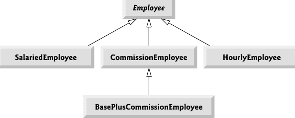

图10.2 | 员工层次结构UML类图。

抽象父类 `Employee` 声明了层次结构的“接口”——即程序可以在所有 `Employee` 对象上调用的方法集。我们在这里使用“接口”一词是广义是指程序与任何子类对象通信的各种方式。不要将“接口”的通用概念与Java接口的正式概念混淆，后者是10.9节的主题。每个员工无论其收入如何计算，都有名、姓和安全号码。

图10.2中的图显示了 `Employee` 的继承层次结构。后续章节实现了 `Employee` 类：

| 类 | 方法 |
| :--- | :--- |
| Employee | `earnings()`, `toString()` |
| SalariedEmployee | `earnings()` |
| HourlyEmployee | `earnings()` |
| CommissionEmployee | `earnings()` |
| BasePlusCommissionEmployee | `earnings()` |

图10.3 | `Employee` 的多态接口。

## 10.5.1 抽象父类

类 `Employee` (10.4) 除了员工的实例变量外还提供了方法。我们在父类中将 `earnings` 声明为抽象，因为该方法没有具体的实现意义的——没有足够的信息来确定 `earnings` 应该返回什么金额。每个子类...

# 10.5 案例研究：使用多态的工资系统

```java
// 返回社会安全号
public String getSocialSecurityNumber() {return socialSecurityNumber;}


// 返回 Employee 对象的字符串表示
@Override
public String toString() {
    return String.format("%s %ssocial number: %s",
            firstName(), lastName(), getSocialSecurityNumber());
}

// 抽象方法必须由具体的子类重写
public abstract double earnings(); // 此处实现
}
```


**图 10.4** Employee 父类（部分）

我们为什么决定将 `earnings` 声明为抽象方法？在 `Employee` 中提供该方法的具体实现并没有意义。我们无法为通用的 `Employee` 计算工资——我们必须先知道 `Employee` 的具体类型，以确定合适的工资计算方法。通过将此方法声明为抽象，我们表明每个子类必须提供合适的 `earnings` 实现，并且程序能够使用子类 `Employee` 变量以多态方式调用任何类型 `Employee` 的方法。

## 10.5.2 创建子类 SalariedEmployee

`SalariedEmployee`（图 10.5）继承自 `Employee` 类（第4行）并重写抽象方法 `earnings`（第34–35行），这使得 `SalariedEmployee` 成为一个具体类。该类包含一个构造函数（第8–18行），接收名、姓、社会安全号和周薪；一个为变量 `weeklySalary` 分配非负值的方法（第21–28行）；一个返回 `weeklySalary` 数值的方法（第31行）；一个 `earnings` 方法（第34–35行）用于计算 `SalariedEmployee` 的工资；以及一个 `toString` 方法（它返回一个字符串 "salaried employee:"，随后通过父类 `Employee` 的 `toString` 方法和 `weeklySalary` 方法返回特定于员工的信息）。`SalariedEmployee` 的构造函数将名、姓和社会安全号传递给 `Employee` 构造函数（第10行），以初始化父类的实例变量。此后，我们复制了 `weeklySalary` 方法。记住，更复杂的验证可以放在构造函数以及一个从构造函数和设置方法调用的静态方法中。

> **错误预防提示 10.1**
> 我们提到过不应该从类的构造函数调用该类的实例方法——你可以调用静态方法，并对父类的某个构造函数进行必要的调用。如果你遵循这一建议，将避免直接或间接调用该类的重写方法的问题，这可能导致运行时错误。更多细节请见 10.8。


```java
// Fig.10.5: SalariedEmployee.java
// SalariedEmployee 具体类继承抽象类 Employee

public class SalariedEmployee extends Employee {

    private double weeklySalary;

    // 构造函数
    public SalariedEmployee(String firstName, String lastName,
        String socialSecurityNumber, double weeklySalary) {

        super(firstName, lastName, socialSecurityNumber);

        if (weeklySalary < 0.0) {
            throw new IllegalArgumentException(
                "Weekly salary must be >= 0.0");
        }

        this.weeklySalary = weeklySalary;
    }

    // setter
    public void setWeeklySalary(double weeklySalary) {
        if (weeklySalary < 0.0) {
            throw new IllegalArgumentException(
                "Weekly salary must be >= 0.0");
        }
        this.weeklySalary = weeklySalary;
    }

    // 返回工资
    public double getWeeklySalary() { return weeklySalary; }

    // 计算工资，重写 Employee 中的抽象方法 earnings
    @Override
    public double earnings() { return getWeeklySalary(); }

    // 返回 SalariedEmployee 的字符串表示
    @Override
    public String toString() {
        return String.format("salaried employee: %s%s: $%.2f",
            super.toString(), "weekly salary", getWeeklySalary());
    }
}
```

**图 10.5 | SalariedEmployee 具体类继承抽象类 Employee。**

`earnings` 方法重写了 `Employee` 的抽象方法，提供了一个返回 `SalariedEmployee` 周薪的实现。如果我们不实现 `earnings`，类 `SalariedEmployee` 必须声明为抽象——否则，`SalariedEmployee` 将无法编译。因为在这个例子中，我们希望 `SalariedEmployee` 是一个具体类。

`toString` 方法（第38–42行）重写了 `Employee` 的 `toString`。如果 `SalariedEmployee` 没有重写 `toString`，它将继承……在这种情况下，`SalariedEmployee` 的 `toString` 将仅仅返回员工的全名和社会安全号，这不能充分表示一个 `SalariedEmployee`。为了产生 `SalariedEmployee` 的完整字符串表示，子类的 `toString` 方法在返回 "salaried employee:" 后，通过调用父类 `toString` 方法（第41行）返回父类 `Employee` 的特定信息（即名、姓和社会安全号）——这是一个代码重用的良好示例。`SalariedEmployee` 的表示还通过调用父类 `toString` 方法包含了员工的周薪。

## 10.5.3 子类 HourlyEmployee

`HourlyEmployee`（图 10.6）继承自 `Employee` 类并重写抽象方法 `earnings`，这使得 `HourlyEmployee` 成为一个具体类。`earnings` 方法根据工作小时数计算工资：若不超过 40 小时则按正常工资计算，超出部分按 1.5 倍工资计算。

```java
// Fig.10.6: HourlyEmployee.java
// HourlyEmployee 具体类继承抽象类 Employee

public class HourlyEmployee extends Employee {

    private double wage;
    private double hours;

    // 构造函数
    public HourlyEmployee(String firstName, String lastName,
        String socialSecurityNumber, double wage, double hours) {

        super(firstName, lastName, socialSecurityNumber);

        if (wage < 0.0) {
            throw new IllegalArgumentException(
                "Hourly wage must be >= 0.0");
        }

        if (hours < 0.0 || hours > 168.0) {
            throw new IllegalArgumentException(
                "Hours worked must be between 0.0 and 168.0");
        }

        this.wage = wage;
        this.hours = hours;
    }

    // setter
    public void setWage(double wage) {
        if (wage < 0.0) {
            throw new IllegalArgumentException(
                "Hourly wage must be >= 0.0");
        }
        this.wage = wage;
    }

    // setter hours
    public void setHours(double hours) {
        if (hours < 0.0 || hours > 168.0) {
            throw new IllegalArgumentException(
                "Hours worked must be between 0.0 and 168.0");
        }
        this.hours = hours;
    }

    // 返回工资
    public double getWage() { return wage; }

    // 返回工时
    public double getHours() { return hours; }

    // 计算工资，重写 Employee 中的抽象方法 earnings
    @Override
    public double earnings() {
        if (getHours() <= 40)
            return getWage() * getHours();
        else
            return 40 * getWage() + (getHours() - 40) * getWage() * 1.5;
    }

    // 返回 HourlyEmployee 的字符串表示
    @Override
    public String toString() {
        return String.format("hourly employee: %s%n%s: %.2f %n%s: %.2f",
            super.toString(), "hourly wage", getWage(),
            "hours worked", getHours());
    }
}
```

**图 10.6 | HourlyEmployee 具体类继承抽象类 Employee。**

## 10.5.4 子类 CommissionEmployee

`CommissionEmployee` 类继承自 `Employee`，包含销售额（`grossSales`）和佣金率（`commissionRate`）实例变量；set 方法（第 28–34 行和 40–47 行）为实例变量 `grossSales` 和 `commissionRate` 分配有效值；get 方法（第 37 行和 50 行）获取这些实例变量的值；`earnings` 方法（第 53–56 行）计算员工的收入；以及 `toString` 方法（59–65 行），它返回“佣金员工”，随后是员工特定的信息。构造函数将名、姓和社会安全号传递给父类 `Employee` 的构造函数（第 12 行），以初始化 `Employee` 的私有实例变量。`toString` 方法调用父方法的 `toString`（第 62 行）以获取 `Employee` 特定的信息（即：名、姓和社会安全号）。

```java
// Fig. 10.7: CommissionEmployee.java
// CommissionEmployee 类继承自 Employee。

public class CommissionEmployee extends Employee {

    private double grossSales; // 周销售额
    private double commissionRate; // 佣金百分比

    // 构造函数
    public CommissionEmployee(String firstName, String lastName,
        String securityNumber, double grossSales,
        double commissionRate) {

        super(firstName, lastName, securityNumber);

        if (commissionRate <= 0.0 || commissionRate >= 1.0) { // 验证
            throw new IllegalArgumentException(
                "Commission rate must be > 0.0 and < 1.0");
        }

        if (grossSales < 0.0) { // 验证
            throw new IllegalArgumentException("Gross sales must be >= 0.0");
        }

        this.grossSales = grossSales;
        this.commissionRate = commissionRate;
    }

    public void setGrossSales(double grossSales) {
        if (grossSales < 0.0) { // 验证
            throw new IllegalArgumentException("Gross sales must be >= 0.0");
        }
        this.grossSales = grossSales;
    }

    public double getGrossSales() { return grossSales; }

    public void setCommissionRate(double commissionRate) {
        if (commissionRate < 0.0 || commissionRate >= 1.0) { // 验证
            throw new IllegalArgumentException(
                "Commission rate must be > 0.0 and < 1.0");
        }
        this.commissionRate = commissionRate;
    }

    // 返回佣金率
    public double getCommissionRate() { return commissionRate; }

    // 计算收入；重写 Employee 中的抽象方法
    @Override
    public double earnings() {
        return getCommissionRate() * getGrossSales();
    }

    // CommissionEmployee 对象的字符串表示
    @Override
    public String toString() {
        return String.format("%s:%n%s: $%.2f, %s: $%.2f",
            "commission employee", super.toString(),
            "gross sales", getGrossSales(),
            "commission rate", getCommissionRate());
    }
}
```

**图 10.7 | CommissionEmployee 类继承自 Employee。**

## 10.5 案例研究：使用多态的工资系统

本节展示了如何使用多态来处理不同类型员工的工资计算，通过统一的 `Employee` 引用调用各子类特定的 `earnings()` 实现。


**图 10.7** | CommissionEmployee 类继承自 Employee。（2 部分，共 2 部分。）

### 10.5.5 间接具体子类 BasePlusCommissionEmployee

`BasePlusCommissionEmployee`（图 10.8）继承自 `CommissionEmployee`（第 44 行），因此是 `Employee` 类的间接子类。`BasePlusCommissionEmployee` 拥有一个构造函数（第 8–19 行），接收名、姓、社会安全号、佣金率和基本工资。它将所有这些内容传递给 `CommissionEmployee` 构造函数（第 11–12 行）以初始化子类的实例变量。`BasePlusCommissionEmployee` 还包含一个 set 方法（第 22–28 行）为变量 `variableSalary` 分配新值，以及一个 get 方法（第 31 行）返回 `baseSalary` 的值。`earnings` 方法（第 34–35 行）计算 `BasePlusCommissionEmployee` 的收入。`earnings` 方法中的第 35 行计算 `CommissionEmployee` 的 `earnings` 方法来计算收入中基于佣金的部分——这是代码重用的另一个很好的示例。`BasePlusCommissionEmployee` 的 `toString` 方法（第 38–43 行）创建一个 `BasePlusCommissionEmployee` 的字符串表示，其中包含“base-salaried”，随后调用父类 `CommissionEmployee` 的 `toString` 方法（第 41 行）以及基本工资。结果是一个以“base-salaried commission employee”开头的字符串，随后是 `BaseEmployee` 信息的结果。记得 `CommissionEmployee` 的 `toString` 通过调用其父类（即 `Employee`）的 `toString` 方法来获取员工的名、姓和社会安全号——另一个代码重用示例。`BasePlusCommissionEmployee` 的 `toString` 方法启动了一个跨越 `Employee` 层次结构三层的方法链。

```java
// Fig. 10.8: BasePlusCommissionEmployee.java
// BasePlusCommissionEmployee 类继承自 CommissionEmployee。

public class BasePlusCommissionEmployee extends CommissionEmployee {

    private double baseSalary; // 每周基本工资

    // 构造函数
    public BasePlusCommissionEmployee(String firstName, String lastName,
        String securityNumber, double grossSales,
        double commissionRate, double baseSalary) {

        super(firstName, lastName, securityNumber,
        grossSales, commissionRate);

        if (baseSalary < 0.0) { // 验证
            throw new IllegalArgumentException("Base salary must be >= 0.0");
        }

        this.baseSalary = baseSalary;
    }

    // 设置基本工资
    public void setBaseSalary(double baseSalary) {
        if (baseSalary < 0.0) { // 验证
            throw new IllegalArgumentException("Base salary must be >= 0.0");
        }
        this.baseSalary = baseSalary;
    }

    public double getBaseSalary() { return baseSalary; }

    // 计算收入；重写 Employee 中的方法
    @Override
    public double earnings() {
        return getBaseSalary() + super.earnings();
    }

    // BasePlusCommissionEmployee 的字符串表示
    @Override
    public String toString() {
        return String.format("%s %s; %.s: %.2f",
            "base-salaried", super.toString(),
            base salary salary", getSalary
    }}
}
```

**图 10.8** | BasePlusCommissionEmployee 类

### 10.5.6 多态处理、instanceof 和向下类型转换

为了测试我们的 `Employee` 层次结构，图 10.9 中的应用程序创建了每个具体类的对象：`SalariedEmployee`、`HourlyEmployee`、`CommissionEmployee` 和 `BasePlusCommissionEmployee`。程序通过非多态的方式通过每个对象的类型操作这些对象，然后通过多态的方式使用 `Employee` 数组进行操作。在多态地处理对象时，程序将 `BasePlusCommissionEmployee` 的工资增加了 10%——这需要在运行时确定对象的类型。最后，程序多态地确定并输出 `Employee` 数组中的每个对象。第 7–16 行创建了四个具体子类的对象。第 20–28 行非多态地输出这些对象的字符串表示和收入。对象的 `toString` 方法在对象作为 `%s` 格式符输出时由 `printf` 调用。

```java
// Fig. 10.9: PayrollSystemTest.java
// Employee 层次结构测试程序。

public class PayrollSystemTest {

    public static void main(String[] args) {
        // 创建子类
        SalariedEmployee salariedEmployee =
            new SalariedEmployee("John", "Smith", "111-11-1111", 800.00);

        HourlyEmployee hourlyEmployee =
            new HourlyEmployee("Karen", "Price", "222-22-2222", 16.75, 40);

        CommissionEmployee commissionEmployee =
            new CommissionEmployee(
                "Sue", "Jones", "333-33-3333", 10000, .06);

        BasePlusCommissionEmployee basePlusCommissionEmployee =
            new BasePlusCommissionEmployee(
                "Bob", "Lewis", "444-44-4444", 5000, .04, 300);

        // 使用多态数组
        Employee[] employees = new Employee[] {
            salariedEmployee,
            hourlyEmployee,
            commissionEmployee,
            basePlusCommissionEmployee
        };

        for (Employee emp : employees) {
            System.out.printf("%s:%n%s: $%.2f%n",
                emp.getClass().getSimpleName(), emp.toString(), emp.earnings());

            if (emp instanceof BasePlusCommissionEmployee) {
                BasePlusCommissionEmployee bpc = (BasePlusCommissionEmployee) emp;
                bpc.setBaseSalary(bpc.getBaseSalary() * 1.10);
            }
        }
    }
}
```

**图 10.9** | 员工层级测试程序。（3 部分中的第 1 部分）

```java
// 确定元素是否为 BasePlusCommissionEmployee
if (currentEmployee instanceof BasePlusCommissionEmployee) {
    // 将引用向下转型为
    // BasePlusCommissionEmployee 
    BasePlusCommissionEmployee employee = 
        (BasePlusCommissionEmployee)currentEmployee;

    employee.setBaseSalary(1.10 * employee.getBaseSalary());

    System.out.printf(
        "new base salary with 10%% increase is: $%.2f%n",
        employee.getBaseSalary());
}

System.out.printf(
    "earned: $%.2f%n",
    currentEmployee.earnings());

// 获取 employees 数组中每个对象的类型
for (int j = 0; j < employees.length; j++) {
    System.out.printf("Employee %d is a %s%n",
        employees[j].getClass().getName());
}
```

**图 10.9** | 员工层级测试程序。（3 部分中的第 2 部分）

逐个处理的员工：
薪制员工：John Smith
社会安全号：111-11-1111
每周工资：$800.00
收入：$800.00

时薪员工：Karen Price
社会安全号：222-22-2222
时薪：$16.75；工作时长：40.00
收入：$670.00

佣金员工：Sue Jones
社会安全号：333-33-3333
总销售额：$10,000.00；佣金率：0.06
收入：$600.00

底薪+佣金员工：Bob Lewis
社会安全号：444-44-4444
总销售额：$5,000.00；佣金率：0.04；底工资：$300.00
收入：$500.00

多态化处理的员工：
薪制员工：John Smith
社会安全号：111-11-1111
每周工资：$800.00
收入：$800.00

时薪员工：Karen Price
社会安全号：222-22-2222
时薪：$16.75；工作时长：40.00
收入：$670.00

佣金员工：Sue Jones
社会安全号：333-33-3333
总销售额：$10,000.00；佣金率：0.06
收入：$600.00

底薪+佣金员工：Bob Lewis
社会安全号：444-44-4444
总销售额：$5,000.00；佣金率：0.04；底工资：$300.00
增加10% 后的新底工资为：$330.00
收入：$530.00

Employee 0 is a SalariedEmployee
Employee 1 is a HourlyEmployee
Employee 2 is a CommissionEmployee
Employee 3 is a BasePlusCommissionEmployee

**图 10.9** | 员工层级测试程序。（3 部分中的第 3 部分）

### 创建员工数组

第 31 行声明了 `employees` 并为其分配了一个包含四个 `Employee` 变量的数组。第 34–37 行分别将这些元素赋值给 `SalariedEmployee`、`HourlyEmployee`、`CommissionEmployee` 和 `BasePlusCommissionEmployee`。这些赋值是允许的，因为 `SalariedEmployee` 是一个 `Employee`，`HourlyEmployee` 是一个 `Employee`，`CommissionEmployee` 是一个 `Employee`，且 `BasePlusCommissionEmployee` 是一个 `Employee`。因此，尽管 `Employee` 是抽象类，我们仍然可以将 `SalariedEmployee`、`HourlyEmployee`、`CommissionEmployee` 和 `BasePlusCommissionEmployee` 对象的引用赋值给子类 `Employee` 变量。

### 多态化处理员工

第 42–61 行遍历 `employees` 数组，并使用类型为 `Employee` 的 `currentEmployee` 调用 `toString` 和 `earnings` 方法。在每次迭代中，`currentEmployee` 被赋值为数组中不同的 `Employee` 引用。输出表明，每个类的特定方法确实被调用了。所有对 `toString` 和 `earnings` 的调用都是在执行时根据 `currentEmployee` 所引用对象的类型进行解析的。这被称为动态绑定或晚绑定。例如，第 43 行调用了 `currentEmployee` 所引用对象的方法。由于动态绑定，Java 在执行时决定调用哪个类的类方法，而不是在编译时决定。通过 `Employee` 变量只能调用 `Employee` 类的方法（当然，也包括了 `Object` 类的方法）。子类引用仅用于调用子类的方法——这些方法的实现是以多态方式调用的。

### 对 BasePlusCommissionEmployees 执行特定类型操作

我们对 `BasePlusCommissionEmployee` 对象进行特殊处理——当我们在运行时遇到这些对象时，我们将它们的底工资增加了 10%。在以多态方式处理对象时，我们通常不需要担心细节，但为了调整底工资，我们必须在执行时确定 `Employee` 对象的特定类型。第 46 行使用 `instanceof` 运算符判断特定 `Employee` 对象的类型是否为 `BasePlusCommissionEmployee`。如果 `currentEmployee` 引用的对象是 `BasePlusCommissionEmployee`，则第 46 行的条件为真。对于任何子类来说这都是真的，因为它们与其父类之间存在“是”的关系。第 49–50 行将 `currentEmployee` 从 `Employee` 类型向下转型为 `BasePlusCommissionEmployee`——这种转型只有在类型为 `BasePlusCommissionEmployee` 时才允许。

## 10.8 关于在构造函数中调用方法的问题的深度解析

### final 方法无法被重写

父类中的 `final` 方法不能在子类中被重写——这保证了 `final` 方法的实现将被层次结构中的所有直接和间接子类使用。声明为私有的方法隐式是 `final` 的，因为在子类中无法对其进行重写。声明为静态的方法也是隐式 `final` 的——`final` 方法的声明永远不会改变，因此所有子类都使用相同的方法实现，且对 `final` 方法的调用在编译时就会解决——这被称为静态绑定。

### final 类不能作为父类

`final` 类不能被扩展以创建子类。`final` 类中的所有方法都是隐式 `final` 的。`String` 是 `final` 类的一个范例。如果你创建了 `String` 的子类，那么该子类的对象就可以在预期 `String` 的地方使用。由于 `String` 无法被扩展，使用 `String` 的程序可以依赖 Java API 中指定的 `String` 的功能性。将类设为 `final` 还可以防止程序员创建可能绕过安全限制的子类。

我们现在已经讨论了变量、方法和类的 `final` 属性，并强调了如果某个东西可以是 `final` 的话——这是最小权限原则的另一个例子。当我们在第 23 章学习并发时，你会发现 `final` 变量让你的程序在当今的多核处理器上进行并行化处理变得简单得多。

<http://docs.oracle.com/javase/tutorial/java/Iand/final.html>


# 常见编程错误 10.5

尝试声明 `final` 类的子类会导致编译错误。

# 软件工程观察 10.6

在 Java API 中，大多数类都没有声明为 `final`。这开启了继承和多态。然而，在某些情况下，将类声明为 `final` 是重要的——通常是为了安全考虑。此外，除非你为了扩展而仔细设计了一个类，否则你应该避免（那些（往往是微妙的）错误。

# 软件工程观察 10.7

虽然 `final` 类不能被扩展，但你可以通过组合来复用它们的方法。

## 10.8 关于在构造函数中调用方法的深度解析

我们已经过，你不应该在构造函数中调用可重写的方法。为了理解为什么，请回想当你构建一个子类对象时，子类的构造函数首先调用其直接父类的构造函数。此时，子类构造函数体中的任何子类实例变量初始化尚未执行。如果父类构造函数随后调用了被子类重写的方法，则将执行子类的版本。如果子类使用了尚未妥善初始化的实例变量，这可能会导致微妙且难以检测的错误，因为子类构造函数还没有执行完毕。

假设一个构造函数和一个设置方法对特定的实例变量进行验证。你应该如何处理这些公共代码？

- 如果验证代码很简短，你可以在构造函数和设置方法中重复它。这是消除我们在这里考虑的问题的一种简单方法。
- 对于较长的验证，你可以定义一个静态验证方法——通常是一个私有静态方法——然后从构造函数和设置方法中调用它。在构造函数中调用静态方法是可以接受的，因为静态方法是不可重写的。

构造函数调用 `final` 实例方法也是可以的，只要该方法没有直接或间接地调用任何可重写的实例方法。

## 10.9 使用接口创建

[注：Java SE 8 接口增强在第 10.10 节引入并在第 17 章讨论。Java SE 9 接口增强在第 10.11 节引入。]

我们的下一个示例（图 10.11–10.14）重新检查第 10.5 节的工资系统。假设相关公司希望在单一应付账应用程序执行若干操作——计算每个员工必须收取的收入，以及每张发票应付的金额（即购买商品的费用）。尽管应用于不相关的员工和发票，但这两个操作都与获取付款金额有关。对于员工来说，付款是员工的收入；对于发票，付款是发票上列出商品的总成本。我们可以计算不同的内容作为员工和发票的付款。Java 是否提供了一种要求无关类实现一组公共方法（例如，计算付款金额的方法）？Java 接口恰恰提供了这种能力。

### 标准化交互

接口定义并标准化了人员和系统等实体相互交互的方式。例如，收音机的控制充当了收音机用户与收音机内部组件之间的接口。这些控制允许用户执行一组有限的操作（例如，切换台、调整音量、在 AM 和 FM 之间选择），不同的收音机可能以不同的方式实现控制（例如使用按钮、旋钮、语音命令）。接口规定了收音机必须允许用户执行的操作，但没有规定这些操作是如何形成的。

同样，在我们第 1.5 节的类比中，一个由方向盘、加速踏板和刹车踏板组成的“基本能力”接口可以让司机告诉汽车做什么。你知道如何使用这个接口进行转向、加速和刹车，但你可以驾驶许多类型的汽车，尽管制造商以不同的方式实现这些系统。例如，刹车有许多类型——盘刹、鼓刹、液压刹、气刹。当你踩下刹车踏板时，汽车的刹车系统并不重要——重要的是汽车慢了下来。

### 对象通过接口通信

软件对象也通过接口通信。Java 接口描述了一组可以在对象上调用的方法，以告诉它例如执行某些任务或返回某些信息。下一个示例引入了一个名为 `Payable` 的接口，用于描述任何必须“能够支付”且必须提供方法的对象。接口声明以 `interface` 关键字开头，仅包含常量和抽象方法。与类不同，所有接口成员必须是公共的（`public`）。

### 使用接口

要使用接口，具体类必须指定它实现了该接口，并根据签名声明接口中的每个方法。要指定类实现接口，请将 `implements` 关键字和接口名称添加到类声明第一行的末尾，如下：

```java
public class ClassName extends SuperClassName implements InterfaceName
```

或者

```java
public class ClassName implements InterfaceName
```

上述代码段中的 `InterfaceName` 是逗号分隔的接口名称列表。实现接口就像与编译器签订一份合同，声明：“我将声明接口指定的所有抽象方法，或者我将我的类声明为抽象类。”

# 常见编程错误 10.6

实现接口的具体类如果没有实现接口的任何抽象方法，会导致编译错误，指示该类必须声明为抽象类。

### 异构类型

当异构类（即不通过类层次结构相关的类）共享公共方法和常量时，通常使用接口。这允许无关类的对象以多态的方式被处理——实现相同接口的类对相同的方法调用做出响应（针对该接口的方法）。你可以创建一个描述所需功能的接口，然后在任何需要该功能的类中实现此接口。例如，在本节开发的应付账应用程序中，我们在任何必须能够计算付款金额的类中实现 `Payable`。

### 接口与抽象类

当没有可以继承的默认实现时（即没有字段和具体的方法实现），应该使用接口来代替抽象类。就像 `public` 一样。

1. 第 10.10-10.11 节引入了 Java SE 8 和 Java SE 9 的增强，分别允许在接口中使用方法实现和私有方法。

# 第 10 章 面向对象编程：多态与接口

抽象类和接口通常是公共类型。与公共类一样，公共接口必须在与接口同名且以 `.java` 为后缀的文件中声明。

# 软件工程观察 10.8

许多开发者认为，接口最近成为了一项更为重要的建模技术。

# 标记接口

标记接口（也称为标记接口）是一个没有任何方法或常量值的空接口。它们用于为类添加“是一个...”（is-a）的关系。例如，Java 类拥有一种对象序列化机制，它可以使用 `ObjectOutputStream` 和 `ObjectInputStream` 类将对象转换为字节表示，并将这些对象从表示转换回对象。为了让这一机制对你的对象生效，你只需要在类声明的第一行末尾添加 `implements Serializable` 来对其进行标记。这样，你的所有类都具有与 `Serializable` 这种“是一个...”的关系——实现基础对象序列化只需要这样。

## 10.9.1 开发可支付层级

为了构建一个能够确定员工和发票付款的应用程序，我们首先创建接口 `Payable`，它包含方法 `getPaymentAmount`，该方法返回实现接口的任何类对象必须支付的 `double` 类型。`getPaymentAmount` 是 `Employee` 层级中 `earnings` 方法的通用版本——`earnings` 方法专门为 `Employee` 计算支付金额，而 `getPaymentAmount` 可以应用于许多不相关的对象。在声明接口 `Payable` 后，我们引入了实现 `Payable` 接口的 `Invoice` 类。然后我们修改 `Employee` 类使其也实现 `Payable` 接口。

`Invoice` 和 `Employee` 都代表公司必须计算支付金额的对象。这两个类都实现了 `Payable` 接口，因此程序可以同时对 `Invoice` 和 `Employee` 对象调用 `getPaymentAmount` 方法。正如我们将看到的，公司的账务应用程序需要对 `Invoice` 和 `Employee` 进行多态处理。

# 良好编程实践 10.1

在接口中声明方法时，选择一个以通用方式描述对象目的名称，因为该方法可能被许多不相关的类实现。

# 包含接口的 UML 图

图 10.10 中的 UML 类图显示了我们账务应用程序中使用的接口和类层级结构。该层级通过在接口名称上方使用双角括号 `«Payable»` 来区分接口和类。UML 通过一种称为“实现”（realization）的关系表达类与接口之间的关系。说一个类“实现”或“执行”了接口的方法。类图将实现关系建模为从实现类指向接口的带有空心箭头的虚线箭头。图 10.10 中的图表示 `Invoice` 和 `Employee` 分别实现了接口 `Payable`。正如图 10.2 的类图所示，`Employee` 类以*斜体*形式出现，这表示它是一个*抽象*类。具体类 `SalariedEmployee` 扩展 `Employee`，继承了其与 `Payable` 的父类实现关系。

**图 10.10 | 可支付层级 UML 类图。**

接口 `Payable` 的声明始于图 10.11 的第 4 行，使用了 `interface` 关键字。接口包含 `public abstract` 方法 `getPaymentAmount`。接口方法默认是 `public` 且 `abstract` 的，不需要这样声明。`Payable` 只有一个方法，但接口可以有*任意*数量的方法。此外，`getPaymentAmount` 方法没有参数，但接口方法可以有参数。接口还可以包含 `final` 常量。

> **良好编程实践 10.2**
> 在声明接口方法时显式使用 `public` 和 `abstract` 以使你的意图明确。正如你在第 10.10–10.11 节中看到的，Java SE 8 和 Java SE 9 允许在接口中使用其他类型。

```java
// Fig 10.11: Payable.java
// Payable 接口声明.
public interface Payable {
    public abstract double getPaymentAmount(); // 没有实现
}
```

**图 10.11 | Payable 接口声明。**

## 10.9.3 类 Invoice

`Invoice` 类（图 10.12）代表一个仅包含一种零件账单信息的简单发票。该类声明了私有实例变量 `partNumber`、`partDescription`、`quantity` 和 `priceItem`（第 5–8 行），分别表示零件号、零件描述、订单零件数量和单价。`Invoice` 类还包含构造函数（第 11–26 行）、`get` 方法（第 29–38 行）和一个 `toString` 方法（第 41–46 行），后者返回 `Invoice` 对象的字符串表示。

```java
// Fig. 10.12: Invoice.java
// Invoice class implements Payable.
public class Invoice implements Payable {
    private final String partNumber;
    private final String partDescription;
    private final int quantity;
    private final double priceItem;

    // constructor
    public Invoice(String partNumber, String partDescription, int quantity, double priceItem) {
        if (quantity < 0)
            throw new IllegalArgumentException("Quantity must be >= 0");
        if (priceItem < 0)
            throw new IllegalArgumentException("Price item must be >= 0");
        this.partNumber = partNumber;
        this.partDescription = partDescription;
        this.quantity = quantity;
        this.priceItem = priceItem;
    }

    // get part number
    public String getPartNumber() {
        return partNumber;
    }

    // get description
    public String getDescription() {
        return partDescription;
    }

    // get quantity
    public int getQuantity() {
        return quantity;
    }

    // get price item
    public double getPriceItem() {
        return priceItem;
    }

    // return String representation of Invoice
    @Override
    public String toString() {
        return String.format("Invoice: %s %s %d %.2f",
            partNumber, partDescription, quantity, priceItem);
    }
}
```

**图 10.12 | Invoice class implements Payable. (Part 1 of 2.)**

```java
// method required to carry out contract with Payable
@Override
public double getPaymentAmount() {
    return getQuantity() * getPriceItem();
}
```

**图 10.12 | Invoice class implements Payable. (Part 2 of 2.)**

## 10.9.4 修改类 Employee 以实现接口 Payable

我们修改 `Employee` 类以实现接口 `Payable`（图 10.13）。该类的声明与图 10.4 相同，但有两个例外：

- 图 10.13 的第 4 行表示 `Employee` 类实现了 `Payable`。
- 第 38 行实现了接口 `Payable` 的 `getPaymentAmount` 方法。

注意，`getPaymentAmount` 仅仅调用了员工的抽象方法 `earnings`。在执行期间，当在 `Employee` 子类的对象上调用 `getPaymentAmount` 时，`getPaymentAmount` 会调用子类的具体 `earnings` 方法，该方法知道如何计算该子类类型对象的收益。

```java
// 图. 10.13: 实现 Payable 的 Employee 超类。
public abstract class Employee implements Payable {
    private final String firstName;
    private final String lastName;
    private final String socialSecurityNumber;

    // 构造函数
    public Employee(String firstName, String lastName,
        String socialSecurityNumber) {
        this.firstName = firstName;
        this.lastName = lastName;
        this.socialSecurityNumber = socialSecurityNumber;
    }

    // get名
    public String getFirstName() { return firstName; }

    // 姓
    public String getLastName() { return lastName; }

    // 返回社会安全号码
    public String getSocialSecurityNumber() { return socialSecurityNumber; }

    // 返回 Employee 的表示
    @Override
    public String toString() {
        return String.format("%s %s\nsecurity number: %s",
            getFirstName(), getLastName(), getSocialSecurityNumber());
    }

    // 抽象方法必须由具体的子类重写
    public abstract double earnings(); // 此无实现

    // 实现 getPaymentAmount 使得整个 Employee
    // 类层次结构可以使用支持 Payables 的应用程序
    public double getPaymentAmount() { return earnings(); }
}
```


**图 10.13** | 实现 `Payable` 的 `Employee` 抽象超类。

### Employee 的子类与接口 Payable

当一个类实现一个接口时，适用于与继承相同的“是”（is-a）关系。`Employee` 类实现了 `Payable`，因此我们可以说 `Employee` 是一个 `Payable`，任何 `Employee` 子类的对象也都是 `Payable`。因此，如果我们用第 10.5 节中图 10.13 中的新 `Employee` 子类来更新类层次结构，那么 `SalariedEmployees`、`HourlyEmployees`、`CommissionEmployees` 和 `BaseEmployees` 都是 `Payable` 对象。正如我们可以将 `Salaried` 子类的引用赋值给超类 `Employee` 一样，我们可以将 `SalariedEmployee` 对象（或任何其他 `Employee` 派生类对象）的引用赋值给 `Payable` 变量。`Invoice` 实现 `Payable`，因此 `Invoice` 对象也是 `Payable` 对象，我们可以将 `Invoice` 对象的引用赋值给 `Payable` 变量。

## 10.9 创建和使用接口

### 软件工程观察 10.10

继承和接口在实现“是”（is-a）关系方面是相似的。实现接口的类的对象可以被视为该接口类型的对象。实现接口的类的任何子类的对象也可以被视为该接口类型的对象。

### 软件工程观察 10.11

超类与子类、接口与实现接口的类之间存在的“是”（is-a）关系在将对象传递给方法时依然有效。当方法参数接收到超类或接口类型的参数时，该方法以多态的方式处理作为参数接收的对象。

### 软件工程观察 10.12

使用超类引用，我们可以多态地调用在超类及其子类中声明的任何方法（例如 `Object`）。使用接口引用，我们可以多态地调用在接口、其父接口（一个接口可以扩展其他接口）以及 `Object` 类中声明的任何方法——接口类型的变量必须引用对象才能调用方法，而所有对象都有 `Object` 类的方法。

## 10.9.5 多态地使用接口 Payable 处理 Invoices 和 Employees

`PayableInterfaceTest`（图 10.14）说明了接口可以用于在应用程序中处理一组 `Invoices` 和 `Employees`。第 7–12 行声明并初始化了四元素数组 `payableObjects`。第 8–9 行将 `Invoice` 对象的引用放在 `payableObjects` 的前两个元素中。第 10–11 行将 `SalariedEmployees` 的引用放在 `payableObjects` 的最后两个元素中。允许用 `Invoices` 和 `SalariedEmployees` 初始化，因为 `Invoice` 是 `Payable`，`SalariedEmployee` 是 `Employee`，而 `Employee` 是 `Payable`。

```java
// 10.14: PayableInterfaceTest.java
// Payable 接口测试，多态地处理 Invoices 和
// Employees。
public class PayableInterfaceTest {
    public static void main(String[] args) {
        // 创建四元素数组 payable
        Payable[] payableObjects = new Payable[]{
            new Invoice("01234", "seat", 2, 375.00),
            new Invoice("56789", "tire", 4, 79.50),
            new SalariedEmployee("John", "Smith", "111-11-1111", 800.00),
            new SalariedEmployee("Lisa", "Barnes", "888-88-8888", 1200.00)
        };
```

**图 10.14** | Payable 接口测试，多态地处理 Invoices 和 Employees。（2 部分中的第一部分）

```java
        System.out.println(
          "Invoices and Employees processed polymorphically:");
        // 通用地处理数组 payableObjects 中的每个元素
        for (Payable currentPayable : payableObjects) {
            // currentPayable 及其相应的付款金额
            System.out.printf("%s payment due: $%.2f\n",
                currentPayable.toString(), // 可以隐式调用
                currentPayable.getPaymentAmount());
        }
    }
}
```


多态地处理 Invoices 和 Employees:

invoice:
part number: 01234 (seat)
quantity: 2
price per item: 375.00
payment due: $750.00

invoice:
part number: 56789 (tire)
quantity: 4
price per item: 79.50
payment due: $319.80

salaried employee: John Smith
social security number: 111-11-1111
weekly salary: 800.00
payment due: $800.00

salaried employee: Lisa Barnes
social security number: 888-88-8888
weekly salary: 1200.00
payment due: $1200.00

**图 10.14** | Payable 接口测试，多态地处理 Invoices 和 Employees。（2 部分中的第二部分）

# 10.9 Java API 的常用接口

在开发应用程序时你会经常使用接口。Java API 包含许多接口，我们在图 10.15 中使用了它们。

| 接口 | 描述 |
| --- | --- |
| `Comparable` | Java 包含比较运算符（如 `<`, `<=`, `>=`, `!=`）用于比较基本值。然而，这些运算符不能比较对象。`Comparable` 接口允许对象与其他进行比较。我们在第 16 节泛型集合和第 20 节泛型类与方法中使用它。 |
| `Serializable` | 用于标识对象可以写入（即序列化）或从读取（即反序列化）某种存储类型（例如磁盘、数据库）或跨网络传输。 |
| `Runnable` | 由表示执行任务的类实现。此类类的对象使用多线程技术（第 23 节并发）并行执行。该接口包含一个方法 `run`，指定对象执行时的行为。 |
| `GUI listener` | 你每天都在与图形界面（GUI）交互。在浏览器中，你可能会输入要访问的网站地址，或点击按钮返回上一页。浏览器响应你的交互并执行所需任务。你的交互被称为事件，浏览器用于响应事件的代码被称为事件处理器。在第 12 节 JavaFX 图形界面：第一部分中，你将学习构建具有响应交互的处理器的 GUI。事件处理器声明在实现事件监听接口的类中。每个事件监听接口指定了一个或多个必须实现的方法以响应交互 |
| `AutoCloseable` | 由可以使用 `try-with-resources` 语句（第 11 节异常处理深度查看）的类实现，有助于防止资源泄漏。我们在第 15 节文件、输入输出流、NIO 和 XML 序列化以及第 24 节使用 JDBC 访问数据库中使用此接口。 |

**图 10.15** — Java API 的常用接口。

# 10.10 Java SE 8 接口增强

本节介绍了 Java 8 中新增的接口功能。我们在后面的章节中详细讨论这些内容。

## 10.10.1 默认接口方法

在 Java 8 之前，接口方法只能是公共抽象方法。这意味着接口指定了实现类必须执行的操作，但没有指定类应该如何执行。

从 Java 8 开始，接口还可以包含具有具体实现的公共默认方法，指定了在实现类执行时如何执行操作。

实现类没有重写（`override`）这些方法。如果一个类实现了一个接口，该类也会接收接口的默认实现（如果有）。要声明一个默认方法，在方法的返回类型之前放置 `default` 关键字，并提供一个具体的具体实现。

### 向现有接口中添加方法

在 Java 8 之前，向接口中添加方法会破坏任何没有实现新方法的实现类。记住，如果你没有实现接口的每个方法，你就必须将你的类声明为抽象（`abstract`）。

当添加默认方法时，任何实现原始接口的类都不会被破坏——该类只是简单地接收了新的默认方法。当一个类实现 Java SE 8 时，该类就同于与编译器“签署了一份合同”，规定：“我将声明接口指定的所有抽象方法，或者我将声明我是抽象的”——实现类并不要求重写接口的默认方法，但在必要时可以重写。


Java SE 8 方法允许你通过向这些接口添加新方法来演进接口，而不会破坏使用它们的代码。

### 接口 vs. 抽象类

在 Java SE 8 之前，当没有可以继承的实现（没有字段且没有方法实现）时，通常使用接口（而不是抽象类）。有了默认方法，你可以在接口中声明通用的方法实现。这让你在设计类时具有更高的灵活性，因为一个类可以实现多个接口，但只能扩展一个超类。

## 10.10.2 静态接口方法

在 Java SE 8 之前，通常会与接口关联一个包含多个静态辅助方法的类，这些方法用于处理实现该接口的类。在第 16 章中，你将学习集合类（`Collections`），它包含了许多静态辅助方法，用于处理实现 `Collection`、`List`、`Set` 等类的对象。例如，`Collections` 方法可以对实现 `List` 接口的任何类的对象进行排序。有了静态方法，这些辅助方法现在可以直接声明在接口中，而不是在独立的类中。

## 10.10.3 函数式接口

自 Java SE 8 起，任何仅包含一个抽象方法的接口被称为函数式接口（functional interface）——这些也称为 SAM（单抽象方法）接口。Java API 中有很多这样的接口。在本书中你会用到的一些函数式接口包括：

- `Change`——你将实现此接口来定义一个与图形滑块接口控件交互的方法。
- `Comparator`（第 16 章）——你将实现此接口来定义一个可以比较给定类型两个对象的方法，以确定第一个对象是小于、等于还是大于第二个对象。
- `Runnable`（第 23 章）——你将实现此接口来定义一个可能与程序其他部分并行运行的任务。

函数式接口被 Java 的 Lambda 功能广泛使用，我们将在第 17 章中引入这些功能。Lambda 表达式提供了一种实现函数式接口的简写符号表示法。

# 10.11 Java SE 9 私有接口方法

如你所知，类的私有辅助方法只能由该类的其他方法调用。从 Java 9 开始，你可以在接口中声明辅助方法为*private interface methods*（私有接口方法）。接口的私有实例方法只能由接口的其他实例方法直接调用（即无需对象引用）。接口的私有静态方法可以被接口的任何实例方法或静态方法调用。


#### 编程错误 10.7
在*私有接口方法的声明*中包含 `default` 关键字会导致编译错误——`default` 必须是公共的。

# 10.12 私有构造函数

在第 3.4 节中，我们提到构造函数通常声明为公共。有时，将类的某一个或多个构造函数声明为私有是有用的。

## 防止对象实例化
通过将类的构造函数设为私有，你可以防止客户端代码创建类的对象。例如，考虑 `Math` 类，它只包含公共常量和静态方法。不需要创建 `Math` 对象就可以使用类的常量和方法，因此它的构造函数是私有的。

## 在构造函数中共享初始化代码
私有构造函数的一个用处是在类的其他构造函数之间共享初始化代码。你可以使用委托构造函数（在图 8.5 中引入）来调用包含共享初始化代码的私有构造函数。

## 工厂方法
私有构造函数的另一个常见用处是强制客户端代码使用所谓的“工厂方法”。**工厂方法**是一个公共静态方法，用于创建并初始化一个指定类型的对象（可能是同一个类），然后返回对该对象的引用。这种架构的一个关键优势是，方法的返回类型可以是接口或超类（抽象的或具体的）。我们将在在线设计模式附录中详细讨论工厂方法。²

> 2 Gamma, Erich et al. Design Patterns: Elements of Reusable Object-Oriented Software. Reading, MA: Addison-Wesley, 1995.

# 10.13 面向接口编程，而不是面向实现³

通过 `extends` 实现的继承在第 9 章和第 10 章中进行了详细解释。记住，Java 不允许一个类继承自多个超类。

通过接口继承，一个类实现一个描述抽象方法的接口，该类必须提供这些方法。新类还可能继承方法实现（从 Java 8 开始在接口中是允许的，但没有实例变量）。记住 Java 允许一个类实现多个接口。接口可以扩展一个或多个其他接口。

## 10.13.1 实现继承适用于少量的紧密耦合类

实现继承主要用于声明具有许多相同实例变量和方法实现的密切相关的类。每个子类与超类都具有“is-a”（是一个）的关系，在任何需要超类对象的地方可以使用子类对象。

使用实现继承声明的类是紧密耦合的——你在超类中一次定义通用的实例变量和方法，对超类的更改会影响所有子类。当你使用超类变量时，可以将超类对象或其任何子类赋值给该变量。

实现继承的缺点是类之间的紧耦合使得修改层次变得困难。例如考虑 10.5 节中的退休计划继承。有许多不同类型的退休计划（例如 401k 和 IRA）。我们可能会添加 `RetirementEmployeeWith401k`、`SalariedEmployeeWithIRA`、`HourlyEmployeeWith401k`、`HourlyEmployeeWithIRA` 等。每个子类都会根据特定的员工和退休计划类型重写 `makeDeposit`。正如你所见，很快就会面临子类的激增，层次变得难以维护。

正如我们在第 9 章中提到的，由一个人控制的小型继承体系通常比许多人维护的大型体系更容易管理。即使对于与实现继承相关的紧密耦合情况也是如此。

## 10.13.2 接口继承适用于灵活性

接口继承通常比实现继承需要更多工作，因为你必须提供接口方法的实现——即使这些实现在类之间是相似或相同的。然而，通过消除类之间的紧密耦合，你获得了额外的灵活性。当你使用接口类型的变量时，可以将其赋值为实现该接口的任何类型（直接或间接）。这允许你轻松地向代码中添加新类型，并用改进后的实现类对象替换现有对象。这些

> 3 定义于 Gamma, Erich et al., Design Patterns: Elements of Reusable Object-Oriented Software, Reading: Addison-Wesley, 1995, 17–18，并进一步强调和讨论于 Bloch, Joshua. Effective Java. Upper Saddle River, NJ: Addison-Wesley, 2008.

# 10.13 面向接口而非实现编程

第 10.4 节末尾关于抽象类背景下设备驱动程序的讨论是接口如何使系统易修改的一个良好示例。

>> **软件工程观察 10.14**

Java SE 8 和 Java SE 9 的接口增强（第 10.10–10.11 节）允许接口包含公共、私有实例方法以及带有实现的静态方法——这使得几乎所有以前使用抽象类的场景都可以进行编程。除了字段外，你获得了类提供的所有好处，而且类可以实现任意数量的接口，但只能继承一个（抽象类或具体类）。

> **软件工程观察 10.15**

正如类可以改变，接口也可以改变。如果接口方法的签名发生变化，相应的类就需要修改。经验表明，接口的改变频率远低于实现。

## 10.13.3 重新思考员工层级

让我们考虑第 10.5 节中带有组合和接口的员工层级。我们可以说层级中的每种员工都是拥有 `CompensationModel` 的 `Employee`。我们将 `CompensationModel` 为一个带有抽象 `earnings` 方法的接口，然后声明 `CompensationModel` 的实现，指定员工获取报酬的各种方式：

- `SalariedCompensationModel` 将将包含一个 `weeklySalary` 变量，并实现返回 `weeklySalary` 的方法。
- `HourlyCompensationModel` 将将包含 `wage` 和 `hours` 变量，并根据工作小时实现方法，对于超过 40 小时的部分按 `1.5 * wage` 计算。
- `CommissionCompensationModel` 将将包含 `grossSales` 和 `commissionRate` 变量，并实现返回 `grossSales * commissionRate` 的方法。
- `BasePlusCommissionCompensationModel` 将包含实例变量 `grossSales`、`commissionRate` 和 `baseSalary`，并实现 `earnings` 以返回 `baseSalary + grossSales * commissionRate`。

你创建的每个 `Employee` 对象都可以用适当的 `CompensationModel` 实现对象进行初始化。`Employee` 类的 `earnings` 方法只需使用提议的 `CompensationModel` 实例变量来调用相应 `CompensationModel` 对象的 `earnings` 方法。

### 报酬模型变化时的灵活性

将 `CompensationModels` 声明为实现相同接口的独立类为未来提供了灵活性。假设完全按总销售额支付佣金的员工将获得额外 10%，而底薪员工则不应如此。在第 10.5 节的员工层级中，对 `CommissionEmployee` 类的 `earnings` 方法进行此更改（图 10.7）会直接影响 `BasePlusCommissionEmployee` 的支付方式，因为 `BasePlusCommissionEmployee` 的 `earnings` 方法


调用 `CommissionEmployee` 的 `earnings` 方法。然而，更改 `CommissionCompensationModel` 的 `earnings` 实现不会影响 `BasePlusCommissionCompensationModel` 类，因为这些类没有通过继承紧耦合。

### 员工晋升带来的灵活性

如果晋升的员工提供一个接收 `CompensationModel` 并将其分配给员工组合变量的 `setCompensationMethod`，那么基于接口的组合比第 10.5 节的类层级更灵活。当员工晋升时，你只需调用 `setCompensationModel` 用适当的新对象替换员工现有的 `CompensationObject`。要使用第 10.5 节的员工层级来晋升员工，你需要通过创建适当类的新对象并将数据从旧对象移动到新对象来更改员工类型。练习 10.17 允许你按照本节描述，使用接口 `CompensationModel` 实现练习 9.16。

### 员工获取新能力的灵活性

使用组合和接口在增强类层级方面也比第 10.5 节的类层级更灵活。假设我们支持退休计划（如 401K 和 IRA）。我们可以说每个员工都有一个 `RetirementPlan` 并用 `makeRetirementDeposit` 方法定义 `RetirementPlan`。然后，我们可以为各种退休计划提供适当的实现。

# 10.14（可选）GUI 和图形案例研究：使用多态绘图

你可能已经注意到在 GUI 和图形案例研究练习 8.2 中创建的绘图程序中，形状类有许多相似之处。通过继承，我们可以从 `Line`、`MyRectangle` 和 `MyOval` 类中提取共同特征，并将它们放在单个形状父类中。然后，使用父类类型的变量，我们可以多态地操纵形状对象。删除冗余代码将产生一个更小、更灵活且易维护的程序。

## GUI 和图形案例研究练习

10.1 修改 GUI 和图形案例研究练习 8.2 中的 `Line`、`MyOval` 和 `Rectangle` 类，以创建图 10.6 所示的类层级。形状层级的类应该是“智能”形状，它们知道如何绘制自己（通过提供 `GraphicsContext` 对象来告诉它们如何画图）。一旦程序从该层级创建对象，它在余下的生命周期内就可以作为 `MyShape` 进行多态操纵。

在你的解决方案中，图 10.16 中的 `MyShape` 类必须是。因为 `MyShape` 代表一般的任何形状，而没有具体指定是什么种形状。层级中形状的坐标和颜色应该声明为 `MyShape` 类的私有实例变量。除了公共数据，`MyShape` 类还声明了以下方法：

- a) 无参数构造函数，将形状的所有坐标设置为 0，并将笔触颜色设置为黑色。
- b) 构造函数，将坐标和笔触颜色初始化为提供参数的值。

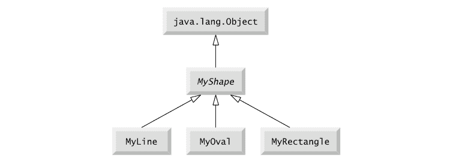

图 10.16 | MyShape 层级。

- 针对单个坐标和颜色的 set 方法，允许程序员独立设置层级中形状的任何部分数据。
- 针对单个坐标和颜色的 get 方法，允许程序员独立检索层级中形状的任何部分数据。
- 抽象方法

```
public abstract void draw(GraphicsContext gc);
```


程序将调用此方法来告诉 `MyShape` 在屏幕上绘制自己。
为了确保适当的封装，`MyShape` 类中的所有数据必须是私有的。这需要声明 set 和 get 方法来操作数据。`MyLine` 类应该提供一个无参数构造函数和一个带有坐标和笔触颜色参数的构造函数。`MyOval` 和 `MyRectangle` 类应该提供用于坐标、笔触颜色、填充颜色以及判断形状是否填充的无参数构造函数。无参数构造函数引用 `MyShape`，除了设置默认值外，如果默认是未填充形状，则将形状的填充标记设置为 false。

如果你知道屏幕上的两个点，就可以绘制直线和矩形。直线需要 `x1`、`x2` 和 `y2` 坐标。如果椭圆和矩形有相同的坐标 (x1, x2 和 y2)，你可以使用四个参数来绘图。每个需要左上 x 坐标（两个 x 值中的较者）、左上 y 坐标（两个 y 值中的较者）、宽度（两个 x 坐标差的绝对值）和高度（两个 y 坐标差的绝对值）。

程序中不应该有 `MyShape` 变量——只有包含 `MyLine`、`MyOval` 和 `MyRectangle` 的 `MyShape` 对象。程序应该生成随机形状并存储在 `ArrayList<MyShape>` 中。在绘图时，遍历 ArrayList 并多态地调用每个形状的 draw 方法。允许用户指定要生成的形状数量。创建形状时，程序将生成并显示数量。使用随机数选择创建哪种形状，并设置该形状坐标、笔触颜色，以及对于矩形和椭圆，是否填充及其填充颜色。

# 10.2（绘图应用程序修改）
在前面的练习中，你创建了一个 MyShape 层级，其中 `MyLine`、`MyOval` 和 `Rectangle` 直接继承 `MyShape`。注意 `MyOval` 和 `MyRectangle` 类之间的相似之处。重新设计并实现代码，将共同特征“提取”到抽象类 `MyBoundedShape` 中以产生图 10.17 所示的层级。`MyBoundedShape` 类应该声明两个与 `MyShape` 类类似的构造函数，但增加了一个指定形状的参数。

填充。`MyBoundedShape` 应该还要声明 get 和 set 方法来操作 Filled 标记和填充颜色，以及用于计算左上 x 坐标、左上 y 坐标、宽度和高度的方法。请记住，绘制椭圆或矩形所需的值可以从两个 (x, y) 坐标计算出来。如果设计得当，`MyOval` 和 `MyRectangle` 类每个将有两个构造函数和一个 draw 方法。

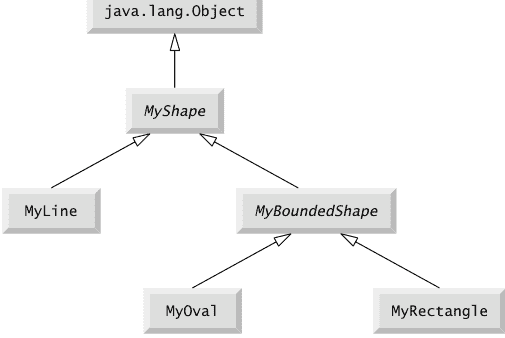

**图 10.17** | 带有 MyBoundedShape 的 MyShape 层次结构。

## 10.15 总结

本章介绍了多态——即在类层次结构中处理具有相同父类的对象的的能力，就像它们都是该子类对象一样被处理。我们讨论了多态如何使系统具有扩展性和可维护性，然后演示了如何使用重写的方法来实现多态行为。我们引入了抽象类，它允许你提供一个适当的子类，其他类可以从其继承。你学到了抽象类可以声明抽象方法，每个子类必须实现这些方法才能成为具体类，并且程序可以使用抽象类的变量来以多态方式调用子类对抽象方法的实现。我们学习了如何在执行时确定对象的类型。我们解释了 final 方法和类的概念。本章还讨论了通过声明和实现接口，作为让可能不同的类实现公共功能的方法，使得这些类的对象能够以多态方式进行处理。

我们引入了 Java SE 8 中的接口增强——默认方法和静态方法，以及 Java SE 9 中的私有方法。接下，我们讨论了私有构造函数的用途。最后，我们讨论了面向接口编程与面向实现编程的区别，以及如何使用 `CompensationModel` 接口重新实现 Employee 层次结构。

你现在应该熟悉类、对象、封装、继承、接口和多态——这些都是面向对象编程最基本的方面。

在下一章中，你将学习异常，它有助于处理程序执行期间的错误。异常处理可以使程序变得更加健壮。

## 总结

### 10.1 节 引言 (第 418 页)
- 多态 (第 418 页) 允许我们编写处理相同子类对象的程序，就像它们都是父类对象一样；这可以简化编程。
- 通过多态，我们可以设计并实现易于扩展的系统。程序中必须修改以适应新类的部分，是那些需要对你添加到层次结构中的新类具有直接知识的部分。

### 10.3 节 演示多态行为
- 当编译器遇到通过变量进行的方法时，它通过检查变量的类类型来确定该方法是否可以被调用。如果类包含适当的方法声明（或继承了它），则进行该调用。在执行时，变量的类型决定了实际使用的方法。

### 10.4 节 抽象类与方法
- 抽象类 (第 425 页) 不能用于实例化对象，因为它们是不完整的。
- 抽象类的主要目的是提供一个抽象父类，其他类可以从其继承并共享共同的设计。
- 可用于实例化对象的类是具体类 (第 424 页)。它们为其声明的每个方法提供了实现（某些实现是继承来的）。
- 程序员经常编写只使用抽象父类 (第 424 页)的代码，以减少代码对子类类型的依赖。
- 抽象类有时包含一级或多个抽象方法 (第 424 页)。
- 抽象方法不提供实现。
- 包含抽象方法的类必须声明为抽象类 (第 424 页)。每个具体子类都必须为每个子类抽象方法提供实现。
- 构造函数和静态方法不能声明为抽象的。
- 抽象父类变量可以持有任何派自该父类的具体类对象的引用。程序通常使用此类变量以多态方式操作子类对象。
- 多态对于实现分层软件系统特别有效。

### 10.5 节 案例研究：使用多态的工资单系统
- 层次结构设计可以通过在父类中包含抽象方法，要求子类提供适当的方法实现。
- 大多数调用在执行时根据所处理对象的类型进行解析。这一过程被称为动态绑定 (第 438 页) 或晚绑定。
- 父类变量仅用于调用在父类中声明的方法。
- 运算符 `instanceof` (第 439 页) 确定对象是否与特定类型具有 is-a 关系。
- Java 中的每个对象都知道自己的类，并通过 `Object getClass` (第 439 页) 访问它，该方法返回 `Class` 类型（`java.lang` 包）的对象。
- is-a 关系仅适用于子类及其父类之间，反之则不然。

### 10.6 节 子类与子类变量之间的允许赋值
- 在没有显式类型转换的情况下，不允许将子类引用赋值给子类变量。

### 10.7 节 final 方法与类
- 声明为 `final` (第 441 页)的方法不能在子类中重写。
- 声明为私有的方法是 `final` 的，因为你不能在子类中重写它们。
- 静态方法隐含是 `final` 的。
- `final` 方法的声明永远不会改变，因此所有子类都使用相同的实现，对 `final` 方法的调用在编译时解析——这就是静态绑定 (第 441 页)。
- 编译器可以通过删除对 `final` 方法的调用并内联其代码来优化程序。
- 声明为 `final` (第 441 页) 的类不能被扩展。
- `final` 类中的所有方法隐含是 `final` 的。

### 10.8 节 从构造函数中调用方法的问题的深度解释
- 如果构造函数和 set 方法对实例变量执行相同的验证，且验证代码很短，你可以在构造函数和 set 方法中重复它。
- 对于验证，你可以定义一个静态方法。

### 10.9 节 创建和使用接口
- 接口 (第 442 页) 规定了允许哪些操作，但不规定如何执行。
- Java 接口定义了一组可以在对象上调用的方法。
- 接口声明以关键字 `interface` (第 443 页) 开始。
- 接口中所有声明的方法隐含是抽象的，所有字段隐含是 `public`、`static` 且 `final` 的。
- 要使用接口，具体类必须指定它实现了 (第 443 页) 某个接口，并按照接口声明中指定的签名声明每个接口方法。没有实现接口所有抽象方法的类必须声明为抽象类。
- 实现接口就像与编译器签署一份合同，声明“我将声明接口指定的所有抽象方法，或者我将我的类声明为抽象类”。
- 接口通常用于不同的（即不相关的）类需要共享公共方法和常量的情况。这允许无关类的对象能够以多态方式进行处理。
- 你可以创建一个描述所需功能的接口，然后在任何需要它的类中实现该接口。
- 在没有默认实现的地方，接口通常代替抽象类——即没有没有实例变量也没有默认实现。
- 与抽象类一样，接口通常是 `public` 类型；它们通常声明在与接口同名且以 `.java` 结尾的文件中。
- Java 不允许子类继承自多个父类，但它允许一个类继承一个父类和多个接口。
- 实现多个接口的类的所有对象与每个实现的接口类型都具有 is-a 关系。
- 接口可以声明常量。这些常量隐含是 `public`、`static` 且 `final` 的。

### 10.10 节 SE 8 接口增强
- 在 Java SE 8 中，接口可以声明默认方法（default methods）——即具有具体实现的公共方法，这些方法指定了如何执行操作。
- 当类实现接口时，如果该类没有重写该方法，则类将接收接口的默认具体实现。
- 要在接口中声明默认方法，只需在方法的返回类型之前放置 `default` 关键字，并提供完整的方法体即可。
- 当你使用默认方法增强接口时——任何实现原始接口的类都不会被破坏——它们将直接接收默认实现。
- 通过默认方法，你可以在接口（而不是抽象类）中声明通用方法的实现，这为你在设计类时提供了更大的灵活性。
- 从 SE 8 开始，接口可以包含公共静态方法（public static methods）。
- 从 SE 8 开始，任何仅包含一个方法的接口被称为函数式接口（functional interface）。Java API 中有许多这样的接口。
- 函数式接口被广泛用于 Java SE 8 的 lambda 能力。正如你将看到的，lambda 提供了实现函数式接口的简写符号。

### 10.11 Java SE 9 私有接口方法
- 从 SE 9 开始，你可以通过私有接口实例方法和静态方法在接口中声明辅助方法。

### 10.12 私有构造方法
- 你可以通过将类的构造方法设置为私有，防止客户端代码创建该类的对象。
- 你可以使用委托构造方法（delegating constructors）来调用包含共享初始化代码的私有构造方法。
- 你可以使用私有构造方法强制客户端代码使用工厂方法来创建和初始化对象。

### 10.13 面向接口而非实现编程
- 通过接口继承，类实现一个描述各种抽象方法的接口，新类可能会继承某些方法的实现（这在 SE 8 的接口中是被允许的），但没有实例变量。
- 接口可以扩展一个或多个接口。
- 实现继承主要用于声明具有许多相同实例变量和方法实现的密切类。
- 使用实现继承声明的类是紧耦合的。父类的更改会直接影响所有子类。
- 实现继承的缺点是类之间的紧密耦合使得修改层级结构变得困难。
- 接口继承通常比实现继承需要更多工作，因为你必须提供接口抽象方法的实现——即使这些实现在类之间是相似或相同的。
- 接口继承通过消除类与类之间的紧密耦合为你提供了额外的灵活性。当你使用接口类型的变量时，你可以将其赋值为任何直接或间接实现了该接口的对象。
- Java SE 8 和 Java SE 9 的接口增强使得使用接口进行编程适用于几乎所有以前你会使用抽象类的场景。

## 自测习题

### 10.1 为下列每个陈述的空空：
a) 如果一个类包含至少一个抽象方法，它就是一个(n) ________ 类。
b) 可以实例化对象的类被称为 ________ 类。
c) ________ 涉及使用父类变量来调用父类对象和子类对象上的方法，使你能够“在通用层面进行编程”。
d) 既不是接口方法也没有提供实现的方法必须使用关键字 ________ 声明。
e) 将存储在父类中的引用转换为子类类型被称为 ________。

### 10.2 说明下列陈述是 true还是错误的。如果是错误的，请解释原因。
a) 抽象类中的所有方法必须声明为抽象方法。
b) 不允许通过子类变量调用仅限子类的方法。
c) 如果子类声明了一个抽象方法，则子类必须实现该方法。
d) 实现接口的类的对象可以被视为该接口类型的对象。

### 10.3 Java SE 8 和 Java SE 9（接口）为下列每个陈述的填空：
a) 在 Java SE 8 中，接口可以声明 ________，即具有具体实现的公共方法，指定了如何执行操作。
b) 从 Java SE 8 开始，接口可以包含 ________ 辅助方法。
c) 从 Java SE 8 开始，任何仅包含一个方法的接口被称为一个(n) ________。
d) 从 Java SE 9 开始，任何接口都可以包含 ________ 和静态方法。

## 自测习题答案

- 10.1 a) abstract. b) concrete. c) Polymorphism. d) abstract. e) downcasting.
- 10.2 a) False. 抽象类可以包含带有实现的方法和抽象方法。 b) False. 不允许使用父类变量调用仅限子类的方法。 c) False. 具体的子类必须实现该方法。 d) True.
- 10.3 a) default. b) static. c) functional interface. d) private.

## 习题

### 10.4
多态的一种实例是重载（overloading）。讨论重载如何允许你编写具有相同名称但实现不同功能的通用方法。

### 10.5
解释你如何创建一个抽象的编码器/解码器，作为 jpeg 和 ppeg 等特定编码器的父类。列出一些方法。

### 10.6
举一个多态使用的不当例子。

### 10.7
讨论将父类和子类引用赋值给父类和子类类型变量的三种方法。

### 10.8
比较并对比抽象类和接口。你为什么要使用抽象类？为什么要使用接口？

### 10.9 (Java SE 8)
解释默认方法如何让你向接口添加新方法而不破坏实现该接口的类。

### 10.10 (Java SE 8)
什么是函数式接口？

### 10.11 (Java SE 8)
在接口中添加静态方法是有用的吗？

### 10.12 (Java SE 9)
在接口中添加私有方法是有用的吗？

### 10.13 (工资系统修改)
修改图 10.4-10.9 的工资系统，在 `Employee` 类中包含私有实例变量 `birthday`。使用 `Date` 类表示员工的生日。创建一个 `Employee` 变量数组来存储引用。在循环中计算每个月的工资。

### 10.14 (项目：形状层级)
实现图 9.3 所示的 Shape 层级。每个 `TwoDimensionalShape` 应该有一个计算面积的方法 `getArea()`。`ThreeDimensionalShape` 应该有计算面积和体积的方法。创建一个程序，使用层级中每个具体类的 Shape 数组。此外，在处理数组中所有形状的循环中，判断每个形状是 `TwoDimensionalShape` 还是 `ThreeDimensionalShape`。如果是 `ThreeDimensionalShape`，显示其面积和体积。

### 10.15 (工资系统修改)
修改图 10.4-10.9 的工资系统，包含一个额外的子类 `PieceWorker`，代表一个根据生产数量支付工资的员工。`PieceWorker` 包含实例变量 `wage`（存储单件工资）和 `pieces`（存储生产数量）。通过将生产数量乘以工资来提供 `earnings` 的具体实现。创建一个 `Employee` 变量数组来存储引用。显示其字符串表示和收益。

### 10.16 (应付款系统修改)
在此练习中，我们修改图 10.11-10.14 的应付款系统，以包含工资应用的完整功能。创建两个 `Invoice` 对象，但现在处理四个子类中的每个对象。如果当前对象被处理为 `BasePlusCommissionEmployee`，应用程序将 `BasePlusCommissionEmployee` 的工资增加 10%。最后输出每个对象的支付金额。完成以下步骤以创建新版本：
a) 修改 `HourlyEmployee`（图 10.7），将其放入 `Payable` 层级中，作为 `Employee`（图 10.13）的子类并实现 `Payable`。*注意：将每个类中的方法 earnings 重命名为 `getPaymentAmount`，以满足从接口 继承的要求。*
b) 修改 `BasePlusCommissionEmployee`（图 10.8），扩展 (a) 部分创建的 `Employee` 类版本。
c) 修改 `PayableInterface`（图 10.14），以多态方式处理两个发票、一个 `SalariedEmployee`、一个 `HourlyEmployee` 和一个 `BasePlusCommissionEmployee`。首先输出每个 `Payable` 对象的字符串表示。接下来，如果对象是 `BasePlusCommissionEmployee`，则将其基础余额增加 10%。最后输出每个 `Payable` 对象的支付金额。

### 10.17 (推荐项目：组合与继承的结合)
练习9.16要求你重构第9章的 `EmployeeBaseEmployee` 继承层次结构，创建一个 `Employee` 类，其中每个 `Employee` 有一个不同的 `CompensationObject`。在你的练习中，尝试将 `Compensation` 类定义为接口，并提供一个返回数字和 double 类型的公共抽象方法。然后创建以下实现 `CompensationModel` 的类：
a) `SaCompensationModel`——适用于按固定周薪支付工资的员工，该类应包含一个 `weeklySalary` 实例变量，并实现 `earnings` 方法以返回 `weeklySalary`。
b) `HourlyCompensationModel`——适用于按小时计薪且每周工作40小时以上的所有小时均支付加班费的员工，该类应包含 `wage` 和 `hours` 实例变量，并根据工作小时实现 `earnings`（参见图10.6中 `HourlyEmployee` 的 `earnings` 方法）。
c) `CommissionCompensationModel`——适用于按佣金计薪的员工，该类应包含 `grossSales` 和 `rate` 实例变量，并实现 `earnings` 方法返回 `grossSales*commissionRate`。
d) `BasePlusCompensationModel`——适用于按底薪加佣金支付工资的员工，该类应包含 `grossSales`、`commission` 和 `baseSalary` 实例变量，并实现 `earnings` 返回 `baseSalary+grossSales*commissionRate`。

在你的测试应用程序中，使用上述的每个 `CompensationModel` 创建 `Employee` 对象，然后解释 `Employee` 的 `earnings`。接下来，动态更改每个 `Employee` 的 `CompensationModel` 并重新显示 `Employee` 的 `earnings`。

### 10.18 (推荐项目：实现 Payable 接口)
修改练习10.17中的 `Employee` 类，使其实现图10.11中的 `Payable` 接口。将图10.14应用程序中的 `Salaried-Employee` 对象替换为练习10.17中的 `Employee` 对象，并演示如何多态地处理 `Employee` 和 `Invoice` 对象。

## 产生影响

### 10.19 (碳足迹接口：多态)
使用本章所学的接口，你可以为可能迥然不同的类指定行为。全球政府和公司日益关注由于燃烧各种燃料供热、车辆燃烧燃料和发电产生的碳足迹（每年向大气中排放二氧化碳量）。许多科学家将全球变暖现象归咎于这些温室气体。创建三个类，每个类包含一些特定的属性和行为，它们与其他类之间没有共同点。我们将它们类为 `Building`、`Car` 和 `Bicycle`。实现一个带有 `getCarbonFootprint` 方法的接口 `CarbonFootprint`。你的每个类都实现该接口，使其 `getCarbonFootprint` 方法能够计算该类的碳足迹（查看一些解释如何计算碳足迹的网站）。编写一个应用程序创建每个类的对象，将这些对象的引用放入 `ArrayList<CarbonFootprint>` 中，然后遍历数组，多态地调用每个对象的 `getCarbonFootprint` 方法。对于每个对象，打印标识信息和碳足迹。

> 4. 我们咨询了 Oracle Java 语言架构师 Brian Goetz，由他建议我们在本次练习中使用的类架构。

# 异常处理：深度观察

## 目标

在本章中，你将：
- 学习为什么异常处理是响应运行时问题的有效机制。
- 使用 `try` 块来界定可能发生异常的代码。
- 使用 `throw` 来指示问题。
- 使用 `catch` 块来指定异常处理程序。
- 学习何时使用异常处理。
- 理解异常类层次结构。
- 使用 `finally` 块释放资源。
- 通过捕获一个异常并抛出另一个异常来形成异常链。
- 创建自定义异常。
- 使用调试功能 `assert` 来声明方法中某个特定点应为真的的条件。
- 学习 `try-with-resources` 如何在 `try` 块终止时自动释放资源。


## 第二章 异常处理：深度观察

| 11.1 引言 | 11.7 栈回溯与从异常中获取信息 |
| :--- | :--- |
| 11.2 示例：除以零异常处理 | 11.8 链式异常 |
| 11.3 示例：处理 ArithmeticExceptions 和 InputMismatchExceptions | 11.9 声明新异常类型 |
| 11.4 何时使用异常处理 | 11.10 前置条件和后置条件 |
| 11.5 Java 异常层次结构 | 11.11 断言 |
| 11.6 finally 块 | 11.12 try-with-Resources：自动资源释放 |
| | 11.13 总结 |
| 总结 | 自测练习题 | 自测练习题答案 | 练习 |

## 11.1 引言

如你从第7-8章了解的，异常识别了程序执行期间出现的问题。异常处理允许应用程序解决（或处理）异常。在某些情况下，如果没有遇到问题，程序可以继续执行。本章介绍的功能可以帮助你创建*健壮*且*容错*的程序，以处理问题并继续执行或*优雅地终止*。¹

首先，我们处理方法在失败将整数除以零时发生的异常。我们讨论了何时使用异常处理，并展示了异常处理层次结构的一部分。正如你所看到的，只有 `Throwable` 的子类才能用于异常处理。我们引入了策略的 `finally` 块。

> **软件工程观察 11.1**
> 在工业界，你可能会发现公司有严格的设计、编码、测试和维护标准。这些标准在公司之间不同。

## 11.2 示例：除以零异常处理

| 章节 | 使用的异常 |
| :--- | :--- |
| 第7章 | `ArrayIndexOutOfBoundsException` |
| 第8-10章 | `IllegalArgumentException` |
| 第11章 | `ArithmeticException`, `InputMismatchException` |
| 第15章 | `SecurityException`, `FileNotFoundException`, `IOException`, `ClassNotFoundException`, `IllegalStateException`, `NoSuchElementException` |
| 第16章 | `ClassCastException`, `UnsupportedOperationException`, `NullPointerException`, 自定义异常 |
| 第20章 | `ClassCastException`, 自定义异常 |
| 第21章 | `IllegalArgumentException`, 自定义异常 |
| 第23章 | `InterruptedException`, `IllegalMonitorStateException`, `ExecutionException`, `CancellationException` |
| 第24章 | `SQLException`, `IllegalStateException`, `PatternSyntaxException` |
| 第28章 | `MalformedURLException`, `EOFException`, `SocketException`, `InterruptedException`, `UnknownHostException` |
| 第31章 | `SQLException` |

**图 11.1** 本书中将出现的各种异常类型

首先，我们演示当不使用异常处理的应用程序出现错误时会发生什么。图11.2 提示用户输入两个整数并将传递给 `quotient` 方法，该方法计算整数商并返回结果。在这个示例中，你会看到异常是由检测到问题且无法处理的方法抛出的（即异常发生）。


// Fig. 11.2: DivideByZeroExceptionHandling.java

// 无异常处理的整数除法。

import java.util.Scanner;

public class DivideByZeroExceptionHandling {

    // 当发生除零时抛出异常

    public static int quotient(int numerator, int denominator) {

        return numerator / denominator; // 可能除零

    }

    public static void main(String[] args) {

        Scanner scanner = new Scanner(System.in);

        System.out.print("Please enter an integer numerator: ");

        int numerator = scanner.nextInt();

    }

}

```

**图 11.2** 无异常处理的整数除法。（第一部分，共 2 部分）。

## 468 第二章 异常处理：深度解析

| 行号 | 代码 |
| :--- | :--- |
| 16 | `System.out.print("Please enter an integer denominator: ");` |
| 17 | `int denominator = scanner.nextInt();` |
| 18 | |
| 19 | `int result = quotient(numerator, denominator);` |
| 20 | `System.out.printf(` |
| 21 | `"%nResult: %d / %d = %d\n", numerator, denominator, result);` |
| 22 | `}` |
| 23 | `}` |

**输出示例 1：**
```
请输入整数分母: 100
请输入一个整数分母: 7
结果: 100 / 7 = 14
```

**输出示例 2：**
```
请输入整数分母: 100
请输入一个整数分母: 0
Exception in thread "main" java.lang.ArithmeticException: / by zero
	at DivideByZeroExceptionHandling.quotient(DivideByZeroExceptionHandling.java:8)
	at DivideByZeroExceptionHandling.main(DivideByZeroExceptionHandling.java:19)
```

**输出示例 3：**
```
请输入整数分母: 100
请输入一个整数分母: hello
Exception in thread "main" java.util.InputMismatchException
	at java.util.Scanner.throwFor(Unknown Source)
	at java.util.Scanner.nextInt(Unknown Source)
	at java.util.Scanner.nextInt(Unknown Source)
	at DivideByZeroNoExceptionHandling.main(DivideByZeroNoExceptionHandling.java:17)
```

**图 11.2** 无异常处理的整数除法（2部分中的2部分）

## 堆栈跟踪 (Stack Trace)

图 11.2 中的第一个示例执行显示成功。在第二次执行中，用户输入值 0 作为分母。针对这一无效输入，显示了多行信息。这些信息被称为堆栈跟踪（`stack trace`），它包含了一个描述性消息，其中异常名称（`java.lang.ArithmeticException`）以及异常发生时的方法调用堆栈（即调用链）。堆栈跟踪包含了按方法列出的导致异常的执行路径。这有助于你调试程序。如果没有发生问题，你可以通过调用 `Thread.dumpStack()` 来查看堆栈跟踪。

## ArithmeticException 的堆栈跟踪

第一行指定了发生了 `ArithmeticException`。接下来的异常名称（`/ by zero`）表示这是由于尝试除以零导致的。Java 不允许在整数算术中进行除以零的操作。当这种情况发生时，Java 会抛出一个 `ArithmeticException`。`ArithmeticException` 可能源于许多不同的问题。

从堆栈跟踪的最后一行开始，我们看到异常在 `main` 方法的第 19 行被检测到。堆栈跟踪的每行都包含类名和方法（例如 `DivideByZeroExceptionHandling.main`），以及文件名和行号（例如 `DivideByZeroExceptionHandling.java:19`）。向上移动堆栈跟踪，我们看到异常发生在第 8 行，方法为 `quotient`。链的最顶端指示了抛出点——即异常发生的初始点。该异常点位于 `quotient` 方法的第 8 行。

### 关于浮点数运算的旁注

Java 允许对浮点值进行除以零的操作。此类计算结果表示为正无穷或负无穷，即 `"Infinity"` 或 `"-Infinity"`。如果你将 0.0 除以 0.0，结果是 NaN（不是数字），表示为显示为 `"NaN"` 的浮点值。如果你需要将浮点值与 NaN 进行比较，请使用 `Float`（针对 `float` 值）或 `Double`（针对 `double` 值）的 `isNaN` 方法。`Float` 和 `Double` 类位于 `java.lang` 包中。

## InputMismatchException 的堆栈跟踪

在第三次执行中，用户输入字符串 `"hello"` 作为分母。再次注意到显示了堆栈跟踪。这告诉我们发生了 `InputMismatchException`（位于 `java.util` 包）。我们之前的示例假设用户会犯错并输入非整数值。当 `Scanner` 方法 `nextInt` 接收到的不表示有效整数的字符串时，就会发生 `InputMismatchException`。从堆栈跟踪的末尾开始，我们看到异常在 `main` 方法的第 17 行被检测到。向上移动堆栈跟踪，我们看到异常发生在 `nextInt` 方法中。注意，在文件名和行号的位置，提供的是文本 `Unknown Source`。这意味着所谓的调试符号（提供方法所在类的文件名和行号信息）对 JVM 是不可用的——这在 Java API 类中非常常见。许多 IDE 都可以访问 Java API 源代码，并在堆栈跟踪中显示文件名和行号。

## 程序终止

在图 11.2 的示例执行中，当发生异常并显示堆栈跟踪时，程序也会退出。这在 Java 中并不总是如此。有时即使发生了异常并打印了堆栈跟踪，程序仍可能继续运行。在这种情况下，应用程序可能会产生意外的结果。例如，图形用户界面（GUI）应用程序通常会继续执行。在图 11.2 中，`main` 方法中检测到了异常。在下一个示例中，我们将看到如何处理这些异常，以便让程序能够恢复正常完成。

## 11.3 示例：处理 ArithmeticExceptions 和 InputMismatchExceptions

图 11.3 中的应用程序基于图 11.2，使用异常处理来处理任何产生的 `ArithmeticException` 和 `InputMismatchException`。此版本的应用程序提示用户输入两个整数，并将它们传递给 `quotient`，由其计算结果。应用程序使用了异常处理，因此如果用户出错，程序可以捕获并处理它，允许用户重新输入输入。

```java
// DivideByZeroExceptionHandling.java

import java.util.Scanner;
import java.lang.ArithmeticException;

public class DivideByZeroExceptionHandling {

    public static void main(String[] args) {

        Scanner scanner = new Scanner(System.in);

        boolean continueLoop = true;

        do {

            try {

                System.out.print("Please enter an integer numerator: ");

                int numerator = scanner.nextInt();

                System.out.print("Please enter an integer denominator: ");

                int denominator = scanner.nextInt();

                int result = quotient(numerator, denominator);

                System.out.printf("%nResult: %d / %d = %d\n", numerator, denominator, result);

                continueLoop = false;

            } catch (ArithmeticException arithmeticException) {

                System.err.printf("%s\n", arithmeticException);

                System.err.println("Zero is an invalid denominator. Please try again.");

            }

        } while (continueLoop);

    }

    public static int quotient(int numerator, int denominator) throws ArithmeticException {

        return numerator / denominator;

    }

}
```

```java
// DivideByZeroNoExceptionHandling.java

import java.util.Scanner;
import java.util.InputMismatchException;

public class DivideByZeroNoExceptionHandling {

    public static void main(String[] args) {

        Scanner scanner = new Scanner(System.in);

        try {

            System.out.print("Please enter an integer numerator: ");

            int numerator = scanner.nextInt();

            System.out.print("Please enter an integer denominator: ");

            int denominator = scanner.nextInt();

            int result = quotient(numerator, denominator);

            System.out.printf("%nResult: %d / %d = %d\n", numerator, denominator, result);

        } catch (InputMismatchException inputMismatchException) {

            System.err.printf("%s\n", inputMismatchException);

            System.err.println("You must enter integers. Please try again.");

        }

    }

    public static int quotient(int numerator, int denominator) {

        return numerator / denominator;

    }

}
```

**图 11.3** 处理 ArithmeticExceptions 和 InputMismatchExceptions。（第一部分中的第一部分）

## 472 第二章 异常处理：深入观察

跟在 `try` 关键字之后的代码如下：从键盘读取整数的语句（第 21 行和第 23 行）使用 `nextInt` 方法读取 `int` 值。如果读取的值不是整数，`nextInt` 方法将抛出 `InputMismatchException`。

可能导致 `ArithmeticException` 的除法操作并没有在 `try` 块中执行。相反，对 `quotient` 方法的调用（第 25 行）触发了尝试除法的代码（第 11 行）；当分母为 0 时，JVM 会抛出一个 `ArithmeticException` 对象。


### 软件工程观察 11.2
异常可能会通过 `try` 块中显式提到的代码、由 `try` 块代码发起的深层嵌套方法调用，或者 Java 虚拟机执行字节码时出现。

## 捕获异常

此示例中的 `try` 块后面有两个 `catch` 块——一个处理 `InputMismatchException`（第 30–36 行），另一个处理 `ArithmeticException`（第 37–41 行）。`catch` 块（也称为 catch 子句或异常处理器）捕获（即接收）并处理异常。`catch` 块以 `catch` 关键字开头，后跟着括号内的一个参数（异常参数，稍后将讨论）以及用大括号括起来的代码块。

`try` 块后面必须紧跟至少一个 `catch` 块或 `finally` 块（第 11.6 节讨论）。每个 `catch` 块在括号中指定一个异常参数，用于标识异常处理器。当 `try` 块中发生异常时，执行的 `catch` 块是第一个与发生异常类型匹配的块（即 `catch` 块中的类型与抛出的异常类型匹配，或者是该异常类型的直接或间接子类）。异常参数名称允许 `catch` 块与捕获的异常对象进行交互——例如，隐式调用异常的 `toString` 方法（第 32 行和第 38 行），该方法会显示异常的基本信息。我们使用 `System.err`（标准错误流）对象输出错误消息。默认情况下，`System.err` 的打印方法（如 `System.out`）显示在命令提示符中。

第一个 `catch` 块的第 33 行调用了 `Scanner` 的 `nextLine`。如果发生了 `InputMismatchException`，`nextInt` 方法调用从未成功读取用户的数据——因此我们调用 `nextLine` 方法读取该输入。此时我们不对对该输入进行任何操作，因为我们知道它是无效的。每个 `catch` 块都会显示错误消息并要求用户重试。在每个 `catch` 块结束后，都会提示用户输入。我们很快就会深入探讨异常处理中这种控制流是如何工作的。


### 常见编程错误 11.1
在 `try` 块与其相应的 `catch` 块之间放置代码是语法错误。

## 多异常捕获

`try` 块后面跟着几个 `catch` 块来处理不同类型的异常是相对常见的。如果几个 `catch` 块的体相同，你可以使用多异常捕获功能在一个单一 `catch` 处理器中捕获这些异常类型并执行相同的任务。多异常捕获的语法如下：

```
catch (Type1 | Type2 | Type3 e)
```


每个异常之间用竖线（`|`）隔开。之前的代码行表示任何类型（或其子类）都可以在异常处理器中被捕获。多异常捕获中可以捕获任意数量的 `Throwable` 类型。在这种情况下，异常参数是指定类型的共同父类。

## 未捕获的异常

未捕获的异常是指没有匹配的 `catch` 块的异常。你在 11.2 的第二次和第三次输出可以看到未捕获的异常。回想当该示例中发生异常时，应用程序提前终止（显示异常堆栈跟踪）。这并不总是未捕获异常导致的。Java 使用程序执行的“多线程”模型——线程是一个并发单元。一个程序可以有多个线程。如果程序只有一个线程，未捕获的异常将导致程序终止。如果程序有多个线程，未捕获的异常将终止发生异常的线程。在程序中，某些线程可能依赖其他线程，如果其中一个由于未捕获异常而终止，可能会对程序的其余部分产生不利影响。第 23 章讨论了这些问题。

## 异常处理的终止模型

如果在 `try` 块中发生异常（例如由于 11.3 第 23 行代码导致产生 `InputMismatchException`），`try` 块将立即终止，程序控制转移到第一个参数类型与异常类型匹配的 `catch` 块。在 11.3 中，第一个 `catch` 块是 `InputMismatchExceptions`（当输入无效输入时发生），第二个 `catch` 块是 `ArithmeticExceptions`（当尝试除以 0 时发生）。异常处理完毕后，控制不会返回 `try` 点，因为 `try` 块已过期（局部变量已丢失）。控制在最后一个 `catch` 块之后恢复。这被称为异常处理的终止模型，在异常处理完毕后，控制在抛出点之后恢复。

注意，我们根据其类型命名异常参数（`inputMismatchException` 和 `arithmeticException`）。异常处理完毕后，控制在抛出点之后恢复。

## 474 第二章 异常处理：深入观察

与其他任何代码一样，当 `try` 块终止时，局部变量超出范围（并被销毁）。如果局部变量是对对象的引用且没有其他对这些对象的引用，则这些对象将被标记垃圾回收。

## 使用 throws 子句

在 `quotient` 方法中（图 11.3，第 9–12 行），第 10 行被称为 `throws` 子句。它指定了方法可能抛出的异常。我们在应用程序中添加了 `throws` 子句，以指示方法可能会抛出 `ArithmeticException`。某些异常类型（如 `ArithmeticException`）不需要列在 `throws` 子句中。对于这些，方法可以抛出异常。你将在第 11.5 节学习更多。

### 错误预防提示 11.1
> 在程序中使用之前阅读在线文档。文档指定了方法抛出的异常（如果有），并说明了发生此类异常的原因。接下来，阅读指定异常类的在线文档。异常类通常包含发生此类异常的原因。最后，在你的程序中处理这些异常。


当执行第 11 行时，分母为0，JVM 抛出一个 `ArithmeticException` 对象。该对象将被第 37–41 行的 `catch` 块捕获，该块通过隐式调用异常的 `toString` 方法显示异常的基本信息，允许用户重试。

如果分母不为0，`quotient` 方法执行除法并将结果返回到 `try` 块中调用 `quotient` 的点（第 25 行）。第 26–27 行显示计算结果，第 28 行继续循环为 `false`。如果 `try` 块成功完成，程序将跳过 `catch` 块并在第 42 行处失败，方法完成执行。

当 `quotient` 抛出 `ArithmeticException` 时，`quotient` 终止且不返回值，`quotient` 的局部变量超出范围（并被销毁）。如果局部变量是对对象的引用且没有其他对这些对象的引用，则这些对象将被标记垃圾回收。此外，当发生异常时，调用 `quotient` 的 `try` 块会在第 26–28 行执行之前终止。在这里，如果局部变量在异常抛出之前在 `try` 块中创建，这些变量将超出范围。

## 11.4 何时使用异常处理

如果第 21 行或 23 行产生 `InputMismatchException`，`try` 块将终止，并执行第 30–36 行的 `catch` 块。在这种情况下，不会调用方法 `quotient`。然后 `main` 在最后一个 `catch` 块后继续。

## 11.4 何时使用异常处理

异常处理旨在处理同步错误，这些错误发生在语句执行时。我们在本书中看到的常见示例包括：数组索引越界、算术溢出（即超出可表示范围的值）、除以零、无效的方法参数以及线程中断。异常处理并非旨在处理与异步事件相关的问题（例如磁盘 I/O 操作、网络消息回复、鼠标点击和击键输入），这些事件与程序的控制流并行发生且独立于程序控制流。

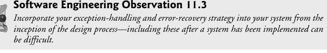

在设计过程之初就将异常处理和错误恢复策略纳入你的系统中——在系统实现后再加入这些可能会非常困难。


异常处理提供了一种单一、统一的技术，用于记录、检测和恢复错误。这有助于从事大型项目的程序员理解彼此的错误处理代码。


各种情况都可以产生异常——某些异常比其他异常更容易恢复。


有时你可以通过先验证数据来防止异常发生。例如，在执行除法之前，你可以确保分母不为零，从而防止在除以零时发生 `ArithmeticException`。

## 11.5 Java 异常层次

所有的 Java 异常都直接或间接继承自 `Exception` 类，形成一个继承层次结构。你可以用自己的异常类来扩展它。

11.4 显示了 `Throwable`（`Object` 的子类）继承层次结构的一部分，它是 `Exception` 类的父类。只有 `Throwable` 有子类：`Exception` 和 `Error`。`Exception` 类及其子类——例如 `RuntimeException`（位于 `java.lang` 包）和 `IOException`（位于 `java.io` 包）代表 Java 程序中发生且可以被应用程序捕获的异常情况。`Error` 类及其子类代表 JVM 中发生的异常情况——应用程序通常无法从 `Error` 中恢复。

## 第二章 异常处理：深度探析

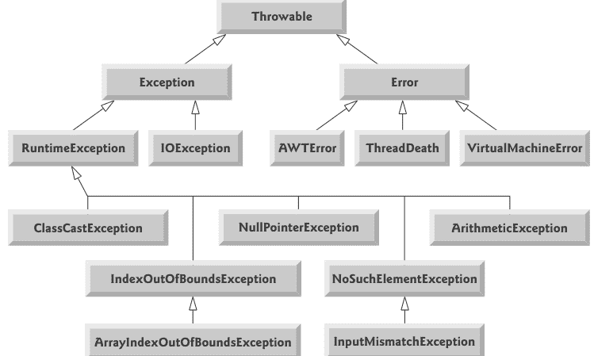

图 11.4 `Throwable` 类继承层次结构的一部分。

Java 异常层次结构包含数百个类。关于 Java 异常类的信息可以在整个 Java API 中找到。你可以在此处查看 `Throwable` 的文档：

```
http://docs.oracle.com/javase/8/docs/api/java/lang/Throwable.html
```

从那里，你可以查看该类的子类，以获取有关 Java 异常和 `Error` 的更多信息。

## 编译异常 vs. 未检查异常

Java 区分了编译异常（checked exceptions）和未检查异常（unchecked exceptions）。这种区分是非常重要的，因为 Java 编译器对编译异常强制执行特殊要求（稍后讨论）。异常的类型决定了它是检查的还是未检查的。

## RuntimeException 是未检查异常

所有 `RuntimeException`（位于 `java.lang` 包）的直接或间接子类异常都是未检查异常。这些通常由程序代码中的缺陷引起。未检查异常的示例包括：

- `ArrayOutOfBoundsException`（在第 6 章中讨论）——你可以通过确保数组索引始终大于等于0且小于数组长度来避免这种情况。
- `ArithmeticException`（如图 11.3 所示）——你可以在执行计算之前检查分母以确定其是否为 0，从而避免除以零时发生 `ArithmeticException`。

## 11.5 Java 异常层次

直接或间接继承自 `Error` 类（图 11.4）的类是未检查的，因为 `Error` 通常是不可恢复的，你的程序不尝试处理它们。例如，`VirtualMachine` 的文档说它们“被抛出表示 Java 虚拟机已损坏或耗尽了继续运行所需的资源”。在此时，你的程序已无能为力。

## 编译异常

所有继承自 `Exception` 但未直接或间接继承自 `RuntimeException` 类的类都被视为编译异常。此类异常通常不受程序控制的条件引起——例如，在文件处理过程中，如果文件不存在，程序无法打开文件。

## 编译器与编译异常

编译器检查每个方法和方法声明，以确定该方法是否抛出了编译异常。如果是，编译器会验证该编译异常是否被捕获或在 `throws` 子句中声明——这被称为“捕获或声明”要求（catch-or-declare requirement）。我们将在接几个示例中展示如何捕获或声明编译异常。回想第 11.3 节，`throws` 子句指定了方法抛出的异常。这些异常并不要求被捕获。为了满足“捕获或声明”要求的一部分，产生异常的代码必须封装在 `try` 块中。如果不满足捕获或声明要求，编译器将产生错误。

### 预防技巧 11.2
将父类异常的 `catch` 块放在子类异常的 `catch` 块之前，将阻止这些子类 `catch` 块的执行。


### 常见错误 11.2
如果你忘记明确测试一个或多个子类类型，单独捕获是错误的。


### 工程观察 11.7
将父类类型的 `catch` 块放在所有子类 `catch` 块之后，可以确保所有子类最终被捕获。


### 工程观察 11.8
编译异常代表了程序通常无法恢复的问题。


## 编译器与未检查异常

与编译异常不同，Java 编译器不对未检查异常强制执行“捕获或声明”要求。虽然编译器不强制执行未检查异常的要求，但在已知的情况下提供适当异常处理。


## 只有第一个匹配 catch 执行

如果多个 `catch` 块匹配特定类型，当发生该类型的异常时，只有第一个匹配 catch 执行。在两个 `catch` 块中捕获相同类型是编译错误。例如，我们可以在 `ArithmeticException` 的 `catch` 块后面跟一个 `Exception` 的 `catch` 块——这将匹配 `ArithmeticException`，但只会执行第一个匹配的 catch。


### 常见错误 11.3
将父类异常的 `catch` 块放在子类异常的 `catch` 块之前，将阻止这些子类 `catch` 块的执行。

### 工程观察 11.9
例如，程序应该处理 `parseInt` 产生的 `NumberFormatException`，`NumberFormatException` 是 `RuntimeException` 的间接子类。


# 11.6 finally 块

获取某些资源的程序会将它们返回给系统，以避免所谓的资源泄漏。在 C 和 C++ 等编程语言中，最常见的资源泄漏是内存泄漏。Java 对程序使用时间较长的内存进行自动垃圾回收，避免了大多数内存泄漏。然而，仍然可能发生其他类型的资源泄漏。例如，在不再需要后没有被正确关闭的文件、数据库连接和网络连接，可能无法供其他程序使用。

## 错误预防提示 11.4

一个微妙的问题是，Java 并没有完全消除内存泄漏。在对某个对象没有任何剩余引用之前，Java 不会对其其进行垃圾回收。如果你错误地保留了对不需要对象的引用，就会发生内存泄漏。

可选的 `finally` 块（有时称为 finally 子句）由 `finally` 关键字以及随其在大括号内的代码组成。如果存在，它被放置在最后一个 `catch` 块之后。如果没有 `catch` 块，则需要 `finally` 块，并紧跟在 `try` 块之后。

## finally 块的执行时

无论相应的 `try` 块是否抛出异常，`finally` 块都会执行。如果 `try` 块通过使用 `return`、`break` 或 `continue` 或者简单地到达右大括号退出，`finally` 块也会执行。`finally` 不执行的唯一情况是通过调用方法 `System.exit()` 使异常提前退出 `try` 块。该方法我们在第 15 章中演示，它会立即终止应用程序。

如果在 `try` 块中发生的异常无法被该块的任何 `catch` 处理器捕获，程序将跳过 `try` 块的剩余部分并进入 `finally` 块。程序将异常传递给下一个 `try` 块——通常在调用方法中——那里相关的 `catch` 块可能会捕获该异常。这一过程可以通过许多层级的 `try` 块发生。此外，异常可能未被捕获（如第 11.3 节所述）。

如果 `catch` 块抛出异常，`finally` 块仍然会执行。然后异常将传递传递给下一个外层的 `try` 块——同样，通常在调用方法中。

## 在 finally 块中释放资源

由于 `finally` 块总是执行，因此它通常包含资源释放代码。假设在 `try` 块中分配了一个资源。如果没有发生异常，`catch` 块将被跳过，控制继续执行 `finally` 块，释放释放资源。然后控制继续执行 `try` 块中 `finally` 之后的第一个语句。如果发生异常，`try` 块将终止。如果程序在相应的 `catch` 块之一捕获了异常，它将处理该异常，`finally` 块释放资源，控制继续执行 `finally` 块之后的第一个语句。如果程序没有捕获该异常，`finally` 块仍然释放资源，并尝试在调用方法中捕获该异常。


# 第二章 异常处理：深度观察

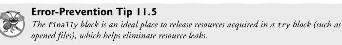

### 错误预防提示 11.5

`finally` 块是释放在 `try` 块中获取的资源（如打开的文件）的理想位置，这有助于消除资源泄漏。


### 性能提示 11.1

始终在资源不再需要的尽早时刻显式释放资源。这使得资源能够尽早重用，从而提高资源利用率和性能。

## 演示 finally 块

图 11.5 展示了即使 `try` 块中没有抛出异常，`finally` 块也会执行。程序包含静态方法（第 5–14 行）、`throwException`（第 17–35 行）和 `doesNotThrow`（第 38–50 行）。方法 `throwException` 和 `doesNotThrow` 被声明为静态，因此 `main` 可以可以直接调用它们，而无需实例化 `Using` 对象。

```java
// 图 11.5: UsingExceptions.java

try...catch...finally 异常处理机制。

public class UsingExceptions {

    public static void main(String[] args) {

        try {

            throwException();

        } catch (Exception exception) { // 由 throwException 抛出

            System.err.println("Exception handled in main");

        }

        doesNotThrowException();

    }

    // 演示 try...catch...finally

    public static void throwException() throws Exception {

        try { // 抛出异常并立即捕获

            System.out.println("Method throwException");

            throw new Exception(); // 生成异常

        } catch (Exception exception) { // 捕获 try 中抛出的异常

            System.err.println("Exception handled in method throwException");

            throw exception; // 重抛以便进一步处理

        }

        // 此处代码将无法到达；会导致编译错误

        finally { 无论 try...catch 发生什么情况都会执行

            System.err.println("Finally executed in throwException");

        }

    }

}
```


**图 11.5** | try...catch...finally 异常处理机制。（第一部分，共两部分。）

# 11.6 finally 块

```java
34      // 此处代码将无法到达；会导致编译错误
35  }

36

37  // 演示未发生异常时的 finally
38  public static void doesNotThrowException() {
39      try { // try 块未抛出异常
40          System.out.println("Method doesNotThrow");
41      catch (Exception exception) { // 不执行
42          System.err.println(exception);
43      }
44      finally { // 无论 try...catch 发生什么情况都会执行
45          System.err.println("Finally executed in doesNotThrow");
46      }
47      System.out.println("End of method doesNotThrow");
48 }
```

```
Method throwException
Exception handled in throwException
Finally executed in throwException
Exception handled in main
Method doesNotThrow
Finally executed in doesNotThrow
End of method doesNotThrow
```

**11.5** | try...catch...finally 异常处理（第二部分。）`System.out` 和 `System.err` 是流。`System.out`（称为**标准输出流**）显示程序的输出，`System.err`（称为**标准错误流**）显示程序的输出。这些流的输出可以重定向（例如，重定向到命令行提示符或到文件）。使用不同的流可以让你轻松地将错误消息分开。例如，`System.err` 的输出可以发送到日志文件，而 `System.out` 的输出可以在屏幕上显示。为了简单起见，本章不会重定向 `System.err` 的输出，而是将其显示在命令行提示符。你将学习更多关于输入/输出流的内容。

## 使用 throw 抛出异常

方法 `main` 执行，进入其 `try` 块并立即调用 `throwException`（第 7 行）。方法 `throwException` 抛出一个 `Exception`。第 20 行的语句被称为 throw 语句——发生了异常。到为止，你只捕获了方法抛出的异常。你可以自己使用 `throw` 语句抛出异常。就像 API 方法一样，这指示客户端发生了错误。`throw` 语句指定一个要抛出的对象。`throw` 的操作数可以是任何自 `Throwable` 的类。

### 软件工程观察 11.1

在任何 `Throwable` 对象上调用 `toString` 时，其结果字符串包含了传递给构造器的描述字符串，如果没有提供字符串，则是类名。

### 软件工程观察 11.2

抛出的异常可能不包含发生问题的信息。在这种情况下，仅知道发生了特定类型的异常可能足以让处理器处理该问题。

### 软件工程观察 11.3

从构造器抛出异常指示构造器参数是有效的——这防止了对象以无效状态创建。

## 重抛异常

图 11.5 的第 25 行重抛了异常。接收异常后，它决定无法处理该异常或可以部分处理它。重抛异常（或其部分）到与外层 `try` 语句相关的另一个 `catch` 块。使用 `throw` 关键字重抛异常，随后是对已捕获异常的引用。无法从 `finally` 块中重抛，因为 `catch` 块中的异常参数（局部变量）已不存在。

当错误发生时，下一个外层块检测到重抛的异常，该块的 `catch` 块尝试处理它。在这种情况下，下一个外层 `catch` 块位于 `main` 方法的第 6–8 行。在重抛的异常被处理后，`finally` 块（第 30–32 行）执行。然后 `main` 检测到 `try` 块中重抛的异常，并在 `catch` 块（第 9–11 行）中处理它。接下来 `main` 调用 `doThrowException`（第 13 行）。如果在 `doThrowException` 的 `catch` 块（第 39–41 行）没有抛出异常，程序将跳过 `catch` 块（第 42–44 行），但 `finally` 块（第 45–47 行）仍然执行。控制继续到 `finally` 块之后的语句（第 49 行）。然后控制返回到 `main`，程序终止。

## 常见编程错误 11.4

如果在进入 `finally` 块时异常未被捕获，且 `finally` 块抛出了在 `finally` 块中未被捕获的异常，则第一个异常将丢失，`finally` 块的异常将返回给调用方法。

## 错误预防提示 11.6

避免在 `finally` 块中放置可能抛出异常的代码。如果需要此类代码，请在 `finally` 块内部使用 `try...catch` 启用该代码。

## 常见编程错误 11.5

假设从 `catch` 块抛出的异常会被该 `catch` 块或与同一 `try` 语句相关的任何其他 `catch` 块处理，会导致逻辑错误。


## 11.7 栈回溯与从异常获取信息


### 良好的编程实践 11.1

异常处理将错误处理代码从程序的主逻辑中分离，以提高程序的清晰度。不要在每个可能抛出异常的语句周围都放置 `try...catch...finally`。这会降低可读性。相反，应该在代码的重要部分放置一个 `try` 块，随后跟上处理每个异常的 `catch` 块，最后跟上一个 `finally` 块（如果需要的话）。

## 11.7 栈回溯与从异常获取信息

当异常在特定方法中抛出但未被捕获时，方法调用栈会被“回溯”，并尝试在下一个外层的 `try` 块中捕获该异常。这个过程被称为栈回溯。回溯方法调用栈意味着未捕获异常的方法终止，所有局部变量超出作用范围，控制权返回到最初调用该方法的语句。如果 `try` 块没有包含该语句，或者异常未被捕获，则再次发生栈回溯。图 11.6 展示了栈回溯，`main` 方法中的异常处理器显示了如何获取异常对象中的数据。

```java
// 图 11.6: UsingExceptions.java
// 栈回溯以及从异常对象获取数据。

public class UsingExceptions {

    public static void main(String[] args) {

        try {

            method1();

        }

        catch (Exception exception) { // 获 method1 中抛出的异常

            System.out.printf("%s%n", exception.getMessage());

            exception.printStackTrace();

            // 获取堆栈轨迹信息

            StackTraceElement[] traceElements = exception.getStackTrace();

            System.out.printf("%s%n", exception.getClass().getName());

            System.out.printf("%s\t%s\n", element.getFileName());

            System.out.printf("%s\t%s\n", element.getLineNumber());

            System.out.printf("%s%n", element.getMethodName());

            // 遍历 traceElements 以获取异常描述

            for (StackTraceElement element : traceElements) {

                System.out.printf("%s%n", element.getClassName());

                System.out.printf("%s\t%s\n", element.getFileName());

                System.out.printf("%s\t%s\n", element.getLineNumber());

                System.out.printf("%s%n", element.getMethodName());

            }

        }

    }

}
```

图 11.6 | 栈回溯以及从异常对象获取数据。（2 部分中的第1 部分）

## 第二章 异常处理：深度观察

```java
28 // 调用 method2; 将异常抛回给 main
29 public static void method1() throws Exception {
30     method2();
31 }

32

33 // 调用 method3; 将异常抛回给 method1
34 public static void method2() throws Exception {
35     method3();
36 }

37

38

39 // 将 Exception 抛回给 method2
40 public static void method3() throws Exception {
41     throw new Exception("Exception thrown in method3");
42 }
43 }
```

```
method3 中抛出的异常
java.lang.Exception: Exception thrown in method3
at UsingExceptions.method3(UsingExceptions.java:41)
at UsingExceptions.method2(UsingExceptions.java:36)
at UsingExceptions.method1(UsingExceptions.java:31)
at UsingExceptions.main(UsingExceptions.java:7)
```

| 类 | 行号 | 方法 |
| --- | --- | --- |
| UsingExceptions.UsingExceptions.java | 41 | method3 |
| UsingExceptions.UsingExceptions.java | 36 | method2 |
| UsingExceptions.UsingExceptions.java | 31 | method1 |
| UsingExceptions.UsingExceptions.java | 7 | main |

图 11.6 栈回溯以及从异常对象获取数据。（2 部分中的第 2 部分）

### 栈回溯

在 `main` 中，`try` 块（第 6–8 行）调用 `method1`（定义在第 30–32 行），`method1` 调用 `method2`（定义在第 35–37 行），而 `method2` 调用 `method3`（定义在第 40–42 行）。`method3` 的第 41 行抛出了异常——这就是抛出点。由于 `throw` 语句没有被包含在 `try` 块中，发生了栈回溯——`method3` 在第 41 行终止，并将控制权返回给 `method2` 中调用 `method3` 的语句（即第 36 行）。由于没有 `try` 块包含第 36 行，再次发生栈回溯——`method2` 在第 36 行终止并将控制权返回给 `method1` 中调用 `method2` 的语句（即第 31 行）。由于没有 `try` 块包含第 31 行，再次发生栈回溯——`method1` 在第 31 行终止并将控制权返回给 `main` 中的语句。第 6–8 行的 `try` 块包含了该语句。异常尚未被处理，因此 `try` 块终止，第一个 `catch` 块（第 9–26 行）捕获并处理了异常。如果没有匹配的 `catch` 块，且在每个抛出异常的方法中都没有声明异常，则会发生编译错误——`main` 没有 `throws` 子句，因为 `main` 捕获了该异常。记住，这并不总是如此——对于未检查异常，程序可以运行。

## 11.7 栈回溯与从异常获取信息

### 从异常对象获取数据

所有异常都继承自 `Throwable`，它有一个 `printStackTrace` 方法，可以向标准错误输出堆栈轨迹（参见第 11.2 节）。这对于教学和调试通常很有帮助。`Throwable` 还提供了一个 `getStackTrace` 方法，可以检索 `printStackTrace` 可能会输出的堆栈信息。

在应用程序中未捕获的异常会导致 Java 默认异常处理器运行。这会显示异常名称、指示问题的描述性消息以及完整的异常堆栈轨迹。在单线程应用程序中，程序会终止；在多线程应用程序中，捕获异常的线程会终止。多线程参见第 23 章。

图 11.6 中的异常处理器（ 9–26 行）演示了 `getMessage` 和 `printStackTrace`。如果我们想将堆栈轨迹信息输出到标准错误以外的流，可以使用 `getStackTrace` 获取的信息或使用 `printStackTrace` 的重载版本。向其他流发送数据参见第 15 章。

第 10 行调用异常的 `getMessage` 方法获取异常描述。第 11 行调用异常的 `printStackTrace` 方法输出指示异常发生位置的堆栈轨迹。第 14 行调用异常的 `getStackTrace` 方法以 `StackTraceElement` 数组获取堆栈轨迹。第 20–25 行通过 `getFileName`、`getLineNumber` 和 `getMethodName` 获取每个 `StackTraceElement` 的类名、行号和方法名。每个 `StackTraceElement` 代表方法调用栈上的一个方法。

程序的输出显示 `printStackTrace` 的输出遵循格式：`className.methodName(fileLineNumber)`，其中 `className`、`methodName` 和 `fileName` 分别表示类名、方法和文件名，而 `lineNumber` 指明异常发生的位置。你在图 11.2 的输出中见过这一点。`getStackTrace` 方法允许对异常信息进行自定义处理。

### 软件工程观察 11.14

有时，你可能通过编写一个空的 `catch` 处理器来忽略异常。在这样做之前，请确保该异常没有指示出栈高层代码可能想要知道或恢复的情况。

### Java SE 9: 栈遍历 API

`Throwable` 方法 `printStackTrace` 和 `getStackTrace` 会跟踪整个方法调用栈。在调试时，这可能是低效的——例如，你可能只对对应特定类的方法的栈帧感兴趣。Java SE 9 引入了堆栈遍历 API（`java.lang` 包中的 `StackWalker` 类），它利用 lambda 表达式和流（第 17 章引入）以更高效的方式访问方法调用栈信息。你可以在此处了解更多关于此 API 的信息：

```
http://openjdk.java.net/jeps/259
```

## 11.8 链式异常

有时方法通过抛出一种特定于当前应用程序的不同异常类型来响应异常。如果 `catch` 块抛出一个新异常，原始异常的信息和堆栈跟踪将会丢失。早期的 Java 版本没有提供一种机制将原始异常信息封装在新异常信息中，从而无法提供一个能够显示原始问题发生位置的完整堆栈跟踪。这使得调试此类问题变得异常困难。链式异常允许对象维护原始异常的完整堆栈跟踪信息。图 11.7 展示了链式异常。

```java
// Fig. 11.7: UsingChainedExceptions.java
// Chained exceptions.

public class UsingChainedExceptions {

    public static void main(String[] args) {

        try {

            method1();

        }

        catch (Exception exception) { // method1 抛出的异常

            exception.printStackTrace();

        }

    }

    // method2; 将异常抛回给 main
    public static void method1() throws Exception {

        try {

            method2();
```


## 11.8 链式异常

```java
// 将 Exception 抛回给 method2
public static void method3() throws Exception {
    throw new Exception("Exception thrown in method3");
}
```

```text
java.lang.Exception: Exception thrown in method1
    at UsingChainedExceptions.method1(UsingChainedExceptions.java:17)
    at UsingChainedExceptions.main(UsingChainedExceptions.java:7)
Caused by: java.lang.Exception: Exception thrown in method2
    at UsingChainedExceptions.method2(UsingChainedExceptions.java:27)
    at UsingChainedExceptions.method1(UsingChainedExceptions.java:17)
    ... 1 more
Caused by: java.lang.Exception: Exception thrown in method3
    at UsingChainedExceptions.method3(UsingChainedExceptions.java:36)
    at UsingChainedExceptions.method2(UsingChainedExceptions.java:27)
    ... 2 more
```

**图 11.7** 链式异常（2 部分第 2 部分）。

程序有四个方法：`main`（第 5–12 行）、`method1`（第 15–22 行）、`method2`（第 25–32 行）和 `method3`（第 35–37 行）。`main` 的 `try` 块调用 `method1` 中的第 7 行。`method1` 的 `try` 块调用 `method2` 中的第 17 行。`method2` 的 `try` 块调用 `method3` 中的第 27 行。第 36 行不在 `try` 块中，`method3` 终止，异常返回到第 27 行的方法（`method2`）。`catch` 块中的第 30 行抛出一个新异常。我们调用带有两个参数的 `Exception` 构造函数——第二个参数代表原始问题的异常。在程序中，异常发生在第 36 行。由于从 `catch` 块抛出了异常，`method2` 终止并在第 17 行将新异常返回给 `method1`。再次，该语句位于一个 `try` 块中，因此 `try` 块终止并在第 29–21 行捕获了异常。`catch` 块中的第 20 行抛出一个新异常，并将捕获到的异常作为第二个参数传递给 `Exception` 的构造函数。由于从 `catch` 块抛出了异常，`method1` 终止并在第 7 行返回新异常。`main` 中的 `try` 块终止，并在第 9–11 行捕获了异常。第 10 行打印堆栈跟踪。

### Throwable 方法 `getCause()`

对于任何异常，你都可以通过调用 `Throwable.getCause()` 获取最初导致该异常的 `Throwable`。

### 程序输出

注意程序输出，前三行显示了最近抛出的异常（即第 20 行抛出的那个）。接下来的四行指示了从第 27 行的 `method2` 抛出的异常。最后，最后四行代表从第 36 行的 `method3` 抛出的异常。还要注意，当你反向读取输出时，它显示了剩余多少个链式异常。

## 11.9 声明新异常类型

大多数程序员使用来自 Java API、第三方 Java 供应商以及免费类库（通常可以从互联网下载）的现有类来构建 Java 应用程序。这些类的方法通常被声明在发生问题时抛出相应的异常。你编写代码来处理这些现有异常，以使你的程序更加健壮。

如果你构建了其他程序员使用的类，应该考虑为特定的错误情况创建自定义异常类型。这允许你提供有关错误的更具体信息，并能够对错误提供更详细的内容。

## 11.10 断言

虽然断言可以作为注释的形式存在，在程序开发过程中引导你，但 Java 包含了两个版本的 `assert` 语句用于程序化验证断言。`assert` 语句评估一个布尔表达式，如果为假，则抛出 `AssertionError`（`Error` 的子类）。`assert` 语句的第一种形式是：

```java
assert expression;
```

如果 `expression` 为假，则抛出 `AssertionError`。第二形式是：

```java
assert expression1 : expression2;
```

如果 `expression1` 为假，则评估 `expression2` 并以 `expression2` 作为错误消息抛出 `AssertionError`。

你可以实际使用断言来实现前置条件和后置条件，以验证任何其他中间状态，帮助你确保代码运行正常。图 11.8 展示了断言的使用。第 9 行提示用户输入一个 0 到 10 之间的数字，然后第 10 行读取该数字。第 13 行确定用户输入的数字是否在有效范围内。如果数字超出范围，`assert` 语句将报告错误；否则，程序正常进行。

```java
// 图 11.8: AssertTest.java
// 使用范围内的值进行检查
import java.util.Scanner;

public class AssertTest {
    public static void main(String[] args) {
        Scanner input = new Scanner(System.in);
        System.out.print("Enter a number between 0 and 10: ");
        int number = input.nextInt();
        // 断言该值 >= 0 且 <= 10
        assert (number >= 0 && number <= 10) : "bad number: " + number;
        System.out.printf("You entered %d%n", number);
    }
}
```

| 输入 | 输出 |
| :--- | :--- |
| 输入一个 0 到 10 之间的数字: 5 | You entered 5 |
| 输入一个 0 到 10 之间的数字: 50 | Exception in thread "main" java.lang.AssertionError: bad number: 50<br>at AssertTest.main(AssertTest.java:13) |

**图 11.8** 使用范围内的值进行检查。

你主要将断言用于调试和识别应用程序中的逻辑错误。执行程序时，必须显式启用断言，因为它们会降低性能，且对程序的用户来说是没有必要的。要这样做，请使用 `java` 命令的 `--ea` 命令行选项，如下：

```bash
java -ea AssertTest
```

> **软件工程观察 11.16**
> 用户不应该遇到 `AssertionError`——这些应该只在程序开发期间使用。出于此原因，你不应该捕获 `AssertionError`。相反，让程序终止，这样你看到错误消息，定位并修复问题源。你不应该使用 `assert` 来指示生产代码中的运行时问题（正如我们在图 11.8 中为了演示而做的那样）——请为此目的使用相应的机制。

## 11.12 try-with-Resources：自动资源释放

`try-with-resources` 语句的通用形式为：

```java
try (ClassName object = new ClassName()) {
    // 在此处使用 object，在 try
    // 块结束时释放其资源
}
catch (Exception e) {
    // 捕获使用资源时发生的异常
}
```

其中 `ClassName` 是实现 `AutoCloseable` 接口的类。这创建了一个 `ClassName` 对象，在 `try` 块中使用，然后在 `try` 块结束时（或者如果发生异常，则在每个 `catch` 块结束时）调用其 `close` 方法来释放资源。你可以在括号中创建多个 `AutoCloseable` 对象，并用分号 (`;`) 分隔它们。你将在第 15 章和第 24 章看到 `try-with-resources` 语句的示例。

### Java SE 9: try-with-Resources 可以使用有效 final 变量

Java SE 8 引入了有效 final 局部变量。编译器可以推断出该变量可以被声明为 `final`，因为它的封闭方法在声明和初始化后从未修改过该变量，该变量是有效 final（effectively final）。此类变量经常用于 lambda（第 17 章，Lambda 和流）。

在 Java SE 9 中，你可以创建一个 `AutoCloseable` 对象并将其赋值给一个有效声明为 final 或有效为 final 的局部变量。然后，你可以在 `try-with-resources` 语句中使用它，在 `try` 块结束时释放对象的资源。

```java
ClassName theObject = new ClassName();
try (theObject) {
    // 在此处使用 theObject，在 try
    // 块结束时释放其资源
}
catch (Exception e) {
    // 捕获使用资源时发生的异常
}
```


同样，你可以在 `try` 后的括号中使用分号 (`;`) 分隔多个 `AutoCloseable` 对象。这简化了 `try-with-resources` 语句的代码，特别是当语句使用并释放多个 `AutoCloseable` 对象时。

## 11.13 小结

在本章中，你学习了如何使用异常处理来处理错误。你学习了异常处理能够将错误处理代码从程序执行的“主线”中移除。我们展示了如何使用 `try` 块封装可能抛出异常的代码，以及如何使用 `try-with-resources` 自动释放资源。

## 总结

### 11.1 引言
- 异常是程序执行过程中出现问题的指示。
- 异常处理能够从程序执行的“主线”中移除错误处理代码。
- 异常发生的程序点称为抛出点（469页）。

### 11.2 示例：除以零
- `try` 块（471页）包含了可能抛出异常的代码。
- `try` 块之后必须跟一个 `catch` 块或 `finally` 块（472页）。
- `catch` 块指定了要处理的异常类型。
- 异常的堆栈跟踪（468页）包含了调用栈。

### 11.3 示例：处理 ArithmeticException 和 InputMismatchException
- 如果 `try` 块中发生异常，该块立即终止，程序控制转移到第一个匹配异常类型的 `catch` 块。
- 异常被处理后，程序控制不会返回抛出点，因为 `try` 块已过期。这就是异常处理的终止（473页）。
- 如果异常发生时有多个匹配的 `catch` 块，只执行第一个。
- `throws` 子句（474页）指定在方法参数列表之后、方法体之前，该方法可能抛出的异常的逗号分隔列表。
- 未捕获的异常（473页）是指没有匹配 `catch` 块的异常。如果程序只有一个一个线程，未捕获的异常会导致程序提前终止；否则，只有发生异常的线程会终止。
- 多异常捕获（473页）允许在一个处理器中捕获多种类型，并对每个类型执行相同的任务。

### 11.4 何时使用异常处理
- 异常处理处理同步错误（475页），这些错误发生在语句执行时。
- 异常处理并非用于处理由异步事件（475页）引起的问题，这些事件并行并独立于程序的控制流。

### 11.5 Java 异常层次
- 所有 Java 异常类直接或间接继承自 `Exception`。
- 程序员可以通过创建自己的异常类来扩展 Java 异常层次。
- `Throwable` 是 `Exception` 的子类，因此是所有异常的父类。只有 `Throwable` 对象可以用于异常处理机制。

## 494 第二章 异常处理：深入探讨

- `Exception` 类及其子类表示 Java 程序中可能发生并能被应用程序捕获的问题。
- `Error` 类及其子类表示在 Java 运行时系统中可能发生的问题。这些错误发生频率很低，通常不应该由应用程序捕获。
- Java 将异常分为两类（第 476 页）：受检异常（checked）和未检异常（unchecked）。
- Java 编译器不会检查某个异常是否是受检的或已声明。可以通过适当的编码来防止未检异常。
- `RuntimeException` 的子类表示未检异常。继承自 `Exception` 但不是 `RuntimeException`（第 476 页）的异常类型是受检异常。
- 如果编写 `catch` 块来捕获父类的异常对象，它也可以捕获该类所有子类的对象。这允许对异常进行多态处理。

## 11.6 节 finally 块

- 获取类型资源的程序必须将其返回给系统，以避免所谓的资源泄漏（第 479 页）。资源释放代码通常放置在 `finally` 块中（第 479 页）。
- `finally` 块是可选的。如果存在，它被放在最后一个 `catch` 块之后。
- 无论在相应的 `try` 块或其任何 `catch` 块中是否抛出异常，`finally` 块都会执行。
- 如果异常无法被该块关联的处理器之一捕获，控制将继续到下一个 `try` 块。然后，异常将传递给下一个外层的 `try`。
- 如果 `catch` 块抛出异常，`finally` 块仍然会执行。然后，异常将传递给下一个外层的 `try`。
- `throw` 语句（第 481 页）可以抛出任何 `Throwable` 对象。
- 当 `catch` 块在接收到异常后决定无法处理该异常或仅部分处理该异常时，异常会被重新抛出（第 482 页）。重新抛出异常会将异常处理（或部分处理）推迟到另一个 `catch` 块。
- 当发生 `return` 时，下一个外层层块会检测到重新抛出的异常，然后该 `try` 块的 `catch` 块将尝试处理它。

## 11.7 节 异常的栈回溯与信息的获取

- 如果异常没有以特定方式被捕获，方法调用栈将回溯，并尝试在下一个外层的 `try` 语句中捕获该异常。
- `Throwable` 提供了 `printStackTrace()` 方法，它可以打印方法调用栈。这在测试和调试中通常有用。
- `Throwable` 还提供了 `getStackTrace()` 方法，用于获取与 `printStackTrace()` 打印的相同的栈跟踪信息（第 485 页）。
- `Throwable` 的 `getMessage()`（第 485 页）返回存储在异常中的描述性字符串。
- 方法 `getStackTrace()`（第 485 页）以 `StackTraceElement` 对象数组的形式获取栈信息。每个 `StackTraceElement` 代表方法调用栈上的一个方法。
- `StackTraceElement` 方法（第 485 页）`getClassName()`、`getLineNumber()` 和 `getMethodName()` 分别获取类名、行号和方法名。

## 11.8 节 链式异常

- 链式异常（第 486 页）允许异常对象维护完整的堆栈跟踪信息，包括关于引起当前异常的先前异常的信息。

## 自测练习

## 11.9 节 声明新的异常类型

- 新的异常类必须扩展现有的异常类，以确保该类可以用于异常处理机制。

## 11.10 节 前置条件和后条件

- 方法的前置条件（第 489 页）在调用方法时必须为真。
- 方法的后条件（第 489 页）在方法成功返回后为真。
- 在设计方法时，你应该在方法声明之前的注释中说明前置条件和后条件。

## 11.11 节 断言

- 断言（第 489 页）有助于捕获潜在的 bug 并识别可能的逻辑错误。
- 断言语句（第 490 页）允许通过程序化验证断言。
- 要在运行时启用断言，在运行 `java` 命令时使用 `-ea` 选项。

## 11.12 节 try-with-Resources：资源的自动释放

- `try-with-resources` 语句（第 491 页）简化了代码编写，即在代码中获取资源、在 `try` 块中使用它并在相应的 `finally` 块中释放资源。你在 `try` 关键字后的括号中分配资源，并在 `try` 块中使用该资源；然后该语句在 `try` 块结束时隐式地调用资源的 `close()` 方法。
- `try` 关键字后括号中指定的每个资源必须是实现 `AutoCloseable` 接口的类对象（第 491 页）——例如该类有一个 `close()` 方法。
- 你可以在 `try` 后的括号中通过分号 (`;`) 分隔它们来分配资源。

## 自测练习

11.1 列出五种常见的异常示例。

11.2 为什么异常特别适用于处理 Java API 中类产生的错误？

11.3 什么是“资源泄漏”？

11.4 如果 `try` 块中没有抛出异常，当 `try` 块执行完毕时，控制将何处？

11.5 给出一个 `catch(Exception exceptionName)` 的主要优势。

11.6 应用程序应该捕获 `Error` 吗？

11.7 如果异常没有匹配的处理器，会发生什么？

11.8 如果有多个 `catch` 块匹配该类型，会发生什么？

11.9 为什么程序员会在 `catch` 块中指定父类类型？

11.10 当 `catch` 块抛出异常时会发生什么？

11.11 当异常离开范围时会发生什么？

11.12 当 `catch` 块抛出异常时会发生什么？

## 自测练习答案

11.1 内存耗尽、数组越界、除以零、空指针、非法参数。

11.2 Java API 的方法不太可能执行错误处理。

11.3 当程序不再需要资源时没有正确释放，就会发生“资源泄漏”。

11.4 该语句的 `catch` 块将被跳过，并在 `finally` 块（如果有）之后恢复执行。

11.5 `catch(Exception exceptionName)` 可以捕获 `try` 块中抛出的任何异常。优势是任何异常都不会漏掉。

11.6 错误通常是底层系统的问题：大多数程序无法恢复。

11.7 这会导致匹配搜索继续到下一个外层语句。如果存在 `finally` 块，它将先执行；然后异常进入下一个外层语句。

11.8 紧接 `try` 块的第一个匹配 `catch` 块执行。

11.9 这允许程序捕获相关的异常类型并以统一的方式处理。然而，单独处理子类对于更精确的异常处理通常是有用的。

11.10 `finally` 块是释放资源防止泄漏的首选方法。

11.11 首先到达 `finally` 块（如果有）。然后异常将由外层 `try` 块的 `catch` 块处理（如果有）。

11.12 在当前 `try` 语句的 `finally` 块执行后，重新抛出异常，由外层的异常处理器处理。

11.13 引用离开范围。如果引用的对象不可达，它可以被垃圾回收。

## 练习题

11.14 (异常情况) 列出到目前为止过的各种异常情况。列出尽可能多的情况。对于每种情况，简述程序如何使用在本节讨论的异常处理技术处理异常。典型异常包括除以零和数组越界。

11.15 (异常与构造函数失败) 直此为止，我们发现处理构造函数检测到的错误有点奇怪。解释为什么异常处理是处理构造函数失败的有效方法。

11.16 (使用父类捕获异常) 使用继承创建一个异常父类（称为 `ExceptionA`）以及子类 `ExceptionB` 和 `ExceptionC`，其中 `ExceptionB` 继承自 `ExceptionA`，且 `ExceptionC` 继承自 `ExceptionB`。编写一个程序来演示 `catch` 块捕获类型 `ExceptionA`、`ExceptionB` 和 `ExceptionC`。

## 11.17（使用类 Exception 捕获异常）编写一个程序演示如何使用以下代码捕获各种异常：

```java
catch (Exception exception)
```

这一次，定义类 `ExceptionA`（继承自 `Exception`）和 `ExceptionB`（继承自 `ExceptionA`）。在你的程序中，创建 `try` 块来抛出类型为 `ExceptionA`、`ExceptionB`、`NullPointerException` 和 `IOException` 的异常。所有异常都应该用指定异常类型的 `catch` 块进行捕获。

## 11.18（代码段的输出）以下代码段的输出将是什么？

```java
try {

  String name = null;

  System.out.printf("The length of the string is %d", name.length());

}

catch (RuntimeException e) {

  System.out.println("Runtime Exception");

}

catch (NullPointerException e) {

  System.out.println("Null Pointer Exception");

}
```


## 11.19（自定义异常类）

创建一个自定义异常类 `ValidationException`。创建一个类 `Phone`，它包含一个带有两个参数和 `serialNumber` 的构造函数。如果每个参数传递为空值，或者序列号恰好不是 16 位数字，则从 `Phone` 的构造函数抛出 `ValidationException`。使用 Java 应用演示此异常。

## 11.20（重抛异常）

编写一个程序来说明重抛异常。定义方法 `someMethod` 和 `someMethod2`。方法 `someMethod2` 最初抛出一个异常。`someMethod` 调用 `someMethod2`，捕获该异常并将其重新抛出。从 `main` 方法调用 `someMethod` 并捕获重抛的异常。打印此异常的堆栈跟踪。

## 11.21（使用外部作用域捕获异常）

编写一个程序，显示带有独立 `try` 块的方法不需要捕获 `try` 内部生成的每一个可能的错误。某些异常可以泄露到其他作用域并在其中被处理。

# 12
# JavaFX 图形用户界面：第一部分

## 目标

在本章中，你将：

- 构建 JavaFX GUI 并处理由用户与其交互产生的事件。
- 理解 JavaFX 窗口的结构。
- 使用 JavaFX Scene Builder 创建 FXML 文件来描述包含 `Label`、`ImageView`、`TextField`、`Slider` 和 `Button` 的 JavaFX 场景，而无需编写任何代码。
- 使用 `VBox` 和 `GridPane` 布局容器安排 GUI 组件。
- 使用控制器类为 JavaFX GUI 定义事件处理器。
- 构建两个 JavaFX 应用。


## 12.1 引言

图形用户界面（GUI）为与应用程序交互提供了一种对用户的方法。GUI（读作 "GOO-ee"）为应用程序提供了独特的“外观和感觉”。GUI 由组件构建——这些组件也称为控件或小部件（窗口小部件）。GUI 是一个对象，用户通过鼠标、键盘或其他输入形式（如语音识别）与之交互。

> **外观与感觉观察 12.1**
> 为不同的应用提供一致、直观的用户界面组件，让用户对新应用产生熟悉感，从而能够快速学习并更高效地使用它。

### Java 中的 GUI 历史

Java 的 GUI 库是抽象窗口工具包（AWT）。Swing 在 Java SE 1.2 中引入平台。直到最近，Swing 一直是主要的 Java GUI 技术。Swing 将继续是 Java 的一部分并仍被广泛使用。我们在在线第 26 和 35 章中讨论 Swing。

JavaFX 是 Java 未来 GUI、图形和多媒体 API。Microsystems（于 2010 年被 Oracle 收购）于 2007 年宣布 JavaFX 作为 Adobe Flash 和 Microsoft Silverlight 的竞争对手。JavaFX 1.0 于 2008 年发布。在 2.0 版本之前，开发者使用 JavaScript 编写 JavaFX，它可以被编译为字节码，允许 JavaFX 在 Java 虚拟机上运行。从 2011 年的 2.0 版本开始，JavaFX 被重新实现为可以直接使用的库。

JavaFX 相比 Swing 的一些优势：

- JavaFX 更容易使用
- JavaFX 具有更好的线程支持
- JavaFX 使用 GPU（图形处理器）进行硬件加速渲染
- JavaFX 支持对 JavaFX 组件进行变换和重定向
- JavaFX 支持更改 JavaFX 组件的属性
- JavaFX 为多种路径增强 GUI

## 12.2 JavaFX Scene Builder

大多数介绍 GUI 编程的教科书都手动编码 GUI——作者通过 Java 代码从零构建 GUI，而不是使用可视化的 GUI 设计工具。这是由于碎片化的 Java IDE 市场——有许多 IDE，因此作者无法依赖任何某一个 IDE，且每个 IDE 生成的代码不同。

Scene Builder 工具是一个独立的 JavaFX GUI 布局工具，也可以与各种 IDE 配合，包括最流行的——Eclipse、IntelliJ 和 NetBeans。你可以在以下地址下载 Scene Builder：

```
http://gluonhq.com/labs/scene-builder/
```


它向你隐藏了 FXML 的细节，因此你可以专注于定义 GUI 应该包含的内容，而无需指定如何生成它——这就是声明式编程的一个示例。

## 软件工程观察 12.1

FXML 代码与 Java 源代码中定义的程序逻辑是分离的——这种界面（GUI）与实现（Java 代码）的分离使得 JavaFX GUI 应用更易于调试、修改和维护。

## 12.3 JavaFX 窗口结构

一个 JavaFX 应用程序窗口由几个部分组成（图 12.1）。

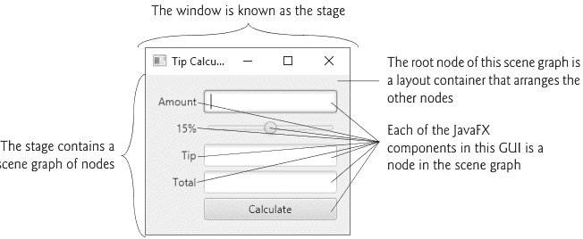

图 12.1 | JavaFX 应用程序窗口部分。

### 控件 (Controls)
控件是 GUI 组件，例如显示文本的 `Labels`、允许程序接收用户输入的 `TextFields`、用户点击以触发操作的 `Buttons` 等。

### 阶段 (Stage)
显示 JavaFX 应用 GUI 的窗口被称为阶段（stage），它是 `Stage` 类（位于 `javafx.stage` 包）的实例。

### 场景 (Scene)
阶段包含一个活跃的场景，该场景将 GUI 定义为场景图（scene graph）——应用程序视觉元素的树形结构，例如 GUI 控件、形状、图像、视频、文本等（树将在第 21 节中讨论）。场景是 `Scene` 类（位于 `javafx.scene` 包）的实例。

### 节点 (Nodes)
场景图中的每个元素都是节点——它是 `Node` 类（`javafx.scene`）子类的实例，该类定义了所有节点的共同属性和行为。除了场景图中的第一个节点（根节点）外，场景图中的每个节点都有一个父节点。节点具有变换（例如移动、旋转和缩放）、不透明度（节点是透明、半透明还是不透明）、效果（例如投影投影、模糊、反射和光照），我们将在第 22 章中学习更多内容。

### 布局容器 (Layout Containers)
具有子节点的节点通常是布局容器，它们在场景中安排其子节点。你将在本章中使用两个布局容器（`VBox` 和 `GridPane`），并在第 13–22 章中学习其他几个。在布局容器中排列的节点是控件的组合，在更复杂的 GUI 中，还可能是其他布局容器。

### 事件处理器和控制器类 (Event Handler and Controller Class)
当用户与控件交互时（例如点击按钮或在 `TextField` 中输入文本），控件会生成一个事件。程序对这些事件做出响应——称为事件处理——以指定当每次用户交互发生时应该发生什么。事件处理器是响应用户交互的方法。FXML GUI 事件处理器定义在所谓的控制器类中（如你将在第 12.5.5 节中看到的）。

## 12.4 欢迎应用——显示文本和图像

在本节中，你将在不编写任何代码的情况下构建一个 GUI，该 GUI 在 `Label` 中显示文本，在 `ImageView` 中显示图像（图 12.2）。你将使用可视化编程技术将 JavaFX 组件拖放到 Scene Builder 的面板上（即设计区域）上。接下来，你将使用 Scene Builder 的检查器（Inspector）配置选项，例如 `Label` 的文本和字体大小。最后，你将使用 Scene Builder 窗口中的“显示预览”（Show Preview）来查看完成的 GUI。在第 12.5 节的提示计算器应用中，我们将讨论加载和显示 FXML GUI 所需的 Java 代码。然后，在练习 12.3 中，你将创建一个显示本节中欢迎 GUI 的 Java 。

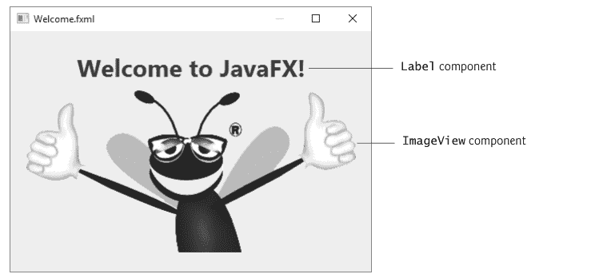

图 12.2 | Microsoft Windows 10 上预览窗口中的最终欢迎 GUI。

### 12.4.1 打开 Scene Builder 并创建文件 Welcome.fxml

打开 Scene Builder，以便创建定义 GUI 的 FXML 文件。窗口如图 12.3 所示。窗口顶部的“Untitled”表示 Scene Builder 已创建了一个你尚未保存的新 FXML 文件。选择 文件（File）> 保存（Save）以显示另存为对话框，选择一个存储文件的位置，将文件命名为 `welcome.fxml` 并点击保存（Save）按钮。

库（Library）包含 JavaFX 容器、控件和其他可以拖放到画布上的项目。你使用内容面板来设计 GUI。你使用检查器（Inspector）窗口来配置内容面板中选中的项目。

文档层次结构（Document's Hierarchy）部分显示 GUI 的结构，并允许你选择和重新组织控件。

**图 12.3** 首次打开时的 JavaFX Scene Builder。

### 12.4.2 向文件夹容器 Welcome.fxml 中添加图像

你将为此应用使用的图像 (`bug.png`) 位于本章文件夹下的 `images` 子文件夹中。当你准备好将其添加到应用时，找到图像非常简单：在文件系统上找到 `images` 文件夹，然后将 `bug.png` 复制到保存 `Welcome.fxml` 的文件夹中。

### 12.4.3 创建 VBox 布局容器

对于此应用，你把一个 `Label` 和一个 `ImageView` 放置在一个 `VBox` 布局容器（`javafx.scene.layout` 包）中，这将是场景的根节点。布局容器有助于组织 GUI 组件。`VBox` 从上到下垂直排列其节点。我们在第 12.5 节讨论了 `GridPane` 布局容器，并在第 13 章讨论了其他几个。要将 `VBox` 添加到 Scene Builder 的内容面板，你可以开始设计

> 我们在 Microsoft Windows 10 上显示 Scene Builder 的屏幕截图，但 Scene Builder 在 Windows、macOS 和 Linux 上几乎完全相同。主要区别是 macOS 的菜单栏位于屏幕顶部，而在 Windows 和 Linux 上，菜单栏是窗口的一部分。

要创建 GUI，在库（Library）窗口的容器（Containers）部分双击 `VBox`。（你也可以从容器部分将 `VBox` 拖放到 Scene Builder 的内容面板中。）

### 12.4.4 配置 VBox 布局容器

现在你将指定 `VBox` 的对齐方式（alignment）、初始大小和内边距（padding）。

**指定 VBox 的对齐方式 (Alignment)**
`VBox` 的对齐方式决定了 `VBox` 子节点的布局位置。在该应用中，我们希望每个子节点（`Label` 和 `ImageView`）在场景中水平居中，并希望它们两者在垂直方向上都居中，这样 `Label` 周围和 `ImageView` 下方就有相等的空间。为了实现这一点：

1. 在 Scene Builder 的内容面板中点击 `VBox`。Scene Builder 的属性（Properties）部分显示了许多 `VBox` 属性。
2. 点击对齐（Alignment）属性的下拉列表，注意你可以使用的各种对齐值。点击 `CENTER` 来设置对齐方式。

你为 JavaFX 对象指定的每个属性都用于在 JavaFX 创建该对象时设置其实例变量。

**指定 VBox 的首选大小 (Preferred Size)**
场景图根节点的首选大小（宽度和高度）用于场景在应用程序运行时确定其大小。要设置首选大小：

1. 选择 `VBox`。
2. 点击布局（Layout）旁边的右箭头（▶）展开检查器的布局部分。该部分会展开，右箭头变为向下箭头。再次点击箭头将折叠该部分。
3. 点击首选宽度（Pref Width）属性的文本框，输入 `450` 并按回车更改首选宽度。
4. 点击首选高度（Pref Height）属性的文本框，输入 `300` 并按回车更改首选高度。

### 12.4.5 添加并配置 Label

接下来，你将创建一个显示“Welcome to JavaFX!”的 `Label`。

**将 Label 添加到 VBox**
点击控件（Controls）旁边的右箭头（▶）展开场景库（Scene Library）窗口的控件部分，从控件部分将 `Label` 拖放到 Scene Builder 的内容面板中。（你也可以双击容器部分的 `Label` 添加 `Label`。）Scene Builder 会根据 `VBox` 的对齐属性，在 `VBox` 中自动创建 `Label` 对象。

**更改 Label 的文本**
你可以通过双击并输入新文本，或者通过选择 `Label` 检查器的属性部分设置其 `Text` 属性来更改 `Label` 的文本。将 `Label` 的文本设置为“Welcome to JavaFX!”。

**更改标签的字体**
对于此应用，我们将 `Label` 设置为大号粗体字体。执行此操作，选择 `Label`，在 Inspector（检查器）的 Properties（属性）部分找到它，点击 Font（字体）属性右侧的值。在弹出的窗口中，将 Style（样式）属性设置为 Bold（粗体），并将 Size（大小）属性设置为 `30`。现在的设计应该如图 12.4 所示。

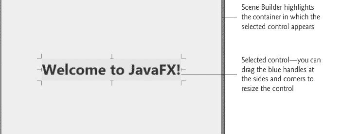

**图 12.4** | 添加并配置 Label 后欢迎 GUI 设计。

### 12.4.6 添加和配置 ImageView

最后，你将添加显示 `bug.png` 的 `ImageView`。

**向 VBox 添加 ImageView**
从 Library（库）窗口的 Controls（控件）部分将 `ImageView` 拖放到 `Label` 正下方的，如图 12.5 所示。你也可以在 Library 窗口中双击 `ImageView`，Scene Builder 会自动将新的 `ImageView` 对象放置在 `Label` 下方。你可以通过在 `VBox` 内部或 Document 窗口的 Hierarchy（层级结构）部分（12.3）拖动 `VBox` 的角来调整。Scene Builder 会自动将 `ImageView` 在 `VBox` 中居中。注意，`Label` 和 `ImageView` 是垂直居中的，这使得 `Label` 上方和 `ImageView` 下方出现相同的空间。

**设置 ImageView 的图像**
接下来你将设置要显示的图像：

1. 选择 `ImageView`，然后在 Inspector 的 Properties 部分点击 Image（图像）属性右侧的省略号 (...) 按钮。默认情况下，Scene Builder 会打开一个对话框，显示 FXML 文件保存所在的文件夹。这就是你在 12.4.2 节中放置图像 `bug.png` 的地方。
2. 选择图像文件，然后点击 Open（打开）。Scene Builder 会显示图像并调整 `ImageView` 的大小以匹配图像的比例——即图像宽度与高度的比例。

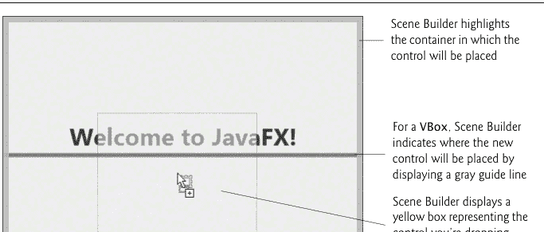

Scene Builder 会高亮将放置控件的容器。对于 `VBox`，Scene Builder 会通过显示一条灰色引导线指示新控件放置的位置。Scene Builder 会显示一个黄色框，代表你正在拖入设计中的控件。

**图 12.5** | 将 ImageView 拖放到 Label 下方。

**更改 ImageView 的大小**

我们希望按原始大小显示图像。如果你重置 `ImageView` 的默认 Width（宽度）和 Fit（适应）属性值——这些是 Scene Builder 在你将 `ImageView` 添加到设计时设置的——Scene Builder 将把 `ImageView` 调整为图像的精确尺寸。要重置这些属性：

- 展开 Inspector 的 Layout（布局）部分。
- 将鼠标悬停在 Fit Width 属性的值上。这会显示属性值右侧的按钮。点击按钮并选择 Reset to Default（重置为默认值）来重置该值。这种技术可以用于任何属性值重置其默认值。
- 重复步骤 2 以重置 Fit Height 属性的值。

你现在已完成 GUI。Scene Builder 的 content（内容）面板现在应该如图 12.6 所示。通过选择 File（文件） > Save（保存）来保存 XML 文件。

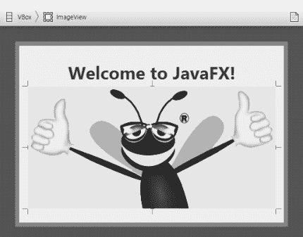

**图 12.6** | Scene Builder 内容面板中完成的欢迎 GUI。

### 12.4.7 预览欢迎 GUI

你可以预览设计在运行的应用程序窗口中的外观。执行此操作，选择 Preview（预览） > Show Preview in Window（在窗口中显示预览），这将显示图 12.7 所示的窗口。


图 12.7 | 在 Microsoft Windows 10 上预览欢迎 GUI—在 Linux、macOS 和早期 Windows 版本上窗口框会有不同。

## 12.5 小费计算应用—事件处理简介

小费计算应用（图 12.8(a)）计算并显示餐厅账单的小费和总额。默认情况下，应用按 15% 的小费计算总额。你可以通过移动滑块手来指定从 0% 到 30% 的小费百分比——这将更新小费百分比（图 12.8(b) 和 (c)）。在本节中，你将使用几个 Java 组件构建小费计算应用，并学习如何响应与 GUI 的交互。

| a) 初始小费计算 GUI |
| :--- | :--- |
| 小费栏 | 在此处输入账单金额 |
| 金额 | `TextField` |
| 当前小费百分比显示在此 Label 中 | -15% 移动滑块手以更改小费百分比 |
| 小费 | |
| 总计 | 计算 |

图 12.8 | 输入账单金额并计算小费。（第 1 部分）

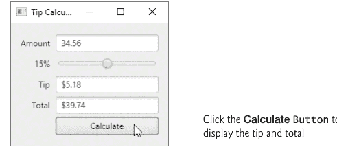

b) 输入金额 34.56 并点击 Calculate 按钮后的 GUI

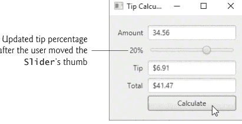

c) 用户移动 Slider 滑手将百分比更改为 20%，然后点击 Calculate 按钮后的 GUI

**图 12.8** | 输入账单金额并计算小费。（第 2 部分。）

你将从测试该应用开始，用它计算 15% 和 20% 的小费。然后我们将概述你将用于创建该应用的技术。你将使用 Scene Builder 构建应用的 GUI。最后，我们将展示应用的完整 Java 代码并进行详细的讲解。

### 12.5.1 测试计算器应用

使用本章的示例编译并运行位于 `TipCalculator` 中的应用。该类包含一个名为 `TipCalculator` 的 `main` 方法。

### 输入账单总额
使用键盘输入 `34.56`，然后按下 Calculate 按钮。**Tip（小费）`TextField`** 和 **Total（总计）`TextField`** 将显示 15% 小费的小费金额和账单总额（图 12.8(b)）。

### 选择自定义小费
使用 Slider 指定自定义小费。移动 Slider 滑手将百分比更改为 20%，然后点击 Calculate 按钮，这将小费百分比更新为图 12.8(c)。尽管我们没有使用该功能，但 Slider 允许用户在 0 到 30 的范围内选择数值，我们在应用中限制了此范围。

## 12.5.2 技术概述

本节介绍了你将用于创建应用的技术。

#### Application 类
负责启动应用的类是 `Application` 的子类。当调用其 static `main` 方法时：
1. `launch` 方法会创建 `Application`。
2. `start` 方法接收 `Stage` 并将其附加到。
3. `start` 方法创建 GUI。

#### 使用 GridPane 布局 JavaFX 组件
回顾布局将组件放入 Scene。`GridPane`（package `javafx.scene.layout`）将组件排列在列和行中。该应用（图 12.9）使用列和行。`GridPane` 可以跨越多个列或行，尽管我们在 GUI 中没有使用该功能。默认情况下，`GridPane` 具有列和行。要了解更多关于 `GridPane` 的信息，请访问：

```
https://docs.oracle.com/javase/8/javafx/api/scene/GridPane.html
```


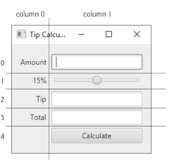

**图 12.9** | 按列排列的小费计算 GUI。

### 使用 Scene Builder 创建并自定义 GUI
我们将通过将 `Label`、`Slider` 和 `Button` 拖到 Scene Builder 内容面板来创建它们，然后使用检查器进行自定义。

- `TextField`（package `javafx.scene.control`）可以接受用户输入或显示文本。我们将使用一个 `TextField` 输入用户的账单金额，使用两个 `TextField` 显示小费和总额。
- `Slider`（package `javafx.scene.control`）代表 0.0–100.0 范围内的值，并允许用户通过移动 Slider 手选择该范围内的数字。我们将自定义 `Slider` 以使用 0 到 30 的有限整数范围。
- `Button`（package `javafx.scene.control`）允许用户启动操作，在本应用中执行 Calculate 按钮计算并显示小费和金额。

# 12.5 小费计算器应用——事件处理简介

变化——例如当用户移动滑块滑块来更改滑块的值时——你会发现你必须完全在代码中创建事件处理器。

### 实现 InterfaceChangeListener 以处理滑块滑块位置的变化
你将实现接口 `ChangeListener`（位于 `javafx.beans.value` 包）来响应用户移动滑块滑块的操作。特别是，你将使用该接口方法在用户移动滑块滑块时显示更新后的小费百分比。

### 模型-视图-控制器 (MVC) 架构
GUI 中的 JavaFX 应用通过 FXML 实现，并遵循模型-视图-控制器（MVC）设计模式，该模式将应用程序的数据（包含在模型中）与应用程序的 GUI（视图）以及应用程序的处理逻辑（控制器）分离开。

控制器实现处理用户输入的逻辑。模型包含应用程序数据，而视图显示存储在模型中的数据。当用户提供输入时，控制器会根据给定的输入修改模型。在小费计算器中，模型是金额、小费和总额。当模型发生变化时，控制器更新视图以显示更改后的数据。

在 JavaFX FXML 应用中，控制器类定义了用于程序化与控件交互的实例变量，以及响应用户交互的事件处理方法。控制器类还可能声明支持应用程序运行的其他实例变量、静态变量和方法。在像小费计算器这样简单的应用中，模型和控制器被合并到一个类中，正如我们在本示例中所做的那样。

# FXoader 类

当 JavaFX FXML 应用开始执行时，使用类 `FXoader` 的静态方法 `load` 来加载代表应用程序 GUI 的 FXML 文件：

- 加载 GUI 的场景图——包含 GUI 的布局和控件——并返回一个指向场景图根节点的 `Parent`（位于 `javafx.scene` 包）引用。
- 为通过程序化操纵的组件初始化控制器的实例变量。
- 为 FXML 中指定的任何事件创建并注册事件处理器。

我们将在第 12.5.4–12.5.5 节中详细讨论这些步骤。

# 12.5.3 构建应用程序的 GUI

在本节中，我们将展示创建小费计算器 GUI 的精确步骤。完成这些步骤后，GUI 的外观将与图 12.8 所示。

### 此应用控件的 fxid 值

如果控制器可以程序化地操纵控件或布局（正如我们将对 `Label`、所有 `TextField` 和 `Slider` 所做的），你必须为该控件或布局提供一个名称。在第 12.5.4 节中，你将学习如何为 FXML 中的每个组件声明 Java 变量，我们将讨论这些变量如何为你进行初始化。每个对象的名称通过其 `fxid` 属性指定。你可以通过在场景中选择组件，展开检查器（Inspector）窗口的 Code 部分来设置此属性的值——`fxid` 属性出现在 Code 部分的顶部。图 12.10 显示了小费计算器中程序化操纵控件的 `fxid` 属性。为了清晰起见，我们的命名规范是在 `fxid` 属性中使用控件的类名。

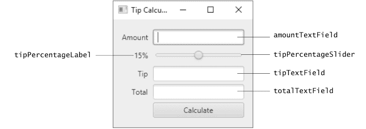

**图 12.10 | 用其 fxid 标记的小费计算器程序化操纵控件。**

**创建 TipCalculator.fxml 文件**
正如你在第 12.4.1 节中所做的那样，打开 Scene Builder 创建一个新的 FXML 文件。然后，选择 File > Save 显示“另存为”对话框，指定存储文件的位置，将文件命名为 `TipCalculator.fxml` 并点击 Save 按钮。

**步骤 1：添加 GridPane**
将库（Library）窗口中的 `GridPane` 拖到 Scene Builder 的内容面板上。默认情况下，`GridPane` 包含两列三行，如 12.11 所示。

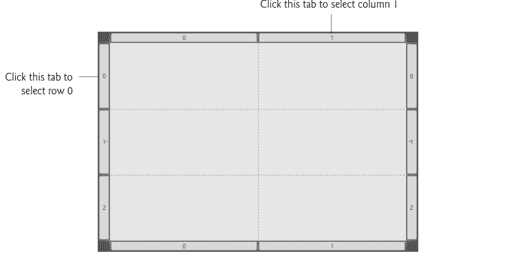
**图 12.11 | 具有两列（0 和 1）和三行（0、1）的 GridPane。**

**步骤 2：向 GridPane 添加行**
回想 12.9 中的 GUI 有两列五行。我们将添加两行。要在现有行上方或下方添加行：

1. 右单击任何行的标签，并选择 `GridPane` > `Add Row`。
2. 重复此过程以添加另一行。

添加两行后，`GridPane` 应该如 12.12 所示。你可以使用类似的步骤添加列。可以通过右单击包含该行或列的标签来删除行或列。


**图 12.12 | 添加行后的 GridPane。**

**步骤 3：向 GridPane 添加控件**
我们将 12.9 中的控件添加到 `GridPane`。对于 12.10 中具有 `fxid` 的每个控件，当你将控件拖到 `GridPane` 时，在检查器的 Code 部分设置控件的 `fxid` 属性。执行以下步骤：

1. **添加 Label**。将库窗口中的 Labels 拖到 0 列的前四行。添加每个 Label 时，如 12.9 所示设置其文本。
2. **添加 TextField**。将库窗口中的 TextFields 拖到 1 列的第 0、2 和 3 行。
3. **添加 Slider**。将库窗口中的水平 Slider 拖到 1 列的第 1 行。
4. **添加 Button**。将库窗口中的 Button 拖到 1 列的第 4 行。将 Button 的文本改为 Calculate。你可以通过双击它或在检查器的 Properties 部分选择 Button 来设置文本。

`GridPane` 应该如 12.13 所示。

| | 0 | 1 |
|---|---|---|
| 0 | Amount | |
| 1 | 15% | |
| 2 | Tip | |
| 3 | Total | |
| 4 | | Calculate |

**图 12.13 | 填充控件的 GridPane。**

**步骤 4：调整 GridPane 以适应内容**
当你通过添加布局设计 GUI 时，Scene Builder 会自动将布局对象的 *Pref Width* 属性设置为 600，*Pref Height* 属性设置为 400，这比此 GUI 的最终宽高大得多。对于此应用，我们希望布局的大小根据内容计算。要进行此更改：

1. 首先，点击 `GridPane` 内部选择它，而不是你放入列行中的任何控件。有时，选择 Scene Builder **Hierarchy** 部分中的 `GridPane` 节点更简单。
2. 在检查器的 Layout 部分，将 *Pref Width* 和 *Pref Height* 属性恢复为默认值（如你在 12.4.4 节中所做的）。将这两个属性值设置为 `USE_COMPUTED_SIZE`，以便布局计算自己的大小。

布局现在如 12.14 所示。

| | 0 | 1 |
|---|---|---|
| 0 | Amount | |
| 1 | 15% | |
| 2 | Tip | |
| 3 | Total | |
| 4 | | Calculate |

**图 12.14 | 适应内容的 GridPane。**

**步骤 5：右对齐第 0 列的内容**
`GridPane` 列的内容默认左对齐。要右对齐第 0 列的内容，点击列顶部或底部标签选择它，然后在检查器的 Layout 部分将 Alignment（水平对齐）属性设置为 RIGHT。

**步骤 6：调整 GridPane 列以适应内容**
默认情况下，Scene Builder 将每个 `GridPane` 列的宽度设置为 100 像素，每行的高度设置为 30 像素，以确保你可以轻松将控件拖入 `GridPane` 的单元格中。在此应用中，我们调整每列以适应其内容。要这样做，点击列顶部或底部选择列 0，然后使用检查器的 Layout 部分将 Pref Width 属性重置为默认大小（即 `USE_COMPUTED_SIZE`），指示列宽基于其最宽的子元素（在本例中为 Amount Label）。对列 1 重复此过程。`GridPane` 应如 12.15 所示。

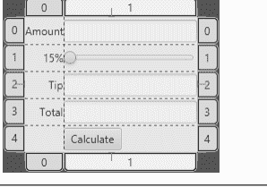
**图 12.15 | 列适应内容的 GridPane。**

**步骤 7：调整 Button**
默认情况下，Scene Builder 根据文本设置 `Button` 的宽度。对于此应用，我们选择让 `Button` 宽度与 `GridPane` 右列的其他控件相同。要这样做，选择 `Button`，然后在检查器的 Layout 部分将 Max Width 属性设置为 `MAX_VALUE`。这会导致 `Button` 的宽度增长以填满列的宽度。

**预览 GUI**
通过选择 Preview > Show Preview in Window 预览 GUI。如你在图 12.16 所示，左列的 Label 与右列的控件之间没有空间。此外，`GridPane` 周围没有空间，因为默认情况下 Stage 的大小适应 Scene 的内容。因此，许多控件触及了窗口边界。你将在下一节修复这些问题

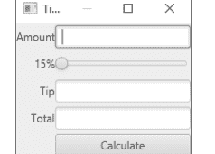
**图 12.16 | 调整了 TextField 和 Button 的 GridPane。**

**步骤 8：配置 GridPane 的内边距和列之间的水平间距**
节点内容与其顶部、右、底部和左边缘之间的空间被称为内边距（padding），它将内容与节点边缘隔开。由于 `GridPane` 的大小决定 Stage 的窗口大小，`GridPane` 的内边距（padding）将其子控件与窗口边缘隔开。设置内边距，选择 `GridPane`，然后在检查器（Inspector）的 Layout 区域中，将 Padding 属性的四个值（分别代表顶部、右侧、底部和左）设置为 0–14——这是 JavaFX 推荐的控件与 Scene 边缘之间的距离。

你可以分别通过其 Hgap（水平间隙）和 Vgap（垂直间隙）来指定 `GridPane` 的列和行之间的默认间距。由于 Scene Builder 将每个 `GridPane` 行设置为 30 像素（这大于这些控件的高度），因此组件之间始终会有一些垂直空间。要指定列之间的水平间距，在 Document 窗口的 Hierarchy（层级结构）区域中选择 `GridPane`，在检查器的 Layout 区域中，将 Hgap 属性设置为 8——这是控件之间的推荐距离。如果你想精确控制控件之间的垂直空间，可以将其高度重置为默认值，然后设置 `GridPane` 的 Vgap 属性。

# 第 9 步：使 textField 和 totalTextField不可编辑且不可获取焦点

`textField` 和 `totalTextField` 仅用于显示结果和接收文本输入。因此，它们不是可交互的。只有当 `TextField` 处于“获得焦点”状态时，你才能在其中输入——也就是说，它是用户正在交互的控件。当你点击一个交互式控件时，它就会获得焦点。同样，当你按下 Tab 键时，焦点会从当前可焦点的控件转移到下一个——这是是按照控件添加到 GUI 的顺序进行的。交互式控件（如 `TextFields`、`Sliders` 和 `Buttons`）默认是可获取焦点的。非交互式控件（如 `Labels`）是不可获取焦点的。

在此应用程序中，`textField` 和 `totalTextField` 均不可获取焦点。要进行这些更改，同时选择两个 `TextField`，然后在检查器的 Properties（属性）区域中取消勾选 Editable（可编辑）和 Focus Traversable（焦点遍历）属性。要一次性选择多个控件，请点击第一个（在 Document 窗口的 Hierarchy 区域或内容面板中），按住 Shift 键并点击其他每一个控件。

# 第 10 步：设置 Slider 的属性

为了完成 GUI，你将配置计算器的 `Slider`。`Slider` 的范围是 0.0 到 100，初始值为 0.0。此应用程序仅允许输入 0 到 30 范围内的百分比，默认值为 15。要进行这些更改，选择 `Slider`，然后在检查器的 Properties 区域中，将 `Slider` 的 Max 属性设置为 30，Value 属性设置为 15。我们还把 Increment 属性设置为 5——这是当用户点击 `Slider` 的末端和滑块时，Value 属性增加或减少的幅度。通过 File > Save 保存 FXML 文件。

尽管我们将 Max、Value 和 Increment 属性设置为了整数值，但当用户移动滑块时，`Slider` 仍会产生浮点值。在应用程序的 Java 代码中，当我们响应其事件时，会将 `Slider` 的值转换为整数。

# 预览最终布局

你已经完成了 TipCalculator 的设计。选择 Preview > Show Preview in Window 查看最终的 GUI（图 12.17）。当我们讨论 TipCalculator 的 Controller 时……

# 12.5 小费计算器——事件处理简介 517

在第 12.5.5 节中，我们将展示如何在 FXML 文件中指定 Calculate 按钮的事件处理器。

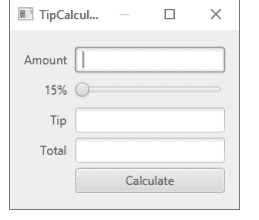

图 12.17 | 在 Scene Builder 中设计的最终 GUI。

# 指定控制器类名

如第 12.5.2 节所述，在 JavaFX FXML 应用中，应用的控制器类通常定义了用于程序化交互控件的实例变量，以及事件处理方法。为了确保应用程序在运行时加载 FXML 文件时创建控制器对象，你必须在 FXML 文件中指定控制器类名：

- 1. 展开 Scene Builder Document 窗口的 Controller 区域（位于图 12.3 中 Hierarchy 区域下方）。
- 2. 在 Controller 字段中输入 `TipCalculatorController`——按照惯，控制类的名称与 FXML 文件名（`TipCalculator`）相同，并以 Controller 结尾。

# 指定 Calculate 按钮的事件处理器方法名

你可以在 FXML 文件中指定用于处理特定事件的方法名。当你选择一个控件时，检查器窗口的 Code 区域会显示所有你可以在 FXML 文件中指定事件处理器的事件。当用户点击 `Button` 时， On Action 字段中指定的方法会被调用——该方法定义在 Scene Builder Controller 窗口中指定的控制器中。On Action 字段中的每一个ButtonPressed。

# 生成示例控制器类

你可以让 Builder 生成初始控制器类，以及你用于程序化交互控件的变量以及可能的 Calculate 按钮事件处理器。Scene Builder 将此称为“控制器骨架”。选择 View > Sample Controller Skeleton 生成骨架（图 12.18）。如你所见，示例类具有你指定的名称、每个带有 `fxid` 的控件对应一个变量，以及一个空的 Controller 事件处理器。我们将在第 12.5.5 节中讨论 `@FXML` 注解。要使用此骨架创建你的控制器类，可以点击 Copy 按钮，将内容粘贴到名为 `TipCalculatorController.java` 的文件中，该文件与在本节中创建的 `TipCalculator.fxml` 文件位于同一文件夹。

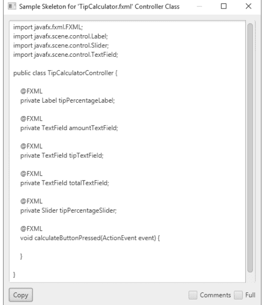

**图 12.18** | 由 Scene Builder 生成的骨架代码。

# 12.5.4 TipCalculator 类

一个简单的 JavaFX FXML 应用包含两个 Java 源代码文件。对于小费计算器应用，这些是：

- `TipCalculator.java`——此文件包含 `TipCalculator` 类（在本节中讨论），它声明了加载 FXML 文件以创建 GUI 并将其附加到显示在应用 Stage 上的 Scene 的方法。
- `TipCalculatorController.java`——此文件包含 `TipCalculatorController` 类（在第 12.5.5 节讨论），你将在其中指定 `Slider` 和 `Button` 事件处理器。

图 12.19 如我们在12.5.2 中讨论的 `TipCalculator` 子类，JavaFX 应用的起点是 `Application`，因此 `TipCalculator` 继承 `Application`（第 9 行）。main 方法调用 `Application` 的静态 `launch` 方法（第 23 行）来初始化 JavaFX 环境并开始执行应用。此方法会导致 JavaFX 运行时创建一个 `TipCalculator` 类对象。

# 12.5 小费计算器——事件处理简介 519

```java
// 12.19 TipCalculator.java

// 加载并显示 TipCalculator GUI 的主应用类

import javafx.application.Application;
```


```java
import javafx.fxml.FXMLLoader;
import javafx.scene.Parent;
import javafx.scene.Scene;
import javafx.stage.Stage;

public class TipCalculator extends Application {

    @Override
    public void start(Stage stage) throws Exception {
        Parent root = FXMLLoader.load(getClass().getResource("TipCalculator.fxml"));
        Scene scene = new Scene(root); // 将 scene 附加到 stage
        stage.setTitle("Tip Calculator"); // 显示在窗口标题栏
        stage.setScene(scene); // 将 scene 附加到 stage
        stage.show(); // 显示 stage
    }

    public static void main(String[] args) {
        // 创建 TipCalculator 对象并调用其 start 方法
        launch(args);
    }
}
```

**图 12.19** | 加载并显示 TipCalculator GUI 的主应用类。

### 覆盖 Application 方法 start

`start` 方法（第 11–19 行）创建 GUI，将其附加到 `Scene` 并将其放置在 `start` 方法接收的参数 `Stage` 上。第 12–13 行使用 `FXMLLoader` 对场景图根节点的静态方法引用来创建 GUI 的场景图。此方法：

- 返回一个指向场景图根节点的 `Parent`（包 `javafx.scene`）引用——在本应用中，这是对 GUI 的 `GridPane` 的引用。
- 创建我们在 FXML 文件中指定的 `TipCalculatorController` 类的对象。
- 初始化用于程序化操作组件的控制器实例变量。
- 将 FXML 中指定的事件处理器附加到适当的控件上。这被称为注册事件处理器，并允许控件在用户与应用交互时调用相应的方法。

我们将在第 12.5.5 节讨论控制器实例变量的初始化和事件处理器的注册。

### 创建 Scene

`Scene` 构造函数的重载版本允许你指定 `Scene` 的尺寸和填充（颜色、渐变或图像），它将显示在 `Scene` 的背景中。第 16 行使用 `Stage` 方法 `setTitle()` 来指定 `Stage` 窗口标题栏中显示的文本。第 17 行调用 `Stage` 方法 `setScene()` 将 `Scene` 放置到 `Stage` 上。最后，第 18 行调用 `Stage` 方法 `show()` 显示 `Stage`。

## 12.5.5 TipCalculatorController 类

图 12.20–23 展示了 `TipCalculatorController` 类，它响应用户与 App 中 `Button`（按钮）和 `Slider`（滑动条）的交互。

### 类的 import 语句

图 12.20 显示了 `TipCalculator` 的 import 语句。

```java
// TipController.java
// 处理 cancelButton 和 tipPercentageSlider 的控制器
import java.math.BigDecimal;
import java.math.RoundingMode;
import java.text.NumberFormat;
import javafx.beans.value.ChangeListener;
import javafx.beans.value.ObservableValue;
import javafx.event.ActionEvent;
import javafx.fxml.FXML;
import javafx.scene.control.Label;
import javafx.scene.control.Slider;
import javafx.scene.control.TextField;
```

图 12.20 | TipCalculatorController 的 import 声明。

类 `TipCalculatorController` 使用的类和接口包括：

- 包 `java.math` 下的 `BigDecimal`（第 3 行）用于执行精确计算。包 `java.math` 下的 `RoundingMode` 枚举（第 4 行）用于指定在计算期间如何舍入 `BigDecimal` 值，或者在将浮点数格式化为字符串时使用。
- 包 `java.text` 中的 `NumberFormat`（第 5 行）提供了数值格式化功能，例如针对特定区域的货币和百分比格式。例如，在美国，货币值 34.95 被格式化为 $34.95，百分比 15 被格式化为 15%。`NumberFormat` 决定运行你 App 的系统本地区域（locale），然后据此格式化货币和百分比。
- 你实现接口 `javafx.beans.ChangeListener`（第 6 行），以便在用户移动 `Slider` 滑块时做出响应。该接口接收一个实现 `ObservableValue` 接口的对象（第 7 行）——即一个在改变时会产生事件的值。
- `Button` 的事件处理程序接收一个 `ActionEvent` 对象（第 8 行；包 `javafx.event`），指示点击了哪个 `Button`。正如你将在第 13 章中看到的，许多 JavaFX 控件支持 `ActionEvents`。
- 注解 `FXML`（第 9 行；包 `javafx.fxml`）用于 JavaFX 控制器类的代码中，以标记应该引用 GUI 的 FXML 文件中 JavaFX 组件的实例变量，以及可以响应 GUI 的 FXML 文件中 JavaFX 组件事件的方法。
- 包 `javafx.scene.control`（第 10–12 行）包含包含许多 JavaFX 控件类，包括 `Label` 和 `TextField`。

## 12.5 小费计算器 App——事件处理简介

### TipCalculatorController：静态变量和实例变量

图 12.21 的第 16–37 行展示了 `TipCalculatorController` 的静态变量和实例变量。`NumberFormat` 对象（第 16–19 行）分别用于格式化货币值和百分比。`NumberFormat` 方法 `getCurrencyInstance()` 返回一个 `NumberFormat`，它使用运行 App 的系统的默认本地区域将值格式化为货币。同样，`NumberFormat` 方法 `getPercentInstance()` 返回一个 `NumberFormat`，它使用系统的默认本地区域将值格式化为百分比。`BigDecimal` 对象 `tipPercentage`（第 21 行）存储小费百分比，并在用户点击 Calculate Button 时的小于计算器（图 12.21）。

```java
public class TipCalculatorController {
    // 货币和百分比的注释
    private static final NumberFormat currency = NumberFormat.getCurrencyInstance();
    private static final NumberFormat percent = NumberFormat.getPercentInstance();

    private BigDecimal tipPercentage = new BigDecimal(0.15); // 默认 15%

    // 在 FXML 中定义并在控制器代码中使用 GUI 控件
    @FXML
    private TextField amountTextField;

    @FXML
    private Label tipPercentageLabel;

    private Slider tipPercentageSlider;

    @FXML
    private TextField tipTextField;

    @FXML
    private TextField totalTextField;
}
```

图 12.21 | TipCalculatorController 的静态变量和实例变量。

#### @FXML 注解

回顾第 12.5.3 节，此 App 在 Java 源码中操作的每个控件都需要一个 `fxid`。第 24–37 行（图 12.21）声明了控制器的对应的实例变量。每个声明之前的 `@FXML` 注解（第 24, 27, 30, 33 和 36 行）表明该变量名可以在描述 App GUI 的 FXML 文件中使用；你在控制器类中指定的 GUI 变量名必须精确匹配你在构建 GUI 时指定的 `fxid` 值。当 `FXMLLoader` 加载 `TipCalculator.fxml` 来创建 GUI 时，它还会初始化每个用 `@FXML` 声明的控制器实例变量，以确保它们引用 FXML 文件中对应的 GUI 组件。

### TipCalculatorController::calculateButtonPressed 事件处理器

图 12.22 展示了 `TipCalculatorController::calculateButtonPressed`，当用户点击 Calculate Button 时调用该方法。`@FXML` 注解（第 40 行）位于该方法之前，表明该方法可以响应 GUI 的 FXML 文件中的 JavaFX 组件事件。对于产生 `ActionEvent` 的 JavaFX 控件，该方法必须返回 `void` 并接收一个 `ActionEvent` 参数。

```java
// 计算货币和百分比
@FXML
private void calculateButtonPressed(ActionEvent event) {
    try {
        amount = new BigDecimal(amountTextField.getText());
        tip = amount.multiply(tipPercentage);
        total = amount.add(tip);
        tipTextField.setText(currency.format(tip));
        totalTextField.setText(currency.format(total));
    } catch (NumberFormatException ex) {
        amountTextField.setText("Enter amount");
        amountTextField.selectAll();
        amountTextField.requestFocus();
    }
}
```

图 12.22 | TipCalculatorController::calculateButtonPressed

#### 注册 Calculate Button 的事件处理器

当 `FXMLLoader` 加载 `TipCalculator.fxml` 创建 GUI 时，它还会初始化每个用 `@FXML` 声明的控制器实例变量，以确保它们引用 FXML 文件中对应的 GUI 组件。

#### 计算并显示小费和总金额

如果第 43 行没有产生异常，第 51 行调用 `amountTextField.setText()` 显示“Enter amount”。第 52 行调用 `selectAll()` 选中 `TextField` 的文本，第 53 行调用 `requestFocus()` 赋予 `TextField` 焦点。`getText()`、`setText()` 和 `selectAll()` 方法继承自 `TextField`。

如果第 43 行没有产生异常，第 44 行通过金额乘以百分比计算小费，第 45 行通过加上小费计算总金额。第 47 和 48 行使用货币对象的 `format()` 方法创建货币格式的字符串。

### TipCalculatorController.initialize 方法

图 12.23 展示了 `TipCalculatorController.initialize`。该方法用于配置显示 GUI 的控制器。第 60 行调用货币对象的 `setRoundingMode()` 方法来指定货币值如何舍入。`RoundingMode.HALF_UP` 值表示大于 .5 的值应向上舍入——例如，34.567 将被格式化为 34.55，而 34.564 将被格式化为 34.56。

```java
// 由 FXMLLoader 调用初始化
public void initialize() {
    // 0-4 舍入，5-9 向上舍入
    currency.setRoundingMode(RoundingMode.HALF_UP);

    // 对 percentageSlider 数值的监听器
    percentageSlider.valueProperty().addListener(
        new ChangeListener<Number>() {
            @Override
            public void changed(ObservableValue<? extends Number> ov,
                Number oldValue, Number newValue) {
                tipPercentage = BigDecimal.valueOf(newValue.intValue() / 100.0);
                percentageLabel.setText(percent.format(tipPercentage));
            }
        }
    );
}
```

图 12.23 | TipCalculatorController 内部类

#### 使用匿名内部类处理事件

每个 JavaFX 控件都有属性——例如 `Slider` 在改变时会产生事件。对于此类事件，你必须手动注册事件处理器，一个实现 `ChangeListener` 接口的对象（包 `javafx.beans.value`）。
`ChangeListener` 是一个泛型类型，根据属性类型进行专门化。`valueProperty()` 调用（第 63 行）返回一个 `DoubleProperty`（包 `javafx.beans.property`）。

第 12 章 JavaFX 图形用户界面：部分 1

代表 `Slider` 的值。`DoubleProperty` 是一种 `ObservableValue<Number>`，它可以在值发生变化时通知监听器。每个实现 `ObservableValue` 的类都提供 `addListener()` 方法（在第 63 行被调用）来注册事件处理器，该方法实现了 `ChangeListener` 接口。对于 `Slider` 的值，`addListener()` 的参数是一个实现 `ChangeListener<Number>` 的对象，因为 `Slider` 的值是一个数值值。

如果一个事件不需要被复用，你通常将其定义为匿名内部类的实例——这种类在声明时没有名称，且通常出现在方法内部。`addListener()` 方法的参数指定在第 64–72 行中，表现为一条语句，该语句：

- 声明了监听器的类，
- 创建了该类的对象，并
- 将其注册为对 `tipPercentageSlider` 值变化的监听器。

由于匿名内部类没有名称，你必须在声明处创建该类的对象（即第 64 行中的 `new` 关键字）。然后将该对象的引用传递给 `addListener()`。在 `new` 关键字之后，语法如下：

```java
ChangeListener<Number>()
```

在第 64 行开始声明实现 `ChangeListener<Number>` 的匿名内部类。这类似于使用以下代码开始类声明：

```java
public class MyHandler implements ChangeListener<Number> {
```


第 64 行的左大括号和第 72 行的右大括号定义了这个匿名内部类。第 65–71 行声明了 `changed` 方法，该方法接收指向发生变化的 `ObservableValue` 的引用、一个包含事件发生前 Slider 的旧值和新值的 `Number`，以及一个包含 Slider 新值的 `Number`。当用户移动 Slider 的滑块时，第 68–69 行存储了新的小费百分比，第 70 行更新了 `tipPercentageLabel`。（第 66 行中的符号 `? Number` 表示 `ObservableValue` 的类型是 `Number` 或 `Number` 的子类。我们将在第 20.7 节中详细解释这一点）。

# 匿名内部类说明

匿名内部类可以访问其顶层实例变量、静态变量和方法——在本例中，匿名内部类使用了实例变量 `tipPercentage` 和 `tipPercentageLabel` 以及静态变量 `percent`。然而，匿名内部类对其声明所在方法的局部变量访问权限有限——它只能访问在闭包方法体中声明的 `final` 或有效 final（Java SE 8）的局部变量。

# 软件工程观察 12.2

事件的事件监听器必须实现相应的事件监听器接口。

# 常见编程错误 12.1

如果你忘记为特定 GUI 组件的事件类型注册事件处理器对象，则该类型的事件将被忽略。

# 12.6 其他 JavaFX 章节涵盖的特性

## Java SE 8: 使用 Lambda 实现 ChangeNotifier

回想 Java SE 8 第 10.10 节，一个包含单一方法的接口——例如图 12.23 中的 `ChangeListener`——是一个函数式接口。我们将在第 17 章展示如何用 lambda 实现此类接口。

## JavaFX 特性概览

JavaFX 是一种强大的 GUI、图形和多媒体技术。在第 13 章和第 22 章中，你将：

- 学习额外的 JavaFX 布局和控件。
- 处理其他事件类型（如 `MouseEvent`）。
- 应用变换（如移动、旋转、缩放和倾斜）以及效果（如阴影、模糊、反射和光照）。
- 使用 CSS 样式场景图的外观。
- 使用 JavaFX 属性和数据绑定来更新 GUI。
- 使用 JavaFX 动画。
- 使用多媒体播放音频和视频。

此外，JavaFX 资源中心包含了了解更多 JavaFX 的链接：

```
http://www.JavaFX
```


# 12.7 总结

在这一章中，我们介绍了 JavaFX 场景图（scene graph），展示了 JavaFX 窗口（stage）。你学习了由布局和控件组成的场景图，并使用 FXML 设计了 GUI。

你通过 Scene Builder 使用 FXML 设计了 GUI，无需编写代码。你实现了 `Label`、`ImageView`、`TextField`、`VBox` 和 `GridPane` 来响应用户交互。你学习了 `FXMLLoader` 如何加载 FXML。

在下一章中，你将学习额外的 JavaFX 控件和布局，并使用 CSS 样式化，了解 JavaFX 属性如何自动更新元素。

# 12.1 引言

- 图形用户界面（GUI）为应用程序提供了易于交互的机制。
- GUI（读作 "GOO-ee"）为应用程序提供了独特的外观。
- GUI 由 GUI 组件（有时称为控件或小部件）构建而成。
- 为不同的应用程序提供一致的用户界面组件，可以让用户产生熟悉感，从而更快地学习并更高效地使用。
- JavaFX 是未来的 GUI、图形和多媒体 API。

# 12.2 JavaFX Scene Builder

- Scene Builder 是一个独立的 JavaFX 可视布局工具，也可以用于各种 IDE。
- 你可以通过从 Scene Builder 库中拖放 GUI 组件到设计区域，并修改和样式化 GUI 来创建 GUI——这一切无需编写代码。
- Scene Builder 的实时编辑和预览功能允许你在创建和修改 GUI 时查看它，无需编译和运行。
- 你可以使用层级样式表（CSS）来更改 GUI 的外观——这是一个易于理解的概念。
- 当你创建和修改 GUI 时，JavaFX 生成 FXML（FX 标记语言）——用于定义和排列 JavaFX 控件而无需编写代码的 XML 词汇。
- XML（扩展标记语言）是一种广泛用于描述内容的语言——计算机和人类都能理解。
- FXML 简洁地描述了 GUI、图形和多媒体元素。
- FXML 代码与 Java 源码中的逻辑分离。
- 界面（GUI）与实现（Java 代码）的分离有利于调试、维护和管理 JavaFX GUI。

# 12.3 JavaFX 窗口结构

- 显示 JavaFX 应用程序 GUI 的窗口被称为舞台（stage），它是 `Stage` 类的实例。
- 舞台包含一个场景（scene），场景定义了场景图（scene graph）：应用程序视觉元素的树形结构，例如控件、形状、图像、文本等。场景是 `Scene` 类的实例。
- 场景图中的每个元素都是 `Node` 子类的实例，该类定义了场景图中所有节点的共同属性和行为。
- 场景图中的第一个节点被称为根节点。
- 容器节点是布局容器，它们排列其子节点。
- 排列在布局容器中的节点是控件和其他可能的布局容器的组合。

## 12.4 欢迎应用程序——显示文本和图像

- 可视化编程技术允许你将 JavaFX 组件拖放到 Scene Builder 的设计区域（称为内容面板），然后使用 Scene Builder 的检查器（Inspector）来配置选项。
- 布局容器帮助你安排和设置 GUI 组件。
- `VBox` 布局容器（包名 `javafx.scene.layout`）从上到下垂直排列其节点。
- 若要将布局添加到 Scene Builder 的内容面板中，可以在库（Library）窗口的 Containers（容器）部分双击该布局，或者将布局从 Containers 部分拖拽（拖放）到 Scene Builder 的内容面板中。
- `VBox` 的 Alignment（对齐方式）属性决定了 `VBox` 子节点的布局位置。
- 你为 JavaFX 对象指定的每个属性值都将用于在 JavaFX 运行时创建该对象时设置该对象的某一个实例变量。
- 场景图根节点的首选尺寸（宽度和高度）被场景在应用程序开始执行时用于确定其窗口大小。
- 要添加控件，将控件从库拖放到 Scene Builder 内容面板中的布局中。你也可以通过双击库中的项目来添加它。
- 要创建 `Label` 的文本，可以双击它并输入新文本，也可以选择 `Label` 并在检查器的 Properties（属性）部分设置其属性。
- 要设置 `Label` 的属性，选择 `Label`，然后在检查器的 Properties 部分点击 Font（字体）属性右侧的值。在弹出的窗口中，设置字体的属性。
- 你可以通过在 `VBox` 内部或 Scene Builder 的 Hierarchy（层级结构）部分中拖拽控件，来对 `VBox` 的控件重新排序。
- 要指定 `Image`（图像）的值，选择 `Image`，然后在检查器的 Properties 部分点击省略号 (...) 按钮并将鼠标悬停在 Image 属性上。从对话框中选择图像。
- 要将属性重置为默认值，将鼠标悬停在属性值上。这会在属性值的右侧显示一个按钮。点击该按钮并选择 Reset（重置）即可重置该值。
- 你可以通过选择 Preview（预览）> Show Preview（显示预览）来预览设计在运行应用程序中的外观。

## 12.5 技术概述

- JavaFX 应用的主类继承自 `Application`（包名 `javafx.application`）。
- 主方法调用 `Application` 的静态 `launch()` 方法来开始执行 JavaFX 应用。该方法会使 JavaFX 运行时创建一个 `Application` 子类的对象并启动 `start()` 方法，该方法创建 GUI，将其附加到 `Scene`（场景），并将其放在该方法启动时的 `Stage`（舞台）上。
- `GridPane`（包名 `javafx.scene.layout`）在矩形网格中按列和行排列 JavaFX 节点。
- `GridPane` 中的每个单元格可以是空的，也可以包含一个或多个 JavaFX 组件，包括用于排列其他控件的布局容器。
- `GridPane` 中的每个组件都可以跨越多个列或行。

## 12.5.1 JavaFX 控件与事件处理

- `Button`（包名 `javafx.scene.control`）允许用户发起操作。
- `NumberFormat` 类（包名 `java.text`）可以格式化特定区域的货币字符串和百分比字符串。
- GUI 是事件驱动的。当用户与 GUI 组件进行交互时，这种交互（称为事件）会驱动程序执行任务。
- 响应事件并执行任务的代码被称为事件处理程序（event handler）。
- 对于某些事件，你可以通过使用 Scene Builder 检查器窗口的 Code（代码）部分来控制事件处理方法。在这种情况下，将为你生成实现事件监听器接口的代码，并调用你指定的方法。
- 对于在控件属性值更改时发生的事件，你必须完全在代码中创建事件处理程序。
- 你通过实现 `ChangeListener` 接口（包名 `javafx.beans.value`）来响应用户移动 `Slider`（滑块）拇指的操作。

那些以 FXML 实现 GUI 的 JavaFX 应用程序遵循模型-视图-控制器（MVC）设计模式，该模式将应用程序的数据（在模型中）与应用程序的 GUI（视图）以及其处理逻辑（控制器）分离。控制器实现处理用户输入的逻辑。视图展示模型中存储的数据。当用户提供输入时，控制器根据给定的输入修改模型。当模型发生变化时，控制器更新视图以显示更改后的数据。在简单的应用程序中，模型和控制器通常被合并为一个类。

- 在 JavaFX FXML 应用中，你在控制器（controller）中定义事件处理程序。控制器类定义了用于程序化与控件交互的实例，以及事件处理方法。
- `FXMLLoader` 的 `load()` 方法使用代表应用程序 GUI 的 FXML 文件来创建场景图，并返回一个 `Parent`（包名 `javafx.scene`）引用作为场景图的根节点。它还会初始化控制器的实例变量，并为 FXML 中指定的所有事件注册事件处理程序。

## 12.5.3 构建应用程序的 GUI

- 如果在控制器类中通过程序化方式操作布局，则你必须为该控件或布局提供一个名称。每个对象的名称通过其 `id` 属性指定。你可以通过选择场景中的控件，然后展开检查器的 Code 部分来设置此属性——`id` 属性出现在顶部。
- 默认情况下，`GridPane` 包含两列两行。要添加一行或一列，右键点击 `GridPane` 并选择 Add Row（添加行）或 Add Column（添加列）。
- 若要删除一行，右键点击该行并选择 Delete（删除）。
- 要设置 `Button` 的文本，选择 `Button`，然后在检查器的 Properties 部分设置 text（文本）属性。
- 要更改 `Button` 的对齐方式，选择 `Button`，然后在检查器的 Properties 部分点击 Alignment（对齐方式）属性右侧的值。在弹出的窗口中设置对齐属性。
- 你可以通过在 `VBox` 内部或 Scene Builder 的 Hierarchy 部分中拖拽控件，来对 `VBox` 的控件重新排序。
- 要设置 `Image` 的值，选择 `Image`，然后在检查器的 Properties 部分点击省略号 (...) 按钮并将鼠标悬停在 Image 属性上。从对话框中选择图像。
- 要将属性重置为默认值，将鼠标悬停在属性值上。这会在属性值的右侧显示一个按钮。点击该按钮并选择 Reset（重置）即可重置该值。
- 你可以通过选择 Preview（预览）> Show Preview（显示预览）来预览设计在运行应用程序中的外观。

# 530 第 12 章 JavaFX 图形用户界面：第一部分

仅访问在闭包方法体中声明的最终或有效最终（Java SE 8）局部变量。

## 自测习题

### 12.1 填空每个陈述中的空白：

a) `TextField` 可以显示文本并接受用户的输入。
b) 使用 `GridPane` 将 GUI 组件对齐到矩形网格的单元格中。
c) JavaFX Scene Builder 窗口的 `Hierarchy` 部分显示了 GUI 的结构，并允许你重新组织控件。
d) 你通过实现接口 `ChangeListener<Number>` 来在用户移动滑块（`Slider`）的滑块（thumb）时对事件做出响应。
e) 在 GUI 显示之前，`FXMLLoader` 会调用 `initialize()`。
f) 方法 `start()` 代表应用程序的窗口。
g) 场景（`Scene`）的内容放置在 `scene graph` 中。
h) 图形（Graph）中的元素被称为 `nodes`，用于使用拖放技术构建 JavaFX GUI。
i) `FXML` 文件包含 JavaFX GUI 的描述。

### 12.2 判断以下每个陈述的对错。如果为错误，请解释原因：

a) 错误。你可以使用 JavaFX Scene Builder 在不写代码的情况下创建 GUI。
b) 错误。`VBox` 在一列中垂直排列节点；`GridPane` 在网格单元格中排列节点。
c) 错误。要对齐 `GridPane` 列中的控件，请设置该控件自身的 Alignment 属性，或使用列约束，而非 `GridPane` 本身的 Alignment 属性。
d) 正确。`FXMLLoader` 初始化控件的 `@FXML` 实例变量。
e) 错误。重写 `Application` 的 `start()` 方法来显示 JavaFX 应用程序的 stage。
f) 正确。你正在交互的控件拥有焦点（focus）。
g) 错误。默认情况下 `Slider` 允许从 0.0 到 100.0 选择值。
h) 正确。一个节点（node）可以跨越 `GridPane` 中的多个列。
i) 正确。每个具体的 `Application` 子类必须直接或间接地重写 `start()` 方法。

## 练习题

### 12.3 Running App
在 12.4 节中，你将构建 Welcome GUI 并使用 Scene Builder 的 Preview 选项查看它。创建一个 `Application` 子类——类似于 12.5 节中的类——来加载并显示 `welcome.fxml` 在 JavaFX 窗口。

### 12.4 Addition App
创建一个加法的 JavaFX 版本。使用两个 `TextField` 接收用户输入并使用 `Button` 启动计算。在 `Label` 中显示结果。由于 `TextField` 返回 `String`。

### 12.5 Scrapping App
使用 Flickr 等网站寻找四个著名的地标示例。创建一个与 Welcome app 类似的应用程序，其中添加文本以识别地标。你可以使用项目中的图片，或者可以指定图片的在线 URL。

### 12.6 Enhanced Tip Calculator App
修改 Tip Calculator 让用户输入人数。如果账单在成员之间平均平分，计算并显示每个人应付金额。

### 12.7 Mortgage Calculator App
创建一个贷款计算器应用程序，允许用户输入购买价格、首付款和利率。根据这些值，应用程序应该计算贷款金额（购买价格减首付款）并显示 10、20 和 30 年的月供。使用滑块（`Slider`）允许用户选择贷款时长（年）。

### 12.8 College Loan Payoff App
银行提供可以在 5、10、15、20 或 30 年内还清的贷款。创建一个应用程序允许用户输入贷款金额和年利率。根据这些值，应用程序应该显示贷款时长（年）和相应的月供。

### 12.9 Car Payment App
通常，银行提供期限为两年（24 到 60 个月）的汽车贷款。借款人按月分期还款。每月还款金额取决于贷款长度、借款金额和利率。创建一个应用程序允许客户输入汽车价格、首付款和贷款利率。应用程序应该显示贷款时长（月）以及二、三、四、五年的月供。多种选项允许用户轻松比较还款计划并选择最合适的。

### 12.10 Miles-Per-Gallon Calculator App
司机想知道汽车每加仑的里程以便估计油耗。开发一个应用程序允许用户输入行驶里程和使用的加仑数并显示相应的每加仑里程。

## 实践

### 12.11 Body Mass Index Calculator App
计算 BMI 的公式为
$$BMI = \frac{weightInPounds \times 703}{heightInches^2}$$
$$BMI = \frac{weightInKilograms}{heightInMeters^2}$$

创建一个 BMI 计算器，允许用户输入体重以及使用的是英文还是公制单位输入这些值，然后计算并显示用户的体重指数。应用程序还应该显示来自美国健康服务部/国立健康的以下信息，以便用户评估自己的 BMI：

### 12.12 Target-Heart-Rate Calculator App
锻炼时，你可以使用心率计确保你的心率处于教练和医生建议的安全范围内。根据美国心脏协会（AHA）的规定，计算每分钟最大心率的公式是 220 减去你的年龄（http://bit.ly/AHATargetHeartRates）。你的目标心率是最大心率 50–85% 的范围。[注：这些公式是 AHA 提供的估计值。最大心率和目标心率可能根据个人的健康、健身和性别而异。在开始或修改运动计划之前，请咨询医生或专业的医疗保健人员。] 写一个应用程序输入人的年龄，然后计算并显示人的最大心率和目标心率范围。

# JavaFX GUI：第二部分

# 13

在本章中将：

- 学习更多关于使用 JavaFX 布局面板在场景图中布局节点的细节。
- 继续使用 Scene Builder 构建 JavaFX GUI。
- 创建并操作 `RadioButton` 和 `ListView`。
- 使用 `BorderPane` 和 `TitledPane` 布局控件。
- 处理鼠标事件。
- 使用属性绑定（property binding）和属性监听器（property listeners）在控件属性值更改时执行任务。
- 程序化创建布局和控件。
- 使用自定义单元工厂（cell factory）自定义 `ListView` 单元格。
- 查看其他 JavaFX 功能概述。
- 介绍 Java SE 9 中的 JavaFX 9 更新。

## 13.1 引言

## 13.2 在场景图中布局节点

除了宽度和高度属性外，某些 JavaFX 节点还具有 `prefWidth`、`prefHeight`、`minWidth`、`minHeight`、`maxWidth` 和 `maxHeight` 属性，这些属性指定了节点在其父节点内布局的可接受尺寸范围：

- 最小尺寸属性指定节点以点为单位的最小尺寸。
- 最大尺寸属性指定节点以点为单位的最大允许尺寸。
- 首选尺寸属性指定节点在大多数情况下应由布局使用的首选宽度和高度。

### 节点位置与布局面板
节点的位置应该相对于父节点以及父节点中的其他节点来定义。JavaFX 布局面板是容器节点，它们根据子节点的大小和位置在场景图中相互排列其子节点。子节点可以是控件、其他布局面板、形状等。

大多数 JavaFX 布局面板使用相对定位——如果调整了布局面板的大小，其子节点的大小和位置将根据其首选尺寸、最小尺寸和最大尺寸进行锚定。下表描述了每个 JavaFX 布局面板，包括第 12 章中介绍的。在本章中，我们使用了 `javafx.scene.layout` 包中的 `Pane`、`BorderPane`、`GridPane` 和 `VBox`。

| 布局 | 描述 |
| :--- | :--- |
| `AnchorPane` | 允许你相对于面板边缘设置子节点的位置。调整面板的大小不会改变节点的布局。 |
| `BorderPane` | 包含五个区域——顶部、底部、左侧、中心和右侧——你可以在其中放置节点。顶部和底部区域填充 `BorderPane` 的宽度，并根据孩子的首选高度进行垂直尺寸调整。左侧和右侧区域填充 `BorderPane` 的高度，并根据孩子的首选宽度进行水平尺寸调整。中心占据 `BorderPane` 所有剩余空间。你可能将不同的区域用于工具栏、导航、主内容区域等。 |
| `FlowPane` | 水平或垂直地布局节点。当到达面板边界时，节点将在水平 `FlowPane` 中换到新行，或在垂直 `FlowPane` 中换到新列。 |
| `GridPane` | 为行和列的布局面板创建一个灵活的网格。 |
| `Pane` | 布局面板的基类。可用于将节点放置在固定位置——称为绝对定位。 |
| `StackPane` | 将节点堆叠在一起。每个节点都堆叠在上一个节点之上。你可能用此在图像上放置文本，例如。 |
| `TilePane` | 等大小瓦片的水平或垂直网格。水平平铺的节点会在 `TilePane` 的宽度处换行。垂直平铺的节点会在 `TilePane` 的高度处换列。 |
| `HBox` / `VBox` | `HBox` 在一行中水平排列节点。`VBox` 在一列中垂直排列节点。 |

### 外观观察 13.1

> `BorderPane` 中的所有区域都是可选的：如果顶部或底部区域为空，左侧、中心和右侧区域将垂直方向扩展以填充该区域。如果左侧或右侧区域为空，中心将水平方向扩展以填充该区域。

**BorderPane 的五个区域：**

| 顶部 | | |
| :--- | :--- | :--- |
| 左侧 | 中心 | 右侧 |
| 底部 | | |

## 13.3 绘画器程序：单选按钮、鼠标事件与形状

在本节中，你将创建一个简单的绘画程序，该程序允许你拖动鼠标来绘图。首先，我们将概述你将使用的技术，然后讨论创建应用程序的项目并构建其 GUI。最后，我们将展示 `Painter` 和 `PainterController` 类的源代码。

### 13.3.1 技术概述

本节介绍了你将在绘画程序中使用 JavaFX 特性。

**单选按钮与切换组（ToggleGroups）**
`RadioButton` 起到互斥选项的作用。你将多个 `RadioButton` 添加到 `ToggleGroup` 中，以确保给定组内同时只有一个 `RadioButton` 被选中。对于此程序，你将使用 JavaFX Scene Builder 在 FXML 中指定每个按钮 `ToggleGroup` 的功能；但是，你也可以在 Java 中创建一个 `ToggleGroup`，然后使用 `RadioButton` 的 `setToggleGroup()` 方法来指定其 `ToggleGroup`。

**BorderPane 布局**
`BorderPane` 布局容器将控件排列在五个区域之一或多个区域中。顶部和底部填充顶部与底部之间的垂直空间。每个区域可以只包含一个控件或一个布局容器，后者又可以包含其他控件。

### TitledPane 布局容器

`TitledPane` 布局容器在其顶部显示标题，并是一个可折叠面板，其中包含一个布局节点，该节点又包含其他节点。你将使用 `TitledPane` 来组织应用程序的单选按钮，并帮助用户理解每个图标组的目的。

### JavaFX 形状
`javafx.scene.shape` 包包含了用于创建 2D 和 3D 形状节点的各种类，这些节点可以显示在场景图中。在你的程序中，你将在用户拖动鼠标时通过程序创建 `Circle` 对象，然后当它们在场景图中显示时，将它们附加到应用程序的绘图区域。

### Pane 布局容器

你通过程序附加到 `Pane` 布局（绘图区域）的每个 `Circle` 都有从 `Pane` 左上角测量的指定 x-y 坐标。

### 鼠标事件处理

当你拖动鼠标时，应用程序的控制器通过在 `Pane` 中的当前鼠标位置显示一个 `Circle`（使用当前选的颜色和笔画大小）做出响应。JavaFX 支持各种鼠标事件，总结如下。对于此程序，你将为面板配置一个 `onMouseDragged` 处理程序。JavaFX 还支持其他类型的输入事件。例如，对于触摸屏设备有各种触摸相关的事件，对于键盘有键事件。有关 JavaFX 节点事件的完整列表，请参见 `Node` 类中以“on”开头的属性。

| 事件处理程序属性 | 触发时机 |
| :--- | :--- |
| `onMouseClicked` | 鼠标按钮被点击（按下并释放） |
| `onMousePressed` | 鼠标按钮被按下 |
| `onMouseReleased` | 鼠标按钮被释放 |
| `onMouseDragged` | 鼠标在按下按钮的情况下被拖动 |
| `onMouseMoved` | 鼠标在未按下按钮的情况下被移动 |
| `onMouseEntered` | 鼠标进入节点边界 |
| `onMouseExited` | 鼠标离开节点边界 |

## 13.3.2 创建 Painter.fxml 文件

## 13.3.3 构建 GUI

## 13.3.4 Painter Application 子类

## 13.3.5 PainterController 类

## 13.4 ColorChooser：属性绑定和属性监听器

### 13.4.1 技术概述

### 13.4.2 构建 GUI

### 13.4.3 ColorChooser Application 子类

### 13.4.4 ColorController 类

## 13.5 Cover Viewer App：使用 JavaFX 集合驱动的 GUI

### 13.5.1 技术概述

### 13.5.2 将图片添加到文件夹

### 13.5.3 构建 GUI

### 13.5.4 CoverViewer Application 子类

### 13.5.5 CoverController 类

## 13.6 Cover Viewer App：自定义 ListView 单元格

### 13.6.1 技术概述

### 13.6.2 复制 CoverViewer App

### 13.6.3 ImageTextCustom Cell Factory

### 13.6.4 CoverController 类

## 13.7 其他 JavaFX 功能

## 13.8 JavaFX 9：Java SE 9 更新

## 13.9 总结

总结 | 自测习题 | 自测习题答案 | 练习题


# 13.3 绘图应用：单选按钮、鼠标事件与形状

参考文档：<http://docs.oracle.com/javase/8/javafx/api/javafx/scene/Node.html>

| 鼠标事件 | 为给定节点发生事件的时机 |
| :--- | :--- |
| MouseClicked | 用户点击鼠标按钮时——即按下并释放鼠标按钮，且没有移动该节点。 |
| mouseEntered | 在拖拽期间，鼠标光标进入该节点边界时。 |
| mouseExited | 在拖拽期间，鼠标光标离开该节点边界时。 |
| mouseDragged | 用户开始拖拽节点并在按下按钮的情况下继续移动鼠标时。 |
| mouseDragOver | 其他节点开始的拖拽操作在鼠标光标位于该节点时继续进行。 |
| mouseDragReleased | 用户完成从节点开始的拖拽操作时。 |
| mouseEntered | 鼠标光标进入该节点边界时。 |
| mouseExited | 鼠标光标离开该节点边界时。 |
| mouseMoved | 鼠标光标在节点边界内移动时。 |
| mousePressed | 用户在鼠标光标位于节点边界内按下鼠标按钮时。 |
| mouseReleased | 用户在鼠标光标位于节点边界内释放鼠标按钮时。 |

图 13.4 | 鼠标事件。

## 设置控件的用户数据

每个 JavaFX 控件都有一个接收 `Object` 的 `setUserData` 方法。你可以使用它存储任何你想与该控件关联的对象。对于绘制颜色单选按钮，我们存储了图标代表的 `Color`。对于每个笔画，我们存储了对应笔画的枚举常量。我们在处理 Java 事件时将使用这些对象。

## 13.3.2 创建 Painter.fxml

在系统上为这些文件创建一个文件夹，然后打开 Scene Builder 并将新的 FXML 文件保存为 `Painter.fxml`。如果你已经打开了一个 FXML 文件，你也可以选择文件 > `New` 创建一个新的 FXML 文件并保存。

## 13.3.3 构建 GUI

在本节中，我们将讨论应用程序的 GUI。我们不会像第 12 章那样提供精确的步骤，而是提供构建 GUI 的通用说明，并关注新概念的特定细节。

### 软件工程观察 13.1

> 在构建 GUI 时，通过 Scene Builder 的层级窗口操作布局和控件通常比直接在阶段设计区域操作要容易。


## 此应用控件的 fxid 属性值

图 13.5 显示了绘图应用中通过程序操作的控件的 `fxid` 属性。在构建 GUI 时，我们应该像第 12 章讨论的那样，在 FXML 文档中设置相应的 `fxid` 属性。

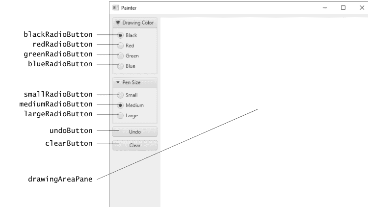

图 13.5 为程序化操作的控件标记了 `fxid` 的绘图 GUI。

### 步骤 1：添加 BorderPane 作为根布局节点

从 Scene Builder 库窗口的 Containers（容器）部分将 `BorderPane` 拖到内容面板上。

### 步骤 2：配置 BorderPane

将 BorderPane 的 `Pref Width`（首选宽度）和 `Pref Height`（首选高度）分别设置为 640 和 480。记住，尺寸是根据 FXML 文档中根节点的大小决定的。我们将 BorderPane 的 `Padding`（内边距）设置为 8，以使其与阶段边缘隔离。

### 步骤 3：添加 VBox 和 Pane

将一个 `VBox` 拖入 BorderPane 的左侧区域，将一个 `Pane` 拖入中间区域。当你拖过 BorderPane 时，Scene Builder 会显示五个区域，并高亮显示释放鼠标时你拖动的项目放置的区域。如图 13.5 所示，将 Pane 的 `fxid` 设置为 `drawingAreaPane`。

对于 `VBox`，设置其 `Spacing`（间距）属性（在检查器的 Layout 部分），以便在添加到此容器的控件之间添加一些垂直间距。将其 `right Margin`（右边距）属性设置为 8，以便在 VBox 与添加到此的 Pane 之间添加一些水平间距。还将其 `Pref Width` 和 `Pref Height` 重置为默认值（`USE_COMPUTED_SIZE`），并将 `Max Height` 属性设置为 `MAX_VALUE`。这将使 VBox 能够达到容纳子节点所需的宽度，并占据整个高度。

将 Pane 的 `Pref Width` 和 `Pref Height` 重置为默认的 `USE_COMPUTED_SIZE` 值，并将其 `Max Width` 和 `Max Height` 设置为 `MAX_VALUE`，使其占据 BorderPane 中间区域的完整宽度高度。在检查器 Properties 部分的 JavaFX CSS 中，点击 `Style` 字段（初始为空）并选择 `-fx-background-color`，表示你将指定 Pane 的背景颜色。在右侧字段中指定白色。

### 步骤 4：向 VBox 添加 TitledPane

从库的 Containers 部分向 VBox 绘制两个 `TitledPane`（空）对象。对于第一个 `TitledPane`，将其 `Text` 属性设置为“Drawing Color”（绘图颜色）。对于第二个，将其 `Text` 属性设置为“Pen Size”（笔画）。

### 步骤 5：自定义 TitledPanes

编译后的 GUI 中的每个 `TitledPane` 都包含多个 `RadioButton`（单选按钮）。我们将在每个 `TitledPane` 内部使用 `VBox` 来帮助排列控件。为每个 `VBox` 拖入一个 `TitledPane`，将其 `Spacing` 属性设置为 8，并将 `Pref Width` 和 `Pref Height` 设置为 `USE_COMPUTED_SIZE`，以便 `VBox` 将根据其内容调整大小。

### 步骤 6：向 VBox 添加 RadioButton

从库的 Controls 部分向 Drawing Color `TitledPane` 的 `VBox` 绘制四个 `RadioButton`，然后如图 13.5 所示配置它们的属性和 `fxid`。选择 `blackRadioButton` 并确保其 `Selected` 属性已勾选，然后对 `mediumRadioButton` 执行此相同的操作。

### 步骤 7：为 RadioButtons 指定 ToggleGroup

选择第一个 `TitledPane` 的 `VBox` 中的所有四个按钮，将 `Toggle Group` 属性设置为 `colorToggleGroup`。当加载 FXML 文件时，将创建一个同名的 `ToggleGroup`，这四个 `RadioButton` 将与它关联，以确保同一时间只有一个被选中。对第二个 `TitledPane` 的 `VBox` 中的三个 `RadioButton` 重复此操作，然后将 `Toggle Group` 属性设置为 `sizeToggleGroup`。

### 步骤 8：更改 TitledPane 的首选宽度和高度

对于每个 `TitledPane`，将其 `Pref Width` 和 `Pref Height` 设置为 `USE_COMPUTED_SIZE`，以便 `TitledPanes` 根据其内容调整大小。

### 步骤 9：添加 Button

在 `TitledPanes` 下方添加两个 `Button`，然后如图 13.5 所示配置它们的 `Text` 属性和 `fxid`。将每个按钮的 `Max Width` 属性设置为 `MAX_VALUE`，使其填充 `VBox` 的宽度。

### 步骤 10：设置 VBox

我们希望 `VBox` 的宽度恰好能显示该列中的控件。为此，在 Document's Hierarchy 部分中选择 `VBox`。将该列的 `Min Width` 和 `Pref Width` 设置为 `USE_COMPUTED_SIZE`，将 `Max Width` 设置为 `USE_PREF_SIZE`（这意味着最大宽度应为首选宽度）。还将 `Max Height` 重置为其默认的 `USE_COMPUTED_SIZE` 值。GUI 现在已完成，并应该如图 13.5 所示出现。

### 步骤 11：指定控制器类名

如第 12.5.2 节所述，在 JavaFX FXML 应用中，应用的控制器类通常定义了用于程序操作控件的实例变量，以及事件处理方法。为了确保在应用运行时加载 FXML 文件时创建控制器类的对象，你必须在 FXML 文件中指定控制器的类名：

1. 展开 Scene Builder 的 Controller 窗口（位于 Hierarchy 窗口下方）。
2. 在 Controller class 字段中输入 `PainterController`。

### 步骤 12：指定事件处理方法名

接下来，你将在 Inspector 窗口的 Code 部分指定用于处理特定事件的方法名：

- 对于 `drawingAreaPane`，指定 `drawingDragged` 为鼠标拖动事件（位于 Code 部分 Mouse 标题下）。该方法将根据指定的颜色和大小绘制圆。
- 对于四个 `RadioButton`，指定 `colorRadioButtonSelected` 为 Action 事件处理器。该方法将根据用户的选择设置绘图颜色。
- 对于三个 `RadioButton`，指定 `sizeRadioButtonSelected` 为 Action 事件处理器。该方法将根据用户的选择设置笔画大小。
- 对于 Undo 按钮，指定 `undoButtonPressed` 为 Action 事件处理器。该方法将删除上一个圆。
- 对于 Clear 按钮，指定 `clearButtonPressed` 为 Action 事件处理器。该方法将清除整个绘图。

### 步骤 13：生成示例类

正如你在第 12.5 节看到的，当选择 View > `Skeleton` 时，Scene Builder 会生成控制器骨架。你可以将此代码复制到 `PainterController.java` 文件中，并与 `Painter.fxml` 存储在同一文件夹中。我们在第 13.3 节中展示了 `PainterController` 类。

## Painter 应用控制器代码

### PenSize 枚举

```java
private final int radius;

PenSize(int radius) { this.radius = radius; } // 构造函数

public int getRadius() { return radius; }
```

### 指向 UI 组件的实例变量

```java
// 指向 UI 组件的实例变量

@FXML private RadioButton blackRadioButton;
@FXML private RadioButton redRadioButton;
@FXML private RadioButton greenRadioButton;
@FXML private RadioButton blueRadioButton;
@FXML private RadioButton smallRadioButton;
@FXML private RadioButton mediumRadioButton;
@FXML private RadioButton largeRadioButton;
@FXML private Pane drawingAreaPane;
@FXML private ToggleGroup colorToggleGroup;
@FXML private ToggleGroup sizeToggleGroup;
```

### 用于管理 Painter 的实例变量

```java
// 用于管理 Painter 的实例变量

private PenSize radius = PenSize.MEDIUM; // 圆形半径
private Paint brushColor = Color.BLACK; // 绘制颜色
```

### 初始化方法：设置单选按钮的数据

```java
// 设置单选按钮的数据

public void initialize() {

    // 控件上的用户数据可以是任何 Object

    blackRadioButton.setUserData(Color.BLACK);
    redRadioButton.setUserData(Color.RED);
    greenRadioButton.setUserData(Color.GREEN);
    blueRadioButton.setUserData(Color.BLUE);

    smallRadioButton.setUserData(PenSize.SMALL);
    mediumRadioButton.setUserData(PenSize.MEDIUM);
    largeRadioButton.setUserData(PenSize.LARGE);
}
```

### 处理 drawingArea 的 onMouseDragged 鼠标事件

```java
// 处理 drawingArea 的 onMouseDragged 鼠标事件

public void drawingAreaMouseDragged(MouseEvent e) {

    Circle newCircle = new Circle(e.getX(), e.getY(),
        radius.getRadius(), brushColor);

    drawingAreaPane.getChildren().add(newCircle);
}
```

### 处理单选按钮的 ActionEvents

```java
// 处理单选按钮的 ActionEvents

public void colorRadioButtonSelected(ActionEvent e) {

    // 每个单选按钮的用户数据是对应的颜色

    brushColor = (Color) colorToggleGroup.getSelectedToggle().getUserData();
}
```

图 13.7 | Painter 应用的控制器。（3 部分中的第 2 部分。）

### 处理尺寸单选按钮的 ActionEvents

```java
// 处理尺寸单选按钮的 ActionEvents

@FXML
private void sizeRadioButtonSelected(ActionEvent e) {

    // 每个尺寸半径的用户数据是对应的 PenSize

    radius = (PenSize) sizeToggleGroup.getSelectedToggle().getUserData();
}
```

### 处理撤销按钮的 ActionEvents

```java
// 处理撤销按钮的 ActionEvents

@FXML
private void undoButtonPressed(ActionEvent event) {

    int count = drawingAreaPane.getChildren().size();

    // 如果有任何形状，则移除最后添加的一个

    if (count > 0) {
        drawingAreaPane.getChildren().remove(count - 1);
    }
}
```

### 处理清除按钮的 ActionEvents

```java
// 处理清除按钮的 ActionEvents

@FXML
private void clearPressed(ActionEvent event) {

    drawingAreaPane.getChildren().clear(); // 清除画布
}
```


**图 13.7** Painter 应用的控制器。（3 部分中的第 3 部分）

## PenSize enum

第 15–25 行定义了嵌套枚举类型 `PenSize`，它指定了三种画笔尺寸：`SMALL`（小）、`MEDIUM`（中）和 `LARGE`（大）。每个尺寸都有一个相应的半径，在创建 `Circle` 对象显示以响应鼠标拖动事件时使用。

Java 允许在其他类内部将类、接口和枚举声明为嵌套类型。除了 12.5.5 中引入的匿名内部类外，我们讨论的所有类、接口和枚举都是顶层的——即它们没有声明在另一个类型内部。`PenSize` 枚举类型在这里被声明为私有嵌套类型，因为它仅供 `PainterController` 使用。我们将在书的后面介绍更多关于嵌套类型的知识。

## 实例变量

第 28–37 行声明了控制器使用的 `@FXML` 实例，用于程序化地与 GUI 交互。记住，这些变量的名称必须与 `Painter.fxml` 中指定的响应字段值匹配；否则 `FXMLLoader` 将无法将 GUI 组件连接到实例变量。两个 `@FXML` 实例变量是 `ToggleGroups`（切换组），在单选按钮的事件处理程序中，我们将使用它们来确定选择了哪个单选按钮。第 40–41 行定义了两个额外的变量，分别存储当前的 `Color` 和当前的 `PenSize`。

## 方法 initialize

回想一下，当 `FXMLLoader` 创建控制器对象时，`FXMLLoader` 会确定该类是否包含一个无参数的 `initialize` 方法，如果是，则调用该方法来初始化控制器。第 44–53 行定义了 `initialize` 方法，以指定每个单选按钮对应的数据对象——`Color` 或 `PenSize`。你将在单选按钮的事件处理程序中使用这些对象。

## drawingAreaDragged 事件处理程序

第 56–61 行定义了 `drawingAreaDragged`，它响应 `drawingAreaPane` 中的拖动事件。你定义的每个鼠标事件处理程序都必须有一个 `MouseEvent` 参数（`javafx.scene.input`）。当事件发生时，该参数包含有关事件的信息，例如它的位置、按了哪些鼠标按钮、你与哪个节点进行了交互等。你在 Scene Builder 的 `MouseDragged` 事件处理程序中指定了 `drawingAreaDragged`。

第 58–59 行使用构造函数创建一个新的 `Circle` 对象，该构造函数的参数为中心点的 x 坐标、中心点的 y 坐标、圆的半径和颜色。

接下来，第 60 行将新的 `Circle` 附加到 `drawingAreaPane`。每个布局都有一个 `getChildren` 方法，返回一个包含布局节点的 `ObservableList<Node>` 集合。`ObservableList` 提供了添加和删除元素的方法。你将在本章后面学习更多关于 `ObservableList` 的知识。第 60 行使用 `ObservableList` 向 `drawingAreaPane` 添加一个新的 `Node`——所有 JavaFX 形状都继承自 `javafx.scene` 包中的 `Node` 类。

## colorRadioButtonSelected 事件处理程序

第 64–69 行定义了 `colorRadioButtonSelected`，它响应颜色单选按钮的 `Action`——每当选择一个新的单选按钮时。你在 Scene Builder 中将其指定为四个颜色单选按钮的 `Action` 事件处理程序。

第 67–68 行设置当前的绘制颜色。`ColorToggleGroup.getSelectToggle()` 返回当前选中的 `Toggle`。`RadioButton` 是实现 `Toggle` 的多个控件（或 `RadioMenuItem` 和 `ToggleButton`）之一。我们使用 `Toggle` 的 `userData` 方法来获取与对应的 `radioButton` 关联的数据对象。该 `Object` 是 `Color`，因此我们将 `Object` 强制转换为 `Color` 并将其赋值给 `brushColor`。

## sizeRadioButtonSelected 事件处理程序

第 72–77 行定义了 `sizeRadioButtonSelected`，它响应画笔尺寸 `IconButton` 的 `ActionEvents`。你在 Scene Builder 中将此事件处理程序指定为三个尺寸单选按钮的 `Action` 事件处理程序。第 75–76 行使用在 `colorRadioButtonSelected` 方法中设置当前颜色的相同方法设置了当前的 `PenSize`。

## undoButtonPressed 事件处理程序

第 80–88 行定义了 `undoButtonPressed`，它通过移除上一个显示的 `Circle` 来响应 `ActionEvent`。你在 Scene Builder 的 `Action` 事件处理程序中指定了此事件处理程序。

为了撤销上一个 `Circle`，我们从 `drawingAreaPane` 的节点集合中移除最后一个。首先，第 82 行获取集合中的元素数量。然后，如果大于 0，第 86 行移除索引最后的节点。

## clearButtonPressed 事件处理程序

第 91–94 行定义了 `clearButtonPressed`，它通过清除 `drawingAreaPane` 节点集合来响应 `clearButton` 的 `Action`。你在 Scene Builder 中将此事件处理程序指定为 `clearButton` 的 `On Action Handler`。第 93 行清空节点集合以擦除整个图形。

## 13.4 颜色选择器应用：属性绑定与属性监听器

在本节中，我们展示了一个颜色选择器应用（图 13.8），它演示了属性绑定和属性监听器。

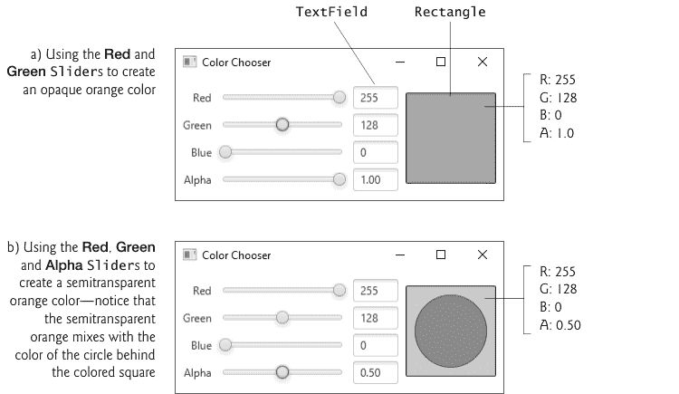

图 13.8 | 不透明和半透明橙色的颜色选择器应用。

### 13.4.1 技术概述

在本节介绍构建颜色选择器将用的技术。

#### RGBA 颜色

应用程序使用 RGB 颜色系统根据四个滑块的值显示颜色矩形。在 RGB 中，每种颜色由其红、绿、蓝颜色值表示，范围从 0 到 255，其中 0 表示无颜色，255 表示全色。例如，红色值为 0 的颜色不包含红色分量。Alpha 值（A）——范围从 0.0 到 1.0——代表颜色的透明度，0.0 完全透明，1.0 完全不透明。在图 13.8 输出中的两种颜色具有相同的 RGB 值，但图中显示的颜色是半透明的。你将使用用 RGBA 值创建的 `Color` 对象来填充显示颜色的 `Rectangle`。

#### 类的属性

JavaFX 广泛使用了属性。属性通过创建具有特定命名规范的 `set` 和 `get` 方法来定义。通常情况下，定义读/写属性的方法对形式如下：

```java
public final void setPropertyName(Type propertyName)

public final Type getPropertyName()
```

通常，此类方法会操作一个与属性同名的对应私有实例变量，但这并不是强制要求的。例如，`setHour` 和 `getHour` 方法表示一个名为 `hour` 的属性，并且通常会操作一个私有实例变量。如果属性表示一个布尔值，其方法名通常以“is”开头——例如 `ArrayList` 的 `isEmpty`。


> **工程观察 13.2**
>
> 定义属性的方法应该声明为 `final`，以防止子类重写这些方法，这可能导致客户端代码中出现意想不到的结果。

#### 属性绑定

JavaFX 属性的实现方式使其成为可观测的——当属性值改变时，其他对象可以做出响应。这类似于事件处理。响应属性变化的一种方法是通过属性绑定，它允许当一个对象的属性发生变化时，另一个对象的属性得以更新。例如，你将使用属性绑定使得当用户移动 `Slider`（滑块）时，`TextField` 能够显示 `Slider` 的值。属性绑定不仅限于 JavaFX 控件。`javafx.beans` 包包含许多你可以用于在在自己的类中定义可绑定属性的类。

#### 属性监听器

属性监听器与属性绑定相似。属性监听器是一个在属性值改变时被调用的事件处理器。在处理器中，你可以以适合你的方式对属性变化做出响应。在本应用程序中，当 `Slider` 的值改变时，属性监听器会将值存储在实例变量中，根据所有 `Slider` 的值创建一个新的 `Color`，并设置显示当前颜色的 `Rectangle` 对象的填充颜色。有关属性、属性绑定和监听器的更多信息，请访问：

```
http://docs.oracle.com/javase/javafx/properties-binding-tutorial/binding.html
```

### 13.4.2 构建 GUI

在本节中，我们将讨论颜色选择器应用程序的 GUI。我们不会像在第 12 章中那样提供具体的步骤，而是提供构建 GUI 的通用指令，并关注新概念的特定细节。在构建 GUI 时，请记住，通过 Scene Builder 的层次结构（Hierarchy）部分来操作布局和控件比直接在设计区域操作要简单。在继续之前，打开 Scene Builder 并创建一个名为 `ColorChooser.fxml` 的 FXML 文件。

#### 此应用程序控件的 fxid 属性值

图 13.9 显示了颜色选择器应用程序程序化控件的 `fxid` 属性。在构建 GUI 时，你应该像在第 12 章中学的那样，在 FXML 文档中设置相应的 `fxid` 属性。

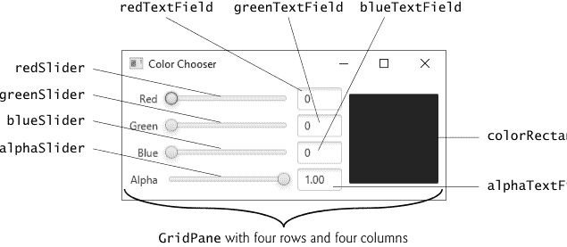

图 13.9 | 带有 fxid 的颜色选择器应用程序程序化的控件。

**第 1 步：添加 GridPane**

从 Library（库）部分拖入 `GridPane` 到 Scene Builder 的内容面板中。

**第 2 步：配置 GridPane**

此应用程序的 `GridPane` 需要四行。使用你之前学的方法为 `GridPane` 添加两列和一行。设置 `GridPane` 的 `Hgap` 和 `Padding` 属性为 8，以提供列之间的间距。

**第 3 步：添加控件**

参考图 13.9，`Labels`、`Sliders`、`TextFields`、`Circle` 和 `Rectangle` 位于 Library 的 Shapes（形状）部分。在添加 `Circle` 和 `Rectangle` 时，将它们都放在右侧列的第一行。确保在添加 `Rectangle` 之前添加 `Circle`，以便它位于矩形的后面。设置 `Labels` 和 `TextFields` 的文本以及相应的 `fxid` 属性。

**第 4 步：配置 Sliders**

对于红、绿、蓝滑块，将 `Max` 属性设置为 255（RGBA 颜色方案中的值）。对于 alpha 滑块，将 `Max` 属性设置为 1.0（RGBA 颜色方案中的最大不透明度）。

**第 5 步：配置 TextFields**

将所有 `TextField` 的 `Pref Width` 属性设置为 50。

**第 6 步：配置 Rectangle**

将 `Rectangle` 的 `Width` 和 `Height` 设置为 100，然后将其 `Row Span` 属性设置为 `Remainder`，使其跨越所有行。

**第 7 步：配置 Circle**

将 `Circle` 的 `Radius` 设置为 40，然后将其 `Row Span` 属性设置为 `Remainder`，使其跨越所有行。

**第 8 步：配置 Rows**

将所有列的 `Pref Height` 属性设置为 `USE_COMPUTED_SIZE`，使行的高度适应内容。

**第 9 步：配置 Columns**

将所有列的 `Pref Width` 属性设置为 `USE_COMPUTED_SIZE`，使列的宽度适应内容。对于左侧列，将 `Halignment` 设置为 `RIGHT`。对于右侧列，将 `Halignment` 设置为 `CENTER`。

**第 10 步：配置 GridPane**

将 `GridPane` 的 `Pref Width` 和 `Height` 设置为 `USE_COMPUTED_SIZE`，使其根据内容自动调整大小。你的 GUI 现在应该像图 13.9 所示。

**第 11 步：指定控制器类**

为了确保在运行时加载 FXML 时创建该类的实例，请指定 `ColorChooser` 为控制器类名。

**第 12 步：生成示例控制器**

选择 View > Sample Controller，将此代码复制到 `ColorChooser.java` 中并将文件与 `ColorChooser.fxml` 存在同一个文件夹中。

### 13.4.3 ColorChooser 子类

图 13.10 显示了启动应用程序的 `ColorChooser` 子类。该类加载 FXML 并像之前的 JavaFX 示例一样显示它。

```java
// Fig13.8: ColorChooser.java

// 加载并显示颜色选择器 GUI 的主类

import javafx.application.Application;
import javafx.fxml.FXMLLoader;
import javafx.scene.Parent;
import javafx.scene.Scene;
import javafx.stage.Stage;

public class ColorChooser extends Application {

    @Override
    public void start(Stage stage) throws Exception {
        Parent root = FXMLLoader.load(getClass().getResource("ColorChooser.fxml"));
        Scene scene = new Scene(root);
        stage.setTitle("Color Chooser");
        stage.setScene(scene);
        stage.show();
    }

    public static void main(String[] args) {
        launch(args);
    }
}
```

图 13.10 | 加载并显示颜色选择器 GUI 的应用程序类。（第一部分，共两部分）

### 13.4.4 ColorChooserController 类

图 13.11 显示了 `ColorChooserController` 类的最终版本，并突出了此应用程序的功能。

```java
// Fig13.9: ColorChooserController.java

// 颜色选择器应用程序的控制器

import javafx.beans.value.ChangeListener;
import javafx.beans.value.ObservableValue;
import javafx.fxml.FXML;
import javafx.scene.control.Slider;
import javafx.scene.control.TextField;
import javafx.scene.paint.Color;
import javafx.scene.shape.Rectangle;

public class ColorChooserController {

    // 与 GUI 组件交互的实例变量
    @FXML private Slider redSlider;
    @FXML private Slider greenSlider;
    @FXML private Slider blueSlider;
    @FXML private TextField redTextField;
    @FXML private TextField greenTextField;
    @FXML private TextField blueTextField;
    @FXML private TextField alphaTextField;
    @FXML private Rectangle rectangleColor;

    // 用于管理的实例变量
    private int red = 0;
    private int green = 0;
    private int blue = 0;
    private double alpha = 1.0;

    public void initialize() {
        // 将 TextField 的值绑定到相应的 Slider
        redTextField.textProperty().bind(
            redSlider.valueProperty().asString("%.0f"));

        greenTextField.textProperty().bind(
            greenSlider.valueProperty().asString("%.0f"));

        blueTextField.textProperty().bind(
            blueSlider.valueProperty().asString("%.0f"));

        alphaTextField.textProperty().bind(
            alphaSlider.valueProperty().asString("%.2f"));

        // 根据 Slider 的变化设置 Rectangle 填充色的监听器
        redSlider.valueProperty().addListener(
    }
}
```


# 第 13 章 JavaFX GUI：部分 2

## 颜色选择器应用的控制器（部分 2/2）

```java
new ChangeListener<Number>() {
    @Override
    public void changed(ObservableValue<? extends Number> obs,
        Number oldValue, Number newValue) {
        red = newValue.intValue();
        colorRectangle.setFill(Color.rgb(red, green, blue, alpha));
    }
});
```

```java
greenSlider.valueProperty().addListener(
    new ChangeListener<Number>() {
        @Override
        public void changed(ObservableValue<? extends Number> obs,
            Number oldValue, Number newValue) {
            green = newValue.intValue();
            colorRectangle.setFill(Color.rgb(red, green, blue, alpha));
        }
    });
```

```java
blueSlider.valueProperty().addListener(
    new ChangeListener<Number>() {
        @Override
        public void changed(ObservableValue<? extends Number> obs,
            Number oldValue, Number newValue) {
            blue = newValue.intValue();
            colorRectangle.setFill(Color.rgb(red, green, blue, alpha));
        }
    });
```

```java
alphaSlider.valueProperty().addListener(
    new ChangeListener<Number>() {
        @Override
        public void changed(ObservableValue<? extends Number> obs,
            Number oldValue, Number newValue) {
            alpha = newValue.doubleValue();
            colorRectangle.setFill(Color.rgb(red, green, blue, alpha));
        }
    });
```

**图 13.11** | 颜色选择器应用的控制器。（部分 2/2）。

## 实例变量

第 13–27 行定义了控制器的实例变量。变量 `red`、`green`、`blue` 和 `alpha` 分别存储 `redSlider`、`greenSlider`、`blueSlider` 和 `alphaSlider` 的当前值。这些值在用户每次移动 Slider 的滑块时，用于更新 `colorRectangle` 的填充颜色。

## 方法 initialize 方法

第 29–31 行定义了 `initialize` 方法，该方法在 GUI 创建后初始化控制器。在此应用中，`initialize` 配置了属性绑定和属性监听器。

## 属性到属性的绑定

第 31–38 行设置了 Slider 的值与相应 `TextField` 文本之间的属性绑定，使得 Slider 能够更新相应的 `TextField`。考虑第 31–32 行，它们将 `redSlider` 的 `valueProperty` 绑定到 `redTextField` 的 `textProperty`：

```java
redTextField.textProperty().bind(
    redSlider.valueProperty().asString("%0f"));
```

每个 `TextField` 都有一个由其 `textProperty` 方法返回的属性（位于 `javafx.beans.property` 包）。`StringProperty` 方法接收一个 `ObservableValue` 作为参数。当 `ObservableValue` 变化时，绑定的属性会随之更新。在这种情况下，`ObservableValue` 是表达式 `redSlider.valueProperty().asString("%0f")` 的结果。Slider 的 `valueProperty` 将 Slider 的值属性作为一个 `DoubleProperty` 返回——这是一个可观察的双精度值。由于 `TextField` 的文本必须绑定到字符串，我们调用了 `DoubleProperty` 方法 `asString`，它返回一个 `StringBinding`（一种可观察对象），生成 `DoubleProperty` 的字符串表示。此版本的 `asString` 创建了一个指定 `DoubleProperty` 格式的格式控制字符串。

## 属性监听器

若要在属性值变化时执行操作，请注册一个属性监听器。第 41–50 行为 Slider 的值属性注册了 `ChangeListener`。考虑当用户移动 `redSlider` 滑块时 `ChangeListener` 是如何执行的。正如我们在第 12.5 节的小费计算器中所讨论的，我们使用匿名内部类来定义监听器。每个 `ChangeListener` 将 `newValue` 参数的整数值存储在相应的实例变量中，这可以调用 `colorRectangle` 的 `setColor` 方法，使用 `Color rgb` 创建新对象来更改其颜色。

## 13.5 封面查看器应用：使用 JavaFX 集合数据驱动 GUI

应用通常需要编辑和显示数据。JavaFX 提供了一个全面的模型，允许 GUI 与数据进行交互。在本节中，你将构建封面查看器应用（图 13.12），它将 `Book` 对象列表绑定到 `ListView`。当用户在 `ListView` 中选择一项时，相应的 `Book` 封面图像将显示在 `ImageView` 中。

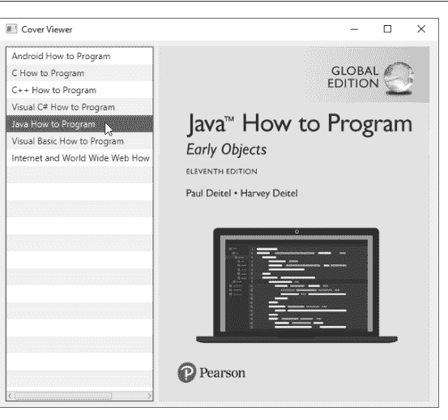

**图 13.12** | 使用 Java 编程的封面查看器。

### 13.5.1 技术概述

此应用使用 `ListView` 控件显示书籍标题集合。你可以单独向 `ListView` 添加项目，在此处你将将一个 `ObservableList` 对象绑定到 `ListView`。如果你对 `ObservableList` 进行更改，它的观察者（此应用中的 `ListView`）将收到更改通知。`javafx.collections` 包定义了 `ObservableList`（类似于 `ArrayList`）和其他集合接口。该包还包含 `FXCollections`，它提供了创建和操作集合的静态方法。你将使用属性监听器，当用户从 `ListView` 中选择项目时显示正确的图像——在这种情况下，属性更改了所选项目。

### 13.5.2 向应用文件夹添加图像

从本章的示例文件夹中，将 `images` 文件夹（包含大、小子文件夹）复制到保存此应用 FXML 文件以及源码 `CoverViewer.java` 和 `CoverViewerController.java` 的文件夹中。虽然在这个示例中仅使用大图，但你将使用该文件夹创建下一个示例，它将使用两组图像。

### 13.5.3 构建 GUI

在本节中，我们将讨论封面查看器应用的 GUI。按照你之前的做法，创建一个新的 FXML 文件，然后将其保存为 `CoverViewer.fxml`。

#### 应用控件的 fxid 属性值

图 13.13 显示了封面查看器应用程序化操作控件的 `fxid` 属性。在构建 GUI 时，你应该在 FXML 文档中设置相应的 `fxid` 属性。

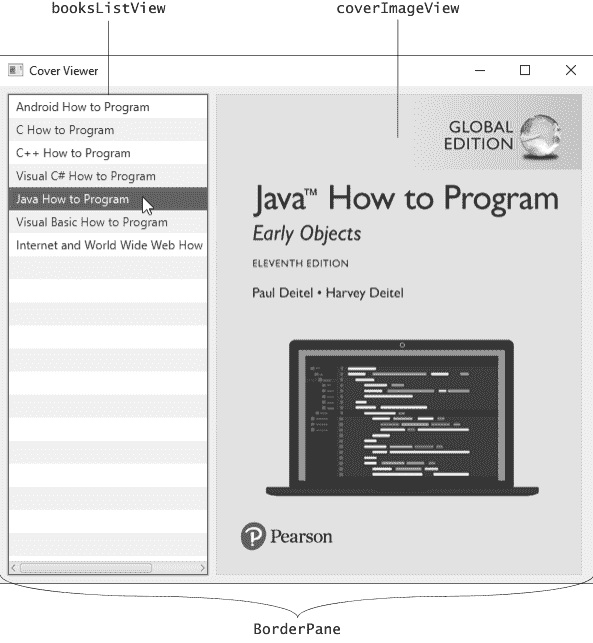

**图 13.13** | 带有程序化操作标签的封面查看器应用。

### 添加并配置控件

使用你之前学习的技术，创建一个 `BorderPane`。在左侧区域放置 `ListView` 控件，在中间区域放置 `ImageView` 控件。对于 `ListView`，设置以下属性：

- Margin—8（右边距）将 `ListView` 与 `ImageView` 分隔
- Pref Width—200
- Max Height—MAX_VALUE
- Min Width, Min Height—USE_SIZE

对于 `ImageView`，将其 `Fit Width` 和 `Fit Height` 分别设置为 370 和 480。为了调整 `BorderPane` 内容的大小，将其 `Pref Width` 和 `Pref Height` 设置为 `USE_SIZE`。此外，`Padding` 属性设置为 8 以设置 `BorderPane` 内边距。

### 指定控制器类

为了确保在运行时加载 FXML 文件时创建控制器对象，请在 FXML 文件中指定 `controller` 为类名。

### 生成示例控制器

选择 `View > Controller Skeleton`，然后将此代码复制到 `CoverViewer` 文件中并存储在与 `CoverViewer.fxml` 相同的文件夹中。我们将在 13.5.5 节显示完整的 `CoverViewerController` 类。

### 13.5.4 Application 的子类

图 13.14 显示 `Application` 的子类。

```java
// Fig 13.13: CoverViewer.java
// 加载并显示 CoverViewer GUI 的主类
import javafx.application.Application;
import javafx.fxml.FXMLLoader;
import javafx.scene.Parent;
import javafx.scene.Scene;
import javafx.stage.Stage;

public class CoverViewer extends Application {
    @Override
    public void start(Stage stage) throws Exception {
        Parent root = FXMLLoader.load(getClass().getResource("CoverViewer.fxml"));
        Scene scene = new Scene(root);
        stage.setTitle("Cover Viewer");
        stage.setScene(scene);
        stage.show();
    }

    public static void main(String[] args) {
        launch(args);
    }
}
```

**图 13.14** | 加载并显示 CoverViewer GUI 的主类。

### 13.5.5 CoverViewerController 类

图 13.15 显示了带有应用新功能的 `CoverViewerController` 类最终版本。

```java
// Fig 13.14: CoverViewerController.java
// 封面查看器应用的控制器
import javafx.beans.value.ChangeListener;
```

**图 13.15** | 封面查看器应用的控制器。（部分 1/2）。

```java
import javafx.beans.value.ObservableValue;
import javafx.collections.FXCollections;
import javafx.collections.ObservableList;
import javafx.fxml.FXML;
import javafx.scene.control.ListView;
import javafx.scene.image.Image;
import javafx.scene.image.ImageView;
```

```java
public class CoverViewController {
    // 用于与 GUI 交互的实例变量
    @FXML private ListView<Book> booksListView;
    @FXML private ImageView coverImageView;
```

```java
// 存储 Book 对象的列表
private final ObservableList<Book> books = 
    FXCollections.observableArrayList();
```

```java
// 初始化控制器
public void initialize() {
    // 填充 ObservableList<Book>
    books.add(new Book("Android How to Program",
        "/images/androidhttp.jpg", "/images/large/androidhttp.jpg"));
    books.add(new Book("C How to Program",
        "/images/chhtp.jpg", "/images/large/chhtp.jpg"));
    books.add(new Book("C++ How to Program",
        "/images/cpphtp.jpg", "/images/large/cpphtp.jpg"));
    books.add(new Book("Visual C How to Program",
        "/images/vcshtp.jpg", "/images/large/vcshtp.jpg"));
    books.add(new Book("Java How to Program",
        "/images/jhtp.jpg", "/images/large/jhtp.jpg"));
    books.add(new Book("Visual Basic How to Program",
        "/images/vbhtp.jpg", "/images/large/vbhtp.jpg"));
    books.add(new Book("Internet and World Wide How to Program",
        "/images/iwhtp.jpg", "/images/large/iwhtp.jpg"));
    booksListView.setItems(books); // 将 books 绑定到

    // 当 ListView 的选择发生变化时，在 ImageView 中显示大封面
    booksListView.getSelectionModel().selectedItemProperty().
        addListener(new ChangeListener<Book>() {
            @Override
            public void changed(ObservableValue<? extends Book> observable, Book oldValue, Book newValue) {
                coverImageView.setImage(new Image(newValue.getLargeImage()));
            }
        });
}
```


## 13.6 封面查看器应用：自定义 ListView 单元格

### @FXML 实例变量

第 14–15 行描述了控制器的 `@FXML` 实例变量。注意 `ListView` 是一个泛型类。在这种情况下，`ListView` 显示 `Book` 对象。`Book` 类包含三个 `String` 变量以及相应的 set 和 get 方法：

- `title`——书籍的标题。
- `thumbImage`——书籍缩略图的路径（在下一个示例中使用）。
- `largeImage`——书籍大尺寸图的路径。

该类还提供了一个返回 `Book` 标题的 `toString` 方法，以及一个初始化这三个实例变量的构造函数。您应该将本章示例中的 `Book` 类复制到包含 `CoverViewer.fxml`、`CoverViewer.java` 和 `CoverViewerController.java` 的文件夹中。

### 实例变量 book

第 18–19 行将实例变量定义为 `ObservableList<Book>`，并通过调用 `Collections` 静态方法 `observableArrayList` 来初始化它。该方法返回一个实现 `ObservableList` 接口的空集合对象（类似于 `ArrayList`）。

### 初始化 books ObservableList

第 24–37 行方法 `initialize` 创建并将 `Books` 添加到 `books` 集合中。第 38 行将集合传递给 `ListView` 方法 `setItems`，将 `ListView` 绑定到 `ObservableList`。这种数据绑定允许 `ListView` 自动显示 `Book` 对象。默认情况下，`ListView` 显示每个 `Book` 的 `String` 字符串表示。（在下一个示例中，你将对其进行自定义。）

### 监听 ListView 选择变化

为了使书籍封面的显示与当前选中的书籍保持同步，我们监听 `ListView` 的所选中项的变化。默认情况下，`ListView` 支持单选——一次只能选择一个项目。`ListView` 也支持多选。选择类型由 `ListView` 的 `MultipleSelectionModel`（`SelectionModel` 的子类）管理，该模型控制用于操作 `ListView` 项目的属性和方法。

为了响应选择变化，我们为 `MultipleSelectionModel` 的 `selectedItemProperty` 注册了监听器（第 41–51 行）。`ListView` 方法 `getSelection` 返回一个 `MultipleSelectionModel` 对象。在此示例中，`selectedItemProperty` 返回一个 `ReadOnlyProperty<Book>` 更改 Listener 以 `oldValue` 和 `newValue` 参数接收它，分别提供之前选的和新选的 `Book` 对象。

第 47–48 行使用 `newValue` 初始化一个新的 `Image`（包 `javafx.scene.image`）——这从该路径加载图像。然后我们将新的 `Image` 传递给 `CoverImageView` 的 `setImageView` 以显示图像。

### 13.6 封面查看器应用：自定义 ListView 单元格

在前面的示例中，`ListView` 显示的是 `Book` 的 `String` 字符串表示（即其标题）。在本示例中，你将创建一个自定义单元格工厂（Cell factory），使用 `VBox`、`ImageView` 和 `Label` 将每本书以其缩略图和标题的形式呈现（图 13.16）。

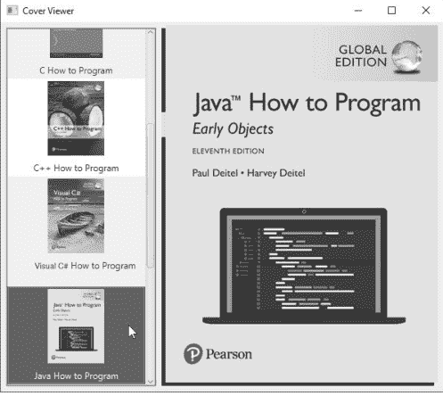

**图 13.16** | 选择了 Java How to Program 的封面查看器应用。

#### 13.6.1 技术概述

##### 用于格式的 ListCell 泛型类

正如你在第 13.5 节所示，`ListView` 单元格显示的是字符串表示。要创建自定义单元格格式，你必须定义 `ListView` 的子类（包 `javafx.scene.control`）来指定如何显示项目。

##### 编程创建布局和控件

到目前为止，你一直使用 Scene Builder 创建 GUI。具体来说，你还将创建一个包含 `ImageView` 和 `Label` 的 `VBox`。`VBox` 代表自定义单元格工厂。

#### 13.6.2 复制 CoverViewer 应用

该应用的布局和类与 Scene Builder 中的相同。将 `CoverViewer` 应用复制到新文件夹 `CoverViewerCustom`。

#### 13.6.3 ImageTextCell 单元格工厂

`ImageTextCell`（图 13.17）定义了此版本封面查看应用的 `ListView` 布局。该类继承 `ListCell<Book>` 因为它定义了单元格中 `Book` 的呈现方式。

```java
// 图 13.16: ImageTextCell.java

// 显示图像文本的自定义单元格工厂

import javafx.geometry.Pos;
import javafx.scene.control.Label;
import javafx.scene.control.ListCell;
import javafx.scene.image.Image;
import javafx.scene.image.ImageView;
import javafx.scene.layout.VBox;
import javafx.scene.text.Text;

public class ImageTextCell extends ListCell<Book> {

    private VBox vbox = new VBox(8.0); // 控件之间的间距
    private ImageView thumbnail = new ImageView(); // 初始化为空
    private Label label = new Label();

    // 构造函数配置 VBox、ImageView 和 Label
    public ImageTextCell() {
        vbox.setAlignment(Pos.CENTER); // VBox 水平包含内容
        thumbnail.setPreserveRatio(true);
        thumbnail.setFitHeight(100.0); // 缩略图高 100 点
        vbox.getChildren().add(thumbnail); // 添加到 VBox
        label.setWrapText(true); // 文本宽到无法适应 label 时换行
        label.setTextAlignment(TextAlignment.CENTER); // 居中
        vbox.getChildren().add(label); // 添加到 VBox
        setWidth(USE_PREF_SIZE); // 使用首选尺寸作为单元格宽度
    }

    @Override
    protected void updateItem(Book item, boolean empty) {
        // 为了确保单元格显示正常
        super.updateItem(item, empty);

        if (empty || item == null) {
            setGraphic(null); // 不显示任何内容
        } else {
            // 设置 ImageView 的缩略图
            thumbnail.setImage(new Image(item.getThumbImage()));
            label.setText(item.getTitle()); // 配置 Label 文本
            setGraphic(vbox); // 将自定义布局附加到 ListView 单元格
        }
    }
}
```

图 13.17 | 显示图像和文本的自定义 ListView 单元格工厂。

##### 构造函数

构造函数（第 17–29 行）配置了我们用于构建自定义呈现的实例变量。第 18 行表示 `VBox` 的子节点应该居中显示。第 20–22 行配置了 `ImageView` 并将其附加到 `VBox` 的子节点集合。第 20 行表示 `ImageView` 应该保持其宽高比，第 21 行表示 `ImageView` 的高度为 100 磅。第 22 行将 `ImageView` 附加到 `VBox`。第 24–26 行配置了 `Label` 并将其附加到 `VBox` 的子节点集合。第 24 行表示 `Label` 应该对文本换行，第 25 行表示文本应该在 `Label` 的宽度内居中，第 26 行将 `Label` 附加到 `VBox`。最后，第 28 行表示单元格应该使用其首选宽度，该宽度由第一个 `ListCell` 的宽度决定。

##### 方法 updateItem

`updateItem`（第 32–46 行）配置 `Label` 的文本和 `ImageView`，在 `ListView` 中显示自定义呈现。此方法在 `ListView` 被调用时由 `ListView` 的单元格工厂调用——也就是说，当 `ListView` 首次显示以及单元格即将滚动到屏幕上时调用。该方法接收要显示的 `Book` 对象以及一个指示单元格是否应被创建为空状态的布尔值。你必须调用 `updateItem` 的父类方法（第 35 行）以确保单元格显示正确。

如果单元格为空或项目为 `null`，则没有 `Book` 要显示，第 38 行将带 `null` 传递给 `ImageTextCell` 继承的 `setGraphic` 方法。任何 JavaFX `Node` 接收的参数都是应该在单元格中显示的 `Node`。这为您自定义单元格的外观提供了极大的灵活性。

如果有 `Book` 要显示，第 40–45 行配置了 `ImageTextCell` 的 `Label` 和 `ImageView`，并设置其在 `ImageView` 中显示。第 42 行将 `Label` 的文本设置为 `Book` 的标题。最后，第 44 行使用 `setGraphic` 将 `ImageTextCell` 的 `VBox` 设置为单元格的呈现形式。

> 为了获得最佳的 `ListView` 性能，最佳实践是将呈现的控件定义为 `ListCell` 子类的实例变量，并在子类构造函数中配置它们。这可以最大限度地减少每次调用 `updateItem` 时所需的工作量。

#### 13.6.4 CoverViewerController 类

一旦定义了单元格布局，更新 `CoverViewerController` 使用它就需要设置 `ListView` 的单元格工厂。将以下代码作为 `CoverViewerController` 的 `initialize` 方法的最后一个语句：

```java
booksListView.setCellFactory(
    new Callback<ListView<Book>, ListCell<Book>>() {
        @Override
        public ListCell<Book> call(ListView<Book> listView) {
            return new ImageTextCell();
        }
    });
```

并添加对 `javafx.util` 的导入。

`ListView` 方法 `setCellFactory` 的参数是函数式接口 `Callback` 的实现（位于 `javafx.util` 包中）。此泛型 JavaFX 提供了一个接收一个参数并返回一个值的回调。在这种情况下，我们使用一个匿名内部类对象来实现 `Callback`。在 `Callback` 的括号中，第一个（`ListView<Book>`）是接口 `call` 的参数类型，第二个（`ListCell<Book>`）是 `call` 的返回类型。参数代表自定义单元格将出现的 `ListView`。方法 `call` 创建并返回一个 `ImageTextCell` 对象。

每当 `ListView` 需要新单元格时，匿名类的 `call` 方法就会被调用以创建一个新的 `ImageTextCell`。`ImageTextCell` 的 `updateItem` 方法将被调用以配置单元格内容。注意，使用匿名内部类而不是 lambda 表达式，可以自定义单元格的外观。

## 13.7 额外的 JavaFX 功能

## 13.8 JavaFX: Java SE 9 JavaFX 更新

### JavaFX: 用于移动设备和嵌入式设备的 JavaFX

Java 的核心优势是可以编写可以运行在任何带有 Java 虚拟机（JVM）的设备上的应用程序，包括笔记本电脑、桌面服务器、移动设备和嵌入式设备（如物联网中使用的设备）。Oracle 仅正式支持用于桌面应用程序的 JavaFX。Gluon 的开源 JavaFXPorts 将桌面版 JavaFX 引入了移动设备（iOS 和 Android）以及如树莓派（https://www.raspberrypi.org/）等设备，这些设备可以作为独立计算机或用于嵌入式设备应用。有关关于 JavaFXPorts 的更多信息，请访问

http://javafxports.org/

此外，Gluon Mobile 为 iOS 和 Android 提供了针对移动端优化的 Java 实现。更多信息请参阅

http://gluonh.com/products/mobile/

### 用于调试 JavaFX 场景和节点的 Scenic View

Scenic View 是一个用于 JavaFX 场景（Scenes）和节点（Nodes）的调试工具。你可以将 Scenic View 直接嵌入到应用程序中，或将其作为独立程序运行。你可以检查你的 JavaFX 场景和节点，并动态修改它们，以查看更改如何影响它们在屏幕上的呈现——而无需为每次更改都编辑代码、重新编译或重新运行。有关更多信息，请访问

http://www.scenic-view.org

### JavaFX 资源与真实世界中的 JavaFX

访问

http://bit.ly/JavaFXResources


获取详细且不断增长的 JavaFX 资源列表，其中包含链接到：

- 文章
- 教程（免费和付费）
- 关键博客和网站
- YouTube® 视频
- 书籍（付费）
- 许多库、工具、项目和框架
- 来自 JavaFX 演示的幻灯片
- 以及各种 JavaFX 在真实世界中的实际应用示例。

# 13.8 JavaFX 9: Java SE 9 JavaFX 更新

本节概述了 JavaFX 9 的若干更改和增强。

## Java SE 9 模块化

Java SE 9 最重大的软件工程特性是模块系统。这同样适用于 JavaFX 9。关键的 JavaFX 9 模块包括：

- `javafx.base`——包含所有 JavaFX 9 应用所需的包。所有其他 JavaFX 9 模块都依赖于它。
- `javafx.controls`——包含控件、布局和图表的包，包括我们在本章和第 12 章中演示的各种控件。
- `javafx.fxml`——包含用于处理 FXML 的包，包括我们在本章和第 12 章中演示的 FXML 特性。
- `javafx.graphics`——包含处理图形、动画、CSS（用于节点样式设置）、文本等的包（第 22 章，JavaFX 图形与多媒体）。
- `javafx.media`——包含整合音频和视频的包（第 22 章，JavaFX 图形与多媒体）。
- `javafx.swing`——包含用于在 JavaFX 9 应用中集成 Swing GUI 组件的包（第 26 章，Swing GUI 组件：第一部分，以及第 35 章，Swing GUI 组件：第二部分）。
- `javafx.web`——包含集成网页内容的包。

在你的应用程序中，如果你使用了模块化和 JDK 9，那么运行时只会加载你的应用程序所需的模块。否则，只要你没有使用内部 API——那些未公开的 Java API 并不是供公开使用的——你的应用程序将继续像以前一样运行。在模块化的 JDK 9 中，此类 API 将自动变为私有且你的应用程序无法访问——任何依赖于 Java-SE-9 之前内部 API 的代码将无法编译。我们在 Java SE 9 的专题中详细讨论模块化。详情请见前言。

## 新的公共皮肤 API

在第 22 章“JavaFX 图形与多媒体”中，我们演示了如何使用名为样式表（CSS）的技术来格式化 JavaFX 对象，该技术最初用于为网页元素设置样式。你会发现 CSS 允许你将呈现方式（例如字体、大小、颜色、位置）与 GUI 的结构和内容（布局容器、形状、文本、GUI 组件等）分开来。如果 JavaFX 的呈现完全由样式表（指定了 GUI 样式的规则）决定，你可以简单地切换到一个新样式——有时是皮肤（skin）来更改 GUI 的外观。这通常被称为换肤（skinning）。

每个 JavaFX 控件都有一个决定其默认外观的皮肤类（skin class）。在 JavaFX 8 中，皮肤类被定义为内部 API，但许多开发者通过扩展这些类来创建自定义皮肤。在 JavaFX 9 中，皮肤类现在是 `javafx.scene.control` 包中的公共 API。你可以扩展相应的皮肤类来定制特定类型控件的视觉效果。然后，你创建一个自定义皮肤的实例，并通过它的 `setSkin` 方法将其设置给控件。

## 针对 Linux 的 GTK+ 支持

GTK+（http://gtk.org）是一种 GUI 工具包，JavaFX 在后台使用它在 Linux 上渲染 GUI 和图形形状。在 Java SE 9 中，JavaFX 现在支持 GTK+。

## 高 DPI 支持

在 Java SE 8 中，JavaFX 增加了对 Windows 和 macOS 上高 DPI（每英寸点）屏幕的支持。Java SE 9 同样增加了高 DPI 支持，以及通过程序操纵 Windows 和 macOS 上应用程序渲染缩放比例的能力。

## 更新的流媒体（Streamer）

JavaFX 使用开源 Streamer 框架（https://streamer.freedesktop.org）实现其音频视频多媒体功能。JavaFX 9 整合了更新版本的 Streamer，包含了错误修复和性能增强。

## 更新的 WebKit

JavaFX 的 `WebView` 控件允许你嵌入网页内容。JavaFX 9 整合了更新版本的 WebKit。

# 13.9 总结

在本章中，我们讨论了 JavaFX 的各种布局。我们学习了如何使用 `TitledPane` 布局控件，并展示了如何使用正则表达式来填充它。我们还介绍了 JavaFX 的其他功能。在下一章节中，我们将讨论如何使用正则表达式来验证输入。

## 总结

### 13.2 在场景图中布局节点

- 布局容器根据大小和位置安排场景中的节点。
- 大多数情况下，不需要显式定义节点的大小。
- 布局可以相对于其父节点安排子节点。
- 最小尺寸属性指定节点允许的最小尺寸。
- 最大尺寸属性指定节点的最大尺寸。
- 首选尺寸属性指定节点建议的宽度和高度，应被布局使用。
- 节点的位置相对于父节点和场景中的其他节点。
- 大多数 JavaFX 布局使用相对定位。

### 13.3.1 技术概述

- `RadioButton` 作为互斥选项使用。
- 你将多个控件添加到 `ToggleGroup` 中，以确保组内只有一个被选中。
- 如果你通过代码创建 `ToggleGroup`（而不是在 FXML 中声明），可以调用 `RadioButton` 的 `setToggleGroup` 方法来指定其组。
- `BorderPane` 布局容器控制一个或多个区域——顶、右、底、左和中间。顶部和底部区域与 `BorderPane` 同宽。左侧和右侧填充顶部和底部之间的垂直空间。每个区域可以包含一个控件或一个包含其他控件的布局。
- `BorderPane` 的所有区域都是可选的！如果顶部或底部为空，左侧、中间和右侧将垂直扩展填充该区域。如果左侧或右侧为空，中间将水平扩展填充该区域。
- `TitledPane` 在顶部显示标题，并是一个可折叠的面板，其中包含一个布局节点。
- `javafx.scene` 包包含各种类用于创建可以在场景图中显示的 2D 和 3D 形状节点。
- 节点附加到面板布局时，坐标是从面板左上角测量的。
- JavaFX 节点支持鼠标事件。
- JavaFX 支持其他类型的输入事件，如触摸事件和按键事件。
- 每个 JavaControl 都有一个 `setUserData` 方法返回一个 `Object`。你可以使用它来存储任何你想与控件关联的对象——通常该对象在响应控件事件时使用。

### 13.3.2 创建 Painter.fxml 文件

- 如果你在 Scene Builder 中打开了 FXML 文件，可以从 File > New 创建一个新的 FXML 文件并保存。

## 第 13.3.3 构建 GUI

- `VBox` 的 `Spacing` 属性指定控件之间的垂直间距。
- 将节点的 `Max Height` 属性设置为 `MAX_VALUE` 可以让节点占据其父节点的高度。
- `Style` 中的 `-fx-background-color` 指定节点的背景颜色。
- `TitledPane` 的 `Text` 属性指定 `TitledPane` 顶部的标题。
- `RadioButton` 的 `Text` 指定显示在 `RadioButton` 旁文本。
- `RadioButton` 的 `Selected` 属性指定 `RadioButton` 是否被选中。（注：原文为 "IconButton"，上下文暗示为 "RadioButton" 或 "ToggleButton"）
- 在 FXML 中设置 `RadioButton` 的 `ToggleGroup` 属性会将该 `RadioButton` 添加到该切换组（`ToggleGroup`）中。
- 将控件的 `Max Width` 属性设置为 `MAX_VALUE` 可以使控件填充其父节点的宽度。
- 控件的 `On Dragged` 处理器（位于代码部分的 Mouse 标题下）指定了用户将鼠标拖过控件时要执行的操作。
- 要指定用户与 `RadioButton` 交互时执行的操作，请设置其 `On Action` 处理器。
- 要指定用户与 `Button` 交互时执行的操作，请设置其 `On Action` 处理器。

## 第 13.3.5 PainterController 类

- 顶层类型不会在另一个类型内部声明——这些被称为嵌套类型。
- Java 允许在其他类内部声明类、接口和枚举。
- 你定义的每个事件处理器都提供一个 `MouseEvent` 类型的参数（位于 `javafx.scene.input` 包中）。当事件发生时，该参数包含有关事件的信息，例如按了哪些鼠标按钮、用户与哪个窗格进行了交互。
- 每个窗格（pane）都有 `getChildren` 方法，返回一个包含布局节点的 `ObservableList<Node>` 集合。`ObservableList` 提供了添加和删除元素的方法。
- 所有 JavaFX 类都继承自 `javafx.scene` 包中的 `Node` 类。
- `ToggleGroup` 的 `getSelectedToggle` 方法返回当前选中的 `Toggle`。`RadioButton` 是若干控件（或 `RadioMenuItem` 和 `ToggleButton`）之一，它们都实现了 `Toggle` 接口。
- `Toggle` 的 `getUserData` 方法获取与控件关联的 `Object` 数据。

## 第 13.4.1 技术概览

- 在 RGBA 颜色系统中，每种颜色由其红、绿、蓝值表示，范围从 0 到 255，其中 0 表示无颜色，255 表示全色。Alpha 值（A）的范围从 0.0 到 1.0——代表颜色的透明度，0.0 为完全透明，1.0 完全不透明。
- 属性通过符合命名规范的 `get` 和 `set` 方法定义。通常，这些方法会操作一个与属性同名的相应私有实例变量，但这并非强制的。如果属性代表一个布尔值，则其 `get` 方法名通常以 "is" 开头而不是 "get"。
- JavaFX 属性是可观测的——当属性值发生变化时，其他观察者会做出相应响应。

### 13.4.1 技术概览（续）

- 响应属性变化的一种方法是通过**属性绑定**（property binding），这允许一个对象的属性通过另一个对象的属性发生变化而进行更新。
- 属性绑定不仅限于 JavaFX 控件。`javafx.beans` 包包含许多你可以在自己的类中使用的类来定义可绑定的属性。
- 属性监听器（property listener）是一个在属性值变化时被调用的事件处理器。在事件处理器中，你可以以适合你应用程序的方式响应属性变化。

## 第 13.4.2 构建 GUI

- 圆（`Circle`）和矩形（`Rectangle`）位于 Scene Builder 库的 Shapes（形状）部分。

## 第 13.4.4 ColorChooserController 类

- 控制类的 `initialize` 方法通常配置属性绑定和属性监听器。
- 每个 `TextField` 都有一个属性通过其 `textProperty` 方法作为 `StringProperty`（`javafx.beans.property`）返回。
- `StringProperty` 方法 `bind` 接收 `ObservableValue` 作为参数。当 `ObservableValue` 变化时，属性会相应更新。
- `Slider` 的 `valueProperty` 方法将 `Slider` 的属性作为 `DoubleProperty` 类对象返回——这是一个可观测的双精度数值值。
- `DoubleProperty` 的 `asString` 方法返回一个 `StringBinding`（这是一个 `ObservableValue`），它产生 `DoubleProperty` 的字符串表示。
- 要在属性值变化时执行任意任务，你可以注册一个属性监听器。

## 第 13.5 Cover View：使用 JavaFX 集合数据驱动的 GUI

- JavaFX 提供了一个全面的模型来控制 GUI 与数据交互。

### 13.5.1 技术概览

- `ListView` 控制对象的显示。
- 虽然你可以单独地向 `ListView` 添加项，但你通常会将一个 `ObservableList` 项绑定到 `ListView` 上。
- 如果你对 `ObservableList` 做了更改，它的观察者（例如 `ListView`）将自动收到这些更改通知。
- `javafx.collections` 包定义了 `ObservableList`（类似于 `ArrayList`）和其他可观测接口。
- `FXCollections` 提供了创建和操作可观测集合的静态方法。

## 第 13.5.5 CoverViewController 类

- `FXCollections.observableArrayList` 返回一个空集合对象（类似于 `ArrayList`），它实现了 `ObservableList` 接口。
- `ListView` 的 `setItems` 方法接收一个 `ObservableList` 并将 `ListView` 绑定到它。这种数据绑定允许 `ListView` 显示 `ObservableList` 中的对象——默认是字符串。
- 默认情况下，`ListView` 支持选择——一次可以选择一个项。`ListView` 也支持多项选择。选择类型由 `ListView` 的选择模型管理。

### 13.5.5 CoverViewController 类（续）

- 要响应选择变化，为 `SelectionModel` 的 `selectedItem` 注册监听器。
- `ListView` 方法 `getSelectionModel` 返回一个 `SelectionModel`。
- `MultipleSelectionModel` 的 `selectedItemProperty` 返回一个 `ReadOnlyObjectProperty`，监听器分别接收 `oldValue` 和 `newValue` 参数。

## 第 13.6.1 技术概览

- 要创建自定义 `ListView` 格式，必须定义一个 `ListCell`（`javafx.scene.control`）子类来指定如何创建 `ListView` 单元。
- 当 `ListView` 显示项时，它从工厂获取单元。
- 你使用 `ListView` 的 `setCellFactory` 方法替换返回 `ListCell` 对象的默认工厂。重写此单元的 `updateItem` 方法以指定单元布局和内容。
- 在 Scene Builder 中可以完成的一切都可以通过 Java 代码实现。

## 第 13.6.3 ImageTextCell 自定义单元

- `ListView` 布局定义为 `ListCell<Type>` 子类，其中 `Type` 是 `ListView` 中显示的对象类型。
- `ListCell<Type>` 子类的 `updateItem` 方法创建呈现形式。当工厂需要单元时调用此方法——当 `ListView` 首次显示以及单元滚动出屏幕时。
- `updateItem` 方法接收要显示的对象以及是否要更新单元的布尔值。你必须调用父类的 `updateItem` 版本以确保单元显示正确。
- `ListCell<Type>` 的 `setGraphic` 方法接收代表外观的 JavaFX `Node`。

## 第 13.6.4 CoverViewController 类

- 一旦定义了单元布局，必须设置 `ListView` 的单元工厂。
- `ListView` `setCellFactory` 的参数是 `Callback`（`javafx.util`）的实现。该泛型接口提供一个 `call` 方法，接收一个参数并返回自定义 `ListCell<Type>` 子类对象。

## 第 13.7 额外的 JavaFX 功能

- `TableView`（`javafx.scene.control`）以行和列显示表格数据，并支持用户与数据的交互。
- 在 SE 8 中，JavaFX 增加了辅助功能以帮助视觉障碍人士使用设备。这些功能包括屏幕阅读器支持、通过键盘导航 GUI，以及使控件更易读的高对比模式。
- 请参考你的系统关于启用屏幕阅读器和高对比模式的文档。
- 每个 JavaFX 控件都具有辅助功能属性。
- `accessibleTextProperty` 是屏幕阅读器为控件朗读的字符串。
- `accessibleHelpProperty` 是比 `accessibleTextProperty` 更详细的描述字符串。该属性应该帮助用户理解控件在应用程序上下文中的用途。
- `accessibleRoleProperty` 是枚举 `AccessibleRole`（包名 `javafx.scene`）中的一个值。屏幕阅读器使用此属性值来确定控件支持的属性和操作。
- `accessibleRoleDescriptionProperty` 是控件的字符串类型文本描述，屏幕阅读器通常紧随控件的内容或 `accessibleTextProperty` 的值读取该描述。
- 你可以向包含其他控件的 GUI 中添加标签（`Label`）。在这种情况下，你应该将每个 `Label` 的 `labelFor` 设置为它描述的特定控件。如果 `Label` 的 `labelFor` 引用了另一个控件，屏幕阅读器将向用户读取 `Label` 中描述该控件的文本。
- 你可以通过扩展 JavaFX 控件来对其进行自定义，或者直接通过 JavaFX 的控件类来创建自定义控件。
- [Scenic View](http://www.scene-view.org/) 是一个用于 JavaFX 场景和节点的调试工具。你可以将 Scenic View 直接嵌入到你的应用程序中，或将其作为独立程序运行。你可以检查你的 JavaFX 场景和节点，并动态地修改它们以查看更改如何影响它们在屏幕上的呈现——而无需重新编译代码并重新运行以进行更改。

## 13.8 JavaFX 9: Java SE 9 更新

JavaFX 9 最主要的新功能是模块化。

- 在你的应用中，使用 `jlink`，运行时只有你的应用所需的模块会被加载。否则，只要你没有使用所谓的内部 API（即不供公共用户使用的、未记录的 API），你的应用将继续像以前一样工作。
- 如果 JavaFX GUI 的呈现是由样式表（指定了 GUI 样式的规则）决定的，你可以简单地切换一个新的样式表（有时称为皮肤）来更改 GUI 的外观。这通常被称为“换肤”（skinning）。
- 每个控件（Control）还都有一个 skin 类，决定了它的默认外观。
- 在 JavaFX 8 中，skin 类被定义为内部 API。在 JavaFX 9 中，skin 类现在是 `javafx.scene.control` 包中的公共 API。
- 你可以扩展相应的 skin 类来定制特定类型控件的外观。然后，你创建一个自定义 skin 的对象，并通过它的 `setSkin` 方法将其设置为控件。
- JavaFX 9 支持 GTK——最新版本的 GTK。
- 在 SE 8 更新中，JavaFX 为 Windows 和 macOS 增加了高 DPI（每英寸点数）屏幕的支持。JavaFX 9 增加了对 Linux DPI 支持。
- JavaFX 9 增加了功能，可以程序化地操作 JavaFX 应用在 Windows、macOS 和 Linux 上渲染的缩放比例。
- JavaFX 使用开源 GStreamer 框架（https://gstreamer.org/）实现了音频视频多媒体功能。JavaFX 9 包含了更新版本的 GStreamer，带有各种错误修复和性能增强。
- JavaFX 的 `WebView` 控件允许你将 Web 内容嵌入到 JavaFX 应用中。`WebView` 基于开源 WebKit 框架（http://www.webkit.org）——这是一个支持加载和渲染网页的浏览器引擎。JavaFX 9 包含了更新版本的 WebKit。

# 自测习题

## 13.1 请为以下内容填空：

a) 你在 `ToggleGroup` 中添加多个 `RadioButton`，以确保组中在同一时间仅有一个 `RadioButton` 被选中。
b) 布局 决定了场景图中节点的大小和位置。
c) `TitledPane` 在其顶部显示标题，是一个包含布局节点（该节点包含其他节点）的可折叠面板。
d) `javafx.scene.shape` 包包含各种类，用于创建可以在场景图中显示的 2D 和 3D 形状节点。
e) 控件的 `On Dragged` 事件处理器指定了用户在控件上拖动鼠标时做什么。
f) 要指定当用户与 `RadioButton` 交互时做什么，请设置其 `On Action` 事件处理器。
g) 每个 `TextField` 都有一个文本属性，通过其 `textProperty` 方法返回一个 `StringProperty`（包名 `javafx.beans.property`）。
h) `DoubleProperty.asString()` 返回一个 `StringBinding`，它是一个产生 `DoubleProperty` 字符串表示的 `ObservableValue`。
i) 虽然你可以单独添加 `ListView` 项，但你会发现将一个 `ObservableList` 对象绑定到 `ListView` 更有用。
j) 类 `FXCollections` 提供了创建和操作可观察集合的静态方法。

## 13.2 说明下列陈述的对错。如果为错误，请解释原因：

a) 通常情况下，节点的大小应该显式定义。
b) 节点的位置应该相对于其父节点以及父节点中的其他节点进行定义。
c) 大多数 JavaFX 布局使用固定位置。
d) `RadioButton` 具有互斥选项的功能。
e) 布局窗（Layout panes）是节点，它们根据大小和位置相对于其中一个节点在场景图中排列其子节点。
f) `ToggleGroup` 的 `getSelectedToggle` 方法返回当前选中的 `Toggle`。
g) 每个窗格都有一个 `getChildren` 方法，返回一个包含子节点的 `ObservableList<Node>`。
h) 响应属性变化的唯一方法是通过属性绑定（property binding），属性绑定允许当其他对象的属性发生变化时，一个对象的属性被更新。
i) JavaFX 属性是可观察的——当属性值变化时，其他对象可以做出相应的响应。
j) 属性绑定限于 JavaFX 控件。
k) 在 RGBA 颜色体系中，红、绿、蓝值的范围从 0 到 255，alpha 值范围从 0.0 到 1.0，代表颜色的透明度（0.0 是透明的，1.0 是不透明的）。
l) 为了响应选择变化，你为选择模型注册了一个监听器。

## 自测习题答案

13.1 a) `ToggleGroup` b) 布局 c) `TitledPane` d) `javafx.scene.shape` e) `On Dragged` f) `On Action` g) `StringProperty` h) `StringBinding` i) `ObservableList` j) `FXCollections`

13.2 a) 错误，节点的大小不应该显式定义；b) 正确；c) 错误。JavaFX 布局使用相对位置；d) 正确；e) 错误；f) `getSelectedToggle` 返回当前选中的 `Toggle`；g) 正确；h) 错误。你也可以在属性值变化时注册监听器；i) 正确；j) 错误。属性绑定不限于 JavaFX 控件。`javafx.beans.property` 包含许多你可以在自己的类中定义绑定的内容；k) 正确；l) 正确。

# 练习

## 13.3 (画家应用修改)

修改你在 13.4 节颜色选择器中选择的 RGBA 颜色选择器，使用户可以绘制任何颜色。更改滑块的值应更新显示给用户的颜色开关和当前颜色的笔刷颜色。

## 13.4 (联系人应用)

创建一个类似于 13.5–13.6 节查看器的联系人应用。将联系人信息存储在 `Contact` 对象的 `ObservableList` 中。一个联系人包含姓、名、电子邮件和电话（你可以提供其他）。当用户从联系人列表中选择联系人时，其信息应显示在 `TextField` 网格中。当字段被修改（更新联系人数据）、添加新联系人或删除联系人时，`ListView` 会更新数据。`ListView` 显示联系人的姓名。

## 13.5 (联系人应用修改)

修改之前的联系人应用，以包含每个联系人的图片。提供一个自定义的 `ListView` 单元工厂，显示联系人的全名和图片，并按姓名排序。

## 13.6 (小费计算器修改)

12.5 节的小费计算器不需要按钮来执行计算。重新实现它，使用属性监听器在用户修改账单金额或更改小费百分比时执行计算。

## 13.7 (高级项目：颜色选择器的修改)

我们在颜色选择器应用程序（第 13.4 节）中创建的属性绑定允许 `TextField` 的文本在其 `Slider` 的值改变时更新，但反之则不然。JavaFX 也支持双向属性绑定。在网上搜索绑定，在 `Slider` 和 `TextField` 之间创建双向绑定，使得修改 `TextField` 的值可以更新相应的滑块。

## 13.8 (项目：微型网络浏览器)

调查 JavaFX 的 `WebView` 控件和 `WebEngine` 类的功能，然后创建一个提供基本网页浏览能力的 JavaFX 应用程序。要了解这些类的介绍，请访问 https://docs.oracle.com/java/8/javafx/embedded-browser-tutorial/overview.html。

## 13.9 (项目：交互式多态绘制应用)

实现一个 JavaFX 应用程序，使用 GUI 和图形案例研究练习 10.2 中的 `MyShape` 层次结构来创建一个完整的绘制程序。你的应用程序应该将形状存储在 `ArrayList<MyShape>` 中。用户应该能够指定绘制特征，例如绘制哪种形状、描边颜色、填充颜色以及形状应该是空心还是实心。提供鼠标事件处理，使用户通过拖动鼠标来定位和调整每个形状的大小。还允许用户撤销上一个绘制形状并清除整个绘制。

# 14 字符串、字符和正则表达式

## 目标

在本章中，你将：

- 创建和操作 `String` 类的不可变字符字符串对象。
- 创建和操作 `StringBuilder` 类的可变字符字符串对象。
- 创建和操作 `Character` 类的对象。
- 使用 `String` 方法 `split` 将 `String` 对象拆分为标记。
- 使用正则表达式验证输入到应用程序中的 `String` 数据。

## 14.1 引言

- 14.2 字符和字符串的基础
- 14.3 `String` 类
    - 14.3.1 `String` 构造函数
    - 14.3.2 `length`、`charAt` 和 `getChars` 方法
    - 14.3.3 比较字符串
    - 14.3.4 在字符串中定位字符和子字符串
    - 14.3.5 从字符串中提取子字符串
    - 14.3.6 拼接字符串
    - 14.3.7 杂项字符串方法
    - 14.3.8 `valueOf` 方法
- 14.4 `StringBuilder` 类
    - 14.4.1 `StringBuilder` 构造函数
    - 14.4.2 `StringBuilder` `length`、`capacity`、`setLength` 和 `ensureCapacity` 方法
    - 14.4.3 `StringBuilder` `charAt`、`setCharAt`、`getChars` 和 `reverse` 方法
    - 14.4.4 `StringBuilder` `append` 方法
    - 14.4.5 `StringBuilder` 插入和删除方法
- 14.5 `Character` 类
- 14.6 字符串分标记
- 14.7 正则表达式、`Pattern` 类和 `Matcher` 类
    - 14.7.1 替换子字符串和拆分字符串
    - 14.7.2 `Pattern` 和 `Matcher` 类
- 14.8 总结

> 总结 | 自测练习题 | 自测练习题答案 | 练习 | 特殊章节：字符串操作练习 | 特殊章节：挑战性字符串操作项目 | 产生影响

本章介绍了 Java 的字符串和字符处理能力。这里讨论的技巧适用于验证程序输入、向用户显示信息以及执行其他基于文本的操作。它们也适用于开发编辑器、文字处理器、页面布局软件等。我们在前面的章节中已经介绍了几种字符串处理能力。本章将详细讨论来自 `java.lang` 包的 `String`、`StringBuilder` 和 `Character` 类——这些类提供了 Java 中字符串和字符操作的基础。

本章还讨论了正则表达式及其验证输入能力的应用程序。这些功能位于 `String` 类中，以及位于 `java.util.regex` 包中的 `Matcher` 和 `Pattern` 类。

## 14.2 字符和字符串的基础

字符是 Java 源程序的根本构建块。每个程序都由字符序列组成——当字符有意义地分组时，它们会被 Java 编译器解释为完成任务的一系列指令。程序可能包含字符字面量。字符字面量是用单引号表示为字符的整数值。例如，`'z'` 代表 z 的整数值，而 `'\t'` 代表制表符字符的整数值。字符字面量是制表 Unicode 字符集中字符的整数值。附录 B 给出了 ASCII 字符集中字符的整数值，它是 Unicode 的子集（在在线附录 H 中讨论）。

回顾第 2.2 节，字符串是一个被视为单个单元的字符序列。字符串可以包括字母、数字和各种特殊字符，如 `+`、`-`、`/` 和 `$`。字符串是 `String` 类的对象。字符串字面量（存储在内存中的 `String` 对象）被写为双引号内的字符序列，如下：

| "John Q. Doe" | (一个名字) |
| "9999 Main Street" | (街道地址) |
| "Waltham, Massachusetts" | (城市和州) |
| "(201) 555-1212" | (电话号码) |

字符串字面量可以赋值给 `String` 引用。声明

```


String color = "blue";

```java
// 初始化变量 `color` 指向一个 `String`。
```

# 第14章 字符串、字符与正则表达式

## Performance Tip 1

> 为了节省内存，Java 将具有相同内容的字符串视为单个 `String` 对象。

## 14.3 String 类

`String` 类用于表示字符串。接下来的章节将介绍字符串的功能。

## Performance Tip 2

> Java 9 使用更紧凑的字符串表示。更多信息请参见 <http://openjdk.net/jeps/254>。

### 14.3.1 String 构造函数

`String` 类提供了多种初始化 `String` 对象的构造函数。图 14.1 的 `main` 方法中演示了四种构造函数。

## Performance Tip 3

> 没有必要复制现有的 `String` 对象。字符串对象是不可变的，因为 `String` 类没有提供在创建后修改字符串内容的方法。事实上，很少调用 `String` 构造函数。

第 10 行使用 `String` 的无参数构造函数实例化一个新的 `String` 并将其赋值给 `s1`。新的 `String` 对象不包含字符（即空字符串，可以表示为 `""`），长度为 0。第 11 行使用接受 `String` 参数的构造函数实例化一个新的 `String` 并将其赋值给 `s2`。新的 `String` 对象包含与作为参数传递的 `String` 对象相同的字符序列。

第 12 行使用接受 `char` 数组参数的构造函数实例化一个新的 `String` 对象赋值给 `s3`。第二个参数指定访问数组的起始位置（偏移量）。记住第一个字符位于位置 0。第三个参数指定访问数组的字符数量（计数）。新的 `String` 对象由访问的字符形成。如果指定的偏移量或计数导致元素超出 `char` 数组的边界，将抛出 `StringIndexOutOfBoundsException`。

```java
// Fig. 14.1: StringConstructors.java
// String构造函数

public class StringConstructors {

    public static void main(String[] args) {

        char[] charArray = {'b', 'i', 'r', 't', 'h', ' ', 'd', 'a', 'y'};

        String s = new String("hello");

        // 使用String构造函数

        String s1 = new String();

        String s2 = new String(s);

        String s3 = new String(charArray);

        String s4 = new String(charArray, 6, 3);

        System.out.printf("s1 = %ns2 = %ns3 = %ns4 = %s%n", s1, s2, s3, s4);

    }

}
```

```
s1 = 
s2 = hello
s3 = birth day
s4 = day
```

### 14.3.2 length, charAt 和 getChars 方法

`String` 方法 `length`、`charAt` 和 `getChars` 返回字符串的长度、获取字符串特定位置的字符以及从字符串中提取一组字符作为 `char` 数组。图 14.2 展示了这些方法。

```java
public class StringMiscellaneous {

    public static void main(String[] args) {

        String s1 = "hello there";

        char[] charArray = new char[s1.length()];

        System.out.printf("%s\n", s1);

        // 测试 length 方法

        System.out.printf("%nLength of s1: %d\n", s1.length());

        // 使用 charAt 遍历 s1 中的字符并反向显示

        System.out.printf("%nThe string reversed is: %s\n", "");

        for (int count = s1.length() - 1; count >= 0; count--) {

            System.out.print(charArray[count]);

        }

        // 将字符从字符串拷贝到 charArray

        s1.getChars(0, s1.length(), charArray, 0);

        System.out.printf("%nchar array is: %s\n", "");

        for (char character : charArray) {

            System.out.print(character);

        }

        System.out.println();

    }

}
```

```
s1: hello there
Length of s1: 11
The string reversed is: ereht olleh
The character array is: hello there
```

**图 14.2** 字符串方法 length，charAt 和 getChars。（2部分，共2部分。）

第13行使用 String 的 `length` 来确定字符串 s1 中的字符数量。与数组类似，字符串知道自己的长度。然而，与数组不同，你通过类 String 类的 `length` 方法来访问字符串的长度。

第18–20行反序打印字符串 s1 的结果（包含空格）。`charAt` 方法（第19行）返回字符串中特定位置的字符。`charAt` 方法接收一个整数参数作为索引，并返回该位置的字符。与数组一样，字符串的第一个元素位于位置 0。

第23行使用 String 的 `getChars` 将字符串的字符拷贝到字符数组中。第一个参数是拷贝字符的起始索引。第二个参数是字符串中要拷贝的最后一个字符之后的索引。第三个参数是用于接收拷贝字符的字符数组。最后一个参数是拷贝的字符在目标字符数组中的起始索引。接下来，第26–28行逐个字符地打印字符数组的内容。

### 14.3.3 比较字符串

第19章讨论了数组的排序和搜索。经常，正在编辑或搜索的信息由字符串组成，必须对它们进行比较以便排序，或者确定某个字符串是否出现在数组（或其他集合）中。String 类提供了比较字符串的方法，如接下来的两个示例所示。

为了理解一个字符串大于或小于另一个字符串意味着什么，考虑将一组姓名按字母顺序排序的过程。无疑，你把 "Jones" 排在 "Smith" 之前，因为在字母表中"Jones" 的第一个字母在 "Smith" 的第一个字母之前。字母表不仅仅是26个字母的列表——它是有序的字符列表。每个字母都出现在列表特定位置。Z不仅仅是字母表中的一个字母——它正是字母表中的第二十六个字母。

计算机是如何知道一个字母“在另一个字母之前”的？所有字符都用数字代码（ASCII）表示。当计算机比较字符串时，它实际上比较的是字符串的数字代码。

图 14.3 展示了使用相等运算符 `==` 比较字符串对象的 String 方法：`equals`、`equalsIgnoreCase`、`compareTo` 和 `regionMatches`。

```java
// 图 14.3: StringCompare.java
// String 方法 equals, equalsIgnoreCase, compareTo 和 regionMatches.

public class StringCompare {

    public static void main(String[] args) {

        String s1 = new String("hello"); // s1 是 "hello" 的拷贝

        String s2 = "goodbye";

        String s3 = "Happy Birthday";

        String s4 = "happy birthday";

        System.out.printf("%s=%s %s=%s %s=%s %s=%s%n", s1, s2, s3, s4);

        // 测试相等性

        if (s1.equals("hello")) { // true

            System.out.println("s1 equals \"hello\"");

        } else {

            System.out.println("s1 does not equal \"hello\"");

        }

        // 使用 == 测试相等性

        if (s1 == "hello") { // false;

            System.out.println("s1 is the same object as \"hello\"");

        } else {

            System.out.println("s1 is not the same object as \"hello\"");

        }

    }

}
```

**图 14.3** String 方法 equals，equalsIgnoreCase，compareTo 和 regionMatches（第1部分，共3部分）。

```java
// 测试相等性（忽略大小写）

if (s3.equalsIgnoreCase(s4)) { // true

    System.out.printf("%s equals %s with case ignored%n", s3, s4);

} else {

    System.out.println("s3 does not equal s4");

}
```

```java
// 测试 compareTo

System.out.printf("%ns1.compareTo(s2) is %d", s1.compareTo(s2));

System.out.printf("\ns2.compareTo(s1) is %d", s2.compareTo(s1));

System.out.printf("\ns1.compareTo(s3) is %d", s1.compareTo(s3));
```

## String 方法 equalsIgnoreCase

在排序字符串时，你使用 `equalsIgnoreCase` 方法对它们进行相等性比较，该方法执行不区分大小写的比较。因此，“hello”和“HELLO”的比较结果相等。第 31 行使用 `String equalsIgnoreCase` 来比较 `s3`—Happy Birthday 与字符串 `s4`—happy birthday 是否相等。该比较的结果为 `true`，因为比较忽略了大小写。

## String 方法 compareTo

第 39–48 行使用 `compareTo` 来比较字符串。`String` 类实现 `Comparable` 接口声明了 `compareTo` 方法。第 40 行比较字符串 `s1` 和 `s2`。如果字符串相等，`compareTo` 方法返回 0；如果调用 `compareTo` 的字符串小于作为参数传递的字符串，则返回一个负数；如果调用 `compareTo` 的字符串大于作为参数传递的字符串，则返回一个正数。`compareTo` 方法使用字典比较——它比较每个字符串中字符的数值。

## String 方法 regionMatches

第 51 行的条件使用 `String regionMatches` 方法的一个版本来比较两个字符串片段的相等性。该方法的第一个参数是调用方法的字符串中的起始索引。第二个参数是比较的内容。第三个参数是待比较字符串中的起始索引。最后一个参数是两个字符串之间要比较的字符数。只有当指定数量的字符在字典上相等时，该方法才返回 `true`。

最后，第 60 行的条件使用 `String regionMatches` 方法的五参数版本来比较两个字符串片段的相等性。当第一个参数为 `true` 时，该方法会忽略所比较字符的大小写。其余参数与四参数版本 `regionMatches` 方法描述的相同。

## String 方法 startsWith 和 endsWith

图 14.4 展示了 `String startsWith` 和 `endsWith`。`main` 方法创建了字符串数组 "started","starting","ended" 和 "ending"。`main` 的其余部分由三条语句组成，用于测试数组元素，以确定它们是否以特定的字符集开头或结尾。

```java
// 图 14.4: StringStartEnd.java
// 字符串方法 startsWith 和 endsWith.

public class StringStartEnd {

    public static void main(String[] args) {

        String[] strings = {"started", "starting", "ended", "ending"};

        // 测试方法 startsWith

        for (String string : strings) {

            if (string.startsWith("st")) {

                System.out.printf("%s starts with st%n", string);

            }

        }

        System.out.println();

        // 测试从字符串位置 2 开始的 startsWith 方法

        for (String string : strings) {

            if (string.startsWith("art", 2)) {

                System.out.printf("%s starts with \"art\" at position 2%n", string);

            }

        }

        System.out.println();

        // 测试方法 endsWith

        for (String string : strings) {

            if (string.endsWith("ed")) {

                System.out.printf("%s ends with \"ed\"%n", string);

            }

        }

    }

}
```

**图 14.4** 字符串方法 startsWith 和 endsWith（2 部分中的 2 部分）。

第 9–13 行使用了接受字符串参数的 `startsWith` 方法版本。`if` 语句中的条件（第 10 行）确定数组中的每个字符串是否以字符 "st" 开头。如果是，方法返回 `true` 且应用程序打印该结果。否则，方法返回 `false` 且什么都不做。

第 18–23 行使用了接受字符串和整数作为参数的 `startsWith` 方法。整数指定了在字符串中开始比较的索引。`if` 语句中的条件（第 19 行）确定数组中的每个字符串是否从每个字符串的第三个字符开始具有字符 "art"。如果是，方法返回 `true` 应用程序打印该字符串。

第三个 `for` 循环（第 28–32 行）使用接受字符串参数的 `endsWith` 方法。第 29 行的条件确定数组中的字符串是否以字符 "ed" 结尾。如果是，方法返回 `true` 应用程序打印该字符串。

### 14.3.4 在字符串中定位字符和子字符串

搜索字符串、字符或一组字符是非常常用的。如果你正在创建自己的文字处理器，你可能希望提供一种搜索文档的功能。图 14.5 展示了 `String` 方法 `indexOf` 和 `lastIndexOf` 的多个版本，它们用于在字符串中搜索指定的字符或子字符串。

```java
// 图 14.5: StringIndexMethods.java
// 搜索方法 indexOf 和 lastIndexOf.

public class StringIndexMethods {

    public static void main(String[] args) {

        String letters = "abcdefghijklabcdefghijkl";

        // 使用 indexOf 在字符串中定位字符

        System.out.printf("'c' is located at index %d\n", letters.indexOf('c'));

        System.out.printf("'a' is located at index %d\n", letters.indexOf('a', 1));
    }

}
```


# 第 14 章 字符串、字符与正则表达式

```java
System.out.printf("$s' is located at index %d\n", letters.indexOf('$'));
```

*(注：由于提供的原始文本包含大量重复和 OCR 错误，此处已根据核心逻辑进行翻译并清理。)*

从索引 20 到结束的子字符串是 "hijklm"
从索引 3 开始到但不包含 6 的子字符串是 "def"

**图 14** String 类方法。（第 2 部分，共 2 部分。）

第 10 行的表达式 `letters.substring(20)` 使用了接受一个整数参数的 `substring` 方法。该参数指定了原始字符串 `letters` 的起始索引，即从该索引开始复制字符。返回的子字符串包含了从起始索引到字符串末尾字符的副本。指定字符串范围之外的索引会导致 `StringIndexOutOfBoundsException` 异常。

第 13 行使用了接受两个整数参数的 `substring` 方法——即用于复制原始字符串的起始索引，以及要复制的最后一个字符之后位置的索引（即到该索引为止但不包含该索引）。返回的子字符串包含了原始字符串中指定字符的副本。指定字符串范围之外的索引会导致 `StringIndexOutOfBoundsException`。

## 14.6 字符串的拼接

`String` 方法 `concat`（图 14.7）拼接两个 `String` 对象（类似于使用 `+` 运算符），并返回一个包含两个原始字符串字符的新 `String` 对象。第 11 行的表达式 `s1.concat(s2)` 通过将 `s2` 中的字符附加到 `s1` 的字符之后来形成一个 `String`。`s1` 和 `s2` 所引用的原始字符串为：

```java
// Fig 14.7: StringConcatenation.java
// String method concat.
public class StringConcatenation {
    public static void main(String[] args) {
        String s1 = "Happy ";
        String s2 = "Birthday";
        System.out.printf("s1 = %s%ns2 = %s%n%n", s1, s2);
        System.out.printf("Result of s1.concat(s2) = %s%n%n", s1.concat(s2));
        System.out.printf("s1 after concatenation = %s%n", s1);
    }
}
```

```text
s1 = Happy
s2 = Birthday
Result of s1.concat(s2) = Happy Birthday
s1 after concatenation = Happy
```

**图 14.7** String 方法 `concat`。

## 14.3.7 杂项方法

`String` 类提供了几个方法，可以返回字符串或字符数组，这些内容包含原始字符串内容的修改副本。这些方法（没有任何一个会修改被调用的字符串）在图 14.8 中进行了演示。

```java
// Fig 14.8: StringMiscellaneous2.java
// String methods replace, toLowerCase, toUpperCase and toCharArray.
public class StringMiscellaneous {
    public static void main(String[] args) {
        String s1 = "GOODBYE";
        String s2 = " ";
        String s3 = " spaces ";
        System.out.printf("s1=%s%ns2=%s%ns3=%s%n", s1, s2, s3);
        // test method replace
        System.out.printf("'l' with 'L' in s1: %s%n", s1.replace('l', 'L'));
        // test method toLowerCase and toUpperCase
        System.out.printf("s1.toLowerCase() = %s%n", s1.toUpperCase());
        System.out.printf("s2.toLowerCase() = %s%n", s2.toLowerCase());
        // test method trim
        System.out.printf("s3 after trim = '%s%n", s3.trim());
        // test method toCharArray method
        char[] charArray = s1.toCharArray();
        System.out.print("s1 as a character array = ");
        for (char character : charArray) {
            System.out.print(character);
        }
        System.out.println();
    }
}
```

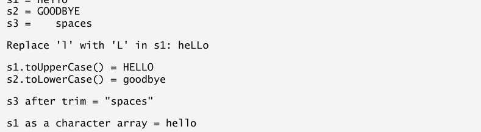

图 14.8 | String 方法 `replace`, `toLowerCase`, `toUpperCase`, `trim` 和 `toCharArray`。

第 14 行使用 `String` `replace` 返回一个新的 `String` 对象，其中 `s1` 中所有出现的 'E'（小写 e）都被替换为字符 'L'。`replace` 方法不会改变原始字符串。如果字符串中没有出现第一个参数，`replace` 方法将返回原始字符串。`replace` 方法的重载版本允许替换子字符串而非单个字符。

第 17 行使用 `String` `toUpperCase` 生成一个新的字符串，其中 `s1` 中存在对应小写字母的地方被替换为大写字母。该方法返回一个包含转换后字符串的新 `String` 对象，并保持原始字符串不变。如果没有需要转换的字符，`toUpperCase` 方法返回原始字符串。

第 18 行使用 `String` `toLowerCase` 返回一个新的 `String` 对象，其中 `s2` 中存在对应大写字母的地方被替换为小写字母。原始字符串保持不变。如果原始字符串中没有需要转换的字符，`toLowerCase` 返回原始字符串。

第 21 行使用 `String` `trim` 生成一个新的 `String` 对象，该对象移除了 `trim` 操作的字符串开头和/或结尾的所有空白字符。该方法返回一个不包含头部或尾部空格的新字符串。原始字符串保持不变。如果开头和结尾没有空白字符，`trim` 返回原始字符串。

第 24 行使用 `String` `toCharArray` 返回一个包含字符串副本的字符数组。

正如我们所见，`String` 类提供了静态方法，可以接受参数并将其转换为字符串。`valueOf` 有六个版本，分别接受 `boolean`、`char`、`int`、`long`、`double` 和 `Object` 类型的参数。这些方法在第 19-28 行中进行了演示。

```java
// Fig 14.9: StringValueOf.java
// String valueof.
public class StringValueOf {
    public static void main(String[] args) {
        char[] arrayOf = {'a', 'b', 'c', 'd', 'e', 'f'};
        boolean booleanValue = true;
        char charValue = 'Z';
        int intValue = 7;
        long longValue = 1000000000L;
        double doubleValue = 2.5f;
        Object objectRef = "Hello";
        System.out.printf("boolean = %s%n", String.valueOf(booleanValue));
        System.out.printf("char = %s%n", String.valueOf(charValue));
        System.out.printf("int = %s%n", String.valueOf(intValue));
        System.out.printf("long = %s%n", String.valueOf(longValue));
        System.out.printf("double = %s%n", String.valueOf(doubleValue));
        System.out.printf("Object = %s%n", String.valueOf(objectRef));
        System.out.printf("char array = %s%n", String.valueOf(arrayOf));
        System.out.printf("char array = %s%n", String.valueOf(arrayOf, 3, 3));
    }
}
```

图 14.9 `String.valueOf` 方法。（第 1 部分，共 2 部分）

## 14.4 StringBuilder 类

我们现在讨论 `StringBuilder` 类的特性，用于创建和处理字符串信息——即可修改的字符串。每个 `StringBuilder` 都能存储由容量指定的数量的字符。如果超过了 `StringBuilder` 的容量，容量将会扩大以容纳额外的字符。


**性能提示 14.4**
Java 可以对涉及 `String` 对象的操作进行某些优化（例如从多个变量引用同一个 `String` 对象），因为它知道这些对象不会改变。如果数据不会改变，应该使用 `String`（而不是 `StringBuilder`）。


**性能提示 14.5**
在频繁执行字符串拼接或其他字符串修改的程序中，使用 `StringBuilder` 类来实现这些修改会更有效率。


**软件观察 14.1**
`StringBuilder` 不是线程安全的。如果代码中多个线程需要访问同一个动态信息，请使用 `StringBuffer`。`StringBuilder` 和 `StringBuffer` 类提供了相同的功能，但 `StringBuffer` 是线程安全的。有关线程的更多详细信息，请参见第 23 章。

## 14.4.1 StringBuilder 构造函数

`StringBuilder` 类提供了四个构造函数。我们在图 14.10 中演示了其中三个。第 6 行使用无参数的 `StringBuilder` 构造函数创建一个没有字符且初始容量为 16 个字符的 `StringBuilder`（这是 `StringBuilder` 的默认值）。第 7 行使用接受整数的 `StringBuilder` 构造函数创建一个没有字符且初始容量由整数参数指定（即 10）的 `StringBuilder`。第 8 行使用接受 `String` 参数的 `StringBuilder` 构造函数创建一个包含字符串参数中字符的 `StringBuilder`。其初始容量为该字符串的字符数加上 16。第 10–12 行演示使用 `StringBuilder` 类的 `toString` 方法通过 `printf` 方法输出 `StringBuilder`。在第 14.4.4 节中，我们将讨论 Java 如何使用 `StringBuilder` 对象来实现用于字符串拼接的 `+` 和 `+=` 运算符。

```java
// Fig. 14.10: StringBuilderConstructors.java
// StringBuilder 构造函数.
public class StringBuilderConstructors {
    public static void main(String[] args) {
        StringBuilder buffer1 = new StringBuilder();
        StringBuilder buffer2 = new StringBuilder(10);
        StringBuilder buffer3 = new StringBuilder("hello");
        System.out.printf("buffer1 = %s\n", buffer1);
        System.out.printf("buffer2 = %s\n", buffer2);
        System.out.printf("buffer3 = %s\n", buffer3);
    }
}
```

```text
buffer1 = ""
buffer2 = ""
buffer3 = "hello"
```

图 14.10 | StringBuilder 构造函数。

## 14.4.2 StringBuilder 方法 length, capacity, ensureCapacity 和 setLength

`StringBuilder` 类的 `length` 和 `capacity` 方法分别返回 `StringBuilder` 中当前包含的字符数以及在不分配内存的情况下可以存储的字符数。`ensureCapacity` 方法保证 `StringBuilder` 具有指定的容量。`setLength` 方法增加或减少 `StringBuilder` 的长度。图 14.11 演示了这些方法。

```java
// Fig. 14.11: StringBuilderCaplen.java
// StringBuilder length, capacity, and ensureCapacity 方法.
public class StringBuilderCaplen {
    public static void main(String[] args) {
        StringBuilder buffer = new StringBuilder("Hello, how are you?");
        System.out.printf("buffer = %s\nlength = %d\ncapacity = %d\n\n",
            buffer.toString(), buffer.length(), buffer.capacity());
        buffer.ensureCapacity(75);
        System.out.printf("New capacity = %d%n\n", buffer.capacity());
        buffer.setLength(10);
        System.out.printf("New length = %d\nbuffer = %s\n",
            buffer.length(), buffer.toString());
    }
}
```

```text
buffer = Hello, how are you?
length = 19
capacity = 35
New capacity = 75
New length = 10
buffer = Hello,
```


图 14.11 | `StringBuilder` 的 `length`、`capacity` 和 `ensureCapacity` 方法。

该程序包含一个名为 `buffer` 的 `StringBuilder`。第 6 行使用接受字符串参数的 `StringBuilder` 构造函数初始化 `StringBuilder` 为 "Hello, how are you?"。第 8–9 行打印 `StringBuilder` 的内容、长度和容量。在输出窗口中 `StringBuilder` 的初始容量为 35。记住接受 `String` 参数的 `StringBuilder` 构造函数会将容量初始化为参数字符串长度加上 16。

第 11 行使用 `ensureCapacity` 方法将 `StringBuilder` 的容量扩展到至少 75 个字符。实际上，如果原始容量小于参数，该方法将确保容量为指定参数的值与原始容量的两倍加 2 之间的较大者。如果 `StringBuilder` 的当前容量大于指定的容量，则容量保持不变。

> **性能提示 14.6**
> 动态增加 `StringBuilder` 的容量可能会花费较长的时间。执行大量操作会降低应用程序的性能。如果 `StringBuilder` 的大小将大幅增加（可能多次），在开始时设置高容量将提高性能。

第 14 行使用 `setLength` 方法将 `StringBuilder` 的长度设置为 10。如果指定的长度小于 `StringBuilder` 中当前的字符数，则其内容会被截断。如果指定的长度大于 `StringBuilder` 中当前的字符数，则会追加字符直到达到该长度。

## 14.4.3 `StringBuilder` 方法 `charAt`、`setCharAt` 和 `reverse`

`StringBuilder` 类提供了 `charAt`、`setCharAt` 和 `reverse` 方法来操作 `StringBuilder` 中的字符（图 14.12）。`charAt`（第 10 行）接受整数参数并返回该索引处的字符。`getChars`（第 13 行）将 `StringBuilder` 中的字符复制到数组中。`setCharAt`（第 20 和 21 行）接受整数和一个字符并设置该位置的字符。`reverse`（第 24 行）反转 `StringBuilder` 的内容。访问超出 `StringBuilder` 范围的字符会导致 `StringIndexOutOfBoundsException`。

```java
// Fig. 14.12: StringBuilder.java
// StringBuilder charAt, setCharAt and reverse 方法.
public class StringBuilder {
    public static void main(String[] args) {
        StringBuilder buffer = new StringBuilder("hello there");
        System.out.printf("buffer = %s%n", buffer.toString());
        System.out.printf("Character at 0: %c at 4: %c%n", buffer.charAt(0), buffer.charAt(4));
        char[] charArray = new char[buffer.length()];
        buffer.getChars(0, buffer.length(), charArray, 0);
        System.out.printf("The characters are: %s%n");
        for (char character : charArray) {
            System.out.print(character);
        }
        buffer.setCharAt(0, 'H');
        buffer.setCharAt(6, 'T');
        System.out.printf("%n%nbuffer = %s", buffer.toString());
        buffer.reverse();
        System.out.printf("%n%nbuffer = %s%n", buffer.toString());
    }
}
```

```
buffer = hello there
Character at 0: h
Character at 4: o
The characters are: hello there
buffer = Hello There
buffer = ereht olleh
```

图 14.12 | `StringBuilder` 的 `charAt`、`setCharAt` 和 `reverse` 方法。

## 14.4.4 `StringBuilder` `append` 方法

`StringBuilder` 重载了 `append` 方法（图 14.13），允许将各种类型的值追加到 `StringBuilder` 的末尾。为每种基本类型以及字符数组、`String`、对象等等都提供了对应的方法。（记住 `toString` 方法会产生任何对象的字符串表示。）每个方法接受其参数，将其转换为字符串并追加到 `StringBuilder` 中。调用 `System.getProperty("line.separator")` 返回一个与平台相关的换行符。

```java
// Fig. 14.13: StringBuilder.java
// StringBuilder append 方法.
public class StringBuilderAppend {
    public static void main(String[] args) {
        Object objectRef = "hello";
        String string = "goodbye";
        char[] charArray = {'a', 'b', 'c', 'd', 'e', 'f'};
        boolean booleanValue = true;
        char charCellValue = 'Z';
        int integerValue = 7;
        long longValue = 1000000000000L;
        float floatValue = 2.5f;
        double doubleValue = 33.333;
    }
}
```

```java
17 StringBuilder lastBuffer = new StringBuilder("last buffer");
18 StringBuilder buffer = new StringBuilder();
20 buffer.append(objectRef)
    .append(System.getProperty("line.separator"))
    .append(string)
    .append(System.getProperty("line.separator"))
    .append(charArray)
    .append(System.getProperty("line.separator"))
    .append(charArray, 0, 3)
    .append(System.getProperty("line.separator"))
    .append(booleanValue)
    .append(System.getProperty("line.separator"))
    .append(characterValue);
    .append(System.getProperty("line.separator"))
    .append(integerValue)
    .append(System.getProperty("line.separator"))
    .append(longValue)
    .append(System.getProperty("line.separator"))
    .append(floatValue)
    .append(System.getProperty("line.separator"))
    .append(doubleValue)
    .append(System.getProperty("line.separator"))
    .append(lastBuffer);
42 System.out.printf("buffer contains%n%s%n", buffer.toString());
44 }
```

```
buffer contains
goodbye
ababcdef
abc
true
2
7
1000000000
2.5
33.333
last buffer
```

图 14.13 | `StringBuilder` `append` 方法。（部分 2，共 2 部分。）

编译器可以使用 `StringBuilder` 和 `append` 方法来实现 `+` 和 `+=` 字符串拼接运算符。例如，假设声明如下：

```java
String string1 = "hello";
String string2 = "BC";
int value = 22;
```

语句

```java
String s = string1 + string2 + value;
```

会将 "hello"、"BC" 和 22 拼接。拼接可以如下所示执行：

```java
String s = new StringBuilder().append("hello").append("BC")
    .append(22).toString();
```

首先，前面的语句创建了一个空的 `StringBuilder`，追加了字符串 "hello"、"BC" 和整数 22。接下来，`StringBuilder` 的 `toString` 方法将 `StringBuilder` 转换为 `String` 对象并赋值给 `s`。语句

```java
s += "";
```

可以如下所示执行（这可能因编译器而异）：

```java
s = new StringBuilder().append(s).append("!").toString();
```

这创建了一个空的 `StringBuilder`，在 `s` 的当前内容之后追加 "!"。接下来，`StringBuilder` 的 `toString` 方法（在这里必须显式调用）将 `StringBuilder` 的内容作为 `String` 返回并赋值给 `s`。

## 14.4.5 `StringBuilder` 插入和删除方法

`StringBuilder` 通过重载的 `insert` 方法在 `StringBuilder` 的任何位置插入各种类型的值。它为基本类型、字符数组、`String`、`Object` 和 `CharSequence` 提供了相应的版本。每个方法接收其第二个参数，并将其插入由第一个参数指定的索引处。如果第一个参数小于 0 或大于 `StringBuilder` 的长度，则会抛出 `StringIndexOutOfBoundsException`。`StringBuilder` 类还提供了 `delete` 和 `deleteCharAt` 方法来删除 `StringBuilder` 中任意位置的字符。`delete` 方法接收两个参数——起始索引和要删除字符的结束索引。从起始索引到但不包含结束索引的所有字符都会被删除。`deleteCharAt` 方法接收一个参数——要删除字符的索引。无效索引会导致这两个方法都抛出 `StringIndexOutOfBoundsException`。图 14.14 展示了 `insert`、`delete` 和 `deleteCharAt` 方法。

```java
// Fig. 14.14: StringBuilderInsertDelete.java
// StringBuilder 的 insert, delete 和 deleteCharAt 方法。
public class StringBuilderInsertDelete {
    public static void main(String[] args) {
        Object objectRef = "hello";
        String string = "goodbye";
        char[] charArray = {'a', 'b', 'c', 'd', 'e', 'f'};
        boolean booleanValue = true;
        char charValue = 'K';
        int integerValue = 7;
        long longValue = 10000000;
        float floatValue = 2.5f; // f 后缀表示 2.5 是 float
        double doubleValue = 33.333;
        StringBuilder buffer = new StringBuilder();
    }
}
```

**图 14.14** `StringBuilder` 的 `insert`、`delete` 和 `deleteCharAt` 方法。（部分 1，共 2 部分）。

```java
17 buffer.insert(0, objectRef);
18 buffer.insert(0, " "); // 每个都包含两个空格
19 buffer.insert(0, string);
20 buffer.insert(0, " ");
21 buffer.insert(0, charArray);
22 buffer.insert(0, " ");
23 buffer.insert(0, charArray, 3, 3);
24 buffer.insert(0, " ");
25 buffer.insert(0, booleanValue);
26 buffer.insert(0, " ");
27 buffer.insert(0, characterValue);
28 buffer.insert(0, " ");
29 buffer.insert(0, integerValue);
30 buffer.insert(0, " ");
31 buffer.insert(0, longValue);
32 buffer.insert(0, " ");
33 buffer.insert(0, floatValue);
34 buffer.insert(0, " ");
35 buffer.insert(0, doubleValue);
38 System.out.printf("buffer after inserts:%n%s%n", buffer.toString());
41 buffer.delete(0, 5);
```

```
buffer after inserts:
goodbye
ababcdef
abc
true
2
7
1000000000
2.5
33.333
last buffer
```

图 14.14 | `StringBuilder` 的 `insert`、`delete` 和 `deleteCharAt` 方法。

## 14.5 `Character` 类

图 14.16 展示了 `Character` 的静态方法 `digit` 和 `forDigit`，它们分别在不同的数字系统中将字符转换为数字以及将数字转换为字符。常见的数字系统包括十进制（10 进制）、八进制（8 进制）、十六进制（16 进制）和二进制（2 进制）。数的基数也称为基数（radix）。有关数字系统之间转换的更多信息，请参见附录 J。

```java
// Fig. 14.16: StaticCharMethods2.java
// Character 类静态转换方法。
import java.util.Scanner;
public class StaticCharMethods2 {
    public static void main(String[] args) {
        Scanner scanner = new Scanner(System.in);
        // 获取基数
        System.out.println("Please enter a radix:");
        int radix = scanner.nextInt();
        // 获取用户字符
        System.out.printf("Please choose one:%n -- %s%n2 -- %s%n",
                          "Convert digit to character", "Convert character to digit");
        int choice = scanner.nextInt();
        // 处理请求
        switch (choice) {
            case 1: // 将数字转换为字符
                System.out.println("Enter a digit:");
```


```java
int digit = scanner.nextInt();

System.out.printf("Convert digit to character: %s%n",
                  Character.forDigit(digit, radix));

break;

case 2: // 将字符转换为数字
    System.out.println("Enter a character:");
    char character = scanner.next().charAt(0);
    System.out.printf("Convert character to digit: %s%n",
                      Character.digit(character, radix));
    break;
}
}
```

图 14.16 | Character 类静态转换方法。（2部分中的第1部分）。

```
Please enter a radix:
16
Please choose one:
1 -- Convert digit to character
2 -- Convert digit to digit
1
Enter a digit:
13
Convert digit to character: d
```

**图 14.16** | Character 类静态转换方法。（2部分中的第2部分。）

第 24 行使用 `forDigit` 将整数数字转换为整数基数（数的基）指定的数字系统中的字符。例如，16 进制（基数）的十进制整数 13 对应的字符值为 'd'。在数字系统中，小写字母和大写字母表示*相同*的值。第 30 行使用 `digit` 方法将变量字符转换为整数基数（数的基）指定的数字系统中的整数。例如，字符 'A' 是十进制的 16 进制（基数）表示。基数必须在 2 到 36 之间（包含边界）。

图 14.17 展示了 `Character` 构造函数和几个实例方法——`charValue`、`toString` 和 `equals`。第 5–6 行通过将字符常量 'A' 和 'a' 分别赋值给 `Character` 变量实例化两个 `Character` 对象。Java 自动将这些字符字面量转换为 `Character` 对象——这一过程被称为*装箱*（autoboxing），我们在第 16.4 节中详细讨论。第 9 行使用 `charValue` 方法返回存储在 `Character` 对象 `c1` 中的 `char` 值。第 9 行还使用 `toString()` 方法获取 `Character` 对象 `c2` 的字符串表示。第 11 行中的条件使用 `equals` 方法判断对象 `c1` 的内容与对象 `c2` 是否相同（即每个内部的字符相等）。

```java
// Fig. 14.17: OtherMethods.java
// Character 类实例方法。
public static void main(String[] args) {
    Character c1 = 'A';
    Character c2 = 'a';
    System.out.printf("c1 = %s%nc2 = %s%n", c1.charValue(), c2.toString());
    if (c1.equals(c2)) {
        System.out.println("c1 and c2 are equal%n");
    } else {
        System.out.println("c1 and c2 are not equal%n");
    }
}
```

**图 14.17** | Character 类实例方法。（2部分中的第1部分）。

```
c1 = A
c2 = a
c1 and c2 are not equal
```

**图 14.17** | Character 类实例方法。（2部分中的第2部分）。

# 14.6 字符串分词

当你读取一个句子时，你的大脑会将其分解为标记（tokens）——向你传递意义的单词和标点符号。编译器也会执行分词。它们将语句拆分成各个部分，如关键字、标识符、操作符和其他编程语言元素。我们现在学习 `String` 的 `split` 方法，它将一个字符串拆分为其组成的标记。标记之间通过分隔符分开，分隔符通常是空白字符，如空格、制表符、换行和回车。其他字符也可以作为分隔符来分隔标记。图 14.18 中的应用演示了 `String` 的 `split` 方法。

当用户按下 `Enter` 键时，输入的句子存储在变量 `sentence` 中。第 14 行调用了参数为 `" "` 的 `String` 方法，该方法返回一个 `String` 数组。参数中的空格字符是 `split` 方法用于在字符串中定位标记的分隔符。正如你将在下一节中学到的，`split` 方法的参数可以是正则表达式，以进行更复杂的分词。第 15–16 行显示数组 `tokens` 的长度。第 18–20 行单独打印每个标记。

```java
// Fig. 14.18: TokenTest.java
// 使用 split 方法进行分词
import java.util.Scanner;
public class TokenTest {
    public static void main(String[] args) {
        Scanner scanner = new Scanner(System.in);
        System.out.println("Enter a sentence and press Enter");
        String sentence = scanner.nextLine();
        String[] tokens = sentence.split(" ");
        System.out.printf("Number of elements: %d\nThe tokens are:%n", tokens.length);
        for (String token : tokens) {
            System.out.println(token);
        }
    }
}
```

**图 14.18** | 使用 split 方法进行分词。（2部分中的第1部分）。

```
Enter a sentence and press Enter
This is a sentence with seven elements:
Number of elements: 7
The tokens are:
This
a
sentence
with
seven
```

**图 14.18** | 使用 split 方法分词。（2部分中的第2部分）。

# 14.7 正则表达式、Pattern 类和 Matcher 类

正则表达式是一种用于匹配其他字符串中搜索模式的字符串。此类表达式对于验证输入和确保数据符合特定格式有用。例如，邮政编码必须由五个数字组成，姓氏只能包含字母、空格、单引号和连字符。正则表达式的一个应用是辅助编译器的构建。通常使用大型且复杂的正则表达式来验证程序的语法。如果程序代码不匹配正则表达式，编译器就知道代码存在语法错误。

`String` 类提供了几种执行正则表达式操作的方法，最简单的是匹配操作。`String` `matches` 方法接收一个字符串，并将其内容与正则表达式进行匹配。该方法返回一个布尔值，指示匹配是否成功。

正则表达式由字面字符和特殊符号组成。图 14.19 指定了某些可以在正则表达式中预定义字符类。字符类是表示字符组的转义序列。数字是数值。单词字符是任何字母（大写或小写）、任何数字或下划线字符。空白字符是空格、制表符、回车、换行或分页。每个字符类匹配我们尝试与正则表达式匹配的字符串中的单个字符。

| 字符 | 匹配 | 字符 | 匹配 |
|---|---|---|---|
| `\d` | 任何数字 | `\D` | 任何非数字 |
| `\w` | 任何单词字符 | `\W` | 非单词字符 |
| `\s` | 任何空白字符 | `\S` | 非空白字符 |

图 14.19 | 预定义字符类。

## 14.7 正则表达式、Pattern 类和 Matcher 类

我们在图 14.20 和 14.21 的应用中检查了这些技术中的几种方法，它们通过正则表达式对输入进行验证。[注意：此应用程序并非用于匹配所有可能的用户输入。]

**图 14.20** | 使用正则表达式验证用户信息。

```java
// Fig 14.21: Validate.java
// 使用 ValidateInput 类对数据进行输入和验证。
import java.util.Scanner;
```

**图 14.21** | 使用 ValidateInput 类从用户处输入并验证数据。（3 部分中的第 1 部分）

```java
public class Validate {
    public static void main(String[] args) {
        // 获取用户输入
        Scanner scanner = new Scanner(System.in);
        System.out.println("Please enter first name:");
        String firstName = scanner.nextLine();
        System.out.println("Please enter last name:");
        String lastName = scanner.nextLine();
        System.out.println("Please enter address:");
        String address = scanner.nextLine();
        System.out.println("Please enter city:");
        String city = scanner.nextLine();
        System.out.println("Please enter state:");
        String state = scanner.nextLine();
        System.out.println("Please enter zip:");
        String zip = scanner.nextLine();
        System.out.println("Please enter phone:");
        String phone = scanner.nextLine();
        // 验证用户输入并显示错误消息
        System.out.printf("%nValidate Result: %s%n", validateFirstName(firstName));
        if (!ValidateInput.validateFirstName(firstName)) {
            System.out.println("Invalid first name");
        } else if (!ValidateInput.validateLastName(lastName)) {
            System.out.println("Invalid last name");
        } else if (!ValidateInput.validateAddress(address)) {
            System.out.println("Invalid address");
        } else if (!ValidateInput.validateCity(city)) {
            System.out.println("Invalid city");
        } else if (!ValidateInput.validateState(state)) {
            System.out.println("Invalid state");
        } else if (!ValidateInput.validateZip(zip)) {
            System.out.println("Invalid zip code");
        } else if (!ValidateInput.validatePhone(phone)) {
            System.out.println("Invalid phone number");
        } else {
            System.out.println("Valid input. Thank you.");
        }
    }
}
```


# Fig. 14.21 | 使用 ValidateInput 类从用户处输入并验证数据（3 部分中的第 2 部分）

| 输入 | 输出 |
| :--- | :--- |
| Please enter first name: Jane | |
| Please enter last name: Doe | |
| Please enter address: 123 Some Street | |
| Please enter city: Some City | |
| Please enter state: SS | |
| Please enter zip: 123 | |
| Please enter phone: 123-456-7890 | |
| **Validate Result:** | **Invalid zip code** |

| 输入 | 输出 |
| :--- | :--- |
| Please enter first name: Jane | |
| Please enter last name: Doe | |
| Please enter address: 123 Some Street | |
| Please enter city: Some City | |
| Please enter state: SS | |
| Please enter zip: 12345 | |
| Please enter phone: 123-456-7890 | |
| **Validate Result:** | **Valid input. Thank you.** |

**Fig. 14.20** | 使用 ValidateInput 类从用户处输入并验证数据（3 部分中的第 3 部分）

图 14.20 验证了名字。第 7 行验证了名字。要匹配一组没有预定义字符类的字符集，请使用方括号 `[]`。例如，模式 `[aeiou]` 匹配单个字符的元音。字符范围通过在两个字符之间放置一个连字符 `-` 来表示。`[A-Z]` 匹配单个大写字母。如果括号中的第一个字符是 `^`，它接受除该字符以外的任何字符。`^[A-Z]` 不同于 `[A-V]`，后者匹配大写字母 A–Y——`[^Z]` 匹配除字符 Z 以外的任何字符，包括小写字母、非字母以及换行符。字符类中的范围由字母的整数值决定。在这个示例中，`[A-Za-z]` 匹配所有大写和小写字母。范围 `[A-z]` 匹配所有字母以及小写字母 `a`（例如 `[\]`），其整数值在 Z 和 `[` 之间（关于字符整数值的更多信息，请参见附录 B）。与预定义的字符类一样，由方括号分隔的字符类匹配搜索对象中的单个字符。

在第 7 行中，如果方法 `validateFirstName()` 返回 `true`（图 14.21 的第 27 行），应用程序将尝试通过调用 `validateLastName()`（图 14.20 的第 11–13 行）来验证姓氏（第 30 行）。验证姓氏的正则表达式匹配任何数量被撇号或连字符隔开的字母。

图 14.21 的第 33 行调用 `validateAddress()`（图 14.20 的第 16–19 行）来验证地址。第一个字符匹配任何数字或多次 `(\d)`。字符被转义了，因为通常是一个转义序列。

星号 (`*`) 和加号 (`+`) 是形式上的量词。图 14.22 列出了所有的量词。

| 量词 | 匹配 |
| :--- | :--- |
| `*` | 0 次或多次 |
| `+` | 一次或多次 |
| `?` | 0 次或一次 |
| `{n}` | 正好 n 次 |
| `{n,}` | 至少 n 次 |
| `{n,m}` | 在 n 到 m 次之间（包含 n 和 m） |

正则表达式中的量词都是贪婪的。这意味着它们会尽可能多地匹配，直到匹配成功。然而，如果这些量词后面跟着问号 (`?`)，量词就变为惰性的（有时称为非贪婪）。它将尽可能少地匹配，直到匹配成功。

## 14.7.1 替换字符串和分割字符串

有时替换字符串的一部分或将字符串分割是很有用的。为了这个目的，`String` 类提供了 `replaceAll()`、`replaceFirst()` 和 `split()` 方法。这些方法在图 14.23 中进行了演示。

```java
// Fig 14.23: RegexSubstitution.java
// String 方法 replaceFirst, replaceAll 和 split。

import java.util.Arrays;

public class RegexSubstitution {

    public static void main(String[] args) {

        String firstString = "This sentence ends in 5 stars ***********";

        String secondString = "1, 2, 3, 4, 5, 6, 7, 8";

        System.out.printf("Original String 1: %s\n", firstString);

        // 将 '*' 替换为 'A'
        firstString = firstString.replaceAll("\\*", "A");

        System.out.printf("\"stars\" substituted for *: %s\n", firstString);

        // 将 'stars' 替换为 'carets'
        firstString = firstString.replaceAll("stars", "carets");

        System.out.printf("\"carets\" substituted for \"stars\": %s\n", firstString);

        System.out.printf("\n");

        // 将单词替换为 'word'
        System.out.printf("Every word \"word\" replaced by \"word\": %s\n",
            firstString.replaceAll("\\w+", "word"));

        // replaceFirst 示例
        for (int i = 0; i < 3; i++) {
            secondString = secondString.replaceFirst("\\d", "digit");
        }
        System.out.printf("Original String 2: %s\n", "1, 2, 3, 4, 5, 6, 7, 8");
        System.out.printf("First 3 digits replaced by \"digit\": %s\n", secondString);

        // split 示例
        String[] tokens = secondString.split("\\s*,\\s*");
        System.out.printf("String split by commas: %s\n", Arrays.toString(tokens));
    }
}
```

输出示例：

```
Original String 1: This sentence ends in 5 stars ***********
"stars" substituted for *: This sentence ends in 5 stars AAAAAAAAAAA
"carets" substituted for "stars": This sentence ends in 5 carets AAAAAAAAAAA

Every word "word" replaced by "word": word word word word word word AAAAAAAAAAA

Original String 2: 1, 2, 3, 4, 5, 6, 7, 8
First 3 digits replaced by "digit": digit, digit, digit, 4, 5, 6, 7, 8
String split by commas: [digit, digit, digit, 4, 5, 6, 7, 8]
```

图 14.23 | 方法 replaceFirst, replaceAll 和 split（部分 2/2）

`replaceAll()` 方法在原始字符串匹配正则表达式（第一个参数）时，将其替换为文本（第二个参数）。第 13 行将 `firstString` 中所有的 `*` 实例替换为 `A`。正则表达式 (`"\\*"`) 中的反斜杠需要两个反斜杠。通常情况下，`\*` 是一个量词，应该匹配前一个字符的任意次数。但在第 13 行中，我们想要找到字面字符 `*` —— 为了实现这一点，我们使用 `\*` 对字符转义。使用 `\` 对特殊的正则表达式进行转义会指示引擎查找最终字符。由于该表达式存储在 Java 字符串中，而 `\` 是 Java 字符串中的特殊字符，我们必须包含一个额外的反斜杠。因此，Java 字符串 `"\\*"` 代表正则表达式 `\*`，它匹配搜索字符串中的 `*` 字符。在第 18 行，`firstString` 中正则表达式 "stars" 的所有匹配项都被替换为 "carets"。第 25 行使用 `replaceAll()` 将字符串中的所有单词替换为 "word"。

`replaceFirst()` 方法（第 31 行）替换模式匹配的第一次出现。Java 字符串是不可变的；`replaceFirst()` 方法在替换了相应字符后返回一个新的字符串。这会获取原始字符串并用 `replaceFirst()` 返回的字符串进行替换。通过迭代三次，我们将 `secondString` 中前三个数字 (`\d`) 实例替换为文本 "digit"。

`split()` 方法将字符串划分为子字符串。原始字符串在任何匹配指定正则表达式的位置被断开。`split()` 方法返回一个包含正则表达式之间的子字符串的字符串数组。在第 38 行，使用 `split()` 方法对逗号分隔的整数字符串进行分词。参数是定位分隔符的正则表达式。在这里我们使用正则表达式 `"\\s*,\\s*"` 在出现逗号时分隔子字符串——同样，通过匹配任何空白字符，由于匹配了空格，我们消除了结果子字符串中的额外空格。逗号和空白字符不会作为子字符串的一部分返回。第 39 行使用 `Arrays.toString()` 方法将数组结果显示在方括号中，并用逗号分隔。

## 14.7 正则表达式、Pattern 类和 Matcher 类

### 14.7.2 Pattern 类和 Matcher 类

除了 `String` 类中具备的正则表达式功能外，Java 还在 `java.util.regex` 包中提供了其他类，帮助开发者操作正则表达式。`Pattern` 类表示正则表达式。`Matcher` 类包含正则表达式以及用于在其中搜索模式的 `CharSequence`。

`CharSequence` 是一个允许对字符序列进行读取访问的接口。接口要求声明 `charAt()`、`length()`、`subSequence()` 和 `toString()` 方法。`String` 和 `StringBuilder` 都实现了 `CharSequence`，因此这些类的实例都可以与 `Matcher` 类配合使用。


### 编程错误 14.2

> 正则表达式可以针对任何实现 `CharSequence` 的类对象测试，但正则表达式必须是字符串。尝试使用 `StringBuilder` 创建正则表达式是错误的。

如果正则表达式只使用一次，可以使用静态 `Pattern.matches()` 方法。该方法接收一个指定正则表达式的字符串和一个用于执行匹配的 `CharSequence`。该方法返回一个布尔值，指示对象（第二个参数）是否匹配正则表达式。

如果正则表达式将使用多次（例如在循环中），则使用静态 `Pattern.compile()` 方法为该正则表达式创建一个特定的 `Pattern` 对象会更有效。此方法接收一个表示正则表达式的字符串并返回一个新的 `Pattern` 对象，然后可以使用该对象调用 `matcher()` 方法。该方法接收一个用于搜索的 `CharSequence` 并返回一个 `Matcher` 对象。

`Matcher` 提供了 `matches()` 方法，它执行与 `Pattern` 方法相同的任务，但不接收参数——搜索模式和搜索对象被封装在 `Matcher` 对象中。`Matcher` 类提供了其他方法，包括 `find()`、`replaceFirst()` 和 `replaceAll()`。

图 14.24 展示了一个使用正则表达式的简单示例。该程序通过正则表达式匹配生日。该表达式仅匹配 4 月且名字以 "J" 开头的人的生日。

```java
// Fig. 14.24: RegexMatchers.java
// Pattern 和 Matcher 类

import java.util.regex.Matcher;
import java.util.regex.Pattern;

public class RegexMatcher {

    public static void main(String[] args) {

        // 创建正则表达式
        Pattern expression = Pattern.compile("3\\.\\d[35-9]-\\d-\\d-\\d-\\d");
    }
}
```


## 图 14.23 | 方法 replaceFirst, replaceAll 和 split（部分 2/2）

## 图 14.24 | RegexMatchers.java（部分 1/2）

## 612 第 14 章 字符串、字符与正则表达式

- `String.trim()` (p. 588) 返回一个新对象，该对象的字符串开头结尾的所有空白字符（例如空格、换行符和制表符）已被移除。
- `String.toCharArray()` (p. 588) 返回一个包含字符串字符拷贝的字符数组。
- 类静态方法 `valueOf` 将参数转换为字符串。

## 14.4 节 StringBuilder

- `StringBuilder` 提供了多种构造函数，允许以无字符且初始容量为 16 个字符来初始化 `StringBuilder`；或者通过整数参数指定无字符和初始容量来初始化；也可以通过传入 `String` 参数的字符拷贝，并将初始容量设为 `String` 参数中字符数加 16 来进行初始化。
- `StringBuilder` 方法 `length()` (p. 591) 返回当前存储在 `StringBuilder` 中的字符数。`StringBuilder` 方法 `capacity()` (p. 591) 返回 `StringBuilder` 在不额外分配更多空间的情况下可以存储的字符数。
- `StringBuilder` 方法 `ensureCapacity()` (p. 591) 确保 `StringBuilder` 至少具有指定的容量。`StringBuilder` 方法 `setLength()` 用于增加或减小 `StringBuilder` 的长度。
- `StringBuilder` 方法 `charAt()` (p. 592) 返回指定索引处的字符。方法 `setCharAt()` (p. 592) 设置指定位置的字符。`StringBuilder` 方法 `getChars()` (p. 592) 将 `StringBuilder` 中的字符拷贝到参数指定的字符数组中。
- `StringBuilder` 重载 `append()` (p. 593) 将原始类型、字符数组、`String`、`Object` 或 `CharSequence` 值添加到 `StringBuilder` 的末尾。
- `StringBuilder` 重载 `insert()` (p. 595) 将原始类型、字符数组、`String`、`Object` 或 `CharSequence` 值插入到 `StringBuilder` 的任意位置。

## 14.5 节 Character

- `Character` 方法 `isDefined()` (p. 598) 确定一个字符是否为 Unicode 字符集成员。
- `Character` 方法 `isDigit()` (p. 598) 确定一个字符是否为定义的 Unicode 数字。
- `Character` 方法 `isIdentifierStart()` (p. 598) 确定一个字符是否可以作为 Java 标识符的起始字符。`Character` 方法 `isJavaIdentifierPart()` (p. 598) 确定一个字符是否可以用于标识符。
- `Character` 方法 `isLetter()` (p. 598) 确定一个字符是否为字母。`Character` 方法 `isLetterOrDigit()` (p. 598) 确定一个字符是否为字母或数字。
- `Character` 方法 `isLowerCase()` (p. 598) 确定一个字符是否为小写字母。`Character` 方法 `isUpperCase()` (p. 598) 确定一个字符是否为大写字母。
- `Character` 方法 `toUpperCase()` (p. 598) 将字符转换为其对应的大写形式。`Character` 方法 `toLowerCase()` (p. 598) 将字符转换为其对应的小写形式。
- `Character` 方法 `digit()` (p. 599) 根据其整数基数 (p. 599) 将字符参数转换为数字系统中的整数。`Character` 方法 `forDigit()` (p. 599) 根据其整数基数将其整数数字转换为数字系统中的字符。
- `Character` 方法 `charValue()` (p. 600) 返回 `Character` 对象中存储的 `char`。`Character` 方法 `toString()` 返回 `Character` 的字符串表示。

## 14.6 节 字符串分词

- 类方法 `split()` (p. 601) 根据参数指定的分隔符对字符串进行分词，并返回一个包含这些标记的 `String` 数组 (p. 601)。

## 总结 613

## 14.7 节 正则表达式、Pattern 类与 Matcher 类

- 正则表达式 (p. 602) 是描述匹配其他字符串中字符模式的字符串。它们对于验证输入和确保数据符合特定格式非常有用。
- `String` 方法 `matches()` (p. 602) 接收指定正则表达式的字符串，并将调用它的 `String` 对象的内容与正则表达式进行匹配。该方法返回一个布尔值，表示匹配是否成功。
- 字符类（character class）是一种转义序列，表示一组字符。每个字符类匹配我们尝试用正则表达式匹配字符串中的单个字符。
- 单词字符 (`\w`; p. 602) 是任何字母（大写或小写）、任何数字或下划线字符。
- 空白字符 (`\s`) 是空格、回车符、换行符或分页符。
- 数字 (`\d`) 是任何数字字符。
- 要匹配一组没有预定义字符类的字符集 (p. 602)，请使用方括号 `[]`。范围可以通过在两个字符之间放置一个连字符 (`-`) 来表示。如果括号内的第一个字符是 `^`，则表达式接受除所指示字符以外的任何字符。
- 当正则表达式中出现 `*` 时，程序尝试匹配其前面子表达式的零次或多次。
- 运算符 `+` 尝试匹配其前面子表达式的一次或多次。
- 字符 `|` 匹配其左侧或右侧表达式。
- 括号 `()` 用于分组正则表达式的部分。
- 星号 (`*`) 和加号 (`+`) 正式称为量词（quantifiers）(p. 606)。
- 量词仅影响其前面的子表达式。
- 量词问号 (`?`) 匹配其随后的量词的零次或一次。
- 量词 `{n}` 匹配其前面子表达式的 `n` 次。
- 量词 `{n,m}` 匹配其前面子表达式的 `n` 到 `m` 次。
- 量词 `{n,}` 匹配其前面子表达式的 `n` 次或更多。
- 量词 `{0,1}` 匹配其前面子表达式的零次或一次。
- 量词是贪婪的，意味着它尽可能多地匹配。
- 量词后跟 `?` 是懒惰的（reluctant），意味着它尽可能少地匹配。
- `String` 方法 `matches()` (p. 602) 接收指定正则表达式的字符串，并匹配调用它的 `String` 对象的内容。该方法返回一个布尔值，表示匹配是否成功。
- `String` 方法 `replace()` (p. 607) 将每个匹配项替换为指定的替换字符串。
- `String` 方法 `replaceFirst()` (p. 607) 将第一个匹配项替换为指定的替换字符串。
- `String` 方法 `replaceAll()` (p. 607) 将所有匹配项替换为指定的替换字符串。
- `String` 方法 `split()` (p. 601) 根据分隔符将字符串分为子字符串，并返回包含这些子字符串的 `String` 数组。
- `Pattern` 类 (p. 604) 是正则表达式的编译表示。
- `Matcher` 类 (p. 604) 是使用 `Pattern` 对字符串执行操作的引擎。
- `Matcher` 方法 `find()` (p. 605) 尝试在输入中找到匹配模式的子序列。
- `Matcher` 方法 `start()` (p. 605) 返回上一次匹配的起始索引。
- `Matcher` 方法 `end()` (p. 605) 返回上一次匹配的结束索引。
- `Matcher` 方法 `group()` (p. 606) 返回上一次匹配捕获的子字符串。
- `Matcher` 方法 `group(int)` (p. 606) 返回指定分组捕获的子字符串。
- `Matcher` 方法 `reset()` (p. 607) 将匹配器重置为输入的开头。
- `Matcher` 方法 `region()` (p. 607) 返回考虑的输入区域。
- `Matcher` 方法 `region(int start, int end)` (p. 607) 设置考虑的输入区域。
- `CharSequence` 接口允许 `Matcher` 工作于任何字符序列。`String` 和 `StringBuilder` 都实现了该接口。

# 练习题 615

比较字符是否相等。在进行比较时忽略字符的大小写。

**14.5 (字符串处理)** 编写一个应用程序，从用户处读取字符串列表，将其存储在字符串数组中，并分行打印包含特殊字符的字符串和不包含特殊字符的字符串。你的应用程序应从用户处读取字符串，直到输入 `#` 为止。任何不是字母或数字的字符应被视为特殊字符。在打印字符串列表时，第一个字符应大写，其余字符应小写。你的应用程序还应该统计包含特殊字符和不包含特殊字符字符串的数量，并在输出中打印这些计数。

**14.6 (密码验证)** 网站只有当密码长度在 8 到 15 个字符之间、以字母开头、包含至少一个大写字母且至少一个数字时才会设置用户密码。编写一个应用程序，从用户处读取密码字符串并检查其有效性。

**14.7 (猪圈语)** 编写一个应用程序将英语短语编码为猪圈拉丁语（Pig Latin）。猪圈语是一种密码语言。形成猪圈语短语有许多不同的方法。为了简单起见，使用以下方法：

要从英语短语形成猪圈语短语，使用 `String.split()` 将短语拆分为单词。将每个英语单词翻译成猪圈语单词：将英语单词的首字母放在单词末尾并加上字母 "ay"。例如，单词 "jump" 变成 "umpsay"，单词 "the" 变成 "hetay"，单词 "computer" 变成 "omputercay"。空格保持为空格。英语短语由空格分隔的单词组成，没有标点符号，且所有单词都有两个或更多字母。方法 `printLatin()` 应显示每个代码。每个标记都传递给 `printLatin()` 以打印猪圈语单词。允许用户输入句子，然后显示转换后的句子。

**14.8 (电话号码分词)** 编写一个应用程序，以 `(555) 555-5555` 的形式作为字符串输入电话号码。该应用程序应使用 `String.split()` 将区号提取为标记，将电话号码的前三位数字提取为标记，并将最后四位提取为标记。电话号码的七位数字应合并成一个字符串。区号和电话号码都应该打印出来。记住你需要在分词过程中更改分隔符。

**14.9 (显示单词反转的句子)** 编写一个应用程序，输入一行文本，使用 `String.split()` 方法包含标记并按反序输出这些标记。使用空格作为分隔符。

**14.10 (句子中最长的单词)** 编写一个应用程序，输入一行文本，并显示句子中最长的单词（字符数最多的单词）。

**14.11 (搜索字符串)** 编写一个应用程序，输入一行文本，并使用 `String` 方法 `indexOf()` 搜索以确定字符在文本中的次数。

**14.12 (搜索字符串)** 编写一个基于练习 14.11 程序的应用程序，输入一行文本并使用 `String.indexOf()` 确定字母表中每个字母出现的总次数。大写字母和小写字母应合并计数。将每个字母的总数存储在数组中，并在确定总数后以表格格式打印这些值。

# 第 14 章 字符串、字符与正则表达式

**14.13 (字符串分词)** 编写一个应用程序，读取一行文本，使用空格字符作为分隔符对行进行分词，并仅输出以大写字母开头的单词。

**14.14 (字符串分词与比较)** 编写一个应用程序，读取一行文本，使用空格字符作为分隔符分词，并仅输出以字母 "ED" 结尾的单词。

**14.15 (将 int 字符)** 编写一个应用程序，输入字符的整数代码并显示相应的字符。修改此应用程序，使其生成从 000 到 255 范围内的所有三位代码，并尝试打印相应的字符。

**14.16 (定义自己的搜索方法)** 编写你版本的字符串搜索方法 `indexOf()` 和 `lastIndexOf()`。

# 特殊章节：字符串处理练习

前面的练习与文本相关，旨在测试你对基础字符串处理概念的理解。本节包含了一系列中级和高级字符串处理练习。你会发现这些问题既具有挑战性又很有趣。问题的难度差异很大。花一两个小时来编写和实现程序。其他题目适用于需要两三周学习和实现的实验作业。有些是挑战性的学期项目。

**14.18 (文本分析)** 字符串处理为分析伟大作家的作品提供了有趣的方法。人们投入了很大精力放在莎士比亚是否真的写过作品上。一些学者认为有充分证据表明，克里斯托弗·马洛实际上撰写了归属于莎士比亚的名作。研究人员使用计算机发现这两位作者作品中的相似之处。本练习研究了使用计算机分析文本的三种方法。

- a. 编写一个应用程序从键盘读取一行文本并打印一个表格，显示文本中字母表中每个字母出现的次数。例如，短语
> To be, or not to be: that is the question:
包含 "a", "to", "be", "cs" 等。

- b. 编写一个应用程序读取一行文本并打印一个表格，显示文本中每个不同单词出现的次数。表格应按照单词在文本中出现的顺序包含单词。例如，图 14.25 统计了短语的计数：
> 'tis nobler in the mind to suffer

- c. 编写一个应用程序读取一行文本并打印一个表格，显示文本中每个不同单词出现的次数。表格应按照单词在文本中出现的顺序包含单词。例如，
> To be, or not to be: that is the question:
> Whether 'tis nobler in the mind to suffer
包含单词 "to" 三次，单词 "be" 两次，“or” 一次。

# 特殊章节：字符串处理练习

| 单词长度 | 出现次数 |
|---|---|
| 1 | 0 |
| 2 | 2 |
| 3 | 1 |
| 4 | 2 (包括 'tis) |
| 5 | 0 |
| 6 | 2 |
| 7 | 1 |

**图 14.25** 字符串 `*tis* nobler in the mind to suffer` 的长度计数。

**14.19 (各种格式的日期)** 日期以几种常见的格式打印。两种较常见的格式是：
04/25/1955 和 April 25, 1955
编写一个应用程序读取第一格式并以第二格式打印。

**14.20 (支票保护)** 计算机经常用于支票写入系统，如工资和应付账款应用程序。有很多关于周薪打印金额超过 100 万美元的奇怪故事。错误的金额由于人为错误或机器故障在计算机写票系统中打印。设计人员在系统中设计控制措施以防止此类错误发生。

另一个问题是恶意人员对支票的故意篡改。为了防止美元金额被篡改，某些写票系统采用一种称为支票保护的技术。为计算机打印设计的支票包含固定数量的空格，计算机可以在其中打印金额。假设一张工资单包含八个空白空格，计算机要在其中打印周薪金额。如果金额很大，所有八个空间将被填充。例如：

```
1,230.60（支票金额）
------
12345678（位置编号）
```

另一方面，如果金额小于 1000 美元，通常会留出几个空格。例如：

```
99.87
------
12345678
```
包含三个空白。如果支票带有空白空格打印，别人更容易篡改金额。为了防止篡改，任何写票系统都会插入前导星号来保护金额，如下：

```
***99.87
------
12345678
```


# 编写支票金额应用程序

编写一个应用程序，输入要打印在支票上的美元金额，然后在必要时以支票保护格式打印该金额。假设有九个空间可用于打印金额。

# 14.21 编写支票金额的英文对照

继续练习 14.20 中的讨论，我们再次强调设计支票写入系统以防止支票金额被篡改的重要性。一种常见方法是金额既要用数字写，也要用字母拼出来。即使有人能够翻译支票的数字金额，要更改单词形式金额也是极其困难的。编写一个应用程序，输入小于 1000 美元的数字支票金额，并输出该金额对应的英文。例如，金额 112.43 应该写成

```
one hundred TWTwelve and 43/100
```

# 14.22 摩斯密码

所有编码方案中最著名的莫过于摩斯密码，它是由塞缪尔·摩斯在 1832 年为电报系统开发的。摩斯密码为字母表中的每个字母、每个数字以及少数特殊字符（例如句号、逗号、冒号、分号）分配一系列点和破划。在以声音为主的系统中，点代表短音，破划代表长音。点和破划的其他表示形式也用于光信号系统和信号旗帜系统。单词之间的间隔用空格表示，或者简单地用没有点或破划表示。在以声音为主的系统中，空格用不传输声音的短时间来表示。国际版摩斯密码见图 14.26。

| 字符 | 代码 | 字符 | 代码 | 字符 | 代码 |
|---|---|---|---|---|---|
| A | .- | N | -. | | 数字 | |
| B | -... | O | --- | | 1 | .---- |
| C | -.-. | P | .--. | | 2 | ..--- |
| D | -.. | Q | --.- | | 3 | ...-- |
| E | . | R | .-. | | 4 | ....- |
| F | ..-. | S | ... | | 5 | ..... |
| G | --. | T | - | | 6 | -.... |
| H | .... | U | ..- | | 7 | --... |
| I | .. | V | ...- | | 8 | ---.. |
| J | .--- | W | .-- | | 9 | ----. |
| K | -.- | X | -..- | | 0 | ----- |
| L | .-.. | Y | -.-- | | | |
| M | -- | Z | --.. | | | |

**图 14.26** 用国际摩斯密码表示的字母和数字。

编写一个应用程序读取英语短语并将其编码为摩斯密码。再编写一个应用程序读取摩斯密码短语并将其转换为对应的英语。在每个摩斯密码字母之间留一个空格，在摩斯密码单词之间留三个空格。

# 14.23 公制单位转换

编写一个帮助用户进行公制单位转换的应用程序。你的应用程序允许用户以字符串形式指定单位名称（例如，公制系统的厘米、升、克等，以及英制系统的英寸、夸脱、磅等），并回答简单的问题，例如：

- “2 米里有多少英尺？”
- “10 夸脱里有多少升？”

## 特别章节：具有挑战性的字符串处理项目

你的应用程序应该识别无效的转换。例如，以下问题

“5 公斤里有多少英尺？”

是没有意义的，因为“英尺”是长度单位，而“公斤”是质量单位。

# 14.24 项目：拼写检查器

许多用户已经拥有内置的拼写检查器。在你的项目中，你应该开发自己的拼写检查工具。我们提供一些建议帮助你开始。你应该考虑添加更多功能。使用计算机字典（如果你有权限的话）作为单词来源。

为什么我们输入的很多单词拼写错误？在某些情况下，是因为我们颠换了两个字母的位置（例如，输入 `dealt` 而不是 `default`）。有时我们会得到一个最佳猜测。我们不小心多打了一个字母（例如，输入 `handly` 而不是 `handy`）。我们按了不是想要按的键（例如，输入 `birthday` 而不是 `birthday`），等等。

设计并实现一个拼写检查应用程序。你的应用程序应该维护一个列表（`ArrayList`）。允许用户输入这些字符串。[注：在第 15 章中，我们将介绍文件处理。有了这项功能，你可以从存储在文件中的计算机字典中获取拼写检查所需的单词。

你的应用程序要求用户输入一个数组。然后应用程序在数组中查找该单词。如果单词在数组中，你的应用程序打印“word is spelled correctly（单词拼写正确）”。如果单词不在数组中，你的应用程序打印“word is not spelled correctly（单词拼写错误）”。你的应用程序应尝试在相邻字母列表中查找其他单词，以发现单词 `default` 与单词列表直接匹配。当然，你的应用程序将检查所有可能的易位，例如 `default`、`dault`、`deaf` 和 `default`。当你发现列表中匹配的单词时，在消息中打印它，例如

```
Did you "default?"
```

实现一些测试，例如将每个双字母替换为单字母，以及你能够开发的任何其他测试，以提高你的拼写检查器的价值。

# 14.25 项目：填字游戏生成器

大多数人可能玩过填字游戏，但从未尝试过生成一个。生成一个填字游戏被认为是一项具有挑战性的字符串处理项目，需要大量的努力和远见。

要让最简单的填字游戏生成器运行起来，有许多问题需要解决。

# 14.26 使用更健康的食材烹饪

美国的肥胖率正以惊人的速度增长。疾病控制与中心（CDC）的地图 `http://www.cdc.gov/obesity/data.html` 显示了 20 年来的肥胖趋势。随着肥胖增加，相关问题也随增加。编写一个程序帮助用户在烹饪时选择更健康的食材。某些替代方案见图 14.27。

| 食材 | 替代方案 |
|---|---|
| 1 杯酸奶油 | 1 杯酸奶 |
| 1 杯牛奶 | 1/2 杯蒸乳奶 |
| 1 茶匙柠檬汁 | 1/2 茶匙醋 |
| 1 杯糖 | 1/2 杯蜂蜜、1 杯糖蜜或 1/4 杯龙舌兰 |
| 1 杯黄油 | 1 杯人造奶油 |
| 1 杯面粉 | 黑麦粉或米粉 |
| 1 杯蛋美滋 | 奶渣酸奶 |
| 1 个鸡蛋 | 2 汤匙淀粉、西根淀或半根大香蕉（压碎） |
| 1 杯牛奶 | 1 杯豆豆奶 |
| 1/4 杯油 | 1/4 杯苹果泥 |
| 白面包 | 全麦面包 |

**图 14.27** 食材替代方案。

你的程序应该考虑到替代方案并不是一对一的。例如，如果一个蛋糕需要三个鸡蛋，可能会合理地使用六个蛋蛋白。你的程序应该考虑用户的健康状况，如高胆固醇、血压、减重、麸质过敏等。对于高胆固醇，程序应该对鸡蛋和乳制品提供建议；如果用户希望减肥，则应建议低热量的食材替代品。

# 14.27 垃圾邮件扫描

垃圾邮件（或电子邮箱）美国组织每年花费数十亿美元用于垃圾邮件防护软件、设备、网络资源、带宽以及生产力损失。在网上研究最常见的垃圾邮件和词汇，并检查你的垃圾邮件箱。创建一个垃圾邮件中常见的 30 个单词和短语列表。编写一个应用程序，让用户输入一条电子邮件。然后扫描消息以查找这 30 个关键词或短语。这些词在消息中每出现一次，就给总分加 1 分。

消息的“垃圾邮件评分”。接下来，根据消息收到的分值评估该消息为垃圾邮件的可能性。

# 14.28 SMS 语言

短信服务（SMS）是一种通信服务，允许在手机之间发送 160 个字符或更短的文本消息。随着全球范围内手机使用的的普及，SMS 已被许多发展中国家用于政治目的（例如发表观点和反对意见）、报告自然灾害新闻等。由于短信消息的长度受到限制，通常会使用 SMS 语言——手机短信、电子邮件、即时消息等常见单词和短语的缩写。例如，在 SMS 语言中，“in my opinion”是 `imo`。在网上研究 SMS 语言。编写一个 GUI 应用程序，其中用户可以使用 SMS 语言输入消息，然后点击按钮将其翻译成英语（或你自己的语言）。还要提供一种将英语（或你自己的语言）编写的文本翻译成 SMS 语言的机制。一个潜在的问题是一个 SMS 缩写可能会变成多种短语。例如，`IMO`（如上文所示）也可以代表“国际海事组织”、“纪念”等。

# 15 文件、输入/输出流、NIO 和 XML 序列化

## 目标

在本章中你将：

- 创建、读取、写入和更新文件。
- 使用 NIO.2 API 功能检索有关文件和目录的信息。
- 学习文本文件和二进制文件之间的区别。
- 使用 `Formatter` 类将文本输出到文件。
- 使用 `Scanner` 类从文件输入文本。
- 使用顺序文件处理开发一个真实的信用查询程序。
- 使用 XML 序列化和 JAXB（Java XML 绑定）API 向文件写入对象并从文件读取对象。
- 使用 `JFileChooser` 对话框允许用户选择磁盘上的文件或目录。
- 可选地使用 `java.io` 接口和类来执行基于字节和基于字符的输入输出。

## 15.1 引言

存储在变量和数组中的数据是临时的——当局部变量超出范围或程序终止时数据就会丢失。为了长期保留数据（即使在创建数据的程序终止后），你每天使用文件来完成编写文档或创建电子表格等任务。计算机将数据存储在二级存储设备上，包括硬盘、闪存器、DVD 等。在文件中维护的数据是持久的——它的持续时间超过了程序执行的时间。在本章中，我们将解释 Java 程序如何创建、更新和处理文件。

我们首先讨论 Java 编程化处理文件的架构。接下来，我们解释数据可以存储在文本文件和二进制文件中——以及它们之间的区别。我们将演示如何使用 `Paths` 和 `Files` 类以及 `Path`、`DirectoryStream`（`java.nio.file` 包）从文件和目录中检索信息，然后讨论写入文件和读取文件。我们将创建和操作文件。正如你将学到的，将数据从文件读回对象形式是很麻烦的。许多面向对象的类（包括 Java）都提供了将对象转换为文件以及从文件读取方便的方法（称为序列化和反序列化）。为了演示这一点，我们重新创建了一些使用文件的顺序程序，这次通过将对象存储在文件中并从文件中检索对象。我们将在第 24 章“使用 JDBC 访问数据库”和第 29 章“Java 持久化 API (JPA)”中讨论数据库。

## 15.2 文件与流

Java 将每个文件视为字节的顺序流（图 15.1）。每个操作系统都提供一种确定文件末尾的机制，例如文件结束标记或记录在系统维护的辅助数据结构中的文件总字节数。处理字节流的 Java 程序只需在到达末尾时接收来自操作系统的指示——程序并不需要知道底层平台如何表示文件或流。在某些情况下，文件结束指示以异常的形式出现。

> Java 的 NIO API 还包括实现所谓的基于通道的架构以进行高性能 I/O 的类和接口。这些主题超出了本书的范围。

| 0 | 1 | 2 | 3 | 4 | 5 | 6 | 7 | 8 | 9 | n-1 |
|---|---|---|---|---|---|---|---|---|---|---|
| | | | | | | | | | | 文件结束标记 |

**图 15.1** Java 对 n 字节的视图

### 基于字节的流和基于字符的流

文件可以作为字节或字符输入输出数据。

- **基于字节的流**以其二进制格式输出和输入——`char` 是两个字节，`int` 是四个字节，`double` 是八字节，等等。
- **基于字符的流**作为字符序列输出和输入，每个字符是两个字节——给定值的字节数取决于

使用基于字节流创建的文件是二进制文件，而使用基于字符流创建的文件是文本文件。文本文件可以使用文本编辑器读取，而二进制文件由解释内容的程序读取。二进制文件中的数值可以用于计算，而字符 5 只是文本字符串中的一个字符，如“Sarah Miller 今年15岁”。

### 标准输入、标准输出和标准错误流

Java 程序通过创建并关联字节或字符流来启动。Java 还可以将与不同的设备关联。当 Java 程序执行时，它会创建三个关联设备的流——`System.in`、`System.out` 和 `System.err`。`System.in`（标准输入流）通常允许程序从键盘输入字节。`System.out`（标准输出流）通常允许程序向屏幕输出数据。`System.err`（标准错误流）通常允许程序向屏幕输出基于字符的错误消息。每个流都可以**重定向**。对于 `System.out`，这种能力允许程序输出到不同的位置，例如磁盘上的文件。`System` 类提供了 `setIn()`、`setOut()` 和 `setErr()` 方法分别用于重定向标准输入、输出和错误流。

## 15.3 使用 NIO 类和接口获取文件和目录信息

基于字符的输入输出可以通过 `Scanner` 和 `Formatter` 类来实现，正如我们在第 15.4 节中所看到的。你已经广泛使用 `Scanner` 从键盘输入数据。`Scanner` 也可以从文件中读取数据。`Formatter` 类允许将格式化数据输出到任何基于文本的流，方式类似于 `System.out.printf()`。附录 I 展示了使用 `printf()` 的格式化输出。这些特性都可以用于格式化文本文件。在第 28 章中，我们将使用流来实现网络应用程序。

### Java SE 8 增加了另一种类型的流

第 17 章“Lambdas 和 Streams”引入了一种新的流，用于处理元素集合（如数组和 `ArrayList`），而不是本章文件处理示例中讨论的字节流。在 17.13 节中，我们使用 `Files` 方法创建包含文件中文本行的此类流。

`Path` 接口和 `DirectoryStream` 类以及 `Paths` 和 `Files` 类（均来自 `java.nio.file` 包）对于检索磁盘上文件和目录的信息非常有用：

- `Path`——实现 `Path` 接口的类对象，表示文件或目录的位置。`Path` 对象不会打开文件，也不提供任何文件处理功能。`File`（位于 `java.io` 包）也用于此目的。
- `Paths`——用于提供静态方法来获取表示文件或目录的 `Path` 对象。
- `Files`——用于提供用于常用文件和目录操作的静态方法，例如复制文件；创建和删除文件；获取文件和目录信息；读取文件内容；获取允许你操作文件和目录内容的对象等。
- `DirectoryStream`——用于实现此接口的类对象允许程序遍历目录的内容。

### 创建 Path 对象

你将使用 `Paths` 类的静态方法 `get()` 将表示文件或目录位置的 `String` 转换为 `Path` 对象。然后，你可以使用 `Path` 接口和 `Files` 类的方法来确定有关指定文件或目录的信息。我们稍后会讨论此类方法中的几种方法。如需查看这些方法的列表，请访问：

```
http://docs.oracle.com/javase/8/docs/api/java/nio/file/Path.html
http://docs.oracle.com/javase/8/docs/api/java/nio/file/Files.html
```

### 绝对路径与相对路径

文件或目录的路径指定了它在磁盘上的位置。路径包含指向该文件或目录的部分或全部目录。绝对路径包含指向特定文件或目录的所有目录（根目录）。特定磁盘上的每个文件或目录在其路径中具有相同的根目录。相对路径相对于另一个目录——例如，相对于程序开始执行所在目录的路径。

### 从 URI 获取 Path 对象

静态方法 `get()` 的重载版本接收 `URI` 对象来定位文件或目录。统一资源标识符（URI）是用于定位网站的统一资源定位符（URL）更通用的形式。例如，URL `http://www.example.com/` 是 Detail & Associates 网站的 URI。URI 用于跨各种操作系统定位文件。在 Windows 平台上，URI

```
file:C:/data.txt
```

标识存储在 C 盘根目录下的 `data.txt`。在 UNIX/Linux 平台上，URI

```
file:/home/student/data.txt
```

标识存储在用户 `student` 目录下的文件 `data.txt`。

### 示例：获取文件和目录信息

图 15.2 提示用户输入文件或目录名称，然后使用 `Paths`、`Path`、`Files` 和 `DirectoryStream` 类输出该文件或目录的信息。

```java
// Fig. 15.2: FileAndDeviceInfo.java
// 用于获取文件和目录信息的类

import java.io.IOException;
import java.nio.file.DirectoryStream;
import java.nio.file.Files;
import java.nio.file.Path;
import java.nio.file.Paths;
import java.util.Scanner;

public class FileAndDeviceInfo {

    public static void main(String[] args) throws IOException {

        Scanner input = new Scanner(System.in);

        System.out.println("Enter file or directory name:\n");

        // 根据用户输入创建 Path 对象
        Path path = Paths.get(input.nextLine());

        if (Files.exists(path)) { // 如果路径存在，输出其信息

            // 显示文件（或目录）信息
```


System.out.printf("%s\n", path.getFileName());

System.out.printf("%s is a directory\n", path.isDirectory(path) ? "Is" : "Is not");

System.out.printf("%s as an absolute path\n", path.isAbsolute() ? "Is" : "Is not");

System.out.printf("Last modified: %s\n", Files.getLastModifiedTime(path));

System.out.printf("Size: %s\n", Files.size(path));

System.out.printf("Path: %s\n", path);

System.out.printf("Absolute path: %s\n", path.toAbsolutePath());

} else {

System.out.printf("Path does not exist\n");

}

}

}

```

**图 15.2** 用于获取文件和目录信息的类。（第 2 部分的第一部分）

# 15.3 使用 NIO 类和接口获取文件和目录信息

（第 2 部分的后续）

# 15.4 顺序文本文件


## 良好的编程实践 15.1

在构建表示路径信息的字符串时，请使用 `File.separator` 来获取本地计算机正确的分隔符字符，而不是显式地使用 `/` 或 `\`。该常量是由一个字符组成的字符串——即该系统的正确分隔符。


## 常见编程错误 15.1

在字符串字面量中使用 `\` 作为目录分隔符而不是 `\\` 是逻辑错误。单个 `\` 表示紧随其后的字符代表一个转义序列。请使用 `\\` 在字符串字面量中插入 `\`。

## 15.4 顺序文本文件

接下来我们将创建并操作顺序文件，在这些文件中，记录按照记录键字段顺序存储。我们从文本文件开始，使读者能够快速创建和编辑人类可读的文件。我们将讨论创建数据、从顺序文件读取数据以及更新顺序文件。我们还包含了一个从文件中检索数据的信用-库存程序。第 15.4.1–15.4.3 节中的程序都在章节的 `TextFileApps` 目录下，以便它们可以操作同一个文本文件，该文件也存储在该目录中。

## 15.4.1 创建顺序文本文件

Java 对文件没有任何结构限制——“记录”等概念并不是 Java 语言的一部分。因此，你必须对文件进行结构以满足应用程序的要求。在示例中，我们看到如何在文件中创建键值结构。本节中的程序创建一个简单的文件，该文件可能用于应收账款系统，以跟踪客户欠某公司的金额。对于每个客户，程序获取账号号码、客户名称和余额（客户对收到的商品和服务的欠款）。每个客户的数据构成了该客户的“记录”。该应用程序使用账号号码作为记录键——文件的记录将按照账号顺序创建和维护。程序假设用户按账号顺序输入记录。在一个完善的应收账款系统（基于排序）中，将提供排序功能，以便用户可以以任何顺序输入记录。记录随后将被排序并写入文件。

### TextFile 类

`TextFile` 类（图 15.3）使用 `Formatter` 来输出格式化字符串，使用与 `System.out.println` 相同的格式化功能。`Formatter` 对象可以输出到各种位置，例如控制台或窗口，正如我们在示例所示。`Formatter` 在 `try-with-resources` 语句中实例化（第13行；在第11.12节引入）——当该块成功结束或由于异常结束时，这将关闭其资源。我们在这里使用一个参数——一个包含文件名及其路径的字符串。如果未指定路径，JVM 假设文件在执行程序的目录中。对于文本文件，我们使用 `.txt` 扩展名。如果


文件不存在，则将创建它。如果打开一个已存在的文件，其内容将被截断——文件中的所有数据将被丢弃。如果没有发生异常，文件将以写入模式打开，生成的 `Formatter` 对象可用于将数据写入文件。

```java
// Fig. 15.3: CreateFile.java

// 使用 Formatter 类向顺序文本文件写入数据。

import java.io.FileNotFoundException;
import java.lang.SecurityException;
import java.util.Formatter;
import java.util.FormatterClosedException;
import java.util.NoSuchElementException;
import java.util.Scanner;

public class CreateFile {

    public static void main(String[] args) {

        // 打开 clients.txt, 将数据输出到文件然后关闭 clients.txt

        try {

            Formatter output = new Formatter("clients.txt");

            Scanner input = new Scanner(System.in);

            System.out.printf("Enter account number, first name, last name and balance: ");
            System.out.printf("Enter end-of-file indicator to end input: ");

            while (input.hasNext()) { // 循环直到遇到文件结束指示

                try {

                    // 将新记录写入文件；假设输入是有效的
                    output.format("%d %s %s %.2f%n", input.nextInt(), input.next(), input.next(), input.nextDouble());

                } catch (NoSuchElementException element) {

                    System.err.println("Invalid input. Please try again.");
                    input.nextLine(); // 丢弃输入以便用户重试

                }

            }

            System.out.print(" ");

        } catch (IOException | FileNotFoundException | FormatterClosedException e) {
            e.printStackTrace();
        }

    }

}
```

输入账号号码、名、姓和余额。
输入文件结束指示以结束输入。

- 100 Bob Blue 24.98
- 200 Steve Green 345.67
- 300 Pan White 0.00
- 400 Sam Red 42.16
- 500 Sue Yellow 224.64

**图 15.3** 使用 `Formatter` 类向顺序文本文件写入数据。

## 15.4 顺序文本文件

第 33–36 行是一个多异常捕获，处理了几种异常：

- 如果用户没有权限写入文件，则会发生 `SecurityException`
- 如果文件不存在且无法创建新文件，或者打开文件时出错，则会发生 `FileNotFoundException`
- 如果在尝试使用时 `Formatter` 已关闭，则会发生 `FormatterClosedException`

对于这些异常，我们显示堆栈跟踪，然后程序终止。

### 向文件写入数据

第 15–27 行提示用户输入每条记录的各种字段，或者在数据输入为空时输入文件结束键。图 15.4 列出了不同操作系统输入文件结束的键组合——某些 IDE 不支持基于控制台的输入组合。第 19 行使用 `Scanner` 方法 `hasNext` 来判断是否输入了文件结束键组合。循环持续直到 `hasNext` 遇到文件结束。

| 操作系统 | 键组合 |
| :--- | :--- |
| macOS 和 Linux | <Enter> <Ctrl> d |
| Windows | <Ctrl> z |

**图 15.4** 文件结束组合。

第 22–23 行使用 `Scanner` 从文件中读取数据，然后使用 `Formatter` 输出数据作为记录。如果数据格式错误（例如在期望 int 时为 String）或没有更多数据，每个 `Scanner` 方法都会产生 `NoSuchElementException`（在第 25–28 行处理）。

如果没有发生异常，则将使用 `format` 方法输出记录信息，该格式化与 `Formatter` 的输出目标相同——clients.txt。格式字符串 `"%d %s %s %.2f"` 表明当前记录将存储为一个整数（账号号码），后跟一个字符串（名）、另一个字符串（姓）和一个浮点值（余额）。每个信息项之间用空格分隔，双精度浮点数（余额）在小数点后保留两位（由 `%.2f` 中的 `.` 指定）。文本文件中的数据可以使用文本编辑器查看，或通过程序读取文件来检索（第 15.4.2 节）。

当用户输入文件结束组合时，`try-with-resources` 语句通过调用 `Formatter` 方法 `close` 来关闭 `Formatter` 和底层输出文件。如果程序没有显式调用 `close`，操作系统通常会在程序执行终止时关闭文件——这是操作系统“内部清理”的一个例子。然而，当文件较长时你应该始终显式关闭文件。

### 输出示例

该应用程序的示例数据如图 15.5 所示。在示例输出中，用户输入了五个账户的信息，然后输入文件结束（end-of-file）表示数据输入完成。示例输出没有显示数据记录在文件中实际外观。在下一节中，为了验证文件是否成功创建，我们提供了一个读取文件并打印内容的程序。由于这是一个文本文件，你也可以通过在文本编辑器中打开文件来验证这些信息。

| Account | First Name | Last Name | Balance |
|---|---|---|---|
| 100 | Bob | Blue | 24.98 |
| 200 | Steve | Green | -345.67 |
| 300 | Pam | White | 0.00 |
| 400 | Sam | Red | -42.16 |
| 500 | Sue | Yellow | 224.62 |

**图 15.5** 图 15.3 中程序的示例数据。

## 15.4.2 从顺序文本文件中读取数据

数据的存储是为了在需要时检索并进行处理。第 15.4.1 节演示了如何创建一个顺序访问的文件。本节展示了如何从文本文件中顺序读取数据。我们演示了如何使用 `Scanner` 从文件而非键盘输入数据。该应用程序（图 15.6）从第 15.4.1 节应用程序创建的 "clients.txt" 文件读取记录并显示记录内容。第 14 行创建了用于从文件中检索信息的 `Scanner`。

```java
// Fig.15.6: ReadFile.java

// 此程序读取文本文件并显示每个记录。

import java.io.IOException;
import java.lang.IllegalStateException;
import java.nio.file.Files;
import java.nio.file.Paths;
import java.util.NoSuchElementException;
import java.util.Scanner;

public class ReadFile {

    public static void main(String[] args) {

        // 打开 clients.txt, 读取内容并关闭文件

        try (Scanner input = new Scanner(Paths.get("clients.txt"))) {

            System.out.printf("%-10s%-12s%12s%10s%n",
                "Account", "First Name", "Last Name", "Balance");

            // 从文件读取记录
            while (input.hasNext()) { // 如果还有更多内容待读

                // 显示记录内容
                System.out.printf("%-10d%-12s%12s%10.2f%n", input.nextInt(),
                    input.next(), input.next(), input.nextDouble());

            }

        } catch (IOException | NoSuchElementException | IllegalStateException e) {
            e.printStackTrace();
        }

    }

}
```

| Account | First Name | Last Name | Balance |
|---|---|---|---|
| 100 | Bob | Blue | 24.98 |
| 200 | Steve | Green | -345.67 |
| 300 | Pam | White | 0.00 |
| 400 | Sam | Red | -42.16 |
| 500 | Sue | Yellow | 224.64 |

**图 15.6** 通过实例化 `Scanner` 对象打开文件进行读取

`try-with-resources` 语句通过实例化 `Scanner` 对象（第 14 行）打开文件进行读取。我们将一个 `Path` 对象传递给构造函数，该对象指定 `Scanner` 对象将从位于应用程序执行的目录下的 "clients.txt" 文件读取。如果找不到文件，会发生 `IOException`。该异常在第 25–28 行被处理。

第 15–16 行显示应用程序输出中列的表头。第 19–23 行读取并显示内容直到到达文件结束标记——在这种情况下，`hasNext` 返回 `false`。第 21–22 行使用 `Scanner.nextInt()`、`next()` 和 `nextDouble()` 来读取一个 `int`（账户号码）、`String`（名和姓）和一个 `double`（余额）。每一项都是文件中的一行数据。如果文件中的信息格式不正确（例如，在应该有余额的地方有一个姓），则在读取记录时会发生 `NoSuchElementException`。如果在输入数据之前关闭了 `Scanner`，会发生 `IllegalStateException`。这些异常在第 25–28 行被处理。在格式字符串行中，账户号码、名和姓是左对齐，而余额是右对齐并保留两位精度输出。循环的每次迭代都会打开文件中的文本，代表一条记录。当循环终止并到达第 24 行时，`try-with-resources` 语句会隐式调用 `Scanner` 的 `close` 方法来关闭文件。

## 15.4.3 案例研究：信用查询程序

为了顺序检索数据，程序必须关闭文件并重新打开。可能需要多次处理文件（从文件开头开始）。`Scanner` 不允许重新定位到开头。图 15.8 包含了信用查询的功能。15.8 中的程序允许用户根据他们请求的账户类型输入三个选项之一。

第 15.8 中的程序只显示相应类型的记录：

- 1 - 列出余额为零的账户
- 2 - 列出贷余额（正余额）的账户
- 3 - 列出借记余额（负余额）的账户
- 4 - 终止程序

```java
// Fig.15.7: MenuOption.java

// 用于信用查询程序的枚举类型。

public enum MenuOption {

    ZERO_BALANCE(1),
    CREDIT_BALANCE(2),
    DEBIT_BALANCE(3),
    END(4);

    // 声明常量
    private final int value;

    // 构造函数
    MenuOption(int value) {
        this.value = value;
    }

}
```

```java
// Fig.15.8: CreditInquiry.java

// 此程序顺序读取文件并显示每个记录。

import java.io.IOException;
import java.lang.IllegalStateException;
```


```java
import java.nio.file.Files;
import java.nio.file.Paths;
import java.util.NoSuchElementException;
import java.util.Scanner;

public class CreditInquiry {

    public static void main(String[] args) {
        // 从文件读取记录并仅显示相应类型记录
        try (Scanner input = new Scanner(Paths.get("clients.txt"))) {
            while (input.hasNext()) { // 如果还有更多数据待读
                int accountNumber = input.nextInt();
                String firstName = input.next();
                String lastName = input.next();
                double balance = input.nextDouble();

                // 如果类型正确，显示记录
                if (shouldDisplay(option, balance)) {
                    System.out.printf("%-10d-%12s-%12s-%10.2f%n", accountNumber, lastName, balance);
                } else {
                    input.nextLine(); // 跳过当前记录的剩余部分
                }
            }
        } catch (NoSuchElementException | IllegalStateException | IOException e) {
            System.out.println("处理文件出错。正在终止。");
            System.exit(1);
        }
    }

    // 使用类型代码判断是否显示记录
    private static boolean shouldDisplay(MenuOption option, double balance) {
        if (option == MenuOption.CREDIT_BALANCE && balance < 0) {
            return true;
        } else if (option == MenuOption.DEBIT_BALANCE && balance > 0) {
            return true;
        } else if (option == MenuOption.ZERO_BALANCE && balance == 0) {
            return true;
        }
        return false;
    }
}
```

### 15.4 顺序文本文件 637

| 余额为0的账户： |
| :--- |
| 300 Pam White | 0.00 |

输入请求

- 1 列出余额为0的账户
- 2 列出有贷余额的账户
- 3 列出正余额的账户
- 4 退出程序

? 2

| 有贷余额的账户： |
| :--- |
| 200 Steve Green | -345.67 |
| 400 Sam Red | -42.16 |

输入请求

- 1 列出余额为0的账户
- 2 列出有贷余额的账户
- 3 列出正余额的账户
- 4 退出程序

? 3

| 有正余额的账户： |
| :--- |
| 100 Blue | 24.98 |
| 500 Sue Yellow | 222.62 |

输入请求

- 1 列出余额为0的账户
- 2 列出有贷余额的账户
- 3 列出正余额的账户
- 4 退出程序

? 4

> 图 15.8 贷贷查询程序。（4 部分中的第 4 部分。）

记录信息是通过遍历文件并确定每条记录是否符合所选账户类型的标准来收集的。`main` 方法中的第 18 行调用 `getInput` 方法（第 39–60 行）来显示菜单，将用户输入的数字翻译到 `MenuOption` 中并存储变量 `accountType`。第 20–35 行循环执行，直到用户指定程序终止。第 21–31 行为要输出到屏幕的记录集显示表头。第 33 行调用 `readRecords` 方法，该方法会遍历文件并读取每条记录。

`readRecords` 使用 `try-with-resources` 创建一个 `Scanner` 来打开文件进行读取（第 65 行）。每次调用 `readRecords` 时，都会用新的 `Scanner` 对象打开文件进行读取，以便我们可以从文件开头再次读取。第 67–72 行读取一条记录。第 73 行调用 `shouldDisplay`（第 90–103 行）来确定当前记录是否符合请求的账户类型。如果 `Display` 返回 `true`，程序将显示账户信息。当到达文件结束标记时，循环终止，`try-with-resources` 语句关闭 `Scanner` 和文件。一旦读取了所有记录，控制权返回到 `main` 并再次调用 `getRequest`（第 34 行）以获取用户的下一个菜单选项。

638 第 15 章 文件、输入/输出流、NIO 和 XML 序列化

### 15.4.4 更新顺序文件

许多顺序文件中的数据无法在不破坏文件中其他数据的风险下进行修改。例如，如果需要将名称 "white" 更改为 "Worthington"，则不能简单地覆盖旧名称，因为新名称需要更多空间。White 的记录写入文件的形式如下：

```
300 Pam White 0.00
```

如果使用新名称从文件中的相同位置开始重写记录，则记录将变为：

```
300 Pam Worthington 0.00
```

新记录比原始记录大（有更多字符）。"Worthington" 将覆盖当前记录中的 "0.00"，而 "Worthington" 中第二个 "o" 开始的字符将覆盖文件中下一个顺序记录的开头。问题在于，文本文件中的这些字段（以及记录）的大小是可以异的。例如，7、14、117、204 和 2383 在内部上都是以相同字节数（4 字节）存储的 `int` 类型，但当它们作为文本写入文件时，它们是不同大小的字段。因此，顺序文件中的记录不是原地更新的——而是重写整个文件。为了实现上述更改，`300 Pam White 0.00` 之前的记录将被复制到新文件中，写入新记录（其大小可能与被替换的记录不同），然后将 `300 Pam White 0.00` 之后的记录也复制到新文件中。重写整个文件来更新单条记录是不经济的，但如果需要更新大量记录，则是合理的。

### 15.5 XML 序列化

在第 15.4 节中，我们演示了如何将记录的各个字段写入文本，以及如何从文件中读取这些字段。有时，我们想要写入一个对象或从文件中读取一个对象——或者如你在在线 Web 服务中看到的——通过网络连接进行这些操作。正如第 12 章中提到的，XML（可扩展标记语言）是一种广泛用于描述数据的语言。XML 是用于表示对象的常用格式之一。在我们的在线 Web 服务中，我们还将使用另一种常用格式 JSON（JavaScript 对象表示法）在互联网上传输对象。在本节中，我们选择 XML 而不是 JSON，是因为操作对象的 API 是内置在 Java SE 中的，而作为 JSON 操作对象的 API 则是 Java EE（企业版）的一部分。

在本节中，我们将使用 JAXB（Java 体系 XML 绑定架构）来操作对象。这种 JAXB 允许你执行 XML 序列化——JAXB 将其称为 `marshall`（封行）。被序列化的对象由包含对象数据的 XML 表示。在序列化对象被写入文件后，可以从文件中读取并进行反序列化——即表示该对象及其数据的 XML 可用于重建该对象。

### 将 XML 序列化对象写入文件

图 15.11 的程序将一个 `Accounts` 对象序列化到文本文件中。该程序与 15.4 节中的程序相似，因此我们只关注新功能。第 9 行从 `javax.xml.bind` 包导入了 JAXB 类。该包包含了许多实现我们执行的 XML 序列化的相关类，JAXB 类包含了易于使用的静态方法，用于执行最常见的操作。

```java
// Fig. 15.11: CreateSequentialFile.java
// Writing objects to a file with JAXB and BufferedWriter

import java.io.BufferedWriter;
import java.io.IOException;
import java.nio.File;
import java.nio.file.Paths;
import java.nio.file.Files;
import java.util.NoSuchElementException;
import java.util.Scanner;
import javax.xml.bind.JAXB;

public class CreateSequentialFile {

    public static void main(String[] args) {
        try (BufferedWriter output = Files.newBufferedWriter(Paths.get("clients.xml"))) {
            Scanner input = new Scanner(System.in);

            // stores the Accounts before XML serialization
            Accounts accounts = new Accounts();

            System.out.printf("%s%s%s%n",
                "Enter account number, first name, last name and balance.",
                "Enter end-of-file indicator to enter input:");

            while (input.hasNext()) { // loop until end-of-file indicator
                try {
                    // create new record
                    Account record = new Account(input.nextInt(),
                        input.next(), input.next(), input.nextDouble());

                    // add to AccountList
                    accounts.getAccounts().add(record);
                } catch (NoSuchElementException elementException) {
                    System.err.println("Invalid input. Please try again.");
                    input.nextLine(); // discard input so user can try again
                }
            }

            System.out.printf("%s%n", "");

            // write AccountList's XML to output
```


# XML 输出

图 15.12 显示了 `clients.xml` 文件的内容。你不需要了解 XML 来操作此示例，请注意 XML 是人类可读的。JAXB 序列化一个类的对象，它使用类名且首字母小写作为对应的 XML 元素名称，因此 `accounts` 元素（第 23–33 行）代表 `Accounts` 对象。

回想 `Accounts` 类中的第 9 行（图 15.10），它提供了带有注解的 `List<Account>` 实例变量：

```
@XmlElement(name="account")
```

除了允许 JAXB 序列化实例变量外，该注解还指定了 XML 元素名称（"account"），用于表示序列化输出中 List 中的每个 `Account` 对象。例如，图 15.12 中的第 3–8 行代表 Bob Blue 的 `Account`。如果我们不指定注解的名称，将使用实例变量名（accounts）作为 XML 元素名称。JAXB XML 序列化的许多其他方面都是自定义的。更多细节请参见：

https://docs.oracle.com/javase/tutorial/jaxb/intro/

| 行号 | 内容 |
| :--- | :--- |
| 1 | `<?xml version="1.0" encoding="UTF-8" standalone="yes"?>` |
| 2 | `<accounts>` |
| 3 | `<account>` |
| 4 | `<accountNumber>100</accountNumber>` |
| 5 | `<balance>24.98</balance>` |
| 6 | `<firstName>Bob</firstName>` |
| 7 | `<lastName>Blue</lastName>` |
| 8 | `</account>` |
| 9 | |
| 10 | `<account>` |
| 11 | `<accountNumber>200</accountNumber>` |
| 12 | `<balance>-345.67</balance>` |
| 13 | `<firstName>Steve</firstName>` |
| 14 | `<lastName>Green</lastName>` |
| 15 | `</account>` |
| 16 | `<account>` |
| 17 | `<accountNumber>300</accountNumber>` |
| 18 | `<balance>0.0</balance>` |
| 19 | `<firstName>Pam</firstName>` |
| 20 | `<lastName>White</lastName>` |
| 21 | `</account>` |
| 22 | `<account>` |
| 23 | `<accountNumber>400</accountNumber>` |
| 24 | `<balance>-42.16</balance>` |
| 25 | `<firstName>Sam</firstName>` |
| 26 | `<lastName>Red</lastName>` |
| 27 | `</account>` |
| 28 | `<account>` |
| 29 | `<accountNumber>500</accountNumber>` |
| 30 | `<balance>224.62</balance>` |
| 31 | `<firstName>Sue</firstName>` |
| 32 | `<lastName>Yellow</lastName>` |
| 33 | `</account>` |
| 34 | `</accounts>` |

**图 15.12** `clients.xml` 的内容。每个账户的属性与元素名称相同。例如，第 3–7 行代表了 Bob Blue 的 `accountNumber`、`balance`、`firstName` 和 `lastName` 的 XML。第 9–32 行按输入顺序显示了其他账户。JAXB 将对象序列化为此格式。

# 15.5 XML 序列化

## 15.5.2 从文件读取并反序列化

上一节展示了如何创建文件。在本节中，我们讨论如何读取序列化数据。图 15.13 显示了一个打开文件并显示内容的程序。程序使用 `Files.newBufferedReader`，如果文件存在则打开它。

- 100 Bob Blue 24.98
- 200 Steve Green -345.67
- 300 Pam White 0.00
- 400 Sam Red -42.16
- 500 Sue Yellow 224.64

## 15.5.3 文件选择器和目录对话框

JavaFX `FileChooser` 和 `DirectoryChooser`（位于 `javafx.stage`）显示允许用户选择文件或目录的对话框。为了演示这些对话框，我们增强了 15.3 节的效果。示例（图 15.14–15）包含 JavaFX 图形界面，但显示的数据与早期的示例相同。

### 创建 JavaFX GUI

GUI（图 15.15(a)）由一个带有 `fxid borderPane` 的 600x400 `BorderPane` 组成：

- 在 BorderPane 的顶部放置了一个 `Toolbar` 布局（来自 Scene Builder 库的 Containers），它按水平（默认）或垂直排列控件。你可以将工具栏放置在 GUI 的边缘，例如 BorderPane 的顶、右、底或左侧。
- 在 BorderPane 的中心放置了一个 `TextArea`，并将 `Text` 属性设置为“Select file or directory”，同时启用其 `Wrap` 属性以确保文本换行到下一行。如果文本行数多于 TextArea 的垂直行数，控件将显示垂直滚动条。

# 646 第15 章 文件、输入/输出流、NIO 和 XML 序列化

## 启动应用的类

`ClassFileChooserTest`（图 15.14）使用了在第 12-13 章中学到的技术来启动 JavaFX 应用。

```java
// Fig. 15.14: FileFileChooser.java

// 测试 FileChooser 和 DirectoryChooser 类的应用程序

import javafx.application.Application;
import javafx.fxml.FXMLLoader;
import javafx.scene.Parent;
import javafx.scene.Scene;
import javafx.stage.Stage;

public class FileFileChooser extends Application {

    @Override
    public void start(Stage stage) throws Exception {
        Parent root = FXMLLoader.load(getClass().getResource("FileChooser.fxml"));
        Scene scene = new Scene(root);
        stage.setTitle("FileChooser Test"); // 显示在标题栏中
        stage.setScene(scene);
        stage.show();
    }

    public static void main(String[] args) {
        launch(args);
    }
}
```

**图 15.14** | 演示 JFileChooser。

## 控制器类

`ClassFileChooserController`（图 15.15）响应按钮事件。每个事件处理器都会调用 `analyzePath`（位于第 70–110 行）来判断 `Path` 是文件还是目录，显示关于 `Path` 的信息，如果是目录，则列出其内容。

```java
// Fig. 15.15: FileFileChooserController.java

// 显示所选文件或文件夹的信息

import java.io.File;
import java.io.IOException;
import java.nio.file.DirectoryStream;
import java.nio.file.Files;
import java.nio.file.Path;
import java.nio.file.Paths;
import javafx.event.ActionEvent;
import javafx.fxml.FXML;
import javafx.scene.control.Button;
import javafx.scene.control.TextArea;
```

**图 15.15** | 显示所选文件或文件夹的信息。（5 部分中的第 1 部分）

## 15.6 FileChooser 和 DirectoryChooser 对话框

```java
import javafx.scene.layout.BorderPane;
import javafx.stage.DirectoryChooser;
import javafx.stage.FileChooser;
```

```java
public class FileFileChooserController {

    @FXML private BorderPane borderPane;
    @FXML private Button selectFileButton;
    @FXML private Button selectDirectoryButton;
    @FXML private TextArea textArea;

    // 处理 selectFileButton 事件
    @FXML
    private void selectFileButtonPressed(ActionEvent e) {
        // 配置允许选择文件的对话框
        FileChooser fileChooser = new FileChooser();
        fileChooser.setTitle("Select File");
        // 显示应用程序启动时文件夹中的文件
        fileChooser.setInitialDirectory(new File("."));
    }
}
```

**图 15.15** | 显示所选文件或文件夹的信息。（5 部分中的第 2 部分）。

```java
} else {
    textArea.setText("Select file or directory");
}

// 显示指定的文件或目录信息
public void analyzePath(Path path) {
    try {
        // 如果文件或目录存在，则显示其信息
        if (path != null && Files.exists(path)) {
            // 收集文件（或目录）信息
            StringBuilder builder = new StringBuilder();
            builder.append(String.format("%s\n", path.getFileName()));
            builder.append(String.format("%s\n", "directory"));
            builder.append(String.format("%s\n", Files.isDirectory(path) ? "Is" : "Is not"));
            builder.append(String.format("%s\n", path.getAbsolutePath()));
            builder.append(String.format("%s\n", path.isAbsolute() ? "Is" : "Is not"));
            builder.append(String.format("Last modified: %s\n", Files.getLastModifiedTime(path)));
            builder.append(String.format("Size: %s\n", Files.size(path)));
            builder.append(String.format("Path: %s\n", path));
            builder.append(String.format("Absolute path: %s\n", path.getAbsolutePath()));
            if (Files.isDirectory(path)) { // 输出目录列表
                builder.append(String.format("Directory contents: %s\n", ""));
            }

            // 用于遍历目录内容
            DirectoryStream<Path> directoryStream = Files.newDirectoryStream(path);
            for (Path p : directoryStream) {
                builder.append(String.format("%s\n", p));
            }

            // 显示文件或目录信息
            textArea.setText(builder.toString());
        } else { // Path 不存在
            textArea.setText("Path does not exist");
        }
    } catch (IOException ioException) {
        textArea.setText(ioException.toString());
    }
}
```


**图 15.15** | 显示所选文件或文件夹的信息。（5 部分中的第3部分）

- a) 初始应用窗口。![img/a653f2cd6117b057ec51b057]
- b) 选择 `FileChooser.java`。![img/a653f2cd6117b057ec51b057]
- c) 显示 `FileChooser.java`。![img/a653f2cd6117b057ec51b057]
- d) 选择 `FileChooser`。![img/a653f2cd6117b057ec51b057]
- e) 显示 `FileChooser`。![img/a653f2cd6117b057ec51b057]

# 数据流

以原始字节形式读取数据虽然很快，但很粗糙。通常，程序将数据读取为字节的聚合，形成整数、浮点数、双精度浮点数等。Java 程序可以使用多个类以聚合的形式输入和输出数据。

`DataInput` 接口描述了从输入流中读取原始类型的方法。`DataInputStream` 和 `RandomAccessFile` 类分别实现了此接口，用于将一组字节读取为原始值。`DataInput` 包含了 `readBoolean()`、`readByte()`、`readInt()`、`readShort()`、`readLong()`、`readUnsignedByte()`、`readUnsignedShort()`、`readUTF()`（用于字节数组）和 `skipBytes()`（用于 Java 中编码的 Unicode 字符——我们将讨论）等方法。

`DataOutput` 接口描述了一组向输出流写入原始类型的方法。`DataOutputStream`（`FilterOutputStream` 的子类）和 `RandomAccessFile` 类分别实现了该接口，将原始类型的值写入字节。`DataOutput` 包含了 `write()` 的重载版本（用于字节或字节数组）以及 `writeBoolean()`、`writeByte()`、`writeShort()`、`writeChar()`（用于 Unicode 字符串）、`writeDouble()`、`writeFloat()`、`writeLong()`、`writeShort()` 和 `writeUTF()`（输出针对 Unicode 修改的文本）等方法。

# 缓冲流

缓冲是一种 I/O 性能增强技术。通过 `BufferedOutputStream`（`FilterOutputStream` 的子类），每个输出语句都不会导致数据向设备的实际传输（与处理器和内存速度相比，这是一个非常慢的操作）。相反，每个操作都指向一个称为缓冲区的区域，该区域足够大容纳多次输出操作的数据。然后，通过一次大的物理输出操作完成向输出设备的实际传输。指向内存输出缓冲区的输出操作通常被称为逻辑输出操作。对于 `BufferedOutputStream`，可以通过调用对象的 `flush()` 方法在任何时候将部分填充的缓冲区强制刷新到设备。

使用缓冲可以极大提高应用程序的性能。与访问计算机内存数据的速度相比，典型的 I/O 操作极其缓慢。缓冲通过在内存中合并较小的输出来减少 I/O 操作的次数。与程序发出的 I/O 请求数相比，实际物理 I/O 操作的数量非常少。因此，使用缓冲的程序效率更高。


> 缓冲 I/O 与非缓冲 I/O 相比可以产生显著的性能提升。

通过 `BufferedInputStream`（`FilterInputStream` 类的子类），文件中的许多“块”数据作为一次大的物理输入读取到内存缓冲区中。当程序请求每个新数据块时，它会从缓冲区中获取。（此过程有时被称为逻辑输入操作。）当缓冲区为空时，将执行来自输入设备的下一次实际物理输入，以填充下一组“逻辑”数据块。因此，与程序发出的读取请求数相比，实际物理输入操作的数量非常少。

# 基于内存的字节数组流

Java I/O 包含了从内存中的字节数组输入和向内存中输出字节数组的能力。`ByteArrayInputStream`（`InputStream` 的子类）从内存中的字节数组读取。`ByteArrayOutputStream`（`OutputStream` 的子类）输出到内存中的字节数组。在字节数组 I/O 的使用中，数据验证是一个关键。程序可以一次从输入端读取一整行到字节数组中。验证例程可以检查字节数组的内容，并通过“感知”输入数据是正确格式来纠正数据。输出到字节数组是利用 Java 流强大的输出格式化能力的明智方法。例如，数据可以存储在字节数组中，并使用稍后显示时相同的格式，然后可以将字节数组输出到文件以保留格式。

# 来自多个流的顺序输入

`SequenceInputStream`（`InputStream` 的子类）在逻辑上连接了多个 `InputStream`——程序将它们视为连续的 `InputStream`。当程序到达一个输入流的末尾时，该流被关闭，序列中的下一个流被打开。

# 15.7.2 用于字符化输入输出的接口和类

除了基于字节的流外，Java 还提供了 `Reader` 和 `Writer` 抽象类，它们是基于字符的流，类似于你在 15.4 节中用于文本文件处理的类。大多数基于字节的流都有对应的基于字符的具体 `Reader` 或 `Writer` 类。

# 基于字符的缓冲 Reader 和 Writer

`BufferedReader`（抽象类 `Reader` 的子类）和 `BufferedWriter`（抽象类 `Writer` 的子类）为基于字符的流提供了缓冲。记住，基于字符的流使用 Unicode 字符——此类可以处理 Unicode 字符代表的任何语言的数据。

# 基于内存的 char 数组 Reader 和 Writer

`CharArrayReader` 和 `CharArrayWriter` 分别将字符流读取和写入 `char` 数组。`LineNumberReader`（`BufferedReader` 的子类）是一种缓冲流，它可以跟踪行数——换行符、回车、回车换行的组合会增加行数。如果程序需要报告特定行的输入错误，则跟踪行号会非常有用。

# 基于字符的文件、管道和字符串 Reader 和 Writer

`InputStream` 可以通过 `InputStreamReader` 类转换为 `Reader`。同样，`OutputStream` 可以通过 `OutputStreamWriter` 类转换为 `Writer`。`FileReader` 类（`InputStreamReader` 的子类）和 `FileWriter` 类（`OutputStreamWriter` 的子类）分别向文件读取和写入字符。`PipedReader` 和 `PipedWriter` 类实现了管道字符流，用于线程之间传输数据。`StringReader` 和 `StringWriter` 分别从字符串读取字符和向字符串写入字符。`PrintWriter` 向流写入字符。

# 15.8 总结

在本章中，你学习了如何处理持久化数据。我们比较了基于字节的流和基于字符的流，并引入了 `java.nio` 中的几个特殊类。你使用了 `File`、`Path` 类以及接口 `DirectoryStream` 来获取文件和目录信息。你使用了 XML 序列化来存储和检索对象。本章以使用 `JFileChooser` 允许用户选择文件的示例结束。下一节将讨论处理集合的 Java 类——例如我们在 17.16 节中介绍的 `ArrayList`。

# 总结

# 15.1 引言

* 计算机使用文件来长期保留持久化数据（p. 623），即使创建数据的程序已经终止。
* 计算机将文件存储在辅助存储设备上（如固态硬盘）。

# 15.2 文件与流

* Java 将每个文件视为字节序列流（p. 623）。
* 每个操作系统都有机制来确定文件的结束，例如文件结束标记（p. 623）或文件字节计数。
* 基于字节的流（p. 624）以二进制格式表示数据。
* 基于字符的流（p. 628）将数据表示为字符序列。
* 使用基于字节流创建的文件是二进制文件（p. 624）。使用基于字符流创建的文件是文本文件（p. 624）。文本可以由文本读取器读取，而二进制文件由程序将其转换为可读格式。
* Java 还将流与不同设备关联。Java 程序开始执行时关联三个流对象：`System.in`、`System.out` 和 `System.err`。

# 15.3 使用 NIO 类接口获取文件和目录信息

* `Path`（p. 625）代表文件或目录的位置。`Path` 对象不打开文件，也不提供任何文件处理功能。
* `Paths` 类（p. 625）用于获取表示文件或目录位置的 `Path`。
* `Files` 类（p. 625）提供了用于文件操作的静态方法：复制、创建和删除；获取文件和目录信息；读取文件内容；获取允许操作文件内容的对象。
* `DirectoryStream`（p. 625）允许程序遍历目录内容。

# 摘要 655

- `Paths` 类的静态方法 `get()` (p. 625) 将代表文件或目录位置的字符串转换为 `Path` 对象。
- 可以使用 `Scanner` 和 `Formatter` 类执行基于字符的输入输出。
- `Formatter` 类 (p. 625) 允许以类似于 `System.out.printf()` 的方式将格式化数据输出到屏幕或文件。
- 绝对路径 (p. 625) 包含从根目录 (p. 625) 开始往特定文件或目录的所有目录。磁盘驱动器上的每个文件或目录在其路径都有相同的根目录。
- 相对路径 (p. 625) 从应用程序执行的目录开始。
- `Files` 静态方法 `exists()` (p. 627) 接收一个 `Path` 并判断其在磁盘上是否存在（作为文件或目录存在）。
- `Path` 方法 `getFileName()` (p. 628) 获取不包含任何位置信息的文件或目录的字符串名称。
- `Files` 静态方法 `isDirectory()` (p. 628) 接收一个 `Path` 并返回一个布尔值，表示 `Path` 是否表示目录。
- `Path` 方法 `isAbsolute()` (p. 628) 返回一个布尔值，表示 `Path` 是否表示文件的绝对路径。
- `Files` 静态方法 `getLastModifiedTime()` (p. 628) 接收一个 `Path` 并返回一个 `FileTime` (java.nio.file.attribute)，表示文件修改的时间。
- `Files` 方法 `size()` (p. 628) 接收一个 `Path` 并返回文件或目录的字节数。对于目录，返回的值取决于平台。
- `Path` 方法 `toString()` (p. 628) 返回 `Path` 的字符串表示。
- `Path` 方法 `toAbsolutePath()` (p. 628) 如果 `Path` 不是绝对路径，则将其转换为绝对路径。
- `Files` 方法 `newDirectoryStream()` (p. 628) 返回一个包含目录内容对象的 `DirectoryStream<Path>`。
- 分隔符字符 (p. 628) 用于分隔路径中的目录和文件。

## 15.4 节顺序文件任务

- Java 对文件没有结构要求。你必须构建文件结构以满足应用程序的需求。
- 要按顺序检索数据，程序通常从文件开始并读取所有数据，直到找到所需信息。
- 许多顺序文件中的数据无法修改，否则会有破坏文件中其他数据的风险。顺序文件中的记录通常通过重写整个文件来更新。

## 15.5节 XML 序列化

JAXB（Java XML 绑定架构）允许你执行 XML 序列化，JAXB 指的是实例化（marshaling）。

- XML 序列化对象表示为包含对象数据的 XML。

## 15.5.1节 使用 XML 序列化创建顺序文件

- JAXB 序列化对象的公共实例变量和公共读写属性。该类还必须提供默认构造函数或无参数构造函数，以便在从文件中读取时重新创建对象。

# 第 15 章 文件、输入/输出流、NIO 和 XML 序列化

- 要序列化 `List`，必须将其定义为类的实例变量。
- JAXB 中的 `@XmlElement` (package `jakarta.xml.bind.annotation`) 表明实例变量应该被序列化，并可选地指定 XML 元素的名称。
- `JAXB` 类 (package `jakarta.xml.bind`) 执行 XML 序列化。
- `Files` 静态方法 `newBufferedWriter()` 接收一个指定要写入文件的 `Path`，如果该文件存在，则返回一个可用于写入文件的 `BufferedWriter`。以这种方式为输出打开的现有文件将被截断。
- XML 文件的标准扩展名是 `.xml`。
- `JAXB` 静态方法 `marshal()` 将对象序列化为 XML 格式。参数是要序列化的对象和一个输出 XML 的写入器 (package `java.io`)。
- `BufferedWriter` 类继承自 `Writer`。
- 当 JAXB 序列化一个类的对象时，它使用首字母小写的类名作为相应的 XML 元素。
- 每个属性的 XML 元素名称与该属性名称相同。

## 15.5 节从顺序文件中读取和反序列化数据

- `Files` 静态方法 `newBufferedReader()` 接收一个指定要打开文件的 `Path`，如果该文件存在，则返回一个可用于从文件读取的 `BufferedReader`。
- `JAXB` 静态方法 `unmarshal()` 解析文件内容并将 XML 转换为方法第二个参数指定的类型对象。第二个参数是 `Class<T>` (package `java.lang`)，表示要创建的对象的类型。

## 15.6 节 FileChooser 和 DirectoryChooser 对话框

- JavaFX `FileChooser` (package `javafx.stage`) 显示允许用户轻松选择文件或目录的对话框。
- 位于（场景库的 Containers 容器部分）的 `ToolBar` 按水平（默认）或垂直方向排列其控件。
- `TextArea` 控制多行文本。它的 `Wrap Text` 属性确保文本行换行。当未设置 `Wrap Text` 时，`TextArea` 还有一个水平滚动条。
- 默认情况下，你拖入的 `ToolBar` 有一个 `Button`。你可以将额外的控件拖到 `ToolBar` 中，并在需要时移除默认按钮。
- `FileChooser` 方法 `setDirectory()` 接收一个代表在对话框中初始显示的文件夹的 `File`。
- `FileChooser` 方法 `showDialog()` 显示一个打开对话框——还有一个 `showSaveDialog()` 方法显示一个保存文件的对话框。该方法接收应用程序窗口的引用作为参数。使用非空参数使 `FileChooser` 成为模态对话框。它在对话框关闭之前防止用户与应用程序的其他部分进行交互。
- 方法 `showOpenDialog()` 返回一个代表所选文件的 `File`，如果用户点击取消按钮则返回 `null`。
- `File` 方法 `toPath()` 返回一个代表位置的 `Path` 对象。
- `DirectoryChooser` 方法 `showDialog()` 返回一个代表所选目录位置的 `File`，如果用户点击取消按钮则返回 `null`。

# 自测练习 657

## 15.7 节（可选）额外的 java.io 类

- `InputStream` 和 `OutputStream` 用于执行字节级 I/O 的抽象类。
- 管道 (651) 是线程之间的同步通信通道。一个线程通过 `PipedOutputStream` (651) 发送数据。目标线程通过 `PipedInputStream` 接收数据。
- 过滤器流提供额外的功能，例如将字节聚合为有意义的单元。`FilterInputStream` (651) 和 `FilterOutputStream` (651) 通常被扩展，以便其过滤功能由其子类提供。
- `PrintStream` (651) 执行文本输出。`System.out` 和 `System.err` 是 `PrintStream`。
- 接口 `DataInput` 描述了从输入流读取原始类型的方法。`DataInputStream` (652) 和 `RandomAccessFile` 实现了此接口。
- 接口 `DataOutput` 描述了向输出流写入原始类型的方法。`DataOutputStream` (652) 和 `RandomAccessFile` 实现了此接口。
- 缓冲是一种 I/O 性能增强技术。缓冲通过在内存中合并较小的输出减少 I/O 操作的次数。
- 使用 `BufferedInputStream` (652)，文件中的许多逻辑块数据被作为一次大型输入操作 (652) 读取到缓冲区中。当程序请求数据时，从缓冲区中获取。当缓冲区为空时，执行下一次输入操作。
- 使用 `BufferedOutputStream` (652)，当缓冲区填满时，许多输出操作将作为一次大型输出操作 (652) 执行。任何时候通过调用缓冲区对象的 `flush()` 方法 (p. 652) 都可以将部分填充的缓冲区强制写入设备。
- `ByteArrayInputStream` 从字节数组读取。`ByteArrayOutputStream` 输出到字节数组。
- `SequenceInputStream` 串联顺序 `InputStream`。当程序到达流的末尾时，该流关闭，序列中的下一个流打开。
- `Reader` (p. 653) 和 `Writer` (p. 653) 抽象类是基于 Unicode 字符流。大多数字节流都有对应的 `Reader` 或 `Writer` 类。
- `BufferedReader` 和 `BufferedWriter` 类对字符流进行缓冲。
- `CharArrayReader` (p. 653) 和 `CharArrayWriter` (653) 操作字符数组。
- `LineNumberReader` (p. 653) 是一个跟踪读取行数的缓冲流。
- `FileReader` (p. 653) 和 `FileWriter` (p. 653) 执行基于字符的文件 I/O。
- `PipedReader` (p. 654) 和 `PipedWriter` (p. 654) 实现了用于在线程间传输数据的管道字符流。
- `StringReader` (p. 654) 和 `StringWriter` (p. 654) 分别从字符串读取字符和向字符串写入字符。`PrintWriter` 将字符写入流中。

## 自测练习

15.1 判断以下每个陈述的正确或错误。如果是错误的，请解释原因。
  a) 你必须显式创建流对象 `System.in`、`System.out` 和 `System.err`。
  b) 使用 `Scanner` 从文件读取数据时，如果你想多次读取文件数据，必须关闭文件并从文件开头重新打开。
  c) `Files` 静态方法 `exists()` 接收一个 `Path` 并判断其在磁盘上是否存在（作为文件或目录存在）。
  d) XML 文件在文本编辑器中不可供人类阅读。
  e) 绝对路径包含从根目录开始的指向特定文件或目录的所有目录。
  f) `Formatter` 类包含 `format()` 方法，该方法能够将格式化数据输出到屏幕或文件。

15.2 请完成以下任务，假设每个任务都适用于同一个程序：

- a) 编写一条语句打开文件 "old.txt" 进行输入——使用 `Scanner` 变量 `oldMaster`。
- b) 编写一条语句打开文件 "trans.txt" 进行输入——使用 `Scanner` 变量 `transaction`。
- c) 编写一条语句打开文件 "newmast.txt" 进行输出（并创建）——使用 `Formatter` 变量 `newMaster`。
- d) 编写从文件 "old.txt" 读取数据所需的语句。使用这些数据创建一个 `Account` 类的对象——使用 `Scanner` 变量 `inOldMaster`。假设 `Account` 类与图 15.9 中的 `Account` 类相同。
- e) 编写从文件 "trans.txt" 读取数据所需的语句。假设有一个 `TransactionRecord` 类的对象——使用 `Scanner` 变量 `inTransaction`。假设 `TransactionRecord` 类包含 `setAccount()` 方法（接受一个 `int`）用于设置账号，以及 `setAmount()` 方法（接受一个 `double`）用于设置交易金额。
- f) 编写一条向文件 "newmast.txt" 输出的语句。该记录是一个 `Account` 类型的对象——使用 `Formatter` 变量 `outMaster`。

15.3 编写一条执行以下每项任务的语句：

- a) 使用 XML 序列化和名为 `writer` 的 `BufferedWriter` 输出名为 `accounts` 的 `Accounts` 对象。
- b) 使用名为 `reader` 的 `BufferedReader` 将 XML 序列化对象输入到名为 `accounts` 的 `Accounts` 对象中。

# 自测练习答案

15.1 a) 错误。这三个流是在 Java 开始执行时创建的。b) 正确。c) 正确。d) 错误。XML 文件既可被人类读，也可被机器读。e) 正确。f) 错误。`Formatter` 类包含 `format()` 方法，该方法能够将格式化数据输出到屏幕或文件。

15.2 a) 到 f) 的答案：

```
```


a) `Scanner oldMast = new Scanner(Paths.get("oldmast.txt"));`

b) `Scanner inTransaction = new Scanner(Paths.get("trans.txt"));`

c) `Formatter outMaster = new Formatter("newmast.txt");`

d) `Account account = new Account();`

`account.set(in0dMaster.nextInt());`

`account.setFirstName(in0dMaster.next());`

`account.setLastName(in0dMaster.next());`

`account.setBalance(in0dMaster.nextDouble());`

e) `TransactionRecord transaction = new Transaction();`

`transaction.setAccount(inTransaction.nextInt());`

`transaction.setAmount(inTransaction.nextDouble());`

f) `outMaster.format("%d %s %.2f%n", account.getAccount(), account.getFirstName(), account.getLastName(), account.getBalance());`

# 15.3 a) 和 b) 的答案：

- a) `JAXB.marshal(accounts, writer);`
- b) `Accounts account = JAXB.unmarshal(reader, Accounts.class);`

# 练习题

## 15.4（文件匹配）

自测练习 15.2 要求你编写一系列单条语句。实际上，这些语句构成了重要类型文件处理程序的核心——即文件匹配程序。在商业数据处理中，每个应用程序系统中包含多个文件是常见现象。例如，在一个应收账款系统中，通常有一个主文件，包含每个客户的信息，例如客户的姓名、地址、电话号码、未付余额、信誉额度、折扣条款、合同安排，并可能包含交易发生时记录购买和付款的简要历史（即完成销售并通过邮寄收到款项），这些信息被输入到文件中。在每个业务周期结束时（可能是几个月、几周，在某些情况下），交易文件 (`trans.txt`) 会被应用于主文件 (`oldmaster.txt`)，以更新每个账户和付款记录。在更新期间，主文件被重写为文件 `new.txt`，该文件将在下一个周期结束时用于再次开始更新过程。

文件匹配程序必须处理单文件程序不会出现的问题。例如，匹配并不总是发生。如果主文件上的客户在当前业务周期内没有购买或付款，则交易文件中不会出现该客户的记录。同样，一个确实过购买或付款的客户可能搬到了该社区，如果是这样，公司可能不需要为该客户创建记录。

编写一个完整的应收账款程序。使用每个文件上的账号作为匹配的记录。同样，假设每个文件都是顺序文件，记录按账号递增的顺序存储。

- a) 定义 `TransactionRecord` 类。该类的对象包含交易的账号和金额。提供修改和检索这些值的方法。
- b) 修改图 15.9 中的 `Account` 类，以包含 `combine` 方法，该方法接受一个 `TransactionRecord` 并合并 `Account` 对象的余额与 `TransactionRecord` 对象的金额。
- c) 编写一个程序为该程序创建测试数据。使用图 15.16 和 15.17 中的账户数据。运行程序以创建 `trans.txt` 和 `oldmaster.txt` 文件，供你的文件匹配程序使用。

| 主文件账号 | 姓名 | 余额 |
| :--- | :--- | :--- |
| 100 | Alan Jones | 348 |
| 300 | Mary Smith | 27 |
| 500 | Sam Sharp | 0 |
| 700 | Suzy Green | 14 |

**图 15.16** | 主文件数据。

- d) 创建 `FileMatch` 类来执行文件匹配。该类应读取 `oldmaster.txt` 和 `trans.txt`。当发生匹配时（即相同的账号同时出现在主文件和交易文件中），将交易记录中的金额加到主文件的余额中，并重写 `newmast.txt`（假设购买用正金额表示，付款用负金额表示）。如果某个账户有主记录但没有交易记录，将主记录重写 `newmast.txt`。如果有交易记录但没有主记录，向日志文件打印“未匹配的交易记录...”（填写交易记录中的金额）。日志文件应该是名为 `log.txt` 的文本文件。

| 交易文件账号 | 交易金额 |
| :--- | :--- |
| 100 | 27.14 |
| 300 | 62.11 |
| 400 | 100.56 |
| 900 | 82.17 |

**图 15.17** | 交易文件数据。

## 15.5（多笔交易匹配）

可能（实际上很常见）具有相同记录键的多个交易记录。这种情况发生在，例如客户在一个业务周期内多次购买和付款。重写练习 15.4 中的应收账款文件匹配程序，为处理相同记录键的多次交易提供测试数据。修改 `CreateData.java` 以包含图 15.18 中的额外交易记录。

| 账号 | 金额 |
| :--- | :--- |
| 300 | 83.89 |
| 700 | 80.78 |
| 700 | 1.53 |

**图 15.18** | 额外交易记录。

## 15.6（XML序列化的文件匹配）

使用XML序列化重建练习15.5的解决方案。你可能需要创建读取存储在 `.xml` 文件中的应用程序——可以修改练习 15.5.2 中的代码。

## 15.7（电话号码生成器）

标准电话键盘包含数字零到九。每个数字关联有三个字母（图 15.19）。许多人记忆电话号码很困难，因此他们利用数字与字母之间的对应关系开发出与电话号码对应的七字母单词。例如，电话号码 686-2377 将使用图 15.19 所示的对应关系。每个七字母单词对应对应一个七位数字“NUMBERS”。一家希望增加外卖业务的餐厅可以使用号码 825-3688 实现这一目标（即“TAKEOUT”）。每个七位电话号码对应许多不同的七字母单词，但这些单词大部分代表了无法识别的字母组合。然而，理发店老板可能会很高兴知道店里的电话号码 424-7288 对应“HAIRCUT”。电话号码为 738-2273 的兽医会很高兴地知道该数字对应的字母是“PETCARE”。一家汽车经销商会很高兴地知道，其经销商电话 639-2277 对应“NEWSCARS”。

编写一个程序，给定一个七位数字，使用 `Formatter` 向文件写入与该对应的所有可能的七字母单词组合。共有 $2,187^7$ 种组合。避免包含数字 0 和 1 的电话号码。

| 数字 | 字母 | 数字 | 字母 | 数字 | 字母 |
| :--- | :--- | :--- | :--- | :--- | :--- |
| 2 | A B C | 5 | J K L | 8 | T U V |
| 3 | D E F | 6 | M N O | 9 | W X Y |
| 4 | G H I | 7 | P R S | | |

**图 15.19** | 电话键盘密码和字母。

## 15.8 (文件加密与解密)

加密是对消息进行编码的过程以防止未经授权的方读取。相反的操作是解密，旨在恢复原始消息。凯撒密码是一种简单的加密算法，它将每个字母替换为字母表中更靠后的字母。密钥是你移动的字母数。如果原始消息是“welcome”且密钥为 1，则加密消息将是“xfmdnp”。编写一个应用程序来加密和解密文本文件。你的应用程序应使用 GUI 与用户交互。使用 `JTextField` 用于输入、输出文件，使用一个“Encrypt”（加密）按钮和一个“Decrypt”（解密）按钮。你的程序应从应用程序相同的文件夹中读取文件并保存到该文件夹中。

## 15.9 (钓鱼扫描器)

钓鱼是一种身份盗骗的形式，在电子邮件中，伪装成可靠来源的发送者试图捕获私有信息，例如你的用户名、密码、信用卡号和社会安全码。这些声称来自知名银行、信用卡公司、拍卖网站、社交网络和在线支付服务的钓鱼邮件可能看起来合法。这些欺诈信息通常提供指向伪造（假）网站的链接，你在这些网站上会被输入敏感信息。

搜索钓鱼诈骗。还要查看反钓鱼工作组（Anti-Phishing Working Group）。

```
http://www.antiphishing.org
```

```
http://www.fbi.gov/about-us/investigate/cyber/cyber
```

你可以在那里找到有关最新诈骗以及如何保护自己的信息。

创建一个包含 30 个常见于钓鱼邮件的单词、短语和公司名称列表。根据你对它们出现在钓鱼邮件中概率的估计为每个单词分配分数（例如：1分代表可能，2分代表中等可能，3分代表极有可能）。编写一个扫描文本文件以查找这些术语和短语的应用。对于每个关键词或短语的出现，将分配的分数加上该单词或短语的总分。对于每个关键词或短语，输出一行，包含该单词或短语、出现次数和分数。然后显示整个消息的总分。你的程序是否为你收到的某些实际邮件分配了高分？它是否为你收到的某些合法邮件分配了高分？

# 16 通用集合

## 目标

在本章中，你将：

- 学习什么是集合（collections）。
- 使用 `Arrays` 类进行数组操作。
- 学习类型包装类，使程序能够将原始数据值作为对象处理。
- 理解类型包装类对象与其对应类型之间自动发生的装箱（boxing）和拆箱（unboxing）。
- 使用集合框架中内置的通用数据结构。
- 使用 `Collections` 类的各种算法处理集合。
- 使用迭代器（iterators）“遍历”集合。
- 学习同步和可变性包装器。
- 学习 Java SE 9 用于创建小型不可变 List、Set 和 Map 的新工厂方法。

## 16.1 引言

在第 7.1 节，我们引入了泛型 `ArrayList`——一种动态可调整大小的类数组数据结构，它存储你在创建 `ArrayList` 时指定的类型对象的引用。在本章中，我们将继续讨论泛型。

### Java SE 8

在阅读第 17 节，Lambda 表达式和流 之后，你将能够以更简洁优雅的方式实现。在第 23 节，并发中，你将学习如何使用并发集合提高性能。

### Java SE 9

16.14 Java SE 9: 用于不可变集合的便利工厂方法

## 16.2 集合概述

集合是存储其他对象的数据结构——实际上是一个对象。通常，集合包含具有 is 关系的引用。集合框架接口声明对各种类型执行的泛型操作。图 16.1 列出了某些集合框架接口。框架提供了这些接口的若干实现。你也可以提供自己的。

| 接口 | 描述 |
| :--- | :--- |
| Collection | 集合层次结构中的根接口，Set 和 List 均派自它。 |
| Set | 不包含重复元素的集合。 |
| List | 包含重复元素的有序集合。 |
| Map | 将键与值关联的集合，键不能重复。Map 不派自 Collection。 |
| Queue | 通常是先入先出的集合，也可以指定其他顺序。 |

**图 16.1** | 某些集合框架接口。

### 基于对象的集合

集合框架类和接口是 `java.util` 包的成员。在早期版本中，集合类存储和操作 `Object` 引用，允许你在集合中存储任何对象，因为所有类直接或间接地派自 `Object`。程序通常需要处理特定类型的。因此，获取的 `Object` 需要向下转换为相应的类型，以便程序正确处理对象。正如我们在第 10 节中讨论的，通常应避免向下转换。

### 泛型集合

为了解决这个问题，集合框架增强了在 `ArrayList` 中引入的泛型功能，我们在第 20 节，泛型类和方法中进行了详细讨论。泛型允许你指定存储在集合中的精确类型，并提供编译时类型检查的好处——如果你在集合中使用不适当类型，编译器会发出错误信息。一旦指定了泛型集合存储的类型，该集合将具有该类型。这消除了显式类型转换的需求，如果引用对象不是相应类型可能会抛出 `ClassCastException`。此外，泛型与泛型引入之前编写的 Java 代码后兼容。

> **良好的编程实践 16.1** 避免重复发明轮子——与其自己构建数据结构，不如使用 Java 集合框架中的接口和集合，它们经过仔细测试和调整，适用于大多数应用程序需求。

### 选择集合

每个集合的文档讨论了它的内存需求以及在添加和删除元素等操作方面的性能特征，查找、排序元素等操作。在选择集合之前，请查阅你正在考虑的集合类型（Set、List、Map、Queue 等）的在线文档，然后选择符合你应用程序需求的实现类。第 19 章“排序与大 O 符号”讨论了描述算法如何执行其任务的方法——基于要处理的数据项数量。在读完第 19 章后，你将更好地理解在线文档中描述的每个集合的性能特征。

## 16.3 类型包装类（Type-Wrapper Classes）

每个基本数据类型（列在附录 D 中）都有一个对应的类型包装类（在 Java `lang` 包中）。这些类被称为 `Boolean`、`Byte`、`Character`、`Double`、`Float`、`Integer`、`Long` 和 `Short`。这些类允许你将基本类型的值当作对象进行操作。这很重要，因为我们在第 16 至 21 章中重用或开发的数据结构操作的是排序对象——它们无法操作基本类型的变量。然而，它们可以操作类型包装类的对象，因为每个包装类最终都继承自 `Object`。

每种数值类型包装类——`Byte`、`Short`、`Integer`、`Float` 和 `Double`——都继承自 `Number` 类。此外，类型包装类是 `final` 的，所以你不能扩展它们。基本类型没有方法，因此与基本类型相关的方法位于对应的类型包装类中（例如 `parseInt` 方法，它将 `String` 转换为 `int` 值，位于 `Integer` 类中）。

## 16.4 自动装箱与自动拆箱（Autoboxing and Auto-Unboxing）

Java 提供了装箱和拆箱转换，自动在基本类型值和类型包装对象之间进行转换。装箱转换将基本类型的值转换为对应类型包装类的对象。拆箱转换将类型包装类的对象转换为对应基本类型的值。这些转换——自动装箱和自动拆箱——是自动完成的。请考虑以下示例：

```
Integer[] integerArray = new Integer[5]; // 创建 integerArray
integerArray[0] = 10; // 将 Integer 10 赋值给 integerArray[0]
int value = integerArray[0]; // 从 integer 获取 int 值
```


在这种情况下，当将 `int` 值 (10) 赋值给 `integerArray[0]` 时发生了自动装箱，因为 `integerArray` 存储的是 `Integer` 对象的引用，而不是 `int` 值。当将 `integerArray[0]` 赋值给 `int` 变量时发生了自动拆箱，因为变量存储的是 `int`，而不是对象的引用。装箱转换也会发生在条件判断中，这些条件可以评估基本 `boolean` 或 `Boolean` 对象。第 16 至 21 章中的许多示例都使用这些转换在数据结构中存储和从其中检索基本类型值。

## 16.5 接口集合与类集合

接口 `Collection` 包含了批量操作（即对整个集合执行的操作），例如清空和比较集合中的对象（或元素）。`Collection` 还可以转换为数组。此外，接口 `Collection` 还提供了一个返回 `Iterator` 对象的方法，这允许程序遍历集合并在迭代期间删除元素。我们在第 16.6.1 节中讨论类 `Iterator`。接口 `Collection` 的其他方法允许程序确定集合的大小以及集合是否为空。

## 软件工程观察 16.1

`Collection` 常用作方法的参数类型，以便对所有实现 `Collection` 接口的对象进行多态处理。


## 软件工程观察 16.2

大多数集合实现都提供了一个接受 `Collection` 参数的构造函数，从而允许根据指定集合的元素构建新集合。

`Collections` 类提供了静态便利方法，用于对集合进行搜索、排序和其他操作。第 16.7 节详细讨论了 `Collections` 方法。我们还涵盖了 `Collections` 包装方法，这些方法使能够将集合视为同步集合（第 16.11 节）或不可修改集合（第 16.12 节）。同步集合用于多线程（在第 23 章中讨论），允许程序并行执行操作。当程序的两个或多个线程共享一个集合时，可能会出现问题。类比一下，交通交叉路口。如果允许所有汽车同时进入交叉路口，可能会发生碰撞。交通信号灯用于控制交叉路口的访问。同样，我们可以同步集合以确保一次只有一个线程在操作该集合。`Collections` 的同步包装方法返回同步版本的集合，这些集合可以在程序的各个线程间共享。第 23 章还讨论了来自 `java.util.concurrent` 包的类，该包为多线程应用程序提供了更健壮的集合。当列表的客户端需要查看集合元素但不允许通过添加和删除元素来修改集合时，不可修改集合非常有用。

## 16.6 列表

`List`（有时称为序列）是有顺序元素的集合，可以包含重复元素。与数组不同，`List` 索引是从 0 开始的（即第一个元素的索引为 0）。除了从 `Collection` 继承的方法外，`List` 还提供了通过索引操作集合、操作指定范围的元素、搜索以及使用 `ListIterator` 访问元素的方法。

接口 `List` 由多个类实现，包括 `ArrayList` 和 `LinkedList`。当将任何基本类型值转换为这些类的对象时会发生装箱，因为它们只存储对象的引用。`ArrayList` 是 `List` 的可变大小数组实现。在 `ArrayList` 的现有元素之间插入元素可能是一个低效的操作——该元素之后的所有元素都必须移开，这可能是一个开销很大的操作。`LinkedList` 是 `List` 的链表实现。它在列表开头或结尾插入和删除元素是高效的，但通过索引访问元素是低效的，因为必须从头或尾遍历。我们在第 16.6.2 节讨论 `LinkedList`。

```java
import java.util.ArrayList;
import java.util.Collection;
import java.util.Iterator;
import java.util.List;

public class CollectionTest {

    public static void main(String[] args) {
        List<String> colors = new ArrayList<>();

        colors.add("Red");
        colors.add("Blue");
        colors.add("Green");
        colors.add("Yellow");
        colors.add("Orange");
        colors.add("Purple");

        System.out.println("Colors list:");

        for (String color : colors) {
            System.out.println(color);
        }

        List<String> removeList = new ArrayList<>(colors);

        removeColors(colors, removeList);

        System.out.println("Colors list after removing matches:");

        for (String color : colors) {
            System.out.println(color);
        }
    }

    private static void removeColors(Collection<String> collection1, Collection<String> collection2) {
        Iterator<String> iterator = collection1.iterator();

        while (iterator.hasNext()) {
            if (collection2.contains(iterator.next())) {
                iterator.remove();
            }
        }
    }
}
```


### 16.6.1 ArrayList

确定 `collection2` 是否包含由 `next` 返回的元素。如果是，第 53 行将调用 `Iterator` 方法从 `collection1` 集合中删除该元素。

## 常见编程错误 16.1

如果在为集合创建迭代器后，通过其方法之一修改了集合，该迭代器将立即失效——使用迭代器执行的任何操作都会立即失败并抛出 `ConcurrentModificationException`。由于这个原因，迭代器被称为“快速失败（fail fast）”。快速失败迭代器有助于确保集合不会被两个或多个线程同时修改，否则可能会损坏集合。在第 23 章“并发”中，你将学习到并发集合（`java.util.concurrent` 包），这些集合可以被多个线程安全地操作。

## 软件工程观察 16.3

我们将此示例中的 `ArrayList` 称为 `List` 变量。这使得我们的代码灵活且易于修改——如果我们发现 `LinkedList` 更合适，只需要修改创建 `ArrayList` 对象的行（第 12 行和第 20 行）。通常，当你创建一个集合对象时，请使用相应集合接口类型的变量来引用该对象。同样，实现 `removeItem` 方法以接收 `Collection` 引用，使得该方法可以操作任何实现了 `Collection` 接口的集合。

## 使用 <> 符号进行类型推断

第 12 行和第 20 行在初始化语句的左右两侧指定了 `ArrayList` 的类型（`List<String>`）。你也可以使用带有 `<>` 的类型推断，即菱形符号（diamond notation）——这在声明和创建泛型类型变量及对象的语句中使用。通常，第 12 行可以写为：

```java
List<String> list = new ArrayList<>();
```

在这种情况下，Java 使用声明中角括号内的类型（即 `String`）作为声明右侧创建的 `ArrayList` 中存储的类型。我们将在本章剩余示例中使用这种语法。

### 16.6.2 LinkedList

图 16.3 展示了对 `LinkedList` 的各种操作。程序创建了两个 `String` 类型的 `LinkedList`。将其中一个元素的元素添加到另一个中。然后将 `String` 转换为大写，并删除其中的一部分。

```java
// Fig. 16.3: ListTest.java
// Lists, LinkedLists and ListIterators.
import java.util.List;
import java.util.LinkedList;
import java.util.ListIterator;

public class ListTest {
    public static void main(String[] args) {
        // add colors elements to list1
        String[] colors = {
            "black", "yellow", "green", "blue", "violet", "silver"
        };

        List<String> list1 = new LinkedList<>();

        for (String color : colors) {
            list1.add(color);
        }

        // add colors2 elements to list2
        String[] colors2 = {
            "gold", "white", "brown", "blue", "gray", "silver"
        };

        List<String> list2 = new LinkedList<>();

        for (String color : colors2) {
            list2.add(color);
        }

        list1.addAll(list2); // concatenate lists
        list2 = null; // release resources
        printList(list1); // print list1 elements

        convertToUpperStrings(list1); // convert to uppercase string
        printList(list1); // print list1 elements

        System.out.printf("%s%n", "Deleting elements 4 to 6...");

        removeItems(list1, 4, 7); // remove items 4-6 from list
        printList(list1); // print list1 elements
        printReversedList(list1); // print list in reverse order
    }

    // output List contents
    private static void printList(List<String> list) {
        System.out.printf("%s%n", list);

        for (String color : list) {
            System.out.printf("%s ", color);
        }

        System.out.println();
    }

    // Locate objects and convert to uppercase
    private static void convertToUpperStrings(List<String> list) {
        ListIterator<String> iterator = list.listIterator();

        while (iterator.hasNext()) {
            String color = iterator.next(); // get item
            iterator.set(color.toUpperCase()); // convert to upper case
        }
    }

    // obtain sublist and use clear method to delete sublist
    private static void removeItems(List<String> list, int start, int end) {
        list.subList(start, end).clear(); // remove items
    }

    // print reversed list
    private static void printReversedList(List<String> list) {
        ListIterator<String> iterator = list.listIterator(list.size());

        System.out.printf("%s%n%n", "Reversed List:");

        // print list in reverse order
        while (iterator.hasPrevious()) {
            System.out.printf("%s ", iterator.previous());
        }
    }
}
```

**图 16.3** | 列表、链表和列表迭代器。

`subList` 方法返回列表中指定的起始索引和结束索引之间的部分的视图。对该子列表所做的任何更改都会反映在原始列表中，反之亦然。子列表上的 `clear` 方法将删除该范围内的所有元素。

### 16.6.3 数组与 List 的转换

```java
// Fig. 16.4: UsingToArray.java
// 将数组视为 List 并将 List 转换为数组。
import java.util.LinkedList;
import java.util.Arrays;

public class UsingToArray {
    public static void main(String[] args) {
        String[] colors = {"black", "blue", "yellow"};

        LinkedList<String> links = new LinkedList<>(Arrays.asList(colors));

        links.add("red"); // 作为最后一个元素添加
        links.add("pink"); // 添加到末尾
        links.add(3, "green"); // 在索引 3 处添加
        links.addFirst("cyan"); // 作为第一个元素添加

        // 将 LinkedList 转换为数组
        colors = links.toArray(new String[links.size()]);

        System.out.println("colors: ");

        for (String color : colors) {
            System.out.println(color);
        }
    }
}
```


colors:
cyan
black
blue
yellow
green
red
pink

## 16.4 将数组视为 List 并将 List 数组

第 9 行构造了一个包含数组 `colors` 元素的 String `LinkedList`。`Arrays.asList` 方法返回数组的 List 视图，然后使用它通过接收 `Collection` 作为参数的构造函数来初始化 `LinkedList`（List 是一个 Collection）。第 11 行调用 LinkedList 的 `add` 方法将 "red" 添加到 `links` 的末尾。第 12-13 行调用 `add` 方法将 "pink" 作为最后一个元素，并将 "green" 作为索引 3 处的元素（即第四个元素）。`addLast` 的作用与单参数方法相同。第 14 行调用 `addFirst` 方法将 "cyan" 作为新元素添加到 LinkedList 中。允许这些 `add` 操作是因为它们操作的是 `LinkedList` 本身，而不是 `asList` 返回的视图。[注意：当 "cyan" 作为第一个元素添加时，“green" 变成 LinkedList 中的第五个元素。]

第 17 行调用接口 `toArray` 从 `links` 获取一个数组。该数组是列表元素的拷贝——修改数组的内容不会修改列表。传递给 `toArray` 方法的列表类型是你希望 `toArray` 方法返回的类型。如果数组中的元素个数大于或等于 LinkedList 中的元素个数，`toArray` 将列表元素拷贝到其数组参数中并返回该数组。如果 LinkedList 中的元素个数较多，`toArray` 会分配一个与传递给 `toArray` 的数组参数相同类型的新数组，将列表元素拷贝到该新数组并返回该新数组。

## 编程错误 16.2

> 将包含数据的数组作为 `toArray` 的参数可能会导致逻辑错误。如果数组的元素个数少于调用 `toArray` 的列表元素个数，将分配一个新的数组来存储列表元素——而不会保留数组原有元素。如果数组的元素个数大于列表的元素个数，数组的元素（从索引 0 开始）将被列表元素覆盖。数组剩余部分的第一个元素被设置为 `null`，以表示列表的结束。

## 16.7 Collections 方法

`Collections` 类提供了几个用于操作集合元素的高性能算法。这些算法（图 16.5）以静态方法的实现。在 List 上执行 `sort`、`binarySearch`、`reverse`、`shuffle`、`fill` 和 `copy` 操作。在 `Collections` 上执行 `add`、`addAll`、`frequency` 和 `disjoint` 方法。

## 软件工程观察 16.4

> Collections 框架方法是多态的。也就是说，每个方法都可以操作实现简单接口的对象，无论底层实现如何。

| 方法 | 说明 |
| --- | --- |
| sort | 对 List 的元素进行排序。 |
| binarySearch | 在 List 中查找对象，使用我们在第 7.15 节介绍并在第 19.4 节详细讨论的高效二分查找算法。 |
| reverse | 反转 List 的元素顺序。 |
| shuffle | 随机打乱 List 的元素。 |
| fill | 将每个元素设置为指定的对象。 |
| copy | 将引用从一个 List 拷贝到另一个 List。 |
| min | 返回集合中最小的元素。 |
| max | 返回集合中最大的元素。 |
| addAll | 将数组中的所有元素添加到集合中。 |
| frequency | 计算集合中等于指定元素的个数。 |
| disjoint | 判断两个集合是否没有公共元素。 |

**图 16.5** 某些 Collections 方法。

### 16.7.1 方法 sort

`sort` 方法对 List 的元素进行排序。元素的类型必须实现 `Comparable` 接口。顺序由元素类型通过 `compareTo` 方法实现的自然顺序决定。例如，数值的自然顺序是升序，而 `String` 的自然顺序是基于其字典序（第 14.3 节）。`compareTo` 方法声明在 `Comparable` 接口中，有时被称为自然比较方法。`sort` 方法可以指定第二个参数，即一个 `Comparator` 对象，该对象用于确定元素的另一种排序方式。

#### 升序排序

图 16.6 使用 `Collections` 的 `sort` 方法对 List 的元素按升序排序（第 15 行）。第 12 行创建一个 String 类型的 List。第 13 行和第 16 行使用了 `Collections` 的 `sort` 方法。

```java
// Fig. 16.6: Sort1.java
// Collections 方法。
import java.util.List;
import java.util.Arrays;
import java.util.Collections;

public class Sort1 {
    public static void main(String[] args) {
        String[] suits = {"Hearts", "Diamonds", "Clubs", "Spades"};
        // 创建并列表
        List<String> list = Arrays.asList(suits);
        System.out.printf("Unsorted array elements: %s%n", list);
        // 排序
        Collections.sort(list);
        System.out.printf("Sorted array elements: %s%n", list);
    }
}
```

Unsorted array elements: [Hearts, Diamonds, Clubs, Spades]
Sorted array elements: [Clubs, Diamonds, Hearts, Spades]

**图 16.6** Collections sort。

#### 降序排序

图 16.7 对 16.6 中相同的字符串列表进行降序排序。示例引入了 `Comparator` 接口，它用于排序。

```java
// Fig. 16.7: Sort2.java
// 使用 Comparator 对象。
import java.util.Arrays;
import java.util.Collections;

public class Sort2 {
    public static void main(String[] args) {
        String[] suits = {"Hearts", "Diamonds", "Clubs", "Spades"};
        // 创建并显示
        List<String> list = Arrays.asList(suits);
        System.out.printf("Unsorted array elements: %s%n", list);
        // 使用比较器降序排序
        Collections.sort(list, Collections.reverseOrder());
        System.out.printf("Sorted list elements: %s%n", list);
    }
}
```

Unsorted array elements: [Hearts, Diamonds, Clubs, Spades]
Sorted list elements: [Spades, Hearts, Diamonds, Clubs]

**图 16.7** 使用 Comparator 的 sort。

#### 使用 Comparator 排序

图 16.8 创建了一个名为 `TimeComparator` 的自定义 Comparator 类，实现 `Comparator` 接口以比较两个 `Time2` 对象。`Time2` 类在图 8.5 中声明，表示带有分钟、小时和秒的时间。

```java
// Fig.16.8: TimeComparator.java
// 比较两个 Time2 对象的自定义 Comparator 类。
import java.util.Comparator;

public class TimeComparator implements Comparator<Time2> {
    @Override
    public int compare(Time2 time1, Time2 time2) {
        int hourDifference = time1.getHour() - time2.getHour();
        if (hourDifference != 0) { // 测试第一个小时
            return hourDifference;
        }
        int minuteDifference = time1.getMinute() - time2.getMinute();
        if (minuteDifference != 0) { // 然后测试分钟
            return minuteDifference;
        }
        int secondDifference = time1.getSeconds() - time2.getSeconds();
        return secondDifference;
    }
}
```

**图 16.8** 比较两个 Time2 对象的自定义 Comparator 类。

TimeComparator 类实现了 Comparator 接口，这是一个接受一个类型参数（在本例中为 Time2）的泛型类型。实现 Comparator 的类必须声明一个 `compare` 方法，该方法接收两个参数，如果第一个参数小于第二个参数，返回一个负整数；如果参数相等，返回 0；如果第一个参数大于第二个参数，返回一个正整数。`compare` 方法（第 6–22 行）对 `Time2` 对象进行比较。第 8 行计算两个 `Time` 对象小时之间的差异。如果小时不同（第 10 行），我们返回此值。如果该值为正数，说明第一个小时大于第二个。如果该值为零，则小时数相同，我们必须测试分钟（可能还有秒）以确定哪个时间更大。

图 16.9 使用自定义的 Comparator 类 TimeComparator 对列表进行排序。第 9 行创建了一个 `Time2` 对象的 `ArrayList`。记得 `ArrayList` 和 `List` 是泛型类型，接受一个指定集合元素类型的类型参数。第 11–15 行创建 `Time2` 对象并将它们添加到列表中。第 21 行调用 `sort` 方法，并传入我们的 `TimeComparator` 类的对象（图 16.8）。

```java
// Sort3.java
// 使用自定义 Comparator 对象使用 Collections 方法 sort。
import java.util.List;
import java.util.ArrayList;
import java.util.Collections;

public class Sort3 {
    public static void main(String[] args) {
        List<Time2> list = new ArrayList<>();
        list.add(new Time2(6, 24, 34));
        list.add(new Time2(18, 14, 58));
        list.add(new Time2(6, 5, 34));
        list.add(new Time2(12, 14, 58));
        list.add(new Time2(6, 24, 22));
        // output List elements
        System.out.printf("Unsorted array elements:%n%s%n%n", list);
        // sort in order using a comparator
        Collections.sort(list, new TimeComparator());
        // output List elements
        System.out.printf("Sorted list elements:%n%s%n%n", list);
    }
}
```

Unsorted array elements:
[6:24:34 AM, 6:14:58 PM, 6:05:34 AM, 12:14:58 PM, 6:24:22 AM]
Sorted list elements:
[6:05:34 AM, 6:24:22 AM, 6:24:34 AM, 12:14:58 PM, 6:14:58 PM]

Fig. 16.9 使用自定义 Comparator 对象使用 Collections 方法 sort。

## 16.7.2 Method shuffle

`shuffle` 方法随机重排 `List` 的元素。第 7 章介绍了一种使用循环洗牌一副牌的洗牌和发牌机制。图 16.10 使用 `shuffle` 方法洗牌一副 `Card` 对象的牌，这可能用于扑牌游戏模拟器。

Card 类（第 8–32 行）代表牌组中的一张牌。每张 Card 都有点数和花色。第 9–11 行描述了两个枚举类型——Face 和 Suit——分别代表 Card 的点数和花色。`toString` 方法（29–31）返回一个包含 Card 点数和花色的字符串，用字符串 " " 分隔。当枚举转换为字符串时，将使用常量的标识符作为字符串表示。通常我们使用全大写字母作为枚举常量。在这个示例中，我们选择为每个想要显示的枚举常量首字母使用大写字母，以便牌的点数和花色以大写开头显示（例如，“Ace of Spades”）。

```java
// Fig. 16.10: DeckOfCards.java
// 使用 Collections 方法 shuffle 进行洗牌和发牌。
import java.util.List;
import java.util.Arrays;
import java.util.Collections;

// class to represent a Card in a deck of cards
class Card {
    public enum Face {Ace, Deuce, Three, Four, Five, Six,
        Seven, Eight, Nine, Ten, Jack, Queen, King }
    public enum Suit {Clubs, Diamonds, Hearts, Spades}
    private final Face face;
    private final Suit suit;
    // constructor
    public Card(Face face, Suit suit) {
        this.face = face;
        this.suit = suit;
    }
    // return face of the card
    public Face getFace() {return face;}
    // return suit of Card
    public Suit getSuit() {return suit;}
    // return String representation of Card
    public String toString() {
        return String.format("%s of %s", face, suit);
    }
}

// class DeckOfCards declaration
class DeckOfCards {
    public List<Card> list; // declare List that will store Cards
}
```

Fig. 16.10 使用 Collections 方法 shuffle 进行洗牌和发牌。（Part I of 2）。

```java
37 // set up deck of Cards and shuffle
38 public DeckOfCards() {
39   Card[] deck = new Card[52];
40   int count = 0; // number of cards
41
42 // populate deck with Card objects
43 for (Suit suit : Suit.values()) {
44   for (Face face : Face.values()) {
45     deck[count] = new Card(face, suit);
46     count++;
47   }
48 }
49
50 List<Card> list = Arrays.asList(deck); // get List
51 Collections.shuffle(list); // shuffle deck
52
53
54 // output deck
55 public void printCards() {
```


## 16.7 集合方法

```java
56 // display the cards in four columns
57 for (int i = 0; i < list.size(); i++) {
58   System.out.printf("%-19s%s", list.get(i),
59   ((i + 1) % 4 == 0 ? System.lineSeparator() : ""));
60 }
```

| Face | Suit | Face | Suit |
| :--- | :--- | :--- | :--- |
| Clubs | Diamonds | Hearts | Spades |
| Ace | Deuce | Three | Four |
| Five | Six | Seven | Eight |
| Nine | Ten | Jack | Queen |
| King | | | |

### 16.7.3 Methods reverse, fill, copy, max and min

`Collections` 提供了用于反转、填充和复制 `List` 的方法。`Collections.reverse` 方法反转 `List` 中元素的顺序，而 `fill` 方法用指定的值覆盖 `List` 中的元素。`fill` 操作对于初始化 `List` 很有用。`copy` 方法接受两个参数——目标 `List` 和源 `List`。源列表中的每个元素都会被复制到目标列表中。目标列表必须至少与源列表一样长，否则会抛出 `IndexOutOfBoundsException`。如果目标列表较长，未被覆盖的元素将保持不变。

我们看到的每个方法都操作 `Collections`。`min` 和 `max` 方法操作任何 `Collection`。`min` 方法返回集合中的最小元素，`max` 方法返回集合中的最大元素。这两个方法都可以带上 `Comparator` 对象作为第二个参数调用，以便对对象进行自定义比较，例如图 16.9 中的 `Comparator`。图 16.11 展示了 `reverse`、`fill`、`copy`、`max` 和 `min` 方法。

```
list 包含：
列表为 P C M
最大：P 最小 C
反转后，list 包含：
列表为 M C P
最大：P 最小 C
复制后，copyList 包含：
列表为 M C P
最大：P 最小 C
调用 fill 后，list 包含：
列表为 R R R
最大：R 最小 R
```

图 16.11 | 集合方法的 reverse、fill、max 和 min。（2 部分中的 2 部分）

第 11 行创建了 `List<Character>` 变量 `list`，并用 `Character` 数组 `letters` 的 `List` 视图对其初始化。第 12–13 行输出 `list` 的当前内容。第 16 行调用 `Collections` 方法 `reverse` 来反转 `list` 的顺序。`reverse` 方法接受一个 `List`。由于 `list` 是数组 `letters` 的 `List` 视图，数组的元素现在是反序的。反转后的内容在 17–18 行输出。第 25 行使用 `Collections` 方法 `copy` 将 `list` 的元素复制到 `copyList` 中。`copyList` 不改变 `letters`，因为 `copyList` 是一个独立的 `List`，而不是数组 `letters` 的 `List` 视图。`copy` 方法需要两个 `List` 参数——目标 `List` 和源 `List`。第 30 行 `Collections` 方法 `fill` 将字符 'R' 放入每个列表元素。由于 `list` 是数组 `letters` 的 `List` 视图，此操作将 `letters` 中的每个元素改为 'R'。`fill` 方法的第一个参数需要 `List`，第二个参数需要 `List` 类型的对象——在这种情况下，该对象是包装后的 `Character`。`output` 方法中的 43-44 行调用 `Collections` 方法 `max` 和 `min` 分别查找集合中的最大和最小元素。记住，`List` 扩展了 `Collection` 接口，因此 `List` 是一个 `Collection`。

### 16.7.4 方法 binarySearch

高速二分查找算法——我们在详述第 19 节中讨论——内置在 `Collections` 框架中，表现为静态方法 `Collections.binarySearch`。该方法在 `List`（例如 `LinkedList` 或 `ArrayList`）中定位对象。如果找到了该对象，则返回它。如果未找到对象，`binarySearch` 返回一个负值。`binarySearch` 通过首先计算插入点并将其符号取负来确定这个负值。然后，从插入点减去 1 并返回该值，这保证了当且仅当找到对象时，`binarySearch` 会返回正数（>= 0）。如果列表中有多个元素匹配键，无法保证哪个会先被找到。图 16.12 使用 `binarySearch` 方法在 `ArrayList` 中搜索字符串。

```java
// Fig. 16.12: BinarySearchTest.java
// Collections 方法 binarySearch。
import java.util.List;
import java.util.Arrays;
import java.util.Collections;
import java.util.ArrayList;

public class BinarySearchTest {
    public static void main(String[] args) {
        // 根据 colors 数组的内容创建一个 ArrayList<String>
        String[] colors = {"red", "white", "blue", "black", "yellow",
            "purple", "tan", "pink"};
        List<String> list = new ArrayList<>(Arrays.asList(colors));
        Collections.sort(list); // 排序 ArrayList
        System.out.printf("Sorted Array: %s\n", list);
        // 在列表中搜索各种值
        printSearchResults(list, "black");
        printSearchResults(list, "red");
        printSearchResults(list, "pink");
        printSearchResults(list, "aqua"); // 低于最低
        printSearchResults(list, "gray"); // 不存在
        printSearchResults(list, "teal"); // 不存在
    }
}
```

**图 16.12** Collections 方法 binarySearch。（2 部分中的 1 部分）。

```java
// 执行搜索并显示结果
private static void printSearchResults(
    List<String> list, String key) {
    System.out.printf("Searching for: %s\n", key);
    int result = Collections.binarySearch(list, key);
    if (result >= 0) {
        System.out.printf("Found at index %d\n", result);
    } else {
        System.out.printf("Not Found (%d)\n", result);
    }
}
```

排序后的数组：[black, blue, pink, purple, red, tan, white, yellow]
搜索：black
在索引 0 找到
搜索：red
在索引 4 找到
搜索：pink
在索引 2 找到
搜索：aqua
未找到 (-1)
搜索：gray
未找到 (-3)
搜索：teal
未找到 (-7)

> 图 16.12 | Collections 方法 binarySearch。（2 部分中的 2 部分）

第 13 行用一个包含 `colors` 数组副本的 `ArrayList` 初始化 `list`。`Collections` 方法 `binarySearch` 期望其 `List` 参数元素是升序排列的，因此第 15 行使用 `Collections` 方法对列表进行排序。如果 `List` 参数元素未排序，`binarySearch` 的结果是未定义的。第 16 行输出列表。第 19–24 行调用 `printSearchResults` 方法（第 28–41 行）来执行搜索并输出结果。第 32 行调用 `Collections` 方法 `binarySearch`，将 `list` 作为第一个参数，将搜索键作为第二个参数进行搜索。第 34–39 行输出搜索结果。`binarySearch` 的重载版本接受一个 `Comparator` 对象作为第三参数，它指定了 `binarySearch` 如何比较搜索键与 `List` 的元素。

### 16.7.5 方法 addAll, frequency, disjoint

第 13 行用一个包含 `colors` 数组副本的 `ArrayList` 初始化 `list`。`Collections` 方法 `addAll` 将元素添加到集合中。`frequency` 方法返回第二个参数在集合中出现的次数。`disjoint` 方法接受两个 `Collection`，如果**没有**共同元素则返回 `true`。图 16.13 展示了 `addAll`、`frequency` 和 `disjoint` 方法的使用。

```java
// Fig. 16.13: Algorithms.java
// Collections 方法 addAll, frequency, disjoint
```

**图 16.13** 集合方法 addAll, frequency, disjoint。（2 部分中的 1 部分）

```
addAll 前，list2 包含：black green
addAll 后，list2 包含：black green yellow
list2 中 red 的频率：2
list1 和 list2 具有共同元素
```

**图 16.13** Collections 方法 addAll, frequency, disjoint。（2 部分中的 2 部分）

第 12 行用 `colors` 数组初始化 `list1`，第 15–17 行将 "black"、"red" 和 "green" 加入 `list2`。第 26 行调用 `addAll` 将数组 `colors` 中的元素添加到 `list2`。第 36 行使用 `frequency` 方法获取 `list2` 中 `red` 的频率。第 40 行调用 `disjoint` 方法测试 `list1` 和 `list2` 是否具有共同元素，在本例中是。

## 16.8 PriorityQueue 类和 Queue 接口

记住，队列是一个集合，通常在尾部插入并从头部删除。在第 21.6 节中，我们将讨论并实现队列数据结构。在第 23 章并发中，我们将使用队列。在本节中，我们调查 Java 的 `Queue` 接口。`PriorityQueue` 实现了 `Queue` 接口，根据 `Comparable` 元素或构造函数提供的 `Comparator` 对元素进行排序。`PriorityQueue` 提供了从底层数据结构开始进行排序插入的功能。向 `PriorityQueue` 添加元素时，元素按优先级顺序插入，使得最高优先级元素（即最小值）成为第一个被移除的元素。

常见的 `PriorityQueue` 操作包括：`offer` 根据优先级顺序在适当位置插入元素、`poll` 移除队列的高优先级元素、`peek` 获取最高优先级元素的引用（但不移除）、`clear` 移除队列中的所有元素以及 `size` 获取队列中元素的数量。

图 16.14 展示了一个存储 `Double` 的 `PriorityQueue`，初始容量为 11，并根据对象的自然排序对元素进行排序（`PriorityQueue` 的默认值）。`PriorityQueue` 是泛型的。第 8 行用类型参数 `Double` 实例化 `PriorityQueue`。`PriorityQueue` 类提供了多个额外的构造函数。其中一个接受一个 `int` 和一个 `Comparator` 来处理排序。第 11–13 行使用方法将元素添加到优先级队列。如果尝试向队列添加 `null` 对象，`offer` 方法会抛出 `NullPointerException`。第 18–21 行的循环使用 `size` 判断优先级队列是否为空（第 18 行）。当还有更多元素时，第 19 行使用 `PriorityQueue` 方法检索队列中的最高优先级元素并输出（而不会将其从队列中移除）。第 20 行使用 `poll` 方法移除队列中的最高优先级元素，该方法返回被移除的元素。

```java
// Fig. 16.14: PriorityQueueTest.java
// PriorityQueue test program.
import java.util.PriorityQueue;

public class PriorityQueueTest {
    public static void main(String[] args) {
        // queue of capacity 11
        PriorityQueue<Double> queue = new PriorityQueue<>();
        // insert elements to queue
        queue.offer(3.2);
        queue.offer(9.8);
        queue.offer(5.4);
        System.out.print("Polling from queue: ");
        // display elements in queue
        while (queue.size() > 0) {
            System.out.printf("%1f ", queue.peek()); // view top element
            queue.poll(); // remove top element
        }
    }
}
```

Polling from queue: 3.2 5.4 9.8

**图 16.14** PriorityQueue 测试程序。

## 16.9 集合

`Set` 是一个唯一元素的集合（即没有重复元素）。集合框架包含了多个 `Set` 的实现，包括 `HashSet` 和 `TreeSet`。`HashSet` 将其元素（无序）存储在哈希表中，而 `TreeSet` 将其元素（有序）存储在树中。哈希表将在第 16.10 节中讨论。树将在第 21.7 节中讨论。图 16.15 使用 `HashSet` 从 `List` 中移除重复字符串。`List` 和 `Collection` 都是泛型，因此第 14 行创建了 `String` 对象，第 18 行将 `Collection` 传递给方法 `printNonDuplicates`（第 22–33 行），该方法接受一个 `Collection` 参数。第 24 行根据 `Collection<String>` 参数构造了一个 `HashSet<String>`。`Set` 不包含重复元素，因此在构造 `HashSet` 时，它会移除 `Collection` 中的重复元素。第 28–30 行输出 `Set` 中的元素。

```java
// Fig. 16.15: SetTest.java
// 使用 HashSet 移除字符串数组中的重复值。
import java.util.List;
import java.util.Arrays;
import java.util.HashSet;
import java.util.Set;
import java.util.Collection;
```

**图 16.15** 使用 HashSet 移除字符串数组中的重复值。（部分 1，共 2）

```java
public class SetTest {
    public static void main(String[] args) {
        // 创建并显示 List<String>
        String[] colors = {"red", "white", "blue", "green", "gray", "orange", "tan", "white", "cyan", "peach", "gray", "orange"};
        List<String> list = Arrays.asList(colors);
        System.out.printf("List: %s\n", list);
        // 消除重复项后打印唯一值
        printNonDuplicates(list);
    }
    // 从 Collection 创建 Set 以消除重复
    private static void printNonDuplicates(Collection<String> values) {
        // 创建一个 HashSet
```


# 第 16 章 通用集合

## 16.1 性能

> 表中的负载因子是内存空间/执行时间权衡的经典例子。通过增加负载因子，我们可以获得更好的内存利用率，但由于哈希冲突的增加，程序运行会变慢。通过降低负载因子，我们可以获得更好的程序速度，因为哈希表的更大部分保持为空。

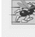

在“数据结构”和“算法”课程中学习哈希的计算机科学学生。`HashMap` 类允许我们在不实现哈希表机制的情况下使用哈希——这是代码复用的经典例子。这个概念在我们学习面向对象编程时至关重要。正如前面的章节中所讨论的，类封装并隐藏了复杂性（即实现细节），并提供了用户友好的接口。恰当地构建类以表现这种行为是面向对象编程领域最有价值的技能之一。图 16.17 使用 `HashMap` 来统计字符串中每个单词出现的次数。

第 1 行创建一个具有默认容量（16 个元素）和默认负载因子（0.75）的空 `HashMap`——这些是内置在 `HashMap` 实现中的。当 `HashMap` 中被占用的槽数大于容量乘以负载因子时，容量会自动翻倍。`HashMap` 是一个泛型类，接受两个参数——键的类型（即 `String`）和值的类型（即 `Integer`）。记住，传递给泛类的类型参数必须是引用类型，因此第二个类型参数是 `Integer` 而不是 `int`。

```java
// Fig. 16.17: WordCount.java
// 程序统计字符串中每个单词出现的次数。

import java.util.Map;
import java.util.HashMap;
import java.util.Set;
import java.util.TreeSet;
import java.util.Scanner;
```

> 图 16.17 | 程序统计每个字符串中每个单词出现的次数。（3 部分的第 1 部分）

```java
public class WordCount {
    public static void main(String[] args) {
        // 创建 HashMap存储 String 键和 Integer 值
        Map<String, Integer> map = new HashMap<>();
        // ... 此处省略后续代码
    }
}
```

> **图 16.17** | 程序统计字符串中每个单词出现的次数。（3 部分的第 2 部分。）

输入一个字符串：
is is a sample sentence with several words this is another sentence with several different words

| Map 包含: | Value |
|---|---|
| Key | 1 |
| another | 1 |
| different | 1 |
| is | 2 |
| sample | 2 |
| sentence | 2 |
| several | 2 |
| this | 2 |
| with | 2 |
| words | 2 |

size: 10
isEmpty: false

> **图 16.17** | 程序统计每个字符串中每个单词出现的次数。（3 部分的第 3 部分）

第 14 行调用方法 `createMap`（19–40 行），该方法使用 `Map` 来存储句子中每个单词出现的次数。第 22 行获取用户输入，第 25 行对其进行标记。对于每个标记，第 28–39 行将其转换为小写字母（第 29 行），然后调用 `Map` 方法 `containsKey()`（第 32 行）来确定单词是否在 map 中（即之前在字符串中出现过）。如果 Map 不包含该单词，第 37 行使用 `Map put()` 创建一个新条目，键为键，值为包含 1 的 `Integer` 对象。当程序将整数 1 传递给 `put()` 时，会发生自动装箱，因为 `Map` 将出现次数存储为 `Integer`。如果单词已存在于 map 中，第 33 行使用 `Map` 方法 `get()` 获取键的关联值，第 34 行增加该值并使用 `put()` 替换键的关联值。`put()` 方法返回键的原先值，如果键不在 map 中则返回 `null`。

## 错误预防提示 16.1

> 始终在 Map 中使用不可变键。键决定了相应值被放置的位置。如果键自插入操作以来发生了变化，当您随后尝试检索它时，可能就找不到它。

## 16.11 同步集合

在第 23 章中，我们讨论了多线程。集合框架中的集合默认不同步的，然而，多个线程并发访问集合可能会导致致命错误。为了防止线程问题，为可能被多个线程访问的集合提供了同步包装器。同步包装器接收调用，添加线程同步（防止并发访问），并将调用委托给被包装的对象。`Collections` 类提供了将集合包装为同步版本的静态方法。同步包装器的头部见图 16.18。这些方法的详细信息请访问 `//docs.oracle.com/javase/8/docs/api/java/util/Collections.html`。每个方法接收一个集合并返回其同步视图。例如，以下代码创建 String 对象：

```java
List<String> list1 = new ArrayList<>();
List<String> list2 = Collections.synchronizedList(list1);
```

更多并发访问的集合位于 `java.util.concurrent` 包中，它们是在第 23 章创建的。

```java
public static <T> Collection<T> synchronizedCollection(Collection<T> c)
public static <T> List<T> synchronizedList(List<T> aList)
public static <T> Set<T> synchronizedSet(Set<T> s)
public static <T> SortedSet<T> synchronizedSortedSet(SortedSet<T> s)
public static <K, V> Map<K, V> synchronizedMap(Map<K, V> m)
public static <K, V> SortedMap<K, V> synchronizedSortedMap(SortedMap<K, V> m)
```

> **图 16.18** | 一些同步包装器。

## 16.12 不可修改集合

`Collections` 类提供了一系列创建集合不可修改包装器的静态方法。如果尝试修改集合，不可修改包装器将抛出 `UnsupportedOperationException`。在不可修改集合中，存储在集合中的引用是不可修改的，但它们引用的对象是可以，除非它们属于像 `String` 这样的不可变类。这些方法的头部见图 16.19。有关这些方法的详细信息可见 `//docs.oracle.com/javase/8/docs/api/java/util/Collections.html`。所有方法都接收一个泛型并返回该泛型的不可修改视图。例如，以下代码创建了一个存储 String 对象的不可修改 List(list2)：

```java
List<String> list1 = new ArrayList<>();
List<String> list2 = Collections.unmodifiableList(list1);
```

## 软件工程观察 16.5

你可以使用不可修改包装器（unmodifiable wrapper）创建一个为他人提供只读访问的集合，而为你保留读写访问。你只需向他人提供该不可修改包装器的引用，同时为自己保留原始集合的引用即可。

```java
public static <T> Collection<T> unmodifiableCollection(Collection<T> c)
public static <T> List<T> unmodifiableList(List<T> alist)
public static <T> Set<T> unmodifiableSet(Set<T> s)
public static <T> SortedSet<T> unmodifiableSortedSet(SortedSet<T> s)
public static <K, V> Map<K, V> unmodifiableMap(Map<K, V> m)
public static <K, V> SortedMap<K, V> unmodifiableSortedMap(SortedMap<K, V> m)
```

> **图 16.19** | 某些不可修改包装器。

### 16.13 抽象实现

集合框架提供了 `Collection` 接口的各种实现，你可以通过这些实现快速“勾勒”出完整的自定义实现。这些抽象实现包括：名为 `AbstractCollection` 的轻量级 `Collection` 实现、允许对元素进行数组式访问的 `List` 实现 `AbstractList`、允许 `AbstractMap` 实现、允许对元素进行顺序访问（从头到尾）的 `List` 实现 `AbstractSequentialList`、名为 `AbstractSet` 的 `Set` 实现以及名为 `AbstractQueue` 的 `Queue` 实现。你可以在 `http://docs.oracle.com/java/javase/8/docs/api/java/util/package-summary.html` 了解更多关于这些类的信息。要编写自定义实现，你可以扩展符合需求的抽象实现，实现该类的每个抽象方法，并根据需要重写该类的具体方法。

## 16.14 Java SE 9：不可变集合的便利工厂方法

Java SE 9 在 `List`、`Set` 和 `Map` 接口中增加了新的静态便利工厂方法，允许你创建较小的不可变集合——这些集合一旦创建就无法被修改（JEP 269）。我们在第 10.12 节中引入了工厂方法，“工厂”一词表示这些方法会创建对象。它们之所以方便，是因为你只需将元素作为参数传递给便利工厂方法，该方法就会为你创建集合并把元素添加到集合中。

> 1. 如果本节中 Java SE 9 的内容发生任何变化，我们将在书籍网站 `http://www.de1.com/books/jhtp11` 发布更新。此示例需要 JDK 9 才能执行。

我们在第 16.12 节中讨论过的不可修改包装器所返回的集合创建了可变集合的不可变视图——原始的可变集合仍可用于修改该集合。相比之下，便利工厂方法返回的是真正不可变且针对小集合存储进行了优化的集合对象。在第 17 章和第 23 章中，我们将解释如何使用 lambda 表达式和不可变实体来创建“可并行化”的代码，这些代码在当今的多核心架构上运行得更高效。图 16.20 展示了 List 和 Set 的这些便利工厂方法。


### 常见编程错误 16.3

调用任何尝试修改由 `List`、`Set` 或 `Map` 便利工厂方法返回的集合的方法，都会导致 `UnsupportedOperationException`。

### 软件工程观察 16.6

在 Java 中，集合元素始终是对象的引用。不可变集合所引用的对象可能仍然是变的。

```java
// Fig. 16.20: FactoryMethods.java
// Java SE 9 集合工厂方法。

import java.util.List;
import java.util.Map;
import java.util.Set;

public class FactoryMethods {
    public static void main(String[] args) {
        // 创建一个 List
        List<String> colorList = List.of("red", "orange", "yellow", "green", "blue", "indigo", "violet");
        System.out.printf("%s%n%n", colorList);

        // 创建一个 Set
        Set<String> colorSet = Set.of("red", "orange", "yellow", "green", "blue", "indigo", "violet");
        System.out.printf("%s%n%n", colorSet);

        // 使用方法 "of" 创建一个 Map
        Map<String, Integer> dayMap = Map.of("Monday", 1, "Tuesday", 2, "Wednesday", 3, "Thursday", 4, "Friday", 5, "Saturday", 6, "Sunday", 7);
        System.out.printf("%s%n%n", dayMap);

        // 使用方法 "ofEntries" 创建包含超过 10 个条目的 Map
        Map<String, Integer> daysPerMonth = Map.ofEntries(
            Map.entry("January", 31),
            // ... 此处省略后续条目
        );
    }
}
```


```
Map.entry("February", 28),

Map.entry("March", 31),

Map.entry("April", 30),

Map.entry("May", 31),

Map.entry("June", 30)
```


图 16.20 Java SE 9 集合工厂方法。（2 部分中的第 I 部分）

| 行号 | 内容 |
| :--- | :--- |
| 33 | `Map.entry("July"), 31),` |
| 34 | `Map.entry("August"), 31),` |
| 35 | `Map.entry("September"), 30),` |
| 36 | `Map.entry("October"), 31),` |
| 37 | `Map.entry("November"), 30),` |
| 38 | `Map.entry("December"), 31)` |
| 39 | `);` |
| 40 | `System.out.printf("%monthMap: %s%n", daysPerMonthMap);` |
| 41 | `}` |
| 42 | `}` |

`colorList: [red, orange, yellow, green, blue, indigo, violet]`

`colorSet: [yellow, green, red, blue, violet, indigo, orange]`

`dayMap: [Tuesday=2, Wednesday=3, Friday=5, Thursday=4, Saturday=6, Monday=1, Sunday=7]`

`monthMap: [April=30, February=28, September=30, July=31, October=31, November=30, December=31, March=31, January=31, June=30, May=31]`

# 698 第 16 章 通用集合

## 16.15 总结

本章介绍了 Java 集合框架。你学习了集合的层次结构以及如何使用集合框架接口进行多态编程。你使用了 `ArrayList` 和 `LinkedList` 类，它们都实现了 `List` 接口。我们展示了 Java 用于操作队列的内置接口和类。你使用了几个预定义方法来操作集合。你学习了如何使用 `Set` 接口来操作无序的值集合。我们继续介绍集合，引入了 `SortedSet` 接口和 `TreeSet` 类用于操作排序后的值集合。然后，你学习了 Java 用于操作键值对的接口和类——`Map`、`SortedMap`、`HashMap` 和 `TreeMap`。我们讨论了 `Collections` 类的静态方法，用于获取集合的不可修改视图和同步视图。最后，我们引入了 Java SE 9 用于创建不可变 List、Set 和 Map 的新便利方法。如需更多信息，请访问 http://docs.oracle.com/javase/8/docs/technotes/collections。

在第 17 章“Lambda 与流”中，你将使用 Java SE 8 的函数式编程能力简化集合操作。在第 23 章“并发”中，你将学习如何使用 Java 的并发集合和并行流操作来提高多核系统上的性能。

## 总结

### 16.1 节 引言

- Java 集合框架提供了数据结构以及操作这些结构的方法。

### 16.2 节 集合概述

- 集合是一个可以持有其他对象引用的对象。
- 集合框架的接口和类位于 `java.util` 包中。
- `Set` 和 `List` 继承自 `Collection`（第 664 页），它包含了在集合中添加、清空和比较对象的操作。

### 16.3 节 类型包装类

- 类型包装类（例如 `Integer`、`Double`、`Boolean`）允许程序员以对象的形式操作基本类型的值（第 665 页）。这些对象可以被用于集合。

### 16.4 节 自动装箱与自动拆箱

- 装箱（第 665 页）将基本值转换为对应类型包装类的对象。
- 拆箱（第 665 页）将类型包装对象转换为对应的基本值。
- Java 自动执行装箱和拆箱。

### 16.5 节 接口 Collection 和类 Collections

- `Collection` 方法 `iterator()`（第 668 页）获取集合的 `Iterator`（第 666 页）。
- `Collections` 类（第 666 页）提供了操作集合的静态方法。

### 16.6 节 List

- `List` 接口由 `ArrayList` 和 `LinkedList` 类实现。`ArrayList`（第 666 页）是一种可调整数组的实现。`LinkedList`（第 666 页）是 `List` 的链式实现。

- Java 在声明和生成类型变量及对象的语句中使用 `< >` 符号进行推断。
- `Iterator` 方法 `hasNext()`（第 668 页）确定 `Collection` 是否包含另一个元素。`next()` 方法返回集合中下一个对象的引用并操作 `Iterator`。
- `List`（第 672 页）是按顺序排列的元素集合，可以包含重复元素。
- `subList()` 方法（第 672 页）返回 `List` 的视图。对该视图的更改也会应用到 `List` 上。
- `clear()` 方法（第 672 页）从 `List` 中移除元素。
- `toArray()` 方法（第 672 页）将集合的内容作为数组返回。

### 16.7 节 集合方法

- 算法 `sort()`（第 674 页）、`reverse()`（第 680 页）、`shuffle()`（第 678 页）、`fill()`（第 680 页）作用于 `List`。算法 `min()` 和 `max()`（第 680 页）作用于 `Collection`。
- 算法 `addAll()` 将数组中的所有元素添加到集合中（第 683 页），`frequency()`（第 684 页）计算集合中等于指定元素的元素个数，而 `disjoint()`（第 684 页）判断两个集合是否有交集元素。
- 算法 `min()` 和 `max()` 寻找集合中最小和最大的项。
- `Comparator` 接口（第 675 页）提供了一种按自然顺序之外的排序集合元素的方法。
- `Collections` 方法 `reverseOrder()`（第 675 页）返回一个 `Comparator` 对象，可用于反向排序集合的元素。
- 算法 `shuffle()`（第 678 页）随机排列 `List` 的元素。
- 算法 `binarySearch()`（第 682 页）在排序后的 `List` 中定位键。

### 16.8 节 PriorityQueue 和 接口 Queue

- `Queue` 接口（第 685 页）继承自 `Collection` 接口，并为在队列中插入、移除和检查元素提供了额外操作。
- `PriorityQueue`（第 685 页）实现 `Collection` 接口，并根据元素的自然顺序或传递给构造函数的 `Comparator` 对象对元素排序。
- `PriorityQueue` 方法 `offer()`（第 685 页）根据优先级顺序在适当的位置插入元素。`poll()` 方法（第 685 页）移除优先级队列中优先级最高的元素。`peek()` 方法（第 685 页）获取优先级队列中优先级最高的元素引用。`clear()` 方法（第 685 页）移除优先级队列中的所有元素。`size()` 方法（第 685 页）获取元素个数。

### 16.9 节 Set

- `Set`（第 686 页）是一种不包含重复元素的无序 `Collection`。
- `HashSet`（第 686 页）使用哈希表存储。
- `TreeSet`（第 686 页）使用树存储元素。
- `SortedSet` 接口（第 687 页）扩展 `Set`，表示一个按排序顺序维护元素的集合。
- `TreeSet` 类实现了 `SortedSet`。
- `TreeSet` 方法 `headSet()`（第 688 页）获取小于元素的视图。
- `tailSet()` 方法（第 688 页）获取大于或等于指定元素的视图。

### 16.10 节 Map

- `HashMap`（第 689 页）使用哈希表存储元素，`TreeMap`（第 689 页）使用树存储元素。
- `Map` 接收两个参数——键的类型和值的类型。
- `HashMap` 方法 `put()`（第 692 页）向 HashMap 中添加键值对。
- `get()` 方法（第 692 页）定位与指定键关联的值。
- `isEmpty()` 方法（第 692 页）判断 map 是否为空。
- `keySet()` 方法（第 692 页）返回键的集合。
- `size()` 方法（第 692 页）返回 Map 中键值对的数量。
- `SortedMap` 接口（第 689 页）扩展 `Map`，表示一个按排序顺序维护键的映射。

### 16.11 节 同步集合

- 集合框架中的集合是非同步的。同步包装器（第 693 页）为可被多线程访问的集合提供。

### 16.12 节 不可修改集合

- 不可修改集合包装器（第 693 页）在尝试修改集合时抛出 `UnsupportedOperation`。

### 16.13 节 抽象实现

- 集合框架提供了集合接口的各种抽象实现，你可以从中快速完成定制。

### 16.14 节 Java SE 9: 不可变集合的工厂方法

- Java SE 9 为 `List`、`Set` 和 `Map` 接口增加了新的静态工厂方法，允许你创建小型不可变集合——它们在创建后无法被修改。
- 便利工厂方法返回真正不可变且针对小型集合优化的集合对象。
- `List` 便利方法 `of()` 创建一个不可变的 List。
- `List.of()` 重载适用于 0 到 10 个元素的 List 以及接收任意数量元素的重载。返回的 List 元素保证与方法参数的顺序一致。
- `Set` 便利方法 `of()` 创建一个不可变的 Set。
- `Set.of()` 重载适用于 0 到 10 个元素的 Set 以及接收任意数量元素的重载。
- 便利工厂方法返回的 Set 的迭代顺序是不指定的。
- `Map` 便利方法 `of()` 创建一个不可变的 Map。
- `Map.of()` 重载适用于 0 到 10 个键值对的 Map。每对参数代表一个键值对。
- 便利方法返回的 Map 中键的迭代顺序是不指定的。
- 对于超过 10 个键值对的 Map，`Map` 便利方法 `ofEntries()` 创建一个不可变的 Map。该方法的每个参数都是对 `Map` 静态方法 `entry()` 调用的结果，该方法创建并返回表示一个键值对的 `Map.Entry` 对象。

## 自测练习题

16.1 填充下列每个语句中的空缺：

- a) ________ 被用于遍历集合并在迭代过程中从集合删除元素。
- b) 可以通过元素的 ________ 访问 List 中的元素。
- c) 假设 `myArray` 包含对 Double 对象的引用，当执行 "myArray[0] = 1.25;" 语句时，会发生 ________；________。
- d) 类 ________ 提供了数组数据结构的功能，并且可以动态调整自身的大小。
- e) 你可以使用 ________(n) 创建一个集合，该集合对其他人只提供读取访问，同时对你自己提供读写访问。
- f) 假设 `myArray` 包含对 Double 对象的引用，当执行 "double number = myArray[0];" 语句时，会发生 ________。
- g) 集合算法（Collections algorithm）用于判断两个交集（collisions）是否具有共同元素。

16.2 判断每个陈述的正确或错误。如果是错误的，请解释原因。

- a) 原始类型的值可能被直接存储在集合中。
- b) Set 可以包含重复值。
- c) Map 可以包含重复的键。
- d) LinkedList 可以包含重复值。
- e) Collections 是一个接口。
- f) Iterators（迭代器）用于删除元素。
- g) 使用哈希时，随着负载因子（load factor）的增加，冲突的概率会降低。
- h) PriorityQueue 允许 null 元素。

## 自测练习题答案

16.1 a) Iterator. b) index. c) autoboxing（自动箱）. d) ArrayList. e) unmodifiable wrapper. f) auto-boxing. g) disjoint。

16.2 a) 到 h) 的答案：

- a) 错误。向集合中添加原始类型时会发生自动箱，这意味着原始类型被转换为相应的类型包装类。
- b) 错误。Set 不能包含重复值。
- c) 错误。Map 不能包含重复的键。
- d) 正确。
- e) 错误。Collections 是一个类；Collection 是一个接口。
- f) 正确。
- g) 错误。随着负载因子的增加，相对于总槽位的可用槽位减少，因此冲突的概率会增加。
- h) 错误。尝试插入 null 元素会导致 NullPointerException。

## 练习题

16.3 定义以下每个术语：

- a) Collection
- b) Collections
- c) Comparator
- d) List
- e) load factor（负载因子）
- f) collision（冲突）
- g) HashMap 中的空间时间权衡
- h) HashMap

16.4 解释为什么向当前大小小于容量的 ArrayList 中添加额外元素是相对快速的操作，而在当前大小已达到容量的 ArrayList 对象中添加额外元素是相对慢的操作。

16.5 简要回答以下问题：

- a) Set 和 Map 的主要区别是什么？
- b) 向集合中添加原始类型（例如 double）值时会发生什么？
- c) 能不能使用 Iterator 的情况下打印集合中的所有元素？如果可以，如何做？

16.6 简要解释以下每个 Iterator 相关方法的操作：

- a) iterator()
- b) hasNext()
- c) next()

16.7 在以下情况下会发生什么？

- a) 对未排序的列表使用 BinarySearch（二分查找）。
- b) 在修改其相关集合后使用 Iterator。
- c) 使用包含重复元素的列表创建一个 HashSet。

16.8 判断以下每个陈述的正确或错误。如果是错误的，请解释原因。

- a) vectors 默认是同步的。
- b) Class Stack 类没有 add 方法。
- c) 为了使用 sort 方法，列表中的元素必须实现 Comparator 接口。

16.9 重写 16.3 中的第 10-25 行，使用 ArrayList 方法和接受集合参数的 LinkedList 构造函数来使代码更简洁。

16.10（去重）编写一个程序，读取一系列名字（first names），并将它们存储在 Set 中来消除重复项。允许用户搜索一个名字。

16.11（账户排序）编写一个 AccountComparator 类，根据图 15.9 中的账户（Account）根据账户余额（account balance）为 Account 类实现 Comparator 接口。使用该类按账户余额降序排序账户列表。

16.12（颜色选择器）编写一个 HashMap 来创建一个可重用的映射，用于从 Color 中预定义的 13 种颜色中选择其一。颜色的名称应作为键，Color 对象作为值。在一个应用程序中使用你的新类，该程序允许用户选择颜色并在其中绘制形状。

16.13（统计重复单词）编写一个程序，确定并打印句子中重复单词的数量。将大写和小写视为相同。忽略标点符号。

16.14（集合操作）重写应用程序以实现三个集合操作：交集、并集和差集。你应该构建三个与操作对应的方法。在 main 方法中，在两个字符串 HashSet 上测试这些操作。

16.15（连接两个 LinkedList）编写一个程序，其方法 ListConcatenate 接收两个 LinkedList 对象，并返回一个新的 LinkedList，其中包含第一个列表的元素，随后是第二个列表的元素。在 main 方法中，在两个字符串 LinkedList 上测试此方法。

16.16（质数和质因数）编写一个程序，从用户处获取一个数字并判断它是否为质数。如果是质数，显示其唯一的质因数。记住，质数的因子只有 1 和数字本身。

## 第 17 章 Lambdas 与流（Streams）

面向对象编程和泛型编程。Java SE 8 增加了 lambdas 和流——这些函数式编程的核心技术。

在本章中，我们将使用 lambdas 和流来编写某些类型的程序，它们比之前的技术更快、更简单、更简洁，且 Bug 更少。在第 23 章“并发”中，你会发现此类程序更容易并行化（即同时执行多个操作），从而让你能够利用多核架构来增强性能——这是 lambdas 和流的一个主要目标。

## 软件工程观察 17.1

> 你在第 23 章“并发”中会发现，如果并行任务需要修改程序状态（即其`变量`值），那么要创建运行准确的并行任务是困难的。因此，你在本章中学到的技巧侧重于不可变性——即不修改正在处理的数据源或任何其他程序状态。

本章展示了许多 lambdas 和流的示例（图 17.1），从展示实现你在第 5 章中编写的任务的更好方法开始。前几个示例的呈现方式允许它们在之前示例的背景下进行涵盖。由于由于原因，某些术语将在本章后面讨论。图 17.2 显示了后续章节中对 lambdas 和流的覆盖。

| 章节 | 可能在之后覆盖 |
|---|---|---|
| 第 17.2–17.4 节引入了基础 lambdas 和流能力，处理整数范围并消除了对计数器重复的需要。 | 第 5 章，控制语句：部分 2；逻辑运算符 |
| 第 17.6 节引入了方法引用以及与 lambdas 和流结合处理整数范围 | 第 6 章，方法：深入探讨 |
| 第 17.7 节展示了处理一维数组的 Lambda 和流能力。 | 第 7 章，数组和 ArrayList |
| 第 17.8–17.9 节讨论了关键函数式接口以及额外的 lambdas、概念，并将它们与之前的示例联系起来。第 10.10 节引入了 Java SE 8 增强的接口特性（默认方法、静态方法和函数接口的概念），这些特性支持 Java 中的函数式编程技术。 | 第 10 章，面向对象编程：多态和接口 |
| 第 17.16 节展示了如何使用 lambda 实现 JavaFX 事件监听器接口。 | 第 12 章，JavaFX 图形用户界面：部分 1 |
| 第 17.11 节展示了如何使用 lambdas 和流处理 String 对象集合。 | 第 14 章，字符串、字符和正则表达式 |

**本章关于 lambdas 和流的讨论和示例。（2 部分中的第一 部分）**

- 2. 我们在本章中使用的流与我们在第 15 章“文件、输入输出流、NIO 和 XML 序列化”中讨论的输入输出流不同，后者程序从文件读取字节流或向文件写入字节流。第 17.13 节使用 lambdas 和流来操作文件的内容。

## 17.2 流与规约（Reduction）

| 章节 | 可能在之后覆盖 |
| --- |---|
| 第 17.13 节展示了如何使用 lambdas 和流处理文件中的文本行——该节的示例还使用了第 14 章的一些正则表达式能力。 | 第 15 章，文件、输入输出流、NIO 和 XML 序列化 |

**图 17.1** 本章关于 lambdas 和流的讨论和示例。（2 部分中的第二部分。）

| 覆盖 | 章节 |
| --- |---|
| 使用 lambdas 实现 Swing 事件监听器函数式接口。 | 第 35 章，Swing GUI 组件：部分 2 |
| 显示函数式程序更容易并行化，因此可以利用多核架构增强性能。演示了并行流处理。展示了在排序大数组时，Arrays.methodSort 在多核与单核架构上相比于单核如何提升性能。 | 第 23 章，并发 |
| 使用 lambdas 实现 Swing 事件监听器函数式接口。 | 第 26 章，Swing GUI 组件：部分 1 |
| 使用流处理数据库查询结果。 | 第 29 章，Java 持久化 API (JPA) |

**图 17.2** 后续关于 lambdas 和流的覆盖。

## 17.2 流与规约

> *本节演示了如何使用流来简化你在第 4 章学到的编程任务，控制语句：部分 2；逻辑运算符。*

在计数控制迭代中，你通常使用 `for` 循环来确定你想实现什么以及如何实现。在本节中，我们将研究方法，然后向你展示更好的实现方式。

### 17.2.1 使用 for 循环累加从 1 到 10 的整数

假设你想实现的是计算从 1 到 10 的整数总和。在第 5 章中，你看到可以使用计数控制循环来实现这一点：

```java
```


# 第 17 章 Lambda 和 Stream

## 17.2 外部迭代与内部迭代

```java
int total = 0;

for (int number = 1; number <= 10; number++) {
    total += number;
}
```

这个循环指定了如何执行任务——处理控制变量 `number` 从 1 到 10 的每个值，每循环将 `number` 加到 `total`，并在相加后递增。这被称为外部迭代，因为你指定了细节。

### 17.2.2 外部迭代容易出错

让我们考虑上述代码的潜在问题。按照目前的实现方式，该循环需要两个变量（`total` 和 `number`），代码在每次迭代中都会变异（即修改）它们。每当你编写修改变量的代码时，都有可能向你的代码中引入错误。上述代码中有几处出错的机会，例如：

- 错误地初始化变量 `total`
- 错误地初始化 `for` 循环计数数字
- 使用错误的循环条件
- 错误地增加控制变量
- 错误地将 `number` 的每个值加到 `total`

此外，随着你执行的任务变得复杂，理解代码如何工作将变得更难阅读和修改，并且更容易包含错误。

### 17.2.3 使用流和规约进行累加

现在让我们采取一种不同的方法，指定“做什么”而不是“怎么做”。在图 17.3 中，我们只指定了想实现什么——即累加从 1 到 10 的整数——然后简单地让 Java 的 `IntStream` 类（`java.util.stream`）来处理如何做。该程序的关键是第 9-10 行中的以下表达式：

```java
IntStream.rangeClosed(1, 10)
         .sum()
```

它可以被读为：“对于 1 到 10 范围内的 int 值流，求和”。在这个代码中，没有变量来存储总和，因为 `IntStream` 方便地定义了 `sum`。

```java
// 图 17.3：StreamReduce.java

import java.util.stream.IntStream;

public class StreamReduce {

    public static void main(String[] args) {

        // 1 到 10 的总和

        System.out.printf("Sum of 1 through 10 is: %d%n",
            IntStream.rangeClosed(1, 10)
            .sum());

    }

}
```

**图 17.3** 1 到 10 的总和是：55

## 流与管道

链式方法调用创建了一个流管道。流是执行任务的元素序列，流通过一系列任务步骤处理元素。

### 良好的编程习惯 17.1

使用链式方法调用时，将点（`.`）垂直对齐以提高可读性，正如我们在图 17.3 第 9 行中所做的那样。

### 指定数据源

流管道通常产生创建流的方法调用——这被称为数据源。第 9 行通过以下方法调用指定数据源：

```java
IntStream.rangeClosed(1, 10)
```

它创建了一个表示有序值的 `IntStream`。在这里，我们使用 `rangeClosed`，因为它产生一个闭区间范围——即包含方法的两个参数（1 和 10）的范围。`IntStream` 也提供了 `range` 方法，产生从第一个参数到但不包含第二个参数的半开区间，例如：

```java
IntStream.range(1, 10)
```

产生一个包含 1, 2, 3, 4, 5, 6, 7, 8, 9 但不包含 10 的有序元素的 `IntStream`。

### 计算 IntStream 元素的和

接下来，第 10 行通过以下处理步骤完成流管道：

```java
.sum()
```

这调用了 `IntStream` 的 `sum` 实例方法，返回流中所有整数的和——在本情况下，是从 1 到 10 的整数的和。

`sum` 方法执行的操作被称为规约——它将值减少为单个值（总和）。这是许多预定义 `IntStream` 规约之一——第 17.7 节介绍了预定义的规约 `count`、`min`、`max`、`average` 和 `summaryStatistics`，以及定义自定义规约的方法。

### 处理流管道

终端操作启动流管道的处理并产生结果。`IntStream` 方法 `sum` 是一个终端操作，产生流元素的和。

### 17.2.4 内部迭代

上述示例的关键在于它指定了我们想要任务做什么——计算从 1 到 10 的整数总和——而不是如何计算。这是一个声明式编程（指定“做什么”）与命令式编程（指定“怎么做”）的示例。我们将目标分为两个任务：生成闭区间范围（1–10）内的数字以及计算它们的和。在内部，`IntStream`（即数据源本身）已经知道如何执行这些任务中的每一个。我们不需要指定如何遍历元素，也不需要声明和使用任何可变变量。这被称为内部迭代，因为 `IntStream` 处理了迭代细节——这是函数式编程的一个方面。与使用 `for` 语句的外部迭代相比，图 17.3 中第 9 行主要的潜在错误是作为参数指定了错误的起始和/或结束值。一旦你习惯了它，流流水线代码也会变得更易读。

### 软件工程观察 17.2

函数式编程技术允许你编写更高级别的代码，因为许多细节都由 Java 流库替你实现。你的代码变得更加简洁，这提高了生产力，并帮助你快速构建程序原型。

### 软件工程观察 17.3

函数式编程技术消除了大类错误，例如差一错误（迭代细节由库对你隐藏了）和错误地修改变量（因为你关注不可变性，因此不修改数据）。这使得编写正确的程序变得更容易。

## 17.3 映射与 Lambda

[本节演示了如何使用流来简化你在第 4 章“控制语句：部分 2；逻辑运算符”中学过的编程任务。]

前面的示例指定了一个流流水线，其中包含一个数据源和一个产生结果的终端操作。大多数流流水线还包含中间操作，这些操作在终端操作产生结果之前指定对流元素执行的任务。

在这个示例中，我们引入了一种常见的中间操作，称为映射，它将流的元素转换为新值。结果是一个具有相同数量元素的流，其中包含了转换的结果。有时，映射后的元素类型与原始流元素的类型不同。

为了演示映射，让我们重新回顾图 5.5 中的程序，在该程序中，我们使用外部迭代计算了 2 到 20 之间偶整数之和，如下：

```java
int total = 0;

for (int number = 2; number <= 20; number += 2) {
    total += number;
}
```

图 17.4 使用流和内部迭代重新实现了这一任务。

```java
// Fig. 17.4: StreamMapReduce.java
// 使用 IntStream 计算 2 到 20 之间的整数和。

import java.util.stream.IntStream;

public class StreamMapReduce {

    public static void main(String[] args) {

        // 计算 2 到 20 之间的整数

        System.out.printf("Sum of the evens from 2 through 20 is: %d\n",
            IntStream.rangeClosed(1, 10) // 1..10
                .map((int x) -> {return x * 2;}) // 乘以 2
                .sum());

    }

}
```

**图 17.4** 使用 IntStream 计算 2 到 20 之间的偶整数。

- 第 9-11 行的流水线执行了三次链式调用：
- 第 9 行创建了数据源——一个包含元素 1, 2, 3, 4, 5, 6, 7, 8, 9 和 10 的 `IntStream`。
- 第 10 行执行了一个处理步骤，将流中的每个元素 (x) 映射为乘以 2 的元素。结果是偶整数 2, 4, 6, 8, 10, 12, 14, 16, 18 和 20 的和。
- 第 11 行将流的元素归约为单个值——元素的和。这是一个启动流水线处理的终端操作，然后返回流的元素。

这里的新功能是第 10 行的映射操作，在这种情况下，它将每个流乘以 2。`IntStream` 方法 `map` 接收其参数（第 10 行）：

```java
(int x) -> {return x * 2;}
```

我们将在下一节中看到，它是“一个接收 int 参数并返回乘以 2 的值的方法”的匿名表示法。对于流中的每个元素，`map` 都会调用此方法并将其传递给当前流元素。方法的返回值将成为 `map` 返回的新流的一部分。

### 17.3.1 Lambda 表达式

正如你在整个章节中看到的，许多中间和终端流操作接收方法。第 10 行中方法 `map` 的参数：

```java
(int x) -> {return x * 2;}
```

被称为 *lambda 表达式*（或简单称为 *lambda*），它代表一个匿名方法——即一个*没有名字的方法*。虽然 lambda 的语法看起来不像你之前看到的方法，但左侧看起来像是一个方法参数列表，而右侧看起来像是一个方法体。我们很快会解释语法细节。

Lambda 表达式允许你创建可以被视作数据的方法。你可以：
- 将 lambdas 作为参数传递给其他方法（如 `map`、`filter`，甚至是其他的 lambda）
- 将 lambda 表达式赋值给变量以供以后使用
- 从方法返回 lambda 表达式。

> **软件工程观察 17.4**
> Lambda 和流允许你结合函数式编程的许多优点。

### 17.3.2 Lambda 语法

一个 lambda 由参数列表、箭头符号 (`->`) 和方法体组成，如下所示：

```java
(x) -> { return x * 2; }
```

在这种情况下，方法体是一个语句。

#### 省略 Lambda 类型

通常可以省略 lambda 的类型，如下：

```java
(x) -> { return x * 2; }
```

编译器会推断类型。

#### 简化 Lambda 方法体

如果方法体只包含一个表达式，`return` 关键字、大括号和分号可以省略，如下：

```java
(x) -> expression
```

在这种情况下，lambda 隐式返回该表达式。

#### 简化 Lambda 参数列表

如果参数列表只有一个参数，可以省略括号，如下：

```java
x -> expression
```

#### 带有空参数列表的 Lambda

要定义具有空参数列表的 lambda，在箭头符号 (`->`) 左侧使用空括号，如下：

```java
() -> System.out.println("Welcome to lambdas!")
```

#### 方法引用

除了上述 lambda 变体，还有特殊的快捷形式称为方法引用，我们在 17.6 中介绍。

### 17.3.3 中间操作与终端操作

在 9-11 行所示的流流水线中，`map` 是一个中间操作，而 `sum` 是一个终端操作。方法 `map` 是许多指定对流元素执行任务的中间操作之一。

#### 惰性与急性操作

中间操作使用惰性求值——每个中间操作产生一个新的流对象，但在调用终端操作产生结果之前不会对元素执行任何操作。这允许库开发者优化流处理性能。例如，如果你有 1,000,000 个 `Person` 对象并且正在寻找第一个姓 "Jones" 的人，与其处理所有 1,000,000 个元素，流处理一旦找到匹配项即可终止。

> **性能提示 17.1**
> 惰性求值通过确保在需要时执行操作来提高性能。

终端操作是急性的——它们在被调用时执行请求的操作。我们在整个章节中遇到它们时会有更多关于惰性和急性操作的说明。你将在第 17.5 节看到惰性操作如何提高性能，该节讨论了流流水线的中间操作如何应用于每个流元素。

### 常见的中间流操作

| 操作 | 说明 |
| :--- | :--- |
| `filter` | 返回只包含满足条件（称为*谓词*）元素的流。新流的元素比原始流少。 |
| `distinct` | 返回只包含唯一元素的流——重复项被消除了。 |
| `limit` | 返回原始流开头的指定数量元素的流。 |
| `map` | 返回一个新的流，其中原始流的每个元素都被映射到一个新值（可能具有不同的类型）——例如，将数值映射到该数值的平方，或将数值映射到字母分级（A, B, C, D 或 F）。新流的元素数量与原始流相同。 |
| `sorted` | 返回一个元素按排序排列的流。新流的元素数量与原始流相同。我们将展示如何同时指定升序和降序。 |

**图 17.5** 常见的中间流操作。

### 常见的终端流操作

| 操作 | 说明 |
| :--- | :--- |
| `forEach` | 对流中的每个元素执行处理（例如，显示每个元素）。 |
| **规约操作——获取流中的所有值并返回一个单一值** | |
| `average` | 返回数值型流中元素的平均值。 |
| `count` | 返回流中元素的数量。 |
| `max` | 返回流中的最大值。 |
| `min` | 返回流中的最小值。 |
| `reduce` | 使用结合累加函数将集合的元素规约为单一值（例如，一个加上两个元素并返回和的 lambda）。 |

**图 17.6** 常见的终端流操作。

## 17.4 过滤

*本节演示了如何使用中间流操作来简化你在第 4 章中学到的编程任务：控制语句：部分 2；逻辑运算符。*

另一个常见的中间操作是*过滤*，用于选择符合特定条件的元素——这被称为谓词。例如，以下代码选择了 1–10 范围内的整数，将每个整数乘以 3 并对结果求和：

```java
int total = 0;

for (int x = 1; x <= 10; x++) {
    if (x % 2 == 0) { // 如果 x 是偶数
        total += x * 3;
    }
}
```

图 17.7 使用流重新实现了这个循环。

```java
// 图 17.7: StreamFilterMapReduce.java
// 使用 IntStream 将 2 到 10 之间的偶数乘以 3 然后求和。

import java.util.stream.IntStream;

public class StreamFilterMapReduce {

    public static void main(String[] args) {

        // 对 2 到 10 之间偶数的倍数求和

        System.out.printf("2 到 10 之间偶数三倍之和是: %d%n",
            IntStream.rangeClosed(1, 10)
                .filter(x -> x % 2 == 0)
                .map(x -> x * 3)
                .sum());

    }

}
```

**图 17.7** 使用 IntStream 将 2 到 10 之间的偶数乘以 3 然后求和。

第 10–13 行的流管道包含四个链式方法调用：

- 第 10 行创建数据源——一个 1 到 10 的闭区间范围。
- 第 11 行通过选择能被 2 整除的元素（即偶数）来过滤元素，产生一个 2, 4, 6, 8 和 10 的偶数流。
- 第 12 行将流中的每个元素 (x) 映射到该元素的 3 倍，产生一个 6, 12, 18, 24 和 30 的偶数流。
- 第 13 行将流规约为其元素之和 (90)。

新功能是第 11 行的过滤操作。`IntStream` 方法 `filter` 接收其作为参数：

```java
x -> x % 2 == 0
```

它接收一个参数，如果结果对于给定的元素为真，则该元素被包含在生成的流中。


# 第 17 章 Lambda 和 Stream

确定了该 `int` 是否能被 2 整除（即除以 2 的余数为 0），如果是，则 lambda 返回 `true`，否则返回 `false`。对于流中的每个元素，`filter` 会调用其接收到的参数的方法，并将当前流元素传递给它。如果方法的返回值为 `true`，则相应的元素将成为 `filter` 返回的中间流的一部分。

第 11 行创建了一个中间流，表示仅包含能被 2 整除的元素（2, 4, 6, 8 和 10）。第 12 行使用它创建了一个表示偶数乘以 3 倍的中间流（6, 12, 18, 24 和 30）。第 13 行通过调用终端操作 `sum` 启动流处理。此时此，组合的处理步骤被应用于每个元素，然后 `sum` 返回流中剩余元素的总和。我们将在下一节中进一步讨论此点。

## 错误预防提示 17.1

流管道中操作的顺序非常重要。例如，从 1–10 过滤出偶数得到 2, 4, 6, 8, 10，然后将它们映射为其值的两倍得到 4, 8, 12, 16, 20。相反，将 1–10 的数字映射为其值的两倍会得到 2, 4, 6, 8, 10, 12, 14, 16, 18, 20。新功能是第 11 行的过滤操作。`IntStream` 方法接收其作为参数，它接收一个参数，如果结果对于给定的元素为真，则该元素被包含在生成的流中。

第 10–13 行的流管道包含四个链式方法调用：

- 第 10 行创建数据源——一个 1 到 10 的闭区间范围。
- 第 11 行（稍后我们将详细讨论）通过选择能被 2 整除的元素（即偶数）来过滤元素，产生一个 2, 4, 6, 8 和 10 的偶数流。
- 第 12 行将流中的每个元素 (`x`) 映射到该元素的 3 倍，产生一个 6, 12, 18, 24 和 30 的偶数流。
- 第 13 行将流规约为其元素之和 (90)。

## 17.5 元素如何通过管道移动

第 10–13 行的流管道包含四个链式方法调用：

- 第 10 行创建数据源——一个 1 到 10 的闭区间范围。
- 第 11 行（稍后我们将详细讨论）通过选择能被 2 整除的元素（即偶数）来过滤元素，产生一个 2, 4, 6, 8 和 10 的偶数流。
- 第 12 行将流中的每个元素 (`x`) 映射到该元素的 3 倍，产生一个 6, 12, 18, 24 和 30 的偶数流。
- 第 13 行将流规约为其元素之和 (90)。

新功能是第 11 行的过滤操作。`IntStream` 方法接收其作为参数，它接收一个参数，如果结果对于给定的元素为真，则该元素被包含在生成的流中。

### 规约操作——获取流中的所有值并返回一个单一值

| 方法 | 说明 |
| :--- | :--- |
| `average` | 返回数值型流中元素的平均值。 |
| `count` | 返回流中元素的数量。 |
| `max` | 返回流中的最大值。 |
| `min` | 返回流中的最小值。 |
| `reduce` | 使用结合累加函数将集合的元素规约为单一值（例如，一个加上两个元素并返回和的 lambda）。 |

为了证明这一点，请考虑修改版本：

- 第 10 行创建数据源——一个 1 到 10 的闭区间范围。
- 第 11 行（稍后我们将详细讨论）通过选择能被 2 整除的元素（即偶数）来过滤元素，产生一个 2, 4, 6, 8 和 10 的偶数流。
- 第 12 行将流中的每个元素 (`x`) 映射到该元素的 3 倍，产生一个 6, 12, 18, 24 和 30 的偶数流。
- 第 13 行将流规约为其元素之和 (90)。

| 方法 | 说明 |
| :--- | :--- |
| `forEach` | 对流中的每个元素执行处理（例如，显示每个元素）。 |

- 第 10 行创建数据源——一个 1 到 10 的闭区间范围。
- 第 11 行（稍后我们将详细讨论）通过选择能被 2 整除的元素（即偶数）来过滤元素，产生一个 2, 4, 6, 8 和 10 的偶数流。
- 第 12 行将流中的每个元素 (`x`) 映射到该元素的 3 倍，产生一个 6, 12, 18, 24 和 30 的偶数流。
- 第 13 行将流规约为其元素之和 (90)。

新功能是第 11 行的过滤操作。`IntStream` 方法接收其作为参数，它接收一个参数，如果结果对于给定的元素为真，则该元素被包含在生成的流中。

如果 `filter` 返回 `false`，则该 `map` 步骤就不会被执行。

## 17.6 方法引用

*本节演示了如何使用流来简化你在第 5 章中学到的编程任务：方法。*

对于仅仅调用另一个方法的 lambda，可以用该方法的名称替换 lambda——这被称为方法引用。编译器会将方法引用转换为适当的 lambda 表达式。

类似于图 6.6，17.8 使用 `SecureRandom` 获取 1–6 范围内的随机数。程序使用流创建随机值并使用方法引用帮助显示结果。我们将在 17.6.1–17.6.4 节中对代码进行走读。

```java
// 图 17.8: RandomIntegers.java
// 偏移和缩放的整数。

import java.security.SecureRandom;
import java.util.stream.Collectors;

public class RandomIntegers {
    public static void main(String[] args) {
        SecureRandom numbers = new SecureRandom();

        // 在单独行打印 10 个随机整数
        System.out.println("Random numbers on separate lines:");
        numbers.ints(10, 1, 7)
            .forEach(System.out::println);

        // 在同一行打印 10 个随机整数
        String numbers = numbers.ints(10, 1, 7)
            .mapToObj(String::valueOf)
            .collect(Collectors.joining(" "));

        System.out.printf("%nRandom numbers on one line: %s%n", numbers);
    }
}
```

分行显示的随机数：


单行显示的随机数： 4 6 2 5 6 4 3 2 4 1

**图 17.8** 经过偏移和缩放的随机整数。（部分 2，共 2 部分。）

### 17.6.1 创建包含随机值的 IntStream

`SecureRandom` 类的 `ints` 方法返回一个包含随机数的 `IntStream`。在第 12–13 行的流流水线中：

```java
randomNumbers.ints(10, 1, 7)
```

创建了一个 `IntStream` 数据源，其中包含指定数量的随机 `int` 值（10 个），其范围从第一个参数（1）开始，但不包含第二个参数（7）。因此，第 12 行生成了一个范围在 1–6 之间的 10 个随机整数的 `IntStream`。

### 17.6.2 使用 forEach 和方法引用对每个流元素执行任务

接下来，第 13 行的流使用 `IntStream` 方法 `forEach`（一个终端操作）对每个流元素执行任务。`forEach` 方法接收一个方法作为参数，该方法接收一个参数并使用该参数的值执行任务。`forEach` 的参数：

```java
System.out::println
```

在此处是一个方法引用——它是调用指定方法的 lambda 简写表示。如下形式的方法引用：

```java
objectName::instanceMethodName
```

是一个绑定实例方法引用——“绑定”意味着必须使用 `::` 左侧的具体对象（`System.out`）来调用 `::` 右侧的实例方法（`println`）。编译器将 `System.out::println` 编译为如下所示的单参数 lambda：

```java
x -> System.out.println(x)
```

将 lambda 的参数——当前元素（由 `x` 表示）传递给 `System.out.println` 实例方法，该方法隐式地输出参数的字符串表示形式。第 12–13 行的流流水线等同于 for 循环：

```java
for (int i = 1; i <= 10; i++) {
    System.out.println(1 + randomNumbers.nextInt(6));
}
```

### 17.6.3 使用 mapToObj 将整数转换为 String 对象

第 16–19 行的流流水线：

```java
String numbers =
randomNumbers.ints(10, 1, 7)
  .mapToObj(String::valueOf)
  .collect(Collectors.joining(" "));
```

创建了一个包含 10 个范围在 1–6 之间的随机整数并用空格分隔的 `String`。流水线执行了三次方法调用：

- 第 17 行创建数据源——一个包含 10 个范围在 1–6 随机整数的 `IntStream`。
- 第 18 行将每个 `int` 映射到它的字符串表示，生成一个 `String` 的中间流。我们之前使用的 `IntStream` `map` 返回的是另一个 `IntStream`。为了进行映射，我们改用 `IntStream` 方法 `mapToObj`，它允许我们从 `int` 映射到引用类型元素。像 `map` 一样，`mapToObj` 期望一个返回值的单参数方法。在示例中，`mapToObj` 使用的是类 `ClassName::staticMethod` 形式的静态引用。编译器将 `String::valueOf`（返回其参数的字符串表示）转换为一个单参数 lambda，该 lambda 调用 `valueOf` 并将当前流元素作为参数，如下：
  `x -> String.valueOf(x)`
- 第 19 行（我们将在第 17.6.4 节中详细讨论）使用终端操作 `collect` 将所有 `String` 拼接起来，并在每个元素之间用空格隔开。`collect` 方法是归约（reduction）的一种形式，它返回一个对象——在本例中，是一个 `String`。

第 20 行显示生成的 `String`。我们将在整个章节中讨论其他的收集器。

### 17.6.4 使用 collect 拼接字符串

考虑图 17.8 中的第 19 行。终端操作 `collect` 使用收集器将流的元素汇到一个单个对象中——通常是一个集合。这类似于归约，但 `collect` 返回的是聚合了流元素的对象，将流归约为该流类型的单一值。在示例中，我们使用由静态 `Collectors.joining` 返回的定义收集器。该收集器创建了流元素的拼接字符串表示形式，通过 `joining` 方法的参数（在本例中为空格）将每个元素附加到上一个元素的 `String` 之后。`collect` 方法随后返回生成的 `String`。我们将在书中讨论其他收集器。

## 17.7 IntStream 操作

[本节演示了如何使用 lambda 和 stream 来简化编程任务，就像你在第 6 章“数组和 ArrayList”中所学的那样]

图 17.9 展示了在从数组创建的流上进行的额外 `IntStream` 操作。在本节及之前的示例中使用的 `IntStream` 技术也适用于处理 `long` 和 `double` 值的 `LongStream` 和 `DoubleStream`。我们将逐步介绍第 17.7.1–17.7.4 节中的代码。

```java
// Fig. 17.9: IntStreamOperations.java
// 展示 IntStream 操作。

import java.util.Arrays;
import java.util.stream.Collectors;
import java.util.stream.IntStream;

public class IntStreamOperations {
    public static void main(String[] args) {
        int[] values = {3, 10, 6, 1, 4, 8, 2, 5, 9, 7};

        // 显示原始值
        System.out.printf("Original values: %s%n",
            IntStream.of(values)
                .mapToObj(String::valueOf)
                .collect(Collectors.joining(" ")));

        // count
        System.out.printf("Count: %d%n", IntStream.of(values).count());

        // min
        System.out.printf("Min: %d%n", IntStream.of(values).min().getAsInt());

        // max
        System.out.printf("Max: %d%n", IntStream.of(values).max().getAsInt());

        // sum
        System.out.printf("Sum: %d%n", IntStream.of(values).sum());

        // average
        System.out.printf("Average: %.2f%n", IntStream.of(values).average().getAsDouble());

        // sum via reduce method
        System.out.printf("Sum via reduce method: %d%n",
            IntStream.of(values)
                .reduce(0, (x, y) -> x + y));

        // product via reduce method
```


# 第 17 章 Lambda 与 Stream

## 17.7.1 创建 IntStream 并显示其值

`IntStream` 静态方法 `of(line 14)` 接收 `int` 数组参数并返回一个用于处理数组值的 `IntStream`。第 14–16 行的流流水线：

```java
IntStream.of(values)
    .mapToObj(String::valueOf)
    .collect(Collectors.joining(" "));
```

显示流的元素。首先，第 14 行从数组创建 `IntStream`，第 15–16 行使用如图 17.8 所示的 `mapToObj` 和 `collect` 方法获取流元素的字符串表示。我们在每个及随后的示例中多次使用这种技术，此示例反复使用以下代码创建 `IntStream`：

```java
IntStream.of(values)
```

你可能认为可以简单存储流并重用它。然而，一旦流水线执行了终端操作，流就无法重用，因为它不维护原始数据源的副本。

## 17.7.2 终端操作 count, min, max, sum 和 average

`IntStream` 类提供了各种终端操作，用于对流中的 `int` 进行常见的归约。

- `count`（line 19）返回流中元素的数量。
- `min`（line 21）返回一个 `OptionalInt`（位于 `java.util` 包），可能包含流中的最小 `int`。对于任何流，都可能没有元素。返回 `OptionalInt` 可以让 `min` 方法在流至少包含一个元素时返回最小值。在这个示例中，我们知道流有 10 个元素，因此我们调用 `OptionalInt` 的 `getAsInt()` 方法来获取最小值。如果没有元素，`OptionalInt` 将不包含 `int`，且 `getAsInt()` 将抛出 `NoSuchElementException`。为了防止出现这种情况，你可以调用 `orElse()` 方法，如果存在 `OptionalInt` 的值则返回它，否则返回你传递给 `orElse()` 的值。
- `max()`（第 23 行）返回一个 `OptionalInt`，可能包含流中最大的 `int`。同样，我们调用 `OptionalInt` 的 `getAsInt()` 方法来获取最大值，因为我们知道这个流包含元素。
- `sum()`（第 24 行）返回流中所有 `int` 的和。
- `average()`（第 26 行）返回一个 `OptionalDouble`（位于 `java.util` 包），可能将流中的 `int` 作为 `double` 类型的数值计算平均值。在这个示例中，我们知道流包含元素，因此我们调用 `OptionalDouble` 的 `getAsDouble()` 方法来获取平均值。如果没有元素，`OptionalDouble` 将不包含该值且 `getAsDouble()` 将抛出 `NoSuchElementException`。对于 `OptionalDouble`，为了防止这种情况，你可以调用 `orElse()` 方法，如果存在 `OptionalDouble` 的值则返回它，否则返回你传递给 `orElse()` 的值。

`IntStream` 类还提供了 `summaryStatistics`，可以在一次遍历 `IntStream` 元素的过程中执行 `min`、`max`、`sum` 和 `average` 操作，并将结果作为 `IntSummaryStatistics` 对象（位于 `java.util` 包）返回。与为每个单独的操作重复处理相比，这提供了显著的性能提升。该方法具有获取每个结果的方法以及一个汇总所有结果的 `toString` 方法。例如，以下语句：

```java
System.out.println(IntStream.of(values).summaryStatistics());
```

产生输出：
`IntSummaryStatistics{count=10, sum=55, min=1, average=5.00000, max=10}`

对应图 17.9 中的数组 `values`。

## 17.7.3 终端操作 reduce

到目前为止，我们已经介绍了各种预定义的 `IntStream` 归约。你可以通过 `IntStream` 的 `reduce` 方法定义自己的归约——事实上，第 17.7.2 节中讨论的每个终端操作都是 `reduce` 的特殊实现。第 30–31 行的流流水线：

```java
IntStream.of(values)
    .reduce(0, (x, y) -> x + y)
```

展示了如何使用 `reduce` 而不是 `sum` 来使用 `IntStream` 的值。`reduce` 的第一个参数 (`0`) 是操作的恒等值——即当它与任何流元素（`reduce` 第二个参数中的 lambda）结合时，会产生该元素的原始值。例如，在累加元素时，恒等值是 0，因为任何 `int` 值加上 0 都会得到原始的 `int` 值。同样，在获取元素的乘积时，恒等值是 1，因为任何 `int` 值乘以 1 都会得到原始的 `int` 值。

`reduce` 方法的第二个参数是一个方法，它接收两个值（代表二元运算符的左右操作数），对这些值进行计算并返回结果。该 lambda：

```java
(x, y) -> x + y
```

将值相加。带有两个或多个参数的 lambda 必须放在括号中。

### 错误预防提示 17.2

`reduce` 参数指定的操作必须满足**结合律**——也就是说，`reduce` 将操作应用于流元素的顺序并不重要。这一点很重要，因为归约允许以任何顺序将其应用于流元素上。非结合律的操作可能会根据处理顺序产生不同的结果。例如，减法不是结合律操作——表达式 `7–3` 得到 5，而表达式 `(7–5)–3` 得到 1。对于并行流（第 23 章），结合律操作至关重要，因为并行流会将操作拆分到多个核心上以提高性能。练习题 23.19 探讨了这个问题。

基于流的元素：

- 3 10 6 1 4 8 2 5 9 7

归约计算过程如下：

```
0 + 3 --> 3
3 + 10 --> 13
13 + 6 --> 19
19 + 1 --> 20
20 + 4 --> 24
24 + 8 --> 32
32 + 2 --> 34
34 + 5 --> 39
39 + 9 --> 48
48 + 7 --> 55
```

注意，第一次计算使用恒等值 (0) 作为左操作数，随后的每次计算使用上一次计算的结果作为左操作数。归约过程持续产生 `IntStream` 值的运行和，直到所有元素都被使用完毕，此时返回最终总和。

### 使用方法 reduce 计算值的乘积

第 35–36 行的流流水线：

```java
IntStream.of(values).reduce((x, y) -> x * y).getAsInt()
```

使用了单参数版本的 `reduce` 方法，如果流包含元素，它返回一个 `OptionalInt`，其中包含 `IntStream` 值的乘积；否则，`OptionalInt` 不包含结果。

基于流的元素：

- 3 10 6 1 4 8 2 5 9 7

归约计算过程如下：

```
3 * 10 --> 30
30 * 6 --> 180
180 * 1 --> 180
180 * 4 --> 720
720 * 8 --> 5760
5760 * 2 --> 11520
11520 * 5 --> 57600
57600 * 9 --> 518400
518400 * 7 --> 3628800
```

此过程持续产生 `IntStream` 值的运行积，直到所有元素都被使用完毕，此时返回最终结果。我们可以使用双参数的 `reduce`，例如：

```java
IntStream.of(values)
    .reduce(1, (x, y) -> x * y)
```

然而，如果流为空，此版本的 `reduce` 将返回恒等值 (1)，这对于空流来说不是预期的结果。

### 计算值的平方

第 39–41 行的流流水线：

```java
IntStream.of(values)
    .map(x -> x * x)
    .sum()
```

使用 `map` 将每个元素转换为其平方，然后使用 `sum` 计算总和。

### 显示排序后的元素

第 44–48 行的流流水线：

```java
IntStream.of(values)
    .sorted()
    .mapToObj(String::valueOf)
    .collect(Collectors.joining(" "))
```

对流元素进行排序，转换为字符串，并用空格连接。

**图 17.9** 展示 IntStream 操作。（部分 1，共 2 部分）


System.out.println(`IntStream.of(values).summaryStatistics()`);

```
IntSummaryStatistics{count=10, sum=55, min=1, average=5.00000, max=10}
```

对应图 17.9 中的数组 `values`。

## 17.7.4 排序 sorted

`sorted()` 是一个中间操作，它对流中的元素进行排序。你可以通过传递一个 `Comparator` 来定义自定义排序规则。例如：

```java
IntStream.of(values)
    .sorted()
    .forEach(System.out::println);
```

将按升序排序元素。如果你想按降序排序，可以使用 `reverseOrder()`：

```java
IntStream.of(values)
    .sorted(Comparator.reverseOrder())
    .forEach(System.out::println);
```

`sorted` 还可以接受一个 lambda 表达式来实现更复杂的排序逻辑。

```java
IntStream.of(values)
    .sorted((a, b) -> b - a)
    .forEach(System.out::println);
```

## 17.7.5 过滤 filter

`filter` 是一个中间操作，它根据给定的 `Predicate`（谓词）来过滤流中的元素。例如：

```java
IntStream.of(values)
    .filter(x -> x > 10)
    .forEach(System.out::println);
```

这只保留了大于 10 的元素。你可以使用更复杂的条件，例如：

```java
IntStream.of(values)
    .filter(x -> x % 2 == 0 && x < 20)
    .forEach(System.out::println);
```

这将保留所有偶数且小于 20 的元素。

## 17.7.6 映射 map

`map` 是一个中间操作，它将流中的每个元素转换为另一个值。例如：

```java
IntStream.of(values)
    .map(x -> x * 2)
    .forEach(System.out::println);
```

这会将每个元素乘以 2。你也可以使用 `map` 将元素转换为不同的类型：

```java
IntStream.of(values)
    .mapToObj(x -> "Value: " + x)
    .forEach(System.out::println);
```

这将每个元素转换为字符串。

## 17.7.7 判重 distinct

`distinct` 是一个中间操作，它移除流中的重复元素。例如：

```java
IntStream.of(values)
    .distinct()
    .forEach(System.out::println);
```

## 17.7.8 限制 limit

`limit` 是一个中间操作，它限制流中的元素数量。

```java
IntStream.of(values)
    .limit(5)
    .forEach(System.out::println);
```

这只处理前 5 个元素。

## 17.7.9 跳过 skip

`skip` 是一个中间操作，它跳过流中的前几个元素。

```java
IntStream.of(values)
    .skip(3)
    .forEach(System.out::println);
```

这将跳过前 3 个元素。

## 17.7.10 收集 collect

`collect` 是一个终端操作，它将流元素收集到一个集合、列表或其他数据结构中。

```java
List<Integer> list = IntStream.of(values)
    .boxed()
    .collect(Collectors.toList());
```

你也可以使用 `Collectors.joining` 来收集字符串：

```java
String result = IntStream.of(1, 2, 3)
    .boxed()
    .mapToObj(String::valueOf)
    .collect(Collectors.joining(", "));
```

## 第 17 章 Lambdas 与流（Streams）

| 接口 | 描述 |
| --- | --- |
| `Function<T,R>` | 表示一个带参数的方法，该方法对参数执行任务并返回结果——结果类型可能与参数不同。你传递给 `IntStream` 方法 `mapToObj`（第 17.6 节）的 lambda 实现了 `Function` 接口——这是 Function 的 int 专用版本。后续章节将展示多个 `Function` 示例。 |
| `Predicate<T>` | 表示一个带参数并返回布尔结果的方法。确定参数是否满足某个条件。你传递给 `IntStream` 方法 `filter`（第 17.4 节）的 lambda 实现了 `Predicate` 接口——这是 Predicate 的 int 专用版本。后续章节将展示多个 `Predicate` 示例。 |
| `Supplier<T>` | 表示一个无参数并返回结果的方法。用于创建一个集合对象并将流操作的结果存入。你将从第 17.3 节开始看到 `Supplier` 的示例。 |
| `UnaryOperator<T>` | 表示一个带参数并返回与参数相同类型结果的方法。你在第 17.3 节传递给 `IntStream` 方法的 lambda 实现了 `IntUnaryOperator`——这是 UnaryOperator 的 int 专用版本。后续章节将展示多个 `UnaryOperator` 示例。 |

**图 17.10** `java.util.function` 包中的六个基础泛型接口。

## 17.9 Lambdas：深度观察

### 类型推断与 Lambda 的目标类型

Lambda 表达式可以用任何需要函数式接口的地方。Java 编译器可以根据 lambda 使用的上下文推断 lambda 参数的类型以及 lambda 返回的结果。这由 lambda 的目标类型决定——即在代码中 lambda 出现处所预期的函数式接口类型。例如，在图 17.4 的流管道中对 `IntStream` 方法 `map` 的调用：

```java
IntStream.rangeClosed(1, 10)
  .map((int x) -> {return x * 2;})
  .sum();
```

该类型是 `IntUnaryOperator`，它表示一个接受一个 int 参数并返回 int 结果的方法。在这种情况下，lambda 的参数类型被明确声明为 `int`，而编译器推断 lambda 的返回类型为 `int`，因为这是 `IntUnaryOperator` 要求的。

编译器可以推断 lambda 参数的类型。例如，在图 17.7 的流管道中对 `IntStream` 方法 `filter` 的调用：

```java
IntStream.rangeClosed(1, 10)
  .filter(x -> x == 2)
  .map(x -> x * 3)
  .sum();
```

该类型是 `IntPredicate`，它表示一个接受一个 int 参数并返回布尔结果的方法。在这种情况下，编译器推断 lambda 参数 `x` 的类型为 `int`，因为这是 `IntPredicate` 要求的。我们通常在示例中让编译器推断 lambda 参数的类型。

### 作用域与 Lambda

与方法不同，lambda 没有自己的作用域。因此，例如你不能用名称相同的 lambda 参数来遮蔽闭包方法的局部变量。在这种情况下会发生编译错误，因为方法的局部变量和 lambda 参数处于同一个作用域内。

### 捕获的 Lambda 与 final 局部变量

lambda 引用闭包方法中的局部变量（称为 lambda 的词法作用域）称为捕获的 lambda。对于此类 lambda，编译器会捕获局部变量的值并将其存储在 lambda 中，以确保 lambda 执行时可以使用该值。这很重要，因为你可以将一个值传递给另一个方法，该方法会在词法作用域不再存在后执行 lambda。

lambda 在词法作用域中引用的任何局部变量必须是 `final` 或有效 final（effectively final）。变量既可以声明为 `final`，也可以是有效 final（Java SE 8）。对于有效 final 变量，编译器推断它可以声明为 `final`，因为它在初始化后从未没有被修改。

## 17.10 Stream<Integer> 操作

[本节回顾了 10.9–10.10 中引入的接口概念]。

到目前为止，我们处理的是 IntStreams。`Stream` 对引用类型对象执行任务。`IntStream` 只是一个 int 优化的流，提供了常用的 int 操作方法。17.11 对 `Stream<Integer>` 进行过滤和排序，使用了与之前示例类似的技术，并展示了如何将流管道的结果放入新集合中。我们将在后续示例中处理其他引用类型的流。

```java
// 图 17.11: ArraysStreams.java
// 在 Integer 数组上演示 lambda。
import java.util.Arrays;
import java.util.List;
import java.util.stream.Collectors;

public class ArraysAndStreams {
    public static void main(String[] args) {
        Integer[] values = {2, 9, 5, 0, 3, 7, 1, 4, 8, 6};
        // 显示原始值
        System.out.printf("Original values: %s%n", Arrays.asList(values));
```

**图 17.11** 在 Integer 数组上演示 lambda。（共 2 部分第 1 部分）。

```java
// 使用流按升序排序
Arrays.stream(values)
  .sorted()
  .collect(Collectors.toList());
```

// 大于 4 的值
```java
List<Integer> greaterThan4 = Arrays.stream(values)
  .filter(value -> value > 4)
  .collect(Collectors.toList());

System.out.printf("Values greater than 4: %s%n", greaterThan4);

// 使用流按升序排序
Arrays.stream(values)
  .sorted()
  .collect(Collectors.toList());

System.out.printf("Sorted values: %s%n", greaterThan4);

// 原始值：[2, 9, 5, 0, 3, 7, 1, 4, 8, 6]
```

创建了一个 `Stream<Integer>`，过滤该流以定位所有大于 4 的值，并将结果收集到 `List<Integer>` 中。`filter` 方法的 lambda 参数实现了 `Predicate` 函数型接口（位于 `java.util.function` 包），它代表一个带参数的方法，返回一个布尔值，表示参数值是否满足谓词。

将流管道产生的 `List<Integer>` 赋值给变量 `greaterThan4`，该变量在第 25 行用于显示大于 4 的值，并在第 37–39 行再次用于对大于 4 的值执行额外操作。

## 17.10.4 过滤和排序流并收集结果

第 29–32 行中的流管道

```java
Arrays.stream(values)
    .filter(value -> value > 4)
    .sorted()
    .collect(Collectors.toList())
```

以排序后的顺序显示大于 4 的值。首先，第 29 行创建了一个 `Stream<Integer>`。然后，第 30 行过滤元素以定位所有大于 4 的值。接下来，第 31 行表示我们使用了这些结果。最后，第 32 行将结果收集到 `List<Integer>` 中，然后将其作为字符串显示。

> 性能提示 17.2
> 在排序之前进行过滤，这样流管道只需对将出现在管道结果中的元素进行排序。


## 17.10.5 排序之前收集的结果

第 37–39 行中的流管道

```java
greater4.stream()
    .sorted()
    .collect(Collectors.toList());
```

使用了第 21–24 行创建的 `greaterThan4` 集合对之前的流管道的结果显示额外的处理。`List` 方法创建流。然后我们对元素进行排序，并将结果收集到一个新的 `List<Integer>` 中，并显示其字符串表示。

## 17.11 Stream<String> 操作

[本节演示了如何使用 lambda 和流来简化你在第 14 章“字符串、字符和正则表达式”中学习过的编程任务。]

到为止，我们只处理了 `int` 值和 `Integer` 对象的流。图 17.12 对 `Stream<String>` 执行了类似的流操作。此外，我们还演示了忽略大小写的排序和降序排序。在整个示例中，我们使用了 `strings` 字符串数组（第 9–10 行），该数组用颜色名称初始化——某些带有大写字母。第 13 行在执行任何流处理之前显示 `strings` 的内容。我们第 17.11.1–17.11.3 节中介绍剩余的代码。

```java
// Fig. 17.12: ArraysAndStreams2.java
// 使用 String 数组演示 lambda 和流。
import java.util.Arrays;
import java.util.Comparator;
import java.util.stream.Collectors;

public class ArraysAndStreams2 {
    public static void main(String[] args) {
        String[] strings = {
            "Red", "Yellow", "green", "Blue", "indigo", "Violet"
        };

        // 显示原始字符串
        System.out.printf("Original strings: %s%n", Arrays.asList(strings));

        // 大写写的字符串
        System.out.printf("strings in uppercase: %s%n",
            Arrays.stream(strings)
                .map(String::toUpperCase)
                .collect(Collectors.toList()));

        // 小于 "n" 的字符串（忽略大小写）升序排序
        System.out.printf("strings less than n sorted ascending: %s%n",
            Arrays.stream(strings)
                .filter(s -> s.compareToIgnoreCase("n") < 0)
                .sorted(String.CASE_INSENSITIVE_ORDER)
                .collect(Collectors.toList()));

        // 小于 "n" 的字符串（忽略大小写）降序排序
        System.out.printf("strings less than n sorted descending: %s%n",
            Arrays.stream(strings)
                .filter(s -> s.compareToIgnoreCase("n") < 0)
                .sorted(String.CASE_INSENSITIVE_ORDER.reversed())
                .collect(Collectors.toList()));
    }
}
```

Original strings: [Red, orange, Yellow, green, Blue, indigo, Violet]

strings in uppercase: [RED, ORANGE, YELLOW, GREEN, BLUE, INDIGO, VIOLET]

strings less than n sorted: [Blue, green, indigo]

strings less than n descending: [indigo, green, Blue]

**Fig. 17.12 | 使用 String 数组演示 lambda 和流。**

### 17.11.1 将字符串映射为大写

第 17–19 行中的流管道


# 第 17 章 Lambda 表达式与流

```java
Arrays.stream(strings)
    .map(String::toUpperCase)
    .collect(Collectors.toList());
```

显示大写字母的字符串。为了实现这一点，第 17 行从数组 `strings` 创建一个 `Stream<String>`，然后第 18 行通过调用每个流元素的 `String::toUpperCase` 方法将每个字符串映射到其大写版本。

流方法 `map` 接收一个实现 `Function` 接口的对象，它代表一个带参数的方法，使用参数执行任务并返回结果。在这种情况下，我们向 `map` 传递了一个未绑定的方法引用，形式为 `ClassName::instanceMethod(String::toUpperCase)`。“未绑定”意味着该方法引用没有指示在哪个特定对象上调用该方法。编译器将 `String::toUpperCase` 转换为 lambda，在每个流元素上调用实例方法。第 19 行将结果收集到 `List<String>` 中，然后将其作为字符串。

## 17.11.2 忽略大小写的升序排序已收集的结果

第 23–26 行中的流管道：

```
Arrays.stream(strings)
    .filter(s -> s.compareToIgnoreCase("n") < 0)
    .sorted(String.CASE_INSENSITIVE_ORDER)
    .collect(Collectors.toList())
```

过滤小于 "n" 的字符串。第 23 行从数组 `strings` 创建一个 `Stream<String>`，然后第 24 行调用 `filter` 定位所有小于 "n" 的值。第 25 行将结果收集到 `List<String>`。在这种情况下，第 25 行将 `Comparator` 作为参数。`Comparator` 定义为如果第一个值小于第二个则返回负值，如果相等则返回 0，如果第一个值大于第二个则返回正值。默认情况下，方法按自然排序，这意味着 "Z" 小于 "a"。

## 17.11.3 忽略大小写的降序排序已收集的结果

第 30–33 行中的流管道：

```
Arrays.stream(strings)
    .filter(s -> s.compareToIgnoreCase("n") < 0)
    .sorted(String.CASE_INSENSITIVE_ORDER.reversed())
    .collect(Collectors.toList())
```

执行第 23–26 行的任务，但按降序排序字符串。函数型接口 `Comparator` 包含默认方法 `reversed`，用于反转现有的 `Comparator` 顺序。当你将 `reversed` 应用于 `String.CASE_INSENSITIVE_ORDER`，`sorted` 执行忽略大小写的排序。

```java
// 获取部门
public String getDepartment() {
    return department;
}

// 返回组合了员工的名和姓氏
public String getName() {
    return String.format("%s %s", getFirstName(), getLastName());
}

// 返回一个包含员工信息的字符串
@Override
public String toString() {
    return String.format("%-8s %-8s %.2f %s", getFirstName(), getLastName(), getSalary(), getDepartment());
}
```

图 17.13 | 用于图 17.14–17.21 的 Employee 类。（第 2 部分，共 2 部分）

## 17.2.1 创建并显示 List<Employee>

`ClassProcessing` 类（图 17.14–17.21）被分成了几个图，以便我们能够让示例中的 Lambda 表达式和流操作讨论与相应的代码保持紧密。每个图还包含了程序输出中与图中所示代码对应的部分。

图 17.14 创建了 Employee 数组（第 15–22 行）并获取其 List 视图（第 25–29 行）。该行创建了一个 `Stream<Employee>`，然后使用 Stream 方法 `forEach` 显示每个员工的字符串表示。Stream 方法期望其参数是一个实现 `Consumer` 函数式接口的对象，该方法返回一个用于在流的每个元素上执行的动作——绑定的方法引用 `System.out::println` 被编译器转换为一个单参数 Lambda 表达式，该表达式将 Lambda 的参数——即一个 `Employee` 对象——传递给 `toString` 方法以获取字符串表示。图 17.14 的输出显示了显示每个员工字符串表示的结果（第 29 行）——在这种情况下，`Stream` `forEach` 将每个员工传递给 `System.out` 对象的 `println` 方法，该方法调用了 Employee 的 `toString` 方法。

```java
// ProcessingEmployees.java
// 处理 Employee 对象的流。
import java.util.Arrays;
import java.util.Comparator;
import java.util.List;
import java.util.Map;
import java.util.TreeMap;
import java.util.function.Function;
import java.util.function.Predicate;
import java.util.stream.Collectors;

public class ProcessingEmployees {
    public static void main(String[] args) {
        // 初始化 Employee 数组
        Employee[] employees = {
            new Employee("Jason", "Red", 5000, "IT"),
            new Employee("Ashley", "Green", 7600, "IT"),
            new Employee("Matthew", "Indigo", 3587.5, "Sales"),
            new Employee("James", "Indigo", 4700.77, "Marketing"),
            new Employee("Luke", "Indigo", 6200, "IT"),
            new Employee("Jason", "Blue", 3200, "Sales"),
            new Employee("Wendy", "Brown", 4236.4, "Marketing")
        };
        // 获取员工列表
        List<Employee> list = Arrays.asList(employees);
        // 显示所有员工
        System.out.println("Complete Employee list:");
        list.forEach(System.out::println);
    }
}
```

**输出：**

```text
Complete Employee list:
Jason Red 5000.00 IT
Ashley Green 7600.00 IT
Matthew Indigo 3587.5 Sales
James Indigo 4700.77 Marketing
Luke Indigo 6200.00 IT
Jason Blue 3200.00 Sales
Wendy Brown 4236.4 Marketing
```

图 17.14 处理 Employee 对象的流。（第 2 部分，共 2 部分）

### Java SE 9：使用 List 方法创建不可变的 List<Employee>

在图 17.14 中，我们首先创建了一个 Employee 数组（第 15–22 行），然后获取了该视图的 List（第 24 行）。回想第 16 章的内容，在 Java SE 9 中，你可以直接通过 `List.of` 静态方法获取一个不可变的 `List`，如下所示：

```java
List<Employee> list = List.of(
    new Employee("Jason", "Red", 5000, "IT"),
    new Employee("Ashley", "Green", 7600, "IT"),
    new Employee("Matthew", "Indigo", 3587.5, "Sales"),
    new Employee("James", "Indigo", 4700.77, "Marketing"),
    new Employee("Luke", "Indigo", 6200, "IT"),
    new Employee("Jason", "Blue", 3200, "Sales"),
    new Employee("Wendy", "Brown", 4236.4, "Marketing")
);
```

## 17.12 过滤工资在指定范围内的员工

到目前为止，我们使用 Lambda 仅仅是将其直接作为参数传递给流方法。图 17.15 展示了将 Lambda 存储在变量中供稍后使用。第 32–33 行描述了一个函数类型 `Predicate<Employee>` 变量，并用一个单参数 Lambda 表达式初始化它，该表达式返回一个布尔值（按照 Predicate 的要求）。如果员工的工资在 4000 到 6000 之间，该 Lambda 返回 `true`。我们在第 40 行和 47 行使用了存储的 Lambda 来过滤员工。

```java
// Predicate 对于工资在 4000-6000 范围内的值返回 true
Predicate<Employee> fourToSixThousand =
    e -> e.getSalary() >= 4000 && e.getSalary() <= 6000;

// 在第 40 行和 47 行中使用存储的 Lambda 过滤员工
list.stream()
    .filter(fourToSixThousand)
    .forEach(System.out::println);

// 查找并打印第一个符合条件的工资在 4000-6000 范围内的员工
list.stream()
    .filter(fourToSixThousand)
    .findFirst()
    .ifPresent(System.out::println);
```

### 与搜索相关的终端操作

| 操作 | 说明 |
| :--- | :--- |
| `allMatch` | 确定流中的**所有**元素是否都符合指定的条件。如果是，则返回 true；否则返回 false。如果任何元素不符合条件，则立即终止流流水线的处理。 |

图 17.16 | 与搜索相关的终端操作。（2 部分中的 2 部分）

## 17.12.3 按多字段对员工进行排序

图 17.17 显示了如何使用流按多个字段对对象进行排序。在这个示例中，我们先按姓对 Employees 进行排序，然后对于同名的 Employees，再按名进行排序。为了实现这一点，我们开始创建两个函数，每个函数接收一个 `Employee` 对象并返回一个 `String`：

- `byName`（第 52 行）被赋值为 `Employee` 实例方法 `getName` 的方法引用
- `byLastName`（第 53 行）被赋值为 `Employee` 实例方法 `getLastName` 的方法引用

接下来，我们使用这些函数创建一个比较器（`lastFirst`；第 56–57 行），该比较器先按姓后按名比较两个 Employees。我们使用 Comparator 方法 `thenComparing` 来创建一个比较器，该比较器调用 Employee 的 `byLastName` 获取其姓。使用生成的比较器，我们再次调用 Comparator `thenComparing` 来创建一个复合比较器，它先按姓比较 Employees，如果姓相同，再按名比较。第 62–64 行使用此 `lastFirst` 比较器按**升序**顺序排序 Employees，然后显示结果。我们在第 69–71 行中重用了该比较器，但调用了它的 `reversed` 方法，表示应按姓、名按**降序**顺序排序 Employees。第 52–57 行可以简洁地表示为：

> `Comparator<Employee> lastFirst = Comparator.comparing(Employee::getLastName).thenComparing(Employee::getFirstName);`

```java
// 获取 Employee 的名和姓的函数
Function<Employee, String> byName = Employee::getName;
Function<Employee, String> byLastName = Employee::getLastName;

// 按姓后按名比较员工的比较器
Comparator<Employee> lastFirst =
    Comparator.comparing(byLastName).thenComparing(byName);

// 按姓后按名对员工进行排序
System.out.printf("%n按姓后按名升序排序的员工:%n");
list.stream()
    .sorted(lastFirst)
    .forEach(System.out::println);

// 按姓后按名降序对员工进行排序
System.out.printf("%n按姓后按名降序排序的员工:%n");
list.stream()
    .sorted(lastFirst.reversed())
    .forEach(System.out::println);
```

**输出：**

按姓后按名升序排序的员工：

| 名字 | 姓 | 薪水 | 部门 |
| :--- | :--- | :--- | :--- |
| Jason | Blue | 3200.00 | Sales |
| Wendy | Brown | 4236.40 | Marketing |
| Ashley | Green | 7600.00 | IT |
| James | Indigo | 4700.00 | Marketing |
| Luke | Indigo | 6200.00 | IT |
| Matthew | Indigo | 3587.50 | Sales |
| Jason | Red | 5000.00 | IT |

按姓后按名降序排序的员工：

| 名字 | 姓 | 薪水 | 部门 |
| :--- | :--- | :--- | :--- |
| Jason | Red | 5000.00 | IT |
| Matthew | Indigo | 3587.50 | Sales |
| Luke | Indigo | 6200.00 | IT |
| James | Indigo | 4700.77 | Marketing |
| Ashley | Green | 7600.00 | IT |
| Wendy | Brown | 4236.40 | Marketing |
| Jason | Blue | 3200.00 | Sales |

图 17.17 | 按姓后按名对员工排序。（2 部分中的 2 部分）

### 旁注：组合 Lambda 表达式

`java.util` 包中的许多函数式接口都提供了默认方法，允许你组合功能性。例如，考虑 `IntPredicate` 接口，它包含三个默认方法：

- `and`：在被调用的 `IntPredicate` 与接收作为参数的 `IntPredicate` 之间执行带短路求值的逻辑**与**操作。
- `negate`：返回被调用的 `IntPredicate` 的布尔值取反。
- `or`：在被调用的 `IntPredicate` 与接收作为参数的 `IntPredicate` 之间执行带短路求值的逻辑**或**操作。

你可以使用这些方法和 `IntPredicate` 对象来组合更复杂的条件。例如，考虑两个用 lambda 初始化的 `IntPredicate`：

```java
IntPredicate even = value -> value % 2 == 0;
IntPredicate greaterThan5 = value -> value > 5;
```

要在 `IntStream` 中找到所有大于 5 的偶数，可以将组合后的 `IntPredicate` 传递给 `IntStream` 方法 `filter`：

```java
even.and(greaterThan5);
```

## 17.12 Stream<Employee> 的操作

……操作，而不是将它们收集到 List 中。第 108–110 行输出从生成的 `Map<String, Long>` 中的键值对。

## 17.12.7 计算员工薪资的总和平均值


# 17.12 将对象流映射到原始类型流

之前，我们展示了原始类型元素的流可以通过 `mapToObj` 方法（在 `IntStream`、`LongStream` 和 `DoubleStream` 类中）映射到对象流。类似地，对象流也可以映射到 `IntStream`、`LongStream` 或 `DoubleStream`。图 17.21 展示了 `mapToDouble` 方法（第 116、123 和 129 行），它将对象映射为值并返回一个 `DoubleStream`。在这种情况下，我们将对象映射到它们的薪资，以便计算总和平均值。

`mapToDouble` 方法接收一个实现 `DoubleFunction` 函数式接口（位于 `java.util.function` 包）的对象，该接口表示一个返回 `double` 值的单参数方法。第 116、123 和 129 行分别向 `mapToDouble` 传递了未绑实例方法 `Employee::getSalary`，该方法返回当前 `Employee` 的薪资作为 `double`。编译器将此方法转换为一个单参数 lambda 表达式，其在其参数上调用 `getSalary`。

```java
// 使用 DoubleStream sum 方法计算员工薪资总和
System.out.printf(
    "%s of Employees' salaries (via sum method): %.2f%n",
    list.stream()
        .mapToDouble(Employee::getSalary)
        .sum());

// 使用 Stream reduce 方法计算员工薪资总和
System.out.printf(
    "%s of Employees' salaries (via reduce method): %.2f%n",
    list.stream()
        .mapToDouble(Employee::getSalary)
        .reduce(0, (value1, value2) -> value1 + value2));

// 使用 DoubleStream average 方法计算员工薪资平均值
System.out.printf(
    "Average of Employees' salaries: %.2f%n",
    list.stream()
        .mapToDouble(Employee::getSalary)
        .average());
```

员工薪资总和（通过 sum 方法） 34525.67

员工薪资总和（通过 reduce 方法） 34525.67

员工薪资平均值: 4932.10

图 17.21 | 计算员工薪资总和与平均值。

第 115–117 行创建了一个 `Stream<Employee>`，将其映射到 `DoubleStream`，调用 `DoubleStream sum` 方法来汇总员工的薪资。第 122–124 行也计算了员工薪资总和，但使用的是 `DoubleStream` 的 `reduce` 方法而不是 `sum`——注意第 124 行中的 lambda 可以被静态方法引用替换：

```java
Double::sum
```

`Double` 类的方法接收两个 `double` 值并返回它们的和。

最后，128–131 行使用 `DoubleStream` 的 `average` 方法计算员工薪资的平均值，如果 `DoubleStream` 不包含任何元素，该方法将返回一个 `OptionalDouble`。在这里，我们知道流中包含元素，因此只需调用 `OptionalDouble` 方法 `getDouble` 来获取结果。

# 17.13 从文件创建 Stream<String>

图 17.22 使用 lambda 表达式和流汇总文件中每个单词出现的次数，然后按首字母顺序显示单词的摘要。这通常被称为“索引（concordance）”。

索引常用于分析已出版的作品。例如，威廉·莎士比亚（William Shakespeare）和克里斯托弗·马洛（Christopher Marlowe）（或其他作家）的索引曾被用来质疑他们是否为同一个人。图 17.23 显示了程序的输出。第 14 行包含一个正则表达式 `Pattern`，我们将用它来将文本行拆分成单个单词。模式 `\s` 表示一个或多个连续的空白字符——回想一下，在正则表达式中我们必须用 `\\` 来指定每个字符。按照目前的写法，该程序假设文件不包含标点符号，但你可以使用第 14.7 节中的正则表达式技术来移除标点。

> http://en.wikipedia.org/wiki/Concordance_(publishing)

```java
// 17.22: StreamOfLines.java
// 在文本文件中统计单词出现的次数。
import java.io.IOException;
import java.nio.file.Files;
import java.nio.file.Paths;
import java.util.Map;
import java.util.TreeMap;
import java.util.regex.Pattern;
import java.util.stream.Collectors;

public class StreamOfLines {
    public static void main(String[] args) throws IOException {
        // 匹配一个或多个连续空白字符的正则
        Pattern pattern = Pattern.compile("\\s+");

        // 在 Stream<String> 中按单词排序并统计每个单词的次数
        Map<String, Long> wordCounts =
            Files.lines(Paths.get("words.txt"))
                 .flatMap(pattern::splitAsStream)
                 .collect(Collectors.groupingBy(
                     Function.identity(),
                     TreeMap::new,
                     Collectors.counting()));
    }
}
```

图 17.22 在文件中统计单词出现的次数。（部分1，共 2 部分）。

```java
// 按首字母分组显示单词
wordCounts.entrySet()
    .stream()
    .collect(
        Collectors.groupingBy(entry -> entry.getKey().charAt(0),
            TreeMap::new, Collectors.toList())
    )
    .forEach((letter, wordList) -> {
        System.out.printf("%s:%d%n", letter);
        wordList.stream().forEach(word -> System.out.printf("  %s:%d%n", word.getKey(), word.getValue()));
    });
```

图 17.22 在文件中统计单词出现的次数。（部分2，共 2 部分）。

# 17.14 随机值流

```java
wordCounts.entrySet()
    .stream()
    .collect(Collectors.groupingBy(entry -> entry.getKey().charAt(0),
                                       TreeMap::new, Collectors.toList()))
    .forEach((letter, wordList) -> {
        System.out.printf("%s:%s%n", letter);
        wordList.stream().forEach(word -> System.out.printf("%1s:%s%n", word, word.getValue()));
    });
```

这将产生一个新的 Map，其中每个键是一个 Character，对应值是 `wordCounts` 中键值对的列表，且这些键以该 Character 开头。该语句执行了以下操作：

- 首先，需要获取一个处理 `wordCounts` 中键值对的 Stream。Map 接口不包含任何返回 Stream 的方法。第 24 行调用 `wordCounts` 上的 `entrySet` 方法来获取一个包含 Map.Entry 对象的 Set，每个对象包含 `wordCounts` 中的一个键值对。这产生了一个 `Set<Map.Entry<String, Long>>` 对象。
- 第 25 行调用 `stream` 方法来获取 `Stream<Map.Entry<String, Long>>`。
- 第 26–28 行调用 `Stream collect` 并传入了三个参数——一个分类器、一个 Map 工厂和一个下游 Collector。在这种情况下，分类器函数从 Map.Entry 中获取键，然后使用 `String charAt` 获取第一个字符——这在结果 Map 中变为了一个 Character。再次，我们使用 `TreeMap::new` 构造函数，它的键是有排序顺序的。下游 Collector（`Collectors.toList()`）将 Map.Entry 放入一个 List 集合中。`collect` 的结果是 `Map<Character, List<Map.Entry<String, Long>>>`。
- 最后，为了按字母显示单词及其计数的摘要（即索引），第 29–33 行向 `Map.forEach` 传递了一个 lambda。该 lambda（BiConsumer）接收两个参数——`letter` 和 `wordList`，它们分别代表由前面的收集操作产生的 Map 中每个键值对的 Character 和 List 值。该 lambda 的主体包含两条语句，必须括在大括号中。第 30 行的语句单独行显示 Character。第 31–32 行的语句从 `wordList` 获取一个 `Stream<Map.Entry<String, Long>>`，调用 `Stream forEach` 显示每个 Map.entry 的键和值。

图 6.7 总结了使用外部迭代（for 循环）和确定递增哪个计数器的 switch 语句进行的 60,000,000 次六面骰子投掷。然后我们使用执行外部迭代的单独语句显示了结果。在图 7.7 中，我们重新实现了 6.7，将整个 switch 替换为一个递增数组中计数器的单一语句——那个版本的骰子投掷使用外部迭代来生成并总结 60,000,000 次随机投掷，并显示最终结果。该示例的之前两个版本都使用了可变变量来控制外部迭代并汇总结果。图 17.24 使用一条完成所有语句重新实现了这些程序，使用 lambda、stream、内部迭代且没有使用可变变量来进行 60,000,000 次投掷、计算频率并显示结果。

## 17.3 性能

`SecureRandom` 用于产生安全随机数的技术比 `Random`（包 `java.util`）使用的技术要慢得多。由于这个原因，当我们在电脑上运行它，图 17.24 可能会看起来像冻住了，它花费了超过分钟才完成。为了节省时间，可以使用 `Random` 类在工业级应用中加速此示例的执行：练习 17.25 要求你对图 17.24 的流管道进行计时，练习 23.18 要求你对并行流进行计时，以查看在多核系统上性能是否有所提高。

```java
// Fig.17.24: RandomIntStream.java
// 使用 streams 投掷骰子 60,000,000 次
import java.security.SecureRandom;
import java.util.function.Function;
import java.util.stream.Collectors;

public class RandomIntStream {
    public static void main(String[] args) {
        SecureRandom random = new SecureRandom();

        // 掷 60,000,000 次骰子并汇总结果
        System.out.printf("%6s-%6s%n", "Face", "Frequency");
        random.ints(60000000, 1)
            .collect(Collectors.groupingBy(Function.identity(),
                Collectors.counting()))
            .forEach((face, frequency) ->
                System.out.printf("%6d-%6d%n", face, frequency));
    }
}
```

**图 17.24** | 使用 streams 投掷骰子 60,000,000 次。

`SecureRandom` 重载了 `ints`、`longs` 和 `doubles` 方法，继承自 `Random`（包 `java.util`）。这些方法分别返回 `IntStream`、`LongStream` 或 `DoubleStream`，代表随机数流。每个方法都有四个重载。`longs` 和 `doubles` 方法分别对 long 和 double 值执行相同任务：

- `ints()` 创建一个无限随机值（第 17.15 节）的 `IntStream`。
- `ints(long)`——创建一个指定数量随机整数的 `IntStream`。
- `ints(int, int)`——创建一个从第一个参数开始到但不包含第二个参数的半开范围内无限随机整数的 `IntStream`。
- `ints(long, int)`——创建一个具有指定数量随机整数的 `IntStream`。

第 13 行使用了 `ints` 的最后一种重载版本（我们在 17.6 节引入的）来创建 60,000,000 个随机整数。

# 17.15 无限流

## 将 IntStream 转换为 Stream<Integer>

我们通过收集到 `Map<Integer, Long>` 来汇总每轮投掷的结果，其中每个键是骰子面，每个 Long 值是频率。Java 不允许集合包含原始类型，因此为了在 Map 中，我们必须先将 `IntStream` 转换为 `Stream<Integer>`。我们通过如下...

## 汇总频率

第 15–16 行通过收集到 `Map<Integer, Long>`，其中每个键是骰子面，每个 Long 值是频率。Java 不允许集合包含原始类型，因此为了在 Map 中，我们必须先将 `IntStream` 转换为 `Stream<Integer>`。我们通过如下...

## 显示结果

第 29–33 行向 `Map.forEach` 传递了一个 lambda。该 lambda（BiConsumer）接收两个参数——`letter` 和 `wordList`，它们分别代表由前面的收集操作产生的 Map 中每个键值对的 Character 和 List 值。

## IntStream iterate 方法

考虑以下流管道：

```java
IntStream.iterate(1, x -> x + 1)
    .forEach(System.out::println);
```

`IntStream iterate` 方法生成一个从其第一个参数的种子值（1）开始的有序值序列。随后的每个元素通过对前一个值应用作为 iterate 第二参数的 `IntUnaryOperator` 生成。

## 限制无限流的数量

限制无限流产生的元素总数的一种方法是短路终端操作 `limit(n)`，它指定了从流中处理的最大元素数量。对于无限流，limit 会终止元素的生成。因此，下流水线：

```java
IntStream.iterate(1, x -> x + 1)
    .limit(10)
    .forEach(System.out::println);
```

## IntStream generate 方法

你也可以使用 `generate` 方法创建无限流，该方法接收一个 `IntSupplier`，代表一个不接受参数并返回 int 的方法。例如，你使用名为 `random` 的 `SecureRandom` 对象，以下流管道生成并显示 10 个随机整数：

```java
IntStream.generate(() -> random.nextInt())
    .limit(10)
    .forEach(System.out::println);
```

这等同于使用 `SecureRandom` 的无参数方法（第 17.14 节）：

```java
SecureRandom.ints()
    .limit(10)
    .forEach(System.out::println);
```

# 17.16 Lambda 事件处理器

在 12.5.5 中，你学习了如何使用匿名内部类来实现事件处理器。带有一个抽象方法的 `EventListener` 接口（例如 `ChangeListener`）是函数式接口。对于此类接口，你可以使用 lambda 来实现事件处理器。例如，图 12.23 中的以下 Slider 滑块事件处理器：

```java
tipPercentageSlider.valueProperty().addListener(
    new ChangeListener<Number>() {
        @Override
        public void changed(ObservableValue<? extends Number> ov,
            Number oldValue, Number newValue) {
            tipPercentage =
                BigDecimal.valueOf(newValue.intValue() / 100.0);
            tipPercentageLabel.setText(percent.format(tipPercentage));
        }
    });
```

可以使用 lambda 更加简洁地实现：


```java
tipPercentageSlider.valueProperty().addListener(
    (ov, oldValue, newValue) -> {
        tipPercentage = 
            BigDecimal.valueOf(newValue.intValue() / 100.0);
        tipPercentageLabel.setText(percent.format(tipPercentage));
    });
```

对于简单的事件处理器，lambda 显著减少了你需要编写的代码量。

## 17.17 关于 Java SE 8 接口的注意事项

### Java SE 8 接口允许方法实现的继承

函数式接口必须包含一个抽象方法，但也可以包含在接口声明中完全实现的默认方法和静态方法。例如，在函数式编程中广泛使用的 `Function` 接口，拥有方法 `apply`（抽象）、`compose`（默认）、`andThen`（默认）和 `identity`（静态）。

当类实现一个带有默认方法的接口时，它继承了默认方法的实现。接口设计者现在可以通过添加新的默认和静态方法来演进接口，而不会破坏实现该接口的现有代码。例如，接口 `Collection`（第 16.7.1 节）现在包含许多默认和静态方法，但实现此接口的旧类在 Java SE 8 中仍能正常编译和运行。

记住，类可以实现多个接口。如果一个类实现了两个或多个提供相同签名默认方法的无关接口，则实现该类必须重写该方法；否则，将发生编译错误。

### Java SE 8: @FunctionalInterface 注解

你可以通过确保每个接口只包含一个抽象方法且零或多个默认/静态方法，来创建自己的函数式接口。虽然不是强制要求的，但你可以在接口前加上 `@FunctionalInterface` 注解来声明该接口是函数式接口。编译器将确保该接口只包含一个抽象方法；否则它将生成编译错误。

## 17.18 总结

在本章中，你学习了 lambda、stream 和函数式接口。我们展示了许多示例，说明了实现你在前面章节中编写的任务的更简单的方法。

你学习了处理 `IntStream`——一个 `int` 的流中的元素。你创建了一个表示 `int` 范围的 `IntStream`，然后使用中间操作和终端操作来创建并处理产生结果的流流水线。我们使用 lambda 创建实现函数式接口的匿名方法，并将这些方法传递给流流水线，以指定流元素的处理步骤。我们还从现有的 `int` 值创建了 `IntStream`。

我们讨论了流的中间处理步骤如何在移动到下一个元素之前应用到每个元素上。我们展示了如何使用 `forEach` 操作对每个流元素执行操作。我们使用了归约操作来计算流元素的数量、确定最小值和最大值，并对值求和。你还使用了 `reduce` 来创建了自己的归约操作。

你使用了中间操作来过滤匹配谓词的元素，并将元素映射到新值——在每情况下，这些操作都执行了中间流，你可以进行额外的处理。你还学习了如何按升序和降序排序元素，以及如何按多个字段进行排序。

我们演示了如何使用 `Collectors` 类中预定义的 `Collector` 实现将流流水线的结果存储在集合中。你还学习了如何使用 `Collector` 将元素分组到不同的类别中。

你学习了类可以创建流数据源。例如，你使用了 `Files` 方法从文件中读取文本行，并使用 `SecureRandom` 方法获取随机 `int` 的 `IntStream`。你还学习了如何将 `IntStream` 转换为 `Stream<Integer>`（通过 `boxed` 方法），以便你使用 `collect` 方法来总结 `Integer` 值的频率并将结果存储在 `Map` 中。

我们引入了无限量流，并展示了如何限制它们生成的元素数量。你看到了如何使用 lambda 实现一个事件处理的函数式接口。最后，我们介绍了关于 Java SE 8 接口和流的一些额外信息。在下一章中，我们将讨论递归编程，其中方法会直接或间接地调用它们自己。

## 总结

### 第 17.1 节 引言

- Java SE 8 增加了 lambda 和 stream——函数式编程的关键技术。
- Lambda 和 stream 允许你比以前的技术更快、更简单、更简洁且更少地编写某些程序。

### 第 17.2 节 Stream 和归约

- 在计数控制的迭代中，你确定想要完成什么，具体来说如何使用循环来实现。

### 第 17.2.1 节 使用 for 求加 1 到 10 的整数

- 在外部迭代中，你指定所有的迭代细节。

### 第 17.2.2 节 外部迭代易出错

- 外部迭代在每次迭代期间修改变量。
- 每当你编写修改变量的代码时，都会引入错误。

### 第 17.2.3 节 使用 Stream 和归约求和

- `IntStream`（包 `java.util.stream`）方便地定义了方法，使能够避免计数控制的迭代。
- 流是任务的元素序列。
- 流水线通过一系列任务移动流元素。
- 流流水线通常从一个关闭流的方法开始——被称为数据源。
- `IntStream` 静态方法 `rangeClosed` 创建一个包含范围的 `IntStream`——即范围包含该方法的两个参数。
- `IntStream` 方法 `range` 产生从第一个参数到但不包含第二个参数的半开范围。
- `IntStream` 的 `sum` 实例方法返回流中所有 `int` 的和。
- 方法执行归约——它将值减少为单个值。其他定义的归约包括 `count`、`min`、`max` 和 `sumStatistics`，以及定义自定义归约的方法。
- 终端操作启动流流水线并产生结果。
- `IntStream` 方法 `sum` 是一个终端操作，产生流元素的和。

### 第 17.2.4 节 内部迭代

- 在内部，`IntStream` 已经知道如何遍历它的元素，无需声明和使用可变变量。这被称为内部迭代，因为 `IntStream` 处理了所有的迭代。
- 一旦习惯了，流流水线代码也可以更容易读。

### 第 17.3 节 映射和 Lambda

- 大多数流流水线包含中间操作，在终端操作产生结果之前对流元素指定任务。
- 映射中间操作将流的元素转换为新值。结果是一个具有相同数量元素包含转换结果的流。有时映射后的元素类型与原始流元素的类型不同。
- `IntStream map` 接收一个对象作为参数，该对象表示一个带参数并返回结果的方法。
- 对于流中的每个元素，`map` 调用其接收到的参数方法，并将当前流元素传递进去。该方法的返回值成为 `map` 返回的新流的一部分。

### 第 17.3.1 节 Lambda 表达式

- 许多中间流和终端流操作接收方法作为参数，这些方法通常实现为 lambda 表达式。
- Lambda 表达式表示匿名方法——即没有名称的方法。
- Lambda 表达式（简称为 lambda）允许你创建可以被视为数据的方法。你可以将 lambda 表达式作为参数传递给其他方法，将其赋值给变量以供以后使用，并从方法返回 lambda 表达式。

### 第 17.3.2 节 Lambda 语法

- Lambda 由参数列表、随后的箭头标记 `(->)` 和主体组成，例如：`(parameterList) -> {statement}`。
- 主体是一个语句，可能包含封装在花括号中的一个或多个语句。
- 编译器从 lambda 中推断返回类型，特别是对于逗号分隔列表中的多个参数。
- 像方法一样，lambda 类型通常被省略，在这种情况下，编译器从 lambda 的上下文中推断参数和返回类型。
- 如果主体只包含一个表达式，则可以省略主体中的 `return` 关键字、花括号和分号。在这种情况下，lambda 隐式返回表达式的值。
- 如果参数列表只包含一个参数，可以省略括号。
- 要定义一个具有空参数列表的 lambda，请在箭头标记 `(->)` 左侧使用空括号。

### 第 17.3.3 节 中间操作和终端操作

- 中间操作是惰性的（lazy）——每个中间操作都会产生一个新的流对象，但在调用终端操作产生结果之前，不会对流执行任何操作。这允许库开发者优化流处理的性能。
- 终端操作是即急的（eager）——它们在被调用时会执行请求的操作。

### 第 17.4 节 Filter

- 另一个常见的中间流操作是过滤元素，以选择符合条件的元素——这被称为谓词（predicate）。
- `IntStream method filter` 接收一个方法作为参数，该方法接收一个参数并返回布尔结果。如果给定元素的结果为真，则该元素被包含在结果流中。
- 当执行终端操作时，由中间操作指定的组合处理步骤将应用于每个元素。

### 第 17.5 节 元素如何在流流水线中移动

- 每个新流都是一个对象，代表了到流水线目前为止指定的所有处理步骤。
- 链式中间操作增加了要在每个流元素上执行的处理步骤集合。
- 流流水线中的最后一个流对象包含了在每个流元素上执行的所有处理步骤。
- 当你通过终端操作启动流流水线时，在应用于下一个流元素之前，流水线中间操作指定的所有处理步骤都将应用于给定的流元素。

### 第 17.6 节 方法引用

- 在任何可以使用 lambda 的地方，你都可以通过方法引用使用方法的名称——编译器会将每个方法引用转换为适当的 lambda 表达式。
- 当 lambda 仅仅是调用对应方法时，你会使用引用。

### 第 17.6.1 节 创建随机值的 IntStream

- 类 `SecureRandom` 方法 `ints` 返回一个随机数的 `IntStream`。

### 第 17.6.2 节 使用 forEach 和方法引用对每个流元素执行任务

- `IntStream forEach`（一种终端操作）在每个流元素上执行任务。
- 方法 `forEach` 接收一个方法作为参数，该方法接收一个参数并使用该参数的值执行任务。
- 方法引用是调用特定方法的 lambda 简写。
- 形式为 `object::methodName` 的方法引用是绑定的实例方法引用，表示 `::` 左侧的特定对象必须用于调用 `::` 右侧的实例方法。编译器将方法引用转换为一个单参数的 lambda，其中 lambda 的主体调用指定的对象，并将当前流作为参数传递进去。

### 第 17.6.3 节 使用 mapToObj 将整数映射为字符串

- `IntStream mapToObj` 将 `ints` 映射为引用类型元素的流。
- 静态方法引用的形式为 `Class::staticName`，编译器将其转换为一个单参数的 lambda，该 lambda 调用指定类上的静态方法，并将当前流作为参数传递。
- 终端操作 `collect` 可用于连接字符串元素。`Method.collect` 是一种归约（reduction），如果它返回一个。

### 第 17.6.4 节 使用 collect 连接字符串

- 终端操作 `collect` 接收一个收集器对象作为参数，该对象指定如何将流的元素聚集到一个对象中。
- 由 `Collectors` 静态方法 `joining` 返回的预定义收集器创建流元素的连接表示，通过连接方法的参数将每个元素分隔。方法 `collect` 返回生成的字符串。

### 第 17.7 节 IntStream 操作

- `LongStreams` 和 `DoubleStreams` 分别处理 `long` 和 `double` 值的流。

### 第 17.7.1 节 创建 IntStream 并显示其值

- `IntStream` 静态方法接收整数数组并返回一个用于处理这些值的 `IntStream`。
- 一旦用终端操作处理了流流水线，流就不能重用，因为它不维护数据源的副本。

### 第 17.7.2 节 终端操作 count, min, sum 和 average

- `IntStream` 方法 `count` 返回一个 `OptionalInt`（package `java.util`），可能包含流中最小的整数。
- 对于任何流，可能没有任何元素。如果流包含至少一个元素，返回 `OptionalInt` 则将返回最小值。
- `OptionalInt` 的 `getInt` 方法在值存在时返回该值；否则会抛出 `NoSuchElementException`。
- `IntStream max` 返回一个 `OptionalInt`，可能包含流中的整数。
- `IntStream average` 返回一个 `OptionalDouble`（package `java.util`），可能包含流中整数的平均值（类型为 `double`）。`OptionalDouble` 的 `getDouble` 方法在值存在时返回该值；否则会抛出 `NoSuchElementException`。
- `IntStream summaryStatistics` 在 `IntStream` 的一次遍历中执行计数、最小、最大、求和及平均操作，并将结果返回一个 `IntSummaryStatistics` 对象（package `java.util`）。

### 第 17.7.3 节 reduce

你可以通过 `IntStream` 的 `reduce` 方法定义你自己的归约。

- `reduce` 的第一个参数是操作的恒等值（identity value）——该值与任何元素结合（使用第二个参数中的 lambda）时，会产生该元素的原始值。
- `reduce` 的第二个参数是一个方法，它接收两个整数值（二元操作的左右操作数），使用这些值进行计算并返回结果。
- 单参数的 `reduce` 方法返回一个 `OptionalInt`，如果流包含元素，则返回结果。单参数 `reduce` 不是从恒等值和流的第一个元素开始归约，而是从前两个元素开始。
- 在实现流流水线时，将处理步骤拆解为易于理解的任务会有帮助。

### 第 17.7.4 节 排序 IntStream 值

- `IntStream` 中间操作 `sorted` 默认将流中的元素按升序排序。

### 第 17.8 节 函数式接口

- 函数式接口包含恰好一个抽象方法。这些接口也称为单抽象方法（SAM）接口。
- 函数式程序员使用所谓的仅依赖于其参数的纯函数——它们没有副作用且不维护任何状态。
- 纯函数是函数接口的实现——通常定义为 lambda。
- 包 `java.util.function` 包含多个函数式接口。

### 第 17.9 节 Lambda：深入探讨

- Lambda 表达式可以用任何期望函数式接口的地方。
- Java 编译器通常可以根据 lambda 使用的上下文推断出 lambda 参数的类型以及 lambda 返回的类型。这是由 lambda 的目标类型（target type）决定的——即 lambda 执行代码的地方期望的函数式接口类型。
- 与方法不同，lambda 没有它们自己的作用域。
- 引用闭包方法中局部变量（lambda 的词法作用域）的 lambda 是捕获型 lambda（capturing lambda）。编译器会捕获局部变量的值并将其与 lambda 一起存储，以确保 lambda 执行时可以使用该值。
- lambda 在其词法作用域内引用的任何局部变量必须是最终的（final）或有效为 final 的（effectively final）。
- 如果编译器推断某个局部变量可以声明为 final，且其闭包方法在变量声明并初始化后从未修改过该变量，则该变量就是有效 final 的。

### 第 17.10 节 Stream<Integer> 操作

- 流（Streams）对引用对象执行任务。
- 数组方法 `asList` 创建数组的 `List` 视图。

#### 第 17.10.1 节 创建一个 Stream<Integer>

- 数组方法可以从对象数组创建 `Stream`。
- `Stream` 接口（包 `java.util.stream`）是一个泛型接口，用于在任何引用类型上执行流操作。
- `Arrays` 类还提供了方法 `stream` 的重载版本，用于从 `int`、`long` 和 `double` 数组或从数组中的元素范围创建 `IntStreams`、`LongStreams` 和 `DoubleStreams`。

#### 第 17.10.2 节 对流进行排序并收集结果

- 在处理流时，你创建一个包含结果的新集合，以便稍后对它们执行操作。要创建一个集合，你可以使用 `Stream` 的终端操作 `collect`（收集操作）。
- 方法 `collect` 执行一个可变规约（mutable reduction），该规约创建一个 `List`、`Map` 或 `Set`，并通过将流流水线（stream pipeline）的结果收集到集合中来修改它。
- 可变规约 `toArray` 将结果返回在 `Stream` 元素类型的新数组中。
- `Collector` 收集器（包 `java.util.stream`）指定了如何执行可变规约。
- `Collectors` 类（包 `java.util.stream`）提供了返回预定义实现的静态方法。
- `Collectors toList` 返回一个收集器，将 `Stream` 的元素放入 `List` 中。

#### 第 17.10.3 节 过滤流并存储结果以备后用

- `Stream` 方法 `filter()` 的 lambda 参数实现了函数接口 `Predicate`（包 `java.util.function`），该接口表示一个返回布尔值的单参数方法。

#### 第 17.10.5 节 之前收集的结果

- `List` 方法 `stream` 从集合创建 `Stream`。

### 第 17.11 节 将字符串映射为大写

- `Stream` 方法 `map` 接收一个实现 `Function` 接口的对象。该接口表示一个执行任务并返回结果的单参数方法。
- 无实例方法引用（unbound instance-method reference）的形式为 `ClassName::instanceMethodName`。编译器将其转换为单参数 lambda，该 lambda 在参数上调用该方法，其类型必须为 `className`。


## 第 17.11.2 节 过滤字符串：不区分大小写的升序排序

- `sorted` 的重载方法接收一个 `Comparator`，该方法定义了一个比较方法：如果第一个比较的值小于第二个，则返回负值；如果相等则返回 0；如果第一个大于第二个，则返回正值。
- 默认情况下，`sorted` 方法使用类型的自然顺序。使用定义的 `Comparator` `String.CASE_INSENSITIVE_ORDER` 执行不区分大小写的排序。

## 第 17.11.3 节 过滤字符串：不区分大小写的降序排序

- 函数接口包含一个默认方法 `reversed`，它可以反转现有 `Comparator` 的排序。

## 第 17.12 节 创建并显示 `List<Employee>`

- `Stream` 方法 `each` 接收一个实现 `Consumer` 接口的对象，该接口表示对流的每个元素执行的操作——对应的方法接收参数并返回 void。

## 第 17.12.2 节 过滤员工：指定范围内的工资

- 你可以将 lambda 存储在变量中。
- 可变规约 `toArray` 将结果返回在 `Stream` 元素类型的新数组中。
- `Collector`（包 `java.util.stream`）指定如何执行可变规约。
- `Collectors` 类（包 `java.util.stream`）提供了返回预定义实现的静态方法。
- `Collectors toList` 返回一个收集器，将 `Stream` 的元素放入 `List` 中。
- `Stream` 方法 `filter()` 的 lambda 参数实现了函数接口 `Predicate`（包 `java.util.function`），该接口表示一个返回布尔值的单参数方法，指示参数值是否满足谓词。
- `List` 方法 `stream` 从集合创建 `Stream`。
- `Stream` 方法 `map` 接收一个实现 `Function` 接口的对象。该接口表示一个执行任务并返回结果的单参数方法。
- 无实例方法引用的形式为 `ClassName::instanceMethodName`。编译器将其转换为单参数 lambda，该 lambda 在参数上调用该方法，其类型必须为 `className`。
- `sorted` 的重载方法接收一个 `Comparator`，该方法定义了一个比较方法：如果第一个比较的值小于第二个，则返回负值；如果相等则返回 0；如果第一个大于第二个，则返回正值。
- 默认情况下，`sorted` 方法使用类型的自然顺序。使用定义的 `Comparator` `String.CASE_INSENSITIVE_ORDER` 执行不区分大小写的排序。
- 函数接口包含一个默认方法 `reversed`，可以反转现有 `Comparator` 的排序。
- `Stream` 方法 `each` 接收一个实现 `Consumer` 接口的对象，该接口表示对流的每个元素执行的操作——对应的方法接收参数并返回 void。

## 第 17.12.3 节 按字段排序

- 你可以将 lambda 存储在变量中。
- 可变规约 `toArray` 将结果返回在 `Stream` 元素类型的新数组中。
- `Collector`（包 `java.util.stream`）指定如何执行可变规约。
- `Collectors` 类（包 `java.util.stream`）提供了返回预定义实现的静态方法。
- `Collectors toList` 返回一个收集器，将 `Stream` 的元素放入 `List` 中。
- `Stream` 方法 `filter()` 的 lambda 参数实现了函数接口 `Predicate`（包 `java.util.function`），该接口表示一个返回布尔值的单参数方法，指示参数值是否满足谓词。
- `List` 方法 `stream` 从集合创建 `Stream`。
- `Stream` 方法 `map` 接收一个实现 `Function` 接口的对象。该接口表示一个执行任务并返回结果的单参数方法。
- 无实例方法引用的形式为 `ClassName::instanceMethodName`。编译器将其转换为单参数 lambda，该 lambda 在参数上调用该方法，其类型必须为 `className`。
- `sorted` 的重载方法接收一个 `Comparator`，该方法定义了一个比较方法：如果第一个比较的值小于第二个，则返回负值；如果相等则返回 0；如果第一个大于第二个，则返回正值。
- 默认情况下，`sorted` 方法使用类型的自然顺序。使用定义的 `Comparator` `String.CASE_INSENSITIVE_ORDER` 执行不区分大小写的排序。
- 函数接口包含一个默认方法 `reversed`，可以反转现有 `Comparator` 的排序。
- `Stream` 方法 `each` 接收一个实现 `Consumer` 接口的对象，该接口表示对流的每个元素执行的操作——对应的方法接收参数并返回 void。

## 第 17.12.4 节 映射唯一名称

- `Stream` 方法 `distinct()` 消除重复。

## 第 17.12.5 节 按部门分组

- 你可以将 lambda 存储在变量中。
- 可变规约 `toArray` 将结果返回在 `Stream` 元素类型的新数组中。
- `Collector`（包 `java.util.stream`）指定如何执行可变规约。
- `Collectors` 类（包 `java.util.stream`）提供了返回预定义实现的静态方法。
- `Collectors toList` 返回一个收集器，将 `Stream` 的元素放入 `List` 中。
- `Stream` 方法 `filter()` 的 lambda 参数实现了函数接口 `Predicate`（包 `java.util.function`），该接口表示一个返回布尔值的单参数方法，指示参数值是否满足谓词。
- `List` 方法 `stream` 从集合创建 `Stream`。
- `Stream` 方法 `map` 接收一个实现 `Function` 接口的对象。该接口表示一个执行任务并返回结果的单参数方法。
- 无实例方法引用的形式为 `ClassName::instanceMethodName`。编译器将其转换为单参数 lambda，该 lambda 在参数上调用该方法，其类型必须为 `className`。
- `sorted` 的重载方法接收一个 `Comparator`，该方法定义了一个比较方法：如果第一个比较的值小于第二个，则返回负值；如果相等则返回 0；如果第一个大于第二个，则返回正值。
- 默认情况下，`sorted` 方法使用类型的自然顺序。使用定义的 `Comparator` `String.CASE_INSENSITIVE_ORDER` 执行不区分大小写的排序。
- 函数接口包含一个默认方法 `reversed`，可以反转现有 `Comparator` 的排序。
- `Stream` 方法 `each` 接收一个实现 `Consumer` 接口的对象，该接口表示对流的每个元素执行的操作——对应的方法接收参数并返回 void。

## 第 17.12.6 节 统计每个部门的员工人数

- 你可以将 lambda 存储在变量中。
- 可变规约 `toArray` 将结果返回在 `Stream` 元素类型的新数组中。
- `Collector`（包 `java.util.stream`）指定如何执行可变规约。
- `Collectors` 类（包 `java.util.stream`）提供了返回预定义实现的静态方法。
- `Collectors toList` 返回一个收集器，将 `Stream` 的元素放入 `List` 中。

## 第 17.12.7 节 员工工资汇总和平均值

- `Stream` 方法 `mapDouble` 将对象映射为双值并返回 `DoubleStream`。
- `Map` `mapDouble` 返回一个 `DoubleStream`（包 `java.util.function`），该接口表示一个返回 double 值的单参数方法。
- `DoubleStream` 方法 `average` 在 `DoubleStream` 不包含任何元素时返回一个 `OptionalDouble`。

## 第 17.13 节 从文件创建 `<String>`

- `Files` 方法 `lines` 创建一个用于读取文件中文本行的流。
- `Stream` 方法 `flatMap` 接收一个 `Function`，将对象映射为 `Stream`——例如，一行文本单词。
- `Pattern splitAll` 使用正则表达式对字符串进行分词。
- `Collectors` 方法 `groupingBy` 使用三个参数接收一个分类器、一个 `Map` 工厂和一个收集器。分类器返回的对象将用作 `Map` 集合的键。`Map` 工厂是一个实现 `Supplier` 的对象并返回一个新的 `Map` 集合。下游收集器决定如何收集每组的元素。

# 第 17 章 Lambda 与流

- 不带参数的 `ints` 方法会创建一个用于无限随机值流的 `IntStream`。无限流是一个元素数量未知的流——你使用短路终端操作来完成对无限流的处理。
- 带有一个 `long` 参数的 `ints` 方法创建一个包含指定数量随机 `int` 值的 `IntStream`。
- 带有两个参数的 `ints` 方法创建一个无限随机值流的 `IntStream`，其范围从第一个参数开始，但不包含第二个参数。
- 带有一个 `long` 参数和两个参数的 `ints` 方法创建一个包含指定数量随机 `int` 值的 `IntStream`，其范围从第一个参数到但不包含第二个参数。
- 要将 `IntStream` 转换为 `Stream<Integer>`，请调用 `IntStream.boxed()`。
- 静态方法 `Function.identity` 创建一个返回其输入参数的 `Function`。

## 17.15 无限流

- Java 的流接口还支持返回未知（可能无限）数量元素的数据源。这些被称为无限流。
- `IntStream.iterate` 根据第一个参数中的种子值生成一个有序的值序列。随后的每个元素都是通过对序列中的前一个值应用 `iterate` 第二个参数指定的 `IntOperator` 产生的。
- 你可以通过调用 `limit` 来限制无限流产生的元素总数，`limit` 指定了从流中处理的最大元素数量。
- 你可以使用方法 `generate` 创建无序流，该方法接收一个 `IntSupplier`。此接口表示一个不接受参数并返回 `int` 方法。

## 17.16 Lambda 事件处理器

- 某些事件监听接口是函数式接口。对于此类接口，你可以用 Lambda 实现事件处理器。对于简单的事件处理器，Lambda 显著减少了你需要编写的代码量。

## 17.17 关于 Java SE 8 接口的额外说明

- 函数式接口必须包含一个抽象方法，但也可以包含在接口声明中完全实现的默认方法和静态方法。
- 当类实现一个带有默认方法的接口且没有重写这些方法时，该类将继承默认实现。接口的设计可以通过添加新的默认方法和静态方法来演进，而不会破坏实现该接口的代码。
- 如果一个类从两个接口继承了同一个默认方法，则该类必须重写该方法；否则编译器将生成编译错误。
- 你可以通过确保每个接口只包含一个抽象方法以及零或默认/静态方法来创建你自己的函数式接口。


- 你可以通过在接口前加上 `@FunctionalInterface` 注解来声明该接口为函数式接口。编译器随后将确保该接口只包含一个抽象方法；否则它将生成编译错误。

## 自测习题

17.1 填空下列陈述中的空白：

  a) Lambda 表达式的实现 __________。

  b) 通过 __________ 迭代，库决定了如何访问集合中的所有元素以执行任务。

## 自测习题答案（第 761 页）

- c) 函数式程序更容易并行化（即同时执行多个操作），这样你的程序就可以利用多核架构来增强性能。

- d) 函数式接口的实现接受 `T` 个参数，对它们执行某种操作（如计算）并返回类型为 `T` 的值。

- e) 函数式接口的实现接受一个 `T` 参数并返回一个布尔值，测试 `T` 是否满足某个条件。

- f) `(T) -> ...` 表示一个匿名方法——实现函数式接口的简写符号。

- g) 中间流操作是惰性的——在调用终端操作之前，它们不会执行。

- h) 终端流操作对流中的每个元素执行操作。

- i) lambda 使用闭包作用域中的局部变量。

- j) 惰性求值的性能特性是能够延迟求值的能力——即一旦获得所需结果，立即停止处理流水线。

- k) 对于 `Map`，`Consumer<T>` 的第一个参数代表键（key），第二个参数代表被消费的值。

17.2 判断以下每个陈述的对错。如果认为是错误的，请解释原因。

  a) Lambda 表达式可以用任何期望函数式接口的地方。

  b) 终端操作是惰性的——它们要求在被调用时执行操作。

  c) `reduce` 的第一个操作正式名称为使用“恒等值”（identity value）——该值与流结合时会产生元素的原始值。例如，在累加元素元素时，恒等值是 1；在获取元素乘积时，恒等值是 0。

  d) `findFirst` 方法是一个短路终端操作，它处理流但一旦找到对象就会终止。

  e) `map` 方法返回一个将流映射到一个对象的 `Function`。例如，该对象可以是一个包含结果的 `String`，而结果可以是 `intermediate<String>`——用于处理单个值。

  f) 当一个类实现一个带有默认方法的接口并重写了这些方法时，该类继承了默认方法。接口设计者可以通过添加默认和静态方法来演进接口，而不会破坏实现该接口的代码。

为以下每个任务编写 Lambda 或方法引用：

  a) 编写一个可以传递给带有 `IntConsumer` 参数方法的 Lambda。该 Lambda 应该显示其参数并在后跟一个空格。

  b) 编写一个可以代替 lambda 的方法引用：`(String s) -> {return s.toUpperCase();}`

  c) 编写一个无参数的 Lambda，它隐式返回字符串 "Welcome to lambdas!"。

  d) 为 `Math.sqrt` 编写一个方法引用。

  e) 创建一个单参数 Lambda，返回其输入的立方。

## 自测习题答案

17.1 a) 函数式接口。b) 内部。c) 并行。d) `BinaryOperator<T>`。`Predicate<T>`。f) lambda 表达式。g) 惰性的。h) `forEach`。i) 捕获。j) 短路。k) key, value。

# 第 17 章 Lambda 与流

17.3 a 到 e 的答案：

  a) `value -> System.out.printf("%d", value)`

  b) `String::toUpperCase`

  c) `() -> "welcome to lambdas!"`

  d) `Math::sqrt`

  e) `value -> value * value * value`

## 习题

17.4 填空下列流语句中的空白：

  a) 流流水线由流源、中间操作和终端操作组成。

  b) 以下代码使用了外部迭代：

```java
int sum = 0;
for (int counter = 0; counter < values.length; counter++) {
    sum += values[counter];
}
```

  c) 函数式编程关注不可变性——不修改正在处理的源或任何状态。

  d) 函数式接口的实现接受一个 `T` 参数并返回 `void`，对其 `T` 参数执行任务，如输出对象、消费对象等。

  e) 函数式接口的实现不接受参数并产生类型为 `T` 的值——这通常用于创建一个流操作结果的集合对象。

  f) 实现 `Stream` 的流允许你通过元素的流水线执行功能任务。

  g) 中间流操作 `filter` 产生仅包含满足条件的流。

  h) 终端操作将流流水线的结果放入集合中，如 List、Set 或 Map。

  i) 对 `filter` 和其他中间流的调用是惰性的——在密集操作使用正则表达式标记字符串并创建流之前，它们不会被计算。

  j) 函数式接口必须包含一个抽象方法，静态方法在接口声明中完全实现。

17.5

判断以下每个陈述的对错。解释原因。

  a) 中间操作是对流元素执行的任务；这是高效的，因为避免了创建新流。

  b) 归约操作获取流中的所有值并转换为一个新的流。

  c) 如果你需要整数序列，你可以使用 `IntStream` 方法 `range` 和 `rangeClosed` 创建包含此类值的 `IntStream`。两个方法二

# 练习 763

表示值范围的 `int` 参数。`rangeClosed` 方法产生一个从第一个参数到（但不包含）第二个参数的数值序列。`range` 方法产生一个包含两个参数的数值序列。

-   d) 类 `Files`（包 `java.nio.file`）是 Java API 增强以支持流（Streams）的许多类之一。

-   e) 接口 `Map` 不包含任何返回 `Stream` 的方法。

-   f) `Function` 接口拥有 `apply`（抽象）、`compose`（抽象）、`andThen`（默认）和 `identity`（静态）方法。

-   g) 如果从两个接口继承了相同的默认方法，则类必须重写它；否则编译器将不知道使用哪种方法，因此会产生编译错误。

# 17.6 为以下每一项编写一个 lambda 表达式或方法引用：

-   a) 编写一个 lambda 表达式，接收两个 `double` 参数 `a` 和 `b` 并返回它们的乘积。使用显式列出每个参数类型的 lambda 形式。

-   b) 使用不列出每个参数类型的 lambda 形式重写部分 (a) 中的 lambda 表达式。

-   c) 使用隐式返回 lambda 体部值的 lambda 形式重写部分 (b) 中的 lambda 表达式。

-   d) 编写一个无参数的 lambda，返回字符串 "Welcome to lambdas!"。

-   e) 为类 `ArrayList` 编写一个构造方法引用。

-   f) 使用 lambda 作为作为事件处理器实现以下语句：

```java
slider.valueProperty().addListener(
    new ChangeNotifier<Number>() {
        @Override
        public void changed(ObservableValue<? extends Number> ov,
            Number oldValue, Number newValue) {
            System.out.printf("the slider's new value is %s%n", newValue);
        }
    }
);
```

# 17.7 假设 `list` 是一个 `List<Integer>`，详细解释流流水线：

```java
list.stream()
    .filter(value -> value < 0)
    .distinct()
    .count()
```

# 17.8 假设 `list` 是一个 `List<Integer>`，详细解释流流水线：

```java
list.stream()
    .filter(value -> value % 2 != 0)
    .reduce(0, Integer::sum)
```

# 17.9 假设 `random` 是一个 `SecureRandom` 对象，详细解释流水线：

```java
random.ints(1000000, 1, 3)
    .boxed()
    .collect(Collectors.groupingBy(Function.identity(),
        Collectors.counting()))
    .forEach((side, frequency) ->
        System.out.printf("%d-%d%n", side, frequency));
```

## 第 17 章 Lambda 与流

## 练习

**17.10 (对文件字符进行统计)** 修改图 17.22 的程序，以汇总文件中每个字符出现的次数。

**17.11 (对目录的文件类型进行统计)** 第 15.3 节演示了如何获取磁盘上文件和目录的信息。此外，你还使用 `DirectoryStream` 来显示目录的内容。`DirectoryStream` 接口现在包含了返回 `Stream` 的默认方法条目。使用第 15.3 节的技巧、`DirectoryStream` 方法条目以及 lambda 来汇总指定目录的文件类型。

**17.12 (处理流发票)** 使用本章示例中练习文件夹里的 `Invoice` 类来创建 `Invoice` 对象数组。使用图 17.25 所示的示例数据。`Invoice` 类包含四个实例变量——`partNumber`（类型为 `String`）、`partDescription`（类型为 `String`）、购买物品的数量（`quantity`，`int`）以及价格（`price`，类型 `double`），以及相应的 `get` 方法。在 `Invoice` 对象数组上执行以下查询并显示结果：

-   a) 使用流按 `partDescription` 对 `Invoice` 对象进行排序，并显示结果。

-   b) 使用流按 `price` 对 `Invoice` 对象进行排序，并显示结果。

-   c) 使用流将每个 `Invoice` 映射到其 `partDescription` 和 `quantity`，按 `quantity` 对结果进行排序，并显示结果。

-   d) 使用流将每个 `Invoice` 映射到 `Invoice` 的值（即 *quantity * price*）。按值返回。

-   e) 仅修改部分 (d)，以选择范围在 $200 到 $500 之间的 `Invoices`。

-   f) 查找任何 `partDescription` 包含 "saw" 单词的 `Invoice`。

| 零件编号 | 描述 | 数量 | 价格 |

| :--- | :--- | :--- | :--- |

| 83 | Electric | 7 | 98 |

| 24 | Power | 18 | 99 |

| 7 | Sledge | 11 | 50 |

| 77 | Hammer | 7 | 99 |

| 39 | Lawn | 7 | 50 |

| 68 | Screwdriver | 10 | 99 |

| 56 | Jig | 21 | 00 |

| 3 | Wren | 34 | 50 |

**图 17.25**

**17.13 (奇数和偶数的平均值)** 编写一个程序生成 0 到 1000 之间的随机整数，然后显示有多少个奇数和多少个偶数，并计算平均值。

**17.14 (目录排序)** 编写一个从文件读取程序的。每行代表一个目录。使用流过滤并输出以下：

-   a) 按名称排序的目录。

-   b) 按日期排序的目录。

**17.15 (流性能)** 针对图 17.7 中的流流水线回答以下问题：

-   a) `filter` 操作调用了多少次？

-   b) `map` 调用了多少次？

-   c) 如果反转 `filter` 和 `map` 操作，`map` 调用了多少次？

**17.16 (IntStream 过滤与排序)** 使用 `SecureRandom` 生成一个到 999 的流，然后进行过滤和排序。

**17.17 (按部门计算平均值)** 修改 17.12 中的 `Stream<Employee>` 示例，使其按部门显示平均工资。

**17.18 (偶数三倍之和)** 17.7 的示例仅使用 `map` 操作求了偶数的三倍之和。

**17.19 (使用 IntStream 计算平均值)** 编写一个程序读取整数并将其存储在 `ArrayList` 中，使用流处理进行计算。

**17.20 (将整数映射为字母)** 编写一个程序读取整数并将其存储在 `ArrayList` 中，使用流处理显示每个成绩对应的字母（A, B, C, D 或 F）。

**17.21 (二维数组的元素平均值)** 17.19 定义了一个 10 行 3 列的二维数组，代表 10 个学生的成绩。使用流流水线计算成绩的平均值。对于本练习，使用 `Stream` 方法从二维数组创建流，并使用 `flatMap` 方法将每行映射为 `IntStream`。

**17.22 (二维数组元素的平均值)** 17.19 定义了一个 10 行 3 列的二维数组，代表 10 个学生的成绩。使用流计算学生的平均分。

**17.23 (查找特定姓氏的人员)** 创建一个 `Person` 对象集合，每个 `Person` 都有 `firstName` 和 `lastName`。使用流定位包含特定姓氏的个人对象。确保集合中有多个 `Person` 对象拥有该姓氏。

**17.24 (素数的无限流)** 使用无限整数流显示 $n$ 个素数，其中 $n$ 是通过输入的。

# 18 递归

## 目标

在本章中，你将：

- 学习递归的概念。

- 编写和使用递归方法。

- 确定递归算法中的基本情况（base case）和递归步骤。

- 学习系统如何处理递归方法调用。

- 学习递归与迭代之间的区别以及何时使用它们。

- 学习什么是分形以及如何使用递归和 JavaFX 的 `Canvas` 和 `GraphicsContext` 类绘制它们。

- 学习什么是递归回溯以及为什么它是一种有效的解决问题的技术。


## 18.1 引言

- 18.1 引言

- 18.8 汉诺河塔

- 18.2 递归概念

- 18.9 分形

- 18.3 递归示例：阶乘

- 18.9.1 科赫曲线分形

- 18.9.2（可选）案例研究：Lo 羽毛分形

- 18.4 使用 BigInteger 实现 Factorial 类

- 18.9.3（可选）分形应用 GUI

- 18.9.4（可选）FractalController 类

- 18.5 递归示例：斐波那契数列

- 18.10 递归回溯

- 18.6 递归与方法调用栈

- 18.11 总结

- 18.7 递归 vs 迭代

总结 | 自习题 | 自习题的答案 | 练习题

## 18.1 引言

我们目前为止讨论的程序通常结构化为层级化相互调用的方法。对于某些问题，让一个方法直接或间接地通过另一个方法调用它自己是有用的。递归是高级计算机科学课程中详细讨论的重要课题。在这里，我们从概念上考虑递归，然后介绍几个递归方法。18.1 总结了书中的递归示例和练习题。

| 章节 | 本书中的递归示例和练习题 |

| :--- | :--- |

| 18 | Factor 方法（图 18.3 和 18.4）<br>Fibonacci 方法（图 18.5）<br>汉诺河塔（图 18.11）<br>分形（图 18.20）<br>这段代码是做什么的？（练习 18.7，练习 18.12 和练习 18.13）<br>找出以下代码中的错误（练习 18.8）<br>计算整数的整数次幂（练习 18.9）<br>递归视觉化（练习 18.10）<br>最大公约数（练习 18.11）<br>判断字符串是否为回文（练习 18.14）<br>八皇后问题（练习 18.15）<br>打印数组（练习 18.16）<br>反向打印数组（练习 18.17）<br>数组中的最小值（练习 18.18）<br>星形分形（练习 18.19）<br>使用递归回溯遍历迷宫（练习 18.20）<br>随机生成迷宫（练习 18.21）<br>任意尺寸的迷宫（练习 18.22）<br>计算斐波那契数的时间（练习 18.23）<br>科赫曲线（练习 18.24）<br>科赫雪花（练习 18.25）<br>递归文件和目录操作（练习 18.26） |

图 18.1 | 本文递归示例和练习题的总结。（第 1 部分，）

| 章节 | 本书中的递归示例和练习题 |

| :--- | :--- |

| 19 | 合并排序（图 19.6）<br>线性查找（练习 19.8）<br>二分查找（练习 19.9）<br>快速排序（练习 19.10） |

| 21 | 二叉树插入（图 21.5）<br>前序遍历二叉树（图 21.15）<br>中序遍历二叉树（图 21.15）<br>后序遍历二叉树（图 21.15）<br>反向打印链表（练习 21.20）<br>查找链表（练习 21.21） |

**图 18.1** 本文递归示例和练习题的总结。（第 2 部分，）

## 18.2 递归概念


递归解决问题的方法有很多共同点。当调用一个递归方法来解决问题时，它实际上只能解决最简单的情况，即基本情况（base case）。如果调用提供的是基本情况，它会返回一个结果。如果调用的是更复杂的问题，它会将问题分为两部分——一个它是如何处理的，另一个它不知道。为了使递归可行，后者必须与原始问题相似，或者是原始问题的较小版本。由于这个新问题与原始问题相似，方法会调用自己来处理这个问题——这被称为递归调用，也是递归步骤。递归步骤通常包含一个 `return` 语句，因为它的结果将与问题组合，形成返回给原始调用者的结果。这种将问题分成两个部分的概念是第 5 章介绍的分治策略。

递归步骤在原始方法仍然激活时（即它尚未执行完毕）执行。为了递归最终终止，每当方法调用原始问题的更简单版本时，一系列较小的问题必须收敛到基本情况。当方法识别出基本情况时，它向之前的拷贝返回结果。这种返回序列一直持续到原始方法将最终结果返回给调用者。我们将在示例中说明这一点。

递归方法可能会调用另一个方法，该方法反过来调用递归方法。这被称为间接调用或间接递归。例如，A 调用方法 B，B 回调 A。这仍然是递归，因为在第一次调用 A 激活时，第二次调用 A 已经发生（因为它正在等待方法 B 返回结果给自己）。

## 18.3 递归示例：阶乘

### 递归目录结构

为了理解递归的概念，让我们来看一个用户非常熟悉的示例——计算机文件系统中目录的递归定义。计算机通常将文件存储在目录中。目录可以包含文件或其他目录（通常称为子目录）。这些子目录每一个也可能包含文件和目录。如果我们想在目录创建一个文件（包括目录子目录中的所有文件），我们需要通过递归调用来列出每个子目录中的文件。当到达不包含任何子目录的目录时，发生了基本情况。此时，原始目录中的所有文件已列出，不再需要递归。练习 18.26 要求你编写一个递归遍历目录的程序。

## 18.3 递归示例：阶乘

让我们写一个递归程序来执行数学计算。考虑一个正整数 $n$ 的阶乘：

```
$n \cdot (n-1) \cdot (n-2) \cdot \dots \cdot 1$
```

等于1，且 $0!$ 定义为 1。5! 是乘积 $5 \cdot 4 \cdot 3 \cdot 2 \cdot 1$，等于 120。

整数 `number` 的阶乘（$n \geq 0$）可以使用以下语句迭代（非递归）计算：

```java
factorial = 1;
for (int counter = number; counter >= 1; counter--) {
    factorial *= counter;
}
```

对于大于1的整数，阶乘的递归声明是通过观察以下关系得到的：

```
$n! = n \cdot (n-1)!$
```

例如，5! 显然等于 $5 \cdot 4!$，如以下方程所示：

```
$5! = 5 \cdot 4!$
$5! = 5 \cdot (4 \cdot 3!)$
$5! = 5 \cdot (4!)$
```

5! 的评估将如图 18.2 所示进行。图 18.2(a) 显示了递归调用如何进行，直到 1!（基本情况）被求值为 1，从而终止递归。图 18.2(b) 显示了从每个递归调用返回给调用者的值，直到最终值被计算并返回。

18.3 使用递归计算并打印 0 到 21 整数的阶乘。递归方法 `factorial`（第6-13行）测试终止条件（第7行）是否成立。如果 `number` 小于或等于1（基本情况），`factorial` 返回，不再需要进一步递归，方法返回。（在本示例中调用方法 `factorial` 的前提条件是其参数必须是非负的。）如果 `number` 大于1，该行表示数字的乘积的

# 770 第18章 递归

最终值 = 120

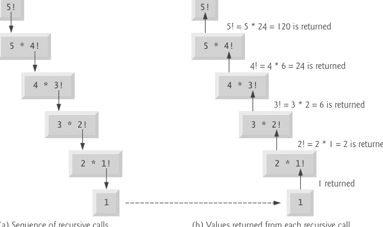

**图 18.2** 递归调用阶乘函数来计算数字减 1 的阶乘，这是一个比原始计算 `factorial(number)` 稍微小一点的问题。

## 常见编程错误 18.1

遗漏基础情况或错误地编写递归步骤导致其无法收敛到基础情况，这会导致被称为无限递归的逻辑错误。在这种情况下，递归调用会不断进行，直到内存耗尽或方法栈溢出。这类似于迭代（非递归）解决方案中的无限循环问题。

```java
// 图 18.3: FactorialCalculator.java
// 递归阶乘方法。

public class FactorialCalculator {
    // 递归阶乘方法（假设参数 >= 0）
    public static long factorial(long number) {
        if (number <= 1) { // 检查基础情况
            return 1; // 基础情况：0! = 1  1! = 1
        }
        else { // 递归步骤
            return number * factorial(number - 1);
        }
    }

    public static void main(String[] args) {
        // 计算 0 到 21 的阶乘
        for (int counter = 0; counter <= 21; counter++) {
            System.out.printf("%d! = %d\n", counter, factorial(counter));
        }
    }
}
```

**图 18.3** 递归阶乘方法。（2 部分中的第1 部分）。

## 18.4 使用 BigInteger 的 FactorialCalculator

```text
0! = 1
1! = 1
2! = 2
3! = 6
4! = 24
5! = 120

12! = 479001600    // 12! 会导致 int 变量溢出
20! = 243292008176640000
21! = -424929004941921848 // 21! 会导致 long 变量溢出
```

**图 18.3** 递归方法。（2 部分中的第2 部分）

main（第 15–20 行）显示了 0–21 的阶乘¹。调用 `factorial` 方法发生在第 18 行。`factorial` 接收一个 `long` 类型的参数并返回一个 `long` 类型的值。程序的输出显示 `factorial` 的值变得很大。我们使用 `long`（可以表示大整数）以便程序可以计算大于 12! 的阶乘。遗憾的是，阶乘方法产生大值的速度很快，当我们尝试计算 21! 时超过了最大的 `long` 值，正如程序输出最后一行所示。

由于整数类型的限制，最终需要 `float` 或 `double` 变量来计算更大数字的阶乘。这暴露了某些编程语言的一个弱点——即它们没有扩展新类型来处理独特的应用程序。正如我们在第9章中看到的，Java 是一种可扩展的语言，允许我们创建任意大小的整数。事实上，`java.math` 包显式地提供了 `BigInteger` 和 `BigDecimal`，用于无法使用基本类型执行的精度计算。我们可以学习更多关于这些类

- http://docs.oracle.com/java/8/docs/api/java/math/BigInteger.html
- http://docs.oracle.com/java/8/docs/api/java/math/BigDecimal.html

## 使用 Lambdas 和 Streams 计算阶乘

如果你读了第17章，可以考虑做练习 18.28，它允许你使用 lambdas 和 streams 来计算阶乘，而不是递归。

## 18.4 使用 BigInteger 重新实现 FactorialCalculator 类

图 18.4 使用 `BigInteger` 变量重新实现了 `FactorialCalculator` 类。为了演示比 `long` 变量能存储的更大的值，我们计算了数字 0–50 的阶乘。第 3 行从 `java.math` 包导入了 `BigInteger`。新的

* 1. 本章 main 方法中的循环可以使用 lambdas 和 streams（使用 `IntStream` 及其 `rangeClosed` 和 `forEach` 方法）来实现（见练习 18.27）。

`factorial` 方法（第 7–15 行）接收一个 `BigInteger` 类型的参数，并返回一个 `BigInteger`。

```java
1 // 图 18.4: FactorialCalculator.java
2 import java.math.BigInteger;
3 import java.math.BigInteger;
4
5 public class FactorialCalculator {
6 // 递归方法 factorial（假设参数 >= 0）
7 public static BigInteger factorial(BigInteger number) {
8 if (number.compareTo(BigInteger.ONE) <= 0) { // 测试用例
9 return BigInteger.ONE; // 基础情况：0! = 1 和 1! = 1
10 }
11 else { // 递归步骤
12 return number.multiply(
13 factorial(number.subtract(BigInteger.ONE)));
14 }
15 }
16
17 public static void main(String[] args) {
18 // 计算 0 到 50 的阶乘
19 for (int counter = 0; counter <= 50; counter++) {
20 System.out.printf("%d! = %d\n", counter,
21 factorial(BigInteger.valueOf(counter)));
22 }
23 }
24
```

| 0! = 1 | |
|---|---|
| 1! = 1 | |
| 2! = 2 | |
| 3! = 6 | |
| 21! = 5109942171709440000 | 21! 和更大的值不再导致溢出 |
| 22! = 11240002776077670650000000000 | |
| 47! = 2586322415116188064296435515361553197996197632389120000000000 | |
| 48! = 1241339159652360726708262208200473733355521846354677700000000 | |
| 49! = 6028186043426750687225216323192527684775258311771220000000000 | |
| 50! = 3041304932103043261800647688432764156896051 | |

**图 18.4** 使用递归方法的阶乘计算。

# 第 18 章 递归

```java
else { // recursion step
    return fibonacci(number.subtract(BigInteger.ONE)).add(
        fibonacci(number.subtract(TWO));
}
public static void main(String[] args) {
    // 显示从 0-40 的斐波纳契值
    for (int counter = 0; counter <= 40; counter++) {
        System.out.printf("Fibonacci of %d: %d%n", counter,
            fibonacci(BigInteger.valueOf(counter)));
    }
}
```

斐波纳契的 0 是： 0
斐波纳契的 1 是： 1
斐波纳契的 2 是： 1
斐波纳契的 3 是： 2
斐波纳契的 4 是： 3
斐波纳契的 5 是： 5
斐波纳契的 6 是： 8
斐波纳契的 7 是： 13
斐波纳契的 8 是： 21
斐波纳契的 9 是： 34
斐波纳契的 10 是： 55
斐波纳契的 37 是： 24157817
斐波纳契的 38 是： 39088169
斐波纳契的 39 是： 63245986
斐波纳契的 40 是： 102334155

图 18.5 递归斐波纳契方法。（部分/2 部分。）

第 24 行调用的 `fibonacci` 方法并不是递归调用，但从第 15-16 行执行的所有 `fibonacci` 调用都是递归的，因为在这些点，调用是由 `fibonacci` 自身发起的。每次调用 `fibonacci` 时，它会立即测试基本情况——number 等于 0 或等于 1（第 1-11 行）。我们使用 `BigInteger` 的 `ZERO` 和 `ONE` 分别表示值 0 和 1。如果第 10-11 行的条件为真，`fibonacci` 直接返回 `number`，因为 `fibonacci(0)` 是 0 且 `fibonacci(1)` 是 1。有趣的是，如果 `number` 大于 1，递归步骤会生成两个递归调用（第 15-16 行），针对比原始 `fibonacci` 调用稍小一点的问题。第 15-16 行使用 `BigInteger` 的 `add` 和 `subtract` 方法来帮助实现递归步骤。我们使用了第 6 行定义的 `BigInteger` 类型常量。

# 分析对方法 Fibonacci 的调用

图 18.6 显示了 `fibonacci` 方法如何评估 `fibonacci(3)`。在图底部，我们留下了值 1、0 和 1——这是评估基本情况的结果。前两个返回值（从左到右）1 和 0 被作为 `fibonacci(1)` 和 `fibonacci(0)` 调用的值返回。1 加 0 的和被作为 `fibonacci` 的值返回。

## 18.5 使用递归的示例：斐波纳契数列

`fibonacci(2)`。这被加到 `fibonacci(1)` 的结果 (1) 上，产生值 2。这个最终值随后作为 `fibonacci(3)` 的值返回。

图 18.6 提出了关于 Java 编译器评估操作符操作数顺序的一些有趣问题。这种顺序与操作符应用于其操作数的顺序不同——即由操作符优先级规则所决定的顺序。从图 18.6 可以看出，在评估 `fibonacci(3)` 时，将进行递归调用——`fibonacci(2)` 和 `fibonacci(1)`。但它们将以什么顺序进行呢？Java 语言规定操作数的评估顺序是从左到右的。因此，首先调用 `fibonacci(2)`，然后调用 `fibonacci(1)`。

```
fibonacci(3)
return fibonacci(2) + fibonacci(1)
return fibonacci(1) + fibonacci(0)
return 1
return 1
return 0
```

**图 18.6** fibonacci(3) 的递归调用集。

# 复杂度问题

对于像我们在这里用于生成斐波纳契数的递归程序，需要提醒一下。每次调用 `fibonacci` 方法都没有匹配基本情况（0 或 1）的结果，这会导致额外的两次对 `fibonacci` 方法的递归调用。因此，这组递归调用会迅速失控。使用 18.5 中的程序计算 20 的斐波纳契值需要 21,891 次调用；计算 30 的斐波纳契值需要 2,692,537 次调用！当你尝试计算更大的斐波纳契值时，你会发现你使用的每个连续斐波纳契数都会导致计算时间以及对 `fibonacci` 方法调用次数的大幅增加。例如，31 的斐波纳契值需要 4,356,617 次调用，32 的斐波纳契值需要 7,049,155 次调用！如你所见，对 `fibonacci` 的调用增加非常快——斐波纳契值 30 和 31 之间增加了 1,668,080 次调用，在 31 和 32 之间增加了 2,692,538 次调用。斐波纳契值 31 和 32 之间调用次数的差异是斐波纳契值 30 和 31 之间调用次数差异的 1.5 倍以上。这类问题会让最强大的计算机也感到无从。

[注：在复杂度理论领域，计算机科学家研究算法完成任务的困难程度。复杂度问题通常在被称为“算法”的高级计算机科学课程中详细讨论。我们在第 19 章“排序、搜索和大 O 表示”中介绍各种复杂度问题。

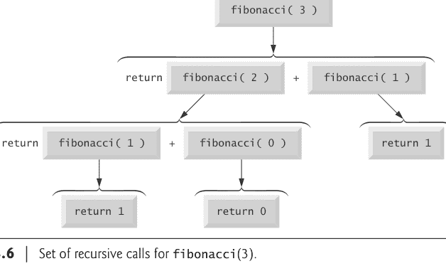

# 第 18 章 递归

在本章的练习中，你将增强图 18.5 的背景下的斐波纳契程序，使其计算执行计算所需的大致时间。为此，你将使用静态方法 `System.currentTimeMillis`，它不接受参数并返回计算机自 1970 年 1 月 1 日以来的当前毫秒数。

> 性能提示 18.1
>
> 避免斐波纳契式的递归程序，因为它们会导致方法调用的指数级“爆炸”。

# 第 18 章 递归

在本章的练习中，你将增强图 18.5 背景下的斐波纳契程序，使其计算执行计算所需的大致时间。为此，你将使用静态方法 `System.currentTimeMillis`，它不接受参数并返回计算机自 1970 年 1 月 1 日以来的当前毫秒数。

> 性能提示 18.1
>
> 避免斐波纳契式的递归程序，因为它们会导致方法调用的指数级“爆炸”。

## 使用 Lambda 计算斐波纳契数

在本章的练习中，你将增强图 18.5 背景下的斐波纳契程序，使其计算执行计算所需的大致时间。为此，你将使用静态方法 `System.currentTimeMillis`，它不接受参数并返回计算机自 1970 年 1 月 1 日以来的当前毫秒数。

> 性能提示 18.1
>
> 避免斐波纳契式的递归程序，因为它们会导致方法调用的指数级“爆炸”。

## 递归与方法栈


# 递归与方法栈

在本章的练习中，你将增强图 18.5 背景下的斐波纳契程序，使其计算执行计算所需的大致时间。为此，你将使用静态方法 `System.currentTimeMillis()`，它不接受参数并返回计算机自 1970 年 1 月 1 日以来的当前毫秒数。

> **性能提示 18.1**
>
> 避免斐波纳契式的递归程序，因为它们会导致方法调用的指数级“爆炸”。

# 18.7 递归与迭代

- 迭代和递归都涉及**迭代**：迭代显式地使用迭代语句，而递归则通过重复的方法调用来实现迭代。
- 迭代和递归都涉及一个**终止测试**：迭代在循环继续条件不满足时终止，而递归在达到基本情形（`base case`）时终止。
- 带有计数器控制的迭代和递归都**逐渐接近终止状态**：迭代不断修改计数器，直到其值使得循环继续条件失败；而递归不断产生原始问题更小的值，直到达到基本情形。
- 迭代和递归**可能发生无限持续**。如果循环继续测试从未变为假，则会发生无限循环；如果递归步骤每次未能以一种收敛于基本情形的方式来减少问题，或者没有测试基本情形，就会发生无限递归。

为了说明迭代与递归之间的区别，让我们来看一个阶乘问题的迭代解决方案（图 18.9，第 10–12 行）。我们使用一个迭代语句，而不是选择语句（图 18.3，第 7–12 行）。两者都使用了终止测试。在递归解决方案（图 18.3）中，第 7 行测试了**基本情形**。在图 18.9 的迭代解决方案中，第 10 行测试循环继续条件——如果测试失败，循环终止。最后，迭代解决方案不是产生原始问题更小的值，而是使用一个不断修改的计数器，直到循环继续条件变为假。

```java
// Fig. 18.9: FactorialCalculator.java
// 迭代阶乘方法。
public class FactorialCalculator {
    // factorial 方法的迭代声明
    public long factorial(long number) {
        long result = 1;

        // 计算阶乘
        for (long i = number; i >= 1; i--) {
            result *= i;
        }
        return result;
    }

    public static void main(String[] args) {
        // 计算 0 到 10 的阶乘
        for (int counter = 0; counter <= 10; counter++) {
            System.out.printf("%d! = %d\n", counter, factorial(counter));
        }
    }
}
```

**图 18.9** 迭代阶乘方法。（部分 I，共 2 部分。）

```
0! = 1
1! = 1
2! = 2
3! = 6
4! = 24
5! = 120
6! = 720
7! = 5040
8! = 40320
9! = 362880
10! = 3628800
```

**图 18.9** | 迭代阶乘方法。（部分 II，共 2 部分。）

递归有**负面影响**。它反复调用方法调用机制，因此产生了方法调用的**开销**。这种迭代在处理器时间和内存空间方面可能都是昂贵的。每个递归调用都会导致另一个方法**副本**（实际上是存储在栈帧中的方法变量）的创建——这组副本可能会消耗大量的内存。相反，由于迭代发生在方法内部，因此避免了重复的方法调用和额外的内存管理。

> **软件工程观察 18.1**
>
> 任何可以用递归解决的问题都可以用迭代解决，反之亦然。当递归方法更贴近问题本身，并且结果生成的程序更易于理解和调试时，则递归方法优于迭代方法。递归方法通常可以用更少的代码行来实现。选择递归方法的另一个原因是，迭代方法可能并不直观。

> **性能提示 18.2**
>
> 当性能至关重要时，你可能想要尝试不同的迭代和递归方法来实现目标。

> **常见编程错误 18.2**
>
> 意外让非递归方法通过另一个方法直接或间接地调用自己，可能会导致无限递归。

# 18.8 汉诺塔

在本章前面，我们学习了既可以用递归实现又可以用迭代实现的方法。现在，我们提出了一个问题，它的递归解决方案展示了递归的优雅，而其迭代解决方案可能没有那么优雅。

**汉诺塔**是每位初级计算机科学家必须面对的经典问题之一。传说在远东方的一座寺庙里，祭师们正试图将一叠金盘从一个钻石柱移动到另一根柱（图 18.10）。初始堆栈有 64 个圆盘套在一个柱子上，并按大小从上到下排列。祭师们试图在以下约束下移动堆栈：一次只移动一个盘，且在任何时候都不能将大盘放在小盘之上。提供了三个柱，其中一个用于临时存放圆盘。据说，当祭师们完成任务时，世界将会毁灭，因此我们没有什么动力去帮助他们。

假设祭师们试图将圆盘从一根柱移动到另一根柱。如果我们尝试用迭代方法寻找解决方案，可能会陷入“困境”。相反，通过递归可以快速产生解决方案。移动 $n$ 个盘的递归如下：

1. 将 $n-1$ 个盘从源柱移动到临时柱。
2. 将最后一个盘从源柱移动到目标柱。
3. 将 $n-1$ 个盘从临时柱移动到目标柱。

在图 18.11 中，`towers()` 方法给定圆盘总数（在本例中为 3）、起始柱、目标柱和临时柱来解决问题。

```java
// Fig. 18.11: TowersOfHanoi.java
// 递归汉诺塔方法。
public class TowersOfHanoi {
    // towers 方法递归声明
    public static void towers(int disks, int sourcePeg,
        int destinationPeg, int tempPeg) {
        // 基本情形——移动一个盘
        if (disks == 1) {
            System.out.printf("%d -> %d\n", sourcePeg, destinationPeg);
            return;
        }
        // 递归步骤——将 n-1 个盘从源柱移动到临时柱
        towers(disks - 1, sourcePeg, tempPeg, destinationPeg);
        // 将最后一个盘从源柱移动到目标柱
        System.out.printf("%d -> %d\n", sourcePeg, destinationPeg);
        // 将 n-1 个盘从临时柱移动到目标柱
        towers(disks - 1, tempPeg, destinationPeg, sourcePeg);
    }

    public static void main(String[] args) {
        // 计算 3 个盘的移动序列
        towers(3, 1, 3, 2);
    }
}
```

**图 18.11** 递归汉诺塔方法。（部分 I，共 2 部分。）

```java
// 递归步骤——将 n-1 个盘从源柱
// 移动到临时柱
towers(disks - 1, sourcePeg, tempPeg, destinationPeg);
```

```java
// 将最后一个盘从源柱移动到目标柱
System.out.printf("%d -> %d\n", sourcePeg, destinationPeg);
```

```java
// 将 n-1 个盘从临时柱移动到目标柱
towers(disks - 1, tempPeg, destinationPeg, sourcePeg);
```

```java
public static void main(String[] args) {
    int startPeg = 1; // 输出中 1 表示起始柱
    int endPeg = 3;   // 输出中 3 表示目标柱
    int tempPeg = 2;  // 输出中 2 表示临时柱
    int totalDisks = 3; // 圆盘总数
    // 初始非递归调用：移动所有盘。
    towers(totalDisks, startPeg, endPeg, tempPeg);
}
```

**图 18.11** | 递归汉诺塔方法。（部分 II，共 2 部分。）

# 18.9 分形


递归有`负面影响`。它反复调用方法调用机制，因此产生了方法调用的`开销`。这种迭代在处理器时间和内存空间方面可能都是昂贵的。每个递归调用都会导致另一个方法`副本`（实际上是存储在栈帧中的方法变量）的创建——这组副本可能会消耗大量的内存。相反，由于迭代发生在方法内部，因此避免了重复的方法调用和额外的内存管理。


# 软件工程观察 18.1

任何可以用递归解决的问题都可以用迭代解决，反之亦然。当递归方法更贴近问题本身，并且结果生成的程序更易于理解和调试时，则递归方法优于迭代方法。递归方法通常可以用更少的代码行来实现。选择递归方法的另一个原因是，迭代方法可能并不直观。


# 性能提示 18.2

当性能至关重要时，你可能想要尝试不同的迭代和递归方法来实现目标。

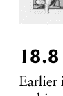

# 常见编程错误 18.2

意外让非递归方法通过另一个方法直接或间接地调用自己，可能会导致无限递归。

# 18.8 汉诺塔

在本章前面，我们学习了既可以用递归实现又可以用迭代实现的方法。现在，我们提出了一个问题，它的递归解决方案展示了递归的优雅，而其迭代解决方案可能没有那么优雅。

**汉诺塔**是每位初级计算机科学家必须面对的经典问题之一。传说在远东方的一座寺庙里，祭师们正试图将一叠金盘从一个钻石柱移动到另一根柱（图 18.10）。初始堆栈有 64 个圆盘套在一个柱子上，并按大小从上到下排列。祭师们试图在以下约束下移动堆栈：一次只移动一个盘，且在任何时候都不能将大盘放在小盘之上。提供了三个柱，其中一个用于临时存放圆盘。据说，当祭师们完成任务时，世界将会毁灭，因此我们没有什么动力去帮助他们。


## 782 第 18 章 递归

存在于自然中，如山脉、云朵和海岸线。分形在数学和科学中有许多用途。它们可以用于更好地理解出现在自然界（例如生态系统）、人体内（例如脑回）或宇宙中（例如星系团）的系统或模式。并不是所有的分形都像自然界中的物体——绘制分形是一种流行的艺术形式。分形具有自相似性——当被分为若干部分时，每个部分都像整体的缩小版副本。当分形的一个部分被放大时，许多分形会产生原始的精确复制——这种分形被称为严格自相似。

### 18.9.1 柯赫曲线分形

作为一个例子，让我们来看严格自相似的柯赫曲线分形（图 18.12）。它是通过移除图形中每条线的中间三分之一，并用两条形成顶点的线来替换形成的，这样如果原始线的中间三分被保留，就会形成一个等边三角形。创建分形的公式通常涉及移除之前分形图像全部或部分。这种模式对于分形来说已经确定——我们在这里的重点是如何在递归解决方案中使用这些公式。

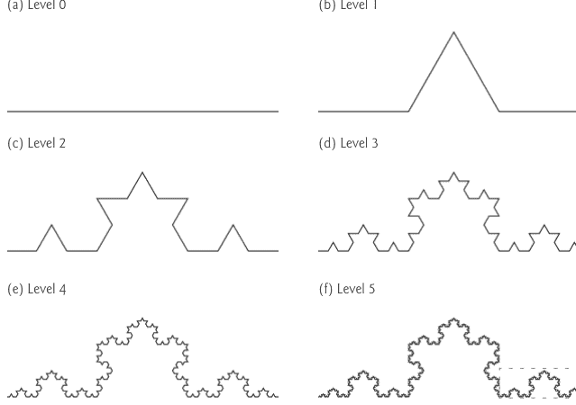

图 18.12 | 柯赫曲线分形。

我们从一条直线（图 18.12(a)）开始应用该模式，从中间三分之一创建一个三角形（图 18.12(b)）。然后我们对每条直线再次应用该模式，得到图 18.12(c)。每次应用该模式时，我们说分形处于一个新的级别或深度（有时也使用“阶数”一词）。分形可以在许多级别显示——例如，在第 3 级，它应用了三次模式迭代（图 18.12(d)）。仅经过几次迭代，这个分形开始看起来像雪花的一部分（图 18.12(e 和 f)）。由于这是一个严格自相似的分形，每个部分都包含分形的精确复制。在图 18.12(f)中，例如，我们用虚线框突出了分形的一个部分，如果增加它的尺寸，它看起来将完全像部分 (f) 的整个分形。练习题 18.24 要求你使用在本节中将学的绘制技术来实现柯赫曲线。

分形——柯赫雪花——与柯赫曲线相似，但它从三角形开始而不是直线。相同的模式被应用于三角形的每条边，产生一个看起来像封闭雪花的图像。练习题 18.25 要求你研究柯赫雪花，然后创建一个可以绘图的应用程序。

### 18.9.2（可选）案例研究：Lo 羽毛分形

我们现在通过编写一个创建一个严格自相似分形的程序，演示如何使用递归绘制分形。我们将其称为“Lo 分形”，用名源于创建它的 Deitel & Associates 成员 Sin Han Lo。该分形最终将看起来像羽毛的一半（图 18.20 中的输出）。基本情况（或 0 级分形）是两点 A 和 B 之间的线（图 18.13）。要创建下一级，我们找到点 C 的中点（C）。要计算点 C 的位置，我们使用以下公式：

```
xC = (xA + xB) / 2;
yC = (yA + yB) / 2;
```

> 每个字母左边的 x 和 y 分别指该点的 x 坐标和 y 坐标。例如，`xA` 指点 A 的 x 坐标，`yC` 指点 C 的 y 坐标。在我们的图中，我们用字母表示点，后面跟着两个代表 x 和 y 坐标的数字。

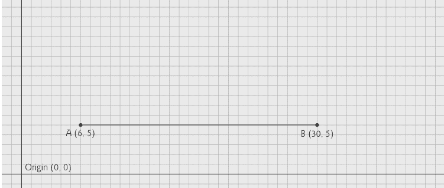

图 18.13 | 第 0 级的“Lo 羽毛”。

要创建这个分形，我们还必须找到靠近 AC 段的点 D，并创建一个等腰直角三角形 ADC。要计算点 D 的位置，使用公式：

```
xD = xA + (xC - xA) / 2;
yD = yA + (yC - yA) / 2;
```

我们现在从第 0 级移动到第 1 级，如下：首先，添加点 C 和 D（如图 18.14 所示）。然后，移除原始线并添加段 DA、DC 和 DB。剩余的线呈角度弯曲，使我们的分形看起来像羽毛。


图 18.14 | 确定“Lo 羽毛分形”第 i 级的点 C 和点 D。

对于分形的下一级，该算法在第 1 级的三条线中的每条线上重复。对于每条线，应用上述公式，其中原来的点 D 现在被视为点 A，而每条线的另一端被视为点 B。图 18.15 包含了来自第 0 级的线（现在是虚线）和来自第 1 级的三条新增线。我们已经将点 D 改为点 A，并将原始点 A、C 和 B 分别改为 B1、B2 和 B3。前面的公式已用于寻找每条线上的新点 C 和 D。这些点也被标记为 1–3，以便跟踪哪个点与每条线相关。例如，点 C1 和 D1 代表与从 A 到 B1 形成的线相关的点 C 和 D。


图 18.15 | 第 1 级的“Lo 羽毛分形”，并确定了第 2 级的 C 点和 D 点。[注：第 0 级的分形以虚线形式包含，以提醒该线在当前分形中的位置。]

为了达到第 2 级，移除图 18.15 中的三条线，并用刚刚添加的 C 和 D 点的新线替换。图 18.16 显示了新线（第 2 级的线为了方便起示）。


图 18.16 | 第 2 级的“Lo 羽毛分形”，带有为第 1 级提供的虚线。

经过几次迭代后，分形将开始看起来像羽毛的一半，如图 18.20 所示。

### 18.9.3（可选）分形应用程序

在本节和下一节中，我们将构建一个显示 Lo 分形的 Java 应用程序——我们不显示子类，因为它执行我们在第 13 章中演示的任务。我们使用带有白色背景的 BorderPane 布局：


图 18.18 | 带有程序控制控件 ID 分形 GUI。

为了让 BorderPane 布局适应内容，我们将它的 Pref Width 和 Pref Height 属性值（你在第 13 章中学到的）重置为 `USE_COMPUTED_SIZE`。

```
colorpicker level
```

```
| 白色 减少级别 增加级别 级 工具布局
```

#### 工具栏及其控件

默认情况下，你拖到布局中的工具栏有一个按钮。你可以将额外的控件拖到工具栏中，并在必要时移除默认按钮。我们添加了一个 ColorPicker 控件（ID 为 `colorPicker`）、另一个按钮和一个标签（ID 为 `levelLabel`）。对于这两个按钮和 Label1，我们按照图 18.18 所示进行了设置。

#### 颜色选择器

ColorPicker 提供了一个预定义的颜色选择 GUI，默认情况下，用户通过色块（采样颜色的小方块）选择颜色。初始选定颜色为白色。我们将在应用程序的控制器中程序化地设置为蓝色。图 18.19 显示了 ColorPicker 的默认 GUI 以及点击 ColorPicker 的“自定义颜色...”链接时出现的自定义控件 GUI。自定义控件允许你选择任何颜色。当用户在默认 GUI 中选择颜色或在自定义控件 GUI 中自定义颜色并保存时，会发生事件。在 Scene Builder 中，对于 ColorPicker 的 On action 处理，我们指定了 `colorSelected`。此外，对于减少级别和增加级别按钮的 On action 处理，我们分别指定了 `decreaseLevelButtonPressed` 和 `increaseLevelButtonPressed`。

# 18.9 分形


示例颜色块

点击“颜色...”将显示自定义颜色 GUI，用以选择任何颜色

图 18.19 | ColorPickers 预定义 GUI。

## 18.9.4（可选）FractalController 类

图 20 展示了 `FractalController` 类，它定义了应用程序的事件处理器以及递归绘制 Lo 分形的方法。输出显示了分形从第 0-5 层的发展过程，然后是第 8 层和第 11 层。如果我们关注此分形的一个分支，它将与整个图像相同。这一属性定义了分形具有严格的自相似性。

```java
// 18.20: FractalController.java
// 使用递归绘制“Lo 羽毛分形”。
import jafafx.event.ActionEvent;
import jafafx.fxml.FXML;
import jafafx.scene.canvas.Canvas;
import jafafx.scene.canvas.GraphicsContext;
import jafafx.scene.control.ColorPicker;
import jafafx.scene.control.Label;
import jafafx.paint.Color;
import jafafx.scene.shape.Line;

public class FractalController {
    // 常量
    private static final int MIN_LEVEL = 0;
    private static final int MAX_LEVEL = 15;

    // 引用 GUI 组件的实例变量
    @FXML private Canvas canvas;
    @FXML private ColorPicker colorPicker;
    @FXML private Label levelLabel;
```

图 18.20 | 使用递归绘制“Lo 羽毛分形”。（4 部分中的1 部分）。

# 第 18 章 递归

```java
// 其他实例变量
private Color currentColor = Color.BLUE;
private int level = MIN_LEVEL; // 初始分形层
private GraphicsContext gc; // 用于在 Canvas 上绘制

// 初始化控制器
public void initialize() {
    levelLabel.setText("Level: " + level);
    colorPicker.setValue(currentColor); // 从紫色开始
    gc = canvas.getContext2D(); // 获取 GraphicsContext
    drawFractal();
}

// 当用户选择新颜色时设置 setColor
public void colorSelected(ActionEvent event) {
    currentColor = colorPicker.getValue(); // 获取新颜色
    drawFractal();
}

// 降低层级并重绘分形
public void decreaseLevelPressed(ActionEvent event) {
    if (level > MIN_LEVEL) {
        level--;
        levelLabel.setText("Level: " + level);
        drawFractal();
    }
}

// 增加层级并重绘分形
public void increaseLevelPressed(ActionEvent event) {
    if (level < MAX_LEVEL) {
        level++;
        levelLabel.setText("Level: " + level);
        drawFractal();
    }
}

// 清除画布，设置绘制颜色并绘制分形
private void drawFractal() {
    gc.clearRect(0, 0, canvas.getWidth(), canvas.getHeight());
    gc.setStroke(currentColor);
    drawFractal(level, 40, 40, 350, 50);
}

// 递归绘制分形
public void drawFractal(int level, int xA, int yA, int xB, int yB) {
    // 基础情况：绘制连接两点的线
    if (level == 0) {
        gc.stroke(xA, yA, xB, yB);
    }
}
```

图 18.20 | 使用递归绘制“Lo 羽毛分形”。（4 部分中的2 部分）。

```java
else // 递归步骤：确定新点，绘制下一层
// 计算 (xA, yA) 和 (xB, yB) 之间的中点
int xC = (xA + xB) / 2;
int yC = (yA + yB) / 2;

// 计算第四个点 (xD, yD)，它在 (xA, yA) 和 (xC, yC) 之间形成一个
// 等腰直三角形，其中直角位于 (xD, yD) 之间
int xD = xA + (xC - xA) / 2 - (yC - yA) / 2;
int yD = yA + (yC - yA) / 2 + (xC - xA) / 2;

// 递归绘制分形
drawFractal(level - 1, xD, yD, xA, yA);
drawFractal(level - 1, xD, yD, xB, yB);
```


图 18.20 | 使用递归绘制“Lo 羽毛分形”。（4 部分中的3 部分）。


图 18.20 | 使用递归绘制“Lo 羽毛分形”。（4 部分中的4 部分）。

## 分形字段

第 14–25 行声明了类的字段：

- 常量 `MIN_LEVEL` 和 `MAX_LEVEL`（第 14–15 行）指定了应用程序可以绘制的层级范围。一旦达到 15 层，分形中的变化（在此尺寸下）变得难以，因此我们将 15 设置为最大层级。

- 第 18–20 行声明了 `@FXML` 实例变量，它们引用 GUI 控制器。记住这些变量是由 `FXMLLoader` 初始化的。

- 第 23 行声明了 `Color` 变量 `currentColor`，并将其初始化为 `Color.BLUE`。`Color` 类（`javafx.scene.paint`）包含了创建自定义颜色的常量和方法。

- 第 24 行选择了 `int` 变量 `level`，它维持着当前的分形层级。

- 第 25 行声明了 `GraphicsContext` 变量 `gc`，它将用于在 `Canvas` 上绘制。

## initialize 方法

当应用程序的控制器创建并初始化时，`initialize`（第 28–33 行）执行：

- 将 `levelLabel` 的初始文本设置为 0。

- 将 `colorPicker` 的初始值设置为 `currentColor`。

- 获取画布的 `GraphicsContext`，将用于绘制线条。

- 调用 `fractal`（第 63–67 行），以新的颜色和当前层级重绘分形。

## colorSelected 事件处理器

当用户选择颜色时，`colorPicker` 的 `colorSelected` 事件处理器（第 36–40 行）使用 `ColorPicker` 方法获取当前选择的颜色，然后调用 `fractal`（第 63–67 行）在新颜色和当前层级重绘分形。


## decreaseLevel 和 increaseLevel 事件处理器

当用户按下“减少层级”或“增加层级”按钮时，相应的事件处理器（第 43–50 行和 53–60 行）执行。这些事件处理器减少或增加层级，准确地设置 `levelLabel` 的文本，并调用 `fractal`（第 63–67 行）重绘分形。在该应用程序尝试将层级降低到 `MIN_LEVEL` 以下无效。

## drawFract 无参数方法

每次调用 `drawFract` 时，它都会使用 `GraphicsContext` 方法清除任何绘制。该方法通过将指定区域设置为画布的背景色来绘制矩形区域。该方法的四个参数是矩形左上角的 x y 坐标以及矩形的宽度和高度。在这种情况下，我们清除了整个画布——`getWidth` 和 `getHeight` 方法分别返回分形的宽度和高度。

接下来第 65 行使用 `GraphicsContext` 方法 `setStroke` 将绘制颜色设置为 `currentColor`。第 66 行首次调用重载的递归方法 `fractal`（第 70–91 行）来绘制分形。

## drawFract 五参数方法

第 70–91 行定义了创建分形的递归方法。该方法接受参数：要绘制的分形以及指定两个点 x y 坐标的四个整数。该方法的基础情况（第 72 行）当 `level` 等于 0 时，在第 73 行使用 `GraphicsContext` 方法 `strokeLine` 在当前 `drawFract` 调用作为参数的两点之间画线。

在递归步骤（第 75–84 行）中计算：

- `(xC, yC)`—`(xA, yA)` 和 `(xB, yB)` 之间的中点，以及
- `(xD, yD)`—与 `(xA, yA)` 和 `(xC, yC)` 创建等腰直三角形的点。

然后，第 87–89 行对三组不同的点进行三次递归。由于在到达基础情况之前不会绘制任何线条，点之间的距离在每次递归调用都会减小。随着递归层级的增加，分形变得更加光滑和详细。当层级接近 12 时，此分形的形状趋于稳定——也就是说，分形的形状保持大致相同，额外的细节变得难以感知。分形将根据其形状和大小在不同的层级稳定。

## 18.10 递归回溯

我们的方法都具有类似的架构——如果到达基础情况，则返回一个值；否则，执行一次或多次递归调用。本节探索了一种更复杂的技术，用于找到通过迷宫的路径，如果存在解决方案则返回 true。解决方案涉及一次步通过迷宫，移动方向可以是向下、向右或向左（不允许对角移动）。从当前位置（从入口开始），采取以下步骤：对于每个可能的方向，在该方向移动并进行递归调用以解决剩余部分。当遇到死胡同（即在不撞墙的情况下无法继续移动）时，回到上一个位置并尝试不同的方向。这个过程一直持续到我们找到可以移动的路径。

要回到迷宫中的上一个位置，递归方法只需返回 false，将方法调用移动到上一次递归调用。迷宫的回溯解决方案使用递归返回方法调用链，然后尝试不同的方向。如果回溯到达迷宫入口且已尝试过所有方向，则该迷宫没有解决方案。

练习 18.20–18.22 实现了迷宫问题的回溯解决方案，皇后问题（练习 18.15）尝试在空棋盘上放置八个皇后，使得没有一个皇后“攻击”其他皇后（即没有两个皇后在同一列或同一条对角线上）。

## 18.11 总结

在本章中，你学习了如何创建递归方法——即会调用自身的方法。你学习到递归通常将问题划分为两个概念上的部分——方法知道如何处理的部分（基础情况）和方法不知道如何处理的部分（递归步骤）。递归步骤略微

### 总结

这是原始问题的较小版本，并通过递归方法调用来执行。你看到了一些递归的示例，包括计算阶乘和生成斐波纳契数列中的值。然后，你学习了递归在“底层”是如何工作的，包括递归调用在执行栈上被推入或弹出的顺序。接着，你比较了递归和迭代方法。你学习了如何使用递归来解决更复杂的问题——汉诺塔和显示分形。本章以对回溯的介绍结束，回溯是一种解决问题的方法，它涉及通过对递归调用进行回溯以尝试不同的可能的解决方案。在下一章中，你将学习许多对数据列表进行排序和在数据列表中搜索的技术，并将探索在什么情况下应该使用每种搜索和排序技术。

### 节 18.1 引言

- 递归方法（第 767 页）直接调用自己或通过另一个方法间接调用自己。

### 节 18.2 递归概念

- 当调用递归方法（第 768 页）来解决一个问题时，它只能解决最简单的情况（s），即基础情况。如果带有基础情况进行调用，该方法将返回一个结果。
- 如果使用递归方法处理比基础情况更复杂的问题，它通常会将问题分为两个概念上的部分——一个方法知道如何处理的部分以及一个它不知道如何处理的部分。
- 为了使递归可行，那个不知道如何处理的部分，必须是原始问题的一个稍微简单或更小的版本。这个新问题类似于原始问题，该方法调用自己的一个新副本来处理这个较小的问题——这就是递归步骤（第 768 页）。
- 为了让递归终止，每当一个方法使用原始问题的较简单版本调用自己时，这种越来越小的问题序列必须收敛于一个基础情况。当方法识别出基础情况时，它会返回到方法的上一个副本。
- 递归调用可能是对另一个方法的调用，而该方法反过来又调用原始方法。这种过程导致对原始方法的递归调用。这被称为间接递归调用或间接递归（第 768 页）。

### 节 18.3 使用递归：阶乘

- 缺失基础情况或编写递归不正确导致其无法收敛于基础情况，会导致无限递归（第 770 页），从而耗尽内存。这种错误类似于迭代（非递归）解决方案中的无限循环问题。

### 节 18.5 递归用例示例：斐波纳契数列

- 斐波纳契数列（第 773 页）从 0 和 1 开始，其特性是每个随后的斐波纳契数都是前两个数之和。
- 相邻斐波纳契数之间的比值收敛于 1.618... 的常数值，这个数字被称为黄金分割比例或黄金中值（第 773 页）。
- 某些递归解决方案（如斐波纳契）会导致方法调用的“爆炸”。

### 节 18.6 递归与方法调用栈

- 执行中的方法总是那个栈帧位于栈顶部的方法，而该方法的栈帧包含了其局部变量的值。

### 节 18.7 递归对比迭代

- 迭代和递归都基于控制语句：迭代使用迭代语句，递归使用选择语句。
- 迭代和递归都会进行迭代：迭代显式使用迭代语句，而递归通过重复方法实现迭代。
- 迭代和递归各涉及一个终止测试：迭代在循环条件失败时终止，递归在识别出基础情况时终止。
- 带有计数器控制的迭代和递归各逐渐接近终止：迭代不断修改计数器，直到计数器取一个使其终止的值；递归每次使用原始问题的较简单版本调用自己，这种越来越小的问题序列必须收敛于一个基础情况。当方法识别出基础情况时，它会返回到方法的上一个副本。
- 递归调用可能是对另一个方法的调用，而该方法反过来又调用原始方法。这种过程导致对原始方法的递归调用。这被称为间接递归调用或间接递归。
- 递归方法通常比迭代方法更简洁，但更是直观的。
- 递归方法可以解决迭代方法解决的任何问题。
- 递归方法的代码量可能更少，但迭代方法更易于调试。

### 节 18.8 分形

- 分形（第 781 页）是具有自相似性的几何图形。
- 分形具有自相似性——当被细分时，每个部分都是整体的缩小版本。
- 分形是通过递归生成的。
- 分形可以具有无限的细节。
- 这种方法在逻辑上是递归的。
- 递归方法可以用于生成分形图案。

### 18.10 递归回溯

在递归回溯（第 792 页）中，如果一组递归调用没有产生解决方案，程序会回溯到上一个决策点并做出不同的决策。

# 习题答案

- `getWidth()` 和 `getHeight()` 分别返回 `Canvas` 的宽度和高度。

# 习题 答案

- `setStroke` 方法设置线条。
- `strokeLine` 方法在两点之间画线。

内存空间使用。c. 正确. 错误。为了使递归可行，递归解决方案中的递归步骤必须与原始问题相似，但是原问题的略小版本。

- 18.2 d.
- 18.3 a.
- 18.4 c.
- 18.5 b.
- 18.6 a) 黄金比例，黄金分割点。b) 选取。c) 自相似。

## 练习题

### 18.7
编写一个与以下迭代方法等效的递归方法：

```java
int mystery(int x) {
    int sum = 0;
    for (int i = x; i > 0; i--)
        sum = sum + i;
    return sum;
}
```

### 18.8
下面代码的作用是什么？[注意：在递归调用之后有一个语句，每次调用时都会执行。]

```java
public void printInt(int n) {
    if (n != 0) {
        printInt(n - 1);
        System.out.println(n);
    }
}
```

### 18.9 (递归幂方法)
编写一个递归方法 `power(base, exponent)`，调用时返回 $base^{exponent}$。

例如，`power(3,4) = 3 * 3 * 3 * 3`。假设指数是大于等于 1 的整数。递归步骤应该使用关系：

$base^{exponent} = base * base^{exponent-1}$

当指数等于 1 时，发生终止条件，因为

$base^1 = base$

将此方法整合到程序中，使用户输入基数和指数。

### 18.10 (递归可视化)
观察递归的“运行”是非常有趣的。修改图 18.3 中的阶乘方法，以打印它的局部变量和递归调用。对于每次递归调用，在单独的一行上显示输出并添加一级的缩进。尽力使输出清晰、有趣且有意义。你的目标是设计并实现一种易于理解递归的输出。你可能想为书中其他的递归示例和练习题添加显示功能。

### 18.11 (最大公约数)
x 和 y 的最大公约数是能整除 x 和 y 的最大整数。编写一个递归方法 `gcd`，获取 x 和 y 的最大公约数，并递归定义如下：如果 y 等于 0，则 `gcd(x, y)` 为 x；否则，`gcd(x, y)` 为 `gcd(y, x % y)`，其中 % 是取模运算符。使用此方法替换你在练习 5.27 中编写的方法。

### 18.12
下面程序的作用是什么？

```java
public class MysteryClass {
  public static void mystery(int[] array2, int x, int y) {
    if (x < y) {
      int temp = array2[x];
      array2[x] = array2[y];
      array2[y] = temp;
      x++; y--;
    }
    mystery(array2, x, y);
  }
  public static void main(String[] args) {
    int[] array = {1, 2, 3, 4, 5, 6, 7, 8, 9, 10};
    mystery(array, 0, array.length - 1);
    for (int e : array) {
      System.out.println(e);
    }
  }
}
```

### 18.13
下面程序的作用是什么？

```java
// 练习 18.13: SomeClass.java
public class SomeClass {
  public static String method(int[] array2, int x) {
    if (x < array2.length) {
      return String.format("%sd", method(array2, x + 1), array2[x]);
    } else {
      return "";
    }
  }
  public static void main(String[] args) {
    int[] array = {1, 2, 3, 4, 5, 6, 7, 8, 9, 10};
    String results = method(array, 0);
    System.out.println(results);
  }
}
```

### 18.14 (欧拉数)
欧拉数 e 是自然对数的底，广泛应用于工程、科学和商业领域。e 的值可以使用以下公式近似：

$e = 1 + \frac{1}{1!} + \frac{1}{2!} + \frac{1}{3!} + \dots + \frac{1}{n!}, \quad n = 0, 1, 2, \dots$

编写一个递归方法计算 $n$ 的欧拉数（其中 $n \geq 0$）。

### 18.15 (八皇后问题)
象棋爱好者的迷题是八皇后问题，它问：是否可以在空棋盘上放置八个皇后，使得没有任何一个皇后会“攻击”任何其他皇后（即：没有两个皇后处于同一行、同一列或沿对角线）？例如，如果将皇后放在棋盘的左上角，则不能在 18.21 中标记的任何方格中放置其他皇后。用递归方法解决此问题。[提示：你的解决方案应该从第一列开始，在该列中寻找可以放置皇后的位置——起初将皇后放在第一行。解决方案应递归地搜索剩余的列。在前几列中，会有几个可以放置皇后的位置。选取第一个可用的位置。如果到达某一列没有可以放置皇后的位置，程序应返回到上一列，并将该列中的皇后移动到新行。这种持续的回溯并尝试新替代方案是递归回溯的一个示例。]


图 18.21 | 在棋盘左上角放置皇后而被消除的方格。

### 18.16 (搜索整数数组)
编写一个递归方法 `searchArray`，在整数数组中搜索元素，并返回其位置，如果未找到则返回 -1。

### 18.17 (反向打印数组)
编写一个递归方法 `stringReverse`，接收一个包含字符串的字符数组作为参数，并反向打印字符串。

### 18.18 (寻找数组最小值)
编写一个递归方法 `recursiveMinimum`，确定整数数组中的最小元素。

### 18.19 (分形)
观察递归的“运行”是非常有趣的。修改图 18.3 中的阶乘方法，以打印它的局部变量和递归调用。对于每次递归调用，在单独的一行上显示输出并添加一级的缩进。尽力使输出清晰、有趣且有意义。你的目标是设计并实现一种易于理解递归的输出。你可能想为书中其他的递归示例和练习题添加显示功能。

### 18.20 (最大公约数)
x 和 y 的最大公约数是能整除 x 和 y 的最大整数。编写一个递归方法 `gcd`，获取 x 和 y 的最大公约数，并递归定义如下：如果 y 等于 0，则 `gcd(x, y)` 为 x；否则，`gcd(x, y)` 为 `gcd(y, x % y)`，其中 % 是取模运算符。使用此方法替换你在练习 5.27 中编写的方法。

### 18.21
下面程序的作用是什么？

```java
public class MysteryClass {
  public static void mystery(int[] array2, int x, int y) {
    if (x < y) {
      int temp = array2[x];
      array2[x] = array2[y];
      array2[y] = temp;
      x++; y--;
    }
    mystery(array2, x, y);
  }
  public static void main(String[] args) {
    int[] array = {1, 2, 3, 4, 5, 6, 7, 8, 9, 10};
    mystery(array, 0, array.length - 1);
    for (int e : array) {
      System.out.println(e);
    }
  }
}
```

### 18.23
下面程序的作用是什么？

```java
// 练习 18.13: SomeClass.java
public class SomeClass {
  public static String method(int[] array2, int x) {
    if (x < array2.length) {
      return String.format("%sd", method(array2, x + 1), array2[x]);
    } else {
      return "";
    }
  }
  public static void main(String[] args) {
    int[] array = {1, 2, 3, 4, 5, 6, 7, 8, 9, 10};
    String results = method(array, 0);
    System.out.println(results);
  }
}
```

### 18.24 (欧拉数)
欧拉数 e 是自然对数的底，广泛应用于工程、科学和商业领域。e 的值可以使用以下公式近似：

$e = 1 + \frac{1}{1!} + \frac{1}{2!} + \frac{1}{3!} + \dots + \frac{1}{n!}, \quad n = 0, 1, 2, \dots$

编写一个递归方法计算 $n$ 的欧拉数（其中 $n \geq 0$）。

### 18.25 (八皇后问题)
象棋爱好者的迷题是八皇后问题，它问：是否可以在空棋盘上放置八个皇后，使得没有任何一个皇后会“攻击”任何其他皇后（即：没有两个皇后处于同一行、同一列或沿对角线）？例如，如果将皇后放在棋盘的左上角，则不能在 18.21 中标记的任何方格中放置其他皇后。用递归方法解决此问题。[提示：你的解决方案应该从第一列开始，在该列中寻找可以放置皇后的位置——起初将皇后放在第一行。解决方案应递归地搜索剩余的列。在前几列中，会有几个可以放置皇后的位置。选取第一个可用的位置。如果到达某一列没有可以放置皇后的位置，程序应返回到上一列，并将该列中的皇后移动到新行。这种持续的回溯并尝试新替代方案是递归回溯的一个示例。]


图 18.21 | 在棋盘左上角放置皇后而被消除的方格。

## 18.26 (搜索整数数组)
编写一个递归方法 `searchArray`，在整数数组中搜索元素，并返回其位置，如果未找到则返回 -1。

## 18.27 (反向打印数组)
编写一个递归方法 `stringReverse`，接收一个包含字符串的字符数组作为参数，并反向打印字符串。

## 18.28 (寻找数组最小值)
编写一个递归方法 `recursiveMinimum`，确定整数数组中的最小元素。

## 18.29 (分形)
观察递归的“运行”是非常有趣的。修改图 18.3 中的阶乘方法，以打印它的局部变量和递归调用。对于每次递归调用，在单独的一行上显示输出并添加一级的缩进。尽力使输出清晰、有趣且有意义。你的目标是设计并实现一种易于理解递归的输出。你可能想为书中其他的递归示例和练习题添加显示功能。

## 18.30 (最大公约数)
x 和 y 的最大公约数是能整除 x 和 y 的最大整数。编写一个递归方法 `gcd`，获取 x 和 y 的最大公约数，并递归定义如下：如果 y 等于 0，则 `gcd(x, y)` 为 x；否则，`gcd(x, y)` 为 `gcd(y, x % y)`，其中 % 是取模运算符。使用此方法替换你在练习 5.27 中编写的方法。

## 18.31
下面程序的作用是什么？

```java
public class MysteryClass {
  public static void mystery(int[] array2, int x, int y) {
    if (x < y) {
      int temp = array2[x];
      array2[x]=array2[y];
      array2[y]=temp;
      x++; y--;
    }
    mystery(array2, x, y);
  }
  public static void main(String[] args) {
    int[] array = {1, 2, 3, 4, 5, 6, 7, 8, 9, 10};
    mystery(array, 0, array.length - 1);
    for (int e : array) {
      System.out.println(e);
    }
  }
}
```

## 18.32
下面程序的作用是什么？

```java
// 练习 18.13: SomeClass.java
public class SomeClass {
  public static String method(int[] array2, int x) {
    if (x < array2.length) {
      return String.format("%sd", method(array2, x + 1), array2[x]);
    } else {
      return "";
    }
  }
  public static void main(String[] args) {
    int[] array = {1, 2, 3, 4, 5, 6, 7, 8, 9, 10};
    String results = method(array, 0);
    System.out.println(results);
  }
}
```

## 18.24 (项目：科赫曲线)
使用你在第 18.9 节中学会的技术，实现一个绘制科赫曲线的应用程序。

## 18.25 (项目：科赫雪花)
在网上搜索科赫雪花的知识，然后使用你在第 18.9 节中学会的技巧，实现一个绘制科赫雪花的应用程序。

# Lambda 表达式与流练习

## 18.26 (项目：递归文件和目录操作)
利用第 14 章的字符串处理能力、第 15.3 节的文件和目录能力以及第 16.10 节的 `Map`，创建一个应用程序，该程序可以递归遍历用户指定的目录结构，并报告指定目录路径下每个文件类型（如 `.java`、`.class`、`.docx` 等）的文件数量。按排序顺序显示文件扩展名。接下来，调查 `walk` 类文件的方法。该方法返回一个遍历目录及其子目录的流，并将内容作为流返回给你。然后，使用 Lambda 表达式和流而不是递归，重新实现此练习的第一部分。

## 18.27 (项目：将循环转换为 Lambda 表达式和流)
本章示例中使用的每个计数控制 for 循环都可以使用 `IntStream` 的 `rangeClosed` 方法产生值范围，然后使用 `IntStream` 的 `forEach` 指定 `factorial` 方法（图 18.3–18.4）或 `fibonacci` 方法（图 18.5）并显示结果。

## 18.28 (项目：使用 Lambda 表达式和流计算阶乘)
重新实现图 18.3–18.4 中的阶乘方法，使用 Lambda 表达式和流计算阶乘，而不是递归。

## 18.29 (项目：使用 Lambda 表达式和流计算斐波那契数)
重新实现图 18.5 中的 `fibonacci` 方法，使用 Lambda 表达式和流计算斐波那契数，而不是递归。

# 搜索、排序与大 O 表示法

## 目标

在本章中，你将：

- 使用线性查找和二分查找在数组中搜索给定值。
- 使用迭代选择排序和插入排序算法对数组进行排序。
- 使用递归归并排序算法对数组进行排序。
- 确定搜索和排序算法的效率。
- 学习用于比较算法效率的大 O 表示法。


# 第 19 章 搜索、排序与大 O 表示法

- 19.1 引言
- 19.2 线性查找
- 19.3 大 O 表示法
  - 19.3.1 O(1) 算法
  - 19.3.2 O(n) 算法
  - 19.3.3 O(n²) 算法
  - 19.3.4 线性查找的 O 复杂度
- 19.4 二分查找
  - 19.4.1 二分查找实现
  - 19.4.2 二分查找的效率
- 19.5 排序算法
- 19.6 选择排序
  - 19.6.1 选择排序实现
  - 19.6.2 选择排序的效率
- 19.7 插入排序
  - 19.7.1 插入排序实现
  - 19.7.2 插入排序的效率
- 19.8 归并排序
  - 19.8.1 归并排序实现
  - 19.8.2 归并排序的效率
- 19.9 本章搜索和排序算法的大 O 总结
- 19.10 大规模并行化与并行算法
- 19.11 总结


总结 | 自测练习题 | 自测练习题答案 | 练习题 | 做出改变

# 19.1 引言

数据搜索涉及确定某个值（称为搜索键）是否存在于数据中，如果存在，则找到它的位置。两种流行的算法是线性查找和更快但更复杂的二分查找。排序是根据一个或多个排序键将数据按升序或降序排列。姓名列表可以按字母顺序排序，账户可以按社会安全号码排序，员工记录也可以进行排序。本章介绍了两种简单的排序算法：选择排序和插入排序，以及高效但更复杂的归并排序。图 19.1 总结了书中讨论的搜索和排序算法。

> **软件工程观察 19.1**
>
> 需要搜索和排序的应用程序应使用 Java API 的预定义功能（第 16 章）。本章的技术旨在向学生介绍搜索和排序算法背后的概念——高级别的计算机课程通常会详细讨论此类算法。

| 章节 | 算法 | 位置 |
|---|---|---|
| 16 | `Collections` 类的 `binarySearch` 方法 | |
| 19 | 线性查找、二分查找、递归线性查找、递归二分查找 | 第 19.2 节、第 19.4 节、练习 19.8、练习 19.9 |
| 21 | List 的线性查找、二叉树 | 练习 21.21、练习 21.23 |

搜索算法：

**图 19.1** | 本文涵盖的搜索和排序算法。（第一部分，共 2 部分。）

| 章节 | 算法 | 位置 |
| --- | --- | --- |
| 排序算法: | `Collections` 类的 `sort` 方法 | |
| 16 | `binarySearch` | 图 16.6–16.9 |
| 19 | 线性查找 | 第 19.2 |
| 19 | 二分查找 | 第 19.4 |
| 19 | 选择排序 | 第 19.6 |
| 19 | 插入排序 | 第 19.7 |
| 19 | 归并排序 | 第 19.8 |
| 19 | 冒泡排序 | 练习 19.8 |
| 19 | 桶排序 | 练习 19.9 |
| 19 | 快速排序 | 第 19.10 |
| 19 | 堆排序 | 第 19.11 |
| 21 | 线性查找 | 练习 21.21 |
| 21 | 二叉树 | 练习 21.23 |

**图 19.1** 本文涵盖的搜索和排序算法。（第一部分，共 2 部分。）

## 关于计数控制循环的说明

在本章中，我们使用计数控制循环来演示搜索的机制。

## 线性查找算法

作为一个例子，考虑一个包含以下值的数组：34, 56, 77, 10, 51, 93, 30, 69, 97, 79。线性查找算法逐个检查元素。如果搜索键不匹配任何元素，程序返回 -1。如果搜索键在数组中，程序返回该元素的索引。当到达数组末尾时，程序通知用户。

### 线性查找实现

```java
public static int linearSearch(int[] data, int searchKey) {
    for (int i = 0; i < data.length; i++) {
        if (data[i] == searchKey) {
            return i;
        }
    }
    return -1;
}
```

### LinearSearchTest

```java
public class LinearSearchTest {
    public static void main(String[] args) {
        int[] data = {34, 56, 77, 10, 51, 93, 30, 69, 97, 79};
        Scanner input = new Scanner(System.in);
        System.out.println("Array: " + Arrays.toString(data));
        while (true) {
            System.out.print("Please enter an integer value (-1 to quit): ");
            int searchKey = input.nextInt();
            if (searchKey == -1) break;
            int result = linearSearch(data, searchKey);
            if (result != -1) {
                System.out.println(searchKey + " was found in position " + result);
            } else {
                System.out.println(searchKey + " was not found");
            }
        }
    }
}
```

请输入一个整数值 (-1 退出): 79

79 位于位置 4

请输入一个整数值 (-1 退出): 61

未找到 61

请输入一个整数值 (-1 退出): 57

51 位于位置 7

请输入一个整数值 (-1 退出): -1

## 使用 Java SE 8 流生成随机数组

回顾第 17.14 节，你可以使用 `Random` 方法生成随机值的流。在图 19 中，第 24–28 行可以替换为

```java
int[] data = generator.ints(10, 10, 91).toArray();
```

我们将使用基于流的技术，而不是 `for` 语句来填充数组。我们仍然会使用 `for` 语句，以便能够创建视觉化输出，展示搜索和排序算法的工作原理。

## 19.3 大 O 表示法

搜索算法的目标都是相同的——即如果某个元素确实存在，则找到与给定的搜索键匹配的元素（或多个元素）。然而，存在多种类型，使得不同的搜索算法之间有所不同。主要的区别在于它们完成搜索所需的精力投入。描述这种精力的一种方法是使用大 O 表示法，它表示算法为了解决某个问题可能需要投入多大的工作。对于搜索和排序算法，这特别取决于数据元素的数量。在本章中，我们使用大 O 来描述各种搜索和排序算法的最坏情况下的运行时间。

### 19.3.1 O(1) 算法

假设有一个算法设计用于测试数组的第一个元素是否等于第二个元素。如果数组有 10 个元素，该算法需要一次比较。如果数组有 1000 个元素，它仍然需要一次比较。事实上，该算法与数组中的元素数量完全无关。这种算法被称为具有常数运行时间，在大 O 表示法中表示为 `O(1)`，读作 "one order"。算法的 `O(1)` 并不一定意味着一次比较。`O(1)` 意味着比较的次数是常数——它不会随着数组的增大而增加。一个测试数组第一个元素是否等于后续三个元素中任何一个元素的算法仍然是 `O(1)`，尽管它需要三次比较。

### 19.3.2 O(n) 算法

一个测试第一个元素是否等于数组中其他任何元素的算法最多需要 $n-1$ 次比较，其中 $n$ 是数组元素的数量。如果数组有 10 个元素，该算法最多需要 9 次比较。如果数组有 1000 个元素，它最多需要 999 次比较。随着 $n$ 的增长，表达式 $n-1$ 中的 $n$ 部分变得微不足道。大 O 的设计初衷是为了突出这些主导项，并忽略那些随 $n$ 增长而变得不重要的项。出于这个原因，总共需要 $n-1$ 次比较的算法（如之前描述的那种）被称为 `O(n)`。`O(n)` 算法被称为具有线性运行时间。`O(n)` 通常读作 "on the order of $n$" 或简单读作 "order $n$"。

### 19.3.3 O(n²) 算法

现在假设有一个算法，测试数组元素是否在数组的其他地方重复。第一个元素必须与数组中的每个其他元素进行比较。第二个元素必须与除第一个以外的所有其他元素进行比较（它已经和第一个比较过了）。第三个元素必须与前两个以外的所有其他元素进行比较。最后，该算法将完成 $(n-1) + (n-2) + ... + 1$ 或 $n^2/2 - n/2$ 次比较。随着 $n$ 的增加，$n^2$ 项占主导地位，该项变得微不足道。再次，大 O 表示法突出了 $n^2$ 项，留下了 $n/2$。但正如我们很快看到的，在大 O 表示法中省略了常因子。

### 19.3.4 线性查找的大 O

线性搜索算法在 `O(n)` 时间内运行。其最坏情况是检查每个元素以确定该项是否存在。如果数组的大小翻倍，算法必须执行的比较次数也翻倍。如果搜索键恰好位于数组开头，它可以提供出性能。线性搜索很容易编写，但与其他搜索算法相比，它可能缓慢。如果需要在大型数组上执行多次搜索，最好实现更高效的算法，例如我们将介绍的二分查找。

> **性能提示 19.1**
>
> 有时简单的算法性能糟糕。它们的优点是容易编写、测试和调试。有时需要更复杂的算法来实现最大性能。

## 19.4 二分查找

大 O 关注的是算法的运行时间相对于处理的项目数量的增长情况。假设一个算法需要 $n^2$ 次比较。对于 4 个元素，该算法需要 16 次比较；对于 8 个元素，需要 64 次比较。使用这种算法，*翻倍*元素数量会导致比较次数*翻倍*。考虑一个需要 $n^2/2$ 次比较的类似算法。对于 4 个元素，该算法需要 8 次比较；对于 8 个元素，需要 32 次比较。同样，翻倍*元素数量会导致比较次数*翻倍*。这两个算法都随 $n$ 的平方级增长，大 O 忽略了常数，这两个算法都被认为是 `O(n²)`，这被称为*运行时间*，读作 “on the order of $n$-squared” 或简单读作 “order $n$-squared。”

当 $n$ 较小时（在当今计算机上），`O(n²)` 算法不会明显影响性能，但随着 $n$ 的增长，你会注意到性能下降。在百万元素数组上运行的 `O(n²)` 算法将需要一万亿次“操作”（每个操作都可能是几条机器指令）。我们在当前的台式电脑上测试了这些 `O(n²)` 算法之一，它运行了数分钟。一个十亿元素的数组（在今天的数据应用中并不罕见）将需要十万亿次操作，在那台台式电脑上大约需要 13.3 年才能完成！遗憾的是，`O(n²)` 算法很容易编写，正如你在本章中看到的。你还会看到具有更巧妙性和工作量更大的算法。

二分查找算法比线性搜索高效，但它要求数组是排序的。该算法的第一次迭代测试数组的*中间元素*。如果它匹配搜索键，算法结束。假设数组按*升序*排列，如果搜索键*小于*中间元素，它就不会匹配数组后半部分的任何元素，算法将继续处理前半部分（即从第一个元素到但不包括中间元素的元素）。

### 19.4.1 二分查找的实现

`BinarySearchTest` 类（图 19.3）包含：

- static `binarySearch` 在 int 数组中搜索指定的键，
- static `remainingElements` 显示正在搜索数组中的剩余元素，
- 测试 `binarySearch` 方法


main 方法（60–89）与图 19.2 几乎相同。在此程序中，第 65 行创建了 15 个（Java SE）随机值，将这些值按升序排序，并将字符串转换为 int 数组。记住，二分查找算法仅对`排序`数组有效。输出的第一行显示了排序后的 int 数组。当用户指示程序搜索 18 时，程序首先测试中间元素，在我们的示例执行中（如 所示）为 57。搜索键小于 57，因此程序排除后半部分，并测试前半部分的中间元素。搜索键小于 36，因此程序排除后半部分，仅剩下三个元素。最后，程序检查 18（匹配搜索键）并返回索引 1。[注：在本示例中，我们选择使用包含 15 个元素的数组，这样数组中就没有明显的中间元素。对于偶数个元素，数组的中间位于两个元素之间。我们实现的算法选择两个中较高的那个。]

# 19.4 二分查找

```java
// 图 19.3: BinarySearchTest.java
// 使用二分查找在数组中定位一个元素。
import java.security.SecureRandom;
import java.util.Arrays;
import java.util.Scanner;
```

```java
public class BinarySearchTest {
    // 对数据进行二分查找
    public static int binarySearch(int[] data, int key) {
        int low = 0; // 搜索区域的边界
        int high = data.length - 1; // 搜索区域的高边界
        int middle = (low + high + 1) / 2; // 中间元素
        int location = -1; // 返回值；如果未找到

        do { // 循环查找元素
            // 打印数组的剩余元素
            System.out.print(remainingElements(data, low, high));

            // 输出用于对齐的空格
            for (int i = 0; i < middle; i++) {
                System.out.print(" ");
            }
            System.out.println(" * "); // 表示当前中间元素

            if (key == data[middle]) {
                location = middle; // 位置是当前中间元素
            } else if (key < data[middle]) { // 中间元素太大
                high = middle - 1; // 排除高半部分
            } else { // 中间元素太小
                low = middle + 1; // 排除下半部分
            }
            middle = (low + high + 1) / 2; // 重新计算中间位置
        } while (low <= high && (location == -1));

        return location; // 返回查找键的位置
    }
}

// 输出数组中特定值的方法
private static String remainingElements(
    int[] data, int low, int high) {
    StringBuilder temporary = new StringBuilder();
    // 添加用于对齐的空格
    for (int i = 0; i < low; i++) {
        temporary.append(" ");
    }
    // ...
}
```

**图 19.3** 使用二分查找在数组中定位一个元素（输出中的 `*` 标记中间元素）。（3 部分之第 1 部分。）

```java
// 添加数组中剩余的元素
for (int i = low; i <= high; i++) {
    temporary.append(data[i] + " ");
}
return String.format("%s%n", temporary);

public static void main(String[] args) {
    Scanner input = new Scanner(System.in);
    SecureRandom generator = new SecureRandom();

    // 创建一个包含15 个有序随机整数的数组
    int[] data = generator.nextInt(15, 10, 91).sorted().toArray();
    System.out.printf("%s%n", Arrays.toString(data)); // 显示数组

    // 从用户获取输入
    System.out.print("请输入一个整数（-1 退出）：");
    int searchInt = input.nextInt();

    // 重复打印整数；-1 终止程序
    while (searchInt != -1) {
        // 执行查找
        int location = binarySearch(data, searchInt);

        if (location == -1) { // 未找到
            System.out.printf("%d 未找到%n%n", searchInt);
        } else { // 找到
            System.out.printf("%d 在位置 %d 找到%n%n",
                searchInt, location);
        }
        // 从用户获取输入
        System.out.print("请输入一个整数值（-1 退出）：");
        searchInt = input.nextInt();
    }
}
```

```
13, 18, 29, 36, 42, 47, 56, 57, 63, 68, 80, 81, 82, 88, 89

请输入一个整数（-1 退出）：18

13 18 29 36 42 47 56 57 63 68 80 81 82 88 88

*

13 18 29 36 42 47 56

*

13 18 29

18 在位置 1 找到
```

**图 19.3** 使用二分查找在数组中定位一个元素（输出中的 `*` 标记中间元素）。（3 部分之第 2 部分。）

```text
请输入一个整数值（-1 退出）：82
13 18 29 36 42 47 56 57 63 68 80 81 82 88 88
*
63 68 80 81 82 88 88
*
82 88 88
*
82
*
82 在位置 12 找到

请输入一个整数值（-1 退出）：69
13 18 29 36 42 47 56 57 63 68 80 81 82 88 88
*
63 68 80 81 82 88 88
*
82 88 88
*
82
*
69 未找到
```

**图 19.3** 使用二分查找在数组中定位一个元素（输出中的 `*` 标记中间元素）。（3 部分之第 3 部分。）

第 19 章 搜索、排序与大 O

## 19.5 排序算法

数据排序（例如将数据按特定顺序排列，如升序或降序）是最重要的计算应用之一。几乎每个组织都对数据进行排序。一个重要的理解点是，无论使用何种算法，结果都是相同的。算法的选择只会影响运行时间和内存使用。

## 19.6 选择排序

选择排序是一种简单但效率的排序算法。如果你按升序排序，它的第一次迭代选择数组中的最小元素并与第一个元素交换。第二次迭代选择剩余元素中的最小元素并与第二个元素交换。该算法持续进行，直到最后一次迭代选择次大元素并与倒数第二个索引交换，并将最大的元素留在最后一个索引。第 i 次迭代后，数组中最小的 i 个元素将升序排列在前 i 个元素中。

作为一个例子，考虑数组

```
34 56 4 10 77 51 93 30 5 52
```

实现选择排序的程序找到该数组中的最小元素（4），它位于索引 2。程序将 4 与 34 交换，结果如下

```
4 56 34 10 77 51 93 30 5 52
```

程序确定剩余元素（除 4 以外的所有元素）的最小值 5，位于索引 8。程序将 5 与 56 交换，结果如下

```
4 5 34 10 77 51 93 30 56 52
```

## 19.4.2 二分查找的效率

在最坏的情况下，它每次将搜索区域减半。因此，包含 $n$ 个元素的数组需要 $\log_2 n$ 次比较来找到元素。如果 $n$ 是 2 的幂，则恰好需要 $\log_2 n$ 次比较。如果 $n$ 不是 2 的幂，则需要 $\lceil \log_2 n \rceil$ 或 $\lfloor \log_2 n \rfloor + 1$ 次比较。平均而言，大约需要 $\log_2 n - 1$ 次比较。二分查找比线性查找快得多，后者平均需要 $n/2$ 次比较。

## 19.6 选择排序 (Selection Sort)

在第三次迭代中，程序确定了下一个最小值（10）并将其与 34 交换。

| 4 | 5 | 10 | 34 | 77 | 51 | 93 | 30 | 56 | 52 |
| 4 | 5 | 10 | 30 | 34 | 51 | 52 | 56 | 77 | 93 |

该过程一直持续到数组完全排序完成。第一次迭代后，最小元素位于第一个位置。第二次迭代后，最小的两个元素按顺序排列在前两个位置。第三次迭代后，最小的三个元素按顺序排列在前三个位置。

### 19.6.1 选择排序的实现

`ClassSelectionSortTest` 类（图 19.4）包含：

- 静态方法 `selectionSort`，用于使用选择排序算法对 int 数组进行排序，
- 静态方法 `swap`，用于交换两个数组元素的值，
- 静态方法 `printPass`，用于在每轮遍历后显示数组内容，
- `main` 方法，用于测试 `methodSort`。

在 `main` 方法中，第 61 行使用 Java SE 8 流创建一个名为 `data` 的 int 数组，并填充了 10–99 范围内的随机整数。第 64 行调用 `selectionSort` 方法将数组元素升序排序。

```java
// Fig. 19.4: SelectionSortTest.java
// 使用选择排序对数组。
import java.security.SecureRandom;
import java.util.Arrays;
public class SelectionSortTest {
    // 使用选择排序排序数组
    public static void selectionSort(int[] data) {
        // 遍历 data.length - 1 个元素
        for (int i = 0; i < data.length - 1; i++) {
            int smallest = i; // 剩余元素的第一个索引
            // 循环到最小元素的索引
            for (int index = i + 1; index < data.length; index++) {
                if (data[index] < data[smallest]) {
                    smallest = index;
                }
            }
            swap(data, i, smallest); // 将最小元素交换到位置
            printPass(data, i + 1, smallest); // 输出算法的每一轮
        }
    }
```


**图 19.4** 使用选择排序对数组进行排序。（3 部分第 1 部分。）

```java
// 交换两个元素中值的辅助方法
private static void swap(int[] data, int first, int second) {
    int temporary = data[first]; // 将第一个存入临时变量
    data[first] = data[second]; // 用第二个替换第一个
    data[second] = temporary; // 将临时变量存入第二个
}
```

```java
// 打印算法的每一轮
private static void printPass(int[] data, int pass, int index) {
    System.out.printf("after pass %2d: %s\n", pass);
```

```java
// 输出元素直到选定项
for (int i = 0; i < data.length; i++) {
    System.out.printf("%d ", data[i]);
}
```

```java
System.out.printf("%d%s ", data[index]); // 表示交换

// 完成输出数组
for (int i = index + 1; i < data.length; i++) {
    System.out.printf("%d ", data[i]);
}
```

```java
System.out.printf("%d%s\n", alignment); // 表示已排序的数组数量
for (int j = 0; j < pass; j++) {
    System.out.println();
}
```java

public static void main(String[] args) {

    SecureRandom generator = new SecureRandom();

    // 创建包含10个随机整数的数组

    int[] data = generator.ints(10, 10, 99).toArray();

    System.out.printf("Unordered array: %s\n", Arrays.toString(data));

    selectionSort(data); // 排序

    System.out.printf("sorted array: %s\n", Arrays.toString(data));

}

```

```
Unordered array: [44, 55, 10, 34, 77, 51, 93, 30, 56, 52]
after pass 1: [10, 55, 44, 34, 77, 51, 93, 30, 56, 52]
after pass 2: [10, 30, 44, 34, 77, 51, 93, 55, 56, 52]
after pass 3: [10, 30, 34, 44, 77, 51, 93, 55, 56, 52]
after pass 4: [10, 30, 34, 44, 51, 77, 93, 55, 56, 52]
after pass 5: [10, 30, 34, 44, 51, 52, 93, 55, 56, 77]
after pass 6: [10, 30, 34, 44, 51, 52, 55, 93, 56, 77]
after pass 7: [10, 30, 34, 44, 51, 52, 55, 56, 93, 77]
after pass 8: [10, 30, 34, 44, 51, 52, 55, 56, 77, 93]

sorted array: [10, 30, 34, 44, 51, 52, 55, 56, 77, 93]
```

### 19.6.2 选择排序的效率

选择排序算法的运行时间为 $O(n^2)$，因为外层循环运行 $n-1$ 次，而内层循环平均运行 $n/2$ 次。

## 19.7 插入排序 (Insertion Sort)

插入排序是另一种简单但效率低下的排序算法。它首先查看数组的前两个元素；如果它们已经好序，则什么都不做；如果它们无序，则将第二个元素移动到相对于第一个元素的正确位置。

# 19.7 插入排序

```java
// 遍历 data.length - 1 个元素
for (int next = 1; next < data.length; next++) {
    int insert = data[next]; // 要插入的值
    int moveItem = next; // 要放置的位置

    // 寻找当前元素的插入位置
    while (moveItem > 0 && data[moveItem - 1] > insert) {
        // 向右移动一个槽
        data[moveItem] = data[moveItem - 1];
        moveItem--;
    }

    data[moveItem] = insert; // 放置插入的元素
    printPass(data, next, moveItem); // 输出算法的一次执行
}

// 打印算法的一次执行
public static void printPass(int[] data, int pass, int index) {
    // 输出到交换元素为止的元素
    for (int i = 0; i < index; i++) {
```


System.out.printf("%d ", data[i]);

}

System.out.printf("%d ", data[index]); // 明示交换

// 完成数组

for (int i = index + 1; i < data.length; i++) {

    System.out.printf("%d ", data[i]);

}

System.out.printf("%n"); // 用于对齐

// 表明数组已排序的部分

for (int i = 0; i <= pass; i++) {

    System.out.print("-- ");

}

System.out.println();

}

public static void main(String[] args) {

    SecureRandom generator = new SecureRandom();

    // 创建一个包含 10 个元素的无序数组

    int[] data = generator.ints(10, 10, 91).toArray();

    System.out.printf("未排序数组: %s%n", Arrays.toString(data));

    insertionSort(data); // 排序数组

    System.out.printf("排序后的数组: %s%n", Arrays.toString(data));

}

```

**图 19.5** 使用插入排序对数组。（3 部分中的第 2 部分）

# 第 19 章 搜索、排序与大 O 表示

| 状态 | 数组内容 |
| :--- | :--- |
| 未排序数组 | [34, 96, 12, 87, 40, 80, 16, 50, 30, 45] |
| 第 1 次后 | 34 96* 12 87 40 16 50 30 45 |
| 第 2 次后 | 12* 34 96 87 40 16 50 30 45 |
| 第 3 次后 | 12 34 87* 96 40 16 50 30 45 |
| 第 4 次后 | 12 34 40* 87 96 16 50 30 45 |
| 第 5 次后 | 12 34 40 80* 96 16 50 30 45 |
| 第 6 次后 | 12 16* 34 40 87 96 50 30 45 |
| 第 7 次后 | 12 16 34 40 50* 87 96 30 45 |
| 第 8 次后 | 12 16 30* 34 40 50 87 96 45 |
| 第 9 次后 | 12 16 30 34 40 50* 80 87 96 |

排序后的数组：[12, 16, 30, 34, 40, 45, 50, 80, 87, 96]

**图 19.5** 使用插入排序排序。（3 部分中的第 3 部分。）

## 方法 insertionSort

第 8–24 行声明了 `insertionSort` 方法。第 10–23 行遍历数组中的 `data.length - 1` 个项目。在每次迭代中，第 11 行声明并初始化了变量 `insert`，它持有将插入到数组排序部分的元素值。第 12 行声明并初始化了变量 `i`，用于跟踪插入元素的位置。第 15–19 行循环以寻找元素应该插入的正确位置。循环会在到达数组开头或遇到一个比要插入的值小的元素时终止。第 17 行将一个元素移动到数组的右侧，第 18 行减小用于插入下一个元素的位置。循环结束后，第 21 行将元素插入到对应位置。

## 方法 printPass

`printPass` 方法的输出（第 27–49 行）使用破折号来表示每次执行后数组已排序的部分。在插入到位置的元素旁边放置一个星号。

## 19.7.2 插入排序的效率

插入排序算法的运行时间同样为 $O(n^2)$。与选择排序一样，插入排序的实现（第 8–24 行）包含两个循环。`for` 循环（第 10–23 行）遍历 `data.length - 1` 个元素。`for` 循环（第 10–23 行）执行 `data.length - 1` 次。`while` 循环（第 15–19 行）定位元素应该插入的正确位置。循环会在到达数组开头或遇到一个比要插入的值小的元素时终止。第 17 行将一个元素移动到数组的右侧，第 18 行减小用于插入下一个元素的位置。循环结束后，第 21 行将元素插入到对应位置。

## 19.8 归并排序

归并排序是一种高效的算法，但在实现上比选择排序复杂。

### 19.8.1 归并排序实现

图 19 声明了 `MergeTest` 类，包含：

- 静态方法 `mergeSort` 用于启动排序
- 静态方法 `sortArray` 执行递归排序
- 静态方法 `merge` 合并两个排序子数组
- 静态方法 `subarrayString` 获取子数组的字符串表示
- `main` 方法测试 `mergeSort`

```java
// 图 19.6 MergeSort.java

// 使用归并排序对数组进行排序。

import java.security.SecureRandom;

import java.util.Arrays;

public class MergeTest {

    // 调用递归 sortArray 方法开始排序

    public static void mergeSort(int[] data) {

        sortArray(data, 0, data.length - 1); // 排序整个数组

    }

    // 分割数组，排序每个子数组并合并为单个排序数组

    private void sortArray(int[] data, int low, int high) {

        // 测试用例；数组大小为 1

        if (low < high) { // 如果基础情况

            int mid1 = (low + high) / 2; // 计算数组中间

            int mid2 = mid1 + 1; // 计算下一个元素

            // 输出拆分步骤

            System.out.printf("%s%n", subarrayString(data, low, high));

            System.out.printf("%s%n", subarrayString(data, low, mid1));

            System.out.printf("%s%n%n", subarrayString(data, mid2, high));

            // 将数组一分为半；排序每一部分（递归调用）

            sortArray(data, low, mid1); // 第一部分数组

            sortArray(data, mid2, high); // 第二部分数组

        }

    }

    // 在拆调用返回后合并两个排序数组

    private void merge(int[] data, int left, int mid1, int mid2, int high) {

        int leftIndex = left; // 左子数组的索引

        int rightIndex = mid2; // 右子数组的索引

        int combinedIndex = left; // 临时工作数组的索引

        int[] combined = new int[data.length]; // 工作数组

        // 合并前输出两个子数组

        System.out.printf("merge: %s%n", subarrayString(data, left, mid1));

        System.out.printf("%s%n", subarrayString(data, mid2, high));

    }

}

```

**图 19.6** 使用归并排序对数组进行排序。（4 部分中的第 1 部分）。

### 19.8.1 归并排序实现（续）

```java
// 合并数组直到到达其中一个结束

while (leftIndex <= middle1 && rightIndex <= right) {

    // 将两个当前元素中较小的放入结果

    // 移动到数组中的下一个空间

    if (data[leftIndex] <= data[rightIndex]) {

        combined[combinedIndex++] = data[leftIndex];

    } else {

        combined[combinedIndex++] = data[rightIndex];

    }

}

// 如果左数组为空

if (leftIndex == middle2) {

    // 将数组右侧的部分拷贝

    while (rightIndex <= right) {

        combined[combinedIndex++] = data[leftIndex];

    }

} else {

    // 将左数组的剩余部分拷贝

    while (leftIndex <= middle1) {

        data[i] = combined[i];

    }

}

// 输出合并后的数组

System.out.printf("%s%n%s%n", subarrayString(data, left, right));

// 输出数组中包含的值的方法

private static String subarrayString(int[] data, int low, int high) {

    StringBuilder temporary = new StringBuilder();

    // 输出对齐所需的空格

    for (int i = 0; i < low; i++) {

        temporary.append(" ");

    }

    // 输出数组中的元素

    for (int i = low; i <= high; i++) {

        temporary.append(" " + data[i]);

    }

    return temporary.toString();

}

```

图 19.6 使用合并排序对数组排序（4 部分中的第 2 部分）

```java
public static void main(String[] args) {

    SecureRandom generator = new SecureRandom();

    // 创建包含 10 个整数的无序数组

    int[] data = generator.ints(10);

    System.out.printf("未排序数组: %s%n", Arrays.toString(data));

    mergeSort(data); // 排序数组

    System.out.printf("排序后的数组: %s%n", Arrays.toString(data));

}
```


# 未排序数组演示

未排序数组: `[75, 56, 85, 90, 49, 26, 12, 48, 47]`

- 划分: `75, 56, 85, 90, 49` | `26, 12, 48, 47`
- 划分: `75, 56, 85, 90, 49` | `26, 12` | `48, 47`
- 划分: `75, 56, 85, 90, 49` | `26, 12` | `48, 47`
- 划分: `75, 56, 85, 90, 49` | `26, 12` | `48, 47`
- 划分: `75, 56, 85, 90, 49`（等待，OCR 重复了，逻辑继续）

**图 19.6** 使用合并排序对数组排序（4 部分中的第 3 部分）

| 步骤 | 状态 |
| :--- | :--- |
| 划分: 26, 12, 48 | 26, 12, 48 |
| 划分: 26, 12 | 26, 12 |
| 合并: 26, 12 | 12, 26 |
| 合并: 12, 26, 48 | 12, 26, 48 |
| 划分: 40, 47 | 40, 47 |
| 合并: 40, 47 | 40, 47 |
| 合并: 12, 26, 48, 40, 47 | 12, 26, 48, 40, 47 |
| 合并: 49, 56, 85, 90 | 12, 26, 48, 40, 47, 49, 56, 85, 90 |
| 排序后的数组 | `[12, 26, 40, 47, 48, 49, 56, 75, 85, 90]` |

**图 19.6** 使用合并排序对数组排序。（4 部分中的第 4 部分。）

## 方法 `mergeSort`

**图 19.6** 的第 8–10 行声明了 `mergeSort` 方法。第 9 行调用了 `sortArray`，并将 `0` 和 `data.length–1` 作为参数——这分别对应待排序数组的起始索引和结束索引。这些值告诉 `sortArray` 对整个数组进行操作。

## 递归方法 `sortArray`

`sortArray` 方法（第 13–34 行）执行递归合并排序算法。如果数组大小为 1，则是基础情况，数组已经是排序的，因此方法立即返回。如果数组大小大于 1，方法将数组分为两部分，递归地调用 `sortArray` 排序这两个子数组，然后将它们合并。第 28 行递归地对数组的前半部分调用 `sortArray`，第 29 行递归地对数组的后半部分调用 `sortArray`。当这两个调用返回时，每个部分都已就绪。第 32 行调用 `merge` 将它们合并。

# 第 19 章 搜索、排序与大 O 表示

实现通用数据结构的细节。本章中的每个算法都是“单线程”的——在第 23 章“并发”中，我们将讨论多线程以及它如何帮助你在当今的多核系统上编写性能更好的程序。

## 总结

## 第 19.1 节 引言

- 搜索（第 802 页）涉及确定搜索键是否存在于数据中，如果在，则找到它的位置。
- 排序（第 802 页）涉及将数据按顺序排列。

## 第 19.2 节 线性搜索

- 线性搜索算法（第 803 页）按顺序搜索数组中的每个元素，直到找到正确的元素，或者到达数组末尾仍未找到该元素。

## 第 19.3 节 大 O 表示

- 搜索算法之间的主要区别在于它们所需的工作量。
- 大 O 表示法（第 806 页）通过解决问题所需的工作量来描述算法的效率。搜索和排序算法通常取决于数据中元素数量。
- 算法的 `O(1)` 并不一定意味着只需要一次比较（第 806 页）。它只是意味着比较次数不随数组的大小而增长。
- `O(n)` 算法意味着具有线性运行时间（第 806 页）。
- 大 O 表示法强调主导因素，并忽略在 `n` 值较高时变得不重要的项。
- 大 O 表示法关注的是算法运行时间的增长率，因此忽略了常数。
- 线性搜索的运行时间为 `O(n)`。
- 线性搜索的最坏情况是必须检查每个元素以确定搜索键（第 807 页）是否存在，这在搜索键是数组的最后一个元素或不存在时会发生。

## 第 19.4 节 二分搜索

- 二分搜索（第 807 页）比线性搜索更高效，但它要求数组必须是有序排列的。
- 二分搜索的第一次迭代测试数组的中间元素。如果搜索键小于中间值，则在数组的前半部分继续搜索。如果搜索键大于中间值，则在数组的后半部分继续搜索。每次迭代测试剩余数组的值，如果没有找到，则排除一半的剩余元素。
- 二分搜索是比线性搜索更高效的搜索方法，因为每次比较都会排除数组中一半的元素。
- 二分搜索的运行时间为 `O(log n)`，因为每一步都会移除一半的剩余元素；这也被称为对数运行时间（第 812 页）。
- 如果数组大小翻倍，二分搜索只需要额外的一次比较。

## 自测习题 827

## 第 19.6 节 选择排序

- 选择排序（第 812 页）是一种简单但低效的排序算法。
- 排序从选择最小的项目开始并将其与第一个元素交换。第二次迭代选择次小的项目（即剩余元素中最小的），并将其与第二个元素交换。持续持续，直到最后一次迭代选择第二大元素并与倒数元素交换，将最大的元素留在最后一个索引处。选择排序的第 `i` 次迭代会将整个数组中最小的 `i` 个元素排序到前 `i` 个索引中。
- 选择排序算法的运行时间为 `O(n²)`。

## 第 19.7 节 插入排序

- 插入排序的第一次迭代（第 815 页）选择数组中的第二个元素，如果它小于第一个元素，则与其进行交换。第二次迭代查看第三个元素，并将其相对于前两个元素插入正确的位置。在插入排序的第 `i` 次迭代后，原始数组中的前 `i` 个元素已完成排序。
- 插入排序算法的运行时间为 `O(n²)`（第 819 页）。

## 第 19.8 节 合并排序

- 合并排序（第 819 页）是一种更快的排序算法，但实现起来比选择排序和插入排序更复杂。合并排序算法通过将数组分成两个等大小的子数组，递归地对每个子数组进行排序，并将子数组合并成一个更大的数组来排序。
- 合并排序的基准情况是一个只有一个元素的数组。单元素数组已经是排序的，因此当用单元素数组调用它时，合并排序会立即返回。合并排序的合并部分接收两个有序数组并将它们合并成一个更大的有序数组。
- 合并排序通过查看每个数组的第一个元素（该数组中最小的元素）来执行合并。合并排序取这些位置中最小的并将其插入到较大数组的第一个元素处。如果子数组中仍有元素，合并排序查看这些中的第二个（现在是剩余最小的），并与另一个子数组的第一个元素进行比较。合并排序一直持续到数组填充。
- 在最坏情况下，合并排序的首次调用必须进行 `O(n)` 次比较来填充最终数组中的 `n` 个槽位。
- 合并排序的合并是在两个子数组上进行的，每个大小约为 `n/2`。合并这些子数组中的每个子数组都需要 `n/2-1` 次比较，或者总共 `O(n)` 次比较。这种模式持续进行，每次的大小都是上一个数组的一半。
- 与二分搜索类似，将数组一分为二会导致对数级深度，总效率为 `O(n log n)`（第 81 页）。

## 自测习题 824

### 19.1 填入以下陈述的空白：

a) 选择排序在十元素数组上的运行时间大约是五元素数组运行的 ________ 倍。
b) 大 O 表示法是 ________

### 19.2 搜索算法和排序算法在什么方面决定了它们的效率？

### 19.3 在什么方面，二分搜索优于插入排序？在什么方面，合并排序优于选择排序？

### 19.4 在文中，我们说合并排序将数组分成两个子数组，为什么有人会感到困惑？

### 19.1 a) `O(n²)` 算法在十元素数组上的运行时间大约是五元素数组运行的 ________ 倍。
b) 排序 ________

### 19.2 搜索算法和 ________ 决定了它们的效率？

### 19.3 ________ 导致了 `O(log n)` 的部分？

### 19.3 插入排序在 ________ 方面优于合并排序？

### 19.4 这种 ________ 容易理解和程序

### 19.5（泡泡排序）实现另一种简单低效的技术。它之所以被称为泡泡排序，是因为较小的值向顶部（即第一个元素），而较大的值像水中的气泡一样向底部（结尾）。该技术使用嵌套循环对数组进行多次遍历。每次比较相邻的元素对。如果一对是升序的（或值相等），泡泡排序保持值不变。如果一对是递序的，泡泡排序交换它们在数组中的值。第一次通过比较数组的两个元素并在必要时进行交换。然后它比较第三个元素。一次通过后，最大的元素将位于最后一个索引。两次通过后，最大的元素将位于最后两个索引。解释为什么泡泡排序是 `O(n²)` 的。

### 19.6（增强泡泡排序）对你在练习 19.5 中开发的泡泡排序进行以下修改以改进性能：

- a) 第一次排序保证最大的数字在最高编号数组中：第二次排序，两个数字“就位”；以此类推。与其对十元素数组每次通过进行比较，不如修改泡泡排序在第二次通过时进行八次，第三次进行七次，以此类推。
- b) 数据可能已经是正确或接近正确的顺序，所以为什么通过如果就可以了？修改排序在每次通过结束时检查是否发生了交换。如果没有，数据已排序，因此程序应该终止。如果发生了交换，则至少还需要一次通过。

### 19.7（桶排序）桶排序开始于一个待排序的正整数一维数组，以及一个行索引从 0 到 9、列索引从 0 到 `n-1` 的二维数组，其中 `n` 是待排序值的数量。二维数组的每行被称为一个桶。编写一个名为 `BucketSort` 的类，操作如下：

- a) 将一维数组中的每个值根据其值的（最右侧）数字放入桶数组的某行中。例如，97 被放在行 7，3 被放在行 3，100 被放在行 0。该过程调用分布通过。

---

# 练习题 829

- b) 按行遍历桶数组，并将值复制回原始数组。此过程被称为“收集阶段”。一维数组中前述值的新顺序为 100, 3 和 97。
- c) 对每个后续的数字位（十位、百位、千位等）重复此过程。在第二次（十位数字）处理中，100 被放在第 0 行，3 被放在第 0 行，97 被放在第 9 行。在收集阶段后，一维数组中值的顺序为 100, 3 和 97。在第三次（百位数字）处理中，100 被放在第 1 行，3 被放在第 0 行，97 被放在第 0 行（跟在 3 之后）。在完成这次收集阶段后，原始数组即处于排序后的状态。

桶的二维数组的长度是待排序整数长度的 10 倍。这种排序技术比冒泡排序性能更好，但需要多得多内存——冒泡排序只需要额外的数据元素。这种比较是空间/时间权衡的例子。桶排序使用的内存比冒泡排序多，但性能更好。此版本的桶排序在每次处理过程中都需要将所有数据移回原始数组。另一种可能性是创建第二个二维数组，并在两个桶之间反复交换数据。

### 19.8 (递归冒泡排序) 编写一个 `recursiveBubbleSort` 方法，使用递归技术对整数数组进行升序排序。该方法应接收一个数组和一个表示未排序元素数量整数。在每次迭代中，元素编号都应向数组末尾移动。

### 19.9 (递归插入排序) 编写一个 `insertionRecursiveSort` 方法，使用递归技术实现插入排序。

### 19.10 (快速排序) 这种称为快速排序的递归排序技术对于一维值数组使用以下算法：

- a) 分区步骤：取未排序数组的第一个元素，并确定它在排序数组中的最终位置（即数组中元素左侧的所有值都小于该元素，而元素右侧的所有值都大于该元素——我们将展示如何这样做）。现在我们有一个元素处于其正确的位置，以及两个未排序的子数组。
- b) 递归步骤：对每个子数组执行步骤 1。对每个子数组执行每次步骤 1，另一个元素被放在其在单元素排序数组中的最终位置，并创建两个未排序的子数组。当子数组处于其最终位置时（因为单元素数组已经是排序好的）。

该基本算法看起来简单，但我们如何确定每个子数组首个元素的最终位置呢？例如，考虑以下值集（**粗体**的元素是分区元素——它将被放置在排序数组的对应位置上）：

```
37 2 6 4 89 8 10 12 68 45
```

从数组最右侧的元素开始，将每个元素与 37 比较，直到找到一个小于 37 的元素；交换 37 和该元素。第一个小于 37 的元素是 12，所以交换 37 和 12。新数组为：

```
12 2 6 4 89 8 10 37 68 45
```

元素 `12` 使用了*斜体*来表示它与 37 交换过。

从数组左侧开始，但从元素 12 开始，将每个元素与 37 比较，直到找到一个大于 37 的元素——然后交换 37 和该元素。第一个大于 37 的元素是 89，所以交换 37 和 89。
新数组为：

```
12 2 6 4 37 8 10 89 68 45
```

从右侧开始，但从元素 89 开始，将每个元素与 37 比较，直到找到一个小于 37 的元素——然后交换 37 和该元素。第一个小于 37 的元素是 10，所以交换 37 和 10。新数组为：

```
12 2 6 4 10 8 37 89 68 45
```

从左侧开始，但从元素 10 开始，将每个元素与 37 比较，直到找到一个大于 37 的元素——然后交换 37 和该元素。没有更多大于 37 的元素了，所以当我们把 37 与自身比较时，我们知道 37 已被放在排序数组的最终位置。37 左侧的每个值都比它小，37 右侧的每个值都比它大。一旦在之前的数组上应用了分区，就有两个未排序的子数组。值小于 37 的子数组包含 12, 2, 6, 4, 10 和 8。值大于 37 的子数组包含 89, 68 和 45。排序继续递归，两个子数组以与原始相同的方式进行分区。

# 830 第 19 章 查找、排序与大 O

# 第 20 章 泛型类与方法：深入探讨

# 20 学习目标

在本章中，你将：

- 创建在不同类型上执行相同任务的泛型方法。
- 创建一个可以作为任意类型栈的泛型类。
- 学习编译时翻译。
- 在不需要精确类型信息时使用通配符。


# 第 20 章 泛型类与方法：深入探讨

- 20.1 引言
- 20.2 泛型方法的动机
- 20.3 泛型方法：实现与编译时翻译
- 20.4 额外的编译时问题：使用类型的方法
- 20.5 泛型方法的重载
- 20.6 泛型类
- 20.7 方法中的通配符
- 20.8 总结

## 20.1 引言

你在第 6 章和第 16 章中使用过泛型方法。在本章中，你将学习如何编写自己的。

如果我们能写一个单一的方法对 `Integer` 数组、`String` 数组或任何支持类型的数组（即其元素可以比较）进行排序，那就好了。如果我们能写一个单一类作为整数栈、浮点数栈或任意类型的栈，那就更好。如果我们能在编译时检测不匹配——编译时安全会更好。例如，如果栈应该只包含整数，尝试推入 `String` 将导致编译错误。本章将讨论泛型——特别是泛型方法和泛型类——它提供了创建上述类型安全泛型的手段。

## 20.2 泛型方法的动机

重载方法通常用于对不同类型执行相同的操作。为了说明泛型方法，让我们从一个示例（**图 20.1**）开始，该示例包含重载的 `printArray` 方法（行 20–27、30–37 和 40–47），分别打印 `Integer` 数组、`Double` 数组和 `Character` 数组元素的字符串表示。我们本可以使用原始类型 `int`、`double` 和 `char` 的数组。我们使用类型包装类的数组来设置泛型示例，因为只有引用类型可以在方法和类中指定泛型类型。

```java
// 图 20.1: OverloadedMethods.java
// 使用重载方法打印数组元素。

public class OverloadedMethods {

    public static void main(String[] args) {

        // 创建 Integer, Double 和 Character 数组
        Integer[] intArray = {1, 2, 3, 4, 5, 6};
        Double[] doubleArray = {1.1, 2.2, 3.3, 4.4, 5.5, 6.6, 6.7, 7.7};
        Character[] characterArray = {'H', 'E', 'L', 'L', 'O'};
```


## 图 20.1 使用重载方法打印数组元素（第一部分，共 2 部分）

Array integerArray 包含: 1 2 3 4 5 6
Array doubleArray 包含: 1.1 2.2 3.3 4.4 5.5 6.6 7.7
Array characterArray 包含: H E L L O

**图 20.1** 使用重载方法打印数组。（2 部分中的第 2 部分）

程序开始时声明并初始化了三个数组——六个元素的 `Integer` 数组 `integerArray`（第 7 行）、七个元素的 `Double` 数组 `doubleArray`（第 8 行）和五个元素的 `Character` 数组 `characterArray`（第 9 行）。第 11–16 行显示每个数组的内容。

当编译器遇到方法调用时，它会尝试查找与方法名相同且参数与调用中的参数类型匹配的方法声明。在例例中，每个 `printArray` 调用都匹配一个 `printArray` 声明。例如，第 12 行调用 `printArray` 并将 `integerArray` 作为参数。编译器确定参数的类型（即 `Integer[]`），并尝试查找指定 `Integer[]` 参数的 `printArray` 方法（第 20–27 行），然后建立对该方法的调用。同样，当编译器遇到第 14 行的调用时，它确定参数的类型（即 `Double[]`），然后尝试查找指定 `Double[]` 参数的 `printArray` 方法（第 30–37 行），然后建立对该方法的调用。最后，当编译器遇到第 16 行的调用时，它确定参数的类型（即 `Character[]`），然后尝试查找指定 `Character[]` 参数的 `printArray` 方法（第 40–47 行），然后建立对该方法的调用。

### 重载 printArray 方法的共同特征

观察数组类型出现在每个方法的头部（第 20, 30 行）和 `for` 语句的头部（第 22, 32 行和 42 行）中。如果我们把每个方法中的元素类型替换为泛型名称——按照惯例命名为 `T`——那么这三个方法看起来都会像图 20.2 中的这一个一样。似乎如果我们将这三个方法中的每个数组类型都替换为*单一泛型类型*，我们就可以声明一个 `printArray` 方法，它可以显示任何包含对象的数组的字符串表示。图 20.2 中的方法类似于你将在第 20.3 节看到的泛型 `printArray` 方法声明。这里显示的这个无法编译——这说明图 20.1 中的三个 `printArray` 方法对于它们所处理的类型是相同的。

```java
public static void printArray(T[] inputArray) {

    // display array elements

    for (T element : inputArray) {

        System.out.printf("%s ", element);

    }

    System.out.println();

}
```

图 20.2 | `printArray` 方法，其中实际类型被替换为泛型名称（在此例中 `T`）。

## 20.2 泛型动机

## 20.3 泛型方法：实现与编译时翻译

如果多个重载方法执行的操作对于每个参数类型都是相同的，则可以使用泛型方法更简洁地编写这些重载方法。你可以写一个单一的泛型方法声明，可以使用不同类型的参数进行调用。根据传递给泛型方法的参数类型，编译器会适当地处理每种类型。在编译时，编译器确保你的代码的类型安全，防止许多运行时错误。

图 20.3 使用泛型 `printArray` 方法重新实现了图 20.1（图 20.3 的第 20–27 行）。第 12、14 和 16 行中的 `printArray` 调用与图 20.1 相同，两个应用程序的输出也是相同的。这展示了泛型的表达能力。

### 泛型方法：实现与编译时翻译

```java
// Fig. 20.3 GenericMethod.java

// Using generic printArray Printing arrays.

public class GenericTest {

    public static void main(String[] args) {

        // create arrays

        Integer[] integerArray = {1, 2, 3, 4, 5, 6};

        Double[] doubleArray = {1.1, 2.2, 3.3, 4.4, 5.5, 6.6, 7.7};

        Character[] characterArray = {'H', 'E', 'L', 'L', 'O'};

        System.out.printf("integerArray contains: ");

        printArray(integerArray);

        System.out.printf("doubleArray contains: ");

        printArray(doubleArray);

        System.out.printf("characterArray contains: ");

        printArray(characterArray);

    }

    // generic method

    public static <T> void printArray(T[] inputArray) {

        // display array elements

        for (T element : inputArray) {

            System.out.printf("%s ", element);

        }

        System.out.println();

    }

}
```

Array integerArray contains: 1 2 3 4 5 6
Array doubleArray contains: 1.1 2.2 3.3 4.4 5.5 6.6 7.7
Array characterArray contains: H E L L O

## 20.4 使用类型参数作为返回类型的方法

`printArray` 方法的堆叠版本如图 20.4 所示——这段代码只有一份拷贝，用于示例中所有的 `printArray` 调用。这与其他编程语言中的类似机制非常不同，在 C++ 模板中，会为每个作为方法参数传递的类型生成并编译一份源代码的独立拷贝。正如你将在第 20.4 节中看到的，泛型的翻译和编译比我们在本节中讨论的要复杂一些。

通过将图 20.3 中的 `printArray` 声明为泛型方法，我们消除了图 20.1 中重载方法的需求，并创建了一个可重用的方法，它可以输出任何包含对象的数组中元素的字符串表示。然而，这个特定示例也可以像图 20.4 所示声明 `printArray` 方法，使用一个 `Object` 数组作为参数。这将产生相同的结果，因为任何 `Object` 都可以作为 `String`。在泛型方法中，当我们对类型参数设置限制时，其优势变得更加明显，正如我们在下一节中演示的那样。

```java
public static void printArray(Object[] inputArray) {

  // display array elements

  for (Object element : inputArray) {

    System.out.printf("%s ", element);

  }

  System.out.println();

}
```

图 20.4 编译器擦除后的泛型方法 `printArray`。

## 20.4 额外的编译翻译问题：使用类型参数作为返回类型的方法

让我们考虑一个在返回类型和参数列表中使用类型参数的泛型方法（图 20.5）。该应用程序使用泛型方法 `maximum` 来确定并返回其三个相同类型参数中的最后一个。遗憾的是，关系运算符不能用于引用类型。但是，如果类实现了 `Comparable<T>` 接口（来自 `java.lang` 包），则可以比较同一类的两个对象。所有用于基本数据类型的类型包装类都实现了此接口。泛型接口允许你通过单一声明指定一组相关的类型。`Comparable<T>` 对象具有一个 `compareTo` 方法。例如，两个整数 `integer1` 和 `integer2` 可以用表达式进行比较：

```java
integer1.compareTo(integer2)
```

当你声明一个实现 `Comparable<T>` 的类时，必须定义 `compareTo`，以便比较该类两个对象的内容并返回比较结果。`compareTo` 方法必须返回：

- 如果对象相等，
- 如果 `object1` 小于 `object2`，返回一个负整数或
- 如果 `object1` 大于 `object2`，返回一个正整数。

## 第 20 章 泛型类和方法：深入观察

例如，`Integer` 类的 `compare` 比较两个 `Integer` 对象存储的 `int` 值。实现 `Comparable<T>` 接口的优势是，`Comparable<T>` 对象可以使用 `Collections` 类（`java.util` 包）的排序和搜索方法。我们在第 16 章中讨论过这些方法。在这个示例中，我们在 `maximum` 中使用 `compareTo` 来帮助确定最大值。

```java
// Fig.20.5: MaximumTest.java

// Generic型方法 maximum 返回三个对象中最大的。

public class MaximumTest {

    public static void main(String[] args) {

        System.out.printf("Maximum of %d, %d and %d is %d\n", 3, 4, 5, maximum(3, 4, 5));

        System.out.printf("Maximum of %f, %f and %f is %f\n", 6.6, 8.8, 7.7, maximum(6.6, 8.8, 7.7));

        System.out.printf("Maximum of %s, %s and %s is %s\n", "apple", "orange", maximum("pear", "apple", "orange"));

    }

    public static <T extends Comparable<T>> T maximum(T x, T y, T z) {

        T max = x; // x 初始是最大的

        if (y.compareTo(max) > 0) {

            max = y; // y 目前是最大的

        }

        if (z.compareTo(max) > 0) {

            max = z; // z 是最大的

        }

        return max; // 返回最大的对象

    }

}
```

3, 4 和 5 的最大值是 5
6.6, 8.8 和 7.7 的最大值是 8.8
pear, apple 和 orange 的最大值是 pear

**图 20.5** | 类型参数带有上界的泛型方法 `maximum`。

### 泛型方法 maximum 与指定类型参数的上界

泛型方法（第 15–27 行）使用参数 `T` 作为其返回类型（第 15 行）、通过方法参数 `x`、`y` 和 `z` 的类型（第 15 行），以及局部变量 `max` 的类型（第 16 行）。类型参数部分指定 `T extends Comparable<T>`——只有实现了 `Comparable<T>` 的类的对象才能用于此方法。`Comparable<T>` 被称为参数的上界。默认情况下，`Object` 是上界，这意味着可以使用任何对象。边界限制类型参数声明始终使用关键字，无论参数是扩展类还是实现接口。上界可以是一个逗号分隔的列表，包含零或一个类以及零或一个 `or`。


3, 4 和 5 的最大值是 5
6.6, 8.8 和 7.7 的最大值是 8.8
pear, apple 和 orange 的最大值是 pear

**图 20.5** | 类型参数带有上界的泛型方法 `maximum`。

泛型方法（第 15–27 行）使用参数 `T` 作为其返回类型（第 15 行）、通过方法参数 `x`、`y` 和 `z` 的类型（第 15 行），以及局部变量 `max` 的类型（第 16 行）。类型参数部分指定 `T extends Comparable<T>`——只有实现了 `Comparable<T>` 的类的对象才能用于此方法。`Comparable<T>` 被称为参数的上界。默认情况下，`Object` 是上界，这意味着可以使用任何对象。边界限制类型参数声明始终使用关键字，无论参数是扩展类还是实现接口。上界可以是一个逗号分隔的列表，包含零或一个类以及零或一个接口。

当编译器将 `maximum` 翻译成字节码时，它使用擦除将类型参数替换为实际类型。在图 20.3 中，所有泛型类型都被替换为上类型 `Object`。实际上，所有类型参数都被替换为类型参数的上界。图 20.6 模拟了 `maximum` 类型的擦除，显示了在移除类型参数并将参数 `T` 替换为上界 `Comparable` 之后的源代码。`Comparable<T>` 的擦除仅仅是 `Comparable`。

# 第20章 泛型类与方法：深入探讨

```java
public static Comparable maximum(Comparable x, Comparable y,
    Comparable z) {

    Comparable max = x; // 假设 x 最初是最大的

    if (y.compareTo(max) > 0) {
        max = y; // y 目前是最大的
    }

    if (z.compareTo(max) > 0) {
        max = z; // z 是最大的
    }

    return max; // 返回最大的对象
}
```

**图 20.6** 泛型方法 `maximum` 的擦除由编译器执行。

擦除后，方法 `maximum` 指定它返回 `Comparable` 类型。然而，调用该方法并不期望接收 `Comparable` 类型。它期望接收一个与传递给 `maximum` 的参数相同类型的对象——在本例中为 `Integer`、`Double` 或 `String`。当编译器将方法声明中的类型信息替换为上界时，它会在每个方法调用中插入显式的强制转换操作，以确保返回的值是调用者预期的类型。因此，第 7 行（图 20.5）对 `maximum` 的调用之前有一个 `Integer` 强制转换，如下：

`(Integer) maximum(3, 4, 5)`

第 9 行对 `maximum` 的调用之前有一个 `Double` 强制转换，如下：

`(Double) maximum(6.6, 8.8, 7.7)`

以及第 11 行对 `maximum` 的调用之前有一个 `String` 强制转换，如下：

`(String) maximum("pear", "apple", "orange")`

在每情况下，返回值的类型根据特定方法调用中的类型推断，因为根据方法声明，返回类型和参数类型是匹配的。如果没有泛型，你需要负责实现强制转换操作。

## 20.5 泛型方法的重载

泛型方法可以像其他方法一样被重载。一个类可以提供两个或多个具有相同方法名但不同参数的泛型方法。例如，20.3 中的泛型方法 `printArray` 可以重载为另一个带有额外参数 `lowscript` 和 `highscript` 的 `printArray` 泛型方法，以指定输出数组的部分（参见练习 20.5）。

泛型方法也可以被泛型方法重载。当编译器遇到方法调用时，它会搜索与方法名以及调用中指定的参数类型最匹配的方法声明——如果两个或多个重载方法都可以被视为最佳匹配，就会发生错误。例如，图 20.3 中的泛型方法 `printArray` 可以重载为专门针对 `String` 的版本，该版本以整齐的表格格式输出 `String`（参见练习 20.6）。

## 20.6 泛型类

数据结构（如栈）可以独立于它处理的元素类型来理解。泛型类提供了一种以与类型无关的方式描述栈（或任何其他类）概念的方法。我们可以为泛型类实例化特定类型的对象。泛型为软件的可重用性提供了很好的机会。

一旦你有了一个泛型类，就可以使用简单、简洁的表示法来指示替代类类型参数的类型。在编译时，编译器确保你的代码的类型安全，而你确保使用第 20.3–20.4 节中描述的技术来与泛型类交互。

例如，一个泛型栈类可以作为创建许多逻辑栈类（例如“Double 栈”、“Integer 栈”、“Character 栈”、“Employee 栈”）的基础。这些类是参数化类或参数化类型，因为它们接受一个或多个类型参数。记住，类型参数仅代表引用，这意味着 `Stack` 泛型不能用原始类型实例化。但是，我们可以实例化存储 Java 类型包装类对象的 `Stack`，并允许 Java 使用自动装箱将原始值转换为对象。记住，当原始类型的值（例如 `int`）被放入包含包装类对象的栈（例如 `Integer`）时，就会发生自动装箱。当包装类对象从栈中弹出并赋值给原始类型变量时，会发生自动拆箱。

### 实现一个泛型栈类

图 20.7 为了演示声明了一个泛型栈类——`java.util` 包已经包含一个泛型栈类。泛型类的声明看起来与非泛型类相似，但类名后面跟着一个类型参数部分（第 6 行）。在这种情况下，类型参数 `E` 代表 `Stack` 将处理的元素类型。对于泛型方法，泛型类的类型参数部分可以有一个或多个由逗号分隔的类型参数。（你将在练习 20.8 中创建一个带有两个类型参数的泛型类。）类型参数 `E` 在整个 `Stack` 类声明中用于表示元素类型。此示例使用 `ArrayList` 实现了 `Stack`。

```java
// Fig 20.7: Stack.java
// Stack 类声明。

import java.util.ArrayList;
import java.util.NoSuchElementException;

public class Stack<E> {
    private final ArrayList<E> elements; // ArrayList 存储栈元素

    // 无参数构造函数创建一个默认大小的栈
    public Stack() {
        this(10); // 默认栈大小
    }

    // 构造函数创建一个具有指定数量元素的栈
    public Stack(int capacity) {
        int initCapacity = capacity > 0 ? capacity : 10;
        elements = new ArrayList<E>(initCapacity);
    }

    public void push(E pushValue) {
        elements.add(pushValue); // 将元素入栈
    }

    // 如果栈不为空，弹出并返回元素
    public E pop() {
        if (elements.isEmpty()) {
            throw new NoSuchElementException("栈为空");
        }
        return elements.remove(elements.size() - 1); // 移除最后一个元素
    }
}
```

**图 20.7** `Stack` 类声明。

### 测试泛型类

现在，让我们考虑 `Stack<Double>` 和 `Stack<Integer>` 的应用。Double 和 Integer 类型作为栈的参数。编译器使用它们来替换类型参数，以便执行必要的类型转换操作。我们将详细讨论这些操作。

```java
// Fig 20.8: StackTest.java
// Stack 类程序。

import java.util.NoSuchElementException;

public class StackTest {
    public static void main(String[] args) {
        double[] doubleElements = {1.1, 2.2, 3.3, 4.4, 5.5};
        int[] integerElements = {1, 2, 3, 4, 5, 6, 7, 8, 9, 10};

        // 创建 Stack<Double> 和 Stack<Integer>
        Stack<Double> doubleStack = new Stack<>();
        Stack<Integer> integerStack = new Stack<>();

        // 将 doubleElements 推入 doubleStack
        testPush(doubleStack, doubleElements);
        testPop(doubleStack);

        // 将 integerElements 推入 integerStack
        testPush(integerStack, integerElements);
        testPop(integerStack);
    }

    // 测试 Double 栈方法
    private static void testPush(Stack<Double> stack, double[] values) {
        System.out.printf("\n向栈推入元素：%n");
        // 推入元素
        for (double value : values) {
            System.out.printf("%.1f ", value);
            stack.push(value); // 入栈
        }
    }

    // 测试 Double 栈方法
    private static void testPop(Stack<Double> stack) {
        System.out.printf("\n从栈弹出元素：%n");
        try {
            Double popValue = stack.pop();
            System.out.printf("弹出元素: %.1f\n", popValue);
        } catch (NoSuchElementException e) {
            System.out.println(e);
        }
    }

    // 测试 Integer 栈方法
    private static void testPush(Stack<Integer> stack, int[] values) {
        System.out.printf("\n向栈推入元素：%n");
        // 推入元素
        for (int value : values) {
            System.out.printf("%d ", value);
            stack.push(value); // 入栈
        }
    }

    // 测试 Integer 栈方法
    private static void testPop(Stack<Integer> stack) {
        System.out.printf("\n从栈弹出元素：%n");
        try {
            Integer popValue = stack.pop();
            System.out.printf("弹出元素: %d\n", popValue);
        } catch (NoSuchElementException e) {
            System.out.println(e);
        }
    }
}
```

# 第 20 章 泛型类与方法：深入理解

```java
// 从 Stack 中移除所有元素
while (true) {
    popValue = stack.pop(); // 从 doubleStack 弹出
    System.out.printf("%.1f ", popValue);
} catch (NoSuchElementException noSuchElementException) {
    NoSuchElementException.printStackTrace();
}
```

```java
// 使用整数栈测试 push 方法
private static void testPushInteger(Stack<Integer> stack, int[] values) {
    System.out.printf("%d pushing elements onto integerStack%n", );
}
```

```java
// 将元素推入 Stack
for (int value : values) {
    System.out.printf("%d , ", value);
    stack.push(value); // 推入 integerStack
}
```

```java
// 使用整数栈测试 pop 方法
private static void testPopInteger(Stack<Integer> stack) {
    // 从栈中弹出元素
    try {
        System.out.printf("\nPopping elements from integerStack%n",
        int popValue; // 存储从栈移除的元素
        // 从 Stack 中移除所有元素
        while (true) {
            popValue = stack.pop(); // 从 intStack 弹出
            System.out.printf("%d ", popValue);
        }
    } catch (NoSuchElementException noSuchElementException) {
        NoSuchElementException.printStackTrace();
    }
}
```


向 `doubleStack` 推元素
1.1 2.2 3.3 4.4 5.5
从 `doubleStack` 弹出元素
5.5 4.4 3.3 2.2 1.1
`java.util.NoSuchElementException: Stack is empty, cannot pop`
at `StackTest.pop(Stack.java:28)`
at `StackTest.testPopDouble(StackTest.java:44)`
at `StackTest.main(StackTest.java:16)`

图 20.8 `Stack` 泛型类测试程序。（3/3 部分。）

向 `integerStack` 推元素
1 2 3 4 5 6 7 8 9 10
从 `integerStack` 弹出元素
9 10 8 7 6 5 4 3 2 1
`java.util.NoSuchElementException: Stack is empty, cannot pop`
at `StackTest.pop(Stack.java:28)`
at `StackTest.popInteger(StackTest.java:75)`
at `StackTest.main(StackTest.java:20)`

图 20.8 泛型类测试程序。（3/3 部分）

### 方法 `testPushDouble` 和 `testPopDouble`

方法 `testPushDouble`（第 24–33 行）调用 `push`（第 31 行），将数组 `doubleElements` 中的双精度值 1.1、2.2、3.3、4.4 和 5.5 推入 `doubleStack`。在第 31 行，当 `push` 尝试将一个 `double` 值推入 `doubleStack` 时，会发生自动装箱，因为 `doubleStack` 仅存储 `Double` 对象的引用。

方法 `testPopDouble`（第 36–52 行）在无限循环（第 43–46 行）中调用 `Stack pop`（第 44 行），以移除栈中的所有值。输出显示弹出的值遵循“后进先出”的逆顺序（这是栈的定义特征）。当循环尝试弹出第六个值时，`doubleStack` 为空，因此 `pop` 抛出 `NoSuchElementException`，导致 `push` 执行到 `catch` 块（第 48–51 行）。栈跟踪显示异常已发生，并显示方法 `pop` 在 `Stack.java` 文件的第 28 行生成了异常。栈跟踪还显示 `pop` 是由 `Stack.java` 第 44 行的 `testPopDouble` 方法调用的，而 `testPopDouble` 是由 `Stack.java` 第 16 行的方法调用的。这些信息允许你确定异常发生时位于方法调用栈上的方法。由于程序捕获了该异常，它被视为已处理，程序可以继续执行。

在第 44 行，当程序将从栈弹出的 `Double` 对象赋值给 `double` 原始变量时，发生了自动拆箱。回想 20.4 节，编译器插入了强制转换以确保泛型方法返回正确的类型。擦除后，方法 `pop` 返回 `Object` 类型，但 `testPopDouble` 中的客户端代码在 `pop` 返回时期望一个 `Double`。编译器插入了转换：

```java
popValue = (Double) stack.pop();
```

赋值给 `popValue` 的值将从 `pop` 返回的 `Double` 对象中拆箱取出。

### 方法 `testPushInteger` 和 `testPopInteger`

方法 `testPushInteger`（第 55–64 行）调用 `Stack push` 将值推入 `integerStack` 直到填满。方法 `testPopInteger`（第 67–83 行）调用 `Stack pop` 从 `integerStack` 中移除值。再次，值按“后进先出”的顺序弹出。在擦除期间，编译器识别出 `testPopInteger` 中的客户端代码期望在 `pop` 返回时接收一个 `int`。编译器插入了转换：

```java
popValue = (Integer) stack.pop();
```

赋值给 `popValue` 的值将从 `pop` 返回的 `Integer` 对象中拆箱取出。

## 为 `Class<E>` 创建泛型方法

方法 `testPushDouble` 和 `testPushInteger` 中的代码在分别将值推入 `Stack<Double>` 或 `Stack<Integer>` 时几乎相同，方法 `testPopDouble` 和 `testPopInteger` 中的代码在分别从 `Stack<Double>` 或 `Stack<Integer>` 弹出时也几乎相同。这提供了使用泛型方法的另一个机会。图 20.9 声明了泛型方法 `testPush`（第 24–33 行），执行与图 20.8 中 `testPushDouble` 和 `testPushInteger` 相同的任务——即将值推入 `Stack<E>`。同样，泛型方法 `testPop`（第 36–52 行）执行与图 20.8 中 `testPopDouble` 和 `testPopInteger` 相同的任务——即从 `Stack<E>` 中弹出值。图 20.9 的输出与图 20.8 精确匹配。

```java
// 图 20.9: StackTest.java

// 将泛型对象传递给泛型方法。

import java.util.NoSuchElementException;

public class StackTest {

    public static void main(String[] args) {

        Double[] doubleElements = {1.1, 2.2, 3.3, 4.4, 5.5};

        Integer[] integerElements = {1, 2, 3, 4, 5, 6, 7, 8, 9, 10};

        // 创建一个 Stack<Double> 和一个 Stack<Integer>

        Stack<Double> doubleStack = new Stack<>(5);

        Stack<Integer> integerStack = new Stack<>();

        // 向 doubleStack 推元素

        testPush("doubleStack", doubleStack, doubleElements);

        testPop("doubleStack", doubleStack); // 从 doubleStack 弹出

        // 向 integerStack 推元素

        testPush("integerStack", integerStack, integerElements);

        testPop("integerStack", integerStack); // 从 integerStack 弹出

    }

    // 泛型方法 testPush 将元素推入 Stack

    public static <E> void testPush(String name, Stack<E> stack, E[] elements) {

        System.out.printf("%s pushing elements onto %s%n", name);

        // 推入元素

        for (E element : elements) {

            System.out.printf("%s ", element);

            stack.push(element); // 推入 stack

        }

    }

    // 泛型方法 testPop 从 Stack 中弹出

    public static <E> void testPop(String name, Stack<E> stack) {

        // 从栈中弹出元素

        try {

            System.out.printf("\nPopping elements from %s%n", name);

            E popValue; // 存储从栈移除的元素

            // 从 Stack 中移除所有元素

            while (true) {

                popValue = stack.pop(); // 从 stack 弹出

                System.out.printf("%s ", popValue);

            }

        } catch (NoSuchElementException NoSuchElementException) {

            System.out.println();

            NoSuchElementException.printStackTrace();

        }

    }

}
```

向 `doubleStack` 推元素
1.1 2.2 3.3 4.4 5.5
从 `doubleStack` 弹出元素
5.5 4.4 3.3 2.2 1.1
`java.util.NoSuchElementException: Stack is empty, cannot pop`
at `Stack.pop(Stack.java:28)`
at `StackTest2.pop(StackTest2.java:44)`
at `StackTest2.main(StackTest2.java:16)`

向 `integerStack` 推元素
1 2 3 4 5 6 7 8 9 10
从 `integerStack` 弹出元素
10 9 8 7 6 5 4 3 2 1
`java.util.NoSuchElementException: Stack is empty, cannot pop`
at `Stack.pop(Stack.java:28)`
at `StackTest2.testPop(StackTest2.java:44)`
at `StackTest2.main(StackTest2.java:20)`

## 20.7 接受类型参数的方法中的通配符

在本节中，我们将引入一种强大的泛型概念——通配符。让我们考虑一个引发通配符的示例（图 20.10）。假设你想实现一个泛型方法 `sum` 来计算集合（如 `List`）中数字的总和。你首先会将数字插入集合中。由于泛型类只能与类或接口类型一起使用，数字将被自动装箱为类型包装类的对象。例如，任何 `int` 值都将自动装箱为 `Integer` 对象，任何 `double` 值都将自动装箱为 `Double` 对象。我们希望无论类型如何，都计算 `List` 中所有数字的总和。因此，我们在声明 `List` 时使用了类型参数，它是 `Integer` 和 `Double` 的共同父类。此外，方法 `sum` 将接收一个 `List<Number>` 类型的参数及其所有元素。

```java
// 图 20.10: TotalNumbers.java

// 计算 List<Number> 中数字的总和

import java.util.ArrayList;

import java.util.List;

public class TotalNumbers {

    public static void main(String[] args) {

        // 创建、初始化并输出包含

        // 整数 和 Double 的 Number 列表，然后显示元素总和

        Number[] numbers = {1, 2.4, 3, 4.1}; // 将每个数字放在 numberList 中

        List<Number> numberList = new ArrayList<>();

        for (Number element : numbers) {

            numberList.add(element);

        }

        System.out.printf("numberList contains: %s%n", numberList);

        System.out.printf("Total of the elements in numberList: %.1f%n", sum(numberList));

    }

    // 计算 List 元素的总和

    public static double sum(List<Number> list) {

        double total = 0; // 初始化 total

        for (Number element : list) {

            total += element.doubleValue();

        }

        return total;

    }

}
```

`numberList contains: [1, 2.4, 3, 4.1]`
`Total of the numbers in numberList: 10.5`

> 图 20.10 计算 `List<Number>` 中数字的总和。

第 10 行声明并初始化了一个 `Numbers` 数组。由于初始化器是基本类型，Java 将每个基本类型值自动装箱为其相应包装类型的对象。`int` 值 1 和 3 被自动装箱为 `Integer` 对象，而 `double` 值 2.4 和 4.1 被自动装箱为 `Double` 对象。第 11 行创建了一个存储 `Numbers` 的 `ArrayList` 并将其赋值给 `List numberList`。

第 13–15 行遍历数组并将每个元素放入 `numberList` 中。第 17 行通过隐式调用 `List.toString()` 方法输出 `List` 的内容。第 18–19 行显示由 `sum` 方法返回的数组元素。

方法 `sum`（第 22–23 行）接收一个 `Number` 的 `List` 并计算其数字总和。该方法使用 `double` 值进行计算，并将结果作为 `double` 类型返回。第 27–29 行遍历 `List` 的元素。该语句将每个 `Number` 赋值给变量 `element`，然后使用 `Number.doubleValue()` 获取该数字作为 `double` 的基本值。结果被加到 `total`。当循环结束时，第 31 行返回 `total`。

### 在参数中使用通配符实现方法

回想图 20.10 中方法的目的是计算 `List` 中存储的任何类型 `Number` 的总和。我们创建了一个包含 `Integer` 和 `Double` 对象的 `Number` 的 `List`。图 20.10 的输出证明该方法运行正常。鉴于该方法可以计算 `Number` `List` 的内容，你可能期望该方法对只包含一种类型元素的 `List`（例如 `List<Integer>`）也同样有效。我们修改了 `TotalNumbers` 类以创建一个 `Integer` 的 `List` 并将其传递给方法。当我们编译程序时，编译器会发出以下错误信息：

```
TotalNumbersErrors.java:19: error: incompatible types:
List<Integer> cannot be converted to List<Number>
```

尽管 `Number` 是 `Integer` 的父类，但编译器并不认为 `List<Number>` 是 `List<Integer>` 的子类型。如果是那样，那么我们对 `List<Number>` 执行的每个操作也将适用于 `List<Integer>`。考虑到事实：你可以向 `List<Number>` 添加一个 `Double` 对象，因为 `Double` 是一个 `Number`；但你不能向 `List<Integer>` 添加 `Double` 对象，因为 `Double` 不是 `Integer`，这种子类型关系并不成立。

如何创建一个更灵活的方法版本，使其能够计算包含任何 `Number` 子类元素的任何 `List` 的元素总和？这就是通配符参数重要的地方。通配符允许你将参数、返回类型值、变量或字段等指定为参数化值的类型或子类型。在图 20.11 中，方法的参数在第 52 行声明为：

`List<? extends Number>`

通配符类型用问号（`?`）表示，代表“未知类型”。在这种情况下，通配符扩展了 `Number`，这意味着通配符有一个 `Number` 的上界。因此，未知类型参数必须是 `Number` 或其子类。使用通配符类型参数，方法可以接收如 `List<Integer>` 或 `List<Number>` 的 `List`。

```java
// 图 20.11: WildcardTest.java

// 通配符程序。

import java.util.ArrayList;

import java.util.List;

public class WildcardTest {

    public static void main(String[] args) {

        // 创建、初始化并输出包含

        // 整数 和 Double 的 Number 列表，然后显示元素总和

        Number[] numbers = {1, 2.4, 3, 4.1}; // 将每个数字放在 numberList 中

        List<Number> numberList = new ArrayList<>();

        for (Number element : numbers) {
```


```java
numberList.add(element);

}

System.out.printf("numberList contains: %s%n", numberList);

System.out.printf("Total of the elements in numberList: %.1f%n", sum(numberList));

}

// 计算 List 元素的总和

public static double sum(List<? extends Number> list) {

    double total = 0; // 初始化 total

    for (Number element : list) {

        total += element.doubleValue();

    }

    return total;

}

}
```

integerList: [1, 2, 3, 4, 5]
Total of the elements in integerList: 15.0

doubleList contains: [1.1, 3.3, 5.5]
Total of the elements in doubleList: 9.9

numberList contains: [1, 2.4, 3, 4]
Total of the elements in numberList: 10.5

### 通配符限制

由于方法头部（第 52 行）中的通配符（`?`）没有指定类型参数名称，你无法在方法体中使用该名称（即，你不能将第 56 行中的 `Number` 替换为 `?`）。然而，你可以如下声明 `sum` 方法：

```java
public static <T extends Number> sum(List<T> list)
```

这允许方法接收包含任何 `Number` 子类元素的列表。

如果通配符没有指定上界，则只能对通配符类型的值调用 `Object` 类型的方法。此外，在参数中使用通配符的方法不能用于向参数所引用的集合添加元素。

### 常见编程错误 20.3

在方法的类型参数部分中使用通配符，或在方法体中使用通配符作为变量的显式类型都是语法错误。

## 20.8 总结

本章介绍了泛型。你学习了如何通过在类型参数部分中指定类型参数来声明泛型方法和类。我们展示了如何为类型参数指定上界，以及 Java 编译器如何通过泛型方法和类进行类型擦除并支持多种类型。你还学习了如何在泛型方法或泛型类中使用通配符（wildcards）。

在第 21 章中，你将学习如何实现可以在执行期间增长或收缩的自定义数据结构。特别是，你将使用在本章中学到的泛型能力来实现这些数据结构。

## Summary

## 第 20.1 节 引言

- 泛型方法允许你通过一个方法声明来指定一组相关的方法。
- 泛型类和接口允许你指定一组相关的类型。

## 第 20.2 节 泛型方法的动机

- 方法重载方法通常用于对不同类型的数据执行相似的操作。
- 当编译器遇到方法调用时，它会尝试查找名称和参数与方法调用中的参数兼容的方法声明。

## 第 20.3 节 泛型方法：实现与编译时翻译

- 如果多个重载方法所执行的操作对于任何参数类型都是相同的，则可以使用泛型方法进行更紧凑、更方便的代码编写。一个泛型方法声明可以用于不同类型的参数。根据传递给泛型方法的参数类型，编译器会妥善地处理每个方法调用。
- 所有泛型方法声明都有一个类型参数部分（第 835 页），该部分由尖括号（`<` `>`）限定，位于方法返回类型（第 835 页）之前。
- 类型参数包含一个或多个由逗号分隔的类型。
- 类型参数（第 835 页）是一个指定泛型名称的标识符。类型参数可以作为泛型方法声明中的返回类型、类型参数和局部变量，它们充当传递给泛型方法的参数类型的占位符，这些类型被称为实际类型（第 835 页）。类型参数只能引用类型。
- 贯穿方法声明中使用的类型参数名称必须与类型参数部分中声明的名称匹配。类型参数名称在类型参数部分中只能声明一次，但在方法列表中可以出现多次。
- 当编译器遇到方法调用时，它会确定参数类型并尝试查找具有相同名称且参数匹配参数类型的方法。如果没有该方法，编译器将搜索具有相同名称和兼容参数的泛型方法进行匹配。
- 实现 `Comparable` 接口的类对象可以使用接口的 `compareTo` 方法（第 837 页）进行比较，如果对象相等，返回 0；如果第一个对象小于第二个对象，返回负整数；如果第一个对象大于第二个对象，则返回正整数。
- 所有基本数据类型的包装器类都实现了 `Comparable`。
- `Comparable` 对象可以用于 `Collections` 类的排序和搜索方法。

## 自测练习题 853

- 当编译泛型方法时，编译器会执行擦除以移除类型参数部分，并将类型参数替换为实际类型。默认情况下，每个类型参数都被替换为它的上界，除非另有指定，否则为 `Object`。

## 第 20.4 节 其他编译翻译问题：使用类型参数作为返回类型的方法

- 当对返回类型变量的方法执行擦除时，会在每个方法调用前插入显式强制转换，以确保返回的值是调用者所预期的。

## 第 20.5 节 重载泛型方法

- 泛型方法可以被其他泛型方法重载，也可以被非泛型方法重载。

## 第 20.6 节 泛型类

- 泛型类提供了一种以类型无关的方式描述类的方法。我们可以随后实例化泛型类的特定类型的对象。
- 泛型类的声明看起来像非泛型类的声明，但类名后面跟着一个类型参数部分。泛型类的类型参数部分可以有一个或多个由逗号分隔的类型参数。
- 当编译一个类时，编译器会对类的参数执行擦除，并将它们替换为它们的上界。
- 类型参数不能用于类的静态声明中。
- 在实例化泛型类对象时，类名后尖括号中指定的类型被称为类型参数（第 843 页）。编译器使用它们来替换类型参数，以便执行类型检查并在需要时插入转换操作。

## 第 20.7 节 接受类型参数的方法中的通配符

- `Number` 是 `Integer` 和 `Double` 的父类。
- 方法 `doubleValue()`（第 849 页）将 `Number` 的底层值作为 `double` 获取。
- 通配符参数允许你指定方法参数、返回值、变量等，其作为参数化类型的子类。通配符类型参数用 `?` 表示（第 849 页），代表一个“未知类型”。通配符也可以有一个上界。
- 因为通配符 (`?`) 不是类型参数类，所以你无法在整个方法体中使用作为类型名称。
- 如果指定了没有上界的通配符，则只能在其上调用 `Object` 类型的方法。
- 使用通配符作为类型参数的方法（第 849 页）不能用于向参数引用的集合添加元素。

## 自测练习题

- 20. 判断下列每个陈述的对错。如果错误，请解释原因。
- a) 泛型方法不能与非泛型方法具有相同的名称。
- b) 所有使用命名参数（而非通配符）的泛型声明都有一个紧跟在类型之前的类型参数。
- c) 泛型方法可以被具有不同参数的泛型方法重载。
- d) 类型参数在类型参数部分中只能声明一次，但在方法列表中可以出现多次。
- e) 不同泛型方法之间的类型参数名称是唯一的。
- f) 泛型参数的作用范围是除静态成员外的整个类。

## 20 泛型类和方法：深入观察

- 20.2 填空以下各项中的空白：
a) 泛型方法，泛型类。
b) `<` 和 `>`。
c) 类型参数。
d) 类型参数部分。
e) `extends T`。

## 自测练习答案

- a) 错误。泛型和非泛型方法可以具有相同的名称。泛型方法可以被具有不同参数的泛型方法重载。泛型方法还可以通过提供相同名称和参数数量的非泛型方法来重载。
b) 错误。所有使用命名参数的泛型声明都有一个紧跟在类型之前的类型参数。
c) 正确。
d) 错误。不同泛型方法之间的类型参数名称是唯一的。
f) 正确。

## 练习题

- 20.3（哪里错误）假设 `GClass` 是一个泛型类，以下语句错在哪里：
`GClass<Employee> obj = new GClass();`
- 20.4（重载 `reverseArray`）编写一个泛型方法 `reverseArray`，反转不同类型数组的元素。在使用类似于 20.3 的泛型方法调用 `reverseArray` 之前和之后打印每个数组。
- 20.5（重载 `printArray`）重载泛型 `printArray`，添加两个额外的整数 `lowSubscript` 和 `highScript`。调用此方法仅打印数组的指定部分。验证 `lowSubscript` 和 `highScript`。如果任何超出范围，重载后的 `printArray` 应抛出 `InvalidSubException`；否则，`printArray` 返回打印的元素数量。修改 `main` 方法以对 `integerArray`、`doubleArray` 和 `characterArray` 执行两个版本的 `printArray`。
- 20.6（用非泛型方法重载泛型方法）重载 20.3 中的泛型 `printArray`，增加一个非泛型版本，该版本专门以整洁的表格格式打印 `String` 数组，如下所示示例输出所示：

| 数组 String 包含 |
| 一 二 三 四 |
| 五 六 七 八 |

- 20.7 (泛型 `isEqualTo` 方法) 编写一个简单的泛型方法 `isEqualTo`，它比较两个参数，如果相等则返回 `true`，否则返回 `false`。在一个程序中使用此泛型方法，用各种内置类型（如 `Object` 或 `Integer`）调用 `isEqualTo`。当你运行此程序时，传递给 `isEqualTo` 的对象是基于它们的内容还是基于它们的引用？
- 20.8 (泛型类 `Pair`) 编写一个泛型类 `Pair`，它有两个参数——F 和 S——分别表示对中第一个和第二个元素的类型。为对的第一个和第二个元素添加 `get` 和 `set` 方法。[提示：类头应为 `public class Pair<F, S>`]
- 20.9 (重载泛型方法) 泛型方法可以被非泛型方法重载吗？
- 20.10 (重载解析) 编译器在调用方法时会执行一个匹配过程以确定调用哪个方法。在什么情况下，尝试匹配会导致编译时错误？
- 20.11 (该语句的作用是什么？) 解释为什么 Java 程序可能会使用语句 `List<Employee> workerList = new ArrayList<>();`

## 自定义泛型数据结构

## 目标

在本章中，你将：

- 使用引用、自引用类、递归和泛型构建链式数据结构。
- 创建和操作动态数据结构，如链表、队列、栈和二叉树。
- 学习链式数据结构的各种重要应用。
- 使用组合创建可用的数据结构。
- 将类组织在包中以促进重用。


## 21.1 引言 857

- 21.1 引言
- 21.2 自引用类
- 21.3 动态内存分配
- 21.4 链表
- 21.4.1 单链表
- 21.4.2 实现一个泛型列表类
- 21.4.3 泛型类 `ListNode` 和 `List`
- 21.4.4 ClassTest
- 21.4.5 List 方法 `insertAtFront`
- 21.4.6 List 方法 `insertAtBack`
- 21.4.7 List 方法 `removeFront`
- 21.4.8 List 方法 `removeBack`
- 21.4.9 List 方法 `print`
- 21.4.10 创建你自己的包
- 21.5 栈
- 21.6 队列
- 21.7 树
- 21.8 总结


总结 | 自测练习 | 自测练习答案 | 练习 | 特殊章节：构建你自己的编译器

## 21.1 引言

本章展示了如何构建在执行时增长和收缩的动态数据结构。链表是“按链条连接”的数据项集合——插入和删除可以在链表的任何位置进行。栈在编译器和操作系统中非常重要；插入和删除仅在栈的一端进行——也称为队列的尾部，而删除从前端（也称为头部）开始。二叉树代表等待队列；在末尾（也称为尾部）插入便于数据的高速搜索和排序、高效地消除重复项、表示文件系统目录、将表达式编译为机器语言以及许多其他有趣的应用。

我们将讨论这些主要的每数据结构类型以及创建和操作它们的程序。我们使用类和组合来创建它们，以实现可重用性和维护性。我们还解释了如何将类组织到你自己的包中以促进重用。我们包含本章是为了需要了解构建链式数据结构的计算机科学和计算机工程学生。

## 软件工程观察 21.I

大多数软件开发者应该使用我们在第 16 章中讨论过的预定义泛型集合类，而不是开发自定义的链表结构。

### 构建你自己的编译器 - 项目

如果你野心勃勃，你可能想尝试“构建你自己的编译器”特殊练习章节中描述的主要项目。你一直在使用 Java 编译器将你的语言翻译成字节码，以便执行这些程序。在你的项目中，你将构建自己的编译器。它将读取一种简单但强大的高级语言的语句（类似于流行语言 BASIC 的早期版本），并将这些语句翻译成 Simpleton 语言（SML）——SML 是你在第 7 章特殊章节“构建自己的计算机”中学的语言。你的 Simpletron 模拟器将执行由你的编译器产生的 SML 程序！使用面向对象的方法实现此项目将给你一个机会探索你在书中学习的大部分内容。特殊章节  将带你了解高级语言的规范，并描述了你将每个高级语言语句转换为机器语言指令所需的算法。如果你喜欢挑战，你可能尝试对练习中编译器和 Simpletron 模拟器进行增强。

## 21.2 自引用类

自引用类包含一个实例变量，该变量指向同类型的另一个对象。例如，泛型 `Node` 类声明：

```java
class Node<E> {

    private E data;

    private Node<E> next; // 指向下一个

    public Node(E data) {

        this.data = data;

        this.next = null; // 初始化

    }

    public void setData(E data) {

        this.data = data;

    }

    public E getData() {

        return data;

    }

    public void setNext(Node<E> next) {

        this.next = next;

    }

    public Node<E> getNext() {

        return next;

    }

}
```


**21.1** - 连接在一起的对象。

## 21.3 动态内存分配

创建和维护动态结构需要动态分配——允许程序在运行时获取更多空间并释放不需要的空间。记住 Java 会对不再被引用的对象进行垃圾回收。

动态内存分配的限制可以达到物理内存的大小。通常小于虚拟内存的大小。

```java
// 10 是 nodeToAdd

Node<Integer> nodeToAdd = new Node<Integer>(10);
```


分配一个 `Node<Integer>` 对象并返回其引用。如果内存不足，前面的代码将抛出 `OutOfMemoryError`。

## 21.4 链表

数据列表通常在传统数组中创建，但链表提供了若干优势。当表示的元素数量不可预测时，链表是合适的。链表是动态的，长度可以根据需要增加或收小，而传统数组的大小无法更改——它在程序创建时就固定了。[当然，`ArrayList` 可以增长和收小。]传统数组会满。只有系统没有足够的内存满足动态存储请求。`java.util` 包包含了 `LinkedList`（第 16 章讨论过），用于实现和操作程序执行期间增长和收小的链表。


> **性能提示 21.1**
> 找到插入点后，向链表中插入的速度很快——只需要修改两个引用。所有现有的节点对象在内存中的位置保持不变。

可以通过将每个新元素插入列表的正确位置来维护排序顺序。（当然，定位正确的插入点需要时间。）现有的列表元素不需要移动。

> **性能提示 21.2**
> 在排序数组中插入和删除可能非常耗时——所有位于插入或删除元素之后的元素都必须进行相应的移动。


### 21.4.1 单链表

链表节点通常不连续存储在内存中。相反，它们在逻辑上是连续的。图 21.2 展示了一个包含多个节点的链表。此图表表示单链表——每个节点包含一个指向链列表中下一个节点的引用。通常，链表被实现为双向链表——每个节点包含一个指向链列表中下一个节点的引用，以及一个指向前一个节点的引用。

> **性能提示 21.3**
> 数组的元素在内存中是连续的。这允许直接访问任何数组元素，因为其地址可以直接通过相对于数组起始位置的偏移量计算出来。链表不提供这种直接访问能力——只能通过从头（或双向链表中的尾部）遍历链表来访问元素。


图 21.2 | 链表的图形化表示。

### 21.4.2 实现泛型列表类

图 21.3–21.4 中的程序使用我们的泛型 `List` 类对象来操作杂项对象列表。该程序由三个类组成——`ListNode`（图 21.3，第 8–28 行）、`List`（图 21.3，第 31–32 行）和 `ListTest`（图 21.4）。每个 `List` 对象中封装了一个由 `ListNode` 对象组成的链表。

[注意：`List` 和 `ListNode` 类存放在 `com.detail.datastructures` 包中，以便它们可以在整个章节中复用。在 21.4.10 节中，我们将讨论包语句（图 21.3 的第 3 行），并演示如何编译和运行在你的包中使用这些类的程序。]

```java
// Fig. 21.3: List.java

package com.detail.datastructures;

import java.util.NoSuchElementException;

// 表示列表中其中一个节点的类

class ListNode<E> {

    // 包级成员; List 可以直接访问这些

    E data; // 此节点的数据

    ListNode<E> next; // 指向链列表中下一个节点的引用

    // 构造函数创建一个指向对象的 ListNode

    ListNode(E object) {
        this(object, null);
    }

    // 构造函数创建一个指向指定对象和下一个 ListNode 的
    ListNode(E object, ListNode<E> node) {
        data = object;
        next = node;
    }

    // 返回节点中数据的引用
    E getData() {
        return data;
    }

    // 返回链列表中下一个节点的引用
    ListNode<E> getNext() {
        return next;
    }
}

// List 类定义
public class List<E> {

    private ListNode<E> firstNode;
    private ListNode<E> lastNode;
    private String name; // 用于打印的类似 "list" 的字符串

    // 创建一个以 "list" 为名的空 List
    public List() {
        this("list");
    }

    // 创建一个带名的空 List
    public List(String listName) {
        name = listName;
        firstNode = lastNode = null;
    }

    // 在 List 头部插入项
    public void insertAtFront(E item) {
        if (isEmpty()) { // 第一个引用和 ListNode 指向同一个对象
            firstNode = lastNode = new ListNode<E>(item);
        } else { // 指向新节点的第一个引用
            firstNode = new ListNode<E>(item, firstNode);
        }
    }

    // 在 List 尾部插入项
    public void insertAtBack(E item) {
        if (isEmpty()) { // 第一个引用和 lastNode 指向同一个对象
            firstNode = lastNode = new ListNode<E>(item);
        } else { // lastNode 指向新节点的引用
            lastNode = lastNode.next = new ListNode<E>(item);
        }
    }

    // 从 List 移除头部
    public E removeFront() throws NoSuchElementException {
        if (isEmpty()) { // 如果 List 为空则抛出异常
            throw new NoSuchElementException(name + " is empty");
        }
        E removedItem = firstNode.data; // 获取正在被移除的数据

        // 更新引用 firstNode 和 lastNode
        if (firstNode == lastNode) {
            firstNode = lastNode = null;
        } else {
            firstNode = firstNode.next;
        }

        return removedItem; // 返回被移除节点的数据
    }

    // 从 List 移除尾部节点
    public E removeFromBack() throws NoSuchElementException {
        if (isEmpty()) { // List 为空则抛出异常
            throw new NoSuchElementException(name + " is empty");
        }

        E removedItem = lastNode.data; // 获取正在被移除的数据

        // 更新引用 firstNode 和 lastNode
        if (firstNode == lastNode) {
            firstNode = lastNode = null;
        } else { // 定位新的尾部节点
            ListNode<E> current = firstNode;

            // 当 current 节点未指向 lastNode 时循环
            while (current.next != lastNode) {
                current = current.next;
            }

            lastNode = current; // current 是新的尾部节点
            current.next = null;
        }

        return removedItem; // 返回被移除节点的数据
    }

    // 判断列表是否为空；如果是则返回 true
    public boolean isEmpty() {
        return firstNode == null;
    }

    // 输出列表内容
    public void print() {
        if (isEmpty()) {
            System.out.printf("Empty %s%n", name);
            return;
        }

        System.out.printf("The %s: ", name);
        ListNode<E> current = firstNode;

        while (current != null) {
            System.out.printf("%s ", current.data);
            current = current.next;
        }
        System.out.println();
    }
}
```


# 21.4 链表

## 21.4.5 List 方法 insertAtFront

现在我们详细讨论该类（图 21.3）的每个方法，并提供图表展示由 `insertAtFront`、`insertAtBack`、`removeFromFront` 和 `removeBack` 方法执行的引用操作。`insertAtFront` 方法（图 21.3 第 46–53 行）将新节点置于列表头部。步骤如下：

1. 调用 `isEmpty` 确定列表是否为空（第 47 行）。
2. 如果列表为空，将用 `insertItem` 初始化新 `ListNode` 赋值给 `firstNode` 和 `lastNode`（第 48 行）（记住赋值运算符是从右到左求值的）。第 14 行的 `ListNode` 构造函数调用第 18–21 行的 `ListNode` 构造函数，将实例数据指向 `insertItem`，并将 `referenceNode` 设置为 `null`，因为这是列表中的第一个和最后一个节点。
3. 如果列表不为空，通过将 `firstNode` 指向一个新的 `ListNode` 对象并用 `insertItem` 和 `firstNode` 初始化它，将新节点“链接”到列表中（第 51 行）。当 `ListNode` 构造函数（第 18–21 行）执行时，它将实例变量 `data` 指向作为参数的 `insertItem`，并通过将新节点的 `nextNode` 引用指向传入的节点（即之前的第一个节点）来完成插入。

在图 21.5 中，部分 (a) 显示了在 `insertAtFront` 操作期间程序将新节点链接列表之前的列表和新节点。部分 (b) 中的虚箭头说明了 `insertAtFront` 操作的步骤 3，该步骤使得包含 12 的节点成为列表中的新首节点。


**图 21.5** | `insertAtFront` 操作的图形化表示。

## 21.4.6 List 方法 insertAtBack

`insertAtBack` 方法（图 21.3 第 56–63 行）将新节点置于列表尾。步骤如下：

1. 调用 `isEmpty` 确定列表是否为空（第 57 行）。
2. 如果列表为空，将用 `insertItem` 初始化新 `ListNode` 赋值给 `firstNode` 和 `lastNode`（第 58 行）。第 14 行的 `ListNode` 构造函数调用第 18–21 行的构造函数，将实例变量 `data` 指向作为参数的 `insertItem` 并将 `nextNode` 设置为 `null`。
3. 如果列表不为空，第 66 行通过将 `lastNode` 和 `lastNode.next` 赋值为用 `insertItem` 初始化的新 `ListNode` 将新节点链接到列表中。`ListNode` 的构造函数（第 14 行）将实例变量 `data` 指向传入参数的 `insertItem` 并将 `nextNode` 设置为 `null`，因为这是列表中的最后一个节点。

在图 21.6 中，部分 (a) 显示了在 `insertAtBack` 操作期间将新节点链接到列表之前的列表和新节点。(b) 中的虚箭头说明了 `insertAtBack` 方法的步骤 3，该步骤向非空列表末尾添加新节点。


**图 21.6** | `insertAtBack` 操作的图形化表示。

## 21.4.7 List 方法 removeFromFront

`removeFromFront` 方法（图 21.3 第 66–82 行）移除列表的第一个节点并返回被移除数据的引用。如果列表为空，程序调用该方法时，方法将抛出 `NoSuchElementException`（第 67–69 行）。否则，该方法返回被移除数据的引用。步骤如下：

1. 将 `firstNode.data`（被移除的数据）赋值给 `removedItem`（第 71 行）。
2. 如果 `firstNode` 和 `lastNode` 指向同一个对象（第 74 行），此时列表只有一个元素。因此，方法将 `firstNode` 和 `lastNode` 设置为 `null`（第 75 行），以从列表中移除该节点（使列表为空）。
3. 如果列表多于一个节点，则方法保持 `lastNode` 不变，并将 `firstNode.nextNode` 的值赋值给 `firstNode`（第 78 行）。因此，`firstNode` 指向之前列表中的第二个节点。
4. 返回 `removedItem` 引用（第 81 行）。

在图 21.7 中，部分 (a) 展示了移除操作之前的列表。部分 (b) 中的虚线和箭头显示了引用操作。


**图 21.7** | `removeFromFront` 操作的图形化表示。

## 21.4.8 List 方法 removeBack

`removeBack` 方法（图 21.3 第 85–109 行）移除列表的最后一个节点并返回被移除数据的引用。当程序调用此方法时如果列表为空，将抛出 `NoSuchElementException`（第 86–88 行）。步骤如下：

1. 将 `lastNode.data`（被移除的数据）赋值给 `removeItem`（第 90 行）。
2. 如果 `firstNode` 和 `lastNode` 指向同一个对象（第 93 行），列表只有一个元素。因此，第 94 行将 `firstNode` 和 `lastNode` 设置为 `null` 从列表中移除该节点（使列表为空）。
3. 如果列表多于一个节点，创建 `ListNode` 引用并赋值给 `firstNode`。
4. 使用 `current` “遍历”列表直到它指向倒数第二个节点。第 100–102 行的 `while` 循环只要 `current.nextNode`（列表中的下一个节点）不是 `lastNode`，就将 `current.nextNode` 赋值给 `current`。
5. 定位倒数第二个节点后，将 `current` 赋值给 `lastNode`（第 104 行）以更新列表中的最后一个节点。
6. 将 `current.nextNode` 设置为 `null`（第 105 行），从列表中移除节点并在 `current` 处结束。
7. 返回 `removeItem`（第 108 行）。

在图 21.8 中，部分 (a) 展示了移除操作之前的列表。(b) 部分的虚线和箭头显示了引用操作。[我们将插入和移除操作限制在列表的首尾。在练习 21.6 中，你将增强 List 类以便在任何地方删除。]


**图 21.8** | `removeBack` 操作的图形化表示。

## 21.4.9 List 方法 print

`print` 方法（图 21.3 第 115–131 行）首先判断列表是否为空（第 116–119 行），如果是则显示消息并将控制权返回给调用方法。否则，`print` 输出列表数据。第 122 行创建 `ListNode` 并用 `firstNode` 初始化它。只要 `current` 不为 `null`，列表中就有更多项。因此，第 126 行输出 `current.data` 的字符串表示。第 127 行通过将 `nextNode` 的值赋值给 `current` 移动到列表的下一个节点。这种打印算法适用于链表、栈和队列。

# 包

你已知，Java API 类型（类、接口和枚举）被组织在分组相关的包中。包通过允许程序导入现有类而不是将其复制到每个程序来实现软件重用。程序员在大型程序中使用包来组织程序组件。例如，你可能有一个包含程序图形界面的包，另一个管理应用程序数据，另一个用于通过网络与服务器通信。此外，包帮助你为每个类型指定唯一名称。本节介绍了如何创建和使用自定义包。这里讨论的大部分由 NetBeans、Eclipse 和 IntelliJ IDEA 等 IDE 处理。我们专注于使用 JDK 的命令行工具创建和使用包。

## 声明可重用类的步骤

在类被导入多个程序之前，必须将其放在包中以便重用。创建可重用类的步骤是：

1. 声明一个或多个公共类型（类、接口和枚举）。只有公共类型可以在声明的包之外被重用。
2. 选择一个唯一的包名，并为每个应属于包的类型源文件添加包声明。
3. 编译这些类型，以便它们放在相应的包目录下。
4. 将可重用类型导入程序并使用它们。

现在我们将更详细地讨论这些每一个步骤。

### 步骤 1：创建用于重用的类型

对于步骤 1，声明将置于包中的类型，包括可重用类型和任何辅助类型。在图 21.3 中，`List` 类是公共的，因此它可以在包之外重用。`ListNode` 类不是公共的，因此它只能被 `List` 类和同包中的其他类型使用。如果源文件包含多个类型，当文件编译时，文件中的所有类型都在同一个包中。

### 步骤 2：添加包语句

对于步骤 2，提供一个包含包名的包声明。所有包含属于同一包的类型的源文件必须包含相同的包声明。图 21.3 显示：

```
package com.deitel1.datastructures;
```

表示该文件中的所有类型——图 21.3 中的 `ListNode` 和 `List`——都是 `com.deitel1.datastructures` 的部分。

每个 Java 源文件只能包含一个包声明，且它必须在所有声明和语句之前。如果 Java 源文件中没有提供包语句，文件中声明的类型将存放在所谓的“默认包”中，并供相同目录下的默认包中的所有其他类访问。书中的之前的所有程序都使用此默认包。

### 包规范

包名由点（.）分隔，通常有两个或多个部分。为了确保包名的唯一，你通常使用你的机构或公司的 Internet 域名的反序名称——例如，我们的域名是 deitel1.com，所以我们从 `com.deitel1` 开始包名。对于域名 `yourcollege.edu`，你将从 `edu.college` 开始包名。

在反转域名名之后，你可以在包名中指定额外的部分。如果你属于一个拥有多个学校的大学或拥有多个部门的公司，你可能会将学校或部门的名称作为包名的后续部分。同样，如果这些类型是针对特定项目的，你可能会将项目名称包含在包名中。我们选择 `datastructures` 作为包名的后续部分，以表示类 `ListNode` 和 `List` 来源于“数据结构”章节。

## 全限定名

包名是全限定类型名的一部分，因此类 `List` 的全名实际上是 `com.deitel.datastructures.List`。你可以在程序中使用这个全限定名，也可以导入并在程序中使用它的简单名称（即类名本身——`List`）。如果另一个包也包含一个 `List` 类，可以使用全限定类名来区分不同包中的类，并防止命名冲突（也称为名称冲突）。

## 第 3 步：编译包类型

第 3 步是编译代码，使其处于适当的包中。当编译一个包含包声明的 Java 文件时，生成的类文件将被放置在声明所指定的目录中。包 `com.deitel.datastructures` 中的类被存放在以下目录：

```
com/deitel/datastructures/
```

包声明中的名称指定了包类的精确位置。`javac` 命令行选项 `-d` 使编译器根据包声明创建目录。该选项还指定了包名中的顶层目录应该放置在系统的哪个位置——你可以指定该位置的相对路径或完整路径。例如，以下命令：

```
javac -d . List.java
```

指定我们包名中的第一个目录（`com`）应该放置在当前目录中。前一个命令中的点 (`.`) `-d` 代表 Windows、UNIX、Linux 和 macOS 操作系统（以及其他几个操作系统）上的当前目录。同样，命令：

```
javac -d .. List.java
```

指定我们包名中的第一个目录（`com`）应该放置在父目录下——我们对本章中所有可重用的类都这样操作。一旦你使用 `-d` 选项进行编译，包的 `datastructures` 目录就会包含 `ListNode.class` 和 `ListTest.class` 文件。

## 第 4 步：从你的包导入类型

一旦类型被编译到包中，就可以被导入（第 4 步）。类 `ListTest`（图 21.4）位于默认包中，因为它的 `.java` 文件不包含包声明。`ListTest` 与 `List` 位于不同的包中，因此你必须导入 `List` 类以便 `ListTest` 可以使用它（图 21.4 的第 3 行），或者在 `ListTest` 类中所有使用 `List` 的地方使用全限定名。例如，图 21.4 的第 8 行可以写成：

```
com.deitel.datastructures.List<Integer> list =
new com.deitel.datastructures.List<>();
```

## 单类型导入 vs. 按需导入类型导入声明

图 21.4 的第 3-4 行是单类型导入——它们各指定要导入的一个类型。当源文件使用某个包中的多个类时，可以使用如下形式的按需导入类型导入声明来导入这些类：

`import packagename.*;`

该声明在末尾使用星号 (`*`) 告知编译器，`packagename` 包中的所有公有类都可以使用，而无需在包含导入语句的文件对它们进行全限定命名。只有在执行时被用到的类才加载。前面的导入语句允许你使用 `packagename` 包中任何类型的相同名称。在本书中，我们提供单类型导入声明作为文档的形式，以显示每个程序使用了哪些类型。


## 常见编程错误 21.1

使用导入声明 `import java.*;` 会导致编译错误。你必须指定想要从类导入类的完整包名。


## 错误预防提示 21.1

使用单类型导入声明有助于通过仅导入代码中使用的类型来避免命名冲突。

## 在编译程序时指定类路径

在编译 `ListTest` 时，`javac` 必须找到 `List` 的 `.class` 文件，以确保类 `List` 正确使用它。编译器使用一个名为类加载器的特殊对象来定位它。类加载器通过搜索与 JDK 绑定的标准 Java 类进行查找。然后它会搜索可选包。Java 提供了一种扩展机制，允许出于开发目的向 Java 中添加新的（可选）包。如果在标准 Java 类或扩展类中未找到该类，类加载器将搜索类路径——这是一份包含路径的目录或存档文件列表。每个目录或存档文件之间通过目录分隔符隔开——Windows 上使用分号 (`;`)；在 UNIX/Linux/macOS 上使用冒号 (`:`)。存档文件是包含其他文件目录的独立文件，通常采用压缩格式。例如，你的程序使用的标准类包含在 `rt.jar` 存档文件中，该文件随 JDK 一起安装。存档文件通常以 `.jar` 或 `.zip` 扩展结尾。默认情况下，类路径仅包含当前目录。然而，可以通过设置 `CLASSPATH` 环境变量（你定义的特殊变量，以便程序可以搜索特定位置）来修改类路径。

如果在编译 `ListTest` 时没有指定 `-d` 选项（例如使用 `javac ListTest.java`），则类加载器假设包在当前目录中。类路径中的 `..` 允许类加载器定位父目录下的 `datastructures`。`-classpath` 选项也可以缩写为 `-cp`。

## 常见编程错误 21.2

明确指定类路径会将当前目录从类路径中排除。这会导致当前目录中的类（包括当前目录中的包）无法正常加载。如果必须从当前目录加载类，请在类路径中包含点 (`.`) 以指定当前目录。

## 软件工程观察 21.2

通常，使用编译器的 `-classpath` 选项而不是环境变量来指定程序的类路径是更好的做法。这使得每个程序都有自己的类路径。

## 错误预防提示 21.2

使用 `CLASSPATH` 环境变量指定类路径可能会导致使用相同包的不同版本的程序出现微妙且难以定位的错误。

## 在执行程序时指定类路径

当你执行程序时，JVM 必须能够找到程序类的 `.class` 文件。与编译器类似，`java` 使用类加载器，它首先搜索标准类和扩展类，然后搜索类路径（默认是当前目录）。可以使用为编译器讨论的相同技术显式指定类路径。与编译器一样，通过命令行 JVM 选项为单个程序指定类路径更好。你可以通过 `java` 命令的 `-classpath` 或 `-cp` 命令行选项指定类路径，后面紧跟一个目录或存档文件列表。如果必须从当前目录加载类，请确保在类路径中包含一个点 (`.`) 以指定当前目录。使用以下命令执行 `ListTest` 程序：

```
java -classpath ..; ListTest
```


（再次提醒，在 UNIX/Linux/macOS 上使用冒号 (`:`) 而不是分号 (`;`)）。

# 21.5 栈

栈是一种受限的列表——新节点只能在栈的顶部添加和移除。由于这个原因，栈被称为后进先出（LIFO）数据结构。栈底节点的 `link` 成员被设置为 `null`，以指示栈的底部。栈并不要求实现为链表——它也可以使用数组或 `ArrayList` 实现，例如。

## 栈操作

操作栈的主要方法是 `push`（入栈）和 `pop`（出栈），它们分别向栈顶添加一个新节点和从栈顶移除一个节点。`pop` 方法返回从弹出节点获取的数据。

## 栈的应用

栈有许多有趣的应用。例如，当程序调用一个方法时，被调用的方法必须知道如何返回其调用者，调用方法的返回地址会被压入程序执行栈（在第 6.6 节中讨论）。如果发生了一系列方法调用，连续的返回地址将按照后进先出的顺序压入栈中，以便每个方法都能像常规递归方法调用一样返回到其调用者。

程序执行栈还包含程序执行期间每次调用方法时局部变量的内存。当方法返回其调用者时，该方法的局部变量的内存会从栈中弹出，程序不再识别这些变量。如果局部变量是一个引用，且没有其他变量引用该对象，则该对象可以被垃圾回收。

编译器使用栈来评估算术表达式并生成机器语言代码来处理它们。本章的练习探索了栈的几种应用，以开发一个完整的工作程序。

## Stack<E> 类包含一个 List<E>

我们利用列表和栈之间的紧密关系，通过使用 `List<E>` 类来实现栈（图 21.3）。我们通过包含一个列表对象的引用作为私有变量来使用组合。本章的列表和队列数据结构被实现为存储任何类型对象的引用，以鼓励重用。`Stack<E>` 类（图 21.9）在包 `com.deitel.datastructures` 中声明（第 3 行）。`Stack<E>` 的源文件没有实现 `List<E>`，因为这些类在同一个包中。使用以下命令编译 Stack：

```
javac -d .. Stack.java
```

```java
// Fig. 21.9: Stack.java
// Stack 使用一个组合的 List 对象。

package com.deitel.datastructures;

import java.util.NoSuchElementException;

public class Stack<E> {

    private List<E> stackList;

    public Stack() {
        stackList = new List<>("stack");
    }

    // 将对象添加到栈
    public void push(E object) {
        stackList.insertFront(object);
    }

    // 从栈中移除对象
    public E pop() throws NoSuchElementException {
        return stackList.removeFromFront();
    }

    // 确定栈是否为空
    public boolean isEmpty() {
        return stackList.isEmpty();
    }

    // 输出栈的内容
    public void print() {
        stackList.print();
    }
}
```

**图 21.9** Stack 使用一个组合的 List 对象。（2 部分，共 2 部分）

## Stack<E> 方法

`Stack<E>` 类有四个方法——`push`、`pop`、`isEmpty` 和 `print`——它们本质上是 `List<E>` 的 `insertFront`、`removeFromFront`、`isEmpty` 和 `print` 方法。`List<E>` 的其他方法（如 `insertBack` 和 `removeFromBack`）不应允许 `Stack<E>` 的客户端代码访问——通过组合私有的 `List<E>`（第 8 行）来实现 `Stack<E>` 的功能，而不是继承，使我们能够隐藏 `List<E>` 方法。我们将每个 `Stack<E>` 方法实现为对 `List<E>` 方法的调用。这被称为委托——每个 `Stack<E>` 将工作委托给相应的 `List<E>` 方法。特别是，`Stack<E>` 将调用委托给 `List<E>` 方法 `insertFront`（第 14 行）、`removeFromFront`（第 18 行）、`isEmpty`（第 22 行）和 `print`（第 25 行）。

## 测试 Stack<E>

`StackTest`（图 21.10）创建了一个名为 `stack` 的 `Stack<Integer>` 对象（第 8 行）。程序向栈中压入元素（第 11、13、15 和 17 行）。自动装箱将参数转换为 `Integer`。第 21-33 行从栈中弹出对象。如果在空栈上调用 `pop`，程序将抛出 `NoSuchElementException`。在这种情况下，异常的堆栈轨迹显示了异常发生时程序执行栈上的方法。程序在每次 `pop` 操作后输出栈的内容。使用以下命令编译和运行 `StackTest`：

```
javac -cp .. StackTest.java
java -cp .. StackTest
```

```java
// Fig. 21.10: StackTest.java
// 栈操作程序。

import com.deitel.datastructures.Stack;
import java.util.NoSuchElementException;

public class StackTest {
    public static void main(String[] args) {
        Stack<Integer> stack = new Stack<>();

        // 使用 push 方法
        stack.push(-1);
        stack.print();
        stack.push(0);
        stack.print();
        stack.push(1);
        stack.print();
        stack.push(-5);
        stack.print();

        // 从栈中移除项
        boolean continueLoop = true;
        while (continueLoop) {
            try {
                Integer removedElement = stack.pop();
                System.out.printf("%d popped%n", removedElement);
                stack.print();
            } catch (NoSuchElementException e) {
                e.printStackTrace();
                continueLoop = false;
            }
        }
    }
}
```

# 21.6 队列

```java
public class Queue<E> {
    private List<E> queueList;

    // 构造函数
    public Queue() {
        queueList = new List<E>("queue");
    }

    // 将对象加入队列
    public void enqueue(E object) {
        queueList.insertAt(object);
    }

    // 从队列中移除对象
    public E dequeue() throws NoSuchElementException {
        return queueList.removeFromFront();
    }

    // 判断队列是否为空
    boolean isEmpty() {
        return queueList.isEmpty();
    }

    // 输出队列内容
    public void print() {
        queueList.print();
    }
}
```

**图 21.11** | 队列列表（部分 2，共 2）

### 测试 Queue<E>

`QueueTest` 类（图 21.12）的 `main` 方法创建并初始化了 `Queue<E>` 变量 `queue`（第 8 行）。第 11、13、15 和 17 行利用自动装箱将七个整数入队列，插入了 `Integer` 对象。第 21–33 行按照先进先出的顺序出对象。当队列为空时，`dequeue` 方法抛出 `NoSuchElementException` 异常，程序显示异常的堆栈跟踪。

```java
// Fig 21.12: QueueTest.java
// QueueTest.

import com.deitel.datastructures.Queue;
import java.util.NoSuchElementException;

public class QueueTest {
    public static void main(String[] args) {
        Queue<Integer> queue = new Queue<>();

        // 使用 enqueue 方法
        queue.enqueue(-1);
        queue.print();
        queue.enqueue(0);
        queue.print();
        queue.enqueue(1);
        queue.print();
        queue.enqueue(5);
        queue.print();

        // 从队列中移除对象
        boolean continueLoop = true;
        try {
            while (continueLoop) {
                int removedItem = queue.dequeue(); // 移除左子树的头部
                System.out.printf("%n%d dequeued%n", removedItem);
                queue.print();
            }
        } catch (NoSuchElementException e) {
            continueLoop = false;
            e.printStackTrace();
        }
    }
}
```

```
The queue is: -1
The queue is: -1 0
The queue is: -1 0 1
The queue is: -1 0 1 5

-1 dequeued
The queue is: 0 1 5

1 dequeued
The queue is: 5

5 dequeued
Empty queue
java.util.NoSuchElementException: queue is empty
at com.detail.datastructures.List.removeFront(List.java:68)
at com.detail.datastructures.Queue.dequeue(Queue.java:18)
at QueueTest.main(QueueTest.java:25)
```

**图 21.12** | QueueTest 类。（部分 1，共 2）

# 21.7 树

列表、栈和队列是线性数据结构（即序列）。树是一种具有特殊属性的非线性、二维数据结构。树包含两个或多个链接。本节讨论了二叉树（图 21.13），其节点包含两个链接（一个或两个都可能为 `null`）。根节点是树中的第一个节点。左孩子是左子树中的第一个节点（也称为左子树的根），右孩子是右子树中的第一个节点（也称为右子树的根）。特定节点的节点被称为兄弟节点。没有节点的节点是叶子节点。计算机科学家从根向下画树——这与自然界大多数树的方向相反。

在示例中，我们创建了一个名为二叉搜索树的树。这种树（允许重复节点值）的特征是：任何左子树中的值都小于该子树父节点的值，而任何右子树中的值都

**图 21.15** | 二叉搜索树的 TreeNode 和 Tree 类声明。（部分 1，共 3）

# 第 21 章 自定义泛型数据结构

```java
// 构造函数初始化数据并使其成为叶子节点
public TreeNode(E nodeData) {
    data = nodeData;
    leftNode = rightNode = null; // 节点没有孩子
}
```

```java
// 定插入点并插入新节点；忽略重复值
public void insert(E insertValue) {
    // 插入左子树
    if (insertValue.compareTo(data) < 0) {
        // 插入新 TreeNode
        if (leftNode == null) {
            leftNode = new TreeNode<E>(insertValue);
        } else { // 继续递归遍历左子树
            leftNode.insert(insertValue);
        }
    }
    // 插入右子树
    else if (insertValue.compareTo(data) > 0) {
        // 插入新 TreeNode
        if (rightNode == null) {
            rightNode = new TreeNode<E>(insertValue);
        } else { // 继续递归遍历右子树
            rightNode.insert(insertValue);
        }
    }
}
```

```java
class Tree<E extends Comparable<E>> {
    private TreeNode<E> root;

    // 构造函数初始化一个空的整数 Tree
    public Tree() {
        root = null;
    }

    // 在二叉搜索树中插入新节点
    public void insert(E insertValue) {
        if (root == null) {
            root = new TreeNode<E>(insertValue); // 创建根节点
        } else {
            root.insert(insertValue); // 调用 insert 方法
        }
    }

    // 前序遍历
    public void preorderTraversal() {
        preorderHelper(root);
    }

    // 执行前序遍历的递归方法
    private void preorderHelper(TreeNode<E> node) {
        if (node == null) {
            return;
        }
        System.out.printf("%s ", node.data); // 输出节点数据
        preorderHelper(node.leftNode); // 遍历左子树
        preorderHelper(node.rightNode); // 遍历右子树
    }

    // 中序遍历
    public void inorderTraversal() {
        inorderHelper(root);
    }

    // 执行中序遍历的递归方法
    private void inorderHelper(TreeNode<E> node) {
        if (node == null) {
            return;
        }
        inorderHelper(node.leftNode); // 遍历左子树
        System.out.printf("%s ", node.data); // 输出节点数据
        inorderHelper(node.rightNode); // 遍历右子树
    }

    // 后序遍历
    public void postorderTraversal() {
        postorderHelper(root);
    }

    // 执行后序遍历的递归方法
    private void postorderHelper(TreeNode<E> node) {
        if (node == null) {
            return;
        }
        postorderHelper(node.leftNode); // 遍历左子树
        postorderHelper(node.rightNode); // 遍历右子树
        System.out.printf("%s ", node.data); // 输出节点数据
    }
}
```


# 第 21 章 自定义泛型数据结构

## 21.7 树

### Tree 方法 insertNode

类 `Tree<E>` 方法 `insertNode`（第 51–58 行）首先判断树是否为空。如果是，第 53 行创建一个新的 `TreeNode`，用要插入树的值对其进行初始化，并将新节点赋值给 `root`。如果树不为空，第 61 行调用 `TreeNode` 方法 `insert`（第 19–40 行），该方法递归地确定新节点在树中的位置，然后在该位置插入该节点。节点只能以二叉搜索树的形式被插入。

### TreeNode 方法 insert

`TreeNode<E>` 的 `insert` 将要插入的值与当前节点的数据值进行比较。如果该值小于当前节点的数据（第 21 行），程序判断左子树是否为空（第 23 行）。如果是，第 24 行分配一个新的 `TreeNode`，用要插入的值对其进行初始化，并将新节点赋值给 `leftNode`。否则，第 27 行递归调用左子树的 `insert` 以将该值插入到左子树中。如果该值大于当前节点的数据（第 31 行），程序判断右子树是否为空（第 33 行）。如果是，第 34 行分配一个新的 `TreeNode`，用要插入的值对其进行初始化，并将新节点赋值给 `rightNode`。否则，第 37 行递归调用右子树的 `insert` 以将该值插入到右子树中。

二叉搜索树有助于去重。在构建树的过程中，插入操作会尝试插入重复值，因为重复值在每次比较中都会遵循与原值相同的走向（向左或向右）。因此，插入操作最终会遇到一个包含相同值的重复节点。此时，插入操作可以决定丢弃该重复值（正如本示例所示）。在我们的 `Tree<E>` 实现中，如果该值已存在于树中，它会被忽略。请注意，15 个随机生成的值中的重复值将被忽略。

### Tree<E> 方法 preorderTraversal, inorderTraversal 和 postorderTraversal

方法 `preorderTraversal`、`inorderTraversal` 和 `postorderTraversal` 分别调用树辅助方法 `preorderHelper`（第 64–72 行）、`inorderHelper`（第 78–86 行）和 `postorderHelper`（第 92–100 行）来遍历树并打印节点值。

> **引用 root**
> 通过访问这些辅助方法，类 `Tree<E>` 允许客户端代码访问遍历结果，而无需将根节点传递给方法。`preorderTraversal`、`inorderTraversal` 和 `postorderTraversal` 方法将私有的 `root` 引用传递给相应的辅助方法。每个辅助方法的头部会判断其接收到的引用是否为 null，如果是，则立即返回。

让我们从二叉搜索树的中序遍历开始，它按升序打印节点值。创建二叉搜索树的过程实际上是对数据进行排序；因此它被称为二叉树排序。方法 `inorderHelper`（第 78–86 行）定义了中序遍历的步骤：

1. 调用 `inorderHelper` 遍历左子树（第 83 行）。
2. 处理节点中的值（第 84 行）。
3. 调用 `inorderHelper` 遍历右子树（第 85 行）。

中序遍历在处理该节点左子树中的值之前，不会处理该节点中的值。图 21.17 中树的中序遍历为：

```
6 13 17 23 32 48
```


**图 21.17** | 具有七个值的二叉搜索树。

方法 `preorderHelper`（图 21.15，第 64–72 行）定义了前序遍历的步骤：

1. 处理节点中的值（第 69 行）。
2. 调用 `preorderHelper` 遍历左子树（第 70 行）。
3. 调用 `preorderHelper` 遍历右子树（第 71 行）。

前序遍历在访问每个节点时处理该节点的值。在处理完特定节点的值后，它处理左子树的值，然后处理右子树的值。图 21.17 中树的前序遍历为：

```
27 13 6 17 42 33 48
```

方法 `postorderHelper`（图 21.15，第 92–100 行）定义了后序遍历的步骤：

1. 调用 `postorderHelper` 遍历左子树（第 97 行）。
2. 调用 `postorderHelper` 遍历右子树（第 98 行）。
3. 处理节点中的值（第 99 行）。

后序遍历在处理完该节点的左右子树后，处理每个节点的值。图 21.17 中树的后序遍历为：

```
6 17 13 33 48 42 27
```

### 二叉树搜索性能

在二叉树中搜索匹配键值的速度非常快，特别是对于紧凑（平衡）的树而言。在紧凑树中，每一层包含的元素数量大约是上一层的两倍。图 21.17 就是一棵紧凑树。具有 $n$ 个元素的紧凑二叉搜索树需要 $\log n$ 次比较来找到匹配项或确定不存在匹配项。具有 1000 个元素的紧凑二叉搜索树最多需要 10 次比较。具有 1,000,000 个元素的紧凑二叉搜索树最多需要 20 次比较。

### 其他树算法

本章介绍了几种二叉树操作的算法，例如从树中删除项、以二维格式打印树以及对树进行层序遍历。层序遍历按层访问节点，从根节点开始。在树的每一层中，它从左到右访问。

## 21.4 节 链表

- 链表通过列表第一个节点的引用来访问。随后的每个节点通过前一个节点存储的链接引用（`link-reference`）成员来访问。
- 根据惯例，列表最后一个节点的链接引用被设置为 `null`，以标记列表的末尾。
- 节点可以包含任何类型的数据，包括其他类的对象。
- 当需要存储的数据元素数量不可预测时，链表是合适的。链表是动态的，因此列表的长度可以根据需要增加或减少。
- “常规”数组的大小是固定的——它在创建时就已经固定了。
- 列表节点不存储在连续的内存中。相反，它们在逻辑上是连续的。
- 包有助于管理组件并促进软件重用。
- 包为唯一类型名称提供了约定，有助于防止命名冲突（第 869 页）。
- 在将类型导入到多个程序之前，必须将其置于包中。每个 Java 源文件中只能有一个包声明（第 869 页），且它必须在文件中所有其他声明和语句之前。
- 每个包必须以你的 Internet 域名的反序开头。在域名反转后，你可以为你的包选择任何其他名称。
- 在编译包中的类型时，`javac` 命令行选项 `-d`（第 870 页）指定存储包的位置，如果包目录不存在，编译器将创建它们。
- 包名是完全限定类型名（`fully qualified type name`）的一部分（第 870 页）。
- 单类型导入声明（`single-type-import`，第 871 页）指定要导入的一个类。按需导入类型声明（`type-import-on-demand`，第 871 页）仅导入程序从特定包中使用的类。
- 编译器使用类加载器（`class loader`，第 871 页）在类路径（`classpath`）中定位其所需的类。路径由目录或文件列表组成，每个路径由目录分隔符（第 871 页）分隔。
- 编译器和 JVM 的类路径可以通过向 `javac` 或 `java` 命令提供 `-classpath` 或 `-cp` 选项（第 872 页），或通过设置 `CLASSPATH` 环境变量来指定。如果从当前目录加载类，请在类路径中使用点（`.`）。

## 21.5 节 栈

- 栈是一种后进先出（LIFO）数据结构（第 873 页）。用于操作栈的主要方法是 `push`（第 873 页）和 `pop`（第 873 页），它们分别向栈顶部添加新节点和从顶部移除节点。`pop` 返回被移除的节点。
- 当调用方法时，该方法必须知道如何返回到调用者，因此返回地址被推入程序执行栈（`program-execution stack`）中。如果发生一系列方法调用，连续的返回值将按后进先出的顺序推入栈中。
- 程序执行栈包含每次方法调用时局部变量的内存。当方法返回给调用者时，该方法的局部变量的空间会从栈中弹出，这些变量将不再对程序可用。
- 编译器使用栈来评估算术表达式，并生成处理这些表达式的机器语言代码。
- 将每个栈实现为对 `List` 方法的调用的技术称为委托（`delegation`）——调用的栈方法将委托（`delegates`，第 874 页）给相应的 `List` 方法。

## 21.6 节 队列

- 队列类似于超市的结账队列——队列中的第一个人先接受服务，其他客户从队尾进入队列并等待服务。
- 节点仅从队列头部移除并插入到尾部。由于这个原因，队列被称为先进先出（FIFO）数据结构。
- 队列的插入和移除操作被称为 `enqueue`（第 876 页）和 `dequeue`（第 876 页）。
- 队列在系统中有很多用途。每个核心一次只能为一个应用程序服务。其他应用程序的条目被放在队列中。队列头的条目是下一个接受服务的。随着应用程序的接收，每个条目逐渐移动到队列前端。

## 21.7 节 树（摘要）

- 树是一种非线性的、二维结构。树节点包含两个或多个链接。
- 二叉树（`binary tree`，第 878 页）是包含两个链接的树。根节点（`root node`，第 878 页）是树中的第一个节点。
- 根节点中的每个链接指向一个子节点（`child`，第 878 页）。左孩子（`left child`，第 878 页）是左子树（`left subtree`，第 878 页）中的第一个节点，右孩子（`right child`，第 878 页）是右子树（`right subtree`，第 878 页）中的第一个节点。
- 同一父节点的节点被称为兄弟（`siblings`，第 878 页）。没有子节点的节点是叶子节点（`leaf node`，第 878 页）。
- 在没有重复值的二叉搜索树（`binary search tree`，第 879 页）中，任何左子树中的值小于该子树父节点的值，任何右子树中的值大于该子树父节点的值。节点可以作为叶子节点插入二叉搜索树中。

## 代码示例

### 图 21.15 | 二叉搜索树的 TreeNode 和类声明（部分 2，共 3）

```java
// Fig 21.16: TreeTest.java
// 二叉树程序。

import java.security.SecureRandom;
import com.deitel.datastructures.Tree;

public class TreeTest {
    public static void main(String[] args) {
        Tree<Integer> queue = new Tree<>();
        SecureRandom randomNumber = new SecureRandom();

        System.out.println("Inserting the following values: ");

        // 在树中插入 10 个随机整数
        for (int i = 0; i < 10; i++) {
            int value = randomNumber.nextInt(100);
            System.out.printf("%d ", value);
            queue.insert(value);
        }

        System.out.printf("%nPreorder traversal%n");
        queue.preorderTraversal();

        System.out.printf("%nInorder traversal%n");
        queue.inorderTraversal();

        System.out.printf("%nPostorder traversal%n");
        queue.postorderTraversal();

        System.out.println();
    }
}
```

**输出结果：**

```
Inserting the following values: 49 64 14 34 85 64 14 37 55 46
Preorder traversal
49 14 34 36 37 64 55 85

Inorder traversal
14 34 37 46 49 55 64 85

Postorder traversal
37 36 14 55 85 64 49
```

**图 21.16** | 二叉树程序。

## 自测题答案

**21.3** 队列是一种 FIFO（先入先出）数据结构——节点可以在尾部插入，也可以从头部删除。栈是一种 LIFO（后进先出）数据结构，它有一个栈顶的单一引用；节点的插入和删除都在栈顶完成。

**21.4** a) 和 b) 的答案：

- 类允许我们根据意愿创建许多数据结构对象。
- 组合允许类通过在字段中存储另一个类实例的引用来复用代码。包含引用的类的方法可以调用实例的公共方法。

**21.5** 中序遍历：

```
11 18 29 32 40 44 49 69 71 72 83 92 99
```

前序遍历：

```
49 28 18 11 39 40 32 44 73 71 72 97 99
```

后序遍历：

```
11 19 18 32 44 40 28 69 72 71 92 99 83 49
```

## 练习

**21.6** (合并列表) 编写一个程序，合并两个字符链表对象。`ListConcatenate` 应该包含一个静态方法 `concatenate`，它接收两个列表作为参数并将第二个列表合并到第一个列表之后。

**21.7** (向有序列表插入) 编写一个程序，将 0 到 100 之间的 25 个随机整数按顺序插入链表。对于这个练习，你需要修改 `List<E>` 类 (21.3) 以维护一个有序列表。将新版本的类命名为 `SortedList`。

**21.8** (合并列表) 修改 21.7 中的 `SortedList` 类，包含一个 `merge` 方法，该方法可以将接收到的作为参数的 `SortedList` 与调用它的 `SortedList` 进行合并。编写一个应用程序来测试该方法。

**21.9** (升序排序点) 编写一个程序，读取整数列表并将其排序到链表中。编写一个方法，识别并打印列表不再按数字递增排序的位置。

**21.10** (使用栈按降序打印数字) 编写一个程序，按升序输入六个数字，并使用栈按降序打印这些数字。

**21.11** (回文测试器) 编写一个程序，使用栈来判断字符串是否为回文（即字符串正反读都相同）。该程序应忽略空格和标点符号。

**21.12** (中缀表达式转后缀表达式转换器) 编译器使用栈来辅助计算表达式和生成机器语言代码。在本练习及下一个练习中，我们将研究编译器如何仅使用常量、运算符和括号来计算算术表达式。

人类编写如 `3 + 4` 和 `7 / 9` 的表达式，是按照运算符（`+` 或 `/`）在操作数之间的编写顺序——这被称为中缀表示。计算机“更喜欢”后缀表示，即运算符写在两个操作数的右侧。前面的中缀表达式在后缀表示中分别显示为 `3 4 +` 和 `7 9 /`。

为了计算一个复杂的中缀表达式，编译器会首先将表达式转换为后缀表示并计算后缀版本。这些算法中的每一个只需要对表达式进行一次从左到右扫描。每个算法都使用一个栈对象来支持其操作，但每个算法使用栈的目的不同。

在本次练习中，你将编写中缀转后缀转换算法的 Java 版本。在下一个练习中，你将发现在这个练习中编写的代码可以帮助你实现一个完整的编译器。

编写 `InfixPostfixConverter` 类，将一个带有单数字整数的中缀算术表达式（假设输入有效表达式）转换为后缀表达式，例如：

```
(6 + 2) * 5 / 8
```

该中缀表达式的后缀（不需要括号）为：

```
6 2 + 5 8 /
```


程序应该将表达式读入 `StringBuilder infix` 中，并使用本章实现的栈类来帮助在 `StringBuilder postfix` 中创建后缀表达式。创建后缀表达式的算法如图 21.19 所示。

- 将左括号 `(` 压入栈中，
- 在 `infix` 的末尾追加一个右括号 `)`。
- 如果栈不空，从左到右读取 `infix` 并执行以下操作：
  - 如果 `infix` 中的当前字符是数字，则将其追加到 `postfix`。
  - 如果 `infix` 中的当前字符是左括号，将其压入栈中。
  - 如果 `infix` 中的当前字符是运算符：
    - 当栈顶的运算符（如果有的话）优先级大于或等于当前运算符时，从栈弹出这些运算符，并将弹出的运算符追加到 `postfix`。
    - 将 `infix` 中的当前字符压入栈中。
  - 如果 `infix` 中的当前字符是右括号：
    - 从栈顶弹出运算符并追加到 `postfix`，直到栈顶是左括号。
    - 从栈中弹出（丢弃）左括号。

> 图 21.19 | 创建后缀表达式的算法。

表达式中允许以下算术运算：

- `+` 加法
- `-` 减法
- `*` 乘法
- `/` 除法
- `^` 幂运算
- `%` 取余

## 练习

栈应该使用节点来维护，每个节点包含数据和对下一个节点的引用。你可能想要提供的方法如下：

- a) 方法 `convertToPostfix`，将中缀表达式转换为后缀表示。
- b) 方法 `isOperator`，判断 `c` 是否为运算符。
- c) 方法 `precedence`，判断 `operator1`（来自中缀表达式）的优先级是否小于 `operator2`（来自栈）。如果 `operator1` 的优先级较低，则返回 `true`；否则返回 `false`。
- d) 方法 `peek`，返回栈顶的值。

**21.13** (后缀计算器) 编写 `PostfixEvaluator` 类，计算如 `6 2 + 5 /` 类的后缀表达式。程序应该读取表达式并对其计算（假设它是有效的）。计算后缀表达式的算法见 21.20。

- 1 在表达式末尾追加一个右括号 `)`。当遇到右括号时，不再需要进一步处理。
- 4 在遇到右括号之前，从左到右读取表达式。
- 5 如果当前字符是数字，执行以下操作：
  - 6 将其整数值压入栈（数字的整数值为该字符减去 `'0'` 的值）。
- 9 否则，如果当前字符是运算符：
  - 10 将栈顶的两个元素压入变量 `x` 和 `y`。
  - 12 计算 `y` `operator` `x`。
  - 13 将计算结果压入栈。
- 14 当遇到右括号时，返回栈顶的值。这就是后缀表达式的结果。

图 21.20 计算后缀表达式的算法。

> [注意：在上面的第 4-12 行中（基于本练习开始的示例表达式），如果运算符是 `'/'`，栈顶是 4，栈中的下一个元素是 40，弹出 4 到 `x`，弹出 40 到 `y`，计算 `40 /` 并将结果压回栈。这适用于其他运算符。] 表达式允许的算术运算有：`+`（加法）、`-`（减法）、`*`（乘法）、`/`（除法）、`^`（幂运算）和 `%`（取余）。你可能想要提供以下方法：

- a) 方法 `evaluatePostfixexpression`，计算后缀表达式。
- b) 方法 `calculate`，计算后缀 `op1` `operator` `op2`。

**21.14** (后缀计算器修改) 修改 21.13 中的后缀计算器，使其能够处理大于 9 的整数操作数。

**21.15** (超市模拟) 编写一个程序模拟超市的结账队列。该队列是一个队列对象。客户（即客户对象）以随机整数间隔到达，从 1 到 4 分钟。此外，每个客户以 1 到 4 分钟的随机整数间隔接受服务，速率需要平衡。如果平均到达率大于平均服务率，队列将无限增长。即使速率是“平衡”的，随机性仍然可能导致长队。使用图 21.21 中的算法运行 12 小时（720 分钟）的超市模拟。然后回答以下每个问题：

- a) 任何时刻队列中的最大人数是多少？
- b) 任何客户经历的最长等待时间是多少？
- c) 如果到达间隔从 1 到 4 分钟改为 1 到 3 分钟会发生什么？

- 在 1 和 4 之间选择一个随机整数，以确定第一个客户到达的分钟数。
- 在第一个客户到达时，执行以下操作：
  - 确定客户的服务时间（1 到 4 之间的随机整数）。
  - 开始服务该客户。
  - 安排下一个客户的到达时间（在当前时间加上 1 到 4 之间的随机整数）。
- 对于每天的每个模拟分钟，考虑以下情况：
  - 如果下一个客户到达，则按以下步骤操作：
    - 打印。将客户入队。
    - 安排下一个客户的到达时间。
  - 如果上一个客户的服务已完成，执行以下操作：
    - 打印。出队等待服务的客户。
    - 确定客户的服务完成时间（在当前时间加上 1 到 4 之间的随机整数）。

**图 21.21** 超市模拟的算法。

**21.16** (允许重复项) 修改图 21.15 和 21.16，允许二叉树包含重复项。

**21.17** (处理字符串二叉搜索树) 基于图 21.15 和 21.16 的程序编写一个程序，输入一行文本，将其分词为单独的单词，将单词插入到二叉搜索树中，并打印树的中序遍历、前序遍历和后序遍历。

**21.18** (去重) 在本章中，我们看到在搜索二叉搜索树时，去重是直接的。描述你如何仅使用一维数组执行去重。比较基于数组的去重与基于二叉搜索树去重的性能。

**21.19** (二叉树的深度) 修改图 21.15 和 21.16，显示提供 `getDepth` 方法的类，该方法返回树中有多少层。在一个向树中输入 20 个随机整数的应用程序中。

**21.20** (递归反向打印列表) 修改 21.3 中的 `List<E>` 类，实现 `printBackward` 方法，以反序递归输出链表中的项。编写一个创建整数列表并反序打印它们的程序。

**21.21** (递归搜索) 修改 21.3 中的 `List<E>` 类，实现 `search` 方法，递归搜索链表对象以查找指定的值。如果找到了该值，该方法应返回该值的引用；否则应返回 `null`。在一个创建整数列表的测试程序中使用你的方法。该程序应提示用户要在列表中查找的值的值。

## 练习题

**21.22** (二叉树删除) 在此练习中，我们讨论了从二叉搜索树中删除项。删除算法不像插入算法那样简单。删除项时会遇到三种情况——该项位于叶子节点中（即它没有子节点），或者位于有一个子节点的节点中，或者位于具有两个子节点的节点中。

如果在叶子节点中删除项，则删除该节点，并将父节点中的引用设置为 `null`。

如果在只有一个子节点的节点中删除项，则将父节点中的引用设置为该子节点，并删除包含数据项的节点。这会导致子节点取代树中被删除节点的位置。

最后一种情况最困难。当一个节点具有两个子节点时，树中的另一个节点必须取代它的位置。然而，父节点中的引用不能简单地赋值给被删除节点的任一孩子的引用。在大多数情况下，搜索二叉树并不符合二叉搜索树（无重复值）的以下特征；任何左子树中的值都小于父节点的值，任何右子树中的值都大于父节点的值。

使用哪个节点作为*替换*节点来维护这一特征？它或者是被删除节点左子树中包含最大值的节点，或者是大于被删除节点的右侧中包含最小值的节点。在二叉搜索树中，比父节点值最大的值位于父节点的左子树中，并保证包含在子树的最右侧。通过向右遍历左子树，直到当前节点的右孩子引用为 `null` 来找到此节点。我们现在正在替换替换节点，它可能是一个叶子节点或左侧有一个子节点的节点。如果替换节点是叶子节点，执行删除的步骤为：

- a) 将被删除节点存存在临时变量中。
- b) 将被删除节点父节点中的引用设置为 `null`。
- c) 将被删除节点父节点中的引用设置为替换节点。
- d) 设置被删除节点的右子树引用。
- e) 设置被删除节点的左子树引用。

对于只有一个子节点的删除步骤与没有子节点的删除类似，但必须将子节点移动到替换节点的位置。如果替换节点具有两个子节点，步骤如下：

- a) 将被删除节点存存在临时变量中。
- b) 将被删除节点父节点中的引用设置为替换节点。
- c) 将被删除节点父节点中的引用设置为 `null`。
- d) 设置被删除节点的右子树引用。
- e) 设置被删除节点的左子树引用。

编写方法 `deleteNode`，以要删除的值作为参数。`deleteNode` 应在树中查找该值并使用此处讨论的算法进行删除。如果在树中未找到该值，方法应显示。修改程序 21.15 和 21.16 使用此方法。删除项后，中序遍历、前序遍历和后序遍历以确认操作正确。

**21.23** (二叉搜索树) 修改 21.15 中的 `Tree` 类，包含 `contains` 方法，在二叉搜索树对象中查找指定的值。该方法接受一个查找键。如果找到了该键的节点，该方法应返回该节点的引用；否则应返回 `null`。

## 练习 895

最左侧的叶节点出现在输出顶部最右侧列，根节点出现在输出的左侧。每一列比前一列右移五个空格。`MethodTree` 方法应该接收一个参数 `totalSpaces`，表示要输出的值之前的空格数。（该变量应从零开始，以便让根节点出现在屏幕的左侧。）该方法使用改进后的中序遍历来输出树——它从树中最右侧的节点开始，向左处理。该算法在本章的图 24 中。

- 1 只要当前节点的引用不为空，执行以下操作：
    - 递归调用 `outputTree`，传入当前节点的右子树和 `totalSpaces + 5`。
    - 使用 `for` 语句从 1 计数到 `totalSpaces` 并输出空格。
    - 输出当前节点中的值。
    - 将当前节点的引用指向当前节点的左子树。
    - 将 `totalSpaces` 增加 5。

**图 21-24** | 打印二叉树的算法。

**21.26** (在链表的任意位置插入/删除) 我们的链表类仅允许在链表的头部和尾部插入和删除。当我们使用组合产生具有简单内存管理的栈类和队列类时，这些功能对我们非常方便。列表类通常比提供的更具通用性。在本章中修改我们开发的链表类，以处理链表任意位置的插入和删除。创建与图 21.5 (`insertFront`)、21.6 (`insertBack`)、21.7 (`removeFrom`) 和 21.8 (`insertBefore`) 类似的图表，展示如何向链表的中间插入新节点，以及如何从链表的中间删除现有节点。

**21.27** (没有尾部引的队列) 我们的链表实现 21.3 同时使用了 `firstNode` 和 `lastNode`。`lastNode` 用于列表类的 `insertBack` 和 `removeFrom` 方法。`insertBack` 方法对应于队列类中的 `enqueue` 方法。重写列表类，使其不使用 `lastNode`；那么列表的所有操作都必须从头部开始搜索列表。队列类的这种实现（图 21.11）能做到吗？

**21.28** (二叉树排序与搜索) 二叉树排序的一个问题是数据的顺序会影响树的特征——对于相同的数据集，不同的顺序可以产生形状迥然不同的二叉树。二叉树排序和搜索算法的性能对二叉树的形状非常敏感。如果数据按升序插入，二叉树会变成什么样？为了实现最大搜索效率，树应该具备什么？

**21.29** (索引列表) 如章节所示，链表必须顺序搜索。对于大型列表，这可能导致性能低下。改进列表搜索的一种常用技术是维护一个索引——一组指向列表中关键位置的引用。例如，一个搜索 26 个条目的应用程序——字母表中每个字母对应一个。对以 `'Y'` 开头的姓名的搜索操作将首先搜索列表以确定 `'Y'` 进入的位置，然后在该点“跳入”列表并进行线性搜索，直到找到所需的名称。这将比从头开始搜索链表快得多。使用图 21.3 中的列表类作为 `Indexedlist` 的基础。编写一个演示索引列表操作的程序。确保包含 `insertToIndex`、`searchIndexlist` 和 `deleteFromIndex` 方法。

## 特别章节：构建自己的编译器

在练习 6.30–6.32 中，我们引入了简易机器语言（SML），你实现了 Simpleton 模拟器来执行 SML 程序。在练习 21.30–21.34 中，你将构建一个编译器，将高级编程语言程序转换为 SML。这一部分将整个编程过程“连接”在一起。你将用这种高级语言编写程序，在你构建的编译器上对其进行编译，并在练习 6.31 中构建的模拟器上运行它们。你应该尽力以面向对象的方式实现你的编译器。

**21.30** (简易语言) 在开始构建编译器之前，我们设计了一种简单而强大的高级语言，类似于早期流行的 BASIC 版本。每个 Simple 语句都包含一个行号和一个 Simple 指令。数字必须按递增顺序出现。每条指令都以以下 Simple 命令之一开头：`rem`、`input`、`let`、`print`、`goto`、`if/goto` 或 `end`（见图 21.25）。除 `end` 之外，所有命令都可以重复。Simple 只评估使用 `+`、`-`、`*` 和 `/` 的整数表达式。这些运算符的优先级与 Java 中的相同。括号用于改变表达式求值顺序。

| 命令 | 示例语句 | 说明 |
|---|---|---|
| `rem` | `50 this is a remark` | `rem` 之后的任何文本仅用于文档说明，编译器会忽略。 |
| `input` | `30 input x` | 向用户显示问号以输入整数。从键盘读取该整数并存储在 `x` 中。 |
| `let` | `80 let u = 4 * (j - 56)` | 将 `4 * (j - 56)` 的值赋值。注意，等号右侧可以出现任意复杂的表达式。 |
| `print` | `10 print w` | 显示 `w` 的值。 |
| `goto` | `70 goto 45` | 将程序控制转移到第 45 行。 |
| `if/goto` | `35 if z goto 80` | 如果条件成立，控制转移到第 80 行。 |
| `end` | `99 end` | 终止程序。 |

**图 21-25** Simple 命令。

编译器的第一个版本假设 Simple 程序输入是正确的。练习 21.33 要求读者修改编译器以处理语法错误。Simple 不允许大写字母。所有字母均为小写。Simple 不允许字符串操作（读取字符串、写入字符串等）。在程序中使用变量会导致该变量被声明并初始化为零。

## 特别章节：构建你的编译器

Simple 只使用整数变量。

Simple 使用 `if/goto` 和 `goto` 语句在执行期间改变控制流。如果 `if/goto` 中的条件成立，控制将转移到某一行。`if/goto` 中有效的关系运算符和相等运算符有：`<`、`>`、`<=`、`>=`、`==`、`!=`。让我们考虑几个演示 Simple 的场景。第一个程序（图 21.26）读取两个整数，将它们存储在变量 `a` 和 `b` 中，并计算它们（存储在 `c` 中）。

```
1 10 rem determine and print the sum of two integers
2 20 rem input two integers
3 30 input a
4 40 input b
5 50 rem add integers and store in c
6 60 let c = a + b
7 70 rem print the result
8 80 print c
9 90 rem terminate program
10 99 end
```

**图 21-26** 计算两个整数和的 Simple 程序。

图 21.27 的程序确定两个整数中较大的一个。整数从键盘输入并存储在 `s` 和 `t` 中。`if/goto` 语句测试条件 `s >= t`。如果条件成立，控制转移到第 90 行并输出 `s`；否则输出 `t` 并转移到第 99 行的 `end` 语句，程序在此终止。

```
1 10 rem determine and print the larger of two integers
2 20 input s
3 30 input t
4 32 rem
5 35 rem test if s >= t
6 40 if s > t goto 90
7 45 rem
8 50 rem t is greater than s, so print t
9 60 print t
10 70 goto 99
11 75 rem
12 80 rem s is greater than or equal to t, so print s
13 90 print s
14 99 end
```


# 图 21-27 寻找两个整数中较大的 Simple 程序

Simple 不提供重复语句（如 Java 中的 `for` 或 `do...while`）。然而，Simple 可以通过使用 `if/goto` 和 `goto` 语句模拟 Java 的每个重复语句。图 21.28 使用哨兵控制的循环来计算几个整数的平方。每个整数从键盘输入并存储在变量 `j` 中。如果输入的值是哨兵值 -9999，控制转移到第 99 行，程序终止。否则，`k` 被赋值为 `j` 的平方，`k` 输出到屏幕，并将控制传递到第 20 行，输入下一个整数。

| 行 | 代码 |
| :--- | :--- |
| 1 | 10 rem 计算几个整数的平方 |
| 2 | 20 input j |
| 3 | 23 rem |
| 4 | 25 rem 检查哨兵值 |
| 5 | 30 if j == 9999 90 |
| 6 | 33 rem |
| 7 | 31 rem 计算 j 的平方并将结果赋值给 k |
| 8 | 40 let k = j + j |
| 9 | 50 print |
| 10 | 53 rem |
| 11 | 55 rem 循环获取下一个 j |
| 12 | 60 goto 20 |
| 13 | 99 end |

**图 21.28** 计算几个整数的平方。

以图 21.26–21.28 的示例程序为指导，编写一个 Simple 程序来完成每个任务：

- 输入三个整数，确定它们的平均值并打印结果。
- 使用哨兵控制的循环输入 10 个整数并计算它们的和。
- 使用计数控制的循环输入 7 个整数（包括正数和负数），并计算并打印它们的平均值。
- 输入一系列整数并确定最大值。第一个整数指定要处理的数字个数。
- 输入 10 个整数并打印最小值。
- 计算并打印从 2 到 30 的整数之和。
- 计算并打印从 1 到 9 的奇数的乘积。

# 21.31 (构建编译器。前提：完成练习 6.30, 6.31, 21.12, 21.13 和 21.30)

现在 Simple 语言已经介绍完毕（练习 21.30），我们讨论如何构建一个 Simple 编译器。首先，我们考虑 Simple 程序被 Simpleton 模拟器编译和执行的过程（图 21.29）。包含 Simple 程序的文件由编译器读取并转换为 SML 代码。SML 指令每行一个。然后将 SML 文件加载到 Simpleton 模拟器中，并将结果发送到文件和屏幕。练习 21.30 中开发的 Simpleton 的输入是从我们的编译器获取。它必须被修改为从文件读取，以便运行我们编译器产生的程序。

Simple 编译器对 Simple 程序进行两次扫描以编译为 SML。第一遍构建一个符号表（对象），其中存储了 Simple 程序的每个名称（对象）、变量名（对象）和常量（对象），并带有其类型以及在最终 SML 代码中的相应位置（符号表将在下文中详细讨论）。第一遍为每个语句产生相应的 SML 指令对象。如果 Simple 程序包含将控制转移到某行的语句，第一遍扫描的结果生成的 SML 程序将包含一些“未完成”的指令。编译器的第二次扫描将完成并结束未完成的指令，并将程序输出到文件中。

## 第一遍

编译器首先将 Simple 程序的一条语句读到内存中。该行必须被拆分为各个标记（即语句的“片段”）以便进行处理和编译。

## 特殊章节：构建你的编译器

（可以使用 `java.io` 包中的 `StreamTokenizer`。）回想一下，每个语句都以行号开头，后面跟着一个命令。当编译器将语句拆分为标记时，如果该标记是行号、变量或常量，它就会被放入符号表中。只有当行号是语句中的第一个标记时，才会被放入符号表。`symbolTable` 是一个 `TableEntry` 对象的数组，代表程序中的每个符号。程序中出现的符号数量没有限制。因此，特定程序的 `symbolTable` 可能会很大。现在将其设为包含 100 个元素的数组即可。一旦程序运行正常，你可以增加或减小它的尺寸。


**图 21.29** TableEntry 结构

每个 `TableEntry` 包含三个字段：`name`、`type` 和 `location`。`name` 是代表变量或常量的字符串。`type` 是以下之一：`'C'` 表示常量，`'L'` 表示行号或 `'V'` 表示变量。`location` 是表示 SML 代码中偏移量的整数。`symbolTable` 是 `TableEntry` 对象的数组。当编译器遇到变量时，会检查它是否已在 `symbolTable` 中。如果是，则获取 `location`。如果不是，则创建一个新的 `TableEntry` 并将其添加到表中。

求值算法用于将中缀表达式转换为后缀表示。当遇到操作数时，将其推入栈中。当遇到操作符时，从栈顶弹出两个操作数，执行操作，并将结果推回栈中。当求值完成后，栈上只剩下包含结果的 `location`。将它弹出，并生成 SML 指令将结果赋值给语句中的变量。

## 第二遍

编译器的第二次扫描执行两个任务：解析未解析的引用以及将 SML 代码输出到文件。引用的解析如下：

- 搜索 `flags` 数组以查找未解析的引用（即值不为 -1 的元素）。
- 在 `symbolTable` 中找到 `flags` 数组中存储的符号对应的对象（确保符号类型对于行号来说是 `'L'`）。
- 将指令中的 `location` 内存地址插入到未解析的引用中（记住包含未解析引用的指令其操作数为 00）。
- 重复步骤 (a)、(b) 和 (c) 直到遍历 `flags` 数组。

解析过程完成后，整个数组（即 SML 代码）输出到磁盘文件，每行一条 SML 指令。该文件已为执行做好准备（在解释器被修改为从文件读取输入之后）。

## 完整示例

以下示例说明了 Simple 程序转换为 SML 的完整过程，正如 Simple 编译器执行的那样。考虑一个输入整数并求和的 Simple 程序

## 特别章节：构建你的编译器

从 1 到该整数的值。Simple 编译器第一遍扫描生成的程序和 SML 指令如图 21.30 所示。第一遍扫描构建的符号如图 21.31 所示。

| Simple 程序 | SML 位置和指令 | 描述 |
| :--- | :--- | :--- |
| 5 rem sum 1 to x | none | 忽略 rem 注 |
| 10 input x | 00 +1099 | 将 x 读取到位置 99 |
| 15 rem check y == x | none | 忽略 rem 注 |
| 20 if y == x goto 60 | 01 +2098 | 将 y (98) 加载到累加器 |
| | | 02 +3199 | 从累加器中减去 x (99) |
| | | 03 +4200 | 分支到未解析的位置 |
| 25 rem increment y | none | 忽略 rem 注 |
| 30 let y = y + 1 | 04 +2098 | 将 y 加载到累加器 |
| | | 05 +3097 | 在累加器中加 1 (97) |
| | | 06 +2196 | 存储到临时位置 96 |
| | | 07 +2096 | 从临时位置 96 读取 |
| | | 08 +2198 | 将累加器存储到 y |
| 35 rem add y to total | 09 +2095 | 忽略 rem 注 |
| 40 let t = t + y | 10 +2380 | 将 t (95) 加载到累加器 |
| | | 11 +2194 | 将 y 加到累加器 |
| | | 12 +2094 | 存储到临时位置 94 |
| | | 13 +2195 | 从临时位置 94 读取 |
| 45 rem loop y | none | 将累加器存储到 t |
| 50 goto 20 | 14 +4001 | 分支到位置 01 |
| 55 rem output result | none | 忽略 rem 注 |
| 60 print t | 15 +1195 | 将 t 输出到屏幕 |
| 99 end | 16 +4300 | 终止执行 |

**图 21.30** 编译器第一遍扫描生成的 SML 指令。

| 符号 | 类型 | 位置 |
| :--- | :--- | :--- |
| 5 | L | 00 |
| 10 | L | 00 |
| 'x' | V | 99 |
| 15 | L | 01 |

**图 21.31** 图 21.30 程序的符号表。（第 2 部分的第一部分）

| 符号 | 类型 | 位置 |
| :--- | :--- | :--- |
| 20 | L | 01 |
| 'y' | V | 98 |
| 25 | L | 04 |
| 30 | L | 04 |
| 1 | C | 97 |
| 35 | L | 09 |
| 40 | L | 09 |
| 't' | V | 95 |
| 45 | L | 14 |
| 50 | L | 14 |
| 60 | L | 15 |
| 99 | L | 16 |

**图 21.31** 图 21.30 程序的符号表。（第 2 部分的第二部分）

大多数语句直接转换为单条指令。例外是注释（remarks）、第 20 行的 `if/goto` 语句以及第一个语句。注释不会翻译成机器语言。然而，如果行号在 `goto` 语句或 `if/goto` 语句中引用，则该行号会被放入符号表中。程序的第 20 行指定如果条件 `y == true` 为真，则控制权转移到第 60 行。由于第 60 行出现在程序中，编译器的第一遍扫描将 60 放入符号表。（行号仅当它们作为语句的第一个标记出现时才会被放入符号表中。）此时，无法确定 SML 指令数组中位置 03 处的 SML 分支零（branch zero）的操作数。编译器将 60 放在标志位数组的 03 位置，以指示第二遍扫描完成此条指令。

我们必须在 Simple 语句和 SML 指令之间跟踪 SML 中下一条指令的位置。例如，第 20 行的 `if/goto` 语句编译成三条 SML 指令，并不是一一对应的。由于每条指令都是一个处理器，我们必须插入指令计数器指向 SML 中的下一个位置。注意，Simple 内存的大小对于具有许多语句、变量和常量的 Simple 程序来说可能会产生问题。可以想象编译器可能会耗尽内存。为了测试这种情况，你的程序应该包含一个数据计数器，以跟踪变量或常量存储的位置。如果计数器的值超过了 SML 数组的大小，则数组已满。此时编译过程应该终止，编译器应打印错误消息，指示在编译期间内存耗尽。这为了强调，尽管程序员被免去了管理内存的负担，但编译器在编译过程中必须仔细检查内存耗尽的情况。

### 编译的逐步视图

让我们走一下图 21.30 中 Simple 程序的编译过程。编译器读取程序的第一行：

```
5 sum 1 to x
```

进入内存。第一个标记（行号）使用 `StringTokenizer` 确定。`StringTokenizer` 返回的标记通过 `Integer.parseInt()` 转换为整数，因此行号 5 可以在符号表中。如果未找到符号，它会被插入符号表。我们处于程序的开头，且还没有符号，因此 5 以 `l` 类型插入符号表，并分配了 SML 位置（00）。虽然该行是注释，但如果行号被 `goto` 或 `if/goto` 引用，符号表中仍为行号分配空间。此时没有生成 ML 指令。

`10 input x` 被标记化。下一行 10 放入符号表，类型为 `l`，并分配了 SML 位置（09）。因为程序开始，所以指令计数器当前为 00。`input` 语句指示下一个标记是变量（只有变量才能出现在 `input` 语句中）。`input` 对应操作码；因此编译器必须确定 SML 数组中 `x` 的位置。如果在符号表中找到 `x`，它会被插入符号表，类型为 `v`，并分配 SML 位置 99（数据存储从 99 开始分配）。现在可以为该语句生成 ML 代码。`input` 操作码（10）乘以 100，并将 `x` 的值（如符号表所示）加到累加器以完成指令。然后将指令插入 SML 数组的位置 60。指令计数器加 1，因为产生了单条 SML 指令。

`15 rem check y == x` 被标记化。符号表中查找行号 15（未找到）。该行以 `l` 类型插入并分配位置 01。记住 `rem` 语句不产生代码，因此指令计数器不增加。

`20 if y == x goto 60` 被标记化。下一行 20 插入符号表，类型为 `l`，并分配 SML 数组的位置 01。`if` 指示条件要被评估。在符号表中找到变量 `y`，它会被插入并赋予类型 `v`，分配 SML 位置 98。生成 SML 指令来评估条件。SML 中没有 `if/goto` 的直接等价物；通过使用 `x` 和 `y` 进行计算来模拟。如果 `y` 等于 `x`，则 `y` 减 `x` 的结果为零，因此使用计算结果的分支指令来模拟 `if/goto` 语句。第一步要求将 `y`（从 SML 位置 98）加载到累加器。这产生了指令 02 +3199。累加器中的值可能是正或负。运算符是 `==`，所以我们需要分支。首先在符号表中查找分支位置（本例为 60），并生成指令 03 +4200。（因为我们还没有为 SML 数组中的 60 分配位置）。指令计数器增加到 04。

编译器产生语句 `25 increment y`。行号 25 以 `l` 类型插入符号表，并分配 SML 位置 04。指令计数器不增加。

当语句 `30 let y = y + 1` 被标记化时，行号以 `l` 类型插入符号表，并分配 SML 位置 04。`let` 指示该行是一个赋值语句。首先，行上的所有符号都插入符号表（如果尚未插入的话）。整数 1 以 `c` 类型添加到符号表，并分配 SML 位置 97。接下来，将赋值的右侧从中缀表达式转换为后缀法表示。求值后缀表达式 `(y + 1)`。符号 `y` 在符号表中找到，其对应的内存位置被推入栈。符号 `1` 也在符号表中找到，其对应的内存位置也被推栈。当遇到运算符 `=` 时，评估器从栈中弹出运算符右的操作数，再从栈中弹出运算符左的操作数，然后产生 SML 指令：

```
04 +2098 (load y)
05 +3097 (add 1)
```

表达式的结果存储在内存的临时位置（96）中，使用指令：

```
06 +2196 (store temporary)
```

内存位置被推栈。当表达式求值完成后，结果必须存储在 `y` 中（即左侧的变量）。因此，将临时位置加载到累加器，并将累加器存储到 `y` 中，使用指令：

```
07 +2096 (load temporary)
08 +2198 (store y)
```


读者应该立即注意到 SML 指令似乎是冗余的。我们将讨论这一点。

语句 `35 rem add y to total` 被标记化，行号 35 以 `l` 类型插入符号表并分配位置 09。

语句 `40 let t = t + y` 类似于第 30 行。`t` 以 `v` 类型插入符号表，并分配 SML 位置 95。指令遵循第 30 行的逻辑和格式，产生了指令 `09 +2095`、`10 +2380`、`11 +2194`、`12 +2094` 和 `13 +2195`。注意 `t + y` 的结果被赋值给临时位置 94，然后赋值给 `t`。再次注意到内存位置 11 和 12 的指令似乎是冗余的。我们将讨论这一点。

`45 rem loop y` 是注释，行号 45 以 `l` 类型添加到符号表并分配 SML 位置 14。

语句 `50 goto output result` 将控制转移到第 20 行。行号 50 以 `l` 类型插入符号表并分配 SML 位置 01。SML 中 `goto` 的等价物是无条件分支（40）指令，它将控制转移到特定的 SML 位置。编译器在符号表中查找第 20 行，发现它对应于 SML 位置 01。操作码（40）乘以 100，加上位置 01 产生指令 `14 +4001`。

`55 rem output result` 是注释，行号 55 以 `l` 类型添加到符号表并分配 SML 位置 14。

语句 `60 print t` 是指令 `15 +1195`，将 `t` 输出到屏幕。

语句 `99 end` 是指令 `16 +4300`，终止执行。

# 特别章节：构建你的编译器

这是一个注释，因此第 55 行被插入符号表中，类型为 `t`，并分配了 SML 位置 15。

语句

`60 print t`

是一个输出语句。第 60 行被插入符号表中，类型为 `t`，并分配了 SML 位置 15。SML 中 `print` 的等效操作代码是 11 (write)。`t` 的位置通过符号表确定，并加到操作代码乘以 100 的结果上。

语句

`99 end`

是程序的最后一行。第 99 行存储在符号表中，类型为 `t`，并分配了 SML 位置 16。`end` 命令产生 SML 指令 `+4300`（43 是 SML 中的停止），该指令被作为最后一条指令写入 SML 内存数组中。

这完成了编译器的第一遍扫描。我们现在考虑第二遍扫描。在 `flags` 数组中搜索除 -1 以外的值。位置 03 包含 60，因此编译器知道指令 03 是不完整的。编译器通过在符号表中查找 60，确定其位置并将其添加到不完整的指令中来完成该指令。在这种情况下，搜索确定第 60 行对应 SML 位置 15，因此生成了完整的指令 `03 +4215`，替换了 `03 +4200`。Simple 程序现在已成功完成。

要构建编译器，你必须执行以下各项任务：

- a) 修改你在练习 21.3 中编写的模拟器程序，使其能从用户指定的文件（第 15 章）读取输入。模拟器应将结果输出到磁盘中，格式与屏幕输出相同。将模拟器转换为面向对象的程序。特别是，将硬件的每个部分都制成对象。使用继承将类型排列成类层次结构。然后通过简单地让每条指令执行自身来以多态方式执行程序。

- b) 修改练习 21.12 中的中缀转后缀求值算法，以处理多位整数操作数和单变量名操作数。[提示：可以使用 `StringTokenizer` 定位表达式中的每个常量和变量，并可以使用 `Integer.parseInt` 方法将常量从字符串转换为整数。][注意：必须修改后缀表达式的数据表示以支持变量和整数常量。

- c) 修改求值算法以处理多位整数操作数和变量名操作数。此外，算法应该实现之前讨论过的“钩子”（hook），即产生 SML 指令而不是直接评估表达式。[提示：可以使用 `StringTokenizer` 定位表达式中的每个常量和变量，并可以使用 `Integer.parseInt` 方法将常量从字符串转换为整数。][注意：必须修改后缀表达式的数据表示以支持变量和整数常量。

- d) 构建编译器。整合 b) 和 c) 部分用于在第 1 状态下求值表达式。你的程序应包含一个执行编译器第一遍扫描的方法和一个执行编译器第二遍扫描的方法。这两者都可以使用其他方法来访问其任务。使你的编译器尽可能地面向对象化。

**21.32（优化 Simple 编译器）** 当程序被编译并转换为 SML 时，会生成一组指令。某些指令组合会重复出现，通常以三元组的形式产生。一个产生式通常包含三条指令，例如 `add` 和 `store`。例如，图 21.30 展示了在编译图 21.30 程序时产生的五条 SML 指令。前三条指令是产生 `y` 加 1 的产生式。注意指令 06 和 07 设置了临时位置 9 中的累加器值

# 第 21 章 自定义通用数据结构

将值加载回累加器，以便指令 08 可以将值存储在位置 98 中。通常一个产生式之后会跟着一个针对刚刚存储位置的 `load` 指令。这段代码可以通过消除操作相同内存位置的 `store` 指令和后续 `load` 指令来优化，使 Simpleton 能更快地执行程序。图 21.33 展示了图 21.30 程序的优化后 SML。注意优化后的代码中的指令更少——内存空间节省了 25%。

- 1 `04 +2098` (load)
- 2 `05 +2097` (add)
- 3 `06 +2196` (store)
- 4 `07 +2096` (load)
- 5 `08 +2198` (store)

**图 21.32** | 图 21.30 程序的未优化代码。

| Simple 程序 | SML 位置和指令 | 描述 |
|---|---|---|
| 5 rem sum 1 to x | none | rem 被忽略 |
| 10 input x | `00 +1099` | 将 x 读取到位置 99 |
| 15 rem check y == x | none | rem 被忽略 |
| 20 if y == x goto 60 | `01 +2098` | 将 y (98) 加载到累加器 |
| | `02 +3199` | 从累加器中减去 x (99) |
| | `03 +4211` | 如果为零则跳转到位置 11 |
| 25 rem increment y | none | rem 被忽略 |
| 30 let y = y + 1 | `04 +2098` | 将 y 加载到累加器 |
| | `05 +3097` | 将 y 加到累加器 |
| | `06 +2197` | 将 y 存储到位置 98 |
| 35 rem loop | none | rem 被忽略 |
| 40 let t = t + 1 | `07 +2096` | 从位置加载 t |
| | `08 +3097` | 将 t 加到累加器 |
| | `09 +2196` | 将 t 存储到位置 96 |
| 45 rem result | none | rem 被忽略 |
| 50 if y == x goto 60 | `10 +2001` | 跳转到位置 01 |
| 55 rem output | none | rem 被忽略 |
| 60 print t | `11 +1996` | 输出 t |

- a) 修改你在练习 21.3 中编写的模拟器程序，使其能从用户指定的文件（第 15 章）读取输入。模拟器应将结果输出到磁盘中，格式与屏幕输出相同。将模拟器转换为面向对象的程序。特别是，将硬件的每个部分都制成对象。使用继承将类型排列成类层次结构。然后通过简单地让每条指令执行自身来以多态方式执行程序。

- b) 修改练习 21.12 中的中缀转后缀求值算法，以处理多位整数操作数和单变量名操作数。[提示：可以使用 `StringTokenizer` 定位表达式中的每个常量和变量，并可以使用 `Integer.parseInt` 方法将常量从字符串转换为整数。][注意：必须修改后缀表达式的数据表示以支持变量和整数常量。

- c) 修改求值算法以处理多位整数操作数和变量名操作数。此外，算法应该实现之前讨论过的“钩子”（hook），即产生 SML 指令而不是直接评估表达式。[提示：可以使用 `StringTokenizer` 定位表达式中的每个常量和变量，并可以使用 `Integer.parseInt` 方法将常量从字符串转换为整数。][注意：必须修改后缀表达式的数据表示以支持变量和整数常量。

- d) 构建编译器。整合 b) 和 c) 部分用于在第 1 状态下求值表达式。你的程序应包含一个执行编译器第一遍扫描的方法和一个执行编译器第二遍扫描的方法。这两者都可以使用其他方法来访问其任务。使你的编译器尽可能地面向对象化。

**图 21.33** | 图 21.30 程序的优化后 SML。

## 22.1 引言

## 22.2 使用层级样式表 (CSS) 控制字体
### 22.2.1 定义 GUI 的 CSS
### 22.2.2 定义 GUI 的 FXML——XML 标记语言简介
### 22.2.3 通过 VBox 样式类引用 CSS
### 22.2.4 指定 CSS
### 22.2.5 程序化加载 CSS
## 22.3 显示二维形状
### 22.3.1 使用 FXML 定义二维形状
### 22.3.2 样式化二维形状的 CSS
## 22.4 折线、多边边形和路径
### 22.4.1 GUI 与 CSS
### 22.4.2 PolyShapesController 类

总结 | 自测练习题 | 自测练习答案 | 练习题

## 22.5 变换
## 22.6 使用 Media.MediaPlayer 和 MediaViewer 播放视频
### 22.6.1 VideoPlayer GUI
### 22.6.2 VideoPlayerController 类
## 22.7 过渡动画
### 22.7.1 TransitionAnimations.fxml
### 22.7.2 TransitionAnimations-Controller 类
## 22.8 时间线动画
## 22.9 使用 AnimationTimer 进行逐帧动画
## 22.10 在 Canvas 上绘图
## 22.11 三维形状
## 22.12 总结

## 22.1 引言

在本章中，我们将继续讨论第 12 章和第 13 章提到的 JavaFX。在这里，我们介绍了各种 JavaFX 图形和多媒体功能。你将：

- 使用外部层级样式表 (CSS) 来自定义 Java 节点的外观。
- 自定义用于显示文本的字体和字体属性。
- 显示二维形状，包括线、矩形、圆、椭圆、弧、折线和自定义图案。
- 对节点应用变换，例如围绕特定点旋转节点、缩放（移动）等。
- 显示视频并控制其播放（例如：播放、暂停、停止和跳转到特定时间）。
- 使用过渡（Transition）和时间线（Timeline）动画对 JavaFX 节点进行动画处理，这些动画随时间改变节点属性值。正如你将看到的，内置的过渡动画改变 JavaFX 节点属性（如节点的描边和填充颜色），但时间线动画可以用于更改任何可修改的节点属性。
- 使用 `AnimationTimer` 创建逐帧动画。
- 在 `Canvas` 节点上绘制图形。

在整个章节中，我们没有显示每个示例的 `Application` 子类，因为它们执行的是我们在第 12 章和第 13 章中演示的任务。此外，某些示例没有类类，因为它们仅通过显示 JavaFX 或图形来演示 CSS 功能。

## 项目练习题

在本章末尾，我们提供了几十个项目练习，你会发现这些练习具有挑战性且可能很有趣。这些练习将强化你学的技术，并鼓励你在 Oracle 在线 JavaFX 文档中探索图形和多媒体功能。打砖块、SpotOn、赛马、大炮等练习将让你获得游戏编程基础的经验。

## 22.2 使用层级样式表 (CSS) 控制字体

在第 12-13 章中，你使用 Scene Builder 构建了 JavaFX GUI。你通过在 Scene Builder 中选择对象，然后在属性检查器中设置属性来指定特定 JavaFX 对象的显示。通过这种方法，如果你想更改 GUI 的外观，必须编辑每个对象。如果你有一个大型 GUI，并希望对其中的多个对象进行相同的更改，这可能会非常耗时且容易出错。

在本章中，我们使用一种称为层级样式表 (CSS) 的技术来格式化 JavaFX 对象，该技术通常用于为网页元素设置样式。CSS 允许你将呈现（例如：字体、间距、大小、颜色、位置）与 GUI 的结构和内容（布局形状、事实、文本组件等）分开指定。如果 JavaFX GUI 的呈现完全由 CSS 规则决定，你只需切换新样式即可更改 GUI 的外观。

在本节中，你将使用 CSS 指定 Label 的属性，以及包含 Label 的 VBox 布局的间距和内边属性。CSS 规则在以 .css 扩展结尾的独立文件中指定字体属性、间距和内边，然后从 FXML 中引用该文件。正如你将看到的：

- 在 FXML 中引用 CSS 文件之前，Scene Builder 显示未带样式的 GUI，
- 在 FXML 中引用 CSS 文件之后，Scene Builder 根据 CSS 规则渲染 GUI 并将其应用到相应的对象。

要查看完整的参考，显示了：

- 所有的 JavaFX CSS 属性，
- 可以应用属性的 JavaFX 节点类型，以及
- 每个属性的允许值

请访问：

## 22.2.1 样式化 GUI 的 CSS

图 22.1 展示了指定 VBox 和每个 Label 样式的 CSS 规则。该文件与示例的其他文件位于同一文件夹中。

.vbox CSS规则——样式类选择器
第 4–7 行定义了 .vbox CSS 规则，该规则将应用于此应用的 VBox 对象（22.2 节第 8–18 行）。每个 CSS 规则都以 CSS 选择器开头，选择器指定了由该规则样式化的 JavaFX 对象。在 .vbox CSS 规则中，.vbox 是一个

```css
/* Fig 22.1: style.css */

/* 样式化 VBox 和 Labels 的 CSS 规则 */

.hbox {

  -fx-spacing: 10;

}

#label1 {

  -fx-font: bold 14pt;

}

#label2 {

  -fx-font: 16pt "Times New Roman";

}

#label3 {

  -fx-font: bold italic 16pt "Courier New";

}

#label4 {

  -fx-font-size: 14pt;

}

#label5 {

  -fx-font-size: 14pt;

}
```

指定字体大小为 14pt——该 Label 字体的所有其他方面继承自 Label 的父容器。CSS 属性

```
-fx-underline: true;
```

表示 Label 中的文本应带有下划线——该属性的默认值为 false。

### #label15 CSS 规则

第 26–28 行定义了 #label15 CSS 规则，它将应用于 fx:id 为 label15 的 Label。CSS 属性

```
-fx-font-size: 14pt;
```

指定字体大小为 14pt。

### #label15 .text CSS 规则

第 30–32 行定义了 #label15 .text CSS 规则，它将应用于 fx:id 值为 "label15" 的 Label 的 Text 对象。这里的选择器是 ID 选择器和样式选择器的组合。每个 Label 都包含一个具有 CSS 类 .text 的 Text 对象。在应用此 CSS 规则时，JavaFX 首先定位 ID 为 label15 的对象，然后在该对象内部查找指定了类 text 的嵌套对象。CSS 属性

```
-fx-strikethrough: true;
```

表示 Label 中的文本应带有删除线显示——该属性的默认值为 false。

### 22.2.2 FXML 定义 GUI——XML 标记简介

图 22.2 显示了 FontCSS.fxml 的内容——这是 FontCSS 应用的 FXML GUI，它由一个 VBox 布局元素（第 8–18 行）包含，五个 Label 元素（第 12–16 行）。当你首次将 Label 拖入 VBox 并配置它们的文本（图 22.a）时，所有 Label 在 Scene Builder 中的初始外观是相同的。此外，初始 VBox 中的 Label 周围没有间距。

```xml
<?xml version="1.0" encoding="UTF-8"?>

<!-- Fig. 22.2: FontCSS.fxml -->

<!-- 通过外部 CSS 样式的 FontCSS GUI -->

<import javafx.scene.control.Label?>

<import javafx.scene.layout.VBox?>

<VBox class="vbox" stylesheets="@FontCSS.css"

  xmlns="http://javafx.com/javafx/8.0.0"

  xmlns:fx="http://javafx.com/javafx/fxml/1">

  <children>

    <Label id="label1" text="Arial 14pt bold" />

    <Label id="label12" text="Times New Roman 16pt plain" />
```


<Label id="label3" text="Courier New 16pt bold and italic" />

<Label id="label4" text="Default font 14pt with underline" />

<Label id="label5" text="Default font 14pt with striethrough" />

</children>

</VBox>

```

| 引用完成的 CSS 文件之前在 Scene Builder 中显示的 GUI | Arial 14pt bold<br>Times New Roman 16pt plain<br>Courier New 16pt bold and italic<br>Default font 14pt with underline<br>Default font 14pt with striethrough |
| :--- | :--- |
| 引用包含样式 VBox 和 Labels 的 FontCSS.css 文件后在 Scene Builder 中显示的 GUI | Arial 14pt bold<br>Times New Roman 16pt plain<br>Courier New 16pt bold and italic<br>Default font 14pt with underline<br>Default font 14pt with striethrough |
| 在运行应用程序中显示的 GUI | Draw Stars □ X<br>Arial 14pt bold<br>Times New Roman 16pt plain<br>Courier New 16pt bold and italic<br>Default font 14pt with underline<br>Default font 14pt with striethrough |

**图 22.2** 通过 CSS 样式的 FontCSS GUI。（第 2 部分，共 2 部分。）

### XML 声明

每个 XML 文档都以 **XML 声明**（第 1 行）开始，它必须是文件的第一行并指示文档包含 XML 标记。对于 FXML 文档，第 1 行必须如图 22.2 所示。XML 声明的**版本属性**指定文档使用的 XML 语法版本 (1.0)。**编码属性**指定文档格式——XML 文档通常包含 UTF-8 格式的 Unicode 字符（https://en.wikipedia.org/wiki/UTF-8）。

### 属性

每个 XML 属性的格式为 `name="value"`。名称值通过 `=` 分隔并放在引号中。

### 注释

第 2–3 行是 XML 注释，以 `<!--` 开始并以 `-->` 结束，可以放在任何地方。

### FXML 声明

第 5–6 行是导入声明，指定了完全限定名。

### 元素

XML 文档包含元素。

- 开始标签后紧跟角括号 (`<`)。
- 结束标签前有一个斜杠 (`/`)。
- 开始标签和结束标签包含内容。

### 命名空间

`xmlns` 属性（如第 9–10 行中的）指定了文档中使用的命名空间。

## 22.3 显示二维形状

若要动态加载样式表，请将以下语句添加到 `Application` 子类的 `start` 方法中：

```
scene.getStylesheets().add(
    getClass().getResource("FontCSS.css").toExternalForm());
```

在上述语句中：

- 继承的对象方法 `getClass()` 获取一个表示应用 `Application` 子类的 `Class` 对象。
- 类方法 `getResource()` 返回一个表示文件 `FontCSS.css` 位置的 `URL`。方法 `getResource()` 在加载 `Application` 子类的相同位置查找该文件。
- `URL` 方法 `toExternalForm()` 返回 `URL` 的字符串表示形式。该字符串被传递给 `Scene` 样式表集合的实例——这会将样式表添加到场景（scene）中。

## 22.3 显示二维形状

JavaFX 有两种绘制形状的方法：

- 你可以定义 `Shape` 和 `Shape3D`（位于 `javafx.scene.shape` 包）子类对象，将它们添加到 JavaFX Stage 中的容器中并像操作其他 Java Node 一样对其进行操作。
- 你可以向 JavaFX Stage 中的容器添加一个 `Canvas`（位于 `javafx.scene.canvas` 包），然后使用各种 `GraphicsContext` 方法对其进行绘制。

本节中的 `BasicShapes` 示例展示了如何显示 `Line`、`Rectangle`、`Circle`、`Ellipse` 和 `Arc` 类型的二维形状。与其他 Node 类型一样，你可以从 Scene Library 中的 Shapes 将形状拖到设计区域上，然后使用检查器的 Properties、Layout 和 Code 部分对它们进行配置——当然，你也可以通过编程方式创建任何 JavaFX Node 对象。

### 22.3.1 使用 FXML 定义二维形状

图 22.3 显示了 BasicShapes 应用的完整 FXML，它引用了我们在 22.3.2 节中创建的 `BasicShapes.css` 文件（第 13 行）。假设我们将两个 `Line`、一个 `Rectangle`、一个 `Circle`、一个 `Ellipse` 和一个 `Arc` 拖到 `Pane` 布局中，并在 Scene 中配置了它们的尺寸和位置。

```xml
<?xml version="1.0" encoding="UTF-8"?>

<!-- Fig: 22.3: BasicShapes.fxml -->

<!-- 通过 CSS 定义 Shape 对象并设置样式 -->

<import javafx.scene.shape.Line?>

<import javafx.scene.shape.Rectangle?>

<Pane id="Pane" preflight="110.0" prefWidth="630.0"
      stylesheets="@BasicShapes.css" xmlns:fx="http://javafx.com/fxml/1">
  <children>
    <Line id="line1" endX="100.0" endY="100.0"
      startX="10.0" startY="10.0" endX="100.0" endY="100.0" />
    <Line id="line2" endX="100.0" endY="50.0"
      startX="10.0" startY="10.0" />
    <Rectangle id="rectangle" height="90.0" layoutX="120.0"
      layoutY="10.0" width="90.0" />
    <Circle id="circle" centerX="270.0" centerY="55.0"
      radius="45.0" />
    <Ellipse id="ellipse" centerX="430.0" centerY="55.0"
      radiusX="100.0" radiusY="45.0" />
    <Arc id="arc" centerX="590.0" centerY="55.0" length="270.0"
      radiusX="45.0" radiusY="45.0" startAngle="45.0" type="ROUND" />
  </children>
</Pane>
```

a) 应用了 CSS 的 Scene Builder 中的 GUI——Ellipse 的图像填充未显示。


b) 运行应用中的 GUI——Ellipse 的图像填充显示正常。


**图 22.3** 通过 CSS 定义 Shape 对象并设置样式。（2 部分中的第 2 部分）。

对于你在 Scene Builder 中可以设置的每个属性，在 FXML 中都有一个对应的属性。例如，Scene Builder 中 `Pane` 对象的 `Pref Height` 属性对应于 FXML 中的 `prefHeight` 属性（第 12 行）。在 Scene Builder 中构建此 GUI 时，请使用图 22.3 所示的 FXML 属性值。请注意，当你将形状拖入设计中时，Scene Builder 会自动配置属性，例如 `Rectangle`、`Ellipse` 和 `Arc` 的 Fill（填充）和 Stroke（描边）颜色。对于图 22.3 中未显示对应属性的属性，你可以通过在 Scene Builder 中将属性设置为其默认值来移除该属性，或者手动编辑 FXML。

## 22.3 显示二维形状

第 6–10 行导入了 XML 中使用的形状类。我们还为两个 `Line` 定义了 `fx:id` 值（第 16 行和 18 行）——我们使用这些值在代码中识别形状。

对于你在 Scene Builder 中可以设置的每个属性，在 FXML 中都有一个对应的属性。例如，Scene Builder 中 `Pane` 对象的 `Pref Height` 属性对应于 FXML 中的 `prefHeight` 属性（第 12 行）。在 Scene Builder 中构建此 GUI 时，请使用图 22.3 所示的 FXML 属性值。请注意，当你将形状拖入设计中时，Scene Builder 会自动配置属性，例如 `Rectangle`、`Ellipse` 和 `Arc` 的 Fill（填充）和 Stroke（描边）颜色。对于图 22.3 中未显示对应属性的属性，你可以通过在 Scene Builder 中将属性设置为其默认值来移除该属性，或者手动编辑 FXML。

### 22.3.2 设置二维形状的 CSS

图 22.4 显示了 BasicShapes 应用的 CSS。在该 CSS 文件中，我们通过 ID 选择器 `#line1` 和 `#line2` 定义了两个规则来设置两个 `Line` 对象。其余规则使用类型选择器，适用于所有类型的对象。通过使用 JavaFX 类名来指定类型选择器。

```css
/* Fig. 22.4: BasicShapes.css */

/* 设置各种的样式 */

Line, Rectangle, Circle, Ellipse, Arc {
  -fx-stroke-width: 10;
}

#line1 {
  -fx-stroke: red;
}

#line2 {
  -fx-stroke: rgba(0, 50%, 0%, 0.5);
  -fx-stroke-cap: round;
}

Rectangle {
  -fx-stroke: red;
  -fx-arc-width: 50;
  -fx-arc-height: 50;
  -fx-fill: yellow;
}

Circle {
  -fx-stroke: blue;
  -fx-fill: radial-gradient(center 50% 50%, radius 60, white, red);
}

Ellipse {
  -fx-stroke: green;
  -fx-fill: image-pattern('yellowflowers.png');
}

Arc {
  -fx-stroke: purple;
  -fx-fill: linear-gradient(to right, cyan, white);
}
```

**图 22.4** 设置各种二维形状的样式。

#### 为各种对象指定公共属性

第 4–6 行的 CSS 规则为应用中的所有形状定义了 `-fx-stroke-width` 属性——该属性控制线条粗细以及所有其他形状的描边粗细。要将此规则应用于多个形状，我们使用逗号分隔的 CSS 选择器列表。因此，第 4 行表示该规则适用于 GUI 中类型为 `Line`、`Rectangle`、`Circle`、`Ellipse` 和 `Arc` 的所有对象。

#### 设置线条的样式

第 8–10 行中的 CSS 规则将 `-fx-stroke` 设置为实心红色。此规则适用于 `fx:id` 为 "line1" 的 `Line`。此规则基于第 4–6 行的规则，该规则设置了所有 `Line`（以及形状）的描边宽度。当 JavaFX 渲染对象时，它会组合应用到对象上的所有 CSS 规则来确定其外观。颜色可以指定为：

- 命名颜色（如 "red"、"green" 和 "blue"）
- 通过红、绿、蓝和 alpha（透明度）组件定义的颜色
- 通过色相、饱和度、亮度和 alpha 组件定义的颜色

详情请参阅：https://docs.oracle.com/javase/javafx/api/javafx/scene/doc-files/cssref.html#typecolor

第 12–15 行的 CSS 规则适用于 `fx:id` 为 "line2" 的 `Line`。对于此规则，我们使用 CSS 函数 `rgba` 指定了 `-fx-stroke` 属性，该函数根据其红、绿、蓝和 alpha（透明度）组件定义颜色。我们使用的是 `rgba` 版本，它通过 0% 到 100% 的百分比来指定颜色中红、绿、蓝的量，以及从 0.0（透明）到 1.0（不透明）的值。第 13 行产生了一条半透明绿色线条。你可以在图 22.3 的输出窗口中看到两条 `Line` 角在交点处的交互。`-fx-stroke-line-cap` CSS 属性（第 14 行）表示 `Line` 的末端将是圆角的——描边越粗，圆角效果越明显。

#### 设置矩形的样式

对于 `Rectangle`、`Circle`、`Ellipse` 和 `Arc`，你可以同时指定形状边界的 `-fx-stroke` 和填充颜色 `-fx-fill`，后者指定了形状内部区域的颜色或填充模式。第 17–22 行的规则使用 CSS 类型来指示 `Rectangle` 具有圆角边界（第 18 行）和黄色填充（第 21 行）。第 19–20 行定义了 `Rectangle` 的 `-fx-arc-width` 和 `-fx-arc-height` 属性，它们指定了水平和垂直平分为两部分的椭圆宽度和高度，然后用于绘制 `Rectangle` 的角。由于这些属性在应用程序中具有相同的值（50），因此四个角都是一个直径为 50 的圆的四分之一。

#### 设置圆的样式

第 24–27 行的 CSS 规则适用于所有 `Circle` 对象。第 25 行使用渐变设置 `Circle` 的填充，该变从一种颜色逐渐过渡到下一种颜色。你可以在任意数量的颜色之间进行过渡并指定停止点。你可以在任何指定颜色的属性上使用渐变。在这种情况下，我们使用 CSS 函数 `radial-gradient`，它的颜色从中心点向外逐渐变化。

```
-fx-radial-gradient(center 50% 50%, radius 60%, white, red);
```

表示渐变应该从 50% 50% 的中心点开始——即形状水平方向和垂直方向的中点。半径指定了从中心开始的距离，在该距离处会出现这两种颜色的任何混合。这种径向渐变从中心的白色开始，在 `Circle` 填充的外边缘结束为红色。稍后我们将讨论线性渐变。

#### 设置椭圆的样式

第 29–32 行的 CSS 规则适用于所有 `Ellipse` 对象。第 30 行指定 `Ellipse` 应该具有绿色描边。第 31 行指定 `Ellipse` 的填充应使用文件 `yellowflowers.png`，该文件位于包含章节示例的应用程序副本文件夹中——如果你是从零开始构建此应用程序，请将视频复制到系统中的应用程序文件夹中。要指定图像填充，你使用 CSS 函数 `image-pattern`。

> **注意**：写本文时，如果使用 CSS `image-pattern` 指定形状，Scene Builder 将无法正确显示。你必须运行示例才能看到填充，如图 22.3(b) 所示。

#### 设置弧的样式

第 34–37 行的 CSS 规则适用于所有 `Arc` 对象。第 35 行指定 `Arc` 应该具有紫色描边。在这种情况下，第 36 行：

```css
-fx-fill: linear-gradient(to right, cyan, white);
```


# 指定 Arc 应该用线性渐变填充

指定 Arc 应该用线性渐变填充，该渐变在水平、垂直或对角线方向上从一种颜色过渡到下一种颜色。你可以在任意数量的颜色之间进行过渡并指定更改颜色点。要创建线性渐变，你使用 CSS 函数 `linear-gradient`。在这种情况下，`right` 表示渐变应该从形状的左边缘开始，通过颜色过渡到形状的右边缘。我们只指定了一种颜色——弧的左边缘的青色和右边缘的白色——可以在逗号分隔的列表中指定两种或更多颜色。关于配置径向渐变、线性渐变模式的所有选项的更多信息，请参阅：

https://docs.oracle.com/javase/api/javafx/scene/doc-files/cssref.html#typepaint

# 22.4 折线、多边形与路径

有几种 JavaFX 形状可以让你创建自定义的：

- `Polyline` 绘制一系列线条。
- `Polygon` 绘制一系列线条。
- `Path` 绘制一系列线条。

在应用程序中，你通过点击 `RadioButton` 来选择你想要的形状。例如，我们展示了 `Polyline`、`Polygon` 和 `Path`。

## PolyShapesController 类

```java
public class PolyShapesController {

    // 表示形状类型
    private enum ShapeType {POLYLINE, POLYGON, PATH};

    // 引用 GUI 组件的实例变量
    @FXML private RadioButton polylineRadioButton;
    @FXML private RadioButton polygonRadioButton;
    @FXML private RadioButton pathRadioButton;
    @FXML private ToggleGroup toggleGroup;
    @FXML private Polyline polyline;
    @FXML private Polygon polygon;
    @FXML private Path path;

    // 用于管理状态的实例变量
    private ShapeType shapeType = ShapeType.POLYLINE;
    private boolean sweepFlag = true; // 用于路径中的弧

    // 为 RadioButtons 设置数据并显示折线对象
    public void initialize() {
        // 控件上的用户数据可以是任何 Object
        polylineRadioButton.setUserData(ShapeType.POLYLINE);
        polygonRadioButton.setUserData(ShapeType.POLYGON);
        pathRadioButton.setUserData(ShapeType.PATH);
        displayShape(); // 应用加载时将折线的可见性设为 true
    }

    @FXML
    private void drawingAreaMouseClicked(MouseEvent e) {
        polyline.getPoints().add(e.getX(), e.getY());
        polygon.getPoints().add(e.getX(), e.getY());

        // 如果为空，移动到第一次点击的位置并关闭路径
        if (path.getElements().isEmpty()) {
            path.getElements().add(new MoveTo(e.getX(), e.getY()));
            path.getElements().add(new ClosePath());
        } else { // 在 ClosePath 元素之前插入新段
            // 创建一个弧并将其插入路径中
            ArcTo arcTo = new ArcTo();
            arcTo.setX(e.getX());
            arcTo.setY(e.getY());
            arcTo.setRadiusX(100.0);
            arcTo.setRadiusY(100.0);
            arcTo.setSweepFlag(sweepFlag);
            sweepFlag = !sweepFlag;
            path.getElements().add(path.getElements().size() - 1, arcTo);
        }
    }
}
```

图 22.6 | 绘制折线、多边形与路径。（3 部分中的第 2 部分）

## 事件处理方法

```java
// 处理形状 RadioButton.ActionEvents
@FXML
private void shapeRadioButtonSelected(ActionEvent e) {
    // 每个形状 RadioButton 的数据是一个 ShapeType 常量
    shapeType = (ShapeType) toggleGroup.getSelectedToggle().getUserData();
    displayShape(); // 显示当前选中的形状
}

// 显示当前选中的形状
private void displayShape() {
    polyline.setVisible(shapeType == ShapeType.POLYLINE);
    polygon.setVisible(shapeType == ShapeType.POLYGON);
    path.setVisible(shapeType == ShapeType.PATH);
}

// 重置形状
@FXML
private void clearButtonPressed(ActionEvent e) {
    polyline.getPoints().clear();
    polygon.getPoints().clear();
    path.getElements().clear();
}
```

图 22.6 | 绘制折线、多边形与路径。（3 部分中的第 3 部分）

### 方法 initialize

回想第 13.3.1 节，你可以通过 `setUserData` 方法为每个 JavaFX 控件关联任何 Object。在此应用程序中，我们存储了 `RadioButton` 的 `ShapeType`（第 35–37 行）。我们在处理 `RadioButton` 事件时使用这些值来设置 `shapeType` 实例变量。第 39 行随后调用 `displayShape` 方法来显示当前选中的形状（默认为折线）。最初，该形状是不可见的，因为它没有点。

### 方法 drawingAreaMouseClicked

当用户点击应用的 `Pane` 时，`drawingAreaMouseClicked` 方法（第 63–64 行）会修改所有三个形状，以包含用户点击的新点。折线和多边形将它们的点存储为 `Double` 值的集合，其中前两个值表示第一个点的位置，接下来的两个值表示第二个点的位置，依此类推。第 45 行获取折线的点集合，然后通过调用 `add` 方法并传递 `MouseEvent` 的 x 和 y 坐标值将新的点击点添加到集合的末尾。第 46 行对多边形对象执行相同任务。

第 49–63 行操作路径对象。`Path` 由 `PathElement` 集合表示。此示例中使用的 `PathElement` 子类是：

- `MoveTo`——移动到特定位置而不绘制任何内容。
- `ArcTo`——绘制一段弧。

# 使用 Polygon 和 Rotate 变换创建星形圆

接下来的示例使用 `Polygon` 控件绘制星形，并使用 `Rotate` 变换创建一个随机彩色星形组成的圆。此应用程序的 FXML 包含一个 300x300 的空 `Pane` 布局，`fx:id` 为 "pane"。我们还将控制器设置为 `DrawStarsController`。图 22.7 显示了应用的控制器和示例输出。

`initialize` 方法（第 14–37 行）定义了星形，应用变换并将星形附加到应用的 pane 上。第 16–28 行使用 `Double` 数组定义了星形的点——这是存储在 `Polygon` 中的点集合。

```java
// Fig. 22.7 DrawStarsController.java
// 使用 Polygon 和 Rotate 变换创建星形
import java.security.SecureRandom;
import javafx.fxml.FXML;
import javafx.scene.layout.Pane;
import javafx.scene.paint.Color;
import javafx.scene.shape.Polygon;
import javafx.scene.transform.Transform;

public class DrawStarsController {
    @FXML
    Pane pane;
    private static SecureRandom random = new SecureRandom();

    public void initialize() {
        // 星形的点
        Double[] points = {0, -30, 8, -10, 25, -10, 12, 0, 18, 20, 0, 30, -18, 20, -12, 0, -25, -10, -8, -10};
        for (int i = 0; i < 18; i++) {
            Polygon star = new Polygon();
            star.getPoints().addAll(points);
            // 随机颜色
            star.setFill(Color.rgb(random.nextInt(255), random.nextInt(255), random.nextInt(255)));
            // 旋转
            star.getTransforms().add(Transform.rotate(i * 20, 150, 150));
            pane.getChildren().add(star);
        }
    }
}
```

图 22.7 | 使用 Polygon 和 Rotate 变换创建一个星形圆。（2 部分中的第 1 部分）

# 第 22 章 JavaFX 图形与多媒体

视频文件 `sts117.mp4` 包含在本章示例的视频文件夹中。当从头开始构建应用程序时，请将视频复制到应用程序文件夹中。

## 媒体格式

对于视频，JavaFX 支持 MPEG-4（也称为 MP4）和 Flash Video 格式。我们下载了示例中使用的视频文件的 Windows WMV 版本，然后通过免费的在线转换器将其转换为 MP4。

## ControlsFX 库的 ExceptionDialog

`ExceptionDialog` 是开源项目 ControlsFX 提供的许多额外 JavaFX 控件之一。

http://controlsfx.org/

我们在此应用中使用 `ExceptionDialog`，以便在媒体播放期间发生错误时向用户显示消息。

你可以从上述网页下载 ControlsFX 的最新版本，并解压 ZIP 文件的内容。将解出的 ControlsFX JAR 文件（本文编写时名为 `controlsfx-8.40.12.jar`）放置在项目的文件夹中——它是一个类似于 ZIP 文件的压缩包，但包含了 Java 类文件及其相应的资源。我们在最终示例中包含了一个 JAR 文件的副本。

## 使用 ControlsFX 编译和运行应用

要编译此应用，你必须将 JAR 文件作为类路径（classpath）的一部分。请使用命令 `javac -classpath`：

```bash
javac -classpath .:controlsfx-8.40.12.jar *.java
```

同样，运行应用时，Linux 和 macOS 用户使用命令：

```bash
java -cp .:controlsfx-8.40.12.jar VideoPlayer
```

在上述命令中，Linux 和 macOS 使用冒号（`:`）而不是分号（`;`）。每个命令中的类路径指定了包含应用程序文件的当前文件夹——由点（`.`）表示——以及包含 ControlsFX 类（包括 `ExceptionDialog`）的 JAR 文件名。

### 22.6.1 VideoPlayer GUI

图 22.8 显示了完整的 `VideoPlayer.fxml` 文件以及最终运行的 JavaFX 程序的两个示例截图。GUI 的布局是一个 `BorderPane`，由：

- 一个 `MediaView`（位于 Scene Builder 库的 Controls 部分），带有 `fx:id="mediaView"`
- 一个 `ToolBar`（位于 Scene Builder 库的 Containers 部分），包含一个 `fx:id="playPauseButton"` 且文本为 "Play" 的 `Button`。控制器方法 `playPauseButtonPressed` 在按钮被按下时做出响应。

我们将 `MediaView` 放置在 `BorderPane` 的中心区域（25–27 行），使其占据 `BorderPane` 中的所有可用空间，并将 `ToolBar` 放置在 `BorderPane` 的底部区域（15–24 行）。在默认情况下，当你将 `ToolBar` 拖到布局中时，Scene Builder 会自动向 `ToolBar` 添加一个 `Button`。然后你可以根据需要向 `ToolBar` 添加其他控件。我们将控制器类设置为 `VideoPlayerController`。

> 网上有许多免费且可下载的视频格式转换工具。我们使用了 https://convertio.co/video-converter/ 的工具。

## 22.6 使用 Media、MediaPlayer 和 MediaView 播放视频

```xml
<?xml version="1.0" encoding="UTF-8"?>
<!-- 图 22.8: VideoPlayer.fxml -->
<!-- 带有 MediaView 和 Button 的 VideoPlayer GUI -->
<?import javafx.scene.control.Button?>
<?import javafx.scene.control.ToolBar?>
<?import javafx.scene.layout.BorderPane?>
<?import javafx.scene.media.MediaView?>
<BorderPane prefHeight="400.0" prefWidth="600.0"
           style="-fx-background-color: black;"
           xmlns="http://javafx.com/javafx/8.0.60"
           xmlns:fx="http://javafx.com/fxml/1"
           fx:controller="VideoPlayerController">
  <bottom>
    <ToolBar prefHeight="40.0" prefWidth="200.0">
      <items>
        <Button fx:id="playPauseButton"
                onAction="#playPauseButtonPressed" prefHeight="25.0"
                prefWidth="60.0" text="Play" />
      </items>
    </ToolBar>
  </bottom>
  <center>
    <MediaView fx:id="mediaView" />
  </center>
</BorderPane>
```


**图 22.8** 带有 `MediaView` 和 `Button` 的 VideoPlayer GUI。视频由 NASA 提供——使用指南请参阅 http://www.nasa.gov/multimedia/guidelines/。（部分 1，共 2 部分）。


**图 22.8** 带有 `MediaView` 和 `Button` 的 VideoPlayer GUI。视频由 NASA 提供——使用指南请参阅 http://www.nasa.gov/multimedia/guidelines/。（部分 2，共 2 部分）

### 22.6.2 VideoController 类

图 22.9 显示了 `VideoController` 类，它配置了视频播放，并对 `MediaPlayer` 的状态变化以及用户按下 `Button` 时的事件做出响应：

- `Media` 对象指定媒体的位置并提供对各种属性的访问。
- `MediaPlayer` 加载媒体并控制播放。
- `MediaPlayer` 对象在媒体加载期间在各种状态（ready, paused 等）之间切换。
- `MediaView` 显示正在播放的媒体。

```java
// 图 22.9: VideoController.java

// 使用 Media, MediaView 播放视频。

import java.net.URL;

import javafx.beans.binding.Bindings;

import javafx.beans.property.DoubleProperty;

import javafx.event.ActionEvent;

import javafx.scene.control.Button;

import javafx.scene.media.Media;

import javafx.scene.media.MediaPlayer;

import javafx.util.Duration;

import org.controlsfx.control.ExceptionDialog;

public class VideoController {

    @FXML private MediaView mediaView;

    @FXML private Button playPauseButton;

    private MediaPlayer mediaPlayer;

    private boolean playing = false;

    public void initialize() {

        // 视频文件的 URL

        URL url1 = MediaPlayer.class.getResource("/sts17.mp4");

        // 为指定的 URL 创建 Media 对象

        Media media = new Media(url1.toExternalForm());

        // 创建控制播放的 MediaPlayer

        mediaPlayer = new MediaPlayer(media);

        // 将 MediaPlayer 设置到 MediaView

        mediaView.setMediaPlayer(mediaPlayer);

        // 视频完成时调用的回调

        mediaPlayer.setOnEnd(() -> {

            playing = false;

            playPauseButton.setText("Play");

            mediaPlayer.seek(Duration.ZERO);

        });

        // 发生错误时显示 ExceptionDialog 的回调

        mediaPlayer.setOnError(() -> {

            ExceptionDialog dialog = new ExceptionDialog(mediaPlayer.getError());

            dialog.showAndWait();

        });

        // 准备就绪后调整窗口大小的回调

        mediaPlayer.setOnReady(() -> {

            DoubleProperty width = mediaView.fitWidthProperty();

            DoubleProperty height = mediaView.fitHeightProperty();

            width.bind(Bindings.selectDouble(mediaView.sceneProperty(), "width"));

            height.bind(Bindings.selectDouble(mediaView.sceneProperty(), "height"));

        });

    }

    // 切换媒体播放和 playPauseButton 上的文本

    @FXML

    private void playPauseButtonPressed(ActionEvent e) {

        playing = !playing;

        if (playing) {

            playPauseButton.setText("Pause");

            mediaPlayer.play();

        } else {

            playPauseButton.setText("Play");

            mediaPlayer.pause();

        }

    }

}
```

## 22.6 使用 Media、MediaPlayer 和 MediaView 播放视频

`MediaPlayer` 对象。然而，给定的 `Media` 对象可以与多个 `MediaPlayer` 关联。如果 `Media` 为空，`MediaPlayer` 构造函数将抛出空指针异常；如果在构造 `MediaPlayer` 对象期间发生问题，则会抛出媒体异常。

### 将 MediaPlayer 对象附加到 MediaView 以显示视频

`MediaPlayer` 不提供用于显示视频的视图。为了实现这一点，你必须将 `MediaPlayer` 与 `MediaView` 关联。当 `MediaView` 已经存在时（例如在 FXML 中创建时），你调用 `MediaView` 的 `setMediaPlayer` 方法（第 32 行）来执行此任务。在通过程序创建 `MediaView` 对象时，可以将 `MediaPlayer` 传递给 `MediaView` 的构造函数。`MediaView` 就像场景图中的任何其他 `Node`，因此你也可以对其应用 CSS 样式、变换和动画（第 22.7–22.9 节）。

### 为 MediaPlayer 事件配置事件处理器

`MediaPlayer` 会在各种状态之间切换。一些常见的状态包括播放和暂停。对于这些及其他状态，你可以在 `MediaPlayer` 进入相应状态时执行特定任务。此外，你可以在视频播放结束或播放期间发生错误时指定任务。要为给定任务执行操作，你需要指定一个实现了 `Runnable` 接口（包 `java.lang`）的对象。该接口包含一个无参数且返回 `void` 的 `run` 方法。

例如，第 35–44 行调用 `MediaPlayer` 的 `setOnEndOfMedia` 方法，当视频播放完成时传递一个实现了 `Runnable` 接口的匿名内部类对象。第 38 行将布尔变量 `playing` 设置为 `false`，第 39 行将 `playButton` 上的文本改为“Play”，指示用户可以点击按钮再次播放视频。第 40 行调用 `MediaPlayer` 的 `seek` 方法移动到视频开头。

第 47–53 行调用 `MediaPlayer` 的 `setOnError` 方法，指定当 `MediaPlayer` 进入错误状态时要执行的任务，这表明播放期间发生了错误。在这种情况下，我们显示一个 `ExceptionDialog`，其 `showAndWait` 方法表示应用在继续运行之前必须等待用户关闭对话框。

### 将 MediaView 的大小绑定到场景的尺寸

第 58–69 行调用 `MediaPlayer` 的 `setOnReady` 方法，指定当 `MediaPlayer` 进入就绪状态时要执行的任务。我们使用属性绑定将 `MediaView` 的宽度和高度属性绑定到场景的宽度和高度属性，以便 `MediaPlayer` 随应用窗口一起调整大小。一个节点的 `sceneProperty` 返回一个 `ReadOnlyObjectProperty<Scene>`，该对象代表一个具有许多属性的对象。要绑定到该对象的特定属性，你可以使用 `Bindings` 类（包 `javafx.beans.binding`）的方法来选择相应的属性。场景的宽度和高度都是 `DoubleProperty` 对象。`Bindings.selectDouble` 获取 `DoubleProperty` 的引用。该方法的第一个参数是包含该属性的对象，第二个参数是你想要绑定的属性名称。

### 方法 playPauseButtonPressed

事件处理器 `playPauseButtonPressed`（第 73–85 行）切换视频播放状态。当 `playing` 为 `true` 时，第 78 行将 `playPauseButton` 的文本设置为“Pause”，第 79 行调用 `MediaPlayer` 的 `play` 方法；否则，第 82 行将 `playPauseButton` 的文本设置为“Play”，第 83 行调用 `MediaPlayer` 的 `pause` 方法。

### 使用 Java SE 8 Lambda 实现 Runnable

每个匿名内部类中的其 `initialize` 方法都可以像第 17.16 节所示，使用 lambda 更加简洁地实现。

## 22.7 过渡动画 (Transition Animations)

JavaFX 中的动画在指定的时间内将 `Node` 的属性从一个值更改到另一个值。`Node` 的大多数属性都可以制作动画。本节重点介绍 `javafx.animation` 包中 JavaFX 预定义的 `Transition` 过渡动画。默认情况下，`Transition` 的子类会更改特定 `Node` 属性的值。例如，`FadeTransition` 随时间改变 `Node` 的不透明度（opacity，一个定义 `Node` 是不透明还是透明的属性），而 `PathTransition` 则通过随时间让 `Node` 沿着路径移动来改变其位置。虽然我们展示了所有动画示例的屏幕截图，但体验每个示例的最佳方法是运行这些示例。

### 22.7.1 TransitionAnimations.fxml

图 22.10 显示了此 GUI 以及运行应用程序的截图。当你点击 `startButton`（第 17–19 行）时，应用控制器中的 `startPressed` 事件处理器会为 `Rectangle`（第 15–16 行）创建一系列 `Transition` 动画并播放它们。`Rectangle` 是根据文件 `TransitionAnimations.css` 中的以下 CSS 创建的：

```css
Rectangle {

  -fx-stroke-width: 10;

  -fx-stroke: red;

  -fx-arc-width: 50;

  -fx-arc-height: 50;

  -fx-fill: yellow

}
```

产生一个具有 10 像素圆角且为黄色的圆矩形。

```xml
<?xml version="1.0" encoding="UTF-8"?>

<!-- Fig. 22.10: TransitionAnimations.fxml -->

<!-- FXML for a Rectangle and Button -->

<?import javafx.scene.control.Button?>

<?import javafx.scene.layout.Pane?>

<?import javafx.scene.shape.Rectangle?>

```

图 22.10 | Rectangle 形状和按钮的 FXML。（3 部分中的第一部分。）

```xml
<Pane id="Pane" prefHeight="200.0" prefWidth="180.0"

  stylesheets="@TransitionAnimations.css"

  xmlns="http://javafx.com/javafx"

  xmlns:fx="http://javafx.com/fxml"

  fx:controller="TransitionAnimationsController">

  <children>

    <Rectangle fx:id="rectangle" height="90.0" width="90.0" />

    <Button fx:id="startButton" onAction="#startButtonPressed" text="Start" />

  </children>

</Pane>
```

a) Rectangle 形状

b) 描边过渡动画

c) 渐变过渡

d) 并行过渡动画

e) 渐变过渡

f) 旋转过渡

图 22.11 | 为 Rectangle 应用 Transition 动画。（3 部分中的第二部分。）

```java
import javafx.animation.PathTransition;

import javafx.animation.RotateTransition;

import javafx.animation.ScaleTransition;

import javafx.animation.SequentialTransition;

import javafx.animation.StrokeTransition;

import javafx.event.ActionEvent;

import javafx.fxml.FXML;

import javafx.scene.paint.Color;

import javafx.scene.shape.LineTo;

import javafx.scene.shape.MoveTo;

import javafx.scene.shape.Path;

import javafx.scene.shape.Rectangle;

import javafx.util.Duration;

public class TransitionAnimationsController {

    @FXML private Rectangle rectangle;

    // 配置并启动过渡动画

    @FXML

    private void startButtonPressed(ActionEvent event) {

        // 改变形状填充色的过渡

        FillTransition fillTransition =

            new FillTransition(Duration.seconds(1));

        fillTransition.setValue(Color.CYAN);

        fillTransition.setCycleCount(2);

        // 每个循环反向播放以恢复原始值

        fillTransition.setAutoReverse(true);

        // 随时间改变形状描边的过渡

        StrokeTransition strokeTransition =

            new StrokeTransition(Duration.seconds(1));

        strokeTransition.setValue(Color.BLUE);

        strokeTransition.setCycleCount(2);

        strokeTransition.setAutoReverse(true);

        // 并行处理多个过渡

        ParallelTransition parallelTransition =

            new ParallelTransition(fillTransition, strokeTransition);

        // 随时间改变节点不透明度的过渡

        FadeTransition fadeTransition =

            new FadeTransition(Duration.seconds(1.0)); // 不透明

        fadeTransition.setFromValue(0.0); // 透明

        fadeTransition.setCycleCount(2);

        fadeTransition.setAutoReverse(true);

        // 旋转节点的过渡

        RotateTransition rotateTransition =

            new RotateTransition(Duration.seconds(1));

        rotateTransition.setByAngle(360.0);

    }

}
```


## 第 22 章 JavaFX 图形与多媒体

```java
59  rotateTransition.setCycleCount(2);
60  rotateTransition.setInterpolator(Interpolator.EASE_BOTH);
61  rotateTransition.setAutoReverse(true);

63  // 沿着路径移动节点的过渡动画
64  Path path = new Path(new MoveTo(45, 45), new LineTo(45, 0),
65      new LineTo(90, 0), new LineTo(90, 90), new LineTo(0, 90));
66  PathTransition translateTransition =
      new PathTransition(Duration.seconds(2), path);
67      translateTransition.setCycleCount(2);
68      translateTransition.setInterpolator(Interpolator.EASE_IN);
69      translateTransition.setAutoReverse(true);

71  // 缩放形状使其变大或变小的过渡动画
72  ScaleTransition scaleTransition =
      new ScaleTransition(Duration.seconds(1));
73  scaleTransition.setX(0.75);
74  scaleTransition.setY(0.75);
75  scaleTransition.setCycleCount(2);
76  scaleTransition.setInterpolator(Interpolator.EASE_OUT);
77  scaleTransition.setAutoReverse(true);

79  // 对节点应用一系列过渡动画的顺序过渡动画
80  SequentialTransition sequentialTransition =
      new SequentialTransition(rectangle, parallelTransition,
81      FadeTransition, rotateTransition, translateTransition,
82      scaleTransition);
83  sequentialTransition.play(); // 执行过渡动画
84 }
}
```

图 22.11 | 为矩形应用过渡动画。（33 部分中的第 3 部分。）

### FillTransition（填充过渡）
第 28–34 行配置了一个耗时一秒的 `FillTransition`，用于更改形状的填充颜色。第 30 行指定了填充将过渡到的颜色（青色 CYAN）。第 31 行将动画计数设置为 2——这指定了在指定的持续时间内执行过渡的迭代次数。第 34 行指定一旦初始过渡完成，动画将自动反向播放。对于此动画，在第一个循环中，填充颜色从原始填充颜色变为青色，在第二个循环中，动画将过渡回原始填充颜色。

### StrokeTransition（描边过渡）
第 37–41 行配置了一个耗时一秒的 `StrokeTransition`，用于更改形状的描边颜色。第 39 行指定了描边将过渡到的颜色（蓝色 BLUE）。第 40 行将动画计数设置为 2，第 41 行指定一旦初始过渡完成，动画将自动反向播放。对于此动画，在第一个循环中，描边颜色从原始描边颜色变为蓝色，在第二个循环中，动画将过渡回原始描边颜色。

## 22.7 过渡动画

### ParallelTransition（并行过渡）
第 44–45 行配置了一个 `ParallelTransition`，它同时执行多个过渡（即并行执行）。`ParallelTransition` 构造函数接收任意数量的 `Transitions`，并以逗号分隔的列表形式给出。在这种情况下，`FillTransition` 和 `StrokeTransition` 将矩形上并行执行。

### FadeTransition（淡入淡出过渡）
第 48–53 行配置了一个一秒的 `FadeTransition`，用于更改节点的透明度。第 50 行指定了初始透明度——1.0 为完全不透明。第 51 行指定了最终透明度——0.0 为完全透明。我们将循环计数设置为 2，并指定动画自动反转。

### RotateTransition（旋转过渡）
第 56–61 行配置了一个一秒的 `RotateTransition`，用于旋转节点。你可以按某些度数旋转节点（第 58 行），或使用其他 `RotateTransition` 方法指定起始角度和结束角度。每个动画都使用 `Interpolator`（插值器）在整个动画期间计算新属性。默认是 `LINEAR`（线性）插值器，它在动画持续期间均匀地分配属性值的变化。对于 `RotateTransition`，第 60 行使用了 `Interpolator.BOTH`，它会在开始时旋转较慢（被称为“缓入” easing in），在动画中间加速旋转，然后减慢旋转以完成动画（被称为“缓出” easing out）。有关所有预定义插值器的列表请见：

https://docs.oracle.com/javase/api/javafx/animation/Interpolator.html

### PathTransition（路径过渡）
第 64–70 行配置了一个两秒的 `PathTransition`，用于更改形状沿路径移动的位置。第 64–65 行创建了 `Path`，它作为 `PathTransition` 构造函数的第二个参数指定。`LineTo` 从上一个元素的端点到指定位置绘制一条直线。第 69 行指定此动画应使用 `Interpolator.EASE_IN` 插值器，它在以全速执行动画之前，起初较慢地改变位置。

### ScaleTransition（缩放过渡）
第 73–79 行配置了一个一秒的 `ScaleTransition`，用于更改节点的大小。第 75 行指定对象将沿 x 轴（即水平方向）放大 75%，第 76 行指定对象将沿 y 轴（即垂直方向）放大 75%。第 78 行指定此动画应使用 `Interpolator.EASE_OUT` 插值器，它以全速开始缩放形状，随着动画完成而减慢。

### SequentialTransition（顺序过渡）
第 82–86 行配置了一个 `SequentialTransition`，用于执行一系列过渡。`SequentialTransition` 构造函数接收任意数量的 `Transitions`，并以逗号分隔的列表给出。在这种情况下，`FadeTransition`、`rotateTransition`、`translateTransition` 和 `scaleTransition` 将按顺序执行。

## 22.8 Timeline（时间轴）
在本节中，我们继续讨论 `Timeline`。`Timeline` 可以随时间改变任何属性。图 22.12 显示了如何使用 `Timeline` 动画。

```java
import javafx.animation.KeyFrame;
import javafx.animation.Timeline;
import javafx.event.ActionEvent;
import javafx.event.EventHandler;
import javafx.fxml.FXML;
import javafx.geometry.Bounds;
import javafx.scene.layout.Pane;
import javafx.shape.Circle;
import javafx.util.Duration;
import java.security.SecureRandom;

public class TimelineController {

    @FXML Circle c;
    @FXML Pane pane;

    public void initialize() {
        SecureRandom random = new SecureRandom();

        // 定义时间动画
        Timeline timelineAnimation = new Timeline(
            new KeyFrame(Duration.millis(10), new EventHandler<ActionEvent>() {
                int dx = 1 + random.nextInt(5);
                int dy = 1 + random.nextInt(5);

                // 按 dx 和 dy 量移动圆形
                @Override
                public void handle(ActionEvent e) {
                    c.setLayoutX(c.getX() + dx);
                    c.setLayoutY(c.getY() + dy);
                    Bounds bounds = pane.getBoundsInLocal();

                    if (hitRightOrLeftEdge(bounds)) {
                        dx *= -1;
                    }
                    if (hitTopOrBottom(bounds)) {
                        dy *= -1;
                    }
                }
            })
        );

        // 指定时间动画无限运行
        timelineAnimation.setCycleCount(Timeline.INDEFINITE);
        timelineAnimation.play();
    }

    // 判断圆形是否撞击左左或右侧
    private boolean hitRightOrLeftEdge(Bounds bounds) {
        return (c.getX() <= bounds.getMinX() + c.getRadius()) ||
               (c.getX() >= bounds.getMaxX() - c.getRadius());
    }

    // 判断圆形是否撞击窗口顶部或底部
    private boolean hitTopOrBottom(Bounds bounds) {
        return (c.getY() <= bounds.getMinY() + c.getRadius()) ||
               (c.getY() >= bounds.getMaxY() - c.getRadius());
    }
}
```

## 第 22 章 JavaFX 图形与媒体


图 22.13 | 使用 Timeline 动画让圆在窗口周围跳动。（3/3 部分。）

### 创建 Timeline
第 22–45 行使用的 `Timeline` 构造函数可以接收一个逗号分隔的关键帧（KeyFrames）列表作为参数——在这种情况下，我们传递了一个单个 `KeyFrame`。每个 `KeyFrame` 会在动画的特定时间触发一个 `KeyEvent`。App 可以通过更改 `Node` 的属性值来响应该事件。此处的 `KeyFrame` 构造函数指定了在 10 毫秒后发生 `KeyEvent`。由于我们把 `Timeline` 的循环次数（cycle count）设置为 `Timeline.INDEFINITE`，`Timeline` 将每隔 10 毫秒执行一次此 `KeyFrame`。第 24–43 行定义了 `KeyFrame` 的 `ActionEvent` 的事件处理器（`EventHandler`）。

### KeyFrame 的 EventHandler
在 `KeyFrame` 的 `EventHandler` 中，我们定义了变量 `dx` 和 `dy`（第 25–26 行），并用随机选择的值初始化它们，这些值将在每次 `KeyFrame` 执行时改变 `Circle` 的 x 和 y 坐标。`EventHandler` 的 `handle` 方法（第 29–42 行）将这些值加到 `Circle` 的 x 和 y 坐标上（第 31–32 行）。接下来，第 35–41 行进行检查，判断 `Circle` 是否与 `Pane` 的任何边缘碰撞。如果圆撞到了左边缘或右边缘，第 36 行将 `dx` 的值乘以 -1 以反转圆的方向。如果圆撞到了顶部或底部，第 40 行将 `dy` 的值乘以 -1 以反转圆的水平方向。

## 22.9 使用 AnimationTimer 进行帧动画

实现 JavaFX 动画的一种方法是通过 `AnimationTimer`（位于 `javafx.animation` 包），它允许你定义逐帧动画。你指定对象在给定帧中如何移动，然后 JavaFX 会聚合所有的绘制操作并显示该帧。这可以用于场景图中的对象，也可以用于在 `Canvas` 上绘图。JavaFX 在绘制动画帧之前会调用每个 `AnimationTimer` 的 `handle` 方法。

为了实现流畅的动画，JavaFX 尝试以每秒 60 帧的速度显示动画帧。此帧率取决于动画的复杂度、处理器速度以及处理器在给定时间的忙碌程度。由于原因，`handle` 方法接收一个纳秒级（秒的十亿分之一）的时间戳，你可以用它来确定自上一帧以来的经过时间，然后相应地缩放对象的移动。这让你能够定义以整体速度运行的动画，无论给定设备上的帧率如何。

图 22.14 使用 `AnimationTimer` 重新实现了图 22.13 中的动画。FXML 是相同的（除文件名和控制器名称外）。大部分代码都与图 22.13 相同——我们突出显示了关键变化，并将对其进行讨论。

```java
// Fig 22.14: BallAnimationController.java
// 使用 AnimationTimer 子类让圆在窗口周围跳动。

import java.security.SecureRandom;
import javafx.animation.AnimationTimer;
import javafx.fxml.FXML;
import javafx.geometry.Bounds;
import javafx.scene.layout.Pane;
import javafx.scene.shape.Circle;
import javafx.util.Duration;

public class BallAnimationTimerController {

    @FXML private Circle c;
    @FXML private Pane pane;

    public void initialize() {
        SecureRandom random = new SecureRandom();

        // 定义一个时间动画
        AnimationTimer timer = new AnimationTimer() {
            int dx = 1 + random.nextInt();
            int dy = 1 + random.nextInt();
            int velocity = 60; // 用于缩放距离变化
            long previousTime = System.nanoTime(); // 自上次启动以来的时间

            // 指定当前动画帧如何移动 Circle
            @Override
            public void handle(long now) {
                double elapsedTime = (now - previousTime) / 1000000000.0;
                previousTime = now;
                double scale = elapsedTime * velocity;

                Bounds bounds = pane.getBoundsInLocal();
                c.setLayoutX(c.getLayoutX() + dx * scale);
                c.setLayoutY(c.getLayoutY() + dy * scale);

                if (hitRightOrLeftEdge(bounds)) {
                    dx *= -1;
                }
                if (hitTopOrBottom(bounds)) {
                    dy *= -1;
                }
            }
        };
        timer.start();
    }
}
```

图 22.14 使用 AnimationTimer 子类让圆在窗口周围跳动。（1/2 部分）


// 判断圆是否撞击窗口的左/右侧
private boolean hitRightOrLeftEdge(Bounds bounds) {
    return (c.getLayoutX() <= (bounds.getMinX() + c.getRadius())) ||
           (c.getLayoutX() >= (bounds.getMaxX() - c.getRadius()));
}

// 判断圆是否撞击顶部/底部
private boolean hitTopOrBottom(Bounds bounds) {
    return (c.getLayoutY() <= (bounds.getMinY() + c.getRadius())) ||
           (c.getLayoutY() >= (bounds.getMaxY() - c.getRadius()));
}

### 扩展 AnimationTimer
`AnimationTimer` 是一个抽象类，因此你需要创建一个子类。在这个示例中，第 19–24 行创建了一个匿名内部类：

- `previousTime` 代表自上一帧以来的时间戳（纳秒）。
- 变量 `velocity` 用于缩放距离。
- 我们将 `elapsedTime` 乘以 `velocity` 来调整移动。

### 重写 handle
第 26–43 行定义了 `KeyFrame` 的 `ActionEvent` 的事件处理器。（注：此处原文文本似乎有些错乱，基于 `AnimationTimer` 的上下文）

## 22.10 在 Canvas 上绘图

到目前，你已经显示并操作了位于场景图中的 JavaFX 二维形状对象。在本节中，我们将使用 `javafx.scene.canvas` 包演示绘制能力，该包包含两个类：

- `Canvas` 是 `Node` 的子类，可以在其中绘制图形。
- `GraphicsContext` 在 `Canvas` 上执行绘制操作。

正如你所看到的，`GraphicsContext` 允许你指定之前在 `Shape` 对象上使用的绘制特性。然而，使用 `GraphicsContext` 时你必须通过编程设置这些特性并绘制形状。为了演示各种 JavaFX 功能，图 22.15 重新实现了 22.3 的 BasicShapes 示例。在这里，你将看到 JavaFX 类和枚举（来自 `javafx.scene.image`、`javafx.scene.paint` 和 `javafx.scene.shape` 包），JavaFX 的 CSS 功能使用它们来样式 Shapes。

> **性能提示 22.1**
> `Canvas` 通常用于对性能有要求的图形，例如带有移动元素的游戏。

```java
// Fig. 22.15: CanvasShapesController.java
// 在 Canvas 上绘图。

import javafx.scene.canvas.Canvas;
import javafx.scene.canvas.GraphicsContext;
import javafx.scene.image.Image;
import javafx.scene.paint.Color;
import javafx.scene.paint.CycleMethod;
import javafx.scene.paint.ImagePattern;
import javafx.scene.paint.LinearGradient;
import javafx.scene.paint.RadialGradient;
import javafx.scene.paint.Stop;
import javafx.scene.shape.ArcType;
import javafx.scene.shape.StrokeLineCap;

public class CanvasShapesController {

    // 指向 GUI 组件的实例变量
    @FXML private Canvas drawingCanvas;

    // 在 Canvas 上绘图
    public void initialize() {
        GraphicsContext gc = drawingCanvas.getGraphicsContext2D();
        gc.setLineWidth(10); // 设置所有描边宽度

        // 绘制红线
        gc.setColor(Color.RED);
        gc.strokeLine(10, 10, 100, 100);

        // 绘制绿线
        gc.setGlobalAlpha(0.5); // 半透明
        gc.setLineCap(StrokeLineCap.ROUND);
        gc.setColor(Color.GREEN);
        gc.strokeLine(100, 10, 10, 100);
        gc.setGlobalAlpha(1.0); // 重置 alpha 透明度

        // 绘制带有红色边框和黄色填充的圆角
        gc.setColor(Color.RED);
        gc.setFill(Color.YELLOW);
        gc.fillRect(120, 10, 90, 90, 50);
        gc.strokeRoundRect(120, 10, 90, 90, 50);

        // 绘制带有蓝色边框和红/白渐变填充的椭圆
        gc.setColor(Color.BLUE);
        Stop[] stops = {
            new Stop(0, Color.RED), new Stop(1, Color.WHITE)
        };
        RadialGradient gradient = new RadialGradient(0, 0, 0.5, 0.5, 0.6, true, CycleMethod.NO_CYCLE, stops);
        gc.fillOval(230, 10, 90, 90);
        gc.strokeOval(230, 10, 90, 90);

        // 绘制带有绿色边框和图像填充的椭圆
        gc.setColor(Color.GREEN);
        gc.setFill(new Image("flowers.png"));
        gc.fillOval(340, 10, 300, 200);
        gc.strokeOval(340, 10, 300, 200);

        // 绘制带有紫色边框和青/白线性渐变填充的弧
        gc.setColor(Color.PURPLE);
        Stop[] stops = {
            new Stop(0, Color.CYAN), new Stop(1, Color.WHITE)
        };
        LinearGradient linearGradient = new LinearGradient(0, 0, 1, 0, true, CycleMethod.NO_CYCLE, stops);
        gc.setFill(linearGradient);
        gc.fillArc(560, 10, 90, 45, 27, ArcType.ROUND);
        gc.strokeArc(560, 10, 90, 45, 27, ArcType.ROUND);
    }
}
```

**图 22.15** | 在 Canvas 上绘图。（3 部分中的第 3 部分。）

### 获取 GraphicsContext
要在 `Canvas` 上绘图，你首先通过调用 `Canvas` 方法 `getGraphicsContext2D()`（第 22 行）来获取 `GraphicsContext`。

### 设置所有形状的宽度
当你设置 `GraphicsContext` 的绘图特性时，这些特性将应用于你之后绘制的所有形状（在适当）。例如，第 23 行通过 `setLineWidth()` 指定了 `GraphicsContext` 的线条粗细（10）。所有后续绘制线条或形状边框的 `GraphicsContext` 方法调用都将使用此设置。这与我们在图 22.4 中用于所有形状的 `-fx-stroke-width` CSS 属性类似。

## 绘制线条

第 26–33 行绘制了红线和绿线：

- `GraphicsContext` 的 `setStroke()` 方法（第 26 行和第 32 行）指定 `Paint` 对象（位于 `javafx.scene.paint` 包）。`Paint` 可以是 `Color`、`ImagePattern`、`LinearGradient` 或 `RadialGradient` 中的任何一个子类（均来自 `javafx.scene.paint` 包）。我们在示例中演示了这些每一个——`Color` 用于线条，`Color`、`ImagePattern`、`LinearGradient` 或 `RadialGradient` 用于其他形状的填充。
- `GraphicsContext` 的 `strokeLine()` 方法（第 27 行和第 33 行）使用当前作为描边的 `Paint` 对象绘制线条。这四个参数分别是起点和终点的 x-y 坐标。
- `GraphicsContext` 的 `setLineCap()` 方法（第 31 行）设置线条端点，类似于图 22.4 中的 CSS 属性 `-fx-stroke-linecap`。该方法的参数必须是枚举 `StrokeLineCap`（位于 `javafx.scene.shape` 包）中的常量。在这里我们将线端设为圆角。
- `GraphicsContext` 的 `setGlobalAlpha()`（第 30 行）设置你之后绘制的所有形状的 alpha 透明度。对于绿线我们使用 0.5，即 50% 透明。绘制绿线后，我们将其重置为默认的 1.0（第 35 行）。

## 22.11 三维形状

在本章中，我们已经演示了许多二维图形能力。在 Java SE 8 中，JavaFX 增加了几个三维形状以及相应的功能。这些三维形状是 `javafx.scene.shape` 包中 `Shape3D` 的子类。在本节中，你将使用 Scene Builder 创建一个盒子（`Box`）、一个圆柱体（`Cylinder`）和一个球（`Sphere`），并指定它们的若干属性。然后，在应用程序控制器中，你将创建所谓的材质（materials），为 3D 形状应用颜色和图像。

### 用于 Box, Cylinder 和 Sphere 的 FXML

图 22.16 显示了我们用 Scene Builder 创建的完整 FXML：

- 第 16–21 行定义了 `Box` 对象。
- 第 22–27 行定义了 `Cylinder` 对象。
- 第 28–29 行定义了 `Sphere` 对象。

我们从 Scene Builder 库的 Shapes 部分将这些 `Shape3D` 子类的每一个都拖到设计区域，并分别固定了 `fx:id` 值：`box` 和 `cylinder`。还将控制器设置为 `ThreeDimensionalShapesController`。

```xml
<?xml version="1.0" encoding="UTF-8"?>
<ThreeDimensionalShapes.fxml>
<!-- FXML that displays a Box, Cylinder and Sphere -->
<?import javafx.geometry.Point3D?>
<?import javafx.scene.layout.Pane?>
<?import javafx.scene.shape.Box?>
<?import javafx.scene.shape.Cylinder?>
<?import javafx.scene.shape.Sphere?>

<Pane prefHeight="200.0" prefWidth="510.0"
     xmlns="http://javafx.com/javafx/8.0.600"
     xmlns:fx="http://javafx.com/fxml/1"
     fx:controller="ThreeDimensionalShapesController">
  <children>
    <Box fx:id="box" depth="100.0" height="100.0" layoutX="100.0" layoutY="100.0" rotate="30.0" width="100.0">
      <rotationAxis>
        <Point3D x="1.0" y="1.0" z="-1.0" />
      </rotationAxis>
    </Box>
    <Cylinder fx:id="cylinder" height="100.0" layoutX="265.0"
             layoutY="100.0" radius="50.0" rotate="-45.0">
      <rotationAxis>
        <Point3D x="1.0" y="1.0" z="-1.0" />
      </rotationAxis>
    </Cylinder>
    <Sphere fx:id="sphere" layoutX="430.0" layoutY="100.0" radius="60.0" />
  </children>
</Pane>
</ThreeDimensionalShapes.fxml>
```

**图 22.16** | 显示 Box, Cylinder 和 Sphere 的 FXML。（第 2 部分）。

> 在开始写此内容时，当你将三维形状拖到 Scene Builder 设计区域时，它们的尺寸默认设置为较小的值——`Box` 的 Width（宽度）、Height（高度）和 Depth（深度）被设置为 2，`Cylinder` 的 Height（高度）和 Radius（半径）被设置为 2 和 0.77，而 `Sphere` 的 Radius（半径）被设置为 0.77。你可能需要在 Hierarchy（层次结构）窗格中选择它们来设置它们的属性。


如图 22.16 的截图所示，三个形状最初都是灰色的。你在 Scene Builder 中看到的阴影来自于场景的默认照明。虽然我们在这个示例中没有使用它们，但可以使用 `javafx.scene.AmbientLight` 和 `PointLight` 类来添加你自己的光照效果。你还可以使用相机对象从不同的角度和距离查看场景。这些对象位于 Scene Builder 库的 3D scene 中。关于照明和相机的更多信息，请参考：

https://docs.oracle.com/javase/8/javafx/graphics-tutorial/javafx-3d-graphics.html


我们要求你研究这些能力并在练习 22.11 中使用它们。

## Box 属性

在 Scene Builder 中按如下配置 Box 的属性：

- 将 `Width`、`Height` 和 `Depth` 设置为 100，创建一个立方体。深度是沿着垂直于屏幕的 z 轴测量的——当你沿着 z 轴移动对象时，它们在向你靠近时会变大，远离你时会变小。
- 将 `Layout X` 和 `Layout Y` 设置为 100，以指定立方体的位置。
- 将 `Rotate` 设置为 30，指定以度为单位的旋转角度。正值表示逆时针旋转。
- 对于 `Rotation Axis`（旋转轴），将 X、Y 和 Z 值设置为 1，表示应使用 `Rotate` 角度绕每个轴旋转立方体旋转 30 度。

要查看 `Rotate` 角度和 `Rotation Axis` 如何影响 Box 的旋转，尝试将 `Rotation Axis` 的两个值设置为 0，然后更改 `Rotate` 角度。

## Cylinder 属性

在 Scene Builder 中按如下配置 Cylinder 的属性：

- 将 `Height` 设置为 100.0，`Radius` 设置为 50。
- 分别将 `Layout X` 和 `Layout Y` 设置为 265 和 100。
- 将 `Rotate` 设置为 -45，以以度为单位固定旋转角度。负值表示顺时针旋转。
- 对于 `Rotation Axis`，将 X、Y 和 Z 值设置为 1，表示将 `Rotate` 角度应用于所有三个轴。

## Sphere 属性

在 Scene Builder 中按如下配置 Sphere 的属性：

- 将 `Radius` 设置为 60。
- 分别将 `Layout X` 和 `Layout Y` 设置为 430 和 100。

## ThreeDimensionalShapesController 类

图 22.17 显示了此应用程序的控制器和最终输出。你在最终形状上看到的颜色和图像是通过对形状应用所谓的材质创建的。JavaFX 类 `PhongMaterial`（位于 `javafx.scene.paint` 包）用于定义材质。“Phong”是一个 3D 图形术语——一种用于为应用颜色和阴影的着色技术。

```java
// Fig. 22.17: ThreeDimensionalShapesController.java
// Setting the material for 3D shapes.

import javafx.fxml.FXML;
import javafx.scene.paint.Color;
import javafx.scene.paint.PhongMaterial;
import javafx.scene.image.Image;
import javafx.scene.shape.Box;
import javafx.scene.shape.Cylinder;
import javafx.scene.shape.Sphere;

public class ThreeDimensionalShapesController {

    // instance variables that refer to 3D shapes
    @FXML private Box box;
    @FXML private Cylinder cylinder;
    @FXML private Sphere sphere;

    // set the material for each
    public void initialize() {
        PhongMaterial boxMaterial = new PhongMaterial();
        boxMaterial.setDiffuseColor(Color.CYAN);
        box.setMaterial(boxMaterial);

        // define the material for the Cylinder
        PhongMaterial cylinderMaterial = new PhongMaterial();
        cylinderMaterial.setDiffuseMap(new Image("flowers.png"));
        cylinder.setMaterial(cylinderMaterial);

        // material for the Sphere object
        PhongMaterial sphereMaterial = new PhongMaterial();
        sphereMaterial.setDiffuseColor(Color.RED);
        sphereMaterial.setSpecularColor(Color.WHITE);
        sphereMaterial.setSpecularPower(32);
        sphere.setMaterial(sphereMaterial);
    }
}
```

图 22.17 | 显示 Box, Cylinder 和 Sphere 的 FXML。（第 2 部分）。


图 22.17 | 为 3D 形状设置材质。（第 2 部分之 2）。

# 第 22 章 JavaFX 图形与多媒体

我们展示了如何对 `Node` 应用变换，将 18 个 `Polygon` 对象围绕特定点旋转，以创建一个星形圆环。我们使用 `Media` 类来指定视频位置，使用 `MediaPlayer` 类加载视频并控制其播放，使用 `MediaView` 类来显示视频。

我们通过 `Transition` 和 `Timeline` 动画对 `Node` 进行动画处理，这些动画会随时间改变 `Node` 属性为新值。我们使用了内置的 `Transition` 动画来更改特定的 JavaFX 属性（例如 `Node` 的描边颜色和填充颜色、透明度、旋转角度和缩放）。我们使用带有 `KeyFrames` 的 `Timeline` 动画让 `Circle` 在窗口周围跳动，并展示了此类动画可以更改任何 `Node` 属性。我们还展示了如何使用 `AnimationTimer` 创建逐帧动画。

接下来，我们介绍了使用 `GraphicsContext` 对象在 `Canvas` Node 上绘图的各种功能。你看到 `GraphicsContext` 支持你可以通过 `Shape` 节点实现的所有形状。最后，我们展示了三维形状 `Box`、`Cylinder` 和 `Sphere`，并演示了如何使用材质着色以及使用图像着色。欲了解更多关于 JavaFX 的信息，请访问 FX 博客：

http://fxexperience.com/


# 第 22 章 JavaFX 图形与多媒体

## 22.2 使用层级样式表 (CSS) 控制字体

- JavaFX 对象可以使用层级样式表 (CSS) 进行格式化。
- CSS 允许你将表现（例如字体、间距、大小、颜色、定位）与 GUI 的结构和内容（布局容器、形状、文本、GUI 组件等）分开指定。

## 22.1 样式化 GUI 的 CSS

- 每个 CSS 规则都以 CSS 选择器开头，该选择器指定了根据规则进行样式的 JavaFX 对象。
- 使用类选择器的规则适用于任何具有相同类名的 `styleClass` 属性的对象。在 CSS 中，类选择器以点 (`.`) 开头，后跟类名。
- 每个 CSS 规则的主体由一组必需的大括号 (`{}`) 限定，其中包含要应用于匹配 CSS 选择器的对象的 CSS 属性。
- JavaFX CSS 属性名以 `-fx` 开头，后跟相应 JavaFX 对象属性名称（全小写）。
- `-fx-spacing` 属性设置对象之间的垂直空间。
- `-fx-padding` 属性将对象与其容器的边缘分开。
- 以 `#` 开头的选择器被称为 ID 选择器——它们适用于具有指定 ID 的对象。
- `-fx-font` 属性也可以通过 `-fx-font-style`、`-fx-font-weight`、`-fx-font-size` 和 `-fx-font-family` 指定。这些属性应用于 JavaFX 对象类似命名的属性。

## 22.2.2 定义 GUI 的 FXML——XML 标记语言简介

- 每个 FXML 文档都以 XML 声明开头，该声明必须是文件的第一行，并指示文档包含 XML 标记。
- 每个 XML 属性都有名称和值，用 `=` 分隔，值置于引号 (`""`) 中。键值对之间用空白字符分隔。
- FXML 注释以 `<!--` 开头，以 `-->` 结尾，可以跨多行。
- FXML 导入声明指定文档中 JavaFX 类型的完全限定名。此类声明由 `<?import` 和 `?>` 限定。
- XML 文档包含指定文档结构的元素。大多数元素由起始标签和结束标签限定。
- 起始标签由角括号 (`<` 和 `>`) 组成，包含元素名称，后跟零或多个属性。
- 结束标签由角括号内带正斜杠 (`/`) 的元素名组成。
- 每个 FXML 布局必须恰好有一个根元素，包含所有其他元素。
- FXML 布局元素的 `<children>` 元素包含由布局器排列的子 Node。
- 空元素使用简写的“仅起始标签”表示法，其中空元素的起始标签以 `/` 结尾，而不是 `>`。
- FXML 命名空间指定了你可以在文档中使用的元素和属性名称集合。

## 22.2.3 从 FXML 引用 CSS 文件

- 如果你从 FXML 引用 CSS 文件，Scene Builder 可以将 CSS 规则应用到 GUI。
- `@` 符号——在 FXML 中称为本地解析——表示该文件位于磁盘上相对于 FXML 文件的路径。

## 22.2.4 指定 VBox 的样式类

- 要在 Scene Builder 中对对象应用 CSS 类，请将对象的 `Style Class` 设置为不带点 (`.`) 的 CSS 类。

## 22.2.5 程序化加载 CSS

- 可以动态加载 CSS 文件并将其添加到 Scene 的样式表集合中，你可以通过 `getStylesheets` 方法访问该集合。

## 22.3 显示二维形状

- 你可以在 JavaFX 阶段的容器中添加 `Shape` 和 `Shape3D` (`javafx.scene.shape`) 的子类对象。
- 你可以在 JavaFX 阶段的容器中添加 `Canvas` 对象 (`javafx.scene.canvas`)，然后使用 `Canvas` 方法在其上绘图。
- 像其他 Node 类型一样，你可以从 Scene Builder 库的 Shapes 分类中将形状拖入设计区域，并使用属性 (Properties)、布局 (Layout) 和代码 (Code) 检查器对其进行配置。你也可以通过编程创建任何 JavaFX Node 类型的对象。

### 22.3.1 定义二维形状

- 对于你在 Scene Builder 中设置的每个属性，在 FXML 中都有对应的属性。
- 你可以在 FXML 中指定 `stroke-line-cap`。
- `-fx-fill` 属性指定形状内部的颜色或模式。
- `-fx-stroke` 属性指定形状边缘的描边颜色或模式。
- `-fx-stroke-width` 属性指定描边的厚度。
- `-fx-stroke-type` 属性指定描边的类型（实线、虚线等）。
- Rectangle 的 `-fx-arc-width` 和 `-fx-arc-height` 属性指定水平和垂直平分的椭圆宽度和高度，然后圆 Rectangle 的角。
- 渐变定义了从一种颜色到另一种颜色的过渡。
- CSS 函数 `radial-gradient` 从中心点向外产生颜色变化。
- 要指定图像作为填充，使用 CSS 函数 `image-pattern`。
- 线性渐变在水平、垂直或对角线方向上过渡。

### 22.3.2 CSS 样式化二维形状

- 你使用 JavaFX 类指定 CSS 选择器。
- 当 JavaFX 渲染对象时，所有应用于该对象的 CSS 规则决定了其外观。
- 颜色可以指定为命名颜色（如 "red"、"green" 和 "blue"）、RGBA 颜色，以及根据色调、饱和度、亮度和透明度定义的颜色。
- CSS 函数 `rgba` 根据红、绿、蓝和 alpha 通道定义颜色。

## 22.4 折线、多边形和路径

- `Polyline` 绘制由一组点定义的系列连接线。
- `Polygon` 绘制由一组点定义的系列连接线，并将最后一个点与第一个点连接起来。
- `Path` 通过移动到给定点，然后绘制线条、弧和曲线，绘制一系列连接的 `PathElement`。

### 22.4.2 PolyshapesController 类

- `Path`（路径）由 `PathElements` 组成。
- `PathElement` 的子类 `MoveTo` 移动到特定位置而不绘制任何内容。
- `PathElement` 的子类 `ArcTo` 从上一个 `PathElement` 的端点到指定位置绘制圆弧。
- `PathElement` 的子类 `ClosePath` 通过一条从最后一个 `PathElement` 结束点到第一个 `PathElement` 起始点的直线来闭合路径。
- `ArcTo` 的 sweep 标志（扫描标志）决定弧线沿正角度方向（true；逆时针）还是负角度方向（false；顺时针）扫描。
- 默认情况下，`ArcTo` 元素被绘制为上一个 `PathElement` 端点与 `ArcTo` 元素指定点之间的最短弧。要让弧线绕过椭圆，请将 `ArcTo` 的 `largeArcFlag` 设置为 true。

## 22.5 变换 (Transforms)

- `Transform`（变换）可以应用于任何 UI 元素，以重新定位或重新调整图形的方向。
- `Translate`（平移）变换将对象移动到新位置。
- `Rotate`（旋转）围绕某一点按指定的旋转角度旋转对象。
- `Scale`（缩放）按指定的比例变换对象的大小。
- 要创建 `Rotate` 变换，调用 `Transform` 的静态方法，该方法返回一个 `Rotate` 对象。该方法的第一个参数是旋转角度。该方法返回两个参数：`Shape` 旋转中心点的 x 和 y 坐标。

## 22.6 使用 Media、MediaPlayer 和 MediaViewer 播放视频

- FX 的音频和视频功能位于 `javafx.scene.media` 包中。
- 对于简单的音频播放，可以使用 `AudioClip`。对于具有更多控制的音频播放以及视频播放，可以使用 `Media`、`MediaPlayer` 和 `MediaViewer`。
- 对于视频，JavaFX 使用 MPEG-4（也称为 MP4）和 Flash Video（FLV）格式。

### 22.6.1 VideoPlayer GUI

- `MediaPlayer` 位于 Scene Builder 库的 Controls（控件）部分。默认情况下，当将 `MediaPlayer` 拖到布局中时，Scene Builder 会向 Toolbar 添加一个 `Button`（按钮）。

### 22.6.2 VideoPlayerController 类

- `Media` 对象指定媒体的位置，并提供有关媒体的各种信息，如其时长、尺寸等。
- `MediaPlayer` 对象加载 `Media` 对象并控制播放。此外，`MediaPlayer` 在媒体加载和播放期间会在其各种状态之间切换。你可以提供在状态切换期间执行的 `Runnable`（运行任务）。
- `MediaView` 显示由给定 `MediaPlayer` 对象播放的媒体。
- 要加载视频并准备播放，必须将其与 `MediaPlayer` 关联。
- 播放多个视频需要为每个 `Media` 对象准备独立的 `MediaPlayer`。但是，一个 `Media` 对象可以与多个 `MediaPlayer` 关联。
- `MediaPlayer` 不提供显示视频的视图。为了此目的，你必须将 `Media` 与 `MediaView` 关联。当媒体已存在时（例如在 FXML 中创建时），你只需调用 `MediaView` 的 `setMedia` 方法来执行此任务。
- 在通过程序创建 `MediaView` 对象时，可以将 `MediaPlayer` 传递给 `MediaView` 的构造函数。
- `MediaView` 类似于场景图中的任何其他 Node，因此你可以对其应用 CSS 样式、变换和动画。
- `MediaPlayer` 的某些状态包括 `ready`（就绪）、`playing`（播放中）和 `paused`（暂停）。
- 要为给定状态执行任务，你需要指定一个实现 `Runnable` 接口（位于 `java.lang` 包中）的对象。该接口包含一个无参数且返回 void 的 `run` 方法。
- `MediaPlayer` 的 `setOnEnded` 方法设置一个 `Runnable` 对象，该对象在视频播放完成时应执行。
- `MediaPlayer` 跳转到媒体剪辑中的指定时间。
- `MediaPlayer` 的 `onError` 方法设置一个 `Runnable` 对象，如果 `MediaPlayer` 进入 `error`（错误）状态（表示播放期间发生错误），则该对象应执行。
- `MediaPlayer` 的 `setOnReady` 方法设置一个 `Runnable` 对象，如果 `MediaPlayer` 进入 `ready`（就绪）状态，则该对象应执行。
- `SceneProperty` 返回一个 `ReadOnlyObjectProperty<Scene>`，你可以用它来访问显示该 Node 的场景。
- 要绑定到对象的特定属性，你使用 `Bindings`（位于 `javafx.beans.binding` 包中）的方法来选择相应的属性。
- `Bindings` 的 `selectDouble` 获取 `DoubleProperty` 的引用。

## 22.7 过渡动画 (Transition Animations)

- 过渡动画在指定时间内将 Node 的属性值从一个值变为另一个值。Node 的大多数属性都可以制作动画。
- 默认情况下，定义 Transition 动画的子类（位于 `javafx.animation` 包中）会更改特定 Node 属性的值。

### 22.7.2 TransitionAnimationsController

- `FillTransition` 更改形状的填充颜色。
- `StrokeTransition` 更改形状的描边颜色。
- `ParallelTransition` 同时（即并行）执行多个过渡。
- `FadeTransition`（淡入过渡）更改 Node 的透明度。
- `RotateTransition` 旋转 Node。
- 每一个 Transition 都使用一个 `Interpolator`（插值器）在整个动画过程中计算新的属性值。
- `Interpolator.EASE_BOTH` 在开始时缓慢开始动画（称为“淡入缓冲”），在中间加速，然后减速以完成动画（称为“淡出缓冲”）。
- `PathTransition` 通过沿着 `Path`（路径）移动形状来改变其位置。
- `PathElement` 的子类 `LineTo` 从上一个 `PathElement` 的端点绘制一条直线。
- `Interpolator.EASE_OUT` 以全速开始动画，然后减速。
- `ScaleTransition` 更改 Node 的大小。
- `Interpolator.EASE_IN` 开始时缓慢开始动画，然后加速。

## 总结

- `SequentialTransition`（顺序过渡）执行一系列过渡。
- 每一个 Transition 都有一个 `play` 方法来开始动画。

## 22.8 时间线动画 (Timeline Animations)

- `Timeline` 可以更改任何可修改的 Node 属性。你使用一个或多个 `KeyFrame`（帧）对象指定如何更改值。
- 每个 `KeyFrame` 在特定时间处理事件。
- 将动画的周期设置为 `Timeline.INDEFINITE` 将无限执行动画，直到调用 `stop` 方法或程序终止。

## 22.9 使用 AnimationTimer 进行帧动画

- `AnimationTimer`（位于 `javafx.animation` 包中）允许你定义帧动画。你指定对象在每一帧中如何移动。
- JavaFX 在绘制每一帧之前会调用每个 `AnimationTimer` 的 `handle` 方法。
- 为了平滑动画，JavaFX 提供了纳秒级的已时间，你可以据此缩放移动。
- `AnimationTimer` 类是一个抽象类，因此你必须创建一个子类来使用它。

## 22.10 在 Canvas 上绘制

- `javafx.canvas.Canvas` 是 Node 的子类，你可以在其中绘制图形，`GraphicsContext` 在 Canvas 上执行绘制操作。
- 要在 Canvas 上绘制，你必须先通过 Canvas 方法 `getContext2D` 获取 `GraphicsContext`。
- 当你设置 `GraphicsContext` 的绘制特性时，它们将应用于你随后绘制的所有形状。例如，如果你调用 `setLineWidth` 设置 `GraphicsContext` 的线宽，所有后续绘制线条或形状边界的 `GraphicsContext` 方法调用都将使用此设置。
- `GraphicsContext` `setStroke` 设置用于绘制线条的 `Paint` 对象（位于 `javafx.scene.paint` 包）。
- `GraphicsContext` `strokeLine` 方法使用当前设置为描边的 `Paint` 对象绘制线条。
- `GraphicsContext` `setLineCap` 方法设置线帽。
- `GraphicsContext` `setGlobalAlpha` 设置你随后绘制的所有形状的 alpha 透明度。
- `GraphicsContext` `setFill` 指定用于填充形状的 `Paint` 对象。
- `GraphicsContext` `strokeRoundRect` 绘制圆角的空心矩形。
- `GraphicsContext` `fillRect` 与 `strokeRect` 的参数相同，但使用当前设置为填充的 `Paint` 对象绘制填充的圆角矩形。
- `GraphicsContext` 的 `strokeRect` 方法绘制一个没有圆角的空心矩形。
- `GraphicsContext` 的 `fillRect` 方法绘制一个带圆角的填充矩形。
- `RadialGradient`（径向渐变）本身绘制一种从焦点向外辐射的渐变。
- `Stops`（停止点）代表沿直线的颜色之间的过渡。
- `GraphicsContext` 的 `fillOval` 和 `strokeOval` 分别绘制填充和空心的椭圆。
- `ImagePattern` 是 `Paint` 的子类，它用于绘制来自本地系统或通过字符串指定的 URL 的图像（`Image`）。
- `LinearGradient`（线性渐变）本身绘制沿直线的颜色之间的过渡。
- `GraphicsContext` 的 `fillArc` 和 `strokeArc` 方法分别绘制填充和空心的弧形。

## 22.11 三维形状

三维形状是 `javafx.scene.shape` 包中 `Shape3D` 的子类。这些包括 `Box`（箱体）、`Cylinder`（圆柱）和 `Sphere`（球）。

Scene Builder 中三维形状的阴影来自场景的默认光照。`javafx.scene.AmbientLight` 和 `PointLight` 类可以用于添加你自己的光照效果。

你可以通过测量对象深度来从 z 轴查看场景，z 轴与你的屏幕垂直——当你沿着 z 轴移动对象时，它们会随着靠近屏幕而变大，随着远离屏幕而变小。

应用在三维形状上的颜色和图像是通过对形状应用材料（materials）创建的。

JavaFX 类 `PhongMaterial` 用于定义材料。

"Phong" 是一种 3D 图形技术——Phong 着光（phong shading）是一种为 3D 应用颜色和阴影的技术。

`PhongMaterial` 方法 `setDiffuseColor` 设置应用于三维形状表面的颜色。场景的光照效果决定了应用到每个可见表面的颜色深浅。

`PhongMaterial` 方法 `setDiffuseMap` 设置应用于三维形状表面的图像（`Image`）。

`PhongMaterial` 方法 `setSpecularColor` 设置高光点的颜色，使 3D 形状看起来有光泽。`PhongMaterial` 方法 `setSpecularPower` 控制高光点的强度。

## 自测练习题

### 22.1 填充下列每个语句的空白：

a) 以 `#` 开头的选择器被称为 ID 选择器——它们应用于具有指定 ID 的对象。
b) XML 注释以 `<!--` 开头，以 `-->` 结尾，并可以跨越多行。
c) x 和 y 坐标值默认从布局的角部开始测量，x 坐标向右增加，y 坐标向下增加。
d) CSS 属性 `-fx-stroke-line-cap` 定义了线条结束方式。`LinearGradient` 从一种颜色逐渐过渡到下一种颜色。
e) 一个 `Transform` 可以应用于任何 UI 元素以重新定位或重新调整图形。
f) 为了为 `MediaPlayer` 的给定状态执行任务，你必须指定一个实现了 `Runnable` 接口（位于 `java.lang` 包）的对象。
g) 一个 `FadeTransition` 改变 Node 的 `opacity`。
h) 每个 Transition（过渡）都使用一个 `Interpolator` 在整个动画期间计算新的属性值。
i) 包 `javafx.scene.canvas` 包含两个类：`Canvas` 是 `Node` 的子类，你可以在其中绘制图形，`GraphicsContext` 在 `Canvas` 上执行绘制操作。
j) `Stops`（停止点）代表渐变中的颜色。
k) 你在三维形状上看到的颜色和图像是通过对形状应用材料创建的。
l) JavaFX 类 `PhongMaterial` 用于定义材料。

### 22.2 判断下列每个陈述的对错。如果是错误的，请解释原因。

a) 每个 CSS 规则都以一个 CSS 选择器开头，该选择器指定了将根据规则样式的 JavaFX 对象。 **True**
b) 一个 XML 起始标签由角括号（`<>`）组成，其中包含元素名称，后跟零个或多个属性。 **True**
c) 可以动态加载 CSS 文件并将其添加到场景的样式表集合中，你可以通过 `getStylesheets` 方法访问它。 **False** (原文为 `getStyles`)
d) 对于你在 Scene Builder 中使用的每个属性，在 FXML 中都有一个对应的属性。 **True**
e) 你使用 JavaFX 类名来指定 CSS 类型选择器。 **True**
f) `Polyline`（折线）绘制由一组点定义的一系列连接线，并将最后一个点与第一个点连接。 **False** (这是 `Polygon` 的行为)
g) `PathElement` 的子类 `MoveTo` 移动到一个位置而不绘制任何内容。 **True**
h) 对于视频，JavaFX 使用 MPEG-4（也称为 MP4）和 Flash Video 格式。播放需要 `MediaPlayer`。 **True** (原文表述混乱)
i) Transitions 在指定时间内将 Node 的属性从一个值变为另一个值。Node 的大多数属性都可以被动画化。 **False** (原文称只能有一个属性)
j) 将动画的循环设置为 `Timeline.INDEFINITE` 会执行动画，直到调用其 `stop` 方法或程序终止。 **True**
k) 为了平滑动画，JavaFX 尝试以每秒 60 帧的速度显示动画。 **False** (原文称 30 帧)
l) 无论帧率如何，你无法定义以相同帧率运行的动画。 **False** (`AnimationTimer` 允许基于纳秒时间戳定义帧动画)
m) `AnimationTimer` 是一个抽象类。 **False** (原文称具体类)
n) 如果你在 `GraphicsContext` 中设置了 `setLineWidth`，则所有后续绘制线条或形状边界的 `GraphicsContext` 方法将使用此设置。 **False** (原文称 `strokeWidth`)
o) 三维对象的深度沿指向你屏幕的 z 轴测量。 **False** (原文称 x 轴)
p) `PhongMaterial` 方法 `setSpecularColor` 设置高光点的颜色，使 3D 形状看起来有光泽。`PhongMaterial` 方法 `setSpecularPower` 决定该点的强度。 **True**

## 自测练习题答案

- **22.1** a) `#` b) `<!-- -->` d) `-fx-stroke-line-cap` e) `Transform` f) `Runnable` g) `opacity` h) `Interpolator` i) `GraphicsContext` j) `PhongMaterial`
- **22.2** a) True b) True c) False (`getStylesheets`) d) True e) True f) False (`Polygon` connects last to first) g) True h) True i) False (Most properties can be animated) j) True k) False (60 fps target) l) False (`AnimationTimer` provides nanosecond timestamps) m) False (Abstract class) n) False (`setLineWidth`) o) False (z-axis) p) True

## 练习题

**22.3 Enhanced DrawStars** 修改第 22.5 节示例，使所有旋转过渡立即执行——即将每个动画循环设置为 `INDEFINITE`。

**22.4 Polyline** 创建一个应用程序，当用户在窗口周围移动光标时，`Circle` 和 `Polyline` 会跟随。该程序应该如图 22.18 所示。光标中心处总有一个 `Circle`，且该位置是折线的第一个点。当你响应每次鼠标移动时，使用光标的位置作为 `Circle` 的新中心并插入到折线的开头。折线的长度不应无限增加——一旦折线达到 50 个点，每插入一个新点就删除最后一个点。

**22.5 UsingGradients** 创建一个 `UsingGradients` 程序，显示一个矩形并允许用户用径向或线性渐变填充它。程序允许用户通过指定起始结束渐变颜色的 RGBA 值来修改任何渐变。`RadioButton` 允许用户选择渐变类型。[提示：你需要在示例中编程创建并应用渐变。]

**项目练习** [教师注意：不提供这些项目的解决方案。]

**22.6 使用 Canvas 创建艺术** 创建一个类似于 13.3 节 Painter 的应用程序，允许你在 Canvas 中点击并拖动鼠标绘制形状。包括以下选项：

- a) 选择要绘制的形状——线条、矩形或椭圆。
- b) 修改线条颜色和线宽。
- c) 指定矩形和椭圆的填充颜色。

提供红、绿、蓝滑块，允许选择线条或填充的 RGBA 颜色。在三个滑块下方提供一个色块，这样当你移动每个滑块时，色块都会显示当前的颜色。还包括允许你将光标变成橡擦以及清除整个绘画的选项。

**22.7 (在场景图中使用形状创建静态艺术)** 创建一个类似于 13.3 节中 Painter 应用程序的程序，允许你通过在 `Pane` 中点击并拖动鼠标来绘制形状，并向场景图添加适当的 `Shape` 对象。包含以下选项：

- a) 选择要绘制的 `Shape` 子类——线条（`Line`）、矩形（`Rectangle`）、圆形（`Circle`）或椭圆（`Ellipse`）。
- b) 选择描笔颜色和粗细。
- c) 为矩形、圆形或椭圆指定填充颜色。

提供红、绿、蓝滑块，允许你为线条或填充选择 RGBA 颜色。在三个滑块下方包含一个颜色色块，以便当你移动每个滑块时，色块会显示当前的绘制颜色。还要包含允许移动上一个形状和清除整个画布内容的选项。允许用户选择现有的形状并移动或删除它。

**22.8 (使用 Canvas 和 AnimationTimer 创建随机 2D 动态艺术)** 编写一个程序，在 Canvas 上连续绘制你选择的形状。使用随机的位置、大小、线宽、填充颜色和透明度。形状应该在 Canvas 上以不同的方向和速度随机移动。

**22.9 (使用场景图和 AnimationTimer 创建随机 2D 动态艺术)** 编写一个程序，在 `Pane` 上连续显示具有随机大小、位置、宽度、填充和 alpha 透明度的 `Shape` 对象。形状应该在 `Pane` 上以不同的方向和不同的速度随机移动。你需要通过程序创建并操作这些形状，然后按照你在 22.10 节中使用 `GraphicsContext` 设置的方式配置它们。你创建的每个 `Shape` 都应该有自己的 `AnimationTimer`。

**22.10 (使用场景图和 AnimationTimer 创建 3D 动画艺术)** 使用你在 22.11 节中学到的技巧，创建一个程序，在 `Pane` 上显示具有随机大小、位置和漫反射颜色的盒子（`Box`）、圆柱体（`Cylinder`）和球体（`Sphere`）。对于每个三维形状，创建一个 `AnimationTimer` 让形状能够移动并旋转。为了边界考虑，假设 z 轴深度为 400 像素。当形状沿 z 轴移动时，它们在远离用户时会缩小，在靠近用户时会放大。

**22.11 (尝试 3D 灯光和相机效果)** JavaFX 支持灯光和相机效果。相关类有 `AmbientLight`（环境光）、`PointLight`（点光源）、`ParallelCamera`（平行相机）和 `PerspectiveCamera`（透视相机）。研究这些类，然后修改练习 22.10，提供一个 GUI 允许用户控制灯光在场景中的位置以及何时处于激活状态。

**22.12 (使用形状和场景图制作猜字游戏)** 重新制作经典的单词游戏猜字游戏。在游戏开始时，显示一行，每个短横线代表要猜单词中的一个字母。作为给用户的提示，提供单词的类别（例如运动或地标）或单词的定义。要求用户输入一个字母。如果字母存在，则将其显示在对应字母的位置。否则，画出部分吊架形人。当用户完成单词或吊架形人被画在屏幕上时，游戏结束。

**22.13 (使用形状和场景图制作俄罗斯方块消除游戏)** 使用 22.8 节中学到的弹跳动画技术创建一个打砖块游戏，包含：

- a) 一个会弹跳的圆形
- b) 几行几列红色、黄色或绿色的矩形块（每个方块随机选择），以及
- c) 页面底部的挡板（另一个矩形 `Rectangle`）。

当程序开始时，球位于挡板上方，挡板位于窗口的底部中央。用户点击使球向方块运动——即初始的 `dy` 值。当球撞击方块时，该方块应该从场景中移除，球应该向挡板方向反弹——即它的 `dy` 变为正数，类似于 22.8 节程序中从 `Pane` 顶部反弹的效果。如果球撞击 `Pane` 的左侧或右侧，它应该向相反方向反弹，就像 22.8 节程序那样。要再次让球向方块移动，用户必须移动挡板（通过在窗口内向左或向右移动鼠标）；球会撞击挡板改变方向。当球撞击 `Pane` 的左右侧时，`dx` 值应该改变。此版本的程序，将 `dx` 和 `dy` 设置为 2。你可以使用 `Shape` 的静态 `intersect` 方法测试球与方块之间的碰撞。

用户开始时有三条命——如果球错过了挡板并掉出屏幕，用户将失去一条命。当用户清除所有方块或失去所有三条命时，游戏结束。每个被摧毁的方块给予分数，行越高得分越高。

**22.14 (增强型俄罗斯方块消除游戏)** 按如下方式修改练习 22.13 中的打砖块游戏：

- a) 当球撞击挡板时，根据交叉点改变其 `dx` 值和方向。例如，假设球有三个“区域”。如果球击中左区域，`dx` 应该设置为 -5，以便球每次位置变化向左移动 5 像素。如果球击中右区域，`dx` 应该设置为 5，以便球每次位置变化向右移动 5 像素。如果球击中中间区域，它应该保持原来的方向每次位置变化 2 像素。
- b) 添加关卡。在每个关卡中，球的速度应该增加 10%，挡板的大小应该减少 5%。
- c) 提供一个连续方法，当用户清除一行时，现有的方块向下移动并在顶部添加新的一行块。

**22.15 (使用场景图制作单词搜索)** 创建一个填充屏幕的字母网格。隐藏单词可以是水平的、垂直的或对角线的，在每种情况下可以是向前、向后、向上或向下。使用动画通过拖动鼠标或点击字母来高亮单词。包含一个记录完成游戏所需时间的计时器。

**22.16 (使用 Canvas 制作动画分形)** 使用本章中学到的动画技术，修改 18.9 节的分形程序。提供允许用户指定层数的选项，让分形产生动画。用随机颜色绘制线条。

**22.17 (使用 Canvas 制作万花筒)** 允许用户点击按钮来清除并绘制另一个万花筒。

**22.18 (使用 Canvas 制作贪吃蛇游戏)** 研究贪吃蛇游戏并开发一个允许用户玩的程序。

**22.19 (使用场景图和 Timeline 制作数字钟)** 创建一个在屏幕上显示数字钟的程序。包含闹钟功能。使用每秒执行一次的 `Timeline` 动画。

**22.20 (使用 Canvas 和 AnimationTimer 制作模拟钟)** 创建一个显示模拟钟的程序，时针随时间变化移动。使用 `AnimationTimer` 根据帧之间的时间来缩放秒针的移动。

**22.21 (使用 Shapes 和 PathTransitions 制作动画汉诺塔)** 18.8 节展示了汉诺塔。编写一个汉诺塔的动画，显示盘子在柱子之间移动。允许用户输入盘子的数量。

**22.22 (场景图中的文本阴影)** 显示一个包含“JavaFX”字样的 `Label` 并对文本添加阴影。研究 JavaFX CSS：https://docs.oracle.com/javase/8/javafx/scene/doc/cssref.html，使用 `drop-shadow` 作为 `-fx-effect` 属性的值，它可以应用于任何 Node。

**22.23 (场景图中形状的线性径向渐变)** 创建一个具有线性和径向渐变的形状。研究 JavaFX CSS 能力：https://docs.oracle.com/javase/8/javafx/scene/doc/cssref.html。

**22.24 (场景图中矩形的阴影)** 创建一个显示矩形并允许用户使用 `Slider` 控制阴影的程序。引入 `DropShadow` 类（`javafx.scene.effect`）。使用 `setEffect` 方法应用 `DropShadow`。

**22.25 (Canvas 同心圆)** 编写一个在 Canvas 上绘制同心圆的程序。对于每个新圆，半径增加 5 像素。随机选择颜色。

**22.26 (场景图中的 ImageView 操作)** 编写一个程序将 `ImageView` 中的彩色图像转换为棕褐色（`javafx.scene.image`）。

**22.27 (在 Canvas 上随机擦除图像)** 假设图像显示在 Canvas 上。一种清除方法是将每个像素设置为相同的颜色，但视觉效果很差。编写一个程序，通过随机数生成选择单个像素来擦除图像。在擦除大部分图像后，清除剩余像素。你可以尝试此问题的几种变体。例如，你可以画线条或形状来擦除区域。研究 `PixelWriter`（`javafx.scene.image`），它可以操作 Canvas 中的像素。使用 `GraphicsContext` 的 `getPixelWriter` 方法获取 `PixelWriter`。

**22.28 (Canvas 上的滚动字体)** 创建一个程序，让字符跨过类似标志从左向右滚动（如果你的语言是从左到右）。作为一种选项，循环滚动文本，使文本在一端消失并在另一端重复。

**22.29 (Canvas 上的老虎机)** 开发一个“老虎机”的多媒体模拟程序。带有旋转盘。在每个旋转盘上放置符号和各种图像。使用随机数生成模拟每个旋转盘的旋转以及每个旋转盘停在符号上。为每个旋转盘播放声音，每个盘停止时播放声音，当三个停在同一帧时播放响声。

**22.31 (Canvas 上的台球游戏)** 创建一个多媒体的台球游戏模拟。每个玩家使用鼠标定位球杆并在合适的位置击球，将所有球击入袋。你的分数应该被记录。

**22.32 (场景图中的谜题)** 创建一个允许用户玩 15 游戏的程序。有一个 4x4 的 16 个格子的棋板。一个格子是空的；其他由编号 1 到 15 的方块占据。你可以通过点击该格子将任何瓷砖移动到相邻的空格子。你的程序应该随机打乱棋板。目标是按行排列瓷砖——即第一行 1–4，第二行 5–8，第三行 9–12，第四行 13–15。

**22.33 (使用 Canvas 的视力测试器)** 你可能一直遮住一只眼睛，现在从一个名为 Snellen chart 的视力表上读取字母。字母排列成 11 行，仅包含字母 C, D, E, F, L, N, O, P, T, Z。第一行有一个非常大字体的字母。随着你向下移动，字母的数量增加一，且字母的大小随之减小，最后以一行 11 个字体非常小的字母结束。你准确读取字母的能力衡量了你的视觉敏度。创建一个类似于医疗专业人员使用的斯内伦视力表（http://en.wikipedia.org/wiki/Snellen_chart）的视力测试表。该图表应在 20 英尺外阅读，因此考虑到你离屏幕很近，请相应地缩放字体。

**22.34 (场景图中的 SpotOn 游戏应用形状)** SpotOn 游戏通过要求用户在移动斑点消失之前点击它们来测试用户的反应能力（图 22.19）。此练习所需的所有图像和声音都位于本章示例的资源文件夹中，尽管你也可以使用许多网站上的免费图像和声音，或者创建自己的。

在游戏中，斑点在移动时会缩小，使得它们更难以点击。游戏从一级开始，用户通过点击 10 个斑点来达到每个更高的等级。等级越高，斑点移动得越快——游戏变得越来越具有挑战性。当用户点击斑点时，应用会播放“命中”声（`hit.mp3`），斑点消失。每点击一个斑点都会获得积分——其为所在斑点颜色的 10 倍；未点中斑点会播放“未命中”声（`miss.mp3`）并减少当前等级 15 倍的分数。

用户开始有三个额外的生命，显示在应用的左下角。如果斑点在用户点击之前消失，应用会播放“消失”声（`disappear.mp3`），用户将失去一个生命。每到达一个新等级用户将获得一个生命，最多七个生命。当没有剩余生命且斑点动画在被点击之前结束时，游戏结束并显示 `Alert` 对话框（包 `javafx.control`）。

创建 SpotOn 游戏应用。定义一个 `Circle` 子类 `Spot`，封装斑点的数据和功能。对于每个 `Spot`：

- a) 用其中一个斑点（`red_spot.png` 或 `green_spot.png`）填充圆形——像你在图 22.3 中处理 `Ellipse` 那样指定填充颜色。
- b) 提供一个随机起点和一个随机终点，并确保 `Spot` 完全位于 `Pane` 的边界内。
- c) 提供一个事件处理器来响应 `Spot` 内部的鼠标点击，你可以通过继承的节点 `setOnMouseClicked` 来设置它。
- d) 为了制作每个斑点动画，使用一个 `ParallelTransition`（第 22.7 节），它由一个将斑点大小从原始大小缩小到原始大小的 25% 的 `ScaleTransition`，以及一个将斑点从起点移动到终点的 `PathTransition` 组成。注册一个在 `ParallelTransition` 运行完成后执行的事件处理器——如果斑点未被点击，用户应消耗一个生命。

一个 `Timeline`（第 22.8 节）应该创建五个初始斑点——每半秒一个。此后，当用户成功点击一个斑点或当斑点完成动画且未被点击时，应创建随后的斑点。为了检查未点中斑点的点击，为应用的 `Pane` 注册鼠标点击处理程序。

**22.35 (马游戏应用)** 游乐园有许多比赛的变体，其中你的马根据你将球滚入洞中、用水枪击中目标等操作而移动。修改练习 22.34 中的 SpotOn 游戏，让一个包含马的 `ImageView` 跨屏幕移动。只有当用户成功点击斑点时，马才会移动。如果用户点击了那里但没有点中斑点，马应该向后移动。使用 `PathTransition` 让马在移动时来回摆动。找到一个公共领域可下载的《威廉退尔序曲》音频片段（例如 https://archive.org/details/WilliamTellOverture_414 中的），并在比赛期间在背景播放。

**22.36 (带有 Canvas 和 AnimationTimer 的大炮游戏应用)** [注意：此游戏需要二维解析几何和一些基础三角学来确定大炮的角度。]
大炮游戏应用挑战你在十秒时间限制结束前摧毁九个目标（图 22.20）。此练习所需的所有声音都位于本章示例的 `_exerciseResources` 文件夹中，你也可以使用许多网站上的免费声音或创建自己的。

游戏由一个大炮、一个炮弹、九个目标和一个防御目标的阻止者组成——阻止者无法被摧毁。阻止者和每个目标以不同的速度垂直移动，在撞击 Canvas 的顶部或底部时反转方向。你通过点击鼠标来瞄准并发射大炮——大炮旋转到点击点并发射炮弹。

在时间过期前摧毁所有目标即可获胜——如果计时器变为零，你就输了。当你摧毁目标时，时间增加三秒。当游戏结束时，应用显示 `Alert` 对话框（包 `javafx.control`），指示你是赢是输，并显示发射次数和经过的时间。

当你发射大炮时，游戏播放发射声（`cannon_fire.wav`），炮弹向阻止者和目标移动。当炮弹击中目标时，播放玻璃破碎声（`target_hit.wav`），该目标消失。当炮弹击中阻止者时，播放命中声（`blocker_hit.wav`）。

使用 Canvas 实现游戏图形。应用程序应通过 22.9 节所示的 `AnimationTimer` 更新游戏元素。考虑表示元素的类——每个类都可以定义自己的 `AnimationTimer` 来移动该元素。

为了简单起见，基于边界框（即绘制炮弹的正方形区域）而不是炮弹的圆形区域进行碰撞检测。如果炮弹的边界与阻止者或目标相交，就会碰撞。在下一个练习中，你将使用场景图中的 Shapes 重新实现大炮游戏。如所示，`Shape` 提供了更精确的碰撞检测功能，基于实际形状（炮弹的 `Circle` 以及阻止者和目标的 `Rectangles`），而不是本练习中使用的不精确、简化的边界框方法。

> [注意：许多游戏是使用游戏开发框架实现的，这些框架提供了更高级的像素级碰撞检测能力。某些框架包含了物理引擎，可以模拟真实的属性，如质量、摩擦、速度、加速度等。有各种框架可用于从简单的 2D 游戏开发到复杂的 3D 主机游戏（例如用于索尼 PlayStation 和微软 Xbox 的）。]

**22.37 (带有 Shapes 和 Transitions 的大炮游戏)** 使用 `Circle` 和 `Rectangle` 表示游戏元素，并使用 `Transition` 动画移动它们。`Shape` 类提供了静态方法 `intersect`，用于碰撞检测，基于实际形状（炮弹的 `Circle` 以及阻止者和目标的 `Rectangles`），而不是练习 22.36 中使用的不精确、简化的边界框方法。

**22.38 (大炮游戏增强)** 为大炮游戏添加以下增强功能以及你选择的其他功能：

- a) 每当炮弹击中一个目标时，添加一次“爆炸声”。将动画与击中目标时播放的“爆炸声”匹配。
- b) 当阻止者撞击屏幕顶部或底部时，播放声音。
- c) 当目标撞击屏幕顶部或底部时，播放声音。
- d) 为炮弹添加尾迹；当炮弹击中目标时将其擦除。

# 第 23 章 并发

## 目标

在本章中，你将：

- 理解并发、并行和多线程。
- 学习线程的生命周期。
- 使用 `Executor` 启动执行 `Runnable` 的并发线程。
- 使用 `synchronized` 访问来协调共享的可变数据。
- 理解生产者/消费者关系。
- 使用 JavaFX 的并发 API 以线程安全的方式更新 GUI。
- 在多核系统上比较 `Arrays` 类的 `sort` 和 `parallelSort` 方法的性能。
- 使用并行流（parallel streams）在多核系统上获得更好的性能。
- 使用 `CompletableFuture` 异步执行耗时计算并在未来获取结果。

## 23.1 引言

[:标记为“高级”的章节适用于希望对并发有更深入理解的读者，倾向于仅涵盖基础范围的读者可以跳过。] 如果我们把注意力集中在一次只执行一个任务并完成它，那就好了。在一个同时处理许多事务的复杂世界中，这通常很难。本章介绍了 Java 创建和管理多个任务的能力。正如我们将演示的，这可以极大提高性能和响应速度。

当我们说两个任务正在并发运行时，意味着它们正在同时取得进展。直到 20 世纪初，大多数计算机都只有一个处理器。此类计算机上的操作系统通过快速切换任务来实现并发执行，在移动到下一个任务之前执行每个任务的一小部分，以便所有任务都能保持进展。例如，个人电脑通常会在编译程序的同时，向打印机发送文件、通过网络接收电子邮件，这些操作都是并发进行的。Java 从诞生起初就支持并发。

当我们说两个任务正在并行运行时，意味着它们正在同时执行。从这个意义上说，并行是并发的一个子集。人类会并行执行各种操作。例如，呼吸、血液循环、消化、思考和行走可以并行发生，正如所有的感官（听觉、触觉、嗅觉和味觉）一样。人们认为这种并行性是可能的，因为人脑被认为包含数十亿个“处理器”。今天的多核计算机拥有多个处理器，可以并行执行任务。

### Java 并发

Java 通过语言和 API 为你提供了并发能力。Java 程序可以有多个执行线程，每个线程都有自己的方法调用栈和程序计数器，允许它在与其他线程并发执行的同时，与它们共享应用程序资源（如内存和文件句柄）。这种能力被称为多线程。

### 性能贴士 23.1

单线程应用程序的一个导致响应能力不佳的问题是：长耗时的活动必须在其他活动开始之前完成。在多线程应用程序中，线程可以分布在多个核心上（如果可用），这样多个任务就可以并行执行，应用程序可以运行得更高效。多线程还可以提高单处理器系统上的性能——当一个线程无法进行时（例如，它正在等待 I/O 操作的结果），另一个线程可以使用处理器。

### 并发编程是困难的

编程并发应用程序是困难且容易错误的。如果你必须在程序中使用同步，请遵循以下指南：

1. 绝大多数程序员应该使用现有的并发类和接口来管理同步——例如 `BlockingQueue` 类（一种实现），我们在 23.6 节讨论过。
2. 对于想要控制同步的高级程序员，使用 `synchronized` 关键字和 `Object` 方法 `wait`、`notify` 和 `notifyAll`，我们在可选章节 23.7 中讨论。
3. 只有最高级的程序员才会使用 `Lock` 和 `Condition`，我们在可选章节 23.9 中介绍，以及像 `LinkedTransferQueue`（`TransferQueue` 的实现）这样的类。

你可能想阅读我们对上述高级功能的讨论，尽管你可能并不使用它们。我们解释这些是因为：

- 它们为理解并发应用程序如何同步访问内存提供了基础。
- 通过展示使用这些低级功能的复杂性，我们希望启发你：使用更简单的内置并发能力。

### 尽可能使用并发 API 的内置类

并发编程是困难且容易错误的。如果你必须在程序中使用同步，请遵循上述指南。

## 23.2 线程状态与生命周期

在任何时刻，线程都被认为处于几种线程状态之一——如图 23.1 中的 UML 状态图所示。图中的几个术语将在后面的章节定义。我们包含此讨论是为了帮助你理解在 Java 多线程环境的底层发生了什么。Java 为你隐藏了这些细节，极大地简化了开发多线程应用程序的任务。

### 23.2.1 新状态与可运行状态

一个新线程从新（`NEW`）状态开始其生命周期。它一直保持在该状态，直到程序启动该线程，将其置于可运行（`RUNNABLE`）状态。处于可运行状态的线程被认为正在执行其任务。

### 23.2.2 等待状态

有时，可运行的线程在等待另一个线程执行任务时会转换到等待（`WAITING`）状态。只有当另一个线程通知它继续执行时，等待状态的线程才会回到可运行状态。

### 23.2.3 定时等待状态

可运行的线程可以进入指定时间间隔的等待状态。当时间到期或等待的事件发生时，它会回到可运行状态。定时等待（`TIMED_WAITING`）状态和等待状态的线程无法使用处理器，即使有可用的处理器。如果可运行线程在等待另一个线程执行任务时处于一个可选的等待间隔，它就可以转换到等待状态。该线程在被另一个线程通知或间隔结束时（以先发生者为准）会返回可运行状态。将线程置于定时等待状态的另一种方法是让可运行线程睡眠——睡眠线程在等待状态下持续指定的一段时间（称为睡眠间隔），之后它会返回可运行状态。线程在没有工作需要执行时会睡眠。例如，文字处理程序可能包含一个线程，它定期将当前文档备份（即向磁盘写入副本）到磁盘以供恢复之用。如果该线程在连续备份之间不睡眠，它将需要一个循环来不断测试是否应该将文档副本写入磁盘。这个循环将消耗处理器时间而不执行任何有意义价值的工作，从而降低系统性能。在这种情况下，让线程指定一个睡眠间隔（等于连续备份之间的时间）并进入定时等待状态更为高效。当该线程的睡眠间隔结束时，它被返回可运行状态，在此时它将文档副本写入磁盘并重新进入定时等待状态。

### 23.2.4 阻塞状态

当可运行线程尝试执行无法立即完成的任务并等待该任务完成时，它会转换到阻塞（`BLOCKED`）状态。例如，线程发出输入/输出请求，操作系统阻塞该线程的执行，直到 I/O 请求完成——此时，阻塞的线程转换到可运行状态，以便恢复执行。阻塞的线程无法使用处理器，即使有可用的处理器。

### 23.2.5 终止状态

当可运行线程成功完成其任务或以其他方式终止（可能是由于错误）时，它进入终止（`TERMINATED`）状态（有时称为死亡状态）。在图 23.1 所示的 UML 状态图中，终止状态之后是 UML 最终状态（靶形符号），表示状态转换的结束。

### 23.2.6 操作系统视角的可运行状态

在操作系统层面上，Java 的可运行状态通常包含两个独立的状态。操作系统向 JVM 隐藏了这些状态，JVM 只能看到可运行状态。当线程从新状态转换到可运行状态时，它处于就绪（`READY`）状态。当操作系统为线程分配处理器时（也称为调度线程），就绪线程进入运行（`RUNNING`）状态（即开始执行）。在大多数操作系统中，每个线程被分配少量的处理器时间——称为量子（`quantum`）或时间片——用于执行其任务。决定量子应该有多长是操作系统课程的核心课题。当量子到期时，线程返回就绪状态，操作系统将另一个线程分配给处理器。就绪状态和运行状态之间的转换完全由操作系统处理。JVM 并不“看到”这些转换——它仅仅将线程视为可运行的，并让操作系统在就绪和运行之间进行转换。操作系统用于确定调度线程的过程被称为线程调度（thread scheduling），并依赖于线程优先级。

### 23.2.7 线程优先级与线程调度

每个线程都有一个线程优先级，有助于确定线程调度的顺序。每个新线程都继承其所创建的线程的优先级。非正式地说，高优先级线程对程序更重要，应该在低优先级线程之前分配处理器时间。尽管如此，优先级无法保证线程执行的顺序。

建议你不要显式地创建和使用 `Thread` 来产生并发，而是使用 `Executor` 接口（在 23.3 节中描述）。`Thread` 类确实包含一些静态方法，你将在本章后面部分使用它们。

大多数操作系统使用时间分片，这使得等优先级的线程可以共享处理器。如果没有时间分片，一组等优先级线程中的每个线程在运行完成（除非它离开可运行状态并进入等待或定时等待状态，或被高优先级线程中断）之前，其他等优先级的线程没有执行的机会。有了时间分片，如果一个线程在执行完成前量子到期，处理器将从该线程手中夺走并交给下一个等优先级的线程（如果可用）。

操作系统的调度器决定下一个运行哪个线程。一种简单的线程调度器实现方式是始终保持最高优先级的线程运行，如果有多个最高优先级的线程，则确保所有线程以轮询方式（round-robin）执行一个量子。这个过程一直持续到所有线程运行完毕。

### 23.2.8 无期推迟与死锁

当高优先级线程进入就绪状态时，操作系统通常会抢占运行线程（这被称为抢占式调度）。取决于操作系统，高优先级线程的持续涌入可能会无限推迟低优先级线程的执行。无期推迟通常被称为饥饿（starvation）。操作系统采用一种称为老化（aging）的技术——当线程处于就绪状态时增加其优先级，以确保该线程最终能够运行。

另一个与无期推迟相关的问题是死锁（deadlock）。当一个等待线程（我们称之为 `thread1`）因为等待或间接等待另一个线程（我们称之为 `thread2`）执行而无法进行时，同时 `thread2` 也因为等待或间接等待 `thread1` 执行而无法进行。这两个线程互相等待，导致使每个线程继续执行的动作永远不会发生。

## 23.3 使用 Executor 框架创建和执行线程

本节演示如何使用 `Executor` 和 `Runnable` 对象在应用程序中执行任务。

### 使用 Runnable 接口创建并发任务

你实现 `Runnable` 接口（`java.lang` 包）来指定可以与其他任务并发执行的任务。`Runnable` 接口声明了单一方法 `run`，它包含了 `Runnable` 对象应该执行的任务代码。

### 使用 Executor 执行 Runnable 对象

为了让 `Runnable` 执行其任务，你必须执行它。`Executor` 对象执行 `Runnable`。它通过创建和管理一组被称为线程池的线程。当 `Executor` 开始执行时，`Executor` 调用 `Runnable` 对象的 `run` 方法。

`Executor` 声明了一个单一方法 `execute`，接受一个 `Runnable` 作为参数。`Executor` 将传递给 `execute` 的 `Runnable` 分配给线程池中的任何可用线程。如果没有可用线程，`Executor` 会创建一个新线程或等待线程可用，然后分配传递给 `execute` 的 `Runnable`。

### 软件工程观察 23.2

虽然可以显式创建线程，但建议使用 `Executor` 接口来管理 `Runnable` 对象的执行。

### 使用类 Executors 获取 ExecutorService

`ExecutorService` 接口（包 `java.util.concurrent`）继承自 `Executor`，并声明了用于管理 `Executor` 生命周期的各种方法。你可以通过调用 `Executors` 类（包 `java.util.concurrent`）中声明的静态方法之一来获取 `ExecutorService` 对象。我们在示例中使用了 `ExecutorService` 和类方法的一个方法，该方法执行了三个任务。

### 实现 Runnable 接口

`PrintTask` 类实现了 `Runnable`，这样多个 `PrintTask` 可以并发执行。变量 `sleepTime` 存储了在 `PrintTask` 构造函数中创建的 0 到 5 秒之间的随机整数。每个运行 `PrintTask` 的线程都会睡眠 `sleepTime` 指定的时间，然后输出其任务名称和一条表示已完成的消息。

```java
// PrintTask.java
import java.util.Random;
import java.util.concurrent.TimeUnit;

public class PrintTask implements Runnable {
    private static final Random generator = new Random();
    private final int sleepTime;
    private final String taskName;

    public PrintTask(String taskName) {
        this.taskName = taskName;
        sleepTime = generator.nextInt(5000); // 0-5000 ms
    }

    @Override
    public void run() {
        try {
            TimeUnit.MILLISECONDS.sleep(sleepTime);
        } catch (InterruptedException e) {
            Thread.currentThread().interrupt();
        }
        System.out.printf("%s done sleeping%n", taskName);
    }
}
```


# 第 23 章 并发

## PrintTask 类

`PrintTask` 类睡眠 0 到 5 秒之间的随机时间。

```java
// PrintTask 类睡眠 0 到 5 秒之间的随机时间

import java.security.SecureRandom;

public class PrintTask implements Runnable {

    private static final SecureRandom generator = new SecureRandom();

    private final int sleepTime; // 线程的随机睡眠时间

    private final String taskName;

    // 构造函数
    public PrintTask(String taskName) {
        this.taskName = taskName;
        // 在 0 到 5 秒之间随机选择睡眠
        sleepTime = generator.nextInt(5000); // 毫秒
    }

    // 方法运行线程将执行的代码
    @Override
    public void run() {
        try { // 让线程睡眠 sleepTime 指定的时间
            System.out.printf("%s going to sleep for %d milliseconds.\n",
                taskName, sleepTime);
            Thread.sleep(sleepTime); // 让线程睡眠
        } catch (InterruptedException exception) {
            exception.printStackTrace();
            Thread.currentThread().interrupt(); // 重新中断线程
        }
        // 打印任务名称
        System.out.printf("%s done sleeping%n", taskName);
    }
}
```

图 23.3 | PrintTask 类睡眠 0 到 5 秒之间的随机时间。

当线程调用 `PrintTask` 的 `run()` 方法时，`PrintTask` 开始执行。第 22–23 行显示一条消息，指示当前执行线程的名称以及该任务将睡眠 `sleepTime` 毫秒。第 24 行调用静态方法 `sleep()` 使线程进入指定时间的等待状态。此时，线程失去了处理器控制权，系统允许另一个线程执行。当 `PrintTask` 再次被分配给处理器时，第 32 行输出一条消息表示任务已完成睡眠，然后 `run()` 方法终止。第 26–29 行的 `catch` 块是必要的，因为如果在睡眠线程方法中调用了 `sleep()` 方法，该方法可能会抛出 `InterruptedException`。

### 让 Executor 处理 InterruptedExceptions

让执行线程处理 `InterruptedException` 被认为是一种良好的做法。通常情况下，你会通过声明你的方法抛出该异常，而不是捕获它。然而回想第 11 章，当你重写方法时，`throws` 子句可能包含与原始方法子句中声明的相同或部分异常类型。`Runnable` 接口的 `run()` 方法没有 `throws` 子句，因此我们无法在 `run()` 方法签名处抛出异常。为了确保执行线程接收到 `InterruptedException`，第 28 行首先调用静态方法 `currentThread()` 获取当前执行线程的引用，然后使用 `Thread` 的 `interrupt()` 方法将中断状态传递给当前线程。

## 使用 ExecutorService 管理执行 PrintTasks 的线程

图 23.4 使用 `ExecutorService` 对象来管理执行 `PrintTask` 的线程（如图 23.3 所示）。图 23.4 中的第 9–11 行创建并命名了三个要执行的 `PrintTask`。第 16 行使用方法 `newCachedThreadPool()` 获取一个 `ExecutorService`，当没有现有线程可重用时会创建新线程。这些线程被 `ExecutorService` 用于执行 `Runnable`。

```java
// 图 23.4: TaskExecutor.java
// 使用 ExecutorService 执行 Runnables。

import java.util.concurrent.Executors;
import java.util.concurrent.ExecutorService;

public class TaskExecutor {
    public static void main(String[] args) {
        // 创建并命名每个 runnable
        PrintTask task1 = new PrintTask("task1");
        PrintTask task2 = new PrintTask("task2");
        PrintTask task3 = new PrintTask("task3");

        // 创建线程池
        ExecutorService executorService = Executors.newCachedThreadPool();

        // 启动任务
        executorService.execute(task1);
        executorService.execute(task2);
        executorService.execute(task3);

        // 关闭执行
        executorService.shutdown();
    }
}
```

图 23.4 | 使用 ExecutorService 执行 Runnables。

> 1. 关于处理线程中断的详细信息，请参见 Brian Goetz 等人编写的《Java 并发编程》第 7 章（Addison-Wesley Professional, 2006）。

---

## 23.4 线程同步

这个问题可以通过仅允许一个线程对访问共享对象的代码进行排他访问来解决。在此期间，其他想要访问对象的线程将保持等待状态。当具有排他访问权的线程完成对对象的访问后，将允许等待线程中的一个继续执行。这个过程被称为同步（synchronization），它协调了多个并发线程对共享数据的访问。通过这种方式对线程同步，你可以确保每个访问共享对象的线程都排除了其他线程同时进行操作——这被称为互斥（mutual exclusion）。

### 23.4.1 不变数据

实际上，线程同步仅对于共享的可变数据是必要的，即在它的生命周期内可能会改变的数据。对于不会改变的共享不可变数据，线程不会因为另一个线程对数据的操作而使用旧值或错误值。

在跨线程共享不可变数据时，请将相应的数据字段声明为 `final`，以表示变量在初始化后不会改变。这可以防止对共享数据的意外修改，意外修改可能会破坏安全性。将对象标记为 `final` 表示引用不会改变，但它不能保证所引用的对象是不可变的——这取决于对象的属性。但是，将不会改变的引用标记为 `final` 仍然是一个良好的习惯。

> **软件工程观察 23.1**
> 始终将你不预期会改变的数据字段声明为 `final`。声明为 `final` 的原始类型变量可以安全地跨线程共享。声明为 `final` 的对象引用可以确保其所引用的对象在程序使用之前已完全构造并初始化，并防止引用指向另一个对象。

### 23.4.2 监视器

执行同步的一种常用方法是使用 Java 内置的监视器。每个对象都有一个监视器和一个监视器锁（内在锁）。监视器确保一次只有一个线程执行受保护的代码。监视器和监视器锁可用于强制执行互斥。如果某个操作要求执行线程在操作运行时持有锁，则线程在继续执行操作之前必须获取锁。其他尝试执行需要相同锁的操作的线程将被阻塞，直到第一个线程释放锁，此时被阻塞的线程可能会尝试获取锁并继续操作。

要指定线程必须持有监视器锁来执行代码块，应将代码放置在 `synchronized` 语句中。这段代码被称为受监视器锁保护；它允许一次只有一个线程在 `synchronized` 状态下执行语句。锁定相同对象的监视器是声明的，因为一次只能有一个线程持有监视器锁。`synchronized` 语句使用 `synchronized` 关键字声明：

```java
synchronized (object) {
    statements
}
```

其中 `object` 是将获取其监视器锁的对象；如果 `object` 出现在 `synchronized` 语句中，则它通常就是 `this` 对象。如果不同线程中的几个 `synchronized` 语句试图同时在一个对象上执行，则只有一个可以在该对象上处于活跃状态——所有其他尝试进入该对象的 `synchronized` 语句的线程都被置于阻塞状态。

当 `synchronized` 语句执行完毕时，对象的监视器锁将被释放，并允许尝试进入 `synchronized` 语句的被阻塞线程中的一个获取锁继续执行。Java 还允许使用 `synchronized` 方法。在执行之前，`synchronized` 实例方法必须获取调用该方法的对象的锁。同样，静态 `synchronized` 方法必须获取声明该方法的 `Class` 对象的锁。`Class` 对象是 JVM 加载到内存中的类的运行时表示。

> **软件工程观察 23.4**
> 使用 `synchronized` 块来强制执行互斥是 Java Monitor 模式的一个示例（参见 Brian Goetz 等人的《Java 并发编程》第 4.2.1 节，Addison-Wesley Professional, 2006）。

### 23.4.3 非同步的可变数据共享

首先，我们说明在没有同步的情况下跨线程共享对象的危险性。在示例（图 23.5–23.7）中，两个 `Runnable` 维护指向单个整数数组的引用。每个 `Runnable` 向数组写入三个值，然后终止。这看起来可能是无害的，但我们将看到，如果在没有同步的情况下操作数组，可能会导致错误。

#### SimpleArray 类

将在多个线程之间共享一个 `SimpleArray` 对象（图 23.5）。`SimpleArray` 将允许这些线程将 `int` 值放入数组中（在第 8 行声明）。第 9 行初始化变量 `writeIndex`，它决定了下一个应该写入哪个元素。构造函数（第 12 行）创建一个所需大小的整数数组。

```java
// 图 23.5: SimpleArray.java
// 一个具有供多个线程共享整数数组的类。

import java.security.SecureRandom;
import java.util.Arrays;

public class SimpleArray { // 注意：不安全！
    private static final SecureRandom generator = new SecureRandom();
    private final int[] array; // 共享整数数组
    private int writeIndex = 0; // 下一个元素的共享索引

    // 构建一个给定大小的 SimpleArray
    public SimpleArray(int size) { 
        array = new int[size]; 
    }

    // 向共享数组添加一个值
    public void add(int value) {
        int position = writeIndex; // 存储写入索引
        try {
            // 让线程睡眠 0-499 毫秒
            Thread.sleep(generator.nextInt(500));
        } catch (InterruptedException ex) {
            Thread.currentThread().interrupt(); // 重新中断线程
        }
        // 将值放入适当的元素
        array[position] = value;
        System.out.printf("%s w%2d to element %d.%n", 
            Thread.currentThread().getName(), value, position);
        ++writeIndex; // 增加下一个元素的索引
        System.out.printf("Next index: %d%n", writeIndex);
    }

    @Override
    public String toString() {
        return Arrays.toString(array);
    }
}
```

图 23.5 | 一个管理供多个线程共享整数数组的类。（注意：图 23.5–23.7 的示例不是线程安全的。）

#### ArrayWriter 类

`ArrayWriter`（图 23.6）实现了 `Runnable` 接口，以定义一个在 `SimpleArray` 对象中插入值的任务。构造函数（第 9–12 行）接收一个表示此任务将在 `SimpleArray` 对象中插入的第一个值的输入，以及指向要操作的 `SimpleArray` 对象的引用。第 17 行调用 `SimpleArray` 的 `add()` 方法。该任务在 16–18 行从 `startValue` 开始添加连续整数后完成。

```java
// 图 23.6: ArrayWriter.java
// 向与其他 Runnable 共享的数组中添加整数

import java.lang.Runnable;

public class ArrayWriter implements Runnable {
    private final SimpleArray sharedSimpleArray;
    private final int startValue;

    public ArrayWriter(int value, SimpleArray array) {
        startValue = value;
        sharedSimpleArray = array;
    }

    @Override
    public void run() {
        for (int i = startValue; i < startValue + 3; i++) {
            sharedSimpleArray.add(i);
        }
    }
}
```


public class ArrayWriter implements Runnable {

    private final SimpleArray sharedArray;

    private final int startValue;

    public ArrayWriter(int value, SimpleArray array) {

        startValue = value;

        sharedArray = array;

    }

    @Override

    public void run() {

        for (int i = startValue; i < startValue + 3; i++) {

            sharedArray.add(i); // 向共享数组中添加一个元素

        }

    }

}

**23.6** 向与其他 Runnable 共享的数组中添加整数。（注意：图 23.5–2.7 中的示例不是线程安全的。）

### SharedArrayTest
`SharedArrayTest`（图 23.7）执行两个 `ArrayWriter` 任务，这两个任务向同一个 `SimpleArray` 对象中添加句值。第 10 行构造了一个包含 6 个元素的 `SimpleArray` 对象。第 13–14 行创建了两个新的 `ArrayWriter` 任务，一个将值 1 到 3 放入 `SimpleArray` 对象中，另一个将值 11 到 13 放入其中。创建一个 `ExecutorService` 并执行这两个 `ArrayWriter`。第 21 行调用 `ExecutorService` 的 `shutdown()` 方法，以防止接收额外的任务，并允许应用程序在当前执行的任务完成完成后终止。

```java
// Fig. 23.7: SharedArrayTest.java
// 执行两个 Runnable 以向共享的 SimpleArray 中添加元素。
import java.util.concurrent.Executors;
import java.util.concurrent.ExecutorService;
import java.util.concurrent.TimeUnit;

public class SharedArrayTest {

    public static void main(String[] args) {

        // 构造共享对象
        SimpleArray sharedSimpleArray = new SimpleArray(6);

        // 创建两个向共享的 SimpleArray 写入数据的任务
        ArrayWriter writer1 = new ArrayWriter(1, sharedSimpleArray);
        ArrayWriter writer2 = new ArrayWriter(11, sharedSimpleArray);

        // 使用 ExecutorService 执行任务
        ExecutorService executorService = Executors.newCachedThreadPool();
        executorService.execute(writer1);
        executorService.execute(writer2);
        executorService.shutdown();

        try {
            // 等待 1 分钟让两个写入执行执行
            boolean tasksEnded = executorService.awaitTermination(1, TimeUnit.MINUTES);
            if (tasksEnded) {
                System.out.printf("%nContents of SimpleArray:%n");
                System.out.println(sharedSimpleArray); // 打印内容
            } else {
                System.out.println("%n等待任务完成时超时.");
            }
        } catch (InterruptedException exception) {
            exception.printStackTrace();
        }
    }
}
```

**23.7** 执行两个 Runnable 以向共享数组中添加元素——斜体文本是我们的注释，不属于程序输出的一部分。（注意：图 23.5–23.7 中的示例不是线程安全的。）（部分 1，共 2 部分）。

| pool-1-thread-1 将 1 写入元素 0。 | pool-1-thread-1 将 1 写入元素 0 |
| :--- | :--- |
| 下一个写入索引: 1 | |
| pool-1-thread-2 将 2 写入元素 1。 | |
| 下一个写入索引: 2 | |
| pool-1-thread-1 将 3 写入元素 2。 | |
| 下一个写入索引: 3 | |
| pool-1-thread-2 将 11 写入元素 0。 | pool-1-thread-2 覆盖了元素 0 的值 |
| 下一个写入索引: 4 | |
| pool-1-thread-2 将 12 写入元素 4。 | |
| 下一个写入索引: 5 | |
| pool-1-thread-2 将 13 写入元素 5。 | |
| 下一个写入索引: 6 | |

SimpleArray 的内容:
[11, 2, 3, 0, 12, 13]

> **图 23.7** 执行两个 Runnable 以向共享数组中添加元素——斜体文本是我们的注释，不属于程序输出的一部分。（注意：图 23.5–23.7 中的示例不是线程安全的。）（部分 2，共 2 部分）。

### ExecutorService awaitTermination
回 `ExecutorService` 方法 `shutdown()` 会立即返回。因此，只要主线程仍然分配给处理器，第 21 行 `ExecutorService` 方法 `shutdown()` 之后的任何代码都会继续执行。我们希望输出 `SimpleArray` 对象以向你展示线程完成任务后的结果。因此，我们需要程序在打印 `SimpleArray` 对象的内容之前等待线程完成。接口 `ExecutorService` 提供了 `awaitTermination()` 方法来实现此目的。当 `ExecutorService` 中执行的所有任务完成或指定的超时到达时，该方法会将控制权返回给调用者。

## 23.4 线程同步

```java
// construct a SimpleArray of a given size
public SimpleArray(int size) {
    array = new int[size];
}

// add a value to the shared array
public synchronized void add(int value) {
    int position = writeIndex; // store the write index
    try {
        // in real applications, you shouldn't sleep while holding a lock
        Thread.sleep(generator.nextInt(500)); // for demo only
    } catch (InterruptedException exception) {
        Thread.currentThread().interrupt();
    }
    // put value in the appropriate element
    array[position] = value;
    System.out.printf("%d to element %d\n", position, value, Thread.currentThread().getName(), position);
    writeIndex++; // increment index of element to be written
    System.out.printf("Next write index: %d\n", writeIndex);
}

// for outputting the contents of the shared integer array
@Override
public synchronized String toString() {
    return Arrays.toString(array);
}
```

```
pool-1-thread-1 wrote 1 to element 0.
Next write index: 1
pool-1-thread-2 wrote 11 to element 1.
Next write index: 2
pool-1-thread-2 wrote 12 to element 2.
Next write index: 3
pool-1-thread-2 wrote 13 to element 3.
Next write index: 4
pool-1-thread-1 wrote 2 to element 4.
Next write index: 5
pool-1-thread-1 wrote 3 to element 5.
Next write index: 6
```

SimpleArray 的内容：
[1, 11, 12, 13, 2, 3]

**图 23.8** | 使用同步机制管理供多个线程共享的整数数组的类。（部分，共 2 部分）

第 18 行将方法声明为 `synchronized`，使得该方法中的所有操作都表现得像单个原子操作。第 19 行执行了第一个子操作——存储 `writeIndex` 的值。第 30 行执行了第二个子操作，将值写入索引 `position` 元素。第 34 行执行了第三个子操作，增加 `writeIndex`。当方法在第 36 行执行完毕时，执行线程会释放 `SimpleArray` 对象的锁，使得另一个线程可以开始执行 `add()` 方法。

在同步 `add()` 方法中，除了执行向数组插入值的实际操作外，我们向控制台打印消息，以指示线程执行该方法的进度。这样做是为了确保消息按正确的顺序打印，允许我们通过将这些输出与之前未同步块的输出进行比较，判断方法是否正确实现了同步。在随后的示例中，我们继续在同步块中输出消息仅用于演示目的；但不应在同步块中执行 I/O 操作，因为尽力减少对象被“锁定”的时间是非常重要的。[注意：此示例中的第 23 行调用了 `sleep()`（仅用于演示）以强调线程调度的不可预测性。在实际应用程序中，永远不要在持有锁的情况下调用 `sleep()`。]


## 性能技巧 23
在保持必要的同步的同时，尽可能缩短 `synchronized` 语句的持续时间。这可以减少阻塞线程的等待时间。避免在持有锁时执行 I/O、长时间计算以及不需要同步的操作。

## 23.5 无同步的生产者/消费者关系
在生产者/消费者关系中，应用程序的生产者部分生成数据并存储在共享对象中，而消费者部分从共享对象中读取数据。生产者/消费者关系将识别任务与实际执行任务的任务分离开。

## 生产者/消费者关系的示例
常见的生产者/消费者关系的一个例子是打印缓存（print spooling）。尽管当你从应用程序打印时（即生产者）打印机可能不可用，但你可以“完成”打印任务，将其临时放在磁盘上，直到打印机可用。同样，当打印机（即消费者）可用时，它不需要等待用户想要打印。一旦打印机可用，缓存的打印作业就可以立即打印。生产者/消费者关系的另一个示例是一个将数据放入固定大小的缓冲区并复制到 DVD 的应用程序，由 DVD 驱动器将数据“刻录”到 DVD 上。

## 同步与状态依赖
在多线程生产者/消费者关系中，生产者线程生成数据并将其放在称为缓冲区的共享对象中。消费者从缓冲区中读取数据。这种关系需要同步，以确保多个线程共享的数据被正确生产和消费。对可变数据（例如缓冲区中的数据）的所有操作都必须使用锁进行保护以防止损坏，如第 23.4 节所述。生产者和消费者线程共享的缓冲区数据的操作也是状态依赖的——这些操作只有在缓冲区处于正确状态时才会发生。如果缓冲区处于非满状态，生产者就可以生产；如果缓冲区处于非空状态，消费者就可以消费。

## 第 23.9 节 并发

```java
// Fig. 23.9: Buffer.java
// Buffer 接口指定了 Producer 和 Consumer 调用的方法。
public interface Buffer {
    // 将 int value 放入 Buffer
    public void blockingPut(int value) throws InterruptedException;
    // 从 Buffer 返回值
    public int blockingGet() throws InterruptedException;
}
```

**图 23.9** Buffer 接口指定了 Producer 和 Consumer 调用的方法。（注意：图 23.9–23.13 的示例不是线程安全的。）

### Producer 类
`Producer` 类（图 23.10）实现了 `Runnable` 接口，允许它作为任务在单独线程中执行。构造函数（第 10–12 行）通过在 `main()` 方法中创建对象（图 23.13 的第 13 行）并传递给构造函数来初始化 Buffer `sharedLocation`。正如我们所看到的，这是一个未同步的 Buffer 对象，它实现了接口，但没有对共享对象进行同步访问。

```java
// Fig 23.10: Producer.java
// Producer 有一个方法可以向缓冲区插入 1 到 10 的值。
import java.security.SecureRandom;

public class Producer implements Runnable {
    private static final SecureRandom generator = new SecureRandom();
    private final Buffer sharedLocation; // 对共享对象的引用

    public Producer(Buffer sharedLocation) {
        this.sharedLocation = sharedLocation;
    }

    // 在 sharedLocation 中存储 1 到 10 的值
    @Override
    public void run() {
        int sum = 0; // 添加了缺失的变量声明
        for (int count = 1; count <= 10; count++) {
            try { // 睡眠 0 到 3 秒，然后将值放入 Buffer
                Thread.sleep(generator.nextInt(3000)); // 随机睡眠
                sharedLocation.blockingPut(count); // 在缓冲区中设置值
                sum += count; // 增加 sum 的值
                System.out.printf("%d\n", sum);
            } catch (InterruptedException exception) {
                Thread.currentThread().interrupt();
            }
        }
    }
}
```

**图 23.10** Producer 有一个方法可以向缓冲区插入 1 到 10 的值。（注意：图 23.9–23.13 的示例不是线程安全的。）（部分 I，共 2 部分）

## 23.5 无同步的生产者/消费者关系

```java
System.out.printf(
  "Producer done producing%nTerminating Producer%n");
```


# 第 23 章 并发

## 23.5 无同步的生产者/消费者关系

**图 23.10** Producer 有一个 `run` 方法可以向缓冲区插入 1 到 10 的值。（注意：图 23.9–23.13 的示例不是线程安全的）。（部分 II，共 2 部分）

该程序中的 Producer 线程执行 `run` 方法指定的任务（图 23.10，第 15–33 行）。循环的每次迭代都会调用 `Thread.sleep`（第 21 行），将 Producer 置于 0 到 3 秒随机时间间隔的定时等待状态。当线程唤醒时，第 22 行将控制变量的值传递给 Buffer 对象的 `blockingPut` 方法以设置共享值。当循环完成时，第 23–31 行显示 Producer 正在生产数据并即将终止。接下来，`run` 方法终止，表明 Producer 完成了任务。从 `Runnable` 的 `run` 方法调用的任何方法（例如 `Buffer.blockingPut`）都是作为该任务执行的一部分执行的。在 23.6–23.8 节中当我们为生产者/消费者关系添加同步时，这一事实变得非常重要。

### Consumer 类

Consumer 类（图 23.11）也实现了 `Runnable` 接口，允许 Consumer 与 Producer 并发执行。第 10–12 行通过一个实现了 `Buffer` 接口的对象（在 `main` 方法中创建，图 23.13）并作为参数 `sharedLocation` 传递给构造函数来初始化 Buffer `sharedLocation`。正如我们看到的——两个线程共享用于初始化 Producer 对象的未同步 Buffer——该程序中的 Consumer 执行 `run` 方法指定的任务。图 23.11 中的第 19–29 行迭代 10 次。每次迭代都会调用 `Thread.sleep`（第 22 行），将 Consumer 置于长达 3 秒的定时等待状态。接下来，第 23 行使用 Buffer 的 `blockingGet` 方法从共享缓冲区检索值，然后将该值加到变量 `sum`。第 24 行显示到为止所有消费值的总和。当循环完成时，第 31–32 行显示消费值的总和。然后 `run` 方法终止，表明 Consumer 完成了任务。两个线程都进入终止状态，程序结束。

**图 23.11** Consumer 有一个 `run` 方法可以循环从缓冲区读取 10 个值。（注意：图 23.9–23.13 的示例不是线程安全的）。（部分 I，共 2 部分）

```java
// Fig. 23.11: Consumer.java
// Consumer 有一个 run 方法可以循环从缓冲区读取 10 个值。

import java.security.SecureRandom;

public class Consumer implements Runnable {

  private final SecureRandom random = new SecureRandom();

  private final Buffer sharedLocation; // 对共享对象的引用
}
```

### SharedBufferTest 示例

```java
public class SharedBufferTest {

    public static void main(String[] args) throws InterruptedException {

        // 创建新线程池
        ExecutorService executorService = Executors.newCachedThreadPool();

        // 创建未同步的缓冲区来存储整数
        Buffer sharedLocation = new UnsynchronizedBuffer();

        System.out.printf("Action\tSum of Produced\tSum of Consumed\n");

        // 执行生产者和消费者，给它们访问共享位置的权限
        executorService.execute(new Producer(sharedLocation));
        executorService.execute(new Consumer(sharedLocation));

        executorService.shutdown(); // 任务完成后时终止程序
        executorService.awaitTermination(1, TimeUnit.MINUTES);
    }
}
```

| 操作 | 数值 | 生产总和 | 消费总和 |
|---|---|---|---|
| 生产者写入 | 1 | 1 | |
| 生产者写入 | 2 | 3 | — 丢失了 1 |
| 生产者写入 | 3 | 6 | — 丢失了 2 |
| 消费者读取 | 3 | | 3 |
| 生产者写入 | 4 | 10 | |
| 消费者读取 | 4 | | 7 |
| 生产者写入 | 5 | 15 | |
| 生产者写入 | 6 | 21 | — 丢失了 5 |
| 生产者写入 | 7 | 28 | — 丢失了 6 |
| 消费者读取 | 7 | | 14 |
| 消费者读取 | 7 | | 21 — 7 再次读取了 |
| 生产者写入 | 8 | | 36 |
| 消费者读取 | 8 | | 29 |
| 消费者读取 | 8 | | 37 — 8 再次读取了 |
| 生产者写入 | 9 | 45 | |
| 生产者写入 | 10 | 55 | — 丢失了 9 |

生产者生产完成
终止生产者
消费者读取 10 | 47
消费者读取 10 | 57 — 10 再次读取了
消费者读取 10 | 67 — 10 再次读取了
消费者读取 10 | 77 — 10 再次读取了

消费者读取数值总计为 77
终止消费者

> **图 23.13** 使用了两个线程操作未同步缓冲区的应用程序——输出中的斜体文本是我们的注释，不属于程序输出的一部分。（注意：图 23.9–23.13 的示例不是线程安全的）。（3 部分第 2 部分）

消费者读取数值总计为 19
终止消费者
生产者写入 28 | — 7 从未读取
生产者写入 36 | — 8 从未读取
生产者写入 45 | — 9 从未读取
生产者写入 10 | — 9 从未读取
生产者生产完成
终止生产者

> **图 23.13** 使用了两个线程操作未同步缓冲区的应用程序——输出中的斜体文本是我们的注释，不属于程序输出的一部分。（注意：图 23.9–23.13）（3 部分中的第 3 部分）

回想一下，生产者应该先执行，它产生的每个值都应该被消费者恰好消费一次。在图 23.13 的第一次输出中，注意生产者写入了 1 和 2，在消费者读取其第一个值（3）之前。因此，数值 1 和 2 丢失了。稍后，5、6 和 9 丢失了，而 7 和 8 被读取了两次，10 被读取了四次。因此，第一次输出产生了一个错误的总和 77，而不是正确的总和 55。（输出中生产者或消费者执行顺序不当的行已高亮显示）。在第二次输出中，消费者在生产者写入数值之前读取了数值 -1。消费者在生产者写入数值 2 之前读取了 1 次数值 1。同时，5, 7, 8, 9 和 10 都丢失了——最后四个是因为消费者在生产者之前就终止了。结果是消费者总和错误的错误的 19。

> ### 错误预防提示 23.1
> 并发线程对共享对象的访问必须经过仔细控制，否则程序可能会产生错误的结果。


为了解决数据丢失和重复的问题，第 23.6 节提供了一个示例，我们使用 `ArrayBlockingQueue`（来自 `java.util.concurrent`）来同步共享对象的访问，确保每个值都且仅被处理一次。

## 23.6 生产者/消费者关系：ArrayBlockingQueue

同步生产者和消费者线程的最佳方法是使用 Java `java.util.concurrent` 包中的类，它们为你封装了同步。Java 包含了 `ArrayBlockingQueue` 类——这是一个完全实现的、线程安全的缓冲区类，实现了 `BlockingQueue` 接口。该接口声明了 `put` 和 `take` 方法。`put` 方法将元素放在 `BlockingQueue` 的末尾，如果队列满了则等待。`take` 方法从 `BlockingQueue` 的头部移除元素，如果队列为空则等待。这些方法使得 `ArrayBlockingQueue` 成为实现共享缓冲的好选择。由于 `put` 方法会阻塞直到有新数据可写入，生产者必须……

### BlockingBuffer

```java
// 图 23.14: BlockingBuffer.java

import java.util.concurrent.ArrayBlockingQueue;

public class BlockingBuffer implements Buffer {

    private final ArrayBlockingQueue<Integer> buffer;

    public BlockingBuffer(int capacity) {
        buffer = new ArrayBlockingQueue<>(capacity);
    }

    @Override
    public void put(int value) throws InterruptedException {
        buffer.put(value);
    }

    @Override
    public int take() throws InterruptedException {
        return buffer.take();
    }
}
```

```java
// 创建新线程池
ExecutorService executor = Executors.newCachedThreadPool();

// 创建 BlockingBuffer 来存储 int
Buffer sharedLocation = new BlockingBuffer();

executor.execute(new Producer(sharedLocation));
executor.execute(new Consumer(sharedLocation));

executor.shutdown();
executor.awaitTermination(1, TimeUnit.MINUTES);
```

| 生产者读取 | 消费者读取 | 缓冲区单元占用情况 |
|---|---|---|
| 生产者 1 | | 缓冲区单元占用: 1 |
| 生产者 2 | | 缓冲区单元占用: 0 |
| 生产者 3 | | 缓冲区单元占用: 1 |
| 生产者 4 | | 缓冲区单元占用: 0 |
| 生产者 5 | | 缓冲区单元占用: 1 |
| 生产者 6 | | 缓冲区单元占用: 0 |
| 生产者 7 | | 缓冲区单元占用: 1 |
| 生产者 8 | | 缓冲区单元占用: 0 |
| 生产者 9 | | 缓冲区单元占用: 1 |
| 生产者 10 | | 缓冲区单元占用: 1 |

生产者完成
正在终止生产者
消费者读取 10 缓冲区单元占用: 0

消费者读取数值总计 55
正在终止消费者

> **图 23.15** 两个线程操作一个正确实现了生产者/消费者关系的阻塞缓冲区。（部分/2部分）。

虽然 `ArrayBlockingQueue` 的 `put` 和 `take` 方法经过了正确的同步，但 `BlockingBuffer` 的方法 `blockingPut` 和 `blockingGet`（图 23.14）并未声明为同步。因此，`blockingPut` 方法中的语句——put 操作（图 23.14，第 15 行）和输出（第 16–17 行）不是原子的；`blockingGet` 方法中的语句——take 操作（第 23 行）和输出（第 24–25 行）同样不是原子的。无法保证每个输出都会发生在相应的 put 或 take 操作之后，且输出顺序可能会出现乱序。即使如此，`ArrayBlockingQueue` 也正确地对数据访问执行了同步，这一点从消费者读取到的值总是正确的事实上得到了证明。

## 23.7 synchronized, wait, notify 和 notifyAll

### 23.7 (高级) 使用未同步的 wait, notify 和 notifyAll 实现生产者/消费者关系

[注：本节面向想要控制同步机制的高级程序员。²] 上一个示例展示了如何使用 `ArrayBlockingQueue` 类（该类封装了保护共享数据所需的同步功能），以线程安全的方式共享单个单元素缓冲区。出于教学目的，我们解释了如何使用 `synchronized` 关键字和 `Object` 类的方法来自己实现一个缓冲区。使用 `ArrayBlockingQueue` 通常会产生更具维护性、性能的代码。

在识别出共享可变数据和同步策略（即将数据与保护它的锁相关联）之后，访问缓冲区的下一步是将 `blockingGet` 和 `blockingPut` 方法实现为同步方法。这要求线程在尝试访问数据之前获取 `Buffer` 对象的监视锁，但它并没有自动确保线程只有在缓冲区处于正确状态时才继续操作。我们需要一种方法允许线程根据某些条件是否真而进行等待。在向缓冲区放置新项的情况下，允许操作继续的条件是缓冲区未满。在从缓冲区中获取项的情况下，允许操作继续的条件是缓冲区不空。如果条件为真，操作可以进行；如果为假，线程必须等待直到条件变为真。当线程在某个条件等待时，它将从处理器的竞争中移除，进入等待状态并释放其锁。

#### 方法 wait, notify 和 notifyAll

`Object` 方法 `notify` 和 `notifyAll` 可以配合条件使用，以便在它们无法执行任务时进行等待。如果线程获取了对象的监视锁，确定在某些条件满足之前无法继续该任务，则线程可以在同步对象上调用 `Object.wait()`；它会释放该对象的监视锁，线程并在等待状态等待，而其他线程尝试进入该对象的同步语句或方法。当执行同步语句（或方法）的线程完成或满足了另一个线程可能正在等待的条件时，它可以在同步对象上调用 `Object.notify()`，允许等待的线程转换到可运行状态。此时，从等待状态转换到可运行状态的线程可以尝试重新获取对象的监视锁。如果线程能够重新获取监视锁，它此时可能仍然无法执行其任务——在这种情况下，线程将保持在等待状态并隐式地释放监视锁。如果线程在同步对象上调用 `notifyAll()`，那么所有等待监视锁的线程都变得可以重新获取锁（即它们都转换到可运行状态）。

记住，一次只能有一个线程可以获取对象的监视锁——其他尝试获取相同监视锁的线程将被阻塞，直到监视锁再次可用（即，直到没有其他线程在该对象的同步语句中执行）。

> ² 有关 `wait`、`notify` 和 `notifyAll` 的信息，请参阅 Brian Goetz 等人编写《Java Concurrency Practice》第 14 章，Addison-Wesley Professional, 2006。

#### 常见编程错误 23.1

如果线程在未获取锁的情况下发出 `wait`、`notify` 或 `notifyAll`，这是一个错误。这会导致 `IllegalStateException`。

#### 错误预防提示 23.2

使用 `notifyAll` 通知等待的线程是一个良好的做法。这避免了程序出现饥饿的可能性。在这种情况下，图 23.16 展示了对共享数据的同步访问。

```java
// 使用 Object 实现共享数据的 SynchronizedBuffer.java

public class SynchronizedBuffer implements Buffer {

    private int buffer = -1;
    private boolean occupied = false;

    // 将值放入缓冲区
    @Override
    public synchronized void blockingPut(int value) throws InterruptedException {
        // 如果没有空位置，线程处于等待状态
        while (occupied) {
            // 输出线程和缓冲区信息，然后等待
            System.out.println("Producer tries to write.");
            displayState("Buffer full.");
            wait();
        }

        buffer = value;
        occupied = true;
        displayState("Producer writes " + buffer);
        notifyAll(); // 告诉等待的线程进入状态
    }

    // 从缓冲区返回值
}
```


@Override
public synchronized int blockingGet() throws InterruptedException {
    // 如果没有数据可读，将线程放入等待状态
    while (!occupied) {
        // 输出线程和缓冲区信息，然后等待
        System.out.println("Consumer tries to read.");
        displayState("Buffer empty.");
        wait();
    }
    int value = buffer;
    occupied = false;
    displayState("Consumer reads " + buffer);
    notifyAll(); // 告诉等待的线程进入状态
    return value;
}

// 显示当前操作和缓冲区状态
private synchronized void displayState(String operation) {
    System.out.printf("%-40s%d\t%b\n", operation, buffer, occupied);
}

```

**图 23.16** | 使用 `wait` 和 `notifyAll` 方法同步共享数据。（部分/2部分）。

1005 23.7 synchronized, wait, notify 和 notifyAll 1003

```java
// 表示生产者无法存储另一个值
// 直到消费者检索缓冲区值
occupied = true;
displayState("Producer writes " + buffer);
notifyAll(); // 告诉等待的线程进入状态
} // blockingPut
```


# 第 23 章 并发

## 图 23.16 | 共享数据的同步。（第 1 部分，共 2 部分）

### `SynchronizedBuffer` 类的字段和方法

`SynchronizedBuffer` 包含 `buffer`（第 5 行）和 `occupied`（第 6 行）字段——你必须跨字段进行同步，以确保 `SynchronizedBuffer` 类是线程安全的。方法 `blockingPut`（第 9–29 行）和 `blockingGet`（第 32–51 行）被声明为 `synchronized`——在特定的 `SynchronizedBuffer` 对象上，一次只能有一个线程调用这些方法中的任意一个。字段 `occupied` 用于确定是生产者还是消费者来执行任务。

## `blockingPut` 方法与生产者线程

当生产者的 `run` 方法调用同步的 `blockingPut` 时，该线程尝试获取 `SynchronizedBuffer` 的监视器锁。如果监视器可用，生产者将隐式地获取该锁。然后，第 13–18 行的循环首先判断条件是否为真。因此，如果缓冲区已满且我们需要等待直到它为空，第 15 行会输出一条消息表示生产者正尝试写入一个值，第 16 行调用 `displayState` 方法（第 54–56 行）输出另一条消息显示其状态。第 17 行调用 `wait`（继承自 `Object`）将调用 `blockingPut` 方法的线程（即生产者）置于 `SynchronizedBuffer` 对象的等待状态。对 `wait` 的调用会导致调用线程隐式地释放对 `SynchronizedBuffer` 对象的锁。这很重要，因为该线程目前无法执行任务，而且应该允许其他线程（在本例中为消费者）访问该对象，以便条件（`occupied`）发生变化。现在，另一个线程可以尝试获取 `SynchronizedBuffer` 的锁并调用其 `blockingPut` 或 `blockingGet`。

生产者将保持等待状态，直到另一个线程通知生产者它可以继续执行——此时，生产者返回可运行状态并尝试获取 `SynchronizedBuffer` 的锁。如果锁可用，生产者将获取该锁，并且 `blockingPut` 方法将从 `wait` 调用处继续执行。由于 `wait` 在循环中被调用，因此会再次测试循环条件以判断线程是否可以继续执行。如果不是，则再次调用 `wait`；否则，`blockingPut` 方法将继续执行循环后的下一个语句。

`blockingPut` 方法中的第 20 行将值赋予缓冲区。第 24 行将 `occupied` 设置为 `true`（即消费者可以读取该值，但生产者不能在其中放入另一个值）。第 26 行调用 `displayState` 方法输出消息，表示生产者正在向缓冲区写入一个新值。第 28 行调用 `notifyAll`（继承自 `Object`）。如果有任何线程正在等待 `SynchronizedBuffer` 对象的监视器锁，这些线程将进入可运行状态并现在可以尝试获取该锁。`notifyAll` 方法立即返回，`blockingPut` 方法返回给调用者（即生产者的 `run` 方法）。当 `blockingPut` 返回时，它隐式地释放对 `SynchronizedBuffer` 对象的监视器锁。

## `blockingGet` 方法与消费者线程

`blockingGet` 方法和消费者的实现方式类似。当消费者的 `run` 方法调用同步的 `blockingGet` 时，该线程尝试获取 `SynchronizedBuffer` 对象的监视器锁。如果锁可用，消费者将获取它。然后，第 35–40 行的等待循环判断 `occupied` 是否为 `false`。因此，第 37 行输出一条消息表示消费者正尝试读取一个值，第 38 行调用 `displayState` 方法输出消息表示缓冲区为空且消费者正在等待。第 39 行调用 `wait` 将调用 `blockingGet` 方法的线程（即消费者）置于 `SynchronizedBuffer` 对象的等待状态。再次，对 `wait` 的调用会导致调用线程隐式地释放对 `SynchronizedBuffer` 对象的锁，因此另一个线程可以尝试获取 `SynchronizedBuffer` 对象的锁。

调用对象的 `blockingPut` 或 `blockingGet` 方法。如果 `SynchronizedBuffer` 上的锁不可用（例如，生产者尚未从 `blockingPut` 返回），消费者将阻塞直到锁变得可用。

消费者将保持等待状态，直到它被另一个线程通知它可以继续执行——此时，消费者返回可运行状态并尝试隐式地重新获取 `SynchronizedBuffer` 对象的锁。如果锁可用，消费者重新获取该锁，`blockingGet` 将从 `wait` 后的下一个语句继续执行。由于 `wait` 在循环中，因此需要循环继续来判断线程是否可以继续其执行。如果不是，则再次调用 `wait`；否则，`blockingGet` 继续执行循环后的下一个语句。第 44 行设置 `occupied` 以指示缓冲区为空（例如，消费者不能读取该值，但生产者可以在缓冲区中产生另一个值），第 46 行调用 `displayState` 方法指示消费者正在读取，第 48 行调用 `notifyAll`。如果有任何线程处于等待此 `SynchronizedBuffer` 对象锁的状态，它们将进入可运行状态并现在尝试重新获取锁。`notifyAll` 方法立即返回，然后 `blockingGet` 返回 `SynchronizedBuffer` 对象上的缓冲区值，锁被隐式释放。

## 错误预防提示 23.3

始终在测试任务正在等待条件的循环中调用 `wait`。线程可能会在条件满足之前（通过超时等待或另一个线程调用 `notifyAll()`）重新进入可运行状态。测试可以确保如果线程被过早通知，它不会错误地执行后续操作。


## `displayState` 方法也是同步的

注意 `displayState` 是一个同步方法。这很重要，因为它也读取 `SynchronizedBuffer` 的共享可变数据。虽然一次只有一个线程可以获取给定对象的锁，但一个线程可以多次获取同一个对象的锁——这被称为重入锁，并且它允许一个同步方法在同一个对象上调用另一个同步方法。

## 测试 `SynchronizedBuffer` 类

`SharedBufferTest`（图 23.17）与 `SharedBufferTest`（图 23.13）类似。第 10 行创建一个 `ExecutorService` 来运行生产者和消费者。第 13 行创建一个 `SynchronizedBuffer` 来存储整数。第 15–16 行显示输出表头。第 19–20 行执行生产者和消费者。最后，第 22 行调用 `shutdown`，当生产者和消费者完成任务时结束应用程序。

```java
// SharedBufferTest.java
// 线程并发操作同步缓冲区。
import java.util.concurrent.ExecutorService;
import java.util.concurrent.Executors;
import java.util.concurrent.TimeUnit;

public class SharedBufferTest {
    public static void main(String[] args) throws InterruptedException {
        // 创建缓存线程池
        ExecutorService executorService = Executors.newCachedThreadPool();

        // 创建存储整数的 SynchronizedBuffer
        Buffer sharedBuffer = new SynchronizedBuffer();

        System.out.printf("%4s\t%4s\t%4s\n", "Operation", "Buffer", "Occupied");
        System.out.printf("%4s\t%4s\t%4s\n", "--------", "------", "--------");

        // 执行生产者和消费者任务
        executorService.execute(new Producer(sharedBuffer));
        executorService.execute(new Consumer(sharedBuffer));

        executorService.shutdown();
        executorService.awaitTermination(1, TimeUnit.MINUTES);
    }
}
```

**图 23.17** | 线程并发操作同步缓冲区。（第 1 部分，共 3 部分）

| Operation | Buffer | Occupied |
|---|---|---|
| 消费者尝试读取。缓冲区为空。消费者等待。 | -1 | false |
| 生产者写入 1 | 1 | true |
| 消费者读取 1 | 1 | false |
| 消费者尝试读取。缓冲区为空。消费者等待。 | 1 | false |
| 生产者写入 2 | 2 | true |
| 消费者读取 2 | 2 | false |
| 生产者写入 3 | 3 | true |
| 消费者读取 3 | 3 | false |
| 生产者写入 4 | 4 | true |
| 生产者尝试写入。缓冲区已满。生产者等待。 | 4 | true |
| 消费者读取 4 | 4 | false |
| 生产者写入 5 | 5 | true |
| 消费者读取 5 | 5 | false |
| 生产者写入 6 | 6 | true |

**图 23.17** | 线程正确操作同步缓冲区。（第 2 部分，共 3 部分）

| Operation | Buffer | Occupied |
|---|---|---|
| 生产者尝试写入。缓冲区满。生产者等待。 | 6 | true |
| 消费者读取 6 | 6 | false |
| 生产者写入 7 | 7 | true |
| 生产者尝试写入。缓冲区满。生产者等待。 | 7 | true |
| 消费者读取 7 | 7 | false |
| 生产者写入 8 | 8 | true |
| 消费者读取 8 | 8 | false |
| 消费者尝试读取。缓冲区空。消费者等待。 | 8 | false |
| 生产者写入 9 | 9 | true |
| 消费者读取 9 | 9 | false |
| 消费者尝试读取。缓冲区空。消费者等待。 | 9 | false |
| 生产者写入 10 | 10 | true |
| 消费者读取 10 | 10 | false |

生产者完成生产
终止生产者
消费者读取数值总和为 55
终止消费者

**图 23.17** | 两个线程正确地操作同步缓冲区。（第 3 部分，共 3 部分）

研究图 23.17 中的输出。观察到每个生成的整数都恰好被消费一次——没有值丢失，也没有值被多次消费。同步确保了生产者在缓冲区为空时产生值，而消费者只有在缓冲区满时才消费。生产者总是先进行，如果生产者自上次消费者消费后没有产生值，消费者将等待；如果消费者没有消费生产者最近产生的值，生产者将等待。多次执行此程序以确认每个生成的整数都恰好被消费了。在示例输出中，高亮的行表示生产者和消费者必须等待以执行各自的任务。

## 23.8 (高级) 生产者/消费者关系：有界缓冲区

第 23.7 节中的程序使用同步来保证两个线程正确地操作共享缓冲区中的数据。然而，该应用程序可能无法达到最佳性能。如果两个线程以不同的速度运行，其中一个将花费更多（或大部分）时间在等待。例如，在 23.7 节的程序中，我们在两个线程之间共享了一个整数值。如果生产者线程产生值的速度快于消费者消费的速度，那么生产者线程就会等待消费者，因为缓冲区中没有其他位置可以放置下一个值。同样，如果消费者消费值的速度快于生产者产生值的速度，消费者将等待直到生产者在共享缓冲区中放置下一个值。即使我们拥有以相同相对速度运行的线程，它们在一段时间内也可能偶尔“不同步”，导致其中一个线程等待另一个。

### 性能贴士 23.3

我们无法对并发线程的相对速度做出假设——与操作系统、网络和其他组件的交互可能会导致线程以不同且不断变化的速度运行。当这种情况发生时，线程会等待。当线程发生过度等待时，程序的效率会降低，交互式程序的响应会变慢，应用程序将遭受延迟。


### 有界缓冲区

为了尽可能地减少共享资源且平均速度相同的线程的等待时间，我们可以实现一个有界缓冲区，它提供固定数量的单元格，生产者可以在其中放置值，消费者可以从中检索值（事实上，第 23.6 节中的 `ArrayBlockingQueue` 就是一个有界缓冲区）。如果生产者产生值的速度快于消费者消费的速度，生产者可以将额外的值写入额外的缓冲区单元格（如果有的话）。这使得生产者即使在消费者尚未准备好检索当前产生的值时也能执行其任务。同样，如果消费者的临时消费速度快于生产者产生新值的速度，消费者可以从缓冲区读取额外的值（如果有的话）。这使得消费者即使在生产者尚未准备好产生额外值时也能保持忙碌。使用有界缓冲区的生产者/消费者示例是我们在 23.1 节中讨论过的视频流。

如果生产者和消费者一直以不同的速度运行，则有界缓冲区是不合适的。如果消费者的执行总是比生产者快，那么一个具有“无限”数量位置的缓冲区就能吸收额外的产出。然而，如果生产者和消费者的平均速度大致相同，有界缓冲区有助于平滑它们执行过程中偶尔的加速或减速影响。

对于以大致相同速度运行的生产者和消费者使用有界缓冲区的关键在于为缓冲区提供足够的位置来处理预期的“额外”产出。在一段时间内，如果我们发现生产者产生的值往往比消费者能消费的多三个，我们可以提供一个至少包含三个单元的缓冲区来处理这些额外产出。将缓冲区设置得太小会导致线程等待。

> **注：** 正如我们在图 23.22 中提到的，`ArrayBlockingQueue` 可以与多个生产者和多个消费者一起工作。例如，生产速度非常快的工厂需要许多送货车（即消费者）来快速地从仓储区（即有界缓冲区）中移除产品，以便工厂能够继续全负荷生产产品。


### 性能贴士 23.4

即使使用有界缓冲区，生产者线程也可能填满缓冲区，这将迫使生产者等待直到消费者消费一个值以释放缓冲区中的一个元素。同样，如果缓冲区在任何给定时间都是空的，消费者线程必须等待直到生产者产生另一个值。使用有界缓冲区的关键是优化缓冲区大小以最大程度地减少等待时间，同时又不浪费空间。

### 使用 `ArrayBlockingQueue` 实现有界缓冲区

实现有界缓冲区最简单的方法是使用 `ArrayBlockingQueue` 作为缓冲区，这样所有的同步细节都由系统为你处理。这可以通过修改 23.6 节的示例，将所需的尺寸传递给有界缓冲区的 `ArrayBlockingQueue` 构造函数来实现。与其重复之前不同尺寸的 `ArrayBlockingQueue` 示例，我们展示了一个说明如何自己构建有界缓冲区的示例。再次强调，使用 `ArrayBlockingQueue` 将产生更具维护性和性能更好的代码。在练习 23.13 中，我们要求你使用 23.9 节中介绍的 Java 并发 API 重新实现本节的示例。

### 作为循环缓冲区实现你的有界缓冲区

图 23.18 和 23.19 中的程序演示了生产者和消费者通过同步访问有界缓冲区。再次，我们重用了 23.5 节的接口以及生产者和消费者类，但生产者类和消费者类中删除了第 24 行。我们将有界缓冲区（图 23.18）实现为一个*环形*缓冲区，它共享一个包含三个元素的数组。环形缓冲区按顺序写入和读取元素，从第一个单元开始移动到最后一个。当生产者或消费者到达最后一个时，它们将分别返回第一个单元并开始写入或读取。在这个版本的生产者/消费者关系中，消费者只有在数组不空时才消费值，生产者只有在数组未满时才产生值。该类同步方法中的语句均用于演示。

```java
// Fig 23.18: CircularBuffer.java
// 对共享三元素有界缓冲区的同步访问

public class CircularBuffer implements Buffer {

    private int[] buffer = {-1, -1, -1}; // 共享缓冲区
    private int occupied = 0; // 缓冲区计数
    private int writeIndex = 0; // 下一个写入元素的索引
    private int readIndex = 0; // 下一个读取元素的索引

    // 将值放入缓冲区
    @Override
    public synchronized void blockingPut(int value)
        throws InterruptedException {

        // wait until buffer has space available, then write value;
        // while no empty, place thread in blocked state
        while (occupied == buffer.length) {
            System.out.printf("Buffer is full. Producer waits.%n");
            wait();
        }

        buffer[writeIndex] = value; // 设置新的缓冲区值
        writeIndex = (writeIndex + 1) % buffer.length; // 更新写入索引
        ++occupied; // 增加占用计数
        displayState("Producer writes " + value);
        notifyAll(); // 通知等待的线程
    }

    // 从缓冲区读取值
    @Override
    public synchronized int blockingGet()
        throws InterruptedException {

        // wait until buffer has data, then read value;
        // while empty, place thread in blocked state
        while (occupied == 0) {
            System.out.printf("Buffer is empty. Consumer waits.%n");
            wait();
        }

        int readValue = buffer[readIndex]; // 获取值
        readIndex = (readIndex + 1) % buffer.length; // 更新读取索引
        --occupied; // 减少占用计数
        displayState("Consumer reads " + readValue);
        notifyAll(); // 通知等待的线程
        return readValue;
    }

    // 显示当前状态
    public synchronized void displayState(String operation) {
        System.out.printf("%-40s%2d%10s%n", operation, buffer[writeIndex], (occupied > 0));
    }
}
```


### 代码示例：同步缓冲区操作

```java
wait(); // wait until a buffer is free
}
```

```java
buffer[writeIndex] = value; // set new buffer value
```

```java
// update circular read index
writeIndex = (readIndex + 1) % buffer.length;
```

```java
occupiedCells++; // one more cell is full
displayState("Producer waits " + value);
notifyAll(); // notify threads to read from buffer
```

```java
// return value from buffer
@Override
public synchronized int get() throws InterruptedException {
    // wait until buffer has data, then read value;
    // while no data to read, place thread in waiting state
    while (occupiedCells == 0) {
        System.out.printf("Buffer is empty. Consumer waits.%n");
        wait(); // wait until a buffer is filled
    }
}
```

```java
int readValue = buffer[readIndex]; // read value from
```

```java
// update circular read index
readIndex = (readIndex + 1) % buffer.length;
```

```java
occupiedCells--; // one fewer buffer cells is occupied
displayState("Consumer waits " + readValue);
notifyAll(); // notify threads to write to buffer
```

```java
return readValue;
```

```java
// display current operation and buffer state
public synchronized void displayState(String operation) {
    // output operation and number of occupied buffer cells
    System.out.printf("%s%s%d%n", operation,
        "buffer cells occupied: %d, ", occupiedCells, "buffer cells: %s");
    for (int value : buffer) {
        System.out.printf("%2d ", value); // output values in buffer
    }
}
```

```java
System.out.printf("%n");
}
```

**图 23.18** | 同步访问一个共享的三元素边界缓冲区。（3 部分中的第 2 部分）。

```java
for (int i = 0; i < buffer.length; i++) {
    System.out.print("----");
}

System.out.printf("%n", "");

for (int i = 0; i < buffer.length; i++) {
    if (i == writeIndex && i == readIndex) {
        System.out.print(" WR"); // both write and read index
    }
    else if (i == writeIndex) {
        System.out.print(" W"); // just write index
    }
    else if (i == readIndex) {
        System.out.print(" R"); // just read index
    }
    else {
        System.out.print(" "); // neither index
    }
}

System.out.printf("%n%n%n");
```


图 23 | 同步访问一个表示循环缓冲区的共享三元素 int 数组。（3 部分中的第 3 部分。）

第 41 行初始化 `occupiedCells`（第 6 行），计算缓冲区中待读数据元素数量。当 `occupiedCells` 为 0 时，缓冲区为空，消费者必须等待；当 `occupiedCells` 为 3（循环缓冲区的大小）时，缓冲区已满，生产者必须等待。变量 `writeIndex`（第 7 行）指示生产者放置新值的下一个位置。变量 `readIndex`（第 8 行）指示消费者可以从哪个位置读取下一个值。`CircularBuffer` 的实例变量全都是该类的共享可变数据，因此对所有变量的访问都必须同步，以确保 `CircularBuffer` 是线程安全的。

## CircularBuffer 方法 blockPut

`CircularBuffer` 方法 `blockPut`（第 11–30 行）执行了与图 23.16 相同的任务，但进行了一些修改。图 23 中第 17-20 行的循环检查生产者是否等待（即所有单元格都已满）。如果是，第 18 行指示生产者正在等待执行任务。然后第 19 行调用方法 `wait`，导致生产者释放 `CircularBuffer` 的锁，并直到缓冲区有空间写入新值。当执行继续到循环结束后的第 22 行时，生产者写入的值被放置在循环缓冲区中的 `writeIndex` 处。然后第 25 行更新 `writeIndex` 以供下一次调用 `CircularBuffer` 方法 `put` 使用。这是缓冲区实现循环特性的关键。当到达缓冲区末尾时，该行将其设置为 0。第 27 行增加 `occupiedCells`，因为现在缓冲区中又多了一个消费者可以读取的值。接下来，第 28 行调用方法 `displayState`（第 55–88 行），用产生的值、被占用的缓冲区单元格数量、缓冲区单元格的内容以及当前的 `writeIndex` 和 `readIndex` 更新输出内容。第 29 行调用方法 `notifyAll` 将等待的线程切换到可运行状态，这样等待中的消费者线程（如果有的话）现在可以再次尝试从缓冲区中读取一个值。

## CircularBuffer 方法 blockingGet

`CircularBuffer` 方法 `blockingGet`（第 33–52 行）也执行了与图 23.16 相同的任务，但进行了一些修改。第 37–40 行（图 23.16）中的循环决定消费者是否必须等待（即所有缓冲区单元格都为空）。如果消费者必须等待，第 38 行指示消费者正在等待。第 39 行调用 `wait`，导致消费者等待直到缓冲区有数据可读。当执行继续到第 42 行的 `notifyAll` 后，生产者写入的值被放置在缓冲区中的 `readIndex`。第 45 行更新 `readIndex` 以供下一次调用 `CircularBuffer` 方法 `get` 使用。第 47 行减少 `occupiedCells`，因为被占用的缓冲区单元格减少了一个。第 48 行调用方法 `displayState`，用产生的值、被占用的缓冲区单元格数量、缓冲区单元格的内容以及当前的 `writeIndex` 和 `readIndex` 更新输出内容。第 49 行调用 `notifyAll` 允许生产者向缓冲区写入数据。第 51 行返回 `readValue`。

## CircularBuffer 方法 displayState

`displayState` 方法（第 55–88 行）显示当前操作和缓冲区状态。第 57 行输出操作和被占用的缓冲区单元格数量。第 60 行遍历 `buffer`，第 61 行输出缓冲区中的值。第 64 行输出换行符。

## 测试 CircularBuffer 类

`CircularBufferTest` 类包含 `main` 方法。第 10 行创建线程池。第 13 行创建 `CircularBuffer` 实例。第 16 行显示缓冲区的初始状态。第 19–20 行执行生产者和消费者任务。第 22 行关闭线程池。第 23 行等待任务完成。

# 第 23 章 并发

生产者写入 4（缓冲区单元占用: 1）
缓冲区单元: 4 2 3
-------
R   W

生产者写入 5（缓冲区单元占用: 2）
缓冲区单元: 4 5 3
-------
R   W

消费者读取 4（缓冲区单元占用: 1）
缓冲区单元: 4 5 3
-------
R   W

生产者写入 6（缓冲区单元占用: 2）
缓冲区单元: 4 5 6
-------
W   R

生产者写入 7（缓冲区单元占用: 3）
缓冲区单元: 7 5 6
-------
WR

消费者读取 5（缓冲区单元占用: 2）
缓冲区单元: 7 5 6
-------
W   R

生产者写入 8（缓冲区单元占用: 3）
缓冲区单元: 7 8 6
-------
WR

消费者读取 6（缓冲区单元占用: 2）
缓冲区单元: 7 8 6
-------
R   W

消费者读取 7（缓冲区单元占用: 1）
缓冲区单元: 7 8 6
-------
R   W

生产者写入 9（缓冲区单元占用: 2）
缓冲区单元: 7 8 9
-------
W   R

消费者读取 8（缓冲区单元占用: 1）
缓冲区单元: 7 8 9
-------
W   R

**图 23.19** | 生产者和消费者线程正确地操作循环缓冲区。（4部分中的3部分）。

## 23.9 Lock 和 Condition 接口

| 消费者读取 9（缓冲区单元占用: 0） |
| :--- |
| 缓冲区单元: | 7 | 8 | 9 |
| --- | --- | --- | --- |
| | | | WR |
| 生产者写入 10（缓冲区单元占用: 1） |
| 缓冲区单元: | 10 | 8 | 9 |
| --- | --- | --- | --- |
| | R | W |

生产者完成生产
消费者读取 10（缓冲区单元占用: 0）
缓冲区单元: 10 | 8 | 9
--- | --- | ---
WR

消费者读取数值总计: 55
终止生产者

**图 23.19** | 生产者写入一个值或消费者读取一个值，程序会输出一条消息指示执行的操作（读或写）、缓冲区的内容以及 `writeIndex` 和 `readIndex` 的位置。在图 23.19 的输出中，生产者首先写入了值 1。随后缓冲区在第一个单元中包含值 1，在另外两个单元中包含值 -1（我们为了输出目的而使用的默认值）。写索引更新到第二个单元，而读索引仍然留在第一个单元。接下来，消费者读取了 1。缓冲区包含相同的值，但读索引已更新到第二个单元。消费者再次尝试读取，但缓冲区是空的，消费者被强制等待。在程序的这次执行中，只有一次需要其中一个线程进行等待。

## 23.9（高级）生产者/消费者关系：Lock 和 Condition 接口

尽管 `synchronized` 关键字提供了大多数基础的线程同步需求，但 Java 还提供了其他工具来辅助开发并发程序。在本节中，我们将讨论 `Lock` 和 `Condition` 接口。这些接口允许你对线程同步进行更精确的控制，但使用起来更复杂。*只有最高级的程序员才应该使用这些接口。*

## Lock 接口和 ReentrantLock 类

任何对象都可以包含实现 `Lock` 接口（位于 `java.util.concurrent.locks` 包）的对象的引用。线程调用 `Lock` 的 `lock()` 方法（类似于进入 `synchronized` 块）来获取锁。一旦一个线程获得了 `Lock`，该 `Lock` 将不会允许另一个线程获取锁，直到第一个线程释放 `Lock`。

# 第 23 章 并发

使用 Lock 和 Condition 实现同步
我们使用 `Lock` 和 `Condition` 对象来实现生产者/消费者关系，以协调对共享单元素缓冲区的访问（图 23.20 和 23.21）。在这种情况下，每个产生的值都会被正确地恰好消费一次。同样，我们复用了第 23.5 节中的 `Buffer` 类 `Producer` 和 `Consumer`，只是删除了 `Producer` 类和 `Consumer` 类中的第 24 行。

### SynchronizedBuffer 类

`SynchronizedBuffer` 类（图 23.20）包含五个字段。第 10 行使用新的 `ReentrantLock` 初始化 `Lock` 变量 `accessLock`。在这个示例中，我们没有指定公平策略，因为在任何时候，只有一个生产者或消费者会在 `acquire` 处等待。第 13-14 行使用 `newCondition()` 方法创建了两个 `Condition`：

- `ConditionWait` 包含一个队列，用于在缓冲区满时等待的生产者（即缓冲区中存在消费者尚未读取的数据）。当缓冲区满时，生产者调用该 `Condition` 的 `await()` 方法。当消费者从满缓冲区中读取数据时，它调用该 `Condition` 的 `signal()` 方法。
- `ConditionRead` 包含一个队列，用于在缓冲区空时等待的消费者（即缓冲区中没有数据供消费者读取）。当缓冲区空时，消费者调用该 `Condition` 的 `await()` 方法。当生产者向缓冲区写入数据时，它调用该 `Condition` 的 `signal()` 方法。

`int buffer`（第 16 行）持有共享的可变数据。布尔变量 `occupied`（第 17 行）用于跟踪缓冲区是否持有数据（消费者应该读取的数据）。

```java
```


// Fig 23.20: SynchronizedBuffer.java

// 使用 Lock 和 Condition 接口同步对共享整数的访问

// Interfaces

import java.util.concurrent.locks.Lock;
import java.util.concurrent.locks.ReentrantLock;
import java.util.concurrent.locks.Condition;

public class SynchronizedBuffer implements Buffer {

    // 用于控制与此缓冲区同步的锁
    private final Lock accesslock = new ReentrantLock();

    // 控制读和写的条件
    private final Condition canWrite = accesslock.newCondition();
    private final Condition canRead = accesslock.newCondition();

    private int buffer = -1; // 由生产者和消费者线程共享
    private boolean occupied = false; // 缓冲区是否被占用

    // 将值放入缓冲区
    @Override
    public void blockingPut(int value) throws InterruptedException {
        accesslock.lock(); // 锁定对象

        // 输出线程信息和缓冲区信息，然后等待
        try {
            // 如果缓冲区不为空，将线程放入等待状态
            while (occupied) {
                System.out.println("Producer tries to write.");
                displayState("Buffer full. Producer waits.");
                canWrite.await(); // 等待缓冲区为空
            }

            buffer = value; // 设置新的缓冲区值

            // 表明在消费者检索当前缓冲区值之前，
            // 生产者无法存储另一个值
            occupied = true;

            displayState("Producer writes " + buffer);

            // 通知任何等待从缓冲区读取的线程
            canRead.signalAll();
        } finally {
            accesslock.unlock(); // 解锁对象
        }
    }

    // 从缓冲区返回值
    @Override
    public int blockingGet() throws InterruptedException {
        int readValue = 0; // 初始化缓冲区值
        accesslock.lock(); // 锁定对象

        // 输出线程信息和缓冲区信息，然后等待
        try {
            // 如果没有数据可读，将线程放入等待状态
            while (!occupied) {
                System.out.println("Consumer tries to read.");
                displayState("Buffer empty. Consumer waits.");
                canRead.await(); // 等待缓冲区满
            }

            // 表明生产者无法存储另一个值，
            // 因为消费者刚刚检索了缓冲区值
            occupied = false;

            readValue = buffer; // 从缓冲区取值

            displayState("Consumer reads " + readValue);

            // 通知任何等待缓冲区为空的线程
            canWrite.signalAll();
        } finally {
            accesslock.unlock(); // 解锁对象
        }

        return readValue;
    }

    // 显示当前操作和缓冲区状态
    private void displayState(String operation) {
        try {
            accesslock.lock(); // 锁定对象
            System.out.printf("%-40s\t%d\t%b\n%n", operation, buffer, occupied);
        } finally {
            accesslock.unlock(); // 解锁对象
        }
    }
}

**图 23.20** 使用 Lock 和 Condition 接口同步对共享整数的访问。（3 部分中的第 1 部分）

`blockingPut` 方法对 `SynchronizedBuffer` 的 `accesslock` 调用 `lock`（第 22 行）。如果可用（即没有其他线程获取它），该线程将拥有锁并继续。如果锁不可用（即它被另一个线程持有），`lock` 方法将等待直到锁释放。一旦获取锁，将执行第 25–43 行。第 27 行确定缓冲区是否满。如果是，第 28–29 行将显示一条消息，指示线程将等待。第 30 行调用条件对象的 `await`，这会临时释放 `SynchronizedBuffer` 的 `Lock` 并等待消费者的信号，表明缓冲区可以写入。当缓冲区可用时，该方法继续执行，向缓冲区写入（第 33 行），将 `occupied` 设置为 `true`（第 37 行）并显示一条指示生产者写入内容的消息。

# 1024 第23章 并发

| 操作 | 缓冲区值 | 占用状态 |
|---|---|---|
| 消费者读取 2 | 2 | false |
| 生产者写入 3 | 3 | true |
| 消费者读取 3 | 3 | false |
| 生产者写入 4 | 4 | true |
| 消费者读取 4 | 4 | false |
| 消费者尝试读取。缓冲区为空。消费者等待。 | 4 | false |
| 生产者写入 5 | 5 | true |
| 消费者读取 5 | 5 | false |
| 消费者尝试读取。缓冲区为空。消费者等待。 | 5 | false |
| 生产者写入 6 | 6 | true |
| 消费者读取 6 | 6 | false |
| 生产者写入 7 | 7 | true |
| 消费者读取 7 | 7 | false |
| 生产者写入 8 | 8 | true |
| 消费者读取 8 | 8 | false |
| 生产者写入 9 | 9 | true |
| 消费者读取 9 | 9 | false |
| 生产者写入 10 | 10 | true |
| 消费者完成生产 终止生产者 消费者读取 10 | 10 | false |

消费者读取数值总和为55
终止消费者

**图 23.21** 两个操作同步缓冲器的线程。（共2部分中的第2部分。）

## 23.10 并发集合

在第 16 章中，我们引入了 Java Collections API 中的各种集合。我们还提到，可以获取这些集合的同步版本，以便允许一个线程访问可能在多个线程之间共享的集合。`java.util.concurrent` 包中的集合是专门为多线程间共享集合而设计和优化的。

图 23.2 列出了 `java.util.concurrent` 包中的许多并发集合。`ConcurrentHashMap` 和 `LinkedBlockingQueue` 的条目已加粗显示，因为它们是第一个最频繁使用的并发集合。与第 16 章引入的集合一样，并发集合在 Java SE 8 中被增强以支持 lambda 表达式。然而，当前的集合并没有提供支持流（streams）的方法，而是提供了它们自己对各种类流操作的实现——例如，`ConcurrentHashMap` 具有 `reduce` 和 `search` 方法——这些方法是为线程间共享的并发集合设计和优化的。有关并发集合的更多信息，请访问：

```
http://docs.oracle.com/javase/8/docs/java/util/concurrent/package-summary.html
```

| 集合 | 描述 |
|---|---|
| ArrayBlockingQueue | 固定大小的队列，支持生产者/消费者关系——可能包含许多生产者和消费者。 |
| ConcurrentHashMap | 基于哈希的映射（类似于第 16 章引入的 `HashMap`），允许任意数量的读取线程和有限数量的写入线程。这和 `LinkedBlockingQueue` 是最频繁使用的并发集合。 |
| ConcurrentLinkedDeque | 双端队列的并发链表实现。 |
| ConcurrentLinkedQueue | 一种可以动态增长的队列的并发链表实现。 |
| ConcurrentSkipListMap | 一个按键排序的并发映射。 |
| ConcurrentSkipListSet | 一个排序集合。 |
| CopyOnWriteArrayList | 线程安全的 `ArrayList`。每个修改集合的操作都会创建内容的新副本。适用于遍历集合的频率高于修改集合内容的频率的情况。 |
| CopyOnWriteArraySet | 使用 `CopyOnWriteArrayList` 实现的集合。 |
| DelayQueue | 包含 `Delayed` 对象的可变大小队列。只有在延迟过期后，对象才能被移除。 |
| LinkedBlockingDeque | 链表实现的双端阻塞队列，可以可选地固定大小。 |
| LinkedBlockingQueue | 链表实现的阻塞队列，可以可选地固定大小。这和 `ConcurrentHashMap` 是最频繁使用的并发集合。 |
| LinkedTransferQueue | `TransferQueue` 接口的链表实现。每个生产者都有权等待消费者获取插入的元素（通过 `transfer` 方法）或简单地将元素放入队列（通过 `put` 方法）。还提供了重载的 `tryTransfer`，用于立即将元素传输给等待中的的消费者，或在指定期间内执行。如果传输无法完成，元素将不会放入队列。通常用于在线程间传递消息的应用。 |
| PriorityBlockingQueue | 一种可变长度基于优先级的阻塞队列（类似于 `PriorityQueue`）。 |
| SynchronousQueue | 无内部容量的阻塞队列实现。一个线程的每次插入必须等待另一个线程的移除，反之亦然。 |

**图 23.22** 并发集合总结（包 `java.util.concurrent`）。

## 23.11 JavaFX 中的多线程

JavaFX 为多线程编程带来了一系列独特的挑战。所有的 JavaFX 应用程序都有一个线程，称为 JavaFX 应用程序线程，用于处理与应用程序控件的交互。典型的交互包括渲染或控制用户操作（如鼠标点击）。所有需要与应用程序 GUI 交互的任务都放置在事件队列中，并由 JavaFX 应用程序线程顺序执行。

JavaFX 场景图（scene graph）不是线程安全的——节点不能被多个线程操作，否则可能会导致结果错误的风险，从而损坏场景图。与本章介绍的其它示例不同，JavaFX 应用程序中的线程安全不是通过同步线程来实现，而是通过确保程序只从 JavaFX 应用程序线程操作场景图来实现的。这种技术被称为*线程限制*（`thread confinement`）。只允许一个线程访问非线程安全的对象，可以消除由于多个线程并发访问这些对象而导致损坏的可能性。

在 JavaFX 应用程序线程上按与 GUI 操作顺序执行短时间任务是可以接受的——例如第 12 章*小费计算器*（`Tip Calculator`）中计算小费和总额。如果应用程序必须响应用户操作执行任务，那么当线程被该任务占用时，JavaFX 应用程序线程无法渲染控件或响应事件。最好在单独的线程处理长时间运行的任务，释放 JavaFX 应用程序线程以继续管理其他 GUI 交互。当然，你必须在 JavaFX 应用程序线程中使用计算结果更新 GUI，而不是使用执行计算的计算线程。

### Platform 方法 runLater

JavaFX 提供了从其他线程更新 GUI 的多种机制。一种是调用 `Platform` 类的静态方法 `runLater`（包 `javafx.application`）。该方法接收一个 `Runnable` 并将其调度在 JavaFX 应用程序线程上，在未来的某个点执行。此类 `Runnable` 任务应该只执行微小的更新，以保持 GUI 的响应性。

### Class Task 和 Interface Worker

长时间运行或计算密集型的任务应该在单独的工作线程上执行，而不是 JavaFX 应用程序线程。`javafx.concurrent` 包提供了用于此目的的工作（worker）和任务（task）接口以及 `ScheduledService`：

- `Worker` 是一个应该执行一个或多个任务的任务。
- `Task` 是一个工作线程的任务。
- `ScheduledService` 是一个创建并管理 Task 的 Worker 实现。与 Task 不同，ScheduledService 可以在成功完成后自动重启，并在发生异常时进行重启。

## 23.11.1 在工作线程中执行计算

在下一个示例中，用户输入 n，程序获取斐波那契数，我们使用第 18.5 节讨论的递归算法进行计算。由于该算法对于大值非常耗时，我们使用 Task 在工作线程中执行递归计算。GUI 还提供一组组件，每次点击按钮时显示斐波那契数。这组组件计算到第 92 个斐波那契数——后续数值超出了 `long` 能表示的范围。记住可以使用 `BigInteger` 类来表示任意大的整数值。

### 创建 Task

`FibonacciTask` 类（图 23.23）扩展 `Task<Long>`（第 5 行），以便在工作线程执行递归斐波计算。实例变量 `n`（第 6 行）表示要计算的斐波那契数。重写的 Task 方法 `call`（第 14-20 行）计算第 n 个斐波那契数并返回结果。Task 的类型参数 `Long`（第 5 行）决定了 `call` 的返回值（第 15 行）。重写的方法 `updateMessage`（在第 16 和 18 行调用）在 JavaFX 应用程序线程更新 Task 的消息属性。正如你在图 23.25 中所示，这允许我们将 JavaFX 控件绑定到 `FibonacciTask` 的消息属性，以便在任务执行期间显示内容。

```
// 图 23.23: FibonacciTask.java

// 用于后台计算斐波那契数的 Task 子类

import javafx.concurrent.Task;

public class FibonacciTask extends Task<Long> {

    private final int n; // 要计算的斐波那契数

    // 构造函数

    public FibonacciTask(int n) {

        this.n = n;

    }
}
```

```java
// 在工作线程中运行的耗时代码

@Override
protected Long call() {
    updateMessage("Calculating...");
    long result = fibonacci(n);
    updateMessage("Done calculating.");
    return result;
}
```

```java
// 递归方法 fibonacci；计算第 n 个斐波契数

public long fibonacci(long number) {
    if (number == 0 || number == 1) {
        return number;
    } else {
        return fibonacci(number - 1) + fibonacci(number - 2);
    }
}
```


**图 23** | 用于在后台对斐波契数进行分类的 `Task` 子类。（2 部分，共 2 部分）

当工作线程进入运行状态时，`FibonacciTask` 的 `call` 方法开始执行。第 16 行调用继承的 `updateMessage` 来更新 `FibonacciTask` 的 `message` 属性，指示任务正在计算。接下来，第 17 行调用递归方法 `fibonacci`（第 23–30 行），并将实例变量 `n` 的值作为参数传递。当 `fibonacci` 返回时，第 18 行更新 `FibonacciTask` 的 `message` 属性以指示计算已完成，然后第 19 行将结果返回给 JavaFX 线程。

# FibonacciNumbers GUI

图 23.24 显示了应用 GUI（定义在 `FibonacciNumbers.fxml` 中），并标记了其 `fxid`。我们指出了您将在 `FibonacciNumbersController` 类（图 23.25）中将看到的关键元素和事件处理方法。若要查看完整的布局细节，请在 Scene Builder 中打开 `FibonacciNumbers.fxml`。GUI 的主布局是一个包含两个 `SplitPane` 的 `VBox`。控制器类定义了两个事件：

- `goButtonPressed` 在点击 Go 按钮时调用——这会启动工作线程来递归计算斐波契数。
- `nextButtonPressed` 在点击 Next 按钮时调用——这会计算序列中的下一个数字。初始状态，应用显示 0 的斐波契数（结果为 0）。

我们没有显示 JavaFX Application 子类（位于 `FibonacciNumbers.java`），因为其执行了您之前见过的相同任务，即加载应用的 FXML GUI 并初始化控制器。

# FibonacciNumbersController 类

`FibonacciNumbersController` 类（图 23.25）显示了一个包含两组控件的窗口：


**图 23.24** | 带有 `fxid` 的 FibonacciNumbers GUI。

- **With FibonacciTask** `TitledPane` 提供了控件，使用户能够在工作线程中输入 `FibonacciTask`。该 `TitledPane` 中的标签在更新时显示 `FibonacciTask` 的 `message` 属性，并在结果可用时显示 `FibonacciTask` 的最终结果。
- **Without FibonacciTask** `TitledPane` 提供了 **Next Number** 按钮，使用户能够计算下一个斐波契数。该 `TitledPane` 中的标签显示正在计算哪一个斐波契数（即“Fibonacci of n”）以及相应的斐波契值。

实例 `n1` 和 `n2`（第 20–21 行）包含序列中的前两个斐波契数，并分别初始化为 0 和 1。实例变量 `number`（在第 22 行初始化为 1）用于跟踪当用户点击 **Next Number Button** 时将计算并显示哪个斐波契值——因此当第一次点击此按钮时，将显示 1 的斐波契数。

```java
// Fig. 23.25: FibonacciNumbersController.java

// 使用 Task 在 JavaFX 线程之外执行耗时计算。

import java.util.concurrent.Executors;
import java.util.concurrent.ExecutorService;
import javafx.event.ActionEvent;
import javafx.fxml.FXML;
import javafx.scene.control.Button;
import javafx.scene.control.Label;
import javafx.scene.control.TextField;

public class FibonacciNumbersController {

    @FXML private TextField numberTextField;
    @FXML private Button goButton;
    @FXML private Label messageLabel;
    @FXML private Label fibonacciLabel;
    @FXML private Label nthLabel;
    @FXML private Label nthFibonacciLabel;
}
```

**图 23.25** | 使用 `Task` 在 JavaFX 线程之外执行耗时计算（3 部分，共 3 部分）。

# 第 23 章 并发

```java
private long n1 = 0; // 初始化 0 的斐波契数
private long n2 = 1; // 初始化 1 的斐波契数
private int number = 1; // 当前显示的斐波契数
```

```java
// 启动 FibonacciTask 在后台计算
@FXML
void goButtonPressed(ActionEvent event) {
    // 获取要计算的斐波契数
    try {
        int input = Integer.parseInt(numberTextField.getText());
        // 创建、配置并启动 FibonacciTask
        FibonacciTask task = new FibonacciTask(input);
        // 在 messageLabel 中显示任务消息
        messageLabel.textProperty().bind(task.messageProperty());
        // 任务开始时清空 FibonacciLabel
        task.setOnRunning((succeededEvent) -> {
            goButton.setEnabled(true);
            fibonacciLabel.setText("");
        });
        // 任务成功完成后设置 FibonacciLabel
        task.setOnSucceeded((succeededEvent) -> {
            fibonacciLabel.setText(task.getValue().toString());
            goButton.setEnabled(false);
        });
```

```java
// 创建 ExecutorService 管理线程
ExecutorService executorService = Executors.newFixedThreadPool(1); // 线程池
executorService.execute(task); // 启动任务
executorService.shutdown(); // 关闭
```

```java
catch (NumberFormatException e) {
    // 输入整数
    numberTextField.setText("Enter integer");
    numberTextField.requestFocus();
}
```

```java
// 计算下一个斐波契值
@FXML
void nextButtonPressed(ActionEvent event) {
    // 显示 Fibonacci of n
    nthLabel.setText("Fibonacci of " + number + " : ");
    nthFibonacciLabel.setText(String.valueOf(n2));
    long temp = n1 + n2;
}
```

**Fig. 23.25** | 使用 `Task` 在 JavaFX 线程之外执行耗时计算（2 部分，共 3 部分）。

```java
70  n2 = temp;
71  number++;
72 }
```

a) 启动 `FibonacciTask` 在后台计算 img/a653f2cd6117b057ec59606fa616bd07_1030_0.png

b) 更新进度 img/a653f2cd6117b057ec59606fa616bd07_1030_0.png

c) 更新值 img/a653f2cd6117b057ec59606fa616bd07_1030_0.png

**图 23.25** | 使用 `Task` 在 JavaFX 线程之外执行耗时计算

## 23.11 JavaFX 中的多线程

控制器还注册了一个用于值属性变化的监听器——我们将每个质数值存储在一个绑定到 `ListView` 的 `ObservableList` 中。

```java
// Fig. 23.26: PrimeCalculatorTask.java

// 计算前 n 个质数，并在发现它们时发布它们。

import java.util.Arrays;
import javafx.concurrent.Task;

public class PrimeCalculatorTask extends Task<Integer> {

    private final boolean[] primes; // 用于查找质数的布尔数组

    @constructor()
    public PrimeCalculatorTask(int max) {
        primes = new boolean[max];
        Arrays.fill(primes, true); // 将所有质数元素初始化为 true
    }

    // 在工作线程中运行的长时间运行的代码
    @Override
    protected Integer call() {
        int count = 0; // 质的数量
        // 从索引 2（第一个质数）开始，循环遍历并
        // 将 i 的倍数索引设置为 false
        for (int i = 2; i < primes.length; i++) {
            if (isCancelled()) { // 如果计算已取消
                updateMessage("Cancelled");
                return 0;
            } else {
                try {
                    Thread.sleep(10); // 休眠线程
                } catch (InterruptedException ex) {
                    updateMessage("Interrupted");
                    return 0;
                }
            }
            if (primes[i]) { // i 是质数
                count++;
                updateMessage(String.format("Found %d primes", count));
                updateValue(count); // 中间结果
            }
            // 排除 i 的倍数
            for (int j = i + i; j < primes.length; j += i) {
                primes[j] = false; // i 不是质数
            }
        }
        return count;
    }
}
```

**图. 23.26** 计算前 n 个质数，并在发现它们时发布它们。（2 部分中的第一部分）。

### 构造函数

构造函数（第 10–13 行）接收一个整数，表示要查找的质数的上限，创建布尔数组并将其元素初始化为 true。

### 埃拉托尼筛法

`PrimeCalculator` 使用 `primes` 数组和练习 6.27 中描述的埃拉托尼筛法找到所有小于 `max` 的质数。埃拉托尼筛法接收一个整数列表，从第一个质数开始过滤掉该质数的倍数。然后移动到下一个质数（即下一个数字），过滤掉它的所有倍数。持续直到列表末尾且所有非质数都被过滤掉。在算法上，我们从布尔数组的元素 2 开始，将所有 2 的倍数对应的单元设置为 false，表示它们被 2 整除，因此不是质数。然后我们移动到下一个数组元素，检查它是否为 true，如果是，则将其所有倍数设置为 false，表示它们被当前索引整除。当以这种方式遍历整个数组后，所有包含 true 的索引都是质数，且没有因数。

### 重写方法 call

在 `call` 方法（第 16–52 行）中，循环的控制变量 `i`（第 22–49 行）代表实现埃拉托尼筛法的当前索引。第 23 行插入了 `Task` 方法 `isCancelled` 用以判断用户是否点击了取消按钮。如果是，第 24 行更新 `Task` 的 `message` 属性，然后第 25 行返回 0 以立即终止 `Task`。

如果计算没有取消，第 29 行让执行线程休眠 10 毫秒。我们稍后会讨论这样做的原因。第 36 行调用 `Task` 的 `updateProgress` 方法在 JavaFX 应用程序线程中更新进度。完成百分比通过将方法的第一个参数除以其第二个参数来确定。

接下来，第 38 行测试当前质数是否为 true（因此是质数）。如果是，第 39 行增加目前为止发现的质数计数，第 40 行用包含计数的字符串更新 `Task` 的 `message` 属性。然后，第 41 行将索引 `i` 传递给方法 `updateValue`，该方法更新 JavaFX 应用程序中 `Task` 的 `value` 属性——正如我们在控制器中使用的那样，我们处理此中间结果并显示 GUI。当整个数组被遍历后，第 51 行返回 0，我们在控制器中忽略了它，因为它不是质数。

由于计算进展很快，频繁发布值可能会给 JavaFX 应用程序线程带来压力，导致其忽略某些更新。这就是为什么为了演示目的，我们在循环的每次迭代中让工作线程休眠 10 毫秒。计算被放慢到恰好允许 JavaFX 应用程序线程跟上更新，并使 GUI 保持响应。

### FindPrimes GUI

图 23.27 显示了应用的 GUI（定义在 `FindPrimes.fxml` 中），并标记了它的 `fxid`。这里我们指出了你在 `FindPrimesController` 类（图 23.28）中看到的关键元素和事件处理方法。有关完整的布局细节，请在 Scene Builder 中打开 `Find-Primes.fxml`。GUI 的主布局是一个 `BorderPane`，顶部和底部包含 `Toolbar`。控制器定义了两个处理程序：

- `getPrimesButtonPressed` 在点击 Get 按钮时调用——这启动工作线程来寻找小于输入值的质数。
- `cancelButtonPressed` 在点击 Cancel 按钮时调用——这会终止工作线程。

我们没有显示 JavaFX Application 子类（位于 `FindPrimes.java` 中），因为它执行了我们之前看到的相同任务，即加载应用的 FXML GUI 并初始化控制器。


**图. 23.27** | 带有 `fxid` 的 FindPrimes GUI。

### FindPrimesController

`FindPrimesController` 类（图 23.28）创建一个 `ObservableList<Integer>`（第 24–25 行）并绑定到应用的 `primesListView`（第 30 行）。控制器还为 Get Primes 和 Cancel 按钮提供了事件处理程序。

```java
// 23.28: FindPrimesController.java

// 在计算质数时显示质数；更新 ProgressBar

import java.util.concurrent.Executors;
import java.util.concurrent.ExecutorService;
import javafx.collections.FXCollections;
import javafx.collections.ObservableList;
import javafx.event.EventHandler;
import javafx.fxml.FXML;
import javafx.scene.control.Button;
import javafx.scene.control.Label;
import javafx.scene.control.ListView;
import javafx.scene.control.ProgressBar;
import javafx.scene.control.TextField;
import javafx.event.ActionEvent;

public class FindPrimesController {

    @FXML private TextField inputField;
    @FXML private Button getPrimesButton;
    @FXML private ListView<Integer> primesListView;
```


@FXML private Button cancelButton;

@FXML private ProgressBar progressBar;

@FXML private Label statusLabel;

// 存储来自 PrimeCalculatorTask 的质数列表

private ObservableList<Integer> primes = FXCollections.observableArrayList();

private PrimeCalculatorTask task; // 寻找质数

// 将 primesListView 的 items 绑定到 ObservableList primes

public void initialize() {

    primesListView.setItems(primes);

}

// 在后台计算质数

@FXML

void getPrimesButtonPressed(ActionEvent event) {

    primes.clear();

    try {

        int input = Integer.parseInt(inputField.getText());

        task = new PrimeCalculatorTask(input); // 创建任务

        // 在 statusLabel 中显示任务消息

        statusLabel.textProperty().bind(task.messageProperty());

        // 根据 task 的 progressProperty 更新 progressBar

        progressBar.progressProperty().bind(task.progressProperty());

        // 将中间结果存储在 ObservableList primes 中

        task.valueProperty().addListener((observable, oldValue, newValue) -> {

            if (newValue != 0) { // 终止时返回 0

                primes.add(newValue);

                primesListView.scrollTo(primes.getItems().size());

            }

        });

    } catch (NumberFormatException e) {

        // 处理错误

    }

}

```

**图 23.28** | 在计算质数时显示质数并更新 ProgressBar。（4 部分中的第一部分）。

## 23.11 JavaFX 中的多线程

```java

59 // 当任务开始时，

60 // 禁用 primesButton 并启用 cancelButton

61 task.setOnRunning(succeededEvent) -> {

62     getPrimesButton.setDisable(true);

63     cancelButton.setDisable(false);

64 }

65 

66 // 当任务成功完成后，

67 // 启用 getPrimesButton 并禁用 cancelButton

68 task.setOnSucceeded(succeededEvent) -> {

69     getPrimesButton.setDisable(false);

70     cancelButton.setDisable(true);

71 }

72 

73 // 创建 ExecutorService 来管理线程

74 ExecutorService executorService =

75     Executors.newFixedThreadPool(1);

76 executorService.execute(task); // 开始任务

77 executorService.shutdown();

78 }

79 catch (NumberFormatException e) {

80     inputTextField.setText("Enter an integer");

81     inputTextField.selectAll();

82     inputTextField.requestFocus();

83 }

84 

85 // 当用户按下取消按钮时取消任务

86 @FXML

87 void cancelButtonPressed(ActionEvent event) {

88     if (task != null) {

89         task.cancel(); // 终止任务

90         getPrimesButton.setDisable(false);

91         cancelButton.setDisable(true);

92     }

93 }

```


图 23.28 | 在计算时显示质数并更新 ProgressBar。（4 部分中的第 3 部分。）

## 第 23 章 并发


图 23.28 | 在计算时显示质数并更新 ProgressBar。（4 部分中的第 4 部分）。

### Method getPrimesButtonPressed

当用户使用 Get 按钮时，方法 `getPrimesButtonPressed` 会创建一个 `CalculatorTask`（第 41 行），然后配置各种属性绑定和事件监听器：

- 第 44 行将 `statusLabel` 的文本绑定到任务的 `message` 属性，以便在发现新质数时自动更新 `statusLabel`。
- 第 47 行将 `progress` 属性绑定到任务的 `progress` 属性，以便根据百分比完成率自动更新 `ProgressBar`。
- 第 50–57 行注册了一个 `ChangeNotifier`（使用 lambda 表达式），它在任务值每次发生变化时都会被调用。如果属性的 `newValue` 不为 0（表示任务已终止），第 53 行将 `newValue` 添加到名为 `primes` 的 `ObservableList<Integer>` 中——请记住，该列表绑定到了 `primeListView`，由后者负责显示这些元素。第 54–55 行将 `ListView` 滚动到最后一个元素，以便使用户可以看到新值。
- 第 61–71 行为任务的运行（`running`）和成功（`succeeded`）状态变化注册了监听器。我们利用这些根据任务状态来启用或禁用应用的按钮。
- 第 74–79 行在单独线程中取消任务。

### Method cancelButton

当用户按下取消按钮时，方法 `cancelButtonPressed` 调用 `CalculatorTask` 继承的 `cancel` 方法（第 90 行）来终止任务，然后启用 `getPrimesButton` 并禁用 `cancelButton`。

## 23.12 使用 Java SE 8 日期/时间 API 的 sort/parallelSort 计时

在第 71.5 节中，我们使用 `Arrays` 的静态方法 `sort` 对数组进行排序，并引入了静态方法 `parallelSort` 以在多核系统中更高效地处理大型数组。图 23.29 同时使用了这两种方法对一个包含 100,000,000 个随机整数的数组进行排序，我们可以演示 `parallelSort` 在多核系统上相比 `sort` 的性能提升（我们在四核系统上测试了此示例）。⁴

```java

// 图 23.29: SortComparison.java

// 比较 Arrays 方法 sort 和 parallelSort 的性能。

import java.time.Duration;

import java.time.Instant;

import java.text.NumberFormat;

import java.util.Arrays;

import java.util.Random;

public class SortComparison {

    public static void main(String[] args) {

        Random random = new Random();

        // 创建随机整数数组，然后复制它

        int[] array1 = random.ints(100,000,000).toArray();

        int[] array2 = array1.clone();

        // 使用 Arrays 方法 sort 对 array1 进行排序

        System.out.println("Starting sort");

        Instant sortStart = Instant.now();

        Arrays.sort(array1);

        Instant sortEnd = Instant.now();

        // 显示计时结果

        long sortTime = Duration.between(sortStart, sortEnd).toMillis();

        System.out.printf("Total time in milliseconds: %dms%n", sortTime);

        // 使用 Arrays 方法 parallelSort 对 array2 进行排序

        System.out.println("Starting parallelSort");

        Instant parallelSortStart = Instant.now();

        Arrays.parallelSort(array2);

        Instant parallelSortEnd = Instant.now();

        // 显示计时结果

        long parallelSortTime = Duration.between(parallelSortStart, parallelSortEnd).toMillis();

        System.out.printf("Total time in milliseconds: %dms%n", parallelSortTime);

        // 显示差异百分比

        String percentage = NumberFormat.getInstance().format((double)sortTime / parallelSortTime);

        System.out.printf("sort %s more time than parallelSort%n", percentage);

    }

}

```

**图 23.29** | 比较 `Arrays` 方法 `sort` 和 `parallelSort` 的性能。（2 部分中的第 1 部分）

⁴ 4. 为了在本示例中创建 100,000,000 个数组，我们 `Random` 而不是 `SecureRandom`，因为 `Random` 的执行速度更快。

```
Starting sort
Total time in milliseconds: 8883

Starting parallelSort
Total time in milliseconds: 2143
sort took 315% more time than parallelSort
```

## 1042 第 23 章 并发

```java

System.out.printf("sum: %d\n", sum);

System.out.printf("min: %d\n", min);

System.out.printf("max: %d\n", max);

System.out.printf("average: %f \n", average);

System.out.printf("Total time in milliseconds: %d\n",

Duration.between(sequentialStart, sequentialEnd).toMillis());

```

```java

// 使用顺序流执行 summaryStatistics 操作

LongStream stream1 = Arrays.stream(values);

System.out.printf("Calculating statistics on sequential stream");

Instant sequentialStart = Instant.now();

LongSummaryStatistics results1 = stream1.summaryStatistics();

Instant sequentialEnd = Instant.now();

 ```

```java

// 显示结果

displayStatistics(results1);

System.out.printf("Total time in milliseconds: %d\n",

Duration.between(sequentialStart, sequentialEnd).toMillis());

 ```

```java

// 使用并行流执行 sum 操作

LongStream stream2 = Arrays.stream(values);

System.out.printf("Calculating statistics on parallel stream");

Instant parallelStart = Instant.now();

LongSummaryStatistics results2 = stream2.summaryStatistics();

Instant parallelEnd = Instant.now();

 ```

```java

// 显示结果

displayStatistics(results2);

System.out.printf("Total time in milliseconds: %d\n",

Duration.between(parallelStart, parallelEnd).toMillis());

}

 ```

```java

// private void displayStatistics(LongSummaryStatistics stats) {

    System.out.printf("Statistics:\n");

    System.out.printf("count: %d\n", stats.getCount());

    System.out.printf("sum: %d\n", stats.getSum());

    System.out.printf("min: %d\n", stats.getMin());

    System.out.printf("max: %d\n", stats.getMax());

    System.out.printf("average: %f \n", stats.getAverage());

}

 ```

```
单独执行的计算
count: 50,000,000
sum: 25,025,212,218
min: 1
max: 1,000
average: 500.504244n
Total time in milliseconds: 710
```

图 23.30 | 比较顺序流和并行流操作的性能。（3/3 部分）

## 23.14（进阶）接口 Callable 和 Future

```
正在顺序流上计算统计信息 Statistics

count: 50,000,000

sum: 25,025,212,218

min: 1

max: 1,000

average: 500.504244

Total time in milliseconds: 305
```

```
正在并行流上计算统计信息 Statistics

count: 50,000,000

sum: 25,025,212,218

min: 1

max: 1,000

average: 500.504244

Total time in milliseconds: 143
```


**图 23.30** | 比较顺序流和并行流操作的性能。（3/3 部分）

### 通过顺序流的多次遍历执行流操作
第 17.7 节演示了 `IntStreams` 上的各种数值操作。图 23.30 的第 18–24 行对 `Arrays.method()` 返回的 `LongStream` 分别执行了计数、求和、最小、最大和平均流操作并记录了时间。第 27–34 行显示了结果以及执行所有操作所需的总时间。

### 通过顺序流的单次遍历执行流操作
第 37–46 行演示了通过 `LongStream.summaryStatistics()` 方法在一次遍历中确定计数、求和、最小值、最大值和平均值所获得的性能提升——默认情况下都是顺序执行的。该操作占了执行五次操作所需时间的约 43%。

### 通过并行流的单次遍历执行流操作
第 49–50 行演示了通过在并行流上使用 `LongStream.summaryStatistics()` 获得的性能提升，并行流可以利用多核处理器，只需调用 `parallel()`。从示例输出可以看出，在并行流上执行操作进一步减少了总时间——仅占顺序流执行五次操作所需时间的 20%。

## 23.14（进阶）接口 `Callable` 和 `Future`

`Runnable` 接口为多线程编程提供了最基本的功能。事实上，它具有局限性。假设 `Runnable` 正在执行长时间计算且应用程序需要获取计算结果，`run` 方法无法返回值，因此需要可变数据来将值传回调用线程，这需要同步机制。

`Callable` 接口（位于 `java.util.concurrent` 包）解决了这一局限性。该接口定义了一个名为 `call` 的方法，它可以返回代表长时间计算结果的值。

创建一个 `Callable` 的应用程序可能希望与其他 `Runnable` 和 `Callable` 并发运行。`ExecutorService` 提交参数并返回一个 `Future` 类型的对象（位于 `java.util.concurrent`），它代表 `Callable` 的结果。`Future` 接口的 `get` 方法会阻塞调用线程，并允许你取消 `Callable` 的执行以及判断 `Callable` 是否完成。

### 使用 `CompletableFuture` 执行异步任务

Java 8 引入了 `CompletableFuture`（位于 `java.util.concurrent`），它实现了 `Future` 接口并允许你异步执行执行任务或返回值的 `Runnable`。`Supplier` 是一个具有单一方法的函数式接口（在本例中为 `get`），它不接收参数并返回结果。`CompletableFuture` 为程序员提供了许多额外功能，例如在不立即执行的情况下创建 `CompletableFuture`、组合 `CompletableFuture` 以便在其中一个完成后执行代码。

图 23.1 先顺序执行两次长时间计算，然后再次异步使用 `CompletableFuture` 以演示在多核系统上异步执行的性能提升。为了演示，长时间计算是通过递归 `fibonacci` 方法执行的（第 69–76 行；类似于第 18.5 节）。对于斐波那契值，递归实现可能大量的计算时间——实际上，使用循环计算斐波那契要快得多。

```java
// FibonacciDemo.java

// 同步和异步执行斐波那契计算

import java.time.Duration;
import java.text.NumberFormat;
import java.time.Instant;
import java.util.concurrent.CompletableFuture;
import java.util.concurrent.ExecutionException;

// 存储时间的 Instant 类
class TimeData {
    public Instant start;
    public Instant end;

    // 返回秒单位的时间
    public double timeSeconds() {
        return Duration.between(start, end).toMillis() / 1000.0;
    }
}
```

> 图 23.31 | 同步和异步执行斐波那契计算。（1/3 部分。）

```java
public class FibonacciDemo {
    public static void main(String[] args)
            throws InterruptedException, ExecutionException {

        // 执行同步 fibonacci(45) 和 fibonacci(44) 计算
        System.out.println("Synchronous Long Running");
        TimeData synchronousResult1 = startFibonacci(45);
        TimeData synchronousResult2 = startFibonacci(44);
        double synchronousTime = calculateTime(synchronousResult1, synchronousResult2);
        System.out.printf("Total calculation time = %f seconds\n", synchronousTime);

        // 执行异步 fibonacci(45) 和 fibonacci(44) 计算
        System.out.println("Asynchronous Long Running");
        CompletableFuture<TimeData> futureResult1 =
                CompletableFuture.supplyAsync(() -> startFibonacci(45));
        CompletableFuture<TimeData> futureResult2 =
                CompletableFuture.supplyAsync(() -> startFibonacci(44));

        // 等待异步操作的结果
        TimeData asynchronousResult1 = futureResult1.get();
        TimeData asynchronousResult2 = futureResult2.get();
        double asynchronousTime =
                calculateTime(asynchronousResult1, asynchronousResult2);
        System.out.printf("Total calculation time = %f seconds\n", asynchronousTime);

        // 以百分比显示时间差
        String message = NumberFormat.getInstance().format(
                (synchronousTime - asynchronousTime) / synchronousTime);
        System.out.printf("Asynchronous calculations took %s\n" +
                "more time than the asynchronous ones%%n", message);
    }

    private static TimeData startFibonacci(int n) {
        // 创建一个 TimeData 对象来存储时间
        TimeData time = new TimeData();

        System.out.printf("Calculating fibonacci(%d)\n", n);
        time.start = Instant.now();
        long fibonacciValue = fibonacci(n);
        time.end = Instant.now();
        displayResult(n, fibonacciValue, time);
        return time;
    }

    // 递归方法 fibonacci；计算第 n 个斐波那契数
    private static long fibonacci(long n) {
        if (n == 0 || n == 1) {
            return n;
        }
        return fibonacci(n - 1) + fibonacci(n - 2);
    }

    private static double calculateTime(TimeData t1, TimeData t2) {
        return (Duration.between(t1.start, t1.end).toMillis() / 1000.0 +
                Duration.between(t2.start, t2.end).toMillis() / 1000.0);
    }

    private static void displayResult(int n, long value, TimeData time) {
        System.out.printf("fibonacci(%d) = %d\n", n, value);
        System.out.printf("time = %f seconds\n", time.timeSeconds());
    }
}
```

# 第 23 章 并发

```java
else {
    return fibonacci(n - 1) + fibonacci(n - 2);
}
```

```java
// 显示斐波那契计算结果和总计算时间
private static void displayResult(
        int n, long value, TimeData timeData) {
    System.out.printf("fibonacci(%d) = %d%n", n, value);
    System.out.printf("Calculation time for fibonacci(%d) = %.3f seconds%n",
            n, timeData.timeInSeconds());
}
```

```java
// 显示斐波那契计算结果和总计算时间
private static double calculateTime(
        TimeData result1, TimeData result2) {
    TimeData bothThreads = new TimeData();
    // 确定较早的开始时间
    bothThreads.start = result1.compareTo(result2.start) < 0 ?
            result1.start : result2.start;
    // 确定较晚的结束时间
    bothThreads.end = result1.compareTo(result2.end) > 0 ?
            result1.end : result2.end;
    return bothThreads.timeInSeconds();
}
```


同步耗时计算
```
fibonacci(45) = 1134903170
Calculation time for fibonacci(45) = 4.395 seconds
正在计算 fibonacci(45)
fibonacci(44) = 701048733
Calculation time for fibonacci(44) = 2.722 seconds
总计算时间 = 7.122 seconds
```

异步耗时计算
```
fibonacci(45)
fibonacci(44)
fibonacci(44) = 701048733
Calculation time for fibonacci(44) = 2.707 seconds
fibonacci(45) = 1134903170
Calculation time for fibonacci(45) = 4.403 seconds
总计算时间 = 4.403 seconds
```

同步计算耗时比异步计算多了 62%

图 23.1 | 同步和异步执行的斐波那契计算。（3/3 部分）

## 23.14（进阶）接口 `Callable` 和 `Future`

### `TimeData` 类
`TimeData` 类（第 10–18 行）存储了两个表示任务开始和结束时间的 `Instant`，并提供了 `getTimeSeconds` 方法来计算它们之间的总时间。在整个示例中，我们使用 `TimeData` 对象来计算执行斐波那契计算所需的时间。

### 用于执行和计时斐波那契计算的 `startFibonacci` 方法
`startFibonacci` 方法（第 55–66 行）在 `main` 方法（第 26、27 和 38 行）中被调用多次，用于初始化斐波那契计算并计算每次计算所需的时间。该方法接收要计算的斐波那契数字并执行以下任务：

- 第 58 行创建一个 `TimeData` 对象来存储计算的开始和结束时间。
- 第 60 行显示要计算的斐波那契数字。
- 第 61 行在调用 `fibonacci` 方法之前存储当前时间。
- 第 62 行调用 `fibonacci` 方法执行计算。
- 第 63 行在调用 `fibonacci` 完成后存储当前时间。
- 第 64 行显示结果和计算所需的总时间。
- 第 65 行返回 `TimeData` 对象以便在方法其他地方使用

### 同步执行斐波那契计算
`main` 方法首先演示了同步斐波那契计算。第 26 行调用 `startFibonacci(45)` 来启动 `fibonacci(45)` 计算，并存储包含计算开始和结束时间的 `TimeData` 对象。当所有操作完成后，第 27 行调用 `startFibonacci(44)` 来启动 `fibonacci(44)` 计算并存储 `TimeData` 对象。完成后，第 28-29 行通过传递 `TimeData` 对象来计算总时间。

---

## 第 23 章 并发

### 第 23.2 节 线程状态与生命周期

- 新线程从**新建状态**（p. 977）开始它的生命。当程序启动时，它被置于**可运行状态**。可运行状态的线程被认为正在执行其任务。
- 可运行线程会转换到**等待状态**（p. 977）以等待另一个线程执行任务。当另一个线程通知它继续执行时，等待状态的线程变为可运行状态。
- 可运行线程可以进入**计时等待状态**（p. 977）并持续指定的时间间隔，当该间隔结束或它正在等待的事件发生时，返回可运行状态。
- 如果可运行线程在等待另一个线程执行任务时提供了可选的等待，则它可以转换到等待状态。当该线程被另一个线程通知或间隔结束时，它将返回可运行状态。
- **睡眠状态**（p. 977）在返回可运行状态之前，会在计时等待状态保持一段指定的时间。
- 当可运行线程尝试执行一个无法立即完成的任务且线程必须等待该任务完成时，它会转换到**阻塞状态**（p. 977）。在此时，阻塞的线程转换到可运行状态，以便它可以恢复执行。
- 当可运行线程成功完成其任务或其他由于原因终止（例如由于错误）时，它进入**终止状态**（p. 977）。
- 在操作系统层面，**可运行状态**（p. 978）包含了两个独立的状态。当线程首次从新建状态转换到可运行状态时，它处于**就绪状态**（p. 978）。就绪状态线程在操作系统调度它时进入可运行状态。
- 大多数操作系统允许一个**时间片**（p. 978），让线程在其中时间片内执行其任务。当时间片过期时，线程返回就绪状态，另一个线程被分配给处理器。
- **线程调度**根据优先级决定哪个线程获得调度。
- 操作系统**线程调度器**（p. 978）的工作是决定下一个运行哪个线程。
- 当高优先级线程进入就绪状态时，操作系统会抢占当前运行的线程（这种操作被称为**抢占式调度**；p. 979）。
- 根据操作系统的不同，高优先级线程可能会推迟——可能无限地（p. 979）——低优先级线程。

### 第 23.3 节 使用执行器框架创建和执行线程

- `Runnable`（p. 979）代表一个可以与其他任务并发执行的任务。
- `Runnable` 接口声明了一个**方法**（p. 979），你在其中放置定义要执行任务的代码。线程通过执行 `Runnable` 方法来完成任务。
- 程序在最后一个线程完成之前，不会保证线程的执行顺序。
- 即使知道线程被创建和启动的顺序，也无法预测线程被调度的顺序。
- 使用 `Executor`（p. 979）来管理 `Runnable` 的执行。`Executor` 对象通常创建并管理一组线程——称为**线程池**（p. 979）。`Executors`（p. 980）可以重用线程并通过优化线程数量来提高性能，以确保处理器保持忙碌。
- `Executor execute` 方法（p. 979）接收一个 `Runnable` 并将其分配给线程池中可用线程。如果没有可用线程，`Executor` 将创建一个新线程或等待某个线程可用。
- `ExecutorService`（位于 `java.util.concurrent` 软件包）扩展了 `Executor` 并提供了管理 `Executor` 生命周期的方法。实现 `ExecutorService` 的对象可以使用 `Executors` 类（位于 `java.util.concurrent` 软件包）中声明的静态方法创建。
- `Executors.newCachedThreadPool` 方法（p. 981）返回一个 `ExecutorService`，当没有现有线程可供重用时，它会创建新线程。
- `ExecutorService execute` 方法在未来的某个时间执行其 `Runnable`。该方法在每次调用时立即返回——程序不会等待任务完成。
- `ExecutorService shutdown` 方法（p. 983）通知 `ExecutorService` 停止接收任务，但会继续执行已提交的任务，并在这些任务完成执行后终止。

### 第 23.4 节 线程同步

- **线程同步**（p. 984）协调多个并发线程对共享数据的访问。
- 通过同步，你可以确保每个线程的访问排除了其他线程同时进行访问的可能性——这就是**互斥**（p. 984）。
- 执行同步的一种常用方法是使用 Java 内置的监视器。每个对象都有一个监视器和一个监视器锁（p. 984）。监视器确保在任何时刻，其对象的监视器最多由一个锁持有，并可用于强制互斥。
- 如果某个操作需要执行该线程在执行操作期间持有锁，则该线程在继续操作之前必须**获取锁**（p. 984）。其他尝试执行需要锁的操作的线程将被阻塞，直到第一个线程释放锁，此时阻塞的线程可能会尝试获取锁。
- 要指定线程必须持有监视器锁来执行一段代码，应将代码放置在 **`synchronized` 语句**（p. 984）中。此类代码应受监视器锁的保护。
- `synchronized` 语句使用 `synchronized` 关键字声明：
```


```
synchronized object {

    statements

}
```


其中 `object` 是将获取其监视器锁的对象；如果 `synchronized` 语句出现在对象内部，则 `object` 通常是 `this`。

- Java 还允许使用 **`synchronized` 方法**（p. 985）。在执行之前，`synchronized` 方法必须获取用于调用该方法的对象的锁。同样，静态 `synchronized` 方法必须获取代表声明该方法的类的 `Class` 实例对象的锁。`Class` 对象是 JVM 已加载到内存的类的执行表示。
- `ExecutorService awaitTermination` 方法（p. 989）强制程序等待终止。当 `ExecutorService` 中执行的所有任务都完成或指定的超时时间到达时，它会向调用者返回。如果所有任务在超时时间到达前已完成，则该方法返回 `true`；否则，返回 `false`。
- 通过确保一次只有一个线程执行一组操作，你可以确保**原子性**（p. 990）。原子性可以通过 `synchronized` 语句或 `synchronized` 方法实现。
- 当你在跨线程中使用不可变数据（原文此处可能有误，应为“跨线程使数据为不可变”）时，你应该将相应的数据字段声明为 `final`，以表示变量在初始化后不会改变。

### 第 23.5 节 无同步的生产者/消费者关系

- 在多线程生产者/消费者关系（p. 992）中，生产者生成数据并将其放入一个名为缓冲区的共享对象中。消费者线程从缓冲区中读取数据。
- 生产者和消费者对缓冲区进行的操作应仅在缓冲区状态正确时进行。如果缓冲区已满，生产者必须等待；如果缓冲区为空，消费者必须等待。

### 第 23.6 节 生产者/消费者关系：ArrayBlockingQueue

- `ArrayBlockingQueue` 是来自 `java.util.concurrent` 的一个实现 `BlockingQueue` 接口的完全实现的缓冲区类。
- `ArrayBlockingQueue` 可以实现生产者/消费者关系。`put` 方法（p. 1000）将元素放入 `BlockingQueue` 尾部，如果队列满了则等待。`take` 方法（p. 1000）从 `BlockingQueue` 移除元素，如果队列为空则等待。
- `ArrayBlockingQueue` 通过传递给构造函数的参数共享可变数据。一旦创建，`ArrayBlockingQueue` 的大小是固定的。

### 第 23.7 节 使用 synchronized, wait, notifyAll 的生产者/消费者关系

- 你可以使用 `synchronized` 关键字和 `object wait, notifyAll`（p. 103）自己实现共享缓冲区。
- 线程可以调用 `wait` 方法释放对象的监视器锁，并在等待状态等待其他访问同步语句。
- 当执行 `synchronized` 语句或方法的线程完成或满足了其他可能等待的条件时，它可以调用 `notify` 让等待线程转换到可运行状态。此时，被信号的线程可以重新获取监视器锁。
- 如果线程调用 `notifyAll`，则所有等待监视器锁的线程都将获得竞争锁。

### 第 23.8 节 生产者/消费者关系：边界缓冲区

- 边界缓冲区（p. 1010）用于减少共享资源且速度相同的线程的等待时间。如果生产者产生值的速度临时快于消费者，生产者可以将额外的值写入缓冲区（如果有可用）。如果消费者速度快于生产者产生新值，消费者可以从缓冲区读取额外的值（如果存在）。
- 与速度大致相同的生产者和消费者使用缓冲区的关键在于为缓冲区提供空间来处理预期的“额外”生产。
- 实现边界缓冲区最简单的方法是使用 `ArrayBlockingQueue` 作为缓冲区，这样所有的同步细节都由你处理。

### 第 23.9 节 生产者/消费者关系：Lock 和 Condition 接口

- `Lock` 和 `Condition` 接口（p. 1017）为程序员提供了更精确的线程同步控制，但使用起来更复杂。
- 任何对象都可以包含实现 `Lock` 接口（位于 `java.util.concurrent.locks` 软件包）的对象的引用。线程调用锁的 `lock` 方法（p. 1017）来获取锁。一旦锁被一个线程获取，在第一个线程释放锁（通过调用 `unlock` 方法）之前，Lock 不允许另一个线程获取。

# 总结 1053

- 如果多个线程尝试同时对锁对象调用 `lock`，其中一个线程可以获取锁——其他线程被置于等待状态。当一个线程调用 `unlock` 时，对象的锁会被释放，一个尝试获取该对象的等待线程将继续执行。
- `ReentrantLock` 类 (1018) 是 `Lock` 接口的一种基本实现。
- `ReentrantLock` 构造函数接受一个布尔值，用于指定锁是否具有公平性策略 (1018)。如果为 `true`，`ReentrantLock` 的公平性策略是“等待最长的线程将在锁可用时获取锁”，这防止了无限期推后。如果参数为 `false`，则不保证在锁可用时哪个线程将获取锁。
- 如果线程拥有一个锁，且在某些条件满足之前无法继续执行，该线程可以在 `Condition` 对象上等待 (1018)。使用 `Lock` 允许你在可能需要等待的线程上显式地声明条件对象。
- `Condition` (1018) 对象与一个 `Condition` 对象关联。通过调用 `Lock` 方法 `newCondition` 创建，该方法返回一个 `Condition` 对象。要在 `Condition` 上等待，线程可以调用 `Condition` 的 `wait` 方法。这会立即释放 Lock` 并进入该条件的等待状态。其他线程随后会尝试获取锁。
- 当一个 `runnable` 完成任务并确定等待线程现在可以继续时，该 `runnable` 线程可以调用 `Condition signal` 来唤醒处于 `Condition` 等待状态的线程返回 `runnable` 状态。此时，从等待状态转换的线程现在可以重新获取锁。
- 如果调用 `signal` 时有多个线程处于 `Condition` 的等待状态，`Condition` 信号的默认会将等待最长的线程切换到 `runnable` 状态。
- 如果线程调用 `Condition` 方法 `signalAll`，则该条件的所有线程都会切换到 `runnable` 状态并获得获取 `Lock` 的资格。
- 当线程完成对共享对象的操作时，必须调用 `unlock` 来释放 `Lock`。
- 锁允许你中断等待线程，或为等待获取锁指定超时——这是 `synchronized` 无法做到的。此外，`Lock` 对象不受限于在同一代码块中获取和释放，而 `synchronized` 关键字的情况正是如此。
- `Condition` 对象允许你指定线程可能等待的多个条件。因此，可以通过调用 `Condition` 对象的 `signal` 或 `signalAll` (1018) 来指示特定条件对象现在为真。使用 `synchronized`，没有方法可以显式说明线程正在等待的条件。

# 章节 23.10 并发集合

- `java.util.concurrent` 包中的集合是专为在多个线程之间共享集合而设计和优化的。
- 并发集合提供了各种流操作的实现——例如，`ConcurrentHashMap` 具有 `forEach`、`reduce` 和 `search`——这些都是为线程间共享的并发集合而设计和优化的。

# 章节 23.11 JavaFX 中的多线程

- JavaFX 应用程序有一个线程，即 JavaFX 线程，用于处理与应用程序控件的交互。所有需要与应用程序 GUI 交互的任务都被放入事件队列中，并由 JavaFX 线程顺序执行。
- JavaFX 中的线程安全不是通过同步线程实现的，而是通过确保只从 JavaFX 线程访问场景图来实现的。这种技术被称为线程限制（thread confinement）。
- 你应该在单独线程中处理耗时计算。

# 章节 23 并发

- 静态方法 `runLater(package javafx.application)` 接收一个 `Runnable` 并在未来的某个时刻执行。此类 `Runnable` 应用于执行微小的更新，以保持 GUI 的响应。
- `javafx.concurrent` 包提供了 `Worker` 接口以及 `Task` 和 `ScheduledService` 类，用于在 JavaFX 应用程序之外实现长时间任务。
- `Worker` 是一个应该使用一个或多个单独线程执行的任务。
- `Task` 类是 `Worker` 的实现，允许你在工作线程中执行任务，并根据任务结果从 JavaFX 应用程序更新 GUI。
- `Task` 实现了多个接口，包括 `Runnable`，因此 `Task` 对象可以被调度在单独线程中执行。
- `Task` 类提供了保证在 JavaFX 线程中更新其属性的方法。
- 一旦 `Task` 完成，它就无法重启。
- `ScheduledService` 类是一个创建并管理 `Task` 的工作实现。与 `Task` 不同，`ScheduledService` 可以被重置和重启。它还可以配置为在成功完成后以及因异常失败时自动重启。

# 章节 23.11.1 在工作线程中执行计算：斐波那契数列

- `Task call()` 执行 `Task` 的工作并返回结果。`Task` 的类型参数指示 `call()` 的返回值。
- 继承自 `Task updateMessage` 更新 JavaFX 应用程序中 `Task` 的消息属性。
- 你可以将 JavaFX 状态绑定到 `Task` 的属性上以显示它们的值。
- 所有工作线程都会经过各种状态。`Task` 类——作为一种工作线程实现——允许你为这些状态中的几个注册监听器。
- 方法 `setRunning` 注册一个监听器，当 `Task` 进入运行状态时调用该监听器——即当 `Task` 的 `call` 方法在工作线程中执行时。
- 方法 `setSucceeded` 注册一个监听器，当 `Task` 进入完成状态时调用该监听器——即当 `Task` 成功运行完成时。
- `Task` 的 `getValue`（来自接口 `Worker`）获取 `Task` 的结果。
- 你可以为 `Task` 的取消、失败和已调度状态注册监听器。

# 章节 23.11.2 处理中间结果：埃拉托尼数筛法

- `Task` 类提供了额外的方法和属性，允许你在 `Task` 执行时通过 GUI 更新其中间结果。
- `updateProgress` 在 `Task` 执行时更新 `Task` 的进度值。
- `updateValue` 在 `Task` 执行时更新 `Task` 的值。
- `updateMessage`、`updateProgress` 和 `updateValue` 保证在 JavaFX 应用程序中更新。
- `isCancelled` 如果 `Task` 已取消则返回 `true`。
- `Task` 的 `cancel` 方法终止任务。

# 章节 23.12 使用 Java 8 时间 API

- `Instant` 类静态方法 `get` 获取当前时间。

# 总结 1055

- 要确定两个 `Instant` 之间的差异，使用 `Duration` 的静态方法 `between`，它返回一个包含差异的 `Duration`。
- `Duration` 方法 `toMillis` 以 `long` 值形式返回 `Duration`。
- `NumberFormat` 静态方法 `getPercentInstance` 返回一个用于将数字格式化为百分数的 `NumberFormat`。
- `NumberFormat` 方法 `format` 返回参数指定格式的字符串表示。
- `Arrays` 静态方法 `parallelAll` 使用生成函数填充数组，该函数接收一个 int 并返回一个 double、`IntUnaryOperator`（用于数组）、`IntToLongFunction`（用于 longs）或 `IntFunction<T>`（用于任何原始类型的数组）。
- `Arrays` 静态方法 `parallelAllBinary` 将数组运算符应用于当前和之前的元素，并将结果返回当前元素。

# 章节 23.13 Java 8：顺序流与并行流

- 流很容易并行化，使程序能够从多核系统中获得性能提升。
- 要获取并行流，只需在现有流上调用 `parallel`。

# 章节 23.14（高级）接口 Callable 和 Future

- `Callable` (p. 1044) 接口 (`package.util.concurrent`) 声明了一个单一方法，允许任务返回值。
- `ExecutorService submit(p. 1044)` 执行作为参数的 `Callable`。方法 `submit` 返回一个 `Future` (`package.util.concurrent`) 类型的对象，代表执行中的 `Callable` 的未来结果。
- `Future` (p. 1044) 接口声明了 `get` 方法来返回 `Callable` 的结果。接口还提供了允许你取消 `Callable` 执行、判断 Callable 是否被取消以及 Future 是否完成的方法。
- Java 8 引入了新的 `CompletableFuture` 类 (`package.util.concurrent; p. 1044`)，它实现了 `Future` 接口并允许你异步执行任务的 `Runnable` 或返回值的 `Supplier`。
- `Supplier` (p. 1044) 与 `Callable` 一样是一个具有单一方法的函数接口（在这种情况下，该方法不接受参数并返回结果）。
- `CompletableFuture` 静态方法 `supplyAsync(p. 1085)` 异步执行返回值的 `Supplier` 任务。
- `CompletableFuture` 静态方法 `runAsync(p. 1086)` 异步执行不返回结果的 `Runnable` 任务。
- `CompletableFuture` 方法 `get` 是一个阻塞方法——它会导致调用线程等待异步任务完成并返回其结果。

## 自测练习

### 23.1 填入每个陈述的空白：

- a) 线程在 ______________________ 时进入终止状态（terminated state）。
- b) 为了在指定的毫秒数后暂停并恢复执行，线程应该调用类方法 ______________________。
- c) 一个可运行（runnable）线程可以在指定的长时间间隔内进入 ______________________ 状态。
- d) 在操作系统层面，可运行的线程实际上包含了 ______________________ 状态和 ______________________ 状态。
- e) 可运行对象（Runnables）是 ______________________ 一个实现了 ______________________ 接口的类。
- f) ExecutorService 方法 ______________________ 可以防止 ExecutorService 接受新任务，但会继续已提交的任务。
- g) 在(a) ______________________ 关系中，____________________________ 生成数据并将其存储在共享对象中，______________________ 从共享对象中读取数据。
- h) 一时间只能有一个线程可以执行 ______________________ 块。

### 23.2 （高级选项部分）填入每个陈述的空白：

- a) Condition 类的方法 ______________________ 将处于对象等待状态的线程移动到可运行。
- b) Condition 类的方法 ______________________ 将对象等待状态下的所有线程都移动到可运行。
- c) 线程可以对 Condition 调用 ______________________ 以释放关联锁并将该线程置于 ______________________。
- d) 类 ______________________ 使用数组实现了 BlockingQueue 接口。
- e) Instant 类的静态方法 ______________________ 获取当前时间。
- f) Duration 方法 ______________________ 将 Duration 以毫秒的 long 值的形式返回。
- g) NumberFormat 静态方法 ______________________ 返回一个 NumberFormat，用于将数字格式化为百分比。
- h) NumberFormat 方法 ______________________ 返回其参数在指定数值格式下的字符串表示。
- i) Arrays 静态方法 ______________________ 用生成器函数产生的值填充数组。
- j) Arrays 静态方法 ______________________ 将 BinaryOperator 应用于当前元素和各种元素，并将它们存储在当前元素中。
- k) 要获取并行流（parallel stream），只需在现有流上调用 ______________________ 即可。
- l) 在 CompletableFuture 的功能中，它允许你异步执行执行产生 ______________________ 值的任务。

### 23.3 判断每个陈述是正确的还是错的。如果是错误的，请解释原因。

- a) 如果线程已终止，则它是不可运行的。
- b) 某些操作系统对线程使用时间分片（timeslicing）。因此，它们允许线程抢占相同优先级的线程。
- c) 当线程量子（quantum）过期时，操作系统将其分配给处理器时，线程返回运行状态（running state）。
- d) 在没有时间分片的单处理器系统上，一组等优先级的线程（且没有其他线程存在）中的一个线程会在其他等优先级的线程获得执行机会之前运行到结束。

### 23.4 （高级选项部分）判断每个陈述是正确的还是错误的。如果是错误的，请解释原因。

- a) 要确定两个 Instants 之间的差异，请使用 Duration 类的静态方法 difference，它返回一个包含时间差的 Duration 对象。

# 自测练习答案 1057

- b) 流（Streams）是为了并行化，使程序能够从多核系统的性能提升中获益。
- c) Supplier 接口类似于 Callable 接口，是一个带有一个方法的函数式接口，该方法不接受参数并返回结果。
- d) CompletableFuture 静态方法 runAsync 异步执行一个返回值的 Supplier 任务。
- e) CompletableFuture 静态方法 supplyAsync 异步执行一个不返回值的 Runnable 任务。

# 自测练习答案

- 23.1 a) 它完成了任务（或由于错误终止）。b) sleep, Thread. c) timed waiting. d) ready, running. e) Executor. f) shutdown. g) producer/consumer, producer, consumer. h) synchronized.
- 23.2 a) signal. b) signalA1. c) await, waiting. d) ArrayBlockingQueue. e) now. f) toMillis. g) getInstanceOf. h) format. i) parallelSetAll. j) parallelPrefix. k) Runnable, Suppliers.
- 23.3 a) 正确。b) 错误。时间分片执行一个任务直到其时间片（或量子）过期。其他等优先级的线程可以执行。c) 错误。当线程过期时，线程返回等待状态，操作系统将处理器分配给另一个线程。d) 正确。
- 23.4 a) 错误。计算两个 Instants 之间差异的方法名为 between。b) 正确。c) 正确；d) 错误。异步执行 Supplier 方法是 supplyAsync。e) 错误。异步执行 Runnable 方法是 runAsync。

## 练习

### 23.5 （判断对错）判断每个陈述是正确的还是错误的。如果是错误的，请解释原因。

a) 等待线程只有在时间间隔过期时才返回等待状态。
b) 使用 synchronized 时，没有办法设置线程等待的条件。
c) 使用带有公平策略的 ReentrantLock 不会饿死其他线程。
d) 当多个线程同时调用同一对象上的 lock 方法时，只有一个线程可以获取锁，其他线程被置于该锁的等待状态。

### 23.6 （多线程术语）定义以下每个术语。

a) 阻塞状态（blocked state）
b) 线程调度（thread scheduling）
c) 量子（quantum）
d) 原子操作（atomic operation）
e) 无期等待（indefinite postponement）
f) 监器锁（monitor lock）
g) 线程优先级（thread priority）

### 23.7 以下两对之间的区别是什么？

a) 死锁–饥饿
b) 等待–睡眠
c) 并发–并行性
d) 就绪–通知
e) 定时等待–等待
f) 阻塞–可运行

# 23 并发

### 23.8 阻塞状态

列出进入阻塞状态的原因。描述线程如何离开阻塞状态并进入可运行状态。

### 23.9 （死锁与无期等待）

会导致死锁的系统问题，其中一个或多个线程将产生不可预测的延迟。

### 23.10 （弹球）

使用本章介绍的 JavaFX 技术在 Pane 内让球移动。球应该从用户点击的位置开始随机方向移动。

### 23.11 （弹球）

每当用户点击鼠标时，修改程序以添加一个新球。至少提供 20 个球。随机为每个球选择颜色。

### 23.12 （带阴影的弹球）

修改练习 23.11 以添加阴影。当球移动时，在 Pane 底部绘制实心椭圆。你可以考虑在球撞击边缘时增大或减小球的大小。

### 23.13

比较使用同步与 ReentrantLock 控制共享对象的访问。

### 23.14 （缓冲区：真实示例）

描述高速公路分道进入局部道路是生产者/消费者关系的良好示例。特别是，讨论设计者如何选择分流道的大小。

# 并行流

对于练习 23.15–23.17，你可能需要更大的数据集才能看到显著的性能差异。

### 23.15 （文件单词总结）

使用并行流重新实现练习 17.22。使用在 23.12 节中学的 Date/Time API 比较顺序和并行版本所需的时间。

### 23.16 （文件字符总结）

使用并行流重新实现练习 17.10。使用在 23.12 节中学的 Date/Time API 比较顺序和并行版本所需的时间。

### 23.17 （目录中的类型结构）

使用并行流重新实现练习 17.11。使用在 23.12 节中学的 Date/Time API 比较顺序和并行版本所需的时间。

### 23.18 （掷并计时 6000 万次骰子）

在练习 17.24 中，我们实现了一个使用 SecureRandom 方法产生的整型掷 6000 万次骰子的流水。使用你在练习 17.25 中使用的相同技术对原始操作进行计时，然后使用并行流执行并计时该操作。有改进吗？

### 23.19 （计算平方和）

17.7.3 使用 map 和 reduce 计算 *IntStream* 值的平方和。重新实现图 17.9 中的流水线，使用以下不表示结合律操作的 lambda 的 reduce 替换 map 和 sum：

```
```


`reduce((x, y) -> x + y * y)`


# 错误预防提示 17.2

警告你 `reduce` 的参数必须是结合律操作。使用并行流执行重新实现的流水线。它是否产生了 `IntStream` 值的正确平方和？

## 并行排序与搜索项目

对于接下来的项目练习，请研究 Fork/Join 框架并行递归算法的能力，然后使用 Fork/Join 框架实现指定的算法。

**23.20**（项目：使用 Fork/Join 的递归合并排序）第 19.8 节演示了递归合并排序算法。使用 Fork/Join 框架重新实现图 19.6 中的程序。

**23.21**（项目：使用 Fork/Join 的递归快速排序）在练习 19.10 中，你已经实现了递归快速排序算法。现在请使用 Fork/Join 框架重新实现快速排序。

**23.22**（项目：使用 Fork/Join 的递归二分查找）在练习 23.20–23.21 中，你使用 Fork/Join 框架重新实现了递归排序算法。为什么你可能*不想要*或者*不值得*花费精力将此技术应用于递归二分查找算法？

# 24 使用 JDBC 访问数据库

## 目标

在本章中，你将学习：

- 关系型数据库概念。
- 使用结构化查询语言 (SQL) 从数据库中检索数据并操作数据库中的数据。
- 使用 JDBC™ API 的类和接口操作数据库。
- 使用 JDBC 的自动驱动程序发现功能。
- 通过 `SwingNode` 将 Swing GUI 控制嵌入到 JavaFX 场景图中。
- 使用 Swing 的 `JTable` 和 `TableModel` 将 `ResultSets` 数据填充到 `JTable`。
- 排序和过滤 `JTable` 的内容。
- 使用 `package.sql` 包中的 `RowSet` 接口简化与数据库的连接和交互。
- 通过 `PreparedStatements` 创建带参数的预编译 SQL 语句。
- 学习事务处理如何使数据库应用程序更加健壮。


## 24.1 引言

数据库是数据的组织集合。有许多不同的组织策略以方便访问和操作。数据库管理系统 (DBMS) 为用户提供了存储、组织、检索和修改数据的机制。数据库管理系统允许在不考虑内部表示的情况下访问和存储数据。

### 结构化查询语言

今天最流行的数据库是关系型数据库（第 24.2 节）。一种名为 SQL（读作“sequel”）的语言被广泛用于关系型数据库的查询（即请求符合标准的信息）并操作数据。注意：在学习 SQL 时，你会看到其他人编写“SQL 语句”，在本书中我们生成“SQL 语句”。

### 关系型数据库管理系统

流行的关系型数据库管理系统 (RDBMS) 包括 SQL Server、Oracle、MySQL 和 DB2。PostgreSQL、MariaDB 和 MySQL 是流行的开源 DBMS，任何人都可以免费下载。JDK 附带名为 Java DB 的 Apache Derby 版本。


# 第 24 章 使用 JDBC 访问数据库

### 数据库连接 (JDBC)

Java Database Connectivity (JDBC) 是一种用于 Java 程序连接数据库的 API。它允许 Java 程序执行 SQL 语句并处理来自数据库的结果。JDBC 提供了一组定义与数据库交互标准的接口和类。

### 关系型数据库

关系型数据库是数据的组织集合。有许多不同的组织策略以方便访问和操作。数据库管理系统 (DBMS) 为用户提供了存储、组织、检索和修改数据的机制。数据库管理系统允许在不考虑内部表示的情况下访问和存储数据。

### 结构化查询语言

今天最流行的数据库是关系型数据库（第 24.2 节）。一种名为 SQL（读作“sequel”）的语言被广泛用于关系型数据库的查询（即请求符合标准的信息）并操作数据。注意：在学习 SQL 时，你会看到其他人编写“SQL 语句”，在本书中我们生成“SQL 语句”。

### 关系型数据库管理系统

流行的关系型数据库管理系统 (RDBMS) 包括 SQL Server、Oracle、MySQL 和 DB2。PostgreSQL、MariaDB 和 MySQL 是流行的开源 DBMS，任何人都可以免费下载。JDK 附带名为 Java DB 的 Apache Derby 版本。


## 24.2 关系型数据库

关系数据库是数据的组织集合。有许多不同的组织策略以方便访问和操作。数据库管理系统 (DBMS) 为用户提供了存储、组织、检索和修改数据的机制。数据库管理系统允许在不考虑内部表示的情况下访问和存储数据。

关系模型允许数据组织成表。每个表都是行和列的集合。每行代表一条记录，每列代表该记录的属性。表之间的关系通过键建立。主键是唯一标识表中每一行的列。外键是一个表中引用另一个表主键的列。

关系型数据库因其灵活性和效率而被广泛使用。它们允许复杂的数据查询并帮助维护数据完整性。SQL 是用于与关系型数据库交互的标准语言。

## 24.3 数据库

数据库是数据的组织集合。有许多不同的组织策略以方便访问和操作。数据库管理系统 (DBMS) 为用户提供了存储、组织、检索和修改数据的机制。数据库管理系统允许在不考虑内部表示的情况下访问和存储数据。

## 24.4 SQL

SQL 是用于与关系型数据库交互的标准语言。它用于创建数据库、定义表结构以及查询或操作数据。SQL 命令分为几种类型，例如数据定义语言 (DDL)、数据操语言 (DML) 和数据语言 (DCL)。

### 24.4.1 基础 SELECT 查询

SELECT 语句用于从数据库检索数据。你指定想要选择的列以及数据来源的表。例如，你可能从 `Employee` 表中选择数据，创建一个显示每个部门位置的结果，并按部门递增排序显示数据。该结果如图 24.2 所示。

### 24.4.2 WHERE 子句

WHERE 子句用于过滤 SELECT 查询的结果。它允许你指定行必须满足的条件。

### 24.4.3 ORDER BY 子句

ORDER BY 子句用于对查询的结果集排序。你可以按升序或降序排序数据。

### 24.4.4 合并多个表的数据：INNER JOIN

JOIN 子句用于根据两个或多个表之间的相关列合并来自这些表的行。

### 24.4.5 INSERT 语句

INSERT 语句用于向表中插入新行。

### 24.4.6 UPDATE 语句

UPDATE 语句用于修改表中的行。

### 24.4.7 DELETE 语句

DELETE 语句用于从表中删除行。

# 第 24 章 使用 JDBC 访问数据库

## 24.3 books 数据库

### Authors 表

| 列 | 描述 |
| --- | --- |
| AuthorID | 数据库中的作者 ID 号。在数据库中，此整数列被定义为自动递增——对于在该表中插入的每行，`AuthorID` 值都会自动增加 1，以确保每行都有一个唯一的 `AuthorID`。此列代表主键。自动递增列被称为标识列（identity columns）。我们为该数据库提供的 SQL 脚本使用 `IDENTITY` 关键字将 `AuthorID` 列标记为标识列。有关关于使用 `IDENTITY` 关键字和创建数据库的更多信息，请参阅位于 http://docs.oracle.com/java/db/10.1.2/devguide/derbydev.pdf 的《Java 开发者指南》。 |
| FirstName | 作者的名字（字符串）。 |
| LastName | 作者的姓（字符串）。 |

**图 24.3** | 来自 books 数据库的 Authors 表。

| AuthorID | FirstName | LastName |
| --- | --- | --- |
| 1 | Paul | Deitel |
| 2 | Harvey | Deitel |
| 3 | Abbey | Deitel |
| 4 | Dan | Quirk |
| 5 | Michael | Morgano |

**图 24.4** | Authors 表的示例数据。

### Titles 表

图 24.5 描述的 Titles 表由四列组成，用于维护数据库中每本书的信息，包括其 ISBN、标题、版号和版权年份。图 24.6 包含了 Titles 表的数据。

| 列 | 描述 |
| --- | --- |
| ISBN | 书的 ISBN（字符串）。该表的主键。ISBN 是“国际标准书号”（International Standard Book Number）的缩写——这是出版社用于给每本书分配唯一标识码的编号方案。 |
| Title | 书的标题（字符串）。 |
| EditionNumber | 书的版本号（整数）。 |
| Copyright | 书的版权年份（字符串）。 |

**图 24.5** | 来自 books 数据库的 Titles 表。

| ISBN | Title | EditionNumber | Copyright |
|---|---|---|---|
| 0273764020 | Internet & World Wide Web How to Program | 5 | 2012 |
| 1292018194 | Java How to Program | 10 | 2015 |
| 1292019360 | Java How to Program, Late Objects Version | 10 | 2015 |
| 0273776843 | C How to Program | 7 | 2013 |
| 0273736819 | Simply Visual Basic 2010 | 4 | 2013 |
| 0273793284 | Visual Basic 2012 How to Program | 6 | 2014 |
| 0273793306 | Visual C# 2012 How to Program | 5 | 2014 |
| 013208371X | | 2 | 2008 |
| 0273793292 | C++ How to Program | 9 | 2014 |
| 027379339X | Android How to Program | 2 | 2015 |
| 0133570924 | Android for Programmers: An-Driven Approach, Volume 1 | 2 | 2014 |
| 0132121360 | Android for Programmers: An-Driven Approach | | 2012 |

**图 24.6** | books 数据库 Titles 表的示例数据。

### AuthorISBN 表

AuthorISBN 表（如图 24.7 所示）由两列组成，维护每本书的 ISBN 及其对应的作者 ID 号。此表将作者与书籍关联起来。`AuthorID` 列是一个外键——该表中匹配另一个表主键列的列（即 Authors 表中的 `AuthorID`）。ISBN 也是一个外键——它匹配 Titles 表中的主键列（即 `ISBN`）。数据库可能由许多表组成。在设计数据库时，目标是尽量减少数据库表之间的重复数据量。外键是在数据库中创建表时指定的，用于连接多个表中的数据。此表中的 `AuthorID` 和 `ISBN` 列共同构成一个复合键（composite key）。表中的每行都唯一匹配一个作者和一个书籍的 ISBN。图 24.8 包含了 books 数据库中 AuthorISBN 表的数据。[注：为了节省空间，我们将表分成了两列，每列包含 `AuthorID` 和 `ISBN` 列。]

| 列 | 描述 |
|---|---|
| AuthorID | 作者的 ID 号，指向 Authors 表的外键 |
| ISBN | 书的 ISBN，指向 Titles 表的外键。 |

**图 24.7** | 来自 books 数据库的 AuthorISBN 表。

每个外键值必须作为另一个表的主键值出现，以便 DBMS 能够确保外键值是有效的——这被称为**引用完整性规则**（Rule of Referential Integrity）。例如，DBMS 通过检查 Authors 表中是否存在一行以该 `AuthorID` 作为主键的行，来确保 AuthorISBN 表中特定行的 `AuthorID` 值是有效的。

外键还将将多个表中的数据关联起来，以便从这些表中进行选择——这被称为数据连接（joining）。主键与相应的外键之间存在一对多的关系（例如，一个作者可以写很多书，一本书可以由多个作者编写）。这意味着外键可以在其所属表中出现多次，但在另一个表中仅出现一次（作为主键）。例如，ISBN `023764020` 可以出现在 AuthorISBN 的几行中（因为这本书有多个作者），但只会出现在 Titles 表中，因为 ISBN 是那里的主键。

| AuthorID | ISBN | AuthorID | ISBN |
|---|---|---|---|
| 1 | 023764020 | 2 | 023773306 |
| 2 | 023764020 | 1 | 01320837X |
| 3 | 023764020 | 2 | 01320837X |
| 1 | 023764020 | 2 | 01320837X |
| 2 | 023764020 | 1 | 01320837X |
| 3 | 02320134 | 2 | 01320837X |
| 1 | 023764020 | 2 | 01320837X |
| 2 | 023764020 | 1 | 01320837X |
| 3 | 023764020 | 2 | 01320837X |
| 1 | 023764020 | 2 | 01320837X |
| 2 | 023764020 | 1 | 01320837X |
| 3 | 023764020 | 2 | 01320837X |
| 1 | 023764020 | 2 | 01320837X |
| 2 | 023764020 | 1 | 01320837X |
| 3 | 023764020 | 2 | 01320837X |
| 1 | 023764020 | 2 | 01320837X |
| 2 | 023764020 | 1 | 01320837X |
| 3 | 023764020 | 2 | 01320837X |
| 1 | 023764020 | 2 | 01320837X |
| 2 | 023764020 | 1 | 01320837X |
| 3 | 023764020 | 2 | 01320837X |
| 1 | 023764020 | 2 | 01320837X |
| 2 | 023764020 | 1 | 01320837X |
| 3 | 023764020 | 2 | 01320837X |
| 1 | 023764020 | 2 | 01320837X |
| 2 | 023764020 | 1 | 01320837X |
| 3 | 023764020 | 2 | 01320837X |
| 1 | 023764020 | 2 | 01320837X |
| 2 | 023764020 | 1 | 01320837X |
| 3 | 023764020 | 2 | 01320837X |
| 1 | 023764020 | 2 | 01320837X |
| 2 | 023764020 | 1 | 01320837X |
| 3 | 023764020 | 2 | 01320837X |
| 1 | 023764020 | 2 | 01320837X |
| 2 | 023764020 | 1 | 01320837X |
| 3 | 023764020 | 2 | 01320837X |
| 1 | 023764020 | 2 | 01320837X |
| 2 | 023764020 | 1 | 01320837X |
| 3 | 023764020 | 2 | 01320837X |
| 1 | 023764020 | 2 | 01320837X |
| 2 | 023764020 | 1 | 01320837X |
| 3 | 023764020 | 2 | 01320837X |
| 1 | 023764020 | 2 | 01320837X |
| 2 | 023764020 | 1 | 01320837X |
| 3 | 023764020 | 2 | 01320837X |
| 1 | 023764020 | 2 | 01320837X |
| 2 | 023764020 | 1 | 01320837X |
| 3 | 023764020 | 2 | 01320837X |
| 1 | 023764020 | 2 | 01320837X |
| 2 | 023764020 | 1 | 01320837X |
| 3 | 023764020 | 2 | 01320837X |
| 1 | 023764020 | 2 | 01320837X |
| 2 | 023764020 | 1 | 01320837X |
| 3 | 023764020 | 2 | 01320837X |
| 1 | 023764020 | 2 | 01320837X |
| 2 | 023764020 | 1 | 01320837X |
| 3 | 023764020 | 2 | 01320837X |
| 1 | 023764020 | 2 | 01320837X |
| 2 | 023764020 | 1 | 01320837X |
| 3 | 023764020 | 2 | 01320837X |
| 1 | 023764020 | 2 | 01320837X |
| 2 | 023764020 | 1 | 01320837X |
| 3 | 023764020 | 2 | 01320837X |
| 1 | 023764020 | 2 | 01320837X |
| 2 | 023764020 | 1 | 01320837X |
| 3 | 023764020 | 2 | 01320837X |
| 1 | 023764020 | 2 | 01320837X |
| 2 | 023764020 | 1 | 01320837X |
| 3 | 023764020 | 2 | 01320837X |
| 1 | 023764020 | 2 | 01320837X |
| 2 | 023764020 | 1 | 01320837X |
| 3 | 023764020 | 2 | 01320837X |
| 1 | 023764020 | 2 | 01320837X |
| 2 | 023764020 | 1 | 01320837X |
| 3 | 023764020 | 2 | 01320837X |

*(注：由于原文表格数据存在大量重复示例，翻译时严格遵循格式保留原始数据结构)*

## 实体关系 (ER) 图

主键与相应的外键之间存在一对多的关系（例如，一个作者可以写很多书，一本书可以由多个作者编写）。这意味着外键可以在其所属表中出现多次，但在另一个表中仅出现一次（作为主键）。例如，ISBN `023764020` 可以出现在 AuthorISBN 的几行中（因为这本书有多个作者），但只会出现在 Titles 表中，因为 ISBN 是那里的主键。

## 24.4 SQL

现在根据 books 数据库的背景讨论 SQL。你将在本章节后后的示例中使用这里讨论的 SQL。接下来的几个小节将使用 24.10 中的 SQL 关键字演示 SQL 查询和语句。其他 SQL 关键字不在本文范围之内。

### 24.4.1 基础 SELECT 查询

让我们考虑几个从数据库书籍中提取信息的 SQL 查询。SQL 查询从数据库中的一个或多个表中“选择”行和列。这种选择是通过带有 `SELECT` 关键字的查询完成的。SELECT 查询的基本形式是：

```
SELECT columnName FROM tableName
```


# SELECT * FROM tableName

其中，星号（`*`）通配符字符标识了应从 `tableName` 获取的所有列。例如，要检索 `Authors` 表中的所有数据，请使用：

```sql
SELECT * FROM Authors
```

大多数程序不需要表中的所有数据。要仅检索特定列，请将 `*` 替换为用逗号分隔的列列表。例如，要检索 `Authors` 表中所有行的 `AuthorID` 和 `LastName` 列，请使用查询：

```sql
SELECT AuthorID, LastName FROM Authors
```

此查询返回图 24.11 所示的数据。

| AuthorID | LastName | AuthorID | LastName |
| --- | --- | --- | --- |
| 1 | Deitel | 4 | Quirk |
| 2 | Deitel | 5 | Morgano |
| 3 | Deitel | | |

图 24.11 | `Authors` 表中 `AuthorID` 和 `LastName` 的示例。

## 软件工程观察 24.2

> 通常情况下，你通过预知列顺序来产生结果——例如，从 `Authors` 中选择 `AuthorID` 和 `LastName` 可以确保这些列按精确顺序出现在结果中。通过名称选择列可以避免返回不需要的列，并防止实际数据库列顺序发生变化的影响。程序可以通过指定结果中的列号（从第一列开始为 1）来处理结果。

## 常见编程错误 24.1

> 如果你假设返回的顺序总是与使用星号（`*`）的查询相同，程序可能会产生错误的结果。如果 `table()` 中的列顺序发生变化，或者稍后添加了额外的列，结果中的列顺序将相应改变。

## 24.4.2 WHERE 子句

大多数情况下，需要定位数据库中满足某些选择标准的行。SQL 在查询中使用可选的 `WHERE` 子句来指定查询的选择标准。带有选择标准的查询的基本形式是：

```sql
SELECT columnName1, columnName2, ... FROM tableName WHERE criteria
```

例如，要从 `Titles` 表中选择 `Copyright` 日期大于 2013 的 `Title`、`EditionNumber` 和 `Copyright` 列，请使用查询：

```sql
SELECT Title, EditionNumber, Copyright
FROM Titles
WHERE Copyright > '2013'
```

SQL 中的字符串由单引号（`'`）而不是双引号（`"`）限定。图 24.12 显示了上述查询的结果。

| Title | EditionNumber | Copyright |
| --- | --- | --- |
| How to Program | 10 | 2015 |
| How to Program, Late Objects Version | 10 | 2015 |
| Visual Basic 2012 How to Program | 6 | 2014 |
| Visual C# 2012 How to Program | 5 | 2014 |
| C++ How to Program | 9 | 2014 |
| Android How Program | 2 | 2015 |
| Android foring: An App-Driven Approach, Volume 1 | 2 | 2014 |

**图 24.12** `Titles` 表中 2013 年后有版权的标题示例。

### 模式匹配：零或多个字符

`WHERE` 子句标准包含运算符 `<`、`>`、`<=`、`=`、`<>`（不等于）和 `LIKE`。运算符 `LIKE` 用于**带通配符字符（`%` 和下划线 `_`）的模式匹配**。模式匹配允许 SQL 搜索具有给定模式的字符串。

包含百分号（`%`）的模式搜索模式中具有零或多个字符的字符串。例如，该查询定位所有姓以字母 D 开头的作者行：

```sql
SELECT AuthorID, FirstName, LastName
FROM Authors
WHERE LastName LIKE 'D%'
```

此查询选择了图 24.13 所示的两行——五位作者的名字以字母 D 开头（后跟零或多个字符）。`WHERE` 子句 `LIKE` 模式中的 `%` 符号表示 `LastName` 中的字母 D 之后可以是任意数量的字符。模式字符串由单引号包围。

| AuthorID | FirstName | LastName |
| --- | --- | --- |
| 1 | Paul | Deitel |
| 2 | Harvey | Deitel |
| 3 | Abbey | Deitel |

**图 24.13** | `Authors` 表中姓以 D 开头的作者。

## 第24 章 使用 JDBC 数据库

> **可移植性提示 24.1**
> 查看你的数据库系统的文档，以确定你的系统上 SQL 是否区分大小写，并确定 SQL 关键字（如 `LIKE` 运算符）的语法。

### 模式匹配：任意字符

模式字符串中的下划线（`_`）表示模式中该位置的单个通配符字符。以下查询定位姓以任意字符（由 `_` 指定）开头，后跟字母 o，然后是任意数量额外字符（由 `%` 指定）的作者行：

```sql
SELECT AuthorID, FirstName, LastName
FROM Authors
WHERE LastName LIKE '_o%'
```

上述查询产生了图 24.14 所示的结果，因为数据库中只有一位作者的姓第二个字母是 o。

| AuthorID | FirstName | LastName |
| --- | --- | --- |
| 5 | Michael | Morgano |

图 24.14 | `Authors` 表中姓第二个字母为 o 的作者。

## 24.4.3 ORDER BY

查询中的行可以使用可选的 `ORDER BY` 子句按升序或降序排序。带有 `ORDER BY` 子句的查询基本形式是：

```sql
SELECT columnName, ... FROM tableName ORDER BY columnName ASC
SELECT columnName, ... FROM tableName ORDER BY columnName DESC
```

`ASC` 表示升序（从低到高），`DESC` 表示降序（从高到低）。例如，要按姓升序获取作者列表（图 24.15），请使用查询：

```sql
SELECT AuthorID, FirstName, LastName
FROM Authors
ORDER BY LastName
```

| AuthorID | FirstName | LastName |
| --- | --- | --- |
| 1 | Paul | Deitel |
| 2 | Harvey | Deitel |
| 3 | Abbey | Deitel |
| 5 | Michael | Morgano |
| 4 | Dan | Quirk |

图 24.15 | 按姓升序的表数据。

### 降序排序

默认排序顺序是升序，`ASC` 是可选的。要按姓降序获取相同的作者列表（图 24.16），请使用查询：

```sql
SELECT AuthorID, FirstName, LastName
FROM Authors
ORDER BY LastName DESC
```

| AuthorID | FirstName | LastName |
| --- | --- | --- |
| 4 | Dan | Quirk |
| 5 | Michael | Morgano |
| 1 | Paul | Deitel |
| 2 | Harvey | Deitel |
| 3 | Abbey | Deitel |

**图 24.16** | 按姓降序的表数据。

### 多列排序

可以使用多个列进行排序 `ORDER BY columnName1 [ASC|DESC], columnName2 [ASC|DESC], ...`。每个列的排序顺序不需要相同。查询：

```sql
SELECT AuthorID, FirstName, LastName
FROM Authors
ORDER BY LastName, FirstName
```

按姓升序排序所有行，然后按名升序。如果任何行具有相同的姓，它们将按名返回（图 24.17）。

| AuthorID | FirstName | LastName |
| --- | --- | --- |
| 3 | Abbey | Deitel |
| 2 | Harvey | Deitel |
| 1 | Paul | Deitel |
| 5 | Michael | Morgano |
| 4 | Dan | Quirk |

**图 24.17** | 按姓和名升序的 `Authors` 表数据。

### 组合 WHERE 和 ORDER BY 子句

`WHERE` 和 `ORDER BY` 可以组合在一个查询中，例如：

```sql
SELECT ISBN, Title, EditionNumber, Copyright
FROM Titles
WHERE Title LIKE '%How to Program'
ORDER BY Title ASC
```

这返回 `Titles` 表中以 "How to Program" 结尾的每个书籍的 `ISBN`、`Title`、`EditionNumber` 和 `Copyright`，并按 `Title` 升序排序。查询结果所示图 24.18。

| ISBN | Title | EditionNumber | Copyright |
| --- | --- | --- | --- |
| 02737939X | Android How to Program | 2 | 2015 |
| 027376843 | C How to Program | 7 | 2013 |
| 027379322 | C++ How to Program | 9 | 2014 |
| 027364020 | Internet & World Web How to Program | 5 | 2012 |
| 129201894 | Java How to Program | 10 | 2015 |
| 027393284 | Visual Basic 2012 How to Program | 6 | 2014 |
| 027379306 | Visual C# 2012 How to Program | 5 | 2014 |
| 01320837X | Visual C++ 2008 How to Program | 2 | 2008 |

**图 24.18** | `Titles` 表中标题以 How to Program 结尾的、按标题升序排序的书籍示例。

## 24.4.4 从多个表合并数据：INNER JOIN

数据库设计人员通常将数据拆分成单独的表以确保数据库不冗余存储数据。例如，在书籍数据库中，`AuthorISBN` 表存储了作者与其相应标题之间的关系。如果我们不将这些信息分离到单独表中，我们就需要在 `Titles` 表中的每个条目中包含作者信息。这将导致数据库为写了多本书的作者存储重复的作者信息。通常，需要将来自多个表的数据合并为单个结果。这被称为连接（joining），通过 `INNER JOIN` 运算符指定，该运算符通过匹配表中共有的列的值来合并两个表的行。`INNER JOIN` 的基本形式是：

```sql
SELECT columnName1, columnName2, ...
FROM table1
INNER JOIN table2
ON table1.columnName = table2.columnName
```

`INNER JOIN` 子句指定了每个表中用于比较并合并的列——其中一个是主键，另一个是被连接表的外键。例如，以下查询产生了作者列表及其所写书籍的 ISBN 列表：

```sql
SELECT FirstName, LastName, ISBN
FROM Authors
INNER JOIN AuthorISBN
ON Authors.AuthorID = AuthorISBN.AuthorID
ORDER BY LastName, FirstName
```

注意在 `ON` 子句中使用的 `tableName.columnName` 语法。这种语法被称为“限定名”（qualified name），它指定了在连接表时从每个表中选择应进行比较的列。如果两个表中的列具有相同的名称，则必须使用 `tableName.` 语法。同样的语法可用于任何 SQL 语句，用以区分不同表中具有相同名的列。在某些系统中，可以使用带有数据库限定的表名来执行跨数据库查询。由于查询可以包含 `ORDER BY` 子句，图 24.19 显示了前一个查询的结果，并按 `LastName` 和 `FirstName` 进行了排序。

### 常见编程错误 24.2

> 未对两个或多个表中具有同名的列进行限定名处理是一种错误。在这种情况下，语句必须在列名之前加上其表名和点（例如 `Authors.AuthorID`）。

| FirstName | LastName | ISBN | FirstName | LastName | ISBN |
|---|---|---|---|---|---|
| Abbey | Deitel | 013212360 | Harvey | Deitel | 027376843 |
| Abbey | Deitel | 013357024 | Harvey | Deitel | 129029360 |
| Abbey | Deitel | 02739339X | Paul | Deitel | 027393284 |
| Abbey | Deitel | 027393284 | Paul | Deitel | 027376819 |
| Abbey | Deitel | 027376819 | Paul | Deitel | 013212360 |
| Abbey | Deitel | 027376400 | Paul | Deitel | 013357024 |
| Harvey | Deitel | 013212360 | Paul | Deitel | 02739339X |
| Harvey | Deitel | 013357024 | Paul | Deitel | 027393292 |
| Harvey | Deitel | 1290218194 | Paul | Deitel | 01208371X |
| Harvey | Deitel | 027376402 | Paul | Deitel | 027393306 |
| Harvey | Deitel | 02739339X | Paul | Deitel | 027376843 |
| Harvey | Deitel | 027393292 | Paul | Deitel | 1290219360 |
| Harvey | Deitel | 01208371X | Paul | Deitel | 1290218194 |
| Harvey | Deitel | 027393306 | Paul | Deitel | 027376400 |
| Harvey | Deitel | 027393284 | Michael | Morgano | 0132121360 |
| Harvey | Deitel | 027376889 | Dan | Quirk | 013208371X |

**图 24.19** | 按 `LastName` 和 `FirstName` 升序排列的作者及其所写书籍 ISBN 示例。

## 24.4.5 INSERT 语句

**INSERT** 语句向表中插入一行数据。该语句的基本形式为：

```sql
INSERT INTO tableName (columnName1, columnName2, ..., columnNameN)
VALUES (value1, value2, ..., valueN)
```

其中 `tableName` 是要插入行的表。`tableName` 后面是括号括内的用逗号分隔的列名列表（如果 `INSERT` 语句按照正确顺序为表的每一列指定了值，则不需要此项）。列名列表之后是 SQL 关键字 `VALUES`，以及括号括内的用逗号分隔的值列表。这里指定的值在顺序和类型上必须与表名后指定的列匹配（例如，如果 `columnName1` 应该是 `FirstName`，那么 `value1` 应该是一个单引号括起来字符串，表示名字）。在插入行时始终显式列出列。如果表的顺序发生变化或增加了新列，仅使用 `VALUES` 可能会导致错误。`INSERT` 语句：

```sql
INSERT INTO Authors (FirstName, LastName)
VALUES ('Sue', 'Smith')
```


向 `Authors` 表插入一行。该语句表示为 `FirstName` 和 `LastName` 提供了值。对应的值为 'Sue' 和 'Smith'。在这个示例中，我们没有指定 `AuthorID`；`AuthorID` 是 `Authors` 表中的一个自增列。对于添加的每一行，DBMS 都会确保 `AuthorID` 是唯一的，且该值是自增序列中的值（即 1, 2, 3 等）。事实上，Sue Red 将被分配到编号为 6 的 `AuthorID`。图 24.20 显示了执行 `INSERT` 操作后的 `Authors` 表。[注：每个数据库管理系统都支持自增列。请检查您 DBMS 的文档以获取自增列的替代方案。]

### 常见编程错误 24.3

SQL 使用单引号（`''`）界定字符串。包含单引号的字符串（例如 `O'Malley`）必须在单引号出现的位置使用两个单引号（例如 `'O''Malley'`）。第一个单引号作为第二个单引号的转义字符。在作为 SQL 语句部分的字符串中未对字符进行转义会导致语法错误。

### 常见编程错误 24.4

通常为自增列指定值是一个错误。

| AuthorID | FirstName | LastName |
|---|---|---|
| 1 | Paul | Deitel |
| 2 | Harvey | Deitel |
| 3 | Abbey | Deitel |
| 4 | Dan | Quirk |
| 5 | Michael | Morgano |
| 6 | Sue | Red |

**图 24.20** | 执行 `INSERT` 操作后表的示例数据。

### 24.4.6 UPDATE 语句

`UPDATE` 语句修改表中的数据。其基本形式为：

```
UPDATE tableName
SET columnName1 = value1, columnName2 = value2, ..., columnNameN = valueN
WHERE criteria
```

其中 `tableName` 是要更新的表。`tableName` 后面是 `SET` 关键字以及用逗号分隔的 `columnName = value` 列表。`WHERE` 子句指定了更新的条件。如果省略 `WHERE` 子句，将更新表中的所有行。`UPDATE` 语句：

```
UPDATE Authors
SET LastName = 'Black'
WHERE FirstName = 'Sue'
```

将 `Authors` 表中的 `LastName` 修改为 'Black'。该语句表示为 `FirstName` 为 'Sue' 的行提供了 `LastName` 值。对应的值为 'Black'。如下所示，图 24.21 显示了执行 `UPDATE` 操作后的 `Authors` 表。

| AuthorID | FirstName | LastName |
|---|---|---|
| 1 | Paul | Deitel |
| 2 | Harvey | Deitel |
| 3 | Abbey | Deitel |
| 4 | Dan | Quirk |
| 5 | Michael | Morgano |
| 6 | Sue | Black |

### 24.4.7 DELETE 语句

`DELETE` 语句从表中删除行。其基本形式为：

```
DELETE FROM tableName WHERE criteria
```

其中 `tableName` 是要删除的表。`WHERE` 子句指定了要删除的行。如果省略 `WHERE` 子句，将删除表中的所有行。例如：

```
DELETE FROM Authors WHERE FirstName = 'Sue'
```

从 `Authors` 表中删除 `FirstName` 为 'Sue' 的行。

## 24.5 设置 Java DB 数据库

本章示例使用纯 Java DB，它是随 Windows、macOS 和 Linux 安装的。在执行本章的应用程序之前，你必须为 Java DB 设置 24.6–24.8 节使用的 books 以及 24.9 节使用的 addressbook。

对于本章，你将使用嵌入式 Java DB。这意味着你操作的数据库必须位于示例文件夹中。本章的示例位于 ch24 文件夹的两个子目录——books_examples 和 addressbook_example。Java DB 也可以作为服务器接收请求，但这超出了本章的范围。

### JDK 安装目录

Java DB 软件位于 JDK 安装目录的 db 子目录。以下是 Oracle JDK 8 到 11 的对应目录列表：

- Windows 32 位 JDK：`C:\Program Files (x86)\Java\jdk1.8.0_112`
- Windows 64 位 JDK：`C:\Program Files\Java\jdk1.8.0_112`
- macOS：`/Library/Java/JavaVirtualMachines/jdk1.8.0_112.jdk/Contents/Home`
- Ubuntu Linux：`/usr/lib/jvm/java-oracle`

对于 Linux，安装位置取决于你使用的安装程序以及可能使用的 Linux 版本。我们使用了 Ubuntu Linux 进行测试。

根据平台的不同，JDK 安装目录名称可能会不同。在以下指令中，你应该根据你使用的 JDK 版本更新 JDK 安装目录名称。

### Java DB 配置

Java DB 提供了几个文件供你配置和运行。在从命令行窗口执行这些文件之前，你必须将环境变量 `JAVA_HOME` 指向上面列出的 JDK 安装目录（或你所在的）。

如果 JDK 与上述列出的版本不同，请相应调整。请参本书的“开始之前”部分获取有关设置环境变量的信息。

### 24.5.1 在 Windows 上创建章节数据库

设置好 `JAVA_HOME` 环境变量后，执行以下步骤：

1. 以管理员身份运行记事本。在 Windows 7 上，选择“开始” > 所有程序 > 辅助程序，右键点击记事本并选择“以管理员身份运行”。在 Windows 10 上，选择记事本，在搜索结果中右键点击并选择选项卡中的“高级”，然后选择“以管理员身份运行”。
2. 在记事本中打开位于 JDK 安装目录 `db\bin` 文件夹下的批文件 `setEmbeddedCP.bat`。
3. 找到行：
```
@rem set DERBY_INSTALL=
@set DERBY_INSTALL=%JAVA_HOME%\db
```
将其改为：
```
@set DERBY_INSTALL=%JAVA_HOME%\db
```
4. 打开命令提示符并切换到 JDK 安装目录的 `db\bin` 文件夹。然后输入 `setEmbeddedCP.bat` 并按回车，以通过 Java DB 设置环境变量。
5. 使用 `cd` 命令切换到本章节示例文件夹，然后进入子文件夹 `books_examples`。该文件夹包含一个 SQL 脚本 `books.sql`，用于构建 books 数据库。
6. 执行以下命令（带引号）启动 Java DB 命令行——双引号是必要的，因为环境变量 `%JAVA_HOME%\db\bin` 的路径包含空格。
```
"%JAVA_HOME%\db\bin\ij"
```
7. 在 `ij>` 提示符下输入以下命令并按回车，在当前目录创建数据库，并创建用户 `deitel` 以访问该数据库：
```
connect 'jdbc:derby:books;create=true;user=deitel;password=deitel';
```
8. 为了创建数据库表并插入示例数据，我们在该目录下提供了 `books.sql` 文件。要执行此 SQL 脚本，输入：
```
run 'books.sql';
```
一旦创建了数据库，你就可以执行第 24.4 节中提供的 SQL 语句来完成它们的执行。你在 `ij>` 提示符下输入的每个命令都必须以分号 (;) 结束。
9. 切换到 `ch24` 示例文件夹下的 `addressbook_example` 子文件夹，该文件夹包含用于构建 addressbook 数据库的 SQL 脚本 `addressbook.sql`。重复步骤 6–9。在每一步中，将 `books` 替换为 `addressbook`。
10. 要退出 Java DB 命令行工具，输入：
```
exit
```

你现在准备好执行本章节的示例了。

### 24.5.2 在 macOS 上创建章节数据库

设置好 `JAVA_HOME` 环境变量后，执行以下步骤：

1. 打开终端，然后输入：
```
DERBY_HOME=/Library/Java/JavaVirtualMachines/jdk1.8.0_112/Contents/Home/db
```
并按回车。输入：
```
export DERBY_HOME
```
并按回车。这指定了 Java DB 在你的 Mac 上的位置。

2. 在终端窗口中，使用 `cd` 命令切换到 JDK 安装目录 `db/bin` 文件夹。然后输入 `./setEmbeddedCP` 并按回车，设置 Java DB 所需的环境。

3. 在终端窗口中，使用 `cd` 命令切换到 `books_examples` 目录。该目录包含构建数据库的 SQL 脚本 `books.sql`。

4. 执行以下命令启动与 Java DB 交互的命令行工具：
```
$JAVA_HOME/db/bin/ij
```

5. 执行第 24.5.3 节中的步骤 7–9 以创建 books 数据库。

你现在准备好执行本章节的示例了。

### 24.5.3 在 Linux 上创建章节数据库

设置好 `JAVA_HOME` 环境变量后，执行以下步骤：

1. 打开 shell（终端）。
2. 执行第 24.5.2 节的步骤，但在步骤 1 中，将 `DERBY_HOME` 设置为：
```
DERBY_HOME=YourLinux/JDKInstallationFolder/db
```
在 Ubuntu Linux 系统上，它是：
```
DERBY_HOME=/usr/lib/jvm/java-7-oracle/db
```

你现在准备好执行本章节的示例了。

## 24.6 连接并查询数据库

图 24.23 的示例对 books 数据库执行了简单查询，检索整个 Authors 表并显示数据。程序演示了连接数据库、查询数据库以及处理结果。随后的讨论将介绍程序中的关键 JDBC 对象。

```java
// Fig. 24.23: DisplayAuthors.java
// 显示 Authors 表的内容。

import java.sql.Connection;
import java.sql.Statement;
import java.sql.DriverManager;
import java.sql.ResultSet;
import java.sql.ResultSetMetaData;
import java.sql.SQLException;

class DisplayAuthors {
    public static String DATABASE_URL = "jdbc:derby:books";
    final String SELECT_QUERY = "SELECT authorID, FirstName, lastName FROM authors";

    // 使用 try-with-resources 连接并查询数据库
    try {
        Connection connection = DriverManager.getConnection(DATABASE_URL, "deitel", "deitel");
        Statement statement = connection.createStatement();
        ResultSet resultSet = statement.executeQuery(SELECT_QUERY);

        // 获取 ResultSet 元数据
        ResultSetMetaData metaData = resultSet.getMetaData();
        int numberOfColumns = metaData.getColumnCount();

        System.out.printf("Authors Table of Books:%n%n");

        // 显示列名
        for (int i = 1; i <= numberOfColumns; i++) {
            System.out.printf("%-s\t", metaData.getColumnName(i));
        }
        System.out.println();

        // 显示查询结果
        while (resultSet.next()) {
            for (int i = 1; i <= numberOfColumns; i++) {
                System.out.printf("%-s\t", resultSet.getObject(i));
            }
            System.out.println();
        }
    } catch (SQLException exception) {
        exception.printStackTrace();
    }
}
```

**图 24.23** | 显示 Authors 表的内容。（部分 1，共 2。）

Books 的 Authors 表：

| AUTHORID | FIRSTNAME | LASTNAME |
|---|---|---|
| 1 | Paul | Deitel |
| 2 | Harvey | Deitel |
| 3 | Abbey | Deitel |
| 4 | Dan | Quirk |
| 5 | Michael | Morgan |

**图 24.23** | 显示 Authors 表的内容。（部分 2，共 2。）

行 3–8 导入了程序使用的 `sql` 包中的 JDBC 接口和类。方法连接数据库、查询数据库并显示结果。行 12 定义了一个数据库 URL 的字符串常量。它标识了要连接的数据库名称以及 JDBC 驱动程序使用的协议信息（稍后讨论）。

### 24.6.1 自动驱动发现

JDBC 支持自动驱动发现——它会为你加载驱动。为了确保程序能够加载驱动类，在执行程序时必须将该类的位置包含类路径（classpath）。你在第 24.5 节处理 Java DB 时，已经通过执行系统上的 `setEmbeddedCP` 批或文件完成了这一点——该步骤为你的平台配置了 `CLSPATH` 环境变量。这样做之后，你可以使用以下命令运行此应用程序：

```
java DisplayAuthors
```


### 24.6.2 连接数据库

我们在示例中使用的 JDBC 接口扩展了 `AutoCloseable` 接口，配合 `try-with-resources` 语句（行 17–45）。行 18–21 创建了此示例的 `AutoCloseable` 对象，它们会在块终止（行 42）或块执行期间发生异常时关闭。`try` 关键字后括号内的每个创建的对象必须用分号 (`;`) 分隔。

行 18–19 创建了一个 `Connection` 对象，管理 Java 程序与数据库之间的连接。`Connection` 对象允许程序创建操作数据库的 SQL 语句。程序通过调用 `DriverManager` 类的静态方法 `getConnection` 的结果进行初始化。该方法的参数为：

* 指定数据库 URL 的字符串
* 指定用户名的字符串
* 指定密码的字符串

### 24.6 连接和查询数据库

此方法尝试通过 URL 参数连接到数据库——如果无法连接，它将抛出 `SQLException`（包 `java.sql`）。books 数据库的用户名和密码是在 24.5 节创建数据库时设置的。如果你在那里使用了不同的用户名和密码，则需要替换第 18–19 行传递给 `getConnection` 方法的用户名（第二个参数）和密码（第三个参数）。

URL 用于定位数据库。在本章的示例中，数据库位于本地计算机上，但它也可能位于网络上。URL 示例 `jdbc:derby:books` 指定了：

子协议表示程序使用针对 Java DB/Apache Derby 的特定子协议连接到数据库——请记住，Java DB 是 Apache Derby 的 Oracle 品牌版本。图 24.24 列出了流行 RDBMS 的 JDBC 驱动程序名称和数据库格式。

> **软件工程观察 24.3**
> 大多数管理系统要求用户在访问数据库内容之前登录。`DriverManager.getConnection` 方法具有重载版本，允许程序使用用户名和密码获取访问权限。

| RDBMS | 数据库 URL 格式 |
|---|---|
| MySQL | `jdbc:mysql://portNumber/databaseName` |
| ORACLE | `jdbc:oracle:thin:@hostname:portNumber:databaseName` |
| DB2 | `jdbc:db2:portNumber/databaseName` |
| PostgreSQL | `jdbc:postgresql://portNumber/databaseName` |
| Java DB/Apache Derby | `jdbc:derby:databaseName` (嵌入式；本章) / `jdbc:derby://portNumber/databaseName` (网络) |
| Microsoft SQL Server | `jdbc:sqlserver://hostname:portNumber;databaseName=databaseName` |
| Sybase | `jdbc:sybase:Tds:hostname:portNumber/databaseName` |

图 24.24 | 流行的 JDBC URL 格式。

### 24.6.3 创建用于执行查询的 Statement

24.23 的第 20 行调用 `createStatement` 方法以获取实现 `Statement` 接口（包 `java.sql`）的对象。你使用 `Statement` 对象向数据库提交 SQL 语句。

### 24.6.4 执行查询

第 21 行使用 `Statement` 对象的 `executeQuery` 方法提交一个查询，从 Authors 表中选择所有信息。该方法返回一个实现 `ResultSet` 接口的对象，其中包含查询结果。

### 24.6.5 处理查询的 ResultSet

第 21–44 行处理 `ResultSet`。第 24 行获取 `ResultSetMetaData` 对象（包 `java.sql`）。元数据描述了 `ResultSet` 的内容。程序可以使用编程可以使用元数据获取有关 `ResultSet` 列名和类型的信息。第 25 行使用 `ResultSetMetaData.getColumnCount` 获取 `ResultSet` 中的列数。第 30–32 行显示列名。


> **软件工程观察 24.4**
> 当提前未知 `ResultSet` 的详细信息时，允许程序动态处理 `ResultSet` 内容。

第 36–41 行显示每行的数据。首先，程序将 `ResultSet` 游标（指向正在处理的行）置于第一行。接下来的方法（第 36 行）如果返回布尔值 `true` 则移动到下一行；否则，该方法返回 `false` 表示已到达 `ResultSet` 的末。


> **常见编程错误 24.5**
> 最初，`ResultSet` 游标位于第一行之前。如果你尝试在使用 `next()` 方法将游标置于第一行之前访问 `ResultSet`，将会发生 `SQLException`。

如果 `ResultSet` 有行，37–39 行提取并显示当前行中每列的内容。每一列都可以提取为 Java 类型——`ResultSetMetaData.getColumnType` 返回来自 `Types` 类（包 `java.sql`）的常量整数，指示列的类型。程序可以在 `switch` 语句中使用这些值来调用 `ResultSet` 方法，以相应的 Java 类型返回列值。例如，如果列的类型是 `INTEGER`，`ResultSet` 方法 `getObject` 将每个值作为 `Object` 获取。我们使用 `ResultSet.getObject`（第 38 行）检索列值，然后显示该对象的字符串表示。`ResultSet.get` 通常接收列号（`int`）或列名（`String`）作为参数，指示获取哪一列的值。与数组不同，`ResultSet` 的列名从 1 开始。


> **常见编程错误 24.6**
> 从 `ResultSet` 获取值时指定列索引 0 会导致 `SQLException`——`ResultSet` 中的第一列索引始终为 1。

### 性能提示 24.1

> 如果查询指定了从数据库中选择的精确列，`ResultSet` 将包含按顺序排列的列。对于这种情况，使用列号获取列值比使用列名更高效。列号提供了对指定列的直接访问。使用列名则需要搜索列名以定位适当的列。


### 错误预防 24.1

> 使用列名从 `ResultSet` 获取值产生的代码比按列号获取值不易出错。此外，如果列顺序发生变化，你的代码不需要更改。

## 24.7 查询 books 数据库

当到达 try 块的结束时（第 42 行），将在 try-resources 语句开头获取的 `ResultSet`、`Statement` 和 `Connection` 对象调用 `close` 方法。

> **SQL 编程错误 24.7**
> 如果在关闭创建它的 `Statement` 后尝试操作 `ResultSet`，将会发生 `SQLException`。当 `Statement` 关闭时，`ResultSet` 会被丢弃。


> **软件工程观察 24.5**
> 每个对象一次只能打开一个 `ResultSet` 对象。当语句返回新的 `ResultSet` 时，会关闭之前的 `ResultSet`。要并行使用多个 `ResultSet`，必须由不同的 `Statement` 对象返回它们。

## 24.7 查询 books 数据库

接下来，我们展示一个 `DisplayQueryResultSet`，它允许你执行 SQL 查询并查看结果。该 GUI 使用 JavaFX 和 Swing 控件的组合。查询结果位于 Swing `JTable`（包 `java.swing`）中，可以通过 `TableModel` 从 `ResultSet` 填充。`TableModel` 提供了 `JTable` 可以调用以访问 `ResultSet` 数据的方法。尽管 JavaFX `TableView` 提供了数据绑定功能（在第 13 章中），但 `JTable` 和 `TableModel` 的组合对于显示 `ResultSet` 数据是非常强大的。

### 24.7.1 ResultSetTableModel 类

`ResultSetTableModel` 类（图 24.25）是一个执行数据库连接并管理 `ResultSet` 的 `TableModel`。该类继承自 `AbstractTableModel`（包 `java.swing.table`），后者实现了 `TableModel` 接口。`ResultSetTableModel` 根据当前的 `ResultSet` 重写了 `TableModel` 方法 `getClassName`、`getColumnCount`、`getColumnName`、`getRowCount` 和 `getValue`。没有重写 `TableModel` 方法 `isCellEditable` 和 `setValue` 的默认实现，因为此示例不支持编辑 `JTable` 单元格。`TableModel` 方法 `addTableModelListener` 和 `removeTableModelListener` 的默认实现（由 `AbstractTableModel` 提供）未被重写，因为 `AbstractTableModel` 的这些方法正确地为表格变化时发生的事件添加或移除监听器。

## 第 24 章 使用 JDBC 访问数据库

**图 24.25** | 一个为 JTable 提供 ResultSet 数据的 TableModel。（5 部分中的第 2 部分）。

## 24.7 查询 books 数据库

```java
63      return Object.class; // 如果上方发生问题，假设类型为 Object
64  }
65  
66  // 获取 ResultSet 中的列数
67  public int getColumnCount() throws IllegalStateException {
68      // 确保数据库连接可用
69      if (!connectedToDatabase) {
70          throw new IllegalStateException("未连接到数据库");
71      }
72  
73      // 确定列数
74      try {
75          return metadata.getColumnCount();
76      } catch (SQLException sqlException) {
77          sqlException.printStackTrace();
78      }
79  
80      return 0; // 如果上方发生问题，返回列数为 0
81  }
82  
83  // 获取 ResultSet 中特定列的名称
84  public String getColumnName(int column) throws IllegalStateException {
85      // 确保数据库连接可用
86      if (!connectedToDatabase) {
87          throw new IllegalStateException("未连接到数据库");
88      }
89  
90      // 确定列名
91      try {
92          return metadata.getColumnName(column + 1);
93      } catch (SQLException sqlException) {
94          sqlException.printStackTrace();
95      }
96  
97      return ""; // 如果发生问题，返回空字符串作为列名
98  }
99  
100 102 // 获取 ResultSet 中的行数
103  public int getRowCount() throws IllegalStateException {
104      // 确保数据库连接可用
105      if (!connectedToDatabase) {
106          throw new IllegalStateException("未连接到数据库");
107      }
108  
109      return numberOfRows;
110  }
111  
112  // 获取特定行和列的值
113  public Object getValueAt(int row, int column) throws IllegalStateException {
```

图 24.25 | 一个为 JTable 提供 ResultSet 数据的 Table。（5 部分中的第 3 部分）。

```java
// 确保数据库连接可用
if (!connectedToDatabase) {
    throw new IllegalStateException("未连接到数据库");
}

// 获取指定 ResultSet 行和列的值
try {
    resultSet.absoluteRow(row + 1);
    return resultSet.getObject(column + 1);
} catch (SQLException sqlException) {
    sqlException.printStackTrace();
}

return ""; // 如果发生问题，返回空字符串

// 设置新的数据库查询字符串
public void setQuery(String query) throws SQLException, IllegalStateException {
    // 确保数据库连接可用
    if (!connectedToDatabase) {
        throw new IllegalStateException("未连接到数据库");
    }

    // 指定查询并执行它
    resultSet = statement.executeQuery(query);

    // 获取 ResultSet 的元数据
    metaData = resultSet.getMetaData();

    // 确定 ResultSet 中的行数
    resultSet.last(); // 移动到最后一行
    numberOfRows = resultSet.getRow(); // 获取行数
}

fireTableStructure(); // 通知 JTable 模型已更改

// 关闭 Statement 和 Connection
public void disconnectFromDatabase() {
    if (connectedToDatabase) {
        // 关闭 Statement 和 Connection
        try {
            resultSet.close();
            statement.close();
            connection.close();
        } catch (SQLException sqlException) {
            sqlException.printStackTrace();
        }
    }
}
```

图 24.25 | 一个将 ResultSet 数据映射到 JTable 的 Table。（5 部分中的第 4 部分）。

```java
168   finally { // 更新数据库连接状态
169     connectedToDatabase = false;
170   }
171  }
172 }
```


图 24.25 | 一个为 `JTable` 提供 `resultSet` 数据的 `TableModel`。（5 部分中的第 5 部分。）

### ResultSetTableModel 构造函数

`ResultSetTableModel` 构造函数（行 29–43）接受 `String` 参数——数据库的 URL、用户名、密码以及要执行的默认查询。构造函数会将发生的任何异常抛回给创建 `ResultSetTableModel` 对象的应用程序，以便应用程序能够确定如何处理异常（例如，报告错误并终止）。第 32 行建立了与数据库的连接。第 35–36 行调用 `createStatement` 来创建 `Statement` 对象。此示例使用了接受两个参数（结果集类型和结果并发性）的 `createStatement` 版本。结果集类型（见图 24.26）指定了 `ResultSet` 的光标是否能够双向滚动或仅限向前，以及 `ResultSet` 是否对底层数据更改的变化敏感。


**可移植性提示 24.2**
某些 JDBC 驱动程序不支持可滚动的 `ResultSet`。在这种情况下，驱动程序通常返回一个光标只能向前移动的 `ResultSet`。更多信息，请参阅您的数据库驱动程序文档。


**常见错误 24.8**
在数据库驱动程序不支持向后滚动的情况下移动 `ResultSet` 光标会导致 `SQLFeatureException`。

| ResultSet 常量 | 说明 |
|---|---|
| `TYPE_FORWARD_ONLY` | 指定光标只能向前移动（即，从第一行到最后一行）。 |
| `TYPE_SCROLL_INSENSITIVE` | 指定光标可以双向滚动，但对底层数据的变化不敏感，除非再次查询数据库。 |
| `TYPE_SCROLL_SENSITIVE` | 指定光标可以双向滚动，且对底层数据的变化立即反映。 |

图 24.26 | 指定类型的 `ResultSet` 常量

## 第 24 章 使用 JDBC 访问数据库

`ResultSet` 对方法进行的更改立即敏感。如果 `ResultSet` 是不敏感的，必须重新执行它的查询以反映任何更改。结果并发（图 24.27）指定了 `ResultSet` 是否可以更新。

| ResultSet 静态常量 | 说明 |
|---|---|
| `CONCUR_READ_ONLY` | 指定 `ResultSet` 不能更新——更改无法反映在数据库中。 |
| `CONCUR_UPDATABLE` | 指定 `ResultSet` 可以更新（即更改可以反映在数据库中）。 |

图 24.27 | 指定属性的 `ResultSet` 常量


**可移植性提示 24.3**
某些 JDBC 驱动程序不支持可更新的 `ResultSet`。在这种情况下，驱动程序通常返回只读的 `ResultSet`。更多信息，请参阅您的数据库驱动程序文档。

**常见错误 24.9**
在数据库驱动程序不支持可更新 `ResultSet` 的情况下更新 `ResultSet` 会导致 `SQLExceptionNotSupported`。

### ResultSetTableModel getColumnClass

`getColumnClass` 方法（行 46–64）返回一个表示特定列所有对象类型的 `Class` 对象。`JTable` 使用此信息来配置 `Table` 中列的默认单元渲染器和编辑器。第 54 行使用 `ResultSetMetaData` 方法 `getColumnClassName` 获取指定列的全限定类名。第 57 行加载该类并返回相应的 `Class` 对象。如果发生异常，第 59–61 行的 `catch` 块打印堆栈跟踪，第 63 行返回 `Object.class`——代表对象作为默认类型的实例。[注意：`column+1`]。

### ResultSetTableModel getColumnCount

`getColumnCount` 方法（行 67–82）返回模型底层 `ResultSet` 的列数。第 75 行使用 `ResultSetMetaData` 方法 `getColumnCount` 获取 `ResultSet` 中的列数。如果发生异常，第 77–79 行的 `catch` 块会打印堆栈轨迹，第 81 行返回 0 作为默认列数。

## 24.7 查询书籍

### ResultSetTableModel getColumnName

`getColumnName` 方法（第 85–100 行）返回模型底层 `ResultSet` 的列名。第 93 行使用 `ResultSetMetaData` 方法 `getColumnName` 从 `ResultSet` 中获取列名。如果发生异常，第 95–97 行的 `catch` 块会打印堆栈轨迹，第 99 行返回空字符串作为默认列名。

### ResultSetTableModel getRowCount

`getRowCount` 方法（第 103–110 行）返回模型底层 `ResultSet` 的行数。当 `setQuery`（第 134–154 行）执行查询时，它会将行数存储在变量 `numberOfRows` 中。

### ResultSetTableModel getValueAt

`getValueAt` 方法（第 113–133 行）返回模型底层 `ResultSet` 中特定行列的对象。第 123 行使用 `ResultSet` 方法 `absolute` 将 `ResultSet` 定位到特定行。第 124 行使用 `ResultSet` 方法 `getObject` 获取该行特定列的 `Object`。如果发生异常，第 126–128 行的 `catch` 块会打印堆栈轨迹，第 130 行返回空字符串作为默认值。

### ResultSetTableModel setQuery

`setQuery` 方法（第 134–155 行）执行接收到的参数查询，以获取一个新的 `ResultSet`（第 143 行）。第 146 行对新的 `ResultSet` 使用 `ResultSetMetaData`。第 149 行使用方法 `last` 将 `ResultSet` 游标置于 `ResultSet` 的最后一行[注释：如果表包含许多行，这可能会很慢。] 第 150 行使用方法 `getRow` 获取 `ResultSet` 中当前行的行号。第 153 行调用 `fireTableChanged`（继承自 `AbstractTableModel`），以通知任何使用此 `ResultSetTableModel` 对象作为其模型的 `Table` 模型结构已更改。这会导致 `Table` 重建其行和列。`setQuery` 方法将其主体中发生的任何异常抛回给调用的 `setQuery`。

### ResultSetTableModel disconnectFromDatabase

`disconnectFromDatabase` 方法（第 157–172 行）为 `ResultSetTableModel` 类实现了一个终止方法。类设计者应该提供一个公共方法，类的客户端必须调用该方法以释放对象使用的资源。在这种情况下，`disconnectFromDatabase` 方法关闭了 `ResultSet`、`Statement` 和 `Connection`（第 161–163 行）。`ResultSetTableModel` 的客户端在 `ResultSetTableModel` 不再需要时应始终调用此方法。在方法释放资源之前，第 158 行验证 `connectedToDatabase` 是否已连接到数据库。如果否，方法将返回。`disconnectFromDatabase` 方法将 `connectedToDatabase` 设置为 `false`（第 169 行），以确保客户端在实例终止后不再使用该 `ResultSetTableModel` 实例。`ResultSetTableModel` 类中的其他方法在 `connectedToDatabase` 为 `false` 时抛出 `IllegalStateException`。

### 24.7.2 DisplayQueryResults 应用的 GUI

图 24.28 显示了带有 `fxid` 标签的 GUI（定义在 `DisplayQueryResults.fxml` 中）。你在之前的章节中已经构建了许多 FXML GUI，因此我们指出了 `DisplayQueryResultsController` 类中实现的关键元素和事件处理方法（图 24.29）。要查看完整的布局细节，请在 Scene Builder 中打开 `DisplayQueryResults.fxml` 文件或在文本编辑器中查看 FXML。GUI 的主布局是一个带有 `fxid="borderPane"` 的 `BorderPane`——我们在控制器类中使用它来动态向 `BorderPane` 的中心区域添加一个包含 `JTable` 的 `SwingNode`（第 24.7.3 节）。`BorderPane` 的顶部和底部区域包含应用其他控件的 `GridPanes`。控制器类定义了两个事件处理方法：

- `submitQueryButtonPressed` 在点击提交按钮（Submit Button）时调用。
- `applyFilterButtonPressed` 在点击应用过滤器（Apply Filter Button）时调用。


**图 24.28** | DisplayQueryResults 应用的 GUI。

### 24.7.3 DisplayQueryResults 类

`DisplayQueryResults`（图 24.29）与 GUI 交互并响应事件。`DisplayQueryResults.java` 完成了我们之前看到的加载应用的任务，因为它执行了与 `DisplayQueryResults.fxml` 相同的任务。

```java
import javafx.fxml.FXML;
import javafx.event.ActionEvent;
import javafx.scene.control.*;
import javafx.scene.control.TextField;
import javafx.scene.control.TextArea;
import javafx.scene.layout.BorderPane;
import javafx.scene.layout.GridPane;
import javafx.scene.table.*;
import javafx.scene.swing.SwingNode;
import javax.swing.JTable;
import java.sql.Connection;
import java.sql.DriverManager;
import java.sql.ResultSet;
import java.sql.ResultSetMetaData;
import java.sql.Statement;
import java.util.regex.PatternSyntaxException;

public class DisplayQueryController {

    @FXML
    private BorderPane borderPane;

    @FXML
    private TextArea queryTextArea;

    @FXML
    private TextField textField;

    private ResultSetTableModel tableModel;
    private TableRowSorter<TableModel> sorter;

    private static final String DATABASE_URL = "jdbc:derby:books";
    private static final String USERNAME = "default";
    private static final String PASSWORD = "default";
    private static final String DEFAULT_QUERY = "SELECT * FROM authors";

    public void initialize() {
        queryTextArea.setText(DEFAULT_QUERY);
        try {
            // 为 DEFAULT_QUERY 创建 ResultSetTableModel
            tableModel = new ResultSetTableModel(DATABASE_URL, USERNAME, PASSWORD, DEFAULT_QUERY);
            // 根据 tableModel 创建 JTable
            JTable result = new JTable(tableModel);
            // 为 JTable 设置行排序
            sorter = new TableRowSorter<TableModel>(tableModel);
            result.setRowSorter(sorter);
            // 配置 SwingNode 显示 JTable，然后将其添加到 borderPane
            SwingNode swingNode = new SwingNode();
            swingNode.setContent(new JScrollPane(result));
            borderPane.setCenter(swingNode);
        } catch (SQLException exception) {
            // 处理异常
        }
    }

    // 查询并在 Table 中显示结果
    void submitQueryButtonPressed(ActionEvent event) {
        // 执行新查询
        try {
            tableModel.setQuery(queryTextArea.getText());
        } catch (SQLException exception) {
            displayAlert(AlertType.ERROR, "Database Error", exception.getMessage());
        }
        // 尝试从无效查询中恢复
        try {
            tableModel.setQuery(DEFAULT_QUERY);
            queryTextArea.setText(DEFAULT_QUERY);
        } catch (SQLException sqlException) {
            displayAlert(AlertType.ERROR, "Database Error", sqlException.getMessage());
            tableModel.disconnectFromDatabase(); // 关闭连接
            System.exit(1); // 终止应用程序
        }
    }

    // 对结果应用指定的过滤器
    void applyFilterButtonPressed(ActionEvent event) {
        String text = textField.getText();
        if (text.length() == 0) {
            sorter.setRowFilter(null);
        } else {
            try {
                sorter.setRowFilter(RowFilter.regexFilter(text));
            } catch (PatternSyntaxException pse) {
                displayAlert(AlertType.ERROR, "Regex Error", "Bad regex pattern");
            }
        }
    }

    // 显示 Alert 对话框
    private void displayAlert(AlertType type, String title, String message) {
        Alert alert = new Alert(type);
        alert.setTitle(title);
        alert.setContentText(message);
        alert.showAndWait();
    }
}
```

**图 24.29** | DisplayQueryResult 应用的控制器。（第 1/4 部分）

```java
113 private void displayAlert(
114   AlertType type, String title, String message) {
115   Alert alert = new Alert(type);
```


## 第 24 章 使用 JDBC 访问数据库

### static 字段

第 27–29 行和第 32 行声明了 URL、用户名、密码和默认查询，这些被传递给 `ResultSetTableModel` 构造函数，以建立数据库的初始连接并执行默认查询。

### 方法 initialize

当 `FXMLoader` 调用控制器的 `initialize` 方法时，第 44–45 行创建了一个 `ResultSetTableModel` 对象，将其赋值给实例 `tableModel`（声明在第 35 行）并完成 GUI 构建。第 48 行创建了将显示 `ResultSetModel` 结果的 `JTable` 对象。这里我们使用了接收 `TableModel` 的 `JTable` 构造函数。该构造函数将 `JTable` 注册为 `ResultSetModel` 生成的 `TableEvents` 的监听器——例如，当你输入新查询并按下提交查询时——`JTable` 会根据 `ResultSetModel` 当前 `ResultSet` 自动更新自身。如果 `ResultSetModel` 在尝试执行默认查询时发生异常，第 59–64 行将捕获异常并显示警告（通过调用第 113–119 行的 `displayAlert` 方法），关闭连接并终止进程。

`JTable` 允许你通过特定列的数据对行进行排序。第 51 行创建了一个 `RowSorter`（来自 `javax.swing.table` 包）并将其赋值给实例 `sortedSorter`（声明在第 36 行）。`TableRowSorter` 使用 `ResultSet` 对 `JTable` 中的行进行排序。当用户点击特定的 `JTable` 列时，`TableRowSorter` 会与底层的 `TableModel` 交互，根据该列的数据重新排列行。第 52 行使用 `JTable.RowSorter` 指定 `resultTable` 的 `RowSorter`。

第 55–57 行创建并配置了一个 `SwingNode`。这个 Java SE 类允许你将 Swing 控件嵌入 JavaFX GUI 中。`SwingNode.set` 方法的参数是一个 `JComponent`——`JComponent` 的子类。在这种情况下，我们传递了一个新的 `JScrollPane` 对象——`JComponent` 的子类——并用 `JTable` 对其初始化。`JScrollPane` 为内容超出屏幕区域 Swing 组件提供滚动条。对于 `JTable`，取决于其行列数，`JScrollPane` 会自动提供垂直和水平滚动条。第 57 行将 `SwingNode` 附加到 `BorderPane` 的中心区域。

> **软件工程观察 24.6**
> `SwingNode` 类允许你重用现有的 Swing GUI 或将其嵌入到新的 JavaFX 应用中。

### 方法 queryButtonPressed

当用户点击提交查询按钮时，第 68–91 行调用 `ResultSetTableModel` 的 `queryButtonPressed` 方法（第 72 行）来执行新查询。如果查询失败（例如，用户输入中存在语法错误），第 81–82 行将执行默认查询。如果默认查询也失败，可能存在严重错误，因此第 87 行确保关闭数据库连接。图 24.29(a) 显示了查询结果。图 24.29(b) 显示了作者和标题。图 24.29(c) 显示了过滤后的结果。

### 方法 applyButtonPressed

`JTable` 可以显示数据的子集——这被称为过滤。当用户在 `TextField` 中输入文本并点击应用按钮时，执行 `applyButtonPressed` 方法（91–110 行）。如果用户没有指定过滤文本，第 99 行使用 `TableRowRowFilter` 通过将其设置为 `null` 来移除任何之前的过滤器。否则，第 103 行使用 `setRowFilter` 根据用户的输入指定一个 `RowFilter`（来自 `java.swing`）。一旦设置了过滤器，`JTable` 中显示的数据将根据该表达式进行更新。

### 方法 displayAlert

当发生异常时，应用程序调用 `displayAlert` 方法（第 113–119 行）来创建并显示一个包含消息的 `Alert`（`javafx.scene.control`）。第 115 行创建对话框，将其 `AlertType` 传递给构造函数。`AlertType.ERROR` 常量会显示带有红色图标的错误消息对话框。第 116 行设置对话框标题栏中标题。第 117 行设置对话框内部的消息。最后，第 118 行调用 `showWait`，使其成为模态对话框。用户在与程序其余部分交互之前必须关闭对话框。

## 24.8 RowSet 接口

在之前的示例中，你学习了如何通过显式建立数据库 `Connection`、准备查询数据库的 `Statement` 并执行查询。在本节中，我们将演示 `RowSet` 接口，它可以配置数据库连接并准备查询。`RowSet` 提供了多个 `set` 方法用于指定建立所需的属性（如数据库的 URL、用户名和密码）以及创建 `Statement`（如查询）。`RowSet` 还提供了 `get` 方法来返回这些属性。

### 连接型和离线 RowSet

有两种类型的 `RowSet` 对象——连接型和离线型。连接型 `RowSet` 对象连接到数据库，并在对象使用期间保持连接。离线型 `RowSet` 对象连接到数据库，执行查询从数据库检索数据，然后关闭连接。程序可以更改离线型 `RowSet` 中的数据，并在离线型 `RowSet` 重新建立数据库连接后更新数据库。

`java.sql.RowSet` 包包含 `RowSet` 的两个子接口——`jdbcRowSet` 和 `cachedRowSet`。`JdbcRowSet` 是连接型 `RowSet`，作为 `ResultSet` 的包装器。

对象允许你滚动并更新 `ResultSet` 中的行。请记住，默认情况下，`ResultSet` 对象是不可滚动且只读的——你必须显式地将结果集类型常量设置为 `TYPE_SCROLL_INSENSITIVE` 并将结果集并发设置为 `CONCUR_UPDATABLE`，才能使 `ResultSet` 对象变为可滚动和可更新。`JdbcRowSet` 默认是可滚动且可更新的。`CachedRowSet` 是一种断开连接的 `RowSet`，它缓存 `ResultSet` 的数据并与数据库断开连接。像 `JdbcRowSet` 一样，`CachedRowSet` 默认也是可滚动且可更新的。`CachedRowSet` 还可以序列化，因此可以通过网络（如互联网）在 Java 应用程序之间传递。然而，`CachedRowSet` 有一个局限性——内存中可以存储的数据量是的。`java.sql.rowset` 包包含了另外三个 `RowSet` 接口。

> **移植性提示 24.4**
> `RowSet` 可以为不支持可滚动 RowSets 的驱动程序提供滚动能力。

## 使用 RowSet

图 24.30 重复了图 24.23 使用 `RowSet` 的示例。图 24.30 没有显式地建立连接和 `Statement`，而是使用 `JdbcRowSet` 对象匿名地创建 `Connection` 和 `Statement`。

```java
// JdbcRowSet.java

// 使用 JdbcRowSet 显示 Authors 表的内容。

import java.sql.ResultSet;
import java.sql.ResultSetMetaData;
import java.sql.SQLException;
import java.sql.rowset.JdbcRowSet;
import java.sql.rowset.RowSetProvider;

public class JdbcRowSetTest {

    private static final String URL = "jdbc:derby:books";
    private static final String USERNAME = "detail";
    private static final String PASSWORD = "detail";

    public static void main(String[] args) {
        // 连接到 books 数据库并查询
        try (JdbcRowSet rowSet = RowSetProvider.newFactory().createJdbcRowSet()) {
            // 指定 JdbcRowSet 属性
            rowSet.setURL(URL);
            rowSet.setUsername(USERNAME);
            rowSet.setPassword(PASSWORD);
            rowSet.setCommand("SELECT * FROM Authors"); // 设置查询
            rowSet.execute(); // 执行查询

            // 处理查询结果
            ResultSetMetaData metaData = rowSet.getMetaData();
            int numberOfColumns = metaData.getColumnCount();

            System.out.printf("Authors Table of Books Database:%n%n");

            // 显示 rowset 表头
            for (int i = 1; i <= numberOfColumns; i++) {
                System.out.printf("-%s\t", metaData.getColumnName(i));
            }
            System.out.println();

            // 显示每一行
            while (rowSet.next()) {
                for (int i = 1; i <= numberOfColumns; i++) {
                    System.out.printf("-%s\t", rowSet.getObject(i));
                }
                System.out.println();
            }
        } catch (SQLException sqlException) {
            sqlException.printStackTrace();
            System.exit(1);
        }
    }
}
```

**图 24.30** | 使用 JdbcRowSet 显示 Authors 表的内容。

类 `RowSetProvider`（包 `javax.sql.rowset`）提供了静态方法 `Factory`，它返回一个实现 `RowSetFactory` 接口（包 `javax.sql.rowset`）的对象。try-with-resources 中的第 16–17 行使用 `RowSetFactory.createJdbcRowSet` 来获取一个 `JdbcRowSet`。

第 20–22 行设置了 `DriverManager` 用于建立数据连接的 `RowSet` 属性。第 20 行调用 `JdbcRowSet` 方法 `setUrl` 来指定数据库 URL。第 21 行调用 `JdbcRowSet` 方法 `setUsername` 来指定用户名。第 22 行调用 `JdbcRowSet` 方法 `setPassword` 来指定密码。第 23 行调用 `JdbcRowSet` 方法 `setCommand` 来指定填充 `RowSet` 的 SQL 查询。第 24 行调用 `JdbcRowSet` 方法 `execute` 来执行 SQL 查询。`execute` 方法执行了四个操作——建立到数据库的 `Connection`、准备查询 `Statement`、执行查询并返回查询返回的 `RowSet`。`Connection`、`statement` 和 `ResultSet` 被封装在 `JdbcRowSet` 对象中。

其余代码与图 24.23 几乎完全相同，不同之处在于：第 27 行（图 24.30）从 `JdbcRowSet` 获取一个 `ResultSetMetaData` 对象，第 38 行使用 `RowSet` 的 `next` 方法获取结果的下一行，第 40 行使用 `RowSet` 的 `getObject` 方法获取列的值。当到达 `try` 块的结束时，`RowSet` 会关闭。

## 24.9 PreparedStatements

`PreparedStatement` 允许你创建比 `Statement` 更灵活的 SQL 语句。例如，在数据库中，你可能定义一个查询为：

```java
PreparedStatement authorBooks = connection.prepareStatement(
    "SELECT LastName, FirstName " +
    "FROM Authors " +
    "WHERE LastName = ? AND FirstName = ?");
```

SQL 语句中的占位符 `?` 用于值。在执行 `PreparedStatement` 之前，你必须使用它的方法指定参数值：

```java
authorBooks.setString(1, "Deitel");
authorBooks.setString(2, "Paul");
```

当你执行 `PreparedStatement` 时，输出结果相同：

```text
Deitel, Paul
```

`setString` 方法会自动转义 O'Brien 中的 `'` 字符，以便 `'` 在数据库中正确显示。

## 第 24 章 使用 JDBC 访问数据库

```java
// 构造函数
public Person() { }

// 构造函数
```


# 24 使用 JDBC 访问数据库

## 24.9 PreparedStatements Ⅱ

### 24.9.3 PersonQueries 类

`PersonQueries` 类（图 24.32）管理地址簿应用程序的数据库连接，并创建用于与数据库交互的 `PreparedStatement`。第 17–19 行声明了三个 `PreparedStatement` 变量。构造函数（第 22–47 行）在第 24–25 行连接到数据库。

```java
// 图 24.32: PersonQueries.java
// 地址簿应用程序中使用的 PreparedStatements。

import java.sql.Connection;
import java.sql.DriverManager;
import java.sql.PreparedStatement;
import java.sql.ResultSet;
import java.sql.SQLException;
import java.util.List;
import java.util.ArrayList;

public class PersonQueries {

    private static final String URL = "jdbc:derby:AddressBook";
    private static final String USERNAME = "deitel";
    private static final String PASSWORD = "deitel";

    private Connection connection; // 管理连接
    private PreparedStatement selectAllPeople;
    private PreparedStatement selectPeopleByLastName;
    private PreparedStatement insertNewPerson;

    // 构造函数
    public PersonQueries() {
        try {
            connection = DriverManager.getConnection(URL, USERNAME, PASSWORD);

            // 创建选择地址簿中所有条目的查询
            selectAllPeople = connection.prepareStatement(
                "SELECT * FROM Addresses ORDER BY LastName, FirstName");

            // 创建查询以指定字符开头的姓的条目
            selectPeopleByLastName = connection.prepareStatement(
                "SELECT * FROM Addresses WHERE LastName LIKE ? " +
                "ORDER BY LastName, FirstName");

            // 创建向数据库添加新条目的插入语句
            insertNewPerson = connection.prepareStatement(
                "INSERT INTO Addresses " +
                "(FirstName, LastName, Email, PhoneNumber) " +
                "VALUES(?, ?, ?, ?)");
        } catch (SQLException sqlException) {
            sqlException.printStackTrace();
        }
    }
}
```

**图 24.32** 地址簿应用程序中使用的 PreparedStatements。（1 部分，共 3 部分）

```java
        System.exit(1);
    }
}

// 选择数据库中的所有地址
public List<Person> getAllPeople() {
    List<Person> results;
    // executeQuery 返回包含匹配条目的 ResultSet
    try (ResultSet resultSet = selectAllPeople.executeQuery()) {
        List<Person> results = new ArrayList<Person>();

        while (resultSet.next()) {
            results.add(new Person(
                resultSet.getInt("AddressID"),
                resultSet.getString("FirstName"),
                resultSet.getString("LastName"),
                resultSet.getString("Email"),
                resultSet.getString("PhoneNumber")));
        }
        return results;
    } catch (SQLException sqlException) {
        sqlException.printStackTrace();
    }

    return null;
}

// 按姓选择人员
public List<Person> getPeopleByName(String lastName) {
    try {
        // (此处逻辑见后文)
    } catch (SQLException sqlException) {
        sqlException.printStackTrace();
    }
}

// executeQuery 返回包含匹配条目的 ResultSet
try (ResultSet resultSet = selectAllPeople.executeQuery()) {
    List<Person> results = new ArrayList<Person>();

    while (resultSet.next()) {
        results.add(new Person(
            resultSet.getInt("AddressID"),
            resultSet.getString("FirstName"),
            resultSet.getString("LastName"),
            resultSet.getString("Email"),
            resultSet.getString("PhoneNumber")));
    }
    return results;
} catch (SQLException sqlException) {
    sqlException.printStackTrace();
}

// 按姓选择人员
public List<Person> getPeopleByName(String lastName) {
    try {
        selectPeopleByLastName.setString(1, lastName); 
    } catch (SQLException sqlException) {
        sqlException.printStackTrace();
        return null;
    }
}

// 添加新条目
public int addPerson(String firstName, String lastName, String email, String phoneNumber) {
    try {
        insertNewPerson.setString(1, firstName);
        insertNewPerson.setString(2, lastName);
        insertNewPerson.setString(3, email);
        insertNewPerson.setString(4, phoneNumber);
        return insertNewPerson.executeUpdate();
    } catch (SQLException sqlException) {
        sqlException.printStackTrace();
        return 0;
    }
}

// 关闭数据连接
public void close() {
    try {
        connection.close();
    } catch (SQLException sqlException) {
        sqlException.printStackTrace();
    }
}
```

*(注：由于原文代码块存在行号混乱和逻辑重复，翻译时已根据上下文对代码注释进行了对齐处理，以确保可读性)*

## 24 使用 JDBC 访问数据库

## 24.9 PreparedStatements Ⅱ

### 24.9.3 PersonQueries 类

`PersonQueries` 类（图 24.32）管理地址簿应用程序的数据库连接，并创建用于与数据库交互的 `PreparedStatement`。第 17–19 行声明了三个 `PreparedStatement` 变量。构造函数（第 22–47 行）在第 24–25 行连接到数据库。

```java
// 图 24.32: PersonQueries.java
// 地址簿应用程序中使用的 PreparedStatements。

import java.sql.Connection;
import java.sql.DriverManager;
import java.sql.PreparedStatement;
import java.sql.ResultSet;
import java.sql.SQLException;
import java.util.List;
import java.util.ArrayList;

public class PersonQueries {

    private static final String URL = "jdbc:derby:AddressBook";
    private static final String USERNAME = "deitel";
    private static final String PASSWORD = "deitel";

    private Connection connection; // 管理连接
    private PreparedStatement selectAllPeople;
    private PreparedStatement selectPeopleByLastName;
    private PreparedStatement insertNewPerson;

    // 构造函数
    public PersonQueries() {
        try {
            connection = DriverManager.getConnection(URL, USERNAME, PASSWORD);

            // 创建选择地址簿中所有条目的查询
            selectAllPeople = connection.prepareStatement(
                "SELECT * FROM Addresses ORDER BY LastName, FirstName");

            // 创建查询以指定字符开头的姓的条目
            selectPeopleByLastName = connection.prepareStatement(
                "SELECT * FROM Addresses WHERE LastName LIKE ? " +
                "ORDER BY LastName, FirstName");

            // 创建向数据库添加新条目的插入语句
            insertNewPerson = connection.prepareStatement(
                "INSERT INTO Addresses " +
                "(FirstName, LastName, Email, PhoneNumber) " +
                "VALUES(?, ?, ?, ?)");
        } catch (SQLException sqlException) {
            sqlException.printStackTrace();
        }
    }
}
```


## 24.9 PreparedStatements Ⅱ

### 24.9.1 创建 PreparedStatements

第 28–29 行调用 `Connection.prepareStatement` 创建 Statement。第 33–35 行创建的 `selectAllPeople` 选择 `Addresses` 表中的所有行，并按姓排序。第 38–41 行创建的 `insertNewPerson` 包含了名、姓、邮箱地址和电话号码参数。注意用于这些参数的 `?` 字符。

```java
insertNewPerson = connection.prepareStatement(
    "INSERT INTO Addresses " +
    "(FirstName, LastName, Email, PhoneNumber) " +
    "VALUES(?, ?, ?, ?)");
} catch (SQLException SQLException) {
    SQLException.printStackTrace();
}
}
```

**图 24.32** 地址簿应用程序中使用的 PreparedStatements。（1 部分，共 3 部分）

```java
45  System.exit(1);
46  }
47  }
48  // 选择数据库中的所有地址
49  public List<Person> getAllPeople() {
50    List<Person> results;
51    // executeQuery 返回包含匹配条目的 ResultSet
52    try (ResultSet resultSet = selectAllPeople.executeQuery()) {
53      List<Person> results = new ArrayList<Person>();
54
55
56
57      while (resultSet.next()) {
58          results.add(new Person(
59              resultSet.getInt("AddressID"),
60              resultSet.getString("FirstName"),
61              resultSet.getString("LastName"),
62              resultSet.getString("Email"),
63              resultSet.getString("PhoneNumber")));
64      }
65      return results;
66    }
67    catch (SQLException sqlException) {
68      sqlException.printStackTrace();
69    }
70
71    return null;
72  }
73
74
75  // 按姓选择人员
76  public List<Person> getPeopleByName(String lastName) {
77    try {
78      // (此处逻辑见后文)
79    }
80    catch (SQLException sqlException) {
81      sqlException.printStackTrace();
82    }
83  }
84  }
85  // executeQuery 返回包含匹配条目的 ResultSet
86  try (ResultSet resultSet = selectAllPeople.executeQuery()) {
87    List<Person> results = new ArrayList<Person>();
88
89    while (resultSet.next()) {
90          results.add(new Person(
91              resultSet.getInt("AddressID"),
92              resultSet.getString("FirstName"),
93              resultSet.getString("LastName"),
94              resultSet.getString("Email"),
95              resultSet.getString("PhoneNumber")));
96    }
97    return results;
98  }
99  catch (SQLException sqlException) {
100     sqlException.printStackTrace();
101   }
102 }
```

*(注：由于原文代码块存在行号混乱和逻辑重复，翻译时已根据上下文对代码注释进行了对齐处理，以确保可读性)*

## 24 使用 JDBC 访问数据库

### PersonQueries 方法

`getAllPeople` 方法（第 50–71 行）通过调用 `executeQuery` 执行 `selectAllPeople`（第 52 行），返回一个包含 55–62 行匹配条目的 `ResultSet`（在此情况下是 `Addresses` 表中的所有行）。查询将结果封装在 `ArrayList<Person>` 中并在第 64 行返回给调用者。

`getPeopleByName` 方法

`getPeopleByName` 方法（第 74–102 行）使用 `PreparedStatement.setString` 方法设置 `selectPeopleByLastName`（第 76 行）。然后，第 84 行执行查询，第 87–94 行将结果封装在 `ArrayList<Person>` 中。第 96 行返回列表。

`addPerson` 和 `close` 方法

`addPerson` 方法（第 105–122 行）使用 `PreparedStatement.setString` 方法设置 `insertNewPerson` 的参数。第 116–114 行使用 `PreparedStatement.executeUpdate` 通过插入新记录来更新数据库。该方法返回一个表示更新（或插入）行数的整数。`close` 方法（第 125–132 行）简单地关闭数据连接。

### 24.4.9 地址簿 GUI

图 24.33 展示了该应用程序的 GUI（在 `AddressBook.fxml` 中定义），并标记了其 `fxid`。这里我们指出了关键元素和事件处理方法，你可以在 `AddressBookController` 类（图 24.34）中看到它们。完整的布局细节请在 Scene Builder 中打开 `AddressBook.fxml`。GUI 的主要布局是 `BorderPane`。控制器定义了三个事件处理方法：

- `addEntryPressed` 在点击添加条目按钮时被调用。
- `findButtonPressed` 在点击查找按钮时被调用。
- `browseAllButtonPressed` 在点击浏览所有按钮时被调用。

## 24.9.5 AddressBookController 类

`AddressBookController`（图 24.34）使用 `PersonQueries` 对象与数据库进行交互。我们在这里没有显示 JavaFX Application 子类（位于 `AddressBook.java` 中），因为它执行了你之前见过的相同任务，用于加载应用的 FXML GUI 并初始化控制器。

```java
// Fig. 24.34: AddressBookController.java
// Controller for the AddressBook app
import java.util.List;
import javafx.application.Platform;
import javafx.collections.FXCollections;
import javafx.collections.ObservableList;
import javafx.event.ActionEvent;
import javafx.fxml.FXML;
import javafx.scene.control.Alert;
import javafx.scene.control.AlertType;
import javafx.scene.control.ListView;
import javafx.scene.control.TextField;

public class AddressBookController {
    @FXML private ListView<Person> listView; // displays contact names
    @FXML private TextField firstNameTextField;
    @FXML private TextField lastNameTextField;
    @FXML private TextField emailTextField;
    @FXML private TextField phoneNumberTextField;
    @FXML private TextField findTextField;

    // interacts with the database
    private final PersonQueries personQueries = new PersonQueries();

    // stores list of Person objects that results from a database query
    private final ObservableList<Person> contactList = 
        FXCollections.observableArrayList();

    // populate list and set up listener for selection events
    public void initialize() {
        listView.setItems(contactList); // bind to contactList
        getAllEntries(); // populates contactList, which updates listView

        // When list selection changes, display selected person's data
        listView.getSelectionModel().selectedItemProperty().addListener(
            (observable, oldValue, newValue) -> {
                displayContact(newValue);
            });
    }

    // get all the entries from the database to populate contactList
    private void getAllEntries() {
        contactList.setAll(personQueries.getAllPeople());
    }
}
```

> 图 24.34 | AddressBook 应用的控制器。（4 部分中的第 1 部分）。

## 1106 第 24 章 使用 JDBC 访问数据库

```java
45 selectFirstEntry();
46 }
47 
48 // select first item in listView
49 private void selectFirstEntry() {
50 listView.getSelectionModel().getFirst();
51 }
52 
53 
54 // display contact information
55 private void displayContact(Person person) {
56 if (person != null) {
57 firstNameTextField.setText(person.getFirstName());
58 lastNameTextField.setText(person.getLastName());
59 emailTextField.setText(person.getEmail());
60 phoneTextField.setText(person.getPhoneNumber());
61 } else {
62 firstNameTextField.clear();
63 lastNameTextField.clear();
64 emailTextField.clear();
65 phoneTextField.clear();
66 }
67 }
68 
69 // add a new entry
70 @FXML
71 void addEntryButtonPressed(ActionEvent event) {
72 int result = personQueries.addPerson(
73 firstNameTextField.getText(), lastNameTextField.getText(),
74 emailTextField.getText(), phoneTextField.getText());
75 }
76 
77 if (result == 1) {
78 displayAlert(AlertType.INFORMATION, "Entry Added",
79 "New entry successfully added.");
80 } else {
81 displayAlert(AlertType.ERROR, "Entry Not Added",
82 "Unable to add entry.");
83 }
84 
85 getAllEntries();
86 }
87 
88 // find entries with the specified last name
89 @FXML
90 void findByLastName(ActionEvent event) {
91 List<Person> people = personQueries.getByLastName(
92 findByLastNameTextField.getText() + "%");
93 }
94 
95 if (people.size() > 0) { // display all entries
96 contactList.addAll(people);
97 selectFirstEntry();
98 }
```

**图 24.34** | AddressBook 应用的控制器。（4 部分中的第 2 部分）。

```java
else {
    displayAlert(AlertType.INFORMATION, "Lastname Not Found",
    "There are no entries with the specified last name.");
}

// browse all the entries
@FXML
void browseAllButtonPressed(ActionEvent event) {
    getAllEntries();
}

// display an Alert dialog
private void displayAlert(
    AlertType type, String title, String message) {
    Alert alert = new Alert(type);
    alert.setTitle(title);
    alert.setContent(message);
    alert.showAndWait();
}
```


显示条目的初始通讯录屏幕。

| 通讯录 | | |
| :--- | :--- | :--- |
| Brown, Mary | 名：Mary | |
| Green, Mike | 姓：Brown | |
| | 邮箱：demo2@deitel.com | |
| | 电话：555-1234 | [ 添加条目 ] |

查看 Green, Mike 的条目。

| 通讯录 | | |
| :--- | :--- | :--- |
| Brown, Mary | 名：Mary | |
| Green, Mike | 姓：Brown | |
| | 邮箱：demo2@deitel.com | |
| | 电话：555-1234 | [ 添加条目 ] |

# 24.10 存储过程

许多数据库管理系统可以在数据库中存储单个或一组 SQL 语句，以便访问该数据库的程序能够调用它们。这些命名的 SQL 语句集合被称为存储过程。JDBC 允许程序使用实现 `CallableStatement` 接口的对象来调用存储过程。`CallableStatement` 可以通过继承自接口 `PreparedStatement` 的方法接收参数。此外，`CallableStatement` 可以指定输出参数，存储过程可以通过这些参数返回值。`CallableStatement` 包含了指定存储过程中参数为输出参数的方法。该接口还包括获取存储过程返回的输出参数值的方法。


创建存储过程的语法在不同的数据库管理系统之间不同，`CallableStatement` 接口为指定存储过程的输入输出参数以及调用存储过程提供了统一的接口。

根据 `CallableStatement` 接口的 Java API 文档，为了实现数据库之间最大的可移植性，程序在获取任何输出参数的值之前，应先更新 `CallableStatement` 返回的计数（指示更新了多少行）或 `ResultSet`。

# 24.11 事务处理

许多数据库应用需要保证在应用程序继续处理下一个数据库操作之前，完成一系列数据库插入、更新和执行。例如，在银行账户之间进行电子转账时，有几个因素决定交易是否成功。你首先指定源账户和要从目标账户转账的金额。接下来，银行检查源账户以确定资金是否足够完成交易。如果银行扣除了指定的金额，且一切顺利，则将其存入目标账户以完成交易。

事务处理允许与数据库交互的程序将一个数据库操作（或一组操作）视为单一操作。这种操作也被称为原子操作或事务。在事务结束时，可以做出提交（commit）事务或回滚（rollback）事务的决定。提交事务将完成数据库操作；作为事务一部分执行的所有插入、更新和删除在不执行新的数据库操作的情况下无法撤销。回滚事务将使数据库恢复到事务操作之前的状态。这在事务部分内容未能正常完成时非常有用。

# 24.12 总结

在关于 bank-account-transfer 的讨论中，如果无法将资金存入目标账户，则事务将回滚。

Java 通过 `Connection` 接口的方法提供了事务处理。`setAutoCommit` 方法指定每个 SQL 语句是自动提交（传递 `true` 参数）还是将多个 SQL 语句分组为一个事务（传递 `false` 参数）。如果 `setAutoCommit` 的参数为 `false`，程序必须在事务的最后一条 SQL 语句之后调用 `commit` 方法（将更改提交到数据库）或 `Connection` 的 `rollback` 方法（将数据库恢复到事务之前的状态）。`Connection` 接口还提供了 `getAutoCommit` 方法获取连接的自动提交状态。

在本章中，你学习了基本的数据库概念、如何使用 SQL 查询和操作数据库数据，以及如何使用 JDBC 让 Java 应用程序与数据库交互。你学习了 SQL 命令 `SELECT`、`INSERT`、`UPDATE` 和 `DELETE`，以及 `WHERE`、`ORDER BY` 和 `JOIN` 子句。

你通过预定义的 SQL 脚本在 DB 中创建了数据库。你学习了获取数据库连接、创建与数据库交互的 `Statement`、执行语句以及处理结果的步骤。你通过 `SwingNode` 和 `TableModel` 将 `SwingTable` 组件集成到 Java GUI 中，以便将 `ResultSet` 数据绑定到 `JTable`。

接下来，你使用 `RowSet` 简化了连接数据库和创建语句的过程。你使用 `PreparedStatement` 创建了编译后的 SQL 语句。我们还提供了关于 `CallableStatement` 和事务处理的概述。在下一章中，你将学习 JShell——Java 的 REPL（读取-评估-打印循环），它让你能够快速探索、发现和实验 Java 语言和 API 特性。

# 总结

## 第 24.1 节 介绍

- 数据库（p. 1061）是数据的集成集合。数据库管理系统（DBMS; p. 1061）提供了用于存储、组织、检索和修改数据的机制。
- 今天最流行的数据库管理系统是关系型数据库（p. 1061）。
- SQL（p. 1061）是用于查询（p. 1061）的国际标准。
- Java 程序使用 Java 数据库连接（JDBC™）与数据库交互——JDBC 是一种促进数据库管理系统与程序之间通信的软件。
- JDBC 驱动程序（p. 1062）允许 Java 应用程序连接特定 DBMS 中的数据库，并允许你检索和操作数据库数据。

## 第 24.2 节 关系型数据库

- 关系型数据库（p. 1062）在表（p. 1062）中存储数据。表由行（p. 1062）组成，行由列组成，列中存储值。
- 表的主键（p. 1062）在每行中都有唯一值。
- 表的每一列（p. 1062）代表一个不同的属性。

## 第 24 章 使用 JDBC 访问数据库

## 第 24.3 节 图书数据库

- 主键可以由多个列组成。
- 标识列是表示自动递增（p. 1064）列的 SQL 标准方法。
  SQL `IDENTITY` 关键字（p. 1064）标记某一列为标识列。
- 外键是其中一个表中的列，它必须匹配另一个表中的主键。
  被称为引用完整性规则（Rule of Referential Integrity，p. 1065）。
- 表之间的一对多关系（p. 1066）表示一个表中的行可以在另一个表中对应多个相关行。
- 每行都必须有一个主键值，且该值在表中是唯一的。这被称为实体完整性规则（Rule of Entity Integrity，p. 1066）。
- 外键允许连接多个表。主键与其对应的外键之间存在一对多的关系。

## 第 24.4.1 节 基础 SELECT 查询

- 查询的基本形式（p. 1068）：
  `SELECT * FROM tableName`
  其中星号（`*`; p. 1068）表示选择 `tableName` 的所有列。`tableName` 指定检索数据的表。
- 要检索特定列，将 `*` 替换为逗号分隔的列列表。

## 第 24.4.2 节 WHERE 子句

- 查询中可选的 `WHERE`（p. 1068）指定查询的筛选标准。
  查询的基本形式使用筛选标准（p. 1068）：
  `SELECT columnName1, columnName2, ... FROM tableName WHERE criteria`
- `WHERE` 子句可以包含运算符 `<`、`!=`、`>`、`=`，且 `LIKE`（p. 1069）用于带有通配符 `%` 和 `_` 的字符串匹配模式（p. 1069）。
- 模式中的百分比字符（`%`; p. 1069）表示匹配模式的字符串在百分比字符所在的位置可以有零或多个字符。
- 模式字符串中的下划线（`_`; p. 1069）表示模式中该位置单个字符。

## 第 24.4.3 节 ORDER BY 子句

- 查询结果可以使用 `ORDER BY` 子句（p. 1070）进行排序。`ORDER BY` 子句的最简单形式为：
  `SELECT columnName1, columnName2, ... FROM tableName ORDER BY column ASC`
  `SELECT columnName1, columnName2, ... FROM tableName ORDER BY column DESC`
  其中 `ASC` 指定升序，`DESC` 指定降序，`column` 指定排序列。默认排序为升序，因此 `ASC` 是可选的。
- `ORDER BY` 子句可以使用多个列进行排序，格式如下：
  `ORDER BY column1 sortingOrder, column2 sortingOrder, ...`
- `WHERE` 和 `ORDER BY` 子句可以在一个查询中组合。如果使用，`ORDER BY` 必须是查询的最后一个子句。

## 第 24.4.4 节 合并多个表的数据：INNER JOIN

- `INNER JOIN`（第 172 页）通过匹配两个表中共同列的值来合并来自两个表的行。`INNER JOIN` 操作符的基本形式为：

```
SELECT columnName1, columnName2, ...
FROM table1
INNER JOIN table2
ON table1.columnName = table2.columnName
```

`ON` 子句（第 172 页）指定了每个表中用于比较的列，以确定哪些行被连接起来。如果 SQL 语句使用了来自多个表的同名列，则必须通过在列名前面加上表名和点（`.`）来对列名进行完全限定（第 1073 页）。

## 第 24.4.5 节 INSERT 语句

- `INSERT` 语句（第 173 页）向表中插入新的一行。该语句的基本形式为：

```
INSERT INTO tableName (columnName1, columnName2, ..., columnNameN)
VALUES (value1, value2, ..., valueN)
```

其中 `tableName` 是要插入行的表。`tableName` 后面跟着括号内逗号分隔的列列表。列名列表后面是 SQL 关键字 `VALUES`（第 1074 页），用于界定字符串。

- SQL 使用单引号（`'`）来界定字符串。要在 SQL 中指定包含单引号的字符串，请使用另一个单引号对该单引号进行转义（即 `''`）。

## 第 24.4.6 节 UPDATE 语句

- `UPDATE` 语句（第 174 页）修改表中的数据。`UPDATE` 语句的基本形式为：

```
UPDATE tableName
SET columnName1 = value1, columnName2 = value2, ..., columnNameN = valueN
WHERE criteria
```

其中 `tableName` 是要更新的表。`SET` 子句（第 175 页）后面跟着由逗号分隔的值列表。可选的 `WHERE` 子句决定了要更新哪些行。

## 第 24.4.7 节 DELETE 语句

- `DELETE` 语句（第 175 页）从表中删除行。最简单的 `DELETE` 语句形式为：

```
DELETE FROM tableName WHERE criteria
```


其中 `tableName` 是要删除行（或多行）的表。可选的 `WHERE` 子句决定了要删除哪些行。如果省略此子句，则表中的所有行都将被删除。

## 第 24.5 节 设置 Java DB 数据库

- Oracle 的 Java 数据库 Java DB 已随 JDK 安装在 Windows、macOS 和 Linux 上（第 106 页）。
- Java DB 同时嵌入版本和网络版本。
- Java DB 软件位于 JDK 安装目录的 `db` 子目录中。Java DB 带有几个文件，允许你对其进行配置和运行。在执行这些文件之前，你必须设置环境变量 `JAVA_HOME` 指向你的 JDK 安装目录。
- 你使用 `setEmbeddedCP.bat` 或 `setEmbeddedCP`（取决于你的操作系统平台）来配置 `CLSPATH`，以便与 Java DB 嵌入式数据库协同工作。

# 第 24 章 使用 JDBC 访问数据库

- `ij` 工具允许你从命令行与 Java DB 交互。你可以使用它来创建数据库、运行 SQL 脚本并执行 SQL 查询。你在 `ij>` 提示符处输入的每条命令都必须以分号（;）结束。

## 第 24.6 节 连接并查询数据库

- `java.sql` 包包含了在 Java 中访问关系数据库的类和接口。
- `Connection` 对象（第 1080 页）管理 Java 程序与数据库之间的连接。`Connection` 对象允许程序创建访问数据的 SQL 语句。
- `DriverManager`（第 1080 页）方法 `getConnection`（第 1080 页）尝试连接到指定 URL 的数据库，该 URL 指定了通信协议、通信子协议（第 1081 页）以及数据库名称。
- `Connection` 方法 `createStatement`（第 1081 页）创建一个用于执行 SQL 语句的对象。
- `ResultSet` 方法（第 1081 页）执行查询并返回 `ResultSet`。
- `Statement` 方法 `executeQuery`（第 1081 页）执行查询并返回 `ResultSet`。
- `ResultSet` 对象（第 1082 页）描述 `ResultSet` 的内容。
- `ResultSet` 方法（第 1082 页）获取列名。
- `ResultSet` 方法 `getTypeName`（第 1082 页）返回类型。
- `ResultSet` 方法 `next`（第 1082 页）将游标移动到下一行，如果存在则返回 `true`，否则返回 `false`。
- `ResultSet` 方法 `getMetaData`（第 1082 页）获取 `ResultSet` 信息。
- `ResultSet` 方法 `columnName`（第 1082 页）返回列名。
- `ResultSet` 方法 `getRowCount`（第 1082 页）返回行数。
- `ResultSet` 方法 `getValueAt(int row, int column)` 返回特定行和列的值。
- `ResultSet` 方法 `absolute(int row)` 将游标置于特定行。
- 方法 `fireStructureChanged()` 通知 `JTable` 模型结构已更改。

## 第 24.7 节 查询数据库

- `Statement` 对象（第 1083 页）是执行 SQL 的类。
- `Connection` 方法（第 1083 页）允许程序以一个可更新的 `ResultSet`。
- `Connection` 方法（第 1083 页）指定并发性。
- 某些 JDBC 驱动（第 1088 页）支持可滚动的 `ResultSet`。
- `ResultSet` 方法 `getMetaData`（第 1088 页）返回元数据。
- `ResultSet` 方法 `columnCount`（第 1088 页）返回列数。
- `ResultSet` 方法 `columnName`（第 1088 页）返回列名。
- `ResultSet` 方法 `getTypeName`（第 1088 页）返回类型。
- `ResultSet` 方法 `getRowCount`（第 1088 页）返回行数。

## 第 24.8 节 RowSet 接口

- `RowSet` 接口（第 1095 页）配置数据库连接并执行查询。
- 连接的 `RowSet`（第 1095 页）在对象使用期间保持与数据库连接。
- 断开的 `RowSet`（第 1095 页）连接并在执行查询后关闭连接。
- `JdbcRowSet`（第 1096 页）是一个连接的 `RowSet`，封装了 `ResultSet` 对象并允许对其滚动更新。默认情况下，带有 `ResultSet` 对象的 `RowSet` 是可滚的。
- `CachedRowSet`（第 1096 页）在内存中缓存 `ResultSet` 的数据。`CachedRowSet` 是可滚且可更新的。`CachedRowSet` 还是序列化的。
- `ClassProvider`（package `javax.sql.rowset` 第 1097 页）提供了静态方法 `newFactory`，返回实现 `RowSetFactory`（package `javax.sql.rowset`）的对象，可用于创建各种类型的 `RowSet`。
- `RowSetFactory`（第 1097 页）`createJdbcRowSet` 返回一个 `JdbcRowSet` 对象。
- `JdbcRowSet` 方法 `setUrl(String url)` 指定数据库 URL。
- `JdbcRowSet` 方法 `setUsername(String user)` 指定用户名。
- `JdbcRowSet` 方法 `setCommand(String command)` 指定用于填充 `RowSet` 的 SQL 查询。
- `JdbcRowSet` 方法 `execute` 执行 SQL 查询。该方法建立数据库的连接，准备查询语句，执行查询并存储返回的 `ResultSet`。`Connection` 和 `Statement` 被封装在其中。

## 第 24.9 节 PreparedStatement

- `PreparedStatement`（第 1098 页）经过了编译，因此执行效率比 `Statement` 更高。
- `PreparedStatement` 具有参数，同一个查询可以使用不同的参数执行。
- 参数在 SQL 语句中使用问号 (?) 指定。在执行 `PreparedStatement` 之前，你必须使用 `PreparedStatement` 的 `set` 方法来指定参数。

## 1116 第 24 章 使用 JDBC 访问数据库

- `PreparedStatement` 方法 `getString`(p. 1098) 的第一个参数表示参数编号，第二个参数是该参数的值。
- 参数编号从 1 开始计数，从第一个问号 (?) 开始。
- `setObject` 方法根据需要自动转义 `String` 参数值。
- `PreparedStatement` 接口为每种支持的 SQL 类型提供了方法。

## 24.10 存储过程

- JDBC 允许程序使用 `CallableStatement`(p. 1110) 对象调用存储过程 (p. 1110)。
- `CallableStatement` 可以指定输入参数。`CallableStatement` 可以指定输出参数 (p. 1110)，存储过程可以通过这些返回值。

## 24.11 事务处理

- 事务处理 (p. 1110) 允许与数据库交互的程序将数据库操作（或一组操作）视为单个操作——称为原子操作 (p. 1110) 或事务 (p. 1110)。
- 在事务结束时，可以做出提交或回滚事务的决定。
- 提交事务 (p. 1110) 将完成数据库操作——插入、更新和删除操作如果不执行新的数据库操作，将无法撤销。
- 回滚事务 (p. 1110) 将数据库恢复到数据库操作之前的状态。
- Java 为 `connection` 接口提供了事务处理方法。
- `setCommit`(p. 1111) 方法指定每个 SQL 语句在执行后是否提交（传递 `true` 参数表示应将语句分组为事务）。
- 当启用自动提交（autocommit）时，程序必须在事务的最后一个 SQL 语句之后调用 `Connection` 的 `commit` 方法（将更改提交到数据库；p. 1111）或 `Connection` 的 `rollback` 方法（将数据库恢复到事务之前的状态；p. 1111）。
- `getAutoCommit`(p. 1111) 方法确定 `Connection` 的自动提交状态。

## 自测练习

24.1 填充以下语句的空白：
a) 国际标准数据库语言是 ________。
b) 数据库中的表由 ________ 和 ________ 组成。
c) `Statement` 对象将 SQL 查询结果作为 ________ 对象返回。
d) ________ 唯一标识表中的每行。
e) SQL 关键字 ________ 之后紧跟选择标准，用于指定查询中要选择的行。
f) SQL 关键字指定了查询中行排序的顺序。
g) 合并多个数据库表的行称为 ________ 表。
h) ________(n) 是有组织的数据集合。
i) ________(n) 是列集，其值与其他表的主键值匹配。
j) ________ 方法被用于将 `Connection` 连接到数据库。
k) 接口 ________ 帮助管理 Java 程序与数据库之间的连接。
l) ________(n) 对象用于向数据库提交查询。

## 自测练习答案

m) 与 `ResultSet` 对象不同，________ 和 ________ 对象默认是可滚动和可更新的。
n) ________ 是一种断开连接的 RowSet，将 `ResultSet` 的数据缓存在内存中。

## 自测练习答案

a) SQL, b) rows, c) ResultSet, d) primary key, e) WHERE, f) ORDER BY, g) joining.
h) database, i) foreign key, j) DriverManager, getConnection, k) Connection, l) Statement.
m) JdbRowSet, CachedRowSet, n) CachedResultSet

## 练习

**24.2 (books 数据库的查询应用)** 使用本章所示的技术，为 books 数据库定义一个完整的查询应用程序。提供以下预定义：

a) 从 Author 表选择所有作者。
b) 选择特定作者并列出该作者的所有书籍。包含每本书的标题、年份和 ISBN。按作者姓氏的字母顺序排序信息，然后按名字排序。
c) 选择特定标题并列出该标题的所有作者。按姓氏后按名字的字母顺序排序作者。
d) 提供任何你认为合适的其他查询。

显示一个带有每个定义查询的适当名称的 ComboBox。允许用户提供他们的查询。ComboBox 被定义为 `List1`，但它在下拉列表中显示其项。

**24.3 (books 数据库的数据操纵应用)** 为 books 数据库定义一个数据操纵应用程序。用户应该能够编辑数据并向数据库添加新数据（遵守引用完整性和实体完整性约束）。允许用户通过以下方式编辑数据库：

a) 添加新作者。
b) 编辑作者的现有信息。（记住书籍在 AuthorISBN 表中必须条目）。
c) 在 AuthorISBN 表中添加新条目以将作者与标题关联。

**24.4 (员工数据库)** 在第 10.5 节中，我们引入了员工工资层级结构来计算每位员工的工资。在本练习中，提供一个与员工工资层级结构对应的员工数据库。本章示例附带创建 Employees 数据库的 SQL 脚本。编写一个应用程序允许用户：

a) 向 Employee 表添加员工。
b) 为每个新员工在相应的表中添加工资。例如，对于月薪制员工，将工资信息添加到 SalariesEmployees 表中。

图 24.35 是员工数据库的实体-关系图。

**24.5 (员工数据库查询应用)** 修改练习 24.4，提供一个 ComboBox 和一个 TextArea，允许用户从 ComboBox 选择或向 TextArea 输入执行查询。示例预定义查询包括：

a) 选择位于 部门的所有员工。
b) 选择工作超过 30 个月的小时工员工。
c) 按佣金率降序选择佣金制员工。

## 第 24 章 使用 JDBC 访问数据库

| 月薪员工 | | 佣金员工 |
| :--- | :--- | :--- |
| socialSecurityNumber | 1 | socialSecurityNumber |
| weeklySalary | | grossSales |
| bonus | | commissionRate |
| | | bonus |
| | employees | |
| | socialSecurityNumber | 1 |
| | firstName | 1 |
| | lastName | |
| | birthday | |
| | employeeType | |
| | departmentName | |
| hourlyEmployees | 1 | 基本+佣金员工 |
| ... | | |

图 24.35 员工数据库中的表关系。

**24.6 (员工数据库数据操纵应用)** 修改练习 24.5 以执行以下任务：
a) 将所有基本+佣金员工的基本工资增加 10%。
b) 如果员工的生日在当月，增加 100 美元奖金。
c) 对于销售额超过 10,000 美元的佣金制员工，增加 100 美元奖金。

**24.7 (地址簿修改：更新现有条目)** 修改 24.9 中的程序，在 `PersonQueries` 类中包含 `updatePerson` 方法。该方法应更新数据库中的现有条目。提供一个更新按钮。当用户按下此按钮时，控制器的事件处理器应调用 `updatePerson` 使用文本字段中的当前联系人。

**24.8 (地址簿修改：删除现有条目)** 修改练习 24.7 的程序，在 `PersonQueries` 类中包含 `deletePerson` 方法。该方法应删除数据库中的现有条目。提供一个删除按钮。当用户按下此按钮时，控制器的事件处理器应调用 `deletePerson` 选中的联系人，然后用数据库中的当前条目更新 ListView 并选择第一个条目。

**24.9 (可选项目：带数据库的 ATM 案例)** 修改可选的 ATM 案例（位于其在线章节——参见书封面），使用实际数据库来存储账户信息。为示例提供 SQL 脚本以创建 BankDatabase，它有一个包含四个列的单表——AccountNumber (int)、PIN (int)、AvailableBalance (double) 和 TotalBalance (double)。

# JShell 简介：交互式 Java 的 Java 9 REPL

# 25

## 目标

在本章中，你将：

- 了解如何使用 JShell 通过允许你探索、发现和实验 Java 语言及 API 特性，来增强学习和软件开发过程。
- 启动 JShell 会话。
- 执行代码片段（snippets）。
- 显式声明变量。
- 评估表达式。
- 编辑现有代码片段。
- 声明并使用类。
- 将片段保存到文件。
- 打开包含 JShell 片段的文件并对其评估。
- 自动补全代码和 JShell 命令。
- 显示方法参数和重载。
- 在 JShell 中通过 Java API 文档进行发现和探索。
- 声明并使用方法。
- 对尚未声明的方法进行前向引用。
- 了解 JShell 是如何包装异常。
- 在 JShell 会话中导入自定义包。
- 控制 JShell 的反馈级别。


# 第 25 章 JShell 简介：交互式 Java 的 Java 9 REPL

## 25.1 简介

## 25.2 安装 JDK 9

## 25.3 JShell 简介

- 25.3.1 启动 JShell 会话
- 25.3.2 执行语句
- 25.3.3 显式声明变量
- 25.3.4 列出并执行先前的片段
- 25.3.5 评估表达式并声明变量
- 25.3.6 使用隐式声明变量
- 25.3.7 查看变量的值
- 25.3.8 重启 JShell 会话
- 25.3.9 编写多行语句
- 25.3.10 编辑代码片段
- 25.3.11 退出 JShell

## 25.4 JShell 中的命令行输入

## 25.5 声明和使用类

- 25.5.1 在 JShell 中创建类
- 25.5.2 显式声明引用类型变量
- 25.5.3 创建对象
- 25.5.4 操作对象
- 25.5.5 为表达式创建一个一个有意义的名字
- 25.5.6 保存并打开代码片段文件

## 25.6 使用 JShell 自动补全进行发现

- 25.6.1 自动补全标识符
- 25.6.2 自动补全 JShell 命令

## 25.7 探索类的成员并查看文档

- 25.7.1 列出类的静态成员
- 25.7.2 查看方法的参数
- 25.7.3 查看方法的文档
- 25.7.4 查看公共字段的文档
- 25.7.5 查看类的文档
- 25.7.6 查看方法重载
- 25.7.7 探索特定对象的成员

## 25.8 声明方法

- 25.8.1 对未声明方法进行前向引用——声明方法 displayCubes
- 25.8.2 声明之前未声明的方法
- 25.8.3 测试代码并替换其声明
- 25.8.4 测试更新后的方法和 displayCubes

## 25.9 异常

## 25.10 导入类并将包添加到 CLSPATH

## 25.11 使用外部方法

## 25.12 JShell 命令总结

- 25.12.1 在 JShell 中获取帮助
- 25.12.2 /edit 命令：附加功能
- 25.12.3 /reload 命令
- 25.12.4 /drop 命令
- 25.12.5 反馈模式
- 25.12.6 使用 /set 配置的其他 JShell 特性

## 25.13 片段编辑的键盘快捷键

## 25.14 JShell 如何为了交互式使用而重新解释 Java

## 25.15 IDE Shell 支持

## 25.16 总结

## 25.1 简介

作为教育者，由你们来写下：这一章可能是 Java 自二十多年前诞生以来最重要的教学改进。Java 社区——作为全球最大的编程语言社区——已经增长到超过 1000 万开发者。但在此过程中，在改进初级程序员学习过程方面做得不多。这在 Java 9 引入 JShell——Java 的 REPL（评估-打印-循环）后发生了剧烈变化。

- 1. 我们要感谢 Oracle 的 Robert Field——JShell/REPL 工作的负责人。在编写第 25 章时，我们与 Field 先生进行了大量的交流。他回答了我们的许多问题。我们报告了 JShell 的 bug，并提出了改进建议。


## 25.1 简介

导师们表示，在入门编程课程中倾向于使用带有 REPL 的语言——现在 Java 拥有了丰富的 REPL 实现。通过新的 JShell API，第三方会将 JShell 和相关的交互式开发工具构建到 Eclipse、IntelliJ、NetBeans 等主流 IDE 中。Java 9 和 JShell 正在快速演进，因此我们将所有 Java 9 的内容发布在网上——随着 Java 9 的演进，我们将保持其更新。

### 什么是 JShell？

魔法何在？很简单。JShell 提供了一个快速且友好的环境，允许你快速探索、发现和实验 Java 语言特性及其大量的库。像这样的 REPL 已经存在几十年了。在 20 世纪 60 年代，最早 REPL 之一让 LISP 编程语言实现了交互式开发。那个时代的学生（如其中一位作者 Field）发现使用它既快又有趣。

JShell 用它的“读取-评估-打印”循环取代了枯燥的编辑、编译和执行循环。你编写的不是完整的程序，而是 JShell 命令和代码片段。当你输入一个片段时，JShell 会立即读取它、评估它并打印结果，以便你可以看到代码的效果。然后它会循环对下一个片段再次执行此操作。当你完成第 25 章的示例和练习时，你将看到 JShell 及其即时反馈如何吸引你的注意力，提升你的表现。

### 代码活跃起来

JShell 通过其读取-评估-打印循环取代了编辑、编译和执行的枯燥周期。你编写的不是完整的程序，而是 JShell 命令和代码片段。当你输入一个片段时，JShell 会立即读取它、评估它并打印结果，以便你可以看到代码的效果。然后它会循环对下一个片段再次执行此操作。当你完成第 25 章的示例和练习时，你将看到 JShell 及其即时反馈如何吸引你的注意力，提升你的表现。

### 片段种类

片段是：JShell 鼓励你通过“以做来学习”，因此练习题让你测试许多 Java 的特性。

### 快速原型

专业开发者通常使用 JShell 进行快速原型设计，而不是完整的软件开发。

### 本章组织结构

第 25 章被设计为一系列单元，每个单元开头都会说明：“本节在阅读第 2 章后阅读”。

### JShell 习题

当你学习本章时，请执行每个片段和命令，以确认这些功能如广告所示。

## 25.3 JShell 简介

通过在你完成每个表达式或语句时自动编译并执行代码，JShell 消除了以下开销：

- 创建一个包含你测试代码的类，
- 编译该类以及
- 执行该类

相反，你可以专注于交互式地发现和实验 Java 的语言和 API 特性。如果你输入了无法编译的代码，JShell 会立即报告错误。然后你可以使用 JShell 的编辑功能快速修复并重新执行代码。

### 25.3.1 启动 JShell 会话

要在以下环境中启动 JShell 会话：

- Microsoft Windows：打开命令提示符（Command Prompt），输入 `jshell` 并按回车。
- macOS（原 OS X）：打开终端窗口（Terminal），输入以下命令并按回车。
- Linux：打开 shell 窗口，输入 `jshell` 并按回车。

```
jshell
```


$JAVA_HOME/bin/jshell

```
上述命令将执行一个新的 JShell 会话，并显示以下消息和 `jshell>` 提示符：

> | Welcome to JShell -- Version 9-ea
> | For an introduction type: /help intro
>
> jshell>

在上面的第一行中，“Version 9-ea”表示你正在使用 JDK 9 的 ea（即早期访问版本）。JShell 在信息消息前带有竖线 (1)。现在你已准备好输入 Java 代码或 JShell 命令了。

### 25.3.2 执行语句

[注意：在你学习本章时，请输入我们在每个 `jshell>` 提示符处显示的相同代码和 JShell 命令，以确保你在屏幕上看到的内容与我们在示例输出中显示的相同。]

JShell 有两种输入类型：

-   Java 代码（JShell 文档中称为 **snippets**，代码片段）和
-   JShell 命令。

在本节和第 25.3.3 节中，我们将从 Java 代码片段开始。后续章节将介绍 JShell 命令。

你可以在 `jshell>` 提示符处输入任何表达式或语句，然后按回车执行代码并立即查看结果。考虑图 2.1 中的程序，我们在图 25.1 中再次展示了它。为了演示 `System.out.println` 的工作原理，该程序需要许多行代码和注释，以及如何编写、编译和执行。即使没有注释，仍然需要五行代码（第 4 行和 6–9 行）。

## 第 25 章 JShell 简介：用于交互式 Java 的 Java 9 REPL

```java
// Fig 25.1: Welcome1.java
// 文本打印程序。
public class Welcome1 {
  // main 方法开始执行 Java 应用程序
  public static void main(String[] args) {
    System.out.println("Welcome to Java Programming!");
  } // 方法结束
} // 类 Welcome1 
```

Welcome to Java Programming!

**Fig 25.1** | 文本打印程序。

在 JShell 中，你可以执行第 7 行的语句，而无需创建 Welcome1 及其 `main` 方法的所有基础设施：

```java
jshell> System.out.println("Welcome to Java Programming!")
Welcome to Java Programming!
```

jshell>

在这种情况下，JShell 在初始的 `jshell>` 提示符和你输入的语句下方显示片段的命令行输出。根据惯例，用**粗体**显示用户输入。

注意，我们没有输入前一个语句的分号。JShell 只添加终止分号²。如果语句不是行的末尾，则你需要添加分号——例如，如果语句位于大括号 `{` 和 `}` 内部。此外，如果一行中有多个语句，则你需要在语句之间加上分号，但最后一个语句之后不需要。

第二个 `jshell>` 提示符之前的空行是由于在 `print` 方法之前显示的换行符，以及 JShell 在每个 `jshell>` 提示符之前总是显示的换行符共同导致的。使用 `print` 而不是 `println` 可以消除空行：

```java
jshell> System.out.print("Welcome to Java Programming!")
Welcome to Java Programming!
jshell> 
```

JShell 会跟踪你输入的所有内容，这对重新执行之前的语句以及修改语句以更新它们执行的任务非常有用。

### 25.3.3 显式声明变量

你在典型的 Java 源代码文件中声明的几乎任何内容都可以在 JShell 中声明（第 25.14 节讨论了你无法使用的某些特性）。例如，你可以如下显式声明变量：

```java
jshell> int x = 10
x = 10
```

## 25.3 JShell 简介 127

```
jshell> /list
1 : System.out.println("Welcome to Java Programming!")
2 : System.out.print("Welcome to Java Programming!")
4 : int number1 = 30;
5 : number1 = 45
6 : int number2 = 72;
7 : int sum = number1 + number2;
```

```
jshell>
```

每个有效的代码片段都通过一个顺序的片段 ID 来标识。上方 ID 为 3 的片段缺失了，因为我们将原始的片段 `int number1` 替换成了在之前的 `/list` 中带有 4 的那一个。请注意，`/list` 可能不会显示 `/history` 显示的所有内容。如果你回想起来，或者漏掉了终止分号，JShell 会在后台为你自动插入。当你输入 `/list` 时，只有声明语句（片段 4、6 和 7）实际上显示了 JShell 插入的分号。

片段 1 恰紧挨在一个表达式上方。如果你在输入它时带有终止分号，那么它就是一个表达式语句。

## 按 ID 数字执行代码片段

你可以通过输入 `/id` 来执行之前的任何代码片段，其中 `id` 是片段的 ID。例如，当你输入 `/1` 时：

```
jshell> /1
System.out.println("Welcome to Java Programming!")
Welcome to Java Programming!
```

```
jshell>
```

JShell 显示了我们输入的第一个片段，执行它并显示结果。你可以使用 `/!` 重新执行你输入的上一个片段（无论它是有效还是无效）。

```
jshell> /!
System.out.println("Welcome to Java Programming!")
Welcome to Java Programming!
```

```
jshell>
```

JShell 会为你执行的每一个有效代码片段分配一个 ID，因此即使 `System.out.println("Welcome to Java Programming!")` 已经在该会话中作为片段 1 存在，JShell 也会按顺序使用下一个 ID 创建新片段（在这种情况下，最后两个片段的 ID 是 8 和 9）。执行 `/list` 命令显示片段 1、8 和 9 是相同的。

> 4. 在编写本文时，你无法使用 `/id` 命令来执行一段范围内的之前的片段；但是，JShell 命令 `/reload` 可以重新执行所有现有的片段（第 25.12.3 节）。

## 第 25 章 JShell 简介：Java 9 的交互式 Java REPL

```
jshell> /list
1 : System.out.println("Welcome to Java Programming!")
2 : System.out.print("Welcome to Java Programming!")
4 : int number1 = 30;
5 : number1 = 45
6 : int number2 = 72;
7 : int sum = number1 + number2;
8 : System.out.println("Welcome to Java Programming!")
9 : System.out.println("Welcome to Java Programming!")
```

### 25.3.5 隐式评估表达式和声明变量

当你在 JShell 中输入一个表达式时，它会评估该表达式，隐式创建一个变量并将表达式的值赋值给该变量。*隐式变量*命名为 `$#`，其中 `#` 是新片段的 ID。例如：

```
jshell> 11 + 5
$10 => 16
```

这会评估表达式 `11 + 5` 并将值（16）赋值给隐式声明的变量 `$10`，因为之前有九个有效的片段（尽管其中一个因为我们声明了变量 `number1` 被删除了）。JShell *推断* `$10` 的类型是 `int`，因为表达式 `11+5` 是两个整数相加，产生一个 `int`。表达式还可以包含一个或多个方法调用。片段列表如下：

```
jshell> /list
1 : System.out.println("Welcome to Java Programming!")
2 : System.out.print("Welcome to Java Programming!")
4 : int number1 = 30;
5 : number1 = 45
6 : int number2 = 72;
7 : int sum = number1 + number2;
8 : System.out.println("Welcome to Java Programming!")
9 : System.out.println("Welcome to Java Programming!")
10 : 11 + 5
```

注意，隐式声明的变量 `$10` 在列表中显示为 `10`，而不带 `$`。

### 25.3.6 使用隐式声明的变量

与任何声明的变量一样，你可以在表达式中使用隐式声明的变量。例如，以下对*现有变量* `sum` 的赋值累加了 `number1(45)` 和 `$10 (16)` 的结果：

- 5. 隐式声明的变量是 JShell 如何解释标准 Java 以供交互式的另一个例子。在普通的 Java 程序中，你必须显式声明每一个变量。

### 25.3 JShell 简介

```
jshell> sum = number1 + $10
sum ==> 61
```

现在的片段列表为：

```
jshell> /list
1 : System.out.println("Welcome to Java Programming!")
2 : System.out.print("Welcome to Java Programming!")
4 : int number1 = 30;
5 : number1 = 45;
6 : int number2 = 72;
7 : int sum = number1 + number2;
8 : System.out.println("Welcome to Java Programming!")
9 : System.out.println("Welcome to Java Programming!")
10 : 11 + 5
11 : sum = number1 + $10
jshell>
```

### 25.3.7 查看变量的值

你随时只需输入变量名并按*回车*即可查看变量的值。

```
jshell> sum
sum ==> 61
```

JShell 将变量名视为表达式并简单地评估其值。

### 25.3.8 重置 JShell 会话

你可以通过输入 `/reset` 命令从 JShell 会话中移除之前的代码：

```
jshell> /reset
| Resetting state.
jshell> /list
```

随后的 `/list` 命令显示之前的所有片段都已移除。JShell 显示的确认信息，如 `| Resetting state.` 在你开始熟悉 JShell 时非常有帮助。在第 25.12.5 节中，我们将展示如何更改 JShell 的*反馈模式*，使其更详细或更简洁。

### 25.3.9 编写多行语句

接下来，我们写一个 if 语句来判断 45 是否小于 72。首先，我们将 45 和 72 存储在隐式声明的变量中，如下：

```
jshell> 45
$8 => 45
```

```
jshell> 72
$9 => 72
```

接下来，我们写一个 if 语句来判断 45 是否小于 72：

```
jshell> if ($8 < $9) {
    System.out.println("45 is less than 72");
}
```

# 1132 第 25 章 JShell 简介：用于交互式 Java 的 Java 9 REPL

如果你想立即返回 JShell 提示符，而不是点击 Accept（接受），你可以点击 Exit（退出）来执行编辑过的代码片段并关闭 JShell Edit Pad。点击 Exit 会关闭 JShell Edit Pad 并丢弃自上次点击 Accept 以来所做的任何更改（如果你没有输入 Accept，则是自 JShell Edit Pad 启动以来）。

当你更改或创建多个代码片段并点击 Accept 或 Exit 时，JShell 会将 JShell Edit Pad 的内容与之前保存的代码片段进行比较。它会执行每个修改过的或新的代码片段。

## 通过 JShell Edit Pad 添加新片段

为了证明 JShell Edit Pad 确实会在点击 Accept 时立即执行代码片段，让我们通过在 JShell Edit Pad 中代码的 `if` 语句之后执行以下语句，将 `$1` 更改为 100：

```
$1 = 100
```

并点击 Accept。每当你修改变量的值时，JShell 都会立即显示变量的名称和新值：

```
jshell> /edit 3
$1 = 100
```

点击 Exit 关闭 JShell Edit Pad 并返回 `jshell>` 提示符。


以下列出了当前的代码片段——注意每个多行 `if` 语句只有一个 ID：

```
jshell> /list
1 : 45
2 : 72
3 : if ($1 < $2) {
    System.out.printf("%d > %dn", $1, $2);
}
4 : if ($1 > $2) {
    System.out.printf("%d > %dn", $1, $2);
}
5 : $1 = 100
jshell>
```

- 我们本可以制作这个 if...else 语句来显示条件为假时的情况，但本节旨在配合第 2 章使用，在第 2 章中我们仅介绍了单选择 if 语句。

## 再次执行新的 if 语句

以下使用更新后的 `$1` 值重新执行新的 if 语句（ID 4）：

```
jshell> /4
if ($1 < $2) {
    System.out.printf("%d < %d\n", $1, $2);
}
100 > 72
jshell>
```

条件 `$1 > $2` 现在为真，所以执行 if 语句的主体。代码片段列表现在为：

```
jshell > /list
1 : 45
2 : 72
3 : if ($1 < $2) {
    System.out.printf("%d < %d\n", $1, $2);
}
4 : if ($1 > $2) {
    System.out.printf("%d > %d\n", $1, $2);
}
5 : $1 = 100
6 : if ($1 > $2) {
    System.out.printf("%d > %d\n", $1, $2);
}
jshell>
```

### 25.3.1 退出 JShell

要终止 JShell 会话，请使用 `/exit` 命令或输入快捷键 `Ctrl+d`（或 `command+d`）。这会将你返回到命令提示符（Windows 中的 Command Prompt）、macOS 中的 Terminal 或 Linux 中的 shell（Linux 中有时称为 Terminal，取决于你的 Linux 发行版）：

## 25.4 JShell 中的命令行输入

[注意：本节可以在学习完第 2 章“Java 应用简介”、“输入/输出与运算符”以及本章之前的章节后进行阅读。]

在第 2 章中，我们使用 Scanner 对象展示了命令行输入：

```java
Scanner input = new Scanner(System.in);
System.out.printf("Enter first integer: ");
int number1 = input.nextInt();
```

我们创建了一个 Scanner，提示用户输入，然后使用 Scanner 方法 `nextInt()` 读取一个值。记住，程序要求你在继续执行下一个语句之前输入一个整数并按回车。屏幕上的交互显示为：

Enter first integer: 45

本节展示了该交互在 JShell 中的外观。

# 第 25 章 JShell 简介：用于交互式 Java 的 Java 9 REPL

## 创建 Scanner

启动一个新的 JShell 会话或重置当前会话，然后创建一个 Scanner 对象：

```
jshell> Scanner input = new Scanner(System.in)
input => java.util.Scanner[delimiters=\p{javaWhitespace]+\} ...
\E]{string=\Q?[E]
jshell>
```

你不需要导入 Scanner。JShell 会自动导入 `java.util` 包和其他包——我们在第 25.10 节中了完整的列表。当你创建一个对象时，JShell 会显示它的文本表示。`input =>` 右侧的符号是 Scanner 的文本表示（你可以直接忽略）。

## 提示输入并读取值

接下来，提示用户输入：

```
jshell> System.out.print("Enter first integer:")
Enter first integer:
jshell>
```

语句输出立即显示，随后是下一个 jshell 提示符。现在输入输入语句：


## 25.5 类的声明与使用

`setName` 方法返回类型 `void`，因此它不返回值，JShell 不显示任何额外的输出。

以下代码获取账户对象的名称：

```
jshell> account.getName()
$6 => "Amanda"
```

`get` 方法返回一个 `String`。当你调用一个返回结果的方法时，JShell 会将该值存储在一个隐式声明的变量中。在这种情况下，`$6` 的类型被推断为 `String`。当然，你也可以将前一个方法调用的结果赋值给一个显式声明的变量。

如果你在一个较大的语句中调用方法，返回值将在该语句中使用，而不是被存储。例如，以下代码使用 `println` 显示账户对象的名称：

```
jshell> System.out.println(account.getName())
Amanda
```

### 25.5.5 为表达式创建有意义的变量名

你可以为 JShell 之前分配给隐式变量的值赋予一个有意义的变量名。例如，回想以下代码片段：

```
jshell> account.getName()
```

在 Windows 上输入：

```
Alt + F1 v
```

在 macOS 上输入：

```
Esc + F1 v 或 Alt + F1 v
```

在 Linux 上输入：

```
Alt + Enter v
```

`+` 符号表示你应该同时按下这两个键（例如 `Alt` 和 `F1`），然后松开并按下 `v`。JShell 会插入表达式的类型并为你开始变量声明——`account.getName()` 返回一个 `String`，因此 JShell 在表达式之前插入 `String` 和等号（`=`），如下所示：

```
jshell> account.getName()
jshell> String _ = account.getName()
```

JShell 还会将光标（由上面的 `_` 表示）置于 `=` 之前，以便你可以简化变量名，例如：

```
jshell> String name = account.getName()
name => "Amanda"
```

当你按下回车键时，JShell 会评估新的代码片段并将值存储在指定的变量中。

### 25.5.6 保存和打开代码片段文件

你可以将会话中的所有有效代码片段保存到文件中，然后根据需要将其加载到 JShell 会话中。要保存有效片段，请使用 `/save` 命令，如下：

```
/save filename
```

默认情况下，文件将在启动 JShell 的文件夹中创建。要将文件存储在不同的位置，请指定文件的完整路径。

一旦保存了代码片段，可以使用 `/open` 命令重新加载：

```
/open filename
```

这会执行文件中的每个片段。

## 使用 /open 加载 JShell 源代码文件

你也可以使用 `/open` 打开现有的 JShell 源代码。例如，假设你想对 `Account` 类进行实验（正如你在第 25.5.1 节中所做的那样）。与其将代码输入 JShell，你可以将其保存到源文件 `Account.java`。在命令行窗口中，切换到包含 `Account.java` 的文件夹，执行 JShell，然后使用以下命令将声明加载到 JShell：

```
/open Account.java
```

要从另一个文件夹加载文件，你可以指定要打开文件的完整路径。在第 25.10 节中，我们将展示如何在 JShell 中使用已编译的类。

## 第 25 章 JShell 简介：Java 9 交互式 Java 的 REPL

## 25.6 JShell 自动补全发现

> [注意：本节可以在学习第 7 章“类和对象简介”并完成第 25.5 节后阅读。]

JShell 可以帮助编写代码。当你部分输入现有类、变量名称或按下 Tab 键时，JShell 会执行以下操作之一：

- 如果没有其他名称匹配你目前输入的内容，JShell 会为你输入剩余名称。
- 如果有多个以相同字母开头的名称，JShell 会显示这些名称列表帮助你决定下一步输入什么——你可以输入下一个字母并按 Tab 键完成名称。
- 如果没有名称匹配你目前输入的内容，JShell 将什么都不做，并且你操作系统的警报声将作为反馈。

自动补全通常是 IDE 的功能，但在 JShell 中它是独立于 IDE 的。

### 25.6.1 自动补全标识符

唯一以小写 "a" 开头的声明变量是 `account`，它在片段 2 中声明。自动补全区分大小写，因此 "a" 不匹配类名。如果你在 jshell 提示符处输入 "a"：

```
jshell> a
```

然后按下 Tab 键，JShell 会自动补全为：

```
jshell> account
```

如果你输入一个点（`.`）：

```
jshell> account.
```

然后按下 Tab 键，JShell 不知道你想调用什么，它显示了一个列表：

```
jshell> account.
```

然后按下 Tab 键，JShell 会自动补全为：

```
jshell> account.getName
```

如果你输入下一个字母：

```
jshell> account.g
```

然后按下 Tab 键，JShell 会自动补全为：

```
jshell> account.getName
```

如果你再次按下 Tab 键，JShell 会自动补全为 `getName()`：

```
jshell> account.getName()
```

如果你按下 Tab 键，然后松开键并按下 `v`。JShell 会插入表达式的类型并为你开始变量声明——`account.getName()` 返回一个 `String`，因此 JShell 在表达式之前插入 `String` 和等号（`=`），如下所示：

```
jshell> account.getName()
jshell> String _ = account.getName()
```

JShell 还会将光标（由上面的 `_` 表示）置于 `=` 之前，以便你可以简化变量名，例如：

```
jshell> String name = account.getName()
name => "Amanda"
```

### 25.6.2 命令自动补全

自动补全也适用于命令。如果你输入 `/` 并按下 Tab 键，JShell 会显示列表：

```
jshell> /
```

如果你输入 `/h` 并按下 Tab 键，JShell 会自动补全为：

```
jshell> /help
```

最后，如果你输入 `/i` 并按下 Tab 键，JShell 会自动补全为：

```
jshell> /imports
```

同样，如果你输入 `/l` 并按下 Tab 键，JShell 会自动补全为：

```
jshell> /list
```

## 25.7 探索类的成员与文档

[注意：本节可以在学习第 5 章“方法”以及前节内容后阅读。]

前节介绍了基本的自动补全功能。在使用 JShell 进行实验和发现时，你通常想更多了解一个类的信息。在本节中，我们将向你展示：

- 查看方法所需的参数以便正确调用它
- 查看方法的文档
- 查看类的文档
- 查看给定方法的重载列表

为了演示这些功能，让我们探索 `Math`。启动一个新的 JShell 会话或重置当前的。

### 25.7.1 列出 Math 类的成员

正如我们在第 5 章讨论的，`Math` 类只有静态成员——用于各种计算的静态方法以及静态常量 `PI` 和 `E`。要查看列表，输入 "Math." 然后按下 Tab 键：

```
jshell> Math.
E      remainder(PI) abs(
acos(      addExact)asin(
atan2(     brncrt)atan(
max(      ceil)cosh(
cos(      exp)exp1(
exp(      floor)floorDiv(
floor(      getExponent)hypot(
incrementExact(log)log10(
multi(      min)multiply(
multiHigh(   negateExact)multiplyFull(
nextUp(      nextAfter)nextDown(
round(      pow)           rint(
sinh(      scalb)sign(
tanh(      sqrt)          tan(
uip(      toDegrees(
```

```
jshell> Math.
```

正如你所知，JShell 自动补全会显示点（`.`）之后可以出现的内容。我们输入了类名和点（`.`），所以 JShell 只显示 `E` 和 `PI` 这些类的静态成员。后面没有括号的名称是类的静态变量。所有其他名称都是类的静态方法：

- 任何跟随 `()` 的方法（在本例中只有 `random`）不需要任何参数。
- 任何仅跟随左括号 `(` 的方法都需要至少一个参数或重载。

你可以轻松地查看常量 `PI` 和 `E` 的值：

```
jshell> Math.PI
$1 => 3.141592653589793
```

```
jshell> Math.E
$2 => 2.718281828459045
```

### 25.7.2 查看方法的参数

假设你想测试 `Math` 的 `pow` 方法（在第 5.4.2 节中介绍），但你不知道它所需的参数。你可以输入：

```
Math.p
```

然后按 Tab 键自动补全名称 `pow`：

```
jshell> Math.pow(
```

由于没有其他方法以 "pow" 开头，JShell 还会自动插入左括号以表示方法调用的开始。接下来，你可以输入 `Shift + Tab` 来查看方法的参数：

```
jshell> Math.pow(
double Math.pow(double a, double b)
<再次按 shift-tab 查看 javadoc>
```

```
jshell> Math.pow(
```

JShell 会显示方法的返回类型、名称和完整的参数列表，随后是包含你目前已输入内容的下一个 `jshell>` 提示符。如你所见，该方法需要两个 `double` 类型参数。

### 25.7.3 查看方法的文档

JShell 集成了 Java API 文档，使你可以在 JShell 中方便地查看文档，而无需使用单独的浏览器。假设你在完成代码片段之前想了解更多关于 `pow`。你可以再次按下 `Shift + Tab` 查看该方法的 Java 文档（称为 javadoc——为了节省空间，我们删除了部分文档文本并用垂直省略号 (...) 代替（你可以在自己的 JShell 会话中尝试这些步骤以查看完整文本）：

```
jshell> Math.pow(
double Math.pow(double a, double b)
```

返回第一个参数的第二个参数的幂值。特殊情况：

- 如果第二个参数是正零或负零，则结果为 1.0。

```
<按空格键下一页，Q 退出>
```

对于长文档，JShell 会显示部分内容，然后显示：

```
<按空格键下一页，Q 退出>
```

你可以按空格键查看文档的下一页。如果你按 Q（或 q），或者如果 JShell 已经显示了完整文档，下一个 `jshell>` 提示符将显示你目前已输入的代码片段部分：

```
jshell> Math.pow(
```

### 25.7.4 查看公共字段的文档

你可以使用 `Shift + Tab` 功能来学习更多关于类的公共字段。例如，如果你输入 `PI` 后紧跟 `Shift + Tab`，JShell 会显示：

```
jshell> Math.PI
Math.PI:double
<再次按 shift-tab 查看 javadoc>
```

这显示了 `Math.PI` 的类型，并指示你可以再次使用 `Shift + Tab` 查看文档。执行此操作会显示：

```
jshell> Math.PI
Math.PI:double
比任何其他数值都更接近 pi 的 double 值，即圆周长与直径的比率。
```

```
jshell> Math.PI
```

下一个 `jshell>` 提示符将显示你目前已输入的代码片段部分。

### 25.7.5 查看类的文档

你也可以输入类名并按 `Shift + Tab` 来查看类的全限定名。例如，输入 `Math` 然后按 `Shift + Tab` 会显示：

```
jshell> Math
java.lang.Math
<再次按 shift-tab 查看 javadoc>
```

表示类 `Math` 位于 `java.lang` 包中。输入 `Shift + Tab` 会显示类文档的开头：

```
jshell> Math
java.lang.Math
Math 类包含用于执行基本数值运算的方法，例如初级指数、对数、平方根和三角函数。与某些数值方法
```

```
<按空格键下一页，Q 退出>
```

在这种情况下，还有更多文档可以查看，因此你可以按空格键查看，或按 Q（或 q）返回到显示你已输入代码片段部分的 `jshell>` 提示符：

```
jshell> Math
```

### 25.7.6 查看方法重载

许多类都拥有重载方法。当你按 `Shift + Tab` 查看重载方法的参数时，JShell 会显示完整的重载列表，显示每个重载的参数。例如，`Math.abs` 方法有四种重载：

```
jshell> Math.abs(
int Math.abs(int a)
long Math.abs(long a)
float Math.abs(float a)
double Math.abs(double a)
<再次按 shift-tab 查看 javadoc>
```

```
jshell> Math.abs(
```

当你再次按 `Shift + Tab` 查看文档时，JShell 向你显示第一个重载的文档：

```
jshell> Math.abs(
Math.abs(int a)
返回 int 值的绝对值。如果参数不是负数，则返回该参数。如果参数是负数，则返回参数的绝对值。

<按空格键查看下一份文档，Q 退出>
```

你可以按空格键查看列表中下一个重载的文档，或者你可以按 Q（或 q）返回到显示你已输入代码片段部分的 `jshell>` 提示符。

### 25.7.7 探索特定对象的成员

25.7.1-25.7.6 节中的探索功能也适用于特定对象的成员。让我们创建并探索一个 `String` 对象：

```
jshell> String dayName = "Monday"
```

## 25.8 声明方法

```
jshell> int cube(int x) {
   ...> return x * x;
   ...> }
|  created method cube(int)
```

此时，你使用 JShell 的 `/methods` 命令来查看 JShell 会话中声明的方法的完整列表：

```
jshell> /methods
|    displayCubes() void
|    cube(int) int
```

注意，JShell 在参数列表的右侧显示每个方法的返回类型。

### 25.8.3 测试 cube 并替换其声明

现在方法 `cube` 已经声明，让我们用参数 2 来测试它：

```
jshell> cube(2)
$5 => 4
```


根据方法的实现方式，该方法正确地返回了 4（即 `2 * 2`）。然而，我们方法的目的是计算参数的立方，因此结果本应该是 8（`2 * 2 * 2`）。你可以编辑 `cube` 的代码片段来纠正这个问题。由于 `cube` 被声明为多行代码片段，最简单的方法是使用 `/list` 确定 `cube` 的片段 ID，然后使用 `/edit` 加上该 ID 打开该片段。你也可以通过指定方法名称来编辑该方法，如下：

```
jshell> /edit cube
  return x * x * x;
```

在 JShell 编辑窗口中，将 `cube` 的方法体改为：

```
jshell> /edit cube
  modified method cube(int)
```

### 25.8.4 测试更新后的方法 cube 和方法 displayCubes

现在方法 `cube` 已经正确声明，让我们再次用参数 2 和 10 测试它：

```
jshell> cube(2)
$5 => 8

jshell> cube(10)
$6 => 1000
```

## 第 25 章 JShell 简介：Java 9 用于交互式 Java 的 REPL

该方法正确地返回了 2 的立方（即 8）和 10 的立方（即 1000），并将结果存储在隐式变量 `$5` 和 `$6` 中。

现在让我们显示 `displayCubes`。如果你输入 "di" 并按 Tab 键，JShell 会自动补全名称，包括方法调用的括号，调用 `displayCubes` 不接收任何参数。以下显示了调用的结果：

```
jshell> displayCubes()
Cube of 1 is 1
Cube of 2 is 8
Cube of 3 is 27
Cube of 4 is 64
Cube of 5 is 125
Cube of 6 is 216
Cube of 7 is 343
Cube of 8 is 512
Cube of 9 is 729
Cube of 10 is 1000
jshell>
```

## 25.9 异常

[注意：本节可以在学习完第 6 章和第 25 章的前几节后阅读]。

在第 7.5 节中，我们引入了 Java 的异常处理机制，展示了当我们尝试使用越界索引时如何捕获异常。在 JShell 中，不需要捕获异常——它会自动捕获每个异常并显示信息，然后显示下一个 JShell 提示符，这样你可以继续你的会话。这对于检查异常（第 11.5 节）特别为重要，在常规 Java 程序中必须捕获这些异常——如你所知，捕获异常需要在 `try...catch` 语句中编写代码。通过自动捕获异常，JShell 让你更容易测试抛出检查异常的方法。

在接下来的 JShell 会话中，我们声明了一个 `int` 值的数组，然后演示了有效和无效的数组访问异常：

```
jshell> int[] values = {10, 20, 30}
values => int[3] { 10, 20, 30 }
```

```
jshell> values[1]
2 => 20
```

```
jshell> values[10]
| java.lang.ArrayIndexOutOfBoundsException thrown: 10
| at (:3:1)
```

```
jshell>
```

片段 `values[10]` 尝试访问越界元素——记住这会导致 `ArrayIndexOutOfBoundsException`。尽管我们没有将代码封装在 `try...catch` 中，JShell 仍然捕获了异常并显示其字符串表示，其中包含了异常的类型和错误消息（在本例中为无效的索引 10），随后是所谓的堆栈跟踪，指示了问题发生的地方。`(#3:1)` 处的符号表示异常发生在 ID 为 3 的代码片段的第 1 行。第 6.6 节讨论了方法栈。堆栈跟踪指示了异常发生时位于方法调用栈上的方法。典型的堆栈跟踪包含几行所示的 "at" 行——每个栈帧一行。在显示堆栈跟踪后，JShell 会显示下一个 `jshell>` 提示符。第 11 章详细讨论了堆栈跟踪。

[注意：本节可以在学习完第 21 章自定义泛型结构和第 25 章的前几节后阅读]。

在 JShell 中常用工作时，你可以从 Java 9 的包导入类型。事实上，Java 开发者经常使用几个包，JShell 会自动为你导入它们（你可以通过 JShell 的 `/set` 命令更改此设置——见 25.12 节）。你使用 JShell 的 `imports` 命令显示当前会话的导入声明。以下显示了在会话话时导入的包：

```
jshell> imports
import java.lang.*
import java.io.*
import java.net.*
import java.nio.file.*
import java.util.*
import java.util.concurrent.*
import java.util.function.*
import java.util.logging.*
import java.util.stream.*
```

使用 JShell 的 `imports` 命令显示当前会话的导入声明。以下显示了在开始会话时导入的包：

```
jshell> imports
import java.lang.*
import java.io.*
import java.net.*
import java.nio.file.*
import java.util.*
import java.util.concurrent.*
import java.util.function.*
import java.util.logging.*
import java.util.stream.*
```

JShell 自动导入了 Java 9 包中的类型。你可以编辑 `cube` 的代码片段来纠正这个问题。由于 `cube` 被声明为多行代码片段，最简单的方法是使用 `/list` 确定 `cube` 的片段 ID，然后使用 `/edit` 加上该 ID 打开该片段。你也可以通过指定方法名称来编辑该方法，如下：

```
jshell> /edit cube
  return x * x * x;
```

在 JShell 编辑窗口中，将 `cube` 的方法体改为：

```
jshell> /edit cube
  modified method cube(int)
```

### 25.8.4 测试更新后的方法 cube 和方法 displayCubes

现在方法 `cube` 已经正确声明，让我们再次用参数 2 和 10 测试它：

```
jshell> cube(2)
$5 => 8

jshell> cube(10)
$6 => 1000
```

## 第 25 章 JShell 简介：Java 9 用于交互式 Java 的 REPL

该方法正确地返回了 2 的立方（即 8）和 10 的立方（即 1000），并将结果存储在隐式变量 `$5` 和 `$6` 中。

现在让我们显示 `displayCubes`。如果你输入 "di" 并按 Tab 键，JShell 会自动补全名称，包括方法调用的括号，调用 `displayCubes` 不接收任何参数。以下显示了调用的结果：

```
jshell> displayCubes()
Cube of 1 is 1
Cube of 2 is 8
Cube of 3 is 27
Cube of 4 is 64
Cube of 5 is 125
Cube of 6 is 216
Cube of 7 is 343
Cube of 8 is 512
Cube of 9 is 729
Cube of 10 is 1000
jshell>
```

## 25.9 异常

[注意：本节可以在学习完第 6 章和第 25 章的前几节后阅读]。

在第 7.5 节中，我们引入了 Java 的异常处理机制，展示了当我们尝试使用越界索引时如何捕获异常。在 JShell 中，不需要捕获异常——它会自动捕获每个异常并显示信息，然后显示下一个 JShell 提示符，这样你可以继续你的会话。这对于检查异常（第 11.5 节）特别为重要，在常规 Java 程序中必须捕获这些异常——如你所知，捕获异常需要在 `try...catch` 语句中编写代码。通过自动捕获异常，JShell 让你更容易测试抛出检查异常的方法。

在接下来的 JShell 会话中，我们声明了一个 `int` 值的数组，然后演示了有效和无效的数组访问异常：

```
jshell> int[] values = {10, 20, 30}
values => int[3] { 10, 20, 30 }
```

```
jshell> values[1]
2 => 20
```

```
jshell> values[10]
| java.lang.ArrayIndexOutOfBoundsException thrown: 10
| at (:3:1)
```

```
jshell>
```

片段 `values[10]` 尝试访问越界元素——记住这会导致 `ArrayIndexOutOfBoundsException`。尽管我们没有将代码封装在 `try...catch` 中，JShell 仍然捕获了异常并显示其字符串表示，其中包含了异常的类型和错误消息（在本例中为无效的索引 10），随后是所谓的堆栈跟踪，指示了问题发生的地方。`(#3:1)` 处的符号表示异常发生在 ID 为 3 的代码片段的第 1 行。第 6.6 节讨论了方法栈。堆栈跟踪指示了异常发生时位于方法调用栈上的方法。典型的堆栈跟踪包含几行所示的 "at" 行——每个栈帧一行。在显示堆栈跟踪后，JShell 会显示下一个 `jshell>` 提示符。第 11 章详细讨论了堆栈跟踪。

[注意：本节可以在学习完第 21 章自定义泛型结构和第 25 章的前几节后阅读]。

在 JShell 中常用工作时，你可以从 Java 9 的包导入类型。事实上，Java 开发者经常使用几个包，JShell 会自动为你导入它们（你可以通过 JShell 的 `/set` 命令更改此设置——见 25.12 节）。你使用 JShell 的 `imports` 命令显示当前会话的导入声明。以下显示了在开始会话时导入的包：

```
jshell> imports
import java.lang.*
import java.io.*
import java.net.*
import java.nio.file.*
import java.util.*
import java.util.concurrent.*
import java.util.function.*
import java.util.logging.*
import java.util.stream.*
```

JShell 自动导入了 Java 9 包中的类型。你可以编辑 `cube` 的代码片段来纠正这个问题。由于 `cube` 被声明为多行代码片段，最简单的方法是使用 `/list` 确定 `cube` 的片段 ID，然后使用 `/edit` 加上该 ID 打开该片段。你也可以通过指定方法名称来编辑该方法，如下：

```
jshell> /edit cube
  return x * x * x;
```

在 JShell 编辑窗口中，将 `cube` 的方法体改为：

```
jshell> /edit cube
  modified method cube(int)
```

### 25.8.4 测试更新后的方法 cube 和方法 displayCubes

现在方法 `cube` 已经正确声明，让我们再次用参数 2 和 10 测试它：

```
jshell> cube(2)
$5 => 8

jshell> cube(10)
$6 => 1000
```

## 第 25 章 JShell 简介：Java 9 用于交互式 Java 的 REPL

该方法正确地返回了 2 的立方（即 8）和 10 的立方（即 1000），并将结果存储在隐式变量 `$5` 和 `$6` 中。

现在让我们显示 `displayCubes`。如果你输入 "di" 并按 Tab 键，JShell 会自动补全名称，包括方法调用的括号，调用 `displayCubes` 不接收任何参数。以下显示了调用的结果：

```
jshell> displayCubes()
Cube of 1 is 1
Cube of 2 is 8
Cube of 3 is 27
Cube of 4 is 64
Cube of 5 is 125
Cube of 6 is 216
Cube of 7 is 343
Cube of 8 is 512
Cube of 9 is 729
Cube of 10 is 1000
jshell>
```

25.3.10 演示了 JShell Edit Pad 用于代码片段。该工具提供了简单的编辑功能。许多程序员倾向于使用更强大的编辑器。使用 JShell 的 `/set editor` 命令，你可以指定你偏好的编辑器。例如，我们在 Windows 系统上有一个名为 EditPlus 的编辑器，位于：


# 第 25 章 JShell 简介：Java 9 用于交互式 Java 的 REPL

## 25.8 声明方法

```js
jshell> int cube(int x) {
  ...
  return x * x;
}
  created method cube(int)
```

此时，你使用 JShell 的 `/methods` 命令来查看 JShell 会话中声明的方法的完整列表：

```
jshell> /methods
  displayCubes() void
  cube(int) int
```

注意，JShell 在参数列表的右侧显示每个方法的返回类型。

### 25.8.3 测试 cube 并替换其声明

现在方法 `cube` 已经声明，让我们用参数 2 来测试它：

```
jshell> cube(2)
$5 => 4
```

根据方法的实现方式，该方法正确地返回了 4（即 2 * 2）。然而，我们方法的目的是计算参数的立方，因此结果本应该是 8（2 * 2 * 2）。你可以编辑 `cube` 的代码片段来纠正这个问题。由于 `cube` 被声明为多行代码片段，最简单的方法是使用 `/list` 确定 `cube` 的片段 ID，然后使用 `/edit` 加上该 ID 打开该片段。你也可以通过指定方法名称来编辑该方法，如下：

```
jshell> /edit cube
  return x * x * x;
```

在 JShell 编辑窗口中，将 `cube` 的方法体改为：

```
jshell> /edit cube
  modified method cube(int)
```

### 25.8.4 测试更新后的方法 cube 和方法 displayCubes

现在方法 `cube` 已经正确声明，让我们再次用参数 2 和 10 测试它：

```
jshell> cube(2)
$5 => 8
jshell> cube(10)
$6 => 1000
```

该方法正确地返回了 2 的立方（即 8）和 10 的立方（即 1000），并将结果存储在隐式变量 `$5` 和 `$6` 中。

现在让我们显示 `displayCubes`。如果你输入 "di" 并按 Tab 键，JShell 会自动补全名称，包括方法调用的括号，调用 `displayCubes` 不接收任何参数。以下显示了调用的结果：

```
jshell> displayCubes()
Cube of 1 is 1
Cube of 2 is 8
Cube of 3 is 27
Cube of 4 is 64
Cube of 5 is 125
Cube of 6 is 216
Cube of 7 is 343
Cube of 8 is 512
Cube of 9 is 729
Cube of 10 is 1000
jshell>
```

## 25.9 异常

[注意：本节可以在学习完第 6 章和第 25 章的前几节后阅读]。

在第 7.5 节中，我们引入了 Java 的异常处理机制，展示了当我们尝试使用越界索引时如何捕获异常。在 JShell 中，不需要捕获异常——它会自动捕获每个异常并显示信息，然后显示下一个 JShell 提示符，这样你可以继续你的会话。这对于检查异常（第 11.5 节）特别为重要，在常规 Java 程序中必须捕获这些异常——如你所知，捕获异常需要在 `try...catch` 语句中编写代码。通过自动捕获异常，JShell 让你更容易测试抛出检查异常的方法。

在接下来的 JShell 会话中，我们声明了一个 `int` 值的数组，然后演示了有效和无效的数组访问异常：

```
jshell> int[] values = {10, 20, 30}
values => int[3] { 10, 20, 30 }
```

```
jshell> values[1]
2 => 20
```

```
jshell> values[10]
| java.lang.ArrayIndexOutOfBoundsException thrown: 10
| at (:3:1)
```

```
jshell>
```

片段 `values[10]` 尝试访问越界元素——记住这会导致 `ArrayIndexOutOfBoundsException`。尽管我们没有将代码封装在 `try...catch` 中，JShell 仍然捕获了异常并显示其字符串表示，其中包含了异常的类型和错误消息（在本例中为无效的索引 10），随后是所谓的堆栈跟踪，指示了问题发生的地方。`(#3:1)` 处的符号表示异常发生在 ID 为 3 的代码片段的第 1 行。第 6.6 节讨论了方法栈。堆栈跟踪指示了异常发生时位于方法调用栈上的方法。典型的堆栈跟踪包含几行所示的 "at" 行——每个栈帧一行。在显示堆栈跟踪后，JShell 会显示下一个 `jshell>` 提示符。

## 25.10 关于导入的注意事项

[注意：本节可以在学习完第 21 章自定义泛型结构和第 25 章的前几节后阅读]。

在 JShell 中常用工作时，你可以从 Java 9 的包导入类型。事实上，Java 开发者经常使用几个包，JShell 会自动为你导入它们（你可以通过 JShell 的 `/set` 命令更改此设置——见 25.12 节）。你使用 JShell 的 `imports` 命令显示当前会话的导入声明。以下显示了在开始会话时导入的包：

```
jshell> imports
import java.lang.*
import java.io.*
import java.net.*
import java.nio.file.*
import java.util.*
import java.util.concurrent.*
import java.util.function.*
import java.util.logging.*
import java.util.stream.*
```

JShell 自动导入了 Java 9 包中的类型。正如你在本节开始时看到的，JShell 导入了整个 `java.util` 包——它包含了 16.6 节中的接口——每个 JShell 会话。Java 编译器优先考虑显式类型导入，如

```
import com.deitel.structures.List;
```

而不是按需导入如

```
import java.util.*;
```

如果我们使用了以下按需导入：

```
import com.deitel.structures.*;
```

那么我们必须通过完全限定名（即 `com.deitel.structures.List`）来引用我们的类，以与 `java.util.List` 区分。

## 25.11 使用外部编辑器

```
C:\Program Files\EditPlus\editplus.exe
```

### JShell 命令

```
jshell> /set editor C:\Program Files\EditPlus\editplus.exe
| Set editor to: C:\Program Files\EditPlus\editplus.exe
```

```
jshell>
```

将 EditPlus 设置为当前 JShell 会话的片段编辑器。`/set editor` 命令的参数取决于特定的操作系统。例如，在 Ubuntu Linux 上，你可以使用内置的 `gedit` 文本编辑器：

```
/set editor gedit
```

在 macOS 上，你可以使用内置的 TextEdit 应用程序：

```
/set wait open -a TextEdit
```

### 使用自定义编辑器编辑代码片段

当你使用自定义编辑器时，每当你保存片段，JShell 会立即重新评估已更改的片段并显示其结果（但不显示片段本身）。

8. 在 macOS 上，需要 `-wait` 选项，这样 JShell 就不会仅仅打开外部编辑器，然后立即返回到下一个 `jshell>` 提示符。

### 使用外部编辑器

```
jshell> list.insert("red")
jshell> list.print()
The list is red
```

```
jshell> list.insertBefore("blue")
jshell> list.print()
The list is blue red
jshell>
```


The method correctly returns the 4 (that is, 2 * 2). However, our method's purpose was to calculate the cube of the argument, so the result should have been 8 (2 * 2 * 2). You can edit `cube`'s snippet to correct the problem. Because `cube` was declared as a multiline snippet, the easiest way is to use `/list` to determine `cube`'s snippet ID then use `/edit` followed by the ID to open the snippet. You also edit the method by specifying its name, as in:


# Chapter 25 Introduction to JShell: Java 9's REPL for Interactive Java

## 25.8.4 Testing Updated Method cube and Method displayCubes

Now that method `cube` is properly declared, let's test it again with the arguments 2 and 10:

```
jshell> /edit cube
  return x * x * x;
```

In the JShell Edit window, change `cube`'s body to:

```
jshell> /edit cube
  modified method cube(int)
```

```
jshell> cube(2)
$5 => 8

jshell> cube(10)
$6 => 1000
```

The method properly returns the cubes of 2 (that is, 8) and 10 (that is, 1000), and stores the results in the implicit variables `$5` and `$6`.

Now let's test `displayCubes`. If you type "di" and press Tab, JShell auto-completes the name, including the parentheses of the method call. `displayCubes` receives no parameters. The following shows the results of the call:

```
jshell> displayCubes()
Cube of 1 is 1
Cube of 2 is 8
Cube of 3 is 27
Cube of 4 is 64
Cube of 5 is 125
Cube of 6 is 216
Cube of 7 is 343
Cube of 8 is 512
Cube of 9 is 729
Cube of 10 is 1000
jshell>
```

## 25.9 Exceptions

[Note: This section may be read after studying Chapter 6 and the preceding sections of Chapter 25].

In Section 7.5, we introduced Java's exception-handling mechanism, showing how to catch an exception when we attempted to use an out-of-bounds index. In JShell, catching exceptions is not required—it automatically catches each exception and displays information, then displays the next JShell prompt, so you can continue your session. This is particularly important for checked exceptions (Section 11.5) which are required to be caught in regular Java programs—as you know, catching an exception requires the code in a `try...catch` statement. By automatically catching exceptions, JShell makes it easier for you to experiment with methods that throw checked exceptions.

In the following JShell session, we declare an array of `int` values, then demonstrate valid and invalid array-access exceptions:

```
jshell> int[] values = {10, 20, 30}
values => int[3] { 10, 20, 30 }
```

```
jshell> values[1]
$2 => 20
```

```
jshell> values[10]
| java.lang.ArrayIndexOutOfBoundsException thrown: 10
| at (#3:1)
```

```
jshell>
```

The snippet `values[10]` attempts to access an out-of-bounds element—recall that this results in an `ArrayIndexOutOfBoundsException`. Even though we did not wrap the code in a `try...catch`, JShell catches the exception and displays its String representation includes the exception's type and an error message (in this case, the invalid index 10), followed by a so-called stack trace indicating where the problem occurred. The notation `at (#3:1)` indicates that the exception occurred at line 1 of the code snippet with ID 3. Section 6.6 discussed the method stack. A stack trace indicates the methods that were on the method-call stack at the time the exception occurred. A typical stack trace contains several "at" lines like the one shown here—one per stack frame. After displaying the stack trace, JShell shows the next `jshell>` prompt. Chapter 11 discusses stack traces in detail.

[Note: This section may be read after studying Chapter 21, Custom Generic Structures and the preceding sections of Chapter 25.]

When working in JShell, you can import types from Java 9's packages. In fact, several packages commonly used by Java developers are automatically imported by JShell. You can change this with JShell's `/set` command—see Section 25.12. You use JShell's `/imports` to show the current session's list of import declarations. The following shows the packages:

```
jshell> /imports
import java.lang.*
import java.io.*
import java.net.*
import java.nio.file.*
import java.util.*
import java.util.concurrent.*
import java.util.function.*
import java.util.logging.*
import java.util.stream.*
```

JShell 自动导入了 Java 9 包中的类型。你可以编辑 `cube` 的代码片段来纠正这个问题。由于 `cube` 被声明为多行代码片段，最简单的方法是使用 `/list` 确定 `cube` 的片段 ID，然后使用 `/edit` 加上该 ID 打开该片段。你也可以通过指定方法名称来编辑该方法，如下：

```
jshell> /edit cube
  return x * x * x;
```

在 JShell 编辑窗口中，将 `cube` 的方法体改为：

```
jshell> /edit cube
  modified method cube(int)
```

### 25.8.4 测试更新后的方法 cube 和方法 displayCubes

现在方法 `cube` 已经正确声明，让我们再次用参数 2 和 10 测试它：

```
jshell> cube(2)
$5 => 8

jshell> cube(10)
$6 => 1000
```

## 第 25 章 JShell 简介：Java 9 用于交互式 Java 的 REPL

该方法正确地返回了 2 的立方（即 8）和 10 的立方（即 1000），并将结果存储在隐式变量 `$5` 和 `$6` 中。

现在让我们显示 `displayCubes`。如果你输入 "di" 并按 Tab 键，JShell 会自动补全名称，包括方法调用的括号，调用 `displayCubes` 不接收任何参数。以下显示了调用的结果：

```
jshell> displayCubes()
Cube of 1 is 1
Cube of 2 is 8
Cube of 3 is 27
Cube of 4 is 64
Cube of 5 is 125
Cube of 6 is 216
Cube of 7 is 343
Cube of 8 is 512
Cube of 9 is 729
Cube of 10 is 1000
jshell>
```

## 25.10 关于导入的注意事项

正如你在本节开始时看到的，JShell 导入了整个 `java.util` 包——它包含了 16.6 节中的接口——每个 JShell 会话。Java 编译器优先考虑显式类型导入，如

```
import com.deitel.structures.List;
```

而不是按需导入如

```
import java.util.*;
```

如果我们使用了以下按需导入：

```
import com.deitel.structures.*;
```

那么我们必须通过完全限定名（即 `com.deitel.structures.List`）来引用我们的类，以与 `java.util.List` 区分。

## 25.3.10 演示了 JShell Edit Pad 用于代码片段

该工具提供了简单的编辑功能。许多程序员倾向于使用更强大的编辑器。使用 JShell 的 `/set editor` 命令，你可以指定你偏好的编辑器。例如，我们在 Windows 系统上有一个名为 EditPlus 的编辑器，位于：

`C:\Program Files\EditPlus\editplus.exe`

JShell 命令：

```
jshell> /set editor C:\Program Files\EditPlus\editplus.exe
| Set editor to: C:\Program Files\EditPlus\editplus.exe
jshell>
```

将 EditPlus 设置为当前 JShell 会话的片段编辑器。`/set editor` 命令的参数取决于特定的操作系统。例如，在 Ubuntu Linux 上，你可以使用内置的 `gedit` 文本编辑器：

```
/set editor gedit
```

在 macOS 上，你可以使用内置的 TextEdit 应用程序：

```
/set wait open -a TextEdit
```

### 使用自定义编辑器编辑代码片段

当你使用自定义编辑器时，每当你保存片段，JShell 会立即重新评估已更改的片段并显示其结果（但不显示片段本身）。

8. 在 macOS 上，需要 `-wait` 选项，这样 JShell 就不会仅仅打开外部编辑器，然后立即返回到下一个 `jshell>` 提示符。

## 25.11 使用外部编辑器

```
jshell> list.insert("red")
jshell> list.print()
The list is red
```

### 使用外部编辑器（续）

```
jshell> list.insertBefore("blue")
jshell> list.print()
The list is blue red
jshell>
```

（它们）出现在 JShell 的输出中。后续显示了一个新的 JShell 会话，在其中我们设置了自定义编辑器，然后进行了 JShell 交互——我们将稍后解释 `/edit` 命令之后的后续输出行：

```
jshell> /set editor C:\Program Files\EditPlus\editplus.exe
| Editor to: C:\Program Files\EditPlus\editplus.exe
jshell> int x = 10
x => 10
jshell> int y = 10
y => 20
jshell> /edit
y => 20 = 30
jshell> /list
```

```
1 : int x = 10;
3 : int y = 20;
4 : System.out.print("x " + " " + y + " = " + (x + y))
jshell>
```

我们声明了变量 `x` 和 `y`，然后我们启动了外部编辑器来编辑我们的代码片段。初始编辑器显示了 `x` 和 `y` 的片段（图 25.4）。


**图 25.4** 用于编辑的外部编辑器代码片段。

接下来，我们编辑了 `y` 的声明，赋予它新值 20，然后我们添加了一个新的代码片段来显示这两个值及其和（图 25.5）。

当我们在文本编辑器中保存更改时，JShell 将 `y` 的原始声明替换为更新后的声明，并显示

```
y => 20
```

以表示 `y` 的值发生了变化。然后，JShell 执行了新的 `System.out.print` 代码片段并显示了其结果：

```
10 + 20 = 30
```

最后，我们关闭了外部编辑器，JShell 显示了新的 `jshell>` 提示符。

## 25.12 JShell 命令总结


```
int x = 10;
int y = 20;
System.out.print(x + " " + y + " = " + (x + y));
```

图 25.5 用于编辑的外部编辑器代码片段。

## 保留编辑器设置

你可以如下所示保留你的编辑器设置以供未来的 JShell 会话使用：

```
/set editor -retain commandToLaunchYourEditor
```

### 将 JShell Edit Pad 为默认编辑器

如果不保留你的自定义编辑器，随后的 JShell 会话将使用 JShell Edit Pad。如果你不保留自定义编辑器，可以恢复 JShell Edit Pad 为默认值：

```
/set editor -retain -default
```


## 25.12 JShell 命令总结

图 25.6 显示了基本的 JShell 命令。这些命令中的许多在本章中介绍过。其他的在本节中讨论。

| 命令 | 描述 |
| --- | --- |
| `/help` 或 `?` | 显示 JShell 的命令列表。 |
| `/help intro` | 显示 JShell 的简要介绍。 |
| `/help shortcuts` | 显示几个 JShell 快捷键的描述。 |
| `/list` | 默认情况下，列出当前会话中输入的有效代码片段。要列出所有代码片段，请使用 `/list -all`。 |
| `/` | 回调并重新评估上一个代码片段。 |
| `/id` | 回调并重新评估具有指定 id 的片段。 |
| `/-n` | 回调并重新评估之前的代码片段——对于 n，1 是上一个，2 是倒数第二个，依此类推。 |
| `/edit` | 默认情况下，打开一个 JShell Edit Pad 窗口，其中包含当前会话中输入的有效代码片段。参见第 25.11 节了解如何配置外部编辑器。 |
| `/save` | 将当前会话的有效代码片段保存到指定文件中。 |

**图 25.6** JShell 命令。（部分 1/2。）

| 命令 | 描述 |
| --- | --- |
| `/open` | 打开指定的代码片段文件，将其加载到当前会话中并评估加载的片段。 |
| `/vars` | 显示当前会话的变量及其对应值。 |
| `/methods` | 显示当前会话中声明的方法签名。 |
| `/types` | 显示当前会话中声明的类型。 |
| `/imports` | 显示当前会话的导入声明。 |
| `/exit` | 终止 JShell 会话。 |
| `/reset` | 重置 JShell 会话，删除所有代码片段。 |
| `/reload` | 重新加载 JShell 会话并执行有效代码片段（第 25.12.3 节）。 |
| `/drop` | 从当前会话中删除指定的片段（第 25.12.4 节）。 |
| `/classpath` | 向 JShell 使用的类路径添加包，这样你就可以导入这些包供 JShell 使用。我们在第 21 章“自定义泛型数据结构”中讨论创建自己的包。 |
| `/history` | 列出你在当前 JShell 会话中输入的所有内容，包括所有片段（有效、无效或被覆盖）和 JShell 命令——`/list` 命令仅显示片段，不显示 JShell 命令。 |
| `/set` | 设置 JShell 配置选项，例如响应 `/edit` 命令的编辑器、用于 JShell 提示符的文本、新会话启动时指定的导入，或（参见第 25.12.5–25.12.6 节）。 |

**图 25.6** JShell 命令。（部分 2/2。）

## 25.12.1 在 JShell 中获取帮助

JShell 的帮助文档直接通过 `/help` 或 `?` 整合——`/` 是 `/help` 的简单简写。要快速介绍 JShell，请输入：

```
/help intro
```

要显示 JShell 的命令列表，请输入：

```
/help
```

要获取有关给定命令选项的更多信息，请输入：

```
/help command
```

例如：

```
/help /list
```

显示 `/list` 命令更详细的帮助文档。同样：

```
/help /set start
```

显示 `/set` 命令 `start` 选项的更详细的帮助文档。要查看 JShell 中的快捷键组合列表，请输入：

```
/help shortcuts
```

## 25.12.2 `/edit` 命令：附加功能

默认情况下，打开一个 JShell Edit Pad 窗口，其中包含当前会话中输入的有效代码片段。参见第 25.11 节了解如何配置外部编辑器。接下来，我们编辑了 `y` 的声明，赋予它新值 20，然后我们添加了一个新的代码片段来显示这两个值及其和（图 25.5）。

当我们在文本编辑器中保存更改时，JShell 将 `y` 的原始声明替换为更新后的声明，并显示：

```
y => 20
```

以表示 `y` 的值发生了变化。然后，JShell 执行了新的 `System.out.print` 代码片段并显示了其结果：

```
10 + 20 = 30
```

最后，我们关闭了外部编辑器，JShell 显示了新的 `jshell>` 提示符。

## 25.12.3 `/reload` 命令

`/reload` 命令重新加载 JShell 会话并执行有效代码片段。

## 25.12.4 `/drop` 命令

`/drop` 命令从当前会话中删除指定的片段。

## 25.12.5 `/set feedback` 命令：配置反馈模式

`/set feedback` 命令允许你控制 JShell 显示的反馈详细程度。可用的反馈模式包括 `verbose`（详细）、`normal`（正常，默认）、`concise`（简洁）和 `silent`（静默）。

### 详细反馈模式

使用 `/set feedback verbose` 启用详细模式：

```
jshell> /set feedback verbose
| Feedback mode: verbose

jshell> int x = 10
x => 10
| created variable x : int

jshell> int cube(int y) {return y * y * y};
| created cube(int)

jshell> cube(x)
$ => 1000
| created scratch variable $3 : int

jshell> x = 5
x => 5
| assigned to x : int

jshell> cube(x)
$ => 125
| created scratch variable $5 : int
```

注意额外的反馈信息，表示：

- 创建了变量 `x`，
- 在第一次调用 `cube` 时创建了变量 `$3`——JShell 将该隐式变量称为临时变量，
- 给变量 `x` 赋值了一个 `int` 类型，
- 在第二次调用 `cube` 时创建了临时变量 `$5`。

### 简洁反馈模式

接下来，使用 `/reset` 重置会话，然后将反馈模式设置为 `concise` 并重复之前的会话：

```
jshell> /set feedback concise

jshell> int x = 10;

jshell> int cube(int y) {return y * y * y};

jshell> cube(x)
$ => 1000

jshell> x = 5

jshell> cube(x)
$ => 125

jshell>
```

如你所见，显示的反馈是每次调用 `cube` 的结果。如果发生错误，也会显示其反馈。

### 静默反馈模式

接下来，使用 `/reset` 重置会话，然后将反馈模式设置为 `silent` 并重复之前的会话：

```
jshell> /set feedback silent
-> int x = 10;
-> int cube(int y) {return y * y * y};
-> cube(x)
-> x = 5
-> cube(x)
-> /set feedback normal
| Feedback mode: normal

jshell>
```

在这种情况下，`jshell>` 提示符变为 `->` 且仅显示反馈。如果你从 Java 源文件中复制了代码并想粘贴到 JShell 中，但不想看到每行的反馈，可以使用这种模式。

## 25.12.6 可通过 `/set` 配置的其他 JShell 功能

到目前为止，我们演示了 `/set` 命令设置外部代码段编辑器和设置反馈模式的能力。`/set` 命令提供了通过以下命令创建自定义反馈模式的广泛功能：

- `/set mode`
- `/set prompt`
- `/set truncation`
- `/set format`

`/set mode` 创建一个用户自定义的反馈模式。然后你可以使用其他三个命令来定制 JShell 反馈的所有方面。这些命令的细节超出了本章的范围。更多信息请参阅 JShell 对上述每个命令的帮助文档。

## 自定义 JShell 启动

第 25.10 节介绍了 JShell 在每个会话开始时导入的常用包。使用 JShell 的 `/set start` 命令：

```
/set start filename
```

你可以提供一个包含 Java 代码段和 JShell 命令的文件，当会话通过 `/reset` 或 `/reload` 命令重新启动时，这些内容将被使用。你也可以通过以下命令移除所有片段：

```
/set start -none
```

或返回默认的启动片段：

```
/set start -default
```

在所有情况下，除非包含 `-retain` 选项，否则该设置仅适用于当前会话。例如，以下命令表示后续所有的 JShell 会话都加载指定的启动片段和命令文件：

```
/set start -retain filename
```

你可以通过以下命令恢复未来会话的默认设置：

```
/set start -retain -default
```

## 25.13 代码段编辑的快捷键

除了图 25.6 中的命令外，JShell 还支持许多用于编辑代码的快捷键，例如快速跳转到行首或行尾，或在单词之间跳转。JShell 的命令行功能通过一个名为 JLine 2 的库实现，该库提供了命令行编辑和历史记录。图 25.7 显示了可用快捷键示例。

**图 25.7** 在 `jshell>` 提示符下编辑当前代码段的一些键盘快捷键。

| 快捷键 | 说明 |
| --- | --- |
| `Ctrl + a` | 将光标移动到行首。 |
| `Ctrl + e` | 将光标移动到行尾。 |
| `Alt + b` | 光标向后移动一个单词。 |
| `Alt + f` | 光标向前移动一个单词。 |
| `Ctrl + r` | 在输入 `Ctrl + r` 后，对包含输入字符的最后一个命令或代码段进行搜索。 |
| `Ctrl + t` | 反转光标左侧的两个字符。 |
| `Ctrl + k` | 剪切光标到行尾的所有内容。 |
| `Ctrl + u` | 剪切从行首到但不包含光标位置字符的所有内容。 |
| `Ctrl + w` | 剪切光标前的单词。 |
| `Alt + d` | 剪切光标后的单词。 |

## 25.14 JShell 如何为了交互式使用而重新解释 Java

在 JShell 中：

- 不需要 `main` 方法。
- 不需要分号。
- 你可以声明方法稍后引用它们。
- 你可以探索类并查看成员和文档。
- 允许重新声明变量、方法或类型。
- JShell 会捕获异常并显示堆栈跟踪。
- 你可以导入已编译的类。

## 25.15 IDE JShell 支持

在编写本文时，NetBeans、IntelliJ IDEA 和 Eclipse 等流行 IDE 对 JShell 的支持工作刚刚开始。你可能会在 IDE 中看到的某些功能包括：

- 源代码语法高亮以提高可读性。
- 自动缩进和插入大括号 `{}`、圆括号 `()` 和中括号 `[]` 以节省程序员时间。
- 调试器集成。
- 项目集成，例如能够使用同一项目中的类。

## 自测练习

我们鼓励你在快速阅读第 25.3–25.43 节后，使用 JShell 完成练习 25.1–25.43。我们包含了所有这些练习的答案，帮助你熟悉 JShell/REPL。

- **25.1** 确认使用 `System.out.println` 显示字符串字面量（例如 `"Happy Birthday!"`）时，引号 (`""`) 不被显示。在语句末尾加上分号。
- **25.2** 重复练习 25.1，但删除语句结尾的分号，以证明此位置的分号在 JShell 中是可选的。
- **25.3** 确认 JShell 不执行 `//` 行尾注释。
- **25.4** 展示包含在多行注释（由 `/*` 和 `*/` 分隔）中的已执行语句不会执行。
- **25.5** 显示在 JShell 中输入以下代码时会发生什么：
  ```
  /* incomplete multi-line comment
  System.out.println("Welcome to Java Programming!")
  */ multi-line comment /
  ```
- **25.6** 显示使用空格缩进代码不会影响语句。
- **25.7** 在 JShell 中将以下每个变量声明为 `int`，以确定哪些是有效的，哪些是无效的？
  a) `first`
  b) `first number`
  c) `first1`
  d) `first`
- **25.8** 显示字符串字面量内部的大括号不需要匹配圆括号。
- **25.9** 显示当你在 JShell 中输入以下代码段时会发生什么：
  a) `System.out.println("seems OK")`
  b) `System.out.println("missing something?")`
  c) `System.out.println("missing something else?")`
- **25.10** 证明在 `System.out.print` 之后，下一个打印结果紧接上一个结果出现在同一行。[提示：为了演示这一点，在 `System.out.print` 语句之前重置当前会话，使用以下命令将片段保存到文件中，然后重新执行它们：
  ```
  /save snippets
  /open snippets
  ```
  `/open` 命令加载片段文件的内容并执行它们。]
- **25.11** 证明在 `System.out.print` 之后，后续文本显示在下一行的左侧。[提示：为了演示这一点，在 `System.out.print` 语句之前通过另一个打印语句重置当前会话，使用这两个命令将片段保存到文件中，然后加载并重新执行它们：
  ```
  /save snippets
  /open snippets
  ```
  `/open` 命令加载片段文件的内容并执行它们。]
- **25.12** 证明你可以重置 JShell 以移除所有片段并从头开始，而无需退出 JShell 并启动新会话。
- **25.13** 使用 `System.out.println`，证明转义字符 `\n` 会导致输出一个换行符。使用字符串 `"Welcome\nto\nJShell!"`。
- **25.14** 证明转义序列 `\t` 会导致输出一个制表符。注意，你的输出取决于系统中制表符的设置。使用字符串 `"before\tafter\ttafter"`。
- **25.15** 证明在字符串中包含反斜杠 (`\`) 时会发生什么。确保反斜杠后的字符不会创建有效的转义序列。
- **25.16** 显示一个包含 `\\` 的字符串（记住 `\\` 是反斜杠的转义序列）。显示了多少个反斜杠？
- **25.17** 使用转义序列 `\"` 显示一个带引号的字符串。
- **25.18** 当以下代码在 JShell 中执行时会发生什么：
  ```
  System.out.println("Happy Birthday!\rSunny")
  ```
- **25.19** 考虑以下语句：
  分别制造以下故意的错误，以查看会发生什么。
  a) 省略参数列表周围的圆括号。
  b) 省略逗号。
  c) 省略其中一个 `%s` 序列。
  d) 省略其中一个字符串（即第二个或第三个参数）。
  e) 将第一个 `%s` 替换为 `%d` 并替换为整数 23。
  f) 将字符串 `"welcome to"` 替换为整数 23。
- **25.20** 在新的 JShell 会话中输入 `/imports` 命令时会发生什么？
- **25.21** 导入 `Scanner` 类创建一个从 `System.in` 读取的 `Scanner` 对象。当执行语句时会发生什么：
  ```
  int number = input.nextInt("hello")
  ```
  且用户输入字符串时。
- **25.22** 在新的 `/reset` JShell 会话中，在不导入 `Scanner` 类的情况下重复练习 25.21，以证明 `java.util` 包在 JShell 中自动导入。
- **25.23** 证明当在 Scanner 操作之前没有带有意义的提示信息告诉用户输入时会发生什么。输入以下语句：
  ```
  Scanner input = new Scanner(System.in)
  int value = input.nextInt()
  ```
- **25.24** 证明你不能在类中放置输入语句。
- **25.25** 通过声明 `vars` 和 `ID` 证明标识符对大小写敏感。
- **25.26** 使用以下声明：
  ```
  String month = "April"
  int age = 25
  ```
- **25.27** 证明当你执行以下操作时会发生什么：
  a) 给整数 2,147,483,647 加 1。
  b) 从最小整数 -2,147,483,648 减 1。
- **25.43** 手动确定以下表达式的值，然后使用 JShell 检查你的工作：
  ```
  (3 * 9 * (3 + (9)))
  ```

## 自测练习题答案

### 25.6

```jshell
jshell> System.out.println("A")
A
```

```jshell
jshell> System.out.println("A") // 缩进 3 个空格
A
```

```jshell
jshell> System.out.println("A") // 缩进 6 个空格
A
```


# 第 25 章 JShell 简介：Java 9 用于交互式 Java 的 REPL

## 25.7

a) 有效。b) 无效（不允许空格）。c) 有效。d) 无效（不能以数字开头）。

```js
jshell> int first
first => 0
```

```js
jshell> int first number
| Error:
| ';' expected
| int first number
| ^
```

```js
jshell> int first1
first1 => 0
| Error:
| '.class' expected
| int first1
| ^
Error:
| not a statement
| int first1
| ^---
Error:
| unexpected type
| required: value
| found: class
| int first1
| ^---
Error:
| missing return statement
| int first1
| ^----------
```

## 25.8

```js
jshell>
```

## 25.9

```js
jshell> System.out.println("seems OK")
seems OK

jshell> System.out.println("missing something?")
Error:
  | unclosed string literal
  | System.out.println("missing something?")
  |^

jshell> System.out.println("missing something else?")
Error:
  | ' expected
  | System.out.println("missing something else?")
  |^
  Error:
  | cannot find symbol
  | symbol: variable println
  | System.out.println("missing something else?")
  |             ------^

jshell>
```

## 25.10

```js
jshell> System.out.print("Happy ")
Happy
shell> System.out.print("Birthday")
Birthday
jshell> /save mysession
jshell> /open mysession
Happy Birthday
jshell>
```

## 25.11

```js
jshell> System.out.println("Happy ")
Happy
shell> System.out.println("Birthday")
Birthday
jshell> /save mysession
jshell> /open mysession
Happy Birthday
jshell>
```

## 25.12

```js
jshell> int x = 10
x == 10
shell> int y = 20
y == 20
(continued...)
```

```js
jshell> x + y
$3 => 30
```

```js
jshell> /reset
| Resetting state.
```

```js
jshell> /list
```

```js
jshell>
```

## 25.13

```js
jshell> System.out.println("Welcome\nto\nShell!")
Welcome
to
JShell!
```

```js
jshell>
```

## 25.14

```js
jshell> System.out.println("before\tafter\nbefore\t\fter")
before after
after
```

```js
jshell>
```

## 25.15

```js
jshell> System.out.println("Bad escape\e")
| Error:
| illegal escape character
| System.out.println("Bad escape\e")
```

```js
jshell>
```

## 25.16 两个。

```js
jshell> System.out.println("Displaying backslashes \\")
Displaying backslashes \\
```

```js
jshell>
```

## 25.17

```js
jshell> System.out.println("\"This is a string in quotes\"")
"This is a string in quotes"
```

```js
jshell>
```

## 25.18

```js
jshell> System.out.println("Happy Birthday!\rSunny")
Sunny Birthday!
```

```js
jshell>
```

## 25.19

```js
jshell> a)
jshell> System.out.printf("%s%n%s%n", "Welcome to ", "Java!")
| Error:
| '\'' expected
| System.out.printf("%s%n%s%n", "Welcome to ", "Java!")
|                               ^
| Error:
| cannot find symbol
| symbol: variable printf
| System.out.printf("%s%n%s%n", "Welcome to ", "Java!")
|                               ^-
```

```js
jshell> b)
jshell> System.out.printf("%s%n%s%n", "Welcome to " "Java!")
| Error:
| \') expected
| System.out.printf("%s%n%s%n", "Welcome to " "Java!")
|                               ^
```

```js
jshell> c)
jshell> System.out.printf("%s%n%s%n", "Welcome to ", "Java!")
Welcome to
$6 => java.io.PrintStream@6d
```

```js
jshell> d)
jshell> System.out.printf("%s%n%s%n", "Welcome to ")
Welcome to
| java.util.FormatException:
| specifier '%s'
| at Formatter.format (Formatter.java:2524)
| at PrintStream.format (PrintStream.java:974)
| at PrintStream.printf (PrintStream.java:870)
| at (7)
```

```js
jshell> c)
| java.util.IllegalArgumentConversion: d !=
| java.lang.String
| at Formatter$Specifier.fail (Formatter.java:4275)
| at Formatter$Specifier.print (Formatter.java:2790)
| at Formatter$Specifier.print (Formatter.java:2744)
(continued...)
```

```js
jshell> f)
jshell> System.out.printf("%s%n%s%n", 23, "Java Programming!")
23
Java Programming!
$ java.io.PrintStream@6d4bc2
```

## 25.20

```js
jshell> /imports
import java.io.*
import java.math.*
import java.net.*
import java.nio.file.*
import java.util.*
import java.util.concurrent.*
import java.util.function.*
import java.util.prefs.*
import java.util.regex.*
import java.util.stream.*
```

## 25.21

```js
jshell> import java.util.Scanner
shell> Scanner input = new Scanner(System.in)
shell> int number = input.nextInt()
hello
| java.util.InputMismatchException:
| at Scanner.throw (Scanner.java:860)
| at Scanner.next (Scanner.java:1497)
| at Scanner.nextInt (Scanner.java:2161)
| at Scanner.nextInt (Scanner.java:2115)
| at (:2:1)
```

## 25.22

```js
jshell> Scanner input = new Scanner(System.in)
(continued...)
```

## 25.23 JShell 似乎在等待用户输入值并按回车键。

```js
jshell> input = new Scanner(System.in)

jshell> int value = input.nextInt()
```

## 25.24

```js
jshell> class Demonstration {
| ... import java.util.Scanner;
| ... }
| Error:
| illegal start of type
| import java.util.Scanner;
| ^
| Error:
| <identifier> expected
| import java.util.Scanner;
| ^

jshell> import java.util.Scanner

jshell> class Demonstration {
```

## 25.25

```js
jshell> /reset
| Resetting state.

jshell> String id = "Natasha"
id = "Natasha"

jshell> int ID = 413
ID = 413
```

## 25.26

```js
jshell> String month = "April"
month = "April"

jshell> int age = 65
age = 65
```

## 25.27

```js
jshell> int x = 14
x = 14

jshell> x = 27
x = 27
```

## 25.28

```js
jshell> int number1 = 10
number1 = 10

jshell> int number2 = 20
number2 = 20
```

## 25.29

```js
jshell> number1 + number2
$3 => 30
```

## 25.30

```js
jshell> System.out.printf("%s%n%s%n", "Welcome to ", "Java!")
Welcome to
Java!
```

## 25.31

```js
jshell> int x = 14
x = 14

jshell> x = 27
x = 27
```

## 25.32

```js
jshell> int y = 29
y = 29
```

## 25.33

```js
jshell> int b = 7
b = 7

jshell> int m = 9
m = 9

jshell> b * m
$3 => 63
```

## 25.34 a) 2. b) 1.

```js
jshell> 8 / 4
$4 => 2

jshell> 7 / 5
$5 => 1
```

## 25.35

```js
jshell> 0 / 1
$6 => 0

jshell> 1 / 0
| java.lang.ArithmeticException thrown: / by zero
| at (#7:1)

jshell> 0 / 0
| java.lang.ArithmeticException thrown: / by zero
| at (#8:1)
```

## 25.36

```js
jshell> (3 + 4) / 5
$9 => 2

jshell> 3 + 4 / 5
$10 => 8
```

## 25.37

```js
jshell> 5 / 2 * 2 + 4 % 3 - 3
$11 => 11
```

## 25.38

```js
jshell> 7 == 7
$12 => true

jshell> 7 != 7
$13 => false

jshell> 7 < 7
$14 => false

jshell> 7 <= 7
$15 => true

jshell> 7 > 7
$16 => false
```

```js
jshell> 7 >= 9
$17 ==> true
jshell>
```

## 25.39

```js
jshell> 7 == 9
$18 ==> false
jshell> 7 != 9
$19 ==> true
jshell> 7 < 9
$20 ==> true
jshell> 7 <= 9
$21 ==> true
jshell> 7 > 9
$22 ==> false
jshell> 7 >= 9
$23 ==> false
jshell>
```

## 25.40

```js
jshell> 11 == 9
$24 ==> false
jshell> 11 != 9
$25 ==> true
jshell> 11 < 9
$26 ==> false
jshell> 11 <= 9
$27 ==> false
jshell> 11 > 9
$28 ==> true
jshell> 11 >= 9
$29 ==> true
jshell>
```

## 25.41

```js
jshell> if (3 == 5); {
...>
System.out.println("3 is equal to 5");
...>
3 is equal to 5
jshell>
```

## 25.42

```js
jshell> int x = 1
x => 1

jshell> int y = 2
y => 2

jshell> int z = 3
z => 3

jshell> int a
a => 0

jshell> a = x = y = z = 10
a => 10

jshell> x
x => 10

jshell> y
y => 10

jshell> z
z => 10

jshell>
```

## 25.43

```js
jshell> (3 * 9 * (3 + (9 * 3 / (3))))
$42 => 324

jshell>
```


# 网页章节

以下章节可以在《Java How to Program, 11e/s》伴随网站（`www.pearsonglobaleditions.com/deitel`）以 PDF 文档形式获取：

- 第 26 章，Swing GUI 组件：第一部分
- 第 27 章，图形与 Java 2D
- 第 28 章，网络
- 第 29 章，Java 持久 API (JPA)
- 第 30 章，JavaServer™ Web 应用：第一部分
- 第 31 章，JavaServer™ Web 应用：第二部分
- 第 32 章，REST Web 服务
- 第 33 章（可选）ATM 案例，第一部分：使用 UML 进行面向对象的设计
- 第 34 章（可选）ATM 案例，第二部分：实现面向对象的设计
- 第 35 章，Swing GUI 组件：第二部分
- 第 36 章 Java 模块系统和其他 Java 9 特性

这些文件可以使用 Adobe Reader®（`get.adobe.com/reader`）查看。

# Swing GUI 组件：第一部分

## 目标

在本章中，你将：

- 学习如何使用 Nimbus 界面（look-and-feel）。
- 构建 GUI 并处理由与 GUI 交互产生的事件。
- 理解包含 GUI 组件、事件处理类和接口的包。
- 创建并操作按钮、标签、列表、文本框和面板。
- 处理鼠标事件和键盘事件。
- 使用布局管理器安排 GUI 组件。


# 第 26 章 Swing GUI 组件：第一部分

## 本章大纲

- 26.1 简介
- 26.2 Java 的 Nimbus Look
- 26.3 使用 `JOptionPane` 进行简单的基于 GUI 的输入输出
- 26.4 Swing 组件概述
- 26.5 在窗口中显示文本和图像
- 26.6 文本框和嵌套类事件处理简介
- 26.7 常见的 GUI 事件类型和监听器接口
- 26.8 事件处理的工作原理
- 26.9 `JButton`
- 26.10 维护状态的按钮
  - 26.10.1 `JCheckBox`
  - 26.10.2 `JRadioButton`
- 26.11 `JComboBox`：使用匿名内部类进行事件处理
- 26.12 `JList`
- 26.13 多选择列表
- 26.14 鼠标事件处理
- 26.15 适配器类
- 26.16 `JPanel` 子类用于绘图
- 26.17 键盘事件处理
- 26.18 布局管理器简介
  - 26.18.1 `FlowLayout`
  - 26.18.2 `BorderLayout`
  - 26.18.3 `GridLayout`
- 26.19 使用面板管理鼠标复合体
- 26.20 `JTextArea`
- 26.21 总结

---

## 26.1 简介

> **注**：JavaFX（第 12、13 和 22 章）是 Java 的未来。我们提供了本章以及第 27 和 35 章，供对 GUI 感兴趣的读者参考。

图形用户界面（GUI）被称为“外观和感觉”，它提供了一种与应用程序交互的用户友好机制。GUI 由 GUI 组件构建。这些组件有时被称为控件或小部件。GUI 是用户通过鼠标、键盘或其他输入形式交互的对象。在本章和第 35 章中，你将学习来自 `javax.swing` 包的许多组件。我们在书中需要时涵盖其他组件。在第 12 章中，你将学习用于 GUI、图形和多媒体的最新 API。为应用程序提供一致直观的界面可以让用户快速、高效地学习。

### IDE 对 GUI 设计的支持

许多 GUI 设计工具可以使用鼠标、键盘和拖放等视觉方式设置组件的大小、位置和其他属性。IDE 会为你生成 GUI 代码。这大大简化了 GUI 开发，但每个 IDE 生成的代码不同。出于这个原因，我们编写了本指南，你将在示例代码中看到。我们鼓励使用你喜欢的 IDE 可视化地构建 GUI。

### 示例 GUI：SwingSet3

作为 GUI 的示例，考虑图 26.1，它显示了来自 JDK 和 `http://www.oracle.com/technology/java/downloads/index.html` 的 SwingSet3 应用程序。这是一个浏览 Java API 提供的各种组件的好方法。只需点击窗口左侧 GUI 组件名称（例如 `JFrame`、`JTable` 等）即可查看右侧的组件演示。每个演示的源代码显示在窗口底部的文本区域。我们在图中标记了几个 GUI 组件。窗口顶部是标题栏。下方是包含 File 和 View 的菜单栏。视图顶部是一组按钮——用户通常点击按钮执行任务。窗口 GUI 区域是组合框；点击右侧的箭头选择项目列表。按钮和组合框是 GUI 的一部分。它们让你能够与应用程序交互。

| 菜单 | 标题 | 菜单栏 | 组合框 | 文本区域 | 按钮 | 滚动条 |
| :--- | :--- | :--- | :--- | :--- | :--- | :--- |


**图 26.1** SwingSet3 应用程序演示了 Java 的许多 GUI 组件。

---

## 26.2 Java 的 Nimbus Look

GUI 由视觉方面组成（如颜色和字体），其“感觉”由用于与 GUI 交互的组件组成（如按钮和菜单）。这些统称为 GUI 的外观。Swing 有一种名为 Nimbus 的跨平台外观。对于图 26.1 等 GUI 截图，我们配置系统使用 Nimbus 作为默认。使用 Nimbus 有三种方法：

1. 将其设置为计算机上运行的所有 Java 应用程序的默认。
2. 在向 `java` 命令传递命令行参数启动 Java 应用程序时将其设置为外观。
3. 在应用程序中使用编程方式设置为外观（见第 35.6 节）。

将 Nimbus 设置为所有 Java 应用程序的默认，必须在 JDK 安装文件夹和 JRE 安装文件夹的 `lib` 目录创建一个名为 `swing.properties` 的文本文件。请在文件中放置以下代码：

```
swing.defaultlaf=com.sun.java.plaf.nimbus.NimbusLookAndFeel
```

除了独立的 JRE，JDK 中还有一个 JRE 文件夹。如果你使用依赖 JDK 的 IDE，你可能还需要将属性文件放在嵌套 `jre` 文件夹的 `lib` 文件夹中。

如果你倾向于按应用程序选择 Nimbus，在运行时在 `java` 命令之后、应用程序名称之前放置以下命令行参数：

```
-Dswing.defaultlaf=com.sun.java.plaf.nimbus.NimbusLookAndFeel
```

---

## 26.3 使用 `JOptionPane` 进行简单的基于 GUI 的输入输出

第 2–10 章中的应用程序在命令行窗口中显示文本并从命令行窗口获取输入。大多数应用程序使用日常的窗口或对话框与用户交互。对话框是向用户显示重要信息或从用户处获取信息的窗口。Java 的 `JOptionPane` 类（`javax.swing` 包）提供了输入输出的对话框。这些通过调用静态 `JOptionPane` 方法显示。图 26.2 显示了一个简单的加法程序，使用两个输入对话框从用户处获取整数，并使用消息对话框显示输入的整数和。

```java
// 图 26.2: Addition.java
// 使用 JOptionPane 进行输入输出的加法程序。
import javax.swing.JOptionPane;

class Addition {
    public static void main(String[] args) {
        // 从 JOptionPane 输入对话框中获取输入
        String firstNumber =
            JOptionPane.showInputDialog("Enter first integer");
        String secondNumber =
            JOptionPane.showInputDialog("Enter second integer");

        // 将字符串转换为 int 值以供计算
        int number1 = Integer.parseInt(firstNumber);
        int number2 = Integer.parseInt(secondNumber);

        int sum = number1 + number2;
        // 在 JOptionPane 消息对话框中显示结果
        JOptionPane.showMessageDialog(null, "The sum is " + sum, "Sum of Two Integers", JOptionPane.PLAIN_MESSAGE);
    }
}
```


**图 26.2** 使用 `JOptionPane` 进行输入和输出的加法程序。

### 输入对话框

第 3 行导入了 `JOptionPane` 类。第 10–11 行声明了局部字符串变量 `firstNumber`，并将调用 `JOptionPane` 静态方法 `showInputDialog()` 的结果赋值给它。该方法显示一个输入对话框（见图 26.2 说明），并使用方法的字符串参数 "Enter first integer" 作为提示。

> **外观观察 26.2**
> 输入对话框中的提示通常使用句式大小写——这种风格仅大写文本中第一个单词的首字母，除非该词是专有名词（例如，Jones）。

用户在文本框中输入字符，然后点击 OK 或按 Enter 键将 `String` 提交给程序。点击 OK 会关闭（隐藏）对话框。[注意：如果你在文本框中输入了内容但为空，请通过鼠标点击文本框来激活它。]与可以使用键盘输入多种类型取值的 `Scanner` 不同，输入对话框只能输入 `String`。这是大多数 GUI 组件的典型特征。我们的程序假设用户输入的是一个有效的整数。如果用户点击 Cancel，`showInputDialog()` 返回 `null`。如果用户输入非整数值或在输入框中点击 Cancel 按钮，将发生异常且程序将无法正常运行。第 12–13 行显示了另一个输入对话框，获取用户输入的第二个整数。因此，虽然该对话框是一个模态对话框，但用户无法与应用程序的其他部分进行交互。

> **外观观察 26.3**
> 
> 不要过度使用模态对话框，因为它们会降低应用程序的可用性。只有在需要防止用户在对话框关闭之前与应用程序的其他部分进行交互时，才使用模态对话框。

### 将字符串转换为 `int` 值

为了执行计算，我们将 `String` 转换为 `int` 值。记住，`Integer` 的静态方法 `parseInt()` 将其字符串参数转换为 `int` 值，并可能抛出 `NumberFormatException`。第 16–17 行将转换后的值赋值给局部变量 `number1` 和 `number2`，第 19 行计算这些值的和。

### 消息对话框

第 22–23 行使用 `JOptionPane` 方法 `showMessageDialog()` 显示一个包含该字符串的消息对话框（图 26.2 中的最后一个对话框）。第一个参数帮助 Java 应用程序确定对话框的位置。对话框通常从具有独立窗口的 GUI 显示。第一个参数引用该窗口（称为父窗口），并导致对话框出现（详见第 26.9 节）。如果第一个参数为 `null`，则对话框将显示在屏幕中心。第二个参数是要显示的消息——在这种情况下，是 "The sum is " 和值的拼接结果。第三个参数是对话框顶部的标题栏。第四个参数——`JOptionPane.PLAIN_MESSAGE`——是要显示的对话框类型。`PLAIN_MESSAGE` 不会在消息左侧显示任何图标。`JOptionPane` 类提供了 `showInputDialog()` 和 `showMessageDialog()` 的多个重载版本，以及显示其他对话框的方法。获取完整信息请访问 `http://docs.oracle.com/java/8/docs/api/java/swing/JOptionPane.html`。

> **外观观察 26.4**
> 
> 窗口的标题栏通常使用标题大小写——这种风格大写文本中每个重要单词的首字母，且不以任何标点结尾（例如，Capitalization）。

---

## 26.4 Swing 组件概览

### 消息常量

表示消息类型的常量如表 26.3 所示。除了 `PLAIN_MESSAGE` 外，所有常量都会显示图标。

| 消息类型 | 图标 | 描述 |
| :--- | :--- | :--- |
| `ERROR_MESSAGE` | ! | 表示错误。 |
| `INFORMATION_MESSAGE` | i | 表示信息。 |
| `WARNING_MESSAGE` | ! | 警告问题。 |
| `QUESTION_MESSAGE` | ? | 提出问题。 |
| `PLAIN_MESSAGE` | | 一条消息。 |

### Swing 组件

虽然可以使用 `JOptionPane` 执行输入输出，但本章的其余部分将讨论许多 GUI 组件。

| 组件 | 描述 |
| :--- | :--- |
| `JLabel` | 显示文本。 |
| `JTextField` | 通常接收用户的输入。 |
| `JButton` | 点击时触发事件。 |
| `JCheckBox` | 指定一个选项。 |
| `JComboBox` | 项目的下拉列表。 |
| `JList` | 用户可以选择的项目列表。 |
| `JPanel` | 放置组件的区域。 |

### Swing 与 AWT

实际上有两组 GUI 组件。在 Java 早期，GUI 是使用抽象窗口工具包（AWT）构建的，位于 `java.awt`。这些类似于 Java 程序运行平台的原生组件。例如，在 Microsoft Windows 上显示的按钮看起来像 Windows 应用程序。在 macOS 上，按钮看起来像 Mac 应用程序。有时，用户与 AWT 组件交互的方式在不同平台之间也不同。组件的外观以及用户交互的方式被称为外观。

> **外观观察 26.5**
> Swing 组件允许跨平台指定统一的外观，或使用每个平台的视觉。应用程序可以在执行期间更改外观，允许用户选择自己的外观。

### 轻量级与重量级组件

大多数 Swing 组件是轻量级组件——它们完全使用 Java 编写、操作和显示。AWT 组件是重量级组件，因为它们依赖本地窗口系统来确定功能和外观。

### Swing 轻量级组件的超类

图 26.5 的 UML 类图显示了 Swing 组件继承的类层次结构。


轻量级组件的通用超类：

- `Component`（package `java.awt`）是 `java.awt` 和 `javax.swing` 包中 GUI 组件的超类。
- 任何 `Container`（package `java.awt`）对象都可以通过将组件附加其上来组织组件。`Container` 可以放在其他 `Container` 中以组织 GUI。
- `JComponent`（package `javax.swing`）是 `Container` 的子类，也是所有轻量级 Swing 组件的超类，并声明了它们的属性和行为。

`JComponent` 提供了以下功能：

1. 一种可插拔外观，用于自定义组件的外观（例如，用于特定平台）。你可以在第 35.6 节查看示例。
2. 快捷键（称为助记键），用于通过键盘直接访问 GUI 组件。你可以在第 35.4 节查看示例。
3. GUI 组件用途的简要描述（称为工具提示），当鼠标光标悬停在组件上短段时间时会显示出来。你将在下一节中看到相关的示例。
4. 支持无障碍功能，例如为视障人士提供的盲文阅读器支持。
5. 支持用户界面本地化——即自定义用户界面以不同的语言显示并使用当地的文化习惯。

---

## 26.5 在窗口中显示文本和图像

我们的下一个示例引入了一个用于构建 GUI 应用程序的框架。框架中的通用概念将出现在我们的许多 GUI 应用程序中。第一个示例是应用程序出现在自己的窗口中。你将学习到可以创建作为 `JFrame` 类子类或 `JLabel` 类子类的 Swing 组件。`JFrame` 是 `JComponent` 的子类，提供了窗口的基本属性和行为、标题栏以及最小化、最大化和关闭窗口的按钮。应用程序的 GUI 是特定于应用的，因此我们的示例将由两个类组成：帮助我们演示新 GUI 概念的 `JFrame` 子类，以及一个用于创建和显示应用程序主窗口的应用程序类。

### 组件标记

一个典型的 GUI 由许多组件组成。GUI 设计师通常会提供说明每个组件用途的文本。文本被称为标签，通过 `JComponent` 的子类 `JLabel` 创建。`JLabel` 在创建后可以更改其内容。

> **外观观察 26.6**
> `JLabel` 中的文本通常使用句式大小写。


**图 26.6** 的应用演示了 `JLabel` 的多个特性以及我们在许多 GUI 示例中使用的框架。我们没有在这个示例中包含代码，因为它是新的。[注意：每个 GUI 的功能比我们在示例中能涵盖的多得多。要了解每个 GUI 组件的详情，请访问在线文档中的对应页面。对于 `JLabel` 类，请访问 `http://docs.oracle.com/java/8/docs/api/swing/JLabel.html`]


# 第 26 章 Swing GUI 组件：第一部分

## 26.5 在窗口中显示文本和图像

```java
// 图 26.6: JLabelFrame.java
// 带有文本和图标的 JLabel.
import java.awt.FlowLayout; // 指定哪些组件进行排列
import javax.swing.JFrame; // 提供基本的窗口功能
import javax.swing.JLabel; // 显示文本和图像
import javax.swing.SwingConstants; // 与 Swing 一起使用的常量
import javax.swing.Icon; // 用于操作图像的接口
import javax.swing.ImageIcon; // 加载图像
```

**图 26.6** | 带有文本和图标的 JLabel。（部分 1/2）。

```java
public class LabelFrame extends JFrame {
    private final JLabel label1; // 仅带文本的 JLabel
    private final JLabel label2; // 使用文本和图标构造的 JLabel
    private final JLabel label3; // 添加了文本和图标的 JLabel

    // Frame构造函数将 JLabels 添加到 JFrame
    public LabelFrame() {
        super("Testing Label");
        setLayout(new BorderLayout());

        // 带有字符串参数的构造函数
        label1 = new JLabel("Label with text");
        label1.setToolTipText("This is label 1");
        add(label1); // 将 label添加到 JFrame

        // 带有字符串、图标和对齐参数的构造函数
        Icon icon = new ImageIcon(getClass().getResource("bug1.png"));
        label2 = new JLabel("Label with text and icon", icon, SwingConstants.CENTER);
        label2.setToolTipText("This is label 2");
        add(label2); // 将 label添加到 JFrame

        // 无参数的构造函数
        label3 = new JLabel();
        label3.setText("Label with text at bottom");
        label3.setIcon(icon); // 为 JLabel 添加图标
        label3.setHorizontalTextPosition(SwingConstants.CENTER);
        label3.setVerticalTextPosition(SwingConstants.BOTTOM);
        label3.setToolTipText("This is label 3");
        add(label3); // 将 label添加到 JFrame
    }
}
```

**图 26.6** | 带有文本和图标的 JLabels。（部分 2/2）。

```java
// 图 26.7: LabelTest.java
import javax.swing.JFrame;

public class LabelTest {
    public static void main(String[] args) {
        LabelFrame frame = new LabelFrame();
        frame.setDefaultCloseOperation(JFrame.EXIT_ON_CLOSE);
        frame.setSize(600, 180);
        frame.setVisible(true);
    }
}
```

**图 26.7** | 测试 LabelFrame。（部分 1/2）。


**图 26.7** | 测试 JLabel。（部分 2/2）。

类 `LabelFrame` (图 26.6) 扩展了 `JFrame` 以继承窗口的功能。我们将使用 `LabelFrame` 类的实例来显示一个包含三个 `JLabel` 的窗口。第 12-14 行声明了 `label1`、`label2` 和 `label3` 变量，这些变量在 `LabelFrame` 构造函数（第 17-41 行）中实例化。通常，`JFrame` 子类构造函数构建应用程序执行时显示的 UI。第 19 行使用参数 "Testing Label" 调用了父类 `JFrame` 的构造函数。

### 指定布局

在构建 GUI 时，你必须决定如何排列组件。有许多布局管理器可以帮助你定位组件。例如，`FlowLayout` 布局将组件排列成行，如果没有足够的水平空间，则移动到下一行。`BorderLayout` 将容器划分为五个区域：北、南、东、西和中心。

现在我们已经指定了布局，可以开始向容器添加组件了。

### 创建和添加 JLabel

`JLabel` 类用于在 GUI 中显示文本或图像。要创建一个 `JLabel`，可以使用它的构造函数，这些构造函数允许你指定文本、图标或两者。一旦创建了 `JLabel`，可以使用 `add` 方法将其添加到容器中。你还可以使用 `setToolTipText` 方法为 `JLabel` 设置工具提示，它会在用户悬停在组件上时显示。

## 26.6 文本字段与嵌套类事件处理简介

分别使用了 `setHorizontalAlignment` 和 `setVerticalAlignment` 方法。第 31 行为 `label2` 使用了工具提示（tool-tip），第 32 行将 `label2` 添加到 `JFrame` 中。

### 创建并附加 label3

类 `JLabel` 提供了更改标签外观的方法，就像已经实例化了一样。第 34 行使用无参数构造函数创建了一个标签 `label3`。第 35 行使用 `setText` 方法设置在标签上显示的文本。`getText` 方法用于获取标签的当前文本。第 36 行使用 `setIcon` 方法来设置图标。`getIcon` 方法用于获取标签上显示的当前图标。第 37-38 行使用 `setHorizontalTextPosition` 和 `setVerticalTextPosition` 方法指定标签中的文本位置。在这种情况下，文本将水平居中，并全部位于标签的底部。因此，图标将出现在文本上方。`SwingConstants` 中的水平位置常量有 `LEFT`、`CENTER` 和 `RIGHT`（图 26.8）。`SwingConstants` 中的垂直位置常量有 `TOP`、`CENTER` 和 `BOTTOM`（图 26.8）。第 39 行设置了 `label3` 的工具提示。第 40 行将 `label3` 添加到 `JFrame` 中。

| 常量 | 说明 | 常量 | 说明 |
| --- | --- | --- | --- |
| **水平位置常量** | | **垂直位置常量** | |
| `LEFT` | 将文本放在左侧 | `TOP` | 将文本放在顶部 |
| `CENTER` | 将文本放在居中 | `CENTER` | 将文本放在垂直居中 |
| `RIGHT` | 将文本放在右侧 | `BOTTOM` | 将文本放在底部 |

> **图 26.8** 定位常量（`SwingConstants` 接口的静态成员）。

### 创建并显示 LabelFrame

类 `LabelTest` (图 26.7) 创建了 `LabelFrame` 类的对象（第 9 行），然后定义了窗口的默认关闭选项。默认情况下，关闭窗口会仅仅是隐藏该窗口。当用户使用 `LabelFrame` 时，我们希望应用程序终止。第 10 行调用了 `LabelFrame` 的 `setDefaultCloseOperation` 方法（继承自 `JFrame`），并以常量 `JFrame.EXIT_ON_CLOSE` 作为参数，表示当用户关闭窗口时程序将终止。接下来，第 11 行调用 `LabelFrame` 的 `setSize` 方法以像素为单位指定窗口的宽度和高度。最后，第 12 行调用 `LabelFrame` 的 `setVisible` 方法并传入参数 `true`，在屏幕上显示窗口以便查看。`FlowLayout` 会随着窗口宽度的变化而改变 Label 的位置。

## 26.6 文本字段与嵌套类事件处理简介

通常，用户通过与程序的 GUI 交互来指示应用程序应该执行的任务。例如，当你在电子邮件应用程序中写邮件时，点击“发送”按钮告诉应用程序将邮件发送到指定的电子邮件地址。GUI 是事件驱动的。当用户与 GUI 组件交互时，这种交互（被称为“事件”）会驱动程序执行任务。导致应用程序执行任务的某些常见交互包括点击按钮、在文本字段中输入、从菜单中选择、关闭窗口和移动鼠标。响应事件执行任务的代码是事件处理器，而响应事件的过程被称为事件处理。

考虑另外两个可以生成事件的 GUI 组件——`JTextField` 和 `JPasswordField`（包 `javax.swing`）。`JTextField` 扩展了 `JTextComponent`（`javax.swing`），它为基于 Swing 的组件提供了许多常用功能。`JPasswordField` 扩展并添加了专门处理密码的方法。这些组件中的每一个都是 `JTextField` 或 `JPasswordField` 中的单行区域（见图 26.10）。应用程序还可以在 `JPasswordField` 中显示用户输入时正在输入的字符，但通过回显字符隐藏实际的字符，假设密码应只由用户知道。

当用户使用 `JTextField` 或 `JPasswordField` 并按下回车键时，就会发生一个事件。接下来的示例将演示程序如何响应该事件以执行任务。我们使用的技术适用于所有生成事件的 GUI 组件。

图 26.9 的应用使用 `JTextField` 和 `JPasswordField` 创建并管理四个文本字段。当用户在其中一个文本字段中输入并按下回车键时，应用程序会显示一个包含用户输入文本的文本对话框。你只能在获得焦点的文本字段中输入（“当你点击一个组件时，它会获得焦点。”）。这很重要，因为获得焦点的文本字段正是按下回车键时产生事件的字段。在这个示例中，当用户在 `JPasswordField` 中按下回车时，密码将会显示。我们首先讨论 GUI 的设置，然后讨论事件代码。

```java
// 图 26.9: TextFieldFrame.java
// JTextField and JPasswordField.
import java.awt.FlowLayout;
import java.awt.event.ActionListener;
import java.awt.event.ActionEvent;
import javax.swing.JFrame;
import javax.swing.JTextField;
import javax.swing.JPasswordField;
import javax.swing.JOptionPane;

public class TextFieldFrame extends JFrame {
    private JTextField textField1; // 设置大小的文本字段
    private JTextField textField2; // 有文本的文本字段
    private JTextField textField3; // 有文本和大小的文本字段
    private JPasswordField passwordField; // 有文本的密码字段

    // TextFieldFrame 构造函数将 JTextFields 添加到 JFrame
    public TextFieldFrame() {
        super("Testing JTextField and JPasswordField");
        setLayout(new FlowLayout());

        // 构建 10 列的文本字段
        textField1 = new JTextField(10);
        add(textField1); // 添加到 Frame

        // 构建默认文本的文本字段
        textField2 = new JTextField("Enter text here");
        add(textField2); // 添加到 Frame

        // 构建默认且 21 列的文本字段
        textField3 = new JTextField("Editable text field", 21);
        textField3.setEditable(false);
        add(textField3); // 添加到 Frame

        // 构建默认文本的密码字段
        passwordField = new JPasswordField("hidden text");
        add(passwordField); // 添加到 Frame

        // 注册事件处理器
        TextFieldHandler handler = new TextFieldHandler();
        textField1.addActionListener(handler);
        textField2.addActionListener(handler);
        textField3.addActionListener(handler);
        passwordField.addActionListener(handler);
    }

    // 用于事件处理的私有内部类
    private class TextFieldHandler implements ActionListener {
        // 处理文本字段事件
        @Override
        public void actionPerformed(ActionEvent event) {
            String string = "";

            // 用户在 textField1 中按下回车键
            if (event.getSource() == textField1) {
                string = String.format("textField1: %s", event.getActionCommand());
            }
            // 用户在 textField2 中按下回车键
            else if (event.getSource() == textField2) {
                string = String.format("textField2: %s", event.getActionCommand());
            }
            // 用户在 textField3 中按下回车键
            else if (event.getSource() == textField3) {
                string = String.format("textField3: %s", event.getActionCommand());
            }
            // 用户在 passwordField 中按下回车键
            else if (event.getSource() == passwordField) {
                string = String.format("passwordField: %s", event.getActionCommand());
            }
            // 显示 JTextField 内容
            JOptionPane.showMessageDialog(null, string);
        }
    }
}
```

**图 26.9** | JTextField 和 JPasswordField。（3 部分中的第 1-3 部分）。

### 使用嵌套类实现事件处理器

到目前讨论的所有类都是所谓的顶层类——也就是说，它们不在其他类内部。Java 允许你在其他类内部声明类——这些就是嵌套类。嵌套类可以是静态的，也可以是非静态的。非静态嵌套类被称为内部类，它们经常被用于实现事件处理器。

内部类对象必须通过包含该内部类的顶层类对象来创建。每个内部类对象都有一个指向其顶层类对象的引用，以便访问顶层类的所有变量和方法。不需要顶层类对象的嵌套类则没有顶层类对象的引用。正如你将在第 27 章“图形处理与 Java 2D”中看到的，Java 2D API 广泛使用了内部类。

### 内部类 TextFieldHandler

事件处理是由私有内部类 `TextFieldHandler` 的对象（第 50–81 行）执行的。该类是私有的，因为它仅用于为顶层类 `TextFieldFrame` 中的文本字段创建事件处理器。在其他类中，成员可以声明为 public、protected 或 private。由于事件处理器往往特定于定义它的应用程序，因此它们通常被实现为私有内部类或匿名类（第 26.11 节）。

GUI 组件会响应用户交互产生许多事件。每个事件由一个类表示，并可以由相应类型的事件处理器处理。通常情况下，支持的事件会在组件类及其父类的 Java API 文档中进行描述。当用户在 `JTextField` 或 `JPasswordField` 中输入内容并按下回车时，会发生一个 `ActionEvent`（`java.awt.event`）。此类事件由实现 `ActionListener` 接口的对象处理。关于此，可以在 `JTextField` 类和 `ActionEvent` 类的 Java API 文档中找到更多讨论。因为 `JPasswordField` 也支持相同的事件。


为了准备此示例中的处理器，内部类 `TextHandler` 实现了 `ActionListener` 接口，并声明了该接口中唯一的方法——`actionPerformed`（第 53–80 行）。该方法指定了发生 `ActionEvent` 事件时要执行的任务。因此，内部类 `TextHandler` 满足本节之前列出的第 1 步。我们很快就会讨论 `actionPerformed` 方法的细节。

### 为每个文本字段注册事件处理器

在 `TextFieldFrame` 构造函数中，我们创建了一个 `JTextField` 对象并将其赋值给变量。当用户在 GUI 的任何文本字段中输入内容时，该对象的 `actionPerformed` 方法将被自动调用。然而，在此之前，程序必须将该对象注册为每个文本字段的事件处理器。第 43–46 行是事件注册语句，指定了三个 `JTextField` 使用哪个处理器。应用程序调用 `JTextField` 方法 `addActionListener` 来为每个组件注册事件处理器。该方法接收其作为参数，该参数可以是任何实现 `ActionListener` 的类的对象。事件处理器是一个 `ActionListener`，因为 `TextHandler` 类实现了 `ActionListener`。在第 43–46 行之后，当用户在这四个文本字段中的任一个中输入内容时，将调用 `TextFieldHandler` 类中的 `actionPerformed` 方法（53–80）来处理事件。如果未为特定的文本字段注册事件处理器，当用户在文本字段中按下回车键时发生的事件将被消耗——也就是说，直接被应用程序忽略了。

> **软件工程观察 26.1**
>
> 事件的事件监听器必须实现相应的事件监听器接口。

> **常见编程错误 26.2**
>
> 如果为特定的 GUI 组件类型注册了事件处理器对象，则该类型的事件将被忽略。

### JTextField 类的 actionPerformed 方法的细节

在此示例中，我们使用一个事件处理器对象的 `actionPerformed` 方法（第 53–80 行）来处理由四个文本字段生成的事件。为了演示，我们需要输出每个文本字段实例变量的名称，因此我们必须确定每次调用 `actionPerformed` 时是哪个文本字段生成了事件。事件源是用户交互的组件。当用户在文本字段或密码字段获得焦点时按下回车键时，系统会创建一个 `ActionEvent`，其中包含了刚发生的事件的信息，如事件源和文本字段中的文本。系统将此 `ActionEvent` 传递给监听器的 `actionPerformed` 方法。第 56 行声明了要显示的 `String`。编译器要求该变量必须初始化，以防第 59–76 行中没有任何嵌套 `if` 语句执行。

`getSource`（在第 59, 64, 69 和 74 行中调用）返回指向事件源的引用。在第 55 行的条件“事件源是 textField1 吗？”中，该条件使用 `==` 运算符比较引用，以确定它们是否指向同一个对象。如果都指向 `textField1`，则用户在 `textField1` 中按了回车。然后第 60–61 行创建一个包含消息的字符串，第 79 行在消息对话框中显示。第 61 行使用 `getText` 获取用户在生成事件的文本字段输入的文本。

在此示例中，当用户在 `JPasswordField` 中按下回车键时，我们显示其密码。有时有必要处理密码中的字符。`JPasswordField` 方法 `getPassword` 将密码字符作为 `char` 数组返回。

### JTextFieldTest 类

`JTextFieldTest` (210) 包含了执行此应用程序并显示 `TextFieldFrame` 类对象的 `main` 方法。当你执行该应用程序时，不可编辑的文本字段 (`textField1`) 可以生成一个 `ActionEvent`。为了测试这一点，该类赋予文本字段焦点，例如，当你在 `JPasswordField` 中按下回车键时，会显示密码的实际文本。当然，你通常不会显示密码！

此应用程序使用 `TextFieldHandler` 类的单个对象作为四个文本字段的监听器。从第 26.10 节开始，你将看到如何声明相同类型的事件监听器对象并为每个组件注册它们。这种技术允许我们通过为每个组件提供单独的事件处理器来消除示例事件中的 `if...else` 逻辑。

```java
// Fig. 26.10 TextFieldTest.java
// Testing TextField
import javax.swing.JFrame;
import javax.swing.JTextField;

public class TextFieldTest {
    public static void main(String[] args) {
        JTextField textField = new JTextField();
        textField.setDefaultCloseOperation(JFrame.EXIT_ON_CLOSE);
        textField.setSize(350, 100);
        textField.setVisible(true);
    }
}
```


**图 26.10** 测试文本字段

## 26.6 文本字段与嵌套类事件处理简介 26_19

### Java SE 8：使用 Lambda 实现事件处理器

记得 `ActionListener` 等接口在 Java SE 8 中只有一个方法的函数式接口。在第 17.16 节中，我们展示了如何使用 lambda 实现此类事件监听器接口。

## 26.7 常见 GUI 事件类型和监听接口

在第 26.6 节中，你了解到当用户在文本字段中按下回车键时发生的事件存储在 `EventObject` 中。当用户与 GUI 交互时，会发生许多不同事件。事件信息存储在自 `AWTEvent`（来自 `java.awt`）的对象中。图 26.11 展示了包含 `java.awt` 包中许多类的层次结构。其中某些在本章和第 35 节中讨论。这些事件类型同时用于 AWT 和 Swing 组件。Swing GUI 组件特定的附加事件类型声明在 `javax.swing.event` 包中。


让我们总结一下你在第 26.6 节中看到的事件处理机制的三个部分——事件源、事件对象和事件监听器。事件源是

## 26.7 常见的 GUI 事件类型和监听器接口

用户与之交互的 GUI 组件。事件封装了关于发生事件的信息，例如对事件源的引用，以及事件监听器可能需要或处理事件时所需的特定事件信息。事件监听器是一个在事件发生时由事件源通知的对象；事实上，它在“监听”事件，并且它的其中一个方法会响应该事件并执行。事件监听器的一个方法使用该监听器来响应事件。这种事件处理模型被称为委托模型（delegation model）——即事件处理被委托给应用程序中的（事件监听器）。

对于每个事件，通常有一个对应的事件监听器。事件监听器是实现了 `java.awt.event` 和 `java.swing.event` 包中一个或多个事件监听器接口的类。许多事件监听器类型适用于 Swing 和 AWT 组件通用。许多类型声明在 `java.awt.event` 包中，其中一些如图 26.12 所示。特定 Swing 组件的额外事件监听器类型声明在 `javax.swing.event` 包中。


图 26.12 `java.awt.event` 包中的一些常见事件监听器接口。

每个事件监听器接口指定了一个或多个事件处理方法，这些方法必须在实现接口的类中声明。回顾第 10.9 节，任何实现接口的类必须声明该接口的所有抽象方法；否则，该类是抽象类，不能用于创建对象。

当事件发生时，与用户交互的 GUI 组件会通过调用每个监听器的适当事件处理方法来通知其注册的监听器。例如，当用户在 `JTextField` 中按下 Enter 键时，注册的监听器的 `actionPerformed` 方法会被调用。在下一节中，我们将完成对前面的示例中事件处理如何工作的讨论。

## 26.8 事件处理的工作原理

让我们使用图 26.9 示例中的 `textField1` 来说明事件处理机制的工作原理。我们在第 26.7 节中留下了两个待解决的问题：

1. 事件处理器是如何注册的？
2. GUI 组件如何知道调用 `actionPerformed` 而不是其他事件处理方法？

第一个问题通过图 26.9 第 43-46 行执行的事件注册来回答。图 26.13 绘制了 `JTextField` 变量 `textField1`、`TextFieldHandler` 变量以及它们所引的对象。


**图 26.13** `JTextField textField1` 的事件注册。

#### 注册事件

每个组件 `Component` 都有一个实例变量 `listenerList`，它指向 `EventListenerList` 类（`javax.swing` 包）的对象。每个 `JComponent` 子类都会在 `listenerList` 中维护对其已注册监听器的引用。为了简单起见，我们在图 26.13 的 `JTextField` 对象下方绘制了 `listenerList` 数组。

当执行以下代码时：

```java
textField1.addActionListener(handler);
```

`textField1` 的 `listenerList` 中将放入一个包含 `handler` 对象引用的新条目。虽然图中未显示，此新条目还包含了监听器的类型（`ActionListener`）。通过这种机制，每个轻量级 Swing 组件都维护自己的监听器列表，这些监听器被注册用于处理组件的事件。

#### 事件处理器调用

事件监听器类型对于回答第二个问题至关重要：GUI 组件如何知道调用 `actionPerformed` 而不是其他方法？每个 GUI 组件支持多种事件类型，包括鼠标事件、按键事件等。当事件发生时，事件会被分发给该事件类型的事件监听器。分发（Dispatching）仅仅是 GUI 组件调用每个注册了已发生事件的监听器上的事件处理方法的过程。

每个类型都有一个或多个对应的事件监听器接口。例如，`ActionEvent` 由 `ActionListener` 处理，`MouseEvent` 由 `MouseListener` 和 `MouseMotionListener` 处理。当事件发生时，GUI 组件（来自 JVM）使用一个标识事件类型的事件 ID，GUI 组件根据该 ID 来分发并决定在每个监听器对象上调用哪种方法。对于 `ActionEvent` 事件，事件会分发给每个注册的 `ActionListener`。对于 `MouseEvent` 事件，事件会分发给每个注册的 `MouseListener`，取决于发生的鼠标事件。鼠标的事件 ID 决定了调用几个鼠标事件处理方法中的哪一个。所有这些都由 GUI 组件为你处理好了。你只需要为应用程序所需的特定事件类型注册事件处理器，GUI 组件就会确保在事件发生时，事件处理器的适当方法被调用。我们会在引入每个新组件时，根据需要讨论其他事件和监听器接口。

> **性能提示 26.1**
>
> GUI 应该始终保持对用户的响应。在事件处理器中执行长时间耗时任务会阻止用户在任务完成前与 GUI 进行交互。第 23.11 节演示了防止此类问题的技术。

### 26.9 JButton

按钮是用户点击以触发特定操作的组件。Java 程序可以使用多种类型的按钮，包括命令按钮、复选框、单选按钮。图 26.14 显示了 Swing 按钮的继承关系。所有按钮类型都是 `AbstractButton`（`javax.swing` 包）的子类。在本节中，我们关注用于启动命令的按钮。


图 26.14 Swing 继承树。

命令按钮（见图 26.16）在用户点击时产生 `ActionEvent`。按钮面上的文本被称为标签（label）。

**观察 26.8**

按钮上的文本通常使用字母大写开头。

**观察 26.9**

GUI 可以有多个 `JButton`，但每个按钮标签在当前显示的 GUI 部分应该是唯一的。具有相同标签的多个 `JButton`会让用户产生歧义。

图 26.15 和 26.16 的应用创建了两个 `JButton` 并展示了 `JButton` 显示图标。事件处理由单个内部类 `ButtonHandler` 完成（图 26.15，第 39-48 行）。

```java
// 26.15: ButtonFrame.java
// 命令按钮和动作事件。
import java.awt.FlowLayout;
import java.awt.event.ActionListener;
import java.awt.event.ActionEvent;
import javax.swing.JFrame;
import javax.swing.JButton;
import javax.swing.Icon;
import javax.swing.ImageIcon;
import javax.swing.JPanel;

public class ButtonFrame extends JFrame {
    private JButton plainButton; // 只有文本的按钮
    private JButton fancyButton; // 带图标的按钮

    // ButtonFrame 将 JButtons 添加到 JFrame
    public ButtonFrame() {
        super("Testing Buttons");
        setLayout(new FlowLayout());

        plainButton = new JButton("Plain Button"); // 文本
        add(plainButton); // 将 plainButton 添加到 JFrame

        Icon bug1 = new ImageIcon(getClass().getResource("bug1.gif"));
        Icon bug2 = new ImageIcon(getClass().getResource("bug2.gif"));
        fancyButton = new JButton("Fancy Button", bug1); // 设置图标
        fancyButton.setRolloverIcon(bug2); // 设置悬停图标
        add(fancyButton); // 将 fancyButton 添加到 JFrame

        // 创建新的 ButtonHandler 用于事件处理
        ButtonHandler handler = new ButtonHandler();
        fancyButton.addActionListener(handler);
        plainButton.addActionListener(handler);
    }
}

// 用于按钮事件的内部类
private class ButtonHandler implements ActionListener {
    @Override
    public void actionPerformed(ActionEvent event) {
        JOptionPane.showMessageDialog(ButtonFrame.this, String.format(
            "You pressed: %s", event.getActionCommand()));
    }
}
```

图 26.15 命令按钮和动作事件。（第 2 部分）

第 14–15 行描述了 `JButton` 变量 `plainJButton` 和 `fancyJButton`。相应的对象在构造函数中被实例化。第 23 行创建了标签为 "Plain Button" 的 `plainJButton`。第 24 行将 `JButton` 添加到 `JFrame` 中。

`JButton` 可以显示图标（`Icon`）。为了增加 GUI 的视觉趣味，`JButton` 还可以有一个悬停图标（rollover Icon）——当用户鼠标移入或移出 `JButton` 区域时显示的图标。第 26–27 行创建了 `ImageIcon` 对象，分别代表第 28 行创建的 `JButton` 的默认图标和悬停图标。这两个语句都假设图像文件存储在应用程序相同的目录或子目录 `example` 中。这些图像文件已在示例中提供给你。


第 28 行创建了带有文本 "Button" 和图标 `bug` 的 `fancyJButton`。默认情况下，文本显示在图标右侧。第 29 行使用 `rolloverIcon`（继承自 `AbstractButton`）指定当用户鼠标悬停在 `JButton` 上时显示的图像。第 30 行将 `JButton` 添加到 `JFrame` 中。

> **外观观察 26.10**
>
> 因为 `AbstractButton` 支持在按钮上显示文本和图像，因此 `AbstractButton` 的所有子类也支持显示文本和图像。

> **外观观察 26.11**
>
> 悬停图标提供了视觉反馈，表示点击 `JButton` 时将发生动作。

`JButtons`、`JTextFields` 生成 `ActionEvents`，可以被任何 `ActionListener` 对象处理。第 33–35 行创建了一个私有内部类 `ButtonHandler` 并使用 `addActionListener` 将其注册为每个 `JButton` 的事件处理器。`ButtonHandler` 类（第 39–48 行）声明了 `actionPerformed` 以显示一个包含被按下按钮标签的消息对话框。对于 `JButton` 事件，`ActionEvent.getActionCommand()` 返回 `JButton` 的标签。

```java
// Fig. 26.16: ButtonTest.java
// TestingButtonFrame.
import javax.swing.JFrame;

public class ButtonTest {
    public static void main(String[] args) {
        ButtonFrame buttonFrame = new ButtonFrame();
        buttonFrame.setDefaultCloseOperation(JFrame.EXIT_ON_CLOSE);
        buttonFrame.setSize(275, 110);
        buttonFrame.setVisible(true);
    }
}
```


**图 26.16** TestingButtonFrame。

### 在内部类中访问顶层类对象的引用

当你执行此应用程序并点击其中一个按钮时，请注意出现的消息对话框位于应用程序窗口的正上方。这是因为对 `JOptionPane.showMessageDialog` 的调用（第 45–46 行）使用了 `buttonFrame.this` 而不是 `null` 作为第一个参数。当此参数不为空时，它代表消息对话框的所谓父 GUI 组件（在这种情况下，应用程序是父组件），并允许对话框在显示时居于该组件的正上方。`ButtonFrame.this` 代表了顶层类 `Frame` 的引用。

## 软件工程观察 26.2


> 在内部类中使用时，关键字 `this` 指向正在实例化的当前内部类对象。内部类方法通过在外部类名前加上点（.）分隔符来使用其外部类对象的 `this`，例如 `ButtonFrame.this`。

## 26.10 维持状态的按钮

Swing GUI 组件包含三种类型的状态按钮——`JToggleButton`、`JCheckBox` 和 `JRadioButton`，它们具有开启或真/假的值。`JCheckBox` 和 `JRadioButton` 类是 `JToggleButton` 的子类（图 26.14）。`JRadioButton` 与 `JCheckBox` 的不同之处在于，通常几个 `JRadioButton` 对象分为一组并是互斥的——组内一次只能选择一个，就像汽车收音机上的按钮一样。我们首先讨论 `JCheckBox`。

### 26.10.1 JCheckBox

应用程序 26.17–26.18 使用两个 `JCheckBox` 来选择 `JTextField` 中显示文本的默认字体样式。选中时，一个应用加粗样式，另一个应用斜体样式。如果两者都被选中，样式则为加粗且斜体。当程序最初执行时，两个 `JCheckBox` 都未勾选（即，它们为 false），因此字体是普通的。`CheckBoxTest` (26.18) 包含了执行此应用程序的 `main` 方法。

```java
// 26.17: CheckBoxFrame.java
// JCheckBoxes 和项目事件。
import java.awt.FlowLayout;
import java.awt.Font;
import java.awt.event.ItemListener;
import java.awt.event.ActionEvent;
import javax.swing.JFrame;
import javax.swing.JTextField;
import javax.swing.JCheckBox;

public class CheckBoxFrame extends JFrame {
    // ... 此处根据逻辑省略重复的内部实现 ...
}
```

### 26.10.2 JRadioButton

单选按钮（通过类 `JRadioButton`）与复选框类似，它们有两个状态——选中和未选中（也称为取消选中）。然而，单选按钮通常以一组的形式出现，其中一次只能被选中一个（见图 20 的输出）。单选按钮用于表示互斥的选项（即组中的多个选项不能同时被选中）。单选按钮之间的逻辑关系由 `ButtonGroup` 对象（位于 `javax.swing` 包中）维护，它不是一个 GUI 组件。`ButtonGroup` 组织一组按钮且不会显示在用户界面上。相反，组中的单个 `JRadioButton` 对象会显示在 GUI 中。

图 19–26 的应用与图 17–20 类似。用户可以在 `style` 方法中更改 `JTextField` 文本的字体。该应用程序使用了单选按钮，允许组内仅选择一种字体样式。`RadioButtonTest` 类（图 20）包含了执行此应用程序的 `main` 方法。

```java
// Fig 26.19 RadioFrame.java
// 使用 ButtonGroup 和 JRadioButton 创建单选按钮。
import java.awt.FlowLayout;
import java.awt.Font;
import java.awt.event.ActionListener;
import java.awt.event.ActionEvent;
import javax.swing.JFrame;
import javax.swing.JTextField;
import javax.swing.JRadioButton;
import javax.swing.ButtonGroup;

public class RadioButtonFrame extends JFrame {

    private JTextField textField; // 用于显示字体的变化
    private Font plainFont; // 用于正常文本
    private Font boldFont; // 用于粗体文本
    private Font italicFont; // 用于斜体文本
    private Font boldItalicFont; // 用于粗体和斜体文本
    private JRadioButton plainRadioButton; // 选择正常文本
    private JRadioButton boldRadioButton; // 选择粗体文本
    private JRadioButton italicRadioButton; // 选择斜体文本
    private JRadioButton boldItalicRadioButton; // 粗体和斜体
    private ButtonGroup radioGroup; // 持有单选按钮

    public RadioButtonFrame() {

        super("RadioButtonTest");
        setLayout(new FlowLayout());

        textField = new JTextField("Watch the font change", 25);
        add(textField); // 将 textField 添加到 JFrame

        // 创建单选按钮
        plainRadioButton = new JRadioButton("Plain", true);
        boldRadioButton = new JRadioButton("Bold", false);
        italicRadioButton = new JRadioButton("Italic", false);
        boldItalicRadioButton = new JRadioButton("Bold/Italic", false);
        add(plainRadioButton); // 将 plain 添加到 JFrame
        add(boldRadioButton); // 将 bold 添加到 JFrame
        add(italicRadioButton); // 将 italic 添加到 JFrame
        add(boldItalicRadioButton); // 将粗体和斜体按钮添加

        // 在 JRadioButtons 之间建立逻辑关系
        radioGroup = new ButtonGroup(); // 创建 ButtonGroup
        radioGroup.add(plainRadioButton); // 将 plain 添加到组
        radioGroup.add(boldRadioButton); // 将 bold 添加到组
        radioGroup.add(italicRadioButton); // 将 italic 添加到组
        radioGroup.add(boldItalicRadioButton); // 将粗体和斜体添加

        // 创建字体对象
        plainFont = new Font("Serif", Font.PLAIN, 14);
        boldFont = new Font("Serif", Font.BOLD, 14);
        italicFont = new Font("Serif", Font.ITALIC, 14);
        boldItalicFont = new Font("Serif", Font.BOLD + Font.ITALIC, 14);
        textField.setFont(plainFont);

        // 为 JRadioButtons 注册事件
        plainRadioButton.addItemListener(new RadioButtonHandler(plainFont));
        boldRadioButton.addItemListener(new RadioButtonHandler(boldFont));
        italicRadioButton.addItemListener(new RadioButtonHandler(italicFont));
        boldItalicRadioButton.addItemListener(new RadioButtonHandler(boldItalicFont));
    }

    // 处理单选按钮事件的私有内部类
    private class RadioButtonHandler implements ItemListener {
        private Font font; // 与此监听器关联的字体

        public RadioButtonHandler(Font f) {
            font = f;
        }

        // 处理单选按钮事件
        @Override
        public void itemStateChanged(ItemEvent event) {
            if (event.getStateChange() == ItemEvent.SELECTED)
                textField.setFont(font);
        }
    }
}
```

**图 26.19** 使用 ButtonGroup 和 JRadioButton 创建单选按钮。

```java
// Fig. 26.20: RadioButtonTest.java
// Testing RadioButtonFrame.
import javax.swing.JFrame;

public class RadioButtonTest {
    public static void main(String[] args) {
        RadioButtonFrame frame = new RadioButtonFrame();
        frame.setDefaultCloseOperation(JFrame.EXIT_ON_CLOSE);
        frame.setSize(300, 100);
        frame.setVisible(true);
    }
}
```

**图 26.20** RadioButtonTest.java。

### 26.11 JComboBox：使用匿名类

组合框（有时称为下拉列表）允许用户从列表中选择一个项目（图 26.22）。`JComboBox` 是一个泛型类。当你创建一个 `JComboBox` 时，你会指定它管理的对象类型——`JComboBox` 显示每个对象的字符串表示。

```java
// Fig. 26.21: JComboBoxFrame.java
// 显示图像列表的 JComboBox。
import java.awt.FlowLayout;
import java.awt.event.ItemListener;
import java.awt.event.ItemEvent;
import javax.swing.JFrame;
import javax.swing.JLabel;
import javax.swing.JComboBox;
import javax.swing.Icon;
import javax.swing.ImageIcon;

public class JComboBoxFrame extends JFrame {

    private final JComboBox<String> imagesComboBox; // 持有图标名称
    private final JLabel label; // 显示选中的图标
    private static final String[] names = {"bug1.gif", "bug2.gif", "travel.gif"};
    private final Icon[] icons = {
        new ImageIcon(getClass().getResource(names[0])),
        new ImageIcon(getClass().getResource(names[1])),
        new ImageIcon(getClass().getResource(names[2]))
    };

    // JComboBox 构造函数将 JComboBox 添加到 JFrame
    public JComboBoxFrame() {
        super("Testing JComboBox");
        setLayout(new FlowLayout()); // 设置框架布局
        imagesComboBox = new JComboBox<>(names); // 设置 JComboBox
        imagesComboBox.setMaximumRowCount(3); // 显示三行
    }
}
```


# 26.11 JComboBox：使用匿名内部类进行事件处理

```java
imagesJComboBox.addItemListener(
    new ItemListener() // 匿名内部类
    {
        // 处理 JComboBox 事件
        @Override
        public void stateChanged(ItemEvent event)
        {
            // 确定选择了哪一项
            if (event.getStateChange() == ItemEvent.SELECTED) {
                label.setIcon(icons[imagesJComboBox.getSelectedIndex()]);
            }
        }
    } // 匿名内部类
); // 调用 addItemListener 
```

```java
add(imagesJComboBox); // 将组合框添加到 JFrame
label = new JLabel(icons[0]); // 显示第一个图标
add(label); // 将标签添加到 JFrame
```

图 26.21 JComboBox 显示了项目名称列表。（2 部分，共 2 部分）

JComboBox 生成事件的方式与 `JCheckBox` 和 `JRadioButton` 相同。此示例还演示了在事件处理中常见的一种特殊类形式。应用程序（图 26.21–26.22）使用 `JComboBox` 提供了一个包含四个图像文件名的列表，用户从中可以选择一个图像进行显示。当用户选择一个名称时，应用程序会将相应的图像以 `Icon` 的形式显示在标签上。类 `ComboBoxTest` (图 26.22) 包含了执行此应用程序的方法。

第 19–24 行使用 `new ImageIcon` 对象创建并初始化图标。字符串数组（第 17–18 行）包含了与应用程序在同一目录下的四个图像文件的名称。

```java
// Fig. 26.22: ComboBoxTest.java
// Testing ComboBoxFrame.
import javax.swing.JFrame;

public class ComboBoxTest {
    public static void main(String[] args) {
        ComboBoxFrame frame = new ComboBoxFrame();
        frame.setDefaultCloseOperation(JFrame.EXIT_ON_CLOSE);
        frame.setSize(500, 150);
        frame.setVisible(true);
    }
}
```

图 26.22 测试 `ComboBoxFrame`。（1 部分，共 2 部分）


滚动框用于滚动列表中的项目

滚动箭头


**图 26.22** 测试 `ComboBoxFrame`（2 部分，共 2 部分。）

在第 31 行，构造函数使用数组 `names` 中的字符串作为项目来初始化了一个 `JComboBox` 对象。列表中的每个项目都有一个索引。第一个项目位于索引 0，接下来的项目依此类推。当 `JComboBox` 显示时，第一个添加到 `JComboBox` 的项目是当前选中的项目。其他项目可以通过点击 `JComboBox` 并在出现的列表中选择一个项目来选取。

第 32 行使用 `JComboBox` 方法 `setMaximumRowCount()` 来设置显示元素的最大数量。如果有额外的项目，`JComboBox` 会提供一个滚动条（见第一节），允许用户滚动列表中的所有元素。用户可以点击滚动条顶部和底部的箭头来每次移动一个项目以向上或向下移动列表，或者上下拖动滚动条。要拖动滚动条，将鼠标光标置于其上，按住鼠标按钮并移动鼠标。在这个示例中，列表太短，不足以拖动滚动条，因此你可以点击向下箭头或使用鼠标滚轮来滚动列表中的四个项目。第 49 行将 `JComboBox` 附加到 `ComboFrame` 的 `FlowLayout` 中（见第 29 行）。第 50 行创建了显示 `ImageIcon` 的 `JLabel`，并使用数组 `icons` 中的第一个 `ImageIcon` 初始化它。第 51 行将 `JLabel` 附加到 `ComboFrame` 的 `FlowLayout` 中。

> **视觉与外观观察 26.12**
>
> 将 `JComboBox` 的最大行数设置为行数，防止列表超出其所在窗口的边界。

## 使用匿名内部类进行事件处理

第 34–46 行是一条语句，它声明了事件监听器的类，创建了该类的对象并将其注册为监听器。这个事件监听器对象是一个匿名内部类的实例——这种类定义时没有名称，通常出现在方法声明内部。与其他内部类一样，匿名内部类可以访问其顶层类的成员。然而，匿名内部类可以访问其声明处方法的局部变量。由于匿名内部类没有名称，因此必须在类声明处创建其中一个类实例（从第 35 行开始）。

> **软件工程观察 26.3**
>
> 与其他内部类一样，匿名内部类可以访问其顶层类的成员。然而，匿名内部类可以访问其声明处方法的局部变量。由于匿名内部类没有名称，因此必须在类声明处创建其中一个类实例（从第 35 行开始）。

# 26.12 JList：列表组件

```java
colorJList.addListSelectionListener(
    new ListSelectionListener() // 匿名内部类
    {
        // 处理列表选择事件
        @Override
        public void valueChanged(ListSelectionEvent event)
        {
            getContentPane().setBackground(
                colors[colorJList.getSelectedIndex()]);
        }
    }
);
```

**图 26.23** 显示颜色列表的 `JList`。（2 个部分中的第 2 部分。）

```java
// Fig 26.24: ListTest.java
// 从 JList 中选择颜色。
import javax.swing.JFrame;

public class ListTest {
    public static void main(String[] args) {
        ListFrame listFrame = new ListFrame(); // 创建 ListFrame
        listFrame.setDefaultCloseOperation(JFrame.EXIT_ON_CLOSE);
        listFrame.setSize(300, 150);
        listFrame.setVisible(true);
    }
}
```


**图 26.24** 从 `JList` 中选择颜色。

与 `JComboBox` 不同，如果可见行数少于项目总数，`JList` 不会提供滚动条。在这种情况下，使用 `JScrollPane` 对象来提供滚动功能。第 36 行向 `JFrame` 添加了 `JScrollPane` 的新实例。`JScrollPane` 构造函数接受需要滚动功能的 `Component` 作为其参数（在本例中为 `colorJList`）。注意屏幕上，`JList` 的右侧出现了一个滚动条。默认情况下，只有当 `JList` 中的项目数量超过可见项目数量时，滚动条才会出现。第 38-49 行使用 `JList` 方法 `addListSelectionListener` 注册一个实现了 `ListSelectionListener`（位于 `javax.swing.event` 包）的对象作为该选择事件的监听器。

## 26.13 多选列表

`JList` 选择事件的监听器。我们再次使用匿名内部类的实例（第 39–48 行）作为监听器。在本例中，当用户从 `colorJList` 中进行选择时，方法 `valueChanged`（第 42–47 行）应该将 `ListFrame` 的背景颜色更改为选定的颜色。这在第 45–46 行中完成。注意第 45 行使用了 `JFrame` 方法 `getContentPane()`。每个 `JFrame` 都由三层组成——背景、内容区域（content pane）和玻璃区域（glass pane）。内容区域位于背景中，`JFrame` 中的 GUI 组件位于此处。玻璃区域用于显示工具提示和其他应该出现在 GUI 组件前方的项目。内容区域完全隐藏了 `JFrame` 的背景；若要更改内容区域的背景颜色，`getContentPane()` 方法返回 `JFrame` 内容区域的引用（一个 `Container` 对象）。在第 45 行中，我们使用该引用调用 `setBackground()`，它将内容区域的背景色设置为 `colors` 数组中的一个元素。通过使用用户的索引来更改选择。`JList` 方法 `getSelectedIndex()` 返回所选项目的索引。与数组和 `JComboBox` 一样，索引从 0 开始。

## 26.13 多选列表

多选列表允许用户从 `JList` 中选择多个项目（参见图 26.26 的输出）。`SINGLE_INTERVAL_SELECTION` 列表允许选择连续范围内的项目。要这样做，先点击第一个项目，然后按住 Shift 键同时点击范围内的最后一个项目。`MULTIPLE_INTERVAL_SELECTION` 列表（默认值）允许像 `SINGLE_INTERVAL_SELECTION` 列表描述那样的连续范围。此类列表还允许通过按住 Ctrl 键并点击每个项目来选择项目。要取消对某个项目的选择，按住 Ctrl 键并再次点击即可。

图 26.25–26.26 应用使用多选列表将项目从一个 `JList` 复制到另一个 `JList`。一个是 `MULTIPLE_INTERVAL_SELECTION` 列表，另一个是 `SINGLE_INTERVAL_SELECTION` 列表。当你运行该程序时，使用描述的技术在两个列表中都选择项目。

```java
// Fig 26.25: MultipleSelectionFrame.java
// 允许多次选择的 JList。
import java.awt.FlowLayout;
import java.awt.event.ActionListener;
import java.awt.event.ActionEvent;
import javax.swing.JFrame;
import javax.swing.JList;
import javax.swing.JButton;
import javax.swing.JScrollPane;
import javax.swing.DefaultListModel;
import javax.swing.ListSelectionModel;

public class MultipleSelectionFrame extends JFrame {
    private final JList<String> colorJList; // 用于存储颜色名称列表
    private final JList<String> copyJList; // 用于存储复制名称的列表
    private JButton copyJButton; // 用于复制所选名称的按钮
    private static final String[] colorNames = {"Black","Blue","Cyan",
        "Dark Gray","Gray","Light Gray","Magenta","Orange",
        "Pink","Red","White","Yellow"};
}
```

图 26.25 | 允许多次选择的 `JList`。（2 个部分中的第 1 部分）

```java
// MultipleSelectionFrame 构造函数
public MultipleSelectionFrame() {
    super("Multiple Selection");
    setLayout(new FlowLayout());

    colorJList = new JList<>(colorNames); // 颜色名称列表
    colorJList.setVisibleRowCount(5); // 显示行
    colorJList.setSelectionMode(ListSelectionModel.MULTIPLE_INTERVAL_SELECTION);
    add(new JScrollPane(colorJList)); // 添加滚动面板

    copyJButton = new JButton("Copy");
    copyJButton.addActionListener(
        new ActionListener() { // 匿名类
            // 处理按钮事件
            @Override
            public void actionPerformed(ActionEvent event) {
                // 将选中的值放入 copyJList
                copyJList.setListData(colorJList.getSelectedValuesList().toArray(new String[0]));
            }
        }
    );

    add(copyJButton); // 添加按钮
    copyJList = new JList<>(); // 用于存储复制名称的列表
    copyJList.setVisibleRowCount(5); // 显示行
    copyJList.setSelectionMode(ListSelectionModel.SINGLE_INTERVAL_SELECTION);
    add(new JScrollPane(copyJList)); // 添加滚动面板
}
```

图 26.25 | 允许多次选择的 `JList`。（2 个部分中的第 2 部分）

```java
// Fig 26.26: MultipleSelectionTest.java
// 测试 MultipleSelectionFrame。
import javax.swing.JFrame;

public class MultipleSelectionTest {
    public static void main(String[] args) {
        MultipleSelectionFrame frame = new MultipleSelectionFrame(); // 创建 frame
        frame.setDefaultCloseOperation(JFrame.EXIT_ON_CLOSE);
        frame.setSize(350, 150);
        frame.setVisible(true);
    }
}
```

**图 26.26** 测试 `MultipleSelectionFrame`。（2 个部分中的第 1 部分）


**图 26.26** 测试 `MultipleSelectionFrame`。（2 个部分中的第 2 部分）

第 27 行创建了 `JList`，并用数组中的字符串进行初始化。第 28 行将 `colorJList` 的可见行数设置为 5。第 29-30 行指定 `colorJList` 为 `MULTIPLE_INTERVAL_SELECTION` 列表。第 31 行向 `JFrame` 添加了包含 `colorJList` 的新 `JScrollPane`。第 51-57 行对 `copyJList` 执行了类似的任务，它被声明为 `SINGLE_INTERVAL_SELECTION` 列表。

通常，当处理 `JList` 中的多次选择时，由另一个 GUI 组件产生事件。在本例中，用户点击复制按钮来触发事件，并将 `colorJList` 中的选定项目复制到 `copyJList`。

第 37-44 行为 `copyJButton` 创建并注册了一个 `ActionListener`。当用户点击 `copyJButton` 时，`actionPerformed`（第 38-45 行）使用 `JList` 方法 `setListData()` 设置 `copyJList` 中的项目。第 43-44 行调用 `colorJList` 的方法 `getSelectedValuesList()`，它返回一个 `List<String>`，因为 `JList` 被创建为表示 `colorJList` 中选定项目的 `List<String>`。我们调用 `toArray()` 方法将其转换为可以作为 `copyJList.setListData()` 方法参数的数组。该方法接收它作为该方法将返回的数组类型的数组。你将在第 16 章学习更多信息。

你可能奇怪为什么在第 42 行中使用了 `copyJList`，尽管应用程序直到第 49 行才创建该对象。记住，`actionPerformed` 方法（第 38-45 行）只有在用户按下 `copyJButton` 时才会执行，而这在构造函数执行完毕之前是不可能发生的。

# Chapter 26 Swing GUI Components: Part I


application designs the GUI. At that point in the application's execution, `copyList` is already initialized with a new `JList` object.

## 26.14 Mouse Event Handling

This section presents the `MouseListener` and `MouseMotionListener` event-listener interfaces for handling mouse events. Mouse events can be processed for any GUI component that derives from `java.awt.Component`. The methods of interface `MouseListener` and `MouseMotionListener` are summarized in Figure 26.27. Package `javax.swing` contains `MouseInputListener`, which extends `MouseListener` and `MouseMotionListener` to create a single interface containing all the `MouseListener` and `MouseMotionListener` methods are called when the mouse interacts with a `Component` with appropriate event-listener objects.

### MouseListener and MouseMotionListener interface methods

```
Methods of interface MouseListener
public void mousePressed(MouseEvent event)
    Called when a mouse button is pressed while the mouse cursor is on a component.

public void mouseClicked(MouseEvent event)
    Called when a mouse button is pressed and released while the mouse cursor remains stationary on a component. Always preceded by a call to mousePressed and mouseReleased.

public void mouseReleased(MouseEvent event)
    Called when a mouse button is released after being pressed. Always preceded by a call to mousePressed and once more

public void mouseEntered(MouseEvent event)
    Called when the mouse cursor enters the bounds of a component.

public void mouseExited(MouseEvent event)
    Called when the mouse cursor leaves the bounds of a component.

Methods of interface MouseMotionListener
public void mouseDragged(MouseEvent event)
    Called when the mouse button is pressed while the mouse cursor is on a component and is moved while the mouse button remains. Always preceded by a call to mousePressed. All drag events are sent to the component on which the user began to drag the mouse.

public void mouseMoved(MouseEvent event)
    Called when the mouse is moved (with no mouse buttons pressed) when the mouse cursor is on a component. All move events are sent to the component over which the mouse is currently positioned.
```

Fig. 26.27 | `MouseListener` and `MouseMotionListener` interface methods.

Each of the mouse event-handling methods receives as an argument `MouseEvent` object that contains information about the mouse event occurred, including the x- and y-coordinates of its location. These coordinates are measured from the upper-left corner of the GUI component on which the event occurred. The x-coordinates start at 0 and increase from left to right. The y-coordinates start at 0 and increase from top to bottom. The methods and constraints of class `InputListener` (`MouseEvent` subclass) allow you to determine which mouse button the user clicked.

### Software Engineering Observation 26.5

> Calls to `mouseDragged` are sent to the `MouseListener` for the `Component` on which the drag started. Similarly, the `mouseReleased` call at the end of a drag operation is sent to the `MouseListener` for the `Component` on which the drag operation started.

Java provides interface `MouseWheelListener` to enable applications to respond to the rotation of a mouse wheel. This interface declares method `mouseMoved`, which receives a `MouseWheelEvent` as an argument. Class `MouseWheelEvent` (a subclass of `Mouse`) contains methods that enable the event handler to obtain information about the amount of wheel rotation.

## Tracking Mouse Events on a JPanel

The `MouseTracker` implementation (Figs. 26.28–26.29) demonstrates the `MouseListener` and `MouseMotionListener` interface methods. The event-handler class (lines 36–97 of Fig. 26.28) implements both interfaces. You must declare all methods from these two when you implement them. Each mouse event in this example displays a `String` in the `JLabel` `status` that is attached to the bottom of the window.

```java
// 26.28: MouseTrackerFrame.java
// Mouse event handling.
import java.awt.Color;
import java.awt.BorderLayout;
import java.awt.event.MouseListener;
import java.awt.event.MouseMotionListener;
import java.awt.event.MouseEvent;
import javax.swing.JFrame;
import javax.swing.JLabel;
import javax.swing.JPanel;

public class MouseTracker extends JFrame {
    final JPanel panel; // panel in which mouse events occur
    final JLabel statusBar; // displays event information

    // MouseTracker constructor sets up GUI and
    // register mouse event handlers
    public MouseTracker() {
        super("Demonstrating Mouse Events");
        panel = new JPanel();
        panel.setBackground(Color.WHITE);
        add(panel, BorderLayout.CENTER); // add panel to JFrame

        statusBar = new JLabel("Mouse outside JPanel");
        add(statusBar, BorderLayout.SOUTH); // add label to JFrame

        // create and register listener for mouse and mouse events
        MouseHandler handler = new MouseHandler();
        panel.addMouseListener(handler);
        panel.addMouseMotionListener(handler);
    }

    // MouseListener event handlers
    // handle event when mouse released immediately after press
    @Override
    public void mouseClicked(MouseEvent event) {
        statusBar.setText(String.format("Clicked at [%d, %d]",
            event.getX(), event.getY()));
    }

    // handle event when mouse pressed
    @Override
    public void mousePressed(MouseEvent event) {
        statusBar.setText(String.format("Pressed at [%d, %d]",
            event.getX(), event.getY()));
    }

    private class MouseHandler implements MouseListener, MouseMotionListener {
        MouseHandler() {
        }

        // handle event when mouse released
        @Override
        public void mouseReleased(MouseEvent event) {
            statusBar.setText(String.format("Released at [%d, %d]",
                event.getX(), event.getY()));
        }

        // handle event when mouse enters area
        @Override
        public void mouseEntered(MouseEvent event) {
            statusBar.setText(String.format("Mouse entered at [%d, %d]",
                event.getX(), event.getY()));
            panel.setBackground(Color.GREEN);
        }

        // handle event when mouse exits area
        @Override
        public void mouseExited(MouseEvent event) {
            statusBar.setText("Mouse outside JPanel");
            panel.setBackground(Color.WHITE);
        }

        // MouseMotionListener event handlers
        // handle event when user drags mouse with button
        @Override
        public void mouseDragged(MouseEvent event) {
            statusBar.setText(String.format("Dragged at [%d, %d]",
                event.getX(), event.getY()));
        }

        // handle event when user moves mouse
        @Override
        public void mouseMoved(MouseEvent event) {
            statusBar.setText(String.format("Moved at [%d, %d]",
                event.getX(), event.getY()));
        }
    } // end class MouseHandler
}
```

```java
// 26.29: MouseTrackerFrame.java
// Testing Mouse.
import java.awt.*;
import java.awt.event.*;
import javax.swing.*;

public class MouseTrackerFrame {
    public static void main(String[] args) {
        MouseTracker mouseFrame = new MouseTracker();
        mouseFrame.setDefaultCloseOperation(JFrame.EXIT_ON_CLOSE);
        mouseFrame.setSize(300, 100);
        mouseFrame.setVisible(true);
    }
}
```

## 26.15 Adapter Classes

实现。你可以扩展适配器类以继承每个方法的默认实现，并重写你为事件处理所需的方法。

### Software Engineering Observation 26.6

> 当一个类实现一个接口时，该类与该接口之间存在“是”（is-a）的关系。该类的所有直接和间接子类都继承此接口。因此，继承适配器类的类对象就是相应的事件监听类型对象（例如，`MouseListener` 子类的类的对象）。

| java.awt.event 中的事件-适配器类 | 实现的接口 |
|---|---|
| `ComponentAdapter` | `ComponentListener` |


| ContainerAdapter | ContainerListener |
|---|---|
| FocusAdapter | FocusListener |
| KeyAdapter | KeyListener |
| MouseAdapter | MouseListener |
| MouseMotionAdapter | MouseMotionListener |
| WindowAdapter | WindowListener |

**图 26.30** | 事件适配器类及其它们实现的接口。

### 扩展 MouseAdapter

图 26.31–32 的应用演示了如何确定鼠标点击次数，并区分不同的鼠标按钮。该应用程序中的事件监听器是内部类 `MouseClickHandler` 的对象（图 26，第 25–46 行），它继承了 `MouseAdapter`，因此我们只需要在这个示例中声明我们需要的 `mouseClicked` 方法。

> 如果你扩展了适配器类但忘记使用 `@Override`，你的方法将仅仅变成类中的另一个方法。这是一个难以检测的逻辑错误，因为程序将调用继承自适配器类的空版本方法。

## 常见编程错误 26.3

```java
// 图 26.31: MouseDetailsFrame.java
// 演示鼠标点击并区分鼠标按钮。
import java.awt.BorderLayout;
import java.awt.event.MouseAdapter;
import java.awt.event.MouseEvent;
import javax.swing.JFrame;
import javax.swing.JLabel;

public class MouseDetailsFrame extends JFrame {
    private String details; // 在状态栏中显示的字符串
    private final JLabel statusBar; // 窗口底部的 JLabel
}
```

**图 26.31** | 演示鼠标点击并区分鼠标按钮。（2 部分中的第 1 部分）

```java
// 构造函数设置标题栏字符串并注册鼠标监听器
public MouseDetailsFrame() {
    super("Mouse clicks and buttons");
    statusBar = new JLabel("Click the mouse");
    add(statusBar, BorderLayout.SOUTH);
    addMouseListener(new MouseClickHandler()); // 添加处理器
}
```

```java
// 处理鼠标事件的内部类
private class MouseClickHandler extends MouseAdapter {
    @Override
    public void mouseClicked(MouseEvent event) {
        int x = event.getX();
        int y = event.getY();
        String details = String.format("Clicked %d time(s)", event.getClickCount());

        if (event.isMetaDown()) // 右键
            details += " with right mouse button";
        else if (event.isAltDown()) // 中键
            details += " with center mouse button";
        else // 左键
            details += " with left mouse button";

        statusBar.setText(details); // 在状态栏中显示消息
    }
}
```

**图 26.31** | 演示鼠标点击并区分鼠标按钮。（2 部分中的第 2 部分）

```java
// 图 26.32: MouseDetails.java
// 测试 MouseDetailsFrame。
import javax.swing.JFrame;

public class MouseDetails {
    public static void main(String[] args) {
        MouseDetailsFrame mouseDetailsFrame = new MouseDetailsFrame();
        mouseDetailsFrame.setDefaultCloseOperation(JFrame.EXIT_ON_CLOSE);
        mouseDetailsFrame.setSize(400, 150);
        mouseDetailsFrame.setVisible(true);
    }
}
```

**图 26.32** | 测试 MouseDetailsFrame。（2 部分中的第 1 部分）

## 26.15 适配器类


**图 26.32** | 测试 MouseDetailsFrame（部分之二）。

Java 应用程序的用户可能使用单键、双键或三键鼠标。`MouseEvent` 类继承自 `InputEvent` 类的方法，这些方法可以区分多键鼠标上的鼠标按钮，或者通过组合按键和鼠标点击来模拟多键鼠标。图 26.33 显示了用于区分鼠标按钮的方法。Java 假设每只鼠标都有左键。然而，测试左键点击非常简单。但是，使用单键或双键鼠标的用户必须同时组合按键和点击鼠标按钮来模拟缺失的按钮。在单键或双键鼠标的情况下，如果用户按住 `Alt` 键并在双键鼠标上点击左键或单键鼠标上的唯一按钮，Java 应用程序将假设点击了中键。在单键鼠标的情况下，如果用户按住 `Meta` 键（在 Mac 上有时称为 Command 键或“苹果”键）并点击左键，Java 应用程序将假设点击了右键。

| InputEvent 方法 | 描述 |
|---|---|
| `isMetaDown()` | 当用户点击右键时返回 true。要在单键或双键鼠标上模拟中键点击，请使用 `Alt` 键。 |
| `isAltDown()` | 当用户点击中键时返回 true。要在单键鼠标上模拟右键点击，请使用 `Meta` 键。 |

**图 26.33** | 帮助确定点击了哪个按钮的 InputEvent 方法。

## 26.16 使用鼠标绘制的 JPanel 子类

### paintComponent 方法

重量级组件继承 `JComponent` 类并实现 `paintComponent` 方法，该方法在重量级组件显示时调用。通过重写此方法，可以使用 Java 的功能绘制形状。当自定义 `JPanel` 用于专用绘图区域时，子类应该重写 `paintComponent` 并在第一行调用父类的版本，以确保组件显示正确。原因是 `JComponent` 的子类支持透明。当组件是透明时，`paintComponent` 在程序显示时不会清除背景。当组件是不透明时，`paintComponent` 在显示之前会清除背景。Swing 重量级组件的透明度可以通过 `setOpaque(false)` 设置，表示该组件是透明的。

> **错误预防 26.1**
>
> `JComponent` 子类的 `paintComponent` 方法的第一行始终应该调用父类的 `paintComponent` 方法，以确保子类对象显示正确。


> **常见编程错误 26.4**
>
> 如果重写的 `paintComponent` 方法没有调用父类的版本，子类组件可能显示不正常。如果重写的 `paintComponent` 方法在执行另一个绘制后调用父类，则该绘制将被擦除。


### 定义自定义绘图区域

`Painter` 应用（图 26.34–35）演示了自定义的 `JPanel` 子类，用于创建一个专用绘图区域。该应用程序使用鼠标拖动事件处理器创建一个简单的绘画程序。用户可以通过在 `JPanel` 上拖动鼠标来画画。此示例没有使用 `mouseMoved`，因此我们的事件监听器（图 26.34 中第 20–29 行匿名内部类）继承了 `MouseMotionAdapter`。由于该类声明了 `mouseMoved` 和 `mouseDragged`，我们可以简单地重写 `mouseDragged` 来提供所需的事件处理。

```java
// Fig. 26.34: PaintPanel.java
// 用于实现事件处理器的适配器类。
import java.awt.Point;
import java.awt.Graphics;
import java.awt.event.MouseEvent;
import java.awt.event.MouseMotionAdapter;
import java.util.ArrayList;
import javax.swing.JPanel;

public class PaintPanel extends JPanel {
    // Point 引用列表
    private final ArrayList<Point> points = new ArrayList<>();

    // 设置 UI 并注册鼠标事件处理器
    public PaintPanel() {
        // 处理帧鼠标移动事件
        addMouseMotionListener(new MouseMotionAdapter() { // 内部类
            // 存储拖动坐标并重绘
            @Override
            public void mouseDragged(MouseEvent event) {
                points.add(event.getPoint());
                repaint(); // 重绘 JFrame
            }
        });
    }

    // 在窗口指定位置的 4x4 边界框内绘制覆盖层
    @Override
    public void paintComponent(Graphics g) {
        super.paintComponent(g); // 清除绘制区域
        // 绘制所有点
        for (Point point : points) {
            g.fillOval(point.x, point.y, 4, 4);
        }
    }
}
```

**图 26.34** | 用于实现事件处理器的适配器类。

`PaintPanel` 类（图 26.34）继承自 `JPanel` 以创建一个专用绘画区域。`Point` 类（位于 `java.awt` 包）表示 x-y 坐标。该类的对象用于存储每个鼠标事件的坐标。使用 `Graphics` 进行绘制。在示例中，我们使用 `ArrayList<Point>` 来存储鼠标拖动事件发生的位置。正如你所看到的，`paintComponent` 使用这些 `Point` 对象进行绘制。

第 19–30 行创建了一个 `MouseMotionListener` 来监听 `PaintPanel` 的鼠标拖动事件。第 20–24 行创建了一个继承 `MouseMotionAdapter` 类的匿名内部类对象。记住 `MouseMotionAdapter` 实现了 `MouseMotionListener`，因此该匿名内部类也实现了 `MouseMotionListener`，继承了所有的接口方法。然而，默认实现在被调用时什么都不做。因此，我们在第 23–28 行重写了 `mouseDragged` 方法，以捕获鼠标拖动的坐标并将其存储为 `Point` 对象。第 26 行调用了事件的 `getPoint` 方法来存储事件发生的 `Point`，并将其存储在 `ArrayList` 中。第 27 行调用 `repaint` 方法，表示应该通过调用 `PaintPanel` 的 `paintComponent` 方法尽快刷新 `PaintPanel`。

`paintComponent` 方法（第 34–42 行）接收一个 `Graphics` 对象，每当 `PaintPanel` 的内容需要显示在屏幕上时就会自动调用——例如当 GUI 首次显示或在屏幕上移动时，或者组件被屏幕上的另一个窗口隐藏后再次可见时。

> 为 Swing GUI 组件调用 `repaint` 表示该组件应尽快在屏幕上刷新。只有当组件是不透明的（opaque）时，组件的背景才会被清除。方法 `setOpaque` 可以传递一个布尔参数，指示组件是不透明的（true）还是透明的（false）。


第 37 行调用 `JPanel` 的父类版本来清除 `PaintPanel` 的背景（`JPanel` 默认是不透明的）。第 40–41 行在 `ArrayList` 中每个 `Point` 指定的位置绘制一个椭圆。`Graphics` 方法 `fillOval` 绘制一个实心椭圆。该方法的四个参数表示显示椭圆的矩形区域（边界框）。前两个参数是矩形左上角的 x 坐标和 y 坐标。最后两个坐标代表矩形区域的宽度和高度。`fillOval` 方法绘制椭圆，使其触及矩形区域每边的中间。在第 41 行中，前两个通过使用 `Point` 的两个公共实例变量来指定——你将在第 27 章学习 `Graphics` 特性。

### 在应用程序中使用自定义的 JPanel

`Painter` 类（图 26.35）包含执行此应用程序的 `main` 方法。第 14 行创建了一个 `PaintPanel` 对象，用户可以在上面拖动鼠标绘画。第 15 行将 `PaintPanel` 挂载到 `JFrame` 上。

```java
// 图 26.35: Painter.java
// Testing PaintPanel
import java.awt.BorderLayout;
import javax.swing.JFrame;
import javax.swing.JLabel;

public class Painter {
    public static void main(String[] args) {
        // 创建 JFrame
        JFrame application = new JFrame("A simple paint program");
        PaintPanel panel = new PaintPanel();
        application.add(panel, BorderLayout.CENTER);

        // 创建一个标签并将其放在
        application.add(new JLabel("Drag the mouse to draw"), BorderLayout.SOUTH);

        application.setDefaultCloseOperation(JFrame.EXIT_ON_CLOSE);
        application.setSize(400, 200);
        application.setVisible(true);
    }
}
```


**图 26.35** | Painter 测试类。

## 26.17 键事件处理

本节介绍了用于处理键事件的 `KeyListener` 接口。`KeyListener` 需要提供 `keyPressed`、`keyReleased` 和 `keyTyped` 方法，每个方法都接收一个 `KeyEvent` 作为参数。`KeyEvent` 是 `InputEvent` 的子类。`keyPressed` 在按下非功能键（箭头键、Home、End、PageUp、PageDown 等）时被调用。`keyReleased` 在释放键事件时调用。`keyTyped` 在按下按键时调用。`KeyListener` 声明在 `Component` 类中，因此 `Component` 的每个子类都可以通知 Listener 事件。应用程序使用 `addKeyListener` 方法注册自己的键事件。


```java
// 图 26.36: KeyDemoFrame.java
// 键事件处理。
import java.awt.Color;
import java.awt.event.KeyListener;
import java.awt.event.KeyEvent;
import javax.swing.JFrame;
import javax.swing.JTextArea;

public class KeyDemoFrame extends JFrame implements KeyListener
{
    private String line1 = ""; // 文本区域的第一行
    private String line2 = ""; // 文本区域的第二行
    private String line3 = ""; // 文本区域的第三行
    private final JTextArea textArea; // 用于输出的文本区域

    public KeyDemoFrame() {
        super("Demonstrating Keystroke Events");
        textArea = new JTextArea(10, 15); // 设置 JTextArea
        textArea.setText("Press any key on the keyboard...");
        textArea.setEditable(false);
        textArea.setForeground(Color.BLACK);
        add(textArea); // 将区域添加到 JFrame

        addKeyListener(this); // 允许帧处理键事件
    }

    // 处理任何键的按下
    @Override
    public void keyPressed(KeyEvent event) {
        line1 = String.format("Key pressed: %s",
            event.getText(event.getKeyCode())); // 显示按下的键
        setLines23and(event); // 设置输出的第二和第三行
    }

    // 处理任何键的释放
    @Override
    public void keyReleased(KeyEvent event) {
        line1 = String.format("Key released: %s",
            event.getText(event.getKeyCode())); // 显示释放的键
        setLines23and(event); // 设置输出的第二和第三行
    }
}
```

### 26.36 键事件处理（部分 1/2）

```java
// 处理动作键的按下
@Override
public void keyTyped(KeyEvent event) {
    line1 = String.format("Key typed: %s", event.getKeyChar());
    setLines2And3(event); // 设置输出第二和第三行
}

// 设置输出的第二和第三行
private void setLines2And3(KeyEvent event) {
    line2 = String.format("This key is %s action key", event.isActionKey() ? "" : "not");

    String temp = KeyEvent.getModifiersText(event.getModifiers());
    line3 = String.format("Modifier keys pressed: %s", temp.equals("") ? "none" : temp); // 输出修饰键
    textArea.setText(String.format("%s\n%s\n%s\n", line1, line2, line3)); // 输出三行文本
}
```

**图 26.36** 键处理（第 2 部分）。

在第 25 行，构造函数将 `JTextArea`（显示应用程序输出的地方）添加到 `JFrame` 中。`JTextArea` 是一个可以在其中显示文本的多行区域。我们将在第 26.20 节中详细讨论 `JTextArea`。注意屏幕截图中，`JTextArea` 占据了整个窗口。这是由于 `JFrame` 默认的 `BorderLayout`（已在第 26.18 节中讨论，并在图 26.41 中演示）。当单个组件被添加到 `BorderLayout` 时，该组件将占据整个容器。第 23 行禁用了 `JTextArea`，因此使用户无法在其中输入内容。这导致 `JTextArea` 中的文本变为变为。。第 24 行使用 `setDisabledTextColor` 来更改 `JTextArea` 中的文本颜色以提高可读性。

```java
// 图 26.37: KeyDemo.java
// TestingDemoFrame
import javax.swing.JFrame;

public class KeyDemo {
    public static void main(String[] args) {
        KeyDemoFrame keyDemoFrame = new KeyDemoFrame();
        keyDemoFrame.setDefaultCloseOperation(JFrame.EXIT_ON_CLOSE);
        keyDemoFrame.setSize(350, 100);
        keyDemoFrame.setVisible(true);
    }
}
```

**图 26.37** 测试 KeyDemoFrame。

| 展示按键事件 | |
| :--- | :--- |
| 键键入：a | |
| 这不是一个动作键 | |
| 修饰键按下：无 | |

| 展示按键事件 | |
| :--- | :--- |
| 键释放：A | |
| 这不是一个动作键 | |
| 修饰键按下：无 | |

| 展示按键事件 | |
| :--- | :--- |
| 键按下：Shift | |
| 这不是一个动作键 | |
| 修饰键按下：Shift | |

| 展示按键事件 | |
| :--- | :--- |
| 键键入：L | |
| 这不是一个动作键 | |
| 修饰键按下：Shift | |

| 展示按键事件 | |
| :--- | :--- |
| 键释放：L | |
| 这不是一个动作键 | |
| 修饰键按下：Shift | |

| 展示按键事件 | |
| :--- | :--- |
| 键按下：F1 | |
| 这不是一个动作键 | |
| 修饰键按下：无 | |

| 展示按键事件 | |
| :--- | :--- |
| 键释放：F1 | |
| 这不是一个动作键 | |
| 修饰键按下：无 | |

**图 26.37** 测试 KeyDemoFrame（第 2 部分）。

### 26.18 布局管理器简介

```java
private final JButton leftJButton; // 用于设置左对齐的按钮
private final JButton centerJButton; // 用于设置中间对齐的按钮
private final JButton rightJButton; // 用于设置右对齐的按钮
private final FlowLayout layout; // 布局对象
private final Container container; // 用于设置布局的容器
```

```java
// 设置 UI 并注册按钮监听器
public FlowLayoutFrame() {
    super("FlowLayout Demo");
    layout = new FlowLayout();
    container = getContentPane(); // 获取用于布局的容器
    setLayout(layout);

    // 设置 leftJButton 并注册监听器
    leftJButton = new JButton("Left");
    add(leftJButton); // 将左按钮添加到框架
    leftJButton.addActionListener(new ActionListener() {
        // 处理 leftJButton 事件
        @Override
        public void actionPerformed(ActionEvent event) {
            layout.setAlignment(FlowLayout.LEFT);
            layout.layoutContainer(container);
        }
    });

    // 设置 centerJButton 并注册监听器
    centerJButton = new JButton("Center");
    add(centerJButton); // 将中间按钮添加到框架
    centerJButton.addActionListener(new ActionListener() {
        // 处理 centerJButton 事件
        @Override
        public void actionPerformed(ActionEvent event) {
            layout.setAlignment(FlowLayout.CENTER);
            layout.layoutContainer(container);
        }
    });

    // 设置 rightJButton 并注册监听器
    rightJButton = new JButton("Right");
    add(rightJButton); // 将右按钮添加到框架
    rightJButton.addActionListener(
        new ActionListener() // 匿名内部类
        {
            // 处理 rightJButton 事件
            @Override
            public void actionPerformed(ActionEvent event) {
                layout.setAlignment(FlowLayout.RIGHT);
                // 重新对齐附加的组件
                layout.layoutContainer(container);
            }
        }
    ); // FlowLayoutFrame 构造函数结束
}
```

**图 26.39** FlowLayout 允许组件跨多行流动。

```java
// 图 26.40: FlowLayoutDemo.java
// 测试 FlowLayoutFrame.
import javax.swing.JFrame;

public class FlowLayoutDemo {
    public static void main(String[] args) {
        FlowLayoutFrame flowLayoutFrame = new FlowLayoutFrame();
        flowLayoutFrame.setDefaultCloseOperation(JFrame.EXIT_ON_CLOSE);
        flowLayoutFrame.setSize(300, 75);
        flowLayoutFrame.setVisible(true);
    }
}
```


**图 26.40** 测试 FlowLayoutFrame。

每个按钮的事件处理程序都通过独立的匿名内部类指定（分别第 30–43 行、48–61 行和 66–79 行），并且每种情况下都使用了 `actionPerformed` 方法。

执行两条语句。例如，`leftJButton` 事件处理器中的第 37 行使用 `FlowLayout` 方法 `setAlignment` 将 `FlowLayout` 的对齐方式更改为左对齐（`FlowLayout.LEFT`）。第 40 行使用 `LayoutManager` 接口 `layoutContainer`（所有管理器都继承了它）指定 `JFrame` 应该根据布局重新排列。根据点击了哪个按钮，每个按钮的 `actionPerformed` 方法会将 `FlowLayout` 的对齐方式设置为 `FlowLayout.LEFT`（第 37 行）、`FlowLayout.CENTER`（第 55 行）和 `FlowLayout.RIGHT`（第 73 行）。

#### 26.18.2 BorderLayout

`BorderLayout` 布局管理器（`JFrame` 的默认管理器）将组件分为五个区域：`NORTH`（北）、`SOUTH`（南）、`EAST`（东）、`WEST`（西）和 `CENTER`（中）。`NORTH` 对应容器的顶部。`BorderLayout` 类继承自 `Object` 并实现了 `LayoutManager2`（`LayoutManager` 的子类，添加了几个方法以增强布局处理能力）。

`BorderLayout` 限制 `Container` 最多只能包含五个组件——每个区域一个。放置在每个区域的组件可以作为附加其他组件的容器。放置在 `NORTH` 和 `SOUTH` 区域的组件水平延伸到容器的侧边，而放置在 `EAST` 和 `WEST` 区域的所有组件在 `NORTH` 和 `SOUTH` 区域之间垂直延伸，且宽度与这些区域放置的组件相同。`CENTER` 区域的组件延伸以填充布局中的剩余空间（这就是图 26.57 中窗口被调整大小的原因）。如果所有区域都被占用，整个容器的空间会被 GUI 组件覆盖。如果 `NORTH` 或 `SOUTH` 区域未被占用，它们将填充剩余空间。如果 `EAST` 或 `WEST` 区域未被占用，`CENTER` 区域的 GUI 组件将水平延伸到剩余空间。如果 `CENTER` 区域未被占用，该区域为空——其他 GUI 组件不会填充剩余空间。图 26.41-26.42 的应用演示了使用五个按钮的 `BorderLayout` 管理器。

```java
// 图 26.41: BorderLayoutFrame.java
// 五个按钮的 BorderLayout。
import java.awt.BorderLayout;
import java.awt.event.ActionListener;
import java.awt.event.ActionEvent;
import javax.swing.JFrame;
import javax.swing.JButton;

public class BorderLayoutFrame extends JFrame implements ActionListener
{
    private final JButton[] buttons; // 用于隐藏部分的按钮数组
    private static final String[] names = {"Hide North", "Hide South",
        "Hide East", "Hide West", "Hide Center"};
    private final BorderLayout layout;

    // 设置 GUI 布局
    public BorderLayoutFrame() {
        super("BorderLayout Demo");
        layout = new BorderLayout(5, 5); // 5 像素间隙
        setLayout(layout);

        // 创建按钮并为它们注册监听器
        buttons = new JButton[names.length];
        for (int count = 0; count < names.length; count++) {
            buttons[count] = new JButton(names[count]);
            buttons[count].addActionListener(this);
        }

        add(buttons[0], BorderLayout.NORTH);
        add(buttons[1], BorderLayout.SOUTH);
        add(buttons[2], BorderLayout.EAST);
        add(buttons[3], BorderLayout.WEST);
        add(buttons[4], BorderLayout.CENTER);
    }

    // 处理按钮事件
    @Override
    public void actionPerformed(ActionEvent event) {
        for (JButton button : buttons) {
            if (event.getSource() == button) {
                button.setVisible(false); // 隐藏 JButton
            } else {
                button.setVisible(true); // 确保 BorderLayout 重新计算布局
            }
        }
        layout.layoutContainer(getContentPane()); // 重新布局容器
    }
}
```

**图 26.41** 包含五个按钮的 BorderLayout。


## 26.18 布局管理器简介

### 观察 18
如果在向 `BorderLayout` 添加组件时未指定区域，布局将假设组件应被添加到 `CENTER` 区域。

### 常见编程错误 26.5
当 `BorderLayout` 的某个区域添加多个组件时，只有最后一个添加的组件将显示。没有错误指示此问题。

`BorderLayoutFrame` 类实现了 `ActionListener`，在本例中，`BorderLayout` 将处理按钮的事件。因此，第 29 行将引用传递给 `JButton` 的 `actionPerformed` 方法。`actionPerformed` 方法（第 40–53 行）执行。第 44–50 行的语句使用 `if...else` 隐藏生成的 `JButton`。`setVisible` 方法（继承自 `Component` 的 `JButton`）带有 `false` 参数调用（第 47 行）以隐藏 `JButton`。数组中的当前按钮不是生成的那个，带有 `true` 参数调用该方法（第 49 行）以确保 `BorderLayout` 重新计算布局。对于更复杂的布局，将组件分组在具有独立布局管理器的 `JPanel` 中。使用默认的 `BorderLayout` 或其他布局将 `JPanel` 放置在 `JFrame` 上。

```java
// 图 26.42: BorderLayoutDemo.java
// 测试 BorderLayoutFrame.
import javax.swing.JFrame;

public class BorderLayoutDemo {
    public static void main(String[] args) {
        BorderLayoutFrame borderLayoutFrame = new BorderLayoutFrame();
        borderLayoutFrame.setDefaultCloseOperation(JFrame.EXIT_ON_CLOSE);
        borderLayoutFrame.setSize(300, 200);
        borderLayoutFrame.setVisible(true);
    }
}
```

### 26.18.3 GridLayout
`GridLayout` 管理器将容器划分为网格，以便组件可以按行和列排列。`GridLayout` 类继承自 `Object` 类并实现了 `LayoutManager` 接口。`GridLayout` 中的每个 `Component` 具有相同的宽度和高度。组件从网格的左上角开始添加，从左到右直到一行填满。然后过程继续到网格的下一行右侧，依此类推。使用六个 `JButton` 应用 `GridLayout` 管理器。

```java
// 图 26.43: GridLayoutFrame.java
// 包含六个按钮的 GridLayout。
import java.awt.GridLayout;
import java.awt.Container;
import java.awt.event.ActionListener;
import java.awt.event.ActionEvent;
import javax.swing.JFrame;
import javax.swing.JButton;

public class GridLayoutFrame extends JFrame implements ActionListener {
    private final JButton[] buttons; // 按钮数组
    private static final String[] names = {"three", "four", "five", "six"};
    private boolean toggle = true; // 在两个布局间切换
    private final Container container; // 框架容器
    private final GridLayout layout1; // 第一个网格布局
    private final GridLayout layout2; // 第二个网格布局

    // 无参数构造函数
    public GridLayoutFrame() {
        super("GridLayout Demo");
        layout1 = new GridLayout(2, 3, 5, 5); // 2行3列；间距为5
        layout2 = new GridLayout(3, 2); // 3行2列；无间距
        container = getContentPane();
        setLayout(layout1);
        buttons = new JButton[names.length];

        for (int count = 0; count < names.length; count++) {
            buttons[count] = new JButton(names[count]);
            buttons[count].addActionListener(this); // 注册监听器
            add(buttons[count]); // 将按钮添加到 JFrame
        }
    }

    // 通过切换布局来处理按钮事件
    @Override
    public void actionPerformed(ActionEvent event) {
        if (toggle) { // 根据切换位设置布局
            container.setLayout(layout2);
        } else {
            container.setLayout(layout1);
        }
        toggle = !toggle;
        container.validate(); // 重新布局容器
    }
}
```

```java
// 图 26.44: GridLayoutDemo.java
// 测试 GridLayoutFrame。
import javax.swing.JFrame;

public class GridLayoutDemo {
    public static void main(String[] args) {
        GridLayoutFrame gridLayoutFrame = new GridLayoutFrame();
        gridLayoutFrame.setDefaultCloseOperation(JFrame.EXIT_ON_CLOSE);
        gridLayoutFrame.setSize(300, 200);
        gridLayoutFrame.setVisible(true);
    }
}
```

第 24–25 行（图 26.43）创建了两个 `GridLayout` 对象。在第 24 行构造的 `GridLayout` 指定了一个具有 2 行、3 列的网格，网格中 `Component` 之间有 5 像素的水平间距，组件之间有 5 像素的垂直间距。在第 25 行使用的 `GridLayout` 构造函数指定了一个使用默认间距（1 像素）的网格。

此示例中的 `Button` 对象最初使用 `layout1` 排列（在第 27 行通过 `setLayout` 设置为内容面板）。第一个组件被添加到第一行的第一列，下一个被添加到第一行的第二列，依此类推。当 `JButton` 被按下时，会调用 `actionPerformed` 方法（第 39–49 行）。每次回调都会切换布尔变量 `toggle` 来决定下一个要设置的布局。

第 48 行显示了另一种对布局已更改的容器进行重新格式化的方法。`Container.validate()` 根据该 `Container` 的当前布局管理器和当前显示的 GUI 组件集来重新构建容器。

## 26.19 使用 JPanel 管理更复杂的布局
复杂的 GUI（如图 26.42）通常需要将每个组件放置在精确的位置。它们通常由多个 `JPanel` 组成，每个组件按照特定的布局排列。`JPanel` 继承自 `JComponent` 和 `Container`，因此 `JPanel` 附带了组件。图 26.45–26.46 的应用展示了如何使用 `JPanel` 创建更复杂的布局，其中多个组件放置在特定区域。

```java
// 图 26.45: PanelFrame.java
// 使用 JPanel 布局。
import java.awt.GridLayout;
import java.awt.BorderLayout;
import javax.swing.JFrame;
import javax.swing.JPanel;
import javax.swing.JButton;

public class PanelFrame extends JFrame {
    private final JPanel panel; // 持有按钮的面板
    private final JButton[] buttons;

    // 无参数构造函数
    public PanelFrame() {
        super("Panel Demo");
        buttons = new JButton[5];
        panel = new JPanel(new GridLayout(1, 5));
        add(panel, BorderLayout.SOUTH);

        for (int count = 0; count < buttons.length; count++) {
            buttons[count] = new JButton("Button " + (count + 1));
            panel.add(buttons[count]);
        }
    }
}
```

```java
// 图 26.46: PanelDemo.java
// 测试 PanelFrame。
import javax.swing.JFrame;

public class PanelDemo {
    public static void main(String[] args) {
        PanelFrame panelFrame = new PanelFrame();
        panelFrame.setDefaultCloseOperation(JFrame.EXIT_ON_CLOSE);
        panelFrame.setSize(450, 200);
        panelFrame.setVisible(true);
    }
}
```

在 `JPanel` 创建（图 26.45 的第 17 行）并创建（第 18 行）后，第 20 行将布局设置为一行五列的 `GridLayout`（数组中有 5 个 `JButton`）。第 18 行使用框架的默认 `BorderLayout` 将 `JPanel` 添加到 `SOUTH` 区域。`SOUTH` 区域的高度取决于按钮。当添加更多组件时，`JPanel` 会增大（根据其布局管理器的限制）。调整窗口查看。

## 26.20 JTextArea
`JTextArea` 提供了一个管理多行文本的区域。与 `JTextField` 类似，`JTextArea` 是 `JComponent` 的子类，声明了适用于 `JTextField`、`JTextArea` 以及其他几个文本 GUI 组件的通用方法。

应用描述了 `JTextArea`。一个 `JTextArea` 显示用户可以选择的文本，另一个用于显示第一个 `JTextArea` 选中的文本。`JTextField` 没有动作事件——在 `JTextArea` 中打字时，光标会移动到下一行。通过多选（见第 26.3 节），来自 `JComponent` 的外部事件指示何时处理 `JTextArea` 中的文本。例如，在发送电子邮件时，可能会点击发送按钮将文本发送给接收者。同样，通过点击“保存”或“另存为...”菜单保存文件。在此程序中，复制按钮触发外部事件，该事件包含左侧 `JTextArea` 中的选中文本并将其复制到右侧 `JTextArea` 中。

```java
// 图 26.47: TextAreaFrame.java
// 将选中的文本从一个 JTextArea 收集到另一个 JTextArea。
import java.awt.event.ActionListener;
import java.awt.event.ActionEvent;
import javax.swing.Box;
import javax.swing.JFrame;
import javax.swing.JTextArea;
import javax.swing.JScrollPane;
import javax.swing.JButton;

public class TextAreaFrame extends JFrame {
    private final JTextArea textArea1; // 显示演示字符串
    private final JTextArea textArea2; // 当高亮文本被复制时
    private final JButton copyButton; // 启动文本复制

    // 无参数构造函数
    public TextAreaFrame() {
        super("TextAreaDemo");
        Box box = Box.createHorizontalBox(); // 创建布局框
        String demo = "This is a demo string to \n" +
            "illust copying text from one textArea to \n" +
            "another textArea using an external event";
        textArea1 = new JTextArea(demo, 10); // 滚动面板
        box.add(new JScrollPane(textArea1));
        copyButton = new JButton("Copy >>"); // 创建复制按钮
        box.add(copyButton); // 将复制按钮添加到框中
        copyButton.addActionListener(
            new ActionListener() { // 匿名内部类
                @Override
                public void actionPerformed(ActionEvent event) {
                    // 将 textArea2 的文本设置为 textArea1 中选中的文本
                    textArea2.setText(textArea1.getSelectedText());
                }
            }
        );
        textArea2 = new JTextArea(10, 18);
        textArea2.setEditable(false);
        box.add(new JScrollPane(textArea2)); // 滚动面板
        add(box); // 将框添加到框架中
    }
}
```


# 图 26.47 | 从一个 JTextArea 复制选中的文本到另一个（2 部分，共 2 部分）

```java
1 // 图 26.48: TextAreaDemo.java
2 // 测试 TextAreaFrame.
3 import javax.swing.JFrame;
5 public class TextAreaDemo
6 {
```

# 图 26.48 | 测试 TextAreaFrame（1 部分，共 2 部分）

## 26.70 第 26 章 Swing GUI 组件：第一部分

```java
public static void main(String[] args)
{
    TextArea textArea = new TextArea();
    textArea.setDefaultCloseOperation(JFrame.EXIT_ON_CLOSE);
    textArea.setSize(425, 200);
    textArea.setVisible(true);
}
```


**图 26.48 测试 TextAreaFrame（第 2.6 部分）**

在构造函数（第 18–44 行）中，第 21 行创建了一个 `Box`（位于 `javax.swing` 包）来组织 GUI 组件。`Box` 是 `Container` 的子类，使用 `BoxLayout` 布局（在第 35 节中讨论）按水平或垂直方向排列 GUI 组件。`Box` 的静态方法 `createHorizontal` 创建一个 `Box`，按照组件附加的顺序从左到右排列组件。第 26 行和第 43 行创建了 `JTextArea` 和 `textArea2`。第 26 行使用了 `JTextArea` 的三参数构造函数，该构造函数接受一个表示初始文本的 `String` 和两个指定 `JTextArea` 具有 10 行 15 列的 `int` 参数。第 43 行使用了 `JTextArea` 的双参数构造函数，指定 `JTextArea` 具有默认大小。如果 `JTextArea` 的内容足够小，它不会显示滚动条。因此，第 37 行创建了一个 `JScrollPane` 对象，它封装了 `textArea2` 并将其附加到容器上。默认情况下，水平和垂直滚动条会在 `JScrollPane` 中需要时出现。第 29–41 行创建了 `jButton` 以注册并处理 `jButton` 的 `ActionEvent` 事件处理程序。此按钮提供了外部事件，决定程序何时应将 `textArea` 中选中的文本包含 `textArea2`。当用户点击 `jButton` 时，`actionPerformed` 中的第 38 行指示 `getSelectedText`（继承自 `JComponent`）应该返回 `textArea` 中选中的文本。用户通过拖动鼠标来选择文本。方法 `setText` 将 `textArea2` 中的文本更改为 `getSelectedText` 返回的字符串。第 43–45 行创建了 `textArea`，将其可编辑属性设置为 `false`，并将其添加到容器框中。第 47 行将框添加到 `JFrame`。回想第 26.18.2 节，`JFrame` 的默认布局是 `BorderLayout`，且该方法将它的参数默认设置为 `BorderLayout` 的 `CENTER`（中间）。

当文本到达 `JTextArea` 的右边缘以将文本换行到下一行时，这被称为换行（line wrapping）。默认情况下，`JTextArea` 不换行。

> **观外观（Look-and-Feel）观察 26.19**
>
> 要为 `JTextArea` 提供换行功能，调用 `JTextArea` 方法 `setLineWrap`。

## JScrollPane 滚动条策略

使用 `JScrollPane` 为 `TextArea` 提供滚动功能。默认情况下，`JScrollPane` 在需要时显示水平和垂直滚动条。在构造 `JScrollPane` 时，可以设置滚动条策略。设置水平和垂直滚动条策略。如果程序具有 `JScrollPane` 的引用，可以使用 `setHorizontalScrollPolicy` 和 `setVerticalScrollPolicy` 更改 `JScrollPane` 的水平和垂直滚动条策略。`JScrollPane` 声明了：

```
JScrollPane.VERTICALSCROLLBAR_ALWAYS
JScrollPane.HORIZONTALSCROLLBAR_ALWAYS
```
始终显示滚动条

```
JScrollPane.VERTICALSCROLLBAR_AS_NEEDED
JScrollPane.HORIZONTALSCROLLBAR_AS_NEEDED
```
需要时显示滚动条

```
JScrollPane.VERTICALSCROLLBAR_NEVER
JScrollPane.HORIZONTALSCROLLBAR_NEVER
```
从显示滚动条。如果水平滚动条策略设置为 `JScrollPane.HORIZONTALSCROLLBAR_NEVER`，`TextArea` 会换行。

## 26.2 总结

在本章中，你学习了许多 GUI 组件以及如何处理事件。你还学习了嵌套类、匿名类以及如何使用 Panes 显示消息。你学习了 Swing 组件；在下一章中，你将学习滑块、菜单以及添加图形。Swing 允许你绘制形状和样式。

## 26.72 第 26 章 Swing GUI 组件：第一部分

## 总结

### 26.1 引言

* 图形界面（GUI）提供了一种对用户友好的机制。外观（look-and-feel）（p. 2）给用户带来熟悉感。GUI 构建自。

### 26.2 Java 的 Nimbus 外观

* 从 Java 6 开始，Java 带来了一种新的、优雅的跨平台外观，称为 Nimbus（p. 4）。要将 Nimbus 设置为所有外观，在 JDK 和 JRE 安装文件夹中创建 `swing.properties` 文件。在文件中放置行：

  `swing.defaultlaf=sun.java.plaf`

* 要按应用程序选择 Nimbus，在命令之前放置命令行：

  `-Dswing.defaultlaf=sun.java.plaf`

### 26.3 使用 JOptionPane 进行简单的 GUI 输入输出

* 大多数应用程序使用窗口或对话框（p. 4）与用户交互。
* 位于 `java.swing` 包的 `JOptionPane` 类（p. 8）提供了输入和输出的预构建对话框。`JOptionPane` 的静态方法 `showInputDialog`（p. 5）显示输入框（p. 4）。
* 输入框只能接受输入字符串。这是大多数 GUI 组件的特征。
* `JOptionPane` 的静态方法 `showDialog`（p. 6）显示消息框（p. 4）。

### 26.4 Swing 组件概述

* 大多数 Swing 组件（p. 2）位于 `java.swing` 包。
* 外观以及用户与应用程序交互的方式被称为应用程序的外观（look-and-feel）。Swing 组件允许为所有平台提供统一的外观，或使用每个平台的外观。
* 轻量级 Swing 组件没有绑定执行应用程序的底层平台的实际组件。
* 某些 Swing 组件是重量级的（p. 8），它们需要直接与窗口系统（p. 8）交互，这可能会限制它们的外观和功能。
* `java.awt` 包中的 `Component` 类（p. 8）包含了 `java.awt`（p. 7）和 `java.swing` 包中组件的许多属性和行为。
* `Container` (awt) 类是 `Component` 的子类。组件被附加到 `Container` 上，以便组件可以在屏幕上进行组织和显示。

# 总结

## 26.73

* `JComponent` 的某些功能包括可插拔的外观（p. 8）、称为记忆助符的快捷键（p. 8）、工具提示（p. 9）、对辅助技术的支持以及对用户界面的支持（p. 9）。

## 第 26.5 节 在窗口中显示文本和图像

* `Frame` 类提供了窗口的基本属性和行为。
* `JLabel` (p. 9) 显示只读文本、图像或文本和图像均可。`JLabel` 通常使用样式字符大写规则。
* 每个 GUI 组件都必须挂载到容器上，例如使用 `JFrame` 创建的窗口。
* 许多 IDE 提供了设计工具，您可以通过鼠标指定组件的精确尺寸和位置；IDE 会为您生成 GUI 代码。
* `JComponent` `setToolTip`(p. 11) 指定当用户将光标移动到轻量级组件（p. 8）上时显示的工具提示。
* `Container` 方法 `add` 将 GUI 组件挂载到 `Container` 上。
* `ImageIcon` 类 (p. 12) 支持多种图像格式，包括 GIF、PNG 和 JPEG。
* 对象 `getClass`(p. 12) 获取指向 `Class` 对象的引用，该对象代表调用该方法的对象的声明。
* 类方法 `getLocation`(p. 12) 以 URL 的形式返回其参数的位置。该方法使用类的加载器来确定资源的位置。
* `JLabel` 的水平和垂直对齐可以分别通过方法 `setHorizontal`(p. 13) 和 `setVerticalAlignment`(p. 13) 进行设置。
* `JLabel` 方法 `setText`(p. 13) 和 `getText`(p. 13) 获取标签上显示的文本。
* `JLabel` 方法 `setIcon`(p. 13) 和 `getIcon`(p. 13) 设置或获取标签上的图标 (p. 12)。
* `JLabel` 方法 `setHorizontalTextPosition`(p. 13) 和 `setVerticalTextPosition`(p. 13) 指定文本的位置。
* `JFrame` `setDefaultCloseOperation`(p. 13) 配合默认的 `JFrame.EXIT_ON_CLOSE` 表示当用户关闭窗口时程序应当终止。
* `Component` 方法 `setSize`(p. 13) 指定组件的宽度和高度。
* `Component` 方法 `setVisible`(p. 13) 带有参数可在屏幕上显示一个 `JFrame`。

## 第 26.6 节 字段与嵌套类事件处理简介

* GUI 是事件驱动的——当用户与 GUI 组件交互时，事件（p. 13）会驱动程序执行任务。
* 事件处理器（p. 14）在响应事件时执行任务。
* `JTextField` 类 (p. 14) 扩展了 `javax.swing` 包中的 `JTextField`(p. 14)，该类提供了基本的文本功能。`JPasswordField` 类 (p. 14) 扩展了 `JTextField` 并了专门用于处理密码的方法。
* `JPasswordField` 在用户输入时显示正在输入的字符，但当用户点击组件时，使用回显字符（p. 14）隐藏实际字符。
* 当用户点击组件时，该组件获得焦点。
* `JTextField` 方法 `setEditable`(p. 16) 可用于使文本框变为不可编辑。
* 要响应特定 GUI 的事件，您必须创建一个引用事件处理器并实现事件监听器接口（p. 16）的类，然后将事件处理类的对象注册为事件监听（p. 18）。

## 26.74 第 26 章 Swing 组件：第一部分

* 非静态类（p. 17）被称为内部类，通常被频繁用于事件处理。
* 非静态内部类（p. 17）的对象必须通过包含该内部类的顶层类（p. 17）的对象来创建。
* 内部类可以直接访问其顶层类的实例变量和方法。
* 静态内部的嵌套类不需要其顶层类的对象，并且不隐式地拥有顶层类对象的引用。
* 在 `JText` 或 `JTextField` 中按回车键会产生一个事件（p. 17），该事件可以由 `java.awt.event` 包中的 `ActionListener` (p. 17) 处理。
* `JTextField` 方法 `addActionListener`(p. 17) 为文本框的 Action 注册事件处理器。
* 与用户交互的 GUI 组件是事件源（p. 18）。
* `ActionEvent` 对象包含发生事件的信息，例如事件源和文本框中的文本。
* `ActionEvent` 方法 `getSource` 返回事件源的引用。`ActionEvent` 方法 `getCommand`(p. 18) 返回用户输入的文本或 `JButton` 上的标签。
* `JTextField` 方法 `getPassword`(p. 18) 返回用户使用的密码。

## 26.7 普通 GUI 类型和监听器接口

* 每种事件类型都有对应的事件监听器接口，该接口指定一个或多个事件处理方法，这些方法必须在实现接口的类中声明。

## 26.8 事件处理的工作原理

* 当事件发生时，与用户交互的 GUI 组件通过调用每个监听器的相应事件处理方法来通知其监听器。
* 每个 GUI 组件都支持特殊事件类型。当事件发生时，事件仅分发（p. 23）给相应类型的事件监听器。

## 26.9 JButton

## 26.10 维护状态的按钮

* 有三种按钮类型——`JToggleButton` (p. 27)、`JCheckBox` (p. 27) 和 `JRadioButton` (p. 27)。
* `JCheckBox` 和 `JRadioButton` 是 `JToggleButton` 的子类。
* `Component` 方法 `setFont`(p. 29) 将组件字体设置为 `java.awt` 包中的 `Font` (p. 29)。

## 总结

## 26.73

* 点击 `JComboBox` 会产生一个事件，可以由 `ItemListener` (p. 29) 处理，该监听器定义了 `itemStateChanged`(p. 29)。方法 `addItemListener` 为 `JComboBox` 注册监听器。
* `JisSelected` 决定 `JComboBox` 是否被选中。
* `JRadioButton` 有两种状态——选中和未选中。单选按钮（p. 23）通常表示互斥（p. 30）。
* `RadioButtons` 之间的关系由 `ButtonGroup`（p. 30）维护。
* 当 GUI 显示时，`JComboBox` 中的第一个项目显示为当前选中。
* `JComboBox` 产生 `ItemEvents`。

## 第 26.11 节 JComboBox：匿名内部类

* `JComboBox` 提供了一个列表，用户从中进行单项选择。
* `JComboBox` 中的每个项目都有一个索引 (p. 35)。`JComboBox` 方法 `setRowCount`(p. 35) 设置元素数量。
* 匿名内部类（p. 35）不是一个类，通常出现在方法内部。
* 在声明类时必须创建一个匿名内部类。
* `JComboBox` 方法 `getSelectedIndex`(p. 36) 返回选中项目的索引。

## 第 26.12 节 JList

* `JList` 显示一系列项目，用户可以从中选择一个或多个项目。
* 当用户点击 `JList` 中的某项时，会发生 `listSelectionEvent`（p. 37）。`JList` 方法 `addListSelectionListener`(p. 38) 为 `JList` 的选择事件注册一个 `ListSelectionListener`（p. 38）。`javax.swing` 包中的 `ListSelectionListener` 必须实现 `valueChanged()`。
* `JList` 方法 `setRowCount`(p. 37) 指定 `JList` 中可见的项目数量。
* `JList` 方法 `setSelectionMode`(p. 37) 设置列表的选择模式。
* `JList` 可以挂载到 `JScrollPane`（p. 38）上为 `JList` 提供滚动条。
* `JFrame` 方法 `getContentPane`(p. 39) 在 UI 组件显示时返回 `JFrame` 内容面板的引用。
* `JList` 方法 `getSelectedIndex`(p. 39) 返回选中项目的索引。

## 第 26.13 节 多项选择列表

* 多项选择列表使用户从 `JList` 中选择多个项目。
* `JList` 方法 `setFixedWidth`(p. 41) 设置 `JList` 的宽度。方法 `setFixedHeight`(p. 41) 设置 `JList` 中每个项目的高度。
* 通常，由任何 GUI 组件（例如 `JButton`）产生的外部事件（p. 41）指定了何时应该处理 `JList` 中的多项选择。

## 第 26 章 Swing GUI 组件：第一部分

* `JList` 方法 `setListData`(p. 41) 设置 `JList` 中显示的项。`JList` 方法 `getValues`(p. 41) 返回一个 `Object` 数组，表示 `JList` 中被选中的项。

## 26.14 节鼠标事件处理

* `MouseListener` (p. 23) 和 `MouseMotionListener` 监听器-事件接口用于处理鼠标事件。任何 GUI 组件都可以被捕获鼠标事件。
* `java.swing.event` 包中的 `MouseListener` 接口继承了 `MouseAdapter` 和 `MouseListener` 以创建一个包含所有方法的单个实例。（OCR 修正）
* 每个鼠标事件处理器都会接收一个 `MouseEvent` (p. 23)，该事件包含有关事件的信息，使用了事件发生时的 x 和 y 坐标。坐标是从事件发生 GUI 组件的左上角测量的。
* `ClassAdapter` 类（父类）的方法和常量允许应用程序确定用户点击了哪个鼠标按钮。
* `MouseWheelListener` 使应用程序能够响应鼠标轮事件。

## 26.15 适配器类

* 适配器类 (p. 46) 提供了其方法的默认实现。当你使用适配器类时，可以重写你需要的方法。


- `MouseEvent` 方法 `getMouseClicked(p. 50)` 返回连续点击鼠标的次数。方法 `isData(p. 50)` 和 `isMouseDown(p. 50)` 决定点击了哪个按钮。

## 26.16 用于通过鼠标绘图的 JPanel

- `Component` 方法 `paintComponent(p. 50)` 在轻量级 Swing 组件显示时被调用。重写此方法以指定如何使用 Swing 的图形能力进行绘图。

- 在重写 `paintComponent` 时，将父类作为方法体中的第一个语句调用。

- `JPanel` 的子类是不透明的 (p. 50)，`paintComponent` 在组件显示之前会清除其背景。

- Swing 组件的透明度可以通过 `setOpaque(p. 50)` 设置；参数 `false` 表示该组件是透明的。

- `java.awt` 包中的 `Point` 类 (p. 52) 表示一个 x-y 坐标。

- `Graphics` 类 (p. 52) 用于绘图。

- `MouseEvent` 方法 `getPoint(p. 52)` 返回鼠标事件发生的 `Point`。

- 间接继承自 `Component` 类的方法 `repaint(p. 52)` 表示应尽快在屏幕上刷新组件。

- `Component` 方法 `paintComponent` 返回一个 `Graphics` 对象，并在轻量级组件在屏幕上显示时被调用。

- `Graphics` 方法 `fillOval(p)` 绘制实心椭圆。前两个参数是边界框的左上角 x-y 坐标，最后两个是边界框的宽度和高度。

## 26.17 键事件处理

- `KeyListener` 用于处理当键盘按键按下和释放时生成的键事件。`Component` 类的方法 `addKeyListener` (p. 53) 注册一个 `KeyListener`。

- `KeyEvent` 方法 `getCode(p. 56)` 返回按下按键的虚拟键码 (p. 56)。`KeyEvent` 包含代表键盘上每个键的虚拟键码。

- `KeyEvent` 方法 `getKeyText(p. 56)` 返回包含按下按键名称的字符串。

- `KeyEvent` 方法 `getKeyChar(p. 56)` 返回输入字符的 Unicode 值。

## 自测练习题 26_77

- `KeyEvent` 方法 `isAction(p. 56)` 确定事件中的键是否为动作键 (p. 53)。

- `InputEvent` 方法 `getModifiers(p. 56)` 确定事件发生时是否按下了任何修饰键（如 Shift、Alt 和 Ctrl）。

- `KeyEvent` 方法 `getModifiersText(p. 56)` 返回包含已按下的修饰键的字符串。

## 26.18 节 布局管理器简介

- 布局管理器 (p. 11) 为了演示目的在容器中安排 GUI 组件。

- 所有的布局管理器都实现了 `java.awt.Layout` 接口。

- `Container` 方法 `setLayout` 设置容器的布局。

- `FlowLayout` 按照组件添加到容器的顺序从左侧排列组件。当到达容器边缘时，组件继续在下一行显示。`FlowLayout` 允许 GUI 组件左对齐（默认）和右对齐。

- `FlowLayout` 方法 `setAlignment` 更改 `FlowLayout` 的对齐方式。

- `BorderLayout`（JFrame 的默认布局）将组件分为五个区域：NORTH、SOUTH、EAST、WEST 和 CENTER，位于容器的顶部。

- `BorderLayout` 允许容器最多包含五个组件——每个区域一个。

- `GridLayout` (p. 64) 将容器划分为行和列构成的网格。

- `Container` 方法 `validate` (p. 60) 根据管理器的当前布局和当前一组显示的 GUI 组件，重新计算容器的布局。

## 26.19 节 使用面板管理复杂布局

- 复杂的 GUI 通常由多个具有不同布局的面板组成。`JPanel` 可以通过 `Container` 方法 `add` 附加组件或其他面板到它上。

## 26.20 节 JTextArea

- `JTextArea` (p. 68) 是 `JComponent` 的子类——可能包含多行文本。

- `Box` (p. 70) 是 `Container` 的子类，它使用 `BoxLayout` 布局管理器 (p. 70) 水平或垂直地安排 GUI 组件。

- `Box` 静态方法 `createTextArea` (p. 70) 创建一个按照附加顺序从左到右排列组件的框。

- 方法 `getSelectedText(p. 70)` 返回选中的文本。

- `JTextArea` 返回包含已按下的修饰键的字符串。

- `ScrollPane` 可以设置水平和垂直滚动条。

# 练习 26_79

BorderLayout 有一组设置，并且在添加组件时没有指定区域，因此它们都被添加到了中心区域。正确的 `add` 语句可能是：

```java
add(button1, BorderLayout.NORTH);
add(button2, BorderLayout.SOUTH);
```

## 练习

- **a) 26.4 填空每个陈述中的空白：**

    a) `JTextField` 类直接继承自 _________

    b) `Container` 方法 ________ 将 GUI 组件附加到容器中。

    c) 当按下鼠标按钮时会调用方法 ________（不使用鼠标时移除）。

    d) 使用 ________ 类来创建 `JRadioButtons`。

- **b) 26.5 判断每个陈述的正确与否。如果为错误，请解释原因。**

    a) 每个 `Container` 只能使用一个布局管理器。

    b) `BorderLayout` 可以按任何顺序将 GUI 组件添加到 `Container` 中。

    c) `JRadioButtons` 提供了一系列互斥的选项（即同一时间只有一个为真）。

    d) `Graphics` 方法 `setFont` 用于设置文本字段。

    e) 如果列表中的项目多于可显示的数量，`JList` 将显示滚动条。

    f) `Mouse` 对象有一个方法为 `mouseDragged`。

- **c) 26.6 判断每个陈述的正确与否。如果为错误，请解释原因。**

    a) `JPanel` 是一个 `Component`。

    b) `JComponent` 是一个 `Container`。

    c) `JLabel` 是一个 `Container`。

    d) `JList` 是一个 `JPanel`。

    e) `AbstractButton` 是一个 `Button`。

    f) `JTextField` 是一个 `Object`。

- **d) 26.7 找出每行代码中的任何错误，并解释如何修正它们。**

    a) `import java.swing.JFrame;`

    b) `panel1.setLayout(0, 8);`

    c) `container.setLayout(new FlowLayout(FlowLayout.DEFAULT));`

    d) `container.add(eastButton, EAST);`

- **e) 26.8 创建以下 GUI。你不需要提供任何功能。**


- **f) 26.9 创建以下 GUI。你不需要提供任何功能。**

# 26_80 第 26 章 Swing GUI 组件：第一部分


# 练习 26_81

- **26.10 创建以下 GUI。你不需要提供任何功能。**


- **26.11 创建以下 GUI。你不需要提供任何功能。**


- **26.12 (温度转换) 编写一个将华氏度转换为摄氏度的温度转换应用程序。华氏度温度应从键盘（通过 `JTextField`）输入。应使用 `JLabel` 显示转换后的温度。使用以下公式：**

Celsius = $\frac{5}{9} (Fahrenheit - 32)$

- **26.13 (温度修改) 通过添加开尔文温度尺度增强练习 26.12 的温度转换应用程序。应用程序还应允许用户在两个尺度之间进行转换。使用以下开尔文与摄氏度之间的转换公式（除练习26.12中的公式外）：**

Kelvin = Celsius + 273.15

- **26.14 (猜数字) 编写一个如下“猜数字”应用程序：你的应用程序应该允许通过在 1–1000 范围内随机选择一个整数来猜数字。应用程序随后在列表中显示以下内容：**

- 我有一个 1 到 1000 之间的数字。你可以猜猜我的数字吗？

- 请输入你的第一次猜想

应使用 `JTextField` 输入猜数字。随着猜数字的输入，背景颜色应变为红色或蓝色。红色表示用户正在变“暖”，蓝色表示变“冷”。`JLabel` 应显示“高”或“低”来告诉用户结果。当用户猜对答案时，应显示“正确！”，并禁用输入的 `JTextField`。应使用一个 `JButton` 允许用户再次玩游戏。当点击 `JButton` 时，应生成一个新的随机数并将 `JTextField` 更改为新数字。

- **26.15 (显示事件) 显示应用程序执行过程中发生的事件是很有用的。这可以帮助你理解事件何时发生以及是如何生成的。编写一个应用程序，允许用户生成并处理本章中的每个事件。该应用程序应提供来自 `ActionListener`、`ActionListener`、`ListSelectionListener`、`MouseListener`、`MouseMotionListener` 和 `KeyListener` 接口的方法，以便在事件发生时显示消息。使用 `methodToString` 将每个事件处理器中收到的事件转换为可以显示的字符串。`toString` 创建一个包含事件对象中所有信息的字符串。

- **26.16 (内置骰子游戏) 修改 6.10 节的应用程序，提供一个 GUI，使用户可以通过点击 `JButton` 来掷骰子。应用程序还应显示四个 `JLabel` 和四个 `JTextField`，每个 `JTextField` 对应一个 `JLabel`。`JTextField` 应用于显示每个骰子的值以及每次掷骰后的总和。当用户在第一次掷既没赢也没输时，分数应显示在第七个 `JTextField` 中，并持续到游戏输。**

- **26.17 (交互式绘制) 图形案例研究：扩展界面。在练习中，你将实现一个使用 GUI 和图形案例研究 10.2 中 `Shape` 层次结构的交互式绘制类，用于启动应用程序。形状类不需要额外的更改。**

要创建的第一个类是 `JPanel` 的子类 `DrawPanel`，代表用户绘制形状的区域。

- a) 类型为 `Shape` 的数组，将存储用户绘制的所有形状。

- b) 整数 `shapeCount`，计算数组中形状的数量。

- c) 整数 `shapeType`，确定要绘制的形状类型。

- d) 一个 `Shape` `currentShape`，表示当前形状。

- e) 一个 `Color` `currentColor`，表示颜色。

- f) 一个布尔 `filledShape`，表示形状是否填充。

- g) 一个 `JLabel` `status`，表示状态栏。

## 第 26 章 Swing GUI 组件：第一部分

### 改变不凡

26.19 (Ecofunt) Ecofunt（http://www.ecofunt.com/en/products/green/font/download-the-ink-saving-font.html）由 SPRANQ（一家荷兰公司）开发——这是一种免费的开源字体，旨在减少 20% 的打印墨水消耗，从而减少墨盒的使用量以及制造和包装过程对环境的影响；该字体基于无衬线字体 Verdana，字母中有微小的圆孔，这些在较小尺寸（如 10 磅）下是不可见的。使用 Ecofunt，然后使用 Ecofunt 向导安装字体文件 `Spran_eco_sans_regular.ttf`。接下来，开发一个基于 GUI 的程序，允许你输入并以该字体显示的文本。创建“增大字号”和“默认大小”按钮，允许初始时以 1 磅为单位进行放大或缩小。默认字体大小为 9 磅。随着字号放大，你能够更清晰地看到字母中的孔洞。随着字号缩小，孔洞会变得不那么明显。你开始注意到孔洞的最小尺寸是多少？

26.20 (打字教程：计算机时代的关键技能) 快速且准确地打字是高效使用计算机和互联网的项技能。在本次练习中，你将构建一个 GUI 程序，允许用户进行“盲打”（即在不看键盘的情况下正确打字）。程序应显示一个虚拟键盘（图 26.50），并允许用户在屏幕上查看正在输入的内容而无需看实际键盘。使用 `JButton` 来表示按键。当用户按下每个按键时，程序将高亮 GUI 键盘上对应的按钮，并显示用户到为止输入的内容。[提示：要高亮 `JButton`，请使用其 `setBackground` 方法更改其背景颜色。当释放按键时，重置其原始背景颜色。你可以在更改颜色之前通过 `getBackground` 方法获取原始背景颜色]


**图 26.50** 打字教程。

### 改变不凡

你可以通过输入全字母句（pangram——一个包含字母表中每个字母至少一次的句子）来测试你的程序，例如“The quick brown fox jumped over a lazy dog.”。你可以在网上找到其他全字母句。

为了让程序更有趣，你可以监控用户的准确率。你可以让用户输入存储在程序中的特定短语，并将其显示在虚拟键盘上方屏幕上。你可以跟踪用户正确和错误的击键次数。你还可以跟踪用户在哪些按键上遇到困难，并显示包含这些按键的报告。

## 第 27 章 图形与 Java 2D

## 目标

在本章中，你将：

- 理解图形上下文（graphics contexts）和图形对象（graphics objects）。

- 操作颜色和字体。

- 使用 `Graphics` 类的方法绘制各种形状。

- 使用 Java 2D API 中的 `Graphics2D` 类方法绘制各种形状。

- 为使用 `Graphics2D` 显示的形状指定绘制（Paint）和描边（Stroke）特性。


| 27.1 引言 | 27.5 绘制直线、矩形和椭圆 |
| :--- | :--- |
| 27.2 图形上下文与图形对象 | 27.6 绘制弧 |
| 27.3 颜色控制 | 27.7 绘制多边形和折线 |
| 27.4 操作函数 | 27.8 Java 2D API |
| | 27.9 总结 |
| 总结 | 自习练习题 | 自习练习题答案 | 练习题 |

## 27.1 引言

[注：JavaFX（第 12、13 和 22 章）是 Java 未来的 GUI、图形和多媒体 API。如果你对 Swing GUI 仍然感兴趣，则提供了本章。]

在本章中，我们概述了 Java 绘制二维形状、控制颜色和控制点的几项功能。Java 最初的魅力之一是它对图形的支持，这使得程序员能够从视觉上增强他们的应用程序。Java 包含了作为 Java 2D API（在本章介绍）及其继任者 JavaFX（在第 12 章和另外两个章节介绍）一部分的复杂的绘图能力。本章从介绍 Java 的原始绘图能力开始。我们将介绍一些强大的 Java 2D 功能，例如控制用于绘制形状的线条样式，以及用颜色和图案填充形状的方法。属于 Java 原始功能的类现在被认为是 Java 2D API 的一部分。

图 27.1 显示了类层次结构的一部分，包含了本章提供的各种图形和 Java 2D 类及接口。`Color` 类提供了用于操作点的方法和常量。`Component` 类的 `paint` 方法用于在组件上绘制图形。`Font` 类包含用于操作点的方法和常量。`FontMetrics` 类包含获取信息的方法。`Graphics2D` 类继承自 `Graphics`，用于绘制形状。`Paint` 和 `Stroke` 类指定使用 `Graphics2D` 显示的形状特性。`GeneralPath`、`Line2D`、`Arc2D`、`Ellipse2D`、`Rectangle2D`、`RoundRectangle2D` 表示形状。`GradientPaint` 和 `TexturePaint` 类指定颜色和图案填充。`Stroke` 类指定线条特性。

要在 Java 中绘图，我们必须首先理解坐标系（图 27.2）。GUI 的左上角是 (0, 0)。x 轴是向右的水平距离。y 轴是向垂直距离。坐标以像素为单位。像素是显示的最小单位。

### 27.1 引言


**图 27.1** 图形和 Java 2D 类。

> **移植性提示 27.1**
>
> 不同的显示器分辨率不同。这会导致在相同显示器上显示的图形大小不同。

### 27.2 图形上下文与图形对象


**图 27.2** 坐标系。

图形上下文允许在屏幕上绘制。图形对象管理图形上下文并在屏幕上绘制像素。`Graphics` 对象包含绘图、字体操作、颜色管理等方法。


# 第 27 章 图形与 Java 2D

`Graphics` 是一个抽象类（即你无法实例化）。因为绘图在支持 Java 的每个平台上执行方式不同，因此所有系统中只有一个绘图能力的实现。当 Java 在特定平台上实现时，会创建一个 `Graphics` 的子类来实现绘图能力。这种实现被 `Graphics` 类隐藏，该类提供了让我们能够以平台无关的方式使用图形的接口。

回顾第 26 章，`Component` 是 `java.awt` 包中许多类的父类。`JComponent` 类（位于 `javax.swing` 包）间接继承自 `Component`，拥有 `paintComponent` 方法，用于绘制图形。`paintComponent` 接收 `Graphics` 对象作为参数。当轻量级 Swing 组件需要重绘时，该对象会被传递给系统特定 `Graphics` 子类的 `paintComponent` 方法。`paintComponent` 方法的头部为：

```java
public void paintComponent(Graphics g)
```

如果你需要 `paintComponent` 执行（即，如果你想更新在 Swing 组件上绘制的图形），可以调用 `repaint()`，该方法不接受参数，并且 `JComponents` 间接继承自 `Component` 类（位于 `java.awt` 包）。

## 27.3 颜色控制

`Color` 类声明了用于 Java 程序中操作颜色的方法和常量。预定义的颜色常量总结在图 27.3 所示，几种颜色方法和构造函数总结在图 27.4 所示。图 27.4 中的两个方法是特定于颜色的 `Graphics` 方法。

**图 27.3** | 颜色常量及其对应的 RGB 数值

| 颜色常量 | RGB 数值 |
| --- | --- |
| `public static final Color RED` | 255, 0, 0 |
| `public static final Color GREEN` | 0, 255, 0 |
| `public static final Color BLUE` | 0, 0, 255 |
| `public static final Color ORANGE` | 255, 200, 0 |
| `public static final Color PINK` | 255, 175, 175 |
| `public static final Color CYAN` | 0, 255, 255 |
| `public static final Color MAGENTA` | 255, 0, 255 |
| `public static final Color YELLOW` | 255, 255, 0 |
| `public static final Color BLACK` | 0, 0, 0 |
| `public static final Color WHITE` | 255, 255, 255 |
| `public static final Color GRAY` | 128, 128, 128 |
| `public static final Color LIGHT_GRAY` | 192, 192, 192 |
| `public static final Color DARK_GRAY` | 64, 64, 64 |

**图 27.4** | 颜色方法与颜色相关的 `Graphics` 方法（第 1 部分，共 2 部分）

| 方法 | 说明 |
| --- | --- |
| `Color` 构造函数和方法 | |
| `public Color(int r, int g, int b)` | 根据表示为 0 到 255 整数的红、绿、蓝分量创建颜色。 |
| `public Color(float r, float g, float b)` | 根据表示为 0.0 到 1.0 浮点值的红、绿、蓝分量创建颜色。 |
| `public int getRed()` | 返回一个 0 到 255 之间的值，代表红色内容。 |
| `public int getGreen()` | 返回一个 0 到 255 之间的值，代表绿色内容。 |
| `public int getBlue()` | 返回一个 0 到 255 之间的值，代表蓝色内容。 |

**图 27.4** | 颜色方法与颜色相关的 `Graphics` 方法（第 2 部分，共 2 部分）

| 方法 | 说明 |
| --- | --- |
| 操作颜色的 `Graphics` 方法 | |
| `public Color getColor()` | 返回一个表示图形上下文当前颜色的对象。 |
| `public void setColor(Color c)` | 设置用于图形上下文绘图的当前颜色。 |

每种颜色都由红色、绿色和蓝色值创建。所有三个 RGB 分量都是 0 到 255 范围内的整数，或者是 0 到 1.0 范围内的三个浮点值。第一个 RGB 分量指定红色的数量，第二个指定绿色的数量，第三个指定蓝色。值越大，特定颜色的数量越多。Java 允许你从 256 x 256 x 256（约 1670 万）中进行选择。并非所有计算机都能显示所有颜色。屏幕将显示所选的颜色。

图 27.4 显示了 `Color` 的两个构造函数——一个接受三个整数，另一个接受三个浮点参数，每个参数指定红、绿、蓝的数量。值范围在 0–1.0 之间。新的 `Color` 对象将具有指定的红、绿、蓝量。`Color` 方法 `getRed()`、`getGreen()` 和 `getBlue()` 返回 0 到 255 之间的值，分别代表红、绿、蓝的数量。`Graphics` 方法 `getColor()` 返回一个表示 `Graphics` 对象当前绘图颜色的 `Color` 对象。`Graphics` 方法 `setColor()` 设置当前绘图颜色。

### 用不同颜色绘图

图 27.5–27.6 通过绘制多种颜色的填充矩形和字符串演示了图 27.4 中的几种方法。当应用程序开始执行时，`JPanel.paintComponent` 方法（图 27.5 的第 10–37 行）允许绘制窗口。第 17 行使用 `Graphics` 的 `setColor()` 设置绘图颜色。方法 `setColor()` 接收一个 `Color` 对象。`new Color(255, 0, 0)` 创建一个表示红色的新 `Color` 对象（红色值为 255，绿色和蓝色值为 0）。第 18 行使用 `Graphics` 的 `fillRect()` 用当前颜色绘制矩形。方法 `fillRect()` 根据其四个参数绘制一个填充矩形。前两个整数代表左上角的 x 坐标和 y 坐标，即 `Graphics` 对象开始绘制矩形的位置。第三个和第四个整数分别代表矩形的宽度和高度。使用方法 `fillRect()` 绘制的矩形使用 `Graphics` 对象的当前颜色。

第 19 行使用 `Graphics` 的 `drawString()` 用当前颜色绘制字符串。表达式 `g.getColor()` 获取 `Graphics` 对象的当前颜色。`g.getColor()` 返回颜色的字符串表示，包含了红、绿、蓝值。

```java
// 图 27.5: ColorPanel.java
// 绘制颜色。
import java.awt.Graphics;
import java.awt.Color;
import javax.swing.JPanel;

public class ColorPanel extends JPanel {
    // 绘制矩形和字符串
    @Override
    public void paintComponent(Graphics g) {
        super.paintComponent(g);
        // 使用 setColor 设置绘图颜色
        g.setColor(new Color(255, 0, 0));
        // 使用 fillRect 用当前颜色绘制矩形
        g.fillRect(50, 50, 100, 50);
        // 使用 drawString 用当前颜色绘制字符串
        g.drawString("Current Color: " + g.getColor(), 50, 40);
    }
}
```

（注：由于原文代码块描述存在混乱和重复，译文已根据逻辑整理并翻译了核心描述部分。）

```java
// 图 27.7: ShowColors2JFrame.java (部分 2/2)
50         add(changeColorButton, BorderLayout.SOUTH);
51
52         setSize(400, 130);
53         setVisible(true);
54     } // end ShowColors2JFrame 构造函数
// end ShowColors2JFrame 类
```

**图 27.7** | 使用 `JColorChooser` 选择颜色（第 2 部分，共 2 部分）

```java
// 图 27.8: ShowColors2.java
// 使用 JColorChooser 选择颜色。
import javax.swing.JFrame;

public class ShowColors2 {
    public static void main(String[] args) {
        ShowColors2JFrame application = new ShowColors2JFrame();
        application.setDefaultCloseOperation(JFrame.EXIT_ON_CLOSE);
    }
} // end class ShowColors2
```

(a) 初始窗口


(b) `JColorChooser` 窗口


(c) 更改 `JPanel` 背景颜色后的应用程序窗口


**图 27.8** | 使用 `JColorChooser` 选择颜色。

`JColorChooser` 类提供了静态方法 `showDialog()`，该方法创建一个 `JColorChooser` 对象，将其附加到对话框并显示该对话框。图 27.7 的第 36–37 行调用了此方法来显示颜色选择对话框。`showDialog()` 方法返回选定的 `Color` 对象，如果用户点击取消或在不点击 OK 的情况下关闭对话框，则返回 `null`。该方法接受三个参数——父组件 `Component` 的引用、显示在对话框标题栏的 `String`，以及对话框的初始选定 `Color`。父组件是显示对话框的窗口引用（在本例中为 `JFrame` 引用）。对话框将相对于父组件居中。如果父组件为 `null`，则在屏幕居中。当颜色选择对话框显示在屏幕上时，用户在对话框关闭之前无法与父组件进行交互。这种对话框被称为模态对话框。

用户选择颜色后，第 40-44 行确定颜色是否为 `null`，如果是，则将颜色设置为 `Color.LIGHT_GRAY`。第 44 行调用 `setBackground()` 来更改 `JFrame` 的背景颜色。`setBackground()` 方法是许多可用于 GUI 组件的 `Component` 方法之一。用户可以继续使用“更改颜色”按钮来更改应用程序的背景颜色。图 27.8 包含 `main()` 方法，用于执行该程序。

图 27.8 显示了默认的 `JColorChooser` 允许用户从各种颜色选择器中选择颜色。对话框顶部有三个标签——色块、HSB 和 RGB。每个标签都提供了三种不同的颜色选择方法。HSB 允许你根据色相、饱和度和亮度来选择颜色——这些值用于定义颜色中的光量大小。访问 http://en.wikipedia.org/wiki/HSL_and_HSV 获取更多关于 HSB 的信息。RGB 标签允许你通过滑块选择红色、绿色和蓝色组件来选择颜色。HSB 和 RGB 标签如图 27.9 所示。


**图 27.9** | `JColorChooser` 对话框的 HSB 和 RGB 标签（第 1 部分，共 2 部分）


**图 27.9** | `JColorChooser` 对话框的 HSB 和 RGB 标签（第 2 部分，共 2 部分）

## 27.4 字体操作

本节介绍了操作字体的方法和常量。大多数字体方法和常量都是 `Font` 类的一部分。图 27.10 汇总了 `Font` 类和 `Graphics` 类的一些构造函数、方法和常量。

**图 27.10** | 字体相关的方法和常量（第 1 部分，共 2 部分）

| 方法和常量 | 说明 |
| --- | --- |
| `Font` 常量、构造函数和方法 | |
| `public static final int PLAIN` | 表示普通字体样式的常量。 |
| `public static final int BOLD` | 表示粗体字体样式的常量。 |
| `public static final int ITALIC` | 表示斜体字体样式的常量。 |
| `public Font(String name, int style, int size)` | 创建一个具有指定字体名称、样式和大小的 `Font` 对象。 |
| `public int getStyle()` | 返回表示当前字体样式的整数。 |
| `public int getSize()` | 返回表示当前字体大小号的整数。 |
| `public String getName()` | 返回字符串形式的当前字体名称。 |
| `public String getFamily()` | 返回字符串形式的字体族名称。 |
| `public boolean isPlain()` | 如果字体是普通的，返回 `true`，否则返回 `false`。 |
| `public boolean isBold()` | 如果字体是粗体的，返回 `true`，否则返回 `false`。 |
| `public boolean isItalic()` | 如果字体是斜体的，返回 `true`，否则返回 `false`。 |

**图 27.10** | 字体相关的方法和常量（第 2 部分，共 2 部分）

| 方法和常量 | 说明 |
| --- | --- |
| 用于操作字体的 `Graphics` 方法 | |
| `public Font getFont()` | 返回表示当前字体的 `Font` 对象。 |
| `public void setFont(Font f)` | 将当前字体设置为由 `Font` 对象引用指定的字体、样式和大小。 |

`Font` 构造函数接受三个参数——字体名称、字体样式和字体大小。字体名称是系统或运行程序支持的任何字体，如标准字体 `Monospaced`（等宽）、`SansSerif`（无衬线）和 `Serif`（衬线）。字体样式可以是 `PLAIN`、`ITALIC` 或 `BOLD`（每个都是 `Font` 的一个静态字段）。字体样式可以组合使用（例如 `Font.ITALIC + Font.BOLD`）。字体大小以磅（points）为单位。`Graphics` 方法 `setFont()` 将当前字体——文本将要显示的字体——设置为其 `Font` 参数。


> **移植性提示 27.2**
>
> Java 提供了五种字体名称——`Serif`、`Monospaced`、`SansSerif`、`Dialog`、`DialogInput`——可以跨平台使用。图 27.11 显示字体随平台而异。Java 运行时环境（JRE）将这些逻辑名称映射到实际字体。


> **软件工程观察 27.2**
>
> 要更改字体，必须创建一个新的 `Font` 对象。字体对象是不可变的——`Font` 类没有更改特性的方法。`setFont()` 方法更改当前字体。一旦调用 `setFont()`，后续的文本将显示新字体。`getFont()` 方法返回表示当前字体的 `Font` 对象。`getName()` 返回字符串形式的当前字体名称。`getSize()` 返回字体大小（磅）。

```java
// 图 27.12: Fonts.java (部分 2)
14     FontPanel fontPanel = new FontPanel();
15     frame.add(fontPanel);
16     frame.setSize(420, 150);
17     frame.setVisible(true);
18 } // end main
} // end class Fonts
```


**图 27.12** | 使用字体（第 2 部分）

### 字体度量


有时有必要获取当前绘图字体的信息，例如其名称、样式和大小。图 27.10 总结了几个用于获取字体信息的 `Font` 方法。`getStyle()` 方法返回一个表示当前样式的整数值。返回值可以是 `Font.PLAIN`、`Font.ITALIC`、`Font.BOLD` 或 `Font.ITALIC` 与 `Font.BOLD` 的组合。`getFamily()` 方法返回当前字体所属的字体族名称。字体族名称取决于平台。`Font` 方法还用于测试当前字体的样式，这些方法总结在图 27.10 中。`isPlain()`、`isBold()` 和 `isItalic()` 方法在当前样式分别为普通、粗体或斜体时返回 `true`。

图 27.13 说明了一些常见的字体度量标准，它们提供了关于字体的信息，如高度（height）、下降部（descent，字符超出基线以下的部分）、升部（ascent，字符超出基线以上部分）和行距（leading，一行文本的下降部与下方行文本之间的差——即行间距）。


**图 27.13** 字体度量。

`FontMetrics` 类声明了几个获取字体度量的方法。这些方法和 `Graphics` 方法 `getFontMetrics()` 总结在图 27.14 中。图 27.15–27.16 的应用使用了图 27.14 中的方法来获取两种字体的字体度量信息。

### 图 27.14 获取字体度量的 FontMetrics 和 Graphics 方法

| 方法 | 说明 |
| --- | --- |
| `public int getAscent()` | 返回以点为单位的字体升部。 |
| `public int getDescent()` | 返回以点为单位的字体下降部。 |
| `public int getLeading()` | 返回以点为单位的行距。 |
| `public int getHeight()` | 返回以点为单位的字体高度。 |
| `public FontMetrics getFontMetrics()` | 返回绘图字体的 `FontMetrics` 对象。 |
| `public FontMetrics getFontMetrics(Font f)` | 返回指定字体参数 `f` 的 `FontMetrics`。 |

```java
// 图 27.15: MetricsJPanel.java
// 有助于获取字体度量的 Metrics 和 Graphics 方法。
import java.awt.Font;
import java.awt.FontMetrics;
import java.awt.Graphics;
import javax.swing.JPanel;

public class MetricsJPanel extends JPanel {

    // 显示度量
    @Override
    public void paintComponent(Graphics g) {
        super.paintComponent(g);

        g.setFont(new Font("Serif", Font.BOLD, 12));
        FontMetrics metrics = g.getFontMetrics();
        g.drawString("Current: " + g.getFont(), 10, 30);
        g.drawString("Ascent: " + metrics.getAscent(), 10, 45);
        g.drawString("Descent: " + metrics.getDescent(), 10, 60);
        g.drawString("Height: " + metrics.getHeight(), 10, 75);
        g.drawString("Leading: " + metrics.getLeading(), 10, 90);

        Font font = new Font("Serif", Font.ITALIC, 14);
        metrics = g.getFontMetrics(font);
        g.setFont(font);
        g.drawString("Current font: " + font, 10, 120);
        g.drawString("Ascent: " + metrics.getAscent(), 10, 135);
        g.drawString("Descent: " + metrics.getDescent(), 10, 150);
        g.drawString("Height: " + metrics.getHeight(), 10, 165);
        g.drawString("Leading: " + metrics.getLeading(), 10, 180);
    }
}
```

图 27.15 | 有助于获取字体度量的 FontMetrics 和 Graphics 方法。

```java
// 图 27.16: Metrics.java
// 显示字体度量。
import javax.swing.JFrame;

public class Metrics {
    // 执行应用程序
    public static void main(String[] args) {
        // 为 MetricsJPanel 创建框架
        JFrame frame = new JFrame("Demonstrating FontMetrics");
        frame.setDefaultCloseOperation(JFrame.EXIT_ON_CLOSE);

        MetricsJPanel metricsPanel = new MetricsJPanel();
        frame.add(metricsPanel);
        frame.setSize(510, 240);
        frame.setVisible(true);
    }
}
```


**图 27.16** 测试 MetricsJPanel。

## 27.5 绘制线、矩形和椭圆

本节介绍了绘制线、矩形和椭圆的 `Graphics` 方法。这些方法及其参数总结在图 27.17 中。对于每个需要宽度和高度的绘制方法，宽度和高度必须为非负数，否则形状将无法显示。

### 图 27.17 绘制线、矩形和椭圆的 Graphics 方法

| 方法 | 说明 |
| --- | --- |
| `public void drawLine(int x1, int y1, int x2, int y2)` | 在点 (x1, y1) 和 (x2, y2) 之间画一条线。 |
| `public void drawRect(int x, int y, int width, int height)` | 绘制指定宽度和高度的矩形。矩形的左上角位于 (x, y)。使用 `Graphics` 对象的颜色绘制矩形轮廓。 |
| `public void fillRect(int x, int y, int width, int height)` | 绘制指定颜色的填充矩形。矩形的左上角位于 (x, y)。 |
| `public void clearRect(int x, int y, int width, int height)` | 用背景色绘制指定宽度和高度的矩形。矩形的左上角位于 (x, y)。此方法用于移除图像的一部分。 |
| `public void drawRoundRect(int x, int y, int width, int height, int arcWidth, int arcHeight)` | 绘制指定宽度和高度的圆角矩形。`arcWidth` 和 `arcHeight` 决定圆角的圆角程度（见图 27.20）。 |
| `public void fillRoundRect(int x, int y, int width, int height, int arcWidth, int arcHeight)` | 绘制指定宽度和高度的填充圆角矩形。`arcWidth` 和 `arcHeight` 决定圆角的圆角程度（见图 27.20）。 |
| `public void draw3DRect(int x, int y, int width, int height, boolean raised)` | 用当前颜色绘制指定宽度和高度的三维矩形。矩形的左上角位于 (x, y)。当 `raised` 为 `true` 时矩形呈现凸起，当 `raised` 为 `false` 时呈现凹陷。 |
| `public void fill3DRect(int x, int y, int width, int height, boolean raised)` | 绘制指定宽度和高度的填充三维矩形。矩形的左上角位于 (x, y)。当 `raised` 为 `true` 时矩形呈现凸起，当 `raised` 为 `false` 时呈现凹陷。 |
| `public void drawOval(int x, int y, int width, int height)` | 绘制指定宽度和高度的椭圆。边界矩形的左上角位于 (x, y)。椭圆在边界矩形的每个边中心接触（见图 27.21）。 |
| `public void fillOval(int x, int y, int width, int height)` | 绘制指定宽度和高度的填充椭圆。边界矩形的左上角位于 (x, y)。椭圆在边界矩形的每个边中心接触（见图 27.21）。 |

图 27.18–27.19 的应用展示了各种线、三维矩形、圆角矩形和椭圆。在图 27.18 中，第 17 行绘制了一条红线，第 20 行绘制了一个空矩形，第 21 行填充了一个蓝色矩形。`fillRoundRect()`、`drawRoundRect()` 方法绘制圆角矩形。前两个参数指定边界矩形的左上角坐标——即绘制圆角矩形的区域。左上角不是圆角矩形的边缘（如果矩形是直角的，边缘会在那里）。第三和第四个参数指定矩形的宽度和高度。最后两个参数指定圆角的水平和垂直直径（即弧宽和弧高）。

```java
// 图 27.18: LinesRectOvalsPanel.java
// 绘制线、矩形和椭圆。
import java.awt.Color;
import java.awt.Graphics;
import javax.swing.JPanel;

public class LinesRectOvalsPanel extends JPanel {
    // 绘制各种线、矩形和椭圆
    @Override
    public void paintComponent(Graphics g) {
        super.paintComponent(g);
        g.setColor(Color.WHITE);

        g.setColor(Color.RED);
        g.drawLine(5, 30, 380, 30);

        g.setColor(Color.BLUE);
        g.drawRect(5, 40, 90, 55);
        g.fillRect(100, 40, 90, 55);

        g.setColor(Color.CYAN);
        g.fillRoundRect(195, 40, 90, 50, 50, 50);
        g.drawRoundRect(290, 40, 90, 55, 20, 20);

        g.setColor(Color.GREEN);
        g.draw3DRect(5, 100, 90, 55, true);
        g.fill3DRect(100, 100, 90, 55, false);

        g.setColor(Color.MAGENTA);
        g.drawOval(195, 100, 90, 55);
        g.fillOval(290, 100, 90, 55);
    }
}
```

**图 27.18** 绘制线、矩形和椭圆。

```java
// 图 27.19: LinesRectOvals.java
// 测试 LinesRectOvalsPanel
import java.awt.Color;
import javax.swing.JFrame;

public class LinesRectOvals {
    // 执行应用程序
    public static void main(String[] args) {
        // 为 LinesRectOvalsPanel 创建框架
        JFrame frame = new JFrame("绘制线条、矩形和椭圆");
        frame.setDefaultCloseOperation(JFrame.EXIT_ON_CLOSE);

        LinesRectOvalsPanel linesRectOvalsPanel = new LinesRectOvalsPanel();
        linesRectOvalsPanel.setBackground(Color.WHITE);
        frame.add(linesRectOvalsPanel);
        frame.setSize(400, 210);
        frame.setVisible(true);
    }
}
```


**图 27.19** 测试 LinesRectOvalsPanel。

图 27.20 标记了圆角矩形的圆弧宽度、圆弧高度、宽度和高度。使用相同的圆弧宽度和高度会在每个角产生一个四分之一圆。当圆弧宽、圆弧高、宽度和高度的值相同时，结果是一个圆。如果宽度和高度的值等于 `arcWidth` 和 `arcHeight` 的值 0，结果是一个正方形。

`draw3DRect()` 方法接受相同的参数。前两个参数指定矩形的左上角。接下来两个参数指定矩形的宽度和高度。最后一个参数决定矩形是凸起的（`true`）还是凹陷的（`false`）。`draw3DRect()` 的三维效果显示为矩形的两条边为原始颜色，另外两条边为略深的颜色。`fill3DRect()` 的三维效果显示为矩形的其中两条边为原始绘制颜色，而填充部分以及所有其他两条边为略深的颜色。凸起的矩形在矩形的顶部和左侧具有原始绘制色的边。凹陷的矩形在矩形的底部和右侧具有原始绘制色的边。在某些颜色中，三维效果很难看出。

`drawOval()` 和 `fillOval()` 方法接受相同的四个参数。前两个指定包含椭圆的边界矩形的左上角坐标。后两个参数分别指定边界矩形的宽度和高度。图 27.21 显示了一个被矩形边界的椭圆：椭圆触及边界矩形四边的中心。（边界矩形不显示在屏幕上。）


**图 27.21** 被矩形边界限制的椭圆。

## 27.6 绘制圆弧

圆弧被作为椭圆的一部分绘制。圆弧角度以度为单位测量。圆弧扫描（即沿曲线移动）从起始角度开始，通过圆弧角指定的度数移动。起始角度以度表示圆弧的位置。图 27.22 展示了两个圆弧。左侧图组显示圆弧从零度扫描到大约 110 度。逆时针方向扫描的圆弧以正度测量。右侧图组显示圆弧从零度扫描到大约 -110 度。顺时针方向扫描的圆弧以负度测量。注意图 27.22 中圆弧周围的虚线。绘制圆弧时，我们为椭圆指定一个边界矩形。圆弧将沿着椭圆的一部分扫描。绘制圆弧的图形方法 `drawArc()` 和 `fillArc()` 总结在图 27.23 中。


**图 27.22** 正角度和负角度。

### 图 27.23 绘制圆弧的图形方法

| 方法 | 描述 |
| --- | --- |
| `public void drawArc(int x, int y, int width, int height, int startAngle, int arcAngle)` | 绘制相对于边界矩形的左上角 x 和 y 坐标，具有指定的宽度和高度的圆弧。圆弧段在 `startAngle` 处绘制并扫描 `arcAngle` 度。 |
| `public void fillArc(int x, int y, int width, int height, int startAngle, int arcAngle)` | 绘制相对于边界矩形的左上角 x 和 y 坐标，具有指定的宽度和高度的填充圆弧（即扇形）。圆弧从 `startAngle` 开始绘制并扫描 `arcAngle` 度。 |

图 27.24–27.25 展示了图 27.23 中的圆弧方法。该应用程序绘制了六个圆弧（三个未填充的，三个填充的）。为了说明决定圆弧出现位置的边界矩形，前三个圆弧显示在一个红色矩形内，该矩形具有与之前相同的 x、y、宽度和高度参数。

```java
// 图 27.24: ArcsPanel.java
// 使用 drawArc 和 fillArc 显示圆弧。
import java.awt.Color;
import java.awt.Graphics;
import javax.swing.JPanel;

public class ArcsPanel extends JPanel {

    // 绘制矩形和圆弧
    @Override
    public void paintComponent(Graphics g) {
        super.paintComponent(g);
```


// 从 0 度开始并扫描 90 度

`g.setColor(Color.RED);`

`g.drawRect(50, 50, 100, 100);`

`g.drawArc(50, 50, 100, 100, 0, 90);`

// 从 0 度开始并扫描 -90 度

`g.setColor(Color.BLUE);`

`g.drawRect(200, 50, 100, 100);`

`g.drawArc(200, 50, 100, 100, 0, -90);`

// 从 0 度开始并扫描 270 度

`g.setColor(Color.GREEN);`

`g.drawRect(50, 200, 100, 100);`

`g.drawArc(50, 200, 100, 100, 0, 270);`

// 从 0 度开始并扫描 -270 度

`g.setColor(Color.ORANGE);`

`g.drawRect(200, 200, 100, 100);`

`g.drawArc(200, 200, 100, 100, 0, -270);`

// 填充圆弧

`g.setColor(Color.MAGENTA);`

`g.fillArc(350, 50, 50, 50, 0, 90);`

// 另一个填充圆弧

`g.setColor(Color.CYAN);`

`g.fillArc(350, 150, 50, 50, 0, -90);`

}

}

```

图 27.24 | 使用 `drawArc` 和 `fillArc` 显示的圆弧（第 2 部分）。

```java
// 图. 13.25: DrawArcs.java

// 绘制弧。

import java.awt.Color;

import javax.swing.JFrame;

public class DrawArcs
{

    // 执行应用程序

    public static void main(String[] args)
    {

        //为 ArcsPanel 创建框架

        JFrame frame = new JFrame("绘制弧");

        frame.setDefaultCloseOperation(JFrame.EXIT_ON_CLOSE);

        ArcsPanel arcsPanel = new ArcsPanel();

        frame.add(arcsPanel);

        frame.setSize(300, 210);

        frame.setVisible(true);

    } // 结束 main

} // 结束类 DrawArcs
```


图 27.25 | 绘制弧（第 2 部分）。

## 27.7 绘制多边形和折线

多边形是由直线组成的闭合形状。折线是连接的点。图 27.26 讨论了绘制多边形和折线的方法。某些方法需要 `Polygon` 对象（包 `java.awt`）。`Polygon` 类的构造函数也将在图 27.26 中描述。图 27.27–27.28 的应用程序绘制了多边形和折线。

| 方法 | 描述 |
| --- | --- |
| | 绘制多边形的图形方法 |
| `public void drawPolygon(int[] xPoints, int[] yPoints, int nPoints)` | 绘制多边形。每个点的 x 坐标由 `xPoints` 数组指定，`yPoints` 同。指定点的数量。此方法绘制闭合多边形。如果最后一个点与第一个点不同，则通过一条连接最后一个点和第一个点的线来关闭多边形。 |
| `public void drawPolyline(int[] xPoints, int[] yPoints, int nPoints)` | 绘制一系列连接线。每个点的 x 坐标由 `xPoints` 数组指定，y 坐标由 `yPoints` 数组指定。指定点的数量。如果最后一个点与第一个点不同，折线是不闭合的。 |
| `public void drawPolygon(Polygon p)` | 绘制指定的多边形。 |

图 27.26 | 绘制多边形的图形方法和 `Polygon` 类。（第 1 部分）。

## 27.7 绘制多边形和折线 (续)

| 方法 | 描述 |
| --- | --- |
| `public void fillPolygon(int[] xPoints, int[] yPoints, int points)` | 绘制多边形。每个点的 x 坐标在 `xPoints` 数组中指定，每个点的 y 坐标在 `yPoints` 数组中指定。最后一个参数指定点的数量。此方法绘制一个闭合的多边形。如果多边形的最后一个点与第一个不同，则通过一条连接第一个和最后一个点的线来关闭多边形。 |
| `public void fillPolygon(Polygon p)` | 绘制指定的多边形。多边形是闭合的。 |

### Polygon 构造函数和方法

`public Polygon()`

`public Polygon(int[] xValues, int[] yValues, int numberOfPoints)`
创建一个新对象。该多边形不包含任何点。
创建一个新对象。该多边形有 `numberOfPoints` 条边，每个点包含来自 `xValues` 的 x 坐标和来自 `yValues` 的 y 坐标。

`public void addPoint(int x, int y)`
向 `Polygon` 添加 x 和 y 坐标对。

图 27.26 | 用于多边形的图形方法和 `Polygon` 类方法（2 部分中的 1 部分）

```java
// Fig. 13.27: PolygonsJPanel.java

// 绘制多边形。

import java.awt.Graphics;

import java.awt.Polygon;

import javax.swing.JPanel;

public class PolygonsJPanel extends JPanel
{

    // 绘制多边形和折线

    @Override

    public void paintComponent(Graphics g) {

        super.paintComponent(g);

        // 使用 Polygon 对象绘制多边形

        int[] xValues = {20, 40, 50, 30, 20, 15};

        int[] yValues = {50, 60, 80, 80, 60};

        Polygon polygon1 = new Polygon(xValues, yValues, 6);

        g.drawPolygon(polygon1);

        // 使用两个数组绘制折线

        int[] xValues2 = {70, 90, 80, 70, 65, 60};

        int[] yValues2 = {100, 110, 110, 130, 110, 90};

        g.drawPolyline(xValues2, yValues2, 6);

    }

}
```

图 27.27 | 使用 `drawPolygon` 和 `fillPolygon` 显示的多边形（2 部分中的第 1 部分）

```java
// 使用两个数组填充多边形

int[] xValues3 = {120, 150, 190};

int[] yValues3 = {40, 80, 60};

g.fillPolygon(xValues3, yValues3, 3);

// 使用 Polygon 对象绘制填充

Polygon polygon2 = new Polygon();

polygon2.addPoint(165, 135);

polygon2.addPoint(215, 150);

polygon2.addPoint(270, 200);

polygon2.addPoint(200, 220);

polygon2.addPoint(130, 180);

g.fillPolygon(polygon2);

} // 结束 paintComponent

} // 结束类 PolygonsJPanel
```

图 27.28 使用 `drawPolygon` 和 `fillPolygon` 显示的多边形（2 部分中的第 2 部分）

图 27.27 的第 16-17 行使用 `int` 数组并用于指定 `polygon1` 的点。第 18 行的 `Polygon` 构造函数调用了数组 `xValues`（包含每个点的 x 坐标）、数组 `yValues`（包含每个点的 y 坐标）以及 `6`（多边形中的点数）。第 19 行通过将多边形作为参数传递给 `Graphics` 方法 `drawPolygon` 来显示多边形。

第 22-23 行使用 `int` 数组并用它们指定一系列连接线的点。数组 `xValues2` 包含每个点的 x 坐标，数组 `yValues2` 使用每个点的 y 坐标。第 24 行使用 `Graphics` 方法 `drawPolyline`，通过参数 `xValues2`、`yValues2` 和 `6`（点数）来显示系列连接线。

第 27-28 行使用 `int` 数组并用它们指定多边形的点。数组 `xValues3` 包含每个点的 x 坐标，数组 `yValues3` 包含每个点的 y 坐标。第 29 行通过将两个数组（`xValues3` 和 `yValues3`）以及绘制的点数传递给 `Graphics` 方法 `fillPolygon` 来显示多边形。

### 常见编程错误 27.1

如果在 `drawPolygon` 或 `fillPolygon` 第三个参数中指定的点数大于指定显示的数组元素个数，则会抛出 `IndexOutOfBoundsException`。

第 32 行创建了没有点的 `polygon2`。第 33-37 行使用 `addPoint` 向 `Polygon` 添加 x 和 y 坐标对。第 38 行通过将其传递给 `Graphics` 方法 `fillPolygon` 来显示 `polygon2`。

```java
// Fig. 13.28: DrawPolygons.java

// 绘制多边形。

import javax.swing.JFrame;

public class DrawPolygons
{

  // 执行应用程序

  public static void main(String[] args) {

    // 为 PolygonsJPanel 创建帧

    JFrame frame = new JFrame("Drawing Polygons");

    frame.setDefaultCloseOperation(JFrame.EXIT_ON_CLOSE);

    PolygonsJPanel polygonsJPanel = new PolygonsJPanel();

    frame.add(polygonsJPanel);

    frame.setSize(280, 270);

    frame.setVisible(true);

  }

} // 结束类 DrawPolygons
```


**图 27.28** | 绘制多边形（2 部分）

## 27.8 Java 2D

### Java 2D API

Java 2D API 为需要处理线条艺术、文本和图像的程序员提供了高级二维图形功能。涵盖了 `java.awt`、`java.awt.image`、`java.awt.font`、`java.awt.geom` 等包。要了解概述，请访问 `http://docs.oracle.com/javase/8/docs/technotes/guides/2d/`。在本章中，我们将探索多种 Java 2D 功能。

使用 Java 2D API 绘制是通过将 `Graphics` 引用转换为 `Graphics2D` 引用来实现的。`Graphics2D` 是 `Graphics` 的抽象子类，拥有所有 `Graphics` 的功能。

## 图形和 Java 2D：线条、矩形、弧和圆

此示例演示了来自 `java.awt.geom` 的多种 Java 2D 类，包括 `Line2D.Double`、`Rectangle2D.Double`、`Arc2D.Double` 和 `Ellipse2D.Double`。每个类的语法根据其指定的维度有所不同。在图 27.29 中，我们使用 Java 2D 绘制并修改它们的特征，例如填充和虚线。这些只是 Java 2D 提供的许多功能中的几个。

```java
// Fig. 13.29: ShapesJPanel.java

// 使用 Java 2D 绘制形状。

import java.awt.Color;

import java.awt.BasicStroke;

import java.awt.GradientPaint;

import java.awt.TexturePaint;

import java.awt.Rectangle;

import java.awt.Graphics;

import java.awt.Graphics2D;

import java.awt.geom.Ellipse2D;

import java.awt.geom.Rectangle2D;

import java.awt.geom.RoundRectangle2D;

import java.awt.geom.Arc2D;

import java.awt.geom.Line2D;

import java.awt.image.BufferedImage;

import javax.swing.JPanel;

public class ShapesJPanel extends JPanel {

    // 使用 Java 2D 绘制形状

    @Override

    public void paintComponent(Graphics g) {

        super.paintComponent(g);

        Graphics2D g2d = (Graphics2D) g; // 将 g 转换为 Graphics2D

        // 绘制蓝黄色渐变填充圆

        GradientPaint gradient = new GradientPaint(5, 30, Color.BLUE, 35, 100, Color.YELLOW, true);

        g2d.setPaint(gradient);

        g2d.fill(new Ellipse2D.Double(5, 30, 65, 100));

        // 绘制红色矩形

        g2d.setColor(Color.RED);

        g2d.setStroke(new BasicStroke(10.0f));

        g2d.draw(new Rectangle2D.Double(80, 30, 65, 100));

        // 使用缓冲区绘制圆矩形

        BufferedImage buffImage = new BufferedImage(10, 10, BufferedImage.TYPE_INT_RGB);

        // 从 buffImage 获取 Graphics2D 在其上绘制

        Graphics2D g2dBi = buffImage.createGraphics();

        g2dBi.setColor(Color.YELLOW);

        g2dBi.fillRect(0, 0, 10, 10);

        g2dBi.setColor(Color.BLACK);

        g2dBi.fillRect(1, 1, 3, 3);

        g2dBi.setColor(Color.BLUE);

        g2dBi.fillRect(1, 4, 3, 3);

        g2dBi.setColor(Color.RED);

        g2dBi.fillRect(4, 4, 3, 3); // 填充矩形

        // 将图像绘制到 JFrame

        g2d.setPaint(new TexturePaint(buffImage, new Rectangle(0, 0, 10, 10)));

        g2d.fill(new RoundRectangle2D.Double(150, 30, 75, 100, 50, 50));

        // 绘制白色饼形弧

        g2d.setColor(Color.WHITE);

        g2d.setStroke(new BasicStroke(6.0f));

        g2d.draw(new Arc2D.Double(240, 30, 75, 100, 0, 180, Arc2D.PIE));

        // 绘制绿色线条

        g2d.setColor(Color.GREEN);

        g2d.draw(new Line2D.Double(395, 30, 320, 150));

        // 使用 stroke 绘制虚线

        float[] dashes = {10}; // 指定虚线模式

        g2d.setColor(Color.YELLOW);

        g2d.setStroke(new BasicStroke(4, BasicStroke.CAP_ROUND, 10, dashes, 0));

        g2d.draw(new Line2D.Double(320, 30, 395, 150));

    }

}
```

图 27.29 演示某些 Java 2D 形状（2 部分中的第 1 部分）

```java
// Fig. 13.30: DrawShapes.java

// 绘制形状。

import javax.swing.JFrame;

public class DrawShapes {

    // 执行应用程序

    public static void main(String[] args) {

        // create frame for ShapesJPanel

        JFrame frame = new JFrame("Drawing 2D shapes");

        frame.setDefaultCloseOperation(JFrame.EXIT_ON_CLOSE);

        ShapesJPanel shapesJPanel = new ShapesJPanel();

        frame.add(shapesJPanel);

        frame.setSize(450, 200);

        frame.setVisible(true);

    }

} // 结束类 DrawShapes
```


```java
12 frame.setDefaultCloseOperation(JFrame.EXIT_ON_CLOSE);

14 // create ShapesJPanel

15 ShapesJPanel shapesPanel = new ShapesJPanel();

17 frame.add(shapesPanel);

18 frame.setSize(425, 200);

19 frame.setVisible(true);

20 }

21 } // end class Shapes
```


# 第 27 章 图形与 Java 2D


**图 27.30** 测试 `JPanel`。（部分 2/3。）

## 椭圆、渐变填充与 Paint 对象

我们绘制的第一个形状是一个颜色逐渐渐变的椭圆。第 28–29 行调用 `Graphics2D` 方法 `setPaint()` 设置一个 `Paint` 对象，该对象决定了形状的颜色。`Paint` 对象实现了 `java.awt.Paint` 接口。它可以是第 27.3 节中引入的预定义 `Color` 对象之一（`Color` 类元素 `Paint`），也可以是 Java 2D API 中的 `GradientPaint`、`SystemColor`、`TexturePaint`、`LinearGradientPaint` 或 `RadialGradientPaint` 类之一。在这种情况下，我们使用了 `GradientPaint`。

`GradientPaint` 类的构造函数绘制颜色逐渐变化的形状——称为渐变。前两个参数指定渐变的起始坐标。第三个参数指定渐变的起始颜色。第四和第五个参数指定渐变的结束坐标。第六个参数指定渐变的结束颜色。第七个参数指定渐变是循环的（`true`）还是非循环的（`false`）。这两组坐标决定了渐变的方向。由于第二个坐标 (5, 100) 位于第一个坐标 (5, 30) 的右右方，因此渐变从蓝色开始，逐渐变为黄色，然后逐渐恢复蓝色。如果渐变是循环的，颜色将从指定的第一个颜色（例如蓝色）过渡到第二个颜色（例如黄色）。

第 30 行使用 `Graphics2D` 方法 `fill()` 来绘制一个填充的 `Shape`——一个实现了 `Shape` 接口的对象（包 `java.awt`）。在这种情况下，我们显示了一个 `Ellipse2D.Double` 对象。`Ellipse2D.Double` 构造函数接收四个参数，用于指定要显示的椭圆的边界矩形。

## 矩形、Stroke

我们绘制了一个带有粗边框的红色矩形。第 33 行调用 `setPaint()` 将 `Paint` 对象设置为 `Color.RED`。第 34 行使用 `Graphics2D` 方法 `setStroke()` 设置矩形边框（或任何其他线条）的特征。`setStroke()` 方法需要一个实现 `Stroke` 接口的参数（包 `java.awt`）。在这种情况下，我们使用 `BasicStroke` 类的实例。`BasicStroke` 类提供了几个构造函数来设置线条宽度、线端（称为 end caps）、线条连接方式（称为 line joins）以及线条的虚线属性（如果是虚线）。此构造函数指定线条宽度应为 10 像素。

第 35 行使用 `Graphics2D` 方法 `draw()` 来绘制一个 `Shape`——在这种情况下是 `Rectangle2D.Double`。构造函数指定了矩形的左上角 x 坐标、y 坐标、宽度和高度。

## 圆矩形、BufferedImage 和 TexturePaint

我们在 `BufferedImage`（包 `java.awt.image`）中绘制了一个填充有图案的红色矩形。第 38 行创建了 `BufferedImage`。`BufferedImage` 类用于生成彩色和灰度图像。这个特定的 `BufferedImage` 宽 10 像素，高 10 像素（如构造函数的前两个参数所示）。第三个参数 `BufferedImage.TYPE_INT_RGB` 表示图像存储在 RGB 颜色空间。

要创建圆矩形，我们必须先在 `BufferedImage` 中绘制。第 42 行创建一个 `Graphics2D` 对象（通过调用 `BufferedImage.createGraphics()`），我们可以用它在 `BufferedImage` 中进行绘制。第 43–50 行使用 `setColor()`、`fillRect()` 和 `draw()` 来创建矩形。

第 53–55 行设置 `Paint` 以绘制一个新的 `TexturePaint`（包 `java.awt`）对象。`TexturePaint` 对象使用存储在其关联的 `BufferedImage`（第一个构造函数参数）中的图像作为绘制形状的填充纹理。第二个参数指定了从 `BufferedImage` 中提取并贯穿整个区域的 `Area`。在这种情况下，矩形的大小与 `BufferedImage` 相同，也可以使用 `BufferedImage` 的较小部分。

## 弧

我们绘制了一个带有粗线的弧形形状。第 59 行将 `Paint` 对象设置为 `Color.WHITE`。第 60 行设置 `Stroke` 以绘制一条宽度为 6 像素的新 `BasicStroke`。第 61–62 行使用 `Graphics2D` 方法绘制一个 `Shape`——在这种情况下是 `Arc2D.Double`。`Arc2D.Double` 构造函数的前四个参数指定了弧的边界矩形的上 x 坐标、y 坐标、宽度和高度。第五个参数指定起始角度。最后一个参数指定弧的闭合方式。常量 `Arc2D.PIE` 表示弧是闭合的。此构造函数指定了从边界矩形中心到起点以及一条从边界矩形到终点的线。`Arc2D` 类提供了另外两个常量来指定弧的闭合方式。常量 `Arc2D.CHORD` 绘制弧。

## 线

最后，我们使用 `Line2D.Double` 绘制了两条线——其中一条是实线。`Line2D.Double` 构造函数的前四个参数指定了起始 x、y 坐标和结束的 x、y 坐标。第 65 行使用 `Graphics2D` 方法绘制一个 `Shape`——在这种情况下是 `Line2D.Double`。

## 使用 GeneralPath 创建形状

本节介绍了如何使用 `GeneralPath` 类创建复杂的形状。`GeneralPath` 允许通过一系列线条和曲线来定义形状。你使用 `moveTo()`、`lineTo()`、`curveTo()` 和 `arcTo()` 等方法来定义路径。一旦定义了路径，可以使用 `Graphics2D` 方法对其进行填充或绘制。


**图 27.32** 展示了一个通用路径。（部分 2/2。）

第 19–20 行（图 27.31）声明了两个 `int[]` 数组，表示星形中点的 *x-* 和 *y-* 坐标。第 23 行创建了 `GeneralPath` 类对象 `star`。第 26 行使用 `GeneralPath` 方法 `moveTo()` 指定星形的第一个点。对于第 29–30 行的语句，使用 `lineTo()` 从上一个点到当前点画一条线。第 32 行使用 `GeneralPath` 方法 `closePath()` 从最后一个点到 `moveTo()` 调用指定的点画一条线。这完成了通用路径的绘制。

第 34 行使用 `Graphics2D` 方法 `translate()` 将原点移动到位置 (150, 150)。所有的绘制操作都将 (150, 150) 作为 (0, 0)。

对于第 37–38 行的语句，通过旋转新原点来旋转 20 度。第 39 行使用 `Graphics2D` 方法 `rotate()` 旋转下一个显示的形状。参数指定以弧度为单位的旋转角度（360° = 2π）。第 45 行使用 `Graphics2D` 方法 `fillRect()` 绘制填充的星形。

## 27.9 总结

在本章中，你学习了如何使用 Java 的图形能力来制作色彩丰富的图画。你学习了如何使用 Java 坐标系来指定对象的位置，以及如何使用 `JPanel` 组件方法在窗口上进行绘制。你接触了 `Color` 类，并学习了如何使用该类通过其 RGB 分量指定不同的颜色。你使用了 `JColorChooser` 对话框允许用户选择颜色。你学习了在窗口上绘制文本时如何使用字体创建文本。你学习了如何根据字体名称、样式和大小创建 `Font` 对象，以及如何访问字体的度量（metrics）。从那里开始，你学习了如何在窗口上绘制各种形状，如矩形（普通、圆角和 3D）、椭圆和多边形，以及线和弧。你使用 Java 2D API 创建了更复杂的形状，并用渐色或图案填充它们。本章最后讨论了通用路径，以及如何从直线和复杂曲线构建形状。

## 总结

### 27.1 引言

- Java 的坐标系（第 2 页）是一种用于识别屏幕上每个点（第 13 页）的方案。
- 坐标对（第 2 页）包含一个 x 坐标（水平）和一个 y 坐标（垂直）。
- 坐标用于指示图形应该显示在屏幕的何种位置。
- 坐标单位以像素（第 2 页）为单位。像素是显示器最小的分辨率单位。

### 27.2 图形上下文与图形对象

- 图形上下文（第 4 页）允许在屏幕上进行绘制。
- `Graphics` 类（第 4 页）包含绘制字符串、线条、矩形和其他形状的方法。还包含了用于字体操作和颜色操作的方法。
- `Graphics` 对象管理图形上下文并在屏幕上绘制代表文本和其他图形对象的图形；例如：线条、椭圆、矩形和其他多边形（第 4 页）。
- `Graphics` 类是一个抽象类。每个 Java 实现都拥有一个子类来提供绘制能力。这种实现是对我们隐藏的，以便在平台无关的管理器中使用图形。
- `paintComponent()` 方法可用于任何 `JComponent` 中绘制图形。
- `paintComponent()` 方法接收由需要重绘的轻量级 Swing 组件传递方法的 `Graphics` 对象。
- 当应用执行时，应用容器会调用 `paintComponent()` 方法。为了再次调用 `paintComponent()`，必须发生事件。
- 当 `Component` 显示时，会调用其 `paintComponent()` 方法。
- 在组件上调用 `repaint()`（第 5 页）会更新该组件上的图形。

### 27.3 颜色控制

- `Color` 类（第 5 页）声明了在 Java 程序中操作颜色的方法。
- 每种颜色都由红色、绿色和蓝色组件创建。这些共同构成了 RGB 值（第 6 页）。值越大，该颜色越深。
- `Color` 方法 `getRed()`、`getGreen()`、`getBlue()` 分别返回 0 到 255 的整数。
- `getColor()` 方法（第 6 页）返回当前绘制颜色的 `Color` 对象。
- `setColor()` 方法（第 6 页）设置当前绘制颜色。
- `fillRect()` 方法（第 6 页）由 `Graphics` 对象当前颜色填充矩形。
- `drawString()` 方法（第 6 页）用当前颜色绘制字符串。
- `JColorChooser` 组件（第 8 页）允许用户选择颜色。
- `JColorChooser` 静态方法对话框（第 10 页）显示模态对话框。

### 27.4 字体操作

- `Font` 类（第 12 页）声明了操作字体的方法和常量。
- `Font` 构造函数接收三个参数——字体名称（第 13 页）、样式和大小。
- 字体样式可以是 `Font.PLAIN`、`Font.ITALIC` 或 `Font.BOLD`（每个都是 `Font` 的静态字段）。样式可以组合使用（例如 `Font.ITALIC | Font.BOLD`）。
- 字体大小以点为单位。一个点是英寸的 1/72。
- `Graphics` 方法 `getFont()`（第 13 页）返回绘制所需的字体。
- `Font` 方法 `getSize()`（第 13 页）返回当前字体大小。
- `Font` 方法 `getStyle()`（第 13 页）返回表示字体样式的整数。
- `Font` 方法 `getFamily()`（第 15 页）返回当前字体所属的字体族。
- `FontMetrics` 类（第 2 页）包含获取字体的方法。
- 字体度量（第 15 页）包括高度、降基线（descent）和行距（leading）。

### 27.5 绘制线条、矩形与椭圆

- `Graphics` 方法 `fillRoundRect()`（第 19 页）和 `drawRoundRect()`（第 19 页）绘制圆角矩形。
- `Graphics` 方法 `draw3DRect()`（第 20 页）和 `fill3DRect()`（第 20 页）绘制三维矩形。
- `Graphics` 方法 `drawOval()`（第 21 页）和 `fillOval()`（第 21 页）绘制椭圆。

### 27.6 绘制弧

- 弧（第 21 页）是椭圆的一部分。
- 弧从起始角度按其弧（第 21 页）指定的度数扫描。
- `Graphics` 方法 `drawArc()`（第 22 页）和 `fillArc()`（第 22 页）用于绘制弧。

### 27.7 绘制多边形与折线

- `Polygon` 类包含创建多边形的方法。
- 多边形是由直线段组成的封闭形状。
- 折线（第 24 页）是连接点的序列。
- `Graphics` 方法 `drawPolyline()`（第 26 页）显示一系列连接的线。
- `Graphics` 方法 `drawPolygon()`（第 26 页）和 `fillPolygon()`（第 26 页）用于绘制多边形。
- `Polygon` 方法 `addPoint()`（第 26 页）向 `Polygon` 添加 x 坐标和 y 坐标。

### 27.8 Java 2D API

- Java 2D API（第 27 页）提供了高级的二维图形能力。
- `Graphics2D` 类（第 27 页）——`Graphics` 的子类——用于使用 Java 2D API 进行绘制。
- Java 2D API 有用于绘制形状的类，如 `Line2D.Double`、`Rectangle2D.Double`、`RoundRectangle2D.Double`、`Arc2D.Double`、`Ellipse2D.Double`（第 28 页）。
- `GradientPaint` 类（第 30 页）帮助绘制颜色变化的形状——称为渐变。
- `Graphics2D` 方法 `fill()`（第 30 页）绘制任何实现 `Shape` 接口的类型的填充对象。
- `BasicStroke` 类（第 31 页）指定线条的绘制特性。
- `Graphics2D` 方法 `draw()`（第 31 页）用于绘制 `Shape` 对象。
- `GradientPaint` 类（第 31 页）和 `TexturePaint` 类（第 31 页）帮助指定用颜色或图案填充的特性。
- 通用路径（第 32 页）是从直线和复杂曲线构建的形状，并用 `GeneralPath` 类对象（第 32 页）表示。

## 自测练习题

### 27.1 填充下列语句的空白：

a) 在 Java2D 中，`Graphics2D` 类的 `setStroke()` 方法设置用于绘制形状的描边（stroke）的特性。
b) `GradientPaint` 类帮助指定形状的填充，使填充逐渐从一个变为另一个。
c) `Graphics` 类的 `drawLine()` 方法在两点之间画一条线。
d) RGB 是 `Red`、`Green` 和 `Blue` 的缩写。
e) 字体大小以 `points` 为单位测量。
f) `TexturePaint` 类帮助使用 `BufferedImage` 中的图案进行形状填充。

### 27.2 说明下列每项是否正确。如果错误，请解释原因。

a) 错误。`Graphics2D.drawOval()` 的参数指定边界矩形的左上角坐标，而非椭圆的中心坐标。
b) 正确。在 Java 坐标系中，x 坐标向右增加，y 坐标向下增加。
c) 正确。`Graphics2D.fillPolygon()` 用当前颜色绘制填充多边形。
d) 错误。`Graphics2D.drawRect()` 不接受角度参数；绘制旋转矩形需使用 `Graphics2D.rotate()` 配合 `draw()`。
e) 错误。`Graphics` 类没有 `getSize()` 方法返回字体大小；字体大小以点为单位，可通过 `Font.getSize()` 获取。
f) 错误。坐标 (0,0) 位于进行绘制的 GUI 组件的左上角，而非显示器中心。

### 27.3 找到下每项中的错误并说明如何修正。假设 `g` 是一个 `Graphics` 对象：

a) `g.setFont("SansSerif", H);` // 错误：`setFont()` 需要 `Font` 对象
b) `g.setColor(x, y, w, h);` // 错误：`setColor()` 设置颜色，非绘制矩形
c) `Color f = new Font("Serif", Font.BOLDITALIC, 12);` // 错误：类型不匹配，且 `BOLDITALIC` 非法
d) `g.setColor(255,0,0);` // 错误：参数应为 `Color` 对象，且 RGB 值对应红色非黄色

## 自测练习题答案

### 27.1 答案

a) `Graphics2D`，`setStroke()`
b) `GradientPaint`
c) `drawLine()`
d) `Red`，`Green`，`Blue`
e) `points`
f) `TexturePaint`

### 27.2 答案

a) 错误。参数指定边界矩形的左上角。
b) 正确。
c) 正确。
d) 错误。`drawRect()` 不支持角度参数；需结合旋转变换。
e) 错误。字体大小以点为单位。
f) 错误。坐标 (0,0) 对应于进行绘制的 GUI 组件的左上角。

### 27.3 答案

a) `g.setFont(new Font("SansSerif", Font.PLAIN, H));` // `setFont()` 接收 `Font` 对象而非字符串
b) `g.fillRect(x, y, w, h);` // 使用 `fillRect()` 绘制填充矩形
c) `Font f = new Font("Serif", Font.BOLD | Font.ITALIC, 12);` // 类型应为 `Font`，样式常量用位或运算组合
d) `g.setColor(Color.YELLOW);` // 或 `new Color(255, 255, 0)`；`setColor()` 接收 `Color` 对象

## 练习题

### 27.4 填空

a) Java 2D API 中的 `Shape` 相关类（如 `Line2D.Double`、`Rectangle2D.Double` 等）用于绘制形状。
b) `Graphics2D` 类的 `draw()` 和 `fill()` 方法需要一个类型为 `Shape` 的对象作为参数。
c) 指定字体样式的三个常量是 `Font.PLAIN`、`Font.ITALIC` 和 `Font.BOLD`。
d) `Graphics2D` 方法 `setPaint()` 为 Java 2D 形状设置绘画颜色。

### 27.5 判断对错

a) 正确。`drawPolygon()` 会自动闭合路径，连接最后一个点到第一个点。
b) 错误。`Graphics.draw()` 绘制 `Shape` 对象；在两点间画线使用 `drawLine()` 或 `Line2D.Double` 配合 `draw()`。
c) 正确。`drawArc()` 使用度数值指定起始角度和扫描角度。
d) 错误。在坐标系中，y 轴上的值从上到下增加，x 轴从左到右增加。
e) 错误。`Graphics` 类直接继承自 `java.lang.Object`，但它是抽象类。
f) 错误。`Font` 类直接继承自 `java.lang.Object`，而非 `Graphics`。

### 27.6 同心圆

编写一个应用程序，绘制八个同心圆。圆之间应间隔 10 像素。使用 `Graphics` 方法 `drawOval()`。

### 27.8 使用 Line2D.Double 类绘制随机线条

修改你练习 27.7 的解决方案，以随机颜色和随机粗细绘制随机线条。使用 `Line2D.Double` 类和 `Graphics2D` 类的 `draw()` 方法来绘制这些线条。

### 27.9 随机三角形

编写一个应用程序，显示不同颜色的随机三角形。每个三角形都应该用随机颜色填充。使用 `GeneralPath` 类和 `Graphics2D` 类的 `draw()` 方法绘制三角形。

### 27.10 随机字符

编写一个应用程序，随机绘制不同字体、大小和颜色的字符。使用 `Graphics` 方法 `drawString()`。

### 27.11 使用 drawRect 方法

编写一个应用程序，绘制一个 8×8 的网格。使用 `Graphics` 方法 `drawRect()`。

### 27.12 使用 Line2D.Double 方法

修改你练习 27.11 的解决方案，使用 `Line2D.Double` 实例和 `Graphics2D` 类的 `draw()` 方法绘制网格。

### 27.13 使用 drawRect 方法

编写一个应用程序，绘制一个 10×10 的网格。使用 `Rectangle2D.Double` 类和 `Graphics2D` 类的 `draw()` 方法绘制网格。

### 27.14 使用 Rectangle2D.Double 类

修改你练习 27.13 的解决方案，使用 `Rectangle2D.Double` 类和 `Graphics2D` 类的 `draw()` 方法绘制网格。

### 27.15 绘制四面体

编写一个应用程序绘制四面体（一种具有四个三角形面的三维形状）。使用 `GeneralPath` 类和 `Graphics2D` 类的 `draw()` 方法。

### 27.16 绘制正立方体

编写一个应用程序绘制立方体。使用 `GeneralPath` 类和 `Graphics2D` 类的 `draw()` 方法。

### 27.17 圆 Ellipse2D.Double

编写一个应用程序，要求用户输入浮点数形式的圆半径，并绘制圆，以及圆的直径、周长和面积值。使用 3.14159 作为 π。[注：你也可以使用定义的常量 `Math.PI`。该常量比值 3.14159 更精确。`Math` 类位于 `lang` 包中，因此不需要导入。] 使用以下公式（半径为 r）：

```
直径 = 2r
周长 = 2πr
面积 = πr²
```


diameter = 2*r

circumference = 2*π

area = π*r²

除了半径外，还要提示用户输入一组坐标。然后使用 `Ellipse2D.Double` 对象表示圆，并使用 `Graphics2D` 的 `draw` 方法绘制圆及其直径、周长和面积。

- 27.18 (屏幕保护程序)：编写一个模拟屏幕保护程序的应用程序。该程序应该使用 `Graphics` 的 `draw` 方法随机绘制线条。在绘制 100 条线条后，程序应该清除并重新开始绘制线条。为了让程序持续绘制，在 `paintComponent` 的最后一条线条处调用 `repaint`。你在这个系统上遇到过任何问题吗？

- 27.19 (使用计时器的屏幕保护程序)：`javax` 包含一个 `Timer` 类，能够在固定时间间隔（毫秒）执行 `ActionListener` 接口。修改你练习 27.18 的解决方案，从 `paintComponent` 中调用 `repaint`。声明你的类实现 `ActionListener`（`actionPerformed` 方法只需调用 `repaint`）。在你的类中声明一个类型为 `Timer` 的实例变量。对于构造函数，编写以下内容：

```java
timer = new Timer(1000, this);
timer.start();
```

这创建了 `Timer` 类的一个实例，每 1000 毫秒（每秒）调用一次 `actionPerformed` 方法。

- 27.20 (随机数量线条的屏幕保护程序)：修改你练习 27.19 的解决方案，允许用户在程序清除并重新开始绘制线条之前输入绘制随机线条的数量。使用 `JTextField` 获取值。用户在程序运行期间任何时间都可以向 `JTextField` 输入新数字。

- 27.21 (使用形状的屏幕保护程序)：修改你练习 27.20 的解决方案，允许用户在程序清除并重新开始绘制线条之前输入随机线条的数量。使用 `JTextField` 获取值。用户在程序运行期间任何时间都可以向 `JTextField` 输入新数字。

- 27.22 (使用 Java2D 的屏幕保护程序)：修改你练习 27.21 的解决方案，允许用户在程序清除并重新开始绘制线条之前输入随机线条的数量。使用 `JTextField` 获取值。用户在程序运行期间任何时间都可以向 `JTextField` 输入新数字。

- 27.23 (乌龟画)：修改你练习 27.22 的解决方案，允许用户在程序清除并重新开始绘制线条之前输入随机线条的数量。使用 `JTextField` 获取值。用户在程序运行期间任何时间都可以向 `JTextField` 输入新数字。

- 27.24 (骑士走棋)：制作骑士走棋问题的图形版本（练习 27.22）。每走一步时，棋盘都应该更新。如果程序的结果是全覆盖路径或闭合路径，程序应显示适当的消息。

- 27.25 (龟与兔)：制作龟与兔问题的图形版本（练习 27.19）。通过绘制从窗口左下角到右上角的圆弧来模拟山路。

- 27.26 (绘制螺旋线)：编写一个应用程序，使用 `drawPolyline` 绘制如图 27.33 所示的螺旋。

- 27.27 (饼图)：编写一个程序，接收四个数字并将其绘制为饼图。使用 `Arc2D.Double` 和 `Graphics2D` 的 `draw` 方法进行绘制。饼的每个扇区用不同的颜色绘制。

- 27.28 (选择形状)：编写一个应用程序，允许用户从 `JComboBox` 中选择形状，并在 `paintComponent` 中以随机位置和尺寸绘制 20 次。`JComboBox` 中的第一项应该是 `paintComponent` 首次运行时运行的默认形状。

- 27.29 (随机颜色)：修改练习 27.28 的解决方案，用随机选择的颜色绘制 20 个随机大小的形状。使用 `Colors` 数组中的所有预定义 `Color` 对象。

- 27.30 (颜色选择对话框)：修改练习 27.28 的解决方案，允许用户从 `JColorChooser` 对话框中选择绘制颜色。

- 27.31 Java 2D 引入了创建独特且视觉效果的新功能。我们将你在练习 27.17 中创建的绘制应用程序添加这些功能的一个部分。在这个版本中，你将允许用户为填充形状指定渐变，并更改绘制和形状轮廓的笔触特征。用户将能够选择渐变的颜色以及笔触的宽度和长度。

首先，你必须修改 `MyShape` 以支持 Java 2D 功能。`MyShape` 中的以下类：

- 将抽象方法 `draw` 参数类型改为 `Graphics2D`。
- 将所有类型为 `Color` 的变量改为类型 `Paint` 以支持渐变。[注：`Color` 类实现了 `Paint` 接口。]

## 练习

### 27.41

c) 在 `Shape` 类中添加一个类型为 `Stroke` 的实例变量，并在构造函数中添加一个 `Stroke` 参数以初始化新实例。默认描边是 `BasicStroke` 的实例；

`MyLine`、`MyBoundShape`、`MyOval` 和 `Rectangle` 类都应在各自的构造函数中包含一个 `Stroke` 参数。在 `draw` 方法中，每个类都应该在绘制形状之前设置 `Paint` 和 `Stroke`。由于 `Graphics2D` 是 `Graphics` 的子类，我们可以继续使用 `Graphics` 的方法 `drawLine`、`drawOval`、`fillRect` 等来绘制形状。当这些方法被调用时，它们将使用 `Paint` 和 `Stroke` 设置来绘制相应的形状。

接下来，你更新 `DrawPanel` 以处理 Java 2D 特性。将所有 `Color` 变量更改为 `Paint` 变量。创建一个类型为 `Stroke` 的实例变量 `currentStroke` 并为其提供一个 setter 方法。更新各个类的单个形状构造函数，以包含 `Paint` 和 `Stroke` 参数。在 `paintComponent` 方法中，将 `Graphics` 引用强制转换为 `Graphics2D` 类型，并在每个 `MyShape` 的 `draw` 方法中使用 `Graphics2D` 引用。

接下来，让 GUI 可以访问 Java 2D 特性。创建一个包含 GUI 组件的 `JPanel` 用于设置 Java 2D 选项。将这些组件添加到 `DrawFrame` 顶部，位于包含标准形状控件的面板的下方（见图 27.34）。这些 GUI 组件包括：

- a) 一个复选框，用于指定是否使用渐变。
- b) 两个按钮，使用 `JColorChooser` 允许用户选择渐变中的第一和第二种颜色（这将替换练习 26.17 中选择颜色的 `JComboBox`）。
- c) 一个用于输入 `Stroke` 宽度的文本框。
- d) 一个用于输入 `Stroke` 虚线长度的文本框。
- e) 一个用于选择绘制虚线还是实线的复选框。


图 27.34 | 使用 Java 2D 绘制。

如果用户选择使用渐变绘制，则将 `DrawPanel` 的 `Paint` 设置为用户选择的两种颜色的渐变。表达式

```java
new GradientPaint(0, 0, color1, 50, 50, color2, true)
```

创建一个 `GradientPaint`，它每隔 50 像素从左上角到右下角对角线循环。变量 `color1` 和 `color2` 代表用户选择的颜色。如果用户没有选择使用渐变，只需将 `DrawPanel` 的 `Paint` 设置为用户选择的第一个 `Color`。

### 27.42 第 27 章 图形和 Java 2D

对于描边，如果你选择实线，则使用表达式创建 `Stroke`：

```java
BasicStroke(width, BasicStroke.CAP_ROUND, BasicStroke.JOIN_ROUND)
```

其中 `width` 是由用户在线宽文本框中指定的。如果用户选择虚线，则使用表达式创建 `Stroke`：

```java
new BasicStroke(width, BasicStroke.CAP_ROUND, BasicStroke.JOIN_ROUND, 10, dashes, 0)
```

其中 `width` 在线宽字段中，`dashes` 是一个包含一个元素的数组，其长度是在虚线长度字段中指定的。当在 `DrawPanel` 中创建形状时，应将 `Paint` 和 `Stroke` 对象传递给形状对象的构造函数。

## 改变差异

### 27.32（针对视力障碍的大字体显示器）

无论是否有残障，计算机和互联网对所有人的可访问性变得越来越重要，因为这些工具在我们的个人和商业生活中起着作用。根据世界卫生组织最近的估计 http://www.who.int/media/centre/factsheets/f282/en/，全球有 2.46 亿人视力低下。要了解更多信息，请使用 http://webaim.org/simulations/lowvision 基于 GUI 的视觉模拟。视力低下的人士在阅读电子文档和网页时可能更倾向于选择字体或较大的字体。Java 有内置的“逻辑”字体，保证在任何 Java 实现中都可用，包括 Serif、Sans 和 Monospaced。编写一个应用程序，提供一个 `TextArea`，用户可以在其中输入文本。允许他们从 `JComboBox` 中选择 Sans 或 Monospaced。提供一个加粗复选框，如果勾选，则文本加粗。包含“增大字体号”和“减小字体号”按钮，允许用户每次按一磅分别放大或缩小字体大小。从 18 磅的字体大小开始。为了本次练习的目的，将 `JComboBox` 和按钮上的字体大小设置为 20 磅，这样人们就能阅读上面的文本。

# 网络

## 目标

在本章中，你将：

- 使用套接字和数据报实现 Java 网络应用程序。
- 实现相互通信的 Java 客户端和服务器。
- 实现基于网络的应用程序。


# 第 28 章 网络

## 内容

- 28.1 引言
- 28.2 在服务器上读取文件
- 28.3 使用套接字建立服务器
- 28.4 使用套接字建立客户端
- 28.5 数据报的客户端/服务器交互
- 28.6 无连接服务的客户端/服务器
- 28.7 多线程套接字服务器
- 28.8 案例研究
- 28.9 总结

| 自测 | 答复 | 自测 | 练习

## 28.1 引言

无论是否有残障，计算机和互联网对所有人的可访问性变得越来越重要，因为这些工具在我们的个人和商业生活中起着作用。根据世界卫生组织最近的估计 http://www.who.int/media/centre/factsheets/f282/en/，全球有 2.46 亿人视力低下。要了解更多信息，请使用 http://webaim.org/simulations/lowvision 基于 GUI 的视觉模拟。视力低下的人士在阅读电子文档和网页时可能更倾向于选择字体或较大的字体。Java 有内置的“逻辑”字体，保证在任何 Java 实现中都可用，包括 Serif、Sans 和 Monospaced。编写一个应用程序，提供一个 `TextArea`，用户可以在其中输入文本。允许他们从 `JComboBox` 中选择 Sans 或 Monospaced。提供一个加粗复选框，如果勾选，则文本加粗。包含“增大字体号”和“减小字体号”按钮，允许用户每次按一磅分别放大或缩小字体大小。从 18 磅的字体大小开始。为了本次练习的目的，将 `JComboBox` 和按钮上的字体大小设置为 20 磅，这样人们就能阅读上面的文本。

Java 提供了许多网络能力，使其能够通过互联网进行通信。在这一章中，我们将关注套接字和数据报。`java.net` 包中的类和接口提供了网络功能的基础。套接字是网络通信的端点。套接字由 IP 地址和端口号组成。网络套接字分为面向连接的套接字和无连接的套接字（数据报）。面向连接的套接字（如 TCP）提供可靠的、面向流的服务。无连接的套接字（如 UDP）提供更高的性能，但不保证数据包的到达顺序。

在这一章中，我们将学习如何使用套接字和数据报来实现 Java 网络应用程序。我们将实现相互通信的 Java 客户端和服务器，并实现基于网络的应用程序。

由于套接字是网络通信的端点，在 Java 中，套接字通过 `java.net` 包中的类实现。主要的类包括 `Socket`、`ServerSocket`、`DatagramSocket` 和 `DatagramPacket`。

面向连接的套接字（如 TCP）提供可靠的，面向流的服务。无连接的套接字（如 UDP）提供更高的性能，但不保证数据包的到达顺序。我们将深入探讨这些概念并展示如何在 Java 中应用它们。

套接字是网络通信的端点。套接字由 IP 地址和端口号组成。UDP 可能会丢失或重复。需要你额外的编程来处理这些问题。

- 1. 这是该书的第 10 版。

## 28.2 在服务器上读取文件

> **性能提示**
> 无连接服务通常提供更高的性能，但可靠性低于面向连接的服务。

> **可移植性提示**
> TCP、UDP 以及相关协议允许异构计算机系统（即具有不同的进程和操作系统）进行通信。对于感兴趣的记录，我们在 http://www.deitel.com/books/jhtp11 提供了本书的其他版本的案例。在案例中，我们使用组播实现服务器应用程序，服务器可以发布信息，许多客户端可以订阅。服务器发布信息，所有订阅者都能接收。

### 28.2 在服务器上读取文件

图 28.1 中的应用程序使用 Swing `JEditorPane`（来自 `javax.swing` 包）来显示服务器上的文件内容。用户在窗口顶部的 `JTextField` 中输入 URL，应用程序将文档（如果是文本）在 `JEditorPane` 中并以 HTML 文本的形式显示，如两个屏幕截图（图 28.2）所示，因此该程序作为一个简单的网页浏览器。应用程序还演示了如何处理用户点击 HTML 文档中的超链接。TCP 协议对于大多数 Java 应用程序更为理想。套接字和 TCP 协议对于大多数 Java 应用程序是更理想的。

```java
// 图 28.1: ReadServer.java
// 通过 URL 打开连接读取文件。

import java.awt.BorderLayout;
import java.awt.event.ActionEvent;
import java.awt.event.ActionListener;
import java.io.IOException;
import javax.swing.JEditorPane;
import javax.swing.JFrame;
import javax.swing.JPanel;
import javax.swing.JScrollPane;
import javax.swing.JTextField;
import javax.swing.event.HyperlinkEvent;
import javax.swing.event.HyperlinkListener;

public class ReadServer extends JFrame {

    private JTextField enterField; // 输入站名的文本框
    private JEditorPane contentsArea; // 显示网站

    // 设置 GUI
    public ReadServer() {
        super("Simple Web Browser");
        // create enterField and register its listener
        enterField = new JTextField("Enter file URL here");
        enterField.addActionListener(
            new ActionListener() {
                // get document specified by user
                public void actionPerformed(ActionEvent event) {
                    getPage(event.getActionCommand());
                }
            }
        );
        add(enterField, BorderLayout.NORTH);
        contentsArea = new JEditorPane(); // create contentsArea
        contentsArea.setEditable(false);
        contentsArea.addHyperlinkListener(
            new HyperlinkListener() {
                // if user clicked hyperlink, to specified page
                public void hyperlinkUpdate(HyperlinkEvent event) {
                    if (event.getType() == HyperlinkEvent.EventType.ACTIVATED)
                        getPage(event.getURL().toString());
                }
            }
        );
        add(new JScrollPane(contentsArea), BorderLayout.CENTER);
        setSize(600, 400); // set size of window
        setVisible(true); // show window
    }

    // load document
    private void getPage(String location) {
        try {
            // load document and display location
```


## 28.2 读取 Web 服务器上的文件

```java
61 contentsArea.setPage(location); // set the page
62 enterField.setText(location); // set the text text
63 } catch (IOException exception) {
64     JOptionPane.showMessageDialog(this,
65         "Error retrieving specified URL", "Bad URL",
66         JOptionPane.ERROR_MESSAGE);
67 }
68 }
69 }
```

**图 28.1** 通过与 URL 连接读取文件（部分，共 2 部分）

### 测试 HTML 文档

这是一个用于演示渲染简单网页页的测试 HTML 文档。

**图 28.2** | `ReadServerFile` 的测试类。

```java
// Fig. 28.2: ReadServerFileTest.java
// 创建并启动一个 ReadServerFile。
import javax.swing.JFrame;

public class ReadServerFileTest {
    public static void main(String[] args) {
        ReadServerFile application = new ReadServerFile();
        application.setDefaultCloseOperation(JFrame.EXIT_ON_CLOSE);
    }
}
```

`ReadServerFile` 类包含一个 `JTextField` 框，用户在其中输入要读取的文件 URL，`JEditorPane` 包含文件内容的数据。当用户在编辑器中按回车键时，应用程序会调用 `actionPerformed` 方法（第 31–34 行）。第 33 行使用 `ActionEvent` 的 `getActionCommand` 获取 `JTextField` 中的输入字符串，并将字符串传递给工具方法 `getFileType`（第 61–75 行）。

第 65 行使用 `JEditorPane` 的 `setPage` 下载由 `location` 指定的文档。如果下载文档的方法出错，会抛出 `IOException`；如果指定了无效的 URL，则会发生 `MalformedURLException`（`IOException` 的子类）。如果文档加载成功，第 66 行会在编辑器中显示当前位置。

通常，HTML 文档包含链接，点击链接后可以快速访问网络上的另一个文档。如果 `JEditorPane` 包含 HTML 链接且用户点击超链接，`JEditorPane` 会生成一个 `HyperlinkEvent`（`javax.swing.event` 包）并通知所有已注册的 `HyperlinkListener`（`javax.swing.event` 包）该事件。第 52–53 行注册了一个 `HyperlinkListener` 来处理超链接事件。当发生 `HyperlinkEvent` 时，程序调用 `hyperlinkUpdate` 方法来确定链接的类型。第 48–49 行使用 `Hyperlink` 方法 `getEventType` 来更改类型。`HyperlinkEvent` 包含一个公共内部类 `EventType`，它定义了三个静态 `EventType` 对象，代表超链接事件类型。`ACTIVATED` 表示用户点击了超链接并更改了网页；`ENTERED` 表示用户将鼠标移动到超链接上；`EXITED` 表示用户将鼠标离开超链接。如果链接被 `ACTIVATED`，第 50 行使用 `HyperlinkEvent` 的 `getURL` 获取超链接表示的 URL。`toString` 方法将返回的 URL 转换为字符串，可以传递给工具方法 `getPath`。

> **外观观察 28.1**
> 只有当 `JEditorPane` 不可编辑时，才会生成 `HyperlinkEvents`。

## 28.3 使用流套接字建立简单的服务器

到目前为止讨论的两个示例都使用高级 Java 网络功能与应用程序通信。在这些示例中，建立客户端和服务器之间的连接并不是你的责任。第一个程序依赖网络浏览器与 Web 服务器通信。第二个程序依赖于 `JEditorPane` 来执行连接。本节开始我们对创建应用程序的讨论。

### 第 1 步：创建一个 ServerSocket

建立一个简单的服务器需要五个步骤。第一步是创建 `ServerSocket`。

```java
ServerSocket server = new ServerSocket(port);
```

构造函数指定了端口以及连接到服务器的最大客户端数量。事实上，我们使用了第 15 章讨论的技巧。

> **软件工程观察 28.1**
> 在高性能系统中，如果内存充足，多线程服务器可以创建一个线程池，以便快速分配来处理新套接字的网络 I/O。

### 第 2 步：等待连接

在第 2 步中，服务器监听客户端的尝试。

```java
Socket connection = server.accept();
```

当连接建立时，`accept()` 方法返回一个 `Socket`。我们在 28.7 中演示这一点。

### 第 3 步：获取服务器的 I/O

第 3 步是获取输出流和输入流。服务器使用

```java
ObjectInputStream input = new ObjectInputStream(connection.getInputStream());
ObjectOutputStream output = new ObjectOutputStream(connection.getOutputStream());
```

服务器写入 `OutputStream` 的内容会被发送并在客户端的 `InputStream` 中可用。客户端写入其 `OutputStream`（带有相应的 `OutputStream`）的内容对服务器也可用。

### 第 4 步：执行处理

第 4 步是处理阶段，服务器和客户端通过 `OutputStream` 和 `InputStream` 对象进行通信。

### 第 5 步：关闭连接

第 5 步在传输完成后，服务器通过调用流和 Socket 的 `close` 方法关闭连接。

> **软件工程观察 28.2**
> 使用套接字，网络 I/O 对于 Java 程序似乎类似于顺序文件 I/O。套接字隐藏了网络编程的复杂性。

> **软件工程观察 28.3**
> 多线程服务器可以为每次 `accept` 调用返回的 `Socket` 创建新线程来管理该 Socket 的网络 I/O。或者，多线程服务器可以维护一个线程池（一组已存在的线程），在新的套接字创建时准备好管理网络 I/O。这些技术使得多线程服务器能够管理许多并发客户端连接。

## 28.4 使用流接字建立简单的客户端

在 Java 中建立一个简单的客户端需要四个步骤。

### 步骤 1：创建一个用于连接服务器的 Socket

在步骤 1 中，我们创建一个 `Socket` 来连接到服务器。`Socket` 构造函数会建立连接。例如，该语句

```java
Socket connection = new Socket(serverAddress, port);
```

该语句使用了带有两个参数的构造函数——服务器地址（`serverAddress`）和端口号。如果连接尝试成功，将返回一个 `Socket`。如果连接尝试失败，会抛出 `IOException` 子类的错误，因此许多程序简单地捕获 `IOException`。当系统无法将 `Socket` 构造函数调用指定的服务器名称解析为 IP 地址时，会专门发生 `UnknownHostException`。

### 步骤 2：获取 Socket 的 IO 流

在步骤 2 中，客户端使用 `Socket` 方法 `getInputStream` 和 `getOutputStream` 来获取 `Socket` 的 `InputStream` 和 `OutputStream` 的引用。如前一节所述，我们使用第 15 章的技巧在与 `Socket` 相关的 `InputStream` 和 `OutputStream` 之上封装其他类型的流。如果服务器以实际类型的形式发送信息，客户端应以相同的格式接收信息。如果服务器使用 `ObjectOutputStream` 发送值，客户端应使用 `ObjectInputStream` 读取这些值。

### 步骤 3：执行处理

步骤 3 是处理阶段，客户端和服务器通过 `InputStream` 和 `OutputStream` 对象进行通信。

### 步骤 4：关闭连接

在步骤 4 中，客户端在传输完成后，通过调用流和 `Socket` 上的 `close` 方法来关闭连接。客户端必须确定服务器何时完成发送信息，以便其关闭 `Socket` 连接。例如，`InputStream` 方法在检测到流末尾（也称为 EOF-of-file）时会返回值 `-1`。如果 `ObjectInputStream` 从服务器读取信息，当客户端尝试从一个已检测到流末尾的流中读取值时，会发生 `EOFException`。

## 28.5 流接字连接的客户端/服务器交互

图 28.3 和 28.5 使用 `Socket`、`ObjectInputStream` 和 `ObjectOutputStream` 展示了一个简单的客户端/服务器应用程序。服务器等待客户端的连接尝试。当客户端连接到服务器时，服务器应用程序发送一个 `String` 对象（记住 `String` 是可序列化的对象）来指示连接成功。客户端显示该消息。客户端和服务器应用程序提供了文本字段，允许用户输入消息并发送到另一个应用程序。当客户端或服务器发送字符串 "TERMINATE" 时，连接终止。然后服务器等待下一个客户端连接。`Server` 类的声明出现在 28.3 中。`Client` 类的声明出现在 28.5 中。显示客户端和服务器之间连接的屏幕截图在 28.6 中。

### Server 类

`Server` 的构造函数（图 28.3，第 30–55 行）生成服务器的 GUI，该界面包含一个 `JTextField` 和一个 `JTextArea`。`Server` 在 `JTextArea` 中显示其输出。`main` 方法（28.4 的第 6–11 行）创建一个 `Server` 对象，指定窗口的默认操作并调用 `runServer`（图 28.3，第 57–86 行）。

```java
// 图 28.3: Server.java
// 客户端/服务器流接字连接的服务器端口。
import java.io.IOException;
import java.io.ObjectInputStream;
import java.io.ObjectOutputStream;
import java.net.Socket;
import java.awt.BorderLayout;
import java.awt.event.ActionEvent;
import java.awt.event.ActionListener;
import javax.swing.JFrame;
import javax.swing.JScrollPane;
import javax.swing.JTextArea;
import javax.swing.JTextField;
import javax.swing.SwingUtilities;

public class Server extends JFrame {
    private JTextField textField; // 从用户处输入消息
    private JTextArea displayArea; // 向用户显示信息
    private ObjectOutputStream output; // 到客户端的输出流
    private ObjectInputStream input; // 来自客户端的输入流
    private ServerSocket server; // 服务器套
    private Socket connection; // 与客户端的连接
    private int counter = 0; // 连接计数器

    public Server() {
        super("Server");
        textField = new JTextField(); // 创建输入框
        textField.setEditable(false);
        textField.addActionListener(
            new ActionListener() {
                // 向客户端发送消息
                public void actionPerformed(ActionEvent event) {
                    sendData(event.getActionCommand());
                    textField.setText("");
                }
            }
        );
        add(textField, BorderLayout.NORTH);
        displayArea = new JTextArea(); // 创建显示区域
        add(new JScrollPane(displayArea), BorderLayout.CENTER);
        setSize(300, 150); // 设置窗口大小
        setVisible(true); // 显示窗口
    }

    // 设置并运行服务器
    public void runServer() {
        try { // 设置
            server = new ServerSocket(1234); // 创建 ServerSocket
            while (true) { // 接收连接
                try {
                    connection = server.accept(); // 等待连接
                    displayMessage("\nConnected");
                    output = new ObjectOutputStream(connection.getOutputStream()); // 设置输出
                    input = new ObjectInputStream(connection.getInputStream()); // 设置输入
                    output.writeObject("Connection successful"); // 发送连接消息
                    displayMessage("Connected from: " + connection.getInetAddress().getHostName());
                    do { // 处理从客户端发送的消息
                        String message = (String) input.readObject(); // 读取消息
                        displayMessage("\n" + message); // 显示消息
                    } while (!message.equals("TERMINATE"));
                } catch (EOFException e) { // 关闭连接
                    displayMessage("\nterminating connection");
                } catch (ClassNotFoundException e) { // 未知类型
                    displayMessage("\nUnknown object received");
                } finally { // 关闭流
                    output.close(); // 关闭输出流
                    input.close(); // 关闭输入流
                    connection.close(); // 关闭 socket
                }
            }
        } catch (IOException ioException) {
            ioException.printStackTrace();
        }
    }

    private void displayMessage(String message) {
        SwingUtilities.invokeLater(() -> {
            displayArea.append(message); // 追加消息
        });
    }

    private void sendData(String message) {
        try { // 向客户端发送对象


```java
output.writeObject("\SERVER>>" + message);

output.flush(); // 刷新输出到客户端

displayMessage("SERVER>>" + message);

} catch (IOException ioException) {

    displayArea.append("\nError writing object");

}

}

}
```

**图 28.3** | 客户端/服务器流接字连接的服务器端口。（第 4 部分，共 4 部分。）

## 28.5 基于流接字连接的客户端/服务器交互

```java
// Fig. 28.4: ServerTest.java

// 测试服务器应用程序。

import javax.swing.JFrame;

public class ServerTest
{
    public static void main(String[] args) {
        Server application = new Server(); // 创建服务器
        application.setDefaultCloseOperation(JFrame.EXIT_ON_CLOSE);
        application.runServer(); // 运行服务器应用程序
    }
}
```

图 28.4 Server 的测试类。

### 方法 `runServer`
`runServer`（见图 28.3, 55–86 行）设置服务器以接收连接并逐个处理连接。第 61 行创建了一个名为 `ServerSocket` 的对象来等待连接。服务器监听来自端口 12345 客户端的连接。构造函数的第二个参数是可以在队列中等待连接到服务器的连接数（示例中为 100）。当客户端连接时队列已满，服务器将拒绝该连接。

> **常见编程错误 28.1**
> 在创建 `ServerSocket` 时，指定已使用的端口或指定无效的端口号会导致 `BindException`。

第 67 行调用 `waitForConnection`（定义在第 89–95 行）来等待客户端连接。连接建立后，第 68 行调用 `getStreams`（定义在第 98–108 行）来引用连接。第 69 行调用 `processConnection`（定义在第 111–132 行）开始与客户端建立初始连接并处理从客户端接收的所有消息。如果发生异常，`finally` 块（第 75–79 行）通过调用 `closeConnection`（第 135–150 行）终止连接。这使用事件分发线程在应用程序的 `JTextArea`（第 168–179 行）中显示消息。`SwingUtilities.invokeLater` 一个 `Runnable` 对象作为参数并将其放入事件分发线程。这确保了我们不会从事件分发线程以外的线程修改 GUI 组件，这是重要的因为 Swing GUI 组件不是线程安全的。我们在方法 `setTextFieldEditable`（第 182–193 行）中使用了类似的技术来设置 `enterField` 的可编辑性。关于接口 `Runnable` 的更多信息，请参阅第 23 章。

### 方法 `waitForConnection`
`waitForConnection`（定义在第 89–95 行）使用 `ServerSocket` 的 `accept` 方法（第 92 行）来等待客户端连接。当连接发生时，生成的 `Socket` 被赋值给 `connection`。`accept` 方法会阻塞直到接收到连接为止（即 `accept` 调用中的线程会停止执行，直到客户端连接）。第 93–94 行存放建立连接的计算机的主机名。`Socket` 方法 `getInetAddress` 返回一个包含客户端计算机信息的 `InetAddress`（`java.net` 包）。`InetAddress` 的 `getHostName` 返回客户端计算机的主机名。例如，一个特殊的 IP 地址（127.0.0.1）和主机名（localhost）对于在你的本地计算机上测试网络应用程序非常有用（这也被称为回环地址）。如果在包含返回的主机名的 `InetAddress` 上调用 `getHostName`，返回将是 localhost。

### 方法 `getStreams`
方法 `getStreams`（第 98–108 行）获取 `Socket` 的流，并分别使用它们初始化 `ObjectInputStream`（第 101 行）和 `ObjectOutputStream`（第 105 行）。注意服务器端对 `ObjectOutputStream` 的调用是为了向对应客户端的 `ObjectInputStream` 发送流头。流头包含有关用于发送对象的对象序列化版本等信息。`ObjectInputStream` 需要这些信息以便能够准备好正确接收这些对象。

> **软件工程观察 28.4**
> 在使用 `ObjectOutputStream` 和 `ObjectInputStream` 通过网络连接发送和接收数据时，始终先创建 `ObjectOutputStream` 并刷新流（`flush`），以便客户端的 `ObjectInputStream` 准备好接收数据。对于使用 `ObjectOutputStream` 和 `ObjectInputStream` 通信的网络应用程序，这是必需的。

> **性能技巧 28.3**
> - 计算机的 I/O 组件通常比内存慢。输出缓冲区通过减少应用程序使用 I/O 组件的次数，通过较少次数发送大量数据来提高应用程序效率。

### 方法 `processConnection`
`processConnection`（第 111–132 行）的第 114 行调用 `sendData` 方法将字符串“SERVER>> Connection successful”发送给客户端。第 119–131 行的循环执行到服务器接收到消息“CLIENT>> TERMINATE..”为止。第 123 行执行 `ObjectInputStream` 方法 `readObject` 从客户端读取字符串。第 124 行调用 `displayMessage` 方法将消息传递给 `JTextArea`。

### 方法 `closeConnection`
当连接终止时，`processConnection` 运行，程序调用 `closeConnection` 方法（第 135–150 行）来关闭与 `Socket` 关联的流。

## 28.5 使用流式套接字进行客户端/服务器交互（客户端部分）

```java
// Fig. 28.5: Client.java (部分代码)

// 初始化 chatServer 并设置 GUI
28 public Client(String host)
29 {
30     super("Client");
31
32     server = host; // 设置此客户端连接的服务器
33
34     enterField = new JTextField(); // 创建文本框
35     enterField.setEditable(false);
36     enterField.addActionListener(
37         new ActionListener() {
38             @Override
39             public void actionPerformed(ActionEvent event)
40             {
41                 // 向服务器发送消息
42                 sendData(event.getActionCommand());
43                 enterField.setText("");
44             }
45         }
46     );
47     add(enterField, BorderLayout.NORTH);
48
49     displayArea = new JTextArea(); // 创建显示区域
50     add(new JScrollPane(displayArea), BorderLayout.CENTER);
51
52     setSize(300, 150); // 设置窗口大小
53     setVisible(true); // 显示窗口
54 }
55
56 // 连接到服务器并处理来自服务器的消息
57 public void runClient()
58 {
59     try {
60         connectToServer(); // 创建 Socket 以建立连接
61         getStreams(); // 获取输入和输出流
62         processConnection(); // 处理连接
63     }
64     catch (EOFException eofException)
65     {
66         displayMessage("\n客户端终止连接");
67     }
68     catch (IOException ioException)
69     {
70         ioException.printStackTrace();
71     }
72     finally
73     {
74         closeConnection(); // 关闭连接
75     }
76 }
```

**图 28.5** 客户端与服务器之间流式套接字连接的客户端部分。（5 个部分中的第 2 部分）

```java
// 连接到服务器
private void connectToServer() throws IOException
{
    displayMessage("尝试连接\n");

    // 创建 socket 以与服务器建立连接
    client = new Socket(InetAddress.getByName(chatServer), 12345);
}
```

图 28.5 客户端与服务器之间流式套接字连接的客户端部分。（5 个部分中的第 3 部分）

```java
try
{
    output.close(); // 关闭输出流
    input.close(); // 关闭输入流
    client.close(); // 关闭套接字
}
catch (IOException ioException)
{
    ioException.printStackTrace();
}
```

```java
// 向服务器发送消息
private void sendData(String message)
{
    try
    {
        output.writeObject("CLIENT>>" + message);
        output.flush(); // 将数据刷新到输出
        displayMessage("\nCLIENT>>" + message);
    }
    catch (IOException ioException)
    {
        displayArea.append("\n写入对象错误");
    }
}
```

```java
// 在事件分发线程中操作 displayArea
private void displayMessage(final String messageToDisplay)
{
    SwingUtilities.invokeLater(
        new Runnable() {
            @Override
            public void run() // 更新 displayArea
            {
                displayArea.append(messageToDisplay);
            }
        }
    );
}

// 在事件分发线程中操作 enterField
private void setTextFieldEditable(final boolean editable)
{
    SwingUtilities.invokeLater(
        new Runnable() {
            @Override
            public void run() // 设置 enterField 的可编辑性
            {
                enterField.setEditable(editable);
            }
        }
    );
}
```

图 28.5 客户端与服务器之间流式套接字连接的客户端部分。（5 个部分中的第 4 部分）

```java
// Fig. 28.6: ClientTest.java
// 测试 Client 的类。
import javax.swing.JFrame;

public class ClientTest
{
    public static void main(String[] args)
    {
        Client application; // 声明客户端应用程序

        // 如果没有命令行参数
        if (args.length == 0)
            application = new Client("127.0.0.1"); // 连接到本地
        else
            application = new Client(args[0]); // 使用参数进行连接

        application.setDefaultCloseOperation(JFrame.EXIT_ON_CLOSE);
        application.runClient(); // 运行客户端应用程序
    }
}
```

图 28.6 测试 Client 的类。

### 方法 `runClient` (Client 类)
`runClient`（第 58–76 行）建立连接，处理来自服务器的消息并在通信完成时关闭连接。连接后，调用 `getStreams`（在第 95–105 行定义）获取 `Socket` 的流对象。`processConnection`（第 108–126 行）接收并显示来自服务器的消息。`finally` 块（第 72–75 行）调用 `closeConnection` 来关闭流并在发生异常时进行清理。`displayMessage`（第 162–173 行）从这些方法中调用，以便使用事件分发线程在应用程序的文本区域中显示消息。

### 方法 `connectToServer`
`connectToServer`（第 82–92 行）建立连接，处理来自服务器的消息并在通信完成时关闭连接。连接后，调用 `getStreams`（在第 95–105 行定义）获取 `Socket` 的流对象。`processConnection`（第 108–126 行）接收并显示来自服务器的消息。`finally` 块（第 127–138 行）调用 `closeConnection`（第 129–130 行）来关闭流并在发生异常时。`displayMessage`（第 162–173 行）从这些方法中调用，以便使用事件分发线程在应用程序的文本区域中显示消息。

### 方法 `processConnection` (Client 类)
`processConnection`（第 108–126 行）包含一个循环，直到收到“SERVER>>TERMINATE”。第 117 行调用 `ObjectInputStream` 方法 `readObject` 返回服务器的字符串对象。第 118 行使用 `displayMessage` 显示。当传输完成后，`closeConnection`（第 129–144 行）关闭流和套接字。

### 处理用户交互
当客户端在文本框中输入并按回车键时，程序调用 `actionPerformed`（第 41–45 行）发送字符串，调用实用方法 `sendData` 发送到服务器。`sendData` 刷新输出并将字符串添加到客户端的 `JTextArea`。再次，没有必要调用 `displayMessage`，因为 `sendData` 是从事件处理程序调用的。

## 28.6 数据报套接字连接

```java
import javax.swing.SwingUtilities;

public class Server extends JFrame
{
    private JTextArea displayArea; // 显示接收到的数据包
    private DatagramSocket socket; // 连接到客户端的 socket

    // 设置 GUI 和 DatagramSocket
    public Server() {
        super("Server");
        displayArea = new JTextArea(); // 创建 displayArea
        add(new JScrollPane(displayArea), BorderLayout.CENTER);
        setSize(400, 300); // 设置窗口大小
        setVisible(true);

        try {
            socket = new DatagramSocket(5000); // 创建用于发送数据包的 DatagramSocket
        } catch (SocketException e) {
            e.printStackTrace();
            System.exit(1);
        }
    }

    // 等待数据包到达，显示数据并将包回传给客户端
    public void waitForPackets() {
        while (true) {
            try { // 接收数据包，显示内容，返回副本给客户端
                byte[] data = new byte[100]; // 设置数据包
                DatagramPacket receivePacket = new DatagramPacket(data, data.length);
                socket.receive(receivePacket); // 等待接收数据包
                // 显示来自接收到的数据包的信息
```


# 28.6 数据报：无连接的客户端/服务器交互

```java
displayArea.append("\nPacket received:\nFrom: " + receivePacket.getAddress() +
    "\nPort: " + receivePacket.getPort() +
    "\nLength: " + receivePacket.getLength() +
    "\nContaining:\n\t" + new String(receivePacket.getData(),
    0, receivePacket.getLength()) + ");");

sendPacketToClient(receivePacket); // 将数据包发送到客户端

} catch (IOException e) {
    e.printStackTrace();
}
}
}
```

**图 28.7** 使用数据报无连接客户端/服务器计算的服务端。（3部分之2。）

```java
displayMessage(ioException + "\n");
ioException.printStackTrace();
```

```java
// 将数据包回传给客户端
private void sendPacketToClient(DatagramPacket receivePacket) throws IOException
```

```java
displayMessage("echoing data to client...");
```

```java
// 创建用于发送的数据包
DatagramPacket sendPacket = new DatagramPacket(
    receivePacket.getData(), receivePacket.getLength(),
    receivePacket.getAddress(), receivePacket.getPort());
```

```java
socket.send(sendPacket); // 将数据包发送到客户端
displayMessage("Packet sent\n");
```

```java
// 在事件分发线程中操纵 displayArea
private void displayMessage(final String messageToDisplay) {
    SwingUtilities.invokeLater(
        new Runnable() {
            public void run() { // 更新 displayArea
                displayArea.append(messageToDisplay); // 显示消息
            }
        }
    );
}
```

图 28.7 | 使用数据报的无连接客户端/服务器计算服务端。（3部分之3）

```java
// 图 28.8: ServerTest.java
// 测试 Server 的类。
import javax.swing.JFrame;

public class ServerTest {
    public static void main(String[] args) {
        Server application = new Server(); // 创建服务器
        application.setDefaultCloseOperation(JFrame.EXIT_ON_CLOSE);
        application.waitForPackets(); // 运行服务器程序
    }
}
```

图 28.8 | 测试 Server 的类。（2部分之1）

# 28_24 第28章 网络连接


**图 28.8** 测试 Server 的类。（2部分之2。）

## waitForPackets 方法

`Server` 方法 `waitForPackets`（图 28.7，第 40–68 行）使用无限循环等待数据包到达服务器。第 47–48 行创建了一个 `DatagramPacket`，用于存储接收到的信息包。`DatagramPacket` 构造函数为此目的接收两个参数——一个存储数据的字节数组和其长度。第 50 行使用 `DatagramSocket.receive` 等待数据包到达服务器。`receive` 方法会阻塞直到数据包到达，并将其存储在 `DatagramPacket` 中。如果在接收数据包时发生错误，该方法将抛出 `IOException`。

## displayMessage 方法

当数据包到达时，第 53–58 行调用 `displayMessage`（定义在第 86–97 行）将包的内容添加到文本中。`DatagramPacket` 方法 `getAddress`（第 54 行）返回一个包含发送数据包 IP 地址的 `InetAddress` 对象。`getPort` 方法（第 55 行）返回指定客户端服务器发送的端口的整数。`getLength` 方法（第 56 行）返回接收字节数的整数。`getData` 方法（第 57 行）返回一个包含数据的字节数组。第 57–58 行使用三参数构造函数初始化一个 `String`，该构造函数接受字节数组、偏移量和长度。然后该 `String` 添加到显示中。

## sendPacketToClient 方法

在显示数据包后，第 60 行调用 `sendPacketToClient`（定义在第 71–83 行）创建一个包并发送。第一个参数指定字节数组。第二个参数指定长度。第三个参数指定 IP 地址。第四个参数指定客户端发送的端口号。

## 客户端类

当数据包到达时，第 53–58 行调用 `displayMessage`（定义在第 86–97 行）将包的内容添加到文本中。`DatagramPacket` 方法 `getAddress`（第 54 行）返回一个包含发送数据包 IP 地址的 `InetAddress` 对象。`getPort` 方法（第 55 行）返回指定客户端服务器发送的端口的整数。

## 28.6 数据报：无连接的客户端/服务器交互

```java
DatagramPacket receivePacket = new DatagramPacket(data, length);
socket.receive(receivePacket); // 等待数据包

// 显示包内容
displayMessage("\n接收到的包：" +
    "主机地址: " + receivePacket.getAddress() +
    "端口: " + receivePacket.getPort() +
    "长度: " + receivePacket.getLength() +
    "\n包含:" + new String(receivePacket.getData(),
    0, receivePacket.getLength()));

} catch (IOException e) {
    displayMessage("\n" + e.getMessage());
    e.printStackTrace();
}
```

// 在事件调度线程中处理 displayArea

```java
private void displayMessage(final String messageToDisplay) {
    SwingUtilities.invokeLater(
        new Runnable() {
            public void run() { // 更新 displayArea
                displayArea.append(messageToDisplay);
            }
        }
    );
}
```

图 28.9 使用数据报的无连接客户端/服务器计算的客户端。（第 3/3 部分）

```java
// Fig. 28.10: ClientTest.java
// 测试 Client 类。
import javax.swing.JFrame;

public class ClientTest {
    public static void main(String[] args) {
        Client application = new Client(); // 创建客户端
        application.setDefaultCloseOperation(JFrame.EXIT_ON_CLOSE);
        application.waitForPackets(); // 运行客户端应用程序
    }
}
```

图 28.10 测试客户端的类。（第 1/2 部分）。

## 第 28 章 网络


图 28.10 测试 Client 的类：（第 2/2 部分）。

### waitForPackets 方法

`Client` 方法 `waitForPackets`（第 81–107 行）使用一个无限循环来等待来自服务器的数据包。第 91 行会阻塞直到数据包到达。这并不会阻止用户发送数据包，因为 GUI 事件在事件调度线程中处理。它只是防止 `while` 循环继续执行，直到数据包到达 `Client`。当数据包到达时，第 91 行将其存储在 `receivePacket` 中，第 94–99 行调用方法 `display`（定义在 110–121 行）在文本区域中显示包的内容。

# 28.7 使用多线程服务器的客户端/服务器井字格

本节介绍了使用线程和客户端/服务器技术实现的流行的井字格游戏。该程序由一个 `TicTacToeServer` 应用程序（图 28.11–28.12）组成，允许两个 `TicTacToe` 应用程序（图 28.13–28.14）连接到服务器并玩井字格。示例输出见图 28.15。

## TicTacToeServer 类

当 `TicTacToeServer` 接收到每个客户端连接时，它会创建一个 `Player` 类的实例（图 28，第 112–204 行），并在独立的线程中处理客户端。这些线程允许客户端独立地玩游戏。第一个连接的客户端是玩家 X，第二个玩家是玩家 O。玩家 X 先手。服务器维护有关棋盘的信息，以便它可以判断玩家的移动是否有效。

```java
// Fig. 28.11 TicTacToeServer.java
// 客户端/服务器井字格程序的服务器端。
import java.awt.BorderLayout;
import java.net.ServerSocket;
import java.net.Socket;
import java.io.IOException;
import java.util.Formatter;
import java.util.Scanner;
import java.util.concurrent.ExecutorService;
import java.util.concurrent.Executors;
```

图 28.11 客户端/服务器井字格程序的服务器端。（第 1/7 部分）。

```java
import java.util.concurrent.locks.Lock;
import java.util.concurrent.locks.ReentrantLock;
import java.util.concurrent.locks.Condition;
import javax.swing.JFrame;
import javax.swing.JTextArea;
import javax.swing.SwingUtilities;
```

```java
public class TicTacToeServer extends JFrame {
    private String[] board = new String[9]; // 井字格棋盘
    private JTextArea textArea; // 用于 outputArea
    private Player[] players; // 玩家数组
    private ServerSocket socket; // 用于连接客户端的 socket
    private int currentPlayer; // 跟踪当前玩家
    private final static int PLAYER_X = 0; // 用于第一个玩家
    private final static int PLAYER_O = 1; // 用于第二个玩家
    private final String[] MARKS = {"X","O"}; // 标记数组
    private Executor executor;
    private Lock gameLock; // 用于同步的游戏锁
    private Condition otherConnected; // 等待另一个玩家
    private Condition otherTurn; // 等待另一个玩家的回合
}
```

```java
// 设置井字格服务器和显示消息的 GUI
public TicTacToeServer() { // 设置窗口
    // 创建具有两个线程的 Executor
    executor = Executors.newFixedThreadPool(2); // 每个玩家
    // 创建锁
    gameLock = new ReentrantLock(); // 用于游戏
    // 创建条件
    otherConnected = gameLock.newCondition(); // 其他玩家连接
    // 创建条件
    otherTurn = gameLock.newCondition(); // 其他玩家的回合
    // 初始化棋盘
    board = new String[9]; // 井字格棋盘
    // 初始化文本区域
    textArea = new JTextArea(); // 用于 outputArea
    // 初始化玩家数组
    players = new Player[2]; // 玩家
    // 初始化 socket
    socket = new ServerSocket(1234); // 端口
    // 初始化当前玩家
    currentPlayer = PLAYER_X; // 第一个玩家
    // 初始化标记
    MARKS = new String[]{"X","O"}; // 标记数组
    // 设置布局
    add(textArea, BorderLayout.CENTER); // outputArea
    // 设置大小
    setSize(300, 300); // 窗口
    // 设置可见
    setVisible(true); // 显示窗口
}

// 等待连接
public void execute() { // 执行 
    while (true) { // 无限循环
        try {
            Socket socket = socket.accept(); // 接收
            // 创建玩家
            Player player = new Player(socket, this); // 玩家
            // 初始化玩家数组
            if (players[0] == null) {
                players[0] = player; // 第一个玩家
            } else if (players[1] == null) {
                players[1] = player; // 第二个玩家
            }
            // 让另一个玩家连接
            if (player == players[0]) {
```


## 28.6 数据报：无连接的客户端/服务器交互

```java
DatagramPacket receivePacket = new DatagramPacket(
    data, length);
socket.receive(receivePacket); // 等待数据包

// 显示包内容
displayMessage("\n接收到的包：" +
    "主机地址: " + receivePacket.getAddress() +
    "端口: " + receivePacket.getPort() +
    "长度: " + receivePacket.getLength() +
    "\n包含:" + new String(receivePacket.getData(),
    0, receivePacket.getLength()));
} catch (IOException e) {
    displayMessage("\n" + e.getMessage());
    e.printStackTrace();
}
```

// 在事件调度线程中处理 displayarea

```java
private void displayMessage(final String messageToDisplay) {
    SwingUtilities.invokeLater(
        new Runnable() {
            public void run() { // 更新 displayArea
                displayArea.append(messageToDisplay);
            }
        }
    );
}
```

图 28.9 使用数据报的无连接客户端/服务器计算的客户端。（第 3/3 部分）

```java
// Fig. 28.10: ClientTest.java
// 测试 Client 类。
import javax.swing.JFrame;

public class ClientTest {
    public static void main(String[] args) {
        Client application = new Client(); // 创建客户端
        application.setDefaultCloseOperation(JFrame.EXIT_ON_CLOSE);
        application.waitForPackets(); // 运行客户端应用程序
    }
}
```

图 28.10 测试客户端的类。（第 1/2 部分）。

## 第 28 章 网络


图 28.10 测试 Client 的类：（第 2/2 部分）。

### 方法 `waitForPackets`

Client 方法 `waitForPackets`（第 81–107 行）使用一个无限循环来等待来自服务器的数据包。第 91 行会阻塞直到数据包到达。这并不会阻止用户发送数据包，因为 GUI 事件在事件调度线程中处理。它只是防止 `while` 循环继续执行，直到数据包到达 Client。当数据包到达时，第 91 行将其存储在 `receivePacket` 中，第 94–99 行调用方法 `display`（定义在 110–121 行）在文本区域中显示包的内容。

## 28.7 使用多线程服务器的客户端/服务器井字格

本节介绍了使用线程和客户端/服务器技术实现的流行的井字格游戏。该程序由一个 `TicTacToeServer` 应用程序（图 28.11–28.12）组成，允许两个 `TicTacToe` 应用程序（图 28.13–28.14）连接到服务器并玩井字格。示例输出见图 28.15。

### TicTacToeServer 类

当 `TicTacToeServer` 接收到每个客户端连接时，它会创建一个 `Player` 类的实例（图 28，第 112–204 行），并在独立的线程中处理客户端。这些线程允许客户端独立地玩游戏。第一个连接的客户端是玩家 X，第二个玩家是玩家 O。玩家 X 先手。服务器维护有关棋盘的信息，以便它可以判断玩家的移动是否有效。

```java
// Fig. 28.11 TicTacToeServer.java
// 客户端/服务器井字格程序的服务器端。
import java.awt.BorderLayout;
import java.net.ServerSocket;
import java.net.Socket;
import java.io.IOException;
import java.util.Formatter;
import java.util.Scanner;
import java.util.concurrent.ExecutorService;
import java.util.concurrent.Executors;
```

图 28.11 客户端/服务器井字格程序的服务器端。（第 1/7 部分）。

```java
if (board[location].equals(MARKS[PLAYER_X]) ||
    board[location].equals(MARKS[PLAYER_O]))
    return true; // 位置被占用
else
    return false; // 位置未被占用
}

// 在此方法中编写代码以判断游戏是否结束
public boolean gameOver() // 此留作待练习
{
    return false; // 此留作待练习
}

// 私有内部类 Player 将每个玩家管理为可运行
private class Player implements Runnable
{
    private Socket connection; // 与客户端的连接
    private Scanner input; // 来自客户端的输入
    private Formatter output; // 向客户端的输出
    int playerNum; // 跟踪是哪个玩家
    String mark; // 该玩家的标记
    boolean suspended = true; // 玩家是否挂起
}

// 设置 Player 线程
public Player(Socket socket, int number)
{
    playerNumber = number; // 存储此玩家的编号
    mark = MARKS[playerNumber]; // 指定玩家的标记
    connection = socket; // 存储客户端的 socket

    try {
        input = new Scanner(connection.getInputStream());
        output = new Formatter(connection.getOutputStream());
    } catch (IOException e) {
        e.printStackTrace();
        System.exit(1);
    }
}

// 发送其他玩家已移动的消息
public void playerMoved(int location)
{
    output.format("Opponent moved \n");
    output.format("%d\n", location); // 发送移动位置
    output.flush(); // 刷新输出
}
```

图 28.11 | 客户端/井字棋程序的服务器端。（7 部分中的第 5 部分）。

## 28.7 使用多线程服务器的客户端/服务器井字棋

```java
// 控制线程的执行
public void run()
{
    // 发送其标记（X 或 O），处理来自客户端的消息
    try {
        displayMessage("Player " + mark + " connected\n");
        output.format("%s\n", mark); // 发送玩家的标记
        output.flush(); // 刷新输出

        // 如果是玩家 X，等待另一个玩家到达
        if (playerNumber == PLAYER_X) {
            output.format("%s\n", "Player X connected");
            output.flush(); // 刷新输出
        }

        gameLock.lock(); // 锁定游戏等待第二个玩家
        try {
            while (suspended) {
                otherPlayerConnected.await(); // 等待玩家 0
            }
        } catch (InterruptedException exception) {
            exception.printStackTrace();
        } finally {
            gameLock.unlock(); // 第二玩家到达后解锁游戏
        }

        // 发送其他玩家已连接的消息
        output.format("Other player connected. Your move.\n");
        output.flush(); // 刷新输出
    } else {
        output.format("Player 0 connected, please wait\n");
        output.flush(); // 刷新输出
    }
}

// 当游戏未结束时
while (!gameOver()) {
    int location = 0; // 初始化移动位置
    if (input.hasNext()) {
        location = input.nextInt(); // 获取移动位置
```

图 28.11 | 客户端/服务器井字棋程序的服务器端。（7 部分中的第 6 部分）。

```java
// 检查有效移动
if (validateAndMove(location, playerNumber))
{
    displayMessage("\nlocation: " + location);
    output.format("Valid move. \n"); // 通知客户端
    output.flush(); // 刷新输出
}
else // 移动无效
{
    output.format("Invalid move. try again\n");
    output.flush(); // 刷新输出
}
} finally {
    try {
        connection.close(); // 关闭与客户端的连接
    } catch (IOException eException) {
        eException.printStackTrace();
        System.exit(1);
    }
}
}

// 设置线程是否挂起
public void setSuspended(boolean status)
{
    suspended = status; // 设置挂起值
}
```

**图 28.11** | 客户端/服务器井字棋程序的界面。（7 部分中的第 7 部分）。

```java
// 图 28.12: TicTacToeServer.java
// 测试井字棋服务器的类。
import javax.swing.JFrame;

public class TicTacToeServer
{
    public static void main(String[] args)
    {
        TicTacToeServer application = new TicTacToeServer();
        application.setDefaultCloseOperation(JFrame.EXIT_ON_CLOSE);
        application.execute();
    }
}
```


## 28.7 使用多线程服务器的客户端/服务器井字棋

**图 28.12** | 测试井字棋服务器的类（第 1 部分，共 2 部分）。

**图 28.12** | 测试井字棋服务器的类（第 2 部分，共 2 部分）。

我们从讨论井字棋程序的服务器端开始。当 `TicTacToeServer` 运行时，`main` 方法（第 7-12 行）创建了 application。构造函数（图 28.11，第 33-69 行）尝试设置 `Socket`。如果成功，`TicTacToeServer` 显示窗口，`run` 方法（第 79 行）在客户端处循环。当客户端连接时，`Player`（第 79-80 行）作为线程进行管理。当 `TicTacToeServer` 开始时，`Player`（第 192-208 行）获取关联的输入输出流。`Formatter`（第 219-297 行）向客户端发送消息。`Formatter`（第 225 行）在玩家移动后刷新输出。当玩家 O 连接后，`run` 方法（第 264-283 行）持续运行。`Scanner`（第 269 行）读取整数位置。`validateAndMove` 方法（第 118-163 行）允许一次只有一个玩家修改游戏。如果移动的玩家（第 142 行）是有效的，且位置（第 146 行）已被占用，`validateAndMove`（第 159 行）返回 `false`。如果是有效的移动（第 175 行）返回 `true`。否则，程序（第 180 行）向客户端发送无效移动的消息。

### TicTacToeClient 类

每个 `TicTacToe` 程序（第 28.13-84 行，图 28.15 中的示例）维护自己的井字棋盘 GUI。内部类（图 28.13，第 205-261 行）实现了棋盘上的九个格子。当 `TicTacToeClient` 执行时，它在 `TextArea` 中显示来自服务器的消息和九个格子的表示形式。`startClient` 方法（第 80-100 行）与服务器连接并获取关联的输入输出流。第 85-86 行建立服务器连接。`TicTacToeClient` 实现 `Runnable`，以便使用户可以与棋盘交互（在事件线程中），在建立连接后接收服务器的消息。`ExecutorService`（第 103-123 行）控制执行状态。第一个方法（第 105 行）从服务器读取字符（`X` 或 `O`），持续循环（第 121-125 行）并读取服务器的消息（第 124 行）。每条消息传递给 `processMessage` 方法（第 129-156 行）进行处理。

```java
// 图 28.13: TicTacToeClient.java
// 客户端/服务器井字棋程序的客户端端。

import java.awt.BorderLayout;
import java.awt.Dimension;
import java.awt.Graphics;
import java.awt.event.MouseAdapter;
import java.awt.event.MouseEvent;
import java.net.Socket;
import java.net.InetAddress;
import java.io.IOException;
import javax.swing.JFrame;
import javax.swing.JScrollPane;
import javax.swing.JTextArea;
import javax.swing.JTextField;
import javax.swing.SwingUtilities;
import java.util.Formatter;
import java.util.Scanner;
import java.util.concurrent.Executors;
import java.util.concurrent.ExecutorService;

public class TicTacToeClient implements Runnable
{
```

```java
private JTextField textFieldId; // 用于显示玩家标记的文本框
private JTextArea textArea; // 用于显示输出的 JTextArea
private JPanel boardPanel; // 用于井字棋盘的面板
private JPanel panel2; // 用于放置棋盘的面板
private Square[][] board; // 井字棋盘
private Square currentSquare; // 当前方格
private Socket connection; // 与服务器的连接
private Scanner input; // 来自服务器的输入
private Formatter output; // 往服务器的输出
private String hostName; // 服务器的主机名
private String myMark; // 此客户端的标记
private boolean myTurn; // 决定是哪个客户端的回合
private final String X_MARK = "X"; // 给第一个客户端
private final String O_MARK = "O"; // 给第二个客户端
```

```java
// 设置用户界面和棋盘
public TicTacToeClient(String host) {
    hostName = host; // 设置服务器名称
    textArea = new JTextArea(4, 30); // 设置 JTextArea
    textArea.setEditable(false);
    add(new JScrollPane(textArea), BorderLayout.SOUTH);
    boardPanel = new JPanel(); // 设置棋盘方格的面板
    boardPanel.setLayout(new GridLayout(3, 3, 0, 0));
    board = new Square[3][3]; // 创建棋盘
    // 遍历棋盘的行
    for (int row = 0; row < board.length; row++) {
        // 遍历棋盘的列
        for (int col = 0; col < board[row].length; col++) {
            // 创建方格
            board[row][col] = new Square("", row * 3 + col);
            boardPanel.add(board[row][col]); // 添加方格
        }
    }
    textField = new JTextField(); // 设置文本框
    textField.setEditable(false);
    add(textField, BorderLayout.NORTH);
    panel2 = new JPanel(); // 设置包含 boardPanel 的面板
    panel2.add(boardPanel, BorderLayout.CENTER); // 添加棋盘面板
    add(panel2, BorderLayout.CENTER); // 添加容器面板
    setSize(300, 225); // 设置窗口大小
    setVisible(true); // 显示窗口
    startClient();
}
```

**图 28.13** 客户端/服务器井字棋程序的客户端部分（第 2 部分，共 6 部分）。

```java
// 启动客户端线程
public void startClient() {
    try { // 连接到服务器并获取流
        // 建立服务器连接
        connection = new Socket(
            InetAddress.getByName(hostName), 12345);
        // 获取输入输出流
        input = new Scanner(connection.getInputStream());
        output = new Formatter(connection.getOutputStream());
    } catch (IOException ioException) {
        ioException.printStackTrace();
    }
    // 为此客户端创建并启动工作线程
    ExecutorService worker = Executors.newFixedThreadPool(1);
    worker.execute(this); // 执行客户端
}

// 允许持续更新显示区域的控制
public void run() {
    myMark = input.nextLine(); // 获取玩家标记 (X 或 O)
    SwingUtilities.invokeLater(new Runnable() {
        public void run() {
            // 显示玩家标记
            textField.setText("You are player " + myMark);
        }
    });
    myTurn = (myMark.equals(X_MARK)); // 确定是否是客户端的回合
    // 接收发送给客户端的消息并输出
    while (true) {
        if (input.hasNextLine())
            processMessage(input.nextLine());
    }
}

// 处理客户端接收的消息
private void processMessage(String message) {
    // 发生了合法的移动
    if (message.equals("Valid move.")) {
        displayMessage("Valid move, please wait.\n");
        setMark(currentSquare, myMark); // 在方格中设置标记
    } else if (message.equals("Invalid move, try again")) {
        displayMessage(message + "\n"); // 显示无效移动
        myTurn = true; // 仍是此客户端的回合
    } else if (message.equals("Opponent moved")) {
        int location = input.nextInt(); // 获取移动位置
        input.nextLine(); // 跳过 int 位置后的换行符
        int row = location / 3; // 计算行
        int col = location % 3; // 计算列
        setMark(board[row][col], (myMark.equals(X_MARK) ? O_MARK : X_MARK));
        displayMessage("Opponent moved. Your turn.\n");
        myTurn = true; // 现在是客户端的回合
    } else {
        displayMessage(message + "\n"); // 显示消息
    }
}

// 在事件分发线程中操作显示区域
private void displayMessage(final String messageToDisplay) {
    SwingUtilities.invokeLater(new Runnable() {
        public void run() {
            textArea.append(messageToDisplay); // 更新显示
        }
    });
}

// 在事件分发线程中在棋盘上设置标记的实用方法
private void setMark(final Square squareMark, final String mark) {
    SwingUtilities.invokeLater(new Runnable() {
        public void run() {
            squareMark.setMark(mark); // 在方格中设置标记
        }
    });
}
```

**图 28.13** 客户端/服务器井字棋程序的客户端部分（第 3 部分，共 6 部分）。

```java
// 向服务器发送消息指示被点击的方格
public void sendClicked(int location) {
    // 如果是我的回合
    if (myTurn) {
        output.format("%d", location); // 将位置发送到服务器
        output.flush();
        myTurn = false;
    }
}

// 设置当前 Square
public void setCurrentSquare(Square square) {
    currentSquare = square; // 设置当前 Square
}

// 棋盘上方格的内部类
private class Square extends JPanel {
    private String mark; // 要画在方格中的标记
    private int location; // 方格位置

    public Square(String squareMark, int squareLocation) {
        mark = squareMark; // 设置标记
        location = squareLocation; // 设置位置
        addMouseListener(
            new MouseAdapter() {
                public void mouseReleased(MouseEvent e) {
                    setCurrentSquare(Square.this); // 设置当前 Square
                    sendClicked(getSquareLocation());
                }
            });
    }

    // 返回 Square 的首选大小
    public Dimension getPreferredSize() {
        return new Dimension(30, 30); // 返回首选大小
    }
}
```

**图 28.13** 客户端/服务器井字棋程序（第 5 部分，共 6 部分）。

```java
// 返回 Square 的最小尺寸
public Dimension getMinimumSize() {
    return getPreferredSize(); // 返回首选大小
}

// 设置 Square 的标记
public void setMark(String newMark) {
    mark = newMark; // 设置标记
    repaint(); // 重绘
}

// 返回 Square 位置
public int getSquareLocation() {
    return location; // 返回位置
}

// 绘制 Square
public void paintComponent(Graphics g) {
    super.paintComponent(g);
    g.fillRect(0, 0, 29, 29); // 绘制方格
    g.drawString(mark, 11, 20); // 绘制标记
}
```

**图 28.13** 客户端/服务器井字棋程序的客户端部分（第 6 部分，共 6 部分）。

## 第 28 章 网络


如果接收到消息“Valid move.（有效移动）”，第 134–135 行显示消息“Valid, please wait.（有效，请等待）”，并调用方法 `setMark`（第 173–184 行）在当前格子（用户点击的位置）设置标记，使用 `SwingUtilities` 方法 `invokeLater` 以确保 GUI 在事件分派线程中更新。接收到的消息是“Invalid move., try again.（无效移动，请重试）”，第 139 行显示该消息以便用户点击不同的格子。如果消息是“Opponent move.（对手移动）”，第 144 行从服务器读取对手已移动，第 149–150 行在格子上放置标记（再次使用 `SwingUtilities` 方法 `invokeLater` 以确保 GUI 在事件分派线程中更新）。如果接收到任何其他消息，第 155 行简单显示消息。

- a) 玩家 X 连接到服务器。


- b) 玩家 O 连接到服务器。


- c) 玩家 X 移动了。


- d) 玩家 O 看到玩家 X 的移动。


- e) 玩家 O 移动了。


- f) 玩家 X 看到玩家 O 的移动。


图 28.15 | 客户端/服务器井字棋程序的示例输出。（第一部分，共 2 部分）。

- g) 玩家 X 移动了。

- h) 玩家 O 看到玩家 X 的最后移动。


图 28.15 客户端/服务器井字棋程序的示例输出。（第二部分，共 2 部分）。

## 28.8 可选在线案例研究：deleteMessenger

该研究可以在 `http://www.delete.com/books/jtp11` 获取。聊天室提供了一个中心位置，用户可以通过短消息互相聊天。每个参与者都可以看到所有其他用户，且每个用户都可以发布消息。此案例研究整合了我们目前学过的许多 Java 网络、多线程和 Swing GUI 功能，这使得应用程序能够向组客户端发送 `DatagramPackets`。

deleteMessenger 案例研究是一个重要的应用程序，它使用了中间 Java 特性，如使用 `Sockets` 进行网络通信、`DatagramPackets`、`MulticastSockets` 以及 Swing GUI。它还通过将接口与实现分离，允许开发者支持不同的网络协议并提供不同的用户界面，展示了良好的工程实践。读完此案例后，你将能够构建更复杂的网络应用程序。

## 28.9 总结

在本章中，你学习了 Java 网络编程的基础。你学习了在网络上发送数据的两种方法——使用 TCP/IP 的基于流的网络编程和使用 UDP 的基于数据报的网络编程。我们展示了如何使用基于流和基于数据报的网络来构建简单的客户端-服务器程序。你构建了一个服务器，允许两个客户端通过与一个维护游戏状态和逻辑的多线程服务器进行交互来玩游戏。在下一章中，你将学习基础的数据库概念、如何使用 SQL 与数据库中的数据交互，以及如何使用 JDBC 让 Java 应用程序操作数据库数据。

- 2. 此案例研究源自本书的第七版，并原样提供。我们不再对其提供支持。

## 总结

### 节 28.1 引言

- Java 提供了流接字（stream sockets）和数据报接字（datagram sockets）（第 2 页），一个进程与另一个进程之间建立连接（第 2 页）。在连接建立期间，数据在进程之间以流的形式流动。流接字被认为提供面向连接的服务（第 2 页）。用于传输的协议是流行的 TCP（传输控制协议；第 2 页）。

- 使用数据报接字（datagram socket）传输信息数据包。UDP（用户数据报协议）是一种无连接的服务，它不保证包不会丢失、重复或乱序。

### 节 28.2 在 Web 服务器上读取文件

- 通常，HTML 文档包含指向网络上其他文档的超链接。如果 HTML 文档显示在不可编辑的 `EditorPane` 中且用户点击超链接，则会发生 `HyperlinkEvent`（第 5 页）并通知 `HyperlinkListeners`。

- 使用数据报接字（datagram socket）传输信息数据包。UDP（用户数据报协议）是一种无连接的服务，它不保证包不会丢失、重复或乱序。

### 节 28.3 使用 Sockets 实现简单服务器

- 通常，HTML 文档包含指向网络上其他文档的超链接。如果 HTML 文档显示在不可编辑的 `EditorPane` 中且用户点击超链接，则会发生 `HyperlinkEvent`（第 5 页）并通知 `HyperlinkListeners`。

- 使用数据报接字（datagram socket）传输信息数据包。UDP（用户数据报协议）是一种无连接的服务，它不保证包不会丢失、重复或乱序。

### 节 28.4 使用 Sockets 实现简单客户端

- 通常，HTML 文档包含指向网络上其他文档的超链接。如果 HTML 文档显示在不可编辑的 `EditorPane` 中且用户点击超链接，则会发生 `HyperlinkEvent`（第 5 页）并通知 `HyperlinkListeners`。

- 使用数据报接字（datagram socket）传输信息数据包。UDP（用户数据报协议）是一种无连接的服务，它不保证包不会丢失、重复或乱序。

### 节 28.6 数据报：无连接

- 通常，HTML 文档包含指向网络上其他文档的超链接。如果 HTML 文档显示在不可编辑的 `EditorPane` 中且用户点击超链接，则会发生 `HyperlinkEvent`（第 5 页）并通知 `HyperlinkListeners`。

- 使用数据报接字（datagram socket）传输信息数据包。UDP（用户数据报协议）是一种无连接的服务，它不保证包不会丢失、重复或乱序。

（注：提供的 OCR 文本极其损坏。我已根据要求清理了这些片段。）

## 第 28 章 网络

## 练习题

- 28.3 区分面向连接和无连接的网络服务。

- 28.4 客户端如何确定其客户端计算机的主机名？

- 28.5 在什么情况下会抛出 `SocketException`？

- 28.6 客户端如何从服务器获取一行文本？

- 28.7 描述客户端如何连接到服务器。

- 28.8 描述服务器如何向客户端发送数据。

- 28.9 描述如何准备服务器以接收来自单个客户端的基于流的连接。

- 28.10 服务器如何在端口上监听基于流的连接？

- 28.11 什么是决定了有多少客户端请求可以在队列中等待连接到服务器？

- 28.12 如文所述，哪些原因可能导致服务器拒绝客户端的连接请求？

- 28.13 使用连接允许客户端获取文本文件的文件名，并让服务器发送文件内容或指示文件不存在。

- 28.14 修改 28.13，允许客户端修改文件内容并将文件发回服务器。用户可以在 `JTextArea` 中编辑文件，然后点击保存按钮将文件发回服务器。

- 28.15 (多线程服务器) 由于多核处理器的日益普及，多线程服务器今天非常流行。第 28.5 节介绍简单应用程序是一个多线程服务器。使用服务器客户端并让它们同时连接到服务器。使用 `ArrayList` 来存储线程。`ArrayList` 提供了几个可以使用的方法。`size` 方法确定 `ArrayList` 中的元素数量。`get` 方法返回参数指定位置的元素。`add` 方法将参数添加到 `ArrayList` 的末尾。`remove` 方法从 `ArrayList` 中删除参数。

- 28.16 (跳棋游戏) 在文中，我们展示了一个由多线程服务器控制的井字棋程序。开发一个模拟井字棋游戏的程序。两个玩家应该交替移动。程序应该调解玩家的操作，然后只允许有效移动。玩家自己决定游戏何时结束。

- 28.17 (象棋游戏) 开发一个象棋程序，由服务器为每个玩家发牌。服务器应该根据请求（根据游戏规则）向玩家发放额外的牌。

- 28.19 (扑克游戏) 开发一个扑克游戏，由服务器为每个玩家发牌。服务器应该根据请求（根据游戏规则）向玩家发放额外的牌。

- 28.20 (对多线程服务器程序的修改) 28.1 和 28.13 中的程序实现了多线程的、客户端/服务器版本的井字棋游戏。我们开发它的目标是演示一个可以同时处理多个客户端连接的多线程服务器。服务器实际上是两个客户端之间的协调者——它确保每一步移动都是有效的，并且每个客户端都按照正确的顺序移动。服务器不决定谁胜谁负或是否平局。此外，没有允许新游戏或终止现有游戏的功能。

以下是针对图 28.11 和 28.13 的修改建议列表：

## 练习 28_47

a) 修改 `TicTacToeServer` 以在每局游戏后测试胜、负或平局。游戏结束时向客户端发送一条指示游戏结果的消息。

b) 修改 `TicTacToeClient` 显示一个按钮，点击后允许客户端玩另一局游戏。`TicTacToeClient` 和 `TicTacToeServer` 必须被修改以重置棋盘和所有状态信息。此外，`TicTacToeClient` 应该被修改以便可以开始新游戏，从而重置棋盘和状态。

c) 修改 `TicTacToeClient` 提供一个按钮，允许客户端在任何时候终止程序。当用户点击按钮时，应该通知服务器和另一个客户端。服务器应该等待另一个客户端的连接，以便开始一个新游戏。

d) 修改 `TicTacToeClient` 和 `TicTacToeServer`，让游戏的获胜者可以在下一局游戏中选择 X 或 O。记住：X 先行。

e) 如果你想更进阶，允许客户端在服务器等待另一个客户端连接时进行游戏。

## 28.21 (三维多线程井字棋) 修改多线程的、客户端/服务器井字棋程序，实现一个 4x4x4 的三维游戏。实现服务器应用程序在两个客户端之间进行调解。将三维显示为四块棋盘，每块有四行四列；尝试以下修改：

- a) 以三维方式画四块棋盘。

- b) 允许服务器测试胜、负或平局。在 4x4x4 的棋盘上有许多可能的获胜方式！

## 28.22 (网络摩斯密码) 也许所有编码方案中最著名的是摩斯密码，由塞缪尔·摩斯于 1832 年开发用于电报系统。摩斯密码为字母表中的每个字母、每个数字和少数特殊字符（例如句号、冒号）分配了一系列点和划。在以点划为导向的系统中，点代表短音，划代表长音。在以光信号导向的系统中，单词之间的间隔由空格表示，或者简单地说，没有点或划。在声音导向的系统中，空格由不传输声音的短时间表示。国际版本的摩斯密码出现在 28.16 中。

| 字符 | 代码 | 字符 | 代码 | 字符 | 代码 | 字符 | 代码 |
| :--- | :--- | :--- | :--- | :--- | :--- | :--- | :--- |
| A | ... | J | ... | S | ... | 1 | ... |
| B | ... | K | ... | T | ... | 2 | ... |
| C | ... | L | ... | U | ... | 3 | ... |
| D | ... | M | ... | V | ... | 4 | ... |
| E | ... | N | ... | W | ... | 5 | ... |
| F | ... | O | ... | X | ... | 6 | ... |
| G | ... | P | ... | Y | ... | 7 | ... |
| H | ... | Q | ... | Z | ... | 8 | ... |
| I | ... | R | ... | | | 9 | ... |
| | | | | | 0 | ... |

图 28.16 摩斯密码中的字母和数字

编写一个客户端/服务器应用程序，两个客户端可以通过多线程服务器互相发送摩斯密码消息。客户端应用程序允许用户输入短语。当用户发送消息时，客户端将文本编码为摩斯密码并通过服务器发送另一个客户端。每个字母之间使用空格，单词之间使用三个空格。当接收消息时，它们应该解码并显示为普通字符。客户端应该有一个 `JTextField` 用于输入，有一个 `JTextArea` 用于显示另一个客户端的消息。

# Java Persistence API (JPA)

## 目标

在本章中你将：

- 学习 JPA 基础。
- 使用 `javax.persistence` 包中的类、接口和注解。
- 使用 NetBeans IDE 的工具创建 Java 数据库。
- 使用 NetBeans IDE 的对象关系映射工具自动生成 JPA 类。
- 使用增强实体类查询数据库并从多个表访问数据。
- 使用 JPA 事务处理修改数据库。
- 使用 Java 8 的 lambda 和 streams 处理 JPA 查询的结果。


## 第 29 章 Java Persistence API (JPA)

### 29.1 引言

### 29.2 JPA 技术概述

- 29.2.1 生成实体类
- 29.2.2 实体类之间的关系
- 29.2.3 `javax.persistence` 包

### 29.3 使用 JPA 查询数据库

- 29.3.1 用示例数据填充数据库
- 29.3.2 创建 JPA 项目
- 29.3.3 添加 JPA 和 DB 库
- 29.3.4 为 books 数据库创建持久单元
- 29.3.6 查询 Authors 表
- 29.3.7 自动类的 JPA 特性

### 29.4 命名查询：从多个表访问数据

- 29.4.1 使用命名查询获取作者列表，然后根据 ISBN 显示作者
- 29.4.2 使用命名查询获取标题列表，然后显示每个标题及其作者

### 29.5 抽象类 Book：使用 JPA 修改数据

- 29.5.1 事务处理
- 29.5.2 创建 AddressDatabase、项目和持久单元
- 29.5.3 Addresses 实体类
- 29.5.4 AddressBookController 类
- 29.5.5 其他 JPA 操作

### 29.6 网络资源

### 29.7 总结

### 29.1 引言

第 24 章使用 JDBC 连接关系型数据库，并使用结构化查询语言 (SQL) 查询和操作关系型数据库。回想一下我们创建了包含每个查询、插入、更新和删除操作的字符串。我们还创建了用于与数据库交互的类。如果你不熟悉关系型数据库、SQL 和 JDBC，你应该先读第 24 章，因为本章使用了 Java EE 版本的 NetBeans 8.2。你可以从以下地址下载当前的 NetBeans 版本：

```
https://netbeans.org/downloads/
```

在本章中，我们介绍了 Java Persistence API (JPA)。它的核心能力之一是将类映射到关系型表，将对象映射到行。这被称为对象关系映射。你将使用 NetBeans IDE 的对象关系映射工具选择数据库并生成使用 JPA 与数据交互的类。然后你使用这些类来查询数据、插入新记录、更新和删除记录。你不需要在 Java 代码中创建映射，或在 Java（通过 JDBC）中执行数据库操作。

尽管在本章中你操作的是 DB，但 JPA 可以用于任何支持 JDBC 的数据库管理系统。在章节结束时，我们将提供学习更多信息的链接。

- 1. 随着 NetBeans 和 JPA 的演进，本章可能会发生变化。NetBeans.org 提供之前的 NetBeans 版本供下载：`http://services.netbeans.org/downloads/dev.php`。

## 29.2 JPA 技术概述

在本章中使用 JPA 时，你将通过 NetBeans IDE 根据数据库模式（schema）生成的类与现有数据库进行交互。在本章中，我们没有这样做，但你也可以从头创建此类类，并使用 JPA 注解来使这些类能够在数据库中创建相应的表。

### 29.2.1 生成的实体类

在 29.3 中，使用“从数据库创建实体类...”（Entity Classes from Database...）选项向你的项目添加表示数据库表的类。这些类以及相应的映射文件基于一个持久化单元（persistence unit）。本节的讨论基于第 24.3 节创建的 books 数据库。

对于 books 数据库，NetBeans IDE 的映射工具会在数据模型中创建两个类——`Authors`（作者）和 `Titles`（标题）。每个类——称为实体类（entity class）代表数据库中相应的表，而这些类的对象——称为实体（entities）代表对应表中的行。这些类包含：

- 表示表列的实例变量——这些变量默认用小写字母命名，并使用与数据库类型兼容的 Java 类型。每个实例变量都通过 JPA 注解声明，其中包含数据库列的信息，例如该变量是否为主键、表中的列值是否自动生成、该列值是否可选以及列的名称。


- 用于初始化类对象的构造函数——生成的实体对象代表对应表中的行。程序可以使用实体对象来操作数据库中的数据。
- Set 和 get 方法，允许客户端代码访问每个实例变量。
- Object 类的重写方法——`hashCode()` 和 `toString()`。

### 29.2.2 实体类中表之间的关系

我们没有提到 books 数据库中的 ISBN 表。回想第 24.3 节，该表连接了：

- Authors 表中的每个作者，以便在 Titles 表中显示该作者的书；
- Titles 表中的每本书，以便在 Authors 表中显示书籍的作者。

这被称为“连接”（join），因为它用于连接来自多个表的信息。对象-关系映射（object-relational mapping）工具不会为 ISBN 表创建类。相反，表与表之间的关系通过生成的实体类来考虑：

- Authors 类包含 `titlesList` 实例变量——一个 Title 对象的列表，表示由其作者编写的书。
- Titles 类包含 `authorsList` 实例变量——一个 Author 对象的列表，表示书籍的作者。

与其他实例变量一样，这些 List 变量通过 JPA 注解声明，例如连接表的名称、连接作者与其书籍的 Authors 和 ISBN 列、连接标题与作者的 Titles 和 Author 列，以及关系的类型。在 books 数据库中存在多对多的关系，因为每个作者可以写很多本书，而每本书可以有多个作者。我们将在本章后面的部分展示这些自动生成类的关键特征。第 29.4 节描述了使用 books 数据库表之间的关系显示连接数据的查询。

### 29.2.3 javax.persistence 包

`javax.persistence` 包包含了在本章中与数据库交互使用的 JPA 接口和类。

#### EntityManager 接口

实现 `EntityManager` 接口的对象管理程序与数据库之间的交互。在 29.3–29.4 节中，你将使用 `EntityManager` 从 books 数据库的实体创建查询对象。在 29.5 节中，你将使用 `EntityManager` 查询 addressbook 数据库，并为向数据库插入新实体创建事务。

#### EntityManagerFactory 接口和 Persistence 类

为了为给定数据库获取 `EntityManager`，你需要使用由 `EntityManagerFactory` 返回的对象。正如你所看到的，`Persistence` 类的静态方法 `createEntityManagerFactory` 返回一个 `EntityManagerFactory`——用于由 String 参数指定的持久化单元。

在本章中，你将使用应用程序管理的 `EntityManager`——也就是说，你从应用中的 `EntityManagerFactory` 获取的 `EntityManager`。在 Java EE 应用中使用 JPA 时，你将使用来自执行你应用的 Java EE 服务器（即容器）的容器管理的 `EntityManager`。

#### TypedQuery 类、动态查询和命名查询

实现 `TypedQuery` 泛型接口的对象执行查询并返回匹配实体的集合——在本章中，当你在生成实体类时，可以指定查询应该返回你可选择的 `List` 或 `Set`。

要创建查询，你将使用 `EntityManager` 的方法。在 29.3 节中，你将使用 `EntityManager` 的 `createQuery` 方法创建一个查询。它的第一个参数是 Java 持久化查询语言（JPQL）中的字符串——正如你所看到的，JPQL 类似于 SQL（第 24.4 节）。JPQL 查询返回的是对象而不是表数据。当你在代码中使用动态查询，或者在 29.4–29.5 节中，你将使用通过 `EntityManager.createNamedQuery` 的自动生成的命名查询。

## 29.3 使用 JPA 查询数据库

在本节中，我们演示如何使用 books 数据库的 JPA 实体类，然后使用 JPA 和这些类连接到 books 数据库、查询它并显示查询结果。正如你所看到的，NetBeans 提供了通过 JPA 访问数据的工具。

本节执行了一个简单的查询，检索 books 数据库的 Authors 表。然后我们使用 lambda 和方法来显示表的内容。你将执行的步骤如下：

- 创建数据库
- 填充数据库
- 创建 Java 项目

### 29.3.1 创建数据库

在本节中，我们演示如何创建 books 数据库。执行此操作，请执行以下步骤：

1. 在 NetBeans 左上角，选择 Services（服务）选项卡。如果未显示 Services，从 Window（窗口）菜单中选择。
2. 展开 Databases 节点。如果 Java DB 未运行，选择 Start（启动）。
3. 右键点击 Java DB，选择 Create Database（创建数据库）。
4. 在 Create Database 对话框中，指定 Database Name 为 books，User Name 为 detail1，Password 为 detail1。
5. 点击 OK。

前面的步骤创建了数据库。

### 29.3.2 使用示例数据填充数据库

你将使用本书提供的 books.sql 脚本填充数据库。执行此操作：

1. 选择 File > Open File... 显示 Open 对话框。
2. 导航到本书文件夹，选择 books.sql 并点击 Open。
3. 在 NetBeans 中，右键点击脚本并选择 Run File（运行文件）。
4. 在 Select Database 对话框中，选择你在 29.3.1 中创建的连接并点击 OK。

IDE 将连接到数据库并运行脚本。SQL 脚本尝试删除已存在的表。如果存在，在执行脚本中的 DROP TABLE 命令时收到错误消息，但表将被正确创建。

你可以通过在 NetBeans 中查看每个表的数据来确认数据库已填充：

1. 在 NetBeans Services 选项卡中，展开 Databases 节点，展开节点 derby://localhost:1527/books。
2. 展开 DEITEL 节点，然后展开 Tables 节点。
3. 右键点击任意一个表，选择 View Data....（查看数据）。

### 29.3.3 创建 Java 项目

在本节和第 29.4 节中，我们将创建一个包含 books 数据库实体以及我们使用的 Java 应用的项目。创建项目的步骤：

1. 在 NetBeans 左上角，选择 Projects（项目）选项卡。
2. 选择 File > New Project...。
3. 在 New Project 对话框中，选择 Java 类别，然后 Java Application 并点击 Next。
4. Project Name 指定 BooksDatabaseExamples，选择你想存储项目的地方。
5. 确保勾选了 Create Class。默认情况下，NetBeans 使用项目名称作为类名，并位于名为 booksdatabaseexamples 的包中（项目名称全小写）。我们为示例将类名更改为 DisplayAuthors，以指示此包中的类来自本书的 JPA 章节，我们将包名替换为 `com.deitel.jhtp.jpa`。
6. 点击 Finish 创建项目。

### 29.3.4 添加 JPA 和 DB 库

对于某些类型的项目（例如服务器端 Java 应用），NetBeans 会自动包含 JPA 支持，但简单的 Java 应用除外。NetBeans 默认不包含数据库驱动程序。在本节中，你将把 JPA 库和 DB 驱动库添加到项目中，以便在 29.3.1–29.3.2 节中与 DB 数据库交互。

#### EclipseLink—JPA 参考实现

每个 Java 企业版（Java EE）如 JPA 都有一个你可以用于使用 API 功能并实现应用的参考实现。包含在 NetBeans Java EE 中的 JPA 参考实现是 [EclipseLink](http://www.eclipse.org/eclipselink)。

#### 添加库

向你的项目添加 JPA 和 DB 支持：

1. 在 NetBeans Projects 选项卡中，展开 DatabaseExamples 节点。
2. 右键点击 Libraries 节点并选择 Add Library...（添加库...）。
3. 在 Add Library 对话框中，按住 Ctrl 键（OS X 上为 ⌘）并选择 EclipseLink (JPA 2.1)、DB Driver and Persistence (JPA 2.1)，然后点击 Add Library。

### 29.3.5 为数据库创建持久化单元

在本节中，你将使用 NetBeans 对象关系映射工具，使用 Authors 和 Titles 实体类创建持久化单元。操作如下：

1. 在 Projects 选项卡中，点击 DatabaseExamples 节点，选择 New（新建） > Entities from Database...（从数据库创建实体...）。
2. 在 New Entities from Databases 对话框中，从 Database Connection 下拉列表中选择数据库的 URL。然后点击 Add 按钮并点击 Next（下一步）。
3. Entities 步骤允许你自定义实体类名和包。保持默认设置，确保 Generated Query Annotations（生成查询注解）和 Create Persistence Unit（创建持久化单元）被勾选，然后点击 Next。
4. 在 Options 步骤中，将 Connection Type 选择为 java.util.List 并保持其他设置——对于返回多个作者或标题的查询，结果将置于 List 对象中。
5. 点击 Finish（完成）。

IDE 创建包含 Authors 和 Titles 类的持久化单元，并将源代码文件 Authors.java 和 Titles.java 添加到项目的包节点 (com.deitel.jpa) 中作为持久化单元的一部分；IDE 在 Source Packages 文件夹中创建一个 META-INF 文件。其中包含 persistence.xml 文件，它指定了持久化单元设置。它包含了数据库的 JDBC URL 和持久化单元名称，你将使用它来获取管理书籍数据库交互的 EntityManager。默认情况下，持久化单元名称为名称后加上 PU——BooksDatabaseExamplesPU。也可以拥有多个持久化单元，但这超出了本章的范围。

### 29.3.6 查询 Authors 表

图 29.1 执行了一个简单的书籍查询，检索 Authors 表并显示其数据。程序使用 JPA 连接到数据库并对其进行查询。你将使用在 main 中创建的动态查询从数据库获取数据——在下一个示例中，你将使用持久化单元中自动生成的查询来执行查询和其他操作。在 29.5 节中，你将学习如何为 JPA 持久化修改数据库。运行此示例之前，请确保 Java DB 服务器正在运行；否则你将收到运行时异常，指示应用程序无法连接到数据库服务器。参见第 29.3.1 节。

```java
// Fig. 29.1: DisplayAuthors.java
// 显示 authors 表的内容。
package com.deitel.jhtp.jpa;

import javax.persistence.EntityManager;
import javax.persistence.EntityManagerFactory;
import javax.persistence.Persistence;
import javax.persistence.TypedQuery;

public class DisplayAuthors {
    public static void main(String[] args) {
        // 为持久化单元创建 EntityManagerFactory
        EntityManagerFactory entityManagerFactory = 
            Persistence.createEntityManagerFactory("BooksDatabaseExamplesPU");

        // 创建用于与持久化单元交互的 EntityManager
        EntityManager entityManager = 
            entityManagerFactory.createEntityManager();

        // 创建查询所有作者的动态 TypedQuery
        TypedQuery<Author> findAll = entityManager.createQuery(
            "SELECT author FROM Authors AS author", Author.class);

        // 显示 Authors 列表
        System.out.printf("Authors Table of Books Database:%n%n");
        System.out.printf("Author ID, \"First Name\", \"Last Name\"\n");

        // 获取所有作者，创建流并显示每个作者
        findAll.getResultList().stream()
            .forEach((author) -> {
                System.out.printf("%-12d-%13s-%s\n", author.getAuthorID(),
                author.getFirstName(), author.getLastName());
            });
    }
}
```

图 29.1 显示 authors 表的内容。（2 个部分中的第 1 部分）

| Author ID | First Name | Last Name |
|---|---|---|
| 1 | Paul | Deitel |
| 2 | Harvey | Deitel |
| 3 | Abbey | Deitel |
| 4 | Dan | Quirk |
| 5 | Michael | Deitel |

## 29.4 命名查询：从多个表访问数据

- @Basic 指定该列是否为可选，以及对应的数据是采用懒性加载（即：仅在访问数据时加载）还是急切加载（即：在创建实体时立即加载）。
- @Column 指定实例变量对应的数据库列。
- @JoinTable/@JoinColumn 指定表与表之间的关系。在 `Authors` 类中，此 JPA 决定了如何填充 `Authors` 实体的 `titlesList`。
- @ManyToMany 指定实体之间的关系。对于 `Authors` 和 `Titles` 实体，存在多对多的关系——每位作者可以写很多书，每本书可以有多个作者。此外还有 @ManyToOne、@OneToMany 和 @OneToOne 关系的注解。

### 29.4.1 使用命名查询获取作者列表，然后获取带标题的作者

图 29.2 使用了你在第 29.3 节中学到的技巧来显示每个作者，随后是该作者的标题列表。向你的项目添加 `DisplayQueryResults`：

1. 在 NetBeans Projects 标签页中右键点击查询并选择 `New > Java Class....`。
2. 在 New Java Class 对话框中，在 Class Name 输入 `DisplayQueryResults`，选择 `com.deitel.jhtp.jpa` 为 Package 并点击 `Finish`。

IDE 会打开新文件，你现在可以在图 29.2 和图 29.3 中输入代码。要运行该文件，右键点击项目并选择 `Run File`。你也可以右键点击项目并选择 Properties，在项目的 Run 设置中将此类设为 Main Class。这样，当你运行项目时，该文件的 `main` 方法就会执行。

```java
// Fig. 29.2: DisplayQueryResults.java
// 显示各种查询的结果。
package com.deitel.jhtp.jpa;
```

**Fig 29.2** | 使用 NamedQuery 获取作者列表，然后显示带标题的作者。（3 部分中的第 I 部分）


```java
import java.util.Comparator;
import javax.persistence.EntityManager;
import javax.persistence.EntityManagerFactory;
import javax.persistence.Persistence;
import javax.persistence.TypedQuery;

public class DisplayQueryResults {
    public static void main(String[] args) {
        // 为持久化单元创建一个 EntityManagerFactory
        EntityManagerFactory entityManagerFactory =
            Persistence.createEntityManagerFactory(
                "BookDatabaseExamplesPU");
```

## 按作者分组的标题

### Abitel

- Internet & World Wide Web How to Program
- Simply Visual Basic 2010
- Visual Basic 2012 How to Program
- Android How to Program
- Android for Programmers: An App-Driven, 2/e, Volume 1
- Android for Programmers: An App-Driven Approach

**Fig. 29.2** | 使用 NamedQuery 获取作者列表，然后显示带标题的作者。（3 部分中的第 II 部分）

### Harvey Deitel

- Internet & World Wide Web How to Program
- Java How to Program
- Java How to Program, Late Objects Version
- C How to Program
- Simply Visual Basic 2010
- Visual Basic 2012 How to Program
- Visual C# 2012 How to Program
- Visual C++ How to Program
- C++ How to Program
- Android How to Program
- Android for Programmers: An App-Driven Approach, 2/e, Volume 1
- Android for Programmers: An App-Driven Approach

### Paul Deitel

- Internet & World Wide Web How to Program
- Java How to Program
- Java How to Program, Late Objects Version
- C How to Program
- Simply Visual Basic 2010
- Visual Basic 2012 How to Program
- Visual C# 2012 How to Program
- Visual C++ How to Program
- C++ How to Program
- Android How to Program
- Android for Programmers: An App-Driven Approach, 2/e, Volume 1
- Android for Programmers: An App-Driven Approach

### Michael Morgana

- Android for Programmers: An App-Driven Approach

### Dan Quirk

- C++ How to Program

**Fig. 29.2** | 使用 NamedQuery 获取作者列表，然后显示带标题的作者。（3 部分中的第 III 部分）。

## 创建 TypedQuery 获取作者表

当你创建数据库持久化单元时，默认选项之一是 **Generate Named Query Annotations for Persistent Fields**（为持久化字段生成命名查询注解）——你可以在 `Authors.java` 和 `Titles.java` 类定义之前查看这些查询。对于 `Authors` 类，对象关系映射工具自动生成了以下查询：

- `Authors.findAll()`——返回所有 Authors 实体的列表。
- `Authors.findByAuthor()`——返回指定作者值的 Authors 实体。
- `Authors.findByFirstName()`——返回所有具有指定 `firstName` 值的 Authors 实体列表。
- `Authors.findByLastName()`——返回所有具有指定 `lastName` 值的 Authors 实体列表。

## 29.4.2 使用命名查询获取标题列表，以及每个

29.2 使用了你在第 29.3 节中学到的技巧来显示每个作者，随后是该作者的标题列表。向你的项目添加 `DisplayQueryResults`：

1. 在 NetBeans Projects 标签页中右键点击查询并选择 `New > Java Class...`。
2. 在 New Java Class 对话框中，在 Class Name 输入 `DisplayQueryResults`，选择 `com.deitel.httpjpa` 为 Package 并点击 `Finish`。

IDE 会打开新文件，你现在可以在图 29.2 和图 29.3 中输入代码。要运行该文件，右键点击项目并选择 `Run File`。你也可以右键点击项目并选择 Properties，在项目的 Run 设置中将此类设为 Main Class。这样，当你运行项目时，该文件的 `main` 方法就会执行。

```java
// Fig. 29.2: DisplayQueryResults.java
// 显示各种查询的结果。
package com.deitel.httpjpa;
```

**Fig. 29.3** | 使用命名查询获取作者列表，然后显示每个及其标题。（3 部分中的第 I 部分）

```java
import java.util.Comparator;
import javax.persistence.EntityManager;
import javax.persistence.EntityManagerFactory;
import javax.persistence.Persistence;
import javax.persistence.TypedQuery;

public class DisplayQueryResults {
    public static void main(String[] args) {
        // 为持久化单元创建一个 EntityManagerFactory
        EntityManagerFactory entityManagerFactory =
            Persistence.createEntityManagerFactory(
                "BookDatabaseExamplesPU");
```

```java
// TypedQuery 获取所有标题
TypedQuery<Titles> allTitles =
    entityManager.createNamedQuery("Titles.findAll()", Titles.class);

// 按作者分组的标题
System.out.printf("titles grouped by title:%n%n");

allTitles.getResults().stream()
    .sorted(Comparator.comparing(Titles::getTitle))
    .forEach((title) -> {
        System.out.println(title.getTitle());
        for (Authors author : title.getAuthorsList()) {
            System.out.printf("\t%s %s\n",
            author.getFirstName(), author.getLastName());
        }
    });
```

**Fig. 29.3** | 使用命名查询获取作者列表，然后显示每个及其标题。（3 部分中的第 II 部分）

```java
// TypedQuery 获取所有作者
TypedQuery<Authors> allAuthors =
    entityManager.createNamedQuery("Authors.findAll()", Authors.class);

// 按作者分组的作者
System.out.printf("authors grouped by author:%n%n");

allAuthors.getResults().stream()
    .sorted(Comparator.comparing(Authors::getFirstName))
    .forEach((author) -> {
        System.out.printf("%s %s:%n",
        author.getFirstName(), author.getLastName());
        for (Titles title : author.getTitleList()) {
            System.out.printf("\t%s\n", title.getTitle());
        }
    });
```

**Fig. 29.3** | 使用命名查询获取作者列表，然后显示每个及其标题。（3 部分中的第 III 部分）。

# 第 29 章 Java Persistence API (JPA)

| Visual C++ How to Program |
|---------------------------|
| Paul Deitel               |
| Harvey Deitel             |
| Dan Quirk                 |

**图 29.3** | 使用 NamedQuery 获取*标题*（Titles）列表，然后显示每个标题对应的*作者*（Authors。（共 3 部分。）

## 29.5 通讯录：使用 JPA 和事务修改数据库

我们现在使用 JPA 实现第 24.9 节中的通讯录应用程序。正如你之前做的那样，你可以浏览现有条目、添加新条目并根据特定的姓氏搜索条目。回想 AddressBook DB 包含一个有 ID、FirstName、LastName、Email 和 PhoneNumber 列的 Addresses 表。`addressID` 列是 Addresses 表中的一个标识符。

### 29.5.1 事务处理

许多数据库要求保证在应用程序继续后续操作之前，一系列数据库操作、更新和删除能够正确执行。例如，当你在银行账户之间进行转账时，某些因素决定了事务是否成功。你首先指定源账户和要转账到目标账户的金额。银行检查源账户以确定是否有足够的余额完成转账。如果是，银行将扣除金额，并在一切顺利的情况下，将资金存入目标账户。如果在银行从源账户扣除资金后转账失败会发生什么？如果钱已经从你的源账户中扣除，但银行没有存入目标账户，该怎么办？

事务处理允许与数据库交互的程序将一组操作视为单个操作，这被称为原子操作（`atomic operation`）或事务（`transaction`）。在事务结束时，用户可以选择提交（`commit`）事务或回滚（`rollback`）事务。

- 提交事务将完成数据库操作；作为事务一部分执行的所有插入、更新和删除在不执行新的数据库操作的情况下无法撤销。
- 回滚事务将使数据库恢复到操作之前的状态。这用于事务的某部分未能正确完成的情况。在我们的银行账户转账讨论中，如果无法向目标账户存入资金，则事务将回滚。

JPA 通过 `EntityManager` 和 `EntityTransaction` 接口的方法提供事务处理。`EntityManager` 方法 `getTransaction` 返回一个用于管理事务的 `EntityTransaction`。`EntityTransaction` 方法 `begin` 启动事务。接下来，你使用 `EntityManager` 执行操作。如果操作执行成功，调用 `EntityTransaction` 方法 `commit` 来提交更改。如果任何操作失败，调用 `EntityTransaction` 方法 `rollback` 将数据库恢复到事务之前的状态。你将在第 29.5 节中使用这些技术。（在 Java EE 项目中，服务器可以替你完成这些任务。）

### 29.5.2 创建 AddressBook 数据库、项目和持久化单元

使用你在第 29.3.1–29.3.5 节中学到的技术执行以下步骤：

#### 步骤 1：创建 addressbook 数据库

使用第 29.3.1 节中的步骤创建 addressbook 数据库。

#### 步骤 2：填充数据库

使用第 29.3.2 节中的步骤，使用本章示例附的 `addressbook.sql` 文件中的样本数据填充 addressbook 数据库。

#### 步骤 3：创建 AddressBook 项目

此应用程序具有 JavaFX GUI。对于之前的 JavaFX 应用程序，需要创建一个描述应用程序 GUI 的 FXML 文件、一个启动应用程序的 `Application` 子类，以及一个处理应用程序 GUI 并提供其他对象逻辑的控制器类。NetBeans 提供了一个 JavaFX Application 项目模板，可以创建 FXML 文件以及 `Application` 子类和控制器的源码。使用方法如下：

1. 选择 Next ... 以打开新建项目窗口。
2. 在 Categories（类别）下选择 JavaFX，在 Projects（项目）下选择 JavaFX FXML Application，点击 Next。
3. 为 Project Name（项目名称）指定 AddressBook。
4. 为 FXML name 指定 AddressBook。
5. 在 Create Application Class（创建应用程序类）文本中，将默认包名和类名替换为 `com.deitel.jpa.AddressBook`。
6. 点击 Finish 创建项目。

NetBeans 在应用程序的包中放置了 `AddressBook.fxml`、`AddressBook.java` 和 `AddressBookController.java` 文件。如果在 NetBeans 中双击 FXML 文件，它将自动在 Scene Builder 中打开（如果你已安装了它），这样你就可以设计 GUI 了。

对于此应用程序，在重建 AddressBook GUI 后，我们将默认的 FXML 替换为第 29.4 节示例中 `AddressBook.fxml` 的内容（在 NetBeans 中右键点击 FXML 文件并编辑以查看源代码）。我们将控制器的类名从 AddressBookController 改为：

```
com.deitel.jpa.AddressBookController
```

因为此示例中的控制器类位于 `com.deitel.jpa` 包中。

此外，在自动生成的 `Application` 子类 AddressBook（位于 `AddressBook.java` 中）中，我们在 stage 的标题栏字符串中添加了以下语句：

`stage.setTitle("Address Book");`

#### 步骤 4：添加 JPA 和 Java DB 库

使用第 29.3.4 节中介绍的步骤，向项目的 Libraries 添加所需的 JPA 和 JavaDB 库。

#### 步骤 5：创建 AddressBook 数据库的持久化单元

使用第 29.3.5 节中介绍的步骤，创建 AddressBook 数据库的持久化单元，其名称将为 AddressBookPU。

### 29.5.3 实体类

当你创建 AddressBook 数据库的持久化单元时，NetBeans 自动生成了带有多个命名查询（named queries）的 `Addresses` 类 (.java)：

- `findAll()`——为所有选择返回一个 `List<Addresses>`。
- `FindLastName()`——为指定的姓氏返回一个 `List<Addresses>`。

#### 排序查询结果

默认情况下，生成的命名查询不对结果进行排序。要这样做，打开 `Addresses.java` 并在 `Addresses` 类声明之前添加 `ORDER BY`。

#### 类的 ToString 方法

为了确保 ListView 中的每个 Addresses 对象都以“姓, 名”的格式显示，我们修改了 `Addresses` 类以重写 `toString()`。这样做需要打开 `Addresses.java` 并将其返回语句替换为以下：

### 29.5.4 AddressBookController 类

`AddressBookController` 类（图 29.4）使用你在第 29.5.2 节中创建的持久化单元与 addressbook 数据库交互。其中大部分代码与图 24.34 中的代码相同。对于本节的讨论，我们重点关注亮出的 JPA 特性。

## 29.5 通讯录：使用 JPA 和事务修改数据库

**图 29.4** | 一个简单的通讯录。（共 5 部分。）


```java
// 从数据库获取所有条目以填充 contactList
private void getAllEntries() {
    // 返回所有联系人的查询
    TypedQuery<Addresses> addresses = 
        entityManager.createNamedQuery(
            "Addresses.findAll", Addresses.class);
    contactList.setAll(addresses.getResultList());
    selectFirstEntry();
}

// 在 listView 中选择第一项
private void selectFirstEntry() {
    listView.getSelectionModel().selectFirst();
}

// 显示联系人信息
private void displayContact(Addresses contact) {
    if (contact != null) {
        firstNameTextField.setText(contact.getFirstName());
        lastNameTextField.setText(contact.getLastName());
        emailTextField.setText(contact.getEmail());
        phoneTextField.setText(contact.getPhoneNumber());
    } else {
        firstNameTextField.clear();
        lastNameTextField.clear();
        emailTextField.clear();
        phoneTextField.clear();
    }
}
```

```java
// 添加新条目
void addEntryButton(ActionEvent event) {
    Addresses address = new Addresses();
    address.setFirstName(firstNameTextField.getText());
    address.setLastName(lastNameTextField.getText());
    address.setPhoneNumber(phoneTextField.getText());
    address.setEmail(emailTextField.getText());

    // 获取 EntityTransaction 以管理插入操作
    EntityTransaction transaction = entityManager.getTransaction();
    try {
        // 启动事务
        transaction.begin();
        entityManager.persist(address); // 存储新条目
        transaction.commit(); // 更改提交到数据库
        displayAlert(Alert.AlertType.INFORMATION, "Entry Added",
            "新条目成功添加.");
    } catch (Exception e) {
        if (transaction.isActive()) {
            transaction.rollback();
        }
    }
}
```

# 29.5 通讯录：使用 JPA 和事务修改数据库

```java
} catch (Exception e) { // 如果事务失败
    transaction.rollback(); // 撤销数据库操作
    displayAlert(Alert.AlertType.ERROR, "未添加条目",
      "无法添加条目：" + e);
}
getAllEntries();

// 查找指定姓氏的条目
@FXML
void findButtonPressed(ActionEvent event) {
    // 返回按姓氏查找联系人的查询
    TypedQuery<Addresses> findByLastName =
        entityManager.createNamedQuery(
            "Addresses.findByLastName", Addresses.class);
    // 为查询配置参数
    findByLastName.setParameter(
            "lastname", findLastNameTextField.getText() + "%");
    // 获取所有地址
    List<Addresses> people = findByLastName.getResultList();
    if (people.size() > 0) { // 显示所有条目
        contactList.setAll(people);
        selectFirstEntry();
    } else {
        displayAlert(Alert.AlertType.INFORMATION, "未找到姓氏",
          "没有指定姓氏的条目。");
    }
}

// 浏览所有条目
@FXML
void browseAllButtonPressed(ActionEvent event) {
    getAllEntries();
}

// 显示警告框
private void displayAlert(Alert.AlertType type, String title, String message) {
    Alert alert = new Alert(type);
    alert.setTitle(title);
    alert.setContentText(message);
    alert.showAndWait();
}
```

图 29.4 | 一个简单的通讯录。（5 部分中的第 3 部分。）

a) 显示条目的通讯录屏幕。


b) 查看 Green, Mike 的条目。


c) 为 Sue Green 添加新条目。


d) 搜索以 Gr 开头的列表名。


图 29.4 | 一个简单的通讯录。（5 部分中的第 4 部分）。

点击“浏览全部”返回完整列表。

| 名字 | 姓氏 | 电子邮件 | 电话 |
| --- | --- | --- | --- |
| Mary | Brown | demo2@detail.com | 555-1234 |
| Mike | Green | ... | ... |
| Sue | Green | ... | ... |

图 29.4 | 一个简单的通讯录。（5 部分中的第 5 部分）。

# 获取 EntityManager

第 29–34 行使用了你在 29.3.6 中学到的技术来获取“AddressBookPU”的 `EntityManagerFactory`，然后使用它创建一个 `EntityManager` 来与通讯录数据库进行交互。第 37–38 行定义了一个名为 `contactList` 的 `ObservableList<Addresses>`，它被绑定到 `ListView` 的查询结果上（`initialize` 方法的第 42 行）。

# 获取联系人完整列表——方法 getAllEntries

第 56–58 行使用 `getAllEntries`，它返回一个用于命名查询“Addresses.findAll”的 `TypedQuery`，该查询返回一个包含数据库中所有 `Addresses` 实体的 `List<Addresses>`。第 60 行使用 `TypedQuery` 的 `getResultList` 方法来填充 `contactList`，该列表之前已绑定到 `ListView` 上。每当内容变化时，列表都会加载；第 61 行调用方法 `selectFirstEntry` 来显示 `Addresses` 实体的数据。为了触发第 45–49 行定义的监听器，此处调用了 `displayContact`，如果存在 `Addresses` 实体则显示它；否则，`displayContact` 将清空 `TextField` 以显示联系人的详情。

# 向数据库添加条目——方法 addEntryButton

当你在此应用的 GUI 中输入数据时，点击“添加条目”按钮——数据库中的 `Addresses` 表应会添加新行。要在数据库中创建新条目，你必须先创建类的实例并设置其实例变量（第 88–92 行），然后使用事务插入数据库（第 95–110 行）。注意，我们没有为 `Addresses` 实体的 `id` 实例变量指定值——该值是在添加新条目时由数据库生成的。

第 95–110 行使用了 29.5.1 中讨论的技术来执行插入操作。在 `try` 块中，第 99 行使用 `EntityManager.getTransaction` 获取 `EntityTransaction` 以管理事务。接下来，第 100 行调用 `transaction.begin()` 启动事务，第 101 行使用 `EntityManager.persist` 将新实体插入数据库。如果此操作执行成功，第 104 行调用 `EntityTransaction.commit` 提交事务并将更改提交到数据库。如果 `persist` 操作失败，`catch` 块中的第 107 行调用 `EntityTransaction.rollback()` 将数据库恢复到之前的状态。

# 按名称查找——方法 findButtonPressed

第 119–121 行使用 `TypedQuery` 对应命名查询“Addresses.findByLastName”。

```sql
SELECT a FROM Addresses a WHERE a.lastname LIKE :lastname
```

`:lastname` 表示参数。在此应用中，第 124–125 行设置参数。执行查询（第 128 行）时，它返回匹配的实体。如果结果数量大于 0，第 131–132 行在 `ListView` 中显示结果并选择第一个条目显示其详情。否则，第 135–136 行显示没有指定名称条目。

# 29.5 其他 JPA 操作

我们在示例中未实现这些，你也可以更新数据库中的现有实体或从数据库中删除实体。

### 更新现有实体

你在事务范围内修改实体来更新它。一旦提交事务，更改将保存到数据库。

### 删除实体

要从数据库中删除实体，在事务范围内调用 `EntityManager.remove` 并传入实体对象。提交事务后，实体将从数据库中删除。如果该实体在数据库其他地方被引用，此操作将失败。

# 29.6 网络资源

这里有一些在线 JPA 资源：

1. 为了简单，我们在 JavaFX 线程中执行了这些数据库操作。任何可能耗时的数据库操作都应该使用 23.11 中的技术在单独线程中执行。

# 29.7 总结

- https://docs.oracle.com/javaee/7/tutorial/persistence-intro.htm: Java EE 7 教程中的 Java Persistence API 简介
- https://docs.oracle.com/javaee/7/tutorial/persistence-querylanguage.html: Java EE 7 教程中的持久化查询语言
- http://docs.oracle.com/javaee/7/api/java/persistence/package-summary.html: Java.persistence 包文档
- https://platform.netbeans.org/tutorials/nbm-crud.html: 使用 NetBeans 创建 JPA 应用的教程

# JavaServer™ Faces Web 应用：第一部分

## 目标

在本章中，你将学习：

- 创建 JavaServer Faces Web 应用。
- 创建由多个页面组成的 Web 应用程序。
- 在网页上对用户输入进行验证。
- 通过会话跟踪（session tracking）在整个 Web 应用程序中维护用户特定的状态信息。


# 第 30 章 JavaServer Faces Web 应用：第一部分

- 30.1 引言
- 30.2 超文本传输协议 (HTTP) 事务
- 30.3 多层架构
- 30.4 你的第一个 JSF Web 应用
- 30.5 JSF 应用的模型-视图-控制器 (MVC) 架构
- 30.6 常见 JSF 组件
- 30.7 使用 JSF 标准验证器进行验证
- 30.8 会话跟踪
- 30.9 总结

总结 | 自测练习 | 练习

## 30.1 引言

在本章中，我们将介绍使用 JavaServer Faces (JSF) 进行 Java Web 开发。基于 Web 的应用程序为网络浏览器创建内容。这些内容包括可扩展标记语言 (XHTML)、JavaScript 客户端脚本、层叠样式表 (CSS) 和二进制数据。XHTML 是构建在 HTML（超文本标记语言）之上的 XML（可扩展标记语言）。我们只讨论理解本章示例所需的这些技术的特性。如果你想了解更多关于 XHTML、XML、JavaScript 和 CSS 的详细信息，请访问我们在每个这些主题上的资源中心：

```
www.deitel.com/ResourceCenters.html
```

在这些地方你将找到介绍、教程和其他有价值的资源链接。

本章从概述网络浏览器与 Web 服务器之间的交互如何工作开始。随后，向你展示了几个用 JSF 实现的 Web 应用。我们将在第 31 章通过更高级的 Web 应用程序继续这一讨论。

JSF 多层（n 阶）应用程序通常使用 Java 企业版 (Java EE) 进行实现。我们在这里开发 Web 应用时使用的技术是 Java EE 的一部分（http://www.oracle.com/technetwork/java/javaee/overview/index.html）。在学习本章和下一章之后，你将在 Oracle 广泛的 Java EE 规范（http://docs.oracle.com/javaee/7/tutorial/）中学习更多关于 JavaServer Faces 内容。

我们专注于 Java EE 中的 JavaServer Faces 2.0 子集。JavaServer Faces 是一个 Web 框架，允许你通过扩展应用程序特定功能来构建 Web 应用。框架处理接收客户端请求和返回响应的细节，这样你就可以专注于应用程序的功能。

## 本章所需的软件

为了工作并实现本章以及第 31-32 章中的示例，你必须安装 NetBeans 8 IDE 和 GlassFish 开源应用程序服务器。两者都可以从 http://netbeans.org/downloads/index.html 的包中获取。你可能正在使用 Windows、Linux 或 Mac OS 操作系统的计算机——为这些每个系统都提供了安装程序。下载并执行 Java EE 或 All 版本的安装程序——两者都包含了所需的 Java Web EE 和 Glassfish 服务器开源版选项。我们假设你为平台使用了默认安装选项。一旦安装了 NetBeans，请运行它。然后，使用帮助菜单中的“检查更新”以确保你拥有最新的组件。

1. JavaServer Faces 规范：http://bit.ly/JSF20Spec。

## 30.2 超文本传输协议 (HTTP) 事务

为了学习 JSF Web 应用如何工作，理解用户在浏览器中请求页面时后台发生情况的基础至关重要。如果你已经熟悉这些内容和多用户架构，可以直接跳到第 30.4 节。

### XHTML 文档

简单来说，一个页面无非是一个 XHTML 文档（也称为 XHTML 页面），它描述了要在网络浏览器中显示的内容。XHTML 文档通常包含指向不同页面或同一页面的其他部分的超链接。当用户点击超链接时，网页将加载到网络浏览器中。同样，用户可以在浏览器的地址栏中输入地址。

### URL

计算机运行 Web 服务器软件以提供资源，例如网页、图像、PDF 甚至执行数据库查找和搜索等复杂任务的程序。超文本传输协议 (HTTP) 被浏览器用于与 Web 服务器通信，以便它们能够以统一且合理的方式交换信息。URL（统一资源定位符）标识互联网上资源的位置，如上述资源。如果你知道公共可用资源的 URL，则可以通过 HTTP 访问它。

### URL 的组成

当你向 Web 浏览器输入 URL 时，浏览器使用该 URL 定位 Web 服务器并向服务器请求该资源。让我们检查 URL 的组件：

```
http://www.example.com/books/downloads.html
```


# JavaServer™ Faces Web 应用：第一部分

## 目标

在本章中，你将学习：

- 创建 JavaServer Faces Web 应用。
- 创建由多个页面组成的 Web 应用程序。
- 在网页上对用户输入进行验证。
- 通过会话跟踪（session tracking）在整个 Web 应用程序中维护用户特定的状态信息。

（此处为图片，保持路径不变）

# 第 30 章 JavaServer Web 应用：第一部分

- 30.1 引言
- 30.2 超文本传输协议 (HTTP) 事务
- 30.3 多层架构
- 30.4 你的第一个 JSF Web 应用
- 30.5 JSF 应用的模型-视图-控制器 (MVC) 架构
- 30.6 常见 JSF 组件
- 30.7 使用 JSF 标准验证器进行验证
- 30.8 会话跟踪
- 30.9 总结

总结 | 自测练习 | 练习

## 30.1 引言

在本章中，我们将介绍使用 JavaServer Faces (JSF) 进行 Java Web 开发。基于 Web 的应用程序为网络浏览器创建内容。这些内容包括可扩展标记语言 (XHTML)、JavaScript 客户端脚本、层叠样式表 (CSS) 和二进制数据。XHTML 是构建在 HTML（超文本标记语言）之上的 XML（可扩展标记语言）。我们只讨论理解本章示例所需的这些技术的特性。如果你想了解更多关于 XHTML、XML、JavaScript 和 CSS 的详细信息，请访问我们在每个这些主题上的资源中心：

```
www.dev1.com/ResourceCenters.html
```

在那里你可以找到介绍、教程和其他有价值的资源链接。

本章从概述网络浏览器与 Web 服务器之间的交互如何工作开始。随后，向你展示了几个用 JSF 实现的 Web 应用。我们将在第 31 章通过更高级的 Web 应用程序继续这一讨论。

JSF 多层（n 阶）应用程序通常使用 Java 企业版 (Java EE) 实现。我们在这里开发 Web 应用时使用的技术是 Java EE 的第 31 章的一部分（`http://www.oracle.com/framework/javaee/overview/index.html`）。在学习本章和下一章之后，你将在 Oracle 广泛的 Java EE 规范（`http://docs.oracle.com/javaee/7/tutorial/`）中学习更多关于 JavaServer Faces 内容。

我们专注于 Java EE 中的 JavaServer Faces 2.0! 子集。JavaServer Faces 是一个 Web 框架，允许你通过扩展应用程序特定功能来扩展框架以构建 Web 应用。框架处理接收客户端请求和返回响应的细节，这样你就可以专注于应用程序的功能。

## 本章所需的软件


# 第 30 章 JavaServer Faces Web 应用：第一部分

为了工作并实现本章以及第 31-32 章中的示例，你必须安装 NetBeans 8 IDE 和 GlassFish 开源应用程序服务器。两者都可以从 `http://netbeans.org/downloads/index.html` 获取。你可能正在使用 Windows、Linux 或 macOS 操作系统的计算机——为这些每个系统都提供了安装程序。下载并执行 Java EE 或 All 版本的安装程序——两者都包含了所需的 Java Web EE 和 Glassfish 服务器开源版选项。我们假设你为平台使用了默认安装选项。一旦安装了 NetBeans，请运行它。然后，使用帮助菜单中的检查更新以确保你拥有最新的组件。

- 1. JavaServer Faces 规范：`http://bit.ly/JSF20Spec`。

## 30.2 超文本传输协议 (HTTP) 事务

为了学习 JSF Web 应用如何工作，理解用户在浏览器中请求页面时后台发生情况的基础至关重要。如果你已经熟悉这些内容和多用户架构，可以直接跳到第 30.4 节。

### XHTML 文档

简单来说，一个页面无非是一个 XHTML 文档（也称为 XHTML 页面），它描述了要在网络浏览器中显示的内容。XHTML 文档通常包含指向不同页面或同一页面的其他部分的超链接。当用户点击超链接时，网页将加载到网络浏览器的编辑器中。同样，用户可以在浏览器的地址栏中输入地址类型。

### URLs

计算机运行 Web 服务器软件以提供资源，例如网页、图像、PDF 甚至执行诸如数据库查找和搜索等复杂任务的事件。超文本传输协议 (HTTP) 被浏览器用于与 Web 服务器通信，以便它们能够以统一且合理的方式交换信息。URL（统一资源定位符）标识互联网上资源的位置，如上述资源。如果你知道公共可用资源的 URL，则可以通过 HTTP 访问它：

### URL 的组成

当你向 Web 浏览器输入 URL 时，浏览器使用该 URL 定位 Web 服务器并向服务器请求该资源。让我们检查 URL 的组件

```
http://www.example.com/books/downloads.html
```

`http://` 表示将使用 HTTP 协议获取资源。接下来的部分 `www.example.com` 是服务器的完整主机名——资源所在服务器的名称。存放资源的计算机通常被称为宿主 (host)。主机名 `www` 被翻译为 IP（互联网协议）地址——这是一个标识服务器的数值值，就像电话号码唯一定义了一条特定的电话线一样。这种翻译由域名系统 (DNS) 服务器执行——这是一台维护主机名及其对应 IP 地址数据库的计算机——该过程被称为 DNS 解析。

## 发起请求并接收响应

当给定一个 URL 时，图 30.1 展示了网络浏览器与服务器之间的交互。

（此处为图片，保持路径不变）

### 第 1 步：GET 请求

简单来说，GET 是一种表示客户端获取资源的 HTTP 方法。客户端还会发送其他必要和可选信息，例如 `Host`（标识服务器）或 `User-Agent`（标识浏览器类型）。服务器首先响应一行指示 HTTP 版本，后面跟一个数字代码和描述状态的短语。例如，

```
HTTP/1.1 200 OK
HTTP/1.1 404 Not Found
```

告知客户端服务器未找到该资源。在请求成功的情况下，服务器会将资源附加到响应中。

### 第 2 步：HTTP 响应

#### HTTP 头部

服务器发送一个或多个头部，为发送给浏览器的数据提供额外信息。如果服务器发送的是 HTML 文档，一个 HTTP 头部将是

```
Content-Type: text/html
```

每个头部提供的信息指定服务器传输给浏览器的多用途邮件扩展 (MIME) 类型。MIME 是一种定义格式以便程序解释数据的 Internet 标准。例如，MIME 类型 `text/plain` 表示发送的信息可以直接显示，而无需作为 HTML 标记进行解释。同样，MIME 类型 `image/jpeg` 表示内容是 JPEG 图像。当浏览器接收到这种 MIME 类型时，它会尝试显示图像。可用 MIME 类型的列表请访问 `www.schools.com/media/mime_eref.asp`。

头部或头部集后面有一个空行，指示客户端服务器已完成 HTTP 头部的发送。服务器随后发送内容的（例如内容）。对于 HTML 文档，网络浏览器解析 HTML 标记并渲染（或显示）结果。

#### GET 和 POST 请求

最常见的请求类型（也称为请求方法）是 GET 和 POST。GET 请求通常请求服务器上的资源。GET 请求的常见用途是检索 HTML 文档或图像，或者根据用户提交的词获取搜索结果。POST 请求通常将数据发送到服务器。

当网页包含一个用户可以输入数据的 HTML 表单时，HTTP 请求通常将数据发送到服务器端处理器进行处理。例如，当用户在基于 Web 查询中执行搜索时，Web 服务器接收请求部分指定的信息。

GET 请求和 POST 请求都可以向 Web 服务器发送数据，但请求类型发送信息的方式有所不同。GET 请求将信息通过 URL 发送到服务器，例如 `www.google.com/search?q=delete`。在这里，Google 服务器端表单处理程序的名称是 Google 搜索表单中的变量名，也是搜索词。`?` 将查询字符串与 URL 的其他部分隔开。键值对通过等号（`=`）分隔名称和值传递给服务器。如果提交了多个键值对，则通过连接符号（`&`）与下一个对分开。服务器使用查询字符串中的数据来检索相应的资源。

POST 请求将数据作为 HTTP 消息的一部分发送，而不是 URL 的一部分。GET 请求的规范没有限制字符数量，但某些浏览器会将长度限制为 2083 个字符，因此通常需要使用 POST 发送大量信息。有时 POST 更受青睐，因为它通过将提交的数据嵌入 HTTP 消息中，向用户隐藏了提交的数据。

## 软件工程观察 30.1

> POST 请求中发送的数据不是 URL 的一部分，用户默认无法看到这些数据。然而，有许多工具可以暴露这些数据，你不应该仅仅因为使用了 POST 请求就认为数据是安全的。

## 客户端缓存

浏览器会将 Web 页面缓存（在磁盘）以便重新加载。如果缓存存储的版本与 Web 上的当前版本之间没有变化，浏览器将使用缓存副本来加速你的浏览体验。HTTP 响应指示了内容保持“新鲜”的时间。如果未达到时长，浏览器就可以避免再次向服务器发送请求。否则，浏览器将从服务器请求数据。因此，浏览器最小化了查看 Web 页面必须下载的数据。浏览器通常不会缓存搜索结果。

当你使用基于 Web 的搜索引擎时，浏览器通常会通过 GET 请求将你在 HTML 表单中指定的信息提供给搜索引擎。搜索引擎执行搜索，并将结果作为 Web 页面返回给你。此类页面有时会被浏览器缓存，以防你再次执行相同的搜索。

## 30.3 多层应用架构

Web 应用是多层应用（称为 n 层应用）。多层应用将功能划分为不同的层级（即功能的逻辑分组）。虽然层级可以位于同一台计算机上，但 Web 应用的层级通常位于不同的计算机上。图 30.3 展示了三层 Web 应用的基本结构。

- 顶层是客户端计算机上的用户界面
- 中间包含应用程序的业务逻辑
- 底层包含应用程序的数据（通常在数据库中）


**图 30.3** 三层架构。

信息层（也称为数据层或底层）维护与应用程序相关的数据。该层在关系型数据库管理系统（DBMS）中存储数据。我们曾在第 24 章中讨论过 RDBMS。例如，一家零售店可能有一个数据库，用于存储产品信息（如描述）和库存数量。同一个数据库还包含客户信息，如用户名、账单地址和信用卡号。该层可以包含多个数据库，这些数据库共同构成应用程序所需的数据。

中间层实现业务逻辑、控制逻辑和表示逻辑，以控制应用程序客户端与应用程序数据之间的交互。该层充当信息层与应用程序客户端之间的中介。中间层控制逻辑处理客户端请求（如查看产品目录的请求）并从数据库检索数据。中间层表示逻辑处理来自信息层的数据并将内容呈现给客户端。Web 应用以 HTML 文档的形式呈现这些数据。

中间层的业务逻辑执行业务规则，并在服务器更新数据库或向用户呈现数据之前确保数据的可靠性。业务规则定义了客户端如何与数据交互并访问数据，以及应用程序如何处理数据。例如，零售店 Web 服务器中间层的业务规则必须确保所有产品数量保持为正数。在底层产品信息数据库中设置负数数量的客户端请求将被中间层的业务逻辑拒绝。

客户端层（或顶层）是用户界面，负责收集输入并显示输出。用户直接与用户界面（通常在 Web 浏览器中查看）、键盘和鼠标进行交互。在响应用户操作（例如点击超链接）时，客户端层与中间层交互以发送请求并从信息层检索数据。然后，客户端层显示从中间层检索到的数据。客户端层从不直接与信息层交互。

## 30.4 你的第一个 JSF Web 应用

让我们从一个简单的示例开始。图 30.4 显示了我们的 web-one 应用的输出。当你从 Web 浏览器调用此服务器时，浏览器会请求应用程序的默认 JSF 页面。Web 服务器接收此请求并将其传递给 JSF Web 应用框架进行处理。该框架适用于任何符合 Java EE 规范的应用程序服务器（例如 GlassFish 应用程序服务器或任何 JavaServer Faces 容器，如 Apache Tomcat）。该框架包含一个 Faces servlet——这是一个处理请求并向客户端返回响应的组件。在这个示例中，我们使用 Faces servlet 来显示服务器上的时间。


**图 30.4** 示例输出。

要在你的计算机上运行此示例，请执行以下步骤：

1. 打开 IDE。
2. 选择 `File > Open Project`。
3. 导航到文件夹并选择 Project。
4. 点击 OK。
5. 右键点击项目名称并选择 Run。

这将在浏览器中启动应用程序。浏览器将显示默认页面。

### 30.4.1 index.xhtml

应用程序由两个文件组成：`index.xhtml` 和 Facelets。JSF 使用 `index.xhtml` 作为默认页面。

#### Facelets: XHTML 和 JSF 标记

你在 JSF 中呈现你的 Web 应用内容——Facelets 是 XHTML 和 JSF 的结合。XHTML——扩展超文本标记语言——规定了 Web 页面的内容。XHTML 将文档的呈现（即渲染时的文档外观）与文档结构分离。文档的呈现可能指定浏览器应该放置元素或使用什么颜色。XHTML 1.0 严格版仅允许文档结构。呈现通过层级样式表（CSS）指定。JSF 默认使用 XHTML 1.0 版。过渡标记可以包含一些非 CSS 格式，但这并不是错误。

#### XML 声明、注释和 DOCTYPE 声明

除去第 3–4 行、第 10–11 行和第 14 行，图 30.5 中的代码是由 bean 生成的。第 1 行是 XML 声明，指示 JSF 文档用 XML 1.0 表示。第 3–4 行是我们添加到文档的注释，用于指示文件名和目的。第 5–6 行是 DOCTYPE 声明，指示所使用的 XHTML 版本。

```xml
<?xml version="1.0" encoding="UTF-8"?>
<!-- index.xhtml -->
<!DOCTYPE html PUBLIC "-//W3C//DTD HTML 1.0 Transitional//EN" "http://www.w3.org/TR/html1/DTD/html1-transitional.dtd">
<html xmlns="http://www.w3.org/1999/xhtml">
<head>
  <title>WebTime: A Simple Example</title>
  <meta http-equiv="refresh" content="5" />
</head>
<body>
  <h1>Current time</h1>
</body>
</html>
```

#### 指定文档中使用的命名空间

第 7 行为 `html` 元素指定了必需的 `xmlns` 属性及其值（`http://www.w3.org/1999/xhtml/`）。这表明 `html` 元素任何其他识别出的元素属于此文档使用的默认 XML 命名空间。

`xmlns:h`（第 8 行）为 JSF 的 HTML 标签库指定前缀和 URL，允许文档使用该库中的 JSF 元素。库定义了一组可以插入 XHTML 标记的元素。HTML 标签库中的元素会生成 XHTML 元素。根据第 7 行，我们从 HTML 标签库使用的每个元素都必须以 `h:` 前缀开头。该标签库是 JSF 支持的库之一，用于创建 Facelets 页面。我们将在在使用时讨论其他的。有关 JSF 标签库及其元素和属性的完整列表，请参考：

```
javascripterveraces.java.net/nonav/docs/2.0/jdocs/facelets/
```

#### `h:head` 和 `h:body` 元素

`head` 元素（第 9-12 行）定义 XHTML 页面的头部。此示例 head 包含一个 HTML title 和一个 meta 元素。文档标题（第 10 行）通常出现在浏览器的标题栏中，如果你在浏览器中同时打开了多个网页，它会出现在浏览器标签页上。标题也用于搜索引擎索引你的网页。`meta` 元素（第 11 行）告诉浏览器每 60 秒刷新一次页面。

`body` 元素（第 13-15 行）定义页面的内容。在这个示例中，它包含一个 XHTML `h1` 头部（第 14 行），代表此文档在浏览器中渲染时显示的文本。`h1` 元素包含一些字面文本（Current time on the server:），直接放在给客户端的响应中，以及一个 JSF 表达式语言（EL）表达式用于动态获取值并将其插入响应中。

```
#{webBean.time}
```

表示 bean 有一个名为 `webBean` 的对象，其中包含一个名为 `time` 的属性。属性的值将替换发送给客户端响应中的表达式。我们稍后将详细讨论此 EL 表达式。

### 30.4.2 实现 WebBean 类

JSF 文档与一个或多个 Java 对象交互以执行应用程序的任务。正如你所看到的，这在服务器上获取对象并将其作为响应的一部分发送。

#### JavaBeans

JavaBeans 是遵循某些类设计规范的类对象。每个 JavaBean 都作为属性向 JSF 文档暴露其数据。根据用途，这些属性可以是可读/写、只读或只写的。要定义一个读/写属性，JavaBean 为该属性提供了 setter 和 getter 方法。例如，要创建一个 `String` 类型的属性 `FirstName`，该类将提供以下代码：

```java
public String getFirstName()
public void setFirstName(String name)
```

这两个方法都包含带有大写 "F" 的 "FirstName"，表示该类方法提供了一个小写 "f" 的 `firstName` 属性。这种命名规范是 JavaBeans 规范的一部分（可在 `bit.ly/JavaBeansSpecification` 访问）。一个只读属性只有一个 get 方法，只写属性只有一个 set 方法。在 JSF 中使用的 JavaBeans 也是 POJOs（纯旧 Java 对象），这意味着——与之前的 JSF 版本不同——你不需要扩展特殊类来创建 JSF 应用程序中使用的 bean。相反，使用各种注解将功能“注入”到你的 bean 中，以便它们在 JSF 应用程序中易于使用。JSF 框架负责为你创建和管理 JavaBean 类的对象，你将看到如何启用它。

#### WebTimeBean 类

图 30.6 显示了 `WebTimeBean` 类，允许 JSF 文档获取服务器时间。你可以在任何其他类中使用你的 bean 类。我们选择用 "Bean" 命名类以表示该类代表一个 JavaBean。该类仅一个 get 方法（第 13-17 行），定义了 `Date` 的只读属性。回我们在图 30.5 的第 14 行访问此属性。第 15–16 行创建了一个 `Date` 并将其作为 `String` 返回。

```java
// WebTimeBean.java
// 允许 JSF 页面从服务器检索时间的 Bean
package webtime;
import java.text.DateFormat;
import java.util.Date;
import javax.faces.bean.ManagedBean;

@ManagedBean(name="webBean")
public class WebTimeBean
{
    // 返回接收到请求时的服务器时间
    public String getTime() {
        return DateFormat.getInstance(DateFormat.LONG).format(
new Date());
    }
}
```

**图 30.6** 允许 JSF 页面从服务器检索时间的 Bean。


# @ManagedBean 注解

第 9 行使用 `@ManagedBean` 注解（来自包 `javax.faces.bean`）指示 JSF 框架应该创建并管理应用程序中使用的 `WebTimeBean` 对象。注解后的括号包含可选的 `name` 属性——在这种情况下，表示由 JSF 框架创建的对象应命名为 `webBean`。如果你指定注解时没有带括号和 `name` 属性，JSF 框架将使用首字母小写的类名（即 `webBean`）作为默认 bean 名称。

## 处理 EL 表达式

当 Faces servlet 遇到访问 bean 属性的 EL 表达式时，它会根据其使用的上下文自动调用属性的 `set` 或 `get` 方法。图 30.5 的第 14 行访问属性 `webBean time` 会导致调用 bean 的 `getTime` 方法，该方法返回服务器时间。有关更多细节，请查看第 9 章的：

```
javascripterveraces.java.net/nonav/docs/2.0/jdocs/facelets/
```

## 30.4.3 在 NetBeans 中构建 Web 应用

我们将使用 NetBeans 从零开始构建 Web 应用。

### 创建 Web 项目

通过打开 NetBeans 并执行以下步骤：

1. 选择 `New -> Project...` 在侧边面板中选择 `Web Application`，点击 `Next`。
2. 在 `Name and Location` 对话框中，指定 `webTime` 为项目名称，指定存储位置（或保持默认）。点击 `Next`。
3. 在 `Server and Settings` 对话框中，选择 `GlassFish Server` 和 `Java EE 7` 版本（这可能是默认值）。点击 `Next`。
4. 在 `Framework` 对话框中，选择 `JavaServer Faces`，然后点击 `Finish` 创建应用。

### 项目窗口

图 30.7 显示了项目窗口，它出现在 IDE 的左上角。此窗口显示项目的内容。应用的 XHTML 文件放在 `Web Pages` 文件夹。当你向项目添加 Java 源码时，它将放在 `Source Packages` 文件夹。


图 30.7 | webTime 项目的项目窗口。

### 检查默认的 index.xhtml 页面

图 30.8 显示了 `index.xhtml`——当用户请求此应用时显示的默认页面。我们调整了代码以符合编码规范。当此文件被创建时，它包含了设置页面、链接样式表以及声明将使用的 JSF 库的元素。默认情况下，NetBeans 在源码编辑器中不显示行号。要查看，点击 `View > Line Numbers`。


图 30.8 | NetBeans 为应用生成的默认 index.xhtml。

### 修改 head 元素内容

修改图 30.8 的第 7 行，将 `title` 元素的内容从 "Facetlet Title" 更改为 "Web Time: A Simple Example"。在闭合 `<title>` 标签后按回车，然后插入 `meta` 元素：

```html
<meta http-equiv="refresh" content="60" />
```

这将导致浏览器每分钟刷新一次页面。正如你注意到的，NetBeans 提供了代码补全窗口来帮助编写代码。例如，在输入 "meta" 和空格后，IDE 显示了图 30.9 中的代码补全窗口，显示了 `meta` 元素起始标签的有效属性列表。你可以点击列表中的项将其插入代码。对于 XHTML 元素、JSF 元素和 Java 代码都提供了代码补全。

| 属性 |
| :--- |
| dir |
| http-equiv |
| id |
| lang |
| name |
| scheme |
| xml:lang |

图 30.9 | NetBeans 代码补全窗口。

## 编辑 h:body 元素的内容

在 `h:body` 元素中，将 "Hello from Faclets" 替换为 `h1` 标题元素。

```html
<h1>Current Time on the web server: </h1>
```

先不要插入表达式 `#{webTimeBean.time}`。返回此文件并插入该表达式，以证明 IDE 为你在项目中定义的 Java 类提供了代码补全支持。

### 定义 Bean 的逻辑：类 WebTimeBean

我们将创建一个 `webTimeBean` 类——这是一个 `@ManagedBean` 类，它将允许 JSF 页面获取 Web 服务器的时间。要创建该类，请执行以下步骤：

1. 在 NetBeans 的 `Projects` 选项卡中，点击 `WebTime` 项目的 `Source Packages` 节点，并选择 `New > Other...` 以显示 `New File` 对话框。
2. 在 `Categories` 列表中，选择 `JavaServer Faces`，然后在 `File Types` 列表中选择 `JSF Managed Bean`。点击 `Next`。
3. 在 `Name and Location` 步骤中，将 `webTimeBean` 指定为类名（`Class Name`），将 `webtime` 指定为包（`Package`），然后点击 `Finish`。

NetBeans 会创建 `webTimeBean.java` 文件并将其放在项目 `Source Packages` 节点下的 `webtime` 包中。图 30.10 显示了 IDE 中显示的该文件的默认源代码。在第 16 行，注意 NetBeans 为类添加了 `@RequestScoped` 注解——这表示该类的对象仅在处理的请求期间存在。（我们将在第 30.8 节详细讨论 `@RequestScoped` 和其他 bean 范围。）我们没有在图 30.6 中包含此注解，因为所有 JSF bean 默认都是请求范围的。请将图 30.10 中的代码替换为图 30.6 中的代码。


图 30.10 | WebTimeBean 类的默认源代码。

## 在 index.xhtml 页面中添加 EL 表达式

现在你已经创建了 `WebTimeBean`，返回 `index.xhtml` 文件并添加获取时间的 EL 表达式。在 `index.xhtml` 文件中，修改该行：

```html
<h1>Current time on the server: #{webTimeBean.time}</h1>
```

在 `h1` 元素的闭合标签之前插入表达式 `#{webTimeBean.time}`。当你输入字符 `#` 后，IDE 会自动插入闭合的 `}`，将光标置于大括号之间，并显示代码补全窗口。这显示了可以放在 EL 表达式大括号中的各种项目，包括 `webTimeBean` 对象（类型为 `webTimeBean`）。要在代码中插入 `webTimeBean`，你可以输入对象的名称或双击选择它。随着你的输入，代码补全窗口中的项目列表将根据你到目前为止输入的内容进行过滤。

### 运行应用程序

你已经构建了 `WebTime` 应用。要测试它，在 `Projects` 选项卡中右键点击项目名称，并在弹出菜单中选择 `Run`。IDE 将编译代码并将部署（即安装）`WebTime` 应用到运行在你本地机器上的 GlassFish 应用程序服务器上。IDE 将启动你的默认 Web 浏览器并请求 `WebTime` 应用的默认页面（`index.xhtml`）。由于 GlassFish 安装在你的本地计算机上，浏览器地址栏中显示的 URL 将为：

```
http://localhost:8080/WebTime/
```

`8080` 是 GlassFish 服务器默认运行的端口号。根据你的浏览器不同，`http://` 可能不会显示（图 30.5）。

## 调试应用程序

如果你的 Web 应用逻辑出现问题，可以按 `<Ctrl> F5`（Mac OS 上为 `F5`）生成应用程序并在调试模式下运行它——NetBeans 内置的调试器可以帮助你排查故障。如果你按 `F6`，框架将在不进行调试的情况下执行。

## 从其他 Web 浏览器测试应用程序

部署后，你可以通过在计算机的另一个浏览器的地址栏中输入应用程序的 URL 来从计算机上的另一个浏览器进行测试。由于你的应用程序驻留在本地文件系统中，因此 GlassFish 必须正在运行。如果你已经使用上述技术之一执行了应用程序并且没有关闭 NetBeans，GlassFish 将仍在运行。否则，你可以从 IDE 启动服务器。要这样做，展开 `Services` 选项卡（位于与 `Projects` 相同的面板中）、`Servers` 节点，右键点击 `GlassFish Server 4.1`（或你安装的版本）并选择 `Start`。你可以在浏览器中输入 URL 来执行应用程序。

# 30.5 JSF 应用的模型-视图-控制器架构

JSF 应用遵循模型-视图-控制器（MVC）架构，该架构将应用程序数据（包含在模型中）与图形呈现（视图）以及处理逻辑（控制器）分开。图 30.11 显示了 MVC 中组件之间的关系。


**图 30.11** | MVC 架构。

在 JSF 中，控制器是框架，负责协调视图和模型之间的交互。模型包含应用程序数据（通常在数据库中），视图呈现数据（通常作为页面）。当用户与 JSF 应用的视图交互时，框架与模型交互以存储或检索数据。当模型更改时，视图会更新。

# 30.6 常见 JSF 组件

如第 30.4 节所述，JSF 支持多个标签库。在本节中，我们引入了来自 JSF HTML 标签库和 Core 标签库的元素。图 30.12 总结了本节讨论的元素。

| JSF 组件 | 说明 |
| :--- | :--- |
| `h:form` | 在页面中插入 XHTML 表单元素。 |
| `h:commandButton` | 点击时触发事件的按钮。通常此类按钮用于将用户输入提交到服务器。 |
| `h:graphicImage` | 显示图像（例如 GIF 和 JPG）。 |
| `h:inputText` | 显示用户可以输入的文本框。 |
| `h:outputLink` | 显示超链接。 |
| `h:panelGrid` | 显示 XHTML 表格。 |
| `h:selectOneMenu` | 显示可选的下拉列表。 |
| `h:selectOneRadio` | 显示单选按钮。 |
| `f:selectItem` | 指定 `h:selectOneMenu` 或 `h:selectOneRadio`（或其他组件）中的项目。 |

所有这些元素都由 JSF 映射到 XHTML 元素。JavaScript 是一种在所有流行的浏览器中解释的脚本语言。它可以执行任务。

> **注意**：要从头创建此应用程序，请遵循第 30.3 节的步骤。

`h:form` 元素（第 14–55 行）包含了用户交互以提供注册或登录信息的组件。此示例使用了图 30.12 中总结的组件。稍后我们将演示如何添加功能。

```xml
<?xml version="1.0" encoding="UTF-8" ?>
<!-- index.xhtml -->
<!-- 显示各种 JSF 组件的注册单 -->
<!DOCTYPE html PUBLIC "-//W3C//DTD XHTML 1.0 Transitional//EN" "http://www.w3.org/TR/xhtml1/DTD/xhtml1-transitional.dtd">
<html xmlns="http://www.w3.org/1999/xhtml"
      xmlns:h="http://java.sun.com/jsf/html"
      xmlns:f="http://java.sun.com/jsf/core">
<head>
  <title>Sample Registration Form</title>
</head>
<body>
  <h:form>
    <h:outputText value="Registration Form" />
    <p>Please fill in all fields and click Register</p>
    <h:panelGrid columns="4" style="height:96px; width:456px;">
      <h:graphicImage name="fname" library="images" />
      <h:inputText id="fname" />
      <h:graphicImage name="lname" library="images" />
      <h:inputText id="lname" />
      <h:graphicImage name="email" library="images" />
      <h:inputText id="email" />
      <h:graphicImage name="phone" library="images" />
      <h:inputText id="phone" />
    </h:panelGrid>
    <h:panelGrid columns="4" style="height:96px; width:456px;">
      <h:graphicImage name="id" library="images" />
      <h:inputText id="id" />
      <h:graphicImage name="password" library="images" />
      <h:inputSecret id="password" />
      <h:graphicImage name="os" library="images" />
      <h:inputText id="os" />
      <h:graphicImage name="selectMenu" library="images" />
      <h:selectOneMenu id="selectMenu">
        <f:selectItem itemLabel="How to Program" itemValue="CPPHTP" />
        <f:selectItem itemLabel="Internet &amp; World Wide Web How to Program" itemValue="IW3HTP" />
        <f:selectItem itemLabel="Java How to Program" itemValue="HTP" />
        <f:selectItem itemLabel="Visual Basic How to Program" itemValue="VBHTP" />
        <f:selectItem itemLabel="Visual C# How to Program" itemValue="VCSHP" />
      </h:selectOneMenu>
    </h:panelGrid>
    <p>Select publications which would you like to know about?</p>
    <h:outputLink value="http://www.deitel.com">Click here to learn more about our books</h:outputLink>
    <h:selectOneRadio id="selectRadio">
      <f:selectItem itemLabel="Windows Vista" itemValue="WinVista" />
      <f:selectItem itemLabel="Windows 7" itemValue="Win7" />
      <f:selectItem itemLabel="macOS" itemValue="OSX" />
      <f:selectItem itemLabel="Linux" itemValue="Linux" />
      <f:selectItem itemLabel="Other" itemValue="Other" />
    </h:selectOneRadio>
    <h:commandButton value="Register" />
  </h:form>
</body>
</html>
```

图 30.13 | 显示各种 JSF 组件的注册单（3 部分之 1）。


图 30.13 | 注册表单演示了各种 JSF 组件。（3 部分，共 3 部分）。

## h:panelGrid

第 17–26 行定义了一个用于组织页面中元素的 `h:panelGrid`。该元素在页面中插入一个 XHTML `table` 标签。`h:` 前缀表示 `panelGrid` 位于 JSF HTML 标签库中。`columns` 属性指定了表格的列数。`h:panelGrid` 起始标签和结束标签（第 26 行）之间的元素将按照它们在 JSF 中出现的顺序自动从左到右放置在表格单元格中。当一行中的元素数量超过列数时，`h:panelGrid` 会创建一个新行。我们使用 `h:panelGrid` 和 `h:inputText` 元素来控制信息的位置。在这种情况下，`h:panelGrid` 中有八个元素，因此前四个（第 18–21 行）被放置在表格的第一行，后四个被放置在第二行。`h:panelGrid` 的 `style` 属性指定了表格的 CSS 格式。我们使用 CSS 属性 `width` 和 `height` 以像素（px）为单位指定表格的宽高。`h:panelGrid` 包含了 `h:graphicImage` 和 `h:inputText` 元素。

## h:graphicImage 元素与资源库


# 第 30 章 JavaScript™ Faces Web 应用：第一部分

每个 `h:graphicImage` 在页面中显示一个图像。例如，第 18 行根据 `name` 属性指定插入 `fname.png` 图像。您通过将资源放在项目 Web 节点下的应用 `resources` 文件夹中，将整个应用程序中使用的资源（如图像、CSS 文件、JavaScript）添加到您的 Web 应用中。`resources` 的每个子文件夹代表一个库。通常，图像存放在 `images` 库中，CSS 放在另一个库中。在第 18 行中，JSF 知道该属性的值代表 `resources` 文件夹内部的一个文件夹。

您可以在 `resources` 文件夹中创建任何喜欢的库。要创建此文件夹：

1. 在 NetBeans Projects 标签页中展开您的应用。
2. 右键点击 Web Pages 节点并选择 New > Folder... 以显示新文件夹（New Folder）对话框。[注意：如果弹出菜单中没有 Folder... 选项，请选择 Other...，然后在 Categories（类别）中选择 Other，在 File Types（文件类型）中选择 Folder 并点击 Next >]。
3. 指定 `resources` 为文件夹名称并按 Finish。

接下来，右键点击您刚刚创建的 `resources` 并创建一个 `images` 子文件夹。然后，您可以将图像从文件系统拖入 `images` 文件夹以将其作为资源添加。示例中的图像位于与章节示例相同的 `images` 目录中。

第 18 行中的 `h:graphicImage` 是所谓的“空元素”——即在起始标签和结束标签之间没有内容的元素。在此类元素中，数据通常作为起始标签中的属性指定，例如第 18 行中的 `name` 和 `library` 属性。您可以通过在标签右尖括号之前立即放置一个斜杠来关闭空元素（如第 18 行所示），或者通过显式写出结束标签。

```
h:inputElement
```

第 19 行定义了 `h:inputElement` 元素，用户可以在其中输入文本或应用显示。此元素可能会被页面的其他元素访问，或用于服务器端代码，因此您应该指定 `id` 属性。我们在本示例中指定了这些属性，尽管应用没有提供任何功能。我们将在下一个示例中使用 `id` 属性。

```
h:selectOneMenu
```

第 29–42 行定义了 `h:selectOneMenu` 元素，用户可以从中进行选择的下拉列表。此元素作为 `h:selectRadio` 渲染在页面，用户从中进行选择。`h:selectOneMenu` 是 JSF 核心库的一部分。`h:item` 标签具有 `itemLabel` 和 `itemValue` 属性。`itemLabel` 是显示的字符串。

```
h:outputLink
```

`h:outputLink` 元素（第 43–45 行）插入超链接。其 `target` 属性指定了超链接的行为（默认情况下，它在同一窗口打开）。

```
h:selectRadio
```

第 47–53 行定义了 `h:selectRadio` 元素，提供了用户只能选择一个的单选按钮。类似于 `h:selectOneMenu`，它显示 `item` 。

```
h:commandButton
```

第 54 行定义了 `h:commandButton` 元素，点击时触发操作。

## 30.7 JSF 标准验证器

验证是收集信息的重要步骤。例如，我们可能进行验证以确保数据格式不正确。JSF 框架提供了几种标准验证器：

- `length`：判断字段是否超过字符数。
- `longRange`：判断数值输入是否在接受范围内。
- `required`：判断字段是否为必填。
- `regex`：判断字段是否匹配特定的正则表达式。

## Web 应用中的表单验证

注意：要从头开始验证，请查看图 30.4.3 中的步骤。本节示例提示用户输入电子邮件和电话号码。当用户提交表单时，JSF 框架会将值提交到 bean 中。我们在页面上显示这些数据。真实的应用程序会将提交的数据存储在数据库或文件中。

## ValidationBean 类

ValidationBean（图 30.14）提供了读写属性 name、email 和 phone，以及只读属性 result。每个读写属性都有一个实例变量（11–13）以及相应的 setter/getter 方法（16–25，28–37）用于操作实例变量。只读结果方法（52–60）返回一个包含验证数据的段（p）元素。（您可以使用图 30.4.3 展示的步骤创建 ValidationBean 管理类）。

```java
// ValidationBean.java
// 验证用户输入。
package validation;

import java.io.Serializable;
import javax.faces.bean.ManagedBean;

@ManagedBean(name="validationBean")
public class ValidationBean implements Serializable {

    private String name;
    private String email;
    private String phone;

    // return the name String
    public String getName() {
        return name;
    }

    public void setName(String name) {
        this.name = name;
    }

    // return the email String
    public String getEmail() {
        return email;
    }

    public void setEmail(String email) {
        this.email = email;
    }

    // return the phone String
    public String getPhone() {
        return phone;
    }

    public void setPhone(String phone) {
        this.phone = phone;
    }

    // 在客户端上渲染的结果
    public String getResult() {
        if (name != null && email != null && phone != null) {
            return "<p style=\"background-color:yellow;width:200px;\" + " +
                  "padding:5px\">Name: " + name + "<br/>E-Mail: " +
                  getEmail() + "<br/>Phone: " + phone + "</p>";
        } else {
            return null; // 尚未生成结果
        }
    }
}
```

**图 30.14** ValidationBean 存储了验证后的数据，作为对客户端响应的一部分。（1 部分，共 2 部分）。

## Index.xml

图 30.15 显示了此应用的 index.xml 文件。对此 Web 应用的初始请求将显示图 30.15(a) 所示的页面。当请求此应用时，JSF 应用开始使用此 index.xml 文档来构建应用的切面视图（facets view），并将其作为响应发送给客户端浏览器，浏览器将显示用户输入的表单。在此请求期间，会评估 EL 表达式（22、30、39 和 49），以获取应显示在页面各个部分的值。由于这四个 EL 表达式的评估结果，最初不会显示任何内容，因为没有为 bean 的属性指定默认值。`h:form` 元素包含一个 `h:panelGrid`（第 18-45 行），它有三列，还有一个 `h:commandButton`（第 46 行），该按钮默认会将表单内容提交到服务器。

```xml
<?xml version="1.0" encoding="UTF-8" ?>
<!-- index.xml -->
<!DOCTYPE html PUBLIC "//W3C//DTD HTML 1.0 Transitional//EN">
<html xmlns="http://www.w3.org/1999/xhtml"
      xmlns:h="http://www.sun.com/jsf/html"
      xmlns:f="http://java.sun.com/jsf/core">
<head>
    <title>数据验证表单</title>
    <link rel="stylesheet" name="style.css" />
</head>
<body>
    <h1>请填写以下表单：</h1>
    <p>所有字段均为必填项，且必须包含有效信息</p>
    <h:form>
        <h:panelGrid columns="3">
            <h:outputText value="name:" />
            <h:inputText id="nameInput" required="true"
                requiredMessage="请输入您的姓名"
                value="#{validationBean.name}">
                <f:validateLength maximum="30" />
            </h:inputText>
            <h:message for="nameInput" styleClass="error"/>
            
            <h:outputText value="E-mail:" />
            <h:inputText id="emailInput" required="true"
                requiredMessage="请输入有效的电子邮箱地址"
                value="#{validationBean.email}"
                validatorMessage="无效的电子邮箱格式">
                <f:validateRegex pattern="^[a-zA-Z0-9._%+-]+@[a-zA-Z0-9.-]+\.[a-zA-Z]{2,}" />
            </h:inputText>
            <h:message for="emailInput" styleClass="error"/>
            
            <h:outputText value="Phone:" />
            <h:inputText id="phoneInput" required="true"
                requiredMessage="请输入有效的电话号码"
                value="#{validationBean.phone}">
                <f:validateRegex pattern="^(\d{3})\)?(\d{3})-(\d{3})-(\d{4})$" />
            </h:inputText>
            <h:message for="phoneInput" styleClass="error"/>
        </h:panelGrid>
        <h:commandButton value="Submit" />
        <h:outputText escape="false" value="#{validationBean.result}" />
    </h:form>
</body>
</html>
```

**图 30.15** 用于演示验证用户输入的表单。（部分 1/3）

a) 在输入任何信息之前提交表单


**图 30.15** | 用于演示验证用户输入的表单。（部分 2/3）

b) 提交空表单后显示的错误消息


c) 提交无效信息后显示的错误消息


d) 成功提交表单


**图 30.15** | 用于演示验证用户输入的表单。（部分 3/3）。

## 30.7 使用 JSF 标准验证器进行验证

### h:panelGrid 的第一行

`h:inputText` 元素（第 20–25 行）显示了一个文本框，用户可以在其中输入姓名。我们为此元素指定了几个属性：

- `id`——允许其他元素或服务器端代码引用此元素。
- `required`——确保用户已进行选择或输入了文本。当设置为 `"true"` 时，该属性必须包含一个值。
- `requiredMessage`——指定当用户在提交表单时未提供值时应显示的消息。
- `value`——指定在字段中显示或保存到 bean 中的值。EL 表达式指示了与此字段关联的属性。
- `validatorMessage`——指定当用户输入无效数据时要显示的消息。

当验证失败时，`required` 和 `validatorMessage` 属性指定的消息将显示在 `h:message` 元素（第 26 行）中。该元素的 `for` 属性指定了显示消息的具体元素（`nameInput`），`styleClass` 属性指定了将应用的 CSS 类名称。对于此示例，我们定义了一个 CSS 类：

```css
.error {
  color: red;
}
```

### h:panelGrid 的第二和第三行

`h:inputText` 元素（第 27–35 行和第 36–44 行）分别用于输入电子邮件和电话号码，结构与姓名字段类似，分别使用了 `f:validateRegex` 进行格式验证。

*(注：原始文本后半部分存在大量重复描述，已合并去重。)*


# 第 30 章 JavaServer Faces Web 应用：第一部分

```java
this.phone = phone;
}
// 在客户端上渲染的结果
public String getResult() 
{
    if (name != null && email != null && phone != null) {
        return <p style="background-color:yellow;width:200px;" + 
              "padding:5px">Name: " + name + "<br/>E-Mail: " + 
              getEmail() + "<br/>Phone: " + phone + "</p>";
    } else {
        return null; // 尚未生成结果
    }
}
```

**图 30.14** 验证存储了数据，这些数据随后被作为客户端响应的一部分。（部分 2/2）

**Index.xml**

30.15 显示了此应用的 `index.xml` 文件。对此 Web 应用的初始请求将显示图 30.15(a) 所示的页面。当请求此应用时，JSF 应用开始使用此 `index.xml` 文档来构建应用的切面视图（facets view），并将其作为响应发送给客户端浏览器，浏览器将显示用户输入的表单。在此请求期间，会评估 EL 表达式（22、30、39 和 49），以获取应显示在页面各个部分的值。由于这四个 EL 表达式的评估结果，最初不会显示任何内容，因为没有为 bean 的属性指定默认值。`h:form` 元素包含一个 `h:panelGrid`（第 18-45 行），它有三列，还有一个 `h:commandButton`（第 46 行），该按钮默认会将表单内容提交到服务器。

```xml
<?xml version="1.0" encoding="UTF-8" ?>
<!-- index.xml -->
<!DOCTYPE html PUBLIC "//W3C//DTD HTML 1.0 Transitional//EN">
<html xmlns="http://www.w3.org/1999/xhtml"
xmlns:h="http://www.sun.com/jsf/html"
xmlns:f="http://java.sun.com/jsf/core">
<head>
    <title>数据验证表单</title>
    <link rel="stylesheet" name="style.css" />
</head>
<body>
    <h1>请填 填写以下表单：</h1>
    <p>所有字段均为必填项，且必须包含有效信息</p>
</body>
</html>
```

**图 30.15** 用于演示验证用户输入的表单。（部分 1/3）

```xml
<h:panelGrid columns="1">
  <h:outputText value="name:" />
  <h:inputText id="nameInput" required="true"
    requiredMessage="请输入您的姓名"
    value="#{validationBean.name}">
    <f:validationMessage message="必须少于 30 个字符" />
    <f:validateLength maximum="30" />
  </h:inputText>
  <h:message for="name" style="error"/>
  
  <h:outputText value="E-mail:" />
  <h:inputText id="emailInput" required="true"
    requiredMessage="请输入有效的电子邮箱地址"
    value="#{validationBean.email}"
    validatorMessage="无效的电子邮箱格式-">
    <f:validateRegex pattern="^[a-zA-Z0-9._%+-]+@[a-zA-Z0-9.-]+\.[a-zA-Z]{2,}" />
  </h:inputText>
  <h:message for="email" style="error"/>
  
  <h:outputText value="Phone:" />
  <h:inputText id="phoneInput" required="true"
    requiredMessage="请输入有效的电话号码"
    value="#{validationBean.phone}">
    <f:validateRegex pattern="^(\d{3})\)?(\d{3})-(\d{3})-(\d{4})$" />
  </h:inputText>
  <h:message for="phoneInput" style="error"/>
</h:panelGrid>
<h:commandButton value="Submit" />
<h:outputText escape="false" value="#{validationBean.result}" />
</h:form>
</body>
</html>
```

a) 在输入任何信息之前提交表单


**图 30.15** 用于演示验证用户输入的表单。（部分 2/3）

b) 提交空表单后显示的错误消息


c) 提交无效信息后显示的错误消息


d) 成功提交表单


**图 30.15** 用于演示验证用户输入的表单。（部分 3/3）

## 30.7 使用 JSF 标准验证器进行验证

### h:panelGrid 的第一行

`h:inputText` 元素（第 20–25 行）显示了一个文本框，用户可以在其中输入姓名。我们为此元素指定了几个属性：

- `id`——允许其他元素或服务器端代码引用此元素。
- `required`——确保用户已进行选择或输入了文本。当设置为 `"true"` 时，该属性必须包含一个值。
- `requiredMessage`——指定当用户在提交表单时未提供值时应显示的消息。
- `value`——指定在字段中显示或保存到 bean 中的值。EL 表达式指示了与此字段关联的属性。
- `validatorMessage`——指定当用户输入无效数据时要显示的消息。当验证失败时，`required` 和 `validatorMessage` 属性指定的消息将显示在 `h:message` 元素（第 26 行）中。该元素的 `for` 属性指定了显示消息的具体元素（`nameInput`），`style` 属性指定了将应用的 CSS 类名称。对于此示例，我们定义了一个 CSS 类，在样式表中定义了样式。这被插入到第 12 行的样式表中。

```css
.error {
  color:red;
}
```

这指示了显示消息的类。我们在样式表中定义了样式。

## 30.8 会话跟踪

最初，批评者认为互联网和电子商务未能提供在“实体店”中通常体验到的定制化服务。为了解决这个问题，企业建立了一种机制，可以个性化用户的浏览体验，为个人用户量身定制。他们跟踪每个客户在互联网上的移动，并根据消费者提供的信息收集数据，包括账单、个人偏好、兴趣和爱好。

### 个性化

个性化使企业能够与客户进行有效沟通，并让用户找到所需的产品和服务。为用户提供特定感兴趣内容的公司与客户建立关系，并随着时间的推移不断加强这些关系。此外，通过个性化优惠、推荐、促销和服务来跟踪消费者，企业创造了客户忠诚度。网站可以使用先进技术允许访问者自定义主页以适应其个人需求和偏好。同样，在线购物网站通常为客户存储个人信息，根据其兴趣定制通知和特别优惠。此类服务鼓励客户更频繁地访问网站并进行购买。

### 隐私

个性化业务服务与隐私保护之间存在权衡。一些消费者接受定制内容，但另一些人担心如果提供信息或通过跟踪技术可能会产生负面后果。消费者和倡导者提问：如果企业在用户不知情的情况下将我们的个人数据或信息提供给另一个组织怎么办？如果我们在互联网——一个本应匿名的介质——上采取行动却被未知第三方跟踪和记录怎么办？如果未经授权的第三方获取了敏感的隐私数据，如信用卡号或病史怎么办？这些是程序员、消费者、企业和立法者都必须解决的问题。

### 识别客户

为了提供个性化服务，企业必须在客户从网站请求信息时能够识别他们。正如我们讨论过的，Web 运行的请求/响应系统是 HTTP 的。遗憾的是，HTTP 是一个无状态协议——它不提供让 Web 服务器维护特定客户端状态的信息。这意味着服务器无法判断请求是否来自特定客户端，或者是否是不同的客户端生成了一系列请求。

为了规避这个问题，网站可以提供识别单个客户端的机制。会话（Session）代表网站上的一个唯一客户端。如果客户端离开网站并在稍后返回，该客户端仍会被识别为同一用户。如果用户关闭浏览器，会话通常会结束。为了帮助服务器区分客户端，每个客户端必须向服务器标识自己的身份。跟踪单个客户端被称为会话跟踪（session tracking）。另一种流行的会话跟踪技术使用 Cookie（在第 30.8.1 节中讨论）；另一种是使用标记了 `@SessionScoped` 注解的 Bean（在第 30.8.2 节中使用）。额外的会话跟踪技术超出了本书的范围。

### 30.8.1 Cookies

Cookies 为网页的个性化提供了工具。Cookie 是 Web 浏览器存储在用户计算机文本文件中的数据。在两次浏览器会话之间，计算机会维护有关客户端的信息。当用户第一次访问网站时，用户的计算机从服务器接收一个 Cookie；每当用户访问该网站时，该 Cookie 就会被重新激活。收集的信息旨在作为匿名记录，用于为用户的未来访问提供个性化。例如，购物应用程序中的 Cookie 可能会存储用户的唯一标识符。当用户向在线购物购物车添加物品或执行另一个请求服务器的任务时，服务器会接收到一个包含用户唯一标识符的 Cookie。服务器使用此唯一标识符来定位购物车并执行任何必要的处理。

除了识别用户外，Cookies 还可以指示用户的购物偏好。当 Web 表单接收来自客户端的请求时，Web 表单可以创建它在之前的通信中发送给客户端的这些 Cookie，识别用户的偏好并向客户端显示感兴趣的详情。

客户端与服务器之间的每一次基于 HTTP 的交互都包含一个标头，其中包含关于响应（当通信来自服务器时）或客户端的信息。当 Web 表单接收到请求时，标头包含如请求类型以及之前从服务器发送到客户端机器的任何 Cookie。当服务器构建响应时，标头包含服务器想要存储在客户端计算机上的任何 Cookie 以及其他信息，例如响应的 MIME 类型。

Cookie 的过期日期决定了 Cookie 在客户端计算机上保留多长时间。如果你不为 Cookie 设置过期日期，Web 浏览器将在整个浏览会话期间保留 Cookie。否则，Web 浏览器将保留 Cookie 直到过期日期到达。Cookie 过期后，Web 浏览器会将其删除。

**可移植性提示 30.1**

用户可以在其 Web 浏览器中禁用 Cookie 以帮助保护其隐私。此类用户在使用依赖于 Cookie 维护状态信息的 Web 应用时将遇到困难。

### 30.8.2 使用 @SessionScoped Bean 进行会话跟踪

之前的应用程序默认在每个请求持续期间使用 `@RequestScoped` Bean。在接下来的应用中，我们使用 `@SessionScoped` Bean 来贯穿整个会话。`@SessionScoped` Bean 在会话期间可以被应用的所有页面访问，且应用服务器为每个用户维护一个单独 Bean。默认情况下，Bean 在活动 30 分钟后或用户关闭使用的浏览器后过期。当会话过期时，Bean 随该会话销毁。

**软件工程观察 30.2**

`@SessionScoped` Bean 应该实现 `Serializable` 接口。流量巨大的网站通常使用服务器组（有时是数百个或数千个）来响应请求。此类组被称为服务器池。服务器经常通过移动某些会话到其他服务器来平衡每个服务器处理的请求数。使 Bean 可序列化使得会话可以在服务器之间移动。

### 测试应用

此示例包含一个标记为 `@SessionScoped` 的 `SelectionBean` 类，以及两个页面（`index.xhtml` 和 `recommendations.xhtml`），它们在 `SelectionBean` 对象中存储数据并检索数据。为了理解这些部分是如何组合的，让我们执行一次应用的示例运行。当你执行应用时，会显示 `index.xhtml` 页面。用户从单选按钮组中选择主题并提交表单（图 30.16）。


**图 30.16** 用户做出选择并准备首次提交表单后的 `index.xhtml`。

当表单提交时，JSF 框架会创建一个特定于该用户的 `SelectionBean` 对象，将选中的主题存储在 bean 中并返回 `index.xhtml`。该页面显示了已进行了多少选择（1），并允许用户进行另一次选择（图 30.17）。


**图 30.17** 用户首次提交表单、做出另一次选择并准备再次提交表单后的 `index.xhtml`。

用户选择了第二个主题并再次提交了表单。应用程序将选择存储在该用户的 `SelectionBean` 对象中，并返回 `index.xhtml`（图 30.18），显示了目前为止已进行了多少选择（2）。在任何时候，用户都可以点击 `index.xhtml` 页面底部的链接来打开 `recommendations.xhtml`，该页面从该用户的 `SelectionBean` 对象中获取信息，并为用户选择的主题创建一个推荐书籍列表（图 30.19）。


**图 30.18** 用户第二次提交表单并准备点击指向 `recommendations.xhtml` 页面链接后的 `index.xhtml`。


**图 30.19** `recommendations.xhtml` 显示用户在图 30.17 和 30.18 中选择的主题的书籍推荐。

### @SessionScoped 类 SelectionBean

`SelectionBean` 类（图 30.20）使用了 `@SessionScoped` 注解（第 13 行）来确保为每个用户会话维护该类的独立实例。该类维护了一个对应磁贴的静态 `HashMap`（在第 17–18 行创建）。我们将此对象设为静态的，因为它的值可以在所有 `SelectionBean` 对象之间共享。静态初始化器块（第 23–28 行）指定了 `HashMap` 的键值对。`SelectionBean` 在 `Set<String>` 中维护每个用户的条目，该 `Set` 只允许唯一键，因此选择相同主题不会增加选择次数。

```java
// SelectionBean.java
// 管理用户的主题选择
package sessiontracking;
import java.io.Serializable;
import java.util.Set;
import java.util.TreeSet;
import javax.faces.bean.ManagedBean;
import javax.faces.bean.SessionScoped;
import java.util.HashMap; // 补全导入

@ManagedBean(name="selectionBean")
@SessionScoped
public class SelectionBean implements Serializable {

    // 主题到书籍标题的 map
    private static final HashMap<String, String> booksMap = new HashMap<String, String>();
    // 初始化 booksMap
    static {
        booksMap.put("java", "Java How to Program");
        booksMap.put("cpp", "C++ How to Program");
    }
    // ... 此处省略后续代码（getter/setter 等）
}
```

**图 30.20** `@SessionScoped SelectionBean` 类。（部分 2/2）


```java
25      booksMap.put("iphone",
26              "iPhone for Programmers: An App-Driven Approach");
27      booksMap.put("android",
28              "Android for Programmers: An App-Driven Approach");
29  }
30
31      // 存储单个用户的选择
32      private Set<String> selections = new TreeSet<String>();
33      private String selection; // 存储当前选择
34
35      // 返回选择次数
36      public int getNumberOfOfSelections()
37      {
38          return selections.size();
39      }
40
41      // 返回当前选择
42      public String getSelection()
43      {
44          return selection;
45      }
46
47      // 存储用户的选择
48      public void setSelection(String topic)
49      {
50          selection = booksMap.get(topic);
51          selections.add(selection);
52      }
53
54      // 返回选择的 Set
55      public String[] getSelections()
56      {
57          return selections.toArray(new String[selections.size()]);
58      }
59
```

**图 30.20** @SessionScoped SelectionsBean（2部分共2部分）

### SelectionsBean 类的方法

方法 `getNumberOfOfSelections`（第 36–39 行）返回用户已选择的主题数量，代表只读属性 `numberOfSelections`。我们在 `index.xhtml` 文档中使用该属性显示用户到为止所做的选择次数。

方法 `getSelection`（第 42–45 行）和 `setSelection`（第 48–52 行）代表读写属性 `selection`。当用户在 `index.xhtml` 中做出选择并提交表单时，方法 `setSelection` 使用 `booksMap`（第 50 行）中对应的书籍标题，然后将该标题存储在 `selections`（第 51 行）中。

方法 `getSelections`（第 55–58 行）代表只读属性 `selections`，返回一个包含用户目前为止所有书籍标题的 `String` 数组。当请求 `recommendations.xhtml` 页面时，它使用 `selections` 属性获取书籍标题列表并在页面中显示它们。

### index.xhtml

`index.xhtml` 文档（图 30.21）包含一个 `h:selectOneRadio`（元素 19–26），其选项为 **Java**、C++ 和 **Android**。用户通过单选按钮选择主题，然后按 **Submit** 提交选择。当用户每次做出选择并提交表单时，`selectBean` 的属性就会被更新。第 15 行的表达式将目前为止的选择次数插入页面中。当用户点击 `h:outputLink`（第 29–31 行）时，会请求推荐。`value` 属性指定了 `recommendations.xhtml`，因此浏览器假设此页面位于 `index.xhtml` 在同一服务器的相同位置。

```xml
<?xml version="1.0" encoding="UTF-8" ?>
<!-- index.xhtml -->
<!-- 用户选择主题 -->
<!DOCTYPE html PUBLIC "-//W3C//DTD HTML 1.0 Transitional//EN" "html-transitional.dtd">
<html xmlns="http://www.w3.org/1999/xhtml"
xmlns:h="http://java.sun.com/jsf/html"
xmlns:f="http://java.sun.com/jsf/core">
<head>
<title>选择</title>
</head>
<body>
<h1>欢迎！</h1>
<p>你已经做了 #{selectBean.numberOfSelections} 次选择</p>
<form>
<h:selectOneRadio id="topic" required="true" requiredMessage="请选择一个主题。" value="#{selectBean.selection}">
<f:selectItem value="Java" label="Java"/>
<f:selectItem value="cpp" label="C++"/>
<f:selectItem value="iPhone" label="iPhone"/>
<f:selectItem value="Android" label="Android"/>
</h:selectOneRadio>
<p><h:commandButton value="提交"/></p>
</form>
<h:outputLink value="recommendations.xhtml">
点击此处推荐
</h:outputLink>
</body>
</html>
```

**图 30.21.** index.xhtml 允许用户选择主题。

### recommendations.xhtml

当用户点击 `index.xhtml` 中的 `h:outputLink` 时浏览器请求 `recommendations.xhtml`（图 30.22），它以 HTML 无序列表（项目符号）显示书籍（第 15–19 行允许用户返回 `index.xhtml` 选择其他主题）。


```xml
<?xml version="1.0" encoding="UTF-8" ?>
<!-- recommendations.xhtml -->
<!-- 根据用户选择的主题显示书籍 -->
<!DOCTYPE html PUBLIC "-//W3C//DTD HTML 1.0 Transitional//EN" "http://www.w3.org/TR/html-transitional.dtd">
<html xmlns="http://www.w3.org/1999/xhtml"
xmlns:ui="http://java.sun.com/jsf/facets">
<head>
<title>推荐书籍</title>
</head>
<body>
<h1>书籍推荐</h1>
<ul>
<ui:repeat value="${selections.bean}" var="book">
<li>${book}</li>
</ui:repeat>
</ul>
<p><ui:outputLink value="index.html">
点击此处选择另一个主题
</ui:outputLink></p>
</body>
</html>
```

**图 30.22** | recommendations.xhtml 根据用户的选择显示推荐。

### 遍历书籍列表

第 9 行允许我们使用 JSF Facets 库中的元素。该库包含了 `ui:repeat` 元素（第 16–18 行），它可以被认为是一个遍历 JSF 表达式语言集合的增强 for 循环。该元素为集合中的每个元素插入其嵌套元素。集合由 `value` 属性的 EL 表达式指定，该表达式必须返回数组、`List`、`java.sql.ResultSet` 或对象。如果 EL 表达式没有返回数组、`List` 或 `ResultSet`，则 `ui:repeat` 元素将为 `selection` 属性返回的对象渲染一次嵌套元素。

`ui:repeat` 元素属性创建一个名为 `book` 的变量，集合中的每个项按顺序赋值给该变量。你可以在嵌套元素的 EL 表达式中使用该变量。例如，第 17 行中的表达式 `${book}` 会在 `<li>` 和 `</li>` 标签之间插入集合中某一项的字符串表示。

# 第 30 章 JavaServer™ Faces Web 应用：第一部分

## 总结

### 第 30.1 节 引言

- Web 应用为浏览器创建内容。这些内容包括可扩展文本标记语言 (HTML)、JavaScript 客户端脚本、层级样式表 (CSS)、图像和二进制数据。
- XHTML 是一种基于 HTML（超文本标记语言）的 XML（可扩展标记语言）词汇。
- JavaServer Faces 通常使用 Java 企业版 (Java EE) 的特性实现。
- Java EE 的 JavaBeans Faces 是一个 Web 应用程序框架（第 2 页），通过使用应用程序特定的功能扩展该框架来构建多人应用程序。该框架替你处理客户端请求和返回响应的细节工作。

### 第 30.2 节 超文本传输协议 (HTTP) 事务

- 在简单形式下，Web 页面仅仅是一个 HTML 文档，描述 Web 浏览器如何显示和格式化文档信息。
- XHTML 文档通常包含指向其他页面或同一页面部分的超链接。当用户点击超链接时，请求的 Web 页面加载到浏览器中。
- 计算机运行 Web 服务器软件（第 3 页），提供资源，例如 Web 、图像、文档和执行复杂任务的对象。
- HTTP 协议允许与服务器的连接进行交互和信息交换。
- HTTP URL（统一资源定位符）定位互联网上的资源。
- URL 包含引导浏览器访问用户想要访问的资源的信息（第 3 页）。
- 设并维护资源的计算机通常称为主机（第 3 页）。
- 主机名由域名系统 (DNS) 服务器翻译（第 3 页）。
- URL 中的路径通常指定服务器上的虚拟目录。服务器将此转换为真实位置，从而隐藏了服务器的真实面目。
- 给定 URL 后，Web 浏览器执行 HTTP 事务以检索并显示该地址的 Web 页面。
- HTTP Header（第 5 页）提供了关于将发送数据的额外信息。
- 多用途互联网邮件扩展（MIME；第 5 页）是一种互联网标准，规定了数据格式，以便程序能够正确解释数据。
- 最常见的 HTTP 请求是 GET 和 POST（第 5 页）。GET 请求通常请求服务器上的特定资源。POST 请求通常向服务器发布（或发送）数据。
- GET 和 POST 请求可用于数据发送到 Web 服务器，每种类型发送信息的方式不同。GET 请求通过 URL 查询（第 6 页）向服务器发送信息，POST 请求作为 HTTP 消息的一部分发送。
- 浏览器缓存（第 6 页）页面以便快速重新加载。如果缓存版本与当前版本之间没有变化，这将加快你的浏览体验。
- HTTP 响应可以指示内容保持“新鲜”的时间。如果未达到规定时间，浏览器可以向服务器再次发出请求。
- 浏览器不缓存服务器对 POST 请求的响应，因为下一次 POST 可能不会返回相同的结果。

### 第 30.3 节 多层应用程序架构

- Web 应用是（n 层）应用程序（第 6 页），它们将功能划分为不同的层（功能的逻辑分组）。虽然层可以位于同一台计算机上，但 Web 应用的层运行在不同的计算机上。
- 信息层（第 7 页）维护与应用程序的数据。
- 中间层（第 7 页）实现业务逻辑、控制逻辑和表示逻辑，以控制应用程序与客户端之间的交互。中间层中的业务逻辑执行规则，并在服务器应用程序更新数据库或向用户显示数据之前确保可靠性。业务规则规定了客户端如何以及能否访问应用程序数据，以及应用程序如何处理数据。
- 客户端层（第 7 页）是应用程序的用户界面，负责收集输入和显示输出。用户通过用户界面与应用程序交互。响应用户操作（例如，点击超链接），客户端层与中间层交互以发出请求并从互联网检索数据。

### 第 30.4 节 你的第一个 JSF Web 应用

- JSF 框架的 Faces 服务器（第 8 页）处理每个 JSF 页面，以便服务器向客户端返回响应。

#### 第 30.4.1 节 默认 index.xhtml 文档：介绍 Faces

- 你使用 Faces（第 9 页）——XML 和 HTML 的组合在 JSF 中展示 Web 页面内容。
- JSF 框架使用 XHTML（第 9 页）定义结构。
- JSF 使用层级样式表 (CSS) 进行表示。
- JSF 框架使用 XHTML（第 9 页）定义内容。
- JSF 标签库中的元素由 JSF 框架映射为 XHTML 元素和 JavaScript 的组合，允许浏览器渲染页面。
- `h:form` 元素（第 17 页）包含用户向 JSF 应用提供数据的组件，例如注册或登录信息。
- `h:GridLayout`（第 19 页）在 XHTML 表格中组织元素。`columns` 属性指定表格中的列数。`style` 属性指定表格的 CSS 格式。
- `h:graphicImage`（第 19 页）在页面上显示（由 `name` 属性指定）图像。

### 第 30.5 节 访问 Bean

- JavaBean 对象（第 10 页）是遵循某些类设计特定方式的类实例。
- JavaBean 将其数据暴露为属性（第 10 页）。属性可以是可读/写、只读或只写的。要定义可读/写属性，Java 提供了 `set` 和 `get` 方法。只读属性只有一个 getter 方法，而只写属性只有一个 `set` 方法。
- JSF 中的 JavaBeans 也是 POJO（纯旧 Java 对象；第 11 页）。
- JSF 框架替你创建并管理类实例。
- `@Bean` 注解（来自 `javax.faces` 包；第 11 页）指示 JSF 框架应该创建并管理类的实例。括号内可选的 `name` 属性。JSF 框架将使用小写字母类名作为默认 bean 名称。
- 当服务器遇到访问 bean 属性的 EL 表达式时，它会自动调用该属性所在上下文中的 `set` 或 `get` 方法。

### 第 30.6 节 JSF 应用的模型-视图-控制器架构

- JSF 遵循模型-视图-控制器（MVC；第 16 页）架构，将应用程序数据（包含在模型中）与图形表示（视图）以及处理逻辑（控制器）分离。
- 在 JSF 中，控制器是框架，负责协调视图和模型之间的交互。模型包含应用程序数据（通常在数据库中），视图展示存储在模型中的数据（通常作为 Web 页面）。

### 第 30.7 节 常用 JSF 组件

- JSF 标签库中的元素由 JSF 框架映射为 XHTML 元素和 JavaScript 的组合，允许浏览器渲染页面。
- `h:form` 元素（第 17 页）包含用户向 JSF 应用提供数据的组件，例如注册或登录信息。
- `h:GridLayout`（第 19 页）在 XHTML 表格中组织元素。`columns` 属性指定表格中的列数。`style` 属性指定表格的 CSS 格式。
- `h:graphicImage`（第 19 页）在页面上显示（由 `name` 属性指定）图像。
- 自 JSF 2.0 起，向应用添加（p. 19）贯穿整个应用程序的资源——例如 CSS 文件、JavaScript 文件——只需将其放在项目 Web Pages 节点下的 `resources` 文件夹中即可。`resources` 的每个子文件夹都代表一个资源库（p. 19）。
- 空元素（p. 20）的起始标签和结束标签之间没有内容。在此类元素中，数据可以作为属性指定在起始标签中。你可以通过在起始标签的右括号前放置一个斜杠或通过编写结束标签来关闭空元素。
- `h:selectMenu`（p. 20）通常在网页中被渲染为下拉列表。每个列表项都显示在 `h:selectItem`（来自 JSF 核心标签库；p. 20）的起始标签和结束标签之间。`h:selectItem` 的 `label` 属性是用户在浏览器中看到的文本，而其 `value` 属性是当你的程序从下拉列表中检索用户选择时返回的值。
- `h:outputText`（p. 20）在网页中插入文本。
- `h:selectRadio`（p. 20）提供系列单选按钮，用户可以从中选择一个。
- `h:commandButton`（p. 21）触发一个动作，该动作映射到一个属性设置为 "submit" 的 HTML 元素。此类元素通常用于将表单输入值提交到服务器进行处理。

### 第 30.8 节 使用 JSF 标准验证器进行验证

- 验证（p. 21）有助于防止由于用户输入不完整或格式不正确而导致的错误。
- `h:fvalidatelength` 验证器（p. 21）确定字段是否包含可接受的字符数量。


- `h:fvalidaterange` 和 `h:fvalidatelongrange` 验证器（p. 21）确定输入是否在可接受范围内。
- `h:fvalidatereired` 验证器（p. 21）确定字段是否包含一个值。
- `h:fvalidateregex` 验证器（p. 21）确定字段是否包含匹配正则表达式模式的字符串。
- `h:validatebean` 验证器（p. 21）启用一个执行自定义验证的 bean 方法。
- `h:outputText`（p. 26）在页面中插入文本。
- 输入元素的 `required` 属性（当设置为 `"true"` 时：p. 26）确保用户已进行选择，或者必填输入元素中有其他文本，这是一种基本的验证类型。
- 输入元素的 `requiredmessage` 属性（p. 26）指定当用户在未为必填元素提供值的情况下提交表单时应显示的消息。
- 输入元素的 `validatormessage` 属性（p. 26）指定当与用户输入的数据关联的验证器无效时，要显示的消息。
- 当验证失败时，`requiredmessage` 和 `validatormessage` 属性指定的消息将显示在 `h:message` 元素（p. 26）中。
- 要限制 `h:inputText` 中用户输入的长度，请设置 `maxLength` 属性（p. 27）——元素的光标将不会超过最大允许的字符数。
- 在回传（payback）（p. 27）中，浏览器会重新请求页面并将表单字段的值发送到服务器进行处理。

# 第 30 章 JavaServer™ Web 应用：第一部分

## 节 30.8 会话跟踪

- 个性化（28）使电子商务能够与其客户进行有效通信，并提高了用户查找所需产品和服务的能力。
- 个性化电子商务服务与隐私保护之间存在权衡。一些人接受定制内容的想法，另一些人则担心如果提供给电子商务的信息被跟踪技术发布或收集，可能会产生不利的后果。
- HTTP 是一种无状态协议——它不为 Web 服务器维护有关特定客户的状态提供信息。
- 为了帮助服务器区分客户端，每个客户端必须向服务器标识自己的身份。跟踪单个客户端（会话跟踪）可以通过多种方式实现。一种流行的技术是使用 cookie，另一种是使用 `@Session` 注解。

## 节 30.8.1 Cookie

- Cookie（29）是存储在用户计算机文本文件中的数据。Cookie 维护有关客户端以及在浏览器会话期间的信息。
- Cookie 的过期日期（p.29）决定了 Cookie 留在用户计算机上的时间。如果你不为 cookie 设置过期日期，网络浏览器将在整个浏览会话期间保留 cookie。

## 节 30.8.2 使用 @SessionScoped Beans 进行会话跟踪

- `@SessionScoped` bean（p. 30）可以在整个会话期间维护用户的选择。此类 bean 在会话开始时创建，并在整个会话结束退出。
- `@SessionScoped` bean 可以被应用的所有页面访问，服务器为每个用户维护单独的 bean。
- 默认情况下，会话在未活动 30 分钟后或用户关闭启动会话的浏览器后过期。当会话结束时，服务器会丢弃与该会话相关的 bean。
- `use:repeat` 元素（来自 JSF 标签库；p. 35）为集合中的每个元素插入其嵌套元素。

## 自测

### 30.1 判断下列陈述的对错：

a) Ajax 应用通常使资源，如图片，在执行复杂任务可用。
b) 主名被转换为 IP 地址。
c) GET 和 POST 请求都可以用于向服务器发送数据。
d) 浏览器缓存 POST 请求的响应。
e) 注解表示 JSF 框架必须创建类的实例。
f) `h:selectMenu` 被渲染为下拉列表。

### 30.2 填空：

a) Java 企业版 (Java EE)
b) Web 服务器
c) JavaBean
d) 可读写、只读或只写。
e) `validatormessage` 属性指定当与用户输入的数据关联的验证器无效时要显示的消息。
f) 用户与之交互以向 JSF 应用提供数据，如注册或登录信息的组件。
g) `h:commandButton` 在调用时触发。
h) 验证器确定字段是否包含可接受的字符数量。
i) 验证器确定字段是否包含匹配正则表达式模式的字符串。
j) 在回传中，浏览器重新请求页面并将表单字段的值发送到服务器。
k) `@SessionScoped` bean 在会话开始时创建并在会话期间存在。

### 自测答案：

30.1 a) 正确。b) 错误。主机名由 DNS 服务器转换为 IP 地址。c) 正确。d) 错误。浏览器不缓存 POST 请求的响应。e) 正确。f) 正确。

30.2 a) Java 企业版 (Java EE) b) Web 服务器 c) JavaBean d) `@ManagedBean` e) 表单

- 30.3（注册修改）修改 WebComponents 应用为注册按钮添加功能。当用户点击注册时，验证所有字段以确保用户已完整填写表单并输入了有效的电子邮件地址和电话号码。然后，

# 第 31 章 JavaServer™ Faces Web 应用：第二部分

## 目标

在本章中，你将学习：

- 如何从 JSF 应用程序访问数据库。
- Ajax 技术的基本原理和优势。
- 在 JSF Web 应用中使用 Ajax。


## 31.1 引言

本章继续对 JSF Web 开发的讨论，并增加两个示例。在第一个示例中，我们展示了一个简单的地址应用程序，它可以检索数据并将数据插入 Java 数据库。该程序允许用户查看通讯录中的现有联系人并添加新联系人。在第二个示例中，我们使用 Ajax 能力扩展第 30.7 节中的验证示例。正如你将学到的，Ajax 提高了性能和响应速度。本章的示例与第 30 章的一样，是在 NetBeans 中开发的，但在其他 IDE 中也可以实现类似的功能。

## 31.2 在 Web 应用中访问数据库

许多 Web 应用访问数据库以存储和检索持久化数据。在本节中，我们构建了一个地址应用程序，它使用 Java DB 数据库在网页上显示通讯录中的联系人并将联系人存储在通讯录中。图 31.1 显示了与 AddressBook 应用的交互示例。

> a) 请求 AddressBook 应用时显示的地址列表


图 31.1 | AddressBook 应用的示例输出。（2 部分中的第 1 部分。）

### 31.2 在 Web 应用中访问数据库

b) 添加条目的表单


c) 添加了 (b) 部分的新条目后更新的地址列表


| 名字 | 姓 | 街道 | 城市 | 州 | 邮编 |
| --- | --- | --- | --- | --- | --- |
| Sue | Black | 1000 Michigan Ave. | Chicago | IL | 60605 |
| James | Blue | 1200 Harbor Ave. | Seattle | WA | 98116 |
| Mike | Brown | 3600 Denver Blvd. | St. Louis | MO | 63108 |
| Meg | Gold | 1200 South St. | Denver | CO | 80204 |
| John | Gray | 500 South St. | Philadelphia | PA | 19147 |
| Bob | Green | 9 Bay St. | San Francisco | CA | 94133 |
| Mary | Green | 2000 North Ave. | Boston | MA | 02116 |
| Jessica | Magenta | 1 Main Street | SomeCity | | 12345 |
| List | White | 1005th Ave. | New York | NY | 10011 |

> 图. 31.1 AddressBook 应用的示例输出。（2 部分中的第 2 部分。）

如果数据库已经包含地址，对应用程序的初始请求将显示如图 31.1(a) 所示的地址——我们用示例地址填充了数据集。点击“Add Entry”（添加条目）将显示用于向数据库添加地址的 `addentry.xhtml` 页面（图 31.1(b)）。点击“Save Address”（保存地址）将验证表单字段。如果字段有效，JSF 应用程序将地址添加到数据库并返回到 `index.xhtml` 页面显示更新后的地址列表（图 31.1(c)）。此示例引入了 `h:table` 元素用于以表格格式显示数据。

接下来的章节解释如何构建 AddressBook 应用。首先，我们设置数据库（第 31.2.1 节）。接下来，我们介绍 `AddressBean` 类（第 31.2.2 节），它使应用程序的 Faces 页面能够与数据库交互。最后，我们介绍 `index.xhtml`（第 31.2.3 节）和 `address.xhtml`（第 31.2.4 节）页面。

### 31.2.1 设置数据库

在创建数据库之前，请确保 NetBeans 正在运行。要创建数据库，执行以下步骤：

1. 打开 NetBeans。
2. 在 Services（服务）选项卡中，展开 Databases（数据库）节点。
3. 右单击 Java DB 并选择 Create Database（创建数据库）。
4. 指定以下值：
   - Database Name: `addressbook`
   - User: `APP`
   - Password: `APP`
   - URL: `jdbc:derby://localhost:1527`

#### 填充数据库

要向数据库填充示例数据，执行以下步骤：

1. 打开 NetBeans。
2. 在 Services（服务）选项卡中，展开 Databases（数据库）节点。
3. 右单击 Java DB 并选择 Create Database（创建数据库）。
4. 打开 SQL 编辑器。
5. 从 `AddressBook.sql` 中复制 SQL 语句并粘贴到编辑器中。
6. 执行脚本。

### 31.2.2 AddressBean 类

```java
// 定义数据源
@DataSourceDefinition(
    name = "java:global/datasource",
    className = "org.apache.derby.jdbc.ClientDataSource",
    url = "jdbc:derby;localhost:1527/address",
    databaseName = "address",
    user = "APP",
    password = "APP"
)
@Named("addressBean")
@ViewScoped
public class AddressBean implements Serializable {
    // 表示地址的实例变量
    private String firstName;
    private String lastName;
    private String street;
    private String city;
    private String state;
    private String zipcode;

    // 允许服务器注入 DataSource
    @Resource(lookup="java:global/datasource")
    private DataSource dataSource;

    // 获取名字
    public String getFirstName() {
        return firstName;
    }

    // 设置名字
    public void setFirstName(String firstName) {
        this.firstName = firstName;
    }

    // 获取姓
    public String getLastName() {
        return lastName;
    }

    // 设置姓
    public void setLastName(String lastName) {
        this.lastName = lastName;
    }

    // 获取街道
    public String getStreet() {
        return street;
    }

    // 设置街道
    public void setStreet(String street) {
        this.street = street;
    }

    // 获取城市
    public String getCity() {
        return city;
    }

    // 设置城市
    public void setCity(String city) {
        this.city = city;
    }

    // 获取州
    public String getState() {
        return state;
    }

    // 设置州
    public void setState(String state) {
        this.state = state;
    }

    // 获取邮政编码
    public String getZipcode() {
        return zipcode;
    }

    // 设置邮政编码
    public void setZipcode(String zipcode) {
        this.zipcode = zipcode;
    }

    // 返回条目的结果集
    public ResultSet getAddresses() throws SQLException {
        // 检查 dataSource 是否被服务器注入
        if (dataSource == null) {
            throw new SQLException("Unable to obtain DataSource");
        }
        // ... 实现细节 ...
    }
}
```

图 31.2 | AddressBean 与数据库交互以存储和检索地址。（5 部分中的第 2 部分。）


```java
// 从池中获取连接
Connection connection = dataSource.getConnection();

// 检查连接是否成功
if (connection == null) {
    throw new SQLException("Unable to connect to DataSource");
}

try {
    // 创建一个 PreparedStatement 来插入新的地址条目
    PreparedStatement getAddresses = connection.prepareStatement(
        "SELECT FIRSTNAME,LASTNAME,STREET,CITY,ZIP " +
        "FROM ADDRESSES ORDER BY LASTNAME,FIRSTNAME");

    CachedRowSet rowSet = RowProvider.newFactory(this).createCachedRowSet();
    rowSet.populate(getAddresses.executeQuery());
    return rowSet;
} finally {
    connection.close(); // 将此连接返回池中
}

// 保存新的地址录条目
public String save(String value) throws SQLException {
    // 检查 dataSource 是否被服务器注入
    if (dataSource == null) {
        throw new SQLException("Unable to obtain DataSource");
    }

    // 从池中获取连接
    Connection connection = dataSource.getConnection();

    // 检查连接是否成功
    if (connection == null) {
        throw new SQLException("Unable to connect to DataSource");
    }

    try {
        // 创建一个 PreparedStatement 来插入新的地址条目
        PreparedStatement addAddress =
            connection.prepareStatement(
                "INSERT INTO ADDRESSES " +
                "(FIRSTNAME,LASTNAME,STREET,CITY,STATE,ZIP) " +
                "VALUES(?, ?, ?, ?, ?, ?)");

        // 指定 PreparedStatement 的参数
        addAddress.setString(1, getFirstName());
        addAddress.setString(2, getLastName());
        addAddress.setString(3, getStreet());
        addAddress.setString(4, getCity());
        addAddress.setString(5, getState());
        addAddress.setString(6, getZipCode());

        addAddress.executeUpdate(); // 插入条目
        return "index"; // 返回 index.html 页面
    } finally {
        connection.close();
    }
}
```

**图 31.2** Bean 与数据库交互以存储和检索地址。（5 部分中的第 4 部分。）

## 31.2 在 Web 应用中访问数据库

第 135–137 行的 `PreparedStatement` 获取了所有地址。由于数据库连接是有限资源，您在 Web 应用中应该快速使用并关闭它们。因此，我们使用 `CachedResultSet` 并用由 `PreparedStatement` 的 `executeQuery` 方法返回的 `ResultSet`（第 139–141 行）填充它。然后我们返回 `CachedResultSet`（一个断开连接的 RowSet）用于 index.xhtml 页面（第 142 行），并在 `finally` 块中关闭连接对象（第 146 行）。

### AddressBean 方法 save

`save` 方法（第 151–191 行）在数据库中存储新地址（节 31.2.4）。当用户提交 addry.xhtml 页面时——bean 的字段验证通过。在 `getAddresses` 中，我们确保 `DataSource` 不为空，然后获取 `Connection` 对象并确保它不空。第 171–174 行创建一个用于在数据库中插入新记录的 `PreparedStatement`。第 177–182 行为 `PreparedStatement` 中的参数指定值。第 184 行执行插入。第 185 行返回 "index"，如您在节 31.2.4 中将看到的，这会导致应用 再次显示 addry.xhtml 页面。

### 31.2.3 index.xhtml Facets 页面

index.xhtml（图 31）是 AddressBook 应用的默认页面。当请求此页面时，它从 `AddressBean` 获取地址列表，并使用 `h:dataTable` 元素以表格格式显示。用户可以点击 Add 按钮（第 17 行）查看 addry.xhtml 页面。回想 `h:commandButton` 的默认操作是提交表单。在这种情况下，我们指定 `action` 属性的值为 "addry"。JSF 框架假设这是应用中的一个页面，附加属性的值并将 addry.xhtml 页面返回给客户端浏览器。

### h:dataTable 元素

`h:dataTable` 元素（第 19–46 行）向页面插入表格数据。我们只讨论用到的属性和嵌套元素。有关此元素、属性以及其他 JSF 标签库的更多细节，请访问 by/JSFTaglibraryReference。

```xml
<?xml version="1.0" encoding="UTF-8" ?>
<index.html>
<!DOCTYPE html PUBLIC "-//W3C//DTD HTML 3.0//EN" "http://www.w3.org/TR/html3/html-transitional.dtd">
<html xmlns="http://www.w3.org/1999/xhtml">
<head xmlns="http://java.sun.com/jsf/html">
  <xmlns xmlns:f="http://java.sun.com/jsf/core">
  <h:title>Address Book</h:title>
  
  <h:outputStylesheet name="style.css" library="css">
</head>
</html>
```

**图 31.3** 显示地址簿中地址的 h:dataTable。（第一部分，共 2 部分）

## 31.12 第 31 章 JavaServer Faces Web 应用：部分 2

```xml
<h:body>
  <h1>Address Book</h1>
  <h:form>
    <p><h:commandButton value="Add Entry" action="add"/></p>
  </h:form>
  <h:dataTable value="#{addressBean.addresses}" var="address"
    rowClasses="oddRows,evenRows" headerClass="header"
    style="table" padding="5" cellspacing="0">
    <h:column>
      <f:facet name="header">First Name</f:facet>
      #{FIRSTNAME}
    </h:column>
    <h:column>
      <f:facet name="header">Last Name</f:facet>
      #{LASTNAME}
    </h:column>
    <h:column>
      <f:facet name="header">Street</f:facet>
      #{STREET}
    </h:column>
    <h:column>
      <f:facet name="header">City</f:facet>
      #{CITY}
    </h:column>
    <h:column>
      <f:facet name="header">State</f:facet>
      #{STATE}
    </h:column>
    <h:column>
      <f:facet name="header">Zip code</f:facet>
      #{ZIP}
    </h:column>
  </h:dataTable>
</h:body>
```

图 31.3 | 显示地址簿中地址的 h:dataTable。（第二部分，共 2 部分。）

`h:dataTable` 元素的 `value` 属性（第 19 行）指定了您想要显示的数据。在本示例中，我们使用 `AddressBean` 的 `addresses` 属性，它调用了 `getAddresses` 方法（图 31.2）。该方法返回的集合是 `CachedResultSet`，它是 `ResultSet` 的类型。

`h:dataTable` 遍历集合，并逐个将每个元素赋值给变量 `var`。

## 31.3 Ajax


# Ajax 术语与技术概述

**Ajax** 术语——异步 JavaScript 和 XML——是由 Adaptive Path, Inc. 的 Jesse Garrett 在 2005 年提出的，用于描述开发高响应式、动态 Web 应用程序的一系列技术。Ajax 应用包括 Google Maps、Yahoo 的 Flickr 等。Ajax 分离了用户交互部分与其服务器的交互，使得两者能够并行处理。这使得基于 Web 的应用程序运行速度接近桌面应用程序，减少或消除了桌面应用程序传统上相对于 Web 应用程序所拥有的性能优势。这对应用程序产生了深远影响——首选平台正在向 Web 端转移。许多人认为——特别是在开放、廉价计算机和互联网带宽丰富的背景下——这将创造出互联网应用程序的下一个主要增长阶段。

Ajax 通过发送异步请求，在每次调用时交换少量数据。在传统的网页中，每次用户交互都会导致整个页面的提交和重新加载，而 Ajax 允许只加载页面的必要部分，从而节省了时间和资源。

Ajax 应用程序通常使用 JavaScript 等客户端脚本技术来与页面元素进行交互。使用浏览器的 `XMLHttpRequest` 对象与 Web 服务器进行异步交换，使得 Ajax 应用具有响应性。这可以通过许多脚本语言实现，将 XML 数据从客户端传递到服务器，并将 XML 传递给客户端。

在 Web 应用中使用 Ajax 技术可以极大提高性能，但直接编写 Ajax 代码既复杂又容易出错。它要求页面设计者同时掌握脚本语言和标记语言。正如你很快看到的，JSF 让你的 Web 应用具备 Ajax 能力变得非常简单。

## 传统 Web 应用程序

图 31.5 展示了传统 Web 应用中客户端与服务器之间的典型交互，使用了用户注册表单作为示例。


**图 31.5** 传统的 Web 应用程序每次用户交互都会重新加载页面。

用户填写字段并提交表单（图 31.5，步骤 1）。浏览器向服务器生成请求，服务器接收并处理该请求（步骤 2）。服务器生成并发送包含浏览器将渲染的确切页面的响应（步骤 3），这导致浏览器加载新页面（步骤 4）并临时导致浏览器窗口闪烁。客户端等待服务器响应，并带有响应中的数据进入页面（步骤 4）。当服务器处理同步请求时，用户无法与客户端 Web 页面交互。如果用户在不等待的情况下交互并提交，过程将重新开始（步骤 5-6）。

该模型最初是为静态文档设计的——有些人称之为“宣传册”。随着 Web 演变为全面的应用程序平台，图 31.5 所示的模型导致了应用程序性能的“卡顿”。每次全页刷新都需要用户重新恢复对全页内容的理解。用户开始要求一种能够提供桌面应用程序响应性的模型。

## Ajax Web 应用程序

Ajax 在客户端和服务器之间增加了一层，用于管理两者之间的通信（图 31.6）。


**图 31.6** 启用 Ajax 的 Web 与服务器异步交互。

当用户与页面交互时，客户端创建一个 `XMLHttpRequest` 来管理请求（步骤 1）。该对象将请求发送到服务器（步骤 2）并等待响应。响应是异步的，因此当服务器并发处理之前的请求时，用户可以继续与客户端应用程序交互。其他用户交互可能会导致向服务器发送额外的请求（步骤 3 和 4）。一旦服务器对原始请求做出响应（步骤 5），发出请求的 `XMLHttpRequest` 对象将调用客户端函数来处理服务器返回的数据。该函数被称为**回调函数**，它使用部分页面更新（步骤 6）在不重新加载整个页面的情况下在现有 Web 页面中显示数据。同时，服务器可能响应第二个请求（步骤 7），而客户端可能开始进行另一个部分页面更新（步骤 8）。回调函数仅更新页面的指定部分。这种部分页面更新帮助 Web 应用程序更具响应性，使其感觉像桌面应用程序。当用户与 Web 应用程序交互时，它不会加载新页面。

## 在验证应用中添加 Ajax 功能

本节的示例为我们在 30.7 节中介绍的验证应用添加 Ajax 能力。图 31.7 显示了我们将逐步构建的验证版本应用程序的输出。部分 (a) 显示了此应用首次执行时显示的初始表单。部分 (b) 和 (c) 分别显示了用户提交空表单和无效数据时显示的验证错误。部分 (d) 显示了表单成功提交后的页面。

- **a)** 在输入任何信息之前提交表单


- **b)** 提交空表单后显示的错误消息


**图 31.7** 展示用户输入验证的 JSP。（2 部分中的 1 部分）。

- **c)** 提交信息后显示的错误消息


**图 31.7** 展示用户输入验证的 JSP。（2 部分中的第 2 部分）。

正如你所看到的，应用程序与 30.7 节的版本功能相同；然而，你会注意到应用程序工作方式的一些变化。首先，非 Ajax 版本在你每次点击提交按钮时都会刷新页面。在 Ajax 版本中，只有页面的部分发生变化。为此应用添加 Ajax 功能所需的更改很少。`ValidationBean` 类与 `index.xhtml` 版本相同，因此我们在此不显示它。

```xml
<?xml version="1.0" encoding="UTF-8" ?>
<!-- index.html -->
<!DOCTYPE html PUBLIC "-//W3C//DTD HTML 1.0 Transitional//EN"
 "http://www.w3.org/TR/html/transitional.dtd">
<html xmlns="http://www.w3.org/1999/xhtml"
      xmlns:h="http://java.sun.com/jsf/html"
      xmlns:f="http://java.sun.com/jsf/core">
<head>
    <title>验证数据</title>
    <h:outputStylesheet name="style.css" library="css" />
</head>
<body>
    <h:form>
        <p>所有字段均为必填且包含有效信息</p>
        <h:panelGrid columns="2">
            <h:outputLabel for="nameInput" value="姓名:" />
            <h:inputText id="nameInput" required="true"
                         requiredMessage="请输入您的姓名"
                         value="#{validationBean.name}"
                         validatorMessage="姓名必须少于30个字符">
                <f:validateLength maximum="30" />
            </h:inputText>
            <h:message id="nameMessage" for="nameInput" />

            <h:outputLabel for="emailInput" value="电子邮箱:" />
            <h:inputText id="emailInput" required="true"
                         requiredMessage="请输入有效的电子邮箱地址"
                         value="#{validationBean.email}"
                         validatorMessage="无效的电子邮箱格式">
                <f:validateRegex pattern="^([a-zA-Z0-9._%+-]+)@([a-zA-Z0-9.-]+\.)([a-zA-Z]{2,})$" />
            </h:inputText>
            <h:message id="emailMessage" for="emailInput" />

            <h:outputLabel for="phoneInput" value="电话:" />
            <h:inputText id="phoneInput" required="true"
                         requiredMessage="请输入有效的电话号码"
                         value="#{validationBean.phone}"
                         validatorMessage="无效的电话号码格式">
                <f:validateRegex pattern="^(\d{3})-(\d{3})-(\d{4})$" />
            </h:inputText>
            <h:message id="phoneMessage" for="phoneInput" />
        </h:panelGrid>

        <h:commandButton value="提交">
            <f:ajax execute="nameInput emailInput phoneInput"
                    render="nameMessage emailMessage phoneMessage resultOutputText" />
        </h:commandButton>

        <h:outputText id="resultOutputText" escape="false" value="#{validationBean.response}" />
    </h:form>
</body>
</html>
```

**图 31.18** Ajax 启用验证应用。（2 部分中的 1 部分）。

```xml
<h:outputText id="resultConsoleText" escape="false" value="#{validationBean.response}"/>
</h:form>
</body>
</html>
```


**图 31** 添加验证应用（2 部分中的第 2 部分）。

### 为元素添加 `id` 属性
作为 Ajax 请求部分内容提交的无界面元素以及参与局部页面更新的无界面元素必须具有 `id` 属性。原始验证示例中的 `h:inputText` 元素已经有了 `id` 属性。这些元素将作为 Ajax 请求的一部分提交到服务器。我们希望 `h:message` 元素显示验证错误，显示结果的 `h:outputText` 元素通过局部页面更新进行。因此，我们为这些元素添加了 `id` 属性。

#### `f:ajax` 元素
页面的另一个关键在于第 49-53 行，`h:command` 按钮包含了 `f:ajax`，它在用户点击按钮时拦截表单提交并发出 Ajax 请求。`f:ajax` 元素的 **execute 属性** 指定了一个用空格分隔的 `id` 列表——这些元素的值将作为 Ajax 请求的一部分提交。`f:ajax` 元素的 **render 属性** 指定了一个用空格分隔的 `id` 列表，用于指定通过局部页面更新更新的元素。

# 31.5 总结

在本章中，我们构建了一个地址簿应用，允许用户添加和查看联系人。你学习了如何将用户输入插入 Java DB 数据库，以及如何使用 `h:dataTable` JSF Bean 在网页上显示数据库内容。我们还通过增强第 30.7 节中的验证功能，演示了如何在 JSF Web 应用中使用 Ajax 能力。在第 32 章中，你将使用 NetBeans 创建 Web 服务并在桌面和 Web 应用中消费它们。

## 总结

#### 节 30.2.2 类 `AddressBean`

- 从 Web 应用连接到数据库，必须配置一个用于定位数据库的数据源。
- Java EE 7 的 `@DataSourceDefinition` 注解创建一个数据源，并指定用于查找数据源的 JNDI（Java 命名和目录接口）名称。
- JNDI 是一种用于在分布式应用（如多 Web 应用）中定位应用组件（如数据库）的技术。
- `DataSource`（包名 `java.sql`）允许 Web 应用获取到数据库的连接。
- `ClientDataSource` 是提供的多个 `DataSource` 子类之一，通常会使用 `ClientConnectionPoolDataSource` 或 `ClientXADataSource`。

# 总结 31_21

- `@ManagedBean` 在 EE 7 中已弃用，应该使用上下文和依赖注入（CDI）。切换到 CDI 需要将 JSF 的 `@ManagedBean` 注解改为 CDI 的 `@Named` 注解（第 26 行）；
- 使用 `@ManagedBean` 时，如果不在括号中指定，JavaBean 的变量名将是首字母小写的 JavaBean 类名。
- `@javax.faces.view.ViewScoped` 注解表示 CDI 根据引用该 JavaBean 的 JSF 视图来管理 JavaBean 的生命周期。ViewScoped JavaBean 必须是序列化的。
- `@Resource` 注解（第 10 页）可将 `DataSource` 对象注入到托管 Bean 中。注解的 `lookup` 属性指定数据源的 JNDI 名称。
- `@Resource` 注解允许服务器隐藏设置与数据库交互的 `DataSource` 对象的复杂细节。服务器会为你创建 `DataSource` 并将其分配给标记的变量。你可以轻松地获取用于与数据库交互的连接。
- 数据库连接是有限资源，因此在 Web 应用中你应快速使用并关闭它们。使用缓存存储查询结果以备后用。

## 节 30.2.3 `index.xhtml` Facets 页面

- 你可以使用 `h:dataTable`（第 11 页）显示对象集合

## 节 30.2.4 `addency.xhtml` Facets 页面

- 你可以在 EL 表达式中管理 Bean 的方法。

# 31_22 第31章 JavaScript 面向应用：2

- 当你使用 `action` 属性调用托管方法时，如果方法返回了一个值，则该值将用于请求应用程序中的相应页面。如果方法没有返回值，则重新请求当前页面。

## 节 31.3 AJAX

- AJAX 术语——异步 JavaScript 和 XML 的缩写——是由 Adaptive Path, Inc. 公司的 James Garrett 在 2005 年 2 月提出的，用于描述开发高响应、动态应用程序的一系列技术。

- AJAX 将应用程序的用户交互部分与其服务器交互部分分离，允许两者并行异步处理。这使得基于 Web 的 AJAX 应用程序运行接近桌面应用程序。

- AJAX 应用程序通常使用 JavaScript 等客户端脚本技术与页面元素进行交互。通过使用浏览器的 `XMLHttpRequest` 对象与 Web 服务器进行异步交换，AJAX 应用程序具有了响应式。

- 在传统应用程序中，用户填写表单字段，然后提交表单。浏览器生成并发送请求到服务器，服务器接收并处理请求。服务器加载新页面，通常会使浏览器窗口变白。客户端等待服务器响应，然后使用数据重新加载整个页面。而服务器等待响应并使用数据重新加载整个页面。

## 节 31.4 为验证添加功能

- 作为 Ajax 请求部分内容提交的无界面元素以及参与局部页面更新的无界面元素必须具有 `id` 属性。原始验证示例中的 `h:inputText` 元素已经有了 `id` 属性。这些元素将作为 Ajax 请求的一部分提交到服务器。我们希望 `h:message` 元素显示验证错误，显示结果的 `h:outputText` 元素通过局部页面更新进行。因此，我们为这些元素添加了 `id` 属性。

- 页面的另一个关键在于第 49-53 行，`h:command` 按钮包含了 `f:ajax`，它在用户点击按钮时拦截表单提交并发出 Ajax 请求。`f:ajax` 元素的 **execute 属性** 指定了一个用空格分隔的 `id` 列表——这些元素的值将作为 Ajax 请求的一部分提交。`f:ajax` 元素的 **render 属性** 指定了一个用空格分隔的 `id` 列表，用于指定通过局部页面更新更新的元素。

## 自测练习

填写下列每个语句中的空缺。

a) Asynchronous JavaScript and XML
b) connection pool
c) JNDI (Java Naming and Directory Interface)
d) DataSource
e) `@Resource`
f) dataTable
g) facet, "header", "footer"
h) connection
i) Ajax, j) partial updates
k) execute
l) render

## 自测练习答案

31.1 a) Asynchronous JavaScript and XML b) connection pool c) JNDI (Java Naming and Directory Interface) d) DataSource e) `@Resource` f) dataTable g) facet, "header", "footer" h) connection i) Ajax, j) partial updates k) execute l) render

## 练习题

31.2 (留言板应用) 创建一个 JSR Web 应用，允许用户签名和查看留言板。使用 Guestbook 数据库存储留言条目。[注：创建 Guestbook 数据库的 SQL 脚本位于本章的示例目录。] Guestbook 数据库只有一个页面，有四列：Date、Name、Email 和 Message。数据库已包含了一些示例条目。使用第 31.2 节中的 `AddressBook` 应用创建两个 Facets 和一个托管页面。`index.xhtml` 页面应该以表格格式显示留言板条目，并提供一个添加到留言板的按钮。当用户点击此按钮时，显示 `address.xhtml` 页面，其中包含用于姓名和电子邮件的 `h:input` 元素，以及一个用于提交表单的签名留言按钮。当提交时，你应该在 Guestbook 数据库中存储包含用户输入和输入日期的新条目。

31.3 (地址簿应用修改) 将地址簿应用的两个 Facets 合并为单页（节 31.2）。使用 Ajax 能力提交新的地址簿条目，并执行局部页面更新以重新渲染带有更新地址列表的 `h:dataTable`。

31.4 (地址簿应用修改) 修改你对 31.3 题的解决方案，添加允许用户按姓氏搜索的功能。当用户使用搜索按钮时，使用局部页面更新在 `h:dataTable` 中仅显示匹配的地址。

# 31_24 第31 章 JavaServer™ Faces Web 应用：部分

## REST Web 服务

## 目标

在本章中，你将学习：

- 什么是 Web 服务。
- 如何在 NetBeans 中发布和消费 Web 服务。
- XML、JSON、基于简单对象访问协议 (SOAP) 和表述状态转移 (REST) 架构如何实现 Java Web 服务。
- 如何创建消费 服务的桌面和 Web 应用。
- 如何在 Web 服务中使用会话跟踪来维护客户端状态信息。
- 如何从 Web 服务连接数据库。
- 如何向 Web 服务传递用户定义类型的对象并从中返回这些对象。


# 第32 章 REST Web 服务

## 目录

- 32.1 引言
- 32.2 Web 服务基础
- 32.3 简单对象访问协议 (SOAP)
- 32.4 表述状态转移 (REST)
- 32.5 JavaScript 符号表示法 (JSON)
- 32.6 发布和消费基于 SOAP 的 Web 服务
- 32.6.1 在 NetBeans 中创建 Web 应用项目并添加 Web 类
- 32.6.2 在 NetBeans 中定义 Welcome SOAP 服务
- 32.6.3 发布 Welcome SOAP 服务
- 32.6.4 使用 Glassfish Tester 测试 Web SOAP 服务
- 32.5 使用 Web 服务描述语言 (WSDL) 描述 Web 服务
- 32.6.7 创建消费 Welcome SOAP 服务的客户端
- 32.7 发布和消费基于 REST 的 Web 服务
- 32.7.1 消费基于 REST 的 XML 服务
- 32.7.2 消费基于 REST 的 XML 服务
- 32.8 发布和消费基于 REST 的 JSON 服务
- 32.8.1 创建基于 REST 的 JSON 服务
- 32.8.2 消费基于 REST 的 JSON Web 服务
- 32.9 SOAP Web 服务中的会话跟踪
- 32.9.1 创建 BlackJack Web 服务
- 32.9.2 消费 BlackJack Web 服务
- 32.10 消费数据库驱动的 SOAP 服务
- 32.10.1 创建预订数据库
- 32.10.2 创建与预订服务交互的 Web 应用
- 32.11 方程生成器：返回用户定义类型
- 32.11.1 创建方程生成器 Web 服务
- 32.11.2 消费方程生成器 Web 服务
- 32.11.3 创建方程生成器 Web 服务
- 32.11.4 消费方程生成器 Web 服务
- 32.12 总结

总结 | 自测练习 | 自测练习答案 | 练习题 | 做出决策

## 32.1 引言

本章介绍了 Web 服务，它提升了在互联网上运行的应用程序的软件移植性和可重用性。Web 服务是存储在一台计算机上的软件组件，可以通过网络被另一端的应用程序（或其他软件组件）访问。Web 服务使用 XML、JSON 和 HTTP 等技术进行通信。在本章中，我们使用两个促进 Web 服务的 Java API。首先是 JAX-WS，它基于简单对象访问协议 (SOAP)——一种基于 XML 的协议，允许 Web 服务进行通信，即使客户端和 Web 服务是用不同的语言编写的。第二个 JAX-RS，它使用表述状态转移 (REST)——一种使用 Web 请求/响应机制（如 GET 和 POST 请求）的网络架构。有关基于 SOAP 和 REST 的 Web 服务的更多信息，请访问我们的 Web 中心：

www.deitel.com/WebServices/
www.deitel.com/RESTWebServices/

## 32.1 引言 32_3

这些资源中心包含了关于用多种语言设计和实现 Web 服务的信息，以及 Google、Amazon 和 eBay 等公司提供的 Web 服务。你还会发现许多发布和消费 Web 服务的额外工具。有关基于 REST 的 Java Web 服务的信息，请查看 Jersey 项目：

jersey.java.net/

本章中使用的 XML 由 API 为你创建和处理，因此你不需要了解 XML 的细节即可使用。欲了解更多关于 XML，请阅读以下教程：

- www.com/articles/xml_tutorials/20060401/XMLBasics/
- www.com/articles/xml_tutorials/20060401/XMLStructuringData/

并访问你的资源中心：
www.com/

## 业务间交易

企业不再依赖私有应用程序，而是通过标准化的、广泛提供的 Web 服务进行交易。这对于企业间 (B2B) 交易具有重要意义。Web 服务是独立平台和语言的，使公司能够协作，而无需担心硬件、软件和通信技术的兼容性。Amazon、eBay、PayPal 等其他许多公司通过 Web 服务向合作伙伴提供服务器端应用程序。

通过购买 Web 服务并使用与自身业务相关的其他服务，公司可以花时间开发应用程序并创建更具创新性的新应用。（注：原文此处存在大量重复文本，译文已按逻辑处理）

## 32.2 Web 服务基础

运行 Web 服务的机器被称为服务器——客户端通过网络发送请求，服务器处理该请求并返回响应。这种分布式计算在许多方面都有益。例如，无法直接访问另一个系统数据的应用程序可以通过 Web 服务检索该数据。同样，缺乏执行特定计算的处理能力的应用程序可以使用 Web 服务来利用另一个系统的优势。

在 Java 中，Web 服务被实现为位于服务器上的类。创建一个接收客户端请求的 Web 服务被称为发布 Web 服务；从客户端使用 Web 服务被称为消费 Web 服务。

## 32.3 简单对象访问协议 (SOAP)

简单对象访问协议 (SOAP) 是一种独立平台的协议，使用 XML 与 Web 服务进行交互，通常通过 HTTP。你可以在 www.org/tr/soap/ 查看 SOAP 规范。每个请求和响应都封装在 SOAP 消息中，包含关于 Web 服务过程的信息。SOAP 消息是用 XML 编写的，因此它们是计算机可读的且人类平台独立的。大多数防火墙（限制跨网络通信的安全屏障）允许 HTTP 流量通过，以便客户端可以通过发送请求和接收 Web 服务器的响应来浏览网页。因此，基于 SOAP的服务可以通过 HTTP 连接发送和接收 SOAP 消息。

SOAP 支持广泛的类型，包括基本类型（如 int），以及 DateTime、Node 等。当请求调用 SOAP 服务时，请求和所有相关信息被封装在 SOAP 包中并发送到服务器。当 Web 服务器接收此 SOAP 消息时，它解析表示消息的 XML，然后处理其内容。消息指定了要执行的方法以及传递给方法的参数。然后，Web 服务使用指定的参数（如果有）调用该方法，并通过另一个 SOAP 消息将响应返回给客户端。在第32.6节中，你将构建并消费一个基础 SOAP 服务。

## 32.4 表述状态转移 (REST)

表述状态转移 (REST) 指实现 Web 服务的架构风格。Web 服务通常被称为 RESTful Web 服务。虽然 REST 本身不是一种标准，但 RESTful Web 服务是通过 Web 标准实现的。RESTful Web 服务的每个方法都由唯一的 URL 标识。因此，服务器接收请求，

## 32.5 JavaScript 对象表示法 (JSON)

立即知道要执行的操作。此类 Web 服务可以在程序中使用，也可以直接从网络浏览器调用。当使用 GET 请求调用服务时，特定操作的结果可能会被浏览器本地缓存。这可以通过直接从浏览器缓存中加载结果，使对相同操作的请求变得更快。亚马逊的 Web 服务（aws.amazon.com）是 RESTful 的，许多其他服务也是如此。

RESTful Web 服务是 REST 服务的替代方案。与基于 SOAP 的 Web 服务不同，请求和响应没有封装在封包中。REST 不局限于以 XML 格式返回数据。它可以使用多种格式，如 XML、JSON、HTML、纯文本和媒体文件。在第 52.7–32.8 节中，你将学习并使用基本的 RESTful 服务。

## 32.5 JavaScript 对象表示法 (JSON)

JavaScript 对象表示法 (JSON) 是表示数据的 XML 的替代方案。JSON 是一种基于文本的数据交换格式，用于表示 JavaScript 集合中的对象，这些集合由字符串表示的键值对组成。它被常用于 Ajax 应用。JSON 是一种简单的格式，使得对象易于读取、创建和解析，并且因为它比 XML 更简练，允许程序在互联网上高效地传输数据。每个 JSON 对象表示为包含在花括号中的属性名和值的列表，格式如下：

```json
{ propertyName : value1, propertyName : value2 }
```

数组在 JSON 中用方括号表示，格式如下：

```json
[value1, value2, value3]
```

数组中的每个值可以是字符串、JSON 对象、true、false 或 null。为了理解 JSON 数据的简单性，请查看此地址条数组的表示：

```json
```


许多编程语言现在都支持 JSON 数据格式。按语言排序的 JSON 库详细列表可以在 `www.json.org` 找到。

## 32.6 发布和消费基于 SOAP 的 Web 服务

本节介绍了我们发布（允许客户端访问）和消费（使用）Web 服务的第一个示例。我们从一个基于 SOAP 的服务开始。

### 32.6.1 在 NetBeans 中创建 Web 应用程序项目并添加 Web 服务类

在 NetBeans 中创建 Web 服务时，你专注于其逻辑，并让 IDE 和服务器处理其基础设施。首先，你创建一个 Web Application 项目。NetBeans 使用这种项目类型用于由其他应用程序调用的 Web 服务。

### 在 NetBeans 中创建 Web 应用程序项目

要创建一个 Web 应用程序，请执行以下步骤：

1. 选择 `File > New Project...`，打开 New Project 对话框。
2. 从对话框的 Categories 列表中选择 Java Web，然后从 Projects 列表中选择 Web Application。点击 Next。
3. 在 Project Name 字段中指定 `welcomeSoap`，并在 Project Location 字段中指定你想要存储项目的位置。你可以点击 Browse 按钮来选择该位置。点击 Next。
4. 从 Server 下拉列表中选择 GlassFish Server 4.1，从 Java EE version 下拉列表中选择 Java EE 7 Web。
5. 选择 Finish 创建项目。

这将创建一个在网络浏览器中运行的 Web 应用程序，类似于第 30 和 31 节中使用的项目。

### 向 Web 应用程序项目添加 Web 服务类

按照以下步骤向项目添加 Web 服务：

1. 在 NetBeans 的 Projects 选项卡中，右键点击 WelcomeSoap 项目节点，并选择 `New > Web Service...` 以打开 New Web Service 对话框。
2. 在 Web Name 字段中指定 `welcomeSoap`。
3. 在 Package 字段中指定 `com.deitel.welcomsoap`。
4. 点击 Finish 创建 Web 服务类。

IDE 会根据第 2 步中的名称在第 3 步的包中生成一个 Web 服务类。你可以在项目的 Web Services 节点中找到它。在类中，你定义了你的 Web 服务向客户端应用程序提供的方法。当你最终构建应用程序时，IDE 将为你的服务生成其他支持文件。

### 32.6.2 在 NetBeans 中定义 WelcomeSoap Web 服务

图 32.1 包含了 WelcomeSoap 服务（已重新格式化以匹配本书使用的编码规范）。首先我们讨论这段代码，然后讨论如何使用 NetBeans Web 服务设计视图向类中添加 welcome 方法。

```java
// Fig. 32.1: WelcomeSoap.java
// 通过 SOAP 返回消息的 Web 服务。

package com.deitel.welcomsoap;

import javax.ws.WebService; // 程序使用 @WebService 注解
import javax.ws.WebMethod; // 程序使用 @WebMethod 注解
import javax.ws.WebParam; // 程序使用 @PathParam 注解
```

```java
@WebService // 将类注解为 web 服务
public class WelcomeSOAP {

    // 返回欢迎消息的 WebMethod
    @WebMethod(operationName = "welcome")
    public String welcome(@PathParam(name = "name") String name) {
        return "welcome to JAXWS web services with " + name;
    }
}
```

#### 注解

框架使用注解来识别服务。

- 用于其他应用程序调用的 Web 服务。
- GlassFish (`glassfish.net`)。许多开源应用程序支持 GlassFish (`glassfish.net`) Web 服务。
- GlassFish (`glassfish.net`)、Apache Tomcat (`tomcat.apache.org`) 和 JBoss Application Server (`www.jboss.com/products`)。

### 完成 Web 服务的代码

[注意：如果你手动输入图 32.1 中的代码，则可以跳过以下步骤。] NetBeans 在编辑器中提供了一个 Web 服务设计视图，你可以在其中为 Web 服务定义方法和参数。要定义 WelcomeSOAP 类的方法，请执行以下步骤：

1. 在编辑器中打开 WelcomeSOAP.java 后，点击编辑器顶部的 Design 按钮显示服务设计（图 32.2）。

   

   **图 32.2** 服务设计。

2. 点击 Add Operation... 按钮显示 Add Operation... 对话框（图 32.3）。
3. 在 Name 字段中指定方法名 welcome。默认返回类型 (String) 对于此示例是正确的。

   

   **图 32.3** 为 Web 服务添加操作。

4. 点击 Parameters 选项卡右侧的 Add 按钮添加方法的名称参数，然后在字段中输入 `name`。该参数的默认类型（String）对于本示例来说是正确的。
5. 点击 OK 创建 `welcome` 方法。现在设计视图应该如图 32.4 所示出现。

   

   **图 32.4** 添加新操作后的 Web 服务设计视图。

6. 在设计视图的顶部，点击 Source 显示客户端源代码，并将图 32.1 中的第 18 行添加到 `welcome` 方法体中。

### 32.6.3 从 NetBeans 发布 WelcomeSOAP Web 服务

现在你已经创建了 `WelcomeSOAP` Web 服务类，你将使用 NetBeans 构建并发布（即部署）该 Web 服务，以便客户端能够消费其服务。这包括为你处理构建和部署 Web 服务的所有细节。它会创建支持 Web 服务所需的框架。在 Projects 选项卡中右键点击 `WelcomeSOAP` 项目并选择 Deploy，将 Web 应用构建并部署到 Glassfish 服务器。如果 Glassfish 尚未运行，NetBeans 将启动它。

### 32.6.4 使用 Glassfish 应用程序 Tester 页面测试 WelcomeSOAP Web 服务

接下来，你将测试 `WelcomeSOAP` Web 服务。我们之前选择了 Glassfish 服务器来执行此 Web 服务。该服务器会动态创建一个网页，允许你从 Web 浏览器测试 Web 服务的方法。要使用此功能：

1. 在 NetBeans Projects 选项卡中展开项目的 Web Services。
2. 右键点击服务类名（`welcomeService`）并选择 Test Web Service。

Glassfish 服务器会构建 Tester 页面并将其加载到你的 Web 浏览器中。图 32.5 显示了 `WelcomeSOAP` Web 服务的 Tester 页面。Web 服务名称自动为类名加上 `Service`。


**图 32.5** Glassfish 创建的 Tester 网页

一旦部署了 Web 服务，你可以在浏览器中使用以下 URL 查看 Tester 页面：

```
http://localhost:8080/WelcomeSOAP/WelcomeSOAPService?Tester
```

`WelcomeSOAP` 是客户端访问 Web 服务的名称——这仅仅是类名加上 `Service`。

要测试 `WelcomeSOAP` 的 `welcome` 方法，在 `welcome` 按钮右侧的文本字段输入你的名字，然后点击按钮调用该方法。图 32.6 显示了使用值 `Paul` 调用 `WelcomeSOAP` `welcome` 方法的结果。


**图 32.6** 测试 WelcomeSOAP welcome 方法的结果。

#### 应用程序服务器注意

只有在应用程序运行时，你才能访问该 Web 服务。如果是 NetBeans 为你启动了 GlassFish，它会在你关闭 NetBeans 时自动关闭。你可以在部署或运行 Web 应用程序之前独立运行它。位于下处的 GlassFish Quick Start Guide

```
https://glassfish.java.net/docs/4.0/quick-start-guide.pdf
```

显示了如何手动启动和停止服务器。

#### 从另一台计算机测试 WelcomeSOAP Web 服务

如果你的计算机连接到网络并允许 HTTP 请求，那么你可以通过在网络上另一台计算机的浏览器中输入 URL（host 为部署 Web 服务的计算机的主名或 IP 地址）来测试该 Web 服务：

```
http://host:8080/WelcomeSOAP/WelcomeSOAPService?Tester
```

### 32.6.5 使用 Web 服务描述语言 (WSDL) 描述 Web 服务

要消费 Web 服务，客户端必须确定其功能以及如何使用它。然而，此 Web 服务提供了一个服务描述。这是一个符合 Web 服务描述语言 (WSDL) 的 XML 文档——它是一种 XML 词汇，定义了 Web 服务提供的方法以及客户端如何与之交互。WSDL 文档还指定了客户端可能需要的更底层信息，例如请求和响应的要求。

WSDL 文档帮助应用程序确定如何与文档描述的 Web 服务进行交互。你不需要理解 WSDL 就可以利用它——GlassFish 应用程序服务器会动态为你生成 Web 服务的 WSDL，客户端工具可以解析 WSDL 以帮助生成访问 Web 服务的客户端端点接口。由于 GlassFish（以及大多数其他系统）动态访问 WSDL，客户端始终接收部署的 Web 服务的最新描述。要访问 `WelcomeSOAP` Web 服务，客户端代码需要以下 WSDL URL：

```
http://localhost:8080/welcomeSOAP/welcomeSOAPService?WSDL
```

#### 从另一台计算机访问 WelcomeSOAP 服务的 WSDL

最终，你可能希望连接到其他客户端使用你的 Web 服务。这些客户端需要服务的 WSDL，它们通过以下 URL 访问：

```
http://host:8080/welcomeSOAP/welcomeSOAPService?WSDL
```

其中 host 是托管 Web 服务的服务器的主名或 IP 地址。如 32.6.4 节所示，只有当你的计算机允许来自其他客户端的连接时才可行——对于公开访问的 Web 和应用程序而言如此。

### 32.6.6 创建一个消费 WelcomeSOAP 服务的客户端

现在你将从客户端应用程序消费 Web 服务。


**图 32.8** 新的 Web 服务客户端对话框。


**图 32.9** 向项目添加 Web 服务引用后的 NetBeans 项目标签页。

### 32.6.7 消费 Welcome SOAP Web 服务

在本示例中，我们使用 GUI 应用程序与 Welcome SOAP 服务进行交互。为了构建客户端的 GUI，请按照以下步骤向项目添加 JFrame 的子类：

1. 点击 NetBeans 项目标签页中的右键节点（WelcomeSOAPClient），选择 `New > JFrame Form...` 以显示 New JFrame Form 对话框。
2. 在 Class Name 字段中指定 `WelcomeSOAPClientFrame`。
3. 在 Package 字段中指定 `com.deitel.welcomesoapclient`。
4. 点击 Finish 创建 New JFrame Form 对话框。

接下来，使用 NetBeans GUI 工具根据图 32.10 结尾的示例截图中构建 GUI。该 GUI 由一个 Label（标签）、一个 Text Field（文本字段）和一个 Button（按钮）组成。

图 32.10 中的应用程序使用 WelcomeSOAP 服务向用户显示消息。为了节省空间，我们没有使用 NetBeans 自动生成的 `initComponents` 方法，该方法包含了创建 GUI 组件、定位以及注册其事件处理程序的代码。要查看完整源代码，请打开此文件夹 `src\java\com\deitel1\welcomeSOAPClientJ.frame` 中的 `WelcomeSOAPClientJ.frame`。Java 允许在任何类体中声明实例变量（第 114–120 行），只要它们位于类方法之外即可。我们继续在类顶部声明实例变量。

```java
// Fig. 32.10: WelcomeSOAPClientJ.frame
// 用于 WelcomeSOAP Web 服务的桌面应用程序。

package com.deitel1.welcomesoap;

import com.deitel1.welcomesoap.WelcomeSOAP;
import com.deitel1.welcomesoap.WelcomeSOAPService;
import javax.swing.JOptionPane;

public class WelcomeSOAPClientJ extends javax.swing.JFrame {

    // 服务端点接口对象（即代理）
    private WelcomeSOAP welcomeSOAPProxy;

    // 无参数构造函数
    public WelcomeSOAPClientJ() {
        initComponents();

        try {
            // 创建访问 WelcomeSOAP Web 服务的对象
            WelcomeSOAPService service = new WelcomeSOAPService();
            welcomeSOAPProxy = service.getWelcomeSOAPClient();
        } catch (Exception exception) {
            exception.printStackTrace();
            System.exit(1);
        }
    }

    // initComponents 方法由 NetBeans 自动生成，并在构造函数
    // 调用以初始化 GUI。此处未显示该方法
    // 以节省空间。打开示例文件夹中的
    // WelcomeSOAPClientJ.frame 以查看完整的生成的代码。
```


**图 32.10** 用于 WelcomeSOAP Web 服务的桌面应用程序。（2 部分中的第 I 部分）

## 32.16 第 32 章 REST Web 服务

```java
// 使用提供的名称调用 Web 服务并显示消息
private void submitButtonActionPerformed(java.awt.Event event) {
    String name = nameTextField.getText(); // 从 JTextField 获取名称
    // 从 Web 服务检索欢迎消息
    String message = welcomeSOAPProxy.welcome(name);
    JOptionPane.showMessageDialog(this, message, "Welcome", JOptionPane.INFORMATION_MESSAGE);
}

// main 方法执行
public static void main(String[] args) {
    java.awt.EventQueue.invokeLater(new Runnable() {
        public void run() {
            new WelcomeSOAPClientJFrame().setVisible(true);
        }
    });
}
```

```java
// 变量声明 - 不要修改
private javax.swing.JLabel nameLabel;
private javax.swing.JTextField nameTextField;
private javax.swing.JButton submitButton;
// 变量结束
```


**图 32.10** 用于 WelcomeSOAP Web 服务的应用程序。（2 部分中的 2）

第 5–6 行导入了 `WelcomeSOAP` 和 `WelcomeSOAPService` 类，使客户端应用程序与 Web 服务交互。注意，我们没有为大多数 GUI 组件编写导入语句。在 NetBeans 中创建 GUI 时，我们使用全限定名（如第 9 行的 `javax.swing.JFrame`），从而不需要导入语句。

第 12 行声明了指向服务端点接口的变量 `welcomeSOAP`。第 22 行在构造函数中创建了 `WelcomeSOAPService` 类型的对象。第 23 行使用该对象的 `getWelcomeSOAPClient()` 获取服务端点接口。

提交按钮处理器（第 88–97 行）从 `nameTextField` 获取名称。应用程序使用服务端点接口调用 Web 服务。

## 32.7 发布和消费基于 SOAP 的 Web 服务

图 32.10 中的应用程序使用 WelcomeSOAP 服务向用户显示消息。为了节省空间，我们没有使用 NetBeans 自动生成的 `initComponents` 方法，该方法包含了创建 GUI 组件、定位以及注册其事件处理程序的代码。要查看完整源代码，请打开此文件夹 `src\java\com\deitel1\welcomeSOAPClientJ.frame` 中的 `WelcomeSOAPClientJ.frame`。Java 允许在任何类体中声明实例变量（第 114–120 行），只要它们位于类方法之外即可。我们继续在类顶部声明实例变量。

第 5–6 行导入了 `WelcomeSOAP` 和 `WelcomeSOAPService` 类，使客户端应用程序与 Web 服务交互。注意，我们没有为大多数 GUI 组件编写导入语句。在 NetBeans 中创建 GUI 时，我们使用全限定名（如第 9 行的 `javax.swing.JFrame`），从而不需要导入语句。

第 12 行声明了指向服务端点接口的变量 `welcomeSOAP`。第 22 行在构造函数中创建了 `WelcomeSOAPService` 类型的对象。第 23 行使用该对象的 `getWelcomeSOAPClient()` 获取服务端点接口。

## 32.7 创建 RESTful 服务

NetBeans 提供了创建 RESTful 模板，包括与数据库交互的服务。在本章中，我们关注 RESTful 服务：

1. 在 NetBeans 标签页中右键点击项目，选择 New > Other...
2. 在 Categories 下选择 Web Services，然后点击 Next。
3. 在 Path 下，确保选择了 Simple Resource，然后点击 Next。
4. 将 Package 设置为 `welcome`，Name 设置为 `welcome`。
5. 点击 Finish 创建服务。

## 32.7 消费 RESTful 服务

## 32.7 发布 RESTful 服务

## 32.7 发布和消费基于 REST 的 XML 服务

服务的基路径是项目的 `webresources` 目录。例如，为了获取某个侄子的消息，完整的 URL 为：

```
http://localhost:8080/WelcomeRESTXML/webresources/welcome/John
```

URL 中的参数可以作为 Web 服务方法的参数使用。要实现这一点，请在第 19 行中通过 `@Path` 规范将参数绑定到带有 `@PathParam` 注解的 Web 服务方法参数上。当接收到请求时，服务器会将 URL 中的参数解析为方法中相应的参数。

`@GET` 注解表示该方法通过 HTTP GET 请求访问。IDE 中的 `putXML` 方法使用 `@PUT` 注解为我们创建，它表示该方法使用 HTTP PUT 方法访问。对于 POST、DELETE 和 HEAD 请求也存在类似的注解。

`@Produces` 注解表示返回给客户端的内容类型。可以存在多个具有相同 HTTP 方法和路径但具有不同 `@Produces` 注解的方法，JAX-RS 将调用与客户端请求的内容类型匹配的方法。`@Consumes` 注解表示服务将从 PUT 操作接受的内容类型。

第 10 行导入了解析 `javax.xml.bind` 的 JAXB 类。JAXB（绑定架构）是一套用于将 POJO 转换为 XML 以及从 XML 转换为对象的工具。同一包中许多相关类实现了我们执行的序列化操作，在创建欢迎消息（第 21-22 行）后，我们创建了一个 `StringWriter`（第 23 行），JAXB 将包含我们消息的 XML 格式输出到该对象。第 24 行使用 JAXB 的静态方法 `marshal` 将字符串转换回对象。第 25 行调用 `StringWriter` 的 `toString` 以获取 XML 并返回给客户端。

## 测试 RESTful Web 服务

节 36.4 演示了如何使用 GlassFish 的 Tester 页面测试 SOAP 服务。GlassFish 没有为 RESTful 服务提供测试设施，但你可以直接在浏览器中输入服务的 URL 来测试该服务。操作如下：

1. 首先，部署服务项目。在 NetBeans Projects 标签页中右键点击 `welcomeRESTXML` 项目并选择 Deploy。如果你尚未执行，这将编译并部署该服务。
2. 打开浏览器，在地址栏中输入以下 URL：`http://localhost:8080/WelcomeRESTXML/webresources/welcome/Paul`——你可以将 Paul 替换为你自己的名字。

一旦 GlassFish 部署了 REST Web 服务，客户端可以在服务器上的以下位置访问它（在本例中为端口 8080 的 localhost）：

```
/ProjectName/webresources/methodName
```

如果方法需要参数（如本例所示），则按照以下格式跟随方法名：

```
/argument
```

参数按照它们在方法参数列表中声明的顺序传递给方法参数。因此，

```
http://localhost:8080/WelcomeRESTXML/webresources/welcome/Paul
```

调用了 `WelcomeRESTXML` 服务的 `welcome` 方法并将 `Paul` 传递给方法的参数名。Web 服务器返回一个 XML 响应并显示在 Web 浏览器中（图 32.13）。


此 XML 文件似乎没有关联任何样式信息。文档树如下所示。

```
<string>
Welcome to JAX-RS web services with REST and XML, Paul!
</string>
```

图 32.13. WelcomeRESTXML 服务的测试。

### WADL

WADL（Web 描述语言）的设计目标与 WSDL 类似，但描述的是 RESTful 服务而不是 SOAP。你可以通过此 Web 服务访问此应用的 WADL。

```
http://localhost:8080/WelcomeRESTJSON/webresources/application.wsdl
```

客户端生成工具可以使用此描述来帮助实现与此 Web 服务交互的客户端。

## 32.7 发布和消费基于 REST 的 XML Web 服务

与 SOAP 一样，我们创建一个 Java 程序，从服务器获取欢迎消息并显示给用户。首先，创建一个名为 `WelcomeXMLClient` 的 Java 程序。RESTful 服务不需要 Web 服务引用，因此你可以通过创建一个名为 `WelcomeXMLClientFrame` 的 `JFrame` 表单并将其放在 `com.detail.welestxmlclient` 包中来构建 GUI。该 GUI 与图 3.10 中的相同，包括 GUI 元素的名称。为了快速创建 GUI，你可以只需从 `WelcomeXMLClientFrame` 类的设计视图中复制并粘贴 GUI。图 32.14 包含了以下代码。

图 32.14. 消费 WelcomeRESTXML 服务的客户端（3 部分中的第 1 部分）。

## 32.7 发布和消费基于 REST 的 XML Web 服务

```java
import javax.xml.bind.JAXB; // 用于常用 JAXB 操作的实用类

public class WelcomeRESTXMLClientFrame extends javax.swing.JFrame {

    // 无参数构造函数
    public WelcomeRESTXMLClientFrame() {
        initComponents();
    }

    // 初始化组件
    private void initComponents() {
        // ... (生成的代码)
    }

    // 按钮动作事件
    private void submitButtonActionPerformed(java.awt.event.ActionEvent evt) {
        String name = nameField.getText();
        String url = "http://localhost:8080/WelcomeRESTXML/webresources/welcome/" + name;
        // 反序列化 XML
        String message = JAXB.unmarshal(url, String.class);
        // 向用户显示消息
        JOptionPane.showMessageDialog(this, message, "Welcome", JOptionPane.INFORMATION_MESSAGE);
    }

    // 主方法
    public static void main(String[] args) {
        java.awt.EventQueue.invokeLater(new Runnable() {
            public void run() {
                new WelcomeXMLClientFrame().setVisible(true);
            }
        });
    }

    // 变量声明
    private javax.swing.JLabel nameLabel;
    private javax.swing.JTextField nameField;
    private javax.swing.JButton submitButton;
}
```

图 32.14. 消费 WelcomeRESTXML 服务的客户端（3 部分中的第 2 部分）。


图 32.14. 消费 WelcomeRESTXML 服务的客户端（3 部分中的第 3 部分）。

## 32 REST Web 服务

## 32.8 发布和消费 JSON 服务

XML 主要被设计为文档交换格式，但 JSON 被设计为数据交换格式。许多编程语言无法很好地映射到 XML 结构——例如，元素和属性之间的区别在编程语言数据结构中并不存在。Java 标准库目前没有提供处理 JSON 的功能，但 Java 和其他语言有许多开源 JSON 库；你可以在 json.org 上找到它们的列表。Gson 库提供了将 POJO 转换为 JSON 和反之的简单方法。

## 32.8 创建基于 JSON 的 Web 服务

首先，创建一个 `welcomeRESTJSON` 服务应用程序，按照 32.7.1 中的步骤创建 Web 服务。在第 4 步中，创建资源包 `com.deitel.welcomeRESTJSON`，类名为 `welcomeRESTJSONResource`，MIME 类型为 `application/json`。此外，你必须下载 Gson 库的 JAR 文件，然后将其作为库添加到项目中。

## 32.8 发布与消费基于 REST 的 JSON Web 服务

```java
// Fig. 32-25: WelcomeRESTJSONResource.java
// 以 JSON 格式返回欢迎消息 REST Web 服务。
package com.deitel.welcomerestjson;

import com.google.gson.Gson; // 将 POJO 转换为 JSON 并反转回来
import javax.ws.rs.GET; // 表明方法使用 HTTP GET 的注解
import javax.ws.rs.Path; // 用于指定资源路径的注解
import javax.ws.rs.PathParam; // 用于从 URI 获取参数的注解
import javax.ws.rs.Produces; // 用于指定数据类型的注解

@Path("/welcome") // 访问资源的路径
```


## 32.8 发布与消费基于 REST 的 JSON 服务

```java
public class WelcomeRESTResource {

    @GET
    // 处理 HTTP GET 请求
    @PathParam("name") // 使用 name 作为路径参数
    @Produces("application/json") // 响应格式化为 JSON
    public String get(@PathParam("name") String name) {
        // 向 TextMessage 字段中添加欢迎消息
        TextMessage message = new TextMessage(); // 创建包装对象
        message.setMessage(String.format("%s, %s!", name));
        // 欢迎使用带有 REST 和 JSON 的 JAX-RS Web 服务
        return new Gson().toJson(message); // 返回 JSON 封装的消息
    }
}

// 包含我们想要发送的消息的类：
class TextMessage {
    private String message; // 我们正在发送的消息

    // 返回消息
    public String getMessage() {
        return message;
    }

    // 设置消息
    public void setMessage(String value) {
        message = value;
    }
}
```

**Fig. 32.15** | 以 JSON 格式返回欢迎消息的 REST Web 服务。

`WelcomeRESTJSONResource` 类的所有注解和基本结构与 REST XML 示例相同。`@Produces` 属性的参数（第 17 行）是 `"application/json"`。`TextMessage` 类（第 30–45 行）处理了 JSON 和 XML 之间的差异。JSON 不允许字符串或数字独立存在——它们必须封装在复合数据类型中。因此，我们创建了 `TextMessage` 类来封装表示消息的 `String`。

当客户端调用此服务时，第 21 行创建 `TextMessage` 对象，第 22–23 行设置其包含的消息。接下来，第 25 行创建一个 `Gson` 对象（来自 `com.google.gson` 包）并调用 `toJson` 将 `TextMessage` 转换为 JSON 字符串响应。我们返回此 `String`，然后它将通过 Web 服务的响应发送回客户端。`toJson` 方法有多个重载，例如一个可以将输出发送到 `Writer` 而不是返回 `String`。

REST 服务返回 JSON 的方式与返回 XML 相同。过程在第 32.7 节中概述，但使用了以下 URI：

```http
http://localhost:8080/WelcomeRESTJSON/webresources/welcome/Paul
```

来调用该服务。在这种情况下，浏览器将显示 JSON 响应：

```json
{"message":"Welcome to JAX-RS web service with REST and JSON, Paul!"}
```

### 32.8.2 运行基于 REST 的 JSON Web 服务

我们创建一个 Java 程序，从 Web 服务中检索消息并将其显示给用户。首先，创建一个名为 `WelcomeRESTJSONClient` 的 Java 程序。然后，创建一个名为 `WelcomeRESTJSONClientFrame` 的 `JFrame` 并将其置于 `com.deitel.welcomerestjson` 包中。GUI 与图 32.10 中的相同。为了快速创建 GUI，可以从 `WelcomeSOAPClient` 类的设计视图将其放置到 `WelcomeRESTJSONClient` 类的设计视图中。图 32.16 显示了完成的代码。

```java
// Fig. 32.16: WelcomeRESTJSONClientFrame.java
// 消费 WelcomeRESTJSON 服务的客户端。
package com.deitel.welcomerestjson;

import com.google.gson.Gson; // 将 POJO 转换为 JSON 并反转回来
import java.io.InputStreamReader;
import java.net.URL;
import javax.swing.JOptionPane;

public class WelcomeRESTJSONClientFrame extends javax.swing.JFrame {

    // 无参数构造函数
    public WelcomeRESTJSONClientFrame() {
        initComponents();
    }

    // initComponents 方法由 NetBeans 自动生成，并从构造函数
    // 调用以初始化 GUI。为了节省空间，此处未显示该方法。
    // 请打开此示例文件夹中的 WelcomeRESTJSONClientFrame.java
    // 以查看完整的生成代码。
}
```

**Fig 32.16** | 消费 WelcomeRESTJSON 服务的客户端。（3 部分中的第 1 部分）。

```java
// 使用提供的名称调用 Web 服务并显示消息
private void submitJButtonActionPerformed(java.awt.event.ActionEvent event) {
    String name = jTextField.getText(); // 从 JTextField 获取名称
    try {
        // 从 Web 服务检索欢迎消息
        String response;
        // 打开 Web 服务的 URL
        String url = "http://localhost:8080/welcomeRESTJSON/" +
            "webresources/welcome/" + name;
        // 打开 URL，使用 Reader 将字节转换为字符
        InputStreamReader reader = new InputStreamReader(new URL(url).openStream());
        // 将 JSON 解析回 TextMessage
        TextMessage message = new Gson().fromJson(reader, TextMessage.class);
        // 将消息显示给用户
        JOptionPane.showMessageDialog(this, message.getMessage(),
            "Welcome", JOptionPane.INFORMATION_MESSAGE);
    } catch (Exception exception) {
        exception.printStackTrace(); // 显示异常详情
    }
}

// main 方法开始
public static void main(String[] args) {
    java.awt.EventQueue.invokeLater(new Runnable() {
        public void run() {
            new WelcomeRESTJSONClientFrame().setVisible(true);
        }
    });
}

// 变量声明 - 不要修改
private javax.swing.JLabel jLabel;
private javax.swing.JTextField jTextField;
private javax.swing.JButton submitJButton;
} // 变量结束
```

**Fig 32.16** | 消费 WelcomeRESTJSON 服务的客户端。（3 部分中的第 2 部分）。

```java
// 包含我们想要发送的消息的类
class TextMessage {
    private String message; // 我们正在发送的消息

    // 返回消息
    public String getMessage() {
        return message;
    }

    // 设置消息
    public void setMessage(String value) {
        message = value;
    }
}
```

## 32.9 SOAP Web 服务中的会话跟踪

第 30.8 节详细说明了使用会话跟踪来维护客户端状态信息的优势，以便我们个性化用户的浏览体验。我们将在 Web 服务中整合会话跟踪。假设客户端应用程序需要多次调用 Web 服务的多个方法。在这种情况下，Web 服务维护客户端状态将是有益的，从而消除了在客户端和 Web 服务之间传递信息的需求。

例如，一个提供本地餐厅评论的 Web 服务可以在初始请求期间存储用户的地址，并在随后的请求中使用该地址返回个性化的结果。存储信息还能让 Web 服务区分不同的客户。

### 32.9.1 创建黑2点 Web 服务

我们的示例是一个帮助你开发黑2点牌游戏的 Web 服务。黑2点 Web 服务（图 32.17）提供了洗牌、从牌组中发出一张牌以及评估手牌的 Web 方法。在介绍完该 Web 服务后，我们将使用它来为庄家提供黑2点游戏服务（图 32.18）。黑2点 Web 服务使用会话（session）为每个客户端应用程序维护一个唯一的牌组。多个客户端可以同时使用该服务，但特定客户端的 Web 调用仅使用该客户端会话中的牌组。我们的示例遵循以下规则：

- 给玩家发两张牌。牌面朝上发牌。庄家的牌的面值为点值。每张牌都有一个值。2 到 10 号的牌等于其面值。J、Q、K 视为 10——而 A 视为 11——这对玩家更有利，除非他们看到更大的数。如果玩家两张初始牌之和为 21（玩家发到的牌是 10 和 A，在这种情况下 A 视为 11），则玩家获得“黑2点”并立即获胜游戏——除非庄家也有黑2点（这会导致“平局”）。否则，玩家开始抽取额外的牌。这些牌以牌面朝上的方式发牌，直到玩家决定停止抽牌为止。如果玩家“爆牌”（即对当前牌的总和感到满意，则翻开庄家的牌。如果庄家的手牌是 16 点或更少，他将停止抽牌），庄家必须再抽一张牌，除非他也爆牌。庄家必须继续抽牌，直到庄家的牌大于或等于 17 点。如果庄家超过 21，则玩家获胜。否则，总分高的手获胜。如果庄家和玩家的点数相同，则游戏为“平局”，无人获胜。A 的值取决于庄家的手牌（和牌），A 可以是 1 也可以 11，取决于哪种可以避免爆牌。然而，对于“软 17”（即一张 A 计为 11 的 17 点牌），有些规则要求庄家补牌，有些规则则要求庄家留牌。这种牌被称为“软 17”，因为再抽一张牌不会让庄家爆牌。

该 Web 服务（图 32.17）将每张牌存储为字符串，该字符串由一个数字（1–13）组成，代表牌面（分别代表 A 到 K），后面跟着一个空格和一个数字（0–3），代表花色（分别代表红桃、方片、梅花或黑桃）。例如，梅花 J 表示为 `"11 2"`，红桃 2 表示为 `"2 0"`。要创建并部署此 Web 服务，请按照第 32.6.2–32.6.3 节中示例 SOAP 服务的步骤进行。

```java
// 图 32.17: Blackjack.java
// 用于发牌和评估手牌的黑2点 Web 服务
package com.sun.deitel.blackjack;

import com.sun.xml.developer.servlet.HttpSessionScope;
import java.util.ArrayList;
import java.util.Random;
import javax.jws.WebMethod;
import javax.jws.WebParam;
import javax.jws.WebService;

@HttpSessionScope // 启用 Web 服务维护会话状态
@WebService
public class Blackjack {
    private ArrayList<String> deck; // 用于一个用户会话的牌组
    private static Random randomObject = new Random();

    // 发一张牌
    @WebMethod(operationName = "dealCard")
    public String dealCard() {
        String card = deck.get(0); // 获取牌组顶部的牌
        deck.remove(0); // 移除牌组顶部的牌
        return card;
    }

    // 洗牌
    @WebMethod(operationName = "shuffle")
    public void shuffle() {
        // 调用洗牌时创建新牌组
        deck = new ArrayList<String>();
        // 填充牌组
        for (int face = 0; face < 13; face++) { // 遍历牌面
            for (int suit = 0; suit < 4; suit++) { // 遍历花色
                deck.add(face + " " + suit); // 将每张牌加入牌组
            }
        }
        String tempCard; // 交换期间临时持有牌
        int index; // 随机选择的牌的索引
        for (int i = 0; i < deck.size(); i++) { // 洗牌
            index = randomObject.nextInt(deck.size());
            // 将位置 i 的牌与随机选择的牌交换
            tempCard = deck.get(index);
            deck.set(i, deck.get(index));
            deck.set(index, tempCard);
        }
    }

    // 确定手牌的值
    @WebMethod(operationName = "getHandValue")
    public int getHandValue(@WebParam(name = "hand") String hand) {
        // 将手牌拆分为牌
        String[] cards = hand.split("\t");
        // ... 后续逻辑省略 ...
    }
}
```

**图 32.17** | 用于发牌和评估手牌的黑2点 Web 服务。

#### Web 服务中的会话跟踪：`@HttpSessionScope`

要在 Web 服务中启用会话跟踪，只需在 Web 服务类前加上 `@HttpSessionScope`。该注解位于 `com.sun.xml.developer.servlet.HttpSessionScope`。一旦 Web 服务添加了注解，服务器会自动为客户端维护会话实例。

#### 黑2点的客户端交互

客户端首先调用 `shuffle` 方法（第 30–53 行）创建新牌组，填充牌组（第 41–52 行），并定义 `dealCard` 方法（第 20 行）。`dealCard` 方法易于调用（不需要参数），并消除了在网络上传输牌组的开销。

`getHandValue`（第 56–98 行）通过尝试在不超过 21 的情况下获得最高分，来确定手牌的总值。第 65–85 行在 `switch` 语句中计算每张牌的值（第 71–80 行）。如果是 A，则增加 `aceCount`。如果 A 是 11，则方法在手牌总值上加 10（第 79 行）。如果是其他牌，则方法增加该牌对应的值（第 92 行）。

因为 A 有两个值，需要额外的逻辑来处理 A。第 88–95 行在处理所有牌后处理 A。如果手牌中包含多张 A，只有一张 A 可以计为 11。第 91 行的条件判断将 A 计为 1 以及其余的计算是否会产生不超过 21 的总数。如果可行，第 94 行调整总数。否则，将 A 计为 1。

`getHandValue` 在不超过 21 的情况下最大化牌的值。例如，假设庄家有 7 点得到一张 A。新的总数可能是 8 或 18。然而，`getHandValue` 始终在不超过 21 的情况下最大化牌的值，因此新的总数是 18。

在 GUI 中，`player` 拥有 11 个 `Label`——自动发牌超过 21 的卡片最大数量（即四张 A、四张 2 和四张 3）。这 11 个 `Label` 包含在 `ArrayList` 中（第 59–82 行），因此我们可以对 `ArrayList` 进行索引，以确定显示特定卡片图片的 `Label`。


# Fig. 32.18: BlackjackFrame.java

使用 Blackjack Web 服务的 Blackjack 游戏。

```java
package com.detelt.blackjackClient;

import com.detelt.blackjack.Blackjack;
import com.detelt.blackjack.BlackjackGameService;
import java.awt.Color;
import java.util.ArrayList;
import javax.swing.ImageIcon;
import javax.swing.JLabel;
import javax.swing.JOptionPane;
import javax.xml.ws.BindingProvider;

public class BlackjackFrame extends javax.swing.JFrame {

    private String playerCards;
    private String dealerCards;
    private ArrayList<JLabel> cardboxes; // 卡片图像 Label 列表
    private int currentCard; // 玩家当前卡片数字
    private int currentDealerCard; // 代理的当前卡片数字
    private BlackjackGameService blackjackService; // 用于获取代理
    private Blackjack blackjackProxy; // 用于访问 web 服务

    private enum GameState {
        PUSH, // 游戏以平局结束
        LOSE, // 玩家输了
        WIN,  // 玩家赢
        BLACKJACK // 玩家获得 blackjack
    }

    // 无参数构造函数
    public BlackjackFrame() {
        initComponents();

        // 由于 NetBeans 的一个 bug，我们必须更改 JFrame 的背景
        // 而不是在设计器中更改
        getContentPane().setBackground(new Color(0, 180, 0));

        // 初始化 blackjack 代理
        try {
            // 创建访问 blackjack web 服务的对象
            blackjackService = new BlackjackGameService();
            blackjackProxy = blackjackService.getBlackjackPort();

            // 启用会话跟踪
            ((BindingProvider) blackjackProxy).getRequestContext().put(
                BindingProvider.SESSION_MAINTAIN_PROPERTY, true);
        } catch (Exception e) {
            e.printStackTrace();
        }

        // 将 JLabels 添加到 cards ArrayList 以进行程序化操作
        cardboxes = new ArrayList<JLabel>();
        cardboxes.add(dealerCard1Label);
        cardboxes.add(dealerCard2Label);
        cardboxes.add(dealerCard3Label);
        cardboxes.add(dealerCard4Label);
        cardboxes.add(dealerCard5Label);
        cardboxes.add(dealerCard6Label);
        cardboxes.add(dealerCard7Label);
        cardboxes.add(dealerCard8Label);
        cardboxes.add(dealerCard9Label);
        cardboxes.add(dealerCard10Label);
        cardboxes.add(playerCard1Label);
        cardboxes.add(playerCard2Label);
        cardboxes.add(playerCard3Label);
        cardboxes.add(playerCard4Label);
        cardboxes.add(playerCard5Label);
        cardboxes.add(playerCard6Label);
        cardboxes.add(playerCard7Label);
        cardboxes.add(playerCard8Label);
        cardboxes.add(playerCard9Label);
        cardboxes.add(playerCard10Label);
        cardboxes.add(playerCard11Label);
    }

    // 庄家出牌
    private void dealerPlay() {
        try {
            // 当庄家手牌值低于 17 时
            // 庄家必须继续拿牌
            String[] cards = dealerCards.split("\t");
            // 显示庄家的牌
            for (int i = 0; i < cards.length; i++) {
                displayCard(i, cards[i]);
            }

            while (blackjackProxy.getValue(dealerCards) < 17) {
                String newCard = blackjackProxy.dealCard(); // 发新牌
                dealerCards += "\t" + newCard; // 发新牌
                displayCard(currentDealerCard, newCard);
                ++currentDealerCard;
                JOptionPane.showMessageDialog(this, "Dealer takes a card",
                    "Dealer's turn", JOptionPane.PLAIN_MESSAGE);
            }

            int dealerTotal = blackjackProxy.getValue(dealerCards);
            int playerTotal = blackjackProxy.getValue(playerCards);

            // 如果玩家爆牌，庄家赢 (原代码逻辑疑似反转，此处保留原文逻辑)
            if (playerTotal > 21) {
                gameOver(GameState.WIN);
                return;
            }

            // 如果庄家和玩家都低于 21
            // 分数高的胜，分数相等为平局
            if (dealerTotal > playerTotal) {
                gameOver(GameState.LOSE);
            } else if (dealerTotal < playerTotal) {
                gameOver(GameState.WIN);
            } else {
                gameOver(GameState.PUSH);
            }
        } catch (Exception e) {
            e.printStackTrace();
        }
    }

    // 在指定的 JLabel 中显示由 cardValue 代表的牌
    private void displayCard(int card, String cardValue) {
        try {
            // 从 cardboxes 中检索正确的 JLabel
            JLabel displayLabel = cardboxes.get(card);

            // 如果代表卡片的字符串为空
            if (cardValue.equals("")) {
                displayLabel.setIcon(new ImageIcon(
                    getClass().getResource("/deitel/java/blackjack_images/back.png")));
                return;
            }

            // 提取卡片的 suit 值
            String suit = cardValue.substring(cardValue.indexOf(" "));
            char letter;

            // 获取卡片的 suit
            switch (Integer.parseInt(suit)) {
                case 0: // 红心
                    letter = 'h';
                    break;
                case 1: // 方块
                    letter = 'd';
                    break;
                case 2: // 梅花
                    letter = 'c';
                    break;
                default: // 黑桃
                    letter = 's';
                    break;
            }

            // 设置显示图片的图片
            displayLabel.setIcon(new ImageIcon(getClass().getResource(
                "/deitel/java/blackjack_images/" + letter + ".png")));
        } catch (Exception e) {
            e.printStackTrace();
        }
    }

    // 显示由 cardValue 代表的卡牌
    private void gameOver(GameState winner) {
        String[] cards = playerCards.split("\t");
        // 显示所有玩家牌
        for (int i = 0; i < cards.length; i++) {
            displayCard(i, cards[i]);
        }

        // 显示适当的状态
        statusLabel.setText(""); // 显示状态

        if (winner == GameState.WIN) { // 玩家赢
            statusLabel.setText("You win!");
        } else if (winner == GameState.LOSE) { // 玩家输
            statusLabel.setText("You lose.");
        } else if (winner == GameState.PUSH) { // 平局
            statusLabel.setText("It's a push.");
        } else { // 玩家获得 blackjack
            statusLabel.setText("Blackjack!");
        }

        // 确定两手牌的分数
        int dealerTotal = blackjackProxy.getValue(dealerCards);
        int playerTotal = blackjackProxy.getValue(playerCards);
        dealerLabel.setText("Dealer: " + dealerTotal);
        playerLabel.setText("Player: " + playerTotal);

        // 重置新游戏
        standButton.setEnabled(false);
        hitButton.setEnabled(false);
        dealButton.setEnabled(true);
    }

    // initComponents 方法是由 NetBeans 自动生成的，此处未显示。打开 BlackjackFrame.java 查看完整代码。

    // 处理 dealButton 点击
    private void dealButtonActionPerformed(java.awt.event.ActionEvent event) {
        // 清空卡牌
        for (int i = 0; i < cardboxes.size(); i++) {
            cardboxes.get(i).setIcon(null);
        }
        statusLabel.setText("");

        // 在远程机器上创建一个新的洗过的牌
        blackjackProxy.shuffle();

        // 给玩家发两张牌
        playerCards = blackjackProxy.dealCard(); // 添加第一张手牌
        displayCard(0, playerCards); // 显示第一张牌
        currentCard = 1;
        String card = blackjackProxy.dealCard(); // 发第二张牌
        displayCard(currentCard, card); // 显示第二张牌
        playerCards += "\t" + card; // 添加第二张手牌
        currentCard++;

        // 给庄家发两张牌，但只显示第一张
        dealerCards = blackjackProxy.dealCard(); // 添加第一张手牌
        displayCard(0, dealerCards); // 显示第一张牌
        currentDealerCard = 1;
        card = blackjackProxy.dealCard(); // 发第二张手牌
        dealerCards += "\t" + card; // 添加第二张手牌
        currentDealerCard++;

        // 更新 UI
        int dealerTotal = blackjackProxy.getValue(dealerCards);
        int playerTotal = blackjackProxy.getValue(playerCards);
        dealerLabel.setText("Dealer: " + dealerTotal);
        playerLabel.setText("Player: " + playerTotal);

        standButton.setEnabled(true);
        hitButton.setEnabled(true);
        dealButton.setEnabled(false);
    }

    // 处理 hitButton 点击
    private void hitButtonActionPerformed(java.awt.event.ActionEvent event) {
        // 获取玩家的另一张牌
        String card = blackjackProxy.dealCard(); // 发新牌
        playerCards += "\t" + card; // 添加牌到手牌

        // 更新 UI 显示新牌
        displayCard(currentCard, card);
        currentCard++;

        int playerTotal = blackjackProxy.getValue(playerCards);
        playerLabel.setText("Player: " + playerTotal);

        if (playerTotal > 21) {
            gameOver(GameState.LOSE);
        } else if (playerTotal == 21) {
            gameOver(GameState.BLACKJACK);
        }
    }

    // 处理 standButton 点击
    private void standButtonActionPerformed(java.awt.event.ActionEvent event) {
        standButton.setEnabled(false);
        hitButton.setEnabled(false);
        dealerPlay();
    }
}
```


## 代码片段

```java
614 ++currentPlayerCard;

615

616 // 玩家手牌的新值
617 int total = blackjackProxy.getHandValue(playerCards);

618

619 if (total > 21) // 玩家爆牌
620 {
621     gameOver(GameStatus.LOSE);
622 }
623 else if (total == 21) // 玩家不能再抽牌
624 {
625     hitButton.setEnabled(false);
626     dealerPlayer();
627 }
```

## 处理 `standButton` 点击

```java
629 // 处理 standButton 点击
630 private void standButtonActionPerformed(
631     java.awt.event.ActionEvent evt)
632 {
633     standButton.setEnabled(false);
634     hitButton.setEnabled(false);
635     dealButton.setEnabled(true);
636     dealerPlayer();
637 }
```

## 开始应用程序执行

```java
638 // 开始应用程序执行
639 public static void main(String[] args)
640 {
641     java.awt.event.EventQueue.invokeLater(
642         new Runnable() {
643             public void run() {
644                 new BlackjackGameFrame().setVisible(true);
645             }
646         }
647     );
648 }
```

## 变量声明

```java
651 // 变量声明 - 请修改
652 private javax.swing.JButton dealButton;
653 private javax.swing.Label dealerCard1Label;
654 private javax.swing.Label dealerCard2Label;
655 private javax.swing.Label dealerCard3Label;
656 private javax.swing.Label dealerCard4Label;
657 private javax.swing.Label dealerCard5Label;
658 private javax.swing.Label dealerCard6Label;
659 private javax.swing.Label dealerCard7Label;
```

```java
665 private javax.swing.JLabel dealerCard8Label;
666 private javax.swing.JLabel dealerCard9Label;
667 private javax.swing.JLabel dealerCardJ1Label;
668 private javax.swing.JLabel dealerTotalJ1Label;
669 private javax.swing.JButton hitButton;
670 private javax.swing.JLabel playerCard10Label;
671 private javax.swing.JLabel playerCard11Label;
672 private javax.swing.JLabel playerCardJ1Label;
673 private javax.swing.JLabel playerCardQ1Label;
674 private javax.swing.JLabel playerCardK1Label;
675 private javax.swing.JLabel playerCardA1Label;
676 private javax.swing.JLabel playerCard51Label;
677 private javax.swing.JLabel playerCard61Label;
678 private javax.swing.JLabel playerCard71Label;
679 private javax.swing.JLabel playerCard81Label;
680 private javax.swing.JLabel playerCard91Label;
681 private javax.swing.JLabel playerJ1Label;
682 private javax.swing.JLabel playerTotalJ1Label;
683 private javax.swing.JButton standButton;
684 private javax.swing.JLabel statusJ1Label;
685 // 变量声明结束
```

**图 32.18** | 使用 Blackjack 服务的 Blackjack 游戏（10 部分中的第 7 部分）。

a) 用户点击 Deal（发牌）按钮后赌场和玩家的手牌。


b) 用户点击 Stand（停止）后赌场和玩家的手牌。在这种情况下，由于赌场为 21 点而玩家为 18 点，玩家输。

**图 32.18** | 使用 Blackjack 服务的 Blackjack 游戏（10 部分中的第 8 部分）。

c) 用户点击两次 Hit（抽牌）并得到 21 点后的手牌。在这种情况下，玩家凭借更高的牌获胜。


d) 玩家获得黑杰克（Blackjack）后的手牌。


**图 32.18** | 使用 Blackjack 服务的 Blackjack 游戏（10 部分中的第 9 部分）。

e) 赌场获得黑杰克后的手牌。


**图 32.18** | 使用 Blackjack 服务的 Blackjack 游戏（10 部分中的第 10 部分）。

## 配置客户端以进行会话跟踪

与执行会话跟踪的 JAX-WS Web 服务交互时，客户端应用程序必须指示它是否允许 Web 服务管理会话信息。第 50-53 行显示了如何执行此任务。首先创建服务端点以实现 `RequestContext`。`RequestContext` 允许客户端操作将发送到服务器的请求信息。`BindingProvider` 和 `RequestContext` 是当你调用 `BindingProvider.getContext()` 方法获取 `RequestContext` 对象时创建的一部分，实现了 `RequestContext`。然后我们调用 `RequestContext` 的 `put` 方法将 `BindingProvider.SESSION_PROPERTY` 设置为 `true`。此示例显示了客户端的会话跟踪，以便服务知道是哪个客户端在调用它。`gameOver` 方法接收 `GameStatus` 枚举成员（定义在第 25-31 行）。该枚举表示玩家是平局、输了还是赢了；其成员为 `PUSH`、`LOSE` 和 `BLACKJACK`。

### `gameOver` 方法

`gameOver` 方法（第 195-233 行）显示赌场所有的牌，并在 `statusLabel` 中显示适当的消息以及赌场和玩家的得分。

### `dealJButtonActionPerformed`

当玩家点击 Deal 按钮时，`dealJButtonActionPerformed` 方法（第 543–602 行）清除所有显示状态的 `JLabel`。接下来洗牌（559 行），玩家和赌场收到两张牌（562–573 行）。第 580–581 行持有每张牌。如果玩家超过 21 点，游戏结束调用 `gameStatus.PUSH`。如果只有赌场为 21 点，程序允许玩家再抽牌（594 行），调用 `gameOver(gameStatus.BLACKJACK)`。

### `hitButtonActionPerformed`

如果 `dealJButtonActionPerformed` 没有调用 `gameOver`，玩家可以通过点击 Hit 按钮获取更多牌，这会调用第 605–628 行的 `hitButtonActionPerformed`。玩家每次 Hit 时，程序都会给玩家发一张牌（609 行）并在 GUI 中显示。如果玩家超过 21 点，游戏结束玩家输了（621 行）。如果玩家为 21 点，不允许再抽牌（625 行），调用 `dealerPlay`。

### `dealerPlay` 方法

`dealerPlay` 方法（第 86–139 行）显示牌，向赌场发牌，直到赌场的值达到 17 或更多（第 100–108 行）。如果赌场超过 21 点，玩家获胜（116 行）；否则，比较手牌值，并带有适当参数调用 `gameOver`（第 122–123 行）。

### `standButtonActionPerformed` 方法

点击 Stand 按钮表示玩家不想再发牌。`standButtonActionPerformed` 方法（第 631–638 行）禁用 Hit 和 Stand 按钮，启用 Deal 按钮，然后调用 `dealerPlay`。

### `displayCard` 方法

`displayCard` 方法（第 142–192 行）更新 GUI 显示新发的牌。该方法接收 `ArrayList` 中的整数作为参数，其图像和一个代表牌的字符串。空字符串表示我们想要背向显示。如果 `displayCard` 接收到非空字符串，程序从字符串中提取点数花色，并使用这些信息显示正确的图像。`switch` 语句（第 167–181 行）将代表花色的数字分配给变量 `suitLetter`（`h` 代表红桃，`d` 代表钻石，`c` 代表梅花，`s` 代表黑桃）。`suitLetter` 中的字符用于完成文件名（第 184–186 行）。你必须将 `blackjack_images` 文件夹添加到项目中，以便第 152–154 行和 184–186 行能够正确访问图像。要这样做，请从本章示例文件夹中复制 `blackjack_images` 文件夹并将其粘贴到项目的 `src\com\deitel\java\blackjackClient` 文件夹中。

## 3. 消费数据库驱动的 SOAP Web 服务

我们之前的示例是从 NetBeans 创建的桌面应用程序访问 Web 服务。然而，我们同样很容易在用 NetBeans 创建的 Web 应用程序中使用它们。事实上，由于 Web 服务日益流行，Web 应用程序消费 Web 服务非常常见。在本节中，我们展示了一个航空公司 Web 服务，接收客户希望预订的座位类型信息并在可用时进行预订。在节的后半部分，我们展示了一个允许客户指定预订请求的 Web 应用程序，然后使用航空公司预订服务执行该请求。

### 3.1 创建预订数据库

我们的服务使用一个包含名为 `Seats` 表的预订数据库来查找匹配请求的座位。查看第 31.2.1 节中配置数据源和地址录数据库的步骤。然后对本示例使用的预订数据库执行这些步骤。本章的示例包含 `seats.sql` 脚本，用于创建 seats 表并填充示例数据。示例数据如图 32.19 所示。

| number | location | class | taken |
| :--- | :--- | :--- | :--- |
| 1 | Aisle | Economy | 0 |
| 2 | Aisle | Economy | 0 |
| 3 | Aisle | First | 0 |
| 4 | Middle | Economy | 0 |
| 5 | Middle | Economy | 0 |
| 6 | Middle | First | 0 |
| 7 | Window | Economy | 0 |
| 8 | Window | Economy | 0 |
| 9 | Window | First | 0 |
| 10 | Window | First | 0 |

**图 32.19** | 来自 `seats` 表的数据。

## 32.10 调用数据库驱动的 SOAP Web 服务

```java
5 import java.sql.Connection;
6 import java.sql.PreparedStatement;
7 import java.sql.ResultSet;
8 import java.sql.SQLException;
9 import javax.annotation.Resource;
10 import javax.annotation.sql.DataSourceDefinition;
11 import javax.jws.WebMethod;
12 import javax.jws.WebParam;
13 import javax.jws.WebService;
14 import javax.sql.DataSource;
```

```java
// 17 定义数据源
18 @DataSourceDefinition(
19     name = "java:global/jdbc/reservation",
20     className = "org.apache.derby.jdbc.ClientDataSource",
21     url = "jdbc:derby://localhost:1527/reservation",
22     databaseName = "reservation",
23     user = "APP",
24     password = "APP")
```

```java
25 @WebService
26 public class Reservation
27 {
    // 允许服务器注入 DataSource
29     @Resource(lookup = "java:global/jdbc/reservation")
30     DataSource dataSource;
31 }
```

```java
32 // 一个可以预订座位的 WebMethod
33 @WebMethod(operationName = "reserve")
34 public boolean reserve(@WebParam(name = "seatType") String seatType,
                         @WebParam(name = "classType") String classType)
```

**图 32.20** | 航空公司 Web 服务。（第 2/3 部分）

```java
reserveSeat.setInt(1, seat);
reserveSeat.executeUpdate();
return true;

return false;

catch (SQLException e) {
    e.printStackTrace();
    return false;
}

catch (Exception e) {
    e.printStackTrace();
    return false;
}

finally {
    try {
        lookupSeat.close();
        reserveSeat.close();
        connection.close();
    } catch (Exception e) {
        e.printStackTrace();
        return false;
    }
}
```

**图 32.20** | 航空公司预订 Web 服务。（第 3/3 部分）

航空公司预订服务包含一个 Web 方法——`reserve`（第 33–89 行），它通过搜索 `Seats` 表来查找符合用户请求的座位。该方法接受两个参数——表示所需座位类型的 `String`（例如 "Window" 靠窗位、"Middle" 中间位或 "Aisle" 过道位）和表示所需舱位的 `String`（例如 "Economy" 经济舱或 "First" 头等舱）。如果找到合适的座位，方法将更新数据库以完成预订并返回 `true`；否则，不进行预订且方法返回 `false`。第 56-59 行的语句查询并更新数据库，使用了 JDBC 的 `ResultSet` 和 `PreparedStatement`。

> **软件工程观察 32.1**
>
> 强烈建议使用 `PreparedStatement` 来创建 SQL 语句，以防止在向 SQL 代码中插入可执行代码时遭受所谓的 **SQL 注入攻击**。网站 `www.owasp.org/index.php/Preventing_SQL_Injection_in_Java` 提供了 SQL 注入攻击的总结及其缓解方法。

## 32.10 调用数据库驱动的 SOAP Web 服务

我们的数据库包含四列：座位号（例如 1–10）、座位类型（例如靠窗位、中间位或过道位）、舱位类型（例如经济舱或头等舱）以及一个包含 1 (true) 或 0 的列，用于指示座位是否被占用。第 45–50 行获取与请求的座位和类型匹配的可用座位号。该语句通过以下查询返回结果：

```sql
SELECT number
FROM seats
WHERE (taken = 0) AND (type = ?) AND (class = ?)
```


参数`type`和`class`被方法的`seatType`和`classType`参数的值替换。
如果`resultSet`不空，说明至少有一个座位符合所选标准，第53行的条件为真，Web服务返回第一个匹配的座位。记住，`resultSet`方法在存在非空行时返回true，且光标位于该行。我们通过访问`resultSet`的第一列（即`resultSet.getInt(1)`——行中的第一列）获取座位号（第55行）。
第56–59行配置了一个`PreparedStatement`并执行SQL：

```sql
UPDATE seats
SET taken = 1
WHERE (number = number)
```

这会将数据库中的座位标记为已占用。参数`number`被`seat`的值替换。方法返回true（第60行）表示预订成功。如果没有匹配的座位或发生异常，方法将返回false（第63、68、73和80行），表示没有座位符合用户的请求。

# 32.10.2 创建一个与预订服务交互的Web应用程序

本节介绍了一个调用预订Web服务的`ReservationClient`JSF Web应用。该应用允许用户选择“Aisle”（过道）、“Middle”（中间）或“Window”（靠窗）。如果数据库请求未成功，应用程序将指示用户修改请求并重试。所演示的应用在使用第30–31章介绍的技术构建的。假设你已经阅读了这些章节，并知道如何构建Facets页面以及相应的JavaBean。

## index.xhtml

`index.xhtml`（图32.21）显示了两个`h:selectMenus`和一个`h:commandButton`。第16–20行的`h:selectOneMenu`显示了用户可以选择的所有座位类型。第21–24行的`h:selectMenu`为舱位提供选择。这些值存储在`reservationBean`的`seatType`和`classProperties`中（图32.22）。用户在选择后点击按钮（第25行）提交。点击按钮将调用`reservationBean`的`reserveSeat`方法。

```xml
<?xml version="1.0" encoding="UTF-8"?>
<!DOCTYPE html PUBLIC "-//W3C//DTD HTML 1.0 Transitional//EN" "http://www.w3.org/TR/REC/html4-transitional.dtd">
<html xmlns:f="http://java.sun.com/jsf/1999">
<head>
<title>Airline Reservations</title>
</head>
<body>
<form action="#{reservationBean.reserveSeat}">
<h3>选择座位类型和舱位：</h3>
<f:selectOneMenu value="#{reservationBean.seatType}">
<f:selectItem value="Aisle" />
<f:selectItem value="Middle" />
<f:selectItem value="Window" />
</f:selectOneMenu>
<f:selectOneMenu value="#{reservationBean.classType}">
<f:selectItem value="Economy" />
<f:selectItem value="First" />
</f:selectOneMenu>
<f:commandButton value="Submit" />
</form>
<h3>#{reservationBean.result}</h3>
</body>
</html>
```

## ReservationBean.java

```java
// 返回 classType
public String getClassType() {
    return classType;
}

// 设置 classType
public void setClassType(String classType) {
    this.classType = classType;
}

// 返回 seatType
public String getSeatType() {
    return seatType;
}

// 设置 seatType
public void setSeatType(String seatType) {
    this.seatType = seatType;
}

// 返回 result
public String getResult() {
    return result;
}

// 当用户点击预订按钮时调用 Web 服务
public void reserveSeat() {
    try {
        boolean reserved = reservationServiceProxy.reserve(getSeatType(), getClassType());
        if (reserved) {
            result = "您的预订已完成。谢谢！";
        } else {
            result = "该类型的座位已不可用。" + " 请修改您的请求并重试。";
        }
    } catch (Exception e) {
        e.printStackTrace();
    }
}
```

图32.22 | 座位预订客户端的页面豆。（2部分中的2部分）

# 32.11 公式生成器：返回用户定义类型

我们演示的大多数Web服务都接收并返回基本类型的实例。在Web服务中处理类的实例也是可能的。这些类型可以传递给Web服务方法或从Web服务方法返回。

本节介绍了一个RESTful的`EquationGenerator`Web服务，它可以生成`Equation`类型的随机公式。客户端是一个数学辅导应用程序，接受用户想要尝试的数学问题信息（加法、减法或乘法）以及用户的技能水平：
- 等级1：使用1到9之间的数字生成的1个公式，
- 等级2：使用10到99之间的数字生成的2个公式，
- 等级3：包含100到999之间数字的3个公式。

每个Web服务生成一个由适当范围内的随机数组成的公式。客户端应用程序接收`Equation`并向用户显示示例。我们展示了两次Web服务和客户端——一次使用XML，另一次使用JSON。

## 32.11.1 定义 Equation 类

我们在图32.23中定义了`Equation`。本节中的所有程序在它们相应的包中都有该类的副本。除了包名外，每个项目中的类都与此处相同，因此我们只显示一次。之前使用的`TextMessage`类，以及处理`Equation`的序列化和反序列化的服务器端和客户端类。JAXB和Gson类要求`Equation`在服务器和客户端上必须具有公共属性。这些属性可以是公共实例变量，也可以是具有相应且命名良好的get和set方法的私有实例变量。

```java
// 图 32.23: Equation.Java
// 包含公式信息的 Equation 类
package com.deitel.equationgenerator;

public class Equation {
    private int leftOperand;
    private int rightOperand;
    private int result;
    private String operationType;

    // 需要的无参数构造函数
    public Equation() {
        this(0, 0, "0");
    }

    // 处理操作数和操作类型的构造函数
    public Equation(int leftValue, int rightValue, String type) {
        leftOperand = leftValue;
        rightOperand = rightValue;
    }

    // 确定结果
    if (type.equals("add")) { // 加法
        result = leftOperand + rightOperand;
        operationType = "+";
    } else if (type.equals("subtract")) { // 减法
        result = leftOperand - rightOperand;
        operationType = "-";
    } else { // 乘法
        result = leftOperand * rightOperand;
        operationType = "*";
    }

    // 获取 leftOperand
    public int getLeftOperand() {
        return leftOperand;
    }

    // 需要的 setter
    public void setLeftOperand(int value) {
        leftOperand = value;
    }

    // 获取 rightOperand
    public int getRightOperand() {
        return rightOperand;
    }

    // 需要的 setter
    public void setRightOperand(int value) {
        rightOperand = value;
    }

    // 获取 resultValue
    public int getResult() {
        return result;
    }

    // 需要的 setter
    public void setResult(int value) {
        result = value;
    }

    // 获取 operationType
    public String getOperationType() {
        return operationType;
    }

    // 需要的 setter
    public void setOperationType(String value) {
        operationType = value;
    }

    // 将公式的左侧作为 String 返回
    public String getLeftHandSide() {
        return leftOperand + " " + operationType + " " + rightOperand;
    }

    // 将公式的右侧作为 String 返回
    public String getRightHandSide() {
        return "" + result;
    }

    // 返回 Equation 的字符串表示
    public String toString() {
        return getLeftHandSide() + " = " + getRightHandSide();
    }
}
```

图32.23 | 包含公式信息的`Equation`类。（3部分中的1部分）
图32.23 | 包含公式信息的`Equation`类。（3部分中的2部分）
图32.23 | `Equation`类定义了一个接收两个代表左、右操作数的int的构造函数，以及一个返回公式左侧和右侧的String的方法。（3部分中的3）

## 32.11.2 创建 EquationGenerator Web 服务

图32.24展示了`EquationGenerator`Web服务。`getEquation`方法（19-38行）接收代表操作类型的String和代表难度的int。

```java
// 32.24: EquationGeneratorResource.java
// 返回 XML 的 restful 公式生成器
package com.deitel.equationgenerator;

import java.io.StringWriter;
import java.security.SecureRandom;
import java.ws.rs.PathParam;
import java.ws.rs.Path;
import java.ws.rs.GET;
import java.ws.rs.Produces;
import javax.xml.bind.JAXB; // 用于 JAXB 操作的工具类

@Path("equation")
public class EquationGeneratorResource {
    private SecureRandom randomObject = new SecureRandom();

    // 获取格式化为 xml 的公式
    @GET
    @PathParam("level")
    @Produces("application/xml")
    public String getEquation(@PathParam("operation") String operation,
        @PathParam("level") int level) {
        // 计算数字的最小值和最大值
        int minimum = (int)Math.pow(10, level) - 1;
        int maximum = (int)Math.pow(10, level);

        // 创建公式左侧的数字
        int first = randomObject.nextInt(maximum - minimum) + minimum;
        int second = randomObject.nextInt(maximum - minimum) + minimum;

        // 创建 Equation 对象并将其序列化为 XML
        Equation equation = new Equation(first, second, operation);
        StringWriter writer = new StringWriter(); // 在此处写入 XML 输出
        JAXB.marshal(equation, writer); // 将 Equation 写入 StringWriter
        return writer.toString(); // 返回 XML 字符串
    }
}
```

图32.24 | 返回XML的RESTful公式生成器。`getXml()`方法首先确定它返回的公式数字的最小值（包含）和最大值（不包含）（26-27行）。然后它使用一个`Random`对象（在16行创建）在该范围内生成两个随机数（30-31行）。第34行创建一个`Equation`对象，将这两个值和请求的操作类型传递给构造函数。`getXml`方法使用JAXB将`Equation`对象转换为XML（第36行），写入第35行创建的`StringWriter`中。

获取写入`StringWriter`的数据并将其返回给客户端。例如，如果你使用以下Web服务：

```
http://localhost:8080/EquationGeneratorXML/webresources/equation/add/1
```

响应结果将具有以下格式：

```
<equation>
<leftOperand>6</leftOperand>
<operationType>+</operationType>
<result>11</result>
<rightOperand>-5</rightOperand>
</equation>
```

[注：我们在第32.11.3节中将用JSON重新实现了此服务。]

## 32.11.3 使用 EquationGenerator Web 服务

`EquationGeneratorXML`客户端应用程序（图32.25）从`EquationGeneratorXML`Web服务获取一个XML格式的对象。该程序显示玩家的左侧表达式并等待用户提交。

```java
// 图 32.25: EquationGeneratorXMLClientFrame.java
// 使用 REST 和 XML 生成方程的数学教学程序。
package com.demo.equationgeneratorXMLclient;

import javax.swing.JSplitPane;
import javax.xml.bind.JAXB; // 用于 JAXB 类的工具类

public class EquationGeneratorXMLFrame extends javax.swing.JFrame {
    private String operation = "add"; // 用户被测试的操作
    private int difficulty = 3; // 每个数字为 1、2 或 3 位
    private int answer; // 问题的正确答案

    // 无参数构造函数
    public EquationGeneratorXMLFrame() {
        initComponents();
    }
```


// init 方法由 NetBeans 自动生成，并在构造函数中调用以初始化 GUI。此方法未显示是为了节省空间。打开此示例文件夹中的 `EquationGeneratorXMLClientFrame.java` 以查看生成的代码。

// 判断用户输入是否正确

```java
private void jButtonActionActionPerformed(java.awt.event.ActionEvent event) {
    if (answerJField.getText().equals(""))
    // ... 代码已截断
}
```

**图 32.25** 使用 REST 和 XML 生成方程的数学教学程序。（3 部分中的第 1 部分）

```java
JOptionPane.showMessageDialog(this
```

图 32.25 | 使用 REST 和 XML 生成方程的数学教学程序。（3 部分中的第 2 部分。）

## 32.11 方程生成器：返回用户定义类型

```java
// 变量声明 - 请修改
private javax.swing.JLabel answerLabel;
private javax.swing.JTextField answerField;
private javax.swing.JButton answerButton;
private javax.swing.JLabel questionLabel;
private javax.swing.JButton generateButton;
private javax.swing.JComboBox levelJComboBox;
private javax.swing.JLabel levelLabel;
private javax.swing.JComboBox operationJComboBox;
private javax.swing.JLabel operationLabel;
private javax.swing.JLabel questionLabel;
// 变量结束

// 生成一个简单的方程。
```

a) 生成一个简单的方程。

b) 提交答案。

c) 显示正确答案的对话框。


图 32.25 | 使用 REST 和 XML 生成方程的数学教学程序。（3 部分中的第 3 部分。）

难度的默认设置为 1，但用户可以通过从 Choose JComboBox 中选择值来更改它。更改选中的值会触发 `levelJComboBoxItemStateChanged` 事件处理器（第 212–217 行），它会将难度实例变量设置为用户选择的级别。虽然 question-JComboBox 的默认设置[此处原文不完整]……用户也可以通过选择 Choose operation 来更改。这会触发第 198–209 行的 `operationJComboBoxItemStateChanged` 事件处理器，它将与用户选择相对应的字符串赋值给实例变量。

`generateButton` 的事件处理器（第 175–195 行）构建用于调用 Web URL，然后将此 URL 传递给 `unmarshal` 方法，并带上 `ClassEquation` 实例，以便 JAXB 将 XML 转换为 `Equation` 对象（第 185 行）。一旦 XML 被转换为 `Equation`，第 183–184 行将检索正确答案并显示方程的左侧。随后添加检查按钮（Check Button）并启用它（第 189 行），用户必须解决问题并检查答案。

当用户输入值并点击 Check Answer 时，`checkActionPerformed`（第 148–217 行）从对话框中（第 157 行）检索用户的答案，并与早些存储的正确答案（第 159 行）进行比较。如果它们匹配，则显示答案正确。如果不匹配，则显示一个要求用户重试的消息框（第 169–170 行）。

## 32.1.3 创建 EquationGeneratorJSON Web 服务

如第 32.8 节所示，RESTful 服务返回格式为 JSON 的数据所示。图 32.26 是返回 JSON 的 EquationGeneratorXML 服务的实现。此处实现的逻辑与 XML 版本相同，最后一行（第 34 行）除外，该行使用 Gson 将 `Equation` 对象转换为 JSON，而不是使用 JAXB。

```java
// 图 32.26: EquationGeneratorResource.java
// 返回 JSON 的 RESTful 方程生成器。
package com.demo.equationgeneratorJSONresource;

import com.gson.Gson;
import java.util.Random;
import javax.ws.rs.GET;
import javax.ws.rs.Path;
import javax.ws.rs.PathParam;
import javax.ws.rs.Produces;
import javax.ws.rs.core.Response;

public class EquationGeneratorResource {
    static Random random = new Random();

    @GET
    @Path("{operation}/{level}")
    @Produces("application/json")
    public String getEquation(@PathParam("operation") String operation, @PathParam("level") int level) {
        // 计算最小值和最大值
        int first = random.nextInt();
        int second = random.nextInt();
        // 创建 Equation 对象
        Equation equation = new Equation(first, second, operation);
        // 返回 JSON
        return new Gson().toJson(equation);
    }
}
```

## 32.11.4 使用 EquationGeneratorJSON Web 服务

EquationGeneratorJSON 应用程序消耗 EquationGeneratorJSON 服务。与 XML 版本类似，它从服务获取对象，显示玩家的左侧表达式并等待用户提交。

```java
// 图 32.27: EquationGeneratorClientFrame.java
// 使用 REST 和 JSON 生成方程的数学教学程序。
package com.demo.equationgeneratorJSONclient;

import javax.swing.*;
import com.gson.Gson;
import java.io.InputStreamReader;
import java.net.URL;

public class EquationGeneratorJSONFrame extends javax.swing.JFrame {
    private String operation = "add";
    private int difficulty = 3;
    private int answer;

    // 无参数构造函数
    public EquationGeneratorJSONFrame() {
        initComponents();
    }

    // ... 省略 initComponents 方法

    // 判断用户回答是否正确
    private void checkAnswer(java.awt.event.ActionEvent event) {
        if (answerTextField.getText().equals("")) {
            JOptionPane.showMessageDialog(this, "错误，请输入你的答案。");
        } else {
            int userAnswer = Integer.parseInt(answerTextField.getText());
            if (userAnswer == answer) {
                label1.setText("");
                answerTextField.setText("");
                checkAnswerButton.setEnabled(false);
                JOptionPane.showMessageDialog(this, "正确！干得好！", "正确", JOptionPane.PLAIN_MESSAGE);
            } else {
                JOptionPane.showMessageDialog(this, "不正确。再试一次。", "不正确", JOptionPane.PLAIN_MESSAGE);
            }
        }
    }

    // 从 Web 服务检索方程并显示左侧
    private void generateButtonActionPerformed(java.awt.event.ActionEvent event) {
        try {
            // EquationGeneratorJSON 服务的 URL，带有参数
            String url = String.format("http://localhost:8080/EquationGeneratorJSON/webresources/equation=%s/%d", operation, difficulty);
            // 打开 URL 并创建 Reader
            InputStreamReader reader = new InputStreamReader(new URL(url).openStream());
            // 将 JSON 反序列化为 Equation 对象
            Equation equation = new Gson().fromJson(reader, Equation.class);
            answer = equation.getResult();
            label1.setText(equation.getLeftOperand());
        } catch (Exception e) {
            e.printStackTrace();
        }
    }
}
```

**图 32.27** 使用 REST 和 JSON 生成方程的数学教学程序。（4 部分中的第 1 部分）

## 32.11 方程生成器：返回用户定义的类型

```java
// 将 JSON 转换回 Equation 对象
equation = new Gson().fromJson(reader, Equation.class);
// 更新内部状态和 GUI 以反映方程
answer = equation.getResult();
equationLabel.setText(equation.getLeftHandSide() + " = ");
checkAnswerButton.setEnabled(true);
} catch (Exception exception) {
    exception.printStackTrace();
}

// 获取用户选择的数学操作
private void operationComboBoxItemStateChanged(java.awt.event.ItemEvent event) {
    String item = (String) comboBox.getSelectedItem();
    if (item.equals("Addition")) {
        operation = "add"; // 选择了加法
    } else if (item.equals("Subtraction")) {
        operation = "subtract"; // 选择了减法
    } else {
        operation = "multiply"; // 选择了乘法
    }
}

// 获取用户选择的难度级别
private void levelComboBoxItemStateChanged(java.awt.event.ItemEvent event) {
    // 索引从 0 开始，加 1 获取难度
    difficulty = levelComboBox.getSelectedIndex() + 1;
}

// 主方法开始执行
public static void main(String[] args) {
    java.awt.EventQueue.invokeLater(new Runnable() {
        public void run() {
            new EquationGeneratorJSONClient().setVisible(true);
        }
    });
}

// 变量声明 - 不要修改
private javax.swing.JLabel answerLabel;
```

图 32.27 | 使用 REST 和 JSON 生成方程的数学辅导程序。（4 部分中的第 3 部分）

## 第 32 章 REST Web 服务

```java
private javax.swing.JTextField textField;
private javax.swing.JButton checkAnswerButton;
private javax.swing.JLabel equation1Label;
private javax.swing.JButton generateJButton;
private javax.swing.JComboBox level1JComboBox;
private javax.swing.JLabel level1Label;
private javax.swing.JComboBox operationJComboBox;
private javax.swing.JLabel operation1Label;
private javax.swing.JLabel question1Label;
// 变量声明结束
```


图 32.27 | 使用 REST 和 JSON 生成方程的辅导程序。（4 部分中的第 4）

## 32.12 总结

本章介绍了 Web 服务——这是一套用于构建分布式系统的技术，在系统中组件通过网络进行相互通信。特别是，我们介绍了基于 `JAX-WS` 的 SOAP Web 服务和基于 `JAX-RS` 的 REST Web 服务。你学习了 Web 服务是一个类，它允许软件通过通用数据格式和协议（如 `XML`、`JSON`、`HTTP` 和 `REST`）远程调用服务的方法。我们还学习了使用 Web 服务的分布式计算的优势。

我们学习了 `NetBeans` 以及用于构建和消费 Web 服务的 `JAX-WS` 和 `JAX-RS` API。你学习了如何使用 SOAP 和 REST 架构定义 Web 服务和方法，以及如何以 `XML` 和 `JSON` 格式返回数据。你使用代理类调用服务方法来消费基于 SOAP 的 Web 服务。你还通过客户端 URL 调度服务并打开格式化响应来消费基于 REST 的 Web 服务。你学习了客户端如何读取服务的响应，以及如何从 Java 桌面应用程序和 Web 应用程序中消费这些响应。通过示例解释 Web 服务的机制，我们演示了使用会话跟踪、数据库访问和用户定义类型的更复杂的 Web 服务。你还解释了 `XML` 和 `JSON` 序列化以及如何从 Web 服务检索用户定义类型的对象。

## 总结

- 节 2.1 引言
- Web 服务（第 2 页）是存储在一台计算机上的软件组件，可以通过网络被另一台计算机上的应用程序（或其他软件组件）访问。
- Web 服务使用 `XML`、`JSON` 和 `HTTP` 等技术进行通信。
- `JAX-WS`（第 2 页）基于简单对象访问协议（`SOAP`；第 2 页）——一种允许 Web 服务和客户端通信的基于 `XML` 的协议。
- `JAX-RS`（第 2 页）使用表述状态转换（`REST`；第 2 页）——一种使用 Web 传统的请求/响应机制（如 `GET` 和 `POST` 请求）的网络架构。
- Web 服务允许企业通过标准化的、广泛使用的 Web 服务进行交易，而不是依赖专有的应用程序。
- Web 服务与平台和语言无关，因此公司可以通过 Web 服务进行协作，而不会产生硬件、软件和通信问题。
- `NetBeans` 是许多能够发布和/或消费 Web 服务的工具之一。

## 节 32.2 Web 服务基础

- 运行 Web 服务的机器称为 Web 服务宿主机。
- 访问 Web 服务的客户端应用程序通过网络向服务宿主机发送方法调用，宿主机处理调用并向网络返回响应。
- 在 Java 中，Web 服务被实现为一个类。该类代表服务器上的 Web 服务——它不是客户端应用程序。
- 使 Web 服务可用以接收客户端请求被称为“发布 Web 服务”（第 4 页）；在客户端应用程序中使用 Web 服务被称为“消费 Web 服务”（第 4 页）。

## 节 32.3 简单对象访问协议 (SOAP)

- `SOAP` 是一种数据交互式协议，它使用 `XML` 进行远程调用，通常通过 `HTTP` 进行。
- `SOAP` 消息是人类可读且与平台无关的。
- `SOAP` 支持大量的类型集。
- 当 Web 服务接收到消息时，它处理包含信息的 `SOAP` 封。
- 当客户端调用方法时，它向服务器发送 `SOAP` 消息。
- 服务器向客户端返回 `SOAP` 消息。

## 节 32.4 表述状态转换 (REST)

- `REST` 是一种实现 Web 服务的架构风格。
- `RESTful` 服务通过唯一的 `URL` 标识。
- `REST` 可以返回多种格式的数据。

## 节 32.5 JavaScript 对象 (JSON)

- `JSON` 是一种用于表示对象的文本格式。
- `JSON` 比 `XML` 简洁得多。
- `JSON` 是键值对的集合。

## 32.6.1 创建 Web 应用并添加服务类

- 在 `NetBeans` 中创建 Web 服务时，你专注于逻辑，让 IDE 处理基础设施。
- 要创建 Web 服务，你首先创建一个 Web 应用。

## 32.6.2 在 NetBeans 中定义 Web 服务

- 默认情况下，使用 `JAX-WS` 创建的 Web 服务类是 `POJO`；不需要扩展类或实现接口。
- 当你部署 Web 时，服务器创建服务器端属性。
- `@WebService` 注解（第 7 页）指定该类代表 Web 服务。
- 可选属性（第 7 页）指定端点名称 (`SEI`)。
- 可选属性 `serviceName`（第 7 页）指定客户端使用的 `SEI` 名称。
- 使用 `@WebMethod`（第 7 页）标记的方法可以被调用。
- `@WebMethod` 注解的 `operationName` 属性（第 7 页）指定暴露给 Web 服务的方法名。
- Web 参数使用 `@WebParam` 注解标记（第 8 页）。可选属性（第 8 页）指示暴露给 Web 服务的参数名。

## 32.6.3 从 NetBeans 发布 Web 服务

`NetBeans` 会处理构建和部署 Web 服务的所有细节。

## 32.6.4 使用 GlassFish 服务器的网页测试 Web 服务

- `GlassFish` 可以动态创建一个网页，以便从浏览器测试 Web 服务的方法。
- 要打开测试页面，展开 `NetBeans` 项目节点中的 Web Services 节点，然后点击 Web 服务类并选择“测试 Web 服务”。
- 只有当应用程序服务器运行时，客户端才能访问 Web 服务。如果是 `NetBeans` 为你启动的服务器，服务器会在关闭 `NetBeans` 时关闭。要保持应用程序运行，你可以独立启动它。

## 32.6.5 使用服务描述语言 (WSDL) 定义 Web 服务

- 要消费 Web 服务，客户端必须知道它在哪里，并获得该服务的描述。
- `JAX-WS` 使用服务描述语言（`WSDL`；第 11 页）——一种以平台无关的方式描述 Web 服务标准 `XML` 词汇。
- 服务器为你动态生成 Web 服务的 `WSDL`，客户端工具可以解析 `WSDL` 以创建客户端用于访问 Web 服务的代理类。

## 32.6.6 创建客户端以消费 Web 服务

- Web 服务引用（第 12 页）定义了端点接口类，以便客户端可以访问服务。

## 摘要 32.6.3

- 消费基于 `SOAP` 的 Web 服务的应用程序会调用服务端点接口 (`SEI`) 对象，该对象代表客户端与 Web 服务进行交互。
- 服务端点接口处理将方法参数传递给 Web 服务以及从 Web 服务返回值的详细工作。这种通信可以通过局域网、互联网或通过同一台计算机上的 Web 服务进行。
- `NetBeans` 为你创建这些端点接口类。
- 当添加 Web 服务时，IDE 会创建并编译客户端侧构件——支持客户端侧服务接口类的 `JAX-WS` 代码框架。服务端点类使用其余接口与 Web 服务进行交互。
- 通过在 `NetBeans` 中生成 Web 服务 `WSDL` 文件的统一资源标识符 (`URI`) 来添加 Web 服务引用。

## 第 32.6.7 节 消费 WelcomeSOAP Web 服务

- 要消费 `JAX-WS` Web 服务，你必须拥有一个 `SEI` 对象。然后你通过 `SEI` 的方法调用 Web 服务。

## 第 32.7.1 节 创建基于 REST 的 XML Web 服务

- `RESTful` Web 服务为创建 `RESTful` Web 服务提供了各种模板，这些服务可以代表客户端与数据库进行交互。
- `JAX-RS` 服务类上的 `@Path` 注解（第 17 页）用于访问 Web 服务的 `URI`。它被附加在 Web 应用项目的 `URI` 之后以调用该服务。类的方法也可以使用 `@Path` 注解。
- 在大括号中指定的路径部分表示参数——它们是作为路径一部分传递给 Web 服务的参数占位符。服务的基路径是项目的资源目录。
- `URL` 中的参数可以作为 Web 服务方法的参数使用。要做到这一点，使用 `@PathParam` 注解（第 19 页）将 `@Path` 中指定的参数绑定到 Web 服务方法的参数上。当接收到请求时，服务器将 `URL` 中的参数传递给 Web 服务方法中相应的参数。
- `@GET` 注解（第 19 页）表示该方法通过 `HTTP GET` 请求进行访问。对于 `HTTP POST`、`PUT`、`DELETE` 和 `HEAD` 请求，也存在类似的注解。
- `@Produces` 注解（第 19 页）表示返回给客户端的内容类型。可以有多个具有相同 `HTTP` 方法但不同 `@Produces` 注解的方法，`JAX-RS` 将调用匹配客户端所请求的内容的方法。
- `@Consumes` 注解（第 19 页）限制了 Web 服务接受 `PUT` 请求的内容类型。

`JAXB`（Java `XML` 绑定架构；第 1 页）是一组从 `XML` 类创建 `POJOs` 的类（包 `jaxb.bind`），其中包含了用于常用操作的静态方法。

- 类 `JAXB` 的静态方法 `marshal`（第 19 页）将 Java 对象转换为 `XML` 格式。
- `WADL`（Web 服务描述语言；第 20 页）的设计目标是取代 `WSDL`，但它描述的是 `RESTful` 服务而非 `SOAP` 服务。

## 第 32.7.2 节 消费基于 REST 的 XML Web 服务

- `RESTful` Web 服务的客户端不需要 Web 服务引用。
- `JAXB` 有一个静态 `unmarshal` 方法，它接受一个字符串类型的文件名或 `URL`，以及一个指示 `XML` 将转换到的类的 `Class<T>`。

## 第 32.8 节 发布和消费基于 REST 的 JSON Web 服务

- `JSON` 组件——对象、数组、字符串、数字——可以轻松映射到 Java 和其他编程语言的结构中。

## 第 32.8.1 节 创建基于 REST 的 JSON Web 服务

- 要在 `NetBeans` 中将 `JAR` 文件作为库添加，右键点击项目的 `Libraries` 文件夹，选择 `Add JAR/Folder...`，找到 `JAR` 文件并点击 `Open`。
- 对于返回 `JSON` 文本的 Web 服务，`@Produces` 属性的参数必须是 `"application/json"`。
- 在 `JSON` 中，所有数据必须封装在复合数据类型中。
- 创建一个 `Gson` 对象（来自 `com.google.gson` 包）并调用其 `toJson` 方法将对象转换为其 `JSON` 表示形式。

## 第 32.8.2 节 消费基于 REST 的 JSON Web 服务

- 要从 `URL` 读取 `JSON`，请创建一个 `URL` 对象并调用其 `openStream`（第 26 页）。这会调用 Web 服务并返回一个 `InputStream`，客户端可以从中读取响应。将 `InputStream` 封装在 `InputStreamReader` 中，以便可以作为第一个参数传递给 `Gson` 类的 `fromJson` 方法（第 26 页）。

## 第 32.9 节 SOAP Web 服务中的会话跟踪

- Web 服务在客户端和 Web 服务之间多次维护客户端状态是有益的。会话信息还允许 Web 服务区分不同的客户端。

## 第 32.9.1 节 创建 Blackjack Web 服务

- 在 `JAX-WS 2.2` 中，要在 Web 服务中启用会话跟踪，只需在你的 Web 服务加上来自 `com.sun.ws.developer.server` 包的 `@wsSessionScope` 注解（第 29 页）。要使用它，你必须向项目添加 `JAX-WS 2.2` 库。
- 一旦对象标记了 `@wsSessionScope` 注解，Web 服务会自动维护该类的独立实例。

## 第 32.9.2 节 消费 Blackjack Web 服务

- 要消费 blackjack Web 服务，Web 服务会自动维护该类的独立实例。会话信息还允许 Web 服务区分不同的客户端。
- 一旦对象标记了 `@wsSessionScope` 注解，Web 服务会自动维护该类的独立实例。会话信息还允许 Web 服务区分不同的客户端。

## 32.11 返回自定义类型

- 一个自定义类型可以由 Web 服务返回，如果它是序列化的。
- 一个自定义类型可以由 Web 服务返回，如果它是序列化的。
- 一旦对象标记了 `@wsSessionScope` 注解，Web 服务会自动维护该类的独立实例。

## 练习题

- 一个自定义类型可以由 Web 服务返回，如果它是序列化的。

## 练习题

- 判断下列陈述是真还是假。如果是假，请解释原因。

a) Web 服务的所有方法都可以被客户端调用。
b) 在 `NetBeans` 中消费 Web 服务时，你必须创建代理类。
c) `SOAP` 和 `REST` 的区别在于 `SOAP` 消息具有
d) 会话跟踪在客户端自动启用的。
e) Web 方法可以声明为静态。
f) Web 服务中使用的自定义类型必须定义 `get` 和 `set` 方法。

- 填空下列陈述中的空白：

a) `SOAP` 和 `REST` 的区别在于 `SOAP` 消息具有
b) Java 中的 Web 服务是(n) 无需实现任何接口或继承任何类。
c) Web 服务通常通过  传输。
d) 要暴露 Web 方法的名称，客户端必须用指示
f) 将对象转换为可以在 Web 服务和客户端之间传输的格式。
g) 要从基于 `REST` 的 Web 服务方法返回 `JSON` 格式，`@Produces` 注解应设置为
h) 要从基于 `REST` 的 Web 服务方法返回 `XML` 格式，`@Produces` 注解应设置为

## 练习题答案

32.1 a) 假。只有标记了 `@WebMethod` 注解的方法才能被 Web 服务的客户端调用。b) 真。`NetBeans` 在你添加 Web 服务时会创建代理类。c) 真。d) 假。在 `JAX-WS` 框架中，方法必须指示是否允许会话信息。首先，你必须使用 `BindingProvider` 创建接口类型的代理对象；然后使用 `BindingProvider.getContext()` 获取 `RequestContext` 的 `put` 方法将属性 `BindingProvider.SESSION_MAINTAIN_PROPERTY` 设置为 `true`。e) 真 f) 真 `SOAP` Web 服务隐式地返回 `XML` 格式。

# 第 32 章 REST Web 服务

## 练习

### 32.3 (电话录服务)

创建一个 `RESTful` Web 服务，在数据库 `PhonebookDB` 中存储书籍条目，并创建一个使用该服务的客户端应用程序。该 Web 服务应该输出 `XML`。使用第 31.2.1 节中的步骤创建 `PhonebookDB` 以及访问它的数据源名称。数据库包含一个表——`Phone`，具有三列——`LastName`、`FirstName` 和 `PhoneNumber`。`LastName` 和 `FirstName` 列最多存储 30 个字符。`PhoneNumber` 列存储包含 14 个字符的电话号码（格式如 `(800) 555-1212`）。使用示例文件夹中提供的 `PhonebookDB.sql` 脚本创建 `Phone` 表。

赋予客户端输入新联系人（方法 `addEntry`）和按名称查找联系人（方法 `getEntries`）的能力。仅向 Web 服务传递字符串作为参数。`getEntries` 方法应返回一个包含匹配的电话录条目的 `Strings` 数组。每个条目应包含一个书籍条目的姓、名和号码。这些值应用逗号分隔。用于按名称查找电话录条目的 `SELECT` 查询语句应该是：

```sql


SELECT `LastName`, `FirstName`, `PhoneNumber`

FROM `Phonebook`

WHERE (`LastName` = `LastName`)

向 `Phonebook` 数据库插入新条目的 `INSERT` 语句应为：

```sql
INSERT INTO `PhoneBook` (`LastName`, `FirstName`, `PhoneNumber`)
VALUES (`LastName`, `FirstName`, `PhoneNumber`)
```


### 32.4 使用 JSON 的电话录 Web 服务
修改练习 32.3，使其使用命名的 `PhonebookEntry` 来返回数据库中的行。Web 服务应为 `getEntries` 方法返回 XML 格式的 `PhonebookEntry` 类型对象，客户端应用程序应使用 JAXB 封解化来获取 `PhonebookEntry` 对象。

### 32.5 使用 JSON 的电话录 Web 服务
修改练习 32.4，使 `PhonebookEntry` 以 JSON 对象的形式传递给 Web 服务。使用序列化将 JSON 对象转换为 `PhonebookEntry` 类型的对象。

### 32.6 Blackjack Web 服务
修改第 32.9 节中的 Blackjack 服务示例，包含一个 `dealCard` 方法，以便该方法返回返回一个 `Card` 类型的对象。修改 Web 服务方法 `getVal`，使其接收由客户端分发的 `Card` 对象数组。还要修改客户端方法，使用 `ArrayOfCards` 跟踪已发出的卡牌。由 BlackBerry 创建的代理将该数组视为参数，因此你可以通过 `getVal` 方法直接访问 `Card` 对象。你的类应该包含用于 `Card` 的花色和点的 get 和 set 方法。

### 32.7 机票预订 Web 服务
修改第 32.10 节中的航空公司预订服务，使其包含两个方法——一个允许用户查看所有座位，另一个允许用户预订当前空闲的座位。使用 `Ticket` 类型的对象在 Web 服务之间传递信息。Web 服务必须能够处理以下情况：有新座位可用、一个用户预订而第二个用户在不知情的情况下尝试预订同一个座位。执行的方法名称应为 `reserve` 和 `getAllAvailableSeats`。

### 32.8 项目：摩斯密码 Web 服务
在练习 14.22 中，你学习了摩斯密码并编写了将英语短语翻译为摩斯密码以及反之翻译的应用。创建一个基于 SOAP 的 Web 服务，提供两个方法——一个将英语短语翻译为摩斯密码，另一个将摩斯密码翻译为英语。接下来，构建一个摩斯密码翻译 GUI 应用程序，调用该 Web 服务执行这些翻译。

### 32.9 项目：扫描器 Web 服务
在练习 14.27 中，你创建了一个垃圾邮件扫描应用程序，该程序扫描电子邮件并根据垃圾邮件中常见的某些单词和短语的出现情况以及这些单词和短语在邮件中出现的次数给出积分评分。创建一个基于 SOAP 的扫描器 Web 服务。接下来，修改你在练习 14.27 中创建的 GUI 应用程序，使用该 Web 服务扫描电子邮件。然后显示 Web 服务返回的评分。

### 32.10 项目：短信 Web 服务
在练习 14.28 中，你创建了一个短信消息翻译器应用程序。创建一个具有三个方法的基于 SOAP 的 Web 服务：

- a) 一个接收短信缩写并返回相应英语单词或短语；
- b) 一个接收整个短信消息并返回相应的英语文本；以及
- c) 一个将英语文本翻译为短信。

从 GUI 应用程序使用 Web 服务，并显示 Web 服务的响应。

### 32.11 项目：性别中立 Web 服务
在练习 1.12 中，你研究了所有通信形式中的性别。你描述了将使用的用于读取段落并将性别特定词替换为性别中立等效词的算法。创建一个基于 SOAP 的 Web 服务，接收一段文本，然后将性别特定词替换为性别中立词。从 GUI 应用程序使用 Web 服务，显示生成的性别中立文本。

# 第 33 章 ATM 案例研究第一部分：使用 UML 进行面向对象设计

在本章中，你将学习：

- 一种简单的面向对象设计方法。
- 什么是需求文档。
- 从需求文档中识别类和类属性。
- 从需求文档中识别对象的状态、活动和操作。
- 确定系统中对象之间的协作。
- 使用 UML 用例图、类图、状态图、活动图和时序图。

## 33.1 案例引言
我们从设计和实现案例的可选部分开始。在第 33 和第 34 章中，你将设计并实现一个面向对象的自动取款机（ATM）系统。本案例研究将为你提供精心设计的、完整的设计和实现体验。在第 33.2–33.7 节和 34.2–34.3 节中，你将使用 UML 执行面向对象设计（OOD）过程，将第 2-10 章中讨论的面向对象概念联系起来。在本章中，你将使用 UML 图图形化表示设计。在第 34 章中，你将通过继承调整设计，然后作为 Java 完全实现 ATM。

在完成第 8–11 章的面向对象编程介绍后可以学习这些章节。或者，你可以在第 2–8 章和第 10 章之后逐节进行。案例研究的每个节的开头都有一个注释，说明可以在哪个章节之后涵盖。

## 33.2 检查需求文档
[注：本节位于第 2 章之后。]
我们通过展示一份需求文档来开始设计，该文档规定了 ATM 的用途以及它的功能。在整个案例研究中，我们将引用此需求文档。

### 需求文档

当地银行打算安装一台自动取款机（ATM），允许用户（即银行客户）执行基本的财务交易（图 33.1）。每个用户在 ATM 处只能有一个账户。银行用户应该能够查看账户余额、提取现金（即从账户中取钱）和存款资金（即将钱存入账户）。自动取款机的用户界面包含：

- 一个向用户显示消息的屏幕
- 一个接收用户数字输入的键盘
- 一个出钞机向用户发放现金，以及
- 一个存款口接收用户的存款信封。

取款机每天开始时时都装有 500 美元的钞票。[注：由于本案例研究的范围限制，所描述的 ATM 某些元素并未准确模拟真实的 ATM。例如，真实的 ATM 通常包含一个能从 ATM 卡读取用户账户号码的设备，而此台 ATM 则假设用户在键盘上输入账户号码的末尾。真实的 ATM 通常会在会话结束时打印据，但此台 ATM 的所有输出显示在屏幕上。]


**图 33.1** 自动取款机用户界面。

你需要为银行开发软件，执行银行客户通过 ATM 发起的金融交易。银行将在以后将该软件与 ATM 硬件集成。软件应该将硬件设备（例如，出钞器、存款口）的功能封装在软件组件中，但在这些设备执行任务时，软件本身不会考虑自身。ATM 硬件尚未开发，因此，你不应该编写在 ATM 上运行的软件，而应该开发一个运行在个人电脑上的初始版本。此版本应该使用用户的显示器来模拟 ATM 屏幕，并使用用户的键盘模拟 ATM 键盘。

一次 ATM 会话包括根据账户号码和个人识别码（PIN）验证用户（即证明用户的身份），然后执行金融交易。ATM 必须验证用户身份并与银行的账户数据库（即存储在计算机上的组织化数据集合）交互。对于每个账户，ATM 会返回账户号码、PIN 和指示账户内金额的余额。[注：我们假设银行计划只建造一台 ATM，因此我们不需要担心多台 ATM 同时访问此数据库。此外，我们假设在用户访问 ATM 时，银行不会对数据库中的信息进行更改。此外，任何作为 ATM 的业务系统都面临着复杂且具挑战性的安全问题，这些问题超出了本案例研究的范围。然而，我们做了一个简化假设：银行信任 ATM 访问并维护数据库中的信息，而无需重大的安全措施。]

在首次接触 ATM 时（假设目前没有人在使用），用户应该经历以下事件序列（如图 33.1 所示）：

1. 屏幕显示欢迎信息并提示用户输入账户号码。
2. 用户使用键盘输入五位的账户号码。
3. 屏幕提示用户输入与指定账户号码关联的 PIN（个人识别码）。
4. 用户使用键盘输入五位的 PIN。
5. 如果用户输入了有效的账户号码和该账户正确的 PIN，屏幕将显示主菜单（图 33.2）。如果用户输入了无效账户号码或错误的 PIN，屏幕将显示适当的消息，然后 ATM 回到第 1 步重新开始认证过程。


**图 33.2** ATM 主菜单。

在 ATM 验证用户身份后，主菜单（图 33.2）应该包含三种交易类型中每种类型的数字编号选项：余额查询（选项 1）、取款（选项 2）和存款（选项 3）。它还应该包含一个允许用户退出系统的选项（选项 4）。用户随后选择执行交易（通过输入 1、2 或 3）或退出系统（通过输入 4）。

> 1. 在这个简单的、基于命令的、文本的 ATM 中，当你输入 PIN 时，它会出现在屏幕上。这是一个明显的安全漏洞——你不希望有人从你身后窥视并看到显示在屏幕上的 PIN。

如果用户输入 1 进行余额查询，屏幕将显示用户的账户余额。为了做到，ATM 必须从银行数据库中检索余额。以下步骤描述了用户输入 2 进行取款时发生的情况：

1. 屏幕显示一个菜单（图 33.3），包含标准取款金额：$20（选项 1）、$40（选项 2）、$60（选项 3）、$100（选项 4）和 $200（选项 5）。菜单还包含一个允许用户取消交易的选项（选项 6）。


**图 33.3** ATM 取款菜单。

2. 如果选择的取款金额大于用户的账户余额，屏幕将显示一条消息说明情况，并告诉用户选择较小的金额。ATM 回到第 1 步。如果选择的取款金额小于或等于用户的账户余额（即可接受的金额），ATM 将进入第 4 步。如果用户选择取消交易（选项 6），ATM 显示菜单并等待输入。
4. 如果 ATM 备现金充足，ATM 将进入第 5 步。否则，屏幕将显示一条消息告诉用户选择较小的金额。ATM 回到第 1 步。
5. ATM 从账户中扣除取款金额（即从余额中减去取款金额）。
6. ATM 交付金额。

以下步骤描述了用户输入 3 进行存款时发生的操作：

1. 屏幕提示用户输入存款金额或输入 0 取消。
2. 用户使用键盘输入存款金额[注：资金并非立即可以提取。银行必须先核实存款（即资金必须从支票转移到接收方账户）。当这些事件发生任何一一时，银行都会更新余额。]
3. 如果用户指定了存款金额，ATM 将进入第 4 步。如果用户取消交易（通过输入 0），ATM 显示菜单并等待输入。
4. 屏幕显示一条消息告诉用户输入存款。
5. 如果存款口在两分钟内收到存款，ATM 将存款存入用户账户（即将存款金额加上余额）。如果存款口在此期间未收到存款，屏幕将显示一条消息，说明系统因无操作取消了操作。ATM 然后显示主菜单并等待输入。

在系统执行交易后，它应该返回主菜单，以便用户执行其他交易。如果用户退出系统，系统应该显示感谢信息，然后显示给下一个用户的欢迎消息。

### 分析 ATM 系统

上述陈述是需求文档的一个简化示例。通常，此类文档是详细的需求收集过程的结果。

## 33.3 识别需求文档中的类
[注：本节可以在第 3 章后阅读]
现在我们开始设计 ATM 系统。在本节中，我们通过分析需求文档中出现的名词和名词短语，来识别构建系统所需的类。我们使用 UML 类图对这些类进行建模。这是定义系统结构的重要步骤。

### 识别系统中的类

我们的面向对象设计（OOD）过程始于识别构建 ATM 系统所需的类。我们最终将使用 UML 图表描述这些类，并在 Java 语言中实现它们。首先，我们回顾第 33.2 节的需求，并识别关键名词和名词短语，以确定捕捉 ATM 系统的类。我们可能会决定其中某些实际上是系统中其他类的属性。我们可能会得出某些名词与系统部分无关且完全不应该进行建模的结论。随着设计过程的进行，可能会出现额外的类。

图 33.5 列出了需求文档中的名词和名词短语。我们从左到右按照首次遇到的顺序列出它们。我们只列出每个的单数形式。

| 银行 | 金钱 / 资金 | 账号 | ATM 机 |
| --- | --- | --- | --- |
| 屏幕 | | 用户 | 键盘 |
| 银行数据库 | 客户 | 吐钞机 | 余额查询 |
| 交易 | 20 美钞 / 现金 | 取款 | 账户 |
| 存款口 | 存款 | 余额 | 存款封 |

**图 33.5** ATM 需求文档中的名词和名词短语

我们为 ATM 系统中有意义的名词和名词短语创建类。我们没有将“银行”建模为一个类，因为银行并不是 ATM 系统的一部分——与“客户”和“用户”不同——它们很重要是因为它们与我们的 ATM 系统进行交互，但我们不需要在 ATM 软件中将它们建模为类。记得，我们在图 33.4 的用例中将 ATM 用户（即银行客户）建模为参与者。

我们没有将“20 美钞”或“存款封”建模为类。这些是现实世界中的物理对象，但它们不是自动化内容的一部分。我们可以使用建模吐钞机的类的属性，定性地表示系统中钞票的存在。我们在第 33.4 节中为 ATM 系统的类分配属性。例如，吐钞机收到存款后会维护应处理的钞票数量。需求中没有说明系统可以假设确认收到封（由建模存款口的类执行的操作）就足以表示系统中封的存在。我们在第 33.6 节中为 ATM 系统的类分配操作。

在我们的简易 ATM 系统，将各种金额的“金钱”（包括账户的“余额”）表示为类的属性是合适的。同样，“账号”和“PIN 码”代表了 ATM 系统的重要信息。它们是银行账户的重要属性。然而，它们并不表现出行为。因此，我们最合适的做法是将它们建模为账户类的属性。

虽然需求中经常从广义上描述“交易”，但我们现在并不对金融交易的连接进行建模。相反，我们将三种类型的交易（即“余额查询”、“取款”和“存款”）建模为类。这些类拥有执行它们所代表的交易所需的特定属性。例如，取款需要知道取款金额。然而，存款不需要账号之外的任何额外数据。此外，这三个类表现出独特的行为。取款包括向用户交付现金，而存款涉及接收用户的存款。在第 34.3 节中，我们将使用面向对象的继承概念，将所有“交易”的共同特征“提取”到一个通用类中。

我们根据图 33.5 中剩余的名词和名词短语来确定系统的类。这些每一项都指以下一个或多个：

- ATM 机
- 屏幕
- 键盘
- 吐钞机
- 存款口
- 账户
- 银行数据库
- 余额查询
- 取款
- 存款

此列表中的元素可能是我们实现系统所需的类。现在我们根据创建的列表对系统中的类进行建模。在设计中，我们将类名大写——这是一种 UML 规范——就像我们在编写实现设计的实际 Java 代码时所做。如果类名包含多个单词，我们将这些单词连接并将每个单词的首字母大写（例如 `MultipleName`）。使用这种约定，我们创建了类 `ATM`、`Screen`、`Keypad`、`CashDispenser`、`DepositSlot`、`Account`、`BankDatabase`、`BalanceInquiry`、`Withdrawal` 和 `Deposit`。我们使用这些类作为构建模块构建系统。在开始构建系统之前，我们必须更好地理解类之间的关系。

### 类建模

UML 允许我们通过类图对 ATM 系统中的类及其相互关系进行建模。图 33.6 代表类 `ATM`。每个类都被建模为一个带有三个区域的矩形。顶部居中加粗显示类名。中间区域包含类的属性（我们在第 33.4–33.5 节中讨论属性）。底部包含类的操作（在 33.6 节中讨论）。在图 33.6 中，中间和底部区域是空的，因为我们还没有确定该类的属性和操作。


**图 33.6** UML 中的类表示

类还显示了类之间的关系。图 33.7 显示了我们的 ATM 和取款是如何相互关联的。目前，我们选择仅对这些类进行建模。在本节中展示一个完整的类图。注意图中表示类的矩形没有划分为区域。在适当的情况下，UML 允许这种方式隐藏属性和操作以创建更具可读性的图。这种图是一种省略图——即第二和第三区域的内容未建模。我们将在第 33.4–33.6 节中放置这些细节信息。


**图 33.7** 类之间的关联图

在图 33.7 中，连接两个类的线表示关联——类之间的关系。线两端的数字是基性值，指示了每个类参与关联的对象数量。在这种情况下，从左到右跟踪线可以发现，在任何时刻，一个 ATM 与零或一个取款参与关联——如果用户当前没有进行交易或请求了其他类型的交易，或者如果有取款则是一个。UML 可以建模许多类型的基性。图 33.8 解释了基性类型。

关联可以命名。例如，图 33.7 中连接 ATM 和取款线上的 `Executes` 指明了关联的名称。图的这部分读作“一个 ATM 类对象执行零或一个 withdrawal 类对象”。关联名称是有方向的，如实心箭头所示。

| 符号 | 含义 |
| --- | --- |
| 0 | 0 |
| 1 | 一个 |
| m | 整数值 |
| 0..1 | 0 或 1 |
| m..n | 至少为 m，但不超过 n |
| * | 任意非负整数（0 或多个） |
| 0..* | 0 或多个（与 * 相同） |
| 1..* | 一个或多个 |

**图 33.8** 多重性类型。

将上述关联从右向左读为“一个具有恰好一个 ATM 类对象的 0 或 1 个该类对象”是不恰当的。

图 33.7 中关联线末尾的 `currentTransaction` 是一个名称，用于标识取款在其与 ATM 关系中扮演的角色。名称通过该类在关联语境下扮演的角色，为标识类之间的关联增添了意义。一个类在同一个系统中可以扮演多个角色：一个人在与学生联系时可能扮演“教授”的角色；当与他人参与关联时，这个人可能扮演“同事”的角色，或者在教练学生运动员时扮演“教练”的角色。在图 33.7 中，角色 `currentTransaction` 表明与 ATM 类对象相关的取款代表了什么。在其他语境下，取款可能扮演其他角色（例如“上笔交易”）。我们没有为 `Executes` 关联末端的 ATM 指定角色名称。当关联的含义在没有的情况下清晰，类图中会省略角色名称。

除了简单的关系外，关联还可以指定更复杂的关系，例如一个类的对象由其他类组合而成。考虑一个现实世界的自动 ATM 系统。制造商组合哪些部分来构建一个可以运行的 ATM？我们的需求说明 ATM 由屏幕、键盘、出钞口和插币口组成。

在图 33.9 中，连接在 ATM 类线上的实心菱形表示 ATM 与 `Keypad`、`CashDispenser` 和 `DepositSlot` 类具有组合关系。在关联一端具有组合符号（菱形）的类是整体（在本例中为 ATM），而关联线的另一端是部分——在本例中为 `Keypad`、`CashDispenser` 和 `DepositSlot`。图 33.9 中的 `1` 表示一个类的对象由多个另一个类的对象组成：一个 `CashDispenser` 对象、一个 `Keypad` 对象和一个 `DepositSlot` 对象。ATM 有一个屏幕、一个键盘、一个出钞口和一个插币口。（正如我们在第 9 章中看到的，`is-a` 关系定义了继承。我们将在 34.3 节中看到在 ATM 系统设计中使用继承的好机会。）

## 33.4 识别类属性
这在 ATM 系统中起着重要的作用，我们创建一个属性并将其分配给 33.3 节中识别出的一个或多个类。随着设计过程中需求的逐渐明朗，我们还会创建属性来表示类可能需要的任何额外数据。

图 33.11 列出了来自需求文档的描述每个类的单词或短语。我们通过阅读需求文档并识别任何引用系统类类的单词或短语来创建此列表。例如，需求文档描述了在 `Withdrawal` 类旁边获取“取款账户”的步骤。

| 类 | 描述性单词和短语 |
| --- | --- |
| ATM | 用户已认证 |
| BalanceInquiry | 账号 |
| Withdrawal | 账号 金额 |
| Deposit | 账号 金额 |
| BankDatabase | [无描述性单词或短语] |
| Account | 账号 PIN 余额 |
| Screen | [无描述性单词或短语] |
| Keypad | [无描述性单词或短语] |
| CashDispenser | 每天开始时有 500 张 20 美钞票 |
| DepositSlot | [无描述性单词或短语] |

**图 33.11** 来自 ATM 需求文档的描述性单词和短语。

图 33.11 引导我们为 ATM 类创建一个属性。短语“user is authenticated”描述了 ATM 的一种状态（我们在 33.5 节中引入了状态），它将 `userAuthenticated` 识别为 ATM 类中的一个布尔属性（值为 true 或 false 的属性）。UML 中的布尔属性类型等于 Java 中的 `boolean` 类型。此属性指示 ATM 是否已对当前用户进行认证——`userAuthenticated` 以执行交易并访问账户信息。此属性识别了系统中数据的身份。

`BalanceInquiry`、`Withdrawal` 和 `Deposit` 类共享一个属性。每笔交易都涉及一个“账号”，该账号对应执行交易的用户账户。我们为每个交易类分配一个整数属性 `accountNumber`，以便通过类的对象来识别账户。

需求文档中的描述性单词和短语还暗示了每个交易类所需属性的一些差异。需求文档指出，为了提取现金或存款资金，用户必须分别输入要提取或存入的特定“金额”。因此，我们为 `Withdrawal` 和 `Deposit` 类分配了一个属性来存储用户提供的值。与取款和存款相关的金额是这些交易的定义性特征，系统需要这些特征来使交易发生。然而，`BalanceInquiry` 类执行此任务时不需要额外数据——它只需要账号来指示应该检索谁的余额。

`Account` 类有几个属性。需求文档规定，每个银行账户都有“账号”和“PIN”，系统使用它们来识别账户和验证用户。需求文档还规定，账户维护账户内金额的“余额”，并且在银行验证存款信封中的现金金额之前，用户存款无法用于取款。然而，账户必须记录用户存入的金额。我们决定账户应使用两个属性来表示余额：`availableBalance` 和 `totalBalance`。`availableBalance` 属性跟踪用户可以从账户中提取的金额。`totalBalance` 指用户拥有的资金总额（“存款”），即可用的、等待验证（或清算）的金额。

当假设一个 ATM 用户向空账户存入 50.00 美元时，`totalBalance` 会增加。`availableBalance` 将保持为 0。[注：我们假设银行会更新 `availableBalance` 以确认存款信封中发现了 50 美元的现金或支票。我们假设这是通过银行员工使用 ATM 以外银行软件执行的交易完成的。我们在案例研究中不讨论这项交易。]

`CashDispenser` 类有一个属性。需求文档规定，取钞机每天开始时有 500 美元的 20 美元钞票。取钞机必须跟踪其包含的钞票数量，以确定是否有足够的现金来满足取款请求。我们为 `CashDispenser` 分配了一个整数 `count`，初始值设置为 500。

对于真实的行业问题，没有哪个需求文档能够精确到让面向对象的系统确定所有属性甚至所有类。对额外类、属性和行为的需求可能会随着设计过程的进行变得清晰。随着案例研究的进行，我们将继续调整、修改和删除有关系统内类的信息。

### 建模属性

图 33.12 中的类图列出了我们系统中各类的属性——图 33.11 中的描述性单词和短语引导我们识别了这些属性。为了简单起见，图 33.12 没有显示类之间的关联——我们在图 33.10 中显示了它们。这是系统设计人员在开发设计时的常用做法。回想 UML 33.3 节，类的属性放在类矩形的中间部分。我们列出每个属性的名称和类型，用冒号（:）分隔，某些情况下后面跟着等号（=）和初始值。

考虑 ATM 的 `userAuthenticated` 类：


## 33.4 识别类属性

此属性声明包含了关于该属性的三个信息。属性名称是 `userAuthenticated`。属性类型是 `Boolean`。初始值为 `false`。在 Java 中，属性可以用基本类型或引用类型来表示。我们选择在图 33.12 中仅包含基本类型属性。

| ATM | Account |
| --- | --- |
| userAuthenticated: Boolean = false | accountNumber: Integer |
| | pin: Integer |
| | availableBalance: Double |
| | totalBalance: Double |
| BalanceInquiry | accountNumber: Integer |
| Withdrawal | amount: Integer |
| Deposit | amount: Integer |
| Screen | |
| Keypad | |
| CashDispenser | count: Integer = 500 |
| DepositSlot | |

**图 33.12** 来自 ATM 需求文档的描述性单词和短语。

## 33.18 第33章案例研究，第一部分：使用 UML 进行面向对象设计

## 软件工程观察 33.1

在设计过程早期，类往往缺少属性。此类类不应删除，因为属性在设计的后期可能会变得显现。图 33.12 也没有包含 `Database` 的属性。回想 Java 中的属性可以用基本类型或引用类型表示。引用类型属性可以更清晰地建模为持有者与类之间的关联。例如，图 33.10 中的类图显示 `Database` 与多个 `Account` 对象参与组合。通过这种组合，我们可以确定在当我们实现 ATM 系统时，将需要对多个对象持有引用。同样，我们可以确定 ATM 的引用类型属性，其与 `Screen`、`Keypad`、`CashDispenser` 和 `DepositSlot` 的关系可能被重新加载到 Java 中。图 33.10 中的组合已经显示数据库包含账户的信息，且 ATM 由屏幕、键盘、取钞机和存款槽组成。软件开发人员通常将这些整体/部分关系建模为组合，而不是实现关系的属性。

图 33.12 中的类图为我们的模型结构提供了坚实的基础，但该图是不完整的。在 33.5 节中，我们将识别模型对象的属性和活动，在 33.6 节中，我们将识别对象执行的操作。随着我们介绍更多的 UML 和面向对象设计，我们将继续加强模型的结构。

## 33.4 节自习练习题

33.8 我们通过分析需求文档中的 ______ 来识别系统中类的属性。

- a) 名词和名词短语
- b) 描述性单词和短语
- c) 动词和动词短语
- d) 以上所有

33.9 下列哪项不是飞机的属性？

- a) 长度
- b) 翼展
- c) 飞行
- d) 座位数

33.10 描述图 33.12 类图中 `CashDispenser` 类的以下属性的含义：

```
count : Integer = 500
```


## 33.5 识别对象的状态和活动

> **注**：本节可以在第 5 章后阅读。

在 33.4 节中，我们识别了实现 ATM 系统所需的许多类属性，并将它们添加到图 33.12 的类图中。现在我们展示这些属性如何表示对象的状态。我们识别了对象可能处于的一些关键状态，并讨论了对象如何响应系统中发生的各种事件来改变状态。我们还讨论了对象在 ATM 系统中执行的工作（或活动），并展示了余额查询和取款交易的活动。

### 状态机图

每个对象都会经历一系列状态。对象的状态由其在给定时刻的值来确定。状态机图（通常称为状态图）对对象的可能状态进行建模，并显示对象在什么情况下会改变状态。与早期案例研究章节中主要关注系统结构的图表不同，状态图对对象的行为系统进行建模。

图 33.13 是一个简单的状态图，模拟了 ATM 中对象的某些状态。UML 将状态图中的每个状态表示为圆角矩形，并在内部放置状态名称。一个带有连棒（—>）的实心圆初始化初始状态。我们回想起此状态信息是从图 33.12 的类图中继承的。根据状态，该属性被初始化为 `False`，或者从“用户已验证”状态。


**图 33.13** ATM 对象的状态图。

带有棒的箭头（⇒）表示状态之间的转换。对象响应系统中发生的事件从一个状态转换到另一个状态。引起转换的事件名称或描述写在相应的线条附近。例如，在数据库验证用户后，ATM 对象从“用户未验证”状态变为“用户已验证”状态。回想一下，数据库是通过用户输入的账号和 PIN 与数据库中的账户进行验证的。如果用户输入了有效的账号和正确的 PIN，ATM 对象转换到“用户已验证”状态，并将其 `userAuthenticated` 属性更改为值 `true`。当用户通过选择主菜单中的“退出”选项退出系统时，ATM 返回到“用户未验证”。

> **软件工程观察 33.2**
>
> 软件设计人员通常不会创建显示所有属性的所有可能状态和状态转换的状态图——因为状态实在太多了。状态图通常只显示关键状态和状态转换。


### 活动图

与状态类似，活动图建模系统工作流的某些方面。与状态不同，活动图建模程序执行期间的对象工作流（事件序列）。活动图对对象将执行的动作及其顺序进行建模。图 33.14 中的活动图模拟了余额查询交易涉及的动作。我们假设 `BalanceInquiry` 已经初始化并分配了一个有效的账号（当前用户的账号），因此对象知道要检索哪个余额。该图包含了用户从主菜单选择余额查询以及 ATM 将用户返回主菜单之后发生的动作——这些动作是由 `BalanceInquiry` 执行或发起的——我们不对它们进行建模。图从从数据库中检索账户余额开始。接下来，`BalanceInquiry` 在屏幕上显示余额。此动作完成了交易的执行。回想一下，我们选择将账户余额同时作为 `Account` 类的 `availableBalance` 和 `totalBalance` 属性，因此图 33.14 中建模的动作指的是这两个余额属性的检索和显示。


**图 33.14** `BalanceInquiry` 对象的活动图。

UML 将活动图中的动作表示为动作状态，由矩形建模，其左右边由向外弯曲的弧组成。每个动作状态包含一个动作表达式——例如，“从数据库获取账户余额”，它指定了要执行的动作。带有棒的箭头（>>）连接两个动作状态，表示状态所代表的动作发生的顺序。圆圈（位于图 33.14 顶部）表示初始状态——在对象执行建模动作之前的工作流的开始。在这种情况下，交易首先执行“从数据库获取账户余额”动作表达式。交易在屏幕上显示两个余额。空心圆包围的圆圆（位于底部）表示最终状态——在对象执行建模动作之后的工作流的结束。我们使用 UML 活动图来说明第 4-5 章中提出的控制语句的控制流。

图 33.15 显示了取款交易的活动图。我们假设取款对象已经分配了一个有效的账号。我们不建模用户从主菜单选择取款或 ATM 将用户返回主菜单，因为这些是由 `Withdrawal` 对象执行的动作。


**图 33.15** 取款交易的活动图。

交易首先显示标准取款金额菜单（如图 33.2 所示）和取消交易的选项。然后交易从用户处接收菜单选择。活动流现在到达一个决策（分支）。这根据确定的条件（转换旁边的方括号中的内容）决定下一个动作，该条件说明如果满足了此守卫条件，则发生转换。如果用户通过选择菜单中的“取消”选项取消交易，活动流将立即跳到最终状态。注释（由菱形符号指示）显示了取消流在到达交易最终状态之前与主流汇合的地方。如果用户从菜单中选择取款金额，取款设置一个金额（最初在图 33.12 中建模的属性）。在设置了取款金额后，交易从数据库中检索用户账户的可用余额（即 `Account` 对象的 `availableBalance`）。活动流到达另一个决策。如果请求金额超过可用余额，系统将显示错误消息通知用户，然后回到活动图的开头。如果请求金额小于或等于用户的可用余额，交易继续。接下来的文本测试取款机是否有足够的剩余资金来满足取款。如果是，交易指示取款机取出金额。

我们已经采取了建模 ATM 软件行为的第一步，并展示了对象的属性参与执行对象的活动。在 33.6 节中，我们将调查所有类的行为，通过填充类图中类的第三部分成分来更准确地解释系统行为。

### 33.5 节自复习题

**33.11** 判断以下陈述正确或错误，如果错误，请说明原因：状态图对系统的方面进行建模。

**33.12** 活动图对对象执行的 ________________ 及其执行顺序进行建模。

- a) 动作
- b) 属性
- c) 状态
- d) 状态转换

**33.13** 根据需求文档，创建一个存款交易的活动图。

## 33.6 识别类操作

> **注**：本节可以在第 6 章后阅读。

在本节中，我们确定了实现 ATM 系统的一些类操作（或行为）。操作是类对象向类的客户端（用户）提供的服务。考虑现实世界对象的操作。收音机操作包括设置电台和音量（通常由人的调整调用收音机的控制）。汽车的操作包括加速（由驾驶员按下加速踏板触发）、减速（由驾驶员按下刹车踏板或松开油门触发）以及换挡。软件对象也可以提供操作——例如，一个软件图形对象可能提供绘制圆形、绘制直线和缩放的操作。电子表格对象可能提供如打印电子表格、计算行或列的总和或将电子表格绘制为柱状图或饼图的操作。

我们可以通过检查需求文档中的关键动词和动词短语推导出许多类操作。然后我们将这些动词和动词短语与系统中的类联系起来（图 33.16）。图 33.16 中的动词短语帮助我们确定每个类的操作。

| 类 | 动词和动词短语 |
| :--- | :--- |
| ATM | 执行交易 [需求文档中] |
| BalanceInquiry | [需求文档中] |
| Withdrawal | [需求文档中] |
| Deposit | [需求文档中] |
| BankDatabase | 验证用户、检索账户余额、向账户存入存款、从账户中提取取款金额 |
| Account | 检索账户余额、向账户存入存款金额、从账户中提取取款金额 |
| Screen | 向用户显示消息 |
| Keypad | 接收用户的数字输入 |
| CashDispenser | 指示其是否有足够的现金满足取款请求 |
| DepositSlot | 接收存款信封 |

**图 33.16** ATM 系统中每个类的动词和动词短语。

### 建模操作

为了识别操作，我们检查了图 33.16 中每个类的动词短语。与类 `ATM` 相关的“执行交易”短语意味着类 `ATM` 需要结构化以执行这些操作。因此，`BalanceInquiry`、`Withdrawal` 和 `Deposit` 类需要一个操作来为 `ATM` 提供此服务。我们将此操作（我们已执行了它）放置在图 33.17 更新后的类图中这三个类的第三个隔间中。在 `ATM` 会话期间，`ATM` 对象将根据需要调用这些操作。

UML 表示操作的方法是：列出操作名称，后跟用逗号分隔的参数列表、冒号和返回类型：
`operationName(parameter1, parameter2, ..., parameterN) : return type`

逗号分隔参数列表中的每个参数都由一个参数名称、一个冒号和返回类型组成：
`parameterName : parameterType`

| ATM | Account |
| :--- | :--- |
| `userAuthenticated : Boolean = false` | `accountNumber : Integer`<br>`pin : Integer`<br>`availableBalance : Double`<br>`totalBalance : Double`<br>`validatePIN() : Boolean`<br>`getAvailableBalance() : Double`<br>`getTotalBalance() : Double`<br>`credit()`<br>`debit()` |
| BalanceInquiry | |
| `accountNumber : Integer`<br>`execute()` | |
| Withdrawal | Screen |
| `accountNumber : Integer`<br>`amount : Double`<br>`execute()` | `displayMessage()` |
| Deposit | Keypad |
| `accountNumber : Integer`<br>`amount : Double`<br>`execute()` | `getPIN() : Integer` |
| BankDatabase | CashDispenser |
| `authenticateUser() : Boolean`<br>`getAvailableBalance() : Double`<br>`getTotalBalance() : Double`<br>`credit()`<br>`debit()` | `count : Integer = 500`<br>`dispenseCash()`<br>`isSufficientCashAvailable() : Boolean` |
| DepositSlot | |
| `isEnvelopeReceived() : Boolean` | |

**图 33.17** 带有属性和操作的 ATM 系统中的类。

目前，我们还没有列出操作的参数——稍后我们将识别并模型化其中的一些参数。对于某些操作，我们不知道返回类型，因此我们从图中省略了它们。这些遗漏在这一阶段是完全正常的。随着我们设计和实现的进行，我们将添加剩余的类型。

### 验证用户

图 33.16 在 `BankDatabase` 类旁边列出了“验证用户”这一短语——该数据库包含了判断用户输入的账户号码和 PIN 是否与银行持有的账户匹配所需的全部账户信息。因此，`BankDatabase` 类需要一个为 `ATM` 提供身份验证服务的操作。我们将 `authenticateUser` 操作放置在 `BankDatabase` 类的第三个隔间中。`ATM` 存储验证用户所需的访问的账户号码和 PIN，因此 `Account` 类必须提供一种服务，以对用户输入的 PIN 相对于 `Account` 对象进行验证。因此，我们向 `Account` 类添加了 `validatePIN` 操作。我们为 `validatePIN` 操作指定了 `Boolean` 返回类型。每个操作都返回一个值，指示操作是否成功（即值为 `true`）或未成功（值为 `false`）。

### 其他 BankDatabase 和 Account 操作

图 33.16 为 `BankDatabase` 类列出了几个动词短语：“检索账户余额”、“向账户存入存款”和“从账户中提取取款金额”。这些短语指的是数据库必须向 `ATM` 提供的服务。然而，数据库持有所有用于执行交易的账户。回想 33.3 节，由于账户包含敏感信息，我们不允许 `ATM` 直接访问账户。数据库充当 `ATM` 和数据之间的中间环节，防止未经授权的访问。正如我们在 33.7 节中看到的，类调用了 `BankDatabase` 的操作，每个操作在 `Account` 类中的名称相同。

### 获取余额

“检索账户余额”这一短语意味着 `Database` 和 `Account` 需要一个余额操作。然而，回想我们在 `Account` 中创建了两个属性来表示余额——`availableBalance`（可用余额）和 `totalBalance`（总余额）。余额需要访问这两个属性，以便向用户显示余额，而取款只需要检查 `availableBalance` 的值。为了允许系统中的对象单独获取余额，我们在 `BankDatabase` 和 `Account` 的第三个隔间中添加了 `getAvailableBalance` 和 `getTotalBalance`。我们为这些操作指定了 `Double` 返回类型。

### 账户存款和扣款

“向账户存入存款”和“从账户中提取取款金额”短语表明，`BankDatabase` 和 `Account` 必须在存款和取款期间执行操作来更新账户。因此，我们将 `credit` 和 `debit` 操作分配给 `BankDatabase` 和 `Account`。你可能会发现创建账户（在存款时）仅向 `totalBalance` 增加金额，而存款账户（在取款时）则从两个属性中减去金额。我们在 `Account` 内部隐藏了实现细节。这是封装和信息隐藏的良好示例。

### 来自其他银行系统的存款

如果这是一个真实的 ATM 系统，`BankDatabase` 和 `Account` 还会提供一组操作，以便在确认或拒绝存款时允许其他银行系统更新余额。例如，`confirmDeposit` 向 `availableBalance` 增加金额，`depositAmount` 则从 `totalBalance` 减去金额。在确定未找到正确的金额时，银行调用此操作（例如存款）。虽然添加这些操作会使系统更完整，但它们超出了本案例研究的范围。

### 显示消息

`Screen` 类在 `ATM` 会话期间多次“向用户显示消息”。所有视觉输出通过 `ATM` 屏幕进行。需求文档列出了许多类型的消息（例如欢迎消息、错误消息、感谢消息），屏幕向用户显示这些内容。需求指示屏幕显示用户应该输入的提示和菜单，菜单本质上是一系列连续显示的消息（例如菜单选项）。因此，我们为每种消息分配一个 `Screen` 类操作，并创建一个可以显示任何指定消息的操作。

### 键盘输入

根据图 33.16 中 `Keypad` 类列出的“接收用户的数字输入”短语，我们可以得出类 `Keypad` 应该执行 `GetInput` 操作。由于 `ATM` 键盘与计算机键盘不同，只包含数字 0-9，我们指定该操作返回整数值。根据需求，在不同情况下用户可能需要输入不同类型的数字（例如账户号码、PIN、菜单选项编号、以分为单位的存款金额），`Keypad` 仅为类的客户端获取数值——它不判断该值是否符合任何标准。任何使用此操作的类必须在给定情况下验证用户输入了适当数字，然后做出相应响应（例如通过 `Screen` 类显示错误消息）。

> **注意**：当我们实现系统时，用计算机键盘模拟 `ATM` 键盘，为了简单起见，假设用户不会使用 `ATM` 键盘上未显示的计算机键盘输入数字输入。

### 取出现金

图 33.16 `CashDispenser` 类“取出现金”。因此，我们创建了 `dispenseCash` 操作并在图 33.17 的 `CashDispenser` 类下列出了它。`CashDispenser` 类表示有足够的现金满足取款请求。因此，我们在 `CashDispenser` 类中包含了一个返回类型为 `Boolean` 的操作 `isSufficientCashAvailable`。

图 33.16 `DepositSlot` 类“接收信封”。存款槽必须指示其是否收到了信封，因此我们在 `DepositSlot` 类的第三个隔间中放置了返回布尔值的操作 `isEnvelopeReceived`。对于一个 `DepositSlot` 类中的操作，`ATM` 类可以调用该操作以查找存款口是否收到了信封。

### 类 ATM

我们目前没有列出 `ATM` 类的任何操作。我们还不清楚 `ATM` 类为系统的其他类提供了哪些服务。然而当我们用 Java 代码实现系统时，该类的操作以及系统中其他类的额外可能会出现。

### 识别和建模 BankDatabase 类的操作参数

到为止，我们还没有关注操作的参数——我们只是试图对每个类的操作获取基础的理解。现在，让我们仔细观察一些操作参数。我们通过检查操作执行其分配的任务所需的数据来识别参数。

考虑 `BankDatabase` 的 `authenticateUser` 操作。为了验证用户身份，该操作必须获取用户提供的账号和 PIN。我们指定 `authenticateUser` 接收数据库中的 `Integer` 类型的参数 `accountNumber` 和 `userPIN`。我们在这些参数前加上“user”前缀，以避免操作名称与类属性名称之间的混淆。我们在图 33.18 的类图中列出了这些参数。

> **注**：只对一个类进行建模是完全正常的。在这种情况下，我们正在检查一个类的参数，省略了其他类。在案例研究的类图中，如果参数不是我们关注的重点，我们在这些图中省略这些参数，但这些类仍然有参数。


**图 33.18** 带有操作参数的 `BankDatabase`。

| BankDatabase 操作参数 |
| :--- |
| `authenticateUser(accountNumber : Integer, userPIN : Integer) : Boolean` |
| `getAvailableBalance(accountNumber : Integer) : Double` |
| `getTotalBalance(accountNumber : Integer) : Double` |
| `credit(accountNumber : Integer, amount : Double)` |
| `debit(accountNumber : Integer, amount : Double)` |

回想，UML 通过操作逗号分隔参数列表中的参数名称、后跟冒号和参数类型（使用 UML 表示法）来建模。图 33.18 指定 `authenticateUser` 接收两个参数——`accountNumber` 和 `userPIN`，类型均为 `Integer`。当我们用 Java 实现系统时，我们用 `int` 值表示这些参数。

`BankDatabase` 类的操作 `getAvailableBalance`、`getTotalBalance`、`credit` 和 `debit` 都需要一个 `accountNumber` 参数来识别数据库必须应用操作的账户，因此我们在图 33.18 的类图中包含了这些参数。此外，`credit` 和 `debit` 分别需要一个 `Double` 类型的参数 `amount` 来指定要贷记或借记的金额。

### 识别和建模 Account 类的操作参数

图 33.19 建模了 `Account` 类的操作参数。操作 `validatePIN` 只需要 `userPIN` 参数，它包含了用户指定的用于与账户 PIN 进行比较的值。与数据库参数类似，`Account` 类中的操作 `credit` 和 `debit` 需要一个 `Double` 类型的 `amount`，表示操作涉及的金额。`Account` 类中的 `getAvailableBalance` 和 `getTotalBalance` 操作不需要额外数据即可完成任务。`Account` 类的操作不需要账号来区分账户，因为这些操作可以在特定的 `Account` 对象上调用。


**图 33.19** 带有操作参数的 `Account`。

### 识别和建模 Screen 类的操作参数

图 33.20 建模了 `Screen`，并为操作 `displayMessage` 指定了参数。该操作只需要一个 `String` 类型的参数 `message`，表示要显示的文本。回想一下，我们类图中列出的参数类型使用的是 UML 表示法，图 33.20 列出的 `String` 类型指的是 UML 类型。当我们用 Java 实现系统时，我们使用 `String` 类来表示这个参数。


**图 33.20** 带有操作参数的 `Screen`。

### 识别和建模 CashDispenser 类的操作参数

图 33.21 指定 `CashDispenser` 的操作 `dispenseCash` 接收一个 `Double` 参数，表示要取出的现金金额（美元）。操作 `isSufficientCashAvailable` 同样接收一个 `Double` 参数，表示所涉及的现金金额。

### 识别和建模其他类的操作参数

我们没有讨论 `BalanceInquiry`、`Withdrawal` 和 `Deposit` 类的 `execute` 操作、`Keypad` 类的 `getInput` 操作以及 `DepositSlot` 类的 `isEnvelopeReceived` 操作。在设计过程的此时，我们无法确定这些操作是否需要额外数据，因此我们让它们的参数列表为空。以后，我们可能会决定添加参数。

| CashDispenser |
| :--- |
| `count : Integer = 0` |
| `dispenseCash(amount : Double)` |
| `isSufficientCashAvailable(amount : Double) : Boolean` |

**图 33.21** 带有操作参数的 `CashDispenser`。

在本节中，我们确定了 ATM 系统中类所执行的许多操作。我们识别了某些操作的参数和返回类型。在我们当前的设计过程中，操作的数量、参数和返回类型可能会变化。

### 33.6 节自测习题

**33.14** 下面哪项*不是*行为？
- a) 从文件中读取数据
- b) 打印输出
- c) 文本输出
- d) 获取输入

**33.15** 如果为 `ATM` 类添加一个操作，你会如何指定参数？

**33.16** 描述以下内容的含义：

```java
// 代码片段待补充
```


## 33.7 示对象间的协作

| 类为...的对象 | 发送消息... | 到类为...的对象... |
| --- | --- | --- |
| ATM | displayMessage getInput authenticateUser execute execute | Screen Keypad BankDatabase BalanceInquiry Withdrawal Deposit |
| BalanceInquiry | getAvailableBalance getTotalBalance displayMessage | Screen Keypad BankDatabase |
| Withdrawal | getAvailableBalance getTotalBalance debit isSufficientAvailable dispenseCash | CashDispatcher BankDatabase Screen |
| Deposit | displayMessage getInputEnvelopeReceived credit | Keypad DepositSlot BankDatabase |
| BankDatabase | validatePIN getAvailableBalance getTotalBalance credit | Account Account Account Account |

图 32 ATM 系统中的协作。

同样，`BalanceInquiry` 通过向 `BankDatabase` 发送 `getTotalBalance` 消息来获取存款金额，`BankDatabase` 又向用户的 `Account` 发送相同的消息。为了同时显示用户账户的两个部分，`BalanceInquiry` 向 `Screen` 发送了 `displayMessage`。

`Withdrawal` 通过向 `Screen` 发送 `displayMessage` 消息来显示金额（例如 $20、$40、$60、$100），从而响应标准的取款。`Withdrawal` 确定请求金额是否小于或等于用户的账户余额。`Withdrawal` 可以通过向 `BankDatabase` 发送 `getTotalBalance` 消息获取金额。然后，`Withdrawal` 向 `CashDispatcher` 发送 `isSufficientAvailable` 消息以测试取款机是否可以运行。`Withdrawal` 向 `BankDatabase` 发送消息以减少用户的账户余额。`BankDatabase` 转将消息发送给相应的 `Account`，由其同时减少 `totalBalance` 和 `availableBalance`。`Withdrawal` 向 `CashDispatcher` 发送 `dispenseCash` 消息。最后，`Withdrawal` 向 `Screen` 发送 `displayMessage`，提示用户取款。

`Deposit` 通过向 `Screen` 发送消息提示输入存款金额来响应 `execute` 消息。`Deposit` 向 `Keypad` 发送 `getInput` 消息以获取输入。然后，`Deposit` 向 `Screen` 发送 `displayMessage` 消息告诉用户插入信封。为了确定 `DepositSlot` 是否收到了 `EnvelopeReceived` 消息，`Deposit` 通过向 `Bank` 发送 `credit` 消息来更新用户账户，随后 `Bank` 会向用户的 `Account` 发送 `credit` 消息。请记住，向 `Account` 存资金会增加 `totalBalance` 但不会增加 `availableBalance`。

## 交互图

现在我们已经识别了 ATM 系统对象之间可能的协作，让我们使用 UML 对这些交互进行图形化建模。UML 提供了几种类型的交互图，通过对象如何相互作用来模拟系统的行为。通信图强调哪些对象参与了协作。与通信图一样，时序图也显示了对象之间的协作，但它强调消息随时间在对象之间发送。

## 通信图

图 33.2 显示了一个模型 ATM 执行 `BalanceInquiry` 的通信图。对象在 UML 中建模。在这个示例中，矩形仅包含每种类型的一个对象，我们忽略通信图中每个对象的名称，仅列出冒号后跟类名。[注：相同类型的特定标题对象。]通信对象用实线连接，消息沿着这些线按箭头所示的方向在对象之间传递。消息名称出现在接收者旁边，它是属于接收者的操作名称（即 Java 中的方法），作为接收对象发送给其他对象（其客户端）的“服务”。


**图 33.23** ATM 执行余额查询的通信图。

实心箭头代表 UML 中的一种消息——消息调用，以及 Java 中的方法调用。该箭头表示控制流从发送者对象（ATM）流向接收者对象（`BalanceInquiry`）。由于这是一个同步调用...

## 通信图中的消息序列

图 33.24 显示了一个通信图，模拟了当类为 `BalanceInquiry` 的对象执行时对象之间的交互。我们假设该对象的 `accountNumber` 属性包含当前用户的账号。图 33.24 中的协作开始于 ATM 向 `BalanceInquiry` 发送 `execute` 消息之前。

消息名称左侧的数字表示消息传递的顺序。通信图中的消息序列按数字从小到大的顺序进行。在此图中，编号从消息 1 开始，到消息 3 结束。`BalanceInquiry` 向 `BankDatabase` 发送 `getAvailable`（消息 1），然后向 `BankDatabase` 发送 `getTotalBalance`（消息 2）。在消息名称后的括号中，我们可以指定逗号分隔的参数列表（例如 Java 方法调用中的参数）——`BalanceInquiry` 在消息中传递 `accountNumber` 给 `BankDatabase`，以指示检索哪个账户的余额信息。在图 33.18 中，`BankDatabase` 类的 `getAvailable` 和 `getTotalBalance` 操作都需要一个参数来识别账户。接下来，`BalanceInquiry` 通过向 `Screen` 传递 `displayMessage`（消息 3）来指示要显示的消息，从而向用户显示 `availableBalance` 和 `totalBalance`。


**图 33.24** ATM 执行余额查询的通信图。

实心箭头代表 UML 中的一种消息——消息调用，以及 Java 中的方法调用。该箭头表示控制流从发送者对象（ATM）流向接收者对象（`BalanceInquiry`）。由于这是一个同步调用...

## 33.7 节自测习题

| 取款 | | 键盘 | | 账户 |
|---|---|---|---||
| | | 屏幕 | | 数据库 取款机 |


**图 33.25** 模型执行取款操作的序列图。

向 `CashDispenser` 发送 `dispenseCash` 消息并向 `Screen` 发送 `displayMessage` 消息，通知用户从机器中取出现金。

我们已经识别了 ATM 系统中对象之间的协作，并使用 UML 交互图（包括通信图和序列图）对其中一些进行了建模。在第 34.2 节中，我们将通过继承增强模型的结构以完成初步的面向对象设计，然后开始用 Java 实现 ATM 系统。

## 33.7 节自测习题

- **33.17** 协作（collaboration）是由一个类的对象向另一个类的对象发送消息而组成的。
- a) 关联 b) 聚合
- c) 协作 d) 组合

## 第 33 章：ATM 案例研究第一部分：使用 UML 进行面向对象设计

33.19 创建一个序列图，模拟当存款执行成功时 ATM 系统中对象之间的交互，并解释该图所建模的消息传递序列。

## 33.8 总结

在本章中，你学习了如何从详细的需求文档开始开发出面向对象的设计。你学习了六种常用的 UML 图，对一个面向对象的自动取款机软件系统进行了图形化建模。在第 34 章中，我们将使用继承对设计进行调整，然后将该设计完全实现为 Java 应用程序。

## 自测习题答案

33.1 图 33.26 包含一个修改版 ATM 系统的用例图，该系统还允许用户在账户之间转账。


**图 33.26** 修改版 ATM 系统的用例图，该系统允许用户在账户之间转账。

- 33.2 b.
- 33.3 d.
- 33.4 [注：答案可能有所不同。] 图 33.27 展示了一个类图，显示了 `Car` 类的一些组合关系。

## 33.39 节测习题答案


**图 33.27** 显示 `Car` 类组合关系的类图。

- 33.5 c. [注：在计算机网络中，这种关系可能是多对多的。]
- 33.6 确定的。

**33.7** 图 33.28 展示了 ATM 的类图，其中包含 `Deposit` 类，代替了 `withdrawal` 类（如图 33.10 所示）。`Deposit` 不访问 `CashDispenser`，但会访问 `DepositSlot`。


**图 33.28** 包含 `Deposit` 类的 ATM 系统模型类图。

- 33.8 b.
- 33.9 c. `Fly` 是飞机的一种操作或行为，而不是属性。

## 33.40 第 33 章 ATM 案例研究第一部分：使用 UML 进行面向对象设计

33.10 这表示 `count` 是 `Integer` 类型，初始值为 500。该属性用于跟踪 `CashDispenser` 在任何时刻可用的钞票数量。

33.11 错误。状态图建模的是系统的行为。

33.12 a.

33.13 图 33.29 建模了用户从主菜单选择存款选项之后、ATM 将用户返回到主菜单之前发生的动作。记住，从用户处接收存款涉及将整数形式的分币转换为美元金额。同样记住，向账户存入会增加用户 `Account` 对象的 `totalBalance` 属性。银行只有在确认存款封中的现金金额且支票通过后，才会更新用户 `Account` 对象的 `availableBalance` 属性——这是独立于 ATM 系统完成的。


**图 33.29** 存款交易的活动图。

33.14 c.

## 33.41 节自测习题答案

**33.15** 要指定获取 `withdrawal` 类金额的操作，应将以下操作列表放在类的操作（即第三部分）部分：

```
getAmount() : Double
```

**33.16** 此操作列表定义了一个名为该的操作，它以整数 x 和 y 为参数并返回一个整数值。

**33.17** c.

**33.18** 通信图强调发生了哪些协作。序列图显示了协作发生的时间。

**33.19** 图 33.30 显示了一个序列图，模拟了当 `Deposit` 执行成功时 ATM 系统中对象之间的交互。`Deposit` 首先向 `Screen` 发送消息，请求用户输入存款金额。接着，`Deposit` 向 `Keyboard` 发送 `getinput` 消息以接收用户输入。然后，`Deposit` 向 `DepositSlot` 发送 `envelopeReceived` 消息以确认收到存款封。最后，`Deposit` 通过向 `BankDatabase` 发送 `credit` 消息来增加用户 `Account` 对象的 `totalBalance`（但不是 `availableBalance` 属性）。`BankDatabase` 通过向用户发送相同的消息作为响应。


**图 33.30** 模型执行存款操作的序列图。

## ATM 案例研究第二部分：实现设计

### 目标

在本章中你将：

- 将继承引入设计中。
- 将多态引入设计中。
- 使用 Java 完全实现该设计。
- 详细分析代码。


## 第 34 章 ATM 案例研究第二部分：实现设计

- 34.1 引言
- 34.2 开始编写 ATM 类
- 34.3 在 ATM 系统中引入继承和多态
- 34.4 案例研究实现
  - 34.4.1 ATM
  - 34.4.2 屏幕
  - 34.4.3 键盘
  - 34.4.4 取款机
  - 34.4.5 存款口
  - 34.4.6 账户
  - 34.4.7 数据库
  - 34.4.8 余额查询
  - 34.4.9 ATM
  - 34.4.10 取款
  - 34.4.11 存款
  - 34.4.12 案例研究

## 34.1 引言

在第 33 章中，我们为 ATM 系统开发了一个面向对象的设计。现在我们用 Java 实现该设计。在第 34.2 节中，我们将展示如何将类设计转换为代码。在第 34.3 节中，我们将使用了继承和多态的设计。然后我们展示了 ATM 的完整 Java 代码实现。代码有详细的注释，讨论也非常详尽。

## 34.2 开始编写 ATM 类

### 可见性

我们现在对类的成员应用访问控制。我们引入了 `public` 和 `private` 访问修饰符。访问修饰符决定了对象的属性和方法对其他对象的可见性。在实现设计之前，我们必须考虑类的哪些属性和方法应该是公共的，哪些应该是私有的。

我们观察到属性通常应该是私有的，而被任何类调用的方法应该是公共的。仅供类内部其他方法调用的工具方法通常应该是私有的。UML 使用可见性标记来表示属性和操作的可见性。公共可见性通过在操作或属性前加加号 (`+`) 来表示，而减号 (`-`) 表示私有可见性。图 34.1 显示了包含可见性标记的更新后的类设计。

### 导航

在用 Java 实现设计之前，我们引入了另一种 UML 符号。图 34.2 通过在关联线上添加导航箭头，细化了类与类之间的关系。

| ATM | Account |
| :--- | :--- |
| `- userAuthenticated : Boolean = false` | `- accountNumber : Integer` |
| | `- pin : Integer` |
| | `- availableBalance : Double` |
| | `- totalBalance : Double` |
| | `BalanceInquiry` | `+ validatePIN() : Boolean` |
| `- accountNumber : Integer` | `+ getAvailableBalance() : Double` |
| `- execute()` | `+ getTotalBalance() : Double` |
| | `+ credit()` |
| | `+ debit()` |
| | `Withdrawal` | `Screen` |
| `- accountNumber : Integer` | `+ displayMessage()` |
| `- amount : Double` | |
| `- execute()` | |
| | `Deposit` | `Keypad` |
| `- accountNumber : Integer` | `+ getinput() : Integer` |
| `- amount : Double` | |
| `- execute()` | |
| `BankDatabase` | `CashDispenser` |
| `- authenticateUser() : Boolean` | `- count : 500` |
| `+ getAvailableBalance() : Double` | `+ dispenseCash()` |
| `- totalBalance : Double` | `+ isSufficientCashAvailable() : Boolean` |
| `- credit()` | |
| `- debit()` | `DepositSlot` |
| | `+ isEnvelopeReceived() : Boolean` |

图 34.1 带有可见性标记的类图。

图 34.2 带有导航箭头 (->) 的类图。类图中的箭头表示关联遍历的方向。在实现使用 UML 设计的系统时，你使用导航箭头来确定哪些对象需要对其他对象的引用。例如，从 `ATM` 类指向 `BankDatabase` 类的导航箭头表示我们可以从前者导航到后者，从而允许 `ATM` 访问 `BankDatabase` 的操作。然而，由于图 34.2 并不包含从 `BankDatabase` 类指向 `ATM` 类的导航箭头，因此 `BankDatabase` 无法访问 `ATM` 的操作。类图中在两端都有导航性或两端均没有导航性的关联表示双向导航——可以在关联的任意方向上进行。

与图 33.10 的类图一样，图 34.2 为了简单起见省略了 `BalanceInquiry` 和 `Deposit`。这些类所参与的关联的导航性与 `Withdrawal` 类的导航性非常相似。回想第 33.3 节，`BalanceInquiry` 与 `Screen` 类有关联。我们可以通过此关联从 `BalanceInquiry` 类导航到 `Screen` 类，但我们无法从 `Screen` 导航到 `BalanceInquiry` 类。因此，如果我们在图 34.2 中建模 `BalanceInquiry` 类，我们将在该关联中放置一个指向 `Screen` 的导航箭头。我们还记得 `Deposit` 与 `Screen`、`Keypad` 和 `DepositSlot` 关联。我们可以从 `Deposit` 导航到这些类中的每一个，但反之则不然。因此，我们在这些关联的 `Screen`、`Keypad` 和 `DepositSlot` 端放置了导航箭头。[注：我们将在第 34.3 节的最终类图中对这些额外的类和关联建模，在此之前，我们已经通过引入面向对象的继承概念简化了系统结构。]


**图 34.2** 带有导航箭头的类图。

### 根据设计实现 ATM 系统

我们现在将开始实现 ATM 系统。我们首先将图 34.1 和 34.2 图中的类转换为 Java 代码。代码将代表系统的“骨架”。在 34.3 节中，我们将修改代码以包含继承。在 34.4 节中，我们将为模型编写完整的可运行 Java 代码。

作为一个示例，我们根据图 34.1 中类的设计来开发代码。我们使用此图来确定类的属性和操作。我们使用图 34.2 中的 UML 模型来确定类与关联关系。对于每个类，我们遵循以下四条准则：

1. 使用位于第一个隔间中的名称将该类声明为一个空的无参构造函数。我们包含此构造函数仅作为占位符，提醒我们大多数类确实需要自定义的构造函数。在第 34.4 节中，当我们完成该类的可运行版本时，我们将根据需要添加参数并对构造函数体进行编码。例如，类 `Withdrawal` 生成图 34.3 中的代码。如果我们发现类的实例只需要默认初始化，那么我们将移除无参构造函数，因为它是不必要的。

```
public class Withdrawal {

    // no-argument constructor
    public Withdrawal() { }
}
```

图 34.3 | 基于图 34.1–34.2 的类 `Withdrawal` Java 代码。

2. 我们使用第二个隔间中的属性来声明实例变量，即私有属性。类 `Withdrawal` 类的 `accountNumber` 和 `amount` 生成图 34.4 中的代码。[注：该类完整运行版本的构造函数将为这些属性赋值。]

```
public class Withdrawal {

    // attributes
    private int accountNumber; // 用于取款的账户
    private double amount; // 取款金额

    // no-argument constructor
    public Withdrawal() {}
}
```

图 34.4 | 基于图 34.1–34.2 的类 `Withdrawal` Java 代码。

3. 我们使用类图中的关联来声明对其他对象的引用。例如，根据图 34.2，`Withdrawal` 可以访问 `Screen` 类、`Keypad` 类、`CashDispenser` 类和 `BankDatabase` 类。这生成了图 34.5 代码。

```
public class Withdrawal {

    // attributes
    private int accountNumber; // 用于取款的账户
    private double amount; // 取款金额

    // reference to associated objects
    private Screen screen; // ATM 屏幕
    private Keypad keypad; // ATM 键盘
    private CashDispenser cashDispenser; // ATM 钞钞机
    private BankDatabase bankDatabase; // 银行数据库

    // no-argument constructor
    public Withdrawal() {}
}
```

图 34.5 | 基于图 34.1–34.2 的类 `Withdrawal` Java 代码。

4. 使用图 34.1 第三个隔间中的操作来声明方法的空壳。如果我们没有指定返回类型，则声明方法的返回类型为 `void`。参考 33.17–33.21 来声明任何必要的参数。例如，在 `Withdrawal` 类中添加公共操作 `execute()`（它为空参数）生成了图 34.6 中的代码。[注：我们在第 34.4 节实现完整系统时会编写方法体。]

```
public class Withdrawal {

    // attributes
    private int accountNumber; // 用于取款的账户
    private double amount; // 取款金额

    // reference to associated objects
    private Screen screen; // ATM 屏幕
    private Keypad keypad; // ATM 键盘
    private CashDispenser cashDispenser; // ATM 钞钞机
    private BankDatabase bankDatabase; // 银行数据库

    // no-argument constructor
    public Withdrawal() {}

    // operations
    public void execute() {}
}
```

图 34.6 | 基于图 34.1–34.2 的类 `Withdrawal` Java 代码。

这结束了从 UML 图生成类的讨论。


# 第 34.2 节自测习题

- 34.1 判断下列陈述是否真错，并解释原因：如果属性在类图中被标记为符号 (-)，则该属性在类外部无法直接访问。
- 34.2 在图 34.2 中，ATM 与 Screen 之间的关联表示：
  a) 我们可以从 Screen 访问 ATM
  b) 我们可以从 ATM 访问 Screen
  c) (a) 和 (b)；该关联是双向的
- 34.3 编写 Java 代码来实现 Keypad 类的设计。

## 34.3 将继承和多态引入 ATM 系统

[注：本节可以在阅读第 10 章后阅读。]

我们重新审视 ATM 系统设计，看看它如何从继承中获益。为了应用继承，我们首先找到系统中的公共类。我们创建一个继承层次结构，以更优雅、更高效的方式建模相似（但不完全相同）的类。我们修改类设计以纳入新的继承关系。最后，我们演示了更新后的设计如何转换成 Java 代码。

在第 33 节中，我们遇到了在系统中表示金融交易的问题。与其创建一个类来表示所有交易类型，我们创建了三个独立的类——`BalanceInquiry`（余额查询）、`Withdrawal`（取款）和 `Deposit`（存款），来表示 ATM 可以执行的交易。图 34.7 显示了 `BalanceInquiry`、`Withdrawal` 和 `Deposit` 类的属性和操作。这些类共同拥有一个属性（`accountNumber`）和一个操作（`execute`）。每个类都需要 `accountNumber` 来指定交易账户。每个类都包含 `execute` 操作，ATM 通过调用该操作来执行交易。图 34.7 揭示了交易类之间的共性，利用继承来提取出适用于设计 `BalanceInquiry`、`Withdrawal` 和 `Deposit` 类的公共特征。我们将公共功能放在一个超类 `Transaction` 中，`BalanceInquiry`、`Withdrawal` 和 `Deposit` 类继承该超类。


**图 34.7** `BalanceInquiry`、`Withdrawal` 和 `Deposit` 的属性和操作。

### 泛化

UML 规定了一种名为“泛化”（generalization）的关系来建模继承。图 34.8 是建模超类 `Transaction` 和子类 `BalanceInquiry`、`Withdrawal`、`Deposit` 泛化的类图。带有空心箭头的箭头表示 `BalanceInquiry`、`Withdrawal` 和 `Deposit` 类继承 `Transaction` 类。`Transaction` 被称为 `BalanceInquiry`、`Withdrawal` 和 `Deposit` 类的泛化。`BalanceInquiry`、`Withdrawal` 和 `Deposit` 类被称为 `Transaction` 类的泛化。

`BalanceInquiry`、`Withdrawal` 和 `Deposit` 类共享整数属性 `accountNumber`，因此我们提取此公共属性并将其放在超类 `Transaction` 中。我们不再在每个子类的第二个区域中列出 `accountNumber`，因为这三个子类从 `Transaction` *继承*了这个属性。然而，请记住，子类不能直接访问 `Transaction` 的私有属性。因此，我们在 `Transaction` 类中包含了公共方法 `getAccountNumber()`。每个子类都将继承此方法，使子类能够需要访问其 `accountNumber` 以执行交易。

根据 34.7 节，`BalanceInquiry`、`Withdrawal` 和 `Deposit` 类还共享操作 `execute`，因此我们将在 `Transaction` 类中放置了公共方法 `execute()`，因为该方法提供的功能取决于*实际交易的类型*。任何包含至少一个抽象方法的类也必须声明为抽象类。这迫使该类的任何子类（`BalanceInquiry`、`Withdrawal`、`Deposit`）必须是抽象的，以实现 `execute()` 方法。UML 要求我们将类名（以及属性）使用斜体，其方法 `execute()` 在图 34.8 中以斜体出现。在 `BalanceInquiry` 和 `Withdrawal` 中，`execute()` 方法没有使用斜体，因为它们具有具体的实现，用适用于完成该类型交易的步骤取代了子类的 `execute()` 方法。图 34.8 在 `BalanceInquiry` 和 `Withdrawal` 类的第三个区域中包含了操作 `execute()`，因为每个类对被覆盖的方法都有不同的实现。

**处理交易：**

多态为 ATM 提供了一种以“通用方式”执行所有交易的优雅方法。例如，用户选择执行余额查询。ATM 将一个 `Transaction` 引用指向一个新的 `BalanceInquiry` 对象。当 ATM 使用其 `Transaction` 引用调用方法时，将调用 `BalanceInquiry` 版本的 `execute()`。

这种多态方法还使系统易于扩展。如果我们想要创建一个新的交易类型（例如资金转账或账单支付），我们只需要创建一个额外的 `Transaction` 子类，并用适用于执行新交易类型的版本来重写（override）`execute()` 方法。我们只需要对系统代码进行极少的更改，即可允许用户从主菜单选择新的交易类型并执行新子类的对象。

ATM 可以使用当前代码执行新类型的交易，因为它使用通用的 `Transaction` 引用以多态方式执行交易。

记住，像 `Transaction` 这样的抽象类是你永远不打算实例化对象的。抽象类仅仅在继承层次结构中声明其子类的属性和行为。`Transaction` 类定义了“拥有账户的交易”的概念，你可能会想，如果 `Transaction` 类缺少具体实现，我们为什么还要费心在其中包含抽象方法。概念上，我们包含它是因为它定义了所有子类的方法行为——执行。技术上，我们必须在超类 `Transaction` 中定义 `execute()` 方法，以便任何 `Transaction` 的子类都能通过 `Transaction` 引用多态地调用每个子类的被重写版本。此外，从软件工程的角度来看，在超类中包含抽象方法会强制子类用具体实现来覆盖它，否则子类本身将是抽象的，从而防止这些子类的对象被实例化。

### Withdrawal 和 Deposit 类的额外属性

`BalanceInquiry`、`Withdrawal` 和 `Deposit` 从超类 `Transaction` 继承了 `accountNumber`，但 `Withdrawal` 和 `Deposit` 包含了区分它们与 `BalanceInquiry` 的额外属性。`Withdrawal` 和 `Deposit` 需要此额外属性来存储用户想要提取或存款的金额。`BalanceInquiry` 不需要此类属性，只需要一个账户号码即可执行。尽管两个子类共享此属性，但我们没有将其放在超类中，否则子类可能会继承它们不拥有且不应该拥有的（属性属性）。

### 包含 Transaction 继承层次的类图

图 34.9 显示了更新后的类图，它纳入了继承并引入了 `Transaction` 类。我们建模了 ATM 和 `Transaction` 之间的关联，以显示 ATM 在任何时刻要么在执行交易，要么不在执行（即系统内同时存在零或一个 `Transaction` 类型的对象）。因为 `Withdrawal` 是 `Transaction` 的一种类型，我们不再在 ATM 和 `Withdrawal` 之间画关联线。`Withdrawal` 继承了与 ATM 的 `Transaction` 关联。`BalanceInquiry` 和 `Deposit` 也继承了此关联，因此之前省略的 ATM 与 `BalanceInquiry`、`Deposit` 之间的关联不再存在。

我们还增加了 `Transaction` 类与数据库之间的关联（图 3.9）。所有交易都需要数据库的引用，以便访问和修改信息。由于每个 `Transaction` 子类都继承了这个引用，我们不再建模 `Withdrawal` 与 `Database` 之间的关联。同样，`BalanceInquiry` 和 `Deposit` 不再存在。

我们显示了 `Transaction` 类与屏幕之间的关联。所有交易通过屏幕向用户显示输出。因此，我们不再包含之前建模的 `Withdrawal` 与屏幕 之间的关联，尽管 `Withdrawal` 仍然参与了与 `CashDispenser`（出钞机）和 `Keypad`（键盘）的关联。我们的类图整合-

| Transaction | | |
|---|---|---|
| | - accountNumber: Integer | + getAccountNumber() |
| | + execute() | | |
| BalanceInquiry | Withdrawal | Deposit |
| + execute() | - amount: Double | - amount: Double |
| | + execute() | + execute() |

**图 34.8** | 建模 `Transaction` 及其子类 `BalanceInquiry`、`Withdrawal`、`Deposit` 泛化的类图。抽象类名（例如 `Transaction`）和方法名（例如类中的 `execute()`）使用斜体。

## 34.10 第 34 章 ATM 案例研究部分 2：实现设计


**图 34.9** ATM 系统的类图（包含继承）。抽象类 `Transaction` 以斜体显示。

引入继承还对 `Deposit`（存款）和 `BalanceInquiry`（余额查询）建模。我们展示了 `Deposit` 与 `DepositSlot`（存钞口）以及 `Keypad`（键盘）之间的关联。`BalanceInquiry` 类除了从 `Transaction` 类（事务类）继承的关联外，不包含其他关联——余额查询（`BalanceInquiry`）需要与 `BankDatabase`（银行数据库）和 `Screen`（屏幕）进行交互。

图 34.1 显示了包含继承的修改后类图。该图没有显示继承关系，而是显示了我们在系统中使用继承后的属性和方法。为了节省空间，正如我们在图 33.12 中做的那样，我们没有包含图 34.9 中通过关联显示的属性——但是，我们在第 34.4 节的 Java 实现中包含了它们。我们还省略了所有操作参数，正如我们在图 34.1 中做的那样——引入继承不会影响在图 33.17–33.21 中已建模的参数。

## 软件工程观察 34.1

完整的图表显示了类之间所有的关联以及每个类的所有属性和操作。当类属性、方法和关联的数量非常多（如图 34.9 和 34.10 所示），一种提高可读性的良好做法是将这些信息划分到两个类图中——一个侧重于关联，另一个侧重于属性和方法。

## 34.3 将继承和多态引入 ATM 系统 34_I1

| ATM | Account |
| --- | --- |
| userAuthenticated: Boolean = false | accountNumber: Integer |
| | pin: Integer |
| | availableBalance: Double |
| | totalBalance: Double |
| accountNumber: Integer | + validatePIN(): Boolean |
| + getAccountNumber() | + getAvailableBalance(): Double |
| + execute() | + getTotalBalance(): Double |
| | + credit() |
| | + debit() |

| BalanceInquiry | Screen |
| --- | --- |
| | + displayMessage() |

| Withdrawal | Keypad |
| --- | --- |
| amount: Double | + getInput(): Integer |
| + execute() | |

| Deposit | CashDispenser |
| --- | --- |
| amount: Double | count: Integer = 500 |
| + execute() | + dispenseCash() |
| | + sufficientCashAvailable(): Boolean |

| BankDatabase | DepositSlot |
| --- | --- |
| authenticateUser(): Boolean | + isEnvelopeReceived(): Boolean |
| + getAvailableBalance(): Double | |
| + getTotalBalance(): Double | |
| + credit() | |
| + debit() | |

图 14 包含属性和操作的类图（包含继承）。抽象类名 `Transaction` 和类 中的抽象方法名 `execute()` 以斜体显示。

**实现 ATM 系统设计（包含继承）**

在第 34.2 节中，我们开始用 Java 代码实现 ATM 系统设计。现在我们引入继承，以类 `Withdrawal`（取款）为例。

1. 如果类 A 是类 B 的泛化，那么在类 `Withdrawal` 中，B 扩展（extends）类 A。例如，抽象子类 `Transaction` 是 `Withdrawal` 类的泛化。图 34.11 显示了类的声明。

```java
// Class Withdrawal represents an ATM withdrawal transaction

public class Withdrawal extends Transaction {
```

**图 34.11** | 类 `Withdrawal` 骨架的 Java 代码。

## 第 34 章 ATM 案例研究 2：实现设计

如果 A 是一个抽象类且 B 是类 A 的子类，那么当 B 是具体类时，B 必须实现类 A 的抽象方法。例如，类 `Transaction` 包含抽象方法 `execute()`，如果我们想实例化一个 `Withdrawal` 对象，类 `Withdrawal` 必须实现该方法。图 34.2 是来自图 34.9 和图 34.10 中 `Withdrawal` 的 Java 代码。`Withdrawal` 继承了来自 `Transaction` 的字段 `accountNumber`，因此 `Withdrawal` 不需要声明此字段。`Withdrawal` 还引用了来自 `Transaction` 的 `Scene`（场景）和 `Database`（数据库），我们没有在代码中包含这些引用。图 34.10 规定了属性和操作 select。第 13-14 行声明了操作 `execute()` 方法骨架。记住，`Withdrawal` 必须为父类 `Transaction` 中的抽象方法 `execute()` 提供具体实现。`keypad`（键盘）和 `cashDisp`（出钞机）引用（第 6–7 行）是根据 `Withdrawal` 在图 34.9 中的关联产生的字段。该类完整版本的构造函数将这些引用初始化为实际对象。

## 软件工程观察 34.2

多个 UML 工具可以将基于 UML 设计转换为 Java 代码，大大加快实现过程。有关这些工具的更多信息，请访问我们的 UML 资源网站：www.deuml.com/uml/


```java
// Withdrawal.java

// Generated using the class diagrams in Fig. 34.9 and Fig. 34.10

public class Withdrawal extends Transaction {

    // attributes

    private double amount; // amount to withdraw

    private Keypad keypad; // reference to keypad

    private CashDispenser cashDisp; // reference to cash dispenser

    // no-argument constructor

    public Withdrawal() {
    }

    // method execute

    @Override
    public void execute() {
    }
}
```


**图 34.12** | 基于 34.9 和 34.10 的类 `Withdrawal` Java 代码。

恭喜你完成案例研究！我们在第 34.4 节中实现 ATM 系统。随附代码有大量的注释，以引导你的理解。我们建议你仔细阅读代码及其描述。在完成第 33.2–37 节后，掌握这些代码是一项了不起的成就。

## 第 34.3 节自测练习题

34.4 UML 使用 _______ 来表示泛化关系。
a) 实心实心箭头
b) 空心三角形箭头
c) 菱形箭头
d) 棒状箭头

34.5 说明以下陈述是正确的还是错误的，如果是错误的，请解释原因：UML 要求我们对类名和方法加下划线。

34.6 编写代码以根据 34.9 和 34.10 开始实现设计。还要确保包含引用类型属性。

## 34.4 ATM 案例研究实现

本节包含 ATM 系统的完整实现。我们按照第 33.3 节中确定的顺序考虑类——`ATM`、`Keypad`、`CashDispenser`、`DepositSlot`、`Database`、`Transaction`、`BalanceInquiry` 和 `Deposit`。

我们应用 34.2–34.3 节的指南，根据 34.9 和 34.10 的 UML 类创建这些类。开发方法体时，参考 33.5 节的活动图和 33.7 节的通信序列图。我们的 ATM 设计没有指定所有的程序逻辑，可能还没有完成实现所需的所有属性。这是对象设计的正常部分。当我们实现系统时，创建程序逻辑并根据需要添加属性，以构建 33.2 节需求文档指定的 ATM 系统。

我们通过编写 Java 程序 `ATMCaseStudy` 来结束本书，启动 ATM 以及系统的其他类。记住，我们正在开发一个运行在个人电脑上的 ATM 第一版本，使用电脑的键盘和显示器模拟 ATM 的键盘和屏幕。我们还实现了 ATM 存钞机和存款口的操作。然而，我们尝试实现系统，以便在不大幅更改代码的情况下集成这些设备的真实硬件。

### 34.4.1 ATM 类

`ATM` 类（图 34.13）将 ATM 表示为一个类。第 5–11 行实现了类的属性。我们所有的这些属性都从 34.9 和 34.10 的 UML 类确定。我们将图 34.10 中的 UML 布尔型 `userAuthenticated` 实现为 Java 中的 `boolean`（第 5 行）。第 6 行声明了一个设计中未提及的属性——一个整型 `currentAccountNumber`，用于跟踪已验证用户的账号。我们将看到该类如何使用此属性。第 7–11 行是引用类型属性，对应图 34.9 类图中建模的 `ATM` 类关联。这些属性允许 `ATM` 访问其部分（即 `Screen`、`Keypad`、`CashDispenser` 和 `DepositSlot`）并与银行账户信息数据库（即 `BankDatabase` 对象）交互。

```java
// 1 // ATM.java

// 代表一台自动取款机

public class ATM {

    private boolean userAuthenticated; // 用户是否已验证

    private int currentAccountNumber; // 当前用户的账户号码

    private Screen screen; // ATM 屏幕

    private Keypad keypad; // ATM 键盘

    private CashDispenser cashDispenser; // ATM 吐钞机

    private DepositSlot depositSlot; // 存款口

    private BankDatabase bankDatabase; // 账户信息数据库

    // 主菜单选项的常量

    private static final int BALANCE_INQUIRY = 1;

    private static final int WITHDRAWAL = 2;

    private static final int DEPOSIT = 3;

    private static final int EXIT = 4;

    // 无参数 ATM 构造函数初始化变量

    public ATM() {

        userAuthenticated = false; // 开始时用户未经过验证

        currentAccountNumber = 0; // 开始时没有账户号码

        screen = new Screen(); // 创建屏幕

        keypad = new Keypad(); // 创建键盘

        cashDispenser = new CashDispenser(); // 创建吐钞机

        depositSlot = new DepositSlot(); // 创建存款口

        bankDatabase = new BankDatabase(); // 创建账户信息数据库

    }

    // 启动 ATM

    public void run() {

        // 欢迎并验证用户；执行交易

        while (true) {

            // 当用户未通过验证时循环

            while (!userAuthenticated) {

                screen.displayMessage("\nwelcome!");

                authenticateUser(); // 验证用户

            }

            performTransactions(); // 用户已验证，执行交易

            userAuthenticated = false; // 在下一次 ATM 会话前重置

            currentAccountNumber = 0; // 在下一次 ATM 会话前重置

            screen.displayMessage("\nthank you Goodbye!");

        }

    }

    // 尝试根据数据库验证用户

    private void authenticateUser() {

        screen.displayMessage("\nplease enter your account number: ");

        int accountNumber = keypad.getInput(); // 输入账户号码

        screen.displayMessage("\nenter your PIN: "); // 提示 PIN

        int pin = keypad.getInput(); // 输入 PIN

        // 将数据库返回的布尔值赋予 userAuthenticated

        userAuthenticated = bankDatabase.authenticateUser(accountNumber, pin);

        // 检查验证是否成功

        if (userAuthenticated) {

            currentAccountNumber = accountNumber; // 保存用户账户

        } else {

            screen.displayMessageLine("Invalid account number or PIN. Please try again.");

        }

    }

    // 显示主菜单并执行交易

    private void performTransactions() {

        Transaction currentTransaction = null;

        boolean userExited = false; // 用户尚未选择退出

        // 当用户未选择退出系统时循环

        while (!userExited) {

            // 显示主菜单并获取用户选择

            int mainSelection = displayMainMenu();

            switch (mainSelection) { // 执行三种类型之一

                case BALANCE_INQUIRY:

                case WITHDRAWAL:

                case DEPOSIT:

                    // 初始化为所选类型的新对象

                    currentTransaction = createTransaction(mainSelection);

                    currentTransaction.execute(); // 执行交易

                    break;

                case EXIT: // 用户结束会话

                    screen.displayMessageLine("Exiting the system...");

                    userExited = true; // 此 ATM 会话应当结束

                    break;

                default: // 用户没有输入 1-4 之间的整数

                    screen.displayMessageLine("\nYou did not enter a valid selection. Try again.");

                    break;

            }

        }

    }

    // 显示主菜单并返回输入选择

    private int displayMainMenu() {

        screen.displayMessageLine("Main menu:\n");

        screen.displayMessageLine("1 - View my balance");

        screen.displayMessageLine("2 - Withdraw cash");

        screen.displayMessageLine("3 - Deposit funds");

        screen.displayMessageLine("4 - Exit\n");

        screen.displayMessage("Enter a choice: ");

        return keypad.getInput(); // 返回用户的选择

    }

    // 根据指定类型创建并返回新交易对象

    private Transaction createTransaction(int type) {

        Transaction temp = null;

        switch (type) {

            case BALANCE_INQUIRY:

                temp = new BalanceInquiry(currentAccountNumber, screen, bankDatabase);

                break;

            case WITHDRAWAL:

                temp = new Withdrawal(currentAccountNumber, screen, bankDatabase, keypad, cashDispenser);

                break;

            case DEPOSIT:

                temp = new Deposit(currentAccountNumber, screen, bankDatabase, keypad, depositSlot);

                break;

        }

        return temp;

    }

}
```

图 34.13 类 `ATM` 代表 ATM。

第 14–17 行对应 ATM 选项（查询余额、取款、存款）。第 20–28 行创建了 `ATM` 属性。我们在第 35–38 行中使用无限循环来欢迎用户；如果验证成功，ATM 允许用户执行交易。如果用户选择退出，ATM 将重置，显示欢迎信息并重启循环。我们添加此方法是为了让 `Screen` 对显示消息有更多的控制权。

#### 验证用户

我们参考需求文档来确定下面验证用户所需的必要步骤。`authenticateUser` 方法的第 49 行调用屏幕的 `displayMessage` 来提示用户输入账户号码。第 50 行调用键盘的 `getInput` 获取用户输入，并将用户输入的整数存储在局部变量 `accountNumber` 中。`authenticateUser` 方法将 PIN 存入局部变量 `pin`（第 52 行）。接下来，第 55–56 行通过调用 `authenticateUser` 尝试验证用户，如果验证成功（账户与 `bankDatabase` 中现有账户匹配），则将 `userAuthenticated` 变量设置为 `authenticateUser` 返回的布尔值，否则返回 `false`。如果 `userAuthenticated` 为 `true`，第 60 行将用户输入的账户号码（即 `accountNumber`）设置到 `ATM` 属性 `currentAccountNumber` 中。其他方法在 ATM 访问用户账户号码时使用它。

#### 执行交易

`performTransactions` 方法（第 69–103 行）为已验证的用户执行 ATM 会话。第 71 行声明了一个局部交易变量，我们将为其赋值查询、取款或存款代表了我们选择的 ATM 交易。在这里我们使用 `Transaction` 变量来利用多态性。此外，我们在图 33–7 的类图中将此变量命名为角色名——`currentTransaction`。第 73 行声明了另一个局部变量——布尔 `userExited`，用于跟踪用户是否选择了在退出前执行无限次交易。该变量控制一个 `while` 循环（第 76–102 行），允许用户取消选择。在此循环中，第 78 行调用 `displayMainMenu`（在第 106–114 行声明）显示主菜单。该方法通过调用 ATM 屏幕的方法来显示菜单，并从 ATM 键盘上获取用户的菜单选择。第 78 行通过 `displayMainMenu` 将用户的选择存储在 `mainSelection` 中。

获取菜单选择后，`performTransactions` 使用 `switch` 语句（第 81–101 行）来响应相应的选择。如果 `mainSelection` 等于代表交易类型的三个整数中的任何一个（即如果用户选择了执行交易），第 88–89 行调用 `createTransaction`（在第 117–137 行声明），返回一个与选择对应类型的新实例化对象。变量 `currentTransaction` 被赋值为 `createTransaction` 返回的引用，并调用该交易的 `execute` 方法来执行。我们将讨论 `Transaction` 的 `execute` 方法以及三个交易子类。我们使用子类是为了能够多态地执行交易。例如，如果用户选择查询余额，`mainSelection` 等于 `BALANCE_INQUIRY`，导致 `createTransaction` 返回一个 `BalanceInquiry` 对象。`currentTransaction` 指向一个 `BalanceInquiry`，调用 `currentTransaction.execute()` 将调用 `BalanceInquiry` 版本的执行方法。

#### 创建交易

方法 `createTransaction`（第 117–137 行）使用 `switch` 语句根据参数 `type` 指示的类型实例化新的 `Transaction` 子类。请记住，只有当 `mainSelection` 包含对应三种交易类型之一的值时，`performTransactions` 才会将 `mainSelection` 传递给此方法。其类型分别是 `BALANCE_INQUIRY`、`WITHDRAWAL` 或 `DEPOSIT`。在每种情况下，`switch` 通过调用相应的子类构造函数实例化新对象。每个构造函数都有一个根据初始化子类所需的特定数据定义的唯一参数。`BalanceInquiry` 只需要当前用户的编号以及 ATM 屏幕和数据库的引用。除了这些参数外，`Withdrawal` 还需要 ATM 键盘和出钞机的引用，而 `Deposit` 还需要 ATM 键盘和存款槽的引用。我们将在第 34.4–34.11 节中更详细地讨论交易类。

#### 退出主菜单并处理无效选择

执行交易后（`performTransactions` 中的第 91 行），`userExited` 仍为 `false`，且第 76–102 行将用户带到主菜单。然而，如果用户没有执行交易，而是选择了主菜单的退出选项，第 95 行将 `userExited` 设为 `true`，导致 `while` 循环（`userExited`）变为 `false`。虽然这是 `performTransactions` 方法的最后一个语句，但控制权会返回到调用方法。如果用户输入无效的 `main selection`（即不是 1–4 之间的整数），第 98–99 行将显示相应的错误信息，`userExited` 保持为 `false`，用户返回主界面重试。

#### 等待下一个 ATM 用户

当 `performTransactions` 返回控制权给方法 `run` 时，用户已选择退出系统，通过第 41–44 行设置 `ATM` 属性 `userAuthenticated` 和 `currentAccountNumber` 为下一个 ATM 用户做准备。第 43 行在 ATM 启动前显示告别信息并欢迎下一个用户。

### 34.4.2 Screen 类

`Screen` 类（图 34.14）代表 ATM 屏幕并封装了向用户显示输出的所有方面。`Screen` 类代表带有显示器的真实 ATM 屏幕，并使用标准控制台输出方法 `System.out.print`、`System.out.println` 和 `System.out.printf` 输出文本消息。在这种情况下，我们设计的 `Screen` 类有一个操作——`displayMessage`。为了在屏幕上显示消息具有更大的灵活性，我们现在调用三个方法——`displayMessage`、`displayMessageLine` 和 `displayDollarAmount`。

```java
// Screen.java

// 代表 ATM 的屏幕

public class Screen {

    // 显示一条不带回车的消息

    public void displayMessage(String message) {

        System.out.print(message);

    }

    // 显示一条带回车的消息

    public void displayMessageLine(String message) {

        System.out.println(message);

    }

    // 显示美元金额

    public void displayDollarAmount(double amount) {

        System.out.printf("%.2f", amount);

    }

}
```


## 图 34.14 `Screen` 类代表 ATM 的屏幕

方法 `displayMessage()`（第 6–9 行）接收一个 `String` 并将其打印到控制台。光标留在当前行，使得该方法适用于向用户显示提示信息。方法 `displayMessageLine()`（第 11–13 行）使用 `System.out.println` 执行了相同的操作，它会输出一个换行符将光标移动到下一行。最后，方法 `displayDollarAmount()`（第 16–18 行）输出一个格式正确的金额（例如 $1,234.56）。第 17 行使用 `System.out.printf` 输出带逗号的 `double` 值以增加可读性。

### 34.4.3 `Keypad` 类

`Keypad` 类（图 34.15）代表 ATM 并负责接收输入。由于我们在模拟硬件，我们使用键盘来近似输入。然而，键盘包含了 ATM 上的许多键（0-9）。我们使用键盘从用户处获取输入。

```java
// Keypad.java
// 代表 ATM 的键盘
import java.util.Scanner;

public class Keypad {
    // 输入变量
    private Scanner input;

    // 无参数构造函数初始化键盘
    public Keypad() {
        input = new Scanner(System.in);
    }

    // 返回一个整数
    public int getInt() {
        return input.nextInt();
    }
}
```

`Keypad` 类代表输入变量。第 10 行创建了一个声明 `input` 变量的 `Scanner` 对象。方法 `getInt()`（第 14–16 行）获取用户的输入。注意：如果用户输入非整数输入，`getInt()` 方法可能会抛出 `InputMismatchException`。见第 11 章“异常处理”。

### 34.4.4 `CashDispenser` 类

`CashDispenser`（图 34.16）代表 ATM 的出钞机：第 6 行设置初始计数。`CashDispenser` 有两个公共方法——`dispenseCash()` 和 `isSufficientCashAvailable()`。

```java
// CashDispenser.java
// 代表 ATM 的出钞机
public class Dispenser {
    // 出钞机的默认数量
    private static int INITIAL_COUNT = 500;

    // 剩余数量
    private int count;

    // 初始化计数为默认值
    public Dispenser() {
        count = INITIAL_COUNT;
    }

    // 模拟取出金额
    public void dispenseCash(int amount) {
        int billsRequired = amount / 20;
        count -= billsRequired;
    }

    // 表示出钞机是否可以取出金额
    public boolean isSufficientCashAvailable(int amount) {
        int billsRequired = amount / 20;
        if (count >= billsRequired) {
            return true; // 钞票充足
        } else {
            return false; // 钞票不足
        }
    }
}
```

图 34.16 `Dispenser` 类代表出钞机。方法 `isSufficientCashAvailable()` 具有一个参数 `amount`，指定现金金额。第 22 行计算取出指定金额所需的 20 元钞票数量。ATM 允许用户提取 20 的倍数的金额，因此我们将金额除以 20 以获得所需的钞票数。第 24 行如果 `CashDispenser` 的 `count` 大于等于 `billsRequired`（即钞票充足）则返回 `true`，否则返回 `false`（即钞票不足）。方法 `dispenseCash()`（第 15–18 行）模拟出钞。如果我们的系统连接到真实的硬件出钞机，该方法将与设备交互以物理发放现金。我们版本的方法只是根据取出金额所需的数量减少剩余钞票计数。

# 34.22 第 34 章 ATM 案例研究部分 2：实现设计

客户端（即，取款？）以通知用户现金已发放——`CashDispenser`（取款器）无法与 `Screen`（屏幕）直接交互。

## 34.4.5 类 `DepositSlot` 类

`DepositSlot`（图 34.17）代表 ATM 的存款口。与 `CashDispenser` 类似，`DepositSlot` 仅仅模拟了真实硬件存款口的功能。`DepositSlot` 没有属性，且只有一个方法——`isEnvelopeReceived()`——该方法指示是否收到了信封。

回想需求，ATM 允许用户插入信封。当前版本的 `isEnvelopeReceived()` 仅在用户在要求的时间范围内插入了信封时才返回 `true`。如果实现了一个真正的硬件存款口来等待最多两分钟以接收来自硬件存款口的信号（指示用户已插入了存款信封），那么 `isEnvelopeReceived()` 将两分钟内接收到该信号，该方法将返回 `true`。如果过了两分钟该方法仍未收到信号，该方法将返回 `false`。

```java
// DepositSlot.java
// 代表 ATM 的存款口
public class DepositSlot {
    // 表示是否收到了信封（始终为 true，
    // 因为这只是对真实存款口的软件模拟）
    boolean isEnvelopeReceived() {
        // 收到了存款信封
    }
}
```

图 34.17 类 `DepositSlot` 代表 ATM 的存款口。

## 34.4.6 类 `Account` 类

`Account` 类（图 34.18）代表银行账户。每个 `Account` 有四个属性（在图 34.10 中建模）——`accountNumber`（账号）、`pin`（密码）、`availableBalance`（可用余额）和 `totalBalance`（总余额）。第 5-8 行将这些属性实现为私有字段。变量 `availableBalance` 代表可提取的金额。变量 `totalBalance` 代表可用金额，以及仍待确认或结算的存款金额。

```java
// Account.java
// 代表银行账户
public class Account {
    private int accountNumber; // 账号
    private int pin; // 用于认证的密码
    private double availableBalance; // 可提取的资金
    private double totalBalance; // 可用资金 + 待处理存款

    Account(int accountNumber, int thePIN,
            double availableBalance, double theTotalBalance) {
        this.accountNumber = accountNumber;
        this.pin = thePIN;
        this.availableBalance = availableBalance;
        this.totalBalance = theTotalBalance;
    }

    // 确定用户指定的 PIN 是否与 Account 中的 PIN 匹配
    public boolean validatePIN(int userPIN) {
        if (userPIN == pin) {
            return true;
        } else {
            return false;
        }
    }

    // 返回可用余额
    public double getAvailableBalance() {
        return availableBalance;
    }

    // 返回总余额
    public double getTotalBalance() {
        return totalBalance;
    }

    // 为账户存入金额
    public void credit(double amount) {
        totalBalance += amount; // 加到总余额
    }

    // 从账户中扣除金额
    public void debit(double amount) {
        availableBalance -= amount; // 从可用余额中扣除
        totalBalance -= amount; // 从总余额中扣除
    }

    // 返回账号
    public int getAccountNumber() {
        return accountNumber;
    }
}
```

图 34.18 类 `Account` 代表银行账户。（2 部分中的 2 部分）

`Account` 类有一个构造函数（第 11–17 行），接收账号、为账户建立的 PIN、账户的初始可用余额以及账户的初始总余额。第 13–16 行将这些值分配给类的属性（即字段）。

方法 `validatePIN()`（第 20–27 行）确定用户指定的 PIN（即参数 `userPIN`）是否与账户关联的 PIN（即属性 `pin`）匹配。回想我们在图 33 中使用了该方法的参数 `userPIN`。如果两个 PIN 匹配，该方法返回 `true`；否则返回 `false`。

方法 `getAvailableBalance()`（第 30–32 行）和 `getTotalAvailableBalance()`（第 35–37 行）分别返回 `double` 属性 `availableBalance` 和 `totalBalance` 的值。

方法 `debit()`（第 45–48 行）从 `Account` 中减去金额（即参数 `amount`）作为取款交易。该方法从 `availableBalance` 和 `totalBalance` 中都减去金额，因为取款会影响账户余额的两个部分。

方法 `getAccountNumber()`（第 51–53 行）提供对 `Account` `账号` 的访问。我们在实现中包含此方法，以便类的客户端（即 `BankDatabase`）可以识别特定的 `Account`。例如，`BankDatabase` 包含许多对象，它可以在每个 `Account` 对象上调用此方法来定位具有特定账号的账户。

## 34.4.7 类 `BankDatabase` 类

`BankDatabase` 类（图 34.19）模拟了带有 ATM 账户的银行数据库，用于访问和管理用户信息。我们在第 24 章学习数据库访问。现在我们将数据库表示为数组。在练习 24 中，你使用实际数据库实现 ATM 的这部分。

```java
// BankDatabase.java
// 代表银行账户数据库
public class BankDatabase {
    private Account accounts[]; // Account 数组

    // 无参数 BankDatabase 构造函数
    public BankDatabase() {
        accounts = new Account[2]; // 测试仅用 2 个账户
        accounts[0] = new Account(12345, 54321, 1000.0, 1200.0);
        accounts[1] = new Account(98765, 56789, 200.0, 200.0);
    }
}
```

图 34.19 类 `BankDatabase` 代表银行的账户数据库。（2 部分中的 1 部分）

```java
// 获取包含指定账号的 Account 对象
private Account getAccount(int accountNumber) {
    // 遍历账户以查找匹配的账号
    for (Account currentAccount : accounts) {
        // 如果匹配则返回账户
        if (currentAccount.getAccountNumber() == accountNumber) {
            return currentAccount;
        }
    }
    return null; // 如果未找到匹配的账户，返回 null
}

// 确定用户指定的账号和 PIN 是否与
// 数据库中的账户匹配
public boolean authenticate(int accountNumber, int userPIN) {
    // 尝试通过账号获取账户
    Account userAccount = getAccount(accountNumber);
    if (userAccount != null) {
        return userAccount.validatePIN(userPIN);
    } else {
        // 如果未找到账户，返回 false
        return false;
    }
}

// 返回 Account 的可用余额
public double getAvailableBalance(int accountNumber) {
    return getAccount(accountNumber).getAvailableBalance();
}

// 返回 Account 的总余额
public double getTotalBalance(int accountNumber) {
    return getAccount(accountNumber).getTotalBalance();
}

// 为账户存入金额
public void credit(int accountNumber, double amount) {
    getAccount(accountNumber).credit(amount);
}

// 从账户扣除金额
public void debit(int accountNumber, double amount) {
    getAccount(accountNumber).debit(amount);
}
```

## 34.4 ATM 案例实现

它包含一个属性 `accountNumber`（第 5 行），表示与交易涉及的账户。我们从图 34.9 中 `Transaction` 类的关联成员中派生出属性（第 6 行）和 `bankDatabase`（第 7 行）——所有交易都需要访问 ATM 屏幕和银行数据库。

```java
// Transaction.java
// 抽象超类 Transaction 表示一笔 ATM 交易
public abstract class Transaction {
    private int accountNumber; // 表示涉及的账户
    private Screen screen; // ATM 屏幕
    private BankDatabase bankDatabase; // 账户信息

    // 子类通过 super() 调用 Transaction 构造函数
    public Transaction(int accountNumber, Screen screen) {
        accountNumber = accountNumber;
        this.screen = screen;
        this.bankDatabase = bankDatabase;
    }

    public int getAccountNumber() {
        return accountNumber;
    }

    // 返回屏幕的引用
    public Screen getScreen() {
        return screen;
    }

    // 返回银行数据库的引用
    public BankDatabase getDatabase() {
        return bankDatabase;
    }

    // 执行交易（由每个子类重写）
    abstract void execute();
}
```


**图 34.20** 抽象类 `Transaction` 表示一笔 ATM 交易。

`Transaction` 类的构造函数（第 10–16 行）将当前用户的账户号以及 ATM 屏幕和银行数据库的引用作为参数。由于 `Transaction` 是一个抽象类，此构造函数将仅由 `Transaction` 子类的构造函数调用。

该类有三个公共方法：`getAccountNumber`（第 19–21 行）、`getScreen`（第 24–26 行）和 `getDatabase`（第 29–31 行）。这些方法被 `Transaction` 子类继承，并用于访问类的私有属性。

`Transaction` 类还声明了一个抽象方法 `execute`（第 34 行）。为该方法提供实现是没有意义的，因为通用的交易是执行的。因此，我们声明了这个抽象方法，并强制每个 `Transaction` 子类提供一个具体的实现，以执行该特定类型的交易。

### 34.4.9 类 BalanceInquiry（余额查询）

`BalanceInquiry`（图 34-21）继承自 `Transaction`，代表一笔余额查询 ATM 交易。`BalanceInquiry` 没有任何自己的属性，但它继承了 `Transaction` 的属性 `accountNumber`、`screen` 和 `bankDatabase`，这些属性可以通过公共的 get 方法访问。`BalanceInquiry` 构造函数接收对应属性的参数，并使用 `super`（第 9 行）将它们传递给 `Transaction` 的构造函数。

**图 34.21** 类 `BalanceInquiry` 表示一笔余额查询 ATM 交易。

`BalanceInquiry` 重写了 `Transaction` 的抽象方法 `execute`，以提供一个具体的实现（第 13–34 行），执行余额查询所需的步骤。第 16–17 行通过调用从超类 `Transaction` 继承的方法来引用银行数据库和 ATM 屏幕。第 20–21 行通过调用 `getAvailableBalanceofDatabase` 方法获取涉及账户的余额。第 21 行使用 `getAccountNumber` 方法获取当前用户的账户号，并传递给 `getAvailableBalance`。第 24–25 行获取用户账户的总余额。第 28–33 行在 ATM 屏幕上显示信息。调用 `displayDollar` 方法接收一个 `double` 类型参数并将其以美元金额输出。例如，如果用户的余额为 1000.5，第 30 行将输出 $1,000.5。第 33 行插入一个空行输出，将该信息与后续输出隔开（即在 ATM 执行完 `BalanceInquiry` 后重复显示主菜单）。

### 34.4.10 类 Withdrawal（取款）

`Withdrawal` 类（图 34.22）继承自 `Transaction`，代表一笔取款 ATM 交易。该类扩展了图 34.12 中开发的此类类骨架。回想图 34.10 中的调用，`Withdrawal` 类有一个属性，第 5 行将其实现为一个 `int` 字段。图 34.9 建模了 `Withdrawal` 类与按键（keypad）以及出钞机（cashDispenser）之间的关联，第 6–7 行分别实现了引用类型属性 `keypad` 和 `cashDispenser`。第 10 行定义了一个对应取消选项的常量。我们将讨论该类如何使用这个常量。

```java
// Withdrawal.java
// 表示一笔取款 ATM 交易
public class Withdrawal extends Transaction {
    private int amount; // 取款金额
    private Keypad keypad; // 按键的引用
    private CashDispenser cashDispenser; // 对出钞机的引用
    // 对应取消选项的常量
    private final int CANCEL = 6;
    // Withdrawal 构造函数
    public Withdrawal(int accountNumber, Screen atmScreen,
        BankDatabase atmDatabase, Keypad atmKeypad,
        CashDispenser atmDispenser) {
        // 初始化父类变量
        super(accountNumber, atmScreen, atmDatabase);
        // 初始化按键和出钞机的引用
        keypad = atmKeypad;
        cashDispenser = atmDispenser;
    }
}
```

**图 34.22** 类 `Withdrawal` 表示一笔取款 ATM 交易。（3 部分中的第 1 部分）。

```java
// 执行交易
@Override
public void execute() {
    boolean cashDispensed = false; // 是否已出钞
    double availableBalance; // 可用金额
    BankDatabase bankDatabase = getDatabase(); // 数据库的引用
    Screen screen = getScreen(); // 获取屏幕
    int amount; // 取款金额
    // 循环直到出钞
    do {
        // 显示菜单
        screen.displayMessage("Withdrawal Menu:");
        screen.displayMessage("1 - $20");
        screen.displayMessage("2 - $40");
        screen.displayMessage("3 - $60");
        screen.displayMessage("4 - $100");
        screen.displayMessage("5 - $200");
        screen.displayMessage("6 - Cancel");
        screen.displayMessage("choose an amount: ");
        int input = keypad.getInput(); // 获取输入
        // 根据输入决定后续
        switch (input) {
            case 1: // 用户选择了取款金额
            case 2: // (例如选择 1, 2, 3, 4 或 5），返回
            case 3:
            case 4:
            case 5:
                amount = input * 20;
                if (amount <= availableBalance) { // 检查余额是否足够
                    if (bankDatabase.debit(getAccountNumber(), amount)) { // 扣款
                        cashDispenser.dispense(amount); // 出钞
                        cashDispensed = true; // 已出钞
                        screen.displayMessage("Your cash has been dispensed. Please take cash now.");
                    } else {
                        screen.displayMessage("Insufficient cash in the ATM. Please a smaller amount.");
                    }
                } else {
                    screen.displayMessage("Insufficient funds in your account. Please a smaller amount.");
                }
                break;
            case 6: // 用户选择了取消
                amount = CANCEL; // 保存选择
                break;
            default: // 用户未输入 1-6 之间的值
                screen.displayLine("invalid selection. Try again.");
        }
    } while (!cashDispensed && amount != CANCEL);
    if (amount == CANCEL) { // 用户取消
        screen.displayMessage("Canceling transaction...");
        return;
    }
}
```

**图 34.22** | 类 `Withdrawal` 表示一笔取款交易。（第 2 部分）

```java
// 显示取款金额和取消选项
private int displayOfAmounts() {
    int userChoice = 0; // 返回值的变量
    Screen screen = getScreen(); // 获取屏幕引用
    // 对应菜单的金额数组
    int[] amounts = {0, 20, 40, 100, 200};
    // 循环直到做出有效选择
    while (userChoice == 0) {
        // 显示取款菜单
        screen.displayMessage("Withdrawal Menu:");
        screen.displayMessage("1 - $20");
        screen.displayMessage("2 - $40");
        screen.displayMessage("3 - $60");
        screen.displayMessage("4 - $100");
        screen.displayMessage("5 - $200");
        screen.displayMessage("6 - Cancel");
        screen.displayMessage("choose an amount: ");
        int input = keypad.getInput(); // 通过按键获取输入
        // 根据输入决定
        switch (input) {
            case 1: // 用户选择了取款金额
            case 2: // (例如选择 1, 2, 3, 4 或 5），返回
            case 3:
            case 4:
            case 5:
                userChoice = amounts[input]; // 保存选择
                break;
            case 6: // 用户选择了取消
                userChoice = CANCEL; // 保存选择
                break;
            default: // 用户没有输入1-6 之间的值
                screen.displayLine("invalid selection. Try again.");
        }
    }
    return userChoice; // 返回取款金额或 CANCEL
}
```

**图 34.22** | 类 `Withdrawal` 表示一笔取款交易。（3 部分中的第 3 部分。）

## 第 34 章 ATM 案例研究：实现设计

`Withdrawal` 类重写了 `Transaction` 类的 `execute` 方法以完成完整实现（第 26–77 行），执行取款步骤。第 28 行声明并初始化了一个本地布尔变量 `cashDispensed`，指示现金是否已取出（即交易是否成功完成），初始值为 `false`。第 29 行声明了本地变量 `availableBalance`，将在取款交易期间存储用户的可用余额。

第 32–33 行通过调用从父类 `Transaction` 继承的方法，获取银行数据库和 ATM 系统的引用。第 36–76 行持续执行，直到现金已取出（此时 `cashDispensed` 变为 `true`）或用户取消（在这种情况下，循环终止）。我们使用此循环在发生错误时持续将用户带回交易开始处（例如，请求金额大于可用余额或大于现金量）。第 38 行通过工具方法 `displayOfAmounts` 显示金额菜单并获取用户选择。

`displayOfAmounts` 方法（第 81–122 行）首先声明了本地变量 `userChoice`（初始为 0）来存储用户返回的值。第 84 行通过从父类 `Transaction` 继承的 `getSelection` 方法获取选择引用。第 87 行声明了一个金额数组，与菜单中显示的金额对应。我们忽略数组中的第一个元素（索引 0），因为菜单没有该选项。第 90–119 行重复执行，直到 `userChoice` 取一个非 0 值。第 92–99 行在屏幕上显示金额菜单并提示用户输入选择。第 101 行通过键盘获取输入。第 104–118 行的 `switch` 语句根据用户的输入决定如何继续。如果用户选择了 1 到 5 之间的数字，第 110 行将 `userChoice` 设置为索引为 `userChoice–1` 处金额的值。对于其他选择，第 117 行进入取款现金的逻辑。如果变量 `userChoice` 不如此，则循环终止，第 121 行返回 `userChoice`。如果用户选择了取消选项，执行第 113–116 行，将 `userChoice` 设置为 `CANCELLED` 并返回方法值。如果用户没有选择菜单，第 116–117 行显示错误信息，并将用户带回取款方法。

`execute` 方法中的第 41 行确定用户是选择了取款金额还是取消。如果用户取消了，执行第 73–74 行并向用户显示错误信息，然后返回到调用方法（即 `performTransactions`）。如果用户选择了取款金额，执行第 43–44 行检索当前用户账户 `Account` 的可用余额并将其存储在 `availableBalance` 中。接下来，第 47 行判断金额是否小于等于用户的可用余额。如果不是，则第 67–69 行显示错误信息。然后继续到 `do-while` 循环的末尾，由于 `cashDispensed` 仍为 `false`，循环重复。如果用户余额足够，通过调用 `isSufficientCashAvailable` 满足取款要求。该方法返回 `false`，第 61–63 行显示相应的错误信息，`do-while` 重复。如果有足够的现金，第 51 行从数据库中用户账户中扣除金额。第 53–54 行指示出钞机向用户发放现金并将 `cashDispensed` 设置为 `true`。最后，第 57–58 行向用户显示现金已取出。由于 `cashDispensed` 现在为 `true`，控制继续执行 `do-while`。循环下方没有额外状态，方法返回。

### 34.4.11 Deposit 类

`Deposit` 类（图 34.23）继承自 `Transaction` 并代表存款交易。参考图 34.10，`Deposit` 拥有一个属性 `amount`。第 6–7 行定义了 `keypad` 和 `depositSlot` 属性，它们实现了 `Deposit` 类与 keypad 以及 depositSlot 之间的关系。第 8 行声明了 `CANCELLED`，对应用户取消。我们将很快展示该类如何使用。

```java
// Java
// 代表存款交易
public class Deposit extends Transaction {
    private double amount; // 存款
    private Keypad keypad; // keypad 引用
    private DepositSlot depositSlot; // depositSlot 引用
    private final int CANCELLED = 0; // 取消选项
    // Deposit 构造函数
    public Deposit(int accountNumber
}
```

**图 34.23** `Deposit` 类代表 ATM 存款交易（部分 1）

## 第 34 章 ATM 案例研究：实现设计 部分 2

```java
screen.displayAmount(amount);
screen.displayMessage('.');
// 接收信封
boolean envelopeReceived = depositSlot.isEnvelopeReceived();
// 检查是否收到信封
if (envelopeReceived) {
    screen.displayMessageLine("Your envelope has been " +
```


## 34.6 第 34 章 ATM 案例研究部分 2：实现设计

```java
ATM theATM = new ATM();
theATM.run();
}
```

**图 34.24** | `ATMCaseStudy.java` Java 启动 ATM。

## 34.5 总结

在本章中，你使用了继承来调整 ATM 软件系统的设计，并用 Java 完整地实现了 ATM。恭喜你完成了整个案例研究！我们希望你发现这段经历对你很有价值，并且它加强了你所学过的许多面向对象编程的概念。在下一章中，我们将介绍 Java 平台模块系统——Java 9 最重要的软件工程技术。

## 自测习题答案

- 34.1 正确。减号 (`-`) 表示私有可见性。
- 34.2 b.
- 34.3 类 `Keypad` 的设计产生了图 34.25 所示的代码。请记住，`Keypad` 类目前没有属性，但随着我们继续实现，属性可能会出现。如果我们正在设计一台真实的 ATM，`getInput` 方法需要与 ATM 的键盘硬件交互。在第 34.4 节编写完整代码时，我们实际上是从个人电脑的键盘读取输入。

```java
// Class Keypad 表示 ATM 键盘
public class Keypad {
    // 没有指定任何属性
    // 无参数构造函数
    public Keypad() { }
    // 操作
    public int getInt() { }
}
```

**图 34.25** | 基于图 34.1–34.2 的类 `Keypad` 的 Java 代码。

- 34.4 b.
- 34.5 错误。我们使用的 UML 用斜体来表示类名和方法名。
- 34.6 类 `Transaction` 的设计产生了图 34.26 所示的代码。类构造函数和方法体在第 34.4 节中完成。完全实现后，`getScreen` 和 `getBankDatabase` 方法将分别返回子类 `Transaction` 的引用属性 `screen` 和 `bankDatabase`。这些方法允许 `Transaction` 子类与银行数据库进行交互。

## 自测习题 34_37 答案

```java
// Abstract Class Transaction 表示 ATM 事务
public abstract class Transaction {
    // 属性
    private int accountNumber; // 表示涉及的账户
    private Screen screen; // ATM 屏幕
    private BankDatabase bankDatabase; // 账户信息数据库
    // 子类通过 super() 用的无参数构造函数
    public Transaction() { }
    // 返回账号
    public int getAccountNumber() { }
    // 返回屏幕的引用
    public Screen getScreen() { }
    // 返回银行数据库的引用
    public BankDatabase getBankDatabase() { }
    // 子类重写的抽象方法
    public abstract void execute();
}
```

**图 34.26** | 基于图 34.9 和 34.10 的类 `Transaction` 的 Java 代码。

## 35 Swing GUI 组件：部分 2

## 35 目标

在本章中，你将：

- 创建并操作滑块、菜单、弹出菜单和窗口。
- 使用 Swing 的可插式外观（pluggable look-and-feel）通过编程方式更改 GUI 的外观。
- 使用 `JDesktopPane` 和 `JInternalFrame` 创建多文档界面。
- 使用额外的布局管理器 `BoxLayout` 和 `GridBagLayout`。


## 35.2 第 35 章 Swing GUI 组件：部分 2

- 35.1 引言
- 35.2 `JSlider`
- 35.3 理解 Java 中的窗口
- 35.4 在 Frame 中使用菜单
- 35.5 `JPopupMenu`
- 35.6 可插式外观
- 35.7 `JDesktopPane` 和 `JInternalFrame`
- 35.8 `JTabbedPane`
- 35.9 `BoxLayout` 布局管理器
- 35.10 `GridBagLayout` 布局管理器
- 35.11 总结

## 35.1 引言

[注：JavaFX（第 12、13 和 22 章）是 Java 来的 GUI、图形和多媒体 API。本章适用于那些对 Swing GUI 感兴趣的人。]

在本章中，我们将继续学习 Swing GUI。我们讨论了组件和布局管理器，并为构建更复杂的 GUI 奠定基础。我们从用于从一系列整数值中进行选择的滑块开始，讨论窗口的更多细节。接下来，你将使用菜单来组织应用程序的命令。

Swing GUI 的外观在运行 Java 程序的各个平台上都可以保持一致的，或者可以使用 Swing 的可插式外观（PLAF）对 GUI 进行自定义。我们提供了一个示例，说明了如何更改 Swing 的默认方法外观（在第 26 章引入）、一种模拟 Motif（一种 UNIX 外观）的外观，以及一种模拟 Microsoft Windows 的外观。

许多应用程序使用多文档界面（MDI）——主窗口（通常称为父窗口）包含其他窗口（通常称为子窗口）。

## Java 8：使用 Lambda 表达式实现事件监听器

在本章中，我们使用匿名内部类和 Lambda 表达式来实现事件。

## 35.2 JSlider

`JSlider` 允许用户从一系列整数值中进行选择。图 35.1 显示了一个带有标记的水平 `JSlider`。


`JSlider` 支持主刻度标记和次刻度标记以及标记的标签。它们还支持吸附刻度（snap-to-ticks），使得滑块在位于两个标记之间时会吸附到最近的标记上。


刻度标记

图 35.1 | 水平方向的 `JSlider` 组件。

## 35.2 JSlider

```java
g.fillOval(10, 10, diameter, diameter);
}
}

// 验证并设置直径，然后重绘
public void setDiameter(int newDiameter)
{
    // 如果直径无效，默认为 10
    diameter = (newDiameter <= 0) ? 10 : newDiameter;
    repaint(); // 重绘面板
}

// 布局管理器用于确定首选尺寸
public Dimension getPreferredSize()
{
    return new Dimension(200, 200);
}

// 布局管理器用于确定最小尺寸
public Dimension getMinimumSize()
{
    return getPreferredSize();
}
} // 类结束用于指定直径圆的 OvalPanel 子类。（2部分中的第2部分）
```

**图 35.2** | 用于指定直径圆的 `JPanel` 子类。（2部分中的第2部分）

```java
// 图 35.3: SliderFrame.java
// 使用 JSlider 创建一个椭圆。
import java.awt.BorderLayout;
import java.awt.*;
import javax.swing.JFrame;
import javax.swing.JSlider;
import javax.swing.SwingConstants;
import javax.swing.event.ChangeListener;
import javax.swing.event.ChangeEvent;

public class SliderFrame extends JFrame
{
    private final JSlider diameterJSlider; // 用于选择直径的滑动块
    private final OvalPanel myPanel; // 用于绘制圆的面板

    // 无参数构造函数
    public SliderFrame()
    {
        super("Slider Demo");

        myPanel = new OvalPanel(); // 创建绘制圆的面板
        myPanel.setBackground(Color.YELLOW);

        // 设置 JSlider 以控制直径值
        diameterJSlider =
        new JSlider(SwingConstants.HORIZONTAL, 0, 200, 10);
```

**图 35.3** | 用于确定圆的直径的 `JSlider` 值。（2部分中的第1部分）

```java
diameterJSlider.setMajorTickSpacing(10); // 每 10 个单位创建一个刻度
diameterJSlider.setPaintTicks(true); // 在滑动块上绘制刻度

// 注册 JSlider 监听器
diameterJSlider.addChangeListener(
    new ChangeListener() {
        // 处理滑动值的变化
        @Override
        public void stateChanged(ChangeEvent e) {
            myPanel.setDiameter(diameterJSlider.getValue());
        }
    });

add(diameterJSlider, BorderLayout.SOUTH);
add(myPanel, BorderLayout.CENTER);
} // 类结束 SliderFrame
```

**图 35.3** | 用于定义圆的直径的 `JSlider`。（2部分中的第2部分）

```java
// 图 35.4: SliderDemo.java
// 测试 SliderFrame。
import javax.swing.JFrame;

public class SliderDemo {
    public static void main(String[] args) {
        SliderFrame frame = new SliderFrame();
        frame.setDefaultCloseOperation(JFrame.EXIT_ON_CLOSE);
        frame.setSize(220, 270);
        frame.setVisible(true);
    }
} // 类结束 SliderDemo
```


- a) ：带有默认圆的 GUI
- b) 用户移动滑动块后

图. 35.4 | `SliderFrame` 的测试类。

`OvalPanel` 类（图 35.2）包含一个 `paintComponent` 方法（第 12-17 行），用于绘制填充椭圆（如所示），以及一个 `setDiameter` 方法（第 20-25 行）。

## 35.2 JSlider

`OvalPanel` 类（图 35.2）包含一个 `paintComponent` 方法（第 12-17 行），用于绘制填充椭圆（如所示），以及一个 `setDiameter` 方法（第 20-25 行）。

## 35.6 第 35 章 Swing GUI 组件：第二部分

`OvalPanel` 类（图 35.2）包含一个 `paintComponent` 方法（第 12-17 行），用于绘制填充椭圆（如所示），以及一个 `setDiameter` 方法（第 20-25 行）。

## 理解窗口

`OvalPanel` 类（图 35.2）包含一个 `paintComponent` 方法（第 12-17 行），用于绘制填充椭圆（如所示），以及一个 `setDiameter` 方法（第 20-25 行）。

## 将窗口返回系统

`OvalPanel` 类（图 35.2）包含一个 `paintComponent` 方法（第 12-17 行），用于绘制填充椭圆（如所示），以及一个 `setDiameter` 方法（第 20-25 行）。

## 显示与定位窗口

`OvalPanel` 类（图 35.2）包含一个 `paintComponent` 方法（第 12-17 行），用于绘制填充椭圆（如所示），以及一个 `setDiameter` 方法（第 20-25 行）。

## 窗口事件

`OvalPanel` 类（图 35.2）包含一个 `paintComponent` 方法（第 12-17 行），用于绘制填充椭圆（如所示），以及一个 `setDiameter` 方法（第 20-25 行）。

## 35.4 在 Frame 中使用菜单

`OvalPanel` 类（图 35.2）包含一个 `paintComponent` 方法（第 12-17 行），用于绘制填充椭圆（如所示），以及一个 `setDiameter` 方法（第 20-25 行）。

## 35.8 第 35 章 Swing UI 组件：第 2 部分

`JMenuItem` 类（`javax.swing.AbstractButton` 的子类）包含了管理菜单项的方法。菜单项是菜单内部的 GUI 组件，当被选中时会触发事件。菜单项可以用于启动操作，也可以是一个子菜单，提供更多供用户从中选择的菜单项。子菜单用于在菜单中对菜单项进行分组。

`JCheckBoxMenuItem` 类（`javax.swing.JMenuItem` 的子类）包含了管理可以切换开启或关闭的菜单项的方法。当 `JCheckBoxMenuItem` 被选中时，菜单项左侧会出现一个勾选框。当 `JCheckBoxMenuItem` 未被选中时，勾选框会被移除。

`JRadioButtonMenuItem` 类（`javax.swing.JMenuItem` 的子类）包含了管理可以通过 `JRadioButton` 切换开启或关闭的菜单项的方法。多个 `JRadioButtonMenuItem` 作为 `ButtonGroup` 的维护，组中同时只能有一个项目被选中。当 `JRadioButtonMenuItem` 被选中时，菜单项左侧会出现一个实心圆圈。

## 在应用程序中使用菜单

图 35.5 展示了各种菜单项，以及如何使用称为“记忆键”（mnemonics）的特殊字符以便通过键盘快速访问菜单或菜单项。记忆键可用于 `javax.swing.AbstractButton` 的所有子类。`MenuFrame` 类 (3.5) 创建了 GUI 并处理菜单项事件。该应用程序中的大部分代码使用了该类的构造函数（第 34–51 行）。

图 35.5 | `JMenuItem` 与记忆键。（5 部分第 1 部分）

## 35.4 在 Frame 中使用菜单

## 35.9

```java
private final JRadioButtonMenuItem[] colorItems; // 颜色菜单项
private final JRadioButtonMenuItem[] fontItems; // 字体菜单项
private final JCheckBoxMenuItem[] styleItems; // 字体样式菜单项
private final JLabel displayLabel; // 显示示例文本
private final ButtonGroup fontButtonGroup; // 管理字体菜单项
private final ButtonGroup colorButtonGroup; // 管理颜色菜单项
private int style; // 用于创建样式的
```

```java
// 无参数构造函数设置 GUI
public MenuFrame() {
    super("Using Menus");

    JMenu fileMenu = new JMenu("File"); // 创建文件菜单
    fileMenu.setMnemonic('F'); // 为 F 设置记忆键

    // 创建 About 菜单项
    JMenuItem about = new JMenuItem("About...");
    about.setMnemonic('A'); // 为 A 设置记忆键
    fileMenu.add(about); // 将项目添加到文件菜单
    about.addActionListener(new ActionListener() {
        // 匿名内部类
        // 当用户选择 About... 时显示消息对话框
        @Override
        public void actionPerformed(ActionEvent event) {
            JOptionPane.showMessageDialog(MenuFrame.this,
                "This is an example of using menus",
                "About", JOptionPane.PLAIN_MESSAGE);
        }
    });

    // 创建 Exit 项
    JMenuItem exit = new JMenuItem("Exit");
    exit.setMnemonic('X'); // 为 X 设置记忆键
    fileMenu.add(exit); // 将项目添加到文件菜单
    exit.addActionListener(new ActionListener() {
        // 匿名内部类
        // 当用户点击 exit 时终止应用程序
        @Override
        public void actionPerformed(ActionEvent event) {
            System.exit(0); // 退出应用程序
        }
    });

    JMenuBar bar = new JMenuBar(); // 创建菜单栏
    setJMenuBar(bar); // 将菜单栏添加到应用程序
    bar.add(fileMenu); // 将文件菜单添加到菜单栏
}
```

图 35.5 | 菜单与记忆键。（5 部分第 2 部分）

## 35.10 第 35 章 Swing GUI 组件：第 2 部分

```java
JMenu formatMenu = new JMenu("Format"); // 创建格式菜单
formatMenu.setMnemonic('r'); // 为 r 设置记忆键
```

```java
// 列出颜色字符串
String[] colors = { "Black", "Blue", "Red", "Green" };
```

```java
JMenu colorMenu = new JMenu("Color"); // 创建颜色菜单
colorMenu.setMnemonic('C'); // 为 C 设置记忆键
```

```java
// 为颜色创建单选项
colorItems = new JRadioButtonMenuItem[colors.length];
colorButtonGroup = new ButtonGroup(); // 管理颜色
ItemHandler handler = new ItemHandler(); // 处理器
```

```java
// 创建单选项
for (int count = 0; count < colors.length; count++) {
    colorItems[count] = new JRadioButtonMenuItem(colors[count]);
    colorMenu.add(colorItems[count]); // 将项目添加到颜色菜单
    colorButtonGroup.add(colorItems[count]); // 添加到组
    colorItems[count].addActionListener(handler);
}
```

```java
colorItems[0].setSelected(true); // 选择第一个颜色
```

```java
formatMenu.add(colorMenu); // 将颜色添加到格式菜单
formatMenu.addSeparator(); // 添加分隔符
```

```java
// 列出字体名称
String[] fonts = { "Serif", "Monospaced", "SansSerif" };
JMenu fontMenu = new JMenu("Font"); // 创建字体菜单
fontMenu.setMnemonic('n'); // 为 n 设置记忆键
```

```java
// 为字体创建单选项
fontItems = new JRadioButtonMenuItem[fonts.length];
fontButtonGroup = new ButtonGroup(); // 管理字体名称
```

```java
for (int count = 0; count < fonts.length; count++) {
    fontItems[count] = new JRadioButtonMenuItem(fonts[count]);
    fontMenu.add(fontItems[count]); // 将项目添加到字体菜单
    fontButtonGroup.add(fontItems[count]); // 添加到组
    fontItems[count].addActionListener(handler);
}
```

```java
fontItems[0].setSelected(true); // 选择第一个字体项
```

```java
formatMenu.add(fontMenu); // 将字体添加到格式菜单
formatMenu.addSeparator(); // 添加分隔符
```

## 35.12 组件：第 2 部分

```java
// 处理复选框菜单项事件的内部类
private class StyleHandler implements ItemListener {
    // 字体选择
    @Override
    public void itemStateChanged(ItemEvent event) {
        String name = displayLabel.getFont().getName(); // 当前字体
        Font font; // 根据字体样式创建字体

        if (styleItems[0].isSelected() && styleItems[1].isSelected()) {
            font = new Font(name, Font.BOLD + Font.ITALIC, 72);
        } else if (styleItems[0].isSelected()) {
            font = new Font(name, Font.BOLD, 72);
        } else if (styleItems[1].isSelected()) {
            font = new Font(name, Font.ITALIC, 72);
        } else {
            font = new Font(name, Font.PLAIN, 72);
        }
        displayLabel.setFont(font);
        repaint();
    }
} // end StyleHandler
```

```java
// 处理菜单项动作事件的内部类
private class ItemHandler implements ActionListener {
    // 处理颜色选择
    @Override
    public void actionPerformed(ActionEvent event) {
        // 处理颜色选择
        for (int count = 0; count < colorItems.length; count++) {
            if (event.getSource() == colorItems[count]) {
                displayLabel.setForeground(colorValues[count]);
                break;
            }
        }
        repaint();
    }
} // end ItemHandler
```

```java
// Fig. 35.6: MenuTest.java
import javax.swing.JFrame;
public class MenuTest {
    public static void main(String[] args) {
        MenuFrame menuFrame = new MenuFrame();
        menuFrame.setDefaultCloseOperation(JFrame.EXIT_ON_CLOSE);
        menuFrame.setSize(500, 200);
        menuFrame.setVisible(true);
    }
} // end MenuTest
```

图 35.6 | `MenuFrame` 的测试类。（2 部分第 1 部分）

## 35.4 在 Frame 中使用菜单


### 图 35.6 | MenuFrame 的测试类（部分 2/2）

#### 设置文件菜单（File Menu）

第 38-76 行使用了文件（File）菜单，并在菜单项被选中时附加消息对话框，还包含了一个可选以终止应用程序的退出（Exit）菜单项。第 38 行创建了一个 `JMenu`，并向构造函数传递字符串 "File" 作为菜单名称。第 39 行使用 `JMenu` 方法 `setMnemonic`（继承自抽象类 `AbstractButton`）来指示 F 是该菜单的快捷键（mnemonic）。按下 Alt 键和字母 F 即可打开菜单，就像用鼠标点击菜单一样。在 GUI 中，菜单名称中的快捷键将以带下划线的形式显示。（见图 35.6 中的屏幕截图。）


快捷键允许通过键盘快速访问菜单命令和按钮命令。


每个按钮或菜单项都可以使用快捷键。通常，菜单项或按钮标签中的第一个字母被用作快捷键。如果有多个按钮或菜单项以相同的字母开头，通常会使用名称中下一个显著字母（例如 X）用于退出（Exit）菜单项。快捷键是区分大小写的。

第 42-43 行创建了一个文本为 "About..." 的 `JMenuItem`，并将其快捷键设置为字母 A。第 44 行通过 `JMenu` 方法 `add` 将该菜单项添加到 `fileMenu` 中。要选中 About... 菜单项，需先按 Alt 键和字母 F 打开菜单，然后按 A 选中 About... 菜单项。第 46-56 行创建了一个 `ActionListener` 来监听 `showMessageDialog`。在大多数 `showMessageDialog` 的用法中，第一个参数是 `null`。该参数的作用是指定父窗口，由它决定对话框显示的位置。如果父窗口指定为 `null`，则对话框将出现在屏幕中央。否则，它将位于父窗口上方居中显示。`MenuFrame.this` 引用通过 `MenuFrame` 对象引用父窗口。在内部类中使用此引用时，指定 `this` 指向的是内部类对象。要引用外部类对象，则使用外部类名加点（.）来限定此引用。

请记住，对话框是模态的（modal）。模态对话框在被关闭之前，不允许访问应用程序中的任何其他窗口。使用 `JDialog` 类显示的对话框是模态对话框。`JDialog` 用于创建你自己的模态或非模态对话框。

#### 35.14 第 35 章 Swing GUI 组件：部分 2

第 59–72 行创建了菜单项 `exit`，将其快捷键设置为 `x`，将其添加并注册了一个 `ActionListener`，以便在用户退出时终止程序。第 74–76 行创建了 `JMenuBar`，通过 `JFrame` 方法 `setJMenuBar` 将其附加到窗口，并使用 `JMenuBar` 方法 `add` 将 `fileMenu` 添加到 `JMenuBar`。


> **外观观察 35.4**
>
> 菜单按照它们添加到 `JMenuBar` 的顺序从左侧出现。

#### 设置格式菜单（Format Menu）


## 第35章 Swing GUI 组件：部分 2

### 35.5 JPopupMenu

应用程序经常出于几个原因提供上下文敏感的弹出菜单——这可以更方便，或者可能没有菜单栏，或者它们在单个组件上显示选项。在 Swing 中，此类菜单使用 `JPopupMenu` 类创建。这些菜单为触发弹出内容的特定组件提供了特定选项——在大多数系统中，是在用户按下并释放右键时触发的。

#### 代码示例：PopupFrame.java

```java
import java.awt.event.ActionEvent;
import javax.swing.JFrame;
import javax.swing.JRadioButtonMenuItem;
import javax.swing.JPopupMenu;
import javax.swing.ButtonGroup;

public class PopupFrame extends JFrame
{
    private final JRadioButtonMenuItem[] items; // 存储颜色的项
    private final Color[] color = {Color.BLUE, Color.YELLOW, Color.RED}; // 要使用的颜色
    private JPopupMenu popupMenu; // 允许用户选择

    // 无参数构造函数设置 GUI
    public PopupFrame()
    {
        super("Using JPopupMenu");

        ItemHandler handler = new ItemHandler(); // 菜单项的处理器
        String[] colors = {"Blue", "yellow", "Red"};

        ButtonGroup group = new ButtonGroup(); // 管理颜色项
        popupMenu = new JPopupMenu(); // 创建弹出菜单

        // 构建项，添加到弹出菜单，启用事件处理
        for (int count = 0; count < items.length; count++) {
            items[count] = new JRadioButtonMenuItem(colors[count]); // 将项添加到弹出菜单
            popupMenu.add(items[count]); // 添加弹出菜单
            group.add(items[count]); // 将项添加到按钮组
            items[count].addActionListener(handler); // 添加处理器
        }
    }

    setBackground(Color.WHITE);

    // 为窗口添加 MouseListener 以显示弹出菜单
    addMouseListener(
        new MouseAdapter() { // 匿名内部类
        {
            // 处理鼠标按下事件
            @Override
            public void mousePressed(MouseEvent event)
            {
                checkForTriggerEvent(event);
            }

            // 处理鼠标释放事件
            @Override
            public void mouseReleased(MouseEvent event)
            {
                checkForTriggerEvent(event);
            }
        }
    );
}
```

#### 代码示例：checkForTriggerEvent 方法

```java
// 判断事件是否应该触发弹出菜单
private void checkForTriggerEvent(MouseEvent event)
{
    if (event.isPopupTrigger()) {
        popupMenu.show(
            event.getComponent(), event.getX(), event.getY()
        );
    }
}

// PopupFrame 构造函数结束
```

#### 代码示例：ItemHandler 内部类

```java
// 处理菜单项事件的私有内部类
private class ItemHandler implements ActionListener
{
    // 处理菜单项选择
    public void actionPerformed(ActionEvent event)
    {
        for (int i = 0; i < items.length; i++) {
            if (event.getSource() == items[i]) {
                getContentPane().setBackground(color[i]);
                return;
            }
        }
    }
}
// 私有内部类 ItemHandler 结束
// PopupFrame 类结束
```

#### 代码示例：PopupTest.java

```java
// 图 22.8: PopupTest.java
// 测试 PopupFrame。
import javax.swing.*;
public class PopupTest
{
    public static void main(String[] args) {
        PopupFrame popupFrame = new PopupFrame();
        popupFrame.setDefaultCloseOperation(JFrame.EXIT_ON_CLOSE);
        popupFrame.setSize(300, 200);
        popupFrame.setVisible(true);
    }
} // PopupTest 类结束
```

> **外观观察 35.9**
> 显示一个为每个 GUI 组件注册鼠标事件处理器的多个 GUI 组件，其弹出触发器显示 JPopupMenu。

第 44–69 行注册了一个 `MouseListener`，用于处理应用程序窗口的鼠标事件。方法 `mousePressed`（第 48–52 行）和 `mouseReleased`（第 55–59 行）检查弹出触发事件。每个方法都会调用此工具方法 `checkForTriggerEvent`（第 62–67 行）来确定是否发生了弹出触发事件。`MouseEvent.isPopupTrigger` 返回 true，而 `JPopupMenu` 方法 `show` 显示源组件，其位置有助于该方法指定 `JPopupMenu` 在屏幕上出现的位置。最后两个参数是 `JPopupMenu` 所在的 x-y 坐标（从源组件的左上角测量）。

当用户从弹出菜单中选择菜单项时，调用 `ItemHandler` 的方法 `actionPerformed`（第 76–88 行）确定用户选择了哪个 `JRadioButtonMenuItem`，并设置内容面板的背景颜色。

### 35.6 可插入外观（Pluggable Look-and-feel）

使用 Java AWT 组件（`java.awt` 包）的程序将采用其执行平台的外观。运行在 macOS 上的 Java 应用程序看起来像 macOS 程序，在 Microsoft Windows 上运行的像 Windows 程序，在 Linux 上运行的像 Linux 程序。这是理想的，因为它允许用户在他们熟悉的每个平台上使用 GUI 组件。然而，这引入了移植性问题。

> **移植性提示 35.1**
> GUI 组件在不同平台上的外观通常不同（字体、字体大小、边框等），并可能需要不同的空间。

> **移植性提示 35.2**
> GUI 组件在不同平台上的外观通常不同（字体、字体大小、边框等）。

每个外观由 `UIManager` 提供。`UIManager` 方法 `LookAndFeel` 加载所有的。


# 35.6 可插拔的外观

```java
// 图 22.9: LookAndWaitFrame.java
// 改变外观。
import java.awt.GridLayout;
import java.awt.event.ActionListener;
import java.awt.event.ItemEvent;
import javax.swing.JFrame;
import javax.swing.UIManager;
import javax.swing.JRadioButton;
import javax.swing.ButtonGroup;
import javax.swing.JButton;
import javax.swing.JLabel;
import javax.swing.JComboBox;
import javax.swing.JPanel;
import javax.swing.SwingConstants;
import javax.swing.SwingUtilities;

public class LookAndFrame extends JFrame
{
    private final UIManager[] looks; // 外观数组
    private final String[] lookNames; // 外观名称
    private final JRadioButton[] radio; // 单选框
    private final ButtonGroup group; // 按钮组
    private final JButton button; // 按钮
    private final JLabel label; // 标签
    private JComboBox comboBox; // 下拉框

    // 设置 GUI
    public LookAndWaitFrame()
    {
        super("Look and Feel");

        // 安装的外观信息
        looks = UIManager.getLookAndFeels();
        lookNames = new String[looks.length];

        // 获取安装的外观名称
        for (int i = 0; i < looks.length; i++)
            lookNames[i] = looks[i].getName();
    }

    JPanel panelNorth = new JPanel();
    panelNorth.setLayout(new GridLayout(3, 1, 0, 5));

    label = new JLabel("This is a " + lookNames[0] + " look-and-feel", SwingConstants.CENTER);
    panelNorth.add(label);

    button = new JButton("JButton");
    panelNorth.add(button);

    comboBox = new JComboBox<String>(lookNames);
    panelNorth.add(comboBox);

    // 创建单选框数组
    radio = new JRadioButton[looks.length];

    JPanel panelSouth = new JPanel();

    // 使用每行 3 个按钮的布局
    int rows = (int)Math.ceil(radio.length / 3.0);
    panelSouth.setLayout(new GridLayout(rows, 3));

    group = new ButtonGroup(); // 外观的按钮组
    ItemHandler handler = new ItemHandler(); // 外观处理器

    for (int i = 0; i < radio.length; i++) {
        radio[i] = new JRadioButton(lookNames[i]);
        radio[i].addActionListener(handler); // 添加处理器
        group.add(radio[i]); // 将单选框添加到按钮组
        panelSouth.add(radio[i]); // 将单选框添加到面板
    }
}
```

`UIManager` 提供了外观。GUI 组件是可以更改的。`UIManager` 方法 `LookAndFeel` 加载了所有的。`UIManager` 静态返回 `UIManager`。

`UIManager` 3.9 提供了外观的。

```java
// 处理菜单项事件的私有内部类
private class ItemHandler implements ActionListener
{
    // 处理菜单项选择
    public void actionPerformed(ActionEvent event)
    {
        for (int i = 0; i < items.length; i++) {
            if (event.getSource() == items[i]) {
                getContentPane().setBackground(color[i]);
                return;
            }
        }
    }
}
// 私有内部类 ItemHandler 结束
// PopupFrame 类结束
```

```java
add(northPanel, BorderLayout.NORTH); // 添加北部面板

add(southPanel, BorderLayout.SOUTH); // 添加南部面板
```

```java
radio[0].setSelected(true); // 设置默认选择
// LookAndFeel 构造函数结束
// 使用 UIManager 更改 GUI 的外观
private void changeTheLookAndFeel(int value)
{
    // 为此应用程序设置外观
    UIManager.setLookAndFeel(looks[value].getClassName());
    // 更新此应用程序中的组件
    SwingUtilities.updateComponentTreeUI(this);
}
catch (Exception exception) {
    exception.printStackTrace();
}
// 处理按钮事件的私有内部类
private class ItemHandler implements ItemListener {
    // 处理用户对外观的选择
    @Override
    public void stateChanged(ItemEvent event) {
        for (int count = 0; count < radio.length; count++) {
            if (radio[count].isSelected()) {
                label.setText("This is a look-and-feel", lookNames[count]);
                comboBox.setSelectedIndex(count); // 设置组合框索引
                changeLookAndFeel(count); // 更改外观
            }
        }
    }
}// 私有内部类 ItemHandler 结束
// LookAndFeelFrame 类结束
```

图 35.9 基于 Swing 的 GUI 外观。（3 部分中的第 3 部分）

```java
// 图 22.10: LookAndFeelDemo.java
// 更改外观。
import javax.swing.JFrame;
```

图 35.10 LookAndFeelFrame 的测试类（2 部分中的第 1 部分）

## 35_22 第 35 章 Swing GUI 组件：部分 2

```java
public class LookAndFeelDemo
{
    public static void main(String[] args)
{
        LookAndFeelFrame lookAndFeelFrame = new LookAndFeelFrame();
        lookAndFeelFrame.setDefaultCloseOperation(JFrame.EXIT_ON_CLOSE);
        lookAndFeelFrame.setSize(400, 220);
        lookAndFeelFrame.setVisible(true);
    }
} // LookAndFeelDemo 类结束
```


**图 35.10** LookLookAndFeelFrame 的测试类。（2 部分中的第 2 部分。）

我们的实用方法 `changeLookAndFeel`（第 81–95 行）由用户界面底部 3 个 RadioButtons 的事件处理程序调用。该事件处理程序（在第 98–115 行的私有类 `ItemHandler` 中声明）解析表示用于更改外观的数组索引的整数。第 86 行调用静态方法 `setLookAndFeel(UIManager)` 来更改外观。`UIManager` 的 `getClassName` 方法定义了与 `UIManager` 对象对应的外观类的名称。如果外观尚未加载，它将由 `UIManager` 加载。第 89 行调用 `SwingUtilities`（`java.swing` 包）的静态方法 `updateComponentUI`，将其参数（我们应用程序类 `LookLookAndFeelFrame` 的此实例）的外观更改新的外观。

# 35.7 JDesktopPane JInternalFrame

## 35.7 JDesktopPane JInternalFrame

多文档界面 (MDI) 是一个包含其他窗口（称为子窗口）的主窗口（称为父窗口），并被用于管理多个已打开的文档。例如，许多电子邮件程序允许你同时打开几个窗口，这样你可以同时编写或读取电子邮件。同样，文字处理器允许用户在主窗口内打开多个文档，使得无需关闭其中一个即可在它们之间切换。在应用程序中，图 35.11-35.12 展示了 Swing 的 `JDesktopPane` 和 `JInternalFrame` 类用于实现多文档界面。

```java
// 图 22: DesktopPane.java
// 演示 DesktopPane。
// DesktopPane。
import java.awt.BorderLayout;
import java.awt.Dimension;
import java.awt.Graphics;
import java.awt.event.ActionListener;
import java.awt.event.ActionEvent;
import java.util.Random;
import javax.swing.JFrame;
import javax.swing.JDesktopPane;
import javax.swing.JMenuBar;
import javax.swing.JMenu;
import javax.swing.JInternalFrame;
import javax.swing.JPanel;
import javax.swing.ImageIcon;

public class DesktopPane extends JFrame {
    private JDesktopPane theDesktop;

    public DesktopPane() {
        super("Using DesktopPane");
        JMenuBar menuBar = new JMenuBar();
        JMenu addMenu = new JMenu("Add");
        JMenuItem newFrame = new JMenuItem("Internal");
        addMenu.add(newFrame);
        menuBar.add(addMenu);
        setMenuBar(menuBar);

        theDesktop = new DesktopPane();
        add(theDesktop);

        newFrame.addActionListener(new ActionListener() {
            @Override
            public void actionPerformed(ActionEvent event) {
                JInternalFrame frame = new JInternalFrame("Internal", true, true);
                MyPanel panel = new MyPanel();
                frame.add(panel, BorderLayout.CENTER);
                frame.pack();
                theDesktop.add(frame);
                frame.setVisible(true);
            }
        });
    }
}
```

图 35.11 | 多文档界面。（2 部分中的第 1 部分）

## 35_22 第 35 章 Swing GUI 组件：部分 2

```java
// 匿名内部类
class MyPanel extends JPanel {
    private static final SecureRandom generator = new SecureRandom();
    private final ImageIcon image;
    private final String[] images = {"yellowflowers.png", "purpleflowers.png", "redflowers.png", "redflowers2.png", "lavenderflowers.png"};

    // 加载图像
    public MyPanel() {
        int randomNumber = generator.nextInt(images.length);
        image = new ImageIcon(images[randomNumber]);
    }

    // 在面板上显示图像
    @Override
    public void paintComponent(Graphics g) {
        super.paintComponent(g);
        image.paint(this, 0, 0);
    }

    // 返回图像尺寸
    public Dimension getPreferredSize() {
        return new Dimension(image.getIcon().getWidth(),
        image.getIcon().getHeight());
    }
}
```

图 35.11 | 多文档界面。（2 部分中的第 2 部分。）

## 35.7 DesktopPane JInternalFrame 35_25

第 27–33 行创建了一个 `JMenuBar`、一个 `JMenu` 和一个 `JMenuItem`，并将 `JMenuItem` 添加到菜单，将 `JMenu` 添加到应用程序窗口的菜单。当用户选择 `JMenuItem new` 时，应用程序创建并显示一个包含图像的新 `InternalFrame`。第 35 行为 `DesktopPane`（`javax.swing` 包）变量 `theDesktop` 分配了一个 `DesktopPane` 对象，用于管理 `JInternalFrame` 子项。第 36 行将 `DesktopPane` 添加到 `JFrame`。默认情况下，`DesktopPane` 被添加到内容面板的 `BorderLayout` 区域，因此 `DesktopPane` 填充了整个应用程序窗口。


```java
// 图 22.12: DesktopPane.Java
// 演示DesktopPane。
import javax.swing.JFrame;

public class DesktopTest
{
    public static void main(String[] args)
{
        DesktopPane desktopframe = new DesktopPane();
        desktopframe.setDefaultCloseOperation(JFrame.EXIT_ON_CLOSE);
        desktopframe.setSize(600, 480);
        desktopframe.setVisible(true);
    }
} // DesktopTest 类结束
```

内部帧 最小化 最小化 关闭

最小化的内部帧 将鼠标悬停在子窗口的任意角落可以调整窗口大小（如果允许调整大小）

# 第 35 章 Swing GUI 组件：部分 2


图 35.12 DesktopFrame 的测试类。（2 部分中的第 2 部分。）

第 39–58 行注册了一个 `ActionListener`，用于处理用户选择 `newFrame` 菜单项时的事件。当事件发生时，`actionPerformed` 方法（第 43–56 行）在第 47–48 行创建了一个 `InternalFrame` 对象。这里使用的 `InternalFrame` 构造函数带有五个参数——一个用于内部窗口标题栏的 `String`，一个指示用户是否可以调整大小的 `boolean`，一个指示内部帧是否可以被最大化的 `boolean`，一个指示内部帧是否可以被最小化的 `boolean`。对于每个布尔参数，`true` 值表示允许该操作（此处即如此）。

对于 `JFrame` 和 `Applet`，`JFrame` 拥有一个内容面板（content pane），GUI 组件可以附加到其上。第 55 行创建了我们的类 `MyJPanel` 实例（声明于第 63–91 行），并添加到第 51 行的 `InternalFrame` 中。

第 52 行使用 `InternalFrame` 的 `pack` 方法设置子窗口的大小。`pack` 方法使用组件的首选尺寸（preferred sizes）来确定窗口的大小。`MyJPanel` 声明了 `preferredSize` 方法（第 87–91 行），以指定 `pack` 方法使用的面板首选尺寸。第 55 行将 `InternalFrame` 添加到 `Desktop`。

`InternalFrame` 和 `JDesktopPane` 类提供了许多管理子窗口的方法。`InternalFrame` 和 `JDesktopPane` 的 API 文档提供了这些方法的完整列表：

```
docs.oracle.com/java/8/docs/api/swing/InternalFrame.html
docs.oracle.com/java/8/docs/api/swing/JDesktopPane.html
```

## 35.8 JTabbedPane

`JTabbedPane` 将组件排列成层，一次只有一个层是可见的。用户通过标签页（tab）访问每个层——类似于文件柜中的文件夹。当用户点击标签页时，会显示首选层。标签页默认出现在顶部，但也可以放置在 `JTabbedPane` 的左侧、右侧或底部。任何组件都可以放置在标签页上。如果该组件是一个容器（例如面板），它可以使用任何布局管理器在标签页上布局多个组件。`JTabbedPane` 类是 `JComponent` 的子类。图 35.13–34 中的应用程序创建了一个带有三个标签页的 `JTabbedPane`。每个标签页显示一个 `JPanel`（面板）——`panel1`、`panel2` 或 `panel3`。

```java
// Fig. 22.13: JTabbedPaneFrame.java
// 演示 JTabbedPane.
import java.awt.BorderLayout;
import java.awt.Color;
import java.swing.JFrame;
import java.swing.JTabbedPane;
import java.swing.JLabel;
import java.swing.JPanel;
import java.swing.JButton;
import java.swing.SwingConstants;

public class JTabbedPaneFrame extends JFrame {
    public JTabbedPane Demo() {
        super("Demo");
        JTabbedPane tabbed = new JTabbedPane(); // 创建 JTabbedPane
        // 设置 panel1 并添加到 JTabbedPane
        label1 = new JLabel("panel one", SwingConstants.CENTER);
        panel1 = new JPanel();
        panel1.add(label1);
        tabbed.addTab("Tab One", null, "First Panel");
        // 设置 panel2 并添加到 JTabbedPane
        label2 = new JLabel("panel two", SwingConstants.CENTER);
        panel2 = new JPanel();
        panel2.setBackground(Color.YELLOW);
        panel2.add(label2);
        tabbed.addTab("Tab Two", null, panel2, "Second Panel");
        // 设置 panel3 并添加到 JTabbedPane
        label3 = new JLabel("panel three");
        panel3 = new JPanel();
        panel3.setLayout(new BorderLayout());
        panel3.add(new JButton("North"), BorderLayout.NORTH);
        panel3.add(new JButton("West"), BorderLayout.WEST);
        panel3.add(new JButton("East"), BorderLayout.EAST);
        panel3.add(new JButton("South"), BorderLayout.SOUTH);
        panel3.add(label3, BorderLayout.CENTER);
        tabbed.addTab("Tab Three", null, panel3, "Third Panel");
        
        add(tabbedPane); // 将 JTabbedPane 添加到 frame
    }
}
```

图 35.13 | 使用 JTabbedPane 组织 GUI 组件。

```java
// Fig. 22.14: JTabbedPaneDemo.java
// 演示 JTabbedPane.
import javax.swing.JFrame;
public class JTabbedPaneDemo {
    public static void main(String[] args) {
        JTabbedPane tabbedPane = new JTabbedPane();
        tabbedPane.setDefaultCloseOperation(JFrame.EXIT_ON_CLOSE);
        tabbedPane.setSize(250, 200);
        tabbedPane.setVisible(true);
    }
} // 结束类 JTabbedPaneDemo
```


图 35.14 | DesktopFrame 的测试类。


## 35.8 JTabbedPane

`JTabbedPane` 将组件排列成层，一次只有一个层是可见的。用户通过标签页（tab）访问每个层——类似于文件柜中的文件夹。当用户点击标签页时，会显示首选层。标签页默认出现在顶部，但也可以放置在 `JTabbedPane` 的左侧、右侧或底部。任何组件都可以放置在标签页上。如果该组件是一个容器（例如面板），它可以使用任何布局管理器在标签页上布局多个组件。`JTabbedPane` 类是 `JComponent` 的子类。图 35.13–34 中的应用程序创建了一个带有三个标签页的 `JTabbedPane`。每个标签页显示一个 `JPanel`（面板）——`panel1`、`panel2` 或 `panel3`。

```java
// Fig. 22.13: JTabbedPaneFrame.java
// 演示 JTabbedPane.
import java.awt.BorderLayout;
import java.awt.Color;
import javax.swing.JFrame;
import javax.swing.JTabbedPane;
import javax.swing.JLabel;
import javax.swing.JPanel;
import javax.swing.JButton;
import javax.swing.SwingConstants;

public class JTabbedPaneFrame extends JFrame {
    public JTabbedPaneFrame() {
        super("Demo");
        JTabbedPane tabbedPane = new JTabbedPane(); // 创建 JTabbedPane
        // 设置 panel1 并添加到 JTabbedPane
        JLabel label1 = new JLabel("panel one", SwingConstants.CENTER);
        JPanel panel1 = new JPanel();
        panel1.add(label1);
        tabbedPane.addTab("Tab One", null, panel1, "First Panel");
        // 设置 panel2 并添加到 JTabbedPane
        JLabel label2 = new JLabel("panel two", SwingConstants.CENTER);
        JPanel panel2 = new JPanel();
        panel2.setBackground(Color.YELLOW);
        panel2.add(label2);
        tabbedPane.addTab("Tab Two", null, panel2, "Second Panel");
        // 设置 panel3 并添加到 JTabbedPane
        JLabel label3 = new JLabel("panel three");
        JPanel panel3 = new JPanel();
        panel3.setLayout(new BorderLayout());
        panel3.add(new JButton("North"), BorderLayout.NORTH);
        panel3.add(new JButton("West"), BorderLayout.WEST);
        panel3.add(new JButton("East"), BorderLayout.EAST);
        panel3.add(new JButton("South"), BorderLayout.SOUTH);
        panel3.add(label3, BorderLayout.CENTER);
        tabbedPane.addTab("Tab Three", null, panel3, "Third Panel");
        
        add(tabbedPane); // 将 JTabbedPane 添加到 frame
    }
}
```

图 35.13 | 使用 JTabbedPane 组织 GUI 组件。

```java
// Fig. 22.14: JTabbedPaneDemo.java
// 演示 JTabbedPane.
import javax.swing.JFrame;

public class JTabbedPaneDemo {
    public static void main(String[] args) {
        JTabbedPaneFrame tabbedPaneFrame = new JTabbedPaneFrame();
        tabbedPaneFrame.setDefaultCloseOperation(JFrame.EXIT_ON_CLOSE);
        tabbedPaneFrame.setSize(250, 200);
        tabbedPaneFrame.setVisible(true);
    }
} // 结束类 JTabbedPaneDemo
```

图 35.14 | JTabbedPaneFrame 的测试类。

第 39–58 行注册了一个 `ActionListener`，用于处理用户选择 `newFrame` 菜单项时的事件。当事件发生时，`actionPerformed` 方法（第 43–56 行）在第 47–48 行创建了一个 `JInternalFrame` 对象。这里使用的 `JInternalFrame` 构造函数带有五个参数——一个用于内部窗口标题栏的 `String`，一个指示用户是否可以调整大小的 `boolean`，一个指示内部帧是否可以被最大化的 `boolean`，一个指示内部帧是否可以被最小化的 `boolean`。对于每个布尔参数，`true` 值表示允许该操作（此处即如此）。

对于 `JFrame` 和 `Applet`，`JFrame` 拥有一个内容面板（content pane），GUI 组件可以附加到其上。第 55 行创建了我们的类 `MyJPanel` 实例（声明于第 63–91 行），并添加到第 51 行的 `JInternalFrame` 中。

第 52 行使用 `JInternalFrame` 的 `pack()` 方法设置子窗口的大小。`pack()` 方法使用组件的首选尺寸（preferred sizes）来确定窗口的大小。`MyJPanel` 声明了 `getPreferredSize()` 方法（第 87–91 行），以指定 `pack()` 方法使用的面板首选尺寸。第 55 行将 `JInternalFrame` 添加到 `JDesktopPane`。

`JInternalFrame` 和 `JDesktopPane` 类提供了许多管理子窗口的方法。`JInternalFrame` 和 `JDesktopPane` 的 API 文档提供了这些方法的完整列表：

- `docs.oracle.com/java/8/docs/api/swing/JInternalFrame.html`
- `docs.oracle.com/java/8/docs/api/swing/JDesktopPane.html`


```java
// Fig. 22.13: JTabbedPaneFrame.java
// 演示 JTabbedPane.
import java.awt.BorderLayout;
import java.awt.Color;
import javax.swing.JFrame;
import javax.swing.JTabbedPane;
import javax.swing.JLabel;
import javax.swing.JPanel;
import javax.swing.JButton;
import javax.swing.SwingConstants;

public class JTabbedPaneFrame extends JFrame {
    public JTabbedPaneFrame() {
        super("Demo");
        JTabbedPane tabbedPane = new JTabbedPane(); // 创建 JTabbedPane
        // 设置 panel1 并添加到 JTabbedPane
        JLabel label1 = new JLabel("panel one", SwingConstants.CENTER);
        JPanel panel1 = new JPanel();
        panel1.add(label1);
        tabbedPane.addTab("Tab One", null, panel1, "First Panel");
        // 设置 panel2 并添加到 JTabbedPane
        JLabel label2 = new JLabel("panel two", SwingConstants.CENTER);
        JPanel panel2 = new JPanel();
        panel2.setBackground(Color.YELLOW);
        panel2.add(label2);
        tabbedPane.addTab("Tab Two", null, panel2, "Second Panel");
        // 设置 panel3 并添加到 JTabbedPane
        JLabel label3 = new JLabel("panel three");
        JPanel panel3 = new JPanel();
        panel3.setLayout(new BorderLayout());
        panel3.add(new JButton("North"), BorderLayout.NORTH);
        panel3.add(new JButton("West"), BorderLayout.WEST);
        panel3.add(new JButton("East"), BorderLayout.EAST);
        panel3.add(new JButton("South"), BorderLayout.SOUTH);
        panel3.add(label3, BorderLayout.CENTER);
        tabbedPane.addTab("Tab Three", null, panel3, "Third Panel");
        
        add(tabbedPane); // 将 JTabbedPane 添加到 frame
    }
}
```

图 35.13 | 使用 `JTabbedPane` 组织 GUI 组件。

## 35.28 第 35 章 Swing GUI 组件：部分 2

```java
// Fig. 22.14: JTabbedPaneDemo.java
// 演示 JTabbedPane.
import javax.swing.JFrame;

public class JTabbedPaneDemo {
    public static void main(String[] args) {
        JTabbedPaneFrame tabbedPaneFrame = new JTabbedPaneFrame();
        tabbedPaneFrame.setDefaultCloseOperation(JFrame.EXIT_ON_CLOSE);
        tabbedPaneFrame.setSize(250, 200);
        tabbedPaneFrame.setVisible(true);
    }
} // 结束类 JTabbedPaneDemo
```


图 35.14 | `JTabbedPaneFrame` 的测试类。

第 39–58 行注册了一个 `ActionListener`，用于处理用户选择 `newFrame` 菜单项时的事件。当事件发生时，`actionPerformed` 方法（第 43–56 行）在第 47–48 行创建了一个 `InternalFrame` 对象。这里使用的 `InternalFrame` 构造函数带有五个参数——一个用于内部窗口标题栏的 `String`，一个指示用户是否可以调整大小的 `boolean`，一个指示内部帧是否可以被最大化的 `boolean`，一个指示内部帧是否可以被最小化的 `boolean`。对于每个布尔参数，`true` 值表示允许该操作（此处即如此）。

对于 `JFrame` 和 `Applet`，`JFrame` 拥有一个内容面板（content pane），GUI 组件可以附加到其上。第 55 行创建了我们的类 `MyJPanel` 实例（声明于第 63–91 行），并添加到第 51 行的 `InternalFrame` 中。

第 52 行使用 `InternalFrame` 的 `pack` 方法设置子窗口的大小。`pack` 方法使用组件的首选尺寸（preferred sizes）来确定窗口的大小。`MyJPanel` 声明了 `preferredSize` 方法（第 87–91 行），以指定 `pack` 方法使用的面板首选尺寸。第 55 行将 `InternalFrame` 添加到 `Desktop`。

`InternalFrame` 和 `JDesktopPane` 类提供了许多管理子窗口的方法。`InternalFrame` 和 `JDesktopPane` 的 API 文档提供了这些方法的完整列表：

- `docs.oracle.com/java/8/docs/api/swing/InternalFrame.html`
- `docs.oracle.com/java/8/docs/api/swing/JDesktopPane.html`

## 35.8 JTabbedPane

`JTabbedPane` 将组件排列成层，一次只有一个层是可见的。用户通过标签页（tab）访问每个层——类似于文件柜中的文件夹。当用户点击标签页时，会显示首选层。标签页默认出现在顶部，但也可以放置在 `JTabbedPane` 的左侧、右侧或底部。任何组件都可以放置在标签页上。如果该组件是一个容器（例如面板），它可以使用任何布局管理器在标签页上布局多个组件。`JTabbedPane` 类是 `JComponent` 的子类。图 35.13–34 中的应用程序创建了一个带有三个标签页的 `JTabbedPane`。每个标签页显示一个 `JPanel`（面板）——`panel1`、`panel2` 或 `panel3`。

### 35.9 Layout

| 布局 | 说明 |
| :--- | :--- |
| FlowLayout | 最简单的布局管理器，将组件按行排列。 |
| BorderLayout | 将容器区域划分为五个区域（北、南、东、西、中）的布局管理器。 |
| GridLayout | 将组件排列在等宽单元的网格中。 |
| GridBagLayout | 最复杂的布局管理器，允许组件在网格中跨行跨列，并具有复杂的约束。 |

### 35.10 ScrollPane

`JScrollPane` 是一个可以包含比可视区域更大的组件的滚动容器。它通常用于带有垂直滚动条的 `JList` 或 `JTextArea`。

## 35.9 BoxLayout 布局管理器

```java
10 boxLayoutFrame.setDefaultCloseOperation(JFrame.EXIT_ON_CLOSE);
11 boxLayoutFrame.setSize(400, 220);
12 boxLayoutFrame.setVisible(true);
13 }
// end class BoxLayoutDemo
```


图 35.17 `BoxLayoutFrame` 测试类（2 部分中的 2）

### 创建 Box 容器

第 19-22 行创建 Boxes。`horizontal11` 和 `horizontal12` 通过静态方法 `createHorizontalBox` 初始化，该方法返回一个具有水平 `BoxLayout` 的 `Box` 容器，其中 GUI 组件从左到右排列。`vertical11` 和 `vertical12` 通过静态方法 `createVerticalBox` 初始化，该方法返回具有垂直 `BoxLayout` 的 `Box` 容器引用，其中 GUI 组件从上到下排列。

### 间隔柱 (Struts)

第 27–28 行的循环向 `horizontal11` 添加了 3 个 `JButton`。第 31–35 行的 `for` 语句向 `vertical12` 添加了 3 个 `JButton`。在添加每个按钮之前，第 33 行通过静态 `Box` 方法 `createVerticalStrut` 添加了一个垂直间隔柱。垂直间隔柱是一种不可见的 GUI 组件，具有固定的像素高度，用于保证 GUI 组件之间有固定的空间。`createVerticalStrut` 的 `int` 参数决定了间隔柱的像素高度。当容器调整大小时，由间隔柱隔开的 GUI 组件之间的距离不会改变。`Box` 类还为水平 `BoxLayout` 声明了方法 `createHorizontalStrut`。

### 胶水 (Glue)

第 38–42 行的 `for` 语句向 `horizontal1` 添加了 3 个 `JButton`。在添加每行之前，第 40 行通过静态 `Box` 方法 `createHorizontalGlue` 向容器添加了水平胶水。水平胶水是一种不可见组件，可以用于固定大小的 GUI 组件之间以占据空间。通常情况下，`BoxLayout` 中最后一个水平胶水组件或最后一个垂直胶水组件右侧存在额外空间。胶水允许将额外空间放在 GUI 组件之间。当容器调整大小时，被胶水隔开的组件尺寸不变，但胶水会拉伸或收缩以占据它们之间的空间。`Box` 还为垂直 `BoxLayout` 声明了 `createVerticalGlue`。

### 刚性区域 (Rigid Areas)

第 45–49 行的语句向 `vertical2` 添加了 3 个 `JButton`。在添加每行之前，第 44 行通过静态 `Box` 方法 `createRigidArea` 向容器添加了刚性区域。`RigidArea` 是始终具有固定宽度和高度的不可见 GUI 组件。创建刚性区域的方法需要一个指定宽度和高度的 `Dimension` 对象。

### 为容器设置 BoxLayout

第 52–53 行创建一个 `JPanel` 并使用容器方法 `setLayout` 将其布局设置为 `BoxLayout`。`BoxLayout` 构造函数接收它所控制布局的容器引用，以及一个指示布局是水平（`BoxLayout.X_AXIS`）还是垂直（`BoxLayout.Y_AXIS`）的常量。

### 添加胶水和按钮

第 55–59 行的语句向 `panel1` 添加了 3 个 `JButton`。在添加每个按钮之前，第 57 行通过静态 `Box` 方法 `createGlue` 向容器添加了胶水。组件根据 `Box` 的大小进行扩展或收缩。

### 创建 JTabbedPane

第 62–63 行创建一个 `JTabbedPane` 来显示帧中的五个容器。参数 `JTabbedPane.TOP` 表示标签应该出现在 `JTabbedPane` 的顶部。参数 `JTabbedPane.SCROLL_TAB_LAYOUT` 指定如果标签过多无法挤在一行，则标签应换到新行。

### 将容器和 JPanel 添加到 JTabbedPane

将 `Box` 容器添加到 `JPanel` 再到 `JTabbedPane`。当应用程序执行时，调整窗口以查看胶水组件、间隔柱组件和刚性区域如何影响每个标签页的布局。

## 35.10 GridBagLayout 布局管理器

最强大的布局管理器之一是 `GridBagLayout`（位于 `java.awt` 包中）。这种布局与 `GridLayout` 类似，都是在网格中排列组件，但更加灵活。组件的大小可以不同（即它们可以占据多行多列），并且可以以任何顺序添加。

`GridBagLayout` 的第一步是确定 GUI 的外观。对于这一步，你只需要一张纸。画出 GUI，并在上面画一个网格：

| | | | |
|---|---|---|---|
| 0 | | | |
| 1 | | | |
| 2 | | | |
| 3 | | | |

`GridBagLayout` 使用网格排列组件，但网格中的每个单元格只能包含一个组件。单个组件可以跨越多行多列。布局由 `GridBagConstraints` 对象控制。

### 网格约束 (GridBagConstraints)

`GridBagConstraints` 对象用于指定组件在 `GridBagLayout` 中的位置方式。它的属性包括：

| Field | Description |
|---|---|
| gridx | 组件应该放置的列索引。 |
| gridy | 组件应该放置的行索引。 |
| gridwidth | 组件跨越的列数。 |
| gridheight | 组件跨越的行数。 |
| weightx | 组件的水平权重。 |
| weighty | 组件的垂直权重。 |
| anchor | 单元格内的对齐方式。 |
| fill | 组件如何填充单元格。 |
| insets | 组件周围的边距。 |

### weightx 和 weighty

`weightx` 和 `weighty` 字段决定了容器调整大小时如何分配额外空间。如果 `weightx` 不为零，组件将水平扩展。如果 `weighty` 不为零，它将垂直扩展。如果两者均为零，组件将聚集在中心。

### anchor 和 fill

`anchor` 字段指定当单元格大于组件时组件在单元格内的对齐方式。可能的值包括 `NORTH`、`SOUTH`、`EAST`、`WEST`、`NORTHWEST`、`NORTHEAST`、`SOUTHWEST` 和 `CENTER`。`fill` 字段指定当单元格大于组件时组件如何填充单元格：

- `NONE`：组件保持原始尺寸。
- `VERTICAL`：组件垂直方向扩展。
- `HORIZONTAL`：组件水平方向扩展。
- `BOTH`：组件在两个方向上扩展。

### insets

`insets` 字段指定组件周围的边距，由 `Insets` 对象定义。

### 使用 GridBagLayout

下面的示例演示了如何使用 `GridBagLayout` 创建 GUI。

```java
GridBagConstraints gbc = new GridBagConstraints();
gbc.gridx = 0;
gbc.gridy = 0;
gbc.weightx = 0.0;
gbc.weighty = 0.0;
gbc.insets = new Insets(5, 5, 5, 5);
panel.add(new JLabel("Name:"), gbc);

gbc.gridx = 1;
gbc.weightx = 1.0;
gbc.fill = GridBagConstraints.HORIZONTAL;
panel.add(new JTextField(20), gbc);

gbc.gridx = 0;
gbc.gridy = 1;
gbc.weightx = 0.0;
panel.add(new JLabel("Address:"), gbc);

gbc.gridx = 1;
gbc.gridy = 1;
gbc.weightx = 1.0;
gbc.weighty = 1.0;
gbc.fill = GridBagConstraints.BOTH;
gbc.insets = new Insets(5, 5, 5, 5);
panel.add(new JTextArea(5, 20), gbc);
```

## 35.10 GridBagLayout 布局管理器


图 35.20 权重设置为零的 `GridBagLayout`。


```java
// Fig. 22.21: GridBagFrame.java
// 演示 GridBagLayout。
import java.awt.GridBagLayout;
import java.awt.GridBagConstraints;
import java.awt.Component;
import javax.swing.JFrame;
import javax.swing.JTextArea;
import javax.swing.JTextField;
import javax.swing.JButton;
import javax.swing.JComboBox;

public class GridBagFrame extends JFrame {
    private final GridBagLayout layout; // 此框架的布局
    private final GridBagConstraints constraints; // 布局的约束

    public GridBagFrame() {
        super("GridBagLayout");
        layout = new GridBagLayout();
        setLayout(layout); // 设置框架布局
        constraints = new GridBagConstraints(); // 实例化约束

        JTextArea textArea1 = new JTextArea("TextArea1", 5, 10);
        JTextArea textArea2 = new JTextArea("TextArea2", 2, 2);

        String[] names = { "Iron", "steel", "Brass" };
        JComboBox<String> comboBox = new JComboBox<>(names);

        JTextField textField = new JTextField("TextField");
        JButton button1 = new JButton("Button 1");
        JButton button2 = new JButton("Button 2");
        JButton button3 = new JButton("Button 3");

        // textArea 的 weightx 和 weighty 均为 0：默认值
        // 所有组件的 anchor 锚点均为 CENTER：默认值
        constraints.fill = GridBagConstraints.BOTH;
        addComponent(textArea1, 0, 0, 1);
    }
}
```

图 35.21 | GridBagLayout 管理器。（2 部分中的第一部分）

```java
// button1 的 weightx 和 weighty 均为 0：默认值
constraints.fill = GridBagConstraints.HORIZONTAL;
addComponent(button1, 0, 1, 2);

// combobox 的 weightx 和 weighty 均为 0：默认值
constraints.fill = GridBagConstraints.HORIZONTAL;
addComponent(comboBox, 2, 1, 2);

// button2
constraints.weightx = 1000; // 可以变得更宽
constraints.weighty = 1; // 可以变得更高
constraints.fill = GridBagConstraints.BOTH;
addComponent(button2, 3, 1, 1);

// button3 的 fill 为 BOTH
constraints.weightx = 1;
constraints.weighty = 1;
addComponent(button3, 2, 1, 1);

// textField 的 weightx 和 weighty 均为 0，fill 为 BOTH
addComponent(textField, 3, 0, 2);

// textArea2 的 weightx 和 weighty 均为 0，fill 为 BOTH
addComponent(textArea2, 3, 2, 1);
} // GridBagFrame 构造函数结束

// 用于设置约束的方法
private void addComponent(Component component,
    int row, int column, int width, int height)
{
    constraints.gridx = column;
    constraints.gridy = row;
    constraints.gridwidth = width;
    constraints.gridheight = height;
    layout.setConstraints(component, constraints); // 设置约束
    add(component); // 添加组件
} // class GridBagFrame结束
```

图 35.21 | GridBagLayout 管理器。（2 部分中的第二部分）

```java
// Fig. 22.22: GridBagDemo.java
// 演示 GridBagLayout。
import javax.swing.JFrame;

public class GridBagDemo {
    public static void main(String[] args) {
        GridBagFrame gridFrame = new GridBagFrame();
        gridFrame.setDefaultCloseOperation(JFrame.EXIT_ON_CLOSE);
        gridFrame.setSize(500, 300);
        gridFrame.setVisible(true);
    }
} // class GridBagDemo结束
```

图 35.22 | GridBagFrame 的测试类。（2 部分中的第一部分）


图 35.22 GridBagFrame 的测试类（2 部分中的第二部分）

### GUI 概述

该 GUI 包含 3 个 `JButton`、2 个 `JTextArea`、1 个 `JComboBox` 和 1 个 `JTextField`。

布局管理器是 `GridBagLayout`，第 21-22 行创建了 `GridBagLayout` 对象并将 `JFrame` 的布局管理器设置为 `layout`。第 23 行创建了 `GridBagConstraints` 对象，用于确定网格中每个组件的位置和大小。第 26-35 行创建了每个将要添加到内容面板的 `JComponent`。

### JTextArea1

第 39-40 行配置了 `JTextArea` `textArea1` 并将其添加到内容面板。约束中没有指定 `weightx` 和 `weighty` 的值，因此它们具有默认值。因此，即使有可用空间，`JTextArea` 也不会调整大小。然而，它跨越了多行，其垂直尺寸受 `button2` 和 `button3` 权重值的影响。当每个按钮根据其权重值调整大小时，`JTextArea` 也会随之调整。第 39 行设置了 `GridBagConstraints.BOTH`，导致 `JTextArea` 填充其完全分配的区域。

### JButton1

第 43-44 行配置了 `JButton` `button1` 并将其添加到内容面板。约束中没有指定 `weightx` 和 `weighty` 的值，因此它们具有默认值。`fill` 设置为 `GridBagConstraints.HORIZONTAL`。

### JComboBox

第 47-48 行配置了 `JComboBox` `comboBox` 并将其添加到内容面板。约束中没有指定 `weightx` 和 `weighty` 的值，因此它们具有默认值。`fill` 设置为 `GridBagConstraints.HORIZONTAL`。

### JButton2

第 51-54 行配置了 `JButton` `button2`。`weightx` 设置为 1000，`weighty` 设置为 1，`fill` 设置为 `GridBagConstraints.BOTH`。这使得按钮可以在水平和垂直方向上增长。

### JButton3

第 57-58 行配置了 `JButton` `button3`。`weightx` 和 `weighty` 均设置为 1，`fill` 为 `GridBagConstraints.BOTH`。

### JTextField 和 TextArea2

第 61-62 行配置了 `JTextField` `textField`。第 65 行配置了 `JTextArea` `textArea2`。两者的 `weightx` 和 `weighty` 均为 0，`fill` 为 `GridBagConstraints.BOTH`。

### 方法 addComponent

用于设置约束的方法 `addComponent(Component component, int row, int column, int width, int height)`。它设置 `gridx`、`gridy`、`gridwidth`、`gridheight`，调用 `layout.setConstraints(component, constraints)` 设置约束，并调用 `add(component)` 添加组件。

### GridBagConstraints 常量 RELATIVE 和 REMAINDER

除了 `gridx`，`GridBagLayout` 的变体使用 `GridBagConstraints.RELATIVE` 和 `GridBagConstraints.REMAINDER`。`RELATIVE` 指定特定行中的下一个组件位于上一个组件的右侧。`REMAINDER` 指定该组件是行的最后一个。任何不是行倒数第二个或最后一个的组件都必须指定 `GridBagConstraints` 的 `gridwidth` 和 `gridheight` 值。应用在图 35.23-35.24 中使用这些常量的 `GridBagLayout`。

## 35.10 GridBagLayout 布局管理器

```java
String[] names = { "zero", "one", "two", "three", "four" };
JButton[] buttons = new JButton[names.length];
```

```java
for (int count = 0; count < buttons.length; count++) {
    buttons[count] = new JButton(names[count]);
}
```

```java
// 为 textField 定义 GUI 组件约束
constraints.weightx = 1;
constraints.weighty = 1;
constraints.fill = GridBagConstraints.BOTH;
constraints.gridwidth = GridBagConstraints.REMAINDER;
addComponent(textField);
```

```java
// weightx 和 weighty 为 1: fill 为 BOTH
constraints.gridwidth = 1;
addComponent(buttons[0]);
```

```java
// weightx 和 weighty 为 1: fill 为 BOTH
constraints.gridwidth = GridBagConstraints.RELATIVE;
addComponent(buttons[1]);
```

```java
// weightx 和 weighty 为 1: fill 为 BOTH
constraints.gridwidth = GridBagConstraints.REMAINDER;
addComponent(buttons[2]);
```

```java
// comboBox // weightx 为 1: fill 为 BOTH
constraints.weighty = 0;
constraints.gridwidth = GridBagConstraints.REMAINDER;
addComponent(comboBox);
```

```java
// buttons[3] // weightx 和 weighty 为 1: fill 为 BOTH
constraints.gridwidth = GridBagConstraints.RELATIVE;
addComponent(buttons[3]);
```

```java
// list -- weightx 和 weighty 为 1: fill 为 BOTH
constraints.gridwidth = GridBagConstraints.REMAINDER;
addComponent(list);
```

```java
// 向容器中添加组件
private void addComponent(Component component) {
    layout.setConstraints(component, constraints);
    add(component); // 添加组件
} // 结束类 GridBagFrame2
```

图 35.23 GridBagConstraints 约束 RELATIVE 和 REMAINDER（共 2 部分）

```java
// 图 22.24: GridBagDemo2.java
// 演示 GridBagLayout 常量。
import javax.swing.JFrame;

public class GridBagDemo2 {
    public static void main(String[] args) {
        GridBagFrame2 gridBagFrame = new GridBagFrame2();
        gridBagFrame.setDefaultCloseOperation(JFrame.EXIT_ON_CLOSE);
        gridBagFrame.setSize(300, 200);
        gridBagFrame.setVisible(true);
    }
} // 结束 GridBagDemo2
```


**图 35.24** 用于 `GridBagDemo2` 的测试类。

### 将 JFrame 的布局设置为 GridBagLayout

第 21–22 行创建了一个 `GridBagLayout` 并使用它设置 `JFrame` 的布局管理器。放置在 `GridBagLayout` 中的组件在第 27–38 行创建——包括一个 `JComboBox`、一个 `JTextField`、一个 `JList` 和 5 个 `JButton`。

### 配置 JTextField

首先添加 `JTextField`（第 41–45 行）。`weightx` 和 `weighty` 值被设置为 1。`fill` 变量设置为 `BOTH`。第 45 行指定该组件是该行的最后一个组件（`gridwidth = GridBagConstraints.REMAINDER`）。通过调用工具方法 `addComponent`（第 79–83 行定义）将 `JTextField` 添加到内容面板中。`addComponent` 使用 `GridBagLayout.setConstraints` 来设置组件的约束，并将组件添加到内容面板中。

### 配置 JButton[0]

`buttons[0]`（第 48–49 行）的 `weightx` 和 `weighty` 值为 1。`fill` 变量为 `BOTH`。由于 `buttons[0]` 不是该行最后两个组件之一，其 `gridwidth` 被设置为 1，因此将占据一列。通过调用工具方法 `addComponent` 将 `JButton` 添加到内容面板中。

### 配置 JButton[1]

`buttons[1]`（第 52–53 行）的 `weightx` 和 `weighty` 值为 1。`fill` 变量为 `BOTH`。第 52 行指定按钮放置在相对于上一个组件的位置（`gridwidth = GridBagConstraints.RELATIVE`）。通过调用 `addComponent` 将按钮添加到 `JFrame` 中。

### 配置 JButton[2]

`buttons[2]`（第 56-57 行）的 `weightx` 和 `weighty` 值为 1。`fill` 类型为 `BOTH`。此 `JButton` 是该行的最后一个组件，因此使用了 `REMAINDER`。通过调用 `addComponent` 将 `JButton` 添加到内容面板中。

### 配置 JComboBox

`JComboBox`（第 60-62 行）的 `weightx` 为 1，`weighty` 为 0。`JComboBox` 不在垂直方向增长。`JComboBox` 是该行的唯一组件，因此使用了 `REMAINDER`。通过调用 `addComponent` 将 `JComboBox` 添加到内容面板中。

### 配置 JButton[3]

`buttons[3]`（第 65-67 行）的 `weightx` 和 `weighty` 值为 1。`fill` 类型为 `BOTH`。此 `JButton` 是该行的唯一组件，因此使用了 `REMAINDER`。通过调用 `addComponent` 将 `JButton` 添加到内容面板中。

### 配置 JButton[4]

`buttons[4]`（第 70-71 行）的 `weightx` 和 `weighty` 值为 1。`fill` 类型为 `BOTH`。原文提及 `RELATIVE`，但结合上下文作为行最后一个组件应为 `REMAINDER`。通过调用 `addComponent` 将 `JButton` 添加到内容面板中。

### 配置 JList


JList（第 74-75 行）的 `heightweight` 和 `weighty` 值为 1。`fill` 类型为 `BOTH`。通过调用 `addComponent` 将 `JList` 添加到内容面板中。

## 35.11 结语

本章完成了对 GUI 的介绍。在本章中，我们讨论了菜单、滑块、弹出窗口以及如可插式外观（pluggable look-and-feel）等主题。

### 总结

- `GridBagLayout` 提供了一种在网格中对齐组件的灵活方法。
- `GridBagConstraints` 用于定义组件在网格中的行为。
- `JMenuBar`、`JMenu` 和 `MenuItem` 用于创建菜单系统。
- `JSlider` 和 `JList` 提供了专门的选择组件。
- `JPopupMenu` 用于上下文菜单。
- 可插式外观允许更改 Swing 组件的外观。

## 35_44 第 35 节 Swing GUI 组件：部分 2

## 22.7 JDesktopPane 和 JInternalFrame

当今的许多应用程序使用多文档界面（MDI；第 23 页）来管理并行处理的多个打开文档。Swing 的 `JDesktopPane`（第 23 页）和 `JInternalFrame`（第 23 页）为创建多文档界面提供了支持。

## 22.8 JTabbedPane

`JTabbedPane`（第 26 页）将 GUI 组件排列成若干层，每次只有一个层是可见的。用户通过点击标签页（tab）来访问每一层。

## 22.9 BoxLayout 布局管理器

`BoxLayout`（第 939 页）在容器中从左到右或从上到下排列 GUI 组件。`BoxLayout` 类表示一个以 `BoxLayout` 为默认布局管理器的容器，并提供了方法创建具有水平或垂直 `BoxLayout` 的框。

## 22.10 GridBagLayout 布局管理器

`GridBagLayout`（第 32 页）与 `GridLayout` 类似，但每个组件可以具有不同的尺寸。`GridBagConstraints` 对象（第 33 页）指定了组件在 `GridBag` 中的放置方式。

## 自测练习题

填空下列陈述中的空白：

- a) 使用 `________` 类来创建菜单对象。
- b) `JMenu` 的 `________` 方法处理接口的 `________` 方法以添加分隔符条。
- c) `JListener` 事件由 `________` 实例处理，该实例默认被设置为 `CENTER`。
- d) `GridBagConstraints` 实例 `________` 指定了组件在 `GridBag` 中的放置方式。

判断下列陈述的对错（错）。如果是错的，请解释原因。

- a) 当程序员创建一个 `JFrame` 时，必须至少创建并添加一个菜单并将其添加到 `JFrame` 中。
- b) 变量 `f1` 属于 `GridBagLayout` 类。
- c) 绘制 GUI 组件的位置是相对于组件的 (0, 0) 左上角坐标的。
- d) 框（box）的默认布局是 `BoxLayout`。

找出下列每项中的错误以及如何纠正：

- b) `mySlider(1000, 222, 100, 450);`
- c) `gbc.fill = GridBagConstraints.NORTHWEST; // set fill`
- d) `// 在自定义 Swing 组件中重写位置`

```
public void paintComponent(Graphics g)
{
    g.drawString("HELLO", 50, 50);
}
```

- `// 创建一个 JFrame 并显示它`

```
JFrame f = new JFrame("A Window");
f.setVisible(true);
```

## 自测练习题答案

- a) `JMenu.addSeparator();; stateChanged, ActionListener. 以及 anchor`。
- b) 错。`JFrame` 不需要任何菜单。

## 练习题 35_45

- b) 错。变量 `f11` 属于 `GridBagConstraints` 类。
- c) 正确。
- d) 正确。
- 35.3 a) `JMenuBar` 应该是一个 `JMenuBar`。
- b) 构造函数的第一个参数应该是 `SwingConstants.HORIZONTAL, VERTICAL`，并且在 `=` 运算符后必须使用关键字 `new`。此外，最小值应小于最大值，初始值应在范围内：
- c) 常数应该是 `BOTH`、`HORIZONTAL`、`VERTICAL` 或 `NONE` 之一。
- d) `paintComponent` 应该是 `paintComponent`，且该方法的第一条语句应该调用 `super.paintComponent(g)`。
- e) 必须调用 `JFrame` 的 `setSize` 方法来确定窗口的大小。

## 练习题

- 35.4 (填空题) 填入下列陈述中的空白：
  a) `JMenuBar` 被称为（n）
  b) `________` 方法 附加一个 `JMenuBar`
  c) 容器有一个默认的 `BoxLayout` 布局。
  d) 一个 `________()` 管理一组使用类 `JInternal` 绘制的子窗口。

- 35.5 (判断对错) 判断下列每项是正确的还是错的。如果是错的，请解释原因。
  a) 菜单需要一个 `JObject` 以便附加到 `JFrame` 上。
  b) `BoxLayout` 是 `JFrame` 的默认布局管理器。
  c) `JApp` 包含菜单。

- 35.6 (寻找代码错误) 找出下列每项中的错误。解释如何纠正错误：
  a) `add(new JMenuItem("Submenu Color")); // 创建子菜单`
  b) `container.setLayout(new GridBagLayout());`

- 35.7 (绘制圆形和属性) 编写一个程序绘制随机大小的圆并计算其面积、半径、直径和周长。使用以下方程：直径 = 2 ×半径，面积 = π ×半径²,周长 = 2 π ×半径。使用常量 `Math.Pi` 表示 π。所有绘制操作应在 `JFrame` 的子类上完成，计算结果应显示在

- 35.8 (使用 JSlider) 增强程序 35.7，允许用户通过 `JSlider` 输入半径。程序应显示 100 到 200 范围的所有半径。随着半径的变化，直径、面积和周长应更新并显示。初始半径应为 150。使用 35.7 中的公式。所有绘制操作应在子类上完成

- 35.9 (权重和权重值) 探索图 35 程序中改变权重和权重值的影响。当一个插槽具有非零权重但未允许填充时发生什么

- 35.10 (同步 JSlider) 使用技术创建一个提供 `的 JPanel`。当用户更改 `JTextField` 的值时，相应的 `JSlider` 应被设置。[注意：`setValue` 方法是一个接受整数的方法。]

## 35_46 第 35 节 Swing GUI 组件：部分 2

## 22.7 JDesktopPane 和 JInternalFrame

当今的许多应用程序使用多文档界面（MDI；第 23 页）来管理并行处理的多个打开文档。Swing 的 `JDesktopPane`（第 23 页）和 `JInternalFrame`（第 23 页）为创建多文档界面提供了支持。

## 22.8 JTabbedPane

`JTabbedPane`（第 26 页）将 GUI 组件排列成若干层，每次只有一个层是可见的。用户通过点击标签页（tab）来访问每一层。

## 22.9 BoxLayout 布局管理器

`BoxLayout`（第 939 页）在容器中从左到右或从上到下排列 GUI 组件。`BoxLayout` 类表示一个以 `BoxLayout` 为默认布局管理器的容器，并提供了方法创建具有水平或垂直 `BoxLayout` 的框。

## 22.10 GridBagLayout 布局管理器

`GridBagLayout`（第 32 页）与 `GridLayout` 类似，但每个组件可以具有不同的尺寸。`GridBagConstraints` 对象（第 33 页）指定了组件在 `GridBag` 中的放置方式。

## 自测练习题

填空下列陈述中的空白：

- a) 使用 `________` 类来创建菜单对象。
- b) `JMenu` 的 `________` 方法处理接口的 `________` 方法以添加分隔符条。
- c) `JListener` 事件由 `________` 实例处理，该实例默认被设置为 `CENTER`。
- d) `GridBagConstraints` 实例 `________` 指定了组件在 `GridBag` 中的放置方式。

判断下列陈述的对错（错）。如果是错的，请解释原因。

- a) 当程序员创建一个 `JFrame` 时，必须至少创建并添加一个菜单并将其添加到 `JFrame` 中。
- b) 变量 `f1` 属于 `GridBagLayout` 类。
- c) 绘制 GUI 组件的位置是相对于组件的 (0, 0) 左上角坐标的。
- d) 框（box）的默认布局是 `BoxLayout`。

找出下列每项中的错误以及如何纠正：

- b) `mySlider(1000, 222, 100, 450);`
- c) `gbc.fill = GridBagConstraints.NORTHWEST; // set fill`
- d) `// 在自定义 Swing 组件中重写位置`

```
public void paintComponent(Graphics g)
{
    g.drawString("HELLO", 50, 50);
}
```

- `// 创建一个 JFrame 并显示它`

```
JFrame f = new JFrame("A Window");
f.setVisible(true);
```

## 自测练习题答案

- a) `JMenu.addSeparator();; stateChanged, ActionListener. 以及 anchor`。
- b) 错。`JFrame` 不需要任何菜单。

## 练习题 35_45

- b) 错。变量 `f11` 属于 `GridBagConstraints` 类。
- c) 正确。
- d) 正确。
- 35.3 a) `JMenuBar` 应该是一个 `JMenuBar`。
- b) 构造函数的第一个参数应该是 `SwingConstants.HORIZONTAL, VERTICAL`，并且在 `=` 运算符后必须使用关键字 `new`。此外，最小值应小于最大值，初始值应在范围内：
- c) 常数应该是 `BOTH`、`HORIZONTAL`、`VERTICAL` 或 `NONE` 之一。
- d) `paintComponent` 应该是 `paintComponent`，且该方法的第一条语句应该调用 `super.paintComponent(g)`。
- e) 必须调用 `JFrame` 的 `setSize` 方法来确定窗口的大小。

## 练习题

- 35.4 (填空题) 填入下列陈述中的空白：
  a) `JMenuBar` 被称为（n）
  b) `________` 方法 附加一个 `JMenuBar`
  c) 容器有一个默认的 `BoxLayout` 布局。
  d) 一个 `________()` 管理一组使用类 `JInternal` 绘制的子窗口。

- 35.5 (判断对错) 判断下列每项是正确的还是错的。如果是错的的，请解释原因。
  a) 菜单需要一个 `JObject` 以便附加到 `JFrame` 上。
  b) `BoxLayout` 是 `JFrame` 的默认布局管理器。
  c) `JApp` 包含菜单。

- 35.6 (寻找代码错误) 找出下列每项中的错误。解释如何纠正错误：
  a) `add(new JMenuItem("Submenu Color")); // 创建子菜单`
  b) `container.setLayout(new GridBagLayout());`

- 35.7 (绘制圆形和属性) 编写一个程序绘制随机大小的圆并计算其面积、半径、直径和周长。使用以下方程：直径 = 2 ×半径，面积 = π ×半径²,周长 = 2 π ×半径。使用常量 `Math.Pi` 表示 π。所有绘制操作应在 `JFrame` 的子类上完成，计算结果应显示在

- 35.8 (使用 JSlider) 增强程序 35.7，允许用户通过 `JSlider` 输入半径。程序应显示 100 到 200 范围的所有半径。随着半径的变化，直径、面积和周长应更新并显示。初始半径应为 150。使用 35.7 中的公式。所有绘制操作应在子类上完成

- 35.9 (权重和权重值) 探索图 35 程序中改变权重和权重值的影响。当一个插槽具有非零权重但未允许填充时发生什么

- 35.10 (同步 JSlider) 使用技术创建一个 `的 JPanel`。当用户更改 `JTextField` 的值时，相应的 `JSlider` 应被设置。[注意：`setValue` 方法是一个接受整数的方法。]

# Java 模块系统

## 目标

在本章中你将：

- 理解模块化的动机。
- 回顾 Java 程序模块系统的 JEP 和 JSR。
- 创建声明以指定模块依赖关系，并指定模块向其他模块开放哪些包。
- 使用 `open` 和 `opens` 允许类型的运行时反射。
- 使用服务松散耦合系统组件，使大规模系统更容易开发和维护。
- 分别使用 `uses` 和 `provides` 指令指示模块使用服务或提供服务实现。
- 使用 `jdeps` 命令确定模块的依赖关系。
- 使用未模块和自动模块将非模块化代码迁移到 Java 9。
- 使用 NetBeans IDE 创建模块图。
- 查看运行时如何通过模块解析器确定依赖关系。
- 使用 `jlink` 创建适用于资源受限设备的更小运行时。


## 36.2 第36章 Java 平台模块系统

## 36.1 引言

## 36.2 模块声明

- 36.2.1 `requires`
- 36.2.2 `transitive`--隐含可读性
- 36.2.3 `exports` 和 `exports to..`
- 36.2.4 `provides .. opens to..`
- 36.2.5 限制关键字

## 36.3 模块化的 Web 应用

- 36.3.1 为什么使用 Jigsaw 结构
- 36.3.2 类模块
- 36.3.3 `module-info.java`
- 36.3.4 模块依赖图
- 36.3.5 从展开文件夹运行应用
- 36.3.6 将模块打包为模块化 JAR 文件
- 36.3.7 从模块 JAR 文件运行 Web 应用

## 36.4 创建和使用自定义模块

- 36.4.1 为其他模块导出包
- 36.4.2 使用另一个模块中的类文件
- 36.4.3 编译并运行示例
- 36.4.4 将应用打包为模块化 JAR 文件
- 36.4.5 强封装与访问性

## 36.5 模块依赖图：深度观察

- 36.5.1 `java.sql`
- 36.5.2 `java.se`
- 36.5.3 浏览 JDK 模块图
- 36.5.4 错误：循环循环模块图

## 36.6 将代码迁移到 Java 9

- 36.6.1 未命名模块
- 36.6.2 自动模块
- 36.6.3 `jdeps`: Java 依赖分析

## 36.7 模块中的资源：使用自动模块

- 36.7.1 自动模块
- 36.7.2 需要多个模块
- 36.7.3 为了反射而打开模块
- 36.7.4 模块依赖图
- 36.7.5 编译模块
- 36.7.6 运行模块化应用

## 36.8 使用 jlink 创建自定义运行时

- 36.8.1 使用 `jlink` 的 JDK
- 36.8.2 仅包含 `java.base` 的自定义运行时
- 36.8.3 使用 `jlink` 创建自定义运行时
- 36.8.4 使用自定义运行时执行 Web 应用
- 36.8.5 在自定义运行时上使用解析器

## 36.9 服务与 ServiceLoader

- 36.9.1 服务提供者接口
- 36.9.2 加载和消费提供者
- 36.9.3 使用模块 指令和服务消费者
- 36.9.4 在没有提供者的情况下运行应用
- 36.9.5 实现服务提供者
- 36.9.6 使用 `provides..with` 模块指令并声明服务提供者
- 36.9.7 使用一个服务提供者运行应用
- 36.9.8 实现第二个服务提供者
- 36.9.9 使用两个服务提供者运行应用

## 36.10 总结

## 36.1 引言！

在本章中，我们介绍了 Java 平台模块系统（JPMS）——这是 Java 9 最重要的技术。Project Jigsaw 的模块化有助于所有层级的开发者在构建、维护和演进软件系统（尤其是大型系统）时提高生产力。用户级编程课程的学生将希望为了职业准备而掌握这些技能。


## 36.1 引言

### 软件要求

在阅读本章之前，请按照“开始之前（Before You Begin）”部分的描述安装 JDK 9 和本的源码示例。我们将展示几个使用包含 JDK 9 支持的早期版本 NetBeans IDE 创建的模块依赖图：

其他 IDE 供应商可能也会提供类似的工具。

### 什么是模块？

模块化提供了比包（packages）更高层次的聚合。关键的新语言元素是模块（module）——它是一个唯一命名、可重用的相关包组，以及资源（如图像和 XML 文件），以及一个指定以下内容的模块描述符：

- 模块名称，
- 模块的依赖（即该模块依赖的其他模块），
- 它显式提供给其他模块的包（模块中的所有包对其他模块隐式是不可用的），
- 它提供的服务，
- 它消费的服务，以及
- 它允许哪些其他模块进行反射。

### 历史


# Java 平台模块系统

Java SE 平台自 1995 年以来一直存在。现在大约有 1000 万开发者使用它来构建从资源受限设备（如物联网 IoT 和嵌入式设备）的小型应用到大型企业和关键任务系统的各种应用。目前存在大量的遗留代码，但现在 Java 平台主要是一个通用的单体解决方案。多年来，人们一直尝试将 Java 模块化，但没有一个被广泛使用。

- Java SE 平台的模块化在实施上具有挑战性，且花费了多年。JSR 277：Java 模块系统最初在 2005 年针对 Java 7。该 JSR 后来被 JSR 376：Java 模块系统取代，后者针对 Java 8。Java SE 平台在 Java 9 中实现了模块化，但直到 2017 年才发布。

## 目标

根据 JSR 376，模块化 Java SE 平台的目标是：

- **可靠配置**——模块化提供了一种在编译和执行时显式声明模块之间依赖关系机制。系统可以通过这些依赖关系确定支持应用程序所需的模块子集。
- **强封装**——只有当模块显式 `exports` 时，模块包对其他模块才是可见的。即使如此，另一个模块除非显式 `requires` 它才能使用这些包。你可能会发现模块化有助于逻辑设计。
- **可扩展平台**——此前 Java 平台是一个包含大量包的单体，使得开发、维护和演进具有挑战性。Java 9 现在是模块化的，你可以仅使用应用程序所需的模块创建自定义运行时。例如，如果设备不支持 GUI，你可以创建自定义运行时来显著减小运行时的大小。
- **更高的完整性**——在 Java 9 之前，可以使用平台中的许多并非为了设计的类。通过强封装，内部 API 真正被封装并对应用程序隐藏。它的缺点是将遗留代码迁移到 Java 9 变得困难。
- **提高性能**——JVM 使用各种优化技术来提高性能。

### 列出 JDK 模块

Java 9 的一个关键方面是将 JDK 划分为模块。使用 JDK `bin` 文件夹下的命令：

```
java --list-modules
```

列出以 `java` 开头的标准模块、以 `javafx` 开头的 JavaFX 模块、以 `jdk` 开头的 JDK 特定模块以及以 `oracle` 开头的 Oracle 特定模块。每个模块后面跟着版本字符串。在这种情况下，Java 9 早期访问版本（ea）在 Java 9 发布时将被移除。

> 5. Reinhold, Mark. JSR 376: Java Platform Module System. https://jcp.org/en/jsr/
>
> 6. Reinhold, Mark. JEP 200: The Modular JDK. http://openjdk.org/jeps/200.

```
java.activation.ea
java.base.ea
java.compiler.ea
java.corba.ea
java.datatransfer.ea
java.desktop.ea
java.instrument.ea
java.jpi.ea
java.logging.ea
java.management.ea
java.management.rmi.ea
java.naming.ea
java.prefs.ea
java.rmi.ea
java.scripting.ea
java.se.ee.ea
java.security.jgss.ea
java.security.ss.ea
java.sql.ea
java.sql.rowset.ea
java.transaction.ea
java.xml.ea
java.xml.bind.ea
java.xml.crypto.ea
java.xml.ws.ea
java.xml.ws.annotation.ea
java.factory.ea
java.controls.ea
java.desktop.deploy.ea
java.fx.ea
java.graph.ea
java.media.ea
java.swing.ea
java.web.ea
java.accessibility.ea
java.attach.ea
java.compiler.ea
java.crypto.cryptpi.ea
java.crypto.ecp.ea
java.deploy.ea
java.deploy.controlpanel.ea
java.dynamic.ea
java.editpath.ea
java.hotspot.ea
java.httpserver.ea
java.incubator.httpclient.ea
java.internal.edge.ea
java.internal.jvmstat.ea
java.internal.jdk.ea
java.internal.org.ea
java.internal.vm.ea
java.jtool.ea
java.javac.ea
java.jcmd.ea
java.jconsole.ea
java.jeps.ea
java.jdi.ea
java.jdk.agent.ea
java.jlink.ea
java.jshell.ea
java.jsobject.ea
java.jstat.ea
java.localedata.ea
java.management.ea
java.management.agent.ea
java.naming.dns.ea
java.naming.rmi.ea
java.net.ea
java.pack.ea
java.package.ea
java.tools.services.ea
java.plugin.ea
java.plugin.server.ea
java.pool.ea
java.rmic.ea
java.scripting.hashorn.ea
java.scripting.hashorn11.ea
java.scpt.ea
java.security.auth.ea
java.security.jgss.ea
java.smp.ea
java.supported.ea
java.xml.bind.ea
java.xml.domb.ea
java.xml.ws.ea
java.zipfs.ea
oracle.desktop.ea
oracle.net.ea
```

图 36.1 | 使用 JDK 的 95 个模块运行 `java --list-modules` 的输出。

## Java 模块化的 JEPs 和 JSR

我们在序言中讨论过 JEP 和 JSR。Java 模块化的 JEP 和 JSR 见图 36.2。我们在整个章节中都会看到这些内容。

### 图 36.2 | Java 模块化 JEP 和 JSR

- JEP 200: The JDK (http://openjdk.java.net/jeps/200)
- JEP 201: 模块化源码 (http://openjdk.java.net/jeps/201)
- JEP 220: 模块化运行时镜像 (http://openjdk.java.net/jeps/220)
- JEP 260: 封装内部 API (http://openjdk.java.net/jeps/260)
- JEP 261: 模块系统 (http://openjdk.java.net/jeps/261)
- JEP 275: Java 应用打包 (http://openjdk.java.net/jeps/275)
- JEP 282: jlink: Java 链接器 (http://openjdk.java.net/jeps/282)
- JSR 376: Java 平台模块系统 (https://www.jcp.com/en/jsr/detail?id=376)
- JSR 379: Java SE 9 (https://www.jcp.com/en/jsr/detail?id=379)

## 章节快速浏览

本章介绍了你在构建构建级系统时可能会用到的关键概念。在本章中你看到的的一些关键主题包括：

- **模块声明**——你将创建模块声明来指定模块的依赖关系（使用 `requires` 指令）、模块向其他模块开放的包（使用 `exports` 指令）、它提供的服务（使用 `provides...with` 指令）、它消耗的服务（使用 `uses` 指令）以及允许哪些其他模块进行反射（使用 `open` 修饰符和 `opens...to` 指令）。
- **模块图**——我们使用 NetBeans IDE 对 JDK 9 的支持来创建模块图，帮助视觉化模块之间的依赖关系。
- **模块解析器**——我们将向你展示如何使用模块解析器来确保模块的依赖关系得到满足。
- **jlink（Java 链接器）**——你将使用这个新的 JDK 9 工具创建自定义运行时，然后使用它们执行应用。在本书的许多命令行应用中，可以在由最核心的 JDK 模块——`java.base` 组成的运行时执行，它包含了核心 Java API 包，如 `java.lang`、`java.io` 和 `java.util`。所有模块都隐式依赖于 `java.base`。
- **反射**——反射允许 Java 程序动态加载它想要使用的对象类型。尽管 Java 9 进行了封装，这些功能仍然可以使用，但仅限于显式允许它的模块。我们将展示如何通过模块声明中的 `open` 修饰符以及 `opens`/`opens...to` 来指定一个模块允许反射。
- **迁移**——Java 平台已经使用了 20 年，因此有大量的非模块化遗留代码需要迁移到 Java 9 的模块化世界。Java 9 的封装存在陷阱和障碍，我们将展示未命名模块和自动模块如何使迁移变得简单。我们将使用 `jdeps` 工具来确定对模块以及对 Java 9 之前的内部 API 的依赖（这些 API 大部分在 Java 9 中被封装了）。Java 9 之前的代码可以在没有 `module` 声明的情况下运行，但我们在 36.6 节中解释了一些问题。
- **服务与服务提供者**——当我们创建满足需求的大型软件系统时，它们可以持续数十年。在此期间，规则往往是例外。在第 10.13 节中，我们讨论了紧耦合和松耦合。事实证明，紧耦合使得系统难以修改。我们将展示如何使用服务提供者接口和实现来创建松耦合的系统组件，并且 `ServiceLoader` 类将演示模块如何指示服务或提供服务实现。

我们将使用几个带有有意义输出的大型代码示例来演示概念、一些代码片段、由 NetBeans IDE 模块声明图形视图生成的模块组，以及新命令（如 `jlink`）和扩展命令的新选项（如 `javac`、`java` 和 `jar`）的示例。其他资源来源：

- Project Java: 模块系统快速上手指南—http://openjdk.net/projects/jigsaw/quick-start
- Mak, Sander, and Paul Bakker. Java 9 模块化: 开发可维护应用程序的模式与实践. Sebastopol, CA: O'Reilly Media, 2017.

### 术语说明

Java 运行时 (JRE) 包含了 Java 虚拟机 (JVM) 和执行 Java 程序的软件。从 Java 9 开始，JRE 现在是 Java 开发工具包 (JDK) 的子集，JDK 包含了创建和运行 Java 程序的所有 Java API 和工具。本章将“Java 平台”和“Java SE”与 JDK 同用。

## 36.2 模块声明

如所述，模块必须提供一个模块描述符——指定模块依赖关系以及模块向其他模块开放的包的元数据。模块描述符是模块声明的编译版本，它定义在名为 `module-info.java` 的文件中。每个模块声明都以关键字 `module` 开头，随后是模块名和用花括号括的模块体，如下：

```
module modulename {
}
```

模块体可以是空的，也可以包含各种模块声明，包括 `requires`、`exports`、`provides...with`、`uses` 和 `opens`（我们都会讨论其中的每一个）。正如你在 36.3.5 节中看到的，编译模块声明会创建模块描述符，它存储在根目录下的 `module-info.class` 文件中。在这里我们简要介绍每个模块指令。

### 36.2.1 requires

`requires` 指令指定一个模块依赖另一个模块——正如你在 36.3.3 节中看到的，模块 A 依赖模块 B。为了指定一个模块依赖另一个模块，使用 `requires`：

```
requires module;
```

在 36.3 节中展示了 `requires`。

### 36.2.2 transitive

为了指定依赖并确保其他模块也能读取该依赖，使用 `transitive` 指令：

```
requires transitive module;
```

在 36.3.3 节中展示了 `transitive`。例如，如果模块依赖 `java.xml`：

```
requires transitive java.xml;
```

根据 JSR 379，Java 模块必须授予非标准模块可读性。

### 36.2.3 exports

`exports` 指令指定模块向其他模块开放的包——在 36.4 节中，我们将看到 `exports`。

在 36.4 节中展示了 `exports`。

### 36.2.4 uses

`uses` 指令指定一个模块使用的服务——在 36.9.3 节中，我们将展示 `uses`。

在 36.9.3 节中展示了 `uses`。

### 36.2.5 provides...with

`provides...with` 指令指定一个模块提供服务实现——在 36.9.6 节中，我们将展示 `provides...with`。

在 36.9.6 节中展示了 `provides...with`。

### 36.2.6 opens 和 opens...to

在 Java 9 之前，反射可以用于了解包的所有类型以及类型的所有成员——即使是私有成员——无论你是否允许。没有什么是真正的封装的。模块系统的核心动力之一是强封装。通过模块，除非一个类型是公共类型且你导出了它的包，否则它对其他模块是不可见的。你只暴露你想要的包。在 Java 9 中，这也适用于反射。

#### 运行时仅访问包

形式为 `opens package` 的模块指令指定特定包的公共类型（以及嵌套的保护类型）在运行时对其他模块是可用的。同样，指定包中的所有类型（以及类型的所有成员）通过反射也是可用的。

```
opens package;
```

#### 对特定模块运行时仅访问包

`opens package to comma-separated-list-of-modules` 指令指定特定包的公共类型（以及嵌套的保护类型）在运行时对列出的模块是可用的。同样，指定包中的所有类型（以及类型的所有成员）通过反射对指定的模块是可用的。

```
opens package to module1, module2;
```

#### 允许运行时访问模块中的所有包

如果给定模块中的所有包都应该在运行时通过反射对所有其他模块可见，你可以打开该模块，如下所示：

```
open module modulename {
    // 模块指令
}
```

#### 反射默认值

默认情况下，对包具有反射访问权限的模块可以看到该包的公共类型（及其嵌套的公共和受保护类型）。然而，其他模块的代码可以访问暴露包中的所有类型以及这些类型中的所有成员，包括私有成员。有关如何使用反射访问一个类型的所有成员的更多信息，请访问 https://docs.oracle.com/javase/tutorial/reflect/。

#### 依赖注入

反射可以模拟依赖注入。一个例子是基于 FXML 的 JavaFX 应用，例如你在 FXMLs 12, 13, 22 以及其他示例中看到的那些应用。当 FXML 应用加载时，控制器对象及其依赖的 GUI 组件将按如下方式动态创建：

- 首先，由于 FXML 依赖于一个处理 GUI 交互的控制器对象，`FXMLLoader` 将一个控制器对象注入到运行的程序中——也就是说，`FXMLLoader` 使用反射来定位并加载控制器类到内存中，并创建该类的一个实例。
- 接下来，由于控制器依赖于 FXML 中声明的 GUI 组件，并通过将每个组件赋值给控制器对象对应的 FXML 实例变量，将它们注入到控制器对象中。

一旦此过程完成，控制器就可以与 GUI 交互并响应其事件。我们将使用 36.7.2 节中的 `opens...to` 指令来允许 `FXMLLoader` 对自定义模块中的 JavaFX 应用使用反射。

### 36.2.7 限制关键字

`exports`、`module`、`open`、`opens`、`requires`、`to`、`transitive` 和 `with` 是限制关键字。它们仅在模块声明中有效，可以在代码的任何地方用作标识符。

我们在脚注 8 中提到，还有一个 `static` 模块指令。当然，`static` 是一个普通关键字。

## 36.3 模块化的欢迎应用程序

在本节中，我们将创建一个简单的欢迎应用程序来演示模块的基础知识。我们将：

- 创建一个位于模块中的类，
- 提供一个模块声明，
- 将模块声明和 Welcome 类编译成一个模块；
- 在该模块中运行 `main` 类。

在涵盖这些基础知识后，我们还将演示：

- 将 Welcome 应用封装在模块化的 JAR 文件中以及
- 从 JAR 文件运行应用程序。

### 36.3.1 欢迎应用程序的结构

我们在本节中展示的应用由两个文件组成——`Welcome.java` 包含 Welcome 类，`module-info.java` 包含模块声明。按照惯例，模块化应用程序具有以下文件夹结构：

```
Folder
  src
    PackageNameFolders
      JavaSourceFiles
    module-info.java
```

对于定义在 `com.deitel.welcome` 包中的 Welcome 应用，文件夹结构如图 36.3 所示。


**图 36.3** Welcome 应用程序源代码的文件夹结构。

`src` 文件夹存储应用程序所有源代码的根目录，它具有模块名称——`com.deitel.welcome`（我们将稍后讨论模块命名）。模块的根目录包含代表包目录结构的嵌套文件夹——`com/deitel/welcome`——这对应于包 `com.deitel.welcome`。该文件夹包含 `Welcome.java`。模块的根目录包含所需的模块声明 `module-info.java`。

# 模块命名规范

与包名一样，模块名必须是一无二的。为了确保包名的唯一性，你通常以组织的互联网名称反序开始命名。我们的域名是 `deitel.com`，因此我们以 `com.deitel` 开始反向包名。按照惯例，模块名也使用反向域名命名法。

在编译时，如果多个模块具有相同的名称，将发生编译错误。在运行时，如果多个模块具有相同的名称，将发生异常。

# 36.12 第 36 章 Java 平台模块系统

此示例对模块及其包含的包使用了相同的名称，因为模块中只有一个包。这不是强制要求的，但是一种常见的惯例。在模块化应用中，Java 维护模块与包名以及这些包中的任何类型名称是独立的，因此允许重复的模块名和包名。模块将相关的包分组成。因此，包在它们的名称之间通常具有匿名性。例如，如果一个模块包含以下包：

```
com.deitelt.sample.firstpackage;
com.deitelt.sample.secondpackage;
com.deitelt.sample.thirdpackage;
```

你通常会使用包名的共同部分来命名模块——`com.deitelt.sample`。如果没有共同部分，你将选择一个代表模块用途的名称。例如，`java` 模块包含了被认为是其核心的（如 `java.lang`、`java.io`、`java.time` 和 `java.util`），而 `jdbc` 模块包含了通过 JDBC 与数据库交互所需的包（如 `java.sql` 和 `java.sql`）。这些只是你在图 36.3 中看到的许多标准模块中的两个。前一个命令的完整输出列出了关于 `java.base` 模块的所有额外信息，详尽信息请访问：

- https://docs.oracle.com/javase/tutorial/reflect/
- http://docs.oracle.com/javase/9/api/java.base/summary.html

## 列出 java.base 模块

你可以使用 `java --list` 命令显示来自 `java.base` 模块的信息，如下：

```
exports java.io
exports java.lang
exports java.lang.annotation
exports java.lang.invoke
exports java.lang.ref
exports java.lang.reflect
exports java.math
exports java.nio
exports java.nio.channels
exports java.nio.charset
exports java.nio.attribute
exports java.net
exports java.net.ssl
exports java.security
exports java.security.acl
exports java.security.cert
exports java.security.interfaces
exports java.security.auth
exports java.security.auth.callback
exports java.security.auth.login
exports java.security.auth.spi
exports java.security.auth.x500
exports java.text
exports java.text.spi
exports java.time
exports java.time.format
exports java.time.temporal
exports java.time.zone
exports java.util
exports java.util.concurrent
exports java.util.atomic
exports java.util.function
exports java.util.locks
exports java.util.jar
exports java.util.regex
exports java.util.zip
. java.base
```

**图 36.4** `java --list java.base` 的部分输出（部分 1）

| exports java.util.stream | exports java.security.auth |
| :--- | :--- |
| exports java.util.zip | exports java.security.auth.callback |
| exports java.crypto | exports java.security.auth.login |
| exports java.crypto.interfaces | exports java.security.auth.spi |
| exports java.crypto.spec | exports java.security.auth.x500 |
| exports java.net | exports java.security.cert |
| exports java.net.ssl | |

**图 36.4** `java --list java.base` 的部分输出（部分 2）

```
uses java.util.spi.CurrencyNameProvider
uses java.util.spi.ResourceBundleControlProvider
uses java.util.spi.LocaleNameProvider

provides java.nio.file.FileSystemProvider
with jdk.internal.jrtfs.JrtFileSystemProvider
```

**图 36.5** `java --list java.base` 的部分输出，显示了它显示的其他类别信息。

- `uses` 行：

  `uses java.util.spi.CurrencyNameProvider`

  表明在 `java.base` 模块的包中有实现了各种服务提供者接口的对象。

- `provides.../with`：

  ```
  provides java.nio.file.FileSystemProvider
  with jdk.internal.jrtfs.JrtFileSystemProvider
  ```

  表示该模块 `jdk.internal.jrtfs` 包包含一个服务提供者实现类 `JrtFileSystemProvider`，它实现了来自 `java.nio.file` 包的名为 `FileSystemProvider` 服务提供者。第 36.9 节展示了一个示例，演示了可以使用服务提供者接口和实现来实现松耦合的系统组件，从而构建比紧耦合系统更容易开发、维护和演进的系统。

- `exports.../to` 行：

  ```
  exports sun.net.sdp --to oracle.net
  ```

# 36_14 第 36 章 Java 平台模块系统

表示 `java.base` 模块仅向指定的模块（`oracle.net`）导出给定的包（`sun.net.sdp`）。`java.base` 模块有许多此类限定导出（qualified exports）。此类导出中列出的包可能仅由 `to` 关键字后逗号分隔的列表中的一个或多个指定模块读取。在 JDK 中，限定导出用于包含（`com.sun.net.sdp`）的包，这些包包含了不应被开发者使用的 JDK 内部实现类型的类型。

代码包含以下几行：

```
contains com.sun.crypto.provider
```

指定该模块包含未导出供其他模块使用的包。请注意，`contains` 并不是像 `requires` 或 `exports` 那样可以在你的模块中使用的指令。此外，`information-inherited-by-the-compiler-is-used-by-the-compiler` 由编译器用于指示一个模块包含指定的包——该包未被其他模块导出。JVM 使用此信息在运行时从这些包加载内容时提高性能¹12。

## 36.3.2 Welcome 类

图 36.6 显示了在命令行中显示字符串的程序。在定义将置于模块中的类型时，每个类型都必须置于包中（第 3 行）。

```java
// 图 36.6: Welcome java
// 将放置在模块中的 Welcome 类
package com.deitel.welcome; // 模块中的所有类都必须包
public class Welcome {
    public static void main(String[] args) {
        // System 位于 java.base 模块中的 java.lang 包
        System.out.println("Welcome to the Java Platform Module System!");
    }
}
```

> 图 36.6 将放置在模块中的 Welcome 类。

## 36.3.3 module-info.java

图 36.7 包含了 `com.deitel.welcome` 模块的模块声明。我们将为自己的应用程序创建的模块称为应用模块（application modules）。

```java
// 图 36.7: module-info.java
// com.deitel.welcome 模块的模块声明
module com.deitel.welcome {
    requires java.base; // 在所有模块中都是隐式的，因此可以省略
}
```

> 图 36.7 com.deitel.welcome 模块的模块声明。

12. Brian Goetz，给作者的电子邮件，2017 年 3 月 16 日。

## 36.3 模块化的 Welcome 应用程序

再次，模块声明以关键字 `module` 开始，随后紧跟模块名称和包含声明体的大括号。该模块声明需要 `requires module` 指令，表示该程序依赖于 `java.base` 模块中定义的类型。实际上，所有模块都依赖于 `java.base`；第 4 行的 `requires module` 指令在所有模块声明中都是隐式的，可以省略，如下：

```java
module com.deitel.welcome {
}
```


## 36.3.4 模块依赖图

36.8 显示了 `com.deitel.welcome` 的模块依赖图，表示该模块仅读取标准模块 `java.base`。这种依赖关系通过图中从 `com.deitel.welcome` 到 `java.base` 的箭头表示。无论是否在模块声明中包含第 4 行，此图将是相同的。

| com.deitel.welcome | 粗蓝色高亮显示正在绘图的模块——在本例中为 com.deitel.welcome |
| :--- | :--- |
| java.base | 细蓝色高亮显示所需的模块——所有模块都隐式地需要 java.base |

**图 36.8** | com.deitel.welcome 的模块依赖图。

模块依赖图显示了可观测模块¹¹³ 之间的依赖关系——即在内置的标准模块中以及任何给定程序或库模块所需的任何额外模块。图的节点是模块，它们的依赖关系由连接节点的有向边（箭头）表示。某些边表示对在模块声明子句中显式指定的模块的显式依赖（如你将在图 36.14 中所示）。某些边表示隐式依赖，其中一个所需的模块反过来又依赖于其他模块（如你将在图 36.22 中所示）。在图 36.8 中，`java.base` 就是这样的一个显式依赖；因为所有模块都依赖它。

此图是用支持 JDK 9 的 NetBeans 早期版本生成的——再次，你可以从此处了解有关 IDE 的版本并下载安装程序：

```
http://wiki.netbeans.org/JDK9Support
```

在 NetBeans 项目中，当你打开模块的 `module-info.java` 文件时，你可以在源代码（Source）和图表（Graph）视图之间选择。在图表视图中，NetBeans 根据模块声明创建一个模块依赖图。当 NetBeans 绘制模块图时，它还会绘制该模块的依赖关系，包括对 `java.base` 的隐式依赖。图 36.8 显示 `java.base` 本身没有任何依赖关系。

要在 NetBeans 中创建此图，我们执行了以下步骤：

1. 首先，我们创建一个包含 `com.deitel.welcome` 包的 WelcomeApp 项目。
2. 接下来，通过右键点击项目并选择 `New... Module Info` 添加 `module-info.java`。
3. 最后，我们打开 `module-info.java`，将名称更改为 `com.deitel.welcome`。

# 36_18

# 第 36 章 Java 平台模块系统

## 36.3.6 从模块的解包文件夹运行应用

要从模块的解包文件夹运行 WelcomeApp 应用，请使用以下命令（再次在 WelcomeApp 文件夹下执行）：

```
java --module-path mods ^
--module com.deitel.welcome.Welcome
```

`--module-path` 指定模块路径——在此情况下为 `mods` 文件夹。

`--module` 选项指定模块名称以及应用程序入口点的全限定类名——即包含 `main` 方法的类。程序执行并显示：

```
Welcome to the Java Platform Module System!
```

在前面的命令中，`--module-path` 可以简写为 `-p`，`--module` 可以简写为 `-m`。

## 36.3.7 将模块封装为模块化 JAR 文件

你可以使用 `jar` 命令将解包的模块文件夹封装为模块化 JAR 文件¹⁰，该文件包含模块的所有文件，包括 `module-info.class` 文件，该文件被放置在 JAR 的根目录下。运行应用时，你需要在模块路径上指定 JAR 文件。在运行命令之前，输出 JAR 文件的文件夹必须已经存在。

如果模块包含应用的入口点，你可以用 `jar` 命令的 `--main-class` 选项指定该类，如下：

```
jar --create jars/com.deitel.welcome.jar ^
--main-class com.deitel.welcome.Welcome ^
-C mods/com.deitel.welcome .
```

这些选项如下：

- `--create` 命令应该创建一个新的 JAR 文件。
- `-f` 指定 JAR 文件的名称，后面紧跟名称——在此情况下，`com.deitel.welcome.jar` 将在指定的文件夹中创建。
- `--main-class` 指定应用入口点的全限定名——包含 `main` 方法的类。
- `-C` 指定哪个文件夹包含要包含在 JAR 文件中的文件，后面跟着要包含的文件夹——点 (`.`) 表示包含文件夹中的所有文件。

你可以使用简写符号 `-cfe` 来简化前面命令中的 `--create`、`-f` 和 `--main-class` 选项，后面紧跟 JAR 文件名和主类，如下：

```
jar -cfe jars/com.deitel.welcome.jar ^
-C com.deitel.welcome.Welcome ^
-C mods/com.deitel.welcome .
```

> Bateeman, Alan, Alex Buckley, Jonathan Gibbons and Mark Reinhold. "JEP 261: Module System." http://openjdk.java.net/jeps/261.

# 36.3 模块化的 Welcome App 36_19

## 36.3.8 从模块化 JAR 文件运行 Welcome App

一旦将应用放入已指定入口点的模块化 JAR 文件中，你可以按照如下方式执行应用：

```
java --module-path jars -m com.deitel.welcome
```

或者

```
java -p jars -m com.deitel.welcome
```

程序执行并显示：

```
Welcome to the Java Platform Module System!
```

如果你在创建 JAR 时没有指定入口点，你仍然可以通过指定模块名和全限定类名来运行应用，如下：

```
java --module-path jars ^
m com.deitel.welcome/com.deitel.welcome.Welcome
```

或者

```
java -p jars -m com.deitel.welcome/com.deitel.welcome.Welcome
```

## 36.3.9 旁注：Classpath 与 模块路径

在 Java 9 之前，编译器和运行时使用 `classpath` 进行定位——Classpath 是一个包含编译类类的文件夹和归档文件列表。在早期的 Java 版本中，`classpath` 是由 `CLASSPATH` 环境变量、JRE 中的 `extensions` 文件夹以及 `java` 命令提供的选项组合定义的。


由于类型可以从多个位置加载，这些位置的顺序导致了程序的脆弱性。例如，多年前，一位作者从第三方供应商安装了一个 Java 应用。该安装程序将旧版本的 Java 放在 JRE 的 `extensions` 文件夹中。由于 `extensions` 文件夹中的类在 `classpath` 上的其他类之前加载，导致运行时出现 `NoClassFoundError` 和 `NoSuchMethodError`。

模块提供的可靠配置消除了此类运行时冲突。每个模块显式地声明其在运行时解析的依赖。在第 36.8 节中，我们将展示模块如何防止在启动时出错。

# 常见编程错误 36.1

路径可能只包含每个模块的一个，每个包可能只定义在一个模块中。如果两个或多个模块具有相同的名称或导出相同的包，运行时会在程序运行前立即终止。 “理解类加载。”https://docs.oracle.com/java/tutorial/basics/load.

# 36.4 创建自定义模块

## 36.4.1 导出包以供使用

正如你之前学到的，你希望放置在模块中的每个类都必须在包中声明。出于这个原因，我们在第 3 行添加了 `package` 语句（图 36.11）。

```java
// 图 36.11: Time1.java
// 将放在模块中的类
package com.deitel.library;

public class Time1 {
    private int hour;
    private int minute;
    private int second;

    // 使用通用时间设置新值；如果分钟或秒超出范围抛出异常
    public void setTime(int hour, int minute, int second) {
        if (hour < 0 || hour >= 24 || minute < 0 || minute >= 60 || second < 0 || second >= 60) {
            throw new IllegalArgumentException("hour, minute or second out of range");
        }
        this.hour = hour;
        this.minute = minute;
        this.second = second;
    }

    // 转换为通用时间格式 (HH:MM:SS)
    public String toUniversalString() {
        return String.format("%02d:%02d:%02d", hour, minute, second);
    }

    // 转换为标准格式 (H:MM: SS AM 或 PM)
    public String toString() {
        return String.format("%d:%02d:%02d %s",
            hour == 0 || hour == 12 ? 12 : hour,
            second, hour < 12 ? "AM" : "PM");
    }
}
```

**图 36.11** 将放在模块中的类（部分1/2）

## 36.4.2 使用来自另一个模块包的类

应用的入口类——`TimeTest`（最初在图 8.2 中声明）也必须为模块进行封装（图 36.13 第 3 行）。此外，`TimeTest` 类实例化了 `Time` 对象，该对象声明在另一个模块的包中。出于这个原因，我们在第 5 行导入了 `TimeTest`。

```java
// 图 36.13: TimeTest.java
// 应用中使用的 Time 对象
package com.deitel.timestest;

import com.deitel.library.Time;

public class TimeTest {
    public static void main(String[] args) {
        Time time = new Time(10, 30, 45);
        System.out.println(time.toUniversalString());
        System.out.println(time.toString());
    }
}
```

**图 36.13** 应用中使用的 Time 对象（部分2/2）

## 36.4.3 com.deitel.library 模块声明

在放入包之后，我们通过模块声明声明模块（36.12）。第 4 行表示模块 `com.deitel.library` 导出 `com.deitel.library` 包。现在，包的公共类（在此例中只有 `Time`）可以被*任何*读取 `com.deitel.library` 的模块使用，只要该模块声明在模块路径上，正如你在 36.4.3 中看到的。

```java
// 图 36.12: module-info.java
// com.deitel.library 模块的声明
module com.deitel.library {
    exports com.deitel.library; // 对其他模块可见的包
}
```

**图 36.12** com.deitel.library 模块的声明。

## com.deitel.timestest 模块声明

由于 `Time` 是 `com.deitel.timibrary` 模块的一部分，包含 `TimTest` (`com.deitel.timestest`) 的模块必须声明对该其他模块的依赖。模块声明（图 36.14）使用 `requires` 指令（第 4 行）指示这种依赖关系。如果没有这个指令和 `exports` 指令，`TimTest` 类将无法导入和使用 `Time`。

```java
// Fig 36.14: module-info.java
// com.deitel.timestest 模块的模块声明
module com.deitel.timestest {
    requires com.deitel.timibrary;
}
```

**图 36.14** com.deitel.timestest 模块的模块声明。

## com.deitel.timetest 模块依赖关系图

图 36.15 显示了 TimeTest 应用的模块依赖关系图，表明：

- 名为 `com.deitel.timetest` 的模块读取 `com.deitel.timibrary` 和标准模块 `java.base`，且
- 名为 `com.deitel.timibrary` 的模块读取模块 `java.base`。

为了在 NetBeans 中创建此图表，我们执行了以下步骤：

1. 创建了一个 Library 项目，其中包含 `com.deitel.timibrary` 包和 `com.deitel.timibrary` 的 `module-info.java` 文件。
2. 创建了一个 TimeApp 项目，其中包含 `com.deitel.timetest` 包和 `com.deitel.timetest` 的 `module-info.java` 文件。
3. 右键点击 TimeApp 项目的 Libraries 节点并选择 Add Project...，然后选择 Timibrary 项目并点击 Add Project JAR Files——将 timibrary 项目的模块 JAR 文件添加到 TimeApp 项目中。
4. 最后，我们在图形视图中打开 TimeApp 项目的 `module-info.java` 文件。


**图 36.15** com.deitel.timetest 模块的模块依赖关系图。

### 36.4.3 编译和运行示例

在运行此应用之前，你必须编译两个模块。必须先编译 `com.deitel.timibrary`，因为 `com.deitel.timestest` 依赖于它。IDE 和其他构建工具（如 Ant、Gradle 和 Maven）通常会处理此类编译顺序问题。

**编译模块 com.deitel.timibrary**

要编译 `com.deitel.timibrary` 模块，请打开命令行窗口，使用 `cd` 切换到系统中本章节的 TimeApp 文件夹，然后输入：

```bash
javac -d mods/com.deitel.timibrary ^
src/com.deitel.timibrary/module-info.java ^
src/com.deitel.timibrary/com/deitel/timibrary/Time.java
```

**编译模块 com.deitel.timestest**

接下来，要编译 `com.deitel.timestest` 模块，输入：

```bash
javac --module-path -d mods/com.deitel.timestest ^
src/com.deitel.timestest/module-info.java ^
src/com.deitel.timestest/com/deitel/timestest/TimeTest.java
```

在这里我们添加了 `--module-path` 选项，表示 `mods` 文件夹包含 `com.deitel.timestest` 模块依赖的模块——在这种情况下，我们之前已经将 `com.deitel.timibrary` 模块编译到了 `mods` 文件夹中。

**运行示例**

最后，要运行此示例，输入：

```bash
java --module-path mods ^
-m com.deitel.timestest/com.deitel.timestest.TimeTest
```

在此命令中：

- 选项 `--module-path` 指明应用模块的位置，
- 选项 `--m` 指定应使用哪个类作为应用的入口点——对于 main 类，注意必须指定其模块名后跟斜杠和全限定名，因为该类位于模块中。

程序的输出如下：

> After time object is created
>
> Universal time: 00:00:00
>
> Standard time: 12:00:00
>
> After calling setTo
>
> Universal time: 13:27:06
>
> Standard time: 01:27 PM
>
> Exception: hour, minute, or second out of range
>
> After calling setTo with invalid values
>
> Universal time: 13:27:06
>
> Standard time: 01:27 PM

### 36.4.4 将应用封装为 JAR 文件

在本节中我们将每个应用封装成模块化 JAR 文件以运行。

```bash
jar --create -f jars/com.deitel.timibrary.jar ^
-c mods/com.deitel.timibrary
```

将 `com.deitel.timestest` 封装成模块化 JAR 文件，输入：

```bash
jar --create -f jars/com.deitel.timestest.jar ^
--main-class com.deitel.timestest.TimeTest ^
-c mods/com.deitel.timestest
```

**从模块化文件运行应用**

一旦将应用放入指定了 main 类的模块化 JAR 文件中，你可以执行以下操作：

```bash
java --module-path jars -m com.deitel.timestest
```

程序执行并显示与第 36.4.3 节相同的输出。

### 36.4.5 强封装与访问性

在 Java 9 之前，你可以在代码中使用导入的任何 public 类。访问成员取决于声明方式——public、protected 或 private（见第 3-8 章）。通过 Java 9 的模块强封装，模块中的 public 类型默认不再对你的代码可见——因此 public 不再意味着：

- 如果一个模块导出某个包，该包的 public 类型可以被读取该包模块的任何模块访问。
- 如果一个模块导出特定模块（通过 `exports...`），该包的 public 类型仅对该特定模块可见。
- 如果一个模块没有导出某个包，该包的 public 类型仅在其所属模块内可见。

一旦你访问了另一个模块中的类型，普通的 public、protected、包访问规则将适用。

**尝试使用不可访问类型的编译错误**

本章中的 TimeExports 项目演示了显式命名的模块具有强封装，除非在指令中显式列出它们。在此项目中，我们从 `com.deitel.timestest` 的模块声明中删除了 exports，然后重新编译了模块。编译器产生了以下错误信息，指示 `com.deitel.timibrary` 包未导出因此不可访问：

```
src/com.deitel/com/deitel/timestest/TimeTest.java:5
error: package com.deitel.timibrary is not visible
import com.deitel.timibrary.Time;

package com.deitel.timibrary is declared in module com.deitel.timibrary, which is not in the module graph)
1 error
```

**常见编程错误**

当 `requires` 依赖没有被另一个模块中的 `exports` 子句满足时，会发生编译错误。


# 36.5 模块依赖关系图：深入观察

之前我们展示了两个模块依赖关系图。在这里我们继续讨论模块图，并展示如果模块直接或间接引用自身（例如循环）会发生的错误。

## 36.5.1 java.sql

图 36.16 显示了名为 `modulerequest` 的依赖 `java.sql` 的模块依赖关系图，其模块声明如下：

```java
module modulerequest {
    requires java.sql;
}
```


# 第 36 章 Java 平台模块系统

## 36.5 模块依赖图：深度解析

### 36.5.1 java.sql

NetBeans 用粗蓝线高亮模块声明定义的模块（`modulerequest`）。它高亮了 `java.sql`，因为它在 `requires` 指令中显式列出，高亮了 `java.base`，因为它是所有模块隐式需要的。其他模块（`java.xml` 和 `java.logging`）包含在图中，因为 `java.sql` 依赖于它们。


**图 36.16** | 依赖 `java.sql` 的模块的依赖图。

### 36.5.2 java.se

图 36.17 显示了更为复杂的 `java.se` 模块的依赖关系图——这是一个聚合模块，它通过 `requires transitive` 指定了支持 Java SE 9 API 所需的所有模块。为了生成此图表，我们首先下载了 JDK 9 源码，如下所示：

```
http://openjdk.java.net/jdk9/jdk9-raw-file/tip/doc/building.html
```

然后，我们在 NetBeans 图形视图中打开了 `java.se` 的模块声明（位于源码文件夹的 `jdk/src/java.share/classes` 目录下）。为了提高可读性，我们将图表旋转了 90 度。还有一个 `java.se.ee` 聚合模块，它包含了 `java.se` 模块中的所有内容，以及与 Java 企业 (EE) 平台包重叠的额外 SE 模块。


**图 36.17** | `java.se` 模块依赖图。

### 36.5.3 浏览 JDK 模块图

查看 JDK 的完整模块依赖图是非常有趣的。这是我们展示的模块图中最大的一个。你可以在我们的网站上查看该图：

```
http://deitel.com/bookresources/jhtp11/ModularJdkGraph.png
```

当你用浏览器打开它时，它最初会在浏览器窗口中显示完整图片。点击图片可以放大，水平和垂直滚动以查看图的细节。我们使用 Graphviz 工具制作这张图片的，该工具位于：

```
http://www.graphviz.org/
```

### 36.5.4 带有循环错误的模块图

模块不允许直接或间接地引用其自身。这样做会导致计算模块依赖图时产生循环。

> **常见编程错误 36.3**
>
> 如果模块图包含循环，则会发生编译错误。

#### 一个（错误地）引用自身的模块

考虑以下模块声明，其中模块引用了它自己：

```
module module {
  requires module;
}
```

当你编译此声明时，会发生以下错误，指示模块依赖中存在循环：

```
module-info.java:2: error: cyclic dependency involving ymodule
  requires ymodule;
^
1 error
```

#### 两个（错误地）相互依赖的模块

同样，考虑一个名为 `CircularDependency` 的项目，它包含两个模块——`module1` 和 `module2`——结构如图 36.18 所示。


**图 36.18** | `CircularDependency` 示例的源目录结构。

如果这两个模块的模块声明表明每个模块都需要另一个，如下：

```
module module1 {
  exports package1;
  requires module2;
}
```

以及

```
module module2 {
  exports package2;
  requires module1;
}
```

那么当你编译这些模块时：

```
javac --module-source-path src ^
--module-path -d mods ^
src/module1/module-info.java ^
src/module1/package1/Class1.java ^
src/module2/module-info.java ^
src/module2/Class2.java
```

编译器会发出指示模块依赖中存在循环的错误：

```
src/module1-module-info.java:9: error: cyclic dependence involving module2
  requires module2
^
1 error
```

#### 循环中的模块实际上是“同一个整体”

根本上，循环中的所有模块都是同一个模块——而不是独立的模块¹⁸。

在我们编写这本书时，一位在大型机构工作的朋友告诉我们，他的小组正在为 Java 9 模块化做准备。他指出他们有多个大型 Java 9 JAR 文件。起初他们认为会将每个 JAR 分开，或者将它们合并成单个模块。这种相互依赖正是导致你的设计中出现循环的原因。当你对单体系统进行模块化时，你希望将系统拆分为更易维护和安全的独立模块。这在大型代码库中可能会带来重大的重构挑战。

许多 Java 9 应用将以非分层的方式在 Java 9 上运行。事实上，在我们准备此书时，使用 JDK 9 测试了每个应用，它们都能无问题地编译和运行。在 Java 9 中，所有程序都使用模块系统进行编译和执行。Java 9 强封装了模块未导出的内容，因此某些应用可能会编译失败，因为它们在 Java 9 之前可以访问的内容现在无法访问了。例如，有很多 Java 9 之前的内部 API 并不是供外部使用的，但实际上在 JDK 外部使用了——其中许多在 Java 9 中未被导出，因此无法访问¹⁹。

¹⁸ Alex Buckley，给作者的电子邮件，2017年3月24日。

如果你的代码直接或间接地使用内部 API，则它将无法编译。某些被认为重要的内部 API 在 Java 9 中仍然可用。JSR 379-20 引用的各种 JEP 定义了取代这些内部 API 的新公共 API。这些内部 API 最终会被移除。


> **软件工程观察 36.2**
>
> 模块化实现了强封装。未导出的代码无法被其他模块访问。


> **预防错误技巧 36.1**
>
> `jdeps` 工具帮助你确定代码是否依赖于 Java 9 中不再可访问的 JDK 内部 API。要使用它，你可以使用带有 `--internal` 选项的 `jdeps` 来识别 Java 9 之前的依赖。

输出显示我们的模块 `com.deitel.welcome` 依赖于 `java.base` 模块，我们的模块专门使用了 `java.base` 模块中 `java.io` 和 `java.lang` 包的类型。

前面的命令也可以写成：

```
jdeps jars/com.deitel.welcome.jar
```

此外，你也可以对特定的 `.class` 文件使用 `jdeps`，例如：

```
jdeps mods/com.deitel.welcome/com/deitel/welcome/com.class
```

它会产生：

### 详细 jdeps 输出

如果你想查看更多细节，可以指定 `-v`（详细）选项，如：

```
jdeps -v jars/com.deitel.welcome.jar
```

它会产生：

```
com.deitel.welcome
[file::C:/examples/ch36/welcomeApp/jars/com.deitel.welcome.jar]
requires java.base (9-ea)
com.deitel.welcome -> java.base
com.deitel.welcome -> java.io.PrintStream java.base
com.deitel.welcome -> java.lang.Object java.base
com.deitel.welcome -> java.lang.String java.base
com.deitel.welcome -> java.lang.System java.base
```

显示了应用使用的哪些包、类型和模块。由于该应用只需要 `java.base`，我们可以使用 `jlink` 创建一个仅包含该模块的自定义运行时，我们将在第 36 节中讨论。

### 使用 jdeps 生成用于绘图工具的 DOT 文件

你可以使用绘图工具——例如 Graphviz (`www.graphviz.org`) 及其基于网页的版本 (`www.webgraph.com`)—使用 DOT 图语言²¹ 生成模块依赖图，该语言指定了图的节点和边。`jdeps` 工具可以使用 `--dot-output` 选项创建 DOT (`.dot`) 文件，如下：

```
jdeps --dot-output jars/com.deitel.welcome.jar
```

它会在当前文件夹（.）产生两个 dot 文件。

- `summary.dot`——`com.deitel.welcome` 模块依赖的描述。
- `com.deitel.welcome.dot`——`com.deitel.welcome` 模块特定包依赖的描述。

图 36.19 显示了我们在文本编辑器中打开 `summary.dot` 并复制粘贴其内容后生成的图。

²¹ https://en.wikipedia.org/wiki/DOT_(graph_description_language).

```
digraph "summary" {
  "com.deitel.welcome" -> "java.base (java.base)";
}
```

将上述内容输入 `webgraph.com` 的文本框并点击 Generate Graph。²²


**图 36.19** | 基于 `summary.dot` 的 Webgraphviz.com 图

### 额外的 jdeps 选项

如需 `jdeps` 选项的完整列表，请访问

```
http://download.java.net/java/jdk/docs/technotes/tools/windows/jdeps.html
```

Windows 版，或访问

```
http://download.java.net/java/jdk/docs/technotes/tools/unix/jdeps.html
```

macOS 和 Linux 版。

## 36.6 将代码迁移到 Java 9

## 36.7 模块中的资源：使用自动模块

当模块中的类型需要资源——图像、视频、XML 文档等——这些资源应该与模块打包在一起，以确保在执行时使用模块类型时它们是可用的。这被称为资源封装。在本节中，我们将第 22.6 节中的非模块化 JavaFX MediaPlayer 示例迁移到模块，该模块同时也封装了应用的资源——描述 GUI 的 XML 文件和它的视频文件将在执行时加载并播放。按照惯例，资源通常放置在名为 `res` 的文件夹中。

回想原始的 MediaPlayer 示例包含第 22.5 节 `VideoPlayer` 文件夹中的以下文件：

- `Video.xml`——该文件描述应用的 GUI。
- `Video.java`——开始执行的 Application 类。
- `VideoController.java`——响应 GUI 事件并加载视频的控制器类。
- `sts11.mp4`——系统应用加载的 NASA 视频²。
- `controlsfx-8.40.12`——包含 `ExceptionDialog` 类的 ControlsFX 库。如果 MediaPlayer 遇到任何错误，我们将显示 `ExceptionDialog`。

### 为了模块化进行重组

为了本示例，我们将文件重组为图 36.20 所示的文件夹结构，请注意以下结构：

- `VideoPlayer.fxml` 和 `sts11.mp4` 不是 Java 源代码，它们位于模块的 `res` 文件夹中。这些文件在应用执行时将从模块的 `res` 文件夹中读取。
- 根据模块化的要求，我们将 `VideoPlayer` 和 `VideoController` 类放置在 `com.deitel.videoplayer` 包中。
- 根据需要，我们在模块的根目录下创建了 `module-info.java` 文件。此外，我们将 `controlsfx-8.40.12.jar` 重命名为 `controlsfx.jar` 并将其直接放置在 `VideoPlayer` 的子文件夹中。


**图 36.20** | 模块化的 VideoPlayer

### 36.7.1 自动模块

### 36.7.6 运行模块化应用

### 36.8 使用 jlink 创建自定义运行时

### 将资源文件复制到模块中

尽管某些 IDE 和构建工具会自动将模块的资源放入编译后的模块中，但先前的 `javac` 命令不会这样做。一旦你编译了模块，请将项目 `src/com.deitel1.videoplayer` 文件夹下的 `res` 文件夹复制到 `mods/com.deitel1.videoplayer` 文件夹。


要执行来自 `com.deitel1.videoplayer` 模块的 `VideoPlayer` 类，请输入：

```
java --module-path ^\
-m com.deitel1.videoplayer/com.deitel1.videoplayer.VideoPlayer
```

图 36.23 显示了应用在 Windows 上运行。


图 36.23 模块化的 VideoPlayer 应用正在运行。

## 36.8 使用 jlink 创建自定义运行时

JDK 9 中的一个新工具是 `jlink` 命令——Java 用于创建自定义运行时镜像的 Java 链接器。² 在自定义运行时中，你可以包含运行某个程序或一组程序所需的全部必要内容。例如，如果你正在为一台不支持 GUI 的设备创建运行时，你可以创建一个不包含支持 Swing 和 JavaFX 的相应模块的运行时。事实上，本书中的许多纯文本命令行示例都可以在仅包含 `java.base` 模块的运行时上执行。

- ²⁵ Denise, Jean-Francois. "JEP 282: jlink: The Java Linker." http://openjdk.java.net/jeps/282.

### 36.8.1 列出 JRE 的模块

通过模块化，JRE 是 JDK 的一个真正子集。²⁶ 如果你运行命令：

```
java --list-modules
```

从 JRE 的 `bin` 文件夹中运行该命令，结果将只包含 JRE 的 73 个模块（图 36.24），而不是 JDK 95 个模块的完整列表。这个数字会随着 Java 的进化而变化。在 36.8.3 中，我们使用 `jlink` 命令在自定义运行时上执行此操作——在这种情况下，只会显示与该运行时绑定的单个模块。


```
java.activation@09-ea
java.base@09-ea
java.compiler@09-ea
java.corba@09-ea
java.datatransfer@09-ea
java.desktop@09-ea
java.instrument@09-ea
java.jdk@09-ea
java.logging@09-ea
java.management@09-ea
java.management.rmi@09-ea
java.naming@09-ea
java.prefs@09-ea
java.scripting@09-ea
java.se@09-ea
java.security.jgss@09-ea
java.security.sasl@09-ea
java.smartcard@09-ea
java.sql@09-ea
java.sql.rowsetset@09-ea
java.transaction@09-ea
java.xml@09-ea
java.xml.bind@09-ea
java.xml.crypto@09-ea
java.xml.ws@09-ea
java.ws.annotation@09-ea
javfx.base@09-ea
javfx.controls@09-ea
javfx.fml@09-ea
javfx.graphics@09-ea
javfx.media@09-ea
javfx.swing@09-ea
javfx.web@09-ea
jdk.accessibility@09-ea
jdk.charsets@09-ea
jdk.crypto.cryptoki@09-ea
jdk.crypto.ec@09-ea
jdk.crypto.manager@09-ea
jdk.desktop@09-ea
jdk.deploy@09-ea
jdk.deploy.controlpanel@09-ea
jdk.dynalloc@09-ea
jdk.httpserver@09-ea
jdk.incubator.httpclient@09-ea
jdk.internal.0@09-ea
jdk.internal.vm@09-ea
jdk.javas@09-ea
jdk.jop@09-ea
jdk.compiler@09-ea
jdk.objectject@09-ea
jdk.localedata@09-ea
jdk.management@09-ea
jdk.management.agent@09-ea
jdk.naming@09-ea
jdk.naming.rmi@09-ea
jdk.net@09-ea
jdk.pack@09-ea
jdk.plugin@09-ea
jdk.domain@09-ea
jdk.server@09-ea
jdk.scripting.nashorn@09-ea
jdk.scripting.nashorn.shell@09-ea
jdk.security.auth@09-ea
jdk.security.jgss@09-ea
```

## 36.9 服务与 ServiceLoader

我们将引入服务（services）和 `ServiceLoader`，它们可以帮助你构建松耦合的系统组件。这可以使得大型系统的开发和维护变得更容易。

### MathTutor

我们将开发一个 MathTutor 应用（由三个模块组成），它支持各种类型的随机生成数学题。我们不会将这些题目硬编码在应用中，而是通过一个服务提供者接口（service-provider interface）来加载，描述获取题目的方法。我们将定义两个实现该接口的服务提供者类。一个提供者创建加法题，另一个创建乘法题。在运行时，我们将加载这些服务提供者实现类的对象并使用它们。完成后的应用结构如图 36.25 所示。


图 36.25 MathTutor 应用模块的文件夹结构。

#### MathTutor 应用模块

模块 `com.delet.mathtutor` 聚合了两个相关的包：

- `com.delet.mathtutor`：此包包含 `MathTutor` 类——这是一个命令行应用，向用户显示随机数学题，输入用户的回答并显示每个回答的正确与否。
- `com.delet.mathtutor.spi`：此包包含 `ProblemProvider` 服务接口和辅助抽象类 `Problem`，后者表示一个数学题。`MathTutor` 类使用 `ProblemProviders` 来获取 `Problem` 对象。

模块 `com.delet.additionprovider` 包含一个同名的包，我们在其中声明了 `AdditionProblemProvider` 类。该服务提供者接口 `ProblemProvider` 的实现生成随机的加法 `Problems`。

模块 `com.detail.multiplicationProvider` 提供一个同名的包，我们在其中声明了 `MultiplicationProblemProvider`。该服务提供者接口的实现生成随机的乘法 `Problems`。

#### 我们将如何演示该应用

将在不将服务提供者实现放在模块路径的情况下运行 MathTutor 应用，以演示当运行时未找到服务提供者时会发生什么。然后，我们将模块 `com.detail.additionProvider` “插入”模块路径中，然后重新运行应用，证明我们能够从 `AdditionProblemProvider` 获取 `Problems`。最后，我们将 `com.detail.additionProvider` 和 `multiplicationProvider` 都“插入”模块路径中，然后重新运行应用，证明我们能够获取由 `AdditionProblemProvider` 和 `MultiplicationProvider` 生成的 `Problems`。

#### 插件架构

这种使用服务提供者接口和多个服务提供者实现的“插件”架构使得 MathTutor 应用易于扩展。只需创建一个新的 `ProblemProvider` 实现，然后在运行应用时将其添加到模块路径中。它还让应用更具配置性，因为你可以在执行应用时选择将哪些模块包含在路径中。

#### 可靠配置

创建像 MathTutor 应用这样的松耦合系统的机制自 Java 早期版本以来一直广泛使用。Java 9 中的一个新概念（通适用于模块）是可靠配置（reliable configuration）。为了让 MathTutor 应用能够向用户显示 `Problems`，它必须能够加载 `ProblemProvider` 实现。正如你所看到的，模块声明允许你指定模块使用哪个服务提供者接口，以及哪些类型的模块实现了这些接口。

### 36.9.1 服务提供者接口

包 `com.detail.mathutor.spi` 包含 `com.detail.mathtutor` 的服务提供者接口 `ProblemProvider` 以及辅助抽象类。包名的最后部分——`spi`——通常用于声明一个或多个服务提供者接口的包。接口 `ProblemProvider`（图 36.26）声明了 `getProblem`（第 6 行）返回一个 `Problem`。

```java
// Fig 36.26: ProblemProvider.java
// 用于获取 Problem 服务提供者接口
package com.detail.mathutor.spi;

public interface ProblemProvider {
    public Problem getProblem();
}
```

图 36.26 获取 Problem 的服务提供者接口。

抽象类（图 36.27）提供了示例中数学题的共同特征。每个题目有两个 `int` 操作数和一个 `int` 结果，以及一个表示运算符的 `String`——数学应用向用户展示数学题时会显示这个 `String`。类抽象方法 `getResult()` 在每个创建 `Problem` 子类的服务提供者实现中都被重写了。

```java
// Fig 36.27: Problem.java
// 包含数学题信息的 Problem 父类。
package com.detail.mathtutor;

public abstract class Problem {
    private int leftOperand;
    private int rightOperand;
    private int result;
    private String operation;

    // 构造函数
    public Problem(int leftOperand, int rightOperand, String operation) {
        this.leftOperand = leftOperand;
        this.rightOperand = rightOperand;
        this.operation = operation;
    }

    // 获取左操作
    public int getLeftOperand() { return leftOperand; }

    // 获取右操作
    public int getRightOperand() { return rightOperand; }

    // 获取运算
    public String getOperation() { return operation; }

    // 获取结果
    public abstract int getResult();
}
```

图 36.27 包含数学题信息的 Problem 父类。

### 36.9.2 加载与消费服务

`Mathutor`（图 36.28）是应用的入口点。它提供了定位 `ProblemProvider` 实现并使用它们向用户展示 `Problems` 的逻辑。

```java
// Fig 36.28: Mathutor.java
// 使用 ProblemProviders 的数学应用。
package com.detail.mathutor;

import java.util.Scanner;
import java.util.ServiceLoader;
import java.util.List;
import java.util.Random;
import java.util.stream.Collectors;

public class MathTutor {
    private static Scanner input = new Scanner(System.in);

    public static void main(String[] args) {
        // 获取服务加载
        ServiceLoader<ProblemProvider> serviceLoader = ServiceLoader.load(ProblemProvider.class);

        // 获取提供者列表
        List<ProblemProvider> providersList = serviceLoader.stream().collect(Collectors.toList());

        // 检查是否有提供者
        if (providersList.isEmpty()) {
            System.out.println("Terminating: No providers found.");
            return;
        }

        Random random = new Random();
        int answer;

        do {
            // 随机选择一个 ProblemProvider
            ProblemProvider provider = providersList.get(random.nextInt(providersList.size()));
            Problem problem = provider.getProblem();

            // 向用户展示题目
            show(problem);
            answer = problem.getResult();
        } while (playAgain());
    }

    // 显示数学题
```


## 36.9 使用 ServiceLoader 获取提供者

### 代码示例

```java
private static void show(Problem problem) {
    String problemStatement = String.format("what is %d %s %d?", problem.getLeftOperand(), problem.getOperator(), problem.getRightOperand());
    System.out.print(problemStatement);
    answer = input.nextInt();
}

// 再次尝试？
private static boolean playAgain() {
    System.out.print("Try another? y 继续，n 退出:");
    String response = input.next();
    return response.toLowerCase().startsWith("y");
}
```

```java
while (answer != problem.getResult()) {
    System.out.println("Incorrect. Please try again:");
    System.out.print(problemStatement);
    answer = input.nextInt();
}
```

```java
System.out.println("Correct!");
```

### 36.9.1 ServiceLoader 基础用法

```java
ServiceLoader<ServiceProvider> serviceLoader = ServiceLoader.load(ServiceProvider.class);
```

创建一个已知加载 `ServiceProvider` 实现的 `ServiceLoader`（`java.util`）。`ServiceLoader` 的静态方法 `load()` 接收其参数作为类接口的类型——`ServiceProvider.class` 是一个类字面量，等同于 `Class<ServiceProvider>` 对象。方法返回一个已知加载 `ServiceProvider` 实现的 `ServiceLoader<ServiceProvider>`。

### 36.9.2 服务消费者示例

```java
ProblemProvider provider = providersList.get(random.nextInt(providersList.size())).get();
// 从 providersList 中随机选择一个 ProblemProvider 对象，
// 调用该 provider 的 get 方法以获取其 ProblemProvider。第 42 行
Problem problem = provider.getProblem();
```

然后从所选的任何 Provider 获取一个 `Problem`。Mathutor 应用与其 `ProblemProvider` 之间是松耦合的。该程序没有以任何方式引用生成数学题的 `AdditionProblemProvider` 或 `MultiplicationProblemProvider`。

### 36.9.3 使用模块指令和服务消费者

图 36.29 显示了 `com.deitel.mathutor` 模块声明。注意，该模块导出（`exports`）`com.deitel.mathutor.spi` 包，该包包含了服务提供接口 `ProblemProvider` 及其辅助类。这使得模块能够实现 `ProblemProvider` 来访问这些类型。模块声明中的新功能是 `uses` 指令（第 6 行）。这表示 `com.deitel.mathutor` 模块中存在实现 `ProblemProvider` 接口的类型对象。这样的模块被称为服务消费者（service consumer）。

```java
// 36.29: module-info.java
// com.deitel.mathutor 模块的模块声明
module com.deitel.mathutor {
    exports com.deitel.mathutor.spi; // 提供者接口的包
    uses com.deitel.mathutor.spi.ProblemProvider;
}
```

为了能够消费 `ProblemProvider`，`ServiceLoader` 必须能够利用 Java 的反射能力动态定位并加载它们的实现。当你运行此应用时，模块解析器将在描述符中看到它使用了 `ProblemProvider` 实现并依赖于此类提供者。随后它将在模块路径（module path）上搜索任何提供 `interface` 接口实现的模块。如果找到任何此类模块，它会将它们添加到模块依赖图中。

### 36.9.4 在没有服务提供者的情况下运行应用

```bash
javac -d modules com.deitel.mathutor ^
src/com.deitel.mathutor/module-info.java ^
src/com.deitel.mathutor/com/deitel/mathutor/Mathutor.java ^
src/com.deitel.mathutor/com/deitel/mathutor/spi/*.java
```

接下来，使用以下 `java` 命令在模块路径上带有 `ProblemProvider` 实现的情况下运行应用，该命令将 `com.deitel.mathtutor` 置于模块路径上：

```bash
java --module-path mods/com.deitel.mathtutor \
-module com.deitel.mathtutor/com.deitel.mathtutor.MathTutor
```

结果是：

> Terminating MathTutor: No problem providers found.

### 36.9.5 实现服务提供者

接下来，让我们创建 `AdditionProblemProvider` 类（图 36.30），它实现了服务提供接口 `ProblemProvider`（第 10 行）。该类放置在 `com.deitel.additionproblemprovider` 模块中。我们从 `com.deitel.mathtutor` 导出的包 `com.deitel.mathtutor.spi` 中导入了 `ProblemProvider` 和 `Problem` 类（第 7–8 行）。当 Mathutor 调用 `AdditionProblemProvider` 的 `getProblem` 方法（第 14–23 行）时，该方法创建了 `Problem` 的匿名子类（第 16–22 行），向 `Problem` 构造函数传递两个 `int` 值作为操作数，并将字符串 `"+"` 作为运算符。第 18–21 行重写了 `getResult` 方法以返回左右操作数的和。

```java
// 36.30: AdditionProblemProvider.java
// Mathutor 应用对接口 ProblemProvider 的实现
package com.deitel.util;

import com.deitel.mathtutor.spi.Problem;
import com.deitel.mathtutor.spi.ProblemProvider;

public class AdditionProblemProvider implements ProblemProvider {
    private static Random random = new Random();

    // 返回一个新问题
    @Override
    public Problem getProblem() {
        return new Problem(random.nextInt(10), random.nextInt(10), "+") {
            // 重写 getResult 以相加操作数
            @Override
            public int getResult() {
                return getLeftOperand() + getRightOperand();
            }
        };
    }
}
```

**图 36.30** | Mathutor 应用对 `ProblemProvider` 接口的实现。

### 36.9.6 使用模块指令提供并声明服务提供者

图 36.31 显示了 `com.deitel.additionprovider` 模块声明。注意此模块需要 `com.deitel.mathtutor`。回想图 36.29，该模块导出 `com.deitel.mathtutor.spi` 包，该包包含了 `AdditionProblemProvider` 类使用的类型。此模块声明中的新功能是 `provides ... with` 模块指令。第 6–7 行指定了该模块：

- 提供了在 `com.deitel.mathtutor` 模块的 `spi` 包中声明的 `ProblemProvider` 接口的实现
- 使用 `AdditionProblemProvider` 类——该类在该模块的 `com.deitel.additionprovider` 包中声明

这样的模块被称为服务提供者（service provider）。`with` 部分后面跟着实现了接口的类名。

```java
// Fig. 36.31: module-info.java
// com.deitel.additionprovider 的模块声明
module com.deitel.additionprovider {
    requires com.deitel.mathtutor;
    provides com.deitel.mathtutor.spi.ProblemProvider
    with com.deitel.additionprovider.AdditionProblemProvider;
}
```

**图 36.31** | com.deitel.additionprovider 的模块声明。

### 36.9.7 在有一个服务提供者的情况下运行应用

接下来，我们在模块路径上包含 `AdditionProblemProvider` 并运行应用。首先，按照如下命令编译 `com.deitel.additionprovider` 模块：

```bash
javac -d modules com.deitel.additionprovider ^
src/com.deitel.additionprovider/module-info.java ^
src/com.deitel.additionprovider/com/deitel/additionprovider/AdditionProblemProvider.java
```

然后使用以下 Java 命令运行应用：

```bash
java --module-path mods com.deitel.mathtutor/com.deitel.additionprovider \
com.deitel.mathtutor/com.deitel.mathtutor.Mathutor
```

以下输出显示了加法题：

```
What is 9 + 6? 15
Correct!
Try another? n to terminate:
What is 2 + 6? 7
Incorrect. Please try again:
What is 2 + 6? 8
Correct!
Try another? n to terminate:
```

### 36.9.8 实现第二个服务提供者

`MultiplicationProblemProvider`（图 36.32）也实现了服务提供接口 `ProblemProvider`（第 10 行）。`MultiplicationProblemProvider` 类与 `AdditionProblemProvider` 类几乎相同，但第 16 行传递了字符串 `"*"`，重写的 `getResult` 方法返回左右操作数的积。

```java
// 36.32: MultiplicationProblemProvider.java
// Mathutor 应用对接口 ProblemProvider 的实现
package com.deitel.multiplicationprovider;

import java.util.Random;
import com.deitel.mathtutor.spi.Problem;
import com.deitel.mathtutor.spi.ProblemProvider;

public class MultiplicationProblemProvider implements ProblemProvider {
    private static Random random = new Random();

    // 返回一个新问题
    @Override
    public Problem getProblem() {
        return new Problem(random.nextInt(10), random.nextInt(10), "*") {
            // 重写 getResult 以相乘操作数
            @Override
            public int getResult() {
                return getLeftOperand() * getRightOperand();
            }
        };
    }
}
```

**图 36.32** | Mathutor 应用对 `ProblemProvider` 接口的实现。

图 36.33 显示了 `com.deitel.multiplicationprovider` 模块。再次，此模块需要 `com.deitel.mathtutor`。第 6–7 行指定了该模块如何使用 `MultiplicationProblemProvider` 类提供 `ProblemProvider` 接口的实现。

```java
// Fig. 36.33: module-info.java
// com.deitel.multiplicationprovider 模块的模块声明
module com.deitel.multiplicationprovider {
    requires com.deitel.mathtutor;
    provides com.deitel.mathtutor.spi.ProblemProvider with
        com.deitel.multiplicationprovider.MultiplicationProblemProvider;
}
```

**图 36.33** | com.deitel.multiplicationprovider 模块的模块声明。

### 36.9.9 使用两个服务提供者运行应用程序

接下来，我们将包含在模块路径中的 `AdditionProblemProvider` 和 `MultiplicationProblemProvider` 来运行应用程序。首先，编译 `com.deitel.multiplicationprovider` 模块，命令如下：

```bash
javac --module-path mods \
-d mods com.deitel.multiplicationprovider ^ \
src/com.deitel.multiplicationprovider/module-info.java ^ \
src/com.deitel.multiplicationprovider/com/deitel/multiplicationprovider/MultiplicationProblemProvider.java
```

然后使用以下 java 命令运行应用程序：

```bash
java --module-path mods \
-m com.deitel.mathtutor/com.deitel.mathtutor.MathTutor
```

以下是一个显示了加法问题和乘法问题的示例输出：

```
What is 4 * 8? 20
Incorrect. Please try again:
What is 4 * 8? 32
Correct:
Try another? to continue, to terminate: y
What is 3 * 6? 18
Correct:
Try another? to continue, to terminate: y
What is 3 + 7? 10
Correct:
Try another? to continue, to terminate: y
What is 9 - 3? 12
Correct:
Try another? to continue, to terminate: n
```


## 36.10 总结

在本章中，我们引入了 Java 9 的新的 Java 平台模块系统（Java Platform Module System）。我们介绍了在构建大型规模系统时可能会用到的模块化概念。

你看到所有模块都指定了模块的依赖（使用 `requires` 指令），它封装了其他模块可用的程序包（使用 `exports` 指令）、它提供的服务（使用 `provides...with` 指令）、它所消耗的服务（使用 `uses` 指令），以及允许哪些其他模块进行反射（使用 `open` 修饰符以及 `opens` 和 `opens...` 指令）。

为了帮助你可视化模块之间的依赖关系，我们展示了使用 NetBeans IDE 的 JDK 9 支持创建的模块化依赖图。我们讨论了模块解析器（module resolver）为确保其依赖被满足而执行的步骤。

你使用了 JDK 9 的新 `jlink` 工具（Java 链接器）创建了更小的运行时，然后使用它们来执行应用程序。我们讨论了模块系统的强封装，并展示了在模块声明中通过 `open` 修饰符或 `opens...` 指令显式允许运行时反射所需的步骤。

我们讨论了大量需要迁移到模块化 Java 9 的非模块化遗留代码，然后展示了未命名模块（unnamed module）和自动模块（automatic modules）如何帮助使迁移变得简单。我们使用 `jdeps` 工具确定模块之间的代码依赖关系，并展示了如何使用该工具检查 Java 9 之前的内部 API（这些 API 在 Java 9 中被最强地封装）。

最后，我们讨论了使用服务提供者接口（SPI）和实现以及 `ServiceLoader` 类来构建松耦合系统的服务和服务提供者。我们还演示了模块声明中的 `uses` 和 `provides...with` 指令，分别表示一个模块使用某个服务或提供某个服务的实现。在下一章中，我们将讨论各种额外的 Java 9 话题。


## 附录 A 运算符优先级表

运算符按优先级从高到低的顺序显示（图 A.1）。

| 运算符 | 描述 | 结合性 |
| --- | --- | --- |
| `++` | 一元后置递增 | 从右到左 |
| `--` | 一元后置递减 | |
| `+` | 一元前置递增 | 从右到左 |
| `-` | 一元前置递减 | |
| `+` | 一元加 | |
| `-` | 一元负号 | |
| `!` | 一元逻辑非 | |
| `~` | 一元位取反 | |
| `(type)` | 一元类型转换 | |
| `*` | 乘法 | 从左到右 |
| `/` | 除法 | |
| `%` | 取模 | |
| `+` | 加法或字符串拼接 | 从左到右 |
| `-` | 减法 | |
| `<<` | 左移 | 从左到右 |
| `>>` | 有符号右移 | |
| `>>>` | 无符号右移 | |
| `<` | 小于 | 从左到右 |
| `<=` | 小于或等于 | |
| `>` | 大于 | |
| `>=` | 大于或等于 | |
| `instanceof` | 类型比较 | |
| `==` | 等于 | 从左到右 |
| `!=` | 不等于 | |
| `&` | 位与 / 布尔逻辑与 | 从左到右 |
| `^` | 位异或 / 布尔逻辑异或 | 从左到右 |
| `\|` | 位包含或 / 布尔逻辑包含或 | 从左到右 |
| `&&` | 条件与 | 从左到右 |
| `\|\|` | 条件或 | 从左到右 |
| `?` | 三元运算符 | 从右到左 |
| `=` | 赋值 | 从右到左 |
| `+=` | 加法赋值 | |
| `-=` | 减法赋值 | |
| `*=` | 乘法赋值 | |
| `/=` | 除法赋值 | |
| `%=` | 取模赋值 | |
| `&=` | 位与赋值 | |
| `^=` | 位异或赋值 | |
| `\|=` | 位或赋值 | |
| `<<=` | 位左移赋值 | |
| `>>=` | 位有符号右移赋值 | |
| `>>>=` | 位无符号右移赋值 | |

**图 A.1** | 运算符优先级表。

## 附录 B ASCII 字符集

**图 B.1** | ASCII 字符集。

*(注：原文提供的 ASCII 表格数据存在严重损坏与重复，此处仅保留标题引用，实际字符集表格建议参考标准 ASCII 码表)*

# 附录 E 使用调试器

## 目标

在本附录中，你将学习：

- 设置断点以调试应用程序。
- 使用 `run` 命令通过调试器运行应用程序。
- 使用 `stop` 命令设置断点。
- 使用 `cont` 命令在到达断点后继续执行。
- 使用 `print` 命令求表达式的值。
- 使用 `set` 命令在程序执行期间更改变量值。
- 使用 `step`、`step up` 和 `next` 命令控制执行。
- 使用 `watch` 命令查看字段在程序执行期间是如何修改的。
- 使用 `clear` 命令列出断点或移除断点。


## E.1 引言

- E.2 断点以及 `run`、`stop`、`cont` 和 `print` 命令
- E.3 `print` 和 `set` 命令
- E.4 使用 `step`、`step up` 和 `next` 命令控制执行
- E.5 `watch` 命令
- E.6 `clear` 命令
- E.7 总结


## E.1 引言

在第 2 章中，你学习了两种错误——语法错误和逻辑错误，并学习了如何消除代码中的语法错误。逻辑错误不会阻止应用程序成功编译，但它们会导致应用程序在运行时产生错误结果。JDK 包含一个名为调试器的软件，它允许你监控应用程序的执行；你可以定位并移除逻辑错误。调试器是你最重要的应用程序开发工具之一。许多 IDE 都提供自己的调试器（如 JDK 中包含的调试器），或为 JDK 调试器提供图形用户界面。

本附录详细介绍了如何使用不接收用户输入的命令行应用程序使用 JDK 调试器的关键功能。这里讨论的相同调试器功能也可以用于调试接收用户输入的应用程序，但调试应用程序需要稍微复杂一点的。为了专注于调试器功能，我们选择通过不涉及任何用户输入的简单命令行应用程序来演示调试器。有关 Java 调试器的更多信息，请访问 [http://docs.oracle.com/java/8/docs/notes/tools/windows/jdb.html](http://docs.oracle.com/java/8/docs/notes/tools/windows/jdb.html)。

## E.2 断点以及 `run`、`stop` 和 `print` 命令

我们从研究断点开始学习调试器，断点可以是任何可执行代码行上的标记。当执行到达断点时，执行将暂停，允许你检查变量的值以帮助确定是否存在错误。例如，你可以检查更改计算结果的变量值，以确定计算是否执行正确。在不可执行的代码行（如注释）上设置断点会导致调试器显示错误消息。

为了说明调试器的功能，我们使用 `AccountTest`（图 E.1），它创建并操作一个 `Account` 类的对象（图 3.8）。`AccountTest` 的执行从 `main` 方法开始。第 5 行创建了一个初始余额为 $50.00 的 `Account` 对象。我们发现 `Account` 的构造函数接受一个参数，该参数指定了 `Account` 的初始余额。第 8–9 行使用 `Account` 方法 `getBalance` 显示初始余额。第 11 行声明并初始化了局部变量 `depositAmount`。第 13–15 行打印 `depositAmount` 并使用其 `deposit` 方法将其添加到 `Account` 的余额中。最后，第 18–19 行显示新余额。[注：附录示例目录包含一个与图 3.8 相同的 `Account.java` 副本]。

```java
// Fig. E.1: AccountTest.java
// 创建并操作 Account 对象。

public class AccountTest {

    public static void main(String[] args) {

        Account account = new Account("Jane Green", 50.00);

        // 显示 Account 对象的初始余额

        System.out.printf("initial account balance: $%.2f%n",
            account.getBalance());

        double depositAmount = 25.0; // 存款金额

        System.out.printf("%nadding %.2f to account%n",
            depositAmount);

        account.deposit(depositAmount); // 添加账户余额

        // 显示新余额

        System.out.printf("new account balance: $%.2f%n",
            account.getBalance());

    }

}
```


initial account balance: $50.00
adding 25.00 to account balance
account balance: $75.00

**图 E.1** 创建并操作一个 Account 对象。

在接下来的步骤中，你将使用断点和各种调试器命令来检查 `AccountTest`（图 E.1）中声明的变量 `depositAmount` 的值。

1. **打开窗口并切换目录。** 为你的平台打开命令行窗口，然后切换到书籍示例目录中的 `appE`（附录 E）目录。

2. **为调试编译应用程序。** Java 调试器仅适用于使用 `-g` 编译器编译的 `.class` 文件，该编译器会生成调试器用于帮助你调试应用程序的信息。通过输入 `javac -g *.java` 使用 `-g` 命令行选项编译应用程序。这将编译工作目录中的所有 `.java` 文件以供调试使用。

3. **启动调试器。** 在命令行窗口中，输入 `jdb`（图 E.2）。

```
javac -g *.java

jdb AccountTest
```

**图 E.2** 启动调试器。

## E.2 断点以及 run、stop 和 print 命令

在接下来的步骤中，你将使用断点和各种调试器命令来检查 `AccountTest`（图 E.1）中声明的变量 `depositAmount` 的值。

4. **运行应用程序并开始调试过程。** 输入 `run AccountTest` 来执行应用程序并开始调试过程（图 E.3）。调试器打印在第 8 行和第 15 行设置了断点。它将每个断点称为“延迟断点”（deferred breakpoint），因为每个断点都在应用程序开始之前设置了。

```
jdb AccountTest
> run

initial account balance: $50.00

adding 25.00 to account balance

account balance: $75.00
```

**图 E.3** 运行应用程序。

5. **插入断点。** 使用 `stop` 命令在第 8 行和第 15 行设置断点（图 E.4）。

```
jdb AccountTest
> stop 8
> stop 15
```

**图 E.4** 设置断点。

6. **使用 cont 命令恢复执行。** 输入 `cont`。`cont` 命令导致应用程序继续运行，直到到达下一个断点（第 15 行），此时调试器会通知你（图 E.5）。

```
jdb AccountTest
> cont

Breakpoint hit: "thread-main", AccountTest.main(), line=15 bci=60
15 account.deposit(depositAmount); // 添加账户余额
```

**图 E.5** 恢复执行。

7. **检查变量的值。** 输入 `print depositAmount` 显示存储在 `depositAmount` 变量中的当前值（图 E.6）。`print` 命令允许你在调试器内部查看其中一个变量的值。

```
jdb AccountTest
> print depositAmount
25.0
```

**图 E.6** 检查变量的值。

```
main[1] print depositAmount
depositAmount = 25.0
main[1]
```

**图 E.7** 检查变量 `depositAmount` 的值。

10. **继续执行应用程序。** 输入 `cont` 以继续应用程序的执行。由于没有更多断点，应用程序将不再处于断点模式。应用程序继续执行并最终终止（图 E.8）。当应用程序结束时，调试器将停止。

```
main[1] cont
> new account balance: $75.00
```

**图 E.8** 继续执行应用程序并退出调试器。

## E.3 print 和 set 命令

在上一节中，你已经学习了如何使用调试器的 `print` 命令在程序执行期间检查变量的值。在本节中，你将学习如何使用 `print` 命令来检查更复杂的表达式的值。你还将学习 **set 命令**，它允许程序员为变量分配新值。

对于本节，我们假设你已经按照第 E.2 节中的步骤 1 和步骤 2 开启了命令窗口，切换到包含附录 E 示例的目录（例如 `C:\examples\app`），并编译了用于调试的 `AccountTest` （以及 `Account` 类）。

1. **启动调试器。** 在命令窗口中，输入 `jdb` 启动调试器。
2. **插入断点。** 通过输入 `stop at AccountTest:15` 在源代码的第 15 行设置断点。
3. **运行应用程序并到达断点。** 输入 `run AccountTest` 开始调试过程（图 E.9）。这将导致 `AccountTest` 执行到到达 E.1 中第 15 行的断点。这会挂起执行并将应用程序切换到断点模式。此时，程序已经创建了一个 `Account` 对象，并通过调用 `getBalance()` 方法打印了获取的 `Account` 初始余额。第 11 行声明并初始化了变量 `depositAmount` 为 25.0，第 13–14 行显示了 `depositAmount`。第 15 行的语句是下一个将执行的语句。
4. **求值算术和布尔表达式。** 回想第 E.2 节，一旦应用程序进入断点模式，你就可以使用调试器的 `print` 命令探索应用程序变量的值。你也可以使用 `print` 命令求值算术和布尔表达式。在命令窗口中，输入 `depositAmount - 2.0`。`print` 命令返回值 23.0（图 E.10）。然而，此命令并没有实际上改变 `depositAmount`。在命令窗口中，打印 `depositAmount == 23.0`。包含 `==` 符号的表达式被视为布尔表达式。返回的值为 false（图 E.10），因为 `depositAmount` 目前并不包含值 23.0——`depositAmount` 仍然是 25.0。

```
C:\examples\appE>jdb
Initializing jdb...
> stop at AccountTest:19
Deferring breakpoint AccountTest:19
It will be set after the class is loaded.
> run AccountTest
run AccountTest
Set uncaught java.lang.Throwable
Set deferred uncaught java.lang.Throwable
>
VM Started: Deferred breakpoint AccountTest:19
initial account balance: $50.00
向账户余额添加 25.00
Breakpoint hit: "thread-main", AccountTest.main(), line=15 bci=60
account.deposit(depositAmount); // add to accountAmount
main[1]
```

**图 E.9** 当调试器到达第 15 行的断点时，应用程序挂起。

```
main[1] print depositAmount - 2.0
depositAmount - 2.0 = 23.0
main[1] print depositAmount == 23.0
depositAmount == 23.0 = false
main[1]
```

**图 E.10** 检查算术和布尔表达式的值。

5. **修改值。** 调试器允许你在应用程序执行期间更改变量的值。对于尝试不同的值以及定位应用程序中的逻辑错误非常有价值。你可以使用调试器的 `set` 命令来更改变量的值。输入 `set depositAmount = 75.0`。调试器更改 `depositAmount` 的值并显示其新值（图 E.11）。

```
main[1] set depositAmount = 75.0
depositAmount = 75.0 = 75.0
main[1]
```

**图 E.11** 修改值。

6. **查看赋值结果。** 输入 `cont` 继续执行应用程序。`AccountTest` 的第 19 行（图 E.1）执行，将 `depositAmount` 传递给 `Account` 的 `credit` 方法。`main` 方法显示新余额。结果是 $125.00（图 E.12）。这表明上一步将 `depositAmount` 的值从其初始值（25.0）更改为了 75.0。

```
main[1] cont
> new account balance: $125.00
```
应用程序退出
`C:\examples\appE>`

**图 E.12** 显示基于修改后的值的新账户余额的输出。

## E.4 使用 step、step up 和 next 命令控制执行

有时你需要逐行执行以找到错误。在本节中，你将学习如何使用调试器来验证代码是否运行正常。这些命令允许你逐行执行应用程序的一部分。例如，你将学习如何使用 `step`、`step up` 和 `next` 命令来研究变量。

1. **启动调试器。** 通过输入 `jdb` 启动调试器。
2. **设置断点。** 输入 `stop at AccountTest:15` 在第 15 行设置断点。
3. **运行应用程序。** 运行 `AccountTest` 来执行应用程序。应用程序运行直到到达第 15 行的断点，然后调试器会等待下一个命令。
4. **使用 step 命令。** `step` 命令允许你进入一个方法。如果下一个语句是方法调用，控制将转移到被调的方法。
5. **使用 step up 命令。** 在进入一个方法后，输入 `step up`。`step up` 命令适用于你不想继续执行整个方法的情况。它会返回调用者的代码。

```
main[1] step
> Step completed: "thread-main", Account.deposit(), line=22 bci=0
  if (depositAmount > 0) { // if depositAmount is valid
22
main[1]
```

**图 E.13** 进入方法。

```
main[1] step up
> Step completed: "thread-main", AccountTest.main(), line=18 bci=65
  18 System.out.printf("new account balance: $%.2f%n")
main[1]
```

**图 E.14** 跳出方法。

6. **使用继续执行命令。** 输入 `cont` 命令（图 E.15）显示新余额。此时，应用程序和调试器均终止。

```
main[1] cont
> new account balance: $75.00
```
应用程序退出
`C:\examples\app>`

断点仅持续到设置它们的调试会话结束——一旦调试器退出，所有断点将被移除。（在第 E.6 节中，你将学习如何在会话结束前手动清除断点。）因此，步骤 2 中设置的第 15 行断点在重启调试器后不再存在。

7. **重新启动调试器。** 通过输入 `jdb` 重启调试器。
8. **设置断点。** 为了重置第 15 行的断点，再次输入 `stop at AccountTest:15`。
9. **运行应用程序。** 输入 `run AccountTest` 运行应用程序。如步骤 3 所示，`AccountTest` 运行直到到达第 15 行的断点，然后调试器暂停并等待下一个命令。

10. **使用 next 命令。** 输入 `next`。该命令的行为与 `step` 命令相似，但语句中包含方法调用除外。在这种情况下，被调用的方法将完整执行，应用程序将进入方法调用后的下一个可执行行（图 E.16）。回想第 4 步，`step` 命令会进入调用的方法。在本例中，`next` 命令导致 `Account` 方法 `credit` 执行完毕，然后调试器停在 `AccountTest` 的第 18 行暂停。

```
main[1] next
> Step completed: "thread-main", AccountTest.main(), line=18 bci=65
  System.out.printf("new account balance: %.2f\n",
main[1]
```

**图 E.16** 步过一个方法。

11. **使用 exit 命令。** 使用 `exit` 命令结束调试会话（图 E.17）。该命令会导致 `AccountTest` 应用程序立即终止，而不执行 `main` 方法中剩余的语句。在调试某些类型的应用程序（例如 GUI 应用程序）时，应用程序在调试会话结束后仍继续执行。

```
main[1] exit
C:\examples\appE\>
```

**图 E.17** 退出调试器。

## E.5 watch 命令

在本节中，我们介绍 `watch` 命令，它告诉调试器去监控某个字段。当该字段即将发生变化时，调试器会通知你。在本节中，你将学习如何使用 `watch` 命令来观察 `AccountTest` 应用程序执行期间对象的余额是如何修改的。

与前面的章节一样，我们假设已经遵循了 E.2 中的第 1 步和第 2 步：打开命令行窗口，切换到正确的示例目录，并编译 `AccountTest` 和 `Account` 以调试（使用 `-g` 编译器选项）。使用 `jdb` 启动调试器。

1. **启动调试器。**

2. **监控类字段。** 通过输入 `watch Account.balance` 为 `Account` 的余额设置监控（图 E.18）。在调试器执行期间，你可以对任何字段设置监控。每当字段的值即将变化时，调试器就会进入断点模式并通知你值将发生变化。监控只能设置在字段上，不能设置在局部变量上。

3. **运行应用程序。** 使用命令 `run AccountTest` 运行应用程序。调试器现在会通知你字段 `balance` 的值即将变化（图 E.19）。当应用程序开始时，会创建一个 `Account` 实例，其初始余额为 $50.00，并将 `Account` 对象的引用赋值给局部变量 `account`（图 E.1 中的第 9 行）。回想图 3.8，当该对象的构造函数运行时，如果 `initialBalance` 大于 0.0，则实例变量 `balance` 被赋值为参数 `initialBalance` 的值。调试器通知你 `balance` 的值将被设置为 50.0。

```
C:\examples\appE\jdb
Initializing jdb
> watch Account.balance
Deferring watch modification of Account.balance.
It will be set after the class is loaded.
>
```

**图 E.18** 为 `Account` 的余额字段设置监控。

```
run AccountTest
run AccountTest
set uncaught java.lang.Throwable
set deferred uncaught java.lang.Throwable
>
VM Started: Deferred watch modification of Account.balance
Field (Account.balance) is 0.0, will be 50.0: "thread=main",
Account.init(), line=16 bic=17
16 this.balance = balance; // assign it to instance variable balance
main[1]
```

**图 E.19** 当 `Account` 被创建且其余额字段将被修改时，`AccountTest` 停止。

4. **向账户存钱。** 输入 `cont` 继续执行应用程序。应用程序正常执行，直到到达图 E.1 中第 15 行的代码，代码调用 `Account` 方法 `credit` 以指定的金额增加 `Account` 对象的余额。调试器通知你实例变量 `balance` 将发生变化（图 E.20）。尽管 `AccountTest` 的第 15 行调用了 `deposit` 方法，但 `Account` 的 `deposit` 方法第 23 行（图 3.8）实际上更改了 `balance` 的值。

```
main[1] cont
> initial balance: $50.00
adding 25.0 to account balance
Field (Account.balance) is 50.0, will be 75.0: "thread=main",
Account.deposit(), line=23 bic=13
    balance = balance + depositAmount; // add it to the balance
main[1]
```

**图 E.20** 通过调用 `Account` 方法 `credit` 更改 `balance` 的值。

## E.6 clear 命令

5. **继续执行。** 输入 `cont`——应用程序执行执行，因为应用程序没有对余额尝试任何额外的更改（图 E.21）。

```
main[1] cont
new account balance: $75.00
```

**图 E.21** 继续执行并退出。


The application exited

`C:\examples\appE>`

```

图 E.21 | AccountTest 的执行。

- **6. 重启调试器并重置变量的监控。** 输入 `jdb` 重启调试器。再次通过输入 `watch Account.balance` 为变量设置监控，然后运行 AccountTest 直到应用程序。

- **7. 移除对字段的监控。** 假设你只想监控字段的一部分。通过输入 `unwatch Account.balance` 移除调试器对变量的监控（图 E.22）。输入 `cont`——应用程序将完成执行。

```

```
main[1] unwatch Account.balance

Removed: watch modification of Account.balance

main[1] cont

initial balance: $50.00

adding 25.0 to account balance

new account balance: $75.00

The application exited

C:\examples\appE>
```

图 E.22 | 移除变量的监控。

# E.6 clear 命令

在前面的节中，你学会了使用 `unwatch` 来移除监控。调试器还提供了 `clear` 命令来移除断点。你经常需要调试包含重复操作的应用程序，例如循环。你可能只想在循环期间检查变量的值。如果你在循环中设置断点，调试器每次执行语句时都会暂停。在确定循环正常工作后，你可能想移除断点并允许剩余迭代继续。

- **1. 打开命令行窗口、切换目录并编译应用程序。** 打开命令行窗口，然后切换到包含附录示例 的目录。为了方便起见，我们提供了 `Interest.java` 文件。通过输入 `javac -g Interest.java` 编译应用程序。

- **2. 启动调试器并设置断点。** 使用 `jdb` 启动调试器。通过输入 `stop at Interest:10` 然后 `stop at Interest:18` 在类的第 10 行和第 18 行设置断点。

- **3. 运行应用程序。** 输入 `run` 运行应用程序。应用程序将执行到第 10 行的断点（图 E23）。

- **4. 继续执行。** 输入 `cont` 继续执行——第 10 行执行并打印标题“Year”和“Amount on deposit”。第 10 行（图 5.6）出现在 13-19 行的 for 语句之前，Interest 只执行一次。执行继续第 10 行，直到在第一次迭代期间到达第 18 行的断点。

```

It will be set after the class is loaded.

run Interest

Interest

Set uncaught java.lang.Throwable

set deferred uncaught java.lang.Throwable

>

VM Started: Set deferred breakpoint Interest:18

Set deferred breakpoint Interest:10

```

Breakpoint hit: "thread-main".Interest.main(), line=10 bci=8
System.out.printf("%s%20s%n", "Year", "Amount on deposit");

main[1]
```

**图 E23** 在 Interest 应用程序中到达第 10 行的断点。

- **5. 检查变量值。** 输入 `print` 查看变量 `year` 的当前值（即 for 控制变量）。也打印 `amount` 的值（图 E.25）。

- **6. 继续执行。** 输入 `cont` 继续执行。第 18 行执行并打印 `year` 和 `amount` 的当前值。在 for 进入第二次 it-

## E.6 清除命令 1195

```
main[1] print year
year = 1
main[1] print amount
amount = 1050.0
main[1]
```

**图. E.25** 在 Interest 的 for 循环第一次迭代期间打印 year 和 amount。

此时，调试器通知你第 18 行的断点已第二次被触发。调试器在每次即将执行设置了断点的代码行时都会暂停执行——当断点出现在循环中时，调试器会在每次迭代期间都暂停。打印变量 `year` 和 `amount` 的值，以查看这些值自 for 循环第一次迭代以来发生了变化（见图 E.26）。

```
main[1] cont
> 1	1050.00
```

断点命中: "thread-main", Interest.main(), line=18=bci=54

18

System.out.printf("%4d,20.2f%n", year, amount);

```
main[1] print amount
amount = 1102.5
main[1] print year
year = 2
main[1]
```

**图. E.26** 在 Interest 的 for 循环第二次迭代期间打印 year 和 amount。

- **7. 移除断点。** 你可以通过输入 `clear`（见图 E.27）来显示当前设置的断点列表。假设你确认 Interest 应用程序的语句运行正常，因此想移除第 18 行的断点（见图 5.6），允许循环的剩余迭代正常进行。你可以通过输入 `clear Interest:18` 来移除第 18 行的断点。再次输入 `clear` 列出应用程序中剩余的断点。调试器应该指示仅剩余第 10 行的断点10（见图 E.27）。该断点已被命中，因此将不再影响执行。

```
main[1] clear
Breakpoints set:
	breakpoint Interest:10
	breakpoint Interest:18
main[1] clear Interest:18
Removed: breakpoint Interest:18
main[1] clear
Breakpoints set:
	breakpoint Interest:10
main[1]
```

**图. E.27** | 移除第 18 行的断点。

- **8. 移除断点后继续执行。** 输入 `cont` 继续执行。回想最后一次暂停是在第 18 行的 `printf` 语句之前。如果第 18 行的断点成功移除，继续运行应用程序将为 for 语句的当前和剩余迭代提供正确输出，而不会停止（见图 E.28）。

| main[1] cont |
|---|
| 2 | 1,102.50 |
| 3 | 1,157.63 |
| 4 | 1,215.51 |
| 5 | 1,276.28 |
| 6 | 1,340.10 |
| 7 | 1,407.20 |
| 8 | 1,477.46 |
| 9 | 1,551.33 |
| 10 | 1,628.89 |

应用程序退出

`C:\examples\appE>`

**图. E.28** | 应用程序在第 22 行未设置断点的执行。

## E.7 总结

在本附录中，你学习了如何在调试器中插入和移除断点。断点允许你暂停应用程序的执行，以便使用调试器的 `print` 命令检查变量值。此功能将帮助你定位并修复应用程序中的逻辑错误。你看到了如何使用 `print` 命令检查表达式的值，以及如何使用 `set` 命令更改变量的值。你还学习了调试器命令（包括 `step`、`step up` 和 `next` 命令），这些命令可以判断方法是否执行正确。你学习了如何使用 `watch` 命令在整个应用程序生命周期内跟踪某个字段。最后，你学习了如何使用 `clear` 命令列出应用程序设置的所有断点，或移除单个断点以便在无断点的情况下继续执行。


# 网页附录

以下附录可以以 PDF 文档格式在《Java程序设计网站》(www.oracle.com) 上获取：

- 附录 F，使用 Java API
- 附录 G，使用 javadoc 创建文档
- 附录 H，Unicode
- 附录 I，格式化输出
- 附录 J，数字系统
- 附录 K，位操作
- 附录 L，标记语句
- 附录 M，UML 图
- 附录 N，设计模式

这些文件可以使用 Adobe Reader (get.oracle.com/reader) 查看。

# 使用 Java API

## 简介

Java 类库包含数千个类和接口，程序员可以使用它们来编写应用程序。这些类根据其功能分包。例如，用于文件处理的类和接口分组在 `java` 中，用于多媒体的类和接口分组在以 `javafx` 开头的包中。Java API 文档列出了每个类和每个接口的公共保护成员。文档概述了所有类和接口，总结了它们的成员（即类的字段、构造函数和方法，以及接口的字段和方法），并提供了详细描述。程序员在编写程序时依赖此文档搜索 API 以查找：

1. 包含特定类或接口的路径。
2. 特定类或接口与其他类和接口之间的关系。
3. 类或接口常量——通常被声明为 `static final`。
4. 用于确定如何初始化该类对象的构造函数。
5. 类的方法，以确定它们是静态方法还是实例方法、要传递参数的数量和类型、返回类型以及方法可能抛出的任何异常。

此外，程序员经常依赖文档来发现他们以前未使用过的类和接口。出于这个原因，我们通过你熟悉的类以及你可能未学习过的类来演示文档。我们展示了如何使用文档来定位有效使用类或接口所需的信息。

## F.2 导航 Java API

若要在线查看 API 文档，请访问 http://docs.oracle.com/java/8/api/ (F.1)。


左上角框架按字母顺序列出所有包 | 树形链接显示包的层级结构 | 弃用链接显示不再使用的部分 | 索引链接列出方法、接口 | 帮助链接描述 API 的组织方式

左下角框架按字母顺序列出所有类和接口。接口以斜体显示。

F.1 | Java API 概述（由 Oracle 提供）

API 文档分为三个框架（见图 F1）。左上框架按字母顺序列出所有包。左下框架按字母顺序列出类和接口。当你点击左上框架中的特定包时，左下框架列出该包的类和接口。右框架提供了每个包的简单概述——如果你在左下框架中选择一个类或接口，右框架将显示信息。

### index.html 页面上的重要链接

在右框架顶部（图 F1），四个链接：Tree、Deprecated、Index 和 Help。Tree 显示所有包、类和接口的层级结构。Deprecated 显示不再使用的接口、类、异常、字段、构造函数和方法。Index 按字母顺序显示类、接口、字段、构造函数和方法。Help 描述 API 是如何组织的。

### 导航 Java API

#### 查看索引页

如果你知道所需的类，但不知道方法或字段名称，可以使用文档的索引查找该类。索引链接位于框架右上。索引页（图 F.2）按字母顺序显示字段、构造函数、接口和类。例如，如果你正在寻找 `Scanner` 的 `hasNext` 方法，可以点击 "H" 链接从 "H" 开始。滚动到 `nextInt`（见图 F.3）。此时，每个名为 `hasNext` 的方法都会列出其所属的包名和类。从那里，你可以点击类名查看该类的详细信息，也可以点击方法查看方法的详细信息。

类、接口及其成员按字母顺序排列。点击链接查看所有以特定开头的字段、构造函数、方法、接口和类。

#### 查看特定包

当你点击左上角框架中的包名时，左下角框架显示的所有类和接口被分为五个子部分——**接口、类、枚举、异常、错误和注解类型**，每个部分都按字母顺序列出。例如，当你点击左上角框架中的 `java.swing` 时，左下角框架中会显示包 `java.swing` 的内容（见图 F4）。你可以点击左下角框架中的包名来获取该包的概览。如果你认为某个包包含了几个对你的应用程序有用的类，那么包概览将特别有帮助。

- 点击左上角框架中的包名以查看该包中定义的所有类和接口
- 点击左下角框架中的包名以在右侧显示该包的摘要
- 包 `java.swing` 的内容显示在左下角框架中


**图 F.4** | 点击左上角框架中的包名以查看此包中声明的所有类和接口。（由 Oracle 公司提供）

#### 查看类的详细信息

当你点击左下角框架中的类名或接口名时，右侧框架会显示该类或接口的详细信息。首先，你会看到类的包名，然后是显示该类与其他类关系的层级结构。你还会看到该类实现的接口列表以及该类已知的子类。图 F.5 显示了来自 `java.swing` 包的 `JButton` 文档页的开头。第一页显示该类所在的包名。随后是通向类 `JButton` 的层级结构、`JButton` 实现的接口以及 `JButton` 的子类。右侧框架底部显示了 `JButton` 描述的开头。当你查看接口的文档时，右侧框架不会显示该接口的层级结构。相反，右侧框架会列出接口的父接口、已知的子类和实现类。

## 导航 Java API

点击类名查看关于类的详细信息

右侧框架显示关于类的详细信息


# JButton 类级结构

JButton 实现的接口

JButton 子类

Button 类的描述

点击链接跳转到包含如何使用按钮教程的页面。许多类都有类似的教程链接。

> 图 F.5 | 点击类名以查看该类的详细信息。（由 Oracle 公司提供）

### 类文档页中的摘要部分

每个 API 类的其他部分列在下方。只有当类包含或继承了所指定的条目时，才会显示该部分。摘要部分列出的类成员除非被显式标记，否则它们都是公共的。类的私有成员不会显示在文档中，因为它们无法在你的程序中直接使用。

1. **内部类摘要**（Nested Class Summary）总结了公共和保护的内部类——即定义在类内部的的类。除非显式指定，这些类是公共且非静态的。

2. **字段摘要**（Field Summary）总结了公共和保护的字段。除非显式指定，这些字段是公共且非静态的。图 F.6 显示了 `Color` 类的**字段摘要**。

3. **构造函数摘要**（Constructor Summary）总结了类的构造函数。构造函数不被继承，因此只有当类定义了一个或多个构造函数时，该部分才会出现在类的文档中。图 F.7 显示了 `JButton` 类的**构造函数摘要**。

## F.4 附录 F 使用 Java API 文档


F.6 | `Color` 类的字段摘要部分。（由 Oracle 公司提供）


F.7 | `JButton` 类的构造函数摘要部分。（由 Oracle 公司提供）

**方法摘要**（Method Summary）总结了类的公共和保护的方法。除非显式指定，这些方法是公共且非静态的。

图 F.8 显示了 `Files` 类的**方法摘要**部分。

摘要部分通常只提供类成员的单句描述。额外的细节将在接下来讨论的详情部分中提供。

## F.2 导航 Java API

点击方法名进入方法详情部分，该部分提供关于方法的附加信息

# 方法摘要部分


**图 F.8** `Files` 类的方法摘要部分。（由 Oracle 公司提供）

### 类文档页中的详情

摘要部分之后是详情部分，这些部分通常对特定类进行讨论。当你点击**内部类摘要**中某个特定内部类的链接时，会显示该内部类的详情部分，即一个描述该类的文档页。详情部分的描述如下。

1. **字段详情**（Field Detail）部分提供了每个字段的声明。它还讨论了字段的修饰符和含义。图 F.9 显示了 `Color` 类的**字段详情**。


**图 F.9** | `Color` 类的字段详情部分。（由 Oracle 公司提供）

2. **构造函数详情**（Constructor Detail）部分提供了每个构造函数的的第一行。讨论包括构造函数的修饰符、构造函数的描述、构造函数的参数以及构造函数抛出的任何异常。图 F.10 显示了 `JButton` 类的**构造函数详情**。


**图 F.10** | `JButton` 类的构造函数详情部分。（由 Oracle 公司提供）

3. **方法详情**（Method Detail）部分提供了每个方法的开头。讨论包括它的修饰符、完整的类型描述、方法的参数、方法的返回值以及方法抛出的任何异常。图 F.11 显示了 `ObjectInputStream` 中 `read` 方法的详情。如果该方法重写了父类的修饰符，则提供了父类的名称以获取更多信息。方法读取 `IOException`。点击 `IOException` 加载异常类信息并了解更多关于异常类型的信息（例如，为什么会抛此类异常）。


**图 F.11** | `ObjectInputStream` 方法的详情部分。（由 Oracle 公司提供）

当你查阅文档时，你会注意到通常经常有指向其他字段、方法、内部类和顶层类的链接。这些链接允许你从正在查看的类跳转到文档的另一个部分。

## G 章 使用 javadoc 编写文档

### G.3 Java 源代码文档化


# G 章 使用 javadoc 创建文档

## 文档注释示例

在本节中，我们使用文档注释对图 8.5 中的 `Time2` 类的修改版本进行文档化。在示例后的正文中，我们将详细讨论文档注释中使用的每个 Javadoc 标签。在下一节中，我们将讨论如何使用 `javadoc` 工具从该文件生成 HTML 文档。

### 源代码（第 1 部分）

```java
1 // Fig.G.1: Time Java
2 // 带重载构造函数的类声明。
3 package com.detail; // 将 Time 放在包中
5 /**
6 * 此类维护 24 小时格式的时间。
7 * @see java.lang.Object
8 * @author Detail & Associates, Inc.
9 */
10 public class Time
11 {
12 private int hour; // 0 - 23
13 private int minute; // 0 - 59
14 private int second; // 0 - 59
15 
16 /**
17 * 无参数构造函数将每个实例变量初始化
18 * 为零。这确保了 Time 对象保持一致的状态
19 * @throws IllegalArgumentException 如果时间无效时抛出异常
20 */
21 public Time()
22 {
23 this(0, 0, 0); // 调用带三个参数的构造函数
24 }
25 
26 /**
27 * Time 构造函数
28 * @param hour 小
29 * @throws Exception 如果时间无效时抛出异常
30 */
31 public Time(int hour)
32 {
33 this(hour, 0, 0); // 调用带三个参数的构造函数
34 }
35 
36 /**
37 * Time 构造函数
38 * @param hour 小
39 * @param minute 分钟
40 * @throws IllegalArgumentException 如果时间无效时抛出异常
41 */
42 public Time(int hour, int minute)
43 {
44 this(hour, minute, 0); // 调用带三个参数的构造函数
45 }
```

**图 G.1** | 包含文档注释的 Java 源代码文件。（4 部分中的第 1 部分）

### 源代码（第 2 部分）

```java
/**
 * Time 构造函数
 * @param hour 小
 * @param minute 分钟
 * @param second 秒
 * @throws IllegalArgumentException 如果时间无效时抛出异常
 */
public Time(int hour, int minute, int second)
{
    if (hour < 0 || hour > 24) {
        throw new IllegalArgumentException('hour must be 0-23');
    }
    if (minute < 0 || minute >= 60) {
        throw new IllegalArgumentException('minute must be 0-59');
    }
    if (second < 0 || second > 60) {
        throw new IllegalArgumentException('second must be 0-59');
    }
    this.hour = hour;
    this.minute = minute;
    this.second = second;
}
```

```java
/**
 * Time 构造函数
 * @param time 用于初始化的 Time 对象
 * @throws IllegalArgumentException 如果时间无效时抛出异常
 */
public Time(Time time)
{
    // 调用带三个参数的构造函数
    this(time.getHour(), time.getMinutes(), time.getSeconds());
}
```

```java
/**
 * 使用世界时间设置新值。对数据进行
 * 有效检查。将无效值设为零。
 * @param hour 小
 * @param minute 分钟
 * @param second 秒
 * @see com.detail.setTimeHour
 * @see Set#setMinute
 * @throws IllegalArgumentException 如果时间无效时抛出异常
 */
public void setTime(int hour, int minute, int second)
{
    if (hour < 0 || hour > 24) {
        throw new IllegalArgumentException('hour must be 0-23');
    }
    if (minute < 0 || minute >= 60) {
        throw new IllegalArgumentException('minute must be 0-59');
    }
}
```

图 G.1 包含文档注释的 Java 源代码文件。（4 部分中的第 2 部分）

### 源代码（第 3 部分）

```java
if (second < 0 || second >= 60)
    throw new IllegalArgumentException("second must be 0-59");

this.hour = hour;
this.minute = minute;
this.second = second;

/**
 * 设置小时。
 * @param hour 情况的小时
 * @throws IllegalArgumentException 如果小时无效时抛出异常
 */
public void setHour(int hour)
{
    if (hour < 0 || hour >= 24)
        throw new IllegalArgumentException("hour must be 0-23");
    this.hour = hour;
}

/**
 * 设置分钟。
 * @param minute 分钟
 * @throws IllegalArgumentException 如果分钟无效时抛出异常
 */
public void setMinute(int minute)
{
    if (minute < 0 || minute >= 60)
        throw new IllegalArgumentException("minute must be 0-59");
    this.minute = minute;
}

/**
 * 设置秒。
 * @param second 秒。
 * @throws IllegalArgumentException 如果秒无效时抛出异常
 */
public void setSecond(int second)
{
    if (second < 0 || second >= 60)
        throw new IllegalArgumentException("second must be 0-59");
    this.second = second;
}

/**
 * 获取小时。
 * @return 指定小时的 <code>integer</code>。
 */
```

图 G.1 | 包含文档注释的 Java 源代码文件（4 部分中的第 3 部分）

### 源代码（第 4 部分）

```java
public int getHour()
{
    return hour;
}
```

```java
/**
 * 获取分钟。
 * @return 指定分钟的 <code>integer</code>。
 */
public int getMinute()
{
    return minute;
}
```

```java
/**
 * 获取秒。
 * @return 指定秒的 <code>integer</code>。
 */
public int getSecond()
{
    return second;
}
```

```java
/**
 * 转换为世界时间格式的字符串
 * @return 世界时间格式的时间的 <code>String</code> 表示
 */
public String toUniversalString()
{
    return String.format("%02d:%02d:%02d", getHour(), getMinute(), getSecond());
}
```

```java
/**
 * 转换为标准时间格式的字符串
 * @return 标准时间格式的时间的 <code>String</code> 表示
 */
public String toString()
{
    return String.format("%02d:%02d:%02d", getHour(), getMinute(), getSecond());
}
```

**图 G.1** | 包含文档注释的 Java 源代码文件。

## 良好的编程实践 G.1

在 javadoc 标签中更改代码字体有助于代码名称从其他描述中脱颖而出。


**图 G.4** | 方法 `setTimeout` 的 HTML 文档


**图 G.5** | 方法 `getHour` 的 HTML 文档

## Javadoc 标签参考

| javadoc 标签 | 说明 |
| --- | --- |
| `@deprecated` | 添加弃用注释。这些是给程序员的注释，指示他们不应使用该类的指定功能。当一个类增加了新的、经过改进的功能，但为了向后兼容而保留了旧功能时，通常会出现弃用注释。 |
| `{@link}` | 这允许程序员插入指向另一个 HTML 文档的超链接。 |
| `@since` | 添加注释：这些注释用于类的新版本，以指示某功能首次引入的时间。例如，Java API 文档使用此来指示在 Java 1.5 中引入的功能。 |
| `@version` | 添加版本注释，说明包含该类或方法的软件版本号。 |

**图 G.6** | 一些额外的 javadoc 标签 - 列表位于 `docs.oracle.com/javase/8/docs/technotes/tools/windows/javadoc#javadoctags`。

## G.4 运行 javadoc 工具

在本节中，我们将讨论如何在 Java 源文件上执行 `javadoc` 工具，以为该文件中的类创建 HTML 文档。

### 下载 Java 文档

当你使用 `javadoc` 生成文档时，可以将你的文档链接到 Java API 文档。当你在使用 Java API 的功能（例如扩展现有类）时，这非常有用。`javadoc` 工具将创建指向现有类的链接。要链接到 Java API 文档，你应该先从以下地址下载并提取文档：

```
http://www.oracle.com/technet/java/javase/downloads/index.html
```

你可以在附加资源下找到文档下载。通常，你会将文档解压到 JDK 的安装文件夹中。

### 从命令行执行 javadoc

与其他工具一样，`javadoc` 是通过从命令行执行的。`javadoc` 命令的一般形式为：

```
javadoc options packages files
```

其中 `options` 是命令行选项列表，`packages` 是用户想要文档化的包列表，`source` 是需要文档的 Java 源文件列表，以及/或 `files` 是包含 javadoc 选项、包名和/或发送到 Java 实用程序的文件列表。[注意：所有项目都用空格分隔，且 `files` 是一个单词。]

图 G.7 显示了一个命令提示符窗口，显示了我们为了生成 HTML 文档而输入的 `javadoc` 命令。详细信息，请访问 `http://docs.oracle.com/javase/8/docs/technotes/guides/javadoc/index.html` 获取 javadoc 参考指南和示例。

### 命令示例

```
C:\examples\app>javadoc -d docs -link "c:\Program Files\Java\jdk1.7.0_52\docs" Time.java
正在加载源文件 Time.java。
正在构建文档...
javadoc: 读取文件错误: C:\Program Files\Java\jdk1.7.0_52\docs\package-list
标准 Doclet 版本 1.7.0
正在为所有包和类构建树...
正在生成 docs/com/deitel/index.html
正在生成 docs/com/deitel/package-summary.html
正在生成 docs/com/deitel/package-frame.html
正在生成 docs/com/deitel/constant-values.html
正在为所有包和类构建索引...
正在生成 docs/com/deitel/overview-tree.html
正在生成 docs/com/deitel/index.html
正在生成 docs/com/deitel/deprecated-list.html
正在为所有类构建索引...
正在生成 docs/com/deitel/frame.html
正在生成 docs/com/deitel/classes-noframe.html
正在生成 docs/com/deitel/index.html
正在生成 docs/com/deitel/help-index.html
1 个警告
C:\examples\app>
```

**图 G.7** | 运行 javadoc 命令的命令提示符窗口。

在图 G.7 中，`-d` 选项指定存储 HTML 文件的目录（例如当前文件夹下的 `docs`）。我们使用 `-link` 选项将 JDK 内的目录指向 Sun 的文档（安装在 `docs` 安装目录下）。如果 Sun 文档位于不同的目录，请在此处指定该目录；否则你将收到 `javadoc` 工具的错误。这在我们的文档和 Sun 文档之间创建了超链接（参见图 G.4，其中来自包 `java.lang` 的 `Exception` 被链接了）。如果没有 `-link` 参数，`Exception` 将以文本形式出现在 HTML 文档中，而不是指向 `Exception` 类的 Java API 文档的超链接。`-author` 选项指示 `javadoc` 处理 `@author` 标签（默认情况下带有此标签）。

## G.5 javadoc 生成的文件

在上一节中，我们在一个 Java 源文件上执行了 `javadoc` 工具。当 `javadoc` 执行时，它会显示它创建的每个 HTML 文件的名称（参见图 G.7）。从源文件开始，`javadoc` 为该类创建一个 HTML 文档。如果源文件包含多个类或接口，则为每个类创建一个单独的 HTML 文档。因为 `Time.java` 属于一个包，页面将在目录下创建：

- `docs/com/deitel`

`docs` 目录是通过 `javadoc` 的 `-d` 选项指定的，其余目录是根据 `package` 语句创建的。

`javadoc` 工具还会创建 `index.html` —— 起始 HTML 页面。要查看你用 `javadoc` 生成的文档，请将 `docs` 目录中的 `index.html` 加载到浏览器中。在图 G.8 中，右帧包含 `index.html`，左帧包含 `all.html`，`all.html` 包含了指向源代码的链接。注意：我们的示例不包含多个包，因此没有列出包的帧。通常，此帧会出现在左帧上方。


**图 G.8** | 索引页。

图 G.9 显示了 `index.html`。点击左帧中的 `Time` 以加载该类。导航栏（位于右帧顶部）通过高亮显示页面（例如链接）来指示当前加载的是哪个 HTML 页面。


**图 G.9** | 类页。

点击链接（图 G.10）将显示左帧显示的所有类的层次结构。在我们的示例中，我们只记录了 `Time` —— 它继承自 `Object`。

点击弃用链接会将 `deprecated-list.html` 加载到右帧。此页面包含弃用名称列表。由于我们在此示例中没有使用 `deprecated` 标签，因此此页面不包含信息。


**图 G.10** | 树页。

点击 Index 链接加载 `index.html` 页面（图 G.11），它包含所有类、接口、方法和字段的字母列表。点击 Help 链接加载 `help.html`（图 G.12）。这是用于文档的帮助文件。系统提供了一个默认帮助文件，但程序员可以指定其他文件。


**图 G.11** | 索引页。


javadoc 生成的其他文件还包括 `serialized.html`（它记录了 `Serializable` 和 `Externalizable` 类）以及 `package-list`（它是一个文本文件而非 HTML 文件，列出了包名，并且实际上不是文档的一部分）。`package-list` 文件用于 `-link` 命令行参数，以解析外部引用，即允许其他文档链接到此文档。

## G.5 javadoc 生成的文件


图 G.12 帮助页。

# 附录 H Unicode®

## H.1 引言

在开发全球化软件产品时，使用不一致的字符编码（即与字符关联的数值）会导致严重问题，因为信息是使用数字处理的。例如，字符 "a" 被转换为数值，以便计算机处理该数据。许多国家和公司开发了与其他国家和公司不兼容的编码系统。例如，Microsoft Windows 操作系统将 0x60 分配给带有重音的 a，而 Apple Macintosh 操作系统将相同的赋值赋值给倒问号。

在缺乏通用字符编码的情况下，全球软件开发者必须在发行之前对其产品进行本地化。本地化包括语言翻译和内容的适配。本地化过程通常涉及对源代码的重大修改（例如数值的转换以及程序员的基础假设），这会导致成本增加和发布延迟。例如，一个英语程序员在设计全球化软件产品时，可能假设单个字符可以用一个字节表示。然而，当这些产品在亚洲市场本地化时，程序员的假设不再成立，因此甚至全部代码都需要重写。每个版本的发布都需要本地化。当软件版本针对特定市场进行本地化时，需要分发的新版本就可以变得容易许多。

Unicode 标准概述了一项产生世界字符和符号的一致编码的规范。

处理 Unicode 标准中待本地化文本的软件，其本地化过程比数值转换更简单、高效，因为不需要转换数值，而且程序员对字符编码的假设是通用的。Unicode 标准由一个非营利组织——Unicode 联盟（Unicode Consortium）维护，其成员包括 Apple、IBM、Microsoft、Oracle、Sun Systems、Sybase 等许多公司。

当该联盟构想并开发 Unicode 标准时，它希望有一种通用的、高效、统一且无歧义的编码系统。通用的编码系统涵盖了所有常用字符。高效的编码系统允许文本被快速解析。统一的编码系统为所有字符分配固定值。无歧义的编码系统以一致的方式表示给定字符。这些术语被称为 Unicode 标准的设计基础。

## H.2 Unicode 转换格式

尽管 Unicode 整合了最新的 ASCII 字符集（即字符集合），但它涵盖了更全面的字符集。在 ASCII 中，每个字符都由一个包含 0 和 1 的字节表示。一个字节可以存储从 0 到 255 的二进制数。每个字符被分配一个 0 到 255 之间的数字；基于 ASCII 的系统只能支持 256 个字符，仅占世界字符的极小部分。Unicode 通过编码世界上绝大多数字符扩展了 ASCII 字符集。Unicode 标准的字符编码涵盖了从十六进制 0 到 1FFFF 的数值范围。实现时使用几种转换格式之一，选择最适合特定应用程序的格式，具体如下：

使用了三种格式，称为 `UTF-8`、`UTF-16` 和 `UTF-32`。这是一种变长度的编码，需要一到四个字节来表示每个 Unicode 字符。`UTF-8` 数据包含 8 位字节（根据所编码字符的特性，由一个、两个或四个字节组成的序列），当单字节字符占主导地位时，用于基于 ASCII 的系统（ASCII 表示为单字节）。`UTF-16` 在 UNIX 系统和数据库中被广泛实现。

变长度的 `UTF-16` 以 16 位单元（即相邻字节）或更短的整数（在许多机器中是如此的）为单位编码 Unicode 字符。大多数 Unicode 字符由单个 16 位单元表示。然而，值高于 FFFF 的字符使用一对有序的 16 位单元表示，称为“代理对”（surrogates）。代理是范围在 D800 到 DFFF 的 16 位整数，专门用于“转义”到更高范围。该范围内可以表示大约百万个字符。代理对需要 32 位来表示字符，使用这些小单元是空间高效的。许多处理实现是用 `UTF-16` 文本编写的。[`UTF-16` 处理的细节和示例代码可以在 Unicode 联盟网站上找到]。

需要大量使用稀有字符或编码在十六进制 FFFF 以上脚本的实现，应使用 `UTF-32`，这是一种 32 位固定长度编码格式，其内存消耗是 `UTF-16` 字符的两倍。固定长度 `UTF-32` 编码格式的主要优势是它以统一的方式表示所有字符，因此在数组中易处理。

## H.3 字符与字形

关于何时使用特定编码格式的指导方针很少。编码格式取决于计算机系统和业务协议，而不是数据本身。通常，在计算机系统和业务协议要求以 8 位为单位处理数据、在正在升级的旧系统中，或为了简化现有程序的更改时，应使用 `UTF-8` 编码。出于这个原因，`UTF-8` 已成为互联网上的首选编码格式。同样，`UTF-16` 是 Microsoft Windows 的首选编码格式。随着更多值高于 FFFF 的字符被编码，`UTF-32` 在未来可能会被更广泛使用。在存在代理对的情况下，`UTF-32` 比 `UTF-16` 更简单。图 H.1 显示了三种编码格式处理字符编码的不同方式。

| 字符 | UTF-8 | UTF-16 | UTF-32 |
|---|---|---|---|
| 拉丁大写字母 A | 0x41 | 0x0041 | 0x00000041 |
| 希腊大写字母 Alpha | 0xCD091 | 0x0391 | 0x00000391 |
| 统一汉字 A | 0xE40BA | 0x4E95 | 0x0000E495 |
| 古意大利体字母 A | 0xF0083083 | 0xDC00DF00 | 0x00010300 |

图 H.1 三种编码格式之间的相关性。

Unicode 标准由字符组成——书写组件（即字母、数字、标点符号、重音符号等），这些组件可以用数值表示。此类字符的示例是 `U+0041` 拉丁大写字母 A。在字符表示中，`U+yyyy` 是一个码值，其中 `U` 指 Unicode 码值，与其他十六进制值。`yyyy` 代表编码字符的四位十六进制数。码值是表示编码字符的组合。字符使用字形（glyphs）表示——即用于显示字符的各种形状、大小和字体。Unicode 标准中存在字形的码值。字形的示例如图 H.2 所示。

Unicode 标准涵盖了字母、意文字（ideographs）、音节文字（syllabaries）、标点符号、变音符号、数学运算符等。变音符号是添加到字符上的特殊标记，用于与其他字符区分开来或指示重音（例如，西班牙语中的 n 上方的波浪号 ñ）。Unicode 为未来扩展保留了超过 10 万个字符的码值。


图 H.2 字符 A 的各种字形。

## H.4 Unicode 的优点/缺点

Unicode 标准具有若干显著优点，促进了其使用。其一是对国际经济的影响。Unicode 将世界文字系统标准化为统一模型，促进数据的传输和共享。使用此类方案的程序保持了准确性，因为每个字符都有唯一的定义（例如，a 总是 `U+0061`，% 总是 `U+0025`）。这使得机构能够通过处理不同的文字系统来管理国际市场的需求。所有字符都可以以相同的方式管理，从而避免由于代码架构引起的混乱。此外，以一致的方式管理数据消除了数据损坏。Unicode 标准的另一个优势是可移植性（即可以在不同的计算机或操作系统上运行）。大多数操作系统、数据库、编程语言（包括 Java 和 Microsoft .NET）和网络目前支持 Unicode。

Unicode 标准的缺点是 `UTF-16` 和 `UTF-32` 需要的内存。ASCII 字符长度为 8 位，因此比默认的 16 位 Unicode 字符集短。亚洲字符每个一个或两个字节。多字节字符集使用变字节数编码字符。在这种情况下，可以使用 `UTF-16` 或 `UTF-32` 编码，对内存和性能的影响很小。

Unicode 的另一个缺点是，尽管它包含比任何常用字符集都更多的字符，但它并没有编码世界上所有的书写字符。此外，`UTF-8` 和 `UTF-16` 是变长度编码格式，因此字符占用内存不等。

## H.5 使用 Unicode

许多编程语言（例如 C、Java、JavaScript、Visual Basic）对 Unicode 标准提供某种程度的支持。图 H.4 所示的应用用八种不同的语言打印“欢迎来到 Unicode”：英语、俄语、法语、德语、日语、西班牙语和繁中文。

### 图 H.3 使用 Unicode 的 Java 应用程序（第 1 部分，共 2 部分）

```java
// UnicodeFrame.java
// 如何在 Java 程序中使用 Unicode。
import java.awt.GridLayout;
import javax.swing.JFrame;
import javax.swing.JLabel;

public class UnicodeFrame extends JFrame {
    // 构造函数创建 JLabel 以显示 Unicode
    public UnicodeFrame() {
        super("Demonstrating Unicode");
        setLayout(new GridLayout(8, 1)); // 设置框架布局

        // 使用 Unicode 创建 JLabels
        JLabel englishLabel = new JLabel("\u0057\u0065\u006C\u0063\u006F\u006D\u0065\u0020\u0074\u006F\u0020Unicode\u0021!");
        englishLabel.setToolTipText("This is English");
        add(englishLabel);
        
        JLabel chineseLabel = new JLabel("\u6B22\u8FCE\u4F7F\u7528\u0020\u0020Unicode\u0021!");
        chineseLabel.setToolTipText("This is Traditional Chinese");
        add(chineseLabel);
        
        JLabel cyrillicLabel = new JLabel("\u0414\u043E\u0431\u0440\u043E\u043F\u043E\u0436\u0430\u043B\u043E\u0432\u0430\u0442\u044C\u0020\u0021!");
        cyrillicLabel.setToolTipText("This is Russian");
        add(cyrillicLabel);
        
        JLabel frenchLabel = new JLabel("\u0042\u0069\u0065\u006E\u0076\u0065\u006E\u0075\u0065\u0020\u0021!");
        frenchLabel.setToolTipText("This is French");
        add(frenchLabel);
        
        JLabel germanLabel = new JLabel("\u0057\u0069\u006C\u006B\u006F\u006D\u006D\u0065\u006E\u0020\u0021!");
        germanLabel.setToolTipText("This is German");
        add(germanLabel);
        
        JLabel japaneseLabel = new JLabel("Unicode\u3078\u3088\u3046\u3053\u305D\u3001!");
        japaneseLabel.setToolTipText("This is Japanese");
        add(japaneseLabel);
        
        JLabel portugueseLabel = new JLabel("\u0042\u0065\u006D\u002D\u0076\u0069\u006E\u0064\u006F\u0020\u0021!");
        portugueseLabel.setToolTipText("This is Portuguese");
        add(portugueseLabel);
        
        JLabel spanishLabel = new JLabel("\u0042\u0069\u0065\u006E\u0076\u0065\u006E\u0069\u0064\u006F\u0020\u0021!");
        spanishLabel.setToolTipText("This is Spanish");
        add(spanishLabel);
    } // UnicodeFrame 构造函数
} // class UnicodeFrame
```

### 图 H.3 使用 Unicode 的 Java 应用程序（第 2 部分，共 2 部分）

```java
// 图 H.4: Unicode.java
// 显示 Unicode。
import javax.swing.JFrame;

public class Unicode {
    public static void main(String[] args) {
        UnicodeFrame frame = new UnicodeFrame();
        frame.setDefaultCloseOperation(JFrame.EXIT_ON_CLOSE);
        frame.setSize(250, 250);
        frame.setVisible(true);
    }
} // 结束类 Unicode
```


**图 H.4** 显示 Unicode。

类 `UnicodeFrame`（图 H.3）使用转义序列表示字符。转义序列的形式为 `\uyyyy`，其中 `yyyy` 代表四位十六进制代码值。第 17–18 行包含了显示“Welcome to Unicode”所需的系列转义序列。在英语中，第一个序列 (`\u0057`) 等于字符“W”，第二个转义序列 (`\u0065`) 等于字符“e”，依此类推。`\u0020` 转义序列（第 18 行）用于空格字符。`\u0074` 和 `\u006F` 转义序列等于单词“to”。“Unicode”没有被编码，因为它是一个注册商标，并且在大多数语言中没有等效的翻译。第 18 行还包含了用于感叹号 (!) 的 `\u0021` 转义序列。

第 22–56 行包含了其他语言的转义序列。Unicode 联盟网站包含一个代码表的链接，列出了 16 位的 Unicode 值。英语、法语、德语、葡萄牙语和西班牙语字符位于基础拉丁区块（Basic Latin），日语字符位于平假名区块（Hiragana），俄语字符位于西里尔字母区块（Cyrillic）。

## H.6 范围

Unicode 标准定义了从 `U+0000`（基础拉丁）到 `U+FFFF`（标签）的字符。Unicode 联盟网站包含一个代码表的链接，列出了 16 位的 Unicode 值。英语、法语、德语、葡萄牙语和西班牙语字符位于基础拉丁区块，日语字符位于平假名区块，俄语字符位于西里尔字母区块。

| 脚本 | 代码值 |
| :--- | :--- |
| 基础拉丁 | U+0000 - U+007F |
| 法语 | U+0000 - U+007F |
| 德语 | U+0000 - U+007F |
| 葡萄牙语 | U+0000 - U+007F |
| 西班牙语 | U+0000 - U+007F |
| 平假名 | U+3040 - U+309F |
| 俄语 (西里尔) | U+0400 - U+04FF |
| 标签 | U+E0000 - U+E007F |

（注：此处表格内容根据上下文逻辑补充了常见 Unicode 区块范围，原文中表格部分不完整，已按要求保留结构）

# 附录 I 格式化输出

### 格式化输出

## 目标

在本附录中，你将：

- 使用 `printf` 格式。
- 使用宽度和精度打印。
- 在 `printf` 字符串中使用标志。
- 使用参数索引打印。
- 输出字面量和转义序列。
- 使用 `Formatter` 类格式化。


## I.1 引言

在本附录中，我们讨论了 `printf` 方法和 `Formatter` 类（位于 `java.util` 包）的格式化功能。`Formatter` 类输出到指定的目标，如字符串或文件。`printf` 的许多功能在文中已讨论过。本附录总结了这些功能，并介绍了其他功能，例如以各种格式显示日期时间、根据参数索引重新排序输出以及使用标志显示数字和字符串。

## I.2 流

输入和输出通常通过流进行，流是字节序列。在输入操作中，字节从设备（例如键盘、磁盘驱动、网络连接）流入内存。在输出操作中，字节从内存流向设备（例如显示屏、打印机、磁盘驱动、网络连接）。

当程序执行开始时，会创建流。标准输入通常从键盘读取字节，标准输出流通常将字符输出到命令行窗口。第三种流是标准错误流（`System.err`），它通常将字符输出到命令行窗口，用于错误消息以便查看。操作系统通常允许这些流重定向到其他设备。流在第 15 章“输入/输出”中进行了详细讨论。


```java
13 System.out.printf("%x\n", 26);
14 // end main
15 // class IntegerConversionTest
```

图 1.2 使用整数转换字符。（部分 2/2）

`printf` 方法的形式为：

`printf(format-string, argument-list);`

其中 `format-string` 描述输出内容，而 `argument-list` 包含与 `format-string` 中每个格式说明符对应的值。一个格式字符串中可以有多个格式说明符。

第 8-10 行中的每个格式字符串都指定 `printf` 应该通过换行符输出一个十进制数 (`%d`)。在格式说明符的位置，`printf` 用格式字符串之后第 1 个参数的值替换。如果格式字符串包含多个格式说明符，`printf` 将随后的每个格式说明符的位置替换为参数列表中的下一个参数。第 11 行中的 `%x` 格式说明符以十六进制格式输出整数。第 13 行中的 `%X` 格式说明符以大写字母的十六进制格式输出整数。

## 1.5 打印浮点数

图 1.3 描述了浮点转换。转换字符 `e` 和 `E` 以科学计数法（也称为指数法）显示浮点值。指数法是计算机中数学科学计数法的对应形式。对于值 150.4582，在数学中的科学计数法表示为：

- 1.50482 × 10²
- 1.50482e+02

在 Java 中则以指数法表示所示。这表示 1.50482 乘以 10 的幂次 (e+02)。`e` 代表“指数（exponent）”。

使用转换字符 `e`、`E` 和 `f` 打印的值默认在小数点右侧输出六位数字（例如 `.15421`）——否则必须显式指定其他精度。对于使用转换字符 `g` 打印的值，精度表示显示的数字总数，不包括指数。默认值是六位（例如 `12345678.9` 显示为 `1.23457e+07`）。转换字符 `f` 始终至少在小数点左侧打印一位数字。转换字符 `e` 和 `E` 打印小写 `e` 和指数前的大写字母始终在小数点左侧精确打印一位数字。如果所形成的数值的有效数字大于精度，则会发生舍入。

转换 `g` 或 `G` 根据浮点值以 `e` (`E`) 或 `f` 格式打印。例如，值 0.000875、87500000.0、0.85、87.50 和 87.5 使用转换字符 `g` 打印为 8.75000e-04、8.750000e+07、0.850000、87.500000 和 87.500000。值 0.000875 使用 `e` 法是因为其数量级小于 10⁻³。图 I.4 展示了浮点转换字符。

### I.3 浮点转换字符

| 转换字符 | 描述 |
| :--- | :--- |
| e or E | 以指数法显示浮点值。转换字符 `E` 以大写字母显示该值。 |
| f | 以十进制格式显示浮点值。 |
| g or G | 根据值的大小，以浮点格式 `f` 或指数法 `e` 显示浮点值。如果数量级小于 10⁻³ 或大于或等于 10⁷，则浮点值用 `e`（或 `E`）打印。否则，值用格式 `f` 打印。当使用转换字符 `G` 时，输出以大写字母显示。 |
| a or A | 以十六进制格式显示浮点数。转换字符 `A` 以大写字母显示输出。 |

**图 I.3** 浮点转换字符。

```java
// Fig. I.4: FloatingNumberTest.java
// 使用浮点转换字符。
public class FloatingNumberTest {
    public static void main(String[] args) {
        System.out.printf("%e\n", 12345678.9);
        System.out.printf("%f\n", 12345678.9);
        System.out.printf("%g\n", 12345678.9);
        System.out.printf("%e\n", 12345678.9);
        System.out.printf("%g\n", 12345678.9);
    } // end main
} // class FloatingNumberTest
```


**图 I.4** 使用浮点转换字符。（部分 1/2）。

## 1.6 附录 I 格式化输出

```
1234568e+07
1234567.800000
123457e+07
123457e+07
```

**图 I.4** 使用浮点转换字符。（部分 2/2）。

## I.7 打印字符串和字符

字符 `c` 和 `s` 打印单个字符。`c` 打印小写形式，而 `s` 打印大写形式。`c` 和 `s` 也用于格式化字符串。

```java
// CharTest.java
// 使用字符和字符串转换。
public class CharTest {
    public static void main(String[] args) {
        char c = 'a';
        System.out.printf("%c\n", c);
        System.out.printf("%s\n", "Hello");
    } // end main
} // class CharTest
```

**图 I.6** 使用字符和字符串转换。

## I.8 打印日期和时间

转换字符 `t`（或 `T`）用于打印日期。当使用 `T` 时，输出以大写显示。图 1.7 列出了常见的日期后缀。完整的转换列表请访问 `http://docs.oracle.com/java/8/docs/api/java/util/Formatter.html`。

### 图 1.7 日期和时间转换后缀字符（部分 1/2）

| 转换后缀 | 描述 |
| :--- | :--- |
| A | 显示星期几的全称（例如 Wednesday）。 |
| a | 显示星期几的三字母缩写（例如 Wed）。 |
| B | 显示月份的全称（例如 March）。 |
| b | 显示月份的三字母缩写（例如 Mar）。 |
| d | 显示几号的两位数，不足补零（例如 03）。 |
| m | 显示月份的两位数，不足补零（例如 07）。 |
| Y | 显示四位数的年份（例如 2004）。 |
| y | 显示两位数的年份（例如 04）。 |
| H | 以 24 小时制显示小时（例如 13）。 |
| h | 以 12 小时制显示小时（例如 01）。 |
| m | 显示两位数的分钟（例如 30）。 |
| s | 显示两位数的秒（例如 45）。 |
| a | 显示 AM 或 PM。 |

### 图 1.7 日期格式化后缀字符（部分 2/2）

| 转换后缀字符 | 描述 |
|--- | --- |
| e | 显示日期，不包含前导零（例如，3）。 |
| Y | 显示四位数字的年份（例如，2004）。 |
| y | 显示年份的最后两位数字，并补前导零（例如，04）。 |
| J | 显示三位数的年日，必要时补前导零（例如，016）。 |

### 图 1.8 时间格式化后缀字符 t 和 T

| 转换后缀字符 | 描述 |
|--- | --- |
| H | 用 24 小时制显示小时，必要时补前导零（例如，16）。 |
| I | 用 12 小时制显示小时，必要时补前导零（例如，04）。 |
| k | 用 24 小时制显示小时，不补前导零（例如，16）。 |
| l | 用 12 小时制显示小时，不补前导零（例如，4）。 |
| M | 显示分钟，必要时补前导零（例如，06）。 |
| S | 显示秒，必要时补前导零（例如，05）。 |
| Z | 显示时区的缩写（例如，EST 代表东部标准时间，比格林治标准时间早 5 小时）。 |
| p | 用小写显示上午或下午标记（例如，pm）。 |
| P | 用大写显示上午或下午标记（例如，PM）。 |

图 1.9 使用转换字符 `t` 和 `T` 配合转换后缀字符以各种格式显示日期和时间。转换字符要求参数为日期或时间类型的 `long`、`Long`、`Calendar`（来自 `java.util` 包）对象，这些类可以分别表示日期和时间。为此目的，首选 `Calendar` 类，因为某些构造函数...

**图 1.9** 使用转换字符 t 和 T 格式化日期和时间。（部分 1/2）

## I.9 其他转换字符

```java
// 打印日期/时间组合的转换字符
System.out.printf("%tc\n", date);
System.out.printf("%tF\n", date);
System.out.printf("%td\n", date);
System.out.printf("%tE\n", date);
System.out.printf("%tY\n", date);
```

```java
// 打印日期的转换字符
System.out.printf("%1$B, %1$td, %1$ty\n", date);
System.out.printf("%1$B, %1$tb, %1$ty\n", date);
```

```java
// 打印时间的转换字符
System.out.printf("%1$H:%1$M:%1$S\n", date);
System.out.printf("%1$t:%1$M:%1$t %p\n", date);
// end
// end ClassDateTime
```

```
Wed Feb 25 15:00:02 2009
2009-02-25
02/25/09
15:00:02 PM
15:00:22
Wednesday
WEDNESDAY, FEBRUARY 25, 2009
Wed, Feb 25, 09
15:00:22
03:03:02 PM
```

**图 1.9** 使用转换字符 t 和 T 格式化日期和时间。（部分 2/2）。

`Date` 类中的方法被 `Calendar` 类中的方法取代。`Calendar` 调用 `getInstance` 来获取带有当前日期和时间的 `Calendar` 对象。第 13–17 行、20–22 行和 25–26 行在 `printf` 语句中使用该 `Calendar` 对象作为转换字符 `t` 格式化的值。使用 "1$" 表示字符串中的所有格式都使用参数列表中格式字符串中的第一个参数。你将在第 1.11 节学习更多关于参数索引的内容：使用参数索引消除了重复列出相同内容的需要。

## 1.10 其他转换字符

剩余的转换字符为 `b`、`B`、`h`、`H`、`%` 和 `n`。这些在图 I.10 中描述。图 I.11 的第 9–10 行使用 `%b` 打印布尔（或 `Boolean`）值的 `false` 和 `true`。第 11 行将 `a` 关联到 `%5b`，它返回 `true` 因为它不是空。第 12 行将 `null` 关联到 `%0X`，显示 `FALSE` 因为文本是空。第 13–14 行使用 `%5h` 打印 "hello" 和 "Hello" 的哈希值字符串。这些值可以用于在 `Hashtable` 或 `HashMap` 中存储或定位字符串（两者在第 16 章“泛型集合”中都会讨论）。这两个字符串的哈希值不同，与大写字母不同。第 15 行使用 `%H` 用大写字母打印 `null`。最后两个 `if` 语句（第 16–17 行）使用 `%%` 打印字符串中的 `%` 字符，并使用 `%n` 打印特定平台的行分隔符。

### 图 I.10 其他转换字符

| 转换字符 | 描述 |
|--- | --- |
| b B | 为布尔或 `Boolean` 值打印 "true" 或 "false"。转换字符也可以格式化任何引用的值。如果引用非空，则为 "true"；否则为 "false"。使用转换字符 `B` 时，输出用大写字母显示。 |
| h H | 以十六进制格式打印对象的哈希值字符串。如果参数为空，则打印 "null"。使用转换字符 `H` 时，输出用大写字母显示。 |
| % | 打印百分比字符。 |
| n | 打印平台行分隔符（例如 Windows 上的 `\r\n` 或 UNIX 上的 `\n`）。 |

```java
// Fig. I10: OtherConversion.java
// 使用 b, B, h, H 和 n 转换字符。
public class OtherConversion {
    public static void main(String[] args) {
        Object test = null;
        System.out.printf("%b\n", false);
        System.out.printf("%b\n", true);
        System.out.printf("%b\n", "test");
        System.out.printf("%b\n", test);
        System.out.printf("%h\n", "hello");
        System.out.printf("%h\n", "Hello");
        System.out.printf("%h\n", test);
        System.out.printf("%%\n", "Printing in format");
        System.out.printf("%n\n", "Printing a new line");
    }
} // end class OtherConversion
```

```
False
true
hello 的哈希值是 5e
"Hello" 的哈希值是 4b
空的哈希值为 NULL
在格式字符串中
打印新行
```

**图 I.11** 使用 b, B, h, H 和 n 转换字符。（部分 1/2）

**图 I.11** 使用 B, H, % 和 n 转换字符。（部分 2/2）

> 在格式字符串中使用 `%%` 而不是 `%` 可能导致逻辑错误。当格式字符串中出现 `%` 时，后面必须跟一个转换字符。单独的 `%` 后面意外跟一个合法转换字符可能会导致逻辑错误。

## 1.11 使用字段宽度和精度

通过字段宽度指定打印数据的大小。如果字段大于数据，数据默认在该字段内右对齐。我们将在后续章节中讨论左对齐。在格式指定符的 `%` 和转换字符（例如 `d`）之间插入一个表示字段宽度的整数。图 I.12 打印了两组五个数字，每个数字的位数少于字段宽度。当负值使用一个字符时，字段宽度会增加以打印值。字段宽度可以用于除符号 `%n` 以外的所有格式指定符。

```java
// Fig. I12: FieldwidthTest.java
public class FieldwidthTest {
    public static void main(String[] args) {
        System.out.printf("%-4d\n", 1);
        System.out.printf("%-4d\n", 12);
        System.out.printf("%-4d\n", 123);
        System.out.printf("%-4d\n", 1234); // 数据太大
        System.out.printf("%4d\n", -1);
        System.out.printf("%4d\n", -12);
        System.out.printf("%4d\n", -123);
        System.out.printf("%4d\n", -1234); // 数据太大
        System.out.printf("%4d\n", -12345); // 数据太大
    }
} // end main
} // end RightJustifyingFloatField
```

**图 I.12** 字段内的右对齐。（部分 1/2）

```
1
12
123
1234
12345
-1
-12
-123
-1234
-12345
```

**图 1.12** 字段内的右对齐。（部分 2/2）

> 未提供足够大的字段宽度来处理要打印的值，会偏移其他打印的数据并产生误导的输出。了解你的数据！

`printf` 方法还提供了指定打印数据精度的能力。对于不同类型具有不同含义。当使用浮点数转换字符 `e` 和 `f` 时，精度是小数点后的数字个数。当与转换字符 `g` 或 `a` 使用时，精度是要打印的最大有效数字数。当与转换字符 `s` 使用时，精度是从字符串中写入的最大字符数。要使用精度，在 `%` 符号和转换指定符之间放置一个小数点 `.`，后跟一个表示精度的整数。图 1.13 展示了浮点数中精度的使用。当打印的浮点数精度小于原始小数时，值会被舍入。

字段和精度可以通过以下方式结合：先放置字段宽度，然后是小数点，然后在 `%` 和转换字符之间放置精度，如语句所示：

`printf("%9.3f", 123.456789);`

这显示 123.457，小数点后三位数字，并在九位字段内右对齐——这个数字将打印在它的空白处。

```java
// Fig. 1.13: PrecisionTest.java
// 使用浮点数和字符串的精度。
public class PrecisionTest {
    public static void main(String[] args) {
        double f = 123.45636;
        String s = "Happy Birthday";
    }
}
```


**图 1.13** 使用浮点数和字符串的精度。（部分 1，共 2。）

## I.10 在 printf 格式字符串中使用标志

```java
9 System.out.printf("Using precision for floating-point numbers\n");
10 System.out.printf("%..3f\n%.3e\n%.3g\n", f, f, f);

13 System.out.printf("Using precision for strings\n");
14 System.out.printf("%..11s\n", s);
} // end main
} // end class PrecisionTest
```

| 为浮点数指定精度 |
|---|
| 123.945 |
| 1.239e+02 |
| 124 |
| 为字符串指定精度 |
| Happy Birth |

**图 I.13** 为浮点数和字符串指定精度。（第 2 部分，共 2 部分。）

## I.10 在 printf 格式字符串中使用标志

可以使用 `printf` 方法配合各种标志来增强其格式化功能。格式字符串中共有七种标志可供使用（图 I.14）。

| 标志 | 说明 |
|---|---|
| `-` (减号) | 在指定的字段内左对齐输出。 |
| `+` (加号) | 在正值前显示加号，在负值前显示减号。 |
| `space` | 对于未使用 `+` 标志打印的值，在其前面打印一个空格。 |
| `#` | 使用八进制转换字符时，在输出值前前缀 `0`。使用十六进制转换字符 `x` 时，在输出值前前缀 `0x`。 |
| `0` (零) | 用前导零填充。 |
| `,` (逗号) | 使用特定于区域的千分位分隔符（例如，美国英语区域使用 `,`）来显示小数和浮点数。 |
| `(` | 用圆括号括负数。 |

**图 I.14** 格式字符串标志。

要在格式字符串中使用标志，请将其紧跟在百分比符号 `%` 的右侧。同一个说明符中可以使用多个标志。图 I.15 展示了整数、字符和浮点数的右对齐和左对齐。第 9 行作为屏幕输出的计数机制。

图 I.16 打印了一个正数和一个负数，分别显示带有和不带 `+` 的情况。减号在两种情况下都会显示，加号仅在使用了 `+` 时显示。

## 附录 I：格式化输出

```java
// Fig. I.15: MinusFlagTest.java
// 值的右对齐和左对齐。
public class MinusFlagTest {
    public static void main(String[] args) {
        System.out.printf("Columns:\n");
        System.out.printf("123456789012345678901234567890123456789\n");
        System.out.printf("%-10s%10d%10c%10f\n", "hello", 7, 'a', 1.23);
    }
}
```

| 列 | | |
|---|---|---|
| hello | 7 | 1.230000 |
| hello | | 1.230000 |

**图 I.15** 值的右对齐和左对齐。

```java
// Fig. I.16: PlusFlagTest.java
// 带有和不带 + 标志打印数字。
public class PlusFlagTest {
    public static void main(String[] args) {
        System.out.printf("%d\n%d\n", 786, -786);
        System.out.printf("%+d\n%+d\n", 786, -786);
    }
}
```

```
786
-786
+786
+-786
```

**图 I.16** 带有和不带 + 标志打印数字。

图 I.17 在具有相同数字数的正数前前缀了一个空格。值 -54 在输出中没有前缀符号。图 I.18 使用 `#` 标志在八进制值前前缀 `0`，在十六进制值前前缀 `0x`。

```java
// Fig. I.17: SpaceTest.java
// 在非负值前打印空格。
```

**图 I.17** 在非负值前打印空格。（第 1 部分，共 2 部分）。

## I.10 在 printf 格式字符串中使用标志_3

```java
public class SpaceFlag
{
    public static void main(String[] args) {
        System.out.printf("%d\n%d\n", 54, -57);
    } // end main
} // end class SpaceFlag
```

图 I.17 在非负值前打印空格。（第 2 部分，共 2 部分。）

```java
// Fig. 18. PoundTest.java
// 使用转换字符 o 和 x 使用 # 标志。
public class PoundFlag
{
    public static void main(String[] args) {
        int c = 31; // 初始化 c
        System.out.printf("%o\n", c);
        System.out.printf("%#x\n", c);
    } // end main
} // end class PoundFlag
```

图 I.18 使用转换字符 o 和 x 使用 # 标志。

图 19 结合 `+` 标志、`#` 标志和空格标志，在宽度为 9 的字段中打印 452，带有符号和前导零；在宽度为 9 的字段中仅使用 `0` 标志打印 452；在宽度为 9 的字段中仅使用空格标志打印 452。

```java
// Fig. 19. ZeroFlag.java
// 使用 0 (零) 标志填充前导零。
public class ZeroFlag
{
    public static void main(String[] args) {
        System.out.printf("%09d\n", 452);
        System.out.printf("%09d\n", 452);
        System.out.printf("%09d\n", 452);
    } // end main
} // end class ZeroFlag
```

图 I.19 使用 0 (零) 标志填充前导零。（第 1 部分，共 2 部分。）

## 附录 I：格式化输出

| 0000045 |
|---|
| 图 I.19 | |

图 I.20 使用逗号 (`,`) 标志显示整数和浮点数。图 21 将负数括在括号内。

```java
// Fig. I.20: CommaTest.java
// 使用逗号 (,) 标志显示整数和浮点数。
public class CommaTest {
    public static void main(String[] args) {
        System.out.printf("%,d\n", 1234567);
        System.out.printf("%..2f\n", 1234.567);
    }
}
```

| 1,234,567 |
|---|
| 1,234.57 |

**图 I.20** 使用逗号 (`,`) 标志显示整数和浮点数。

## I.21 在括号中使用标志

```java
// Fig. I.21: ParenthesesTest.java
// 使用 () 标志括负数。
public class ParenthesesTest {
    public static void main(String[] args) {
        System.out.printf("(%d)\n", -500);
        System.out.printf("(%d)\n", 500);
    }
}
```

| (-500) |
|---|
| (500) |

**图 I.21** 使用 `()` 标志括负数。

## I.11 使用索引打印

参数索引是一个可选的整数，后跟一个 `$` 符号，表示参数在格式中的位置。例如，图 1.9 中的 20–22 行和 25–26 行使用参数索引 `"1"` 表示所有说明符使用列表中的第一个参数。参数索引允许重新排列输出，使得列表中的参数不必与其说明符的顺序一致。参数索引有助于重复参数。图 1.22 使用参数索引反序打印参数。

```java
// I.22: ArgumentIndexTest
// 使用参数索引重新排列输出。
public class ArgumentIndexTest {
    public static void main(String[] args) {
        System.out.printf("Parameter list without reordering: %s %s %s\n", "first", "second", "third", "fourth");
        System.out.printf("Parameter list with reordering: %s %s %s %s\n", "first", "second", "third", "fourth");
    }
} // end class ArgumentIndexTest
```

```
Parameter list without reordering: first second third fourth
Parameter list after reordering: fourth third second first
```

**图 I.22** 使用参数索引重新排列输出。

## I.12 打印字面量和转义序列

大多数 `printf` 语句的字面量都可以包含在格式字符串中。但是有一些“问题”字符，例如定义格式字符串本身的双引号 (`""`)。各种控制字符，如换行和反斜杠 (`\`)，必须转义序列表示。转义序列由反斜杠 (`\`) 后跟一个转义字符表示。图 1.23 列出了转义序列及其引起的操作。

| 转义序列 | 说明 |
|---|---|
| `\'` (单引号) | 输出单引号 (`'`)字符。 |
| `\"` (双引号) | 输出双引号 (`"`)字符。 |
| `\\` (反斜杠) | 输出反斜杠 (`\`)字符。 |
| `\b` (退格) | 光标在当前行向后移动一个位置。 |

**图 1.23** 转义序列。（第 1 部分，共 2 部分。）

# 附录 I 格式化输出

| 转义序列 | 描述 |
|---|---|
| `\f` (新页或分页符) | 将光标移动到下一个逻辑页的开头。 |
| `\n` (换行符) | 将光标移动到下一行的开头。 |
| `\r` (回车符) | 将光标移动到当前行的开头。 |
| `\t` (水平制表符) | 将光标移动到下一个水平制表位置。 |

**图 1.23** 转义序列。（部分 2，共 2 部分）


常见编程错误 I.4

在 `print` 语句中，尝试将双引号或反斜杠字符作为字面数据进行打印，而没有在这些字符前加上反斜杠以形成适当的转义序列，可能会导致语法错误。

# 1.13 使用 Formatter 类的格式化输出

到为止，我们已经讨论了向输出流进行格式化输出。如果我们想将格式化输出发送到其他输出流或设备（例如 `JTextArea` 或文件），我们该怎么办？解决方案在于 `Formatter` 类（位于 `java.util` 包），它提供了与 `printf` 相同的格式化功能。`Formatter` 是一个工具类，允许将输出数据格式化到指定的区域，例如磁盘上的文件。`Formatter` 可以在内存中构建一个字符串。图 1.24 展示了如何使用 `Formatter` 构建一个字符串，然后在消息对话框中显示它。

Line 行使用默认构造函数创建一个 `Formatter` 对象，因此该对象将在内存中构建。还提供了其他构造函数，允许你指定格式化数据的输出目标。详细信息请参阅 `http://docs.oracle.com/java/8/docs/api/util/Formatter.html`。

```java
// 图 1.24:Formatter.java
// 使用 Formatter 类的格式化输出。
import java.util.Formatter;
import java.swing.JOptionPane;


public class FormatterTest {

public static void main(String[] args)
{
 // 创建 Formatter 并格式化输出
 Formatter formatter = new Formatter();
 formatter.format("Sum = %d + %d = %d", 5, 10, 10);

 // 在 JOptionPane 中显示输出
 JOptionPane.showMessageDialog(null, formatter.toString());
 } // main 方法结束
 } // Formatter 类结束
```

**图 1.24** 使用 Formatter 类的格式化输出。（部分 1，共 2 部分）

# I.14 总结


图 1.24 | 使用 Formatter 类的格式化输出。（部分 2，共 2 部分。）

第 12 行调用 `format` 方法来格式化输出。与 `printf` 类似，`format` 方法接收一个字符串和参数列表。区别在于，`printf` 直接将格式化输出发送到标准输出流，而 `format` 则将格式化输出发送到由其构造函数指定的区域（在本程序中是内存中的一个字符串）。第 15 行调用 `Formatter` 的 `tostring` 方法获取作为字符串的格式化数据，然后在消息对话框中显示。

`String` 类还提供了一个名为 `format` 的静态方法，允许你在无需创建 `Formatter` 对象的情况下在内存中创建字符串。I.24 中的第 11–12 行和第 15 行可以替换为：

```java
String s = String.format("%d = %#o = %#x", 10, 10, 10);
OptionPane.showMessageDialog(null, s);
```

# I.14 总结

本附录总结了如何使用各种字符和标志显示输出。我们使用格式字符 `d`、`o` 和 `x` 显示十进制数；使用格式字符 `e`、`f` 和 `g` 显示浮点数；并使用格式字符 `t` 及其转换后缀以各种格式显示时间。你学习学习了如何使用字段宽度和精度显示输出。我们引入了标志 `+`、`-`、空格、`#`、`0`、逗号和 `%`，这些标志与格式字符结合使用以产生特定的输出。我们还演示了如何使用 `Formatter` 类进行格式化输出。

# I_20 附录 I 格式化输出

# 数字进制

## 目标

在本附录中，你将：

- 学习基础数字进制概念，如基数、位置值和符号值。
- 学习如何处理二进制、八进制和十六进制表示的数字。
- 将二进制数简写为八进制或十六进制数。
- 将八进制和十六进制数转换为二进制数。
- 在十进制数与其二进制、八进制和十六进制等值之间来转换。
- 学习二进制算术以及如何使用补码法表示负二进制数。


# J.2 J 章 数字进制

- J.1 引言
- J.2 将二进制数简写为八进制和十六进制数
- J.3 将八进制和十六进制数转换为二进制数
- J.4 从二进制、八进制或十六进制转换为十进制
- J.5 从十进制转换为八进制或十六进制
- J.6 负二进制数：补码表示


# J.1 引言

在本附录中，我们介绍了 Java 使用的数字系统，特别是与硬件交互的二进制、八进制和十六进制系统。十进制系统包括 `0, 1, 2, 3, 4, 5, 6, 7, 8, 9`，八进制系统使用 `0, 1, 2, 3, 4, 5, 6, 7`，而二进制系统仅使用 `0` 和 `1`。十六进制系统使用 `0, 1, 2, 3, 4, 5, 6, 7, 8, 9, A, B, C, D, E, F`。十进制系统是基数为 10，八进制系统是基数为 8，十六进制系统是基数为 16。这些系统使得二进制处理变得非常方便。二进制系统是基数为 2，只有 `0` 和 `1` 两个数字。八进制系统是基数为 8，数字从 `0` 到 `7`。十六进制系统是基数为 16，数字从 `0` 到 `9` 加上 `A` 到 `F`（分别代表十进制的 10 到 15）。这些系统在 Java 程序中至关重要。二进制系统是计算机的底层语言，而八进制和十六进制则是为了更方便地阅读和编写二进制数而设计的。

# J.1 引言

| 二进制数字 | 八进制数字 | 十进制数字 | 十六进制数字 |
|---|---|---|---|
| 0 | 0 | 0 | 0 |
| 1 | 1 | 1 | 1 |
| | 2 | 2 | 2 |
| | 3 | 3 | 3 |
| | 4 | 4 | 4 |
| | 5 | 5 | 5 |
| | 6 | 6 | 6 |
| | 7 | 7 | 7 |
| | | 8 | 8 |
| | | 9 | 9 |
| | | 10 | A |
| | | 11 | B |
| | | 12 | C |
| | | 13 | D |
| | | 14 | E |
| | | 15 | F |

**图 J.1** 二进制、八进制、十进制和十六进制数字。

# J.1 引言

| 二进制数字 | 八进制数字 | 十进制数字 | 十六进制数字 |
|---|---|---|---|
| 0 | 0 | 0 | 0 |
| 1 | 1 | 1 | 1 |
| 10 | 2 | 2 | 2 |


# J.8 附录 进制系统

## J.1 数字体系

在二进制数 `101` 中，最右侧的 `1` 写在个位，`0` 写在二位，最左侧的 `1` 写在四位。每个位置都是底数（基数为 `2`）的幂，这些幂从 `0` 开始，随着我们在数字向左移动而增加 `1`（图 J.4）。因此，`101 = 2^2 + 2^0 = 4 + 1 = 5`。

### 图 J.4 二进制系统中的位权值

| 二进制系统中的位权值 | | | |
|---|---|---|---|
| 二进制数字 | 1 | 0 | 1 |
| 位置名称 | 四位 | 二位 | 个位 |
| 位权值 | 4 | 2 | 1 |
| 以底数 (2) 的幂表示的位权值 | $2^2$ | $2^1$ | $2^0$ |

对于较长的二进制数，左侧的下一个位置将是八位（`2` 的 `3` 次幂）、十六位（`2` 的 `4` 次幂）、三十二位（`2` 的 `5` 次幂）、六十四位（`2` 的 `6` 次幂）依此类推。

在八进制数 `425` 中，我们说 `5` 写在个位，`2` 写在八位，`4` 写在六十四位。这些位置中的每一个都是底数（基数为 `8`）的幂，这些幂从 `0` 开始，随着我们在数字向左移动而增加 `1`（图 J.5）。

### 图 J.5 八进制系统中的位权值

| 八进制系统中的位权值 | | | |
|---|---|---|---|
| 十进制数字 | 4 | 2 | 5 |
| 位置名称 | 六十四位 | 八位 | 个位 |
| 位权值 | 64 | 8 | 1 |
| 以底数 (8) 的幂表示的位权值 | $8^2$ | $8^1$ | $8^0$ |

对于较长的八进制数，左侧的下一个位置将是五百十二位（`8` 的 `3` 次幂）、四千零九十六位（`8` 的 `4` 次幂）、三万二千七百六十八位（`8` 的 `5` 次幂）依此类推。

在十六进制数 `3DA` 中，我们说 `A` 写在个位，`D` 写在十六位，`3` 写在二百五十六位。这些位置中的每一个都是底数（基数为 `16`）的幂，这些幂从 `0` 开始，随着我们在数字向左移动而增加 `1`（图 J.6）。

对于较长的十六进制数，左侧的下一个位置将是四千零九十六位（`16` 的 `3` 次幂）、六万五千五百三十六位（`16` 的 `4` 次幂）依此类推。

### 图 J.6 十六进制系统中的位权值

| 十六进制系统中的位权值 | | | |
|---|---|---|---|
| 十进制数字 | 3 | D | A |
| 位置名称 | 二百五十六位 | 十六位 | 个位 |
| 位权值 | 256 | 16 | 1 |
| 以底数 (16) 的幂表示的位权值 | $16^2$ | $16^1$ | $16^0$ |

## J.2 将二进制简写为八进制和十六进制数

八进制和十六进制数在计算中的主要用途是简写长的二进制表示。图 J.7 强调了这样一个事实：长的二进制数可以用比二进制系统更高的数系统简洁地表示。

### 图 J.7 十进制、二进制、八进制和十六进制的等值

| 十进制数 | 二进制表示 | 八进制表示 | 十六进制表示 |
|---|---|---|---|
| 0 | 0 | 0 | 0 |
| 1 | 1 | 1 | 1 |
| 2 | 10 | 2 | 2 |
| 3 | 11 | 3 | 3 |
| 4 | 100 | 4 | 4 |
| 5 | 101 | 5 | 5 |
| 6 | 110 | 6 | 6 |
| 7 | 111 | 7 | 7 |
| 8 | 1000 | 10 | 8 |
| 9 | 1001 | 11 | 9 |
| 10 | 1010 | 12 | A |
| 11 | 1011 | 13 | B |
| 12 | 1100 | 14 | C |
| 13 | 1101 | 15 | D |
| 14 | 1110 | 16 | E |
| 15 | 1111 | 17 | F |
| 16 | 10000 | 20 | 10 |

八进制系统和十六进制系统与二进制系统之间的一个特别重要的关系是：八进制和十六进制的基数（分别为 `8` 和 `16`）都是二进制系统（基数为 `2`）的幂。考虑以下二进制数及其八进制和十六进制等值，看看这种关系如何方便将数字转换为八进制或十六进制。答案如下：

| 二进制数 | 八进制等值 | 十六进制等值 |
|---|---|---|
| 10001010001 | 4321 | 8D1 |

将二进制数转换为八进制，只需将其分成三位一组，并将每组写在对应的八进制数字上方：

```
100 010 001
4   2   1
```

每组三位下方所写的数字与该二进制数的八进制等值完全对应，如图 J.7 所示。同样的关系也适用于从二进制转换为十六进制。将二进制数分成四位一组，并将每组写在对应的十六进制数字上方：

```
1000 1101 0001
8    D    1
```

注意每组四位下方所写的数字与该二进制数的十六进制等值完全对应，如图 J.7 所示。

## J.3 将八进制和十六进制转换为二进制

在前节中，我们看到了如何通过分组并简单重写为八进制或十六进制值将二进制数转换为相应的等值。此过程可以反过来使用，产生给定八进制或十六进制数的二进制等值。例如，将 `653` 转换为二进制：将 `6` 写为二进制 `110`，将 `5` 写为二进制等值 `101`，将 `3` 写为二进制等值 `011`，形成二进制数 `110101011`。将十六进制数 `FAD5` 转换为二进制：将 `F` 写为二进制 `1111`，将 `A` 写为二进制 `1010`，将 `D` 写为二进制等值 `1101`，将 `5` 写为二进制等值 `0101`，形成二进制数 `1111101011010101`。

## J.4 从二进制、八进制或十六进制转换为十进制

我们习惯于使用十进制，因此将二进制、八进制或十六进制转换为十进制有助于理解数字“实际上”是什么。我们在 J.1 中的图表示了十进制中的位权值。要将另一种基数的数转换为十进制，将每个数字与其位权相乘并求和这些乘积。例如，二进制数 `110101` 转换为十进制 `53`，如图 J.8 所示。

### 图 J.8 将二进制数转换为十进制

| 位权值 | 32 | 16 | 8 | 4 | 2 | 1 |
|---|---|---|---|---|---|---|
| 符号值 | 1 | 1 | 0 | 1 | 0 | 1 |
| 乘积 | 1*32=32 | 1*16=16 | 0*8=0 | 1*4=4 | 0*2=0 | 1*1=1 |
| 求和 | 32 + 16 + 0 + 4 + 0 + 1 = 53 |

将八进制 `7614` 转换为十进制 `3980`，我们使用相同的技术，这次使用适当的八进制位权，如图 J.9 所示。

### 图 J.9 将八进制数转换为十进制

| 位权值 | 512 | 64 | 8 | 1 |
|---|---|---|---|---|
| 符号值 | 7 | 6 | 1 | 4 |
| 乘积 | 7*512=3584 | 6*64=384 | 1*8=8 | 4*1=4 |
| 求和 | 3584 + 384 + 8 + 4 = 3980 |

将十六进制 `AD3B` 转换为十进制 `44347`，我们使用相同的技术，这次使用适当的十六进制位权，如图 J.10 所示。

### 图 J.10 将十六进制数转换为十进制

| 位权值 | 4096 | 256 | 16 | 1 |
|---|---|---|---|---|
| 符号值 | A | D | 3 | B |
| 乘积 | A*4096=40960 | D*256=3328 | 3*16=48 | B*1=11 |
| 求和 | 40960 + 3328 + 48 + 11 = 44347 |

## J.5 从十进制转换为二进制、八进制或十六进制

J.4 节中的转换自然地遵循位值记数规则。从十进制转换为二进制、八进制或十六进制也遵循这些规则。

假设我们想将 `57` 转换为二进制。我们开始从左到右写出列的位权，直到遇到一个值大于十进制数的列。我们不需要该列，将其舍弃。因此，我们写下：

位权值：`64` | `32` | `16` | `8` | `4` | `2` | `1`

然后我们舍弃位值为 `64` 的列，剩余：

| 位值 | 32 | 16 | 8 | 4 | 2 | 1 |
|---|---|---|---|---|---|---|
| 符号 | 1 | | | | | |

接下来，我们从最左侧的列向右处理。我们将 `57` 除以 `32`，发现 `57` 中包含一个 `32`，余数为 `25`，因此我们在 `32` 列中写入 `1`。将 `25` 除以 `16`，发现 `25` 中包含 `16`，余数为 `9`，因此我们在 `16` 列中写入 `1`。将 `9` 除以 `8`，发现 `9` 中包含一个 `8`，余数为 `1`。当后两列的位值除入 `1` 时，商为 `0`，因此我们在 `4` 和 `2` 列中写入 `0`。最后，`1` 除以 `1` 等于 `1`，因此我们在 `1` 列中写入 `1`。结果如下：

| 位值 | 32 | 16 | 8 | 4 | 2 | 1 |
|---|---|---|---|---|---|---|
| 符号 | 1 | 1 | 1 | 0 | 0 | 1 |

十进制的 `57` 等于二进制的 `111001`。

将 `103` 转换为八进制，我们首先列出列的位值，直到遇到一个位值大于十进制数的列。我们不需要它，所以将其舍弃。因此，我们首先：

| 位值 | 512 | 64 | 8 | 1 |
|---|---|---|---|---|
| 符号 | | | | |

然后我们舍弃位值为 `512` 的列，得到：

| 位值 | 64 | 8 | 1 |
|---|---|---|---|
| 符号 | | | |

接下来，我们从最左侧的列向右处理。将 `103` 除以 `64`，发现 `103` 中包含一个 `64`，余数为 `39`，因此我们在 `64` 列中写入 `1`。将 `39` 除以 `8`，发现 `39` 中包含四个 `8`，余数为 `7`，因此我们在 `8` 列中写入 `4`。最后，将 `7` 除以 `1`，发现 `7` 中包含七个 `1`，没有余，因此我们在 `1` 列中写入 `7`。结果如下：

| 位值 | 64 | 8 | 1 |
|---|---|---|---|
| 符号 | 1 | 4 | 7 |

十进制的 `103` 等于八进制的 `147`。

将 `375` 转换为十六进制，我们首先列出列的位值，直到遇到一个位值大于十进制数的列。我们不需要它，所以将其舍弃。因此，我们首先：

| 位值 | 4096 | 256 | 16 | 1 |
|---|---|---|---|---|
| 符号 | | | | |

然后我们舍弃位值为 `4096` 的列，得到：

| 位值 | 256 | 16 | 1 |
|---|---|---|---|
| 符号 | | | |

接下来，我们从最左侧的列向右处理。将 `375` 除以 `256`，发现 `375` 中包含一个 `256`，余数为 `119`，因此我们在 `256` 列中写入 `1`。将 `119` 除以 `16`，发现 `119` 中包含七个 `16`，余数为 `7`，因此我们在 `16` 列中写入 `7`。最后，将 `7` 除以 `1`，发现 `7` 中包含七个 `1`，没有余，因此我们在 `1` 列中写入 `7`。结果如下：

| 位值 | 256 | 16 | 1 |
|---|---|---|---|
| 符号 | 1 | 7 | 7 |

十进制的 `375` 等于十六进制的 `177`。

## J.6 负二进制数：补码表示法

本附录到为止的讨论主要集中在正数上。在本节中，我们将解释计算机如何使用补码表示法表示负数。首先，我们解释二进制数的补码是如何形成的，然后展示为什么它能表示给定数的负值。考虑一个使用 `32` 位整数的机器。假设

```java
int value = 13;
```

`value` 的 `32` 位表示为

```
00000000 00000000 00000000 00001101
```

为了形成 `value` 的负数，我们首先通过应用 Java 的位取反运算符 (`~`) 得到其反码：

```java
int onesComplementOfValue = ~value;
```

在内部，`~value` 现在是 `value` 的每个位都反转后的结果——`1` 变成 `0`，`0` 变成 `1`，如下：

```
value:
00000000 00000000 00000000 00001101
~value (即 value 的反码):
11111111 11111111 11111111 11110010
```

为了形成 `value` 的补码，我们只需在反码上加 `1`。因此

```
value 的补码:
11111111 11111111 11111111 11110011
```

现在如果这实际上是 `-13`，我们将能够对二进制 `13` 加 `1` 并得到 `0` 的结果。让我们尝试：

```
00000000 00000000 00000000 00001101
+11111111 11111111 11111111 11110011
--------------------------------
00000000 00000000 00000000 00000000
```

最左侧的进位被舍弃，我们确实得到了 `0`。如果我们在反码上加 `1`，结果将全为 `1`。得到全 `0` 结果的关键在于补码比反码大 `1`。进位一直向左移动直到从最左侧被舍弃，因此结果的位全为 `0`。计算机实际上通过向 `a` 加上补码来执行减法：

```java
x = a - value;
x = a + (~value + 1);
```

假设 `a` 是 `27`，`value` 是 `13`，如前所述。如果 `value` 的补码实际上是 `value` 的负，向 `a` 加上补码应该产生结果。让我们尝试这个：

| a (即 27) | 00000000 00000000 00000000 00011011 |
|---|---|
| + (~value + 1) | +11111111 11111111 11111111 11110011 |
| 结果 | 00000000 00000000 00000000 00001110 |

确实等于 `14`。

# K 附录 位操作

## K.1 引言

本附录详细讨论了位操作符，随后是 `BitSet` 类，它可以类似于位数组的对象用于设置和获取单个位值。Java 为需要深入到“位和字节”层面的程序员提供了位操作能力。操作系统、测试设备和许多其他软件要求程序员“直接与硬件通信”。现在我们讨论 Java 的位操作能力和位运算符。

## K.2 位操作与位运算符

计算机在内部将所有数据表示为位序列。每个位可以取 `0` 或 `1`。一个八位序列组成一个字节——字节类型变量的标准存储单位。其他类型存储在更大的字节数中。位运算符可以操作整数（即 `byte`、`char`、`int` 和 `long` 类型的操作），而不是浮点数操作数。本节对位运算符的讨论展示了整数的二进制表示。

位运算符有位与 (`&`)、位或 (`|`)、位异或 (`^`)、左移 (`<<`)、符号右移 (`>>`)、无符号右移 (`>>>`) 和位取反 (`~`)。位与、位或和异或运算符按位比较两个操作数的位。位与运算只有在两个操作数的对应位都为 `1` 时，才将结果的每个位设置为 `1`。位或运算在任一（或两个）操作数的对应位为 `1` 时，将结果的每个位设置为 `1`。位异或运算在恰好有一个操作数为 `1` 时，将结果的每个位设置为 `1`。左移运算符将操作数的位向左移动右侧指定的位数。符号右移运算符将左侧位向右移动右侧指定的位数——如果左侧操作数为负，则在左侧补 `1`；否则在左侧补 `0`。无符号右移运算符将左侧位向右移动右侧操作数指定的位数——从左侧补 `0`。位取反运算符将其操作数中所有的 `0` 位设置为 `1`，将所有的 `1` 位设置为 `0`。位运算符总结在图 K.1 中。

### 图 K.1 位运算符总结

| 运算符 | 名称 | 描述 |
|---|---|---|
| & | 位与 | 如果两个操作数的对应位都为 1，则结果的位被设置为 1。 |
| \| | 位或 | 如果两个操作数的对应位中至少有一个为 1，则结果的位被设置为 1。 |
| ^ | 位异或 | 如果两个操作数的对应位中恰好有一个为 1，则结果的位被设置为 1。 |
| << | 左移 | 将操作数的位向左移动右侧指定的位数。 |
| >> | 符号右移 | 将左侧位向右移动右侧指定的位数——如果左侧操作数为负，则在左侧补 1；否则在左侧补 0。 |
| >>> | 无符号右移 | 将左侧位向右移动右侧操作数指定的位数——从左侧补 0。 |
| ~ | 位取反 | 将操作数中所有的 0 位设置为 1，将所有的 1 位设置为 0。 |

## K.3 位操作示例

```java
// 显示整数的位表示
System.out.println("An integer in bits is:\n");
```

```java
// 创建一个最左位为 1，其余位为 0 的 int 值
int displayMask = 1 << 31;

// 遍历位 0 到 31
for (int bit = 0; bit < 32; bit++) {
    // 使用 displayMask 隔离位
    System.out.print((input & displayMask) == 0 ? '0' : '1');
    input <<= 1; // 将值向左移动一位
    if ((bit + 1) % 8 == 0)
        System.out.print(' '); // 每 8 位显示一个空格
}
```

```text
请输入一个整数：
0
整数的位表示为：
00000000 00000000 00000000 00000000

请输入一个整数：
-1
整数的位表示为：
11111111 11111111 11111111 11111111

请输入一个整数：
65535
整数的位表示为：
00000000 00000000 11111111 11111111
```

**图 K.2** 打印整数的位。


# 附录 K 位操作

## K.2 位操作与按位运算符

第 21 行确定变量值的当前最左侧位是 1 还是 0，并分别向标准输出显示 `1` 或 ` `。假设 `input` 包含 `200000000` (`01011011 00100101 10010100 00000000`)。当 `input` 和 `displayMask` 使用 `&` 结合时，变量 `input` 中的所有位（最左侧位）都被“掩码”（隐藏），因为它们与 0 进行“按与”运算的结果为 0。如果最左侧位为 1，表达式 `input & displayMask` 结果为 1，第 21 行显示 `1`；否则，第 21 行显示 `0`。然后第 23 行使用表达式 `input << 1` 将变量 `input` 向左移动一位。（该表达式等同于 `input = input << 1`）这些步骤对变量 `input` 中的每一位重复执行。[注：整数方法 `toBinary` 返回一个包含整数二进制表示的字符串。] 图 K.3 总结了使用按位与运算符 (`&`) 比较位的结果。

> **常见编程错误 K.1**
>
> 使用条件与运算符 (`&&`) 而不是按位与运算符 (`&`) 会导致编译错误。

| 位 1 | 位 2 | 位 1 & 位 2 |
|---|---|---|
| 0 | 0 | 0 |
| 1 | 0 | 0 |
| 1 | 1 | 1 |

**图 K.3** 按位与运算符 (`&`) 结合两个位。

图 K.4 展示了按位与运算符、按位包含或运算符和按位取反运算符。程序使用工具类 `BitRepresentation`（图 K.5）的 `display` 方法来获取整数值的字符串表示。注意 `display` 执行的任务与图 K.2 中的行相同。将 `display` 声明为类 `BitRepresentation` 的静态方法，允许后续层进行调用。图 K.4 的应用允许用户选择他们想要执行的操作，获取输入，并在整数表示和位表示中同时执行每种操作的结果。

```java
// Fig K.4: MyBitOps.java
// 使用按位运算符。
import java.util.Scanner;
public class MyBitOps {
    public static void main(String[] args) {
        int choice = 0; // 存储操作类型
        int first = 0; // 存储第一个输入整数
        int second = 0; // 存储第二个输入整数
        int result = 0; // 存储操作结果
        Scanner scanner = new Scanner(System.in); // 创建 Scanner
        // 执行直到用户退出
        while (true) {
            // 获取选定的操作
            System.out.println("\nplease choose the operation:");
            System.out.printf("%s%s", "1-AND\n2-Inclusive OR\n",
                	"3-Exclusive OR\n4-Complement\n5-Exit\n");
            choice = scanner.nextInt();
```

**图 K.4** 按位与、按位包含或、按位异或和按位取反运算符。（4 部分中的第 1 部分。）

```java
// 执行按位操作
switch (choice) {
    case 1: // AND
        System.out.print("Please enter two integers:");
        first = scanner.nextInt(); // 获取第一个整数
        BitRepresentation.display(first);
        second = scanner.nextInt(); // 获取第二个输入整数
        result = first & second; // 执行按位与
        System.out.printf("\n%d & %d = %d\n", first, second, result);
        BitRepresentation.display(result);
        break;
    case 2: // Inclusive OR
        System.out.print("Please enter two integers:");
        first = scanner.nextInt(); // 获取第一个整数
        BitRepresentation.display(first);
        second = scanner.nextInt(); // 获取第二个输入整数
        BitRepresentation.display(second);
        result = first | second; // 执行按位或
        System.out.printf("\n%d | %d = %d\n", first, second, result);
        BitRepresentation.display(result);
        break;
    case 3: // Exclusive OR
        System.out.print("Please enter two integers:");
        first = scanner.nextInt(); // 获取第一个整数
        BitRepresentation.display(first);
        second = scanner.nextInt(); // 获取第二个整数
        BitRepresentation.display(second);
        result = first ^ second; // 执行按位异或
        System.out.printf("\n%d ^ %d = %d\n", first, second, result);
        BitRepresentation.display(result);
        break;
    case 4: // Complement
        System.out.print("Please enter one integer:");
        first = scanner.nextInt(); // 获取整数
        BitRepresentation.display(first);
        result = ~first; // 执行按位取反
        System.out.printf("\n~%d = %d\n", first, result);
        BitRepresentation.display(result);
        break;
    default:
        System.exit(0); // 退出
}
```

**图 K.4** 按位与、按位包含或、按位异或和按位取反。（4 部分中的第 2 部分。）

## 附录 K 位操作

选择操作：

1-AND

2-Inclusive OR

3-Exclusive OR

4-Complement

5-Exit

65535 的位表示为：

00000000 00000000 11111111 11111111

1 的位表示为：

00000000 00000000 00000000 00000001

65535 & 1 = 1

1 的位表示为：

00000000 00000000 00000000 00000001

选择操作：

1-AND

2-Inclusive OR

3-Exclusive OR

4-Complement

5-Exit

15 的位表示为：

00000000 00000000 00000000 00001111

241 的位表示为：

00000000 00000000 00000000 11110001

15 | 241 = 255

255 的位表示为：

00000000 00000000 00000000 11111111

选择操作：

1-AND

2-Inclusive OR

3-Exclusive OR

4-Complement

5-Exit

请输入两个整数：139 199

139 的位表示为：

00000000 00000000 00000000 10001011

199 的位表示为：

00000000 00000000 00000000 11000111

139 ^ 199 = 76

76 的位表示为：

00000000 00000000 00000000 01001100

**图 K.4** 按位与、按位包含或、按位异或和按位取反。（4 部分中的第 3 部分。）

选择操作：

1-AND

2-Inclusive OR

3-Exclusive OR

4-Complement

5-Exit

请输入一个整数：21845

21845 的位表示为：

00000000 00000101 01010101 01010101

~21845 = -21846

-21846 的位表示为：

11111111 11111111 10101010 10101010

**图 K.4** 按位与、包含或、异或和按位取反运算符。（4 部分中的第 4 部分。）

```java
// Fig K.5: BitRepresentation.java
// 显示整数位表示的工具类。
public class BitRepresentation {
    // 显示指定 int 值的位表示
    public static void display(int value) {
        System.out.printf("bit representation of %d is: %n", value);

        // 创建一个最高位为 1，其余位为 0 的 int 值
        int displayMask = 1 << 31;
        // 遍历位 0 或 1
        for (int i = 0; i < 32; i++) {
            // 使用 displayMask 隔离位
            System.out.print((value & displayMask) == 0 ? '0' : '1');

            // 将值向左移动一位
            if (i % 8 == 0) {
                System.out.print(' '); // 每 8 位显示一个空格
            }
        }
    }
}
```

**图 K.5** 显示整数位表示的工具类。

运算符（第 40 行）——结果为 255。图 K.6 总结了使用按位或运算符组合位的结果。

| 位 1 | 位 2 | 位 1 | 位 2 |
|---|---|---|---|
| 0 | 0 | 0 | 0 |
| 1 | 0 | 1 | 0 |
| 1 | 1 | 1 | 1 |

**图 K.6** 按位包含或运算符 (`|`) 如果操作数中对应的位中恰好有一个为 1，则将结果中的每个位置为 1。

异或运算符 (`^`) 如果其操作数中恰好有一个为 1，则将结果中的每个位置为 1。图 K.4 中的第三个输出窗口显示了使用异或运算符（第 51 行）组合值 133 和 199 的结果——结果为 76。图 K.7 总结了使用按位异或运算符组合位的结果。

| 位 1 | 位 2 | 位 1 | 位 2 |
|---|---|---|---|
| 0 | 0 | 1 | 1 |
| 1 | 0 | 0 | 1 |
| 1 | 1 | 0 | 0 |

**图 K.7** 按位取反运算符 (`~`) 将操作数中所有的 1 位在结果变为 0，将操作数中所有的 0 位在结果变为 1，也称为“取反码”。图 K.4 中的第四个输出窗口显示了对值 2184 取反码的结果（第 60 行）。结果为 -21846。

图 K.8 展示了左移运算符 (`<<`)、右移运算符 (`>>`) 和无符号右移运算符 (`>>>`)。该程序要求用户输入一个整数并选择操作，然后执行位移并以整数和位表示的形式显示位移结果。使用工具类 `BitRepresentation`

```java
// Bitshift.java
// 使用按位移运算符。
import java.util.Scanner;

public class Bitshift {
    public static void main(String[] args) {
        int count = 0; // 存储操作类型
        int input = 0; // 存储输入整数
        int result = 0; // 存储操作结果
    }
}
```

**图 K.8** 按位移操作。（3 部分中的第一部分）。

```java
Scanner scanner = new Scanner(System.in); // 创建 Scanner
// 继续执行直到用户退出
while (true) {
    // 获取位移操作
    System.out.println("Please choose the shift operation:");
    System.out.println("1-Left Shift (<<)");
    System.out.println("2-Signed Right Shift (>>)");
    System.out.println("3-Unsigned Right Shift (>>>)");
    System.out.println("4-Exit");
    int choice = scanner.nextInt();

    // 执行位移操作
    switch (choice) {
        case 1: // << 输入一个要移移的整数:
            input = scanner.nextInt(); // 获取输入整数
            result = input << choice; // 左移一位
            System.out.printf("\n%d = %d\n", input, result);
            break;
        case 2: // >> 输入一个要右移的整数:
            input = scanner.nextInt(); // 获取输入整数
            result = input >> choice; // 有符号右移位
            System.out.printf("\n%d = %d\n", input, result);
            break;
        case 3: // >>> 输入一个要右移的整数:
            input = scanner.nextInt(); // 获取输入整数
            result = input >>> choice; // 无符号右移位
            System.out.printf("\n%d = %d\n", input, result);
            break;
        default: // 默认操作为 <<
            System.exit(0);
    }
}

// 以位显示输入整数和结果
BitRepresentation.display(input);
BitRepresentation.display(result);
```

Please choose the shift operation:

1-Left Shift (<<)

2-Signed Right Shift (>>)

3-Unsigned Right Shift (>>>)

4-Exit

Please enter an integer to shift:

1

**图 K.8** 按位移操作。（3 部分中的第二部分）。


# 附录 K 位操作

## K.2 位操作与按位运算符

运算符（第 40 行）——结果为 255。图 K.6 总结了使用按位或运算符组合位的结果。

| 位 1 | 位 2 | 位 1 | 位 2 |
|---|---|---|---|
| 0 | 0 | 0 | 0 |
| 1 | 0 | 1 | 0 |
| 1 | 1 | 1 | 1 |

**图 K.6** 按位包含或运算符 (`|`) 如果操作数中对应的位中恰好有一个为 1，则将结果中的每个位置为 1。

异或运算符 (`^`) 如果其操作数中恰好有一个为 1，则将结果中的每个位置为 1。图 K.4 中的第三个输出窗口显示了使用异或运算符（第 51 行）组合值 133 和 199 的结果——结果为 76。图 K.7 总结了使用按位异或运算符组合位的结果。

| 位 1 | 位 2 | 位 1 | 位 2 |
|---|---|---|---|
| 0 | 0 | 1 | 1 |
| 1 | 0 | 0 | 1 |
| 1 | 1 | 0 | 0 |

**图 K.7** 按位取反运算符 (`~`) 将操作数中所有的 1 位在结果变为 0，将操作数中所有的 0 位在结果变为 1，也称为“取反码”。图 K.4 中的第四个输出窗口显示了对值 2184 取反码的结果（第 60 行）。结果为 -21846。

**图 K.8** 展示了左移运算符 (`<<`)、右移运算符 (`>>`) 和无符号右移运算符 (`>>>`)。该程序要求用户输入一个整数并选择操作，然后执行位移并以整数和位表示的形式显示位移结果。使用工具类 `BitRepresentation`。

### 图 K.8 按位移操作（3 部分中的第一部分）

```java
// Bitshift.java
// 使用按位移运算符。

import java.util.Scanner;

public class Bitshift {

    public static void main(String[] args) {

        int count = 0; // 存储操作类型
        int input = 0; // 存储输入整数
        int result = 0; // 存储操作结果

        Scanner scanner = new Scanner(System.in); // 创建 Scanner

        // 继续执行直到用户退出
        while (true) {

            // 获取位移操作
            System.out.println("Please choose the shift operation:");
            System.out.println("1-Left Shift (<<)");
            System.out.println("2-Signed Right Shift (>>)");
            System.out.println("3-Unsigned Right Shift (>>>)");
            System.out.println("4-Exit");

            int choice = scanner.nextInt();

            // 执行位移操作
            switch (choice) {

                case 1: // << 输入一个要左移的整数:
                    input = scanner.nextInt(); // 获取输入整数
                    result = input << 1; // 左移一位
                    System.out.printf("\n%d << 1 = %d\n", input, result);
                    break;

                case 2: // >> 输入一个要右移的整数:
                    input = scanner.nextInt(); // 获取输入整数
                    result = input >> 1; // 有符号右移位
                    System.out.printf("\n%d >> 1 = %d\n", input, result);
                    break;

                case 3: // >>> 输入一个要右移的整数:
                    input = scanner.nextInt(); // 获取输入整数
                    result = input >>> 1; // 无符号右移位
                    System.out.printf("\n%d >>> 1 = %d\n", input, result);
                    break;

                case 4: // 退出
                    System.exit(0);
                    break;

                default:
                    System.out.println("Invalid choice.");
                    break;
            }

            // 以位显示输入整数和结果
            BitRepresentation.display(input);
            BitRepresentation.display(result);
        }
    }
}
```

### 图 K.8 按位移操作（3 部分中的第二部分）

```text
<<1 = 2
Bit representation of 1 is:
00000000000000000000000001
Bit representation of 2 is:
00000000000000000000000010

Please choose the shift operation:
1-Left Shift (<<)
2-Signed Right Shift (>>)
3-Unsigned Right Shift (>>>)
4-Exit
2
Please enter an integer to shift:
-217483648

-217483648 >> 1 = -107371824
Bit representation of -217483648 is:
100000000000000000000000000
Bit representation of -107371824 is:
110000000000000000000000000

Please choose the shift operation:
1-Left Shift (<<)
2-Signed Right Shift (>>)
3-Unsigned Right Shift (>>>)
4-Exit
3
Please enter an integer to shift:
-217483648

-217483648 >>> 1 = 107371824
Bit representation of -217483648 is:
100000000000000000000000000
Bit representation of 107371824 is:
010000000000000000000000000
```

### 图 K.8 按位移操作（3 部分中的第三部分）

左移运算符 (`<<`) 将操作数的所有位向左移动指定的位数，空位补零。有符号右移运算符 (`>>`) 将所有位向右移动，保留符号位。无符号右移运算符 (`>>>`) 将所有位向右移动，无论符号位如何，空位补零。


# 附录 K 位操作

## K.2 位操作与按位运算符

运算符（第 40 行）——结果为 255。图 K.6 总结了使用按位或运算符组合位的结果。

| 位 1 | 位 2 | 结果 |
|---|---|---|
| 0 | 0 | 0 |
| 1 | 0 | 1 |
| 1 | 1 | 1 |

**图 K.6** 按位包含或运算符 (`|`)：如果操作数中对应的位中恰好有一个为 1，则将结果中的每个位置为 1。

异或运算符 (`^`)：如果其操作数中恰好有一个为 1，则将结果中的每个位置为 1。图 K.4 中的第三个输出窗口显示了使用异或运算符（第 51 行）组合值 133 和 199 的结果——结果为 76。图 K.7 总结了使用按位异或运算符组合位的结果。

| 位 1 | 位 2 | 结果 |
|---|---|---|
| 0 | 0 | 0 |
| 1 | 0 | 1 |
| 1 | 1 | 0 |

**图 K.7** 按位异或运算符 (`^`) 真值表。

按位取反运算符 (`~`) 将操作数中所有的 1 位在结果变为 0，将操作数中所有的 0 位在结果变为 1，也称为“取反码”。图 K.4 中的第四个输出窗口显示了对值 2184 取反码的结果（第 60 行）。结果为 -2185。

**图 K.8** 展示了左移运算符 (`<<`)、有符号右移运算符 (`>>`) 和无符号右移运算符 (`>>>`)。该程序要求用户输入一个整数并选择操作，然后执行位移并以整数和位表示的形式显示位移结果。使用工具类 `BitRepresentation`。

**图 K.8** 按位移操作。（3 部分中的第一部分）。

```java
// Bitshift.java
// 使用按位移运算符。

import java.util.Scanner;

public class Bitshift {

    public static void main(String[] args) {

        int count = 0; // 存储操作类型
        int input = 0; // 存储输入整数
        int result = 0; // 存储操作结果

        Scanner scanner = new Scanner(System.in); // 创建 Scanner

        // 继续执行直到用户退出
        while (true) {

            // 获取位移操作
            System.out.println("Please choose the shift operation:");
            System.out.println("1-Left Shift (<<)");
            System.out.println("2-Signed Right Shift (>>)");
            System.out.println("3-Unsigned Right Shift (>>>)");
            System.out.println("4-Exit");

            int choice = scanner.nextInt();

            // 执行位移操作
            switch (choice) {
                case 1: // <<
                    System.out.print("输入一个要左移的整数: ");
                    input = scanner.nextInt(); // 获取输入整数
                    result = input << 1; // 左移一位
                    System.out.printf("%d << 1 = %d\n", input, result);
                    break;

                case 2: // >>
                    System.out.print("输入一个要右移的整数: ");
                    input = scanner.nextInt(); // 获取输入整数
                    result = input >> 1; // 有符号右移一位
                    System.out.printf("%d >> 1 = %d\n", input, result);
                    break;

                case 3: // >>>
                    System.out.print("输入一个要右移的整数: ");
                    input = scanner.nextInt(); // 获取输入整数
                    result = input >>> 1; // 无符号右移一位
                    System.out.printf("%d >>> 1 = %d\n", input, result);
                    break;

                case 4: // Exit
                    System.exit(0);
                    break;

                default:
                    System.out.println("无效选择");
            }

            // 以位显示输入整数和结果
            BitRepresentation.display(input);
            BitRepresentation.display(result);
        }
    }
}
```

**图 K.8** 按位移操作。（3 部分中的第二部分）。

左移运算符 (`<<`) 将操作数的所有位向左移动指定的位数，空位补零。有符号右移运算符 (`>>`) 将所有位向右移动，保留符号位。无符号右移运算符 (`>>>`) 将所有位向右移动，无论符号位如何，空位补零。

**图 K.8** 按位移操作。（3 部分中的第三部分）。

---

## K.3 `BitSet` 类

**图 K.10** 实现了埃拉托斯特尼筛法（用于寻找质数）。我们使用 `BitSet` 来实现该算法。应用程序要求用户输入 2 到 1023 之间的整数，显示从 2 到 1023 的所有质数，并判断该输入数字是否为质数。

**图 K.10** 使用 `BitSet` 的埃拉托斯特尼筛法（第 1 部分，共 2 部分）。

```java
// Fig. K.10: BitSetTest.java
// 使用 BitSet 演示埃拉托斯特尼筛法

import java.util.BitSet;
import java.util.Scanner;

public class BitSetTest {

    public static void main(String[] args) {

        Scanner scanner = new Scanner(System.in);

        System.out.println("Please enter an integer from 2 to 1023");
        int input = scanner.nextInt();

        // 执行埃拉托斯特尼筛法
        BitSet set = new BitSet(1024);
        int size = set.size();

        // 将 2 到 1023 的所有位设置为 1
        for (int i = 2; i < size; i++) {
            set.set(i);
        }

        // 执行筛法核心处理
        int finalBit = (int) Math.sqrt(size);
        for (int i = 2; i < finalBit; i++) {
            if (set.get(i)) {
                for (int j = i * i; j < size; j += i) {
                    set.clear(j);
                }
            }
        }

        int counter = 0;

        // 显示 2 到 1023 的质数
        for (int i = 2; i < size; i++) {
            if (set.get(i)) {
                System.out.print(i);
                System.out.print((++counter % 7 == 0 ? "\n" : "\t"));
            }
        }

        // 显示结果
        if (set.get(input)) {
            System.out.printf("%d is a prime number", input);
        } else {
            System.out.printf("%d is not a prime number", input);
        }
    }
}
```

**图 K.10** 使用 `BitSet` 的埃拉托斯特尼筛法（第 2 部分，共 2 部分）。

**输出示例：**

```
Please enter an integer from 2 to 1023
773
2	3	5	7	11	13	17
19	23	29	31	37	41	43
47	53	59	61	67	71	73
79	83	89	97	101	103	107
109	113	127	131	137	139	149
151	157	163	167	173	179	181
191	193	197	199	211	223	227
229	233	239	241	251	257	263
269	271	277	281	283	293	307
311	313	317	331	337	347	349
353	359	367	373	379	383	389
397	401	409	419	421	431	433
...
773 is a prime number
```


439 443 449 457 461 463 467

479 487 491 499 503 509 521

523 541 547 557 563 569 573

577 587 593 599 601 607 613

617 619 631 641 642 647 653

659 661 673 677 683 689 691 701

709 719 727 733 739 743 752

757 761 769 773 787 797 809

811 821 823 827 829 839 853

857 859 863 877 881 883 887

907 911 919 929 937 941 947

953 967 971 977 983 991 997

1009 1013 1019 1021

373 不是质数

> 图 K10 使用 BitSet 的埃拉托尼筛（部分，共 2 部分）

第 14 行创建了一个 1024 位的 `BitSet`。第 0 和 1 位在 `finalBit` 方法完成时是“开启”的。23 到 31 行将 2 到 1023 的所有质数设置为“开启”。从 2 开始，如果一个数字除了 1 和它本身外没有因数，那么它就是质数。因此我们消除了该数的所有倍数。数字 2 仅被 1 和它本身整除，所以通过 `BitSet` `clear` 方法将其设置为“关闭”（第 28 行）。数字 3 被 1 和它本身整除，因此我们可以排除掉 3 的所有倍数（注意偶数已经被消除了）。在显示质数列表后，第 44 到 49 行使用 `BitSet` `get` 方法判断该数字位是否被设置。如果是，第 50 行将显示该数字是质数。

# 附录 L 带标签的 break 语句和 continue 语句

## L.1 引言

## L.2 带标签的 break 语句

第 5.8 节 `break` 语句允许程序跳出该语句所在的 `for`、`do...while` 或 `switch`。有时该控制语句嵌套在其他迭代语句中。程序可能需要一次性跳出整个控制语句，而不是等待它正常完成。要跳出此类控制语句，可以使用带标签的 `break` 语句。该语句在 `while`、`for`、`do...while` 或 `switch` 中执行时，会导致立即退出该控制语句以及任何嵌套语句。程序执行从标签语句后的第一语句继续。随后的语句可以是迭代语句或发生迭代的块。图 L.1 展示了嵌套 `for` 语句中的带标签 `break`。

图 L.1 中的第 5-23 行块从一个标签（标识符后跟冒号）开始；这里我们使用标签：块被大括号包含（6和23 行），包含了嵌套的 `for`（8-19 行）以及第 22 行的输出语句。如果检测到 `row` 等于 5，第 12 行的 `break` 语句就会执行。该语句终止了 `for`（10-16 行）及其嵌套的 `for`（8-19 行）。程序立即进入标签块后的第一个语句——在这种情况下，到达了末尾并终止。外层循环体仅执行了四次。第 22 行的输出语句从未执行，因为它在标签块体内，且已经完成了。

### 良好的编程实践

过多的嵌套语句会导致程序难以阅读。作为一个通用规则，尽量避免嵌套超过三层。

## L.3 带标签的 continue 语句

`continue` 语句继续执行的 `while`、`for` 或 `do...while` 的下次迭代。带标签的 `continue` 语句跳过该语句体的剩余语句以及任何嵌套的迭代语句，进入迭代语句的下次迭代（即 `for` 或 `do...while`）。在 `while` 和 `do...while` 语句中，程序评估标签循环的继续测试。对于带标签的 `for`，执行表达式并评估循环继续测试。图 L.2 在嵌套中使用带标签的 `continue` 语句，使执行继续外层循环的迭代。

`nextRow` 标签。当内部 `for` 中第 13 行的 `if` 大于 `row` 时，第 14 行的 `continue` 语句执行，程序控制继续执行外层循环的控制变量。尽管内部 `for` 从 1 数到 10，但每行输出的 `"*"` 字符数量不会超过行数，形成了一个有趣的三角形。

```java
// Fig. L1: BreakLabeledTest.java
// 带标签的 break 退出嵌套语句
public class BreakLabeledTest {
    public static void main(String[] args) {
        stop: // 标签块
            // 计数 10 行
            for (int row = 1; row <= 10; row++) {
                // 计数 5 列
                for (int column = 1; column <= 5; column++) {
                    if (row == 5) { // 如果 row 为 5
                        break; // 跳到 stop 块的末尾
                    }
                    System.out.print("* ");
                }
                System.out.println("\nloops terminated normally");
            }
        } // 标签块结束
    }
}
```

```java
// Fig. L.2: ContinueLabelTest.java
// 带标签的 continue 语句终止嵌套的 for 语句
public class ContinueLabelTest {
    public static void main(String[] args) {
        int nextRow; // continue 语句的目标标签
        // 计数 5 行
        for (int row = 1; row <= 5; row++) {
            nextRow;
            System.out.println(); // 输出换行
            // 每行计数 10 列
            for (int column = 1; column <= 10; column++) {
                // 如果大于行数，开始下一行
                if (column > row) {
                    continue nextRow; // 标签循环的下次迭代
                }
                System.out.print("* ");
            }
        }
    }
}
```

Fig. L.2 | 带标签的 continue 语句终止嵌套的 for 语句。

# 附录 M UML 2: 额外的图类型

## M.1 引言

如果你阅读了第 13-14 章中可选的工程案例研究，你现在应该已经熟悉了我们用于建模 ATM 系统的 UML 图类型。在本书的其余部分，该案例研究被称为“ATM 系统”。我们的讨论针对该案例研究，它是 UML 的子集。UML 2 总共提供了 13 种图。本节重点关注与我们的案例研究相关的 10 种图。本附录识别并定义了若干种新的图类型。

## M.2 额外的图类型

以下是在建模我们的软件工程案例时未使用的额外图类型。

- **对象图（Object diagrams）**：对系统类在特定时间点的“实例”及其之间的关系进行建模。每个对象代表类的一个实例。对于 ATM 系统，一个对象可以显示两个具有特定余额和账号的账户（`Account`）对象。
- **组件图（Component diagrams）**：对构成系统的构件和组件（包括可执行文件）进行建模。
- **部署图（Deployment diagrams）**：对系统的物理结构（运行系统的计算机或多计算机）、系统的内存需求以及元素的分布进行建模。
- **包图（Package diagrams）**：对编译时或运行时的包（元素组）的层次级结构进行建模。
- **复合结构图（Composite structure diagrams）**：对运行时复杂对象的内部结构进行建模。复合结构图是 UML 2 中的新特性，允许系统设计师建模复杂的组件。复合结构图超出了我们案例研究的范围。复合结构图展示了执行时对象的更多分组。
- **交互图（Interaction diagrams）**：我们在 UML 2 中使用，通过组合多种类型的行为图元素（例如，活动图、序列图）来提供系统控制流的摘要。
- **时序图（Timing diagrams）**：我们在 UML 2 中使用，展示施加在系统阶段变化和对象间交互上的约束。
- 如果你对了解更多关于图和高级 UML 主题，请访问我们的 UML 资源中心：`www.uml.com/`。

# 附录 N 设计模式

## N.1 引言

书中提供的大多数示例都相对较小。这些示例不需要广泛的设计过程，因为它们只使用了几个类，并说明了入门编程概念。然而，有些程序更为复杂——它们可能需要成千上万行代码甚至更多，包含许多对象之间的交互，并涉及许多用户交互。较大的系统，如空中交通控制系统或控制大型银行数千台自动取款机的系统，可能包含数百万行代码。有效的设计对于此类系统的正确构建至关重要。

在过去的十年里，软件工程行业在设计模式领域取得了显著进展——设计模式是构建灵活且可维护的面向对象软件的验证架构。使用设计模式可以显著降低设计过程的复杂度。如果开发者使用设计模式，设计空中交通控制系统将是一项不那么困难的任务。设计模式通过以下方式使系统开发者受益：

- 帮助使用经过验证的架构和积累的行业经验来构建可靠的软件。
- 促进未来系统的重用识别构建系统时出现的常见错误和陷阱。
- 帮助独立于实现语言来设计系统。
- 在开发者之间建立通用的设计词汇。
- 缩短软件开发过程中的设计阶段。

使用设计来构建软件系统的概念源于建筑领域。建筑师在设计建筑时使用一组既定的建筑设计元素，如拱门和柱子。使用拱门和柱子进行设计是构建坚固建筑的经过验证的策略——这些元素可以被视为建筑设计模式。

在软件中，设计模式既不是类也不是对象。相反，设计师使用设计模式来构建一组类和对象。为了有效使用设计模式，设计师必须熟悉软件工程行业中最流行、最有效的模式。

### 面向对象设计模式的历史

1991–1994 年，Erich Gamma（伽马）、Richard Helm（赫姆）、Ralph Johnson（约翰逊）和 John Vissides（维西德斯）——合称为“四人帮”，他们利用他们的专业知识编写了书籍《设计模式：面向对象软件的基础要素》（*Design Patterns: Elements of Reusable Object-Oriented Software*）。这本书描述了 23 种设计模式，每种模式为工业中常见的软件问题提供了解决方案。书中将模式分为三类：创建性模式、结构性模式和行为模式。创建性模式描述了组织对象（对象类型）的技术。结构模式允许开发者将类和对象组织成更大的结构。行为模式为类和对象分配职责。

“四人帮”展示了设计模式是通过多年的行业经验自然演变的。Vissides 在文章《成功模式作者的七种习惯》中指出：“编写模式中最重要的活动是反思。”这一说法意味着，为了创建模式，开发者必须反思并记录他们的成功（以及错误）。开发者使用设计模式来捕捉并利用这种集体行业经验，这最终帮助他们避免重复同样的错误。新的设计模式不断产生，并通过互联网引入全球的设计师手中。

设计模式是一个高级概念，可能出现在大多数入门课程序列中。随着学习的深入，设计模式的价值将增加。

## N.2 创建性、结构和行为设计模式

在 N.1 节中，我提到“四人帮”使用三类——创建、结构和行为——描述了 23 种设计模式。在附录的剩余章节中，我们将讨论每类设计模式及其在构建良好工程软件中的重要性。如果你是学生，而你的老师没有在课程包含这些内容，我们鼓励你自己阅读。

| 节 | 创建性设计模式 | 结构性设计模式 | 行为设计模式 |
| :--- | :--- | :--- | :--- |
| N.2 | 单例 (Singleton) | 代理 (Proxy) | 备忘录 (Memento)、状态 (State) |
| N.3 | 工厂方法 (Factory Method) | 适配器 (Adapter)、桥接 (Bridge)、组合 (Composite) | 责任链 (Chain of Responsibility)、命令 (Command)、观察者 (Observer)、策略 (Strategy)、模板方法 (Template Method) |
| N.5 | 抽象工厂 (Abstract Factory) | 装饰器 (Decorator)、外观 (Facade) | |
| N.6 | 原型 (Prototype) | | 迭代器 (Iterator) |

自“四人帮”以来，已有许多模式记录——这些包括并发设计模式，它们对多线程系统的设计特别有用。N.4 讨论了工业界使用的其中一些模式。架构模式（我们在 N.5 中讨论）规定了子系统如何相互交互。图 N.2 列出了我们在附录中讨论的并发和架构模式。

| 节 | 并发设计模式 | 架构模式 |
| :--- | :--- | :--- |
| N.4 | 单线程执行 (Single-Threaded Execution)、守护等待 (Guarded Suspension)、行走 (Walking)、读写锁 (Read/Write Lock)、两阶段终止 (Two-Phase Termination) | |
| N.5 | | 模型-视图-控制器 (Model-View-Controller)、层 (Layers) |

## N.2.1 创建性设计模式

设计模式解决对象创建的问题，例如防止系统创建多个（单例设计模式），或延迟执行到决定创建什么类型的对象（这里讨论的其他创建性设计模式的目的）。例如，我们正在设计一个 3D 图程序，用户可以在其中创建 3D 几何对象，如圆柱、立方、四面体等。以支持程序中的每个形状都由一个对象表示。在运行时，程序不知道用户将选择绘制什么。根据用户输入，程序应该能够确定从哪个类来实例化所选类型的对象。如果用户在图形界面中创建一个圆柱，用户决定绘制哪个几何图形，程序应该确定从哪个具体的子类来实例化该对象。

《四人帮》书中描述了五种创建模式（其中四种在本文附录中进行了讨论）：

- 抽象工厂（第 N.5 节）
- 构建器（未讨论）
- 工厂方法（第 N.3 节）
- 原型（第 N.6 节）
- 单例（第 N.2 节）

### 单例

在某些系统中，系统应该包含某个类的唯一对象——也就是说，程序不允许创建该类的额外对象。例如，某些系统使用一个对象连接数据库，以确保其他对象不会初始化会减慢系统的连接。单例设计模式保证系统最多只有一个某个类的对象。

图 N.3 展示了使用单例设计模式的 Java 代码。第 4 行将 `Singleton` 类声明为 `final`，因此无法创建提供多个实例的子类。第 10–13 行定义了一个私有构造函数——只有 `Singleton` 类可以实例化指向 `Singleton` 对象的静态引用以及私有构造函数。这创建了将提供给客户端的 `Singleton` 类实例。当调用时，`getSingletonInstance()` 方法（第 16–19 行）简单返回此引用的副本。

```java
// Singleton.java
// 展示单例设计模式
public final class Singleton {
    // 由 getSingletonInstance 返回的 Singleton 对象
    private static final Singleton singleton = new Singleton();

    // 私有构造函数防止客户端实例化
    private Singleton() {
        System.out.println("Singleton object created.");
    } // Singleton 构造函数结束

    // 返回静态 Singleton 对象
    public static Singleton getSingletonInstance() {
        return singleton;
    } // getSingletonInstance 方法结束
} // class Singleton 结束
```

图 N.3 | 类 `Singleton` 确保只创建一个该类的对象。

`SingletonTest`（图 N.4）的第 9–10 行声明了两个 `Singleton` 对象的引用——`firstSingleton` 和 `secondSingleton`。第 13–14 行调用 `getSingletonInstance` 方法并将 `Singleton` 引用分别分配给 `firstSingleton` 和 `secondSingleton`。第 17 行显示这两个引用指向同一个 `Singleton` 对象。图 N.4 显示 `firstSingleton` 和 `secondSingleton` 确实都是指向同一个 `Singleton` 对象的引用，每次 `getSingletonInstance()` 方法返回指向同一个 `Singleton` 对象的引用。

```java
// SingletonTest.java
// 尝试创建两个 Singleton 对象
public class SingletonTest {
```


// SingletonExample

public static void main(String[] args) {

    Singleton firstSingleton;

    Singleton secondSingleton;

    // 创建 Singleton 对象

    firstSingleton = Singleton.getInstanceInstance();

    secondSingleton = Singleton.getInstanceInstance();

    // “两个”应该指向同一个 Singleton

    if (firstSingleton == secondSingleton) {

        System.err.println("refer to the same Singleton object");

    }

}

} // class SingletonTest 结束

```


**图 N.4** `SingletonTest` 多次创建了 `Singleton` 对象。

### N.2 结构设计模式

结构设计模式描述了在系统中组织类和对象的常用方法。《四人行》描述了七种结构设计模式（其中六种在本文附录中进行了讨论）：

- 适配器（第 N.3 节）
- 桥接（第 N.3 节）
- 组合（第 N.3 节）
- 装饰器（第 N.5 节）
- 门面（第 N.5 节）
- 权重（未讨论）
- 代理（第 N.2 节）

#### 代理

应用程序在图像加载时应该始终显示某些内容，以向用户提供正向反馈，让他们知道程序正在运行。无论“某些内容”是一个较图像还是告知用户图像正在加载的文本字符串，都可以通过效果实现代理设计模式。考虑在 Java 应用中加载大型图像（兆字节级）。理想情况下，我们希望立即加载这些图像——然而，将图像加载到内存中可能需要时间（特别是跨网络时）。代理设计模式允许系统使用一个对象——代理对象来代替另一个对象。在我们的示例中，代理对象可以是一个显示大图像已加载百分比的进度器。当图像加载完成后，就不再需要代理了——应用程序可以显示图像而不是代理。可以使用 `Class.swing.ProgressBar` 来创建此类代理对象。

### N.2.3 行为设计模式

行为设计提供了建模系统中应用程序如何相互协作的策略，并为各种应用程序提供了合适的特殊行为。让我们考虑观察者设计模式——这是一个说明对象间协作的经典示例。GUI 组件与其监听器协作以响应用户交互。监听器观察特定 GUI 组件的状态变化以处理处理事件。当用户与 GUI 组件交互时，该组件会通知其监听器（也称为观察者）其状态已发生变化——例如，按钮被按下。

再考虑备忘录（Memento）行为设计模式——这是一个为应用程序提供特殊行为的示例。备忘录模式允许系统保存对象的状态，以便在稍后的时间恢复该状态。例如，许多应用程序提供

《四人行》描述了 11 种行为设计模式（其中八种在本文附录中进行了讨论）：

- 责任链（第 N.3 节）
- 命令（第 N.3 节）
- 解释器（未讨论）
- 迭代器（第 N.6 节）
- 中调者（未讨论）
- 备忘录（第 N.2 节）
- 观察者（第 N.3 节）
- 策略（第 N.2 节）
- 模板方法（第 N.3 节）
- 访问（未讨论）

#### 备忘录

考虑一个绘图程序，它允许用户创建图形。有时用户可能会在区域中放置图形。绘图程序提供“撤销”功能，允许将区域恢复到用户放置图形之前的状态。具体来说，程序记录历史需要三种类型的对象。备忘录保存源对象的副本（即区域）。此备忘录作为历史列表中的第一项存储，作为照顾者对象。现在，假设源状态——一个位于指定 x-y 坐标的圆。区域使用另一个备忘录存储这些信息。此备忘录成为历史列表中的项。历史列表在屏幕上显示所有备忘录，以便用户可以选择恢复的状态。假设用户想要恢复圆——区域使用第一个备忘录来恢复区域。

#### 状态

在某些设计中，我们必须传递对象的状态信息或表示对象可以占据各种状态。状态设计模式使用一个抽象类——称为状态类，它包含描述对象（称为上下文对象）可以占据的状态的方法。状态子类扩展状态类，代表上下文可以占据的单个状态。每个状态子类实现状态类的抽象方法。上下文包含指向状态类对象的引用——该对象被称为状态对象。当上下文改变状态时，状态对象引用与该状态相关的子类。

### N.2.4 总结

在本节中，我们列出了《四人行》书中引入的三类设计模式，识别了 18 种我们在本文附录中讨论的设计模式，并讨论了单例、代理、备忘录和状态设计模式。在下一节中，我们将介绍与 AWT 和 Swing GUI 组件的设计模式。

## N.3 java.awt 和 java.swing 包的设计模式

本节介绍了与 Java GUI 组件相关的设计模式。这将帮助你理解这些组件如何利用设计模式，以及开发者如何将设计模式集成到 Java GUI 应用中。

### N.3.1 创建设计模式

现在，我们继续处理创建设计模式，它们提供了系统中实例化对象的方法。

# 附录 N 设计模式

## 工厂方法

假设我们正在设计一个从指定文件打开图像的系统。存在多种图像格式，例如 GIF 和 JPEG。我们可以使用 `java.awt.Component` 类的 `createImage` 方法来创建 `Image` 对象。例如，要在 Component 对象（如 `JPanel`）中创建 JPEG 和 GIF 图像，我们调用 `createImage`，它会返回一个我们存储的 `Image` 对象。我们可以创建两个 `Image` 对象，包含两种完全不同格式的数据。例如，JPEG 图像可以包含高达 1670 万颜色，而 GIF 图像最多包含 256 色。GIF 图像可以包含不在屏幕上渲染的透明像素，而 JPEG 图像则不能。

`Image` 是一个抽象类，代表我们可以在屏幕上显示的图像。使用程序员传递的参数，`createImage` 方法决定了用于实例化 `Image` 的特定子类。该设计允许用户指定要创建哪个图像，而 `createImage` 方法将决定用于实例化它的子类。如果传递给 `createImage` 的参数引用一个 JPEG 文件，`createImage` 将实例化并返回一个适用于 JPEG 图像的 `Image` 子类对象。如果参数引用 GIF 文件，`createImage` 将实例化并返回一个适用于 GIF 图像的 `Image` 子类对象。

工厂方法设计模式允许系统在运行时决定实例化哪个类。该工厂方法的唯一目的是通过允许系统允许用户在运行时指定创建什么种类型的图像来创建对象。在用户指定加载的图像之前，类可能无法确定实例化哪个子类。关于 `createImage` 方法的更多信息，

```
http://docs.oracle.com/javase/7/docs/api/java/awt/Component
```


## N.3.2 结构设计模式

我们现在讨论三种结构设计模式。适配器设计模式帮助具有不兼容接口的对象相互协作。桥接设计模式帮助设计者增强其系统的平台独立性。组合设计模式为设计者提供了一种组织和操作对象的方法。

### 适配器

适配器设计模式为对象提供一个新接口，该接口适配另一个对象的接口，允许两个对象相互协作。我们将此模式中的适配器比作电子设备的适配器——欧洲的电源插座形状与美国不同，因此需要一个适配器将美国设备插入欧洲插座，反之亦然。

Java 提供了几个使用适配器设计模式的类。这些类的具体子类的对象充当适配器，生成某些事件以及处理该事件的对象。例如，`MouseAdapter` 适配一个生成 `MouseEvent` 的对象。

### 桥接

假设我们正在为 Windows 和 Macintosh 操作系统设计 `Button` 类。`Button` 类包含特定信息，如 `ActionListener` 和标签。我们设计了 `Win32Button` 和 `MacButton` 类来扩展 `Button` 类。`Win32Button` 包含关于如何在 Windows 操作系统上显示 `Button` 的外观信息，而 `MacButton` 包含关于如何在 Macintosh 操作系统上显示 `Button` 的外观信息。

出现了两个问题。首先，如果我们创建了新的子类，就必须创建对应的 `Win32Button` 和 `MacButton` 子类。例如，如果我们创建一个扩展 `Button` 类的 `ImageButton` 类（一个带有重叠图像的 `Button`），我们必须额外创建额外的子类 `Win32Button` 和 `MacButton`。事实上，我们必须为想要支持的每个操作系统都创建额外的子类，这增加了开发时间。其次，我们必须创建特定于它的额外子类。

桥接模式通过将抽象（例如 `Button`）和其实现（例如 `Win32Button`、`MacButton`）划分为独立的类层次结构来避免这些问题。例如，Java SWT 使用桥接模式允许设计者创建 AWT 按钮，而无需创建额外的平台特定子类。每个 AWT `Button` 都维护对 `ButtonPeer` 的引用，即 `Win32ButtonPeer` 或 `MacButton`。当程序员创建一个 `Button` 时，它会调用该类的工厂方法来创建平台特定的 peer。`Button` 对象存储对该 `ButtonPeer` 的引用——这就是桥接模式中的“桥接”。当程序员在 `Button` 上调用方法时，`Button` 对象将委托给其 `ButtonPeer` 上适当的低层方法以完成请求。设计者想要创建一个具有平台特定图像绘制能力的名为 `Win32Button` 或 `MacButton` 的子类。`ImageButton` 是 `Button`。因此，当 `ImageButton` 显示其图像时，`ImageButton` 使用其 `ButtonPeer` 的 `Graphics` 对象在每个平台上渲染图像。这种设计模式允许设计者使用“桥接”到平台特定细节来创建新的跨平台 GUI 组件。


> 设计者经常使用桥接模式来增强系统的平台独立性。这种模式允许设计者使用“桥接”到平台特定细节来创建新的跨平台组件。

### 组合

设计者将对象组织成层次级结构（例如文件系统中的目录和文件）——结构中的每个节点都代表一个组件（例如文件或目录）。每个节点包含对一个或多个节点的引用，如果是这样，它被称为分支（一个包含文件的目录）；否则，它被称为叶子（文件）。偶尔，一个结构会包含来自不同类的对象（例如，目录可以包含文件和目录）。想要遍历结构的对象——客户端——必须确定每个节点的特定类。做出这种确定可能非常耗时，而且结构可以以任何方式构建。

在组合设计模式中，层次级结构中的每个组件都实现相同的接口或扩展超类。在第 10 章中引入的这种多态确保了客户端可以一致地遍历所有元素——分支或叶子——而无需确定每个组件类型。Java GUI 使用了组合设计模式。考虑 Swing 组件 `JPanel`，它扩展 `JComponent`。`JComponent` 扩展 `java.awt.Container`，后者扩展 `java.awt.Component`（图 N.5）。`Container` 类提供了 `add` 方法，将 Component 子类添加到该容器。因此，`JPanel` 可以被添加到 Component 子类的任何对象，而任何来自 Component 子类的对象都可以添加到 `JPanel`。几乎所有的 GUI 类既是容器也是组件，允许 GUI 的任意嵌套和结构化。


**图 N.5** | JPanel 类的继承体系

## N.3.3 行为设计模式

本节继续对行为设计模式的讨论。我们将讨论责任链、命令、观察者、策略和模板方法设计模式。

### 责任链

在面向对象的系统中，对象通过向彼此发送消息进行交互。通常，系统需要在运行时确定由哪个对象处理特定消息。例如，考虑三线电话系统的设计。当有人拨打办公室时，第一条线忙，第二条线处理电话，如果第二条线忙，则由第三条线处理。如果系统所有线路都忙，自动语音将指示呼叫者等待下一条可用线路。当某线路可用时，该线路将处理电话。

将其传递给下一个对象。例如，电话系统中的第一行是责任链的第一个对象，第二行是第二个对象，第三行是第三个对象，而自动化服务器是第四个对象。链中的最后一个对象是处理消息的最后一行。该链是根据特定消息处理程序的存在与动态创建的。

若干 AWT GUI 组件使用责任链设计模式来处理某些事件。例如，`java.awt.Button` 类重写了 `java.awt.Component` 类的 `processAWTEvent.processEvent` 方法。`processEvent` 方法在接收到作为参数的 `AWTEvent` 时尝试处理该事件。如果 `processEvent` 方法确定该事件相关（即按钮被按下），它通过调用 `actionEvent` 方法来处理该事件，该方法会通知注册到该按钮的任何 `ActionListener` 按钮已被按下。如果 `processEvent` 方法确定没有 `ActionEvent`，它将无法处理该事件并将其传递给父类组件的 `processEvent`（链中的下一个监听器）。

### 命令

应用程序通常为用户提供多种执行给定任务的方式。例如，在文字处理器中，可能有一个“编辑”菜单，其中包含剪切、复制和粘贴文本的菜单项。工具栏或弹出菜单也可以提供相同的项目。其功能是相同的——为了方便起见，提供了不同的接口来调用该功能。然而，同一个 GUI 实例（例如 `Button`）不能同时用于菜单、工具栏和弹出菜单，开发者必须编写三次代码来实现相同的功能。如果有许多此类界面项，重复这些功能将变得枯燥且容易出错。

命令设计模式通过允许开发者将所需的功能（例如复制文本）封装在一个可重用的对象中来解决这个问题；功能可以被添加到菜单、工具栏、弹出菜单或其他机制中。这种设计被称为“命令”模式，是因为它定义了要执行的命令或指令。它允许设计者封装一个命令，以便在多个对象之间使用。

### 观察者

假设我们想设计一个用于查看银行账户信息的程序。该系统包含 `BankStatementData` 类来存储与银行语句相关的数据，以及 `TextDisplay`、`BarGraphDisplay` 和 `PieChartDisplay` 类来显示数据。[注：此方法适用于第 N.53 节讨论的模型-控制器架构模式。] 图 N.6 显示了我们系统的设计。数据由 `TextDisplay` 类以文本格式显示，由 `BarGraphDisplay` 以柱状图格式显示，由 `PieChartDisplay` 类以饼图显示。我们希望设计系统，使得 `BankStatementData` 对象通知显示数据的对象数据发生了。我们还希望设计系统以降低耦合——即系统中类与类之间依赖的程度。

#### 软件工程观察 N.1

与高度依赖彼此的紧耦合类相比，松耦合类更容易被重用和修改。在紧耦合系统中，某个类的修改通常会导致该系统中其他类的修改。对一组松耦合类中的某一个类进行修改，对其他类很少或不需要修改。

观察者设计模式适用于像图 N.6 这样的系统。该模式促进了主体对象与观察者对象之间的松耦合——当主体状态改变时，主体会通知观察者。在收到主体通知后，观察者做出相应改变。在我们的示例中，`BankStatementData` 对象是主体，显示数据的对象是观察者。主体可以通知多个观察者；因此，主体与观察者之间是一对多的关系。


**图 N.6** 观察者设计模式的基础。

Java API 包含了使用观察者设计模式的类。`java.util.Observable` 类代表一个主体。`Observable` 类提供了 `addObserver` 方法，它接受一个 `java.util.Observer` 参数。`Observer` 接口允许 `Observable` 在其状态改变时通知 `Observer`。`Observer` 可以是任何实现 `Observer` 接口的类的实例；因为 `Observer` 对象的方法是在 `Observer` 接口中声明的，所以观察者仍然保持着松耦合状态。如果开发者更改了特定 `Observer` 响应 `Observable` 对象变化的方式，开发者不需要更改该对象。`Observable` 对象仅通过 `Observer` 接口通知其观察者，这实现了松耦合。

Swing UI 使用了观察者设计模式。GUI 组件与其监听器协作以响应用户交互。例如，`ActionListener` 通过注册处理该 `JButton` 的事件，将状态存储在 `JButton` 中。当用户按下时，`JButton`（主体）会通知其 `ActionListener` 对象（观察者）`JButton` 的状态已改变（即 `JButton` 被按下）。

### 策略

策略设计模式与状态模式（在第 N.2.3 节讨论）类似。我们提到过状态模式声明了一个状态对象，该对象封装了上下文对象的状态。策略设计模式包含一个策略对象，它类似于状态模式中的状态对象。关键区别在于策略对象封装的是算法而非状态信息。

例如，`java.awt.Container` 组件使用 `LayoutManagers`（在 12.1 节讨论）作为策略对象来实现策略设计模式。在 `java.awt` 包中，`FlowLayout`、`BorderLayout` 和 `GridLayout` 类实现了 `LayoutManager`。每个类都实现了一个向 `Container` 添加 GUI 组件的方法。然而，每个方法都使用不同的算法来显示这些组件：`FlowLayout` 按从左到右的顺序显示它们，`BorderLayout` 在五个区域显示，而 `GridLayout` 以行列格式显示。

`Container` 包含一个对 `LayoutManager` 的引用（策略对象）。接口（即对布局对象的引用）可以持有实现该接口对象的引用（即 `FlowLayout`、`BorderLayout` 或 `GridLayout` 对象），因此 `LayoutManager` 可以随时引用 `FlowLayout`、`BorderLayout` 或 `GridLayout`。`Container` 可以通过 `setLayout` 方法更改此引用以选择不同的布局。

`FlowLayoutFrame` 类（图12.39）展示了策略模式的应用——第23 行声明了一个新的 `FlowLayout` 对象，第 25 行调用了 `Container` 的 `setLayout` 方法。

### 模板方法

模板方法设计模式也处理算法。策略设计模式选择对象包含不同的算法。然而，模板方法设计模式要求对象共享由父类定义的单一算法。

例如，考虑图 N.6 所示的设计。`TextDisplay`、`GraphDisplay` 和 `PieChartDisplay` 类的对象使用相同的算法来获取和显示数据——所有 `BankStatement` 语句，模板方法设计模式允许我们创建一个抽象父类 `BankStatement`，通过抽象方法提供通用算法。`TextDisplay`、`GraphDisplay` 和 `PieChartDisplay` 类扩展 `BankStatement` 以继承算法，因此每个类都可以使用相同的算法。`BankStatement` 的每个子类都以特定于该类的方式重写每个方法，例如 `TextDisplay`、`GraphDisplay` 和 `PieChartDisplay` 获取和解析数据的方式相同，但每个显示的方式不同。

模板方法设计模式允许我们将算法扩展到其他 `BankStatementDisplay` 子类——例如，我们可以创建 `LineGraphDisplay` 或 `3Dimensional1Display` 类，它们使用继承自 `BankStatement` 的相同算法，并为抽象方法的调用提供不同的实现。

## N.3.4 结

在本节中，我们讨论了 Swing 组件如何利用设计模式，以及开发者如何将设计模式与 GUI 应用集成。在下一节中，我们将讨论并发设计模式，这些模式对于开发多线程系统特别有用。

## N.4 并发设计模式

自《四人行》（Gang Four）介绍涉及面向对象系统的模式以来，又发现了许多额外的设计模式。其中一些新模式涉及特定类型的面向对象系统，例如并发、分布式或并行系统。在本节中，我们将讨论并发模式，以补充我们在第 23 章对多线程编程的讨论。

### 并发设计模式

* **单线程执行设计模式**（Grand, 2002）防止多个线程并发地执行另一个对象的同一个方法。第 23 章讨论了可以应用此模式的各种技术。
* **守卫挂起模式**（Guarded Suspension）（Lea, 2000）确保线程的活动性，并在某些条件满足时恢复其活动。
* **阻塞设计模式**（Blocking）（Lea, 2000）确保如果对象占据了无法执行方法的状态，则该方法将阻塞——即不执行任何操作。该模式的一种变体是方法描述为什么该方法无法执行——例如，在访问不存在的数据时抛出异常。
* **读写锁模式**（Read/Write Lock）（Lea, 2000）允许多个线程获取对对象的并发读取访问，但防止多个线程获取对该对象的写访问。一次只允许一个线程获取对象的访问——当该线程获取写访问时，该对象将对所有其他线程锁定。
* **两阶段终止设计模式**（Two-Phase Termination）（Grand, 2002）使用两阶段终止过程来确保线程在终止（第二阶段）之前有机会释放内存中的（如其他创建的线程一样）资源（第一阶段）。在 Java 中，`Runnable` 对象可以按顺序使用此方法。例如，`run` 方法可以包含一个由状态更改终止的无限循环——在终止时，`run` 方法可以调用私有方法来停止任何其他创建的线程（第一阶段）。然后线程在 `run` 方法执行后终止（第二阶段）。

在下一节中，我们回到“四人行”设计模式。利用第 15 章和第 28 章中引入的材料，我们识别出 `java.io` 和 `java.net` 包中使用设计模式的类。

## N.5 java.io 和 java.net 包中使用的设计模式

本节介绍了与 Java 文件、流和工作模式相关的设计模式。

### N.5.1 创建型模式

我们现在继续对创建型模式的讨论。

#### 抽象工厂

与方法模式类似，抽象工厂设计模式允许系统在运行时确定从哪个子类实例化对象。通常，这个子类在开发期间是未知的。然而，抽象工厂使用一个对象作为工厂来连接对象。工厂创建产品，在这种情况下，是运行时确定的子类对象。

`java.net` 包中的 Java Socket 库使用了抽象工厂设计模式。`Socket` 类描述了两个进程之间的连接或数据流。`Socket` 类引用 `SocketImpl` 子类的对象。`Socket` 类还包含一个指向实现 `SocketFactory` 接口的对象的静态引用。构造函数调用 `SocketFactory` 接口的 `createSocketImpl` 方法来创建 `SocketImpl` 对象。实现 `SocketFactory` 接口的对象是工厂，而 `SocketImpl` 对象是工厂的产品。系统在运行时不指定实例化哪个子类，因为系统并不知道需要什么类型的 `Socket` 实现（例如，根据网络安全配置）。`createSocketImpl` 方法在运行时决定实例化对象。

### N.5.2 结构型模式

本节结束我们对结构型模式的讨论。

#### 装饰器

让我们重新检查 `SequentialFile` 类（图 15.10）。该类的第 20–21 行允许 `FileOutputStream`（向文件写入字节）获得 `OutputStream` 的功能，后者提供了提供了向 `OutputStream-Stream` 写入条目的的方法。`SequentialFile` 类似乎在 `FileOutputStream` 对象周围“封装”了一个 `ObjectOutputStream` 对象。我们可以动态地为 `FileOutputStream` 添加 `ObjectInputStream` 的行为，这一事实消除了对一个名为 `ObjectFileOutputStream` 的独立类的需求（该类需要实现这两个类的行为）。

`SequentialFile` 类的 20-21 行展示了装饰器设计模式的示例，它允许对象动态地获得附加功能。通过这种模式，设计者不需要创建额外的类来给给定的类添加职责。

让我们考虑另一个例子，看看装饰器设计模式如何简化系统。假设我们想通过 `BufferedOutputStream` 增强之前示例的 I/O 性能。使用设计模式，我们会写：

```
```


```
output = new ObjectOutputStream(
  new BufferedOutputStream(
    new FileOutputStream(fileName)));
```


我们可以通过这种方式组合这些对象，因为 `ObjectOutputStream`、`BufferedOutputStream` 和 `FileOutputStream` 都扩展了抽象子类 `OutputStream`，并且每个子类的构造函数都接受 `OutputStream` 作为参数。如果 `java.io` 包中的流不使用装饰器模式（即不满足这些要求），那么 `java.io` 将必须提供 `BufferedFileOutputStream`、`ObjectBufferedOutputStream` 和 `ObjectOutputStream` 类。如果我们组合更多的流，我们需要创建多少类呢？

### Facade

在开车时，你知道踩下油门会加速汽车，但你并不清楚它具体是如何实现的。这一原理是 Facade 设计模式的基础，它允许一个——称为面板的——为子系统（共同实现主要系统的对象聚合）的行为提供一个简单的接口。例如，油门是汽车子系统的面板对象，方向盘是转向系统的面板对象，而刹车是汽车减速子系统的面板对象。客户端使用面板对象来访问其背后的对象。客户端并不知道面板背后的对象是如何履行职责的，子系统的复杂性对客户端隐藏了。当你踩油门时，你作为一个客户端。Facade 模式减少了系统复杂性，客户端只需与一个对象（面板）交互即可访问子系统的行为。这种模式保护应用程序免受子系统复杂性的影响。开发者只需要熟悉面板对象的操作，而不是系统的许多操作细节。面板背后的实现可以更改，而无需更改客户端。

在 `java.net` 包中，`URL` 是一个面板对象：该对象包含对 `InetAddress` 对象的引用，该对象指定主机的 IP 地址。`URL` 面板对象还引用了 `URLStreamHandler` 类的对象，该对象打开 URL 连接。使用 `URL` 面板的客户端通过面板对象访问 `InetAddress` 对象和 `URLStreamHandler`。然而，客户端不知道 `URL` 面板背后的对象是如何完成其职责的。

## N.5 java.io 和 java.net 包中使用的设计模式

## N.5.3 架构模式

设计模式允许开发者设计系统的特定部分，例如抽象对象的实例化或将类聚合到更大的结构中。设计模式还促进了对象之间的松耦合。架构模式则促进了子系统之间的松耦合。这些模式规定了子系统之间相互交互的方式。我们介绍了流行的模型-视图-控制器（MVC）和分层（Layers）架构模式。

### MVC

考虑一个简单文本编辑器的设计。在这个程序中，用户通过键盘输入文本并使用鼠标进行格式化。我们的程序将这些文本和信息存储在数据结构中，然后将这些输入的信息显示给用户。

该程序遵循模型-视图-控制器（MVC）架构模式，该模式将应用程序逻辑（包含在模型中）与图形表示组件（视图）以及输入处理逻辑（控制器）分开。图 N.7 显示了 MVC 中组件之间的关系。


图 N.7 | 模型-视图-控制器架构。

控制器实现了处理用户输入的逻辑。模型包含应用程序数据，而视图展示存储在模型中的数据。当用户提供某些输入时，控制器根据给定的输入修改模型。对于编辑器示例，模型可能只包含文档的字符。当模型发生变化时，它会通知视图，以便视图使用更改后的数据更新其显示。文字处理器中的视图可以使用特定的字体、特定的大小来显示字符。

MVC 并不限制应用程序使用单个视图和单个控制器。在更复杂的程序（如文字处理器）中，一个文档可能有两个视图。一个视图可能显示文档的大纲，另一个视图可能显示完整文档。文字处理器可能实现多个控制器——一个用于处理键盘输入，另一个用于处理鼠标选择。如果任何一个控制器发生了更改，当模型通知所有更改时，两个打印预览窗口将立即显示该更改。

MVC 架构模式的另一个益处是，开发者可以单独修改每个组件，而无需修改其他组件。例如，开发者可以修改显示文档大纲的视图，而无需修改模型或其他视图或控制器。

### 分层

考虑图 N.8 所示的设计，它展示了三层应用程序的基本结构，每层都包含一个独特的系统组件。


**图 N.8** 三层应用程序模型。

信息层（也称为底层）维护应用程序的数据，通常将其存储在数据库中。在线商店的信息层可能包含产品信息（如描述、价格和库存数量）以及客户信息（如用户名、账单地址和信用卡号）。

中间层充当信息层和客户端层之间的中介。中间层处理客户端层的请求，并读取数据和写入数据库。它处理来自信息层的数据并将内容呈现给客户端层。这种处理是应用程序的业务逻辑，它处理诸如从信息层检索数据以及在更新数据库之前验证数据可靠性等任务。对于在线商店，与中间层关联的业务逻辑可以在仓库发货客户订单之前，向信用卡发卡机构验证客户的信用卡。这种业务逻辑还可以在数据库中存储（或检索）信用卡信息，并通知客户端层验证成功。

客户端层（也称为顶层）是应用程序的用户界面，例如 Web 浏览器。用户通过用户界面直接与应用程序交互。客户端层与中间层交互以发出请求并从信息层检索数据。客户端层显示从中间层检索的数据。

图 N.8 是分层架构模式的实现，它将功能划分为不同的层。每层都包含一组职责，并依赖于下一低层的服务。在图 N.8 中，每个层级对应一个层。这种架构模式非常有用，因为设计师可以修改其中一层而无需修改其他层。例如，设计师可以修改图 N.8 中的信息层以适应特定的数据库产品，但无需修改客户端层或中间层。

## N.5.4 总结

在这一节中，我们讨论了 `java.io` 和 `java.net` 如何利用特定的设计模式，以及开发者如何在 Java 中将设计模式集成到网络/文件处理应用程序中。我们还介绍了 MVC 和分层架构模式，这两者都将系统功能分配给独立的子系统。这些模式使得系统对开发者来说更容易维护。在下一节中，我们将通过讨论在 `java.util` 包中使用的模式来考虑我们对设计模式的介绍。

## N.6 java.util 包中使用的设计模式

在本节中，我们将使用第 16-21 章中讨论的数据结构和集合来识别 `java.util` 包中使用设计模式的类。

## N.6.1 创建设计模式

我们通过介绍原型设计模式结束对创建设计模式的讨论。

### 原型

有时用户必须对对象进行拷贝，但并“不知道”该对象在执行时的类。例如，考虑原始 GUI 和框架案例研究中练习 10.1 的绘制设计程序——`MyLine`、`MyOval` 和 `MyRectangle`。

## N.6.2 行为设计模式

我们通过讨论迭代器模式结束对行为设计模式的讨论。

### 迭代器

设计使用数组和哈希表等数据结构来组织数据。迭代器模式允许在不知道数据结构实现的情况下访问链表和哈希表。每个数据结构都提供一个实现通用接口的迭代器。Java 提供了 `java.util.Iterator`。

## N.7 总结

在本录中，我们介绍了设计模式的重要性、用性和普及性。在我们的《设计模式：面向对象软件的基础的基础》书中，四人组描述了 23 种设计模式。每种模式属于三种模式之一——创建模式解决对象创建的问题；结构模式提供了组织类和对象的方法；行为模式提供了对象如何相互协作的策略。

在 23 种设计模式中，我们讨论了 Java 社区中流行的 18 种。讨论围绕特定的 Java API（如包 `java.awt`、`java.swing`、`java.net`、`java.util`）如何使用这些模式展开。此外，某些模式并不是四人组描述的，例如并发模式（它们在多线程系统中非常有用）以及架构模式（它们有助于设计系统的子系统功能）。我们说明了每种模式，解释它们为什么重要以及如何使用。在适当的情况下，我们提供了多种现实类比示例（例如，适配器模式中的适配器类似于电子设备的插适配器）。介绍了 Java 包如何利用设计模式（例如，Swing GUI 组件使用观察者设计模式与其监听器协作以响应交互）。我们还提供了书中程序使用设计模式的示例。

我们希望你将此附录视为进一步学习设计模式的开始。设计模式在 J2EE（Java 2 平台企业版）社区中应用广泛，那里的系统往往极其巨大且复杂，稳健性和性能至关重要。然而，即使是初级程序员也能从早期接触设计模式中受益。我们建议你访问我们的 Java 设计模式资源中心，并阅读四人组的著作。

[注：定义术语出现处的页码以**粗体**显示]。

- `--` 减/后自减 147
- `--` 减法 103, 104

## 符号

- `^` 布尔逻辑或 OR 184, 186
  - 真值表 186
  - SQL 通配符 1069, 107
- `(,` 逗号格式标记 174
- `!` 逻辑非 184, 186
  - 真值表 187
- `!=` 不等于 106
- `?` (通配符类型参数) 849
- `?:` 三元条件运算符 129, 149
- `*` 点分隔符 304
- `{` 左大括号 391
- `}` 右大括号 91
- `@FunctionalInterface`
  - 注解 752
- `@Override`
  - 注解 391
- `*` 乘法 103, 104
- `*` SQL 通配符 1068
- `*` 文件名中的通配符 305
- `*=` 赋值运算符 147
- `/` 除法 103, 104
- `/` 结束标签中的正斜杠 917
- `/` Jshell 命令 1121, 1153
- `?/` Jshell 命令 1153, 1154
- `/*` 传统注释 89
  - 注释 89
- `//` 行尾注释 89
- `*/=` 赋值运算符 147
- `/classpath` JShell 命令 1154
- `/drop` JShell 命令 1154, 1156
- `/edit` JShell 命令 1139, 1153, 1155
- `/env-class-path` JShell 命令 1149
- `/exit` JShell 命令 1133, 1154
- `/help` JShell 命令 1153, 1154
- `/history` JShell 命令 1119, 1154
- `/id` JShell 命令 1121, 1155, 1154
- `/imports` JShell 命令 1149, 1154
- `/list` JShell 命令 1120, 1153
- `/methods` JShell 命令 1157, 1154
- `/open` JShell 命令 1138, 1154
- `/reload` JShell 命令 1121, 1155, 1154
- `/reset` JShell 命令 1137, 1154
- `/save` JShell 命令 1138, 1154
- `/set` JShell 中的编辑器命令 1151
- `/set feedback` JShell 命令 1156
- `/set` JShell 命令 1154, 1158
- `/set start` JShell 命令 1149, 1154
- `/types` JShell 命令 1135, 1136, 1154
- `/vars` JShell 命令 1154
- `\` 反斜杠转义序列 96
- `\"` 双引号转义序列 96
- `\n` 换行转义序列 95, 96
- `\r` 回车转义序列 96
- `\t` 水平表转义序列 96
- `&` 逻辑与 AND 183, 185
- `&&` 条件与 184, 185
  - 真值表 184
- `%` 取余 103, 104
- `%` SQL 通配符 1069
- `%=` 取余赋值运算符 147
- `%b` 格式标识符 187
- `%c` 格式标识符 117
- `%d` 格式标识符 100
- `%f` 格式标识符 117, 231
- `%g` 格式标识符 97
- `+` 加法 103, 104
- `-` (负号) 格式标记 172
- `++` 前自增/后自增 147
- `+=` 加法赋值运算符 146
- `+=` 字符串拼接赋值运算符 590
- `<` 小 106
- `<-->` XML 注释标签 917
- `<=` 小于等于 106
- `<>` 类型推断的菱形符号 669
- `<>` 用于 XML 元素的角括号 917
- `-=` 减法赋值运算符 147

## 索引

- `=` 等于 106
- `==` 判断两个引用是否指向同一个对象 409
- `->` (lambda 中的箭头) 712
- `>` 大于 106
- `>=` 大于等于 106
- `|` 布尔逻辑或 OR
- `public` 300, 387
  - UML 中的访问修饰符
  - `private` 306
  - 访问共享数据 999
- 可访问性 561
- 可访问性启发式算法 286
- 访问方法 354
- 加法 58, 103
- 双复合赋值运算符 `+=` 146
- `LinkedList` 的 `addLast` 方法 673
- 接口 `ObservableValue` 的 `addListener` 方法 184, 185
- `||` 条件或 183, 184
  - 真值表 185
- 应付账系统
  - 修改 463
- 访问文件 660
- 计数器 292, 295
- 访问锁 984
- `TableModel` 的 `addTableModel` 方法 1083
- "管理" 部分 255, 342
- UML 中的 `action` 表达式 123, 191
- UML 中的 `action state` 126, 130
- `actionEvent` (JavaFX) 520
- 激活记录 214
- 激活图 123, 160, 191
- 实际参数 835
- 算法 121, 131, 138, 775
- `do...while` 语句 170
- `if` 语句 125
- `if...else` 语句 126
- UML 中的 130
- 敏捷开发 81
- 敏捷联盟 (www.agile.org) 81
- 敏捷清单 (www.agilemanifest.org) 81
- 缩写表达式 146
- `Math` 的 `abs` 方法 208
- `ResultSet` 的 `abs` 方法 225, 628
- 绝对定位 535
- 绝对值 208
- `VBox` (JavaFX) 中的对齐 504
- `VBox` (JavaFX) 的对齐属性 504
- 字母顺序软件 579
- 字母化 579
- ALU (算术逻辑单元) 58
- `AND` (SQL) 1075
- `Predicate` 接口的 `and` 740
- Android 67
- Google Play 68
- 操作系统 67
- 手机 62
- 用于 XML 元素的角括号 (`<`) 917
- 角括号 (`<>`) 835
- 动画循环 944
- `DEFINITE` 常量 966
- `AnimationTimer` 类 947
- `handle` 方法 947
- 注解 `@Override` 391
- 匿名内部类 340, 524
- 匿名内部方法 711
- Apache Software Foundation 66
- API (应用程序接口) 98, 205, 206
- `StringBuilder` 的 `append` 方法 593
- `Matcher` 类的 `append` 方法 610
- `Matcher` 类的 `appendTo` 方法 610
- Apple 67
- Apple Machine 67
- Apple TV 67
- Apple Watch 67
- `应用程序` 88
- 命令行参数 209
- `Application` 类 (JavaFX) 509, 541, 549
- `launch` 方法 508
- `start` 方法 509, 518
- 应用程序接口 (API) 70, 205
- `Arc` 类 (JavaFX) 991, 929
- `length` 属性 921
- `radiusX` 属性 921
- `radiusY` 属性 921
- `startAngle` 属性 921
- `type` 属性 921
- 存档文件 871
- `Path` 的 `ArcTo` 元素 929
- `ArcType` 枚举 953
- `args` 参数 269
- 参数提升 215
- 方法的参数 922, 212
- 算术计算 102
- 算术运算符 146
- 算术溢出 134, 475
- `ArithmeticException` 类 370, 468
- ARPANET 78
- 数组类 246, 275
- 边界检查 257
- 数组访问表达式 248
- 数组创建表达式 249
- 数组初始化器 251
- 多维数组 265
- 一维数组 728
- `ArrayBlockingQueue` 类 999, 1000, 1011, 1025
- `put` 方法 1000, 1001
- `size` 方法 1001
- `take` 方法 1001
- `System` 的 `arraycopy` 方法 272, 275
- `ArrayIndexOutOfBoundsException` 257, 259
- `ArrayList-get` 泛类 274
- `add` 方法 277
- `clear` 方法 275
- `get` 方法 277
- `indexOf` 方法 275
- `remove` 方法 275
- `size` 方法 275
- `trimSize` 方法 275
- `ArrayList<T>` 泛类 666, 149
- `isEmpty` 方法 355
- `toString` 方法 609, 805
- `Arrays` 类 271
- `asList` 方法 672, 728
- `binarySearch` 方法 271
- `equals` 方法 271
- `parallelPrefix` 方法 1041
- `parallelSetAll` 方法 1040
- `parallelSort` 方法 274, 1038
- `sort` 方法 721, 1038
- `stream` 方法 728, 729
- `toString` 方法 849
- 箭头
- UML 中的 `in` 123
- lambda 表达式中的箭头标记 (`->`) 248
- 升序排列 272
- SQL 中的 `ASC` 1070, 1071
- ASCII (美国标准信息交换字符集) 60
- 181, 297
- ASCII 字符集附录 1221
- `Arrays` 的 `asList` 方法 728
- 汇编器 62
- 汇编语言 62
- `assert` `assert` 方法 490
- `assert` 489
- `AssertionError` 类 490
- 给变量赋值 101
- 子类引用引用父类和子类变量 422
- 赋值运算符 `=` 101
- 赋值运算符 146
- 关联
- 左右 149
- 从右向左 141, 149
- 归约中的结合律操作 723
- 结合律图 149
- 运算符的结合律 104, 109
- 左右 109
- 从右到左 104
- `DoubleProperty` 类的 `asStartingString` 方法 552
- 星号 (`*`) SQL 通配符字符 1068
- 异步事件 475
- 原子操作事件 990, 1110
- 属性
  - 在 UML 中, 604
  - 类的属性 63
  - 对象的属性 64
  - XML 中的属性 916
- `AudioToClip` 类 (JavaFX) 931
- `ISBNTable` 书籍表
  - 数据库，1063
  - 数据库的作者表 1063, 1064
- 自动提交 111
- 自动解包 665
- 自动转换为 `int` 839
- 自动装箱 600, 665
- `AutoCloseable` 接口 361, 451, 498
  - `close` 方法 491
- 自动完成 1163, 1190
- 自动增加 1064, 1074
- 自动驾驶驱动程序 (JDBC) 4, 1080
- 自动垃圾回收 479, 131, 134
- `DoubleStream` 接口的 `average` 方法 744
- `IntStream` 接口的 `average` 方法 722
- `Condition` 接口的 `await` 方法 1018, 2022
- `ExecutorService` 接口的 `awaitTermination` 方法
- AWT (抽象窗口工具包) 499

# B

- Babbles, 68
- 数组数组 672
- 反斜杠 (`\`) 95
- 回溯 792
- 带宽 79
- 堡垒开始 371
- 柱状图 201, 254, 255
- 星号条 254, 255
- 基类 768, 774, 775, 781
- 基类 384
- 数字的基数 599
- `BasePlusCommissionEmployee` 类继承自 `CommissionEmployee` 435
- BASIC (全用途符号化指令代码) 857
- BASIC 编程语言
- 行为 68
  - 类的行为 63
- Beta 软件 083
- `Durations` 类的 `between` 方法 765, 1040
- `BiFunctional` 接口 742, 749
- 双向迭代器 671
- 挖掘数据 61
- 大 O 表示法 806, 812, 815, 818
- `BigDecimal` 类 142, 174, 368, 520, 771
  - `add` 方法 370
  - `ArithmeticException` 类 370
  - `multiply` 方法 370
  - `ONE` 常量 370
  - `pow` 方法 370
  - `value` 370
  - `ZERO` 常量 370
- `BigInteger` 类 771, 1027
  - `add` 方法 779
  - `compareTo` 方法 772
  - `multiply` 方法 773
  - `ONE` 常量 772, 774
  - `subtract` 方法 773, 774
  - `ZERO` 常量 774
- 二进制 243
- 二进制数字 (bi) 59
- 二进制文件 624
- 二进制整数 162
- 二进制运算符 100, 102, 186
- 二进制搜索算法 682, 807, 811
- 二进制搜索树 778, 883
  - `delete` 893
  - `search` 894
  - `sort` 883
- 二进制树 857, 883
- `BinaryOperator` 接口 725
- `binarySearch` 方法
  - 数组 271, 274
  - 集合 674, 682, 683
  - 将集合绑定到 `ListView` 534
- `StringProperty` 类的 `bind` 方法 552
- `Bindings` 类 937
  - `selectDouble` 方法 937
- 位元 (binary) 59
- 位运算运算符 184
- Bjarne Stroustrup 68
- 空行 90, 138
- 块 108, 128
- Block Breaker App
  - `execute` 967
  - `enabled` 968
- `Slider` (JavaFX) 的 `block` 属性 516
- 阻塞状态 977, 985
- `BlockingQueue` 接口 1000
  - `put` 方法 1000, 1001
  - `take` 方法 1000, 1001
- 身体
  - 类的声明 91
  - 循环 103
  - 方法 91
- 体质指数 (BMI) 86, 118
- BMI 计算器 122
- Boolean 数据库 1063
- `Boolean` 类 665
- 布尔表达式 129, 1230
- 布尔装箱 216
- 布尔逻辑 AND 183, 185
- 布尔逻辑 OR 184, 186
- 布尔逻辑 OR 185
- 布尔原始类型 129, 1222, 1223, 1230
- `BorderPane` (JavaFX) 534, 535, 536
- 边界缓冲区 1010
- 边界框 953
- 边界检查 257
- `IntString` 实例方法 749
- 装箱 275
- 装箱方法 665, 839
- 括号 (`(` 和 `)`) 128, 140, 168, 251
- 括号 (`{` `}`) 108
- `break` 1222
- `break` 语句 179, 182
- 断点 1225
- 插入 1227, 1229
- 列表 1237
- 脆弱软件 404
- 暴力破解 289
- 冒泡排序 828
- 桶排序 828
- 缓冲区 652, 992
- 缓冲区/O 652
- `BufferedInputStream` 类 652
- `BufferedOutputStream` 类 652
- `BufferReader` 644, 653
- `bufferWriter` 类 642, 653
- 构造外观 191
- 构建块 121, 898
- 模块化构建方法 64
- 批量操作 665
- 构建你自己的编译器 292, 857
- 字节 58, 59
- 基于字节的流 624
- 字节类 665
- 字节码 72, 93, 857
- 字节码验证器 733

# C

- C 编程语言 68
- C++ 语言 68
- `CachedViewSet` 1096
- 按引用传递 264
- 驼峰命名 90, 211, 301
- 驼峰命名法 211
- 检查异常 476
- 中央处理器 (CPU) 58
- 棋盘格 117
- 链式异常 486
- 类级信息 361
- 切换目录 92
- 接口的 `changed` 方法
- 子节点 878
- 类变量 208
- `ClassCastException` 664
- `Class` (JavaFX) 515
- `Character` 类的 `charValue` 方法 600
- 类方法 207
- 类名 307
- CSS 选择器的类名 921
- 类名 921
- `classStatement` 接口 1044
- 调用方法 (调用者) 206, 211
- 类的 `cancel` 方法 1038, 1039, 1044
- 任务的取消 1032
- `Canvas` 类 785, 949
- `Canvas` (JavaFX) 919
- `GraphicsContext2D` 方法 951
- 捕获的 lambda 727
- 碳足迹 636
- 卡牌游戏 316
- 卡牌洗牌与发牌 337
- 回车视图 96
- 级联 500
- 级联样式表 (CSS) 500, 564, 912
- 图像模式函数 924, 953
- 线性渐变函数 923
- 径向渐变函数 923
- `rgba` 函数 923
- 类型选择器 922

# 1206 索引

- `Scanner` 98 `UnsupportedOperationException` - COBOL (常用业务) 场景 (JavaFX) 501, 509, 519 面向语言 69
- `Secure` 2218 `VBox` 912 `code` 65
- `SelectionModel` (JavaFX) `VBox` (JavaFX) 535 `code` 维护 315
- 557 `VBox` (JavaFX) 503 `Coderanch.com` 83
- `SequentialTransition` 943 `Writer` 642, 653 抛币 219, 242
- `Shape` 919 `CLSPATH` 接口集合 721
- `Shape3D` 919, 954 环境变量 93, 871 `IntStream` 721
- `Short` 665 `classpath` 8780- 接口集合
- `Slider` (JavaFX) 507, 510, 534 `-classpath` 命令行 `Stream` 729, 730, 741, 749
- `Sphere` 954 参数 274, 663 集合 264
- `SQLException` 1081 到 `java` 872 实现 693
- `SQLFeatureNotSupported-Exception` 1088 到 `java` 871 集合 664, 665, 668, 674,
- `CLASSPATH` 问题 755 清除请求者 1237 包含方法 668
- `StackElement` 485 迭代方法 668
- `StackWalker` 486
- `Stage` (JavaFX) 501, 509, 519 清除 `ArrayList`-275 的 `ListTo`-672 的 `PriorityQueue` 685 `ods` 694
- `Stop` 952
- `String` 575
- `Binding` (JavaFX) 552 清除方法 同步 666 不可修改 666
- `Builder` 590, 579 `GraphicsContext` 类 666, 838
- `IndexOutOfBounds-Exception` 586 清除方法 791 `addAll` 674, 683
- `Joliner` 729
- `Property` (JavaFX) 552 的一个类 305
- `Reader` 654
- `Writer` 654
- `Stroke` 942
- `SwingsNode` 1094
- `SynchronousQueue` 722
- `TableViewEvent` 1094
- `TableViewSorter` 1094
- `View` 183
- `TableView` (JavaFX) 561
- `Task` 1026
- `TextArea` 645
- `Throwable` 475, 485
- `TilePane` (JavaFX) 535
- `Timeline` 944
- `TitlePane` (JavaFX) 534, 570
- `ToggleButton` (JavaFX) 545
- `ToolBar` 645
- `Transform` 929
- `Translate` 929
- `TreeMap` 609
- `TreeSet` 686
- `Types` 1082

# 1207 索引

- 哈希表中的冲突 689
- 计算机辅助教学 (CAD) 类的 `compareTo` 方法：改变问题的类型 244
- `Color` 类 790 `rgb` 方法 552
- 计算机辅助教学 (CA) 的 `compareTo` 方法：难度等级 244
- 颜色阶 923
- `Comparable<T>` 837
- 计算机转储 295
- `Color` 类 216, 786
- 比较 `String` 对象 579
- 列 264, 1062, 1063
- 比较运算符 451
- 计算机模拟器 294
- UML 类图中的比较 386
- 健康记录计算练习 338
- 二维计算机中的列 243
- 编译错误 89
- 编译错误 93
- 过程 902
- 连接 212
- 索引 744
- 参数列表中的逗号 96
- 逗号分隔的列表 171
- 编译程序 71
- 命令行参数 209
- 编译时错误 89
- 编译时类型安全 668
- 编译时安全 832
- 使用 Javadoc 编译应用程序 89
- 单行注释 92
- XML 中的注释 917
- 命令行 222
- 命令行参数（单行）89.92
- 命令行窗口 74, 92
- 对多个类的并发访问 305
- 并发操作 975
- 并发编程 975
- `ConcurrentHashMap` 1025
- `ConcurrentLinkedDeque` 1025
- `ConcurrentModificationException` 669
- `ConcurrentSkipListMap` 1025
- `ConcurrentSkipListSet` 1025
- 条件 106, 175
- `Condition` 接口 1018, 582, 674, 887,
- 复合赋值 146
- 复利 172, 201
- 复合语句 108
- 计算机辅助教学
- 组件 63
- 组合 355, 387, 388
- 计算机辅助教学 (CAI)
- 条件表达式 129
- 条件运算符 129, 149
- 条件或 `||` 183, 184
- 条件与 184, 185
- 条件 (CAI)：监控学生表现 244
- 条件 (CAI)：减轻学生疲劳 244
- 条件 (CAI)：监控学生
- 连接数据库 1078
- 连接的行集 1095
- Java 程序与数据库的连接 1080
- 控制语句 121, 122, 124, 125, 777
- 控制循环 131, 132, 138, 142, 143, 165, 294
- 控制重复
- 控制变量 131, 165, 166
- 控制器（MVC 架构中） 511
- `Controller` (Builder) 517,
- 控制器类 (JavaFX) 502, 501, 517, 541
- 控制器骨架 517
- 控制表达式的
- 大写字母 223, 243
- 接口的比较方法 677
- `String` 类比较方法 579, 582
- `Comparator` 677
- `Comparator` 对象 675, 680, 687
- `compareTo` 接口 674, 786
- 类的 `compareTo` 方法 674, 672
- `Object` 的 `compareTo` 方法 410
- `String` 的 `compareTo` 方法 674, 680
- `Comparable<T>`: 接口 151,
- `Comparable`
- `getAuto` 方法 1111
- `prepareStatement` 方法 1103
- `rollBack` 方法 1111
- `setAutoScale` 方法 1111
- `close` 方法 1083
- `commit` 方法 1111
- `createStatement` 1083
- 初始化实例变量 519
- 初始化方法 523
- 数组的 247
- 嵌套 124, 191
- 堆叠 124, 189

# 索引 1209

- `clear` 命令 1237 的 `currentTimeMillis` 方法默认上界 (`Object`)
- `class System` 799 `cont` 命令 1228 的类型参数 842
- `cursor` 925 定义 1225 默认值 304
- 自定义 JavaFX 控件 562 `exit` 命令 1233 迭代 1231
- 循环独立性（动画） `-g` 编译器选项 1226 `DelayQueue` 类 1025
- 944 插入断点 1227 委托方法调用 874
- `CycleMethod` 枚举 952 `jdb` 命令 1226 委托构造函数 351,
- `Cylinder` 类 954 逻辑错误 1225 方法的 `delete` 方法 652

# D

- `-d` 编译器选项 160 `next` 命令 1233 `StringBuilder` 595
- `dangling-else` 方法 160 `print` 命令 1228, 1229 `DELETE` 语句 1067,
- `data` 56 `run` 命令 1227, 1229 1875
- `data binding` 557 `set` 命令 1229, 1230 `StringBuilder` 595
- `data hierarchy` 59 `step` 命令 1231 从二叉树中删除一个项
- `data integrity` 354 `step up` 命令 1231 树 884
- `data source` (流) 709, 711, 754 `stop` 命令 1237 删除目录 625
- `data structure` 246 挂起执行-1029 删除文件 625
- `database` 60, 1061 1029 标记的分隔符 601 表 1062 `watch` 命令 1233, 1235 美国国防部 (DOD)
- `database management` 1061 `decimal` 位数 159 68 整数格式化 108 独立条件 185
- `DataInterface` 652 声明 90 派生类 384
- `DataOutput` 类 652 `import` 98 降序 272 降序排序 (`DESC`) 1070, 1071
- `writeBoolean` 类 652 方法 91 类编程 反序列化对象 638
- `writeMethod` 类 652 710
- `writeChar` 类 652 `writeChars` 类 652 在 JShell 中声明变量 1166 区域设计 502 设计模式 811
- `writeDouble` 类 652 递减控制变量 169 类 65
- `writeFloat` 类 652 递减运算符 `--` 147 层级 1 "洛分形” 784
- `writeInt` 类 652 解密 163 117
- `writeLong` 类 652 深拷贝 410 UML 中的菱形 123
- `writeShort` 类 652 深度需要 1951 菱形符号 669
- `writeUTF` 类 652 默认类一个 `switch` 在 179 泛型中的菱形符号 `()` 类型 222
- `DataOutputStream` 类 652 默认构造函数 311, 353, 391
- 日期和时间类（练习） 默认异常处理器 485 掷骰子 285
- 380 默认初始值 304 值之间的差 223
- `Date` 类 默认接口方法 (Java) (随机) 数字 99, 600, 602 练习 380 `default` 关键字 1222 方法的位数
- `Date/Time API` 218, 274, 345 默认本地 521 `Character` 599
- DB2 1061 接口中的默认方法 数字位分隔符 220
- 德摩根定律 202 725, 751 数字 App 示例 968
- 死锁状态 977 接口中的默认方法 目录创建 625 处理
- 死锁 992, 1022, 1058
- 调试器 1225
- `break` 1227
- 断点 1225

# 1210 索引

- 获取关于信息
- `DoubleProperty` 类 (JavaFX) 有效最终局部变量 523, 552 操作 625
- 有效最终局部变量 `asRandom` 方法 552 (Java SE 8) 491 类的 `doubles` 方法 `SecureRandom` 的效率 748
- 二分查找 811
- 目录 625 `separator` 分隔符 871
- 泡泡排序 828
- `DirectoryChooser` 645, 651 `showDialog` 方法 651
- 插入排序 818
- `DirectoryInterface` 625, 764 `entries` 方法 764
- 合并排序 824
- 断开的 `Reset` 1095 `Collections` 的 `disjoint` 方法 674, 684
- 选择排序 815
- 磁盘 623 磁盘/O 完成 475 空间 858
- 八皇后问题 289, 297
- 暴力破解法 289 `dispatch` 文本列表 92 显示输出 109 数组的元素 247 变化的元素 218 符合垃圾回收 365 分治法 205, 206 零 74, 137, 468 资源 480 分解 58, `disjoint` 103 椭圆类 (JavaFX) 919, 221 `centerX` 属性 921 `$)` 迭代 175, 176, 192, 1222 `centerY` 属性 921 隔 173, 207, 304 `(...)` 在 UML 中的行 124) 参数 628 `Double` 665, 848 关键字 211 关键字 1222 浮点精度 99, 138, 1232 数字 138 电子邮件 (电子) `"` 99, 95 语句 124, 143 JavaFX 中的嵌入控件 1094 嵌入式系统 176 Java 的版本 107 嵌入式层次结构 428 可支付 448 识别 60 空集 380 分号 `;)` 字符串 577 封装 64 属性 XML 中的加密 163 结束的 `data` 135 提升 216 早期开始 753 `EASE_BOTH` 插器 943 `EASE_IN` 插器 943 `EASE_OUT` 插器 943 演示 (www.deitel.com/index.html) 基础 66 编辑程序 371 嵌入 284, 883 重复值 885 类的重复的 836, 840 赋值 765 动态结构 411 动态调整 246

# 1211 索引

- 文件结束 (EOF) 指示 178 标记 623 结束行 (single-line) 注 `//` 89 标签 917 类 409 `String` 579 `equalsIgnoreCase` 方法 `String` 579 擦除 836, 839 读取器 68 异常 475 错误预防 概述 39 执行应用程序 75 运行时间错误 74 `Executor` 979 与加密的 `entry` 163 英语类缩写 624 转义字符 1074 转义序列 95, 69 `\` 双引号 96 `\` 换行符 95 欧几得算法 242 欧拉 287 `execute` 方法 方法 979, 982, 983 `Executors` 980 `newThreadPool` 方法 981 `ExecutorService` 接口 980. 1044 增强类 `Time` (练习) 379 队列操作 876 确保容量方法 `Enter` (或返回) 键 922 在 JShell 中 1170 接口的 `entries` 764 评估表达式 889 入 451, 502, 510 处理器 451, 502, 510 使用 lambda 751 lambda 351 入 451, 502, 510 监听器 451 接口 510 入事件分发线程 1026 552 检查结果 144 入 259, 466 处理器 259 处理 257 参数 259 等待终止方法 889 方法 文件 627 `exit` 命令 1233 `exit` 方法 `System` 类 479 子句 124 退出 `for` 语句 182 `exp` 方法 `Math` 208 实验 330 执行 967 显式版本 141 指数方法 208 幂运算 297 入点 189 `enum` 226 常量 358 构造函数 358 声明 358 `EnumSet` 类 360 关键字, 1226, 1222 `values` 方法 359 `enum` 类型 226 枚举声明 226 `EnumSet` 类 360 范围方法 360 环境变量 `CLASSPATH` 93 `PATH` 72 等 220 质量运算符 `=` 到 `String` 对象 579 质量运算符 106 `equals` 方法 `Arrays` 类 271 异常 475 异常处理器 472 异常参数 472 异常 259 `ArrayIndexOutOfBounds-` 字段- 异常 259 执行 73, 92 执行一个语句在 JShell 1165 `execute` 方法 `JdbcRowSet` 1097 `execute` 方法 `Executor` 接口 979, 982, 983 执行最后的有效片段 (JShell) 1169

# 1212 索引

- 递归方法的阶乘计算 777
- 阶乘方法 769
- 工厂方法 453
- 方法 694
- `FadeTransition` 类 943
- 失败的迭代器 669
- 状态的失败 1038
- 锁的公平性 1018
- `false` 关键字 106, 129, 1222
- 致命创建 625
- 获取信息 625
- 操作 625
- 读取 625
- `Files` 类 625, 746
- `exists` 方法 627
- `getLastModifiedTime` 方法 628
- `isDirectory` 方法 628
- 行 676
- UML 中的 `final` 状态, 189
- `final` 数值 166
- `finalize` 方法 361, 409
- `finally` 块 472, 479, 1022
- 子句 479, 1222
- `keyword` 关键字 472
- `Matcher` 类的 `find` 方法
- 数组中查找最小值练习 798
- `Stream` 接口的 `findFirst` 方法 737
- `AbstractTableModel` 的 `fireTableChanged` 方法 1088
- 先进先出 (FIFO) 结构 876
- 错误 129, 296
- 逻辑错误 129
- 运行时错误 274
- 容错 100, 259, 466
- 功能完成 83
- 反馈模式 (JShell) 1171
- 反馈模式 (JShell) 1198
- `fetch` 295
- `newBufferedWriter` 方法 644
- `newBufferedWriter` 方法 642
- `newDirectoryStream` 方法 628
- `size` 方法 628
- `walk` 方法 800
- `SortedSet` 的 `first` 方法 688
- 第一遍通过 898
- 第一次细化 143
- 第一次细化-自顶向下，分步细化 136
- 调整 `ImageView` (JavaFX) 的填充宽度 506
- 固定文本 106
- 斐波纳契方法 291, 775
- 递归定义 773
- 字段 60
- 默认初始值 304
- 类的字段 228
- 字段宽度 172
- 类的 209
- `File` 类 625
- `FileWriter` 类 653
- 填充颜色 552
- `Arrays` 类的 `fill` 方法 271, 273
- `Collections` 类的 674, 680
- `GraphicsContext` 的 `FillArc` 类 953
- `GraphicsContext` 类的 `FillOval` 方法 952
- `GraphicsContext` 的 `FillRect` 方法 952
- `GraphicsContext` 类的 `FillRound` 方法 952
- `FillListTransition` 类 942
- 以某种格式 926
- 标志值 135
- 优存盘 623
- `Stream` 接口的 `FlatMap` 方法 746
- `toPath` 方法 651
- 用于获取文件和目录信息 626
- 流的文件匹配过滤元素: 714, 715
- 程序 659
- 多个事务练习 660
- 带 XML 序列化异常 660
- `float` 原生类型 99, 1222, 1223
- 原生类型提升
- `filter` 方法 658
- `IntStream` 715
- 接口的 `filter` 方法
- 过滤数据 1095
- 表 730, 732
- `FileInputOutputStream` 类 651
- `FileOutputStream` 类 651
- `final`
- `Float` 类 665
- 浮点常量 172
- 浮点字面量 138
- 默认为 `double` 138
- 浮点数 134, 138, 141
- `FileChooser` 类 645, 650
- `OpenDialog` 类 650
- `saveDialog` 方法 650
- `FileNotFoundException` 631
- `FileReader` 类 653
- 文件复制 625
- 除法 141
- 双双精度 138
- `double` 原生类型 138
- `float` 原生类型 138
- 单精度 138
- `Math` 的 `floor` 方法 208
- 控制流 130, 140
- 类 441
- 关键字 181, 209, 253, 356, 440, 984, 1222
- 方法 441
- 变量 253
- `final` 释放 832

# 索引 1213

- `if...else` 中的控制流
- 逗号，格式标记
- 脆弱软件 404 语句 126 174
- 帧率 947
- ...的频率方法
- `FlowPane` 类 (JavaFX) 535
- 字段宽度 172
- `Collections`
- `flush` 方法
- 浮点数 231
- `FROM` SQL 类 1067 684
- `BufferedOutputStream` 类的
- 分组分隔符 174
- 全限定 `Stream` 652
- 左对齐 172
- 减号 (`-`) 类名 870
- 焦点 516
- 标志 172
- 精度 315
- `Function`
- 函数式接口
- `Label` (JavaFX) 的属性 505
- 右对齐 124 726, 735
- `Formatter` 625, 629
- `identity` 方法 749
- 函数式接口 1044
- `for` 语句 166
- `for` 重复 170, 172, 192
- `close` 方法 631
- `IntOptional<T>` 1040
- 活动 170
- `format` 方法 631
- `IntToDoubleFunction` 1040
- 增强 260
- `FormatterObjectClass`
- `IntToOperator` 1040
- 类 631
- `Supplier` 1044
- 头部 168
- 函数式接口 (Java SE) 452
- 嵌套 255, 267
- 显示数据 94
- 嵌套 `for`-循环 131
- 算法 131
- `Character` 599
- `Comparator` 690
- 接口的 `forEach` 方法
- Oracle Forum 83
- `Consumer` 724, 734
- `IntStream` 718
- 前向方法调用 411
- `forEach` 方法的前向引用
- `Map` 742
- 未定义 (Shell) 752
- 外键键 1065, 1067
- `Fork/Join Framework` 1048, 1059
- `format` 方法 118
- `String` 类的 632
- 前向斜杠 (`/`)
- 类方法 781
- `Number` 370, 1044
- 2. `for-loop` 层 278
- 带 `persian` 241
- 布尔值 187
- `for` 层 117
- `id` 100
- `for` 231
- (逗号) 格式 174
- 层 278
- `format` 格式符 231
- 顺序 782
- 分率 918
- 布尔值 187
- 练习 968

# 索引 1214

- 500
- `@FXML` 注解 521
- `@FXML` 实例变量 544
- `FXMLoader` 类 544
- `FXML` 类 (JavaFX) 551
- `load` 方法 511, 519
- 命令行到 Java 1226
- `Chips` 游戏 285
- `Pool` 游戏 969
- `Snake` API 游戏 968
- 游戏播放 218
- 游戏编程 912
- 垃圾收集 975
- 垃圾回收器 361, 474, 479
- GC (最小公分母) 797
- 通用类 135
- 泛型 420
- 接口的 `generate` 方法
- `IntStream` 750
- 随机生成方法练习 799
- 泛型 275
- 泛型 664, 832
- `?` 通配符类型上界 849
- 实际类型方法 835
- 括号 (`<` 和 `>` 835
- 类 832, 841
- 默认上界 (`Object`) 类型参数 842
- `diamond` 方法 669
- 擦除 836
- 接口 837
- 方法 832, 834, 840
- 参数化类 841
- 通配符的上界 849
- 通配符类型参数 849
- 无上界的通配符 851
- 通配符 848, 849
- `ArrayList<E>` 类的 `get` 方法 277
- `Future` 接口 1044, 1047
- `List<T>` 接口 668
- `Map` 接口 692
- `Paths` 类的 `get` 方法 625, 627
- `OptionalDouble` 类的 `getDouble` 方法 722, 744
- `OptionalInt` 类的 `getAsInt` 方法 722
- `Connection` 接口的 `getAutoCommit` 方法 111
- `Throwable` 的 `getMethod`
- `String` 类的 `getChars` 方法 577
- `StringBuilder` 类 592
- `layout pane` (JavaFX) 类的 `getChildren` 方法 545
- `getObject` 类 409, 439
- `StackTraceElement` 类的 `getClassName` 方法 485
- `TableModel` 的 `getClassMethod` 1083, 1088
- `ResultSetMetaData` 的 `getClassClassName` 方法 1084, 1088
- `TableModel` 类的 `getClassCount` 方法 1083, 1088
- `ResultSetMetaData` 类的 `getName` 方法 1089, 1088
- `ResultSetMetaData` 类的 `getType` 方法 1082
- `DriverManager` 类的 `getConnection` 方法 1080
- `StackTraceElement` 类的 `FileName` 方法 485
- `Path` 接口的 `getFile` 方法 628
- `Canvas` 的 `GraphicsContext` 2D 方法 951
- `ResultSet` 接口的 `getInt` 方法 1082
- `Files` 类的 `getLastModified time` 方法 628 `StackTraceElement` 485
- `StackTraceElement` 类的 `get` 方法 `name` 485
- 409, 744 `getName` 方法
- `ResultSet` 接口的 `getObject` 方法 1082, 1089
- `Number` 类的 `getPercentInstance` 521, 1040
- `ResultSet` 接口的 `getRow` 方法 1089
- `TableModel` 接口的 `getRowCount` 方法 1083, 1089
- `ToggleGroup` 类的 `getToggler` 方法 545
- `ListView` 类的 `getSelection` 方法 557
- `Throwable` 的 `getTrace` 方法 485
- `TextInput` 类的 `getText` 方法 523
- `Number` 类的 `getCurrencyName` 方法 370
- 接口的 `getUser data` 545
- 类的 `getValue` 方法 `Or` 类的 `getValue` 方法 791
- `Worker` 接口的 `getValue` 方法 1032
- `TableModel` 接口的 `getAtIndex` 方法 1083, 1089
- `Canvas` 类的 `getWidth` 方法 `class getWidth` 方法 791
- `gigabyte` 58
- `GitHub` 66
- 类型参数章节 835
- 类型参数的上界 838, 839

# 索引 1215

- 全球变暖知识问答
- 练习 203
- 黄金分割 773
- 黄金比例 773
- Google 地图 79
- Gosling, James 70
- `goto` 消除 122 `\` `goto` 语句 122
- GPS（全球定位系统）设备 57
- 梯度 923
- 线性 924
- 图形 201 `aph` 信息 255
- 图形用户界面 (GUI) 67, 459
- `GraphicsContext` 类 456, 457, 786.949
- `fillArc` method 952
- `fillOval` method 952
- `fillRect` method 952
- `fillRoundRect` method 952
- `setGlobalAlpha` 951
- `setLineWith` method 951
- `setStroke` method 951
- `strokeArc` method 953
- `strokeLine` method 951
- `strokeOval` method 952
- `strokeRect` method 952
- `strokeRoundRect` method 952
- 最大公约数 (GCD) 242, 297
- 练习 297
- 贪婪量符 607
- `GridPlane` 类 (Java) 509, 535
- 添加行或列 513
- `Hgap` 属性 516
- `Padding` 属性 539
- `Pref Height` 属性 539
- `Pref Width` 属性 539
- `Row Span` 属性的控制 549
- `Vgap` 属性 516
- `GROUP BY` 1067
- `Matcher` 类的 `group` method 610 `\` 分组分隔符（格式化输出）174
- `Collectors` 类的 `groupByMethod` 741, 742, 746, 749
- `Gstreamer` 框架 565, 570
- Linux 上的 `GTK+3` 支持 564
- UML 中的 `guard` 条件 125
- 带锁的保护代码 994
- “猜数字”游戏 242
- GUI (用户界面类) 67
- GUI (用户界面) 451
- GUI (用户界面类) 组件 499
- `BorderPane` (JavaFX) 536
- `BorderPane` 类 (JavaFX) `ImageView` (Java) 502
- `Label` (Java) 502
- 命名规范 512
- `Sider` (JavaFX) 507, 510
- `TextField` (JavaFX) 510
- `guillemets` `<<` 和 `>>` 311

# H

- 一半 297
- 整数的半开区间 709
- 处理异常 470
- `AnimationTimer` 类的 `handle` method 947
- `Hangman` 游戏应用 练习 967
- 硬盘 56, 58
- 硬件 54, 61
- 汉距离关系 355
- 哈希表 686, 690
- `Object` 类的 `hashCode` method 409
- 哈希化 689
- `HashMap` 类 689
- `keySet` method 692
- `HashSet` 类 686
- 哈希冲突 690
- `Scanner` 的 `hnextMethod` 739
- `Iterator` 接口 688, 672
- `Listiterator` 类的 `hasPrevious` method 672
- `HBox` 类 (JavaFX) 535
- 引用的头部 857, 876
- `TreeSet` 类的 `headSet` method 688
- 矩形高度 924, 921
- 辅助方法 343, 883
- 在接口中 453
- 启发式 288
- 十六进制（基 16）数字系统类, 239
- `GridPane` 的 `Hgap` 属性 516
- 字段 228
- 隐藏实现 207, 344
- 层级老板方法/工人关系方法 207
- 层级结构 (Scene Builder) 505
- 高 DPI（每英寸点）屏幕 55, 570
- 高层语言 62
- 持有锁 984
- `Hoper` 类 69
- 水平 Web 96
- 字节码中的热点 736
- 派生自 `Employee` 的 `HourlyEmployee` 类 431
- HTML（超文本标记语言）79
- HTTP（超文本传输协议）79
- `HugeInteger` 类 381
- 练习 381
- 超文本标记语言 (HTML) 79
- 超文本传输协议 (HTTP) 79
- 直角三角形形的斜边 240

# I

- I/O 性能增强 652
- IBM DB2 106
- IBM 公司 609
- `ID` 选择器 (JavaFX) 914, 915
- IDE (集成开发环境) 71
- 标识符 90, 98
- 标识符命名 211

# 1216 索引

- 驼峰命名 `case` 3091
- 标识列 1064, 1099
- `IDENTITY KEY` (SQL) 1064
- `Function` 接口的 `identity` method 749
- 归约过程中的标识值 722
- IEEE 754 (group.ieee.org/groups/754) 1223
- IEEE 754 浮点数 1023
- `if` 单选语句 106, 108, 124, 195, 192, 224
- 活动图 125
- `if...else` 双选语句 124, 136, 198
- 活动图 126
- 忽略数组元素零 258
- `IllegalArgumentException`
- 在类上的 `IllegalMonitorStateException` 1004, 1019
- `IllegalStateException` 类 633
- `Image` (JavaFX) 557
- JavaFX 的 `Image` 属性 505, 506
- `ImageView` (JavaFX) 502
- `FitWidth` 属性 506
- `set` 属性 567
- 虚数体 380
- 不可变性 706
- 不可变 577
- 不可变集合 694
- 不可变数据 364
- 不可变 `String` 对象 577
- 命令式编程 710
- 实现接口 448
- 实现接口 419, 443
- 依赖实现的代码 341
- 继承 454
- 函数的实现 429
- `implements` `gets` 65
- `implements` 1222
- `implements` 关键字 443, 447
- 隐式转换 141
- JShell 中的隐式值 1170
- `import` 声明 98, 307, 1222
- `import` 到 JShell 191
- 提高缓冲区性能 828
- 在并行 974
- 递增 171
- 控制变量 166
- 表达式 182
- 运算符 `++` 147
- 递增和递减 165
- `INFINITE` 常量 135
- 无限迭代 979, 1022, 1058
- 索引（下标） 247, 257
- 引用列表 895
- `ArrayList` 类的 `indexOf` method 275
- `String` 类的 `indexOf` method 583
- `IndexOutOfBounds` 类 680
- 间接递归 768
- 间接调用 102
- 间接父类 384, 386
- 菱形符号 (`=`) 277
- 隐式变量类型 1170
- lambda 中的参数类型 726
- lambda 的参数类型(s) 712
- lambda 的返回类型 712
- 无限循环 130, 169
- 无限递归 400, 778, 779
- 无限级数 202
- 无限流 749
- 无限符号 1067
- 中缀表示法 889
- 中缀到后缀的转换 890
- 隐蔽 64, 308
- 实例 64, 384
- `extends` 关键字 388, 398
- 层级结构用于 Unity 386
- 实现 454
- 多个 384
- 单数 189
- UML 中的初始状态 123
- 控制变量的初始值 519
- 初始化阶段 136
- 控制器中的变量 545
- JavaFX 的方法 523
- 初始化器列表 251
- 初始化二维数组 266
- 匿名 524
- 最内层括号 258
- 中序遍历 879
- 通过键盘的内部数据 109
- 输入/输出 123, 292
- 输入/输出包 217
- 输入单元 557
- `InputMismatch` 类 460, 672
- `InputStream` 类 651
- `InputStreamReader` 类 653
- `StringBuilder` 类的 `insert` method 595
- `INSERT` SQL 语句 1067, 1073

# 1824 索引

# 1217

- 插入点 274, 682, 859
- 插入排序 815, 818
- `Inspector` (Scene Builder) 504
- 实例 63
- 实例（非静态）方法 362
- 实例方法 213, 301
- 类 429, 1222
- `Instant` 类 1047
- `now` method 765, 1040
- 插入周期 295
- Java 教程
- `int` 原始类型 99, 138, 147, 176, 1222, 1023
- 提升 216
- `IntBinaryOperator` 函数型接口 725, 726
- 整数 97
- 数组 251
- `div` 134
- 商 103
- 值 99
- `Integer` 类 271, 665, 848
- `parseInt` method 271
- 整数除法 103
- 积分表达式 181
- 集成开发环境 (IDE) 71
- 智能消费设备 70
- `IntelliJ IDEA` 视频 (www.deitee.com/jellipp/88)
- `IntelliJ IDEA` (www.jetbrains.com) 71
- 交互式绘画应用 573
- 交互率 172
- 接口 65, 419, 450, 1081
- `Comparable` 882
- 声明 443
- 接口继承 454
- `interface` 关键字 443, 345, 1222
- 接口 442
- `AutoCloseable` 361, 451, 491, 1080
- `BiConsumer` 函数式接口 742, 749
- `BinaryOperator` 函数型接口 725
- `BlockingQueue` 1000
- `CachedRowSet` 1096
- `Callable` 1044
- `CallableStatement` 1110
- `ChangeListener` (JavaFX) 511, 520, 523
- `CharSequence` 609
- `Collection` 666, 665, 674
- `Collection` 函数型接口 729
- `Comparable` 451, 582, 674, 853
- 比较 675, 676, 732
- `Condition` 1018, 1020
- `Connection` 1080, 1083
- `Consumer` 函数型接口 725, 734
- `DataInput` 652
- `DataOutput` 652
- `default` 方法 (Java 8) 851, 451
- `DirectoryStream` 625
- `DoubleStream` 函数型接口 720
- `EventHandler-Action` (JavaFX) 522
- `ExecutorService` 980, 1044
- `face` 726, 732
- `Function` 接口 `Future` 1044
- `IntBinaryOperator` 函数型接口 725
- `IntFunction` 函数型接口 726, 1040
- `IntPredicate` 函数型接口 720
- `IntStream` 函数型接口 720
- `IntToDoubleFunction` 函数型接口 1040
- `IntToLongFunction` 函数型接口 1040
- `IntUnaryOperator` 函数型接口 1040
- `IntUnaryOperator` 函数型接口 726
- `Iterator` 666
- `JdbccRowSet` 1095
- `List` 664, 672
- `ListIterator` 666
- `Lock` 1017
- `LongString` 函数型接口 720
- `Map` 664, 689
- `Map.Entry` 747
- `MultipleSelectionModel` (JavaFX) 557
- `ObservableList` (JavaFX) 553
- `ObservableValue` (JavaFX) 520, 254
- `Path` 625
- `Predicate` 函数型接口 726, 735
- `PreparedStatement` 1110
- `Queue` 664, 685
- `ResultSet` 1081
- `ResultSetMetaData` 1082
- `RowSet` 1095
- `RowSetFactory` 1097
- `Runnable` 451, 979
- `Serializable` 451
- `Set` 664, 686
- `SortedMap` 629
- `SortedSet` 687
- `Statement` 1083
- `static` 方法 (Java 8) 452
- `Stream` 727, 728
- `Supplier` 1044, 1047
- `Supplier` 函数型接口 726
- `TableModel` 1083
- `ToDoubleFunction` 函数型接口 743
- `Toggle` 545
- `UnaryOperator` 函数型接口 726
- `Worker` 1026
- `PixelWriter` 969
- `private` 方法 (Java 9) 453
- `Runnable` 937

# 1218 索引

- 中间流操作类 `ints` 方法 类的 `isDirectory` 方法
- 711: `SecureRandom` (Java SE 8) 805 `Files` 628
- `IntStream` 接口 `filter` 方法 708, 720 `EmptyMethod`
- `IntStream` 接口 `average` 方法 722 `ArrayList` 355
- `Stream` 730, 732 `boxed` 方法 749 `Map` 692
- `interface` `FlatMap` 方法 `collect` 方法 719, 719, 721 `JavaIdentifierPart`
- `IntStream` 711 `generate` 方法 750 类的 `method` 598
- `interface` `map` 方法 `filter` 方法 715 `isJavaDeserializerPart` 598
- `Stream` 731, 732 `iterate` 方法 710 `Character` 类的 `isLetter` 方法 598
- `interface` `mapToObj` 方法 `map` 方法 711 `mapToObj` 719, 721 `LowerCase` 类 598
- `interface` `sorted` 方法 `min` 方法 721 `Upper` 类 598
- `IntStream` 724 `of` 方法 721 `UpperCase` 类 598
- `interface` `sorted` 方法 `range` 方法 709 `Stream` 接口 `iterate` 方法 729, 730, 732 `closed` 方法 709 `reduce` 方法 722 `IntStream` 750
- 内部迭代 710 `sorted` 方法 722 `counter` 132, 138,
- 国际化 370, 510 `sum` 方法 722 142, 143
- Internet 78 `SummaryStatistics` 类 722 `define` of a `loops` 165,
- domain name `reverse` of `od` `sentinel` `counter` 135, 136, 140
- `order` 899 722 137, 138, 14
- 物联网 (IoT) 80 `of` a `for` `loop` 258
- Internet 协议 (IP) 799 迭代语句 123, 124, 129, 943
- `do...while` 124
- `EASE_B` 插值器 943 `functional` 方法 1040 `for` 124, 130, 138,
- `EASE_IN` 插值器 943 `functional` 方法 1040 `terminates` 130
- `EASE_OUT` 插值器 943 `Long` 函数 1040 (非递归) 769
- `LINEAR` 插值器 943 `interface` 1040 `Unitative` 插值器 666
- 解释器 622 `invoke` a `method` 96, 206 `fail` `fast` 669
- `interrupt` 方法 类 981 `InvokeL` 类的 `own` `method` `next` 类的 `method` 668
- `InterruptedException` 981 `IOException` 类 642 `remove` 方法 669
- `sections` of `two` 380 `OS` 6 `IP` 地址 79, 88
- `Int` 函数 726 `IP` 67
- `IntFunction<T>` 1040 `Phone` 67 `Iterator` 接口 666
- `IntPredicate` 726 `it-relationship` 385, 420
- `and` 方法 739 `iterator` 类的 `absolute` 方法 `iterator` 方法
- `negative` 方法 739 `Path` 628 `Collection`
- `or` 739 `Task` 类的 `isCancelled` 方法 1034
- 内建锁 984 `ins` 类的 `method` `Character` 类的 `Defined` `method` 方法 598
- `SecureRandom` 718, 748 `Character` 类的 `isDigit` 方法

# J `Jacopini`, `G.` 122
`java.time` 包 345

# 索引 1219

- Java 2D 图形包 217
- 接口中的默认方法
- Java Swing GUI 组件
- Java 9-faces 451
- 包 217
- `underscore` (`_`) 不是一个有效的函数接口 452
- Java 工具包 217
- `identifier` 91
- `Random` 类的 `ints` 方法 805
- Java 虚拟机 (JVM) 728-88
- `event` 包 217
- `JAVA_HOME` 环境变量
- Java API 205
- lambda 453
- `java.awt.event` 包 217
- 文档 101
- `java.awt.geom` 包 `lambdas and streams` 217, 624
- 正则表达式 610
- `java.lang` 包 99, 208, 217-
- 接口 (Java API) 70, 98, 205-388, 409, 575, 979 216
- 静态接口 452
- 被 Java 程序导入
- Java SE 8 (Java 标准) 55
- Java XML (BINDING) 638
- Java SE 8 开发工具包 (JDK) 711
- `java.math` 包 142, 368, 520-
- Java 类库 70, 98, 771
- Java 类 72, 75, 88
- `Matcher` 的 `appendreplace` 方法
- `java.net` 包 217
- `java.nio.file` 包 623, 624, 625, 746
- `java.security` 包 218
- `java.sql` 包 696, 735, 744
- `java.text` 包 309, 510, 697
- `java.time` 包 218
- `java.util` 包 98, 72, 74, 697, 724, 980, 1017
- `java.util.concurrent` 包 217, 555, 717, 800
- `java.util.concurrent.locks` 包 711
- `java.util.function` 包 725
- `java.util.regex` 包 795
- `java.util.stream` 包 708, 720, 730, 732, 746, 711, 729, 731, 732
- Java 并发 217
- Java 数据库 1061
- Java 开发者指南 122 125
- Java 输入输出包 217
- JavaFX 49, 91
- Java 语言包 217
- Java 语言规范 104
- Java 持久化 (OPA) 1062
- Java 编程语言 67
- REPL 116
- Java SE 8 24, 274, 355
- Java SE 8 (Java 标准) 55
- Java SE 8 (Java 标准) 55
- Java SE 8 (Java 标准) 55
- Java SE 8 (Java 标准) 55
- Java HotSpot 编译器
- `javac` 编译器 71, 93
- 解释器 622
- `Canvas` 类 919
- 级联样式表 (CSS) 500
- `ChangeListener` 接口 511
- 自定义方法 569
- `CycleMethod` 枚举 952
- 椭圆类 519, 952
- 嵌入 `Swift` 控制 994
- `EventHandler-` 接口 552
- `ID` 选择器 914
- `Image` 类 557
- `ImageView` 类 502
- 插值器 943
- `KeyFrame` 动画 944
- `Label` 类 502, 536, 912
- 布局面板 535
- `Line` 类 919, 921
- `ListCell` 类 558
- `List` 类 534
- `Max` 属性 515
- 最大值 535
- `MaxWidth` 属性 535
- `Media` 类 931, 934, 936
- `MediaPlayer` 类 931, 934, 936, 937
- `Minheight` 属性 535
- 最小值 535
- 多选节点 501
- `ParallelTransition` 943
- `Parent` 类 511, 519
- `Path` 类 924
- `PathElement` 类 924
- `PathTransition` 943
- `Polygon` 类 924
- `Polyline` 形状 924
- `Pref Height` 504, 514, 515
- `Pref Width` 504, 514, 515
- `preferred size` 504, 535
- `preheight size` 535
- `prewidth size` 535
- 属性绑定 547
- 属性监听器 547
- `RadioButton` 类 534
- `RadioButton` 控制 536
- `RadioButtonMenuItem` 类 545
- `ReadOnlyObjectProperty` 557
- `Rectangle` 类 534, 545, 919
- 注册事件处理器 519
- `Rotate` 类 929
- `RotateTransition` 943
- `Scale` 类 929
- `ScaleTransition` 943
- `scene` 501
- `Scene` 类 501, 509, 519
- `scene graph` 601
- `SelectionModel` 类 557
- `SequentialTransition` 943
- `Shape` 类 919
- `Shape3D` 类 919
- `Slider` 类 507, 510, 534
- `stage` 501, 509, 519
- `StringBinding` 类 552
- `StringProperty` 类 552
- `StrokeLinecap` 951
- `RotateTransition` 942
- `style` 类选择器 915
- `SpringNode` 1094
- `TableView` 类 561
- `TextField` 类 510
- `TilePane` 类 535
- `Timeline` 动画类 944
- `TitledPane` 类 534, 537, 540

# 索引 1221

- `ToggleButton` 类 545 `javafx..swing` package 217 执行最后一段代码
- `ToggleButtonGroup` 536 `javafx.swing.event` package 1169 外部代码编辑器 1200
- `Transform` 类 929 217 反馈模式 1171, 1198 反馈模式 1198
- `Translate` 类 929 `javafx.swing.table` package 1083, 1094 前向引用未定义的
- `Vbox` 类 535 `javafx.xml.bind.annotation` package 640 隐式变量 1170
- `Vbox` 类 503 `JAXB` (XML 绑定架构) 638 导入类型 1191
- `Vbox` 布局 912 `JAXB` 类 641 Java 代码 1165 启动 `jshell` 的命令
- `JavaFX Scene Builder` 500, 502 `marsha`l 方法 642 `JShell` 1165
- `JavaFX Script` 499 `unmarshal` 方法 645 `JAXP-WS` package 217 值列表 1168
- `JavaFX` 形状 `JCP` (Java 社区) 回忆之前的代码代码 1168
- `Circle` 537 509 替换声明 1167
- `Rectangle` 534 重置会话 1171
- `javafx.application` package 变体 1199
- `javafx.beans.binding` 1196
- 9367 `dbm` 命令 1226 查看类文档
- `JDBC API` 1072, 1110 查看字段文档 1182
- `package` 547 驱动程序 1062 查看字段文档 1182
- `javafx.beans.value` `JDBC` 包 217 查看方法文档 1182
- 520, 523 `debc:jdbc:books` 1081 查看方法参数 1182
- `javafx.collections` `JDBCRowSet` 实例 1095 重载方法
- 553 `close` 方法 1098 查看已声明类型 1177
- `javafx.concurrent` `execute` 方法 1097 查看已声明 1178
- 1026 `setCommand` 方法 1097 `JShell` (REPL) 1165
- `javafx.event.package` 520 `setPassword` 方法 1097 `jshell` 命令 1165
- `javafx.scene.fxml` 521 `setURL` 方法 1097 `JShell` 命令 `/l` 1169, 1195
- `javafx.scene.package` 501, 511 `setClassName` 方法 1172 `/classpath` 1196
- 519 `JDK` 71, 92 `/drop` 1196
- `javafx.scene.canvas` `JEP` (Indy 项目) `/edit` 1173, 1197, 786, 919 提案 39 `/env-class-path` 1191
- `javafx.scene.control` `JEP` 269 694 510, 521 `Jobs. Street` 67 `/help` 1195, 1196
- `javafx.scene.image` 合并表 1066, 1072 949 类的合并方法 `/l` 1169, 1195
- `javafx.scene.input` `Collectors` 719 (JavaFX) 565 `JScrollPanePane` 类 1094 503, 509, 535 `/drop` 1196
- `javafx.scene.media` `/set` 编辑命令 1163
- `/open` 1180, 119
- `/reload` 1169, 1196, 1197
- `/reset` 1171, 1196
- `/save` 1180, 1195
- `/set` 1196, 1200
- `/set start` 1191
- `/types` 1177, 1178, 1196
- `/vars` 1196
- `false` 126, 129, 1222
- `final` 181, 209, 253, 984
- `finally` 472
- `float` 99, 138
- `for` 124, 166
- `if` 124
- `implements` 433
- `import` 098
- `instanceof` 439
- 参数 712
- 语句块 712
- 目标类型 726
- 类型推断 726
- 带有空参数列表 713
- `LAMP` 82, 82
- `language` 包 217
- 后进先出 (LIFO) 顺序 855
- `drop` 1198
- `set feedback` 818
- `set start` 1196, 1200
- `JShell Edit Pat` 1173
- `sprint>` 1165
- `JSON` (JavaScript 对象表示) 638
- `interface` 443, 445
- `new` 299, 240, 250, 304
- `null` 249, 308, 1222
- `private` 301, 345, 354
- `public` 90, 210, 300, 301, 345
- Java 保留但未使用的 1222
- 后进先出 (LIFO) 数据 627 结构 873
- 后进先出 (LIFO) 214 类的 `lastIndexOf` 1205
- `Jars` (Java 应用) 40 `Table` 1083 `RowWriter` 1095
- `setRowFilter` 方法 1094 `TableRowSorter` 1094
- `return` 206, 212, 214, 300 `static` 173, 200, 214, 300, 301, 345, 354
- `super` 387, 408
- `synchronized` 984
- `String` 583
- 晚绑定 438
- `Application` (`JComboBox`) `launch` 方法 509
- 即时编译 73
- 即时编译 (JIT) 编译器 73 `nerfed words` 1222
- `this` 302, 346, 362
- `throw` 482
- `true` 126, 129, 1222
- `layout` (`JComboBox`) 502
- `layout pane` (JavaFX) 545
- `getChild` 方法 545
- `Layouts`
- `Kaleidoscope App` 968
- `kernel` 66
- 键值对 690 `keyboard`, 56, 97
- `KeyFrame` 类 (JavaFX) 944
- `keySet` 方法 `HashMap` 692
- `Keywords` 124
- `GridPane` 509
- `layoutX` 属性 of a `Node` 921
- `lazy evaluation` 713
- `abstract` 424
- `boolean` 129, 130
- `break` 179
- `case` 179
- `catch` 472
- `char` 99, 301
- `continue` 182
- `default` 179
- `do` 124, 175
- `else` 124
- `enum` 226
- `extends` 388, 399
- `leaf node` 878
- `in a binary tree` 91
- `left brace` 91
- `left child`
- `left justified` 126, 172
- `left subtree` 878, 883, 893
- `left-right-evaluation` 105
- `length` field of an array 248
- `length` instance of array 248
- `length` method of `class` 577
- `length` method of `class`
- `Label` 类 912
- `Label` 类 (JavaFX) 502
- `Font` property 505
- `Text` property 504
- `label` in a `switch` 179
- `Lady Ada Lovelace` 688
- `lamda` 711
- `lambda` (Java SE) 453
- `lambda expression` 415
- `arrow token` (`->`) 751
- `event handler` 751
- `method references` 713
- `StringBuilder` 591
- `length` property of a `Circle` 921
- `letter` 59
- `level of indentation` 126
- `level-order binary tree traversal` 884, 894
- `lexical scope` 727
- `lexicographical compilation` 581, 582
- `get` method 668
- `Library window in Scene Builder` 504 `of` method 696, 735
- `life cycle of` 976, 978
- `LIFO` (last-in, first-out) `stream` 方法 750 1020
- `Lighting and Camera Effects` exercise 967
- `LIKE` operator (SQL) 1069
- `LIKE` clause 1070, 1071
- `limit` method `interface`
- `IntStream` `update` 方法 758
- `Line` 类 (JavaFX) 919, `ListIterator` 方法 666
- `line` `collection` 859
- `linear gradient` 924
- `LINEARPOL` 943
- `line run` 806
- `lines` of `class` 746
- `element` of a `Path` 943
- `link` to `another node` 858
- `list` `best` 857
- `list` of `class` 720
- `Look-and-Feel` 859
- `Looking(at)` 方法 of `class`
- `long` 216
- `long` 2223
- `long` 286
- `long` `methods` of `class` 748
- `SecureRandom` 748
- `System` 680
- `lowercase` 60, 90

# M

- `m-by-n` array 265
- `machine dependent` 61
- `machine language` 61
- `machine language programming` 292
- `main` method 91
- `main thread` 983
- `maintainability` 857
- `making decisions` 109
- `computer` 58
- `any-to-many` `relation` 1067
- `any-to-many` `mapping` 689
- `map` `elements` of a `stream` 711
- `Map` `interface` 664, 689
- `containsKey` `method` 692
- `foreach` `method` 742
- `isEmpty` `method` 692
- `nested interface` `Entry` 697
- `of` `method` 697
- `ofEntries` `method` 697
- `put` `method` 692
- `size` `method` 692
- `map` of `interface` `map` `interface` `IntStream` 711 731, 732
- `mashups` 79
- `massive parallelism` 825
- `master file` 659
- `Matcher` 类 575, 609
- `appendReplacement` 方法-610
- `appendTail` 方法 610
- `find` 方法 609
- `group` 方法 610
- `lookingAt` 方法 609
- `matches` 方法 609
- `replaceAll` 方法 609
- `results` 方法 610
- `matcher` of `class` 609
- `matches` method of `Matcher` 609
- `matches` method of `Pattern` 609
- `matches` method of `String` 502
- `matching block` 472
- `Math` class 173, 207, 208
- `abs` method 208
- `ceil` method 208
- `cos` method 208
- `E` constant 208
- `exp` method 208
- `floor` method 208
- `log` method 208
- `max` method 208
- `min` method 208
- `PI` constant 208
- `pow` 方法 173, 174, 208, 237
- `sit` 方法 208
- `sqrt` 方法 207, 208, 215
- `Math.PI` constant 137
- `MathContext` 类 351
- `mathematical computations` 69
- `Matsumoto`, `Yukhiro` 69
- `Max Height` property of a `column` 540
- `Max Height` property of a `Pane` 540
- `Max Height` property of a `VBox` 539
- `max` method `Math` 208
- `max` method of `Collections` 674, 680
- `max` method of `interface` `IntStream` 722
- `Max` property of a `Slider` 516
- `Max Width` of a `Button` 540
- `Max Width` of a `column` 540
- `Max Width` of a `JavaFX control` 515
- `Max Width` of a `Pane` 540
- `maximum size` (JavaFX) 535
- `Maxwidth` property of `JavaFX controls` 535
- `M` `Traversal Using Recursive Backtracking` `entry` 799
- `Mazes of Any Size` `Recursive` 799

# 索引 1225

- 方法 63, 91
- 本地变量 211, 301
- 参数 211
- 参数列表 211
- 签名 231
- 方法参数 212
- 方法调用 64, 206, 212
- 方法转发调用 411
- 方法栈 214
- 带有 `within` 的调用
- 调用 `fibacci` (1; 3; 776)
- 程序执行栈上的方法调用 777
- 方法声明 212
- 方法头 211
- 方法名
- 驼峰命名法 201
- 方法重载 230
- 方法参数列表 268
- 方法引用 717
- 绑定方法 718
- 构造函数引用 746
- 静态未绑定方法 173
- 732
- 方法引用 713
- 方法隐含 `final` 441
- 单位转换程序 618
- SQL Server 1061
- Microsoft Windows 179
- 汽车里程量偏移量 158
- `Piers-Gallo` 计算器期望
- `Collections` 的 `min` 方法 674, 680
- 接口的 `min` 方法 721
- `IntStream` 721
- `Math` 的 `min` 方法 208
- 列的最小宽度 540
- `javafx` 控件的 `Minheight` 属性 535
- 最小尺寸 (JavaFX) 535
- 减号 (`--`) 格式标记 172
- `javafx` 控件的 `MinWidth` 属性 535
- 移动应用 54
- 模态对话框 650, 1095
- 模态窗口 1173
- 模型（MVC 架构中）511
- 模型-视图-控制器 (MVC) 511
- 修改类的内部数据表示（练习题）379
- 使用方法模块化程序 206
- 模块系统 (Java SE 9; 32)
- 货币计算，178
- 监器 984
- 监器锁 984
- 摩尔定律
- 莫斯密码 618
- 运动 557
- 鼠标 56, 499
- `MEvent` (JavaFX) 545
- 路径的 `MoveElement` 928
- `Mozilla` 基金会 66
- 多异常捕获 473
- 多核 706, 多处理器 558
- `n` 维数组，264
- JShell 中的多行语句 1171
- 单个源文件中的多个类 346
- 多重继承 384
- 多重选择 124
- `multipleSelectionModel` 类 (JavaFX) 557
- `selectedItemProperty`
- 乘法 `*` 102, 103
- 多个复合赋值运算符 `==` 147
- 乘法运算符：`/` 和 141
- `BigDecimal` 类的多个方法 370
- 多线程类的多个方法 666, 975
- 数据可变 984
- 可变归约操作 729
- `Mutator` 方法 354
- 互斥 984
- 互斥选项 536
- `MVC` (模型-视图-控制器) 511
- `MyShape` 层次结构 457
- 带有 `MyBoundedShape` 的 `MyShape` 层次结构 458
- `MySQL` 82, 1061

# N

- `%n` 格式指定（行分隔符）97
- 名称冲突 870
- 变量名 101
- 数组名 248
- 命名常量 253
- GUI（图形用户界面）命名规范 512
- 属性命名规范 547
- `System` 类的 `nanoTime` 方法 948
- `native` 关键字 1222
- 自然 675
- 自然对数 208
- 自然顺序 732
- `IntPredicate` 函数式接口的 `negate` 方法 739
- `Predicate` 函数式接口的 `negate` 方法 740
- 嵌套数组初始化器 265
- 嵌套构建块 193
- 嵌套类 340
- 嵌套语句控制 142
- 考试结果问题
- 嵌套 `for` 语句 255, 266, 267, 268, 329
- 增强 `for` 267
- `if...else` 语句 127
- 嵌套父类 103
- 嵌套类型 544
- 嵌套规则 191
- `NetBeans`

# 1226 索引

- 演示视频 (www.deitel.com/books/jpt111.html)
- `NetBeans` (www.netbeans.org) 71
- 网络消息到达 475
- 网络包 217
- `new` 关键字 99, 250, 304, 1222
- `new Scanner (System.in)` 表达式 99
- 新状态 977
- 614 类的 `BufferedReader` 方法
- 642 类的 `bufferedWriter` 方法
- `Executors` 类的 `CachedThreadPool` 方法 981
- `Lock` 接口的 `Condition` 方法 1028
- `Files` 类的 `DirectoryStream` 方法 628
- `RowSetProvider` 接口的 `Factory` 方法 1097
- 换行符 95
- 换行转义序列 `\n` 95, 297
- `Iterator` 的 `next` 方法 668
- `ResultSet` 102
- `Scanner` 303
- `Scanner` 类的 `double` 方法 215
- `Random` 类的 `nextInt` 方法 219, 222
- `Scanner` 类的 `line` 方法 303
- 操作系统 66
- 无参数构造函数 350, 352
- `Node` 类 (JavaFX) 501, 523, 537
- 布局属性 221
- 布局属性 221
- JavaFX 中的 `node` 501
- 列表中的 `node` 859
- 非确定性方法 129
- 致命运行时错误 274
- 非线性数据结构 859
- `NoSuchElementException` 类 631, 633
- UML 中的 `note` 123
- `Notepad` 71
- `Object` 类的 `notify` 方法 1003
- `Object` 类的 `notify` 方法 409
- `Object` 类的 `notifyAll` 方法 1003, 1006
- `Object` 类的 `notifyAll` 方法 409
- `Instant` 类的 `now` 方法 765, 1040
- 实例化的派生类 408
- 面向对象分析设计 (GO) 65
- 面向对象语言 65
- 面向对象编程 (OOP) 54, 67, 384
- `Object-C` 67
- 可观察集合 553
- `observable property` (JavaFX) 547
- `Collections` 的 `observableArrayList` 方法 557
- `observableList` 方法 (JavaFX) 545, 553
- `ObservableValue` 接口 (JavaFX) 520, 552
- `addListener` 方法 524
- 进制核心处理器 58
- 八进制数字系统 (base 8) 243
- `IntStream` 接口 721
- `List` 接口 696, 735
- `Map` 接口 697
- `Set` 接口 697
- `null` 1122
- `null key` 249, 304, 308
- `NullPointerException` 320
- `Number` 类 848
- `doubleValue` 方法 849
- `NumberFormat` 类 369, 510, 520, 1040
- `format` 方法 370, 1040
- `getCurrentInstance` 方法 370
- `getInstanceOf` 521, 1040
- `setRounding` 方法 525
- 数字类 665
- `O(1)` 806
- `(O log n)` 812
- `(O log n)` 时间 824
- `(O log n)` 时间 807
- `Object` 类 361, 384, 388
- `clone` 方法 410
- `equals` 方法 409
- `finalize` 方法 409
- `getClass` 方法 439
- `hashCode` 方法 409
- `notify` 方法 409, 1003
- `notifyAll` 方法 409, 1003, 1006, 1007
- `toString` 方法 391, 409
- `wait` 方法 409, 1003
- 派生类 421
- `Map` 的 `Entries` 方法 697
- 差一错误 167
- `PriorityQueue` 的 `offer` 方法 685
- `RadioButton` 的 `On action` 545
- `On` 类 1072
- `Pane` 的 `MouseDragged` 545
- 单臂老虎练习 969
- `BigDecimal` 类的 `ONE` 常量 370
- `BigInteger` 类的 `ONE` 常量 772, 774
- 单职责 411
- 一一关系 1066, 1067
- 一一映射 689
- `onMouseClicked` 事件 (JavaFX) 538
- `onMouseEntered` 事件 (JavaFX) 538
- `onMouseDragged` 事件 (JavaFX) 538
- `onMouseDragged` 事件 (JavaFX) 537, 538
- `onMouseDraggedOver` 事件 (JavaFX) 538
- `onMouseDragReleased` 事件 (JavaFX) 538
- `onMouseEntered` 事件 (JavaFX) 538
- `onMouseExited` 事件 (JavaFX) 538
- `onMoved` 事件 (JavaFX) 538
- `onMousePressed` 事件 (JavaFX) 538
- `onMouseReleased` 事件 (JavaFX) 538
- `OOAD` (面向对象分析与设计) 65
- `OOP` (面向对象编程) 65, 384
- 透明度 546
- 打开文件 624
- `OpenHandleList` 66, 67
- 开源 100, 241
- 操作系统 66, 67 代码 292
- UML 中的操作 306
- UML 中的操作参数 101
- 优先级和结合性表 149
- 运算符优先级 103, 775
- 运算符优先级表 141
- 运算符优先级表附录 1219 规则 103
- `+` 运算符 `--` 递减/147
- 前置递减 147
- 后置递减 147
- 逻辑或 184, 186
- 逻辑取反 `!` 186
- 三元运算符 `? :` 129
- 乘法赋值运算符 `*=` 147
- 除法赋值运算符 `/=` 147
- 逻辑与 183, 185
- 逻辑与 `&` 184, 185
- 取模赋值运算符 `%=` 147
- 前置递增 `++` 147
- 后置递增 147
- 加法赋值运算符 `+=` 146
- 减法运算符 `-` 103
- 逻辑或 `|` 184, 185
- 逻辑或 `||` 113, 184
- 逻辑异或 `^` 184, 185
- 异或赋值运算符 `^=` 184
- 复合赋值运算符 146
- 逻辑或 `||` 113, 184
- 逻辑与 `&&` 183, 185

# 1228 索引

- 可能不构造自
- `javafx.scene.canvas` 786
- UML 中的参数 306
- 441
- `javafx.scene.control` 510,
- 参数列表 211
- 重写父类方法
- 521
- lambda 中的参数 712
- 387, 391
- `javafx.scene.layout` 503,
- 参数化类 841
- 509
- `javafx.stage` 501, 645
- 父类 (JavaFX) 511, 519

# P

- `PaaS` (平台即服务) 82
- `javafx.sql.rowset` 1095
- 父节点 535, 878, 893
- 98, 206, 216, 288
- `javafx.swing` 217
- 括号 91, 103
- 包级访问 367
- `javafx.swing.event` 217
- 嵌套 103
- `javafx.swing.table` 1083,
- 包级访问成员
- `class` 367
- 括号到顺序的
- 1094
- 评估 149
- 包级访问方法 369
- `javafx.xml.bind.annotation`
- `Integer` 的 `parseInt`
- 包声明 869
- 640
- 271, 530
- 包目录名称 870
- `n-ming` 869
- 快速排序中的划分步骤 829
- 包目录结构 869
- `javafx.beans.binding` 937
- 帕斯卡编程语言 69
- Shell 的 `CLSPATH` 中的包
- `javafx.concurrency` 1026
- 向方法传递元素
- 1191
- `javafx.scene.canvas` 919
- 向方法传递数组 262
- 包名 307
- `javafx.scene.image` 949
- 按引用传递 264
- 包 535, 537, 545, 547, 561,
- `javafx.scene.media` 931
- 按值传递 262, 264
- `javafx.scene.paint` 949
- 向选项传递选项 260
- 创建你自己的 809
- `javafx.scene.shape` 919
- `Path` 类 (JavaFX) 924
- 默认包 307
- `GridPane` 的内边距
- `ArcTo` 929
- `javafx.awt.event` 217
- 539
- `ClosePath` 929
- `javafx.awt.geom` 217
- JavaFX 布局容器的内边距
- `Line` 943
- `java.io`, 624, 624
- 布局容器 516
- 移动元素 928
- `java.lang` 99, 208, 218,
- 407, 579, 581
- 页面布局 575
- `PathElement` 928
- `Paint` 类 951, 952, 953
- `PATH` 环境 48, 72
- `java.math` 128, 520, 771
- 的对的 (1
- `Path` 接口 625
- `java.net` 217
- 回文 162, 297
- `GetClassName` 方法 628
- `java.io.file` 623, 624, 625,
- `Pane` 类 (JavaFX) 533, 537,
- 545
- `isAbsolute` 方法 628
- `toAbsolutePath` 628
- `java.security` 218
- 最大高度属性 540
- `toString` 方法 628
- `java.sql.query` 1018, 1082
- 鼠标拖拽属性
- `Pane` 类 (JavaFX) 924,
- `java.text` 369, 520,
- 最大宽度属性 540
- 928
- 时间 218, 345
- 首选宽度属性 540
- `Paths` 类 625
- `java.util` 918, 217, 274
- 并行 974
- `get` 方法 625, 627
- `java.util.concurrent`, 217,
- 并行操作 974
- `PathTransition` 类 943
- 1000, 1024, 1044,
- 并行流 1043
- `Pattern` 类 659,
- `java.util.concurrent-`
- `parallelLayer` 类 967
- `compile` 方法 609
- `locks` 1017, 1018
- `prefixPrefix` 方法的
- `matcher` 方法 609
- `java.util.function` 725
- `Arrays` 类 1041
- `matches` 方法 609
- `java.util.regex` 675
- `parallelSetAll` 方法 1041
- `splitAsStream` 方法 746
- `java.util.stream` 708
- `Arrays` 类 1040
- 模式匹配 1069
- `javafx.application` 509
- `parallelSort` 方法的
- `Is` 和 `And` 的模式 95
- `javafx.beans.value` 520,
- `ParallelTransition` 类 943
- `MediaPlayer` 类的 `pause` 方法
- 参数 211, 305
- `javafx.event` 520
- `javafx.scene.1` 511, 519
- `javafx.fml` 521
- # 可用接口
- `Platform as a Service` (PaaS) 82
- 优先级 104, 141
- 优先级表 121
- 平台依赖 72
- 精确浮点数 141
- 的浮点数 315
- 先置条件 489
- 预定义类 620
- 完美数字 (2) 242
- 谓词接口
- 执行调用 211
- 执行任务 211
- 执行操作 92
- 执行的性能
- 抢占式调度 729
- 当前 974
- 持久化 58
- 持久化数据 623
- 自增 148
- 算术运算符 104
- 普通旧 Java 对象 (POJO)
- 640

# 1230 索引

- `PreparedStatement`
- 1098, 1099, 1103, 1110
- `executeQuery` 方法 1004
- `executeUpdate` 方法 1004
- `ListIterator` 的
- 主键 1062, 1067
- 复合 1066
- 主内存 58
- 原始类型 99, 150, 215, 247
- `boolean` 120
- `byte` 176
- `char` 196
- `double` 938
- `float` 99, 101, 138, 147, 1175
- `long` 176
- 名称 99
- 按值传递 624
- 晋升 216
- 兴趣中的 172
- 特权原则 229
- 最小特权原则 396, 441
- 打印文本行 972
- 打印 `Array` 执行 798
- 798 调试器命令 1228
- `System.out` 的 94
- 打印多行 94
- 打印池 876
- `System.out` 的 92, 94, 95
- 以二维格式打印 884
- 打印树 894
- `printStackTrace` 方法 485
- `PrintStream` 类 651
- `PrintWriter` 类 651, 654
- 线程的优先级 778
- `PriorityBlockingQueue` 类 1025
- `PriorityQueue` 类 685
- `clear` 方法 685
- `offner` 方法 685
- `poll` 方法 685
- `size` 方法 685
- `private`
- 访问修饰 301, 345, 387
- 数据 354
- 字段 354
- `private static`
- 类方法 362
- 概率 219
- 解决方案的程序
- 流中的处理步骤
- 管道 709
- 处理单元 56
- 生产者 975, 992
- 生产者线程 992
- 生产者/消费者关系 992, 1011
- 程序 56
- 程序构造原理 194
- 程序控制 121
- 开发工具 125, 138
- 执行栈 214, 873
- 通用程序 418
- 特定程序 418
- `ProgrammableWeb` 80
- 程序员 56
- `Task` 的属性 1032, 1034
- 的参数 215
- 规则 141, 215
- 原始类型的原始类型 216
- 提示 99
- 属性
- 命名规范 547
- 属性绑定 (JavaFX) 547, 552
- 属性监听器 (JavaFX) 547, 552
- 对象的属性 547
- 通信协议 (jdbc)
- `public`
- 抽象 443
- 第一个方法 136
- `final static` 90, 300, 345, 387
- 子类的成员 387
- 方法类 362
- 封装在对象 344
- 接口方法 722
- 编程 725
- 函数式的纯的
- 推入栈 214
- 推操作 194
- `Python` 69
- 勾股数 202

# Q

- 四核处理器 58
- 二次方运行时间 1073
- 正则表达式中的限定符 606
- 量子 978
- 书籍的查询应用 1117
- 查询方法 354

# 1231

- 队列 685, 857, 876
- 快速排序 1059
- 范围视图方法 672, 687
- 连续斐波那契数之比 773
- 在 799 中找到最小值
- 分形 798
- 生成任意大小的迷宫 799
- 最大公约数 797
- 径向渐变 CSS 函数 923
- 弧度 208
- `RadioButton` (JavaFX) 534
- `On Action` 属性 545
- `setToggleGroup` 方法 536
- `Toggle Group` 属性 540
- `ToggleButton` (JavaFX) 536
- `Rational` 类 380
- 有理数 (练习) 380
- 只读文件 642
- 可读性 89, 90, 143
- 读取-评估打印循环 (REPL) 1162
- 读取文件 625
- `ReadOnlyObject` 类 (JavaFX) 557
- 使用递归回溯 799
- 打印 `Array` 798
- 反向打印 `Array` 798
- 递归幂方法 796
- 计算数字的时间 799
- 可视化递归 799
- 递归回溯 749
- 重定向标准流 624
- `DoubleStream` 接口的 `reduce` 方法 744
- `RadioButtonMenuItem` (JavaFX) 545
- 圆形的半径属性 921
- `Arc` 的 X 半径 921
- 椭圆的 X 半径 921
- `Arc` 的 Y 半径 921
- 椭圆的 Y 半径 921
- 数字的基 (`radix`) 599

# 1232 索引

- `\D` 602
- 预留系统 285
- 抛出异常 482, 497
- `\d` 602
- 关键字 1222
- `ethrow Exceptions` 练习
- `\S` 602
- `null` 104, 308, 497
- `\s` 602
- 重置 JShell 会话 1171
- `return` 关键字 206, 212, 214,
- `\W` 602
- 可调整大小数组 1222
- `List` 的实现
- `return` 语句 768
- `+` 606
- 返回类型 666
- 资源泄漏 361, 479
- 一个方法的 211
- 重复造轮子 64, 98, 271
- 资源释放代码 409
- 可用性 841, 857
- 关系型数据库 1061, 1062
- 对调查的响应 257
- 可逆软件组件
- 关系型数据库管理系统 (RDBMS) 1061
- 结果 1068, 63, 217, 385
- 结果集并发性 1088
- 结果集类型 1087
- 重用 63, 98
- 关系型数据库表 1062
- 关系运算符 106
- 相对路径 625
- 相对位置 535
- 释放锁 984, 1006
- 释放一个 479, 480
- 发布候选 83
- 懒惰量符 708
- 余数 103
- 余数
- `CONCUR_READ_ONLY` 常量
- 赋值运算符 `%=` 147
- 取余运算符 `%=` 102, 103, 162
- 重复的 `String` 686
- 类 `ArrayList` 的 `remove` 方法
- `E` 275, 277
- 接口的 `remove` 方法
- `Iterator`
- `TableMethodListener`
- 接口的方法
- `TableModel` 108
- `TYPE_WORD_ONLY` 常
- `TYPE_SCROLL_INSENSITIVE`
- `TYPE_SCROLL_SENSITIVE`
- 重复 192, 193
- 重复语句 124
- `do_while` 175, 176, 192
- `for` 170, 192
- `while` 162, 192, 194
- `REPL` (参见 `call-print-loop`)
- 参见 `JShell` 1162, 1163
- `replaceClass` 111
- `Class Chatter` 的 609, 610
- `String` 的 607
- `replaceFirst` 方法
- `String` 的 609
- 在 JShell 中替换声明
- 类 `Node` 的 `请求焦点` 方法
- 523
- 要求 65
- 异常的 `恢复方法` 1070, 1073, 1074


# 索引 1233

- `GridPane` 中控件的行属性 549
- 二维数组的行 264
- 要检索的行 1067
- `RowSet` 接口 1095
- `RowFactory` 接口 1097
- `createDbContextRow` 方法 1097
- `RowProvider` 类 1097
- `factoryMethod` 1097
- `Ruby on Rails` 69
- `Rule` 规则语言 69
- 实体完整性规则 1066
- 引用完整性规则 1065
- 形成结构化程序的规则 189
- 优先级优先级规则 123, 775
- 运行调试器命令 1227
- `CompletableFuture` 类的 `runAsync` 方法 1047
- 类的 `run` 方法 1026
- `Runnable` 接口 451, 937, 979
- `run` 方法 979
- `runnable` 状态 977
- 运行应用程序 75
- 任务的运行栈 131
- 运行持续 136
- 运行时错误 74
- 标量 262
- `Scale` 类 929
- 缩放因子 219, 223
- `BigDecimal` 值 371
- `Scanner` 类 98
- `close` 方法 63
- `hasNext` 方法 179
- `nextDouble` 方法 212, 315
- `nextLine` 方法 303
- 扫描图像 57
- 面板代码 502
- `Controller` 517, 541
- 层级 505
- 选择多个控件 516
- `Builder` 502, 507
- `Scene` (JavaFX) 501, 509, 519
- 场景图, 539, 535
- JavaFX 场景图搜索数据 802
- 第二遍 89
- 二次多项式 105
- 第二次细化 144
- 步步细化 136
- 单元: 58
- 存储设备 623
- 文档 219
- `ints` 方法 718, 748
- `ints` 方法 (Java SE) 805
- 随机数流 718, 748
- 安全 73
- 安全泄露 214
- `SecurityException` 类 631
- 类的 `seek` 方法 625
- 选择多个控件 (`Scene`
- `SELECT` SQL 关键字 1068, 1070,
- 类的 `selectAll` 方法 937
- 类的 `selectDouble` 方法 530
- 从菜单中选择项目 557
- 选择 124, 191, 192
- 选择标准 1068
- 选择语句 122, 125, 194, 124, 176, 180, 192
- `if-else` 124, 126, 138, 124, 176, 180, 192
- `switch` 124, 176, 180, 192
- `SelectionModel` (JavaFX) 557
- `MultipleSelectionModel`
- `SelectionModel` (JavaFX) 557
- 选择器 912
- 自文档 99

# 1234 索引

- `SaaS` (软件即服务)
- `Employee` 类 430
- `Employee` 接口 452
- `SAM` (简单对象)
- `SAM` 接口 725
- `SavingsAccount` 账户 379
- `Scala` 70
- `SDK` (软件开发工具包) 82
- 搜索算法 二分查找
- 二分查找

# 索引

# 1235

- 单向链表类的 `shuffle` 方法 860
- 选择排序 812
- `Collections` 674, 678, 680
- `size` 类的 `shutdown` 方法
- `ArrayBlockingQ` 类的方法
- 排序键 802
- `ExecutorService` 983
- `Arrays` 类的 `sort` 方法 271, 272
- 兄弟节点 878
- `ArrayList<E>` 类的 277
- `Collections` 类的 674
- 侧效应 186
- `PriorityQueue` 类的 668, 672
- `Arrays` 类的 `sort` 方法 724,
- 埃拉托尼筛 (`Siebe de Eratosthenes`) 290, 1034
- `List` 接口 667, 1038
- 排序数组 859
- 接口的 `signal` 方法
- `Map` 接口 649
- 接口的 `sorted` 方法
- `Condition` 1018, 1022
- `FilesList` 类的 `size` 628
- `Int2Stream` 724
- `signal value` 135
- 变量的 `size` 101
- 接口的 `sorted` 方法 720, 732
- 接口的 `signalA11` 方法
- `skin` 136
- 排序顺序 687, 689
- `Condition` 1019
- 瘦身 500, 13, 564
- `SortedMap` 接口 689
- 231 的 `signature`
- `Thread` 类的 `sleep` 方法 607, 688, 689
- 简单命令 896 981 981, 995, 996
- 第一方法 688
- 简单编译器 905
- 睡眠线程 977
- 最后方法 688
- `condition` 183
- `S1der` 类 (JavaFX) 507, 510
- 排序 857
- 简单解释器 908 534
- 降序 675
- 简单名称 870
- 块增量原型 516
- 带 `Comparator` 的 676
- 最大值 516
- 排序数据 802, 812
- `valueMethod` 523
- 字母与重复
- (`SML`) 292, 857
- UML 中的小孩子 123
- 重复练习 764 858,, 64
- 傻瓜机器语言 592
- 傻瓜模拟器 294, 296
- 源码 71 218 554
- 空格字符 90
- 抛币 242 587
- `VBox` 的间距 539
- 特殊的对话
- 兔子 290
- 模拟器 292
- 字符 99, 576
- `Math` 类的 `sin` 方法 208
- 正弦 208
- 简单抽象 (`SAM`)
- 接口 725
- 单入口点 189
- 单入口/出口控制
- 语句 124
- 单入口点 189
- 单继承 384
- 特殊：
- 特殊：构建你的 827
- 特殊：构建你的 857
- 特殊：所有者 292
- 特殊：挑战
- 管理项目 619
- 特殊符号 59
- 专门 384

# 1236 索引

- 类的 `splitAsStream` 方法
- `Pattern` 746
- 缓冲器 876
- 缓冲化 876
- `SQL` 1061, 1063, 1067, 1068
- `DELETE` 语句 1067, 1075
- `FROM` 子句 1067
- `GROUP BY` 类 1066
- `IDENTITY` 关键字 1064
- `INNER JOIN` 类 1067, 1072
- `INSERT` 语句 1067
- `LIKE` 类 1070
- `ON` 类 1072
- `ORDER BY` 类 1067, 1070, 1071
- `SELECT` 查询 1068, 1068, 1071
- `SET` 类 1075
- `UPDATE` 语句 1067
- `VALUES` 类 1074
- `WHERE` 类（结构化查询语言）1098
- `SQL` 注入攻击（预防）
- `SQL` 关键字 1067
- `SQL` 语句 1111
- `SQLException` 类 1081, 1082, 1099
- `SQLFeatureNotSupported` 类 1088
- 方括号 `[` 248 208, 215
- 平方 208
- 平方 841
- 通过放在棋盘左上角消除皇后 798 214, 841, 857
- `Stack` 类 873
- 栈帧 214
- `Stack` 泛型类 841
- `Stack Double >` 847
- `Stack Integer >` 847
- 栈泛型类声明 841
- 栈操作
- `pop` 873
- `push` 873
- 栈溢出 215
- 栈轨迹跟踪 468, 119
- `continue` 182, 202, 203
- 控制语句 121, 122, 124, 125
- 堆叠构建块 192
- 控制语句嵌套 124
- 栈控制语句 194
- 栈规则 191
- 控制语句堆叠 124
- `StackOverflow.com` 833
- `StackPane` 535
- `stack...while` 124, 175, 176, 192
- 双重选择 124, 143
- 空 129
- 文件名方法 260
- `for` 124, 166, 170, 172, 192
- `if` 106, 108, 124, 192, 194
- `if...else` 124, 126, 198 486
- 迭代 123, 129
- 循环 124 486
- 多重选择 124 486
- 多重选择 124, 176, 180
- 嵌套 142, 160
- 嵌套...`else` 124, 127, 160 481
- 过期值 989
- 选择 124, 222
- 单次选择 124, 222
- `switch` 124, 176, 180
- `while` 124, 130, 133, 166, 192, 194
- 标准错误 472, 481
- 标准错误 (`System.err`) 624, 651
- 标准输入 (`System.in`) 624, 651
- 标准输出 481
- 标准输出 (`System.out`) 92, 651
- 标准重用组件 385
- 标准时间 342
- 标准带资源 491, 629, 518, 519, 633
- 类成员 361, 362
- 类变量 363
- 字段 (类) 361
- 关键字 207, 222
- 方法 173
- 静态绑定 441
- 静态 452
- 接口中的静态方法 725, 751
- 引用的静态方法 719
- 步调试器命令 1231
- `executemethod` 381
- `break` 179, 182, 202
- 步调试器命令
- `String` 类 575
- `charAt` 方法 577, 592
- `compareTo` 方法 579, 582
- `concat` 方法 586
- `equals` 方法 579, 581
- `equalsIgnoreCase` 方法 579, 582
- 过滤元素 714
- 匹配条件的元素
- `findFirst` 方法 737
- `flatMap` 方法 746
- `indexOf` 方法 583
- `lastIndexOf` 方法 583
- `length` 方法 577
- `matches` 方法 662
- 将元素映射到新值
- `replaceAll` 方法 607
- `replaceFirst` 方法 607
- `split` 方法 601
- `startsWith` 方法 582
- `substitute` 方法, 585
- `toArray` 方法 588
- `toLowerCase` 方法 572
- `toLowerCase` 方法 588
- `distinct` 方法 740
- `filter` 方法 732
- `toUpperCase` 方法 588
- `value` 方法 588
- 总结
- `map` 方法 731, 732
- `sorted` 方法 729, 730
- 接口的 `stream` 方法 720

# 索引

# 1238

- 表 264, 1062
- 表元素 264
- 数值表 264
- `TableModel` 接口 1083
- `addTableModelListener` 1083, 1026
- `getColClass` 方法 1083, 1088
- `getColCount` 方法 1083, 1088
- `getColName` 方法 1083, 1089
- `getRow` 方法 1083
- `getValue` 方法 1083
- `removeTableModelListener` 1083
- `TableModelEvent` 类 1094
- `TableRowSorter` 类 1094
- 平板电脑 68
- `TableView` 类 1083
- `TableView` 类 (JavaFX) 561
- 表格格式 251
- 标记接口 444
- 队列末尾 857, 876
- `tailSet` 类
- `TreeSet` 688
- `take` 方法
- `BlockingQueue` 1000, 1001
- `Math` 类的 `tan` 方法 208
- 正切 208
- lambda 的目标类型 726
- 目标心率计算器
- 练习 531
- 目标心率计算器
- 练习 337
- `Task` 类 1027
- `call` 1027
- `cancel` 方法 1038
- 取消状态 1032
- 失败状态 1032
- `isCancelled` 方法 1034
- `progress` 属性 1032, 534
- 运行状态 1031
- 计划状态 1032
- `setRunning` 方法 1031
- 成功状态 1032
- `updateMessage` 1027
- `updateProgress` 方法 1032, 534
- `value` 属性 1032, 534

# 索引 1239

- 终端操作 718
- 终端操作 721
- 可变归约 729
- 归约 709
- 终端操作 711
- 终端操作 729
- `RadioButton` 的文本属性 540
- `TextArea` 类 645
- `TextEdit` 71
- `TextField` 类 (Java) 510
- `textProperty` 方法 552
- `TextInputControl` 类 (Java) 523
- `TextField` 类的 `textProperty` 方法 552
- 等待 977
- 抛出异常 259, 467, 471
- 抛出异常 341, 342, 351
- `throw` 关键字 482
- 抛出点 469
- `throw` 语句 481
- `Throwable` 类 475, 485
- `getters` 方法 487
- `getMessage` 方法 485
- `IntStream` 接口的 `average` 方法 722
- `IntStream` 接口的 `collect` 方法 719, 721
- `IntStream` 接口的 `collect` 方法 729, 730, 741, 742
- “First-Tac” 203
- Java 语言规范 104
- Oracle Java 论坛 83
- 函数接口的 `thenComparing` 方法
- `getStackTrace` 方法 485
- `printStackTrace` 方法 485
- `throws` 类 474
- `throws` 关键字 422
- `TicTao` 方法 381
- 练习 381
- 紧耦合 410
- 紧凑型二叉树 884
- `IntStream` 接口的 `count` 方法 721
- `Stream` 接口的 `FindFirst` 方法 737
- 接口的 `mapToDouble` 方法 743
- `Comparator` 738
- `keyword` 关键字 302, 346, 362, 1222
- 引用 346
- `to all` 调用相同类的构造函数 350
- `TilePane` 类 (Java) 535
- 计算斐波那契数的时间 729
- 计时等待状态 977
- `Timeline` 动画类 (Java) 944
- 时间片 978
- 时间片 978
- `IntStream` 接口的 `min` 方法 721
- `IntStream` 接口的 `reduce` 方法 722
- 短路 737
- `IntStream` 接口的 `sum` 方法 709, 722
- 线程 473
- 生命周期, 976
- 调度 978
- 状态 976
- 同步 693, 984
- `Thread` 类
- `currentThread` 方法 981,
- `dumpStack` 方法 468
- `TitledPane` (JavaFX) 534, 537, 540
- 书籍数据库的标题 1063, 1064
- `Path` 接口的 `toAbsolutePath` 方法 628
- `Stream` 接口的 `toArray` 方法 729
- `IntStream` 接口的 `summaryStatistics` 方法 722
- `Stream` 接口的 `toArray` 方法 729
- 终止循环 136
- 终止状态 977
- 清理 `housekeeping`, 361, 409
- `interrupt` 方法 981
- `sleep` 方法 981
- 线程生命周期状态图 976
- 线程池 779
- 线程优先级
- `List` 的 `toArray` 方法 672, 673
- `String` 类的 `toCharArray` 方法 588
- 接口的 `toDoubleFunction` 方法 743
- 异常处理的终止模型 473
- 终止阶段 136
- 终止文本 778
- 三元运算符 129
- 线程 989, 1026
- 线程调度器 978
- 线程状态
- 阻塞, 985
- 死亡 977
- 新建 977
- 就绪 978
- 可运行 977
- 运行 978
- 终止 977
- 计时等待 977
- `RadioButton` 的 `Toggle Group` 540
- `Toggle` 接口 (JavaFX) 545
- `ToggleButton` (JavaFX) 545
- `ToggleGroup` (JavaFX) 536
- `getSelectedToggle` 方法 545
- `String` 的标记 601
- 分词 601
- 文本分析 616
- 文本编辑器, 925
- 文本文件代码 623
- `Button` 的文本属性 540
- `Label` (JavaFX) 的属性 504

# 1240 索引

- `translate` 类的 `List` 方法 929
- `Collectors` 729 翻译 61 的 `<<` 符号 669
- `translator` 类的 `lowerCase` 方法 62 类型的 101
- `Character` 598 传输控制协议参数 835, 841, 847
- (`TCP`) 类的 `lowerCase` 方法 79 范围 842
- `String` 588, 672 遍历树 883 章节 835, 841 圆的类型属性 921
- 遍历数组 266 686, 887 类型安全 834
- `Duration` 765, 1040 类型选择器 (CSS) 922
- `ToolBar` 类 645 `TreeSet` 689, 746, 747 类型变量 835
- `ToolBar` 785 688, 687 688, 687, 868 类型包装类 596, 863
- `top` 136 自顶向下, 135, 136, 144 顶层
- `of a stack` 857
- `of ArrayList` 675
- `of Arrays` 609
- `of Object` 361
- `of Method` 212
- `Path` 628 101, 136, 144
- `of a translate class` 929

# 1242 索引

- 查看调试器命令 1233
- `Web` 服务 179
- 通配符 (`*`) 805
- 窗口小部件 499
- `Windows` 操作系统 66,
- `DataOutput` 接口 `writeShort` 方法 652
- `DataOutput` 接口 `writeUTF` 方法 652
- `Amazon` 电子商务 80
- `eBay` 80
- `Facebook` 80
- `Flickr` 80
- `Foursquare` 80
- `Google Maps` 80
- `Groupon` 80
- `Instagram` 80
- `Last.fm` 80
- `LinkedIn` 80
- `Microsoft Bing` 80
- `Netflix` 80
- `PayPal` 80
- `Salesforce.com` 80
- `Skype` 80
- `Twitter` 80
- `WeatherBug` 80
- `Wikipedia` 80
- `yahoo` 搜索 80
- `YouTube` 80
- `Zillow` 80
- `Wirth`, 69
- `MVM` 视频格式 932
- 单词字符 662
- 文字处理器 575, 583
- `Word Search` 存档 966
- 工作器接口 1026
- `GetValue` 方法 1032
- 工作流 123
- 世界人口增长
- 计算引擎 119
- 世界人口增长
- 全球维网 79
- 算法的最坏情况运行 806
- `Wozniakniak`, `Steve` 67
- `Collections` 类的包装方法 666
- 包装对象（对象） 693
- `DataOutput` 接口 `writeBoolean` 方法 652
- `DataOutput` 接口 `writeByte` 方法 652
- `DataOutput` 接口 `writeBytes` 方法 652
- `DataOutput` 接口 `writeChar` 方法 652
- `DataOutput` `writeChars` 方法 652
- `DataOutput` `writeDouble` 方法 652
- `DataOutput` `writeFloat` 方法 652
- `DataOutput` 接口 `writeInt` 方法 652
- `DataOutput` 接口 `writeLong` 方法 652
- `write` 类 642, 653
- 编写检查金额等效代码 618

# X

- 施乐 PARC (帕洛阿尔托研究中心) 67
- XML (可扩展标记语言)
- 声明 916
- 元素 917
- 空元素 917
- 结束标签 917
- 起始标签 917
- XML (可扩展标记语言) 500, 638
- XML 属性 916
- XML 注释 917
- XML 序列化 638
- `nElementName` 注解 640

# Y

- `Yukihiro` 69

# Z

- `z` 轴 955
- 基于零计数 167
- `BigDecimal` 类的 `ZERO` 常量 370
- `BigInteger` 类的 `ZERO` 常量 774
- 基于零计数 251
- 第零个元素 248
- `WKb` 框架 565, 570
- `SQL WHERE` 子句 1068, 1070, 1071, 1074, 1075
- `while` 迭代语句 124, 130, 133, 138
- UML 中的活动图 130
- `while` 重复语句 166, 192, 194, 1222
- 空白 90, 92, 109
- 空白字符 588, 601, 602
- 小部件 499
- `Rectangle` 的宽度属性 921
- 通配符 849
- 在泛型类型参数中 848
- 类型参数 849
- 上界 849
