# Java 编程：晚期对象版

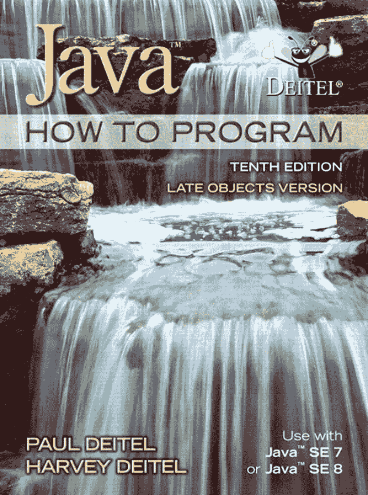

# 在线访问

感谢购买《Java程序设计》第十版（后期对象版本）。您的教科书包含了 12 个月的书籍伴学习网站预付访问权限。该预付订阅将让您能够完全访问以下学生支持区域：

- VideoNotes（专为增强书中介绍的编程概念而设计的视频教程，循序渐式的视频教学）
- 源代码
- 高级网络章节和附录

使用硬币刮开涂层以显示您的学生访问代码。请勿使用刀或其他尖利物体，以免损坏代码。

要首次访问《Java程序设计》第十版（后期对象版本）伴学习网站，您需要使用连接互联网的计算机和网络浏览器进行在线注册。该过程仅需几分钟，且只需完成一次。

1. 访问 `http://www.pearsonhighered.com/deitel/`
2. 点击 **Companion Website**（伴学习网站）。
3. 点击 **Register**（注册）按钮。
4. 在注册页面上输入位于刮刮面板下方的学生访问代码*。不要输入连字符。可以使用小写或大写。
5. 按照屏幕上的说明操作。如果在注册过程中任何时候需要帮助，请直接点击 **Need Help?**（需要帮助？）图标。
6. 一旦确认您的个人登录用户名和密码，即可开始使用《Java程序设计》第十版（后期对象版本）伴学习网站了！

# 注册后登录

您只需对此伴学习网站注册一次。之后，您可以随时访问 `http://www.pearsonhighered.com/deitel/`，并在提示时提供您的登录用户名和密码。

*重要：访问代码仅供一名学生使用。此订阅自激活起有效期为12个月，且不可转让。如果此访问代码已经显示，则可能已失效。如果是如此，您可以访问 `http://www.pearsonhighered.com/deitel/`，进入《Java程序设计》第十版（后期对象版本）书籍页面并按照屏幕说明购买订阅。

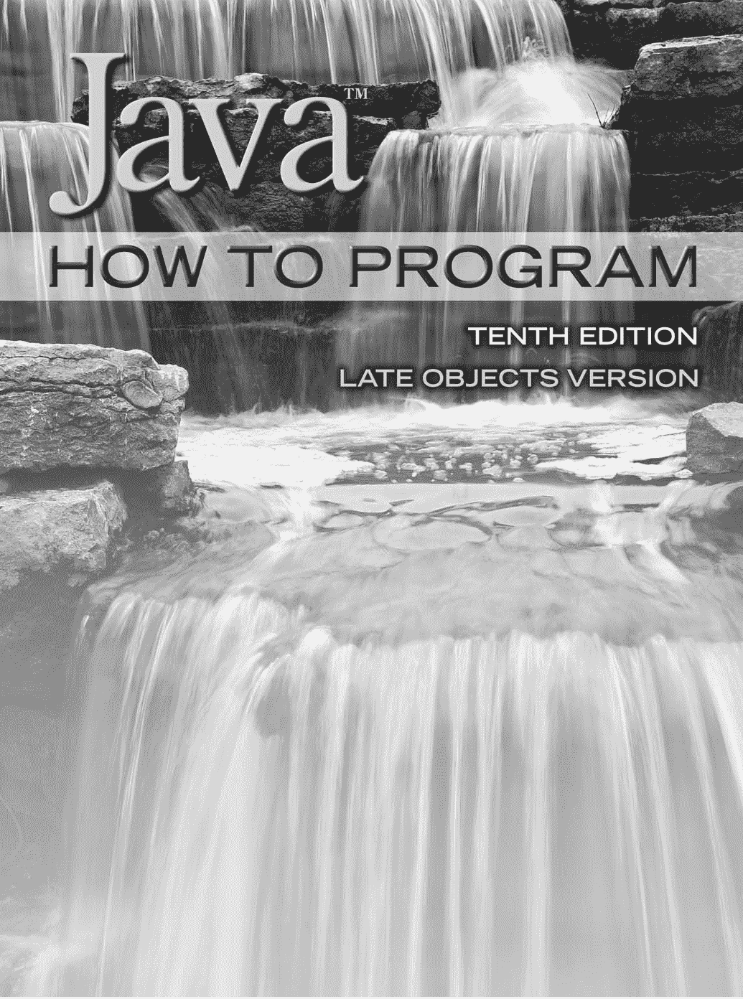

要接收 Deitel 出版物、资源中心、培训课程、合作伙伴优惠等更多信息，请加入 Deitel 社区：

- Facebook——`https://facebook.com/DeitelFan`
- Twitter™——`@deitel`
- Google+™——`https://google.com/+DeitelFan`
- YouTube™——`https://youtube.com/DeitelTV`
- LinkedIn™——`https://linkedin.com/company/deitel-&associates`

并在此处订阅免费的 Deitel® Buzz 电子邮件：

`www.deitel.com/newsletter/subscribe`

与作者联系，请发送邮件至：

`deitel@deitel.com`

## 前言

## 序

# II 异常处理：深度观察

- 21.1 简介
- 25.3 JavaFX 窗口——显示文本
- 25.4 创建应用程序
  - 25.4.1 创建项目

## 前言

“语言的主要优点在于清晰……”

—— 盖伦（Galen）

欢迎阅读 Java 编程语言和《Java 程序设计与实现》第十版（后期对象版）！这本书我们称之为“Java 之爱”，为学生、讲师和软件开发者介绍了前沿的计算技术。它适用于基于 ACM 和 IEEE 课程建议的入门级学术和专业课程序列，也适用于计算机科学考试的准备。如果您尚未阅读，请阅读封底和内封条条形——这些内容捕捉了本书的精华。在前言中，我们将提供更详细的内容。

我们专注于软件工程的最佳实践。本书的核心是特征性的“现场代码方法”（live-code approach）——我们不再使用孤立的代码片段，而是在运行在最新版本的 Windows®、OS X 和 Linux® 上的完整工作程序语文中介绍概念的。每个完整的代码示例都配有现场执行。

# 与作者保持联系

在阅读本书时，如果您有任何问题，请发送电子邮件与我们联系：

```
deitel@deitel.com
```

我们会及时回复。有关此本书的更新，请访问：

```
http://www.deitel.com/books/jhtp10LOV
```

在以下地址订阅 Deitel® Buzz 在线杂志：

```
http://www.deitel.com/newsletter/subscribe.html
```

并加入 Deitel 社交网络社区：

- Facebook (`http://www.deitel.com/deitelfan`)
- Twitter (`@deitel`)
- Google™ (`http://google.com/+DeitelFan`)
- YouTube (`http://youtube.com/DeitelTV`)
- LinkedIn® (`http://linkedin.com/company/deitel-&-associated`)

# 源代码与视频注释

所有源代码均可在：

```
http://www.deitel.com/books/jhtp10LOV
```

以及本书的官方网站（该网站还包含大量的视频注释 VideoNotes）：

```
http://www.pearsonhigher.com/deitel
```


教授 Java 编程入门课程有多种方法。最流行的两种是“后期对象法”和“早期对象法”。为了满足这些多样化的需求，我们提供了这本书两个版本：

- 《Java 程序设计与实现》第 10 版，后期对象版
- 《Java 程序设计与实现》第 10 版，早期对象版

这两个版本的区别在于第 1–7 章中主题介绍的顺序。从 8 章到第 31 章的内容完全相同。

《Java 程序设计与实现》第 10 版（后期对象版）的第 1–6 章是纯过程化编程计算机科学（CSI）的核心，涵盖了操作符、数据类型、输入/输出、控制语句、方法和数组。希望尽早介绍字符串关键材料的讲师可以在第 6 章后立即介绍第 14.1–14.3 节。希望尽早介绍文件关键材料的讲师可以在第 6 章后立即介绍第 15.1–15.4 节。希望在第一门课程中引入一些面向对象编程的讲师可以包含第 7–11 章的部分或全部内容（见下文）。

《Java 程序设计与实现》第 10 版（后期对象版）适用于各个层次的编程课程，特别是相关学科的 CS 1 和 CS 2 入门课程序列。本书的模块化组织有助于讲师规划教学大纲：

# 引言

- 1. 在线章节将在 2014 年秋季课程的配套网站上提供。

**图 2** | Java SE 8 lambdas 和流的讨论与示例。（共 2 部分，共第 2 部分）

```
http://bit.ly/CERTOracleSecureJava
```

请阅读此处的 Java 编程部分获取有关 CERT 的更多信息。

```
http://docs.oracle.com/javase/
```

对于 Java SE 8 文档，链接开头为

```
http://download.java.net/jdk8/
```

这些链接在 Oracle 发布 Java SE 8 时可能会发生——可能指向开头如下的链接：

```
http://docs.oracle.com/javase/8/
```

对于出版后任何链接更改，我们将在以下地址发布更新：

```
http://www.deitel1.com/books/jhtp10OV
```

**可扩展的 GUI 和图形展示。** 教授入门课程的讲师在涵盖 GUI、图形和多媒体方面有广泛的选择——从无到全，从早期章节的可选部分，到第 12、13 和 22 章对 Swing GUI 和 Java 2D 图形的深度处理，以及第 25 章和在线第 26–27 章对 JavaFX GUI、图形和多媒体的深度处理。

- **为了最优多性能的并发。** 在版中，我们荣幸邀请了 Brian Goetz 作为评审员，他是《Java并发编程》（Addison-Wesley 出）的合著者。我们更新了第 23 章，使用了 Java SE 8 技术和惯用法。我们增加了一个并行排序示例——该示例使用 Java SE 8 Date API 对每个操作进行计时，并演示了在多核系统上的性能。我们包含了一个 Java 8 并行与顺序处理的示例，再次使用 Date/Time API 来显示性能提升。最后，我们增加了一个 Java 8 `CompletableFuture` 示例，演示了长时间计算的顺序和并行执行。

**SwingWorker 类。** 我们使用 `SwingWorker` 创建多线程用户界面。在在线第 26 章中，我们展示了 JavaFX 如何处理并发。

**并发具有挑战性。** 编写并发应用程序是困难且容易出错的。并发特性非常多。我们指出了大多数人应该使用的，并提到某些应该留给专家处理。

- **金额。** 在前面的章节中，为了方便起见，我们使用 `double` 类型来表示金额。由于 `double` 类型可能会导致不正确的金额计算，应该使用 `BigDecimal`（稍微复杂一些）来表示金额。我们在第 8 章和第 25 章中演示了 `BigDecimal`。

- **面向对象的编程和设计。** 我们采用后期对象的方法，在早期章节中涵盖了编程基础，如数据类型、变量、运算符、控制语句、方法和数组。学生在第 7 章中开发了他们的第一个自定义类和对象。[对于需要早期对象方法的情况，请考虑《Java程序设计》第10版早期对象版。]

- **真实世界案例研究。** 面向对象的编程特性涵盖了 Account、Time、Employee、GradeBook 和卡牌洗牌与发牌案例研究。

- **继承、接口、多态和组合。** 我们使用一系列真实世界的案例研究来说明这些 OO 概念，并解释在构建工业级应用时在什么情况下偏每一种。

- **异常处理。** 我们在书中整合了基础异常处理，然后在第 11 章进行了更深层次的处理。异常处理对于构建“任务关键型”和“业务关键型”应用程序至关重要。程序员需要关心当我调用的组件遇到困难时会发生什么？组件将如何信号它出了问题？如果你使用 Java 组件，你不仅需要知道该组件在‘一切顺利’时的行为，还需要知道该组件在‘情况糟糕’时‘抛出’哪些异常。”

- **可选案例研究：开发 ATM 的面向对象设计和 Java 实现。** 第 33-34 章包含一个使用 UML（统一建模语言）进行面向对象设计的可选案例研究——UML 是用于面向对象系统的行业标准图形化语言。我们设计并实现了一个自动取款机（ATM）的软件。我们分析了一份指定构建系统的典型需求文档。我们确定了实现该系统所需的类。

- **数据结构。** 我们在第 6 章开始介绍泛型 `ArrayList`。我们在第 16-21 章对数据结构的讨论深入探讨了递归，以及描述算法可能复杂度的 Big O。我们讨论了如何实现泛型方法和类，泛型集合（对于计算机科学专业的学生非常有用）。

构建能够抵抗病毒、蠕虫和其他形式“恶意软件”攻击的工业级系统是困难的。今天，通过互联网，此类攻击是瞬时的全球性的。从开发周期开始构建安全性可以大大减少漏洞。我们在章节和示例中融入了各种 Java 编码实践（适合入门教材的实际情况）。

学生们喜欢构建 GUI 和图形应用程序。对于那些尽早介绍 GUI 和图形的课程，我们整合了一个可选的 10 节介绍，涵盖了如何创建图形以及基于 Swing 的图形用户界面（GUI）。该案例研究的目标是创建一个简单的多态绘图应用程序，用户可以在其中选择一个形状进行绘制，选择形状的特征（如颜色），并使用鼠标绘制形状。该案例研究在整个课程中逐步构建，读者将在第 10 章实现多态绘图，在第 12 章添加事件驱动的 GUI，并在第 13 章使用 Java 2D 增强绘制能力。

- 练习 13.31——添加 Java2D

# 教学方法

《Java 程序设计》第 10 版（对象靠后版）包含了数百个完整的运行示例。我们强调清晰性，并专注于构建工程良好的软件。

视频笔记（VideoNotes）。随附网站包含大量的视频笔记，其中合作者 Paul Deitel 在书的大多数核心章节中进行了详细说明。学生喜欢观看视频笔记来强化核心概念并获得额外的见解。

语法高亮（Syntax Shading）。为了可读性，我们对所有 Java 代码进行了着色，类似于常见的 Java 集成开发环境和代码编辑器语法着色的方式。我们的语法高亮规范如下：

```
注释以浅灰色显示所示
关键字以粗体黑色显示如所示
常量和字面量以粗体深灰色显示所示
所有其他代码以黑色显示如所示
```

**代码高亮。** 我们在关键代码段周围使用了灰色矩形。

**字体用途。** 我们将每个定义处的按键和索引页码引用使用粗体文本，以便于参考。我们使用 **粗体 Helvetica** 字体强调屏幕上的组件（例如，**文件菜单**），并使用 Lucida 字体强调 Java 程序文本（例如，`int x = 5`）；

# 前言

网络访问（Web Access）。所有所有的源代码示例都可以从此处处下载：

```
http://www.deitel.com/books/jhtp10LOV
http://www.pearsonhighered.com/deitel
```

目标（Objectives）。起始引号后是章节目标列表。

插图/图表（Illustrations/Figures）。包含了大量的表格、线条图、UML 图、程序等。

编程技巧（Programming Tips）。我们包含了编程技巧，帮助你关注程序开发的重要方面。这些技巧和实践代表了我们从数十年的编程和教学经验中汲取的精华。


# 良好的编程实践

良好的编程实践（The Good Programming Practices）关注能够帮助你产生更清晰、更易理解和更易维护程序的技巧。


# 常见编程错误

指出出这些常见编程错误（Common Programming Errors）可以减少你犯错误的概率。


# 错误预防技巧

这些技巧包含了暴露 bug 并从程序中移除它们的建议，以及 Java 中许多从根本防止 bug 进入程序的方面。


# 性能技巧

这些技巧强调了让你的程序运行更快或减少它们占用内存量的机会。


# 可移植性技巧

可移植性技巧帮助你编写可以在各种平台上运行的代码。


# 软件工程观察

软件工程观察（The Software Engineering Observations）强调了影响软件系统构建的架构和设计问题，特别是大规模系统。


# 外观观察

外观观察（Look-and-Feel Observations）强调了图形用户界面规范。这些观察：帮助你设计出符合行业标准的吸引人且用户友图形界面。

总结要点（Summary Bullets）。我们提供了逐章节的章节要点列表总结。为了方便参考，我们包含了文中确定的每个关键术语的页码。

自测练习与答案（Self-Review Exercises and Answers）。包含了大量的用于自学的自测练习和答案。可选的 ATM 案例研究中的所有练习均已完整解答。

## 《Java 程序设计》第 10/e 版对象靠后版 中使用的软件

练习（Exercises）。章节练习包括：

- 对重要术语和概念的简单回顾
- 对重要术语和概念的简单回顾
- 对重要术语和概念的简单回顾
- 对重要术语和概念的简单回顾

索引（Index）。我们包含了文中确定的每个关键术语的页码。

# 关于作者


好了，以上就是全部内容！在您阅读本书时，我们非常欢迎您的意见、批评和改进建议。请将所有信函发送至：`deitel@deitel.com`

我们会及时回复。希望您在使用《Java程序设计》（第10版/晚期对象版本）时的体验，像我们编写它时一样愉快！

Paul 和 Harvey Deitel

# 关于作者


Paul Deitel 是 Deitel & Associates, Inc. 的首席执行官兼首席技术官，毕业于麻省理工学院（MIT），在那里学习了信息技术。他拥有 Java 认证程序员和 Java 认证开发者证书，并是 Oracle Java Champion。通过 Deitel & Associates, Inc.，他向全球客户交付了数百门编程课程，包括思科、IBM、西门子、Microsystems、戴尔、富信、肯尼迪航天中心的美国宇航局（NASA）、北方严重风暴实验室、白沙导弹发射场、Rogue Software、波音、SunGard高等教育、诺特尔网络、Puma、Robotys 等。他与合著者 Harvey M. Deitel 博士是全球畅销的编程语言教材/专业书籍作者。

Harvey Deitel 博士是 Deitel & Associates, Inc. 的主席兼战略官，在计算机领域拥有50 年的经验。Deitel 博士在麻省理工学院获得电气工程学士和硕士学位，并在波士顿大学获得数学博士学位。他拥有丰富的教学经验，在1991年与儿子 Paul 共同创立 Deitel & Associates, Inc. 之前，曾在波士顿学院获得终身教授职位并担任计算机系主任。Deitel 作品获得了国际认可，翻译成日语、德语、俄语、西班牙语、法语、意大利语、简体中文、繁体中文、葡萄牙语、希腊语、乌尔都语和土耳其语。企业、学术、政府和军事客户交付了数百门编程课程。

# Deitel® & Associates, Inc.

Deitel & Associates, Inc. 由 Paul Deitel 和 Harvey Deitel 创立，是一家国际认可的作者和培训机构，专门从事计算机编程语言、对象技术、移动应用开发以及互联网和网络软件。该公司的培训客户包括许多全球性公司、政府机构、军事分支和学术机构。该公司在全球范围内客户现场提供主要编程语言和平台的讲师现场培训，包括 Java™、Android 应用开发、Objective-C 和 iOS 应用开发、C++、Visual C#、Visual Basic®、Visual C++、Python®、对象技术、互联网和网络编程以及不断增加的其他编程和软件开发课程。

# 前言

通过与 Pearson/Prentice Hall 达 39 年的出版伙伴关系，Deitel & Associates, Inc. 出版了纸质及多种电子书格式的前沿编程教材、专业书籍以及 LiveLessons 视频课程。可以通过以下邮箱联系 Deitel & Associates, Inc. 及作者：

`deitel1@deitel.com`

欲了解更多关于 Deitel 的 Dive-Into® 系列企业培训课程，请访问：

`http://www.deitel.com/training`

如需为贵机构申请全球范围内的现场讲师培训方案，请发送电子邮件至 `deitel1@deitel.com`。

希望购买 Deitel 书籍和 LiveLessons 视频培训的个人可以通过 `www.deitel.com` 进行。企业、政府、军事和学术机构的批量订单应直接向 Pearson 订购。更多信息请访问：

`http://www.informit.com/store/sales.aspx`

# 在开始之前

本节包含您在使用本书之前应该审阅的信息。此处所列信息的任何更新将发布在：

```
http://www.deitel.com/books/jhtp10LOV
```

此外，我们还提供了 Dive-Into® 视频（将在 2014 年秋季课程前提供），用于演示“在开始之前”章节中的说明。

# 字体和命名规范

我们使用字体来区分屏幕组件（如菜单名称和菜单项）。我们的规范是使用无衬线字体 Helvetica 突出屏幕组件（例如：`File` 菜单），并使用无衬线字体 Lucida Console 突出 Java 代码和命令（例如：`System.out.println()`）。

# 书中使用的软件

您需要的所有软件都可以从网上免费获取。特定于 Java SE 8 的示例以及 Java SE 8 标准版开发工具包（JDK）除外。

# Java 标准版开发工具包 7 (JDK 7)

适用于 Windows、OS X 和 Linux 平台的 JDK 7 可从此处获取：

```
http://www.oracle.com/technet/java/javase/downloads/index.html
```

# Java 标准版开发工具包 (JDK 8)

在出版时，适用于 Windows、OS X 和 Linux 平台的 JDK 8 最终版本可从此处获取：

```
https://jdk8.java.net/download.html
```

一旦 JDK 8 正式发布，可通过以下地址获取：

```
http://www.oracle.com/technetwork/java/javase/downloads/index.html
```

# JDK 安装说明

下载 JDK 安装程序后，请务必按照以下地址仔细遵守您平台的 JDK 安装说明：

```
http://docs.oracle.com/java/7/docs/webnotes/install/index.html
```

虽然这些说明是针对 JDK 7 的，但也适用于 JDK 8——您需要在任何特定版本的说明中更新 JDK 版本号。

## 设置 PATH 环境变量

`PATH` 环境变量指定了计算机搜索应用程序的目录，例如用于编译和运行 Java 应用程序的应用程序。请按照您平台的 Java 安装说明仔细设置 `PATH` 环境变量。不同操作系统的设置步骤如下：

```
http://www.java.com/en/download/help/path.xml
```

如果在 Windows 和某些 Linux 安装上未正确设置 `PATH`，您在使用 JDK 工具时将收到消息：

> 'java' 不是内部或命令、程序或批处理文件。

在这种情况下，请返回设置 `PATH` 的说明并检查您的步骤。如果您下载了更新版本的 JDK，可能需要更改 JDK 安装目录名称。

## JDK 安装目录和 bin 子目录

JDK 安装目录因平台而异。下列目录适用于 Oracle JDK 7 更新 51：

- Windows 32 位 JDK：`\Program Files (x86)\Java\jdk1.7.0_51`
- Windows 64 位 JDK：`\Program Files\Java\jdk1.7.0_51`
- Mac OS：`/Library/Java/JavaVirtualMachines/jdk1.7.0_51.jdk/Contents/Home`
- Ubuntu Linux：`/usr/lib/jvm/java-7-oracle`

如果您使用的是不同的 JDK 7 版本或使用 JDK 8，JDK 安装文件夹名称可能会根据路径而不同。对于 Linux，安装位置取决于您使用的安装程序和可能的 Linux 版本。如果我们使用的是 Ubuntu Linux，`PATH` 环境变量必须指向 JDK 安装目录的 `bin` 子目录。

设置 `PATH` 时，请确保使用您安装的特定 JDK 版本的 JDK 安装目录名称——随着新版本的发布，JDK 安装目录名称将包含更新版本号。例如，在写作期间，最新的 JDK 7 版本是更新 51。对于该版本，JDK 安装目录名称以 "-51" 结尾。

## 设置 CLASSPATH 环境变量

如果您尝试运行 Java 程序并收到消息：

```
Exception in thread "main" java.lang.NoClassDefFoundError: YourClass
```

## 设置 PYTHONPATH 环境变量

此时你的系统中有一个必须修改的 `PYTHONPATH` 环境变量。要修复前面的错误，请按照设置 `PATH` 环境的步骤找到 `PYTHONPATH` 变量，然后将其值编辑为包含本地目录——通常表示为点（`.`）。在 Windows 上，在 `PYTHONPATH` 值的开头添加 `;`（这些字符前后不要有空格）。在其他平台上，将分号替换为相应的路径分隔符——通常是冒号（`:`）。

## 设置 JAVA_HOME 环境变量

你在第 24 章和几个在线章节中使用的 Java 数据库软件要求你将 `JAVA_HOME` 环境变量设置为你的 JDK 安装目录——用于设置 `PATH` 的相同步骤也可以用于设置其他环境变量，例如 `JAVA_HOME`。

## 集成开发环境 (IDEs)

有很多可以用于 Java 编程的 Java 集成开发环境。出于如此，我们在书中的大部分示例仅使用了 JDK 命令行工具。我们提供了 Dive-Into® 视频（将在 2014 年秋季课程开始前提供），展示了如何下载、安装和使用三个流行的 IDE——NetBeans、Eclipse 和 IntelliJ IDEA。我们在第 25 章和书中的几个在线章节使用了 NetBeans。

## NetBeans 下载

你可以从此处下载 JDK/NetBeans 组合包：

```
http://www.oracle.com/technet/java/javase/downloads/index.html
```

带有 JDK 的 NetBeans 版本用于 SE 开发。在线 JavaServerFaces (JSF) 章节和 Web 服务章节使用 Java 企业版 (Java EE) 版本的 NetBeans，你可以从下处下载：

```
https://netbeans.org/downloads/
```

此版本同时支持 Java SE 和 Java EE 开发。

## Eclipse 下载

你可以从下处下载 Eclipse IDE：

```
https://www.eclipse.org/downloads/
```

对于 Java SE 开发，请选择 Eclipse IDE for Java Developers。对于 Java 企业版 (Java EE) 开发（包括 JSF 和 Web 服务），请选择 Eclipse IDE for Java EE Developers——此版本支持 Java SE 和 Java EE 开发。

## IntelliJ IDEA 社区版下载

你可以从下处下载免费的 IntelliJ IDEA 社区版：

```
http://www.jetbrains.com/idea/download/index.html
```

免费版仅支持 Java SE 开发。

## 获取代码示例

《Java How to Program, 10/e, Late Objects Version》的程序示例可以在下处下载：

```
http://www.deitel.com/books/jhtp10LOV/
```

位于“Download Code Examples and Other Premium Content”标题下。示例也可以从下处获取：

```
http://www.pearsonhighered.com/deitel
```

当你下载 ZIP 压缩包时，记下你选择在计算机上保存它的位置。

使用 ZIP 提取工具（如 7-Zip (`www.7zip.org`)、WinZip (`winzip.com`) 或操作系统的内置功能）解压 `examples.zip` 的内容。书中的指令假设示例位于：

- Windows 上的 `examples`
- Linux 上用户主目录下的 `examples` 子文件夹
- Mac OS X 上 `Documents` 文件夹下的 `examples` 子文件夹

## Java 的 Nimbus 外观

Java 附带了一个名为 Nimbus 的跨平台外观设计。对于具有 Swing 图形用户界面的程序（例如第 12 章和第 22 章），我们配置了测试计算机使用 Nimbus 作为默认外观。

要将 Nimbus 设置为所有 Java 应用程序的默认值，必须在 JDK 安装文件夹的 `lib` 文件夹以及 JRE 安装文件夹中创建一个名为 `swing.properties` 的文本文件。在文件中放入以下代码行：

```
swing.defaultlaf=com.sun.java.swing.plaf.NimbusLookAndFeel
```

有关查找这些位置的更多信息，请访问 `http://docs.oracle.com/javase/7/docs/webnotes/install/index.html`。[注意：除了独立的 JRE 外，你的 JDK 安装文件夹中还嵌套了一个 JRE。如果你在使用依赖 JDK 的 IDE（例如 NetBeans），你可能还需要将 `swing.properties` 文件放在嵌套的 jre 文件夹的 `lib` 文件夹中。

现在你准备好通过《Java How to Program, 10/e, Objects Version》开始你的 Java 学习。我们希望你喜欢这本书！

# 第一章 计算机、互联网与 Java 简介

> 人仍然是最卓越的计算机。
>
> ——约翰·F·肯尼迪
>
> 好的设计就是好的生意。
>
> ——托马斯·J·沃森，IBM 创始人

## 目标

在本章中你将：

- 学习计算机领域令人兴奋的最新进展。
- 学习计算机硬件、软件和网络基础知识。
- 理解数据分级结构。
- 理解不同类型的编程语言。
- 理解 Java 和其他领先编程语言的重要性。
- 理解面向对象编程的基础知识。
- 学习互联网和网页的重要性。
- 学习典型的 Java 开发环境。
- 测试一个 Java 应用程序。
- 学习一些关键的最新软件技术。
- 查看如何跟上信息技术。


## 1.1 简介

| | | |
|---|---|---|
| 飞机系统 | ATM | 汽车系统 |
| 蓝光播放机 | 机顶盒 | 复印机 |
| 信用卡 | CT 扫描仪 | 台式计算机 |
| 电子阅读器 | 游戏机 | GPS 系统 |
| 家电 | 家庭安全系统 | 灯具开关 |

## 1.2 硬件与软件

### 1.2.1 摩尔定律

### 1.2.2 计算机体系

## 1.3 数据分级

## 1.4 机器语言、汇编语言和高级语言

## 1.5 对象技术简介

### 1.5.1 作为对象的汽车

### 1.5.2 方法与类

### 1.5.3 实例化

### 1.5.4 重用

### 1.5.5 消息调用

### 1.5.6 属性与变量

### 1.5.7 封装与信息隐藏

### 1.5.8 继承

### 1.5.9 接口

### 1.5.10 面向对象分析与设计 (OOAD)

### 1.5.11 UML 语言

## 1.6 操作系统

### 1.6.1 Windows——私有操作系统

### 1.6.2 Linux——开源操作系统

### 1.6.3 Android

## 1.7 编程语言

## 1.8 Java

## 1.9 典型的 Java 开发环境

## 1.10 测试 Java 应用程序

## 1.11 互联网与网页

### 1.11.1 互联网：网络世界

### 1.11.2 万维网：用户友好

### 1.11.3 Web 服务与组合

### 1.11.4 Ajax

### 1.11.5 物联网

## 1.12 软件技术


| 彩票终端 | 医疗设备 | 手机 |
|---|---|---|
| 磁共振成像 (MRIs) | 停车支付系统 | 打印机 |
| 交通卡 | 机器人 | 路由器 |
| 智能卡 | 智能表 | 智能笔 |
| 智能手机 | 平板电脑 | 电视 |
| 电视顶盒 | 温控器 | 车辆诊断系统 |

图 1.1 使用 Java 的某些设备

应用（apps）市场预计将达到 990 亿美元。这为编写移动应用程序的人创造了巨大的职业机会，许多应用程序是用 Java 编写的（见第 1.6 节）。

## Java 标准版

Java 的演进如此迅速，这十版《Java How to Program》基于 Java 标准 7 (Java SE 7) 和 Java 标准 8 (Java SE 8)，在第一版出版 17 年后出版。Java 标准版包含了开发桌面和服务器应用程序所需的各种。本书适用于 SE 7 或 Java SE 8（在本书出版后发布）。所有的 Java SE 8 特性都在书中通过模块化、易于包含或跳过的章节中进行了讨论。

在 Java SE 之前，Java 支持三种范式——过程化编程、面向对象编程和泛型编程。Java SE 8 增加了函数式编程。在第 17 章中，我们将展示如何使用函数式编程编写更简洁、bug 更少的程序，以及如何并行（即同时执行多次计算）以利用当今的多核硬件架构来增强应用程序性能。

## Java 企业版

Java 用于广泛的应用程序，它有两个版本。Java 企业版 (Java EE) 面向于开发大规模的分布式网络应用程序和 Web 应用程序。在过去，大多数应用程序运行在“独立”计算机（未联网的计算机）上。今天的应用程序旨在通过互联网和网页与世界计算机进行通信。在书中我们将展示如何使用 Java 构建此类 Web 应用程序。

> 1. https://www.abiresearch.com/press/tablets-will-generate-35-of-this-years-25-billion-.
> 2. http://www.oracle.com/technet/java186372.html.
> 3. http://www.gartner.com/newsroom/id/264515.

# 第一章 计算机、互联网与 Java 简介

## Java 微型版

Java Micro Edition（Java ME）是 Java SE 的子集，旨在为资源受限的嵌入式设备开发应用程序，例如智能手表、MP3 播放器、电视顶盒、智能电表（监测电能使用情况）等。

## 1.2 硬件与软件

计算机执行计算和逻辑判断的速度比人类快得多。今天，许多个人电脑每秒可以进行数十亿次计算——这比人类一生所能完成的次数还要多。超级计算机每秒已经在执行数千万亿（千万亿）条指令！中国国防科技大学的“天和二号”超级计算机每秒可以进行超过 33 万亿次计算（33.8 PFLOPS）！对比一下，天和二号超级计算机每秒可以为地球上的每一个人执行约 300 万次计算！而且这些计算“上限”正在快速增长。

计算机数据受被称为“计算机程序”的指令序列控制，通过被称为“程序员”的人所指定的有序操作对计算机进行编程。在本书中，你将学习一种关键的编程方法论，它可以提高编程效率，降低软件开发成本——**面向对象编程**。

计算机由各种被称为**硬件**的设备组成（例如键盘、屏幕、鼠标、硬盘、内存、DVD 驱动器和处理单元）。由于硬件和软件的快速发展，计算成本正在下降。几十年前占据整个房间并花费数百万美元的计算机，现在刻在比手指还小的硅片上，每片仅需几美元。讽刺的是，硅是地球上最丰富的材料之一——它是普通沙子的成分。硅芯片技术让计算变得如此廉价，以至于计算机变成了一种商品。

### 1.2.1 摩尔定律

每年你可能预期大多数产品和服务的价格至少增加一点。但在计算机和通信领域，情况恰恰相反，特别是对于支持这些技术的硬件。几十年来，硬件价格一直在迅速下降。

每隔一年或两年，计算机的容量就会以低廉的价格翻倍。这种显著的趋势通常被称为摩尔定律，以 1960 年发现这一规律的戈登·摩尔（Gordon Moore）命名，他是英特尔的创始人——英特尔是当今计算机和嵌入系统处理器的领先制造商。摩尔定律以及相关的观察特别适用于计算机用于程序的内存容量、用于长期存储程序和数据的辅助存储（如磁盘存储）容量，以及它们的处理器速度——即它们执行程序的速度（即完成工作的速度）。

通信领域也发生了类似的增长——随着对通信带宽（即信息承载能力）的巨大需求引发了激烈竞争，成本随之暴跌。我们没有见过其他任何领域的技术进步如此之快，成本下降如此之快。这种现象级的改进确实推动了信息革命。

### 1.2.2 计算机结构

无论物理外观如何，计算机可以被构想为分为不同的逻辑单元或部分（图 1.2）。

| 逻辑单元 | 描述 |
|---|---|
| 输入单元 | 这一“接收”部分从输入设备获取信息（数据和计算机程序），并将其交给其他单元进行处理。大多数用户输入是通过键盘、触摸屏和鼠标设备输入计算机的。其他输入形式还包括接收语音命令、扫描图像和条形码、从次级存储设备（如硬盘、DVD 驱动器、蓝光硬盘——磁带机和 USB 闪存盘——也称为“优 盘”或“内存棒”）读取数据、从网络摄像头接收视频，以及让计算机从互联网接收信息（例如从 YouTube 流式视频——从 Amazon 下载电子书）。较新的输入形式包括来自 GPS 设备的位置数据，以及来自智能手机或游戏机中加速度计（一种对上/下、左/右和前后加速度有响应的设备）提供的方向数据（例如微软的 Kinect 和 Xbox 的 Wi-Fi 远程站）。 |
| 输出单元 | 这一“输出”部分将信息显示在输出设备上。大多数用户输出通过显示器、打印机和扬声器显示。其他输出形式包括显示视频、打印文档、在扬声器上播放音频以及通过网络发送数据。 |
| 内存单元 | 这一“存储”部分保留信息以供其他单元处理。大多数数据存储在内存（如 RAM）或次级存储（如硬盘、DVD 驱动器、蓝光硬盘——磁带机和 USB 闪存盘——也称为“优 盘”或“内存棒”）中。内存通常是易失的，在掉电时信息会丢失。 |

图 1.2 计算机的逻辑单元。

## 1.3 数据层次级

数据数据处理形成数据层次级，从最简单的数据项（称为位）到更复杂的结构，结构不断增强。图 1.3 展示了数据层次级的一部分。

**位**

计算机中最小的数据项可以取 0 或 1 的值。它被称为位（二进制位）。令人惊叹的是，计算机只能对 0 和 1 进行检查、设置和反转。

**字符**

以位的形式处理数据是繁琐的。相反，人们更倾向于使用数字（0–9）、字母（A–Z 和 a–z）以及特殊符号（例如 `$`, `@`, `%`, `&`, `*`, `(`, `)`, `-`, `+`, `?`, `;`, `/`）。数字、字母和特殊符号被称为字符。字符集是用于编写程序和表示数据项的所有字符。计算机只处理 1 和 0，因此字符集将每个字符表示为 1 和 0 的模式。Unicode 字符由一个、两个或四个字节（8、16 或 32 位）组成。Unicode 包含了许多语言的字符。有关 Unicode 的更多信息请参见附录 H。有关 ASCII（美国标准信息交换码——Unicode 的流行子集，它表示大小写字母、数字和一些常用特殊字符）的更多信息请参见附录 B。

# 第一章 计算机、互联网与 Java 简介

- 员工识别号（整数）
- 姓名（字符字符串）
- 地址（字符字符串）
- 时薪率（带小数点的数字）
- 至今累计收入（带小数点的数字）
- 预扣税额金额（带小数点的数字）

因此，记录是一组相关字段的集合。在前面的示例中，所有字段都属于同一个员工。公司可能有许多员工，并为每位员工准备一份工资记录。

## 文件

文件是一组相关记录的集合。[注：更广泛地说，文件包含任意格式的数据。在某些操作系统中，文件被视为字节的序列——文件中字节的任何组织方式（例如将数据组织成记录）都是应用程序程序员创建的视图。你将在第 15 章中看到如何这样做。] 一个机构拥有许多文件并不罕见，其中某些文件包含数十亿甚至数万个字符。

## 数据库

数据库是为了方便访问和操作而组织的数据集合。最流行的模型是关系型数据库，数据存储在简单的表中。表包含记录和字段。例如，学生数据可能包括名字、姓、专业、学生 ID 号和平均分字段。每个学生的数据是一条记录，每条记录中的单独信息是字段。你可以根据数据与多个表或数据库之间的关系对其进行搜索、排序或其他处理。例如，大学可能会将学生数据库的数据与课程、校内住宿、餐饮计划等数据库的数据结合使用。我们将在第 24 章讨论数据库。

## 大数据

产生的数据量是巨大的且增长迅速的。根据 IBM 的数据，每天产生约 2.5 极亿字节（2 艾字节）的数据，世界上 90% 的数据是在过去两年内创建的⁶。根据《数字宇宙》的数据，全球数据供应已达到 2.8 泽字节（等于 2 万亿 GB）⁷。大数据应用为软件开发人员创造了大量机会。根据高特集团的数据，到 2015 年，全球将有超过 40 万份工作将支持大数据。⁸。

- 6. http://www-01.ibm.com/software/data/bigdata/
- 7. http://www.guardian.co.uk/news/datablog/2012/dec/19/big-data-study-digital-universe-global-volume.
- 8. http://tech.fortune.cnn.com/2013/09/04/big-data-employment-boom/

## 1.4 机器语言、汇编语言与高级语言

| 单元 | 字节 | 大约等于 |
|---|---|---|
| 1 千字节 (KB) | 1024 字节 | 10³ (恰好为 1024 字节) |
| 1 兆字节 (MB) | 1024 千字节 | 10⁶ (1,000,000 字节) |
| 1 吉字节 (GB) | 1024 兆字节 | 10⁹ (1,000,000,000 字节) |
| 1 太字节 (TB) | 1024 吉字节 | 10¹² (1,000,000,000,000 字节) |
| 1 拍字节 (PB) | 1024 太字节 | 10¹⁵ (1,000,000,000,000,000 字节) |
| 1 艾字节 (EB) | 1024 拍字节 | 10¹⁸ (1,000,000,000,000,000,000 字节) |
| 1 泽字节 (ZB) | 1024 艾字节 | 10²¹ (1,000,000,000,000,000,000,000 字节) |

图 1.4 字节测量。

## 1.4 机器语言、汇编语言与高级语言

程序员用各种编程语言编写指令，其中一些可以直接被计算机理解，而另一些则需要翻译步骤。今天有数百种语言正在在使用。这些语言可以分为三大类型：

1. 机器语言
2. 汇编语言
3. 高级语言

**机器语言**

任何计算机都可以直接理解其由硬件设计定义的机器语言。机器语言通常由数字字符串（最终还原为 1 和 0）组成，指示计算机一次执行一项最基础的操作。机器语言具有依赖性（特定的机器语言只能用于一种类型的计算机）。这类语言对人类来说是繁琐的。例如，这里有一个早期机器语言工资程序的片段，它将加班费加到基本工资并将结果存储在总薪中：

```
+1300042774
+1400593419
+1200274027
```

**汇编语言与汇编器**

对于大多数程序来说，用语言编程实在太慢且太枯燥了。程序员不再使用可以直接理解的数字字符串，而是开始使用类似英语的缩写来表示基本操作。这些缩写成了汇编语言的基础。开发了称为汇编器的翻译程序，以计算机的速度将早期的汇编语言程序转换为机器语言。以下汇编语言工资程序的片段将加班费加到基本工资并存储在总薪中：

```
load    base
add     over
store  gross
```

尽管这段代码对人类来说更清晰，但在翻译成机器语言之前，对计算机来说是不可理解的。

**高级语言与编译器**

随着汇编语言的出现，计算机的使用量迅速增加，但程序员仍然需要大量指令来完成最简单的任务。为了加快编程过程，开发了高级语言，可以使用简单的语句来完成大量任务。开发了称为编译器的翻译程序将高级语言程序转换为机器语言。高级语言允许你编写看起来像日常英语并包含常用数学符号的指令。高级语言中的工资程序可能包含这样一条语句：

```
grossPay = basePay + overtime
```

**解释器**

将大型高级语言程序编译成机器语言需要时间。解释器是一种按条语句执行高级语言程序的程序。这比编译慢，但更便于调试。从程序员的角度来看，高级语言比机器语言和汇编语言更好。

# 第12章 第一章 计算机、互联网与 Java 导论

行驶里程数（即里程表读数）。就像它的功能一样，汽车的属性被表示为其工程图中的设计部分（例如，这些图包含里程表和油表）。当你驾驶一辆真实的汽车时，这些属性会随着汽车移动。每辆汽车都携带自己的属性。例如，每辆汽车都知道自己的油箱里有多少汽油，但并不知道其他汽车油箱里的油量。

同样，对象在程序中使用时，也有它随之携带的属性。这些属性被指定为对象类的一部分。例如，一个银行账户对象有一个余额（`balance`）属性，代表账户中的金额。每个银行账户对象都知道它所代表的账户的余额，但不知道该银行中其他账户的余额。属性通过类的实例变量来指定。

## 1.5.7 封装与信息隐藏

类（和对象）封装，即包裹，它们的属性和方法。一个类（以及其对应的对象）的属性和方法在本质上是相互相关的。对象之间可以相互通信，但通常不允许它们知道其他对象是如何实现的——实现细节隐藏在对象内部。正如我们将要看到的，这种信息隐藏对于良好的软件工程至关重要。

## 1.5.8 继承

可以通过继承方便地创建一种新的对象类——新类（称为子类）从现有类（称为父类）的特征开始，并可能对其进行定制以及添加自己的独特特征。在我们的汽车类比中，“敞篷车”（convertible）类的对象无疑是更通用的“汽车”（automobile）类的对象，更具体地说，车顶可以以不同的方式降低或升起。

## 1.5.9 接口

Java 还支持接口（interfaces）——相关方法的集合，这些方法通常允许你告诉“做什么”，而不是“如何做”（我们将在 SE 8 中看到对此的例外）。在汽车类比中，一个由方向盘、加速踏板和刹车踏板组成的“基础驾驶能力”（basic-driving-capabilities）接口可以让驾驶员知道该做什么。一旦你学会了如何使用这个接口进行转弯、加速和刹车，就可以驾驶许多类型的汽车，尽管制造商可能以不同的方式实现这些系统。

一个类实现零或多个接口，每个接口可以有一个一个或多个方法，就像一个类为基本驾驶功能、控制收音机、控制加热和空调系统等分别实现不同的接口一样。正如汽车的实现方式不同，类也可以以不同的方式实现接口的方法。例如，一个软件系统可以实现一个“备份”（backup）接口，它提供 `save()`（保存）和 `restore()`（恢复）方法。类的实现方式不同，取决于被备份内容的类型，例如程序、文本、音频、视频以及存储这些物品的设备类型。

## 1.5.10 面向对象的分析设计 (OOAD)

你很快就会用 Java 编写程序。你将如何为你的程序创建代码（即程序指令）？也许像许多程序员一样，你只需打开电脑并开始打字。这种方法对于小型程序（如我们在书开头介绍的程序）可能有效，但如果你被要求创建一个软件系统，供由 1000 名软件开发人员组成的团队使用以构建下一代美国空中交通控制系统又怎样？对于如此庞大且复杂的项目，你不能简单地上手开始写程序。

为了创建最佳的解决方案，你应该遵循详细的分析来确定你项目的需求（即定义系统应该做什么），并开发一个满足这些需求的设计（即指定系统应该如何做）。理想情况下，在编写任何代码之前，你应该经历这个过程并仔细审查设计（并让其他软件专业人员审查）。这个过程涉及从面向对象的视角对系统进行分析和设计，它被称为面向对象分析设计。面向对象编程（OOP）允许你使用。

统一建模语言 (UML) 尽管有很多 OOAD 方法存在，统一建模语言（UML）是目前最广泛使用的图形化语言（我们在第 8 章中看到关于此的例外）。在第 8 章中我们介绍。统一建模语言（UML）是目前最广泛使用的图形化方案。

## 1.6 操作系统

操作系统是让服务器、计算机和嵌入式系统。操作系统是开源运动的巨大成功。通过开源开发，个人和公司在全球范围内维护、维护和演进贡献力量，通常是免费。Java 开发工具包（JDK）和许多相关技术现在都是开源的。

开源社区的一些组织包括：

- Eclipse 基金会（有助于开发软件）
- Mozilla 基金会（Firefox 浏览器的创建）
- Apache 服务器（响应浏览器请求交付网页）
- GitHub（提供管理开源项目的工具）
- SourceForge

计算和通信的快速改进、成本的降低以及开源软件使得创建基于软件的业务比几十年前更容易、更经济。Facebook 作为一个从大学宿舍创立的项目是使用开源构建的。

## 1.6.1 Windows——专有操作系统

在 20 世纪 80 年代中期，Windows 开发了图形用户界面，在 DOS 之上。Windows 的功能包括 PC 和 iPad、触摸功能、安全增强以及多触摸支持，由微软独家。Windows 是世界上最广泛使用的操作系统。


## 1.6.2 Linux——开源操作系统

Linux 操作系统——在服务器、个人电脑和嵌入式系统中——是开源运动的巨大成功。开源开发偏离了专有开发风格（例如，与 Windows 和 macOS）。任何人都可以为了自己的目的使用并定制它。

## 1.6.3 Android

Android——增长最快的移动和操作系统——基于 Linux 内核并使用 Java。经验丰富的程序员可以快速上手 Android 开发。开发 Android 的一个好处是该平台的开放性。Android 操作系统是开放且免费的。


# Android 操作系统概述

Android 操作系统是由 Android, Inc. 开发的，该公司在 2005 年被 Google 收购。2007 年，开放手机联盟（http://www.openhandset.com/members.html）成立，旨在维护和演进 Android，推动移动技术创新并在改善用户体验的同时降低成本。截至 2013 年 4 月，每天有超过 150 万台 Android 设备（智能手机、平板电脑等）被激活。2013 年 10 月，Strategy Analytics 的报告显示 Android 占据了全球智能手机市场的 81.3%，相比之下，Apple 为 13.4%，Microsoft 为 4.1%，BlackBerry 为 1%。Android 设备包括智能手机、平板电脑、电子阅读器、机器人、喷气发动机、NASA 卫星、游戏机、电视、摄像头、医疗保健设备、智能手表、汽车车载信息系统（用于控制收音机、GPS、电话、恒温器等）等。¹¹²

Android 手机包含手机功能、互联网客户端（用于网页浏览和互联网通信）、MP3 播放器、游戏机等功能。这些手持设备具有全彩色多任务屏幕，允许你通过涉及单次或多次触控的手势来控制设备。你可以通过 Google Play 和其他市场直接向你的 Android 设备下载应用。在本文编写时，Google Play 上有超过百万个应用，而且这个数量正在快速增长。¹¹³

我们在教科书《Android 编程：第二版》（*Android How to Program, Second Edition*）中介绍了 Android 开发。在我们的专业书籍《面向程序员的 Android：一种应用驱动的方法》（*Android for Programmers: An App-Driven Approach*, Second Edition）中。在你学习 Java 之后，你会发现开发和运行 Android 应用非常简单。你可以将应用发布到 Google Play (play.google.com)，如果它们获得成功，你甚至可以开启创业。请记住——Facebook、微软和戴尔都是从大学宿舍创立的。

# 1.7 编程语言

在本节中，我们简要介绍了几种编程语言（图 1.5）。在下一节中，我们将介绍 Java。

## 图 1.5 其他编程语言（第 I 部分）

| 编程语言 | 说明 |
| --- | --- |
| Fortran | Fortran（公式翻译）由 IBM 公司在 20 世纪 50 年代中期开发，适用于需要复杂数学计算的科学工程应用。它被广泛使用，其最新版本支持面向对象编程。 |
| COBOL | COBOL（通用面向事务语言）是由计算机制造商、美国政府和工业用户在 20 世纪 50 年代后期开发的，基于格蕾斯·霍珀（Grace Hopper）开发的语言。格蕾斯·霍珀是美国海军将领也是计算机科学家，她提倡编程语言的国际标准化。COBOL 仍然广泛用于需要精确高效地处理大量数据的商业应用。其最新版本支持面向对象编程。 |
| Pascal | 20 世纪 60 年代的研究产生了结构化编程——一种有规律的程序编写方法，它比以前技术产生的大型程序更清晰、更易教学和调试，并且更易修改。这项研究成果之一是 1971 年开发的 Pascal 编程语言，它专为结构化编程设计，并在大学课程中流行了数十年。 |

## 图 1.5 其他编程语言（第 II 部分）

| 编程语言 | 说明 |
| --- | --- |
| Ada | Ada 基于 Pascal，是在 20 世纪 70 年代和 80 年代初在美国国防部（DOD）的赞助下开发的。美国国防部想要一种能够满足其大部分需求的语言。Ada 语言以诗人拜伦勋爵的女儿爱·洛夫莱斯夫人（Lady Lovelace）的名字命名。她被认为在 19 世纪初编写了世界上第一个计算机程序（是为查尔斯·巴贝尔设计的分析机机械计算设备）。Ada 还支持面向对象编程。 |
| Basic | Basic 是 20 世纪 60 年代在达特茅斯学院开发的，旨在让新手熟悉编程技术。它的许多最新版本都是面向对象的。 |
| C | C 是 20 世纪 70 年代初由丹尼斯·里奇（Dennis Richie）在贝尔实验室开发的。它最初被广为人知的 UNIX 操作系统的开发语言。今天，大多数通用操作系统的代码是用 C 或 C++ 编写的。 |
| C++ | C++ 基于 C，是由比雅纳·斯特斯特鲁普（Bjarne Stroustrup）在 20 世纪 80 年代初在贝尔实验室开发的。C++ 提供了若干项“增强” C 的特性。 |
| Objective-C | Objective-C 基于 C，是在 20 世纪 80 年代初在贝尔实验室开发的。Objective-C 提供了若干项“增强” C 的特性。Objective-C 是另一种基于 C 的面向对象语言，是由 Apple 公司开发的。Objective-C 还支持面向对象编程。 |
| Visual Basic | Visual Basic 是在 20 世纪 90 年代初引入微软的面向对象语言。它支持 Windows。 |
| Visual# | 微软的面向对象语言有 Visual Basic（基于 Basic）、Visual C++（基于 C++）和 Visual#（基于 C）。 |
| PHP | PHP 是一种由用户和开发者开发的开源脚本语言，语法与 Ruby 相似。PHP 支持许多数据库。 |
| Perl | Perl（实用报告语言）于 1987 年由拉里·沃尔（Larry Wall）开发，是最广泛使用的脚本语言之一。它具有丰富的文本处理能力。 |
| Python | Python 是另一种面向对象的脚本语言，发布于 1991 年由阿姆斯特丹数学和计算机研究所（CWI）开发。Python 具有模块性——可以通过类和接口进行扩展。 |
| JavaScript | JavaScript 是最广泛使用的脚本语言。它主要用于为网页添加动态行为，例如动画和交互。它由所有主要的浏览器提供。 |

## 图 1.5 其他编程语言（第 III 部分）

| 编程语言 | 说明 |
| --- | --- |
| Ruby on Rails | Ruby 是 20 世纪 90 年代中期创建的开源面向对象编程语言，语法与 Python 相似。Ruby on Rails 结合了 Ruby 和 37Signals 开发的 Rails 应用框架。他们的书《Real》（gettingreal.37signals.com/toc.php）是必读之作。许多 Ruby on Rails 开发者报告在开发数据库密集型应用时比其他语言效率更高。 |

# 1.8 Java

微处理器革命迄今为止最重要的贡献是实现了个人电脑的发展。微处理器在智能电子设备中产生了深远影响。意识到这一点的 Sun 在 1991 年资助了一个由詹姆斯·高斯林（James Gosling）领导的内部研究项目，产生了一种名为 Java 的语言。

Java 的目标是能够在各种计算机系统和计算机控制设备上运行程序。这有时被称为“一次编写，随处运行”。互联网在 1993 年爆发式增长，Sun 发现了使用 Java 为网页添加动态内容、交互和动画的潜力。Java 吸引了商业界的极大关注。Java 现在用于开发大型企业级应用、增强 Web 服务器（我们在网页浏览器中看到内容的计算机）的功能、为消费设备（手机、智能手机、电视顶盒等）提供应用以及许多其他用途。Java 也是开发 Android 智能手机和平板应用的关键语言。Sun 在 2010 年被 Oracle 收购。

## Java 类库

你可以创建 Java 程序所需的每个类和方法。但是

> **性能提示 1.1**
> 使用 Java API 类和方法而不是编写自己的版本可以提高程序性能，因为它们经过仔细编写，运行高效。这也可以缩短程序开发时间。

# 1.9 Java 开发环境

我们现在解释创建和执行 Java 应用的步骤。通常有五个阶段——编辑、编译、加载、验证和执行。我们在 Java 的背景下讨论这些阶段。

## 第一阶段：创建程序

第一阶段包括使用一种编辑器的程序（通常简称为编辑器）编辑文件（图 1.6）。使用编辑器，你输入一个 Java 程序（通常称为源代码），进行任何修正并将其保存到次级存储设备上（例如您的驱动器）。Java 源代码文件以 `.java` 扩展结尾命名，表示该文件包含 Java 源代码。


**图 1.6** 典型的开发环境——编辑阶段。

在 Linux 系统上广泛使用的两个编辑器是 `vi` 和 `emacs`。Windows 提供记事本（Notepad）。OS X 提供文本编辑（TextEdit）。许多免费和共享编辑器可用，包括 Notepad++ (notepad-plus-plus.org)、EditPlus (www.editplus.com)、TextPad (www.textpad.com) 和 JetBrains 系列 IDE (www.jetbrains.com)。

集成开发环境 (IDE) 提供了支持软件开发过程的工具，例如编辑器、用于定位逻辑错误（导致程序执行不正确的错误）的调试器等。有很多流行的 Java IDE，包括：

- Eclipse (www.eclipse.org)
- NetBeans (www.netbeans.org)
- IntelliJ IDEA (www.jetbrains.com)

在书籍网站上：
> www.deitel.com/books/jhtp10 向你展示了如何执行本书中的 Java 程序，以及如何使用 Eclipse、NetBeans 和 IntelliJ IDEA 开发新的 Java 程序。

## 第二阶段：将程序编译为字节码

在第二阶段，你使用 `javac` 命令（Java 编译器）来编译程序（图 1.7）。例如，要编译一个名为 `Welcome.java` 的程序，你需要在系统命令窗口（即 Windows 中的命令提示符、OS X 中的终端应用程序）或 Linux Shell 中输入：

```
javac Welcome.java
```

如果程序编译成功，编译器会生成一个名为 `Welcome.class` 的 `.class` 文件，其中包含编译后的版本。IDE 通常提供菜单项，如构建（Build）或制作（Make），它们会为你调用 `javac` 命令。如果编译器检测到错误，你需要返回第一阶段并修正它们。在第 2 章中，我们将详细介绍关于编译器可以检测的错误类型。

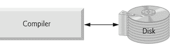

**图 1.7** 典型的 Java 开发环境——编译阶段。

Java 编译器将 Java 源代码翻译成字节码，字节码代表了在执行阶段（第五阶段）中要执行的任务。Java 虚拟机 (JVM)—JDK 的一部分也是 Java 平台的基础——执行字节码。虚拟机 (VM) 是一种模拟计算机的软件应用程序，但它向与其交互的程序隐藏了底层的操作系统和硬件。如果在许多平台上实现了同一个虚拟机，那么为该类型虚拟机编写的程序就可以在所有平台上运行。JVM 是最广泛使用的虚拟机之一。微软的 .NET 使用了类似的虚拟机架构。

与依赖于平台的机器语言指令（即依赖于特定的计算机硬件）不同，字节码指令是平台无关的。Java 的字节码是可移植的——无需重新编译源代码，相同的字节码指令就可以在任何包含理解编译字节码 Java 版本的 JVM 的平台上执行。JVM 通过 `java` 命令被调用。例如，要执行 Java 应用 `Welcome`，你需要在命令窗口中输入命令：

```
java Welcome
```

来调用 JVM，它将启动执行程序所需的步骤。这开始了第三阶段。IDE 通常提供一个菜单项，如运行（Run），它们会为你调用 `java` 命令。

## 第三阶段：将程序加载到内存

在第三阶段，JVM 将程序放入内存中以执行它——这被称为加载（图 1.8）。JVM 的类加载器加载包含程序字节的 `.class` 文件并将其传输到内存中。它还会加载你的程序使用的任何 Java 提供的 `.class` 文件。`.class` 文件可以由你的系统或通过网络（例如你的本地大学或校园网络，或互联网）从磁盘加载。

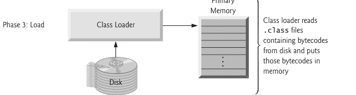

**图 1.8** 典型的 Java 开发环境——加载阶段。

## 第四阶段：字节码验证

在第四阶段，当类被加载时，字节码验证器会检查它们的字节码以确保它们是有效的且没有违反 Java 的安全限制（图 1.9）。Java 强制执行安全性以确保通过网络到达的 Java 程序不会损坏你的文件或系统（计算机病毒和蠕虫）。

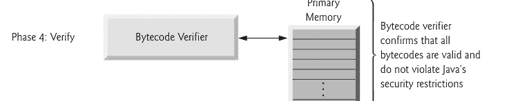

**图 1.9** 典型的 Java 开发环境——验证阶段。

## 第五阶段：执行

在第五阶段，JVM 执行程序的字节码，执行程序指定的动作（图 1.10）。在早期 Java 版本中，JVM 仅仅是 Java 的解释器，大多数程序运行速度缓慢，JVM 每次解释并执行一个字节码。某些现代计算机架构可以并行执行多个指令。现在的 JVM 通常使用解释和所谓的即时编译（JIT）结合来执行字节码。在此过程中，JVM 在解释字节码时对其进行分析，寻找热点——频繁执行的字节码部分。对于这些部分，即时编译（JIT）编译器（例如 Oracle 的 Java HotSpot 编译器）将字节码翻译成底层机器语言。当 JVM 遇到这些编译过的部分时，就会执行更快的机器代码。因此，Java 程序实际上经历了两个编译阶段——一个是将源代码翻译成字节码（为了在不同计算机平台的 JVM 之间的可移植性），另一个是将字节码翻译成机器语言。

# Painter 应用程序演示

## 图 1.11 在 Windows 7、Linux 和 OS X 中执行的 Painter 应用程序

a) 在 Windows 上运行的 Painter 应用程序

- 选择颜色
- 选择形状
- 指定矩形或椭圆形是否填充颜色
- 关闭按钮
- 清空整个画布
- 撤销上添加到画布上的最后一个形状

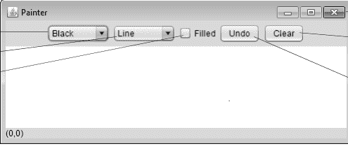

b) 在 Linux 上运行的 Painter 应用程序

- 关闭按钮

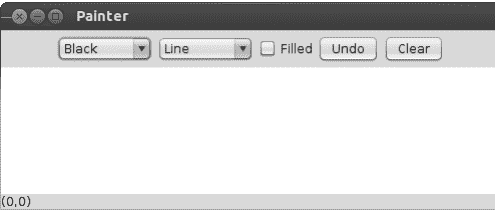

c) 在 OS X 上运行的 Painter 应用程序

- 关闭按钮

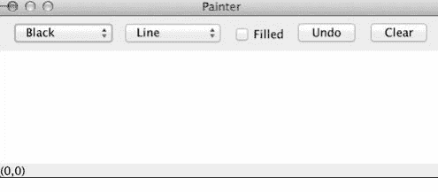

> **注意**：Java 命令区分大小写——也就是说，大写字母与小写字母不同。输入应用程序名称 `Painter` 时，使用大写字母 `P` 非常重要。否则，应用程序将无法运行。使用 `java` 命令指定 `.class` 扩展名会导致错误。此外，如果你收到错误消息 `"Exception in thread main" java.lang.NoClassDefError: Painter"`，说明你的系统存在 CLASSPATH 问题。请参阅“开始之前”（Before You Begin）部分获取帮助解决此问题的说明。

## Painter 应用程序绘图步骤

1. 为脸绘制填充的黄色椭圆形。选择黄色（Yellow）作为绘制颜色，椭圆（Oval）作为形状，并勾选填充（Filled）框，拖动鼠标画一个大椭圆（图 1.12）。

   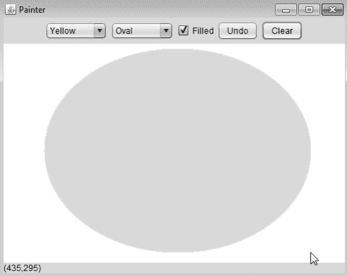

   **图 1.12** 为脸部绘制填充的黄色椭圆。

2. **绘制蓝色眼睛。** 选择蓝色（Blue）作为绘制颜色，然后画两个小椭圆作为眼睛（图 1.13）。

   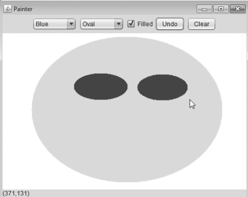

   **图 1.13** 绘制蓝色眼睛。

3. **绘制黑色眉毛和鼻子。** 选择黑色（Black）作为绘制颜色，线条（Line）作为形状，然后画眉毛和鼻子（图 1.14）。线条没有填充，因此在画线条时即使勾选填充（Filled）框也没有影响。

   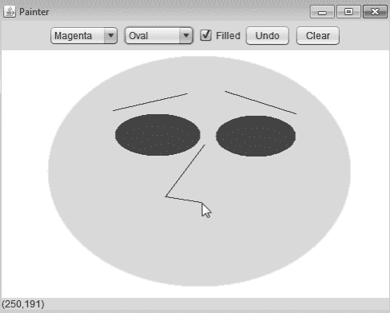

   **图 1.14** 绘制黑色的眉毛和鼻子。

4. 绘制洋红色的嘴巴。选择洋红色（Magenta）作为绘制颜色，椭圆（Oval）作为形状，然后画一个嘴巴（图 1.15）。

   

   **图 1.15** 绘制洋红色的嘴巴。

5. 在嘴上画一个黄色椭圆以做出微笑。选择黄色（Yellow）作为绘制颜色，然后画一个椭圆将洋红色的椭圆变成微笑（图 1.16）。

   

   **图 1.16** 在嘴上画黄色椭圆以做出微笑。


+ 9. **退出 Painter 应用程序。** 要退出 Painter 应用程序，点击关闭按钮。在 20 世纪 60 年代后期，ARPA（美国国防部高级研究计划局）实施了后来被称为互联网的前身 ARPANET。许多研究机构正在通过电话线连接计算机。由于 ARPA 资助的大学和研究机构进行网络，ARPANET 证明了一项技术，后来演变为电子邮件（e-mail）。

## 1.12 软件技术

图 1.18 列出了你在软件开发社区中会听到的许多术语。我们为这些主题中的大部分创建了资源中心，其中一个正在开发中。

| 技术 | 说明 |
|---|---|
| 敏捷软件开发 | 敏捷方法论旨在以更快的速度和更少的资源实现软件开发。请查看[敏捷联盟](www.agilealliance.org) 和[敏捷宣言](www.agilemanifesto.org)。 |
| 重构 | 重构涉及对程序进行重新工作，以使其变得更清晰、更易于维护，同时保持其正确性和功能。它在敏捷开发方法中被广泛采用。`IDE` 内置了重构工具，可以自动完成大部分工作。 |
| 设计模式 | 设计模式是构建灵活且可维护的面向对象软件的经过证明的架构。设计模式试图枚举反复出现的模式，鼓励软件设计人员复用这些模式，用更少的时间、金钱和精力开发出质量更好的软件。我们在在线附录 N 中讨论了设计模式。 |
| LAMP | LAMP 是许多开发者用于构建 Web 应用程序的开源技术的缩写——它代表 Linux、Apache、MySQL 和 PHP（或 Python——其他脚本语言）。MySQL 是一个开源数据库管理系统。PHP 是开发 Web 应用程序最流行的开源服务器端“语言”。Apache 是流行的 Web 服务器。Windows 的对应物是 WAMP——Windows、Apache、MySQL 和 PHP。 |
| 软件即服务 (SaaS) | 软件通常被视为一种产品；如果你想运行一个程序，你就从软件供应商那里购买一个软件包——通常是 CD、DVD 或网络下载。然后你将该软件安装在计算机上并运行。随着新版本的出现，你必须升级软件，这通常在时间和金钱上耗费巨大成本。对于在各种计算机设备上维护着几十个系统的组织来说，这个过程可能会变得繁琐。通过软件即服务 (SaaS)，软件运行在互联网各处的服务器上。当该服务器更新时，所有客户端都能看到新功能——无需本地安装。你通过浏览器访问服务。浏览器具有很强的移植性，因此你可以在世界任何地方各种计算机上运行相同的应用程序。Salesforce.com、Google 以及微软的 Live 和 Windows 都提供 SaaS。 |
| 平台即服务 (PaaS) | 平台即服务 (PaaS) 提供了一个计算平台，用于通过 Web 开发和运行应用程序，而不是在你的计算机上安装工具。一些 PaaS 供应商商包括 Google App Engine、Amazon EC2 和 Windows Azure™。 |

图 1.18 | 软件技术。（第一部分，共两部分）。

| 技术 | 说明 |
|---|---|
| 云计算 | SaaS 和 PaaS 是云计算的示例。你可以使用存储在“云”中的软件和数据——即通过互联网在远程计算机（服务器）访问并按需可用——而不是将其存储在你的桌面计算机或移动设备上。这允许你随时增加或减少计算资源以满足你的需求，这比购买硬件来提供足够的存储和处理能力以满足偶尔的需求更具成本效益。云计算还通过将管理这些应用的负担转移给服务供应商来节省费用。 |
| 软件开发包 (SDK) | 软件开发包包含了开发者编写应用程序所需的工具和文档。例如，你将使用 Java 开发工具包 (JDK) 来构建和运行 Java 应用程序。 |

**图 1.18** 软件技术。（第二部分，共两部分。）

软件是复杂的。大型的现实世界软件应用程序可能需要几个月甚至几年才能设计和实现。当大型软件产品处于开发阶段时，通常以一系列发布的形式提供给用户社区，每个版本都比上一个更完整、更完善（图 1.19）。

| 版本 | 说明 |
|---|---|
| Alpha 版本 | Alpha 软件是仍在活跃开发中的软件产品的早期发布版本。Alpha 版本通常有很多 Bug、不完整且不稳定，并发布给相对少量的开发者用于测试新功能、获取早期反馈等。 |
| Beta 版本 | Beta 版本在开发后期期的发布给较多开发者，此时大多数 Bug 已经修复，且功能几乎完全完成。Beta 软件更稳定，但可能会发生变化。 |
| 候选发布版本 (Release candidates) | 候选发布版本通常是完整的（大部分）免费的，并准备供社区使用，社区提供了一个多样化的测试环境——软件在不同的系统上运行，具有不同的限制和多种用途。 |
| 正式发布 (Final release) | 发布中出现的任何 Bug 都会被修正，最终向公众发布最终产品。软件公司通常通过互联网交付增量更新。 |
| 持续 Beta (Continuous beta) | 使用这种方法开发的软件（例如 Google 搜索或 Gmail）通常没有版本号。它托管在云端（未安装在你的计算机上）并不断演进，使用户始终拥有最新版本。 |

**图 1.19** 软件产品发布术语。

## 1.13 跟进信息技术动态

图 1.20 列出了有助于你关注最新新闻、趋势和技术的技术及商业出版物。你还可以在 `www.deitel1/ResourceCenters.html` 找到一组与和网络相关的资源中心。

| 出版物 | URL |
|---|---|
| AllThingsD | allthingsd.com |
| Bloomberg BusinessWeek | www.businessweek.com |
| CNET | news.cnet.com |
| Communications of the ACM | cacm.ac.org |
| Computerworld | www.computerworld.com |
| Engaget | www.adget.com |
| eWeek | www.eweek.com |
| Fast Company | www.fastcompany.com |
| Fortune | money.cnn.com |
| GigaOM | giga.com |
| Hacker News | news.ycombinator.com |
| IEEE Computer Magazine | www.computer.org/portal/ |
| InfoWorld | www.infoworld.com |
| Mashable | mashable.com |
| PCWorld | www.pcworld.com |
| SD Times | www.sdtimes.com |
| Slashdot | slashdot.org |
| Technology Review | technologyreview.com |
| Techcrunch | techcrunch.com |
| The Next Web | thenextweb.com |
| The Verge | www.verge.com |
| Wired | www.wired.com |

图 1.20 | 技术和商业出版物。

### 自测练习题

#### I. 填充下列陈述中的空格：

- 计算机通过使用计算机从外部接收计算机信息的逻辑单元是 ____
- 计算机的关键单元是 ____ 和 ____
- 在 ____ 中讨论的三种语言类型是 ____、____ 和 ____
- 计算机保留信息的逻辑单元是 ____
- 执行计算的逻辑单元是 ____
- 做出逻辑判断的逻辑单元是 ____

#### II. 填充关于环境的句子空格：

- 使用 `JDK` 构建并运行 Java 应用程序
- 使用 `JDK` ____ Java 程序
- 源代码文件必须以 ____ 结尾
- Java 程序编译后，产生的文件以 ____ 结尾
- 编译器产生的文件包含由虚拟机执行的 ____

#### III. 填充下列陈述中的空格（基于 1.5 节）：

- 对象通过良好的定义的接口与其他通信，但它们通常不知道对象是如何实现的。
- Java 程序员专注于创建为客户提供服务的 ____
- 从面向对象的观点分析和设计系统的过程是 ____
- 新类（称为子类）从现有类（称为父类）的特征开始，进行定制并添加自身的特征。
- ____ 是一种允许许多设计系统的人对其进行表示的图形语言。
- 对象的尺寸、形状、颜色和重量是类的 ____。

### 自测练习答案

1.1 a) 程序 b) 输入单元、输出单元、内存单元、处理器、算术逻辑单元、辅助存储单元 c) 机器语言、汇编语言、高级语言编译器 e) 解释器 f) 候选发布版本 g) 加速度计。

1.2 a) `javac` b) `javc` c) `javad` d) `.class` e) 字节码。

1.3 a) 动态绑定 b) 类 d) 面向对象分析和设计 (OOAD) e) 统一建模语言 (UML) f) 属性。

### 练习

1.4 填充每个陈述中的空格：

- 计算机通过使用计算机从外部接收信息的单元是 ____
- 指示计算机解决问题被称为 ____
- ____ 是一种使用英语缩写表示机器语言指令的计算机语言。
- ____ 是将计算机处理过的信息发送到各种设备以便在计算机外部使用的逻辑单元。
- 和 ____ 保留信息的逻辑单元。
- 执行计算的逻辑单元是 ____。
- 做出逻辑判断的逻辑单元是 ____。
- 高级语言对程序员来说最便于快速、快捷地编写程序。
- 计算机唯一能直接理解的语言是机器码。
- CPU 是计算机的逻辑单元，协调所有其他逻辑单元的活动。

在以下每个陈述的空白处填空：

- ____ 编程语言现在用于开发大型企业级应用、增强 Web 服务器功能、为消费设备提供应用程序以及许多许多其他用途。
- ____ 最初作为 UNIX 操作系统的开发语言而广为人知。
- ____ 确保了由顺序编号的片段（称为字节）组成的消息能够从发送者正确地路由到接收者、到达并按正确的顺序组装。
- ____ 编程语言是由 Bjarne Stroustrup 在 20 世纪 80 年代初在贝尔实验室开发的。

在以下每个陈述的空白处填空：

- Java 程序通常经过五个阶段：____、____、____ 和 ____。
- ____ 提供了许多支持软件开发过程的工具，例如用于编写和编辑程序的编辑器、用于定位程序中逻辑错误的调试器以及许多其他功能。
- ____ 命令调用 ____ 执行 Java 程序。
- ____ 是一个模拟计算机的软件应用程序，但它为与其交互的程序隐藏了底层的操作系统和硬件。
- ____ 获取包含程序字节码的 `.class` 文件并将其传输到主内存。
- ____ 检查字节码以确保其有效性。

解释 Java 程序的两种组合。

世界上最常见的物体之一是守表（watch guard）。讨论以下术语概念如何应用于“守表”这一概念：对象、属性、行为、类、继承（以闹钟为例）、建模、消息、封装、接口和信息隐藏。

# 改变世界 (Making a Difference)

在全书中，我们包含了“改变世界”（Making Difference）练习，在这些练习中，你将被要求处理对个人、社区、国家和世界真正重要的问题。有关致力于改变世界的全球组织的更多信息，以及相关的编程项目构想，请访问位于 `www.deitel.com/makingdifference` 的改变世界资源中心。

（测试驱动：碳足迹计算器）一些科学家认为，碳排放（主要来自化石燃料的燃烧）对全球变暖贡献巨大，如果个人采取措施限制对碳基燃料的使用，这种现象是可以缓解的。组织和个人日益关注他们的“碳足迹”。像 TerraPass (`http://www.terrapass.com/carbon-footprint-calculator/`) 和 Carbon Footprint (`http://www.carbonfootprint.com/calculator.aspx`) 等网站提供了碳足迹计算器。测试这些计算器以确定你的碳足迹。稍后章节中的练习将要求你编写自己的碳足迹计算器。为了准备这一工作，请使用网络研究碳足迹的公式。

1.10（测试驱动：体重指数计算器）肥胖会导致糖尿病和心血管疾病等疾病的增加。为了判断一个人是否超重或肥胖，使用一种称为体重指数（BMI）的衡量标准。美国卫生和人类服务部在 `http://www.nhbi.gov/guidelines/obesity/bmical.html` 提供 BMI 计算器。使用它来计算你的 BMI。为了准备这一工作，请使用网络研究 BMI 的公式。

1.11（混合动力汽车的属性）在本章中，你学习了类的基础知识。现在你把“充实”名为“混合动力汽车”类的方面。混合动力汽车变得越来越流行，因为它们的油耗通常比纯汽油动力汽车好。浏览网络并学习今天四五种混合动力汽车的特征，然后尽可能列出许多与混合动力相关的属性。一些常见的属性包括城市每加仑英里和高速每加仑英里。还要列出电池的属性（类型、重量等）。

1.12（性别中立）许多人希望消除所有形式的交流中的性别歧视。你被要求创建一个程序，可以处理一段文本并将性别特定的词汇替换为性别中立的词汇。假设你已经收到了一份性别特定词汇列表及其性别中立替换词（例如，将“妻子”和“丈夫”替换为“配偶”，将“男人”和“女人”替换为“人”，将“女儿”和“儿子”替换为“孩子”），解释你将程序读取一段文本并手动执行这些替换。你的程序可能会生成像“woperchild”这样奇怪的词吗？你很快就会学会，“过程”的更正式术语是“算法”，算法规定了要执行的步骤以及执行它们的顺序。我们将展示如何开发算法，然后将其转换为可以在计算机上运行的 Java 程序。

# 2 Java 应用简介；输入/输出与运算符

名字有什么意义呢？

我们称之为玫瑰的花
换个名字它
闻起来也一样甜美。

语言最大的优点
是清晰清晰。

一个人可以产生
改变，每个人
都应该去尝试。

—约翰·F·肯尼迪


## 目标

在本章中，你将：

- 编写简单的 Java 应用。
- 使用输入和输出。
- 学习基本类型。
- 理解基本的内存概念。
- 使用算术运算符。
- 学习算术运算符的优先级。
- 编写决策语句。
- 使用关系和相等运算符。

## 2.1 简介

## 2.2 你的 Java 程序：打印文本

## 2.3 修改你的程序

## 2.4 使用 printf 显示文本

## 2.5 另一个应用：整数相加

### 2.5.1 导入语句

### 2.5.2 类

### 2.5.3 声明并创建 Scanner 从键盘获取输入

### 2.5.4 声明存储整数变量

### 2.5.5 提示用户输入

### 2.5.6 从用户处获取 int

### 2.5.7 提示输入第二个 int

### 2.5.8 在计算中使用变量

### 2.5.9 显示计算结果

### 2.5.10 Java API 文档

## 2.6 内存概念

## 2.7 算术

## 2.8 决策：相等和关系运算符

## 2.9（可选）GUI 与图形

案例研究：使用对话框

## 2.10 总结

总结 | 自测练习 | 自测练习答案 | 练习 | 改变世界

---

# 36 第2章 Java 应用程序简介；输入/输出与运算符

欢迎学习 Java ！

**图 2.1** | 文本打印程序。（2 部分中的第 2 部分。）

程序包含了行号。我们出于教学目的添加了这些数字——它们不是 Java 程序的一部分。这个示例说明了几个重要的 Java 特性。我们将看到第 9 行执行了工作——在屏幕上显示 `welcome to Java Programming!` 语句。

### 为程序编写注释

我们插入注释来记录程序并提高其可读性。Java 编译器会忽略注释，因此在运行程序时它们不会导致计算机执行任何操作。

按照惯例，我们每个程序都以注释开头，标明图号和文件名。第 1 行的注释

```java
// Fig 2.1: Welcome.java
```

以 `//` 开头，表示这是一条行尾注释——它会终止其所在行的末尾。行尾注释不需要另起一行；它也可以从一行的中间开始一直到结束（如第 6、10 和 11 行）。第 2 行

```java
// Text-printing-program.
```

按照我们的惯例，是一个描述程序目的的注释。

Java 还有**传统注释**，它们可以跨越几行，如下：

```java
/* This is a traditional comment. It can be split over multiple lines */
```

它们以分隔符 `/*` 和 `*/` 开始结束。编译器会忽略分隔符之间的所有文本。Java 分别从 C 和 C++ 编程语言引入了传统注释和行尾注释。我们更倾向于使用 `//` 注释。

Java 提供了一种类型的注释——Javadoc 注释。它们由 `/**` 和 `*/` 分隔。编译器会忽略分隔符之间的所有文本。Javadoc 注释允许你直接在程序中生成程序文档。此类注释是首选方式。**Javadoc 实用程序**（JDK 的一部分）读取 Javadoc 并使用它们来准备 HTML 格式的程序文档。我们在在线附录 G《使用 javadoc 创建文档》中演示了 Javadoc 和 javadoc 实用。

#### 常见编程错误 2.1

忘记传统注释或 Javadoc 注释的任一个分隔符都是语法错误。当编译器遇到违反 Java 语言规则（即 Java 语法）的代码时，就会发生语法错误。这些规则类似于自然语言中指定句子结构的句法规则。语法错误也被称为**编译器错误**、**编译时错误或编译错误**，因为编译器在编译程序时检测到它们。遇到语法错误时，编译器会发出错误消息。在程序正确编译之前，你必须消除所有编译错误。

## 2.2 你的第一个 Java 程序：打印一行文本 37


### 良好的编程实践 2.1


某些组织要求每个程序都以注释开头，说明程序的目的以及作者、程序最后修改的日期和时间。

## 使用空行

第 3 行是一个空行。空行、空格字符和制表符让程序更易读。它们统称为空白字符（whitespace）。编译器会忽略空白字符。


## 良好的编程实践 2.2

使用空行和空格来增强程序的可读性。

## 声明类

第 4 行

```java
public class Welcome1
```

开始类 `Welcome1` 的类声明。每个 Java 程序都至少包含一个由（程序员）定义的类。`class` 关键字引入类声明，紧随其后的是类名（`Welcome1`）。关键字（有时称为保留字）留供 Java 使用，并且始终用小写字母拼写。关键字的完整列表在附录 C。

在第 1–7 章中，每个类定义都以 `public` 关键字开头。目前，我们只需要 `public`。你将在第 8 章学习更多关于公共类和非公共类的知识。

## 公共类的文件名

公共类必须放在文件名与类名 `ClassName.java` 相同的文件中，因此 `Welcome1` 存储在 `Welcome1.java` 文件中。


## 常见编程错误 2.2

如果公共类文件名与类名（拼写和大小写一致）后接 `.java` 扩展名不完全相同，则会发生编译错误。

## 类名和标识符

按照惯例，类名大写字母开头，并将包含的每个单词的首字母大写（例如 `SampleClassName`）。类名是一个标识符——一系列由字母、数字、下划线 (`_`) 和美元符号 (`$`) 组成的字符，它不以数字开头且不包含空格。一些有效的标识符是 `welcome1`、`$value`、`_value` 和 `button1`。名字 `JButton` 不是一个合法的标识符，因为它以数字开头；而名字 `input` 不是一个合法的标识符，因为它包含空格。通常情况下，标识符是不区分大小写的。Java 是区分大小写的——大写字母和小写字母是有区别的——所以 `value` 和 `Value` 是不同的（两者都是有效的标识符）。

## 类体

左括号（在第 5 行）`{` 开始每个类声明的体部。对应的右括号（在第 11 行）`}` 必须结束每个类声明。第 6–10 行进行了缩进。

## 第2章 Java 应用程序简介；输入/输出与运算符


## 良好的编程实践 2.3

将类声明的整个体部缩进一个“级别”。我们使用三个空格来形成结构。


## 错误预防技巧 2.1

当你输入左括号 `{` 时，立即输入右括号 `}`，然后光标移到中间并缩进。这种做法可以防止缺少括号导致的错误。许多 IDE 会替你插入右括号。


## 常见编程错误 2.3

如果括号没有成对出现就是语法错误。


## 良好的编程实践 2.4

IDE 通常会自动缩进代码。Tab 键也可以用于缩进代码。你可以配置每个 IDE 在按下 Tab 时插入的空格数。

## 声明方法

第 6 行

```java
// main method begins execution of Java application
```

程序 7–10 行的位置指示。第 7 行

```java
public static void main(String[] args) {
```

是每个 Java 应用程序的起点。标识符 `main` 后的括号表示方法块。Java 类声明通常包含一个或多个方法。对于 Java 应用程序，必须有一个方法名为 `main` 并按照第 7 行所示定义；否则 Java 虚拟机 (JVM) 将不会执行应用程序。方法执行任务并在完成后返回信息。我们将在第 5 章解释 `static` 关键字的用途。`void` 关键字表示*不会*返回任何信息。稍后我们将看到方法如何返回信息。现在，只需在你的 Java 程序中模仿 `main` 的第一行。在第 7 行中，`String[]` 参数是方法声明的必要部分——我们将在第 6 章讨论。

第 8 行的左括号开始**方法声明的体部**。对应的右括号必须结束它（第 10 行）。方法体内的第 9 行在括号之间进行了缩进。


## 使用 System.out.println 输出

第 9 行

```java
System.out.println("Welcome to Java Programming!");
```

## 2.2 你的第一个 Java 程序：打印一行文本

指示计算机执行某操作——即显示双引号之间的字符（双引号本身不显示）。双引号及其之间的字符共同组成一个字符串（string），也称为字符字符串或字面量（literal）。字符串中的空白字符不会被编译器忽略。字符串可以跨越多行代码。

`System.out` 对象——它是为你预定义的——是标准输出对象。它允许 Java 应用程序在执行其运行的命令行窗口中显示信息。在最新版本的 Microsoft Windows 中，命令窗口是命令提示符（Command Prompt）。在 UNIX/Linux/Mac OS 中，命令窗口是终端（terminal）或外壳（shell）。许多程序员将其称为命令行。

`System.out.println` 在命令窗口中显示（或打印）一行文本。第 9 行括号中的字符串是该方法的参数。当 `System.out.println` 完成任务时，它会将输出光标（下一个字符将显示的位置）置于命令窗口行的开头。这与你在文本编辑器中打字时按下回车键的情况类似——光标出现在文档下一行的开头。

整个第 9 行，包括 `System.out.println`、括号中的参数 `"Welcome to Java Programming!"` 以及分号（`;`），被称为一条语句（statement）。一个方法通常包含一个或多个执行其任务的语句。大多数语句以分号结束。当第 9 行执行时，它会在命令窗口中显示 `Welcome to Java Programming!`。

在学习编程时，有时“破坏”一个运行良好的程序是有帮助的，这样你就可以熟悉编译器的语法错误消息。这些消息并不总是指出代码中的准确问题。当你遇到错误消息时，它会让你对错误原因有一个大致的了解。[通过从图 2.1 的程序中删除一个分号或大括号，重新编译程序以查看由省略生成的错误消息。]

## 错误预防技巧 2.2

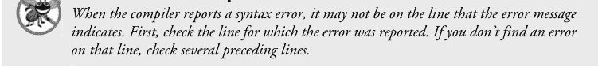

> 当编译器报告语法错误时，错误可能不在错误消息指示的那行。首先，检查报告错误的那几行。如果该行上没有找到错误，请检查之前的几行。

## 为了提高可读性在右括号后添加行尾注释

为了帮助编程初学者，我们在结束方法声明的右括号之后以及结束类声明的右括号之后包含行尾注释。例如，第 10 行

```java
// end method main
```

表示方法 `main` 的右括号，第 11 行

```java
// class Welcome
```

表示类 `Welcome` 的右括号。每条注释都指示右括号所终止的方法或类。我们在本章之后省略此类结束注释。

## 编译你的第一个 Java 应用程序

我们现在准备好编译并执行我们的程序了。我们假设你正在使用 Java 开发包（JDK）的命令行工具，而不是 IDE。为了帮助你在 IDE 中编译和运行程序，我们为流行的 IDE Eclipse、NetBeans 和 IntelliJ IDEA 提供了在线的“深入探讨”视频。这些视频位于书籍的网站：

```
http://www.deitel.com/books/jhtp10OV
```

准备编译程序，打开命令行窗口并切换到程序存储的目录。使用系统命令 `cd` 切换目录。在 Windows 上：

```
cd c:\examples\ch02\fig02_01
```

切换到 `fig02_01`。在 UNIX/Linux/Mac OS X 上，命令

```
cd ~/examples/ch02/fig02_01
```

切换到 `fig02_01`。编译程序，输入

```
javac Welcome1.java
```

如果程序没有包含编译错误，这将创建一个名为 `Welcome1.class` 的新文件（称为 `Welcome1` 的类文件），其中包含代表应用程序的平台无关字节码。当我们使用 `java` 命令在给定平台上执行应用程序时，JVM 将把这些字节码翻译成底层操作系统和硬件可以理解的指令。

## 常见编程错误 2.4

在使用 `java` 时，如果你收到诸如“bad command or filename, javac: command not found”或“javac is not recognized as an internal or external command, operable program or batch file”之类的消息，说明你的 Java 软件安装不正确。这表明系统的 PATH 环境变量没有正确设置。请仔细检查此书“在开始之前”部分的安装说明。在某些系统上，配置 PATH 后，你可能需要重启计算机或打开新的命令行窗口使这些设置生效。

每条语法错误消息都包含发生错误的文件名和行号。例如，`Welcome1.java:6` 表示在 `Welcome1.java` 的第 6 行发生了错误。消息的其余部分提供了语法错误的信息。

## 常见编程错误 2.5

> 编译器错误消息“class Welcome1 is public, should be declared in a file named Welcome1.java”表明在编译类时，你使用的文件名与文件中的公共类名不匹配。

## 执行 Welcome1 应用程序

以下指令假设书籍的示例位于 Windows 上的 `C:\examples` 或 Linux/Mac 上你账户的 `Documents/examples` 中。要在命令行窗口中执行此程序，请切换到包含 `C:\examples\ch02\fig02_01` 的目录或 `~/examples/ch02/fig02_01`。你输入

```
java Welcome1
```

如果程序没有包含编译错误，这将创建一个名为 `Welcome1.class` 的新文件（称为 `Welcome1` 的类文件），其中包含代表应用程序的平台无关字节码。当我们使用 `java` 命令在给定平台上执行应用程序时，JVM 将把这些字节码翻译成底层操作系统和硬件可以理解的指令。

## 2.3 修改你的第一个程序

### 使用多条语句显示一行文本

`System.out.println` 在命令窗口中显示（或打印）一行文本。第 9 行括号中的字符串是该方法的参数。当 `System.out.println` 完成任务时，它会将输出光标（下一个字符将显示的位置）置于命令窗口行的开头。这与你在文本编辑器中打字时按下回车键的情况类似——光标出现在文档下一行的开头。整个第 9 行，包括 `System.out.println`、括号中的参数 `"Welcome to Java Programming!"` 以及分号（`;`），被称为一条语句。一个方法通常包含一个或多个执行其任务的语句。大多数语句以分号结束。当第 9 行执行时，它会在命令窗口中显示 `Welcome to Java Programming!`。

注：由于原始文本中存在大量重复的 OCR 错误，以上译文已根据逻辑进行了精简处理。

## 2.4 使用 printf 显示文本

```java
System.out.println("Welcome\nJava\nProgramming!");
```

在命令行窗口中显示四行完全独立的文本。通常情况下，字符串中的字符显示方式与它们在双引号中显示的完全相同。但请注意，成对的字符 `\n`（在语句中重复了三次）不会出现在屏幕上。反斜杠（`\`）是一个转义字符，对 `System.out.print` 和 `println` 具有特殊含义。当字符串中出现反斜杠时，Java 将其与下一个字符结合形成一个转义字符。序列 `\n` 表示换行符。当正在打印的字符串中出现换行符时，该换行符会导致命令行窗口中的光标移动到下一行的开头。

图 2.5 列出了若干个转义序列，并描述了它们如何影响字符在命令窗口中的显示。欲需转义序列的完整列表，请访问

```
http://docs.oracle.com/javase/specs/jls/se7/jls-3.html#jls-3.10.6
```

图 2.5 一些转义序列。


`System.out.printf` 方法（f 表示 "formatted"，即格式化）用于显示格式化数据。图 2.6 使用该方法输出两个字符串 "Welcome to" 和 "Java Programming!"。9-10 行

```java
System.out.printf("%s%n%s%n", "Welcome to", "Java Programming!");
```

调用 `System.out.printf` 方法来显示程序的输出。该方法指定了三个参数。当一个方法需要多个参数时，它们以逗号分隔的列表形式排列。

> **良好的编程实践 2.6**
>
> 在参数列表中每个逗号（,）后面加一个空格，以提高程序的可读性。


## 44 第 2 章：Java 应用程序简介：输入/输出与运算符

```java
// 图 2: Welcome4.java
// 使用方法 System.out.printf() 显示多行
public class Welcome4
{
    // main 方法开始 Java 程序的执行
    public static void main(String[] args) {
        System.out.printf("%s%n%s%n", "Welcome to", "Java Programming!");
    } // end main
} // end class Welcome4
```

Welcome to

Java Programming!

**图 2.6** | 使用方法 `System.out.printf` 显示多行内容。

第 9–10 行仅代表一条语句。Java 允许将长语句拆分为多行。我们对第 10 行进行缩进，以表示它是第 9 行的延续。

**常见编程错误 2.6**

在标识符或字符串的中间分割语句是一个语法错误。

`printf` 方法的第一个参数是**格式字符串**，它可能由**固定文本和格式占位符**组成。固定文本由 `printf` 输出的方式与 `print` 或 `println` 相同。每个格式占位符都是一个值的*占位符*，并指定了要输出的**数据类型**。格式占位符还可以包含可选的格式化信息。

格式占位符以百分号（%）开头，后跟一个字符。格式占位符 `%s` 是字符串的占位符。第 9 行中的格式字符串指定两个字符串，每个字符串后面跟着一个换行符。在第一个格式占位符的位置，`printf` 输出格式字符串后第一个参数的值。在后续每个格式占位符的位置，`printf` 替换下一个参数的值。此示例在第二个 `%s` 处用 "Java Programming!" 替换了 "Welcome to"。输出显示两个内容分两行显示。

注意，不要使用转义序列 `\n`，而是使用 `%n` 格式占位符，这是一种跨操作系统可移植的换行符。你不能在 `System.out.printf` 或 `System.out.println` 的参数中使用 `%n`；但 `System.out.println` 输出的换行符在不同操作系统之间是通用的。在线附录 X 提供了关于使用 `printf` 输出输出的更多细节。

## 2.5 另一个应用程序：整数相加

我们的应用程序读取（或输入）用户在键盘上输入的两个**整数**（整数，如 -22、7、0 和 1024），计算它们的和并显示出来。该程序必须跟踪用户提供的数字，以便供程序后续计算。程序在计算机内存中记住数字和其他数据，并通过称为变量的程序元素访问

## 2.5 另一个应用程序：整数相加 45

数据。图 2.7 展示了这些概念。在示例输出中，我们使用粗体文本来识别用户的输入（即 45 和 72）。与之前的程序一样，1–2 行说明了图的编号、文件名和程序的目的。

```java
// 图 2.7: Addition.java
// 输入两个数字并显示其和的加法程序
import java.util.Scanner; // 程序使用 Scanner 类
public class Addition
{
    // main 方法开始 Java 程序的执行
    public static void main(String[] args) {
        // 创建一个 Scanner 从命令行窗口获取输入
        Scanner input = new Scanner(System.in);
        int number1; // 第一个要加的数字
        int number2; // 第二个要加的数字
        int sum; // 和
        System.out.print("Enter integer: ");
        number1 = input.nextInt();
        System.out.print("Enter next integer: ");
        number2 = input.nextInt();
        sum = number1 + number2;
        System.out.printf("Sum is %d\n", sum);
    }
}
```

Enter integer: 45

Enter integer: 72

Sum is 117

**图 2.7** | 输入两个数字并显示其和的加法程序。

### 2.5.1 导入声明

Java 的一大强大之处在于其丰富的预定义类，你可以重复使用它们而不是“发明轮子”。这些类被分成包——命名类的组——统称为类库或 Java API。3 行

```java
import java.util.Scanner; // 程序使用 Scanner 类
```

是一个导入声明，帮助编译器定位稍后使用的 `java.util` 类。

## 46 第 2 章：Java 应用程序简介：输入/输出与运算符


**常见编程错误 2.7**

所有的导入声明必须出现在类声明之前。在类声明内部或之后导入声明是一个语法错误。


**常见编程错误 2.8**

对于必须导入的类缺少导入声明会导致“找不到符号”的编译错误。当发生这种情况时，请检查你是否提供了正确的导入声明以及其中的名称的大小写是否正确。


## 工程观察 2.1

在每个 Java 版本中，API 通常包含修复 Bug、提高性能或提供完成任务的新方法。相应的旧版本不再需要且不应使用。此类 API 被称为过时（deprecated）。

在浏览在线 API 文档时你会遇到过时的 API。当你编译使用过时 API 代码时，编译器会通过 `--deprecation` 命令行参数警告你。

### 2.5.2 声明类 Addition

5 行

```java
public class Addition
```

开始类 `Addition` 的声明。此公共类的文件名必须是 `Addition.java`。记住每个类声明的主体以左左括号（第 6 行）开始，并以对应的右括号（第 27 行）结束。

应用程序从 main 方法（8–26 行）开始执行。左括号（第 9 行）标记 main 方法主体的开始，对应的右括号（第 26 行）标记其结束。main 方法在类 `Addition` 的体中缩进了一层，main 方法中的代码又缩进了一层以提高可读性。

## 2.5 另一个应用：整数加法 47

变量声明语句指定了程序中使用的变量的名称（输入）和类型（Scanner）。Scanner 允许程序读取数据（例如数字和字符串）以供程序使用。数据可以来自许多来源，例如键盘上的用户或文件。在使用 Scanner 之前，你必须先创建它并指定数据来源。

- 第 11 行表示，Scanner 变量 `input` 应该用等号右侧表达式的结果——`new Scanner(System.in)` 进行初始化（即为在程序中使用做好准备）。该表达式使用 `new` 关键字来创建一个 `Scanner` 对象，用于读取用户在键盘上键入字符。标准输入对象 `System.in` 允许应用程序读取用户输入的字节数据。`Scanner` 将这些字节转换为程序可以使用的类型（如 `int`）。

## 2.5.4 声明用于存储整数的变量

第 13–15 行中的变量声明语句

```java
int number1; // 第一个要相加的数字
int number2; // 第二个要相加的数字
int sum; // number1 和 number2 的和
```

声明了变量 `number1`、`number2` 和 `sum`，它们持有 `int` 类型的数据——它们可以存储整数（整数，如 72、-1127 和 0）。这些变量没有初始化。`int` 的取值范围是 -2,147,483,648 到 +2,147,483,647。[注：程序中使用的 `int` 值可能不包含逗号。]

其他数据类型还有 `float` 和 `double` 用于存储实数，以及存储字符数据。实数包含小数点，例如 3.4、0.0 和 -11.19。`char` 类型的变量表示单个字符，例如大写字母（如 A）、数字（如 7）、特殊字符（如 %）或转义序列（如制表符）。这些类型是基本类型。基本类型名称是关键字，并且必须全小写出现。附录 D 总结了八种基本类型的特征（`boolean`、`byte`、`char`、`short`、`int`、`long`、`float` 和 `double`）。

可以在单个声明中声明多个相同类型的变量，变量之间用逗号分隔（即变量名的逗号分隔列表）。例如，第 13–15 行可以写成：

```java
int number1; // 第一个要相加的数字
int number2; // 第二个要相加的数字
sum; // number1 和 number2 的和
```

## 良好的编程实践 2.7

为每个变量单独编写一个声明。这种格式允许在每个正在声明的变量旁边插入描述性注释。


## 良好的编程实践 2.8

选择有意义的变量有助于程序具有自文档性（即人们只需通过阅读程序就能理解程序，而不是阅读相关的文档或创建和查看大量的注释）。


## 第 2 章 Java 应用简介；输入/输出与运算符

## 良好的编程实践 2.9

按照惯，变量名标识符以小写字母开头，名称中第一个单词后的每个单词以大写字母开头。例如，变量名标识符 `firstNumber` 它的第二个单词 `Number` 以大写字母 N 开头。这种命名约定被称为驼峰命名法（camel case），因为大写字母像骆驼的驼一样突出。


### 2.5.5 提示用户输入

第 17 行

```java
System.out.print("Enter first integer:"); // 提示
```

使用 `System.out.print` 显示消息 "Enter first integer: "。这条消息使用了提示（prompt），用于引导用户执行特定操作。我们在这里使用 `print` 方法而不是 `println`，是为了让用户的输入与提示信息位于同一行。

## 2.5.6 从输入中获取 int

第 18 行

```java
number1 = input.nextInt(); // 读取第一个数字
```

使用 `Scanner` 对象的 `nextInt()` 方法来获取用户输入的整数。标准输入对象 `System.in` 允许应用程序读取用户输入的字节数据。`Scanner` 将这些字节转换为程序可以使用的类型（如 `int`）。

## 2.5.7 提示输入

第 20 行

```java
System.out.print("Enter integer: "); // 提示
```

提示用户输入第二个整数。这条消息使用了提示，用于引导用户执行特定操作。我们在这里使用 `print` 方法而不是 `println`，是为了让用户的输入与提示信息位于同一行。

### 2.5.8 在计算中使用变量

第 23 行

```java
sum = number1 + number2; // 相加数字然后存储在 sum 中
```

这是一个赋值语句，计算变量 `number1` 和 `number2` 的和——通过使用赋值运算符将结果赋予 `sum`。

### 2.5.9 显示计算结果

第 25 行

```java
System.out.printf("Sum is %d", sum); // 显示和
```

使用 `System.out.printf` 显示和。格式说明符 `%d` 是 `int` 值的占位符（在本例中为 `sum` 的值）——字母 d 代表“十进制整数”（decimal integer）。格式字符串中的其余字符都是固定文本。`printf` 方法显示 "Sum is"，随后是 `sum` 的值（位于 `%d` 说明符的位置），并换行。

### 2.5.10 Java API 文档

对于我们使用的每个 Java API 类，我们都指出了它所在的包。这些信息可以帮助你在 Java API 文档中找到每个包和类的描述。可以在以下地址找到该文档的 Web 版本：

```
http://docs.oracle.com/javaase/7/docs/api/index.html
```

# 第2章 Java 介绍；输入/输出与运算符

你可以从“附加资源”（Additional Resources）部分下载：

```
http://www.oracle.com/technetwork/java/javase/downloads/index.html
```

附录 F 显示了如何使用此文档。

## 2.6 内存概念

变量名如 `number1`、`number2` 和 `sum` 实际上对应计算机内存中的位置。每个变量都有名称、类型、大小（字节）和值。在图 2.7 的加法程序中，当执行以下语句（第11行）时：

```java
number1 = input.nextInt(); // 从用户处读取第一个数字
```

用户输入的数字被放置与名称 `number1` 对应的内存位置。假设用户输入了 45。计算机将该整数值放入位置 `number1`（图 2.8），替换掉该位置之前的旧值（如果有）。旧值会丢失，因此这一过程被称为**破坏性**的。

| number1 | 45 |
| --- | --- |

图 2.8 显示变量 `number1` 名称和值的内存位置。

当执行语句（第21行）时：

```java
number2 = input.nextInt(); // 从用户处读取第二个数字
```

假设用户输入了 72。计算机将该整数值放入位置 `number2`。现在的内存情况如图 2.9 所示。

| number1 | 45 |
| number2 | 72 |
| --- | --- |

图 2.9 存储 `number1` 和 `number2` 的值后的内存位置。

图 2.7 的程序获取 `number1` 和 `number2` 的值，将这些值相加并将结果放入变量 `sum` 中。语句（第23行）

```java
sum = number1 + number2; // 将数字相加，然后将总和存储在 sum 中
```

执行加法，然后替换 `sum` 中任何之前的值。在计算出 `sum` 后，内存情况如图 2.10 所示。`number1` 和 `number2` 的值与在参与 `sum` 计算之前看起来完全相同。在计算机执行计算时，这些值被使用了，但没有被破坏。当从内存位置读取值时，该过程是非破坏性的。

## 2.7 算术

| number1 | 45 |
| | / |
| number2 | 72 |
| sum | 117 |

**图 2.10** | 存储 `number1` 和 `number2` 之和后的内存位置。

## 2.7 算术

大多数程序都会执行算术计算。**算术运算符**总结在图 2.11 中。注意某些代数中未使用的各种特殊符号。**星号 (*)** 表示乘法，而百分号 (%) 是**取模运算符**，我们稍后会讨论。图 2.11 中的算术运算符是*二元*运算符，因为每个运算符都作用于*两个*操作数。例如，表达式 `f + 7` 包含二元运算符 `+` 以及操作数 `f` 和 `7`。

| Java 操作 | 运算符 | 代数表达式 | Java 表达式 |
|---|---|---|---|
| 加法 | + | f+7 | f + 7 |
| 减法 | - | p - c | p - c |
| 乘法 | * | bm | b * m |
| 除法 | / | x/y or x ÷ y | x / y |
| 取模 | % | r mod s | r % s |

**图 2.11** | 算术运算符。

**整数除法**产生一个整数商。例如，表达式 `7 / 4` 求值结果为 1，表达式 `17 / 5` 求值结果为 3。整数除法中的任何分数部分都直接被*截断 (*，丢弃)*——不会发生四舍五入。Java 提供了取模运算符，产生除法后的余数。表达式 `x % y` 得 `x` 除以 `y` 后的余数。因此，`7 % 4` 产生 3，`17 % 5` 产生 2。该运算符最用于整数操作数，但也可以用于其他算术类型。在本章的练习和后续章节中，请考虑取模运算符的一些有趣应用，例如判断一个数是否是另一个数的倍数。

## 直线形式的算术表达式

Java 中的算术表达式必须写成**直线**形式，以便将程序输入计算机。因此，像“a 除以 b”的表达式必须写成 `a / b`，以便使所有常量、变量和运算符都出现在同一行中。以下代数表示法通常不被编译器接受：


# 用于分组子表达式的括号

括号在 Java 表达式中的分组方式与代数表达式相同。例如，为了计算 `a` 乘以数量 `b + c`，我们写道：

```
a * (b + c)
```

如果表达式包含嵌套括号，例如：

```
(a + b) * c
```

则最内层括号中的表达式（在这种情况下为 `(a + b)`）先求值。

# 运算符优先级规则

Java 根据运算符优先级规则顺序应用算术表达式中的运算符，这些规则通常与代数中遵循的规则相同：

1. 先应用乘法、除法和模运算符。如果表达式包含多个相同类型的运算符，它们将从左到右求值。
2. 接下来应用加法和减法运算符。如果表达式包含多个相同类型的运算符，它们将从左到右求值。

运算符优先级决定了运算符的应用顺序。

| 运算符 | 操作 | 求值顺序 |
|---|---|---|
| `*` | 乘法 | 1 |
| `/` | 除法 | 1 |
| `%` | 取模 | 1 |
| `+` | 加法 | 2 |
| `-` | 减法 | 2 |
| `=` | 赋值 | 3 |

# 示例代数与 Java 表达式

现在让我们根据运算符优先级考虑几个表达式。以下是一个直线示例：

| 代数 | Java |
|---|---|
| $y = mx+b$ | `y = m * x + b;` |

不需要括号。乘法首先应用，因为它的优先级高于加法。赋值最后，因为它的优先级低于乘法或除法。

以下示例包含了取模 (`%`)、乘法、除法、加法和减法操作：

| 代数 | Java |
|---|---|
| $z = pr\%q + w/x$ | `z = p * r % q + w / x - y;` |

语句下方的圈数字表示 Java 应用运算符的顺序。`*`、`%` 和 `/` 操作首先从左到右执行（即从左到右结合），因为它们的优先级高于 `+` 和 `-`。接下来执行 `+` 操作。赋值 (`=`) 操作最后执行。

# 二次项式的求值

为了更好地理解运算符优先级规则，考虑一个包含二次项式 $ax^2+bx+c$ 的赋值表达式：

```
y = a * x * x + b * x + c;
```

乘法操作按从左到右顺序执行（即从左到右结合），因为它们的优先级高于加法（Java 没有幂的算术运算符，因此 $x^2$ 表示为 `x * x`）。加法操作接下来从左到右执行。假设 `a`、`b`、`c` 和 `x` 的初始化（给定）值为：`a=2`、`b=3`、`c=7` 且 `x=5`。图 2.13 展示了运算符的应用顺序。

你可以使用冗余括号（不必要的括号）使表达式更清晰。之前的语句可以如下括号化：

```
y = (a * x * x) + (b * x) + c;
```

# 第2章 Java应用程序介绍：输入/输出与运算符

| 步骤 | 表达式 | 说明 |
|---|---|---|
| 步骤 1 | `y = 2 * 5 * 5 + 3 * 5 + 7;` | (最左乘法) |
| | `2 * 5` 是 `10` | |
| 步骤 2 | `y = 10 * 5 + 3 * 5 + 7;` | (最左乘法) |
| | `10 * 5` 是 `50` | |
| 步骤 3 | `y = 50 + 3 * 5 + 7;` | (加法之前的乘法) |
| | `3 * 5` 是 `15` | |
| 步骤 4 | `y = 50 + 15 + 7;` | (最左加法) |
| | `50 + 15` 是 `65` | |
| 步骤 5 | `y = 65 + 7;` | (最后的加法) |
| | `65 + 7` 是 `72` | |
| 步骤 6 | `y = 72` | (最后操作——将 `72` 赋予 `y`) |

**图 2.13** 二次项式的求值顺序。

# 2.8 决策：相等运算符与关系运算符

**条件**是一个可以为**真（`true`）**或**假（`false`）**的表达式。本节介绍了 Java 的**选择语句**（selection statement），它允许程序根据条件的值做出**决策**。例如，“分数大于等于 60”这一条件决定了学生是否通过了测试。如果 `if` 语句中的条件为**真**，则执行语句体；如果条件为**假**，则不执行语句体。我们稍后会进行解释。

`if` 语句中的条件可以使用图 2.14 总结的**相等运算符** (`==` 和 `!=`) 以及**关系运算符** (`<`、`<=`、`>` 和 `>=`) 来组成。两个相等运算符具有相同的优先级，且该优先级**低于**关系运算符。相等运算符从**左**到**右**结合。所有关系运算符的优先级相同，且也从**左到右**结合。

| 代数运算符 | Java 相等或关系运算符 | 示例 Java 条件 | Java 条件的含义 |
|---|---|---|---|
| = | `==` | `x == y` | `x` 等于 `y` |
| ≠ | `!=` | `x != y` | `x` 不等于 `y` |
| > | `>` | `x > y` | `x` 大于 `y` |
| < | `<` | `x < y` | `x` 小于 `y` |
| ≥ | `>=` | `x >= y` | `x` 大于等于 `y` |
| ≤ | `<=` | `x <= y` | `x` 小于等于 `y` |

**图 2.14** 相等运算符与关系运算符。

图 2.15 使用 `if` 语句来比较输入的两个整数。如果这些语句中任何一个的条件为真，则执行与该相关的语句；否则跳过。我们使用 `Scanner` 从用户处输入整数并将其存储在变量 `number1` 和 `number2` 中。程序将比较并显示为真的比较结果。

```java
// Fig. 2.15: Comparison.java
// 使用 if 语句、关系运算符
// 和相等运算符来比较整数。
import java.util.Scanner; // 程序使用 Scanner 类

public class Comparison
{
    // main 方法开始 Java 程序的执行
    public static void main(String[] args)
    {
        // 创建 Scanner 从命令行获取输入
        Scanner input = new Scanner(System.in);

        int number1; // 要比较的第一个数字
        int number2; // 要比较的第二个数字

        System.out.print("Enter first integer: "); // 提示
        number1 = input.nextInt(); // 从用户处读取第一个数字

        System.out.print("Enter second integer: "); // 提示
        number2 = input.nextInt(); // 从用户处读取第二个数字

        if (number1 == number2) {
            System.out.printf("%d == %d\n", number1, number2);
        }

        if (number1 != number2) {
            System.out.printf("%d != %d\n", number1, number2);
        }

        if (number1 < number2) {
            System.out.printf("%d < %d\n", number1, number2);
        }
    }
}
```

**图 2.15** 使用 `if` 语句、关系运算符和相等运算符比较整数。

# 空格

注意图 2.15 中空格的使用。请记住，编译器会忽略空格。因此，语句可以跨越多行，并可以根据你的喜好设置间距，而不会影响程序的含义。拆分标识符和字符串是不正确的。理想情况下，语句应该保持短小，但这并不总是可能的。

> **错误预防提示 2.4**
>
> 一条长语句可以跨越几行。如果必须将单条语句跨行，请选择自然的断句点，例如在逗号分隔列表的逗号之后，或者在惰性表达式的运算符之后。如果语句跨越两行或更多行，请缩进所有后续行，直到语句结束。

# 迄为止讨论的运算符

图 2.16 显示了目前为止讨论的运算符，按优先级从低到高排列。所有的赋值运算符 `=` 都从左到右结合。赋值运算符的值是赋值给左侧变量的值——例如，表达式 `x = 7` 的值为 `7`。因此，像 `x = y = 0` 这样的表达式求值方式就像写成 `x = (y = 0)`，它首先将值 `0` 赋值给 `y`，然后将加法的结果 `0` 赋值给 `x`。

> **良好的编程习惯 2.12**
>
> 写包含许多运算符的表达式时，请参考运算符优先级表（附录 A）。确认表达式中的操作按照你预期的顺序执行的。如果在复杂表达式中你不确定求值顺序，请使用括号强制规定顺序，就像你在代数式中做的那样。

| 运算符 | 结合性 | 类型 |
|---|---|---|
| `=` | 从右到左 | 赋值 |
| `==` `!=` | 从左到右 | 相等 |
| `<` `<=` `>=` `>` | 从左到右 | 关系 |
| `+` `-` | 从左到右 | 加法 |
| `*` `/` `%` | 从左到右 | 乘法 |

**图 2.16** 已讨论运算符的优先级和结合性。

# 2.9（可选）GUI 与图形案例研究：使用对话框

该可选案例研究旨在为那些希望在书中早期就开始学习 Java 创建图形用户界面（GUI）和图形能力的读者设计，在书中后面对这些主题进行深入讨论之前。该案例研究采用了 Java 成熟的 Swing 技术，因为这仍然比后面章节介绍的较新的 JavaFX 技术更流行。

这个 GUI 和图形案例研究由 10 个简短章节组成（见图 2.17）。每个章节都会介绍新概念，并提供带有屏幕截图的示例，展示了示例交互和结果。在前几个章节中，你将创建你的图形应用程序。在随后的章节中，你将使用面向对象的编程概念创建一个绘制各种形状的程序。当我们在第 12 章正式介绍 GUI 时，我们将使用鼠标来选择具体绘制哪些形状以及在何处绘制。在第 13 章中，我们增加了 Java 2D 图形 API 的功能，用不同的线条粗细和填充绘制形状。我们希望你发现这个案例研究既有启发性又有趣。

| 位置 | 练习 |
|---|---|
| 第 2.4 节 | 使用对话框——使用对话框进行基本输入和输出 |
| 第 3.14 节 | 创建简单图形——在屏幕上画图和画线 |
| 第 4.10 节 | 绘制矩形和椭圆——使用形状表示数据 |
| 第 5.13 节 | 颜色和填充形状——绘制靶心和随机图形 |
| 第 6.14 节 | 绘制弧线——用弧绘制螺旋线 |
| 第 8.16 节 | 在图形中使用对象——将形状存储为对象 |
| 第 9.7 节 | 显示文本和使用标签——提供状态信息 |
| 第 10.11 节 | 使用多态绘制——识别形状之间的相似性 |
| 练习 12.17 | 扩展接口——使用 GUI 组件和事件处理 |
| 练习 13.31 | 添加 Java 2D——使用 Java 2D API 增强绘画 |

**图 2.17** 各章节中 GUI 和图形案例研究的总结。

# 在对话框中显示文本

到目前为止介绍的程序都在命令行窗口中显示输出。许多应用程序使用窗口或对话框（也称为对话框）来显示输出。如 Chrome、Firefox、Internet Explorer、Safari 和 Opera 等网络浏览器在它们自己的窗口中显示网页。电子邮件程序允许你在窗口中输入和读写消息。通常，对话框是程序向用户显示重要消息的窗口。`JOptionPane` 提供了内置的对话框，使程序能够显示包含消息的窗口——例如消息对话框。图 2.18 在消息对话框中显示字符串 `"Welcome to Java!"`。

```java
// Fig. 2.18: Dialog1.java
// 使用 JOptionPane 在对话框中显示多行。
import javax.swing.JOptionPane;

public class Dialog1
{
    public static void main(String[] args)
    {
        // 显示一个带有消息的对话框
        JOptionPane.showMessageDialog(null, "Welcome to Java!");
    }
} // 结束类 Dialog1
```

**图 2.18** 使用 `JOptionPane` 在对话框中显示多行。

# JOptionPane 类 staticMessageDialog

第 3 行表示程序使用了 `javax.swing` 包中的 `JOptionPane`。该包包含许多帮助你创建图形用户界面（GUI）的类。GUI 组件通过用户促进数据输入。第 10 行调用 `showMessageDialog` 方法显示包含消息的对话框。该方法需要两个参数。第一个参数帮助 Java 应用确定对话框的位置。如果第一个参数为 `null`，对话框居中显示。

# 介绍静态方法

静态方法是属于类而不是类实例的方法。此类方法通常无需创建对象即可调用。例如，`JOptionPane.showMessageDialog` 是一个静态方法。我们将在第 5 章详细讨论静态方法。

# 在对话框中输入文本

图 2.19 使用 `JOptionPane.showInputDialog` 显示一个包含提示和字段（称为文本框）的输入对话框。`showInputDialog` 是指示你应该输入内容的提示。你在文本框中输入字符，然后点击 OK 按钮或按回车键将字符串返回给程序。`showInputDialog` 方法返回你输入的字符字符串。

```java
// Fig. 2.19: Dialog1.java
// 从对话框获取用户输入。
import javax.swing.JOptionPane;

public class Dialog1
{
    public static void main(String[] args)
    {
        // 提示用户输入姓名
        String name = JOptionPane.showInputDialog("你的名字是什么?");
        // 创建消息
        String message = String.format("Welcome, %s, to Java!", name);

        // 向用户显示消息
        JOptionPane.showMessageDialog(null, message);
    } // 结束 main
} // 类 Dialog1
```

**图 2.19** 从对话框获取用户输入。

# String 静态方法 format

第 13-14 行使用静态方法 `format` 返回一个包含用户问候的字符串。`format` 方法的作用类似于 `System.out.printf`，不同在于它返回格式化后的字符串。在本章中，你学习了 Java 的许多重要功能，包括在命令行提示符中显示数据、从键盘输入数据、进行计算和决策。所介绍的应用程序介绍了许多基础编程概念。在下一章中，我们将开始介绍控制语句，它指定了程序操作执行的顺序。

# 2.10 总结

## 第 2.2 节 你的第一个 Java 程序：打印一行文本

- 当你使用 `java` 命令启动 JVM 时，Java 应用（p. 35）就会执行。
- 注释（p. 36）用于记录程序并提高其可读性。编译器会忽略它们。
- 以 `//` 开头的注释是行尾注释——在它所在行的末尾结束。
- 传统注释（p. 36）可以跨越几行，并由 `/*` 和 `*/` 分隔。
- Javadoc 注释（p. 36）由 `/**` 和 `*/` 分隔，允许你在代码中嵌入程序文档。`javadoc` 实用程序根据这些注释生成 HTML 页面。
- 语法错误（p. 36；也称为编译器错误、编译时错误或编译错误）当编译器遇到违反 Java 语言规则的内容时发生。它类似于自然语言中的语法错误。
- 空行、空格字符和制表符被识别为空白字符。空白字符使程序更易读且会被编译器忽略。
- 关键字（p. 37）是 Java 保留的，且始终用小写字母拼写。
- 关键字 `class`（p. 37）引入类声明。
- 根据习惯，Java 中的所有类名都以大写字母开头，并将每个使用的单词的首字母大写（例如 `SampleClassName`）。
- 类名是一个标识符——由字母、数字、下划线 (`_`) 和美元符号 (`$`) 组成的系列字符，且不以数字开头且不包含空格。
- Java 是大小写敏感的（p. 37）——也就是说，大写和小写字母是不同的。
- 每个类声明的主体（p. 37）由大括号 `{ }` 分隔。
- `public`（p. 37）类声明必须定义在与类同名的文件中，后面加上 `.java` 文件扩展名。


# 第 2 章 Java 应用程序简介：输入/输出与运算符

- 方法 `main`（p. 38）是每个 Java 应用的起点，必须以以下代码开始：

```java
public static void main(String[] args)
```

- 否则，JVM 将不会执行该应用。

- 方法执行任务并在完成任务时返回信息。关键字 `void`（p. 38）表示该方法将执行任务但不返回任何信息。

- 语句指示计算机执行操作。

- 双引号括的字符串（p. 39）有时被称为字符字符串或字符串字面量。

- 标准输出（p. 39）在命令窗口中显示字符。

- `System.out.println`（p. 39）在命令窗口中显示其参数（p. 39），随后紧跟一个换行符，将光标置于下一行的开头。

- 你使用 `java` 命令编译程序。如果程序不包含语法错误，就会创建一个包含应用运行所需的 Java 字节码的类文件（p. 40）。这些字节在你执行程序时由 JVM 解释。

- 要运行一个应用，输入 `java` 后跟包含 `main` 方法的类名。

## 第 2.3 节 修改你的第一个 Java 程序

- `System.out.print`（p. 42）显示其参数并将光标立即置在显示的最后一个字符之后。

- 字符串中的反斜杠 `\` 是转义字符（p. 43）。Java 将与下一个字符结合形成转义序列（p. 43）。转义序列 `\n`（p. 43）代表换行符。

## 总结 63

## 第 2.4 节 使用 printf 显示文本

- `System.out.printf` 方法（p. 43；f 表示 "formatted"）显示格式化数据。

- 方法 `printf` 的第一个参数是格式字符串（p. 44），包含固定文本和/或格式说明符。每个格式说明符（p. 44）指示要输出的数据类型，并是格式字符串之后对应参数的占位符。

- 格式说明符以百分号（`%`）开头，后跟着一个表示数据类型的字符。格式说明符 `%s`（p. 44）是字符串的占位符。

- `%n` 格式说明符（p. 44）是一个可移植的行分隔符。你不能在 `System.out.printf` 或 `System.out.println` 的参数中使用 `\n`；但是，`System.out.println` 在显示其参数后输出的行分隔符在不同操作系统之间是可移植的。

## 第 2.5 节 另一个应用：整数相加

- 导入 声明（p. 45）帮助编译器定位程序中使用的类。

- Java 的预定义类集被分成组（p. 45）——命名的类组。这些被称为 Java 类库（p. 45）或 Java 应用程序接口（Java API）。

- 变量（p. 46）是计算机内存中的一个位置，可以在其中存储值供程序以后使用。所有变量在使用之前都必须声明名称和类型。

- 变量允许访问内存中的值。

- `Scanner`（包 `java.util`）允许程序读取程序将要使用的数据。在使用 `Scanner` 之前，程序必须创建并指定数据源。

- 变量应该被初始化（p. 47），为在程序中使用做好准备。

- `new Scanner(System.in)` 创建一个从标准输入对象（`System.in`；p. 47，通常是键盘）读取的 `Scanner`。

- 数据类型 `int`（p. 47）用于声明将持有整数值的变量。`int` 的值范围是 -2,147,483,648 到 2,147,483,647。

- `float` 和 `double`（p. 47）指定带有小数点的实数，例如 3.4 和 -11.19。

- `char` 类型的变量（p. 47）表示单个字符，例如大写字母（如 `A`）、数字（如 `7`）、特殊字符（如 `%`）或转义序列（如 `\t`、`\n`）。

- 如 `int`、`float`、`double` 和 `char` 等类型是基本类型（p. 47）。基本类型名称是关键字；它们必须全部全小写字母。

- 提示（p. 48）引导用户采取特定操作。

- `Scanner` 方法 `nextInt` 获取一个用于程序的整数。

- 赋值运算符（p. 48）允许程序给出一个值。由于因为它有两个操作数，因此被称为二元运算符（p. 48）。

- 语句指示计算机执行操作。

- 双引号括的字符串（p. 39）有时被称为字符字符串或字符串字面量。

- 标准输出（p. 39）在命令窗口中显示字符。

- `System.out.println`（p. 39）在命令窗口中显示其参数（p. 39），随后紧跟一个换行符，将光标置于下一行的开头。

- 你使用 `java` 命令编译程序。如果程序不包含语法错误，就会创建一个包含应用运行所需的 Java 字节码的类文件（p. 40）。这些字节在你执行程序时由 JVM 解释。

- 要运行一个应用，输入 `java` 后跟包含 `main` 方法的类名。

## 第 2.6 节 内存概念

- 变量（p. 50）对应内存中的位置。

- 每个变量都有名称、类型和值。

## 第 2.7 节 算术运算

- 算术运算符（p. 51）包括 `+`（加法）、`-`（减法）、`*`（乘法）、`/`（除法）和 `%`（取余）。

- 整数除法（p. 51）产生商。

- 算术表达式必须以直线形式编写（p. 51）。

- 如果表达式包含嵌套括号（p. 52），首先计算内层。

- Java 按运算符优先级（p. 52）应用运算符。

- 冗余括号（p. 53）可以使表达式更清晰。

## 第 2.8 节 决策：相等与关系运算符

- `if` 语句（p. 54）根据条件的值（真或假）做出决策。

- `if` 语句中的条件可以使用相等 `==` 和关系 `>`、`<`、`>=` 和 `<=`（p. 54）。

- `if` 语句以关键字开始，后跟括号内的条件和主体内的语句。

## 自复习练习

2.1 填空每个语句的空格：

a) ______ 开始每个方法的主体，而 ______ 结束每个方法的主体。

b) 你可以使用 ______ 来做出决策。

c) ______ 开始行尾注释。

d) ______ 是空白字符。

e) ______ 是 Java 留用的。

f) Java 应用从方法 ______ 开始执行。

g) 方法 ______ 在命令行中显示信息。

2.2 判断每个陈述对错。如果错误，请解释原因。

a) 注释会导致计算机在程序执行时在屏幕上打印 `//` 后面的文本。

b) 所有变量在声明时必须赋予类型。

c) Java 认为 `number` 和 `Number` 是相同的。

d) 运算符 `*`、`/`、`%` 具有相同的优先级。

2.3 编写语句完成以下任务：

a) 声明类型为 `int` 的变量 `thisIsVariable`、`q76354` 和 `number`。

b) 提示用户输入一个整数。

c) 输入整数并将结果赋值给 int 变量 `value`。假设 `Scanner` 变量 `input` 可以从键盘值读取。

d) 在命令窗口中打印 "This is a Java program"。使用 `System.out.println`。

e) 在命令窗口两行打印 "This is a Java program"。使用 `System.out.printf` 和两个 `%s` 格式占位符。第一行应以 `java` 结尾。

# 自测练习题答案 65

- 2.4 识别并纠正以下每个语句中的错误：

  a) if (c < 7);

     System.out.println("c is less than 7");

  b) if (c => =)

     System.out.println("c is equal to or greater than 7");

- 2.5 编写声明、语句或注释以完成以下任务：

  a) 编写一个计算三个整数乘积的程序。

  b) 创建一个 Scanner 以接收输入值并从标准输入返回结果。

  c) 变量 x、y 和 result 的类型为 int。

  d) 提示用户输入第一个整数。

  e) 从用户处读取第一个整数并存储在变量 x 中。

  f) 提示用户输入第二个整数。

  g) 从用户处读取第二个整数并存储在变量 y 中。

  h) 提示用户输入第三个整数。

  i) 从用户处读取第三个整数并存储在变量 z 中。

  j) 计算变量 x、y 和 z 中三个整数的乘积，并将结果赋值给变量 result。

  k) 使用 System.out.printf 显示消息 "Product is" 后紧跟变量 result 的值。

- 2.6 使用你在练习 2.5 中编写的语句，编写一个完整的程序来计算并打印三个整数的乘积。

# 自测练习题答案

- 2.1 a) 左括号 `{`，右括号 `}`。 b) `if`。 c) `//`。 d) 空格、换行符和制表符。

  e) 关键字。 f) `main`。 g) `System.out.print`、`System.out.println` 和 `System.out.printf`。

- 2.2 a) False。程序执行时，注释不会引起任何操作。它们用于记录程序并提高其可读性。

  b) True。

  c) False。Java 是区分大小写的，因此变量是不同的。

  d) True。运算符 `*`、`/`、`%` 具有相同的优先级。

- 2.3 a) `int c, thisIsVariable, q76354, number;`

  或者

  `int c;`

  `int thisIsVariable;`

  `int q76354;`

  `int number;`

  b) `System.out.print("Enter an integer: ");`

  c) `value = input.nextInt();`

  d) `System.out.println("This is a Java program");`

  e) `System.out.printf("%s%s%s", "This is a Java", "program");`

  f) `if (number != 7)`

     `System.out.println("The variable number is not equal to 7");`

- 2.4 a) 错误：括号后有分号。纠正：删除括号后的分号。[注意：结果是无论条件是否为真，输出语句都会执行]。

  b) 错误：关系运算符 `=>` 是错误的。纠正：将 `=>` 改为 `>=`。

# 第 2 章 Java 应用程序简介：输入/输出与运算符

2.5 a) `// 计算三个整数的乘积`

b) `Scanner input = new Scanner(System.in);`

c) `int x, y, z, result;`

  或者

  `int x;`

  `int y;`

  `int z;`

  `int result;`

d) `System.out.print("Enter first integer: ");`

e) `x = input.nextInt();`

f) `System.out.print("Enter second integer: ");`

g) `y = input.nextInt();`

h) `System.out.print("Enter third integer: ");`

i) `z = input.nextInt();`

j) `result = x * y * z;`

k) `System.out.printf("Product is %d\n", result);`

2.6 自测练习 2.6 的答案如下：

```java
// Ex. 2.6: Product.java
// 计算三个整数的乘积。
import java.util.Scanner; // 程序使用了 Scanner
public class Product
{
    public static void main(String[] args)
    {
        // 创建 Scanner 从命令行窗口获取输入
        Scanner input = new Scanner(System.in);

        int x; // 用户输入的第一个数字
        int y; // 用户输入的第二个数字
        int z; // 用户输入的第三个数字
        int result; // 数字的乘积

        System.out.print("Enter first integer: "); // 提示输入
        x = input.nextInt(); // 读取第一个整数

        System.out.print("Enter second integer: "); // 提示输入
        y = input.nextInt(); // 读取第二个整数

        System.out.print("Enter third integer: "); // 提示输入
        z = input.nextInt(); // 读取第三个整数

        result = x * y * z; // 计算数字的乘积
        System.out.printf("Product is %d\n", result);
    } // main 方法结束
} // class Product
```

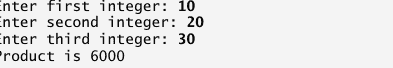

# 练习 67

## 练习

- 2.7 填入以下语句的空白：

  a) ________ 用于记录程序并提高其可读性。

  b) Java 程序中可以通过(n) ________ 进行决策。

  c) 计算通常由 ________ 语句完成。

  d) 与乘法优先级相同的运算符是 ________

  e) 当算术表达式中的括号嵌套时，首先计算 ________ 括号。

  f) 计算机内存中在程序执行过程中可能包含不同值的位置被称为 a(n) ________。

- 2.8 编写 Java 语句完成以下操作之一：

  a) 显示消息 "Enter integer: " 并光标留在同一行。

  b) 将 b 和 c 的乘积赋值给变量。

  c) 使用注释说明程序计算。

- 2.9 判断以下各项是否正确。如果错误，请解释原因。

  a) Java 运算符从左到右计算。

  b) 以下都是变量名：`sales`、`account_total` 和 `c`。

  c) 无括号的有效表达式从左到右计算。

  d) 以下都是无效变量名：`3`。

- 2.10 假设 `x = 2`，`y = 3`，每个语句显示什么？

  a) `System.out.printf("%d\n", x);`

  b) `System.out.printf("Value of %d and %d\n", x, y);`

  c) `System.out.printf("%x\n");`

  d) `System.out.printf("%d\n", x + y);`

- 2.11 哪些 Java 语句包含被修改的变量？

  a) `p = i + j + k;`

  b) `System.out.println("whose are modified");`

  c) `System.out.printf("a = 5");`

  d) `value = input.nextInt();`

- 2.12 给定 `y = x + 3`，以下哪个是正确的？

  a) `y = x * x + 3;`

  b) `y = x * (x + 3);`

  c) `y = (x * x) * (x + 3);`

  d) `y = (x * x) * x + 3;`

  e) `y = x * (x * x) + 3;`

  f) `y = x * (x * x + 3);`

- 2.13 说明以下 Java 语句中运算符的计算顺序，并显示每个的值：

  a) `x = 7 + 3 * 2 - 1;`

  b) `x = 2 % 2 + 2 / 2;`

  c) `x = 3 * 9 + (9 / 3);`

- 2.14 编写一个程序，在同一行显示 1 到 40，相邻数字之间用空格分隔。使用以下技术：

  a) 使用一个 `System.out.print` 语句。

  b) 使用四个 `System.out.println` 语句。

  c) 使用一个 `System.out.printf` 语句。

# 68 第 2 章 Java 应用程序简介：输入/输出与运算符

- 2.15（算术）编写一个程序，要求用户输入两个整数，获取并打印它们的和、积、差和商。使用图 2.7 所示的技术。

- 2.16（比较整数）编写一个程序，要求用户输入两个整数，获取并用 "is larger" 显示较大的数字。如果数字相等，打印消息 "These are equal!"。使用图 15 所示的技术。

- 2.17（算术、最小和最大）编写一个程序，从用户处输入三个整数并显示它们的和、平均值、积、最小和最大。使用图 15 所示的技术。[注意：本练习中的平均值计算结果应该是整数形式的平均值。因此，如果数值之和为 7，则平均值应该是 2.3333...]

- 2.18（用星号显示形状）编写一个程序，用星号 (`*`) 显示一个矩形、一个椭圆和一行，如下：

```
*************
*      *
*      *
*      *
*      *
*      *
*      *
*      *
*      *
*      *
*      *
*      *
*      *
**************
```

- 2.19 以下代码打印什么？

`System.out.printf("%*s%n%%%s%n******%n");`

- 2.20 以下代码打印什么？

`System.out.println("*");`

`System.out.println("****");`

`System.out.println("*****");`

`System.out.println("******");`

`System.out.println("******");`

- 2.21 以下代码打印什么？

`System.out.print("*");`

`System.out.print("****");`

`System.out.print("*****");`


System.out.print("******");

System.out.print("******");

- 2.22 以下代码打印什么？

System.out.print("*");

System.out.println("****");

System.out.println("*****");

System.out.print("******");

System.out.println("******");

- 2.24（最大和最小整数）编写一个程序，读取五个整数并打印组中的最大和最小整数。仅使用在本章中学到的编程技术。

# 练习 69

**2.25 (奇数或偶数)** 编写一个应用程序，读取一个整数并判断打印它是奇数还是偶数。[提示：使用取余运算符。偶数是 2 的倍数。任何 2 的倍数除以 2 的余数都是 0。]

**2.26 (倍数)** 编写一个应用程序，读取两个整数，判断第一个是否是第二个的倍数并打印结果。[提示：使用取余运算符。]

**2.27 (星号棋盘图案)** 编写一个应用程序显示如下的棋盘图案：


**2.28 (直径、周长和面积)** 这里预告一下。在本章中，你学习了整数和 `int` 类型。Java 还可以表示包含小数点的浮点数，例如 3.14159。编写一个应用程序，以整数形式输入圆的半径，并使用浮点值 3.14159 作为 `pi` 来打印圆的直径、周长和面积。使用图 2.7 所示的技术。[注意：你可以使用预定义的 `Math.PI` 作为 `pi` 的值。这个常量比 3.14159 更精确。`Math` 类位于 `java.lang` 包中。包中的类会自动导入，因此你不需要导入 `Math` 类即可使用它。] 使用以下公式（r 是半径）：

```
diameter = 2 * r
circumference = 2 * pi * r
area = pi * r * r
```

不要将每次计算的结果存储在变量中。相反，将每个计算指定为由 `System.out.print` 输出的值。周长和面积的计算是浮点数。此类值可以使用 `System.out.printf` 中的格式占位符 `%f` 输出。你将在第三章中学习更多关于浮点数的知识。

**2.29 (字符的整数值)** 这里是另一个预告。在本章中，你学习了整数和 `int` 类型。Java 还可以表示大写字母、小写字母以及各种特殊符号。每个字符都有对应的整数表示。使用的字符集合以及这些字符对应的整数表示称为字符集。你可以通过用单引号包含字符在程序中指示字符值，例如 `'A'`。

你可以通过在字符前加上 `(int)` 来确定字符的整数值（你将在第三章学习强制转换）。以下语句输出字符及其整数值：

```
System.out.printf("The character %c has the value %d\n", (int)'A');
```

当打印语句执行时，它会将字符 A 和值 65（来自 Unicode 字符集）作为字符串的一部分显示。格式占位符 `%c` 是字符的占位符（在这种情况下字符 `'A'`）。

使用与本练习之前所示类似的语句，编写一个应用程序，显示某些大写字母、小写字母、数字和特殊符号的整数。显示以下内容的整数等值：A B a c 0 1 2 $ * + / 和空格字符。

**2.30 (分离整数中的数字)** 编写一个应用程序，输入一个五位整数，将该数字拆分为单独数字，并用三个空格分隔每个数字打印。例如，如果用户输入数字 42339，程序应该打印：

```
4  2  3  3  9
```

假设用户输入了正确的位数。当你输入多于五位的数字时会发生什么？当你输入少于五位的数字时会发生什么？[提示：可以使用本章学的技术完成此练习。你需要同时使用除法运算符和取余运算符来“提取”每个数字。]

**2.31 (平方和立方表)** 仅使用本章学习的编程技术，编写一个应用程序，计算 0 到 10 的数字平方和立方，并以下表所示格式打印结果。

| number | square | cube |
|---|---|---|
| 0 | 0 | 0 |
| 1 | 1 | 1 |
| 2 | 4 | 8 |
| 3 | 9 | 27 |
| 4 | 16 | 64 |
| 5 | 25 | 125 |
| 6 | 36 | 216 |
| 7 | 49 | 343 |
| 8 | 64 | 512 |
| 9 | 81 | 729 |
| 10 | 100 | 1000 |

**2.32 (负、正和零值)** 编写一个程序，输入五个数字，并打印输入的负数个数、正数个数和零个数。

**2.33 (体重指数计算器)** 我们在练习 1.10 中引入了体重指数（BMI）计算器。计算 BMI 的公式为：

```
BMI = (weightInPounds * 703) / (heightInches * heightInches)
or
BMI = weightInKilograms / (heightMeters * heightMeters)
```

创建一个 BMI 计算器，读取用户的磅数体重和英寸身高（或者，如果你愿意，读取千克体重和米身高），然后计算体重指数并显示以下内容：

| BMI | Category |
|---|---|
| Underweight | 低于 18.5 |
| Normal | 18.5 到 24.9 之间 |
| Overweight | 25 到 29.9 之间 |
| Obese | 30 或更高 |

**2.34 (世界增长)** 编写一个应用程序，输入当前人口和年度增长率，然后估计一、二、三、四和五年后的人口。

**2.35 (汽车节约)** 编写一个应用程序，输入每日驾驶成本并计算通过拼车可以节省的金额，例如：

a) 每天英里。

b) 汽油。

c) 平均每天英里。

d) 停车费。

e) 每日通行费。

# 第 3 章 控制语句：第一部分：赋值、++ 和 -- 运算符

## 3.3 伪代码

伪代码是一种非正式语言，可以帮助你开发算法，而无需担心 Java 语言语法的严苛细节。我们展示的伪代码对于开发那些将要转换为 Java 程序结构化部分的算法特别有用。我们在此处使用的伪代码类似于日常英语——它方便且用户友好，但它并不是真正的计算机编程语言。你将在图 3.5 中看到用伪代码编写的算法。当然，你也可以使用母语言来开发你的伪代码。

伪代码不会在计算机上执行。相反，它帮助你在尝试用编程语言（如 Java）编写程序之前，先在脑中“思考”程序。本章提供了几个使用伪代码开发 Java 程序的示例。

我们展示的伪代码风格纯粹由字符组成，因此你可以使用任何文本编辑器连续地输入伪代码。经过精心编写的伪代码程序可以很容易转换为相应的 Java 程序。

伪代码通常描述语句，这些语句表示当你将程序从伪代码转换为 Java 并在计算机上运行时所发生的动作。此类动作可能包括输入、输出或计算。在我们的伪代码中，通常不包含变量声明，但有些程序员会选择列出变量并说明它们的用途。

## 3.4 控制结构

通常，程序中的语句按照编写的顺序一个接一个地执行。这一过程被称为顺序执行。我们很快将讨论的各种 Java 语句还允许你指定要执行的语句不一定是序列中的下一个语句。这被称为控制转移。

在 20 世纪 60 年代，人们很清楚，无区别地使用没有控制的转移导致了软件开发小组面临许多困难。指责指向了 `goto` 语句（用于当时的大多数编程语言），它允许你指定到程序中广泛范围目的的控制转移。[注意：Java 没有 `goto` 语句；然而，Java 识别 `goto`，且不应在程序中作为标识符使用。]

Bohm 和 Jacopini¹ 的工作证明了可以在不使用任何 `goto` 编程的情况下编写程序。那个时代程序员面临的挑战是将风格转变为“无 goto 编程”。结构化编程一词几乎与“消除 goto”同义。直到 20 世纪 70 年代，大多数程序员才开始认真结构化编程。结果令人印象深刻。软件开发小组报告称开发时间更短、系统按时交付频率更高、软件项目按预算完成频率更高。这些成功的关键在于结构化程序更清晰、更容易调试和修改，而且从一开始就可能没有错误。

Bohm 和 Jacopini 的工作证明了所有程序都可以用三种控制结构来编写：顺序结构、选择结构和重复结构。

> 1. C. Bohm, and G. Jacopini, “Flow Diagrams, Turing Machines, and Languages with Only Two Formation Rules,” Communications of the ACM, Vol. 9, No. 5, May 1966, pp. 336–371.

当我们引入 Java 的控制结构实现时：

活动图顶部的实心圆表示初始状态——程序在执行模型化动作之前的工作流的开始。图表底部被空心圆包围的实心圆表示最终状态——程序执行其动作后工作流的结束。

图 3.1 包含包含右上角折叠的矩形。这些是 UML 注释（类似于 Java 中的注释）——描述图中符号目的的解释性备注。图 3.1 使用 UML 注释来显示与每个动作状态相关的 Java 代码。虚线将每个节点与它描述的元素连接起来。活动图通常不显示实现活动的 Java 代码。我们在这里这样做是为了说明图与 Java 代码的关系。有关 UML 的更多信息，请参见我们的可选面向对象案例研究（第 33–34 章）或访问 www.uml。

### Java 中的选择语句

Java 有三种选择语句（在本章和第 4 章中讨论）。`if` 语句在条件为真时执行（选择）一个动作，在条件为假时跳过它。`if...else` 语句在条件为真或为假时执行一个动作。`switch` 语句（第 4 章）根据表达式的值执行不同动作中的某一个。

`if` 语句是单选择语句，因为它选择或忽略单个动作（或者，正如我们很快看到的，一组动作）。`if...else` 语句被称为双重选择语句，因为它在两个不同的动作（动作组）之间进行选择。`switch` 语句被称为多重选择语句，因为它在许多不同的动作（或动作组）中进行选择。

### Java 中的重复语句

Java 提供了三种重复语句（也称为迭代语句或循环语句）（称为循环继续条件）保持为真。重复语句是 `while`、`do...while` 和 `for` 语句。（第 4 章介绍了 `do...while` 和 `for` 语句，第 6 章增强了 `for` 语句）。`while` 和 `for` 语句执行其体内的动作（或动作组）多次——直到循环继续条件变为假。

### Java 控制语句总结

Java 有三种选择语句（在本章和第 4 章中讨论）。`if` 语句在条件为真时执行（选择）一个动作，在条件为假时跳过它。`if...else` 语句在条件为真或为假时执行一个动作。`switch` 语句（第 4 章）根据表达式的值执行不同动作中的某一个。

`if` 语句是单选择语句，因为它选择或忽略单个动作（或者，正如我们很快看到的，一组动作）。`if...else` 语句被称为双重选择语句，因为它在两个不同的动作（动作组）之间进行选择。`switch` 语句被称为多重选择语句，因为它在许多不同的动作（或动作组）中进行选择。

### Java 中的选择语句

程序使用选择语句来选择不同的课程。例如，假设考试及格分是 60。伪代码语句

## 3.5 if 单选择语句

如果成绩大于等于 60

打印“通过”

决定“学生成绩大于等于 60”条件是否为真。如果是，则打印“通过”，并执行下一个语句。（记住，伪代码不是真正的语言。）

## 3.6 if...else 双重选择语句

如果条件为假，则忽略“打印”语句，并执行下一个语句。第二行的缩进是可选的，但建议缩进。

先前的 `if grade >= 60` 可以用 Java 写为：

```java
if (studentGrade >= 60)
    System.out.println("Passed");
```

代码与伪代码密切对应。这是伪代码使其成为有用工具的属性之一。

### if 语句的 UML 活动图

图 3.2 阐释了单选择 `if` 语句。该图包含了活动图中最重要的符号——菱形，或决策符号，它表示要做出决策。工作流沿着由守卫条件（可以是真也可以为假）定义的路径继续。从决策符号发出的每个转换箭头都有一个守卫（在箭头旁边的括号中指定）。如果守卫条件为真，工作流进入转换箭头指向的动作。在图 3.2 中，如果成绩大于等于 60，程序打印“通过”，然后转换到活动的最终状态。如果成绩小于 60，程序直接转换到最终状态而不显示任何消息。


单入口/单出口控制语句。我们将看到剩余控制语句的活动图也包含初始状态、转换箭头、表示要执行动作的动作状态、表示要做出决策的决策符号（带有相关的守卫条件）以及最终状态。

## 78 第 3 章 控制语句：第一部分；赋值、++ 和 -- 运算符

```
If student's grade is greater than or equal to 60
    Print "Passed"
Else
    Print "Failed"
```

如果学生的成绩大于或等于 60，则打印 "Passed"；但如果小于 60，则打印 "Failed"。在任何一种情况下，打印之后，序列中的下一条伪代码语句都会被“执行”。前面的 If...else 伪代码可以写成 Java：

```java
if (grade >= 60)
    System.out.println("Passed");
else
    System.out.println("Failed");
```

`else` 的体是缩进的。你选择的缩进规范在整个程序中保持一致。

### 良好的编程实践 3.1

对 if...else 语句的两个体语句进行缩进。许多 IDE 都会为你完成这一点。

### 良好的编程实践 3.2

如果有几层缩进，每一层应该缩进相同数量的空格。

### if...else 语句的 UML 活动图

图 3.3 展示了 if...else 语句中的控制流。再次，UML 活动图中的符号（初始状态、转换箭头和最终状态之外）代表动作状态和决策。

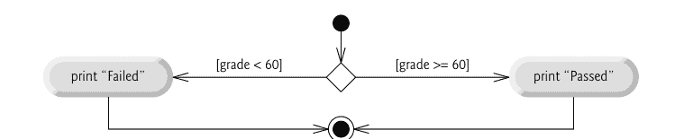

图 3.3 | if...else 双重选择语句 UML 活动图。

### 嵌套 if...else 语句

程序可以通过将 if...else 语句放在另一个 if...else 语句内部来创建嵌套的 if...else 语句，从而测试多种情况。例如，以下伪代码表示嵌套的 if...else，对于大于等于 90 的考试打印 A，80 到 89 分打印 B，70 到 79 分打印 C，60 到 69 分打印 D 以及其他分数打印 F：

## 3.6 if...else 双重选择语句 79

```
If student's grade is greater than or equal to 90
    Print "A"
else
    If student's grade is greater than or equal to 80
    Print "B"
else
    If student's grade is greater than or equal to 70
    Print "C"
else
    If student's grade is greater than or equal to 60
        Print "D"
    else
        Print "F"
```

该伪代码可以写成 Java：

```java
if (studentGrade >= 90)
    System.out.println("A")
else
    if (studentGrade >= 80)
        System.out.println("B")
else
    if (studentGrade >= 70)
        System.out.println("C")
else
    if (studentGrade >= 60)
        System.out.println("D")
    else
        System.out.println("F")
```


> **错误预防技巧 3.1**
>
> 使用嵌套 if...else 语句时，确保你测试了所有可能的情况。

如果变量 `studentGrade` 大于或等于 90，嵌套 if...else 语句中的前四个条件将为真，但只有第一个 if...else 语句部分中的语句会执行。在该语句执行后，“最外层”的 `else` 部分将被跳过。许多程序员更倾向于将嵌套前的 if...else 写为：

```java
if (studentGrade >= 90)
    System.out.println("A")
else if (studentGrade >= 80)
    System.out.println("B")
else if (studentGrade >= 70)
    System.out.println("C")
else if (studentGrade >= 60)
    System.out.println("D")
else
    System.out.println("F")
```

## 第 3 章 控制语句：第一部分：赋值、++ 和 -- 运算符

这两种形式在间距和缩进上相同，编译器会忽略这些。后一种形式避免了代码右侧的缩进。这种缩进通常会导致源代码行剩余的空间很少，迫使换行。

### 悬空 else 问题 (Dangling-else Problem)

除非通过大括号 `{ }` 的放置另行指定，否则 Java 编译器始终会将 `else` 与紧随其前的 `if` 关联。这种行为可能导致所谓的“悬空 else 问题”。例如：


```
if (x > 5)
    if (y > 5)
        System.out.println("x and y are > 5\n")
else
    System.out.println("x is <= 5");
```

这似乎表明如果 `x` 大于 5，`if` 语句决定 `x` 是否大于 5。如果是，则输出字符串 "x and y > 5"。否则，如果 `x` 不大于 5，`if...else` 语句的 `else` 部分输出字符串 "x is <= 5"。等等！这个 `else` 语句的执行方式并不如所示。编译器将该语句解释为：

```
if (x > 5)
    if (y > 5)
        System.out.println("x and y are > 5");
else
    System.out.println("x is <= 5");
```

为了强制嵌套的 `else` 按照预期执行，应这样写：

```
if (x > 5)
{
    if (y > 5)
        System.out.println("x and y are > 5");
}
else
    System.out.println("x is <= 5");
```

## 块

`if` 语句通常只需要一个语句，要包含多个语句，请使用大括号。以下示例在 `else` 部分包含了一个块：

```
if (grade >= 60)
    System.out.println("Passed");
else {
    System.out.println("Failed");
    System.out.println("You must course again.");
}
```

在这种情况下，如果 `grade` 为 60，程序会执行 `else` 中的所有语句。注意语句周围的大括号。如果没有大括号，语句

```
System.out.println("You must course again.");
```

将位于 `if` 的 `else` 部分之外，无论 `grade` 是否小于 60 都会执行。

正如块可以放置在任何放置语句的地方，也可以有空语句。回顾 2.8 节，空语句用分号（`;`）表示在语句的位置。


## 常见编程错误 3.1

在 `if...else` 语句的条件后放置分号会导致单选择语句的逻辑错误，以及双重选择语句（当 `if` 部分包含实际体时）的语法错误。

## 条件运算符 (?:)

Java 提供了条件运算符 `?:`，可以替代 `if...else` 语句。这可以使你的代码更短更容易。条件运算符是 Java 唯一的三元运算符（接受三个操作数的运算符）。操作数和符号共同构成一个条件表达式。第一个操作数（`?` 左侧）是一个布尔表达式（即评估为布尔值——真或假的条件），第二个操作数（`?` 和 `:` 之间）是布尔表达式为真时的条件表达式的值，第三个操作数（`:` 右侧）是布尔表达式评估为假时的条件表达式的值。例如，语句

```java
System.out.println(studentGrade >= 60 ? "Passed" : "Failed");
```


## 第 3 章 控制语句：第一部分：赋值、++ 和 -- 运算符

打印 `println` 中条件表达式参数的值。该语句中的条件表达式如果布尔值 `studentGrade >= 60` 为真，则为字符串 "Passed"，如果为假，则为字符串 "Failed"。因此，这个带有条件运算符的语句执行的功能与本节之前所示的 `if...else` 语句基本相同。条件运算符的优先级较低，因此条件表达式通常放在括号中。我们将看到，在无法使用 `if...else` 语句的情况下，某些情况下可以使用条件表达式。


## 3.7 while 重复语句

重复语句允许你指定程序在某些条件保持为真时重复某项操作。伪代码语句

```
我的购物清单上还有更多物品
购买下一个物品并从清单上划掉
```

描述了购物过程中的重复操作。条件“我的购物清单上还有更多物品”可能为真也可能为假。如果为真，则执行“购买下一个物品并从清单上划掉”。只要条件保持为真，该操作就会反复执行。`while` 语句包含的语句构成了它的体，其体可以是单个语句，也可以是一个块。最终，条件将变为假（当购物清单上的最后一个物品被购买并划掉时）。此时，重复终止，并执行重复语句后的第一条语句。

作为 Java `while` 重复语句的示例，考虑一个寻找大于 100 的第一个 3 的幂的程序段。假设 `int` 变量 `product` 初始化为 3。在执行以下 `while` 语句后，`product` 包含：

```
while (product <= 100)
    product = 3 * product;
```

`while` 语句的每次迭代都会将 `product` 乘以 3，因此 `product` 取值为 9、27、81 和 243。当 `product` 变为 243 时，`product <= 100` 变为假。这终止了重复，因此 `product` 的最终值为 243。此时，程序执行继续执行 `while` 语句后的下一条语句。


## while 语句的 UML 活动图

图 3.4 中的 UML 图说明了前述 `while` 语句的控制流。同样，图中的符号（初始状态、转换箭头、结束状态和三个节点之外）表示一个动作状态和一个决策。此图引入了 UML 的合并符号。UML 将合并符号和决策符号都表示为菱形。合并符号将两个活动流合并为一个流。在此图中，合并符号将来自初始状态和来自动作状态的转换合并，因此它们都流向决定循环是否应该开始（或继续）执行的决策。

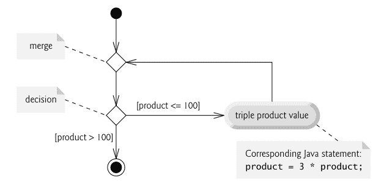

**图 3.4** | while 重复语句 UML 活动图。

决策和合并符号可以通过“输入”和“输出”转换的数量来区分。决策符号有一个箭头指向菱形，有两个或多个箭头从它指向外部，表示从该点可能的转换。此外，每个指向决策符号的转换箭头都有一个守卫条件。合并符号有两个或多个转换箭头指向菱形，只有一个箭头从菱形出来，表示多个活动流合并以继续活动。与合并符号相关的转换箭头没有任何守卫条件。

图 3.4 清晰地展示了本节之前讨论的 `while` 语句。从动作状态出的箭头指向合并节点，程序流从那里转换回在循环每次迭代开始时测试的决策。循环继续执行，直到守卫条件 `product > 100` 变为真。`while` 语句退出（达到其状态），控制传递给程序中顺序的下一条语句。

## 3.8 制定算法：计数控制重复

为了说明算法是如何开发的，我们解决了两个关于学生成绩的变体问题。考虑以下问题陈述：

- 一个有十名学生的班级进行测验。该测验的成绩（0-100 范围内的整数）已可用。确定该测验的班级平均分。

班级平均分等于成绩总和除以学生人数。在计算机上解决此问题的算法必须输入每个成绩、跟踪所有输入的成绩、执行平均值计算并打印结果。

## 计数控制重复的伪代码算法

让我们使用伪代码列出要执行的操作并指定它们执行的顺序。我们使用**计数控制重复来逐个输入**成绩。这种技术使用一个名为**计数器（或控制变量）**的变量来控制语句执行的次数。计数控制重复通常被称为**有限重复**，因为重复次数在循环开始执行之前就已经已知。在这个例子中，当计数器超过 10 时，重复终止。本节介绍了一个完全开发的伪代码（图 3.5）和相应的 Java 程序（图 3.6），以演示如何从零开始使用伪代码。经验表明，在计算机上解决问题最困难的部分是开发算法。

注意，在这种情况下，`total` 是一个用于累加值的变量。计数器表示即将输入哪个成绩。用于存储总和的变量通常预先进行初始化。


### 软件工程 3.1

一旦指定了正确的算法，从其产生一个良好的 Java 程序通常是简单的。在 3.9 中，`classAverage` 使用了计数控制重复。

> **图 3.5** 使用计数控制重复的伪代码算法。

1. 将 `total` 设置为零
2. 将 `gradeCounter` 设置为一
3. 当 `gradeCounter` 小于或等于十时，执行
4. 提示用户输入 `grade`
5. 输入下一个 `grade`
6. 将 `grade` 加入 `total` 中
7. 将 `gradeCounter` 加 1
8. 将班级平均分设置为 `total` 除以十
9. 打印班级平均分

## 3.6 实现计数控制重复

在图 3.6 中，`classAverage` 的 `main` 方法（第 7-31 行）实现了 3.5 中伪代码描述的算法。

```java
// 图 3.6: ClassAverage.java
// 使用计数控制重复解决平均分问题。
import java.util.Scanner;

public class ClassAverage {
    public static void main(String[] args) {
        // 创建 Scanner 从命令行获取输入
        Scanner input = new Scanner(System.in);
        // 初始化阶段
        int total = 0; // 初始化用户输入的总和
        int gradeCounter = 1; // 初始化输入的成绩
        // 处理阶段使用计数控制重复
        while (gradeCounter <= 10) { // 循环 10 次
            System.out.print("Enter grade: "); // 提示
            int grade = input.nextInt(); // 输入 grade
            total = total + grade; // 将 grade 加到 total
            gradeCounter = gradeCounter + 1; // 计数器加1
        }
        // 终止阶段
        int average = total / 10; // 整数除法产生整数结果
        System.out.printf("%nTotal of all 10 grades is %d\n", total);
        System.out.printf("Class average is %d\n", average);
    } // 类 ClassAverage 结束
}
```

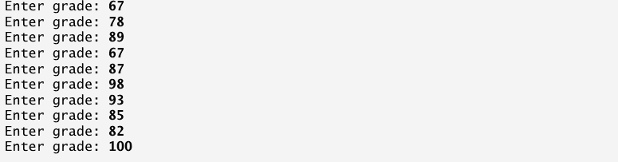

## main 方法中的局部变量

第 10 行声明并初始化 `Scanner` 对象，用于读取用户输入的值。第 13、14、20 和 26 行分别声明了类型局部变量 `total`、`gradeCounter`、`grade` 和 `average`。变量 `grade` 存储用户输入。

这些声明出现在 `main` 方法体内。回想方法体内声明的变量是局部变量，只能从声明行到方法声明结束处使用。局部变量的声明必须在方法中使用之前出现。局部变量无法从外部访问其声明的方法。

### 初始化阶段：初始化变量 total 和 gradeCounter

赋值语句（第 13–14 行）将 `total` 初始化为 0，将 `gradeCounter` 初始化为 1。这些初始化发生在变量用于计算之前。


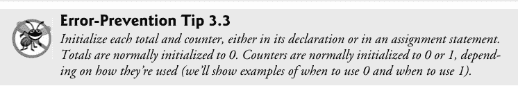

### 处理阶段：从用户处读取 10 个成绩

第 17 行表示，只要 `gradeCounter` 的值小于或等于 10，`while` 语句就继续循环（也称为*迭代*）。只要该条件为真，`while` 语句就会重复执行大括号限制其循环体的语句（第 18–23 行）。

第 19 行显示“Enter grade:”。第 20 行读取用户输入的成绩并将其赋值给 `grade`。第 21 行将新成绩加到 `total` 中，替换其原有值。第 22 行将 `gradeCounter` 加 1，表示程序已处理了一个成绩，用户已准备好输入下一个成绩。`gradeCounter` 的递增最终会导致其超过 10。当循环条件（第 17 行）变为假值时，循环结束。

### 终止阶段：计算并显示班级平均分

当循环结束时，第 26 行执行平均值计算并将结果赋值给变量。第 29 行使用 `System.out.printf` 显示文本“Total of all 10 grades is ”，后面紧是 `total` 的值。第 30 行使用 `printf` 显示文本“Class average is ”，后面紧是变量 `average` 的值。当执行到第 31 行时，程序结束终止。

### 关于整数和除法的注意事项

由 `main` 方法执行的平均值计算产生一个整数。程序的输出表明，示例练习中的成绩总和为 846，除以 10 后将得到浮点数 84.6。然而，计算 `total / 10`（图 3.6 的第 26 行）的结果是 84，因为 `total` 和 10 都是整数。两个整数相除会导致*整数除法*——计算的任何部分都会被*截断*（即丢失）。在下一节中，我们将看到如何从平均值计算中获得浮点结果。

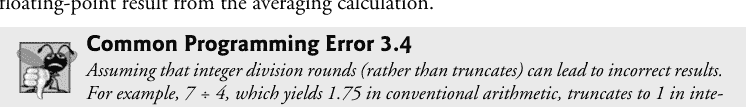

## 3.9 制定算法：哨兵控制的循环

## 关于算术溢出的说明

在图 3.6 的第 21 行：

```
total = total + grade; // 将 grade 加到 total
```

将用户输入的每个成绩都加到 `total` 中。即使是这个简单的语句也存在潜在问题——整数相加可能导致产生一个无法存储在 `int` 变量中的过大值。这被称为算术溢出，会导致未定义行为，从而导致非预期的结果（http://en.wikipedia.org/wiki/Integer_overflow#Security_ramifications）。图 2.7 的加法在第 23 行也有相同的问题，它计算了通过输入的两个 `int` 值的和：

```
sum = number1 + number2; // 数字相加，然后存储在 sum 中
```

`int` 变量可以存储的最大和最小值分别由常量 `MIN_VALUE` 和 `MAX_VALUE` 表示，它们定义在 `Integer` 类中。其他整数类型和浮点类型也有类似的常量。每个基本类型在 `java.lang` 包中都有一个对应的类。你可以在每个类的在线文档中查看这些常量的值。`Integer` 类的在线文档位于：

```
http://docs.oracle.com/java/7/docs/api/java/lang/Integer.html
```

在执行像图 3.6 和图 2.7 第 23 行那样的算术计算之前，确保它们不会溢出是一个良好的做法。该代码显示在 CERT 网站 www.securecoding.org 上——只需搜索指南“NUM00-J”。该代码使用了 `&&`（逻辑与）和 `||`（逻辑或）运算符，这些运算符在第 4 章中引入。在工业级代码中，你应该对所有计算执行此类检查。

## 深入研究接收用户输入

任何接收用户输入的程序都可能出现各种问题。例如，在图 3.6 的第 20 行：

```
int grade = input.nextInt(); // 输入下一个成绩
```

我们假设用户将输入 0 到 100 之间的整数成绩。然而，输入成绩的人可能输入小于 0、大于 100 的整数、超出 `int` 变量可存储范围的数值、包含小数点的数字或甚至不是整数的特殊符号。

为了确保输入有效，工业级程序必须测试所有可能的错误情况。输入成绩的程序应该使用范围检查来验证成绩，以确保它们是 0 到 100 之间的值。然后你可以要求用户重新输入任何值。

## 3.9 制定算法：哨兵控制的循环

让我们泛化 3.8 节的平均分问题。考虑以下问题：

- 开发一个处理任意数量学生的班级平均分程序

在之前的平均分示例中，指定了学生人数（10）。在这个示例中，没有给出用户将输入多少成绩。程序必须处理任意数量的成绩。它如何确定停止输入并计算平均值？

解决这个问题的方法之一是使用称为哨兵值（也称为标记值或标志值）的特殊值来指示“输入结束”。用户输入成绩。哨兵控制通常被称为无限循环，因为在循环开始之前不知道循环次数。

显然，必须选择一个与输入值混淆的哨兵值。成绩是非负整数，因此 -1 是该问题的合适哨兵值。平均分程序的运行可能会处理如 95, 96, 75, 74, 89 和 -1 的输入流。然后程序将计算并打印 95, 96, 75, 74, 89 的平均分。

## 使用自顶向下、逐步细化开发伪代码算法：顶层和第一次细化


我们使用自顶向下、逐步细化的技术来处理这个平均分程序，这是开发结构良好的程序的关键。我们从顶层的伪代码表示开始——一个传达程序功能的单一语句：

确定测验的平均分

顶层实际上是程序的完整表示。遗憾的是，顶层很少提供可以编写 Java 程序的细节。因此，现在我们开始细化过程。我们将顶层划分为一系列更小的任务，并按照执行顺序列出。这得到了下面的第一次细化：

- 初始化变量
- 输入、求和并统计成绩
- 计算并打印平均分

该细化只使用了顺序结构——列出的步骤应该按顺序逐一个执行。

## 软件工程观察 3.2

每次细化以及顶层本身都是算法的完整规范——只是细节程度不同。

## 软件工程观察 3.3

许多程序逻辑上可以分为三个阶段：初始化变量的初始化阶段；输入数据值并相应调整程序变量的处理阶段；以及计算并输出最终结果的终止阶段。

## 3.9 算法制定：哨兵值控制循环

### 进入第二次细化

之前的“软件工程观察”通常是自顶向下过程中第一次细化的全部需求。为了继续进入细化的下一个阶段——即第二次细化——我们对特定的变量进行承诺。在这个示例中，我们需要一个数字的运行总和、一个已处理数字的计数、一个用于接收用户输入的每个分数的变量，以及一个用于存储计算出的平均值的变量。伪代码语句

```
Initialize variables
```

可以细化为如下：

```
Initialize total to zero
Initialize counter to zero
```

只有 `total` 和 `counter` 两个变量在使用之前需要初始化。变量 `average` 和 `grade`（分别用于计算得出的平均值和用户输入）不需要初始化，因为它们的值将在计算或输入时会被替换。伪代码语句

```
Input, sum and count the quiz grades
```

需要循环来处理每个输入的分数。我们预先不知道会输入多少个分数，因此我们使用哨兵值控制循环。用户一个一个输入。在输入最后一个分数后，用户输入哨兵值。程序在每个分数输入后都会测试哨兵值，并在用户输入哨兵值时终止循环。上述伪代码语句的第二次细化为：

```
Prompt the user to enter the first grade
Input the first grade (possibly the sentinel)
While the user has not yet entered the sentinel
Add this grade into the running total
Add one to the grade counter
Prompt the user to enter the next grade
Input the next grade (possibly the sentinel)
```

在伪代码中，我们不对构成结构主体的语句使用大括号。我们只需对 `While` 语句下的语句进行缩进，以显示它们属于 `While`。再次，伪代码仅是一种非正式的程序开发辅助。伪代码语句

```
Calculate and print the class average
```

可以细化为如下：

```
If the counter is not equal to zero
Set the average to the total divided by the counter
Print the average
else
Print “No grades were entered”
```

## 第 3 章 控制语句：第一部分：赋值、++ 和 -- 运算符

### 错误预防提示 3.4

在执行除法（`/`）或取模（`%`）计算时，如果右操作数可能为零，请对此进行测试并处理（例如显示错误消息），而不是让错误发生。这种逻辑错误如果未检测到，会导致程序失败或产生无效输出。类平均分问题伪代码的完整第二次细化如图 3.7 所示。


- 初始化 `total` 为零
- 初始化 `counter` 为零
- 提示用户输入第一个分数
- 输入第一个分数（可能为哨兵值）
- 当用户尚未输入哨兵值时
- 将此分数加入运行总和
- 将分数计数器加 1
- 提示用户输入下一个分数
- 输入下一个分数（可能为哨兵值）
- 如果计数器不等于零
- 将平均值设置为总和除以计数器
- 输出平均值
- else
- 输出“未输入任何分数”

**图 3.7** 使用哨兵值控制循环的类平均分伪代码。

在图 3.5 和 3.7 中，我们在伪代码中加入了空行和缩进，使其更具可读性。空行将算法分为不同的阶段并设置控制语句；缩进强调了控制语句的主体。图 3.7 中的伪代码算法解决了更通用的类平均分问题。该算法是在两次细化后开发的。有时我们需要这种化。


### 软件工程观察 3.4

当你指定的伪代码细节足够，以供你将其转换为 Java 代码时，停止这种自顶向下、步进式的细化过程。通常情况下，实现 Java 程序是简单的。


### 软件工程观察 3.5

某些程序不使用伪代码等开发工具。他们认为最终目标是在计算机上解决问题，编写伪代码仅仅推迟了最终输出的产生。虽然这对于简单且熟悉的问题可能有效，但在大型项目中会导致严重的错误和延迟。

## 3.9 算法制定：哨兵值控制循环

### 实现哨兵值控制循环

在 3.8 中，`main` 方法（第 7–46 行）实现了 3.7 的伪代码。虽然每个分数都是 `int`，但平均值计算可能会产生带有小数的数字——也就是说，一个实数（浮点数）。`int` 类型无法表示这种数字，因此使用 `double` 来表示。你还会看到控制语句可能会堆叠在另一个上面。`while` 语句（第 22–30 行）后面是 `if...else` 语句（第 34–45 行）。该程序中的大部分代码与 3.6 相同，因此我们专注于新概念。

```java
// Fig. 3.8: ClassAverage.java
// 使用哨兵值控制循环解决类平均分问题。
import java.util.Scanner;
public class ClassAverage
{
    public static void main(String[] args) {
        // 创建 Scanner 从命令行窗口获取输入
        Scanner input = new Scanner(System.in);

        // 初始化阶段
        int total = 0; // 初始化分数总和
        int gradeCounter = 0; // 初始化目前已的分数

        // 处理阶段
        // 提示输入并从用户读取分数
        System.out.print("Enter grade or -1 to quit: ");
        int grade = input.nextInt();

        // 循环直到用户输入哨兵值
        while (grade != -1) {
            total = total + grade; // 将分数加入总和
            gradeCounter = gradeCounter + 1; // 计数器加1
            // 提示输入并从用户读取分数
            System.out.print("Enter grade or -1 to quit: ");
            grade = input.nextInt();
        }

        // 终止阶段
        // 如果用户至少输入了一个分数...
        if (gradeCounter != 0)
            // 使用 double 计算分数的平均值
            double average = (double)total / gradeCounter;

            // 显示总和和平均值（两位精度）
            System.out.printf("%ntotal of %d entered is %d%n",
                gradeCounter, total);
```

**图 3.8** 使用哨兵值控制循环解决类平均分问题。（2 部分中的第一部分。）

```java
        System.out.printf("Class average is %.2f", average);
    }
  else // 没有输入分数，所以输出适当的消息
      System.out.println("No grades were entered");
  }
} // ClassAverage 结束
```

| Enter grade or -1 to quit: 97 |
| Enter grade or -1 to quit: 88 |
| Enter grade or -1 to quit: 72 |
| Enter grade or -1 to quit: -1 |
| Total of the 3 grades entered is 257 |
| Class average is 85.67 |

**图 3.8** 使用哨兵值循环解决类平均分问题。（2 部分中的第二部分）

### 浮点数精度和内存需求

大多数平均值都不是整数。在这个示例中，我们计算出的平均值是一个带有小数点的数字——浮点数，例如 43.95, 0.0–128.873。Java 提供了两种在内存中存储浮点的类型——`float` 和 `double`。**float 类型表示单精度浮点数**，最多可以存储 **7 位有效数字**。**double 类型表示双精度浮点数**。它们需要的内存与 float 变量相同，但可以存储 15 位有效数字——大约是 float 变量的精度。

大多数程序员使用 `double` 表示浮点数。事实上，Java 将你在程序源码中输入的所有浮点数（如 7.33 和 0.095）默认视为 `double`。源代码中的此类值被称为浮点字面量。关于 float 和 double 的精确范围，请参见附录 D 原始类型。

### 哨兵循环的程序逻辑 vs 计数控制循环

第 37 行声明了 `double` 变量，这允许我们将类平均分显示为浮点数。第 14 行将 `gradeCounter` 初始化为 0，因为还没有输入分数。记住此程序使用哨兵循环输入分数。为了准确记录已输入的数的数量，程序仅在用户输入有效分数时增加 `gradeCounter`。

将此应用程序中的哨兵循环逻辑与图 3.6 进行比较。在计数控制循环中，`while` 语句的迭代（图 3.6 第 17–23 行）按指定的次数从用户处读取值。在哨兵循环中，程序在到达 `while` 之前读取第一个值（图 3.8 第 18–19 行）。该值决定了控制流是否进入 `while` 的主体。如果 `while` 条件为假，则用户输入了哨兵值，因此 `while` 主体不执行（即没有输入任何分数）。相反，如果条件为真，主体开始执行，循环将分数值加入 `total` 并增加 `gradeCounter`（24–25 行）。然后，循环体中的第 28–29 行从用户处输入新值。

## 3.9 算法制定：哨兵控制循环 93

执行将继续测试 `while` 条件（第 22 行）。该条件使用用户最近输入的成绩值来决定是否再次执行循环体。变量 `grade` 的值始终在程序测试 `while` 条件之前立即由用户输入。这使得程序能够在处理该值（即将其累加到总和中）之前，先判断该输入的值是否为哨兵值。如果输入了哨兵值，循环将终止，程序将不会向总和中加 -1。

### 良好的编程实践 3.3

> 在哨兵控制循环中，提示应当提醒用户哨兵值。

循环结束后，执行第 34–45 行的 `if...else` 语句。第 34 行的条件决定是否输入了任何成绩。如果没有输入，则执行 `if...else` 语句的 `else` 部分（44–45），显示消息“No grades were entered”，然后方法返回到调用者方法。

### while 语句中的大括号

注意 3.8 中 `while` 语句的块（第 23–30 行）。如果没有大括号，循环会将块视为仅第一条语句，即将成绩加到总和的语句。块中的最后三个语句将落在循环体之外，导致程序错误地解释代码为：

```
while (grade == -1)
    total = total + grade; // add grade to total
    gradeCounter = gradeCounter + 1; // increment counter

// 提示输入并从用户处读取下一个成绩
System.out.print("Enter grade or -1 to quit: ");
grade = input.nextInt();
```

如果用户在第 19 行（`while` 语句之前）没有输入哨兵值 -1，上述代码会导致死循环。

### 常见编程错误 3.5

漏掉定义块的大括号会导致逻辑错误，例如死循环。为了防止这个问题，一些程序员会将每个控制语句的块包含在大括号内，即使正体只包含一条语句。

### 原始类型之间的显式和隐式转换

如果至少输入了一个成绩，3.8 的第 37 行会计算成绩的平均值。回顾 3.6，整数除法产生整数结果。即使变量 `grade` 被声明为 `double`，如果我们把计算写为：

```
double average = total / gradeCounter;
```

在除赋值给 `average` 之前，它会丢失商的小数部分。这是因为 `total` 和 `gradeCounter` 都是整数，而整数除法产生整数结果。

大多数平均值不是整数（例如 0、–22 和 1024）。出于此原因，我们在示例中以浮点数的形式计算平均分。为了使用整数值进行浮点数-


## 第3章 控制语句：第一部分：赋值、++ 和 -- 运算符

我们必须临时将这些值视为浮点数以便用于计算。Java 提供了一元转换运算符来完成此任务。3.8 的第 37 行使用 `(double)` 转换运算符——一种一元运算符——创建其操作数 `total`（位于运算符右侧）的浮点数副本。以这种方式使用转换被称为显式转换或类型转换。存储在 `total` 中的值仍然是整数。

现在的计算由一个浮点数值（`total` 的临时副本）除以整数 `gradeCounter` 组成。Java 只能评估操作数相同的算术运算。为了确保这一点，Java 对选定的操作数执行操作提升（或隐式转换）。例如，在包含 `int` 和 `double` 值的表达式中，`int` 值被提升为 `double` 值用于表达式。在本示例中，`gradeCounter` 的值被提升为 `double`，然后执行浮点除法，并将计算结果赋值给 `average`。只要在计算的任何变量上应用 `(double)` 转换运算符，计算就会产生 `double` 结果。稍后，我们将讨论所有的原始类型。你将在 5.7 中学习更多关于提升的规则。

### 常见编程错误 3.6

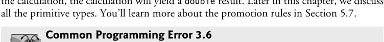

通过在任何类型周围加上括号来形成转换。该运算符是一个一元运算符（即只接受一个操作数的运算符）。Java 还支持加 (`+`) 和减 (`-`) 运算符的一元版本，因此你可以写出如 `7 + 5` 这样的表达式。转换运算符从右到左关联，并与其他一元运算符（如一元 `+` 和一元 `-`）具有相同的优先级。这种优先级高于乘法运算符 `*` 和 `%` 的优先级。（参见附录 A 中的运算符优先级表）。我们在优先级图中用 `(type)` 名称来指示转换运算符，以表示任何类型名称都可以用于构造转换运算符。

第 42 行显示了级平均分。在本示例中，我们显示四舍五入到最近的百分位的级平均分。`printf()` 控制字符串中的格式指定符 `%.2f` 表示该值显示时在小数点后保留两位精度。在示例执行期间（图：3.8）输入的 2 个数字总计为 257，得出平均值为 85.666666....。`printf()` 方法使用格式指定符将值舍入到指定的位数。

### 浮点数精度

浮点数不是精确的，但它们有广泛的应用。例如，当我们进行除法时，结果是近似值。浮点数是除法结果产生的，在本示例所示。

## 3.10 算法制定：嵌套控制语句 95

浮点数不是精确的，但它们有广泛的应用。例如，当我们进行除法时，结果是近似值。浮点数是除法结果产生的，在本示例所示。

## 3.10 算法制定：嵌套控制语句 138

程序处理完所有结果后，必须判断是否有超过八个学生通过了考试。

### 常见编程错误 3.7

以假设浮点数精确的方式使用它们会导致错误的结果。

### 3.10 算法制定：嵌套控制语句

对于下一个示例，我们再次通过伪代码和自顶向下、逐步细化的方法来制定算法，并编写相应的 Java 程序。我们已经看到控制语句是堆叠的（顺序地）。在这种情况下，我们检查控制语句的另一种结构化连接方式——即将一个控制语句嵌套在另一个语句中。

考虑以下问题陈述：

某大学提供一门准备房地产经纪人执照的课程。去年，十名完成该课程的学生参加了考试。大学想知道学生的考试水平。你被要求写一个程序来总结结果。你得到了一份10个学生的名单。在每个名字旁边，如果学生通过考试则写1，未通过则写2。

你的程序应该按如下方式分析考试结果：

- 输入每个测试结果（即 1 或 2）。每次程序请求测试结果时，在屏幕上显示消息“Enter result”。
- 计算每类型测试结果的数量。
- 显示测试结果摘要，说明通过和不及人数。
- 如果超过八个学生通过考试，打印“Bonus to instructor!”

在仔细阅读问题陈述后，我们得出以下观察：


- 程序必须处理 10 个学生的测试结果。可以使用计数器控制循环，因为测试结果的数量是预知的。
- 每个测试结果都有一个数值——1 或 2。每当读取一个测试结果时，程序必须判断它是 1 还是 2。我们在算法中测试是否为 1。如果数字不是 1，我们假设它是 2（练习 3.24 结果）。
- 使用两个计数器来跟踪考试结果——统计通过考试的人数和不及格的人数。
- 程序处理完所有结果后，必须判断是否有超过八个学生通过了考试。


# 第 3 章 控制语句：第一部分：赋值、++ 和 -- 运算符

让我们采用自上而下、逐步细化的方法进行。我们首先从顶层的伪代码表示开始：

```
分析考试结果并决定是否应该发放奖金
```

再次，顶层是程序的完整表示，但在伪代码自然地演变为 Java 程序之前，可能需要进行多次细化。我们的第一次细化是：

```
初始化变量
输入 10 份考试结果，并统计及格不及格次数
打印考试结果摘要并决定是否应该发放奖金
```

在这里，尽管我们已经有了整个程序的完整表示，但仍需进一步的细化。我们确定了特定的变量。需要计数器来记录及格和不及格，一个计数器将用于控制循环过程，还需要一个变量来存储用户输入。用户输入中的变量在算法开始时是未初始化的，因为它的值是在循环的每次迭代中从用户那里读取的。

伪代码语句

```
初始化变量
```

可以细化为：

```
将及格初始化为零
将不及格初始化为零
将学生计数器初始化为一
```

注意，只有计数器在算法开始时初始化。

伪代码语句

```
输入 10 份考试结果，并统计及格不及格次数
```

需要一个循环来成功输入每次考试的结果。我们预先知道恰好有 10 份考试结果，因此计数器控制循环是合适的。在循环内部（即嵌套在循环中），一个双选择结构将决定每个考试结果是及格还是不及格，并增加相应的计数器。前一个伪代码语句的细化如下：

```
当学生计数器小于或等于 10 时
提示用户输入下一个考试结果
输入下一个考试结果
如果学生及格
    及格人数加 1
否则
    不及格人数加 1
学生计数器加 1
```

我们使用空行来隔离 `If...Else` 控制结构，这可以提高可读性。

## 3.10 制定算法：嵌套控制语句

伪代码语句

```
打印考试结果摘要并决定是否应该发放奖金
```

可以细化为：

```
打印及格人数
打印不及格人数
如果超过 8 名学生及格
    打印“给老师发奖金！”
```

伪代码的完整第二次细化和类分析。完整的第二次细化见图 3.9。注意，也使用了空行来区分 `While` 结构以提高程序的可读性。该伪代码现在已经足够细化，可以转换为 Java。

```
将及格初始化为零
将不及格初始化为零
将学生计数器初始化为一
当学生计数器小于或等于 10 时
    提示用户输入下一个考试结果
    输入下一个考试结果
    如果学生及格
        及格人数加 1
    否则
        不及格人数加 1
    学生计数器加 1
打印及格人数
打印不及格人数
如果超过 8 名学生及格
    打印“给老师发奖金！”
```

**图 3.9** 考试结果问题的伪代码。

实现该伪代码算法的 Java 类和两个示例执行如图 3.10 所示。`main` 方法的第 13、14、15 和 22 行声明了处理考试结果的变量。


> **错误预防提示 3.5**
> 在声明时初始化局部变量可以帮助你避免由未初始化变量可能引起的编译错误。Java 不要求将局部变量初始化合并到声明中，但它要求在每个局部变量的值在表达式中使用之前赋予一个值。

`while` 语句（第 18–32 行）循环 10 次。在每次迭代中，循环输入并处理一个结果。注意，处理每个结果的 `if...else` 语句（第 25–28 行）嵌套在 `while` 语句中。如果结果为 1，`if...else` 语句增加及格人数；否则，假设结果为 2 并增加不及格人数。第 31 行在第 18 行再次测试循环条件之前增加了 `studentCounter`。在输入 10 个值后，循环终止，第 35 行显示及格和不及格人数。如果第 38–39 行的 `if` 语句判断是否有超过 8 名学生及格，并输出消息“给老师发奖金！”

```java
// 图 3.10: Analysis.java
// 使用嵌套控制语句分析考试结果。
import java.util.Scanner; // 类使用了 Scanner 类

public class Analysis {
    public static void main(String[] args) {
        // 创建扫描器 从命令行窗口获取输入
        Scanner input = new Scanner(System.in);

        // 在声明中初始化变量
        int passes = 0;
        int failures = 0;
        int studentCounter = 1;

        // 使用学生计数器控制的循环处理 10 个学生
        while (studentCounter <= 10) {
            // 提示用户输入并从用户获取值
            System.out.print("Enter result (1 = pass, 2 = fail): ");
            int result = input.nextInt();

            // if...else 嵌套在 while 语句中
            if (result == 1) {
                passes = passes + 1;
            } else {
                failures = failures + 1;
            }

            // 增加 studentCounter 使循环终止
            studentCounter++;
        }

        // 打印及格人数
        System.out.printf("Passed: %d\n", passes);
        // 打印不及格人数
        System.out.printf("Failed: %d\n", failures);

        // 判断是否超过 8 名学生及格
        if (passes > 8) {
            System.out.println("Bonus to instructor!");
        }
    }
}
```

**图 3.10** 使用嵌套控制语句分析考试结果。（第一部分）

## 3.11 复合赋值运算符

复合赋值运算符简化了赋值：

```
variable operator= expression;
```

其中 `operator` 是 `+`、`-` 或 `*`（稍后讨论），可以写成：

```
variable += expression;
```

`+=` 运算符将右侧的值加到左侧变量的值，并将结果存储在左侧变量中。例如：

```
c += 3;
```

`+=` 运算符表示 `c` 加 3。图 3.11 显示了复合赋值运算符的示例表达式及其说明。

| 赋值运算符 | 示例表达式 | 解释 |
|---|---|---|
| 假设 `int c = 3, d = 5, e = 4, f = 12;` | | |
| `+=` | `c += 7` | c 为 10 |
| `-=` | `d -= 4` | d 为 1 |
| `*=` | `e *= 5` | e 为 20 |
| `/=` | `f /= 3` | f 为 4 |
| `%=` | `g %= 9` | g 为 g |

**图 3.11** 复合赋值运算符。

## 3.12 增和减运算符

Java 提供了两个一元运算符（总结如图 3.12），用于对数值变量的值加 1 或减 1。它们是递增运算符 `++` 和递减运算符 `--`。程序可以使用递增运算符 `++` 来增加变量的值，而不是使用 `c = c + 1` 或 `c += 1`。位于变量之前（前缀）的增或减运算符分别称为**前增**或**前减**运算符。位于变量之后（后缀）的增或减运算符分别称为**后增**或**后减**运算符。

| 运算符 | 运算符名称 | 示例表达式 | 解释 |
|---|---|---|---|
| `++` | 前增 | `++a` | 将 a 加 1，然后在表达式中使用 a 的新值 |
| `++` | 后增 | `a++` | 在表达式中使用 a 的当前值，然后将 a 加 1 |
| `--` | 前减 | `--b` | 将 b 减 1，然后在表达式中使用 b 的值 |
| `--` | 后减 | `b--` | 在表达式中使用 b 的当前值，然后将 b 减 1 |

**图 3.12** 增和减运算符。

## 3.12 递增和递减运算符

这会导致变量的当前值在它所出现的表达式中使用；然后变量的值加 1（或减 1）。

> **良好的编程实践 3.4**
> 与二元运算符不同，一元递增和递减运算符应该放在操作数旁边，中间不要留空格。

### 前置递增与后置递增运算符的区别
图 3.13 展示了 `++` 运算符的前置和后置递增版本的区别。递减运算符（`--`）原理类似。

第 9 行将 `c` 初始化为 5，第 10 行输出 `c` 的初始值。第 11 行输出表达式 `c++` 的值。该表达式对 `c` 进行后置递增，因此输出 `c` 的原始值（5），然后 `c` 的值加 1（变为 6）。因此，第 11 行再次输出 `c` 的初始值（5）。第 12 行输出 `c` 的新值（6），以证明变量的值在第 11 行增加了。

第 17 行将 `c` 重置为 5，第 18 行输出 `c` 的值。第 19 行输出表达式 `++c` 的值；因此 `c` 的值增加了 1；然后输出新值（6）。第 20 行再次输出 `c` 的值，显示在执行该行后，`c` 的值仍然是 6。

```java
// Increment.java
// 前置递增和后置递增运算符。
public class Increment {
    public static void main(String[] args) {
        // 展示后置递增运算符
        int c = 5;
        System.out.printf("c before postincrement: %d%n", c); // 输出 5
        System.out.printf("c postincrementing: %d%n", c++); // 输出 5
        System.out.printf("c after postincrement: %d%n", c); // 输出 6
        System.out.println(); // 跳过一行
        // 展示前置递增运算符
        c = 5;
        System.out.printf("c before increment: %d%n", c); // 输出 5
        System.out.printf("c preincrementing: %d%n", ++c); // 输出 6
        System.out.printf("c after increment: %d%n", c); // 输出 6
    }
}
```

```
c before postincrement: 5
c postincrementing: 5
c after postincrement: 6
c before increment: 5
c preincrementing: 6
c after increment: 6
```

**图 3.13** 前置递增和后置递增运算符。

## 使用算术复合赋值、递增和递减运算符简化语句

算术复合赋值运算符以及递增递减运算符可以用于简化程序语句。例如，图 3.10 中的三个赋值语句（第 26、28 和 31 行）：

```java
passes = passes + 1;
failures = failures + 1;
studentCounter = studentCounter + 1;
```

可以使用复合赋值运算符写得更简洁：

```java
passes += 1;
failures += 1;
studentCounter += 1;
```

或者使用前置递增运算符：

```java
++passes;
++failures;
++studentCounter;
```

或者通过变量本身递增或递减，后置：

```java
passes++;
failures++;
studentCounter++;
```

前置递增和后置递增形式具有*相同*的效果。

## 常见编程错误 3.8

尝试对非可赋值结果的表达式使用递增或递减运算符会导致语法错误。例如，`++(x + 1)` 是语法错误，因为 `(x + 1)` 不是变量。

## 运算符优先级和结合性

图 3.14 显示了我们介绍的运算符的优先级和结合性。它们按优先级从高到低的顺序垂直排列。条件运算符 (`?:`)；一元运算符 (`++`、`--`、`+`、`-`)；转换运算符以及赋值运算符 `=`、`+=`、`-=`、`*=`、`/=`、`%=` 从右到左结合。图 3.14 运算符优先级表中的所有其他运算符都从左到右结合。

> **良好的编程实践 3.5**
> 编写包含许多运算符的表达式时，请参考附录 A 运算符优先级表。确认表达式中的运算符执行顺序符合你的预期。如果你不确定评估顺序，可以将表达式拆分为更小的语句，或使用括号强制执行评估顺序，就像你在代数式中做的那样。某些运算符（如赋值符号 `=`）是从右到左结合的，而不是左到右。

| 运算符 | 结合性 | 类型 |
|---|---|---|
| `++` `--` | 从左到右 | 一元后置 |
| `++` `--` `+` `-` `(type)` | 从右到左 | 一元前置 |
| `*` `/` `%` | 从左到右 | 乘法 |
| `+` `-` | 从左到右 | 加法 |
| `<` `<=` `>` `>=` | 从左到右 | 关系 |
| `==` `!=` | 从左到右 | 等于 |
| `?:` | 从右到左 | 条件 |
| `=` `+=` `-=` `*=` `/=` `%=` | 从右到左 | 赋值 |

**图 3.14** 迄今为止运算符的优先级和结合性。

## 3.13 基本类型

附录 D 中的表格列出了基本类型。（此处由于原文重复，翻译按要求保留重复内容）

## 3.14（可选）GUI 与图形案例研究：创建简单图形

```java
// Fig. 3.17: DrawPanelTest.java
// 创建 JFrame 以显示 DrawPanel。
import javax.swing.JFrame;

public class DrawPanelTest {
    public static void main(String[] args) {
        // 创建一个包含我们绘图的面板
        DrawPanel panel = new DrawPanel();
        // 创建一个新的帧来装载面板
        JFrame application = new JFrame();
        // 设置帧在关闭时退出
        application.setDefaultCloseOperation(JFrame.EXIT_ON_CLOSE);
        application.add(panel); // 将面板添加到帧中
        application.setSize(250, 250); // 设置帧的大小
        application.setVisible(true); // 使帧可见
    }
}
```

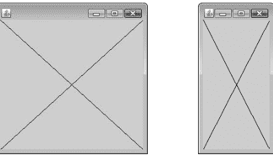

**图 3.17** 用于显示 `DrawPanel` 的 `JFrame`。

第 6 行使用关键字 `extends` 表示类 `DrawPanel` 是 `JPanel` 的增强类型。该关键字代表了一种所谓的继承关系，我们的新类 `DrawPanel` 从 `JPanel` 类现有的成员（数据和方法）开始。`DrawPanel` 继承的类 `JPanel` 出现在关键字 `extends` 的右侧。在这种继承关系中，`JPanel` 被称为超类，`DrawPanel` 被称为子类。这导致 `DrawPanel` 类拥有 `JPanel` 类的属性（数据）和行为（方法），还包含了我们在 `DrawPanel` 类声明中添加的新功能——特别是沿面板的对角线绘制两条线的能力。继承关系将在第 9 章中进行详细解释。现在，在创建图形程序时，你应该模仿我们的 `DrawPanel`。

## paintComponent 方法

每个 `JPanel`（包括我们的 `DrawPanel`）都有一个 `paintComponent` 方法（第 9–22 行），系统每次需要显示 `DrawPanel` 时都会自动调用它。`paintComponent` 方法必须如第 9 行所示进行声明，否则系统将不会调用它。当 `JPanel` 首次显示在屏幕上、当它随后被屏幕上的窗口覆盖以及当它所在的窗口大小发生变化时，都会调用此方法。`paintComponent` 方法需要一个参数，即 `Graphics` 对象，由系统在调用 `paintComponent` 时提供。该 `Graphics` 对象用于绘制线条、矩形和其他图表。

你创建的 `paintComponent` 方法中的第一条语句始终应该是：


```
super.paintComponent(g);
```


这确保了在我们开始绘图之前面板已正确渲染。接下来，第 14–15 行的方法中 `drawPanel` 继承自 `JPanel`。由于 `JPanel` 继承自 `JPanel`，`DrawPanel` 可以使用 `JPanel` 的任何公共方法。`getWidth` 和 `getHeight` 分别返回 `JPanel` 的宽度和高度。第 14–15 行将这些值存储在局部变量 `width` 和 `height` 中。第 18 行和 21 行使用 `Graphics` 变量调用 `drawLine` 来绘制两条线。`drawLine` 方法通过四个参数在两点之间画一条线。前两个是一个端点的 x 和 y 坐标，最后两个是另一个端点的坐标。如果你调整窗口大小，线条将相应缩放，参数是基于面板的宽度和高度。在此应用程序中调整窗口大小会导致系统调用 `paintComponent` 重新绘制面板的内容。

## DrawPanelTest 类

为了在屏幕上显示 `JPanel`，你必须将其放置在窗口中。你使用 `JFrame` 类对象创建一个窗口。在 `DrawPanelTest.java`（图 3.17）中，第 3 行从 `java.swing` 包导入 `JFrame` 类。`main` 方法中的第 10 行创建一个 `DrawPanel` 对象，它包含了我们的绘图。第 13 行创建一个新的 `JFrame`，可以装载并显示我们的输出。第 16 行调用方法 `setDefaultCloseOperation` 表示当用户关闭窗口时应用程序应终止。第 18 行使用 `add` 将 `JPanel` 附加到 `JFrame` 上。第 19 行设置 `JFrame` 的大小。`setSize` 方法接收两个参数，分别代表 `JFrame` 的宽度和高度。最后，第 20 行通过调用带参数 `true` 的 `setVisible` 方法显示 `JFrame`。当 `JFrame` 显示时，会隐式地调用 `JPanel` 的 `paintComponent` 方法（图 3.1 的第 9–22 行），并绘制两条线（见图 3.17 中的示例输出）。调整窗口大小可以看到这些线条始终根据当前的宽度和高度进行绘制。

## GUI 与图形案例研究练习

3.1 使用控件在图 3.18 的左侧屏幕截图中画线。这种设计从左上角开始画线，扇形散开直到覆盖面板的上半部分。

- a) 创建设计 (a)，使线条从四个角引出，如图 3.18 的右侧屏幕截图所示。来自相反角的线条应在中间相交。一种方法是将宽度和高度划分为等数量的步数（我们发现 15 步效果很好）。线条的第一个端点始终在左上角 (0, 0)。第二个端点的找到方法是从左下角开始，向上移动一个垂直步并向右移动一个水平步。在两个端点之间画一条线。继续向上和向右移动步以找到每个后续的端点。
- b) 修改部分 (a)，使线条从四个角引出，如图 3.18 的右侧屏幕截图所示。


# 总结 109

- 序列结构是内置在 Java 中的。除非另有说明，否则编译器会按照编写的顺序一个一个执行 Java 语句——即按顺序执行。
- 在任何可以放置单个动作的地方，都可以按顺序放置多个动作。
- 活动图（第 75 页）是 UML 的组成部分。活动图对系统的某部分工作流（第 75 页；也称为活动）建模。
- 活动图由符号（第 75 页）组成——例如动作状态符号、菱形和小实圆——这些符号由转换箭头连接，转换箭头表示活动的流向。
- 动作状态（第 75 页）包含动作表达式，用于用于指定要执行的特定动作。
- 活动图中的箭头表示转换，指示了所述动作发生的顺序。
- 位于活动图顶部的实心圆表示活动的初始状态（第 75 页）——程序在执行建模的动作之前的工作流的开始。
- 由空心圆包围的实心圆出现在图表底部，表示最终状态——程序执行其动作后工作流的结束。
- 右角为圆的矩形用于 UML 注释（第 75 页）——描述图中符号目的的解释性备注。
- Java 有三种类型的选择语句（第 76 页）。
- if 单次选择语句（第 76 页）选择或忽略一个或多个动作。
- if...else 双重选择语句在两个动作或一组动作之间进行选择。
- switch 语句被称为多重选择语句（第 76 页），因为它在许多不同的动作或动作组中进行选择。
- Java 提供了 `while`、`do...while` 和 `for`（也称为迭代或循环）语句，这些语句允许程序只要循环继续条件为真就执行语句。
- `while` 和 `for` 语句执行其体内的动作一次或多次——如果循环继续条件（第 76 页）初始为为假，则动作将不执行。`do...while` 语句执行其体内的动作一次或多次。
- 单词 `if`、`else`、`switch` 和 `do` 是 Java 关键字。关键字不能用作变量名。
- 每个程序都是根据程序逻辑需要，适当组合任何序列、选择和重复语句（第 76 页）。
- 单入口/单出口控制语句（第 76 页）通过将一个语句的出口点与下一个语句的入口点连接在一起。这被称为控制语句堆叠。
- 控制语句可以嵌套在另一个控制语句内部。

## 3.5 节 if 单次选择语句

- 程序使用选择语句来选择备选的方案。
- 单次选择语句的活动图包含菱形符号，它表示要做出决策。工作流遵循由符号守卫条件（第 77 页）决定的路径。如果守卫条件为真，工作流进入相应转换箭头所指的动作状态。
- `if` 语句是一种单次选择/单出口控制语句。

## 3.6 节 if...else 双重选择语句

- if 单次选择语句仅在条件为真时执行指定的动作。
- if...else 双重选择（第 76 页）语句在条件为真时执行一个动作，在条件为假时执行另一个动作。
- 程序可以使用嵌套的 if...else 语句（第 78 页）测试多种情况。
- 条件运算符（?: 第 81 页）是 Java 唯一的三元运算符——它接受三个操作数。这些操作数和符号构成了一个条件表达式（第 81 页）。
- Java 编译器会将 `else` 与紧邻之前的 `if` 关联，除非通过大括号的位置另有说明。
- `if` 语句执行其体内的一个语句。如果 `if` 体内（或 `if...else` 中 `else` 的体内存）有多个语句，请用大括号括这些语句。
- 语句块（第 81 页）可以放置在任何可以放置单个语句的地方。
- 逻辑错误（第 81 页）的影响在执行时产生。致命逻辑错误（第 81 页）会导致程序失败并过早终止。非致命逻辑错误（第 81 页）允许程序继续运行，但产生错误的结果。
- 正就像块可以放置在任何可以放置单个语句的地方一样，你也可以空语句，在通常放置语句的地方放置分号（;）。

## 3.7 节 while 语句

- 重复语句（第 82 页）允许你指定程序只要某些条件仍为真就重复某项动作。
- UML 的合并（第 82 页）将两个活动流合并为一个。
- 决策符号和合并符号可以通过输入和输出转换箭头的数量来区分。决策符号有一个箭头指向菱形，有两个或多个从菱形指向外的转换箭头。每个从决策符号指向外的转换箭头都有一个守卫条件。合并符号有两个或多个转换箭头指向菱形，且只有一个转换箭头指向菱形。

## 3.8 节 算法制定：计数器选择

- 重复语句（第 82 页）允许你指定程序只要某些条件仍为真就重复某项动作。
- UML 的合并（第 82 页）将两个活动流合并为一个。
- 决策符号和合并符号可以通过输入和输出转换箭头的数量来区分。决策符号有一个箭头指向菱形，有两个或多个从菱形指向外的转换箭头。每个从决策符号指向外的转换箭头都有一个守卫条件。合并符号有两个或多个转换箭头指向菱形，且只有一个转换箭头指向菱形。

## 3.9 节 算法制定：哨兵控制

- 重复语句（第 82 页）允许你指定程序只要某些条件仍为真就重复某项动作。
- UML 的合并（第 82 页）将两个活动流合并为一个。
- 决策符号和合并符号可以通过输入和输出转换箭头的数量来区分。决策符号有一个箭头指向菱形，有两个或多个从菱形指向外的转换箭头。每个从决策符号指向外的转换箭头都有一个守卫条件。合并符号有两个或多个转换箭头指向菱形，且只有一个转换箭头指向菱形。
- if 单次选择语句仅在条件为真时执行指定的动作。

## 3.11 复合赋值

- if 单次选择语句仅在条件为真时执行指定的动作。

## 3.12 节 递增和递减运算符

- and
- if 单次选择语句仅在条件为真时执行指定的动作。

## 3.13 节 基本数据类型

- Java 要求所有变量必须有类型。因此，Java 被称为强类型语言（第 105 页）。
- Java 使用 Unicode 字符和 IEEE 754 浮点数。

# 自测练习

填空下列语句的空白：

- a) 所有程序都可以用三种类型的控制结构编写：________，和
- b) ________ 语句用于在条件为真时执行一个动作，在条件为假时执行另一个动作。
- c) 重复特定次数的指令被称为 ________ 重复。
- d) 当预不知道一组语句将重复多少次时，可以使用 ________ 值来终止重复。
- e) ________ 结构是内置在 Java 中的；默认情况下，语句按照出现的顺序执行。

## 第3章 控制语句：第一部分；赋值、++ 和 -- 运算符

- f) char, byte, short, int, long, float 和 double 类型的实例变量都有一个默认值。
- g) Java 是一种（an）____ 语言；它要求所有变量必须有类型。
- h) 如果对变量使用自增运算符 `++`，则先将该变量加 1，然后在表达式中使用它的新值。

判断每个陈述的正确（true）或错误（false）。如果错误，请解释原因。

- a) 算法是一种根据要执行的动作及其执行顺序来解决问题的程序。
- b) 包含在一对括号中的一组语句称为一个代码块（block）。
- c) 选择语句指定了当某个条件仍为真时，重复执行某个动作。
- d) 嵌套控制语句出现在另一个控制语句的体中。
- e) Java 提供了复合赋值运算符 `+=`、`-=`、`*=`、`/=` 和 `=`。
- f) 基本类型（boolean, char, byte, short, int, long, float）在 Windows 平台上是可选的。
- g) 指定程序中语句执行的顺序被称为程序控制。
- h) 一元强制转换运算符 `(double)` 为其操作数创建一个临时副本。
- i) boolean 类型的实例变量默认赋予 `true` 值。
- j) 伪代码帮助你在用编程语言编写程序之前先思考程序的逻辑。

编写四个不同的语句，每条都将整数 `x` 加 1。

编写 Java 语句来完成每个任务：

- a) 使用一条语句将 `x` 和 `y` 的和赋值给 `z`，然后将 `x` 加 1。
- b) 测试变量 `count` 是否大于 10。如果是，打印“Count is greater than 10”。
- c) 使用一条语句将 `x` 减 1，然后将其从 `total1` 中减去并将结果赋给 `total1`。
- d) 计算 `a` 除以 `divisor` 的余数并将结果赋予 `q`。用两种不同的方式编写此语句。

编写语句来完成每个任务：

- a) 声明 `int` 类型的变量并初始化为 0。
- b) 声明 `int` 类型的变量并初始化为 1。
- c) 将变量 `x` 加到变量 `sum`，并将结果赋予变量 `sum`。
- d) 打印“The sum is: ”后跟变量 `sum` 的值。

在执行语句 `product *= x++;` 计算后，确定变量的值。假设所有变量类型均为 `int` 初始值为 5。

识别并纠正以下每组代码中的错误：


```java
while (x <= 5) {
    product *= c;
    x++;
}
```

```java
if (gender == 1) {
    System.out.println("Woman");
} else {
    System.out.println("Man");
}
```

## 自习练习 113 答案

### 3.9 下述 `while` 语句哪里有错？

```java
while (z >= 0)
    sum += z;
```

## 自习练习答案

3.1 顺序、选择、重复。b) if...else。c) 计数器控制（或确定）。d) 哨兵、标志或哑兵值。e) 顺序。f) 0（零）。g) 强类型。h) 前缀。

3.2 a) 正确。b) 错误。包含在一对大括号 `{` 和 `}` 中的一组语句称为代码块。c) 错误。重复语句指定了当某个条件仍为真时要重复执行的动作。d) 正确。e) 错误。基本类型（`boolean`、`char`、`byte`、`short`、`int`、`long`、`float` 和 `double`）在所有支持 Java 的计算机平台上都是通用的。g) 正确。h) 错误。一元强制转换运算符 `(double)` 为操作数创建一个临时浮点副本。i) 错误。`boolean` 类型的实例默认赋予 `false` 值。j) 正确。

```java
x = x + 1;
x += 1;
x++;
```

3.3
- a) `z = x++ + y;`
- b) `if (count > 10) System.out.println("Count is greater than 10");`
- c) `total = --x;`
- d) `q %= divisor; q = q %= divisor;`

3.4

3.5
- a) `int sum = 0;`
- b) `int x = 1;`
- c) `sum += x;` 或 `sum = sum + x;`
- d) `System.out.printf("The sum is: %d%n", sum);`

3.6 程序如下：

```java
// Exercise 3.6: Calculate.java
// 计算从 1 到 10 的整数之和
public class Calculate {
    public static void main(String[] args) {
        int sum = 0;
        int x = 1;
        while (x <= 10) // 当 x 小于等于 10
        {
            sum += x; // 将 x 加到 sum
            x++; // x 加1
        }
        System.out.printf("The sum is: %d%n", sum);
    } // 类 Calculate结束
}
```

| 结果 |
| :--- |
| The sum is: 55 |

## 114 第3章 控制语句：第一部分；赋值、++ 和 -- 运算符

3.7 product = 25, x = 6

- a) 错误：缺少 `while` 语句的右大括号。修正：在 `while` 语句后添加右大括号。
- b) 错误：`else` 后的分号导致后续语句始终执行。修正：删除 `else` 后的分号。
- c) 错误：`while` 语句中没有改变 `z` 的值。修正：在循环体中修改 `z`（如 `z--`）。

3.9 `z >= 0` 为真会导致无限循环。为了防止无限循环，必须减小 `z` 直到小于0。

## 练习

3.10 比较选择语句和重复语句。它们有何相似之处？当一个整数除以另一个整数时，小数部分如何？如何避免？

3.11 描述语句可以结合的方式。

3.12 哪种重复类型适用于计算任意数量的和？

3.13 前增和后增的区别是什么？

3.14 哪种重复类型适用于计算100的和？

3.15 下述程序打印什么？前增和后增的区别在何处？

3.16 识别并纠正以下每组代码中的错误（注意，每组都有一个错误）：

a)
```java
if (age >= 65)
    System.out.println("Age is equal to 65");
```

b)
```java
while (x <= 10) {
    total += x;
}
```

c)
```java
while (x <= 10) {
    total += x;
}
```

d)
```java
while (y > 0) {
    System.out.println("+");
}
```

3.17
```java
// Exercise 3.16: Mystery.java
public class Mystery {
    public static void main(String[] args) {
        int x = 1;
        int total = 0;
```

3.18
```java
while (x <= 10)
    total += y;
    ++x;
}
```

对于练习17至20，执行以下步骤：
a) 读取语句。
b) 使用伪代码和自顶向下分解制定算法。
c) 编写程序。
d) 测试、调试并运行程序。
e) 处理三组数据。

## 116 第 3 章 控制语句：第一部分；赋值、++ 和 -- 运算符

### 3.20 (工资计算器)
开发一个 Java 程序，确定三名员工中每个人的总工资。公司对每位员工工作的前 40 小时支付标准工资，并对超过 40 小时的所有工作时支付额外的一倍。你将获得一个员工列表、他们的工作小时和每小时薪率。你的程序应该为每位员工输入这些信息，然后确定并显示总工资。使用 `Scanner` 输入数据。

### 3.21 (寻找最大值)
寻找最大值的过程在计算机应用中非常频繁。例如，一个确定销售竞赛胜者的程序将输入销售单位最多的人将获胜竞赛。编写一个伪代码，然后编写一个 Java 程序，输入一系列 10 个整数并确定最大的整数。你的程序应至少使用三个变量：
- a) `counter`（计数器）：一个到 10 的计数器（即：用于跟踪已输入了多少个数字，并确定何时所有 10 个数字都处理完毕）；
- b) `number`（数字）：用户最近输入的整数。
- c) `largest`（最大）：为止发现的最大值。

### 3.22 (表格输出)
使用循环编写一个 Java 程序来打印以下数值表：

| N | 10*N | 100*N | 1000*N |
|---|---|---|---|
| 1 | 10 | 100 | 1000 |
| 2 | 20 | 200 | 2000 |
| 3 | 30 | 300 | 3000 |
| 4 | 40 | 400 | 4000 |
| 5 | 50 | 500 | 5000 |

### 3.23 (寻找两个最大值)
使用与练习 3.21 类似的方法，找到 10 个整数中最大的两个值。[注意：你对每个数字只能输入一次。]

### 3.24 (验证用户输入)
修改图 3.10 中的程序以验证其输入。对于任何输入，如果输入的值不是 1 或 2，则继续循环直到用户输入正确的值。

### 3.25 程序打印了什么？

```java
// 练习 3.25: Mystery2.java
public class Mystery2 {
    public static void main(String[] args) {
        int count = 1;
        while (count < 10) {
            System.out.println(count % 2 == 1 ? "****" : "++++++");
            count++;
        }
    }
}// end class Mystery2
```

### 3.26 程序打印了什么？

```java
// 练习 3.26: Mystery3.java
public class Mystery3 {
    public static void main(String[] args) {
```

## 117 练习题

### 3.27 (悬空 else 问题)
确定给定每个代码组在 x 为 9 和 x 为 11 时的输出。编译器忽略 Java 程序中的缩进。除非通过大括号 `{}` 的放置另行指定，否则 Java 编译器会将 `else` 与紧随其前面的 `if` 关联。看一眼，你可能不确定某个特定的 `else` 匹配哪个 `if`——这被称为“悬空 else 问题”。我们删除了以下代码的缩进以使问题更具挑战性。[提示：应用你学到的约定。]

- a) 
```java
if (x < 10)
    if (y > 10)
        System.out.println("****");
    else
        System.out.println("#####");
System.out.println("$$$$");
```

- b) 
```java
if (x < 10)
    if (y > 10)
        System.out.println("****");
    else
        System.out.println("#####");
System.out.println("$$$$");
```

### 3.28 (另一个悬空 else 问题)
修改给定代码以产生程序每个部分所示的输出。使用正确的缩进技术。除插入大括号和更改代码缩进外，不要做任何更改。编译器忽略 Java 程序中的缩进。我们删除了给定代码的缩进以使问题更具挑战性。注意：某些部分可能不需要修改。

```java
if (x == 8)
    if (x == 9)
        System.out.println("*****");
    else
        System.out.println("#####");
System.out.println("$$$$");
System.out.println("$$$$$");
```

## 第 3 章 控制语句：第一部分；赋值、++ 和 -- 运算符

- a) 假设 `x = 5` 且 `y = 8`，产生以下输出：
```
00000
$$$$$
&&&&&
```

- b) 假设 `x = 5` 且 `y = 8`，产生以下输出：
```
00000
```

- c) 假设 `x = 5` 且 `y = 8`，产生以下输出：
```
00000
```

- d) 假设 `x = 5` 且 `y = 7`，产生以下输出。[注意：最后三个输出语句都是块的一部分。]
```
#####
$$$$$
&&&&&
```

### 3.29 (星号方形)
编写一个程序提示用户输入正方形的大小，然后显示一个星号空心正方形。你的程序应适用于长度在 1 到 20 之间的尺寸。

### 3.30 (回文数)
回文是正读和反向读都相同的字符序列。例如，每个五位整数都是回文：12321, 55555, 45554 和 11611。编写一个程序读取五位整数并判断它是否为回文。如果数字不是五位数，显示错误消息并允许用户输入新值。

### 3.31 (打印二进制数的十进制等效值)
编写一个程序输入一个只包含 0 和 1 的整数（类似于二进制整数）并打印其十进制等效值。[提示：使用余数和除法运算符每次提取二进制数的数字。在十进制数中，最右侧数字的位置值为 1，左侧下一个数字的位置值为 2]

### 3.32 (星号方形)
使用循环编写一个程序提示用户输入正方形的大小，然后显示一个星号空心正方形。你的程序应适用于 `System.out.print(""); System.out.println(""); * * *`

### 3.33 (2 的倍数 无限循环)
编写一个程序显示 2 的倍数，即 2, 4, 8, 16, 32, 64, 等等。循环不应终止（即：无限循环）。运行此程序会发生什么？

## 使差异 119

### 3.34 (这段代码有问题？)
以下语句哪里有问题？提供正确的语句来加 `x` 和 `y`。

```java
System.out.println(
```

### 3.35 (三角形)
编写一个程序读取用户输入的三个非零值并判断它们是否可以构成三角形。

### 3.36 (直角三角形)
编写一个程序读取三个非零整数并判断它们是否可以构成直角三角形。

### 3.37 (阶乘)
非负整数 `n` 的阶乘 `n!` 的定义如下：

```
n! = n · (n − 1) · (n − 2) ··· · 1 (对于 n 大于1)
```
以及
```
n! = 1 (对于 n = 0)
```
例如，`5! = 120`。

- a) 编写一个程序读取非负整数并计算其阶乘。
- b) 编写一个程序使用以下公式估计常数 `e`。允许用户输入项的个数。
```
e = 1 + 1/1! + 1/2! + 1/3! + ...
```
- c) 编写一个程序使用以下公式计算 `e^x`。允许用户输入项的个数。
```
e^x = 1 + x/1! + x²/2! + x³/3! + ...
```

## 使差异

### 3.38 (用加密强制隐私)
互联网通信和数据存储的爆炸式增长极大地增加了隐私担忧。密码学领域致力于编码数据，使未经授权的用户难以（对于大多数高级方案是不可能的）读取。在练习中，你将研究一种简单的加密和解密方案。一家想要在互联网上发送数据的公司要求你写一个程序安全传输。所有数据都以四位整数传输。你的应用程序应该读取用户输入的四位整数，并通过对每个数字加七并取余来对其加密。然后交换第一位和第三位，第二位和第四位。打印加密整数。编写一个独立的应用程序输入加密的四位整数并将其解密（通过反转加密方案）到原始数字。[可选阅读项目：通用公共加密和特定的 PGP（优美隐私）公钥。你可能还想研究 RSA 方案，它在工业级应用中被广泛使用。]

### 3.39 (世界人口增长)
世界几个世纪以来增长巨大。持续增长最终将挑战呼吸空气、饮用水、耕地和其他有限资源的极限。有证据表明增长正在放缓，世界人口可能会在某个时候达到高峰，然后开始下降。

对于这项练习，研究调查不同的观点。获取当前世界人口及其增长率（预计增加的百分比）的估计值。编写一个程序计算未来 75 年内每年的世界人口增长，使用当前增长率将保持不变的简化假设常量。以表格形式打印结果。第一列应显示从第 1 年到第 75 年的年份。第二列应显示该年底预计的世界人口。第三列应显示当年世界人口的数值增长。根据你的结果，确定如果今年的增长率持续，人口将变为现在两倍将是哪一年。

# 控制语句：部分 2；逻辑运算符

# 4

> 轮回终周而复始。
> —威廉·莎士比亚
>
> 我们所知的所有演化都是从模糊到确定的。
> —查尔斯·桑德斯·皮尔

## 目标

在本章中，你将：
- 学习计数控制循环的核心要点。
- 使用 `for` 和 `do...while` 循环语句在程序中重复执行语句。
- 了解使用 `switch` 选择语句进行多重选择。
- 使用 `break` 和 `continue` 程序控制语句来改变控制流。
- 使用逻辑运算符在控制语句中构建更复杂的条件表达式。

## 第4章 控制语句：部分 2：逻辑运算符

| 4.1 引言 | 4.7 break 和 continue 语句 |
| 4.2 计数控制循环要点 | 4.8 逻辑运算符 |
| 4.3 for 循环语句 | 4.9 结构化编程总结 |
| 4.4 for 语句使用示例 | 4.10（可选）GUI 与图形案例研究：绘制矩形和椭圆 |
| 4.5 do...while 循环语句 | 4.11 总结 |
| 4.6 switch 多重选择语句 | |

总结 | 自测练习题 | 自测练习题答案 | 练习题 | 改变自我

## 4.1 引言

本章通过介绍 Java 剩余的所有控制语句，继续我们对结构化编程理论和原则的阐述。我们演示了 Java 的 `for`、`do...while` 和 `switch` 语句。通过一系列简单的 `while` 和 `for` 示例，我们探索了计数控制循环的核心要点。我们使用 `switch` 语句对用户输入的一组数字，统计 A、B、C、D 和 F 等级成绩的数量。我们引入了 `break` 和 `continue` 程序控制语句。我们讨论了 Java 的逻辑运算符，它们允许你在控制语句中使用更复杂的条件表达式。最后，我们总结了 Java 的控制语句以及在本章和第 3 章中介绍的解决问题技术。

## 4.2 计数控制循环要点

本节使用第 3 章引入的循环语句，将执行计数控制循环所需的元素形式化，这种循环需要：
1. 一个控制变量（或循环计数器）
2. 计数变量的初始值
3. 计数变量每次通过循环时修改的增量（也称为循环的迭代）
4. 决定循环是否继续的循环延续条件

为了看到这些计数控制循环的元素，请考虑图 4.1 的应用，它使用循环显示从 1 到 10 的数字。

```java
// Fig. 4.1: WhileCounter.java
// 使用循环语句进行计数控制循环。
public class WhileCounter {
    public static void main(String[] args) {
```

图 4.1 | 使用 while 循环语句进行计数控制循环。（部分 1，共 2）

8 9 10 11 12 13 14 15 16 17 18 1 2 3 4 5 6 7 8 9 10

图 4.1 | 使用 while 语句进行计数控制循环。（部分 2，共 2）

在图 4.1 中，计数控制循环的元素定义在第 8、10 和 13 行。第 8 行将计数变量（`counter`）声明为 `int`，在内存中为其预留空间并将其值设置为 1。变量 `counter` 可以通过以下局部变量声明和赋值语句进行声明和初始化：

```java
int counter; // 声明 counter
counter = 1; // 初始化 counter 为 1
```


第 12 行在循环的每次迭代中显示计数器变量的值。第 13 行在每次迭代时将计数器加 1。`while`（第 10 行）中的循环延续条件测试计数器的值是否小于或等于 10（条件为真时的最终值）。当计数器变量为 10 时，程序仍执行 `while` 语句。当计数器变量超过 10（即 `counter` 变为 11）时，循环终止。

## 常见编程错误 4.1

> 浮点值可能是近似的，使用浮点变量控制循环可能会导致计数器值不精确以及终止测试不准确。

## 预防提示 4.1

> 使用整数来控制计数循环。

图 4.1 中的程序可以通过在第 8 行将 `counter` 初始化为 0 并在 `while` 条件中对 `counter` 进行预增变得更加简洁，如下：

这段代码执行了一个语句，因为 `while` 条件在测试条件之前执行了递增。（回顾第 3.12 节）。

## 软件工程观察 4.1

> “保持简单”是一个极好的建议。

# 第 4 章 控制语句：部分 2：逻辑运算符

## 4.3 for 循环语句

第 4.2 节介绍了计数控制循环的要点。`for` 语句可以用于。图 4.2 使用了图 4.1 的应用。

1 2 3 4 5 6 7 8 9 10

图 4.2 | 使用 while 语句进行计数控制循环。

| for 关键字 | 控制变量 | 必须的分号 | 必须的分号 |
|---|---|---|---|
| `for (int counter = 1; counter <= 10; counter++)` | | | |
| 控制变量的初始值 | 循环延续条件 | 控制变量的增 |

## 常见编程错误 4.2

> 在循环中使用错误的关系运算符或错误的最终值会导致差一错误（off-by-one errors）。


## 预防提示 4.2

> 在循环中使用最终值和运算符 `<=` 有助于避免差错误。对于输出 10 的循环，循环延续条件应该是 `<=` 10。许多计数器使用从 0 开始，且循环延续测试为 `counter < 10`。


## 预防提示 4.3

> 在第 3 章中，整数可能会溢出导致逻辑错误。循环的控制变量也可能溢出。仔细编写你的循环以防止这种情况。

# 第 4 章 控制语句：部分 2：逻辑运算符

在第 4.7 节中，我们将展示一个无法用等价的 `while` 语句表示的情况。通常，`for` 语句用于计数控制循环和哨兵控制循环。然而，`for` 语句可以用于这两种类型的循环。

## 语句控制变量的作用域

如果头部的初始化表达式中声明了控制变量（即如图 4.2 所示，在变量之前指定了控制变量的类型），则该控制变量只能在该语句中使用——它在语句外部不存在。这种受限的使用被称为变量的**作用域**（scope）。变量的作用域定义了它在程序的何处可以使用。例如，局部变量只能在声明它的方法中使用，且仅从声明处开始到方法的结束为止。作用域将在第 5 章“方法”中进行详细讨论。

> **常见编程错误 4.3**
> 当语句的控制变量在 `for` 头部的初始化部分声明时，在 `for` 循环体之后使用该控制变量会导致编译错误。

## for 语句头部的表达式是可选的

`for` 头部中的三个表达式都是可选的。如果省略了 `loopContinuationCondition`（循环继续条件），Java 将假设循环继续条件始终为真，从而创建一个无限循环。如果程序在循环之前初始化了控制变量，则可以省略初始化表达式。如果程序在循环体中使用语句计算增量，或者不需要增量，则可以省略增量表达式。`for` 语句中的增量表达式就像 `for` 循环体末尾的一个独立语句。因此，以下表达式

```
counter = counter + 1
counter += 1
++counter
counter++
```

都是 `for` 语句中等价的增量表达式。许多程序员更倾向于 `counter++`，因为它更简洁，而且循环在执行执行体后会评估其增量表达式，因此后置递增看起来更自然。在这种情况下，由于递增的变量没有出现在更大的表达式中，前置和后置递增的效果是相同的。

> **常见编程错误 4.4**
> 在 `for` 头部右侧直接放置分号会使 `for` 循环体变成空语句。这通常是一个逻辑错误。

> **错误预防提示 4.4**
> 当重复语句中的循环继续条件变为假时，就会发生无限循环。为了防止计数控制循环中出现这种情况，请确保在循环的每次迭代期间修改控制变量，以便循环继续条件最终变为假。在哨兵控制循环中，确保哨兵值是可以被输入的。

## 4.3 for 重复语句

### 在 for 语句头部放置算术表达式

`for` 语句的初始化、循环继续条件和增量部分可以包含算术表达式。例如，假设 $x=2$ 且 $y=10$。如果 $x$ 和 $y$ 在 `for` 循环中没有被修改，语句

```
for (int j = x; j <= 4 * x * y; j += y / x)
```

等价于语句

```
for (int j = 2; j <= 80; j += 5)
```

`for` 语句的增量也可以是负的，在这种这就是递减，循环向下计数。

### 在语句体中使用 for 语句的控制变量

程序经常在循环体内显示控制变量或将其用于计算，但这并不是强制要求的。控制变量通常用于控制重复，而无需在 `for` 体中提到。

> **错误预防提示 4.5**
> 尽管可以在 `for` 循环体中更改控制变量的值，但要避免这样做，因为这种做法会导致微妙的错误。

### for 语句的 UML 活动图

该语句的 UML 活动图与 `while` 语句相似（图 3.4）。图 4.4 显示了图 4.2 中 `for` 语句的活动图。该图清楚地表明，初始化在第一次评估循环继续测试时发生，而增量每次执行循环体语句时发生。

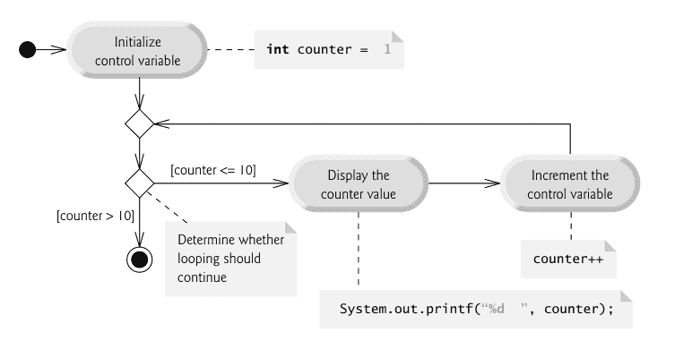

图 4.4 | 图 4.2 中 `for` 语句的 UML 活动图。

## 4.4 for 语句的示例

以下示例展示了在 `for` 语句中改变控制变量的技术。在每个情况下，我们只编写适当的 `for` 头部。注意递减控制变量的循环关系运算符的变化。

- a) 以 1 为增量将控制变量从 1 变为 100。
`for (int i = 1; i <= 100; i++)`

- c) 以 7 为增量将控制变量从 7 变为 77。
`for (int i = 7; i <= 77; i += 7)`

- e) 在值 2, 5, 8, 11, 14, 17, 20 之间改变控制变量。
`for (int i = 2; i < 20; i += 3)`

- f) 在值 99, 88, 77, 66, 55, 44, 33, 22, 11, 0 之间改变控制变量。
`for (int i = 99; i >= 0; i -= 1)`

> **常见编程错误 4.5**
> 在循环继续条件中使用错误的关系运算符通常会导致逻辑错误。

> **常见编程错误 4.6**
> 如果循环递增或递减超过 1，则不要在循环继续条件中使用等号 (==)。

## 应用：累加 2 到 20 的整数

图 4.5 使用 `for` 语句累加从 2 到 20 的整数。

```java
// 图 4.5: Sum.java
// 使用 for 语句累加整数。
public class Sum {
    public static void main(String[] args) {
        int total = 0;
        // 到 20 的整数
        for (int number = 2; number <= 20; number += 2) {
            total += number;
        }
        System.out.printf("Sum is %d", total);
    }
}
```

图 4.5 | 使用 `for` 语句累加整数。

初始化和增量表达式可以是逗号分隔的列表，允许你使用多个初始化表达式或多个增量表达式。例如，虽然这种做法是不鼓励的，但你可以如下所示合并 4.5 第 11-12 行的 `for` 语句体：

```
for (int number = 2; number <= 20; total += number, number += 2)
    // 空语句
```


> **良好编程规范 4.1**
> 为了可读性，尽可能将控制语句头部的大小限制在单行。

## 应用：复利计算

让我们使用 `for` 语句计算复利。考虑以下问题：

一个人在利率为 5% 的储蓄账户中投资了 1000 美元。假设所有利息都留在账户中，计算并打印 10 年内每年年底账户中的金额。使用以下公式来确定金额：

```
a = p(1 + r)^n
```

- p 是原始投资金额（即本金）
- r 是年利率（例如，5% 使用 0.05）
- n 是年数
- a 是第 n 年末的金额。

该问题的解决方案（图 4.6）涉及一个循环，该循环在资金存款的 10 年中每年执行一次指定的计算。第 8-10 行 `main` 声明了双类型变量 `amount`、`principal` 和 `rate`，并将 `principal` 初始化为 1000.0 和 0.05。

```java
// 图 4.6: Interest.java
// 使用 for 循环计算复利。
public class Interest {
    public static void main(String[] args) {
        double amount; // 每年末的存款金额
        double principal = 1000.0; // 计息前的金额
        double rate = 0.05; // 利率
        // 显示表头
        System.out.printf("%20s%n", "Year", "Amount on deposit");
        // 计算十年来每年的存款金额
        for (int year = 1; year <= 10; ++year) {
            // 计算指定年份的新金额
            amount = principal * Math.pow(1.0 + rate, year);
            // 显示年份和金额
            System.out.printf("%4d,%20.2f%n", year, amount);
        }
    }
}
```

| 年份 | 存款金额 |
|---|---|
| 1 | 1,050.00 |
| 2 | 1,102.50 |
| 3 | 1,157.63 |
| 4 | 1,215.51 |
| 5 | 1,276.28 |
| 6 | 1,340.10 |
| 7 | 1,407.10 |
| 8 | 1,477.46 |
| 9 | 1,551.33 |
| 10 | 1,628.89 |

**图 4.6** 使用 for 循环计算复利。

### 使用宽度和对齐方式格式化字符串

第 13 行输出了两个列的表头。第一列显示年份，第二列显示每年末的存款金额。我们使用说明符 `%20s` 来输出字符串 "Amount on Deposit"。在 `%` 和转换字符 `s` 之间的整数 `20` 表示该值应以 20 的字段宽度显示——即 `printf` 将该值至少占据 20 个字符位置显示。如果输出的值少于 20 个字符位置（在本例中为 17 个字符）

### 4.4 使用语句的示例

#### 使用 Math 类的静态 pow 执行利息计算

`for` 语句（第 16–23 行）执行其循环体 10 次，控制变量 `year` 从 1 到 10，增量为 1。当 `year` 变为 11 时，循环终止。（变量代表问题陈述中的 $n$）。

类提供了在对象上执行常见任务的方法。事实上，大多数方法必须在特定对象上调用。例如，为了输出图 4.6 中的文本，第 13 行在 `System.out` 上调用了 `printf` 方法；而从键盘输入值则在 `Scanner` 对象上调用了 `next()` 方法。某些类还提供了执行常见任务且*不需要*对象的方法。这些方法被称为静态方法。例如，Java *并不包含* 幂运算符，因此 Java 类的设计者定义了一个静态方法来计算一个数值的幂。你可以通过指定类名后跟一个点（`.`）和方法名来调用静态方法，如：

`ClassName.methodName(arguments)`

在第 5 章中，你将学习在类中实现利息计算。
我们使用**Math 类 pow 方法**来执行图 4.6 中的复利计算。`pow(x,y)` 计算 $x$ 的 $y$ 次方。该方法接收两个参数并返回一个双精度值。第 19 行执行计算 $a = p(1 + r)^n$，其中 $a$ 是本金，$r$ 是利率，$n$ 是年份。`Math` 类定义在 `lang` 包中，所以你不需要导入即可使用它。

`for` 语句的循环体包含计算 `1 + rate`，它表现为 `Math.pow`。事实上，这个计算在*每次循环时产生的结果都是相同的*，在循环的每次迭代中重复它是浪费资源的。

### 性能提示 4.1

> 在循环中，避免进行那些结果永远不会改变的计算——计算通常应该放在循环之外。你使用的许多高级优化编译器会将此类计算放在编译后代码的循环之外。

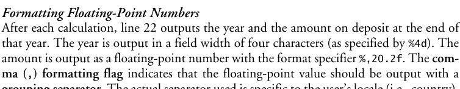

### 格式化数字

在每次计算后，第 22 行输出该年底的年份和金额。年份以四个字符的字段输出（如 `%d` 所示）。金额以浮点数格式输出，使用格式说明符 `%.2f`。该标志表示浮点值应以带有**分组分隔符**的形式输出。实际的分隔符取决于用户的本地区域设置（即国家）。例如，在美国，数字将输出逗号来分隔每三位数字，并使用小数点来分隔数字的小数部分，如 1,234.45。格式规范中的数字 20 表示该值应在 20 个字符宽的*字段宽度*内向右对齐输出。`.2` 指定了格式化数字的精度——在这种情况下，数字被四舍五入到最近的百分位，即小数点后保留两位。

### 关于显示数字的警告

在利息计算中使用浮点类型（`double` 或 `float`）是危险的，因为会导致舍入误差。浮点类型的不精确性——Java 提供了 `BigDecimal`。

## 4.5 do...while 循环语句

`do...while` 语句与 `while` 语句相似。在 `while` 中，程序在循环体开始前测试循环持续条件；如果条件为假，循环体永远不会执行。`do...while` 语句在执行循环体后测试循环持续条件；因此，循环体至少执行一次。当 `do...while` 语句终止时，执行继续后续语句。图 4.7 使用 `do...while` 输出 1–10。

第 18 行声明并初始化控制变量 `counter`。进入 `do...while` 语句后，第 12 行输出 `counter` 的值，第 13 行增加 `counter`。然后程序在循环底部评估循环持续测试（第 14 行）。如果条件为真，循环回到第一个体语句（第 12 行）。如果条件为假，循环终止，程序继续执行循环后的语句。

### do...while 语句的 UML 活动图

图 4.8 包含了 `do...while` 语句的 UML 活动图。该图清楚地表明，在执行动作状态后才会评估循环持续条件。将此活动图与 `while` 语句的活动图（图 3.4）进行比较。

### do...while 语句中的括号

如果循环体只有一个语句，则在 `do...while` 重复语句中不需要大括号。然而，许多程序员会使用大括号，以避免 `while` 和 `do...while` 语句之间的混淆。例如，

```
while (condition)
```

通常是 `while` 语句的第一行。没有大括号的单语句 `do...while` 语句显示如下：

```
do
while (condition);
```

这可能会引起困义。读者可能会将最后一行——`while(condition);`——误认为是一个包含空语句（分号本身）的 while 语句。因此，`do...while` 语句通常使用大括号写成：

```
do
{
} while (condition);
```


# 良好的编程实践 4.2

在 `do...while` 语句中始终包含大括号。这有助于消除 `while` 语句以及仅包含语句的 `do...while` 语句的歧义。

## 4.6 switch 多重选择语句

第 3 章讨论了 `if` 单选择语句和 `if...else` 双重选择语句。`switch` 多重选择语句根据类型为 `byte`、`short`、`int` 或 `char` 的常量整型表达式的可能值执行不同的操作。从 Java 7 开始，该表达式可以是 `String`。

### 使用 switch 语句统计 A、B、C、D 和 F 级

图 4.9 计算用户输入的数字成绩的平均值，并使用 `switch` 语句确定哪个成绩等同于 A、B、C、D 或 F，以增加相应的等级计数器。程序还会显示获得每个等级的学生数摘要。

与之前的类平均分总程序类似，`class-Grades` 的 `main` 方法（图 4.9）声明了局部变量 `total`（第 9 行）和 `gradeCounter`（第 10 行），用于跟踪用户输入的成绩和成绩数量。第 11–15 行为每个等级类别声明了计数器变量。注意第 9–15 行中的变量已初始化为 0。

方法包含两个关键部分。第 26–56 行使用哨兵控制循环从用户读取任意整数成绩，更新实例变量 `total` 和 `gradeCounter`，并为每个成绩增加相应的字母等级计数器。第 59–80 行打印包含所有输入成绩、成绩平均值以及获得每个字母等级的学生数的报告。让我们详细检查这些部分。

```java
// Fig. 4.9: LetterGrades.java
// LetterGrades 类使用 switch 语句统计字母等级。

import java.util.Scanner;

public class LetterGrades
{
    public static void main(String[] args) {
    }
}
```

图 4.9 | LetterGrades 类使用 switch 语句统计字母等级。（3 部分中的 1 部分。）

```java
int total = 0; // 成绩总和
int gradeCounter = 0; // 输入的成绩数量
int aCount = 0; // A 级成绩计数
int bCounter = 0; // B 级成绩计数
int cCounter = 0; // C 级成绩计数
int dCounter = 0; // D 级成绩计数
int fCounter = 0; // F 级成绩计数
```

```java
Scanner input = new Scanner(System.in);
System.out.printf("%s%s%s\n%s\n%s\n",
    "输入 0-100 范围内的整数成绩：",
    "用于终止输入的文件结束符类型：",
    "在 Unix/Linux/Mac OS 上输入 <ctrl> 然后按 Enter",
    "在 Windows 上输入 <ctrl> 然后按 Enter");
```

```java
// 循环直到用户输入文件结束符
while (input.hasNext()) {
    int grade = input.nextInt(); // 读取成绩
    total += grade; // 将成绩加入总和
    gradeCounter++; // 增加成绩数量
    // 增加相应的字母等级计数器
    switch (grade / 10) {
        case 9: // 成绩在 90 之间
        case 10: // 且包含 100
            ++aCount;
            break; // 退出 switch
        case 8: // 成绩在 80 到 89 之间
            ++bCount;
            break; // 退出 switch
        case 7: // 成绩在 70 到 79 之间
            ++cCount;
            break; // 退出 switch
        case 6: // 成绩在 60 到 69 之间
            ++dCount;
            break; // 退出 switch
        default: // 成绩小于 60
            ++fCount;
            break; // 可选；退出 switch
    }
}

// 显示成绩报告
System.out.printf("%n成绩报告:%s\n");
```

图 4.9 | LetterGrade 类使用 switch 语句统计成绩。（3 部分中的 2 部分。）

```java
// 如果用户输入至少一个成绩..
if (gradeCounter != 0)
{
    // 计算所有成绩的平均值
    double average = (double) total / gradeCounter;
    // 输出摘要
    System.out.printf("输入的 %d 个成绩总和为 %d\n", gradeCounter, total);
    System.out.printf("班级平均分数为 %.2f\n", average);
    System.out.printf("%d%s%d%s%d%s%d%s%d%s%d%s%d%s\n",
        "获得每个等级的学生数",
        "A": aCount,
        "B": bCounter,
        "C": cCounter,
        "D": dCounter,
        "F": fCounter);
}
else
{
    // 没有输入成绩
    System.out.println("未输入成绩");
}
```

# 138 第4章 控制语句：第2部分；逻辑运算符

循环继续会返回第 26 行的循环继续条件，以确定循环是否继续执行。

我们 `switch` 语句中的 `case` 显式地测试了值 10, 9, 8, 7 和 6。注意第 35–36 行的 `case`，它们测试了值 9 和 10（两者都代表 A 等级）。以这种方式连续列出 `case` 且之间没有语句，可以使 `case` 执行相同的语句集——当控制表达式求值为 9 或 10 时，第 37–38 行的语句将执行。`switch` 语句*没有*提供测试值范围的机制，因此你需要测试的每个值都必须列在单独的 `case` 标签中。每个 `case` 可以有多个语句。`switch` 语句与其他控制语句的区别在于，它不需要在 `case` 中的多个语句周围使用大括号。

## 不带 break 语句的 case

如果没有 `break` 语句，在 `switch` 中会发生匹配，该 `case` 及后续 `case` 的语句将执行，直到遇到 `break` 语句或 `switch` 结束。这通常被称为“贯穿”（falling through）到后续 `case` 的语句。（这一特性非常适合编写一个简洁的程序来显示练习 4.2.9 中迭代的“圣诞节的十二天”）。

如果控制表达式的值与 `case` 标签之间没有发生匹配，则执行 `default` case。我们使用 `default` 处理所有小于 6 的控制表达式值——即所有不及格的分数。如果没有发生匹配且 `switch` 不包含 `default` case，程序将直接继续执行 `switch` 之后的第一个语句。

## 默认 case (default Case)

> 在 `switch` 语句中，确保你测试了控制表达式的所有可能的取值。

## 错误预防技巧 4.7

第 59–80 行根据成绩输出报告（如图 4.9 的输入/输出窗口所示）。第 62 行确定用户是否输入了至少一个成绩——这帮助我们避免除零。如果是，第 65 行计算成绩的平均值。然后第 68-77 行输出所有成绩的总和、班级平均分以及获得每个字母等级的人数。如果没有输入成绩，第 80 行输出一条适当的消息。图 4.9 中的输出显示了一个基于 10 个成绩的示例报告。

## 显示成绩报告

图 4.10 显示了通用 `switch` 语句的 UML 活动图。大多数 `switch` 语句在每个 `case` 中使用 `break` 在处理完 `case` 后终止 `switch` 语句。图 4.10 强调了这一点，在活动图中包含了 `break` 语句。该图清楚地表明，`case` 尾的 `break` 语句会导致控制立即退出 `switch` 语句。

## switch 语句 UML 活动图

## 4.6 switch 多选择语句 139

**图 4.10** | 带有 `break` 语句的 switch 多选择语句 UML 活动图。

`switch` 的最后一个 `case`（或最后出现的可选 `default` case）不需要 `break` 语句，因为执行将继续进行 `switch` 之后的下一个语句。

> **错误预防技巧 4.8**
>
> 在 `switch` 语句中提供一个 `default` case。这让你关注处理异常情况的需求。

> **良好编程实践 4.3**
>
> 虽然 `switch` 中的每个 `case` 和 `default` case 可以按任何顺序出现，但请将 `default` 异常情况放在最后。当 `default` case 列在最后时，该 `case` 不需要 `break`。

### 关于 switch 中每个 case 表达式的说明

使用 `switch` 语句时，记住每个 `case` 必须包含字符串或常量表达式——即任何求值为常量整数值的整数组合（例如，-7 或 221）。整数仅仅是一个整数值。此外，你可以使用字符——位于单引号内的特定字符，如 `'a'`、`'7'` 或 `'S'`——它们代表字符值和枚举常量（在 5.10 节引入）（附录 B 显示了 ASCII 字符集中字符的整数值，它是 Java 使用的 Unicode 字符集的子集）。

每个 `case` 中的表达式也可以是一个常量变量——一个在整个程序运行期间值不改变的变量。变量使用 `final` 关键字声明（在第 5 章讨论）。Java 有一种名为枚举类型的特性，我们将在第 5 章中也会介绍这种特性——枚举类型常量也可以用于 `case` 标签。

## 140 第4章 控制语句：第2部分；逻辑运算符

在第 10 章《面向对象编程：多态与接口》中，我们介绍了一种更优雅的实现 `switch` 逻辑的方法——我们使用多态的技术来创建程序，使用 `switch` 逻辑创建的程序通常更清晰、更容易维护且更容易扩展。

## 4.7 break 和 continue 语句

除了选择语句和重复语句外，Java 还提供了语句 `break`（我们在 `switch` 中讨论过）和 `continue`（在本节中介绍）来改变控制流。

### break 语句

在 `while`、`for`、`do...while` 或 `switch` 中执行的 `break` 语句会导致立即退出循环。`break` 的常见用法提前退出循环（如图 4.9 所示）。本节展示如何使用 `break` 终止循环。

```java
// 图 4.11: BreakTest.java
// 退出 for 循环的 break 
public class BreakTest
{
    public static void main(String[] args) {
        int count;
        for (count = 1; count <= 10; count++) // 循环10次
            if (count == 5)
                break; // 终止循环
            System.out.printf("%d ", count);
        System.out.printf("Broke out of loop at count = %d%n", count);
    }
}
```

11–12 行检测到 `count` 的值为 5。当 `break` 语句执行时，程序通过 `for` 语句中的 `count` 增量继续。图 4.11 显示了循环结束时控制变量的值。循环完整执行了四次而不是 10 次。

### continue 语句

在 `while`、`for` 或 `do...while` 中执行的 `continue` 语句跳过循环体的剩余语句并继续循环的下次迭代。在 `while` 和 `do...while` 语句中，程序在 `continue` 语句之后立即评估循环继续测试。对于 `for` 语句，执行增量，然后评估循环继续条件。

```java
// 图 4.12: ContinueTest.java
// 终止 for 迭代的 continue 语句
public class ContinueTest
{
    public static void main(String[] args)
    {
        for (int count = 1; count <= 10; count++) // 循环10次
            if (count == 5)
                continue; // 如果 count 为5则跳过体的剩余代码
            System.out.printf("%d ", count);
        System.out.printf("%nUsed continue to skip printing 5%n");
    }
}
```

| 1 2 3 4 6 7 8 9 10 |
| :--- |
| Used continue to skip printing 5 |

**图 4.12** | 终止 `for` 语句迭代的 `continue` 语句。

在 4.3 节中，我们提到它在大多数情况下都可以用来替代。当 `while` 语句中的增量紧跟 `continue` 语句时，这种说法是不正确的。在这种情况下，增量在程序评估重复继续条件之前不会执行，而 `for` 语句的情况则并不相同。

## 4.8 逻辑运算符

`if`、`if...else`、`do...while` 和 `for` 语句都需要一个条件来确定程序的控制流走向。到为止，我们只学习了简单条件，例如 `count <= 10`、`number != sentinelValue` 和 `total >= 1000`。简单条件用关系运算符 `>`、`<`、`>=`、`<=` 以及相等运算符 `==` 和 `!=` 表示，每个表达式只测试一个条件。在决策过程中，我们在单独的语句中执行这些测试，或者嵌套在 `if...else` 中。有时控制语句需要更复杂的条件来确定程序的控制流。

Java 的逻辑运算符允许你通过组合简单条件来形成更复杂的条件。逻辑运算符有 `&&`（逻辑与）、`||`（逻辑或）、`&`（布尔与）、`|`（布尔包含或）、`^`（布尔异或）和 `!`（逻辑非）。注意：当 `&` 和 `^` 应用整型操作数时，它们也是位运算符。我们将在附录 K 中讨论位运算符。

### 逻辑与 (&&) 运算符

假设我们希望在选择某个执行路径之前，确保程序中的某些条件都为真。在这种情况下，我们可以使用 `&&`（逻辑与）运算符，如下：

```java
if (gender == FEMALE && age >= 65)
   ++seniorFemales;
```

该语句包含两个简单条件。条件 `gender == FEMALE` 将变量与常量 `FEMALE` 比较，以判断人是否为女性。条件 `age >= 65` 可能被求值以判断是否为老年人。`if` 语句考虑组合条件：

```
gender == FEMALE && age >= 65
```

只有当两个简单条件都为真时，它为真。在这种情况下，`if` 语句体会将 `seniorFemales` 加 1。如果其中一个或两个条件为假，程序将跳过加操作。某些程序员发现，添加冗余的括号会让前面的条件更具可读性，例如：

```java
(gender == FEMALE) && (age >= 65)
```

图 4.13 中的表格总结了 `expression1` 和 `expression2` 的假值和真值所有可能的组合。此类表格被称为“真值表”。Java 将所有包含关系运算符、相等运算符或逻辑运算符的表达式求值为假或为真。

| expression1 | expression2 | expression1 && expression2 |
|---|---|---|
| false | false | false |
| false | true | false |
| true | false | false |
| true | true | true |

**图 4.13** &&（逻辑与）运算符真值表。

### 逻辑或 (||) 运算符

假设我们希望在选择执行路径之前，确保两个条件中的至少一个或都为真。在这种情况下，我们使用 `||`（逻辑或）运算符，如下程序段：

```java
if ((semesterAverage >= 90) || (finalExam >= 90))
    System.out.println("Student grade is A");
```

上述语句也包含两个简单条件。条件 `semesterAverage >= 90` 判断学生是否因为整个学期的表现良好而在该课程中获得 A。条件 `finalExam >= 90` 判断学生是否因为期末考试表现优异而在该课程中获得 A。如果语句随后考虑组合条件


`semesterAverage >= 90 || (finalExam >= 90)`

并在其中一个或两个简单条件为真时，则授予学生 A 等。只有当两个简单条件都为假时，才不打印“Student grade is A”信息。图 4.14 显示了逻辑或运算符（`||`）的真值表。两个运算符从左到右结合。

| expression1 | expression2 | expression1 \|\| expression2 |
|---|---|---|
| false | false | false |
| false | true | true |
| true | false | true |
| true | true | true |

**图 4.14** \|\|（逻辑或）运算符真值表。

### 复杂条件的短路求值

表达式中包含 `&&`、`||` 运算符的部分将一直求值，直到确定条件真假。因此，表达式

```
gender == FEMALE && (age >= 65)
```

如果 `gender` 不等于 `FEMALE`（整个表达式为假），求值立即停止；如果 `gender` 等于 `FEMALE`，则继续（即如果条件 `age >= 65` 为真，整个表达式仍可能为真）。逻辑与和或表达式的这种特性被称为**短路求值**。

### 常见编程错误 4.8

在使用运算符 `&&` 的表达式中，一个条件——我们称之为“依赖条件”——可能需要另一个条件为真，依赖条件的求值才有意义。在这种情况下，依赖条件应该放在 `&&` 运算符之后以防止错误。表达式 `(i != 0) && (10 / i == 2)` 中的依赖条件必须出现在 `&&` 运算符之后，以防止除以零的可能性。

### 布尔与 (&) 和布尔逻辑或 (|) 运算符

逻辑与（`&`）和布尔逻辑包含或（`|`）运算符与 `&&` 和 `||` 运算符相同，但 `&&` 和 `||` 总是求值它们的两个操作数（即它们不执行短路求值）。因此，表达式

```java
(gender == 1) & (age >= 65)
```

无论 `gender` 是否为 1，都会求值 `age >= 65`。如果你需要在两个条件中都执行副作用，这很有用。

### 逻辑非 (!)

`!` 运算符是一个一元运算符，用于反转表达式的布尔值。与二元运算符 `&&` 和 `||` 不同，逻辑非运算符只有一个操作数。例如，上述语句可以写为：

```java
if (!gradeA) {
    System.out.println("Student grade is not A");
}
```

这种灵活性可以帮助你用方便的方式表达条件。图 4.16 是逻辑非的真值表。

| expression | !expression |
|---|---|
| false | true |
| true | false |

**图 4.16** !（非）运算符真值表。

## 4.8 逻辑运算符

```java
// 为 & (布尔逻辑与) 运算符创建真值表
```

```java
System.out.printf("%s%n: %b%n: %b%n: %b%n: %b%n: %b%n",
"Boolean logical AND (&)", "false", "false",
"false and true", (false and true),
"true and false", (true and false),
"true and true", (true and true);
```

```java
// 为 | (布尔逻辑或) 运算符创建真值表
```

```java
System.out.printf("%s%n: %b%n: %b%n: %b%n: %b%n: %b%n",
"Boolean logical inclusive OR (|)",
"false | false", (false | false),
"false | true", (false | true),
"true | false", (true | false),
"true | true", (true | true);
```

```java
// 为 ^ (布尔逻辑异或) 运算符创建真值表
```

```java
System.out.printf("%s%n: %b%n: %b%n: %b%n: %b%n: %b%n",
"Boolean logical exclusive OR (^)",
"false ^ false", (false ^ false),
"false ^ true", (false ^ true),
"true ^ false", (true ^ false),
"true ^ true", (true ^ true);
```

```java
// 为 ! (逻辑否定) 运算符创建真值表
```

```java
System.out.printf("%s%n: %b%n: %b%n",
"Logical NOT (!)",
"!false", (!false), "!true", (!true);
```

```java
} // class LogicalOperators
```

条件与 (`&&`)

false && false: false

false && true: false

true && false: false

true && true: true

条件或 (`||`)

false || false: false

false || true: true

true || false: true

true || true: true

布尔逻辑与 (`&`)

false & false: false

false & true: false

true & false: false

true & true: true

布尔逻辑或 (`|`)

false | false: false

false | true: true

true | false: true

true | true: true

图 4.17 逻辑运算符。（3 部分中的部分部分。）

## 4.9 结构化编程总结

| 布尔逻辑异或 (`^`) |
|---|
| false ^ false: false |
| false ^ true: true |
| true ^ false: true |
| true ^ true: false |

| 逻辑否定 (`!`) |
|---|
| !false: true |
| !true: false |

**图 4.17** | 目前为止介绍的运算符的逻辑与结合性（3 部分中的最后部分。）

### 目前为止介绍的运算符的优先级和结合性

图 4.18 显示了目前引入的 Java 运算符的优先级和结合性。运算符按优先级从高到低的顺序显示。

| 运算符 | 结合性 | 类型 |
|---|---|---|
| `++` `--` | 从右到左 | 一元后置 |
| `++` `--` `!` `(type)` | 从右到左 | 一元前置 |
| `*` `/` `%` | 从左到右 | 乘法 |
| `+` `-` | 从左到右 | 加法 |
| `<` `<=` `>=` `>` | 从左到右 | 关系 |
| `==` `!=` | 从左到右 | 相等 |
| `&` | 从左到右 | 布尔逻辑与 |
| `^` | 从左到右 | 布尔逻辑异或 |
| `|` | 从左到右 | 布尔逻辑或 |
| `&&` | 从左到右 | 条件与 |
| `||` | 从左到右 | 条件或 |
| `?` `:` | 从右到左 | 条件 |
| `=` `+=` `-=` `*=` `/=` `%=` | 从右到左 | 赋值 |

**图 4.18** | 目前为止讨论的运算符的优先级/结合性。

## 4.9 结构化编程总结

正如建筑师利用其职业的集体智慧来设计建筑一样，程序员也应该设计程序。这个领域比建筑学年轻得多，我们的集体智慧也更为稀缺。我们已经了解到，结构化编程产生的程序比非结构化程序更容易理解、测试、调试、修改并从数学意义上证明其正确性。

**Java 控制语句是单入口/单出口的**

图 4.19 使用 UML 活动图来总结 Java 的控制语句。初始和结束状态表示每个控制语句的单一入口点和单一出口。

## 顺序

## 选择

- if 语句（单选择）
- 带 break 的 switch 语句（多选择）
- if...else 语句（双选择）

## 重复

- while 语句
- do...while 语句
- for 语句

图 4.19 | Java 的单入口/单出口、选择和重复。

## 4.9 结构化编程总结

正如建筑师利用其职业的集体智慧来设计建筑一样，程序员也应该设计程序。这个领域比建筑学年轻得多，我们的集体智慧也更为稀缺。我们已经了解到，结构化编程产生的程序比非结构化程序更容易理解、测试、调试、修改并从数学意义上证明其正确性。

### 程序的规则

图 4.20 显示了构建结构化程序的规则……

1. 从最简单的图开始（图 4.21）。
2. 任何动作状态都可以被替换为顺序。
3. 任何动作状态都可以被替换为控制语句（if...else, switch, while, do...while 或 for）。
4. 规则 2 和 3 可以根据需要反复使用，并以任何顺序执行。

**图 4.20** | 程序的规则。

### 三种控制形式

结构化编程促进了简单性。实现算法只需要三种控制形式：

- 顺序
- 选择
- 重复

顺序结构是显而易见的。只需按照执行顺序列出语句即可。选择可以通过三种方式实现：

- if 语句（单分支选择）
- if...else 语句（双分支选择）
- switch 语句（多选择）

事实上，可以很容易地证明 if 语句足以提供任何形式的选择——任何用 if...else 语句和 switch 语句完成的操作，都可以通过组合 if 语句来实现（尽管可能没有那么清晰和高效）。

重复通过三种方式之一实现：

- while 语句
- do...while 语句
- for 语句

[注：还有第四种重复语句——增强 for 语句，我们在第 6.6 节中讨论过。] 可以很容易地证明 while 语句足以提供任何形式的重复。任何用 do...while 和 for 完成的操作都可以用 while 语句完成（尽管可能不那么方便）。

结合这些结果说明，Java 程序中需要的任何形式的控制都可以用以下术语表示：

- 顺序
- if 语句（选择）
- while 语句（重复）

并且这些只能以两种方式组合——堆叠和嵌套。事实上，结构化编程是简单性的本质。

## 4.10（可选）GUI 和图形用例研究：绘制矩形和椭圆

我们的下一个程序（图 4.25）演示了如何使用 `Graphics` 的方法 `drawRect` 和 `drawOval` 分别绘制矩形和椭圆。`paintComponent` 方法（第 10–21 行）执行实际绘制工作。记住，每个 `paintComponent` 中的第一条语句必须是 `super.paintComponent`，如第 12 行所示。第 14–20 行循环 10 次以绘制 10 个矩形和 10 个椭圆。

```java
// Fig 4.25: Shapes.java
// 根据用户的选择绘制一系列级联形状。
import java.awt.Graphics;
import javax.swing.JPanel;
import javax.swing.JFrame;

public class Shapes extends JPanel
{
```

**图 4.25** | 根据用户的选择绘制一系列级联形状。（2 部分中的第 I 部分。）

### 从左上角开始绘制一系列级联形状

```java
public void paintComponent(Graphics g) {
    for (int i = 0; i < 10; i++) {
        g.drawRect(10 + i * 10, 50 + i * 10, 50, i * 10);
        g.drawOval(240 + i * 10, 50 + i * 10, 50, i * 10);
    }
}
```

```java
public static void main(String[] args) {
    Shapes panel = new Shapes(); // 创建面板
    JFrame application = new JFrame(); // 创建一个新的 JFrame
    application.setDefaultCloseOperation(JFrame.EXIT_ON_CLOSE);
    application.add(panel);
    application.setSize(500, 290);
    application.setVisible(true);
}
```

第 16–17 行调用 `Graphics` 方法 `drawRect`，需要四个参数。前两个表示矩形左上角的 x 和 y 坐标；后两个表示矩形的宽度和高度。在本例中，我们从顶部向下 10 像素、向右 10 像素的位置开始，循环的每次迭代都会让左上角向下向右移动 10 像素。矩形的宽度和高度从 50 像素开始，每次增加 10 像素。第 18–19 行在循环中绘制 oval。`drawOval` 创建一个边界矩形，并在其中放置一个接触四边中点的椭圆。方法的四个参数表示边界矩形左上角的 x 和 y 坐标以及边界矩形的宽度和高度。传递给 `drawOval` 的值与第 16–17 行传递给 `drawRect` 的值完全相同，但第一个椭圆从面板左侧 240 像素处开始。由于边界矩形的宽度和高度在本例中是相同的，作为练习，修改程序以绘制矩形和椭圆。

## 4.11 总结

在本章中，我们引入了允许控制执行的控制语句。我们展示了任何算法都可以使用选择和重复来开发。在本章中，我们使用了 if、if...else、switch、while、do...while 和 for 语句。我们还演示了如何将程序解构为这些类型的语句。

### 4.2 计数重复的基础

- 计数重复（第 122 页）需要一个控制变量，该变量的初始值在每次循环时都会被修改。
- 你可以在同一条语句中声明变量并初始化它。

### 4.3 重复语句

- while 语句可以实现任何计数重复。
- for 语句（第 124 页）指定计数重复的所有细节。
- 当语句开始执行时，它的控制变量被声明并初始化。如果循环继续条件为真，则执行体。在执行循环体后，执行增表达式。然后再次进行循环继续测试以确定循环是否继续。
- for 语句的通用格式为：

```
for (initialization; loopContinuation; increment)
    statement
```

其中初始化表达式命名循环变量并提供其初始值，`loopContinuation` 决定循环是否继续，`increment` 修改控制变量使循环继续变为假。for 头部中的两个分号是必须的。

- 大多数 for 语句可以用如下 while 语句表示：

```
initialization;
while (loopContinuation)
{
    statement;
    increment;
}
```

- 通常，for 语句用于计数重复，while 语句用于哨兵控制重复。
- 如果 for 头部的初始化表达式声明了控制变量，则该控制变量只能用于 for 语句——它在语句外不存在。
- for 头部中的表达式是可选的。如果省略 `loopContinuationCondition`，Java 会假设它为真，从而无限循环。如果控制变量在循环之前已初始化，你可以省略初始化表达式。如果增量是用循环体中的语句计算的或不需要增量，你可以省略增表达式。
- 增表达式的作用就像位于 for 体末尾的独立语句。
- for 语句可以使用负增量——即递减（第 127 页）来向下计数。
- 如果循环继续条件初始为假，则不执行 for 语句的体。

### 4.4 使用 for 语句的示例

- Java 将 `1000.0` 和 `0.05` 等浮点常数视为 `double`。同样，Java 将 `7` 和 `-22` 等整数常数视为 `int`。
- 格式指定符 `%4s` 在字段宽度（第 130 页）为 4 的区域内输出一个 `String`——即 print 以至少 4 个字符位置显示该值。如果要输出的值少于 4 个字符


# 第 4 章 控制语句：部分 2 逻辑运算符

宽度时，值在字段中右对齐（p. 130）。如果该值的宽度大于 4 个字符位置，字段宽度将扩展以适应相应数量的字符。要将值左对齐（p. 130），请使用负整数来指定字段宽度。

* `Math.pow(x, y)` (p. 131) 计算 x 的 y 次方值。该方法接收两个参数并返回一个 `double` 类型的值。

* 格式中的逗号（`,`）格式化标志（p. 131）表示浮点数值时应带有分组分隔符（p. 131）输出。实际使用的分隔符取决于用户所在的区域设置（例如国家）。在美国，数字将使用逗号分隔每三位数字，并使用小数点分隔数字的小数部分，如 1,234.45。

* 格式中的分隔符表示其右侧的指示符是数字的精度。

## 4.6 节 do...while 语句

* `do...while` 语句 (p. 132) 与 `while` 语句相似。程序在循环开始时执行循环体之前测试循环继续条件；如果条件为假，则循环体永远不会执行。`do...while` 语句在循环体之后测试循环继续条件；因此，循环体至少会执行一次。

## 4.6 节 switch 多选择语句

* `switch` 语句 (p. 134) 根据常量整数表达式（类型为 `short`、`int`、`char` 或 `long` 的常量值）或 `String` 的可能值执行操作。

* 结束指示符（end-of-indicator）是取决于系统的按键组合，用于终止用户输入。在 UNIX/Linux/Mac OS 系统上，通过单独在一行输入序列 `<Ctrl-d>` 来输入文件结束。这意味着仅仅按下 `Ctrl` 键和 `d` 键是没有意义的。在 Windows 上，通过输入 `<Ctrl-z>` 来输入。

* `Scanner` 方法 `hasNext()` (p. 137) 确定是否有更多数据待输入。如果有更多数据，则该方法返回布尔值 `true`；否则返回 `false`。只要没有输入结束指示符，`hasNext()` 方法就会返回 `true`。

* `switch` 语句由一个包含一系列 `case` 标签（p. 137）和一个可选的 `default` 情况（p. 137）的块组成。

* 在 `switch` 中，程序评估控制表达式并将其值与每个 `case` 标签进行比较。如果发生匹配，程序将执行该 `case` 的语句。

* 连续列出且之间没有语句的标签可以使它们执行同一组语句。

* 在 `switch` 中想要测试的每个值必须在单独的 `case` 标签中列出。

* 每个 `case` 可以有多个语句，这些语句不需要放在括号中。

* 一个 `case` 通常以 `break` 语句（p. 137）结束，从而终止 `switch` 的执行。

* 如果没有 `break` 语句，每当 `switch` 中发生匹配时，该 `case` 及后续 case 的语句都会执行，直到遇到 `break` 语句或 `switch` 结束。

* 如果控制表达式的值与 `case` 标签之间没有发生匹配，则执行可选的 `default` 情况。如果没有发生匹配且 `switch` 不包含 `default` 情况，程序控制将继续执行 `switch` 之后的第一条语句。

## 4.7 节 break 和 continue 语句

* `break` 语句在 `while`、`for`、`do...while` 或 `switch` 中执行时，会导致立即退出该语句。

* `continue` 语句（p. 140）在 `while`、`for` 或 `do...while` 中执行时，会跳过循环剩余的体语句并进入下一次迭代。在 `while` 和 `do...while` 中，程序会立即评估循环继续测试。对于 `for` 语句，先执行增加表达式，然后程序评估循环继续测试。

## 4.8 节 逻辑运算符

* 简单条件通过关系运算符 `>`、`<`、`>=`、`<=` 以及相等运算符 `==` 和 `!=` 表示，每个表达式只测试一个条件。

* 逻辑运算符 (p. 142) 允许你通过组合简单条件来形成更复杂的条件。逻辑运算符包括 `&&`（逻辑与）、`||`（逻辑或）、`&`（位与）、`|`（位或）、`^`（位异或）和 `!`（逻辑非）运算符。如果其中一个或两个简单条件为真，则整个结果可能为假（注：此处原文逻辑可能有误，通常逻辑与在全为真时为真）。

* 为了确保两个条件都为真，请使用 `&&`（逻辑与）运算符。如果其中一个或两个简单条件为假，则整个结果为假。

* 为了确保两个条件中至少有一个为真，请使用 `||`（逻辑或）运算符，当其中一个或两个简单条件为真时，其结果为真。

* 使用 `&&` 或 `||` 运算符的条件（p. 142）具有短路求值特性（p. 143）——它们的评估直到确定条件的真假为止。

* `&` 和 `|` 运算符 (p. 144) 工作原理与 `&&` 和 `||` 运算符相同，但会评估两个操作数。

* 使用布尔异或 (`^`；p. 144）的简单条件，当两个操作数中只有一个为真而另一个为假时，结果为真。如果两个操作数都为真或为假，则整个条件为假。该运算符保证会评估两个值。

* 一元运算符 `!`（逻辑非，144）会“反转”值。

## 自测

在以下内容中填空：

### 4.1 判断以下陈述对错（true 或 false）：

* `do...while` 语句在循环体之后测试循环继续条件；因此，循环体至少会执行一次。
* `break` 语句在 `while`、`for`、`do...while` 或 `switch` 中执行时，会导致立即退出该语句。
* `continue` 语句（p. 140）在 `while`、`for` 或 `do...while` 中执行时，会跳过循环剩余的体语句并进入下一次迭代。
* 格式中的逗号（`,`）格式化标志（p. 131）表示浮点数值时应带有分组分隔符（p. 131）输出。
* `switch` 语句（p. 134）根据常量整数表达式（类型为 `short`、`int`、`char` 或 `long` 的常量值）或 `String` 的可能值执行操作。
* 结束指示符是取决于系统的按键组合，用于终止用户输入。
* `hasNext()` 方法在有更多数据时返回布尔值 `true`；否则返回 `false`。
* `switch` 语句由一个包含一系列 `case` 标签和一个可选的 `default` 情况的块组成。
* 在 `switch` 中，程序评估控制表达式并将其值与每个 `case` 标签进行比较。
* 连续列出且之间没有语句的标签可以使它们执行同一组语句。
* 在 `switch` 中想要测试的每个值必须在单独的 `case` 标签中列出。
* 每个 `case` 可以有多个语句，这些语句不需要放在括号中。
* 一个 `case` 通常以 `break` 语句结束，从而终止 `switch` 的执行。
* 如果没有 `break` 语句，每当 `switch` 中发生匹配时，该 `case` 及后续 case 的语句都会执行，直到遇到 `break` 语句或 `switch` 结束。
* 如果控制表达式的值与 `case` 标签之间没有发生匹配，则执行可选的 `default` 情况。
* 简单条件通过关系运算符 `>`、`<`、`>=`、`<=` 以及相等运算符 `==` 和 `!=` 表示。

### 4.2

* 在 `while` 和 `do...while` 中，程序会立即评估循环继续测试。
* 对于 `for` 语句，先执行增加表达式，然后程序评估循环继续测试。
* 逻辑运算符允许你通过组合简单条件来形成更复杂的条件。
* 逻辑运算符包括 `&&`（逻辑与）、`||`（逻辑或）、`&`（位与）、`|`（位或）、`^`（位异或）和 `!`（逻辑非）运算符。
* 为了确保两个条件都为真，请使用 `&&`（逻辑与）运算符。如果其中一个或两个简单条件为假，则整个结果为假。
* 为了确保两个条件中至少有一个为真，请使用 `||`（逻辑或）运算符。
* 使用 `&&` 或 `||` 运算符的条件具有短路求值特性——它们的评估直到确定条件的真假为止。
* `&` 和 `|` 运算符工作原理与 `&&` 和 `||` 运算符相同，但会评估两个操作数。
* 使用布尔异或 (`^`）的简单条件，当两个操作数中只有一个为真而另一个为假时，结果为真。

### 4.3 编写语句以完成以下操作：

* a) 使用 `for` 循环求 1 到 99 之间的整数和。
* b) 使用 `pow` 方法计算 2.5 的 3 次方。
* c) 使用 `while` 循环和计数器变量打印 1 到 20 的整数。
* d) 每行打印五个整数。

```java
b) double result = Math.pow(2.5, 3);

c) i = 1;
while (i <= 20)
{
    System.out.print(i);

    if (i % 5 == 0)
        System.out.println();
    else
        System.out.print('\t');

    ++i;
}

d) for (i = 1; i <= 20; i++)
{
    System.out.print(i);

    if (i % 5 == 0)
        System.out.println();
    else
        System.out.print('\t');
}
```

### 4.4

* a) 错误：`while` 头部后的分号导致了无限循环，且缺少大括号。
    * 修正：将分号替换为 `{`，或者同时删除两个分号。
* b) 错误：使用浮点数控制 `for` 语句可能不起作用，因为大多数计算机对浮点数的表示是近似的。
    * 修正：使用整数，并进行适当计算以获得所需的值：
    ```java
    for (k = 1; k <= 10; k++)
        System.out.println((double)k / 10);
    ```
* c) 错误：第一个 `case` 语句中缺少 `break` 语句。
    * 修正：在第一个 `case` 的末尾添加 `break` 语句。如果你希望每次执行 `case 1` 时都执行 `case 2` 的语句，那么这种遗漏并不一定是错误。
* d) 错误：`while` 的继续条件中使用了错误的关系运算符。
    * 修正：使用 `<=` 而不是 `<`，或者将 10 改为 11。

# 练习题

4.5 描述计数循环的四个基本元素。

4.6 比较并对比 `while` 和 `for` 循环语句。

4.7 讨论在什么情况下使用 `do...while` 语句比 `while` 语句更合适。解释原因。

4.8 比较并对比 `break` 和 `continue` 语句。

4.9 找出并修正以下代码段中的错误：

* a) `For (i = 100; i >= 1; i++)`
    `System.out.println(i);`
* b) 下列代码应打印整数是奇数还是偶数：
    ```java
    switch (value % 2)
    {
        case 0:
            System.out.println("Even integer");
        case 1:
            System.out.println("Odd integer");
    }
    ```
* c) 下列代码应输出从 19 到 1 的奇数：
    ```java
    for (i = 19; i >= 1; i += 2)
        System.out.println(i);
    ```
* d) 下列代码应输出从 2 到 100 的偶数：
    ```java
    counter = 2;
    {
        System.out.println(counter);
        counter += 2;
    } while (counter < 100);
    ```

### 4.10 以下程序的作用是什么？

```java
// Exercise 4.10: Printing.java
public class Printing
{
    public static void main(String[] args)
    {
        for (int i = 1; i <= 10; i++)
        {
            for (int j = 1; j <= 5; j++)
                System.out.print('*');
        }
    }
}
// end class Printing
```

4.11 (寻找最小值) 编写一个程序找到多个整数中的最小的一个。假设第一个读取的值指定了用户输入的数值数量。

4.12 (计算奇数乘积) 编写一个程序计算 1 到 15 奇数的乘积。

4.13 (阶乘) 阶乘经常用于概率问题。正整数 $n$ 的阶乘（写作 $n!$，读作 "n factorial"）等于从 1 到 $n$ 的正整数的乘积。编写一个程序计算 1 到 200 的阶乘。使用 `long` 类型。以表格格式显示结果。什么困难可能阻止你计算 100 的阶乘？

4.14 (修改后的复利程序) 修改图 4 中的复利应用程序，使其对 5%、6%、7%、8%、9% 和 10% 的利率重复其步骤。使用循环来改变利率。

4.15 (三角形打印程序) 编写一个程序，单独显示以下模式，一个接一个。使用循环生成这些模式。所有的星号 (`*`) 都应该由同一个 `System.out.print('*');` 语句打印，以便星号并排打印。可以使用 `System.out.println();` 形式的语句移动到下一行。可以使用 `System.out.print(' ');` 语句最后两个模式显示空格。程序中不应有其他输出语句。[提示：最后两个模式的每行都有相应数量的空白格。]

```
(a)          (b)          (c)
**          ***********          **
***          ***********          ***
****         *********          ****
*****        *******          *****
*****        *******          *****
*****        *******          *****
*****        ***            *****
*****      ***              *****
*****    *                 *****
*****  *                   *****
```

**4.16** (柱状图打印) 计算机的一个有趣应用是显示图表和柱状图。一个读取 1 到 30 之间数字的程序。对于读取的每个数字，程序应显示相同数量的星号。例如，程序读取数字 7，它应该显示 `*******`。在读取所有五个数字后显示星号。

**4.17** (计算销售额) 一家在线零售商的产品价格如下：产品 1，$2.98；产品 2，$4.50；产品 3，$9.98；产品 4，$4.49；产品 5，$6.87。编写一个程序读取如下所示的数字对：

* a) 产品编号
* b) 数量

你的程序应使用 `switch` 语句确定每个产品的售价。它应计算并显示所有产品的总值。

**4.18** (修改后的复利程序) 修改图 4 中的复利应用程序，使其对 5%、6%、7%、8%、9% 和 10% 的利率重复其步骤。使用循环来改变利率。

**4.19** (三角形打印程序) 编写一个程序，单独显示以下模式，一个接一个。使用循环生成这些模式。所有的星号 (`*`) 都应该由同一个 `System.out.print('*');` 语句打印，以便星号并排打印。可以使用 `System.out.println();` 形式的语句移动到下一行。可以使用 `System.out.print(' ');` 语句最后两个模式显示空格。程序中不应有其他输出语句。[提示：最后两个模式的每行都有相应数量的空白格。]

# 产生影响

4.27 下面程序段的作用是什么？

```java
for (i = 1; i <= 5; i++)
{
    for (j = 1; j <= 3; j++)
    {
        for (k = 1; k <= 4; k++)
            System.out.print('*');
    }
    System.out.println();
} // 结束内层 for
System.out.println();
} // 结束外 for
```

4.28 描述你如何从循环中删除 `continue` 语句并将其替换为等效的结构化代码。使用你在此开发的技巧移除图 4.12 中程序中的 `continue` 语句。

4.29 (“圣诞节的十二天”）编写一个使用循环和 `switch` 语句打印歌曲《圣诞节的十二天》的应用程序。使用一个 `switch` 来打印天数“第一”、“第二”等。使用另一个独立的 `switch` 打印打印每年的剩余部分。访问网站 en.wikipedia.org/wiki/The_Twelve_Days_of_christmas_(song) 获取歌词。

# 产生影响

4.30 (全球变暖事实) 全球变暖这一争议性话题已被电影《不可置信的真相》广泛宣传，该片由前副总统阿尔·戈尔先生以及以及美国科学家网络——政府间气候变化专门委员会共同获得了 2007 年诺贝尔和平奖，以表彰“他们建立和传播有关人类气候变化的更大知识的努力”。研究全球变暖问题的两个方面（人们可能想搜索“全球变暖怀疑者”）。创建一个关于全球变暖的五题测验，每个问题有四个可能的答案（编号 1–4）。保持客观并尝试代表问题的两个方面。接下来，编写一个应用程序让用户回答测验，计算正确答案的数量（0 到 5）并向用户返回消息。如果用户答对了五个，打印“Excellent”；如果对四个，打印“Very good”；如果三个或更少，打印“是时候复习你的全球变暖知识了”，并列出你发现事实的网站列表。


## 4.31 (计划替代；公平税)

有许多方法可以让税收更公平。访问 `www.fairtax.org` 查看美国的公平税。研究拟议的公平税是如何运作的。一种建议是取消所得税，转而对你购买的所有商品和服务征收 23% 的消费税。一些公平税反对者反对 23% 这个数字，并且由于税收的计算方式，说税率为 30% 更准确——请仔细检查。编写一个程序，提示用户输入他们拥有的各种类别的支出（例如：住房、食物、衣服、交通、医疗、假期），然后打印该人员将支付的估计公平税。

## 4.32 (Facebook 用户群增长)

根据 CNNMoney.com 的数据，Facebook 在 2012 年 10 月达到了十亿用户。使用图 4.6 中的复合增长技术，并假设其用户群以 4% 的速度增长，Facebook 需要多少月才能将其用户群增长到 15 亿？Facebook 需要多少月才能将其用户群增长到


# 5.1 引言

- 5.1 引言
- 5.2 Java 中的程序模块
- 5.3 静态方法、静态变量和类 Math
- 5.4 方法的声明
- 5.5 关于声明和使用方法的注意事项
- 5.6 方法调用栈和栈帧
- 5.7 参数提升与类型转换
- 5.8 Java API 包
- 5.9 案例研究：安全随机数生成
- 5.10 案例研究：机会游戏；引入 enum 类型
- 5.11 声明的作用范围
- 5.12 方法重载
- 5.13 (可选) GUI 和图形案例研究：颜色和填充形状
- 5.14 总结

| 总结 | 自测练习 | 自测练习答案 | 练习题 | 产生影响 |

## 5.1 引言

经验表明，开发和维护大型程序的最佳方法是将其由微小的、简单的部分（或模块）构建。这种技术被称为分而治法。在本章中，你将学习如何声明和使用方法来方便大型程序的设计、实现和维护。

之前，你已经学习了特定对象——例如 `Scanner` 对象上的 `next` 方法以及 `System.out` 上的 `printf` 和 `println` 方法。你将发现某些方法（称为静态方法）可以在类而不是对象上被调用。你将学习如何声明静态方法，然后从其他方法（如 `main()`）调用它们。你还将学习 Java 如何跟踪当前正在执行哪个方法、局部变量如何在内存中维护，以及方法在完成执行后知道何时返回。

我们将简要转入随机数生成的模拟技术，并且一个名为“骰子”（craps）的游戏版本使用了你到本书为止用过的大部分编程技术。此外，你还将学习如何在程序中声明常量。

你在开发应用程序时使用或创建的许多类将具有多个同名的方法。这种技术被称为重载，用于实现对不同类型参数或不同数量参数执行相似任务的方法。

方法通过将任务拆分为自包含的单元来帮助你模块化程序。你已经在程序中声明了 `main` 方法。该方法的特殊之处在于它被调用来启动程序。我们将在第 7 章“类与对象”中继续讨论方法，并在第 18 章“递归”中进一步讨论方法。递归提供了一种关于方法和算法的有趣思考方式。

## 5.2 Java 中的程序模块

通过结合 Java 应用程序接口（也称为 API 或 Java 类库）提供的丰富的类和方法来编写程序。相关的类被分组在包中以便导入到程序中。你将在 21.4 节学习如何将自己的类分组。

### 软件工程观察 5.1

熟悉 Java API (`http://docs.oracle.com/javase/api/`) 提供的丰富的类和方法。5.8 节概述了包。不要重复造轮子。在可能的情况下，复用 Java 类和方法。

## 使用方法分而治

经验表明，开发和维护大型程序的最佳方法是将其由微小的、简单的部分（或模块）构建。这种技术被称为分而治法。在本章中，你将学习如何声明和使用方法来方便大型程序的设计、实现和维护。

之前，你已经学习了特定对象——例如 `Scanner` 对象上的 `next` 方法以及 `System.out` 上的 `printf` 和 `println` 方法。你将发现某些方法（称为静态方法）可以在类而不是对象上被调用。你将学习如何声明静态方法，然后从其他方法（如 `main()`）调用它们。你还将学习 Java 如何跟踪当前正在执行哪个方法、局部变量如何在内存中维护，以及方法在完成执行后知道何时返回。

我们将简要转入随机数生成的模拟技术，并且一个名为“骰子”（craps）的游戏版本使用了你到本书为止用过的大部分编程技术。此外，你还将学习如何在程序中声明常量。你在开发应用程序时使用或创建的许多类将具有多个同名的方法。这种技术被称为重载，用于实现对不同类型参数或不同数量参数执行相似任务的方法。

方法通过将任务拆分为自包含的单元来帮助你模块化程序。你已经在程序中声明了 `main` 方法。该方法的特殊之处在于它被调用来启动程序。我们将在第 7 章“类与对象”中继续讨论方法，并在第 18 章“递归”中进一步讨论方法。递归提供了一种关于方法和算法的有趣思考方式。

### 软件工程观察 5.2

为了提高软件的可用性，每个方法应限制为执行单一的定义的任务，并且方法的名称应该能够有效地表达该任务。


### 错误预防提示 5.1

执行一个任务的方法比执行多个任务的方法更容易测试和调试。


### 软件工程观察 5.3

如果你无法选择一个表达方法任务的简洁名称，你的方法可能正在尝试执行过多的任务。将此类方法拆分为更小的方法。


### 方法调用之间的层级关系

方法通过方法调用被激活，当被调用方法完成其任务时，它将控制——以及可能的结果——返回给调用者。这种程序结构的类比是层级管理形式（图 5.1）。老板（调用者）要求工人（被调用方法）执行任务，并在完成后报告（返回）结果。老板方法并不知道工人如何执行指定的任务。

## 5.3 静态方法、静态变量与 Math 类

实现细节的隐藏化有助于良好的软件工程。图 5.1 显示了主方法如何以分层的方式与多个工作方法进行通信。主方法将其职责分配给不同的工作方法。在这里，`worker1` 实际上充当了 `worker4` 和 `worker5` 的“主方法”。

> ### 错误预防提示 5.2
>
> 当你调用返回返回值以指示该方法是否成功执行任务的方法时，务必检查该方法的返回值；如果该方法执行失败，请妥善地处理该问题。

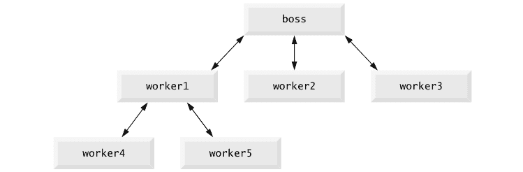

图 5.1 | 分层级的主方法/工作方法关系。

## 5.3 静态方法、静态变量与 Math 类

大多数方法是响应特定对象上的方法调用而执行的（但并非总是如此）。有时，方法执行的任务并不依赖于任何对象。这种方法适用于它所声明的类，被称为静态方法或类方法。

类可以包含方便的静态方法来执行常见任务。例如，回想我们在图 4.6 中如何使用 `Math` 类的静态方法 `pow` 来计算值的幂。对于导入到程序的任何类，你都可以通过指定方法声明所在的类名、后加点（.）和方法名来调用类静态方法，如下：

```
ClassName.methodName(arguments)
```

### Math 类方法

我们使用 `Math` 类方法来演示静态方法的概念。`Math` 类提供了一系列方法，允许你执行常见的数学计算。例如，你可以通过静态方法调用计算 900.0 的平方根：

```
Math.sqrt(900.0)
```

该表达式的值为 30.0。方法 `sqrt` 接收一个 `double` 类型参数并返回一个 `double` 类型的结果。为了在命令行窗口输出上一个方法调用的值，你可能会编写以下语句：

```
System.out.println(Math.sqrt(900.0));
```

在该语句中，`sqrt` 返回的值作为参数传递给方法 `println`。在调用 `sqrt` 方法之前不需要创建 `Math` 对象。此外，所有的 `Math` 类方法都是静态的——因此，每个方法都是通过在其类名前加上点（分隔符）来调用的。

方法参数可以是常量、变量或表达式。如果 `c = 13.0`、`d = 3.0` 且 `f = 4.0`，那么语句

```
System.out.println(Math.sqrt(c + d * f));
```

将计算并打印 13.0 + 3.0 * 4.0 = 25.0 的平方根——即 5.0。图 5.2 总结了几个 `Math` 类方法。在函数中，`x` 和 `y` 的类型均为 `double`。

| 方法 | 说明 | 示例 |
| :--- | :--- | :--- |
| `abs(x)` | x 的绝对值 | `abs(23.7)` 为 23.7; `abs(0.0)` 为 0.0; `abs(-23.7)` 为 23.7 |
| `ceil(x)` | 将 x 向上舍入为小于 x 的最小整数 | `ceil(9.2)` 为 10.0; `ceil(-9.8)` 为 -9.0 |
| `cos(x)` | x 的余弦值（弧度） | `cos(0.0)` 为 1.0 |
| `exp(x)` | 指数方法 e^x | `exp(1.0)` 为 2.71828; `exp(2.0)` 为 7.38906 |
| `floor(x)` | 将 x 向下舍入为大于 x 的最大整数 | `floor(9.2)` 为 9.0; `floor(-9.8)` 为 -10.0 |
| `log(x)` | x 的自然对数（底为 e） | `log(Math.E)` 为 1.0; `log(Math.E * Math.E)` 为 2.0 |
| `max(x, y)` | x 和 y 的较大值 | `max(2.3, 12.7)` 为 12.7; `max(-2.3, 12.7)` 为 -2.3 |
| `min(x, y)` | x 和 y 的较小值 | `min(2.3, 12.7)` 为 2.3; `min(-2.3, 12.7)` 为 -12.7 |
| `pow(x, y)` | x 的 y 次幂（即 x^y） | `pow(2.0, 7.0)` 为 128.0; `pow(9.0, 0.5)` 为 3.0 |
| `sin(x)` | x 的正弦值（弧度） | `sin(0.0)` 为 0.0 |
| `sqrt(x)` | x 的平方根 | `sqrt(900.0)` 为 30.0 |
| `tan(x)` | x 的正切值（弧度） | `tan(0.0)` 为 0.0 |

**图 5.2** Math 类方法。

### 类变量与 Math

类可以包含静态方法，类也可以包含静态变量。静态变量与类本身相关，而不是类的任何特定实例。这意味着类的所有实例都共享静态变量的副本。要声明静态变量，在变量声明之前使用 `static` 关键字：

```java
class Example {
    static int count;
}
```

静态方法是与类本身相关的方法，而不是类的任何特定实例。你可以使用类名调用静态方法，无需先创建实例。要声明静态方法，在返回类型之前使用 `static` 关键字：

```java
class Example {
    static void sayHello() {
        System.out.println("Hello from a static method!");
    }
}
```

要调用静态方法，使用类名：

```java
Example.sayHello();
```

静态方法对于不依赖类实例变量的任务非常有用。例如，`Math` 类中的所有方法都是静态的，因为它们是对提供的参数进行操作，而不是对 `Math` 对象的状态进行操作。

## 5.4 方法的声明

### public 和 static 关键字

`maximum` 方法的声明以关键字 `public` 开始，表示该方法是“公开的”——它可以从其他类的方法中调用。该关键字允许 `main` 方法（即任何 `static` 方法）如第 211 行所示调用 `maximum`，而无需使用类名 `MaximumFinder` 对方法名进行限定——同一类中的静态方法可以直接互相相互调用。任何其他类都必须使用类名对方法名进行完全限定。本章和下一章的示例中，每个方法的声明都以 `public` 和 `static` 关键字开头。（你将在第 7 章中学习非公共和非静态方法）。

### 返回类型

在关键字 `public` 和 `static` 之后是方法的返回类型，它指定了方法在执行其任务后返回（即交付给调用者）的数据类型。例如，当你去自动取款机（ATM）查询你的账户余额时，你期望 ATM 给你一个代表你余额的值。同样地，当本例中的语句调用 `maximum` 时，该语句期望接收回三个值中的最大值。返回类型表示该方法将为调用方法（在本例中为 `main`）执行一项任务。你已经使用过返回信息的方法——例如，`Scanner` 方法 `nextInt` 返回用户在键盘上输入的整数类型，然后返回该值供程序使用。在某些情况下，你会定义执行某些任务但不返回任何信息的方法。此类方法使用返回类型 `void`（如 `main`）。

### 方法名和参数

方法名 `maximum` 紧跟在返回类型之后。类名、方法名和变量都是标识符，按照惯例，它们都使用我们在第 2 章中讨论的相同的驼峰命名法。按照惯例，类名以大写字母开头，而方法名和变量名以小写字母开头。

方法名后的括号表示这是一个方法。对于需要额外信息来执行任务的方法，该方法可以指定一个或多个需要额外信息的参数。如果括号为空，则该方法在执行任务时不需要额外信息。

参数定义在一个用逗号分隔的参数列表中，该列表位于方法名后的括号内。每个参数必须指定一个类型和一个标识符。方法 `maximum` 需要 `double` 类型的参数，我们将其命名为 `x`、`y` 和 `z`。方法的参数被视为方法的局部变量，只能在该方法体内部使用。第 28 行中的元素合称为称为方法头（method header）。

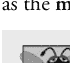

> **常见编程错误 5.1**
>
> 声明相同类型的方法参数，例如使用 `float x, y` 而不是 `float x, float y` 是语法错误——参数列表中的每个参数都需要指定一个类型。

### 方法体

方法头之后总是跟着方法体，它由左右大括号界定，如第 29 行和第 41 行所示。方法体包含一个或多个执行方法任务的语句。为了确定最大值，我们假设参数 `x` 包含最大值，因此第 30 行声明了局部变量 `maximumValue` 并用参数 `x` 的值对其初始化。当然，参数 `y` 或 `z` 可能包含实际的最大值，因此我们必须将这些值每一个与 `maximumValue` 进行比较。第 33–34 行的语句确定 `y` 是否大于 `maximumValue`。如果是，第 34 行将 `y` 赋值给 `maximumValue`。第 37–38 行的语句确定 `z` 是否大于 `maximumValue`。如果是，第 38 行将 `z` 赋值给 `maximumValue`。此时，三个值中的最大值存储在 `maxValue` 中，因此第 40 行使用 `return` 语句返回到调用 `maximum` 的位置（第 21 行）。当程序控制返回该位置时，`maximum` 的参数 `x`、`y` 和 `z` 不再存在于内存中。

### 方法 main 和调用 maximum

`main` 中的第 14–19 行提示用户输入 `double` 类型的值，然后通过 `nextDouble()` 从 `Scanner` 读取它们，该方法将用户输入作为 `double` 值返回。

方法调用值——即方法每个参数对应的实参（arguments）。例如，方法 `System.out.` 的参数指定了要在命令行窗口中显示的数据。当从 `main` 的第 21 行调用 `maximum` 时，它的参数 `x` 和 `y`（第 28 行）用参数 `number1`、`number2` 和 `number3` 的值初始化。方法声明中的每个参数在方法调用中必须有一个对应的实参。此外，每个实参必须与对应参数的类型一致。例如，`double` 类型的参数可以接收如 `7.35`、`22` 或 -03456 等值，但不能接收像 "hello" 字符串或布尔值 `true` 或 `false`。第 5.7 节讨论了为每个基本类型参数在方法调用中提供的实参类型。

当 `maximum` 返回值到第 21 行时，程序将 `maximum` 的返回值赋值给 `main` 的局部变量。然后第 24 行输出最大值。

> **常见编程错误 5.2**
>
> 如果方法调用中的参数数量与方法声明中的参数数量不匹配，会发生编译错误。

### 使用拼接组合字符串

Java 允许使用 `+` 运算符将字符串对象组合更大的字符串，这被称为字符串拼接。当 `+` 运算符的所有的操作数都是 `String` 时，它会创建一个新的 `String`。例如，如果 `y` 是 5，表达式 `"y = " + y + 2` 的结果是 `"y = 52"`，而不是 `"y = 7"`，因为 `+` 运算符是从左到右求值的。

当 `+` 运算符的所有操作数都是数值时，它执行加法。

5.6 节讨论了字符串拼接的细节。

### 声明和方法的注意事项

调用方法有三种方式：

1. 直接使用方法名调用类的其他方法——例如图 5.3 第 21 行的 `maximum(number1, number2, number3)`。
2. 使用对象变量、点 (.) 和方法名调用对象的非静态方法——例如图 5.3 第 16 行的 `nextDouble()`，它调用了 `Scanner` 的方法。
3. 使用类名和点 (.)调用静态方法——例如 5.3 中的 `Math.sqrt(900.0)`。

返回控制到调用方法的语句有三种。如果方法没有返回值，则在程序流到达右括号或语句结束时返回。

> **常见编程错误 5.3**
>
> 跨行拆分字符串是语法错误。如果有必要，可以将其拆分为多个字符串。

> **常见编程错误 5.4**


混淆用于字符串拼接的 `+` 运算符与用于加法的 `+` 运算符会导致意外结果。

## 通过复用 Math.max 实现 maximum

你的整个方法体可以通过两次对 `Math.max` 调用来实现：

```java
return Math.max(x, Math.max(y, z));
```

外部的 `Math.max` 指定了参数 `x` 和 `Math.max(y, z)`。在调用任何方法之前，必须先对其参数进行求值。如果参数是一个方法调用，则必须执行该方法调用以确定其返回值。因此，在前面的语句中，`Math.max(y, z)` 被求值以确定 `y` 和 `z` 的最大值。然后将结果作为第二个参数传递给另一个 `Math.max` 调用，返回其参数较大值。这是软件重用的很好的例子——我们通过复用寻找两个值的 `Math.max` 来找到三个值中的最大值。注意这段代码与图 5.3 第 30–38 行的对比。

# 第 5 章 方法

```java
return;
```

执行。如果该方法返回结果，则语句

```java
return expression;
```

求值表达式，然后将结果返回给调用者。


## 常见编程错误 5.5

在类声明的体之外或另一个方法的体内部声明方法是语法错误。


## 常见编程错误 5.6

在方法体中将参数重新定义为局部变量是编译错误。


## 常见编程错误 5.7

在应该返回结果的方法忘记返回返回值是编译错误。如果指定了 `void` 以外的返回类型，则方法必须包含一个返回与方法返回类型一致的值的 `return` 语句。从返回类型为 `void` 的方法返回返回值是编译错误。

## 5.6 方法调用与栈帧

为了理解 Java 如何执行方法调用，我们首先需要将一种数据结构（即相关数据项的集合）视为栈。你可以将栈想象成一叠盘子。当把一个盘子放在堆上时，它通常被放在顶部（称为将盘子“推入”栈）。同样，当从堆中取走盘子时，它是从顶部移除的（称为将盘子“弹出”出栈）。栈被称为后进先出（LIFO）数据结构——最后一个推入栈的元素是第一个从栈弹出的元素。

当程序调用一个方法时，该方法必须知道如何返回它，因此调用方法的返回地址会被推入方法调用栈中。当发生系列方法调用时，连续的返回地址会按照后进先出的顺序推入栈中，以便每个方法都能返回到其调用者。

方法调用栈还包含了程序执行中每次调用时使用的局部变量（包括参数）的内存。这些数据存储作为方法调用栈的一部分，被称为方法的栈帧（stack frame，或称为激活记录）。当方法被调用时，该方法的帧会被推入方法调用栈。当方法返回时，该方法的栈帧会从栈中弹出，那些局部变量将不再被程序感知。

当然，计算机的内存是有限的，因此只有部分空间可以用于在方法调用栈上存储栈帧。如果发生的方法调用次数超过了能够存储其栈帧的数量，就会发生被称为栈溢出（stack overflow）的错误——我们将在第 11 章“异常处理：深入探讨”中详细讨论这一点。

## 5.7 参数提升与转换

方法调用的另一个重要特性是参数提升——如果可能，将参数的值转换为方法在相应参数中期望接收的类型。例如，程序可以使用一个 `int` 调用 `Math.sqrt`，尽管它期望的是一个 `double` 参数。该语句

```java
System.out.println(Math.sqrt(4));
```

正确地求值 `Math.sqrt(4)` 并打印 `2.0`。方法声明的参数列表允许 Java 在将值传递给 `sqrt` 之前将 `int` 值转换为 `double` 类型 `4.0`。如果不满足提升规则，此类转换可能会导致编译错误。这些规则规定了允许哪些转换——即在不丢失数据的情况下可以执行。在排序示例中，`int` 转换为 `double` 而没有改变其值。然而，将 `double` 转换为 `int` 会截断 `double` 值的小数部分——因此丢失了部分值。将大整数类型转换为小整数类型（例如从 `long` 转换为 `int` 或 `short`）也可能导致值改变。

提升规则适用于包含两个或多个基本类型值作为参数传递的表达式。每个值都被提升为表达式中的“最高”类型。表达式使用每个值的临时副本——原始值保持不变。图 5.4 列出了基本类型以及每个类型可以提升的类型。对于给定类型，有效的提升是提升到表中更高的类型。例如，`int` 可以提升为更高类型 `long`、`float` 和 `double`。

如果低类型无法表示高类型的值，将值转换为低类型将导致不同的结果（例如，`int` 类型 `2000000` 无法表示为 `short`，或者任何带有小数点数字的浮点数都无法用 `long`、`int` 或 `short` 等整数类型表示）。因此，在可能丢失信息的情况下，使用转换运算符（在第 3.9 节引入）显式强制进行转换——否则会发生编译错误。这使你能够从编译器手中“夺回控制权”。你可以说：“我知道这种转换可能会导致信息丢失，但是对于我的目的来说，这样是可以的。”假设方法计算一个整数的平方并需要一个 `int` 参数。要使用名为 `doubleValue` 的 `double` 参数调用 `square` 方法，我们需要将方法写为：

```java
square((int)doubleValue)
```

该方法显式地将 `doubleValue` 的值转换为临时整数供 `square` 使用。因此，如果 `doubleValue` 的值为 `4.5`，方法接收到 `4` 并返回 `16`。


> 常见编程错误 5.8

将基本类型值转换为另一种类型，如果该类型不是有效的提升，可能会改变值。例如，将浮点值转换为整数可能会在结果中引入截断错误（丢失小数部分）。

## 5.8 Java API 包

正如你所见，Java 包含许多预定义类，这些类被归类到相关的类中。这些类统称为 Java 编程接口（Java API）和 Java 库。Java 的一大优势是 Java API 中数以千计的类。我们在书中使用的某些 API 包如图 5.5 所示，它仅代表了 Java API 中重用组件的一小部分。

| 包 | 描述 |
|---|---|
| java.awt.event | 抽象窗口工具包（Abstract Window Toolkit）包含用于 `java.awt` 和 `javax.swing` 包中 GUI 组件事件处理的类和接口。（参见第 12 章 GUI 组件：第一部分和第 22 章 GUI 组件：第二部分。） |
| java.awt.geom | Java 2D 形状包（Shapes）包含用于处理 Java 高级二维图形能力的类和接口。（参见第 13 章图形与 Java 2D。） |
| java.io | 输入/输出包（Input/Output）包含允许程序输入和输出数据的类和接口。（参见第 15 章文件、流和对象序列化。） |
| java.lang | 语言包（Language）包含书中随处讨论的许多 Java 程序所需的类和接口。该包在所有程序中被编译器导入。 |
| java.net | 网络包（Networking）包含允许程序通过互联网等计算机网络通信的类和接口。（在线第 28 章网络。） |
| java.security | 安全包（Security）包含用于增强应用程序安全性的类和接口。 |
| java.sql | JDBC 包包含用于处理数据库的类和接口。（参见第 24 章使用 JDBC 访问数据库。） |

图 5.5 | Java API 包（子集）。（第 1/2 部分。）

## 5.8 Java API 包 177

| 包 | 描述 |
| --- | --- |
| java.util | Java 工具包包含用于存储和处理大量数据的工具类和接口。这些类和接口中的许多已过更新，以支持 Java SE 8 的 lambda 功能。（参见第 16 节，泛型集合。） |
| java.util.concurrent | Java 并发包包含用于实现并行执行任务的程序的工具类和接口。（参见第 23 节，并发。） |
| javax.swing | Java Swing GUI 包包含用于 Java Swing 组件的类和接口，为可移植的 GUI 提供支持。该包使用了一些旧版 java.awt 包的元素。（参见第 12 节，GUI 组件：第一部分，以及第 22 节，GUI 组件：第二部分。） |
| java.swing.event | Swing 事件包包含了用于 javafx.swing 中 GUI 组件进行事件处理（例如，响应按钮点击）的类和接口。（参见第 12 节，第一部分，以及第 22 节，GUI 组件：第二部分。） |
| javax.xml.ws | JAX-WS 包包含在 Java 中处理 Web 类和接口。（参见在线第 32 节，基于 REST 的 Web 服务。） |
| javafx packages | JavaFX 是首选的 GUI 技术。我们将在第 25 节 JavaFX GUI：第一部分以及在线的 JavaFX GUI 和多媒体章节中讨论这些包。 |

### 本书中使用的一些 SE 8 包

| 包 | 描述 |
| --- | --- |
| java.time | 新的 SE 8 日期/时间 API 包包含处理日期和时间的类和接口。这些功能旨在取代 java.util 包中旧的日期时间功能。（参见第 23 节，并发。） |
| java.util.function and java.util.stream | 这些包包含用于处理 Java SE 8 功能性编程能力的类和接口。（参见第 17 节，Java SE 8 Lambdas 和 Streams。） |

**图 5.5** Java API 包（子集）。（2/2 部分）。

Java 中提供的包集合非常庞。除了图 5.5 中总结的包之外，Java 还包含了用于复杂图形、高级图形用户界面、高级网络、安全、数据库处理、多媒体、辅助功能（针对残障人士）、并发编程、密码学、XML 处理等许多其他功能的包。要概述 Java 中的包，请访问：

```
http://docs.oracle.com/java/7/docs/api/overview-summary.html
http://download.oracle.com/java.net/jdk8/docs/api/overview-summary.html
```

你可以在 Java API 文档查找预定义 Java 类方法的额外信息：

```
http://docs.oracle.com/java/7/docs/api/
```

访问此站点时，点击 Index（索引）链接查看 Java API 中所有类和方法的字母顺序列表。找到类名并点击其链接查看该类的在线描述。点击 METHOD 链接查看类方法的表格。每个静态方法都会在其返回返回类型之前列出“static”一词。

## 5.9 案例研究：安全数字生成

我们将简要地转到一种流行的编程应用程序类型——模拟和游戏播放。在本节和接下来的节中，我们将开发一个具有多个方法的游戏程序。该程序使用了书中介绍的大部分控制语句，并引入了几个新的编程概念。

可以通过 `SecureRandom` 类（包 `java.security`）的对象在程序中引入变化元素。此类对象可以产生随机的 boolean、byte、float、double、int 和高斯值。在下一节中，我们将使用 `SecureRandom` 类的示例来产生随机值。

### 转向安全随机数

本书的最近版本使用 Java 的 `Random` 来获取“随机”值。该类产生的值是确定性的，可以被恶意程序员预测。`SecureRandom` 对象产生无法预测的非确定性随机数。

### 创建 SecureRandom 对象

可以如下方式创建一个新的 `SecureRandom` 数字生成器对象：

```java
SecureRandom randomNumbers = new SecureRandom();
```

它可以生成随机值——我们在这里只讨论 int 值。有关 `SecureRandom` 类的更多信息，请参见 oracle.com/javase/7/docs/api/java/security/SecureRandom.html。

### 获取随机 int 值

考虑以下语句：

```java
int randomValue = randomNumbers.nextInt();
```

`SecureRandom` 方法 `nextInt` 生成一个随机的 int 值。如果它确实是随机产生值，那么范围内的每个值在每次调用 `nextInt` 时都应该有相等的几率概率（或概率）被选中。

### 修改 NextInt 产生的值范围

`nextInt` 产生的值范围通常与特定 Java 程序所需的数值范围不同。例如，一个模拟抛硬币的程序可能只需要 0 代表“正面”，1 代表“反面”。一个模拟掷六面骰子的程序可能需要 1–6 范围内的随机整数。一个视频游戏中随机预测下一个飞过地平线的飞船类型（四种可能性）的程序可能需要 1–4 范围内的随机整数。对于此类情况，`SecureRandom` 类提供了另一个版本的 `nextInt` 方法，接收一个 int 参数并返回一个从 0 到但不包含参数值的值。例如，对于抛硬币：

```java
int face = randomNumbers.nextInt(2);
```

## 5.9 案例研究：安全的随机数生成

```java
// use face value 1-6 to determine which counter to increment
switch (face) {
    case 1:
        ++frequency1; // increment the 1s counter
        break;
    case 2:
        ++frequency2; // increment the 2s counter
        break;
    case 3:
        ++frequency3; // increment the 3s counter
        break;
    case 4:
        ++frequency4; // increment the 4s counter
        break;
    case 5:
        ++frequency5; // increment the 5s counter
        break;
    case 6:
        ++frequency6; // increment the 6s counter
}
```

| 面值 | 频率 |
| :--- | :--- |
| 1 | 999501 |
| 2 | 1000042 |
| 3 | 998867 |
| 4 | 1000820 |
| 5 | 1002245 |
| 6 | 998760 |
| 面值 | 频率 |
| :--- | :--- |
| 1 | 999647 |
| 2 | 999557 |
| 3 | 999571 |
| 4 | 1000376 |
| 5 | 1000701 |
| 6 | 1000148 |

图 5.7 | 掷六面骰子 6,000,000 次。（部分2/2。）

如示例输出所示，通过对 `next` 生成的值进行缩放和平移，程序能够模拟掷六面骰子。应用程序使用嵌套控制语句（`switch` 嵌套在 `for` 内部）来确定骰子每个面出现的次数。语句（第 20–46 行）迭代了 6,000,000 次。在每次迭代中，第 22 行产生一个 1 到 6 之间的随机值。该值随后被用作控制 `switch` 语句（第 25–45 行）。根据面值，`switch` 语句在循环的每次迭代中增加六个计数器变量之一。该 `switch` 语句没有 `default` 情况，因为对于第 22 行表达式可能产生的每一个可能的骰子值，我们都设置了 `case`。运行程序并观察不同的结果。

当我们在第 6 章学习数组时，我们将展示一种优雅的方法，用一个语句替换此程序中的整个 `switch` 语句。然后，当我们在第 17 章学习 SE 8 的新函数编程功能时，我们将展示如何用一个语句替换掷骰子的循环、`switch` 语句以及显示结果的语句！

## 随机数的泛化平移与缩放

之前，我们通过以下代码模拟掷六面骰子：

```java
int face = 1 + randomNumbers.nextInt(6);
```

这允许变量 `face` 被赋值为 1 ≤ face ≤ 6 范围内的整数。该范围的宽度（即该范围内连续整数的个数）为 6，范围的起始数字是 1。在前面的语句中，范围的宽度是由传递给 `SecureRandom.nextInt` 方法的参数 6 决定的，范围的起始数字是加在 `randomNumbers.nextInt()` 上的 1。我们可以将这一结果泛化为：

```java
int number = shiftingValue + randomNumbers.nextInt(scalingFactor);
```


其中，`shiftingValue` 指定目标连续整数范围的第一个数字，`scalingFactor` 指定范围内有多少个数字。

也可以从连续整数范围以外的数值集合中选择整数。例如，为了从序列 2, 5, 8, 11 和 14 中获取随机值，可以使用以下语句：

```java
int number = 2 + 3 * randomNumbers.nextInt(5);
```

在这种情况下，`randomNumbers.nextInt(5)` 产生 0–4 范围的值。每个值乘以 3 以产生 0, 3, 6, 12 的序列。我们加上 2 来平移范围并获取 2, 5, 8, 11 和 14 的值。我们可以将此结果泛化为：

```java
int number = shiftingValue + differenceBetweenValues * randomNumbers.nextInt(scalingFactor);
```

其中，`shiftingValue` 指定目标范围的第一个数字，`differenceBetweenValues` 代表序列中连续数字之间的差，`scalingFactor` 指定范围内有多少个数字。

## 关于性能的说明

使用 `SecureRandom` 而非 `Random` 以获得更高的安全水平会有性能损失。对于“休闲”应用程序，你可能希望使用 `java.util` 包中的 `Random` 类。

## 案例研究：骰骰点游戏

一种流行的博弈游戏被称为骰点（craps），在世界各地流行。该游戏的规则非常简单：你掷两个骰子。每个骰子分别有一、二、三、四、五、六六面。当骰子停止后，计算它们的和。如果第一次掷的和是 7 或 11，则你赢；如果和是 2、3 或 12，则你输（即“赌场”赢）。如果第一次掷的和是 4、5、6、8、9 或 10，则这变成了你的“点”（point）。要赢，你必须继续掷骰子直到掷出点数；如果在掷出点数之前算出 7，你就输了。

图 5.8 使用方法来实现骰点游戏的逻辑。`main` 方法（第 21–65 行）调用 `rollDice` 方法（第 68–81 行）来掷骰子并计算和。示例输出显示了第一次掷赢和后续掷输的情况。

```java
// Fig 5.8: Craps.java
// Craps 类模拟骰点游戏。
import java.security.SecureRandom;

public class Craps {
    // 用于 rollDice 的随机数生成器
    private static final SecureRandom randomNumbers = new SecureRandom();

    // 表示游戏状态的枚举类型
    private enum Status { CONTINUE, WON, LOST };

    // 表示骰子点的常量
    private static final int SNAKE_EYES = 2;
    private static final int TREY = 3;
    private static final int SEVEN = 7;
    private static final int YO_LEVEN = 11;
    private static final int BOX_CARS = 12;

    // 玩骰点游戏
    public static void main(String[] args) {
        int point = 0; // 第一次掷未输时的点
        Status gameStatus;
        int sumDice = rollDice(); // 第一次掷

        // 根据第一次掷确定游戏状态和点数
        switch (sumDice) {
            case SEVEN: // 第一次掷为 7 赢
            case YO_LEVEN: // 第一次掷为 11 赢
                gameStatus = Status.WON;
                break;
            case SNAKE_EYES: // 第一次掷为 2 输
            case TREY: // 第一次掷为 3 输
            case BOX_CARS: // 第一次掷为 12 输
                gameStatus = Status.LOST;
                break;
            default: // 没输，所以记住点
                gameStatus = Status.CONTINUE; // 游戏未结束
                point = sumDice; // 记住点
                System.out.printf("Point is %d\n", point);
                break;
        }

        // 游戏未完成
        while (gameStatus == Status.CONTINUE) { // 没输
            sumDice = rollDice(); // 再次掷
            // 确定游戏状态
            if (sumDice == point) // 掷出点赢
                gameStatus = Status.WON;
            else if (sumDice == SEVEN) // 在掷出点前算出 7 输
                gameStatus = Status.LOST;
        }

        // 显示输赢消息
        if (gameStatus == Status.WON)
            System.out.println("Player wins");
        else
            System.out.println("Player loses");
    }

    // 掷骰子，计算和并显示结果
    public static int rollDice() {
        // 选取随机值
        int dice1 = 1 + randomNumbers.nextInt(6); // 第一次掷骰
        int dice2 = 1 + randomNumbers.nextInt(6); // 第二次掷骰
        int sum = dice1 + dice2; // 骰子值的和
        // 显示这次掷的结果
        System.out.printf("Player rolled %d + %d = %d\n", dice1, dice2, sum);
        return sum;
    }
}
```

图 5.8 | Craps 类模拟骰点游戏。（部分2/3。）

| 玩家掷数 | 结果 |
| :--- | :--- |
| 玩家掷 5 + 6 = 11 | 玩家赢 |
| 玩家掷 5 + 4 = 9 | 点是 9 |
| 玩家掷 4 + 2 = 6 | |
| 玩家掷 3 + 6 = 9 | 玩家赢 |
| 玩家掷 1 + 2 = 3 | 玩家输 |
| 玩家掷 2 + 6 = 8 | 点是 8 |
| 玩家掷 5 + 1 = 6 | |
| 玩家掷 2 + 1 = 3 | |
| 玩家掷 1 + 6 = 7 | 玩家输 |

图 5.8 | Craps 类模拟骰点游戏。（部分3/3。）

## rollDice 方法

在游戏规则中，玩家在第一次和之后所有的掷骰中都必须掷两个骰子。我们声明 `rollDice` 方法（第 68–81 行）来掷骰子并计算及打印它们的和。`rollDice` 方法声明了一次，但在 `main` 方法中的两个地方（第 26 行和第 50 行）被调用，`main` 包含了完整骰点游戏的逻辑。`rollDice` 方法不接受参数，因此返回类型 `int` 在方法头中指定（第 68 行）。`rollDice` 返回骰子的和，因此这里使用 `int` 类型是合适的。

## 第5章 方法

（默认情况）——因此，可以保证它在使用之前已完成初始化，所以我们不需要在第 24 行对其进行初始化。

## enum 类型状态

局部变量 `gameStatus`（第 24 行）被声明为名为 `Status` 的新类型（声明在第 11 行）。`Status` 类型是 `Craps` 类的私有成员，因为 `Status` 只会在该类中使用。`Status` 是一种称为枚举（enum type）的类型，它最简单的形式是声明了一组由标识符表示的常量。枚举类型是一种由关键字 `enum` 和名称引入的特殊类（在本例中为 `Status`）。与类一样，大括号限定了枚举定义的体。大括号内部是一个逗号分隔的枚举常量列表，每个常量代表一个值。枚举中的标识符必须是唯一的。你将在第 8 章学习更多关于枚举类型的知识。

## 良好的编程实践 5.1

> 在枚举常量名称中使用大写字母，使其脱颖而出，并提醒你它们不是变量。

`Status` 类型的变量只能赋予枚举中声明的三个常量（第 11 行）之一，否则将发生编译错误。当游戏胜利时，程序将局部变量 `gameStatus` 设置为 `Status.WON`（第 33 行和 54 行）。当游戏输掉时，程序将局部变量 `gameStatus` 设置为 `Status.LOST`（第 38 行和 57 行）。否则，程序将局部变量 `gameStatus` 设置为 `Status.CONTINUE`（第 41 行），表示游戏尚未结束必须继续掷。

## 良好的编程实践 5.2

> 使用常量（如 `Status.WON`、`Status.LOST` 和 `Status.CONTINUE`）而不是字面量（如 0、1）可以使程序更容易阅读和维护。

## main 方法的逻辑

`main` 方法中的第 26 行调用 `rollDice`，该方法从 1 到 6 之间选取两个随机值，显示第一个、第二个骰子的值及其和，并返回和。`main` 方法进入 `switch` 语句（第 29–45 行），该语句使用第 26 行的 `sumOfDice` 值来判断游戏是赢了、输了，还是继续下一次掷。第一次掷结果为 0 的点数在第 14–18 行被声明为 `private static int` 常量。这些常量与常量一样，按照约定用全大写字母声明，以便它们在程序中脱颖而出。第 31–34 行确定玩家是否在第一次掷中输掉（点数为 `SEVEN` 或 `SNAKE_EYES` (2)、`TRAY` (3) 或 `BOXARS` (12)）。第一次掷后，如果游戏未结束，默认 `case` 情况（第 40–44 行）将 `gameStatus` 设置为 `Status.CONTINUE`，在 `myPoint` 中使用 `sumOfDice` 并显示点数。

如果我们正尝试“获得点数”（make your point，即游戏从之前的掷中继续），则执行第 48–55 行。第 50 行再次掷骰子。如果 `sumOfDice` 匹配 `myPoint`（第 53 行），第 54 行将 `gameStatus` 设置为 `Status.WON`，然后循环终止，因为游戏已完成。如果 `sumOfDice` 是 `SEVEN`（第 56 行），第 57 行将 `gameStatus` 设置为 `Status.LOST`，循环终止，因为游戏已完成。第 61–64 行显示指示玩家胜或负的消息，然后程序终止。


## 5.11 声明范围

程序使用了我们讨论过的各种程序控制机制。`Craps` 类使用了两个方法——`main` 和 `rollDice`（从 `main` 调用两次），以及 `switch`、`while`、`if...else` 和嵌套 `if` 控制语句。注意 `switch` 语句中使用多个 `case` 标签，为 `SEVEN` 和 `YO_LEVEN` 的和（第 31–32 行）以及 `SNAKE_EYES`、`TREY` 和 `BOX_CARS`（第 35–37 行）执行相同的语句。

## 为什么某些常量没有定义为枚举

你可能在奇怪为什么我们将类的点数声明为 `private static final int` 常量而不是枚举。原因是程序必须将 `int` 变量 `sumDice`（第 26 行）与这些常量进行比较，以确定每次掷的结果。假设我们声明一个包含常量（例如 `Sum.SNAKE_EYES`）代表游戏中五种点数的枚举 `Sum`，然后在 `switch` 语句（第 29–45 行）中使用这些常量。这样做将阻止我们使用 `sumDice` 作为 `switch` 的控制表达式，因为 Java 不允许将 `int` 与枚举进行比较。为了实现与当前程序相同的功能，我们必须使用变量 `currentSum` 作为 `switch` 的控制表达式。遗憾的是，Java 并没有提供简单的方法将 `int` 转换为特定的枚举常量。这可以通过一个单独的 `switch` 语句来实现，但这将非常繁琐，并且不会提高程序的可读性（因此违背了使用枚举的目的）。

## 5.11 声明范围

你已经见过了 Java 实体的声明，例如类、方法、变量和参数。声明引入了可以引用此类实体的名称。声明的范围是程序中可以通过名称引用已声明实体的部分。对于程序的该部分，该实体被称为“在作用范围内”（in scope）。本节介绍了几个重要问题。

基本范围规则如下：

1. 参数声明的范围是出现该声明的方法体。
2. 局部变量声明的范围是从声明出现的地方到方法的结束处。
3. 块级变量声明的范围是从声明出现的地方到该块的结束。
4. 类成员声明的范围是整个类。

任何块都可以包含局部变量声明。如果块中的局部变量与字段同名，则在块的执行期间该字段会被隐藏——这种现象被称为遮蔽（shadowing）。图 5.9 展示了静态变量与局部变量的遮蔽。

## 5.12 方法重载

```java
42    x *= 10; // modifies class Scope's field x
43    System.out.printf(
44      "field x before exiting method useField is %d%n", x);
45    )
46} // end class Scope
```

```
local x in main is 5

local x on entering method useLocalVariable is 25
local x before exiting method useLocalVariable is 26

field x on entering method useField is 1
field x before exiting method useField is 10

local x on entering method useLocalVariable is 25
local x before exiting method useLocalVariable is 26

field x on entering method useField is 10
field x before exiting method useField is 100

local x in main is 5
```

**5.9** Scope 类演示了字段和局部变量的作用域。（第 2 部分，共 2 部分）

`useField` 方法没有声明任何局部变量。因此，当它引用 `x` 时，使用的是类中的静态变量 `x`（第 7 行）。当第一次调用 `useField` 方法时（第 18 行），它输出静态变量 `x` 的值（第 40–41 行），将其乘以 10（第 42 行），并在返回之前再次输出其值（10）（第 43–44 行）。下一次调用 `useField` 方法时（第 20 行），静态变量已经有了修改后的值（10），因此该方法输出 10，300。最后，在方法中，程序输出了局部变量 `x` 的值（第 22 行），以证明没有任何方法调用修改了局部变量 `x`，因为这些方法引用的是其他作用域中名为 `x` 的变量。

## 最小权限原则

从一般意义上说，“事物”具有完成工作的能力，但仅此而已。变量的作用域就是一个例子。当变量不需要时时，它不应该是可见的。

> **良好的编程实践 5.3** 尽可能在第一次使用局部变量的地方声明该变量。

## 5.12 方法重载

在同一个类中可以声明多个同名的方法，只要它们具有不同的参数列表（由参数的数量、类型和顺序决定）——这被称为**方法重载**。当调用重载方法时，编译器会通过检查调用中参数的数量、类型和顺序来选择合适的方法。方法重载通常用于创建多个同名的方法，以便在不同类型或不同数量的参数上执行相同或相似的任务。例如，`Math.abs`、`min` 和 `max`（已在第 5.3 节中总结）各重载了四个版本：

1. 一个带有两个 `double` 参数。
2. 一个带有两个 `float` 参数。
3. 一个带有两个 `int` 参数。
4. 一个带有两个 `long` 参数。

我们的下一个示例将演示如何声明和调用用重载方法。我们将在第 8 章中演示重载构造函数。

## 声明重载方法

`MethodOverload` 类（图 5.10）包含了 `square` 方法的两个重载版本——一个计算 `int` 的平方（并返回 `int`），另一个计算 `double` 的平方（并返回 `double`）。尽管这些方法具有相同的名称以及相似的参数列表和方法体，但请仅将它们简单地视为不同的方法。将方法名分别视为“int 的平方”和“double 的平方”可能会有所帮助。

第 9 行使用参数 7 调用 `square` 方法。字面量整数值被视为 `int` 类型，第 9 行的方法调用调用了第 14–19 行指定 `int` 参数的 `square` 版本。同样，第 10 行使用参数 7.5 调用了 `square` 方法。


```java
// Fig. 5.10: MethodOverload.java
// 重载方法声明。
public class MethodOverload {
    // test overloaded square methods
    public static void main(String[] args) {
        System.out.printf("Square of 7 is %d%n", square(7));
        System.out.printf("Square of 7.5 is %f%n", square(7.5));
    }
    // 带 int 参数的 square
    public static int square(int intValue) {
        System.out.printf("Called square with int argument: %d%n", intValue);
        return intValue * intValue;
    }
    // 带 double 参数的 square
    public static double square(double doubleValue) {
        System.out.printf("Called square with double argument: %f%n", doubleValue);
        return doubleValue * doubleValue;
    }
} // class MethodOverload
```

图 5.10 | 重载方法声明。（第 1 部分，共 2 部分）

| Called square with int argument: 7 |
| :--- |
| Square of integer 7 is 49 |
| Called square with double argument: 7.500000 |
| Square of double 7.5 is 56.250000 |

**图 5.10** 重载方法声明。（第 2 部分，共 2 部分。）

字面量浮点值被视为 `double` 类型，但在第 10 行调用了第 22–27 行指定 `double` 参数的 `square` 版本。每个方法首先都输出一行文本，以证明在每种情况下都调用了正确的方法。第 10 行和第 24 行的值显示编译器识别了正确的方法。

### 区分重载方法

编译器通过方法的签名（`signature`，方法名和参数列表的组合）来区分重载方法。如果两个方法具有相同的签名，即使返回类型不同，编译器也无法确定要调用哪个版本。

### 重载方法的返回类型

在讨论重载方法时，我们没有提到返回类型。如果重载方法具有不同的参数列表，它们可以有不同的返回类型。然而，如果方法具有相同的签名，编译器会发出错误，指示该方法已经定义。

## 常见编程错误 5.9

无论返回类型是否不同，使用相同参数列表声明重载方法会导致编译错误。

## 5.13（可选）GUI 和案例研究：颜色和填充形状

尽管你只用线条和基本形状就能创建许多有趣的设计，但 `Graphics` 提供了更多功能。我们引入的两个特性是颜色和填充形状。添加颜色增强了我们在计算机上看到的图形。形状可以用实色填充。

计算机屏幕上显示的颜色由其红、绿、蓝分量（RGB 值）定义，这些取值为 0 到 255 的整数。分量值越高，该颜色的调就越丰富。Java 使用 `Color` (`java.awt`) 使用 RGB 值表示颜色。为了方便，`Color` 包含了各种预定义的静态对象——`BLACK`、`BLUE`、`CYAN`、`DARK_GRAY`、`LIGHT_GRAY`、`MAGENTA`、`ORANGE`、`PINK`、`RED`、`WHITE` 和 `YELLOW`。每个对象都可以通过类加点（如 `Color.RED`）访问。你可以通过将红色分值传递 `Color` 构造函数来创建自定义颜色。

`Graphics` 方法 `fillRect` 和 `fillOval` 分别绘制矩形和圆形。它们的参数与 `drawRect` 和 `drawOval` 相同；前两个是形状左上角的坐标，后两个决定宽度和高度。图 5.11 中的示例通过在屏幕上绘制并显示一个黄色笑脸演示了颜色和填充形状。

```java
// Fig. 5.11: DrawSmiley.java
// 使用颜色和填充形状绘制笑脸。
import java.awt.Color;
import java.awt.Graphics;
import javax.swing.JPanel;

public class DrawSmiley extends JPanel {
    public void paintComponent(Graphics g) {
        super.paintComponent(g);
        // 绘制脸部
        g.setColor(Color.YELLOW);
        g.fillOval(10, 100, 200, 200);
    }
}
```

## 5.13（可选）GUI 与图形案例研究：颜色与填充形状

```java
// draw the eyes
g.setColor(Color.BLACK);
g.fillOval(55, 65, 30, 30);
g.fillOval(135, 65, 30, 30);

// draw the mouth
g.fillOval(50, 110, 120, 60);

// "touch up" the mouth into a smile
g.setColor(Color.YELLOW);
g.fillRect(50, 110, 120, 30);
g.fillOval(50, 120, 120, 40);
}
```

```java
public static void main(String[] args)
{
    DrawSmiley panel = new DrawSmiley();
    JFrame application = new JFrame();

    application.setDefaultCloseOperation(JFrame.EXIT_ON_CLOSE);
    application.add(panel);
    application.setSize(230, 250);
    application.setVisible(true);
}
```

```java
// end class DrawSmiley
```

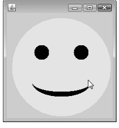

> 图 5.11 | 使用颜色和填充形状绘制一个笑脸。（2 部分中的第 2 部分。）

第 3–5 行的导入语句导入了 `Color`、`Graphics` 和 `JPanel`。`DrawSmiley` 类使用 `Color` 来指定绘制颜色，并使用 `Graphics` 类进行绘制。`JPanel` 提供了绘制的区域。`paintComponent` 方法中的第 14 行使用 `Graphics` 方法 `setColor` 将当前绘制颜色设置为 `Color.YELLOW`。在这种情况下，我们使用预定义的对象 `Color.YELLOW` 来设置绘制颜色。

第 15 行绘制了一个直径为 200 的圆形来表示脸部——当宽度和高度参数相同时，`fillOval` 方法会绘制一个圆。接下来，第 18 行将颜色设置为 `Color.BLACK`，第 19–20 行绘制了眼睛。第 23 行将嘴绘制成椭圆形，但这并不是我们想要的。

# 第 5 章 方法

为了创建一个笑脸，我们将对嘴进行修饰。第 26 行将颜色设置为 `Color.YELLOW`，第 27 行绘制了一个与嘴的高度等高的矩形。这擦除了嘴的上半部分，只剩下下半部分。为了创建一个更好的微笑，第 28 行绘制了另一个圆形来稍微遮住嘴的上部。`main` 方法（第 31–40 行）创建并显示了一个包含图形的 `JFrame`。当 `JFrame` 显示时，系统会调用 `paintComponent` 方法来绘制笑脸。

# GUI 与图形案例研究练习

5.12 使用方法 `fillOval` 绘制一个在两种随机颜色之间交替的靶心，如图 5.12 所示。使用带有随机参数的构造函数 `(int r, int g, int b)` 来生成随机颜色。

5.2 创建一个程序，以随机的颜色、位置和大小绘制 10 个随机填充形状（图 5.13）。`paintComponent` 方法应该包含一个循环 10 次。在每次迭代中，循环应决定是绘制填充矩形还是椭圆形，创建一个随机颜色并随机选择坐标和尺寸。坐标应根据面板的宽度和高度选择。边长应限制在窗口宽度或高度的一半。

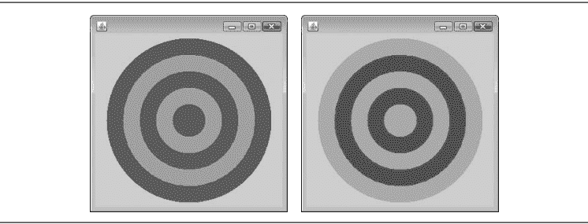

图 5.12 | 具有两个交替随机颜色的靶心。

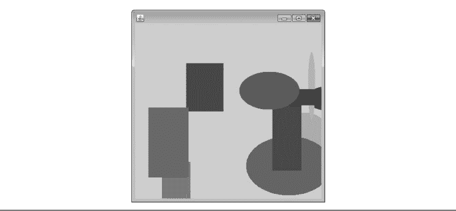

图 5.13 | 随机生成的形状。

## 5.14 总结

在本章，你学习了方法的声明以及如何调用静态方法。你学习了如何使用运算符 `+` 和 `+=` 来执行字符串拼接。我们讨论了方法调用栈和栈帧，栈帧用于跟踪已调用的方法以及每个方法在完成任务后必须返回何处。我们讨论了 Java 在基本类型之间进行隐式转换的提升规则，以及如何使用强制转换符执行显式转换。接下来，你学习了 Java API 中一些常用的包。

你学习了如何使用枚举类型和私有静态变量来声明常量。你使用了 `SecureRandom` 为模拟生成随机数。你还学习了类中字段和局部变量的作用范围。最后，你学习了类中的多个方法可以通过提供相同名称但不同签名的方法来实现重载。此类方法可以使用不同类型或数量的参数执行相同或相似的任务。

在第 6 章，你将学习如何在数组中维护数据列表和表格。你将看到一个更优雅的实现 6,000,000 次应用程序。你还将学习如何访问在应用程序开始执行时传递给方法的命令行参数。

## 总结

## 5.1 引言

- 经验表明，开发和维护大型程序的最佳方法是从小程序构建大程序。

## 5.2 程序模块

- 类被分组在包中以便导入。
- 方法允许你将代码模块化为单元。

## 5.3 静态方法和字段

- 返回类型指定了返回给调用者的数据类型。
- `return` 语句将值从被调用方法传回给调用者。

## 5.4 方法声明

- 类名以大写字母开头，方法名以小写字母开头。
- 参数用逗号分隔。
- 每个方法的体由左大括号和右大括号 `{ }` 定义。
- 每个方法的体包含一个或多个执行方法任务的语句。
- 返回类型指定了返回方法的数据类型。
- 关键字 `void` 表示方法将执行任务但不返回任何信息。
- 方法后的空参数表示该方法不需要任何参数。

## 5.5 方法声明和使用的注意事项

- 有三种调用方法的方法——直接使用方法本身调用同类中的另一个方法；使用对象变量后跟点 (`.`) 和方法名来调用方法对象；以及使用类名和点 (`.`) 来调用类的静态方法。

# 摘要 197

执行。如果该方法返回结果，则语句

```java
return expression;
```

求值表达式，然后立即将结果值返回给调用者。

# 第 5.6 节 方法调用栈与栈帧

- 栈（第 174 页）被称为“后进先出”（LIFO）数据结构——最后一个推入（反转）的项是第一个从栈中弹出（移除）的项。
- 方法必须知道如何返回到其调用者，因此在调用方法时，调用方法的返回地址会被推入方法调用栈中。如果发生了一系列方法调用，连续的返回地址将按照后进先出的顺序推入栈中，以便最后一个执行的方法将是第一个返回到其调用者的方法。
- 方法调用栈（第 175 页）包含了程序执行期间每个方法调用中使用的局部变量的内存。这些数据被称为方法的栈帧或激活记录。当一个方法被调用时，该方法的栈帧会被推入栈中。当方法返回到其调用者时，其栈帧会从栈中弹出，程序不再识别这些局部变量。
- 如果方法调用次数多于方法调用栈能够存储栈帧的容量，就会发生被称为“栈溢出”（第 174 页）的错误。应用程序可以正确编译，但其执行将会导致栈溢出。

# 第 5.7 节 参数提升与类型转换

- 参数提升（第 175 页）将参数的值转换为方法在相应参数中期望接收的类型。
- 提升规则（第 175 页）适用于两个或多个原始类型之间的转换，以及作为参数传递给方法的原始类型值。每个值都将提升为表达式中的“最高”类型。在转换可能会丢失信息的情况下，Java 编译器要求你使用强制转换符来强制进行转换。

# 第 5.9 节案例研究：安全随机数生成

- `SecureRandom` 产生非确定性的随机值。
- `SecureRandom` 方法 `nextInt`（第 178 页）生成一个随机的 `int` 值。
- `SecureRandom` 类提供了另一个版本的 `nextInt` 方法，它接收一个 `int` 参数并返回一个从 0 直到（但不包含）该参数值的值。
- 范围内的随机数（第 179 页）可以通过以下方式生成：

```java
int number = shiftingValue + nextInt(scalingFactor);
```

其中 `shiftingValue` 指定了所需连续整数范围的第一个数，而 `scalingFactor` 指定了范围内有多少个数字。

- 随机数可以从非连续的整数范围中选择，例如：

```java
int number = differenceBetweenValues * randomNumbers.nextInt(scalingFactor);
```

其中 `differenceBetweenValues` 指定了值范围中的第一个数，`differenceBetweenValues` 表示序列中连续数字之间的差，`scalingFactor` 指定了范围内有多少个数字。

# 第 5.10 节案例研究：机会游戏；引入枚举类型

- 枚举（`enum`，第 186 页）通过关键字和类型名引入。对于任何类，大括号（`{` 和 `}`）定义了枚举声明的主体。在大括号内部，用逗号分隔的枚举常量列表表示一个唯一的值。枚举中的标识符必须是唯一的。枚举类型的变量只能赋值该枚举类型的常量。
- 常量也可以被声明为 `static final` 变量。此类常量按照约定使用全大写字母声明，以便在程序中脱颖而出。

# 第 5.11 节声明的作用域

- 作用域（`Scope`，第 187 页）是程序中实体（如变量或方法）可以通过其名称引用的部分。该实体对于程序的该部分而言处于“作用域内”。
- 参数声明的作用域是该声明出现的方法体。
- 局部变量声明的作用域是从声明出现点到该块结束点。
- 出现在语句头部初始化部分的局部变量声明，其作用域是该语句的主体以及头部中的其他表达式。
- 类的方法或字段的作用域是整个类的主体。这使得类的方法可以使用名称来调用该类的其他方法并访问该类的字段。
- 任何块都可能包含变量声明。如果方法中的局部变量或参数与类的变量同名，则该类的变量会被“遮蔽”（`shadowed`，第 187 页），直到该块执行完毕。

# 第 5.12 节 方法重载

- Java 允许在类中使用重载方法（`overloaded methods`，第 189 页），因为这些方法具有不同的参数集（由参数的数量、顺序和类型决定）。
- 重载方法通过其签名（`signatures`，第 191 页）来区分——即方法名称与参数的类型、顺序的组合，但不包括它们的返回类型。

# 自测练习题

5.1 填写下列语句的空白：

- a) 方法被调用（`invoked with`）一个（an）
- b) 仅在声明它的方法内部已知的变量被称为一个（n） _________。（注：局部变量）
- c) 被调用方法中的 ________ 语句可用于将表达式的值传回调用方法。
- d) 关键字 ________ 表示该方法不返回结果。
- e) 数据可以从栈中添加或删除；最后一个推入（插入）到栈上的项是第一个（移除）的项。
- f) 栈被称为 ________。
- g) 可以有具有相同名称但操作不同类型或数量的方法。
- h) 产生真正的随机数。
- i) 方法调用栈包含了程序执行期间每个方法调用中的局部变量。这些数据作为 ________，被称为。
- j) 如果方法调用次数多于方法调用栈能够存储的，就会发生被称为 ________ 的错误。
- k) ________ 的作用域是程序中可以通过名称引用实体的部分。
- l) 此功能是 ________。

# 自测练习题 199

5.2 对于图 5.8 中的 `Craps` 类，说明每个实体的作用域：

- a) 变量 `randomNumbers`。
- b) 变量 `die1`。
- c) 方法 `rollDice`。
- d) 方法 `main`。
- e) 变量 `sumOfDice`。

5.3 编写一个应用程序，测试图 5.2 中 `Math` 类的方法调用是否实际产生了所示的结果。

5.4 为下列方法给出方法头：

- a) 方法 `hypotenuse`，接收两个双精度浮点 `side` 和 `side2` 并返回一个双精度浮点 `result`。
- b) 方法 `smallest`，接收三个整数 `x`、`y` 和 `z` 并返回一个整数。
- c) 方法 `instructions`，不接收任何参数且不返回值。注意：此类方法常用于向用户显示指令。
- d) 方法 `intFloat`，接收整数 `number` 并返回一个浮点数。

5.5 找出每个程序段中的错误。解释如何纠正错误。

- a) `void g()`

```java
void h() {
    System.out.println("Inside method g");
}
```

- b) `int sum(int x, int y)`

```java
int result;
result = x + y;
}
```

- c) `void f(float a)`

```java
float a;
System.out.println(a);
}
```

- d) `void product()`


```java
int a = 6, b = 5, c = 4, result;
int result;
result = a * b * c;
System.out.printf("Result is %d\n", result);
return result;
}
```

### 5.6 声明方法 `sphereVolume` 以计算并返回球的体积

使用以下语句计算体积：

```java
double volume = (4.0 / 3.0) * Math.PI * Math.pow(radius, 3);
```

编写一个 Java 应用程序，提示用户输入球的双精度半径，调用 `sphereVolume` 计算体积并显示结果。

# 自测习题答案

## 5.1
a) 方法调用。b) 局部变量。c) return。d) void。e) 顶部。f) 后进先出 (LIFO)。g) `return`；或 `return 表达式`；遇到方法的结束右大括号。h) `SecureRandom`。i) 堆栈帧，激活记录。j) 栈溢出。k) 作用域重载。

## 5.2
a) 类体。b) 定义方法 `rollDice()` 的体的块。c) 类体。d) 类体。e) 定义方法主体的块。

## 5.3
下面的解决方案演示了图 5.2 中的类方法：

```java
// Exercise 5.3: MathTest.java
// Testing the Math methods.
public class MathTest {
    public static void main(String[] args) {
        System.out.printf(Math.abs(23.7) + " %fn\n", Math.abs(23.7));
        System.out.printf(Math.abs(0.0) + " %fn\n", Math.abs(0.0));
        System.out.printf(Math.abs(-23.7) + " %fn\n", Math.abs(-23.7));
        System.out.printf(Math.ceil(9.2) + " %fn\n", Math.ceil(9.2));
        System.out.printf(Math.ceil(-9.8) + " %fn\n", Math.ceil(-9.8));
        System.out.printf(Math.cos(0.0) + " %fn\n", Math.cos(0.0));
        System.out.printf(Math.exp(1.0) + " %fn\n", Math.exp(1.0));
        System.out.printf(Math.exp(2.0) + " %fn\n", Math.exp(2.0));
        System.out.printf(Math.floor(9.2) + " %fn\n", Math.floor(9.2));
        System.out.printf(Math.floor(-9.8) + " %fn\n", Math.floor(-9.8));
        System.out.printf(Math.log(Math.E) + " %fn\n", Math.log(Math.E));
        System.out.printf(Math.max(2.3, 12.7) + " %fn\n", Math.max(2.3, 12.7));
        System.out.printf(Math.max(-2.3, -12.7) + " %fn\n", Math.max(-2.3, -12.7));
        System.out.printf(Math.min(2.3, 12.7) + " %fn\n", Math.min(2.3, 12.7));
        System.out.printf(Math.min(-2.3, -12.7) + " %fn\n", Math.min(-2.3, -12.7));
        System.out.printf(Math.pow(2.0, 7.0) + " %fn\n", Math.pow(2.0, 7.0));
        System.out.printf(Math.pow(0.0, 9.5) + " %fn\n", Math.pow(0.0, 9.5));
        System.out.printf(Math.sqrt(900.0) + " %fn\n", Math.sqrt(900.0));
        System.out.printf(Math.tan(0.0) + " %fn\n", Math.tan(0.0));
    } // end main
} // end class MathTest
```

```
Math.abs(23.7) = 23.700000
Math.abs(0.0) = 0.000000
Math.abs(-23.7) = 23.700000
Math.ceil(9.2) = 9.000000
Math.ceil(-9.8) = -9.000000
Math.cos(0.0) = 1.000000
Math.exp(1.0) = 2.718282
Math.exp(2.0) = 7.389056
Math.floor(9.2) = 9.000000
Math.floor(-9.8) = -10.000000
Math.log(Math.E) = 1.000000
Math.log(Math.E) = 2.000000
Math.max(2.3, 12.7) = 12.700000
Math.max(-2.3, -12.7) = -2.300000
Math.min(2.3, 12.7) = 2.300000
Math.min(-2.3, -12.7) = -12.700000
Math.pow(2.0, 7.0) = 128.000000
Math.pow(0.0, 9.5) = 0.000000
Math.sqrt(900.0) = 30.000000
Math.tan(0.0) = 0.000000
```

# 自测习题答案 201

## 5.4
a) `double hypotenuse(double side1, double side2)`
b) `int smallest(int x, int y, int z)`
c) `void instructions()`
d) `float(int number)`

## 5.5
a) 错误：`h` 在方法内部声明。将 `h` 移动到方法外部。
b) 错误：方法应该返回一个整数，但没有。添加 `return result` 语句。
c) 错误：参数列表后的分号不正确，且不应重新声明。删除参数列表后的分号。
d) 错误：方法在不应返回时返回了值。将返回类型改为 `int`。

## 5.6
该解决方案使用用户输入的半径计算球体：

```java
// Exercise 5.6: Sphere.java
// Calculate the volume of a sphere.
import java.util.Scanner;

public class Sphere {
    // 获取半径并显示体积
    public static void main(String[] args) {
        Scanner input = new Scanner(System.in);

        System.out.print("Enter radius of sphere: ");
        double radius = input.nextDouble();

        System.out.printf("Volume is %.2f\n", sphereVolume(radius));
    } // end main

    // 计算并返回体积
    public static double sphereVolume(double radius) {
        double volume = (4.0 / 3.0) * Math.PI * Math.pow(radius, 3);
        return volume;
    } // end sphereVolume
} // class Sphere
```

Enter radius of sphere: 4

Volume is 268.08

# 习题

## 5.7
执行以下每条语句后，`x` 的值是多少？

a) `x = Math.abs(7.5);`
b) `x = Math.floor(7.5);`
c) `x = Math.abs(0.0);`
d) `x = Math.ceil(0.0);`
e) `x = Math.abs(-6.4);`
f) `x = Math.ceil(-6.4);`
g) `x = Math.ceil(-3.8 + Math.floor(-5.5));`

## 5.8 (停车费用)
停车场对三小时内收取 $2.00 的最低费用。超过三小时的部分每小时收取 $0.50。任何 24 小时内的最高费用为 $10。假设没有车辆每次停车超过 24 小时。编写一个程序，计算并显示昨天每个客户的停车费用。程序应显示当前客户和总金额。使用 `calculate` 方法确定每个客户的费用。

## 5.9 (数字数字)
`Math.floor` 可用于数值舍入到整数——例如 `y = Math.floor(x + 0.5);` 将数字舍入到整数并将结果赋值给 `y`。编写一个程序读取 `double` 值并使用前面的语句将每个数字舍入到整数。对于每个数字，显示原始数字和舍入后的数字。要保留到特定的小数位数，使用如下语句：

```java
y = Math.floor(x * 10 + 0.5) / 10;
```

到十分位（小数点后的第一位），或 `y = Math.floor(x * 100 + 0.5) / 100;` 到百分分位（小数点后的第二位）。编写一个程序定义各种方式舍入数字 `x` 方法：

a) `roundToInteger(number)`
b) `roundToTenths(number)`
c) `roundToHundredths(number)`
d) `roundToThousandths(number)`

对于每个值，你的程序应显示原始值、舍入到十分位的数字、百分分位的数字和千分位的数字。

## 5.11
回答以下每个问题：

a) 选择“随机”数字意味着什么？
b) 为什么 `SecureRandom` 的 `nextInt` 方法适用于模拟游戏？
c) 为什么通常需要对 `SecureRandom` 对象产生的值进行缩放或偏移？
d) 计算机模拟现实是一种实用的技术吗？

## 5.12
编写语句将随机整数赋值给以下范围内的变量 `n`：

a) 1 ≤ n ≤ 2.
b) 1 ≤ n ≤ 100.
c) 0 ≤ n ≤ 9.
d) 1000 ≤ n ≤ 1112.
e) -1 ≤ n ≤ 1.
f) -3 ≤ n ≤ 11.

## 5.13
编写语句显示以下每个数字的随机数：

a) 2, 4, 6.
b) 3, 5, 7.
c) 6, 10, 11.

## 5.14 (幂)
编写一个方法 `integerPower(base, exponent)`，返回 `base^exponent` 的值。例如，`integerPower(3,4)` 计算 3*3*3*3。假设 `exponent` 是正整数且 `base` 是整数。使用 `for` 或 `while` 语句控制计算。不要使用 `Math` 方法。将此方法引入程序，读取 `base` 和 `exponent` 的值并使用 `integerPower` 方法计算。

## 5.15 (斜边计算)
定义一个方法 `hypotenuse`，计算直角三角形的斜边，该方法应有两个 `double` 参数并返回 `double`。将其引入程序，读取 `side1` 和 `side2` 并使用 `hypotenuse` 方法计算。使用 `Math.pow` 和 `Math.sqrt` 确定 5.14 中每个三角形的斜边。

| 三角形 | 边 1 | 边 2 |
| :--- | :--- | :--- |
| 1 | 3.0 | 4.0 |
| 2 | 5.0 | 12.0 |
| 3 | 8.0 | 15.0 |

> 图 5.14 | 习题 5.15 中的值

## 5.16 (倍数)
编写一个方法 `multiple`，判断一对整数中的第二个整数是否是第一个的倍数。该方法应接受两个整数，如果第二个是第一个倍数则返回 `true`，否则返回 `false`。[提示：使用取余运算符。]将其引入程序，输入一系列整数（一次一对），并判断每对中的第二个值是否是第一个倍数。

## 5.17 (奇偶)
编写一个方法 `even`，使用取余运算符 (`%`) 判断整数是否为偶数。该方法应接受一个整数参数，如果整数是偶数则返回 `true`，否则返回 `false`。将其引入程序，输入一系列整数（一次一个），并判断每个是偶数还是奇数。

## 5.18 (显示星号正方形)
编写一个方法 `squareAsterisks`，显示一个实心（行和列数相同）的星号正方形，其边长由整数参数指定。例如，如果 `side` 为 4，该方法应显示：

```
****
****
****
****
```

将此方法引入程序，从用户处读取整数 `side` 值并使用 `squareAsterisks` 方法输出星号。

## 5.19 (显示任意字符的正方形)
修改在练习 5.18 中创建的方法，接收一个类型为 `fillCharacter` 的第二个参数。使用提供的字符作为参数来形成正方形。因此，如果 `side` 为 5 且 `fillCharacter` 为 #，则该方法应显示：

```
#####
#####
#####
#####
#####
```

使用以下语句（其中 `input` 是一个 `Scanner` 对象）从键盘读取用户的一个字符：

```java
char fill = input.next().charAt(0);
```

## 5.20 (圆面积)
编写一个应用程序，提示用户输入圆的半径并并一个名为 `circleArea` 的方法计算圆的面积。

## 5.21 (分离数字)
编写方法完成以下各项任务：

a) 计算 `integer` 除以 `integer` 的商的整数部分。
b) 计算 `integer` 除以 `integer` 的余数。
c) 使用部分 (a) 和 (b) 中开发的方法编写一个 `displayDigits` 方法，接收一个 1 到 9999 之间的整数，并将其显示为数字序列，每对数字之间用两个空格分隔。例如，整数 4562 应该显示为

```
4  5  6  2
```

将这些方法整合到一个应用程序中，该程序接收一个整数并通过传递输入的整数调用 `digits`。显示结果。

## 5.22 (温度转换)
实现以下整数方法：

a) 方法 `celsius` 使用以下计算公式返回华氏温度对应的摄氏温度：

```java
celsius = 5.0 / 9.0 * (fahrenheit - 32);
```

b) 方法 `fahrenheit` 使用以下计算公式返回摄氏温度对应的华氏温度：

```java
fahrenheit = 9.0 / 5.0 * celsius + 32;
```

c) 使用部分 (a) 和 (b) 中的方法编写一个应用程序，允许用户输入华氏温度并显示对应的摄氏温度，或输入摄氏温度并显示对应的华氏温度。

## 5.23 (寻找最小值)
编写一个返回三个浮点数中最小值的 `min` 方法。使用 `Math.min` 实现它。将该方法整合到一个应用程序中，从用户处处读取三个值，确定最小值并显示结果。

## 5.24 (完美数)
如果一个整数的因子（包括 1 但不包括本身）之和等于它，则被称为完美数。例如，6 是完美数，因为 6 = 1 + 2 + 3。编写一个 `perfect` 方法来判断 `number` 是否为完美数。在应用程序中使用该方法显示 1 到 1000 之间所有的完美数。显示每个完美数的因数以确认该数是完美数。通过测试大于 1000 的数字来挑战你计算机的计算能力。显示结果。

## 5.25 (质数)
如果一个正整数只能被 1 和它本身整除，则为质数。例如，2, 3, 5 和 7 是质数，但 4, 6, 8 和 9 不是。根据定义，数字 1 不是质数。

a) 编写一个判断数字是否为质数的方法。
b) 在应用程序中使用该方法，定义并显示小于 10,000 的所有质数。为了确保找到所有质数，你必须测试 10,000 以内的多少个数字？
c) 起初，你可能认为 `n/2` 是测试一个数字是否为质数的上限，但实际上你只需要测试到 `n` 的平方根即可。编写该程序并运行两次。

## 5.26 (反转数字)
编写一个接收整数值并返回其反转后数字的方法。例如，给定数字 7631，该方法应返回 1367。将该方法整合到一个应用程序中，从用户处读取并显示结果。

## 5.27 (最大公约数)
两个数的最大公约数 (GCD) 是能除这两个数的最大的整数。编写一个返回两个数最大公约数的方法。[注：你可能想使用欧几里得算法。你可以在 https://en.wikipedia.org/wiki/Euclidean_algorithm 找到相关信息。]将该方法整合到一个应用程序中，从用户处读取并显示结果。

## 5.28
编写一个接收输入的方法，如果输入是 90–100 则返回 4，80–89 返回 3，70–79 返回 2，60–69 返回 1，少于 60 则返回 0。将该方法整合到一个应用程序中，从用户处读取并显示结果。

## 5.29 (掷硬币)
编写一个模拟掷硬币的应用程序。每当用户选择“掷硬币”选项时记录测试。统计每个硬币出现的次数。显示结果。程序应调用一个不带参数的 `flip()` 方法，该方法返回 `Coin` 枚举值（`HEADS` 和 `TAILS`）。[注：如果真实模拟掷硬币，硬币的两面出现的概率应各占一半。]


# 练习题

## 5.30 (猜数字)
编写一个玩“猜数字”的应用程序，通过选择 1 到 1000 之间的随机整数来玩。程序提示用户输入。接下来，程序检查用户的答案。如果正确，显示消息。如果错误，显示“太大了”或“太小了”，再次尝试。

## 5.31 (猜数字修改)
修改 5.30 程序以统计玩家猜测的次数。如果答案正确，显示“恭喜！”。如果猜测超过 10 次，显示“你没机会了！”[注：该程序采用的技巧与二分查找相似。]

## 5.32 (点间距离)
编写一个 `distance` 方法计算点 (x1, y1) 和 (x2, y2) 之间的距离。所有返回值都应为 double。将该方法整合到一个应用程序中，从用户处读取坐标。

## 5.33 (骰子游戏)
修改练习 5.8 以允许投注。初始化 `bankBalance` 为 1000。如果玩家赢，增加 `bankBalance` 并显示消息。如果玩家输，减少 `bankBalance`，检查其是否变为零，如果是，显示“你破产了！”使用随机数生成 1 到之间的数字。

## 5.34 (二进制、八进制和十六进制表)
编写一个应用程序，显示 1 到 256 之间数的二进制、八进制和十六进制等值。如果不熟悉这些系统，请阅读附录 J。

## 5.35 (计算机教学)
计算机在教育中的应用被称为 CAI。编写一个程序帮助学生学习乘法。使用 `Random` 对象产生两个单数字整数。程序应提示用户一个问题，例如

> 6 乘以 7 等于？

学生输入答案。接下来，程序检查学生的答案。如果正确，显示消息“非常好！”并询问另一个问题。如果答案错误，显示消息“不。请重试。”并让学生尝试同一个问题直到正确。应使用单独的方法生成每个新问题。该方法在执行开始以及每次用户正确回答时均被调用。

## 5.36 (计算机教学：减轻疲劳)
CAI 环境中的问题是学生疲劳。可以通过改变计算机的回应来减轻这一点。修改练习 5.35 程序，以便显示不同的反馈：

正确答案的可能响应：
- 非常好！
- 太棒了！
- 干得好！
- 继续加油！

错误答案的可能响应：
- 不。请重试。
- 错了。再一次。
- 不要放弃！
- 继续尝试。

使用随机数生成一个 1 到 4 之间的数字，用于选择四种相应的正确或错误响应之一。使用 `switch` 语句发布这些响应。

## 5.37 (计算机辅助教学：监控学生表现)
修改练习 5.36 的程序，以计算正确和错误响应的数量。在学生输入 10 个答案后，你的程序应该计算正确错误的百分比。如果百分比低于 75%，显示“请向老师寻求额外帮助！”，然后重置程序以便另一个学生尝试。如果百分比为 75% 或更高，显示“恭喜你，你准备好进入下一个阶段了！”，然后重置程序以便另一个学生尝试。

## 5.38 (计算机辅助教学：难度级别)
练习 5.35–5.37 开发了一个计算机辅助教学程序，帮助教小学生学习乘法。修改该程序以允许用户输入难度级别。在难度级别 1 时，程序在问题中仅使用单位数字；在难度级别 2 时，使用高达两位数的数字，以此类推。

## 5.39 (计算机辅助教学：改变问题类型)
修改练习 5.38 的程序，允许用户选择要学习的算术题类型。选项 1 表示仅限加法题，2 表示仅限减法题，3 表示仅限乘法题，4 表示仅限除法题，5 表示这些类型的随机混合。

# 数组与 ArrayList (Arrays and ArrayLists)

> 从开始……直到结束：然后停止。
>
> —刘易斯·卡罗尔
>
> 过犹与不及亦是错误。
>
> —孔子

## 目标

在本章中，你将：

- 学习什么是基本类型和引用类型。
- 学习什么是数组。
- 使用数组在值列表和表格中存储数据并从其中检索数据。
- 声明数组、初始化数组并引用数组的单个元素。
- 使用增强型 for 语句遍历数组。
- 将数组传递给方法。
- 声明和操作多维数组。
- 使用变长参数列表。
- 将命令行参数读入程序中。
- 使用 `Arrays` 类的方法搜索、排序和填充数组，该类包含了常用数组操作的方法。
- 使用 `ArrayList` 类操作可以动态调整大小的类数组数据结构。


## 6.1 引言

本章介绍了数据结构——相同类型相关项目数据的集合。数组使得处理相关的值组变得方便。数组一旦创建，其长度就保持不变。我们在第 16–21 章学习数据深度。

在讨论了数组如何声明、创建和初始化之后，我们展示了演示数组操作的实用示例。我们引入了 Java 的异常处理机制，并利用它允许程序在尝试访问不存在的数组元素时继续执行。我们引入了 Java 的增强型 for 语句，它比 4.3 节介绍的计数器控制语句更容易访问数组中的数据。我们展示了如何使用变长参数列表创建可以使用不同数量参数调用的方法，并演示了如何在 `main` 方法中处理命令行参数。接下来，我们介绍了使用 `java.util` 包中 `Arrays` 类的静态方法进行的一些常用数组操作。

尽管数组常用，但它们也有局限性。例如，如果你指定了数组大小，在执行时想要修改大小，你必须通过创建一个新数组来实现。在本章结束处，我们引入了 Java API 集合类中的一种预构建数据结构。它们提供了比传统数组更好的功能。它们是可重用、可靠、强大且高效的。我们关注 `ArrayList` 集合。`ArrayList` 与数组类似，但提供了额外的功能，例如根据需要动态调整大小以容纳更多或少的元素。

> **第 6 章 数组与 ArrayList**
>
> **Java SE 8**
>
> 在读完第 17 章《Java SE 8 Lambdas and Streams》后，你将能够重新实现第 6 章许多内容。

## 6.2 基本类型 vs. 引用类型

Java 类型分为基本类型和引用类型。基本类型是 `boolean`、`byte`、`char`、`short`、`int`、`long`、`float` 和 `double`。引用类型是对象，包括数组。正如你看到的，我们认为的数组实际上是对象的引用。

## 6.3 数组

数组是一组具有相同类型的变量（称为元素或组件）。数组是对象，因此被视为引用类型。

### 数组逻辑表示

图 6.1 显示了一个整数数组 `c` 的逻辑表示。该数组包含 12 个元素。程序通过访问表达式来引用这些元素的任意一个，该表达式包含数组名称以及索引。每个数组的元素索引为零，有时被称为零元素。因此，数组的元素为 `c[0]`、`c[1]`、`c[2]` 等此类推。数组的最大索引是 11，小于元素数量 12。数组命名遵循与变量相同的约定。

| 数组名称 (c) | |
|---|---|
| c[0] | -45 |
| c[1] | 6 |
| c[2] | 0 |
| c[3] | 72 |
| c[4] | 1543 |
| c[5] | -89 |
| c[6] | 0 |
| c[7] | 62 |
| c[8] | -3 |
| c[9] | 1 |
| c[10] | 6453 |
| c[11] | 78 |

**图 6.1** | 一个 12 元素的数组。

索引必须是非负整数。程序可以使用表达式作为索引。例如，如果我们假设变量 `a` 为 5，变量 `b` 为 6，则语句

```java
c[a + b] += 2;
```

会将 2 加到数组 `c[11]` 上。索引数组名是一个访问表达式，可以放在数组的左侧以向数组中放入新值。

> **常见编程错误 6.1**
>
> 索引必须是 `int` 值或可以提升为 `int` 的类型值——即 `short`、`char`，而不是 `long`；否则会发生编译错误。

让我们仔细观察图 6.1 中的数组 `c`。数组的名称是 `c`。每个对象都知道自己的长度并将其存储在 `length` 实例变量中。表达式 `c.length` 返回数组 `c` 的长度。尽管数组的长度变量是 public，它不能被更改，因为它是一个 `final` 变量。此数组的 12 个元素被称为 `c[0]`、`c[1]`、`c[2]`、...、`c[11]`。`c[0]` 的值为 -45，`c[1]` 的值为 6，`c[2]` 的值为 0，`c[7]` 的值为 62，`c[11]` 的值为 78。为了计算数组 `c` 前三个元素的值的和并将结果存储在变量 `sum` 中，我们会执行：

```java
sum = c[0] + c[1] + c[2];
```

为了将 `c[6]` 的值除以 2 并结果赋值给变量 `x`，我们会写：

```java
x = c[6] / 2;
```

## 6.4 声明和创建数组

数组对象占用内存空间。像其他对象一样，数组是使用关键字 `new` 创建的。要创建一个数组对象，你需要在一个使用 `new` 关键字的数组表达式中指定数组元素的类型和元素的数量。此类表达式返回一个引用，可以存储在数组变量中。以下声明和数组表达式创建了一个包含 12 个元素的数组对象，并将数组的引用存储在数组变量 `c` 中：

```java
int[] c = new int[12];
```

这可以用于创建图 6.1 中的数组。当数组被创建时，它的每个元素都会接收一个默认值——数值基元类型元素为 `0`，布尔类型元素为 `false`，引用类型为 `null`。正如你所看到的，你可以在创建数组时提供默认值。

创建图 6.1 中的数组也可以通过两个步骤完成：

```java
int[] c; // 声明数组变量
c = new int[12]; // 创建数组；赋值给数组变量
```

在声明中，类型后面的方括号表示 `c` 是一个将引用（指向）数组的变量（该变量存储一个数组引用）。在赋值语句中，数组变量 `c` 接收指向包含 12 个元素的新数组的引用。


> **常见编程错误 6.2**
>
> 在数组声明中，在声明的方括号内指定元素数量（例如 `int[12] c`）是一个语法错误。

程序可以在声明中创建多个数组。以下声明为 `b` 预留了 100 个元素，为 `x` 预留了 27 个元素：

```java
String[] b = new String[100], x = new String[27];
```

当数组类型和方括号在声明开头结合时，声明中的标识符是数组变量。在这种情况下，`b` 和 `x` 指向 `String`。为了可读性，我们倾向于每个声明只声明变量。前面的声明等同于：

```java
String[] b = new String[100]; // 创建数组 b
String[] x = new String[27]; // 创建数组 x
```

> **良好的编程实践 6.1**
>
> 为了可读性，每个声明只声明一个变量。将每个声明单独占一行，并包含一条描述所声明变量的注释。

当每个声明中只声明一个变量时，方括号放在类型之后或数组变量名之后，如下：

```java
String b[] = new String[100]; // 创建数组 b
String x[] = new String[27]; // 创建数组 x
```

但优于将方括号放在类型之后。

> **常见编程错误 6.3**
>
> 在单个声明中声明多个数组变量会导致微妙的错误。考虑声明 `int[] a, b, c;`，如果 `a` 和 `b` 应该被声明为数组变量，那么这个声明是正确的——紧接类型后面放置方括号表示声明中的所有标识符都是数组变量。然而，如果仅打算让 `a` 成为数组变量，而 `b` 和 `c` 打算是单个变量，那么这个声明是不正确的——使用 `int a[], b, c;` 将实现所需的结果。

程序可以声明任何类型的数组。基元类型数组的每个元素都包含该数组声明的元素类型的值。同样，在引用类型数组中，每个元素都是指向数组声明的元素类型对象的引用。例如，`int` 数组的每个元素都是一个 `int` 值，`String` 数组的每个元素都是指向 `String` 对象的引用。

## 6.5 数组使用示例

本节介绍了演示声明数组、创建数组、初始化数组和操作数组元素的多个示例。

### 6.5.1 创建和初始化数组

图 6.2 的应用使用关键字 `new` 创建了一个包含 10 个元素的数组，这些元素初始为零（`int` 的默认值）。第 9 行声明了一个数组引用——能够指向 `int` 元素数组的引用——然后用包含 10 个 `int` 元素的数组对象的引用初始化该变量。第 11 行输出列标题。第一列包含每个数组元素的索引（0–9），第二列包含每个数组元素的默认值（0）。

```java
// Fig.6.2: InitArray.java
// 将数组元素初始化为默认值零。
public class InitArray
{
    public static void main(String[] args) {
        int[] array = new int[10];
        System.out.printf("%s%s%n", "Index", "Value");
        for (int counter = 0; counter < array.length; counter++) {
            System.out.printf("%d%d%n", counter, array[counter]);
        }
    }
}
```

| Index | Value |
| --- | --- |
| 0 | 0 |
| 1 | 0 |
| 2 | 0 |
| 3 | 0 |
| 4 | 0 |
| 5 | 0 |
| 6 | 0 |
| 7 | 0 |
| 8 | 0 |
| 9 | 0 |

**图 6.2** 将数组元素初始化为默认值。

### 6.5.2 使用数组初始化器

使用数组初始化器可以创建并初始化数组。

```java
int[] array = {32, 27, 64, 18, 95, 14, 90, 70, 60, 37};
```

数组初始化器允许你在创建数组的同时对其进行初始化。在图 6.3 中，我们使用初始化器为数组指定了每个元素的初始值。

```java
// Fig.6.3: InitArray.java
// 使用数组初始化器初始化数组元素。
public class InitArray
{
    public static void main(String[] args) {
        int[] array = {32, 27, 64, 18, 95, 14, 90, 70, 60, 37};
        System.out.printf("%s%s%n", "Index", "Value");
        for (int counter = 0; counter < array.length; counter++) {
            System.out.printf("%d%d%n", counter, array[counter]);
        }
    }
}
```

| Index | Value |
| --- | --- |
| 0 | 32 |
| 1 | 27 |
| 2 | 64 |
| 3 | 18 |
| 4 | 95 |
| 5 | 14 |
| 6 | 90 |
| 7 | 70 |
| 8 | 60 |
| 9 | 37 |

**图 6.3** 使用数组初始化器初始化数组元素。

### 6.5.3 计算存储在数组中的值

图 6.4 中的应用创建一个包含 10 个元素的数组，并为每个元素赋值从 2 到 20 的偶数（2, 4, 6, ..., 20）。


# 第 6 章 数组与 ArrayList

```java
// Fig.6.4: InitArray.java
// 计算存储在数组元素中的值。
public class InitArray
{
    public static void main(String[] args) {
        final int ARRAY_LENGTH = 10; // 声明常量
        int[] array = new int[ARRAY_LENGTH]; // 创建数组
        for (int counter = 0; counter < array.length; counter++) {
            array[counter] = counter * 2 + 2;
        }
        System.out.printf("%s%s%n", "Index", "Value");
        for (int counter = 0; counter < array.length; counter++) {
            System.out.printf("%d%d%n", counter, array[counter]);
        }
    }
}
```

| Index | Value |
| --- | --- |
| 0 | 2 |
| 1 | 4 |
| 2 | 6 |
| 3 | 8 |
| 4 | 10 |
| 5 | 12 |
| 6 | 14 |
| 7 | 16 |
| 8 | 18 |
| 9 | 20 |

> **图 6.4** 计算存储在数组元素中的值。

```java
// 为每个数组元素计算值
for (int counter = 0; counter < array.length; counter++)
    array[counter] = 2 + 2 * counter;

System.out.printf("%s%%%s%n", "Index", "Value"); // 列标题

// 输出每个元素的值
for (int counter = 0; counter < array.length; counter++)
    System.out.printf("%5d%d%n", counter, array[counter]);
}
} // 类结束 InitArray
```

| 索引 (Index) | 值 (Value) |
|---|---|
| 0 | 2 |
| 1 | 4 |
| 2 | 6 |
| 3 | 8 |
| 4 | 10 |
| 5 | 12 |
| 6 | 14 |
| 7 | 16 |
| 8 | 18 |
| 9 | 20 |

**图 6.4** 计算要放入数组元素中的值。（2部分，共2部分。）

第 8 行使用 `final` 修饰符声明值为 10 的常量变量 `ARRAY_LENGTH`。常量变量必须在使用之前初始化，并且之后不能再修改。如果你尝试在声明处初始化后修改 `final` 变量，编译器会发出如下错误信息：

> cannot assign a value to final variable variableName

**良好的编程实践 6.2** 常量变量也称为命名常量。它们通常能使使用字面量值（例如 10）的程序具有可读性——像 `ARRAY_LENGTH` 这样的命名常量清楚地指示了它的用途，而字面量值根据其上下文可能有不同的含义。

**良好的编程实践 6.3**

多单词的命名常量应该用下划线 (`_`) 将每个单词隔开，如 `ARRAY_LENGTH`。

**良好的编程错误 6.4**

在初始化后给 `final` 变量赋值会导致编译错误。同样，尝试在初始化之前访问 `final` 变量的值会导致编译错误，例如“variable variableName might not have been initialized”。

## 6.5.4 数组元素的求和

通常，数组元素代表用于计算的一系列数值。例如，如果它们代表考试成绩，教授可能希望计算元素的总和，并用此计算考试的班级平均分。

图 6.5 求和了一个 10 元素整数数组中包含的值。程序在第 8 行创建并初始化了数组。该语句执行计算。[注意：作为数组初始化器的值通常是读取到程序中的，而不是在初始化列表中指定的。例如，应用程序可以使用来自用户或磁盘上文件的值（如第 15 章“文件、流和对象序列化”中所讨论）。将数据读入程序（而不是“硬编码”到程序中）使程序更具重用性，因为它可以用于不同的数据集。]

```java
// 图 6.5: SumArray.java
public class SumArray {
    public static void main(String[] args) {
        int[] array = {87, 68, 94, 100, 83, 78, 85, 91, 76, 87};
        int total = 0;
        // 将每个元素的值加到总和上
        for (int counter = 0; counter < array.length; counter++)
            total += array[counter];
        System.out.printf("Total of array elements: %d%n", total);
    }
} // 类结束 SumArray
```

| 数组元素总和： 849 |

**图 6.5** 计算数组元素的总和。

## 6.5.5 使用柱状图图形化显示数组数据

许多程序以图形方式向用户展示数据。例如，数值通常显示为柱状图条。在这样的图中，条形越长表示数值越大。图形化显示数据的一种简单方法是使用柱状图，将每个数值显示为星号（`*`）组成的条形。

教授通常喜欢检查考试成绩的分布。教授可能会绘制几个类别成绩数量的图表，以可视化成绩分布。假设考试成绩为 87, 68, 94, 100, 83, 78, 85, 91, 76 和 87。它们包括一个 100 分、两个 90 分段的成绩、四个 80 分段的成绩、两个 70 分段的成绩、一个 60 分段的成绩，没有低于 60 分的成绩。我们的应用程序（图 6.6）将这种成绩分布存储在一个包含 11 个元素的数组中，每个元素代表一个成绩类别。例如，`array[0]` 表示 0–9 范围内的成绩数量，`array[7]` 表示 70–79 范围内的成绩数量，`array[10]` 表示 100 分的数量。第 7 章中的 `GradeBook` 案例研究包含了根据一组成绩计算这些成绩频率的代码。现在，我们根据给定的成绩频率手动创建数组。

成绩分布：

00-09: *

10-19: **

20-29: ***

30-39: ****

40-49: *****

50-59: ******

60-69: *******

70-79: ***

80-89: *****

90-99: *******

100: *

**图 6.6** 柱状图打印程序。应用程序从数组中读取数字并以柱状图的形式绘制信息。它显示每个成绩，后面跟表示该范围成绩数量的星号条。为了标记，16–20 行根据 `counter` 的当前值输出成绩范围。当 `counter` 为 10 时，第 17 行输出 100，后面跟冒号和空格，以便标签“100: ”与其他条对齐。嵌套的 `for` 语句（第 22–24 行）输出条。第 23 行的循环继续（`counter < array[counter]`）。每次程序到达该处时，都会使用数组中的值来确定显示的星号数量。在这个示例中，没有学生成绩低于 60 分，`array[0]`–`array[5]` 包含零，成绩旁边没有显示星号。在第 19 行，格式说明符 `%02d` 表示值应格式化为两位数字。格式说明符中的 0 标志用于少于 2 位的值。

## 6.5.6 使用数组元素作为计数器

程序有时使用变量来汇总数据，例如调查结果。在图 5.7 中，我们在掷骰子程序中使用计数器通过掷 6,000,000 次来跟踪骰子每个面的出现次数。该应用程序的数组版本如图 6.7 所示。

```java
// 图 6.7: RollDie.java
// 使用数组代替 switch 的掷骰子程序
import java.security.SecureRandom;
public class RollDie {
    public static void main(String[] args) {
        SecureRandom randomNumber = new SecureRandom();
        int[] frequency = new int[7]; // 计数数组
        // 掷骰子 6,000,000 次；使用骰值作为频率索引
        for (int roll = 1; roll < 6000000; roll++) {
            frequency[roll] += randomNumber.nextInt(6);
        }
        System.out.printf("%s%10s%n", "Face", "Frequency");
        // 输出每个元素的值
        for (int face = 1; face < frequency.length; face++) {
            System.out.printf("%4d%10d%n", face, frequency[face]);
        }
    }
} // 类结束 RollDie
```

| 面 (Face) | 频率 (Frequency) |
|---|---|
| 1 | 999690 |
| 2 | 999512 |
| 3 | 1000575 |
| 4 | 999815 |
| 5 | 999781 |
| 6 | 1000627 |

**图 6.7** 使用数组代替 switch 的掷骰子程序。

图 6.7 使用数组 `frequency`（第 10 行）统计骰子每个面的出现次数。程序第 14 行的简单语句替换了图 5.7 的第 22–45 行。第 14 行使用随机值来在循环每次迭代期间增加哪个元素。第 14 行的计算产生 1 到 6 的随机数，因此频率数组必须足够存储六个计数器。然而，我们使用了 7 个元素的频率数组，并忽略了 `frequency[0]`——让面值 1 增加 `frequency[0]` 更符合逻辑。因此，每个值都被用作频率数组的索引。在第 14 行，方括号内的计算首先求值以确定要增加的数组元素，然后 `++` 操作符相加。我们还通过循环频率输出结果（第 19–20 行），替换了图 5.7 的第 49–51 行。我们在第 17 章学习 Java SE 8 的新函数编程功能时，将如何如何一个语句替换 13–14 行和19–20 行。

## 6.5.7 使用数组分析调查结果

我们的示例使用数组汇总调查收集的数据。考虑以下问题陈述：

- 要求20名学生根据 1 到 5 分的范围对食堂食物的质量进行评分，1 分为“糟糕”，5 分为“优秀”。将20个响应存放在整数数组中，并确定每个评分的频率。

这是一个典型的数组处理应用程序（图 6.8）。我们希望汇总每个类型响应（即 1–5）的数量。第 9–10 行的 `Array responses` 是一个包含 20 个元素的整数数组，包含了学生的响应。数组中的最后一个值是一个错误的响应。当 Java 程序执行时，会检查数组索引的有效性——所有索引必须大于等于 0 且小于数组长度。任何访问该范围之外元素的尝试都会导致抛出 `ArrayIndexOutOfBoundsException` 的运行时错误。在本节结束时，我们将讨论无效响应值，演示边界检查并引入 Java 的异常处理机制，该机制可用于检测和处理 `ArrayIndexOutOfBoundsException`。

## 6.5 使用数组的示例 221

```java
try
{
    ++frequency[responses[answer]];
} catch (ArrayIndexOutOfBoundsException e) {
    System.out.println(e); // 调用 toString 方法
    System.out.printf("responses[%d] = %d%n%n",
    answer, responses[answer]);
}
```

```java
System.out.printf("%s%10s%n", "Rating", "Frequency");

// 输出每个数组元素的值
for (int rating = 1; rating < frequency.length; rating++) {
    System.out.printf("%d%10d%n", rating, frequency[rating]);
}
```

```java
java.lang.ArrayIndexOutOfBoundsException: responses[19] = 14
```

| 评分 (Rating) | 频率 (Frequency) |
| --- | --- |
| 1 | 3 |
| 2 | 4 |
| 3 | 8 |
| 4 | 2 |
| 5 | 2 |

**图 6.8** 调查分析程序。（2 部分，共 2 部分。）

频率数组

我们使用六个元素的数组 `frequency`（第 11 行）来统计每个响应的出现次数。每个元素都用作所有可能的调查响应类型的的计数器——`frequency[1]` 统计评分为 1 的学生人数，`frequency[2]` 统计评分为 2 的学生人数，以此此类推。

总结结果

该语句（15–27 行）一次性从 `responses` 数组中读取响应，并增加计数器 `frequency[1]` 到 `frequency[5]` 之一的数值；我们忽略了 `frequency[0]`，因为调查响应范围限制在 1–5 之间。循环中的关键语句出现在第 19 行。该语句根据 `responses[answer]` 的值增加相应的频率计数器。

让我们逐步执行该语句的前几次迭代：

- 当计数器 `answer` 为 0 时，`responses[answer]` 是 `responses[0]` 的值（即 1——参见第 9 行）。在这种情况下，`frequency[responses[answer]]` 被解释为 `frequency[1]`，计数器 `frequency[1]` 增加 1。为了评估该表达式，我们从最内层括号的值开始（`answer, 0`）。`answer` 的值代入表达式，然后评估下一组括号（`responses[answer]`）。该值被用作频率数组的索引，以确定增加哪个计数器（在本例中为 `frequency[1]`）。

- 下次循环时 `answer` 为 1，`responses[answer]` 是 `responses[1]` 的值（即 2——参见第 9 行），因此 `frequency[responses[answer]]` 被解释为 `frequency[2]`，导致 `frequency[2]` 增加。

- 当 `answer` 为 2 时，`responses[answer]` 是 `responses[2]` 的值（参见第 9 行），因此 `frequency[responses[answer]]` 被解释为 `frequency[5]`，导致 `frequency[5]` 增加，以此此类推。

无论处理了多少个响应，只需要一个六元素数组（忽略索引 0 元素）即可总结结果，因为所有正确的响应值都来自 1 到 5 之间，而六元素数组的索引值为 0–5。在程序的输出中，“频率”列总结了 `responses` 数组中 20 个值中的 19 个——`responses` 数组的最后一个包含一个（故意的）错误响应，该未被计数。第 6.6 节讨论了当图 6.8 中的程序遇到 `responses` 数组最后一个的无效响应（14）时会发生什么。

## 6.6 异常处理：处理正确响应

异常表示程序在执行期间发生的问题。“异常”（exception）一词暗示问题发生的频率较低——如果“规则”是语句通常会正确执行，那么问题就代表了“规则的例外”。通过*异常处理*（*exception handling*），你可以创建出能够解决（或处理）异常的容错程序。在许多情况下，如果没有遇到问题，这允许程序继续执行。例如，尽管一个响应超出了范围，但 `StudentPoll` 应用程序仍显示结果（见图 6.8）。更严重的问题可能会阻止程序继续执行，要求程序通知用户问题并终止。当 JVM 或方法检测到问题（例如无效的数组索引或无效的方法参数）时，它会*抛出（*throws*）异常——即发生了异常。你将在第 8 章中学到，你类中的方法也可以抛出异常。

### 6.6.1 Try 语句

要处理异常，将任何可能抛出异常的代码放在*try 语句*（*try statement*，17–26 行）中。*try 块*（*try block*，21–26 行）包含可能抛出异常的代码，而*catch 块*（*catch block*）在发生异常时处理该异常。你可以有很多 catch 块来处理相应 try 块可能抛出的不同类型的异常。第 19 行正确地增加了频率数组中的一个元素，而第 21–26 行被忽略。用于界定 try 和 catch 块范围的括号被创建了。

### 6.6.2 执行 catch 块

当程序遇到 `responses` 数组中的无效值 14 时，它尝试向 `frequency[14]` 加 1，而这*超出*了数组的边界——频率数组只有六个元素（索引为 0–5）。由于数组边界检查是在执行时进行的，JVM 生成了一个异常——具体来说，第 19 行抛出一个 `ArrayIndexOutOfBoundsException` 来通知程序此问题。try 块结束，catch 块开始。

## 6.7 增强 for 语句


增强 for 语句在不使用计数器的情况下遍历数组元素，从而“跳出”数组。我们将在第 6.14 节介绍如何结合 Java API 的预构建数据结构（称为集合）使用增强 for 语句。增强型语句的语法为：

```
for (type arrayName)
statement
```

其中参数有一个类型和一个标识符（例如 `int number`），`arrayName` 是要遍历的数组。参数的类型必须与数组中元素的类型一致。正如下一个示例所示，标识符代表数组中连续的元素值。

### 6.9 使用增强 for 语句（12–13 行）对成绩数组中的整数进行求和

增强 for 参数的类型为 `int`，因为数组包含 `int` 值——循环每次迭代选择一个 `int` 值。增强 for 语句逐个遍历数组中的连续值。该语句头部可以读为“对于每次迭代，将数组的下一个元素赋值整数变量，然后执行后续语句。”对于每次迭代，标识符代表数组中的一个 `int` 值。

> **错误预防提示 6.1**
>
> 在编写访问数组元素的代码时，确保数组索引大于 0 且小于数组长度。

### 6.6.3 异常参数的字符串

当 21–26 行捕获异常时，程序显示指示问题的消息。第 23 行隐式地调用异常的 `toString` 方法来获取错误消息——在本例中，存储异常对象并将其显示。一旦异常被处理，程序将继续执行 catch 块之后的语句。在本例中，到达了语句结束（第 27 行），程序继续执行控制变量的增。我们将在第 8 章再次讨论异常处理，并在第 11 章进行深入讨论。

```java
// Fig. 6.9: EnhancedForTest.java
// 使用增强型 语句计算数组整数的总和。
public class EnhancedForTest
{
    public static void main(String[] args) {
        int[] array = { 87, 68, 94, 100, 83, 78, 85, 91, 76, 87 };
        int total = 0;
        // 将每个元素的值加到 total 中
        for (int number : array) {
            total += number;
        }
        System.out.printf("Total of array elements: %d%n", total);
    }
// end class EnhancedForTest
```

| 数组元素总和: 849 |
| :--- |

**图 6.9** 使用增强型语句计算数组整数的总和。

增强型语句只能用于获取数组元素——它不能用于修改元素。如果你的程序需要修改元素，请使用传统的计数器控制语句。

当遍历数组的代码不需要访问指示当前数组索引的计数器时，可以使用增强型语句代替计数器控制语句。例如，计算数组中整数的总和只需要访问——每个元素的值并不重要。然而，如果程序由于遍历数组以外的某些原因必须使用计数器（例如，如本章前面的示例所示，在每个数组值旁边打印索引号），则请使用计数器控制语句。

> **错误预防技巧 6.2**
>
> 增强型 for 语句简化了遍历数组的代码，使代码更具可读性并消除了几种错误可能，例如不恰地指定控制变量的初始值、循环继续测试和递增表达式。

#### Java SE 8

`for` 语句和增强型 `for` 语句都分别从起始值到结束值进行顺序迭代。在第 17 章“Java SE 8 Lambdas 和 Streams”中，你将学习 `Stream` 类及其 `forEach` 方法。结合使用时，它们提供了一种优雅、更简洁且不易出错的方法来遍历集合，使得某些迭代可以与其他迭代并行进行，从而获得更好的多核系统性能。

## 6.8 将数组传递给方法

本节演示了如何将数组和单个数组元素作为参数传递给方法。要向方法传递数组参数，请指定数组名称而不带方括号。例如，如果声明数组 `hourlyTemperatures` 为：

```java
double[] hourlyTemperatures = new double[24];
```

那么方法调用

```java
modifyArray(hourlyTemperatures);
```

会将数组 `hourlyTemperatures` 的引用传递给方法 `modifyArray`。每个数组对象都“知道”自己的长度。因此，当我们把一个数组对象的引用传递给方法时，不需要将数组长度作为额外的参数传递。

为了让方法通过方法调用接收数组引用，方法的参数列表必须指定一个数组参数。例如，方法 `modifyArray` 的头部可以写成：

```java
void modifyArray(double[] b)
```

表示 `modifyArray` 接收参数 `b` 中的 double 数组引用。被调用的方法传递了数组 `hourlyTemperature` 的引用，因此当被调用的方法使用数组变量 `b` 时，它指向与调用者中的 `hourlyTemperature` 相同的对象。

当方法的参数是数组或引用类型的单个数组元素时，被调用的方法接收的是引用的拷贝。然而，当方法的参数是基本类型的单个数组元素时，被调用的方法接收的是元素值的拷贝。这些基本值被称为标量或标量值。要将单个数组元素传递给方法，请在方法调用中使用该数组元素的索引名称作为参数。

图 6.10 演示了传递整个数组和传递单个数组元素的区别。注意调用了静态方法 `modifyArray`（第 19 行）和 `modifyElement`（第 30 行）。回顾第 5.4 节，类的静态方法可以直接调用该类的其他静态方法。

```java
// Fig 10. PassArray.java
// 将数组和单个数组元素传递给方法。
public class PassArray
{
    // 创建数组并调用 modifyArray 和 modifyElement
    public static void main(String[] args)
    {
        int[] array = { 1, 2, 3, 4, 5 };

        System.out.printf("Effects of passing reference to entire array:%n" +
            "The values of the original array are:%n");

        // 输出数组元素
        for (int value : array) {
            System.out.printf("%d", value);
        }

        modifyArray(array); // 传递数组引用
        System.out.printf("%nThe values of the modified array are:%n");

        // 输出修改后的数组
        for (int value : array) {
            System.out.printf("%d", value);
        }

        System.out.printf("\n" + 
            "Effects of passing element value:%d%n" + 
            "array[3] before modifyElement:%d%n", array[3]);

        modifyElement(array[3]); // 尝试修改 array[3]
        System.out.printf("array[3] after modifyElement:%d%n", array[3]);
    }

    // 将数组的每个元素乘以 2
    public static void modifyArray(int[] array2)
    {
        for (int counter = 0; counter < array2.length; counter++)
            array2[counter] *= 2;
    }

    // 通过 2 修改参数
    public static void modifyElement(int element)
    {
        element *= 2;
        System.out.printf("Value of element in modifyElement:%d%n", element);
    } // end class PassArray
```

传递引用到整个数组的影响：

原始数组的值是：

1 2 3 4 5

修改后数组的值是：

2 4 6 8 10

传递元素值的影响：

array[3] before modifyElement:8

Value of element in modifyElement:16

array[3] after modifyElement:8

> 图 6.10 将数组和单个数组元素传递给方法（第二部分）。

第 16–17 行的增强型语句输出数组元素。第 19 行调用 `modifyArray`，将数组作为参数传递。方法（36–40 行）接收数组引用的拷贝，并使用它将每个元素乘以 2。为了证明数组元素已被修改，第 23–24 行再次输出数组元素。输出显示 `modifyArray` 修改了每个元素的值。我们不能在第 38–39 行使用增强型语句，因为我们正在修改数组元素。

图 6.10 演示了当基本类型数组元素的拷贝传递给方法时，修改被调用方法中的拷贝不会影响调用方法数组中元素的原始值。第 26–28 行在调用 `modifyElement` 之前输出 `array[3]` 的值。记住，在调用 `modifyArray` 后，该元素的值变为 8。第 30 行调用方法 `modifyElement` 并传递 `array[3]`。

## 6.9 值传递与引用传递

前面的示例演示了如何将数组和基本元素传递给方法。现在仔细查看参数是如何传递的。许多语言传递参数的方式有两种：值传递和引用传递。当按值传递参数时，参数值的拷贝被传递给被调用的方法。被调用的方法仅处理拷贝。对拷贝的修改不会影响调用者中的原始变量。

当按引用传递参数时，被调用的方法可以访问参数的值并在必要时对其修改。引用传递通过消除拷贝大量数据的需求提高了性能。

与其他语言不同，Java 不允许你选择值传递或引用传递——所有参数都是按值传递的。方法可以向方法传递两种值：基本值的拷贝（例如 `int` 和 `double` 的值）以及对象引用的拷贝。对象本身不能传递给方法。当方法修改基本类型参数时，对其的修改对被调用方法中的原始值没有影响。例如，当图 6.10 中的第 30 行将 `array[3]` 传递给 `modifyElement` 时，第 45 行中使元素翻倍的对 `main` 中的 `array[3]` 没有影响。对于引用类型参数也是如此。如果你修改引用类型参数使其指向另一个对象，只有参数指向该引用——调用者变量中存储的引用仍然指向原始。

尽管对象的引用是按值传递的，但方法可以通过使用对象引用的拷贝调用其方法来与引用对象进行交互。由于参数中存储的引用是作为参数传递的引用的拷贝，被调用的方法中的参数和调用方法指向内存中的相同对象。例如，在图 6.10 中，方法 `modifyArray` 中的 `array2` 和 `main` 中的 `array` 指向内存中的相同对象。因此，使用参数 `array2` 进行的任何更改都是在调用方法中 `array` 所引的对象上执行的。因此，有了对象的引用，被调用的方法可以直接操作调用者的对象。

## 性能提示 6.1

> 从性能角度考虑，传递数组的引用而不是数组对象本身是有意义的。因为 Java 中的所有内容都是按值传递的，如果传递的是数组对象，则会传递每个元素的副本（拷贝）。对于大型数组来说，这将浪费大量的时间和大量的存储空间来存放元素的副本。

## 6.10 多维数组

二维多维数组通常用于表示数据按行和列排列的数值表格。为了识别特定的表格，你需要指定两个索引。按照惯例，第一个索引标识行，第二个索引标识列。需要两个索引来标识每个元素的数组是二维数组。多维数组可以超过两个维度。Java 不直接支持多维数组，但它允许你指定一个一维数组，其元素也是一维数组，例如命名为 `a` 的三行四列数组（即一个三乘四数组）。通常，具有 $m$ 行 $n$ 列的数组被称为 $m \times n$ 数组。

| 列 0 | 列 1 | 列 2 | 列 3 |
|---|---|---|---|
| 行 0 | a[0][0] | a[0][1] | a[0][2] | a[0][3] |
| 行 1 | a[1][0] | a[1][1] | a[1][2] | a[1][3] |
| 行 2 | a[2][0] | a[2][1] | a[2][2] | a[2][3] |

**图 6.11** 三行四列的二维数组。

在图 6.11 中，数组 `a` 中的每个元素都是通过形式为 `[row][column]` 的数组表达式标识的；`a` 是数组名，`row` 和 `column` 是通过行索引和列索引唯一标识每个元素的索引。第 0 行中所有元素的第一个索引均为 0，而第 3 列中所有元素的第二个索引均为 3。

### 一维数组的数组

与一维数组一样，多维数组也可以用数组初始化器进行初始化。一个具有两行两列的二维数组 `b` 可以如下使用嵌套数组初始化器进行声明和初始化：

```
int[][] b = {{1, 2}, {3, 4}};
```

初始值按行分组。因此，1 和 2 分别初始化 `b[0][0]` 和 `b[0][1]`，而 3 和 4 分别初始化 `b[1][0]` 和 `b[1][1]`。编译器通过嵌套数组初始化器的数量（由外层括号内的大括号组表示）来确定数组 `b` 的行数。编译器初始化每一行嵌套数组初始化器中的值，以确定该行的列数。正如我们稍后将看到的，这意味着行可以具有不同的长度。

多维数组是作为“一维数组的数组”的形式维护的。因此，上述声明中的数组 `b` 实际上是由两个独立的一维数组组成的——其中一个包含第一个初始化列表 `{1, 2}` 中的值，另一个包含第二个初始化列表 `{3, 4}` 中的值。因此，数组 `b` 本身是一个包含两个元素的数组，每个元素都是一个包含 `int` 类型值的一维数组。

### 行长度不一的二维数组

多维数组的表示方法使其非常灵活。事实上，数组 `b` 中行的长度并不要求相同。例如：

```
int[][] b = {{1, 2}, {3, 4, 5}};
```

这创建了一个具有两个元素的数组 `b`（由嵌套数组初始化的数量决定），这两个元素代表该二维数组的行。`b` 的每个元素都是指向一个 `int` 变量一维数组的引用。第 0 行的 `int` 数组是一个包含两个元素（1 和 2）的一维数组，而第 1 行的 `int` 数组是一个包含三个元素（3, 4 和 5）的一维数组。

### 使用数组创建表达式创建二维数组

可以使用数组创建表达式创建一个每行列数相同的多维数组。例如，下行代码声明了数组 `b` 并为其赋值了一个三乘四数组的引用：

```
int[][] b = new int[3][4];
```

在这种情况下，我们使用字面量 3 和 4 来指定行数和列数，但这不是强制要求的。程序也可以使用变量来指定数组维度，因为 `new` 是在执行时创建数组，而不是在编译时。多维数组的元素在数组对象创建时被初始化。

一个每行列数不同的多维数组可以这样创建：

```
int[][] b = new int[2]; // 创建 2 行
b[0] = new int[5];    // 为第 0 行创建 5 列
b[1] = new int[3];    // 为第 1 行创建 3 列
```

上述语句创建了一个具有两行的二维数组。第 0 行有五列，第 1 行有三列。

### 二维数组示例：显示元素值

图 6.12 显示（注：此处原文未提供图内容，根据上下文推断为展示数组值的示例）。

（注：原文文本在此处似乎存在逻辑错乱或重复描述，已根据翻译要求进行对应处理）

图 6.12 展示了（此处对应原文关于 Figure 6.12 的描述）。

类型和参数名必须放置在参数列表的末尾。虽然你可以使用方法重载和数组传递来实现许多通过变长参数列表实现的功能，但在方法的参数列表中使用省略号（ellipsis）更为简洁。

6.13 展示了方法 `average`（第 7–16 行），它接收一个变长度的 double 序列。Java 将变长参数视为一个元素类型都相同的数组。因此，该方法可以将参数数量作为 double 数组来处理操作。第 12–13 行使用增强型 for 循环遍历数组并计算数组中所有 double 的和。第 15 行访问并获取数字的数量，用于平均值计算。main 方法中的第 29、31 和 33 行分别使用两个、三个和四个参数调用 `average` 方法。`average` 方法有一个变长参数列表（第 7 行），因此它可以处理调用者传递的任意数量的 double 参数。输出显示每次调用 `average` 方法都会返回正确的值。

> **常见编程错误 6.5**
>
> 在参数列表中间放置表示变长列表的省略号是一个语法错误。省略号只能放在参数列表的末尾。


# 第 6 章 数组与 ArrayList

## 6.11 变长参数列表

```java
// Fig. 6.13: VarargsTest.java
// 使用变长参数列表。
public class VarargsTest {
    // 计算平均值
    public static double average(double... numbers) {
        double total = 0.0;
        for (double d : numbers) {
            total += d;
        }
        return total / numbers.length;
    }

    public static void main(String[] args) {
        double d1 = 10.0;
        double d2 = 20.0;
        double d3 = 30.0;
        double d4 = 40.0;

        System.out.printf("d1 = %.1f\nd2 = %.1f\nd3 = %.1f\nd4 = %.1f\n\n", d1, d2, d3, d4);
        System.out.printf("Average of d1 and d2 is %.1f\n", average(d1, d2));
        System.out.printf("Average of d1, d2 and d3 is %.1f\n", average(d1, d2, d3));
        System.out.printf("Average of d1, d2, d3 and d4 is %.1f\n", average(d1, d2, d3, d4));
    }
}
```

**图 6.13** | 使用变长参数列表。

| d1 = 10.0 | d2 = 20.0 | d3 = 30.0 | d4 = 40.0 |
| :--- | :--- | :--- | :--- |
| Average of d1 and d2 is 15.0 | | | |
| Average of d1, d2 and d3 is 20.0 | | | |
| Average of d1, d2, d3 and d4 is 25.0 | | | |

## 6.12 使用命令行参数

可以通过 `main` 方法的 `String[]` 参数从命令行向应用程序传递参数，该参数接收一个 `String` 数组。按照习惯，此参数命名为 `args`。当使用 `java` 命令执行应用程序时，Java 将出现在 `java` 命令中类名后面的命令行参数作为数组 `args` 中的 `String` 传递给应用程序的 `main` 方法。命令行参数的数量可以通过访问数组的长度获取。命令行参数的用途包括向应用程序传递选项和文件名。

我们的下一个示例使用命令行参数来确定数组的大小、第一个元素的值以及计算数组剩余元素值的增量。该命令将 5、0 和 4 传递给应用程序 `InitArray`。命令行参数之间用空格分隔，而不是逗号。当此命令执行时，`InitArray` 的 `main` 方法接收到一个包含三个元素的数组（即 `args.length` 为 3），其中 `args[0]` 包含字符串 `"5"`，`args[1]` 包含字符串 `"0"`，`args[2]` 包含字符串 `"4"`。程序决定如何使用这些参数——在图 6.14 中，我们将三个命令行参数转换为 `int` 值并初始化数组。当程序执行时，如果 `args.length` 不为 3，程序打印错误消息并终止（第 9–12 行）。否则，第 14–32 行根据命令行参数的值初始化并显示数组。

```java
// Fig. 6.14: InitArray.java
// 使用命令行参数初始化数组。
public class InitArray {
    public static void main(String[] args) {
        // 检查命令行参数的数量
        if (args.length != 3) {
            System.out.printf("Error: Please re-enter the entire command, including%n" +
                    "an array size, initial value and increment.%n");
        } else {
            // 从第一个命令行参数获取数组大小
            int arrayLength = Integer.parseInt(args[0]);
            int[] array = new int[arrayLength];

            // 从命令行参数获取初始值和增量
            int initialValue = Integer.parseInt(args[1]);
            int increment = Integer.parseInt(args[2]);

            // 计算每个数组元素的值
            for (int counter = 0; counter < array.length; counter++) {
                array[counter] = initialValue + increment * counter;
            }

            System.out.printf("%s%s%n", "Index", "Value");
            for (int value : array) {
                System.out.printf("%d %d%n", counter, value); // 注意：原代码片段中此处逻辑不全，保留原意展示结构
            }
        }
    }
}
```

**图 6.14** | 使用命令行参数初始化数组。

```bash
java InitArray
Error: Please re-enter the entire command, including
an array size, initial value and increment.
```

```bash
java InitArray 5 0 4
```

| Index | Value |
| :--- | :--- |
| 0 | 0 |
| 1 | 4 |
| 2 | 8 |
| 3 | 12 |
| 4 | 16 |

```bash
java InitArray 8 1 2
```

| Index | Value |
| :--- | :--- |
| 0 | 1 |
| 1 | 3 |
| 2 | 5 |
| 3 | 7 |
| 4 | 9 |
| 5 | 11 |
| 6 | 13 |
| 7 | 15 |

第 16 行获取 `args[0]`——一个指定数组大小的字符串——并将其转换为 `int` 值，程序在第 17 行使用它创建数组。`Integer` 的静态方法 `parseInt` 将字符串转换为 `int`。

第 20–21 行将命令行参数 `args[1]` 和 `args[2]` 转换为 `int` 值并分别存储在 `initialValue` 和 `increment` 中。第 24–25 行计算每个数组元素的值。

第一次执行的输出显示应用程序接收到的命令行参数不足。第二次执行使用命令行参数 5、0 和 4 分别指定数组的大小（5）、第一个元素的值（0）以及数组中每个值的增量（4）。相应的输出显示这些值创建包含 0、4、8、12 和 16 的数组。第三次执行的输出显示命令行参数 8、1 和 2 生成了一个元素为 1 到 15 的非负整数的数组。

## 6.13 `Arrays` 类

`Arrays` 类通过使用静态方法进行常用操作来避免重复造轮子。这些方法包括用于排序数组的 `sort`（将元素按顺序排列）、用于搜索排序数组的 `binarySearch`（确定数组是否包含特定值以及如果包含，该值所在的位置）、用于比较数组的 `equals` 以及用于在数组中填充值的 `fill`。这些方法针对基本类型数组和对象数组进行了重载。我们的重点是使用 Java API 的内置功能。《搜索、排序与大 O 分析》展示了如何实现自己的排序和搜索算法，这对于计算机科学研究人员和学生非常有吸引力。

图 6.15 使用 `Arrays` 方法 `binarySearch`、`equals` 和 `fill` 展示了如何使用 `System` 的静态方法复制数组。在 `main` 方法中，第 11 行对数组 `doubleArray` 的元素进行排序。`Arrays` 的静态方法 `sort` 默认按升序排列数组元素。我们在稍后部分讨论如何进行降序排序。重载版本的 `sort` 允许你对数组内特定范围的元素进行排序。

```java
// Fig. 6.15: ArrayManipulations.java
// Arrays 方法和 System.arraycopy。
import java.util.*;

public class ArrayManipulations {
    public static void main(String[] args) {
        // 将 doubleArray 升序排序
        double[] doubleArray = {8.4, 9.3, 0.2, 0.7, 7.9, 3.4};
        Arrays.sort(doubleArray);
        System.out.printf("%ndoubleArray: ");
        for (double value : doubleArray) {
            System.out.printf("%.1f ", value);
        }

        // 用 7 填充一个 10 元素的数组
        int[] filledIntArray = new int[10];
        Arrays.fill(filledIntArray, 7);
        displayArray(filledIntArray, "filledIntArray");

        // 将数组拷贝到 intArrayCopy
        int[] intArray = {1, 2, 3, 4, 5, 6};
        int[] intArrayCopy = new int[intArray.length];
        System.arraycopy(intArray, 0, intArrayCopy, 0, intArray.length);
        displayArray(intArray, "intArray");
        displayArray(intArrayCopy, "intArrayCopy");

        // 比较 intArray 和 filledIntArray 是否相等
        boolean b = Arrays.equals(intArray, filledIntArray);
        System.out.printf("%n%s%n%s is %s%n", "b =", b ? "true" : "false");

        // 在 intArray 中查找值 5
        int location = Arrays.binarySearch(intArray, 5);
        if (location >= 0) {
            System.out.printf("Found %d at element %d in intArray%n", 5, location);
        } else {
            System.out.printf("%d not found in intArray%n", 5);
        }

        // 在 intArray 中查找值 8763
        location = Arrays.binarySearch(intArray, 8763);
        if (location >= 0) {
            System.out.printf("Found %d at element %d in intArray%n", 8763, location);
        } else {
            System.out.printf("%d not found in intArray%n", 8763);
        }
    }

    // 输出每个数组中的值
    public static void displayArray(int[] array, String description) {
        System.out.printf("%n%s: ", description);
        for (int value : array) {
            System.out.printf("%d ", value);
        }
    }
}
```

**图 6.15** | `Arrays` 方法和 `System.arraycopy`。

```
doubleArray: 0.2 3.4 7.9 8.4 9.3
filledIntArray: 7 7 7 7 7 7 7 7 7 7
intArray: 1 2 3 4 5 6
intArrayCopy: 1 2 3 4 5 6
b = false
Found 5 at element 4 in intArray
8763 not found in intArray
```

第 19 行调用 `Arrays` 类的静态 `fill` 方法来填充 `filledIntArray` 的所有 10 个元素。`fill` 的重载版本允许用相同值填充特定范围的元素。第 20 行调用你类的 `displayArray` 方法（定义在第 59–65 行）来输出 `filledIntArray` 的内容。

第 25 行将 `intArray` 的元素拷贝到 `intArrayCopy`。传递给 `System.arraycopy` 的第一个参数 (`intArray`) 是要拷贝元素的源数组。第二个参数 (`0`) 是指定要拷贝元素范围起始点的索引。该值可以是任何有效的数组索引。第三个参数 (`intArrayCopy`) 指定了将存储拷贝内容的目标数组。第四个参数 (`0`) 指定了目标数组中应存储第一个拷贝元素的索引。最后一个参数指定了从第一个参数中拷贝的元素数量。在这种情况下，我们拷贝了数组中的所有元素。

> **错误预防提示 6.3**
>
> 在比较数组内容时，始终使用 `Arrays.equals(array1, array2)`，它比较的是数组的内容，而不是 `array1.equals(array2)`，后者比较的是 `array1` 和 `array2` 是否指向同一个对象。

第 40 行和第 45 行调用 `Arrays` 类的 `binarySearch` 方法对 `intArray` 执行二分查找，使用第二个参数（分别为 5 和 8763）作为键。如果找到该值，`binarySearch` 返回元素的索引；否则，`binarySearch` 返回一个负值。返回的值基于搜索的插入点——即如果我们执行插入操作，键将被插入到数组中的索引。在 `binarySearch` 确定插入点后，它会将该符号更改为负数并减去 1 以获得返回值。例如，在图 6.15 中，8763 的插入点是数组中索引为 6 的元素。`binarySearch` 方法将插入点改为 -6，减去 1 并返回值 -7。如果只找到了键，则返回正值（>= 0）。此返回值对于在排序数组中插入元素非常有用。第 19 章将详细讨论二分查找。

> **常见编程错误 6.6**
>
> 将一个未排序的数组传递给 `binarySearch` 是逻辑错误——返回的值是未定义的。

### Java SE 8 — `Arrays` 方法 `parallelSort`

`Arrays` 类现在有了新的“并行”方法，可以利用多核硬件。`Arrays` 的 `parallelSort` 方法可以更高效地排序大数组。在 23.2 节中，我们在多核系统上使用 `Arrays` `parallelSort` 方法排序数组。

## 6.14 集合与 `ArrayList` 类

API 提供了几种预定义的数据结构，称为集合，用于存储相关对象。`ArrayList` 可以自动改变大小，这解决了数组的限制问题。容量指示了 `ArrayList` 在不增长的情况下可以容纳多少项。`ArrayList` 在内部使用传统的数组实现。当 `ArrayList` 增长时，它必须创建一个更大的内部数组并将每个元素拷贝到新数组。这是一个耗时的操作。如果 `ArrayList` 在每次添加元素时都增长，将是非常低效的。相反，它只在添加元素且元素相等（即没有空间容纳新元素）时才增长。

### 演示 `ArrayList<String>`

图 6.17 展示了一些常用的 `ArrayList` 功能。第 10 行创建了一个初始容量为 10 的空 `String` `ArrayList`。容量表示了 `ArrayList` 在不增长的情况下可以容纳多少元素。`ArrayList` 在背后使用传统的数组实现。

```java
// Fig. 6.17: ArrayListCollection.java
// 通用 ArrayList<T> 集合演示。
import java.util.ArrayList;

public class ArrayListCollection {
    public static void main(String[] args) {
        // 创建一个初始容量为 10 的 String ArrayList
        ArrayList<String> items = new ArrayList<String>();

        items.add("red"); // 向列表添加一个项
        items.add(0, "yellow"); // 在索引 0 处插入项

        // 显示列表内容
        System.out.printf("List with two new elements: %s%n", items);
    }
}
```


```java
items.remove("yellow"); // 删除第一个 "yellow"
display(items, "Remove first instance of yellow");
```

```java
items.remove(0); // 删除索引为 1 的元素
display(items, "Remove second list (element)");
```

```java
// 检查值是否在 List 中
System.out.printf("%s%s\n", "the list%n",
items.contains("red") ? "yes" : "not");
```

```java
// 显示 List 中元素的数量
System.out.printf("Size: %s%n", items.size());
}
```

```java
// 显示 items 中的每个元素
public static void display(ArrayList<String> items, String header)
{
    System.out.println(header); // 显示表头

    for (String item : items) {
        System.out.printf("%s%n", item);
    }
    System.out.println();
} // class ArrayList 类结束
```

使用计数器控制循环显示列表内容：yellow red

使用增强 for 显示列表内容：yellow red

带有两个新元素的列表：yellow red green yellow

删除第一个黄色 实例：red green yellow

删除第二个元素（green）：red yellow

"red" 在列表中

Size: 2

图 6.17 通用 `ArrayList<T>` 集合管理。（共 2 部分中的第 2 部分）

`add` 方法向 `ArrayList` 中添加元素（第 12–13 行）。带有一个参数的方法将元素添加到 `ArrayList` 的末尾。带两个参数的方法在指定位置插入新元素。第一个参数是索引。与数组一样，集合索引从零开始。第二个参数是要插入到该索引处的值。所有后续元素的索引都会加 1。插入元素通常比向 `ArrayList` 的末尾添加元素要慢。

第 20–25 行显示 `ArrayList` 中的元素。`size()` 方法返回 `ArrayList` 中包含的元素数量。`get(int)` 方法返回指定索引处的元素。第 24–25 行通过调用 `display` 方法（定义在第 46–55 行）显示元素。第 27–28 行向 `ArrayList` 添加了两个元素，第 29 行显示元素以确认这两个元素已添加到集合的末尾。

`remove` 方法用于删除具有特定值的元素（第 31 行）。它只删除第一个元素。如果 `ArrayList` 中没有该元素，`remove` 将什么都不做。该方法的重载版本删除指定索引处的元素（第 34 行）。当元素被删除时，被删除元素之后的任何元素的索引都会减 1。

第 39 行使用 `contains` 方法检查某项是否在 `ArrayList` 中。如果在 `ArrayList` 中找到元素，`contains` 方法返回 `true`，否则返回 `false`。该方法按顺序将其参数与 `ArrayList` 中的每个元素进行比较，因此在大型 `ArrayList` 上使用 `contains` 效率可能很低。第 42 行显示 `ArrayList` 的大小。

### Java SE 7—创建泛型类对象的菱形 (<>) 记法

考虑图 6.1 的第 10 行：

```java
ArrayList<String> items = new ArrayList<String>();
```

注意 `ArrayList<String>` 出现在变量声明和类创建表达式中。Java SE 7 引入了菱形 (<>) 记法来简化此类语句。在泛型类对象的实例表达式中使用 `<>` 告诉编译器确定尖括号内应包含的内容。在 Java SE 7 及更高版本中，前述语句可以写为：

```java
ArrayList<String> items = new ArrayList<>();
```

当编译器在类创建表达式中遇到菱形 (<>) 时，它会利用变量 `items` 的声明来确定 `ArrayList` 的元素类型（String）——这被称为推断元素类型。

## 6.15（可选）GUI 与图形案例研究：绘制弧

使用 Java 的图形功能，我们可以创建复杂的图画，如果按行编码将繁琐得多。在图 6.18–6.19 中，我们使用数组和 `for` 语句通过 `Graphics` 方法 `fillArc` 绘制彩虹。在 Java 中绘制弧与绘制圆类似——弧仅仅是椭圆的一部分。

在第 8 行、10–11 行中定义并创建了两种新颜色——`VIOLET`（紫色）和 `INDIGO`（靛蓝）。如你所知，彩虹的颜色是红、橙、黄、绿、靛蓝和紫色。Java 为前五种颜色提供了预定义常量。第 15–17 行初始化了一个带有彩虹色的数组，从最内层的弧开始。数组以两个 `Color.WHITE` 常量开始。正如你将看到的，`WHITE` 元素用于绘制彩虹的空弧。实例变量可以在声明时初始化，如第 10–17 行所示。构造函数（第 20–23 行）包含一条语句，调用了 `setColor`（继承自 `JPanel` 类）并带有参数 `Color.WHITE`。`setColor` 方法接收一个 `Color` 参数并将组件的背景设置为该颜色。

`paintComponent` 中的第 30 行声明了局部变量 `radius`，否则彩虹将是一个实心半圆。你可以更改单个颜色和数组中的条目数量来创建新的设计。

```java
// 图 6.18: DrawRainbow.java
// 使用弧和颜色数组绘制彩虹。
import java.awt.Color;
import java.awt.Graphics;
import javax.swing.JPanel;

public class DrawRainbow extends JPanel {
    // 定义靛蓝和紫色
    private final static Color VIOLET = new Color(128, 0, 128);
    private final static Color INDIGO = new Color(75, 0, 130);

    // 用于彩虹的颜色，从最内层开始
    private Color[] colors = {Color.WHITE, Color.WHITE, VIOLET, INDIGO, Color.GREEN, Color.YELLOW, Color.ORANGE, Color.RED};

    public DrawRainbow() {
        setBackground(Color.WHITE); // 设置背景
    }

    // 使用同心弧绘制彩虹
    public void paintComponent(Graphics g) {
        int radius = 20; // 弧的半径
        // 在底部中心绘制
        int centerX = getWidth() / 2;
        int centerY = getHeight() - 10;

        // 从最外层开始
        for (int counter = colors.length; counter > 0; counter--) {
            // 设置当前弧的颜色
            g.setColor(colors[counter - 1]);
            // 绘制180 度的弧
            g.fillArc(centerX - counter * radius, centerY - counter * radius,
                       counter * radius * 2, counter * radius * 2, 180);
        }
    }
}
```

**图 6.18** 使用弧和颜色数组绘制彩虹。

# 第 6 章 数组与 ArrayList

在每绘制第二条线后绘制长度。绘制下一线的方向应该遵循一个特定的模式，例如下、左、上、右。

- 绘制一个圆形螺旋（如图 6.20 右侧的截图所示），使用 `drawArc` 每次绘制一个半圆。每个后续的半圆都应该具有更大的半径（由边界矩形的宽度指定），并从上一个半圆结束的地方继续绘制。

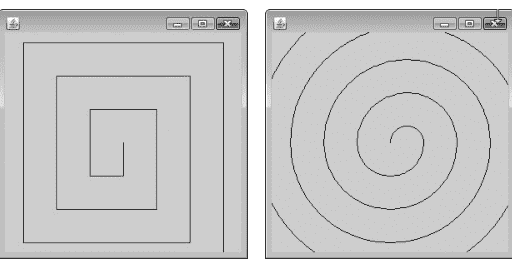

**图 6.20** 使用 `drawLine`（左侧）和 `drawArc`（右侧）绘制螺旋。

## 6.16 总结

本章开始介绍我们对数据结构的介绍，探索了使用数组来存储数据，以及从值列表和表中检索数据。本章示例演示了如何声明数组、初始化数组以及引用数组的单个元素。本章引入了增强型 `for` 循环来遍历数组。我们使用异常处理来测试当程序尝试访问数组边界之外元素时发生的 `ArrayIndexOutOfBoundsException`。我们还说明了如何将数组传递给方法以及如何声明和操作多维数组。最后，本章展示了如何使用使用变长参数的方法，以及如何从程序向命令行读取参数。

我们引入了 `ArrayList<T>` 泛型类，它提供了数组的所有功能和性能，以及动态调整大小等其他能力。我们使用这些方法向 `ArrayList` 的末尾添加新项以及在 `ArrayList` 中插入项。`remove` 方法用于删除指定元素的首次出现，而 `remove` 的重载版本用于删除指定索引处的元素。我们使用 `size` 方法获取 `ArrayList` 中的元素数量。

我们在第 16 章“集合”中继续对数据结构的介绍，该章节介绍了 Java 集合框架和 Java 的其他预定义数据结构。与 `ArrayList` 类似，其他数据结构也使用泛型，允许你指定特定结构将存储的对象类型。第 16 章还涵盖了 `Arrays` 类的其他方法——在阅读完第 6 章后你将可以使用其中一些，但它需要书中后面部分介绍的概念知识。第 20 章讨论了泛型、泛型数据结构，展示了如何构建动态数据结构（如列表、队列、栈和树），这些结构可以随着程序的执行而增长和缩小。

我们引入了控制语句、方法、数组和集合的基本概念。正如你在第 7 章中看到的，Java 通常在 `main` 方法中只包含几行代码——这些语句通常创建执行应用程序工作的对象。在第 7 章中，你将学习如何实现自己的类并在应用程序中使用这些类的对象。

## 总结

### 6.1 节 引言

- 数组（第 209 页）是固定长度的数据结构，由相同类型的相关数据项组成。

### 6.2 节 基本类型与 引用类型

- Java 中的类型分为两类——基本类型和引用类型。基本类型是 `boolean`、`byte`、`char`、`short`、`int`、`long`、`float` 和 `double`。所有其他类型都是引用类型，即类，它们一次可以存储其声明类型的一个值。
- 基本类型变量一次可以存储其声明类型的一个值。
- 引用类型变量（称为引用；第 210 页）存储计算机内存中对象的位置。此类变量引用程序中的对象。
- 调用对象的方法需要对对象的引用（第 210 页）。基本类型变量不引用对象，因此不能用它调用方法。

### 6.3 节 数组

- 数组是一组变量（称为元素或组件；第 210 页），包含所有类型都相同的相同值。数组是对象，因此它们被视为引用类型。
- 程序使用数组表达式（第 211 页）引用数组的任何一个元素，该表达式包括数组名称，后跟方括号 `[]` 内的特定元素的索引（`[]`；第 211 页）。
- 每个数组的第一个元素索引为零（第 211 页），有时称为第 0 个元素。
- 索引必须是非负整数。程序可以使用表达式作为索引。
- 数组对象有一个 `length`（第 211 页），代表数组的长度。

### 6.4 节 数组的声明与创建

- 要创建一个数组，使用关键字 `new` 在数组创建表达式（第 212 页）中指定数组元素类型和元素数量。
- 当创建数组时，每个元素都会接收一个默认值——数值基本类型元素为 0，布尔类型为 `false`，对象为 `null`。
- 在数组声明中，可以将方括号组合在声明开头，以表示声明中的所有标识符都是数组变量。
- 基本类型数组的每个元素包含一个数组声明类型的值。引用类型数组的每个元素都是对数组声明类型对象的引用。

### 6.5 节 数组使用示例

- 程序可以创建一个数组并使用数组初始化器（第 214 页）初始化其元素。
- 常量变量（第 216 页）用关键字 `final` 声明，必须在使用它们之前进行初始化，并且之后不能再修改。

### 6.6 节 异常处理：处理错误的响应

- 异常表示程序在执行时发生了错误。“异常”一词暗示问题发生的频率很低——如果“规则”是一条通常执行执行的语句，那么程序会将异常返回给“规则”。
- 异常处理（第 222 页）允许你创建容错性程序。
- 当 Java 程序执行时，JVM 会检查数组索引以确保它们大于或等于 0 且小于数组长度。如果程序使用无效索引，则会产生异常。
- 为了处理异常，可以在 `try` 语句（第 222 页）中使用可能抛出异常的代码。
- 在 `try` 块（第 222 页）中包含可能抛出异常的代码，并且你可以有多个 `catch` 块（第 222 页）来处理可能抛出的异常。
- 你可以有多个 `catch` 块（第 222 页）来处理可能抛出的不同异常类型。
- 当 `try` 块结束时，`try` 块中定义的变量将离开作用域。
- `catch` 块声明类型和异常参数。在 `catch` 块内部，你可以使用标识符与捕获的对象进行交互。
- 当程序执行时，会检查有效性——所有索引必须大于 0 且小于长度。如果尝试使用无效索引访问元素，会发生 `ArrayIndexOutOfBoundsException`（第 223 页）。
- 对象的 `toString` 方法返回错误信息。

### 6.7 节 增强 for 语句

增强型 `for`（第 223 页）允许你在使用计数器的情况下遍历数组或集合的元素。增强语句的语法为：

```
for (parameter : arrayName)
statement
```

其中 parameter 有类型和标识符，arrayName 是要遍历的数组。

- 增强型不能用于修改数组中的元素。如果程序需要修改元素，请使用传统的计数器 `for` 语句。

### 6.8 节 将数组传递给方法

- 当按值传递参数时，会创建参数值的副本并传递给调用方法。该方法仅与副本工作。

### 6.9 节 按值传递与按引用传递

- 当按引用传递（第 227 页）时，调用方法可以直接访问调用者中的参数值并可能修改它。
- Java 中的所有参数都是按值传递的。方法调用可以向方法传递两种值：基本值的副本和对象引用的副本。引用是按值传递的（第 227 页），方法仍然可以通过调用引用的副本来与对象进行交互。
- 要传递对象引用，只需在方法调用中指定引用对象的变量名称即可。
- 当你向方法传递数组或引用类型的单个元素时，方法接收的是该数组或元素引用的副本。当你传递基本类型的单个元素时，方法接收的是元素值的副本。
- 要向方法传递单个数组元素，请使用数组的索引名称。

### 6.10 节 多维数组

- 两个维的多维数组通常用于表示由行和列排列的信息组成的表格。
- 具有 $m$ 行 $n$ 列的二维数组（第 228 页）被称为 $m$-by-$n$ 数组。此类数组可以使用初始化器进行初始化：
  `array[][] arrayName = {{row1 初始化器}, {row2 初始化器}, ...};`
- 多维数组被维护为由独立的一维数组构成的数组。因此，二维数组中每行的长度并不要求相同。
- 每一行列数相同的多维数组可以使用如下形式的数组创建表达式来创建：
  `array[][] arrayName = new type[numRows][numColumns];`

### 6.11 节 变长参数列表

- 方法参数列表中，参数后跟一个省略号（`...` 第 231 页），表示该方法接收该特定类型的任意数量的参数。省略号在方法的参数列表中只能出现一次，且它必须位于参数列表的末尾。
- 变长参数列表（第 231 页）在方法体内被视为一个数组。可以使用数组的 `length` 字段获取数组中参数的数量。

### 6.12 节 使用命令行参数

- 从命令行向 `main`（第 233 页）传递参数是通过在 `main` 方法的参数列表中包含一个 `String[]` 类型的参数来实现。按照惯例，Java 的 `main` 方法命名为 `args`。
- Java 将 `java` 命令中类名之后的命令行参数作为 `args` 数组中的字符串 传递给应用程序的 `main` 方法。

### 6.13 节 数组类

- `Arrays`（第 235 页）静态方法执行常见的数组操作，包括 `sort`、`binarySearch`、`equals` 和 `fill`。
- `System.arraycopy` 方法（第 235 页）允许你将一个数组的元素复制到另一个数组中。

### 6.14 节 集合与 ArrayList 简介

- Java API 的集合类提供了各种方法，用于组织、存储和检索数据，而无需了解数据是如何存储的。
- `ArrayList<T>`（第 238 页）与数组类似，但可以动态调整大小。
- 带有一个参数的 `add` 方法（第 240 页）将元素附加到 `ArrayList` 的末尾。
- 带有两个参数的 `add` 方法在 `ArrayList` 的指定位置插入新元素。
- `size` 方法（第 240 页）返回 `ArrayList` 中当前的元素数量。


- 带有对象引用的 `remove` 方法删除与参数值匹配的第一个元素。
- 带有整数参数的 `remove` 方法删除指定索引处的元素，并将该索引之上的所有元素向下移动一位。
- `contains` 方法如果在 `ArrayList` 中找到该元素则返回 `true`，否则返回 `false`。

# 自测练习

## 6.1 填充下列每个语句的空白：

a) 列表和数值表格存储在 ________ 和 ________
b) 数组是一组包含值（称为元素或组件）的 ________，这些值都具有相同的 ________。
c) ________ 允许你在不使用计数的情况下遍历数组的元素。
d) 用于指代特定数组元素的数字是 ________。
e) 使用两个索引的数组被称为 a(n) ________。
f) 使用增强型 ________ 遍历双数组数组数字。
g) 命令行参数存储在 ________
h) 使用表达式 ________ 来接收命令行中的参数总数。假设命令行参数存储在 `String[] args` 中。
i) 给定 Java `MyClass` 测试，第一个命令行参数是 ________
j) 方法参数列表中的 ________ 表明该方法可以接收任意数量的参数。

## 6.2 判断以下每个陈述的对错。如果为错误，请解释原因。

a) 数组可以存储许多不同类型的值。
b) 数组索引通常应该是 `float` 类型。
c) 传递给方法的单个数组元素在对应方法中会在方法执行完毕时修改被修改后的值。
d) 命令行参数用逗号分隔。

## 6.3 为名为 `fractions` 的数组执行以下任务：

a) 声明一个初始化为 10 的 `ARRAY_SIZE`。
b) 声明一个类型为 `double` 具有 `ARRAY_SIZE` 个元素的数组，并将元素初始化为 0。
c) 引用数组元素 4。
d) 将值 1.667 赋值给数组元素 9。
e) 将值 3.333 赋值给数组元素 6。
f) 使用语句求和数组的所有元素。声明整数变量 `x` 作为循环的控制变量。

## 6.4 为名为 `table` 的数组执行以下任务：

a) 声明一个初始化为 10 的 `ARRAY_SIZE`。
b) 声明一个类型为 `double` 具有 `ARRAY_SIZE` 个元素的数组，并将元素初始化为 0。
c) 引用数组元素 4。
d) 将值 1.667 赋值给数组元素 9。
e) 将值 3.333 赋值给数组元素 6。
f) 使用语句求和数组的所有元素。声明整数变量 `x` 作为循环的控制变量。


# 练习

## 6.4 为名为 `table` 的数组执行以下任务：

a. 声明一个初始化为 10 的 `ARRAY_SIZE`。

b. 声明一个类型为 `double` 具有 `ARRAY_SIZE` 个元素的数组，并将元素初始化为 0。

c. 引用数组元素 4。

d. 将值 1.667 赋值给数组元素 9。

e. 将值 3.333 赋值给数组元素 6。

f. 使用语句求和数组的所有元素。声明整数变量 `x` 作为循环的控制变量。

## 第 6 章 数组与 ArrayList

- d) 一个将 15 元素数组元素初始化为零的应用程序必须至少包含一个 `for` 语句。

- e) 一个计算二维数组所有元素总和的应用程序必须包含嵌套的 `for` 语句。

### 6.8 编写 Java 语句来完成以下每个任务：

a) 显示数组 `f` 中第 6 个元素的值。

b) 将一维数组 `g` 的五个元素中的每一个初始化为 8。

c) 计算浮点数数组 `c` 中 100 个元素的总和。

d) 将一个包含 11 个元素的数组复制到包含 34 个元素的数组 `b` 的前部分。

e) 确定并显示 99 元素浮点数组 `w` 中的最小值和最大值。

### 6.9 考虑一个二乘三的整数数组 `t`。

a) 编写一条声明并创建 `t` 的语句。

b) `t` 有多少行？

c) `t` 有多少列？

d) `t` 有多少元素？

e) 为 `t` 第 1 行的所有元素编写访问表达式。

f) 为 `t` 第 2 列的所有元素编写访问表达式。

g) 编写单条语句，将第 0 行第 1 列的元素设置为零。

h) 编写单独的语句将 `t` 的每个元素初始化为零。

i) 编写一条语句将 `t` 的每个元素初始化为零。

j) 编写一个嵌套语句，从用户输入 `t` 元素的值。

k) 编写一系列语句来确定并显示 `t` 中的最小值。

l) 编写单条 `printf` 语句显示 `t` 某一列的元素。不要使用循环。

m) 编写一条语句以表格格式显示 `t` 的内容。将索引作为顶部的跨表标题，并将列表索引作为每行的左侧标题。

### 6.10 (销售佣金) 使用一维数组解决以下问题：

一家公司向销售人员支付佣金。销售人员每周获得 200 美元，外加上其销售总额的 9%。例如，一周内赚了 5,000 美元的销售人员将获得 200 美元加上 5,000 美元的 9%，总计 650 美元。编写一个应用程序（使用计数器数组），确定在以下每个范围内获得工资的销售人员人数（假设每个销售人员的工资都取整为整数）：

a) $200–299
b) $300–399
c) $400–499
d) $500–599
e) $600–699
f) $700–799
g) $800–899
h) $900–999
i) $1,000 及以上

以表格格式汇总结果。

### 6.11 编写执行以下一维数组操作的语句：

a) 将整数数组 `counts` 的 10 个元素设置为零。

b) 将整数数组 `bonus` 的 15 个元素中的每一个加 1。

c) 以列格式显示整数数组 `Scores` 的五个值。

### 6.12 (去重) 使用一维数组解决以下问题：

编写一个应用程序，输入五个数字，每个数字在 10 到 100 之间（包含边界）。每读入一个数字时，只有当它不是已读取数字的重复时才显示。考虑到“最坏情况”，即五个数字都是不同的。使用尽可能小的数组来解决这个问题。在用户输入每个新值后，显示输入的所有完整唯一值集。

### 6.13 为三乘五的二维数组 `sales` 的元素进行标记，以指示它们被以下程序段中设置为零的顺序：

```java
for (int row = 0; row < sales.length; row++) {
    for (int col = 0; col < sales[row].length; col++) {
        sales[row][col] = 0;
    }
}
```

### 6.14 (可变长度参数) 编写一个应用程序，计算通过可变长度参数传递方法的一系列整数的乘积。使用具有不同数量参数的多个单元测试该方法。

### 6.15 (命令行参数) 重写图 6.2，使得数组的大小由第一个命令行参数指定。如果未提供命令行参数，则使用 10 作为数组的默认大小。

### 6.16 (使用增强型 for 语句) 编写一个使用增强型 for 语句求和由命令行参数传递的值的应用程序。[提示：使用 `Double` 类的静态方法 `parseDouble()` 将 `String` 转换为 double 值。]

### 6.17 (掷骰) 编写一个应用程序模拟掷两个骰子。

该应用程序应使用 `Dice` 类的对象掷第一个骰子，再次掷第二个骰子。然后计算两个值之和。每个骰子可以显示 1 到 6 之间的整数值，因此值之和将在 2 到 12 之间变化，7 是最频繁的和，2 和 12 最少。图 6.21 显示了两个骰子的 36 种可能组合。使用一维数组统计每个和出现的次数。以表格格式显示结果。

| 和 | 1 | 2 | 3 | 4 | 5 | 6 |
| --- | --- | --- | --- | --- | --- | --- |
| 1 | | | | | | |
| 2 | | | | | | |
| 3 | | | | | | |
| 4 | | | | | | |
| 5 | | | | | | |
| 6 | | | | | | |
| 7 | | | | | | |
| 8 | | | | | | |
| 9 | | | | | | |
| 10 | | | | | | |
| 11 | | | | | | |
| 12 | | | | | | |

图 6.21 | 两个骰子的可能和。

### 6.18 (骰子游戏) 编写一个应用程序运行 1,000,000 局骰子游戏并回答以下问题：

a) 第一次掷出的和是多少次？
b) 第二次掷出的和是多少次？
c) 第一次和第二次掷出的和是多少次？
d) 和的平均值是多少？
e) 和的标准差是多少？

### 6.19 (航空公司订座) 一家小型航空公司刚购买了一台用于新系统。你被要求开发该系统。

使用布尔型一维数组表示座位图。将所有元素初始化为 `false` 表示座位为空。当分配每个座位时，将相应的元素设置为 `true` 表示该座位不再可用。当经济舱满员时，询问用户是否可以安排在头等舱（10）。

### 6.20 (总销售额) 使用二维数组解决以下问题：

一家公司有四名销售人员（1-4），销售五种产品（1-5）。每天每位销售人员每种产品制作一张单据。单据包含：

* a) 销售人员编号
* b) 产品编号
* c) 产品销售额

因此，每个销售人员每天销售 0 到 5 次。假设上月所有的单据信息可用。编写一个应用程序读取上月的所有信息，并按销售和产品进行汇总。所有总计应以二维表格形式呈现，每列代表一个销售人员，每行代表一个产品。行求和得到上月产品的总销售额。列求和得到按销售人员划分的上月总销售额。

### 6.21 (乌龟图形) Logo语言让乌龟图形的概念闻名。

想象一只受 Java 应用程序控制在房间内移动的机械乌龟。乌龟拿着一支笔，有两种位置：拿起或放下。笔放下时，乌龟在移动时会画轨迹，而笔拿起时，乌龟自由移动而不写任何东西。这个问题中，你将模拟乌龟的移动并创建一个计算机草图。使用一个初始化为零的数组。从包含命令的数组读取命令。始终跟踪乌龟的当前位置以及笔是否抬起。假设乌龟始终从地板的 (0, 0) 位置开始且笔抬起。你的应用程序必须处理的一系列乌龟命令如图 6.22 所示。

| 命令 | 含义 |
| --- | --- |
| 1 | 笔拿起 |
| 2 | 笔放下 |
| 3 | 右转 |
| 4 | 左转 |
| 5,10 | 向前移动 10 个格（将 10 替换为不同的格数） |
| 6 | 显示 20x20 数组 |
| 9 | 数据结束（哨兵符） |

**图 6.22** 乌龟命令。

假设乌龟位于地板中心某个位置。以下“程序”将绘制并显示一个 12x12 的正方形，并让笔处于抬起位置：

```
2
5,12
3
5,12
3
5,12
3
5,12
1
6
9
```

当乌龟在笔落下的状态移动时，选择数组 `floor` 中的适当元素并设置为 1。当给出命令 6（显示数组）时，在数组中任何为 1 的地方，显示一个星号或你选择的任何字符。在任何为 0 的地方，显示为空格。

编写一个应用程序来实现讨论过的乌龟绘图功能。编写几个图形程序来绘制有趣的形状。添加其他命令以增强你的乌龟图形程序的功能。

### 6.22 (*骑士马巡*) 对于象棋爱好者来说，一个有趣的谜题是骑士马巡问题，该问题最初由数学家欧拉提出。

马是否可以在空棋盘上移动，并恰且仅一次访问 64 个方格中的每一个？我们将深入研究这个引人入胜的问题。

马只进行 L 形移动（在一个方向上移动两个格，在垂直方向上移动一个格）。因此，如图 6.23 所示，从空棋盘中心附近的一个方格（标记为 K 的马）可以进行不同的移动（编号从 0 到 7）。

a) 在纸上画一个 8x8 的棋盘，并尝试手动实现一次骑士马巡。

b) 开发一个让马在棋盘上移动的应用程序。棋盘由一个 8x8 的二维数组表示。每个方格初始化为零。我们用水平和垂直分量来描述每种可能的移动。例如，如图 6.23 所示，类型 0 的移动包括水平向左移动一个格并垂直向上移动两个格。向左的水平移动和垂直移动用负数表示。这八种移动可以用两个一维数组（水平和垂直）描述，如下所示：

| 0 | 1 | 2 | 3 | 4 | 5 | 6 | 7 |
|---|---|---|---|---|---|---|---|
| 0 | | | | | | | | | |
| 1 | | | 2 | | | | | | |
| 2 | | | 3 | | | 0 | | | | |
| 3 | | | | K | | | | | |
| 4 | | | | 4 | | 7 | | | | |
| 5 | | | | | 5 | 6 | | | | |
| 6 | | | | | | | | | | |

# 第 6 章 数组和 ArrayList


| 7 | | | | | | | | | |

**图 6.23** 马的八种移动方式。

```
horizontal[0] = 2  vertical[0] = -1
horizontal[1] = 1  vertical[1] = -2
horizontal[2] = -1  vertical[2] = -2
horizontal[3] = -2  vertical[3] = -1
horizontal[4] = -2  vertical[4] = 1
horizontal[5] = -1  vertical[5] = 2
horizontal[6] = 1  vertical[6] = 2
horizontal[7] = 2  vertical[7] = 1
```

让变量 `currentRow` 和 `currentColumn` 分别表示马当前位置的行和列。要执行移动 `moveNumber`（其中 `moveNumber` 在 0 到 7 之间），你的应用程序应该使用语句：

```
currentRow += vertical[moveNumber];
currentColumn += horizontal[moveNumber];
```

编写一个应用程序让马在棋盘上运行。保持一个从 1 到 64 的计数。在马移动的每个方格中记录最后的计数。测试每种可能的移动以检查马是否已经访问过该方格。测试每种可能的移动以确保马不会落在棋盘之外。马移动了多少次？

### c) 启发式方法

在尝试编写和运行骑士马巡应用程序后，你可能获得了一些有价值的见解。我们将利用这些见解来开发一种移动的启发式方法（即通用规则）。启发式方法不保证成功，但精心设计的启发式方法会增加成功的机会。你可能观察到边缘格子比棋盘中心的格子更棘手。事实上，最棘手或难以访问的格子是四个角。

直觉可能认为，你应该尝试先将马移动到棘手的方格，留下那些最容易到达的格子，这样当巡游接近结束时，成功的机会更大。

我们可以通过根据方格的可访问性进行分类来开发一种“访问性启发式方法”，始终让马（使用 L 形移动）移动到最难以访问的方格。我们用数字标记二维访问性，指示每个特定方格的可访问格数量。在棋盘上，每个方格的可访问性标记如下，距离中心的 16 个方格标记为 8，其他格子为 3：

| 3 | 4 | 4 | 4 | 4 | 4 | 4 | 3 |
| 4 | 3 | 3 | 3 | 3 | 3 | 3 | 4 |
| 4 | 3 | 2 | 6 | 6 | 2 | 3 | 4 |
| 4 | 3 | 6 | 8 | 8 | 6 | 3 | 4 |
| 4 | 3 | 6 | 8 | 8 | 6 | 3 | 4 |
| 4 | 3 | 2 | 6 | 6 | 2 | 3 | 4 |
| 4 | 3 | 3 | 3 | 3 | 3 | 3 | 4 |
| 3 | 4 | 4 | 4 | 4 | 4 | 4 | 3 |

使用访问性启发式方法编写一个骑士马巡应用程序，当遇到平局时，始终移动到访问性最低的格子。注意：随着马跨越棋盘，你的应用程序应该随着方格被占用而减少访问性数字。在巡游的任何时刻，可用方格的访问性数字将等于在巡游中可以到达的方格数量。巡游可以在四个角中的任何一个开始。运行此版本的应用程序。你是否得到了完整的巡游？

### d) 改进的启发式方法

编写一个骑士马巡应用程序，当格子之间出现平局时，通过观察这些格子来选择。应用程序应该移动到访问性最低的格子。

## 6.23 (骑士马巡：暴力法)

在练习 6.22 的部分 (c) 中，我们开发了问题的解决方案。使用的方法被称为“启发式方法”，生成移动效率很高。

随着计算能力的提高，我们将能够用更高的功率解决更多问题。让我们尝试这种暴力法：

### a) 随机移动

使用随机生成让马在棋盘上随机移动（L 形移动）。你的应用程序应该运行一次巡游并显示棋盘。马移动了多远？

### b) 1000 次尝试

最可能部分 (a) 产生了一个较短的巡游。现在修改你的应用程序尝试 1000 次巡游。使用一个一维数组跟踪每个长度巡游的次数。当应用程序运行时，最佳结果是什么？

### c) 完整巡游

最可能部分 (b) 给你了一些“不错的”巡游，但没有完整的巡游。现在运行你的应用程序直到它产生一个完整的巡游。[警告：此版本的应用程序在强大的计算机上可能会运行数小时。] 再次跟踪每个长度巡游的次数，并在找到第一个完整巡游时显示此表。你的应用程序在产生完整巡游之前尝试了多少次？花了长时间？

### d) 对比

将骑士马巡的暴力版本与访问启发式版本进行比较。哪一个需要更多的研究？哪个需要更多的计算能力？访问启发式方法可以保证获得完整的巡游吗？暴力法可以保证获得完整的巡游吗？详细论证暴力问题的优缺点。

## 6.24 (八皇后问题)

另一个令象棋爱好者的谜题是八皇后问题，它询问以下问题：在空棋盘上放置八个皇后，使得任何一个皇后都不“攻击”其他任何皇后（即没有两个皇后在同一行、同一列或同一条对角线上）？

在练习 6.22 中开发的思考过程，是为解决八皇后问题制定了一种启发式策略。运行你的应用程序。[提示：可以为棋盘上的每个单元格分配一个值，表示如果在该单元格上放置皇后，空棋盘上会有多少个单元格被“消除”。正如图 6.24 所示，每个角格都将被分配值 22。一旦将这些“消除数字”放置在所有 64 个单元格中，一个合适的启发式策略如下：在消除数字最小的单元格中放置下一个皇后。为什么这种策略在直觉上是很有吸引力的？]


**图 6.24** 在左上角放置皇后所消除的两个单元格。

## 6.25 (八皇后：暴力破解法)

在本次练习中，你将开发几种暴力破解法来解决练习 6.24 中引入的八皇后问题。

### a) 随机暴力法

使用练习 6.23 中开发的随机暴力破解技术来解决八皇后问题。

### b) 穷举法

使用穷举法（即尝试棋盘上八个皇后的所有可能组合）来解决八皇后问题。

### c) 穷举法的局限性

为什么穷举暴力法可能不适用于解决骑士巡游问题？

### d) 对比

比较对比随机暴力法和穷举暴力法。

## 6.26 (骑士巡游：闭环路径测试)

在骑士巡游（练习 6.22）中，当骑士移动 64 步且仅访问一次棋盘上的每个格子时，就发生了完全遍历。当第 64 步距离骑士开始巡游的格子仅一步之遥时，发生了闭环。修改你在练习 6.22 中编写的应用程序，在发生完全遍历时测试是否为闭环。

## 6.27 (埃拉托尼筛)

质数是任何大于 1 且只能被自身和 1 整除的整数。埃拉托尼筛是一种寻找质数的方法。它的运行方式如下：

### a) 初始化

创建一个元素初始化为 `true` 的布尔数组。带有索引的数组元素保持 `true`。所有其他数组元素最终将被设置为 `false`。

### b) 筛选过程

从数组索引 2 开始，确定给定元素是否为 `true`。如果是，则遍历数组的剩余部分，并将索引为该 `true` 值索引倍数的每个元素设置为 `false`。对下一个值为 `true` 的元素继续此过程。对于数组索引 2，数组中 2 之后的所有索引为 2 的倍数的元素（索引 4, 6, 8, 10 等等）都将被设置为 `false`；对于数组索引 3，数组中 3 之后的所有索引为 3 的倍数的元素（索引 6, 9, 12, 15 等等）都将被设置为 `false`；以此类推。

当此过程完成后，数组元素全为 `true` 表示该索引是一个质数。这些索引可以被显示。编写一个使用 1,000 个元素数组的应用程序，来确定并显示 2 到 999 之间的质数。忽略数组元素 0 和 1。

## 6.28 (模拟：龟与兔子)

在此问题中，你将重现经典的龟兔赛跑。你将使用随机数生成来开发这一难忘事件的模拟。

我们的竞争者将在第 70 格结束比赛。每个格子代表比赛沿途的一个可能位置。终点在第 70 格。第一个到达或超过第 70 格的竞争者将获得一包胡萝卜和生菜。赛道蜿蜒向上通过光滑的山路，竞争者偶尔会失败。时钟每秒跳一次。时钟每跳一次，你的应用程序根据图 6.25 中的规则调整动物的位置。使用变量跟踪动物的位置（即位置 1–70）。每只动物都从位置 1 开始（起点）。如果动物向左滑动，则回到位置 1。

| 动物 | 移动类型 | 比例 | 实际移动 |
| --- | --- | --- | --- |
| 乌龟 | 慢跑 | 50% | 向右 3 格 |
| | 滑动 | 20% | 向左 6 格 |
| | 慢速走 | 30% | 向右 1 格 |
| 兔子 | 睡眠 | 20% | 不移动 |
| | 大跳 | 20% | 向右 9 格 |
| | 大滑动 | 10% | 向左 12 格 |
| | 小跳 | 30% | 向右 1 格 |
| | 小滑动 | 20% | 向左 2 格 |

**图 6.25** 调整乌龟和兔子的位置的规则。

通过产生 1 ≤ i ≤ 10 范围内的随机整数 i 生成图 6.25 中的模式。对于乌龟，当 1 ≤ i ≤ 5 时执行“慢跑”，当 6 ≤ i ≤ 7 时执行“滑动”，当 8 ≤ i ≤ 10 时执行“慢速走”。使用类似的技术移动兔子。通过以下方式开始比赛：

```
砰！！！它们出发了！！！！
```

然后，时钟每跳一次（即循环的每次重复），显示一行 70 格的位置，乌龟位置显示字母 `T`，兔子位置显示字母 `H`。偶尔竞争者会落在同一个格子上。在这种情况下，乌龟咬兔子，你的应用程序在开始时显示 `OUCH!!!`。除 `T` 或 `OUCH!!!`（平局）之外的所有输出都应为空。

在每行之后，测试任一动物是否到达或超过 70 格。如果是，显示赢者并终止模拟。如果乌龟赢，显示 `TORTOISE WINS!!!`。如果兔子赢，显示 `YAY!!!`。如果两只动物在同一时钟跳动内获胜，你可能倾向于乌龟（黑马），或者你可能显示平局。如果都没有赢，执行循环模拟时钟的下次跳动。我们准备好运行你的应用程序了，聚集朋友观看比赛。你会惊讶于观众的！

# 258 数组和 ArrayList

在书的后面，我们引入了一些 Java 能力，如图形、动画、声音和多线程。学习这些功能时，你可能会喜欢龟兔赛。

## 6.29 (斐波那契数列)

斐波那契数列 0, 1, 1, 2, 3, 5, 8, 13, 21, ... 从 0 和 1 开始，具有每个后续数字都是前两项之和的属性。

### a) 计算方法

编写一个方法 `fibonacci(n)` 计算第 n 个数。将此方法整合到一个允许用户输入 n 值的应用程序中。

### b) 最大值

确定系统可以显示的最大的斐波那契数。

### c) 使用 double

修改你在 (a) 中编写的应用程序，使用 `double` 代替 `int` 来计算并返回斐波那契数，并使用部分 (b)。

# 特别章节：构建你的计算机

在接下来几节中，我们将暂时离开高层语言的世界，“打开”计算机并查看其内部结构。我们引入机器语言编程并编写几个机器语言程序。

## 6.30 (机器语言编程)

让我们创建一个名为 Simpleton 的计算机。正如其名所示，它是一个简单的机器，但功能强大。Simpleton 只运行用其语言编写的程序：Simpleton 机器语言 (SML)。

Simpleton 包含一个累加器——在 Simpleton 使用或检查信息之前放入信息的寄存器。Simpleton 中的所有信息都以“字”处理。一个字是一个符号四位数，例如 `+3564`, `-3299`, `+0007` 和 `-0001`。Simpleton 配备有 100 字的内存，这些字通过位置号 00、01–99 进行引用。

在运行 SML 程序之前，必须将程序加载或放置到内存中。每个 SML 程序的每条指令（或语句）都放在位置。模拟器将从该位置开始执行。

SML 中的每条指令占用 Simpleton 内存的一个字（指令是符号四位数）。我们假设 SML 指令的符号始终为正，但数据字的符号可以是正的也可以是负的。Simpleton 内存中的每个位置都可能包含指令、数据值或（以及未定义的）内存区域。每条 SML 指令的前两个数字是操作码，指定了要执行的操作。SML 操作码总结在图 6.26 中。

SML 指令的最后两位是包含所应用操作字的内存位置的操作数——地址。让我们考虑几个简单的 SML 程序。

| 操作码 | 含义 |
|---|---|
| **输入/输出操作:** | |
| `final int READ = 10;` | 从键盘读取一个字到内存的特定位置。 |

**图 6.26** Simpleton 机器语言 (SML) 操作码。（第一部分，共 2 部分）。

| 操作码 | 含义 |
| --- | --- |
| `final int WRITE = 11;` | 从内存的特定位置写入一个字到屏幕。 |
| **加载/存储操作：** | |
| `final int LOAD = 20;` | 从内存的特定位置加载一个字到累加器中。 |
| `final int STORE = 21;` | 将累加器中的字存储到内存的特定位置。 |
| **算术操作：** | |
| `final int ADD = 30;` | 将内存中特定位置的字加累加器中的字（结果留在累加器中）。 |
| `final int SUBTRACT = 31;` | 从累加器中的字减去内存中特定位置的字（结果留在累加器中）。 |
| `final int DIVIDE = 32;` | 将累加器中的字除以内存中特定位置的字（结果留在累加器中）。 |
| `final int MULTIPLY = 33;` | 将内存中特定位置的字乘以累加器中的字（结果留在累加器中）。 |
| **控制转移操作：** | |
| `final int BRANCH = 40;` | 跳转到内存的特定位置。 |
| `final int BRANCHNEG = 41;` | 如果累加器为负，则跳转到内存的特定位置。 |
| `final int BRANCHZERO = 42;` | 如果累加器为零，跳转到内存的特定位置。 |
| `final int HALT = 43;` | 停止。程序已完成任务。 |

**图 6.26** Simpleton 机器语言 (SML) 操作码。（2 个部分中的第 2 部分）

第一个 SML 程序（图 6.27）从键盘读取两个数字，并计算并显示它们的和。指令 `+1007` 从键盘读取第一个数字并放入位置 07；然后指令 `+1008` 将下一个数字读入位置 08。*加载*指令 `+2007` 将第一个数字放入累加器，而*加法*指令 `+3008` 将第二个数字加到累加器中。所有 SML 算术指令都将其结果留在*累加器*中。*存储指令* `+2109` 将结果放在内存位置 09，然后*写入*指令 `+1109` 获取该数字并将其显示（作为一个带符号的四位小数）。*停止*指令 `+4300` 终止执行。

| 位置 | 数字 | 指令 |
| --- | --- | --- |
| 00 | +1007 | (读取 A) |
| 01 | +1008 | (读取 B) |
| 02 | +2007 | (加载 A) |
| 03 | +3008 | (相加 B) |

**图 6.27** 读取两个整数并计算其和的 SML 程序。（2 个部分中的第 1 部分）

| 位置 | 数字 | 指令 |
| --- | --- | --- |
| 04 | +2109 | (存储 C) |
| 05 | +1109 | (写入 C) |
| 06 | +4300 | (停止) |
| 07 | +0000 | (变量 A) |
| 08 | +0000 | (变量 B) |
| 09 | +0000 | (结果 C) |

**图 6.27** 读取两个整数并计算其和的 SML 程序。（2 个部分中的第 2 部分。）

第二个 SML 程序（图 6.28）从键盘读取两个数字，确定并显示较大的值。注意指令 `+4107` 作为控制转移的使用。

| 位置 | 数字 | 指令 |
| --- | --- | --- |
| 00 | +1009 | (读取 A) |
| 01 | +1010 | (读取 B) |
| 02 | +2009 | (加载 A) |
| 03 | +3110 | (相减 B) |
| 04 | +4107 | (跳转到 07) |
| 05 | +1109 | (写入 A) |
| 06 | +4300 | (停止) |
| 07 | +1110 | (写入 B) |
| 08 | +4300 | (停止) |
| 09 | +0000 | (变量 A) |
| 10 | +0000 | (变量 B) |

**图 6.28** 读取两个整数并确定较大值的 SML 程序。

现在编写 SML 程序以完成以下任务：

### a) 哨兵控制循环

使用哨兵控制循环读取 10 个正数。计算并显示它们的和。

### b) 计数器控制循环

使用计数器控制循环读取 7 个数字（有正有负），计算并显示它们的平均值。

### c) 最大值查找

读取一系列数字，确定并显示最大值。第一个数字指示要处理的数字个数。

## 6.31 (计算机模拟器)

在这个问题中，你将构建你自己的计算机。不，你将不会一起构建组件。你将使用强大的软件模拟技术为练习 6.30 中的 Simpleton 创建一个面向对象的模型。你的模拟器将把你使用的计算机变成一个 Simpleton，你实际上能够运行、测试并调试你在练习 6.30 中编写的 SML 程序。

当你运行 Simpleton 模拟器时，它应该开始显示：

> *** 欢迎使用 Simpleton ***
>
> *** 请每次输入程序***
>
> *** 或数据字。我将显示***
>
> *** 位置号 (?)***
>
> *** 输入该位置的字。***
>
> *** 输入 -99999 停止输入程序。***

你的应用程序应该使用一个包含 100 个元素的一维数组模拟 Simpleton 的内存。现在假设模拟器正在运行，让我们查看图 6.28 的对话：

```
00 ? +1009
01 ? +1010
02 ? +2009
03 ? +3110
04 ? +4107
05 ? +1109
06 ? +4300
07 ? +1110
08 ? +4300
09 ? +0000
10 ? +0000
11 ? -99999
```

你的程序应该显示内存后跟一个问号。每个问号右侧的值都是用户输入的。当输入哨兵值 -99999 时，程序应该显示以下内容：

> *** 程序完成 ***
>
> *** 程序执行开始 ***


现在让我们考虑如何模拟分支指令——即控制转移。我们只需要适当地调整指令计数器的值即可。因此，无条件分支指令 (40) 在 `switch` 语句中的模拟如下：

```
instructionCounter = operand;
```

条件分支“如果累加器为零”指令的模拟如下：

```
if accumulator == 0
instructionCounter = operand;
```

此时，你应该实现 Simpleton 并运行你在练习 6.30 中写的每个 SML 程序。如果你愿意，可以为 SML 添加额外的功能并为你的模拟器提供这些功能。你的模拟器应该检查各种类型的错误。例如，在程序加载阶段，用户输入 Simpleton 内存的每个数字必须在 -9999 到 +9999 范围内。你的模拟器应该测试每个数字是否在该范围内，如果不在，则提示用户重新输入数字，直到用户输入正确的数字为止。

在执行阶段，你的模拟器应该检查各种严重错误，例如尝试除以零、尝试执行无效的操作码以及累加器溢出（即对大于 +9999 或小于 -9999 的值进行算术运算）。此类错误被称为致命错误。当发生致命错误时，你的模拟器应该显示错误信息，如下：

> ***尝试除以零 ***
>
> *** Simpleton 执行异常终止 ***

并以我们之前讨论的格式显示完整的内存转储（dump）。这将帮助用户定位程序中的错误。

## 6.32 (Simpleton 修改)

在练习 6.31 中，你编写了一个计算机的软件模拟，它可以以 Simpleton 机器语言 (SML) 执行程序。在此练习中，我们对 Simpleton 提了若干修改和增强。在第 21 章的练习中，我们建议构建一个编译器，将高级编程语言（Basic 的变体）中的程序转换为 Simpleton 机器语言。为了执行编译器产生的程序，可能需要以下修改和增强：

- a) 扩展 Simpleton 的内存以包含 1,000 个内存单元，以便 Simpleton 能够处理更大的范围。
- b) 允许模拟器执行余数计算。此修改需要额外的 SML 指令。
- c) 允许模拟器执行幂运算。此修改需要额外的 SML 指令。
- d) 修改模拟器，使用十六进制而非整数值来表示 SML。
- e) 修改模拟器以允许输出换行。此修改需要额外的 SML 指令。
- f) 修改模拟器以在处理整数值之外处理浮点值。
- g) 提示：Simpleton 的字将被分为两组，每组包含一个两位整数。每个两个数字代表字符的 ASCII（见附录 B）十进制等效值。一种语言指令将输入字符串并存储字符串，从特定的 Simpleton 内存位置开始。该位置字的前半部分是字符串字符数量的计数（即字符串的长度）。随后的每个半字包含一个用两个十进制表示的 ASCII 字符。机器语言指令将每个字符转换为其 ASCII 等效值并将其分配给半字。）以以 (g) 格式存储的字符串。[提示：
- 修改模拟器以处理部分 (g) 的输出。添加一种机器语言指令，从某个 Simpleton 内存位置开始显示字符串。该位置字的前半部分是字符串字符数量的计数（即字符串的长度）。随后的每个半字包含一个用两个十进制表示的 ASCII 字符。机器语言指令检查长度并通过将每个两位数翻译为其等效字符来显示字符串。

## 第 6 章 数组和 ArrayList

## 与众不同

**6.33 (民调)** 互联网和网页让更多的人能够建立网络、加入事业、发表意见等。最近的总统候选人密集地利用互联网传达信息并为竞选活动筹资金。在这个练习中，你将编写一个简单的民意程序，允许用户从 1（最重要）到 10（最重要）对社会意识问题进行评分。选取五个对你重要的案例（例如，政治问题、全球环境问题）。使用调查响应，使用一个 5 行 10 列的二维数组（类型为 `int`）来存储响应，每行对应于主题数组中的一个元素。当程序运行时，它应该要求用户对每个问题进行评分。显示结果摘要，如下：

- a) 一个表格化报告，左侧为五个主题，顶部为 10 个评分，在每列中列出每个主题收到的评分数量。
- b) 在每行的右侧，显示该问题评分的平均值。
- c) 哪个问题获得的总分最高？同时显示问题和总分。
- d) 哪个问题获得的总分最低？同时显示问题和总分。

## 类和对象的介绍

> 你们的公职人员服务你们是理所应当的。
>
> —Adlai E. Stevenson
>
> 任何东西如果不成为实用性对象，就不具有价值。
>
> —Karl Marx

## 目标

在本章中，你将学习：

- 如何声明一个类并使用它创建对象。
- 如何将类的行为实现为方法。
- 如何将类的属性实现为实例变量。
- 如何调用对象的方法来执行它们的任务。
- 方法的局部变量是什么，它们与实例变量有什么区别。
- 如何使用构造函数初始化对象的数据。
- 如何表示和使用浮点数。

## 第 7 章 对象简介

| 7.1 引言 | 7.4 带有构造函数的 Account 类 |
| :--- | :--- |
| 7.2 实例变量、set 方法和 get 方法 | 7.4.1 声明类 |
| 7.2.1 带有实例变量、set 方法和 get 方法的 Account 类 | 7.4.2 AccountTest: 在对象创建时初始化对象 |
| 7.2.2 创建并使用一个对象的 Account 类 | 7.5 带有余额的 Account 类；浮点数 |
| 7.2.3 编译和执行带有多个类的 App | 7.5.1 带有类型为 double 的余额实例变量 Account 类 |
| 7.2.4 带有实例变量的 Account UI 图表 | 7.5.2 使用类的 Account Test |
| 7.2.5 关于此示例的额外说明 | 7.6 案例研究：洗牌和发牌模拟 |
| 7.2.6 使用私有实例变量和公共 get 方法的软件工程 | 7.7 案例研究：使用数组存储的 GradeBook |
| 7.3 实例变量的默认和显式初始化 | 7.8 案例研究：使用二维数组的 GradeBook |
| 7.3 对象的初始化 | 7.9 总结 |
| 总结 | 自测练习 |
| 自测练习答案 | 练习 |

## 7.2 实例变量、set 方法和 get 方法

十名学生参加了一场考试。第二种方法使用二维数组来表示三场考试中每场考试十名学生的成绩。

通常，你在本章及后续章节开发的应用程序将由两个或多个类组成。如果你加入了工业界的开发团队，你可能会处理包含数百个甚至数千个类的应用程序。

## 7.2 实例变量、set 方法和 get 方法

在本节中，你将创建两个类——`Account`（图 7.1）和 `AccountTest`（图 7.2）。`AccountTest` 类是一个应用程序类，其 `main()` 方法将创建并使用一个 `Account` 对象来演示其功能。

### 7.2.1 带有实例变量、set 方法和 get 方法的 Account 类

不同的账户通常有不同的名称。出于这个原因，`Account`（图 7.1）包含一个 `name` 实例变量。类的实例变量为该类的每个对象（即实例）维护数据。在章节的稍后部分，我们将添加一个实例变量 `balance`，以便跟踪账户中的金额。`Account` 类包含两个方法——`setName()` 用于在 `Account` 对象中存储名称，`getName()` 用于从 `Account` 对象中获取名称。

```
// Fig 7.1: Account.java
// Account 类包含一个 name 实例变量
// 以及用于设置和获取其值的方法。
public class Account
{
    private String name; // 实例变量

    // 在对象中设置名称的方法
    public void setName(String name)
    {
        this.name = name; // 存储名称
    }

    // 从对象中检索名称的方法
    public String getName()
    {
        return name; // 向调用者返回 name 的值
    }
} // end class Account
```

**图 7.1** | 包含 name 实例变量以及用于设置和获取其值的 Account 类。

### 类声明

类声明从第 5 行开始：

```java
public class Account
```

`public` 关键字（第 8 章将详细解释）是一个访问修饰符。现在，我们只需简单地将每个类声明为 `public`。每个 `public` 类声明必须存储在与类同名且以 `.java` 扩展名结尾的文件中；否则将发生编译错误。因此，公共类 `Account` 和 `AccountTest`（图 7.2）必须分别在单独的文件 `Account.java` 和 `AccountTest.java` 中声明。

每个类声明都包含关键字，紧接着是类名——在本例中为 `Account`。每个类的体都包含在一对左右括号中，如 7.1 中第 6 行和第 20 行所示。

### 标识符和驼峰命名法

类名、方法名和变量名都是标识符，按照习惯，它们都使用我们在第 2 章讨论过的相同驼峰命名法（camel scheme）。同样按照习惯，类名以大写字母开头，而方法名和变量以小写字母开头。

### 实例变量

从第 1.5 节可知，对象具有属性，这些属性通过实例变量实现并贯穿其整个寿命。实例变量在调用对象的方法之前存在，在方法执行期间以及方法执行之后都存在。该类的每个对象（实例）都有该类变量的副本。一个类通常包含一个或多个方法，用于操作属于该类对象的实例变量。

实例变量声明在类声明内部，但在类方法的体之外。第 7 行：

```java
private String name; // 实例变量
```

在方法 `setName()`（第 10–13 行）和 `getName()`（第 16–19 行）体之外声明了类型为 `String` 的实例变量。`String` 变量可以持有字符值，如 "Jane Green"。如果有多个 `Account`，每个账户都有自己的名称。因为它是一个实例变量，所以它可以被类的每个方法所操作。

> **良好的编程实践 7.1**
>
> 我们倾向于在类体列出实例变量，这样在类方法使用它们之前，就能看到变量的名称和类型。你可以将实例列在类方法声明之外的任何位置，但这会导致实例变量散落在代码中，变得难以阅读。

### 访问修饰符：public 和 private

大多数实例变量使用 `private` 关键字声明（第 7 行）。与 `public` 一样，`private` 也是一种访问修饰符。用访问修饰符 `private` 声明的变量或方法仅对其所在的类的方法可访问。因此，该变量只能在每个 `Account` 对象的方法中使用（在本例中为 `setName()` 和 `getName()`）。你会发现这种强大的软件工程提供了机会。

### Account 类的实例方法 setName()

在前面的章节中，你在每个类中只声明了静态（static）方法。类的非静态方法被称为实例方法。方法 `setName()` 的声明（第 10–13 行）表示 `setName()` 接收类型为 `String` 的参数 `name` —— 代表将将作为参数传递给方法的名称。

回想一下，方法体（如 `main()`）中声明的变量是局部变量，它们只能在该方法中使用，且该方法的参数也是该方法的局部变量。

`setName()` 方法体包含单条语句（第 12 行），该语句将参数 `name`（一个 `String`）的值赋值给类的实例变量，将账户名称存储在对象中。如果方法包含同名的局部变量，编译器将使用该局部变量。

> **良好的编程实践 7.2**
>
> 我们避免使用与实例变量相同的名称命名局部变量。如果我们必须使用相同的名称，我们使用 `this` 关键字来区分实例变量。

方法执行后，局部变量会被销毁。实例变量仍然是对象的一部分。

### 类方法 getName()

方法 `getName()` 返回实例变量的值。如果方法包含同名的局部变量，编译器将使用该局部变量。要访问实例变量，我们使用 `this` 关键字。

### 7.2.2 AccountTest 创建并使用对象

接下来，我们想在此处使用 `Account`，如第 12 行所示。为了帮助你准备更大的项目，我们使用一个单独的 `main()` 类。这种类有时被称为驱动类（driver class）。通过告诉它做什么（快走、慢走、左转、右转），`AccountTest` 驱动对象。

### 驱动类 Account

为了帮助你准备更大的项目，我们使用一个单独的 `main()` 类。这种类有时被称为驱动类。通过告诉它做什么（快走、慢走、左转、右转），`AccountTest` 驱动对象。

## null——字符串变量的默认初始值

输出的第一行显示了名称“null”。与不会自动初始化的局部变量不同，每个实例变量都有*默认初始值*——当你不指定实例变量的初始值时，Java 会提供该值。因此，在程序中使用实例变量之前，不需要对其显式初始化——除非必须将其初始化为*不同于*其默认值的值。`String` 类型的实例变量（例如示例中的 `name`）的默认值是 `null`，我们将在第 7.3 节中进一步讨论。

## 调用 Account 类的 setName() 方法

第 21 行调用了 `myAccount` 的 `setName()` 方法。回想，方法可以提供参数，其值会被赋值给相应的方法参数。在这种情况下，括号中 `main()` 的局部变量 `name` 的值是传递给 `setName()` 的参数，以便该方法能够执行其任务。当调用 `setName()` 时：

1. 应用程序将程序执行从 `main()` 的第 21 行转移到 `setName()` 方法（图 7.1 中的第 10–13 行），调用者括号中的参数被赋值给方法头中相应的参数（`name`）（图 7.1 中的第 10 行）。由于是通过 `myAccount` 对象调用的 `setName()`，`setName()` “知道”要操作哪个实例变量。
2. 接下来，`setName()` 执行其任务——即将 `name` 参数的值赋值给实例变量 `name`（图 7.1 中的第 12 行）。
3. 当程序执行到达 `setName()` 的右大括号结束时，它返回到图 7.2 第 21 行调用 `setName()` 的地方，然后从第 22 行继续执行。

## 显示用户输入的名称

当第二次调用 `setName()` 方法（第 26 行）执行时，将显示用户在第 20 行输入的名称。当第 25–26 行的语句执行完成时，到达方法的末尾，因此程序终止。

## 7.2.3 编译和运行包含多个类的应用程序

在执行应用程序之前，你需要先编译图 7.1 和图 7.2 中的类。这是你第一次创建一个包含多个类的应用程序。`AccountTest` 类有一个 `main()` 方法；`Account` 类没有。要编译此应用程序，首先切换到包含应用程序源文件的目录。接下来，输入命令

```
javac AccountTest.java
```

来同时编译这两个类。如果包含应用程序的目录只包含此应用程序的文件，你可以使用以下命令编译两个类：

```
javac *.java
```

`*.java` 中的星号（*）表示当前目录中所有以“.java”文件扩展扩展名结尾的文件都应该被编译。如果两个类都编译正确——即没有显示任何编译错误——你就可以可以使用命令运行应用程序：

```
java AccountTest
```

## 7.2.4 带有实例变量和 get 方法的 Account UML 类图

我们将使用 UML 类图来总结类的属性和操作。在工业领域，UML 图帮助设计人员以一种简洁、图形化且独立于特定编程语言的方式来规范系统，然后让程序员用特定的编程语言实现该系统。图 7.3 展示了图 7.1 中 `Account` 类的 UML 类图。

| Account | 顶部区域 |
| --- | --- |
| - name : String | 中间区域 |
| + setName(name : String) | 底部区域 |
| + getName() : String | |

**图 7.3** | 图 7.1 中 `Account` 类的 UML 类图。

### 顶部区域

在 UML 中，每个类都被建模为一个带有三个区域的矩形。在幅图中，*顶部*区域包含*类名* `Account`，水平居中并以粗体显示。

### 中间区域

中间区域包含类的*属性名*，它对应于 Java 中同名的实例变量。在 Java 中，实例变量是私有的，因此 UML 类图在属性名之前列出了*减号*（-）访问修饰符。属性名之后是*冒号*和*属性类型*，在本例中为 `String`。

### 底部区域

底部区域包含类的*操作* `setName()` 和 `getName()`，它们对应于 Java 中同名的方法。UML 通过列出操作名称和访问修饰符来建模，此处为 `+ getName()`。这个加号（+）表示 `getName()` 是 UML 中的一个*公共*操作（因为它是 Java 中的一个公共方法）。操作 `getName()` 没有任何参数，因此类图中操作名称后的括号是空的，就像图 7.1 第 16 行方法声明中一样。操作 `setName()` 也是一个公共操作，类型为 `String`。

### 返回类型

UML 通过在操作名称后的括号后面放置冒号和返回类型来指示操作的返回类型。`Account` 方法 `getName()`（图 7.1）具有 `String` 类型。方法 `setName()` 不返回结果（因为它在 Java 中返回 `void`），因此 UML 类图在括号后没有指定返回类型。

### 参数

UML 参数的方式与 Java 有所不同，它在操作名称后的括号内列出参数名，随后是冒号和参数类型。UML 有自己类似于 Java 的数据类型，为了简单起见，我们将使用 Java 数据类型。`Account` 方法 `setName()`（图 7.1）有一个名为 `name` 的 `String` 参数，因此图 7.3 在方法名后的括号之间列出了 `name : String`。

## 7.2.5 关于此示例的附加说明

### 关于静态方法的说明


静态方法可以直接调用类的其他方法（即直接使用方法名），并可以操作静态变量。要访问实例变量和实例方法，静态方法必须使用对对象的引用。静态方法相对于整个类，而实例方法与特定的实例（对象）相关，并操作该对象的实例变量。具有实例变量拷贝的类的许多对象同时存在。假设静态方法直接调用实例方法？该静态方法如何知道操作哪个对象的实例变量？如果在调用方法时不存在该类的对象会发生什么？Java 不允许静态方法直接访问实例变量和方法。

### 关于导入语句的说明

注意图 7.2 第 3 行的导入语句，它告诉编译器程序使用了 `Scanner`。正如你在第 2 章中所学的，`java.lang` 是被隐式导入的，因此所有程序都可以使用 `java.lang` 包的类。你使用的其他大多数类必须显式导入。

位于同一目录的类之间存在特殊关系，例如 `Account` 和 `AccountTest` 类。默认情况下，这些类被认为处于同一个包——称为默认包。同包中的类会被隐导入到该包类的源文件中。因此，当包中的一个类使用同包的另一个类时，不需要导入语句——如 `AccountTest` 使用 `Account`。

如果我们在这个文件中处处将 `Scanner` 称为 `java.util.Scanner`，则第 3 行的导入语句是不需要的，因为它包含了完整的包名和类名。这被称为完全限定类名。例如，图 7.2 第 10 行可以写为：

```java
java.util.Scanner input = new java.util.Scanner(System.in);
```

> **软件工程观察 7.1** 如果每次使用类名都指定完全限定类名，Java 编译器就不需要导入语句。大多数程序员更倾向于使用导入语句实现的更简洁的编程风格。

## 7.2 实例变量、set 方法和 get 方法

如果实例变量是公有的，那么该类的任何客户端——即任何调用该类方法的其他类——都可以看到数据，并对其进行任何操作，包括将其设置为无效值。

你可能会认为，虽然类不能直接访问私有实例变量，但使用访问修饰符声明变量被称为**数据隐藏**或**信息隐藏**。当程序创建（实例化）`Account` 类的对象时，变量名被封装（隐藏）在对象中，并且只能通过对象类的方法进行访问。

> **软件工程观察 7.2** 在每个实例变量和方法声明之前加上一个访问修饰符。通常情况下，实例变量应该声明为私有，而方法声明为公有。在书的后面，我们将讨论为什么你可能想要将某个方法声明为私有。

### 封装数据的 Account 对象概念视图

你可以将 `Account` 对象想如图 7.4 所示。私有实例变量隐藏在对象内部（由包含 `name` 的内圆表示），并受外层公有方法（由包含 `getName` 和 `setName` 的外圆表示）的保护。任何需要与 `Account` 对象交互的客户端代码只能通过调用保护层的公有方法来实现。

**图 7.4** | 带有封装私有变量和公有方法保护层的 Account 对象视图。

## 7.3 实例变量的默认和显式初始化

回想实例变量默认不会初始化。基本类型实例变量会被初始化——`byte`、`char`、`short`、`int`、`long`、`float` 和 `double` 类型的实例变量初始化为 0，`boolean` 类型的变量初始化为 false。

你可以通过在声明中赋值，来为基本类型实例变量指定自己的初始值，如下所示：

```java
private int numberOfStudents = 10;
```

引用类型实例变量（如 `String` 类型的变量）如果没有显式初始化，将初始化为默认值 `null`——这代表“指向无的引用”。这就是为什么图 7.2 第 16 行第一次调用 `getName` 返回的是 `null`——`name` 的值尚未被设置，因此返回了默认初始值 `null`。

## 7.4 Account 类：使用构造函数初始化对象

正如第 7.2 节所述，当创建 `Account` 类对象（图 7.1）时，它的 `String` 实例变量默认初始化为 `null`。但如果你想在创建 `Account` 对象时提供一个名称呢？

每个类都可以声明一个带有参数的可选构造函数，该构造函数可以在对象创建时初始化该类的对象。Java 要求每个创建的对象都必须有一个构造函数，因此这是初始化对象实例变量的理想点。接下来的示例显示 `Account` 类（图 7.5）带有一个构造函数，可以接收一个名称并在创建 `Account` 对象时使用它来初始化实例变量（图 7.6）。

### 7.4.1 声明 Account 构造函数以进行自定义对象初始化

当你在声明一个类时，可以提供自己的构造函数来为你的类对象指定自定义初始化。例如，你可能想在创建对象时为 `Account` 指定一个名称，如图 7.6 第 10 行所示：

```java
Account account1 = new Account("Jane Green");
```

在该语句中，`String` 参数“Jane Green”被传递给 `Account` 构造函数，并用于初始化实例变量 `name`。前面的语句要求该类提供一个仅接收 `String` 参数的构造函数。图 7.5 包含一个带有此类构造函数的修改后的 `Account` 类。

```java
// Fig. 7.5: Account.java
// 带有初始化 name 的构造函数的 Account 类
public class Account {
    private String name; // 实例变量
    // 构造函数使用参数 name 初始化 name
    public Account(String name) // 构造函数名为类名
    {
        this.name = name;
    }

    // 设置名称的方法
    public void setName(String name)
    {
        this.name = name;
    }

    // 获取名称的方法
    public String getName()
    {
        return name;
    }
} // Account 类结束
```

**图 7.5** | 带有初始化 name 的构造函数的 Account 类。

### Account 构造函数声明

图 7.5 的第 9–12 行声明了 `Account` 的构造函数。构造函数的名称必须与类名相同。构造函数的参数列表指定了它需要一或多条数据来执行其任务。第 9 行表示构造函数有一个名为 `name` 的 `String` 参数。当你创建一个新对象时（如你在图 7.6 中所示的），你将把一个人的姓名传递给构造函数，构造函数将在参数 `name` 中接收该名称。然后，构造函数将在第 11 行初始化变量 `name`。

> **错误预防技巧 7.2** 即使可以这样做，也不要在构造函数中调用方法。我们将在第 10 章面向对象编程：接口中解释这一点。

### Account 构造函数与方法

回想第 7.2 节。在图 7.5 中，构造函数和方法的标识符（`name`）相同。第 9 行的构造函数和第 15 行的方法。在书的后面，我们将解释何时使用私有构造函数。

### 7.4.2 AccountTest：在创建时初始化 Account 对象

`AccountTest` 程序（图 7.6）初始化了两个 `Account` 对象。第 10 行使用构造函数初始化对象，传递“Jane Green”。第 11 行重复此过程，传递“John Blue”。第 14–15 行使用每个对象的 `getName` 方法来获取它们确实已经被初始化了。

```java
// Fig. 7.6: AccountTest.java
// 使用 Account 构造函数在创建每个 Account 对象时初始化 name 变量
public class AccountTest {
    public static void main(String[] args) {
        // 创建两个 Account 对象
        Account account1 = new Account("Jane Green");
        Account account2 = new Account("John Blue");
        // 显示每个 Account 的初始值
        System.out.printf("account1 name is: %s\n", account1.getName());
        System.out.printf("account2 name is: %s\n", account2.getName());
    }
}
```

```
account1 name is: Jane Green
account2 name is: John Blue
```

**图 7.6** | 在创建每个 Account 对象时使用 Account 构造函数初始化 name。

## 构造函数不能返回值

构造函数与方法之间的一个重要区别是构造函数不能返回值，它们不能指定返回类型（即使是 `void`）。通常，构造函数被声明为公有——在书后面我们将解释何时使用私有构造函数。

## 默认构造函数

回想图 7.2 的第 13 行：

```java
Account myAccount = new Account();
```

用于创建一个 `Account` 对象。`new Account` 后的空括号表示调用类的默认构造函数——在任何没有显式声明构造函数的类中，编译器都会提供默认构造函数（它始终没有参数）。当类只有默认构造函数时，类的实例变量将被初始化为默认值。在第 8.5 节中，你将学习类可以有多个构造函数。

## 声明了构造函数的类没有默认构造函数

如果你为类定义了构造函数，编译器就不会为该类创建默认构造函数。在这种情况下，你将无法像我们在图 7.2 中使用的 `new Account()` 类实例表达式来创建 `Account` 对象——除非你声明的自定义构造函数没有参数。

## 7.5 带有余额的 Account 类：浮点数

**软件工程观察 7.3** 除非你的类中实例变量的默认初始化是可以接受的，否则请提供一个自定义构造函数，以确保在创建该类的每个新对象时，实例变量都能用有意义的值正确初始化。

### 在 Account 类的 UML 类图中添加构造函数

图 7.7 的 UML 类图对图 7.5 中的 Account 类进行了建模，该类有一个带有 String 类型 name 参数的构造函数。与操作（operations）一样，UML 模型位于类图的第三个区域中。为了区分构造函数和类的操作，UML 要求将“constructor”一词包含在双角括号（« »）中并放置在构造函数名称之前。习惯上是在第三个区域将构造函数列在其他操作之前。

| Account |
| --- |
| - name : String |
| <<constructor>> Account(name: String) |
| + setName(name: String) |
| + getName() : String |

**图 7.7** | 图 7.5 中 Account 类的 UML 类图。

## 7.5 带有余额的 Account 类：浮点数

我们声明了一个 Account 类，它除了维护名称外，还维护银行账户的余额。大多数账户余额都不是整数。因此，Account 类使用 `double` 表示账户余额。[在第 8.15 节中，我们将更深入地研究面向对象的编程，我们将使用 `BigDecimal` 类来精确表示货币金额，这正如你在编写工业级货币应用程序时应该做的那样。]

### 7.5.1 带有 double 类型实例变量 balance 的 Account 类

我们的下一个程序包含 Account 类的版本（图 7.8），它维护了银行账户名称和余额的实例变量。典型的银行服务于许多账户，每个账户都有自己的余额，因此第 8 行定义了一个 `double` 类型的实例余额。Account 类的每个实例（即对象）都包含名称和余额的各自副本。

```java
// Fig. 7.8: Account.java
// Account 类，具有 double 类型的实例变量 balance、一个构造函数
// 以及一个执行验证的 deposit 方法。
public class Account
{
    private String name; // 实例变量
    private double balance; // 实例变量

    // 接收两个参数的 Account 构造函数
    public Account(String name, double balance)
    {
        this.name = name; // 将 name 赋值给实例变量

        // 验证余额大于 0.0；如果不是
        // 实例变量 balance 将保持其默认初始值 0.0
        if (balance > 0.0) // 如果余额有效
            this.balance = balance; // 将赋值给实例变量 balance
    }

    // 只向余额存款有效金额的方法
    public void deposit(double depositAmount)
    {
        if (depositAmount > 0.0) // 如果 depositAmount 有效
            balance += depositAmount; // 将其加到余额
    }

    // 返回余额的方法
    public double getBalance()
    {
        return balance;
    }

    // 设置名称的方法
    public void setName(String name)
    {
        this.name = name;
    }

    // 返回名称的方法
    public String getName()
    {
        return name; // 将 name 的值返回给调用者
    }
} // 类结束 Account
```

**图 7.8** | 具有 double 类型实例变量 balance、构造函数以及执行验证的 deposit 方法的 Account 类。

#### Account 双参数构造函数

该类有一个构造函数和四个方法。开户的人立即存款是很常见的现象，因此，构造函数（11–19）现在接收第二个参数——代表起始余额的 `double` 类型 `initialBalance`。第 17–18 行确保 `initialBalance` 大于 0.0。如果是，则将 `initialBalance` 的值赋值给实例变量 `balance`。否则，`balance` 保持为 0.0——其默认初始值。

#### Account 方法 deposit

`deposit` 方法（第 22–26 行）在完成任务时不返回任何数据，因此其返回类型为 `void`。该方法接收一个参数 `depositAmount`——只有当参数值有效（即大于零）时，该值才会被加到余额。第 25 行将 `depositAmount` 加到当前余额。

#### Account 方法 getBalance

`getBalance` 方法（第 29–32 行）允许类的客户端（即调用其方法的其他类）获取特定 Account 对象余额的值。该方法指定类型为 `double` 且有一个空参数列表。

#### Account 的方法都可以使用 balance

再次，第 18、25 和 31 行的语句使用了变量 `balance`，尽管它在任何方法中都没有被声明。

### 7.5.2 使用 Account 类

`AccountTest`（图 7.9）创建了两个 `Account`（第 9–10 行），并分别初始化了 50.00 和 -7.53 的余额。第 13–16 行的输出通过调用 Account 的 `getName` 和 `getBalance` 方法，我们假设余额必须大于等于零。


// Fig 7.9 AccountTest.java
// 输入和输出浮点数的 AccountTest 类。
import java.util.Scanner;
public class AccountTest {
    public static void main(String[] args) {
        // 创建两个 Account 对象
        Account account1 = new Account("Jane Green", 50.00);
        Account account2 = new Account("John Blue", -7.53);

        // 显示初始余额
        System.out.printf("%s: %.2f%n",
            account1.getName(), account1.getBalance());

        // 创建 Scanner 获取输入
        Scanner input = new Scanner(System.in);
        System.out.printf("Enter deposit amount for account1: "); // prompt
        double depositAmount = input.nextDouble(); // 获取用户输入
        account1.deposit(depositAmount); // 将其加到余额

        // 显示更新后的余额
        System.out.printf("%s: %.2f%n",
            account1.getName(), account1.getBalance());
    }
}

**图 7.9** | 输入和输出浮点数的 AccountTest。（部分 I/2）。

## 282 类与对象简介

```
26 // 显示余额
27 System.out.printf("%s: %.2f%n",
28 account1.getName(), account1.getBalance());
29 System.out.printf("%s: %.2f%n",
30 account2.getName(), account2.getBalance());
31
32 System.out.printf("Enter deposit amount for account2: "); // prompt
33 depositAmount = input.nextDouble(); // 获取用户输入
34 account2.deposit(depositAmount); // 将其加到余额
35
36 // 显示更新后的余额
37 System.out.printf("%s: %.2f%n",
38 account1.getName(), account1.getBalance());
39 System.out.printf("%s: %.2f%n",
40 account2.getName(), account2.getBalance());
41 } // 方法结束 main
42 } // 类结束 AccountTest
```

Jane balance: $50.00

John balance: $0.00

Enter deposit amount for account1: 25.53

adding 25.53 to account1 balance

Jane balance: $75.53

John balance: $0.00

Enter deposit amount for account2: 123.45

adding 123.45 to account2 balance

Jane balance: $75.53

John balance: $123.45

> 图 7.9 输入和输出浮点数的 AccountTest。（部分 2/2）。

## 显示 Account 对象的初始余额

当从第 14 行调用 `getBalance()` 时，`account1` 的余额从图 7.8 的第 31 行返回，并由 `System.out.printf` 语句显示（图 7.9，第 13–14 行）。同样，当从第 16 行调用 `getBalance()` 时，`account2` 的余额从图 7.8 的第 31 行返回，并由 `System.out.printf` 语句显示（图 7.9，第 15–16 行）。`account2` 的余额初始为 0.00，因此构造函数拒绝了启动带有负余额 `account2` 的尝试，所以余额保留了其初始默认值。

## 为显示格式化浮点数

每个余额都使用格式指定符 `%.2f` 通过 `printf` 输出。`%f` 格式用于输出 `float` 或 `double` 类型的值。`.2` 在 `%` 和 `f` 之间代表发送浮点数在小数点右侧应输出的小数位数（2）——也称为扫描器的精度。任何使用 `%.2f` 输出的浮点值都将被四舍五入百分分位——例如，123.457 将被四舍入到 123.46，27.33379 将被四舍入到 27.33。

## 7.5 带有余额的账户类：浮点数 283

### 从用户读取浮点值并存款

第 21 行（图 7.9）提示用户为 `account1` 输入存款金额。第 22 行清空局部变量 `depositAmount` 以存储用户输入的每笔存款金额。与实例变量（如 `Account` 类中的 `name` 和 `balance`）不同，局部变量（如 `main` 方法中的 `depositAmount`）默认不会被初始化，因此它们必须显式地初始化。随着学习的深入，`depositAmount` 的初始值将由用户的输入决定。


# 常见编程错误 7.1

> 如果尝试使用未初始局部变量的值，Java 编译器将抛出编译错误。这有助于避免危险的执行逻辑错误。在编译时解决错误总比在执行时解决要好。

第 22 行通过调用 `Scanner input` 的 `nextDouble` 方法获取来自用户的输入。第 23–24 行显示 `depositAmount`。第 25 行使用方法参数调用 `account1` 的 `deposit` 方法。当值被赋值给 `deposit` 方法的参数 `depositAmount` 时（图 7.8 第 22 行）；随后，`deposit` 将该值加到余额上。第 28–31 行（图 7.9）再次输出两个账户的名称和余额，显示只有 `account1` 的余额发生了变化。

第 33 行提示用户为 `account2` 输入存款。第 34 行通过调用 `Scanner input` 的 `nextDouble` 方法包含用户的输入。第 35–36 行显示 `depositAmount`。第 37 行使用方法参数调用 `account2` 的 `deposit` 方法；随后，`deposit` 将值加到余额上。第 40–43 行再次输出两个账户的名称和余额，显示只有 `account2` 的余额发生了变化。

### 方法 main 中的重复代码

第 13–14、15–16、28–29、30–31、40–41 和 42–43 行的代码几乎完全相同——它们输出账户的名称和余额。它们唯一的区别在于账户对象的名称——`account1` 或 `account2`。当代码需要更新时，这些重复代码可能会引发维护问题——如果六份相同的代码都有相同的错误或需要更新，你必须修改六次且不能出错。练习 7.14 要求图 7.9 包含一个 `displayAccount` 方法，该方法接受一个 `Account` 对象作为参数并输出该对象的名称和余额。你将用调用 `displayAccount` 来替换重复语句，通过拥有一份显示账户名称和余额的代码副本来减小程序体积并提高其可维护性。


# 软件工程观察 7.4

用调用包含该代码副本的方法替换重复代码，可以缩小程序体积并提高其可维护性。

# 第 7 章 类与对象简介

### Account类的 UML 类图

图 7.10 中的 UML 类图简明地建模了图 7.8 中的 `Account` 类。该图在第二个区域中建模了类型为 `String` 的私有属性 `name` 和类型为 `double` 的 `balance`。

| Account |
| :--- |
| - name: String |
| - balance: double |
| + constructor(name: String, balance: double) |
| + deposit(depositAmount : double) |
| + getBalance() : double |
| + setName(name: String) |
| + getName() : String |

**图 7.10** | 图 7.8 中 Account 类的 UML 类图。

`Account` 类的构造函数在第三个区域建模，具有类型为 `String` 的公共参数和类型为 `double` 的 `initialBalance`。该类的四个方法也建模在第三个区域——带有 `double` 参数 `depositAmount` 的 `deposit` 操作、返回类型为 `double` 的 `getBalance` 操作、带有 `String` 参数 `name` 的 `setName` 操作以及返回类型为 `String` 的 `getName` 操作。

## 7.6 案例研究：洗牌与发牌模拟

第 6 章中的示例演示了仅包含基本元素的数组。数组的元素可以是基本类型，也可以是引用类型。本节使用随机数生成和包含引用类型元素的数组（即代表扑牌的类）来开发一个模拟洗牌和发牌的类。章节末的练习将使用我们在这里开发的类来构建一个简单的扑牌应用程序。

我们首先开发 `Card` 类（图 7.11），代表一张扑牌，它有面值（例如 "Ace"、"Deuce"、"Three"、"Jack"、"Queen"、"King"）和花色（例如 "Hearts"、"Diamonds"、"Clubs"、"Spades"）。接下来，我们开发 `DeckOfCards` 类（图 7.12），它创建了一个包含 52 张牌的牌组，每个元素都是 `Card`。然后我们构建一个测试应用程序（图 7.13），演示 `DeckOfCards` 的洗牌和发牌能力。

### Card 类

`Card` 类（图 7.11）包含两个 `String` 变量——`face` 和 `suit`，用于存储名称和花色。构造函数（第 10–14 行）创建名称和花色。`toString` 方法（第 17–20 行）输出类似 "Ace of Hearts"。

```java
// Fig 7.11: Card.java
// Card 代表扑牌。
public class Card
{
    private final String face;
    private final String suit;

    // 两个参数的构造函数
    public Card(String cardFace, String cardSuit) {
        this.face = cardFace;
        this.suit = cardSuit;
    }

    // 返回表示
    public String toString() {
        return face + " " + suit;
    }
} // end Card
```

**图 7.11** | Card 代表扑牌。

### DeckOfCards 类

`DeckOfCards` 类（图 7.12）声明了一个名为 `deck` 的 `Card` 数组（第 7 行）和一个指示待发牌数量的整数变量 `currentCard`（第 8 行）。

```java
// Fig 7.12: DeckOfCards.java
// DeckOfCards 代表一组牌。
import java.security.SecureRandom;
public class DeckOfCards
{
    private Card[] deck;
    private int currentCard;
    private static int NUMBER_OF_CARDS = 52;
    private static SecureRandom randomNumbers = new SecureRandom();

    // 构造函数
    public DeckOfCards() {
        String[] faces = {"Ace", "Deuce", "Three", "Four", "Five", "Six", "Seven", "Eight", "Nine", "Jack", "Queen", "King"};
        String[] suits = {"Hearts", "Diamonds", "Clubs", "Spades"};

        deck = new Card[NUMBER_OF_CARDS];
        currentCard = 0;

        // 填充 Card 对象
        for (int count = 0; count < deck.length; count++) {
            deck[count] = new Card(faces[count % 13], suits[count / 13]);
        }
    }

    // 洗牌
    public void shuffle() {
        // 下一次调用 dealCard 应该从 deck[0] 开始
        currentCard = 0;
        // 对于每个 Card，选取另一个随机 Card (0-51) 并交换
        for (int first = 0; first < deck.length; first++) {
            // 选择 0 到 51 之间的随机数
            int second = randomNumbers.nextInt(NUMBER_OF_CARDS);
            // 交换 Card 与随机中的 Card
            Card temp = deck[first];
            deck[first] = deck[second];
            deck[second] = temp;
        }
    }

    // 发一张 Card
    public Card dealCard() {
        // 判断是否还有待发牌
        if (currentCard < deck.length) {
            return deck[currentCard++]; // 返回数组中的当前 Card
        } else {
            return null; // 返回空表示所有牌都已发完
        }
    }
} // end DeckOfCards
```

**图 7.12** | DeckOfCards 代表一组牌。

## 7.6 案例研究：洗牌与发牌模拟

0 以及当 `count` 小于 `length` 的循环，使得 `count` 取 0 到 51 的每一个整数值（`deck` 数组的索引）。每个 `Card` 对象被实例化并用两个字符串初始化——一个来自 `faces` 数组（包含从 "Ace" 到 "King" 的字符串），另一个来自 `suits` 数组（包含 "Hearts"、"Diamonds"、"Clubs" 和 "Spades" 字符串）。`count % 13` 的结果始终是 0 到 12 之间的值（第 16-17 行 `faces` 数组的 13 个索引），而 `count / 13` 的结果始终是 0 到 3 之间的值（第 18 行 `suits` 数组的四个索引）。`deck` 数组被初始化，它包含了按花色顺序从 "Ace" 到 "King" 的 `Card` 对象（所有 13 张 "Hearts"，然后是所有的 "Diamonds"，然后是所有的 "Clubs"，最后是 "Spades"）。在这个示例中，我们使用数组来表示面和花色。在练习 7.20 中，你可能希望修改这种数组常量的用法来表示面和花色。

### DeckOfCards 方法 shuffle

`shuffle` 方法（第 30–44 行）洗牌组中的 `Card`。该方法遍历所有 52 张牌（索引 0 到 51）。对于每个 `Card`，随机选取一个 0 到 51 之间的数字来选择另一张 `Card`。接下来，将当前 `Card` 和选中的 `Card` 对象在数组中交换。这种交换通过第 42–44 行的三次赋值完成。额外的变量 `temp` 存储被交换的两个 `Card` 对象之一。交换仅需两个语句即可：

```java
deck[first] = deck[second];
deck[second] = deck[first];
```

如果 `deck[first]` 是 "Spades" 的 "Ace"，而 `deck[second]` 是 "Hearts" 的 "Queen"，在第一次赋值后，两个元素都包含 "Hearts" 的 "Queen"，且 "Spades" 的 "Ace" 丢失了——因此，需要额外的变量 `temp`。当 for 循环结束，`Card` 对象被随机排序。在对整个数组的一次遍历中总共进行了 52 次交换，`Cards` 数组洗牌完成！

> 注意：如果你在牌类中使用所谓的无偏洗牌算法，该算法可以确保所有可能的洗牌牌序列出现的概率相等。在练习 7.21 中，你可能希望实现无偏的 Fisher-Yates 洗牌算法，并用它重新实现 `DeckOfCards.shuffle` 方法。


### DeckOfCards 类的 `dealCard` 方法

`dealCard` 方法（第 49–56 行）发放数组中的一张 `Card`。`currentCard` 表示下一个要发的牌的索引，即牌顶部的牌。因此，第 52 行将 `currentCard` 与 `deck` 数组的长度比较。如果牌不为空（即 `currentCard` 小于 52），第 53 行返回“顶部” `Card` 并增加 `currentCard` 以为下一次调用 `dealCard` 做准备——否则返回 `null`。`null` 代表“对无内容的引用”。

### 洗牌与发牌

图 7.13 展示了 `DeckOfCards` 类。第 9 行创建了一个名为 `myDeckCards` 的 `DeckOfCards` 对象。`DeckOfCards` 构造器按面顺序创建包含 52 个 `Card` 对象的牌。第 10 行调用 `myDeckCards` 的 `shuffle` 方法重新排列 `Card` 对象。第 13–20 行发放所有 52 张 `Card` 并按每 13 张分为四列打印。第 16 行通过调用 `myDeckCards` 的 `dealCard` 方法发放一个 `Card` 对象，并在 19 个字符的字段中显示它。当 `Card` 作为字符串输出时，会隐式调用 `Card` 的 `toString` 方法（图 7.11 的第 17–20 行）。第 18–19 行在每四张牌后换行。

```java
// Fig. 7.13: DeckOfCardsTest.java
// 洗牌与发牌。
public class DeckOfCardsTest {
    // 执行应用程序
    public static void main(String[] args) {
        DeckOfCards myDeckCards = new DeckOfCards();
        myDeckCards.shuffle(); // 将牌随机排列

        // 按照发牌顺序打印所有 52 张牌
        for (int i = 1; i <= 52; i++) {
            // 发放并显示牌
            System.out.printf("%19s", myDeckCards.dealCard());
            if (i % 4 == 0) // 每四张牌后输出换行
                System.out.println();
        }
    }
}
```

| 黑桃6 | 黑桃8 | 梅花6 | 红桃9 |
| :--- | :--- | :--- | :--- |
| 黑桃Q | 梅花7 | 黑桃9 | 红桃K |
| 方片3 | 梅花2 | 红桃A | 黑桃10 |
| 黑桃4 | 梅花A | 方片7 | 红桃4 |
| 梅花3 | 红桃2 | 黑桃5 | 方片J |
| 梅花K | 红桃10 | 红桃3 | 黑桃6 |
| 黑桃Q | 方片8 | 梅花2 | 黑桃10 |
| 黑桃3 | 方片K | 梅花9 | 红桃6 |
| 黑桃A | 方片4 | 红桃7 | 红桃8 |
| 黑桃2 | 红桃A | 梅花5 | 黑桃Q |
| 方片J | 方片10 | 黑桃7 | 方片9 |
| 方片6 | 方片4 | 红桃3 | 红桃A |

## 7.7 案例研究：使用数组存储分数的 GradeBook 类

```java
74  return highGrade;
75  }
76
77  // 确定测试的平均分
78  public double getAverage()
79  {
80      int total = 0;
81
82      // 累加一个学生的成绩
83      for (int grade : grades)
84          total += grade;
85
86
87      // 返回分数的平均值
88      return (double) total / grades.length;
89  }
90
91  // 输出显示成绩分布的柱状图
92  public void outputBarChart()
93  {
94      System.out.printf("Grade distribution:");
95
96      // 存储每个 10 分区间内成绩的频率
97      int[] frequency = new int[11];
98
99
100     // 遍历每个成绩，增加相应的频率
101     for (int grade : grades)
102         ++frequency[grade/10];
103
104     // 每个成绩的频率，在图表中打印柱条
105     for (int count = 0; count < frequency.length; count++)
106     {
107         // 输出柱条 ("00-09: ", ..., "90-99: ", "100: ")
108         if (count == 10)
109             System.out.printf("%5d:");
```

*** 使用数组存储测试成绩的 GradeBook 类。（4 部分中的第 3 部分）

```java
125 // 输出每个学生的成绩
126 // for (int student = 0; student < grades.length; student++)
127 System.out.printf("Student %2d: %3d\n",
128 student + 1, grades[student]);
129 }
130 } // GradeBook 类结束
```

**图 7.14** 使用数组存储测试用例的 GradeBook 类。（4 部分中的第 4 部分。）

方法 `processGrades`（行 29–43）包含一系列方法调用，用于输出一份总结成绩的报告。第 32 行调用方法 `outputGrades` 输出数组 `grades` 的内容。方法 `outputGrades` 中的第 126–128 行输出学生的成绩。在这种情况下必须使用计数控制语句，因为第 127–128 行对变量 `student` 的值进行计数，以便将每个成绩输出给特定的学生编号（见图 7.15 中的输出）。数组索引从 0 开始；教授通常从 1 开始为学生编号。因此，第 127–128 行将 `student + 1` 作为 `student` 输出，以产生“Student 1 :”、“Student 2 :”等成绩。

方法 `processGrades` 调用方法 `getAverage`（第 35 行）来获取数组中成绩的平均值。方法 `getAverage`（行 78–88）使用增强型 for 语句在计算平均值之前累加数组 `grades` 中的值。增强型 for 循环 `(int grade)` 中的参数表示对于每次迭代，`int grade` 都会获取数组 `grades` 中的一个值。第 87 行中的平均值计算使用 `length` 来确定参与平均的成绩数量。方法 `processGrades` 中的第 38–39 行调用方法 `getMinimum` 和 `getMaximum` 来确定任何学生考试的最低分和最高分。这些方法都使用增强型语句遍历数组 `grades`。方法 `getMinimum` 中的第 51–56 行遍历数组。第 54–55 行将每个成绩与 `lowGrade` 进行比较；如果成绩小于 `lowGrade`，则将该成绩设置为 `lowGrade`。当第 85 行执行时，`lowGrade` 包含数组中的最低分。方法 `getMaximum`（行 62–75）的工作原理与 `getMinimum` 类似。

最后，方法 `processGrades` 中的第 42 行调用 `outputBarChart`，使用类似于图 6.6 中的技术来打印成绩表。例如，我们通过查看一组成绩，手动计算了每个类别（即 0–9, 10, ..., 99 和 100）的成绩。第 99–100 行使用类似于图 6.8 中的技术来计算每个类别中成绩的频率。第 96 行声明并创建了一个包含 11 个 int 的数组 `frequency`，用于存储每个类别成绩的频率。对于数组中的每个成绩，第 99–110 行增加相应的频率元素。为了确定增加哪一个，第 110 行将计数除以 10——如果 `grade` 是 85，则第 100 行增加 80–89 范围内成绩的计数。第 103–117 行根据数组 `frequency` 中的值打印柱状图（如图 7.15 所示）。与图 6.6 的第 23–24 行一样，图 7.14 的第 113–116 行使用数组 `frequency` 中的值来确定在每个柱条中要显示的星号数量。

## 展示 GradeBook 类的 GradeBookTest 类

图 7.15 应用创建了 `GradeBook` 类的对象。图 7.14 中的 `int[] grades`（在第 10 行声明）创建了 `GradeBook` 类的对象。第 12–13 行将 `grades` 传递给 `GradeBook` 构造函数。第 14–15 行显示欢迎消息。

## 7.7 案例研究：使用数组存储分数的 GradeBook 类（续）

方法 `processGrades` 调用 `GradeBook` 对象来总结成绩。软件观察：测试程序（或测试程序）负责创建 `GradeBook` 类对象并为其提供数据。

```java
// 7.15: GradeBookTest.java
public class GradeBookTest {

    public static void main(String[] args) {
        // 成绩数组
        int[] grades = { 87, 68, 94, 100, 83, 78, 85, 91, 76, 87 };
        GradeBook myGradeBook = new GradeBook("CS101 Introduction to Programming", grades);
        myGradeBook.processGrades();
    }
}
```

欢迎成绩单

Student 1: 87

Student 2: 68

Student 3: 94

Student 4: 100

Student 5: 83

Student 6: 78

Student 7: 85

Student 8: 91

Student 9: 76

Student 10: 87

平均分是 84

最低分是 68

最高分是 100

## 7.8 案例研究：使用二维数组存储分数的 GradeBook 类

在第 7.7 节中，我们展示了 `GradeBook`（图 7.14），它使用一维数组存储学生的多次成绩。在大多数情况下，学生会参加多次考试，因此我们需要使用二维数组来存储成绩。

### 在二维数组中存储成绩

图 7.16 包含一个 `GradeBook` 类，它使用二维数组存储多个学生的多次成绩。每行代表一个学生，每列代表一次考试的成绩。`GradeBookTest`（图 7.17）将数组作为参数传递给 `GradeBook` 构造函数。在这个例子中，我们使用一个 10x3 的数组来表示 10 个学生的 3 次考试成绩。五个方法执行数组操作。每个方法与一维数组版本的 `GradeBook`（图 7.14）中的对应方法类似。`getMinimum`（行 46–62）确定任何学生考试的最低分。`getMaximum`（行 65–83）确定任何学生考试的最高分。`getAverage`（行 86–96）确定特定学生的学期平均分。`outputBarChart` 输出整个学期成绩的柱状图。`outputGrades`（行 132–156）以表格格式输出数组，以及每个学生的平均分。

| 学生 | 考试 1 | 考试 2 | 考试 3 | 平均分 |
| :--- | :--- | :--- | :--- | :--- |
| 1 | 87 | 91 | 92 | 90.0 |
| 2 | 68 | 75 | 80 | 74.3 |
| 3 | 94 | 88 | 95 | 92.3 |
| 4 | 100 | 95 | 98 | 97.7 |
| 5 | 83 | 80 | 85 | 82.7 |
| 6 | 78 | 82 | 80 | 80.0 |
| 7 | 85 | 90 | 88 | 87.7 |
| 8 | 91 | 94 | 90 | 91.7 |
| 9 | 76 | 70 | 82 | 76.0 |
| 10 | 87 | 85 | 89 | 87.0 |

## 7.8 案例研究：使用二维数组的 GradeBook 类（代码示例）

```java
// 7.16: GradeBook.java
// GradeBook 类使用二维数组来存储成绩。
public class GradeBook {
    private String courseName; // 此成绩本所代表的课程名称
    private int[][] grades; // 学生成绩的二维数组

    // 双参数构造函数，初始化 courseName 和 grades 数组
    public GradeBook(String courseName, int[][] grades) {
        this.courseName = courseName;
        this.grades = grades;
    }

    // 设置课程名称的方法
    public void setCourseName(String courseName) {
        this.courseName = courseName;
    }

    // 获取课程名称的方法
    public String getCourseName() {
        return courseName;
    }

    // 对数据执行各种操作
    public void processGrades() {
        // 输出成绩数组
        outputGrades();
        System.out.printf("%s%n%d%n%d%n%d%n%n",
            "Lowest grade in the grade book is %d", getMinimum(),
            "Highest grade in the grade book is %d", getMaximum());
        // 输出所有测试的成绩分布柱状图
        outputBarChart();
    }

    // 寻找最低成绩
    public int getMinimum() {
        // 假设 grades 数组的第一个元素是最小的
        int lowGrade = grades[0][0];
        // 遍历 grades 数组的行
        for (int[] studentGrades : grades) {
            // 遍历当前行的列
            for (int grade : studentGrades) {
                // 如果成绩小于 lowGrade，将其赋值给 lowGrade
                if (grade < lowGrade)
                    lowGrade = grade;
            }
        }
        return lowGrade;
    }
}
```

**图 7.16** 使用二维数组存储成绩的 GradeBook 类。（4 部分第 1 部分。）

```java
    // 寻找最高成绩
    public int getMaximum() {
        // 假设 grades 数组的第一个元素是最大的
        int highGrade = grades[0][0];

        // 遍历 grades 数组的行
        for (int[] studentGrades : grades) {
            // 遍历当前行的列
            for (int grade : studentGrades) {
                // 如果成绩大于 highGrade，将其赋值给 highGrade
                if (grade > highGrade)
                    highGrade = grade;
            }
        }
        return highGrade;
    }

    // 计算特定成绩组的平均分
    public double getAverage(int[] setOfGrades) {
        int total = 0;

        // 求加一个学生的各项成绩
        for (int grade : setOfGrades)
            total += grade;

        // 返回平均分
        return (double) total / setOfGrades.length;
    }

    // 输出显示整体成绩分布的柱状图
    public void outputBarChart() {
        System.out.println("Overall grade distribution: ");
    }
```

**图 7.16** 使用二维数组存储成绩的 GradeBook 类。（4 部分第 2 部分。）


```java
// 存储每个 10 分区间内成绩的频率
int[] frequency = new int[11];
// 对于 GradeBook 中的每个成绩，增加相应的频率
for (int[] studentGrades : grades) {
    for (int grade : studentGrades)
        ++frequency[grade / 10];
}
// 对于每个成绩频率，在图表中打印柱条
for (int count = 0; count < frequency.length; count++) {
    // 输出柱条 ("00-09": ..., ..., "90-99": "100: ") 
    if (count == 10)
        System.out.printf("%05d : %n", 100);
    else
        System.out.printf("%02d-%02d: %n", count * 10, count + 9);
    
    // 打印星号柱条
    for (int stars = 0; stars < frequency[count]; stars++) {
        System.out.print("*");
    }
}

// 输出 grades 数组的内容
public void outputGrades() {
    System.out.printf("The grades are:%n%n");
    System.out.print(" "); // 对齐列标题
    // 为每个测试创建一个标题
    for (int test = 0; test < grades[0].length; test++)
        System.out.printf("Test %d ", test + 1);
    System.out.println("Average"); // 学生平均分列
    
    // 创建表示数组成绩的文本行列
    for (int student = 0; student < grades.length; student++) {
        System.out.printf("Student %d ", student + 1);
        for (int test = 0; test < grades[student].length; test++) // 输出学生的成绩
            System.out.printf("%8d ", grades[student][test]);
        // 调用 getAverage 方法计算学生的平均分；
        // 将成绩行作为参数传递给 getAverage
        double average = getAverage(grades[student]);
        System.out.printf("%.2f%n", average);
    }
}
} // 结束 GradeBook 类
```

图 7.16 | 使用二维数组存储成绩的 GradeBook 类。（4 部分第 4 部分。）

### getMinimum 和 getMaximum

方法 `getMinimum`、`getMaximum`、`outputBarChart` 和 `outputGrades` 使用嵌套语句遍历成绩——例如，来自 `getMinimum` 的嵌套 for 语句（第 50-59 行）。外部 for 语句遍历二维数组，将连续的行赋值给 `studentGrades`。参数名后的方括号表示 `studentGrades` 是一个一维数组——即学生成绩的行。为了找到最低成绩，内部语句将当前一维数组 `studentGrades` 的元素与 `lowGrade` 进行比较。例如，外部 for 循环的第一次迭代将第 0 行赋予 `studentGrades`。内部 for 语句遍历 `studentGrades` 并比较每个成绩与 `lowGrade`。如果成绩小于 `lowGrade`，则 `lowGrade` 设置为该成绩。外部 for 循环第二次迭代将第 1 行赋予 `studentGrades`，将其元素与 `lowGrade` 进行比较，直到所有成绩行都被遍历。当嵌套语句执行完毕，`getMinimum` 包含了二维数组中的最低成绩。`getMaximum` 的工作与 `getMinimum` 类似。

### outputBarChart

图 7.16 中的 `outputBarChart` 方法与图 7.14 几乎相同。然而，为了输出整个学期的成绩分布，此处使用嵌套 for 语句（第 107-111 行）基于二维数组中的所有成绩创建。`outputBarChart` 的剩余代码显示图表。

### outputGrades

`outputGrades` 方法（第 132-156 行）使用嵌套语句输出成绩和每个学生的学期平均分。输出（图 7.17）类似于教师成绩本表格格式。第 138-139 行打印每个测试的列标题。我们在此使用计数 for 语句以便数字识别每个测试。同样，第 144-155 行的 for 语句使用计数器识别每个学生（第 146 行）。尽管索引从 0 开始，但 139 和 146 行输出 `test + 1` 和 `student + 1`，产生从 1 开始的测试和学生编号（参见图 7.17）。内部语句（第 148-149 行）使用外部 for 语句的计数器遍历特定的成绩行并输出每个学生的成绩。增强 for 语句必须嵌套在计数 for 语句中，反之亦然。最后，第 153 行通过将当前行（即 `grades[student]`）传递给 `getAverage` 方法获取每个学生的学期平均分。

### getAverage

`getAverage` 方法（第 86-90 行）接收一个参数——特定学生的一维测试数组。当第 153 行调用 `getAverage` 时，参数是 `grades[student]`，它指定了传递给 `getAverage` 的二维数组中的一行。例如，根据图 17 创建的数组，参数 `grades[1]` 代表存储在二维数组行 1 中的三个值（成绩数组）。记住二维数组元素是一维数组。`getAverage` 计算数组元素的和，将总和除以测试次数，并作为 `double` 返回浮点结果（第 95 行）。

### 展示 ClassGrade 的 ClassGradeTest

图 7.17 使用二维数组 `int[][] gradesArray`（在第 10-19 行声明并初始化）创建一个 `GradeBook` 对象（图 7.16）。第 21-22 行将课程名称和 `gradesArray` 传递给 `GradeBook` 构造函数。第 23-24 行显示包含课程名称的消息，然后第 25 行调用 `myGradeBook` 的 `process` 方法显示学生成绩总结报告。

```java
// 图 7.17: ClassGradeTest.java
// GradeBookTest 使用二维成绩创建 GradeBook 对象，
// 然后调用 processGrades 进行进行分析。
public class GradeBookTest
{
    // main 方法执行
    public static void main(String[] args) {
        // 学生成绩的二维数组
        int[][] gradesArray = {{87, 96, 70},
                              {68, 87, 90},
                              {94, 100, 90},
                              {100, 81, 82},
                              {85, 65, 83},
                              {78, 87, 65},
                              {85, 75, 83},
                              {91, 94, 100},
                              {76, 72, 84},
                              {87, 93, 73}};

        GradeBook myGradeBook = new GradeBook(
            "CS101 Introduction to Java Programming", gradesArray);
            System.out.printf("Welcome to the grade book for %s%n%s%n",
                              myGradeBook.getCourseName());
            myGradeBook.processGrades();
    }
} // 结束 GradeBookTest 类
```

# 第7章 类与对象简介

欢迎使用 CS101 Java 编程入门的成绩单

成绩如下：

| 学生 | 考试 1 | 测 2 | 测 3 | 平均分 |
|---|---|---|---|---|
| 学生 1 | 87 | 96 | 70 | 84.33 |
| 学生 2 | 68 | 87 | 90 | 81.67 |
| 学生 3 | 94 | 100 | 90 | 94.67 |
| 学生 4 | 100 | 81 | 82 | 87.67 |
| 学生 5 | 83 | 65 | 85 | 77.67 |
| 学生 6 | 78 | 87 | 65 | 76.67 |
| 学生 7 | 85 | 75 | 83 | 81.00 |
| 学生 8 | 91 | 94 | 100 | 95.00 |
| 学生 9 | 76 | 72 | 84 | 77.33 |
| 学生 10 | 87 | 93 | 73 | 84.33 |

成绩单中的最低分数为 65

成绩单中的最高分数为 100

总体成绩分布：

00-19:

20-29:

30-39:

40-49:

50-59:

60-69:

***

70-79: *****

80-89: ********

90-99: *****

100: ***

> 图 7.17 GradeBook 测试：使用成绩二维数组的 GradeBook 对象，然后调用 processGrades 方法对它们进行分析。（2 部分中的第 2 部分。）

## 7.9 总结

在本章中，你学习了如何创建自己的类、创建这些类的对象并调用这些对象的方法来执行有用操作。你声明了实例变量来维护类中每个对象的数据，并声明了方法来操作这些数据。

你学习了方法的局部变量与类的实例变量之间的区别，并知道只有实例变量会被自动初始化。你使用了类构造函数来指定对象实例变量的初始值。你研究了一个 Account 类，然后处理了两个实质性的面向对象案例研究——一个是类的洗牌和发牌逻辑，以及 GradeBook 类的两个变体。第一个使用一维成绩数组来记录 10 名学生在单次考试中的成绩。第二个使用二维成绩数组记录 10 名学生在三次考试中的成绩。在第 8 章中，我们将更深入地研究类和对象。

## 7.2 节 实例变量、set 方法和 get 方法

- 你创建的每个类都会创建一个新类型，用于声明变量和创建对象。
- 你可以根据需要声明新类；这是 Java 被称为可扩展语言的原因之一。

### 7.2.1 节 带有实例变量、set 方法和 get 方法的 Account 类

- 每个以访问修饰符（第 268 页）开头的类声明必须存储在与类名相同且以 `.java` 文件扩展名结尾的文件中。
- 每个类声明包含关键字 `class`，其后紧跟类名。
- 类、方法和变量名是标识符。按照惯例，它们都使用驼峰命名法。类以大写字母开头，方法和变量名以小写字母开头。
- 对象拥有属性，这些属性通过实例变量（第 268 页）实现，并随其整个生命周期存在。
- 实例变量在调用对象方法之前就已经存在，在方法执行期间存在，在方法执行完毕后也存在。
- 类通常包含一个或多个操作该类中特定对象的实例变量的方法。
- 实例变量声明在类声明内部，但在类声明的主体之外。
- 每个（实例）都拥有类中每个实例变量的独立副本。
- 大多数变量声明前都有关键字 `private`（第 268 页），这是一个访问修饰符。用 `private` 访问修饰符声明的变量或方法仅对声明它们的类中的方法可访问。
- 类通常提供 `public` 方法来允许类的客户端设置或获取实例变量。这些方法的名称不需要包含 `set` 或 `get`，但建议遵循这种命名惯例。

### 7.2.2 节 创建并使用 Account 类对象的 AccountTest

- 创建另一个类的对象并调用该对象方法的类被称为驱动程序类。
- `Scanner` 方法 `nextLine`（第 270 页）读取字符直到遇到换行符为止，然后将字符作为 `String` 返回。
- `Scanner` 方法 `next`（第 270 页）读取字符直到遇到任何空白字符为止，然后将字符作为 `String` 返回。
- 类创建表达式（第 271 页）以关键字 `new` 开头并创建一个新对象。
- 构造函数类似于方法，但它由运算符隐式调用，以便在创建对象时初始化对象的变量。
- 要调用对象的方法，请在对象名后跟一个点分隔符（第 271 页）、然后是方法名和包含方法参数的括号。
- 局部变量不会自动初始化。每个实例变量都有一个默认值——当你没有指定实例变量的初始值时，Java 会提供该值。
- `String` 类型实例变量的默认值为 `null`。
- 方法为其方法的每个参数调用值（称为参数）。每个参数的值被分配给方法头中对应的参数。
- 方法调用中的参数数量必须与方法声明列表中参数的数量匹配。
- 方法调用中的参数类型必须与方法声明中对应参数的类型一致。

### 7.2.3 节 编译和运行带有多个类的应用程序

- `javac` 命令可以一次编译多个类。只需在命令后列出源代码文件名，每个文件名之间用空格隔开。如果包含应用程序的目录包含了该程序的所有文件，你可以使用 `javac *.java` 命令编译它的所有类。`*.java` 中的星号 (`*`) 表示当前目录中所有以后缀 `*.java` 结尾的文件都应该被编译。

### 7.2.4 节 带有实例变量和 set 方法的 Account UML 类图

- 在 UML 中，每个类在类图（第 273 页）中被建模为一个带有三个区域的矩形。顶部区域包含类名，并水平居中。中间区域包含类的属性（对应 Java 中的变量）。底部区域包含类的操作（对应 Java 中的方法和构造函数）。
- UML 将实例变量表示为属性，后跟冒号和类型。
- 私有属性在 UML 中用减号 (`-`) 表示。
- UML 通过列出操作名后跟一组括号来建模操作。操作名前的加号 (`+`) 表示该操作是公共的（即 Java 中的 `public` 方法）。
- UML 通过在括号内列出参数名、冒号和参数类型来建模方法的参数。
- UML 通过在操作后放置冒号和返回类型表示操作返回类型。
- UML 不为没有返回值的操作指定返回类型。
- 将实例声明为 `private` 称为数据隐藏或信息隐藏。

### 7.2.5 节 关于此示例的额外说明

- Java 程序中使用的大多数类必须显式导入。位于同一目录的类之间存在特殊关系。默认情况下，类被认为位于同一个包——被称为默认包。同一包中的类会自动导入到该包其他类的源文件中。当一个类使用同包的另一个类时，不需要导入语句。
- 如果使用完全限定类名（包含包名和类名）引用类，则不需要导入语句。

### 7.2.6 节 使用私有实例变量和公共 get 方法的软件工程

- 将实例声明为 `private` 称为数据隐藏或信息隐藏。

## 7.3 节 实例变量的默认和显式初始化

- 原始类型实例变量有默认值。类型为 `byte`、`char`、`short`、`int`、`float` 和 `double` 的变量初始化为 0。`boolean` 类型变量初始化为 `false`。
- 引用类型实例变量默认初始化为 `null`。

## 7.4 节 Account 类：使用构造函数初始化对象

- 你定义的每个类都可以提供带参数的构造函数，用于在创建对象时初始化对象。
- Java 要求每个创建的对象都必须调用构造函数。
- 构造函数指定参数但不指定类型。
- 如果类没有定义构造函数，编译器将提供一个无参数的默认构造函数（第 278 页），类的实例变量将初始化为它们的默认值。
- 如果你为类声明了构造函数，编译器将不再为该类创建默认构造函数。

# 自测练习

- UML 模型在类图的第三个区域中表示析构函数。为了将构造函数与类的操作区分来，UML 在构造函数名称之前用双角号（« »；第 279 页）放置“constructor”单词。

## 7.5 节 带有余额的 Account 类：浮点数

- `Scanner` 方法 `nextDouble` 返回一个 `double` 值。
- 格式说明符 `%f`（第 282 页）用于输出 `float` 或 `double` 类型的值。具有两位精度的格式说明符 `%.2f`（第 283 页）应该在浮点数数点后输出两位。
- `double` 类型实例变量的默认值为 `0.0`，`int` 类型实例变量的默认值为 `0`。

## 7.6 节 案例研究：洗牌与发牌模拟


- 当对象在需要字符串的地方被使用时，对象的 `toString` 方法会被隐式调用（例如，当 `print` 使用 `%s` 格式说明符将对象作为字符串输出，或者使用 `+` 运算符将对象与字符串连接时）。

# 自测练习

## 7.1 填空以下各项中的空白：

- a) 每一个包含关键字 `public` 的类声明都必须存储在与类名完全相同且以 .java 扩展结尾的文件中。
- b) 类声明中的关键字 `class` 后面紧跟类的名称。
- c) `new` 向系统请求内存来存储对象，然后调用相应的构造函数来初始化对象。
- d) 每个参数必须同时指定一个 `type`（类型）和一个 `name`（名称）。
- e) 默认情况下，在同一目录下编译的类被认为在同一个包中，并且
- f) `double` 类型变量表示浮点数。
- g) Scanner 方法 `nextDouble` 返回一个 `double` 值。
- h) 关键字 `public` 是一个访问 `modifier`（修饰）。
- i) Scanner 方法 `nextLine` 读取字符直到遇到换行符为止，然后将这些字符作为 `String` 返回。
- j) `String` 类位于 `java.lang` 包中。
- k) 如果始终使用完全限定类名来引用类，则不需要 `import declaration`（导入声明）。

## 7.2 判断以下陈述的真错，并解释原因。

- a) 当一个包中的一个类使用同包中的另一个类时，不需要导入声明。
- b) 在特定方法体中声明的变量被称为实例变量，可以在类的所有方法中使用。
- c) 原始类型局部变量是默认初始化的。
- d) 引用类型变量默认初始化为值 `null`。

## 7.3 局部变量和实例变量有什么区别？

# 自测练习答案

## 7.1
a) public. b) class. c) new. d) type. e) name. package. f) double-precision. g) nextDouble. h) modifier. i) nextLine. j) java.lang. k) import declaration.

## 7.2
a) 正确。b) 错误。此类变量被称为局部变量，只能在声明它们的方法中使用。c) 原始类型实例变量是默认初始化的。每个局部变量必须显式赋值。d) 正确

## 7.3
局部变量在方法体中声明，只能从声明点开始一直到方法声明结束为止可以使用。实例变量声明在类中，但在类的任何方法的体体之外。此外，实例变量对类的所有方法都是可见的。（我们将在第 8 章看到此异常。）

# 练习题

- 7.4 (关键字 new) 关键字 `new` 的目的是什么？解释使用它时会发生什么。
- 7.5 (默认构造函数) 什么是构造函数？如果一个类只有一个默认构造函数，对象的实例变量是如何初始化的？
- 7.6 (实例变量) 解释实例变量的用途。
- 7.7 (在不导入的情况下使用类) 大多数类在应用中使用之前需要导入。为什么 `System` 和 `String` 类允许在不先导入的情况下使用？
- 7.8 (在不导入的情况下使用类) 解释程序如何在不导入出的情况下使用 `Scanner`。
- 7.9 (set 和 get 方法) 解释类如何可能为实例变量提供 set 方法和 get 方法。
- 7.10 (修改后的 Account 类) 修改 `Account` 类（图 7.8）以提供一个从 `Account` 中取款的方法。确保取款金额不超过 `Account` 的余额。如果超过，余额应保持不变，且方法应打印消息“取款超过账户余额”。修改 `AccountTest` 类（图 7.9）以测试 `withdraw`。
- 7.11 (Invoice 类) 创建一个 `Invoice` 类，硬件商店可能用它来代表商店出售物品的发票。一个 `Invoice` 应该包含四个信息实例变量——名称（`String` 类型）、零件描述（`String` 类型）、所购物品数量（`int` 类型）和价格（`double`）。你的类应该有一个构造函数来初始化这四个变量。为每个实例变量提供一个 set 和 get 方法。此外，提供一个名为 `getTotal` 的方法来计算发票金额（即数量乘以物品单价），然后以 `double` 值返回该金额。如果数量不是正数，则应返回零。编写一个测试程序 `InvoiceTest` 来展示类的功能。
- 7.12 (Employee 类) 创建一个 `Employee` 类，包含三个实例变量——名称（`String` 类型）、姓（`String` 类型）和月薪（`double`）。提供一个构造函数来初始化这三个变量。为每个实例变量提供 set 和 get 方法。如果月薪不是正数，则不设置值。编写一个测试程序 `EmployeeTest` 来展示类的功能。给两个 `Employee` 对象加薪 10%，并显示每个对象的年薪。
- 7.13 (Date 类) 创建一个 `Date` 类，包含三个实例变量——月份（`int` 类型）、日期（`int` 类型）和年份（`int` 类型）。提供一个构造函数来初始化这三个变量并假设提供的值是正确的。为每个实例变量提供 set 和 get 方法。提供一个名为 `displayDate` 的方法，用 / 分隔日、月、年。编写一个测试程序 `DateTest` 来展示类的功能。
- 7.14 (移除 main 方法中的重复代码) 在图 7.9 的 `AccountTest` 方法包含多个重复语句。在此练习中，你将定义一个新的 `displayAccount` 方法。修改 `AccountTest`，在类右括号之前声明以下内容：

```java
public static void displayAccount(Account accountTo)
{
    // 放置显示
    // accountTo 名称和余额的语句
}
```

一旦创建了 `displayAccount` 声明，用调用替换这些语句。然后测试更新后的 `AccountTest` 以确保其输出与图 7.9 所示。

- 7.15 (增强型 Gradebook) 修改图 7.16 的 `Gradebook` 类，使其根据学生数量和考试数量参数构建一个相应的二维数组，而不是像那样接收数组。新二维数组的每个元素都应初始化为指示该元素尚未输入。添加一个 `setGrade` 方法来设置特定学生在特定考试中的成绩。修改图 7.17 的 `GradebookTest` 以输入 Gradebook 的学生数量和考试数量，并允许老师一次输入一个成绩。
- 7.16 (洗牌与发牌) 修改图 7.13 的应用程序以处理五牌扑克牌。然后修改图 7.12 的 `DeckOfCards` 类，包含判断手包含
  - 一对
  - 两对
  - 三条（例如三张 J）
  - 四条（例如四张 A）
  - 同花色（即五张同花色的牌）
  - 顺子（即五张连续数值的牌）
  - 葫芦（即一个值的三张和另一个值的两张）

[[提示：为图 7.11 中的 `Card` 类添加 `getFace` 和 `setSuit` 方法。]

- 7.17 (洗牌与发牌) 使用练习 7.16 中开发的方法编写一个应用程序，该程序发放两手五牌扑克牌，评估每手牌并判断哪一个更好。

# 306 第 7 章 类与对象简介

## 7.18 (项目：纸牌洗牌与发牌)
修改练习 7.17 中开发的应用程序，使其能够模拟发牌员。发牌者的五张牌是“面朝下”出的，因此玩家无法看到。应用程序随后应评估发牌者的牌，并根据牌的质量，让发牌者抽取一张、两张或三张牌来替换原手中相应数量的不需要的牌。应用程序随后应重新评估发牌者的牌。

[注意：这是一个困难的问题]

## 7.19 (项目：纸牌洗牌与发牌)
修改练习 7.18 中开发的应用程序，使其能够自动处理发牌者的牌，但允许玩家决定替换手牌中的哪些牌。应用程序应该评估两手手牌并判断胜负。使用这个新程序与电脑进行 20 局游戏。你还是电脑胜得更多？让一个朋友与电脑进行 20 局游戏。谁胜得更多？根据这些游戏的结果，改进你的扑克技巧。（这是一个困难的问题。）玩 20 局游戏。你修改后的程序玩得更好吗？

## 7.20 (项目：纸牌洗牌与发牌)
修改图 7.11–7.13 的应用程序，使用 `Face` 和 `Suit` 枚举来表示牌的点数和花色。在源文件中将每个 `Face` 和 `Suit` 枚举声明为公共类型。每张牌都应该有一个 `Face` 和 `Suit` 实例。在 `Deck` 构造函数中，创建一个 `Face` 数组（用 `Face` 枚举类型中的常量名称初始化）以及一个 `Suit` 数组（用 `Suit` 枚举类型中的常量名称初始化）。注意：当将枚举输出为字符串时，将显示牌的名字。

## 7.21 (Fisher-Yates 洗牌算法)
在网上研究 Fisher-Yates 洗牌算法，然后用它来实现图 7.12 中的 `shuffle` 方法。

# 改变世界

## 7.22 (目标心率计算器)
运动时，你可以使用心率监测仪将心率保持在教练和医生建议的范围内范围内。根据美国心脏协会 (AHA) (www.americanheart.org/presenter.identifier=4736)，计算最大心率（单位为每分钟次数）的公式是 220 减去你的年龄。你的目标心率范围是最大心率的 50–85%。注意：这些估计由 AHA 提供。最大心率和目标心率可能根据个人的健康状况、健身和性别而异。在修改运动计划之前，请始终咨询医生或合格的医疗专业人员。创建一个 `HeartRate` 类。属性应包括人的名、姓和出生日期（由出生月份和年份属性组成）。你的类应该有一个接收这些数据作为参数的构造函数。为每个属性提供 `set` 和 `get` 方法。该类还应该包含一个计算并返回个人年龄（岁）的方法、一个计算并返回个人最大心率的方法以及一个计算并返回个人目标心率的方法。在一个提示个人信息的 Java 应用程序中，实例化 `HeartRate` 类的对象并打印该对象的信息——包括人的名、姓和出生日期——然后计算并返回个人的年龄（岁）、最大心率和目标心率范围。

# 类与对象：深入观察

> 难道世界是一个隐藏美德的地方吗？
>
> —— 威廉·莎士比亚
>
> 但为了服务
>
> 我们的私利，
>
> 会禁止我们欺骗
>
> 我们的朋友吗？
>
> —— 查尔斯·丘奇尔
>
> 最重要的是：要对自己
>
> 诚实。
>
> —— 威廉·莎士比亚

## 目标

在本章中，你将：

- 使用 `throw` 语句指示发生了问题。
- 在构造函数中使用关键字 `this` 调用同一类中的另一个构造函数。
- 使用 `static` 变量和方法。
- 导入类的 `static` 成员。
- 使用 `enum` 类型创建具有唯一标识符的常量集。
- 声明带有参数的 `enum` 常量。
- 使用 `BigDecimal` 进行精确的货币计算。


# 308 第 8 章 类与对象：深入观察

- 8.1 引言
- 8.2 Time 类案例研究
- 8.3 控制成员的访问
- 8.4 使用 `this` 引用当前对象的成员
- 8.5 Time 类案例研究：重载构造函数
- 8.6 默认和无参数构造函数
- 8.7 Set 和 Get 方法的说明
- 8.8 组合
- 8.9 enum 类型
- 8.10 垃圾回收
- 8.11 static 类成员
- 8.12 static 导入
- 8.13 final 实例变量
- 8.14 包访问权限
- 8.15 使用 BigDecimal 进行货币计算
- 8.16（可选）GUI 和图形研究：在图形中使用对象
- 8.17 总结

总结 | 自测练习 | 自测练习答案 | 练习题 | 改变世界

## 8.1 引言

我们将深入观察构建类、控制类成员的访问权限以及创建构造函数。我们将展示如何抛出异常来指示发生了问题。我们将展示如何使用 `this` 关键字调用同一类中的另一个构造函数。我们使用 `static` 变量和方法。导入类的 `static` 成员。我们使用 `enum` 类型创建具有唯一标识符的常量集。我们声明带有参数的 `enum` 常量。我们使用 `BigDecimal` 进行精确货币计算。

## 8.2 Time 类案例研究

我们的第一个示例包含两个类：`Time1`（图 8.1）和 `TimeTest`（图 8.2）。`TimeTest` 的 `main` 方法创建一个 `Time1` 对象并调用它的方法。`Time1` 代表时间。`Time1` 的私有变量（6–8行）表示24小时制的时间。`Time1` 包含公共方法（12–25行）、`toUniversal`（28–31行）和 `toString`（34–39行）。这些方法是类向客户端提供的公共接口。


### Time1 声明

```java
// 图 8.1: Time1.java
// Time1 保持24小时制的时间。
public class Time1
{
    private int hour; // 0 - 23
    private int minute; // 0 - 59
    private int second; // 0 - 59

    // 使用通用时间设置新值；如果小时、分钟或秒无效，抛出异常
    public void setTime(int hour, int minute, int second) {
        // 验证小时、分钟和秒
        if (hour < 0 || hour > 24 || minute < 0 || minute >= 60 ||
            second < 0 || second >= 60) {
            throw new IllegalArgumentException(
                "小时、分钟或秒超出范围");
        }
        this.hour = hour;
        this.minute = minute;
        this.second = second;
    }

    // 转换为通用时间格式字符串 (HH:MM:SS)
    public String toUniversalString() {
        return String.format("%02d:%02d:%02d", hour, minute, second);
    }

    // 转换为标准时间格式字符串 (HH:MM AM 或 PM)
    public String toString() {
        return String.format("%d:%02d:%02d %s",
            (hour == 0 || hour < 12) ? 12 : hour,
            minute, second, (hour < 12 ? "AM" : "PM"));
    }
} // 类结束 Time1
```

**图 8.1** | Time1 保持24小时制的时间。

24，因为通用时间格式将小时表示为 0 到 23 之间的整数（例如，下午 1 点是 13 点，晚上 11 点是 23 点；午夜是 0 点，中午是 12 点）。同样，分钟和秒的值必须大于或等于 0 且小于 60。对于这些范围之外的值，`setTime` 会抛出 `IllegalArgumentException`（第 18-19 行），通知客户端代码传递了无效参数。正如第 6.5 节所学，你可以使用 `try-catch` 来捕获异常并尝试从中恢复，我们在图 8.2 中就是这样做的。类实例创建了 `IllegalArgumentException` 的新对象。类名后的括号调用了 `IllegalArgument` 构造函数。在这种情况下，构造函数允许我们指定自定义的错误信息。异常创建后，`throw` 语句会立即终止 `setTime` 并异常返回给尝试设置时间的调用方法。如果参数值均有效，则第 22-24 行将它们赋值给小时、分、秒值。

## 软件工程观察 8.1

对于图 8.1 中的 `setTime` 方法，在使用它设置实例通用值之前，验证该方法的所有参数，以确保只有在参数有效时才修改对象的数据。

## toUniversalString 方法

`toUniversalString` 方法（第 28-31 行）不接受参数并返回一个通用时间格式的 `String`，它由小时、分、秒的每个两个数字组成——相反，你可以使用 `printf` 格式规范中的零标志（例如 `"%02d"`）来为不符合指定字段宽度内所有字符位置的值添加导零。例如，如果时间是下午 1:30:07，该方法返回 13:30:07。第 30 行使用类的静态格式化方法返回一个包含格式化的小时、分、秒的 `String`，每个数字两位，并可能有一个前导 0（由标志指定）。`format` 方法与 `System.out.printf` 类似，返回的是一个格式化的 `String` 而不是在命令行窗口中显示它。格式化的 `String` 由 `toUniversalString` 方法返回。

## toString() 方法

`toString` 方法（第 34-39 行）不接受参数并返回一个标准时间格式的 `String`，由冒号分隔的小时、分、秒组成，并跟着 AM 或 PM（例如 11:30 AM 或 12:07:06 PM）。`toString` 方法使用静态 `String format` 方法将分和秒格式化为数字值，必要时添加导零。第 37 行使用条件运算符（?`）来确定 `String` 中小时的值——如果小时为 0 或 12（AM 或 PM），它显示为 12；否则，显示为 1 到 11 之间的值。第 30 行中的条件运算符决定返回 AM 还是 PM 作为 `String` 的一部分。


记住 Java 中的所有对象都有 `toString` 方法，它返回对象的字符串表示。我们选择返回一个包含标准时间格式的 `String`。每当 `Time` 对象在代码中需要 `String` 时，`toString` 方法就会被隐式调用，例如在 `System.out.printf` 调用中使用 `%s` 格式输出值时。你也可以显式地调用 `toString` 来获取 `Time` 对象的字符串表示。

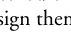

## 8.2 Time 类研究

### 使用 Time 类

`Time1` 类（图 8.2）使用 `Time` 类。第 9 行声明并创建了一个 `Time` 对象 `time`。`new` 操作符隐式调用了 `Time` 的默认构造函数，因为 `Time` 没有声明任何构造函数。为了确认 `Time1` 对象已正确初始化，第 12 行调用私有方法 `displayTime`（第 35–39 行），该方法转而调用 `Time` 对象的 `toString()` 方法分别输出通用格式和标准时间格式。注意，`toString` 可以隐式调用而不是显式调用。接下来，第 16 行调用对象的 `set` 方法来更改时间。第 17 行再次调用 `displayTime` 以两种格式输出时间，以证明其设置正确。

## 软件工程观察 8.2

回顾第 7 章，用访问修饰符 `private` 声明的方法只能由声明该私有方法的类中的其他方法调用。此类方法通常被称为工具方法或辅助方法，因为它们通常用于支持类其他方法的操作。

```java
// 图 8.2: Time1.java
// 在应用程序中使用 Time 对象。
public class Time1Test {
    public static void main(String[] args) {
        // 创建并初始化 Time 对象
        Time time = new Time1(); // 调用 Time1 构造函数

        // 输出时间的字符串表示
        displayTime("After time object is created", time);
        System.out.println();

        // 更改时间并输出更新后的时间
        time.setTime(13, 27, 6);
        displayTime("After calling setTo", time);
        System.out.println();

        // 尝试用无效值设置时间
        try {
            time.setTime(99, 99, 99); // 所有值超出范围
        } catch (IllegalArgumentException e) {
            System.out.printf("Exception: %s%n%n", e.getMessage());
        }

        // 在尝试设置无效值后显示时间
        displayTime("After calling setTo with invalid values", time);
    }
}
```

## 314 第 8 章 类与对象：深入观察

```
MemberAccessTest.java:9: hour has private access in Time1
time.hour = 7; // error: hour has private access in Time1
^
MemberAccessTest.java:10: minute has private access in Time1
time.minute = 15; // error: minute has private access in Time1
^
MemberAccessTest.java:11: second has private access in Time1
time.second = 30; // error: second has private access in Time1
^
```

图 8.3 Time1 类的私有成员不可访问。（第 2/2 部分）


## 8.4 使用 `this` 引用访问当前对象的成员

每个对象都可以通过 `this` 关键字（有时称为 `this` 引用）访问对自身的引用。当为特定对象调用实例方法时，方法体会隐式地使用 `this` 关键字来引用该对象的实例变量和其他方法。这使得类的代码知道应该操作哪个对象。你将在图 8.4 中看到你如何在实例方法体中显式地使用 `this` 关键字。第 8.5 节展示了关键字的另一个用途。第 8.11 节解释了为什么不能在静态方法中使用它。

我们演示了 `this` 引用的隐式和显式用法（图 8.4）。这个示例在一个文件中声明了两个类——第 4-14 行声明了类 `ThisTest`，以及 `SimpleTime`。我们这样做是为了证明，当你编译一个包含多个类的 `.java` 文件时，编译器会为每个编译的类生成一个带有 `.class` 扩展名的独立类。在这种情况下，会产生两个文件——`SimpleTime.class` 和 `ThisTest.class`。当一个源文件包含多个类声明时，编译器会将这些类的所有文件都放在同一个目录中。同样注意图 8.4，`ThisTest` 类被声明为 `public`——否则会发生编译错误。非公共类可以被同一包中的其他类使用。因此，在这个示例中，`SimpleTime` 可以被 `ThisTest` 等其他类使用。

```java
// Fig. 8.4: ThisTest.java
// this 被隐式和显式地用于引用对象的成员。
public class ThisTest
{
    public static void main(String[] args)
    {
        SimpleTime time = new SimpleTime(15, 30, 19);
        System.out.println(time.buildString());
    }
}// end class ThisTest

// class SimpleTime 演示了 "this" 引用
class SimpleTime
{
    private int hour; // 0-23
    private int minute; // 0-59
    private int second; // 0-59

    // 如果构造函数使用的参数名称与 
    // 实例变量名相同，则需要 "this" 引用
    // 来区分这些名称
    public SimpleTime(int hour, int minute, int second)
    {
        this.hour = hour; // 设置 "this" 对象的 hour
        this.minute = minute; // 设置 "this" 对象的 minute
        this.second = second; // 设置 "this" 对象的 second
    }

    // 使用显式和隐式的 "this" 调用 toUniversalString
    public String buildString()
    {
        return String.format("%02s:%02s:%02s",
            this.toUniversalString(),
            this.universalString(),
            universalString());
    }

    // 转换为通用时间格式 (HH:MM:SS) 的字符串
    public String universalString()
    {
        // 访问实例变量不需要 "this"
        // 因为方法没有与实例变量 
        // 同名的局部变量
        return String.format("%02d:%02d:%02d",
            this.hour, this.minute, this.second);
    }
}// end class SimpleTime
```

```
toUniversalString(): 15:30:19
universalString(): 15:30:19
```

**图 8.4** | this 被隐式和显式地用于引用对象的成员。（第 2/2 部分）

`SimpleTime` 类（第 14–47 行）声明了三个私有实例变量——hour、minute 和 second（第 16–18 行）。类的构造函数（第 23–28 行）接收三个 `int` 参数来初始化一个 `SimpleTime` 对象。再次，我们在构造函数（第 23 行）中使用了与类实例变量名（第 16–18 行）*完全相同*的参数名称，因此我们使用此引用来引用第 25–27 行中的实例变量。

## 316 第 8 章 类与对象：深入观察

### 错误预防提示 8.1

当你写 `x = x;` 而不是 `this.x = x;` 时，大多数 IDE 都会发出警告。`x = x` 语句通常被称为空操作（no-op）。

方法 `buildString`（第 31–36 行）返回一个字符串。

## 8.5 类研究：重载构造函数

如你所知，你可以声明多个构造函数来初始化对象。接下来，我们演示具有若干个构造函数的 `Time2`。

```java
// Fig. 8.5: Time2.java
// 具有重载构造函数的 Time2 类
public class Time2
{
    private int hour; // 0-23
    private int minute; // 0-59
    private int second; // 0-59

    // 无参数构造函数：
    // 将每个实例变量初始化为零
    public Time2()
    {
        this(0, 0, 0); // 调用三个参数的构造函数
    }

    // Time2 构造函数：提供了 hour，minute 和 second 默认为 0
    public Time2(int hour)
    {
        this(hour, 0, 0); // 调用三个参数的构造函数
    }

    // Time2 构造函数：提供了 hour 和 minute，second 默认为 0
    public Time2(int hour, int minute)
    {
        this(hour, minute, 0); // 调用三个参数的构造函数
    }

    // Time2 构造函数：hour、minute 和 second 均已指定
    public Time2(int hour, int minute, int second)
    {
        if (hour < 0 || hour >= 24)
            throw new IllegalArgumentException("hour must be 0-23");
        if (minute < 0 || minute >= 60)
            throw new IllegalArgumentException("minute must be 0-59");
        if (second < 0 || second >= 60)
            throw new IllegalArgumentException("second must be 0-59");

        this.hour = hour;
        this.minute = minute;
        this.second = second;
    }

    // Time2 构造函数：提供了另一个 Time2 对象
    public Time2(Time2 time)
    {
        // 调用三个参数的构造函数
        this(time.getHour(), time.getMinute(), time.getSecond());
    }

    // Set 方法
    // 使用通用时间设置新的时间值；
    // 验证数据
    public void setTime(int hour, int minute, int second)
    {
        if (hour < 0 || hour >= 24)
            throw new IllegalArgumentException("hour must be 0-23");

        if (minute < 0 || minute >= 60)
            throw new IllegalArgumentException("minute must be 0-59");

        if (second < 0 || second >= 60)
            throw new IllegalArgumentException("second must be 0-59");

        this.hour = hour;
        this.minute = minute;
        this.second = second;
    }

    // 验证并设置小时
    public void setHour(int hour)
    {
        if (hour < 0 || hour >= 24)
            throw new IllegalArgumentException("hour must be 0-23");

        this.hour = hour;
    }

    // 验证并设置分钟
    public void setMinute(int minute)
    {
        if (minute < 0 || minute >= 60)
            throw new IllegalArgumentException("minute must be 0-59");

        this.minute = minute;
    }

    // 验证并设置秒
    public void setSecond(int second)
    {
        if (second < 0 || second >= 60)
            throw new IllegalArgumentException("second must be 0-59");

        this.second = second;
    }

    // Getter 方法
    // 获取小时值
    public int getHour()
    {
        return hour;
    }

    // 获取分钟值
    public int getMinute()
    {
        return minute;
    }

    // 获取秒值
    public int getSecond()
    {
        return second;
    }

    // 转换为通用时间格式的字符串 (HH:MM:SS)
    public String toUniversalString()
    {
        return String.format(
            "%02d:%02d:%02d", getHour(), getMinute(), getSecond());
    }

    // 转换为标准时间格式的字符串 (H:MM:SS AM 或 PM)
    public String toString()
    {
        return String.format("%d:%02d:%02d %s",
            (getHour() == 0 || getHour() == 12) ? 12 : getHour() % 12,
            getMinute(), getSecond(), getHour() < 12 ? "AM" : "PM");
    }
}// Time2 类结束
```

**图 8.5** | 带有重载构造函数的 Time2 类。

### Time2 类的构造函数——通过 this 从一个构造函数调用另一个

第 12–15 行声明了一个所谓的无参构造函数，它可以在不带参数的情况下被调用。一旦你在类中声明了任何构造函数，编译器将不再提供默认构造函数。这个无参构造函数确保了 Time2 类的客户端可以使用默认值创建 Time2 对象。构造函数只是按照构造函数体中指定的方式初始化对象。在体中，我们引入了对 `this` 的使用，这仅允许作为构造函数体的第一条语句出现。第 14 行使用方法调用语法中的 `this` 来调用接受三个参数的 Time2 构造函数（第 30–44 行），并将小时、分钟和秒的值设为 0。像这样使用这种方法是让另一个构造函数重用初始化代码的流行方法，而不是在无参构造函数体内重复相似的代码。我们在五个 Time2 构造函数中的四个中使用了这种语法，以便该类更容易维护和修改。如果我们需要更改 Time2 类对象的初始化方式，只需要修改该类的其他构造函数将需要修改的那一个。

> **常见编程错误 8.2**：如果在构造函数体中使用 `this` 调用类的另一个构造函数，且该调用不是构造函数的第一条语句，则会导致编译错误。当方法尝试通过 `this` 直接调用构造函数时，也是编译错误。


# Time2 类构造函数详解

第 18–22 行声明了一个带有单个 `int` 参数的 `Time2` 构造函数，代表小时，它带有 0 分钟和秒传递给第 30–44 行的构造函数。第 24–27 行声明了一个接收两个 `int` 参数（代表小时和分钟）的 `Time2` 构造函数，这些参数带有 0 秒传递给第 30–44 行的构造函数。与无参构造函数一样，这些每个构造函数都调用了第 30–44 行的构造函数，以减少代码重复。第 30–44 行声明了接收三个参数（代表小时、分钟和秒）的 `Time2` 构造函数。该构造函数验证并初始化了实例变量。


第 47–51 行声明了一个接收另一个 `Time2` 对象的 `Time2` 构造函数。来自 `Time2` 参数的值被传递给第 30–44 行的三参数构造函数以初始化小时、分钟和秒。第 50 行通过表达式 `time.hour`、`time.minute` 和 `time.second` 直接访问参数的小时、分钟和秒——尽管它们被声明为私有变量。这是由于同一类对象之间的特殊关系。在某些时刻，使用 get 方法会更好。

> **软件工程观察 8.5**
>
> 当类的一个对象拥有类的另一个对象的引用时，第一个对象可以访问第二个对象的数据和方法（包括私有部分）。

## Time2 类的 set 方法

`setTime` 方法（第 56–70 行）如果任何参数超出范围，将抛出 `IllegalArgumentException`。否则，它将 `Time2` 的实例变量设置为参数值（第 67–69 行）。

## 关于 Time2 get 方法的讨论

`Time2` 的方法在整个类中被调用。特别是 `toString` 和 `setTime` 在第 122 行调用了 `getMinute` 和 `getSecond`。在每情况下，这些方法都可以直接访问类的私有数据而无需调用方法。然而，考虑到从午夜开始的总秒数表示（需要 12 字节内存），如果我们进行这种更改，只需要修改访问私有的方法——特别是三参数构造函数、`setTime` 和各个 get 方法。同样，每个 `Time2` 构造函数都可以包含三参数构造函数的语句拷贝。这样做可能更有效，因为消除了额外的构造函数。但重复语句会让类的内部数据表示变得困难。此外，编译器可以通过删除简单方法并将其替换为扩展的内联技术来优化程序。

## 使用 Time2 类重载构造函数

`Time2` 类（图 8.6）调用重载构造函数（8–12 和 24 行）。第 8 行调用无参构造函数。第 9–12 行将参数传递给其他 `Time2` 构造函数。第 9 行调用图 8.5 第 18–21 行的单参数构造函数。第 10 行调用图 8.5 第 24–27 行的双参数构造函数。第 12 行调用图 8.5 第 47–51 行的单构造函数。接下来，应用程序显示每个 `Time2` 对象的字符串表示以确认其已正确初始化（15–19 行）。第 24 行通过创建一个 `Time2` 对象并传递无效值来初始化 `t6`。当构造函数尝试使用无效的小时值初始化小时时，会发生 `IllegalArgumentException`。我们在第 26 行捕获此异常并显示错误信息，结果输出的最后一行。

```java
// 图 8.6: Time2.java
// 使用重载构造函数初始化 Time2 对象
public class Time2Test {
    public static void main(String[] args) {
        Time2 t1 = new Time2(); // 00:00:00
        Time2 t2 = new Time2(2); // 02:00:00
        Time2 t3 = new Time2(21, 34); // 21:34:00
        Time2 t4 = new Time2(12, 25, 42); // 12:25:42
        Time2 t5 = new Time2(t4); // 12:25:42

        System.out.println("Constructed with:");
        System.out.println("t1: all default arguments", + t1);
        System.out.println("t2: hour specified; default minute and second", + t2);
        System.out.println("t3: hour and minute specified; default second", + t3);
        System.out.println("t4: hour minute and second specified", + t4);
        System.out.println("t5: Time2 object specified", + t5);

        // 尝试用无效值初始化 t6
        try {
            Time2 t6 = new Time2(27, 74, 99); // 无效值
        } catch (IllegalArgumentException e) {
            System.out.printf("%sException while initializing t6: %s\n", e.getMessage());
        }
    }

    // 以 24 小时和 12 小时格式显示 Time2 对象
    private static void displayTime(String header, Time2 t) {
        System.out.printf("%s\n%s\n", header, t.toUniversalString(), t.toString());
    }
} // Time2Test 类结束
```

**图 8.6** | 使用重载构造函数初始化 Time2 对象。（2 部分中的第 1 部分）

t2: 指定小时；默认为分和秒

02:00:00

2:00:00 AM

t3: 指定小时和分钟；默认为秒

21:34:00

9:34:00 PM

t4: 指定小时、分钟和秒

12:25:42

12:25:42 PM

t5: 指定了 Time2 对象 t4

12:25:42

12:25:42 PM

初始化 t6 时发生异常：小时必须为 0-23 之间

**图 8.6** 用于初始化 Time2 对象的重载构造函数。（部分中的 2 部分）

# 8.6 默认构造函数和无参构造函数

每个类都必须至少有一个构造函数。如果你在类的声明中没有提供任何构造函数，编译器会在调用它时创建一个不带任何参数的默认构造函数。默认构造函数将实例变量初始化为在其声明中指定的初始值，或者它们的默认值（基本类型为零，布尔值为 false，引用类型为 null）。在第 9.4.1 节，你将学习默认构造函数还会执行另一个任务。

记住，如果你声明了类的构造函数，编译器将不会创建默认构造函数。如果需要初始化，与默认构造函数一样，无参构造函数可以使用空括号调用。`Time2` 构造函数（图 8.5 的第 12–15 行）通过向每个参数传递构造函数传递 0 来显式地初始化 `Time2` 对象。由于 0 是 `int` 实例变量的默认值，因此无参构造函数可以声明为空函数体。在这种情况下，当调用无参构造函数时，实例变量将接收其默认值。如果我们省略了无参构造函数，该类的客户端将无法通过 `Time2()` 表达式创建 `Time2` 对象。

> **错误预防提示 8.2**
>
> 确保你没有在构造函数定义中包含返回类型。Java 允许类的其他除构造函数以外的方法具有与类相同的名称并指定返回类型。此类方法不是构造函数，在实例化类对象时不会被调用。

> **常见编程错误 8.3**
>
> 如果程序尝试通过向类的构造函数传递错误数量或类型的参数来初始化类对象，则会发生编译错误。

# 8.7 Set 和 Get 方法说明

如你所知，类的私有字段只能通过其方法进行操作。典型的操作可能是通过 `computeInterest` 方法调整客户的银行余额（例如 `BankAccount` 类的私有实例变量）。


## Set 和 Get 方法对比 公有数据

看起来提供 set 和 get 能力本质上与将类的实例变量设为公有是一样的。这是让 Java 在软件工程中如此吸引人的微妙之处之一。公有实例变量可以被任何拥有包含该变量对象的引用的方法读取或写入。如果实例变量被声明为私有，公有的 get 方法允许其他方法访问它，而 get 方法控制了客户端可以如何访问它。例如，get 方法可以控制其返回数据的格式，使客户端代码免受实际数据表示的影响。公有的 set 方法可以——并且能够——仔细检查以修改变量的值，并在必要时抛出异常。例如，尝试将月份中的日期设置为 37 或将人的重量设置为负值将遭到拒绝。因此，尽管 set 和 get 方法提供了对数据的访问，但这种访问受到方法实现的限制。这提促进了良好的软件工程实践。

> **软件工程观察 8.6**
>
> 
>
> 类永远没有公有的非常量数据，但将数据声明为 `public static` 允许你为类的客户端提供常量。例如，类提供了 `public static final Math.E` 和 `Math.PI`。

> **错误预防提示 8.3**
>
> 
>
> 如果常量值在软件未来的版本中可能会发生，请不要使用 `public static final` 常量。

## Set 方法中的有效性检查

数据完整性的好处并不会因为实例变量被声明为私有而自动获得——你必须提供有效性检查。类的 set 方法可以确定尝试向类对象分配无效数据。通常，set 方法会返回 `void` 类型并使用异常处理来指示分配无效数据的尝试。我们将在第 11 章中详细讨论异常处理。

> **软件工程观察 8.7**
>
> 在适当的情况下，使用公有方法更改和检索私有实例变量的值。这种架构有助于向客户端隐藏类的实现细节，从而提高了程序的可修改性。

> **错误预防提示 8.4**
>
> 使用 set 和 get 方法创建的类更容易进行调试和维护。如果只有一个方法执行特定任务（例如设置对象中的实例变量），那么调试和维护该类会更容易。如果实例变量没有被正确设置，调试和维护会更容易。

## 谓词方法

访问方法的另一个常见用途是测试条件是否为真或假——此类方法通常被称为谓词方法。一个例子是 `isEmpty`，如果 `ArrayList` 为空则返回 `true`，否则返回 `false`。程序可能会在尝试从 `ArrayList` 读取项之前测试 `isEmpty`。

# 8.8 组合

类可以引用其他类作为成员。这被称为组合，有时被称为“拥有”关系。例如，一个 `AlarmClock` 对象需要在响闹时知道当前时间，汽车拥有方向盘、刹车踏和加速器。

## Date 类

此示例包含类 `Date`（图 8.7）、`Employee`（图 8.8）和 `EmployeeTest`（图 8.9）。`Date` 类（图 8.7）声明了 `month`、`day` 和 `year`（6–8 行）来表示日期。构造函数接收 `int` 参数。17–19 行验证月份——如果超出范围，18–19 行抛出异常。22–25 行验证日期。如果日期根据该月份的天数错误（除了需要特殊测试的二月 29 日），24–25 行抛出异常。28–31 行执行二月的年份测试。如果月份是二月且日期为 29 且年份不是闰年，30–31 行抛出异常。如果没有抛出异常，则 33–35 行初始化 `Date` 变量，38 行将其作为 `String` 输出。由于这是当前 `Date` 对象的引用，将式地调用对象的 `toString` 方法（42–45 行）以获取字符串表示。在本示例中，我们假设年份是正确的——工业级的 `Date` 类应该验证年份。

```java
// Date.java
// Date 类声明
public class Date {
    private int month; // 1-12
    private int day; // 根据月份 1-31
    private int year; // 任意年份

    private static final int[] daysPerMonth =
        {0, 31, 28, 31, 30, 31, 30, 31, 31, 30, 31, 30, 31};
    // 构造函数：根据年份确认月份和日期的正确值
    public Date(int month, int day, int year) {
        // 检查月份在范围内
        if (month <= 0 || month > 12)
            throw new IllegalArgumentException("month (" + month + ") must be 1-12");

        // 检查日期是否在月份范围内
        if (day <= 0 ||
            (day > daysPerMonth[month] && !(month == 2 && day == 29)))
            throw new IllegalArgumentException("day (" + day +
            ") out of range for the specified month and year");

        // 如果月份为 2 且日期为 29，检查是否为闰年
        if (month == 2 && day == 29 && !(year % 400 == 0 ||
            (year % 4 == 0 && year % 100 != 0)))
            throw new IllegalArgumentException("day (" + day +
            ") out of range for the specified month and year");

        this.month = month;
        this.day = day;
        this.year = year;

        System.out.printf("Date 对象构造函数用于 %s%n", this);
    }

    // 返回月份/日/年的字符串表示
    public String toString() {
        return String.format("%d/%d/%d", month, day, year);
    }
} // Date 类结束
```

**图 8.7** | Date 声明。（2 部分中的第 2 部分）。

### Employee 类

`Employee` 类（图 8.8）实例变量 `firstName`、`lastName`、`birthDate` 和 `hireDate`。成员 `firstName` 和 `lastName` 是指向 `String` 对象的引用。成员 `birthDate` 和 `hireDate` 是指向 `Date` 对象的引用。这说明一个类可以拥有指向其他类对象的实例变量引用。`Employee` 构造函数（第 12-19 行）接受四个参数，代表名、姓、出生日期和入职日期。参数所引用的对象被赋值给 `Employee` 的实例变量。当调用类 `Employee` 类的 `toString` 方法时，它会返回一个包含姓名以及两个 `Date` 对象字符串表示的字符串。每个 `String` 在返回时都隐式地调用了该类的 `toString` 方法进行转换。

```java
// 图 8.8: Employee.java
// 带有其他对象引用的 Employee 类。
public class Employee {
    private String firstName;
    private String lastName;
    private Date birthDate;
    private Date hireDate;

    // 初始化姓名、出生日期和入职日的构造函数
    public Employee(String firstName, String lastName, Date birthDate,
        Date hireDate) {
        this.firstName = firstName;
        this.lastName = lastName;
        this.birthDate = birthDate;
        this.hireDate = hireDate;
    }

    // 将 Employee 转换为字符串格式
    public String toString() {
        return String.format("%s, %s Hired: %s Birthday: %s",
        lastName, firstName, hireDate, birthDate);
    }
} // Employee 类结束
```

**图 8.8** | 带有其他对象引用的 Employee 类。（2 部分中的第 2 部分）。

### EmployeeTest 类

`EmployeeTest`（图 8.9）创建了两个 `Date` 对象，分别表示 `Employee` 的生日和入职日期。第 10 行创建了一个 `Employee` 对象，通过向构造函数传递两个 `String`（代表 `Employee` 的名和姓）和两个 `Date` 对象（代表生日和入职日期）来初始化其实例变量。第 12 行隐式地调用 `toString` 方法显示其实例变量的值，并证明该对象已正确初始化。


# 第 8 章 类与对象：深入探讨

```java
// 图 8.9: EmployeeTest.java
// 组合演示。
public class EmployeeTest
{
    public static void main(String[] args)
    {
        Date birth = new Date(7, 24, 1949);
        Date hire = new Date(3, 12, 1988);
        Employee employee = new Employee("Bob", "Blue", birth, hire);

        System.out.println(employee);
    }
}
```

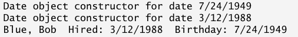

图 8.9 | 组合演示。

## 8.9 enum 类型

在图 5.8 中，我们引入了基础 `enum` 类型，它定义了一组用唯一标识符表示的常量。在那个程序中，`enum` 常量代表游戏状态。在本节中，我们将讨论 `enum` 类型与类之间的关系。和类一样，所有 `enum` 类型都是引用类型。`enum` 类型通过 `enum` 声明来定义，声明包含由逗号分隔的 `enum` 常量列表——该声明可选地包含传统类的其他组件，如构造函数、字段和方法（正如你即将看到的）。每个 `enum` 声明都会声明一个 `enum` 类，并遵循以下限制：

1. `enum` 常量是隐式的 `final`（常量）。
2. `enum` 常量是隐式的 `static`（静态的）。
3. 尝试使用 `new` 算符创建 `enum` 类型对象会导致编译错误。

`enum` 常量可以用于任何可以使用常量的地方，例如 `switch` 语句中的 `case` 标签以及控制增强型 `for` 语句。

### 在 enum 类型中声明实例变量、构造函数和方法

图 8.10 演示了 `enum` 类型中的实例变量、构造函数和方法。`enum` 声明（第 5-37 行）包含两个部分——常量和 `enum` 类型的其他成员。第一部分（第 8-13 行）声明了六个常量。每个常量可选地跟随传递给 `enum` 构造函数的参数（第 20-24 行）。与我们在类中看到的构造函数一样，`enum` 构造函数可以指定任意数量的参数并重载。在这个示例中，构造函数需要两个 `String` 参数。为了正确初始化每个 `enum` 常量，我们在其后带有包含两个字符串的括号。第二部分（第 16-36 行）声明了 `enum` 类型的其他成员——两个实例变量（第 16-17 行）、一个构造函数（第 20-24 行）以及两个方法（第 27-36 行）。第 16-17 行声明了实例变量 `title` 和 `copyrightYear`。每个 `enum` 常量实际上都是 `enum` 类型的对象，拥有自己的 `title` 和 `copyrightYear` 拷贝。构造函数（第 20-24 行）接受两个参数，一个指定标题，另一个指定版权年份。

```java
// 8.10: Book.java
// 带有构造函数、显式字段
// 以及访问方法的 enum 类型
public enum Book
{
    // 声明 enum 类型的常量
    JHTP("Java How to Program", "2015"),
    CHTP("C How to Program", "2013"),
    IW3HTP("Internet & Wide Web How to Program", "2012"),
    CPPHTP("C++ How to Program", "2014"),
    VBHTP("Visual Basic How to Program", "2014"),
    CSHARPTP("Visual C# How to Program", "2014");

    // 实例字段
    private final String title; // 标题
    private final String copyrightYear; // 版权

    // 构造函数
    Book(String title, String copyrightYear)
    {
        this.title = title;
        this.copyrightYear = copyrightYear;
    }

    // title 字段的访问器
    public String getTitle()
    {
        return title;
    }

    // copyrightYear 字段的访问器
    public String getCopyrightYear()
    {
        return copyrightYear;
    }
} // enum 类结束
```

图 8.10 | 带有构造函数和显式字段以及访问方法的 enum 类型。

### 使用 enum 类型 Book

图 8.11 展示了 `enum` 类型 `Book` 并说明如何遍历常量范围。对于每个 `enum`，编译器都会生成静态方法 `values()`（在第 11 行调用），返回按声明顺序排列的 `enum` 常量数组。第 11-13 行使用增强 `for` 语句显示 `enum` `Book` 中的所有常量。第 13 行调用 `enum` `Book` 的 `getTitle()` 和 `getCopyrightYear()` 方法来获取与常量相关的标题和版权年份。当 `enum` 被转换为字符串（例如第 12 行的 `JHTP`），将使用常量的标识符作为字符串表示（例如第一个常量）。

```java
// 图 8.11: EnumTest.java
// 测试 enum 类型 Book。
import java.util.EnumSet;
public class EnumTest
{
    public static void main(String[] args)
    {
        System.out.println("All books:");
        // print all books in enum Book
        for (Book book : Book.values())
            System.out.printf("%-10s-%45s%n",
                book.getTitle(), book.getCopyrightYear());

        System.out.printf("%nDisplay a range of enum constants:%n%n");

        // print first four books
        for (Book book : EnumSet.range(Book.JHTP, Book.CPPHTP))
            System.out.printf("%-10s-%45s%n",
                book.getTitle(), book.getCopyrightYear());
    }
}
```

**图 8.11** | 测试 enum 类型 Book。

所有书籍：

| JHTP | Java How to Program | 2015 |
| CHTP | C How to Program | 2013 |
| IW3HTP | Internet & Wide Web How to Program | 2012 |
| CPPHTP | C++ How to Program | 2014 |
| VBHTP | Visual Basic How to Program | 2014 |
| CSHARPTP | Visual C# How to Program | 2014 |

显示枚举常量范围：

| JHTP | Java How to Program | 2015 |
| CHTP | C How to Program | 2013 |
| IW3HTP | Internet & Wide Web How to Program | 2012 |
| CPPHTP | C++ How to Program | 2014 |

图 8.11 | 通过代码测试枚举类型。

第 18-20 行使用 `EnumSet` 的静态方法 `range()`（在 `java.util` 包中声明）来显示枚举 `Book` 的一个常量范围。`range()` 方法接收两个参数——范围中的第一个和最后一个常量——并返回一个包含这两个之间所有常量的 `EnumSet`；例如，表达式 `EnumSet.range(Book.JHTP, Book.CPPHTP)` 返回一个包含 `Book.JHTP`、`Book.CHTP`、`Book.IW3HTP` 和 `Book.CPPHTP` 的 `EnumSet`。增强 `for` 语句可以像用于其他集合一样用于 `EnumSet`，并打印该 `EnumSet` 中每本书的标题和版权年份。`EnumSet` 类提供了其他方法来创建相同类型的枚举集合。

> **常见编程错误 8.4**
>
> 在枚举声明中，在枚举类型的构造函数、字段和方法之后声明枚举常量是语法错误。

## 8.10 垃圾回收

每个对象都使用系统资源，例如内存。我们需要一种有规律的方法，在资源不再被需要时将其归还给系统；否则，可能会发生“资源泄漏”，导致资源无法被你的程序（可能还有其他程序）重用。JVM 执行自动垃圾回收，以回收不再使用的对象所占的内存。当一个对象没有引用时，该对象就符合被回收条件。回收通常发生在 JVM 执行垃圾回收器时，这可能在一段时间后才会发生，甚至在程序终止之前才发生。在 C 和 C++ 等语言中常见的内存泄漏（因为在这些语言中内存不会被自动回收）在 Java 中较少发生，但某些仍可能以微妙的方式发生。内存泄漏之外的资源泄漏也可能发生。例如，应用程序打开一个文件来修改其内容——如果程序没有关闭文件，它可能在其他程序可以使用该文件之前一直占用它。

### 关于 Object 类的 finalize 方法的说明

每个类都拥有 `Object` 类（位于 `java.lang` 包）的方法，其中一个就是 `finalize()`。（你将在第 9 章中学习更多关于类对象的知识。）你永远不应该使用 `finalize()`，因为可能会导致很多问题，而且不确定它在程序终止之前是否真的会被调用。

`finalize()` 的原始意图是允许垃圾回收器通过回收对象的内存来执行终止操作。现在，对于任何使用资源（如磁盘上的文件）的类，更好的做法是提供一个方法，让程序员在程序中资源不再被需要时调用该方法来释放资源。当你配合 `try-with-resources` 语句使用 `AutoCloseable` 对象时，可以减少资源泄漏的概率。正如名称所示，一旦 `try-with-resources` 语句完成对 `AutoCloseable` 对象的使用，该对象就会自动关闭。我们将在第 11.12 节详细讨论此。


> **软件工程观察 8.8**
>
> 许多 Java API 调用（例如 `Scanner` 类以及从磁盘读取或写入文件的方法）提供了 `close()` 或 `dispose()` 方法，程序员可以在程序中资源不再被需要时调用这些方法来释放资源。

## 8.11 静态类成员

每个对象都拥有类中所有实例变量的副本。在某些情况下，某个变量的副本应该由该类的所有对象共享。在这种情况下，使用一个**静态字段**——被称为**类变量**。静态变量表示**类级信息**——该类的所有对象共享同一份数据。静态变量的声明以关键字 `static` 开头。

### 静态成员的动机

让我们用一个例子来说明静态数据的动机。假设我们有一个类，并且想要跟踪对象的数量。我们可以使用静态变量来实现这一点。每创建一个新对象，计数器就递增；当对象被销毁时，计数器就递减。我们就能知道当前存在多少对象。

### 类作用域

静态变量具有类作用域——它们可以在类的所有方法中使用。我们可以通过任何对象的引用来访问公共静态成员，或者通过类名限定成员，如 `Math.random()`。一旦类被加载到执行时间，它们就是可用的。在没有类对象的情况下，通过类名加点来访问私有静态方法。

### 静态方法无法直接访问实例变量和实例方法

静态方法无法直接访问类的实例变量和实例方法，因为静态方法即使在没有实例化对象时也可以被调用。出于相同的原因，`this` 引用不能在静态方法中使用。该引用必须指向类的特定对象，当调用静态方法时，内存中可能没有该类的对象。


> **软件工程观察 8.9**
>
> 当类的所有对象使用同一个变量时，使用 `static` 变量。

> **软件工程观察 8.10**
>
> 即使没有该类的对象，静态变量和方法也存在并可以使用。

### 跟踪已创建的 Employee 对象数量

我们的程序声明了两个类——`Employee`（图 8.12）和 `EmployeeTest`（图 8.13）。`Employee` 类声明了私有静态变量 `count`（见图 8.12，第 7 行）和公共静态方法 `getCount()`（第 36–39 行）。静态变量 `count` 维护到目前为止创建的 `Employee` 对象数量。

变量在第 7 行初始化为 0。如果静态变量没有初始化，编译器将分配一个默认值——对于 `int` 类型，默认值为 0。

```java
// 图 8.12: Employee.java
// 使用静态变量来维护内存中 
// Employee（员工）对象数量的计数。
public class Employee {
    private static int count = 0; // 创建的 Employee 数量
    private String firstName;
    private String lastName;

    // 初始化 Employee，将静态计数加 1，并
    // 输出指示构造函数被调用的字符串
    public Employee(String firstName, String lastName) {
        this.firstName = firstName;
        this.lastName = lastName;

        count++; // 增加员工数量计数
        System.out.printf("Employee constructor: %s %s count = %d%n", firstName, lastName, count);
    }

    // 获取名
    public String getFirstName() {
        return firstName;
    }

    // 获取姓
    public String getLastName() {
        return lastName;
    }

    // 获取静态计数值的静态方法
    public static int getCount() {
        return count;
    }
} // 结束类 Employee
```

**图 8.12** | 使用静态变量来维护内存中 Employee 对象数量的计数。

当 `Employee` 对象存在时，变量 `count` 可以在 `Employee` 对象的任何方法中使用——此示例在构造函数中递增 `count`（第 18 行）。公共静态方法 `getCount()`（36–39 行）返回到目前为止创建的 `Employee` 对象数量。当不存在 `Employee` 类的对象时，客户端代码可以通过类名调用方法来访问变量，例如 `Employee.getCount()`。当对象存在时，也可以通过对 `Employee` 对象的任何引用调用方法 `getCount()`。

> **良好的编程实践 8.1**
>
> 使用类名和点 (`.`) 调用每个静态方法，以强调被调用的方法是一个静态方法。

### EmployeeTest

`EmployeeTest` 的 `main()` 方法（图 8.13）实例化两个 `Employee` 对象（第 13–14 行）。当每个 `Employee` 对象的构造函数被调用时，图 8.12 的第 15–16 行会将 `Employee` 的名和姓赋值给变量 `firstName` 和 `lastName`。这两个语句没有创建原始字符串的副本。实际上，Java 中的 `String` 是不可变的——它们在被创建后无法被修改。因此，对一个 `String` 对象拥有多个引用是安全的。但正如在 Java 中，如果 `String` 对象是不可变的，你可能会奇怪为什么我们能够使用 `+` 和 `+=` 运算符来拼接字符串。字符串拼接实际上产生了一个包含拼接值的新 `String` 对象。原始的 `String` 对象并没有被修改。


```java
// 图 8.13: EmployeeTest.java
// 静态成员演示。
public class EmployeeTest {
    public static void main(String[] args) {
        // 显示创建 Employees 之前 count 为 0
        System.out.printf("%d Employees before instantiation: %d%n",
            Employee.getCount());

        // 创建两个 Employees；count 应该为 2
        Employee e1 = new Employee("Susan", "Baker");
        Employee e2 = new Employee("Bob", "Blue");

        // 显示创建两个 Employees 之后 count 为 2
        System.out.printf("%d after instantiation: via e1.getCount(): %d%n",
            e1.getCount());
        System.out.printf("%d after e2.getCount(): %d%n",
            e2.getCount());
        System.out.printf("%d after Employee.getCount(): %d%n",
            Employee.getCount());

        // 获取 Employees 的名字
        System.out.printf("Employee 1: %s %s%nEmployee 2: %s %s%n",
            e1.getFirstName(), e1.getLastName(),
            e2.getFirstName(), e2.getLastName());
    }
} // 结束类 EmployeeTest
```

| 实例化之前的 Employees: 0 |
|---|
| Employee 构造函数: Susan Baker; count = 1 |
| Employee 构造函数: Bob Blue; count = 2 |

**图 8.13** | 静态成员演示。（2 部分中的第1 部分）

```
实例化后的 Employees:
via e1.getCount(): 2
via e2.getCount(): 2
via Employee.getCount(): 2

Employee 1: Susan Baker
Employee 2: Bob Blue
```

**图 8.13** 静态成员演示。（2 部分中的第2 部分）

当方法结束时，局部变量 `e1` 和 `e2` 被丢弃——记住，局部变量只在声明它的代码块执行完毕为止存在。由于 `e1` 和 `e2` 是第 13–14 行（图 8.13）创建的 `Employee` 对象的唯一引用，当 `main` 终止时，这些对象就变成了“等待垃圾回收的对象”。

在典型的应用程序中，垃圾回收器可能会回收符合条件的对象的内存。如果在程序终止之前任何对象没有被回收，操作系统将回收程序所使用的内存。JVM 不保证垃圾回收器何时执行或是否执行。当它执行时，符合条件的对象中的一个或一个子集会被收集。

## 8.12 静态导入

在第 5.3 节中，你学习了 `Math` 类的静态字段和方法。我们通过在每个字段和方法前面加上类名 `Math` 和点 (`.`) 来访问 `Math` 类的静态字段和方法。静态导入（static import）允许你导入一个类的静态成员。

### 静态导入的形式

导入有两种形式——一种是导入特定的静态成员（称为单静态导入），另一种是导入类的所有静态成员（称为静态导入）。以下语法导入静态成员：

```java
import static packageName.ClassName.staticMember;
```

其中 `packageName` 是包名（例如 `java.lang`），`ClassName` 是类名（例如 `Math`），`staticMember` 是静态字段或方法名（例如 `PI`）。以下语法导入类的所有静态成员：

```java
import static packageName.ClassName.*;
```

星号 (`*`) 表示指定类的所有静态成员在文件中可用。静态导入语句用于指定使用的类。

### 演示静态导入

图 8.14 展示了静态导入。第 3 行是静态导入，它导入了 `java.lang.Math` 类。第 9–12 行在不加类名和点的情况下访问了 `E`（第11 行）和 `PI`（第12 行）。

### 常见编程错误 8.7

> 如果程序尝试导入两个或具有相同签名的静态方法或具有相同名称的静态字段，则会导致编译错误。

```java
// 图 8.14: StaticImportTest.java
// Math 方法的静态导入。
import static java.lang.Math.*;

public class StaticImportTest {
    public static void main(String[] args) {
        System.out.printf("sqrt(900.0) = %.1f%n", sqrt(900.0));
        System.out.printf("ceil(-9.8) = %.1f%n", ceil(-9.8));
        System.out.printf("PI = %f%n", E);
    }
} // 结束类 StaticImportTest
```

| sqrt(900.0) = 30.0 |
|---|
| ceil(-9.8) = -9.0 |
| E = 2.718282 |
| PI = 3.141593 |

**图 8.14** | Math 方法的静态导入。

## 8.13 final 实例变量

权限原则是软件工程的基础。在应用程序代码的语文中，它规定代码应该被授予完成其指定任务所需的权限和访问权限，而不是更多。通过防止代码意外（或恶意）修改变量值和调用不应访问的方法，这使得你的程序更加健壮。

让我们看看这一原则如何适用于实例变量。其中某些变量需要被修改，而另一些不需要。你可以使用 `final` 关键字来指定变量是不可修改的（即它是一个常量），并且对其进行的任何修改都是错误的。例如：

```java
private final int INCREMENT;
```

声明了一个类型为 `int` 的最终（常量）实例变量 `INCREMENT`。变量可以在声明时初始化。如果没有初始化，则必须在类的每个构造函数中初始化。在构造函数中初始化常量允许类的每个对象对常量具有不同的值。如果 `final` 变量没有在声明或每个构造函数中初始化，就会发生编译错误。

### 软件工程观察 8.1

将实例变量声明为 `final` 有助于实施最小权限原则。如果一个实例变量不应该被修改，请将其声明为 `final` 以防止修改。例如，在 8.8 中，实例变量 `firstName`、`lastName`、`birthDate` 和 `hireDate` 在初始化后从未被修改，因此它们应该被声明为 `final`。我们在后续所有程序中都遵循这一做法。你将在第 23 章“并发”中看到 `final` 的更多好处。

### 常见编程错误 8.8

在初始化后尝试修改 `final` 实例变量会导致编译错误。

### 错误预防提示 8.5

修改 `final` 实例变量的尝试会在编译时被捕获，而不是导致运行时错误。如果可能，在编译时发现 bug 总是优好的，而不是让它们溜到运行阶段（经验表明，运行时的修复成本要高出许多倍）。

### 软件工程观察 8.12

如果 `final` 字段在声明时已初始化为该类所有对象共享的值，则应被声明为 `static`。在此初始化之后，它的值将永远不会改变。因此，我们不需要为类的每个对象都创建一个字段的副本。将字段设为 `static` 可以确保类的所有对象都共享该 `final` 字段。

## 8.14 包访问

如果在在类中声明方法时没有指定访问修饰符（`public`、`protected` 或 `private`——我们将在第 9 章讨论），则该方法或变量被认为具有包访问权限。在一个使用了来自同一包的多个类（即一组相关类）的程序中，这些类可以通过对适当类对象的引用，或者通过类名通过静态成员直接访问彼此的访问成员。包访问非常常用。

图 8.15 展示了包访问。该应用程序在一个源文件中两个类——`PackageData` 类（第 5–21 行）和 `PackageDataTest` 类（第 24–41 行）。同一个源文件中的类属于同一个包。因此，类 `PackageDataTest` 被允许修改 `PackageData` 对象的包访问数据。当你编译此程序时，编译器会生成两个独立的 .class 文件——`PackageDataTest.class` 和 `PackageData.class`。编译器将这两个 .class 文件存放在同一个目录下。你也可以将 `PackageData`（第 24–41 行）放在单独的源文件中。

在 `PackageData` 声明中，第 26–27 行声明了没有访问修饰符的实例变量和字符串——因此，这些是包访问实例变量。`PackageDataTest` 类的 `main` 方法创建了 `PackageData` 类的实例（第 9 行），用于直接修改 `PackageData` 实例变量的能力（如第 15–16 行所示）。修改的结果可以在输出窗口中看到。

```java
// 图 8.15: PackageTestData.java
// 类的包访问成员可以被同一包中的其他类访问
public class PackageDataTest {
    public static void main(String[] args) {
        PackageData packageData = new PackageData();

        // 输出 packageData 的字符串表示
        System.out.printf("After instantiation:%n%s%n", packageData);

        // 修改 packageData 对象中的包数据
        packageData.number = 77;
        packageData.string = "Goodbye";

        // 输出 packageData 的字符串表示
        System.out.printf("After changing values:%n%s%n", packageData);
    }

    // 带有包访问变量类
    class PackageData {
        int number; // 包访问实例变量
        String string; // 包访问实例变量

        // 构造函数
        public PackageData() {
            number = 0;
            string = "Hello";
        }

        // 返回 PackageData 对象的字符串表示
        public String toString() {
            return String.format("number: %d; string: %s", number, string);
        }
    }
}
```

初始化后：

number: 0; string: Hello

更改值后：

number: 77; string: Goodbye

**图 8.15** 类的包访问成员可以被同一包中的其他类访问。

## 8.15 使用 BigDecimal 进行精确的货币计算

在前面的章节中，我们演示了使用 `double` 类型的值进行货币计算。在第 4 章中，我们讨论了某些 `double` 值是近似表示的这一事实。

任何需要精确浮点计算的应用程序——例如金融应用程序——都应该使用 `BigDecimal` 类（来自 `java.math` 包）。

### 使用 BigDecimal 进行利息计算

图 8.16 使用 `BigDecimal` 类对象重新实现了图 4.6 中的利息计算示例。我们还引入了 `NumberFormat`（`java.text` 包）来将数值格式化为特定区域设置的字符串——例如，在美国区域中，值 1234.56 将格式化为 "1,234.56"，而在许多欧洲区域中，它将被格式化为 "1.234,56"。

```java
// Interest.java
// 使用 BigDecimal 进行复利计算。
import java.math.BigDecimal;
import java.text.NumberFormat;

public class Interest {
    // 产生利息前的初始本金
    BigDecimal principal = BigDecimal.valueOf(1000.0);
    BigDecimal rate = BigDecimal.valueOf(0.05);

    // 显示表头
    System.out.printf("%s%2s%n", "Year", "Amount");

    // 在产生利息前使用 BigDecimal 计算金额
    for (int year = 1; year <= 10; year++) {
        // 计算指定年份的金额
        BigDecimal amount = principal.multiply(rate.add(BigDecimal.ONE).pow(year));
        // 显示年份和金额
        System.out.printf("%4d%2s%n", year, NumberFormat.getCurrencyInstance().format(amount));
    }
} // 类结束
```

| Year | Amount on deposit |
|---|---|
| 1 | $1050.00 |
| 2 | $1102.50 |
| 3 | $1157.62 |
| 4 | $1215.51 |
| 5 | $1276.28 |
| 6 | $1340.10 |
| 7 | $1407.10 |
| 8 | $1477.46 |
| 9 | $1551.33 |
| 10 | $1628.89 |

图 8.16 使用 BigDecimal 进行复利计算。

### 创建 BigDecimal 对象

第 11–12 行使用 `BigDecimal` 方法声明并初始化变量 `principal` 和 `rate`——`valueOf` 方法接收一个 `double` 参数并返回表示该值的 `BigDecimal` 对象。

### 使用 BigDecimal 执行利息计算

第 21–22 行使用 `BigDecimal` 方法执行利息计算。第 22 行的表达式求值为：

- `add(BigDecimal.ONE)` 将 `rate` 加 1 产生 1.05——这等同于图 4.6 中的 `1.0 + rate`。
- 接下来，对前面的结果调用 `pow` 方法，将 1.05 次方 `year`——这等同于 `Math.pow`。
- 最后，我们在 `principal` 对象上调用 `multiply` 方法，将前面的结果作为参数。它返回一个表示金额的 `BigDecimal`。

由于 `add(BigDecimal.ONE)` 在循环的每次迭代中产生相同的值，我们本可以简单地在第 12 行将 `rate` 初始化为 1.05；然而，我们选择了模仿图 4.6 中使用的精确计算。

### 使用 NumberFormat 格式化货币值

在循环的每次迭代中，第 26 行

```java
NumberFormat.getCurrencyInstance().format(amount)
```

求值为：

- 首先，表达式使用 `NumberFormat` 的静态方法 `getCurrencyInstance` 获取一个预配置为将数值格式化为特定区域货币字符串的 `NumberFormat`——例如，在美国区域，数值 1628.89 被格式化为 $1,628.89。
- 接下来，表达式调用 `format` 方法（对 `getCurrencyInstance` 返回的对象）对 `amount` 值进行格式化。`format` 方法返回特定区域的字符串表示，保留小数点后两位。

### 舍入 BigDecimal 值

除了精确计算外，`BigDecimal` 还允许你控制如何进行舍入——默认不进行任何舍入。如果你不指定如何舍入 `BigDecimal` 值且给定的值无法精确表示（例如 1 除以 3 的结果 0.333333...），则会抛出 `ArithmeticException`。

我们未在示例中这样做，但你可以通过向 `BigDecimal` 类提供一个 `MathContext` 对象（来自 `java.math` 包）来指定 `BigDecimal` 的舍入模式。

在创建 `BigDecimal` 时会调用构造函数。你也可以向各种执行计算的 `BigDecimal` 方法提供 `MathContext`。`MathContext` 类包含了几个预配置的 `MathContext` 对象，你可以了解它们。

默认情况下，每个预配置的 `MathContext` 都使用所谓的“银行家舍入”（正如 `RoundingMode.HALF_EVEN` 所解释）：


# BigDecimal 值的精度调整

BigDecimal 的精度（scale）是小数点右侧的数字位数。如果你需要将 `BigDecimal` 舍入到特定的位数，可以调用 `BigDecimal.setScale`。例如，以下表达式返回一个小数点后保留两位数字且使用银行家舍入的 `BigDecimal`：

```
amount.setScale(2, RoundingMode.HALF_EVEN)
```

参考文档：`http://docs.oracle.com/java/7/docs/api/java/math/RoundingMode.html#HALF_EVEN`

# 8.16（可选）GUI 与图形案例研究：在图形中使用对象

到目前为止你看到的大图形都没有随着每次程序的执行而变化。5.13 节中的练习 5.2 要求你创建一个随机生成形状和颜色的程序。在这个练习中，每当系统调用 `paintComponent` 时，图形就会发生变化。为了实现这一点，我们将创建一组在每次绘制时保持不变的形状；我们必须存储关于显示形状的更多信息，以便在系统每次调用 `paintComponent` 时都能重现它们。这些类存储了每个形状的信息。我们将通过允许这些类的对象使用 `Graphics` 对象绘制自己，来使这些类变得“智能”。

## MyLine 类

图 8.17 声明了 `MyLine`，它具备所有这些能力。`MyLine` 导入了 `Color` 和 `Graphics`（第 3–4 行）。8–11 行声明了绘制直线所需的端点坐标的实例变量，第 12 行声明了存储线条颜色的实例变量。15–22 行的构造函数接收五个参数，每个参数对应它初始化的实例变量。25–29 行的 `draw` 方法需要一个 `Graphics` 对象，并使用它在正确的颜色和端点之间绘制直线。

```
// Fig. 8.17: MyLine.java
// MyLine 类表示一条线。
import java.awt.Color;
import java.awt.Graphics;

public class MyLine
{
    private int x1; // 第一个端点的 x 坐标
    private int y1; // 第一个端点的 y 坐标
    private int x2; // 第二个端点的 x 坐标
    private int y2; // 第二个端点的 y 坐标
    private Color color; // 这条线的颜色

    // 带有输入值的构造函数
    public MyLine(int x1, int y1, int x2, int y2, Color color)
    {
        this.x1 = x1;
        this.y1 = y1;
        this.x2 = x2;
        this.y2 = y2;
        this.color = color;
    }

    // 用指定的颜色绘制直线
    public void draw(Graphics g)
    {
        g.setColor(color);
        g.drawLine(x1, y1, x2, y2);
    }
} // MyLine 类结束
```

## DrawPanel 类

在图 8.18 中，我们声明了 `DrawPanel` 类，它将生成 `MyLine` 类的随机对象。第 12 行声明了 `MyLine` 数组以存储要绘制的线条。在构造函数（15–37 行）内部，第 17 行将背景颜色设置为 `Color.WHITE`。第 19 行创建一个长度在 5 到 9 之间的随机数组。22–36 行的循环为每个元素创建一个新的 `MyLine`。25–28 行为每条线的端点生成随机坐标，31–32 行为每条线生成随机颜色。带有随机生成值的 `MyLine` 对象并将其存储在数组中。`paintComponent` 方法使用增强 `for` 语句（44–45 行）遍历数组中的 `MyLine` 对象。每次迭代都会调用当前 `MyLine` 对象的 `draw` 方法，并传递 `Graphics` 对象以便在面板上绘制。

```
// Fig. 8.18: DrawPanel.java
// 使用 MyLine 类绘制随机线的程序。
import java.awt.Color;
import java.awt.Graphics;
import java.security.SecureRandom;
import javax.swing.JPanel;

public class DrawPanel extends JPanel
{
    private SecureRandom randomNumbers = new SecureRandom();
    private MyLine[] lines; // 线条数组

    // 构造函数，创建一个带有随机形状的面板
    public DrawPanel()
    {
        setBackground(Color.WHITE);

        lines = new MyLine[5 + randomNumbers.nextInt(5)];

        // 创建线条
        for (int count = 0; count < lines.length; count++)
        {
            // 生成随机坐标
            int x1 = randomNumbers.nextInt(300);
            int y1 = randomNumbers.nextInt(300);
            int x2 = randomNumbers.nextInt(300);
            int y2 = randomNumbers.nextInt(300);

            // 生成随机颜色
            Color color = new Color(randomNumbers.nextInt(256),
                randomNumbers.nextInt(256),
                randomNumbers.nextInt(256));

            // 将线条添加到线条列表
            lines[count] = new MyLine(x1, y1, x2, y2, color);
        }
    }

    // 对于每个形状，绘制
    public void paintComponent(Graphics g)
    {
        super.paintComponent(g);

        // 绘制线条
        for (MyLine line : lines)
            line.draw(g);
    }
} // DrawPanel 类结束
```

## TestDraw 类

`TestDraw` 在图 8.19 中设置了一个新窗口来显示坐标。如果调用 `paintComponent`，图形将发生变化。

```
// Fig. 8.19: TestDraw.java
// 显示 DrawPanel 的框架。
import javax.swing.JFrame;

public class TestDraw
{
    public static void main(String[] args)
    {
        DrawPanel panel = new DrawPanel();
        JFrame frame = new JFrame();

        frame.setDefaultCloseOperation(JFrame.EXIT_ON_CLOSE);
        frame.add(panel);
        frame.setSize(300, 300);
        frame.setVisible(true);
    } // TestDraw 类结束
}
```


## GUI 与图形案例研究练习

**8.1** 扩展图 8.17–8.19 中的程序以随机绘制矩形和椭圆。创建 `MyRectangle` 和 `MyOval` 类。这两个类都应该包含 x、y、x2、y2 坐标，颜色以及一个决定是否填充的布尔标志。继承 `JFrame` 并处理数组创建 `DrawPanel` 应声明三个数组，每个形状类型一个。每个数组的长度应该是 1 到 5 之间的随机数。

此外，修改所有三个形状类以包含以下内容：

- a) 带有参数的构造函数，将形状坐标设置为 0, 0，颜色设置为 `Color.BLACK`，属性设置为 `false`（`MyRectangle` 和 `MyOval`）。构造函数应直接调用设置方法初始化本地变量。
- b) 每个类实例变量的 set 方法。这些方法在设置坐标之前应验证作为参数的坐标值是否大于零——如果不是，则将坐标设置为零。
- c) 每个类实例变量的 get 方法。`draw` 方法应该通过 get 方法引用坐标，而不是直接访问。

# 8.17 总结

在本章中，我们介绍了额外的类概念。`Time` 类案例研究展示了一个完整的类声明，它由私有数据、为了初始化灵活性而重载的公共构造函数、操作类数据的 set 和 get 方法，以及以两种不同格式返回 `Time` 对象字符串表示的方法组成。你还学习了每个类都有一个 `toString` 方法，它可以返回该类对象的字符串表示，并且每当代码中需要字符串的地方出现该类的对象时，该 `toString` 方法就会被隐式地调用。我们还展示了如何抛出异常来表示问题的发生。

你学习了 `this` 引用在类的实例方法中被隐式使用，用于访问类的变量和其他实例方法。你还看到了显式使用 `this` 引用来访问类的成员（包括被遮蔽的字段），以及如何在构造函数中使用 `this` 关键字来调用该类的另一个构造函数。

我们讨论了编译器提供的默认构造函数与程序员提供的无参构造函数之间的区别。你学习了类可以包含指向其他类的引用作为其成员——这一概念被称为组合（composition）。你进一步了解了如何使用枚举类型（enum types）以及如何使用 `new` 来创建一组用于程序中的对象。你学习了 Java 的垃圾回收能力以及它是如何（不可预测地）回收不再使用的对象的内存的。本章解释了类中静态字段（static fields）的动机，以及如何在自己的类中声明和使用静态方法和字段。你还学习了声明和初始化 `final` 变量。

你学习了未声明访问修饰符的字段默认获得包访问权限（package access）。你看到了同一包内类之间的关系，这种关系允许每个类访问包内其他类的包访问权限成员。最后，我们演示了如何使用 `BigDecimal` 来执行精确的货币计算。

在下一章中，你将学习 Java 面向对象编程的一个重要方面——继承（inheritance）。你会发现 Java 中所有的类都直接或间接地通过继承与名为 `Object` 的类相关。你还将开始理解类与类之间的关系使你能够构建更强大的应用程序。

## 总结要点

### 8.2 节 Time 案例

- 类的公共方法也称为类的公共服务或公共接口（第 308 页）。它们为类的客户端提供了类所提供服务的视图。
- 类的私有成员对其客户端不可见。
- `String` 静态方法 `format`（第 310 页）与 `System.out.printf` 类似，不同之处它返回一个格式化字符串而不是在命令行窗口中显示它。
- Java 中的所有对象都有一个 `toString` 方法，返回对象的字符串表示。当对象出现在需要字符串的代码中时，`toString` 方法会被隐式地调用。

### 8.3 节 控制成员的访问

- 访问修饰符 `public` 和 `private` 控制对类变量和方法的访问。
- 公共方法的主要目的是为类的客户端提供类所提供的服务。客户端不需要担心类是如何完成其任务的。
- 类的私有变量和私有方法（即其实现细节）对其客户端不可见。
- 对象的实例隐式地使用关键字 `this`（第 314 页）来引用该对象的实例变量和其他方法。关键字 `this` 也可以被显式地使用。
- 编译器为每个编译后的类生成一个带有 `.class` 扩展名的独立文件。
- 如果局部变量与类字段同名，则局部变量会遮蔽字段。你可以在方法中使用 `this` 引用来引用被遮蔽的字段。

### 8.4 节 使用 this 引用引用对象的成员

- 重载的构造函数允许类的对象以不同的方式进行初始化。编译器通过它们的签名来区分重载的构造函数（第 316 页）。
- 要从同类的一个构造函数调用该类的另一个构造函数，可以使用 `this()` 关键字后跟包含构造函数参数的括号。如果使用，此类构造函数调用必须作为构造函数体的第一条语句出现。

### 8.6 节 默认和无参构造函数

- 如果类中没有提供构造函数，编译器会创建一个默认构造函数。
- 如果类声明了构造函数，编译器将不会创建默认构造函数。在这种情况下，如果需要默认初始化，必须声明一个无参构造函数（第 319 页）。

### 8.7 节 Set 和 Get 方法注意事项

- Set 方法通常被称为变器方法（mutator methods，第 323 页），因为它们通常改变值。Get 方法通常被称为访问器（accessor，第 323 页）或查询方法。谓词方法（predicate method，第 324 页）测试条件是否为真。

### 8.8 节 组合

- 类可以包含指向其他类的引用作为成员。这被称为组合（composition，第 324 页），有时被称为“有一个”（has-a）关系。

### 8.9 节 enum 类型

- 所有的枚举都是引用类型。枚举类型通过 `enum` 声明声明，这是一个由逗号分隔的枚举常量列表。该声明可选地包含传统类的其他组件，如构造函数、字段和方法。
- 枚举常量是隐式的 `final`，因为它们声明了不应被修改的常量。
- 任何尝试 `new` 创建枚举类型对象的尝试都会导致编译错误。
- 枚举常量可以用在任何可以使用常量的地方，例如 `switch` 语句的 case 标签以及用于控制增强 `for` 语句。
- 枚举声明中的每个常量后面可以可选地带有参数，这些参数将传递给枚举构造函数。
- 对于每个枚举，编译器都会生成一个静态方法 `values`（第 328 页），返回按声明顺序排列的常量数组。
- 枚举静态方法 `range`（第 329 页）接收两个常量并返回包含这些常量之间的 `EnumSet`。

### 8.10 节 垃圾回收

- Java 虚拟机（JVM）执行垃圾回收（第 330 页）以回收不再使用的对象的内存。当不再有某个对象的引用时，该对象就可以进行垃圾回收。JVM 执行垃圾回收以回收这些对象的内存。

### 8.11 节 静态成员

- 静态变量（第 330 页）表示类之间共享的信息。静态变量具有类作用域。类的公共静态成员可以通过类名来访问。私有的静态成员只能通过类的方法访问。类成员在类加载时就存在了。静态方法无法调用类的实例变量和实例方法；静态方法在类实例化之前就可以被调用。在静态方法中不能使用 `this` 引用。

### 8.12 节 静态导入

- 静态导入声明（第 334 页）允许在没有类名和点的情况下引用导入的静态成员。单个静态导入导入单个静态成员，而静态导入导入类的所有静态成员。

### 8.13 节 final 实例变量

- 在应用程序代码上下文中，最小权限原则（第 335 页）规定代码应仅授予完成任务所需的权限和访问权限。
- `final` 关键字指定变量是不可修改的。此类变量必须在声明时或通过类的构造函数进行初始化。

### 8.14 节 包访问权限

- 如果没有为方法或变量指定访问修饰符，该方法或变量被认为具有包访问权限（第 336 页）。

### 8.15 节 使用 BigDecimal 进行货币计算

- 任何需要无舍入误差的浮点计算的应用——例如金融应用中的应用——都使用 `BigDecimal`（包 `java.math`，第 338 页）。
- `BigDecimal` 静态方法 `valueOf(double)` 接收一个 double 参数并返回表示该精确值的 `BigDecimal`。
- `BigDecimal` 提供了常量 `ONE` (1)、`ZERO` (0) 和 `TEN` (10)。
- `BigDecimal` `pow`（第 339 页）将其第一个参数提升到第二个参数的幂。
- `BigDecimal` `multiply`（第 339 页）将其参数与调用该方法的 `BigDecimal` 相乘并返回结果。
- `NumberFormat` 类（包 `java.text`，第 339 页）提供了将数值格式化为本地特定语言字符串的能力。`NumberFormat` 的静态方法 `getCurrencyInstance` 返回一个用于本地特定货币值的预配置的 `NumberFormat`。`NumberFormat` 方法执行格式化。

# 自测习题

- 区域特定的格式化是国际化的重要组成部分——国际化是指针对用户的各种地区和口语语言自定义应用程序的过程。


- `BigDecimal` 允许你控制数值如何舍入——默认情况下，计算是精确的，且不会发生舍入。如果你没有指定如何舍入 `BigDecimal` 值，且给定值无法精确表示，则会抛出 `ArithmeticException`。

- 你可以通过向 `BigDecimal` 的构造函数提供 `MathContext` 对象（位于 `java.math` 包）来指定 `BigDecimal` 的舍入模式，也可以向执行计算的各种 `BigDecimal` 方法提供 `MathContext`。默认情况下，每个预配置的 `MathContext` 都使用所谓的“基于舍入”。

- `BigDecimal` 的精度（scale）是小数点右侧位数。如果你需要一个特定位数的 `BigDecimal`，可以调用 `BigDecimal` 的 `setScale` 方法。

# 自测习题

## 8.1 为下列陈述填空：

a) 一个 __________ 导入了类的所有静态成员。

b) 字符串静态方法 __________ 与 `System.out.printf` 相似，但返回一个格式化的 `String` 而不是在命令行窗口中绘制 `String`。

c) 如果方法使用了与其类字段之一同名的局部变量，则该局部变量会 __________ 掉方法中的字段。

d) 类的公共方法也被称为该类的 ___________

e) __________ 声明仅指定导入一个类。

f) 如果一个类声明了构造函数，编译器将不会创建一个 __________。

g) 对象的 __________ 方法仅当对象出现在代码中需要 `String` 时才被调用。

h) Get 方法通常被称为 ___________

i) __________ 方法测试条件是否为真或假。

j) 对于每个枚举（enum），编译器都会生成一个名为 __________ 的静态方法，该方法按照声明的顺序返回枚举常量的数组。

k) 组合（Composition）被称为 __________ 关系。

l) 一个 __________ 声明包含用逗号分隔的常量列表。

m) 一个 __________ 变量提供了该类中所有对象共享的分类信息。

n) 一个 __________ 声明只导入一个静态成员。

o) __________ 规定对象应仅被授予完成指定任务所需的权限和访问权限。

p) 关键字 __________ 指定在声明或构造函数之后是不可修改的。

q) 一个 __________ 声明仅从包中导入程序使用的类。

r) Set 方法通常被称为 __________，因为它们通常会改变值。

s) 使用类 __________ 进行货币计算。

t) 使用 __________ 语句表示发生了某个问题。

# 自测习题答案

## 8.1
a) static import on demand. b) format. c) shadows. d) public methods, public interface. e) single-type-import. f) default constructor. g) accessor methods, query methods. i) predicate. j) values. k) has-a. l) enum. m) static single import. o) principle of privilege. p) final. q) type-import-on-demand. r) mutator methods. s) BigDecimal. t) throw.

# 第 8 章 类与对象：深入探究

# 练习题

## 8.2（基于第 8.1 节）
解释 Java 中包级访问（package access）的概念。解释包访问的负面影响。

## 8.3
为构造函数指定返回类型 `void` 时会发生什么？

## 8.4（Rectangle 类）
创建一个具有属性 `length` 和 `width` 的 `Rectangle` 类，默认值为 1。它具有针对 `length` 和 `width` 的 set 和 get 方法。这些方法应该验证 `length` 和 `width` 处理大于 0.0 且小于 20.0 的浮点数。编写一个测试 `Rectangle` 的程序。

## 8.5（修改类的内部数据表示）
图 8.5 中的 `Time` 类将时间内部表示为自午夜以来的秒数而不是三个整数是完全合理的。客户端可以使用公共方法获取结果。修改图 8.5 中的 `Time` 类，将时间实现为自午夜以来的秒数，并证明该类的客户端不可见任何变化。

## 8.6（SavingsAccount 类）
创建一个 `SavingsAccount` 类。使用静态变量 `annualInterestRate` 存储所有持有者的年利率。每个对象都有一个实例变量 `savingsBalance` 表示当前存款金额。提供一个 `calculateInterest()` 方法，通过将 `savingsBalance` 乘以 `annualInterestRate` 除以 12 来计算每月利息——此利息应加到 `savingsBalance`。提供一个 `modifyInterest()` 方法将 `annualInterestRate` 设置为新值。编写一个测试 `savingsAccount` 的程序。实例化两个 `savingsAccount` 对象 `saver1` 和 `saver2`，余额分别为 $2000.00 和 $3000.00。将 `annualInterestRate` 设置为 5%，然后计算 12 个月的每月利息，并打印两个持有者的新余额。

## 8.7（增强 Time 类）
修改图 8.5 中的 `time` 类，包含一个方法使时间对象中存储的时间增加一。提供 `incrementMinute()` 方法使分钟增加一，提供 `incrementHour()` 方法使小时增加一。编写一个程序测试 `tick` 方法、`incrementMinute` 方法和 `incrementHour` 方法，确保它们正常工作。务必测试以下情况：

- 增加到下一分钟
- 增加到下一个小时
- 增加到下一天（例如从晚上 11:59:50 到凌晨 12:00:00）

## 8.8（增强 Date 类）
修改图 8.5 中的 `date` 类，包含一个方法使日期对象中存储的日期增加一。提供 `incrementMonth()` 方法使月份增加一，提供 `incrementYear()` 方法使年份增加一。编写一个程序测试 `day` 方法、`incrementMonth` 方法和 `incrementYear` 方法，确保它们正常工作。务必测试以下情况：

- 增加到下一天
- 增加到下个月
- 增加到下一年

## 8.9（静态导入）
使用静态 import 调用 `Math` 类的静态方法而无需使用类名。例如，使用 `sqrt(225)` 代替 `Math.sqrt(225)`。解释静态 import 声明如何仅从包中导入程序使用的成员。

## 8.10（复数）
创建一个 `Complex` 类用于执行复数的算术运算。复数的格式为

realPart + imaginaryPart

编写一个程序测试你的类。使用浮点变量表示类的私有实例变量。提供一个构造函数，允许使用值初始化对象。提供一个无参构造函数。执行以下操作：

a) 复数相加：实部相加，虚部相加。

b) 复数相减：左操作数的实部减去右操作数的实部，虚部也比之。

c) 复数相乘：(a + bi)(c + di) = (ac - bd) + (ad + bc)i。

## 8.11（日期与时间）
创建一个 `DateAndTime` 类，持有 8.7 修改后的 `Time` 类和 8.8 修改后的 `Date` 类。修改 `toString` 输出日期。编写一个程序测试 `DateAndTime`，特别是增加日期。

## 8.12（整数集）
创建一个可以持有 0-100 范围内整数的Set 类。集合由布尔数组表示。如果 $i$ 在集合中则 $a[i]$ 为真。无参构造函数将数组初始化为空（即全为假）。提供以下方法：

- union 创建两个集合的并集（如果新集合中的元素在一个或两个集合中为真，则为真）。
- intersection 创建两个集合的交集（如果新集合中的元素在两个集合中均为真，则为真）。
- insert 向集合中插入新整数 $k$（将 $a[k]$ 设置为真）。
- delete 删除整数 $m$（将 $a[m]$ 设置为假）。
- toString 返回一个包含集合列表的字符串，数字用空格分隔。仅包含集合中存在的元素。使用 -- 表示空集合。
- equals 判断两个集合是否相等。

## 8.13（Date 类）
创建一个 `Date` 类，具有以下功能：

a) 以多种格式输出日期，例如

MM/DD/YYYY

June 14, 1992

b) 使用重载构造函数创建初始化的 Date 对象。在第一情况下，构造函数接收三个整数值。在第二情况下，它接收一个字符串和两个整数值。在第三情况下，它接收两个整数值，第一个代表一年中的第。

*提示*：要将月份的字符串转换为数值，使用 equals 方法比较字符串。例如，如果 $s1$ 和 $s2$ 是字符串，当它们相同时方法返回真，否则返回假。

## 8.14（理数）
创建一个 `Rational` 类用于执行分数的算术运算。编写一个程序测试你的类。使用整数变量表示类的私有实例变量——分子和分母。提供一个构造函数，允许使用的

# 350 第 8 章 类与对象：深入观察

该类在声明时应进行初始化。构造函数应将分数以约分形式存储。分数 2/4 等于 1/2，并将存储为分子为 1、分母为 2 的对象。提供一个带有默认值的无参数构造函数，以防未提供初始值。提供公共方法来执行以下各项操作：

- a) 加两个有理数（Rational）：相加结果应以约分形式存储。将其实现为静态方法。
- b) 减两个有理数：减法结果应以约分形式存储。将其实现为静态方法。
- c) 乘两个有理数：乘法结果应以约分形式存储。将其实现为静态方法。
- d) 除两个有理数：除法结果应以约分形式存储。将其实现为静态方法。
- e) 返回一个以 a/b 形式表示有理数的字符串，其中 a 是分子，b 是分母。
- f) 返回一个以浮点格式表示有理数的字符串。（考虑提供格式化功能，允许该类的用户指定小数点右的精度）。

## 8.16 (大整数 HugeInteger)
一个 `HugeInteger` 类使用一个 40 元素的数字数组来存储高达 40 位的整数。每个方法分别对应解析、toString、加和减。方法应返回一个字符串，使用方法 charAt 提取每个数字，并将每个数字的整数等值放入整数数组中。对于 HugeInteger 的比较，提供以下方法：isEqualTo, isGreaterThan, isLessThan, isGreaterThanOrEqualTo。每个方法在两个 HugeInteger 之间满足该关系时返回 true，在不满足该关系时返回 false。提供一个 zero() 方法。如果你野心勃勃，还可以提供 divide 和 remainder 方法。基本类型布尔值可以输出为 "true" 或 "false"。

## 8.17 (井棋游戏 Tic-Tac-Toe)
一个 `TicTacToe` 类将使你能够编写一个玩井棋游戏的程序。该类包含一个 3-3 数组。用它来表示数组中每个单元格的值。枚举常量应为 X、O 和 EMPTY（表示不包含 X 或 O 的位置）。构造函数应将面板元素初始化为 EMPTY。当第一个玩家移动时，每次移动都必须在空格上进行。每次移动后，判断游戏是否获胜或平局。如果你野心勃勃，修改你的程序让计算机代表其中一个玩家移动。还允许玩家指定自己先手还是后手。如果你极其野心勃勃，开发一个在 4x4x4 面板上玩三维井棋的程序 [注：这是一个极具挑战性的项目！]

## 8.18 (带 BigDecimal 的账户 Account)
重写 7.5 节的 Account 类，将余额存储为 BigDecimal 对象并使用 BigDecimal 执行所有计算。

# 带来改变

## 8.19 (项目：应急响应类)
北美应急响应服务 9-1-1 连接到本地公共服务接线点（PSAP）。传统上，PSAP 会询问呼叫者的身份——包括呼叫者的地址、电话号码和紧急情况性质，然后派遣适当的响应人员（如警察、救护车或消防队）。增强型 9-1-1（或 E9-1-1）使用计算机和数据库确定呼叫者的地址，将通话转至最近的 PSAP，并向接线员显示呼叫者的电话号码和地址。无线增强型 9-1-1 为无线通话提供者提供身份信息。该服务分阶段实施，第一阶段要求运营商提供无线电话号码和传输通话的手机小区或基站的位置。第二阶段要求运营商提供呼叫者的位置（使用 GPS 等技术）。要了解更多关于 9-1-1 的信息，请访问 http://www.fcc.gov/pshs/911-services/Welcome.html 和 http://people.howstuffworks.com/91-1。

创建一个类的关键是确定属性（实例变量）。对于此类设计练习，请在网上研究 9-1-1 服务。然后设计一个可能用于面向对象的 9-1-1 应急响应系统的 Emergency 类。列出此类对象可能用于表示紧急情况的属性。例如，该类可能包括报告紧急情况的人（包括他们的电话号码）、紧急位置、报告时间、紧急情况性质、响应类型和响应状态。类属性应完全描述问题的性质以及为解决该问题正在发生的情况。

# 面向对象编程：继承

> 在与他人分享实例之前，不要说你完全了解另一个。
>
> —Johann Kasper Lavater
>
> 这个方法用于定义一个类与给定类的所有相似类之间的数量。
>
> —Bertrand Russell

## 目标

在本章中，你将：

- 理解继承以及如何使用它基于现有类开发新类。
- 学习父类和子类的概念以及它们之间的关系。
- 使用关键字 `extends` 创建一个继承自另一个类的属性和行为的类。
- 在子类中使用 `super` 访问父类成员。
- 学习构造函数如何在继承中使用的。
- 学习 Object 类的方法，它是所有类的直接父类。


# 第 9 章 面向对象编程：继承

## 9 引言

- 9.1 引言
- 9.2 父类与子类
- 9.3 protected 成员
- 9.4 父类与子类之间的关系
  - 9.4.1 创建并使用 Employee 类
  - 9.4.2 创建并使用 BasePlusEmployee 类
  - 9.4.3 创建EmployeePlusEmployee 继承层次
  - 9.4.4 使用 protected 变量创建EmployeePlusEmployee 继承层次
  - 9.4.5 使用 private 变量创建EmployeePlusEmployee 继承层次
- 9.5 子类中的构造函数
- 9.6 Object 类
- 9.7 （可选）GUI 与图形案例研究：使用 Label 显示文本和图像
- 9.8 总结

总结 | 自行练习 | 自行练习答案

## 9.2 超类与子类

通常情况下，一个类的对象同时也是另一个类的对象。例如，CarLoan（汽车贷款）在 HomeImprovementLoans（房屋装修贷款）和 MortgageLoans（抵押贷款）中都是 Loan（贷款）。因此，在 Java 中，可以说 CarLoan 继承自子类 Loan。在这种语境下，Loan 是超类，CarLoan 是子类。CarLoan 是 Loan 的特定类型，但声称每个 Loan 都是 CarLoan 是错误的——Loan 可以是任何类型。图 9.1 列出了几个子类和超类的简单示例——超类倾向于“更通用”，而子类则“更具体”。

| 超类 | 子类 |
| --- | --- |
| Student (学生) | GraduateStudent (研究生), Undergraduate (本科生) |
| Shape (形状) | Circle (圆形), Triangle (三角形), Rectangle (矩形), Cube (立方体) |
| Loan (贷款) | CarLoan (汽车贷款), HomeImprovementLoan (房屋装修贷款), MortgageLoan (抵押贷款) |
| Employee (员工) | Faculty (教职人员), Staff (职职人员) |
| BankAccount (银行账户) | CheckingAccount (支票账户), SavingsAccount (储蓄账户) |

> 图 9.1 继承示例。

由于每个子类对象都是其超类的对象，且一个超类可以有多个子类，因此超类所代表的对象集合通常比其任何子类所代表的对象集大。例如，超类 Vehicle（车辆）代表所有车辆，包括汽车、卡车、船、自行车等。相比之下，子类 Car（汽车）代表车辆的一个较小、更具体的子集。

## 大学社区成员层次结构

继承关系形成了树形结构。超类与其子类之间存在层级关系。让我们开发一个类层次结构（图 9.2），也称为继承层次结构。大学社区有数千名成员，包括员工、学生和校友。员工要么是教职人员（faculty），要么是工作人员（staff）。教职人员可以是管理员（例如院长和系主任）或教师。该层次结构可能包含许多其他类。例如，学生可以是研究生或本科生。本科生可以是大一、大二、大三或大四学生。

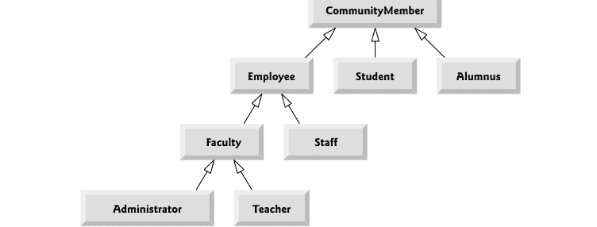

**图 9.2** 大学社区成员的继承层次结构 UML 类图。


# 第 9 章 面向对象编程：继承

我们区分了“是一个”（`is-a`）关系和“拥有一个”（`has-a`）关系。“`is-a`”关系表示继承。在“`is-a`”关系中，子类的对象也可以被视为其超类的对象——例如，汽车是一种车辆。相比之下，“`has-a`”关系表示组合（参见第 8 章）。在“`has-a`”关系中，一个对象包含对其他对象的引用——例如，汽车有一个方向盘（并且汽车有一个指向方向盘对象的引用）。

新类在类库中不断发展。各个机构开发自己的类库，并可以利用全球范围内可用资源。在某一天，就像新软件可能由标准化的可重用组件构建一样，就像现在的汽车和大多数计算机硬件是这样构建的一样。这将促进更强大、丰富且经济的软件的快速开发。

## 9.2 超类与子类

通常，一个类的对象也是另一个类的对象。例如，`CarLoan`（汽车贷款）在 `HomeImprovementLoans`（房屋装修贷款）和 `MortgageLoans`（抵押贷款）中都是 `Loan`（贷款）。因此，在 Java 中，可以说 `CarLoan` 继承自子类 `Loan`。在这种语境下，`Loan` 是超类，`CarLoan` 是子类。`CarLoan` 是 `Loan` 的特定类型，但声称每个 `Loan` 都是 `CarLoan` 是错误的——`Loan` 可以是任何类型。图 9.1 列出了几个子类和超类的简单示例——超类倾向于“更通用”，而子类则“更具体”。

| 超类 | 子类 |
| --- | --- |
| `Student` (学生) | `GraduateStudent` (研究生), `Undergraduate` (本科生) |
| `Shape` (形状) | `Circle` (圆形), `Triangle` (三角形), `Rectangle` (矩形), `Cube` (立方体) |
| `Loan` (贷款) | `CarLoan` (汽车贷款), `HomeImprovementLoan` (房屋装修贷款), `MortgageLoan` (抵押贷款) |
| `Employee` (员工) | `Faculty` (教职人员), `Staff` (工作人员) |
| `BankAccount` (银行账户) | `CheckingAccount` (支票账户), `SavingsAccount` (储蓄账户) |

> 图 9.1 继承示例。

由于每个子类对象都是其超类的对象，且一个超类可以有多个子类，因此超类所代表的对象集合通常比其任何子类所代表的对象集大。例如，超类 `Vehicle`（车辆）代表所有车辆，包括汽车、卡车、船、自行车等。相比之下，子类 `Car`（汽车）代表车辆的一个较小、更具体的子集。

## 大学社区成员层次结构

继承关系形成了树形结构。超类与其子类之间存在层级关系。让我们开发一个类层次结构（图 9.2），也称为继承层次结构。大学社区有数千名成员，包括员工、学生和校友。员工要么是教职人员（`faculty`），要么是工作人员（`staff`）。教职人员可以是管理员（例如院长和系主任）或教师。该层次结构可能包含许多其他类。例如，学生可以是研究生或本科生。本科生可以是大一、大二、大三或大四学生。


**图 9.2** 大学社区成员的继承层次结构 UML 类图。

层次结构中的每个箭头代表一个 `is-a` 关系。当我们沿着这个类层次结构向上追踪箭头时，我们可以说，例如，“一个员工是一个社区成员”，“一个教师是一个教职人员”。`CommunityMember`（社区成员）是 `Employee`、`Student` 的直接超类，而 `Alumnus` 是图中所有其他类的间接超类。从底部开始，你可以遵循箭头并将“`is-a`”关系应用于最顶部的超类。例如，一个管理员是一个教职人员，是一个员工，而且当然，是一个社区成员也是一个对象。

## 形状层次结构

现在考虑图 9.3 中的 `Shape`（形状）继承层次结构。该层次结构始于超类 `Shape`，它被子类 `TwoDimensionalShape`（二维形状）和 `ThreeDimensionalShape`（三维形状）扩展——形状要么是 `TwoDimensionalShape` 要么是 `ThreeDimensionalShape`。该层次结构的第三层包含特定类型的 `TwoDimensionalShape` 和 `ThreeDimensionalShape`。正如图 9.2 所示，我们可以从图的底部追踪箭头到该层次结构中最顶部的超类，以识别出几个 `is-a` 关系。例如，`Triangle`（三角形）是一个 `TwoDimensionalShape` 并且是一个 `Shape`，而 `Sphere`（球体）是一个 `ThreeDimensionalShape` 并且是一个 `Shape`。该层次结构可能包含许多其他类。例如，椭圆和梯边形是 `TwoDimensionalShape`。

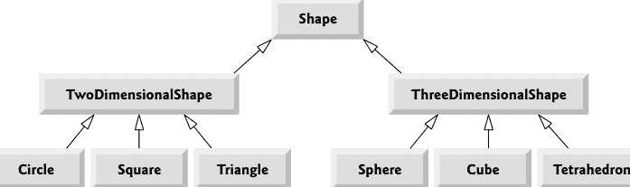

**图 9.3** 形状的继承层次结构 UML 类图。

## 9.3 保护成员（protected）

并不是所有的类关系都是继承关系。在第 8 章中，我们讨论了“拥有”关系，在这种关系中，类拥有其他类的对象的引用。这种关系通过现有类的组合创建类。例如，给定 `Employee`（员工）、`BirthDate`（出生日期）和 `TelephoneNumber`（电话号码）类，说 `Employee` 是 `BirthDate` 或 `Employee` 是 `TelephoneNumber` 是不妥的。然而，一个 `Employee` 拥有 `BirthDate`，一个 `Employee` 拥有 `TelephoneNumber`。可以类似地对待子类对象——它们的共同点体现在超类的成员中。所有扩展子类的类的对象都可以被视为该子类的对象——这是一个“是一个”关系。子类可以对其继承自超类的方法进行自定义。为了实现这一点，子类会重写（重新定义）超类方法并提供相应的实现，正如我们在本章中看到的。

第 8 章讨论了公共（`public`）和私有（`private`）。一个类的公共成员在程序拥有该类或其一个子类的引用的地方都是可访问的。一个类的私有成员仅在类内部可访问。保护成员（`protected`）提供了在公共和私有之间的中间访问级别。

## 358 第 9 章 面向对象编程：继承

提供相应的 `set` 方法。第 55–84 行为类的 `grossSales` 和 `commissionRate` 实例变量（在第 9–10 行声明）声明公共的 `set` 和 `get` 方法。类将实例变量声明为私有，因此其他类的对象无法直接访问这些变量。


# 9.4 超类与子类之间的关系

## CommissionEmployee 类

```java
// 9.4: CommissionEmployee.java
// CommissionEmployee 代表按总销售额百比支付佣金的员工。
public class CommissionEmployee extends Object
{
    private final String firstName;
    private final String lastName;
    private final String socialSecurityNumber;
    private double grossSales; // 每周销售额
    private double commissionRate; // 佣金比例

    // 五参数构造函数
    public CommissionEmployee(String firstName, String lastName,
        String socialSecurityNumber, double grossSales,
        double commissionRate) {
        // 此处隐式调用 Object 的默认构造函数
        if (grossSales < 0.0)
            throw new IllegalArgumentException(
                "gross sales must be >= 0.0");

        // 如果 commissionRate 无效则抛出异常
        if (commissionRate <= 0.0 || commissionRate >= 1.0)
            throw new IllegalArgumentException(
                "commission rate must be > 0.0 and < 1.0");

        this.firstName = firstName;
        this.lastName = lastName;
        this.socialSecurityNumber = socialSecurityNumber;
        this.grossSales = grossSales;
        this.commissionRate = commissionRate;
    } // 构造结束

    // 返回名
    public String getFirstName() {
        return firstName;
    }

    // 返回姓
    public String getLastName() {
        return lastName;
    }

    // 返回社会安全号
    public String getSocialSecurityNumber() {
        return socialSecurityNumber;
    }

    // 设置总销售额
    public void setGrossSales(double grossSales) {
        if (grossSales < 0.0) {
            throw new IllegalArgumentException(
                "Gross sales must be >= 0.0");
        }
        this.grossSales = grossSales;
    }

    // 返回总销售额
    public double getGrossSales() {
        return grossSales;
    }

    // 设置佣金率
    public void setCommissionRate(double commissionRate) {
        if (commissionRate <= 0.0 || commissionRate >= 1.0) {
            throw new IllegalArgumentException(
                "Commission rate must be between 0.0 and < 1.0");
        }
        this.commissionRate = commissionRate;
    }

    // 返回佣金率
    public double getCommissionRate() {
        return commissionRate;
    }

    // 计算收益
    public double earnings() {
        return commissionRate * grossSales;
    }

    // CommissionEmployee 对象的字符串表示
    @Override // 表示此方法重写了超类方法
    public String toString() {
        return String.format("%s: %s %s\n%s: %.2f\n%s: %s",
            "employee", firstName, lastName,
            "social security number", socialSecurityNumber);
    }
}
```

**图 9.4** | CommissionEmployee 类代表一个按总销售额百分比支付佣金的员工。（3 部分中的第 1 部分）。

```java
// 继续 CommissionEmployee 类
    // 返回佣金率
    public double getCommissionRate() {
        return commissionRate;
    }

    // 计算收益
    public double earnings() {
        return commissionRate * grossSales;
    }

    // CommissionEmployee 对象的字符串表示
    @Override // 表示此方法重写了超类方法
    public String toString() {
        return String.format("%s: %s %s\n%s: %.2f\n%s: %s",
            "employee", firstName, lastName,
            "social security number", socialSecurityNumber);
    }
}
```

**图 9.4** CommissionEmployee 类代表一个按总销售额百分比支付佣金的员工。（3 部分中的第 2 部分）


```java
// 99 | "gross sales", grossSales |
// 100 | "commission rate", commissionRate); |
// 101 | } |
// 102 | // 类 CommissionEmployee结束 |
```

**图 9.4** | CommissionEmployee 类代表一个按总销售额百分比支付佣金的员工。（3 部分中的第 3 部分。）

### 类 CommissionEmployee 的构造函数

构造函数是不被继承的，因此 `CommissionEmployee` 不继承 `Object` 类的构造函数。然而，子类的构造函数仍然可以被子类调用。事实上，Java 要求任何子类构造函数的第一项任务是调用其直接超类的构造函数，无论是显式的还是隐式的（如果未指定构造函数），以确保从超类继承的变量被正确初始化。显式调用超类构造函数的语法在第 9.4.3 节讨论。在本示例中，`CommissionEmployee` 的构造函数隐式调用了 `Object` 的构造函数。如果代码不包含对超类无参数构造函数的显式调用，图 9.4 第 17 行的注释指示隐式调用超类 `Object` 默认构造函数的位置（你不需要编写此调的代码）。`Object` 的默认构造函数什么都不做。即使类没有构造函数，编译器也会隐式声明该类将调用超类的默认或无参数构造函数。

在隐式调用 `Object` 构造函数之后，第 20–22 行和 25–27 行验证了 `grossSales` 和 `commissionRate`。如果这些是有效的（即构造函数没有抛出 `IllegalArgumentException`），则第 29–33 行将构造函数的参数赋值给类的实例变量。

在将参数 `firstName`、`lastName` 和 `security` 赋值给相应的实例变量之前，我们没有对它们的值进行验证。我们可以对姓名进行验证——也许是为了确保它们的长度合理。同样，可以使用正则表达式对社会安全号进行验证（Section 14.7），以确保它包含九位数字或不带连字符（例如 123456789）。

### 类 CommissionEmployee 的 earnings 方法

`earnings` 方法（第 87–90 行）计算收益。它将 `commissionRate` 乘以 `grossSales`。

### 类 CommissionEmployee 的 toString 和 @Override

`toString` 方法（第 93–101 行）指示此方法重写了超类。它返回对象的字符串表示。当对象转换为字符串时使用 `@Override`。

## 9.4 超类与子类之间的关系（续）

要重写超类方法，子类必须具有与超类相同的签名（方法名、参数数量和类型）。`@Override` 注解有助于编译器捕捉常见错误。例如，如果你误拼了方法名，编译器将将其标记为错误。

另一种常见的覆盖错误是声明了错误的参数数量或类型。如果没有匹配，编译器会发出错误，提示“方法未覆盖或实现类类方法”。然后你就可以修正你的方法签名使其匹配。

### 常见编程错误 9.1

使用更严格的访问修饰符来覆盖方法是编译错误；公共方法不能变为保护或私有方法；超类方法不能变为私有方法。这样做将破坏“是”关系，该关系要求所有对象都能响应子类的方法调用。一旦方法在超类中声明为公共，它对于所有直接和间接子类都保持为公共。

### 预防提示 9.1

虽然 `@Override` 注解是可选的，但请声明重写的方法以定义正确的签名。在编译时发现错误总比在运行时好得多。出于此原因，图 7.11 和第 8 章示例中的 `toString` 方法都声明了 `@Override`。

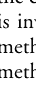


## CommissionEmployeeTest 类

```java
// Fig. 9.5: CommissionEmployeeTest.Java
// CommissionEmployee 类测试程序。
public class CommissionEmployeeTest {
    public static void main(String[] args) {
        // CommissionEmployee employee
        CommissionEmployee employee = new CommissionEmployee(
            "Sue", "Jones", "222-22-2222", 10000, .06);

        // 获取佣金员工数据
        System.out.println(
            "Information obtained by get methods:");
        System.out.printf("%s %s%n", "First name is",
            employee.getFirstName());
        System.out.printf("%s %s%n", "Last name is",
            employee.getLastName());
        System.out.printf("%s %s%n", "Social security number is",
            employee.getSocialSecurityNumber());
        System.out.printf("%s %.2f%n", "Gross sales is",
            employee.getGrossSales());
        System.out.printf("%s %.2f%n", "Commission rate is",
            employee.getCommissionRate());

        employee.setGrossSales(5000);
        employee.setCommissionRate(.1);

        System.out.printf("%s:%n%s%n%s%n",
            "Updated employee information obtained to toString", employee);
    }
} // end class CommissionEmployeeTest
```

**输出结果：**

通过 get 方法获取员工信息：

First name is Sue

Last name is Jones

Social security number is 222-22-2222

Gross sales is 10000.00

Commission rate is 0.06

通过 toString 获取的更新员工信息：

commission employee: Sue Jones

social security number: 222-22-2222

gross sales: 5000.00

commission rate: 0.10

**图 9.5** | CommissionEmployee 类测试程序。

## 9.4.2 创建和使用 BasePlusCommissionEmployee 类

我们现在通过声明和测试（完全新且独立的）类 `BasePlusCommissionEmployee`（图 9.6）来讨论继承介绍的第二部分，该类包含：名、姓、社会安全号码、总销售额、佣金率和基本工资。`BasePlusCommissionEmployee` 的公共服务包括构造函数（第 15–42 行）以及 `earnings` 方法（第 111–114 行）和 `toString` 方法（第 117–126 行）。为类的私有实例变量（声明在第 7–12 行）`firstName`、`lastName`、`socialSecurityNumber`、`grossSales`、`commissionRate` 和 `baseSalary` 声明 get 和 `set` 方法。这些变量和方法封装了基本工资佣金员工的所有必要特征。该类与本示例中的 `CommissionEmployee` 类（图 9.4）之间存在相似性，我们暂不利用这种相似性。

```java
// Fig 9.6: BasePlusCommissionEmployee.java
// BasePlusCommissionEmployee 类代表一个除了佣金外
// 还领取基本工资的员工。
public class BasePlusCommissionEmployee {
    private final String firstName;
    private final String lastName;
    private final String socialSecurityNumber;
    private double grossSales; // 周销售额
    private double commissionRate; // 佣金率
    private double baseSalary; // 每周基本工资

    // 六参数构造函数
    public BasePlusCommissionEmployee(String firstName, String lastName,
        String socialSecurityNumber, double grossSales,
        double commissionRate, double baseSalary) {
        // 此处隐式调用 Object 的默认构造函数
        if (grossSales < 0.0)
            throw new IllegalArgumentException(
                "Gross sales must be >= 0.0");
        if (commissionRate < 0.0 || commissionRate >= 1.0)
            throw new IllegalArgumentException(
                "Commission rate must be > 0.0 and < 1.0");
        if (baseSalary < 0.0)
            throw new IllegalArgumentException(
                "Base salary must be >= 0.0");
    }
}
```

**图 9.6** | BasePlusCommissionEmployee 类代表一个除了佣金外还领取基本工资的员工。（部分，共三部分）。


```java
36 this.firstName = firstName;
37 this.lastName = lastName;
38 this.socialSecurityNumber = socialSecurityNumber;
39 this.grossSales = grossSales;
40 this.commissionRate = commissionRate;
41 this.baseSalary = baseSalary;
42 } // 构造函数结束

44 // 返回名
45 public String getFirstName()
46 {
47 return firstName;
48 }

50 // 返回姓
51 public String getLastName()
52 {
53 return lastName;
54 }

56 // 返回社会安全号码
57 public String getSocialSecurityNumber()
58 {
59 return socialSecurityNumber;
60 }

62 // 设置总销售额
63 public void setGrossSales(double grossSales) {
64 if (grossSales < 0.0)
65 throw new IllegalArgumentException(
66 "Gross sales must be >= 0.0");
69 this.grossSales = grossSales;
70 }

72 // 返回总销售额
73 public double getGrossSales() {
74 return grossSales;
75 }

78 // 设置佣金率
79 public void setCommissionRate(double commissionRate) {
80 if (commissionRate <= 0.0 || commissionRate >= 1.0)
81 throw new IllegalArgumentException(
82 "Commission rate must be > 0.0 and < 1.0");
84 this.commissionRate = commissionRate;
85 }

365 // 返回佣金率
366 public double getCommissionRate() {
367 return commissionRate;
368 }

369 // 设置基本工资
370 public void setBaseSalary(double baseSalary) {
371 if (baseSalary < 0.0) {
372 throw new IllegalArgumentException(
373 "Base salary must be >= 0.0");
374 }
375 this.baseSalary = baseSalary;
376 }

377 // 返回基本工资
378 public double getBaseSalary() {
379 return baseSalary;
380 }

381 // 计算收入
382 public double earnings() {
383 return baseSalary + (commissionRate * grossSales);
384 }

385 // 返回 BasePlusCommissionEmployee 的字符串表示
386 @Override
387 public String toString() {
388 return String.format(
389 "%s %s, %.2f %s, %.2f",
390 "base-based commission employee", firstName,
391 "social security number", socialSecurityNumber,
392 "gross sales", grossSales, "commission rate",
393 "base salary", baseSalary);
394 }
// // BasePlusCommissionEmployee 类
```

图 9.6 | BasePlusCommissionEmployee 类代表一个除了佣金外还领取基本工资的员工。（部分，共三部分）。

## 9.4 超类与子类之间的关系

**图 9.6** | BasePlusCommissionEmployee 代表一个除了佣金外还领取工资的员工。（部分，共三部分）。

`BasePlusCommissionEmployee` 在第 5 行没有继承 `Object`，因此该类隐式地继承了 `Object`。同样，像 `CommissionEmployee` 的构造函数（图 9.4 第 13-34 行）一样，`BasePlusCommissionEmployee` 的构造函数调用了 `Object` 的默认构造函数，如第 19 行注释所示。

`BasePlusCommissionEmployee` 的 `earnings` 方法（第 111–114 行）返回 `BasePlusCommissionEmployee` 的基本工资加上佣金率乘以总销售额的结果。我们再次使用格式规范符 `%.2f` 将总销售额、佣金率和基本工资格式化为两位小数（第 121 行）。

## 测试 BasePlusCommissionEmployee 类

图 9.7 测试了 `BasePlusCommissionEmployee` 类。第 9–11 行创建了一个 `BasePlusCommissionEmployee` 对象，并将 "Bob"、"Lewis"、"333-33-3333"、5000、.04 和 300 分别作为名、姓、社会安全号码、总销售额、佣金和基本工资传递给构造函数。第 16–27 行使用 `BasePlusCommissionEmployee` 方法获取对象的实例值并输出。第 19 行调用对象的 `setBaseSalary` 方法更改基本工资。`setBaseSalary` 方法（9.6，第 95–102 行）确保实例工资不会被赋值负值。图 9.7 的第 33 行显式调用 `toString` 以获取对象的字符串表示。

```java
// Fig. 9.7: BasePlusCommissionEmployee.java
// BasePlusCommissionEmployee 测试程序。
public class BasePlusCommissionTestTest
{
    public static void main(String[] args)
    {
        // 实例化 BasePlusCommissionEmployee 对象
        BasePlusCommissionEmployee employee = 
            new BasePlusCommissionEmployee("Bob", "Lewis", "333-33-3333", 5000, .04, 300);

        // 获取基本工资佣金员工数据
        System.out.printf("%s%n", "Employee information obtained by get methods:%n");
        System.out.printf("%s%n", "First name is: %s%n",
            employee.getFirstName());
        System.out.printf("%s%n", "Last name is: %s%n",
            employee.LastName());
        System.out.printf("%s%n", "Social security number is: %s%n",
            employee.getSecurityNumber());
        System.out.printf("%s%n", "Gross sales is: $%.2f%n",
            employee.getGrossSales());
        System.out.printf("%s%n", "Commission rate is: %.2f%%%n",
            employee.getCommissionRate());
        System.out.printf("%s%n", "Base salary is: $%.2f%n",
            employee.getBaseSalary());

        employee.setBaseSalary(1000);

        System.out.printf("%s%n%n%s%n",
            "Updated employee information obtained by toString:%n",
            employee.toString());
    } // end main
} // end class BasePlusCommissionTestTest
```

**图 9.7** | BasePlusCommissionEmployee 测试程序。（部分，共二部分）。

## 9.4 超类与子类之间的关系 367

| 通过 get 方法获取的员工信息： |
| :--- |
| 名字为 Bob |
| 姓为 Lewis |
| 社会安全号为 333-33-3333 |
| 总销售额为 5000.00 |
| 佣金率为 0.04 |
| 基本薪资为 300.00 |

通过 toString 获取的更新员工信息：

底薪制佣金员工: Bob Lewis

社会安全号: 333-33-3333

总销售额: 5000.00

佣金率: 0.04

基本薪资: 1000.00

**图 9.7** BasePlusCommissionEmployee 测试程序。（2 部分中的第 2 部分。）

### 关于 BasePlusCommissionEmployee 类的说明

`BasePlusCommissionEmployee` 类的大部分代码（图 9.6）与 `Employee` 类（图 9.4）相似或相同。例如，私有实例变量 `firstName` 和 `lastName` 以及方法 `setFirstName`、`getFirstName`、`setName` 和 `getLastName` 与 `Employee` 类完全相同。这些类还包含私有实例变量 `securityNumber`、`commissionRate` 和 `grossSales`，以及对应的 `get` 和 `set` 方法。此外，`BasePlusCommissionEmployee` 的构造函数与 `Employee` 类的构造函数几乎相同，`BasePlusCommissionEmployee` 的构造函数还设置了 `baseSalary`。`BasePlusCommissionEmployee` 类的其他新增是私有实例变量 `baseSalary` 以及方法 `setBaseSalary` 和 `getBaseSalary`。`BasePlusCommissionEmployee` 类的 `toString` 方法与 `Employee` 类的方法几乎相同，只是它输出了小数点后保留两位数字的实例变量 `baseSalary`。

我们字面上从 `Employee` 类中复制代码并将其粘贴到 `BasePlusCommissionEmployee` 类中，然后修改 `BasePlusCommissionEmployee` 类以包含基本薪资和操作基本薪资的方法。这种“复制-粘贴”的方法很容易出错且耗费时间。更糟糕的是，它在系统中散布了同名的副本，导致了维护问题——代码的更改需要在多个类中进行。是否有一种方法可以“获取”一个类的实例变量和方法，并使其成为其他类的一部分，而不重复代码？接下来用一种更优雅的类构建方法来回答这个问题，这种方法强调了继承的好处。

### 软件工程观察 9.3

通过继承，层次结构中所有类共同的实例变量和方法在子类中声明。超类中对这些公共特征的更改会被子类继承。如果没有继承，则需要对所有包含相关代码副本的源代码进行修改。

## 9.4.3 创建 CommissionEmployee-BasePlusCommissionEmployee 继承层次结构

现在我们声明 `BasePlusCommissionEmployee`（图 9.8）继承 `CommissionEmployee` 对象，是因为继承传递了 `CommissionEmployee` 类的能力。`BasePlusCommissionEmployee` 也拥有实例变量 `baseSalary`（图 9.8，第 6 行）。关键字 `extends`（第 4 行）表示继承。`BasePlusCommissionEmployee` 继承了 `CommissionEmployee` 的实例变量和方法。


### 软件工程观察 9.4

在面向对象系统的设计阶段，你经常会发现某些类之间关系紧密。你应该“提取”通用的实例变量和方法并将它们置于子类中。然后使用继承来开发子类，通过继承自超类的能力使它们特化。


### 软件工程观察 9.5

声明子类不会影响其所属类的源代码。继承保持了子类的完整性。

在子类中，只有 `CommissionEmployee` 的公共和保护成员是可以直接访问的。`CommissionEmployee` 的构造函数不被继承。因此，公共 `BasePlusCommissionEmployee` 服务包括构造函数（第 9–23 行）、从 `CommissionEmployee` 继承的公共方法以及方法 `setBaseSalary`（第 26–33 行）、`getBaseSalary`（第 36–39 行）、`earnings`（第 42–47 行）和 `toString`（第 50–60 行）。方法和 `toString` 重写了 `CommissionEmployee` 类中的方法，因为它们的子类版本分别无法正确计算 `BasePlusCommissionEmployee` 的收益或返回适当的字符串表示。

```java
// Fig 9.8: BasePlusCommissionEmployee.java
// 子类私成员无法在子类中访问。

public class BasePlusCommissionEmployee extends CommissionEmployee
{
    private double baseSalary; // 每周基本工资

    // 六参数构造函数
    public BasePlusCommissionEmployee(String firstName, String lastName,
        String socialSecurityNumber, double grossSales,
        double commissionRate, double baseSalary)
    {
        // 显式调用 super CommissionEmployee 构造函数
        super(firstName, lastName, socialSecurityNumber,
            grossSales, commissionRate);

        // 如果 baseSalary 无效则抛出异常
        if (baseSalary < 0.0)
            throw new IllegalArgumentException(
                "Base salary must be >= 0.0");
    }
}
```

图 9.8 | 子类私成员无法在子类中访问。（3 部分中的第 1 部分）

## 9.4 超类与子类之间的关系 369


```java
this.baseSalary = baseSalary;
}

// 设置基本薪资
public void setBaseSalary(double baseSalary)
{
    // 返回基本薪资
    public double getBaseSalary()
    {
        return baseSalary;
    }
    // 计算收益
    @Override
    public double earnings()
    {
        // 不允许访问超类的私有成员
        return baseSalary + commissionRate * grossSales;
    }
    // 返回 CommissionEmployee 的字符串表示
    @Override
    public String toString()
    {
        // 不允许访问超类的私有成员
        return String.format("%s %s %s:%.2f, %s:%.2f",
            "base-salaried employee", firstName, lastName,
            "social security number", socialSecurityNumber,
            "gross sales", grossSales,
            "base salary", baseSalary);
    }
}
// 结束类 BaseCommissionEmployee
```

图 9.8 | 子类私成员无法在子类中访问。（3 部分中的后续部分）

## 370 第 9 章 面向对象编程：继承

```
BasePlusCommissionEmployee.java:56: lastName 无法访问 CommissionEmployee
    "base-salaried employee", firstName, lastName,
^
BasePlusCommissionEmployee.java:57: socialSecurityNumber 无法访问 CommissionEmployee
    "social security number", socialSecurityNumber,
^
BasePlusCommissionEmployee.java:58: grossSales 无法访问 CommissionEmployee
    "gross sales", grossSales, "commission rate",
^
BasePlusCommissionEmployee.java:58: commissionRate 无法访问 CommissionEmployee
    "gross sales", grossSales,
```

图 9.8 | 子类私成员无法在子类中访问。（3 部分中的第 3 部分）

### 子类构造函数必须调用超类构造函数

每个子类构造函数都必须隐式或显式地调用其超类的构造函数，以初始化继承自超类的变量。`BasePlusCommissionEmployee` 六参数构造函数（第 29–93 行）的第 14–15 行调用了 `CommissionEmployee` 的五参数构造函数（图 9.4 第 13–34 行），以初始化 `BaseEmployee` 对象的部分（即变量 `firstName`、`lastName`、`socialSecurityNumber`、`grossSales` 和 `commissionRate`）。我们通过使用超类构造函数调用——后跟一组子类构造函数参数来实现，这些参数分别初始化实例变量 `firstName`、`lastName`、`socialSecurityNumber`、`grossSales` 和 `commissionRate`。如果 `BasePlusCommissionEmployee` 构造函数没有显式调用超类构造函数。

> 你之前了解到不要在构造函数中调用类的实例方法，我们将在第 10 章解释原因。在子类构造函数中调用超类构造函数并不违反这一建议。

**BasePlusCommissionEmployee 方法错误和 toString**

编译器为图 9.8 中的第 46 行生成错误，因为 `CommissionEmployee` 的实例变量 `commissionRate` 和 `grossSales` 是私有的——子类 `BasePlusCommissionEmployee` 的方法不允许访问超类 `CommissionEmployee` 的私有变量。`BasePlusCommissionEmployee` 第 56–58 行的额外错误可以通过继承自 `CommissionEmployee` 类的方法来避免。例如，第 46 行可以调用 `getCommis-`

## 9.4 超类与子类之间的关系

使用 `commissionRate` 和 `getGrossSales` 分别访问 `CommissionEmployee` 的实例变量 `commissionRate` 和 `grossSales`。第 56–58 行也可以使用适当的方法获取超类实例变量的值。

### 9.4.4 使用 protected 实例变量的 CommissionEmployee-BaseCommissionEmployee 继承层次

为了让 `BaseCommissionEmployee` 直接访问超类的实例变量 `firstName`、`lastName`、`socialSecurityNumber`、`grossSales` 和 `commissionRate`，可以在超类中将这些成员声明为 `protected`。正如我们在 9.3 节中所讨论的，超类的 `protected` 成员对该类的所有子类可见。在新的 `CommissionEmployee` 类中，我们仅修改了图 9.4 的第 6–10 行，使用 `protected` 访问修饰符声明实例变量：

```java
protected final String firstName;
protected final String lastName;
protected final String socialSecurityNumber;
protected double grossSales; // weekly销售额
protected double commissionRate; // 佣金率
```

其余的声明（此处未省略）与图 9.4 相同。我们可以将 `CommissionEmployee` 的实例变量声明为 `public` 以允许子类访问它们。然而，将实例变量声明为 `public` 是糟糕的软件工程实践，因为它允许任何类对这些变量进行无限制的访问，大大增加了错误发生的概率。使用 `protected` 实例变量，非子类的类以及不在同一包中的类无法直接访问这些变量——请记住，`protected` 类成员对同一包中的其他类也是可见的。

### 类 BaseCommissionEmployee

`BaseCommissionEmployee`（图 9.9）继承了带有 `protected` 实例变量的新版本 `CommissionEmployee` 类。`BaseCommissionEmployee` 对象继承了 `CommissionEmployee` 的 `protected` 实例变量 `firstName`、`lastName`、`socialSecurityNumber`、`grossSales` 和 `commissionRate`——所有变量都是 `BaseCommissionEmployee` 的 `protected` 成员。因此，在编译 `earnings` 方法的第 45 行以及 `toString` 方法的第 54–56 行时，编译器不会产生错误。如果另一个类继承了这个版本的 `BaseCommissionEmployee`，新的子类也可以访问这些 `protected` 方法。

```java
// Fig. 9.9: BaseCommissionEmployee.java
// BaseCommissionEmployee 继承了 CommissionEmployee 的
// protected 实例变量.

public class BaseCommissionEmployee extends CommissionEmployee
{
    private double baseSalary; // 每周薪水

    // 六参数构造函数
    public BasePlusCommissionEmployee(String firstName, String lastName,
        String socialSecurityNumber, double grossSales,
        double commissionRate, double baseSalary)
    {
        super(firstName, lastName, socialSecurityNumber,
            grossSales, commissionRate);

        // 如果 baseSalary 无效，则抛出异常
        if (baseSalary < 0.0)
            throw new IllegalArgumentException(
                "Base salary must be >= 0.0");

        this.baseSalary = baseSalary;
    }

    // 设置基本工资
    public void setBaseSalary(double baseSalary)
    {
        if (baseSalary < 0.0)
            throw new IllegalArgumentException(
                "Base salary must be >= 0.0");

        this.baseSalary = baseSalary;
    }

    // 返回基本工资
    public double getBaseSalary()
    {
        return baseSalary;
    }

    // 计算收益
    @Override // 表示此方法重写了超类方法
    public double earnings()
    {
        return baseSalary + (commissionRate * grossSales);
    }

    // 返回 BasePlusCommissionEmployee 的字符串表示
    @Override
    public String toString()
    {
        return String.format(
            "%s: %s:%s:%s:%.2f:%s:%.2f:%s:%2f",
            "base-based commission employee", firstName, lastName,
            "social security number", socialSecurityNumber,
            "gross sales", grossSales, "commission rate", commissionRate,
            "base salary", baseSalary);
    }

    // 类 BasePlusCommissionEmployee 结束
}
```

图 9.9 | BasePlusCommissionEmployee 继承了 CommissionEmployee 的 protected 实例变量。（共 2 部分中的第 1 部分）。

图 9.9 | BasePlusCommissionEmployee 继承了 CommissionEmployee 的实例变量。（共 2 部分中的第 2 部分）。

## 9.4 超类与子类之间的关系

### 子类对象包含了其所有父类中的实例变量

当你创建一个 `BasePlusCommissionEmployee` 对象时，它包含了到目前在类层次结构中声明的所有实例变量——即从 `Object`（不包含实例变量）、`CommissionEmployee` 到 `BasePlusCommissionEmployee` 的所有类。`BasePlusCommissionEmployee` 没有继承 `CommissionEmployee` 的五参数构造函数，但隐式地调用了（第 14–15 行）来初始化 `BasePlusCommissionEmployee` 从 `CommissionEmployee` 继承的实例变量。同样，`CommissionEmployee` 的构造函数必须显式地调用其父类的构造函数，因为 `BasePlusCommissionEmployee` 没有可以隐式调用的无参数构造函数。

### 测试类 BasePlusCommissionEmployee

本示例的 `BasePlusCommissionEmployeeTest` 与图 9.7 相同并产生相同的输出，因此在此不再显示。虽然图 9.6 中的 `BasePlusCommissionEmployee` 类版本没有使用继承，而图 9.9 中的版本使用了，但这两个类提供了相同的功能。图 9.9 中的源代码（59 行）比图 9.6 的（127 行）要短得多，因为该类的大部分功能现在都继承自 `CommissionEmployee`——这使得代码更容易维护、修改和调试，因为与 `CommissionEmployee` 相关的代码仅存在于该类中。

### 使用 protected 实例变量的注意事项

在本示例中，我们将子类实例变量声明为 `protected`，以便子类可以访问它们。继承 `protected` 实例变量允许子类直接访问这些变量。然而，在大多数情况下，使用 `private` 实例变量更符合软件工程实践。你的代码将更容易维护、修改和调试。

使用 `protected` 实例变量会产生若干潜在问题。首先，子类对象可以在不使用 setter 方法的情况下设置继承的值。因此，子类可以给变量分配无效值，从而可能导致对象处于不一致状态。例如，如果我们把 `CommissionEmployee` 的实例变量 `grossSales` 声明为 `protected`，那么子类（例如 `BasePlusCommissionEmployee`）就可以给 `grossSales` 赋值负值。`protected` 实例变量的另一个问题是编写的方法可能会依赖于超类的数据实现。在实践中，子类依赖于服务接口（非私有方法）而不是数据实现。如果超类中使用 `protected` 实例变量，当超类实现发生变化时，我们可能需要修改所有的子类。例如，如果由于原因更改了实例变量 `firstName` 和 `lastName` 的名称，那么我们必须在子类直接引用这些变量的地方进行修改。这种类被称为“脆弱的”（fragile）或“脆的”（brittle）——你应该能够在更改超类实现的同时提供相同的服务。第三问题是 `protected` 成员对同一包中的所有类都可见——这并不总是理想的。只有当超类应该仅向其子类和包中的其他类提供方法但不面向其他客户端时，才使用 `protected` 访问修饰符。尽可能不要在超类中包含 `protected` 实例变量，而是包含访问私有变量的非私有方法。这可以确保类对象保持一致的状态。

## 9.4 超类与子类之间的关系

```java
// 五参数构造函数
public CommissionEmployee(String firstName, String lastName,
    String socialSecurityNumber, double grossSales,
    double commissionRate)
{
    // 发生对 Object 构造函数的隐式调用
    // 如果 grossSales 无效则抛出异常
    if (grossSales < 0.0)
        throw new IllegalArgumentException(
            "Gross sales must be >= 0.0");
    // 如果 commissionRate 无效则抛出异常
    if (commissionRate < 0.0 || commissionRate >= 1.0)
        throw new IllegalArgumentException(
            "Commission rate must be > 0.0 and < 1.0");

    this.firstName = firstName;
    this.lastName = lastName;
    this.socialSecurityNumber = socialSecurityNumber;
    this.grossSales = grossSales;
    this.commissionRate = commissionRate;
}

// 返回名字
public String getFirstName()
{
    return firstName;
}

// 返回姓
public String getLastName()
{
    return lastName;
}

// 返回社会安全码
public String getSocialSecurityNumber()
{
    return socialSecurityNumber;
}

// 设置总销售额
public void setGrossSales(double grossSales)
{
    if (grossSales < 0.0)
        throw new IllegalArgumentException(
            "Gross sales must be >= 0.0");
    this.grossSales = grossSales;
}
```

**图 9.10** CommissionEmployee 类使用方法来操作其私有实例变量。（3 部分中的后部分。）

```java
// 返回总销售额
public double getGrossSales() {
    return grossSales;
}

// 设置佣金率
```


## CommissionEmployee 类

```java
public void setCommissionRate(double commissionRate) {
    if (commissionRate <= 0.0 || commissionRate >= 1.0) {
        throw new IllegalArgumentException(
            "Commission rate must be > 0.0 and < 1.0");
    }
    this.commissionRate = commissionRate;
}

// 返回佣金率
public double getCommissionRate() {
    return commissionRate;
}

// 计算收入
public double earnings() {
    return getCommissionRate() * getGrossSales();
}

// CommissionEmployee 对象的字符串表示
@Override
public String toString() {
    return String.format("%s: %s\n%s: %s\n%s: %.2f\n%s: %.2f",
        "employee", getFirstName(), getLastName(),
        "social security number", getSocialSecurityNumber(),
        "gross sales", getGrossSales(),
        "commission rate", getCommissionRate());
}
```

> 图 10 | CommissionEmployee 类使用方法来操作其私有实例变量。（3 部分中的最后部分）

## BasePlusCommissionEmployee 类

子类 `BasePlusCommissionEmployee`（在 9.11 中）继承了 `CommissionEmployee` 的私有方法，并通过这些方法以（受控的方式）访问超类的私有成员。`BasePlusCommissionEmployee` 类有几处区别于图 9.9。`earnings()`（第 43–47 行）和 `toString()`（第 50–55 行）分别调用 `getBaseSalary()` 方法来获取基本工资值，而不是直接访问 `baseSalary`。如果我们决定重命名实例变量 `baseSalary`，则只需要更改 `setBaseSalary()` 和 `getBaseSalary()` 方法体。

```java
// 图 9.11: BasePlusCommissionEmployee.java
// BasePlusCommissionEmployee 类继承自 CommissionEmployee
// 并通过继承的公共方法访问超类的私有数据。
public class BasePlusCommissionEmployee extends CommissionEmployee {
    private double baseSalary; // 每月基本工资

    // 六参数构造函数
    public BasePlusCommissionEmployee(String firstName, String lastName,
        String socialSecurityNumber, double grossSales,
        double commissionRate, double baseSalary) {
        super(firstName, lastName, socialSecurityNumber,
            grossSales, commissionRate);
        // 如果 baseSalary 无效则抛出异常
        if (baseSalary < 0.0)
            throw new IllegalArgumentException(
                "Base salary must be >= 0.0");
        this.baseSalary = baseSalary;
    }

    // 设置基本工资
    public void setBaseSalary(double baseSalary) {
        if (baseSalary < 0.0)
            throw new IllegalArgumentException(
                "Base salary must be >= 0.0");
        this.baseSalary = baseSalary;
    }

    // 返回基本工资
    public double getBaseSalary() {
        return baseSalary;
    }

    // 计算收入
    @Override
    public double earnings() {
        return getBaseSalary() + super.earnings();
    }

    // BasePlusCommissionEmployee 的字符串表示
    @Override
    public String toString() {
        return String.format("%s\n%s: %.2f", "base-salaried",
            super.toString(), "base salary", getBaseSalary());
    }
} // 结束 BasePlusCommissionEmployee 类
```

**图 9.11** | BasePlusCommissionEmployee 类继承自 CommissionEmployee，并通过继承的公共方法访问超类的私有数据。（2 部分中的第一部分）。

### BasePlusCommissionEmployee 的 earnings 方法

`earnings()` 方法（第 43–47 行）重写了 `CommissionEmployee` 的 `earnings()` 方法（图 9.10，第 87–90 行），以计算带底薪的佣金。新版本通过调用 `super.earnings()`（第 46 行）替换了仅基于佣金的收入部分，加上基本工资以计算总收入。在子类中调用重写方法的语法——在超类方法前放置 `super` 关键字。通过让 `BasePlusCommissionEmployee` 的 `earnings()` 方法调用 `CommissionEmployee` 的 `earnings()` 来计算部分收入，我们避免了代码重复并减少了维护问题。

> 常见编程错误 9.2
> 当子类中重写方法时，子类通常会调用超类版本来完成部分工作。调用超类方法时未使用 `super` 关键字和点 `.` 前缀会导致子类调用自身，从而产生无限递归错误，这最终会导致方法栈溢出——这是一个致命的运行时错误。递归如果使用得当，在第 18 章是一项强大的能力。

### BasePlusCommissionEmployee 的 toString 方法

同样，`BasePlusCommissionEmployee` 的 `toString()` 方法（图 9.11，50–55 行）重写了 `CommissionEmployee` 的 `toString()` 方法（第 93–101 行），以返回一个适用于底薪佣金员工的字符串表示。新版本通过表达式 `super.toString()`（图 9.11，第 54 行）调用 `CommissionEmployee` 的 `toString()` 方法，创建 `BasePlusCommissionEmployee` 字符串表示的一部分（即“commission employee”和 `CommissionEmployee` 实例变量的值）。`BasePlusCommissionEmployee` 的 `toString()` 方法随后完成 `BasePlusCommissionEmployee` 对象的字符串表示的剩余部分（即 `BasePlusCommissionEmployee` 基本工资的值）。

### 测试 BasePlusCommissionEmployee 类

`BasePlusCommissionEmployeeTest` 对图 9.7 中的 `BasePlusCommissionEmployee` 对象执行相同的操作并产生相同的输出，因此我们在此不显示它。虽然我们看到的 `BasePlusCommissionEmployee` 类行为相同，但图 9.11 中的版本是工程设计最好的。通过使用继承以及调用隐藏数据并确保一致性的方法，我们有效地高效地构建了一个良好的类。

## 9.5 子类中的构造函数

正如我们所解释的，实例化子类对象会启动一个构造函数调用链。在这个链中，子类构造函数在执行自己的任务之前，会显式地使用 `super()` 调用其直接父类中的一个构造函数，或者隐式地调用父类的默认或无参数构造函数。同样，如果父类派生自另一个类（除 `Object` 类以外的每个类都是如此），则父类构造函数会调用层次结构中下一个类的构造函数，依此类推。链中的最后一个构造函数始终是 `Object` 的构造函数。原始子类构造函数完成子类所继承变量的初始化。例如，再次考虑 9.10–9.11 中的 `CommissionEmployee`–`BasePlusCommissionEmployee` 层次结构。当创建一个 `BasePlusCommissionEmployee` 对象的实例时，会调用它的构造函数。该构造函数调用 `CommissionEmployee` 的构造函数，而该函数又调用 `Object` 的构造函数。`Object` 的构造函数体为空，因此它会立即返回到 `CommissionEmployee` 的构造函数，该构造函数初始化了作为 `BasePlusCommissionEmployee` 对象一部分的 `CommissionEmployee` 实例变量。当 `CommissionEmployee` 的构造函数执行完毕后，它会将控制权返回给 `BasePlusCommissionEmployee` 的构造函数，后者会初始化 `baseSalary`。

### 软件工程观察 9.9

> Java 确保如果构造函数没有为实例变量赋值，该变量仍会被初始化为其默认值（例如，基本数值类型为 0，布尔类型为 false，引用类型为 null）。

## 9.6 Object 类

正如本章之前讨论的，Java 中的所有类都直接或间接地继承自 `Object` 类（位于 `java.lang` 包），因此它的 11 个方法（某些经过重载）被所有其他类继承。图 9.12 总结了 `Object` 的方法。我们在书中讨论了几个对象方法（如图 9.12 所示）。

**图 9.12** | Object 方法。（部分 1，共 2）

| 方法 | 描述 |
| --- | --- |
| `equals()` | 此方法比较两个对象的相等性，如果它们相等则返回 true，否则返回 false。该方法接受任何 `Object` 作为参数。当必须对特定类的对象进行相等性比较时，该类应该重写 `equals()` 以比较两个对象的内容。如需实现此方法（包括重写 `hashCode()` 方法），请参考 `docs.oracle.com/java/7/docs/api/lang/Object.html#equals(Object)` 中的文档。默认实现使用 `==` 来判断两个引用是否指向内存中的同一个对象。14.3.3 描述了 `String` 的 `equals()` 方法以及使用 `==` 和 `equals()` 处理 `String` 对象时的差异。 |
| `hashCode()` | 返回 `int` 值，用于在名为 hashtable 的数据结构中进行高速存储和检索（见第 16.11 节）。此方法也会作为 `Object` 默认 `toString()` 方法实现的一部分被调用。 |
| `toString()` | 此方法（在第 9.4.1 节引入）返回对象的字符串表示。此方法的默认实现返回包名和对象的类名，随后是对象 `hashCode()` 方法返回的值的十六进制表示。 |
| `wait()`, `notify()`, `notifyAll()` | 方法 `notify()`、`notifyAll()` 以及 `wait()` 的三个重载版本与多线程相关，多线程将在第 23 章讨论。 |
| `getClass()` | Java 中的每个对象都有自己的执行时间。方法 `getClass()`（用于第 10.5–12.5 节）返回一个 `Class` 类（位于 `java.lang` 包）对象，该对象包含有关对象类型的信息，例如其名称（通过 `getName()` 方法返回）。 |
| `finalize()` | 此方法由垃圾回收器调用，在回收器回收对象内存之前对对象进行清理工作。回想第 8.10 节，尚不清楚大多数程序员应该避免或何时避免 `finalize()`。 |
| `clone()` | 此方法不接受参数并返回一个对象引用，它对被调用的对象进行复制。默认实现执行所谓的“实例-值拷贝”，即将对象的值复制到另一个相同类型的对象中。对于引用类型，它只复制引用。重写 `clone()` 方法将执行深拷贝，为每个引用实例值创建一个新对象。实现 `clone()` 是困难的。一些行业专家建议应该使用序列化来代替。我们将在第 15 章讨论序列化。回想第 7 章，数组是对象。数组继承自 `Object` 类的成员。每个数组都有一个重写的 `clone()` 方法来复制数组。然而，如果数组存储的是对象的引用，则对象不会被复制——执行的是浅拷贝。 |

**图 9.12** | Object 方法。（部分 2，共 2。）

## 9.7（可选）GUI 和图形案例研究：使用标签显示文本和图像

程序在需要图形化用户界面向用户显示信息或指令时使用标签。标签是识别屏幕上 GUI 组件并让用户了解程序当前状态的方便方法。在 Java 中，来自 `javax.swing` 包的 `JLabel` 类对象可以显示文本、图像或两者。图 9.13 中的示例演示了 `JLabel` 的功能，包括纯文本标签、带有文本的标签以及带有文本和图像的标签。

**图 9.13** | 带有文本和图像的 JLabel。（部分 1，共 2。）

```java
// Fig 9.13: LabelDemo.java
// 展示了标签的使用。
import java.awt.BorderLayout;
import javax.swing.ImageIcon;
import javax.swing.JFrame;
import javax.swing.JLabel;
import javax.swing.SwingConstants;

public class LabelDemo {
    public static void main(String[] args) {
        JFrame application = new JFrame();
        application.setDefaultCloseOperation(JFrame.EXIT_ON_CLOSE);

        JLabel northLabel = new JLabel("North");
        ImageIcon labelIcon = new ImageIcon("image.gif");
        JLabel centerLabel = new JLabel(labelIcon);
        JLabel southLabel = new JLabel(labelIcon);
        southLabel.setText("South");

        application.add(northLabel, BorderLayout.NORTH);
        application.add(centerLabel, BorderLayout.CENTER);
        application.add(southLabel, BorderLayout.SOUTH);

        application.setSize(300, 300);
        application.setVisible(true);
    }
}
```


**图 9.13** | 带有文本和图像的 JLabel。（部分 2，共2。）

# 第 9 章 面向对象编程：继承

## 9.8 本节总结

本章介绍了继承——即通过获取现有类的成员（无需复制和粘贴代码）来创建类，并能够赋予它们新功能的能力。你学习了子类和父类的概念，并学会了使用 `extends` 关键字创建继承自父类的子类。我们展示了如何使用 `@Override` 注解来防止因方法重写父类方法而导致意外的重载。我们引入了访问修饰符 `protected`；子类可以直接访问受 `protected` 保护的父类成员。你学习了如何使用 `super` 来访问被重写的父类成员。你还看到了构造函数在继承层次结构中是如何使用的。最后，你学习了 `Object` 类的方法，它是所有类的直接或间接的子类。

在第 10 章“面向对象编程：多态与接口”中，我们将基于对继承的讨论，引入多态——这是一种面向对象的概念，使我们能够以更通用、更方便的方式编写程序，处理具有继承关系的各种类的对象。在学习第 10 章后，你将熟悉类、对象、封装、继承和多态——这些面向对象编程的关键技术。

## 总结

### 9.1 节介绍

- 继承（第 353 页）减少了程序开发时间。
- 子类的直接父类（第 353 页）是它继承的那个类。子类的间接父类（第 353 页）是该子类在类层次结构上两个或更多级别的类。
- 在单继承（第 353 页）中，一个类派自一个类。在多继承中，一个类派生自一个直接父类。Java 不支持多继承。
- 子类比其父类更具体，代表了一个更小的对象组（第 353 页）。
- 子类的每个对象也是该类的一个对象。然而，子类并不是其类之子类的对象。
- `is-a` 关系（第 354 页）代表继承。在 `is-a` 关系中，子类的对象也可以被视为其父类的对象。
- `has-a` 关系（第 354 页）代表组合。在 `has-a` 关系中，一个类包含对其他类对象的引用。

### 9.2 节 父类与子类

- 单继承关系形成了树状的层次结构——父类与其子类之间存在层次结构关系。

### 9.3 节 Protected 成员

- 只要程序拥有该类或其某个子类对象的引用，子类的公共（`public`）成员就可以被访问。
- 子类的私有（`private`）成员只能在父类的声明内部被访问。
- 子类的 `protected` 成员（第 356 页）具有 `public` 和 `private` 访问之间的中间保护级别。它们可以被父类的成员、其子类的成员以及同一包中其他类的成员访问。
- 父类的私有成员在子类中是隐藏的，只能通过继承自父类的公共或受保护的方法进行访问。
- 如果在父类方法名前面加上 `super`（第 356 页）和点（`.`）分隔符，则可以从子类访问被重写的方法。

### 9.4 节 父类与子类之间的关系

- 子类无法访问其父类的私有成员，但可以访问非私有成员。
- 子类可以使用 `super` 关键字调用其父类的构造函数，后面跟着包含子类构造函数参数的括号。这必须作为子类体的第一条语句。
- 可以在子类中重写父类方法，以便为子类声明适当实现。
- `toString` 方法不接受参数并返回一个 `String`。`Object` 类的 `toString` 方法通常会被子类重写。
- 当使用 `%s` 格式符输出对象时，会隐式调用对象的 `toString` 方法以获取其字符串表示。

### 9.5 节 类类构造函数

- 子类构造函数的第一个任务是调用其父类的构造函数（第 370 页），以确保从父类继承的实例变量已初始化。

### 9.6 节 Object 类

- 参见图 9.12 下方的 Object 方法表。

# 自习练习题

## 9.1 为下列每个陈述填空：

- a) __________ 是一种软件重用的形式，其中新类获取现有类的成员并用新功能增强它们。
- b) 父类的 成员在子类声明和子类中是可访问的。
- c) 在 (n) 关系中，子类的对象也可以被视为其父类的对象。
- d) 在 (n) 关系中，类对象拥有指向其他类的引用作为成员。
- e) 在单继承中，一个类与其子类存在一种 (n) 关系。
- f) 子类的 成员在程序拥有该父类对象或其某个子类对象引用的任何地方都是可访问的。
- g) 当实例化子类对象时，会隐式或显式地调用父类。
- h) 子类构造函数可以通过 __________ 关键字调用父类。

## 9.2 说明下列每个陈述是正确的还是错误的。如果陈述错误，请解释原因。

- a) 父类不被子类继承。
- b) `has-a` 关系是通过继承实现的。
- c) Car（汽车）类与 Steeringwheel（方向盘）和 Brakes（刹车）类有 `is-a` 关系。
- d) 当子类使用相同的签名重父类方法时，该子类被认为重载了该方法。

# 自习题答案

## 9.1
- a) 继承
- b) protected
- c) is-a
- d) has-a
- e) is-a
- f) protected
- g) 构造函数
- h) super

## 9.2
- a) 错误。父类会被子类继承。
- b) 错误。`has-a` 关系是通过组合实现的。
- c) 错误。Car 类与 Steeringwheel 和 Brakes 类是 `has-a` 关系。
- d) 错误。这被称为重写（override），而不是重载（overload）。

# 练习

## 9.3 (组合而非继承) 使用组合而不是继承来编写 BaseEmployee 类。

## 9.4 (重用) 讨论继承如何促进软件重用。

## 9.7 (protected 与 private) 讨论使用 `protected` 访问权限的优缺点，因为它破坏了类的封装性。

## 9.8 (继承) 创建一个梯形（trapezoid）、平行四边形（parallelogram）、 rectangle（rectangle）和正方形（square）的继承体系，以 quadrilateral 为父类。创建一个程序实例化这些类并输出。

## 9.9 (代码段的作用是什么?) 假设以下方法位于子类中：

```
super.earnings()
```

b) 假设在方法声明之前有 `@Override`：

c) 假设以下代码出现在构造函数中：

```
super(firstArgument);
```


# 练习题

## 910 (编写代码) 编写一行代码执行以下任务：
- a) 指定 `PieceWorker` 类继承自 `Employee`。
- b) 调用 `Employee` 的 `toString()` 方法。
- c) 调用 `Employee` 的构造函数，接收三个参数。

## 911 (在构造函数中使用 super) 说明为什么在子类构造函数的第一语句中使用 `super`。

## 912 (在实例方法中使用 super) 说明为什么在子类实例方法的体中使用 `super`。

## 913 (在类体内调用 get 方法) 在 9.10-11 中，`earnings` 方法在类内部调用 `get` 方法。讨论这样做的好处。

## 914 (Employee 层次结构) 在本节中你研究了 `BasePlusEmployee` 继承 `CommissionEmployee` 的继承层次结构。然而，并不是所有类型都是 `Employee`。在此练习中，你将创建一个更通用的 `Employee` 子类，提取 `Employee` 类中所有公共属性和行为。所有员工的公共属性和行为是 `firstName`、`lastName`、`securityNumber`、`get`、`getSecurityNumber` 以及 `toString` 方法的一部分。创建一个包含这些实例变量和方法的新 `Employee` 子类。接下来，将 9.4.5 节中的 `CommissionEmployee` 重写为子类。`CommissionEmployee` 只包含未在 `Employee` 类中声明的实例变量和方法。`CommissionEmployee` 的构造函数应调用 `Employee` 的构造函数。

## 915 (创建 Employee 的新子类) 其他类型的员工可能包括固定周薪的 `SalariedEmployee`、按生产数量支付工资的 `PieceWorker`，以及工作超过 40 小时获得加班费（工资的1.5倍）的 `HourlyEmployee`。创建一个继承自 `Employee`（练习9.14）的 `HourlyEmployee`，它有一个表示工作时间的 `double` 型实例变量、一个表示每小时工资的 `double` 型实例变量、一个以姓名、社号、每小时工资和工作时间为参数的构造函数、处理工资的方法、计算 `HourlyEmployee` 收益的 `earnings` 方法以及一个返回 `HourlyEmployee` 字符串表示的 `toString` 方法。`setWage` 确保工资非负，`setHours` 确保工作时间在 0 到 168 小时（一周的总小时数）之间。在一个类似于 9.5 中的测试程序中使用 `HourlyEmployee`。

# 面向对象编程：多态与接口

## 10

> 通用命题不能决定具体的案例。
> —奥利弗·温德尔·霍尔姆斯
>
> 一位名显赫赫的哲学家不是在真空中思考的。即使是他最抽象的想法，在某种程度上也受到他所处时代已知或未知事物的制约。
> —阿尔弗雷德·诺斯·怀特海

## 目标

在本章中，你将：

- 学习多态的概念。
- 使用被重写的方法来实现多态。
- 区分抽象类和具体类。
- 声明抽象方法以创建抽象类。
- 学习多态如何使系统具有扩展性和可维护性。
- 在执行时确定对象的类型。
- 声明并实现接口，并熟悉 Java SE 8 的接口增强。


# 第10章 面向对象编程：多态与接口

- 10.1 引言
- 10.2 多态示例
- 10.3 展示多态行为
- 10.4 抽象类与方法
- 10.5 案例研究：使用多态的薪资系统
  - 10.5.1 抽象员工 (`Employee`)
  - 10.5.2 具体类薪资员工 (`SalariedEmployee`)
  - 10.5.3 具体类小时员工 (`HourlyEmployee`)
  - 10.5.4 具体类佣金员工 (`CommissionEmployee`)
  - 10.5.5 间接类基础+佣金员工 (`BasePlusCommissionEmployee`)
  - 10.5.6 多态处理、`instanceof` 与向下转型
- 10.6 允许的赋值：超类和类变量
- 10.7 `final` 方法与类
- 10.8 对构造函数问题的深度解释
- 10.9 创建和使用接口
  - 10.9.1 开发可支付层级 (`Payable Hierarchy`)
  - 10.9.2 接口 `Payable`
  - 10.9.3 类发票 (`Invoice`)
  - 10.9.4 修改 `Employee` 类以实现 `Payable`
  - 10.9.5 修改 `SalariedEmployee` 类以供 `Payable` 层级使用
  - 10.9.6 使用接口 `Payable` 多态地处理发票和员工
  - 10.9.7 Java API 的一些常用接口
- 10.10 Java 8 接口增强
  - 10.10.1 `default` 接口方法
  - 10.10.2 `static` 接口方法
  - 10.10.3 函数式接口
- 10.11（可选）GUI 与图形研究：使用多态绘图
- 10.12 总结

> 总结 | 自测练习 | 自测练习答案 | 练习题 | 产生影响

## 10.1 引言

我们将通过继承层次结构的解释和演示多态，继续对面向对象编程的研究。多态使你能够“针对通用性进行编程”，而不是“针对特定性编程”。

考虑以下多态的示例。我们创建了一个程序来模拟生物学研究中几种动物的运动。`Fish`、`Frog` 和 `Bird` 类代表不同的动物类型。假设每个类都继承自 `Animal`，`Animal` 有一个 `move` 方法并用 x-y 坐标维护动物的位置。每个子类都实现 `move` 方法。我们的程序维护一个 `Animal` 数组，包含指向各种子类对象的引用。为了模拟动物的运动，程序向每个对象发送其对应方式的消息——*鱼*可能游三英尺五，*青蛙*可能跳五英尺，而*鸟*可能飞十英尺。每个对象都知道如何根据其特定的运动类型相应地修改其 x-y 坐标。依靠每个对象在响应相同方法调用时“做正确的事”（即适用于该类型对象的操作）是多态的核心概念。发送给各种对象的相同消息（在本例中为 `move`）具有许多种形式的结果——因此有了“多态”一词。

### 实现扩展性

通过多态，我们设计并实现了易于扩展的系统——只要新类是程序通用处理的继承层次结构的一部分，就可以在对程序通用部分进行极少或不修改的情况下添加新类。新类只需“直接插入”即可。程序中必须更改的部分是那些需要直接了解我们添加到层次结构中的新类别的部分。例如，如果我们扩展 `Animal` 来创建 `Tortoise` 类（该类可能通过爬行一英寸来响应 `move`），我们只需要编写 `Tortoise` 类以及实例化 `Tortoise` 对象的模拟部分。告诉 `Animal` 移动的模拟部分保持不变。

### 章节概述

首先，我们讨论多态的常见示例。然后，我们提供一个展示多态行为的简单示例。我们使用超类来多态地操作对象和子类对象。

接着，我们展示了一个案例研究，回顾了 9.4.5 节的员工层次结构。我们开发了一个简单的薪资应用程序，使用每个员工的收益方法多态地计算不同类型员工的工资。虽然每个类型员工的收益计算方式是特定的，但多态允许我们“通用地”处理员工。在案例研究中，我们扩大了层次结构，包含了两个新类——`SalariedEmployee`（针对固定工资的人员）和 `HourlyEmployee`（按小时薪及加班双倍薪支付的人员）。我们为更新后的层次结构中的所有类声明了一组公共功能，即一个“抽象”类 `Employee`，它被“具体的” `SalariedEmployee`、`HourlyEmployee` 和 `CommissionEmployee` 直接继承，而“具体的” `BasePlusCommissionEmployee` 被间接继承。正如你将看到的，当我们通过超类 `Employee` 引用（无论类型）调用方法时，正确的子类版本会被调用。

### 特定性编程

多态发生在行为取决于对象的执行时类型。

### 接口

章节继续介绍接口，接口对于无关类分配共同功能非常有用。

在本章中你将：
- 学习多态的概念。
- 使用被重写的方法来实现多态。
- 区分抽象类和具体类。
- 声明抽象方法以创建抽象类。
- 学习多态如何使系统具有扩展性和可维护性。
- 在执行时确定对象的类型。
- 声明并实现接口，并熟悉 Java SE 8 的接口增强。

## 10.2 多态示例

让我们考虑多态的几个示例。

### 四边形

如果 `Rectangle` 类派生自 `Quadrilateral`，那么 `Rectangle` 就是更特定的 `Quadrilateral`。任何可以在 `Quadrilateral` 上执行的操作（例如计算周长）也可以在 `Rectangle` 上执行。这些操作也可以在其他四边形上执行，如正方形、平行四边形和梯形。多态发生在程序通过 `Quadrilateral` 变量调用方法时。

### 视频游戏中的空间对象

假设我们设计了一个视频游戏来操作 `Martian`、`Venusian` 和 `LaserBeam` 对象。假设每个类都继承自超类 `SpaceObject`，该类包含 `draw` 方法。每个子类都实现该方法。屏幕管理器维护一个指向各种类对象的引用集合（例如 `SpaceObject` 数组）。为了刷新屏幕，屏幕管理器定期向每个对象发送消息——即 `draw`。每个对象根据其类别以自己的方式响应。例如，`Martian` 可能会把自己画成绿色，带有眼睛和适当数量的触角。`SpaceShip` 对象可能会画成一个银色的飞碟。`LaserBeam` 可能会把自己画成横跨屏幕的红色光束。再次，发送给各种对象的相同消息（在本例中为 `draw`）具有许多种形式的结果。

屏幕管理器可以使用多态为了在最少修改系统的情况下向系统添加新类。假设我们想向视频游戏添加 `Mercurian`。为了这样做，我们将构建一个扩展 `SpaceObject` 的 `Mercurian` 并提供其 `draw` 实现。当 `Mercurian` 在 `SpaceObject` 集合中时，屏幕管理器调用 `draw` 的方式与其他类型相同。因此，无需修改系统（除了构建新类和修改创建新对象的代码外），我们就可以多态方便地包含创建系统时甚至不存在的额外类型。

## 10.3 展示多态行为

第 9.4 节创建了一个层次结构，其中 `BasePlusCommissionEmployee` 继承自 `CommissionEmployee`。该节中的示例通过引用操作 `CommissionEmployee` 和 `BasePlusCommissionEmployee` 对象并调用它们的方法——我们使用超类变量引用超类对象，并将子类变量引用子类对象。这些赋值是常规且直观的——超类变量意图指向超类，而子类变量意图指向子类对象。然而，正如你将看到的，还可以进行其他赋值。

在下一个示例中，我们将一个子类引用赋值给一个超类变量。我们展示了如何通过超类引用调用子类对象来触发功能——决定调用哪个方法的是**被引用对象的类型**，而不是变量的类型。这个示例说明了子类对象可以被视为其超类对象，从而实现许多有趣的操作。程序可以创建一个超类数组来引用许多子类对象。这是允许的，因为每个子类对象都是其超类的一个对象。例如，我们可以将 `BasePlusCommissionEmployee` 的引用赋值给超类 `CommissionEmployee` 变量，因为 `BasePlusCommissionEmployee` 就是一个 `CommissionEmployee`——所以我们可以将 `BasePlusCommissionEmployee` 视为 `CommissionEmployee`。

正如你在本章后面将学到的，你不能将超类引用赋值给子类变量，因为超类对象不是其任何子类的对象。例如，我们不能将 `CommissionEmployee` 的引用赋值给 `BasePlusCommissionEmployee` 变量——`CommissionEmployee` 并没有 `BasePlusCommissionEmployee` 的实例，且没有 `setBaseSalary` 和 `getBaseSalary` 方法。“is-a”（是一个）关系仅适用于从子类到其直接（或间接）超类的层次结构向上应用，而反之则不然（即不能从超类向其子类（或间接子类）向下应用）。

如果我们显式地将超类引用强制转换为子类类型，Java 编译器允许将超类引用赋值给子类变量。我们为什么要执行这种赋值呢？超类引用仅能用于调用在超类中声明的方法——尝试通过超类引用调用子类特有的方法会导致编译错误。如果程序需要对子类对象执行子类特有的操作，必须首先通过被称为“向下转型”（downcasting）的技术将超类引用强制转换为子类引用。这允许程序调用超类中不存在的子类方法。我们在第 10.5 节演示向下转型的机制。

> **软件工程观察 10.3**
> 尽管允许这样做，但你通常应该避免向下转型。

10.1 中的示例演示了使用超类和子类变量存储超类和子类对象引用的三种方法。前两种是直观的——如第 9.4 节所示，我们将超类引用赋值给超类变量，将子类引用赋值给子类变量。然后我们通过将子类引用赋值给超类变量，演示了子类与超类之间的关系（即 is-a ）。该程序分别使用了图 9.10 和图 9.11 中的 `CommissionEmployee` 和 `BasePlusCommissionEmployee` 类。

```java
// Fig.10.1: PolymorphismTest.java
// 将超类和子类引用赋值给超类和子类变量。

public class PolymorphismTest {

    public static void main(String[] args) {

        // 将超类引用赋值给超类变量
        CommissionEmployee commissionEmployee = new CommissionEmployee(
            "Sue", "Jones", "222-22-2222", 10000, .06);

        // 将子类引用赋值给子类变量
        BasePlusCommissionEmployee basePlusCommissionEmployee =
            new BasePlusCommissionEmployee(
                "Bob", "Lewis", "333-33-3333", 5000, .04, 300);

        // 使用超类变量调用超类对象的 toString
        System.out.printf("%s: %s%n%n%s:%s%n",
            "Call CommissionEmployee's toString with superclass reference "
            "to superclass object", commissionEmployee.toString());

        // 使用子类变量调用子类对象的 toString
        System.out.printf("%s: %s%n%n%s%n%n",
            "Call BasePlusCommissionEmployee's toString with subclass",
            "reference to subclass object",
            basePlusCommissionEmployee.toString());

        // 使用超类变量调用子类对象的 toString
        CommissionEmployee commissionEmployee2 =
            basePlusCommissionEmployee;

        System.out.printf("%s: %s%n%n%n%s%n%n",
            "Call BasePlusCommissionEmployee's toString with superclass",
            "reference to subclass object", commissionEmployee2.toString());

    } // end main
} // class PolymorphismTest
```


使用父类引用指向子类对象的 `CommissionEmployee` 的 `toString`：

```
commission employee: Sue Jones
social security number: 222-22-2222
gross sales: 10000.00
commission rate: 0.06
```

使用指向子类对象的引用 `BasePlusCommissionEmployee` 的 `toString`：

```
base-salaried commission employee: Bob Lewis
social security number: 333-33-3333
gross sales: 5000.00
commission rate: 0.04
base salary: 300.00
```

图 10.1 | 将父类和子类引用赋值给父类和子类变量。（2 部分中的第 1 部分）。

# 10.4 抽象类与方法

| 使用父类引用指向子类对象的 `BasePlusCommissionEmployee` 的 `toString` |
| :--- |
| base-salaried commission employee: Bob Lewis |
| social security number: 333-33-3333 |
| gross sales: 5000.00 |
| commission rate: 0.04 |
| base salary: 300.00 |

**图 10.1** 将父类和子类引用赋值给父类和子类变量。（2 部分中的第 2 部分）。

在图 10.1 中，第 10–11 行创建了 `CommissionEmployee` 对象及其 `CommissionEmployee` 变量。第 14–16 行创建了 `BasePlusCommissionEmployee` 对象及其 `BasePlusCommissionEmployee` 变量。这些赋值是自然的——例如，`CommissionEmployee` 变量的主要目的是持有 `CommissionEmployee` 的引用。第 19–21 行使用 `commissionEmployee` 调用 `toString`。因为 `commissionEmployee` 指向 `CommissionEmployee`，所以调用的是父类版本的 `toString`。同样，第 24–27 行使用 `basePlusCommissionEmployee` 调用 `toString`。这调用了子类版本的 `toString`。

第 30–31 行将子类 `basePlusCommissionEmployee` 的引用赋值给父类 `CommissionEmployee`，第 32–34 行使用其调用 `toString`。当一个变量包含子类对象的引用，且通过该引用调用方法时，调用的是子类版本。因此，第 34 行中的 `commissionEmployee.toString()` 实际上调用了 `BasePlusCommissionEmployee` 的 `toString` 方法。Java 编译器允许这种“交叉”，因为对象是其父类的对象（反之不然）。当编译器通过变量遇到方法时，通过检查变量的类型来确定该方法是否可以调用。如果该类具有正确的方法声明，则通过编译。在运行时，变量指向的对象类型决定了实际使用的方法。这个过程被称为动态绑定，将在第 10.5 节中详细讨论。

当我们思考一个类时，假设程序创建该类型的对象。有时我们需要声明抽象类——你从未打算创建这些对象。由于它们仅在继承层次结构中作为父类使用，我们称它们为抽象父类。这些类不能用于实例化对象，正如我们将会看到的，抽象类是不完整的。子类必须声明“缺失的部分”以变成“具体”类，从而从该类实例化对象。否则，这些子类也将是抽象的。我们在第 10.5 节中演示抽象类。

## 抽象类的目的

抽象类的目的是提供一个适当的父类，让其他类继承并共享共同的设计。在图 9.3 的 `Shape` 层次结构中，例如，子类继承了关于“形状”的概念——可能包括位置、颜色和边框宽度等通用属性，以及绘制（`draw`）、移动（`move`）、调整大小（`resize`）和更改颜色（`changeColor`）等行为。用于实例化对象的类称为具体类（`concrete classes`）。它们为其每个方法提供了实现（某些实现是继承来的）。例如，我们可以从抽象类 `TwoDimensionalShape` 派生出 `Circle`、`Square` 和 `Triangle` 类。同样，我们可以从抽象类 `ThreeDimensionalShape` 派生出具体的 `Sphere`、`Cube` 和 `Tetrahedron` 类。抽象类过于通用，无法创建真实对象——这种情况在层次结构中很常见。在创建对象之前，我们需要更加具体。例如，如果你向抽象类 `TwoDimensionalShape` 发送 `draw` 消息，类知道自己是可绘制的，但它不知道要绘制什么特定形状，因此无法实现具体的 `draw` 方法。具体类提供了使得实例化对象变得合理的细节。

并不是所有的层次结构都包含抽象类。然而，你经常会编写只使用抽象父类类型的客户端代码，以减少代码对具体子类类型的依赖。例如，你可以写一个参数为抽象父类类型的方法。当调用该方法时，它可以接收任何直接或间接扩展了该父类的具体类对象作为参数。

抽象类有时构成层次结构中的多个级别。例如，图 9.3 所示的层次结构，包含抽象类 `Shape`。在层次结构的下一层是抽象类 `TwoDimensionalShape` 和 `ThreeDimensionalShape`。层次结构的下一层为二维形状（`Circle`、`Square` 和 `Triangle`）和三维形状（`Sphere`、`Cube` 和 `Tetrahedron`）声明了具体类。

## 声明抽象类和抽象方法

你通过在声明类时使用 `abstract` 关键字来使一个类变成抽象类。一个抽象类包含一个或多个抽象方法（`abstract methods`）。抽象方法是在声明中带有 `abstract` 关键字的实例方法，如下：

```java
public abstract void draw(); // 抽象方法
```

抽象方法不提供实现。包含任何抽象方法的类必须显式声明为 `abstract`，即使它包含一些（非抽象）方法。抽象父类的每个具体子类都必须为其类的每个抽象方法提供具体的实现。构造函数和静态方法不能声明为抽象的。构造函数是不被继承的，因此抽象构造函数永远无法实现。虽然非私有静态方法会被继承，但它们不能被重写。抽象方法的目的是为了重写，因此将静态方法声明为抽象是没有意义的。

### 软件工程观察 10.4

抽象类声明了类层次结构各种类的通用属性和行为（抽象和具体的）。抽象类通常包含一个或多个抽象方法，如果子类要成为具体的，则必须重写这些方法。抽象类的实例变量和具体方法遵循标准的继承规则。

### 常见编程错误 10.1

尝试实例化抽象类的对象会导致编译错误。

### 常见编程错误 10.2

在子类中未实现父类的抽象方法会导致编译错误，除非该子类被声明为抽象类。

## 使用抽象类声明变量

虽然我们不能实例化抽象类的对象，但你很快就会发现，可以使用抽象类来声明变量，这些变量可以持有指向任何派生自这些抽象类的类对象的引用。我们将使用此类变量以多态的方式操作子类对象。你也可以使用抽象类名来调用这些抽象类中的静态方法。

考虑多态的另一个应用。绘图程序需要显示许多形状，包括你在编写绘图程序后需要添加到系统中的形状类型。绘图程序可能需要显示派生自抽象类的形状，如 `Circle`、`Triangle`、`Rectangle` 或其他。绘图程序使用 `Shape` 变量来管理显示的对象。为了绘制此继承体系中的任何对象，绘图程序使用包含子类对象引用的 `Shape` 变量调用对象的 `draw` 方法。该方法在抽象类 `Shape` 中声明，因此每个具体子类必须以特定的方式实现 `draw`，以便形状层次结构中的每个对象知道如何绘制自己。绘图程序不需要担心对象的类型，或程序是否遇到过该类型的对象。

## 分层软件系统

多态对于实现所谓的分层软件系统特别有效。例如，在操作系统中，每种物理设备的操作方式可能与其他设备大不相同。尽管如此，对设备进行读写数据的命令可能具有某种统一性。对于每个设备，操作系统使用一个软件设备驱动程序来控制系统与设备之间的所有通信。发送给设备驱动程序对象的 `write` 消息需要在该驱动程序的语境以及它如何管理特定类型的设备的情况下进行解释。然而，调用本身与系统中的任何其他设备没有区别——从内存向该设备传输若干字节。面向对象的操作系统可能会使用一个抽象父类为所有设备驱动程序提供一个“接口”（`interface`）。然后，通过继承该抽象类，形成了所有具有相似之处的子类。设备驱动程序的方法在抽象父类中声明为抽象方法。这些抽象方法的实现在对应特定设备驱动程序类型的具体子类中。在操作系统发布很久之后，新设备一直在被开发。当你购买一个新设备时，它会附带由设备供应商提供的驱动程序。在你将设备连接到计算机并安装驱动程序后，设备立即即可运行。这是多态如何使系统具有可扩展性的另一个优雅范例。

# 10.5 案例研究：使用多态的工资系统

本节重新审视了 9.4 节中探讨的 `CommissionEmployee`/`BasePlusCommissionEmployee` 层次结构。现在我们使用抽象方法和多态，根据以下要求的增强员工层次结构进行工资计算：

- 公司按周支付工资。员工分为四种类型：薪制员工（`Salaried`）无论工作时间如何都获得固定周薪；小时制员工（`Hourly`）按小时计费，超过 40 小时的部分获得 1.5 倍时率加班费；佣金员工（`Commission`）按销售提成获得工资；底薪加佣金员工（`BasePlusCommission`）获得底薪加销售提成。对于本期，公司决定通过增加底薪 10% 来奖励底薪加佣金员工。公司希望你编写一个多态执行工资计算的应用。

我们使用抽象类 `Employee` 来表示员工的通用概念。扩展 `Employee` 的类有 `SalariedEmployee`、`CommissionEmployee` 和 `HourlyEmployee`。`BasePlusCommissionEmployee` 类扩展 `CommissionEmployee`——代表最后一种员工类型。图 10.2 中的 UML 类图显示了我们多态员工应用的继承结构。抽象类名 `Employee` 使用斜体——这是 UML 的约定。

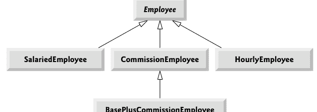

**图 10.2** `Employee` 层次结构 UML 类图。

抽象父类 `Employee` 声明了层次结构的“接口”——即程序对所有 `Employee` 对象调用的方法集合。我们这里泛指“接口”一词是指程序与任何 `Employee` 子类对象通信的各种方式。不要将“接口”的通用概念与 Java 接口的正式名称（10.9 节的主题）混淆。每个员工无论如何计算工资，都有名、姓和社保号，因此实例变量 `firstName`、`lastName` 和 `socialSecurityNumber` 出现在抽象父类 `Employee` 中。

图 10.3 显示了左侧层次结构中的五个类以及顶部对应的方法。对于每个类，图表显示了每个方法的预期结果。我们没有列出父类 `Employee` 的 `get` 方法，因为它们在任何子类中都没有被重写——这些方法中的每一个都被每个子类继承并按原样使用。

## 10.5 案例研究：使用多态的薪资系统

| 员工 | 抽象 | |
| :--- | :--- | :--- |
| | `firstName`<br>`lastName`<br>社会安全号码: `socialSecurityNumber` | |
| 薪制员工 (`SalariedEmployee`) | `weeklySalary` | 薪制员工: `firstName` `lastName`<br>社会安全号码: `socialSecurityNumber`<br>周薪: `weeklySalary` |
| 时制员工 (`HourlyEmployee`) | `if (hours <= 40)`<br>`wage * hours`<br>`else`<br>`40 * wage +`<br>`(hours - 40) *`<br>`wage * 1.5` | 时制员工: `firstName` `lastName`<br>社会安全号码: `socialSecurityNumber`<br>时薪: `wage`; 工作时长: `hours` |
| 佣金员工 (`CommissionEmployee`) | `commissionRate *`<br>`grossSales` | 佣金员工: `firstName` `lastName`<br>社会安全号码: `socialSecurityNumber`<br>总销售额: `grossSales`;<br>佣金率: `commissionRate` |
| 底薪+佣金员工 (`BasePlusCommissionEmployee`) | `(commissionRate *`<br>`grossSales) +`<br>`baseSalary` | 底薪加佣金员工:<br>`firstName` `lastName`<br>社会安全号码: `socialSecurityNumber`<br>总销售额: `grossSales`;<br>佣金率: `commissionRate`;<br>底薪: `baseSalary` |

**图 10.3** 用于 `Employee` 层次结构类的多态接口。

接下来的章节实现了图 10.2 中的 `Employee` 类层次结构。第一部分实现了抽象超类 `Employee`。接下来的四个部分每个实现其中一个具体类。最后一部分实现了一个测试程序，该程序构建所有这些类的对象并以多态的方式处理这些对象。

### 10.5.1 抽象超类 Employee

`Employee` 类（图 10.4）提供了 `earnings` 和 `toString` 方法，以及返回实例变量值的 `get` 方法。`earnings` 方法通用地适用于所有员工。每个 `earnings` 计算都取决于员工特定的类。我们在超类 `Employee` 中将 `earnings` 声明为抽象方法，因为对该方法提供特定的默认实现是没有意义的——没有足够的信息来确定 `earnings` 应该返回什么金额。

每个子类都实现了 `earnings`。为了计算员工的收入，程序将超类 `Employee` 变量赋值为指向员工对象的引用，然后在该变量上调用 `earnings` 方法。我们维护一个 `Employee` 变量数组，每个元素持有一个 `Employee` 对象的引用。你不能直接实例化 `Employee` 类来创建 `Employee` 对象，因为 `Employee` 是一个抽象类。然而，由于继承，所有 `Employee` 子类的对象都可以被视为 `Employee` 对象。程序将遍历数组并对 `Employee` 对象调用 `earnings` 方法。Java 以多态的方式处理这些方法调用。在 `Employee` 中将 `earnings` 声明为抽象方法，使得通过 `Employee` 变量对 `earnings` 的调用可以通过编译，并强制 `Employee` 的每个具体子类重写 `earnings`。

`Employee` 中的 `toString` 返回一个包含员工名、姓和社会安全号码的字符串。正如我们看到的，`Employee` 的每个子类都重写了 `toString`，以创建一个包含员工属性的对象字符串表示（例如，“薪制员工：”后面跟着员工的其他信息）。

让我们考虑 `Employee` 的声明（图 10.4）。该类包含一个构造函数，接收名、姓和社会安全号码（第 11–17 行）；`get` 方法返回名、姓和社会安全号码（分别第 20–23、26–29 和 32–35 行）；`toString`（第 38–43 行），返回对象的字符串表示；以及抽象方法 `earnings`（第 46 行），它将由每个具体子类实现。在这个示例中，`Employee` 构造函数没有对其参数进行验证；通常，应该提供验证。

```java
// 图 10.4: Employee.java
// Employee 抽象超类

public abstract class Employee
{
    private final String firstName;
    private final String lastName;
    private final String socialSecurityNumber;

    // 构造函数
    public Employee(String firstName, String lastName, String socialSecurityNumber)
    {
        this.firstName = firstName;
        this.lastName = lastName;
        this.socialSecurityNumber = socialSecurityNumber;
    }

    // 返回名
    public String getFirstName()
    {
        return firstName;
    }

    // 返回姓
    public String getLastName()
    {
        return lastName;
    }

    // 返回社会安全号码
    public String getSocialSecurityNumber()
    {
        return socialSecurityNumber;
    }

    // 返回 Employee 对象的字符串表示
    @Override
    public String toString()
    {
```


      41      return String.format("%s %s%nssocial security number: %s",

42              getFirstName(), getLastName(), getSocialSecurityNumber());

      43  }

      44

      45  // 抽象方法必须被具体子类重写

      46  public abstract double earnings(); // 此无实现

      47  } // 抽象类 Employee 结束

```

图 10.4 | Employee 抽象 earnings（2 部分中的剩余部分）

我们为什么决定将 `earnings` 声明为抽象方法？在 `Employee` 中为该方法提供特定的实现根本没有意义。我们必须先知道 `Employee` 的特定类型才能确定收入计算。通过将此方法声明为抽象，我们表示每个子类必须提供一个实现，并且程序能够使用 `Employee` 变量以多态的方式调用 `earnings`。

## 10.5.2 具体子类 SalariedEmployee

`SalariedEmployee`（图 10.5）继承 `Employee` 并是一个具体类。该类包含一个构造函数，接收名、姓、社会安全号码和周薪（第 9–19 行）；`get` 方法返回名、姓和社会安全号码（分别第 22–23、26–29 和 32–35 行）；`toString`（第 38–42 行），返回一个包含“工薪制员工：”以及员工其他信息的字符串。`earnings` 方法重写了 `Employee` 的抽象方法，提供了一个返回 `SalariedEmployee` 周薪的具体实现。

**错误预防提示 10.1**
> 我们不应该在构造函数中调用实例方法——如果你遵循这一建议，就可以避免直接或间接调用重写方法的问题，这可能会导致运行时错误。

```java
// 图 10.5: SalariedEmployee.java

// SalariedEmployee 具体类继承抽象类 Employee

public class SalariedEmployee extends Employee {

    private double weeklySalary;

    // 构造函数

    public SalariedEmployee(String firstName, String lastName,
        String socialSecurityNumber, double weeklySalary) {

        super(firstName, lastName, socialSecurityNumber);

        if (weeklySalary < 0) {
            throw new IllegalArgumentException("Weekly salary must be >= 0.0");
        }

        this.weeklySalary = weeklySalary;
    }

    // 设置周薪

    public void setWeeklySalary(double weeklySalary) {
        if (weeklySalary < 0) {
            throw new IllegalArgumentException("Weekly salary must be >= 0.0");
        }
        this.weeklySalary = weeklySalary;
    }

    // 返回周薪

    public double getWeeklySalary() {
        return weeklySalary;
    }

    // 计算收入；重写 Employee 中的抽象方法

    @Override
    public double earnings() {
        return getWeeklySalary();
    }

    // 返回 SalariedEmployee 对象的字符串表示

    @Override
    public String toString() {
        return String.format("salaried employee: %s%s: $%,.2f",
            super.toString(), "weekly salary: ", getWeeklySalary());
    }
} // 类 SalariedEmployee 结束
```

**图 10.5** | SalariedEmployee 具体类继承抽象类 Employee。

## 10.5 案例研究：使用多态的工资系统 — 401

实现 `earnings` 方法，类 `SalariedEmployee` 必须声明为抽象类——否则 `SalariedEmployee` 类将无法编译。当然，在这个例子中我们希望 `SalariedEmployee` 是一个具体类。

`toString` 方法（第 45–50 行）重写了 `Employee` 的 `toString` 方法。如果 `SalariedEmployee` 类没有重写 `toString`，它将继承 `Employee` 版本的 `toString`。在这种情况下，`SalariedEmployee` 的 `toString` 方法将仅仅返回 `Employee` 的全名和社会安全号码，这并不能代表 `SalariedEmployee`。为了生成 `SalariedEmployee` 生成一个完整的字符串表示，子类的 `toString` 方法返回“salaried employee:”，随后是通过调用父类 `toString` 方法（第 49 行）获取的 `Employee` 特有信息（即名、姓和社会安全号码）——这是代码复用的一个很好的例子。`SalariedEmployee` 的字符串表示还包含通过调用该类的 `weeklySalary` 方法获取的员工每周工资。

## 10.5.3 具体子类 HourlyEmployee

`HourlyEmployee`（图 10.6）也扩展了 `Employee`（第 4 行）。该类包含一个构造函数（第 10–25 行），接收名、姓、社会安全号码、时薪和工作小时数。第 28–35 行和 44–51 行设置了方法，分别为实例变量 `wage` 和 `hours` 赋值。`set` 方法（第 28–35 行）确保 `wage` 为非负，而 setter 方法（第 44–51 行）确保 `hours` 在 0 到 168 之间（一周的总小时数）且包含边界值。`HourlyEmployee` 还包含 getter（第 38–41 行和 54–57 行）以返回 `wage` 和 `hours` 的值；一个 `earnings` 方法（第 60–67 行）用于计算 `HourlyEmployee` 的收入；一个 `toString` 方法（第 70–76 行），返回包含员工类型（“hourly employee”）和员工信息的字符串。`HourlyEmployee` 构造函数像 `SalariedEmployee` 构造函数一样，将名、姓和社会安全号码传递给父类 `Employee` 构造函数（第 13 行）以初始化实例变量。此外，`toString` 方法调用 `super`（第 74 行）来获取 `Employee` 特有信息（即名、姓和社会安全号码）——这是另一个代码复用的很好的例子。

```java
// Fig. 10.6: HourlyEmployee.java
// HourlyEmployee class extends Employee.

public class HourlyEmployee extends Employee {

    private double wage; // wage per hour
    private double hours; // hours worked for week

    // constructor
    public HourlyEmployee(String firstName, String lastName,
        String socialSecurityNumber, double wage, double hours) {

        super(firstName, lastName, socialSecurityNumber);

        if (wage < 0.0) // validate wage
            throw new IllegalArgumentException("Hourly wage must be >= 0.0");

        if ((hours < 0.0) || (hours > 168.0)) // validate hours
            throw new IllegalArgumentException(
                "Hours worked must be >= 0.0 and <= 168.0");

        this.wage = wage;
        this.hours = hours;
    }

    // set wage
    public void setWage(double wage) {
        if (wage < 0.0) // validate wage
            throw new IllegalArgumentException("Hourly wage must be >= 0.0");
        this.wage = wage;
    }

    // return wage
    public double getWage() {
        return wage;
    }

    // set hours worked
    public void setHours(double hours) {
        if ((hours < 0.0) || (hours > 168.0)) // validate hours
            throw new IllegalArgumentException(
                "Hours worked must be >= 0.0 and <= 168.0");
        this.hours = hours;
    }

    // return hours worked
    public double getHours() {
        return hours;
    }

    // calculate earnings, override abstract method earnings in Employee
    @Override
    public double earnings() {
        if (getHours() <= 40) // no overtime
            return getWage() * getHours();
        else
            return 40 * getWage() + (getHours() - 40) * getWage() * 1.5;
    }

    // return String representation of HourlyEmployee object
    @Override
    public String toString() {
        return String.format("hourly employee: %s\n%s: $%,.2f; %s: %.2f",
            super.toString(), "hourly wage", getWage(),
            "hours worked", getHours());
    }
} // end class HourlyEmployee
```

图 10.6 | HourlyEmployee 类扩展 Employee。（3 部分第 3 部分。）

## 10.5.4 子类 CommissionEmployee

`CommissionEmployee`（图 10.7）扩展了 `Employee`（第 10 行）。一个构造函数（第 10–25 行）接收名、姓、社会安全号码、销售额和佣金率。第 28–34 行和 43–50 行设置了方法，分别为实例变量 `commissionRate` 和 `grossSales` 赋值。`set` 方法（第 28–34 行）确保 `grossSales` 非负，而 setter 方法（第 43–50 行）确保 `commissionRate` 在 0 到 1 之间且包含边界值。`CommissionEmployee` 还包含 getter（第 37–40 行和 53–56 行）以返回 `commissionRate` 和 `grossSales` 的值；一个 `earnings` 方法（第 59–63 行）用于计算 `CommissionEmployee` 的收入；一个 `toString` 方法（第 66–73 行），返回包含员工类型（“commission employee”）和员工信息的字符串。`CommissionEmployee` 构造函数像 `SalariedEmployee` 构造函数一样，将名、姓和社会安全号码传递给父类 `Employee` 构造函数（第 14 行）以初始化实例变量。此外，`toString` 方法调用 `super`（第 70 行）来获取 `Employee` 特有信息（即名、姓和社会安全号码）——这是另一个代码复用的很好的例子。

```java
// Fig. 10.7: CommissionEmployee.java
// CommissionEmployee class extends Employee.

public class CommissionEmployee extends Employee {

    private double grossSales; // gross sales
    private double commissionRate; // commission percentage

    // constructor
    public CommissionEmployee(String firstName, String lastName,
        String socialSecurityNumber, double grossSales,
        double commissionRate) {

        super(firstName, lastName, socialSecurityNumber);

        if (grossSales < 0.0) // validate
            throw new IllegalArgumentException("Gross sales must be >= 0.0");
        this.grossSales = grossSales;

        if (commissionRate <= 0.0 || commissionRate >= 1.0) // validate
            throw new IllegalArgumentException(
                "Commission rate must be > 0.0 and < 1.0");
        this.commissionRate = commissionRate;
    }

    // set gross sales amount
    public void setGrossSales(double grossSales) {
        if (grossSales < 0.0) // validate
            throw new IllegalArgumentException("Gross sales must be >= 0.0");
        this.grossSales = grossSales;
    }

    // return gross sales amount
    public double getGrossSales() {
        return grossSales;
    }

    // set commission rate
    public void setCommissionRate(double commissionRate) {
        if (commissionRate <= 0.0 || commissionRate >= 1.0) // validate
            throw new IllegalArgumentException(
                "Commission rate must be > 0.0 and < 1.0");
        this.commissionRate = commissionRate;
    }

    // return commission rate
    public double getCommissionRate() {
        return commissionRate;
    }
```


// calculate earnings; override abstract method in Employee

@Override
public double earnings() {
    return getCommissionRate() * getGrossSales();
}

// return String representation of CommissionEmployee object

@Override
public String toString() {
    return String.format("commission employee: %s\n%s: $%.2f, %s: $%.2f",
        super.toString(), getGrossSales(),
        "commission rate", getCommissionRate());
}

} // end class CommissionEmployee

```

图 10.7 | CommissionEmployee 类扩展 Employee。（2 部分第 1 部分。）

## 10.5.5 间接子类：BasePlusCommissionEmployee

`BasePlusCommissionEmployee` 类（图 10.8）继承自 `CommissionEmployee` 类（第 4 行），因此它是 `Employee` 类的间接子类。`BasePlusCommissionEmployee` 类有一个构造函数（第 9–20 行），接收名、姓、安全号、销售额、佣金率和基本工资。它将除基本工资以外的所有参数传递给 `CommissionEmployee` 构造函数（第 13–14 行）以初始化父类变量。`BasePlusCommissionEmployee` 还包含一个 set 方法（第 23–29 行）用于给变量 `baseSalary` 赋新值，以及一个返回 `baseSalary` 值的方法（第 32–35 行）。`earnings` 方法（第 38–42 行）计算 `BasePlusCommissionEmployee` 的收入。`earnings` 方法中的第 41 行调用 `super.earnings()` 来计算员工收入中基于佣金的部分——这是代码使用的另一个示例。`BasePlusCommissionEmployee` 的 `toString` 方法（第 45–51 行）创建一个 `BasePlusCommissionEmployee` 的字符串表示，其中包含 "base-salaried"，随后是调用 `CommissionEmployee` 的 `toString` 方法（第 49 行）获得的字符串，然后是基本工资。结果是一个以 "base-salaried employee" 开头的字符串，后面跟着 `BasePlusCommissionEmployee` 的其余信息。记住，`CommissionEmployee` 的 `toString` 方法通过调用其父类（即 `Employee`）的 `toString` 方法来调用员工的名、姓和社会安全号——另一个代码使用的示例。`BasePlusCommissionEmployee` 的 `toString` 初始化了一个跨越 `Employee` 层次结构三层的方法调用链。

```java
// Fig.10.8: BasePlusCommissionEmployee.java
// BasePlusCommissionEmployee 类继承自 CommissionEmployee.

public class BasePlusCommissionEmployee extends CommissionEmployee {
    private double baseSalary; // 每基本工资

    // constructor
    public BasePlusCommissionEmployee(String firstName, String lastName,
        String socialSecurityNumber, double grossSales,
        double commissionRate, double baseSalary) {
        super(firstName, lastName, socialSecurityNumber,
            grossSales, commissionRate);
        if (baseSalary < 0.0) // validate baseSalary
            throw new IllegalArgumentException("Base salary must be >= 0.0");
        this.baseSalary = baseSalary;
    }

    // 设置基本工资
    public void setBaseSalary(double baseSalary) {
        if (baseSalary < 0.0) // validate baseSalary
            throw new IllegalArgumentException("Base salary must be >= 0.0");
        this.baseSalary = baseSalary;
    }

    // 返回基本工资
    public double getBaseSalary() {
        return baseSalary;
    }

    // 计算收入; 重写 CommissionEmployee 中的 earnings 方法
    @Override
    public double earnings() {
        return getBaseSalary() + super.earnings();
    }

    // 返回 BasePlusCommissionEmployee 的字符串表示
    @Override
    public String toString() {
        return String.format("%s: %s %.2f",
            "base-salary", super.toString(),
            "base salary", getBaseSalary());
    } // end BasePlusCommissionEmployee
}
```

图 10.8 | `BasePlusCommissionEmployee` 类继承自 `CommissionEmployee`。（2 部分中的 1 部分）

## 10.5.6 多态处理、instanceof 运算符和向下类型转换

为了测试我们的层次结构，图 10.9 创建了四个具体类 `SalariedEmployee`、`HourlyEmployee`、`CommissionEmployee` 和 `BasePlusCommissionEmployee` 的每个对象。程序首先通过每个对象类型的变量以非多态的方式管理这些对象，然后使用 `Employee` 变量数组以多态的方式进行管理。在以多态方式处理对象时，程序将每个 `BasePlusCommissionEmployee` 的基本工资增加了 10%——这在执行时确定了对象的类型。最后，程序以多态的方式确定并输出 `Employee` 数组中每个对象的类型。第 9–18 行创建了四个具体的 `Employee` 子类。第 22–30 行以非多态的方式输出这些每个对象的字符串表示和收入。当对象使用 `%s` 格式说明符作为字符串输出时，`printf` 会隐式地调用每个对象的 `toString` 方法。

```java
// Fig. 10.9: PayrollSystemTest.java
// 层次结构测试程序.

public class PayrollSystemTest {
    public static void main(String[] args) {
        // 创建子类对象
        SalariedEmployee salariedEmployee =
            new SalariedEmployee("John", "Smith", "111-11-1111", 800.00);
        HourlyEmployee hourlyEmployee =
            new HourlyEmployee("Karen", "Price", "222-22-2222", 16.75, 40);
        CommissionEmployee commissionEmployee =
            new CommissionEmployee(
                "Sue", "Jones", "333-33-3334", 10000, .06);
        BasePlusCommissionEmployee basePlusCommissionEmployee =
            new BasePlusCommissionEmployee(
                "Bob", "Lewis", "444-44-4444", 5000, .04, 300);

        // 创建 Employee 数组
        Employee[] employees = new Employee[4];
        employees[0] = salariedEmployee;
        employees[1] = hourlyEmployee;
        employees[2] = commissionEmployee;
        employees[3] = basePlusCommissionEmployee;

        // 以多态方式处理元素
        for (Employee employee : employees) {
            if (employee instanceof BasePlusCommissionEmployee) {
                BasePlusCommissionEmployee bpe = (BasePlusCommissionEmployee) employee;
                bpe.setBaseSalary(bpe.getBaseSalary() * 1.10);
            }
            System.out.printf("employee %d is a %s%n", i, employee.getClass().getName());
            System.out.printf("earned: $%,2f%n", employee.earnings());
        }
    }
}
```


# 10.5 案例研究：使用多态的薪资系统

基于底薪且加佣金的员工：Bob Lewis
社会安全号码：444-44-4444
总销售额：$5,000.00；佣金率：0.04；基本工资：$300.00
增加 10% 后的新基本工资为：$330.00
赚得 $530.00

员工 0 是底薪员工 (`SalariedEmployee`)
员工 1 是小时薪制员工 (`HourlyEmployee`)
员工 2 是佣金员工 (`CommissionEmployee`)
员工 3 是底薪加佣金员工 (`BasePlusCommissionEmployee`)

**图 10.9 | 员工层级测试程序。（4 部分，共 4 部分。）**

### 创建员工数组

第 33 行确定了员工并分配了一个包含四个 `Employee` 变量的数组。第 36 行为 `employees[0]` 分配了一个 `SalariedEmployee` 对象的引用。第 37 行为 `employees[1]` 分配了一个 `HourlyEmployee` 对象的引用。第 38 行为 `employees[2]` 分配了一个 `CommissionEmployee` 对象的引用。第 39 行为 `employees[3]` 分配了一个 `BasePlusCommissionEmployee` 对象的引用。这些赋值都是允许的，因为 `SalariedEmployee` 是员工，`HourlyEmployee` 是员工，`CommissionEmployee` 是员工，且 `BasePlusCommissionEmployee` 是员工。因此，我们可以将 `SalariedEmployee`、`HourlyEmployee`、`CommissionEmployee` 和 `BasePlusCommissionEmployee` 对象的引用赋值给子类变量，即使 `Employee` 是抽象类。

### 多态化处理员工

第 44-65 行遍历数组并使用变量 `currentEmployee` 运行 `toString()` 和 `earnings()` 方法，该变量在每次数组迭代中被赋值为数组中不同的 `Employee` 引用。输出说明了每个类的特定方法被调用了。所有对 `toString` 和 `earnings` 的调用都是在执行时根据 `currentEmployee` 所引用对象的类型来解析的。这一过程被称为*动态绑定*（dynamic binding）或*晚期绑定*（late binding）。例如，第 46 行隐式地调用了 `currentEmployee` 所引用对象的 `toString()`。由于动态绑定，Java 在执行时而非编译时决定调用哪个类的 `toString`。通过 `Employee` 变量只能调用类 `Employee` 类的方法（当然，`Employee` 包含了 `Object` 类的方法）。子类引用仅用于调用父类的方法——子类的实现是以*多态化*方式被调用的。

### 对 BasePlusCommissionEmployees 执行特定类型操作

我们对 `BasePlusCommissionEmployee` 对象进行特殊处理——当我们在执行时遇到对象时，我们将它们的基本工资增加了 10%。在以多态方式处理对象时，我们通常不需要担心细节；但为了调整基本工资，我们确实必须在执行时确定对象的特定类型。第 49 行使用 `instanceof` 运算符来确定特定对象的类型是否为 `BasePlusCommissionEmployee`。如果 `currentEmployee` 引用的对象是 `BasePlusCommissionEmployee`，则第 49 行的条件为真。由于“是”（is-a）关系，对于 `BasePlusCommissionEmployee` 的任何子类对象，该条件也为真。

子类与其父类具有的关系。第 53–54 行将 `currentEmployee` 从 `Employee` 类型向下强制转换为 `BasePlusCommissionEmployee` 类型——只有当该对象与 `BasePlusCommissionEmployee` 存在“是”关系时才允许这样做。第 49 行的条件确保了这一点。如果我们要在当前的 `Employee` 对象上调用 `BasePlusCommissionEmployee` 的方法 `getBaseSalary()` 和 `setBaseSalary()`，则需要进行强制转换——正如稍后看到的，直接在引用上调用子类特有的方法会导致编译错误。

# 常见编程错误 10.3

将父类变量赋值给子类变量是编译错误。

# 常见编程错误 10.4

在对引用进行向下强制转换时，如果执行时引用的对象与类操作符指定的类型没有“是”关系，则会发生 `ClassCastException`。

如果第 49 行中的 `instanceof` 表达式为真，则第 53–60 行执行 `BasePlusCommissionEmployee` 对象所需的特殊处理。使用 `BasePlusCommissionEmployee` 变量，第 56 行调用子类特有的方法 `getBaseSalary()` 来获取并更新带有 10% 加薪幅的员工基本工资。

### 多态化调用 earnings

第 63–64 行在 `currentEmployee` 上调用 `earnings()` 方法，该方法以多态方式调用相应子类的 `earnings` 方法。以多态方式获取 `SalaryEmployee`、`HourlyEmployee` 和 `CommissionEmployee` 的收益，与在第 22–27 行中单独获取员工收益的结果相同。由于基本工资增加了 10%，第 63–64 行中 `BasePlusCommissionEmployee` 的收益金额高于第 28–30 行。

### 获取每个员工的类名

第 68–70 行将每个员工的类型显示为字符串。每个对象都知道自己的类，并通过 `getClass()` 方法访问此信息，所有类都继承自 `Object` 类。方法 `getClass()` 返回 `Class` 类型的对象（来自 `java.lang` 包），它包含有关对象类型的信息，包括其类名。第 70 行在当前对象上调用 `getClass()` 以获取其类。`getClass()` 的结果被用于获取类名。

### 通过向下强制转换避免编译错误

在之前的示例中，我们通过在第 53 行将 `Employee` 强制转换为 `BasePlusCommissionEmployee` 避免了多个编译错误。如果你移除第 54 行的强制转换 `(BasePlusCommissionEmployee)` 并直接赋值给子类变量，将收到类型不兼容的错误。该错误表明 `Employee` 不是 `BasePlusCommissionEmployee`。

## 10.6 父类与子类变量之间的赋值

同样，如果第 56 和 60 行使用父类变量调用子类特有的方法 `getBaseSalary()` 和 `setBaseSalary()`，我们会收到“找不到符号”错误，即使 `instanceof` 返回真表示 `Employee` 持有一个 `BasePlusCommissionEmployee` 对象。使用父类变量，我们只能调用 `Employee` 中找到的方法——`toString()` 和 `earnings()`。

### 10.6 父类与子类变量之间的赋值

现在你已经看到了一个多态化处理对象的完整应用程序，我们总结一下对于父类和子类变量可以和不能做什么。尽管子类对象也是父类对象，但这两个类仍然不同的。正如之前讨论的，子类对象可以被视为父类对象。但由于子类可能有额外的成员，如果没有显式强制转换，不允许将父类引用赋值给子类变量。

我们讨论了将子类引用赋值给子类类型变量的三种正确方法：

- 将子类引用赋值给父类变量是简单的。
- 将子类引用赋值给子类变量是简单的。
- 将子类引用赋值给父类变量是安全的，因为子类对象是其父类的对象。但是，父类变量只能引用子类成员。

## 10.7 Final 方法与类

我们在第 5.3 节中看到变量可以声明为 `final` 以表示它们在初始化后不能修改——此类变量代表常量值。还可以对方法、方法参数和类使用 `final` 修饰符。

### Final 方法不能被重写

子类中的 final 方法不能在子类中重写——这保证了 final 方法实现将被层次结构中的所有直接和间接子类使用。私有方法是隐式的 final，因为无法在子类中重写它们。静态方法也是隐式的 final。final 方法的声明永远不会改变。实现以及对 final 方法的调用是在编译时解析的——这被称为静态绑定。

### final 类不能作为超类

final 类不能被扩展以创建子类。final 类中的所有方法都隐式地为 final。`String` 类就是 final 类的一个示例。如果你允许创建 `String` 的子类，那么该子类的对象就可以在任何需要 String 的地方使用。由于类不能被扩展，程序就可以依赖于 Java API 中指定的 `String` 对象的功能。将类设为 final 还可以防止程序员创建绕过安全限制的子类。

我们现在已经将变量、方法和类声明为 `final`，并强调了当它们应该是 `final` 时应该使用该关键字。编译器在知道它们是 `final` 的时候可以进行优化。当我们在第 23 章学习并发时，你会发现 `final` 变量让你的程序针对当今的多核处理器并行化变得容易得多。关于 `final` 使用的更多见解，请访问

```
http://docs.oracle.com/javase/tutorial/java/IandI/final.html
```


# 常见编程错误 10.5

尝试声明 `final` 类的子类会导致编译错误。

## 软件工程观察 10.6

在 Java API 中，大多数类都没有被声明为 `final`。这使得继承和多态成为可能。但在某些情况下，将类声明为 `final` 是重要的——通常是为了安全考虑。此外，除非你为扩展仔细设计了一个类，否则你应该将类声明为 `final` 以避免（通常是微妙的）错误。

## 10.8 关于构造函数调用可重写方法问题的深度解释

不要在构造函数中调用可重写的方法。在创建子类对象时，这可能导致重写的方法在子类对象完全初始化之前被调用。

回想当构造一个子类对象时，它的构造函数首先调用所有直接父类的构造函数。如果父类构造函数调用了一个可重写的方法，那么该方法的子类版本将由父类构造函数调用——在子类构造函数体执行之前。这可能导致微妙且难以检测的错误，如果被调用的子类方法依赖于子类构造函数中尚未执行的初始化。

从构造函数中调用 `static` 方法是可以接受的。例如，构造函数和设置方法通常会对特定的实例变量执行相同的验证。如果验证代码很短，在构造函数和设置方法中重复它是可以接受的。如果需要很长的验证，请定义一个 `static` 验证方法（通常是一个私有辅助方法），然后从构造函数和设置方法中调用它。构造函数调用 `final` 实例方法也是可以接受的，只要该方法没有直接或间接地调用任何可重写的实例方法。

## 10.9 创建和使用接口

> **注**：如文所示，本节及其代码示例适用于 Java SE 7。Java SE 8 的接口增强在第 10.10 节引入，并在第 17 章进行更详细的讨论。

我们的下一个示例（图 10.11–10.15）重新检查了第 10.5 节的工资系统。假设该公司希望在单个应付账应用程序中执行若干会计操作——除了计算必须支付给每个员工的收入外，还需计算每张发票的应付金额（即购买货物的账单）。公司必须为员工和发票计算付款金额，这两项操作都必须获取某种付款金额。例如，付款项指的是员工的收入。对于发票，付款项指的是发票上列出的商品总成本。我们是否可以在单个应用程序中以多态的方式为员工和发票计算不同的内容作为“付款项”？Java 是否提供了一种能力，要求不相关的类实现一组公共方法（例如，计算付款金额的方法）？Java 接口正提供了这种能力。

### 标准化交互

接口定义并标准化了人与系统之间相互作用的方式。例如，收音机上的控件充当收音机用户与收音机内部组件之间的接口。控件允许用户执行有限的操作集（例如，切换电台、调整音量、在 AM 和 FM 之间选择），不同的收音机可能以不同的方式实现控件（例如使用按钮、语音命令）。接口规定了收音机必须允许用户执行的操作，但没有规定操作是如何实现的。

### 软件对象通过接口通信

软件对象通过接口进行通信。Java 接口描述了一组可以在对象上调用的方法，以告诉它执行某些任务或返回某些信息。下一个示例引入了一个名为 `Payable` 的接口，用于描述任何“能够被支付”的对象的功能，并且必须提供一个方法来确定应付金额。接口声明以 `interface` 关键字开始，仅包含抽象方法和常量。与类不同，所有接口成员必须是 `public` 的，且接口不能指定任何实现细节，例如具体的方法声明和实例变量。接口中声明的所有方法都是隐式的抽象方法，所有字段都是隐式地为 `static` 且 `final` 的。

### 良好的编程实践 10.1

根据 Java 语言规范，声明接口的抽象方法时不带 `public` 和 `abstract` 是恰当的，因为它们在接口方法声明中是冗余的。同样，声明接口的常量时不带 `public`、`static` 和 `final` 关键字，因为它们也是冗余的。

### 使用接口

要使用接口，具体类必须指定它实现了该接口，在类声明的第一行末尾添加 `implements` 关键字和接口名称。没有实现接口所有方法的类是抽象的。实现接口就像与编译器签署一份合同，声明：“我将实现接口的所有方法。”

#### 常见编程错误 10.6

在具体类中未能实现接口的任何方法会导致编译错误。

### 关联不同类型

当差异化的类（即不通过层次结构相关的类）需要共享公共方法和常量时，可以使用接口。这允许以多态方式处理无关类——实现相同功能的对象响应相同的调用。你可以创建一个描述所需功能的接口，然后在任何需要该功能的类实现此接口。例如，在本节开发的案例中，我们在任何必须计算付款金额的类中实现 `Payable`。

### 接口与抽象类

当没有默认实现可以继承时，使用接口来代替抽象类——即没有字段和方法实现。与 `public` 抽象类一样，接口通常是 `public` 类型。与 `public` 类一样，`public` 接口必须声明在与接口同名且扩展名为 `.java` 的文件中。

### 软件工程观察 10.7

许多人认为接口是比类更重要的建模技术，特别是有了 Java 8 的新接口增强。

### 标记接口

我们将在第 15 章“文件、流和对象序列化”中看到标记接口（也称为标记接口）的概念——没有任何方法或常量值的空接口。它们用于为类添加关系。例如，在第 15 章我们将讨论一种名为对象序列化的机制，它可以将对象转换为字节表示并将这些转换回对象。为了让此机制对你的对象生效，你只需要在类声明的第一行末尾通过 `implements` 将它们标记为 `Serializable`。然后，你类的所有对象都是 `Serializable` 的。

## 10.9.1 开发 Payable 层

为了构建一个可以确定员工和发票付款金额的应用程序，我们首先创建一个 `Payable` 接口，它包含 `getPaymentAmount` 方法，返回实现该接口的任何对象的 `double` 类型金额。`getPaymentAmount` 方法是 `Employee` 层次结构 `earnings` 方法的通用版本——`earnings` 方法专门为 `Employee` 计算金额，而 `getPaymentAmount` 可以应用于广泛可能无关的对象。在声明接口 `Payable` 后，我们引入了 `Invoice` 类，它实现了接口 `Payable`。然后我们修改类 `Employee` 使其也实现接口 `Payable`。最后，我们通过将子类 `SalariedEmployee` 的方法 `earnings` 重命名为 `getPaymentAmount`，使其“适应” `Payable` 层次结构。

### 良好的编程实践 10.2

> 在接口中声明方法时，选择一个通用描述方法目的名称，因为该方法可能被许多不相关的类实现。

`Invoice` 和 `Employee` 类都代表了公司必须计算支付金额的对象。这两个类都实现了 `Payable` 接口，因此程序可以对 `Invoice` 对象和 `Employee` 对象调用 `getPaymentAmount`。正如我们将看到的，这使得公司应付账所需的 `Invoice` 和 `Employee` 的多态处理成为可能。

图 10.10 中的 UML 图显示了我们应付账应用程序中使用的接口和类层次结构。该层次结构从接口 `Payable` 开始。UML 通过在名称上方使用双括号（«»）放置“interface”一词来区分接口和类。UML 通过称为“实现”（realization）的关系表示类与接口之间的关系。一个类被认为实现了接口的方法。类图将实现建模为带箭头的虚线，箭头从实现类指向接口。图 10.10 中的图表表示 `Invoice` 类和 `Employee` 类分别实现了接口 `Payable`。与图 10.2 中的类图一样，`Employee` 类以斜体显示，表示它是一个抽象类。具体类 `SalariedEmployee` 继承自 `Employee`，继承了其超父类与 `Payable` 接口的实现关系。

## 10.9.2 接口 Payable

接口 `Payable` 的声明始于图 10.11 的第 4 行。`Payable` 接口包含公共抽象方法 `getPaymentAmount`。接口方法始终是公共的，因此不需要被声明为公共。`Payable` 接口只有一个方法，但接口可以有任意数量的方法。此外，方法 `getPaymentAmount` 可以带有参数。接口还可以包含 `final static` 常量。

```java
// Fig. 10.11: Payable.java
// Payable interface declaration.

public interface Payable
{
    double getPaymentAmount(); // 计算支付；无实现
}
```

图 10.11 | Payable 接口声明。

## 10.9.3 类 Invoice

我们现在创建 `Invoice` 类（图 10.12）来表示一个仅包含一种零件账单信息的简单发票。该类声明了私有实例变量 `partNumber`、`partDescription`、`quantity` 和 `priceItem`（第 6–9 行），它们表示零件编号、零件描述、订单零件数量和单价。`Invoice` 还包含一个构造函数（第 12–26 行）、用于操作类实例变量的 get 和 set 方法（第 29–69 行）以及一个返回 `Invoice` 对象字符串表示的 `toString` 方法（第 72–78 行）。`setQuantity` 方法（第 41–47 行）和 `setPriceItem` 方法（第 55–63 行）确保 `quantity` 和 `priceItem` 获取非负值。

```java
// Fig. 10.12: Invoice.java
// Invoice class that implements Payable.

public class Invoice implements Payable
{
    private final String partNumber;
    private final String partDescription;
    private int quantity;
    private double priceItem;

    // 构造函数
    public Invoice(String partNumber, String partDescription, int quantity, double priceItem)
    {
        if (quantity < 0) // 验证数量
            throw new IllegalArgumentException("Quantity must be >= 0");
        if (priceItem < 0.0) // 验证单价
            throw new IllegalArgumentException("Price per item must be >= 0");

        this.quantity = quantity;
        this.partNumber = partNumber;
        this.partDescription = partDescription;
        this.priceItem = priceItem;
    } // 构造函数结束

    // 获取零件编号
    public String getPartNumber()
    {
        return partNumber; // 应该验证
    }

    // 获取描述
    public String getPartDescription()
    {
        return partDescription;
    }

    // 设置数量
    public void setQuantity(int quantity)
    {
        if (quantity < 0) // 验证数量
            throw new IllegalArgumentException("Quantity must be >= 0");
        this.quantity = quantity;
    }

    // 获取数量
    public int getQuantity()
    {
        return quantity;
    }

    // 设置单价
    public void setPriceItem(double priceItem)
    {
        if (priceItem < 0.0) // 验证单价
            throw new IllegalArgumentException("Price per item must be >= 0");
        this.priceItem = priceItem;
    }

    // 获取单价
    public double getPriceItem()
    {
        return priceItem;
    }

    // 返回 Invoice 的字符串表示
    @Override
    public String toString()
    {
        return String.format("%s: %s (%s) %s: %s: %.2f",
            "invoice", partNumber, partDescription, "quantity", quantity, priceItem);
    }

    // 执行与 Payable 合约所需的方法
    @Override
    public double getPaymentAmount()
    {
        return getQuantity() * getPriceItem(); // 计算总成本
    }
} // 类结束
```

图 10.12 | 实现 Payable 的 Invoice 类。

### 类只能继承一个类，但可以实现多个接口

第 4 行表示 `Invoice` 实现了 `Payable`。像所有类一样，`Invoice` 也隐式继承了 `Object`。Java 不允许子类继承自多个父类，但它允许类继承一个父类并实现所需的任意数量的接口。要实现多个接口，在类声明中 `implements` 关键字后跟着用逗号分隔的接口名称列表，如下：

```java
public class ClassName extends SuperClassName implements Interface, SecondInterface, ...
```

### 软件工程观察 10.8

实现多个接口的类的所有对象与每个实现的类型都具有“is-a”关系。

`Invoice` 实现了 `Payable` 接口中的抽象方法——方法 `getPaymentAmount` 定义在第 81–85 行。该方法计算支付发票所需的总额。该方法将 `quantity` 和 `priceItem` 的值（通过相应的 get 方法获取）相乘并返回结果。该方法满足了 `Payable` 接口中该方法的实现要求——我们与编译器完成了接口合约。

## 10.9.4 修改类 Employee 以实现接口 Payable

我们修改实现 `Payable` 的 `Employee` 类。图 10.13 包含了修改后的代码，它与图 10.4 相同，但有两个例外。首先，图 10.13 的第 4 行表示 `Employee` 类实现了 `Payable` 接口。对于此示例，我们将整个 `Employee` 层次结构中的 `earnings` 重命名为 `getPaymentAmount`。然而，在图 10.4 版本的 `Employee` 类中使用 `earnings` 方法，在 `Employee` 类中实现 `getPaymentAmount` 是有意义的，因为我们无法计算通用 `Employee` 的支付金额——我们必须先知道具体的 `Employee` 类型。在图 10.4 中，由于此原因我们将 `earnings` 方法声明为抽象的，因此 `Employee` 类必须声明为抽象类。

```java
// Fig. 10.13: Employee.java
// Employee abstract superclass that implements Payable.
```

图 10.13 | 实现 Payable 的 Employee 抽象父类。（2 部分中的第 1 部分）


```java
public abstract class Employee implements Payable
{
    private final String firstName;
    private final String lastName;
    private final String socialSecurityNumber;

    public Employee(String firstName, String lastName, String socialSecurityNumber)
    {
        this.firstName = firstName;
        this.lastName = lastName;
        this.socialSecurityNumber = socialSecurityNumber;
    }

    public String getFirstName()
    {
        return firstName;
    }

    public String getLastName()
    {
        return lastName;
    }

    public String getSocialSecurityNumber()
    {
        return socialSecurityNumber;
    }

    @Override
    public String toString()
    {
        return String.format("%s %s%nsocial security number: %s", firstName(), lastName(), getSocialSecurityNumber());
    }

    // 注意: 我们在这里没有实现 getPaymentAmount 方法
    // 此类必须声明为抽象类以避免编译错误。
} // 抽象类 Employee
```

图 10.13 | 实现了 `Payable` 的 `Employee` 抽象子类。（部分 2/2）

在图 10.13 中，我们以不同的方式处理这种情况。记住，当一个类实现接口时，它与编译器达成了一个约定，声明该类将实现接口中的每个方法，或者该类将被声明为抽象类。由于 `Employee` 类没有提供 `getPaymentAmount` 方法，该类必须声明为抽象类。抽象类的任何具体子类都必须实现接口方法，以履行父类与编译器的约定。如果子类没有，它也必须声明为抽象类。正如第 45-46 行的注释所示，图 10.13 中的 `Employee` 类没有实现 `getPaymentAmount` 方法，因此该类被声明为抽象类。每个 `Employee` 子类继承父类的约定来实现 `getPaymentAmount`，并且必须实现此方法以成为可以实例化对象的具体类。扩展 `Employee` 某个具体子类的类将继承 `getPaymentAmount` 的实现，因此也将是一个具体类。

## 10.9.5 修改 SalariedEmployee 以用于 Payable 层次结构

图 10.14 包含一个修改后的 `SalariedEmployee` 类，它扩展了 `Employee` 并履行了 `Employee` 实现 `getPaymentAmount` 方法的约定。此版本的 `SalariedEmployee` 与图 10.5 相同。

```java
// Fig 10.14: SalariedEmployee.java
// 实现接口 Payable 的 SalariedEmployee 类。
// 实现 getPaymentAmount 方法。
public class SalariedEmployee extends Employee
{
    private double weeklySalary;
    // 构造函数
    public SalariedEmployee(String firstName, String lastName,
        socialSecurityNumber, double weeklySalary)
    {
        super(firstName, lastName, socialSecurityNumber);
        if (weeklySalary < 0.0)
            throw new IllegalArgumentException(
                "Weekly salary must be >= 0.0");
        this.weeklySalary = weeklySalary;
    }
    // 设置工资
    public void setWeeklySalary(double weeklySalary)
    {
        if (weeklySalary < 0.0)
            throw new IllegalArgumentException(
                "Weekly salary must be >= 0.0");
        this.weeklySalary = weeklySalary;
    }
// 返回工资
// public double getWeeklySalary()
    {
        return weeklySalary;
    }
// 计算收益；实现在父类 Employee 中为
// 抽象的接口 Payable 方法
    @Override
    public double getPaymentAmount()
    {
        return getWeeklySalary();
    }
// 返回 SalariedEmployee 的字符串表示形式
    @Override
    public String toString()
    {
        return String.format("salaried employee: %s%nweekly salary:%.2f", super.toString(), "weekly salary", getWeeklySalary());
    } // SalariedEmployee 结束
}
```

图 10.14 | `SalariedEmployee` 类实现了接口 `Payable` 方法 `getPaymentAmount`。（部分 2/2。）

当一个类实现接口时，通过继承建立了相同的“是一个（is-a）”的关系。`Employee` 类实现了 `Payable`，因此我们可以说一个 `Employee` 是一个 `Payable`。事实上，所有扩展 `Employee` 的对象也是 `Payable` 对象。例如，`SalariedEmployee` 对象就是 `Payable` 对象。实现接口的类的任何子类也可以被视为接口类型。因此，正如我们可以将 `SalariedEmployee` 对象的引用赋值给父类 `Employee` 变量一样，我们也可以将 `SalariedEmployee` 对象的引用赋值给接口 `Payable` 变量。`Invoice` 实现了 `Payable`，因此 `Invoice` 对象也是一个 `Payable` 对象，我们可以将 `Invoice` 对象的引用赋值给 `Payable` 变量。

## 软件工程观察 10.9

> 当使用父类或接口类型声明一个方法时，该方法将以多态的方式处理作为参数传递的对象。

## 软件工程观察 10.10

使用父类引用，我们可以多态地调用在父类及其超父类（例如 `Object` 类）中声明的任何方法。使用接口引用，我们可以多态地调用在接口、其超接口（一个接口可以扩展另一个）以及 `Object` 类中声明的任何方法——接口类型的变量必须引用一个对象才能调用方法，而所有对象都拥有 `Object` 类的方法。

## 10.9.6 使用接口 Payable 多态地处理 Invoice 和 Employee

`PayableInterfaceTest`（图 10.15）说明了接口 `Payable` 可用于多态地处理一组 `Invoice` 和 `Employee`。第 9 行声明了 `payableObjects` 并为其分配了一个 `Payable` 数组。第 12-13 行将 `Invoice` 的引用分配给 `payableObjects` 前两个元素。第 14-17 行将 `SalariedEmployee` 的引用分配给 `payableObjects` 的剩余元素。这些赋值是允许的，因为 `Invoice` 是 `Payable`，`SalariedEmployee` 是 `Employee` 也是 `Payable`。第 23-29 行使用增强 for 多态地处理 `payableObjects` 中的每个 `Payable` 对象，以字符串形式打印对象并显示金额。第 27 行通过 `Payable` 接口调用 `toString`，尽管 `toString` 在接口中并未声明——所有引用（包括接口类型）都扩展 `Object`，因此拥有 `toString` 方法。（在这里也可以隐式地调用 `toString`）。第 28 行调用 `getPaymentAmount` 以获取 `payableObjects` 中每个对象的金额，无论对象的实际类型为何。输出揭示了每个方法调用都是对应类的 `toString` 实现，且 `getPaymentAmount` 调用了相应的类。例如，在循环的第一次迭代中 `currentPayable` 指向一个 `Invoice`，类的 `toString` 和 `getPaymentAmount` 执行。

```java
// Fig. 10.15: PayableInterfaceTest.java
// 多态处理 Invoice 和
// 的 Payable 接口程序。
public class PayableInterfaceTest
{
    public static void main(String[] args) {
        // 创建四个元素的 Payable 数组
        Payable[] payableObjects = new Payable[4];

        // 填充实现 Payable 的对象数组
        payableObjects[0] = new Invoice("01234", "seat", 2, 375.00);
        payableObjects[1] = new Invoice("56789", "tire", 4, 79.95);
        payableObjects[2] = new SalariedEmployee("John", "Smith", "111-11-1111", 800.00);
        payableObjects[3] = new SalariedEmployee("Lisa", "Barnes", "888-88-8888", 1200.00);

        System.out.println(
            "Invoices and Employees processed polymorphically:");

        // 通用地处理 payableObjects 数组中的每个元素
        for (Payable currentPayable : payableObjects) {
            // 输出 currentPayable 及其相应的金额
            System.out.printf("%s: %s: $%.2f%n",
                currentPayable.toString(), // 可以隐式调用
                "payment due", currentPayable.getPaymentAmount());
        } // end main
    } // class PayableInterface
}
```

以多态方式处理发票和员工：

```
invoice:
part number: 01234 (seat)
quantity: 2
price per item: $375.00
payment due: $750.00

invoice:
part number: $6789 (tire)
quantity: 4
price per item: $79.95
payment due: $319.80

salaried employee: John Smith
social security number: 111-11-1111
weekly salary: $800.00
payment due: $800.00

salaried employee: Lisa Barnes
social security number: 888-88-8888
weekly salary: $1,200.00
payment due: $1,200.00
```

**图 10.15** | 多态地处理发票和员工的接口测试。（2 个部分中的第 1 部分）

## 10.9.7 Java API 的常用接口

在开发 Java 应用时，你将广泛使用接口。Java API 包含许多接口，许多 Java API 方法都采用接口作为参数和返回值。图 10.16 提供了我们在后续章节中使用的 Java API 中一些较常用的接口。

| 接口 | 描述 |
| --- | --- |
| `Comparable` | Java 包含了几个比较运算符（例如，`<`、`>`、`>=`、`==`、`!=`），它们允许你比较基本类型的值。这些运算符无法比较对象。`Comparable` 用于允许实现接口的类对象之间进行比较。`Comparable` 通常用于对集合（如数组）中的对象进行排序。我们可以在第 16 节“泛型集合”和第 20 节“泛型类与方法”中使用 `Comparable`。 |

**图 10.16** | Java API 的常用接口。（2 个部分中的第 1 部分）

| 接口 | 描述 |
| --- | --- |
| `Serializable` | 一种用于标识类的接口，这些类的对象可以写入（即序列化）或从（即反序列化）读取到某种类型的存储器（例如磁盘、数据库字段）或跨网络传输。我们在第 15 节“文件、流与序列化”和第 28 节“网络”中使用 `Serializable`。 |
| `Runnable` | 由任何表示任务的类实现。此类类的对象通常使用称为多线程的技术进行并行执行（在第 23 节“并发”中讨论）。该接口包含一个方法，规定了对象在执行时的行为。 |
| GUI 事件监听器接口 | 你每天都会与图形用户界面（GUI）打交道。在浏览器中，你可能会输入网站地址，或者点击按钮返回上一页。浏览器会响应你的交互并执行所需的任务。你的交互被称为“事件”，而浏览器用于响应事件的代码被称为“事件处理器”。在第 12 节“GUI 组件：第一部分”和第 22 节“GUI 组件：第二部分”中，你将学习如何构建响应用户交互的 GUI 和处理器。事件声明在实现适当事件监听接口的类中，该接口规定了实现的一个或多个用于响应用户交互的方法。 |
| `AutoCloseable` | 由使用 `try-with-resources` 语句（第 11 节“异常处理：深度剖析”）帮助防止资源泄漏的类实现。 |

**图 10.16** | Java API 的常用接口。（2 个部分中的第 2 部分）

## 10.10 Java SE 8 接口增强

本节引入了 Java SE 8 的新接口功能。我们将在后面的章节中详细讨论。

### 10.10.1 默认方法 (default Methods)

在 Java SE 8 之前，接口方法只能是抽象方法。这意味着接口规定了实现类必须执行的操作，但没有规定类应该如何执行这些操作。

在 Java SE 8 中，接口也可以包含带有具体实现的**默认方法**，这些方法规定了当实现类没有重写该方法时如何执行操作。如果一个类实现了一个接口，那么该类也会接收接口的默认实现（如果有）。要声明默认方法，请在方法的返回类型之前使用 `default` 关键字，并提供具体的实现。

#### 向现有接口添加方法

在 Java SE 8 之前，向接口添加方法会破坏任何没有实现新方法的实现类。回想一下，如果没有实现接口的每个方法，你就必须将类声明为抽象类。

任何实现原始接口的类在添加默认方法时都不会被破坏——该类仅仅是接收了新的默认方法。当一个类实现 Java SE 8 接口时，该类就等于与编译器签署了一份“合同”，说明：“我将声明接口指定的所有抽象方法，或者我将我的类声明为抽象类”——实现类并不要求重写接口的默认方法。

### 软件工程观察：接口 vs. 抽象类

Java SE 8 的默认方法允许你在不破坏现有代码的情况下演进现有接口。

在 Java SE 8 之前，当没有方法实现时，必须将接口与类（而不是抽象类）关联来演进现有接口。

### 10.10.2 静态方法 (static Methods)

在 Java SE 8 之前，通常在类中使用静态方法来关联。在第 16 节中，你将学习现在可以直接声明在接口中的静态方法。

### 10.10.3 函数式接口 (Functional Interfaces)

从 Java 8 开始，任何只包含一个抽象方法的接口被称为函数式接口。在 Java API 中有很多这样的接口：

- `ActionListener`（第 12 节）——实现此接口以定义用户点击按钮时的方法。
- `Comparator`（第 16 节）——实现此接口以确定第一个对象是否小于、等于或大于第二个对象。
- `Runnable`（第 23 节）——实现此接口以定义与程序其他部分并行运行的任务。


函数式接口广泛用于第 17 节引入的 Lambda 能力。Lambda 提供了一种创建匿名类的快捷表示法，编译器会自动将其转换为匿名类。

### 10.11 GUI 与图形练习

你已经注意到在图形案例研究 8.1 中创建（并在案例研究 9.1 中修改）的绘图程序，类之间有许多相似之处。使用继承，我们可以从所有类中“提取”共同特征并将其放在单个形状父类中。然后，我们可以多态地操作形状对象。移除冗余代码将产生更小、更灵活且易于维护的程序。


**图 10.17** | MyShape 层次。

在你的解决方案中，`MyShape` 必须是抽象的。由于 `MyShape` 代表通用形状，在不知道具体是什么形状的情况下无法实现绘制方法。表示层次中坐标和颜色的数据应声明为 `MyShape` 的私有成员。除了共同数据外，`MyShape` 应该声明以下方法：

- a) 无参构造函数，将形状的所有坐标设置为 0，颜色黑色。
- b) 构造函数，根据提供的参数初始化坐标和颜色。
- c) 针对单个坐标和颜色的 setter，允许程序员独立设置层次中的任何数据。
- d) 针对单个坐标和颜色的 getter，允许程序员独立检索层次中的任何数据。
- e) 抽象方法

```java
public abstract void draw(Graphics g);
```

程序的 `paintComponent` 将调用屏幕上形状的 `draw`。

为了确保良好的封装，`MyShape` 中的所有数据必须是私有的。这需要声明 set 和 get 方法来操作数据。`MyLine` 类应该提供无参构造函数以及一个带有坐标和颜色参数的构造函数。`MyOval` 和 `MyRectangle` 类应该提供无参构造函数以及带有参数的构造函数，用于坐标、颜色以及确定形状是否填充的参数。无参数构造函数除了设置默认值外，还应该将形状设置为未填充状态。

如果你知道空间中的两个点，就可以画出直线、矩形和椭圆。直线需要 `x1, y1, x2 和 y2` 坐标。`Graphics` 类的 `draw` 方法将用直线连接提供的两个点。如果你有椭圆的四个坐标（x1, y1, x2 和 y2），你可以计算出绘图所需的四个参数。每个参数都需要一个左上 x 坐标（两个 x 坐标值中较小的一个）、一个左上 y 坐标值（两个 y 坐标值中较小的一个）、一个宽度（两个 x 坐标差的绝对值）和一个高度（两个 y 坐标差的绝对值）。矩形和椭圆还应该有一个填充标志，用于决定是否将形状绘制为填充。

程序中不应出现 `MyLine`、`MyOval` 或 `MyRectangle`——只有包含引用 `MyLine`、`MyOval` 和 `MyRectangle` 对象的 `Shape` 变量。程序应该生成随机形状并将它们存储在 `Shape` 类型的数组中。`paintComponent` 应该遍历 `Shape` 数组，并通过多态调用每个形状的 `draw` 方法来绘制每个形状。

允许用户（通过输入对话框）指定生成的形状数量。程序随后生成并显示形状，并带有状态栏通知用户每种形状创建了多少。

### 10.12（绘图应用修改）在之前的练习中，你创建了一个 `Shape` 层次结构，其中 `MyLine`、`MyOval` 和 `MyRectangle` 类直接继承 `Shape`。如果你的层次结构设计得当，你应该能看到 `MyOval` 和 `MyRectangle` 类之间的相似之处。重新设计并实现 `MyOval` 和 `MyRectangle` 类的代码，将共同特征“提取”到抽象类 `MyBoundedShape` 中，产生图 10.18 所示的层次结构。

`MyBoundedShape` 类应该声明与 `Shape` 类相似的构造函数，只是增加了一个参数来指定形状是否填充。`MyBoundedShape` 还应该声明用于操作填充标志的 `get` 和 `set` 方法，以及计算左上 x 坐标、左上 y 坐标、宽度和高度的方法。记住，绘制椭圆或矩形所需的值可以从 (x, y) 坐标计算出来。如果设计合理，新的 `MyOval` 和 `MyRectangle` 类每个都有两个构造函数和一个 `draw` 方法。

```java
java.lang.Object
```

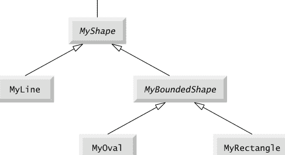

**图 10.18** 带有 MyBoundedShape 的 Shape 层次结构。

### 10.13 总结

本章介绍了多态性——在类层次结构中处理共享相同父类的对象的能力，就像它们都是父类对象一样。我们讨论了多态性如何使系统具有扩展性和维护性，然后演示了如何使用重写的方法来实现多态行为。我们引入了抽象类，它允许你定义一个合适的父类，供其他类继承。你学到抽象类可以声明抽象方法，子类必须实现这些方法才能成为具体类，并且程序可以使用抽象类的变量来多态地调用子类对抽象方法的实现。你学习了如何在执行时确定对象的类型。最后，本章讨论了声明和实现接口，作为一种可能不同的类实现公共功能的方法，使得类的对象能够以多态的方式处理。

你应该熟悉类、对象、封装、继承、接口和多态性——这些是面向对象编程的核心方面。

在下一章中，你将学习异常，它有助于处理程序执行期间的错误。异常处理提供了更健壮的程序。

## 10.1 节 引言

- 多态性（第 388 页）允许我们编写处理共享相同父类的对象的程序，就像它们都是父类对象一样：这可以简化编程。
- 通过多态性，我们可以设计并实现易扩展的系统。程序中必须为了适应新类而修改的部分，只有那些需要直接了解你添加到层次结构中的新类的那些部分。

## 10.3 节 演示多态行为

- 当编译器遇到通过变量进行的方法调用时，它会通过检查变量的类类型来确定该方法是否可以调用。如果类包含适当的方法声明（或继承了它），则该调用被编译。在执行时，变量所引用的对象的类型决定了实际使用的方法。

## 10.4 节 抽象类和方法

- 抽象类（第 393 页）不能用于实例化对象，因为它们是不完整的。
- 抽象类的主要目的是提供一个合适的父类，供其他类继承，从而共享一个公共分母。
- 用于实例化的类是具体类（第 394 页）。它们提供了所声明的每个方法的实现（或这些实现是继承来的）。
- 程序员经常编写只使用抽象类（第 394 页）的客户端代码，以减少代码对特定子类类型的依赖。
- 抽象类有时包含层次结构的多个级别。
- 抽象类通常包含一个或多个抽象方法（第 394 页）。
- 抽象方法不提供实现。
- 包含任何抽象方法的类必须声明为抽象类（第 394 页）。每个具体子类必须提供每个抽象方法的实现。
- 构造函数和静态方法不能声明为抽象。
- 抽象变量可以持有任何具体类对象的引用。程序通常使用此类变量多态地操作对象。
- 多态性对于实现分层系统特别有效。

## 10.5 节 案例研究：使用多态性的工资系统

- 层次结构设计可以通过在父类中包含抽象方法来设计实现。
- 大多数调用在执行时解析，基于对象的类型。这一过程被称为动态绑定（第 409 页）或后期绑定。
- 父类变量可以用于调用声明在子类的方法。
- `instanceof` 运算符（第 409 页）确定对象是否具有特定的继承关系。
- Java 中的每个对象都知道自己的类，并可以通过 `getClass`（第 410 页）访问它。
- 继承关系仅适用于子类和其父类之间，反之则不然。

## 10.7 节 Final 方法和类

- 父类中声明为 `final`（第 411 页）的方法不能在子类中重写。
- 声明为私有的方法是隐式的 `final` 方法，因为你无法在子类中重写它们。
- 声明为 `static` 的方法是隐式的 `final`。
- `final` 方法的声明永远不会改变，因此子类使用相同的实现，对 `final` 方法的调用在编译时解析——这被称为静态绑定（第 412 页）。
- 编译器通过移除对方法的调用并在每个方法调用处内联代码来优化程序。
- 声明为 `final` 的类不能扩展（第 412 页）。
- `final` 类中的所有方法都是隐式的 `final`。

## 10.9 节 创建和使用接口

- 接口（第 413 页）指定允许的操作，但不指定如何执行。
- Java 接口描述了可以在对象上调用的方法集。
- 接口声明以 `interface` 关键字（第 413 页）开始。
- 所有成员必须是公共的，接口不允许指定任何实现细节，例如具体的方法和实例变量。
- 接口中声明的所有方法都是隐式的 `public abstract` 方法，所有字段都是隐式的 `public static final`。
- 要使用接口，类必须指定它实现了（`implements`，第 413 页）该接口，并必须按照接口声明中的签名声明每个方法。没有实现所有接口方法的类必须声明为抽象类。
- 实现接口就像与编译器签了一份合同，声明：“我将声明接口指定的所有方法，或者我将调用我的类。”
- 接口通常用于迥不同的（即不相关的）类共享公共方法和对象。不相关类的对象可以以多态的方式处理——实现相同接口的类的对象可以响应相同的方法调用。
- 当没有可以继承的默认实现时，接口通常被用来替代抽象类——即没有实例变量，也没有默认方法的实现。
- 与公有抽象类一样，接口通常是公共类型，因此它们通常被声明在与接口同名且以 `.java` 扩展结尾的独立文件中。
- Java 不允许子类继承多个父类，但它允许一个类继承一个父类并实现多个接口。
- 实现多个接口的类的所有对象与每个实现的类型都具有“是一个”（is-a）的关系。
- 接口可以声明常量。这些常量隐式地是公有的、静态（`static`）且最终（`final`）的。

## 10.10 节 Java 8 SE 接口

- Java 8 中，接口可以声明默认方法（`default methods`）即具有具体实现的公共方法，指定了如何执行特定操作。
- 当一个类实现接口时，如果该类没有重写这些方法，则它将接收接口的默认具体实现。
- 要在接口中声明默认方法，只需在方法的返回类型之前放置关键字 `default` 并提供完整的方法体即可。
- 当你用默认方法增强接口时——任何实现原始接口的类都不会破坏——它们只会简单接收默认方法的实现。
- 通过默认方法，你可以在接口（而不是抽象类）中声明公共方法的实现，这为你设计类时提供了更多的灵活性。
- 从 Java 8 SE 开始，任何只包含一个方法（公有或静态）的接口被称为函数式接口（`functional interface`）。在 Java API 中有很多此类接口。
- 函数式接口广泛应用于 Java 8 SE 的 Lambda 表达式功能。正如你将看到的，Lambda 表达式提供了创建匿名方法的简写记法。

## 自测复习题

### 10.1 为下列陈述填空空白：

a) 如果一个类包含至少一个抽象方法，它就是一个 (n) 类。
b) 可以实例化对象的类是 (n) 类。
c) (n) 涉及使用父类来调用父类和子类对象上的方法，允许你进行“泛化编程”。
d) 既不是抽象的又未提供实现的方法必须使用关键字 (n) 进行声明。
e) 将父类引用强制转换为子类变量是 (n)。

判断下列陈述的对错。如果错误，请解释原因。

a) 抽象类中的所有方法都必须声明为抽象方法。
b) 不允许通过子类变量调用仅限子类的方法。
c) 如果子类声明了一个抽象方法，则子类必须实现该方法。
d) 实现接口的类的对象可以被视为该接口类型的对象。

### 10.3 (Java 8 接口) 为下列陈述填空空白：

a) 在 Java 8 SE 中，接口可以声明 (n)——即具有具体实现的公共方法，指定了如何执行特定操作。
b) 从 Java 8 SE 开始，接口现在可以包含 (n) 辅助方法。
c) 从 Java 8 SE 开始，任何只包含一个方法的接口被称为 (n)。

## 自测复习题答案

**10.1** a) abstract (抽象的). b) concrete (具体的). c) Polymorphism (多态). d) abstract (抽象的). e) downcasting (向下转换).

**10.2** a) 错误。抽象类可以包含带有实现的方法和抽象方法。b) 错误。不允许使用父类变量调用仅限子类的方法。c) 错误。只有具体的子类必须实现该方法。d) 正确。

**10.3** a) default methods (默认方法). b) static (静态). c) functional interface (函数式接口).

## 练习题

**10.4** 多态如何使你能够“泛化编程”而非“具体化编程”？讨论“泛化编程”的关键优势。

**10.5** 什么是抽象方法？描述在什么情况下使用抽象方法是合适的。

**10.6** 多态如何促进扩展性？

**10.7** 讨论三种将父类和子类引用赋值给子类和子类类型变量的方法。

**10.8** 比较并对比抽象类和接口。你为什么要使用抽象类？为什么要使用接口？

**10.9** (Java SE8 接口) 解释默认方法如何允许你向现有接口添加新方法，而不会破坏实现了原始接口的类。

**10.10** (Java SE8 接口) 什么是函数式接口？

**10.11** (薪资系统修改) 修改图 10.4–10.9 中的薪资系统，包含私有实例变量 `birthDate`。在 `Employee` 类中添加私有实例变量 `birthDate`。使用图 8 中的 `Date` 类来表示雇主的生日。添加 `get` 方法来存储 `Date` 类。假设薪资每月处理一次。在循环中，创建一个 `Employee` 变量数组以存储各种对象的引用。在循环中，计算每个 `Employee` 的薪资（通过多态性），并在员工生日当月的薪资金额中增加 $100.00 的奖金。

**10.13** (项目：形状层次结构) 实现图 9.3 中的 `Shape` 层次结构。每个 `TwoDimensionalShape` 都应该有一个 `getArea` 方法来计算二维形状的面积。每个 `ThreeDimensionalShape` 都应该有 `getArea` 和 `getVolume` 方法来计算面积和体积。创建一个程序遍历形状数组，判断每个形状是 `TwoDimensionalShape` 还是 `ThreeDimensionalShape`。如果是 `TwoDimensionalShape`，则显示其面积；如果是 `ThreeDimensionalShape`，则显示其面积和体积。

**10.12** (原文中缺失，可能位于 10.11 和 10.13 之间)

# 第 11 章 异常处理：深入探讨


尝试一个方法并运行它是常识。如果失败了，坦诚地承认并尝试另一个。但最重要的是，去尝试。

—富兰林·罗斯福

> 哦！抛弃它最糟糕的部分，
> 用剩下的另一半
> 过更纯洁的生活。
> —威廉·莎士比亚

> 如果他们往前跑却不看路，我得得从某个地方钻出来抓住他们。
> —杰罗姆·大卫·塞林格

## 目标

在本章中，你将：

- 学习什么是异常以及如何处理它们。
- 学习何时使用异常处理。
- 使用 `try` 块来界定可能发生异常的代码。
- 使用 `throw` 指明问题。
- 使用 `catch` 块指定异常处理器。
- 使用 `finally` 块释放资源。
- 理解异常类层次结构。
- 创建自定义异常。

## 11.1 引言

正如你从第 6 章所知，异常是程序执行过程中发生问题的指示。异常处理使你能够创建可以解决（或处理）异常的应用程序。在许多情况下，处理异常允许程序像没有遇到任何问题一样继续运行。本章介绍的功能帮助你编写健壮且具有容错能力的程序，这些程序可以处理问题并优雅地继续或终止。Java 异常处理部分基于 Andrew Koenig 和 Bjarne Stroustrup 的工作。

首先，我们通过处理方法尝试将整数除以零时发生的异常，演示基本的异常处理技术。接下来，我们介绍了 Java 异常类层次结构顶部的类。正如你将看到的，只有直接或间接继承 `Throwable`（java 包）的类才能用于异常处理。然后，我们展示了如何使用链异常——当你调用一个指示异常的方法时，你可以抛出另一个并将原始异常链到新异常上。这允许你向原始异常添加特定于应用程序的信息。接下来，我们介绍了前置条件和后置条件，它们分别在方法被调用和返回时必须为真。然后我们介绍了断言，你可以在开发时使用断言来帮助调试代码。我们还讨论了 Java SE 7 中引入的两个异常处理功能：用一个处理器捕获多个异常，以及 `try-with-resources` 语句，它会在 `try` 块中使用资源后自动释放资源。


# 本章重点关注异常处理概念，并提供了几个演示各种功能的机械化示例

正如你在后续章节中将看到的，许多 Java API 都会抛出我们在代码中处理的异常。图 11.1 显示了你已经看到的一些异常类型以及你将学习的内容。

> A. Koenig and B. Stroustrup, "Exception Handling for C++ (revised)," Proceedings of the Usenix C++ Conference, pp. 149–176, San Francisco, April 1990.

## 11.2 示例：无异常处理的除以零

| 章节 | 使用的异常示例 |
| :--- | :--- |
| 第 6 章 | `ArrayIndexOutOfBoundsException` |
| 第 8–10 章 | `IllegalArgumentException` |
| 第 11 章 | `ArithmeticException`, `InputMismatchException` |
| 第 15 章 | `SecurityException`, `FileNotFoundException`, `IOException`, `ClassNotFoundException`, `IllegalStateException`, `FormatterClosedException`, `NoSuchElementException` |
| 第 16 章 | `ClassCastException`, `UnsupportedOperationException`, `NullPointerException`, 自定义异常类型 |
| 第 20 章 | `ClassCastException`, 自定义异常类型 |
| 第 21 章 | `IllegalArgumentException`, 自定义异常类型 |
| 第 23 章 | `InterruptedException`, `IllegalMonitorStateException`, `ExecutionException`, `CancellationException` |
| 第 28 章 | `MalformedURLException`, `EOFException`, `SocketException`, `InterruptedException`, `UnknownHostException` |
| 第 24 章 | `SQLException`, `IllegalStateException`, `PatternSyntaxException` |
| 第 31 章 | `SQLException` |

**图 11.1** | 你将在本书书中看到的各种异常类型

我们首先演示当不使用异常处理的应用程序中出现错误时会发生什么。图 11.2 提示用户输入两个整数并返回一个 `int` 结果。在这个示例中，你会看到当程序检测到问题且无法处理时，异常会被抛出（即由方法抛出）。

```java
// Fig. 11.2: DivideByZeroNoExceptionHandling.java
// 无异常处理的整数除法。
import java.util.Scanner;

public class DivideByZeroNoHandling
{
    // 演示抛出异常
    public static int quotient(int numerator, int denominator)
    {
        return numerator / denominator; // 可能除以零
    }

    public static void main(String[] args)
    {
        Scanner scanner = new Scanner(System.in);
        System.out.print("Please enter an integer numerator: ");
        int numerator = scanner.nextInt();
        System.out.print("Please enter an integer denominator: ");
        int denominator = scanner.nextInt();
        int result = quotient(numerator, denominator);
        System.out.printf("\nResult: %d / %d = %d%n", numerator, denominator, result);
    }
}
```

**图 11.2** | 无异常处理的整数除法。（部分 I/2）

## 第二章 异常处理：深入探讨

```java
17 System.out.print("Please enter an integer numerator: ");
18 numerator = scanner.nextInt();
19 System.out.print("Please enter an integer denominator: ");
20 denominator = scanner.nextInt();
```

```java
22 int result = quotient(numerator, denominator);
23 System.out.printf("\nResult: %d / %d = %d%n", numerator, denominator, result);
```

**图 11.2** | 无异常处理的整数除法。（部分 2/2）

# 栈回溯

11.2 中的第一个示例执行显示了成功的除法。在第二次执行中，用户输入 0 作为分母。针对这种无效输入，系统显示了多行信息。这些信息被称为栈回溯，它包含了异常名称（`java.lang.ArithmeticException`）以及一个描述性消息，指示了发生的问题以及发生时的调用栈（即调用链）。这有助于你调试程序。

# ArithmeticException 的栈回溯

第一行指定了发生了 `ArithmeticException`。异常名称后的文本（"/ zero"）表明该异常是由于尝试除以零引起的。Java 不允许整数算术中的除以零。当这种情况发生时，Java 会抛出 `ArithmeticException`。`ArithmeticExceptions` 可以产生

## 11.3 算术异常与不匹配异常

对于许多不同的问题，额外的数据（“除以零”）提供了更具体的信息。Java 允许使用浮点值进行除零操作。此类计算会导致正无穷或负无穷值，它们在 Java 中被表示为浮点值（但显示为 Infinity 或 -Infinity）。如果 0.0 除以 0.0，结果为 NaN（不是数字），它在 Java 中也表示为浮点值（但显示为 NaN）。如果你需要将浮点值与 NaN 进行比较，请使用 `Float` 的 `isNaN` 方法（针对 float）或 `Double` 类的 `isNaN` 方法（针对 double 值）。`Float` 和 `Double` 类位于 `java.lang` 包中。

从堆栈跟踪的最后开始，我们看到异常在方法 `name` 的第 22 行被检测到。堆栈跟踪的每一行包含类和方法（例如 `DivideByZeroExceptionHandler.main`），后面跟着是：22。向上移动堆栈跟踪，我们看到异常发生在 `quotient` 方法的第 10 行。调用链的顶行表示该线程——即异常发生的初始点。此异常的抛出点在 `quotient` 方法的第 10 行。

### InputMismatchException 的堆栈跟踪

在第三次执行中，输入字符串 "hello" 作为分母。再次显示了堆栈跟踪。这告诉我们发生了一个 `InputMismatchException`（包 `java.util`）。我们之前的入门示例中的输入值假设用户会提供一个整数值。然而，用户有时会犯错并输入非整数值。当 `Scanner.nextInt()` 遇到一个不代表有效整数的字符串时，就会发生 `InputMismatchException`。从堆栈跟踪的结尾开始，我们看到异常在方法 `name` 的第 20 行被检测到。向上移动堆栈跟踪，我们看到异常发生在 `nextInt` 方法中。注意，在文件名和行号的地方，我们提供的是文本 `Source`。这意味着所谓的调试符号提供的该方法类的类名和行号信息对 JVM 是不可用的——这在 Java API 类中通常是如此。许多 IDE 拥有 Java API 源代码，并会在堆栈跟踪中显示文件名和行号。

### 程序终止

在 11.2 的执行过程中，当发生异常并显示堆栈跟踪时，程序也会退出。这在 Java 中并不会发生。有时在异常发生并打印了堆栈跟踪后，程序可能仍继续运行。在这种情况下，应用程序可能会产生意外的结果。例如，图形用户界面（GUI）应用程序通常会继续执行。在 11.2 中，两种异常都在 `name` 方法中被检测到。在接下来的示例中，我们将看到如何处理这些异常，以便让程序能够正常完成。

## 11.3 示例：处理 ArithmeticExceptions 和 InputMismatchExceptions

11.3 中的应用程序基于 11.2，使用异常处理来处理任何产生的 `ArithmeticException` 和 `InputMismatchException`。应用程序提示用户输入两个整数，并将它们传递给方法 `quotient`，该方法计算商并返回 `int` 结果。此版本的应用程序使用异常处理，这样如果用户出错，程序就会捕获并处理（即应对）——在这种情况下，允许用户重新输入。

```java
// Fig. 11.3: DivideByZeroExceptionHandling.java
// Handling ArithmeticExceptions and InputMismatchExceptions;
// import java.util.InputMismatchException;
// import java.util.Scanner;

public class DivideByZeroExceptionHandling {
{
    // 展示在发生除以零时抛出异常
    public static int quotient(int numerator, int denominator)
    throws ArithmeticException {
        return numerator / denominator; // 可能发生除以零
    }

    public static void main(String[] args) {
        Scanner scanner = new Scanner(System.in);
        boolean continueLoop = true; // 决定是否更多输入
        do {
            try // 读取两个数字并计算商
                System.out.print("Please enter an integer numerator: ");
                int numerator = scanner.nextInt();
                System.out.print("Please enter an integer denominator: ");
                int denominator = scanner.nextInt();
                int result = quotient(numerator, denominator);
                System.out.printf("%nResult: %d / %d = %d\n", numerator, denominator, result);
                continueLoop = false; // 输入成功，循环
            } catch (InputMismatchException inputMismatchException) {
                System.err.printf("%nException: %s\n", inputMismatchException);
                scanner.next(); // 丢弃输入以便用户重试
                System.out.printf("You must enter integers. Please try again.%n\n");
            } catch (ArithmeticException arithmeticException) {
                System.err.printf("%nException: %s\n", arithmeticException);
                System.out.printf("Zero is an invalid denominator. Please try again.%n\n");
            } while (continueLoop);
        }
    } // 类 DivideByZeroExceptionHandling 结束
}
```

**图 11.3** 处理 ArithmeticExceptions 和 InputMismatchExceptions。（2 部分中的第 1 部分）。

```
Please enter an integer numerator: 100
Please enter an integer denominator: 7

Result: 100 / 7 = 14
```

```
Please enter an integer numerator: 100
Please enter an integer denominator: 0

Exception: java.lang.ArithmeticException: / by zero
Zero is an invalid denominator. Please try again.

Please enter an integer numerator: 100
Please enter an integer denominator: 7

Result: 100 / 7 = 14
```

```
Please enter an integer numerator: 100
Please enter an integer denominator: hello

Exception: java.util.InputMismatchException: No Int "hello"
You must enter integers. Please try again.
```

**图 11.3** 处理 ArithmeticExceptions 和 InputMismatchExceptions。（2 部分中的第 2 部分）。

在第三次执行中，输入字符串 "hello" 作为分母。再次显示了堆栈跟踪。这告诉我们发生了一个 `InputMismatchException`（包 `java.util`）。我们之前的入门示例中的输入值假设用户会提供一个整数值。然而，用户有时会犯错并输入非整数值。当 `Scanner.nextInt()` 遇到一个不代表有效整数的字符串时，就会发生 `InputMismatchException`。从堆栈跟踪的结尾开始，我们看到异常在方法 `name` 的第 20 行被检测到。向上移动堆栈跟踪，我们看到异常发生在 `nextInt` 方法中。注意，在文件名和行号的地方，我们提供的是文本 `Source`。这意味着所谓的调试符号提供的该方法类的类名和行号信息对 JVM 是不可用的——这在 Java API 类中通常是如此。许多 IDE 拥有 Java API 源代码，并会在堆栈跟踪中显示文件名和行号。

在 11.2 的执行过程中，当发生异常并显示堆栈跟踪时，程序也会退出。这在 Java 中并不会发生。有时在异常发生并打印了堆栈跟踪后，程序可能仍继续运行。在这种情况下，应用程序可能会产生意外的结果。例如，图形用户界面（GUI）应用程序通常会继续执行。在 11.2 中，两种异常都在 `name` 方法中被检测到。在接下来的示例中，我们将看到如何处理这些异常，以便让程序能够正常完成。

### 捕获异常

至少一个 `catch` 块或 `finally` 块（11.6 节讨论）必须紧随 `try` 块。每个 `catch` 块在括号中指定一个异常参数来标识异常处理器。当 `try` 块发生异常时，执行的是第一个类型匹配的 `catch` 块（catch 块中的类型与异常类型完全匹配，或是其直接或间接父类）。参数名称允许 `catch` 块与异常对象交互——例如调用 `toString` 方法（如第 37 和 43 行所示），提供异常的基本信息。我们使用 `System.err`（标准错误流）输出错误消息。默认情况下，`System.err` 的打印方式类似于 `System.out`，将数据显示到命令行提示符。

第一个 `catch` 块的第 38 行调用了 `Scanner` 方法 `nextLine()`。因为发生了 `InputMismatchException`，`nextInt()` 方法从未成功读取用户的数据——所以我们通过调用 `nextLine()` 读取。我们不对输入点进行任何操作，因为我们知道它是无效的。每个 `catch` 块显示错误消息并要求用户重试。在任何 `catch` 块结束后，用户将再次提示输入。我们很快将深入探讨异常处理中这种控制流的工作原理。

## 11.3 算术异常与输入不匹配异常 441

### 多捕获 (Multi-catch)

try 块后面紧跟几个 catch 块来处理不同类型的异常是比较常见的。如果多个 catch 块的体体相同，你可以使用多捕获功能（Java SE 7 中引入）在一个单个 catch 处理器中捕获这些异常类型并执行相同的任务。多捕获的语法如下：


```
catch (Type1 | Type2 | Type3 e)
```

每个异常类型都用竖线 (`|`) 与其他类型隔开。之前的代码行表示这些类型中的任何一种（或其子类）都可以在异常处理器中捕获。多捕获中可以指定任意数量的 `Throwable` 类型。

### 未捕获异常

未捕获的异常是指没有匹配的 `catch` 块的异常。你在图 11.2 的第二次和第三次输出中看到了未捕获的异常。当第三个示例发生异常时，程序提前终止（在显示异常的堆栈跟踪后）。这并不总是由未捕获的异常导致的。Java 使用程序执行的“多线程”模型——每个线程都是一个并发活动。一个程序可以有很多个线程。如果程序只有一个线程，未捕获的异常会导致程序终止。如果程序有多个线程，未捕获的异常只会终止发生异常的那个线程。但在某些程序中，线程可能依赖于其他线程，如果一个线程终止，可能会对程序的其余部分产生不利影响。第 23 章“并发”将深入讨论这些问题。

### 异常处理的终止模型

如果在 `try` 块中发生异常（例如由于图 11.3 第 25 行代码抛出的 `InputMismatchException`），`try` 块将立即终止，程序控制转移到后续中异常类型与抛出的异常类型匹配的**第一个** `catch` 块中。在图 11.3 中，第一个 `catch` 块捕获 `InputMismatchException`（当输入无效输入时发生），第二个块捕获 `ArithmeticException`（当尝试除以 0 时发生）。在异常被处理后，程序控制不会返回到 `try` 块，因为 `try` 块已经过期（其局部变量已经丢失）。控制从最后一个 `catch` 块继续恢复。这被称为异常处理的终止模型。某些语言使用异常处理的恢复模型，在异常被处理后，控制将从抛出点之后立即恢复。

注意，我们根据其类型为异常参数（`InputMismatchException` 和 `ArithmeticException`）命名。Java 程序员通常简单地使用 `e` 作为异常参数的名称。

在执行 `catch` 块后，该程序的控制流将继续到最后一个 `catch` 块之后的语句（在本例中为第 48 行）。`while` 语句中的条件为真（初始值为 `true`），因此控制返回到循环开头并提示用户输入。该控制语句将一直持续到输入有效输入为止。此时，程序控制到达第 32 行，该将 `false` 赋值给变量 `continueLoop`。`try` 块终止。如果 `try` 块中没有抛出异常，将跳过 `catch` 块，并继续执行 `catch` 块后的第一个语句（我们将在第 11.6 节讨论 `finally` 块时学习另一种可能性）。现在 `do...while` 循环的条件为假，`main` 方法结束。

`try` 块及其对应的 `catch` 块和 `finally` 块构成了一个 `try` 语句。不要混淆“try 块”（try block）和“try 语句”（try statement）这两个术语——后者包含了 `try` 块以及随后的 `catch` 块和/或 `finally`。

与任何其他代码块一样，当 `try` 块终止时，块中定义的局部变量将超出作用范围且无法访问；因此，`try` 块的局部变量在对应的 `catch` 块中是不可见的。当一个块终止时，在 `catch` 块中定义的局部变量（包括该 `catch` 块的异常参数）也会超出作用范围并销毁。`try` 语句中任何剩余的 `catch` 块将被忽略，执行从 `try...catch` 之后的第一行代码恢复——如果存在 `finally` 块，则从那里开始。

## 使用 throws 子句

在 `quotient` 方法（图 11.3，第 9–13 行）中，第 10 行是一个 `throws` 子句。它指定了方法在发生问题时可能抛出的异常。该子句位于方法参数列表之后、方法体之前，包含用逗号分隔的异常类型列表。此类异常可能由方法体中的语句或从那里调用的方法抛出。我们添加 `throws` 子句表示该方法可能会抛出 `ArithmeticException`。`quotient` 方法的调用者会被告知该方法可能会抛出 `ArithmeticException`。某些异常类型（如 `ArithmeticException`）不需要列在 `throws` 子句中。对于列出的类型，方法可以抛出与 `throws` 子句中列出的类具有 is-a 关系的异常。你将在第 15 节中学习更多信息。

## 错误预防技巧 II.1


> 在程序中使用方法之前，阅读该方法的 API 文档。文档指定了方法抛出的异常（如果有），并指示了为什么会发生此类异常。接下来，阅读指定异常类的 API 文档。异常类通常包含此类异常发生的可能原因。最后，用于处理你程序中的异常。

当执行第 12 行时，如果分母为 0，JVM 会抛出 `ArithmeticException`。该对象将被第 42–47 行的 `catch` 块捕获，该块通过隐式调用异常的 `toString` 方法显示对象的的基本信息，然后要求用户重试。

如果分母不为 0，`quotient` 方法执行除法并将结果返回到 `try` 块中调用 `quotient` 的点（第 29 行）。第 30–31 行显示计算结果，第 32 行将 `continueLoop` 设置为 `false`。在这种情况下，`try` 块成功完成，因此程序跳过 `catch` 块和第 48 行的条件，并且方法正常完成执行。

当抛出 `ArithmeticException` 时，`quotient` 终止且不返回值，且 `quotient` 中引用对象的局部变量也会被销毁。如果对这些对象没有其他引用，这些对象将被标记为待垃圾回收。此外，当发生异常时，调用 `quotient` 的 `try` 块会在第 30–32 行之前终止。在这里，如果在抛出异常之前在 `try` 块中创建了局部变量，这些变量也将超出作用范围。

## 11.4 何时使用异常处理

异常处理设计用于处理同步错误，这些错误发生在运行时。常见的例子是索引越界、算术溢出、除以零、无效方法参数和线程中断（我们在第 23 章可见）。异常处理并非用于处理异步事件（例如 IO 完成、网络消息到达、鼠标点击和击键），这些事件与程序的控制流并行且独立发生。


在设计之初就将异常处理和错误恢复策略纳入你的系统中——在系统实现后再加入这些是困难的。


异常处理为检测和从错误提供了一种简单、统一的技术。这有助于协作大型项目的程序员理解彼此的错误代码。


## 11.5 异常层次结构

所有异常类直接或间接继承自 `Exception` 类，形成继承层次结构。你可以用自己的异常类扩展此层次结构。

11.4 显示了 `Throwable` 类（`Object` 的子类）层次结构的一小部分，只有 `Throwable` 对象可以用于异常处理机制。`Throwable` 类有两个直接子类：`Exception` 和 `Error`。`Exception` 类及其子类（如 `RuntimeException` 位于 `java.lang`， `IOException` 位于 `java.io`）代表 Java 程序中发生的异常情况并可以被应用程序捕获。`Error` 类及其子类代表 JVM 中发生的异常情况。大多数 `Error` 频繁发生且不应被应用程序捕获。

# 第二章 异常处理：深度解析

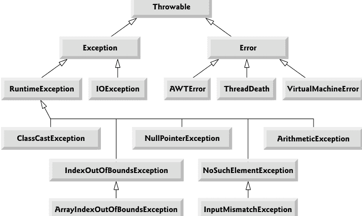

**图 11.4** | `Throwable` 类继承层次结构的一部分。

### 检查异常与未检查异常

Java 将异常分为已检查异常和未检查异常。这种区分非常重要，因为 Java 编译器对*已检查*异常强制执行特殊要求（后文将讨论）。异常的类型决定了它是已检查的还是未检查的。

#### RuntimeException 是未检查异常

所有 `RuntimeException`（`java.lang` 包）的直接或间接子类的异常类型都是未检查异常。这些异常通常由程序代码中的缺陷引起。未检查异常的示例包括：

- `ArrayIndexOutOfBoundsException`（在第 6 章讨论）——可以通过确保数组索引始终大于等于 0 且小于数组长度来避免此异常。
- `ArithmeticException`（如图 11.3所示）——可以通过在执行计算之前检查分母以确定其是否为 0，从而避免除以零时发生的 `ArithmeticException`。

直接或间接继承自 `Error` 类（图 11.4）的类都是未检查的，因为 `Error` 是如此严重的问题，程序不应该尝试处理它们。

#### 已检查异常

所有继承自 `Exception` 类但没有直接或间接继承自 `RuntimeException` 类的类都被视为*已检查*异常。此类异常通常由程序无法控制的条件引起——例如，在文件处理中，如果文件不存在，程序无法打开文件。

## 编译器与已检查异常

编译器会检查每个方法和方法声明，以确定该方法是否抛出了已检查异常。如果是，编译器将验证该已检查异常是否被捕获或在 `throws` 子句中声明——这被称为“捕获或声明”（catch-or-declare）要求。我们将在接下来的示例中展示如何检查或声明已检查异常。回想第 11.3 节，`throws` 子句指定了方法抛出的异常。此类异常不在方法体内部被捕获。为了满足“捕获或声明”要求，产生异常的代码必须封装在 `try` 块中，并且必须为已检查异常类型（或其一个子类）提供处理程序。为了满足“捕获或声明”中的声明部分，包含异常的方法必须在方法体之前提供其参数列表。如果不满足“捕获或声明”要求，编译器将发出错误信息。它迫使你思考调用抛出已检查异常的方法时可能出现的问题。

> **错误预防提示 11.2**
>
> 你必须处理已检查异常。这比简单忽略它们能产生更健壮的代码。


> **常见编程错误 11.2**
>
> 如果子类方法重写了父类方法，那么子类方法在 `throws` 子句中列出父类方法相同的异常是错误的。然而，子类的 `throws` 子句可以包含父类 `throws` 子句的子集。

> **软件工程观察 11.5**
>
> 如果你的方法调用了其他抛出异常的方法，这些异常必须被捕获或声明。如果异常可以在方法中进行有意义的处理，则方法应该捕获该异常而不是声明它。

## 编译器与未检查异常

与已检查异常不同，Java 编译器不会检查代码来确定未检查异常是否被捕获或声明。未检查异常通常可以通过适当的编码来防止。例如，图 11.3 中 `quotient`（第 9–13 行）抛出的未检查 `ArithmeticException` 可以通过方法在执行除法之前确保分母不为 0 来避免。未检查异常不需要列在方法的 `throws` 子句中——即使列出了，也不要求此类异常必须被应用程序捕获。

> **软件工程观察 11.6**
>
> 编译器不强制执行未检查异常的“捕获或声明”要求；在已知可能发生异常时，提供适当的异常处理代码。例如，程序应该处理 `Integer.parseInt` 抛出的 `NumberFormatException`，尽管 `NumberFormatException` 是 `RuntimeException` 的间接子类（因此是未检查异常）。这使得你的程序更加健壮。


## 捕获子类异常

如果编写了一个 `catch` 处理处理器用于捕获父类异常对象，它也可以捕获该类所有子类的对象。这使得 `catch` 能够多态地处理相关异常。如果这些异常需要不同的处理方式，你可以单独捕获每个子类。

## 只有第一个匹配的 catch 会执行

如果有多个 `catch` 块匹配特定的异常类型，当发生该类型的异常时，只有第一个匹配的 `catch` 会执行。在与某个特定 `try` 关联的两个不同 `catch` 块中捕获相同类型是编译错误。然而，可以有多个 `catch` 块匹配某种异常——即有多个类型与异常类型相同或与其父类相同的块。例如，我们可以在 `ArithmeticException` 的 `catch` 块之后紧跟一个 `Exception` 的 `catch` 块——两者都会匹配 `ArithmeticException`，但只有第一个匹配的 `catch` 会执行。


### 编程错误 11.3

在其他 `catch` 块之前放置父类的异常 `catch` 块是错误的。


### 预防提示 11.3

在父类异常之前捕获子类异常是错误的。


### 软件工程观察 11.7

在其他 `catch` 块之后为父类放置 `catch` 块可以确保捕获子类类型。


## finally 块的执行

无论 `try` 块是否抛出异常，`finally` 块都会执行。如果 `try` 块通过 `return`、`break` 或 `continue` 退出，`finally` 块也会执行。`finally` 不会执行的一种情况是程序通过调用 `System.exit()` 退出。

如果 `catch` 块抛出异常，`finally` 块仍会执行。异常将传递给下一个 `try` 块——通常在调用方法中。

## 在 finally 块中释放资源

由于 `finally` 块总是执行，它通常包含释放资源的代码。假设在 `try` 块中分配了一个资源。如果没有发生异常，将跳过 `catch` 块并进入 `finally` 块，释放该资源。然后执行 `finally` 块之后的第一条语句。如果 `try` 块发生异常，`try` 块将终止。如果程序在相应的 `catch` 块中捕获了异常，它将处理异常，然后 `finally` 块释放资源并执行 `finally` 块之后的第一条语句。如果程序没有捕获异常，`finally` 块仍会释放资源并尝试在调用方法中捕获异常。


> `finally` 块是释放 `try` 块中获取资源（如已打开的文件）的理想位置，这有助于消除内存泄漏。


## 性能提示 11.1

始终在资源不再需要的最早时刻显式释放资源。这使得资源能够尽早被重用，从而提高资源利用率和程序性能。

## finally 块

图 11.5 展示了即使在相应的 `try` 块没有抛出异常，`finally` 块也会执行。该程序包含静态方法（第 6–18 行）、`throwException`（第 21–44 行）和 `doThrow`（第 47–64 行）。`Exception` 和 `doThrow` 方法被声明为静态，因此 `main` 方法无需实例化 `UsingExceptions` 对象即可调用它们。

## 第二章 异常处理：深度解析


```java
// Fig. 11.5: UsingExceptions.java
// try...catch...finally 异常处理机制。
public class UsingExceptions
{
    public static void main(String[] args)
    {
        try {
            throwException();
        }
        catch (Exception exception) // exception thrown by throwException {
            System.err.println("Exception handled in main");
        }
        doesNotThrowException();
    }

    // demonstrate try...catch...finally
    public static void throwException() throws Exception
    {
        try // throw an exception and immediately catch it {
            System.out.println("Method throwException");
            throw new Exception(); // generate exception
        }
        catch (Exception exception) // catch thrown in try {
            System.err.println("Exception handled in method throwException");
            throw exception; // rethrow for further processing
            // code here would not be reached;
        } finally // executes regardless of what occurs in try...catch {
            System.err.println("Finally executed in throwException");
        }
        // code here would not be reached; would cause compilation errors
    }

    // demonstrate finally when no exception occurs
    public static void doesNotThrowException()
    {
        try // try block does not throw an exception {
            System.out.println("Method doesNotThrowException");
        }
    }
}
```

**图 11.5** | try...catch...finally 异常处理机制。（2 部分中的第 1 部分）

```java
catch (Exception exception) // does not execute
{
    System.err.println(exception);
}
finally // executes regardless of what occurs in try...
{
    System.err.println(
        "Finally executed in doesNotThrowException"
    );
} // end class UsingExceptions
```

| MethodException |
| :--- |
| Exception handled in method throwException |
| Finally executed in throwException |
| Exception handled in main |
| Method doesNotThrowException |
| Finally executed in doesNotThrowException |
| End of method doesNotThrowException |

**图 11.5** | try...catch...finally 异常处理机制。（2 部分中的第 2 部分）

`System.out` 和 `System.err` 是流——字节序列。虽然 `System.out`（称为标准输出流）显示程序的输出，但 `System.err`（称为标准错误流）也显示程序的输出。这些流的输出可以被重定向（即：发送到命令行提示符以外的地方，例如文件）。使用两个不同的流允许你将消息与其他输出分开。例如，来自 `System.err` 的数据可以发送到日志文件，而来自 `System.out` 的数据可以显示在屏幕上。为了简单起见，本章将不会重定向 `System.err` 的输出，而是将向命令行提示符显示消息。你将在第 15 章学习更多关于流的知识。

## 使用 `throw` 抛出异常

方法 `main`（图 11.5）开始进入其 `try` 块，并立即调用方法 `throwException`（第 10 行）。方法 `throwException` 抛出了一个 `Exception`。第 26 行的语句是一个 `throw` 语句——它的执行用以指示发生了一个异常。到目前为止，你只通过被调用的方法来捕获异常。你可以使用 `throw` 语句自己抛出异常。就像 Java API 方法抛出的异常一样，这向客户端应用程序指示发生了一个错误。`throw` 语句指定一个要抛出的对象。`throw` 的操作数可以是任何派自 `Throwable` 的类。

## 软件工程观察 11.8


当在任何 `Throwable` 对象上调用 `toString` 时，其生成的 `String` 包含了提供给构造函数的描述性字符串，如果没有提供字符串，则简单地包含类名。

## 软件工程观察 11.9

抛出异常时可以不包含关于所发生问题的信息。在这种情况下，仅仅知道发生了特定类型的异常可能就为处理程序正确处理该问题提供了足够的信息。

## 软件工程观察 11.10

从构造函数抛出异常以指示构造函数参数有效——这防止了对象在无效状态下创建。

## 重新抛出异常

图 11.5 的第 32 行重新抛出了异常。当接收到异常时，如果无法处理该异常或只能部分处理它，就会重新抛出异常。重新抛出异常将处理（或部分处理）推迟到外部语句相关的另一个 `catch` 块。使用 `throw` 关键字重新抛出异常，后跟指向刚刚捕获的对象的引用。异常不能在 `finally` 块中重新抛出，因为 `catch` 块中的异常参数（局部变量）已不存在。

当发生 `throw` 时，外层的 `catch` 块会检测到重新抛出的异常，该 `catch` 块尝试处理它。在这种情况下，外层的 `catch` 块位于 `main` 方法的第 8–11 行。在异常被处理之前，`finally` 块（第 37–40 行）执行。方法 `main` 检测到 `throw` 块中重新抛出的异常并在 `catch` 块（第 12–15 行）中处理它。

接下来，`main` 调用方法 `doesNotThrowException`（第 17 行）。`doesNotThrowException` 的 `try` 块（第 49–52 行）没有抛出异常，因此程序捕获了该块（第 53–56 行），但执行了 `finally` 块。

## 第二章 异常处理：深度解析

```java
// 获取堆栈跟踪信息
StackTraceElement[] traceElements = exception.getStackTrace();
```

```java
System.out.printf("%nStack trace from getStackTrace:%n");
System.out.println("Class:%s\tFile:%s\tLine:%s\tMethod:%s\n");

// 遍历 traceElements 以获取异常描述
for (StackTraceElement element : traceElements) {
    System.out.printf("%s\t", element.getClassName());
    System.out.printf("%s\t", element.getFileName());
    System.out.printf("%s\t", element.getLineNumber());
    System.out.printf("%s\n", element.getMethodName());
}
// main结束
```

```java
// 调用 method2; 将异常抛回给 main
public static void method1() throws Exception {
    method2();
}

// 调用 method3; 将异常抛回给 method1
public static void method2() throws Exception {
    method3();
}

// 将异常抛回给 method2
public static void method3() throws Exception {
    throw new Exception("Exception thrown in method3");
}
// UsingExceptions 类结束
```

在 `method3` 中抛出异常

```text
java.lang.Exception: Exception thrown in method3
at UsingExceptions.method3(UsingExceptions.java:49)
at UsingExceptions.method2(UsingExceptions.java:43)
at UsingExceptions.method1(UsingExceptions.java:37)
at UsingExceptions.main(UsingExceptions.java:10)
```

| 类 | 行号 | 方法 |
|---|---|---|
| UsingExceptions.java | 49 | method3 |
| UsingExceptions.java | 43 | method2 |
| UsingExceptions.java | 37 | method1 |
| UsingExceptions.java | 10 | main |

**图 11.6** 堆栈回溯和从异常对象中获取数据。（2 部分，共 2 部分。）

## 从异常对象中获取数据

所有派自 `Throwable` 类的异常都拥有 `printStackTrace` 方法，该方法将堆栈跟踪输出到标准错误流（第 11.2 节讨论过）。这在测试和调试中通常非常有帮助。`Throwable` 类还提供了 `getStackTrace` 方法，用于检索可能由 `printStackTrace` 打印的堆栈跟踪信息。`Throwable` 类的 `getMessage` 方法返回异常中的描述性字符串。

> **错误预防提示 11.7**
>
> 应用程序中未被捕获的异常会导致 Java 默认异常处理程序运行。这会显示异常的消息，即一个指示所发生问题的描述性消息以及一个完整的执行堆栈跟踪。在单线程执行的应用程序中，异常将终止程序。在多线程的应用程序中，导致异常的那个线程将终止。我们将在第 23 章中讨论多线程。

> **错误预防提示 11.8**
>
> `Throwable.toString()`（由 `Throwable` 子类继承）返回一个包含异常类名称和描述性消息的字符串。

11.6（12–31行）中的 `catch` 句程序演示了 `getMessage`、`printStackTrace` 和 `getStackTrace`。如果我们想将堆栈跟踪信息输出到标准错误流以外的地方，可以使用 `getStackTrace` 的信息并将其输入到另一个流，或者使用 `printStackTrace` 方法的重载版本之一。向其他流发送数据将在第 15 章中讨论。

第 14 行调用异常的 `getMessage` 方法获取异常描述。第 15 行调用异常的 `printStackTrace` 方法输出指示异常发生位置的堆栈跟踪。第 18 行调用异常的 `getStackTrace` 方法以 `StackTraceElement` 对象数组的形式获取堆栈跟踪。第 24–30 行获取数组中的每个 `StackTraceElement`，并调用其 `getClassName`、`getFileName`、`getLineNumber` 和 `getMethodName` 方法，分别获取调用的类名、文件名、行号和方法名。

`printStackTrace` 的程序输出遵循以下模式：`className.MethodName(lineNumber)`，其中 `className` 和 `fileName` 表示发生异常的类名和文件名，`lineNumber` 指异常发生在文件中的位置。你在图 11.2 的输出中见过这一点。`StackTraceElement` 允许对异常信息进行自定义处理。将 `printStackTrace` 的输出与从 `StackTraceElement` 创建的输出进行对比，可以发现

> **软件工程观察 11.1**
>
> 有时你可能想通过编写空实体的 `catch` 句程序来忽略异常。在这样做之前，确保该异常没有指示堆栈高层可能需要知道或从中恢复的条件。

## 11.8 链式异常

有时，方法通过抛出一种特定于当前应用程序的不同异常类型来响应异常。如果 `catch` 块抛出一个新异常，原始的-

**图 11.7** | 链式异常。（1 部分，共 2 部分。）

## 11.8 链式异常 455

```java
44    // 将异常抛回给 method2
45    public static void method3() throws Exception
46    {
47        throw new Exception("Exception thrown in method3");
48    }
49 // // UsingChainedExceptions 类结束
```

```text
java.lang.Exception: Exception thrown in method1.java:27
    at UsingChainedExceptions.method3(UsingChainedExceptions.java:10)
    at UsingChainedExceptions.main(UsingChainedExceptions.java:10)
Caused by: java.lang.Exception: Exception thrown in method2
    at UsingChainedExceptions.method2(UsingChainedExceptions.java:40)
    at UsingChainedExceptions.method1(UsingChainedExceptions.java:23)
      ... 1 more
Caused by: java.lang.Exception: Exception thrown in method3
    at UsingChainedExceptions.method3(UsingChainedExceptions.java:47)
    at UsingChainedExceptions.method2(UsingChainedExceptions.java:36)
      ... 2 more
```

**图 11.7** | 链式异常。（2 部分，共 2 部分）

### 程序控制流

程序由四个方法组成——`main`（6–16行）、`method1`（19–29行）、`method2`（32–42行）和 `method3`（45–48行）。第 10 行的 `main` `try` 块调用了 `method1`。第 23 行的 `method1` `try` 块调用了 `method2`。第 36 行的 `method2` `try` 块调用了 `method3`。`method3` 在第 47 行抛出了异常。因为该语句在 `try` 块中，异常被返回给 `method2`。第 36 行的 `method2` `try` 块捕获了异常。第 23 行的 `method1` `try` 块捕获了异常。第 27 行的 `main` `try` 块捕获了异常。程序的输出在第 10 行处显示了异常。

### 程序输出


```text
java.lang.Exception: Exception thrown in method1.java:27
    at UsingChainedExceptions.method3(UsingChainedExceptions.java:10)
    at UsingChainedExceptions.main(UsingChainedExceptions.java:10)
Caused by: java.lang.Exception: Exception thrown in method2
    at UsingChainedExceptions.method2(UsingChainedExceptions.java:40)
    at UsingChainedExceptions.method1(UsingChainedExceptions.java:23)
      ... 1 more
Caused by: Java.lang.Exception: Exception thrown in method3
    at UsingChainedExceptions.method3(UsingChainedExceptions.java:47)
    at UsingChainedExceptions.method2(UsingChainedExceptions.java:36)
      ... 2 more
```

# 11.9 定义新异常类型

大多数 Java 程序员使用现有的 Java 类、第三方供应商和免费提供的类库（通常从互联网下载）来构建 Java 应用程序。这些类的方法在发生问题时通常声明为抛出适当的异常。如果你构建其他程序员使用的类，通常最好定义特定于可能出现问题的异常类。

## 新异常类型必须继承现有类型

新异常类必须继承现有的异常类，以确保该类可以使用异常处理机制。异常类就像任何其他类一样；但典型的异常类包含四个构造函数：

- 一个不接收参数并将默认错误消息字符串传递给父类构造函数
- 一个接收自定义的错误消息字符串并传递给父类构造函数
- 一个接收自定义的错误消息字符串和 `Throwable`（用于链式异常）并将两者都传递给父类构造函数
- 一个接收 `Throwable`（用于链式异常）并将其传递给父类构造函数


> **软件编程实践 11.2**
>
> 将每种严重的运行时故障与命名适当的异常类关联可以提高程序质量。

## 自定义异常示例

在第 21 章“自定义泛型数据结构”中，我们提供了一个自定义异常类的示例。我们声明了一个名为 `List` 的重用类，它能够存储对象引用的列表。如果 `List` 为空，某些对 `List` 执行的操作是不允许的，例如从列表头部或尾部移除项。因此，某些 `List` 方法会抛出 `EmptyListException` 类的异常。

# 11.10 前置条件与后条件


程序员花费大量时间来维护和调试代码。为了方便这些任务并改进整体设计，你可以指定方法执行前后的预期状态。这些状态分别被称为前置条件（preconditions）和后条件（postconditions）。

### 前置条件

当方法被调用时，前置条件必须为真。前置条件描述了对方法参数的约束以及方法在开始执行之前对程序当前状态的任何其他期望。如果不满足前置条件，方法的行为是未定义的——它可能会抛出异常、带有非法值继续执行，或尝试从错误中恢复。如果不满足前置条件，你不应该期望获得一致的行为。

### 后条件

在方法成功返回后，后条件为真。后条件描述了对返回值以及方法可能产生的任何其他副作用的约束。在定义方法时，你应该记录所有的后条件，以便他人知道调用你的方法时可以期待什么，并且你应该确保在前置条件确实满足的情况下，你的方法遵循所有的后条件。

### 不满足前置条件或后条件时抛出异常

当不满足前置条件或后条件时，方法通常会抛出异常。例如，检查 `String` 的 `charAt` 方法，它有一个 `int` 参数——字符串中的索引。对于前置条件，方法 `charAt` 假设索引大于等于 0 且小于字符串的长度。如果满足前置条件，后条件规定该方法将返回字符串中由索引指定位置的字符。否则，方法将抛出 `IndexOutOfBoundsException`。我们相信只要我们满足了前置条件，`charAt` 就满足了它的后条件。我们不需要关心方法在索引处检索字符的细节。

通常，方法的前置条件和后条件是作为其规范的一部分描述的。在设计方法时，你应该在方法声明之前的注释中说明前置条件和后条件。

# 11.11 断言

在实现和调试类时，有时说明方法中某个特定点应该为真的条件是有用的。这些条件被称为断言（assertions），通过在开发期间捕获潜在错误和识别可能的逻辑错误来确保程序的有效性。前置条件和后条件是两种类型的断言。前置条件是关于方法调用时程序状态的断言，而后条件是关于方法完成后状态的断言。

虽然断言可以作为注释陈述以指导你的程序开发，但 Java 包含了两个版本的 `assert` 语句以正确验证断言。`assert` 语句评估一个布尔表达式，如果为假，则抛出 `AssertionError`（`Error` 的子类）。`assert` 语句的第一种形式是：

```java
assert expression;
```

如果 `expression` 为假，则抛出 `AssertionError`。第二种形式是：

```java
assert expression1 : expression2;
```

评估 `expression1`，如果 `expression1` 为假，则抛出以 `expression2` 作为错误消息的 `AssertionError`。

你可以使用断言来程序化地实现前置条件和后条件，或验证任何有助于你确保代码正确运行的其它中间状态。图 11.8 展示了 `assert` 语句。第 11 行提示用户输入 0 到 10 之间的数字，然后第 12 行读取该数字。第 15 行确定输入的数字是否在值范围内。如果数字不在范围内，`assert` 语句将报告错误；否则，程序正常继续。

```java
// Fig. 11.8: AssertTest.java
// 使用 assert 检查值是否在范围内
import java.util.Scanner;

public class AssertTest {
    public static void main(String[] args) {
        Scanner input = new Scanner(System.in);
        System.out.printf("Enter a number between 0 and 10: %d");
        int number = input.nextInt();
        // 断言该值 >= 0 且 <= 10
        assert (number >= 0 && number <= 10) : "bad number: " + number;
        System.out.printf("You entered %d%n", number);
    }
} // end class AssertTest
```

| 输入 | 输出 |
| :--- | :--- |
| Enter a number between 0 and 10: 5 | You entered 5 |
| Enter a number between 0 and 10: 50 | Exception in thread "main" java.lang.AssertionError: bad number: 50 at AssertTest.main(AssertTest.java:15) |

**图 11.8** 使用 assert 检查值是否在范围内。

你主要将断言用于调试和识别应用程序中的逻辑错误。执行程序时，必须显式启用断言，因为它们会降低性能且对程序的用户来说是不必要的。

## 软件工程观察 11.13

用户不应该遇到 `AssertionErrors`——这些应该只在程序开发期间使用。出于此原因，你不应该捕获 `AssertionErrors`。允许程序终止，这样你就可以看到错误信息，定位并修复问题源。你不应该使用 `assert` 来指示生产环境中的运行时问题。

# 11.12 try-with-resources: 自动资源释放

通常，`try-with-resources` 语句通过在使用资源后自动释放资源来简化代码。Java 7 引入了这种形式的 `try-with-resources`：

```java
try (Resource res = init()) {
    // 使用资源
} catch (Exception e) {
    // 处理异常
} finally {
    // 清理
}
```

`Resource` 必须实现 `AutoCloseable` 接口。当 `try` 块完成或发生异常时，会自动调用 `close()` 方法。这确保资源被释放。

要启用断言，请使用 `java` 命令的 `-ea` 命令行选项，例如：

```bash
java -ea AssertTest
```

# 11.13 总结

在本章中，你学习了如何处理异常。你了解了在异常发生时终止程序的终止模型。我们展示了如何使用 `finally` 块进行清理，以及如何使用 `printStackTrace()` 和 `getMessage()` 获取异常信息。接下来，我们展示了如何创建自定义异常类。我们引入了前置条件和后条件以帮助理解方法返回时必须满足的条件。当不满足前置条件或后条件时，方法会抛出异常。我们讨论了 `assert` 语句以及它如何帮助调试程序。特别是我们引入了处理多种异常的多异常捕获以及用于自动释放资源的 `try-with-resources` 语句。在下一章中，我们将深入研究图形用户界面 (GUI)。

## 总结

### 11.1 简介

- 异常是程序执行过程中发生问题的指示。
- 异常处理允许程序员创建异常来解决异常。

### 11.2 示例：未处理异常的除零

- 当方法检测到问题且无法处理时，会抛出异常。
- 异常的堆栈跟踪包含了指示问题发生的异常名称以及在异常发生时的完整方法调用栈。
- 程序中异常被调用的点称为抛出点。

### 11.3 示例：处理 ArithmeticExceptions 和 InputMismatchExceptions

- `try` 块封装了可能抛出异常的代码以及在发生异常时不执行的代码。
- 异常可能抛自 `try` 块中的代码、对其他方法的调用，甚至是由 `try` 块发起的深层方法。
- `catch` 块以 `catch` 关键字和异常参数开头，后跟处理该异常的代码块。当 `try` 块检测到异常时，执行该代码。
- `try` 块后面必须紧跟至少一个 `catch` 块或一个 `finally` 块。
- `catch` 块在括号中指定要处理的异常类型。参数名称允许 `catch` 块与捕获的异常对象进行交互。
- 未捕获异常是在没有匹配的 `catch` 块时发生的异常。如果程序只有一个线程，未捕获异常会导致程序提前终止。否则，发生异常的线程将终止。程序的其余部分将运行，但可能会产生不利结果。

### 11.4 何时使用异常处理

- 异常处理用于同步错误，这类错误发生在语句执行时。
- 异常处理的设计并不是为了处理异步事件，异步事件与程序的控制流并行发生，且独立于控制流。

### 11.5 异常层次结构

- 所有 Java 类都直接或间接继承自 `Object` 类（注：原文“Exception 类”应为笔误，异常体系根为 `Throwable`，但此处保留原文语义不修改内容）。
- 程序员可以使用自己的异常类来扩展 Java 异常层次结构。
- `Throwable` 类是 `Exception` 类的父类，也是所有异常的父类。只有 `Throwable` 对象才能被异常处理机制捕获。
- `Throwable` 有两个子类：`Exception` 和 `Error`。
- `Exception` 类及其子类表示 Java 程序中可能发生的问题，这些问题可以被应用程序捕获。
- `Error` 类及其子类表示会在 Java 运行时系统中发生的问题。`Error` 发生的频率很低，不应该被应用程序捕获。
- Java 将异常分为两大类：检查异常和未检查异常。
- 编译器不确定未检查异常是否被捕获或声明。通过适当的编码可以可能避免未检查异常。
- `RuntimeException` 的子类表示未检查异常。所有继承自 `Exception` 类但未继承自 `RuntimeException` 的异常类型都是检查异常。
- 如果写的 `catch` 块用于捕获父类类型的异常，它也可以捕获该类子类的对象。这允许对相关的异常进行多态处理。

### 11.6 finally 块

- 包含资源的程序必须将资源返回系统，以避免所谓的资源泄漏。释放资源的代码被放在 `finally` 块中。
- `finally` 块是可选的。如果存在，它被放在最后一个 `catch` 块之后。
- 无论相应的 `try` 块或其任何相应的 `catch` 块是否抛出异常，`finally` 块都会执行。
- 如果异常无法被该块的任何 `catch` 处理器捕获，控制将继续到 `finally` 块。然后，异常将传递给下一个外层的 `try` 块。
- 如果 `catch` 块抛出了异常，`finally` 块仍然会执行。然后，异常将传递给下一个外层的 `try` 块。

### 11.7 栈回溯和从异常对象中获取信息

- 当异常被抛出但在特定范围内未被捕获时，调用栈会进行回溯，并尝试在下一个外层的 `try` 块中捕获该异常。
- `Throwable` 类提供了 `printStackTrace` 方法，它输出一个方法调用栈。这在测试和调试中通常很有帮助。
- `Throwable` 类还提供了 `getStackTrace` 方法，用于获取与 `printStackTrace` 打印相同的堆栈跟踪信息。
- `Throwable` 类的 `getMessage` 方法返回异常中的描述性字符串。
- `getStackTrace` 方法以 `StackTraceElement` 对象数组的形式获取堆栈跟踪。每个 `StackTraceElement` 代表栈上的某一次方法调用。
- `StackTraceElement` 方法分别是 `getClassName`、`getLineNumber` 和 `getMethodName`。

### 11.8 链式异常

- 链式异常允许异常对象维护完整的堆栈跟踪信息，提供关于导致当前异常的异常。

### 11.9 声明新异常类型

- 新类必须继承现有的异常类，以确保该类可以用于异常处理机制。

### 11.10 前置条件和后置条件

- 方法的前置条件在方法被调用时必须为真（注：原文“后置条件”应为“前置条件”笔误，此处保留原文不修改内容）。

### 11.11 断言

- 断言有助于识别逻辑错误。
- `assert` 语句允许验证。
- 要在运行时启用断言，请使用 `-ea` 命令。

### 11.12 try-with-resources：自动资源分配

- `try-with-resources` 语句简化了获取资源时的代码编写。
- 每个资源必须是实现 `AutoCloseable` 接口的类对象——此类类具有一个 `close` 方法。

# 自测习题

- 11.1 列出异常的常见示例。
- 11.2 为什么异常特别适合处理错误？
- 11.3 什么是“资源泄漏”？
- 11.4 如果 `try` 块中没有抛出异常，控制是如何进入 `finally` 块的？
- 11.5 给 `catch(ExceptionName)` 的一个主要优势。
- 11.6 应用程序应该捕获 `Error` 吗？
- 11.7 当 `catch` 处理器匹配抛出的异常类型时会发生什么？
- 11.8 如果多个 `catch` 块匹配对象的类型，会发生什么？
- 11.9 为什么程序员会在 `catch` 块中指定父类作为类型？
- 11.10 使用 `finally` 块的原因是什么？
- 11.11 当 `catch` 块抛出 `Exception` 时会发生什么？
- 11.12 `catch` 块中的 `exceptionReference` 语句起什么作用？
- 11.13 当 `try` 块抛出 `Exception` 时，局部引用会发生什么？

# 自测习题答案


- 11.1 内存耗尽、数组索引越界、算术溢出、除以零、无效方法调用。

- 11.2 Java API 类中的方法不太可能满足所有用户所需的错误处理。

- 11.3 如果执行程序在最后一个 `catch` 块之后没有正确释放资源，就会发生“资源泄漏”。如果有 `finally` 块，它会先执行；然后程序执行 `finally` 块。

- 11.4 对应语句的 `catch` 块将被执行，程序从最后一个 `catch` 块之后继续。

- 11.5 一个优势是任何抛出的异常都不会在未被捕获的情况下溜走。你可以处理异常或将其重抛。

- 11.6 `Error` 通常是底层 Java 系统的严重问题；大多数程序不想捕获 `Error`，因为它们无法从中恢复。

- 11.7 这会导致匹配的搜索在下一个外层的 `try` 语句中继续。如果有 `finally` 块，它将在执行到下一个外层 `try` 语句之前执行。如果没有具有匹配 `catch` 块的外层 `try` 语句且异常是已声明的或未检查的，则会打印堆栈并提前终止当前线程。如果异常是检查的但未被捕获或声明，则发生编译错误。

- 11.8 执行 `try` 块之后的第一个匹配 `catch` 块。

## 464 第二章 异常处理：深入探讨

11.9 这允许程序捕获相关类型的异常并以统一的方式对其进行处理。然而，逐个处理子类类型以进行更精确的异常处理通常很有用。

11.10 `finally` 块是释放资源以防止资源泄漏的首选方法。

11.11 首先，如果存在 `finally` 块，控制将传递到那里。然后异常将由与嵌套块关联的 `catch` 块处理（如果存在）。

11.12 在当前 `try` 语句的 `finally` 块执行后，它会重新抛出异常，以便由嵌套 `try` 语句的异常处理器进行处理。

11.13 引用超出作用域。如果引用的对象变得不可达，该对象可以被垃圾回收。

## 练习题

11.14 (异常情况) 列出到为止程序中出现过的各种异常情况。尽可能列出更多额外的异常情况。对于每种情况，描述程序通常如何使用本章讨论的异常处理技术来处理异常。典型异常包括除以零和数组下标越界。

11.15 (异常与构造函数失败) 在本章之前，我们处理构造函数检测到的错误有点别扭。解释为什么异常处理是处理构造函数失败的有效手段。

11.16 (使用超类捕获异常) 使用继承创建一个超类 `ExceptionA` 以及子类 `ExceptionB` 和 `ExceptionC`，其中 `ExceptionB` 继承自 `ExceptionA`，`ExceptionC` 继承自 `ExceptionB`。编写一个程序证明类型 `ExceptionA` 的 `catch` 块可以捕获类型 `ExceptionB` 和 `ExceptionC` 的异常。

11.17 (使用类捕获异常) 这次，定义类 `ExceptionA`（继承自 `Exception`）和 `ExceptionB`（继承自 `Exception`）。在你的程序中，创建抛出异常的 `try` 块。所有异常都应该通过指定类型的 `catch` 块捕获。

11.18 (catch 块的顺序) 编写一个程序证明 `catch` 块的顺序很重要。如果你尝试用子类类型捕获超类异常，编译器将产生错误。

11.19 (构造函数失败) 编写一个显示构造函数提供失败信息的程序。定义类 `SomeClass`，它在构造函数中抛出异常。你的程序尝试创建一个 `SomeClass` 类型的对象并捕获从构造函数抛出的异常。

11.20 (重新抛出异常) 编写一个说明重新抛出异常的程序。定义 `someMethod` 和 `someMethod2` 抛出一个异常。`someMethod` 调用 `someMethod2`，捕获异常并重新抛出。打印此异常的堆栈跟踪。

11.21 (使用外部作用域捕获异常) 编写一个程序，证明带有自己的 `try` 块的方法不需要捕获 `try` 内部生成的每个错误。某些异常可以滑过，并在其他作用域中被处理。

## GUI 组件：第一部分

你认为我可以整天听这些吗？——路易斯·卡罗尔

即使是孩子生活中一个微小的事件也是那个孩子世界的事件，因此是一个世界。——加斯东·巴舍尔

你付了钱，就有了你的选择。

## 目标

在本章中，你将：

- 学习如何使用 Nimbus 视图（look-and-feel）。
- 构建 GUI 并处理由用户交互生成的事件。
- 理解包含 GUI 组件、事件处理类和接口的包。
- 创建和操作按钮、列表、文本字段和面板。
- 处理鼠标事件和键盘事件。
- 使用布局管理器安排 GUI 组件。


## 第 12 章 GUI 组件：第一部分

| 12.1 引言 | 12.11 JComboBox: 使用匿名内部类进行事件处理 |
| :--- | :--- |
| 12.2 Java 的 Nimbus 视图 | 12.12 JList |
| 12.3 基于 GUI 的简单输入/输出 | 12.13 多选择列表 |
| 12.4 Swing 组件概述 | 12.14 鼠标事件处理 |
| 12.5 在窗口中显示文本和图像 | 12.15 适配器类 |
| 12.6 文本字段和嵌套组件事件处理简介 | 12.16 用于鼠标绘制的 JPanel 子类 |
| 12.7 常见 GUI 事件类型和监听器接口 | 12.17 键事件处理 |
| 12.8 事件处理原理 | 12.18 布局管理器简介 |
| 12.9 JButton | 12.18.1 流式布局 (FlowLayout) |
| 12.10 维护状态的按钮 | 12.18.2 边界布局 (BorderLayout) |
| 12.10.1 JCheckBox | 12.18.3 网格布局 (GridLayout) |
| 12.10.2 JRadioButton | 12.19 使用面板管理复杂布局 |
| | 12.20 JTextField |
| | 12.21 总结 |

总结 | 自测练习 | 自测练习答案 | 练习题 | 改变

## 12.1 引言

图形用户界面（GUI）为与应用程序交互提供了一种用户友好的机制。GUI（发音为 "GOO-ee"）赋予应用程序一个独特的“外观和感觉”。GUI 由 GUI 组件构建。这些组件有时被称为控件或小部件（window gadgets 的缩写）。GUI 组件是用户通过鼠标、键盘或其他输入形式与之交互的对象。在本章和第 22 章 GUI 组件：第二部分中，你将学习 `java.swing` 包中的 Swing 组件。我们在书中需要的地方介绍其他 GUI 组件。在第 25 章和在线章节中，你将学习 JavaFX——Java 用于图形、多媒体的最新 API。

> 外观感觉观察 12.1
>
> 为应用程序提供一致、直观的用户界面组件可以让用户对新程序产生熟悉感，从而更快地学习和使用。

## GUI 设计的支持

许多 IDE 提供了设计工具，可以通过鼠标、键盘和拖放以视觉方式指定组件的大小、位置和其他属性。IDE 为你生成 GUI 代码。这极大简化了 GUI，但每个 IDE 生成的方式不同。出于原因，我们手动编写 GUI 代码，正如你在本章的源文件中看到的那样。我们鼓励使用你喜欢的 IDE 视觉化构建每个 GUI。


## 12.2 Java 的 Nimbus 视图 467

示例 GUI：Swing3 应用程序

一个 GUI 示例，考虑图 12.1，它显示了 Swing3 演示程序，JDK 演示和示例下载地址为 `http://www.oracle.com/network/java/downloads/index.html`。这是浏览 Swing 提供的各种组件的良好方法。只需点击左侧 GUI 组件区域中的组件（例如 `JFrame`、`JTabPane` 等），即可在窗口右侧查看该 GUI 组件的演示。每个演示源码都在窗口底部的文本区域中。我们标记了应用程序中的一些 GUI 组件。窗口顶部是标题栏，包含窗口标题。下方是菜单栏，包含菜单（文件和视图）。窗口右上区域有一组按钮——通常，用户点击按钮来执行任务。窗口的 GUI 组件区域有一个组合框：用户可以点击框右侧的箭头从列表中选择项目。菜单、按钮和组合框是应用程序 GUI 的一部分。它们让你能够与应用程序交互。

图 12.1 Swing3 应用程序演示了许多 Java Swing GUI 组件。

通常被称为 GUI 的外观（look-and-feel）。Swing 具有一种名为 Nimbus 的跨平台外观。对于像图 12.1 这样的 GUI 屏幕截图，我们已经配置了系统使用 Nimbus 作为默认外观。你有三种方法可以使用 Nimbus：

- 将其设置为你计算机上运行的所有 Java 应用程序的默认外观。
- 通过向 `java` 命令传递命令行参数，在启动应用程序时将其设置为外观。
- 在你的应用程序中通过编程方式将其设置为外观（参见第 22.6 节）。

除了将 Nimbus 设置为所有 Java 应用程序的默认外观外，你必须在 JDK 安装文件夹和 JRE 安装文件夹的 `lib` 文件夹中各创建一个名为 `swing.properties` 的文本文件。在文件中放入以下代码行：

```
swing.defaultLaf=com.sun.swing.plaf.nimbus.NimbusLookAndFeel
```

除了标准的 JRE 之外，你的 JDK 文件夹中还嵌套了一个 JDK。如果你使用的 IDE 依赖于 JDK，你可能还需要在嵌套 JRE 的 `lib` 文件夹中放置 `swing.properties` 文件。

如果你希望按应用程序单独选择 Nimbus，在运行应用程序时，在 `java` 命令之后应用程序名称之前放置以下命令行参数：

```
-Dswing.defaultLaf=com.sun.java.swing.plaf.nimbus.NimbusLookAndFeel
```

## 12.3 使用 JOptionPane 进行简单的输入/输出

第 2–10 节中的应用程序在命令窗口中显示并从命令窗口获取输入。大多数应用程序每天都会使用，或者使用对话框（也称为 dialogs）与用户交互。例如，一个在程序中提供的读写消息的电子邮件类型程序。对话框是窗口，你的程序通过 `JOptionPane` 向用户显示重要消息或从用户处获取信息。Java 的 `JOptionPane` 类（`javax.swing` 包）提供了用于输入和输出的内置对话框。这些通过调用静态 `JOptionPane` 方法显示。图 12.2 展示了一个简单的应用程序，它使用两个对话框从用户处获取整数，并向用户显示其输入的整数之和。

```java
// 图 12.2: Addition.java
// 使用 JOptionPane 进行输入和输出的加法程序。
import javax.swing.JOptionPane;

public class Addition
{
    public static void main(String[] args)
    {
        // 从 JOptionPane 输入对话框获取用户输入
        String firstNumber =
        JOptionPane.showInputDialog("Enter first integer");
```

图 12.2 | 使用 JOptionPane 进行输入和输出的加法程序。（第一部分，共 2 部分）。

## 12.3 使用 JOptionPane 进行简单的 GUI 输入/输出 469

```java
String secondNumber = 
JOptionPane.showInputDialog("Enter second integer");
```

```java
// 将 String 输入转换为 int 值以供计算
int number1 = Integer.parseInt(firstNumber);
int number2 = Integer.parseInt(secondNumber);
```

```java
int sum = number1 + number2;
```

```java
// 在 JOptionPane 消息对话框中显示结果
JOptionPane.showMessageDialog(null, "The sum is " + sum,
"Sum of Two Integers", JOptionPane.PLAIN_MESSAGE);
```

```java
} // 结束类 Addition
```

(a) 第 10–11 行显示的输入对话框

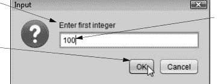

提示用户

当用户点击 OK 时，`showInputDialog` 返回用户输入的以 String 形式的 100；程序必须将该 String 转换为 int。

用户在其中输入值的文本框

(b) 第 12–13 行显示的输入对话框

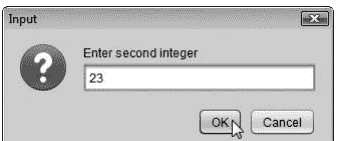

(c) 第 22–23 行显示的消息对话框——当用户点击 OK 时，消息对话框被关闭（从屏幕上移除）

图 12.2 使用 JOptionPane 进行输入和输出的加法程序。（第二部分，共 2 部分。）

### 输入对话框

第 3 行导入 `JOptionPane`。第 10–11 行声明了局部 String 变量 `firstNumber` 并将其赋值为 `JOptionPane` 静态方法 `showInputDialog` 的返回值。此方法显示一个输入对话框（参见图 12.2(a) 中的屏幕图），使用方法的 String 参数（“Enter first integer”）作为提示。

> 外观观察 12.2
>
> 输入对话框中的提示词通常使用句式大写——这种风格将文本中第一个单词的首字母大写，除非它是专有名词（例如，Jones）。

用户在文本框中输入，然后点击 OK 或按 Enter 键提交程序。点击 OK 也会（隐藏）对话框。[注意：如果你在文本框中输入但没有显示内容，请通过鼠标点击文本框来激活它]。与 `Scanner`（它可用于从键盘输入多种类型的值）不同，输入对话框只能输入 Strings。这是大多数 GUI 的典型特征。

### GUI 组件：第一部分

用户点击 OK，`showInputDialog` 返回用户输入的以 String 形式的 100；程序必须将该 String 转换为 int。

用户在其中输入值的文本框

(b) 第 12–13 行显示的输入对话框

(c) 第 22–23 行显示的消息对话框——当用户点击 OK 时，消息对话框被关闭（从屏幕上移除）

# 外观特征观察 12.5

Swing GUI 组件允许你跨所有平台为应用程序指定统一的外观，或使用每个平台自定义的外观。应用程序甚至可以在执行期间更改外观特征，以便使用户选择他们自己喜好的外观特征。

# 轻量级与重量级 GUI 组件

大多数 Swing 组件是轻量级组件——它们完全在 Java 中进行编写、操作和显示。AWT 组件是重量级组件，因为它们依赖于本地平台的窗口系统来确定其功能和外观特征。有几个 Swing 组件是重量级组件。

# Swing 轻量级 GUI 组件的父类

图 12.5 的 UML 类图显示了类的继承层次，轻量级 Swing 组件从这些类中继承它们的共同属性和行为。

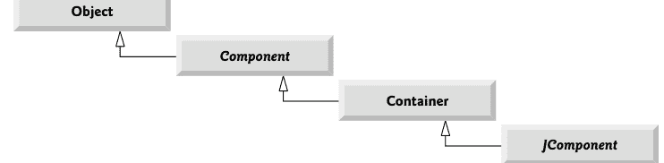

**图 12.5** | 轻量级 Swing 组件的常用父类。

类 `Component`（包 `java.awt`）是一个子类，它声明了 `java.awt` 和 `javax.swing` 包中 GUI 组件的共同特征。任何是 `Container`（包 `java.awt`）的对象都可以通过将组件附加到容器上来组织组件。容器可以放置在其他容器中以组织 GUI。`JComponent`（包 `javax.swing`）是 `Container` 的子类。`JComponent` 是所有轻量级 Swing 组件的子类，声明了它们的共同属性和行为。由于 `JComponent` 是 `Container` 的子类，因此所有轻量级 Swing 组件也是 `Container`。`JComponent` 支持一些常见特征：

- 1. 可插件的外观（pluggable look-and-feel），用于自定义组件外观（例如针对特定平台）。你将在 22.6 节看到它的示例。
- 2. 快捷键（mnemonics），用于通过键盘直接访问 GUI 组件。你将在 22.4 节看到它的示例。
- 3. GUI 目的的简要描述（称为工具提示 tool tips），当鼠标光标悬停在组件上短段时间时显示。你将在下一节看到它的示例。
- 4. 支持可访问性，例如为视障人士提供的屏幕阅读器。
- 5. 支持用户界面本地化——即自定义用户界面以不同语言显示并使用本地文化习惯。

## 12.5 在窗口中显示文本和图像

我们的下一个示例介绍了一个构建 GUI 应用程序的框架。该框架中的几个概念将出现在许多 GUI 应用程序中。这是我们第一个应用程序在自己的窗口中显示的示例。你创建的包含 Swing GUI 组件的窗口大多数是 `JFrame` 类的实例或 `JFrame` 的子类。`JFrame` 是 `java.awt.Window` 类的间接子类，它提供了窗口的基本属性和行为——顶部的标题栏，以及最小化、最大化和关闭窗口的按钮。由于应用程序的 GUI 通常特定于应用程序，我们的大多数示例将由两个类组成——一个帮助演示新 GUI 概念的 `JFrame` 子类，以及一个在 `main` 中创建并显示应用程序主窗口的应用程序类。

## 为 GUI 组件标记

GUI 由许多组件组成。GUI 设计师通常提供说明每个组件目的的文本。此类文本被称为标签（label），并用 `JLabel`（`JComponent` 的子类）创建。`JLabel` 是只读文本、图像或文本和图像的兼有。应用程序在创建标签后很少更改标签的内容。

> 外观特征观察 12.6
>
> JLabel 通常使用句首字母大写。


图 12.6–12.7 的应用展示了几个 `JLabel` 特性，并介绍了我们在许多 GUI 应用程序中使用的框架。我们没有在该示例中突出代码，因为大部分代码是新的。[注意：每个 GUI 组件的特征都比我们在示例中能涵盖的要得多。要了解每个 GUI 组件的完整细节，请访问其在线文档。对于类 `JLabel`，请访问 docs.oracle.com/javase7/docs/api/swing/JLabel.html]。

```java
// Fig. 12.6: Frame.java
// 带有文本和图标的 JLabel。
import java.awt.FlowLayout; // 指定组件的排列方式
import javax.swing.JFrame;   // 提供基本的窗口功能
import javax.swing.JLabel;    // 显示文本和图像
import javax.swing.SwingConstants; // 与 Swing 一起常用的常量
import javax.swing.Icon;       // 用于操作图像的接口
import javax.swing.ImageIcon;  // 加载图像

public class Frame extends JFrame
{
    private final JLabel label1; // 只有文本的 JLabel
    private final JLabel label2; // 用文本和图标构造的 JLabel
    private final JLabel label3; // 添加了文本和图标的 JLabel
    // Frame 构造函数将 JLabels 添加到 JFrame
    public Frame() {
        super("Testing JLabel");
        setLayout(new FlowLayout()); // 设置框架布局

        // 使用字符串参数的 JLabel 构造函数
        label1 = new JLabel("Label with text");
        label1.setToolTipText("This is label1");
        add(label1); // 将标签添加到 JFrame

        // 使用字符串、图标和对齐参数的 JLabel 构造函数
        Icon bug = new ImageIcon(getClass().getResource("bug.png"));
        label2 = new JLabel("Label with icon", bug, SwingConstants.LEFT);
        label2.setToolTipText("This is label2");
        add(label2); // 将标签添加到 JFrame

        // 不带参数的 JLabel 构造函数
        label3 = new JLabel();
        label3.setText("Label with text and icon");
        label3.setIcon(bug);
        label3.setToolTipText("This is label3");
        label3.setHorizontalAlignment(SwingConstants.CENTER);
        label3.setVerticalAlignment(SwingConstants.BOTTOM);
        add(label3); // 将标签添加到 JFrame
    } // 构造函数结束
} // 类结束
```

图 12.6 | 带有文本和图标的 JLabel。（2 部分中的第一部分）。

图 12.6 | 带有文本和图标的 JLabel。（2 部分中的第二部分）。

```java
// Fig. 12.7: LabelTest.java
// 测试 LabelFrame。
import javax.swing.*;
import java.awt.*;

public class LabelTest {
    public static void main(String[] args) {
        Frame labelFrame = new Frame(); // 注意：原文构造函数无参，此处修正
        labelFrame.setDefaultCloseOperation(JFrame.EXIT_ON_CLOSE);
        labelFrame.setSize(260, 180);
        labelFrame.setVisible(true);
    }
}
```

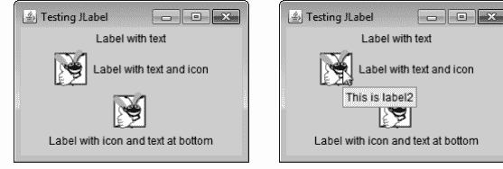

图 12.7 | 测试 LabelFrame。

# 476 第 12 章 GUI 组件：第一部分

## 图标接口与 Class ImageIcon

图标是增强应用程序视觉效果的流行方式，通常用于调用功能。例如，在 DVD 播放器和 MP3 播放器等设备上，同一个图标被用于播放如今的大多数媒体。Swing 组件可以显示图像。图标通常通过向构造函数传递 `Icon`（包 `javax.swing`）参数或调用组件的 `setIcon` 方法来指定。`ImageIcon` 支持多种图像格式，包括图形交换格式 (GIF)、可移植网络图形 (PNG) 和联合图像专家小组 (JPEG)。

第 28 行声明了一个 `ImageIcon`。文件 `bug1.png` 包含了要加载并存储在 `ImageIcon` 对象中的图像。该图像包含在本示例的目录中。该 `ImageIcon` 对象被赋值给一个 `Icon` 引用变量。

### 加载图标资源

第 28 行，表达式 `getClass().getResource("bug1.png")` 调用了 `Class` 方法 `getClass()`（继承自 `Object` 类）以获取表示 `JLabel` 类定义的类的引用。该引用被用于调用 `Class` 方法 `getResource`，它以 URL 的形式返回图像的位置。`ImageIcon` 构造函数使用该 URL 加载图像，然后将其加载到内存。正如我们在第一章中讨论的，JVM 使用类加载器将类定义加载到内存中。类加载器知道类位于什么位置。`getResource` 方法使用类的类加载器来确定作为图像文件资源的位置。在这种情况下，图像文件存储在与 `JLabel.class` 文件相同的位置。这里描述的技术使应用程序能够从相对于类位置的位置加载图像文件。

### 创建并附加 JLabel

第 29-30 行使用 `JLabel` 构造函数来创建一个显示“带有文本和图标的标签”以及第 28 行创建的图标的 `JLabel`。最后一个构造函数参数表示标签的内容是左对齐的（即图标和文本位于屏幕上标签区域的左侧）。`SwingConstants`（包 `javax.swing`）定义了一组整数常量（如 `SwingConstants.LEFT`、`SwingConstants.CENTER` 和 `SwingConstants.RIGHT`），用于许多 Swing 组件。默认情况下，当标签同时包含文本和图标时，文本显示在图像右侧。`JLabel` 的水平和垂直对齐可以通过 `setHorizontalAlignment` 和 `setVerticalAlignment` 方法分别设置。第 31 行指定了 `label2` 的工具提示，第 32 行将 `label2` 添加到 `Frame` 中。

### 创建并附加 JLabel (续)

`JLabel` 提供了在实例化后更改 `JLabel` 外观的方法。第 34 行使用无参数构造函数创建一个空的 `JLabel`。第 35 行使用 `JLabel.setText` 设置显示在标签上的文本。`getText` 方法可以用于检索 `JLabel` 的当前文本。第 36 行使用 `JLabel.setIcon` 指定要显示的图标。`getIcon` 方法可以用于检索标签上显示的当前图标。第 37-38 行使用 `JLabel.setHorizontalAlignment` 和 `setVerticalAlignment` 指定在标签中的位置。在这种情况下，文本将水平居中并显示在图标上方。`SwingConstants` 中的水平位置常量为 `LEFT`、`CENTER` 和 `RIGHT`（图 12.8）。

`SwingConstants` 中的垂直位置常量为 `TOP`、`CENTER` 和 `BOTTOM`（图 12.8）。第 39 行（图 12.6）设置了 `label3` 的工具提示文本。第 40 行将 `label3` 添加到 `JFrame` 中。

| 常量 | 描述 | 常量 | 描述 |
| --- | --- | --- | --- |
| **水平位置常量** | | **垂直位置常量** | |
| LEFT | 将文本放在左侧 | TOP | 将文本放在顶部 |
| CENTER | 将文本放在中间 | CENTER | 将文本放在正中间 |
| RIGHT | 将文本放在右侧 | BOTTOM | 将文本放在底部 |

**图 12.8** 位置常量（`SwingConstants` 的静态成员）。

### 创建并显示 LabelFrame 窗口

类 `LabelTest`（图 12.7）创建一个 `LabelFrame` 类的对象（第 9 行），然后指定窗口的默认关闭选项。默认情况下，关闭窗口会隐藏。然而，当用户关闭 `LabelFrame` 窗口时，我们希望应用程序终止。第 10 行调用 `LabelFrame` 的 `setDefaultCloseOperation` 方法（继承自 `JFrame`），并使用常量 `JFrame.EXIT_ON_CLOSE` 作为参数，表示当用户关闭窗口时程序应终止。这是非常重要的。否则，当用户关闭窗口时应用程序不会终止。接下来，第 11 行调用 `LabelFrame` 的 `setSize` 方法以像素为单位指定窗口的宽度和高度。最后，第 12 行调用 `LabelFrame` 的 `setVisible` 方法并传递参数 `true` 在屏幕上显示窗口。通过调整窗口大小，可以看到 `FlowLayout` 如何改变 `LabelFrame` 在窗口内的位置。

## 12.6 文本字段及嵌套类事件处理简介

通常，用户与应用程序交互以指示应用程序应该执行的任务。例如，当用户在电子邮件应用程序中发送电子邮件时，点击“发送”按钮告诉应用程序将电子邮件发送到指定的电子邮件地址。GUI 应用程序是事件驱动的。当用户与 GUI 组件交互时，这种交互（作为一种事件）会驱动程序执行任务。用户通过点击、在文本字段中输入、从菜单中选择项目、关闭窗口和移动鼠标来执行任务。让我们考虑另外两个组件——`JTextField` 和 `JPasswordField`（包 `javax.swing`）。`JTextField` 扩展自 `JComponent`（包 `javax.swing`），它提供了单行文本输入区域。`JPasswordField` 显示用户输入的字符是隐藏的，只有用户自己可见（见图 12.10）。`JPasswordField` 用于输入密码。图 12.9-10 使用 `JTextField` 和 `JPasswordField` 创建多个文本字段。这些每一个都会生成事件，对其响应的过程被称为事件处理。

# 478 第 12 章 GUI 组件：第一部分

当用户在 `JTextField` 或 `JPasswordField` 中输入并按下回车时，就会发生事件。下一个示例演示了程序如何响应该事件执行任务。这里展示的技术适用于所有生成事件的 GUI 组件。包含文本的消息框。你只能在“焦点”的文本字段中输入。当你点击组件时，它就会获得焦点。这很重要，因为获得焦点的文本字段会在按下 Enter 时产生事件。在本示例中，当你在 `JPasswordField` 中按下 Enter 时，密码将显示。我们首先讨论 GUI 的设置，然后是事件处理代码。

```java
// Fig. 12.9: TextFieldFrame.java
// 文本字段和密码字段
import java.awt.FlowLayout;
import java.awt.event.ActionListener;
import java.awt.event.ActionEvent;
import javax.swing.JFrame;
import javax.swing.JTextField;
import javax.swing.JPasswordField;
import javax.swing.JOptionPane;

public class TextFieldFrame extends JFrame {
    private final JTextField textField1; // 设置大小的文本字段
    private final JTextField textField2; // 文本大小的字段
    private final JTextField textField3; // 文本大小的字段
    private final JPasswordField passwordField; // 带有文本的密码字段

    // TextFieldFrame 构造函数将 JTextField 添加到 JFrame
    public TextFieldFrame() {
        super("JTextField and JPasswordField");
        setLayout(new FlowLayout());

        // 构建10列的文本字段
        textField1 = new JTextField(10);
        add(textField1); // 将 textField1 添加到 JFrame

        // 构建带有默认文本的文本字段
        textField2 = new JTextField("在此输入");
        add(textField2); // 将 textField2 添加到 JFrame

        // 构建带有默认文本和21列的文本字段
        textField3 = new JTextField("不可编辑的文本字段", 21);
        textField3.setEditable(false); // 禁用编辑
        add(textField3); // 将 textField3 添加到 JFrame
    }
}
```

图 12.9 | `JTextField` 和 `JPasswordField`。（第一部分，共二。）

## 12.6 文本字段与嵌套类事件处理简介 479

```java
// 使用默认文本构造密码字段
passwordField = new JPasswordField("Hidden text");
add(passwordField); // 将 passwordField 添加到 JFrame

// 注册事件处理器
TextFieldHandler handler = new TextFieldHandler();
textField1.addActionListener(handler);
textField2.addActionListener(handler);
textField3.addActionListener(handler);
passwordField.addActionListener(handler);
} // 构造函数结束
```

```java
// 用于事件处理的私有内部类
private class TextFieldHandler implements ActionListener
{
    // 处理文本字段事件
    @Override
    public void actionPerformed(ActionEvent event)
    {
        String string = "";

        // 用户在 JTextField textField1 中按下回车键
        if (event.getSource() == textField1)
            string = String.format("textField1: %s", event.getActionCommand());

        // 用户在 JTextField textField2 中按下回车键
        else if (event.getSource() == textField2)
            string = String.format("textField2: %s", event.getActionCommand());

        // 用户在 JTextField textField3 中按下回车键
        else if (event.getSource() == textField3)
            string = String.format("textField3: %s", event.getActionCommand());

        // 用户在 JPasswordField passwordField 中按下回车键
        else if (event.getSource() == passwordField)
            string = String.format("passwordField: %s", event.getActionCommand());

        // 显示 JTextField 内容
        JOptionPane.showMessageDialog(null, string);
    }
} // 私有内部类 TextFieldHandler 结束
} // 类 TextFieldFrame 结束
```

图 12.9 | `JTextField` 和 `JPasswordField`。（部分 2，共2 部分。）


# 类 JTextFieldFrame 继承自 JFrame，并声明了三个 JTextField 变量和一个 JPasswordField 变量（第 13–16 行）。在构造函数中，每个相应的文本字段都被实例化并附加到 JTextFieldFrame（第 19–47 行）。

# 第 12 章 GUI 组件：第一部分

## 创建 GUI

第 22 行将 `TextFieldFrame` 的布局设置为 `FlowLayout`。第 25 行创建了具有 10 列文本的 `textField1`。列宽（以像素为单位）由文本字段当前字体中字符的平均宽度决定。当文本显示在文本字段中且文本宽度大于字段本身时，右侧的部分文本将不可见。如果你在文本字段中输入字，且光标到达了右边缘，左侧的文本会被推出字段的左侧并不再可见。用户可以使用左键和右键遍历整个文本。第 26 行将 `textField1` 添加到 `JFrame`。

第 29 行创建了 `textField2`，并设置了初始文本“Enter text here”以显示在文本字段中。字段的宽度由构造函数中指定的文本宽度决定。第 30 行将 `textField2` 添加到 `JFrame`。

第 33 行创建了 `textField3`，并调用了带有两个参数的 `JTextField` 构造函数——用于显示的默认文本“Undeaditable text field”以及文本字段的列宽（21）。第 34 行使用 `setEditable()`（`JTextField` 继承自 `JComponent`）使文本字段变为不可编辑，但用户无法修改字段中的文本。第 35 行将 `textField3` 添加到 `JFrame`。

第 38 行创建了 `passwordField`，并设置了“Hidden text”显示在文本字段中。字段的宽度由文本宽度决定。当你执行应用程序时，请注意文本被显示为一串星号。第 39 行将 `passwordField` 添加到 `JFrame`。

## 为 GUI 组件设置事件处理的步骤

当用户在某个文本字段中按下回车键时，此示例应显示一个包含该文本字段内容的对话框。在应用程序对特定 GUI 组件的事件做出响应之前，你必须：

1. 创建一个表示事件并实现相应接口的类——该接口被称为**事件监听器接口**。
2. 指明第 1 步中的类对象在事件发生时应该被通知——这被称为**事件处理器**。

## 使用嵌套类实现事件处理器

到目前为止讨论的所有类都是所谓的**顶层类**——也就是说，它们不在其他类内部。Java 允许在其他类内部声明类——**嵌套类**。嵌套类可以是静态的，也可以是非静态的。非静态嵌套类是**内部类**，通常被用于实现事件处理器。

内部类必须通过包含该内部类的顶层类对象来创建。每个内部类都隐式地拥有其顶层类对象的引用。内部类对象允许此隐式引用直接访问顶层类的所有变量和方法。静态嵌套类不需要其顶层类对象，并且不具有对顶层类对象的引用。正如你将在第 13 章《图形与 Java 2D》中将看到的那样，Java 2D 图形中大量使用了静态嵌套类。

## 内部类 TextFieldHandler

此示例中的事件处理是由内部类 `TextFieldHandler` 的对象执行的（第 50–81 行）。该类是私有的，因为它仅用于为 `TextFieldFrame` 中的文本字段创建事件处理器。

## 12.6 文本字段与嵌套类事件处理简介

此示例中的事件处理是由内部类 `TextFieldHandler` 的对象执行的（第 50–81 行）。该类是私有的，因为它仅用于为 `TextFieldFrame` 中的文本字段创建事件处理器。成员，内部类可以是公共、保护或私有的。由于事件处理器倾向于定义在应用程序内部，它们通常被实现为匿名内部类。GUI 组件响应用户交互产生许多事件。每个事件由一个类表示，并由相应的事件类型处理。当用户在 `JTextField` 或 `JPasswordField` 中按下回车键时，会发生 `ActionEvent` (`awt.event`)。此类事件由实现 `ActionListener` 的对象处理。为了处理此示例中的事件，内部类 `TextFieldHandler` 实现了 `ActionListener` 并声明了该接口的唯一方法——`actionPerformed()`（第 53–80 行）。相关信息可见 Java 文档。

## 为每个 TextField 注册事件处理器

在 `JTextField` 构造函数中，第 22 行创建了一个 `TextFieldHandler` 对象并将其赋值给变量。当用户在任何文本字段中按下回车键时，为了发生，程序必须为每个文本字段注册该对象。第 43–46 行是事件注册语句，指定了用于三个 `JTextField` 和 `JPasswordField` 的事件处理器。应用程序调用 `JTextField.addActionListener()` 为每个组件注册事件处理器。该方法接收一个 `ActionListener` 对象作为参数，可以是任何实现 `ActionListener` 的类。该对象处理器是一个 `ActionListener`，因为 `TextFieldHandler` 实现了 `ActionListener`。在第 43–46 行之后，对象处理器监听事件。现在，当用户在四个文本字段的任何一个中按下回车键时，`TextFieldHandler` 类中的 `actionPerformed()` 方法（第 53–80 行）将被调用进行处理。如果没有为特定的文本字段注册事件处理器，则用户在该字段中按下回车键时发生的事件将被消耗——即被应用程序忽略。

> **软件工程观察 12.1** 事件监听器必须实现相应的事件监听接口。
>
> **常见编程错误 12.2** 如果忘记为特定的 GUI 组件事件注册事件处理器对象，事件类型将被忽略。

## TextFieldHandler 类 actionPerformed 方法详情

在此示例中，我们使用一个事件处理对象的 `actionPerformed()` 方法（第 53–80 行）来处理由四个文本字段生成的事件。由于我们出于演示目的输出每个文本字段实例变量的名称，我们必须确定是哪个文本字段生成了该事件。

# 482 第 12 章 GUI 组件：第一部分

每当调用 `actionPerformed()` 时，它都会接收一个 `ActionEvent` 对象，该对象包含有关刚刚发生的事件的信息，如事件源以及文本字段中的文本。系统将此 `ActionEvent` 传递给监听器的 `actionPerformed()` 方法。第 56 行声明了将要显示的 `String`。该变量初始化为空字符串——不包含任何字符。编译器要求对该变量进行初始化，以防第 59–76 行嵌套 `if` 的分支出现。

`ActionEvent` 方法 `getSource()`（在第 59、64、69 和 74 行中调用）返回指向事件源的引用。第 59 行的条件询问：“事件源是 `textField1` 吗？”该条件通过 `==` 运算符比较以判断它们是否为同一个对象。如果两者都指向 `textField1`，则用户在 `textField1` 中按了回车键。然后，第 60–61 行声明了一个包含消息的 `String`，第 79 行在对话框中显示该消息。第 61 行使用 `getActionCommand()` 获取用户在生成事件的字段中输入的文本。

在这个示例中，当用户在字段中按下回车键时，我们在 `JPasswordField` 中显示密码。有时需要通过程序处理密码中的字符。`JTextField` 方法 `getPassword()` 将密码字符作为 `char` 数组返回。

# 类 TextFieldTest

`TextFieldTest` 类（图 12.10）包含 `main()` 方法，该方法执行此应用程序并显示 `TextFieldFrame` 类的对象。当你执行应用程序时，不可编辑的 `JTextField` 可以生成 `ActionEvent`。要测试这一点，请让文本字段获得焦点，然后按回车。此外，当你在 `JPasswordField` 中按回车键时，会显示密码的实际文本。当然，你通常不会显示！

```java
// Fig 12.10: TextFieldTest.java
// Testing TextFieldFrame.
import javax.swing.JFrame;

public class TextFieldTest
{
    public static void main(String[] args)
    {
        JTextFieldFrame textFieldFrame = new JTextFieldFrame();
        textFieldFrame.setDefaultCloseOperation(JFrame.EXIT_ON_CLOSE);
        textFieldFrame.setSize(350, 100);
        textFieldFrame.setVisible(true);
    }
} // end class TextFieldTest
```

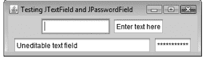

**图 12.10** 测试 `JTextFieldFrame`。（2 部分中的第 1 部分）。

# 12.7 常见的 GUI 事件类型和监听器接口 483

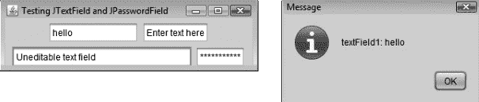
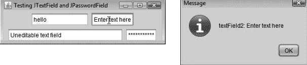
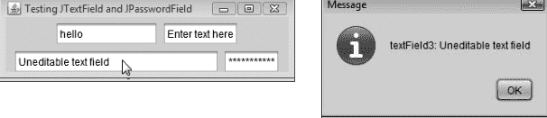
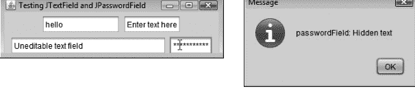

**图 12.10** 测试 `JTextFieldFrame`。（2 部分中的第 2 部分）。

此应用程序使用单个 `TextFieldFrame` 类对象作为四个文本字段的事件监听器。从第 12.10 节开始，你将看到声明多个相同类型的事件监听器对象，并为每个对象注册单独 GUI 组件的事件。这种技术允许我们通过为每个组件的事件提供单独的事件处理器，从而消除示例中事件处理器中使用的 `if...else` 逻辑。

## Java SE 8：使用 Lambdas 实现事件监听器

记得像 `ActionListener` 这样的接口只有一个抽象方法，在 Java SE 8 中是函数式接口。在第 17.9 节中，我们将展示如何使用 Java SE 8 的 lambdas 以一种更简洁的方式实现此类监听器接口。

# 12.7 常见的 GUI 事件类型和监听器接口

在第 12.6 节中，你学习了用户在文本字段中按回车键时发生的事件存储在 `ActionEvent` 中。当用户与 GUI 交互时，会发生许多类型的事件。事件存储在扩展 `AWTEvent`（来自 `java.awt` 包）的类对象中。图 12.11 展示了包含 `java.awt` 包中许多事件类的层次结构。其中一些在本章和第 22 章中进行了讨论。这些事件类型同时用于 AWT 和 Swing 组件。特定 Swing GUI 组件的额外事件类型在 `javax.swing.event` 包中声明。

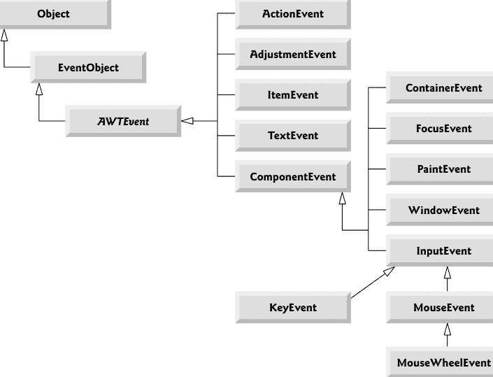

**图 12.11** | `java.awt.event` 包中的某些事件类。

让我们总结一下你在第 12.6 节中看到的事件处理机制的三个部分——事件源、事件对象和事件监听器。事件源是用户与之交互的 GUI 组件。事件对象封装了发生事件的信息，作为对事件源的引用以及事件监听器处理事件可能需要的任何特定事件信息。事件监听器是在事件发生时由事件源通知的对象；实际上，它“监听”事件，其某个方法会响应事件而执行。当事件监听器被通知事件时，事件监听器的方法接收一个事件对象。事件监听器使用事件对象来响应事件。这种事件处理模型被称为委托事件模型——事件的处理被委托给应用程序中的对象（事件监听器）。

对于每种事件类型，通常都有对应的事件监听器接口。事件监听器是实现 `java.awt.event` 和 `javax.swing.event` 包中一个或多个事件监听器接口的类对象。许多事件监听器类型适用于 Swing 和 AWT 组件。此类类型在 `java.awt.event` 包中声明，其中一些在图 12.12 中。特定 Swing 组件的额外事件监听器类型在 `javax.swing.event` 包中声明。

# 12.8 事件处理如何工作 485

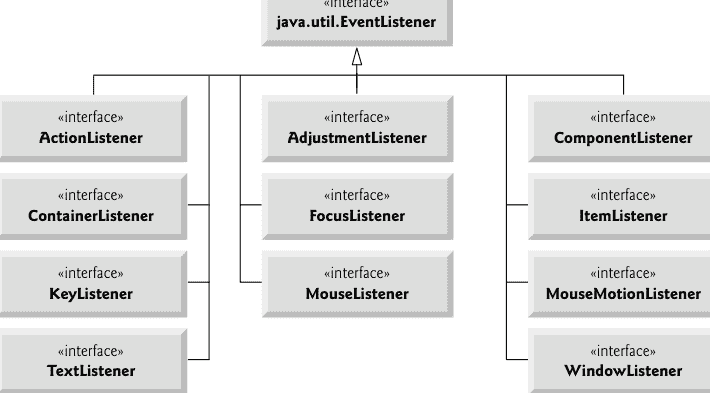

**图 12.12** | `java.awt` 包中的某些事件监听器接口。

每个事件监听器指定一个或多个事件处理方法，这些方法必须在实现接口的类中声明。回顾第 10.9 节，任何实现接口的类必须声明接口的所有抽象方法；否则，该类是抽象类，不能用于创建对象。

当事件发生时，GUI 组件通过调用相应监听器的事件处理方法来通知监听器。例如，当用户在 `JTextField` 中按回车键时，会调用监听器的 `actionPerformed()` 方法。在下一节中，我们将完成对事件处理如何工作的讨论。

# 12.8 事件处理如何工作

让我们使用图 12.9 中的 `JTextField` 来说明事件处理机制的工作原理。我们在第 12.7 节留下了两个问题：

1. 事件是如何注册的？
2. GUI 组件是如何知道调用 `actionPerformed()` 而不是其他方法的？

第一个问题通过图 12.9 中第 43 行的事件注册得到了解答。图 12.12 展示了 `JTextField`、`TextFieldHandler` 以及它们引用的对象。

## 注册事件

每个 `Component` 都有一个指向 `EventListenerList` 类（`javax.swing.event`）的实例变量 `listenerList`。`JComponent` 子类维护其监听器的引用。为了简单起见，我们在图 12.13 的 `JTextField` 对象下方绘制了 `listenerList`。

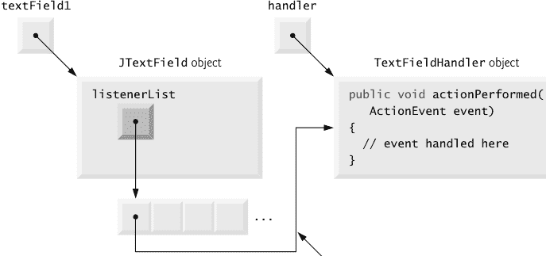

**图 12.13** | `JTextField` 的事件注册。

执行以下语句（图 12.9 第 43 行）时：

```java
textField1.addActionListener(handler);
```

包含 `TextFieldHandler` 对象引用的新条目被放入 `textField1` 的 `listenerList` 中。虽然图中未显示，此新条目还包含监听器的类型（`ActionListener`）。使用这种机制，轻量级 Swing 组件维护其自己的监听器列表。

## 事件处理器调用

事件类型对于回答第二个问题非常重要：GUI 组件是如何知道调用 `actionPerformed()` 而不是其他方法的？每个 GUI 组件支持多种事件类型，包括鼠标事件、键盘事件等。当事件发生时，事件会被分发给相应类型的监听器。分发是 GUI 组件调用其注册的所发生事件类型的每个监听器的事件处理方法的过程。

每种事件类型都有一个或多个对应的事件监听器接口。例如，`ActionEvent` 由 `ActionListener` 处理，`MouseEvent` 由 `MouseListener` 和 `MouseMotionListener` 处理，`KeyEvent` 由 `KeyListener` 处理。当事件发生时，GUI 组件接收一个指定类型的唯一事件 ID。GUI 组件使用事件 ID 来决定将事件分发给哪种监听器类型，并决定在每个监听器对象上调用哪个方法。对于 `ActionEvent`，事件被分发给每个注册的 `ActionListener` 的 `actionPerformed()` 方法（接口 `ActionListener` 中的唯一方法）。对于 `MouseEvent`，事件被分发给每个注册的 `MouseListener` 或 `MouseMotionListener`，取决于鼠标事件发生的类型。鼠标的事件 ID 决定了调用几个鼠标事件处理方法中的哪一个。所有决策都由 GUI 组件为你处理。你所要做的是为你的应用程序所需的特定事件类型注册一个事件处理程序，GUI 组件将确保在事件发生时调用该事件处理程序的恰当方法。我们会在引入每个新组件时，根据需要讨论其他事件类型和事件监听器接口。

## 性能提示 12.1

GUI 应该保持对用户有响应性。在事件处理程序中执行耗时任务会阻止用户在任务完成之前与 GUI 进行交互。第 23.11 节演示了防止此类问题的技术。

## 12.9 JButton

按钮是用户点击以触发特定操作的组件。Java 应用程序使用多种类型的按钮，包括命令按钮、复选框、切换按钮和单选按钮。图 12.14 显示了本章涵盖的 Swing 按钮的继承层次结构。如你所示，所有的按钮类型都是 `AbstractButton`（位于 `javax.swing` 包）的子类，该类声明了 Swing 按钮的共同特征。在本节中，我们重点关注通常用于启动命令的按钮。

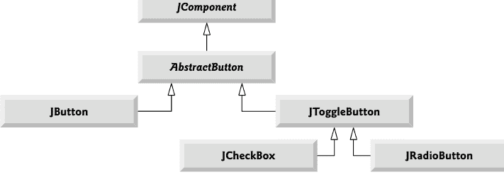

**图 12.14** | Swing 按钮层次结构。

命令按钮（见图 12.16 的输出）在用户点击它时产生一个 `ActionEvent`。命令按钮使用类 `JButton` 创建。`JButton` 表面上的文本被称为按钮标签。

## 外观观察 12.8

按钮上的文本通常使用书名标题大写规则。

## 外观观察 12.9

一个 GUI 可以有许多 `JButton`，但每个按钮标签在当前显示的 GUI 部分应该是唯一的。拥有多个具有相同标签的 `JButton` 会让用户对 `JButton` 产生歧义。

图 12.15 和 12.16 的应用创建了两个 `JButton`，并演示了 `JButton` 可以显示图标。按钮的事件处理由内部类 `ButtonHandler` 的单个实例执行（图 12.15，第 39-48 行）。


# 图 12.15：ButtonFrame.java

```java
// Fig. 12.15: ButtonFrame.java
// Command buttons and action events.
import java.awt.FlowLayout;
import java.awt.event.ActionListener;
import java.awt.event.ActionEvent;
import javax.swing.JFrame;
import javax.swing.JButton;
import javax.swing.Icon;
import javax.swing.ImageIcon;
import javax.swing.JOptionPane;

public class ButtonFrame extends JFrame {

    private final JButton plainButton; // button with just text
    private final JButton fancyButton; // button with icons

    // ButtonFrame adds JButtons to JFrame
    public ButtonFrame() {
        super("Testing Buttons");
        setLayout(new FlowLayout());

        plainButton = new JButton("Plain Button"); // button with text
        add(plainButton); // add plainButton to JFrame

        Icon bug1 = new ImageIcon(getClass().getResource("bug1.gif"));
        Icon bug2 = new ImageIcon(getClass().getResource("bug2.gif"));
        fancyButton = new JButton("Fancy Button", bug1); // set image
        fancyButton.setRolloverIcon(bug2); // set rollover image
        add(fancyButton); // add fancyButton to JFrame

        // create new EventHandler for event handling
        ButtonHandler handler = new ButtonHandler();
        fancyButton.addActionListener(handler);
        plainButton.addActionListener(handler);
    }

    // inner class for button event handling
    private class ButtonHandler implements ActionListener {

        // handle button event
        @Override
        public void actionPerformed(ActionEvent event) {
            JOptionPane.showMessageDialog(ButtonFrame.this, String.format(
                "You pressed: %s", event.getActionCommand()));
        }
    }
} // end ButtonFrame
```

**图 12.15** 命令按钮和动作事件。

# 图 12.16：ButtonTest.java

```java
// Fig. 12.16: ButtonTest.java
// Testing ButtonFrame.
import javax.swing.JFrame;

public class ButtonTest {
    public static void main(String[] args) {
        ButtonFrame buttonFrame = new ButtonFrame();
        buttonFrame.setDefaultCloseOperation(JFrame.EXIT_ON_CLOSE);
        buttonFrame.setSize(275, 110);
        buttonFrame.setVisible(true);
    }
} // end class ButtonTest
```

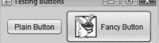


# 第 12 章 GUI 组件：第一部分

```java
// respond to checkbox events
@Override
public void itemStateChanged(ItemEvent event) {
    Font font = null; // stores the new Font

    // determine which CheckBoxes are checked && create Font
    if (boldCheckbox.isSelected() && italicCheckbox.isSelected()) {
        font = new Font("Serif", Font.BOLD + Font.ITALIC, 14);
    } else if (boldCheckbox.isSelected()) {
        font = new Font("Serif", Font.BOLD, 14);
    } else if (italicCheckbox.isSelected()) {
        font = new Font("Serif", Font.ITALIC, 14);
    } else {
        font = new Font("Serif", Font.PLAIN, 14);
    }
    textField.setFont(font);
}
// end class CheckBoxFrame
```

**图 12.17 | JCheckBox 和项事件。（2 部分中的第 2 部分）**

# 图 12.18：CheckBoxTest.java

```java
// Fig. 12.18: CheckBoxTest.java
// Testing CheckBoxFrame.
import javax.swing.JFrame;

public class CheckBoxTest {
    public static void main(String[] args) {
        CheckBoxFrame checkBoxFrame = new CheckBoxFrame();
        checkBoxFrame.setDefaultCloseOperation(JFrame.EXIT_ON_CLOSE);
        checkBoxFrame.setSize(275, 100);
        checkBoxFrame.setVisible(true);
    }
} // end class CheckBoxTest
```


**图 12.18 | 测试 CheckBoxFrame。**

当 `JTextField` 创建并初始化后（图 12.17，第 24 行），第 25 行使用 `setFont` 方法（由 `JTextField` 直接继承自 `Component` 类）将 `JTextField` 的字体设置为一个新的 `Font` 对象（`java.awt` 包）。新的 `Font` 对象使用 "Serif"（一个代表 Times 等字体的通用名称，在所有 Java 平台上均支持）、`PLAIN` 样式和 14 字体进行初始化。第 28–29 行创建了两个 `JCheckBox`。传递给 `JCheckBox` 构造函数的字符串是默认出现在 `JCheckBox` 右侧的复选框标签。

当用户点击 `JCheckBox` 时，会发生一个 `ItemEvent`。这可以通过 `ItemListener` 来处理，监听器必须实现 `itemStateChanged`。在示例中，事件处理器由内部类 `CheckBoxHandler` 的实例执行（第 40–60 行）。第 33–36 行创建了 `CheckBoxHandler` 实例，并为两个 `JCheckBox` 对象通过 `addItemListener` 进行了注册。当用户点击 `boldJCheckBox` 或 `italicCheckBox` 时，会调用处理器的 `itemStateChanged`（第 43–59 行）。在此示例中，我们没有判断点击了哪个 `JCheckBox`——我们使用它们两者的状态来确定字体显示。第 49 行使用 `JCheckBox` 方法 `isSelected` 来判断两个复选框是否都被选中。如果是，第 50 行通过为 `Font` 构造函数的字体参数添加 `Font` 常量 `BOLD` 和 `ITALIC` 来创建一个粗斜体字体。第 51 行判断 `boldJCheckBox` 是否被选中，如果是，则第 52 行创建一个粗体字体。第 53 行判断 `italicCheckBox` 是否被选中，如果是，则第 54 行创建一个斜体字体。如果上述条件都不满足，第 56 行使用 `Font.PLAIN` 创建一个普通字体。第 58 行设置 `textField` 的新字体，从而更改屏幕上 `JTextField` 的字体。

## 内部类与其顶层类之间的关系

`CheckBoxHandler` 使用了变量 `boldJCheckBox`（第 49 和 51 行）、`italicCheckBox`（第 49 和 53 行）和 `textField`（第 58 行），尽管它们并没有在内部类中声明。请记住，内部类与其顶层类有特殊关系——它被允许访问顶层类的所有变量和方法。`CheckBoxHandler` 方法 `itemStateChanged`（第 43–59 行）利用这种关系来判断复选框是否被选中，并设置 `JTextField` 的字体。请注意，内部类 `CheckBoxHandler` 中的代码需要对顶层类的显式引用。

## 12.10.2 JRadioButton

单选按钮（用 `JRadioButton` 类声明）与复选框类似，它们有两个状态——已选中和未选中（也称为取消选中状态）。然而，单选按钮通常以组的形式出现，一次只能选择其中一个按钮（参见图 20 的输出）。单选按钮表示互斥的选项（即组中的多个选项不能同时被选中）。单选按钮之间的逻辑关系由 `ButtonGroup` 对象（`javax.swing` 包）维护。`ButtonGroup` 组织一组按钮，它不会在用户界面中显示。相反，组中的单个 `JRadioButton` 对象显示在 GUI 中。

图 12.19–22 的应用方法与图 12.17–12.18 类似。该应用程序使用单选按钮允许组内一次仅选择一种样式。`RadioButtonTest` 类（图 22）包含了执行此应用程序的 `main` 方法。


```java
// Fig. 12.19: RadioButton.java
// 使用 ButtonGroup 和 JRadioButton 创建单选按钮
import java.awt.FlowLayout;
import java.awt.Font;
import java.awt.event.ActionListener;
import java.awt.event.ActionEvent;
import javax.swing.JFrame;
import javax.swing.JTextField;
import javax.swing.JRadioButton;
import javax.swing.ButtonGroup;

public class RadioButtonFrame extends JFrame {
    private final JTextField textField; // 用于显示字体变化
    private final Font plainFont; // 用于普通文本
    private final Font boldFont; // 用于粗体文本
    private final Font italicFont; // 用于斜体文本
    private final Font boldItalicFont; // 用于粗体和斜体文本
    private final JRadioButton plainJRadioButton; // 选择普通文本
    private final JRadioButton boldJRadioButton; // 选择粗体文本
    private final JRadioButton italicJRadioButton; // 选择斜体文本
    private final JRadioButton boldItalicJRadioButton; // 选择粗体和斜体
    private final ButtonGroup group; // 存放单选按钮

    public RadioButtonFrame() {
        super("RadioButton Test");
        setLayout(new FlowLayout());
        textField = new JTextField("Watch the font change", 25);
        add(textField);
        // create radio buttons
        plainJRadioButton = new JRadioButton("Plain", true);
        boldJRadioButton = new JRadioButton("Bold", false);
        italicJRadioButton = new JRadioButton("Italic", false);
        boldItalicJRadioButton = new JRadioButton("Bold/Italic", false);
        add(plainJRadioButton);
        add(boldJRadioButton);
        add(italicJRadioButton);
        add(boldItalicJRadioButton);
        // create logical relationship between RadioButtons
        group = new ButtonGroup();
        group.add(plainJRadioButton);
        group.add(boldJRadioButton);
        group.add(italicJRadioButton);
        group.add(boldItalicJRadioButton);

        // create objects
        plainFont = new Font("Serif", Font.PLAIN, 14);
        boldFont = new Font("Serif", Font.BOLD, 14);
        italicFont = new Font("Serif", Font.ITALIC, 14);
        boldItalicFont = new Font("Serif", Font.BOLD + Font.ITALIC, 14);
        textField.setFont(plainFont);

        // register events for JRadioButton
        plainJRadioButton.addItemListener(new RadioButtonHandler(plainFont));
        boldJRadioButton.addItemListener(new RadioButtonHandler(boldFont));
        italicJRadioButton.addItemListener(new RadioButtonHandler(italicFont));
        boldItalicJRadioButton.addItemListener(new RadioButtonHandler(boldItalicFont));
    }

    // private inner class to handle radio button events
    private class RadioButtonHandler implements ItemListener {
        private Font font; // 与此监听器关联
        public RadioButtonHandler(Font f) {
            font = f;
        }

        // handle radio button events
        @Override
        public void itemStateChanged(ItemEvent event) {
            textField.setFont(font);
        }
    }
} // end class RadioButtonFrame
```

**图 12.19 | 使用 ButtonGroup 和 JRadioButton 创建单选按钮。（2 部分中的第 1 部分）**

```java
// Fig. 12.20: RadioButtonTest.java
// Testing RadioButtonFrame.
import javax.swing.JFrame;

public class RadioButtonTest {
    public static void main(String[] args) {
        RadioButtonFrame radioButtonFrame = new RadioButtonFrame();
        radioButtonFrame.setDefaultCloseOperation(JFrame.EXIT_ON_CLOSE);
        radioButtonFrame.setSize(300, 100);
        radioButtonFrame.setVisible(true);
    }
} // end class RadioButtonTest
```

**图 12.20 | 测试 RadioButtonFrame。（2 部分中的第 2 部分）**

## 496 第 12 章 GUI 组件：第一部分


**图 12.20** | TestingRadioButtonFrame。（2 部分中的第 2 部分）。

构造函数中的第 35–42 行（图 12.19）创建了四个 `JRadioButton` 并将它们添加到 `JFrame` 中。每个 `JRadioButton` 都是通过类似第 35 行的构造函数调用创建的。该构造函数指定了默认位于 `JRadioButton` 右侧的标签以及 `JRadioButton` 的初始状态。第二个参数为 `true` 表示该 `JRadioButton` 在显示时应该被选中。

第 45 行实例化了 `ButtonGroup` 对象。该组是形成四个 `JRadioButton` 对象之间逻辑关系的“胶水”，它允许在四个选项框中同时仅有一个被选中。可能组中没有 `JRadioButton` 被选中，但这种情况只有在没有向组中添加预选的 `JRadioButton` 且用户尚未选择 `JRadioButton` 的情况下才会发生。第 46–49 行使用 `ButtonGroup.add` 将每个 `JRadioButton` 与组关联。如果向组中添加了多个被选中的 `JRadioButton` 对象，则在 GUI 显示时，先添加的被选中对象将被选中。

`JRadioButton` 像 `JCheckBox` 一样，在被点击时会产生 `ItemEvent`。第 59–66 行创建了 `RadioButtonHandler` 类的实例（在第 70–85 行声明）。在此示例中，每个事件监听器都注册用于处理用户点击特定 `JRadioButton` 时生成的 `ItemEvent`。注意，每个 `RadioButtonHandler` 初始化时都带有一个 `Font` 对象（在第 52–55 行声明）。

`RadioButtonHandler` 类（第 70–85 行）实现了 `ItemListener`，因此它可以处理由 `JRadioButton` 生成的 `ItemEvent`。构造函数将接收到的 `Font` 存储在事件监听器对象的实例变量中（在第 72 行声明）。当用户点击 `JRadioButton` 时，组会关闭之前选中的 `JRadioButton`，并且 `itemStateChanged` 方法（第 80–84 行）将 `JTextField` 中的字体设置为存储在 `JRadioButton` 对应的事件监听器对象中的 `Font`。注意，`RadioButtonHandler` 类的第 83 行使用了顶层类 `textField` 的实例变量来设置字体。

## 12.11 JComboBox：使用匿名类进行事件处理

组合框（有时称为下拉框）允许用户从列表中选择一个项目（图 12.22）。组合框通过 `JComboBox` 类实现，该类扩展了 `JComponent` 类。`JComboBox` 是一个泛型类，类似于 `ArrayList`（第 6 章）。当你创建一个 `JComboBox` 时，你需要指定它所管理的对象类型——随后 `JComboBox` 将显示每个对象的字符串表示形式。

```java
// 图 12.21: ComboBoxFrame.java
// 显示项目名称列表的 JComboBox。
import java.awt.FlowLayout;
import java.awt.event.ActionListener;
import java.awt.event.ItemEvent;
import javax.swing.JFrame;
import javax.swing.JLabel;
import javax.swing.JComboBox;
import javax.swing.Icon;
import javax.swing.ImageIcon;

public class ComboBoxFrame extends JFrame {
    private final JComboBox<String> imagesJComboBox; // 持有图标名称
    private final JLabel label; // 显示选中的图标

    private static String[] names = {
        "bug1.gif", "bug2.gif", "travelbug.gif", "buganim.gif"
    };
    private final Icon[] icons = {
        new ImageIcon(getClass().getResource(names[0])),
        new ImageIcon(getClass().getResource(names[1])),
        new ImageIcon(getClass().getResource(names[2])),
        new ImageIcon(getClass().getResource(names[3]))
    };

    // ComboBoxFrame 构造函数将 JComboBox 添加到 JFrame
    public ComboBoxFrame() {
        super("Testing JComboBox");
        setLayout(new FlowLayout()); // 设置框架布局

        imagesJComboBox = new JComboBox<>(names); // 设置 JComboBox
        imagesJComboBox.setMaximumCount(3); // 显示三行

        imagesJComboBox.addItemListener( // 匿名内部类
            new ItemListener() {
                @Override
                public void itemStateChanged(ItemEvent event) {
                    // 判断是否选中了项目
                    if (event.getStateChange() == ItemEvent.SELECTED) {
                        label.setIcon(icons[imagesJComboBox.getSelectedIndex()]);
                    }
                } // 匿名内部类结束
            }
        ); // 调用 addItemListener

        add(imagesJComboBox); // 将组合框添加到 JFrame
        label = new JLabel(icons[0]); // 显示第一个图标
        add(label); // 将标签添加到 JFrame
    }
} // 结束类 ComboBoxFrame
```

**图 12.21 | 显示项目名称列表的 JComboBox。（2 部分中的第 1 部分）**

**图 12.21 | 显示图像名称列表的 JComboBox。（2 部分中的第 2 部分）**

```java
// 图 12.22: ComboBoxTest.java
// 测试组合框的 ComboBox。
import javax.swing.JFrame;

public class ComboBoxTest {
    public static void main(String[] args) {
        ComboBoxFrame comboBoxFrame = new ComboBoxFrame();
        comboBoxFrame.setDefaultCloseOperation(JFrame.EXIT_ON_CLOSE);
        comboBoxFrame.setSize(350, 150);
        comboBoxFrame.setVisible(true);
    }
} // 结束类 ComboBoxTest
```


**图 12.22** | 测试组合框的 `JComboBox`。

## 500 第 12 章 GUI 组件：第一部分

从一个实现 `ItemListener` 接口的匿名类声明开始。这类似于以下如下开始类声明：

```java
public class MyHandler implements ItemListener
```

第 36 行的左大括号 `{` 和第 46 行的右大括号 `}` 限定了匿名内部类的体。第 38–45 行声明了 `ItemListener` 的 `itemStateChanged` 方法。当用户从 `JComboBox` 中进行选择时，该方法会设置标签的 `Icon`。通过第 44 行的 `getSelectedIndex` 方法确定 `JComboBox` 中选中项目的索引，从而从 `icons` 数组中选择相应的 `Icon`。对于从 `JComboBox` 选择的每个项目，另一个项目会被取消选择——因此当选择一个项目时会发生两个事件。我们希望只显示用户选择的图标。为此，第 42 行确定 `getStateChange` 方法（第 43–44 行）是否设置标签的图标。


第 35–46 行用于匿名内部类创建事件处理器的语法，与 Java 集成开发环境（IDE）生成的代码相似。通常，IDE 允许你可视化地设计 GUI，然后由它生成实现 GUI 的代码。你只需要在事件处理方法中插入语句，声明如何处理每个事件即可。

# Java SE 8：使用 Lambda 实现内部类

在第 17.9 节中，我们展示了如何使用 Java SE 8 lambda 来创建事件处理器。正如你将学到的，编译器会将 lambda 翻译成匿名内部类的对象。

## 12.12 JList

列表显示一系列项目，用户可以从中选择一个或多个项目（见图 12.24 的输出）。列表通过 `JList` 创建，它直接扩展了 `JComponent`。`JList` 类——与 `JComboBox` 一样——是一个泛型类——支持单选列表（一次只能选择一个项目）和多选列表（允许选择任意数量的项目）。在本节中，12.23–12.24 涵盖了一个包含 13 个颜色名称的 `JList`。当点击 `JList` 中的颜色名称时，`ListSelectionEvent` 会将应用程序窗口的背景颜色更改为选颜色。`ListTest`（图 12.24）包含了执行此应用程序的 `main` 方法。

```java
// Fig 12.23: ListFrame.java
// 显示颜色列表的 Jlist。
import java.awt.FlowLayout;
import java.awt.Color;
import javax.swing.JFrame;
import javax.swing.JList;
```

图 12.23 | 显示颜色列表的 JList。（部分，共 2 部分）

```java
import javax.swing.JScrollPane;
import javax.swing.event.ListSelectionListener;
import javax.swing.event.ListSelectionEvent;
import javax.swing.event.ListSelectionModel;

public class ListFrame extends JFrame
{
    private JList<String> colorList; // 用于显示颜色的列表
    private static String[] colorNames = {"Black", "Blue", "Cyan",
        "Dark Gray", "Gray", "Green", "Light Gray", "Magenta",
        "Orange", "Pink", "White", "Yellow"};
    private static final Color[] colors = {Color.BLACK, Color.BLUE,
        Color.CYAN, Color.DARK_GRAY, Color.GRAY, Color.GREEN,
        Color.LIGHT_GRAY, Color.MAGENTA, Color.ORANGE, Color.PINK,
        Color.RED, Color.WHITE, Color.YELLOW};

    // ListFrame 构造函数向 JFrame 添加包含 JList 的 JScrollPane
    public ListFrame()
    {
        super("List Test");
        setLayout(new FlowLayout());

        colorList = new JList<String>(colorNames); // colorNames 列表
        colorList.setVisibleRowCount(5); // 一次显示五行


        // 不允许多选
        colorList.setSelectionMode(ListSelectionModel.SINGLE_SELECTION);


        // 向框架添加包含 JList 的 JScrollPane
        add(new JScrollPane(colorList));

        colorList.addListSelectionListener(
            {
                // 处理列表选择事件
                @Override
                public void valueChanged(ListSelectionEvent event)
                {
                    getContentPane().setBackground(
                        colors[colorList.getSelectedSelectedIndex()]);
                    }
                }
            });
    }
} // ListFrame 类结束
```

图 12.23 | 显示颜色列表的 JList。（部分，共 2 部分）

```java
// Fig 12.24: ListTest.java
// 从 JList 中选择颜色。
import javax.swing.JFrame;

public class ListTest
{
    public static void main(String[] args) {
        ListFrame listFrame = new ListFrame(); // 创建 ListFrame
        listFrame.setDefaultCloseOperation(JFrame.EXIT_ON_CLOSE);
        listFrame.setSize(350, 350);
        listFrame.setVisible(true);
    }
} // ListTest 类结束
```


**图 12.24** 为 JList 选择颜色（部分2，共 2 部分）。

第 29 行 (12.23) 创建了 `JList` 对象 `colorList`。`JList` 构造函数的参数是要要在列表中显示的 Object 数组（此处为 Strings 数组）。第 30 行使用 `JList` 方法 `setVisibleRowCount` 来确定行数。第 34 行使用 `JList` 方法 `setSelectionMode` 来指定选择模式。单选列表允许一次只选择一个项目，而多选列表允许选择任意数量的项目。在本节中，12.23–12.24 涵盖了一个包含 13 个颜色名称的 `JList`。当点击 `JList` 中的颜色名称时，`ListSelectionEvent` 会将应用程序窗口的背景颜色更改为选颜色。`ListTest`（图 12.24）包含了执行此应用程序的 `main` 方法。

```java
colorJList.setSelectionMode(
    ListSelectionModel.MULTIPLE_INTERVAL_SELECTION
);
add(new JScrollPane(colorJList)); // 添加带滚动条的列表
```

```java
copyButton = new JButton("Copy >>>");
copyButton.addActionListener(
    new ActionListener() { // 匿名内部类
        // 处理按钮事件
        @Override
        public void actionPerformed(ActionEvent event) {
            // copyJList 中的被选值
            copyJList.setListData(
                colorJList.getSelectedValuesList().toArray(
                    new String[0]));
        }
    }
);
```

```java
add(copyButton); // 将复制按钮添加到 JFrame
copyJList = new JList<String>(); // 存储颜色名称的列表
copyJList.setVisibleRowCount(5); // 显示 5 行
copyJList.setFixedCellWidth(100); // 设置宽度
copyJList.setFixedCellHeight(15); // 设置高度
copyJList.setSelectionMode(ListSelectionModel.SINGLE_INTERVAL_SELECTION);
add(new JScrollPane(copyJList)); // 添加带滚动条的列表
```

图 12.25 允许多选的 JList。（2 部分中的第 2 部分）

```java
// 图 12.26: MultipleSelectionTest.java
// 测试 MultipleSelectionFrame。
import javax.swing.JFrame;

public class MultipleSelectionTest {
    public static void main(String[] args) {
        MultipleSelectionFrame multipleSelectionFrame = 
            new MultipleSelectionFrame();
        multipleSelectionFrame.setDefaultCloseOperation(
            JFrame.EXIT_ON_CLOSE);
        multipleSelectionFrame.setSize(350, 150);
        multipleSelectionFrame.setVisible(true);
    }
} // 结束类 MultipleSelectionTest
```

图 12.26 测试 MultipleSelectionFrame。（2 部分中的第 1 部分）

# 12.14 鼠标事件处理


| **图. 12.26** | 测试 MultipleSelectionFrame。（2 部分中的第 2 部分。） |

12.25 的第 27 行创建了 `JList` `colorJList` 并用数组 `colorNames` 中的字符串对其进行初始化。第 28 行将 `colorJList` 中的可见行数设置为 5。第 29–30 行指定 `colorJList` 为 `MULTIPLE_INTERVAL_SELECTION`。第 31 行向 JFrame 添加了包含 `colorJList` 的新 `JScrollPane`。第 51–57 行对 `copyJList` 的选择执行类似的任务。如果 `JList` 不包含项目，则它在 `FlowLayout` 中不会显示。由于这个原因，第 53–54 行使用 `JList` 的方法 `setFixedCellWidth` 和 `setFixedCellHeight` 分别将 `copyJList` 的宽度设置为 100 像素，并将 `JList` 中每个项目的高度设置为 15 像素。

通常，当处理 `JList` 中的多选项目时，会发生由另一个 GUI 组件生成的事件（称为外部事件）。在这种情况下，用户点击 `copyButton` 来触发事件，将 `colorJList` 中的被选项目复制到 `copyJList`。

第 34–47 行创建了 `copyButton` 并为 `copyButton` 注册了一个 `ActionListener`。当用户点击 `copyButton` 时，`actionPerformed` 方法（第 38–45 行）使用 `JList` 方法 `setListData` 显示 `colorJList` 中显示的项目。第 43–44 行调用 `colorJList` 的方法 `getSelectedValuesList`，它返回一个 `List<String>`（因为 `JList` 是被创建为 `JList<String>`），代表 `colorJList` 中的被选项目。我们调用 `List<String>` 的 `toArray` 将其转换为 String 数组，并将其作为参数传递给 `copyJList` 的 `setListData` 方法。`List` 方法 `toArray` 接收一个参数，表示该方法将返回的数组类型。你将在第 16 章学习更多关于 `List` 和 `toArray` 的知识。

你可能会奇怪为什么在第 42 行可以使用 `copyJList`，尽管应用程序直到第 49 行才创建该对象。记住，`actionPerformed` 方法（第 38–45 行）在用户按下 `copyButton` 之前执行，而这在构造函数完成执行且应用程序显示 GUI 之前是不可能的。在应用程序执行的该点，`copyJList` 已用一个新的 `JList` 初始化。

# 12.14 鼠标事件处理

本节介绍了用于处理鼠标事件的 `MouseListener` 和 `MouseMotionListener` 事件监听接口。可以为派生自 `java.awt.Component` 的 GUI 组件处理鼠标事件。`MouseListener` 和 `MouseMotionListener` 方法总结在图 12.27 中。`javax.swing.event` 包包含接口 `MouseInputListener`，它扩展了 `MouseListener` 和 `MouseMotionListener` 接口，以创建一个包含所有 `MouseListener` 和 `MouseMotionListener` 方法的接口。

当鼠标与组件交互时，如果为该组件注册了适当的事件监听对象，就会调用。

每个鼠标处理方法都接收一个 `MouseEvent` 对象作为参数，该对象包含关于发生鼠标事件的信息，包括其位置的 x-y 坐标。这些坐标是从发生事件的 GUI 组件的左上角测量的。x 坐标从 0 开始从左到右增加。y 坐标从 0 开始从上到下增加。`MouseListener` 和 `MouseMotionListener` 方法总结在图 12.27 中。

```text
MouseListener 和 MouseMotionListener 方法
interface MouseListener
- mousePressed(MouseEvent e) // 鼠标按下
- mouseClicked(MouseEvent e) // 鼠标点击
- mouseReleased(MouseEvent e) // 鼠标释放
- mouseEntered(MouseEvent e) // 鼠标进入
- mouseExited(MouseEvent e) // 鼠标离开

interface MouseMotionListener
- mouseDragged(MouseEvent e) // 鼠标拖拽
- mouseMoved(MouseEvent e) // 鼠标移动
```

（注：上述结构根据 OCR 重建）

**图. 12.27** MouseListener 和 MouseMotionListener 方法。


> **软件工程观察 12.5**
>
> 对 `mouseDragged` 的调用将发送到该组件的 `MouseMotionListener`。同样，拖拽结束时的 `mouseReleased` 调用将发送到该组件的 `MouseListener`。

# 12.14 鼠标事件处理

Java 还提供了接口 `MouseWheelListener` 以允许应用程序响应鼠标旋转。此接口声明了 `mouseWheelMoved`，它接收 `MouseWheelEvent` 作为参数。`MouseWheelEvent` 类（`InputEvent` 的子类）包含了允许事件处理器获取滚轮信息的方法。

# 在 JPanel 上跟踪鼠标事件

`MouseTracker` 应用程序（图 12.28–12.29）演示了 `MouseListener` 和 `MouseMotionListener` 方法。事件处理器类（12.28 第 36–97 行）实现了这两个接口。当你的类实现这些接口时，必须声明这些接口的方法。此示例中的每个鼠标事件都在底部的 `JLabel statusBar` 中显示字符串。


# 第 12 章 GUI 组件：第一部分

## 12.14 鼠标事件处理

```java
// 12.28: MouseTrackerFrame.java
// 鼠标事件处理。
import java.awt.Color;
import java.awt.BorderLayout;
import java.awt.event.MouseListener;
import java.awt.event.MouseMotionListener;
import java.awt.event.MouseEvent;
import javax.swing.JFrame;
import javax.swing.JLabel;
import javax.swing.JPanel;

public class MouseTrackerFrame extends JFrame {
    private final JPanel panel1; // 发生鼠标事件的面板
    private final JLabel statusBar; // 显示事件信息

    public MouseTrackerFrame() {
        super("Demonstrating Mouse Events");
        panel1 = new JPanel();
        panel1.setBackground(Color.WHITE);
        add(panel1, BorderLayout.CENTER); // 将面板添加到 JFrame
        
        statusBar = new JLabel("Mouse outside JPanel");
        add(statusBar, BorderLayout.SOUTH); // 将标签添加到 JFrame
        
        // 创建并注册鼠标和鼠标移动监听器
        MouseHandler handler = new MouseHandler();
        panel1.addMouseListener(handler);
        panel1.addMouseMotionListener(handler);
    }
}
```

图 12.28 鼠标事件处理。（3 部分中的第 1 部分。）

```java
private class MouseHandler implements MouseListener, MouseMotionListener {
    // MouseListener 事件处理器
    // 处理鼠标按下后立即释放的事件
    @Override
    public void mouseClicked(MouseEvent event) {
        statusBar.setText(String.format("Clicked at [%d, %d]", event.getX(), event.getY()));
    }
    // 处理鼠标按下的事件
    @Override
    public void mousePressed(MouseEvent event) {
        statusBar.setText(String.format("Pressed at [%d, %d]", event.getX(), event.getY()));
    }
    // 处理鼠标释放的事件
    @Override
    public void mouseReleased(MouseEvent event) {
        statusBar.setText(String.format("Released at [%d, %d]", event.getX(), event.getY()));
    }
    // 处理鼠标进入区域的事件
    @Override
    public void mouseEntered(MouseEvent event) {
        statusBar.setText(String.format("Mouse entered at [%d, %d]", event.getX(), event.getY()));
        panel1.setBackground(Color.GREEN);
    }
    // 处理鼠标离开区域的事件
    @Override
    public void mouseExited(MouseEvent event) {
        statusBar.setText("Mouse outside JPanel");
        panel1.setBackground(Color.WHITE);
    }
    // MotionListener 事件处理器
    // 处理用户按下按键拖动鼠标的事件
    @Override
    public void mouseDragged(MouseEvent event) {
        statusBar.setText(String.format("Dragged at [%d, %d]", event.getX(), event.getY()));
    }
}
```

图 12.28 鼠标事件处理。（3 部分中的第 2 部分。）

```java
// 处理用户移动鼠标的事件
@Override
public void mouseMoved(MouseEvent event) {
    statusBar.setText(String.format("Moved at [%d, %d]", event.getX(), event.getY()));
}
} // 内部类 MouseHandler 结束
} // 类 MouseTrackerFrame 结束
```

**图 12.28** | 鼠标事件处理。（3 部分中的第 3 部分。）

```java
// 图 12.29: MouseTrackerFrame.java
// 测试 MouseTrackerFrame.
import javax.swing.JFrame;
public class MouseTracker {
    public static void main(String[] args) {
        MouseTrackerFrame mouseTrackerFrame = new MouseTrackerFrame();
        mouseTrackerFrame.setDefaultCloseOperation(JFrame.EXIT_ON_CLOSE);
        mouseTrackerFrame.setSize(300, 100);
        mouseTrackerFrame.setVisible(true);
    }
} // 类 MouseTracker 结束
```


**图 12.29** | 创建 `panel1`。此 `panel1` 的鼠标事件由应用程序重新跟踪。

第 24 行将 `panel1` 的背景颜色设置为绿色。当用户将鼠标移动到 `panel1` 时，应用程序会将 `panel1` 的背景颜色改为绿色。当用户将鼠标移出 `panel1` 时，应用程序将背景改回白色。第 25 行将 `panel1` 附加到 `JFrame` 上。正如你所学到的，你通常必须指定 `JFrame` 中 GUI 组件的布局。在相应节中，我们介绍...

构造函数中的第 27–28 行声明了 `JLabel statusBar` 并将其附加到 `JFrame` 的区域。该 `JLabel` 占据 `JFrame` 的宽度。该区域的高度由 `JLabel` 决定。

第 31 行创建了类 `MouseHandler` 的实例（第 36–97 行），名为 `handler`，它响应鼠标事件。第 32–33 行将 `handler` 注册为 `panel1` 事件的监听器。`addMouseListener` 和 `addMouseMotionListener` 分别直接继承自 `Component` 类。`MouseHandler` 既是 `MouseListener` 也是 `MouseMotionListener`，因为该类实现了这两个接口。我们选择实现这两个接口是为了演示一个类可以实现多个接口，但也可以只实现 `MouseListener`。

当鼠标进入 `panel1` 区域时，会调用 `mouseEntered`（第 65–71 行）和 `mouseExited`（第 74–79 行）。`mouseEntered` 显示鼠标进入 `JPanel` 的消息并将背景颜色改为绿色。`mouseExited` 显示鼠标在 `JPanel` 外部的消息并将背景颜色改为白色。

## 12.15 适配器类

许多事件监听器，如 `MouseListener` 和 `MouseMotionListener`，包含许多方法。例如，如果你只需要处理点击事件，仍然必须实现接口的所有方法。图 12.30 显示了如何使用适配器类来避免这种情况。

适配器类是一个实现接口并为其所有方法提供空实现的类。通过扩展适配器类，你只需要重写你感兴趣的方法。这简化了与接口的关系。图 12.31 显示了鼠标点击次数以及如何区分不同的鼠标按钮。

```java
// 图 12.31: MouseDetails.java
// 测试 MouseDetails.
import java.awt.BorderLayout;
import java.awt.event.MouseAdapter;
import java.awt.event.MouseEvent;
import javax.swing.JFrame;
import javax.swing.JLabel;

public class MouseDetailsFrame extends JFrame {
    private String details;
    private final JLabel statusBar;

    public MouseDetailsFrame() {
        super("Mouse clicks");
        statusBar = new JLabel("Click the mouse");
        add(statusBar, BorderLayout.SOUTH);
        addMouseListener(new MouseClickHandler());
    }

    private class MouseClickHandler extends MouseAdapter {
        @Override
        public void mouseClicked(MouseEvent event) {
            int xPos = event.getX();
            int yPos = event.getY();
            details = String.format("Clicked %d time(s)", event.getClickCount());

            if (event.isButton3()) { // 右键
                details += " with right button";
            } else if (event.isButton2()) { // 中键
                details += " with center button";
            } else { // 左键
                details += " with left button";
            }

            statusBar.setText(details);
        }
    }
}
```

**图 12.31** | 鼠标点击并区分鼠标按钮。（2 部分中的第 1 部分。）

```java
// 图 12.32: MouseDetails.java
// 测试 MouseDetails.
import javax.swing.JFrame;
public class MouseDetails {
    public static void main(String[] args) {
        MouseDetailsFrame mouseDetailsFrame = new MouseDetailsFrame();
        mouseDetailsFrame.setDefaultCloseOperation(JFrame.EXIT_ON_CLOSE);
        mouseDetailsFrame.setSize(400, 150);
        mouseDetailsFrame.setVisible(true);
    }
}
```

**图 12.32** | 测试 `MouseDetailsFrame`。

### 常见编程错误 12.3

如果你扩展了一个适配器类并写错了你要覆盖的方法名称，且没有使用 `@Override` 声明该方法，那么你的方法将仅仅变成类中的另一个方法。这是一种难以检测的逻辑错误；程序将调用继承自适配器类的方法的入口点。

Java 鼠标用户可能使用的是带有单键或双键鼠标的系统。`MouseEvent` 类继承了 `InputEvent` 类的多个方法，这些方法可以区分多键鼠标上的鼠标按钮，或者通过组合按键和鼠标点击来模拟多键鼠标。图 12.33 显示了区分鼠标点击的 `InputEvent` 方法。因此，测试左键点击非常简单。然而，对于单键或双键鼠标，必须同时使用按键和鼠标按钮来模拟鼠标上缺失的按钮。在单键或双键鼠标的情况下，如果用户按住 `Alt` 键并点击双键鼠标上的左鼠标键（或单键鼠标上的唯一鼠标键），Java 将假设点击了中间按钮。在单键鼠标的情况下，如果用户按住 `Meta` 键（在 Mac 上有时称为 `Command` 键或“Apple”键）并点击鼠标键，Java 将假设点击了右鼠标键。

| InputEvent 方法 | 说明 |
|---|---|
| `isMetaDown()` | 当用户在带有两个或三个按钮的鼠标上点击右鼠标键时，返回 `true`。要在单键鼠标上模拟右键点击，用户可以按住键盘上的 `Meta` 键并点击鼠标键。 |
| `isAltDown()` | 当用户在带有三个按钮的鼠标上点击中间鼠标键时，返回 `true`。要在单键或双键鼠标上模拟中键点击，用户可以按下 `Alt` 键并点击左鼠标键。 |

**图 12.33** | 确定是否点击了右键或鼠标键的 `InputEvent` 方法。

图 12.31 的第 21 行显示了用于 `MouseDetailsFrame` 的 `MouseListener`。该事件监听器是 `MouseClickHandler` 类的对象，它扩展了 `MouseAdapter`。这使得我们只需要声明 `mouseClicked` 方法（第 28–45 行）。该方法首先捕获事件发生的坐标，并将它们存储在局部变量 `xPos` 和 `yPos` 中（第 31–32 行）。第 34–35 行创建一个包含连续点击次数的字符串 `details`，该次数由第 35 行的 `MouseEvent` 方法 `getClickCount` 产生。第 37–42 行使用 `isButton3` 和 `isButton2` 方法确定用户点击了哪个鼠标按钮，并在每情况下向 `details` 添加相应的字符串。生成的字符串显示在状态栏（`statusBar`）中。`MouseDetails`（图 12.32）包含执行程序的 `main` 方法。尝试重复点击鼠标的每个按钮，以查看点击计数的增加。

## 12.16 用于鼠标绘图的 JPanel 子类

12.14 节展示了如何在 `JPanel` 中跟踪鼠标事件。在本节中，我们使用 `JPanel` 作为专用的绘图区域，用户可以通过拖动鼠标进行绘图。此外，本节还演示了一个扩展适配器类的事件监听器。

### paintComponent 方法

扩展 `JComponent` 类（如 `JPanel`）的轻量级 Swing 组件包含 `paintComponent` 方法，该方法在轻量级 Swing 组件显示时被调用。通过覆盖此方法，你可以指定如何使用 Java 的图形能力绘制形状。在自定义 `JPanel` 作为专用绘图区域时，子类应该在被覆盖的方法体中覆盖 `paintComponent` 方法，以确保组件显示正确。原因是 `JComponent` 支持透明度。确定此点的代码在父类 `JComponent` 的 `paintComponent` 实现中。当组件是透明时，当程序显示组件时，`paintComponent` 不清除其背景。当组件是不透明时，`paintComponent` 在组件显示之前清除组件的背景。Swing 轻量级组件的透明度可以通过 `setOpaque` 方法设置（参数 `false` 表示组件是透明的）。

> 在 `JComponent` 的 `paintComponent` 方法中，第一条语句应该始终调用父类的 `paintComponent` 方法，以确保子类对象正常运行。


## 错误预防提示 12.1

> 如果覆盖的 `paintComponent` 方法没有调用父类的版本，子类可能无法正常显示。如果覆盖的 `paintComponent` 方法在执行其他绘制后调用父类版本，绘制内容将被擦除。

## 常见编程错误 12.4

## 自定义绘图区域

图 12.34–12.35 中的 `Painter` 应用程序演示了自定义的 `JPanel` 子类创建一个绘图区域。该应用程序使用 `mouseDragged` 事件处理器创建一个简单的绘图程序。用户可以通过在 `JPanel` 上拖动鼠标画画。此示例没有使用 `mouseMoved`，所以我们的事件监听器（图 12.34 第 20–29 行的匿名内部类）扩展了 `MouseAdapter`。由于此类已经声明了 `mouseMoved` 和 `mouseDragged`，我们可以简单地覆盖 `mouseDragged` 来提供此应用程序所需的事件处理器。

```java
// Fig 12.34: JPanel.java
// 用于实现事件处理器的适配器类。
import java.awt.Point;
import java.awt.Graphics;
import java.awt.event.MouseEvent;
```

图 12.34: 用于实现事件处理器的适配器类（2 部分中的第1 部分）。

## 12.16 用于鼠标绘图的 JPanel 子类

图 12.34: 用于实现事件处理器的适配器类（2 部分中的第2 部分）。

```java
import java.awt.Point;
import java.awt.Graphics;
import java.awt.event.MouseEvent;
import java.util.ArrayList;
import javax.swing.JPanel;

public class PaintPanel extends JPanel {
    private final ArrayList<Point> points;

    public PaintPanel() {
        points = new ArrayList<>();
        addMouseMotionListener(new MouseAdapter() {
            @Override
            public void mouseDragged(MouseEvent event) {
                points.add(event.getPoint());
                repaint();
            }
        });
    }

    @Override
    protected void paintComponent(Graphics g) {
        super.paintComponent(g);
        for (Point point : points) {
            g.fillOval(point.x, point.y, 4, 4);
        }
    }
}
```

## 12.16 用于鼠标绘图的 JPanel 子类

516 第12 章 GUI 组件：第一部分

（注：原文后续部分存在大量重复段落，已根据要求“不要重复输出原文”进行处理，仅保留核心逻辑与关键翻译内容。）

# 12.17 键事件处理 517

```java
public static void main(String[] args) {
    // create JFrame
    JFrame application = new JFrame("A simple paint program");

    PaintPanel paintPanel = new PaintPanel();
    application.add(paintPanel, BorderLayout.CENTER);

    // create a label and place it in SOUTH of BorderLayout
    application.add(new JLabel("Drag the mouse to draw"),
        BorderLayout.SOUTH);

    application.setDefaultCloseOperation(JFrame.EXIT_ON_CLOSE);
    application.setSize(400, 200);
    application.setVisible(true);
}
```


**图 12.35** 测试 PaintPanel。（第 2 部分，共 2 部分）。

## 12.17 键事件处理

本节介绍了用于处理键事件的 `KeyListener` 接口。当按下或释放键盘键时会生成键事件。实现 `KeyListener` 的类必须提供 `keyPressed`、`keyReleased` 和 `keyTyped` 方法，每个方法都接收一个 `KeyEvent` 作为参数。`KeyEvent` 类是 `InputEvent` 的子类。`keyPressed` 方法在响应按下任意键时被调用。`keyTyped` 方法在响应按下非动作键时被调用。（动作键包括任何箭头键、Home、End、Up、Page Down、任何功能键等）。`keyReleased` 方法在任何 `keyPressed` 或 `keyTyped` 事件后释放按键时被调用。

图 12.36–12.37 的应用演示了 `KeyListener` 方法。`KeyDemoFrame` 类实现了 `KeyListener` 接口，因此在应用程序中声明了所有三个方法。构造函数（图 12.36 第 17–28 行）通过第 27 行的 `addKeyListener` 方法注册应用程序以处理自身的键事件。`addKeyListener` 方法在 `Component` 类中声明，因此 `Component` 的每个子类都可以通知。

```java
// Fig. 12.36: DemoFrame.java
// Key event handling.
import java.awt.Color;
import java.awt.event.KeyListener;
import java.awt.event.KeyEvent;
import javax.swing.JFrame;
import javax.swing.JTextArea;
```

**图 12.36** 键事件处理。（第 1 部分，共 3 部分）。

```java
public class KeyDemoFrame extends JFrame implements KeyListener {
    private String line1 = ""; // first line of text area
    private String line2 = ""; // second line of text area
    private String line3 = ""; // third line of text area
    private final JTextArea textArea; // text area to display output

    // KeyDemoFrame constructor
    public KeyDemoFrame() {
        super("Demonstrating Keystroke Events");

        textArea = new JTextArea(10, 15); // set up JTextArea
        textArea.setText("Press any key on the keyboard...");
        textArea.setEnabled(false);
        textArea.setDisabledTextColor(Color.BLACK);
        add(textArea); // add text area to JFrame

        addKeyListener(this); // allow process of key events
    }

    // handle press of any key
    @Override
    public void keyPressed(KeyEvent event) {
        line1 = String.format("Key pressed: %s",
            KeyEvent.getKeyText(event.getKeyCode())); // show pressed key
        setLines2and3(event); // set output lines two and three
    }

    // handle release of any key
    @Override
    public void keyReleased(KeyEvent event) {
        line1 = String.format("Key released: %s",
            KeyEvent.getKeyText(event.getKeyCode())); // show released key
        setLines2and3(event); // set output lines two and three
    }

    // handle press of an action key
    @Override
    public void keyTyped(KeyEvent event) {
        line1 = String.format("Key typed: %s", event.getKeyChar());
        setLines2and3(event); // set output lines two and three
    }
}
```

图 12.36 | 键事件处理（第 2 部分，共 3 部分）。

```java
// set second and third lines of output
private void setLines2and3(KeyEvent event) {
    line2 = String.format("this key is %san action key",
        (event.isActionKey()) ? "" : "not");

    String temp = KeyEvent.getKeyModifiersText(event.getModifiers());

    line3 = String.format("Modifier keys pressed: %s",
        temp.equals("") ? "none" : temp); // output
    textArea.setText(String.format("%s\n%s\n%s",
        line1, line2, line3)); // output
} // end class
```

**图 12.37** 键处理。（第 3 部分，共 3 部分）。

```java
// Fig. 12.37: KeyDemo.java
// Key handling.
import javax.swing.JFrame;

public class KeyDemo {
    public static void main(String[] args) {
        KeyDemoFrame keyDemo = new KeyDemoFrame();
        keyDemo.setDefaultCloseOperation(JFrame.EXIT_ON_CLOSE);
        keyDemo.setSize(350, 100);
        keyDemo.setVisible(true);
    }
}
```

## 12.18 布局管理器简介 521

Container 的 `setLayout` 方法接收一个实现 `LayoutManager` 接口的对象作为参数。在 GUI 中安排组件基本上有三种方法：

1. **绝对定位：** 这对 GUI 的外观提供了最高层的控制能力。通过将 Container 的布局设为 `null`，你可以使用 `setLocation` 或 `setBounds` 方法指定每个 GUI 组件相对于 Container 左上角的绝对位置。如果你这样做，使用绝对定位可能会非常繁琐，除非你拥有一个可以为你生成代码的集成开发环境（IDE）。

2. **布局管理器：** 使用布局管理器来定位元素可能比使用绝对定位创建 GUI 更简单、也速度更快，并且让你的 GUI 更具可缩放性，但你会失去对每个组件的大小和位置的一些控制。

3. **在 IDE 中进行视觉编程：** IDE 提供了方便创建 GUI 的工具。每个 IDE 通常都提供一个 GUI 设计工具，允许你从工具箱中拖放 GUI 组件到设计区域中。IDE 会生成创建 GUI 的 Java 代码。此外，你通常可以双击组件来编写特定组件的事件处理代码。某些工具还允许你使用本章和第 22 章中描述的布局管理器。

## 外观观察 12.15

大多数 Java IDE 提供了视觉设计 GUI 的工具；这些工具随后编写创建 GUI 的 Java 代码。与内置布局管理器相比，此类工具通常对 GUI 组件的大小、位置和对齐提供了更好的控制。


## 外观观察 12.16

可以将 Container 的布局设为 `null`，这表示不应该使用布局管理器。在没有布局管理器的 Container 中，你必须对组件进行定位大小，并确保在调整大小事件发生时，所有组件都根据需要重新定位。组件缩放事件可以通过 `ComponentListener` 处理。


图 12.38 总结了本章介绍的布局管理器。第 22 章将讨论另外几个布局管理器。

| 布局管理器 | 描述 |
|---|---|
| FlowLayout | `javax.swing.JPanel` 的默认布局。按照组件添加到容器的顺序从左到右顺序排列组件。也可以使用 Container 方法（该方法接受一个 Component 和整数索引位置作为参数）来指定组件的顺序。 |
| BorderLayout | JFrames（以及其他窗口）的默认布局。将组件分为五个区域：NORTH、SOUTH、EAST、WEST 和 CENTER。 |
| GridLayout | 将组件排列成行和列。 |

**图 12.38** 布局管理器。

### 12.18.1 FlowLayout

FlowLayout 是最简单的布局管理器。GUI 组件按照它们被添加到容器的顺序，从左到右放置在容器中。当到达容器边缘时，组件将继续在下一行显示。FlowLayout 允许 GUI 组件左对齐、居中对齐（默认）和右对齐。

图 12.39–42 的应用创建了三个 `JButton` 对象并使用 `FlowLayout` 将它们添加到应用程序中。组件默认对齐。当用户点击 Left（左侧）时，FlowLayout 的对齐方式改为左对齐。当用户点击 Right（右侧）时，FlowLayout 的对齐方式改为右对齐。当用户点击 Center（中间）时，FlowLayout 的对齐方式改为居中对齐。示例输出显示在窗口调整为较窄宽度导致右侧内容流向新行后，显示居中对齐。

与之前一样，容器的布局是通过 `Container` 类的 `setLayout` 方法设置的。第 25 行 (12.39) 将布局设置为第 23 行声明的 `FlowLayout`。通常，在将任何 GUI 组件添加到容器之前会设置布局。

## 外观观察示例 12.17

> 每个单独容器只能有一个布局管理器，但多个容器可以使用不同的管理器。


# 第 12 章 GUI 组件：第一部分

## 12.18 布局管理器简介

### 12.18.1 FlowLayout

`FlowLayout` 允许组件在多行间流动。

```java
// Fig. 12.39: FlowLayout.java
// FlowLayout 允许组件在多行间流动
import java.awt.FlowLayout;
import java.awt.Container;
import java.awt.event.ActionListener;
import java.awt.event.ActionEvent;
import javax.swing.JFrame;
import javax.swing.JButton;

public class FlowLayoutExample extends JFrame {
    private JButton leftButton; // 设置左对齐的按钮
    private JButton centerButton; // 设置居中对齐的按钮
    private JButton rightButton; // 设置右对齐的按钮
    private FlowLayout layout; // 布局对象
    private Container container; // 设置布局的容器

    // 设置 GUI 并注册按钮监听器
    public FlowLayoutExample() {
        super("FlowLayout Demo");

        layout = new FlowLayout();
        container = getContentPane(); // 获取布局的容器
        setLayout(layout);

        // 设置 leftButton 并注册监听器
        leftButton = new JButton("Left");
        add(leftButton); // 将 Left 按钮添加到框架
        leftButton.addActionListener(
            new ActionListener() { // 匿名类
                // 处理 leftButton 事件
                @Override
                public void actionPerformed(ActionEvent event) {
                    layout.setAlignment(FlowLayout.LEFT);
                    // 重新布局附加的组件
                    layout.layoutContainer(container);
                }
            }
        );

        // 设置 centerButton 并注册监听器
        centerButton = new JButton("Center");
        add(centerButton); // 将 center 按钮添加到框架
        centerButton.addActionListener(
            new ActionListener() { // 匿名类
                // 处理 centerButton 事件
                @Override
                public void actionPerformed(ActionEvent event) {
                    layout.setAlignment(FlowLayout.CENTER);
                    // 重新布局附加的组件
                    layout.layoutContainer(container);
                }
            }
        );

        // 设置 rightButton 并注册监听器
        rightButton = new JButton("Right");
        add(rightButton); // 将 Right 按钮添加到框架
        rightButton.addActionListener(
            new ActionListener() { // 匿名类
                // 处理 rightButton 事件
                @Override
                public void actionPerformed(ActionEvent event) {
                    layout.setAlignment(FlowLayout.RIGHT);
                    // 重新布局附加的组件
                    layout.layoutContainer(container);
                }
            }
        );
    } // 结束 FlowLayout 构造函数
} // 结束类 FlowLayoutFrame
```

**图 12.39** | FlowLayout 允许组件在多行间流动。

```java
// Fig. 12.40: FlowLayoutDemo.java
// 测试 FlowLayoutFrame。
import javax.swing.JFrame;

public class FlowLayoutDemo {
    public static void main(String[] args) {
        FlowLayoutFrame flowLayoutFrame = new FlowLayoutFrame();
        flowLayoutFrame.setDefaultCloseOperation(JFrame.EXIT_ON_CLOSE);
        flowLayoutFrame.setSize(300, 75);
        flowLayoutFrame.setVisible(true);
    }
} // 结束类 FlowLayoutDemo
```


**图 12.40** 测试 FlowLayoutFrame。

### 12.18.2 BorderLayout

`BorderLayout` 管理器（`JFrame` 的默认布局管理器）将组件分为五个区域：`NORTH`、`SOUTH`、`EAST`、`WEST` 和 `CENTER`。`NORTH` 对应于中心的顶部。`BorderLayout` 类继承并实现了 `LayoutManager2`（`LayoutManager` 的子类，增加了几个方法以增强处理）。

`BorderLayout` 限制容器最多五个组件——每个区域一个。放置在每个区域的组件可以是附加了其他组件的容器。放置在 `NORTH` 和 `SOUTH` 区域的组件将横跨容器的侧面水平方向延伸，其高度与放置在这些区域的组件相同。`EAST` 和 `WEST` 区域在 `NORTH` 和 `SOUTH` 区域之间垂直方向扩展，其宽度与放置在这些区域的组件相同。放置在 `CENTER` 区域的组件会扩展以填充布局中所有剩余空间（这正是为什么图 12.37 中的 `JFrame` 占据了整个窗口的原因）。如果五个区域都被占用了，则整个容器的大小将由 GUI 组件决定。如果 `NORTH` 或 `SOUTH` 区域未被占用，则 `EAST`、`CENTER` 和 `WEST` 区域的 GUI 组件将垂直方向扩展以填充剩余空间。如果 `EAST` 或 `WEST` 区域未被占用，`CENTER` 区域的 GUI 组件将水平扩展以填充剩余空间。如果 `CENTER` 区域未被占用，则该区域将留空——其他 GUI 组件不会扩展以填充剩余空间。图 12.41–12.42 的应用演示了使用五个 `JButton` 的 `BorderLayout` 布局管理器。

```java
// Fig. 12.41: BorderLayout.java
// BorderLayout containing five buttons.
import java.awt.BorderLayout;
import java.awt.event.ActionListener;
import java.awt.event.ActionEvent;
import javax.swing.JFrame;
import javax.swing.JButton;

public class BorderLayoutFrame extends JFrame implements ActionListener {
    private final JButton[] buttons; // array of buttons to hide portions
    private static final String[] names = {"Hide North", "Hide West", "Hide Center"};
    private final BorderLayout layout;

    // setup GUI and event handling
    public BorderLayoutFrame() {
        super("BorderLayout Demo");
        layout = new BorderLayout(5, 5);
        setLayout(layout);
        buttons = new JButton[names.length];

        // create JButton and register listeners for them
        for (int count = 0; count < names.length; count++) {
            buttons[count] = new JButton(names[count]);
            buttons[count].addActionListener(this);
        }

        add(buttons[0], BorderLayout.NORTH);
        add(buttons[1], BorderLayout.SOUTH);
        add(buttons[2], BorderLayout.EAST);
        add(buttons[3], BorderLayout.WEST);
        add(buttons[4], BorderLayout.CENTER);
    }

    // handle button events
    @Override
    public void actionPerformed(ActionEvent event) {
        // check event source and lay out content pane correspondingly
        for (JButton button : buttons) {
            if (event.getSource() == button) {
                button.setVisible(false); // hide the button that was clicked
            } else {
                button.setVisible(true); // show other buttons
            }
        }
        layout.layoutContainer(getContentPane()); // lay out content
    }
} // end class BorderLayoutFrame
```

**图 12.41** | 包含五个按钮的 BorderLayout。

图 12.41 的第 21 行创建了一个 `BorderLayout`。构造函数参数指定了水平排列的组件之间的像素数（水平间隙空间）以及垂直排列的组件之间的像素数（垂直间隙空间）。默认值水平和垂直方向均为一像素间隙。第 22 行使用 `setLayout` 设置组件的布局。

我们使用另一个带有两个参数的 `Container` 方法向 `BorderLayout` 添加组件——该方法接收一个组件和该组件应该出现的区域参数。例如，第 32 行指定了按钮 `[0]` 应该出现在 `NORTH` 区域。组件可以以任何顺序添加，但每个区域应只添加一个组件。

> **Look-and-Feel 观察 12.18**
>
> 在向 `BorderLayout` 添加组件时若未指定区域，布局管理器假设该组件应被添加到 `BorderLayout.CENTER` 区域。

当一个组件被添加到 `BorderLayout` 的某个区域时，只有该区域最后添加的组件将会在显示。没有错误提示这个问题。

`BorderLayoutFrame` 实现了 `ActionListener`；在此例中，`BorderLayoutFrame` 将处理 `JButton` 的事件。因此，第 29 行将 `this` 引用传递给每个 `JButton` 的 `addActionListener` 方法。当用户点击布局中的特定 `JButton` 时，执行 `actionPerformed` 方法（第 40–53 行）。第 44–50 行的增强 `for` 语句使用 `if...else` 来隐藏产生事件的 `JButton`。调用 `setVisible`（继承自 `JButton` 类的 `Component`）并传入 `false` 参数（第 47 行）来隐藏 `JButton`。如果数组中的当前 `JButton` 不是产生事件的那个，则带 `true` 参数调用 `setVisible`（第 49 行），以确保 `JButton` 显示在屏幕上。第 52 行使用布局管理器方法 `layoutContainer` 重新计算内容面板的布局。注意图 12.42 的截图中，随着 `JButton` 在其他区域被隐藏和显示，`BorderLayout` 中的某些区域形状发生了变化。调整应用程序窗口显示了各个区域如何根据窗口的宽度高度调整大小。对于更复杂的布局，将组件组在 `JPanel` 中，每个 `JPanel` 使用单独的布局管理器。使用默认的 `BorderLayout` 或其他布局将 `JPanel` 放在 `JFrame` 上。

```java
// Fig. 12.42: BorderLayoutDemo.java
// Testing BorderLayoutFrame.
import javax.swing.JFrame;

public class BorderLayoutDemo {
    public static void main(String[] args) {
        BorderLayoutFrame borderLayoutFrame = new BorderLayoutFrame();
        borderLayoutFrame.setDefaultCloseOperation(JFrame.EXIT_ON_CLOSE);
        borderLayoutFrame.setSize(300, 200);
        borderLayoutFrame.setVisible(true);
    }
} // end class BorderLayoutDemo
```


**图 12.42** | 测试 BorderLayoutFrame。

### 12.18.3 GridLayout

`GridLayout` 将容器划分为网格，以便组件按行和列放置。`GridLayout` 直接继承自 `Object` 并实现 `LayoutManager`。`GridLayout` 中的每个组件具有相同的宽度和高度。组件从网格的左上单元格开始添加到 `GridLayout` 中，从左到右进行直到行满。该过程在网格的下一行继续向右进行，依此类推。图 12.43–12.44 的应用演示了使用六个 `JButton` 的 `GridLayout` 布局管理器。


```java
// Fig. 12.43: GridLayoutFrame.java
// GridLayout containing six buttons.
import java.awt.GridLayout;
import java.awt.Container;
import java.awt.event.ActionListener;
import java.awt.event.ActionEvent;
import javax.swing.JFrame;
import javax.swing.JButton;

public class GridLayoutFrame extends JFrame implements ActionListener {
    private final JButton[] buttons; // array of buttons
    private static String[] names = {"one","two","three","four","five","six" };
    private final boolean toggle = true; // toggle between two layouts
    private final Container container; // frame container
    private final GridLayout gridlayout1; // first gridlayout
    private final GridLayout gridlayout2; // second gridlayout

    // no-argument constructor
    public GridLayoutFrame() {
        super("GridLayout Demo");
        gridlayout1 = new GridLayout(2, 3, 5, 5); // 2 rows; gaps of 5
        gridlayout2 = new GridLayout(3, 2, 3, 0); // 3 rows; 2 no gaps
        container = getContentPane();
        setLayout(gridlayout1);
        buttons = new JButton[names.length];

        for (int count = 0; count < names.length; count++) {
            buttons[count] = new JButton(names[count]);
            buttons[count].addActionListener(this); // register listener
            add(buttons[count]); // add button to JFrame
        }
    }

    // handle button events by toggling between layouts
    @Override
    public void actionPerformed(ActionEvent event) {
    }
}
```

### 12.18 布局管理器简介

```java
42  if (toggle) // 根据切换设置布局
43      container.setLayout(gridLayout2);
44  else
45      container.setLayout(gridLayout1);
46
47      toggle = !toggle;
48      container.validate(); // 重新布局容器
49  }
50  } // 结束类 GridLayoutFrame
```

**图 12.43** | 包含三个按钮的 GridLayout。（2 部分中的第 2 部分。）

```java
// 图 12.44: GridLayoutDemo.java
// 测试 GridLayoutFrame.
import javax.swing.JFrame;
public class GridLayoutDemo {
    public static void main(String[] args) {
        GridLayout gridLayoutFrame = new GridLayout();
        gridLayoutFrame.setDefaultCloseOperation(JFrame.EXIT_ON_CLOSE);
        gridLayoutFrame.setSize(300, 200);
        gridLayoutFrame.setVisible(true);
    }
} // 结束类 GridLayoutDemo
```


**图 12.44** | 测试 GridLayoutFrame。

第 24–25 行（图 12.43）创建了两个 `GridLayout` 对象。第 24 行使用的 `GridLayout` 指定了一个具有 2 行 3 列的布局，网格中组件（`Components`）之间的水平间隙为 5 像素，垂直间隙为 5 像素。第 25 行使用的 `GridLayout` 指定了一个具有 3 行 2 列的布局，并使用默认间隙（1 像素）。

此示例中的对象最初使用 `GridLayout` 进行布局（在第 27 行通过 `setLayout` 方法为第一个内容面板设置）。第一个组件被添加到第一行的第一列。下一个组件被添加到第一行的第二列，依此类推。当按下 `JButton`（按钮）时，会调用 `actionPerformed` 方法（第 39–49 行）。每次调用 `actionPerformed` 都会在 `GridLayout2` 和 `layout1` 之间切换布局，使用布尔变量 `toggle` 来确定下一个设置的布局。

第 48 行显示了另一种对布局已更改的容器进行重新格式化的方法。容器方法 `validate` 根据容器的当前布局管理器和当前显示的 GUI 组件集重新计算容器的布局。

## 12.19 使用面板管理更复杂的布局

复杂的 GUI（如图 12.1 所示）通常要求每个组件放置在精确的位置。它们通常由多个面板（`panels`）组成，每个面板的组件都按照特定的布局排列。`JPanel` 继承自 `JComponent`，而 `JComponent` 继承自 `Container` 类，因此每个 `JPanel` 都是一个 `Container`。因此，每个 `JPanel` 都有通过容器方法 `add` 附加的组件，包括其他面板。图 12.45–12.46 的应用演示了如何使用 `JPanel` 来创建一个更复杂的布局，在其中 `JButtons` 被放置在 `BorderLayout` 的南（South）区域。

```java
// 图 12.45: JPanelFrame.java
// 使用 JPanel 帮助布局组件。
import java.awt.GridLayout;
import java.awt.BorderLayout;
import javax.swing.JFrame;
import javax.swing.JPanel;
import javax.swing.JButton;

public class JPanelFrame extends JFrame {
    private final JPanel buttonPanel; // 用于存放按钮的面板
    private final JButton[] buttons;

    // 无参数构造函数
    public JPanelFrame() {
        super("Panel Demo");
        buttons = new JButton[5];
        buttonPanel = new JPanel();
        buttonPanel.setLayout(new GridLayout(1, buttons.length));

        // 创建并添加按钮
        for (int count = 0; count < buttons.length; count++) {
            buttons[count] = new JButton("Button " + (count + 1));
            buttonPanel.add(buttons[count]); // 将按钮添加到面板
        }
    }

    add(buttonPanel, BorderLayout.SOUTH); // 将面板添加到 JFrame
} // 结束类 JPanelFrame
```

**图 12.45** | 带有五个 JButtons 的 GridLayout 位于 JPanel 附加到 BorderLayout 的南（SOUTH）区域。

```java
// 图 12.46: PanelDemo.java
// 测试 PanelFrame.
import javax.swing.JFrame;
```

**图 12.46** | 测试 PanelFrame。（2 部分中的第 I 部分）。

```java
5 public class PanelDemo extends JFrame
6 {
7 public static void main(String[] args)
8 {
9 PanelFrame panelFrame = new PanelFrame();
10 panelFrame.setDefaultCloseOperation(JFrame.EXIT_ON_CLOSE);
11 panelFrame.setSize(400, 200);
12 panelFrame.setVisible(true);
13 }
14 } // 结束类 PanelDemo
```


图 12.46 测试 PanelFrame。（2 部分中的第 2 部分。）

在声明 `JPanel buttonPanel`（12.45 的第 11 行）并创建它（第 19 行）之后后，第 20 行将 `buttonPanel` 的布局设置为一行五列的 `GridLayout`（`buttons` 数组中有五个 `JButtons`）。第 23–27 行将 `JButtons` 添加到数组——`JPanel` 类不像 `JFrame` 那样拥有内容面板（`content pane`）。第 26 行将 `JButtons` 添加到数组。第 26 行将组件直接添加到 `JPanel`。第 29 行使用 `JFrame` 的默认 `BorderLayout` 将 `buttonPanel` 添加到南（SOUTH）区域。随着更多组件的添加，`JPanel` 根据其布局管理器的限制进行扩展。调整窗口查看布局管理器如何影响大小。

## 12.20 TextArea

`JTextArea` 提供了一个处理多行文本的区域。就像 `JTextField`，`JTextArea` 是 `JComponent` 的子类，用于显示 `JTextFields` 和其他文本的 GUI 组件。12.47–12.48 的应用演示了 Textareas。`TextArea` 显示用户可以选择的文本。`TextArea` 没有动作事件——当你在 `TextArea` 中打字时，光标会移动到下一行。例如在写电子邮件时，通常点击按钮将文本发送给收件者。同样，在文字处理器中编辑文档时，通常通过选择“另存为...”菜单保存文件。在此程序中，按钮产生外部事件，将左侧 `TextArea` 中的选中文本复制到右侧 `TextArea`。

```java
// 图 12.47: TextAreaFrame.java
// 从一个 TextArea 复制选中文本到另一个。
import java.awt.event.EventListener
import java.awt.event.ActionEvent;
import javax.swing.Box;
import javax.swing.JFrame;
import javax.swing.TextArea;
import javax.swing.JButton;
import javax.swing.JScrollPane;

public class TextAreaFrame extends JFrame {
    private final TextArea textArea1; // 显示演示字符串
    private final TextArea textArea2; // 选中文本复制在此
    private final JButton copyButton; // 发起文本复制

    // 无参数构造函数
    public TextAreaFrame() {
        Box box = Box.horizontalBox(); // 创建框
        String demo = "This is a demo string to\n" +
                      "illustrate copying textfrom one textArea to \n" +
                      "another textArea using anexternal event\n";

        textArea1 = new TextArea(demo, 10, 15);
        box.add(new JScrollPane(textArea1)); // 添加滚动条

        copyButton = new JButton("Copy >>"); // 创建复制按钮
        box.add(copyButton); // 将按钮添加到框
        copyButton.addActionListener(new anonymous {
            // 将 textArea2 的文本设置为 textArea1 的选中文本
            @Override
            public void actionPerformed(ActionEvent event) {
                textArea2.setText(textArea1.getSelectedText());
            }
        });

        textArea2 = new TextArea(10, 15);
        textArea2.setEditable(false);
        box.add(new JScrollPane(textArea2)); // 添加滚动条

        add(box); // 将框添加到框架
    }
} // 结束类 TextAreaFrame
```

在构造函数（第 18–48 行）中，第 21 行创建了一个 `Box` 容器来组织 GUI 组件。

## 12.20 JTextArea 533

```java
// Fig. 12.48: TextAreaDemo.java
// Testing TextAreaFrame.
import javax.swing.JFrame;
public class TextAreaFrame {
    public static void main(String[] args) {
        TextArea textArea = new TextAreaFrame();
        textArea.setDefaultCloseOperation(JFrame.EXIT_ON_CLOSE);
        textArea.setSize(525, 200);
        textArea.setVisible(true);
    }
}// end class TextAreaDemo
```


**图 12.48** | 测试 TextAreaFrame。

使用 `BoxLayout` 布局管理器（在 22.9 节中详细讨论）来以水平或垂直方向排列 GUI 组件。`Box` 的静态方法 `createHorizontalBox` 会创建一个 `Box`，按照组件添加的顺序从左到右排列组件。

第 26 行和 43 行创建了 `JTextArea`。第 26 行使用了 `JTextArea` 的三参数构造函数，它接受一个表示初始文本的 `String` 和两个指定 `JTextArea` 有 10 行 15 列的 `int`。第 43 行使用了 `JTextArea` 的双参数构造函数，指定 `JTextArea` 有 10 行 15 列。

第 26 行指定 demo 应该作为默认 `JTextArea` 内容显示。如果 `JTextArea` 无法显示其内容，则不会提供滚动条。因此，第 27 行创建了一个 `JScrollPane` 对象，用 `JTextArea` 初始化它并将其附加到容器框中。默认情况下，`JScrollPane` 会根据需要显示水平和垂直滚动条。

第 29–41 行创建了 `JButton("Copy")`，将 `jButton` 添加到框中并为 `jButtonAction` 注册了事件处理程序。此按钮提供了一个外部事件，决定程序何时复制 `textArea2` 中的选中文本。当用户点击 `jButton` 时，`actionPerformed` 表示方法 `getisSelected`（继承自 `JTextArea`）返回 `textArea1` 中的选中文本。用户通过在字符串上拖动鼠标来高亮文本。`setText` 方法将 `textArea2` 中的文本更改为 `getSelectedText` 返回的字符串。


第 43–45 行创建了 `textArea2`，将其可编辑属性设置为 `false` 并将其添加到容器框中。第 47 行将框添加到 `JFrame` 中。回想第 12.18.2 节，`JFrame` 的默认布局是 `BorderLayout`，而 `add` 方法将其参数附加到 `BorderLayout` 的中心（`CENTER`）位置。

当文本到达 `JTextArea` 的右侧边缘时，文本可以换行到下一行。默认情况下，`JTextArea` 不换行。

## 外观观察 12.19

> 要为 `JTextArea` 提供换行功能，请调用带有 `true` 参数的 `JTextArea` 方法 `setLineWrap`。

## JScrollPane 滚动条策略

此示例使用 `JScrollPane` 为 `JTextArea` 提供滚动功能。默认情况下，`JScrollPane` 仅在需要时显示滚动条。你可以设置 `JScrollPane` 的水平和垂直策略。如果程序拥有 `JScrollPane` 的引用，程序可以使用 `JScrollPane` 的方法 `setHorizontalScrollBarPolicy` 和 `setVerticalScrollBarPolicy` 随时更改滚动策略。`JScrollPane` 类声明了以下常量：

```
JScrollPane.VERTICAL_SCROLLBAR_ALWAYS
JScrollPane.HORIZONTAL_SCROLLBAR_ALWAYS
```

表示滚动条始终出现；常量：

```
JScrollPane.VERTICAL_SCROLLBAR_AS_NEEDED
JScrollPane.HORIZONTAL_SCROLLBAR_AS_NEEDED
```

表示滚动条仅在需要时出现（默认值）；常量：

```
JScrollPane.VERTICAL_SCROLLBAR_NEVER
JScrollPane.HORIZONTAL_SCROLLBAR_NEVER
```

表示滚动条永远不会出现。如果水平滚动策略设置为 `JScrollPane.HORIZONTAL_SCROLLBAR_NEVER`，附加到 `JScrollPane` 的 `JTextArea` 将自动换行。

## 12.2 总结

在本章中，你学习了 GUI 组件以及如何处理事件。你还学习了嵌套类、内部类和匿名内部类。你看到了内部类对象与其顶层类对象之间的特殊关系。你学习了如何使用 `JSplitPane` 获取从用户的文本输入，以及如何向用户显示消息。你学习了如何创建在自己的独立窗口中运行的应用程序。我们讨论了 `JFrame` 以及允许用户与应用程序交互的组件。我们还展示了如何向用户显示文本和图像。你学习了如何使用 `JPanel` 创建更多绘图区域。你看到了如何使用布局管理器在窗口上组织组件，以及如何使用 `JPanel` 组织组件来创建更多 GUI。最后，你学习了 `JTextArea` 组件，用户可以在其中输入文本，应用程序可以显示文本。在第 22 章中，你将学习更高级的 GUI 组件，在下一章中，你将学习如何为你的 GUI 应用程序添加图形。图形允许使用颜色和样式绘制形状和文本。

## 总结

### 总结引言

12.1 节 GUI；第 466 页提供了一种与应用程序交互的友好类型机制。GUI 为应用程序赋予了独特的外观（第 466 页）。

为不同的应用程序提供一致、直观的用户界面组件，可以让用户对新应用程序产生熟悉感，从而让他们更快地学习。

GUI 是由 GUI 组件（第 466 页）构建的——有时称为控件或小部件。

### 12.2 节 Java 的 Nimbus 外观

- 从 SE 6 更新开始，GUI 组件包含了一种新的、优雅的跨平台外观，称为 Nimbus（第 468 页）。
- 要将 Nimbus 设置为所有 Java 程序的默认外观，在你的 JDK 或 JRE 安装的 `lib` 文件夹中创建 `swing.properties` 文件。放置以下代码：

```
swing.defaultlaf=com.sun.plaf.Nimbus
```

- 要按应用程序选择 Nimbus，在运行应用程序时在 `java` 命令之后应用程序名称之前放置命令行参数：`-Dswing.defaultlaf=com.sun.plaf.Nimbus`

### 12.3 节 简单的 GUI 输入/输出

- 大多数应用程序使用对话框（第 468 页）与用户交互。
- `swing` 包（第 466 页）中的 `JOptionPane`（第 466 页）提供了输入和输出的预设对话框。`JOptionPane` 静态方法 `showInputDialog`（第 469 页）显示对话框（第 468 页）。
- 输入对话框只能输入字符串。这是大多数 GUI 组件的典型特征。
- `JOptionPane` 静态方法 `showMessage`（第 470 页）显示对话框（第 468 页）。

### 12.4 节 Swing 组件概述

- 大多数 GUI 组件（第 466 页）位于 `swing` 包中。
- 总而言之，用户与应用程序交互的方式被称为应用程序的外观。Swing 组件允许你确保所有平台上的外观一致性。
- 轻量级组件不绑定到执行应用程序的底层平台，限制了它们的外和功能。
- 许多组件是重量级组件（第 472 页），可能与窗口系统直接交互。
- `java.awt` 包中的 `Component`（第 472 页）声明了 `java.awt`（第 471 页）和 `swing` 中许多属性和行为。
- `java.awt` 包中的 `Container`（第 472 页）是 `Component` 的子类。组件附加到容器中以便组织并显示在屏幕上。
- `swing` 包中的 `Component`（第 472 页）是 `Container` 的子类。`Component` 是所有 Swing 组件的子类并声明了它们的属性和行为。一些常见的 `Component` 特性包括插件式外观（第 472 页）、快捷键（第 472 页）、对辅助技术的支持以及用户界面本地化支持（第 472 页）。

### 12.5 节 在窗口中显示文本和图像

- `JLabel`（第 473 页）只读文本、图像或文本和图像。`JLabel` 中的文本使用句式格式。
- 每个 GUI 组件必须附加到容器，例如带有 `JFrame`（第 475 页）的窗口。
- 许多 IDE 提供 GUI 设计工具（第 521 页），你可以通过鼠标指定组件的大小和位置；然后 IDE 会为你生成 GUI 代码。
- `JComponent` 方法 `tooltip`（第 475 页）指定当用户移动到轻量级组件（第 472 页）时显示的提示。
- `Container` 方法将 GUI 组件附加到容器。
- `ImageIcon`（第 476 页）支持多种图像格式：GIF、PNG 和 JPEG。
- 方法 `getClass(class obj)`（第 476 页）返回表示调用方法的对象的 `Class` 对象。
- `Class` 方法 `getResource`（第 476 页）将其参数的位置作为 URL 返回。该方法使用类的加载器来确定资源的位置。
- `JLabel` 的水平和垂直对齐可以分别通过 `horizontalAlignment`（第 476 页）和 `verticalAlignment`（第 476 页）方法设置。
- `JLabel` 方法 `setText`（第 476 页）和 `getText`（第 476 页）设置和获取标签上显示的文本。
- `JLabel` 方法 `setText`（第 476 页）和 `icon`（第 476 页）设置和获取标签上的 `Icon`（第 476 页）。
- `JLabel` 方法 `setHorizontalText`（第 476 页）和 `setVerticalText`（第 476 页）指定标签中的位置。
- `JFrame` 方法 `setDefaultCloseOperation`（第 477 页）使用常量 `JFrame.EXIT_ON_CLOSE` 作为参数，表示当用户关闭窗口时程序应该终止。
- `Component` 方法 `getSize`（第 477 页）指定组件的宽度和高度。
- `Component` 方法 `setVisible`（第 477 页）使用参数 `true` 在屏幕上显示 `JFrame`。

### 12.6 节 文本字段和嵌套类事件处理简介

- 当用户与 GUI 组件交互时，GUI 是事件驱动的，事件（第 477 页）驱动程序执行任务。
- 事件处理程序（第 477 页）在事件中执行任务。
- `JTextField`（第 477 页）继承自 `javax.swing.text` 中的 `JComponent`（第 477 页），提供了常见的基于文本的功能。`JPasswordField`（第 477 页）继承自 `JTextField` 并增加了几个专门解析密码的方法。
- `JPasswordField`（第 477 页）在用户输入时显示正在输入的字符，但用回显字符（第 477 页）隐藏实际字符。
- 当用户点击组件时，组件接收点击（第 478 页）。
- `JComponent` 方法 `setEditable`（第 480 页）可用于使文本框不可编辑。
- 为了响应特定 GUI 的事件，你必须创建一个表示事件处理类的并实现适当的事件监听接口（第 480 页），然后将事件处理类对象注册为事件处理程序（第 480 页）。
- 非静态嵌套类（第 480 页）被称为内部类，经常用于事件处理。
- 非静态内部类对象（第 480 页）必须通过包含该内部类的顶层类对象来创建。
- 内部类对象可以直接访问其顶层类的实例变量和方法。
- 静态嵌套类不需要其顶层类的对象，并且没有隐式拥有顶层类对象的引用。
- 在 `JTextField` 或 `JPasswordField` 中按回车键会生成一个 `ActionEvent`（第 481 页），该事件可以由 `java.awt.event` 包中的 `ActionListener`（第 481 页）处理。
- `JTextField` 方法 `addActionListener`（第 481 页）为文本字段的 `ActionEvent` 注册一个事件处理器。
- 用户与之交互的 GUI 组件是事件源（第 482 页）。
- `AnEventObject` 包含有关刚刚发生的事件的信息，例如事件源和文本框中的文本。
- `ActionEvent` 方法 `getSource` 返回事件源的引用。`ActionEvent` 方法 `getCommand`（第 482 页）返回用户在 `JButton` 的文本框或标签上输入的文本。
- `JPasswordField` 方法 `getPassword`（第 482 页）返回用户输入的密码。

### 第 12.7 节 常用 GUI 事件和监听器接口

- 每个对象类型通常有一个对应的事件-监听器接口，其中指定了一个或多个事件处理方法，这些方法必须在实现接口的类中声明。

### 第 12.8 节 事件处理机制

- 当事件发生时，用户与之交互的组件会通过调用每个监听器的相应事件处理方法来通知已注册的监听器。
- 每个 GUI 组件支持多种事件类型。当事件发生时，事件只会分发（第 486 页）给相应类型的监听器。

### 第 12.9 节 JButton

- 按钮是一个点击会触发动作的组件。所有按钮都是 `AbstractButton`（第 487 页，`javax.swing`）的子类。按钮标签（第 487 页）通常使用书标题大写规则（第 487 页）。
- 命令按钮使用 `JButton` 类创建。
- `JButton` 可以显示图标。`JButton` 还可以有一个悬停图标（第 489 页）——当用户将鼠标悬停在按钮上时显示的图标。
- `AbstractButton` 方法 `setRolloverIcon`（第 490 页）指定当用户将鼠标悬停在按钮上时显示的图像。

### 第 12.10 节 维持状态的按钮

- 有三种 Swing 按钮类型——`ToggleButton`（第 490 页）、`JCheckBox`（第 490 页）和 `JRadioButton`（第 490 页）。
- `JCheckBox` 和 `JRadioButton` 是 `JToggleButton` 的子类。
- 组件方法 `setFont`（第 492 页）将组件的字体设置为 `java.awt` 的一个新 `Font` 对象（第 492 页）。
- 点击 `JButton` 会导致 `ItemEvent`（第 493 页），该事件可以由定义了 `itemChanged`（第 493 页）方法的 `ActionListener`（第 493 页）处理。方法 `addActionListener` 为 `JCheckBox` 或 `JRadioButton` 的 `ItemEvent` 注册监听器。
- `JCheckBox` 方法 `isSelected` 确定 `JCheckBox` 是否被选中。
- `JRadioButton` 有两个状态——选中和未选中。单选按钮（第 487 页）以组（第 493 页）的形式出现，一组中只能选中一个。
- `JRadioButton` 用于表示互斥选项（第 493 页）。
- `JRadioButtons` 之间的逻辑关系由 `ButtonGroup` 对象（第 493 页）维护。
- `ButtonGroup` `add`（第 496 页）将每个 `JRadioButton` 与 `ButtonGroup` 关联。如果向组添加了多个被选中的 `JRadioButton` 对象，当 GUI 显示时，第一个添加的那个将被选中。
- `JRadioButtons` 在被点击时会产生事件。

### 第 12.11 节 JComboBox：使用匿名内部类进行事件处理

- `JComboBox`（第 496 页）提供了一个项目列表，用户可以从中进行单项选择。`JComboBox` 生成 `ItemEvents`。
- `JComboBox` 中的每个项目都有一个索引（第 499 页）。首次添加到 `JComboBox` 的第一个项目在 `JComboBox` 显示时将显示为当前选中项。
- `JComboBox` 方法 `setRowCount`（第 499 页）设置用户点击 `JComboBox` 时显示的元素最大数量。
- 匿名内部类（第 499 页）是一个没有名称的类，通常出现在声明内部。匿名内部类必须在类声明时被创建。
- `JComboBox` 方法 `getSelectedIndex`（第 500 页）返回所选项的索引。

### 第 12.12 节 JList

- `JList` 显示了一系列项目，用户可以从中选择一个或多个项目。`JList` 类支持单选列表（第 500 页）和多选列表。
- 当用户点击 `JList` 中的某个项目时，会发生 `ListSelectionEvent`（第 500 页）。`JList` 方法 `addSelectionListener`（第 502 页）为 `JList` 的选择事件注册 `ListSelectionListener`（第 502 页）。`java.swing.event`（第 484 页）中的 `ListSelectionListener` 必须实现 `valueChanged` 方法。
- `JList` 方法 `setRowCount`（第 502 页）指定列表中可见项目数量。
- `JList` 方法 `setSelection`（第 502 页）指定选择。
- `JScrollPane`（第 502 页）附加到 `JList`。
- `JFrame` 方法 `getContentPane`（第 502 页）返回内容面板。
- `JList` 方法 `getSelectedIndex`（第 500 页）返回索引。

### 第 12.13 节 多选列表

- 多选列表（第 503 页）允许用户选择多个项目。
- `setCellWidth`（第 505 页）设置宽度。
- `setCellHeight`（第 509 页）设置高度。
- 多选列表（第 503 页）由事件产生。
- `setSelectedValues`（第 505 页）设置选中项。
- `getSelectedValues`（第 505 页）返回值。

### 第 12.14 节 鼠标事件处理

- `MouseListener`（第 505 页）用于处理鼠标事件。
- `MouseInputListener`（第 505 页）允许应用程序处理鼠标事件。
- `MouseEvent`（第 486 页）包含事件信息，包括坐标。
- `MouseEvent`（第 500 页）确定点击了哪个按钮。
- `MouseWheelListener`（第 507 页）允许应用程序响应鼠标轮事件。

### 第 12.15 节 适配器类

- 适配器类（第 510 页）实现接口并提供方法的默认实现。
- `MouseEvent` `getClickCount`（第 520 页）返回点击次数。
- `isMetaDown`（第 520 页）和 `isAltDown`（第 513 页）确定点击了哪个按钮。

### 第 12.16 节 用于鼠标绘图的 Panel 子类

- `paintComponent`（第 514 页）在 Swing 组件显示时被调用。覆盖此方法以使用 Java 功能绘制形状。
- 在重写 `paintComponent` 时，在体的第一行调用父类。
- 组件在绘图前会清除背景。
- `paintComponent` 接收 `Graphics` 参数，并在组件显示在屏幕上时自动调用。
- `Graphics` `fillOval`（第 516 页）绘制实心椭圆。两个参数是边界框的左上 x-y 坐标以及宽高。

### 第 12.17 节 按键事件处理

- `KeyListener`（第 486 页）用于处理按下和释放键盘时产生的按键事件。`Component` 方法 `addKeyListener`（第 517 页）注册 `KeyListener`。
- `KeyEvent`（第 486 页） `getCode` 返回按下键的虚拟键码（第 520 页）。该类包含代表键盘上每个键的虚拟键码。
- `KeyEvent` `getKeyText`（第 520 页）返回包含按下键名称的字符串。
- `KeyEvent` `getKeyChar`（第 520 页）获取输入字符的 Unicode 值。
- `KeyEvent` `isActionKey`（第 520 页）确定事件中的键是否为动作键。


- `InputEvent.getModifiers()`（第 520 页）确定发生按键事件时是否按下了任何修饰键（如 Shift、Alt 和 Ctrl）。

# 第 12 章 GUI 组件：第一部分

- `KeyEvent.getKeyModifiersText()`（第 520 页）返回一个包含已按修饰键的字符串。

## 12.18 节 布局管理器简介

- 布局管理器（第 520 页）为了展示目的，在容器中安排 GUI 组件。
- 所有布局管理器都实现了 `java.awt` 包中的 `LayoutManager` 接口（第 520 页）。
- `Container.setLayout()` 指定容器的布局。
- `FlowLayout` 按照组件添加到容器的顺序从左侧排列组件。当达到容器的大小限制时，组件将继续在下一行显示。`FlowLayout` GUI 组件可以左对齐、居中（默认）和右对齐。
- `FlowLayout.setAlignment()`（第 524 页）更改 `JFrame` 的对齐方式。
- `BorderLayout`（第 524 页）将组件分为五个区域：`NORTH`、`SOUTH`、`EAST`、`WEST` 和 `CENTER`。`NORTH` 对应容器的顶部。`BorderLayout` 限制 `Container` 最多包含五个组件——每个区域一个。
- `GridLayout`（第 528 页）将容器分为行和列。
- `Container.validate()`（第 529 页）根据 `Container` 的当前管理器和当前显示的组件集，返回容器的布局。

## 12.19 节 使用面板管理更复杂的层

- 复杂的 GUI 由多个具有不同布局的面板组成。每个 `JPanel` 都可以通过 `Container` 的 `add()` 方法附加多个组件，包括其他面板。

## 12.20 节 JTextArea

- `JTextArea`（第 531 页）——`JComponent` 的子类——可以包含多行文本。
- `Class Box`（第 532 页）是 `Container` 的子类，使用 `BoxLayout` 布局管理器（第 533 页）以水平或垂直方向排列 GUI 组件。
- `Box.createHorizontalBox()`（第 533 页）创建一个 `Box`，按照组件附加的顺序从左到右排列组件。
- `getSelectedText()`（第 534 页）返回 `JTextArea` 中的文本。
- 你可以设置 `JScrollPane` 的水平和垂直滚动条（第 534 页）。`JScrollPane.setHorizontalScrollPolicy()`（第 534 页）和 `JScrollPane.setVerticalScrollPolicy()`（第 534 页）可随时更改滚动条。

## 自测练习题

### 12.1 填空下列陈述：

a) 当鼠标在未按下按键的情况下移动且注册了事件监听器来处理该事件时，会调用方法 ____。

b) 用户无法修改的文本称为 ____。

c) ____ 在 Container 中安排 GUI 组件。

d) 用于添加 GUI 组件的 add 方法是 ____ 类的方法。

e) GUI 是 ____ 的缩写。

f) 方法 ____ 被用于为容器选择布局管理器。

g) 在调用 `mouseDragged` 之前，会先调用 a) 方法调用，紧接着调用 a) 方法调用。

h) ____ 类包含显示消息对话框和输入对话框的方法。

i) 能够接收用户输入的输入对话框通过 ____ 方法显示。

j) 能够向用户显示消息的对话框通过类 `JTextField` 和 `JTextArea` 的方法显示。

k) `JTextField` 和 `JTextArea` 都直接继承类 ________。

### 12.2 判断每个陈述的对错。如果认为是错误的，请解释原因。

a) `BorderLayout` 是 `JFrame` 内容面板的默认布局。

b) 当鼠标光标移动到 GUI 组件边界内时，会调用方法 `mouseOver`。

c) `JPanel` 不能被添加到另一个 `JPanel` 中。

d) 在 `BorderLayout` 中，添加到 `NORTH` 区域的两个按钮将并排放置。

e) `BorderLayout` 最多可以添加五个组件。

f) 内部类不允许访问外部类的成员。

g) `JTextArea` 的文本总是只读的。

h) `JTextArea` 是 `JComponent` 的子类。

### 12.3 找到每个陈述中的错误（多处），并解释如何修正（它们）：

a) `buttonName = JButton("Caption");`

b) `JLabel label1, label1;`

c) `txtField = new JTextField(50, "Default Text");`

d) 
```
setLayout(new BorderLayout());
button1 = new JButton("North Star");
button2 = new JButton("South Pole");
add(button1);
add(button2);
```

## 自测练习题答案

### 12.1
b) uneditable (read-only). c) layout manager. d) Container. e) graphical user interface. f) `setLayout()`. g) `mousePressed`, `mouseReleased`. h) `JOptionPane`. i) `showInputDialog`, `JOptionPane`. j) `showDialog`, `JOptionPane`. k) `JComponent`.

### 12.2
a) 正。

b) 错。调用的是 `mouseEntered`。

c) 错。`JPanel` 可以被添加到另一个 `JPanel`，因为 `JPanel` 是 `Component` 的间接子类。所以 `JPanel` 是一个 `Component`。任何组件都可以添加到 `Container` 中。

d) 错。只有最后一个按钮会被显示。记住 `BorderLayout` 的每个区域应只添加一个组件。

e) 正。[包含多个组件的面板可以添加到每个区域。

f) 错。内部类可以访问外部类声明的所有成员。

g) 错。`JTextArea` 区域默认是可编辑的。

h) 错。`JTextArea` 派自 `JComponent`。

### 12.3
a) 需要创建对象。

b) `JLabel` 不能作为变量名。

c) 构造函数的参数反了。必须先传递 `String`。

d) 已经设置了 `BorderLayout`，且组件是在未指定区域的情况下添加的，所以都添加到了 `center` 区域。应修正为 `add(button1, BorderLayout.NORTH); add(button2, BorderLayout.SOUTH);`。

## 练习题

### 12.4 为每个陈述填空：

a) `JTextField` 直接继承类 ____。

b) `Container` 方法 ____ 将 GUI 组件添加到容器。

c) 鼠标释放时调用 ____（无需移动鼠标）。

d) ____ 类用于创建 `JRadioButton`。

### 12.5 判断每个陈述的对错。如果是错误的，请解释原因。

a) 每个容器只能使用一种布局管理器。

b) GUI 组件可以任意顺序添加到 `Container`。

c) `JRadioButton` 提供一组互斥的选项（即一次只能为真）。

d) `Graphics` 方法 ____ 用于设置字段字体。

### 12.6 判断每个陈述的对错。如果是错误的，请解释原因。

a) `JPanel` 是 `JComponent`。

b) `JPanel` 是 `Component`。

c) `JLabel` 是 `Container`。

d) `JList` 是 `JPanel`。

e) `AbstractButton` 是 `JButton`。

f) `JTextField` 是 `Object`。

g) `JGroup` 是 `JComponent` 的子类。

### 12.7 找到以下每行中的任何错误，并解释如何修正：

a) `import java.swing`

b) `GridLayout(8, 8);`

c) `setLayout(new FlowLayout());`

d) `add(button, EAST);`

### 12.8 创建 GUI。不需要提供功能实现。

### 12.9 创建 GUI。不需要提供功能实现。

### 12.10 创建 GUI。不需要提供功能实现。

### 12.11 创建以下 GUI。不需要提供功能实现。

### 12.12 编写一个将华氏转换为摄氏的温度转换程序。华氏温度应从键盘输入（通过 `JTextField`）。使用 `JLabel` 显示转换后的温度。

### 12.13 增强 12.12 的温度转换程序，添加开文标。该程序还允许用户在任意两个比例之间进行转换。

### 12.14 编写一个按如下方式游戏的猜数字游戏。

### 12.15 编写一个应用程序，使用户能够生成并展示本章讨论的所有事件。

### 12.16 修改 5.10 节的应用程序，显示一个 GUI，允许用户点击 `JButton` 来掷骰子。

## （可选）GUI 与图形案例研究练习：扩展界面

### 12.17（交互式绘制应用程序）
在本次练习中，你将实现一个 GUI 程序，使用 GUI 与图形案例研究练习 10.2 中的 `MyShape` 层次结构来创建一个交互式绘制程序。你将为 GUI 创建两个类，并提供一个启动程序的测试类。`MyShape` 层次结构的类不需要额外的更改。

第一个类是 `DrawPanel` 的子类，代表用户绘制形状的区域。`DrawPanel` 类应具有以下实例变量：

a) `MyShape` 数组 `shapes`，用于存储用户绘制的所有形状。

b) 一个整数 `shapeCount`，用于数组中形状的数量。

c) 一个整数 `shapeType`，确定要绘制的形状类型。

d) 一个 `MyShape` `currentShape`，表示用户正在绘制的形状。

e) 一个颜色 `currentColor`，表示当前的绘制颜色。

f) 一个布尔值 `filledShape`，决定是否绘制填充形状。

g) 一个 `JLabel` `statusLabel`，表示状态。状态栏将显示当前的鼠标位置。

`DrawPanel` 类还应声明以下方法：

a) 重写方法 `paintComponent()`，用于绘制指定数量的形状。使用实例变量 `currentShape` 且其不为空，则调用其 `draw()` 方法。

b) 为 `shapeType`、`currentColor` 和 `filledShape` 提供设置方法（Set methods）。

c) `clearLast()` 方法应通过减小变量 `shapeCount` 来清除最后一个绘制的形状。确保 `shapeCount` 大于零。

d) `clearAll()` 方法应通过将 `shapeCount` 设置为零来移除当前绘制中的所有内容。

`clearLast()` 和 `clearAll()` 方法应该调用 `repaint()`（继承自 `JPanel`）来刷新 `DrawPanel` 上的图形，指示系统调用 `paintComponent()` 方法。

`DrawPanel` 类还应提供事件以允许用户使用鼠标进行绘制。创建一个扩展 `MouseAdapter` 并实现 `MouseListener` 的单一内部类，以一次性处理所有鼠标事件。

在内部类中，重写 `mousePressed()` 方法，使其初始化 `currentShape` 为由 `shapeType` 指定类型的新形状，并将点初始化为鼠标位置。接下来，重写 `mouseDragged()` 方法以完成当前形状并将其放入数组。将 `currentShape` 的当前点设置为当前鼠标位置，并将 `currentShape` 添加到实例。实例变量 `shapeCount` 返回插入索引。将 `currentShape` 设置为 `null` 并调用 `repaint()` 方法用新形状更新绘制。

重写 `mouseReleased()` 方法，设置 `statusLabel` 的坐标以显示鼠标坐标——每当用户在 `DrawPanel` 内移动（但不拖动）鼠标时触发。接下来，重写 `mouseDragged()`，使其将 `currentShape` 的第二个点设置为当前鼠标位置并调用 `repaint()`。这将允许用户在拖动鼠标时看到形状。同时，更新 `JLabel` 以鼠标的当前位置。

为 `DrawPanel` 创建一个构造函数，接收单个 `JLabel` 参数。在构造函数中，使用传递给参数的值初始化 `statusLabel`。同时初始化数组 `shapes` 为 100 个条目，`shapeCount` 设置为 0，`shapeType` 设置为代表线条的值，`currentShape` 设置为 `null`，`currentColor` 设置为 `Color.BLACK`。构造函数随后应将 `DrawPanel` 的背景颜色设置为 `Color.WHITE`，并注册 `MouseListener` 和 `MouseMotionListener` 以便 `JPanel` 处理鼠标事件。

接下来，创建一个 `DrawFrame` 类（`DrawPanel` 的子类），提供一个允许用户控制绘制各个方面的 GUI。对于 `JFrame` 的布局，我们建议使用 `BorderLayout`，将组件放在 `NORTH` 区域，主绘制面板放在 `CENTER` 区域，状态栏放在 `SOUTH` 区域，如图 12.49 所示。在顶部面板中，创建下面的组件。每个组件的事件处理器都应调用 `DrawPanel` 类中相应的方法。

a) 用于撤销上一个形状的按钮。

b) 用于清除图中所有形状的按钮。

c) 用于从 13 种预定义颜色中选择颜色的组合框。

d) 用于选择要绘制形状的组合框。

e) 用于指定形状应该是填充还是未填充的复选框。

在 `DrawFrame` 构造函数中声明并创建界面组件。你需要在创建 `DrawPanel` 之前创建状态栏标签，这样你就可以将该标签作为参数传递给 `DrawPanel` 的构造函数。最后，创建一个测试类来初始化并显示 `DrawFrame` 以执行应用程序。


**图 12.49** | 绘制形状的界面。

### 12.18（基于 GUI 的 ATM 案例研究）
将第 33-34 章中的可选 ATM 案例重新实现为基于 GUI 的应用程序。使用 GUI 组件近似图 33.1 所示的 ATM 用户界面。为取钞口和存款槽创建标记为 **Remove Cash**（取款）和 **Insert Envelope**（存入）的按钮。这将允许应用程序在用户取出和插入存款封时接收事件。

### 12.19（Ecofont）
Ecofont（ecofont.eu/ecofont_en.html）——由 SPRANQ（荷兰公司）开发——是一种免费开源计算机字体，旨在减少高达 20% 的打印墨水消耗，从而减少墨盒的使用以及制造和运输过程对环境的影响（使用能量、减少运输燃料消耗等）。该字体基于无衬线字体 Verdana，字母中有在较小尺寸下不可见的圆形“孔洞”——例如常用的 9 号字体。按照说明下载 Ecofont 并安装字体文件 `Spring_regular.ttf`。接下来，开发一个基于 GUI 的程序，允许你输入要显示的字符串。创建增大字体号和减小字体号按钮，允许每次调整一次。从 9 号字体开始。当你放大时，你就能清楚地看到孔洞。当你缩小时，孔洞会变得不明显。你发现孔洞的最小字体号是多少？

### 12.20（教程：一项关键技能）
快速准确地打字是高效工作的基本技能。在本次练习中，你将构建一个 GUI 应用程序帮助用户学习盲打（即在不看键盘的情况下正确打字）。应用程序应显示虚拟键盘（图 12.50），允许用户在不看实际键盘的情况下查看屏幕上的输入内容。当用户按键时，应用程序突出 GUI 上对应的 `JButton`，并将字符添加到显示已输入内容的 `JTextField` 中。（提示：要突出显示 `JButton`，请使用其 `setBackground()` 方法更改其背景颜色。当按键释放时，重置原始背景颜色。你可以在更改之前通过 `getBackground()` 方法获取 `JButton` 的原始背景颜色。）


**图 12.50** | 打字教程。

你可以通过输入全字母句（包含字母表中每个字母的短语）来测试你的程序，例如“The brown fox jumped over a lazy dog”。你可以在网上找到其他全字母句。

为了让程序更有趣，你可以监控用户的准确性。你可以让用户输入程序预存的特定短语，并显示在虚拟键盘上方的屏幕上。你可以跟踪用户正确和错误键的次数。你还可以跟踪用户对哪些按键感到困难，并显示一个显示这些按键的报告。

# 图形与 Java 2D

> 用圆柱、球体、锥体来观察自然，一切都处于透视。
>
> —保罗·塞尚
>
> 颜色就像特征一样，随着情感的变化而变化。
>
> —巴勃罗·毕加索
>
> 在被体验之前，任何事物都不会真实——即使是一句谚言，如果你没有经历过它，对你来说它也不是谚言。
>
> —约翰·济慈


## 目标

在本章中，你将：

- 理解图形上下文和图形对象。
- 操作颜色和字体。
- 使用 `Graphics` 类的方法绘制各种形状。
- 使用 Java 2D API 中 `Graphics2D` 类的方法绘制各种形状。
- 为 `Graphics2D` 显示的形状指定填充和描边特性。

# 第 13 章 图形与 Java 2D

| 13.1 引言 | 13.6 绘制弧线 |


# 第 13 章 图形与 Java 2D

## 13.1 引言

在本章中，我们将概述 Java 在绘制二维形状、着色和控制字体方面的若干功能。Java 最初的吸引力在于对图形的支持，这让程序员能够从视觉上增强应用程序。Java 提供了强大的绘图能力，作为 Java 2D API（在本章中介绍）以及其后续技术 JavaFX（在第 25 章和两个在线章节中介绍）的一部分。本章将从介绍 Java 许多原始的绘图能力开始。接下来，我们将介绍一些功能最强大的 Java 2D 功能，例如控制用于绘制的线条样式，以及用颜色和图案填充形状的方式。原本属于 Java 原始图形类的类现在被认为是 Java 2D API 的一部分。

图 13.1 显示了层次结构的一部分，包含了本章涵盖的各种图形类以及 Java 2D API 类和接口。`Color` 类包含操作颜色的方法和常量。`Component` 类包含 `paintComponent` 方法，`Font` 类包含操作字体的方法。`FontMetrics` 类包含获取字体信息的方法。`Graphics` 类包含绘制线条、矩形和其他形状的方法。`Graphics2D` 类继承自 `Graphics` 类，用于通过 Java 2D API 进行绘图。`Polygon` 类包含创建多边形的方法。`BasicStroke`、`GradientPaint` 和 `TexturePaint` 有助于指定用颜色或图案填充形状的特性。`GeneralPath`、`Line2D`、`Ellipse2D` 和 `Rectangle2D` 代表了若干 Java 2D 形状。

要在 Java 中开始学习，我们必须首先理解 Java 的坐标系（图 13.2），这是一套用于识别屏幕上每个点的方案。默认情况下，GUI 组件（例如窗口）的左上角坐标为 (0, 0)。坐标对由一个 x 坐标（水平坐标）和一个 y 坐标（垂直坐标）组成。x 坐标是距离屏幕左边缘移动的水平距离。y 坐标是距离屏幕顶部向下的垂直距离。x 轴描述水平距离，y 轴描述垂直距离。坐标用于指示图形应该显示在屏幕的什么位置。坐标单位以像素为单位测量。像素是显示器最小的解析单位。


**图 13.1** 本章使用的来自 Java 原始图形能力和 Java 2D API 的类和接口。

> **移植性提示 13.1**：不同的显示器具有不同的分辨率（即像素密度不同）。这可能导致图形在不同显示器上或在相同显示器的不同设置下显示为不同的大小。


**图 13.2** Java 坐标系。单位以像素为单位。

## 13.2 图形上下文与图形对象

图形上下文允许在屏幕上进行绘制。`Graphics` 对象管理图形上下文并在屏幕上绘制代表文本和其他图形对象（例如线条、椭圆、矩形和其他多边形）的像素。`Graphics` 对象包含了绘制、字体操作、颜色操作和线条的方法。

`Graphics` 类是一个抽象类（即你不能实例化 `Graphics` 对象）。这有助于 Java 的移植性。因为在支持 Java 的每个平台上，绘制执行的方式都不同，因此在所有系统中不可能只有一种绘图能力的实现。当 Java 在特定平台上实现时，会创建一个 `Graphics` 的子类来实现这些绘图能力。这种实现被 `Graphics` 类隐藏，它提供了接口，使我们能够以平台无关的方式使用图形。

回想第 12 章，`Component` 类是 `java.awt` 包中许多类的父类。

```java
public void paintComponent(Graphics g)
```

参数 `g` 接收对 `Graphics` 的引用。`paintComponent` 的头部定义应该如下：

```java
public void paintComponent(Graphics g)
```

如果你需要 `paintComponent` 更新窗口上绘制的图形，可以调用 `repaint()`，该方法返回 `void` 并被所有 `JComponent` 继承。如第 11 章所述，Java 使用多线程模型。每个程序可以有许多线程。必须发生一个事件（例如用另一个窗口覆盖该组件）。

## 13.3 颜色控制

`Color` 类声明了操作颜色的方法和常量。颜色常量总结在图 13.3 中，几种颜色方法总结在图 13.4 中。图 13.4 中的两个方法是特定颜色的 `Graphics` 方法。

| 颜色常量 | RGB 值 |
|---|---|
| `static final Color RED` | 255, 0, 0 |
| `static final Color GREEN` | 0, 255, 0 |
| `static final Color BLUE` | 0, 0, 255 |
| `static final Color ORANGE` | 255, 200, 0 |
| `static final Color PINK` | 255, 175, 175 |
| `static final Color CYAN` | 0, 255, 255 |
| `static final Color MAGENTA` | 255, 0, 255 |
| `static final Color YELLOW` | 255, 255, 0 |
| `static final Color BLACK` | 0, 0, 0 |
| `static final Color WHITE` | 255, 255, 255 |
| `static final Color GRAY` | 128, 128, 128 |
| `static final Color LIGHT_GRAY` | 192, 192, 192 |
| `static final Color DARK_GRAY` | 64, 64, 64 |

**图 13.3** 颜色常量及其 RGB 值。

| 方法 | 描述 |
|---|---|
| `public Color(int r, int g, int b)` | 根据 0 到 255 的整数红、绿、蓝分量创建颜色 |
| `public Color(float r, float g, float b)` | 根据 0.0 到 1.0 的浮点值红、绿、蓝分量创建颜色 |
| `public int getRed()` | 返回 0 到 255 之间的表示红色内容的值 |
| `public int getGreen()` | 返回一个 0 到 255 之间的值，表示绿色内容。 |
| `public int getBlue()` | 返回一个 0 到 255 之间的值，表示蓝色内容。 |
| `public Color getColor()` | 返回一个表示图形上下文当前颜色的 `Color` 对象。 |
| `public void setColor(Color c)` | 设置用于图形上下文绘制的颜色。 |

**图 13.4** 颜色方法与颜色相关的图形化方法。

每种颜色都由红色、绿色和蓝色值创建。这些 RGB 分量共同可以是 0 到 255 范围内的整数，或者三者都可以是 0.0 到 1.0 范围内的浮点值。第一个 RGB 分量指定红色量，第二个指定绿色量，第三个指定蓝色量。数值越大，该颜色的量就越多。Java 允许你从 256 × 256 × 256（约 1670 万）种颜色中选择。并不是所有计算机都能显示所有颜色。屏幕会显示它能呈现的最接近颜色。

图 13.4 显示了 `Color` 类的两个构造函数——一个接受三个参数，另一个分别指定红色、绿色和蓝色的量。`int` 值必须在 0–255 范围内，`float` 值必须在 0.0–1.0 范围内。新创建的 `Color` 对象将具有指定的红色、绿色和蓝色的量。图形方法 `getRed`、`getGreen` 和 `getBlue` 返回 0 到 255 之间的整数值，分别代表红、绿、蓝的量。图形方法 `getColor` 返回表示 `Graphics` 对象当前绘制颜色的 `Color` 对象。图形方法 `setColor` 设置当前的绘制颜色。

### 以不同颜色绘图

13.5–16 节通过绘制不同颜色的填充矩形和字符串演示了图 13.4 中的几种方法。当应用程序开始执行时，会调用 `paintComponent` 方法（第 10–37 行）来绘制绘图内容。`setColor` 方法接收一个 `Color` 对象。表达式 `new Color(255, 0, 0)` 创建一个新的表示红色的 `Color` 对象（红色值为 255，绿色和蓝色值为 0）。第 18 行使用图形方法 `fillRect` 用当前颜色绘制一个填充矩形。`fillRect` 方法根据其四个参数绘制矩形。前两个整数表示左上角的 x 坐标和左上角的 y 坐标，即 `Graphics` 对象开始绘制矩形的位置。第三和第四个参数是非负整数，分别表示矩形在像素中的宽度和高度。使用 `fillRect` 方法绘制的矩形将由 `Graphics` 对象的当前颜色进行填充。

```java
// 图 13.5: ColorJPanel.java
// 改变绘制颜色。
import java.awt.Graphics;
import java.awt.Color;
import javax.swing.JPanel;

public class ColorJPanel extends JPanel
{
    // 以不同颜色绘制矩形和字符串
    @Override
    public void paintComponent(Graphics g) {
        super.paintComponent(g);
        this.setBackground(Color.WHITE);

        // 使用整数设置新的绘制颜色
        g.setColor(new Color(255, 0, 0));
        g.fillRect(15, 25, 100, 20);
        g.drawString("Current RGB: " + g.getColor(), 130, 40);

        // 使用浮点数设置新的绘制颜色
        g.setColor(new Color(0.50f, 0.75f, 0.0f));
        g.fillRect(15, 50, 100, 20);
        g.drawString("Current RGB: " + g.getColor(), 130, 65);

        // 使用静态对象设置新的绘制颜色
        g.setColor(Color.BLUE);
        g.fillRect(15, 75, 100, 20);
        g.drawString("Current RGB: " + g.getColor(), 130, 90);

        // 显示单个 RGB 值
        Color color = Color.MAGENTA;
        g.setColor(color);
        g.fillRect(15, 100, 100, 20);
        g.drawString("RGB values: " + color.getRed() + ", " + color.getGreen() + ", " + color.getBlue(), 130, 115);
    }
}
```

**图 13.5** 改变绘制颜色。

第 19 行使用图形方法 `drawString` 用当前颜色绘制一个字符串。表达式 `g.getColor()` 从 `Graphics` 对象中获取当前颜色。然后，我们将 `Color` 与字符串 "Current RGB: " 拼接，导致隐式调用 `Color` 类的 `toString()` 方法。`Color` 的表示包含类名和包名（`java.awt.Color`）以及红、绿、蓝值。

第 22–27 行再次执行了相同的任务。第 22 行使用带有浮点数字面量的 `Color` 构造函数创建一个深绿色（红色为 0.50f，绿色为 0.75f，蓝色为 0.0f）。值的语法表示表明该字面量被处理为 `float`。

第 27 行将当前绘制颜色设置为声明的颜色常量（`Color.BLUE`）。颜色常量是静态的，因此在类加载到内存时创建。`ShowColors` 类的 `main` 方法（图 13.6 的第 8–18 行）设置了将包含一个用于显示颜色的 `ColorJPanel`。

> **外观观察 13.1**：要更改颜色，你必须创建一个 `Color` 对象或使用现有的。像 `String` 对象一样，`Color` 对象是不可变的（不可修改）。

```java
// 图 13.6: ShowColors.java
// 演示颜色。
import javax.swing.JFrame;

public class ShowColors
{
    // 执行应用程序
    public static void main(String[] args) {
        // 为 ColorJPanel 创建帧框
        JFrame frame = new JFrame("Using colors");
        frame.setDefaultCloseOperation(JFrame.EXIT_ON_CLOSE);

        ColorJPanel colorJPanel = new ColorJPanel();
        frame.add(colorJPanel);
        frame.setSize(400, 180);
        frame.setVisible(true);
    } // 结束 main
} // 结束类 ShowColors
```

**图 13.6** 演示颜色。


`JColorChooser` 组件（包 `javax.swing`）允许用户选择颜色。图 13.7–13.8 演示了 `JColorChooser`。当你点击 Change Color 按钮时，会出现 `JColorChooser`。当你选择一种颜色并按下对话框的 OK 按钮时，应用程序的背景颜色会发生改变。

```java
// 图 13.7: ShowColors2JFrame.java
// 使用 JColorChooser 选择颜色。
import java.awt.BorderLayout;
import java.awt.Color;
import java.awt.event.ActionEvent;
import java.awt.event.ActionListener;
import javax.swing.JButton;
import javax.swing.JFrame;
import javax.swing.JColorChooser;
import javax.swing.JPanel;

public class ShowColors2JFrame extends JFrame {
    private final JButton changeColorButton;
    private Color color = Color.LIGHT_GRAY;
    private final JPanel colorPanel;

    // 设置 UI
    public ShowColors2JFrame() {
        super("Using JColorChooser");

        // 创建显示颜色的 JPanel
        colorPanel = new JPanel();
        colorPanel.setBackground(color);

        // 设置 changeColorButton 并注册事件处理器
        changeColorButton = new JButton("Change Color");
        changeColorButton.addActionListener(new ActionListener() {
            // 用户点击按钮时显示 JColorChooser
            @Override
            public void actionPerformed(ActionEvent event) {
                color = JColorChooser.showDialog(ShowColors2JFrame.this, "Choose a color", color);

                // 如果没有返回颜色，则设置默认颜色
                if (color == null) {
                    color = Color.LIGHT_GRAY;
                }

                // 更改内容面板的背景颜色
                colorPanel.setBackground(color);
            } // 结束方法 actionPerformed
        }); // 结束匿名内部类
    }
}
```

**图 13.7** 使用 `JColorChooser` 选择颜色。（1 个部分中的第 1 部分）。


# 第 13 章 图形与 Java 2D

```java
48      add(colorJPanel, BorderLayout.CENTER);
49      add(changeColorButton, BorderLayout.SOUTH);
50
51
52
52      setSize(400, 130);
53      setVisible(true);
54  } // 结束 Color2JFrame 构造函数
55} // 结束类 Colors2JFrame
```

**图 13.7** 使用 `JColorChooser` 选择颜色。（2 部分中的第 1 部分。）

**图 13.7** 使用 `JColorChooser` 选择颜色。（2 部分中的第 2 部分。）

```java
// 图 13.8: Colors2.java
// 使用 JColorChooser 选择颜色。
import javax.swing.JFrame;
public class ShowColors2
{
    // 执行应用程序
    public static void main(String[] args) {
        ShowColors2JFrame application = new ShowColors2JFrame();
        application.setDefaultCloseOperation(JFrame.EXIT_ON_CLOSE);
    }
} // 结束类 ShowColors2
```

(a) 初始应用程序窗口


(b) `JColorChooser` 窗口


(c) 更改 `JPanel` 背景颜色后的应用程序窗口


**图 13.8** 使用 `JColorChooser` 选择颜色。

类 `JColorChooser` 提供了一个静态方法 `showDialog`，它创建一个 `JColorChooser` 对象，将其附加到对话框上并显示该对话框。图 13.7 的第 36–37 行调用此方法来显示颜色选择器对话框。方法 `showDialog` 返回所选的 `Color` 对象，如果用户在不点击 OK 的情况下按下对话框的取消，则返回 `null`。该方法接受三个参数——指向父组件的引用、显示在对话框标题栏的字符串，以及用于对话框的初始选定颜色。父组件是显示对话框的窗口（在本例中为引用 `frame` 的 `JFrame`）。对话框将在父组件上居中。如果父组件为 `null`，对话框将在屏幕上居中。当颜色选择对话框显示在屏幕上时，用户在对话框关闭之前无法与父组件交互。这种对话框被称为模态对话框。

在用户选择颜色后，第 40–44 行确定颜色是否为 `null`，如果是，则设置为 `Color.LIGHT_GRAY`。第 44 行调用 `setBackground` 来更改 `JPanel` 的背景颜色。方法 `setBackground` 是用于许多 GUI 组件的 `Component` 方法之一。用户可以继续使用“更改颜色”按钮来更改应用程序的背景颜色。图 13.8 包含了执行程序的 `main` 方法。

图 13.8(b) 显示的默认 `JColorChooser` 对话框允许用户从各种色块中选择颜色。色块顶部有三个标签：Swatches（色块）、HSB 和 RGB。这代表了选择颜色的三种不同方法。HSB 标签允许你通过色调、饱和度和亮度来选择颜色——这些值被用于定义颜色中光的光量。访问 `http://en.wikipedia.org/wiki/HSL_and_HSV` 获取有关 HSB 的更多信息。RGB 标签允许你通过滑动块选择红、绿、蓝组件来选择颜色。HSB 和 RGB 标签显示在图 13.9 中。


**图 13.9** | `JColorChooser` 对话框的 HSB 和 RGB 标签。（2 部分中的第 1 部分）


**图 13.9** | `JColorChooser` 对话框的 HSB 和 RGB 标签。（2 部分中的第 2 部分。）

## 13.4 操作字体

本节介绍了操作字体的方法和常量。大多数字体和常量都是 `Font` 类的一部分。图 13.10 汇总了 `Font` 类的一些构造函数、方法和常量。

| 方法或常量 | 描述 |
| --- | --- |
| `public static final int PLAIN` | 一个表示普通字体样式的常量。 |
| `public static final int BOLD` | 一个表示加粗字体样式的常量。 |
| `public static final int ITALIC` | 一个表示斜体字体样式的常量。 |
| `public Font(String name, int style, int size)` | 创建具有指定字体名称、样式和大小的 `Font` 对象。 |
| `public int getStyle()` | 返回当前的字体样式。 |
| `public int getSize()` | 返回指示当前字体大小的 `int`。 |
| `public String getName()` | 返回字符串形式的当前字体名称。 |
| `public String getFamily()` | 返回字符串形式的字体族名称。 |
| `public boolean isPlain()` | 如果字体是普通的，返回 `true`，否则返回 `false`。 |
| `public boolean isBold()` | 如果字体是加粗的，返回 `true`，否则返回 `false`。 |
| `public boolean isItalic()` | 如果字体是斜体的，返回 `true`，否则返回 `false`。 |

**图 13.10** | 字体相关方法和常量。（第 1 部分。）

| 方法或常量 | 描述 |
| --- | --- |
| 操作字体的方法 | 用于操作字体的方法。 |
| `public Font getFont()` | 返回当前字体。 |
| `public void setFont(Font f)` | 设置当前字体为 `f`。 |

**图 13.10** | 字体相关方法和常量。

```java
16 frame.setSize(420, 150);
17 frame.setVisible(true);
18 }
19 // end class Fonts
```


**图 13.12** | 使用字体。（第 2 部分，共 2 部分。）

### 字体度量

有时需要获取有关当前绘制字体的信息，例如其名称、样式和大小。图 13.10 总结了几个获取字体信息的 `Font` 方法。`getStyle` 方法返回表示当前样式的整数值。返回的整数是 `Font.PLAIN`、`Font.ITALIC`、`Font.BOLD` 或 `Font.ITALIC` 与 `Font.BOLD` 的组合。`getFamily` 方法返回当前字体所属的字体族名称。`Font` 方法还可以测试当前字体的样式，这些方法也总结在图 13.10 中。`isPlain`、`isBold` 和 `isItalic` 方法在当前字体样式为普通、粗体或斜体时返回 `true`。

图 13.13 展示了一些常见的字体度量，它们提供了有关字体的信息，例如高度、下降（字符低于基准线的部分）、上升（字符高出基准线的幅度）和行距（一行文本的下降值与下一行上升值之间的差异——即行间距）。


**图 13.13** | 字体度量。

类 `FontMetrics` 声明了几个获取字体度量的方法。这些方法和 `Graphics` 方法 `getFontMetrics` 总结在图 13.14 中。图 13.15–13.16 的应用使用了图 13.14 中的方法获取两种字体的字体信息。

| 方法 | 描述 |
| --- | --- |
| `FontMetrics` 方法 | |
| `public int getAscent()` | 返回以点为单位的字体上升高度。 |
| `public int getDescent()` | 返回以点为单位的字体下降高度。 |
| `public int getLeading()` | 返回以点为单位的字体行距。 |
| `public int getHeight()` | 返回以点为单位的字体高度。 |
| 获取 `FontMetrics` 的 `Graphics` 方法 | |
| `public FontMetrics getFontMetrics()` | 返回当前绘制字体的 `FontMetrics` 对象。 |
| `public FontMetrics getFontMetrics(Font f)` | 返回指定 `Font` 参数的 `FontMetrics` 对象。 |

**图 13.14** | 用于获取指标的 `FontMetrics` 和 `Graphics` 方法。

```java
// Fig. 13.15: MetricsJPanel.java
// 用于获取指标的 FontMetrics 和 Graphics 方法
import java.awt.Font;
import java.awt.FontMetrics;
import java.awt.Graphics;
import javax.swing.JPanel;

public class MetricsJPanel extends JPanel
{
    // 显示字体度量
    @Override
    public void paintComponent(Graphics g)
    {
        super.paintComponent(g);
        g.setFont(new Font("SansSerif", Font.BOLD, 12));
        FontMetrics metrics = g.getFontMetrics();
        g.drawString("Current font: " + g.getFont(), 10, 30);
        g.drawString("Ascent: " + metrics.getAscent(), 10, 45);
        g.drawString("Descent: " + metrics.getDescent(), 10, 60);
        g.drawString("Height: " + metrics.getHeight(), 10, 75);
        g.drawString("Leading: " + metrics.getLeading(), 10, 90);
        Font font = new Font("Serif", Font.ITALIC, 14);
        metrics = g.getFontMetrics(font);
        g.setFont(font);
        g.drawString("Current font: " + font, 10, 120);
        g.drawString("Ascent: " + metrics.getAscent(), 10, 135);
        g.drawString("Descent: " + metrics.getDescent(), 10, 150);
        g.drawString("Height: " + metrics.getHeight(), 10, 165);
        g.drawString("Leading: " + metrics.getLeading(), 10, 180);
    }
} // end class MetricsJPanel
```

**图 13.15** | 用于获取指标的 `FontMetrics` 和 `Graphics` 方法。

```java
// Fig. 13.16: Metrics.java
// 显示字体度量。
import javax.swing.JFrame;
public class Metrics
{
    // 执行程序
    public static void main(String[] args) {
        // 为 MetricsJPanel 创建帧
        JFrame frame = new JFrame("Demonstrating Font Metrics");
        frame.setDefaultCloseOperation(JFrame.EXIT_ON_CLOSE);

        MetricsJPanel metricsJPanel = new MetricsJPanel();
        frame.add(metricsJPanel);
        frame.setSize(510, 240);
        frame.setVisible(true);
    }
} // class Metrics
```


**图 13.16** | 显示字体度量。

## 13.5 绘制线条、矩形和椭圆

本节介绍了绘制线条、矩形和椭圆的 `Graphics` 方法。

| 方法 | 描述 |
| --- | --- |
| `public void drawLine(int x1, int y1, int x2, int y2)` | 在点 `(x1, y1)` 和 `(x2, y2)` 之间绘制一条线。 |
| `public void drawRect(int x, int y, int width, int height)` | 绘制指定宽度高度的矩形。 |
| `public void fillRect(int x, int y, int width, int height)` | 用当前颜色填充矩形。 |
| `public void clearRect(int x, int y, int width, int height)` | 用背景色绘制矩形；如果你想移除图像的一部分，这很有用。 |
| `public void drawRoundRect(int x, int y, int width, int height, int arcWidth, int arcHeight)` | 绘制圆角矩形。`arcWidth` 和 `arcHeight` 决定圆角。 |
| `public void fillRoundRect(int x, int y, int width, int height, int arcWidth, int arcHeight)` | 绘制填充圆角矩形。 |
| `public void draw3DRect(int x, int y, int width, int height, boolean b)` | 用当前颜色绘制三维矩形。当 `b` 为 `true` 时形状看起来凸起，当 `b` 为 `false` 时凹陷。 |
| `public void fill3DRect(int x, int y, int width, int height, boolean b)` | 用当前颜色填充三维矩形。当 `b` 为 `true` 时矩形看起来凸起，当 `b` 为 `false` 时凹陷。 |
| `public void drawOval(int x, int y, int width, int height)` | 用当前颜色绘制指定宽度高度的椭圆。椭圆在边界矩形的每条边的中心处接触。 |
| `public void fillOval(int x, int y, int width, int height)` | 用当前颜色绘制指定宽度高度的填充椭圆。椭圆与边界矩形的四条边接触。 |

**图 13.17** | 绘制线条、矩形和椭圆的 `Graphics` 方法。


图 13.18–13.19 的应用演示了各种线条、矩形、三维矩形、圆角矩形和椭圆的绘制。在图 13.18 中，第 17 行绘制了一条红线，第 20 行绘制了一个空蓝色矩形，第 21 行绘制了一个填充蓝色矩形。方法 `fillRoundRect`（第 24 行）和 `drawRoundRect`（第 25 行）绘制圆角矩形。它们的前两个参数指定了边界矩形左上角的坐标——即圆角矩形绘制所在的区域。左上坐标并不是圆角矩形的边缘，而是当该矩形具有直角时边缘所处的位置。第三和第四个参数指定了矩形的宽度和高度。最后两个参数决定了表示圆角的弧的水平和垂直直径（即弧宽和弧高）。

图 13.20 允许设置圆角矩形的弧宽、弧高和高度。使用相同的弧宽和弧高值会在每个角处产生一个四分之一圆。

```java
// Fig. 13.18: LinesRectOvalsJPanel.java
// Drawing lines, rectangles and ovals.
import java.awt.Color;
import java.awt.Graphics;
import javax.swing.JPanel;

public class LinesRectOvalsJPanel extends JPanel
{
    // draw various lines, rectangles and ovals
    @Override
    public void paintComponent(Graphics g) {
        super.paintComponent(g);
        this.setBackground(Color.WHITE);

        g.setColor(Color.RED);
        g.drawLine(5, 30, 380, 30);

        g.setColor(Color.BLUE);
        g.drawRect(5, 40, 90, 55);
        g.fillRect(100, 40, 90, 55);

        g.setColor(Color.CYAN);
        g.fillRoundRect(195, 40, 95, 55, 50);
        g.drawRoundRect(290, 40, 90, 55, 20);

        g.setColor(Color.GREEN);
        g.draw3D(5, 100, 90, 55, true);
        g.fill3D(100, 100, 90, 55, false);

        g.setColor(Color.MAGENTA);
        g.drawOval(195, 100, 90, 55);
        g.fillOval(290, 100, 90, 55);
    }
} // end class LinesRectOvalsJPanel
```

**图 13.18** | 绘制线条、矩形和椭圆。

```java
// Fig. 13.19: LinesRectsOvals.java
// Testing LinesRectsOvalsJPanel.
import java.awt.Color;
import javax.swing.JFrame;

public class LinesRectsOvals
{
    // execute application
    public static void main(String[] args) {
        // create frame for LinesRectsOvalsJPanel
        JFrame frame = new JFrame("Drawing lines, rectangles and ovals");
        frame.setDefaultCloseOperation(JFrame.EXIT_ON_CLOSE);

        LinesRectsOvalsJPanel panel = new LinesRectsOvalsJPanel();
        panel.setBackground(Color.WHITE);
        frame.add(panel);
        frame.setSize(400, 210);
        frame.setVisible(true);
    }
} // end class LinesRectsOvals
```


**图 13.19** | 测试 `LinesRectsOvalsJPanel`。


**图 13.20** | 圆角矩形的弧宽和弧高。

## 13.6 绘制弧

弧被绘制为椭圆的一部分。弧角以度测量。弧从起始角度开始扫过（即沿曲线移动），度数为弧角指定的度数。起始角度是弧开始位置的度数。弧角指定了弧扫过的总度数。图 13.22 展示了弧。当弧宽、弧高、宽度和高度的值相同时，结果是一个圆。如果宽度和高度的值相同且弧宽和弧高的值为 0，结果是一个正方形。

方法 `draw3DRect`（图 13.18，第 28 行）和 `fill3DRect`（第 29 行）接受相同的参数。前两个参数指定矩形的左上角。接下来的两个参数分别指定矩形的宽度和高度。最后一个参数决定矩形是凸起的（`true`）还是凹陷的（`false`）。`draw3DRect` 的三维效果显示为矩形的两条边为原始颜色，另外两条边为稍深的颜色。`fill3DRect` 的三维效果显示为矩形的两条边为原始绘制颜色，并将另外两条边填充为稍深的颜色。凸矩形在顶部和左侧显示为原始绘制颜色边缘。凹陷矩形在底部和右侧显示为原始绘制颜色边缘。在彩色情况下，三维效果很难观察。

方法 `drawOval`（第 32–33 行）和 `fillOval` 接受相同的参数。前两个参数指定包含椭圆的边界矩形的顶部坐标。最后两个参数分别指定边界矩形的宽度和高度。图 13.21 显示了一个被矩形边界的椭圆。椭圆触及边界矩形四条边的中心。（边界矩形未在屏幕上显示。）


**图 13.21** | 被矩形边界的椭圆。

## 13.7 绘制多边形和折线

**多边形**（Polygons）是由直线段组成的闭合多边形。**折线**（Polylines）是相互连接点的序列。图 13.26 讨论了绘制多边形和折线的方法。某些方法需要一个 `Polygon` 对象（位于 `java.awt` 包）。`Polygon` 类的构造函数也在图 13.26 中进行了描述。图 13.27–13.28 的应用展示了多边形和折线的绘制。

| 方法 | 说明 |
| --- | --- |
| `public void drawPolygon(int[] xPoints, int[] yPoints, int nPoints)` | 绘制多边形。每个点的 x 坐标在 `xPoints` 数组中指定，每个点的 y 坐标在 `yPoints` 数组中指定。`nPoints` 参数指定点的数量。此方法绘制闭合多边形。如果最后一点与起点不同，则通过一条连接最后一点和起点的线来关闭多边形。 |
| `public void drawPolyline(int[] xPoints, int[] yPoints, int nPoints)` | 绘制一系列连接的线。每个点的 x 坐标在 `xPoints` 数组中指定，每个点的 y 坐标在 `yPoints` 数组中指定。`nPoints` 参数指定点的数量。如果最后一点与起点不同，折线是不闭合的。 |
| `public void drawPolygon(Polygon p)` | 绘制指定的多边形。 |
| `public void fillPolygon(int[] xPoints, int[] yPoints, int nPoints)` | 绘制填充的多边形。每个点的 x 坐标在 `xPoints` 数组中指定，每个点的 y 坐标在 `yPoints` 数组中指定。`nPoints` 参数指定点的数量。此方法绘制闭合多边形。如果最后一点与起点不同，则通过一条连接最后一点和起点的线来关闭多边形。 |
| `public void fillPolygon(Polygon p)` | 绘制填充的多边形。多边形是闭合的。 |

**图 13.26** | 用于绘制多边形的图形方法和 `Polygon` 类方法。（部分 1/2。）

| 方法 | 说明 |
| --- | --- |
| `public Polygon()` | 创建一个新的多边形对象。该多边形不包含任何点。 |
| `public Polygon(int[] xValues, int[] yValues, int numberOfPoints)` | 创建一个新的多边形对象。该多边形有 `numberOfPoints` 条边，每个点由来自 `xValues` 的 x 坐标和来自 `yValues` 的 y 坐标组成。 |
| `public void addPoint(int x, int y)` | 向 `Polygon` 添加 x 坐标和 y 坐标对。 |

**图 13.26** | 用于绘制多边形的 `Graphics` 方法和 `Polygon` 类方法。（部分 2/2。）

```java
// Fig.13.27: PolygonsPanel.java
// 绘制多边形。
import java.awt.Graphics;
import java.awt.Polygon;
import javax.swing.JPanel;

public class PolygonsPanel extends JPanel {
    @Override
    public void paintComponent(Graphics g) {
        super.paintComponent(g);

        // 使用 Polygon 对象绘制多边形
        int[] xValues = {20, 40, 50, 30, 25};
        int[] yValues = {50, 50, 60, 80, 60};
        Polygon polygon1 = new Polygon(xValues, yValues, 5);
        g.drawPolygon(polygon1);

        // 使用两个数组绘制折线
        int[] xValues2 = {70, 90, 100, 80, 70, 65, 60};
        int[] yValues2 = {100, 100, 110, 130, 110, 90, 80};
        g.drawPolyline(xValues2, yValues2, 7);

        // 使用两个数组填充多边形
        int[] xValues3 = {120, 140, 150, 130};
        int[] yValues3 = {40, 70, 80, 60};
        g.fillPolygon(xValues3, yValues3, 4);

        // 使用 Polygon 对象填充多边形
        Polygon polygon2 = new Polygon();
        polygon2.addPoint(165, 135);
        polygon2.addPoint(175, 200);
        polygon2.addPoint(270, 200);
        polygon2.addPoint(200, 220);
        polygon2.addPoint(130, 180);
        g.fillPolygon(polygon2);
    }
} // 结束类 PolygonsPanel
```

**图 13.27** | 使用 `drawPolygon` 和 `fillPolygon` 显示的多边形。（部分 1/2。）

**图 13.27** | 使用 `drawPolygon` 和 `fillPolygon` 显示的多边形。（部分 2/2。）

```java
// Fig.13.28: DrawPolygons.java
// 绘制多边形。
import javax.swing.JFrame;

public class DrawPolygons {
    // 执行应用程序
    public static void main(String[] args) {
        // 创建框架
        JFrame frame = new JFrame("Drawing Polygons");
        frame.setDefaultCloseOperation(JFrame.EXIT_ON_CLOSE);

        // 添加 polygonsPanel
        PolygonsPanel polygons1 = new PolygonsPanel();
        frame.add(polygons1);

        // 设置大小
        frame.setSize(280, 270);
        // 显示
        frame.setVisible(true);
    }
}
```

**图 13.28** | `DrawPolygons.java`

## 13.8 Java 2D API

Java 2D API 为需要复杂图形操作的程序员提供了高级的二维图形。该 API 可以处理 `java.awt.image`、`java.awt.color`、`java.awt.font`、`java.awt.geom`、`java.awt.print` 和 `java.awt.image` 包中的线条艺术、文本和图像。其功能远超本文内容。欲了解概述请访问 http://docs.oracle.com/javase/7/docs/guides/java2d。在本节中，我们将回顾 Java 2D 的功能。

使用 Java 2D API 绘图是通过 `Graphics2D` 引用（位于 `java.awt` 包）完成的。`Graphics2D` 是 `Graphics` 的子类，因此它包含了本章之前演示的所有图形功能。事实上，在每个 `paintComponent` 中用于绘制的实际对象都是传递给该方法的 `Graphics2D` 实例，并通过父类 `Graphics` 进行访问。为了访问 `Graphics2D` 功能，我们需要将传递给 `paintComponent` 的 `Graphics` 引用强制转换为 `Graphics2D` 引用，语句如下：

```java
Graphics2D g2d = (Graphics2D) g;
```

图 13.29 的第 25 行将 `paintComponent` 接收到的 `Graphics` 强制转换为 `Graphics2D` 引用并赋值给 `g2d`，以便访问 Java 2D 的功能。


```java
// 图 13.29: ShapesJPanel.java
// 展示一些 Java 2D 形状。
import java.awt.Color;
import java.awt.Graphics;
import java.awt.BasicStroke;
import java.awt.GradientPaint;
import java.awt.TexturePaint;
import java.awt.Rectangle;
import java.awt.Graphics2D;
import java.awt.geom.Ellipse2D;
import java.awt.geom.Rectangle2D;
import java.awt.geom.RoundRectangle2D;
import java.awt.geom.Arc2D;
import java.awt.geom.Line2D;
import java.awt.image.BufferedImage;
import javax.swing.JPanel;

public class ShapesJPanel extends JPanel {
    // 使用 Java 2D API 绘制形状
    @Override
    public void paintComponent(Graphics g) {
        super.paintComponent(g);
        Graphics2D g2d = (Graphics2D) g;

        // 使用蓝-黄色渐变绘制椭圆
        g2d.setPaint(new GradientPaint(5, 30, Color.BLUE, 50, 100, Color.YELLOW, true));
        g2d.fill(new Ellipse2D.Double(5, 30, 65, 100));

        // 绘制红色矩形
        g2d.setPaint(Color.RED);
        g2d.setStroke(new BasicStroke(10.0));
        g2d.draw(new Rectangle2D.Double(8, 30, 65, 100));

        // 带有背景的圆角矩形
        BufferedImage image = new BufferedImage(10, 10, BufferedImage.TYPE_INT_RGB);

        // 从 BufferedImage 获取 Graphics 对象并在其上绘制
        Graphics2D gg2 = image.createGraphics();
        gg2.setColor(Color.YELLOW);
        gg2.fillRect(0, 0, 10, 10);
        gg2.setColor(Color.BLACK);
        gg2.drawRect(1, 1, 6, 6);
        gg2.setColor(Color.BLUE);
        gg2.fillRect(1, 1, 3, 3);
        gg2.setColor(Color.RED);
        gg2.fillRect(4, 4, 3, 3); // 绘制一个填充矩形

        // 将 image 绘制到 JFrame 上
        g2d.setPaint(new TexturePaint(image, new Rectangle(10, 10)));
        g2d.fill(new RoundRectangle2D.Double(155, 30, 75, 100, 50, 50));

        // 绘制白色 2D 形状弧
        g2d.setPaint(Color.WHITE);
        g2d.setStroke(new BasicStroke(6.0));
        g2d.draw(new Arc2D.Double(240, 30, 75, 100, 0, 270, Arc2D.PIE));

        // 绘制绿色和黄色的 2D 线
        g2d.setPaint(Color.GREEN);
        g2d.draw(new Line2D.Double(395, 30, 320, 150));

        // 使用描边绘制 2D 线
        float[] dashes = {10}; // 指定虚线模式
        g2d.setPaint(Color.YELLOW);
        g2d.setStroke(new BasicStroke(4, BasicStroke.CAP_ROUND, BasicStroke.JOIN_ROUND, 10, dashes, 0));
        g2d.draw(new Line2D.Double(320, 30, 395, 150));
    }
} // 类结束 ShapesJPanel
```

图 13.29 | 展示一些 Java 2D 形状。（2 部分中的第一部分）

```java
// 图 13.30: Shapes.java
// 测试 ShapesJPanel
import javax.swing.JFrame;

public class Shapes {
    // 执行应用
    public static void main(String[] args) {
        // 为 ShapesJPanel 创建框架
        JFrame frame = new JFrame("Drawing 2D shapes");
        frame.setDefaultCloseOperation(JFrame.EXIT_ON_CLOSE);

        // 创建 ShapesJPanel
        ShapesJPanel shapesPanel = new ShapesJPanel();

        frame.add(shapesPanel);
        frame.setSize(425, 200);
        frame.setVisible(true);
    }
} // 类结束 Shapes
```

图 13.30 | 测试 ShapesJPanel。（2 部分中的第一部分）

## 13.8 Java 2D API

### 椭圆、渐变填充与 Paint 对象

我们绘制的第一个形状是填充有渐变色的椭圆。第 28–29 行调用 `Graphics2D` 方法 `setPaint` 来设置确定形状颜色的 `Paint` 对象。它可以像第 13.3 节中引入的 `Color` 对象一样简单，也可以是 Java 2D API 中 `GradientPaint`、`TexturePaint`、`LinearGradientPaint` 或 `RadialGradientPaint` 的实例。`GradientPaint` 类以径向颜色绘制形状。这里使用的 `GradientPaint` 构造函数需要七个参数——第一个指定渐变的起始坐标，第三个指定渐变的起始颜色，第四个和第五个指定结束坐标，最后一个参数指定渐变是否是循环的（`true`）或非循环的（`false`）。两组坐标决定了渐变的方向。由于第二个坐标 (50, 100) 在第一个坐标 (5, 30) 的右下方，因此渐变向右下方延伸。由于此渐变是循环的（`true`），颜色从蓝色开始，变为黄色，并逐渐返回蓝色。如果渐变是非循环的，颜色将从第一种颜色（例如蓝色）过渡到第二种颜色（黄色）。

### 矩形、描边

第 31–33 行绘制一个红色矩形。`setPaint(Color.RED)` 设置颜色，`setStroke(new BasicStroke(10.0))` 将线条宽度设置为 10 像素。`draw(new Rectangle2D.Double(...))` 绘制矩形轮廓。

### 圆角矩形与 TexturePaint

第 35–57 行演示如何使用 `TexturePaint`。首先创建一个 `BufferedImage` 作为纹理图案，在其上绘制简单的几何图形。然后通过 `new TexturePaint(image, new Rectangle(10, 10))` 创建 `TexturePaint` 对象，最后用 `fill(new RoundRectangle2D.Double(...))` 绘制带圆角的矩形并填充该纹理。

### 弧形

第 59–63 行绘制一个白色弧形。`setStroke(new BasicStroke(6.0))` 设置线宽。`Arc2D.Double` 的最后一个参数 `Arc2D.PIE` 指定绘制扇形弧（连接圆心）。

### 线条与虚线模式

第 65–74 行绘制两条线。第一条是实线绿色线。第二条线使用 `BasicStroke` 创建虚线效果：`float[] dashes = {10}` 定义虚线段长度，`BasicStroke.CAP_ROUND` 和 `BasicStroke.JOIN_ROUND` 设置端点和连接处为圆角。


我们绘制的第一个形状是……第 28–29 行调用 `Graphics2D` 方法 `setPaint` 来设置确定形状颜色的 `Paint` 对象。它可以像第 13.3 节中引入的 `Color` 对象一样简单，也可以是 Java2D API 中 `GradientPaint`、`TexturePaint`、`LinearGradientPaint` 或 `RadialGradientPaint` 的实例。`GradientPaint` 类以径向颜色绘制形状。这里使用的 `GradientPaint` 构造函数需要七个参数——第一个指定渐变的起始坐标。第三个指定渐变的起始颜色。第四个和第五个指定结束坐标。最后一个参数指定渐变是否是循环的（true）或非循环的（false）。两组坐标决定了渐变的方向。由于第二个坐标 (3, 100) 在第一个坐标 (5, 30) 的右下方，因此渐变向右下方延伸。由于此渐变是循环的（true），颜色从蓝色开始，变为黄色，并逐渐返回蓝色。如果渐变是非循环的，颜色将从第一种颜色（例如蓝色）过渡到第二种颜色（黄色）。

我们绘制的第一个形状是填充有渐变色的椭圆。第 28–29 行调用 `Graphics2D` 方法 `setPaint` 来设置确定形状颜色的 `Paint` 对象。该对象可以像第 13.3 节中引入的 `Color` 对象一样简单，也可以是 Java2D API 中 `GradientPaint`、`TexturePaint`、`LinearGradientPaint` 或 `RadialGradientPaint` 的实例。`GradientPaint` 类以径向颜色绘制形状。这里使用的 `GradientPaint` 构造函数需要七个参数——第一个指定渐变的起始坐标。第三个指定渐变的起始颜色。第四个和第五个指定结束坐标。最后一个参数指定渐变是否是循环的（true）或非循环的（false）。两组坐标决定了渐变的方向。由于第二个坐标 (3, 100) 在第一个坐标 (5, 30) 的右下方，因此渐变向右下方延伸。由于我们使用 `Ellipse2D.Double(5, 30, 65, 100)` 绘制一个椭圆。

接下来，我们使用 `g2d.setPaint(Color.RED)` 绘制一个红色矩形。使用 `g2d.setStroke(new BasicStroke(10.0))` 后调用 `g2d.draw(new Rectangle2D.Double(8, 30, 65, 100))`。

然后绘制一个带有缓冲背景的圆角矩形。创建一个 `BufferedImage image = new BufferedImage(10, 10, BufferedImage.TYPE_INT_RGB)`。

从 `BufferedImage` 获取 `Graphics` 对象并在其上绘制：`Graphics2D gg2 = image.createGraphics()`。设置 `gg2.setColor(Color.YELLOW)` 并 `gg2.fillRect(0, 0, 10, 10)`。设置 `gg2.setColor(Color.BLACK)` 并 `gg2.draw(1, 1, 6, 6)`。设置 `gg2.setColor(Color.BLUE)` 并 `gg2.fillRect(1, 1, 3, 3)`。设置 `gg2.setColor(Color.RED)`，第 50 行 `gg.fillRect(4, 4, 3, 3)` 绘制一个填充矩形。

第 52 行将 `buffImage` 绘制到 `JFrame` 上：第 53 行 `g2d.setPaint(new TexturePaint(buffImage, new Rectangle(10, 10)))`。第 55 行 `g2d.fill(...)` 绘制第 57 行的 `RoundRectangle2D.Double(155, 30, 75, 100, 50, 50)`。

第 59 行绘制白色的 2D 形状弧：第 60 行 `g2d.setPaint(Color.WHITE)`。第 61 行 `g2d.setStroke(new BasicStroke(6.0))`。第 62 行 `g2d.draw(new Arc2D.Double(240, 30, 75, 100, 0, 270, Arc2D.PIE))`。

第 65 行绘制绿色和黄色的 2D 线：第 66 行 `g2d.setPaint(Color.GREEN)`。第 67 行 `g2d.draw(new Line2D.Double(395, 30, 320, 150))`。

第 69 行使用描边绘制 2D 线：第 70 行定义 `float[] dashes = {10}` 指定虚线模式。第 71 行 `g2d.setPaint(Color.YELLOW)`。第 72–73 行 `g2d.setStroke(new BasicStroke(4, BasicStroke.CAP_ROUND, BasicStroke.JOIN_ROUND, 10, dashes, 0))`。第 74 行 `g2d.draw(new Line2D.Double(320, 30, 395, 150))`。

# 第 13 章 图形与 Java 2D

它们的连接处将是圆角的（`BasicStroke.JOIN_ROUND`）。`dashes` 参数指定了线的虚线长度。最后一个参数指示了模式中第一个虚线在数组中的起始索引。第 73 行使用当前的 `Stroke` 绘制一条线。

## 使用 GeneralPath 创建你自己的形状

接下来，我们介绍一种通用路径——一种由直线和复杂曲线构建而成的形状。通用路径用 `GeneralPath` 类对象（位于 `java.awt.geom` 包）表示。图 13.31 和 13.32 的应用展示了一个五角星形状的通用路径。

```java
// 图 13.31: Shapes2JPanel.java
// 演示通用路径。
import java.awt.Color;
import java.awt.Graphics;
import java.awt.Graphics2D;
import java.awt.geom.GeneralPath;
import java.security.SecureRandom;
import javax.swing.JPanel;

public class Shapes2JPanel extends JPanel {

    // 绘制通用路径
    @Override
    public void paintComponent(Graphics g) {

        super.paintComponent(g);
        SecureRandom random = new SecureRandom();

        int[] XPoints = {55, 67, 109, 73, 83, 55, 27, 53, 1, 43};
        int[] yPoints = {06, 36, 54, 96, 72, 96, 54, 36, 36};

        Graphics2D g2d = (Graphics2D) g;
        GeneralPath star = new GeneralPath();

        // 设置 GeneralPath 的初始坐标
        star.moveTo(XPoints[0], yPoints[0]);

        // 创建星形——这并没有画星
        for (int count = 1; count < XPoints.length; count++) {
            star.lineTo(XPoints[count], yPoints[count]);
        }

        star.closePath();
        g2d.translate(150, 150); // 将原点移动到 (150, 150)

        // 旋转原点并绘制随机颜色的星
        for (int count = 1; count <= 20; count++) {
            g2d.rotate(Math.PI / 10.0); // 旋转坐标系
        }
    }
}
```

**图 13.31** | Java 2D 通用路径。（2 部分中的第 1 部分）。

## 13.8 Java 2D API

```java
41 // 设置随机绘制颜色
42 g2d.setColor(new Color(random.nextInt(256),
43 random.nextInt(256), random.nextInt(256)));
44
45 g2d.fill(star); // 绘制填充的星
46
47 }
48 } // 类 Shapes2JPanel 
```

图 13.31 | Java 2D 路径。（2 部分中的第 2 部分。）

```java
1 // 图 13.32: Shapes2.java
2 // 演示通用路径。
3 import java.awt.Color;
4 import javax.swing.JFrame;
5
6 public class Shapes2
7 {
8 // 执行主应用
9 public static void main(String[] args)
10 {
11 // 为 Shapes2JPanel 创建框架
12 JFrame frame = new JFrame("Drawing 2D Shapes");
13 frame.setDefaultCloseOperation(JFrame.EXIT_ON_CLOSE);
14
15 Shapes2JPanel shapes2JPanel = new Shapes2JPanel();
16 frame.add(shapes2JPanel);
17 frame.setBackground(Color.WHITE);
18 frame.setSize(315, 330);
19 frame.setVisible(true);
20 }
21 } // 类 Shapes2 
```


图 13.32 | 演示通用路径。

第 19–20 行（图 13.31）声明了两个 `int` 数组，表示星形中点的 x 和 y 坐标。第 23 行创建了 `GeneralPath` 对象 `star`。第 26 行使用 `GeneralPath` 方法 `moveTo` 指定星形中的第一个点。第 29–30 行的语句使用 `GeneralPath` 的 `lineTo` 绘制到星形中的下一个点。每次调用 `lineTo` 都会从上一个点画线到当前点。第 32 行使用 `GeneralPath` `closePath` 从最后一个点画线到上一次调用 `moveTo` 时指定的点。这完成了通用路径。

第 34 行使用 `Graphics2D translate` 将绘制原点移动到位置 (150, 150)。所有的绘制操作都使用位置 (150, 150) 作为 (0, 0)。

第 37–46 行的 `for` 语句通过绕新原点旋转旋转绘制了 20 次星形。第 39 行使用 `Graphics2D rotate` 旋转下一个形状。参数指定以角度为单位的旋转角度（360° = 2π 弧度）。第 45 行使用 `Graphics2D fill` 绘制一个完整版本的星。

## 13.9 总结

在本章中，你学习了如何使用 `Color` 来设置颜色，学习了如何使用 `Font` 来设置字体，学习了如何使用 `GeneralPath` 创建通用路径。我们介绍了通用路径——一种由直线和复杂曲线构建而成的形状。你学习了如何使用 `GeneralPath` 来绘制各种形状。

## 总结

### 13.1 引言

- Java 2D 坐标系（p. 548）展示了点。
- 坐标包括水平 x 坐标和垂直 y 。
- 像素是绘制的单位。

### 13.2 Graphics 上下文与对象

- `Graphics` 抽象类（p. 550）用于屏幕绘制。
- `Graphics` 子类提供了绘制线条、椭圆和多边形。
- `Graphics` 能够在轻量级 Swing 组件上绘制绘制内容。

### 13.3 颜色控制

- `Color` 类（p. 551）包含了颜色的方法和常量。
- `Color` 对象接收红色、绿色和蓝色参数。
- RGB 值（p. 552）从 0 到 255。
- `getColor` 方法返回当前的颜色对象。
- `setColor` 方法（p. 552）设置当前的绘制颜色。
- `fillRect`（p. 552）绘制填充的矩形。
- `drawString`（p. 554）绘制字符串。
- `JFileChooser` 组件（p. 555）允许用户选择颜色。
- `JFileChooser` 静态方法 `showDialog` 显示模态对话框。

### 13.4 字体处理

- `Font` 类（p. 555）包含了字体的方法和常量。
- `Font` 构造函数接受字体名称（p. 559）、样式和大小。
- 样式可以是 `PLAIN`、`ITALIC` 或 `BOLD`（每个都是 `Font` 类的静态字段）。字体可以组合（例如 `Font.ITALIC + Font.BOLD`）。
- 尺寸以磅测量。一个磅是英寸的 1/72。
- `setFont` 方法（p. 559）设置将要绘制的字体。
- `getName` 方法（p. 559）返回当前的字体名称字符串。
- `getType` 方法（p. 561）返回表示当前字体样式的整数值。
- `getFamily` 方法（p. 561）返回当前字体所属的字体族名称。字体族是特定的。
- `FontMetrics` 类（p. 561）包含了获取字体信息的方法。
- 字体指标（p. 561）包括高度、基线行距。

### 13.5 绘制线条、矩形和椭圆

- `fillRect`（p. 565）和 `drawRect`（p. 565）绘制圆角矩形。
- `draw3Rect`（p. 567）和 `fill3DRect`（p. 567）绘制三维矩形。
- `drawOval`（p. 567）和 `fillOval`（p. 567）绘制椭圆。

### 13.6 绘制弧

- 弧（p. 567）被绘制为椭圆的一部分。
- 弧从起始角度开始，按照其弧角指定的度数进行扫描（p. 567）。
- `Graphics` 方法 `drawArc` (p. 567) 和 `fillArc` 用于绘制圆弧。

### 13.7 绘制多边形和折线

- `Polygon` 类包含用于创建多边形的方法。
- 多边形是由直线段构成的闭合多边形状。
- 折线（p. 570）是相连接点的序列。
- `Graphics` 方法 `drawPolyline` (p. 572) 显示一系列连接的线。
- `Graphics` 方法 `drawPolygon` (p. 572) 和 `fillPolygon` (p. 573) 用于绘制多边形。
- `Polygon` 方法 `addPoint` (p. 573) 向 `Polygon` 添加具有 x 坐标和 y 坐标的点。

### 13.8 Java 2D API

- Java 2D API (p. 573) 提供了高级的二维图形能力。
- `Graphics2D` 类 (p. 573) —— `Graphics` 的子类 —— 用于使用 Java 2D API 进行绘制。
- Java 2D API (p. 576) 绘制的形状包括 `Line2D.Double`、`Rectangle2D.Double`、`RoundRectangle2D.Double`、`Arc2D.Double` 和 `Ellipse2D.Double` (p. 573)。
- `GradientPaint` 类 (p. 576) 帮助用渐变颜色绘制形状——这种形状被称为渐变 Shape (p. 576)。
- `Graphics2D` 方法 `fill` (p. 576) 绘制实现了 `Shape` 接口 (p. 576) 的任意类型的填充对象。
- `BasicStroke` 类 (p. 576) 帮助指定线条的绘制特征。
- `Graphics2D` 方法 `draw` (p. 576) 用于绘制 `Shape` 对象。
- `GradientPaint` 类 (p. 576) 和 `TexturePaint` 类 (p. 577) 帮助指定用颜色或图案填充的特征。
- 通用路径 (p. 578) 是由直线和复杂曲线构成的形状，用 `GeneralPath` 对象 (p. 578) 表示。
- `GeneralPath` 方法 `moveTo` (p. 579) 指定通用路径中的第一个点。
- `GeneralPath` 方法 `lineTo` (p. 580) 绘制到路径中下一个点的折线。每次调用 `lineTo` 都会从上一个点到到当前点画一条线。
- `GeneralPath` 方法 `closePath` (p. 580) 从最后一个点到上一次 `moveTo` 调用指定的点画一条线。这完成了通用路径。
- `Graphics2D` 方法 `translate` (p. 580) 用于将绘制原点移动到新位置。
- `Graphics2D` 方法 `rotate` (p. 580) 用于旋转下一个显示的形状。

## 自测练习题

- 13.1 填空下列语句的空白：

  a) 在 Java 2D 中，________ 的 ________ 方法设置用于绘制形状的描笔的特征。

  b) ________ 类帮助指定完全从一种颜色变为另一种颜色的形状的填充。

  c) `Graphics` 类的 ________ 方法在两点之间画一条线。

  d) RGB 是 ________ 和 ________ 的缩写

  e) 字体大小以单位 ________ 测量

  f) 类 ____ 帮助使用在 `BufferedImage` 中绘制的图案指定形状。

- 13.2 判断下列每个陈述的对错。如果错误，请解释原因。


a) `Graphics` 方法 `drawOval` 的前两个参数指定椭圆的中心坐标。

b) 在坐标系中，x 坐标从左到右增加，y 坐标从上到下增加。

c) `Graphics` 方法 `fillPolygon` 用当前颜色绘制一个填充的多边形。

d) `Graphics` 方法 `drawArc` 允许负角度。

e) `Graphics` 方法 `getSize` 返回以厘米为单位的字体大小。

f) 像素坐标 (0, 0) 位于显示器的中心。

### 13.3 找到下列每项中的错误并说明如何修正。假设 g 是一个 Graphics 对象。

a) `g.setFont("SansSerif")` // 清除 (x, y) 处的矩形

b) `g.erase(x, y, h)`

c) `Font f = new Font("Serif", Font.BOLD, 12);`

d) `g.setColor(255, 255, 0);` // 将颜色改为黄色

## 自测练习题答案

### 13.1
`setStroke`, `Graphics2D`. b `GradientPaint`. c `drawLine`. d `red`, `green`, `blue`. e `points` f `TexturePaint`.

### 13.2
a 错误。前两个参数指定边界矩形的左上角。

b) 正确。

c) 正确。

d) 正确。

e) 错误。字体大小以磅（points）为单位测量。

f) 错误。坐标 (0,0) 对应绘制发生的 GUI 组件的左上角。

### 13.3
a `setFont` 方法接收 `Font` 对象作为参数——而不是字符串。

b `Graphics` 类没有 `erase` 方法。

c `Font.BOLD` 不是一个有效的字体。

d `setColor` 接收一个 `Color` 对象。

## 练习题

### 13.4 填空下列语句的空白：

a) ________ 用于绘制形状。

b) ________ 2D API

c) 使用 ________

d) ________ 是一个抽象类。

### 13.5 判断下列每个陈述的对错。如果错误，请解释原因。

a) `drawPolygon` 连接顶点。

b) `drawLine` 在两点之间画一条线。

c) `drawArc` 使用角度。

d) 在坐标系中，y 坐标从上到下增加。

e) `Graphics` 继承自 `Object`。

### 13.6 (使用 drawArc 绘制嵌套圆)
编写一个程序绘制一系列圆。圆之间间隔 10 像素。使用 `drawArc`。

### 13.7 (使用 Ellipse2D.Double 绘制嵌套圆)
修改你的 13.6 程序，使用 `Ellipse2D.Double` 和 `Graphics` 的 `draw` 方法绘制圆。

### 13.8 (使用 Line2D.Double 绘制随机线条)
修改你的 13.7 程序，用随机的颜色和粗细绘制线条。使用 `Line2D.Double` 和 `Graphics` 的 `draw` 方法。

### 13.9 (随机三角形)
编写一个程序随机生成三角形。每个三角形都应该填充不同的颜色。使用 `GeneralPath` 和 `Graphics` 的 `draw` 方法。

### 13.10 (随机字符)
编写一个程序以不同的大小、字体和颜色绘制字符。

### 13.11 (使用 drawLine)
编写一个程序使用 `drawLine` 绘制 8x8 的网格。

### 13.12 (使用 Line2D.Double)
修改你的 13.11 程序，使用 `Line2D.Double` 和 `Graphics` 的 `draw` 方法绘制网格。

### 13.13 (使用 drawRect)
编写一个程序使用 `drawRect` 绘制 10x10 的网格。

### 13.14 (使用 Rectangle2D.Double)
修改你的 13.13 程序，使用 `Rectangle2D.Double` 和 `Graphics` 的 `draw` 方法绘制网格。

### 13.15 (绘制四面体)
编写一个程序绘制四面体（三维）。使用 `GeneralPath` 和 `Graphics` 的 `draw` 方法。

### 13.16 (绘制立方体)
编写一个程序绘制立方体。使用 `GeneralPath` 和 `Graphics` 的 `draw` 方法。

### 13.17 (使用 Ellipse2D.Double)
编写一个程序让用户输入圆的浮点数半径，并绘制圆以及其直径、周长和面积的值。使用 3.1419 作为 π。[注意：你也可以使用常量 `Math.PI`。这个常量比 3.14159 大。`Math` 定义在 `java.lang` 包中，所以不需要导入。使用以下公式（r 是半径）：

```
diameter = 2r
circumference = 2πr
area = πr²
```

应提示用户要添加到绘制中的坐标。然后绘制圆并显示其直径、周长和面积，使用 `Ellipse2D.Double` 表示圆并使用 `Graphics` 的 `draw` 方法显示。

### 13.18 (屏幕保护)
编写一个模拟屏幕保护的程序。该程序使用 `drawLine` 方法随机绘制线条。在绘制 100 条线后，程序应该清除自身并重新开始绘制。为了让程序持续绘制，在 `paintComponent` 的最后一行调用 `repaint`。你的系统出现任何问题吗？

### 13.19 (屏幕保护定时器)
`java.swing` 包包含一个 `Timer` 类，能够按照固定间隔调用 `ActionListener` 的 `actionPerformed` 方法（特-

# 练习 585

（在毫秒内完成）。修改你练习 13.18 的解决方案，从 `paintComponent` 方法中移除对 `repaint` 的调用。声明你的类实现 `ActionListener`。（`actionPerformed` 方法应简单调用 `repaint`）。在你的类中声明一个类型为 `Timer` 的实例。在构造函数中使用以下语句：

```
timer = new Timer(1000, this);
timer.start();
```

这创建了 `Timer` 类的一个实例，它每 1000 毫秒（即每秒）调用一次该对象的 `actionPerformed` 方法。

### 13.20 (随机数保存器)
修改你练习 13.19 的解决方案，允许用户在应用程序清除并开始绘制线条之前输入随机线条的数量。使用 `JTextField` 来获取该值。用户可以在程序运行期间任何时候在 `JTextField` 中输入新数字。使用事件监听器通过 `JTextField` 执行事件绘制。

### 13.21 (形状保存器)
修改你练习 13.20 的解决方案，使其使用随机数来选择不同的形状。使用 `Graphics` 类的方法。

### 13.22 (使用 Java 2D API 的保存器)
修改你练习 13.21 的解决方案，使用 Java 2D API 的类和绘制能力。绘制矩形和椭圆等形状，并带有随机生成的渐变。使用 `Graphics2D` 类来生成渐变。

### 13.23 (龟形图算法)
修改你练习 6.21——龟形图的解决方案，添加一个使用 `JTextField` 和 `Button` 的图形界面。绘制线条而不是星号（*）。龟形图程序指定一个移动，通过将位置数乘以 10（或你选择的任何值）将位置数转换为屏幕上的像素数。使用 Java 2D API 实现绘制。

### 13.24 (骑士巡游)
生成骑士巡游的图形化版本（练习 6.22 和练习 6.26）。在每移动时，都应该更新棋盘上相应的单元格以显示正确的移动。如果程序的运行是完全巡游或闭合巡游，程序应该显示适当的消息。如果，使用 `Timer` 类（参见练习 13.19）来让骑士的乌龟动起来。

### 13.25 (龟与兔)
生成乌龟和兔模拟的图形化版本（练习 6.28）。通过一个从窗口左下角延伸到右上角的弧来模拟山体的绘制。乌龟和兔子应该在山上赛跑。实现输出，以便在每次移动时实际上在弧上打印出乌龟和兔子。[提示：将比赛长度从 70 扩展到 900，以便给自己留出更大的区域。]

### 13.26 (绘制螺旋线)
编写一个使用 `Graphics.drawPolyline` 绘制图 13.33 中向中心螺旋线的应用程序。

### 13.27 (饼图)
编写一个程序，获取四个数字并将它们绘制成饼图。使用 `Arc2D.Double` 类和 `fill()` 方法执行绘制。用不同的颜色绘制饼图的每一部分。

### 13.28 (选择形状)
编写一个应用程序，允许用户从 `JComboBox` 中选择形状，并在 `paintComponent` 方法中以随机位置和方法绘制 20 次。`JComboBox` 中的第一个项目应该是第一次 `paintComponent` 显示的默认形状。

### 13.29 (随机颜色)
修改练习 13.28 的解决方案，用随机选择的颜色绘制 20 个随机大小的形状。在 `Colors` 数组中包含所有 13 个预定义的 `Color` 对象。

### 13.30 (JColorDialog)
修改练习 13.28 的解决方案，允许用户从 `JColorDialog` 选择绘制形状的颜色。

# 586 第13 章 图形与 Java 2D


**图 13.33** 使用 `drawPolyline` 方法绘制的螺旋线。

# （可选）GUI 和图形案例研究练习：添加 Java 2D
Java 2D 引入了许多创建独特且令人深刻的图形的新功能。我们将在你在练习 12.17 中创建的绘制应用程序中添加这些功能的一个小部分。在这个版本中，你将允许用户为填充形状指定渐变，并更改绘制线条和形状轮廓的笔触特性。用户将能够为渐变选择颜色并设置笔触的宽度和虚线长度。

首先，你必须更新 MyShape 层以支持 Java 2D 功能。在 `MyShape` 类中进行以下更改：

a) 将抽象方法 `draw` 的类型从 `Graphics` 改为 `Graphics2D`。

b) 将所有 `Color` 类型的变量改为 `Paint` 类型，以支持渐变。[注意：记得 `Color` 类实现了 `Paint`。]

c) 在 `MyShape` 类中添加一个类型为 `Stroke` 的实例变量，并在构造函数添加一个 `Stroke` 参数以初始化新的实例变量。默认笔触应该是 `BasicStroke` 的实例。

`MyLine`、`MyBoundedShape`、`MyOval` 和 `Rectangle` 类应该各向其构造函数添加一个 `Stroke` 参数。在 `draw` 方法中，每个形状在绘制或填充形状之前都应该使用 `Paint` 和 `Stroke`。由于 `Graphics2D` 是 `Graphics` 的子类，我们可以继续使用 `drawLine`、`drawOval`、`fillOval` 等方法来绘制形状。当调用这些方法时，它们将绘制 `drawPanel` 以处理 Java 2D 特性。将所有 `Color` 变量改为 `Paint` 变量。

声明类型为 `Stroke` 的实例变量 `currentStroke`，并为它提供一个设置方法。更新构造函数调用包含 `Paint` 和 `Stroke`。在 `paintComponent` 方法中，使用 `Graphics2D` 类型引用 `MyShape` 类 `draw` 方法。

接下来，让 Java 2D 功能变得可用。创建一个 `JPanel`，在 `DrawFrame` 顶部添加 Java 2D 选项（见 13,34）。这些 GUI 组件包括：

a) 选择是否使用渐变的复选框。

b) 用于选择颜色的两个按钮（这将替换在练习 12.17 中使用的 `JComboBox`）。

c) 输入宽度的文本字段。

d) 输入虚线长度的文本字段。

e) 选择绘制虚线还是实线的复选框。

# 差异


**图 13.34** 使用 Java 2D。

如果用户选择使用渐变，将 `Paint` 设置为用户选择的两种颜色的渐变。表达式

```
new GradientPaint(0, 0, color1, 50, 50, color2, true)
```

创建一个每 50 像素对角线循环一次 `GradientPaint`。变量 `color1` 和 `color2` 代表用户选择的颜色。如果用户不选择渐变，将 `Paint` 设置为用户选择的颜色。

对于笔触，如果用户使用实线，则使用以下表达式创建 `Stroke`：

```
new BasicStroke(width, Stroke.CAP_ROUND, Stroke.JOIN_ROUND)
```

其中 `width` 是用户在字段中指定的宽度。如果用户选择虚线，则使用以下表达式创建 `Stroke`：

```
new BasicStroke(width, Stroke.CAP_ROUND, Stroke.JOIN_ROUND, 10, dashes)
```

其中 `width` 是字段，`dashes` 是一个包含一个元素的数组，其值为字段指定的长度。`Panel` 和 `Stroke` 对象在在 `DrawPanel` 中创建形状时应传递给形状的构造函数。

# 差异

### 13.32 (低视力人士的大字体显示)
随着工具在个人和业务生活中变得日益重要，所有人（无论是否有障碍）访问计算机和互联网的能力变得越来越重要。根据世界卫生组织的最新估计（www.who.int/media-center/fact-sheets/detail/vision-loss），全球有 24.6 亿人患有视力。访问 www.webaim.org/simulations/vision.php 查看 GUI 低视力模拟。低视力人士在阅读电子文档和网页时可能更倾向于选择和或较大的字体。编写一个使用 `JTextArea` 的 GUI 应用程序，用户可以在其中输入文本。允许用户从 `JComboBox` 中选择 Serif、Sans-serif 或 Monospaced。提供一个加粗复选框，如果勾选，则使文本加粗。包括增大字体号和减小字体号按钮，允许用户每次按一点分别放大或缩小字体大小。从 18 号字体开始。为了本练习的目的，将 `JComboBox`、按钮和 `JCheckBox` 上的字体设置为 20 号，以便低视力人士能够阅读文本。

## 字符串、字符与正则表达式

亨利·金最大的缺点是喜欢咀嚼小段绳子。

—希拉尔·贝洛

有力的写作是简洁的。一个句子不包含任何多余的单词，一个段落不包含任何多余的句子。

—威廉·斯特朗 Junior

我把这封信写得比平时长，是因为我没有时间把它写短。

—布莱斯·帕斯卡


## 目标

在本章中，你将学习：

- 创建和操作 `String` 类的不可变字符字符串对象。
- 创建和操作 `StringBuilder` 类的可变字符字符串对象。
- 创建和操作 `Character` 类的对象。
- 使用 `String` 方法 `split` 将 `String` 对象拆分为标记。
- 使用正则表达式验证应用程序中输入的 `String` 数据。

## 14.1 引言

### 14.1 引言

### 14.2 字符与字符串的基础知识

### 14.3 String 类

#### 14.3.1 String 构造函数

#### 14.3.2 方法 `length`、`charAt` 和 `getChars`

#### 14.3.3 比较字符串

#### 14.3.4 在字符串中定位字符和子字符串

#### 14.3.5 从字符串中提取字符串

#### 14.3.6 拼接字符串

#### 14.3.7 杂字符串方法

#### 14.3.8 方法 `valueOf`

### 14.4 StringBuilder 类

#### 14.4.1 StringBuilder 构造函数

#### 14.4.2 StringBuilder 方法 `length`、`capacity`、`ensureCapacity`

#### 14.4.3 StringBuilder 方法 `charAt`、`getChars` 和 `reverse`

#### 14.4.4 StringBuilder `append` 方法

#### 14.4.5 StringBuilder 插入和删除方法

### 14.5 Character 类

### 14.6 字符串标记化

### 14.7 正则表达式、Pattern 类和 Matcher 类

### 14.8 总结

总结 | 自测练习题 | 自测练习题答案 | 练习题 | 特别章节：高级字符串操作练习题 | 特别章节：具有挑战性的字符串操作项目 | 改变自我

本章介绍了 Java 的字符串和字符处理能力。这里讨论的技术适用于验证程序输入、向用户显示信息以及其他基于类型的操作。它们也适用于开发文本编辑器、文字处理器、页面布局软件、计算机化系统和其他各种文本处理软件。在之前的章节中，我们介绍了几种字符串处理能力。本章将详细讨论来自 `java.lang` 包的 `String`、`StringBuilder` 和 `Character` 类的功能——这些类提供了 Java 中字符串和字符操作的基础。

本章还讨论了如何为应用程序提供验证输入的能力。该功能位于 `java.util.regex` 类，以及该包中的 `Matcher` 和 `Pattern` 类。

## 14.2 字符与字符串的基础知识

字符是 Java 源程序的根本构建单元。每个程序都由字符序列组成——当这些字符组合在一起时，Java 编译器会将其解释为完成某任务的一系列指令。程序可能包含字符字面量。字符字面量是用单引号括起来的字符表示的整数值。例如，`'z'` 代表 z 的值，`'\t'` 代表制表符的值。字符字面量的值是该字符在 Unicode 字符集中的整数值。附录 B 提供了 ASCII 字符集中字符的整数等值，ASCII 是 Unicode 的子集（在附录 H 中讨论）。


回顾第 2.2 节，字符字符串被视为一个单一单元。字符串可以包括字母、数字和各种特殊字符，如 `+`、`*`、`/` 和 `$`。字符串是 `String` 类的对象。字符串字面量（存储在内存中作为 `String` 对象）以双引号中的字符序列的形式编写，如下：

- "John Q. Doe"（一个名字）
- "9999 Main Street"（街道地址）
- "Waltham, Massachusetts"（城市和州）
- "(201) 555-1212"（电话号码）

字符串可以赋值给 `String` 引用。

```
String color = "blue";
```

初始化 `String color` 指向一个包含字符串 "blue" 的 `String` 对象。

**性能提示 14.1**

为了节省内存，Java 将所有内容相同的字符串字面量视为单个 `String` 对象，并对其有许多个引用。

## 14.3 String 类

`String` 类用于表示 Java 中的字符串。接下来的几个小节涵盖了 `String` 类的许多功能。

### 14.3.1 String 构造函数

`String` 类提供了多种初始化 `String` 对象的构造函数。图 14.1 的 `main` 方法演示了四个构造函数。

```java
// Fig 14.1: StringConstructors.java
// String 类的构造函数
public class StringConstructors
{
    public static void main(String[] args)
    {
        char[] myArray = {'b', 'i', 'r', 't', 'h', ',', 'd', 'a', 'y'};
        String s = new String("hello");

        // 使用 String 构造函数
        String s1 = new String();
        String s2 = new String(s);
        String s3 = new String(myArray);
        String s4 = new String(myArray, 6, 3);

        System.out.printf("%s %s %s %s%n", s1, s2, s3, s4);
    }
} // end StringConstructors
```

```
s1 = 
s2 = hello
s3 = birth
s4 = day
```

图 14.1 | String 类的构造函数。

第 12 行使用 `String` 的无参构造函数实例化了一个新的 `String` 并将其引用赋值给 `s1`。新的 `String` 对象不包含任何字符（即空字符串，可以表示为 `""`），且长度为 0。第 13 行使用 `String` 的构造函数实例化了一个新的 `String` 并将其引用赋值给 `s2`。新的 `String` 对象包含了 `s` 的所有字符。第 14 行使用 `String` 构造函数实例化了一个新的 `String` 并将其引用赋值给 `s3`。第 15 行使用 `String` 的构造函数实例化了一个新的 `String` 并将其引用赋值给 `s4`。新的 `String` 对象包含了 `myArray` 中从索引 6 开始的 3 个字符。

**性能提示 14.2**

`String` 对象是不可变的。一旦创建，其内容就不能更改。

### 14.3.2 方法 `length`、`charAt` 和 `getChars`

`String` 方法提供了从字符串中提取字符的功能。图 14.2 演示了 `length`、`charAt` 和 `getChars` 方法。

```java
// 14.2: StringMiscellaneous.java
// 演示 String 的 length, charAt 和 getChars 方法
public class StringMiscellaneous {
    public static void main(String[] args) {
        String s1 = "hello here";
        char[] charArray = new char[5];
        System.out.printf("s1: %s\n", s1);
        // 测试 length() 方法
        System.out.printf("length of s1: %d\n", s1.length());
        // 演示 s1 的反转字符串
        System.out.printf("The string reversed is: ");
        for (int count = s1.length() - 1; count >= 0; count--) {
            System.out.printf("%c", s1.charAt(count));
        }
        System.out.println();

        // 演示 getChars 将字符拷贝到 charArray
        s1.getChars(0, 5, charArray, 0);
        System.out.printf("The character array is: %s\n", charArray);

        for (char character : charArray) {
            System.out.print(character);
        }
        System.out.println();
    }
} // end StringMiscellaneous
```

```
s1: hello here
length of s1: 11
The string reversed is: ereht
The character array is: hello
```

图 14.2 | String 的 length, charAt 和 getChars 方法。

### 14.3.3 比较字符串

`String` 方法提供了比较字符串的功能。接下来的两个示例演示了这些功能。

```java
// 14.3: StringComparison.java
// 演示 String 类的比较方法
public class StringComparison {
    public static void main(String[] args) {
        String s1 = "hello here";
        String s2 = "hello world";
        String s3 = "hello";

        System.out.printf("s1 equal to s2: %b\n", s1.equals(s2));
        System.out.printf("s1 equal to s3: %b\n", s1.equals(s3));
        System.out.printf("s2 equal to s3: %b\n", s2.equals(s3));

        System.out.printf("s1 compareTo s2: %d\n", s1.compareTo(s2));
        System.out.printf("s1 compareTo s3: %d\n", s1.compareTo(s3));
        System.out.printf("s2 compareTo s3: %d\n", s2.compareTo(s3));
    }
} // end StringComparison
```

```
s1 equal to s2: false
s1 equal to s3: false
s2 equal to s3: false
s1 compareTo s2: -5
s1 compareTo s3: 5
s2 compareTo s3: 6
```

图 14.3 | String 的比较方法。

### 14.3.4 在字符串中定位字符和子字符串

`String` 方法提供了在字符串中定位字符和子字符串的功能。图 14.4 演示了这些方法。

```java
// 14.4: StringLocation.java
// 演示 String 的定位字符和子字符串方法
public class StringLocation {
    public static void main(String[] args) {
        String s1 = "hello here";

        System.out.printf("index of 'h': %d\n", s1.indexOf("h"));
        System.out.printf("index of 'e': %d\n", s1.indexOf("e"));
        System.out.printf("index of 'e': %d\n", s1.lastIndexOf("e"));
        System.out.printf("index of 'o': %d\n", s1.indexOf("o"));
        System.out.printf("index of 'z': %d\n", s1.indexOf("z"));
        System.out.printf("index of 'hello': %d\n", s1.indexOf("hello"));
        System.out.printf("index of 'world': %d\n", s1.indexOf("world"));
        System.out.printf("index of 'hello': %d\n", s1.lastIndexOf("hello"));
        System.out.printf("index of 'world': %d\n", s1.lastIndexOf("world"));

        System.out.printf("substring(0, 5): %s\n", s1.substring(0, 5));
        System.out.printf("substring(6): %s\n", s1.substring(6));
        System.out.printf("substring(6, 9): %s\n", s1.substring(6, 9));
    }
} // end StringLocation
```

```
index of 'h': 0
index of 'e': 1
index of 'e': 9
index of 'o': 4
index of 'z': -1
index of 'hello': 0
index of 'world': -1
index of 'hello': 0
index of 'world': -1
substring(0, 5): hello
substring(6): here
substring(6, 9): her
```

图 14.4 | String 的定位字符和子字符串方法。

### 14.3.5 从字符串中提取字符串

`String` 方法提供了从字符串中提取子字符串的功能。图 14.5 演示了这些方法。

```java
// 14.5: StringExtraction.java
// 演示 String 的提取字符串方法
public class StringExtraction {
    public static void main(String[] args) {
        String s1 = "hello here";

        System.out.printf("substring(0, 5): %s\n", s1.substring(0, 5));
        System.out.printf("substring(6): %s\n", s1.substring(6));
        System.out.printf("substring(6, 9): %s\n", s1.substring(6, 9));
    }
} // end StringExtraction
```

```
substring(0, 5): hello
substring(6): here
substring(6, 9): her
```

图 14.5 | String 的提取字符串方法。

### 14.3.6 拼接字符串

`String` 方法提供了拼接字符串的功能。图 14.6 演示了这些方法。

```java
// 14.6: StringConcatenation.java
// 演示 String 的拼接方法
public class StringConcatenation {
    public static void main(String[] args) {
        String s1 = "hello";
        System.out.printf("s1 + \" here\": %s\n", s1 + " here");
        System.out.printf("\"hello \" + s1: %s\n", "hello " + s1);
        System.out.printf("s1 + \" here \" + s1: %s\n", s1 + " here " + s1);

        String s2 = "world";
        System.out.printf("s1.concat(s2): %s\n", s1.concat(s2));

        StringBuilder sb = new StringBuilder();
        sb.append(s1);
        sb.append(" ");
        sb.append(s2);
        System.out.printf("sb.toString(): %s\n", sb.toString());
    }
} // end StringConcatenation
```

```
s1 + " here": hello here
"hello " + s1: hello hello
s1 + " here " + s1: hello here hello
s1.concat(s2): helloworld
sb.toString(): hello world
```

图 14.6 | String 的拼接方法。

### 14.3.7 杂字符串方法

`String` 类提供了许多其他杂用的方法。图 14.7 演示了这些方法。

```java
// 14.7: StringMisc.java
// 演示 String 的其他杂用方法
public class StringMisc {
    public static void main(String[] args) {
        String s1 = "hello here";

        System.out.printf("toUpperCase(): %s\n", s1.toUpperCase());
        System.out.printf("toLowerCase(): %s\n", s1.toLowerCase());
        System.out.printf("trim(): %s\n", "  hello  ".trim());

        String s2 = "hello";
        System.out.printf("replace('h', 'j'): %s\n", s2.replace('h', 'j'));
        System.out.printf("replace(\"ell\", \"arc\"): %s\n", s2.replace("ell", "arc"));

        String s3 = "123";
        System.out.printf("parseInt(s3): %d\n", Integer.parseInt(s3));
        System.out.printf("valueOf(123): %s\n", String.valueOf(123));
    }
} // end StringMisc
```

```
toUpperCase(): HELLO HERE
toLowerCase(): hello here
trim(): hello
replace('h', 'j'): jello
replace("ell", "arc"): harco
parseInt(s3): 123
valueOf(123): 123
```

图 14.7 | String 的其他杂用方法。

### 14.3.8 方法 valueOf

`String.valueOf` 方法是一个静态方法，可以将各种数据类型转换为字符串。


```java
// 14.8: StringValueOfDemo.java
// 演示 String.valueOf 方法
public class StringValueOfDemo {
    public static void main(String[] args) {
        System.out.printf("valueOf(10): %s\n", String.valueOf(10));
        System.out.printf("valueOf(10.5): %s\n", String.valueOf(10.5));
        System.out.printf("valueOf(true): %s\n", String.valueOf(true));
        System.out.printf("valueOf(null): %s\n", String.valueOf((Object) null));
    }
} // end StringValueOfDemo
```

```
valueOf(10): 10
valueOf(10.5): 10.5
valueOf(true): true
valueOf(null): null
```

图 14.8 | `String.valueOf` 方法。

### 14.4 StringBuilder 类

`StringBuilder` 类用于创建和操作可变的字符串。与 `String` 类不同，`StringBuilder` 允许修改字符串的内容。

- 14.4.1 `StringBuilder` 构造函数
- 14.4.2 `StringBuilder` 方法 `length`、`capacity`、`ensureCapacity`
- 14.4.3 `StringBuilder` 方法 `charAt`、`getChars` 和 `reverse`
- 14.4.4 `StringBuilder` `append` 方法
- 14.4.5 `StringBuilder` 插入和删除方法
- 14.5 `Character` 类
- 14.6 字符串标记化
- 14.7 正则表达式、`Pattern` 类和 `Matcher` 类
- 14.8 总结

总结 | 自测练习题 | 自测练习题答案 | 练习题 | 特别章节：高级字符串操作练习题 | 特别章节：具有挑战性的字符串操作项目 | 改变自我

本章介绍了 Java 的字符串和字符处理能力。这里讨论的技术适用于验证程序输入、向用户显示信息以及其他基于类型的操作。它们也适用于开发文本编辑器、文字处理器、页面布局软件、计算机化系统和其他各种文本处理软件。在之前的章节中，我们介绍了几种字符串处理能力。本章将详细讨论来自 `java.lang` 包的 `String`、`StringBuilder` 和 `Character` 类的功能——这些类提供了 Java 中字符串和字符操作的基础。

本章还讨论了如何为应用程序提供验证输入的能力。该功能位于 `java.util.regex` 类，以及该包中的 `Matcher` 和 `Pattern` 类。

## 14.2 字符与字符串的基础知识

字符是 Java 源程序的根本构建单元。每个程序都由字符序列组成——当这些字符组合在一起时，Java 编译器会将其解释为完成某任务的一系列指令。程序可能包含字符字面量。字符字面量是用单引号括起来的字符表示的整数值。例如，`'z'` 代表 z 的值，`'\t'` 代表制表符的值。字符字面量的值是该字符在 Unicode 字符集中的整数值。附录 B 提供了 ASCII 字符集中字符的整数等值，ASCII 是 Unicode 的子集（在附录 H 中讨论）。

回顾第 2.2 节，字符字符串被视为一个单一单元。字符串可以包括字母、数字和各种特殊字符，如 `+`、`*`、`/` 和 `$`。字符串是 `String` 类的对象。字符串字面量（存储在内存中作为 `String` 对象）以双引号中的字符序列的形式编写，如下：

- "John Q. Doe"（一个名字）
- "9999 Main Street"（街道地址）
- "Waltham, Massachusetts"（城市和州）
- "(201) 555-1212"（电话号码）

字符串可以赋值给 `String` 引用。

```java
String color = "blue";
```

初始化 `String color` 指向一个包含字符串 "blue" 的 `String` 对象。

**性能提示 14.1**

为了节省内存，Java 将所有内容相同的字符串字面量视为单个 `String` 对象，并对其有许多个引用。

## 14.3 String 类

`String` 类用于表示 Java 中的字符串。接下来的几个小节涵盖了 `String` 类的许多功能。

### 14.3.1 String 构造函数

`String` 类提供了多种初始化 `String` 对象的构造函数。图 14.1 的 `main` 方法演示了四个构造函数。

```java
// Fig 14.1: StringConstructors.java
// String 类的构造函数
public class StringConstructors
{
    public static void main(String[] args)
    {
        char[] myArray = {'b', 'i', 'r', 't', 'h', ',', 'd', 'a', 'y'};
        String s = new String("hello");

        // 使用 String 构造函数
        String s1 = new String();
        String s2 = new String(s);
        String s3 = new String(myArray);
        String s4 = new String(myArray, 6, 3);

        System.out.printf("%s %s %s %s%n", s1, s2, s3, s4);
    }
} // end StringConstructors
```

```
s1 = 
s2 = hello
s3 = birth
s4 = day
```

图 14.1 | String 类的构造函数。

第 12 行使用 `String` 的无参构造函数实例化了一个新的 `String` 并将其引用赋值给 `s1`。新的 `String` 对象不包含任何字符（即空字符串，可以表示为 `""`），且长度为 0。第 13 行使用 `String` 的构造函数实例化了一个新的 `String` 并将其引用赋值给 `s2`。新的 `String` 对象包含了 `s` 的所有字符。第 14 行使用 `String` 构造函数实例化了一个新的 `String` 并将其引用赋值给 `s3`。第 15 行使用 `String` 的构造函数实例化了一个新的 `String` 并将其引用赋值给 `s4`。新的 `String` 对象包含了 `myArray` 中从索引 6 开始的 3 个字符。

**性能提示 14.2**

`String` 对象是不可变的。一旦创建，其内容就不能更改。

### 14.3.2 方法 `length`、`charAt` 和 `getChars`

`String` 方法提供了从字符串中提取字符的功能。图 14.2 演示了这些方法。

```java
// 14.2: StringMiscellaneous.java
// 演示 String 的 length, charAt 和 getChars 方法
public class StringMiscellaneous {
    public static void main(String[] args) {
        String s1 = "hello here";
        char[] charArray = new char[5];
        System.out.printf("s1: %s\n", s1);
        // 测试 length() 方法
        System.out.printf("length of s1: %d\n", s1.length());
        // 演示 s1 的反转字符串
        System.out.printf("The string reversed is: ");
        for (int count = s1.length() - 1; count >= 0; count--) {
            System.out.printf("%c", s1.charAt(count));
        }
        System.out.println();

        // 演示 getChars 将字符拷贝到 charArray
        s1.getChars(0, 5, charArray, 0);
        System.out.printf("The character array is: %s\n", charArray);

        for (char character : charArray) {
            System.out.print(character);
        }
        System.out.println();
    }
} // end StringMiscellaneous
```

```
s1: hello here
length of s1: 11
The string reversed is: ereht
The character array is: hello
```

图 14.2 | String 的 length, charAt 和 getChars 方法。（Part I of 2。）

### 14.3.3 比较字符串

`String` 方法提供了比较字符串的功能。接下来的两个示例演示了这些功能。

```java
// 14.3: StringComparison.java
// 演示 String 类的比较方法
public class StringComparison {
    public static void main(String[] args) {
        String s1 = "hello here";
        String s2 = "hello world";
        String s3 = "hello";

        System.out.printf("s1 equal to s2: %b\n", s1.equals(s2));
        System.out.printf("s1 equal to s3: %b\n", s1.equals(s3));
        System.out.printf("s2 equal to s3: %b\n", s2.equals(s3));

        System.out.printf("s1 compareTo s2: %d\n", s1.compareTo(s2));
        System.out.printf("s1 compareTo s3: %d\n", s1.compareTo(s3));
        System.out.printf("s2 compareTo s3: %d\n", s2.compareTo(s3));
    }
} // end StringComparison
```

```
s1 equal to s2: false
s1 equal to s3: false
s2 equal to s3: false
s1 compareTo s2: -5
s1 compareTo s3: 5
s2 compareTo s3: 6
```

图 14.3 | String 的比较方法。

### 14.3.4 在字符串中定位字符和子字符串

`String` 方法提供了在字符串中定位字符和子字符串的功能。图 14.4 演示了这些方法。

```java
// 14.4: StringLocation.java
// 演示 String 的定位字符和子字符串方法
public class StringLocation {
    public static void main(String[] args) {
        String s1 = "hello here";

        System.out.printf("index of 'h': %d\n", s1.indexOf("h"));
        System.out.printf("index of 'e': %d\n", s1.indexOf("e"));
        System.out.printf("index of 'e': %d\n", s1.lastIndexOf("e"));
        System.out.printf("index of 'o': %d\n", s1.indexOf("o"));
        System.out.printf("index of 'z': %d\n", s1.indexOf("z"));
        System.out.printf("index of 'hello': %d\n", s1.indexOf("hello"));
        System.out.printf("index of 'world': %d\n", s1.indexOf("world"));
        System.out.printf("index of 'hello': %d\n", s1.lastIndexOf("hello"));
        System.out.printf("index of 'world': %d\n", s1.lastIndexOf("world"));

        System.out.printf("substring(0, 5): %s\n", s1.substring(0, 5));
        System.out.printf("substring(6): %s\n", s1.substring(6));
        System.out.printf("substring(6, 9): %s\n", s1.substring(6, 9));
    }
} // end StringLocation
```

```
index of 'h': 0
index of 'e': 1
index of 'e': 9
index of 'o': 4
index of 'z': -1
index of 'hello': 0
index of 'world': -1
index of 'hello': 0
index of 'world': -1
substring(0, 5): hello
substring(6): here
substring(6, 9): her
```

图 14.4 | String 的定位字符和子字符串方法。

### 14.3.5 从字符串中提取字符串

`String` 方法提供了从字符串中提取子字符串的功能。图 14.5 演示了这些方法。

```java
// 14.5: StringExtraction.java
// 演示 String 的提取字符串方法
public class StringExtraction {
    public static void main(String[] args) {
        String s1 = "hello here";

        System.out.printf("substring(0, 5): %s\n", s1.substring(0, 5));
        System.out.printf("substring(6): %s\n", s1.substring(6));
        System.out.printf("substring(6, 9): %s\n", s1.substring(6, 9));
    }
} // end StringExtraction
```

```
substring(0, 5): hello
substring(6): here
substring(6, 9): her
```

图 14.5 | String 的提取字符串方法。

### 14.3.6 拼接字符串

`String` 方法提供了拼接字符串的功能。图 14.6 演示了这些方法。


```java
// 14.6: StringConcatenation.java
// 演示 String 的拼接方法
public class StringConcatenation {
    public static void main(String[] args) {
        String s1 = "hello";
        System.out.printf("s1 + \" here\": %s\n", s1 + " here");
        System.out.printf("\"hello \" + s1: %s\n", "hello " + s1);
        System.out.printf("s1 + \" here \" + s1: %s\n", s1 + " here " + s1);

        String s2 = "world";
        System.out.printf("s1.concat(s2): %s\n", s1.concat(s2));

        StringBuilder sb = new StringBuilder();
        sb.append(s1);
        sb.append(" ");
        sb.append(s2);
        System.out.printf("sb.toString(): %s\n", sb.toString());
    }
} // end StringConcatenation
```

```
s1 + " here": hello here
"hello " + s1: hello hello
s1 + " here " + s1: hello here hello
s1.concat(s2): helloworld
sb.toString(): hello world
```

图 14.6 | String 的拼接方法。

### 14.3.7 杂字符串方法

`String` 类提供了许多其他杂用的方法。图 14.7 演示了这些方法。

```java
// 14.7: StringMisc.java
// 演示 String 的其他杂用方法
public class StringMisc {
    public static void main(String[] args) {
        String s1 = "hello here";

        System.out.printf("toUpperCase(): %s\n", s1.toUpperCase());
        System.out.printf("toLowerCase(): %s\n", s1.toLowerCase());
        System.out.printf("trim(): %s\n", "  hello  ".trim());

        String s2 = "hello";
        System.out.printf("replace('h', 'j'): %s\n", s2.replace('h', 'j'));
        System.out.printf("replace(\"ell\", \"arc\"): %s\n", s2.replace("ell", "arc"));

        String s3 = "123";
        System.out.printf("parseInt(s3): %d\n", Integer.parseInt(s3));
        System.out.printf("valueOf(123): %s\n", String.valueOf(123));
    }
} // end StringMisc
```

```
toUpperCase(): HELLO HERE
toLowerCase(): hello here
trim(): hello
replace('h', 'j'): jello
replace("ell", "arc"): harco
parseInt(s3): 123
valueOf(123): 123
```

图 14.7 | String 的其他杂用方法。

### 14.3.8 方法 valueOf

`String.valueOf` 方法是一个静态方法，可以将各种数据类型转换为字符串。

```java
// 14.8: StringValueOfDemo.java
// 演示 String.valueOf 方法
public class StringValueOfDemo {
    public static void main(String[] args) {
        System.out.printf("valueOf(10): %s\n", String.valueOf(10));
        System.out.printf("valueOf(10.5): %s\n", String.valueOf(10.5));
        System.out.printf("valueOf(true): %s\n", String.valueOf(true));
        System.out.printf("valueOf(null): %s\n", String.valueOf((Object) null));
    }
} // end StringValueOfDemo
```

```
valueOf(10): 10
valueOf(10.5): 10.5
valueOf(true): true
valueOf(null): null
```

图 14.8 | `String.valueOf` 方法。

### 14.4 StringBuilder 类

`StringBuilder` 类用于创建和操作可变的字符串。与 `String` 类不同，`StringBuilder` 允许修改字符串的内容。

- 14.4.1 StringBuilder 构造函数
- 14.4.2 StringBuilder 方法 `length`、`capacity`、`ensureCapacity`
- 14.4.3 StringBuilder 方法 `charAt`、`getChars` 和 `reverse`
- 14.4.4 StringBuilder `append` 方法
- 14.4.5 StringBuilder 插入和删除方法
- 14.5 Character 类
- 14.6 字符串标记化
- 14.7 正则表达式、Pattern 类和 Matcher 类
- 14.8 总结

总结 | 自测练习题 | 自测练习题答案 | 练习题 | 特别章节：高级字符串操作练习题 | 特别章节：具有挑战性的字符串操作项目 | 改变自我

本章介绍了 Java 的字符串和字符处理能力。这里讨论的技术适用于验证程序输入、向用户显示信息以及其他基于类型的操作。它们也适用于开发文本编辑器、文字处理器、页面布局软件、计算机化系统和其他各种文本处理软件。在之前的章节中，我们介绍了几种字符串处理能力。本章将详细讨论来自 `java.lang` 包的 `String`、`StringBuilder` 和 `Character` 类的功能——这些类提供了 Java 中字符串和字符操作的基础。

本章还讨论了如何为应用程序提供验证输入的能力。该功能位于 `java.util.regex` 类，以及该包中的 `Matcher` 和 `Pattern` 类。

## 14.2 字符与字符串的基础知识

字符是 Java 源程序的根本构建单元。每个程序都由字符序列组成——当这些字符组合在一起时，Java 编译器会将其解释为完成某任务的一系列指令。程序可能包含字符字面量。字符字面量是用单引号括起来的字符表示的整数值。例如，`'z'` 代表 z 的值，`'\t'` 代表制表符的值。字符字面量的值是该字符在 Unicode 字符集中的整数值。附录 B 提供了 ASCII 字符集中字符的整数等值，ASCII 是 Unicode 的子集（在附录 H 中讨论）。

回顾第 2.2 节，字符字符串被视为一个单一单元。字符串可以包括字母、数字和各种特殊字符，如 `+`、`*`、`/` 和 `$`。字符串是 `String` 类的对象。字符串字面量（存储在内存中作为 `String` 对象）以双引号中的字符序列的形式编写，如下：

- "John Q. Doe"（一个名字）
- "9999 Main Street"（街道地址）
- "Waltham, Massachusetts"（城市和州）
- "(201) 555-1212"（电话号码）

字符串可以赋值给 `String` 引用。

`String color = "blue";`

初始化 `String color` 指向一个包含字符串 "blue" 的 `String` 对象。

**性能提示 14.1**

为了节省内存，Java 将所有内容相同的字符串字面量视为单个 `String` 对象，并对其有许多个引用。

## 14.3 String 类

`String` 类用于表示 Java 中的字符串。接下来的几个小节涵盖了 `String` 类的许多功能。

### 14.3.1 String 构造函数

`String` 类提供了多种初始化 `String` 对象的构造函数。图 14.1 的 `main` 方法演示了四个构造函数。

```java
// Fig 14.1: StringConstructors.java
// String 类的构造函数
public class StringConstructors
{
    public static void main(String[] args)
    {
        char[] myArray = {'b', 'i', 'r', 't', 'h', ',', 'd', 'a', 'y'};
        String s = new String("hello");

        // 使用 String 构造函数
        String s1 = new String();
        String s2 = new String(s);
        String s3 = new String(myArray);
        String s4 = new String(myArray, 6, 3);

        System.out.printf("%s %s %s %s%n", s1, s2, s3, s4);
    }
} // end StringConstructors
```

```
s1 = 
s2 = hello
s3 = birth
s4 = day
```

图 14.1 | String 类的构造函数。

第 12 行使用 `String` 的无参构造函数实例化了一个新的 `String` 并将其引用赋值给 `s1`。新的 `String` 对象不包含任何字符（即空字符串，可以表示为 `""`），且长度为 0。第 13 行使用 `String` 的构造函数实例化了一个新的 `String` 并将其引用赋值给 `s2`。新的 `String` 对象包含了 `s` 的所有字符。第 14 行使用 `String` 构造函数实例化了一个新的 `String` 并将其引用赋值给 `s3`。第 15 行使用 `String` 的构造函数实例化了一个新的 `String` 并将其引用赋值给 `s4`。新的 `String` 对象包含了 `myArray` 中从索引 6 开始的 3 个字符。

**性能提示 14.2**

`String` 对象是不可变的。一旦创建，其内容就不能更改。

### 14.3.2 方法 `length`、`charAt` 和 `getChars`

`String` 方法提供了从字符串中提取字符的功能。图 14.2 演示了这些方法。

```java
// 14.2: StringMiscellaneous.java
// 演示 String 的 length, charAt 和 getChars 方法
public class StringMiscellaneous {
    public static void main(String[] args) {
        String s1 = "hello here";
        char[] charArray = new char[5];
        System.out.printf("s1: %s\n", s1);
        // 测试 length() 方法
        System.out.printf("length of s1: %d\n", s1.length());
        // 演示 s1 的反转字符串
        System.out.printf("The string reversed is: ");
        for (int count = s1.length() - 1; count >= 0; count--) {
            System.out.printf("%c", s1.charAt(count));
        }
        System.out.println();

        // 演示 getChars 将字符拷贝到 charArray
        s1.getChars(0, 5, charArray, 0);
        System.out.printf("The character array is: %s\n", charArray);

        for (char character : charArray) {
            System.out.print(character);
        }
        System.out.println();
    }
} // end StringMiscellaneous
```

```
s1: hello here
length of s1: 11
The string reversed is: ereht
The character array is: hello
```

图 14.2 | String 的 length, charAt 和 getChars 方法。（Part I of 2。）

### 14.3.3 比较字符串

`String` 方法提供了比较字符串的功能。接下来的两个示例演示了这些功能。

```java
// 14.3: StringComparison.java
// 演示 String 类的比较方法
public class StringComparison {
    public static void main(String[] args) {
        String s1 = "hello here";
        String s2 = "hello world";
        String s3 = "hello";

        System.out.printf("s1 equal to s2: %b\n", s1.equals(s2));
        System.out.printf("s1 equal to s3: %b\n", s1.equals(s3));
        System.out.printf("s2 equal to s3: %b\n", s2.equals(s3));

        System.out.printf("s1 compareTo s2: %d\n", s1.compareTo(s2));
        System.out.printf("s1 compareTo s3: %d\n", s1.compareTo(s3));
        System.out.printf("s2 compareTo s3: %d\n", s2.compareTo(s3));
    }
} // end StringComparison
```

```
s1 equal to s2: false
s1 equal to s3: false
s2 equal to s3: false
s1 compareTo s2: -5
s1 compareTo s3: 5
s2 compareTo s3: 6
```

图 14.3 | String 的比较方法。

### 14.3.4 在字符串中定位字符和子字符串

`String` 方法提供了在字符串中定位字符和子字符串的功能。图 14.4 演示了这些方法。


## 14.3 String 类

计算机是如何知道一个字母排在另一个字母之之前的？所有的字符在计算机中都以数字代码表示（见附录 B）。当计算机比较字符串（`String`）时，它实际上比较的是字符串中字符的数字代码。图 14.3 展示了字符串方法 `equals`、`equalsIgnoreCase`、`compareTo` 和 `regionMatches` 如何使用相等运算符 `==` 来比较字符串对象。

```java
// Fig. 14.3: StringCompare.Java
// String methods equals, equalsIgnoreCase, compareTo and regionMatches.
public class StringCompare {
    public static void main(String[] args) {
        String s1 = "hello"; // s1 是 "hello" 的拷贝
        String s2 = "goodbye";
        String s3 = "Happy Birthday";
        String s4 = "happy birthday";

        System.out.printf(
            "%s=%s %s=%s %s%n\n", s1, s2, s3, s4);

        // 测试 equals("hello")
        if (s1.equals("hello")) // true
            System.out.println(s1 + " equals \"hello\"");
        else
            System.out.println(s1 + " does not equal \"hello\"");

        // 测试相等 ==
        if (s1 == "hello") // false; 它们不是同一个对象
            System.out.println(s1 + " is the same object as \"hello\"");
        else
            System.out.println(s1 + " is not the same object as \"hello\"");

        // 测试 equals(忽略大小写)
        if (s3.equalsIgnoreCase(s4)) // true
            System.out.printf("%s equals %s with case ignored\n", s3, s4);
        else
            System.out.println("%s3 does not equal s4\n");

        // 测试 compareTo
        System.out.printf("\n%s.compareTo(%s) is %d", s1, s1.compareTo(s2));
        System.out.printf("\n%s.compareTo(%s) is %d", s2, s2.compareTo(s1));
        System.out.printf("\n%s.compareTo(%s) is %d", s1, s1.compareTo(s1));
        System.out.printf("\n%s.compareTo(%s) is %d", s3, s3.compareTo(s4));
        System.out.printf("\n%s.compareTo(%s) is %d\n", s4, s4.compareTo(s3));
    }
}
```

**图 14.3** 字符串方法 equals、equalsIgnoreCase、compareTo 和 regionMatches。（2 部分中的第 1 部分）。

```java
        // 测试 regionMatches（区分大小写）
        if (s3.regionMatches(0, s4, 0, 5))
            System.out.println("First 5 characters of s3 and s4 match");
        else
            System.out.println("First 5 characters of s3 and s4 do not match");

        // 测试 regionMatches（忽略大小写）
        if (s3.regionMatches(true, 0, s4, 5))
            System.out.println("First 5 characters of s3 and s4 match with case ignored");
        else
            System.out.println("First 5 characters of s3 and s4 do not match");
    }
// end class StringCompare
```

```
s1 = hello
s2 = goodbye
s3 = Happy Birthday
s4 = happy birthday
```

s1 equals="hello"

s1 is not the same object as "hello"

Happy Birthday equals happy birthday with case ignored

s1.compareTo(s2) is 1

s2.compareTo(s1) is -1

s1.compareTo(s1) is 0

s3.compareTo(s4) is -32

s4.compareTo(s3) is 32

First 5 characters of s3 and s4 do not match

### 14.3.5 从字符串中提取字符串

`String` 方法提供了从字符串中提取子字符串的功能。图 14.5 演示了这些方法。

```java
// 14.5: StringExtraction.java
// 演示 String 的提取字符串方法
public class StringExtraction {
    public static void main(String[] args) {
        String s1 = "hello here";

        System.out.printf("substring(0, 5): %s\n", s1.substring(0, 5));
        System.out.printf("substring(6): %s\n", s1.substring(6));
        System.out.printf("substring(6, 9): %s\n", s1.substring(6, 9));
    }
} // end StringExtraction
```

```
substring(0, 5): hello
substring(6): here
substring(6, 9): her
```

图 14.5 | String 的提取字符串方法。

### 14.3.6 拼接字符串

`String` 方法提供了拼接字符串的功能。图 14.6 演示了这些方法。

```java
// 14.6: StringConcatenation.java
// 演示 String 的拼接方法
public class StringConcatenation {
    public static void main(String[] args) {
        String s1 = "hello";
        System.out.printf("s1 + \" here\": %s\n", s1 + " here");
        System.out.printf("\"hello \" + s1: %s\n", "hello " + s1);
        System.out.printf("s1 + \" here \" + s1: %s\n", s1 + " here " + s1);

        String s2 = "world";
        System.out.printf("s1.concat(s2): %s\n", s1.concat(s2));

        StringBuilder sb = new StringBuilder();
        sb.append(s1);
        sb.append(" ");
        sb.append(s2);
        System.out.printf("sb.toString(): %s\n", sb.toString());
    }
} // end StringConcatenation
```

```
s1 + " here": hello here
"hello " + s1: hello hello
s1 + " here " + s1: hello here hello
s1.concat(s2): helloworld
sb.toString(): hello world
```

图 14.6 | String 的拼接方法。

### 14.3.7 杂字符串方法

`String` 类提供了许多其他杂用的方法。图 14.7 演示了这些方法。

```java
// 14.7: StringMisc.java
// 演示 String 的其他杂用方法
public class StringMisc {
    public static void main(String[] args) {
        String s1 = "hello here";

        System.out.printf("toUpperCase(): %s\n", s1.toUpperCase());
        System.out.printf("toLowerCase(): %s\n", s1.toLowerCase());
        System.out.printf("trim(): %s\n", "  hello  ".trim());

        String s2 = "hello";
        System.out.printf("replace('h', 'j'): %s\n", s2.replace('h', 'j'));
        System.out.printf("replace(\"ell\", \"arc\"): %s\n", s2.replace("ell", "arc"));

        String s3 = "123";
        System.out.printf("parseInt(s3): %d\n", Integer.parseInt(s3));
        System.out.printf("valueOf(123): %s\n", String.valueOf(123));
    }
} // end StringMisc
```

```
toUpperCase(): HELLO HERE
toLowerCase(): hello here
trim(): hello
replace('h', 'j'): jello
replace("ell", "arc"): harco
parseInt(s3): 123
valueOf(123): 123
```

图 14.7 | String 的其他杂用方法。

### 14.3.8 方法 valueOf

`String.valueOf` 方法是一个静态方法，可以将各种数据类型转换为字符串。

```java
// 14.8: StringValueOfDemo.java
// 演示 String.valueOf 方法
public class StringValueOfDemo {
    public static void main(String[] args) {
        System.out.printf("valueOf(10): %s\n", String.valueOf(10));
        System.out.printf("valueOf(10.5): %s\n", String.valueOf(10.5));
        System.out.printf("valueOf(true): %s\n", String.valueOf(true));
        System.out.printf("valueOf(null): %s\n", String.valueOf((Object) null));
    }
} // end StringValueOfDemo
```

```
valueOf(10): 10
valueOf(10.5): 10.5
valueOf(true): true
valueOf(null): null
```

图 14.8 | `String.valueOf` 方法。

## 14.4 StringBuilder 类

`StringBuilder` 类用于创建和操作可变的字符串。与 `String` 类不同，`StringBuilder` 允许修改字符串的内容。

### 14.4.1 StringBuilder 构造函数

### 14.4.2 StringBuilder 方法 `length`、`capacity`、`ensureCapacity`

### 14.4.3 StringBuilder 方法 `charAt`、`getChars` 和 `reverse`

### 14.4.4 StringBuilder `append` 方法

### 14.4.5 StringBuilder 插入和删除方法

## 14.5 Character 类

## 14.6 字符串标记化

## 14.7 正则表达式、Pattern 类和 Matcher 类

## 14.8 总结

总结 | 自测练习题 | 自测练习题答案 | 练习题 | 特别章节：高级字符串操作练习题 | 特别章节：具有挑战性的字符串操作项目 | 改变自我

本章介绍了 Java 的字符串和字符处理能力。这里讨论的技术适用于验证程序输入、向用户显示信息以及其他基于类型的操作。它们也适用于开发文本编辑器、文字处理器、页面布局软件、计算机化系统和其他各种文本处理软件。在之前的章节中，我们介绍了几种字符串处理能力。本章将详细讨论来自 `java.lang` 包的 `String`、`StringBuilder` 和 `Character` 类的功能——这些类提供了 Java 中字符串和字符操作的基础。

本章还讨论了如何为应用程序提供验证输入的能力。该功能位于 `java.util.regex` 类，以及该包中的 `Matcher` 和 `Pattern` 类。


# 第14章 字符串、字符与正则表达式

## 字符串方法 equals

第17行的条件使用`equals`方法比较`s1`与字符串字面量"hello"是否相等。`equals`方法（`String`类重写的`Object`方法）测试任意两个对象的相等性——两个对象中包含的字符串是相同的。如果对象的内容相等，方法返回`true`，否则返回`false`。前一个条件为`true`是因为字符串`s1`使用字符串"hello"初始化。`equals`方法使用字典序比较——它比较表示字符串中每个字符的Unicode值（更多信息请参阅在线附录H）。因此，如果将字符串"hello"与"HELLO"比较，结果为`false`，因为小写字母的整数表示与相应的大写字母不同。

## 使用 == 运算符比较字符串

第23行的条件使用相等运算符`==`比较字符串`s1`与字符串字面量"hello"是否相等。当使用`==`比较基本类型值时，如果两个值都完全相同，则结果为`true`。若要比较对象的实际内容（或状态信息），必须调用方法。对于字符串来说，该方法就是`equals`。第23行的前一个条件求值为`false`，是因为引用`s1`是通过以下语句初始化的：

```java
s1 = new String("hello");
```

这创建了一个"hello"的字符串对象。如果`s1`是通过以下语句初始化的：

```java
s1 = "hello";
```

字符串字面量"hello"，条件为`true`。

## 常见编程错误 14.1

> 使用`==`比较引用会导致逻辑错误，因为`==`比较的是引用是否指向同一个对象，而不是两个对象的内容是否相同。当两个包含相同值的对象使用`==`时，结果为`false`。要判断对象的内容是否相同，请使用`equals`方法。

## 方法 equalsIgnoreCase

如果你对字符串进行排序，请使用`equalsIgnoreCase`方法进行相等比较，它在比较时会忽略字符串中的字母大小写。因此，"hello"和"HELLO"相等。第29行使用`equalsIgnoreCase`比较`s3`和`s4`。结果为`true`是因为字符串`s3`使用"Happy Birthday"初始化。

## 方法 compareTo

第35行的条件使用`compareTo`方法比较`s1`和`s2`。如果`s1`在字典序上之前，方法返回一个负整数；如果相等，则返回零；如果`s1`在字典序之后，则返回一个正整数。这是基于字符的Unicode值。

## 方法 regionMatches

第47行的条件使用`regionMatches`方法比较字符串。该方法接收第一个字符串的起始索引、第二个字符串、第二个字符串的起始索引以及要比较的子字符串长度。

## 方法 startsWith 和 endsWith

示例（图14.4）展示了`startsWith`和`endsWith`。这些方法判断字符串是否以特定的字符开头或结尾。

## 14.3.4 在字符串中定位字符和子字符串

通常在字符串中搜索字符或一组字符是有用的。例如，如果你正在创建一个文字处理器，你可能希望提供搜索文档的功能。图14.5展示了许多版本的字符串方法`indexOf`和`lastIndexOf`，用于在字符串中搜索字符或子字符串。

```java
// 测试 lastIndexOf 以在字符串中查找字符
System.out.printf("Last 'c' is located at index %d%n", letters.lastIndexOf('c'));
System.out.printf("Last 'a' is located at index %d%n", letters.lastIndexOf('a', 25));
System.out.printf("Last '$' is located at index %d%n", letters.lastIndexOf('$'));
```

```java
// 测试 indexOf 以在字符串中定位子字符串
System.out.printf("\"def\" is located at index %d%n", letters.indexOf("def"));
System.out.printf("\"def\" is located at index %d%n", letters.indexOf("def", 7));
System.out.printf("\"hello\" is located at index %d%n", letters.indexOf("hello"));
```

```java
// 使用 lastIndexOf 在字符串中查找子字符串
System.out.printf("\"def\" is located at index %d%n", letters.lastIndexOf("def"));
System.out.printf("\"def\" is located at index %d%n", letters.lastIndexOf("def", 25));
System.out.printf("\"hello\" is located at index %d%n", letters.lastIndexOf("hello"));
```

```java
}
// 类 StringIndexOfMethods 结束
```

输出结果：

```
'c' 位于索引 2
'a' 位于索引 13
'$' 位于索引 -1
最后一个 'c' 位于索引 15
最后一个 'a' 位于索引 13
最后一个 '$' 位于索引 -1
"def" 位于索引 3
"def" 位于索引 16
"hello" 位于索引 -1
"def" 位于索引 16
"def" 位于索引 16
"hello" 位于索引 -1
```

**图14.5** 字符串搜索方法indexOf和lastIndexOf。（2部分中的第2部分）。

此示例中的所有搜索都是在字符串`letters`（初始化为"abcdefghijkl"）上进行的。第11–16行使用`indexOf`方法定位字符串中字符首次出现的位置。如果该方法找到了该字符，它将返回该字符在字符串中的索引——否则返回-1。`indexOf`有两个版本用于在字符串中搜索字符。第12行的表达式使用了接受待查找字符的整数表示形式的`indexOf`版本。第14行的表达式使用了另一个`indexOf`版本，它接受两个整数参数——字符以及开始搜索字符串的起始索引。

第19–24行使用`lastIndexOf`定位字符串中字符最后一次出现的位置。该方法从字符串的末尾向开头搜索。如果找到了该字符，它将返回该字符在字符串中的索引——否则返回-1。`lastIndexOf`有两个版本用于在字符串中搜索字符。第20行的表达式使用了接受字符整数表示形式的版本。第22行的表达式使用了接受两个整数参数的版本——字符的整数表示形式以及从该索引开始**向后**搜索。

第27–40行演示了以字符串作为第一个参数的`indexOf`和`lastIndexOf`方法版本。这些版本的执行方式与之前描述的相同——它们搜索由字符串参数指定的字符序列（或子字符串）。如果找到了子字符串，这些方法将返回子字符串中第一个字符在字符串中的索引。

## 14.3.5 从字符串中提取子字符串

String类提供了`substring`方法，允许通过复制现有字符串对象的一部分来创建一个新的字符串对象。每个方法都返回一个新的字符串对象。图14.6演示了这两个方法。

```java
// 图14.6: SubString.java
// String类的substring方法。
public class SubString {
    public static void main(String[] args) {
        String letters = "abcdefghijklabcdefghijklm";

        // 测试substring方法
        System.out.printf("Substring from index 20 to end is %s\n",
            letters.substring(20));
        System.out.printf("%s%s\n");
        System.out.printf("Substring from index 3 up to, but not including 6 is %s\n",
            letters.substring(3, 6));
    }
}
```

输出结果：

```
从索引20到末尾的子字符串是"hijklm"
从索引3开始但不包含6的子字符串是"def"
```

**图14.6** String类的substring方法。

第12行的表达式`letters.substring(20)`使用了接受一个整数参数的substring方法。该参数指定了原始字符串`letters`中开始复制字符的起始索引。返回的子字符串包含了从起始索引到字符串末尾字符的副本。指定字符串范围外的索引会导致`StringIndexOutOfBoundsException`。

第15行使用了接受两个整数参数的substring方法——即从原始字符串中开始复制字符的起始索引，以及**要复制的最后一个字符之后的索引（即复制到字符串中的该索引，但不包含该索引）。返回的子字符串包含了原始字符串中指定字符的副本。字符串范围外的索引会导致`StringIndexOutOfBoundsException`。

## 14.3.6 字符串的拼接

String方法`concat`（图14.7）拼接两个字符串对象并返回一个包含这两个字符串字符的新字符串。第13行的表达式`s1.concat(s2)`通过附加s2形成字符串。

```java
// 图14.7: StringConcatenation.java
// String concat方法。
public class StringConcatenation {
    public static void main(String[] args) {
        String s1 = "Happy";
        String s2 = "Birthday";

        System.out.printf("%s%s\n", s1, s2);
        System.out.printf("Result of s1.concat(s2) = %s\n", s1.concat(s2));
    }
} // 类StringConcatenation结束
```

输出结果：

| s1 = Happy |
| s2 = Birthday |
| Result of s1.concat(s2) = HappyBirthday |

**图14.7** String concat方法。

## 14.3.7 其他方法

String类提供的几种返回原始字符串或字符数组的方法——这些方法在调用时都不会修改字符串——在图14.8中进行了演示。

```java
// 图14.8: StringMiscellaneous.java
// String replace, toLowerCase, toUpperCase, toCharArray
public class StringMiscellaneous {
    public static void main(String[] args) {
        String s1 = "hello";
        String s2 = "GOODBYE";
        String s3 = "   spaces";

        System.out.printf("s1 = %ns s2 = %ns s3 = %s\n", s1, s2, s3);

        // 测试replace方法
        System.out.printf("Replace 'l' with 'L' in s1: %s\n", s1.replace('l', 'L'));

        // 测试toLowerCase和toUpperCase
        System.out.printf("s1.toUpperCase() = %s\n", s1.toUpperCase());
        System.out.printf("s2.toLowerCase() = %s\n", s2.toLowerCase());

        // 测试trim方法
        System.out.printf("s3 after trim = %s\n", s3.trim());

        // 测试toCharArray方法
        char[] array = s1.toCharArray();
        System.out.printf("s1 as a character array = %s\n", array);

        // 对于每个字符:数组
        for (char character : array) {
            System.out.print(character);
        }
    }
}
```

输出结果：

```
s1 = hello
s2 = GOODBYE
s3 =   spaces

Replace 'l' with 'L' in s1: HeLLO

s1.toUpperCase() = HELLO
s2.toLowerCase() = goodbye

s3 after trim = "spaces"

s1 as a character array = hello
```

**图14.8** String replace, toLowerCase, toUpperCase, trim和toCharArray方法。（2部分中的第2部分）。

第20行使用`String`方法`toLowerCase`返回一个新的`String`对象，如果`s2`中存在对应的大写字母，则将它们转换为小写字母。原始字符串保持不变。如果原始字符串中没有可以进行转换的字符，`toLowerCase`返回原始字符串。

第23行使用`String trim()`生成一个新的`String`对象，该对象移除了位于`trim`操作的字符串开头或结尾的所有空白字符。该方法返回一个不包含前导或尾部空白的`String`对象。原始字符串保持不变。如果开头或结尾没有空白字符，`trim`返回原始字符串。

第26行使用`String toCharArray()`创建一个新的字符数组，该数组包含`s1`中字符的拷贝。第29–30行输出数组中的每个字符。

## 14.3.8 String方法 valueOf

正如我们所见，Java中的每个对象都有一个`toString`方法，使程序能够获取对象的字符串表示。遗憾的是，这种技术无法用于基本数据类型，因为它们没有方法。`String`类提供了静态方法`valueOf`，可以接收任何类型的参数并将其转换为`String`对象。图14.9展示了`String valueOf`方法。

第18行的表达式`valueOf(charArray)`使用字符数组`array`创建一个新的`String`。第20行的表达式`valueOf(charArray, 3, 3)`使用字符数组`charArray`的部分内容创建一个新的`String`。第二个参数指定了使用字符的起始索引。第三个参数指定了要使用的字符数量。


```java
// Fig 14.9: StringValueOf.java
// String valueOf 方法。
public class StringValueOf
{
    public static void main(String[] args)
    {
        char[] charArray = {'a', 'b', 'c', 'd', 'e', 'f'};
        boolean keyValue = true;
        char charValue = 'Z';
        int intValue = 7;
        long longValue = 10000000000L; // L 表示 long
        float floatValue = 2.5f; // f 表示 2.5 是 float
        double doubleValue = 33.33; // 无后缀，double 是默认
        Object objectRef = "hello"; // 将字符串赋值给 Object 引用

        System.out.printf(
            "char array = %s%n", String.valueOf(charArray));
        System.out.printf("part of char charArray = %s%n",
            String.valueOf(charArray, 3, 3));
        System.out.printf(
            "boolean = %s%n", String.valueOf(keyValue));
        System.out.printf(
            "char = %s%n", String.valueOf(charValue));
        System.out.printf("int = %s%n", String.valueOf(intValue));
        System.out.printf("long = %s%n", String.valueOf(longValue));
        System.out.printf("float = %s%n", String.valueOf(floatValue));
        System.out.printf("double = %s%n", String.valueOf(doubleValue));
        System.out.printf("Object = %s%n", String.valueOf(objectRef));
    }
}
```

图 14.9 String valueOf 方法。（2 部分中的第 1 部分）

```
char array = abcdef
part of char array = def
boolean = true
char = Z
int = 7
long = 10000000000
float = 2.5
double = 33.33
Object = hello
```

图 14.9 | valueOf 方法。（2 部分中的第 2 部分）

还有七种版本的 `valueOf` 方法，分别接收 `boolean`、`char`、`int`、`long`、`float`、`double` 和 `Object` 类型的参数。这些在第 21–30 行中演示。接收 `Object` 参数的 `valueOf` 版本之所以可以这样做，是因为所有 `Object` 都可以通过 `toString` 转换为 `String`。

> 注意：第 12–13 行字面量 `10000000000` 和 `2.5f` 作为 `long` 变量 `longValue` 和 `float` 变量 `floatValue` 的初始值。默认情况下，Java 将整数字面量和浮点字面量视为 `double` 类型。在字面量 `10000000000` 后附加字母 `L` 以及在字面量 `2.5` 后附加 `f`，是告诉编译器 `10000000000` 应该被视为 `long`，而 `2.5` 视为 `float`。可以使用大写的 `L` 或小写的 `l` 表示 `long` 类型的变量，可以使用大写的 `F` 或小写的 `f` 表示 `float` 类型的变量。

## 14.4 StringBuilder 类

我们讨论 `StringBuilder` 类用于创建和操作动态信息——即可修改的信息。每个 `StringBuilder` 都能存储由其容量指定的数量字符。如果超过了 `StringBuilder` 的容量，容量将扩展以容纳额外的字符。

### 性能提示 14.3

Java 可以执行涉及 `String` 对象的某些优化（例如从多个变量引用同一个 `String`），因为它知道这些对象不会改变。如果数据不会改变，应使用 `String`（而不是 `StringBuilder`）。

### 性能提示 14.4

在频繁执行拼接或其他字符串修改的程序中，使用 `StringBuilder` 通常更高效。

### 14.4.1 StringBuilder 构造函数

`StringBuilder` 提供了四种构造函数。这些在图 14.10 中演示。使用无参数构造函数创建一个空的 `StringBuilder`。第 8 行使用整数参数的构造函数创建一个 `StringBuilder`，其初始容量为指定的数字。第 9 行使用字符串参数的构造函数创建一个 `StringBuilder`。第 10–14 行输出 `StringBuilder` 中的每个字符。

```java
// Fig 14.10: StringBuilderConstructors.java
// StringBuilder 构造函数。
public class StringBuilderConstructors
{
    public static void main(String[] args)
    {
        StringBuilder sb1 = new StringBuilder();
        StringBuilder sb2 = new StringBuilder(10);
        StringBuilder sb3 = new StringBuilder("hello");

        System.out.printf("sb1 = %s%n", sb1.toString());
        System.out.printf("sb2 = %s%n", sb2.toString());
        System.out.printf("sb3 = %s%n", sb3.toString());
    }
}
```

```
sb1 = 
sb2 = 
sb3 = hello
```

图 14.10 | StringBuilder 构造函数。

### 14.4.2 StringBuilder 方法 length, capacity, setLength 和 ensureCapacity

`StringBuilder` 提供了 `length` 和 `capacity` 方法，分别返回当前 `StringBuilder` 中的字符数量以及可以在不分配更多内存的情况下存储的字符数量。`ensureCapacity` 方法确保 `StringBuilder` 具有指定的容量。`setLength` 方法增加或减少 `StringBuilder` 的长度。图 14.11 演示了这些方法。

```java
// Fig 14.11: StringBuilderCapLen.java
// StringBuilder length, capacity, setLength 和 ensureCapacity 方法。
public class StringBuilderCapLen
{
    public static void main(String[] args)
    {
        StringBuilder buffer = new StringBuilder("Hello, how are you?");
        System.out.printf("buffer = %s%nlength = %d%ncapacity = %d%n",
            buffer.toString(), buffer.length(), buffer.capacity());
        buffer.ensureCapacity(75);
        System.out.printf("New capacity = %d%n", buffer.capacity());

        buffer.setLength(10);
        System.out.printf("New length = %d%nbuffer = %s%n",
            buffer.length(), buffer.toString());
    }
}
```

```
buffer = Hello, how are you?
length = 19
capacity = 35

New capacity = 75

New length = 10
buffer = Hello, how
```

图 14.11 | StringBuilder length, setLength, capacity 和 ensureCapacity 方法。

### 性能提示 14.5

动态地增加 `StringBuilder` 的容量可能会花费较长的时间。执行大量此类操作会降低应用程序的性能。如果 `StringBuilder` 的大小将大幅增加（可能增加多次），那么在开始时设置一个较大的初始容量可以提高性能。

第 16 行的方法使用 `setLength` 将 `StringBuilder` 的长度设置为 10。如果指定的长度小于 `StringBuilder` 中当前的字符数，则其内容将被截断到指定的长度（即 `StringBuilder` 中指定长度之后的字符将被丢弃）。如果指定的长度大于 `StringBuilder` 中现有的字符数，则会不断追加空字符（数值表示为 0 的字符），直到 `StringBuilder` 中的字符总数等于指定的长度为止。

### 14.4.3 StringBuilder 方法 charAt, setCharAt, getChars 和 reverse

`StringBuilder` 类提供了 `charAt`、`setCharAt`、`getChars` 和 `reverse` 方法，用于操作 `StringBuilder` 中的字符（如图 14.12 所示）。`charAt` 方法（第 12 行）接收一个整数并返回 `StringBuilder` 中该索引处的字符。`getChars` 方法（第 15 行）将 `StringBuilder` 中的字符获取到作为参数的字符数组中。该方法接收四个参数：`StringBuilder` 中开始复制字符的起始索引、从 `StringBuilder` 中复制的最后一个字符之后的索引（结束索引）、用于复制字符的字符数组，以及在字符数组中放置第一个字符的起始位置。`setCharAt` 方法（第 21 行和 22 行）接收一个整数和一个字符参数，并设置 `StringBuilder` 中指定位置的字符。`reverse` 方法（第 25 行）反转 `StringBuilder` 的内容。尝试访问 `StringBuilder` 边界之外的字符会导致 `StringIndexOutOfBoundsException`。

```java
// Fig 14.12: StringBuilderChars.java
// StringBuilder methods charAt, setCharAt, getChars and reverse.
public class StringBuilderChars
{
    public static void main(String[] args)
    {
        StringBuilder buffer = new StringBuilder("hello there");
        System.out.printf("buffer = %s\n", buffer.toString());
        System.out.printf("Character at 0: %sCharacter at 4: %s%n\n",
            buffer.charAt(0), buffer.charAt(4));

        char[] charArray = new char[buffer.length()];
        buffer.getChars(0, buffer.length(), charArray, 0);
        System.out.print("The characters are: ");
        for (char character : charArray)
            System.out.print(character);
        buffer.setCharAt(0, 'H');
        buffer.setCharAt(6, 'T');
        System.out.printf("%n%nbuffer = %s", buffer.toString());
        buffer.reverse();
        System.out.printf("%n%nbuffer = %s\n", buffer.toString());
    }
}
```

```
buffer = hello there
Character at 0: h
Character at 4: o

The characters are: hello there

buffer = Hello There
buffer = ereTh olleh
```

图 14.12 | StringBuilder 方法 charAt, setCharAt, getChars 和 reverse。（2 部分中的第 2 部分）

### 14.4.4 StringBuilder append 方法

`StringBuilder` 提供了重载的 `append` 方法（图 14.13），允许将各种类型的值追加到 `StringBuilder` 的末尾。为每种基本数据类型、字符数组、`String`、`Object` 等都提供了对应的版本。（记住，`toString` 方法会产生任何 `Object` 的字符串表示。）每个方法都接收其参数，将其转换为字符串并追加到 `StringBuilder` 中。

```java
// Fig 14.13: StringBuilderAppend.java
// StringBuilder append methods.
public class StringBuilderAppend
{
    public static void main(String[] args)
    {
        Object object = "hello";
        String string = "goodbye";
        char[] charArray = {'a', 'b', 'c', 'd', 'e', 'f'};
        boolean booleanValue = true;
        char charValue = 'Z';
        int integerValue = 7;
        long longValue = 1000000000000L;
        float floatValue = 2.5f;
        double doubleValue = 33.333;

        StringBuilder lastBuffer = new StringBuilder("last buffer"); 
        StringBuilder buffer = new StringBuilder();
    }
}
```

图 14.13 | StringBuilder append 方法。（2 部分中的第 1 部分）


```java
buffer.append(objectRef)
  .append("%n")
  .append(string)
  .append("%n")
  .append(charArray)
  .append("%n")
  .append(charArray, 0, 3)
  .append("%n")
  .append(booleanValue)
  .append("%n")
  .append(charValue)
  .append("%n")
  .append(integerValue)
  .append("%n")
  .append(longValue)
  .append("%n")
  .append(floatValue)
  .append("%n")
  .append(doubleValue)
  .append("%n")
  .append(lastBuffer);

System.out.printf("buffer contains%s%n", buffer.toString());
}
```

```
buffer contains
hello
goodbye
abcdef
abc
true
Z
7
1000000000000
2.5
33.333
last buffer
```

图 14.13 | StringBuilder 方法。（2 部分中的第 2 部分）

## 14.4 StringBuilder

编译器可以使用 `StringBuilder` 和 `append` 方法来实现 `+` 和 `+=` 运算符。例如，假设声明如下：

```java
String string1 = "hello";
String string2 = "BC";
int value = 22;
```

```java
String s = string1 + string2 + value;
```

上述语句创建一个空的 `StringBuilder`，然后向其追加 "hello"BC" 和整数 22。接下来，`StringBuilder` 的 `toString` 方法将 `StringBuilder` 转换为 `String` 对象并赋值给 s。

```java
s = new StringBuilder().append("hello").append("BC").append(22).toString();
```

该语句可以按如下方式执行（可能因编译器而异）：

```java
s = new StringBuilder().append(s).append("!").toString();
```

## 14.4.5 StringBuilder 插入与删除方法

`StringBuilder` 重载的 `insert` 方法允许在 `StringBuilder` 的任意位置插入各种类型的值。为每种基本数据类型、字符数组、`String`、`Object` 和 `CharSequence` 都提供了版本。每个方法接收第二个参数并将其插入到第一个参数指定的索引处。如果第一个参数小于 0 或大于 `StringBuilder` 的长度，会发生 `StringOutOfBoundsException`。`StringBuilder` 类还提供了 `delete` 和 `deleteCharAt` 来删除 `StringBuilder` 中任意位置的字符。`delete` 方法接收两个参数——起始索引和要删除字符之后的一个索引。从起始索引到不包括结束索引的所有字符都将被删除。`deleteCharAt` 方法接收一个参数——要删除字符的索引。无效的索引会导致这两个方法都抛出 `StringOutOfBoundsException`。图 14 展示了 `insert`、`delete` 和 `deleteCharAt` 方法。

## 第 14 章 字符串、字符与正则表达式

```java
StringBuilder buffer = new StringBuilder();
buffer.insert(0, objectRef);
buffer.insert(0, " "); // 每一个都包含两个空格
buffer.insert(0, string);
buffer.insert(0, " ");
buffer.insert(0, charArray);
buffer.insert(0, " ");
buffer.insert(0, charArray, 3, 3);
buffer.insert(0, " ");
buffer.insert(0, booleanValue);
buffer.insert(0, " ");
buffer.insert(0, characterValue);
buffer.insert(0, " ");
buffer.insert(0, integerValue);
buffer.insert(0, " ");
buffer.insert(0, longValue);
buffer.insert(0, " ");
buffer.insert(0, floatValue);
buffer.insert(0, " ");
buffer.insert(0, doubleValue);

System.out.printf("buffer after inserts:%n%s%n%s%n", buffer.toString());

buffer.deleteCharAt(10); // 删除 2.5 中的 5
buffer.delete(2, 6); // 删除 33.333 中的 .333

System.out.printf("buffer after deletes:%n%s%n%s%n", buffer.toString());
}
} // StringBuilderInsertDelete 类结束
```

插入后的 buffer:

33.333 2.5 10000000 7 K true abcdef goodbye hello

删除后的 buffer:

33 2. 10000000 7 K true abcdef goodbye hello

StringBuilder 方法 insert、delete 和 deleteCharAt。（第 2 部分，共 2 部分）

**图 14.4** | StringBuilder 方法 insert、delete 和 deleteCharAt。

## 14.5 Character 类

Java 提供了八种类型包装类——`Boolean`、`Character`、`Double`、`Float`、`Byte`、`Short`、`Integer` 和 `Long`——它们使得基本类型的值可以被视为对象。在本节中，我们将介绍 `Character` 类——它是基本类型 `char` 的类型包装类。

大多数 `Character` 方法都是静态方法，旨在方便处理单个字符值。这些方法接收一个字符参数，并对字符执行测试或操作。`Character` 类还包含一个构造函数，接收一个 `char` 参数来初始化 `Character` 对象。`Character` 类的大多数方法将在接下来的三个示例中介绍。有关 `Character` 类（以及所有包装类）的更多信息，请参阅 Java API 文档中的 `java.lang` 包。

图 14.15 展示了测试字符以确定其是否为特定字符类型的静态方法，以及对字符进行大小转换的静态方法。你可以输入任何字符并将这些方法应用于该字符。

```java
// 图 14.15: StaticCharMethods.java
// 用于测试字符和转换大小的 Character 静态方法。
import java.util.Scanner;
public class StaticCharMethods {
    public static void main(String[] args) {
        Scanner scanner = new Scanner(System.in); // 创建扫描器
        System.out.println("Enter a character and press Enter");
        String input = scanner.next();
        char c = input.charAt(0); // 获取输入字符
        // 显示字符信息
        System.out.printf("is defined: %b\n", Character.isDefined(c));
        System.out.printf("is digit: %b\n", Character.isDigit(c));
        System.out.printf("is first character in a Java identifier: %b\n",
            Character.isIdentifierStart(c));
        System.out.printf("is part of a Java identifier: %b\n",
            Character.isIdentifierPart(c));
        System.out.printf("is letter: %b\n", Character.isLetter(c));
        System.out.printf("is letter or digit: %b\n", Character.isLetterOrDigit(c));
        System.out.printf("is lower case: %b\n", Character.isLowerCase(c));
        System.out.printf("is upper case: %b\n", Character.isUpperCase(c));
        System.out.printf("to upper case: %s\n", Character.toUpperCase(c));
        System.out.printf("to lower case: %s\n", Character.toLowerCase(c));
    } // // StaticCharMethods 类结束
```

输入一个字符并按回车

```
is defined: true
is digit: false
is first character in a Java identifier: true
is part of a Java identifier: true
is letter: true
is letter or digit: true
is lower case: false
is upper case: A
to lower case: a
```

图 14.15 用于测试字符和转换大小的字符静态方法。（第 1 部分，共 2 部分）。

```
输入一个字符并按回车
8
is defined: true
is digit: true
is first character in a Java identifier: false
is part of a Java identifier: true
is letter: false
is letter or digit: true
is lower case: false
is upper case: false
to upper case: 8
to lower case: 8
```

```
输入一个字符并按回车
$
is defined: true
is digit: false
is first character in a Java identifier: true
is part of a Java identifier: true
is letter: false
is letter or digit: true
is lower case: false
is upper case: false
to upper case: $
to lower case: $
```

### 614 第14章 字符串、字符与正则表达式

```
请输入基数：
16
请选择一：
1 -- 将数字转换为字符
2 -- 将字符转换为数字
2
输入一个字符：
A
将字符转换为数字： 10
```

```
请输入基数：
16
请选择一：
1 -- 将数字转换为字符
2 -- 将字符转换为数字
输入一个数字：
13
将数字转换为字符： d
```

图 14.16 | 类方法 `digit`，用于将整数数字转换为指定的基数系统中的字符（部分 2）

第 28 行使用 `digit` 方法将整数数字转换为整数基数（数字进制）指定的进制系统中的字符。例如，16 进制（基数）中的十进制 13 对应的字符是 'd'。在数字系统中，小写字母和大写字母表示相同的值。第 35 行使用 `digitTo` 方法将变量字符转换为整数基数（数字进制）指定的进制系统中的整数。例如，字符 'A' 是 2 到 36 之间（包含）的进制。

图 14.17 展示了 `Character` 类的构造函数和几个实例方法——`charValue`、`toString` 和 `equals`。第 7–8 行通过将字符常量 'A' 和 'a' 分别赋值给 `Character` 变量来实例化 `Character` 对象。Java 自动将这些 `chars` 转换为 `Character` 对象——这一过程被称为自动装箱，我们在第 16.4 节中会详细讨论。第 11 行使用 `charValue` 方法返回存储在 `Character c1` 中的字符值。第 11 行使用 `equals` 方法返回 `Character c2` 的字符串表示，以判断对象 `c1` 是否与对象 `c2` 内容相同（即每个对象的字符是否相等）。

图 14.17 | Character 类实例方法。（部分 1/2）

### 14.6 字符串分词 615

```java
9
10  System.out.printf(
11      "c1 = %snnc2 = %s%n", c1.charValue(), c2.toString());
12
13  if (c1.equals(c2))
14      System.out.println("c1 and c2 are equal%n");
15  else
16      System.out.println("c1 and c2 are not equal%n");
17  }
18  } // 结束 OtherCharMethods
```

```
c1 = A
c2 = a

c1 and c2 are not equal
```

**图 14.17** Character 类实例方法。（部分 2/2。）

## 14.6 字符串分词

当你读句句子时，你的大脑会将其分解为标记——向你传递含义的单个单词和标点符号。编译器也会执行分词操作。它们将语句分解为关键字、标识符、操作符和其他编程语言元素的碎片。我们现在学习 `String` 的 `split` 方法，它可以将一个字符串拆分为其组成的标记。标记之间通过分隔符分开，通常是空白字符，如制表符、换行符和回车符。其他字符也可以作为分隔符来分离标记。图 14.18 中的应用演示了 `String` 的 `split` 方法。

当用户按下 Enter 键时，输入的句子存储在变量 `sentence` 中。第 17 行调用带有参数 " " 的 `split` 方法，它返回一个字符串数组。参数中的字符是 `split` 方法用于定位字符串中标记的分隔符。正如你将在下一节中学到的，`split` 方法的参数可以是正则表达式，以便进行更复杂的分词。第 19 行显示了数组 `tokens` 的长度——即 `sentence` 中中标记的数量。第 21–22 行在单独行输出每个标记。

```java
// 图 14.18: TokenTest.java
// 用于分词字符串的 StringTokenizer 对象。
import java.util.Scanner;
import java.util.Tokenizer;

public class TokenTest
{
    // 执行应用程序
    public static void main(String[] args)
    {
        // 获取句子
        Scanner scanner = new Scanner(System.in);
```

**图 14.18** 用于分词字符串的 StringTokenizer 对象。（部分 1/2。）

### 第14章 字符串、字符与正则表达式

```java
System.out.println("Enter a sentence and press Enter");
String sentence = scanner.nextLine();

// 处理用户句子
String[] tokens = sentence.split(" ");
```

输入句子并按回车

这是一个包含七个标记的句子

元素数量： 7

标记为：

This

is

a

sentence

with

seven

tokens

**图 14.18** | 用于分词字符串的 String 对象。（部分 2/2。）

## 14.7 正则表达式、Pattern 类和 Matcher 类

正则表达式是一个描述用于匹配其他字符串中字符的*搜索模式*的字符串。这些表达式对于*验证输入*并确保数据符合特定格式非常有用。例如，邮政编码必须由五个数字组成，而姓氏必须只包含字母、空格、撇号和连字符。正则表达式的一个应用是辅助编译器的构建。通常使用一个大型且复杂的正则表达式来*验证程序的语法*。如果程序不匹配正则表达式，编译器就知道程序中存在语法错误。

`String` 提供了几种执行操作的方法，其中最的是 `matches()`，它返回一个布尔值，表示是否匹配成功。例如，邮政编码必须由五个数字组成，而姓氏必须只包含字母、空格、撇号和连字符。正则表达式的一个应用是辅助编译器的构建。通常使用一个大型且复杂的正则表达式来*验证程序的语法*。如果程序不匹配正则表达式，编译器就知道程序中存在语法错误。


# 第14章 字符串、字符与正则表达式

## 14.7 正则表达式。类模式与类匹配器

`String` 提供了几种执行操作的方法，其中最常用的是 `matches()`，它返回一个布尔值，表示是否匹配成功。例如，邮政编码必须由五个数字组成，而姓氏必须只包含字母、空格、撇号和连字符。正则表达式的一个应用是辅助编译器的构建。通常使用一个大型且复杂的正则表达式来验证程序的语法。如果程序不匹配正则表达式，编译器就知道程序中存在语法错误。

**图 14.19** 预定义的类。

```java
// 图 14.20: ValidateInput.java
// 使用正则表达式验证用户信息。
public class ValidateInput
{
    // 验证名
    public static boolean validateFirstName(String firstName) {
        return firstName.matches("[A-Z][a-z]*");
    }

    // 验证姓
    public static boolean validateLastName(String lastName) {
        return lastName.matches("[a-zA-Z]*");
    }

    // 验证地址
    public static boolean validateAddress(String address) {
        return address.matches("\\d+\\s+[a-zA-Z]*");
    }

    // 验证邮编
    public static boolean validateZip(String zip) {
        return zip.matches("\\d{5}");
    }

    // 验证电话
    public static boolean validatePhone(String phone) {
        return phone.matches("[1-9]\\d{2}-[1-9]\\d{2}-\\d{4}");
    }

    public static boolean validateResult() {
        // 结果实现
        return true;
    }
}
```

**图 14.20** 使用正则表达式验证输入。

```java
// 图 14.21: Validate.java
// 使用 Validate 类从用户处输入并验证数据。
import java.util.Scanner;

public class Validate {
    public static void main(String[] args) {
        // 获取用户输入
        Scanner scanner = new Scanner(System.in);
        System.out.println("Please enter first name:");
        String firstName = scanner.nextLine();
        System.out.println("Please enter last name:");
        String lastName = scanner.nextLine();
        System.out.println("Please enter address:");
        String address = scanner.nextLine();
        System.out.println("Please enter city:");
        String city = scanner.nextLine();
        System.out.println("Please enter state:");
        String state = scanner.nextLine();
        System.out.println("Please enter zip:");
        String zip = scanner.nextLine();
        System.out.println("Please enter phone:");
        String phone = scanner.nextLine();

        // 验证输入并显示错误消息
        System.out.printf("%s%n", ValidateInput.validateResult());

        if (!ValidateInput.validateFirstName(firstName)) {
            System.out.println("Invalid first name");
        } else if (!ValidateInput.validateLastName(lastName)) {
            System.out.println("Invalid last name");
        } else if (!ValidateInput.validateAddress(address)) {
            System.out.println("Invalid address");
        } else if (!ValidateInput.validateCity(city)) {
            System.out.println("Invalid city");
        } else if (!ValidateInput.validateState(state)) {
            System.out.println("Invalid state");
        } else if (!ValidateInput.validateZip(zip)) {
            System.out.println("Invalid zip code");
        } else if (!ValidateInput.validatePhone(phone)) {
            System.out.println("Invalid phone number");
        } else {
            System.out.println("Valid input. Thank you.");
        }
    }
}
```

**图 14.21** 使用 `ValidateInput` 类从用户处输入并验证数据。（部分 2，2）

```
please enter first name:
Jane
Please enter last name:
Doe
Please enter address:
123 Some Street
Please enter city:
Some City
Please enter state:
SS
Please enter zip:
123
Please enter phone:
123-456-7890

Validate Result:
Invalid zip code
```

```
Please enter first name:
Jane
Please enter last name:
Doe
Please enter address:
123 Some Street
Please enter city:
Some City
Please enter state:
SS
Please enter zip:
12345
Please enter phone:
123-456-7890

Validate Result:
Valid input. Thank you.
```

图 14.20 验证了用户输入。第 9 行验证了名字。要匹配一组没有预定义字符类的字符，请使用方括号 `[]`。例如，模式 `"[aeiou]"` 匹配单个元音字符。字符范围通过在两个字符之间放置连字符 (`-`) 表示。在示例中，`[A-Z]` 匹配一个大写字母。如果括号中的第一个字符是 `[^A]`，则表达式接受除指示字符以外的任何字符。然而，`[^A-Z]` 等同于 `[A-Y]`，后者匹配大写字母 A—Y；`[^Z]` 匹配除大写 Z 以外的任何字符，包括小写字母和非字母（根据字母的整数值——例如换行符）。字符类中的范围由小写字母定义。在本示例中，`[A-z]` 匹配所有大写和小写字母。范围 `[A-Z]` 匹配所有字母，并匹配这些（例如 `[a-z]` 匹配大写 Z 和小写 ( 之间的整数值，有关字符整数值的更多信息请参见附录 B）。预定义的字符类、方括号定义的字符类匹配搜索对象中的单个字符。

### 量词

星号 (`*`) 和加号 (`+`) 是形式上的量词。图 14.22 列出了所有的量词。我们已经解释了星号 (`*`) 和加号 (`+`) 量词是如何工作的。量词只影响其紧前的子表达式。量词问号 (`?`) 匹配量化的表达式零次或一次。包含一个数字的大括号 `{n}` 匹配表达式 n 次。我们通过这一点来验证图 14.20 中第 46 行的邮编。在括号包含的数字后加上逗号表示至少匹配量化表达式 n 次。包含两个数字的大括号 `{n,m}` 匹配量化表达式的 n 到 m 次之间。量词可以应用于括号括的模式，以创建更复杂的表达式。

| 量词 | 匹配 |
| :--- | :--- |
| `*` | 匹配模式的零次或多次。 |
| `+` | 匹配模式的一次或多次。 |
| `?` | 匹配模式的零次或一次。 |
| `{n}` | 恰好匹配 n 次。 |
| `{n,}` | 至少匹配 n 次。 |
| `{n,m}` | 匹配 n 到 m 次（包含边界值）。 |

**图 14.22** 正则表达式中的量词。

所有的量词都是*贪婪的*（greedy）。这意味着只要匹配成功，它们就会尽可能多地匹配。然而，如果这些量词中的任何一个后面跟着问号 (`?`)，该量词就会变成*惰性的*（有时称为懒惰 lazy）。只要匹配成功，它将尽可能少地匹配。

邮编（图 14.20 中的第 40 行）匹配五次数字。电话号码（图 14.20 中的第 46 行）匹配三个数字（第一个不能为零），后面跟着一个连字符，再是三个数字（同样第一个不能为零），最后是四个数字。

`String` 方法 `matches` 检查整个字符串是否符合正则表达式。例如，我们希望接受 "Smith" 作为姓氏，而不是 "98Smith#"。如果只有子字符串匹配正则表达式，该方法将返回 `false`。

### 替换子字符串和分割字符串

有时，替换字符串的一部分或将字符串拆分为片段是有用的。为了这个目的，`String` 类提供了方法 `replaceAll`、`replaceFirst` 和 `split`。这些方法在图 14.23 中进行了演示。

```java
// Fig. 14.23: RegexSubstitution.java
// String methods replaceFirst, replaceAll and split.
import java.util.Arrays;

public class RegexSubstitution
{
    public static void main(String[] args)
    {
        String firstString = "This sentence ends in 5 stars";
        String secondString = "1, 2, 3, 4, 5, 6, 7, 8";

        System.out.printf("Original String 1: %s%n", firstString);

        // replace '*' with '^'
        firstString = firstString.replaceAll("\\*", "^");
        System.out.printf("^ substituted for: %s%n", firstString);
    }
}
```

**图 14.23** `String` 方法 `replaceFirst`、`replaceAll` 和 `split`。（部分 1，2）


```java
// replace 'stars' with 'carets'
firstString = firstString.replaceAll("stars", "carets");
System.out.printf("carets substituted for: %s%n", firstString);

// replace words with 'word'
secondString = secondString.replaceAll("\\w+", "word");
System.out.printf("word replaced by: %s%n", secondString);

// replace three digits with 'digit'
for (int i = 0; i < 3; i++) {
    secondString = secondString.replaceAll("\\d", "digit");
    System.out.printf("First 3 digits replaced by: %s%n", secondString);
}
// split on commas
String[] results = secondString.split("\\s*");
System.out.printf("split at commas: %s%n", Arrays.toString(results));
} // end class RegexSubstitution
```

Original String 1: This sentence ends in 5 stars
^ substituted for: This sentence ends in 5 ^
carets substituted for "stars": This sentence ends in 5 carets
Every word replaced by "word": word word word

Original String 2: 1, 2, 3, 4, 5, 6, 7, 8
First 3 digits replaced by "digit": digit, digit, digit, 4, 5, 6, 7, 8
split at commas: ["digit", "digit", "digit", "4", "5", "6", "7", "8"]

Fig 14.23 String 方法 `replaceAll` 和 `split`。（部分 2， 2）

方法 `replaceAll` 替换 String 中的文本为新文本（第二个参数），其中原始 String 匹配正则表达式（第一个参数）。第 15 行将 `firstString` 中的每个 `"*"` 实例替换为 `"^"`，字符前面带有两个反斜杠。通常，`\` 是量词，表示正则表达式应匹配模式的任意次数。然而，在第 15 行，我们想要找到字面字符 `*` 的所有出现；为了这一点，我们必须用 `\*` 转义字符。转义正则表达式指示引擎查找该字符。由于表达式存储在 Java String 中且是 Java String 中的特殊字符，我们必须包含额外的 `\`。因此 Java String `"*"` 代表匹配字符串中单个字符的正则表达式。在第 20 行，`firstString` 中正则表达式 `"stars"` 的每个匹配都被替换为 `"carets"`。第 27 行使用 `replaceAll` 将字符串中的所有单词替换为 `"word"`。

方法 `replaceFirst`（第 33 行）替换模式的第一次出现。Java String 是不可变的；因此，方法 `replaceFirst` 返回一个替换了适当字符的新 String。此行获取原始 String 并用 `replaceFirst` 替换它。通过迭代三次，我们将 `secondString` 中的前三个数字 (`\d`) 替换为文本 `"digit"`。

方法 `split` 将其划分为若干子字符串。原始字符串在匹配正则表达式的任何位置断开。方法 `split` 返回一个包含正则表达式匹配子字符串的字符串数组。在第 39 行，我们使用 `split` 对逗号分隔的整数字符串进行分词。定位分隔符的正则表达式。在这种情况下，我们使用正则表达式 `"\s*"` 在逗号出现的地方分割字符串。通过匹配任何空格，我们消除了结果字符串中的额外空格。逗号和空白字符不会作为子字符串的一部分返回。Java String `"\s*"` 代表正则表达式。第 40 行使用 `Arrays` 方法 `toString` 用方括号和逗号显示数组结果的内容。

## Pattern 和 Matcher

除了 String 类的正则表达式功能外，Java 还提供了其他包 `java.util.regex` 来帮助开发和操作正则表达式。`Pattern` 类代表正则表达式。`Matcher` 类包含了正则表达式模式以及用于在其中搜索模式的 `CharSequence`。

`CharSequence`（`java.lang` 包）是一个允许对序列进行读取访问的接口。该接口要求声明 `charAt`、`length`、`substring` 和 `toString` 方法。`String` 和 `StringBuilder` 都实现了 `CharSequence` 接口，因为这些类的实例可以与 `Matcher` 类一起使用。

## 编程错误 14.2

> 正则表达式可以针对实现 `CharSequence` 接口的任何类对象测试，但正则表达式必须是 `String`。尝试创建一个正则表达式是一个错误。

如果正则表达式只使用一次，可以使用静态 `Pattern.matches`。此方法接收一个指定正则表达式的 `String` 和一个执行匹配的 `CharSequence`。该方法返回一个布尔值，表示搜索对象（第二个参数）是否匹配正则表达式。

如果正则表达式将使用多次（例如，在循环中），使用静态 `Pattern.compile` 为正则表达式创建一个特定的 `Pattern` 对象会更有效率。此方法接收一个表示模式的 `String` 并返回一个新的 `Pattern` 对象，该对象可以调用方法 `matcher`。该方法接收一个用于搜索的 `CharSequence` 并返回一个 `Match` 对象。

`Matcher` `matches` 执行与 `Pattern` 方法 `matches` 相同的任务，但它不接收任何——模式和搜索对象被封装在 `Match` 对象中。`Pattern` 类提供了其他方法，包括 `find`、`lookingAt` 和 `replaceAll`。

图 14.24 展示了一个利用正则表达式的简单示例。该程序匹配不在四月发生且名字以 "J" 开头的生日，

## 第 14 章 字符串、字符与正则表达式

```java
// 图 14.24: RegexMatches.java

// Pattern 类和 Matcher 类。

import java.util.Matcher;

import java.util.regex.Pattern;

public class RegexMatches {

    public static void main(String[] args) {

        // 创建正则表达式

        Pattern pattern = Pattern.compile(".*\d[0-5-9]-\d-\\d-\\d");

        String string1 = "Jane's Birthday is 05-12-75" + \

                         "Dave's Birthday is 11-04-68" + \

                         "John's Birthday is 04-28-73" + \

                         "Joe's Birthday is 12-17-77";

        // 将正则表达式应用到字符串上并打印匹配项

        Matcher matcher = pattern.matcher(string1);

        while (matcher.find()) {

            System.out.println(matcher.group());

        }

    } // 结束类 RegexMatches
```


# 第 14 章 字符串、字符与正则表达式

Jane's Birthday is 05-12-75
Joe's Birthday is 12-17-77

图 14.24 Pattern 类和 Matcher 类。

第 11–12 行通过调用静态 `Pattern` 方法 `compile()` 创建了一个 `Pattern`。正则表达式（第 12 行）中的点字符 `\.` 匹配换行符以外的任何单个字符。第 20 行为编译后的正则表达式和匹配序列（`string1`）创建 `Matcher` 对象。第 22–23 行使用 `while` 循环遍历 `String`。第 22 行使用 `Matcher` 方法 `find()` 查找搜索对象与搜索模式的匹配项。每次调用此方法都会从上一次结束的地方开始，因此可以找到多个匹配项。`lookingAt()` 的工作方式相同，但它从搜索对象的开头开始，如果存在匹配项，它将始终找到第一个。

## 常见编程错误 14.3

`matches()` 方法（来自 `Pattern` 或 `Matcher` 类）仅在整个搜索对象匹配正则表达式时才返回 `true`。`find()` 和 `lookingAt()` 方法（来自 `Matcher` 类）在搜索对象的部分内容匹配正则表达式时返回 `true`。

第 23 行使用了 `Matcher` 方法 `group()`，它从搜索对象中返回匹配搜索模式的 `String`。返回的 `String` 是最后一次调用 `find()` 或 `lookingAt()` 时匹配的。图 14.24 中的输出显示了在 `string1` 中找到的两个匹配项。


## 14.8 总结

### Java SE 8
正如你在 17.7 节看到的，你可以将正则表达式处理与 Java SE 8 的 lambda 和流结合，实现强大的字符串和文件处理应用程序。

在本章中，你学习了更多用于选择字符串部分内容和操作字符串的 `String` 方法。你学习了 `Character` 类以及一些处理更改字符的方法。本章还讨论了 `StringBuilder` 类创建字符串的能力。章节最后讨论了表达式，它提供了强大的能力来搜索和匹配符合特定模式的字符串部分。在下一章中，你将学习文件处理，包括持久化数据如何存储和检索。

## 14.2 字符与 Unicode 基础

- 字符字面量的值（p 589）是它的整数值（p 589）。字符串可以包含字母、数字和特殊字符，如 `+`、`*`、`/` 和 `$`。字符串是 `String` 类的一个对象。字符串字面量（p 589）通常被称为字符串对象，并用双引号括起来。

## 14.3 String 类

- `String` 对象是不可变的（p 591）——在创建后，其内容无法更改。
- `String` 方法 `length()`（p 591）返回字符串中的字符数。
- `String` 方法 `charAt()`（p 591）返回特定位置的字符。
- `String` 方法 `regionMatches()`（p 593）比较两个字符串部分的内容的相等性。
- `String` 方法 `equals()` 用于相等性判断。如果字符串的内容相等，则返回 `true`，否则返回 `false`。该方法对 `String` 使用字典顺序比较（p 594）。
- 当基本类型值与 `==` 比较时，如果两个值完全相同，则结果为 `true`。当引用与 `==` 比较时，如果两者都引用同一个对象，则结果为 `true`。
- Java 将所有内容相同的字符串字面量视为同一个 `String` 对象。
- `String.equalsIgnoreCase()` 执行不区分大小写的字符串比较。
- `String.compareTo()` 使用字典顺序比较，如果字符串相等则返回 0；如果调用 `compareTo()` 的字符串小于参数字符串，则返回负数；如果调用 `compareTo()` 的字符串大于参数字符串，则返回正数。
- `String.startsWith()` 和 `endsWith()`（p 596）分别确定字符串是否以指定的字符开头或结尾。
- `String` 方法 `indexOf()`（p 597）定位字符或子字符串在字符串中第一次出现的位置。`String` 方法 `lastIndexOf()`（p 597）定位字符或子字符串在字符串中最后一次出现的位置。
- `String` 方法 `substring()`（p 598）返回字符串的一部分。
- `String` 方法 `replace()`（p 599）返回一个新字符串，其中所有指定序列的内容都被替换。
- `String` 方法 `replaceAll()`（p 600）返回一个新字符串，其中所有匹配正则表达式的序列都被替换。
- `String` 方法 `split()`（p 601）根据正则表达式将字符串拆分为数组。
- `String` 方法 `trim()`（p 602）返回去除了首尾空白的字符串。
- `String` 方法 `toCharArray()`（p 602）返回包含字符串字符的字符数组。
- `String` 方法 `toString()`（p 603）返回对象的字符串表示。
- `String` 类静态方法 `valueOf()`（p 603）返回数据类型的字符串表示。

## 14.4 StringBuilder 类

- `StringBuilder` 提供了构造函数，允许使用空字符、容量为 16 的整数或字符数组来初始化 `StringBuilder`。
- `StringBuilder` 方法 `length()`（p 604）返回 `StringBuilder` 中存储的字符数。`StringBuilder` 方法 `capacity()`（p 604）返回 `StringBuilder` 可以存储的字符数。
- `StringBuilder` 方法 `ensureCapacity()`（p 605）确保 `StringBuilder` 至少有指定的容量。`setLength()` 方法增加或减少 `StringBuilder` 的长度。
- `StringBuilder` 方法 `charAt()`（p 606）返回指定位置的字符。`StringBuilder` 方法 `getChars()`（p 606）将 `StringBuilder` 中的字符拷贝到字符数组中。
- `StringBuilder` 的重载 `append()` 方法（p 607）将基本类型、字符数组、Object 或 CharSequence 附加到 `StringBuilder` 的末尾。
- `StringBuilder` 的重载 `insert()` 方法（p 609）在 `StringBuilder` 的任意位置插入基本类型、字符数组、String 或 CharSequence。
- `StringBuilder` 方法 `delete()`（p 610）从 `StringBuilder` 中删除字符。
- `StringBuilder` 方法 `setCharAt()`（p 610）替换指定范围内的字符。
- `StringBuilder` 方法 `replace()`（p 611）替换所有指定的序列。
- `StringBuilder` 方法 `replaceAll()`（p 612）用指定的字符串替换所有匹配正则表达式的内容。
- `StringBuilder` 方法 `reverse()`（p 613）反转字符顺序。

## 14.5 Character 类

- `Character` 方法 `isDefined()`（p 612）确定字符是否在 Unicode 集中。
- `Character` 方法 `isDigit()`（p 612）确定字符是否为定义的 Unicode 数字。
- `Character` 方法 `isJavaIdentifierStart()`（p 612）确定字符是否可以作为 Java 标识符的起始字符。`isJavaIdentifierPart()`（p 612）判断字符是否可以用于标识符。
- `Character` 方法 `isLetter()`（p 612）确定字符是否为字母。
- `Character` 方法 `isLetterOrDigit()`（p 612）判断字符是否为字母或数字。
- `Character` 方法 `isLowerCase()`（p 612）确定字符是否为小写字母。`Character` 方法 `isUpperCase()`（p 612）确定字符是否为大写字母。
- `Character` 方法 `toUpperCase()`（p 612）将字符转换为大写等效形式。
- `Character` 方法 `toLowerCase()`（p 613）将字符转换为小写等效形式。
- `Character` 方法 `digit()`（p 613）将其字符参数转换为由其参数 radix（p 613）指定的数字制中的整数。
- 方法 `forDigit()` 将其整数参数数字转换为其整数参数 radix 进制中的字符。

## 14.5 Character 类（续）

- `Character` 方法 `charValue()`（第 614 页）返回存储在 `Character` 对象中的字符（`char`）。`Character` 方法 `toString()` 返回 `Character` 的字符串表示形式。

## 14.6 字符串分词

- `String` 类的 `split()` 方法（第 615 页）根据参数指定的分隔符（第 615 页）对字符串进行分词，并返回包含这些标记的 `String` 数组（第 615 页）。

## 14.7 正则表达式、Pattern 类和 Matcher 类

- 正则表达式（第 616 页）是字符和符号的序列，用于定义一组字符串。它们用于验证输入并确保数据符合特定格式。
- `String` 方法 `matches()`（第 616 页）接收一个指定正则表达式的字符串，并将调用它的 `String` 对象的内容与正则表达式进行匹配。该方法返回一个布尔值，表示匹配是否成功。
- 字符类是一个表示字符组的转义序列。每个字符类都匹配我们尝试用正则表达式匹配的字符串中的单个字符。
- 空白字符（`\s`）是空格、制表符、回车、换行符或分页符。
- 单词字符（`\w`）匹配字母、数字和下划线。
- 数字（`\d`）是任何数字字符。
- 当正则表达式中出现量词 `*` 时，程序会尝试匹配其前面的子表达式出现零次或多次。
- 运算符 `+` 允许匹配其前面的子表达式出现一次或多次。
- 字符 `|` 允许匹配其左侧或右侧的表达式。
- 括号 `()` 用于分组正则表达式的部分。
- 星号 `*` 和加号 `+` 是形式量词（第 620 页）。
- 量词只影响其前面的子表达式。
- 问号 `?` 匹配其量化的表达式出现零次或一次。
- 包含一个数字的大括号 `{n}` 匹配其所量化的表达式出现 n 次。在括号内的数字后加上逗号表示至少匹配 n 次。
- 包含两个数字的大括号 `{n, m}` 匹配其所量化的表达式出现 n 次到 m 次之间的次数。
- 量词是贪婪的（第 621 页）——只要匹配成功，它们就会尽可能匹配更多的次数。如果量词后面跟着问号 `?`，则该量词变为懒惰（第 621 页），只要匹配成功，它就会尽可能少地匹配次数。
- `String` 方法 `replaceAll()`（第 622 页）在原始字符串匹配正则表达式（第一个参数）的任何地方将目标替换为新文本（第二个参数）。
- 使用 `\` 转义普通字符会指示正则匹配引擎查找实际字符，而不是它在正则表达式中所代表的含义。
- `String` 方法 `replaceFirst()`（第 621 页）替换模式匹配的第一次出现，并返回一个已替换了相应字符的新字符串。
- `String` 方法 `split()`（第 621 页）在任何匹配指定正则表达式的位置将字符串划分为子串，并返回包含这些子串的数组。
- `Pattern` 类（第 623 页）表示一个正则表达式。
- `Matcher` 类（第 623 页）包含一个正则表达式模式和一个用于在其中进行搜索的 `CharSequence`。
- `CharSequence` 是一个接口（第 623 页），允许对字符序列进行只读访问。`String` 和 `StringBuilder` 都实现了此接口，因此它们可以与 `Matcher` 一起使用。
- 如果正则表达式只使用一次，静态 `Pattern.matches()` 方法（第 623 页）接收一个指定正则表达式的字符串和一个用于执行匹配的 `CharSequence`。该方法返回一个布尔值，表示搜索对象是否匹配该正则表达式。
- 如果正则表达式使用多次，使用静态 `Pattern.compile()` 方法（第 623 页）为该正则表达式创建一个特定的 `Pattern` 对象会更有效。该方法接收一个匹配正则表达式的字符串并返回一个新的 `Pattern` 对象。
- `Pattern` 方法 `matcher()`（第 623 页）创建一个 `Matcher` 对象并返回。`Matcher.matches()`（第 623 页）执行与 `Pattern.matches()` 相同的任务，但不需要参数。
- `Matcher.find()`（第 623 页）尝试将搜索对象的一部分与搜索模式进行匹配。每次调用此方法都会从上一次调用结束的地方开始，因此可以找到多个匹配项。
- `Matcher.lookingAt()`（第 623 页）的执行与 `find()` 相同，区别在于它总是从搜索对象的开头开始，并且始终会找到第一个匹配搜索模式的项。
- `Matcher.group()`（第 624 页）返回搜索对象中匹配模式的字符串。返回的字符串是最后一次通过 `find()` 或 `lookingAt()` 调用匹配的字符串。

## 自测习题

### 14.1 判断以下每个陈述对错。如果错误，请解释原因。
a) 当使用 `==` 比较 `String` 对象时，如果字符串包含相同的值，结果为真。
b) `String` 在创建后可以被修改。

### 14.2 针对以下每一项，编写一个语句来执行指定的任务：
a) 比较 `s1` 和 `s2` 的内容是否相等。
b) 将 `s2` 附加到 `s1` 后。
c) 确定 `s1` 的长度。

## 自测答案

### 14.1
a) 错误。`==` 运算符比较的是对象的内存地址，而不是内容。要比较内容，请使用 `equals()` 方法。
b) 错误。字符串是不可变的。

### 14.2
a) `s1.equals(s2)`
b) `s1 += s2`
c) `s1.length()`

## 14.3 比较字符串

编写一个程序，使用 `compareTo()` 判断 `s1` 是否小于、等于或大于 `s2`。

## 14.4 比较字符串部分内容

编写一个程序，使用 `regionMatches()` 判断 `s1` 是否包含 `s2`。

## 14.5 随机句子

编写一个程序，使用随机数生成创建句子。冠词数组包含 "the", "a", "some", "any"；名词数组包含 "boy", "girl", "dog", "town"；动词数组包含 "dove", "jumped", "ran", "skipped"；介词数组包含 "to", "from", "over", "on"。输出句子时，应大写字母开头并以句号结尾。输出 20 个句子。

## 14.6 项目：五行打油诗

五行打油诗是一种幽默的五行诗，第一、二行与第五行押韵，第三行与第四行押韵。借鉴 14.5 中的技术，编写一个生成随机五行打油诗的 Java 程序。完善这个程序是值得的！

## 14.7 皮丁语

编写一个程序将英语短语编码为皮丁语。皮丁语是一种编码形式。有许多不同的皮丁语方法。为了简单起见，使用以下算法：要翻译英语短语，用 `String.split()` 进行分词。翻译每个英语单词，将单词的首字母移到末尾并加上 "ay"。单词之间的空格保持不变。假设：英语短语由空格分隔，没有标点符号，且所有单词至少有两个字母。使用 `System.out.println()` 显示每个单词。每个标记传递给 `latin()` 方法以编写皮丁语。使用输入句子。输出所有转换后的句子。

## 14.8 分析电话号码

编写一个程序，输入格式为 `(555) 555-5555` 的字符串格式电话号码。该程序应使用 `String.split()` 提取区号作为标记，提取电话号码的前三位作为标记，并将后四位作为标记。电话号码的七位数字应合并成一个字符串。打印区号和电话号码。记住在分词过程中可能需要更改分隔符。

## 14.9 反序输出标记

编写一个程序，输入一行文本，用 `String.split()` 对其进行分词，并反序输出标记。使用空格作为分隔符。

## 1.10 显示大写和小写字符串

编写一个程序，输入一行文本，并输出该文本——一次全大写，一次全小写。

## 1.11 搜索字符串

编写一个程序，输入一行文本和一个搜索字符，使用 `String.indexOf()` 方法确定该字符在文本中出现的次数。

## 1.12 搜索字符串（字母统计）

基于练习 1.11 编写一个程序，输入一行文本并使用 `String.indexOf()` 确定字母表中每个字母在文本中出现的总次数。大写字母和小写字母应分别计数。将每个字母的总数存储在数组中，并在确定后以表格格式打印值。

## 14.13 字符串的分词与比较

编写一个应用程序，读取一行文本，使用空格字符作为分隔符对该行进行分词，并仅输出以字母 "b" 开头的单词。

## 14.14 字符串的分词与比较

编写一个应用程序，读取一行文本，使用空格字符作为分隔符进行分词，并仅输出以字母 "ED" 结尾的单词。

## 14.15 整数转字符

编写一个应用程序，输入字符的整数代码并显示相应的字符。修改此程序，使其生成从 000 到 255 范围内的所有三位代码，并尝试打印相应的字符。

## 14.16 自定义字符串方法

编写你自己的版本的 `String` 搜索方法 `indexOf()` 和 `lastIndexOf()`。

## 14.17 从五字母单词中创建三字母字符串

编写一个应用程序，从用户处读取一个五字母单词，并产生由该单词字母派生的所有可能的三字母字符串。例如，从单词 "bathe" 产生的三字母单词包括 "ate"、"bat"、"bet"、"tab"、"the" 和 "tea"。

## 特色：高级字符串处理练习

前面的练习涵盖了文本和设计，旨在测试你对基础字符串处理概念的理解。本节包含了一组中、高级字符串处理练习。你会发现这些问题具有挑战性、趣味性且有助于实现。这些问题的难度差异很大。考虑花费一或两小时编写程序。另一些则适用于实验作业，可能需要两到三周的学习和实现。

## 14.18 文本分析

具有字符串处理能力的计算机出现，为分析伟大作家的作品带来了相当有趣的方法。许多注意力集中在威廉·莎士比亚是否曾经存在过。学者们认为有充分证据表明克里斯托弗·马洛掌握了莎士比亚的学徒身份。研究人员使用了三种方法用计算机分析文本。

a) 编写一个应用程序，从键盘读取一行文本，并打印一个表格，指示文本中字母表中每个字母出现的次数。例如，短语
> to, or not to be: that is the question:
包含 "a"、"ks"，没有 "cs" 等。

b) 编写一个应用程序，读取一行文本，并打印一个表格，指示文本中出现的单字母单词、双字母单词、三字母单词等的次数。例如，图 14.25 显示了短语
> "Whether 'tis nobler in the mind to suffer"
的计数。

c) 编写一个应用程序，读取一行文本，并打印一个表格，指示文本中每个不同单词出现的次数。应用程序应按照它们在文本中出现的顺序包含这些单词。例如，行
> to, or not to be: that is the question:
包含单词 "to" 三次，单词 "be" 出现两次，单词 "or" 出现一次，等。

| 单词长度 | 频率 |
| :--- | :--- |
| 1 | 0 |
| 2 | 2 |
| 3 | 1 |
| 4 | 2 (包括 'tis) |
| 5 | 0 |
| 6 | 2 |
| 7 | 1 |

**图 14.25** "Whether 'tis nobler in the mind to suffer" 的单词长度计数

## 14.19 各种格式的打印

日期有几种常见的格式。两种较常见的格式是
> 04/25/1955 和 April 25, 1955

编写一个应用程序，读取第一种格式的日期并以第二种格式打印它。

## 14.20 支票保护

计算机经常用于支票写入系统，例如工资单和应付账款应用程序。有很多关于（错误）打印金额超过 100 万美元的周薪的奇怪故事。由于人为错误或机器故障，计算机支票写入系统会打印错误的金额。系统设计人员在系统中构建了控制措施，防止发出错误的支票。

另一个问题是计划欺骗兑现的人故意更改支票。为了防止金额被更改，某些支票写入系统使用了一种称为支票保护的技术。为计算机打印设计的支票包含固定数量的空格，计算机可以在其中打印金额。假设一张工资单包含八个空白格，计算机应该打印周薪的金额。如果金额很大，所有八个空格将被填充。例如，

```


# 第14章 字符串、字符和正则表达式

## 14.20 (支票保护)
1,230.60 (支票金额)

12345678 (位置数字)

```
99.87
------
12345678
```

包含三个空白格。如果打印的支票带有空白格，别人就更容易更改金额。为了防止更改，许多支票写入系统会插入`*`前导星号来保护金额，如下：

```
***99.87
------
12345678
```

编写一个应用程序，输入要打印在支票上的美元金额，然后在必要时以带有前导星号的支票保护格式打印该金额。假设有九个空格可打印。

## 14.21 (写入支票金额的英文形式)
继续练习 14.20 中的讨论，我们重申了设计支票写入系统以防止更改金额的重要性。一种常见的安全方法要求金额以数字表示并拼写成单词。即使有人能够更改支票的数字金额也极其困难。编写一个应用程序，输入小于 $1000 的数字金额并写出其单词形式。例如，12.43 应该是 `ONE twelve and`...

## 14.22 (摩斯密码)
所有编码方案中最著名的可能是摩斯密码，由塞缪尔·摩斯在 1832 年为电报系统开发。摩斯密码为字母表中的每个字母、每个数字以及一些特殊字符（例如句号、逗号、分号）分配了一系列点和划。声音系统中，点表示短音，划表示长音。光系统和信号系统使用不同的点划。单词之间的间隔由空间表示。在声音系统中，空间是由没有声音传输的短时间表示的。国际版摩斯密码见图 14.26。

编写一个应用程序读取英文短语并编码。同时也编写另一个应用程序读取摩斯密码并将其转换为英文等形式。每个摩斯字母之间留一个空格，每个摩斯代码之间留三个空格。

| 字符 | 代码 | 字符 | 代码 | 字符 | 代码 |
| :--- | :--- | :--- | :--- | :--- | :--- |
| A | `.-` | N | `-.` | 数字 | `---` |
| B | `-...` | O | `---` | 1 | `.----` |
| C | `-.-.` | P | `.--.` | 2 | `..---` |
| D | `-..` | Q | `--.-` | 3 | `...--` |
| E | `.` | R | `.-.` | 4 | `....-` |
| F | `..-.` | S | `...` | 5 | `.....` |
| G | `--.` | T | `-` | 6 | `-....` |
| H | `....` | U | `..-` | 7 | `--...` |
| I | `..` | V | `...-` | 8 | `---..` |
| J | `.---` | W | `.--` | 9 | `----.` |
| K | `-.-` | X | `-..-` | 0 | `-----` |
| L | `.-..` | Y | `-.--` | | |
| M | `--` | Z | `--..` | | |

**图 14.26** | 国际摩斯密码的字母和数字。

## 14.23 (公制转换)
编写一个帮助用户进行公制转换的应用程序。您的应用程序允许用户通过字符串指定单位名称（例如，公制系统的厘米、升、克等，以及英语系统的英寸、夸脱、磅等），并能够回答简单的问题，例如

```
"How many inches are in 2 meters?"
"How many liters are in 10 quarts?"
```

### 特别章节：具有挑战性的字符串处理项目
你的应用程序应该识别无效的转换。对于问题

“5公斤等于多少英尺？”

是没有意义的，因为“英尺”是长度单位，而“公斤”是质量单位。

## 14.24 (项目：拼写检查器)
许多文字处理软件包都内置了拼写检查器。在这个项目中，你被要求开发自己的拼写检查工具。我们提供了一些建议来帮助你开始。你应该考虑添加更多功能。使用计算机字典（如果你有访问权限）作为词汇来源。

我们为什么会写拼写错误的单词？在某些情况下，是因为我们根本不知道正确的拼写，所以做了最好的猜测。在某些情况下，是因为我们颠倒了两个字母（例如，将 `default` 写成 `defualt`）。有时我们会不小心多打了一个字母（例如，将 `hand` 写成 `handy`）。有时我们会打错相邻的键而不是目标键（例如，将 `birthday` 写成 `birtgday`），以此类推。

在 Java 中设计并实现一个拼写检查应用程序。你的应用程序应该允许输入字符串 [注：在第15章，我们将介绍处理]。有了此功能，你可以从存储在文件中的计算机字典获取拼写检查器所需的单词。

你的应用程序应该要求用户输入一个单词。应用程序在 `word.list` 中查找该单词。如果单词在列表中，你的应用程序应该打印“word is spelled correctly”。如果单词不在列表中，你的应用程序应该打印“word is not spelled correctly”。然后，你的应用程序应该在 `word.list` 中找到其他可能是用户想要输入的单词。例如，你可以尝试对所有相邻字母进行所有可能的单次易位，以发现单词 `default` 与 `word.list` 中的一个单词直接匹配。当然，这意味着你的应用程序将检查所有其他易位，例如 `edfault`、`dfeault`、`defualt` 和 `defalut`。当你发现一个与 `word.list` 匹配的新单词时，在消息中打印它，例如：

你是想说 `default` 吗？

实现其他测试，例如将每个双写字母替换为单字母，以及你能够开发的任何其他可以提高拼写检查器价值的测试。

## 14.25 (项目：填字游戏生成器)
大多数人都玩过填字游戏，但很少有人尝试过生成一个。生成填字游戏被呈现为一个需要相当复杂技巧和大量努力的操纵项目。

即使是最简单的填字游戏生成器应用程序，程序员也必须解决许多问题。例如，你如何在计算机内部表示填字游戏的网格？你应该使用系列字符串还是二维数组？

程序员需要一个应用程序可以引用的词汇来源（即计算机字典）。单词应该以什么种形式存储，以便于应用程序所需的复杂操纵操作？

如果你真的野心勃勃，你将想要生成谜题的提示部分，其中会打印每个横向和纵向的简短提示。仅仅打印空白填字游戏本身并不是一个简单的问题。

## 做出改变

## 14.26 (使用健康食材烹饪)
美国肥胖问题正以惊人的速度增长。查看疾病控制与预防中心 (CDC) 的地图 `www.cdc.gov/ncdcdp/dnpa/obesity/trend/maps/index.html`，该地图显示了美国的肥胖趋势。

你的程序应该考虑到替换并不总是一一对应的。如果一个食谱要求三个鸡蛋，它可能会合理地改为使用一个鸡蛋蛋白。这些转换数据可以在网站找到：

```
cheesefood.com/od/recipeversion/faq/metricrecipes.html
www.pthinking.com/eggsub.html
www.goursleth.com/substitutions
```

你的程序应该考虑用户的健康问题，例如高胆固醇、高血压、减肥、麸质过敏等。对于高胆固醇，程序应该替代鸡蛋和乳制品；如果用户希望减肥，应该建议糖等成分的低热量替代品。

| 食材 | 替代品 |
|---|---|
| 1 杯酸奶油 | 1 杯酸奶 |
| 1 杯牛奶 | 1/2 杯蒸乳和 1/2 杯水 |
| 1 茶匙柠檬汁 | 1/2 茶匙醋 |
| 1 杯糖 | 1/2 杯蜂蜜、1 杯糖蜜或 1/4 杯龙舌树蜜 |
| 1 杯黄油 | 1 杯人造黄油或酸奶 |
| 1 杯面粉 | 1 杯黑麦粉或米粉 |
| 1 杯蛋黄酱 | 1 杯奶酪或 1/8 杯蛋黄酱和 7/8 杯酸奶 |
| 1 个鸡蛋 | 2 汤匙玉米淀粉或土豆粉或 2 个蛋白或 1/2 根大香蕉（压碎） |
| 1 杯牛奶 | 1 杯豆奶 |
| 1/4 杯油 | 1/4 杯苹果酱 |
| 白面包 | 全谷面包 |

**图 14.27** | 常见替代品。

## 14.27 (垃圾邮件扫描器)
垃圾邮件（或 j-email）每年让美国机构花费数十亿美元用于垃圾邮件防护软件、设备、网络资源、带宽和生产力损失。在线研究一些最常见的垃圾邮件信息和单词，并检查你自己的垃圾邮件文件夹。创建一个包含 30 个常见于垃圾邮件单词和短语的列表。编写一个应用程序，让用户在 `JTextArea` 中输入电子邮件。然后，扫描消息中的这 30 个关键词或短语。消息中每出现其中一个词，就为消息的“垃圾邮件评分”加分。接下来，根据收到的分数评估该消息是垃圾邮件的可能性。

## 14.28 (SMS 语言)
短信息服务 (SMS) 是一种允许在手机之间发送 160 个或更少字符文本信息的通信服务。随着手机在全球范围普及，SMS 在许多发展中国家被用于政治目的（例如发表意见和反对）、报告自然灾害等。例如，查看 `communica.org/radio20/archives/87`。由于 SMS 消息长度限制，经常使用 SMS 语言——手机短信、电子邮件、即时消息中常见单词和短语的缩写。例如，“in my opinion”在 SMS 语言中是 `imo`。研究 SMS 语言。编写一个应用程序，让用户输入消息……翻译成英文。

---

# 第 15 章 文件、流与对象序列化

文件结束（EOF）指示以异常的形式出现。在其他情况下，该指示是流处理对象上调用的方法的返回值。

| 0 | 1 | 2 | 3 | 4 | 5 | 6 | 7 | 8 | 9 | ... | n-1 |
|---|---|---|---|---|---|---|---|---|---|---|---|---|
| | | | | | | | | | | | | | 文件结束标记 |

**图 15.1** | Java 对 n 字节文件的视图

## 基于字节的流与基于字符的流

文件流用于以字节或字符的形式输入和输出数据。

- **基于字节的流**以其*二进制格式*输出和输入数据——一个 `char` 是两个字节，一个 `int` 是四个字节，一个 `double` 是八个字节，以此类推。
- **基于字符的流**作为*字符序列*输出和输入数据，其中每个字符都是两个字节——给定值的字节数取决于该值中字符的数量。例如，值 `2000000000` 需要 20 个字节（10 个字符，每个 2 字节），而值 `7` 只需要两个字节（1 个字符，每个字符 2 字节）。

使用基于字节的流创建的文件称为**二进制文件**，使用基于字符的流创建的文件称为**文本文件**。文本文件可以使用文本编辑器读取，而二进制文件则由理解文件特定内容及其顺序的程序读取。二进制文件中的数值可以用于计算，而字符 `5` 仅仅是一个可以用于文本字符串的字符，例如在“Sarah Miller is 15 years old”。

## 标准输入、标准输出和标准错误流

Java 程序通过创建一个对象并将其与字节流或字符流关联来**打开**文件。对象的构造函数与操作系统进行交互以**打开**文件。Java 还可以将流与不同的设备关联。当程序开始执行时，它会创建三个与设备关联的流——`System.in`、`System.out` 和 `System.err`。`System.in`（标准输入流）通常允许程序从键盘输入数据。`System.out`（标准输出流）通常允许程序向屏幕输出字符。`System.err`（标准错误流）通常允许程序向屏幕输出字符错误消息。对于 `System.in`、`System.out` 和 `System.err`，这种功能允许程序被发送到不同的位置，例如磁盘上的文件。`Class` 类提供了 `setInput`、`setOut` 和 `setErr` 方法来重定向标准输入、输出和错误流。

## java.io 和 java.nio 包

Java 程序使用来自 **java.io** 子包的类和接口执行基于流的处理——Java 的新 I/O API 首次在 Java SE 6 中引入并从那以后得到了增强。整个 Java API 中还有其他包包含了基于 `java.io` 和 `java.nio` 包中对应内容的类和接口。

## 15.3 使用 NIO 类和接口获取文件和目录信息

基于字符的输入和输出可以使用 `Scanner` 和 `Formatter` 类完成，正如你将在 15.4 节中看到的那样。你已经广泛使用 `Scanner` 从键盘输入数据。`Scanner` 也可以从文件中读取数据。`Formatter` 类允许以类似于 `System.out.printf` 的方式将格式化数据输出到任何文本流中。附录 I 介绍了使用 printf 进行格式化输出的细节。所有这些特征也可以用于格式化文本文件。在第 28 章中，我们使用流类来...

Java SE 8 增加了另一种流
第 17 章《Java SE 8 Lambdas and Streams》引入了一种新类型的流，用于处理集合（如数组和 `ArrayList`），而不是我们在本章文件处理示例中讨论的字节流。

## 15.3 使用 NIO 类和接口获取文件和目录信息

接口 `Path` 和 `DirectoryStream` 类以及 `Paths` 和 `Files` 类（来自 `java.nio.file` 包）用于检索有关以下文件和目录的信息：

- **Path 接口**——实现此接口的类对象表示文件或目录的位置。`Path` 对象不打开文件，也不提供任何文件处理能力。
- **Paths 类**——提供了静态方法，用于获取表示文件或目录位置的 `Path` 对象。
- **Files 类**——提供了常用文件和目录操作的静态方法，例如复制文件；创建和删除文件及目录；获取文件信息；读取文件内容；获取允许操作文件和目录内容的对象；等等；
- **DirectoryStream 接口**——实现此接口的类对象允许程序遍历目录的内容。

### 创建 Path 对象

你将使用 `Paths` 类的静态方法 `get` 将表示文件位置的 `String` 转换为 `Path`。然后可以使用 `Path` 接口和 `Files` 的方法来确定指定文件或目录的信息。我们稍后会讨论几种方法。有关这些方法的完整列表，请访问：

```
http://docs.oracle.com/java/7/docs/api/java/nio/file/Path.html
http://docs.oracle.com/java/7/docs/api/java/nio/file/Files.html
```

### 绝对路径与相对路径

文件或目录指定其在磁盘上的位置。路径包含了通向该文件或目录的所有目录。绝对路径包含从根目录开始的所有目录。相对路径是相对于应用程序启动时的目录的。

### 从 URI 获取 Path 对象

`Files` 静态方法的重载版本获取一个 `URI` 对象来定位文件或目录。统一资源标识符 (URI) 是统一资源定位符 (URL) 的更通形式，用于跨操作系统定位文件。在 Windows 平台上，

```
file:C:/data.txt
```

标识 C 盘根目录下的 `data.txt`。在 UNIX/Linux 平台上，URI

```
file:/home/student/data.txt
```

标识用户家目录下的 `data.txt`。

### 示例：获取文件和目录信息

图 15.2 提示用户输入文件或目录名称，然后使用 `Paths`、`Files` 和 `DirectoryStream` 输出该文件或目录的信息。程序首先提示用户输入文件或目录。第 19 行输入文件名和目录名并将其传递给 `Paths` 静态方法，将 `String`转换为 `Path`。第 21 行调用静态方法 `exists`，该方法接收 `Path` 并确定其在磁盘上是否存在（作为文件或目录）。如果名称不存在，控制将进入第 49 行，显示包含 `Path` 字符串表示的消息以及“不存在”。否则，执行第 24-45 行：

- `Path` 方法 `getFileName`（第 24 行）获取不带位置信息的文件或目录的字符串名称。
- `Files` 静态方法 `isDirectory`（第 26 行）接收 `Path` 并返回布尔值，指示 `Path` 是否表示磁盘上的目录。
- `Path` 方法 `isAbsolute`（第 28 行）返回布尔值，指示 `Path` 是否表示文件或目录的绝对路径。
- `Files` 静态方法 `getLastModifiedTime`（第 30 行）接收 `Path` 并返回 `FileTime`，指示文件最后一次修改的时间。程序输出 `FileTime` 的默认字符串表示。
- `Files` 静态方法 `size`（第 31 行）接收 `Path` 并返回一个 `long` 值，表示文件或目录的字节数。对于目录，返回的值是特定的。
- `Path` 方法 `toString`（第 32 行隐式调用）返回 `Path` 的字符串表示。
- `Path` 方法 `toAbsolutePath`（第 33 行）将被调用的 `Path` 转换为绝对路径。

如果 `Path` 表示目录（第 40-41 行），使用 `Files` 静态方法 `DirectoryStream<Path>` 获取包含目录内容的 `Path` 对象。第 43-44 行显示 `DirectoryStream<Path>` 中每个 `Path` 的字符串表示。注意 `DirectoryStream` 是一个泛型类型，类似于 `ArrayList` (6.13)。

该程序的第一个输出展示了包含本章示例的文件夹的 `Path`。第二个输出展示了该示例源文件的 `Path`。在两种情况下，我们都指定了绝对路径。

**图 15.2** 用于获取文件和目录信息的 `File` 类。（部分2/2）

```java
49 System.out.printf("%s does not exist%n", path);

50 }

51 } // end main

52 } // end class FileAndDirectoryInfo
```


## 15.3 使用 NIO 类和接口获取文件和目录信息

该程序的第一个输出展示了包含本章示例的文件夹的 `Path`。第二个输出展示了该示例源文件的 `Path`。在两种情况下，我们都指定了绝对路径。

**图 15.2** 用于获取文件和目录信息的 `File` 类。（部分2/2）

### 程序输出示例

```
输入文件或目录名：
c:\examples\ch15

ch15存在
是一个目录
是一个绝对路径
最后修改时间: 2013-11-08T19:50:00.838256
大小: 4096
路径: c:\examples\ch15
绝对路径: c:\examples\ch15

目录内容：
c:\examples\ch15\fig15_02
C:\examples\ch15\fig15_12_13
c:\examples\ch15\SerializationApps
c:\examples\ch15\TextFileApps

输入文件或目录名：
c:\examples\ch15\fig15_02\FileAndDirectoryInfo.java

FileAndDirectoryInfo.java存在
不是目录
是一个绝对路径
最后修改时间: 2013-11-08T19:51:01.848255
大小: 2952
路径: c:\examples\ch15\fig15_02\FileAndDirectoryInfo
绝对路径: c:\examples\ch15\fig15_02\FileAndDirectoryInfo.java
```

### 代码片段

```java
49 System.out.printf("%s does not exist%n", path);
50 }
51 } // end main
52 } // end class FileAndDirectoryInfo
```

> **预防错误提示 15.1**
> 一旦你确认了路径存在，图 15.2 中演示的方法仍然可能抛出异常。例如，`Path` 所代表的文件或目录可能在调用 `Files` 方法之后、在第 24–45 行的语句执行之前从系统中被删除。工业级的文件和目录处理需要大量的异常处理来从此类可能性中恢复。

### 分隔符字符

**分隔符**用于分隔路径中的目录和文件。在 Windows 计算机中，**分隔符**是反斜杠（`\`）。在 Linux 或 Mac OS 系统上，它是正斜杠（`/`）。Java 在路径名中对这两种字符的处理是完全相同的。例如，如果我们使用如下路径：

```
c:\Program Files\Java\jdk1.6.0_11\demo\jfc
```

其中使用了每种分隔符。Java 仍然能够正确处理该路径。

### 良好的编程实践 15.1

在构建表示路径信息的字符串时，使用 `File.separator` 来获取本地计算机的正确字符，而不是显式地使用 `/` 或 `\`。该常量是由一个字符组成的字符串——即该系统正确的分隔符。

### 常见编程错误 15.1

在字符串字面量中使用 `/` 作为目录分隔符而不是 `\` 是一个逻辑错误。单个 `\` 表示其随其后的下一个字符代表一个转义序列。请使用 `\\` 在字符串字面量中插入 `\`。

## 15.4 顺序访问文件

接下来，我们将创建并操作顺序访问文件，在这些文件中，记录按记录键存储。我们从文本文件开始，这使得读者能够快速地创建和编辑人类可读的文件。我们讨论了创建、向文件中写入、从文件中读取以及更新顺序访问文件。我们还包含了一个从文件中检索数据的查询程序。第 15.4.1–15.4.3 节中的程序都在本章的 `TextFile` 目录中。

### 15.4.1 创建顺序访问文件

Java 对文件不施加任何结构——记录的概念是 Java 语言的一部分。因此，你必须对文件进行结构化以满足你的应用程序的要求。在示例中，我们展示了如何保持文件的结构。该程序创建一个顺序访问文件，该文件可能用于应收账款系统以跟踪客户欠的金额。对于每个客户，程序会获取名称和余额（即客户因商品和服务所欠的金额）。每个客户的数据都包含一个该客户的“记录”。该应用程序使用账户号码作为记录键——文件的记录将按账户号码顺序创建和维护。然后对记录进行排序并写入文件。

#### 类 CreateFile

`CreateFile` 类（图 15.3）使用 `Formatter` 输出格式化后的字符串，使用与 `System.out.printf` 相同的格式化功能。`Formatter` 对象可以输出到各种位置，例如命令行窗口或文件。`Formatter` 对象在 `openFile` 方法（第 22 行）中实例化。构造函数接收一个字符串参数——文件名。

`addRecords` 方法（第 41–69 行）提示用户输入记录的各种字段，或在数据输入完成后输入文件结束键序列。图 15.4 列出了各种计算机系统输入文件结束的键位组合。

**图 15.4** 文件结束键位组合

| 操作系统 | 键位组合 |
|---|---|
| UNIX/Linux/Mac OS | `<Enter>` `<Ctrl>` `d` |
| Windows | `<Ctrl>` `z` |

第 44–46 行提示用户输入。第 48 行使用 `Scanner` 方法来判断是否输入了文件结束键位组合。循环一直执行，直到 `next()` 遇到文件结束。

第 53–54 行使用 `Scanner` 从用户处读取数据，然后使用 `Formatter` 将数据作为记录输出。如果数据格式错误（例如在期望 `int` 时提供了 `String`）或没有更多数据可输入，每个 `Scanner` 方法都会抛出 `NoSuchElementException`（在第 61–65 行中处理）。信息的结果使用 `format` 方法输出，该方法可以执行与前面章节使用的 `System.printf` 方法相同的格式化。`format` 方法将字符串输出到 `Formatter` 对象的输出目标——`clients.txt` 文件。格式字符串 `"%d %s %.2f"` 表示当前记录将存储为一个整数（账号），后紧跟一个 `String`（名）、另一个 `String`（姓）和一个浮点值（余额）。每条信息之间由空格分隔，且 `double` 值（余额）输出时小数点后保留两位数字（如 `.2f` 所示）。文本文件中的数据可以通过文本编辑器查看，或通过程序读取文件来检索。

第 66–68 行，如果 `Formatter` 已关闭，会发生 `FormatterException`。此异常在第 76–80 行中处理。[注：你也可以使用 `java.io.PrintWriter` 将数据输出到文件，它提供了 `format` 和 `printf` 方法用于输出格式化数据。]

第 93–96 行 `closeFile` 方法关闭 `Formatter` 和底层的输出文件。如果没有显式调用 `close`，操作系统通常会在程序终止时关闭文件——这是操作系统“内部工作”的一个示例。然而，当文件不再需要时，你应该显式地关闭文件。

### 示例输出

该应用程序的示例数据如图 15.5 所示。在示例输出中，用户输入了五个账户的信息，然后输入文件结束键以指示数据输入完成。示例输出没有显示记录在文件中实际显示的样子。在下一节中，为了验证文件是否成功创建，我们提供了一个读取文件及其内容的程序。由于这是一个文本文件，你也可以简单地通过在文本编辑器中打开文件来验证。

**图 15.5** 图 15.3 程序的示例数据

| 账号 | 名 | 姓 | 余额 |
|---|---|---|---|
| 100 | Bob | Blue | 24.98 |
| 200 | Steve | Green | -345.67 |
| 300 | Pam | White | 0.00 |
| 400 | Sam | Red | -42.16 |
| 500 | Sue | Yellow | 224.62 |

### 15.4.2 从顺序访问文本文件中读取数据

数据存储在文件中以便在需要时进行检索。第 15.4.1 节演示了如何创建一个用于顺序访问的文件。本节展示了如何从文本文件中顺序读取数据。我们演示了如何使用 `Scanner` 类从文件而非键盘输入数据。该应用程序（图 15.6）从第 15.4.1 节应用程序创建的 `clients.txt` 文件中读取记录并显示记录内容。第 13 行声明了一个 `Scanner`，将用于从文件中检索输入。

**图 15.6** 使用 `Scanner` 进行顺序文件读取。（2 部分中的第一部分。）

```java
// Fig. 15.6: ReadText.java
// 此程序读取文本文件并显示每条记录。

import java.io.IOException;
import java.lang.IllegalStateException;
import java.nio.file.Files;
import java.nio.file.Path;
import java.nio.file.Paths;
import java.util.NoSuchElementException;
import java.util.Scanner; // 修正：Scanner 在 java.util 包中

public class ReadText {
    private static Scanner input;

    public static void main(String[] args) {
        openFile();
        readRecords();
        closeFile();
    }

    // open file clients.txt
    public static void openFile() {
        try {
            input = new Scanner(Paths.get("clients.txt"));
        } catch (IOException ioException) {
            System.err.println("Error opening file. Terminating.");
            System.exit(1);
        }
    }
    // ... 后续方法 readRecords 和 closeFile 省略
}
```


System.err.println("Error opening file. Terminating.");

System.exit(1);

}

```

// read record from file

public static void readRecords()

{

    System.out.printf("%10s-%12s-%12s-%10s%n", "Account", "First Name", "Last Name", "Balance");

}

```
try
    while (input.hasNext()) // 当有更多数据可读
        // display record
        System.out.printf("%10d-%12s-%12s-%.2f%n", input.nextInt(),
        input.next(), input.nextDouble());
}
catch (NoSuchElementException element)
    System.err.println("文件格式错误.");
catch (IllegalStateException state)
    System.err.println("读取文件错误。正在终止。");
} // end readRecords
```

// close file and terminate

public static void closeFile()

{

    if (input != null)

        input.close();

} // end class

```

| Account | First Name | Last Name | Balance |
|---|---|---|---|
| 100 | Bob | Blue | 24.98 |
| 200 | Steve | Green | -345.67 |
| 300 | Pam | White | 0.00 |
| 400 | Sam | Red | -42.16 |
| 500 | Sue | Yellow | 224.62 |

图 15.6 使用 `Scanner` 进行顺序文件读取。（2 部分中的第二部分。）

`openFile` 方法（23–34 行）打开文件实例化 `Scanner`。如果找不到文件，会发生 `IOException`。此异常在第 29–33 行中处理。

第 66–68 行，如果 `Formatter` 已关闭，会发生 `FormatterException`。此异常在第 76–80 行中处理。[注：你也可以使用 `java.io.PrintWriter` 将数据输出到文件，它提供了 `format` 和 `printf` 方法用于输出格式化数据。

第 93–96 行 `closeToFile` 对象，它关闭 `Formatter` 和底层的输出文件。如果没有显式调用 `close`，操作系统通常会在程序终止时关闭文件——这是操作系统“内部工作”的一个示例。然而，当文件不再需要时，你应该显式地关闭文件。

# 15.4.3 案例研究：查询程序

为了从文件中顺序检索数据，程序从文件开始顺序读取所有数据直到找到所需信息。在程序执行期间，可能需要多次（从文件开始）处理文件。`Scanner` 类不允许重新回到文件开头。如果需要再次读取文件，程序必须关闭并重新打开。
图 15.7–18 中的程序允许信用经理列出余额为零的客户（即不欠钱的客户）、信用余额客户（即公司欠款的客户）以及借方余额客户（即因公司商品和服务欠钱的客户）。信用余额为负数，借方余额为正数。

# MenuOption 枚举

我们首先创建一个枚举类型（图 15.7）来定义信用经理拥有的不同菜单选项——如果你需要为枚举常量提供特定值，这是必要的。选项及其值列在第 7–10 行中。

```java
// Fig. 15.7: MenuOption.java

// 查询程序选项的枚举类型。

public enum MenuOption

{

    // 声明枚举类型的内容

    ZERO_BALANCE(1),

    CREDIT_BALANCE(2),

    DEBIT_BALANCE(3),

    END(4);

    private final int value; // 当前菜单选项
}
```

```java
// constructor

private MenuOption(int value)

{

    this.value = value;

} // end MenuOption
```

图 15.7 | 用于信贷查询程序菜单选项的枚举类型。（2 个部分中的第 2 部分。）

# CreditInquiry 类

图 15.8 包含了信贷查询程序的功能。该程序显示文本菜单，并允许信贷经理输入三个选项之一来获取信贷信息：

- 选项 1 (`ZERO_BALANCE`) 显示余额为零的账户。
- 选项 2 (`CREDIT_BALANCE`) 显示贷方余额的账户。
- 选项 3 (`DEBIT_BALANCE`) 显示借方余额的账户。
- 选项 4 (`END`) 终止程序执行。

```java
// Fig. 15.8: CreditInquiry.java

// 此程序顺序读取文件并根据用户请求

// 的账户类型显示内容

// (贷方余额
```

图 15.8 | 信贷查询程序。（4 个部分中的第 1 部分。）

# 15.4 顺序访问文本文件 651

```java
case DEBIT_BALANCE:

    System.out.printf("%nAccounts with debit balances:%n");

    break;
```

```java
readRecords(accountType);

    accountType = getRequest(); // 获取用户请求

}
```

```java
// 从用户处获取请求

private static MenuOption getRequest()

{

}
```

```java
// 显示请求选项

System.out.printf("%nEnter request%n%s%n%s%n%s%n%sn",

    " 1 - 列出余额为零的账户",

    " 2 - 列出贷方余额的账户",

    " 3 - 列出借方余额的账户",

    " 4 - 终止程序");
```

```java
try {

    Scanner input = new Scanner(System.in);

    // 处理用户请求

    System.out.printf("%n? ");

    request = input.nextInt();

    while ((request < 1) || (request > 4));
```

```java
catch (NoSuchElementException NoSuchElementException) {

    System.err.println("Invalid input. Terminating.");

}
```

```java
return choices[request - 1]; // 返回选项的枚举值

}
```

```java
// 从文件读取记录并仅显示对应类型的记录

private static void readRecords(MenuOption accountType)

{
```

```java
// 打开文件并处理内容

try (Scanner input = new Scanner(Paths.get("clients.txt")))
```

```java
    while (input.hasNext()) // 有更多数据要读取

{

        int accountNumber = input.nextInt();

        String firstName = input.next();

        String lastName = input.next();

        double balance = input.nextDouble();
```

**图 15.8** | 信贷查询程序。（4 个部分中的第 2 部分。）

# 652 第 15 章 文件、流与对象序列化

```java
// 如果账户类型正确，则显示记录

    if (shouldDisplay(accountType, balance))

        System.out.printf("%-10d%%-12s%%-12s%%10.2f%n", accountNumber,

            firstName, balance);

    else

        next.nextLine(); // 弃当前记录的剩余部分

}

} catch (NoSuchElementException | 

    IllegalStateException | IOException e) {

    System.out.println("Error processing file. Terminating.");

    System.exit(1);

}

// 使用记录类型确定是否应该显示记录

    private static boolean shouldDisplay(

        MenuOption accountType, double balance)

{

    if (accountType == MenuOption.CREDIT_BALANCE) && (balance < 0)

        return true;

    else if (accountType == MenuOption.DEBIT_BALANCE) && (balance > 0)

        return true;

    else if (accountType == MenuOption.ZERO_BALANCE) && (balance == 0)

        return true;

    return false;

} // class CreditInquiry
```

- 请求列表
1 - 列出余额为零的账户
2 - 列出贷方余额的账户
3 - 列出借方余额的账户
4 - 终止程序

? 1

余额为零的账户：
300 Pam 0.00

- 请求列表
1 - 列出余额为零的账户
2 - 列出贷方余额的账户
3 - 列出借方余额的账户
4 - 终止程序

? 2

| | | | | |
|---|---|---|---|---|
| 200 | Steve | Green | -345.67 |
| 400 | Sam | Red | -42.16 |

**图 15.8** 信贷查询程序。（4 个部分中的第 3 部分。）

# 15.4 顺序访问文本文件 653

输入请求
1 - 列出余额为零的账户
2 - 列出贷方余额的账户
3 - 列出借方余额的账户
4 - 终止程序

?

借方余额的账户：

| 100 Bob Blue 24.98 |
| 500 Sue Yellow 224.62 |

输入请求
1 - 列出余额为零的账户
2 - 列出贷方余额的账户
3 - 列出借方余额的账户
4 - 终止程序

? 4

**图 15.8** 信贷查询程序。（4 个部分中的第 4 部分。）

信贷查询程序演示了如何处理顺序访问文件。该程序显示文本菜单，并允许信贷经理输入四个选项之一来获取信贷信息。图 15.8 包含了信贷查询程序的功能。该程序顺序读取文件并根据用户请求的账户类型显示内容（贷方余额等）。

# 第15章 文件、流与对象序列化

```java
// 使用默认值初始化 Account

public Account()

{

    this(0, "", "", 0.0); // 调用其他构造函数

}

// 使用提供的值初始化 Account

public Account(int account, String firstName,

    String lastName, double balance)

{

    this.account = account;

    this.firstName = firstName;

    this.lastName = lastName;

    this.balance = balance;

}

// 设置账户号

public void setAccount(int acct)

{

    this.account = acct;

}

// 获取账户号

public int getAccount()

{

    return account;

}

// 设置名字

public void setFirstName(String firstName)

{

    this.firstName = firstName;

}

// 获取名字

public String getFirstName()

{

    return firstName;

}

// 设置姓

public void setLastName(String lastName)

{

    this.lastName = lastName;

}

// 获取姓

public String getLastName()

{

    return lastName;

}
```

**图 15.9** 用于可序列化对象的 Account 类。（3 部分中的第一部分。）

## 15.5 对象序列化

```java
    // 设置余额

    public void setBalance(double balance)

    {

        this.balance = balance;

    }

    // 获取余额

    public double getBalance()

    {

        return balance;

    }

    } // 结束类 Account
```

**图 15.9** | 用于可序列化对象的 Account 类。（3 部分中的最后部分。）

在 `Serializable` 类中，每个实例变量必须是可序列化的。不可序列化的实例变量必须声明为 `transient`，以指示它们在序列化过程中应该被忽略。默认情况下，所有基本类型变量都是可序列化的。对于引用类型变量，你必须检查类的文档（以及可能存在的子类）以确保该类型是 `Serializable` 的。例如，`String` 是可序列化的。数组是可序列化的；然而，在引用类型数组中的对象可能不是。`Account` 类包含数据成员 `account`、`firstName`、`lastName` 和 `balance`——它们都是可序列化的。该类还提供了访问私有字段的方法。

## 将序列化对象写入顺序访问文件

现在让我们来讨论创建顺序访问文件的代码（图 15.10）。我们只关注到此为止的新概念。这里第 27 行调用了静态方法 `newOutputStream`，它接收一个指定要打开文件的 `Path`，如果文件存在，它将返回一个可以用于写入文件的 `OutputStream`。以这种方式打开用于输出的文件会被截断。存储序列化对象的文件没有标准的文件扩展名，因此我们选择了 .ser。

```java
1   // 图 15.10: CreateSequentialFile.java

2   // 使用 ObjectOutputStream 向文件顺序写入对象

3   import java.io.IOException;

4   import java.io.ObjectOutputStream;

5   import java.nio.file.Files;

6   import java.nio.file.Paths;

7   import java.util.NoSuchElementException;

8   import java.util.Scanner;

9 

10  public class CreateSequentialFile

11  {

12      private static ObjectOutputStream output; // 将数据输出到文件
```

**图 15.10** | 使用 `ObjectOutputStream` 创建的顺序文件。（3 部分中的第一部分。）

```java
public static void main(String[] args)

{

    openFile();

    addRecords();

    closeFile();

}
```

```java
// 打开文件 clients.ser

public static void openFile(){

    try {

        OutputStream output = new ObjectOutputStream(Files.newOutputStream(Paths.get("clients.ser")));

    } catch (IOException e) {

        System.err.println("Error opening file. Terminating.");

        System.exit(1);

    }

}
```

```java
// 向文件添加记录

public static void addRecords(){

    Scanner input = new Scanner(System.in);

    System.out.printf("%s%n%s%n", "\n    输入账户号、名字、姓和余额。");

    System.out.println("输入文件结束符以结束输入。");

    while (input.hasNext()) // 循环直到遇到文件结束符
```


try {
    // 创建记录假设输入有效
    Account record = new Account(input.nextInt(), input.next(), input.nextDouble());
    // 将记录对象序列化到文件
    output.writeObject(record);
} catch (NoSuchElementException e) {
    System.err.println("Invalid input. Please try again.");
    input.nextLine(); // 丢弃输入以便用户重试
} catch (IOException e) {
    System.err.println("Error writing to file. Terminating.");
    break;
}

}

}

```

**图 15.10** 使用 `ObjectOutputStream` 创建的顺序文件。（3 部分中的第二部分。）

```java
System.out.print("? ");
}

// // 关闭文件并终止应用程序
public static void closeFile() {
    try {
        if (output != null)
            output.close();
    } catch (IOException e) {
        System.err.println("Error closing file. Terminating.");
    }
}
```

# 15.5 对象序列化 661

| 31 | System.err.println("Error opening file."); |
| 32 | System.exit(1); |
| 33 | } |
| 34 | } |
| 35 | |
| 36 | // 从文件读取记录 |
| 37 | public static void readRecords() |
| 38 | { |
| 39 | System.out.printf("%-10s%-12s%-12s%-10s%n", "Account", |
| 40 | "First Name", "Last Name", "Balance"); |
| 41 | |
| 42 | try |
| 43 | { |
| 44 | while (true) // 循环直到遇到 EOFException |
| 45 | Account record = (Account) input.readObject(); |
| 46 | |
| 47 | // 读取记录内容 |
| 48 | System.out.printf("%-10s%-12s%-12s%-10.2f%n", |
| 49 | record.getAccount(), record.getFirstName(), |
| 50 | record.getLastName(), record.getBalance()); |
| 51 | } |
| 52 | |
| 53 | catch (EOFException endEOFException) |
| 54 | { |
| 55 | System.out.printf("%nNo more records%n"); |
| 56 | |
| 57 | catch (ClassNotFound classNotFoundException) |
| 58 | { |
| 59 | System.err.println("Invalid object type. Terminating."); |
| 60 | } |
| 61 | catch (IOException ioException) |
| 62 | { |
| 63 | System.err.println("Error reading from file. Terminating."); |
| 64 | } |
| 65 | // 方法 readRecords 结束 |
| 66 | |
| 67 | // 关闭文件并终止应用程序 |
| 68 | public static void closeFile() |
| 69 | { |
| 70 | try |
| 71 | { |
| 72 | if (input != null) |
| 73 | input.close(); |
| 74 | } |
| 75 | catch (IOException ioException) |
| 76 | { |
| 77 | System.err.println("Error closing file. Terminating."); |
| 78 | System.exit(1); |
| 79 | } |
| 80 | } |
| 81 | // 类 SequentialFile 结束 |

图 15.11 使用 `ObjectInputStream` 顺序读取对象文件并显示每条记录。（3 部分中的第 2 部分）。

# 第 15 章 文件、流与对象序列化

| Account | First Name | Last Name | Balance |
|---|---|---|---|
| 100 | Bob | Blue | 24.98 |
| 200 | Steve | Green | -345.67 |
| 300 | Pam | White | 0.00 |
| 400 | Sam | Red | -42.16 |
| 500 | Sue | Yellow | 224.62 |

无记录

**图 15.1** | 使用 `ObjectInputStream` 顺序读取对象文件并显示每条记录（3 部分中的第 3 部分）

程序在 `readRecords` 方法（第 37–66 行）中从文件中读取记录。第 46 行调用 `ObjectInputStream.readObject` 从文件中读取一个对象。为了使用 `Account` 类的特定方法，我们将返回的 `Object` 强制转换为 `Account` 类型。当尝试读取文件末尾之外时，`readObject` 方法会抛出 `EOFException`（在第 54–57 行处理）。如果无法找到正在读取对象的类，`readObject` 方法将抛出 `ClassNotFoundException`。这可能发生在计算机上没有该类的情况下。

# 软件工程观察 15.1

本节介绍了对象序列化和基础序列化技术。序列化是一个深奥的课题，有很多陷阱和错误。在工业级应用中实现对象序列化之前，请仔细阅读关于序列化的 Java 在线文档。

## 15.6 使用 JFileChooser 打开文件

`JFileChooser` 显示一个对话框，允许我们轻松地选择文件或目录。为了演示 `JFileChooser`，我们增强了 15.3 节中的示例，如图 15.12–15.13 所示。该示例现在包含图形用户界面，但显示的数据与之前相同。构造方法调用了第 24 行的 `analyzePath`。该方法随后调用第 31 行的 `getFileOrDirectoryPath` 来获取表示所选文件或目录的 `Path` 对象。

图 15.12 中的 `getFileOrDirectoryPath` 方法（第 71–85 行）创建一个 `JFileChooser`（第 74 行）。第 75–76 行调用 `setSelectionMode` 来指定用户可以在 `JFileChooser` 中选择的内容。对于此程序，我们使用 `JFileChooser` 静态常量 `FILES_AND_DIRECTORIES` 和 `FILES_ONLY` 来表示可以选择文件和目录。其他静态常量包括 `FILES_ONLY`（默认值）和 `DIRECTORIES_ONLY`。

第 77 行调用 `showOpenDialog` 来显示打开的 `JFileChooser` 对话框。此参数指定 `JFileChooser` 的父窗口。该参数指定 `JFileChooser` 的父窗口，决定了对话框在屏幕上的位置。`showOpenDialog` 是一个模态对话框，在对话框关闭之前用户无法与其交互。`showOpenDialog` 返回一个整数（打开或取消）。如果等于取消，程序将终止。第 84 行调用 `getFile` 获取表示所选文件或目录的 `File` 对象，然后调用 `toPath` 返回一个 `Path` 对象。

```java
// 图 15.12: JFileChooser.java

import java.io.IOException;
import java.nio.file.DirectoryStream;
import java.nio.file.Files;
import java.nio.file.Path;
import javax.swing.JFileChooser;
import javax.swing.JFrame;
import javax.swing.JOptionPane;
import javax.swing.JScrollPane;

public class JFileChooserDemo extends JFrame {
    private final JTextArea outputArea;

    // 设置 GUI
    public JFileChooserDemo() throws IOException {
        super("JFileChooser Demo");
        outputArea = new JTextArea();
        add(new JScrollPane(outputArea));
        analyzePath();
    }

    // 显示文件或目录信息
    public void analyzePath() throws IOException {
        Path path = getFileOrDirectoryPath();

        // 如果它存在
        if (path != null && Files.exists(path)) {
            // 输出目录列表
            StringBuilder builder = new StringBuilder();
            builder.append(String.format("Absolute path: %s%n", path.toAbsolutePath()));
            builder.append(String.format("Filename: %s%n", path.getFileName()));

            // 用于遍历目录内容的对象
            DirectoryStream<Path> directoryStream = Files.newDirectoryStream(path);
            for (Path p : directoryStream) {
                builder.append(String.format("%s%n", p));
            }
            outputArea.setText(builder.toString());
        } else // Path 不存在
            JOptionPane.showMessageDialog(this, path.getFileName() +
                " does not exist.", "ERROR", JOptionPane.ERROR_MESSAGE);
    }

    // 允许用户指定文件或目录
    private Path getFileOrDirectoryPath() {
        // 配置允许选择文件或目录的对话框
        JFileChooser fileChooser = new JFileChooser();
        fileChooser.setSelectionMode(JFileChooser.FILES_AND_DIRECTORIES);
        int result = fileChooser.showDialog(this);

        // 如果用户点击对话框上的取消按钮，返回
        if (result == JFileChooser.CANCEL_OPTION)
            System.exit(0);

        // 返回所选文件的 Path
        return fileChooser.getSelectedFile().toPath();
    }
}
```

图 15.12 | 演示 `JFileChooser`。（2 部分中的第 2 部分）

```java
// 图 15.13: JFileChooserTest.java
// 测试 JFileChooserDemo 类。

import java.io.IOException;
import javax.swing.JFrame;

public class JFileChooserTest {
```

图 15.13 | 测试 FileDemonstration。（第 I 部分，共 2 部分。）

# 15.7（可选）额外的 java.io 类

```java
8 public static void main(String[] args) throws IOException
9 {
10 JFileChooserDemo application = new JFileChooserDemo();
11 application.setSize(400, 400);
12 application.setDefaultCloseOperation(JFrame.EXIT_ON_CLOSE);
13 application.setVisible(true);
14 }
15 // end class JFileChooserTest
```


a) 使用此对话框定位并选择文件或目录


显示文件和目录

b) 选择文件的目录信息。如果是目录，则显示其内容


> 15.13 | 测试类 `FileDemonstration`。（部分 2，共 2 部分。）

## 15.7（可选）额外的 `java.io` 类

本节涵盖了额外的接口和类（来自 `java.io` 包）。

### 15.7.1 基于字节的输入输出的接口和类

`InputStream` 和 `OutputStream` 是抽象类，分别声明了执行基于字节的输入和输出的方法。

#### 管道流 (Pipe Streams)

管道是线程之间的同步通信通道。我们将在第 23 章讨论线程。Java 提供了 `PipedOutputStream`（`OutputStream` 的子类）和 `PipedInputStream`（`InputStream` 的子类），以便在程序中的两个线程之间建立管道。一个线程通过向 `PipedOutputStream` 写入数据到另一个线程。目标线程通过 `PipedInputStream` 从管道中读取信息。

#### 过滤流 (Filter Streams)

`FilterInputStream` 过滤 `InputStream`，而 `FilterOutputStream` 过滤 `OutputStream`。过滤简单意味着过滤流提供了额外的功能，例如将字节聚合为有意义的原始类型单元。`FilterInputStream` 和 `FilterOutputStream` 通常被用作子类使用，它们的一些过滤能力由其特定的子类提供。

`PrintStream`（`FilterOutputStream` 的子类）向指定的流执行文本输出。实际上，到本文为止，我们一直在使用 `PrintStream` 进行输出——`System.out` 和 `System.err` 都是 `PrintStream` 对象。

#### 数据流 (Data Streams)

以字节读取数据速度很快，但很粗浅。通常，程序将数据读取为字节聚合，形成 `int`、`float`、`double` 等。Java 程序使用多个类以聚合的形式输入和输出数据。

`DataInput` 描述了从输入流读取原始类型的方法。`DataInputStream` 和 `RandomAccessFile` 分别实现了此接口，以读取一组字节并将其视为原始类型值。`DataInput` 包含了如 `readBoolean`、`readByte`、`readChar`、`readDouble`、`readFloat`、`readFully`（用于数组）、`readInt`、`readLong`、`readSignedByte`、`readUnsignedShort`、`readUTF`（用于 Java 读取 Unicode 字符——我们在附录 A 中讨论编码）和 `skipBytes` 方法。

`DataOutput` 描述了一组向输出流写入原始类型的方法。`DataOutputStream`（`FilterOutputStream` 的子类）和 `RandomAccessFile` 分别实现了此接口，将原始类型值作为字节写入。`DataOutput` 包含了 `write` 方法的重载版本（用于字节或字节数组）以及 `writeBoolean`、`writeByte`、`writeBytes`、`writeChar`、`writeChars`（用于 Unicode 字符串）、`writeDouble`、`writeFloat`、`writeInt`、`writeLong`、`writeShort` 和 `writeUTF`（用于输出针对 Unicode 修改的文本）。

#### 缓冲流 (Buffered Streams)

缓冲是一种 I/O 增强技术。`BufferedOutputStream`（`FilterOutputStream` 的子类）每个输出流并不一定会导致数据向输出设备的实际传输（与内存速度相比，这是一个缓慢的操作）。相反，每个操作都直达内存中的一个称为缓冲区的区域，该区域足够容纳多次操作的数据。然后，通过一个填充缓冲器的单次输出操作执行到输出设备的实际传输。指向输出缓冲区的操作通常称为逻辑输出操作。使用 `BufferedOutputStream`，可以通过调用流的 `flush` 方法随时将部分填充的缓冲区强制输出到设备。

使用缓冲可以提高应用程序的性能。与访问计算机内存中数据的速度相比，典型的 I/O 操作非常缓慢。缓冲通过首先在内存中将较小的输出组合在一起，减少了 I/O 操作。与程序请求的 I/O 操作次数相比，实际物理 I/O 操作的次数很小。因此，使用缓冲的程序效率更高。


> 提示 15.1
> 缓冲 I/O 相比非缓冲 I/O 可以带来显著改进。

使用 `BufferedReader`（`Reader` 的子类），从文件中读取的许多“逻辑”数据块作为一次物理输入操作读取到内存缓冲区中。当程序请求每个新数据块时，它会从缓冲区中获取。（此过程有时被称为逻辑操作。）当缓冲区为空时，将执行从输入设备进行的下一次实际物理输入操作，以读取下一组“逻辑”数据块。因此，与程序发出的读取请求相比，实际物理输入操作的次数很小。

#### 基于内存的字节数组流 (Memory-based byte Array Streams)

Java `io` 包含了在内存中输入字节数组和将字节数组输出到内存的能力。`ByteArrayInputStream`（`InputStream` 的子类）从内存中的字节数组读取。`ByteArrayOutputStream`（`OutputStream` 的子类）输出到字节数组。使用字节数组 I/O 用于数据验证。程序可以一次从输入流输入一整行到字节数组中。验证例程可以检查字节数组的内容并在必要时修正数据。最后，程序可以输入字节数组，“知道”输入数据格式是正确的。输出到字节数组是利用 Java 流强大的格式化能力的好方法。例如，数据可以存储在字节数组中，使用稍后将显示的格式，然后可以将字节数组输出到文件以保留格式。

#### 多流的顺序输入 (Sequencing Input from Multiple Streams)

`SequenceInputStream`（`InputStream` 的子类）逻辑上连接了多个 `InputStream`——程序将整体视为连续的 `InputStream`。当程序到达一个输入流的结尾时，该流关闭，打开序列中的下一个流。

### 15.7.2 基于字符的输入输出的接口和类

除了基于字节的流，Java 还提供了 `Reader` 和 `Writer`。

#### 字符读取器和写入器

`BufferedReader`（`Reader` 的子类）和 `BufferedWriter`（`Writer` 的子类）为字符流提供了缓冲。记住，字符流使用 Unicode 字符。

#### 基于内存的字符数组流

`CharArrayReader`（`Reader` 的子类）和 `CharArrayWriter`（`Writer` 的子类）分别向字符数组读取和写入字符流。`LineNumberReader`（`BufferedReader` 的子类）跟踪行数。

#### 基于字符的文件、管道和字符串读取器和写入器

`InputStream` 可以通过 `InputStreamReader` 转换为 `Reader`。同样，`OutputStream` 可以通过 `OutputStreamWriter` 转换为 `Writer`。`FileReader`（`InputStreamReader` 的子类）和 `FileWriter`（`OutputStreamWriter` 的子类）分别从文件读取和写入文件字符。`PipedReader` 和 `PipedWriter` 实现了管道字符流，用于线程之间传输数据。`StringReader` 和 `StringWriter` 分别读取和写入字符串。`PrintWriter` 向流写入字符。

---

# 总结

- Java 还可以将流与不同的设备关联。Java 程序开始执行时，会有三个流对象与设备关联——`System.in`、`System.out` 和 `System.err`。

## 第 15.3 节 获取文件和目录信息的 NIO 类和接口

- `Path` 表示文件或目录的位置。`Path` 对象不用于打开文件，也不提供任何文件处理能力。
- `Paths` 类用于获取表示文件或目录的 `Path` 对象。
- `Files` 类为常见的文件和目录操作提供了静态方法，包括创建文件；删除文件和目录；获取文件和目录信息；读取文件内容；获取允许你操作文件和目录内容的对象；等。
- `DirectoryStream` 允许程序遍历目录的内容。
- `Paths` 类的静态方法 `get` 返回一个表示文件在 `Path` 中目录位置的 `String` 字符串。
- 基于字符的输入和输出可以使用 `Scanner` 和 `Formatter` 完成。
- `Formatter` 类允许以类似于 `System.out.printf` 的方式将格式化数据输出到屏幕或文件。
- 绝对路径包含所有目录，从根目录开始。磁盘上的每个文件或目录在其路径都有相同的根目录。
- 相对路径从应用程序执行所在的目录开始。
- `Files` 静态方法 `exists` 接收一个 `Path` 并判断其在磁盘上是否存在（无论是作为文件还是目录）。
- `Path` 方法 `getFileName` 获取不带位置的文件或目录的 `String` 名称。
- `Files` 静态方法 `isDirectory` 接收一个 `Path` 并返回一个布尔值，表示 `Path` 是否表示磁盘上的目录。
- `Path` 方法 `isAbsolute` 返回一个布尔值，表示 `Path` 是否表示指向文件的绝对路径。
- `Files` 静态方法 `getLastModifiedTime` 接收一个 `Path` 并返回一个 `FileTime`（属于 `java.nio.file.attribute` 包），表示文件被修改的时间。
- `Files` 静态方法 `size` 接收一个 `Path` 并返回一个 `long`，表示文件或目录中的字节数。返回的值取决于特定平台。
- `Path` 方法 `toString` 返回 `Path` 的字符串表示。
- `Path` 方法 `toAbsolutePath` 将被调用的 `Path` 转换为绝对路径。
- `Files` 静态方法 `newDirectoryStream` 返回一个包含目录内容 `Path` 对象的 `DirectoryStream<Path>`。
- 分隔符字符用于分隔路径中的目录和文件。

## 第 15.4 节 顺序访问的文本文件

- Java 不对文件施加任何结构。你必须对文件进行结构化处理以满足应用程序的需求。
- 若要从文件中顺序检索数据，程序从文件开头开始并连续读取所有数据，直到找到所需的信息为止。
- 许多顺序访问文件中的数据无法进行修改，否则有破坏文件中其他数据的风险。顺序访问文件中的记录通常通过重写整个文件来更新。

## 第 15.5 节 对象序列化

- Java 提供了一种名为对象序列化的机制，它允许将整个对象写入或读取流中。
- 序列化对象表示为字节序列，该序列允许对象的数据以及有关对象类型及其存储的数据类型的信息。
- 序列化对象被写入文件后，可以从文件中读取并反序列化以在内存中重建该对象。
- `ObjectInputStream` 类和 `ObjectOutputStream` 类允许从流（可能是文件）读取或写入整个对象。
- 只有实现了 `Serializable` 的类才能被序列化和反序列化。
- `ObjectOutput` 接口包含方法 `writeObject`，它接收对象作为参数并将其信息写入 `OutputStream`。实现此接口的类（如 `ObjectOutputStream`）将确保 `Object` 是序列化的。
- `ObjectInput` 接口包含方法 `readObject`，它从 `InputStream` 返回一个 `Object` 的引用。在读取对象后，可以将其引用强制转换为该对象的类型。

## 第 15.6 节 使用 `JFileChooser` 的对象文件

- `JFileChooser` 用于显示对话框，使用程序的用户可以从 GUI 轻松地选择文件或目录。

## 第 15.7 节（可选）`java.io` 类

- `InputStream` 和 `OutputStream` 是执行基于字节的 I/O 的类。
- 管道是线程之间的同步通信通道。一个线程通过 `PipedOutputStream` 发送数据。
- 过滤器流提供额外的功能，例如将字节聚合为有意义的单元。通常扩展 `FilterInputStream` 和 `FilterOutputStream`。
- `PrintStream` 执行文本输出。
- `DataInput` 接口描述了从输入读取原始数据类型的方法。
- `DataOutput` 接口描述了向输出写入原始数据类型的方法。
- 缓冲是一种 I/O 增强。缓冲减少了 I/O 操作。
- `BufferedInputStream` 和 `BufferedOutputStream` 使用缓冲区。
- `ByteArrayInputStream` 和 `ByteArrayOutputStream` 操作字节数组。
- `SequenceInputStream` 拼接多个 `InputStream`。
- `BufferedReader` 是基于字符的流。
- `LineNumberReader` 跟踪行数。
- `PipedReader` 和 `PipedWriter` 实现用于传输数据的管道流。
- `StringReader` 和 `StringWriter` 从字符串读取并写入字符串。
- `PrintWriter` 向流写入字符。

---

# 自测练习

### 15.1 判断下列陈述的正错。

a) 你必须显式创建流对象 `System.in`、`System.err`。
b) 使用 `Scanner` 读取文件时，如果你想多次读取数据，必须关闭文件并从头开始。
c) `Files` 静态方法 `exists` 接收一个 `Path` 并判断其在磁盘上是否存在（无论是作为文件还是目录）。
d) 二进制文件在文本编辑器中是可读的。
e) 绝对路径包含从根目录开始通向特定文件或目录的所有目录。

### 15.2 完成以下任务，假设每个任务适用于同一个程序：

a) 编写一个语句打开 `"oldmaster.txt"` 输入——使用变量 `inMaster`。
b) 编写一个语句打开 `"trans.txt"` 输入——使用变量 `inTransaction`。
c) 编写一个语句打开 `"newmaster.txt"` 输出（并创建）——使用变量 `outNewMaster`。
d) 编写从文件 `"oldmaster.txt"` 读取所需的语句。使用数据创建 `Account` 对象——使用变量 `inMaster`。假设 `Account` 类与图 15.9 中的 `Account` 类相同。
e) 编写从文件 `"trans.txt"` 读取的语句。该记录是 `TransactionRecord` 类的对象——使用变量 `inTransaction`。该 `TransactionRecord` 类包含 `setAccount` 方法（接收一个 `int`）来设置账号，以及 `setAmount` 方法。
f) 编写一个语句将记录输出到文件 `"newmaster.txt"`。该记录是 `Account` 类型的对象——使用 `Formatter` `outNewMaster`。

---

# 第 15 章 文件、流与对象序列化

- c) 编写一条语句，打开文件 `'newmast.ser'` 用于输出（并创建）——使用 `ObjectOutputStream` 变量 `variableNewMaster` 来封装一个 `ObjectOutputStream`。
- d) 编写一条语句，从文件 `'oldmast.ser'` 读取一条记录。该记录是 `Account` 类的对象——使用 `ObjectInputStream` 变量 `variableOldMaster`。假设 `Account` 类与图 15.9 中的 `Account` 类相同。
- e) 编写一条语句从文件 `'trans.ser'` 读取一条记录。该记录是 `TransactionRecord` 类的对象——使用 `ObjectInputStream` 变量 `variableInTransaction`。
- f) 编写一条语句，将 `Account` 记录写入文件 `'newmast.ser'`——使用 `ObjectOutputStream` 变量 `variableNewMaster`。

---

# 自习题答案

- **15.1** a) 错误。这三个流在 Java 应用程序开始执行时已为你创建。b) 正确。c) 错误。文本文件在文本编辑器中是人类可读的。二进制文件可能是人类可读的，但仅当文件中的字节代表 ASCII 字符时如此。d) 正确。e) 正确。f) 错误。`Formatter` 类包含 `format` 方法，用于格式化输出到屏幕或文件的数据。

- **15.2** a) `Scanner inOldMaster = new Scanner(Paths.get("oldmast.txt"));` b) `Scanner inTransaction = new Scanner(Paths.get("trans.txt"));` c) `Formatter outNewMaster = new Formatter("newmast.txt");` d) `Account account = new Account(); account.setAccountNumber(inOldMaster.nextInt()); account.setFirstName(inOldMaster.next()); account.setLastName(inOldMaster.next()); account.setBalance(inOldMaster.nextDouble());` e) `TransactionRecord trans = new TransactionRecord(); trans.setAccount(inTransaction.nextInt()); trans.setAmount(inTransaction.nextDouble());` f) `outNewMaster.format("%d %s %s %.2f\n", account.getAccountNumber(), account.getFirstName(), account.getLastName(), account.getBalance());`

- **15.3** a) `ObjectInputStream inOldMaster = new ObjectInputStream(Files.newInputStream(Paths.get("oldmast.ser")));` b) `ObjectInputStream inTransaction = new ObjectInputStream(Files.newInputStream(Paths.get("trans.ser")));` c) `ObjectOutputStream outNewMaster = new ObjectOutputStream(Files.newOutputStream(Paths.get("newmast.ser")));` d) `Account account = (Account) inOldMaster.readObject();` e) `TransactionRecord record = (TransactionRecord) inTransaction.readObject();` f) `outNewMaster.writeObject(account);`

---

# 练习

### 15.4 (文件匹配)

自测练习 15.2 要求你编写一系列单条语句。实际上，这些语句构成了一个重要的文件处理程序的核心——即文件匹配程序。在商业数据处理中，应用程序系统中包含多个文件是很常见的。例如，在一个应收账款系统中，通常有一个主文件，包含每个客户的详细信息，如客户名称、地址、电话号码、未付余额、信誉额度、折扣条款、合同安排，以及可能的近期购买和付款的简要历史。

当交易发生时（即完成销售并通过邮件寄到付款）时，相关信息会被输入文件中。在每个业务周期结束时（有些公司为一个月，有些公司为一周，某些情况下为一天），交易文件（称为 `"trans.txt"`）被应用于主文件（称为 `"oldmast.txt"`），以更新账户的购买和付款记录。在更新期间，主文件被重写为 `"newmast.txt"`，该文件将在下一个业务周期结束时、开始更新过程之前被使用。

文件匹配程序必须处理单文件程序中不会出现的问题。例如，可能不会发生匹配。如果主文件上的某个客户在当前文件中没有任何购买或付款，则交易文件中不会出现该客户的记录。同样，一个客户可能刚刚搬到这家公司，如果是这样，公司可能还没有机会为该客户创建主记录。

编写一个完整的文件匹配程序。使用每个文件记录中的账号进行匹配。假设每个文件都是顺序文本文件，其记录按账号递增的顺序存储。

a) 定义 `TransactionRecord` 类。该类的对象包含交易的账号和金额。提供修改和获取这些值的方法。
b) 修改图 15.9 中的 `Account` 类，添加 `combine` 方法，该方法接收一个 `TransactionRecord` 对象并合并 `Account` 对象的余额与 `TransactionRecord` 对象的金额值。
c) 编写一个程序为该程序创建测试数据。使用图 15.14 和 15.15 中的示例账户数据。运行程序创建 `trans.txt` 和 `oldmast.txt` 文件，供你的文件匹配程序使用。

| 账号 | 姓名 | 余额 |
| :--- | :--- | :--- |
| 100 | Alan Jones | 348.17 |
| 300 | Mary Smith | 27.19 |
| 500 | Sam Sharp | 0.00 |
| 700 | Suzy Green | -14.22 |

图 15.14 | 主文件的示例数据。

| 交易文件账号 | 交易金额 |
| :--- | :--- |
| 100 | 27.14 |
| 300 | 62.11 |
| 400 | 100.56 |
| 900 | 82.17 |

图 15.15 | 交易文件的示例数据。

d) 创建 `FileMatch` 类。该类应包含读取 `oldmast.txt` 和 `trans.txt` 的方法。当发生匹配时（即相同的账号出现在主文件和交易文件中），将交易记录中的金额添加到 `newmast.txt` 中的当前余额中（假设交易文件中的正金额表示购买，负金额表示付款）。如果某个账户有主记录但没有交易记录，则仅将主记录写入 `newmast.txt`。如果有交易记录但没有主记录，则向日志文件打印信息“未匹配的交易记录账号”。日志文件应为命名为 `log.txt` 的文本文件。

### 15.5 (多交易匹配)

同一个账号对应多个交易记录是可能的且常见的。这种情况发生在客户在一个业务周期内进行了多次购买和付款。重写 15.4 中的应收账款文件匹配程序以处理具有相同记录键的多个交易记录。修改 CreateData 数据以包含图 15.16 中的额外交易记录。

| 账号 | 金额 |
| :--- | :--- |
| 300 | 83.89 |
| 700 | 80.78 |
| 700 | 1.53 |

图 15.16 | 额外交易记录。

### 15.6 (对象序列化的文件匹配)

使用对象序列化实现 15.5 的解决方案。使用 15.3 中的语句作为此程序的基础。你可以创建读取存储在 `.ser` 文件中的应用程序——15.2 中的代码可以为此进行修改。

### 15.7 (电话号码单词生成器)

标准电话键盘包含数字 2 到 9。数字 2 到 9 关联三个字母（图 15.17）。许多人很难记忆电话号码，因此利用数字与字母之间的对应关系开发出与其号码对应的七字母单词。例如，号码为 686-2377 的人可以使用图 15.17 中的对应关系开发出七字母单词 "NUMBERS"。每个七字母单词对应一个电话号码。想要增加外卖业务的餐厅可以使用号码 825-3688（即 "TAKEOUT"）来实现目标。

| 数字 | 字母 | 数字 | 字母 | 数字 | 字母 |
| :--- | :--- | :--- | :--- | :--- | :--- |
| 2 | A B C | 5 | J K L | 8 | T U V |
| 3 | D E F | 6 | M N O | 9 | W X Y |
| 4 | G H I | 7 | P R S | | |

图 15.17 | 电话键盘与字母。

每个七字母电话号码都对应许多不同的单词，但这些单词中的大多数代表了无法识别的字母组合。然而，一家理发店的老板可能会得知店里的电话号码 424-7288 对应于 "HAIRCUT" 而感到高兴。电话号码为 738-2273 的兽医会很高兴知道数字对应于字母 "PETCARE"。一家汽车经销商会很高兴地发现业务号码 639-2277 对应于 "NEWCARS"。

编写一个程序，给定一个七位数字，该程序使用一个 `OutputStream` 对象将所有可能的七字母单词组合写入到一个文件中。共有 2,187 (3^7) 种这样的组合。避免包含数字 0 和 1 的电话号码。

### 15.9 (在 MyShape 绘图应用程序中进行对象序列化)

修改练习 12.17，允许用户向文件绘制或使用对象序列化绘制形状。添加 `Load`（从文件读取对象）和 `Save`（将对象写入文件）。使用 `ObjectOutputStream` 写入文件并使用 `ObjectInputStream` 从文件中读取。使用方法 `writeObject(Object, OutputStream)` 写入 `MyShape` 对象数组，并使用方法 `readObject(InputStream)` 读取数组。对象序列化可以意味着写入整个数组——它不需要逐个序列化 `MyShape` 对象数组中的每个元素。数组本身就是可序列化的。对于按钮，使用 `JFileChooser` 允许用户选择存储形状或从中读取的文件。当用户首次运行程序时，屏幕上不应显示任何形状。用户可以通过打开以前保存的文件或绘制新形状来显示形状。一旦形状出现在屏幕上，用户可以使用 `Save` 按钮将它们保存到文件中。

### 15.10 (钓鱼诈骗)

网络钓鱼是一种身份盗窃的形式，在电子邮件中，发送者伪装成可靠来源，试图获取私有信息，例如您的用户名、密码、信用卡号和社会安全码。声称来自热门银行的邮件可能看起来是合法的。这些欺诈信息提供了指向伪造（假）网站的链接，你在这些网站上暴露敏感信息。

搜索网络钓鱼诈骗。还要检查反钓鱼工作组（www.anti-phishing.org）和 FBI 的网络调查网站（www.fbi.gov/about-us/investigate/cyber/cyber），在那里你可以找到有关最新诈骗的信息以及如何保护自己的方法。

创建一个包含 30 个常见于钓鱼邮件的单词、短语和名称的列表。根据你对它们出现在钓鱼邮件中概率的估计为每个词分配一个值（例如，如果看起来极可能，则为一；中等可能则为二；如果非常有可能则为三）。编写一个程序扫描文本文件以查找这些术语和短语。对于文本文件中找到的每个关键词或短语，将分配的分值加到该词或短语的总分中。对于找到的每个关键词或短语，输出一行，包含该词或短语、出现次数和分值。然后显示整个消息的总分。你的程序是否为你收到的某些实际钓鱼邮件分配了高总分？它是否为你收到的某些合法邮件分配了高总分？

---

# 第 16 章 泛型集合

> 我认为这是白宫聚集过的最非凡的人才和人类知识集合——除非是托马斯·杰斐逊独自用餐的时候。
> —— 约翰·F·肯尼迪

## 目标

在本章中，你将：

- 学习什么是集合。
- 使用 `Arrays` 类进行数组操作。
- 学习类型包装类，这些类使程序能够将原始数据值作为对象处理。
- 使用集合框架中内置的泛型数据结构。
- 使用迭代器“遍历”集合。
- 使用 `Properties` 类对象操作的持久化哈希表。
- 学习同步和可修改包装器。


## 16.1 引言

在第 6.13 节中，我们介绍了泛型 `ArrayList`——这是一种动态调整大小的类数组数据结构，它存储了对对象的引用，这些类型是在你创建 `ArrayList` 时指定的。在本章中，我们将继续对 Java 集合框架的讨论，该框架包含许多其他内置的泛型数据结构。

集合的一些示例包括你存储在智能手机或媒体播放器上喜爱的歌曲、你的联系人列表、你在游戏中持有的牌、你喜欢的体育团队成员以及你在学校选的课程。

我们将讨论声明每种集合类型能力的集合框架接口、实现这些接口的各种类、处理集合对象的方法，以及“遍历”集合的迭代器。

在读完第 17 章“Lambda 和流”后，你将能够以更简洁优雅的方式重新实现 Java 的示例。在第 23 章“并发”中，你将学习如何使用并发集合提高性能。

## 16.2 集合概述

集合是存储对象引用的数据结构——实际上是一个对象。通常，集合包含任何类型的引用。集合框架接口声明了在各种类型上执行的操作。图 16.1 列出了某些集合框架接口。框架提供了这些的实现，你也可以提供自己的。

| 接口 | 描述 |
| :--- | :--- |
| `Collection` | 集合层次结构的根接口，`Set` 和 `List` 继承自它。 |
| `Set` | 不包含重复元素的集合。 |
| `List` | 允许包含重复元素的有序集合。 |
| `Map` | 将键与值关联且键不重复的集合。`Map` 不继承自 `Collection`。 |
| `Queue` | 通常是一个先进先出的集合，也可以指定其他顺序。 |

图 16.1 | 一些集合框架接口

### 基于对象的集合

集合框架类和接口是 `java.util` 包的成员。在早期的 Java 版本中，集合框架存储和处理 `Object` 引用，能够在集合中存储任何对象，因为所有类直接或间接地继承自 `Object` 类。程序通常处理特定类型的对象。结果是从集合获取的 `Object` 需要转换为相应的类型，以便程序能够正确处理。正如我们在第 10 章中讨论的，应该避免向下强制转换。

### 泛型集合

为了消除这个问题，集合框架通过泛型能力进行了增强，我们在第 6 章引入了泛型 `ArrayList` 并在第 20 章“泛型集合和方法”中详细讨论。泛型允许你指定存储在集合中的精确类型，并提供编译时检查的优势——如果你在集合中使用不适当的类型，编译器会发出错误信息。一旦你在泛型集合中指定了类型，你从中检索的任何引用都具有该类型。这消除了显式强制转换的需求（如果引用对象不是相应类型可能会抛出 `ClassCastException`）。此外，泛型集合与之前的 Java 代码兼容。

> ### 良好的编程实践 16.1
> 避免重复造轮子——与其自己构建数据结构，不如使用 Java 集合框架中的接口和集合，它们经过了仔细的测试和优化以满足所有应用需求。

### 选择集合

每个集合的文档都讨论了它的内存需求以及其方法在添加和删除元素、搜索元素、排序元素等操作上的性能特征。在选择集合之前，请查看你正在考虑的集合类别（`Set`、`List`、`Map`、`Queue` 等）的在线文档，然后选择最符合你应用需求的实现。第 19 章“搜索、排序和大 O”讨论了描述算法执行其任务的方式取决于要处理的数据项数量。在阅读第 19 章后，你将更好地理解在线文档中每个集合的性能特性。

## 16.3 类型包装类

每个基本类型（列在附录 D 中）都有一个对应的类型包装类（位于 `java.lang` 包中）。这些类被称为 `Boolean`、`Byte`、`Character`、`Double`、`Float`、`Integer`、`Long` 和 `Short`。这些类允许你将基本类型值作为对象进行操作。这很重要，因为我们在第 16 至 21 章中重用或开发的数据结构存储对象——它们无法操作基本类型。然而，它们可以操作类型包装类的对象，因为每个类都派生自 `Object`。

每个数值类——`Byte`、`Short`、`Integer`、`Long`、`Float` 和 `Double`——都继承自 `Number`。此外，类型包装类是最终类，因此你不能扩展它们。基本类型没有方法，所以与基本类型相关的方法位于相应的类型包装类中（例如，`parseInt` 方法用于将 `String` 转换为 `int` 值，它位于 `Integer` 类中）。

## 16.4 自动装箱与自动拆箱

Java 提供了装箱和拆箱转换，可以自动转换基本类型值和类型包装对象。装箱转换将基本类型转换为对应类型包装类的对象。拆箱转换将类型包装类的对象转换为对应基本类型的值。这些转换是自动完成的——称为自动装箱和自动拆箱。考虑以下语句：


Integer[] intArray = new Integer[5]; // 创建 integerArray

intArray[0] = 10; // 将整数 10 赋值给 intArray[0]

int value = intArray[0]; // 获取 Integer 的值

在这种情况下，当将 `int` 值 (10) 赋值给 `intArray[0]` 时，发生了自动装箱，因为 `intArray` 存储的是 `Integer` 对象的引用，而不是 `int` 值。当将 `intArray[0]` 赋值给 `int value` 时，发生了自动拆箱，因为变量 `value` 存储的是 `int` 值，而不是对 `Integer` 对象的引用。装箱转换发生在可以评估为基本 `boolean` 或 `Boolean` 对象的条件中。我们在第 16 至 21 章中的许多示例使用了转换来将基本值存储在数据结构中并从中取回。

## 16.5 接口集合与类集合 (Interface Collection and Class Collections)

`Collection` 接口包含了批量操作（即对整个集合执行的操作），例如在集合中添加、清除和比较对象（或元素）。`Collection` 也可以转换为数组。此外，`Collection` 接口提供了一个返回 `Iterator` 的方法，它允许程序遍历集合并在迭代期间从中删除元素。我们在第 16.6.1 节讨论了 `Iterator` 类。`Collection` 接口的其他方法允许程序确定集合的大小以及集合是否为空。

### 软件工程观察 16.1

`Collection` 常被用作方法的参数类型，以便对所有实现 `Collection` 接口的对象进行多态处理。

### 软件工程观察 16.2

`Collection` 的实现类提供了一个接受 `Collection` 参数的构造函数，从而允许构造一个包含指定集合元素的新集合。

类集合（Class Collections）提供了静态方法，可以对集合进行搜索、排序并执行其他操作。第 16.7 节将进一步介绍 `Collections` 方法。我们还涵盖了 `Collections` 包装器，它们允许将集合视为同步集合（第 16.13 节）或不可修改的集合（第 16.14 节）。同步集合用于多线程（在第 23 章讨论），这允许程序执行并行操作。作为一个类比，考虑一个交叉路口。如果允许所有汽车同时进入路口，可能会发生碰撞。为此，交通信号灯提供了进入路口的控制。同样，我们同步对集合的访问，以确保只有一个线程在操作集合。`Collections` 类的同步包装方法返回集合的同步版本，这些集合可以在程序的多个线程之间共享。不可修改集合（Unmodifiable collections）在类的客户端需要查看集合元素但不允许通过添加和删除元素来修改集合时非常有用。

## 16.6 列表 (Lists)

`List`（有时称为序列）是一种有序的集合，可以包含重复元素。类似于数组索引，`List` 索引是从零开始的（即第一个元素的索引为 0）。除了从 `Collection` 继承的方法外，`List` 还提供了通过索引操作元素、操作指定范围的元素、搜索元素以及获取 `ListIterator` 以访问元素的方法。

`List` 接口由多个类实现，包括 `ArrayList`、`LinkedList` 和 `Vector`。当你将基本类型添加到类对象时，会发生自动装箱，因为它们只存储对象的引用。`ArrayList` 和 `Vector` 类是 `List` 的可调整实现。在 `ArrayList` 的现有元素之间插入元素是一个低效的操作——新元素之后的所有元素都必须移位，对于包含大量元素的集合，这可能是一个昂贵的操作。`LinkedList` 允许在集合中间高效插入（或删除）元素，但在跳转到集合中的特定元素时效率远低于 `ArrayList`。我们在第 21 章中讨论链表的架构。

`ArrayList` 和 `Vector` 具有几乎相同的行为。`Vector` 上的操作默认是同步的，而 `List` 上则不是。此外，`Vector` 类源自 Java 1.0，在集合框架加入 Java 之前。因此，`Vector` 的某些方法不属于 `List` 接口，且在 `ArrayList` 类中没有实现。例如，`Vector` 方法 `addElement` 向 `Vector` 添加元素，但 `List` 接口中仅指定了 `add` 方法并由 `ArrayList` 实现。非同步集合比同步集合具有更好的性能。因此，在不在线程间共享集合的程序中，通常优先选择 `ArrayList` 而不是 `Vector`。此外，Java 集合 API 提供了同步器（第 16.13 节），可以为非同步集合添加同步功能，且 Java 中提供了许多强大的同步集合。

### 性能提示 16.1

### 软件工程观察 16.3

以下三个小节演示了 `List` 和 `Collection` 的功能。第 16.6.1 节使用 `Iterator` 从 `ArrayList` 中删除元素。第 16.6.2 节使用 `ListIterator` 和一些 `LinkedList` 特有的方法。

### 16.6.1 ArrayList 和 Iterator

图 16.2 使用 `Iterator`（引入于第 6.13 节）演示了集合的多种功能。程序将两种颜色放入 `ArrayList` 中，并使用 `Iterator` 从第一个集合中删除第二个集合的元素。

```java
// 图 16.2: CollectionTest.java
// 通过 ArrayList 对象演示 Collection 接口

import java.util.List;
import java.util.ArrayList;
import java.util.Collection;
import java.util.Iterator;

public class CollectionTest {
    public static void main(String[] args) {
        // 将颜色数组中的元素添加到 list
        String[] colors = {"MAGENTA", "RED", "WHITE", "BLUE", "CYAN"};
        List<String> list = new ArrayList<String>();
        for (String color : colors) {
            list.add(color);
        }

        // 将 removeColors 数组中的元素添加到 removeList
        String[] removeColors = {"RED", "WHITE", "BLUE"};
        List<String> removeList = new ArrayList<String>();
        for (String color : removeColors) {
            removeList.add(color);
        }
    }
}
```

**图 16.2** | 通过 ArrayList 对象演示 Collection 接口。（第 1/2 部分）

```java
// output list contents
System.out.println("ArrayList: ");
```

ArrayList: MAGENTA WHITE BLUE CYAN

ArrayList after calling removeColors: MAGENTA CYAN

**图 16.2** | 通过 ArrayList 对象演示 Collection 接口。（第 2/2 部分）

第 13 行和 20 行创建并初始化了 String 数组 `colors` 和 `removeColors`。第 14 行和 21 行创建了 `ArrayList<String>` 对象，并将引用赋值给 `List<String>` 变量 `list` 和 `removeList`。请记住，`ArrayList` 是泛型类，因此我们可以指定类型参数（在本例中为 `String`）来标识列表中每个元素的类型。由于你是在编译时指定要存储在集合中的类型，泛型集合提供了编译时安全性，允许编译器捕获使用无效类型的尝试。例如，你不能在 String 集合中存储 `Employees` 对象。

第 16–17 行用数组 `colors` 中的 String 填充 `list`；第 23–24 行使用 `List` 方法 `add` 用数组 `removeColors` 中的 String 填充 `removeList`。第 29–30 行输出每个元素。第 29 行调用 `List` 方法 `size` 来获取 `ArrayList` 中的元素数量。第 30 行使用 `List` 方法 `get` 获取单个元素值。第 29–30 行也可以使用增强 `for` 语句（我们将在其他示例中使用集合进行演示）。

第 33 行调用方法 `removeColors`（第 43–55 行），并传递 `list` 和 `removeList` 参数。方法 `removeColors` 从 `list` 的 String 中删除于 `removeList` 中存在的 String。第 38–39 行在 `removeColors` 完成任务后打印元素。

`removeColors` 方法删除了两个 `Collection<String>` 参数（第 43–44 行）——可以传递任何两个包含 String 的集合作为参数。该方法通过 `Iterator` 访问第一个集合（`collection1`）的元素。第 47 行调用 `Collection iterator()` 返回该集合的迭代器。`Collection` 和 `Iterator` 接口都是泛型类型。循环继续条件（第 50 行）调用 `Iterator` 方法 `hasNext`。如果没有更多元素则返回 `true`，否则返回 `false`。

如果第 52 行的条件调用 `Iterator.next()` 以获取下一个元素的元素的引用，则使用第二个集合（`collection2`）的 `contains` 方法来确定 `collection2` 是否包含 `next()` 返回的元素。如果是，第 53 行调用 `Iterator` 方法 `remove` 从 `collection1` 中删除该元素。

#### 常见编程错误 16.1

> 如果集合在为其创建迭代器后通过其任一方法被修改，则该迭代器将失效——对迭代器的任何操作都会失败并抛出 `ConcurrentModificationException`。出于此原因，迭代器被认为是“快速失败（fail-fast）”。快速失败有助于确保集合不会被两个或多个线程同时操作，否则可能会损坏集合。在第 23 章中，你将学习并发集合（`java.util.concurrent` 包），这些集合可以被多个并发线程安全地操作。

#### 软件工程观察 16.4

在此示例中，我们通过 `List` 变量来引用 `ArrayList`。这使得我们的代码更加灵活且易于修改——如果我们以后发现 `LinkedList` 更合适，我们只需要修改创建 `ArrayList` 对象的行（第 14 行和第 21 行）。通常情况下，当你创建一个集合对象时，使用相应接口类型的变量来引用该对象。

#### 使用 <> 进行类型推断

第 14 行和第 21 行在初始化的左右两侧指定了存储在 `ArrayList` 中的类型（即为 `String`）。Java 7 在声明和创建泛型变量及对象的语句中引入了带有 `<>` 符号的类型推断——被称为“菱操作符（diamond notation）”。例如，第 14 行可以写为：

```java
List<String> list = new ArrayList<>();
```

在这种情况下，Java 使用声明左侧括号中的类型（即 `String`）作为声明右侧创建的 `ArrayList` 中存储的类型。我们在本章的剩余示例中将使用这种语法。

### 16.6.2 LinkedList

图 16.3 演示了对 `LinkedList` 的各种操作。程序创建了两个 String 类型的 `LinkedList`。其中一个列表的元素添加到另一个列表中。然后将所有的 String 转换为大写，并删除一定范围内的元素。

```java
// Fig. 16.3: Test.java
// Lists, LinkedLists and ListIterators.

import java.util.List;
import java.util.LinkedList;
import java.util.ListIterator;

public class ListTest {
    public static void main(String[] args) {
        // add colors to list1
        String[] colors = {
            "black", "yellow", "green", "blue", "violet", "silver"};
        List<String> list1 = new LinkedList<>();
        for (String color : colors) {
            list1.add(color);
        }

        // add colors2 elements to list2
        String[] colors2 = {"gold", "white", "brown", "blue", "gray", "silver"};
        List<String> list2 = new LinkedList<>();
        for (String color : colors2) {
            list2.add(color);
        }

        list1.addAll(list2); // concatenate lists
        list2 = null; // release resources
        printList(list1); // print list1 elements

        // convert to uppercase
        convertToUppercaseStrings(list1); // print list1 elements

        // deleting elements 4 to 6...
        removeItems(list1, 4, 7); // remove items 4-6 from list

        // print in order
        printReverseList(list1); // print elements
    }

    // output List
    private static void printList(List<String> list) {
        System.out.printf("list:%s\n");
        for (String color : list) {
            System.out.printf("%s ", color);
        }
        System.out.println();
    }

    // locate String objects and convert to uppercase
    private static void convertToUppercaseStrings(List<String> list) {
        ListIterator<String> iterator = list.listIterator();
        while (iterator.hasNext()) {
            String color = iterator.next(); // get item
            iterator.set(color.toUpperCase()); // convert to upper case
        }
    }

    // obtain sublist and use clear method to delete sublist items
    private static void removeItems(List<String> list, int start, int end) {
        list.sublist(start, end).clear(); // remove items
    }

    // print reversedList
    private static void printReverseList(List<String> list) {
        ListIterator<String> iterator = list.listIterator(list.size());
        System.out.printf("%nReversed List:%s\n");
        // print list in reverse order
        while (iterator.hasPrevious()) {
```


System.out.printf("%s", iterator.previous());

    }

} // end class ListTest

```

# 第 16 章 泛型集合

`removeItems`（第 64–68 行）用于删除列表中从索引 4 开始但不包含索引 7 的元素范围。第 37 行调用 `printReverseList` 方法（第 71–80 行）以反向顺序打印列表。

## 方法 convertToUppercase

`convertToUppercaseStrings` 方法（第 52–61 行）将其参数中的小写 String 转换为大写 String。第 54 行调用 `listIterator` 方法来获取 List 的双向迭代器（即可以反向或正向遍历 List 的迭代器）。`ListIterator` 也是泛型的。在此示例中，在 String 类型的 List 上调用了 `ListIterator`。第 56 行调用 `hasNext` 来判断 List 是否包含另一个元素。第 58 行获取下一个 String。第 59 行调用 `toUpperCase` 方法获取 String 的大写版本，并调用 `ListIterator.set` 将迭代器所引的 String 替换为 `toUpperCase` 返回的 String。`toUpperCase` 方法和 String 方法 `toLowerCase` 方法返回字符串的小写版本。

## removeItems

`removeItems`（第 64–68 行）从列表中删除一个范围内的项。第 67 行调用 `List.sublist` 来获取 List 的部分（称为子列表）。这仅仅是对调用 `sublist` 的 List 的一个视图。`sublist` 方法接收子列表的起始和结束索引作为参数。结束索引不属于子列表范围的一部分。在此示例中，第 35 行向 `sublist` 传递 4 作为起始索引，7 作为结束索引。返回的是索引从 4 到 6 的元素集合。接下来，程序对子列表调用 `List.clear` 以从 List 中删除子列表的元素。对一个所作的任何更改

## 方法 printReversedList

`printReversedList` 方法（第 71–80 行）反向打印。第 73 行调用 `List.listIterator` 并起始位置作为参数（在我们的案例中是列表的最后一个元素），以获取列表的双向迭代器。`List.size` 返回 List 中项的数量。`while` 条件（第 78 行）调用 `Iterator.hasNext` 来判断在反向遍历时是否存在元素。第 79 行调用 `Iterator.previous` 获取列表中的上一个元素并将其输出到标准输出流。

## 集合和数组的视图 方法 as

`Arrays` 类提供了静态方法 `asList` 来查看数组（有时称为背后的数组）。`List` 视图允许你像操作列表一样操作数组。这对于将数组中的元素添加到集合以及对数组元素排序非常有用。下一个示例演示了如何使用数组的 List 视图创建一个 `LinkedList`，因为我们不能将数组传递给 `LinkedList` 构造函数。使用 List 视图对数组元素排序将在 16.7 节中演示。对 `List` 视图所做的任何更改都会改变数组。`asList` 返回的视图所允许的操作只有 `set`，它会更改视图和背后的数组的值。任何其他更改视图的尝试（如添加或删除元素）都会导致 `UnsupportedOperationException`。

## 数组作为列表以及列表转数组

图 16.4 使用 `Arrays.asList` 方法将数组视为 `List`，并使用 `List.toArray` 方法从 `LinkedList` 集合获取数组。程序调用 `asList` 方法创建数组的 List 视图，用于初始化 `LinkedList` 对象，然后向 `LinkedList` 添加一系列 String，并调用 `toArray` 方法获取包含这些 String 引用的数组。

```java
// Fig. 16.4: UsingToArray.java

// 将数组视为列表并将列表转换为数组。

import java.util.LinkedList;

import java.util.Arrays;

public class UsingToArray {

    // 创建一个 LinkedList，添加元素并转换为数组

    public static void main(String[] args) {

        String[] colors = {"black", "blue", "yellow"};

        LinkedList<String> links = new LinkedList<>(Arrays.asList(colors));

        links.add("red"); // 作为最后一项添加

        links.add("pink"); // 添加到末尾

        links.add(3, "green"); // 添加到索引 3 处

        links.addFirst("cyan"); // 作为第一个项添加

        // 获取 LinkedList 元素的数组

        colors = links.toArray(new String[links.size()]);

        System.out.println("colors: ");

        for (String color : colors) {

            System.out.println(color);

        }

    }

} // 类结束 UsingToArray
```

图 16.4 数组作为列表并将列表转换为数组。

第 12 行构造了一个包含数组 `colors` 元素的 String `LinkedList`。`Arrays.asList` 返回数组的 List 视图，然后使用该视图及其接收 `Collection` 作为参数的构造函数（`List` 是一种 `Collection`）。第 14 行调用 `LinkedList.addLast` 将 "red" 添加到 `links` 的末尾。第 15–16 行调用 `LinkedList.add` 方法将 "pink" 作为最后一个元素，并将 "green" 作为索引 3 处的元素（即第四个元素）。`add` 方法（第 14 行）的功能与第 15 行的 `add` 方法相同。第 17 行调用 `LinkedList.addFirst` 将 "cyan" 作为新项添加到 `LinkedList` 中。这些操作是允许的，因为它们操作的是 `LinkedList` 对象，而不是由 `asList` 返回的视图。[注意：当 "cyan" 作为第一个元素添加时，"green" 变成了 `LinkedList` 中的第五个元素。]

第 20 行调用接口的 `toString` 来获取 String 数组。这些操作是允许的，因为它们操作的是 `LinkedList` 对象，而不是 `asList` 返回的视图。[注意：当 "cyan" 作为第一个元素添加时，"green" 变成了 `LinkedList` 中的第五个元素。]

第 20 行调用接口的 `toString` 来获取 String 数组。这些操作是允许的，因为它们操作的是 `LinkedList` 对象，而不是 `asList` 返回的视图。[注意：当 "cyan" 作为第一个元素添加时，"green" 变成了 `LinkedList` 中的第五个元素。]

## 16.7 Collections 方法

`Collections` 类提供了许多处理元素的算法。这些算法都是静态方法。

| 方法 | 描述 |
| :--- | :--- |
| sort | 排序 List 的元素。 |
| binarySearch | 在 List 中查找对象。 |
| reverse | 反转 List 的元素。 |
| shuffle | 随机打乱 List。 |
| fill | 将 List 的每个元素设置为指定对象。 |
| copy | 将一个 List 复制到另一个 List。 |
| min | 返回 List 中的最小元素。 |
| max | 返回 List 中的最大元素。 |
| addAll | 向集合中添加所有元素。 |
| frequency | 计算等于指定元素的频率。 |
| disjoint | 判断两个集合是否具有公共元素。 |

集合框架方法是多态的。也就是说，每个方法都可以作用于实现特定接口的对象，无论其底层实现如何。

不同的顺序。第 18 行调用 Collections 的方法对 List 进行降序排序。静态方法 `Collections.reverseOrder()` 返回一个 Comparator 对象，该对象按反序对集合元素进行排序。

```java
// Fig. 16.7: Sort2.java

// 使用比较器对象配合 sort 方法。

import java.util.List;

import java.util.Arrays;

import java.util.Collections;

public class Sort2 {

    public static void main(String[] args) {

        String[] suits = {"Hearts", "Diamonds", "Clubs", "Spades"};

        // 创建并显示包含花色数组元素的列表

        List<String> list = Arrays.asList(suits); // 创建 List

        System.out.printf("Unsorted array elements: %s%n", list);

        // 使用比较器降序排序

        Collections.sort(list, Collections.reverseOrder());

        System.out.printf("Sorted list elements: %s%n", list);

    }

} // end class Sort2
```

未排序的数组元素：[Hearts, Diamonds, Clubs, Spades]
排序后的列表元素：[Spades, Hearts, Diamonds, Clubs]

> 图 16.7 | 使用比较器的 Collections 方法 sort。

## 使用比较器进行排序

图 16.8 创建了一个名为 TimeComparator 的自定义比较器类，它实现了接口用以比较两个 Time2 对象。在图 8.5 中声明的 Time2 类带有小时、分钟和秒重置。

> 图 16.8 | 比较两个 Time2 对象的自定义比较器类。（2 部分中的 1 部分）。

```java
14

15	int minuteDifference = time1.getMinute() - time2.getMinute();

16

17	if (minuteDifference != 0) // 那么测试分钟

18		return minuteDifference;

19

20	int secondDifference = time1.getSeconds() - time2.getSeconds();

21		return secondDifference;

22	}

23}// end class TimeComparator
```

图 16.8 | 比较两个 Time2 对象的自定义比较器类。（2 部分中的 2 部分）

TimeComparator 实现 Comparator 接口，这是一个接受一个参数（在本例中为 Time2）的泛型类型。实现 Comparator 的类必须声明 compare 方法，该方法接收两个参数，如果第一个小于第二个，则返回负整数；如果参数相等或第一个大于第二个，则返回正整数。compare 方法（7–22 行）执行 Time2 对象内部的比较。第 10 行计算了 Time2 对象小时之间的差值。如果小时不同（第 12 行），则返回此值。如果该值为正，说明第一个小时大于第二个小时，第一个时间也大于第二个。如果该值为负，说明第一个小时小于第二个小时，第一个时间也小于第二个。如果该值为零，则说明小时相同，我们必须测试分钟（可能还要测试秒）来确定哪个更大。

16.9 使用自定义比较器类 TimeComparator 对列表进行排序。第 11 行创建了一个 Time2 对象的 ArrayList。记得 ArrayList 和泛型类型接受指定集合的元素类型。第 13–17 行创建了 Time2 对象并将它们添加到列表中。第 23 行调用 sort 方法，并传入了我们比较器类的对象（图 16.8）。

```java
// Fig. 16.9: Sort3.java

// 使用自定义比较器对象的 Collections 方法 sort。

import java.util.List;

import java.util.ArrayList;

import java.util.Collections;

public class Sort3 {

	public static void main(String[] args) {

		List<Time2> list = new ArrayList<>(); // 创建 List

		list.add(new Time2(6, 24, 34));

		list.add(new Time2(18, 14, 58));

		list.add(new Time2(6, 05, 34));

		list.add(new Time2(12, 14, 58));

		list.add(new Time2(6, 24, 22));

	}
}
```

图 16.9 | 使用自定义比较器对象的 Collections 方法 sort。（2 部分中的 I 部分。）

```java
// 输出 List 元素

System.out.printf("Unsorted array elements:%n%s", list);

// 使用比较器排序

Collections.sort(list, new TimeComparator());

// 输出 List 元素

System.out.printf("Sorted list elements:%n%s%n", list);

}

// end class Sort
```

未排序的数组元素：
[6:24:34 AM, 6:14:58 PM, 6:05:34 AM, 12:14:58 PM, 6:24:22 AM]
排序后的列表元素：
[6:05:34 AM, 6:24:22 AM, 6:24:34 AM, 12:14:58 PM, 6:14:58 AM]

图 16.9 | 使用自定义比较器对象的 Collections 方法 sort。（2 部分中的 2 部分。）

## 16.7.2 shuffle

shuffle 方法随机对 List 的元素排序。第 6 章演示了使用循环洗牌和发牌。图 16.10 使用 shuffle 方法可能用于扑牌游戏器。

```java
// Fig 16.10: DeckOfCards.java

// 使用 shuffle 方法洗牌和发牌。

import java.util.List;

import java.util.Arrays;

import java.util.Collections;

// 表示牌的类

class Card {

    public static enum Face {Ace, Deuce, Three, Four, Five, Six, Seven, Eight, Nine, Ten, Jack, King};

    public static enum Suit {Clubs, Diamonds, Hearts, Spades};

    private final Face face;

    private final Suit suit;

    // 构造函数

    Card(Face face, Suit suit) {

        this.face = face;

        this.suit = suit;

    }

    // 返回牌的面

    public Face getFace()
```

图 16.10 | 使用 shuffle 方法洗牌和发牌。（I 部分）。


```java
27   return face;
28   }
// 返回牌的花色
30   public Suit getSuit()
31   {
32       return suit;
33   }
34
// 返回牌的字符串表示
35   public String toString()
36   {
37       return String.format("%s of %s", face, suit);
38   } // end class Card
41
// DeckOfCards 类声明
43   public class DeckOfCards
44   {
45       private List<Card> list; // 存储牌的 List
47
// 设置牌组并洗牌
48       public DeckOfCards()
49   {
50           Card[] deck = new Card[52];
51           int count = 0; // 牌的数量
52       }
// 用 Card 对象填充牌组
54       for (Card.Suit suit : Card.Suit.values()) 
55       {
56           for (Card.Face face : Card.Face.values())
57           {
58               deck[count] = new Card(face, suit);
59               count++;
60           }
61       }
62       list = Arrays.asList(deck); // 获取 List
63       Collections.shuffle(list); // 洗牌
64   } // end DeckOfCards
66
// 输出牌组
68   public void printCards()
69   {
70       // 两列显示 52 张牌
71       for (int i = 0; i < list.size(); i++)
72           System.out.printf("%-19s", list.get(i),
74                   ((i + 1) % 4 == 0) ? "\n" : " ");
75   }
76
77   public static void main(String[] args)
78   {
```

图 16.10 使用 shuffle 方法洗牌和发牌。（2 部分中的 2 部分。）

## 694 第 16 章 泛型集合

```java
79 DeckOfCards cards = new DeckOfCards();
80     cards.printCards();
81  }
82 } // end class DeckOfCards
```

| Deuce of Clubs | Six of Spades | Ten of Hearts |
| :--- | :--- | :--- |
| Three Diamonds | Five of Clubs | Seven of Clubs |
| Three of Spades | Six of Spades | Jack of Hearts |
| Ten of Spades | King of Diamonds | Six of Hearts |
| Nine of Clubs | Ten of Diamonds | Eight of Hearts |
| Ten of Clubs | Ace of Clubs | Deuce of Hearts |
| Queen of Diamonds | Ace of Diamonds | Nine of Hearts |
| Ace of Spades | Deuce of Spades | Four of Clubs |
| Seven of Diamonds | Three of Hearts | Four of Diamonds |
| Seven of Spades | King of Hearts | Five of Diamonds |
| Eight of Clubs | Three of Clubs | Queen of Spades |
| Five of Spades | King of Spades | Queen of Hearts |

**Fig. 16.10** 使用 shuffle 方法洗牌和发牌。（3 部分中的 3 部分）

Card 类（8–14）代表牌组中的一张牌。每张牌都有面（`face`）和一个花色（`suit`）。第 10–12 行声明了两个类型——`Face` 和 `Suit`，分别代表牌的面和花色。`toString`（37–40）返回一个包含面和花色的字符串，中间用 "% of %s" 字符串隔开。当枚举转换为字符串时，使用常量的标识符作为字符串表示。通常我们对常量使用全大写。在这个例子中，我们选择在面和花色的首字母大写外，对每个常量的首字母也大写（例如，“Ace of Spades”）。

第 55–62 行用具有唯一面和花色组合的牌填充牌组。`Face` 和 `Suit` 都是 `Card` 类的公共枚举类型。在类外部使用这些类型时，必须使用其所在的类名（例如 `Card`）和点（.）分隔符来限定每张牌的枚举名称。

## 16.7 方法 reverse, fill, max 和 min

Collections 类提供了用于反转、填充和复制 `List` 的方法。`Collections` 方法反转 `List` 中元素的顺序，而 `fill` 方法覆盖

# 16.7 集合方法 695

`List`。`fill` 操作用于重新初始化 `List`。`copy` 方法接收两个参数——一个目标 `List` 和一个源 `List`。每个源元素都会被复制到目标 `List` 中。目标 `List` 的长度至少与源 `List` 一样；否则会抛出 `IndexOutOfBoundsException`。如果目标 `List` 较长，则元素不会被覆盖，保持不变。

到目前为止我们看到的每种方法都作用于 `List`。`min` 和 `max` 方法作用于任何 `Collection`。`min` 方法返回 `Collection` 中最小的元素，`max` 方法返回 `Collection` 中最大的元素。这两个方法都可以带有一个 `Comparator` 对象作为第二个参数进行调用，以便对对象进行自定义比较，例如 16.9 中的 `TimeComparator`。图 16.11 展示了 `reverse`、`fill`、`copy`、`max` 和 `min` 方法。

```java
// Fig. 16.11: Algorithms.java
// Collections methods reverse, fill, copy, max and min.
import java.util.List;
import java.util.Arrays;
import java.util.Collections;
public class Algorithms1 {
    public static void main(String[] args) {
        // create and display a List<Character>
        Character[] letters = {'P', 'C', 'M'};
        List<Character> list = Arrays.asList(letters); // get List
        System.out.printf("list contains: %s\n",
        output(list));

        // reverse and display the List<Character>
        Collections.reverse(list); // reverse order the elements
        System.out.printf("%nAfter calling reverse, list contains:%s\n",
        output(list);

        // create copyList from an array of 3 Characters
        Character[] lettersCopy = new Character[3];
        List<Character> copyList = Arrays.asList(lettersCopy);

        // copy the contents of list into copyList
        Collections.copy(copyList, list);
        System.out.printf("%nAfter copying, copyList contains:%s\n",
        output(copyList);

        // fill list with Rs
        Collections.fill(list, 'R');
        System.out.printf("%nAfter calling fill, list contains:%s\n",
        output(list);

        // output List information
    }

    private static void output(List<Character> listRef) {
        System.out.print("The list is: ");
        for (Character element : listRef)
            System.out.printf("%s ", element);
        System.out.printf("%nMax: %s", Collections.max(listRef));
        System.out.printf("Min: %s\n", Collections.min(listRef));
    }
} // end class Algorithms1
```

Fig. 16.11 Collections methods reverse, fill, copy, max and min. (Part 1 of 2.)

list contains:

The list is: P C M

Max: P Min: C

After calling reverse, list contains:

The list is: M C P

Max: P Min: C

After copying, copyList contains:

The list is: M C P

Max: P Min: C

After calling fill, list contains:

The list is: R R R

Max: R Min: R

**Fig. 16.11** Collections<Character> reverse, fill, copy, max and min. (Part 2 of 2.)

第 13 行定义了 `List<Character>` 变量 `list` 并用 Character 数组的 List 视图初始化它。第 14–15 行输出 List 的当前内容。第 18 行调用 `Collections` 方法反转 list 的顺序。`reverse` 方法接收一个参数。由于 list 是数组 `letters` 的视图，数组元素现在变成了反序。反转后的内容在 19–20 行输出。第 27 行使用 `copy` 方法将 list 的元素复制到 `copyList` 中。`copyList` 是一个独立的 List，不是数组 `letters` 的视图。`copy` 方法需要两个参数——目标 `List` 和源 `List`。第 32 行调用 `Collections` `fill` 方法将字符 'R' 放入每个 list 元素中。由于 `list` 是数组 `letters` 的视图，此操作更改了 `letters` 中的每个元素为 'R'。`fill` 方法第一个参数需要一个 `List`，第二个参数需要一个 `Object`——在此情况下，该 Object 是字符 'R' 的装箱版本。第 45–46 行调用 `Collections` `max` 和 `min` 方法分别查找 `Collection` 中的最大和最小元素。记得接口 `List` 扩展了 `Collection`，因此 `List` 是一个 `Collection`。

## 16.7.4 方法 binarySearch

高速二分查找算法——我们将在 19.4 节中详细讨论——被内置在 Java 集合框架中，作为一个静态方法 `Collections.binarySearch`。该方法在 `List`（例如 `LinkedList` 或 `ArrayList`）中定位对象。如果找到了对象，则返回其索引。如果未找到对象，`binarySearch` 返回一个负值。`binarySearch` 方法通过首先计算插入点并将其符号变为负数来确定这个负值。`binarySearch` 从插入点减 1 得到返回值，这保证了如果只找到了对象，`binarySearch` 方法返回正数（>= 0）。如果列表中有多个元素匹配搜索键，无法保证先定位到哪一个。图 16.12 使用 `binarySearch` 方法对 `ArrayList` 中的一系列字符串操作。

```java
// Fig. 16.12: BinarySearch.java
// Collections method binarySearch.
import java.util.List;
import java.util.Arrays;
import java.util.Collections;
import java.util.ArrayList;
public class BinaryTest {
    public static void main(String[] args) {
        // create an ArrayList containing the contents of array
        String[] colors = {"red", "white", "black", "yellow", "purple", "tan"};
        List<String> list = new ArrayList<>(Arrays.asList(colors));

        // sort the list
        Collections.sort(list);
        System.out.printf("Sorted ArrayList: %s%n", list);

        // search list for various values:
        printSearchResults(list, "black"); // first item
        printSearchResults(list, "red"); // middle item
        printSearchResults(list, "pink"); // last item
        printSearchResults(list, "aqua"); // below
        printSearchResults(list, "gray"); // does not exist
        printSearchResults(list, "teal"); // does not exist
    }

    // perform search and result
    private static void printSearchResults(List<String> list, String key) {
        int result = Collections.binarySearch(list, key);
        if (result >= 0)
            System.out.printf("Found at index %d%n", result);
        else
            System.out.printf("Not Found (%d)%n", result);
    }
}
```

**Fig. 16.12** Collections method binarySearch. (Part 1 of 2.)

Sorted ArrayList: [black, pink, purple, red, tan, white, yellow]

Searching for black

Found at index 0

Searching for red

Found at index 4

Searching for pink

Found at index 2

Searching for aqua

Not Found (-1)

Searching for gray

Not Found (-3)

Searching for teal

Not Found (-7)


第 15–16 行用包含数组内容的 `ArrayList` 初始化 `list`。`Collections.sort` 方法期望 `List` 的元素是有序的，因此第 18 行使用 `Collections.sort` 对 `list` 进行排序。第 19 行输出排序后的列表。第 22–27 行调用 `printSearchResults` 方法（第 31–43 行）执行搜索并输出结果。第 37 行调用 `Collections.binarySearch` 搜索指定的键。`binarySearch` 方法接收一个 `List` 作为第一个参数，一个 `Object` 作为第二个参数。第 39–42 行输出搜索结果。`binarySearch` 的重载版本接收一个 `Comparator` 作为第三个参数，指定 `binarySearch` 如何将键与 `List` 的元素进行比较。

## 16.7.5 方法 addAll、frequency 和 disjoint

`Collections` 类提供了 `addAll`、`frequency` 和 `disjoint` 方法。`Collections.addAll` 方法接收两个参数——插入元素的 `Collection` 和提供待插入元素的数组。`Collections.frequency` 方法接收两个参数——要搜索的 `Collection` 和要在集合中搜索的 `Object`。`frequency` 方法返回第二个参数在集合中出现的次数。`Collections.disjoint` 方法接收两个 `Collection`，如果它们没有共同元素，则返回 `true`。图 16.13 展示了 `addAll`、`frequency` 和 `disjoint` 方法的使用。

## 16.7 Collections 方法 699

执行 `addAll` 后，`list2` 包含：黑绿红白黄蓝

`red` 在 `list2` 中出现的频率为：2

`list1` 和 `list2` 具有共同元素

**图 16.13** `Collections` 方法 `addAll`、`frequency` 和 `disjoint`。（2 部分中的第 部分。）

第 14 行使用数组 `colors` 初始化 `list1`，第 17–19 行向 `list2` 添加字符串 `"black"`、`"red"` 和 `"green"`。第 27 行调用 `addAll` 将数组 `colors` 中的元素添加到 `list2`。第 36 行使用 `frequency` 方法获取 `"red"` 在 `list2` 中的频率。第 41 行调用 `disjoint` 测试 `list1` 和 `list2` 是否具有共同元素，在本例中它们确实具有共同元素。

## 16.8 `java.util` 包中的 `Stack` 类

我们在第 5.6 节讨论方法调用栈时引入了栈（stack）的概念。在第 21 节“自定义泛型数据结构”中，我们将学习如何构建数据结构，包括链表、栈、队列和树。在软件复用的世界中，我们不需要按需构建数据结构，通常可以利用现有的数据结构。在本节中，我们将研究 `java.util` 包中的 `Stack`。

`Stack` 类继承自 `Vector` 以实现栈数据结构。图 16.14 展示了 `Stack` 类的几个方法。更多详情，请访问 <http://docs.oracle.com/java/7/docs/api/java/util/Stack.html>。

```java
// Fig. 16.14: StackTest.java
// package java.util 中的 Stack 类.
import java.util.Stack;
import java.util.EmptyStackException;

public class StackTest {
    public static void main(String[] args) {
        Stack<Number> stack = new Stack<>(); // create a Stack
        // use push method
        stack.push(12L); // push value 12L
        System.out.println("Pushed 12L");
        printStack(stack);
        stack.push(34567); // push value 34567
        System.out.println("Pushed 34567");
        printStack(stack);
        stack.push(1.0F); // push float 1.0F
        System.out.println("Pushed 1.0F");
        printStack(stack);
        stack.push(1234.5678); // push double 1234.5678
        System.out.println("Pushed 1234.5678");
        printStack(stack);
        // remove items from stack
        try {
            Number removedObject = null;
            // pop elements from stack
            while (true) {
                removedObject = stack.pop(); // use pop method
                System.out.printf("Popped %s\n", removedObject);
                printStack(stack);
            }
        } catch (EmptyStackException emptyStackException) {
            emptyStackException.printStackTrace();
        }
    }

    // display Stack contents
    private static void printStack(Stack<Number> stack) {
        if (stack.isEmpty()) {
            System.out.printf("stack is empty%n%n"); // the stack is empty
        } else {
            System.out.printf("stack contains: %s (top)\n", stack);
        }
    }
} // end class StackTest
```

Pushed 12L

stack contains: [12] (top)

Pushed 34567

stack contains: [12, 34567] (top)

Pushed 1.0F

stack contains: [12, 34567, 1.0] (top)

Pushed 1234.5678

stack contains: [12, 34567, 1.0, 1234.5678] (top)

Popped 1234.5678

stack contains: [12, 34567, 1.0] (top)

Popped 1.0

stack contains: [12, 34567] (top)

Popped 34567

stack contains: [12] (top)

Popped 12

stack is empty

```
java.util.EmptyStackException
at java.util.Stack.peek(Unknown Source)
at java.util.Stack.pop(Unknown Source)
at StackTest.main(StackTest.java:34)
```

**图 16.14** | `package java.util` 中的 `Stack` 类。（2 部分中的第 1 部分。）

**图 16.14** | `package java.util` 中的 `Stack` 类。（2 部分中的第 2 部分。）


> **预防技巧 16.1**
>
> 因为 `Stack` 继承自 `Vector`，因此在 `Stack` 对象上可以调用所有公共方法，即使这些方法并非为栈操作设计的。

## 16.9 `PriorityQueue` 和 `Queue` 接口

回想队列（queue）是一种集合，通常在末部插入，在前端删除元素。在第 21.6 节，我们将讨论并实现队列数据结构。在本节中，我们将研究 `java.util` 中的 `Queue` 接口和 `PriorityQueue` 类。

`Queue` 继承自 `Collection` 并提供了移除和检查元素的额外操作。`PriorityQueue` 实现 `Queue` 接口，根据元素的自然顺序（或 `Comparable` 元素指定的）或构造函数提供的 `Comparator` 对元素排序。

`PriorityQueue` 提供了按排序插入和从数据结构头部删除的功能。向 `PriorityQueue` 添加元素时，元素按优先级顺序插入，使得优先级最高的元素（值最大的）将是第一个被移除的元素。

常见的 `PriorityQueue` 操作有：`offer` 根据优先级顺序在合适的位置插入元素；`poll` 获取并移除队列优先级最高的元素（队列头部）；`peek` 获取 `PriorityQueue` 中最高优先级元素的引用（但不移除该元素）；`clear` 移除 `PriorityQueue` 中的所有元素，以及 `size` 获取 `PriorityQueue` 中的元素数量。

图 16.15 展示了 `PriorityQueue` 类。第 10 行创建了一个初始容量为 11 的 `PriorityQueue`，并根据对象的自然顺序（`PriorityQueue` 的默认排序）对元素进行排序。`PriorityQueue` 是一个泛型类。第 10 行实例化了一个类型参数为 `Double` 的 `PriorityQueue`。`PriorityQueue` 有五个额外的构造函数。其中一个接收一个 `int` 和一个 `Comparator` 对象，创建一个初始容量为该 `int` 并按该 `Comparator` 排序的 `PriorityQueue`。第 13–15 行使用 `offer` 方法向优先级队列添加元素。如果程序向队列添加 `null` 对象，`offer` 方法将抛出 `NullPointerException`。第 20–24 行的循环使用 `size` 方法判断优先级队列是否为空（第 20 行）。当存在更多元素时，第 22 行使用 `peek` 获取队列中最高优先级元素（但不实际移除）。第 23 行使用 `poll` 方法移除队列中最高优先级元素，该方法返回被移除的元素。

## 16.10 集合 703

```java
// 图 16.15: PriorityQueueTest.java
// 优先级队列测试程序。
import java.util.PriorityQueue;

public class PriorityQueueTest {
    public static void main(String[] args) {
        // 队列容量为 11
        PriorityQueue<Double> queue = new PriorityQueue<>();

        // 将元素插入队列
        queue.offer(3.2);
        queue.offer(9.8);
        queue.offer(5.4);

        System.out.print("Polling from queue: ");
        // 显示队列中的元素
        while (queue.size() > 0) {
            System.out.printf("%.1f ", queue.peek()); // 查看顶部元素
            queue.poll(); // 移除顶部元素
        }
        System.out.println();
    }
}
```

Output: Polling from queue: 3.2 5.4 9.8

**图 16.15** | 优先级队列程序。

## 16.10 集合

集合（Set）是一个无序的唯一元素集合（即没有重复元素）。集合框架包含了多种实现，包括 `HashSet` 和 `TreeSet`。`HashSet` 将其元素存储在哈希表中，而 `TreeSet` 将其元素存储在树中。哈希表将在 16.11 节中介绍。这些将在 21.7 节中进行讨论。

图 16.16 使用 `HashSet` 移除 `List` 中的重复字符串。记住，`List` 和 `Collection` 都是泛型类型，因此第 16 行创建了一个包含 `String` 对象的 `List`，而第 20 行将一个 `String` 集合传递给方法 `printNonDuplicates`，该方法接受一个 `Collection` 参数。第 27 行根据 `Collection<String>` 参数构建了一个 `HashSet<String>`。根据定义，集合不包含重复元素；当 `HashSet` 被构建时，它会移除 `Collection` 中的任何重复元素。第 31-32 行输出集合中的元素。

```java
// 图 16.16: SetTest.java
// 使用 HashSet 从字符串数组中去重（移除重复值）。
import java.util.List;
import java.util.Arrays;
import java.util.HashSet;
import java.util.Set;
import java.util.Collection;

import java.util.HashSet;
import java.util.Set;
import java.util.Collection;
import java.util.List;

public class SetTest {
    public static void main(String[] args) {
        // 创建并显示一个 List<String>
        String[] colors = {"red", "white", "blue", "green", "gray", "orange", "tan", "white", "cyan", "peach", "gray", "orange"};
        List<String> list = Arrays.asList(colors);
        System.out.printf("List: %s\n", list);

        // 消除重复后打印唯一值
        printNonDuplicates(list);
    }

    // 从 Collection 创建 Set 以消除重复
    private static void printNonDuplicates(Collection<String> values) {
        // 创建一个 HashSet
        Set<String> set = new HashSet<>(values);

        System.out.printf("Nonduplicates are: %s\n", set);

        for (String value : set) {
            System.out.printf("%s ", value);
        }
        System.out.println();
    }
}
```

| 输入 | 输出 |
| :--- | :--- |
| List: [red, white, blue, green, gray, orange, tan, white, cyan, peach, gray, orange] | Nonduplicates are: orange green white peach gray cyan red blue tan |

**图 16.16** | 使用 `HashSet` 从字符串数组中移除重复值。（2 部分中的第 I 部分。）

**图 16.16** | 使用 `HashSet` 从字符串数组中移除重复值。（2 部分中的第 II 部分。）

## 排序集合

集合框架还包括 `SortedSet` 接口，用于保持元素按排序顺序排列的集合——即元素的自然顺序（例如，数字按升序排列）或由 `Comparator` 指定的顺序。`TreeSet` 类实现了 `SortedSet`。16.17 中的程序将 `String` 放入 `TreeSet` 中。`String` 在被添加到 `TreeSet` 时会进行排序。这个示例还演示了范围方法（range-methods），这些方法允许程序查看集合的一部分。

第 14 行创建了一个包含数组 `colors` 元素的 `TreeSet<String>`，并将新的 `TreeSet<String>` 赋值给 `SortedSet<String>` 变量 `tree`。第 17 行使用 `print` 方法（第 33-39 行）输出初始字符串集合，我们稍后会讨论。第 31 行调用 `TreeSet` 方法 `headSet` 来获取 `TreeSet` 的子集，其中每个元素都小于 `"orange"`。`headSet` 的视图通过 `printSet` 输出。如果对子集进行了任何更改，这些更改也将应用于原始 `TreeSet`，因为 `headSet` 返回的子集是 `TreeSet` 的视图。


第 25 行调用 `TreeSet` 方法 `tailSet` 来获取一个每个元素都大于或等于 "orange" 的子集，并输出结果。通过 `tailSet` 视图进行的任何更改将应用于原始 `TreeSet`。第 28-29 行调用 `SortedSet` 方法 `first` 和 `last` 来获取集合中最小和最大的元素。

`printSet` 方法（第 33-39 行）接受一个 `SortedSet` 作为参数并打印它。第 35-36 行使用增强型 for 语句打印 `SortedSet` 的每个元素。

```java
// 图 16.17: SortedTest.java
// 使用 SortedSets 和 TreeSets。
import java.util.Arrays;
import java.util.SortedSet;
import java.util.TreeSet;

public class SortedTest {
    public static void main(String[] args) {
        String[] colors = {"red", "white", "blue", "green", "gray", "orange", "tan"};
        SortedSet<String> tree = new TreeSet<>(Arrays.asList(colors));
        System.out.print("Initial set: ");
        printSet(tree);
        System.out.print("headSet: ");
        printSet(tree.headSet("orange"));
        System.out.print("tailSet: ");
        printSet(tree.tailSet("orange"));
        System.out.println("first: " + tree.first());
        System.out.println("last: " + tree.last());
    }

    private static void printSet(SortedSet<String> set) {
        for (String s : set) {
            System.out.printf("%s ", s);
        }
        System.out.println();
    }
}
```

**图 16.17** | 使用 SortedSets 和 TreeSets。（2 部分中的第 I 部分）

708 第 16 章泛型集合

```java
import java.util.Scanner;

public class WordTypeCount
{
    public static void main(String[] args)
    {
        // 创建 HashMap 以存储 String 键和 Integer 值
        Map<String
```

**图 16.18** 程序统计字符串中每个单词的出现次数。（3 部分中的第 2 部分）

# 16.11 Maps 709

```java
System.out.printf(
  "%nsize:%dnEmpty: %b%n", map.size(), map.isEmpty());
}
} // 类结束 WordType
```

输入一个字符串：

this is a sample sentence with several words this is another sample sentence with several different words

| Map 包含： | 值 |
| --- | --- |
| a | 1 |
| another | 1 |
| different | 2 |
| is | 2 |
| sample | 2 |
| sentence | 2 |
| several | 2 |
| with | 2 |
| words | 2 |

size: 10
isEmpty: false

**图 16.18** | 程序统计字符串中每个单词的出现次数。（3 部分中的第 3 部分）

第 14 行创建了一个具有默认容量（16 个元素）和默认负载因子（0.75）的空 `HashMap`——这些默认值被构建在 `HashMap` 的实现中。当 `HashMap` 中被占用的槽数量大于容量乘以负载因子的时，容量会自动翻倍。`HashMap` 是一个泛型类，接受两个参数——键的类型（即 `String`）和值的类型（即 `Integer`）。请记住，传递给泛型类的参数必须是引用类型，第二个类型参数是 `Integer` 而不是 `int`。

第 16 行调用了方法（第 21–44 行），该方法使用一个 `Map` 来存储句子中每个单词的出现次数。第 25 行获取用户输入，第 28 行对其计数。第 31–43 行将文本转换为小写字母（第 33 行），然后使用 `Map` 方法 `containsKey`（第 36 行）来确定该单词是否在 map 中（因此在字符串中之前已经出现过）。如果 `Map` 不包含该单词，第 42 行使用 `Map` 方法 `put` 创建新条目，以单词为键，以包含 1 的 `Integer` 对象为值。当程序将整数为 `Integer` 时，会发生装箱。如果单词存在于 map 中，第 38 行使用 `Map` 方法 `get` 获取 map 中与键关联的值（计数）。第 39 行增加计数并使用 `put` 获取（更新）键关联的值。方法 `put` 返回键的旧值，如果键不在 map 中，则返回 `null`。


> **错误预防提示 16.2**
>
> 在 Map 中始终使用不可变的键。键决定了相应值放置的位置。如果键在插入操作后发生了变化，当你稍后尝试检索它时，可能无法找到。在本章的示例中，我们使用 `String`，因为 `String` 是不可变的。

710 第 16 章泛型集合

方法 `displayMap`（第 47–62 行）显示 map 中的所有条目。它使用 `HashMap` 方法 `keySet`（第 49 行）获取键的集合。map 中的键的类型为 `String`，因此 `keySet` 方法返回一个类型参数指定为 `String` 的泛型 `Set`。第 52 行创建了键的 `TreeSet`，其中键是经过排序的。第 57–58 行的循环访问 map 中的每个键及其对应的值。第 58 行使用格式说明符 `%10s` 显示每个键及其值，使每个键左对齐，每个值右对齐（`%10s`）。键按升序显示。第 61 行调用 `Map` 方法 `size` 获取 map 中键值对的数量。第 61 行还调用了 `Map` 方法 `isEmpty`，它返回一个指示 `Map` 是否为空的布尔值。

# 16.12 Properties 类

`Properties` 是一个持久的 `Hashtable`，用于存储 `String` 的键值对——假设你使用 `setProperty` 和 `getProperty` 来操作表，而不是继承自 `Hashtable` 的 `put` 和 `get` 方法。由于是“持久的”，`Properties` 对象可以写入输出流（可能是文件）并通过输入流读回。在 Java 之前的版本中，`Properties` 对象的常见用途是维护配置数据或用户偏好。[注意：Preferences API（包 `java.util.prefs`）旨在替代 `Properties` 类的这种特定用途，但这超出了本书的范围。`Properties` 类扩展了 `Hashtable<Object, Object>`。图 16.19 展示了 `Properties` 类的几种方法。

第 13 行创建了一个具有默认属性的空 `Properties` 对象。`Properties` 类还提供重载构造函数，接收一个包含默认属性值的 `Properties` 对象引用。第 16 行和第 17 行调用 `Properties` 方法 `setProperty` 为指定的键存储值。如果键在表中不存在，`setProperty` 返回 `null`；否则，它返回该键的值。

```java
// 图 16.19: PropertiesTest.java
// 展示了 java.util 包中的 Properties 类。
import java.io.FileOutputStream;
import java.io.FileInputStream;
import java.io.IOException;
import java.util.Properties;
import java.util.Set;

public class PropertiesTest {
    public static void main(String[] args) {
        Properties table = new Properties();
        // 设置属性
        table.setProperty("color", "blue");
        table.setProperty("width", "200");

        System.out.println("设置属性后");
        listProperties(table);
    }
```

```java
    // 输出属性值
    private static void listProperties(Properties props) {
        Set<Object> keys = props.keySet(); // 获取属性名
        // 输出键值对
        for (Object key : keys) {
            System.out.printf("%s%s%n", key, props.getProperty((String) key));
        }

        System.out.println();
    }
} // 类结束 PropertiesTest
```

**图 16.19** | java.util 类（3 部分中的第 1 部分）

# 16.12 Properties 类 711

```java
// 替换属性值
table.setProperty("color", "red");

System.out.println("替换属性后");
listProperties(table);

// 清空表
table.clear();

System.out.println("清空属性后");
listProperties(table);

// 获取属性值
Object value = table.getProperty("color");

// 检查值是否在表中
if (value != null) {
    System.out.printf("属性 color 为 %s%n", value);
} else {
    System.out.println("表中没有属性 color");
}

// 将属性保存到文件
private static void saveProperties(Properties props) {
    // 保存表的内容
    try {
        FileOutputStream output = new FileOutputStream("props.dat");
        props.store(output, "Sample Properties"); // 保存属性
        output.close();
        System.out.println("保存属性后");
        listProperties(props);
    } catch (IOException e) {
        e.printStackTrace();
    }
}

// 从文件加载属性
private static void loadProperties(Properties props) {
    // 加载表的内容
    try {
        FileInputStream input = new FileInputStream("props.dat");
        props.load(input); // 加载属性
        input.close();
        System.out.println("加载属性后");
        listProperties(props);
    } catch (IOException ioException) {
        ioException.printStackTrace();
    }
}
```

**图 16.19** | java.util 类（3 部分中的第 2 部分。）

第 38 行 `Properties` 方法 `getProperty` 用于查找指定键关联的值。如果 `Properties` 对象中未找到该键，`getProperty` 返回 `null`。该方法的重载版本接收第二个参数，当 `getProperty` 无法找到键时指定默认值。

第 54 行调用 `Properties` 方法 `store` 将 `Properties` 对象的内容保存到作为第一个参数指定的 `OutputStream`（在本例中为 `FileOutputStream`）。第二个参数是一个 `String`，是写入文件的描述。`Properties` 方法 `list` 接受一个 `PrintStream` 参数，用于显示属性列表。

# 16.13 同步集合

第 72 行调用了 `Properties` 的 `load` 方法从第一个参数指定的 `InputStream`（在本例中为 `FileInputStream`）恢复 `Properties` 对象的内容。第 86 行调用了 `Properties.keySet` 来分配属性名称的 `Set`。由于 `Properties` 类将其内容存储为 `Object`，因此返回一个 `Object` 引用的 `Set`。第 91 行通过将键传递给 `getProperty` 获取属性值。

在第 23 章中，我们将讨论多线程。除了 `Vector` 和 `Hashtable` 之外，集合框架中的集合默认是不同步的，因此在不需要多线程时运行效率很高。然而，它们是非同步的，多个线程并发访问同一个集合可能会导致不确定的结果或致命错误——正如我们在第 23 章中所演示的。为了防止线程问题，对于可能被多个线程访问的集合可以使用包装器。包装器接收方法调用，添加同步（防止对集合的并发访问），并委托给被封装的集合。`Collections` API 提供了一系列静态方法来封装同步版本。同步包装器的方法头列于图 20 所示。关于这些方法的详细信息可以通过 http://docs.oracle.com/java/7/docs/api/java/util/Collections.html。所有这些方法都接受一个泛型并返回该泛型的同步视图。例如，以下代码创建了一个存储 `String` 的同步 `List` (list2) :

```java
List list1 = new ArrayList<>();
List list2 = Collections.synchronizedList(list1);
```

```
public static method headers
<Collection<T>> synchronizedCollection(Collection<T> c)
<List<T>> synchronizedList(List<T> l)
<Set<T>> synchronizedSet(Set<T> s)
<SortedSet<T>> synchronizedSortedSet(SortedSet<T> s)
<K, V> Map<K, V> synchronizedMap(Map<K, V> m)
<K, V> Map<K, V> synchronizedSortedMap(SortedMap<K, V> m)
```

图 20 同步包装器方法。

# 16.14 不可修改集合

`Collections` 类提供了一系列创建不可修改包装器的静态方法。如果尝试修改集合，不可修改包装器将抛出 `UnsupportedOperationException`。在不可修改集合中，存储的引用是不可修改的，但它们所引用的对象是可以修改的，除非它们属于像 `String` 这样的不可变类。这些方法的头列于图 16.21。关于这些方法的详细信息可以通过 http://docs.oracle.com/java/7/docs/api/java/util/Collections.html 获取。所有这些方法都接受一个泛型并返回该泛型的不可修改视图。例如，以下代码创建了一个存储 `String` 对象的不可修改 `List` (list2) :

```java
List<String> list1 = new ArrayList<>();
List<String> list2 = Collections.unmodifiableList(list1);
```

# 软件工程观察 16.6

你可以使用不可修改包装器创建一个为他人提供只读访问的集合，同时允许自己进行读写访问。你通过给他人提供指向不可修改包装器的引用，同时为自己保留原始集合的引用来实现。


```
public static method headers

<T> Collection<T> unmodifiableCollection(Collection<T> c)
<List<T>> unmodifiableList(List<T> aList)
<Set<T>> unmodifiableSet(Set<T> s)
<SortedSet<T>> unmodifiableSortedSet(SortedSet<T> s)
<K, V> Map<K, V> unmodifiableMap(Map<K, V> v)
<K, V> SortedMap<K, V> unmodifiableSortedMap(SortedMap<K, V> m)
```

图 16.2 | 不可修改包装器方法。

# 16.15 抽象实现

集合框架提供了 `Collection` 接口的各种抽象实现，你可以通过它们快速“填充”完整的自定义实现。这些抽象实现包括一个名为 `AbstractCollection` 的薄型 `Collection` 实现、一个允许对元素进行读访问的 `List` 实现 `AbstractList`、一个名为 `AbstractMap` 的 `Map` 实现、一个允许对元素进行顺序访问（从头到尾）的 `List` 实现 `AbstractList`、一个名为 `AbstractSet` 的 `Set` 实现以及一个名为 `AbstractQueue` 的 `Queue` 实现。你可以在 `http://docs.oracle.com/java/7/docs/api/util/package-summary.html` 了解更多关于这些类的信息。要编写自定义实现，你可以扩展最符合你需求的抽象实现，实现类的每个抽象方法，并在必要时重写该类的具体方法。

# 16.16 总结

本章介绍了 Java 集合框架。你学习了如何以及为什么要使用集合框架接口来以多态方式对集合进行编程。你使用了 `ArrayList` 和 `LinkedList` 类，它们都实现了 `List` 接口。我们展示了 Java 用于操作栈和队列的内置接口和类。你使用了几个预定义方法来操作集合。你学习了如何使用 `Set` 接口和 `HashSet` 类来管理无序集合。我们继续通过 `SortedSet` 接口和 `TreeSet` 类介绍对集合的介绍，用于操作具有唯一值的排序集合。然后，你还学习了 Java 用于操作键值对的接口和类——`Map`、`SortedMap`、`Hashtable`、`HashMap` 和 `TreeMap`。我们讨论了 `Properties` 类，它可以将 `String` 类型的键值对存储到文件中并从文件中检索。最后，讨论了 `Collections` 用于获取不可修改和同步视图静态方法。关于集合的更多信息，请访问 `http://docs.oracle.com/java/7/docs/collections`。在第 17 章 Java 8 Lambda 和 Stream，你将使用 Java 8 的函数式编程能力简化集合操作。在第 23 章并发，你将学习如何使用 Java 的并发集合和并行流操作来提高性能。

## 总结

# 16.1 引言

- 集合框架提供了预构建的数据结构和操作方法。

# 16.2 集合概述

- 集合是一个可以包含对象的对象。
- 集合框架的类和接口位于 `java.util` 包。

# 16.3 类型包装类

- 类型包装类（例如 `Integer`、`Double`、`Boolean`）使程序员能够以对象的形式处理原始类型值（p. 679）。这些类的对象可以用于集合。

# 16.4 自动装箱-解箱

- 装箱（p. 679）将原始值转换为类型包装类的对象。
- 解箱（p. 679）将类型包装对象转换为对应的原始值。
- Java 自动执行装箱和解箱。

# 16.5 Collection 接口和 Collections 类

- `Set` 扩展 `Collection`（p. 678），包含添加、清除、比较和保留集合中对象的操作，以及通过 `iterator` 方法（p. 683）获取集合的 `Iterator`（p. 679）。
- `Collections` 类（p. 680）提供了操作集合的静态方法。

# 16.6 List

- `List`（p. 686）是一个包含重复元素的有序集合。
- `List` 接口由 `ArrayList`、`LinkedList` 和 `Vector` 实现。`ArrayList`（p. 680）是可调整数组的实现。`LinkedList`（p. 680）是 `List` 的链实现。
- Java SE 7 支持在声明和创建泛型类型变量和对象的语句中使用 `~` 符号表示 `next`。
- Iterator 方法（p. 683）确定集合是否包含另一个元素。`next` 返回集合中下一个对象的引用并推进迭代器。
- `subList` 方法（p. 686）返回 `List` 的视图，对此视图的更改也会应用于 `List`。
- 方法 `clear` (p. 686) 从 List 中移除元素。
- 方法 `toArray` (p. 687) 将集合的内容作为数组返回。

# 16.7 集合类方法

- 算法 `sort` (p. 690)、`binarySearch`、`reverse` (p. 694)、`shuffle` (p. 692)、`fill` (p. 694)、`copy`、`addAll` (p. 685)、`frequency` 和 `disjoint` 作用于 Lists。算法 `min` 和 `max` (p. 695) 作用于 Collections。
- 算法 `addAll` 将数组中的元素添加到集合 (p. 698)，`frequency` (p. 698) 计算集合中等于指定元素的元素个数，`disjoint` (p. 698) 判断两个集合是否具有共同元素。
- 算法 `min` 和 `max` 找到集合中最小和最大的元素。
- `Comparator` 接口 (p. 689) 提供了一种按自然顺序以外的排序 Collection 元素的方法。
- `Collections` 方法 `reverseOrder` (p. 690) 返回一个 Comparator 对象，可用于反序排序集合。
- 算法 `shuffle` (p. 692) 随机打乱 List 中元素的顺序。
- 算法 `binarySearch` (p. 696) 在排序后的 List 中定位一个 Object。

# 16.8 java.util 包中的类

- `Stack` (p. 700) 继承自 Vector。`Stack` 的 `push` (p. 701) 将参数添加到栈顶。方法 `pop` (p. 702) 移除栈顶元素。方法 `peek` 返回元素的引用但不将其移除。方法 `isEmpty` (p. 702) 判断栈是否为空。

# 16.9 PriorityQueue 类和 Queue 接口

- `Queue` 接口 (p. 702) 继承自 `Collection` 接口，并提供了在队列中进行排序、移除和插入元素的额外操作。
- `PriorityQueue` (p. 702) 实现 `Queue` 接口，并根据自然顺序或指定构造函数的 Comparator 对象对元素进行排序。
- `PriorityQueue` 的 `offer` (p. 702) 根据优先级顺序在适当的位置插入元素。方法 `poll` (p. 702) 移除优先级队列中最高元素。方法 `peek` 获取优先级队列中最高元素的引用。方法 `clear` (p. 702) 移除优先级队列中的所有元素。方法 `size` 获取优先级队列中的元素数量。

# 16.10 Set（集合）

- `Set` (p. 703) 是一种无序的 Collection，不包含重复元素。`HashSet` (p. 703) 将其元素存储在哈希表中。`TreeSet` (p. 703) 将元素存储在树中。
- `SortedSet` 接口 (p. 704) 继承自 `Set`，表示一个按排序维护元素的集合。`TreeSet` 类实现了 `SortedSet`。
- `TreeSet` 的 `headSet` (p. 704) 获取一个包含小于指定元素的 TreeSet。`tailSet` (p. 705) 获取一个包含大于或等于指定元素的 TreeSet。对这些视图的更改会应用到原始 TreeSet。

# 16.11 Map（映射）

- `Map` (p. 706) 存储键值对且不包含重复的键。`HashMap` (p. 706) 和 `Hashtable` (p. 706) 将元素存储在哈希表中，`TreeMap` 将存储在树中。
- `HashMap` 两个类型参数——键的类型和值的类型。
- `HashMap` 方法 `put` (p. 709) 向 HashMap 添加键值对。`get` (p. 709) 定位与指定键关联的值。`isEmpty` (p. 710) 判断 map 是否为空。
- `HashMap` 方法 `keySet` (p. 710) 返回键集。`Map` 方法 `size` (p. 710) 返回 Map 中键值对的数量。
- `SortedMap` 接口 (p. 706) 继承自 Map，表示一个按顺序维护键的 map。`TreeMap` 类实现了 `SortedMap`。

# 16.12 Properties 类

- `Properties` 对象 (p. 710) 是 `Hashtable` 的子类。`Properties` 无参数构造创建一个包含默认值的表。
- `Properties` 方法 `setProperty` (p. 710) 指定与键关联的值。`store` (p. 712) 将 Properties 对象的内容保存到指定的 OutputStream。`load` (p. 713) 从指定的 InputStream 恢复 Properties 对象的内容。

# 16.13 Synchronized Collections（同步集合）

- 用于集合框架的 `Collections` 方法是非同步的。同步包装器 (p. 713) 用于可被多个线程同时访问集合。

# 16.14 Unmodifiable Collections（不可修改集合）

- 不可修改集合包装器 (p. 713) 在尝试修改集合时抛出 `UnsupportedOperationException` (p. 686)。

# 16.15 抽象实现

- 框架提供了各种集合接口的抽象实现，你可以借此实现自定义实现。

# 复习题

## 16.1 填空下列语句的空白：

a) 使用 `Iterator` 遍历集合并在迭代期间移除元素。
b) List 中的元素可以通过元素的 `index` 进行访问。
c) 假设 `myArray` 包含 Double 对象的引用，执行 `myArray[0];` 时发生了 `boxing`。
d) Java `ArrayList` 提供了可以动态调整大小的数组结构的能力。
e) 如果你不使用 `capacity`，系统在每次添加时都需要 Vector 的 `size`。
f) 你可以使用 `unmodifiable wrapper` 创建一个对他人只读的集合，同时允许自己访问。
g) 假设 `array` 包含 Double 对象的引用，发生了 `auto-boxing`。
h) `Collections` 判断两个集合是否具有共同元素。

## 16.2 判断每个语句是 true还是 false。如果是 false，解释原因。

a) 原生类型的值可以直接存储在集合中。
b) Set 可以包含重复的值。
c) Map 可以包含重复的键。
d) LinkedList 可以包含重复的值。
e) Collections 是一个接口。
f) Iterator 可以移除元素。
g) 对于哈希，随着负载因子的增加，冲突的概率增加。
h) PriorityQueue 允许空元素。

## 复习题答案

- 16.1 a) Iterator, b) index, c) boxing, d) ArrayList, e) Vector, f) unmodifiable wrapper, g) auto-boxing, h) disjoint.
- 16.2 a) False. 在向集合添加原生类型时会发生自动装箱，这意味着原生类型被转换为其类型包装类。b) Set 不能包含重复的值。c) Map 不能包含重复的键。d) True. e) Collections 是类；Collection 是接口。f) True. g) 随着负载因子的增加，相对于总槽数的可用槽位减少，因此冲突概率增加。h) False. 尝试插入空元素会导致 NullPointerException。

# 习题

## 16.3 定义以下术语：

a) Collection
b) Collections
c) Comparator
d) List
e) load factor（负载因子）
f) collision（冲突）
g) space/time-off in hashing（哈希中的空间时间权衡）
h) HashMap

## 16.4 简述 Vector 类以下每个方法的操作：

a) add
b) set
c) remove
d) removeAll
e) removeAt
f) firstElement
g) lastElement
h) contains
i) indexOf
j) size
k) capacity

## 16.5 解释为什么向当前大小小于容量的 Vector 对象插入元素是快速操作，而向大小等于容量的插入元素是慢操作。

## 16.6 通过继承 Vector，设计者能够快速创建 Stack。这种用法的缺点是什么？

## 16.7 简答以下问题：

a) Set 和 Map 之间的主要区别是什么？
b) 在集合中添加原生类型（例如 double）会发生什么？
c) 你可以在不使用 Iterator 的情况下打印所有元素吗？在哪里？

## 16.8 简述以下 Iterator 相关方法的操作：

a) iterator
b) hasNext
c) next

## 16.9 简述 HashMap 类以下每个方法的操作：

a) put
b) get
c) isEmpty
d) containsKey
e) keySet

## 16.10 判断每个语句是 true还是 false。如果是 false，解释原因。

a) 在执行 binarySearch 之前，集合必须排序。
b) 方法 first 获取 TreeSet 中的第一个元素。
c) 使用 Arrays 创建的 List 是可调整的。

## 16.11 简述 Properties 类以下每个方法的操作：

a) load
b) store
c) getProperty
d) list

## 16.12 使用接收 Collection 参数的 LinkedList 构造函数重写 16.3 以更加简洁。

## 16.13 (去重) 编写一个程序，读取一系列名字并使用 Set 消除重复。允许用户搜索一个名字。

## 16.14 (统计字母) 修改图 16.18 的程序，统计每个字母的数量。例如，“HELLO THERE”包含两个 H、三个 E、两个 O、一个 T 和一个 R。显示结果。

## 16.15 (颜色选择器) 使用 HashMap 创建一个用于选择 13 种预定义颜色的可用类。颜色名称作为键，预定义的 Color 对象作为值。将此类放在可以导入任何 Java 程序的包中。使用一个应用程序允许用户选择颜色并用该颜色绘制形状。

## 16.16 (统计重复单词) 编写一个程序确定句子中重复单词的数量。区分大小写。忽略标点。

## 16.17 (在 LinkedList 中插入元素) 编写一个程序，按顺序将 0 到 100 的 25 个整数插入 LinkedList 对象。程序应显示元素，计算元素的和以及浮点平均值。

## 16.18 (复制和反转 LinkedList) 编写一个程序创建一个包含 10 个字符的 LinkedList，然后创建一个包含第一个列表副本但反序的第二个 LinkedList。

## 16.19 (质数和质因数) 编写一个程序获取用户输入的整数并判断其是否为质数。如果不是质数，显示其唯一的质因数。

**16.21** (*更改 PriorityQueue 的排序顺序*) 图 16.15 的输出显示优先级队列（Priority-Queue）按升序排列 Double 元素。重写图 16.15，使其按降序排列 Double 元素（即 9.8 应该是最高优先元素，而不是 3.2）。

# Java SE 8 Lambda 和 Stream

> 噢，愿我能如你一样流淌，
>
> 让你的溪流
> 成为我伟大的范例，
> 正它是我的主题！
>
> —Sir John Denham

## 目标

在本章中，你将：

- 学习什么是函数式编程以及它是如何补充面向对象编程的。
- 使用函数式编程来简化你使用其他技术完成的编程任务。
- 编写实现函数接口的 lambda 表达式。
- 学习什么是流（streams）以及如何由流源、中间操作和终端操作形成流流水线。
- 对 IntStreams 执行操作，包括 foreach,count,min,max,sum,average,reduce,filter 和 sorted。
- 对 Streams 执行操作，包括 filter,map,sorted,collect,forEach,distinct,mapToDouble 和 reduce。
- 创建表示 int 取值范围和随机 int 值的流。


# 第17章 Java SE 8 Lambda 和 Stream

# 大纲

- 17.1 简介


# 17.2 函数式编程技术概述

## 17.2.1 函数接口

## 17.2.2 Lambda 表达式

## 17.2.3 流

# 17.3 IntStream 操作

## 17.3.1 创建 IntStream 并使用终端操作显示值

## 17.3.2 终端操作：min, max 和 average

## 17.3.3 终端 reduce

## 17.3.4 中间操作：过滤和排序 IntStreams；映射 Mapping

## 17.3.5 中间操作：使用 range 和 rangeClosed 创建 IntStreams

# 17.4 IntStream<Integers>

## 17.4.1 创建 <Integer> 并收集结果

## 17.4.2 过滤并存储结果以备后用

## 17.4.3 过滤并排序流并收集结果

## 17.4.4 之前收集的结果

# 17.5 Stream<-> 操作

## 17.5.1 使用方法引用将字符串映射为大写

## 17.5.2 过滤字符串后按不区分大小的升序排序

## 17.5.3 过滤字符串后按不区分大小的降序排序

# 17.6 Stream<Employee> 操作

## 17.6.1 创建并显示 List<Employee>

## 17.6.2 过滤薪资在指定范围内的员工

## 17.6.3 按多个字段对员工排序

## 17.6.4 将员工映射为唯一的名称字符串

## 17.6.5 按部门分组员工

## 17.6.6 统计每个部门的员工人数

## 17.6.7 累加薪资并计算平均值

# 17.7 生成随机值的流

# 17.9 Lambda 事件处理器

# 17.10 Java SE 8 的额外说明

# 17.11 Java SE 8 和函数式编程资源

# 17.12 总结

| 总结 | 自测练习题 | 自测练习题答案 |
|---|---|---|

|---|---|---|

| 你对 Java 编程的思考将发生巨大变化。在 Java SE 8 之前，Java 支持三种范式：过程化编程、面向对象编程和泛型编程。Java SE 8 增加了函数式编程。支持这种范式的新语言和库功能作为 Project Lambda 的一部分添加到 Java 中：`http://openjdk.java.net/projects/lambda` | 17.1 简介 | 在本章中，我们将定义函数式编程以及如何使用它来编写比使用以前技术编写的更快、更简洁且 Bug 更少的程序。在第 23 章“并发”中，你会发现函数式程序更容易并行化（即同时执行多个操作），这样你的程序就可以利用多核架构来增强性能。在阅读本章之前，你应该复习第 10.1 节，该节介绍了 Java SE 8 的新接口特性——默认和静态方法，并讨论了函数接口的概念。 |

# 17.2 函数式编程技术概述

在前面的章节中，你学习了各种过程化、面向对象和泛型编程技术。虽然你使用了库类和接口来完成各种任务，但你通常是先确定任务中要完成什么，然后具体规定如何完成。例如，假设你想完成一个名为 `values` 的数组元素的求和。你可能会使用以下代码：

```java
int sum = 0;
for (int counter = 0; counter < values.length; counter++)
    sum += values[counter];
```

这个循环显示了我们如何将每个数组元素的值加到 `sum` 中——使用一个 `for` 循环每次处理一个元素，将每个元素的值加到和中。这种迭代技术被称为外部迭代（external iteration，如果你指定如何迭代，而不是由库决定），并且要求你在单个执行线程中从头到尾顺序访问元素。为了完成上述任务，你还创建两个变量（`sum` 和 `counter`），这些变量在任务执行期间会不断发生变化（即被变异）。你执行了许多类似的任务，如显示数组元素、投掷 6,000,000 次骰子的面、计算数组的平均值等。

## 外部迭代容易出错

大多数 Java 程序员对外部迭代很熟悉。然而，它存在产生错误的可能。例如，你可能会错误地初始化 `sum` 变量、初始化控制变量 `counter`、使用错误的循环条件或错误地将每个值加到 `sum` 中。

## 内部迭代

在函数式编程中，你指定任务中要完成什么，而不是如何完成。在本章中，当你使用数值数据源的元素（例如在数组或集合中时），你可以使用 Java SE 8 的库功能来说：“这是一个数据源，给我它的元素的和。”你不需要指定如何遍历元素，也不需要声明任何变量变量。这被称为内部迭代（internal iteration），因为库决定如何访问所有元素来完成任务。通过内部迭代，你可以轻松地使用并行处理来执行此任务，以利用计算机的多核架构——这可以显著提高任务性能。正如你在第 23 章将学到的，如果这些任务会修改程序状态（即变量值），那么创建正确的并行任务是非常困难的。因此，你在这里学习的函数式编程能力倾向于不可变性（immutability）——不修改正在处理的数据源或任何程序状态。

## 17.2.1 函数接口

第 10.1 节介绍了 Java SE 8 的新接口特性——默认方法和静态方法，并讨论了函数接口的概念——恰好包含一个抽象方法的接口（可以包含默认和静态方法）。接口也被称为抽象方法（SAM）接口。函数接口在函数式编程中被广泛使用，因为它们作为函数的面向对象模型。

### java.util.function 包中的函数接口

`java.util.function` 包包含几个函数接口。图 17.2 显示了六个基础泛型接口。在整个过程中，`T` 和 `R` 是泛型类型，分别代表函数接口操作的对象类型和方法的返回类型。`java.util.function` 包中还有许多其他函数接口，它们是图 17.2 中接口的特化版本。大多数用于 `int`、`long` 和 `double` 原始值，但也有针对二元操作（即接受两个参数的方法）的 `Consumer`、`Function` 和 `Predicate` 的泛型定制版本。这些方法

| 接口 | 描述 |
|---|---|
| `BinaryOperator<T>` | 包含 `apply` 方法，其接收两个 `T` 类型的参数，对它们执行操作（如计算）并返回一个 `T` 类型的值。从 17.3 节开始，你将看到多个 `BinaryOperator` 的示例。 |
| `Consumer<T>` | 包含 `accept` 方法，其接收一个 `T` 类型的参数并返回 `void`。对该 `T` 参数执行任务，例如输出对象、调用调用对象的方法。从 17.3 节开始，你将看到多个 `Consumer` 的示例。 |
| `Function<T,R>` | 包含 `apply` 方法，接收一个 `T` 类型的参数并返回一个 `R` 类型的值。对 `T` 参数调用一个方法并返回该方法的结果。从 17.5 节开始，你将看到多个 `Function` 的示例。 |
| `Predicate<T>` | 包含 `test` 方法，接收一个 `T` 类型的参数并返回布尔值。测试 `T` 参数是否满足某个条件。从 17.3 节开始，你将看到多个 `Predicate` 的示例。 |
| `Supplier<T>` | 包含 `get` 方法，不接收参数并返回一个 `T` 类型的值。用于在流操作结果中创建一个集合对象。从 17.7 节开始，你将看到多个 `Supplier` 的示例。 |
| `UnaryOperator<T>` | 包含 `apply` 方法，接收一个 `T` 类型的参数并返回一个 `T` 类型的值。从 17.3 节开始，你将看到多个 `UnaryOperator` 的示例。 |

**图 17.2** `java.util.function` 包中的六个基础泛型接口。

## 17.2.2 Lambda 表达式

函数式编程是通过 Lambda 表达式实现的。**Lambda 表达式**表示一个匿名方法——实现函数式接口的简写符号，类似于匿名内部类（第 12.11 节）。Lambda 表达式的类型是该表达式实现的函数式接口的类型。Lambda 表达式可以用任何期望函数式接口的地方。从现在起，我们简单地将 Lambda 表达式称为 lambda。在本节中我们将展示基本的 lambda 语法，并在本章及后续章节中使用它们时讨论额外的 lambda 特性。

### Lambda 语法

一个 lambda 由*参数列表*后跟**箭头标记** (`->`) 和一个方法体组成，格式如下：

```
(parameterList) -> {statements}
```

以下 lambda 接收两个 int 并返回它们的和：

```
(int x, int y) -> {return x + y;}
```

在这种情况下，方法体是一个语句块，可能包含包含在花括号内的一条或多个语句。这种语法有一些变体。例如，参数类型通常可以省略，如下：

```
(x, y) -> {return x + y;}
```

在这种情况下，编译器会根据 lambda 的上下文确定参数和返回类型——我们稍后会详细介绍这一点。

当方法体只包含一个表达式时，`return` 关键字和花括号可以省略，如下：

```
(x, y) -> x + y
```

在这种情况下，表达式的值被隐式返回。当参数列表只包含一个参数时，圆括号可以省略，如下：

```
value -> System.out.printf("%d ", value)
```

要定义一个带有空参数列表的 lambda，请在箭头 (`->`) 左侧将参数列表指定为空圆括号，如下：

```
() -> System.out.println("Welcome to lambdas!")
```

此外，除了上述 lambda 语法外，还有被称为方法引用的 lambda 写形式，我们将在 17.5.1 节中引入。

# 第 17 章 Java SE 8 Lambda 和流

## 17.2.3 流

Java SE 8 引入了流（streams）的概念，它们与你在第 16 章中学到的迭代器（iterators）类似。流是实现了 `Stream`（来自 `java.util.stream` 包）的类的对象，或者是用于处理 `int`、`long` 或 `double` 值集合的特殊流接口之一（我们将在 17.3 节中引入）。流与 lambda 配合，使你能够对对象集合（通常来自数组或集合对象）执行任务。

### 流式流水线 (Stream Pipelines)

流通过一系列处理步骤（称为流水线，pipeline）移动元素——它从数据源（如数组或集合）开始，对数据源元素执行各种操作，并以终端操作结束。流流水线通过链式方法调用形成。与集合不同，流没有它们自己的存储——一旦流被处理，它就无法重用，因为它没有维护原始数据源的副本。

### 中间操作和终端操作 (Intermediate and Terminal Operations)

中间操作指定了在流元素上执行的任务，并始终产生一个新的流。在调用终端操作之前，中间操作不会执行。该库允许开发者优化流性能。例如，如果你有一个包含 1,000,000 个 `Person` 对象的集合，并且正在寻找名字为 "Jones" 的第一个，那么流处理可以在找到第一个 `Person` 对象后立即终止。

终端操作启动流流水线中中间操作的处理并产生结果。终端操作是急切的（eager）——它们在被调用时就会执行请求的操作。我们在整个章节中会遇到更多关于惰性（lazy）和急切操作的内容，你将看到惰性操作如何提高性能。图 17.3 显示了一些常见的中间操作。图 17.4 显示了一些常见的终端操作。

| 中间流操作 | 说明 |
|---|---|
| `filter` | 产生一个只包含满足条件的元素的流。 |
| `distinct` | 产生一个只包含唯一元素的流。 |
| `limit` | 产生从原始流开始的指定数量元素的流。 |
| `map` | 产生一个流，其中原始流的每个元素映射到一个新值（可能是不同类型）例如将数值映射为平方。新流与原始流具有相同的数量。 |
| `sorted` | 产生一个元素排序的流。新流与原始流具有相同的数量。 |

**图 17.3** 常见的中间操作。

| 终端流操作 | 说明 |
|---|---|
| `forEach` | 对流中的每个元素执行处理（例如显示每个元素）。 |
| **归约操作——获取流的所有值并返回单个值** | |
| `average` | 计算数值元素的平均值。 |
| `count` | 返回流的数量。 |
| `max` | 找到数值流中的最大值。 |
| `min` | 找到数值流中的最小值。 |
| `reduce` | 使用关联累加函数将集合元素归约（例如添加两个元素的 lambda）。 |
| **可变归约操作——创建一个（如集合或 StringBuilder）** | |
| `collect` | 创建一个包含流之前操作元素的新集合。 |
| `toArray` | 创建一个包含流之前操作元素的数组。 |
| **搜索操作** | |
| `findFirst` | 根据之前的中间操作找到第一个元素；一旦找到此类元素，流流水线立即终止。 |
| `findAny` | 根据之前的中间操作找到任意流元素；一旦找到此类元素，流流水线立即终止。 |
| `anyMatch` | 确定是否有元素满足特定条件；如果元素匹配，则流流水线立即终止。 |
| `allMatch` | 确定流中的所有元素是否满足特定条件。 |

**图 17.4** 常见的终端流操作。

#### 文件处理中的流 vs 函数式编程中的流

在本章节中，我们在函数式编程的语境下使用“流”（stream）一词——这与我们在第 15 章讨论的 I/O 流不是同一个概念，文件、流和对象序列化，是指程序从文件读取字节流或向文件输出字节流。正如你在第 17.7 节中看到的，你也可以使用函数式编程来处理文件的内容。

# 17.3 IntStream 操作

[本节演示了如何使用 lambda 和流来简化你在第 6 章“数组和 ArrayList”中学习过得的编程任务。]

图 17.5 展示了对 `IntStream`（位于 `java.util.stream` 包中）的操作——这是一种用于处理 `int` 值的特殊流。示例中所示的技巧也适用于处理 `long` 和 `double` 值的 `LongStreams` 和 `DoubleStreams`。

```java
// Fig. 17.5: IntStreamOperations.java
// 展示 IntStream 操作。
import java.util.Arrays;
import java.util.stream.IntStream;

public class IntStreamOperations {
    public static void main(String[] args) {
        int[] values = {3, 10, 6, 1, 4, 8, 2, 9, 7};
        // 显示原始值
        System.out.printf("Original values: %s%n", Arrays.toString(values));
        IntStream.of(values).forEach(value -> System.out.printf("%d ", value));
        System.out.println();
        // 值的计数、最大值、和和平均值
        System.out.printf("InCount: %d%n", IntStream.of(values).count());
        System.out.printf("Min: %d%n", IntStream.of(values).min().getAsInt());
        System.out.printf("Max: %d%n", IntStream.of(values).max().getAsInt());
        System.out.printf("Sum: %d%n", IntStream.of(values).sum());
        System.out.printf("Average: %.2f%n", IntStream.of(values).average().getAsDouble());
        // 使用 reduce 方法求和
        System.out.printf("Sum via reduce method: %d%n", IntStream.of(values)
            .reduce(0, (x, y) -> x + y));
        // 使用 reduce 方法计算平方和
        System.out.printf("Sum of squares via reduce method: %d%n", IntStream.of(values)
            .reduce(0, (x, y) -> x + y * y));
        // 使用 reduce 方法计算乘积
        System.out.printf("Product via reduce method: %d%n",
            IntStream.of(values)
                .reduce(1, (x, y) -> x * y));
        // 按排序顺序显示偶值
        System.out.printf("Even values displayed in sorted order: %d",
            IntStream.of(values)
                .filter(value -> value % 2 == 0)
                .sorted()
                .forEach(value -> System.out.printf("%d ", value)));
    }
}
```

原始值: 3 10 6 1 4 8 2 5 7

计数: 10

最小: 1

最大: 10

和: 55

平均值: 5.50

通过 reduce 方法求和: 55

通过 reduce 方法计算平方和: 385

通过 reduce 方法计算乘积: 3628800

按排序顺序显示偶值: 2 4 6 8 10


按排序顺序显示乘以 10 的奇值: 10 30 50 70 90

从 1 到 9 的整数和: 45

从 1 到 10 的整数和: 55

图 17.5 | 展示 `IntStream` 操作。（2 个部分中的第 2 部分）

### 17.3.1 创建 `IntStream` 并使用 `forEach` 终端操作显示其值

`IntStream` 静态方法（第 14 行）接收一个 `int` 数组作为参数，并返回一个处理数组值的 `IntStream`。一旦创建了流，你就可以使用 `forEach` 方法（一种终端操作）对流的每个元素执行操作。`forEach` 方法接收一个 `Consumer` 接口（位于 `java.util.function` 包）并为每个元素执行 lambda 表达式。例如：

```java
.forEach(value -> System.out.printf("%d ", value));
```

`forEach` 方法是一个终端操作，因为它触发了流的处理。一旦 `forEach` 操作完成，该流将不再可用。如果你需要执行会抛出检查异常的操作，你必须在 lambda 表达式中使用 `try-catch` 块，或者使用处理异常的自定义函数。

`forEach` 方法对于副作用很有用，例如将元素打印到控制台或更新数据库。然而，如果你想转换流的元素，应该使用如 `map` 或 `filter` 等中间操作。

#### 在实例方法中使用 `forEach`

`forEach` 方法处理元素的顺序是不被保证的，特别是在并行流中。如果顺序很重要，你应该在调用 `forEach` 之前使用 `ordered()` 方法。

#### Lambda 中的参数和变量名

lambda 中使用的参数名不能与封闭作用域内的其他变量相同。如果发生冲突，编译器将抛出错误。最佳实践是使用描述性名称以避免这种情况。

### 17.3.2 终端操作 `count`、`min`、`max`、`sum` 和 `average`

Stream 提供了对值的各种常见聚合的终端操作。终端操作是即时的——它们立即处理项目。`IntStream` 的常见聚合操作包括：

- `count`（第 19 行）返回流中的元素。
- `min`（第 21 行）返回流中最小的 `int`。
- `max`（第 23 行）返回流最大的 `int`。
- `sum`（第 24 行）返回流中所有 `int` 的和。
- `average`（第 26 行）返回一个包含流中平均值的 `OptionalDouble`（位于 `java.util`）。

对于任何流，可能不存在元素。返回 `OptionalDouble` 使方法在流至少包含一个元素时返回平均值。在这个示例中，我们有 10 个元素，因此 `OptionalDouble` 不为空，`getAsDouble()` 会抛出 `NoSuchElementException`。为了防止此异常，可以使用 `orElse`，如果 `OptionalDouble` 有值则返回它，否则返回 `orElse` 中的值。

`IntStream` 类还提供了 `summaryStatistics` 方法，可以在一次遍历 `IntStream` 时完成 `count`、`min`、`max`、`sum` 和 `average` 操作，并将结果作为 `IntSummaryStatistics` 对象（位于 `java.util`）返回。这比为每个单独的操作重新处理 `IntStream` 有显著的性能提升。该对象具有获取每个结果的方法以及一个汇总所有结果的 `toString` 方法。例如，语句：

```java
System.out.println(IntStream.of(values).summaryStatistics());
```

```
IntSummaryStatistics(count=10, sum=55, min=1, average=5.5, max=10)
```

### 17.3.3 终端操作 `reduce`

你可以像第 17.3.2 节所示通过调用 `reduce` 方法来为 `IntStream` 定义规约。`reduce` 方法是一个强大的终端操作，对流元素执行规约。它可以接收一个恒等值、一个累加函数以及可选的合并函数。

```java
IntStream.of(values).reduce(0, (x, y) -> x + y);
```

`reduce` 的专门化实现。例如，第 31 行展示了如何使用 `reduce` 而不是 `sum` 来对 `IntStream` 的值进行求和。第一个参数（0）是一个帮助你开始规约操作的值，第二个参数是一个实现了 `IntBinaryOperator` 接口的对象（位于 `java.util.function` 包中）。该 lambda 表达式：

```java
(x, y) -> x + y
```

实现了接口的 `applyAsInt` 方法，该方法接收两个 `int` 值（代表二元运算符的左、右操作数）并对这些值进行计算——在本情况下，是将这些值相加。如果有两个或多个参数，必须将它们括在括号中。规约的评估如下：

- 在第一次调用 `reduce` 时，lambda 参数 `x` 的值是恒等值（0），lambda 参数 `y` 的值是流中的第一个 `int`（3），产生和为 3（0 + 3）。
- 在下一次调用 `reduce` 时，lambda 参数 `x` 的值是第一次计算的结果（3），lambda 参数 `y` 的值是流中的第二个 `int`（10），产生和为 13（3 + 10）。
- 在下一次调用 `reduce` 时，lambda 参数 `x` 的值是上一次计算的结果（13），lambda 参数 `y` 的值是流中的第三个 `int`（6），产生和为 19（13 + 6）。

这一过程持续产生 `IntStream` 值的运行总和，直到所有值都被使用完毕，此时返回最终总和。

#### `reduce()` 方法的恒等值参数

`reduce` 方法的第一个参数正式称为“恒等值”（identity value）——该值在与流中的任何元素结合时，`IntBinaryOperator` 都会产生该元素的原始值。例如，在对元素求和时，恒等值是 0（任何 `int` 值加 0 的结果都是原值）；在获取元素的乘积时，恒等值是 1（任何 `int` 乘以 1 的结果都是原值）。

#### 使用 `reduce` 方法计算值的平方和

图 17.5 的第 34–36 行使用 `reduce` 计算 `IntStream` 值的平方和。在这种情况下，lambda 将当前值的平方加到运行总和中。规约的评估如下：

- 在第一次调用 `reduce` 时，lambda 参数 `x` 的值是恒等值（0），lambda 参数 `y` 的值是流中的第一个 `int`（3），产生值 9（0 + 3²）。
- 在下一次调用 `reduce` 时，lambda 参数 `x` 的值是第一次计算的结果（9），lambda 参数 `y` 的值是流中的第二个 `int`（10），产生和 109（9 + 10²）。
- 在下一次调用 `reduce` 时，lambda 参数 `x` 的值是上一次计算的结果（109），lambda 参数 `y` 的值是流中的第三个 `int`（6），产生和 145（109 + 6²）。

这一过程持续产生 `IntStream` 值的平方的运行总和，直到所有值都被使用完毕，此时返回最终总和。

#### 使用 `reduce` 方法计算值的乘积

图 17.5 的第 39–41 行使用 `reduce` 计算 `IntStream` 值的乘积。在这种情况下，lambda 将其两个参数相乘。由于我们产生的是乘积，在这种情况下我们从恒等值 1 开始。规约的评估如下：

- 在第一次调用 `reduce` 时，lambda 参数 `x` 的值是恒等值（1），lambda 参数 `y` 的值是流中的第一个 `int`（3），产生值 3（1 * 3）。
- 在下一次调用 `reduce` 时，lambda 参数 `x` 的值是第一次计算的结果（3），lambda 参数 `y` 的值是流中的第二个 `int`（10），产生和 30（3 * 10）。
- 在下一次调用 `reduce` 时，lambda 参数 `x` 的值是上一次计算的结果（30），lambda 参数 `y` 的值是流中的第三个 `int`（6），产生和 180（30 * 6）。

这一过程持续产生 `IntStream` 值的运行总和，直到所有值都使用完毕。

### 17.3.4 中间操作：过滤与排序

图 17.5 的第 45–48 行展示了一个流管道，它对值进行过滤和排序。

#### 中间操作 `filter`

`filter` 过滤元素产生符合条件的流。`IntStream` 方法 `filter` 接收一个实现了 `IntPredicate` 接口的对象（位于 `java.util.function` 包）。第 46 行的 lambda：

```java
value -> value % 2 == 0
```

实现了接口的 `test` 方法，该方法接收一个值并返回一个布尔值，判断该值是否被 2 整除。对 `filter` 的调用是惰性的（lazy）。

#### 中间操作 `sorted`

`IntStream` 方法 `sorted` 将流中的元素升序排列。与 `filter` 一样，`sorted` 是一个惰性操作；然而，它在最终执行终端操作时才会进行排序。

#### 处理流管道与无状态/有状态中间操作

当调用 `forEach` 时，流管道被处理。第 46 行的 `filter` 产生只包含偶数的中间流，然后第 47 行对其进行排序。`filter` 是一个无状态（stateless）中间操作——它不需要关于流中其他元素的信息。`sorted` 是一个有状态中间操作，它需要流中所有元素的信息来进行排序。同样，`distinct` 是一个无状态中间操作。

#### `IntPredicate` 接口的其他方法

`IntPredicate` 接口还包含三个默认方法：

- `and`：在调用的 `IntPredicate` 与接收的 `IntPredicate` 之间执行短路逻辑与（4.8节）。
- `negate`：返回调用的 `IntPredicate` 值的取反。
- `or`：在调用的 `IntPredicate` 与接收的 `IntPredicate` 之间执行短路逻辑或。

#### 组合 `IntPredicate` 表达式

你可以使用这些方法和 `IntPredicate` 对象来组合更复杂的条件。例如，考虑以下两个 `IntPredicate`：

```java
IntPredicate even = value -> value % 2 == 0;
IntPredicate greaterThan5 = value -> value > 5;
```

为了定位大于 5 的偶数，你可以将第 46 行的 lambda 替换为 `IntPredicate`：

```java
even.and(greaterThan5)
```

### 17.3.5 中间操作：映射

图 17.5 的第 54–58 行展示了一个流管道，它定位 `IntStream` 中的奇数，将每个奇数乘以 10，按升序排列，并用空格显示每个值。

#### 中间操作 `map`

新功能是映射操作，它获取每个值并将其乘以 10。`IntStream` 方法 `map`（见第 56 行）接收一个实现了 `IntUnaryOperator` 接口的对象（位于 `java.util.function` 包）。第 55 行的 lambda：

```java
value -> value * 10
```

实现了接口的 `applyAsInt` 方法，该方法接收一个 `int` 并将其映射到一个新值。对 `map` 的调用是惰性的。`map` 方法是一个无状态的流操作。

### 17.3.6 使用 `IntStream` 方法 `of` 和 `rangeClosed` 创建 `int` 的流

如果你需要一个有序的 `int` 值序列，可以使用 `IntStream` 方法 `of`（图 17.5 的第 63 行）和 `rangeClosed`（第 67 行）创建一个包含这些值的 `IntStream`。这两个方法都接受两个参数，表示取值范围。`range` 方法产生一个从第一个参数到（但不包含）第二个参数的值序列。`rangeClosed` 方法产生一个包含两个参数在内的值序列。第 63 行和第 67 行演示了使用这些方法生成从 1–10 的 `int` 值序列。有关 `IntStream` 方法的完整列表，请访问：

```
http://download.java.net/jdk/docs/api/java/util/stream/IntStream.html
```

## 17.4 `Stream<Integer>` 操作

[本节演示了如何使用 lambda 表达式和流来简化你在第 6 章“数组和列表”中所学习的编程任务。]

正如 `IntStream` 的 `of` 方法可以从 `int` 数组创建 `IntStream` 一样，`Arrays` 的 `stream` 方法可以从对象数组创建 `Stream`。图 17.6 对 `Stream<Integer>` 进行了过滤和排序，使用了在第 17.3 节中学到的相同技术。程序还展示了如何将流管道操作的结果收集到一个新的集合中，以便在后续状态中处理。在整个示例中，我们使用了用 `int` 值初始化的 `Integer` 数组 `values`（第 12 行）——将每个 `int` 基本类型装箱为一个 `Integer` 对象。第 15 行在执行任何流处理之前显示 `values` 的内容。

```java
// Fig. 17.6: ArraysStreams.java
// 使用 Integers 数组演示 lambda 表达式和流。
// import java.util.Arrays;
// import java.util.Comparator;
// import java.util.List;
// import java.util.stream.Collectors;

public class ArraysStreams
{
    public static void main(String[] args)
    {
        Integer[] values = {2, 9, 5, 0, 3, 7, 1, 4, 8, 6};

        // 显示原始值
        System.out.printf("Original values: %s%n", Arrays.asList(values));
```

图 17.6 使用 Integers 数组演示 lambda 表达式和流。（2 部分中的第 1 部分）。

```java
// 使用流按升序排序值
System.out.printf("Sorted values: %s%n",
    Arrays.stream(values)
    .sorted()
    .collect(Collectors.toList()));

// 大于 4 的值
List<Integer> greaterThan4 =
    Arrays.stream(values)
    .filter(value -> value > 4)
    .collect(Collectors.toList());
System.out.printf("Values greater than 4: %s%n", greaterThan4);

// 过滤大于 4 的值然后对结果进行排序
System.out.printf("Sorted values greater than 4: %s%n",
    Arrays.stream(values)
    .filter(value -> value > 4)
    .sorted()
    .collect(Collectors.toList()));

// 使用流排序 greaterThan4 列表
System.out.printf(
    "Values greater than 4 (ascending with streams): %s%n",
    greaterThan4.stream()
    .sorted()
    .collect(Collectors.toList()));
} // end class ArraysStreams
```

```
Original values: [2, 9, 5, 0, 3, 7, 1, 4, 8, 6]
Sorted values: [0, 1, 2, 3, 4, 5, 6, 7, 8, 9]
Values greater than 4: [9, 5, 7, 8, 6]
Sorted values greater than 4: [5, 6, 7, 8, 9]
Values greater than 4 (ascending with streams): [5, 6, 7, 8, 9]
```

**图 17.6** 使用 Integers 数组演示 lambda 表达式和流。（2 部分中的第 2 部分）。

### 17.4.1 创建一个 `Stream<Integer>`

当你将对象数组传递给 `Arrays` 的静态 `stream` 方法时，该方法返回相应类型的 `Stream`——对于 `Integer` 数组返回 `Stream<Integer>`。`Stream` 接口（位于 `java.util.stream` 包）是对任何非基本类型执行流操作的泛接口。对象的类型由流的源决定。

`Arrays` 类还提供了重载的 `stream` 方法，用于从整个 `int`、`long` 和 `double` 数组或数组中的元素范围创建 `Stream<Integer>`、`LongStream` 和 `DoubleStream`。专门的 `IntStream`、`LongStream` 和 `DoubleStream` 类提供了对数值流常用操作的各种方法，正如你在第 17.3 节中学到的那样。

### 17.4.2 排序流并收集结果


在第 6.12 节中，你学习了如何使用 `Arrays` 类的并行静态方法对数组排序。你经常需要对流操作的结果进行排序，因此在第 18–21 行，我们将使用流技术对值进行排序并显示排序后的值。首先，第 19 行从 `values` 创建一个 `Stream<Integer>`。接下来，第 20 行调用流 `sort`——它对元素进行排序——在中间 `Stream<Integer>` 中按升序排列值。

为了显示排序后的结果，我们可以使用 `Stream` 的 `forEach`（如 17.5 的第 15 行）输出每个值。然而，在处理流时，你会将结果收集到一个新的集合，以便对其进行后续操作。可以使用 `collect`（如 17.6 的第 21 行）来收集集合。`Collectors` 接口（`java.util.stream`）中的 `toList` 方法返回 `List<Integer>`。在第 18–21 行中，`values` 被转换为 `Integer`。`collect` 是一个终端操作。关于 `Collectors` 类的更多信息，请参见：

```
http://download.java.net/jdk/docs/api/java/util/stream/Collectors.html
```

### 17.4.3 过滤流并存储结果以便后续使用

17.6 的第 24–27 行创建一个 `Stream<Integer>`，调用 `filter` 方法（如 17.3 所示）来过滤大于 4 的值。`greaterThan` 变量被赋值为过滤后的结果。`greaterThan` 再次用于 17.6 的第 40 行。

### 17.4.4 过滤流并排序结果

17.6 的第 31–35 行按升序顺序显示值。首先，第 32 行创建一个 `Stream<Integer>`。然后，第 33 行过滤出大于 4 的元素。接着，第 34 行对结果进行排序。最后，第 35 行将结果收集到 `List<Integer>`。

### 17.4.5 排序之前收集的结果

17.6 的第 21 行显示 `sorted` 方法将流转换为 `List<Integer>`。

# 17.5 Stream<String> 的操作 739

原始字符串：[Red, orange, Yellow, green, Blue, indigo, Violet]

大大写的字符串：[RED, ORANGE, YELLOW, GREEN, BLUE, INDIGO, VIOLET]

大于 m 的升序排序字符串：[Orange, Red, Violet, Yellow]

大于 m 的降序排序字符串：[Yellow, Violet, Red, orange]

**图 17.7** 使用 String 数组演示 lambda 和字符串。（部分 2，共 2 部分）

## 17.5.1 使用方法引用将字符串映射为大写

第 18–21 行显示大写字母字符串。为此，第 19 行调用 `Stream<String>` 方法，通过调用实例方法 `toUpperCase` 将每个 `String` 映射到其大写版本。`String::toUpperCase` 被称为方法引用，它是 lambda 表达式的简写形式——在这种情况下：

```
(s) -> {return s.toUpperCase();}
```

或者

```
s -> s.toUpperCase()
```

`String::toUpperCase` 是 `String` 实例方法 `toUpperCase` 的方法引用。

图 17.8 显示了四种方法引用类型。

| Lambda | 说明 |
| --- | --- |
| String::toUpperCase | 类的实例方法的方法引用。创建一个单参数的 lambda，该 lambda 在 lambda 参数上调用该实例方法并返回方法的执行。用于图 17.7。 |
| System::out::println | 对应在特定对象上调用的实例方法的方法引用。创建一个单参数的 lambda，该 lambda 在指定对象上调用该实例方法（将 lambda 参数传递给实例方法）——并返回方法的执行。用于图 17.10。 |
| Math::sqrt | 类的静态方法的方法引用。创建一个单参数的 lambda，将 lambda 参数传递给静态方法并返回方法的执行。 |
| TreeMap::new | 构造方法引用。创建一个 lambda，该 lambda 调用指定类的无参构造函数，以创建并初始化该类的一个新对象。用于图 17.17。 |

**图 17.8** 方法引用的类型。

`Stream` 方法 `map` 返回一个实现函数式接口 `Function` 的参数——方法引用 `String::toUpperCase` 被视为实现 `Function` 接口的 lambda。该接口的 `apply` 方法接收一个参数并返回一个结果——在这种情况下，方法接收一个 `String` 并返回其大写版本。第 21 行将结果收集到 `List<String>` 中，我们将其作为 `String` 输出。

## 17.5.2 过滤字符串并按不区分大小的升序排序

第 24–28 行过滤并排序 `String`。第 25 行从数组 `strings` 创建 `Stream<String>`，然后第 26 行调用 `Stream` 方法 `filter` 来定位所有大于 "m" 的 `String`，在 `Predicate` lambda 中使用不区分大小的比较。第 27 行对结果排序，第 28 行将其收集到 `List<String>` 中，我们将其作为 `String` 输出。在这种情况下，第 27 行调用的 `Stream.sorted` 方法接受一个 `Comparator` 作为参数。正如你在第 16.7.1 节中学到的，`Comparator` 定义了一个 `compare` 方法，如果第一个值小于第二个值，则返回负值；如果它们相等，则返回 0；如果第一个值大于第二个值，则返回正值。默认情况下，`sorted` 方法使用类型的自然顺序——对于 `String` 类型，自然顺序是区分大小写的，这意味着 "Z" 小于 "a"。传递预定义的 `Comparator String.CASE_INSENSITIVE_ORDER` 可执行不区分大小的排序。

## 17.5.3 过滤字符串并按不区分大小的降序排序

第 31–35 行执行与第 24–28 行相同的任务，但按降序顺序排序 `String`。函数式接口 `Comparator` 包含一个默认方法 `reversed`，它可以反转现有 `Comparator` 的排序。当当应用于 `String.CASE_INSENSITIVE_ORDER` 时，`String` 将按降序顺序排序。

## 17.6 <Employee> 的操作

图 17.9–16 中的示例演示了使用 `Stream<Employee>` 的各种 lambda 和流功能。`Employee` 类（图 17.9）表示一个具有名、姓、薪水和部门的员工，并提供了操作这些值的方法。此外，该类提供了 `getName` 方法（第 69–72 行），返回合并的名和姓作为 `String`，以及一个 `toString` 方法（第 75–80 行），返回一个包含员工名、姓、薪水和部门的格式化 `String`。

```java
// Fig 17.9: Employee.java
// Employee 类。
public class Employee
{
    private String firstName;
    private String lastName;
    private double salary;
    private String department;

    // 构造函数
    public Employee(String firstName, String lastName,
        double salary, String department)
    {
        this.firstName = firstName;
        this.lastName = lastName;
        this.salary = salary;
        this.department = department;
    }
    // set firstName
    public void setFirstName(String firstName)
    {
        this.firstName = firstName;
    }
    // get firstName
    public String getFirstName()
    {
        return firstName;
    }
    // set lastName
    public void setLastName(String lastName)
    {
        this.lastName = lastName;
    }
    // getLastName
    public String getLastName()
    {
        return lastName;
    }
    // set salary
    public void setSalary(double salary)
    {
        this.salary = salary;
    }
    // get salary
    public double getSalary()
    {
        return salary;
    }
    // set department
    public void setDepartment(String department)
    {
        this.department = department;
    }
    // get department
    public String getDepartment()
    {
        return department;
    }

    // 返回合并的名和姓
    public String getName()
    {
        return String.format("%s %s", getFirstName(), getLastName());
    }

    // 返回包含员工信息的 String
    @Override
    public String toString()
    {
        return String.format("%-8s %-8s %-8.2f %s",
            getFirstName(), getLastName(), getSalary(), getDepartment());
    } // toString 方法结束
} // Employee 类结束
```

**图 17.9** 用于图 17.10–16 的 Employee 类。

## 17.6.1 创建并显示 List<Employee>

`ProcessingEmployees` 类（图 17.10-16）被分成几个图，以便向你展示 lambda 和流操作及其输出。图 17.10 创建了一个 `Employee` 数组（第 17–24 行）并获取其列表视图（第 27 行）。

```java
// Fig 17.10: ProcessingEmployees.java
// Employee 对象的处理
import java.util.Arrays;
import java.util.Comparator;
import java.util.List;
import java.util.Map;
import java.util.TreeMap;
import java.util.function.Function;
import java.util.function.Predicate;
import java.util.stream.Collectors;

public class ProcessingEmployees
{
    public static void main(String[] args)
    {
        // 初始化 Employee 数组
        Employee[] employees = {
            new Employee("Jason", "Red", 5000.0, "IT"),
            new Employee("Ashley", "Green", 7600.0, "IT"),
            new Employee("Matthew", "Indigo", 3587.5, "Sales"),
            new Employee("James", "Indigo", 4700.7, "Marketing"),
            new Employee("Luke", "Indigo", 6200.0, "IT"),
            new Employee("Jason", "Blue", 3200.0, "Sales"),
            new Employee("Wendy", "Brown", 4236.4, "Marketing")
        };

        // 获取列表视图
        List<Employee> list = Arrays.asList(employees);

        // 显示所有员工
        System.out.println("Complete employee list:");
        list.forEach(System.out::println);

        // 显示薪水在 4000-6000 之间的员工
        list.stream()
            .filter(e -> e.getSalary() >= 4000 && e.getSalary() <= 6000)
            .sorted(Comparator.comparing(Employee::getSalary))
            .forEach(System.out::println);

        // 按薪水降序显示薪水在 4000-6000 之间的员工
        list.stream()
            .filter(e -> e.getSalary() >= 4000 && e.getSalary() <= 6000)
            .sorted(Comparator.comparing(Employee::getSalary).reversed())
            .forEach(System.out::println);

        // 按名称显示薪水在 4000-6000 之间的员工
        list.stream()
            .filter(fourToThousand)
            .sorted(Comparator.comparing(Employee::getName))
            .forEach(System.out::println);
    }

    private static final Predicate<Employee> fourToThousand = e -> e.getSalary() >= 4000 && e.getSalary() <= 6000;
}
```

# 744 第17章 Java SE 8 Lambdas 和 Streams

```java
// Predicate 对于工资在 $4000-$6000 范围内的员工返回 true
Predicate<Employee> fourToSixThousand =
    e -> e.getSalary() >= 4000 && e.getSalary() <= 6000;
```

```java
// 显示工资在 $4000-$6000 范围内的员工
// 按工资升序排序
System.out.printf("%n按工资排序的月薪 $4000-$6000 的员工:%n",
    list.stream()
        .filter(fourToSixThousand)
        .sorted(Comparator.comparing(Employee::getSalary))
        .forEach(System.out::println));
```

```java
// 显示工资在 $4000-$6000 范围内的第一个员工
System.out.printf("%n月薪 $4000-$6000 的第一个员工:%n%s%n",
    list.stream()
        .filter(fourToSixThousand)
        .findFirst()
        .get());
```

| 按工资排序的月薪 $4000-$6000 的员工: | | |
| --- | --- | --- |
| Wendy Brown | 4236.40 | 市场 |
| James Indigo | 4700.77 | 市场 |
| Jason Red | 5000.00 | IT |
| 月薪 $4000-$6000 的第一个员工: | | |
| --- | --- | --- |
| Jason Red | 5000.00 | IT |

**图 17.11** 过滤工资在 $4000-$6000 范围内的员工。

**短路流流水线处理**


## 17.6 Stream<Employee> 的操作

在第 4.8 节中，我们学习了逻辑与（`&&`）和逻辑或（`||`）运算符的短路求值。延迟求值的性能特性之一是能够执行短路求值——即一旦找到结果就处理流。第 50 行演示了 `findFirst` 方法——短路求值处理流流水线并在找到第一个对象时立即终止。基于原始的 Employees 列表，第 48–51 行的流处理（过滤工资在 $4000-$6000 范围内的 Employees）过程如下：将 `Predicate fourToSixThousand` 应用于第一个员工（Jason Red）。他的工资（$5000.00）在 $4000-$6000 范围内，因此 `Predicate` 返回 `true`，流立即终止，仅处理了流中八个对象中的一个。`findFirst` 方法返回一个 `Optional`（在本例中为一个 `Optional<Employee>`），其中包含找到的对象（如果有的话）。对 `Optional` `get` 方法的调用（第 51 行）在此示例中返回了匹配的 `Employee` 对象流。即使流中包含数百万个 `Employee` 对象，`filter` 操作也只执行到找到匹配项为止。

### 17.6.3 按多个字段排序员工

17.12 展示了如何使用流按多个字段对对象排序。在这个示例中，我们先按姓对 Employees 进行排序，然后对于姓相同的 Employees，按名进行排序。为了做到这一点，我们开始创建两个接收 `Employee` 并返回 `String` 的 `Function`：

- `byFirstName`（第 54 行）被赋值为 Employee 实例方法 `getFirstName` 的方法引用
- `byLastName`（第 55 行）被赋值为 Employee 实例方法 `getLastName` 的方法引用

接下来，使用这些 `Function` 创建一个 `Comparator`（`lastThenFirst`；第 58–59 行），它首先比较姓，然后比较名。我们使用 `Comparator.comparing` 方法创建一个 `Comparator`，它调用 Employee 的 `byLastName` 来获取姓。在生成的 `Comparator` 上，我们调用 `thenComparing` 方法创建一个 `Comparator`，它首先比较姓，如果姓相同，则比较名。第 64–65 行我们使用 `lastThenFirst` 按升序排序 Employees，然后显示结果。我们在第 71–73 行使用 `Comparator`，但调用了它的 `reversed` 方法，表示按姓降序排序 Employees。

```java
// 获取 Employee 的名和姓的 Functions
Function<Employee, String> byFirstName = Employee::getFirstName;
Function<Employee, String> byLastName = Employee::getLastName;

// 按姓再名比较 Employees 的 Comparator
Comparator<Employee> lastThenFirst = Comparator.comparing(byLastName).thenComparing(byFirstName);

// 按姓再名升序排序员工
System.out.printf("\n按姓再名升序的员工:%n",
list.stream()
  .sorted(lastThenFirst)
  .forEach(System.out::println);

// 按姓再名降序排序员工
System.out.printf("\n按姓再名降序的员工:%n",
list.stream()
  .sorted(lastThenFirst.reversed())
  .forEach(System.out::println));
```

| 姓名 | 工资 | 部门 |
|---|---|---|
| Jason Blue | 3200.00 | 销售 |
| Wendy Brown | 4236.40 | 市场 |
| Ashley Green | 7600.00 | IT |
| James Indigo | 4700.77 | 市场 |
| Luke Indigo | 6200.00 | IT |
| Matthew Indigo | 3587.50 | 销售 |
| Jason Red | 5000.00 | IT |

图 17.12 按姓再名排序员工。（部分 1/2。）

| 按姓降序排序的员工: | | |
|---|---|---|
| Jason Red | 5000.00 | IT |
| Matthew Indigo | 3587.50 | 销售 |
| Luke Indigo | 6200.00 | IT |
| James Indigo | 4700.77 | 市场 |
| Ashley Green | 7600.00 | IT |
| Wendy Brown | 4236.40 | 市场 |
| Jason Blue | 3200.00 | 销售 |

图 17.12 按姓排序（部分 2/2）

### 17.6.4 将员工映射为唯一字符串

你之前使用 `map` 操作对一种类型进行计算并将字符串转换为大写。在两种情况下，生成的流都包含与原始数据相同的值。图 17.13 展示了如何将一种类型（`Employee`）映射到另一种类型（`String`）。第 77–81 行执行了以下操作：

- 第 77 行创建 `Stream<Employee>`。
- 第 78 行使用实例引用 `Employee::getName` 将 Employees 映射为姓。结果是一个 `Stream<String>`。
- 第 80 行对唯一名称排序。
- 最后，81 行执行 `forEach` 操作，处理流并输出姓。

第 86–89 行按姓排序 Employees，然后使用 Employee 实例方法 `getName`（第 88 行）将 Employees 映射为 Strings，然后在终端操作中显示排序后的对象。

```java
// 显示排序后的唯一姓名
System.out.printf("%n唯一姓:%n",list.stream()
  .map(Employee::getName)
  .distinct()
  .sorted()
  .forEach(System.out::println));

// 只显示名姓
System.out.printf("%n按姓再名排序的员工姓名:%n",
list.stream()
  .sorted(lastThenFirst)
  .map(e -> e.getFirstName() + " " + e.getLastName())
  .forEach(System.out::println));
```

图 17.13 将对象映射为姓。（部分 1/2）

唯一姓：

Blue
Brown
Green
Red

按姓再名排序的员工姓名：

Jason Blue
Wendy Brown
Ashley Green
James Indigo
Luke Indigo
Jason Red

图 17.13 将对象映射为姓。（部分 2/2。）

### 17.6.5 按部门分组员工

17.14 使用 Stream `collect`（第 95 行）按部门分组 Employees。`collect` 方法的参数是一个 `Collector`，它指定了如何将数据汇总为有用的格式。在这种情况下

```java
// 按部门分组 Employees
System.out.printf("%s部门分组的:%s\n",
Map<String, List<Employee>> groupedDepartment =
list.stream()
  .collect(Collectors.groupingBy(Employee::getDepartment));
groupedDepartment.forEach(
  (department, employeesInDepartment) -> {
    employeesInDepartment.forEach(
      employee -> System.out.printf("%s\n", employee));
  }
));
```

图 17.14 按部门分组员工。（部分 1/2。）

| 部门 | 姓名 | 工资 |
|---|---|---|
| 销售 | Matthew Indigo | 3587.50 |
| 销售 | Jason Blue | 3200.00 |
| IT | Jason Red | 5000.00 |
| IT | Ashley Green | 7600.00 |
| IT | Luke Indigo | 6200.00 |
| 市场 | James Indigo | 4700.77 |
| 市场 | Wendy Brown | 4236.40 |

图 17.14 按部门分组员工。（部分 2/2）

### 17.6.6 统计每个部门的人数

图 17.15 再次演示了 Stream `collect` 和静态方法 `groupingBy`，这次我们统计每个部门的人数。第 107–110 行产生一个 `Map<String, Long>`，其中 `String` 是部门名称，对应的 `Long` 是该部门的人数。在这种情况下，我们使用了接收两个参数的 `groupingBy` 版本——第一个是分类流中对象的 `Function`，第二个是 `Collector`（称为下游 `Collector`）。在这种情况下，我们使用调用静态方法 `counting` 作为第二个参数。该方法返回一个统计分类中数量的 `Collector`，而不是将其收集到列表中。第 111–113 行随后输出生成的 `Map<String, Long>` 中的键值对。

```java
// 统计每个部门的人数
System.out.printf("%d 个部门分组:%n");
list.stream()
    .collect(Collectors.groupingBy(Employee::getDepartment,
      Collectors.counting()));
employeeCountByDepartment.forEach(
  (department, count) -> System.out.printf(
        "%s 有 %d 个员工\n", department, count));
```

部门分组统计：

IT 有 3 个员工
市场有 2 个员工
销售有 2 个员工

图 17.15 统计每个部门的人数 Employee Salaries

### 17.6.7 计算工资总和和平均值

图 17.16 演示了 Stream 方法 `mapToDouble`（第 119、126 和 132 行），它将对象映射为双精度值并返回一个 `DoubleStream`。在这种情况下，我们映射 Employee 到对象的工资，我们可以计算其总和和平均值。`mapToDouble` 方法接收一个实现了 `DoubleFunction` 函数式接口（位于 `java.util.function` 包）的对象。该接口的 `applyAsDouble` 调用对象上的实例方法并返回一个 `double` 值。第 119、126 和 132 行分别向 `mapToDouble` 方法传递了方法引用 `Employee::getSalary`，该方法返回当前 Employee 的工资作为 `double`。编译器将此方法引用转换为实现 `DoubleFunction` 函数式接口的对象。

```java
115 // sum of Employee salaries with DoubleStream method
116 System.out.printf("
117 "%num of Employees' salaries (via sum method): %.2f%n",n118 list.stream()
119 .mapToDouble(Employee::getSalary)
120 .sum());
122 // calculate sum of Employee salaries with Stream reduce method
123 System.out.printf("
124 "Sum of Employees' salaries (via reduce method): %.2f%n",n125 list.stream()
126 .mapToDouble(Employee::getSalary)
127 .reduce(0, (value1, value2) -> value1 + value2);
129 // average of Employee salaries with DoubleStream method
130 System.out.printf("Average of Employees' salaries: %.2f%n",n131 list.stream()
132 .mapToDouble(Employee::getSalary)
133 .average()
134 .getAsDouble());
135 } // end main
136 } // end class ProcessingEmployees
```

| Description | Value |
| :--- | :--- |
| 员工总工资（通过 sum 方法） | 34524.67 |
| 员工总工资（通过 reduce 方法） | 34525.67 |
| 员工平均工资 | 4932.10 |


第 118–120 行创建了一个 `Stream<Employee>`，将其映射为 `DoubleStream`，然后调用 `DoubleStream` 方法计算员工工资的总和。第 125–127 行也计算了员工总工资，但使用的是 `DoubleStream` 方法而不是 `sum`——我们在第 17.3 节中通过 `IntStreams` 引入了方法。最后，第 131–134 行使用 `DoubleStream` 的 `average` 方法计算员工平均工资，如果 `DoubleStream` 不包含任何元素，该方法将返回一个 `OptionalDouble`。在这种情况下，我们知道流中的元素，因此只需调用 `OptionalDouble.getAsDouble` 来获取结果。记住，你可以使用 `orElse` 方法指定一个在空 `DoubleStream` 上调用 `average` 方法时使用的值，从而避免无法计算平均值。

## 17.7 从文件创建 Stream<String>

17.17 使用 lambda 和流来总结文件中每个单词出现的次数，然后按首字母分组并按字母顺序对单词总结。这通常被称为索引（[concordance](http://en.wikipedia.org/wiki/Concordance_(publishing))）。索引常用于分析出版作品。例如，威廉·莎士比亚和克里斯托弗·马洛的索引曾被用于质疑他们是否为同一个人。17.18 显示了输出。17.17 的第 16 行创建了一个正则表达式模式，我们将用它将文本行拆分为单个单词。该 `Pattern` 识别一个或多个连续的空白字符。（我们在第 14.7 节中引入了正则表达式）。

**图 17** | 在文本文件中统计单词的出现次数。

| A | I | R |
| :--- | :--- | :--- |
| a: 2 | inputs: 1 | result: 1 |
| and: 3 | instruct: 1 | results: 2 |
| application: 2 | introduces: 1 | run: 1 |
| arithmetic: 1 | | |
| B | J | save: 1 |
| begin: 1 | java: 1 | screen: 1 |
| | jdk: 1 | sum: 1 |
| C | L | last: 1 |
| calculates: 1 | later: 1 | that: 3 |
| calculations: 1 | learn: 1 | their: 2 |
| chapter: 1 | M | then: 2 |
| chapters: 1 | make: 2 | this: 4 |
| commandline: 1 | messages: 2 | to: 4 |
| compares: 1 | N | tools: 2 |
| comparison: 1 | numbers: 2 | displays: 2 |
| compile: 1 | 0 | use: 2 |
| computer: 1 | obtains: 1 | user: 1 |
| D | | of: 1 |
| decisions: 1 | | on: 1 |
| demonstrates: 1 | | output: 1 |
| display: 1 | P | we: 2 |
| displays: 2 | W | with: 1 |
| E | Y | you'll: 2 |
| example: 1 | per-form: 1 | |
| examples: 1 | present: 1 | |
| F | program: 1 | |
| for: 1 | programming: 1 | |
| from: 1 | programs: 2 | |
| H | | |
| how: 2 | | |

**图 17.18** 文件中每个单词出现次数的输出

### 总结结果


第 19–24 行将文本文件 `Chapter2.txt` 的内容总结为 `Map<String, Long>`，其中每个 `String` 都是文件中的一个单词，对应的 `Long` 值是该单词出现的次数。该语句执行了以下操作：

- 第 20 行使用 `Files` 方法为读取文件的文本创建一个 `Stream<String>`。`Files` 类（位于 `java.nio.file` 包）是整个 API 中许多类之一，已增强以支持 `Stream`。
- 第 21 行使用 `Stream.map` 移除所有标点和引号。lambda 参数表示一个函数，它对其 `String` 参数调用 `replaceAll` 方法。该方法接收两个参数：第一个是用于匹配的正则表达式 `String`，第二个是用于替换匹配项的 `String`。在正则表达式中，`\p{P}` 匹配标点，`'` 表示忽略引号（例如缩写 "you'll" 中的）。对于任何匹配项，调用 `replaceAll` 通过将其替换为空字符串来移除标点。第 21 行的结果是包含无标点的中间 `Stream<String>`。
- 第 22 行使用 `flatMap` 方法将每行文本拆分为独立的单词。`flatMap` 方法使用函数将对象映射为元素的流。在这种情况下，对象是包含单词的 `String`，结果是用于单词的另一个中间 `Stream<String>`。第 22 行中的 lambda 将代表行的 `String` 传递给 `Pattern.splitAsStream` 方法（Java 8 引入），该方法使用 `Pattern` 中指定的正则表达式将字符串分词为单词。
- 第 23–24 行使用 `collect` 方法统计每个单词的频率，并将单词放入 `TreeMap<String, Long>` 中。在这里我们使用了 `Collectors.groupingBy` 版本，它接收三个参数：一个分类器、一个 `Map` 工厂和一个下游收集器。分类器是一个返回结果 Map 对象的函数——方法引用 `String::toLowerCase` 将 `Stream<String>` 中的每个单词转换为小写。`Map` 工厂是一个实现 `Supplier` 的对象并返回一个新的 Map——构造器引用 `TreeMap::new` 返回一个按顺序排列键的 `TreeMap`。`Collectors.counting()` 是下游收集器，确定流中每个键出现的次数。

### 按首字母分组显示总结

接下来，第 25–37 行按键的首字母对 Map 中的键值对进行分组。这产生了一个新的 Map，其中每个键都是 `Character`，对应的值是 `wordCounts` 中以该 `Character` 开头的键值对列表。该语句执行了以下任务：

- 首先需要获取一个流来处理 `wordCounts` 中的键值对。`Map` 接口不包含返回 `Stream` 的方法。因此，第 27 行调用 `wordCounts` 的 `entrySet` 方法，获取包含 `Map.Entry` 对象的集合，每个对象包含 wordCounts 中的一个键值对。这产生了一个类型为 `Set<Map.Entry<String, Long>>` 的对象。
- 第 28 行调用 `stream` 方法获取 `Stream<Map.Entry<String, Long>>`。
- 第 29–31 行使用带有三个参数的 `collect` 方法：一个分类器、一个 Map 工厂和一个下游收集器。在这种情况下，分类器从 `Map.Entry` 获取键，并使用 `String.charAt` 获取第一个字符——这就变成了结果 Map 中的 `Character` 键。我们再次使用构造器引用 `TreeMap::new` 作为 Map 工厂，创建一个按顺序排列键的 `TreeMap`。下游收集器（`Collectors.toList()`）将 `Map.Entry` 对象放入 `List` 集合中。`collect` 的结果是 `Map<Character, List<Map.Entry<String, Long>>>`。

## 17.8 生成随机值的流

- 最后，为了显示按字母分类的单词及其计数的摘要（即词汇索引表），第 32–37 行向 `Map.forEach` 传递了一个 lambda 表达式。该 lambda（`BiConsumer`）接收两个参数——`letter` 和 `wordList`——分别代表由收集操作产生的 Map 中每个键值对的字符键和 `List` 值。该 lambda 表达式的体包含两条语句，因此必须括在花括号中。第 34 行的语句单独获取了 `Player` 键。第 35–36 行的语句从 `wordList` 中获取一个 `Map.Entry<String, Long>`，然后调用 `forEach` 显示每个 Map 对象的键和值。

## 17.8 生成随机值的流

在图 5.7 中，我们演示了投掷六面骰 6,000,000 次，并使用外部迭代（`for` 循环）和确定要递增哪个计数器的 `switch` 语句来总结每个面的出现频率。随后，我们使用执行外部迭代的独立语句显示了结果。在图 6.7 中，我们重新实现了图 5.7，用一个增加数组中计数器的单一语句替换了 `switch` 语句——那个版本的投掷骰子仍然用于生成和总结 6,000,000 次投掷并显示最终结果。该示例的两个版本都使用了可变变量来控制外部迭代并总结结果。图 17.19 使用单个语句重新实现了这些程序，通过使用 lambda、流、内部迭代且不使用可变变量来投掷 6,000,000 次骰子、计算频率并显示结果。

```java
// Fig. 17.19. RandomIntStream.java
// 使用流投掷骰子 6,000,000 次
import java.util.Random;
import java.util.Map;
import java.util.function.Function;
import java.util.stream.IntStream;
import java.util.stream.Collectors;

public class RandomIntStream {
    public static void main(String[] args) {
        Random random = new Random();
        // 投掷骰子 6,000,000 次并总结结果
        System.out.printf("%-6s%d%n", "Face", random.ints(6_000_000, 1, 7)
            .boxed()
            .collect(Collectors.groupingBy(Function.identity(),
                Collectors.counting()))
            .forEach((face, frequency) ->
                System.out.printf("%-6s%d%n", face, frequency));
    }
} // 类结束 RandomIntStream
```

**图 17.19** 使用流投掷骰子 6,000,000 次。（部分 1，共 2 部分）。

| 面 | 频率 |
| :--- | :--- |
| 1 | 999339 |
| 2 | 999937 |
| 3 | 1000302 |
| 4 | 999323 |
| 5 | 1000183 |
| 6 | 1000916 |

**图 17.9** | 使用流处理随机值的 IntStream。（部分 2，共 2 部分）。

### 创建随机值的 IntStream

在 Java SE 8 中，`SecureRandom` 类重载了方法 `ints`、`longs` 和 `doubles`，这些方法是继承自 `Random` 类（位于 `java.util` 包）。这些方法分别返回 `IntStream`、`LongStream` 和 `DoubleStream`，代表随机数的流。该方法有四个重载版本。我们在这里描述这些重载版本——`ints` 和 `doubles` 方法对长型流和双数值流执行相同的任务：

- `ints()`——创建一个随机整数的 `IntStream`。
- `ints(int count)`——创建一个包含指定数量随机整数的 `IntStream`。
- `ints(int origin, int bound)`——创建一个在指定范围 `[origin, bound)` 内的随机整数的 `IntStream`。
- `ints(long count, int origin, int bound)`——创建一个在指定范围 `[origin, bound)` 内的包含指定数量随机整数的 `IntStream`。

`longs` 和 `doubles` 方法的操作与之类似：

- `longs()`——创建一个随机长整型的 `LongStream`。
- `longs(long count)`——创建一个包含指定数量随机长整型的 `LongStream`。
- `longs(long origin, long bound)`——创建一个在指定范围 `[origin, bound)` 内的随机长整型的 `LongStream`。
- `longs(long count, long origin, long bound)`——创建一个在指定范围 `[origin, bound)` 内的包含指定数量随机长整型的 `LongStream`。
- `doubles()`——创建一个随机双精度浮点数的 `DoubleStream`。
- `doubles(long count)`——创建一个包含指定数量随机双精度浮点数的 `DoubleStream`。
- `doubles(double origin, double bound)`——创建一个在指定范围 `[origin, bound)` 内的随机双精度浮点数的 `DoubleStream`。
- `doubles(long count, double origin, double bound)`——创建一个在指定范围 `[origin, bound)` 内的包含指定数量随机双精度浮点数的 `DoubleStream`。

在本例中我们使用 `ints(6_000_000, 1, 7)` 创建一个在 1 到 7 范围内生成 6,000,000 次随机整数的 `IntStream`。

**将 IntStream 转换为 Stream<Integer>**

在本例中，我们通过将结果收集到 `Map<Integer, Long>` 来总结骰子频率，每个 `Integer` 是键，每个 `Long` 是频率。遗憾的是，Java 集合不允许原始类型值，因此为了总结结果，我们必须先将 `IntStream` 转换为 `Stream<Integer>`。我们通过调用 `IntStream` 方法 `boxed()` 来实现。

**总结骰子频率**

第 19–22 行使用流方法将结果收集到 `Map<Integer, Long>`。`groupingBy` 的第一个参数调用 `Function` 接口的 `identity` 方法，该方法创建一个返回其参数的函数。这允许实际值作为 Map 的键。`groupingBy` 的第二个参数统计每个键出现的次数。

**显示结果**

第 21–22 行调用结果 Map 的 `forEach` 显示摘要。该方法接收一个实现 `BiConsumer` 接口的对象作为参数。回想起来，第一个参数代表键，第二个参数代表对应的值。

第 21–22 行的 lambda 使用参数 `face` 作为键，`frequency` 作为值，并显示面和频率。

## 17.9 Lambda 事件处理器

在第 12.11 节中，你学习了如何使用匿名类来实现事件处理器。某些（如 `ActionListener` 和 `ItemListener`）是函数式接口。对于此类接口，你可以使用 lambda 实现事件处理器。对于图 12.21 中的以下语句：

```java
JComboBox.addItemListener(
    new ItemListener() { // 匿名内部类
        // 处理 JComboBox 事件
        @Override
        public void itemStateChanged(ItemEvent e) {
            // ...
        }
        @Override
        public void itemSelected(Event e) {
            // ...
        }
    }
);
```

使用 lambda 后，代码变得更加简洁：

```java
JComboBox.addItemListener(e -> {
    // 处理 JComboBox 事件
});
```

## 总结

757

## 17.1 节 引言

- 在 Java SE 8 之前，Java 支持三种编程范式：过程编程、面向对象编程和泛型编程。Java SE 8 增加了函数式编程。
- 支持函数式编程的新语言和库功能作为 Project Lambda 的一部分被 Java 中。

## 17.2 节 函数式编程技术概述

- 在函数式编程之前，你通常确定想要完成什么，然后指定完成该任务的精确步骤。
- 使用循环遍历元素集合被称为外部迭代（第 723 页），它要求按顺序访问元素。这种迭代还需要可变变量。
- 在函数式编程（第 724 页）中，你指定在任务中想要完成什么，但不指定如何完成它。
- 让库来决定如何遍历元素集合被称为内部迭代（第 724 页）。内部迭代更容易进行并行化。
- 函数式编程关注于不可变性（第 724 页）——即不修改数据源或任何其他程序状态。

### 17.2.1 节 函数式接口

- 函数式接口也称为单抽象方法（SAM）接口。
- 包 `java.util.function` 包含了六个基础函数式接口：`BinaryOperator`、`Consumer`、`Function`、`Predicate`、`Supplier` 和 `UnaryOperator`。
- 对于 `int`、`long` 和 `double` 原始类型，这六个基础函数式接口有许多专门版本。此外还有针对操作两个参数的 `BiConsumer`、`BiFunction` 和 `BiPredicate` 的泛型自定义版本。

### 17.2.2 节 Lambda 表达式

- Lambda 表达式（第 725 页）表示一个匿名方法——实现函数式接口的简写符号。
- Lambda 的类型是该 lambda 实现的函数式接口的类型。
- Lambda 表达式可以用任何预期函数式接口的地方。
- 一个 lambda 由一个参数列表后跟箭头（`->`，第 725 页）和主体组成，如下：`{ParameterList} -> {statements}`。
  例如，该 lambda 接收两个 int 并返回它们的和：
  ```java
  (int x, int y) -> return x + y;
  ```
  此 lambda 的主体是一个语句块，其中可能包含在大括号括内的一个或多个语句。
- Lambda 的参数类型可以省略，如下：
  ```java
  (x, y) -> return x + y;
  ```
  在这种情况下，参数和返回类型由 lambda 的上下文决定。
- 具有单表达式主体的 lambda 可以写为：
  ```java
  (x, y) -> x + y
  ```
  在这种情况下，表达式的值被隐式返回。
- 当参数列表只包含一个参数时，可以省略括号，例如：
  `value -> System.out.printf("%d ", value)`
- 具有空参数列表的 lambda 通过 `()` 定义在箭头标记 `->` 的左侧，例如：
  `() -> System.out.printf("Welcome to lambdas!")`
- 还有 lambda 的特殊形式，被称为方法引用。

### 17.2.3 节 流 (Streams)

- 流（第 726 页）是实现了 `Stream` 接口（来自 `java.util.stream` 包）的对象，并允许你执行函数式编程任务。还有用于处理 `int`、`long` 或 `double` 值的专门流接口。
- 流将元素通过一系列处理步骤（被称为流流水线）移动——该流水线从源开始，对数据元素执行中间操作，并以终端操作结束。流通过链式方法调用形成。
- 与集合不同，流没有自己的存储——一旦流被处理，它就无法重用，因为它不维护原始数据的副本。


## 流 (Streams)

- 流将元素通过一系列处理步骤（被称为流流水线）移动——该流水线从源开始，对数据元素执行中间操作，并以终端操作结束。流通过链式方法调用形成。
- 与集合不同，流没有自己的存储——一旦流被处理，它就无法重用，因为它不维护原始数据的副本。
- 中间操作只有在终端操作被调用时才会执行。
- 终端操作是及时的（eager）。

### 17.2.3 节 流 (Streams)

- 流（第 726 页）是实现了 `Stream` 接口（来自 `java.util.stream` 包）的对象，并允许你执行函数式编程任务。还有用于处理 `int`、`long` 或 `double` 值的专门流接口。

### 17.3 节 流操作

- 终端操作会产生结果。

#### 17.3.1 节 终端操作

- `forEach` 接收一个 `Consumer`，并对流中的每个元素执行该操作。
- `reduce` 接收一个恒等值和一个 `BinaryOperator`，将流归约为单个值。
- `reduce` 接收一个 `BinaryOperator`，返回一个 `Optional`。
- `reduce` 接收一个恒等值、一个 `BinaryOperator` 和一个 `BinaryOperator`，返回一个值。
- `min` 和 `max` 接收一个 `Comparator`，返回一个 `Optional`。
- `collect` 是最强大的终端操作，它允许将流转换为集合（如 `List`、`Set` 等）。
- `count` 返回流元素的数量。
- `findFirst` 和 `findAny` 返回一个 `Optional`。
- `anyMatch`、`allMatch` 和 `noneMatch` 接收一个 `Predicate` 并返回布尔值。

#### 17.3.2 节 中间操作

- `filter` 接收一个 `Predicate` 并返回一个仅包含符合条件的元素的流。
- `map` 接收一个 `Function` 并将流中的元素转换为另一种形式。
- `flatMap` 接收一个返回流的 `Function`，并将多个流合并成一个流。
- `distinct` 返回一个仅包含唯一元素的流。
- `limit(n)` 返回一个只包含前 `n` 个元素的流。
- `skip(n)` 返回一个跳过前 `n` 个元素的流。
- `sorted` 返回一个按顺序排序的流。

#### 17.3.3 节 排序与过滤

- `sorted` 对流元素按自然顺序进行排序。
- `sorted` 接收一个 `Comparator` 以按自定义规则进行排序。

#### 17.3.4 节 原始类型流操作

- `IntStream`、`LongStream` 和 `DoubleStream` 是专门用于处理原始类型的流，避免了自动装箱的开销。
- 这些流提供了专门的方法，如 `sum()`、`average()`、`min()`、`max()` 和 `count()`。

#### 17.3.5 节 映射

- `map` 将元素转换为其他类型。
- `mapToInt`、`mapToLong` 和 `mapToDouble` 将流转换为原始类型流。

#### 17.3.6 节 创建流

- 可以通过 `IntStream.of()`、`IntStream.range()`、`IntStream.rangeClosed()` 等方法创建流。

### 第 17.4.1 创建 Stream<Integer>

- `Stream` 接口（包名 `java.util.stream`；第 736 页）是一个用于对对象执行流操作的泛型接口。处理的对象类型由 `Stream` 的源决定。
- `Arrays` 类提供了重载的流方法，用于从 `int`、`long` 和 `double` 数组或数组中的元素范围创建 `IntStreams`、`LongStreams` 和 `DoubleStreams`。

### 第 17.4.2 排序流并收集结果

- `Stream` 方法 `sorted`（第 737 页）默认按升序对流的元素进行排序。
- 若要创建一个包含流式流水线（pipeline）结果的集合（collection），可以使用 `Stream` 方法 `collect`（终止操作）。在处理流时，`collect` 会执行可变归约操作（mutable reduction），将结果放入一个对象（如 `List`、`Map` 或 `Set`）中。
- 带有一个参数的 `collect` 方法接收一个实现 `Collector` 接口（包名 `java.util.stream`）的对象，该接口指定了如何执行可变归约操作。
- `Collectors` 类（包名 `java.util.stream`）提供了返回预定义 `Collector` 实现的静态方法。
- `Collectors` 方法将 `Stream<T>` 转换为 `List<T>`。

### 第 17.4.3 过滤流并排序结果以备后用

- `Stream` 方法 `filter`（第 737 页）接收一个 `Predicate`，并返回一个匹配该 `Predicate` 的对象流。`Predicate` 方法 `test` 返回一个布尔值，指示参数是否满足某个条件。`Predicate` 接口还有 `negate` 和 `or` 方法。

### 第 17.4.5 排序已收集的结果

- 一旦你将流式流水线的结果放入集合中，就可以从该集合创建一个新流，以便对先前的结果执行额外的流操作。

### 第 17.5.1 使用方法引用将字符串映射为大写

- `Stream` 方法 `map`（第 739 页）将每个元素映射到一个新值，并产生一个元素数量与原流相同的新流。
- 方法引用（第 739 页）是 lambda 表达式的简写形式。
- `Class::methodName` 代表类中实例方法的引用。它创建一个单参数 lambda，该 lambda 在其参数上调用该实例方法并返回方法的结果。
- `objectName::methodName` 代表在特定对象上调用的实例方法的引用。它创建一个单参数 lambda，该 lambda 在指定的对象上（传递 lambda 的参数）调用该实例方法并返回方法的结果。
- `Class::staticMethodName` 代表类静态方法的引用。它创建一个单参数 lambda，将 lambda 的参数传递给指定的静态方法，并返回方法的结果。
- `Class::new` 代表构造函数引用。它创建一个 lambda，通过调用指定类的无参数构造函数来创建并初始化该类的新对象。

### 第 17.5.2 过滤流：按不区分大小写的升序排序

- `Stream` 方法 `sorted`（第 740 页）可以接收一个 `Comparator` 作为参数，以指定如何比较流元素以进行排序。
- 默认情况下，`sorted` 方法使用流元素类型的自然顺序（natural order）。

### 总结 761

- 对于 `String` 来说，自然顺序是区分大小写的，这意味着 "Z" 小于 "a"。传递预定义的 `Comparator` `String.CASE_INSENSITIVE_ORDER` 可执行不区分大小写的排序。

### 第 17.5.3 过滤字符串后按不区分大小写的降序排序

- 函数式接口 `Comparator` 的默认方法 `reversed`（第 740 页）反转现有 `Comparator` 的排序顺序。

### 第 17.6.1 创建并显示 List<Employee>

- 当将实例方法 `System.out::print` 传递给 `forEach` 方法时，编译器会将其转换为一个实现 `Consumer` 函数式接口的对象。该接口的 `accept` 方法接收一个参数并返回 `void`。在这种情况下，`accept` 方法将参数传递给 `System.out` 的 `print` 实例方法。

### 第 17.6.2 过滤薪资在指定范围员工

- 若要使用 lambda，可以将其赋值给相应函数类型的变量。
- `Comparator` 的静态方法 `comparing`（第 745 页）返回一个 `Function`，该 `Function` 用于从流中的对象中提取一个值供使用，并返回一个 `Comparator`。
- 惰性求值（lazy evaluation）的一个性能特性是能够执行短路求值（short circuit evaluation）——即一旦获得所需结果，立即停止流式流水线。
- `Stream` 方法 `findFirst` 是一个短路终止操作，它处理流式流水线，一旦发现流水线中的第一个对象就停止处理。`find` 方法返回一个 `Optional` 对象，如果找到了对象，则包含该对象。

### 第 17.6.3 多字段排序

- 若要按字段对对象排序，你需要创建一个使用两个 `Function` 的 `Comparator`。首先，调用 `Comparator.comparing` 使用第一个 `Function` 创建一个 `Comparator`。在生成的 `Comparator` 上，调用带有第二个 `Function` 的 `thenComparing`。生成的 `Comparator` 使用第一个函数比较对象，对于相等的对象，则通过第二个 `Function` 进行比较。

### 第 17.6.4 将员工映射为唯一的姓氏字符串

- 你可以将流中的对象映射到不同的类型，以产生另一个元素数量与原流相同的新流。
- `Stream` 方法 `distinct`（第 746 页）会消除重复项。

### 第 17.6.5 分组

- `Collectors` 方法 `groupingBy`（第 747 页）接收一个对对象进行分类的 `Function`——它被用作 `Map` 中的键。`Map` 工厂（factory）是一个实现 `Supplier` 的对象并返回一个新的 `Map`。下游 `Collector`（downstream Collector）决定了如何收集每个分组。
- `Map` 方法 `entrySet` 返回包含 `Map.Entry` 的 `Set`。
- `Set` 方法 `stream` 返回一个处理 `Set` 元素的流。

### 第 17.6.6 统计每组员工数量

- `Collectors` 方法 `groupingBy` 使用三个参数接收一个分类器、一个 `Map` 工厂和一个下游 `Collector`。分类器是一个 `Function`，用作 `Map` 中的键。`Map` 工厂是一个实现 `Supplier` 的对象并返回一个新的 `Map`。下游 `Collector` 决定了如何收集每个分组。
- `Collectors` 方法 `groupingBy` 使用两个参数接收一个分类器和一个下游 `Collector`。分类器是一个 `Function`，用作 `Map` 中的键。
- `Collectors` 方法 `counting` 返回一个 `Collector`，用于统计 `List` 中的元素数量。

### 第 17.6.5 累加薪资

- `Stream` 方法 `mapToDouble`（第 748 页）将对象映射为 `double` 值并返回一个 `DoubleStream`。`ToDoubleFunction`（包名 `java.util.function`）接口的 `applyDouble` 方法在参数上调用并返回 `double` 值。

### 第 17.7 从文件创建 Stream<String>

- `Files` 方法 `flatMap`（第 752 页）接收一个将对象映射为流的函数——例如一行文本。
- `Pattern` 方法 `splitAsStream`（第 752 页）使用正则表达式对 `String` 进行分词。

### 第 17.8 生成随机值流

- `SecureRandom` 类的 `ints`（第 754 页）、`longs` 和 `doubles`（继承自类 `random`）分别返回 `IntStream`、`LongStream` 和 `DoubleStream`，用于随机数。
- 无参数的 `ints` 方法创建一个无限流（第 754 页）随机值。无限流是元素数量未知的流——你使用短路终止操作来完成处理。
- 带有一个 `long` 参数的 `ints` 方法创建一个指定数量随机值的 `IntStream`。
- 带有两个 `int` 参数的 `ints` 方法创建一个从第一个参数开始且不包含第二个参数的无限随机值 `IntStream`。
- 带有 `long` 和两个 `int` 参数的 `ints` 方法创建一个指定数量的随机值 `IntStream`。
- 将 `IntStream` 转换为 `IntStream`/`Integer` 需装箱（`boxed`）。
- `Function` 静态方法 `identity` 创建一个直接返回参数的 `Function`。

### 第 17.9 Lambda 事件处理器

- 事件监听器（event-listeners）是函数接口（第 755 页）。对于此类接口，可以使用 lambda 实现事件处理器。对于简单的事件处理器，lambda 显著减少了需要编写的代码量。

### 第 17.10 Java SE 8 接口的补充说明

- 函数接口只包含一个抽象方法，但也可以包含在接口声明中完全实现的默认方法和静态方法。
- 当类实现带有默认方法的接口且未重写这些方法时，该类将继承默认方法的实现。接口设计者可以通过添加新的默认和静态方法来演进接口，而不会破坏实现该接口的现有代码。

## 自测练习题

- 如果一个类从两个接口继承了相同的默认方法，该类必须重写该方法；否则，编译器将产生编译错误。
- 你可以通过确保每个接口只包含一个抽象方法以及零个或默认静态方法，来创建你更具功能性的接口。
- 你可以通过在接口前加上 `@FunctionalInterface` 注解来声明该接口是一个函数式接口。编译器将确保该接口只包含一个抽象方法；否则，它将产生一个编译错误。

## 自测练习题

### 17.1 为下列每个陈述句填空：

- a) Lambda 表达式实现了并行处理（即同时执行多个操作），以便你的程序能够利用多核架构来增强性能。
- b) 函数式程序更易维护。
- c) 通过内部迭代（internal iteration），库定义了如何访问集合中的所有元素以执行任务。
- d) 函数式接口 `BiFunction` 包含一个方法 `apply`，该方法接受两个参数，对它们执行某种操作（如计算）并返回一个类型为 `T` 的值。
- e) 函数式接口 `Predicate` 包含一个方法 `test`，它接受一个 `A` 参数并返回一个布尔值，用于测试 `T` 是否满足某个条件。
- f) (一个) lambda 代表一个匿名方法——提及函数式接口的简写符号。
- g) 中间流操作是惰性的（lazy）——在没有调用终端操作之前，它们不会被执行。
- h) 终端流操作 `forEach` 对流中的每个元素执行处理。
- i) 闭包 lambda（Closure lambdas）使用来自闭词作用域的局部变量。
- j) 惰性求值的一个性能因素是可以执行短路（short circuiting）的能力，即一旦所需结果可用立即停止流流水线。
- k) 对于 `Map`，其第一个参数代表键（key），第二个参数代表对应的值（value）。


# 17.2 说明下列每个陈述是正确的还是错误的。如果是错误的，请解释原因。

- a) Lambda 表达式是惰性的——它们在被调用时才执行请求。

- b) 错误——终端操作是急性的——它们在被调用时会立即执行请求。

- c) `Reduce` 的第一个参数正式称为标识值（identity value）——该值与流元素通过 `IntBinaryOperator` 结合后会产生流元素的原始值。例如，在对元素求和时，标识值为 0；在对元素执行乘积方法时，标识值为 1。

- d) `Stream.findFirst` 是一个短路终端操作，它处理流但在一旦找到对象时就会终止处理。

- e) `Stream.flatMap` 接收一个 `Function`，该函数将流映射到一个对象。例如，该对象可以是一个包含单词的 `String`，而结果可以是另一个 `Stream<String>`——针对这些的元素。

- f) 当一个类实现带有默认方法的接口并重写了这些方法时，该类继承了默认方法的实现。接口的设计者可以通过添加新的默认和静态方法来演进接口，而不会破坏实现接口的现有代码。

# 17.3 为下列每个任务编写一个 lambda 或方法引用：

- a) 写一个可以替代以下匿名内部类的 lambda：

```java
new IntConsumer()
{
    public void accept(int value)
    {
        System.out.printf("%d\n", value);
    }
}
```

- b) 写一个可以替代以下 lambda 的方法引用：

```java
(String s) -> s.toLowerCase();
```

- c) 写一个无参数的 lambda，隐式返回字符串 "Welcome to lambdas!"，

- d) 为 `Math.sort` 写一个方法引用。

- e) 创建一个单参数 lambda，返回其参数的立方。

# 自测练习题答案

- 17.1 a) 函数式接口 (functional interfaces), b) 并行化 (parallelize), c) 内部 (internal), d) BiFunction, e) Predicate, f) lambda, g) 惰性的 (lazy), h) forEach, i) 闭包 (closure), j) 短路 (short circuiting), k) 键 (key)

- 17.2 a) 正确。b) 错误——终端操作是急性的（eager）——它们在被调用时会立即执行请求。c) 求和的标识值为 0，执行乘积的标识值为 1。d) 正确。e) 错误——`flatMap` 将流映射为另一个流，而不是单个对象。f) 正确。

- 17.3 a) `value -> System.out.printf("%d\n", value)` b) `String::toLowerCase` c) `() -> "Welcome to lambdas!"` d) `Math::sort` e) `value -> value * value`

# 练习

## 17.4 为下列陈述填空：

a) 中间操作由源组成。

b) 以下代码使用了外部迭代：

```java
int sum = 0;
for (int counter = 0; counter < values.length; counter++)
    sum += values[counter];
```

c) 函数式编程专注于不修改任何状态。

d) 函数式接口 `Predicate` 接受一个参数并返回布尔值，用于过滤流。

e) 函数式接口 `Consumer` 接受一个参数并返回 void。

f) 流是允许对元素执行任务的对象。

g) 过滤满足条件的元素。

h) 将流流水线收集到集合中。

i) 中间操作是惰性的——直到执行终端操作时才会被计算。

j) `Pattern`（Java 8引入）使用正则表达式拆分字符串。

k) 函数式接口必须包含一个抽象方法，但也可以包含默认和静态方法。

## 17.5 说明下列每个陈述是正确的还是错误的。如果是错误的，请解释原因。

- a) 中间操作指定了在流上执行的任务；这种方法避免了创建流。

- b) 归约操作获取流中的所有值并将其转换为新的。

- c) 如果你需要有序的整数值序列，可以使用 `range` 和 `rangeClosed` 创建 `IntStream`。两个方法中，`range` 生成从第一个参数到但不包含第二个参数的序列。`rangeClosed` 生成包含所有的。

- d) `java.nio.file` 是 Java API 中许多增强以支持 Stream 的类之一。

- e) 接口不包含任何。

- f) 函数式接口——在函数式编程中被广泛使用——方法 `apply`, `compose`（抽象）以及 `then`（默认）和 `identity`（静态）。

## 17.6 为下列每个项编写一个 lambda 或方法引用：

- a) 写一个接收 `double` 的 a 和 b 并返回它们乘积 lambda 表达式。使用显式列出每个参数类型的 lambda 形式。

- b) 使用不列出参数类型的 lambda 形式重写 (a) 部分的 lambda 表达式。

- c) 使用隐式返回体表达式值的 lambda 形式重写 (b) 部分的 lambda。

- d) 写一个无参数 lambda，隐式返回字符串 "Welcome to lambdas!"

- e) 为 `ArrayList` 类写一个构造函数。

- f) 使用 lambda 作为事件处理器重新实现以下语句：

```java
button.addActionListener(event -> {
    JOptionPane.showMessageDialog(ParentFrame.this,
    "JButton event handler");
});
```

## 17.7 假设 list 是一个 `List<Integer>`，详细解释流流水线（stream pipeline）：

```java
list.stream()
  .filter(value -> value % 2 != 0)
  .sum();
```

## 17.8 假设 random 是一个 `SecureRandom` 对象，详细解释流流水线：

```java
random.ints(1000000, 1, 3)
  .boxed()
  .collect(Collectors.groupingBy(Function.identity(),
    Collectors.counting()))
  .forEach((side, frequency) ->
    System.out.printf("%s: %d%n", side, frequency));
```

## 17.9 (总结文件字符) 修改 17.17 的程序，以总结文件中每个字符出现的次数。

## 17.10 (总结目录中的类型) 15.3 演示了如何获取磁盘上文件和目录的信息。此外，你曾使用 `DirectoryStream` 来显示目录的内容。`DirectoryStream` 接口现在包含返回 `Stream` 的默认方法项。使用 15.3 中 `DirectoryStream` 方法项的技巧、lambdas 并总结指定目录中的文件类型。

## 17.11 (操作流) 使用本章练习文件夹中提供的 `Invoice` 类创建一个 `Invoice` 对象数组。17.20 中所示示例数据 `Class Invoice` 包含四个属性——编号（类型为 `int`）、描述（类型为 `String`）、购买物品的数量（类型为 `int`）和价格（类型为 `double`）。在 `Invoice` 对象数组上执行以下查询并显示结果：

- a) 使用 lambdas 和流按类型（Type）对 `Invoice` 对象排序，显示结果。

- b) 使用 lambdas 和流按价格（Price）对 `Invoice` 对象排序，然后显示结果。

- c) 使用 lambdas 和流将每个 `Invoice` 映射到其 `PartDescription` 和 `Quantity`，按 `Quantity` 排序结果，然后显示结果。

- d) 使用 lambdas 将每个 `Invoice` 映射到其 `PartDescription` 和 `Invoice` 的值（即 `Quantity * Price`）。按 `Invoice` 的值对结果排序。

- e) 修改 (d) 部分，对范围在 $200 到 $500 之间的 `Invoice` 值进行排序。

| 编号 | 零件描述 | 数量 | 价格 |
|---|---|---|---|
| 83 | 电砂磨机 | 7 | 57.98 |
| 24 | 电锯 | 18 | 99.99 |
| 7 | 大锤 | 11 | 21.50 |
| 77 | 锤子 | 76 | 11.99 |
| 39 | 割草机 | 3 | 79.50 |
| 68 | 螺丝刀 | 106 | 6.99 |
| 56 | 曲线锯 | 21 | 11.00 |
| 3 | 扳手 | 34 | 7.50 |

**图 17.20** 练习 17.11 的示例数据。

## 17.12 (移除重复单词) 编写一个程序，从用户处输入一个句子（假设没有标点），然后确定并按字母顺序显示唯一的单词。区分字母的大写和小写。

## 17.13 (字母排序并去重) 编写一个程序，将 30 个随机字母插入 `List<Character>` 中。执行以下操作并显示结果：

- a) 升序排序 List。

- b) 降序排序 List。

- c) 去除重复后升序显示 List。

## 17.14 (用于并行化的映射后归约的 IntStream) 你传递给流的 `reduce` 方法的 lambda 应该是结合的——也就是说，无论其子表达式求值的顺序如何，结果都应该是相同的。图 17.5 第 34–36 行中的 lambda 表达式不是结合的。如果你对并行流（第 23 章，并发）使用该 lambda，你可能会得到平方和的错误结果，这取决于子表达式求值的顺序。实现第 34–36 行的正确方法是先将每个 `int` 值映射到该值的平方，然后将流归约为平方和。修改图 17.5 以这种方式实现第 34–36 行。

# 18 递归

> 噢！你，这该死的迭代，你确实能腐蚀一个圣人。

—威廉·莎士比亚

> 只有只能向后运行的记忆才是糟糕的记忆。

—刘易斯·卡罗尔

> 人生只能向后理解；但必须向前生活。

—索尔森·凯尔凯郭尔

## 目标

在本章中，你将：

- 学习递归的概念。
- 编写和使用递归方法。
- 确定递归算法中的基本情况（base case）和递归步骤。
- 学习系统如何处理递归方法调用。
- 学习递归与迭代之间的区别，以及何时使用每种。
- 学习什么是分形以及如何使用递归绘制它们。
- 学习什么是递归回溯以及为什么它是一种有效的问题解决技术。


## 18.1 引言

| 18.1 引言 | 18.7 递归与迭代 |
|---|---|
| 18.2 递归概念 | 18.8 汉诺亚塔 |
| 18.3 递归示例：阶乘 | 18.9 分形 |
| 18.4 重新实现类 | 18.9.1 科赫曲线 |
| 18.5 递归示例：斐波那契数列 | 18.9.2（可选）案例研究：循环 |
| 18.6 递归与方法栈 | 18.10 递归回溯 |
| 系列 | 18.11 总结 |

总结

自测练习题

自测练习答案

我们讨论的程序通常以方法的形式结构化并以分层的方式相互调用。对于某些问题，让方法调用自己是有用的。这种方法被称为递归方法。递归方法可以直接调用自己，也可以通过另一个方法间接地调用自己。递归是高阶课程中讨论的重要课题。在本章中，我们从概念上考虑递归，然后给出几个包含递归的程序。图 18.1 总结了递归示例和练习。

### 图 18.1 本文中递归示例和练习的总结（第 1 部分）

| 章节 | 本书中的递归示例和练习 |
|---|---|
| 18 | 阶乘方法（图 18.3 和 18.4）斐波那契方法（图 18.5）汉诺亚塔（图 18.11）分形（图 18.18 和 19）这在做什么？（练习 18.7，练习 18.12 和 18.13）找出以下代码中的错误（练习 18.8）求整数的幂（练习 18.9）递归的可视化（练习 18.10）最大公约数（练习 18.11）判断字符串是否为回文（练习 18.14）八皇后皇后问题（练习 18.15）打印数组（练习 18.16）反向打印数组（练习 18.17）数组中的最小值（练习 18.18）星形分形（练习 18.19）使用递归回溯遍历迷宫（练习 18.20）随机生成迷宫（练习 18.21）任意大小的迷宫（练习 18.22）计算斐波那契数的时间（练习 18.23） |

### 图 18.1 本书中的递归示例和练习的总结（第 2 部分）

| 章节 | 本书中的递归示例和练习 |
|---|---|
| 19 | 合并排序（图 19.6）线性查找（练习 19.8）二分查找（练习 19.9）快速排序（练习 19.10） |
| 21 | 二叉树插入（图 21.17）二叉树前序遍历（图 21.17）二叉树中序遍历（图 21.17）二叉树后序遍历（图 21.17）反向打印链表（练习 21.20）搜索链表（练习 21.21） |

## 18.2 递归概念

递归问题解决方法有很多共同点。当递归方法被调用来解决问题时，它实际上只能解决最简单的情况（base case）或基本情况（base cases）。如果方法调用的是基本情况，它会返回结果。如果方法调用的是一个更复杂的问题，它将问题分为两个部分——一个知道如何处理，另一个部分不知道。为了使递归可行，后者必须类似于原始问题，但可能是其较小版本。由于这个新问题仍然原始，方法调用自己的副本来处理这个问题——这被称为递归调用，也称为递归步骤。递归步骤在原始方法调用仍然活跃时执行（即它尚未完成执行）。随着方法将每个子问题分为两个概念部分，它会在许多递归调用中继续。为了让递归最终终止，每当方法使用原始问题的简单版本调用自己时，小问题的序列必须收敛到基本情况。当方法识别出基本情况时，它返回到上一个方法的副本。会出现一系列返回，直到原始方法向调用者返回最终结果。我们将在 18.3 节通过一个具体的示例来说说明这一过程。

## 18.3 递归示例：阶乘

为了更好地理解递归的概念，让我们来看一个计算机用户非常熟悉的例子——计算机上文件系统的递归定义。计算机通常将相关文件存储在目录中。目录可以是空的，也可以包含文件，和/或包含其他目录（通常称为子目录）。这些子目录中的每一个又可能同时包含文件和目录。如果我们想列出目录中的每个文件（包括该目录所有子目录中的所有文件），我们需要创建一个方法，首先列出初始目录的文件，然后通过递归调用列出该目录每个子目录中的文件。当到达一个不包含任何子目录的目录时，就会发生基准情况（base case）。此时，原始目录中的所有文件都已列出，不再需要进一步的递归。

让我们写一个递归程序来执行一个常用的数学计算。考虑正整数 $n$ 的阶乘：

$$n! = (n-1) \cdot (n-2) \cdot \dots \cdot 1$$

其中 $1!$ 等于 $1$，$0!$ 定义为 $1$。例如，$5!$ 是 $5 \cdot 4 \cdot 3 \cdot 2 \cdot 1$ 的乘积，等于 $120$。

整数（其中数字 $\ge 0$）的阶乘可以使用如下语句通过迭代（非递归）方式计算：

```java
factorial1 = 1;
for (int counter = number; counter >= 1; counter--)
    factorial1 *= counter;
```

通过观察以下关系，可以得到大于 1 的整数阶乘计算的递归定义：

$$n! = n \cdot (n-1)!$$

例如，$5!$ 显然等于 $5 \cdot 4$，如下所示方程所示：

$$5! = 5 \cdot 4$$
$$5! = 5 \cdot (4 \cdot 3)$$
$$5! = 5 \cdot (4 \cdot 3 \cdot 2)$$

$5!$ 的求值过程如图 18.2 所示。图 18.2(a) 显示了连续递归调用是如何进行的，直到 $1!$（基准情况）被求值为 $1$，从而终止递归。图 18.2(b) 显示了每个递归调用返回给调用者的值，直到计算并并了最终值。

图 18.3 使用递归来打印从 0 到 21 的整数的阶乘。递归方法 `factorial`（第 7–13 行）首先测试确定终止条件（第 9 行）是否成立。如果 `number` 小于或等于 1，`factorial` 返回 1，不需要进一步的递归，方法返回。（在本例中，调用方法 `factorial` 的前提条件是其参数为非负。）如果 `number` 大于 1，第 12 行将问题评估为 `number` 与 `factorial(number-1)` 递归调用的乘积，这是一个比原始计算 `factorial(number)` 稍微小一点的问题。


**图 18.2** $5!$ 的递归求值。


// Fig. FactorialCalculator.java
// 递归阶乘方法。
public class FactorialCalculator
{
    // 递归阶乘方法（假设其参数 >= 0）
    public static long factorial(long number)
    {
        if (number <= 1) // 测试基准情况
            return 1; // 基准情况：0 和 1! = 1
        else // 递归步骤
            return number * factorial(number - 1);
    }

    // 输出 0-21 值的输出
    public static void main(String[] args)
    {
        for (int counter = 0; counter <= 21; counter++)
            System.out.printf("%d! = %d%%n", counter, factorial(counter));
    }
} // 类结束 FactorialCalculator

```
0! = 1
1! = 1
2! = 2
3! = 6
4! = 24
5! = 120
```

**图 18.3** 递归阶乘方法。（2 部分中的第 I 部分）。

## 18.4 使用 BigInteger 的 FactorialCalculator

| ... | ... |
|---|---|
| n | 12! = 479001600 | 12! 导致 int 变量溢出 |
| 20! = 243292008176640000 | | |
| 21! = -424929004941921848 | 21! 导致 long 变量溢出 |

**图 18.3** | 递归方法。（2 部分中的第 II 部分。）

### 常见编程错误 18.1

错误地使用基准情况或编写递归步骤导致其无法收敛到基准情况，会导致被称为无限递归的逻辑错误，其中递归调用会持续进行，直到内存耗尽或方法调用栈溢出。这类似于迭代（非递归）解决方案中的无限循环问题。方法 `main` (0–21) 显示了 0–21 的阶乘。方法 `factorial` 接收一个 `long` 类型的参数并返回一个 `long` 类型的结果。如果 `number` 小于或等于 1，`factorial` 返回 1，不需要进一步的递归，方法返回。如果 `number` 大于 1，第 12 行将问题评估为 `number` 与 `factorial(number-1)` 递归调用的乘积，这是一个比原始计算 `factorial(number)` 稍微简单的问题。由于 `long` 类型的局限性，计算 $21!$ 需要 `BigInteger`。Java 是一种可扩展语言，允许我们创建大整数。事实上，`BigInteger` 和 `BigDecimal` 提供了无法用原始类型执行的任意精度计算。

## 18.4 使用 BigInteger 重新实现 Factorial

图 18.4 重新实现了 `FactorialCalculator` 使用 `BigInteger`。为了计算比 `long` 更大的阶乘，我们需要 `BigInteger`。`factorial` 方法接收 `BigInteger` 参数并返回 `BigInteger`。

```java
// Fig. 18.4: FactorialCalculator.java
// 递归阶乘方法。
import java.math.BigInteger;

public class FactorialCalculator // (假设其参数 >= 0)
{
    // 递归阶乘方法
    public static BigInteger factorial(BigInteger number)
    {
        if (number.compareTo(BigInteger.ONE) <= 0) // 测试基准情况
            return BigInteger.ONE; // 基准情况：0 和 1! = 1
        else // 递归步骤
            return number.multiply(factorial(number.subtract(BigInteger.ONE)));
    }

    // 输出 0-50 的值
    public static void main(String[] args)
    {
        for (int counter = 0; counter <= 50; counter++)
            System.out.printf("%d! = %s%n", counter, factorial(BigInteger.valueOf(counter)));
    }
} // 类结束 FactorialCalculator
```

```
0! = 1
1! = 1
2! = 2
3! = 6
...
21! = 510904217170944
22! = 1124000727760776000
...
50! = 301409201721357803456281660676884377641568960512000000000000
```

**图 18.4** 使用 BigInteger 的递归阶乘计算。

## 18.5 递归用例：斐波那契数列

斐波那契数列。

0, 1, 2, 3, 5, 8, 13, 21, ...

从 0 和 1 开始，其特性是每个后续斐波那契数都是前两个数的和。这种数列出现在自然界中，并描述了一种螺旋形式。相邻斐波那契数的比值收敛于 1.618... 的常数，这个数字被称为黄金分割或黄金比例。人类倾向于认为黄金数字具有审美价值。建筑师设计窗户、房间和建筑时，其长宽比例符合黄金分割。明片通常也采用黄金分割的长宽比。

斐波那契数列可以递归定义如下：

```
fibonacci(0) = 0
fibonacci(1) = 1
fibonacci(n) = fibonacci(n-1) + fibonacci(n-2)
```

斐波那契计算有两个基本情况：`fibonacci(0)` 定义为 0，`fibonacci(1)` 定义为 1。图 18.5 中的程序通过递归计算第 n 个斐波那契数，使用了 `fibonacci` 方法（第 10–18 行）。主方法（第 21–26 行）测试了 `fib`，显示了 0–4 的值。在头部（第 23 行）创建的变量 `counter` 表示每次循环迭代要计算的斐波那契数。斐波那契数增长得很快（虽然没有阶乘快）。因此，我们使用 `BigInteger` 作为参数类型和方法的返回类型。

```java
// Fig. 18.5: FibonacciCalculator.java
// 递归 fibonacci 方法。
import java.math.BigInteger;

public class FibonacciCalculator {
    private static BigInteger TWO = BigInteger.valueOf(2);

    // fibonacci 方法的递归声明
    public static BigInteger fibonacci(BigInteger number) {
        if (number.equals(BigInteger.ZERO) ||
            number.equals(BigInteger.ONE)) // 基本情况
            return number;
        else // 递归步骤
            return fibonacci(number.subtract(BigInteger.ONE)).add(
                fibonacci(number.subtract(TWO)));
    }

    // 显示 0-40 的斐波那契值
    public static void main(String[] args) {
        for (int counter = 0; counter <= 40; counter++) {
            System.out.printf("Fibonacci of %d is: %d\n", counter, fibonacci(BigInteger.valueOf(counter)));
        }
    }
} // end class FibonacciCalculator
```

**图 18.5** | 递归 fibonacci 方法。（2 部分中的第 I 部分）。

```
Fibonacci of 0 is: 0
Fibonacci of 1 is: 1
Fibonacci of 2 is: 1
Fibonacci of 3 is: 2
Fibonacci of 4 is: 3
Fibonacci of 5 is: 5
Fibonacci of 6 is: 8
Fibonacci of 7 is: 13
Fibonacci of 8 is: 21
Fibonacci of 9 is: 34
Fibonacci of 10 is: 55
Fibonacci of 37 is: 24157817
Fibonacci of 38 is: 39088169
Fibonacci of 39 is: 63245986
Fibonacci of 40 is: 102334155
```

**图 18.5** | 递归 fibonacci 方法。（2 部分中的第 II 部分）

从 `main` 方法对 `fibonacci` 方法的调用（第 25 行）不是递归调用，但从图 18.5 第 16–17 行执行的所有后续 `fibonacci` 调用都是递归的，因为在那个点上，调用是由 `fibonacci` 本身发起的。每次调用 `fibonacci` 时，它都会测试基本情况——`number` 等于 0 或等于 1（第 12–13 行）。我们使用 `BigInteger` `ZERO` 和 `ONE` 分别返回值 0 和 1。如果第 12–13 行的条件为真，`fibonacci` 直接返回 `number`，因为 `fibonacci(0)` 是 0 且 `fibonacci(1)` 是 1。有趣的是，如果 `number` 大于 1，递归步骤会生成两个递归调用（第 16–17 行），每个调用对应比原始 `fibonacci` 调用稍小一点的问题。我们使用 `BigInteger` 方法 `add` 和 `subtract` 来实现递归步骤。我们还使用了在第 7 行定义的 `BigInteger` 类型常量 `TWO`。

## 分析类方法 Fibonacci

图 18.6 显示了方法 `fibonacci` 如何评估 `fibonacci(3)`。在图底部，我们留下了值 1, 0——评估基本情况的结果。前两个值（从左到右）1 和 0 作为 `fibonacci(1)` 和 `fibonacci(0)` 的值返回。1 加上 0 的和作为 `fibonacci(2)` 的值返回。这个和被加到调用 `fibonacci(1)` 的结果 (1)，产生值 2。这个最终值然后作为 `fibonacci(3)` 的值返回。

图 18.6 提出了关于 Java 评估运算符操作数顺序的某些有趣问题。

## 递归与方法调用栈

在第 5 章中，在理解 Java 如何执行方法调用的背景下引入了栈数据结构。我们讨论了方法调用栈和栈帧。在本节中，我们将使用这些概念来演示程序执行栈如何处理递归调用。

让我们先回到斐波那契示例——具体来说，如图 18.6 所示，调用方法 `fibonacci` 并传入 3。为了显示方法调用栈帧存放在栈上的顺序，我们在图 18.7 中对方法调用进行了字母标记。

当第一次调用 (A) 时，一个包含局部变量 `number` 值（在本例中为 3）的栈帧被推入程序执行栈。该栈（包括方法调用 A 的栈帧）在图 18.8 的 (a) 部分所示。

## 18.7 递归与迭代

在方法 A 中，进行了对方法 B 和 E 的调用。原始方法尚未完成，其栈帧保留在栈中。在方法 A 内部进行的第一个方法调用是方法调用 B，因此方法调用 B 的栈帧被推到方法 A 栈帧的顶部。方法 B 必须在调用 E 之前执行并完成。在方法 B 内部，将调用方法 C 和 D。首先调用方法 C，其栈帧被推入栈中[见图 18.8 的第 (b) 部分]。方法 B 尚未结束，其栈帧仍在方法调用栈中。当方法 C 执行时，它没有进行任何进一步的方法调用，而是简单地返回值 1。当该方法返回时，它的栈帧从栈顶弹出。此时栈顶部的方法调用是 B，它通过执行方法 D 继续执行。方法调用 D 的栈帧被推入栈中[见图 18.8 的第 (c) 部分]。方法 D 完成时没有调用任何其他方法，并返回值 0。随后，该方法调用的栈帧从栈中弹出。现在，方法 B 内部的两个方法调用都已返回。方法 B 继续执行并返回结果，其栈帧从栈中弹出。方法 A 继续执行。该方法调用方法 E，其栈帧现在被推入栈中。方法 E 完成并返回值 1。该方法的栈帧从栈中弹出，方法 A 再次继续执行。此时，方法调用 A 将不再进行任何其他方法调用，并可以完成执行，向 A 的调用者返回值 2（`fibonacci(3) = 2`）。一个栈帧从栈中弹出。正在执行的方法始终是栈帧位于栈顶的那个方法，该方法的栈帧包含了其局部变量的值。

## 18.7 递归与迭代

我们学习了阶乘（`factorial`）和斐波那契（`fibonacci`）方法，它们可以很容易地递归或迭代实现。在本节中，我们将比较这两种方法，并讨论为什么在特定情况下你可能会选择其中一种而不是另一种。

迭代和递归都基于控制语句：迭代使用重复语句（例如 `for` 或 `while`...），而递归使用选择语句（例如 `if...else` 或 `switch`）。迭代显式地使用重复语句，而递归通过重复调用方法来实现重复。迭代和递归各涉及一个终止测试：迭代在循环继续条件失败时终止，而递归在到达基本情况（base case）时终止。计数器控制的迭代和递归都接近终止：迭代不断修改计数器，直到计数器的取值使循环继续条件失败；而递归通过产生原始问题的更小版本，直到到达基本情况。迭代和递归都可能无限发生。如果循环继续测试永远不变为假，迭代就会发生无限循环；而如果递归步骤没有以收敛到基本情况的方式来缩小问题，或者没有测试基本情况，就会发生无限递归。

为了说明迭代和递归之间的区别，让我们考察阶乘问题的迭代解决方案（图 18.9）。它使用了重复语句（第 12–13 行），而不是递归解决方案中的选择语句（图 18.3 的第 9–12 行）。两种解决方案都使用了终止测试。在递归解决方案（图 18.3）中，第 9 行测试了基本情况。在迭代解决方案中，图 18.9 的第 12 行测试了循环继续条件——如果测试失败，循环终止。最后，迭代解决方案没有产生原始问题的更小版本，而是使用一个计数器并不断修改，直到循环继续条件变为假。

```java
// Fig. 18.9: FactorialCalculator.java
// 迭代阶乘方法。
public class FactorialCalculator {
    // method factorial 的迭代声明
    public long factorial(long number) {
        long result = 1;
        for (int i = number; i >= 1; i--) {
            result *= i;
        }
        return result;
    }
    // 输出 0-10 值的阶乘
    public static void main(String[] args) {
        // 计算 0 到 10 的阶乘
        for (int counter = 0; counter <= 10; counter++) {
            System.out.printf("%d = %dn%n", counter, factorial(counter));
        }
    }
}
```

```
0! = 1
1! = 1
2! = 2
3! = 6
4! = 24
5! = 120
6! = 720
7! = 5040
8! = 40320
9! = 362880
10! = 3628800
```

**图 18.9** 迭代阶乘方法。

递归有很多负面影响。它反复地调用机制，因此，方法调用的开销在处理器时间和内存方面都是昂贵的。每次递归调用都会创建另一个方法的副本（实际上仅是方法的变量，存储在栈帧中）——这组副本可能会消耗大量的内存空间。由于迭代发生在方法内部，因此避免了重复的方法调用和额外的内存分配。

## 18.8 汉诺塔

递归有很多负面影响。它反复地调用机制，因此，方法调用的开销在处理器时间和内存方面都是昂贵的。每次递归调用都会创建另一个方法的副本（实际上仅是方法的变量，存储在栈帧中）——这组副本可能会消耗大量的内存空间。由于迭代发生在方法内部，因此避免了重复的方法调用和额外的内存分配。

### 软件观察

任何可以用递归解决的问题都可以通过迭代解决。然而，通常更倾向于使用递归方法，因为它自然地反映了问题，并且生成的程序更容易理解和调试。选择递归方法的另一个原因是，它通常可以用更少的代码来实现。

### 汉诺塔

要解决有 $n$ 个盘子的汉诺塔，递归方法是：

1. 将 $n-1$ 个盘子从源柱移动到临时柱。
2. 将最大的盘子从源柱移动到目标柱。
3. 将 $n-1$ 个盘子从临时柱移动到目标柱。

### 性能提示

在需要高性能的情况下避免使用递归。递归调用需要时间并消耗额外的内存。

## 常见编程错误

无意中非递归方法调用自身会导致无限递归。

### 汉诺塔

在本章早些部分，我们学习了可以很容易递归或迭代实现的方法。现在，我们介绍汉诺塔，这是一个经典问题，其递归解决方案比迭代解决方案要明显得多。


```java
public static void main(String[] args)
{
    int startPeg = 1; // 值 1 用于在输出中表示 startPeg
    int endPeg = 3; // 值 3 用于在输出中表示 endPeg
    int tempPeg = 2; // 值 2 用于在输出中表示 tempPeg
    int totalDisks = 3; // 盘的数量

    // 初始非递归调用：移动所有盘子。
    solveTowers(totalDisks, startPeg, endPeg, tempPeg);
    
} // TowersOfHanoi 类结束
```

```
1 --> 3
1 --> 2
3 --> 2
1 --> 1
2 --> 1
1 --> 3
```

**图 18.11** | 使用递归方法的汉诺塔解决方案。（2 个部分中的第 2 部分）

## 18.9 分形

分形是一种可以通过递归重复的模式生成的几何图形（图 18.12）。通过递归地将该模式应用于原始图形的每个线段来修改该图形。虽然这类图形在 20 世纪之前就已经被研究，但数学家本诺华·曼德尔博（Benoit Mandelbrot）在 20 世纪 70 年代引入了“分形”一术语，以及分形创建的具体方法及其实际应用。曼德尔博的分形几何为自然界中复杂的形状（如山脉、云和海岸线）提供了数学模型。分形在数学和科学中有许多用途。它们可以用于理解自然界（例如生态系统）、人体（例如脑回）或宇宙（例如星系团）中出现的系统或模式。并不是所有的分形都看起来像自然界的物体。绘制分形已成为一种流行的艺术形式。分形具有自相似性——当分成部分时，每个部分都像整体的缩小比例副本。许多分形在局部被放大时会产生原图的精确复制——这种分形被称为严格自相似的。

### 18.9.1 科赫曲线分形

作为一个例子，让我们来看严格自相似的科赫曲线分形（图 18.12）。它是通过移除绘图中每条线的三分之一，并用两条形成顶点的线来替换它形成的，这样如果原始线的中间三分之一被保留，就会形成一个等边三角形。创建分形的公式涉及移除之前分形图像的全部或部分。这种分形已经确定了这种模式的模式——我们这里的重点是在如何在递归解决方案中使用这些公式。

(a) 层级 0

(b) 层级 1

(c) 层级 2

(d) 层级 3

(e) 层级 4

(f) 层级 5


**图 18.12** | 科赫曲线分形。

我们从一条直线开始（图 18.12(a)）并应用该模式，在中间创建一个三角形（图 18.12(b)）。然后我们对每条直线应用该模式，得到图 18.12(c)。每当应用一次模式，我们就称该分形处于一个*层级*（level）或*深度*（depth）（有时也使用*阶*（order）一词）。分形可以在许多层级上显示——例如，层级 3 的分形应用了三次模式迭代（图 18.12(d)）。经过短短几次迭代，分形开始看起来像雪花的一部分（图 18.12(e) 和 (f)）。由于这是一个严格自相似的分形，它的每个部分都包含该分形的精确复制。例如，在图 18.12(f) 中，我们用虚线框突出显示了分形的一部分。如果增大图像尺寸，它看起来和部分 (f) 的整个分形一模一样。

一种类似的分形——*科赫雪花*（Koch Snowflake）与科赫曲线相似，但它从三角形而不是线开始。相同的模式被应用于三角形的每一边，形成一个看起来像封闭雪花的图像。为了简单起见，我们选择关注科赫曲线。

### 18.9.2（可选）案例研究：Lo 羽毛分形

我们现在通过编写一个创建严格自相似分形的程序，演示使用递归来绘制分形。我们称之为“Lo 羽毛”（Lo feather），以创建它的 Sin Han Lo & Associates 同事命名。该分形最终将像半根羽毛（图 18.19 中的输出）。基本情况，或分形层级 0，从两点之间的一条线开始。要创建下一层级，我们找到线的中点 (C)。使用以下公式：

```
xC = (xA + xB) / 2 ;
yC = (yA + yB) / 2;
```

[注：每个字母左边的 x 和 y 分别指该点的 x 坐标和 y 坐标。例如，`xA` 指点 A 的 x 坐标，而 `yC` 指点 C 的 y 坐标。在我们的图中，我们用字母表示点，后面跟着两个表示 x 和 y 坐标的数字。]


**图 18.13** | Lo 羽毛分形层级 0。

要创建这个分形，我们必须找到 AC 段的中点 D。为了计算 D 点的位置，使用以下公式：

```
xC = (xA + xB) / 2 ;
yC = (yA + yB) / 2;
```

（注：此处原文公式逻辑与描述似乎有出入，翻译已按要求保留结构）

```java
23 super("Fractal");
24
25 // 设置 levelJLabel 以添加到 controlJPanel
26 final JLabel levelJLabel = new JLabel("Level: 0");
27
28 final FractalJPanel drawSpace = new FractalJPanel(0);
29
30
31 // 设置控制面板
32 final JPanel controlJPanel = new JPanel();
33 controlJPanel.setLayout(new FlowLayout());
34
35 // 设置颜色按钮并注册监听器
36 final JButton colorButton = new JButton("Color");
37 controlJPanel.add(colorButton);
38 colorButton.addActionListener(
39 new ActionListener() { // 内部类
40
41 // 处理 colorButton 事件
42 @Override
43 public void actionPerformed(ActionEvent event) {
44
45 Color color = JFileChooser.showDialog(
46 Fractal.this, "Choose a color", Color.BLUE);
47
48
49 // 如果返回颜色，则设置默认颜色
50 if (color == null)
51 color = Color.BLUE;
52
53
54 drawSpace.setColor(color);
55
56 // 结束内部类
57 }
58 ); // 结束 addActionListener
59
60 // 设置减少级别按钮添加到控制面板并
61 // 注册监听器
62 final JButton decreaseLevelButton = new JButton("Decrease Level");
63 controlJPanel.add(decreaseLevelButton);
64 decreaseLevelButton.addActionListener(
65 new ActionListener() { // 内部类
66
67 // 处理 decreaseLevelButton 事件
68 @Override
69 public void actionPerformed(ActionEvent event) {
70
71 int level = drawSpace.getLevel();
72 --level;
73
74
75 // 如果可能则修改级别
76 if ((level >= MIN_LEVEL) &&
77 (level <= MAX_LEVEL))
78 {
79 levelJLabel.setText("Level: " + level);
80 }
```

**图 18.18** | 分形用户界面。（3 部分中的第 2 部分。）

```java
    drawSpace.setLevel(level);
    repaint();
}
} // 结束内部类
); // 结束 addActionListener

// 设置增加级别按钮添加到控制面板
// 并注册监听器
final JButton increaseLevelButton = new JButton("Increase Level");
controlJPanel.add(increaseLevelButton);
increaseLevelButton.addActionListener(
    new ActionListener() // 内部类
{
        // 处理 increaseLevelButton 事件
        @Override
        public void actionPerformed(ActionEvent event) {
            int level = drawSpace.getLevel();
            ++level;

            // 如果可能则修改级别
            if ((level >= MIN_LEVEL) &&
                (level <= MAX_LEVEL))
            {
                levelJLabel.setText("Level: " + level);
                drawSpace.setLevel(level);
                repaint();
            }
        }
    } // 结束内部类
); // 结束 addActionListener

controlJPanel.add(levelJLabel);

// 创建包含 controlJPanel 和 drawSpace 的 JPanel
final JPanel mainPanel = new JPanel();
mainPanel.add(controlJPanel);
mainPanel.add(drawSpace);

add(mainPanel);
setSize(WIDTH, HEIGHT); // 设置 JFrame 的尺寸
setVisible(true); // 显示 JFrame
} // 结束 Fractal 构造函数
public static void main(String[] args) 
{
    Fractal demo = new Fractal();
    demo.setDefaultCloseOperation(JFrame.EXIT_ON_CLOSE);
}
 // 结束类 Fractal
```

**图 18.18** | 分形界面。（3 部分中的第 3 部分）

Decrease 按钮处理器在第 60–80 行注册。`actionPerformed` 方法获取当前的递归深度并将其减 1（第 67–68 行）。第 71–72 行确保级别大于等于 `MIN_LEVEL` 且小于等于 `MAX_LEVEL`——分形在递归小于 `MIN_LEVEL` 时没有定义，且你无法看到 `MAX_LEVEL` 之上的额外细节。你可以达到任何所需的级别，大约第 10 及更高，由于需要绘制的线条增加，分形的渲染速度会变慢。第 74–76 行重置级别以反映变化——设置级别并调用 `repaint` 方法更新图像，以显示新级别下的分形。

Increase 按钮的工作原理与 Decrease 按钮类似，但级别是增加而非减少的，以便显示分形的更多细节（第 93–94 行）。当应用程序首次执行时，级别将设置为 0，这将显示 `FractalJPanel` 类中指定的两个点之间的一条线。

`FractalJPanel` 类（图 18.19）指定 `JPanel` 的尺寸为 400x 400（第 13–14 行）。`FractalJPanel` 构造函数（第 18–24 行）将当前级别作为参数并将其赋值给实例变量 `level`。实例变量默认设置为蓝色。第 22–23 行将 `JPanel` 的背景色绘制为白色（此时分形很容易看到），并设置 `FractalJPanel` 的尺寸。

**图 18.19** | 使用递归绘制“洛羽毛”（3 部分中的第 1 部分）。

```java
// 基础情况：绘制连接两个点的折线
if (level == 0)
    g.drawLine(xA, yA, xB, yB);
else // 递归步骤：确定下一级
    // 计算 (xA, yA) 和 (xB, yB) 之间的中点
    int xC = (xA + xB) / 2;
    int yC = (yA + yB) / 2;

    // 计算第四个点 (xD, yD)，它与
    // (xA, yA) 和 (xC, yC) 形成等腰三角形
    // 其中直角在 (xD, yD)
    int xD = (xA + xC) / 2 - (yC - yA) / 2;
    int yD = (yA + yC) / 2 + (xC - xA) / 2;

    // 递归绘制分形
    drawFractal(level - 1, xA, yA, xD, yD);
    drawFractal(level - 1, xD, yD, xC, yC);
    drawFractal(level - 1, xC, yC, xB, yB);

// 开始分形
@Override
public void paintComponent(Graphics g) {
    super.paintComponent(g);
    // 绘制分形
    g.setColor(color);
    drawFractal(level, 0, 0, WIDTH, HEIGHT);
}

// 设置颜色
public void setColor(Color c) {
    color = c;
}

// 设置级别
public void setLevel(int level) {
    this.level = level;
}

// 返回级别
public int getLevel() {
    return level;
}
```

当到达死胡同（即我们无法再继续向前而会撞到墙）时，我们会返回到上一个位置并尝试向不同的方向。如果没有其他方向可以走，我们就再次回退。这个过程一直持续，直到我们在迷宫中找到一个可以在某个方向进行*移动*的点。一旦找到了这样的位置，我们就向新方向移动，并继续通过另一个递归调用来解决迷宫的其他部分。

为了返回到迷宫中的上一个位置，我们的递归方法简单地返回 false，沿着方法调用链移动到之前的递归调用（该调用引用了迷宫中的上一个位置）。使用递归返回较早的决策点被称为递归回溯（recursive backtracking）。如果一组递归调用没有产生问题的解决方案，程序就会*回溯*到上一个决策点并做出不同的决定，这通常会导致另一组递归调用。在这个示例中，上一个决策点是迷宫中的上一个位置，要做的决策是下一步应该移动到哪里。一种路径通了*死胡同*，因此搜索以不同的方向继续。迷宫问题的递归回溯解使用递归来尝试不同的方向。如果回溯到了迷宫的入口位置，且所有方向的路径都已尝试过，则迷宫没有解决方案。

练习要求你实现迷宫问题的回溯解（练习 18.20–18.22）和皇后问题（练习 18.15），皇后问题尝试找到一种在空棋盘上放置八个皇后的方法，使得没有一个皇后“攻击”任何其他皇后（即没有两个皇后位于同一行、同一列或沿对角线）。

# 18.1 总结

在本章中，你学习了如何使用递归方法——即调用自己的方法。你学习了递归方法通常将问题分为两个概念部分——方法知道如何处理的部分（基本情况）和一个方法不知道如何处理的部分（递归步骤）。递归步骤是原始问题的稍小版本，通过递归方法调用执行。你看到了一些流行的递归示例，包括计算阶乘和对斐波那契数列中的数值进行因数分解。然后你学习了递归在“底层”是如何工作的，包括递归方法调用在程序执行栈上推入或弹出的顺序。接下来，你比较了解决更复杂问题的递归方法和迭代方法——汉诺塔和显示分形。本章以介绍回溯算法结束，回溯是一种解决涉及通过递归调用回溯以尝试不同可能解决方案的问题的技术。在下一章中，你将学习许多列出数据和在数据列表中搜索项目的技巧，并将探索在什么情况下应该使用每种搜索和排序技术。

## 总结

### 18.1 节 引言

- 递归方法（第 769 页）直接调用自己或通过另一个方法间接调用自己。

### 18.2 节 递归概念

- 当调用递归方法时（第 770 页），它只能解决最简单的情况(s)或基本情况(s)。有了基本情况（第 770 页），方法就会返回结果。

- 如果用比基本情况更复杂的问题调用递归方法，它通常会将问题分为两个概念部分——方法知道如何处理的部分和一个它不知道如何处理的部分。

- 为了使递归可行，方法不知道如何处理的部分必须与原始问题相似，但是其稍小版本。由于这个新问题与原始问题相似，方法会调用自己的一个新副本来处理较小的问题——这就是递归步骤（第 770 页）。

- 为了让递归最终终止，每个方法都使用原始问题的更简单版本来调用自己；较小问题的序列必须收敛到基本情况。当方法识别出基本情况时，它返回到方法的上一个副本。

- 递归调用可能是对另一个方法的调用，该方法反过来又调用原始方法。这种过程导致了对原始方法的递归调用。这被称为间接递归或去递归（de-recursion）（第 770 页）。

### 18.3 节 使用递归的示例：阶乘

- 遗漏基本情况或错误编写递归步骤导致其不收敛于基本情况，会导致无限递归（第 773 页），最终耗尽内存。这种错误类似于迭代（非递归）解决方案中的无限循环。

### 18.5 节 使用递归的示例：斐波那契数列


## 斐波那契数列与递归概念

- 斐波那契数列（第 775 页）从 0 和 1 开始，具有以下属性：每个斐波那契数都是前两个数之和。
- 相邻斐波那契数之比收敛于 1.618... 的常数值，这个数字被称为黄金分割或黄金比例（第 775 页）。
- 某些递归解（如斐波那契）会导致方法调用的“爆炸”。

## 18.6 节 递归与方法调用栈

- 执行的方法始终是其栈帧位于栈顶部的那个方法，其栈帧包含其局部变量的值。

## 18.7 节 递归 vs. 迭代

- 迭代和递归都基于控制语句：迭代使用重复语句，递归使用选择语句。
- 迭代和递归都涉及重复：迭代显式使用重复语句，而递归通过方法调用实现重复。
- 迭代和递归都涉及终止测试：迭代使用循环条件，而递归识别基本情况。迭代和递归都可能无限发生：如果循环条件不为假则发生无限循环，如果递归步骤不收敛到基本情况则发生无限递归。
- 递归反复调用机制以及相应的开销。
- 任何可以用递归解决的问题都可以用迭代解决。
- 当递归自然反映问题时，通常优于迭代方法，因为它更容易理解和调试。
- 递归方法实现的代码更少，但可能消耗更多内存。

## 18.9 节 分形

- 分形（第 783 页）是通过递归任意次数图案生成的几何图形。
- 分形具有自相似性（第 783 页）——部分是整体的缩小副本。

## 18.10 节 递归回溯

- 在递归回溯（第 794 页）中，如果一组递归调用没有产生解决方案，程序将回溯到上一个决策点并做出不同的决定，这通常会导致另一组递归调用。

# 自测练习

- 18.1 判断下列陈述的真伪。如果是错误的，请解释原因。

  a) 间接调用自己的方法不是递归的例子。

  b) 递归因为内存空间使用减少而是高效的。

  c) 当调用递归方法解决问题时，它实际上只能解决最简单的情况(s)或基本情况(s)。

  d) 为了使递归可行，递归解决方案中的递归步骤必须与原始问题相似，但是其更大的版本。

- 18.2 需要 ________ 来终止。

  a) 递归步骤

  b) `break` 语句

  c) `void` 返回类型

  d) 基本情况

- 18.3 第一次调用递归方法的调用是 ________。

  a) 非递归

  b) 递归

  c) 递归步骤

  d) 以上均非

- 18.4 每当应用分形的图案时，它被处于一个新的 ________。

  a) 宽度

  b) 高度

  c) 层级

  d) 体积

- 18.5 迭代和递归都涉及 ________。

  a) 重复语句

  b) 终止测试

  c) 计数器

  d) 以上均非

# 自测练习题答案 (797页)

## 18.6 填空每个陈述中的空白：

- a) 连续斐波那契数字的比值收敛于常数 1.618...，这个数被称为 _________ 或 ________。
- b) 迭代通常使用循环语句（repetition statement），而递归通常使用（一种）________ 语句。
- c) 分形（Fractals）具有 ________ 特性——当被划分为若干部分时，每个部分都是整体的缩小版的副本。

# 自测练习题答案

- 18.1 a) 错误。以这种方式调用自身的方法是间接递归的范例。
- b) 错误。由于多次的方法调用和内存空间的使用，递归在计算上可能是低效的。
- c) 正确
- d) 错误。为了使递归可行，递归解决方案中的递归步骤必须与原始问题相似，但必须是该问题的一个略小版本。

- 18.2 d
- 18.3 a
- 18.4 c
- 18.5 b
- 18.6 a) 黄金比例，黄金分割。b) 选择（selection）。c) 自相似（self-similar）。

# 练习题

## 18.7 下列代码的作用是什么？

```java
public int mystery(int a, int b)
{
  if (b == 1)
    return a;
  else
    return a + mystery(a, b - 1);
}
```

## 18.8 找出以下递归方法中的错误，并解释如何修正。该方法应该找到从 0 到 n 的值的和。

```java
public int sum(int n)
{
  if (n == 0)
    return 0;
  else
    return n + sum(n);
}
```

## 18.9 (递归幂方法) 编写一个递归方法 `power(base, exponent)`，调用时返回 `base^exponent`。

例如，`power(3, 4) = 3 * 3 * 3 * 3`。假设指数是大于等于 1 的整数。提示：递归步骤应使用关系 `base^exponent = base * base^(exponent-1)`。将此方法集成到一个程序，允许用户输入基数和指数。

## 18.10 (递归可视化) 观察递归的“运行过程”非常有趣。修改图 18.3 中的方法，打印其局部变量和递归调用参数。对于每次递归调用，在单独的一行上显示输出并添加一级缩进。尽力使输出清晰、有趣且有意义。你的目标是实现一种更容易理解递归的输出形式。你可能想在书中的其他示例和练习中添加此类显示功能。

## 18.11 (最大公约数) 整数 $x$ 和 $y$ 的最大公约数是能整除 $x$ 和 $y$ 的最大整数。编写一个递归方法 `gcd`，返回 $x$ 和 $y$ 的最大公约数。$x$ 和 $y$ 的 gcd 定义如下：如果 $y$ 等于 0，则 `gcd(x, y) = x`；否则 `gcd(x, y) = gcd(y, x % y)`；其中 `%` 是取模运算符。使用此方法替换你在练习 5.27 应用程序中使用的方法。

## 18.12 下列程序的作用是什么？

```java
// 练习 18.12 解：MysteryClass.java
public class MysteryClass{
    public static int mystery(int[] array, int size)
    {
        if (size == 1)
            return array[0];
        else
            return array[size - 1] + mystery(array, size - 1);
    }
    public static void main(String[] args)
    {
        int[] array = {1, 2, 3, 4, 5, 6, 7, 8, 9, 10};
        int result = mystery(array, array.length);
        System.out.printf("Result is: %d%n", result);
    } // end main
}// end class MysteryClass
```

## 18.13 下列程序的作用是什么？

```java
// 练习 18.13 解：SomeClass.java
public class SomeClass{
    public static String someMethod(int[] array, int x)
    {
        if (x < array.length)
            return String.format("%s %d", someMethod(array, x + 1), array[x]);
        else
            return "";
    }
    public static void main(String[] args)
    {
        int[] array = {1, 2, 3, 4, 5, 6, 7, 8, 9, 10};
        String results = someMethod(array, 0);
        System.out.println(results);
    } // end class SomeClass
}
```

## 18.14 (回文) 回文是指正读和反读拼写方式相同的字符串。回文的一些示例包括“radar”、“able was i ere saw elb”以及（如果忽略空格）的“a man a plan panama”。编写一个递归方法 `testPalindrome`，如果字符串是回文则返回值 `true`，否则返回 `false`。该方法应忽略字符串中的空格和标点符号。

## 18.15 (八皇后问题) 象棋谜题之一是八皇后问题，其中没有任何一个实例会“攻击”其他任何（即没有两个皇后处于同一行、列或对角线上）。[注：此处原文描述逻辑较为混乱，已根据常规定义意译翻译]。

## 18.16 (打印数组) 编写一个递归方法 `printArray`，用空格分隔显示数组中的所有元素。


## 18.17 (打印逆序) 一个递归方法 `printReverse`，接收数组作为参数并倒序打印元素。[提示：使用额外参数来跟踪索引。）

## 18.18 (寻找最小值) 编写一个递归方法 `findMinimum`，找到数组中的最小元素。[提示：使用额外参数来跟踪索引。）

## 18.19 (分形) 分形是一种具有“自相似”特性的几何图形——当被划分为若干部分时，每个部分都是整体的缩小版的副本。编写一个递归程序绘制如图 18.21 所示的分形（如谢尔宾基三角形）。使用 Java 图形库。


## 18.20 (递归可视化) 观察递归的“运行过程”非常有趣。修改图 18.3 中的方法，打印其局部变量和递归调用参数。对于每次递归调用，在单独的一行上显示输出并添加一级缩进。尽力使输出清晰、有趣且有意义。你的目标是实现一种更容易理解递归的输出形式。你可能想在书中的其他示例和练习中添加此类显示功能。

## 18.21 (最大公约数) 整数 $x$ 和 $y$ 的最大公约数是能整除 $x$ 和 $y$ 的最大整数。编写一个递归方法 `gcd`，返回 $x$ 和 $y$ 的最大公约数。$x$ 和 $y$ 的 gcd 定义如下：如果 $y$ 等于 0，则 `gcd(x, y) = x`；否则 `gcd(x, y) = gcd(y, x % y)`；其中 `%` 是取模运算符。使用此方法替换你在练习 5.27 应用程序中使用的方法。

## 18.22 (迷宫求解) 迷宫是一个二维单元格网，其中某些单元格是墙，另一些是开放路径。编写一个递归方法 `solveMaze` 寻找从起始单元到出口单元的路径。迷宫由一个二维整数数组表示，其中 0 代表墙，1 代表开放路径。该方法应用数字 2 标记路径。[提示：使用递归从当前单元格上、下、左、右移动，并跟踪已访问的单元格以避免死循环。]

# 19 搜索、排序与大 O

伴随着哭泣泪

他筛选出了

尺寸最大的……

—刘易斯·卡罗尔（Lewis Carroll）

尝试终点，永远

不要怀疑：

没有什么事如此困难，搜索

终会找到答案。

—罗伯特·赫里克（Robert Herrick）

它被锁在我的记忆中，

而你将掌握它的钥匙。

—威廉·莎士（William Shakespeare）

商业中有一条不变的法则：话就是话，解释就是解释，承诺就是承诺——但

只有执行才是现实。

—哈罗德·S·格林（Harold S. Green）


## 目标

在本章中，你将：

- 使用线性查找和二分查找在数组中搜索给定值。
- 使用迭代选择排序和插入排序算法对数组进行排序。
- 使用递归归并排序算法对数组进行排序。
- 确定搜索和排序算法的效率。
- 引入大 O 表示法来比较算法的效率。

## 19.1 引言


### 本章大纲

- 19.1 引言
- 19.2 线性查找
- 19.3 大 O 表示法
  - 19.3.1 O(1) 算法
  - 19.3.2 O(n) 算法
  - 19.3.3 O(n^2) 算法
  - 19.3.4 线性查找的大 O
- 19.4 二分查找
  - 19.4.1 二分查找实现
  - 19.4.2 二分查找的效率
- 19.5 排序算法
- 19.6 选择排序
  - 19.6.1 选择排序的实现
  - 19.6.2 选择排序的效率
- 19.7 插入排序
  - 19.7.1 插入排序的实现
  - 19.7.2 插入排序的效率
- 19.8 归并排序
  - 19.8.1 归并排序的实现
  - 19.8.2 归并排序的效率
- 19.9 本章搜索与排序算法的大 O 总结
- 19.10 总结

总结 | 自测练习题 | 自测练习题答案 | 练习题

## 19.1 引言

数据搜索涉及确定某个值（称为搜索键）是否存在于数据中，并找到它。两种流行的搜索算法是简单的线性查找和更快但更复杂的二分查找。排序是根据一个或多个排序键，将数据按升序或降序排列。例如，姓名列表可以按字母顺序排序，银行账户可以按账户号码排序，员工工资单记录可以按社会安全号码排序，以此类推。本章介绍了两种简单的排序算法：选择排序和插入排序，以及更高效但也更复杂的归并排序。图 19.1 总结了书中示例和练习题中讨论的搜索和排序算法。

> **工程观察 19.1**
>
> 在需要搜索和排序的应用程序中，使用 Java Collections API（第 16 章）提供的预定义功能。本章介绍的技术是为了向学生介绍搜索和排序算法背后的概念——高级计算机科学课程通常会详细讨论此类算法。

### 图 19.1 本文涵盖的搜索和排序算法（第 1 部分）

| 章节 | 算法 | 位置 |
| --- | --- | --- |
| **搜索算法:** | | |
| 16 | `Collections` 类的 `binarySearch` 方法 | 图 16.12 |
| 19 | 线性查找 | 第 19.2 节 |
| | 二分查找 | 第 19.4 节 |
| | 递归线性查找 | 练习题 19.8 |
| | 递归二分查找 | 练习题 19.9 |

### 图 19.1 本文涵盖的搜索和排序算法（第 2 部分）

| 章节 | 算法 | 位置 |
| --- | --- | --- |
| 21 | `List` 的线性查找<br>二叉树查找 | 练习题 21.21<br>练习题 21.23 |
| **排序算法:** | | |
| 16 | `Collections` 类的 `sort` 方法<br>`SortedSet` 集合 | 图 16.6–16.9<br>图 16.17 |
| 19 | 选择排序<br>插入排序<br>递归归并排序<br>冒泡排序<br>桶排序<br>递归快速排序 | 第 19.6 节<br>第 19.7 节<br>第 19.8 节<br>练习题 19.5 和 19.6<br>练习题 19.7<br>练习题 19.10 |
| 21 | 二叉树排序 | 第 21.7 节 |

## 19.2 线性查找

查电话、通过搜索引擎查找网站以及在字典中检查单词定义都是在搜索大量数据。本节和第 19.4 节讨论了两种常见的搜索算法：一种容易编程但效率相对较低（线性查找），另一种相对有效但编程较复杂（二分查找）。

### 线性查找算法

线性查找算法按顺序搜索数组中的每个元素。如果搜索键与数组中的元素不匹配，算法将测试每个元素，当到达数组末尾时，通知用户搜索键不存在。如果搜索键在数组中，算法将测试每个元素直到找到该搜索键，并返回该元素的索引。

例如，考虑一个包含以下值的数组：

```
34 56 2 10 77 51 93 30 5
```

以及一个搜索 51 的程序。使用线性查找算法，程序首先检查 34 是否匹配搜索键。不匹配，因此算法检查 56 是否匹配搜索键。程序继续遍历数组，测试 2，然后是 10，然后 77。当程序测试 51 时，它与搜索键匹配，程序返回索引 5，即 51 在数组中的位置。如果在检查完每个元素后，程序确定搜索键不匹配任何元素，它将返回一个哨兵值（例如 -1）。

### 线性查找实现

类 `LinearSearchTest`（图 19.2）包含了用于执行 `int` 数组查找的静态方法 `linearSearch`，以及用于测试 `linearSearch` 的 `main` 方法。


```java
// 图 19.2: LinearSearchTest.java
// 按顺序在数组中查找项。
import java.security.SecureRandom;
import java.util.Arrays;
import java.util.Scanner;

public class LinearSearchTest {
    // 在数据上执行线性查找
    public static int linearSearch(int data[], int searchKey) {
        // 遍历数组
        for (int index = 0; index < data.length; index++) {
            if (data[index] == searchKey)
                return index; // 返回索引
        }
        return -1; // 如果未找到索引
    } // 方法 linearSearch

    public static void main(String[] args) {
        Scanner input = new Scanner(System.in);
        SecureRandom generator = new SecureRandom();
        int[] data = new int[10]; // 创建数组
        for (int i = 0; i < data.length; i++) // 填充数组
            data[i] = 10 + generator.nextInt();
        System.out.printf("%s%n", Arrays.toString(data)); // 显示数组
        // 从用户获取输入
        System.out.print("Please enter an integer value (-1 to quit): ");
        int searchInt = input.nextInt();
        // 反复输入整数；-1 终止程序
        while (searchInt != -1) {
            int position = linearSearch(data, searchInt);
            if (position == -1) { // 如果位置未找到
                System.out.printf("%d not found\n", searchInt);
            } else { // 如果找到
                System.out.printf("%d found in position %d\n", searchInt, position);
            }
        }
    }
}
```

**图 19.1** 本文涵盖的搜索和排序算法。（第 1 部分）

```
[59, 97, 34, 90, 79, 56, 24, 51, 69]
Please enter an integer value (-1 to quit): 79
79 found in position 4

Please enter an integer value (-1 to quit): 61
61 not found

Please enter an integer value (-1 to quit): 51
51 found in position 7

Please enter an integer value (-1 to quit): -1
```

图 19.2 | 按顺序在数组中查找项。（2/2 部分。）

# 19.3 大 O 表示法

常数运行时间，在大 O 表示法中表示为 `O(1)`，读作 "order one"。一个 `O(1)` 的算法并不一定需要一次比较。`O(1)` 仅意味着比较次数是常数——它不会随着数组大小的增加而增长。一个测试数组的第一个元素是否等于后续三个元素中的任何一个元素的算法，即使需要三次比较，仍然是 `O(1)`。

## 19.3.2 O(n) 算法

## 19.3.3 O(n²) 算法

现在假设你有一个算法，用于测试数组中的任何元素是否在数组的其他地方重复。第一个元素必须与数组中的每个其他元素比较。第二个元素必须与除第一个元素以外的所有其他元素比较（它已经和第一个元素比较过了）。第三个元素必须与前两个元素以外的所有其他元素比较。最后，该算法将进行 $(n-1) + (n-2) + \dots + 2$ 或 $n^2/2$ 次比较。随着 $n$ 的增大，$n^2$ 项占主导地位，而 $n$ 项变得无关紧要。正如我们很快将看到的，大 O 表示法中省略了常数因子。

大 O 关注的是算法的运行时间相对于元素数量的增长情况。对于四个元素，算法需要 16 次比较；对于八个元素，需要 64 次比较。对于这种算法，元素数量翻倍，比较次数增加四倍。对于四个元素，需要 $n^2/2$ 次比较的算法在八个元素时需要 32 次比较。同样，元素数量翻倍，比较次数增加四倍。这些算法随 $n$ 的平方级增长，因此大 O 忽略了常数，这两种算法都被认为是 `O(n²)`，这被称为二次运行时间，读作 "on the order of $n$-squared" 或简单读作 "order $n$-squared"。

当 $n$ 较小时，`O(n²)` 算法（在今天的计算机上运行）不会明显影响性能。但随着 $n$ 的增大，你将开始注意到性能的下降。在百万元素数组上运行的 `O(n²)` 算法将需要一万次操作（每次操作可能需要几条机器指令来执行）。这可能花费几个小时。十亿元素数组将需要千万亿次操作。遗憾的是，`O(n)` 算法很容易编写，正如你在本章中看到的。你还将看到具有更优越的大 O 指数的算法。这些高效算法通常需要更多的技巧和努力来创建，但它们卓越的性能完全值得这些额外努力，特别是当 $n$ 变得很大以及算法组合成更大的程序时。

## 19.3.4 线性搜索的大 O 值

线性搜索在 `O(n)` 时间内运行。该算法的最坏情况是必须检查每个元素，以确定搜索项是否存在于数组中。如果数组大小翻倍，算法必须执行的比较次数也会翻倍。如果匹配搜索键的算法位于数组开头，线性搜索可以提供出的性能。但我们寻求的是在所有搜索中平均表现都良好的算法，包括匹配搜索键的元素位于数组末尾的情况。

线性搜索很容易编程，但如果程序需要在大型数组上执行多次搜索，最好实现更高效的算法，例如我们介绍的二分搜索。

### 性能类型 19.1

> 最简单的算法性能较差。它们的优点是容易编程、测试和调试。有时为了实现最大性能，需要更复杂的算法。


# 19.4 二分搜索

二分搜索算法比线性搜索更高效，但它要求数组是有序的。该算法的第一次迭代测试数组的中间元素。如果它匹配搜索键，算法结束。假设数组按升序排列，那么如果搜索键小于中间元素，它就不可能匹配数组后半部分的任何元素，算法继续仅处理数组的前半部分（即从第一个元素到但不包含中间元素的元素）。如果搜索键大于中间元素，它就不可能匹配数组前半部分的任何元素，算法继续仅处理后半部分（即从中间元素之后到最后一个元素）。每次迭代都测试数组剩余部分的中间值。如果搜索键不匹配，算法将排除一半的剩余元素。算法通过找到匹配搜索键的元素或将子数组的大小减为零而结束。

### 示例

例如，考虑一个排序的 15 元素的数组：

2 3 5 10 27 30 34 51 56 65 77 81 82 93 99

以及搜索 65。实现二分搜索算法的程序将首先检查 51 是否为搜索键（因为 51 是数组的中间元素）。搜索键（65）大于 51，因此 51 以及数组的前半部分（所有小于 51 的元素）被忽略，剩余：

56 65 77 81 82 93 99

接下来，算法测试 81（剩余部分的中间元素）。搜索键（65）小于 81，因此 81 以及数组的后半部分（所有大于 81 的元素）被忽略，剩余：

56 65 77 81 82

接下来，算法测试 77（剩余部分的中间元素）。搜索键（65）小于 77，因此 77 以及数组的后半部分（所有大于 77 的元素）被忽略，剩余：

56 65

最后，算法测试 65（剩余部分的中间元素）。搜索键（65）匹配，因此算法返回 65 的索引。

# 第19章 搜索、排序与大O符号

```java
// 用于对齐的输出空格
for (int i = 0; i < middle; i++)
    System.out.println(" *"); // 标记当前中间位置
```

```java
// 如果在中间找到元素
if (key == data[middle]) // 位置是当前中间位置
    location = middle;
else if (key < data[middle]) // 中间元素太大
    high = middle - 1; // 排除较大的半部分
else // 元素太小
    low = middle + 1; // 排除较小的半部分
```

```java
middle = (low + high) / 2; // 重新计算中间位置
while (low < high) && (location == -1));

return location; // 返回搜索键的位置
} // end method binarySearch
```

```java
// 输出数组内容值的方法
public static String remainingElements(int[] data, int low, int high) {
    StringBuilder temporary = new StringBuilder("");
```

```java
// 添加用于对齐的空格
for (int i = 0; i < low; i++)
    temporary.append(" ");
```

```java
// 添加数组中剩余的元素
for (int i = low; i <= high; i++)
    temporary.append(data[i] + " ");
```

```java
return String.format("%s%n", temporary);
} // end method remainingElements
```

```java
public static void main(String[] args) {
    Scanner input = new Scanner(System.in);
    SecureRandom generator = new SecureRandom();
```

```java
int[] data = new int[15]; // 创建数组
for (int i = 0; i < data.length; i++) // 填充数组
    data[i] = 10 + generator.nextInt(90);
```

```java
Arrays.sort(data); // 二分查找需要排序过的数组
System.out.format("%s%n", Arrays.toString(data)); // 显示数组
```

```java
// 获取用户输入
System.out.print("请输入一个整数值 (-1 退出): ");
int searchInt = input.nextInt();
```

图 19.3 使用二分查找在数组中定位项目（*** 标记中间元素）。在输出标记中（3 部分中的第2 部分）。

# 19.4 二分查找

```java
// 反复输入一个整数；-1 终止程序
while (searchInt != -1) {
    // 执行搜索
    int location = binarySearch(data, searchInt);

    if (location == -1) // 未找到
        System.out.printf("%d 未找到%n%n", searchInt);
    else // 找到
        System.out.printf("%d 在位置 %d 找到%n%n", searchInt, location);

    // 获取用户输入
    System.out.print("输入一个整数值 (-1 退出):\n\n");
    searchInt = input.nextInt();
} // end main
} // class BinarySearchTest
```


图 19.3 使用二分查找在数组中定位项目（输出中的 * 标记中间元素）。（3 部分中的第3 部分。）

# 第19章 搜索、排序与大O符号

第 10–39 行声明了方法 `binarySearch`，它接收要搜索的数组（`data`）和搜索键（`key`）作为参数。第 12–14 行计算了程序正在搜索的数组部分的低端、高端和中间索引。在方法开始时，低端为 0，高端为数组长度减 1，中间值是这两个值的平均值。第 15 行将元素的位置初始化为 -1——如果未找到键，将返回该值。第 17–36 行循环，直到 `low` 大于 `high`（此时未找到键）或 `location` 不等于 -1（表示已找到键）。第 28 行测试中间元素的值是否等于键。如果是，第 29 行将 `middle` 赋值给 `location`，循环终止并返回给调用者。循环的每次迭代都会测试单个值（第 28 行），如果该值不是键，则排除数组中剩余值的一半（第 31 行或 33 行）。

# 19.4 二分查找的效率

在最坏情况下，一个包含 1023 个元素的排序数组使用二分查找需要 10 次比较。反复将 1023 除以 2（因为每次比较后我们都排除了数组的一半）并并向下取整（因为我们也移除了中间元素），得到值 511, 255, 127, 63, 31, 15, 7, 3, 1 和 0。数字 1023 (2¹⁰–1) 是因为除以 10 次得到值 0，这表示没有更多元素需要测试了。除以 2 等同于二分查找算法中的一次比较。一个包含 1,048,575 (2²⁰–1) 个元素的数组最多需要 20 次比较来找到键。这与线性查找相比，性能上有了巨大的提升。对于一个拥有十亿个元素的数组，只需要 30 次比较。这就是二分查找的对数效率 `O(log n)`。

# 19.5 排序算法

排序是将数据按特定顺序（如升序或降序）排列的过程。有很多排序算法，每种算法在空间复杂度方面都有自己的特点。

- 选择排序：该算法通过不断在未排序部分中寻找最小元素并将其放在开头。
- 插入排序：该算法通过将每个元素插入到已排序元素中来构建最终排序。
- 合并排序：一种分治法算法，将数组分为两部分，排序它们然后合并排序部分。
- 快速排序：一种分治法算法，选择一个“基准”元素并将数组划分为小于和大于该元素的子数组。

# 19.6 选择排序

选择排序是一种简单的排序算法。它通过寻找未排序部分的最小元素并与第一个元素交换来工作。例如，考虑数组：

| 34 | 56 | 4 | 10 | 77 | 51 | 93 | 30 | 5 | 52 |

实现选择排序的程序确定数组的最小元素（4），位于索引 2。程序将 4 与 34 交换，结果如下：

| 4 | 56 | 34 | 10 | 77 | 51 | 93 | 30 | 5 | 52 |

程序随后确定剩余元素（除 4 外的所有元素）中的最小值 5，位于索引 8。程序将 5 与 56 交换，结果如下：

| 4 | 5 | 34 | 10 | 77 | 51 | 93 | 30 | 56 | 52 |

在第三次迭代中，程序确定下一个值（10）并与 34 交换。

| 4 | 10 | 34 | 77 | 51 | 93 | 30 | 56 | 52 |

该过程持续直到数组完全排序。

| 4 | 10 | 30 | 34 | 51 | 52 | 56 | 77 | 93 |

第一次迭代后，最小元素位于第一个位置。第二次迭代后，两个最小元素按顺序在前两个位置。第三次迭代后，三个最小元素按顺序在前三个位置。

# 19.6.1 选择排序实现

类 `SelectionTest` (图 19.4) ：

- 静态方法 `selectionSort` 使用选择排序算法排序 `int` 数组
- 静态方法 `swap` 交换两个元素的值
- 静态方法 `printPass` 在每轮后显示数组内容，以及
- `main` 用于测试方法 `selectionSort`。

814 第 19 章 搜索、排序与大 O 表示法

**图 19.4** 使用选择排序对数组进行排序。（2 部分中的第 1 部分）

# 19.6 选择排序

```java
54      System.out.println();
55      }
56

57  public static void main(String[] args)
58  {
59          SecureRandom generator = new SecureRandom();
60

61      int[] data = new int[10]; // 创建数组
62

63      for (int i = 0; i < data.length; i++) // 填充数组
64          data[i] = 10 + generator.nextInt(90);
65

66      System.out.printf("Unsorted array:%s%n%s%n",
67          Arrays.toString(data)); // 显示数组
68      selectionSort(data); // 排序数组
69

70
71      System.out.printf("Sorted array:%s%n%s%n",
72          Arrays.toString(data));
73  } // SelectionSortTest 类结束
```


未排序数组：

[40, 60, 59, 46, 98, 82, 23, 51, 31, 36]

第 1 轮后: 23 60 59 46 98 82 40* 51 31 36

第 2 轮后: 23 31 59 46 98 82 40 51 60* 36

第 3 轮后: 23 31 36 46 98 82 40 51 60 59*

第 4 轮后: 23 31 36 40 98 82 46* 51 60 59

第 5 轮后: 23 31 36 40 46 82 98* 51 60 59

第 6 轮后: 23 31 36 40 46 51 98 82* 60 59

第 7 轮后: 23 31 36 40 46 51 59 82 60 98*

第 8 轮后: 23 31 36 40 46 51 59 60 82* 98

第 9 轮后: 23 31 36 40 46 51 59 60 82 98*

已排序数组：

[23, 31, 36, 40, 46, 51, 59, 60, 82, 98]

> **图 19.4** 使用选择排序对数组进行排序。（2 部分中的第 2 部分。）

### 方法 `selectionSort` 和 `swap`

第 9–24 行声明了 `selectionSort` 方法。第 12–23 行循环 `data.length – 1` 次。第 14 行声明并初始化了变量 `smallest`（赋值为当前索引 `i`），它存储剩余数组中最小元素的索引。第 17–19 行遍历数组中的剩余元素。对于这些元素中的每一个，第 18 行将其值与 `smallest` 元素的值进行比较。如果当前元素小于最小元素，第 19 行将当前元素的索引赋值给 `smallest`。当循环结束时，`smallest` 将包含剩余数组最小元素的索引。第 21 行调用 `swap`（第 27–32 行），将剩余的最小元素放置在数组中下一个有序位置。

### 方法 `printPass`

`printPass` 方法的输出使用破折号（第 52–53 行）来指示每轮后数组已排序的部分。在每轮中与最小元素交换的元素位置旁边会放置一个星号 `*`。在每一轮中，星号之后的下一个元素（第 43 行指定）和最右侧破折线线上方的元素进行了交换。

## 19.6 选择排序的效率

选择排序算法的运行时间为 $O(n^2)$。`selectionSort` 方法（第 9–24 行）包含两个 `for` 循环。外层循环（第 12–23 行）遍历数组中的前 $n-1$ 个元素，将剩余的最小元素交换到它的有序位置。内部循环（第 17–19 行）遍历剩余数组中的每个项目，寻找最小元素。该循环在外层循环第一次迭代中执行 $n-1$ 次，在第二次迭代中执行 $n-2$ 次，然后是 $n-3, \dots, 2, 1$ 次。此内层循环将迭代 $n(n-1)/2$ 或 $(n^2-n)/2$ 次。在大 O 表示中，较小的项会被舍弃且常数被忽略，留下 $O(n^2)$ 的大 O。

## 19.7 插入排序

插入排序是另一种简单但低效的算法。该算法的第一次迭代取数组中的第二个元素，如果它小于第一个元素，则将其与第一个元素交换。第二次迭代查看第三个元素，并相对于第一个元素将其插入到正确位置，使得所有三个元素都有序。在该算法的第三次迭代时，原始数组中的前 $i$ 个元素将是有序的。

以以下数组为例，它与选择排序和归并排序讨论中使用的相同：34 56 4 10 77 51 93 30

实现插入排序的程序将首先查看数组的前两个元素 34 和 56。它们已经是有序的，因此程序继续。如果它们无序，程序将交换它们。在下一次迭代中，程序查看第 3 个值 4。该值小于 56，因此程序将 4 存储在临时变量中并将 56 向右移动。程序检查并确定 4 小于 34，因此它将 34 向右移动。程序已到达数组开头，因此将 4 放在第 0 个元素。我们的数组现在是 4 34 56 10 77 51 93 30

在下一次迭代中，程序将 10 存储在临时变量中。然后它将 10 与 56 比较并将 56 向右移动，因为 10 小于 56。程序将 10 与 34 比较，发现 10 小于 34，因此将 34 向右移动。使用这种算法，原始数组的前 $i$ 个元素是有序的，但它们可能不在数组的最终位置上。

## 19.7 插入排序实现

（注：原文此处存在大量重复碎片，此处已整理为逻辑描述）

`InsertionTest` 类（图 19.5）包含：

- `static method selectionSort` 用于排序数组
- `static method printPass` 用于显示每轮后的数组内容
- `main` 方法（第 53–68 行）与图 19.4 所示

### 方法 `insertionSort`

第 9–28 行定义了 `insertionSort` 方法。第 12–27 行遍历 `data.length – 1` 个项目。在每次迭代中，第 14 行声明并初始化变量 `insert`，它保存了要插入到数组已排序部分的元素值。第 15 行定义并初始化变量 `moveItem`，跟踪插入元素的位置。第 18–23 行循环以定位元素应该插入的正确位置。当循环遇到小于待插入值的元素时，循环将终止。第 21 行将元素向右移动，第 22 行增加下一个元素插入的位置。循环结束后，第 25 行将元素插入到位。

### 方法 `printPass`

`printPass` 方法的输出（第 31–51 行）使用破折号来表示每一轮后数组中已排序的部分。在每一轮后插入到位置的元素旁边会放置一个星号。

### 19.7.2 插入排序的效率

插入排序算法的时间复杂度为 $O(n^2)$。与选择排序一样，插入排序的实现（第 9–28 行）包含两个循环。`for` 循环（第 12–27 行）迭代 `data.length – 1` 次，将每个元素插入到目前已排序元素的适当位置。对于这组数据而言，`length – 1` 等同于 $n–1$（因为 `length` 是数组的大小）。`while` 循环（第 18–23 行）遍历数组中之前的元素。在最坏情况下，该 `while` 循环需要 $n–1$ 次比较。每个单独的循环运行时间为 $O(n)$。在大 O 表示法中，嵌套循环必须将比较次数相乘。对于外层循环的每次迭代，内层循环会有一定次数的迭代。在该算法中，外层循环的 $O(n)$ 次迭代将导致 $O(n^2)$ 的大 O。

## 19.8 归并排序

归并排序是一种高效的排序算法，但在概念上比选择排序和插入排序复杂。归并排序通过将数组拆分为两个大小相同的子数组，对每个子数组进行排序，并将它们合并为一个更大的数组。当元素个数为奇数时，算法创建的两个子数组其中一个比另一个多一个。

此示例中的归并排序实现是递归的。基准情况是一个只有一个元素的数组，该数组自然是有序的，因此归并排序在这种情况下会直接返回。递归将数组分成两个大致相等的部分，递归地排序它们，并将两个排序后的数组合并成一个更大的排序数组。

### 19.8.1 归并排序的实现

图 19.6 声明了 `MergeSortTest` 类，它包含：

- 静态方法 `mergeSort`，用于使用归并排序算法对 `int` 数组进行排序
- 静态方法 `sortArray`，执行递归归并排序——由 `mergeSort` 调用
- 静态方法 `merge`，将两个排序后的子数组合并为一个单独的排序子数组
- 静态方法 `subarrayString`，获取子数组用于输出的字符串表示，以及
- `main` 用于测试 `mergeSort`。

`main` 方法（第 101–116 行）与图 19.4–19.5 中的 `main` 相同，但第 112 行调用了 `mergeSort`。该程序的输出显示了 `mergeSort` 执行的排序和合并，展示了算法每一步的排序进度。值得花时间逐步这些步骤以完全理解这种优雅的排序算法。

```java
// 图 19.6: MergeSortTest.java
// 使用归并排序对数组进行排序。
import java.security.SecureRandom;
import java.util.Arrays;

public class MergeSort {
    // 调用递归 split 方法开始归并排序
    public static void mergeSort(int[] data) {
        sortArray(data, 0, data.length - 1);
    }
    // ... (其余实现部分在源码 OCR 中不完整)
}
```

未排序数组：

[75, 56, 85, 90, 49, 26, 12, 48, 40, 47]

```
split:    75 56 85 90 49 26 12 48 40 47
          75 56 85 90 49
                    26 12 48 40 47

split:    75 56 85 90 49
          75 56 85
                90 49

split:    75 56 85
          75 56
          85

split:    75 56
          75
          56

merge:    75
          56
          56 75

merge:    56 75
          85
          56 75 85

split:    90 49
          90
          49

merge:    90
          49
          49 90

merge:    56 75 85
          49 90
          49 56 75 85 90

split:    26 12 48 40 47
          26 12 48
                40 47

split:    26 12 48
          26 12
          48

split:    26 12
          26
          12

merge:    12
          12 26

merge:    12 26
          48
          12 26 48

split:    40 47
          40
          47
```

**图 19.6** | 使用归并排序对数组进行排序。（5 部分中的第 4 部分）。

```
merge:    40
          47
          40 47

merge:    12 26 48
          40 47
          12 26 40 47 48

merge:    49 56 75 85 90
          12 26 40 47 48
          12 26 40 47 48 49 56 75 85 90
```

已排序数组：

[12, 26, 40, 47, 48, 49, 56, 75, 85, 90]

**图 19.6** | 使用归并排序对数组进行排序。（5 部分中的第 5 部分）。

### 方法 `mergeSort`

图 19.6 的第 9–12 行声明了 `mergeSort` 方法。第 11 行使用 `0` 和 `data.length–1` 作为参数调用 `sortArray` 方法——对应于待排序数组的起始和结束索引。这些值告诉 `sortArray` 方法对该实体进行操作。

### 方法 `sortArray`

递归方法 `sortArray`（第 15–38 行）执行递归归并排序算法。第 18 行测试边界情况。如果数组大小为 1，则数组已经排序，方法立即返回。如果数组大小大于 1，该方法将数组分为两部分，递归地调用 `sortArray` 方法来排序这两个子数组，然后第 32 行递归地对数组的前半部分调用 `sortArray` 方法，当这两个方法返回时，数组的每个部分都已完成排序。第 36 行对数组的两个部分调用 `merge` 方法（第 41–83 行），将两个排序后的数组合并成一个更大的排序数组。

### 方法 `merge`

第 41–83 行声明了 `merge`。`merge` 中的第 56–64 行循环到其中一个子数组的结尾。第 60 行测试数组开头的元素是否较小。如果左侧元素较小，第 61 行将其放在合并数组的相应位置。如果右侧元素较小，第 63 行将其放在合并数组的相应位置，而另一个子数组仍包含数据。第 67 行测试数组是否到达末尾。如果是，第 69–70 行用右数组的元素填充合并数组。如果左数组未到达末尾，则右数组已到达末尾，第 73–74 行用左数组的元素填充合并数组。最后，第 77–78 行将合并数组复制回原始数组。

### 19.8.2 归并排序的效率

归并排序的效率远高于插入排序或选择排序。考虑第一次（非递归）`sortArray`。这会导致两次对 `sortArray` 的递归调用，其子数组的大小约为原数组的一半，以及一次 `merge` 调用，在最坏情况下需要 $n-1$ 次比较来填充原始数组，这是 $O(n)$。（因为每个数组元素都是通过比较每个子数组中的一个元素来选出的）。两次 `sortArray` 导致四次 `sortArray` 递归调用，每个子数组的大小约为原数组的四分之一，并带有两次 `merge` 调用，最坏情况下需要 $n/2$ 次比较，总比较次数为 $O(n)$。这个过程持续进行，每个 `sortArray` 产生两个额外的 `sortArray` 调用和一个 `merge` 调用，直到算法将数组分成单元素子数组。每一层都需要 $O(n)$ 次比较来合并子数组。数组大小翻倍需要增加一层，增加四倍需要增加两层。这种模式是对数的，产生了 $\log_2 n$ 层。这导致总效率为 $O(n \log n)$。

## 19.9 本章搜索与排序的大 O 总结

图 19.7 总结了本章涵盖的搜索和排序算法及其大 O。图 19.8 列出了本章涵盖的大 O 值以及对应的 $n$ 取值，以突出增长率。

| 算法 | 位置 | 大 O |
| --- | --- | --- |
| 搜索算法: | | |
| 线性搜索 | 第 19.2 | $O(n)$ |
| 二分搜索 | 第 19.4 | $O(\log n)$ |
| 递归线性搜索 | 练习 19.8 | $O(n)$ |
| 递归二分搜索 | 练习 19.9 | $O(\log n)$ |
| 排序算法: | | |
| 选择排序 | 第 19.6 | $O(n^2)$ |
| 插入排序 | 第 19.7 | $O(n^2)$ |
| 归并排序 | 第 19.8 | $O(n \log n)$ |
| 冒泡排序 | 练习 19.5 和 19.6 | $O(n^2)$ |

**图 19.7** | 带有 O 值的搜索和排序算法。

| n = | $O(\log n)$ | $O(n)$ | $O(n \log n)$ | $O(n^2)$ |
| --- | --- | --- | --- | --- |
| 1 | 0 | 1 | 0 | 1 |
| 2 | 1 | 2 | 2 | 4 |
| 3 | 1 | 3 | 4 | 9 |
| 4 | 2 | 4 | 8 | 16 |
| 5 | 2 | 5 | 11 | 25 |
| 10 | 3 | 10 | 33 | 100 |
| 100 | 6 | 100 | 664 | 10,000 |
| 1000 | 9 | 1000 | 9965 | 1,000,000 |
| 1,000,000 | 19 | 1,000,000 | 19,931,568 | $10^{12}$ |
| 1,000,000,000 | 29 | 1,000,000,000 | 29,897,352,854 | $10^{18}$ |

**图 19.8** | 通用大 O 的比较次数。

## 19.10 总结

本章介绍了搜索和排序。我们讨论了两种搜索算法——线性搜索和二分搜索，以及三种排序算法——选择排序、插入排序和归并排序。我们引入了大 O 表示，它可以帮助分析算法的效率。接下来的两章继续讨论可以在运行时增长或收缩的动态数据结构。第 20 章演示了如何使用 Java 的泛型来实现泛方法和类。第 21 章讨论了泛数据结构的实现。本章中的每个算法都是“单线程的”——第 23 章并发将讨论多线程以及它如何帮助你在今天的多核系统上编写性能更好的程序。

### 总结

#### 19.1 引言

- 搜索（第 803 页）涉及搜索键是否存在于数据中，如果则找到它的位置。
- 排序（第 803 页）涉及将数据排列顺序。

#### 19.2 线性搜索

- 线性搜索算法（第 804 页）顺序搜索数组中的每个元素，直到找到正确的元素或到达数组末尾仍未找到该元素。

#### 19.3 大 O 表示

- 搜索算法之间的主要区别在于它们所需的工作量。
- 大 O（第 806 页）根据解决问题所需的工作描述算法的效率。对于搜索和排序算法，通常取决于数据中的元素数量。
- 复杂度为 $O(1)$ 的算法并不一定需要一次比较（第 807 页）。它意味着比较次数不随着数组大小的增加而增加。


- $O(\log n)$ 被称为对数运行时间（第807页）。
- 大 O 强调主导因素，并忽略在高 $n$ 值下变得不重要的因素。
- 大 O 关注算法运行时间的增长率，因此忽略了常数。
- 线性搜索在 $O(n)$ 时间内运行。
- 线性搜索的最坏情况是必须检查每个元素确定搜索键（第808页）是否存在，这在搜索键是数组的最后一个元素或不存在时会发生。

# 19.4 二分搜索

- 二分搜索（第803页）比线性搜索更有效，但它要求数组是排序的。
- 二分搜索首先测试数组的中间元素。如果是搜索键，算法返回其位置。如果搜索键小于中间元素，搜索在数组的前半部分继续。如果搜索键大于中间元素，搜索在数组的后半部分继续。每次迭代使剩余数组减半，如果没有找到元素，则排除一半的剩余元素。
- 二分搜索是一种比线性搜索更高效的搜索算法，因为每次比较都能排除数组中一半的元素。

## 自测练习题 827

- 二分搜索的时间复杂度为 $O(\log n)$，因为每一步都移除了剩余元素的一半；这也被称为对数运行时间（第 812 页）。
- 如果数组大小翻倍，二分搜索只需要一次额外的比较。

## 19.6 选择排序

- 选择排序（第 813 页）是一种简单但低效的排序算法。
- 排序从选择最小的元素开始，将其与第一个元素交换。第二次迭代选择最小的元素（即剩余元素中最小的），并将其与第二个元素交换。排序持续进行，直到最后一次迭代选择第二大元素并与倒数第二个元素交换，将最大的元素留在最后一个索引处。在选择排序的第 $i$ 次迭代中，数组的 $i$ 个元素被排好序在前面的 $i$ 个索引中。
- 该排序算法的时间复杂度为 $O(n^2)$（第 816 页）。

## 19.7 插入排序

- 第一次插入排序（第 816 页）取数组中的第二个元素，如果它小于第一个元素，则与第一个元素交换。第二次迭代查看第三个元素，并将其相对于前两个元素插入到正确的位置。在插入排序的第 $i$ 次迭代后，原数组中的 $i$ 个元素已排好序。
- 插入排序的时间复杂度为 $O(n^2)$（第 819 页）。

## 19.8 合并排序

- 合并排序（第 819 页）是一种排序算法，比选择排序和插入排序更快，但实现起来更复杂。合并排序通过将数组拆分为相等的子数组、递归地对每个子数组进行排序并将子数组合并成一个更大的数组来完成排序。
- 合并排序的基准情况是一个只有一个元素的数组。单元素数组已经是排序好的，当使用单元素数组进行调用时，合并排序会立即返回。合并排序的合并部分接收两个有序数组，并将它们合并成一个更大的有序数组。
- 合并排序通过查看每个数组的第一个元素（这也是每个数组中的最小元素）来执行合并。合并取这些中最小的并将其放在较大数组的第一个元素位置。如果子数组中仍有元素，合并排序会查看其中的第二个元素（现在是剩余最小的），并与另一个子数组中的第一个元素进行比较。合并排序持续进行直到较大数组填满。
- 在最坏情况下，合并的第一次调用必须进行 $O(n)$ 次比较来填充最终数组中的 $n$ 个槽位。
- 合并排序算法的合并部分是在两个约为 $n/2$ 的子数组上进行的。创建这些子数组中的每个子数组都需要 $n/2 - 1$ 次比较，或者总共需要 $O(n)$ 次比较。这种模式持续进行，因为每一层的操作次数很多，但每个层的大小都是上一个数组的一半。
- 与二分搜索类似，这导致了 $n \log n$ 层，总效率为 $O(n \log n)$（第 825 页）。

## 自测练习题

- **19.1** 填空下列陈述：
  a) 选择排序应用在 128 元素的数组上运行或在 32 元素的数组上运行大约需要________________________________ 次。
  b) 合并排序的效率是
- **19.2** 二分搜索和合并排序的哪个关键方面解释了它们各自大 O 表示中的对数部分？

## 828 第 19 章 搜索、排序与大 O

**19.3** 在什么方面，插入排序优于合并排序？在什么方面，合并排序优于插入排序？

**19.4** 在文中，我们说合并排序将数组拆分为两个子数组，然后对这两个子数组排序并合并它们。为什么有人会对我们说的“然后对这两个子数组排序”感到困惑？

## 自测练习题答案

- **19.1** a) 因为 $O(n^2)$ 算法排序四倍信息所需的时间是 16 倍。b) $O(n \log n)$。
- **19.2** 这两种算法都包含了“减半”——即将某些东西减少一半。二分搜索在每次比较后都会排除数组的一半。合并排序在每次调用时都将数组对半。
- **19.4** 从某种意义上说，它并没有真正排序这两个。它只是简单地将原始数组对半，直到产生一个单元素子数组，这当然是排序过的。它通过合并这些单元素形成更大的子数组来构建原始的两个子数组，然后进行合并，以此类推。

## 练习题

**19.5**（冒泡排序）实现冒泡排序——另一种简单但低效的排序技术。它被称为冒泡排序，是因为较小的值像水中的气泡上升一样，逐渐“泡”到数组的顶部（即向第一个元素移动），而较大的值则沉到数组的底部（末尾）。该技术需要循环来遍历数组。每一轮比较相邻的元素对。如果一对元素的顺序是递增的（或值相等），冒泡排序保持这些值不变。如果一对元素的顺序是递减的，冒泡排序则交换这些值。第一轮比较数组的前两个元素并在必要时进行交换。然后比较数组中的第二个和第三个元素。该轮的结束处比较数组中的最后两个元素并在必要时进行交换。一轮后，最大的元素将位于最后一个位置。解释为什么冒泡排序是 $O(n^2)$。

**19.6**（改进冒泡排序）通过以下改进改进冒泡排序的性能：对你开发的冒泡排序进行简单的修改。
  a) 在第一轮后，最大的元素将位于最后一个索引；第二轮后，第二大的元素将位于……以此类推。
  b) 在每一轮结束时，检查是否发生了交换。如果没有，则数据必须是排序的。如果发生了交换，则还需要一轮。

**19.7**（桶排序）桶排序从一个一维数组和一个索引为 0 到 $n-1$ 的二维数组开始，其中 $n$ 是待排序值的个数。编写一个名为 `BucketSort` 的类，包含一个如下操作的 `sort` 方法：
  a) 根据个位数（最右侧数字）将一维数组中的每个值放入桶。例如，37。此过程被称为分发（distribution）。
  b) 遍历桶数组并将值复制回原始数组。此过程被称为收集（gathering）。
  c) 对每个数字重复此过程（十位、百位等）。在第一轮后，数组是排序的。在第二轮（十位），100 被放在行 3。在第三轮（百位），100 被放在行 3。

**19.8**（递归线性搜索）修改 19.2，使用递归线性搜索对数组进行线性搜索。该方法接收搜索键和起始索引作为参数。如果找到了搜索键，返回其索引；否则返回 -1。递归方法的每次调用检查数组中的一个索引。

**19.9**（递归二分搜索）修改 19.3，使用递归二分搜索对数组进行二分搜索。该方法接收搜索键、起始索引和结束索引作为参数。如果找到了搜索键，返回其索引。如果没找到，返回 -1。

**19.10**（快速排序）这种递归排序技术对一维数组使用以下算法：
  a) 分区步骤：取未排序数组的第一个元素并确定其在排序数组中的最终位置（即元素左侧的所有值都小于该元素，元素右侧的所有值都大于该元素——我们展示如何这样做）。我们现在有一个元素和两个未排序子数组。
  b) 递归步骤：对每个未排序子数组执行步骤 1。每当对子数组执行步骤 1 时，就会将另一个元素放在排序数组的最终位置，并创建两个子数组。当子数组包含一个元素时，该元素位于其最终位置（单元素数组已经是排序好的）。

算法看起来足够简单，但如何确定每个子数组第一个元素的最终位置呢？作为一个例子，考虑以下值集合（加粗的元素是分区元素——它将被放在排序数组的最终位置）。

```
37 2 6 4 9 8 10 12 68 45
```

从数组最右侧的元素开始，将每个元素与 37 比较，直到找到小于 37 的元素；交换该元素和 37。第一个小于 37 的元素是 12，所以交换 37 和 12。新数组为：

```
12 2 6 4 9 8 10 37 68 45
```

元素 12 使用*斜体*表示它刚刚与 37 交换了位置。

从数组的左侧开始，但从 12 之后的元素开始，将每个元素与 37 进行比较，直到找到一个大于 37 的元素——然后交换 37 和该元素。第一个大于 37 的元素是 68，因此交换了 37 和 68。

新数组为：

```
12 2 6 4 9 8 10 37 68 45
```

从右侧开始，但从 68 之前的元素开始，将每个元素与 37 进行比较，直到找到一个小于 37 的元素——然后交换 37 和该元素。第一个小于 37 的元素是 10，因此交换了 37 和 10。新数组为：

```
12 2 6 4 9 8 37 10 68 45
```

从左侧开始，但从元素 10 开始，将每个元素与 37 进行比较，直到找到一个大于 37 的元素——然后交换 37 和该元素。不再有大于 37 的元素了，因此我们将 37 与自身进行比较，我们知道 37 已经位于排序数组中的最终位置。37 左侧的每个值都比它小，37 右侧的每个值都比它大。

一旦在之前的数组上应用了分区（partition），就会产生两个未排序的子数组。小于 37 的值的子数组包含 12, 2, 6, 4, 9, 8 和 10。大于 37 的值的子数组包含 68 和 45。排序继续递归，两个子数组都以原始数组相同的方式进行分区。

根据前面的讨论，编写一个递归方法 `quickSortHelper` 来对一维整数数组进行排序。该方法应接收正在排序的数组的起始索引和结束索引作为参数。

# 泛型类与方法

> ...我们特殊的个特性，区别于我们通用的共性。
>
> —奥利弗·温德尔·霍姆斯士
>
> 生于一种法律，受限于另一种法律。
>
> —布鲁克勋

## 目标

在本章中，你将：

- 创建泛型方法，对不同类型的参数执行相同的任务。
- 创建一个泛型 `Stack` 类，用于存储任何类或接口类型的对象。
- 理解泛型方法和类的编译时翻译。
- 理解如何使用非泛型方法或其他泛型方法来重载泛型方法。
- 理解原始类型（raw types）。
- 当方法体内部不需要参数的精确类型信息时，使用通配符。


# 第20章 泛型类与方法

| 20.1 引言 | 20.5 重载泛型方法 |
| :--- | :--- |
| 20.2 泛型方法的动机 | 20.6 泛型类 |
| 20.3 泛型方法：实现与编译时翻译 | 20.7 原始类型 |
| 20.4 额外的编译时翻译问题：使用类型作为返回值的方法 | 20.8 接受类型参数的通配符 |
| | 20.9 总结 |
| 总结 | 自测练习 | 自测练习答案 | 练习题 |

# 20.1 引言

你在第6章和第16章中使用过泛型方法和类。在本章中，你将学习如何编写自己的它们。如果我们能写一个单一的排序方法来对 `Integer` 数组、`String` 数组或任何支持排序的数组（即其元素可以比较）进行排序，那就太好了。如果我们能写一个单一的 `Stack` 类，可以作为 `Integer` 栈、浮点数栈或其他任何类型的栈，那就太好了。如果能在编译时检测到不匹配会更好——例如，如果一个 `Stack` 只存储整数，尝试向该栈推入一个 `String` 应该产生编译错误。本章将讨论泛型——特别是泛型方法和泛型类——它为创建上述类型安全的通用模型提供了手段。

# 20.2 泛型方法的动机

重载方法通常用于对不同类型的数据执行类似的操作。为了引入泛型方法，让我们从一个示例（图20.1）开始，该示例包含重载的 `printArray` 方法（22–29行、32–39行和42–49行），它们分别打印 `Integer` 数组、`Double` 数组和 `Character` 数组元素的字符串表示。我们本可以使用原始类型 `int`、`double` 和 `char` 的数组。我们使用类型包装类的数组来建立我们的泛型方法示例，因为在泛型方法和类中，只有引用类型可以指定泛型类型。

```
public class OverloadedMethods {
    public static void main(String[] args) {
        // 创建 Integer, Double 和 Character 数组
        Integer[] integerArray = {1, 2, 3, 4, 5, 6};
        Double[] doubleArray = {1.1, 2.2, 3.3, 4.4, 5.5, 6.6, 7.7};
        Character[] characterArray = {'H', 'E', 'L', 'L', 'O'};
        // ... (其余代码)
    }
}
```

# 20.3 泛型方法：实现与编译时翻译 835

图 20.3 使用泛型方法 `printArray` 打印数组元素。

| 数组包含 | |
| :--- | :--- |
| 整数数组包含 | 1 2 3 4 5 6 |
| 双精度浮点数组包含 | 1.1 2.2 3.3 4.4 5.5 6.6 7.7 |
| 字符数组包含 | H E L L O |

## 泛型方法的类型参数部分

第 22 行开始了方法 `printArray()` 的声明。所有泛型方法声明都有一个由**角括号**分隔的**类型参数部分** (`<T>`)，该部分位于方法的返回类型之前。每个类型参数部分包含一个或多个类型参数，并用逗号分隔。类型参数也称为**类型变量**，用于指定泛型类型名称。类型参数可以用于声明泛型方法中的返回类型、参数类型和局部变量，它们作为泛型方法类型的占位符，而这些类型被称为实际类型。泛型方法的体声明方式与其他任何方法相同。类型参数只能表示引用类型——不能表示原始类型（如 `int` 和 `double`）。注意，整个方法声明中的类型参数名称必须与声明的参数部分匹配。例如，第 25 行将 `element` 声明为 `T`，这与第 22 行声明的类型参数 (`T`) 相匹配。此外，类型参数在类型参数部分中只能声明一次，但在方法的参数列表中可以多次。例如，类型参数名称 `T` 在方法的参数列表中出现了两次。

在不同的泛型方法之间，类型名称并不是唯一的。在 `printArray` 中，`T` 出现在两个位置，而图 20.1 中指定的重载 `printArray` 方法分别指定了 `Integer`、`Double` 或 `Character` 作为数组元素类型。`printArray` 的其余部分与图 20.1 所示的版本相同。

## 良好的编程实践 20.1

字母 `T`（代表 "type"）、`E`（代表 "element"）、`K`（代表 "key"）和 `V`（代表 "value"）通常被用作类型参数。对于其他常用参数，请参阅 http://docs.oracle.com/java/tutorial/generics/types.html。

## 测试泛型 `printArray` 方法

如图 20.3 所示，图 20.3 中的程序首先声明并初始化了六元素的整数数组 `integerArray`（第 9 行）、七元素的双精度数组 `doubleArray`（第 10 行）和五个元素的字符数组 `characterArray`（第 11 行）。然后通过调用 `printArray`（第 14、16 和 18 行）输出每个数组——分别使用参数 `integerArray`、`doubleArray` 和 `characterArray` 各调用一次。

当编译器遇到第 14 行时，它首先确定 `integerArray` 的类型（即 `Integer[]`），并尝试加载一个名为 `printArray` 且指定了单个 `Integer[]` 参数的方法。在此示例中没有这样的方法。接下来，编译器确定名为 `printArray` 的泛型方法是否使用类型参数来表示数组元素类型。编译器确定 `printArray`（第 22–29 行）是匹配的，并设置了方法调用。对第 16 行和第 18 行的方法 `printArray` 的调用重复相同的过程。

## 常见编程错误 20.1

如果编译器无法将方法调用匹配到非泛型或泛型方法声明，就会发生编译错误。

## 常见编程错误 20.2

如果编译器没有找到完全匹配方法调用的声明，但找到了两个或多个满足方法调用的方法，就会发生编译错误。关于解析重载和泛型方法调用的细节，请参阅 http://docs.oracle.com/java/javase/jls/se7/jls-15.html#jls-15。

除了设置方法调用外，编译器还确定方法体中的操作是否适用于数组参数中存储类型的元素。

# 20.4 使用类型参数作为返回类型的方法 837

在本示例中，对元素执行的操作只是输出它们的字符串表示。第 26 行执行了隐式转换。为了使用泛型，数组的每个元素必须是对象。由于所有对象都有 `toString` 方法，因此可以安全地调用它。

## 编译时的擦除

当编译器翻译泛型代码时，它会移除类型参数。这个过程被称为擦除。例如，如果我们有两个对象，我们将使用 `compareTo` 来确定最大值。在本节中，我们将看到如何将类型参数用作返回类型。

# 20.4 使用类型参数作为返回类型的方法 839

## 泛型方法 `maximum` 以及类型参数的上界

泛型方法 `maximum`（第 17–28 行）使用类型参数 `T` 作为方法的返回类型（第 17 行）、参数 `x`、`y` 和 `z` 的类型（第 17 行）以及局部变量的类型（第 19 行）。类型参数部分指定了 `T` 扩展 `Comparable<T>`，因此只有实现了 `Comparable<T>` 的类对象才能与此方法一起使用。`Comparable<T>` 被称为类型参数的上界。`Object` 是默认上界，意味着任何类型的对象都可以使用。无论类型参数是扩展一个类还是实现接口，类型参数都会声明边界。上界可以是一个包含零或一个类或多个接口的逗号分隔列表。


方法 `maximum` 的类型比第 20.3 行中为 `printArray` 指定的类型更具限制性，因为 `printArray` 可以输出包含任何类型对象的数组。`Comparable<T>` 的限制是重要的，因为并不是所有对象都可以进行比较。然而，`Comparable` 对象保证具有 `compareTo` 方法。

方法 `maximum` 使用与第 5.4 节中相同的算法来确定三个参数中的最大值。该方法假设第一个参数 (`x`) 是最大的并将其赋值给局部变量（第 19 行）。接下来，如果第 21–22 行的语句判断 `y` 是否大于 `max`，条件会调用 `y.compareTo(max)`，该方法返回一个负整数、0 或正整数，以确定 `y` 与 `max` 的关系。如果 `compareTo` 的返回值大于 0，则 `y` 较大并赋值给变量 `max`。同样，如果第 24–25 行的语句判断 `z` 是否大于 `max`，第 25 行将 `z` 赋值给 `max`。然后第 27 行向调用者返回结果。

## 调用方法 maximum

在 `main`（第 6–14 行）中使用整数 3、4 和 5 调用 `maximum`。当编译器遇到此调用时，它首先寻找一个接受三个 `int` 参数的方法。并没有这样的方法，因此编译器寻找一个可以使用的泛型方法，并找到了泛型方法 `maximum`。然而，请记住，泛型方法的参数必须是引用类型。编译器将这三个 `int` 值装箱为 `Integer` 对象并将它们传递给 `maximum`。`Integer` 类（包 `java.lang`）实现了 `Comparable<Integer>` 接口，使得 `compareTo` 比较 `Integer` 对象中的两个值。因此，整数是有效的参数。当返回表示最大值的 `Integer` 时，我们使用 `%d` 格式占位符进行输出，它输出一个 `int` 原生类型值。因此，最大返回值作为 `int` 输出的。

对于第 11 行传递给 `maximum` 的两个 `double` 参数，有类似的过程。每个 `double` 都被自动装箱为 `Double` 对象并传递给 `maximum`。再次，这是允许的，因为 `Double` 类（包 `java.lang`）实现了 `Comparable<Double>` 接口。`maximum` 返回的 `Double` 使用 `%f` 格式占位符输出，它输出一个 `double` 原生类型值。因此，最大返回值被拆箱并作为 `double` 输出。第 13 行对 `maximum` 的调用接收两个 `Strings`，它们也是 `Comparable<String>` 对象。我们特意在每次方法调用中（第 9、11 和 13 行）将最大值放置在不同的位置，以说明泛型方法始终能找到最大值，无论它在参数列表中的位置如何。

## 840 第 20 章 泛型类与方法

### 类型擦除与类型参数的上界

当编译器将方法 `maximum` 翻译为字节码时，它会进行擦除以用实际类型替换类型参数。在 20.3 中，所有泛型类型都被替换为 `Object`；所有类型参数都被替换为类型参数的上界，该边界在类型参数部分中指定。图 20.6 展示了方法 `maximum` 的擦除，显示了移除类型参数部分后的源代码，类型参数 `T` 被替换为上界。

```java
public static Comparable maximum(Comparable x, Comparable y, Comparable z) {
    Comparable max = x; // 假设 x 是最大的
    if (y.compareTo(max) > 0)
        max = y; // y 是最大的
    if (z.compareTo(max) > 0)
        max = z; // z 是最大的
    return max; // 返回最大对象
}
```

**图 20.6** 泛型方法，方法 `maximum` 指定由编译器执行擦除。

擦除后，方法 `maximum` 指定它返回 `Comparable` 类型。然而，调用方法期望接收到的与传递给 `maximum` 的类型相同的 `Comparable`（在本例中为 `Double` 或 `String`）。当编译器在方法声明中用上界替换类型参数信息时，它也会在每个方法调用之前插入显式转换操作，以确保返回值是调用者预期的类型。因此，第 9 行（20.5）的调用之前有一个 `Integer` 转换，如：

> `(Integer) maximum(3, 4, 5)`

第 11 行的调用之前有一个 `Double` 转换，如

> `(Double) maximum(6.6, 8.8, 7.7)`

以及第 13 行的调用之前有一个 `String` 转换，如

> `(String) maximum("pear", "apple", "orange")`

在每种情况下，转换类型是从方法调用推断出来的。

### 20.5 方法重载

泛型方法可以像其他方法一样进行重载。例如，泛型方法可以使用不同的类型参数进行重载。

### 20.6 泛型类

数据结构（如栈）的概念可以独立于元素。泛型提供了软件重用的机会。例如，一个泛型类就可以作为许多本地类的基础（例如，“Integer 栈”、“Employee 栈”）。

#### 实现泛型栈类

图 20.7 为了演示声明了一个泛型 `Stack`——`java.util` 包包含一个泛型类。泛型声明看起来像泛型类，但名称后面跟着一个类型参数部分（第 5 行）。在此，类型参数 `T` 代表 `Stack` 操作的元素。

```java
// Fig. 20.7: Stack.java
// Stack generic class declaration.
import java.util.ArrayList;

public class Stack<T> {
    private final ArrayList<T> elements; // ArrayList stores stack elements

    // no-argument constructor creates a stack of the default size
    public Stack() {
        this(10); // default stack size
    }

    // constructor creates a stack of the specified capacity
    public Stack(int capacity) {
        int Capacity = capacity > 0 ? capacity : 10; // validate
        elements = new ArrayList<T>(Capacity); // create ArrayList
    }

    // push element onto stack
    public void push(T pushValue) {
        elements.add(pushValue); // place pushValue on Stack
    }

    // return the top element if not empty; throw EmptyStackException
    public T pop() {
        if (elements.isEmpty()) // if stack is empty
            throw new EmptyStackException("Stack is empty, cannot pop");
        // remove and return the top element of Stack
        return elements.remove(elements.size() - 1);
    }
} // end Stack<T>
```

**图 20.7** Stack 泛型类声明。

方法 `push`（第 23–26 行）使用 `ArrayList` 方法将推入的项添加到 `elements` 的末尾。`ArrayList` 中的最后一个元素代表栈顶。

`pop`（第 29–36 行）首先确定是否正尝试从空栈中弹出元素。如果是，第 32 行将抛出 `EmptyStackException`（在图 20.8 中定义）。否则，图 20.7 中的第 35 行通过移除底层 `ArrayList` 中的最后一个元素来返回栈元素。

`EmptyStackException`（图 20.8）提供了一个无参构造函数和一个单参数构造函数。无参构造函数设置默认错误消息，单参数构造函数设置自定义错误消息。

使用泛型方法时，当泛型类被编译时，编译器会对类的类型参数进行类型擦除，并将它们替换为它们的上界。对于 `Stack` 类（图 20.7），未指定上界，使用了 `Object`。泛型类类型参数的作用范围是整个类。然而，类型参数不能用于类的静态变量声明。

```java
// Fig. 20.8: EmptyStackException.java
// EmptyStackException class declaration.
public class EmptyStackException extends RuntimeException {
    // no-argument constructor
    public EmptyStackException() {
        this("Stack is empty");
    }
    // one-argument constructor
    public EmptyStackException(String message) {
        super(message);
    }
} // end EmptyStackException
```

**图 20.8** EmptyStackException 类声明。

#### 测试图 20.7 中的泛型类

现在，让我们考虑该应用程序（图 20.9）。图 20.9 中的第 12-13 行创建并初始化了类型为 `Stack<Double>`（读作 "Stack of Double"）和 `Stack<Integer>`（读作 "Stack of Integer"）的变量。`Double` 和 `Integer` 类型作为栈的类型参数已知。编译器使用它们来替换类型参数，以便执行类型检查并在必要时插入操作。我们将详细讨论操作的情况。第 12–13 行实例化了容量为 5 的 `doubleStack` 和容量为 10 的 `integerStack`（默认值）。第 16–17 行和 20–21 行调用方法 `testPushDouble`（第 25–36 行）、`testPopDouble`（第 39–59 行）、`testPushInteger`（第 62–73 行）和 `testPopInteger`（第 76–96 行），来演示示例中的两个栈。

```java
// Fig. 20.9: StackTest.java
// Stack generic test program.
public class StackTest {
    public static void main(String[] args) {
        double[] doubleElements = {1.1, 2.2, 3.3, 4.4, 5.5};
        int[] integerElements = {1, 2, 3, 4, 5, 6, 7, 8, 9, 10};
        // Create a Stack<Double> and a Stack<Integer>
        Stack<Double> doubleStack = new Stack<>(5);
        Stack<Integer> integerStack = new Stack<>();

        // push elements of doubleElements onto doubleStack
        testPushDouble(doubleStack, doubleElements);
        testPopDouble(doubleStack); // pop from doubleStack

        // push elements of integerElements onto integerStack
        testPushInteger(integerStack, integerElements);
        testPopInteger(integerStack); // pop from integerStack
    }

    // test push method with double stack
    private static void testPushDouble(
        Stack<Double> stack, double[] values)
    {
        System.out.printf("%nPushing elements onto doubleStack%n");
        // ... 此处省略循环推入逻辑
    }

    // test pop method with double stack
    private static void testPopDouble(Stack<Double> stack)
    {
        // pop elements from stack
        try {
            System.out.printf("%nPopping elements from doubleStack%n");
            double popValue = stack.pop(); // store element removed from stack
        } catch (EmptyStackException emptyStack) {
            System.err.println();
            emptyStack.printStackTrace();
        }
    }

    // test push method with integer stack
    private static void testPushInteger(
        Stack<Integer> stack, int[] values)
    {
        System.out.printf("%nPushing elements onto integerStack%n");
        // ... 此处省略循环推入逻辑
    }
    
    // test pop method with integer stack
    private static void testPopInteger(Stack<Integer> stack)
    {
        // ... 此处省略弹出逻辑
    }
}
```

**图 20.9** Stack 类测试程序。

输出示例：

```
Pushing elements onto doubleStack
1.1 2.2 3.3 4.4 5.5

Popping elements from doubleStack
5.5 4.4 3.3 2.2 1.1

EmptyStackException: Stack is empty, cannot pop
    at Stack.pop(Stack.java:32)
    at StackTest.testPopDouble(StackTest.java:50)
    at StackTest.main(StackTest.java:17)

Pushing elements onto integerStack
1 2 3 4 5 6 7 8 9 10

Popping elements from integerStack
10 9 8 7 6 5 4 3 2 1

EmptyStackException: Stack is empty, cannot pop
    at Stack.pop(Stack.java:32)
    at StackTest.testPopInteger(StackTest.java:87)
    at StackTest.main(StackTest.java:21)
```

## 20.6 泛型类


```java
// 图 20.10: StackTest2.java
// 将泛型 Stack 对象传递给泛型方法。
public class StackTest2
{
    public static void main(String[] args) {
        Double[] doubleElements = {1.1, 2.2, 3.3, 4.4, 5.5};
        Integer[] integerElements = {1, 2, 3, 4, 5, 6, 7, 8, 9, 10};

        // 创建 Stack<Double> 和 Stack<Integer>
        Stack<Double> doubleStack = new Stack<>();
        Stack<Integer> integerStack = new Stack<>();

        // 将元素推入 doubleStack
        testPush("doubleStack", doubleStack, doubleElements);
        testPop("doubleStack", doubleStack); // 从 doubleStack 弹出

        // 将 integerElements 的元素推入 integerStack
        testPush("integerStack", integerStack, integerElements);
        testPop("integerStack", integerStack); // 从 integerStack 弹出
    }

    // 泛型方法 testPush 将元素推入 Stack
    public static <T> void testPush(String name, Stack<T> stack, T[] elements)
    {
        System.out.printf("%nPushing elements onto %s%n", name);
        for (T element : elements) {
            System.out.printf("%s ", element); // 将元素推入栈
        }
    }

    // 泛型方法 testPop 从 Stack 弹出元素
    public static <T> void testPop(String name, Stack<T> stack)
    {
        try {
            System.out.printf("%nPopping elements from %s%n", name);
            T popValue; // 存储从栈出的元素
            // 移除 Stack 中的所有元素
            while (true) {
                popValue = stack.pop();
                System.out.printf("%s ", popValue);
            }
        } catch(EmptyStackException emptyStackException) {
            System.out.println();
            emptyStackException.printStackTrace();
        }
    }
}
```

**图 20.10** | 将泛型 Stack 对象传递给泛型方法。（部分，共 2 部分）

向 `doubleStack` 推入元素

+ 1.1 2.2 3.3 4.4 5.5

从 `doubleStack` 弹出元素

+ 5.5 4.4 3.3 2.2 1.1

```
EmptyStackException: Stack is empty, cannot pop
at at Stack.pop(Stack.java:32)
at StackTest2.pop(StackTest2.java:50)
at StackTest2.main(StackTest2.java:17)
```

向 `integerStack` 推入元素

+ 1 2 3 4 5 6 7 8 9 10

从 `integerStack` 弹出元素

+ 10 9 8 7 6 5 4 3 2 1

```
EmptyStackException: Stack is empty, cannot pop
at at Stack.pop(Stack.java:32)
at StackTest2.pop(StackTest2.java:50)
at StackTest2.main(StackTest2.java:21)
```

> 图. 20.10 将 Stack 对象传递给泛型方法。（部分，共 2 部分。）

第 11–12 行分别创建了 `Stack<Double>` 和 `Stack<Integer>` 对象。第 15–19 行使用泛型方法 `testPush` 和 `pop` 来测试 Stack 对象。由于类型参数只能表示引用类型，为了能够将 `doubleElements` 和 `integerElements` 等数组传递给泛型方法 `testPush`，第 7–8 行声明的数组必须使用包装类 `Double` 和 `Integer` 进行声明。当这些数组用基本类型值初始化时，编译器会对每个基本类型值进行装箱。

泛型方法 `testPush`（第 24–35 行）使用参数 `T`（在第 24 行指定）表示存储在 `Stack<T>` 中的数据。该泛型方法接受三个参数——一个用于输出 `Stack<T>` 对象名称的 String；一个 `Stack<T>` 对象的引用；以及一个 `T` 类型数组——即即将推入 `Stack<T>` 的元素类型。当调用 `push` 时，编译器会强制执行 Stack 类型与推入栈的元素类型之间一致，这就是泛型方法调用的真正价值。泛型方法 `pop`（第 38–55 行）返回两个参数——一个用于输出 `Stack<T>` 对象名称的 String 和一个 `Stack<T>` 类型对象的引用。

## 20.7 原始类型

20.6 节中泛型类的测试程序使用类型参数 `Double` 和 `Integer` 实例化 Stack。也可以不指定类型参数的情况下实例化泛型类，如下：

```java
Stack objectStack = new Stack(5); // 未指定类型参数
```

在这种情况下，`objectStack` 是一个原始类型——编译器在泛型类中对每个类型参数隐式地使用 `Object`。因此，前面的语句创建了一个可以存储任意类型对象的 Stack。这对于与之前的版本兼容很重要。例如，Java 集合框架（第 16 章）的数据结构以前存储 Object 的引用，但现在实现为泛型类型。

原始类型变量可以赋值给类型参数，如下：

```java
Stack rawType1 = new Stack(5);
```

因为 `Double` 是 `Object` 的子类。同样，指定了类型的 Stack 变量也可以赋值为原始类型，如下：

```java
Stack<Integer> rawType2 = new Stack(10);
```

尽管这是允许的，但是不安全的。

### 在泛型类中使用原始类型

图 20.11 的测试程序使用了原始类型的概念，表明 `rawType1` 可以持有任何对象。第 14 行将 `rawType2` 赋值为 `Stack<Double>`，它被声明为原始类型。第 17 行赋值为 `Integer` 是不安全的，因为 `rawType1` 和 `rawType2` 被声明为原始类型。这些调用没有提供特定的参数。方法 `testPush`（第 28–39 行）和 `testPop`（第 42–62 行）与图 20.10 相同。

## 20.7 原始类型

```
向 rawTypeStack1 推入元素
1.1 2.2 3.3 4.4 5.5
从 rawTypeStack1 弹出元素
5.5 4.4 3.3 2.2 1.1
EmptyStackException: 栈为空，无法弹出
at Stack.pop(Stack.java:32)
at RawType.testPop(RawType.java:53)
at RawType.main(RawType.java:20)

向 rawTypeStack2 推入元素
1.1 2.2 3.3 4.4 5.5
从 rawTypeStack2 弹出元素
5.5 4.4 3.3 2.2 1.1
EmptyStackException: 栈为空，无法弹出
at Stack.pop(Stack.java:32)
at RawType.testPop(RawType.java:53)
at RawType.main(RawType.java:22)

向 integerStack 推入元素
1 2 3 4 5 6 7 8 9 10
从 integerStack 弹出元素
10 9 8 7 6 5 4 3 2 1
EmptyStackException: 栈为空，无法弹出
at Stack.pop(Stack.java:32)
at RawType.testPop(RawType.java:53)
at RawType.main(RawType.java:24)
```

**图 20.1** | 原始类型测试程序。（3 部分中的第 部分）

## 编译器警告

图 20.12 显示了当使用 `-Xlint:unchecked` 选项编译 `RawTypeTest.java` 文件（图 20.11）时，编译器生成的警告。该选项提供了更多关于使用泛型的代码中潜在不安全操作的详细信息。图 20.11 中的第一个警告针对第 17 行，该行将一个原始类型的 `Stack` 赋值给 `Stack<Integer>`——编译器无法确保栈中的所有对象都是 `Integer`。下一个警告出现在第 19 行。编译器确定 `testPush` 的参数是第三个参数，因为第二个方法是原始类型的 `Stack`。在这种情况下，`Double` 是第二个参数，因此编译器期望一个 `Stack<Double>`。产生警告是因为编译器无法确保栈中只包含 `Double`。第 21 行的警告出于相同的原因，尽管 `rawTypeStack2` 指向的实际 `Stack` 是 `Stack<Double>`。编译器无法保证变量将始终指向同一个对象，因此它必须使用变量声明类型来执行所有类型检查。第 20 行和第 22 行产生警告是因为方法 `testPop` 期望一个指定了类型的 `Stack` 作为参数。然而，在每次调用 `testPop` 时，我们弹出的都是原始类型的 `Stack`。因此，编译器指示警告，因为它无法检查方法体中使用的类型。通常情况下，你应该避免使用原始类型。

- With `RawTypeTest.java:17`: warning: [unchecked] unchecked conversion

found : `Stack`

required: : `Stack<java.lang.Integer>` `integerStack = new Stack<>(10);`

- `RawTypeTest.java:19`: warning: [unchecked] unchecked conversion

found : `Stack`

required: : `Stack<java.lang.Double>`

`testPush("rawTypeStack1", rawTypeStack1, doubleElements);`

- `RawTypeTest.java:19`: warning: [unchecked] unchecked method invocation:

`<T>testPush(Java.lang.String,Stack<T>, T[i])` in `RawTypeTest` is applied to

`(Java.lang.String,Stack,java.lang.Double)`

`testPush("rawTypeStack1", rawTypeStack1, doubleElements);`

- `RawTypeTest.java:20`: warning: [unchecked] unchecked conversion

found : `Stack`

required: `Stack<T>`

`testPop("rawTypeStack1");`

- `RawTypeTest.java:20`: warning: [unchecked] unchecked method invocation:

`<T>testPop(Java.lang.String,Stack<T>)` in `RawTypeTest` is applied to

`(Java.lang.String,Stack)`

`testPop("rawTypeStack1", rawTypeStack1);`

- `RawTypeTest.java:21`: warning: [unchecked] unchecked conversion

found : `Stack`

required: `Stack<java.lang.Double>`

`testPush("rawTypeStack2", rawTypeStack2, doubleElements);`

- `RawTypeTest.java:21`: warning: [unchecked] unchecked method invocation:

`<T>testPush(Java.lang.String,Stack<T>, T[i])` in `RawTypeTest` is applied to

`(Java.lang.String,Stack,java.lang.Double)`

`testPush("rawTypeStack2", rawTypeStack2, doubleElements);`

- `RawTypeTest.java:22`: warning: [unchecked] unchecked conversion

found : `Stack`

required: `Stack<T>`

`testPop("rawTypeStack2", rawTypeStack2);`

- `RawTypeTest.java:22`: warning: [unchecked] unchecked method invocation:

`<T>testPop(Java.lang.String,Stack<T>)` in `RawTypeTest` is applied to

`(Java.lang.String,Stack)`

`testPop("rawTypeStack2", rawTypeStack2);`

9 warnings

Fig 20.12 | 来自编译器的警告信息。

## 20.8 接受类型参数的方法中的通配符

在这一节中，我们引入了一个关于通配符（wildcards）的强大泛型概念。让我们考虑一个引发通配符使用的示例。假设你想实现一个泛型方法 `sum`，用于对集合（如 `ArrayList`）中的数字求和。你首先向集合插入数字。由于泛型类只能与基本类型配合使用，数字将被自动装箱为包装类对象。例如，任何 `int` 值都将自动装箱为 `Integer`，任何 `double` 值将自动装箱为 `Double` 对象。你希望无论类型如何，都能对 `ArrayList` 中的所有数字求和。出于此，我们将 `ArrayList` 声明为 `Number` 类型，它是 `Integer` 和 `Double` 的子类。此外，方法 `sum` 将接收一个 `ArrayList<Number>` 类型的参数并对其元素求和。图 20.13 展示了 `Number` 类型 `ArrayList` 的元素。

```java
// Fig 20.13: TotalNumbers.java
// 对 ArrayList<Number> 中的数字求和
import java.util.ArrayList;
public class TotalNumbers {
    public static void main(String[] args) {
        // 创建、初始化并输出包含
        // Integer 和 Double 的 Numbers 数组
        Number[] numbers = {1, 2.4, 3};
        ArrayList<Number> numberList = new ArrayList<>();
        // 将数字添加到 numberList
        for (Number n : numbers) {
            numberList.add(n);
        }

        System.out.println("numberList contains: " + numberList);
        System.out.printf("Total of the elements: %.1f%n", sum(numberList));
    }

    // 计算 list 中元素的和
    public static double sum(ArrayList<Number> list) {
        double total = 0;
        for (Number element : list) {
            total += element.doubleValue();
        }

        return total;
    }
}
```

```
numberList contains: [1, 2.4, 3]
Total of the elements: 6.4
```

**图 20.13** | 对 `ArrayList<Number>` 中的数字求和。


第 11 行声明了 `numbers` 数组，它包含了 `Integer` 和 `Double`。第 12 行声明了 `ArrayList<Number>` 类型的 `numberList`。由于泛型类只能与基本类型配合使用，基本类型将被自动装箱为包装类对象。例如，任何 `int` 值都将自动装箱为 `Integer`，任何 `double` 值将自动装箱为 `Double` 对象。你希望无论类型如何，都能对 `ArrayList` 中的所有数字求和。出于此，我们将 `ArrayList` 声明为 `Number` 类型，它是 `Integer` 和 `Double` 的父类。此外，方法 `sum` 将接收一个 `ArrayList<Number>` 类型的参数并对其元素求和。图 20.13 展示了 `Number` 类型 `ArrayList` 的元素。

第 14–15 行遍历 `numbers` 数组并将每个元素添加到 `numberList`。第 17 行输出 `numberList` 的内容。该语句隐式调用了 `ArrayList` 的 `toString` 方法，返回格式为 `[elements]` 的字符串，其中 `elements` 是元素的逗号列表。第 18 行打印 `sum(numberList)` 返回的结果。

第 23–32 行的方法 `sum` 接收一个 `ArrayList<Number>` 并计算元素的和。第 28–29 行使用增强 `for` 语句（该语句旨在适用于数组和集合框架）来遍历 `list` 中的元素。`for` 语句将 `ArrayList` 中的每个元素赋值给变量 `element`，然后使用 `Number.doubleValue()` 获取元素的基本类型。结果加到 `total`。循环结束后，方法返回 `total`。

### 在参数中使用通配符实现 `sum` 方法

回顾图 20.13 中 `sum` 方法的目的是对 `ArrayList` 中的任何数字求和。我们创建了一个包含 `Integer` 和 `Double` 对象的 `Number` 类型 `ArrayList`。由于 `sum` 方法可以计算 `ArrayList` 的元素，你可能期望它也适用于仅包含一种数值类型的 `ArrayList`。因此我们修改了调用，创建一个 `Integer` 的 `ArrayList` 并将其传递给 `sum`。当我们编译程序时，编译器发出以下错误：

```
sum(java.util.ArrayList<java.lang.Number>) in TotalNumbers
cannot be applied to (java.util.ArrayList<java.lang.Integer>)
```

尽管 `Number` 是 `Integer` 的父类，但编译器并不了解 `ArrayList<Number>` 的类型。如果是的话，那么我们在 `ArrayList<Number>` 上执行的任何操作都将适用于 `ArrayList<Integer>`。考虑这样一个事实：你可以向 `ArrayList<Number>` 添加 `Double`，因为 `Double` 是 `Number`；但不能向 `ArrayList<Integer>` 添加 `Double`，因为 `Double` 不是 `Integer`。

我们如何创建一个更灵活的 `sum` 方法，使其能够处理任何包含 `Number` 元素的 `ArrayList`？这就是通配符类型重要的地方。通配符允许将方法参数、返回值、字段等指定为参数化类型的父类型或子类型。在图 20.14 中，第 50 行 `sum` 方法的参数被声明为：

```
ArrayList<? extends Number>
```

# 20.8 接受类型参数的方法中的通配符 855

```java
// 图. 20.14: WildcardTest.java
// 通配符测试程序.
import java.util.ArrayList;
public class WildcardTest {
    public static void main(String[] args) {
        // 创建、初始化并输出 Integer 的 ArrayList，然后
        Integer[] integers = {1, 2, 3, 4, 5};
        ArrayList<Integer> integerList = new ArrayList<>();

        // 在 integerList 中插入元素
        for (Integer element : integers) {
            integerList.add(element);
        }

        System.out.printf("integerList contains: %s\n", integerList);
        System.out.printf("Total of the elements in integerList: %.0f\n", sum(integerList));

        // 创建、初始化并输出 Double 的 ArrayList，然后
        Double[] doubles = {1.1, 3.3, 5.5};
        ArrayList<Double> doubleList = new ArrayList<>();

        // 在 doubleList 中插入元素
        for (Double element : doubles) {
            doubleList.add(element);
        }

        System.out.printf("doubleList contains: %s\n", doubleList);
        System.out.printf("Total of the elements in doubleList: %.1f\n", sum(doubleList));

        // 创建、初始化并输出包含
        // Integer 和 Double 的 Number  ArrayList，然后显示元素的总和
        Number[] numbers = {1, 2.4, 3, 4.3}; // Integers and Doubles
        ArrayList<Number> numberList = new ArrayList<>();

        // 在 numberList 中插入元素
        for (Number element : numbers) {
            numberList.add(element);
        }

        System.out.printf("numberList contains: %s\n", numberList);
        System.out.printf("Total of the elements in numberList: %.1f\n", sum(numberList));
    }

    // 计算元素总和；在 ArrayList 参数中使用通配符
    public static double sum(ArrayList<? extends Number> list) {
        double total = 0; // 初始化 total

        // 计算总和
        for (Number element : list)
            total += element.doubleValue();

        return total;
    }
}
```

**图. 20.14** 通配符测试程序。

输出结果：

```
integerList contains: [1, 2, 3, 4, 5]
Total of the elements in integerList: 15
doubleList contains: [1.1, 3.3, 5.5]
Total of the elements in doubleList: 9.9
numberList contains: [1, 2.4, 3, 4.1]
Total of the elements in numberList: 10.5
```

第 11–20 行创建并初始化了一个 `ArrayList<Integer>`，输出其元素并通过调用方法 `sum`（第 20 行）计算其总和。第 24–33 行对包含 Integer 和 Double 的 `ArrayList<Number>` 执行了相同的操作。

在方法 `sum`（第 50–59 行）中，尽管方法无法直接确定 `ArrayList` 参数的元素类型，但已知它们至少是 `Number` 类型，因为通配符指定了上界 `Number`。因此，第 56 行是允许的，因为 `Number` 对象拥有 `doubleValue` 方法。

虽然泛型在向方法传递参数化类型时提供了灵活的灵活性，但它们也有一些缺点。方法头（第 50 行）中的通配符 `?` 没有指定类型参数，你不能在整个方法体中使用它作为类型名称（即你在第 55 行中不能将 `Number` 替换为 `?`）。然而，你可以如下所示声明 `sum`：

```java
public static <T extends Number> double sum(ArrayList<T> list)
```

这允许方法接收一个包含任何 `Number` 子类元素的 `ArrayList`。然后你可以在整个方法体中使用类型参数 `T`。

如果在指定通配符时没有上界，则只能在通配符类型的值上调用 `Object` 的方法。此外，在参数参数中使用通配符的方法不能用于向由参数引用的集合添加元素。

# 泛型编程错误 20.3

> 在方法的类型参数部分中使用通配符，或将通配符用作方法体的显式类型是语法错误。

# 20.9 总结

本章介绍了泛型。你学习了如何通过指定类型参数部分的类型参数来声明泛型方法和类。你还学习了如何指定类型参数的上界，以及 Java 编译器如何使用擦除和强制转换来支持泛型方法和类的多种类型。我们讨论了通过原始类型（raw types）实现后兼容。你还学习了如何在泛型方法或泛型类中使用泛型。

在第 21 章，你将学习如何实现自己的在运行时增长或收缩的动态数据结构。特别是，你将使用在本章中学到的泛型能力来实现这些数据结构。

## 总结

### 20.1 引言

- 泛型方法允许你在方法声明中指定一组类型。
- 泛型类和接口允许指定相关类型。

### 20.2 动机

- 泛型方法通常用于对不同类型执行相似的操作。
- 当调用泛型方法时，使用类型参数。

### 20.3 泛型方法：实现与编译时翻译

- 当调用泛型方法时，编译器执行擦除（p. 248）并将其替换为上界。
- 对返回类型执行擦除（p. 248），除非指定类型。
- 当调用泛型方法时，编译器检查兼容参数。

### 20.4 额外的编译时问题：使用参数作为类型的方法

- 对返回类型执行擦除（p. 248）。在方法调用前插入强制转换以确保值具有类型。

### 20.5 泛型方法的重载

- 泛型方法可以与泛型或非泛型方法重载。

### 20.6 泛型类

- 泛型类提供了一种以类型无关的方式描述类。我们可以实例化特定的类型。
- 泛型类的声明类似于泛型声明，只是类名后面跟着类型参数部分。类型参数部分可以有多个逗号分隔的参数。
- 当编译泛型类时，编译器对类型参数执行擦除并将其替换为上界。
- 类型参数不能用于静态声明。
- 在实例化泛型类对象时，括号中指定的类型称为参数（p. 843）。编译器使用这些替换类型参数。

### 20.7 原始类型

- 可以不指定类型参数的情况下实例化泛型类。在这种情况下，类对象被认为具有原始类型（p. 849）——编译器隐式使用 Object 或类型参数的上界。

### 20.8 接受类型参数的方法中的通配符

- `Number` 类是 `Integer` 和 `Double` 的父类。
- `Number` 方法 `doubleValue()`（p. 854）获取 Number 的原始双精度值。
- 通配符参数允许将方法参数、返回值等指定参数化类型的超集。通配符参数由 `?` 表示（p. 854），表示一个“未知类型”。通配符也可以有一个上界。
- 因为通配符 `?` 不是类型参数，所以你不能在整个方法体中使用它作为类型名称。
- 如果指定通配符时没有上界，则只能在该类型上调用 `Object` 方法。
- 在类型参数中使用通配符（p. 854）的方法不能用于向参数引用的集合添加元素。

# 自测练习

20.1 判断下列每个陈述的真假。如果为假的，请解释原因。

a) 泛型方法不能与非泛型方法具有相同的方法名。

# 自习练习题答案 859

- b) 所有的泛型方法声明都有一个紧接在方法名之前的类型参数部分。
- c) 泛型方法可以通过另一个具有相同方法名但参数不同的泛型方法进行重载。
- d) 类型参数在类型参数部分中只能声明一次，但在方法的参数列表中可以出现多次。
- e) 不同泛型方法之间的类型名称必须是唯一的。
- f) 泛型类类型参数的作用范围是整个类，但其静态成员除外。

20.2 用以下词语填空：

- a) ________ 允许通过单个方法声明指定一组相关的方法，通过单个类声明指定一组相关的类型。
- b) 类型参数部分由 ________ 界定。
- c) 泛型方法的 ________ 可用于指定方法的参数类型、指定方法的返回类型以及在方法内部声明变量。
- d) 语句 "Stack objectStack = new Stack();" 表示 objectStack 存储了
- e) 在泛型声明中，类名后面紧跟着一个(个)
- f) 语法规定通配符的上界是 T。

# 自习练习题答案

20.1 a) 错误。泛型和非泛型方法可以有相同的名称。泛型方法可以通过另一个具有相同方法名但参数不同的泛型方法进行重载。泛型方法还可以通过提供方法名相同且参数数量相同的非泛型方法来重载。b) 错误。所有的泛型方法声明都有紧接在方法返回类型之前的类型参数部分。c) 正确。d) 正确。e) 错误。不同泛型方法之间的类型名称必须是唯一的。f) 正确。

20.2 a) 泛型方法，泛型类。b) 角括号 (< >)。c) 类型参数。d) 原始类型。e) 类型参数部分。f) extends T。

# 练习

20.3 (解释) 解释 Java 程序中使用以下符号：

`public class Array<T> { }`

20.4 (泛型方法 selectionSort) 根据 19.4 中的排序程序编写一个泛型方法 `selectionSort`。编写一个能够接收、排序并输出 Integer 和 Float 数组的方法。[提示：在方法 selectionSort 的类型参数部分中使用 `<T extends Comparable<T>>`，这样你就可以使用方法 `compareTo` 来比较 T 代表的对象。]

20.5 (重载泛型方法 printArray) 重载图 20.3 中的泛型方法 `printArray`，使其接受两个整数参数 lowscript 和 highscript。调用此方法仅打印数组的指定部分。验证 lowscript 和 highscript。如果其中任何一个超出范围，重载后的 `printArray` 应返回一个 `InvalidSubException`；否则，`printArray` 应返回打印的元素个数。修改 main 方法以在 integerArray、doubleArray 和 characterArray 上练习两个版本的 `printArray`。测试两个版本 `printArray`的所有功能。

20.6 (用非泛型方法重载泛型方法) 重载图 20.3 中的泛型方法 `printArray`，使用一个非泛型版本，该版本专门以整齐的表格格式打印 String 数组，如下例输出所示：

| stringArray contains | | |
| --- | --- | --- |
| one | two | four |
| five | six | seven | eight |

20.7 (泛型 isEqualTo) 编写一个简单的泛型方法 `isEqualTo`，它使用 `equals` 方法比较两个参数，如果相等则返回 true，否则返回 false。在程序中使用此泛型方法用各种内置类型（如 Object 或 Integer）调用 `isEqualTo`。当你尝试运行此程序时会得到什么结果？

20.8 (泛型类 Pair) 编写一个泛型类 `Pair`，它有两个类型参数——F 和 S——分别表示对中第一个和第二个元素的类型。为对的前、两个元素添加 get 和 set 方法。[提示：类头应该是 `public class Pair<F, S>`]

20.9 (重载泛型方法) 泛型方法如何被重载？

20.10 (重载解析) 编译器在调用方法时会执行匹配过程以确定调用哪个方法。在什么情况下，尝试匹配会导致编译错误？

20.11 (该语句的作用是什么?) 解释为什么 Java 程序可能会使用语句

`ArrayList<Employee> workerList = new ArrayList<>();`

# 自定义泛型数据结构

# 21

> 我所束缚，
> 无法释放；
> 我所释放的，
> 又回到了我这里。
> —Lee Wilson Dodd
>
> 顶端永远有空间。
> —Daniel Webster
>
> 我想我永远不会看到
> 像树一样美丽的诗。
> —Joyce Kilmer

## 目标

在本章中，你将学习：


- 使用引用、自引用类、递归和泛型构建链数据结构。
- 创建和操作动态数据结构，如链表、队列、栈和二叉树。
- 链式数据结构的各种重要应用。
- 如何使用类、继承和组合创建可用的数据结构。
- 在包中组织类以促进重用。

862 第 21 章 自定义泛型数据结构

# 大纲

| 21.1 引言 | 21.4.6 List Method insertAtBack |
| 21.2 自引用类 | 21.4.7 List Method removeFromFront |
| 21.3 动态内存分配 | 21.4.8 List Method removeFromBack |
| 21.4 链表 | 21.4.9 List Method print |
| 21.4.1 单链链表 | 21.4.10 创建自己的包 |
| 21.4.2 实现泛型类 | 21.6 队列 |
| 21.4.3 泛型类 ListNode 和 List | 21.7 树 |
| 21.4.4 类 ListTest | 21.8 总结 |
| 21.4.5 List Method insertAtFront | | 自习练习题 | 自习练习题答案 | 练习 | 特殊章节：构建自己的编译器 |

## 21.1 引言

本章展示了如何构建在执行过程中增长和缩小的动态数据结构。链表是“链”连接的数据项集合——可以在链表的任何位置进行插入和删除。队列在编译器和操作系统中非常重要；队列代表等待线；插入只发生在尾部（`tail`），删除发生在头部（`head`）。二叉树有助于数据的快速搜索和排序、文件系统目录、表达式编译机器语言等许多应用。

我们讨论了这些主要的数据结构类型，并实现了创建和填充它们的程序。我们使用继承和组合来创建它们以实现可重用维护性。我们还解释了如何将类组织到包中以促进重用。本章旨在供需要构建链数据结构的计算机科学和计算机工程专业的学生使用。

## 工程观察 21.1


大多数软件开发者应该使用我们在之前讨论过的定义的泛型类，而不是开发自定义的链数据结构。

### 可选在线“构建自己的编译器”项目

如果你有野心，可能想尝试“构建自己的编译器”特殊章节中描述的大项目，该项目发布在网上 `http://www.deitel.com/books/jpt100`。你将使用 Java 将 Java 程序翻译成字节码。在这个项目中，你将亲自构建自己的编译器。它将读取简单语言（类似于流行语言 BASIC 的早期版本）的语句并翻译成简单机器语言（SML）指令——SML 是你在第 6 章特殊章节“构建你的计算机”中学的语言。你的模拟器程序将使用由你的编译器产生的 SML 程序！通过使用面向对象的方法来实现这个项目，将使你有机会练习在本书中学到的大部分内容。特殊章节概述了高级语言的规范并描述了你需要的将每个高级语言语句转换为机器语言指令的算法。如果你喜欢接受挑战，可能会尝试对编译器以及练习中使用的简单人模拟器（Simpleton Simulator）进行修改。

## 21.2 自引用类

自引用类包含一个实例变量，该变量指向相同类型的另一个对象。例如，泛型 `Node` 类声明：

```java
class Node<T> {
    private T data;
    private Node<T> nextNode; // 指向下一个链节点的引用
    public Node(T data) { /* 构造函数体 */ }
    public void setData(T data) { /* 方法体 */ }
    public T getData() { /* 方法体 */ }
    public void setNext(Node<T> next) { /* 方法体 */ }
}
```

它有两个实例变量——`data`（泛型 T）和 `Node<T>` 类型变量 `nextNode`。变量 `next` 指向此处定义的相同的 `Node<T>` 对象——即“自引用类”。字段 `next` 是一个链接——它将一个 `Node<T>` 类型的对象链接到另一个相同类型的对象。`Node<T>` 还有五个方法：一个接收值以初始化 `data` 的构造函数，一个返回 `data` 值的 `setData` 方法，一个设置 `next` 值的 `setNext` 方法，以及一个返回下一个节点引用的 `getNext` 方法。

程序可以将自引用对象连接起来，形成如列表、队列、栈和树等的数据结构。图 21.1 展示了两个连接在一起的自引用对象如何形成一个列表。在自引用对象的成员中放置一个反斜杠——表示空引用——以指示该链接未指向另一个对象。反斜杠仅为说明性；它并不对应 Java 中的反斜杠字符。按照惯例，我们使用 `null` 引用表示数据结构的结束。


**图 21.1** | 连接在一起的自引用类对象。

## 21.3 动态内存分配

创建和维护动态数据结构需要动态内存分配——允许程序在执行时获取更多空间来存放新节点，并释放不再需要的空间。请记住，Java 不需要你显式释放分配的内存。相反，Java 会对程序中不再被引用的对象执行自动垃圾回收。

动态内存分配的限制可以是计算机中可用物理内存的大小，也可以是虚拟内存系统中可用磁盘空间的大小。通常限制要小得多，因为计算机的可用内存必须在多个应用程序之间共享。

声明和类实例创建表达式：

```java
// 10 是 nodeToAdd 的数据
Node<Integer> nodeToAdd = new Node<Integer>(10);
```

会分配一个 `Node<Integer>` 对象并返回其引用，该引用赋值给 `nodeToAdd`。如果可用内存不足，前面的表达式将抛出 `OutOfMemoryError`。后续章节将讨论列表、栈、队列和树——它们都使用动态内存分配和自引用类来创建动态数据结构。

## 21.4 链表

链表是自引用类对象的线性集合（即序列），通过引用链接被称为“节点”——因此称为“链式”（linked）列表。通常情况下，程序通过存储在上一个节点中的引用来访问每个链表。按照惯例，列表最后一个节点中的链接引用被设置为 `null` 以表示“列表结束”。数据动态地在链表中进行移动——程序根据需要创建和删除节点。栈和队列也是线性数据结构，并且是链表的受限版本。树是非线性数据结构。

列表可以存储在 Java 数组中，但链表提供了若干优势。当数据是不可预测的，链表是更合适的。链表是动态的，列表长度可以根据需要增加或减少，而 Java 数组的大小无法更改——在程序创建它时就固定了。当然，`ArrayList` 可以增长和收缩。传统数组会变满。链表只有在系统内存不足以满足动态存储分配请求时才会满。`java.util` 包包含了在程序执行期间会增长和收缩的链表。

### 性能 21.1

> 插入链表的操作非常快——只需要修改两个引用（在找到插入点后）。所有现有节点都保留在内存中的原有位置。

只需通过将每个新元素插入列表中的适当位置，就可以简单地按排序维护链表。（当然，定位适当插入点需要时间。）现有的列表元素不需要移动。

### 性能 21.2

> 在排序数组中插入和删除可能非常耗时——被插入或删除元素之后的所有元素都必须进行相应的移动。


## 21.4.1 单链表

链表通常不连续存储在内存中。相反，它们在逻辑上是连续的。图 21.2 展示了一个包含多个节点的链表。该图展示了一个单链表——每个节点包含一个指向列表中下一个节点的引用。此后，链表被实现为双链表——每个节点包含一个指向列表中下一个节点的引用和一个指向前一个节点的引用。

> > 提示 21.3
>
> 数组的元素在内存中是连续的。这允许立即访问任何数组元素。链表无法提供这种直接访问——只能通过遍历列表从开头（在双向链表中从末尾）访问元素。


**图 21.2** | 链表的图形表示。

## 21.4.2 实现泛型 List 类

程序 21.3–25 使用泛型 `List` 对象来操作 `ListNode` 列表。程序由四个类组成——`ListNode`（21.3 第 6–37 行）、`List`（21.3 第 40–147 行）、`EmptyListException` 和 `ListTest`。封装在每个 `List` 对象中的是真正的 `ListNode` 列表。注意：`List`、`ListNode` 和 `EmptyListException` 放在 `com.deitel.datastructures` 包中，以便在书中重复使用。在 21.4.10 节中，我们将讨论包语句以及如何编译和运行使用这些类的程序。

```java
// 图 21.3: List.java
// ListNode 和 List 类声明
package com.deitel.datastructures;

// 表示列表中一个节点的类
class ListNode<T> {
    // 包级成员；List 可以直接访问这些
    T data;
    ListNode<T> nextNode; // 指向列表中下一个节点的引用

    // 构造函数创建一个指向对象的 ListNode
    ListNode(T object) {
        this(object, null);
    }

    // 构造函数创建一个指向指定
    // 对象并指向下一个 ListNode 的 ListNode
    ListNode(T object, ListNode<T> node) {
        data = object;
        nextNode = node;
    }
    // 返回节点的数据
    T getData() {
        return data;
    }
    // 返回列表中下一个节点的引用
    ListNode<T> getNext() {
        return nextNode;
    }
} // 结束 ListNode<T> 类

// List 类定义
public class List<T> {
    private ListNode<T> firstNode;
    private ListNode<T> lastNode;
    private String name; // 用于打印的字符串 "list"
    // 构造函数创建一个名为 "list" 的空 List
    public List() {
        this("list");
    }
    // 构造函数创建一个指定名称的空 List
    public List(String listName) {
        name = listName;
        firstNode = lastNode = null;
    }

    // 在列表前端插入项
    public void insertAtFront(T insertItem) {
        if (isEmpty()) // firstNode 和 lastNode 指向同一个对象
            firstNode = lastNode = new ListNode<T>(insertItem);
        else // firstNode 指向新节点
            firstNode = new ListNode<T>(insertItem, firstNode);
    }
    // ... (省略后续代码)
}
```

```java
// 在列表尾端插入项
public void insertAtBack(T insertItem) {
    if (isEmpty()) // firstNode 和 lastNode 指向同一个对象
        firstNode = lastNode = new ListNode<T>(insertItem);
    else // lastNode 的 nextNode 指向新节点
        lastNode = lastNode.nextNode = new ListNode<T>(insertItem);
}

// 从 List 移除第一个节点
public T removeFromFront() throws EmptyListException {
    if (isEmpty()) // 如果 List 为空则抛出异常
        throw new EmptyListException(name);
    T removedItem = firstNode.data; // 从被移除节点获取数据

    // 更新引用 firstNode 和 lastNode
    if (firstNode == lastNode)
        firstNode = lastNode = null;
    else
        firstNode = firstNode.nextNode;

    return removedItem; // 返回被移除节点的数据
}

// 从 List 移除最后一个节点
public T removeFromBack() throws EmptyListException {
    if (isEmpty()) // 如果 List 为空则抛出异常
        throw new EmptyListException(name);
    T removedItem = lastNode.data; // 从被移除节点获取数据

    // 更新引用 firstNode 和 lastNode
    if (firstNode == lastNode)
        firstNode = lastNode = null;
    else { // 定位新的最后一个节点
        ListNode<T> current = firstNode;
        // 当当前节点不指向 lastNode 时循环
        while (current.nextNode != lastNode)
            current = current.nextNode;
        lastNode = current; // current 是新的 lastNode
        current.nextNode = null;
    }

    return removedItem; // 返回被移除节点的数据
}
```

**图 21.3** | `ListNode` 和 `List` 类声明。（4 部分中的第 3 部分。）

```java
// 判断列表是否为空
public boolean isEmpty() {
    return firstNode == null; // 如果列表为空则返回 true
}

// 输出列表内容
public void print() {
    if (isEmpty()) {
        System.out.printf("Empty %s\n", name);
        return;
    }

    System.out.printf("The %s is ", name);
    ListNode<T> current = firstNode;
    // 当不在列表末尾时，输出当前节点的数据
    while (current != null) {
        System.out.printf("%s ", current.data);
        current = current.nextNode;
    }
    System.out.println();
}
} // 结束类 List<T>
```

**图 21.3** | `ListNode` 和 `List` 类声明。（4 部分中的第 4 部分。）

```java
// Fig. 21.4: EmptyListException.java
// Class EmptyListException declaration.
package com.deitel.datastructures;

public class EmptyListException extends RuntimeException {
    // 构造函数
    public EmptyListException() {
        this("List"); // 调用另一个 EmptyListException 构造函数
    }

    // 构造函数
    public EmptyListException(String name) {
        super(name + " is empty"); // 调用超类构造函数
    }
} // 结束 EmptyListException
```

**图 21.4** | `EmptyListException` 类声明。

# 21.4 链表 869


```java
// Fig. 21.5: ListTest.java
// ListTest class to demonstrate List capabilities.
import com.deitel.datastructures.List;
import com.deitel.datastructures.EmptyListException;

public class ListTest {
    public static void main(String[] args) {
        List<Integer> list = new List<>();

        // insert integers in list
        list.insertFront(-1);
        list.print();
        list.insertFront(0);
        list.print();
        list.insertBack(1);
        list.print();
        list.insertBack(5);
        list.print();

        // remove objects from list; print after each removal
        try {
            int removedItem = list.removeFront();
            System.out.printf("%d removed%n", removedItem);
            list.print();

            removedItem = list.removeFront();
            System.out.printf("%d removed%n", removedItem);
            list.print();

            removedItem = list.removeBack();
            System.out.printf("%d removed%n", removedItem);
            list.print();
        } catch (EmptyListException emptyListException) {
            emptyListException.printStackTrace();
        }
    }
} // end class ListTest
```

The list is: -1
The list is: 0 - 1
The list is: 0 - -1 1
The list is: 0 - 1 1 5

图 21.5 | 用于演示 List 功能的 ListTest 类。（部分之 2。）

870 第21章 自定义泛型数据结构

| 操作 | 结果 |
| :--- | :--- |
| 0 removed | The list is: -1 1 5 |
| -1 removed | The list is: 1 5 |
| 5 removed | The list is: 1 |
| 1 removed | Empty list |

**图 21.5** 用于演示 List 功能的 ListTest 类。（2部分中的2部分。）

## 21.4.3 泛型类 ListNode 和 List

泛型类 `ListNode`（图 21.3，第 6–37 行）声明了包权限的字段 `data` 和 `nextNode`。`data` 字段类型为 `T`，因此其类型将在创建时确定。`nextNode` 字段是指向下一个节点的引用，如果是最后一个节点则为 `null`。`ListNode` 的构造函数（第 42–47 行）初始化这些字段。`List` 的重要方法有 `insertFront`（60–66 行）、`insertBack`（69–75 行）、`removeFront`（78–92 行）和 `removeBack`（95–118 行）。`isEmpty` 方法（121–124 行）判断列表是否为空。`print` 方法（127–146 行）显示列表内容。

## 21.4.4 ListTest

`ListTest` 类（图 21.5）演示了 `List` 类的功能。它创建一个整数列表，在列表头部和尾部插入元素，然后从列表中删除对象并在每次删除后打印列表。如果尝试从空列表中删除，则会抛出 `EmptyListException`。

## 21.4.5 List 方法 insertFront

现在详细讨论 `List`（图 21.3）的每种方法。`insertFront`（60–66 行）在列表头部插入新节点。其步骤如下：

- 调用 `isEmpty` 确定列表是否为空（第 62 行）。
- 如果列表为空，将使用 `insertItem` 初始化的新 `ListNode` 赋值给 `firstNode` 和 `lastNode`（第 63 行）。（记得赋值运算符从右向左计算。）第 13–16 行的 `ListNode` 构造函数设置实例数据并将引用置为 `null`，因为这是列表第一个也是最后一个节点。
- 如果列表不为空，通过将 `firstNode` 设置为使用 `insertItem` 初始化的新 `ListNode` 来将其“链接”到列表中。当执行构造函数 20–24 行时，它设置实例数据并通过将新节点的引用指向之前的第一个节点来完成插入。

在图 21.6 中，部分 (a) 显示了 `insertFront` 操作期间在程序链接新节点之前的列表。部分 (b) 中的虚箭头说明了 `insertFront` 操作的第 3 步，使包含 12 的节点成为列表的新节点。

**图 21.6** | `insertFront` 操作的图示表示

## 21.4.6 List 方法 insertBack

`insertBack`（图 21.3 第 69–75 行）在列表尾部插入新节点。其步骤如下：

- 调用 `isEmpty` 确定列表是否为空（第 71 行）。
- 如果列表为空，将使用 `insertItem` 初始化的新 `ListNode` 赋值给 `firstNode` 和 `lastNode`（第 72 行）。第 13–16 行的 `ListNode` 构造函数调用第 20–24 行的构造函数，将实例变量 `data` 指向传入参数 `insertItem`，并将 `referenceNode` 设置为 `null`。
- 如果列表不为空，第 74 行通过将 `lastNode` 和 `lastNode.nextNode` 赋值为使用 `insertItem` 初始化的新 `ListNode` ，将新节点链接到列表中。`ListNode` 的构造函数（第 13–16 行）将实例变量 `data` 指向传入参数 `insertItem`，并将 `nextNode` 设置为 `null`，因为这是列表中的最后一个节点。

在图 21.7 中，部分 (a) 显示了在 `insertAtBack` 操作过程中，将新节点链接到列表之前的列表和新节点。部分 (b) 中的虚线说明了 `insertAtBack` 方法的第 3 步，即将新节点添加到非空列表的末尾。


图 21.7 | 操作 `insertAtBack` 的图形表示。

## 21.4.7 列表方法 removeFront

`removeFront` 方法（图 21.3 的第 78–92 行）移除列表的第一个节点并返回数据的引用。如果程序调用此方法时列表为空，该方法将抛出 `EmptyListException`（第 80–81 行）。否则，该方法返回被删除数据的引用。步骤如下：

- 1. 将 `firstNode.data`（被删除的数据）赋值给 `removedItem`（第 83 行）。
- 2. 如果 `firstNode` 和 `lastNode` 指向同一个对象（第 86 行），则列表此时只有一个元素。因此，方法将 `firstNode` 和 `lastNode` 设置为 `null`（第 87 行），以从列表中移除该节点（使列表为空）。
- 3. 如果列表多于一个节点，该方法将 `firstNode.nextNode` 的值赋值给 `firstNode`（第 89 行）。因此，`firstNode` 指向之前是列表中第二个节点的节点。
- 4. 返回 `removedItem` 引用（第 91 行）。

在图 21.8 中，部分 (a) 展示了移除操作之前的列表。(b) 中的虚线和箭头显示了引用的操作过程。

(a) firstNode lastNode


(b) firstNode lastNode


图 21.8 | 操作 `removeFromFront` 的图形表示。

## 21.4.8 列表方法 removeFromBack

`removeFromBack`（图 21.3 的第 95–118 行）移除列表的最后一个节点并返回被删除数据的引用。如果程序调用此方法时列表为空，该方法将抛出 `EmptyListException`（第 97–98 行）。步骤如下：

- 1. 将 `lastNode.data`（被删除的数据）赋值给 `removedItem`（第 100 行）。
- 2. 如果 `firstNode` 和 `lastNode` 指向同一个对象（第 103 行），则列表此时只有一个元素。因此，第 104 行将 `firstNode` 和 `lastNode` 设置为 `null` 以从列表中移除该节点（使列表为空）。
- 3. 如果列表多于一个节点，创建 `ListNode current` 并将其赋值为 `firstNode`（第 107 行）。
- 4. “遍历列表”直到它指向最后一个节点之前的节点。`while` 循环（第 110–111 行）只要 `current.nextNode`（列表中的下一个节点）不是 `lastNode`，就会将 `current.nextNode` 赋值给 `current`。
- 5. 找到倒数第二个节点后，将 `current` 赋值给 `lastNode`（第 113 行），以更新列表中的节点。
- 6. 将 `current.nextNode` 设置为 `null`（第 114 行），以从列表中移除最后一个节点并在 `current` 处终止列表。
- 7. 返回 `removedItem` 引用（第 117 行）。

在图 21.9 中，部分 (a) 展示了移除操作之前的列表。部分 (b) 中的虚线和箭头显示了引用的操作过程。[我们将列表的插入和删除限制在列表的头部和末尾。


**图 21.9** | 操作 `removeFromBack` 的图形表示。

在练习 21.26 中，你将增强 `List` 类以便能够在列表的*任何位置*进行插入和删除。

## 21.4.9 列表方法 print

`print` 方法（图 21.3 的第 127–146 行）首先确定列表是否为空（第 129–133 行）。如果是，`print` 会显示一条指示列表为空的消息并将控制权返回给调用方法。否则，`print` 输出列表。第 136 行创建 `current` 并将其初始化为 `firstNode`。当 `current` 不为 `null` 时，第 141 行输出 `current` 的字符串。第 142 行移动到下一个。

## 21.4.10 创建你自己的包

如你所知，包（接口和枚举）是有组织过的。本节介绍如何创建和使用它们。例如，你可能有一个包含各种类型的包。

### 全限定名 (Fully Qualified Names)

包名是全限定类型名称的一部分，因此类 `List` 的名称实际上是 `com.deitel.datastructures.List`。你可以在程序中使用这个全限定名，也可以导入该类并在程序中使用它的简单名（即类名本身——`List`）。如果另一个包也包含一个 `List` 类，则可以使用全限定类名来区分程序中的不同类，并防止名称冲突（也称为名称碰撞）。

### 第 3 步：编译包

第 3 步是编译类，以便将其存储在相应的包中。当编译包含包声明的 Java 文件时，生成的类文件将放置在由声明确定的目录中。包 `com.deitel.datastructures` 中的类被放置在以下目录结构中：

```
com
deitel
datastructures
```

包声明中的名称 `-d` 指定了包类的确切位置。

`javac` 命令行选项 `-d` 会导致编译器根据包声明创建目录。该选项还指定了包名中的顶层目录应该放在系统的什么位置——你可以指定该目录的相对路径或完整路径。例如，命令

```
javac -d . List.java EmptyListException.java
```

指定将包名中的第一个目录（`com`）放置在当前目录下。前述命令中的点 (`.`) `-d` 代表 Windows、UNIX、Linux 和 Mac OS 操作系统上的当前目录（以及其他几个操作系统）。同样，命令

```
javac -d .. List.java EmptyListException.java
```

指定将包名中的第一个目录（`com`）放置在父目录下——我们对本章中的所有可重用类都这样做。一旦使用 `-d` 选项进行编译，包目录中就会包含 `ListNode.class`、`List.class` 和 `EmptyListException.class` 文件。

### 第 4 步：从你的包导入类型

一旦类型被编译到包中，就可以被导入（第 4 步）。`ListTest` 类（图 21.5）位于默认包中，因为它的 `.java` 文件不包含包声明。由于 `ListTest` 类与 `List` 以及 `EmptyListException` 位于不同的包，你必须导入这些类，以便 `ListTest` 使用它们（图 21.5 中的第 3–4 行），或者在 `ListTest` 中任何使用 `List` 和 `EmptyListException` 的地方使用全限定名。例如，图 21 的第 10 行可以写成：

```
com.deitel.datastructures.List<Integer> list =
new com.deitel.datastructures.List<>();
```

## 21.4 链表

### 单类型导入与按需导入类型声明

图 21.5 的第 3–4 行是单类型声明——它们各只指定一个要导入的类。当源码文件使用包中的多个类时，你可以使用如下形式的按需导入类型声明来导入这些类：

```
import packageName.*;
```

它在末尾使用星号 (`*`) 来通知编译器，`packageName` 包中的所有公共类都将在包含该导入语句的文件中使用。只有那些在执行时使用的类会被加载。之前的 `import` 语句允许你使用 `packageName` 包中任何类型的简单名。在本书中，我们提供单类型导入声明作为一种文档形式，向你展示每个程序中具体使用了哪些类型。

### 常见编程错误 21.1

> 使用导入声明 `java.*;` 会导致编译错误。你必须指定你想要从中导入类的完整包名。

### 错误预防提示 21.1

> 使用单类型导入有助于通过只导入代码中实际使用的类型来避免命名冲突。

### 编译程序时指定类路径

在编译 `ListTest` 时，`javac` 必须找到 `List` 和 `EmptyListException` 的 `.class` 文件，以确保它们正确匹配。编译器使用一个名为类加载器（class loader）的特殊对象来定位它需要的类。类加载器从搜索绑定到 JDK 的标准 Java 类开始。然后它搜索可选包。Java 提供了一种用于开发和执行目的的扩展机制。如果不在标准 Java 类或扩展类中找到该类，类加载器将搜索类路径（classpath）——即每个类型的目录或存档文件列表。在 Windows 上，每个目录或存档文件用分号 (`;`) 隔开；在 Unix/Linux/Mac OS 上用冒号 (`:`) 隔开。存档文件是包含其他文件目录的独立文件，通常采用压缩格式。例如，你的程序使用的标准类包含在 `rt.jar` 存档文件中，该文件随 JDK 一起安装。每个存档文件都以 `.jar` 或 `.zip` 文件名后缀正常结束。

默认情况下，类路径仅包含当前目录。然而，可以通过以下方式修改类路径：

1. 向 `javac` 编译器提供 `-classpath listOfDirectories`
2. 设置 `CLASSPATH` 环境变量（你定义并由操作系统维护的特殊变量，程序可以在指定位置搜索类）。

如果你在不指定 `-classpath` 选项的情况下编译 `ListTest.java`，例如：

```
javac ListTest.java
```

类加载器假设 `ListTest` 程序使用的额外包位于当前目录。正如我们提到的，我们将包放在了父目录，以便本章中的其他程序可以使用它。要编译 `ListTest.java`，在 Windows 上使用命令：

```
javac -classpath ..;. ListTest.java
```

或在 UNIX/Linux/Mac OS 上使用命令：

```
javac -classpath ..:. ListTest.java
```

类路径中的 `.` 允许类加载器在当前目录定位 `ListTest`。`..` 允许类加载器在父目录定位 `List` 和 `EmptyListException`。

### 常见编程错误 21.2

> 忘记在类路径中包含 `.` 会导致类加载器无法在当前目录中找到类。

### 软件工程观察 21.2

> 在类路径中使用 `.` 允许类加载器在当前目录定位类。`..` 允许类加载器在父目录定位类。

### 错误预防提示 21.2

> 显式指定类路径比依赖 `CLASSPATH` 环境变量更好，因为它使每个应用程序的类路径独立，避免了不同应用程序之间的冲突。


使用 `CLASPATH` 环境变量来指定类路径比使用 `-cp` 选项 `List` 是一种更好的实践。

# 在执行程序时指定类路径

```java
// 图 21.10: StackInheritance.java
// StackInheritance 继承 List 类。
// package com.deitel.datastructures;
public class StackInheritance<T> extends List<T>
{
    // 构造函数
    public StackInheritance()
    {
        super("stack");
    }
    // 将对象添加到栈
    public void push(T object)
    {
        insertAtFront(object);
    }
    // 从栈中移除对象
    public T pop() throws EmptyListException
    {
        return removeFromFront();
    }
} // end StackInheritance
```

# 图 21.10 | StackInheritance 继承 List 类。

27–32 在无限循环中从栈中弹出对象。如果在空栈上调用 `pop` 方法，该方法将抛出 `EmptyListException`。在这种情况下，程序会显示异常的堆栈跟踪（stack trace），显示了异常发生时程序执行栈上的方法。程序使用 `print` 方法输出栈的内容。

```java
// 图 21.11: StackInheritanceTest.java
// 栈操作程序。
import com.deitel.datastructures.StackInheritance;
import com.deitel.datastructures.EmptyListException;
public class StackInheritanceTest
{
    public static void main(String[] args)
    {
        StackInheritance<Integer> stack = new StackInheritance<>();
        stack.push(-1);
        stack.print();
        stack.push(0);
        stack.print();
        stack.push(1);
    }
}
```

# 图 21.11 | 栈操作程序。（2 部分中的第 I 部分）

# 21.5 栈 881

```java
18 stack.print();
19 stack.push(5);
20 stack.print();
21
22 // 从栈中移除项
23 try
24 {
25 int removedItem;
26
27 while (true)
28 {
29 removedItem = stack.pop(); // 使用 pop 方法
30 System.out.printf("%n%d popped%n", removedItem);
31 stack.print();
32 }
33 }
34 catch (EmptyListException emptyListException)
35
36 emptyListException.printStackTrace();
37
38 }
39 } // end class StackInheritance
```

栈是: -1

栈是: 0 -1

栈是: 1 0 -1

栈是: 5 1 0 -1

popped

栈是: 1 0 -1

popped

栈是: 0 -1

popped

栈是: -1

-1 popped

空栈

com.deitel.datastructures.EmptyListException: stack is empty

at com.deitel.datastructures.List.removeFront(List.java:81)

at com.deitel.datastructures.StackInheritance.pop()

at StackInheritance.java:22)

at StackInheritanceTest.main(StackInheritanceTest.java:29)

图 21.11 | 栈操作程序。（2 部分中的第 II 部分）。

# 通过组合而非继承来形成类

实现栈类的更好方法是重用列表类。图 21.12 在 `StackComposition<T>` 类的声明中使用私有的 `List<T>`（第 7 行）。组合使我们能够使用不应出现在栈的公共接口中的 `List<T>` 方法。我们提供了只使用所需的 `List<T>` 方法的公共接口方法。将每个栈方法实现为对 `List<T>` 方法的调用称为委托（delegation）——栈方法触发了对相应 `List<T>` 方法的调用。特别是，`StackComposition<T>` 将调用委托给 `List<T>` 方法 `insertAt`、`removeFront`，在本示例中，我们没有显示 `StackTest` 类，因为唯一的区别是将栈的类型从 `StackInheritance` 更改为 `StackComposition`（第 3 和第 10 行）。

```java
// 图 21.12: StackComposition.java
// StackComposition 使用了一个组合对象。
package com.deitel.datastructures;

public class StackComposition<T> {
    private List<T> stackList;

    // 构造函数
    public StackComposition() {
        stackList = new List<T>("stack");
    }

    // 将对象添加到栈
    public void push(T object) {
        stackList.insertAtFront(object);
    }

    // 从栈中移除对象
    public T pop() throws EmptyListException {
        return stackList.removeFront();
    }

    // 判断栈是否为空
    public boolean isEmpty() {
        return stackList.isEmpty();
    }

    // 输出栈
    public void print() {
        stackList.print();
    }
} // end class StackComposition
```

图 21.12 | StackComposition 使用了组合的 List。

# 21.6 队列

另一种常用的数据结构是队列。队列类似于超市的收结账队伍——收银员服务队头的人。其他客户只能从队尾进入队列并等待服务。客户只从队列的头部（前端）移除，并且只在尾部（末端）插入。由于原因，队列是一个先进先出（FIFO）的数据结构。队列的操作通常被称为入队（enqueue）和出队（dequeue）。

队列在计算机系统中有许多用途。队列一次只处理一个任务。当多个任务到达时，它们会被放入队列中。当处理器空闲时，就会取出下一个任务。

队列在许多领域都有广泛应用。例如，在操作系统中，队列被用于调度进程调度。在网络通信中，队列被用于缓冲数据包。在数据库管理中，队列被用于管理事务请求。使用队列可以有效地处理多个并发请求。

```java
// 从队列中移除对象
try {
    int removedItem;
    while (true) {
        removedItem = queue.dequeue(); // 使用 dequeue 方法
        System.out.printf("%d dequeued%n", removedItem);
        queue.print();
    }
} catch (EmptyListException emptyException) {
    emptyList.printStackTrace();
}
// 结束 Queue 类
```

队列是: -1

队列是: -1 0

队列是: -1 0 1

队列是: -1 0 1 5

de dequeued

队列是: 0 1 5

de dequeued

队列是: 1 5

de dequeued

空队列

com.detail.datastructures.EmptyListException: queue is empty

at com.detail.datastructures.List.removeFromFront(List.java:81)

at com.detail.datastructures.Queue.dequeue(Queue.java:24)

at QueueTest.main(QueueTest.java:29)

**图 21.14** 队列处理。（部分 2）

## 21.7 树

列表、栈和队列是线性数据结构（即序列）。树是一种具有特殊属性的非线性维度数据结构。根节点包含两个或多个链接。本节讨论二叉树（图 2.15）——节点包含两个链接（其中一个或两个可能为空）的树。**根节点**是树中的第一个节点。根节点中的每个链接指向一个*孩子*。*左孩子*是**左子树**中的第一个节点，*右孩子*是**右子树**中的第一个节点（也称为子树的根节点）。特定节点的节点被称为*兄弟*。没有子节点的被称为*叶子节点*。计算机科学家通常从根节点向下画树——这与大多数树在自然中的生长方式相反。


图 21.15 | 二叉树表示。

在我们的示例中，我们创建了一种特殊的二叉树，称为二叉搜索树。二叉搜索树（无重复节点值）具有以下特征：任何左子树中的值都小于该子树父节点的值，而任何右子树中的值都大于该子树父节点的值。图 21.16 展示了一个包含 12 个整数值的二叉搜索树。对应于一组数据的二叉搜索树的形状可能会变化，取决于值插入到树中的顺序。


图 21.16 | 包含 12 个值的二叉搜索树。

图 21.17 和 21.18 生成了一个通用的二叉搜索树类并使用它来操作整数树。图 21.18 中的应用以三种方式遍历树（即遍历所有节点）——使用递归的中序、前序和后序遍历（树几乎总是以递归方式处理）。程序生成 10 个随机数并将每个数插入到树中。`Tree<T>` 类在 `com.detail.datastructures` 包中声明。

```java
// 图 21.17: Tree.java
// 用于二叉搜索树的 TreeNode 和 Tree 类声明。
package com.detail.datastructures;
```

图 21.17 | 用于二叉搜索树的 TreeNode 和 Tree 类声明。（4 部分中的第 I 部分）

```java
// class TreeNode 定义
class TreeNode<T> extends Comparable<T>
{
    // 包级访问成员
    TreeNode<T> leftNode;
    T data; // 节点值
    TreeNode<T> rightNode;

    // 构造函数初始化数据并使其成为叶子节点
    public TreeNode(T nodeData)
    {
        data = nodeData;
        leftNode = rightNode = null; // 节点没有孩子
    }

    // 插入点和新节点；忽略重复值
    public void insert(T insertValue)
    {
        // 插入到左子树
        if (insertValue.compareTo(data) < 0)
        {
            // 插入新的 TreeNode
            if (leftNode == null)
                leftNode = new TreeNode<T>(insertValue);
            else
                // 递归遍历左子树
                leftNode.insert(insertValue);
        }
        // 插入到右子树
        else if (insertValue.compareTo(data) > 0)
        {
            // 插入新的 TreeNode
            if (rightNode == null)
                rightNode = new TreeNode<T>(insertValue);
            else
                // 递归遍历右子树
                rightNode.insert(insertValue);
        }
    }
} // 结束类 TreeNode

// class Tree 定义
public class Tree<T> extends Comparable<T>
{
    private TreeNode<T> root;

    // 构造函数初始化一个空的整数 Tree
    public Tree()
    {
        root = null;
    }

    // 在二叉搜索树中插入新节点
    public void insertNode(T insertValue)
    {
        if (root == null)
            root = new TreeNode<T>(insertValue); // 创建根
        else
            root.insert(insertValue); // 调用 insert 方法
    }

    // 开始前序遍历
    public void preorderTraversal()
    {
        preorderHelper(root);
    }

    // 递归执行前序遍历
    private void preorderHelper(TreeNode<T> node)
    {
        if (node == null)
            return;
        System.out.printf("%s%n", node.data);
        preorderHelper(node.leftNode); // 遍历左子树
        preorderHelper(node.rightNode); // 遍历右子树
    }

    // 开始中序遍历
    public void inorderTraversal()
    {
        inorderHelper(root);
    }

    // 递归执行中序遍历
    private void inorderHelper(TreeNode<T> node)
    {
        if (node == null)
            return;
        inorderHelper(node.leftNode); // 遍历左子树
        System.out.printf("%s%n", node.data); // 输出数据
    }

    // 开始后序遍历
    public void postorderTraversal()
    {
        postorderHelper(root);
    }

    // 递归执行后序遍历
    private void postorderHelper(TreeNode<T> node)
    {
        if (node == null)
            return;
        postorderHelper(node.leftNode); // 遍历左子树
        postorderHelper(node.rightNode); // 遍历右子树
        System.out.printf("%s%n", node.data); // 输出数据
    }
}
```

图 21.17 | 用于二叉搜索树的 TreeNode 和 Tree 类声明。（4 部分中的第 2 部分）

```java
110   postorderHelper(node.leftNode); // 遍历左子树
111   postorderHelper(node.rightNode); // 遍历右子树
112   System.out.printf("%s%n", node.data); // 输出数据
113 } // 结束类 Tree
```

图 21.17 | 二叉搜索树的 TreeNode 和 tree 类。（4 部分中的第 4 部分）

插入以下值：

49 64 14 34 85 64 46 14 37 55

前序遍历：

49 14 34 46 37 64 85

中序遍历：

14 34 37 46 49 55 64

后序遍历：

37 34 14 55 85 64 49

**图 21.18** | 二叉树程序。


# 二叉树程序详解

## Tree 类概述

`Tree` 类的 `main` 方法（图 21.18）首先实例化了一个空的 `Tree` 对象并将其引用赋值给变量 `tree`（第 10 行）。第 16-21 行随机生成 10 个整数，通过调用 `insertNode`（第 20 行）将每个整数插入树中。程序执行树的前序、中序和后序遍历（第 24、27 和 30 行）。

### Tree 类结构

`Tree` 类（图 21.17，第 45-114 行）要求其类型参数实现 `Comparable`，以便插入树的每个值都能与现有值进行比较以找到插入点。该类有一个私有的 `root`（第 47 行）——指向树根的 `TreeNode` 引用。`Tree` 的构造函数（第 50-53 行）将 `root` 初始化为 `null` 以表示树为空。该类包含 `insertNode` 方法（第 55-62 行）用于在树中插入新节点，以及 `preorderTraversal`（第 65-68 行）、`inorderTraversal`（第 82-85 行）和 `postorderTraversal`（第 99-102 行）方法，用于开始遍历树。这些方法每个都调用一个递归工具方法对树的内部表示执行遍历。

## Tree 方法 insertNode

`Tree` 类的 `insertNode` 方法（第 55-62 行）首先判断树是否为空。如果是，第 59 行分配一个带有插入值的 `newNode` 并将节点赋值给引用 `root`。如果树不为空，第 61 行调用 `TreeNode.insert`（第 21-41 行）。此方法使用递归来确定树中新节点的位置并将其插入该位置。节点可以作为叶子节点插入到二叉搜索树中。

## TreeNode 方法 insert

`TreeNode.insert` 将要插入的值与根节点的数据值进行比较。如果该值小于根数据（第 24 行），程序判断左子树是否为空（第 27 行）。如果是，第 28 行分配一个 `newNode`，用插入的值初始化并将节点赋值给引用 `leftNode`。否则，第 30 行递归调用左子树的 `insert` 将值插入到左子树。如果该值大于根数据（第 33 行），程序判断右子树是否为空（第 36 行）。如果是，第 37 行分配一个 `newNode`，用插入的值初始化并将节点赋值给引用 `rightNode`。否则，如果 `insertValue` 已在树中，则简单忽略。

## 遍历方法

`inorderTraversal`、`preorderTraversal` 和 `postorderTraversal` 类辅助方法分别调用 `inorderHelper`（第 88-96 行）、`preorderHelper`（第 71-79 行）和 `postorderHelper`（第 105-113 行）来遍历树并打印节点值。类辅助方法允许你无需向方法传递根节点即可开始遍历。

### 中序遍历

方法 `inorderHelper`（第 88–96 行）定义了中序遍历的步骤：

1. 调用 `inorderHelper` 遍历左子树（第 93 行）。
2. 处理节点中的值（第 94 行）。
3. 调用 `inorderHelper` 遍历右子树（第 95 行）。

中序遍历在处理节点左子树中的值被处理之前，不会处理该节点中的值。图 21.19 中树的中序遍历为：


**图 21.19** | 具有七个值的二叉搜索树。

二叉搜索树的中序遍历按升序打印节点值。创建二叉搜索树的过程实际上是对数据进行排序；因此，它被称为二叉树排序。

### 前序遍历

方法 `preorderHelper`（第 71–79 行）定义了前序遍历的步骤：

1. 处理节点中的值（第 76 行）。
2. 调用 `preorderHelper` 遍历左子树（第 77 行）。
3. 调用 `preorderHelper` 遍历右子树（第 78 行）。

前序遍历在访问每个节点时处理该节点的值。在处理完特定节点的值后，它会处理左子树的值，然后处理右子树的值。图 21.19 中树的前序遍历为：

```
29 13 6 17 42 33 48
```

### 后序遍历

方法 `postorderHelper`（第 105–113 行）定义了后序遍历的步骤：

1. 调用 `postorderHelper` 遍历左子树（第 110 行）。
2. 调用 `postorderHelper` 遍历右子树（第 111 行）。
3. 处理节点中的值（第 112 行）。

后序遍历在该节点的所有子节点被处理后，才处理该节点的值。图 21.19 中树的后序遍历为：

```
6 17 13 33 48 42 29
```

## 二叉搜索树的特性

二叉搜索树便于去重。在构建树的过程中，插入操作会识别出插入重复值的尝试，因为重复值在每次比较中都会像原始值一样遵循“向左”或“向右”的决策。因此，插入操作最终会将重复值与包含相同值的节点进行比较。此时，插入操作可以决定丢弃该重复值（正如本例中所所示）。

在二叉树中搜索匹配键值的项非常快，特别是对于紧凑的（或平衡的）树。在紧凑树中，每一层包含的元素大约是上一层的两倍。图 21.19 是一棵紧凑的二叉树。具有 $n$ 个元素的紧凑二叉搜索树具有 $\log n$ 层。因此，找到匹配项或确定不存在匹配项最多仅需要 $\log n$ 次比较。搜索一个（紧凑的）1000 个元素的二叉搜索树最多需要 10 次比较，因为 $2^{10} > 1000$。搜索一个（紧凑的）1,000,000 个元素的二叉搜索树最多需要 20 次比较，因为 $2^{20} > 1,000,000$。

本章介绍了针对其他二叉树结构的几种算法，例如从二叉树中删除项、以二维格式打印二叉树以及对二叉树进行层序遍历。层序遍历按行访问树的节点，从根节点层开始。在树的每一层中，层序遍历从左到右访问节点。其他二叉树练习还包括允许二叉搜索树计算重复值、在二叉树中插入字符串值以及确定二叉树中包含多少层。

# 第 21 章 自定义泛型数据结构

## 21.8 总结

本章完成了我们对数据结构的介绍。我们在第 16 章开始介绍 Java 框架的内置集合，并在第 20 章通过展示如何实现泛型方法和集合继续深入。在本章中，你学习了如何构建在运行时增长和收缩的泛型数据结构。你学习了链表是“链接”的项的集合。你还学习了应用程序可以在链表的开头和结尾执行插入和删除。你学习了栈和队列数据结构是列表的受限版本。对于代表排队的队列，你看到插入是在尾部进行的，删除是从头部进行的。你还学习了二叉树结构有助于数据的高速搜索、排序并高效消除重复数据。在整个章节中，你学习了如何创建和封装这些数据结构以提高重用性和维护性。

在下一章中，你将继续学习 Swing GUI 概念，基于你在第 12 章中学到的技巧。在第 25 章中，我们将在在线章节中介绍 JavaFX GUI、图形和多媒体。

## 章节要点回顾

### 21.1 节 引言

- 动态数据结构（第 862 页）在运行时增长和收缩。
- 链表（第 862 页）是“链接”的项的集合——插入和删除可以在链表的任何位置进行。
- 栈（第 862 页）是列表的受限版本。
- 队列（第 862 页）插入是在尾部进行的，删除是从头部进行的。
- 二叉树（第 862 页）有助于数据的高速搜索、排序并高效消除重复数据。

### 21.2 节 自引用

- 自引用类（第 863 页）引用另一个同类型的对象。

### 21.3 节 动态分配

- 动态分配（第 863 页）的限制可以达到可用内存。
- 如果没有可用内存，将抛出 `OutOfMemoryError`。

### 21.4 节 链表

- 当元素数量不可预测时，链表是合适的。列表的大小可以增加或减少。
- 数组的大小在创建时固定，无法改变。
- 包有助于管理组件。
- 包提供了唯一的命名以防止命名冲突（第 876 页）。
- 包声明（第 875 页）必须在所有其他声明和语句之前。
- 每个包名都应该以你的域名逆序开头。
- 在编译包中的类型时，命令行选项 `-d`（第 876 页）指定存储的位置。
- 包名是全限定类型名的一部分（第 876 页）。
- 单类型导入声明（第 877 页）指定要导入的类。
- 按需类型导入声明（`.*`）。
- 编译器使用类加载器（第 877 页）定位类。

### 21.5 节 栈

- 栈是后进先出（LIFO）数据结构（第 878 页）。
- 编译器使用栈来计算算术表达式并生成处理这些表达式的机器代码。
- 将每个栈方法的实现作为对 `List` 方法的调用的技术称为委托——栈方法调用委托来调用相应的 `List` 方法。

### 21.6 节 队列

- 队列（第 890 页）类似于超市的收银台队伍——队列中的第一个人先获得服务，其他客户从队尾进入队列并等待服务。
- 队列节点仅从队列的头部（第 890 页）移除，且仅插入在尾部。为此，队列被称为先入先出（FIFO）数据结构。
- 队列的插入和删除操作被称为入队（`enqueue`，第 883 页）和出队（`dequeue`，第 883 页）。
- 队列在计算机系统中有很多用途。大多数计算机一次只能服务一个应用程序。对于其他应用程序，它们被放在队列中。队列前面的项是下一个接受服务的项。随着应用程序接受服务，每个项逐渐移动到队列的最前面。

### 21.7 节 树

- 树是非线性的多维数据结构。树节点包含两个或多个链接。
- 二叉树（第 885 页）是节点包含两个链接的树。根节点（第 885 页）是树中的第一个节点。
- 树中的每个链接引用一个子节点。左子节点是左子树中的第一个节点，右子节点是右子树中的第一个节点。
- 同一父节点的子节点被称为兄弟。没有子节点的节点被称为叶子节点。
- 在二叉搜索树（第 885 页）中，任何左子树中的值都小于其父节点的值，任何右子树中的值大于其父节点的值。节点可以作为叶子节点插入二叉搜索树中。
- 二叉搜索树的中序遍历（第 886 页）按升序处理节点。
- 在前序遍历（第 886 页）中，在访问每个节点时处理该节点的值。先处理左子树的值，然后处理右子树的值。
- 二叉搜索树有助于去重（第 891 页）。
- 在紧凑树（第 892 页）中，每一层包含的元素数是前一层的两倍。具有 $n$ 个元素的紧凑二叉搜索树有 $\log n$ 层，最多需要 $\log n$ 次比较来找到匹配项或确定不存在匹配项。搜索一个（紧凑的）1000 元素的二叉搜索树最多需要 10 次比较。搜索一个（紧凑的）1,000,000 元素的二叉搜索树最多需要 20 次比较，因为 $2^{20} > 1,000,000$。

## 自测练习题

### 21.1 填空

- a) **Self-referential** 类用于构建在执行时可以增长和收缩的动态数据结构。
- b) 一个 **stack** 是链表的受限版本，其中节点只能从列表开头插入和删除。
- c) 一个不改变链表而通过查看它来确定其是否为空的方法被称为 **getter** 方法。
- d) 队列被称为 **FIFO** 数据结构，因为先插入的节点是先被移除的节点。
- e) 链表中对节点的引用被称为 **reference**。
- f) 在 Java 中自动回收动态分配的内存称为 **garbage collection**。
- g) 一个 **queue** 是链表的受限版本，其中节点只能在列表末尾插入，且只能从列表开头删除。
- h) 一个 **tree** 是一种非线性的、二维数据结构，包含具有一个或多个链接的节点。
- i) 栈被称为 **LIFO** 数据结构，因为最后一个插入的节点是第一个被移除的节点。
- j) **binary tree** 的节点包含两个链接。
- k) 树的第一个节点是 **root** 节点。
- l) 树中的每个链接引用该节点的 **child** 或 **descendant**。
- m) 没有子节点的节点被称为 **leaf** 节点。
- o) 文中提到的用于二叉搜索树的三种遍历算法是 **inorder**、**preorder** 和 **postorder**。在编译包时，`javac` 命令行选项 **-d** 指定了存储位置。如果包的目录不存在，`-d` 可以创建包的目录。
- p) 编译器使用 **class loader** 在 classpath 中定位它需要的类。
- q) 编译器和 JVM 的 classpath 可以通过 `javac` 或 `java` 命令的 **-cp** 选项指定，或者通过设置 **CLASSPATH** 环境变量来指定。
- r) 在 Java 源代码文件中只能有一个 **public class**。

### 21.2 链表和栈之间有什么区别？

链表允许在任何位置插入和删除，而栈只允许在顶部插入和删除。

### 21.3 栈和队列之间有什么区别？

栈允许在顶部插入和删除（LIFO），而队列允许在尾部插入从头部删除（FIFO）。

### 21.4 对下列每个概念发表见解

- a) 类允许我们创建许多数据结构对象。
- b) 继承允许子类重用功能。
- c) 组合允许类通过存储对实例的引用来重用代码。

### 21.5 遍历结果

- 中序遍历：11, 18, 19, 28, 32, 40, 44, 49, 69, 71, 72, 83, 92, 97, 99。
- 前序遍历：49, 28, 18, 11, 19, 40, 32, 44, 69, 71, 72, 83, 92, 97, 99。
- 后序遍历：11, 19, 18, 32, 44, 40, 28, 69, 72, 71, 92, 97, 83。

## 21.6 自测练习题答案

- a) Self-referential
- b) Stack
- c) getter
- d) FIFO
- e) reference
- f) garbage collection
- g) Queue
- h) Tree
- i) LIFO
- j) Binary tree
- k) Root
- l) Child or descendant
- m) Leaf
- o) Inorder, preorder, postorder; -d
- p) Class loader
- q) -cp; CLASSPATH
- r) Public class

### 21.6 练习题（合并列表）

编写一个合并两个字符列表程序。`ListConcat` 类应包含一个静态方法 `concatenate`，接收两个列表作为参数并将第二个列表合并到第一个列表之后。

### 21.7 练习题（插入有序列表）

编写一个程序，将 0 到 100 之间的 25 个随机整数按顺序插入到链表中。对于此练习，你需要修改 `List<T>` 类（图 21.3）以维护有序列表。将类命名为 `SortedList`。

### 21.8 练习题（合并排序）

修改 21.7 中的 `SortedList` 类，包含一个 `merge` 方法，可以将接收到的参数 `SortedList` 与调用该方法的 `SortedList` 进行合并。编写一个应用程序测试 `merge` 方法。

### 21.9 练习题（反向复制列表）

编写一个静态方法 `reverseCopy`，接收 `List<T>` 作为参数并返回该 `List<T>` 的副本，其元素反转。在应用程序中测试此方法。

### 21.10 练习题（使用栈反向打印句子）

编写一个程序，输入一行文本并使用栈反序显示该行中的单词。

### 21.11 练习题（回文测试器）

编写一个使用栈来判断字符串是否为回文的程序（即字符串正反读完全相同）。该程序应该忽略空格和标点符号。

### 21.12 练习题（中缀到后缀表达式转换器）

编译器使用栈来帮助完成表达式评估和生成机器语言代码的过程。在本练习和下一个练习中，我们将研究计算机如何评估仅由常量、运算符和括号组成的算术表达式。

通常，我们评估诸如 `3 + 4 * 9` 这样的表达式，其中运算符（`+` 或 `*`）被写在操作数之间——这被称为中缀表示。计算机更“偏好”后缀表示法，即运算符写在操作数的右侧。上述的中缀表达式在后缀表示法中将显示为 `3 4 9 * +`。

为了评估一个复杂的表达式，编译器会首先将表达式转换为后缀表达式并对后缀表达式进行评估。这些算法中的每一个都只需要对表达式从左到右进行一次扫描。每个算法都使用栈来支持其操作，但每个算法使用的栈是不同的。

在本练习中，你将编写一个中缀到后缀表达式转换的 Java 版本。在下一个练习中，你将编写一个后缀表达式评估的 Java 版本。在稍后的练习中，你将发现在本练习中编写的代码可以帮助你实现一个完整运行的编译器。

编写 `InfixPostfixConverter` 类，将一个包含单位整数的普通中缀算术表达式（假设表达式是有效的）如下：

```
(6 + 2) * 5 / 4
```

转换为后缀表达式。该中缀表达式的后缀版本（不需要括号）是：

```
6 2 + 5 * 4 /
```

程序应该将表达式读入 `StringBuffer`，并使用本章实现的栈之一来帮助在 `StringBuffer` 中创建后缀表达式。创建后缀表达式的算法如下：

1. 向栈中推入一个左括号 `(`。
2. 向中缀表达式追加一个右括号 `)`。
3. 只要栈不空，就从左到右读取中缀表达式并执行以下操作：
   - 如果中缀中的当前字符是数字，将其追加到后缀表达式。
   - 如果中缀中的当前字符是左括号，将其推入栈。
   - 如果中缀中的当前字符是运算符：
     - 如果栈顶的运算符（如果有）优先级大于或等于当前运算符，则弹出这些运算符，并将弹出的运算符添加到后缀表达式。
     - 将当前中缀字符推入栈。
   - 如果中缀中的当前字符是右括号：
     - 从栈顶弹出运算符并将其添加到后缀表达式，直到栈顶是左括号。
     - 从栈中弹出（丢弃）左括号。

表达式中允许以下算术操作：

- 加法（`+`）
- 减法（`-`）
- 乘法（`*`）
- 除法（`/`）
- 幂（`^`）
- 取余（`%`）

栈应该通过栈节点来维护，每个节点包含一个实例变量和指向下一个栈节点的引用。你可能想要提供的方法如下：

- 方法 `convertToPostfix`，将中缀表达式转换为后缀表示。
- 方法 `isOperator`，判断 `c` 是否为运算符。
- 方法 `precedence`，判断 `operator1`（来自中缀表达式）的优先级是否小于、等于或大于 `operator2`（来自栈）的优先级。如果 `operator1` 的优先级低于 `operator2`，则返回 `true`。否则返回 `false`。
- 方法 `peek`（这应该添加到栈类中），返回栈顶的值而不弹出栈。


# 练习题

## 21.13 (后缀评估器)
编写 `PostfixEvaluator` 类来评估如 `2 5 8 * 4 / +` 这样的后缀表达式。

程序应该将由数字和运算符组成的后缀表达式读入 `StringBuffer`。使用本章之前实现的栈方法的修改版本，程序应该扫描表达式并评估它（假设结果为 `y`）。算法如下：

- a) 在后缀表达式末尾添加一个右括号 `)`。当遇到右括号时，无需进行后续处理。
- b) 直到遇到右括号为止，从左到右读取表达式。

  如果当前字符是数字，执行以下操作：
  - 将整数推入栈（数字字符的整数值是该字符在 Unicode 字符集中的值减去 Unicode 中 `'0'` 的值）。

  否则，如果当前字符是运算符：
  - 将栈顶的两个元素弹出到变量 `x` 和 `y`。
  - 计算 `y operator x`。
  - 将计算结果推入栈。

- c) 当遇到右括号时，弹出栈顶的值。这就是后缀表达式的结果。

> **注**：在上述步骤 b 中（对于本练习开始时的示例表达式），如果运算符是 `/`，栈顶是 `4`，栈中的下一个元素是 `40`，则将 `40` 弹出到 `y`，计算 `40 / 4` 并将结果 `10` 推入栈。这也适用于运算符 `*`。表达式中允许的算术操作有：`+`（加）、`-`（减）、`*`（乘）、`/`（除）、`^`（幂）和 `%`（取余）。

栈应该通过本章引入的栈类之一维护。你可能想要提供：
- 方法 `evaluatePostfixExpression`，评估后缀表达式。
- 方法 `calculateIt`，评估表达式 `op1 operator op2`。

## 21.14 (后缀评估器修改)
修改练习 21.13 中的后缀评估程序，使其能够处理大于 9 的整数。

## 21.15 (市场模拟)
编写一个模拟超市结账的程序。队列是一个队列。客户以随机间隔到达。即使服务率平衡，队列也可能增长。使用以下算法模拟 720 分钟：

- 选择一个随机客户到达。
- 如果客户到达：
  - 将客户入队。
- 如果客户被服务：
  - 如果队列不为空：
    - 将客户出队。
  - 处理客户。

现在运行 720 分钟并回答以下问题：
a) 队列中客户的最大数量是多少？
b) 客户经历的最长等待时间是多少？
c) 如果到达间隔改为 4 会发生什么？

## 21.16 (二叉树允许重复)
修改图 21.17 和 21.18，允许二叉树创建重复项。

## 21.17 (处理二叉搜索树)
编写一个基于图 21.17 和 21.18 的程序，输入文本并分成单词，将单词插入二叉树并打印中序、前序和后序遍历。

## 21.18 (去重)
在本章中描述如何使用一维数组执行去重。比较基于数组去重和基于二叉搜索树去重的性能。

## 21.19 (二叉树深度)
修改图 21.17 和 21.18，提供一个 `getDepth` 方法来确定树的层数。在一个随机插入 20 个整数的应用程序中测试该方法。

## 21.20 (递归打印列表)
修改 21.3 中的 `List<T>`，包含一个 `printBackward` 方法，递归地输出链表中的项。编写一个测试程序，创建整数列表并反序打印列表。

## 21.21 (递归搜索列表)
修改 21.3 中的 `List<T>`，包含一个 `search` 方法，在链表中搜索指定的值。如果找到，则返回该值的引用；否则返回 `null`。在一个测试程序中使用你的方法，该程序创建整数列表。该程序应提示用户输入一个要在列表中查找的值。

## 21.22 (二叉树删除)
在此练习中，讨论从二叉搜索树中删除项目。删除项目时会遇到三种情况——位于叶子节点（即没有子节点），或位于具有一个或两个子节点的节点中。

如果要删除的项目位于叶子节点，则删除该节点并将父节点中的引用设置为 `null`。

如果要删除的项目位于具有一个子节点的节点，则将父节点中的引用设置为子节点并删除包含数据的节点。

最后一种情况最困难。当具有两个子节点的节点被删除时，树中的另一个节点必须取代其位置。然而，父节点中的引用不能简单地赋值给被删除节点的子节点之一。在大多数情况下，结果二叉搜索树将符合以下特征：任何左子树中的值都小于父节点的值，且任何右子树中的值都大于父节点的值（包含重复值时）。

使用哪个节点作为替换节点来维护这一特征？它是树中比被删除的父节点值大的最大节点，或者是树中比被删除的父节点值大且最小的节点。在二叉搜索树中，最大值位于父节点的左子树中，并保证位于该子树的最右侧。通过在左子树中向右遍历，直到当前节点的右孩子引用为 `null` 为止，即可找到该节点。我们现在要替换该节点，它可能是一个叶子节点，也可能是一个有一个左孩子的节点。如果替换节点是叶子节点，执行删除的步骤如下：

- a) 将被删除节点的引用存储在一个临时引用变量中。
- b) 将被删除节点的父节点中的引用指向替换节点。
- c) 将替换节点的父节点中的引用设置为 `null`。
- d) 将替换节点中右子树的引用指向被删除节点的右子树。
- e) 将替换节点中左子树的引用指向被删除节点的左子树。

对于具有左孩子的替换节点，其删除步骤与树中没有孩子的替换节点的操作相似。如果替换节点是一个具有左孩子的节点，则执行删除的步骤如下：

- a) 将被删除节点的引用存储在一个临时引用变量中。
- b) 将被删除节点的父节点中的引用指向替换节点。
- c) 将替换节点的父节点中的引用指向替换节点的左孩子。
- d) 将替换节点中右子树的引用指向被删除节点的右子树。
- e) 将替换节点中左子树的引用指向被删除节点的左子树。

编写 `delete` 方法，其参数为要删除的值。`delete` 方法应在树中定位包含要删除值的节点，并使用此处描述的算法将其删除。如果树中未找到该值，该方法应显示一条相应的消息。修改图 21.17 和图 21.18 的程序以使用该方法。删除后，调用 `inorderTraversal`、`preorderTraversal` 和 `postorderTraversal` 以确认操作执行正确。

## 21.23 (二叉树搜索)
修改图 21.17 以包含方法 `contains`，该方法在二叉搜索树中尝试定位指定的值。该方法应接受一个用于定位的搜索键。如果找到包含搜索键的节点，该方法应返回该节点数据的引用；否则应返回 `null`。

## 21.24 (层序二叉树遍历)
图 21.17 和图 21.18 的程序展示了遍历二叉树的三种递归方法——中序遍历、前序遍历和后序遍历。本练习介绍了二叉树的层序遍历，即按层打印节点，从根节点开始。每一层的节点从左到右打印。层序遍历不是递归算法。它使用一个队列对象来控制节点的输出。算法如下：

- a) 将根节点插入队列。
- b) 只要队列中还有节点，就执行以下操作：
  - 获取队列中的下一个节点。
  - 打印节点的值。
  - 如果节点的左孩子引用不为 `null`：
    - 将左孩子插入队列。
  - 如果节点的右孩子引用不为 `null`：
    - 将右孩子节点插入队列。

编写方法 `levelOrder` 以对二叉树对象执行层序遍历。修改图 21.17–21.18 的程序以使用此方法。

> **注**：你可能还需要在程序中使用图 21.13 中的队列处理方法。

## 21.25 (打印树)
修改图 21.17 中的类以包含一个递归输出方法来显示二叉树。该方法应按行输出树，树的根在左侧，树的底部在右侧。每行垂直输出；例如，图 21.20 所示的二叉树如图 21.21 所示。

最右侧的节点出现在最右列的顶部，根节点出现在输出的左侧。每一列相对于前一列起始有五个空格。方法 `outputTree` 应接收一个参数 `totalSpaces`，表示要输出的值之前的空格数。（此变量应从零开始，以便根节点输出在屏幕的左侧。）该方法使用改进后的中序遍历来输出树中最右侧的节点，并向左回溯。算法如下：

```
当当前节点不为 null 时，执行以下操作：
  递归调用 outputTree 处理右子树，参数为 totalSpaces + 5。
  输出当前节点的值。
  将当前节点的引用指向左子树。
  将 totalSpaces 加 5。
```

**图 21.21** 递归方法 `outputTree` 的示例输出。
```
99
92
72
69
49
44
40
32
28
19
18
11
```

## 21.26 (在任意位置插入)
我们的链表只允许在头部和尾部插入。使用继承或组合时，这些功能非常方便。链表比我们提供的更通用。修改链表以处理*任意位置*的插入和删除。创建类似于图 21.6 (`insertFront`)、图 21.7 (`insertBack`)、图 21.8 (`removeFront`)、图 21.9 (`removeBack`) 的方法。

## 21.27 (无尾节点的列表和队列)
我们在图 21.3 的链表实现中使用了 `firstNode` 和 `lastNode`。对于 `insertAt` 和 `removeBack` 操作，`lastNode` 是很有用的。重写 `List` 类使其不使用 `lastNode`。因此，对列表尾部的操作必须从头开始。

## 21.28 (二叉树的性能)
二叉树的一个问题是插入的数据会影响树的形状——对于某些数据类，不同的排序会产生不同的树。如果数据按递增序插入会怎样？

## 21.29 (索引列表)
如文所示，链表必须顺序搜索。对于大型列表，这会导致性能低下。提高列表性能的常用技术是为列表维护索引。索引是列表中关键位置的引用集合。例如，一个大型姓名列表的应用可以通过创建 26 个条目（每个字母一个）来提高性能。对于以 Y 开头的列表，搜索索引以确定 Y 开始的位置，然后“跳转”到列表中并线性搜索直到找到所需的名称。这比从头搜索链表快得多。使用 21.3 中的 `List` 类作为基础创建 `IndexedList`。创建一个演示索引列表操作的程序。实现方法 `insertInIndexedList`。

## 21.30 (继承 List 类的队列类)
在 21.5 节中，我们通过继承（图 21.10）和组合（图 21.12）创建了栈类。在 21.6 节中，我们通过组合（图 21.13）创建了队列类。通过继承 `List` 创建队列类。该类与我们通过组合创建的类有什么区别？

# 特别章节：构建你的编译器

在练习 6.30–6.32 中，我们引入了简单机器语言 (SML)，你实现了一个 SML 编译器模拟器来执行 SML 程序。在练习 21.31–21.35 中，我们构建一个将高级编程语言的程序转换为 SML 的编译器。这一部分“连接”了整个编程过程。你将使用这种新的高级语言编写程序，使用你构建的编译器进行编译，并在你在练习 6.31 中构建的模拟器上运行。你应该尽力以对象的方式实现你的编译器。

> **注**：由于练习 21.31–21.35 的描述较大，我们将其发布在 PDF 文档中，地址为 `www.deitel.com/books/jhtp10lv`。

# 第 22 章 GUI 组件：第 2 部分

> ...事件的力量唤醒了沉睡的天赋。
>
> —Edward Hoagland
>
> 如果他们能停止忧虑，转而将常识应用于记录他们那个时代外观和感受的问题，你和我就能看到更有趣的摄影作品。
>
> —Jesse Tarbox Beal

## 目标
在本章中，你将：
- 创建并操作滑块、菜单、弹出窗口。
- 使用 Swing 的可插式外观和感觉编程地更改 GUI 的外观和感受。
- 使用 `DesktopPane` 和 `InternalFrame` 创建多文档界面。
- 使用额外的布局管理器 `BoxLayout` 和 `GridBagLayout`。


## 22.1 引言
在本章中，我们将继续学习 Swing GUI。我们将讨论额外的组件和布局管理器，并为构建更复杂的 GUI 奠定基础。我们首先从用于在整数范围内选择数值的滑块开始，然后讨论窗口的更多细节。接下来，你将使用菜单来组织应用程序的命令。

Swing GUI 的外观和感受可以在执行 Java 程序的所有平台上保持一致，也可以通过使用**可插式外观和感觉（PLAF）**对 GUI 进行自定义。我们提供了一个示例，该示例说明了如何在 Swing 的默认 metal 外观和感觉（它在跨平台上的行为一致）、Nimbus 外观和感觉（在第 12 章介绍）、模拟 Motif（一种 UNIX 外观）的外观和感觉以及模拟 Microsoft Windows 的外观和感觉之间进行切换。

今天的许多应用程序使用多文档界面（MDI）——一个主窗口（通常称为父窗口）包含其他窗口（通常称为子窗口），以并行管理多个打开的窗口。例如，许多电子邮件程序允许你同时打开几个电子邮件窗口，以便你同时编写或读取多封电子邮件。我们将演示用于创建多文档界面的 Swing 类。最后，你将学习用于组织图形用户界面的额外布局管理器。我们将根据需要分层使用多个 Swing 组件。

Swing 现在被认为是一项遗留技术。对于新 Java 应用程序中的 GUI、图形和多媒体，你应该使用本书中 JavaFX 章节中介绍的功能。

> **Java SE 8：使用 Lambdas 实现事件监听器**
>
> 在本章中，我们使用匿名内部类和嵌套类来实现事件处理程序，以便示例能够在 Java SE 7 和 Java SE 8 中均可编译和执行。在许多示例中，你可以使用 Java SE 8 lambdas 来实现函数式事件监听器接口（如第 17.9 节所示）。

## 22.2 JSlider
`JSlider` 允许用户从整数值范围内进行选择。`JSlider` 类继承自 `JComponent`。图 22.1 显示了一个带有刻度的水平 `JSlider`，滑块允许用户选择一个值。`JSlider` 可以自定义以显示主刻度、次刻度以及刻度标签。它们还支持“吸附到刻度”，当滑块位于两个刻度之间时，它会吸附到最近的刻度上。


大多数 Swing GUI 组件支持鼠标和键盘交互——例如，如果 `JSlider` 拥有焦点（即它是用户界面中选中的 GUI 组件），按下左箭头或右箭头键会导致滑块减少或增加 1。向下箭头和向上箭头也会导致滑块减少或增加 1。PgDn（向下页）和 PgUp（向上页）键会导致滑块减少或增加值范围的十分之一。Home 键将滑块移动到 `JSlider` 的最小值，End 键将滑块移动到最大值。

`JSlider` 有水平或垂直方向。对于水平方向，最小值在左侧，最大值在右侧。对于垂直方向，`JSlider` 的最小值和最大值可以通过调用 `setInverted(boolean)` 来反转。滑块的相对位置表示 `JSlider` 的当前值。

图 22.2–4 显示了名为 `OvalPanel` 的 `JPanel` 子类允许用户调整绘制圆的大小。当用户与 `JSlider` 交互时，调用 `setDiameter` 方法设置直径并调用 `repaint` 调用 `OvalPanel` 的 `paintComponent` 方法。

```java
// Fig 22.2: OvalPanel.java
// 一个自定义的 JPanel 类。
import java.awt.Graphics;
import java.awt.Dimension;
import javax.swing.JPanel;

public class OvalPanel extends JPanel {

    private int diameter = 10; // 默认直径

    // 绘制指定的圆
    @Override
    public void paintComponent(Graphics g) {
        super.paintComponent(g);
        g.fillOval(10, 10, diameter, diameter);
    }
}
```


```
// Fig 22.2: OvalPanel.java
// 一个自定义的 JPanel 类。
import java.awt.Graphics;
import java.awt.Dimension;
import javax.swing.JPanel;

public class OvalPanel extends JPanel {

    private int diameter = 10; // 默认直径

    // 绘制指定的圆
    @Override
    public void paintComponent(Graphics g) {
        super.paintComponent(g);
        g.fillOval(10, 10, diameter, diameter);
    }

    // 设置直径并重绘
    public void setDiameter(int newDiameter) {
        diameter = (newDiameter >= 0 ? newDiameter : 10);
        repaint();
    }

    // 返回首选尺寸
    @Override
    public Dimension getPreferredSize() {
        return new Dimension(200, 200);
    }

    // 返回最小尺寸
    @Override
    public Dimension getMinimumSize() {
        return getPreferredSize();
    }
}
```

### Fig 22.2 | 用于直径的 JPanel 子类。（第 2 部分）

```
// SliderFrame.java
// 使用 JSlider 调整圆的大小。
import java.awt.BorderLayout;
import java.awt.Color;
import javax.swing.JFrame;
import javax.swing.JSlider;
import javax.swing.SwingConstants;
import javax.swing.event.ChangeListener;
import javax.swing.event.ChangeEvent;

public class SliderFrame extends JFrame {
    // 选择直径的滑块
    private final JSlider diameterJSl;
    private final OvalPanel myPanel;

    // 无参数构造函数
    public SliderFrame() {
        super("Slider");
        myPanel = new OvalPanel();
        myPanel.setBackground(Color.YELLOW);

        // 设置 JSlider 控制直径
        diameterJSl = new JSlider(SwingConstants.HORIZONTAL, 0, 200, 10);
        diameterJSl.setMajorTickSpacing(10); // 每 10 创建一个刻度
        diameterJSl.setPaintTicks(true); // 开启刻度

        // 注册 JSlider 事件监听器
        diameterJSl.addChangeListener(
            new ChangeListener() { // 匿名内部类
                // 处理滑块值的变化
                @Override
                public void stateChanged(ChangeEvent e) {
                    myPanel.setDiameter(diameterJSl.getValue());
                }
            }
        );

        add(diameterJSl, BorderLayout.SOUTH);
        add(myPanel, BorderLayout.CENTER);
    }
}
```

### Fig 22.3 | 用于确定圆直径的滑块值。（第 1 / 2 部分）

```
// Fig 22.4: SliderDemo.java
// 测试 SliderFrame。
import javax.swing.JFrame;

public class SliderDemo {
    public static void main(String[] args) {
        SliderFrame sliderFrame = new SliderFrame();
        sliderFrame.setDefaultCloseOperation(JFrame.EXIT_ON_CLOSE);
        sliderFrame.setSize(220, 270);
        sliderFrame.setVisible(true);
    }
}
```

**a)** 带有默认圆的初始 GUI

**b)** 用户移动 `JSlider` 滑块后的 GUI


**Fig. 22.4** `SliderFrame` 的测试类。

类 `OvalPanel` (Fig. 22.2) 包含 `paintComponent` 方法（第 12–17 行），用于绘制填充圆（本例中的 a），`setDiameter` 方法（第 20–25 行），用于更改圆的直径并重绘 `OvalPanel`，以及 `getPreferredSize` 方法（第 28–31 行）返回 `OvalPanel` 的首选宽度和高度，以及一个 `getMinimumSize` 方法（第 34–37 行），用于返回 `OvalPanel` 的最小宽度和高度。`getPreferredSize` 和 `getMinimumSize` 方法被某些布局管理器用于确定组件的大小。

类 `SliderFrame` (Fig. 22.3) 创建一个控制圆直径的 `JSlider`。`SliderFrame` 构造函数（第 17–45 行）创建了 `OvalPanel` 对象 `myPanel`（第 21 行）并设置了它的背景颜色（第 22 行）。第 25–26 行创建了 `JSlider` 对象 `diameterJSl` 用于控制在 `OvalPanel` 上绘制的圆的直径。`JSlider` 构造函数接受四个参数。第一个参数指定 `diameterJSl` 的方向，为 `HORIZONTAL`（`SwingConstants` 中的一个常量）。第二个和第三个参数表示该滑块值范围内的最小和最大整数值（即 0 和 200）。第四个参数表示 `JSlider` 的初始值应为 10。

第 27–28 行自定义 `JSlider` 的外观。`setMajorTickSpacing` 方法指示每个主刻度代表 `JSlider` 支持的值范围内的 10。`setPaintTicks` 方法带有 `true` 参数表示应该显示刻度线（默认情况下是不显示的）。对于其他用于自定义 `JSlider` 外观的方法，请参阅 `JSlider` 在线文档（`docs.oracle.com/java/7/docs/api/swing/JSlider.html`）。

`JSlider` 响应交互产生 `ChangeEvent`（包 `javax.swing.event`）。通过实现 `ChangeListener`（包 `javax.swing.event`）并声明 `stateChanged` 方法的类来响应 `ChangeEvent`。第 31–41 行注册了一个监听器来处理 `diameterJSl` 的事件。当响应用户交互调用 `stateChanged` 方法（第 35–39 行）时，第 38 行调用 `myPanel` 的 `setDiameter` 并将 `JSlider` 的当前值作为参数传递。`JSlider` 方法 `getValue` 返回当前的滑块位置。

## 22.3 理解 Java 中的窗口

`JFrame` 是一个带有标题和边框的窗口。`JFrame` 类是 `Frame`（包 `java.awt`）的子类，而 `Frame` 是 `Window`（包 `java.awt`）的子类。因此，`JFrame` 是重量级 Swing GUI 组件之一。当程序显示窗口时，窗口是由本地平台工具包提供的，窗口将看起来与该平台上显示的所有窗口一样。当 Java 应用在 Macintosh 上运行并显示窗口时，窗口的标题栏和边框看起来类似于其他 Macintosh 应用程序。当 Java 应用在 Microsoft Windows 系统上运行并显示窗口时，窗口的标题栏和边框看起来类似于其他 Microsoft Windows 应用程序。当 Java 应用在 UNIX 平台上运行并显示窗口时，窗口的标题栏和边框看起来类似于该平台上其他 UNIX 应用程序。

### 将窗口资源返回给系统

默认情况下，当用户关闭 `JFrame` 时，它是隐藏的（即从屏幕上移除），但你可以通过 `JFrame` 方法 `setDefaultCloseOperation` 来改变此行为。`JFrame` 实现的接口 `WindowConstants`（包 `javax.swing`）声明了常量——`DISPOSE_ON_CLOSE`、`DO_NOTHING_ON_CLOSE` 和 `HIDE_ON_CLOSE`（默认值），用于此方法。某些平台允许在屏幕上显示的窗口数量有限。因此，窗口是宝贵的资源，在不再需要时应将其归还系统。`Window` 类（`JFrame` 的间接超类）为此目的声明了 `dispose` 方法。当应用程序不再需要窗口时，你应该显式地销毁它。可以通过调用窗口的 `dispose` 方法或调用带有参数 `WindowConstants.DISPOSE_ON_CLOSE` 的 `setDefaultCloseOperation` 来实现。终止应用程序也会向系统返回资源。使用 `DO_NOTHING_ON_CLOSE` 表示由程序在用户尝试关闭窗口时决定做什么。例如，程序可能想在关闭窗口之前询问是否保存文件的更改。

### 显示和定位窗口

默认情况下，窗口不会显示在屏幕上，直到程序调用窗口的 `setVisible` 方法（继承自类 `java.awt.Component`）并传入 `true` 参数。窗口的大小通过调用 `setSize` 方法（继承自类 `java.awt.Component`）设置。窗口在屏幕上出现的位置通过 `setLocation`（继承自类 `java.awt.Component`）指定。

### 窗口事件

当用户操作窗口时，此操作会产生窗口事件。通过 `addWindowListener` 方法为窗口事件注册监听器。`WindowListener` 提供了七个事件处理方法——`windowActivated`（当用户激活窗口时调用）、`windowClosed`（窗口关闭后）、`windowClosing`（当用户启动关闭窗口时调用）、`windowDeactivated`（当用户激活另一个窗口时调用）、`windowIconified`（当用户最小化窗口时调用）、`windowDeiconified`（当用户还原窗口时调用）和 `windowOpened`（当程序首次在屏幕上显示窗口时调用）。

## 22.4 在 Frame 中使用菜单

菜单是 GUI 的一部分。它们允许用户执行操作而不会让 GUI 变得杂乱。在 Swing GUI 中，菜单只能附加到提供了 `setJMenuBar` 方法的类对象上。这两个类是 `JFrame` 和 `JApplet`。用于声明菜单的类有 `JMenuBar`、`JMenu`、`JMenuItem`、`JCheckBoxMenuItem` 和 `JRadioButtonMenuItem`。

### 示例代码片段

```java
private final JRadioButtonMenuItem[] colorItems; // 颜色菜单项
private final JRadioButtonMenuItem[] fonts; // 字体菜单项
private final JCheckBoxMenuItem[] styleItems; // 字体样式菜单项
private final JLabel displayLabel; // 显示示例文本
private final ButtonGroup fontButtonGroup; // 管理字体菜单项
private final ButtonGroup colorButtonGroup; // 管理颜色菜单项
private int style; // 用于创建字体样式
```

```java
// 无参数构造函数设置 GUI 
public MenuFrame() {
    super("JMenu");
}
```

```java
JMenu fileMenu = new JMenu("File"); // 创建文件菜单
fileMenu.setMnemonic('F'); // 将快捷键设为 F
// 创建“关于...”菜单项
JMenuItem aboutItem = new JMenuItem("About...");
aboutItem.setMnemonic('A'); // 将快捷键设为 A
fileMenu.add(aboutItem); // 将“关于”项添加到文件菜单
aboutItem.addActionListener(event -> { // 匿名内部类
    // 当用户选择“关于...”时显示消息对话框
    JOptionPane.showMessageDialog(MenuFrame.this,
        "This is an example\nof using menus",
        "About", JOptionPane.PLAIN_MESSAGE);
});
```

```java
JMenuItem exitItem = new JMenuItem("Exit"); // 创建“退出”项
exitItem.setMnemonic('x'); // 将快捷键设为 x
fileMenu.add(exitItem); // 将“退出”项添加到文件菜单
exitItem.addActionListener(event -> { // 匿名内部类
    // 当用户点击“退出”时终止应用程序
    System.exit(0); // 退出应用程序
});
```

```java
JMenuBar bar = new JMenuBar(); // 创建菜单栏
setJMenuBar(bar); // 将菜单栏添加到应用程序
bar.add(fileMenu); // 将文件菜单添加到菜单栏
```


```java
JMenu formatMenu = new JMenu("Format"); // 创建格式菜单
formatMenu.setMnemonic('r'); // 将快捷键设为 r
```

```java
// 颜色字符串数组
String[] colors = { "Black", "Blue", "Red", "Green" };
```

```java
JMenu colorMenu = new JMenu("Color"); // 创建颜色菜单
colorMenu.setMnemonic('C'); // 将快捷键设为 C
```

```java
// 为颜色创建单选菜单项
colorItems = new JRadioButtonMenuItem[colors.length];
colorButtonGroup = new ButtonGroup(); // 管理颜色
ItemHandler itemHandler = new ItemHandler(); // 处理器
```

```java
// 创建单选菜单项
for (int count = 0; count < colors.length; count++) {
    colorItems[count] = new JRadioButtonMenuItem(colors[count]); // 创建菜单项
    colorMenu.add(colorItems[count]); // 将项添加到菜单
    colorButtonGroup.add(colorItems[count]); // 添加到组
    colorItems[count].addActionListener(itemHandler);
}
```

```java
colorItems[0].setSelected(true); // 选择第一个颜色
```

```java
formatMenu.add(colorMenu); // 将颜色添加到格式菜单
formatMenu.addSeparator(); // 在菜单中添加分隔符
```

```java
// 字体名称数组
String[] names = { "Serif", "Monospaced", "SansSerif" };
JMenu fontMenu = new JMenu("Font"); // 创建字体菜单
fontMenu.setMnemonic('n'); // 将快捷键设为 n
```

```java
// 为字体名称创建单选菜单项
fonts = new JRadioButtonMenuItem[names.length];
fontButtonGroup = new ButtonGroup(); // 管理字体名称
```


```java
for (int count = 0; count < fonts.length; count++) {
    fonts[count] = new JRadioButtonMenuItem(names[count]);
    formatMenu.add(fonts[count]); // 将字体添加到字体菜单
    fontButtonGroup.add(fonts[count]); // 添加到按钮组
    fonts[count].addActionListener(itemHandler); // 添加处理器
}
```

```java
fonts[0].setSelected(true); // 选择第一个字体菜单
formatMenu.addSeparator(); // 在字体菜单中添加分隔符
```

```java
String[] styleNames = { "Bold", "Italic" };
styleItems = new JCheckBoxMenuItem(styleNames.length);
StyleHandlerHandler = new StyleHandler(); // 样式处理器
```

图 22.5 JMenu 和快捷键。（5部分中的第部分。）

```java
// 创建样式复选框菜单项
for (int count = 0; count < styleNames.length; count++)
{
    styleItems[count] = new JCheckBoxMenuItem(styleNames[count]); // 用于样式
    formatMenu.add(styleItems[count]); // 添加到字体菜单
    styleItems[count].addItemListener(handler); // 处理器
}
formatMenu.add(formatMenu); // 将字体菜单添加到格式菜单
bar.add(formatMenu); // 将字体菜单添加到菜单栏

// 设置显示文本的标签
disLabel = new JLabel("Sample Text", SwingConstants.CENTER);
disLabel.setFont(new Font("Serif", Font.PLAIN));
getContentPane().setBackground(Color.CYAN); // 设置背景
add(displayLabel, BorderLayout.CENTER); // 添加displayLabel
}
// 处理动作事件的内部类
private class ItemHandler implements ActionListener {
    // 处理颜色选择
    @Override
    public void actionPerformed(ActionEvent event) {
        for (int count = 0; count < colors.length; count++) {
            if (event.getSource() == colorItems[count]) {
                // 逻辑处理
            }
        }
        // 处理字体选择
        for (int count = 0; count < fonts.length; count++) {
            if (event.getSource() == fonts[count]) {
                // 逻辑处理
            }
        }
    }
}
// 处理项监听事件的内部类
private class StyleHandler implements ItemListener {
    // 处理样式切换
    @Override
    public void itemChanged(ItemEvent e) {
        // 逻辑处理
    }
}
```

## 第 22 章 GUI 组件：部分 2

第 59–72 行创建菜单项 `menuItem`，将其快捷键设置为 `x`，将其添加到 `fileMenu` 并注册了一个 `ActionListener`，该监听会在用户退出项时终止。第 74–76 行创建了 `JMenuBar`，使用 `JFrame` 方法 `setJMenuBar` 将其附加窗口，并使用 `JMenuBar` 方法 `add` 将 `fileMenu` 附加到 `JMenuBar`。

> 外观观察 22.4
>
> 菜单按照它们被添加到 `JMenu` 的顺序从左侧出现。

### 设置表单菜单

第 78–79 行创建了 `formatMenu` 并将其快捷键设置为 `r`。没有使用 `F`，因为那是文件（File）菜单的快捷键。第 84–85 行创建了 `colorMenu`（这将是 Format 菜单中的一个子菜单）并将其快捷键设置为 `c`。第 88 行创建了 `JButton` 数组 `colorItems`，它引用 `colorMenu` 中的菜单项。第 89 行创建了 `ButtonGroup` `colorButtonGroup`，确保 Color 子菜单中一次只有一个选项被选中。第 90 行创建了内部类 `ColorHandler` 的实例（声明在第 154–181 行），它负责响应来自 Color 和 Font 菜单的选择（稍后将讨论）。第 93–100 行的循环创建了每个 `JButton` 项，将每个菜单项添加到 `colorMenu` 和 `colorButtonGroup` 中，并为每个项注册了 `ActionListener`。

第 102 行包含 `AbstractButton` 方法 `setSelected` 来选择数组 `colorItems` 中的第一个元素。第 104 行将 `colorMenu` 作为 `formatMenu` 的子菜单添加。第 105 行调用 `JMenu` 方法 `addSeparator` 在该行上添加一个水平分隔符。

> 外观观察 22.5
>
> 通过将一个菜单作为菜单项添加到另一个菜单中，可以创建一个**子菜单**。

> 外观观察 22.6
>
> 在菜单中添加**分隔符**是为了在逻辑上对菜单项进行分组。

> 外观观察 22.7
>
> 任何**组件（Component）**都可以添加到菜单或 `JMenuBar` 中。

第 108–126 行创建了 `Font` 子菜单，并注册 `JRadioButton` 来选择 `JRadioButtonMenuItem` 数组 `fonts` 的第一个元素。第 129 行创建了一个 `JCheckBoxMenuItem`，用于表示指定字体加粗和斜体样式的菜单项。第 130 行创建了内部类 `StyleHandler` 的实例（声明在第 185–208 行）到 `JCheckBoxMenuItem` 项上。第 133–139 行的 `for` 语句创建了每个 `JCheckBoxMenuItem`，将其添加到 `fontMenu` 并注册了它的 `ItemListener`。第 141 行将 `fontMenu` 作为 `formatMenu` 的子菜单添加。第 142 行将 `formatMenu` 添加到 `bar`（菜单栏）。

### 创建 GUI 的其余部分并定义事件处理器

第 145–147 行创建了一个 `JLabel`，Format 菜单项将控制其字体、颜色和样式。通过调用 `JComponent` 方法 `setForeground` 将初始前景颜色设置为数组 `Values` 的第一个元素（`Color.BLACK`）。初始字体设置为 `Serif` 字体，采用 `PLAIN` 样式和 72 号字。第 149 行将窗口内容面板的背景设置为青色，第 150 行将 `JLabel` 附加到内容面板 `BorderLayout` 的 `CENTER` 位置。

`ItemHandler` 方法 `actionPerformed`（第 157–181 行）使用两个语句来确定是哪个字体或颜色菜单生成的事件，并分别设置 `JLabel` `displayLabel` 的字体或颜色。第 163 行的条件使用 `AbstractButton` 方法 `isSelected` 来确定被选中的 `JRadioButtonMenuItem`。第 173 行的条件调用事件用户的 `getSource` 来获取生成事件的 `JRadioButtonMenuItem` 引用。第 176 行调用 `AbstractButton` 方法 `getText` 获取菜单项的名称。

`StyleHandler` 方法 `itemChanged`（第 188–207 行）在用户选择 `formatMenu` 中的 `JCheckBoxMenuItem` 时被调用。第 195–236 行确定了使用了哪些 `JCheckBoxItems` 以及它们的组合状态，以确定新的功能。

## 22.5 JPopupMenu

应用程序提供上下文相关的弹出菜单有几个原因——它们可以很方便，可能不是栏，并且选项可以针对屏幕上的单个组件。在 Swing 中，这些菜单是通过 `JPopupMenu`（`Component` 的子类）创建的。这些菜单为触发弹出事件的组件提供了特定选项——在大多数系统上，当用户按下并释放右鼠标键时触发。


> 触发事件是特定的。在大多数使用多个按钮的平台上，当用户点击支持弹出菜单的组件上的右鼠标键时，就会触发弹出。图 22.7–8 中的应用程序创建了一个 `JPopupMenu`，允许用户从三种颜色中选择一种并更改窗口的背景颜色。当用户点击框架背景上的右鼠标键时，会出现 `JPopupMenu`。每个 `ItemHandler` 方法 `actionPerformed` 改变窗口内容面板的背景颜色。`JPopupMenu` 构造函数的第 25 行（图 22.7，第 21–70 行）创建了 `ColorHandler` 类的实例（声明在第 73–89 行），它将处理弹出菜单的事件项。第 29 行将其添加到 `ButtonGroup`（第 37 行）以保持一个选中的 `JRadioButtonMenuItem` 并注册了它的 `ActionListener`（第 38 行）。第 41 行通过调用 `setBackground` 将初始背景设置为白色。

```java
// Fig 22.7: PopupFrame.java
// Demonstrating JPopupMenu.
import java.awt.
```

# 第 22 章 GUI 组件：部分 2


图 22.8 PopupFrame 的测试类。（2部分的 2 部分。）

第 44–69 行注册了一个 `MouseListener` 来处理应用程序窗口的鼠标事件。`mousePressed`（第 48–52 行）和 `mouseReleased`（第 55–59 行）方法检查弹出触发事件。每个方法都会调用工具方法 `checkForTriggerEvent`（第 62–67 行）来确定是否触发了事件，如果是，`mouseEventIsPopUpTrigger` 返回 true，并且 `JPopupMenu` 方法 `show` 将显示组件，组件的位置有助于确定 Popup 在屏幕上的显示位置。最后两个参数是 Popup 将要出现的 x-y 坐标（从源组件的左上角测量）。

# 外观与感觉观察 22.9

> 为多个 GUI 组件的弹出触发事件显示 `JPopupMenu`，需要为这些每个 GUI 组件编写鼠标事件处理器。

当用户从弹出菜单中选择一个项目时，`ItemHandlerPerformed` 类（第 76–88 行）确定用户选择了哪个 `JRadioButtonMenuItem` 并设置内容面板的背景颜色。

# 22.6 可插件的外观与感觉

使用 Java AWT GUI 组件（`java.awt` 包）的程序将采用程序运行平台的外观与感觉。运行在 Mac OS X  Java 应用程序看起来像其他 Mac OS 应用程序，在 Microsoft Windows 上像其他 Windows 应用程序，在 Linux 平台上的像其他 Linux 平台上的应用程序。这有时是理想的，因为它允许每个平台的应用程序用户使用他们已经熟悉的 GUI 组件。然而，这也引入了移植性问题。

# 可移植性提示 22.1

> GUI 组件在不同平台上的看起来不同（字体、字体大小、边框...），并且可能需要不同的空间来显示。这可能会改变它们的布局和对齐。

# 可移植性提示 22.2

> 不同平台上的 GUI 组件可能有不同的默认功能——例如，并非所有平台都允许使用空格键“按下”具有焦点的按钮。

# 22.6 可插件的外观与感觉 921

Swing 轻量级 GUI 组件通过提供跨平台的统一功能以及通过定义统一的跨平台外观与感觉，消除了许多此类问题。第 12.2 引入了 Nimbus 外观与感觉。早期版本的 Java 使用 Metal 外观与感觉，这仍然是默认设置。Swing 还提供了灵活性来自定义外观与感觉，使其看起来像 Microsoft Windows 风格（仅限 Windows 系统）、Motif 风格（UNIX，跨所有平台）或 Macintosh 风格（仅限 Mac）。

图 22.9–10 展示了更改 Swing GUI 外观与感觉的方法。它创建了几个 GUI 组件，你可以同时观察它们的外观与感觉。输出窗口显示了 Windows 系统上提供的 Metal、Nimbus、CDE/Motif 和 Windows 经典外观与感觉。已安装的外观与感觉随平台而异。

我们在之前的示例中已经涵盖了 GUI 组件和事件处理概念，因此在这里我们关注更改外观与感觉的机制。`UIManager` 类（`javax.swing` 包）包含一个嵌套类 `LookAndFeel`（一个公共静态类），它维护关于外观与感觉的信息。第 20 行（图 22.9）声明了一个 `UIManager.LookAndFeelInfo` 类型的数组（用于标识静态内部类 `LookAndFeel` 的语法）。第 34 行使用 `UIManager` 静态方法 `getInstalledLookAndFeels` 来获取描述系统上可用每个外观与感觉的数组。

# 性能提示 22.1

每个外观与感觉由一个 Java 类表示。`UIManager` 方法 `getInstalledLookAndFeels` 并没有加载每个类。相反，它提供了可用的外观与感觉类的名称，以便做出选择（可能在程序启动时）。这减少了加载所有外观与感觉类的开销，即使程序将使用其中某些类。


```java
// Fig. 22.9: LookAndFrame.Java
// Changing the look-and-feel.
import java.awt.GridLayout;
import java.awt.BorderLayout;
import java.awt.event.ItemListener;
import java.awt.event.ItemEvent;
import javax.swing.JFrame;
import javax.swing.UIManager;
import javax.swing.JRadioButton;
import javax.swing.JButton;
import javax.swing.JLabel;
import javax.swing.JComboBox;
import javax.swing.JPanel;
import javax.swing.SwingConstants;
import javax.swing.SwingUtilities;

public class LookAndFrame extends JFrame {

    private UIManager.LookAndFeelInfo[] looks;
    private final String[] lookNames; // look-and-feel names
    private final JRadioButton radio; // selecting look-and-feel
    private final ButtonGroup group; // for radio buttons
    private final JButton button; // displays look of button
    private final JLabel label; // displays look of label
    private final JComboBox<String> comboBox; // displays combo box

    // set up UI
    public LookAndFrame() {
        super("Look and Feel Demo");

        // get installed look-and-feel information
        looks = UIManager.getInstalledLookAndFeels();
        lookNames = new String[looks.length];

        // get names of installed look-and-feels
        for (int i = 0; i < looks.length; i++) {
            lookNames[i] = looks[i].getName();
        }

        JPanel panel = new JPanel();
        panel.setLayout(new GridLayout(3, 1, 0, 5));

        label = new JLabel("look " + lookNames[0] + " look-and-feel", Constants.CENTER);
        panel.add(label);

        button = new JButton("JButton");
        panel.add(button);

        comboBox = new JComboBox<String>(lookNames);
        panel.add(comboBox);

        // create array for radio buttons
        radio = new JRadioButton[looks.length];

        JPanel southPanel = new JPanel();

        // use a GridLayout with 3 buttons in each row
        int rows = (int) Math.ceil(radio.length / 3.0);
        southPanel.setLayout(new GridLayout(rows, 3));

        group = new ButtonGroup(); // group for look-and-feels
        ItemHandler handler = new ItemHandler(); // look-and-feel handler

        for (int count = 0; count < radio.length; count++) {
            radio[count] = new JRadioButton(lookNames[count]);
            radio[count].addActionListener(handler); // add handler
            group.add(radio[count]); // add radio button to group
            southPanel.add(radio[count]);
        }

        add(panel, BorderLayout.NORTH); // add north panel
        add(southPanel, BorderLayout.SOUTH); // add south panel

        radio[0].setSelected(true); // set default selection
    } // end LookAnd constructor

    // use UIManager to change look-and-feel of GUI
    private void changeTheLookAndFeel(int value) {
        try { // change look-and-feel
            // set look-and-feel for this application
            UIManager.setLookAndFeel(looks[value].getClass());

            // update components in application
            SwingUtilities.updateComponentTreeUI(this);
        } catch (Exception exception) {
            exception.printStackTrace();
        }
    }

    // private inner class to handle button events
    private class ItemHandler implements ActionListener {
        // process user's look-and-feel selection
        @Override
        public void itemStateChanged(ItemEvent event) {
            for (int count = 0; count < radio.length; count++) {
                if (radio[count].isSelected()) {
                    label.setText(String.format("This is a look-and-feel", lookNames[count]));
                    comboBox.setSelectedIndex(count); // set combobox index
                    changeTheLookAndFeel(count); // change look-and-feel
                }
            }
        }
    } // end inner class ItemHandler
} // end class LookAndFeelFrame
```

**Fig. 22.9** 基于 Swing 的 GUI 的外观与感觉。（3 部分的 3 部分。）

```java
// Fig. 22.10: LookAndFeelDemo.java
// Changing the look-and-feel.
import javax.swing.JFrame;
```

**Fig. 22.10** `LookAndFeelFrame` 的测试类。（第 I部分的 2 部分。）

```java
public class LookAndFeelDemo {
    public static void main(String[] args) {
        LookAndFeelFrame frame = new LookAndFeelFrame();
        frame.setDefaultCloseOperation(JFrame.EXIT_ON_CLOSE);
        frame.setSize(400, 220);
        frame.setVisible(true);
    }
} // end class LookAndFeelDemo
```


`LookAndFeelFrame` 的测试类（部分部分的 2 部分）。

我们的方法 `changeAndFeel`（第 81–95 行）由用户界面底部 `JRadioButtons` 的事件处理器调用。该事件处理器（声明在私有内部类 `ItemHandler` 中）传递一个表示数组元素的整数，第 98–111 行的代码应用于更改外观（look-and-feel）。第 86 行调用 `UIManager` 的静态方法 `setLookAndFeelLookAndFeel` 来更改外观。`UIManager.LookAndFeel` 的 `getClassName` 方法决定了与 `UIManager.LookAndFeelInfo` 对象对应的外观类名称。如果外观尚未加载，则会在调用 `setLookAndFeel(name)` 的过程中被加载。第 89 行调用 `SwingUtilities`（包 `javax.swing;`）的静态方法 `updateComponentTreeUI`，将附加到其参数的每个 GUI 组件（即我们应用程序类 `LookAndFeelFrame` 的此实例）更改为新的外观。

## 22.7 `JDesktopPane` 和 `JInternalFrame`

### 22.7 `JDesktopPane` 接口 (MDI)

多文档界面（MDI）是一个包含其他窗口（称为子窗口）的主窗口（称为父窗口），它通常用于管理多个已打开的文档。例如，许多电子邮件程序允许你同时打开多个窗口，这样你可以同时撰写或读取多封电子邮件。同样，许多文字处理器允许用户在主窗口中通过单独的窗口打开多个文档，使得无需关闭其中一个即可在它们之间切换。图 22.11–22.12 中的应用程序演示了使用 Swing 的 `JDesktopPane` 和 `JInternalFrame` 类来实现文档接口。

```java
// 22.11: DesktopFrame.java
// 展示 JDesktopPane。
import java.awt.Border;
import java.awt.Dimension;
import java.awt.Graphics;
import java.awt.event.ActionListener;
import java.awt.event.ActionEvent;
import java.util.Random;
import javax.swing.JFrame;
import javax.swing.JDesktopPane;
import javax.swing.JMenuBar;
import javax.swing.JMenu;
import javax.swing.JMenuItem;
import javax.swing.JInternalFrame;
import javax.swing.JPanel;
import javax.swing.ImageIcon;

public class DesktopFrame extends JFrame {

    private final JDesktopPane theDesktop;

    // 设置 GUI
    public DesktopFrame() {

        super("Using a JDesktopPane");

        JMenuBar bar = new JMenuBar();
        JMenu addMenu = new JMenu("Add");
        JMenuItem newFrame = new JMenuItem("Internal Frame");

        addMenu.add(newFrame); // 将新框架项添加到 Add 菜单
        bar.add(addMenu); // 将菜单添加到菜单栏
        setMenuBar(bar); // 为此应用程序设置菜单栏

        theDesktop = new JDesktopPane();
        add(theDesktop); // 将桌面面板添加到框架

        // 为 newFrame 菜单项设置监听器
        newFrame.addActionListener(
```

**图 22.11** 多文档界面。（部分的 1 部分）。

```java
        40 new ActionListener() // 匿名内部类
        41 {
        42 // 显示新的内部窗口
        43 @Override
        44 public void actionPerformed(ActionEvent event)
        45 {
        46 // 创建内部框架
        47 JInternalFrame frame = new JInternalFrame(
        48 "Internal", true, true, true);

        50 MyPanel panel = new JPanel();
        51 frame.add(panel, BorderLayout.CENTER);
        52 frame.pack(); // 设置内部框架大小

        54
        55
        55 theDesktop.add(frame); // 附加内部框架
        56 frame.setVisible(true); // 显示内部框架

        58
        59
        59 }
        60 );
        61 // 结束 DesktopFrame 构造函数
        62 // 结束 DesktopFrame 类

        63
        64 // 用于在面板上显示 ImageIcon 的类
        65 class MyPanel extends JPanel
        66 {
        67 private static final SecureRandom generator = new SecureRandom();
        68 private final ImageIcon picture; // 要显示的图像
        69 private static String[] images = { "yellowflowers.png",
        70 "purpleflowers.png", "redflowers.png", "redflowers2.png",
        71 "lavenderflowers.png" };

        72
        73 // 加载图像
        74 public MyPanel()
        75 {
        76 int randomNumber = generator.nextInt(images.length);
        77 picture = new ImageIcon(images[randomNumber]); // 设置图标
        78 }

        80 // 在面板上显示图像图标
        81 @Override
        82 public void paintComponent(Graphics g)
        83 {
        84 super.paintComponent(g);
        85 picture.drawImage(picture, 0, 0, this); 
        86 }
        87
        88 // 返回尺寸
        89 public Dimension getSize()
        90 {
        91 return new Dimension(picture.getWidth(),
        92 picture.getHeight());
        93 }
        94 // 结束 MyPanel 类
```


**图 22.12** 多文档界面。（部分的 2 部分）。

## 22.7 JDesktopPane 和 JInternalFrame

第 39–58 行注册了一个 `ActionListener` 来处理用户选择 `newFrame` 项时的事件。当事件发生时，`actionPerformed` 方法（第 43–56 行）在 47–48 行创建一个 `JInternalFrame` 对象。`JInternalFrame` 构造函数使用了五个参数——内部窗口标题栏的 `String`、指示内部框架是否可以调整大小的布尔、指示内部框架是否可以关闭的布尔、以及指示内部框架是否可以最大化的布尔。对于每个布尔参数，`true` 值表示允许该操作（情况如此）。

```java
// 22.12: DesktopTest.java
// 展示 JDesktopPane。
import javax.swing.*;

public class DesktopTest {
    public static void main(String[] args) {
        JDesktopPane desktopFrame = new JDesktopPane();
        desktopFrame.setDefaultCloseOperation(JFrame.EXIT_ON_CLOSE);
        desktopFrame.setSize(600, 480);
        desktopFrame.setVisible(true);
    }
}
```


## 22.8 JTabbedPane

`JTabbedPane` 将组件排列成层，一次只显示其中一层。用户通过标签页访问每个层——类似于文件客户端中的文件夹。当用户点击标签时，将显示相应的层。标签默认出现在顶部，也可以放置在 `JTabbedPane` 的左侧、右侧或底部。任何组件可以放在标签页上。如果该组件是一个容器（如面板），你可以使用任何布局管理器在标签页上布局多个组件。`JTabbedPane` 类是 `JComponent` 的子类。图 22.13–22.14 中的应用程序创建了一个带有三个标签页的标签面板。每个标签页显示一个 `JPanel`——`panel1`、`panel2` 或 `panel3`。

```java
// Fig. 22.13: JTabbedPaneFrame.java
// Demonstrating JTabbedPane.
import java.awt.BorderLayout;
import java.awt.Color;
import javax.swing.JFrame;
import javax.swing.JTabbedPane;
import javax.swing.JLabel;
import javax.swing.JPanel;
import javax.swing.JButton;
import javax.swing.SwingConstants;

public class JTabbedPaneFrame extends JFrame {
    // set GUI
    public JTabbedPaneFrame() {
        super("JTabbedPane Demo");

        JTabbedPane tabPane = new JTabbedPane(); // create JTabbedPane
        // set panel1 and add it to JTabbedPane
        JLabel label1 = new JLabel("panel one", SwingConstants.CENTER);
        JPanel panel1 = new JPanel();
        panel1.add(label1);
        tabPane.addTab("Tab One", null, panel1, "First Panel");

        // set panel2 and add it to JTabbedPane
        JLabel label2 = new JLabel("panel two", SwingConstants.CENTER);
        JPanel panel2 = new JPanel();
        panel2.setBackground(Color.YELLOW);
        panel2.add(label2);
        tabPane.addTab("Tab Two", null, panel2, "Second Panel");

        // set panel3 and add it to JTabbedPane
        JLabel label3 = new JLabel("panel three");
        JPanel panel3 = new JPanel();
        panel3.setLayout(new BorderLayout());
        panel3.add(new JButton("North"), BorderLayout.NORTH);
        panel3.add(new JButton("West"), BorderLayout.WEST);
        panel3.add(new JButton("East"), BorderLayout.EAST);
        panel3.add(new JButton("South"), BorderLayout.SOUTH);
        panel3.add(label3, BorderLayout.CENTER);
        tabPane.addTab("Tab Three", null, panel3, "Third Panel");

        add(tabPane); // add JTabbedPane to frame
    }
} // end class JTabbedPaneFrame
```

**图 22.13** 使用 `JTabbedPane` 组织 GUI 组件。

```java
// Fig. 22.14: JTabbedPaneDemo.java
// Demonstrating JTabbedPane.
import javax.swing.JFrame;

public class JTabbedPaneDemo {
    public static void main(String[] args) {
        JTabbedPaneFrame tabbedPaneFrame = new JTabbedPaneFrame();
        tabbedPaneFrame.setDefaultCloseOperation(JFrame.EXIT_ON_CLOSE);
        tabbedPaneFrame.setSize(250, 200);
        tabbedPaneFrame.setVisible(true);
    }
} // end class JTabbedPaneDemo
```


**图 22.14** `JTabbedPaneFrame` 的测试类。

构造函数（第 15–46 行）构建了 GUI。第 19 行创建了一个具有默认设置的空 `JTabbedPane`——即标签页位于顶部。如果标签页无法在一行内显示完，它们将换行形成额外的标签页行。接下来，构造函数创建了 `JPanel` `panel1`、`panel2` 和 `panel3` 及其 GUI 组件。在设置每个组件时，我们使用带有四个参数的 `JTabbedPane` 方法 `addTab` 将它们添加到 `tabbedPane` 中。第一个参数是指定标签页标题的 `String`。第二个参数是 `Icon` 引用，用于指定显示在标签页上的图标。如果 `Icon` 为 `null` 引用，则不显示图像。第三个参数是 `Component` 引用，表示用户点击标签页时显示的 GUI 组件。最后一个参数是指定标签页提示信息（tool tip）的 `String`。例如，第 25 行将标题为 "Tab One" 且提示为 "First Panel" 的 `panel1` 添加到 `tabbedPane` 中。第 32 行和第 43 行将 `JPanel` `panel2` 和 `panel3` 添加到 `tabbedPane`。要查看标签页，可以使用鼠标点击或使用方向键循环切换标签页。

## 22.9 BoxLayout 布局管理器

在第 12 章中，我们介绍了三种布局管理器：`FlowLayout`、`BorderLayout` 和 `GridLayout`。本节和第 22.10 节介绍了另外两种布局管理器（在图 22.15 中总结）。我们将在随后的示例中讨论它们。

### 布局管理器对比

| 布局管理器 | 描述 |
| --- | --- |
| `BoxLayout` | 允许 GUI 组件在容器中从左到右或从上到下排列。`Box` 类声明了一个使用 `BoxLayout` 的容器并提供了静态方法来创建具有水平或垂直 `BoxLayout` 的 `Box`。 |
| `GridBagLayout` | 与 `GridLayout` 类似，但组件的大小可以不同，并且可以按任何顺序添加。 |

**图 22.15** 额外的布局管理器。

`BoxLayout` 管理器（位于 `javax.swing` 包中）沿容器的 x 轴水平排列 GUI 组件，或沿其 y 轴垂直排列。图 22.16–22.17 中的应用程序展示了这一点。


## 22.8 JTabbedPane

`JTabbedPane` 允许在标签页上放置组件。如果该组件是一个容器（如面板），你可以使用任何布局管理器在标签页上布局多个组件。`JTabbedPane` 类是 `JComponent` 的子类。图 22.13–22.14 中的应用程序创建了一个带有三个标签页的标签面板。每个标签页显示一个 `JPanel`——panel1、panel2 或 panel3。

```java
// Fig 22.16: BoxLayoutFrame.java
// Demonstrating BoxLayout.
import java.awt.BorderLayout;
import java.awt.Color;
import javax.swing.JFrame;
import javax.swing.JTabbedPane;
import javax.swing.JLabel;
import javax.swing.JPanel;
import javax.swing.JButton;
import javax.swing.SwingConstants;
import javax.swing.BoxLayout;

public class BoxLayoutFrame extends JFrame {
    // set GUI
    public BoxLayoutFrame() {
        super("JTabbedPane Demo");

        JTabbedPane tabPane = new JTabbedPane(); // create JTabbedPane
        // set panel1 and add it to JTabbedPane
        JLabel label1 = new JLabel("panel one", SwingConstants.CENTER);
        JPanel panel1 = new JPanel();
        panel1.add(label1);
        tabPane.add("Tab One", null, null, "First Panel");

        // set panel2 and add it to JTabbedPane
        JLabel label2 = new JLabel("panel two", SwingConstants.CENTER);
        JPanel panel2 = new JPanel();
        panel2.setBackground(Color.YELLOW);
        panel2.add(label2);
        tabPane.add("Tab Two", null, null, "Second Panel");

        // set panel3 and add it to JTabbedPane
        JLabel label3 = new JLabel("panel three");
        JPanel panel3 = new JPanel();
        panel3.setLayout(new BorderLayout());
        panel3.add(new JButton("North"), BorderLayout.NORTH);
        panel3.add(new JButton("West"), BorderLayout.WEST);
        panel3.add(new JButton("East"), BorderLayout.EAST);
        panel3.add(new JButton("South"), BorderLayout.SOUTH);
        panel3.add(label3, BorderLayout.CENTER);
        tabPane.add("Tab Three", null, null, "Third Panel");

        add(tabPane); // add JTabbedPane to frame
    }
} // end class BoxLayoutFrame
```

Fig. 22.13 | 使用 JTabbedPane 组织 GUI 组件。

```java
// Fig. 22.14: JTabbedPaneDemo.java
// Demonstrating JTabbedPane.
import javax.swing.JFrame;

public class JTabbedPaneDemo {
    public static void main(String[] args) {
        BoxLayoutFrame tabbedPaneFrame = new BoxLayoutFrame();
        tabbedPaneFrame.setDefaultCloseOperation(JFrame.EXIT_ON_CLOSE);
        tabbedPaneFrame.setSize(250, 200);
        tabbedPaneFrame.setVisible(true);
    }
} // end class JTabbedPaneDemo
```


**Fig. 22.14** `JTabbedPaneFrame` 的测试类。

构造函数（15–46）构建了 GUI。第 19 行创建了一个具有默认设置的空 `JTabbedPane`——即标签页位于顶部。如果标签页无法在一行内显示完，它们将换行形成额外的标签页行。接下来，构造函数创建了 `JPanel` `panel1`、`panel2` 和 `panel13` 及其 GUI 组件。在设置每个组件时，我们使用带有四个参数的 `JTabbedPane` 方法 `addTab` 将它们添加到 `tabbedPane` 中。第一个参数是指定标签页标题的 `String`。第二个参数是 `Icon` 引用，用于指定显示在标签页上的图标。如果 `Icon` 为 `null` 引用，则不显示图像。第三个参数是 `Component` 引用，表示用户点击标签页时显示的 GUI 组件。最后一个参数是指定标签页提示信息（tool tip）的 `String`。例如，第 25 行将标题为 "Tab One" 且提示为 "First Panel" 的 `panel1` 添加到 `tabbedPane` 中。第 32 行和第 43 行将 `JPanel` `panel12` 和 `panel13` 添加到 `tabbedPane`。要查看标签页，可以使用鼠标点击或使用方向键循环切换标签页。

## 22.9 BoxLayout 布局管理器

在第 12 章中，我们介绍了三种布局管理器：`FlowLayout`、`BorderLayout` 和 `GridLayout`。本节和第 22.10 节介绍了另外两种布局管理器（在图 22.15 中总结）。我们将在随后的示例中讨论它们。

### BoxLayout 布局管理器

| 布局管理器 | 描述 |
| --- | --- |
| BoxLayout | 允许 GUI 组件在容器中从左到右或从上到下排列。`Box` 类声明了一个使用 `BoxLayout` 的容器并提供了静态方法来创建具有水平或垂直 `BoxLayout` 的 `Box`。 |
| GridBagLayout | 与 `GridLayout` 类似，但组件的大小可以不同，并且可以按任何顺序添加。 |

**Fig. 22.15** 额外的布局管理器。

`BoxLayout` 管理器（位于 `javax.swing` 包中）沿容器的 x 轴水平排列 GUI 组件，或沿其 y 轴垂直排列。图 22.16–22.17 中的应用程序展示了这一点。

# 934 第 22 章 GUI 组件：部分 2

## 胶水 (Glue)

第 38–42 行的语句向水平方向添加了三个 `JButton`。在添加每个按钮之前，第 40 行使用静态方法 `createHorizontalGlue` 向容器添加了水平胶水。水平胶水是一种不可见的 GUI 组件，可以与固定大小的 GUI 组件配合使用占据额外的空间。通常情况下，在 `BoxLayout` 中，额外的空间出现在最后一个水平 GUI 组件的右侧或最后一个垂直组件的下方。胶水允许将额外空间放置在 GUI 组件之间。当容器调整大小时，被胶水组件分隔的组件保持大小不变，但胶水会伸缩或缩小以占据它们之间的空间。`Box` 类还为垂直的 `BoxLayout` 创建了 `createVerticalGlue`。

## 刚性区域 (Rigid Areas)

第 45–49 行的语句向垂直方向添加了三个 `JButton`。在每个按钮之前，第 47 行使用静态方法 `createRigidArea` 向容器添加了刚性区域。刚性区域是一种具有固定宽度和高度的不可见 GUI 组件。方法 `createRigidArea` 的参数是一个指定宽度和高度的 `Dimension` 对象。

## 为容器设置 BoxLayout

第 52–53 行创建了一个 `JPanel` 对象，并按照惯例使用容器方法 `setLayout` 将其布局设置为 `BoxLayout`。`BoxLayout` 构造函数创建一个对容器的引用，用于控制布局，以及一个指示布局是水平（`BoxLayout.X_AXIS`）还是垂直（`BoxLayout.Y_AXIS`）的常量。

## 添加 Glue 和 JButton

第 55–59 行的语句向 `panel1` 添加了三个 `JButton`。在添加每个按钮之前，第 57 行使用静态方法 `createGlue` 向容器添加了胶水组件。该组件根据 `Box` 的大小扩展或收缩。

## 创建 JTabbedPane

第 62–63 行创建了一个 `JTabbedPane` 来显示此程序中的五个容器。传递给构造函数的参数 `JTabbedPane.TOP` 表示标签页应该附加在 `JTabbedPane` 的顶部。参数 `JTabbedPane.SCROLL_TAB_LAYOUT` 指定如果标签页过多无法在一行内显示完，则应换到新行。

## 将 Box 容器和 panel1 附加到 JTabbedPane

第 66–70 行将 `Box` 容器和 `panel1` 附加到 `JTabbedPane`。执行应用程序时，当窗口出现，调整窗口大小查看胶水组件、组件和刚性区域如何影响每个标签页上的布局。

## 22.10 GridBagLayout 管理器

最强大的预定义布局管理器之一是 `GridBagLayout`（位于 `java.awt` 包）。这种布局与 `GridLayout` 类似，都是将组件排列在网格中，但它更灵活。组件可以是任意大小（即它们可以跨越多列），并且按任何顺序添加。

使用 `GridBagLayout` 的第一步是确定 GUI 的外观。这一步你只需要一张纸。画出 GUI，然后在上面画一个网格，将组件划分为行和列。初始的行和列数应该是 0，这样 `GridBagLayout` 管理器就可以使用行列数将组件正确地放置在网格中。图 22.18 展示了在 GUI 上绘制行和列的线条。

| | 0 | 2 |
|---|---|---|
| 0 | GridBagLayout | | |
| 1 | TextArea1 | Button 1 | |
| 2 | | Button 2 | Button 3 |
| 3 | | Iron | TextArea2 |

图 22.18 设计一个使用 `GridBagLayout` 的 GUI。

### GridBagConstraints

`GridBagConstraints` 对象描述了组件在 `GridBagLayout` 中的放置方式。图 22.19 总结了几个 `GridBagConstraints` 字段。

| 字段 | 描述 |
|---|---|
| anchor | 指定组件在未填满区域内的相对位置（NORTH, NORTHEAST, EAST, SOUTHEAST, SOUTH, SOUTHWEST, WEST, NORTHWEST, CENTER）。 |
| fill | 当显示区域大于组件时，在指定的方向上调整组件大小（NONE, HORIZONTAL, VERTICAL）。 |
| gridx | 组件放置的列。 |
| gridy | 组件放置的行。 |
| gridwidth | 组件占据的列数。 |
| gridheight | 组件占据的行数。 |
| weightx | 水平方向分配的额外空间量。当有可用额外空间时，网格槽可以变宽。 |
| weighty | 垂直方向分配的额外空间量。当有可用额外空间时，网格槽可以变高。 |

图 22.19 `GridBagConstraints` 字段。

### GridBagConstraints 字段 anchor

`GridBagConstraints` 字段 `anchor` 指定组件在未填满区域内的相对位置。变量 `anchor` 被赋值为以下 `GridBagConstraints` 常量之一：`NORTH`、`NORTHEAST`、`EAST`、`SOUTHEAST`、`SOUTH`、`SOUTHWEST`、`WEST`、`NORTHWEST` 或 `CENTER`。默认值是 `CENTER`。

### GridBagConstraints 字段 fill

`GridBagConstraints` 字段 `fill` 定义了当显示区域大于组件时的处理方式。变量 `fill` 被赋值为以下 `GridBagConstraints` 常量：`NONE`、`VERTICAL`、`HORIZONTAL` 或 `BOTH`。默认值是 `NONE`，表示组件不会在任何方向增长。`VERTICAL` 表示它将在垂直方向增长。`HORIZONTAL` 表示它将在水平方向增长。`BOTH` 表示它将在两个方向增长。

### GridBagConstraints 字段 gridx 和 gridy

变量 `gridx` 和 `gridy` 指定了组件左上角的放置位置。`gridx` 对应列，`gridy` 对应行。

### GridBagConstraints 字段 gridwidth

`gridwidth` 指定组件占据的列数。`GridBagConstraints` `gridheight` 指定组件占据的行数。

### GridBagConstraints 字段 weightx

`weightx` 指定水平方向分配的额外空间量。当有可用额外空间时，网格槽可以变宽。

### GridBagConstraints 字段 weighty

`weighty` 指定垂直方向分配的额外空间量。当有可用额外空间时，网格槽可以变高。

# 938 第 22 章 GUI 组件：部分 2

```java
// button1 的 weightx 和 weighty 均为 0：默认值
constraints.fill = GridBagConstraints.HORIZONTAL;
addComponent(button1, 0, 1, 2, 1);
```

```java
// comboBox 的 weightx 和 weighty 均为 0：默认
fill = HORIZONTAL;
addComponent(comboBox, 2, 1, 2, 1);
```

```java
// button2
constraints.weightx = 1000; // 可以水平变宽
constraints.weighty = 1; // 可以垂直变高
constraints.fill = GridBagConstraints.BOTH;
addComponent(button2, 1, 1, 1, 1);
```

```java
// button3 的 fill 为 BOTH
constraints.weightx = 0;
constraints.weighty = 0;
addComponent(button3, 1, 2, 2, 1);
```

```java
// textField 的 weightx 和 weighty 均为 0，fill 为 BOTH
addComponent(textField, 3, 0, 2, 1);
```

```java
// textArea2 的 weightx 和 weighty 均为 0，fill 为 BOTH
addComponent(textArea2, 3, 2, 1);
} // GridBagFrame 构造函数结束
```

```java
// 用于设置约束的方法
private void addComponent(Component component,
    int row, int column, int width, int height)
{
    constraints.gridx = column;
    constraints.gridy = row;
    constraints.gridwidth = width;
    constraints.gridheight = height;
    layout.setConstraints(component, constraints); // 设置约束
    addComponent(component); // 添加组件
}
// 类 GridBagFrame 结束
```

图 22.21 `GridBagLayout` 布局。（2 部分，共 2 部分）。

```java
// 图 22.22: GridBagDemo.java
// 演示 GridBagLayout。
import javax.swing.JFrame;

public class GridBagDemo
{
    public static void main(String[] args) {
        GridBagFrame gridFrame = new GridBagFrame();
```

```java
10 gridBagFrame.setDefaultCloseOperation(JFrame.EXIT_ON_CLOSE);
11 gridBagFrame.setSize(300, 150);
12 gridBagFrame.setVisible(true);
13 }
14 } // 类 GridBagDemo 结束
```


图 22.22 `GridBagFrame` 的测试类。（2 部分，共 2 部分）。

## GUI 概述

该 GUI 包含三个 `JButton`、两个 `JTextArea`、一个 `JComboBox` 和一个 `JTextField`。布局管理器是 `GridBagLayout`。第 21–22 行创建 `GridBagLayout` 对象并为 `JFrame` 布局设置布局管理器。第 23 行创建 `GridBagConstraints` 对象，以确定每个组件在网格中的位置和大小。第 26–35 行创建并添加到内容面板的每个 GUI 组件。

## JTextArea textArea1

第 39–40 行配置了 `JTextArea` `textArea1` 并将其添加到内容面板中。`constraints` 中未指定 `weightx` 和 `weighty` 值，因此每个值默认均为 0。即使有可用空间，`JTextArea` 也不会调整大小。然而，它跨越了多行，因此其垂直尺寸取决于 `JButton` `button2` 和 `button3` 的 `weighty` 值。当其中一个根据其 `weighty` 值进行垂直调整大小时，`JTextArea` 也会随之调整大小。

第 39 行将 `constraints` 中的 `fill` 设置为 `GridBagConstraints.BOTH`，使 `JTextArea` 始终填充其在网格中分配的区域。`constraints` 中未指定 `anchor` 值，因此使用默认的 `CENTER`。此应用程序中没有使用变量 `anchor`，因此所有组件都将使用默认值。第 40 行调用了我们的工具方法 `addComponent`（定义在第 69–78 行）。`JTextArea` 对象、行、列、跨越的列数和行数作为参数传递。

## JButton button1

`JButton` `button1` 是下一个添加的组件（第 43–44 行）。默认情况下，`weightx` 和 `weighty` 值仍为 0。`fill` 变量被设置为 `HORIZONTAL`——组件将始终填充其水平方向上的区域。垂直方向不填充。权重值为 0，因此只有当同一行中的另一个组件具有非零权重值时，按钮才会变高。`JButton` `button1` 位于第 0 行第 1 列。占据了第一、二列。

## JComboBox comboBox

`JComboBox` `comboBox` 是下一个添加的组件（第 48 行）。默认情况下，`weightx` 和 `weighty` 值为 0，`fill` 变量被设置为 `HORIZONTAL`。`JComboBox` 按钮仅会在水平方向上增长。`weightx`、`weighty` 和 `fill` 变量保留 `constraints` 中的值，直到它们被更改。`JComboBox` 按钮放置在第 2 行第 1 列。占据了第一、二列。

## JButton button2

`JButton` `button2` 是下一个添加的组件（第 51–54 行）。它被赋予了 1000 的权重值和 1 的 `weighty` 值。`fill` 变量被设置为 `BOTH`，指定按钮将填充区域。按钮放置在第 1 行第 1 列。占据了第一、二列。

## JButton button3

`JButton` `button3` 是下一个添加的组件（第 57–59 行）。它被赋予了 0 的权重值和 0 的 `weighty` 值。未设置 `fill` 变量，因此按钮不会填充区域。按钮放置在第 2 行第 2 列。占据了第一、二列。

## JTextField textField 和 textArea2

`textField` 和 `textArea2` 是最后添加的（第 62 行）。默认情况下，`weightx` 和 `weighty` 值为 0，`fill` 变量被设置为 `BOTH`。这些组件将填充它们分配的区域。它们分别放置在第 3 行第 0 列和第 3 行第 2 列。

## 方法 addComponent

`addComponent` 方法的参数是 `Component` 引用以及整数 `row`、`column`、`width` 和 `height`。第 72–73 行设置 `GridBagConstraints` 的 `gridx` 和 `gridy`。第 74–75 行设置 `gridwidth` 和 `height`。第 76 行设置 `GridBagLayout` 中组件的 `GridConstraints`。第 77 行将组件添加到 `JFrame`。

```java
String[] names = { "zero", "one", "two", "three", "four" };
JButton[] buttons = new JButton[names.length];

for (int count = 0; count < buttons.length; count++) {
    buttons[count] = new JButton(names[count]);
}
```


```java
// 定义 textField 的 GUI 
constraints.weight = 1;
constraints.weight = 1;
constraints.fill = GridBagConstraints.BOTH;
constraints.gridWidth = GridBagConstraints.REMAINDER;
addComponent(textField);
```

```java
// buttons[0] -- weight 和 weighty 为 1: fill 为 BOTH
constraints.gridWidth = GridBagConstraints.RELATIVE;
addComponent(buttons[0]);
```

```java
// buttons[1] -- weight 和 weighty 为 1: fill 为 BOTH
constraints.gridWidth = GridBagConstraints.REMAINDER;
addComponent(buttons[1]);
```

```java
// comboBox -- weight 为 1: fill 为 BOTH
constraints.weight = 0;
constraints.gridWidth = GridBagConstraints.REMAINDER;
addComponent(comboBox);
```

```java
// buttons[3] -- weight 和 weighty 为 1: fill 为 BOTH
constraints.weight = 1;
constraints.gridWidth = GridBagConstraints.REMAINDER;
addComponent(buttons[3]);
```

```java
// buttons[4] -- weight 和 weighty 为 1: fill 为 BOTH
constraints.gridWidth = GridBagConstraints.RELATIVE;
addComponent(buttons[4]);
```

```java
// list -- weight 和 weighty 为 1: fill 为 BOTH
constraints.gridWidth = GridBagConstraints.REMAINDER;
addComponent(list);
```

} // 结束 `GridFrame2` 构造函数

// 将组件添加到容器

private void `addComponent(Component component)` {

    `layout.setConstraints(component, constraints)`;

    `addComponent(component)`; // 添加组件

} // 结束类 `GridFrame2`

**图 22.23** | `GridBagConstraints` 常量 `RELATIVE` 和 `REMAINDER`。（部分 2，共 2 部分）

# 22.10 `GridLayout` 布局管理器

```java
1 // 图 22.24: GridBagDemo2.java
2 // 演示 GridLayout 常量。
3 import javax.swing.JFrame;
4 
5 public class GridBagDemo2
6 {
7     public static void main(String[] args)
8     {
9         GridBagFrame2 gridBagFrame = new GridBagFrame2();
10         gridBagFrame.setDefaultCloseOperation(JFrame.EXIT_ON_CLOSE);
11         gridBagFrame.setSize(300, 200);
12         gridBagFrame.setVisible(true);
13     } // 结束类 GridBagDemo2
```


**图 22.24** | GridBagDemo2 的测试类。

### 将 JFrame 的布局设置为 GridBagLayout
第 21–22 行创建了一个 `GridBagLayout` 并使用它设置 `JFrame` 的布局管理器。在第 27–38 行创建了放置在 `GridBagLayout` 中的组件——它们是一个 `JComboBox`、一个 `JTextField`、一个 `JList` 和五个 `JButton`。

### 配置 JTextField
首先添加 `JTextField`（第 41–45 行）。`weightx` 和 `weighty` 设置为零。`fill` 设置为 `BOTH`。第 44 行指定 `JTextField` 是该行的最后一个组件。通过调用我们的实用工具方法 `addComponent`（在第 79–83 行声明）将 `JTextField` 添加到内容面板中。`addComponent` 方法接收一个 `Component` 参数并使用 `GridBagLayout` 方法 `constraints` 为该 `Component` 设置约束。`addComponent` 方法将组件挂载到内容面板上。

### 配置 JButton buttons[0]
`buttons[0]`（第 48–49 行）的 `weightx` 和 `weighty` 值为 1。`fill` 变量为 `BOTH`。由于 `buttons[0]` 不是该行中两个组件之一，它被赋予了 1 的 `gridwidth`，因此将占据一列。通过调用方法 `addComponent` 将 `JButton` 添加到内容面板。

# 第 22 章 GUI 组件：部分 2

### 配置 JButton buttons[1]
`JButton buttons[1]`（第 52-53 行）的 `weightx` 和 `weighty` 值为 1。`fill` 变量为 `BOTH`。第 52 行指定将 `JButton` 放置在上一个组件之后。通过调用 `addComponent` 将按钮添加到 `JFrame` 中。

### 配置 JButton buttons[2]
`JButton buttons[2]`（第 56-57 行）的 `weightx` 和 `weighty` 值为 1。`fill` 变量为 `BOTH`。此 `JButton` 是该行的最后一个组件，因此使用了 `REMAINDER`。通过调用 `addComponent` 将按钮添加到内容面板中。

### 配置 JComboBox
`JComboBox`（第 60–62 行）的 `weightx` 为 1，`weighty` 为 0。`JComboBox` 不会垂直增长。`JComboBox` 是该行的唯一组件，因此使用了 `REMAINDER`。通过调用 `addComponent` 将 `JComboBox` 添加到内容面板中。

### 配置 JButton buttons[3]
`JButton buttons[3]`（第 65-67 行）的 `weightx` 和 `weighty` 值为 1。`fill` 变量为 `BOTH`。此 `JButton` 是该行的唯一组件，因此使用了 `REMAINDER`。通过调用 `addComponent` 将 `JButton` 添加到内容面板中。

### 配置 JButton buttons[4]
`JButton buttons[4]`（第 70-71 行）的 `weightx` 和 `weighty` 值为 1。`fill` 变量为 `BOTH`。此按钮是该行的最后一个组件，因此使用了 `RELATIVE`。通过调用 `addComponent` 将按钮添加到内容面板中。

### 配置 JList
`JList`（第 74-75 行）的 `weightx` 和 `weighty` 值为 1。`fill` 变量为 `BOTH`。将 `JList` 添加到内容面板。

## 22.11 总结
本章介绍了 GUI。在本章中，我们讨论了布局、弹出窗口和尺寸。在下一章中将学习多线程。

## 22.12 JSlider
- `JSlider`（p. 904）允许选择范围。它们具有水平或垂直方向。对于水平 `JSlider`，最小值在左侧，最大值在右侧。对于垂直 `JSlider`，最小值在底部，最大值在顶部。

## 22.13 理解窗口
- 窗口（p. 908）可以通过 `WindowListener`（p. 908）处理，它提供了 `activated`、`closed`、`closing`、`deactivated`、`iconified` 和 `opened`。

## 22.14 使用菜单
- 菜单（p. 909）组织 GUI 中的内容。
- `JMenu`（p. 909）包含项目并可以作为子菜单添加到 `JMenuBar`。
- 点击菜单时，`JCheckBoxMenuItem`（p. 910）选择项目左侧的勾选。当再次选择 `JCheckBoxMenuItem` 时，勾选会被移除。

## 22.15 JPopupMenu
- 上下文弹出菜单（p. 917）通过 `JPopupMenu` 创建。弹出触发通常在用户按下并释放鼠标按钮时发生。`MouseEvent.isPopupTrigger`（p. 920）返回 `true` 表示发生了弹出事件。
- `JPopupMenu.show`（p. 920）显示 `JPopupMenu`。第一个参数指定源组件，这有助于确定 `JPopupMenu` 出现的位置。最后两个参数是坐标。

## 总结
- `UIManager`（p. 921）维护关于外观的信息。
- `UIManager` 静态方法 `getInstalledLookAndFeels`（p. 921）返回 `UIManager.LookAndFeelInfo` 对象数组。
- `UIManager` 静态方法 `setLookAndFeel`（p. 924）更改外观。
- `SwingUtilities`（p. 924）静态方法 `updateComponentTreeUI`（p. 924）更改每个组件的外观。

# 第 22 章 GUI 组件：部分 2

## 22.7 节 JDesktopPane 和 JInternalFrame
- 如今许多应用程序使用多文档界面（MDI；p. 925）来管理并行处理的多个文档。Swing 的 `JDesktopPane` (p. 925) 和 `JInternalFrame` (p. 925) 为创建多文档界面提供了支持。

## 22.8 节 JTabbedPane
- `JTabbedPane` (p. 928) 将 GUI 组件排列成若干层，一次只有一层可见的。用户通过点击其标签页来访问每一层。

## 22.9 节 BoxLayout 布局管理器
- `BoxLayout` (p. 939) 在容器中从左到右或从上到下排列 GUI 组件。
- 类 `Box` 表示一个以 `BoxLayout` 作为默认布局器的容器，并提供了静态方法来创建具有水平或垂直 `BoxLayout` 的 `Box`。

## 22.10 节 GridBagLayout 布局管理器
- `GridBagLayout` (p. 934) 类似于 `GridLayout` 布局，但每个组件的大小可以不同。
- `GridBagConstraints` 对象 (p. 935) 指定了组件在 `GridBagLayout` 中的放置方式。

## 自测练习题

### 22.1 填空题
为下列每个陈述的空白填空：
a) 使用 `JMenuBar` 类来创建菜单对象。
b) `JMenu` 类的 `addSeparator()` 方法用于在菜单中放置一个分隔符。
c) `JSlider` 事件由接口 `ChangeListener` 的 `stateChanged` 方法处理。
d) `GridBagConstraints` 实例 `anchor` 默认设置为 `CENTER`。

### 22.2 判断题
说明下列每个陈述是对还是错的。如果是错的，请解释原因。
a) 当程序员创建一个 `JFrame` 时，必须至少创建一个菜单并将其添加到 `JFrame` 中。
b) 变量 `fill` 属于 `GridBagLayout` 类。
c) 绘制 GUI 组件是相对于组件的左上角坐标 (0, 0) 而言的。
d) `Box` 的默认布局是 `BoxLayout`。

### 22.3 找错题
找出每个陈述中的错误并解释如何纠正：
a) `JMenuBar`
b) `mySlider = JSlider(1000, 222, 100, 450);`
c) `gbc.fill = GridBagConstraints.NORTHWEST; // 设置 fill`
d) // 重写以便在自定义的 Swing 组件上绘制
```java
public void paintComponent(Graphics g)
{
  g.drawString("HELLO", 50, 50);
}
```
e) // 创建 JFrame 并显示它
```java
JFrame f = new JFrame("A Window");
f.setVisible(true);
```

## 自测练习题答案

### 22.1
a) `JMenuBar`
b) `addSeparator()`
c) `stateChanged`, `ChangeListener`
d) `anchor`

### 22.2
a) 错误。`JFrame` 不需要任何菜单。
b) 错误。变量 `fill` 属于 `GridBagConstraints` 类。
c) 正确。
d) 正确。

### 22.3
a) `JMenuBar` 应该是 `new JMenuBar()`。
b) 构造函数的第一个参数应该是 `SwingConstants.HORIZONTAL` 或 `SwingConstants.VERTICAL`，并且在操作符后必须使用关键字 `new`。此外，最小值应小于最大值，且初始值应在范围内。
c) 常量应该是 `BOTH`、`HORIZONTAL`、`VERTICAL` 或 `NONE` 之一。
d) `paintcomponent` 应该是 `paintComponent`，且该方法的第一条语句应调用 `super.paintComponent(g)`。
e) 必须设置 `JFrame` 的大小（例如调用 `setSize` 方法）来建立窗口的大小。

## 947 练习题

### 22.4（填空题）
为下列每个陈述的空白填空：
a) 包含在 `JMenu` 中的菜单被称为 **子菜单**。
b) `setJMenuBar` 方法将 `JMenuBar` 附加到 `JFrame`。
c) `Box` 容器具有默认的 `BoxLayout`。
d) `JDesktopPane` 管理一组用 `JInternalFrame` 类声明的子组件。

### 22.5（判断题）
说明下列每个陈述是对还是错。如果是错，请解释。
a) 菜单需要一个 `JMenuBar` 对象以便将其附加到 `JFrame`。
b) `BoxLayout` 是 `JFrame` 的默认布局管理器。
c) `JPanel` 可以包含菜单。

### 22.6（找错题）
找出每个陈述中的错误。解释如何纠正错误：
a) `x.add(new JMenuItem("Select Color")); // 创建子菜单`
b) `container.setLayout(new GridLayout()));`

### 22.7（显示圆及其属性）
编写一个程序，显示一个随机大小的圆，并计算半径、直径和周长。使用以下方程：直径 = 2 × radius，面积 = π × radius²，周长 = 2 π × radius。使用常量 `Math.PI` 表示 (π)。所有的绘制应在 `JPanel` 的子类上完成，计算结果应显示在只读的 `JTextArea` 中。

### 22.8（使用 JSlider）
通过允许用户使用 `JSlider` 更改半径来增强练习题 22.7 中的程序。该程序应适用于 100 到 200 范围内的所有半径。随着半径的变化，直径和周长应被更新并显示。初始半径为 150。使用练习题 22.7 中的方程。

### 22.9（改变权重和高度）
探索改变 `weightx`、`weighty` 和 `height` 的影响。当 `weightx`、`weighty` 为零且不填充时会发生什么？

### 22.10（同步 JSlider 和 JTextField）
编写一个程序，使用 `paintComponent` 方法在 `JPanel` 的子类上绘制 `JSlider` 的当前值，可以输入值。`JTextField` 应始终显示当前值。`JTextField` 的更改应更新 `JSlider`。使用标签来标识 `JTextField`。注意：`setValue` 方法是一个不返回值并接受一个整数参数的公共方法，属于 `JSlider`。

### 22.11（创建 ColorChooser）
声明一个名为 `ColorChooser` 的 `JPanel` 子类，提供三个 `JSlider` 对象和三个 `JTextField` 对象。每个 `JSlider` 代表 0 到 255 的值，对应红色、绿色和蓝色。使用这些值作为 `Color` 构造函数的参数创建一个新的 `Color` 对象。当用户更改 `JSlider` 的值时，`JTextField` 应相应改变。使用你的新 GUI 组件通过绘制填充矩形来显示当前值。

### 22.12（创建 ColorChooser：修改）
修改练习 22.11 中的 `ColorChooser` 类，允许用户向 `JTextField` 输入整数以设置红色、绿色或蓝色。当用户在 `JTextField` 中按回车时，相应的 `JSlider` 应设置为该值。

### 22.13（创建 ColorChooser：修改）
修改练习 22.12 中的程序，在 `JPanel` 子类的实例上绘制当前颜色，该子类提供了 `paintComponent` 方法来设置红色、绿色、蓝色值。当任何设置方法被调用时，绘制面板应自动重绘。

### 22.14（绘图应用程序）
修改练习 22.13 中的程序，允许用户跨过绘制面板（`JPanel` 的子类）拖动鼠标以当前颜色绘制形状。允许用户选择绘制什么形状。

### 22.15（绘图应用程序修改）
修改练习 22.14 中的程序，允许用户通过点击显示窗口的关闭框或从文件菜单退出来终止应用程序。使用图 22.5 所示的技术。

### 22.16（完整绘图应用程序）
使用本章和第 12 章开发的技巧，创建一个完整的绘图应用程序。该程序应使用第 12 章和本章的 GUI 组件，使用户可以选择形状、颜色和填充特征。每个形状应存储在 `MyShape` 对象数组中，`MyShape` 是形状类层次结构中的父类。使用 `JDesktopPane` 和 `JInternalFrame` 允许用户在单独窗口中创建多个绘画。将用户界面创建为一个独立的子窗口，包含所有允许用户确定绘制形状特征的 GUI 组件。用户可以在任何 `JInternalFrame` 中点击以绘制形状。

# 并发

> 美的最通用的定义……统一中的多样性。
> —萨缪尔·泰勒·柯勒律治

> 不要阻塞探索的道路。
> —查尔斯·桑德斯·皮尔

> 学习劳动与等待。
> —亨利·华德斯沃·隆斐

## 目标
在本章中，你将：
- 理解并发、并行和多线程。
- 学习线程的生命周期。
- 使用 `ExecutorService` 启动执行 `Runnable` 的并发线程。
- 使用 `synchronized` 方法来协调共享的可变数据。
- 理解生产者/消费者关系。
- 使用 `SwingWorker` 以线程安全的方式更新 Swing GUI。
- 在多核系统上比较 `Arrays` 方法的 `sort` 和 `parallelSort` 的性能。
- 使用并行流在多核系统上获得更好的性能。
- 使用 `CompletableFuture` 异步执行耗时计算并在未来获取结果。


# 第 23 章 并发

- 23.1 引言
- 23.2 线程与生命周期
    - 23.2.1 新建与可运行状态
    - 23.2.2 等待状态
    - 23.2.3 定时等待状态
    - 23.2.4 阻塞状态
    - 23.2.5 终止状态
    - 23.2.6 操作系统视角的可运行状态
    - 23.2.7 线程优先级与调度
    - 23.2.8 无期延迟与死锁
- 23.3 使用 Executor 框架创建和执行线程
- 23.4 线程同步
    - 23.4.1 不变数据
    - 23.4.2 监视器
    - 23.4.3 未同步的可变数据共享
    - 23.4.4 同步可变数据的构造操作
- 23.5 无同步的生产者/消费者关系
- 23.6 生产者/消费者关系：ArrayBlockingQueue
- 23.7（高级）使用 synchronized、wait、notify 和 notifyAll 的生产者/消费者关系
- 23.8（高级）生产者/消费者关系：有界缓冲区
- 23.9（高级）生产者/消费者关系：Lock 和 Condition 接口
- 23.10 并发集合
- 23.11 GUI 结合多线程：SwingWorker
    - 23.11.1 在工作线程中执行计算：斐波那契数
    - 23.11.2 处理中间结果：埃拉托斯特尼筛
- 23.12 使用 Java SE 8 日期时间 API 的 sort/parallelSort
- 23.13 Java SE 8：顺序流 vs 并行流
- 23.14（高级）接口 Callable 和 Future
- 23.15（高级）Fork/Join 框架
- 23.16 总结


> 总结 | 自测练习题 | 自测练习题答案 | 练习题

# 23.1 引言

[标记为“高级”的章节旨在对并发有更深理解的读者，偏好只涵盖基础范围的读者可以跳过。] 如果我们可以只专注于一次执行一件事并把它做好，那就太好了。在有许多事情同时发生的复杂世界里，处理这些事情通常很困难。本章介绍了 Java 开发创建和管理多个任务的程序的能力。正如我们将演示的，这可以极大地提高程序的性能。

当我们说两个任务在**并发**运行时，意味着它们都在同时进行。直到最近，大多数计算机只有一个处理器。计算机上的操作系统通过在任务之间快速切换来执行任务，即在移动到下一个任务之前完成每个任务的一小部分，以便让所有任务都保持进展。例如，个人电脑通常会同时编译程序、向打印机发送文件、通过网络接收电子邮件，而这些操作是并发的。从 Java 诞生以来，它就支持并发。

当我们说任务在**并行**运行时，意味着它们正在同时执行。从这个意义上说，并行是并发的子集。人体并行执行许多各种操作。例如，呼吸、血液循环、思考和行走可以并行发生，正如所有的感觉——视觉、听觉、触觉、嗅觉和味觉一样。人们认为这种并行是可能的，因为人大脑被包含数十亿“处理器”。今天的多核计算机拥有多个处理器，可以并行执行任务。

## Java 并发
Java 通过语言和 API 为你提供了并发能力。Java 程序有多个执行线程，每个线程都有自己的方法调用栈和程序计数器，允许它在与其它线程并发执行的同时，共享整个应用程序的资源（如内存和文件句柄）。这种能力被称为多线程。


## 性能提示 23.1
单线程应用程序的一个导致响应性较差的问题是：耗时的活动必须在其他活动开始之前完成。在多线程应用程序中，线程可以分布在多个核心上（如果可用），这样多个任务并行执行，应用程序就可以运行得更高效。多线程还可以提高单处理器系统上的性能——当一个线程无法继续时（因为某些原因），另一个线程可以继续。

## 并发编程的应用
我们通过多线程应用程序可以并发执行多个任务。例如，在等待 I/O 操作（如网络请求、文件读写）时，其他线程可以继续执行计算任务。生产者线程生成数据，消费者线程处理数据，这些线程协同工作以确保正确的执行。

## 并发编程的困难性
编写多线程程序是困难的。尽管人类思维可以在并行的思维流之间跳跃，但为了理解为什么多线程程序编写起来很困难，请尝试以下实验：同时打开三本书，从第一本读几个字，然后第二本，然后第三本，最后回到第一本。在实验之后，你将体会多线程的挑战性！

## 尽可能使用并发 API 的内置类
编写并发应用程序是困难且容易出错的。如果你必须在程序中使用同步，请遵循以下指南：
1. 大多数程序员应该使用并发 API 的现有类和接口来为你管理同步，例如我们在 23.6 节中讨论的 `BlockingQueue` 类（`BlockingQueue` 的实现）。你可能经常使用的另外两个并发 API 类是 `LinkedBlockingQueue` 和 `ConcurrentHashMap`（均总结在图 23.22）。并发 API 类是由专家编写的，经过了彻底测试，运行高效，并帮助你避免常见的陷阱和错误。参见 23.10 节 Java 的并发集合。
2. 对于想要控制同步的高级程序员，使用同步方法 `wait`、`notify` 和 `notifyAll`，我们在可选章节 23.7 中讨论。
3. 只有最高级的程序员应该使用 `Lock` 和 `Condition`（我们在可选章节 23.9 中引入），以及像 `LinkedTransferQueue`（`TransferQueue` 的实现）这样的类，我们在图 23.22 中总结了它们。

你可能想阅读我们对第 2 和第 3 项的讨论，尽管你可能不会使用它们。我们解释这些是因为：
- 为理解并发应用程序如何同步共享内存提供了坚实的基础。
- 通过展示使用这些低级功能的复杂性，我们希望向你传达这样一个信息：尽可能使用较简单的功能。

# 23.2 线程状态与生命周期

在任何时刻，线程都被认为处于几种线程状态之一——如图 23.1 所示 UML 状态图所示。图中的某些术语在后面的章节中定义。我们包含这一讨论是为了帮助你理解 Java 多线程环境在“底层”发生了什么。Java 为你隐藏了大部分这些细节，简化了开发多线程应用程序的任务。


**图 23.1** | 线程生命周期 UML 状态图。

## 23.2.1 新建与可运行状态
新线程从**新建状态**（`NEW`）开始其生命周期。它一直处于该状态，直到程序启动该线程将其放入**可运行状态**（`RUNNABLE`）。处于可运行状态的线程被认为正在执行其任务。

## 23.2.2 等待状态
有时，可运行线程在等待另一个线程执行任务时会转换到**等待状态**（`WAITING`）。只有当另一个线程通知它继续执行时，等待状态的线程才会回到可运行状态。

## 23.2.3 定时等待状态
可运行线程可以进入指定时间间隔的等待状态。当该时间间隔结束或它正在等待的事件发生时，它会回到可运行状态。定时等待线程和等待线程无法使用处理器，除非有空闲。如果可运行线程在等待另一个线程执行任务时被可选等待通知，它就可以转换到等待状态。当该线程被另一个线程通知或间隔结束时（以先到者为准），就会返回可运行状态。将线程放入定时状态的另一种方法是让可运行线程休眠——休眠线程会在指定的时间内（称为休眠间隔）保持等待状态，之后它返回可运行状态。线程在暂时没有工作需要执行时会休眠。例如，文字处理器可能包含一个线程，它定期将当前文档备份（即写入副本）到磁盘中以供恢复。如果线程在连续的备份之间不休眠，它就需要一个循环来持续测试是否应该将文档副本写入磁盘。这个循环将消耗处理器时间而不执行任何生产性工作，从而降低系统性能。在这种情况下，线程使用休眠间隔（等于两次备份之间的时间）并进入定时等待状态更有效。当该线程的休眠间隔结束时，它被返回可运行状态，此时它写入文档副本并重新进入定时等待状态。

## 23.2.4 阻塞状态
当可运行线程尝试执行无法立即完成的任务时，它会转换到**阻塞状态**（`BLOCKED`），并临时等待任务完成。例如，当线程发出输入/输出请求时，操作系统会阻塞该线程的执行，直到该 I/O 完成——此时，阻塞的线程转换到可运行状态，以便能够恢复执行。即使有空闲的处理器，阻塞的线程也无法使用。

## 23.2.5 终止状态
当可运行线程成功完成其任务或终止（可能是由于错误）时，它进入**终止状态**（`TERMINATED`，有时称为死亡状态）。在图 23.1 的 UML 状态图中，终止状态之后是 UML 最终状态（靶心符号），表示状态转换的结束。

## 23.2.6 操作系统视角下的可运行状态


**图 23.2** | 操作系统对 Java 可运行状态的内部视点。

## 23.2.7 线程优先级与线程调度
每个线程都有一个线程优先级，有助于确定线程调度的顺序。每个新线程都继承创建它的线程的优先级。非正式地说，高优先级线程对程序更重要，应该在低优先级线程之前分配处理器时间。尽管如此，线程优先级无法保证执行的顺序。

> **软件工程观察 23.1**
> Java 提供了更高层次的并发工具来隐藏大部分此类复杂性，并使多线程编程不易出错。线程优先级在后台被用于与操作系统交互，但大多数使用 Java 多线程的程序员不会关心设置和调整线程优先级。

> **可移植性提示 23.1**
> 线程调度依赖于特定平台——多线程程序的行为在不同的 Java 实现之间可能会有所不同。

建议你不要显式地创建和使用 `Thread` 来实现并发，而是使用 `Executor` 接口（在第 23.3 节中描述）。`Thread` 类包含一些实用的静态方法，你将在本章后面使用它们。

大多数操作系统使用时间分片技术，这允许相同优先级的线程共享处理器。如果没有时间分片，一组等优先级线程中的每个线程在运行到完成（除非它离开可运行状态并进入等待状态，或被高优先级线程中断）之前，其他等优先级的线程才有机会执行。有了时间分片，如果一个线程在时间片过期时尚未完成执行，处理器将从该线程被剥夺并交给下一个等优先级的线程（如果有的话）。

操作系统的线程调度器决定下一个运行的是哪个线程。一种简单的线程调度器实现方式是始终保持最高优先级的线程运行，如果有多个最高优先级线程，则确保所有此类线程以轮询的方式各执行一个时间片。这个过程一直持续到所有线程都运行完毕。

## 23.2.8 无期推迟与死锁
当高优先级线程进入就绪状态时，操作系统通常会抢占当前运行的线程（这种操作称为抢占式调度）。在操作系统上，高优先级线程的持续不断可能会推迟（可能是无限期）低优先级线程的执行。这种无限推迟有时被称为**饥饿**。操作系统使用一种名为“老化”的技术来防止饥饿。另一个与无限推迟相关的问题是**死锁**。当两个或多个线程等待对方释放资源且都无法进行时，就会发生死锁。

## 23.3 使用 Executor 框架创建和执行线程

### 使用 Runnable 接口创建任务
本节演示了如何使用 `Runnable` 接口执行任务。`Runnable` 接口声明了一个方法 `run()`，它包含了线程将执行的代码。

### 实现 Runnable 接口
`PrintTask` 类（图 23.3）实现了 `Runnable`（第 5 行），以便多个 `PrintTask` 可以并发执行。变量 `sleepTime`（第 8 行）存储了在 `PrintTask` 构造函数（第 17 行）中创建的 0 到 5 秒之间的随机值。运行 `PrintTask` 的线程休眠 `sleepTime` 指定的时间，输出其任务名称和完成信息。

> **图 23.3：PrintTask.java**

```java
// PrintTask.java
// 实现 Runnable 接口的任务类
import java.util.Random;

public class PrintTask implements Runnable {
    private final int sleepTime; // 线程休眠的随机时间
    private final String taskName; // 任务名称
    private final Random generator = new Random(); // 随机数生成器

    // 构造函数
    public PrintTask(String name) {
        taskName = name;
        sleepTime = generator.nextInt(5000); // 0-5 秒随机休眠
    }

    // 实现 Runnable 接口的 run 方法
    @Override
    public void run() {
        try {
            System.out.printf("%s 休眠 %d 毫秒%n", taskName, sleepTime);
            Thread.sleep(sleepTime); // 线程休眠
        } catch (InterruptedException e) {
            Thread.currentThread().interrupt(); // 重新设置中断标志
            System.err.printf("%s 被中断%n", taskName);
        }
        System.out.printf("%s 完成%n", taskName);
    }
}
```


// PrintTask 类随机休眠 0 到 5 秒

```java
import java.security.SecureRandom;

public class PrintTask implements Runnable {

    private final SecureRandom generator = new SecureRandom();

    private final int sleepTime; // 线程休眠时间

    private final String taskName;

    public PrintTask(String taskName) {

        this.taskName = taskName;

        // 0 到 5 秒之间的随机睡眠时间

        sleepTime = generator.nextInt(5000);

    }

    // run 方法包含线程将执行的代码

    public void run() {

        try // 让线程休眠 sleepTime 时间

            System.out.printf("%s going to sleep for %d milliseconds.%n",
                taskName, sleepTime);

            Thread.sleep(sleepTime);

        } catch (InterruptedException e) {

            // 处理异常

        }

    }

}
```

**图 23.3** | PrintTask.java

### 使用 Executors 类获取 ExecutorService

`ExecutorService` 接口（`java.util.concurrent`）扩展了 `Executor` 并声明了管理线程生命周期的各种方法。通过调用 `Executors` 类中声明的方法可以获取 `ExecutorService` 对象。我们在示例中使用 `ExecutorService` 和 `Executors` 的方法来执行三个任务。

> **软件工程观察 23.2**
> 虽然显式创建线程，但建议你使用 `ExecutorService` 接口来管理线程。使用 `ExecutorService` 比自己创建线程有许多优势。`ExecutorService` 可以复用现有线程以消除创建新线程的开销，并通过优化线程数量来提高性能，防止应用程序耗尽资源。

## 23.3 使用执行器框架创建执行线程

```java
27  Thread.sleep(sleepTime); // 让线程休眠

28  }

29  catch (InterruptedException exception)

30  {

31      exception.printStackTrace();

32      Thread.currentThread().interrupt(); // 重新中断线程

33  }

34

35      // 打印任务名称

36      System.out.printf("%s was sleeping%s\n", taskName);

37  }

38  } // PrintTask 类结束
```

**图 23** PrintTask 类休眠 0 到 5 秒之间的随机时间。（2 部分，共 2 部分。）

当一个线程调用 `PrintTask` 的 `run` 方法时，`PrintTask` 会执行。第 25–26 行显示了一条消息，指示当前正在执行的线程名称以及该任务正在睡眠 `sleepTime` 毫秒。第 27 行调用了 `Thread` 类的静态方法 `sleep`。这使得线程进入了指定时间的定时等待状态。此时，线程失去了处理器，系统允许另一个线程执行。当线程醒来时，它重新进入可运行状态。当 `PrintTask` 被分配处理器时，第 36 行输出一条消息，指示任务正在睡眠，然后方法返回。第 29–33 行的 `catch` 块是必要的，因为如果休眠线程调用了 `interrupt` 方法，`sleep` 方法可能会抛出 `InterruptedException` 类型的检查异常。

### 线程处理 InterruptedExceptions

让执行线程处理 `InterruptedExceptions` 被认为是一种良好的做法。通常，你通过声明该方法抛出该异常，而不是捕获异常。然而，回想第 11 章，当你重写方法时，`throws` 子句可能只包含原始方法 `throws` 子句中声明的相同异常类型或异常类型的子集。`Runnable` 接口的 `run` 方法原始声明中没有 `throws` 子句，因此我们无法在第 21 行提供它。为了确保执行线程接收到 `InterruptedException`，第 32 行首先通过调用静态 `currentThread` 获取当前执行线程的引用，然后使用该线程的 `interrupt` 方法将 `InterruptedException` 传递给当前线程。

### 使用 ExecutorService 管理执行 PrintTasks 的线程

图 23.4 使用 `ExecutorService` 对象来管理执行 `PrintTasks` 的线程（如图 23.3 所示）。第 11–13 行创建并管理三个要执行的 `PrintTasks`。第 18 行使用 `Executors` 方法 `newCachedThreadPool` 获取一个能够在应用程序需要时创建新线程的 `ExecutorService`。这些线程被 `ExecutorService` 用于执行 `Runnables`。

- 1. 关于处理线程中断的详细信息，请参考 Brian Goetz 等人的《Java Concurrency Practice》，第 7 章，Addison-Wesley Professional, 2006。

## 958 第 23 章 并发

```java
// 图 23.4: TaskExecutor.java

// 使用 ExecutorService 执行 Runnables。

import java.util.concurrent.Executors;

import java.util.concurrent.ExecutorService;

public class TaskExecutor {

    public static void main(String[] args) {

        // 创建并命名每个 runnable

        PrintTask task1 = new PrintTask("task1");

        PrintTask task2 = new PrintTask("task2");

        PrintTask task3 = new PrintTask("task3");

        System.out.println("Starting Executor");

        // 创建 ExecutorService 来管理线程

        ExecutorService executorService = Executors.newCachedThreadPool();

        // 开始三个线程

        executorService.execute(task1); // 开始任务1

        executorService.execute(task2); // 开始任务2

        executorService.execute(task3); // 开始任务3

        // 关闭 ExecutorService——由它决定何时关闭线程

        executorService.shutdown();

        System.out.printf("Tasks started, main ends.%n%n%n");

    }

} // TaskExecutor 类结束
```

```text
Starting Executor
started, main ends

task1 going to sleep for 4806 milliseconds
task2 going to sleep for 2513 milliseconds
task3 going to sleep for 1132 milliseconds
task3 done sleeping
task2 done sleeping
task1 done sleeping

Starting Executor
task1 going to sleep for 3161 milliseconds.
task3 going to sleep for 532 milliseconds.
task2 going to sleep for 3440 milliseconds.
Tasks started, main ends.

task3 done sleeping
task1 done sleeping
task2 done sleeping
```

图 23.4 使用 ExecutorService 执行 Runnables。

## 23.4 线程同步

第 21–23 行执行 `ExecutorService` 的 `execute` 方法，该方法会在未来的某个时间执行其 `Runnable` 参数（在本例中为 `PrintTask`）。指定的任务可能在 `ExecutorService` 线程池中的一个线程中执行、由它创建的新线程中执行，或者在调用方法的线程中执行——`ExecutorService` 管理这些细节。`execute` 方法调用后立即返回——程序不会等待 `PrintTask` 完成。第 26 行调用 `ExecutorService` 方法 `shutdown`，它通知 `ExecutorService` 停止接收新任务，但继续执行已经提交的任务。一旦所有之前提交的 `Runnables` 完成，`ExecutorService` 就会终止。第 28 行输出一条消息，指示任务已启动且主线程正在结束执行。

### 主线程

`main` 方法中的代码在主线程中执行，主线程由 JVM 创建。`PrintTask` 的 `run` 方法中的代码（图 23 的第 21–37 行）在主线程中执行。当 `PrintTask` 被分配处理器时，第 36 行输出一条消息，指示任务正在睡眠，然后方法返回。第 29–33 行的 `catch` 块是必要的，因为如果休眠线程调用了 `interrupt` 方法，`sleep` 方法可能会抛出 `InterruptedException` 类型的检查异常。

### 线程处理 InterruptedExceptions

让执行线程处理 `InterruptedExceptions` 被认为是一种良好的做法。通常，你通过声明该方法抛出该异常，而不是捕获异常。然而，回想第 11 章，当你重写方法时，`throws` 子句可能只包含原始方法 `throws` 子句中声明的相同异常类型或异常类型的子集。`Runnable` 接口的 `run` 方法原始声明中没有 `throws` 子句，因此我们无法在第 21 行提供它。为了确保执行线程接收到 `InterruptedException`，第 32 行首先通过调用静态 `currentThread` 获取当前执行线程的引用，然后使用该线程的 `interrupt` 方法将 `InterruptedException` 传递给当前线程。

### 线程同步

实际上，线程同步只对于可变数据是必要的，即在生命周期内可能会更改的数据。对于不可变数据，不可能因为另一个线程的操作而看到旧值或错误值。当你跨线程共享不可变数据时，将相应数据声明为 `final` 以确保它们在初始化后不会改变。标记引用为 `final` 并不保证其引用的对象是不可变的——这完全取决于对象的属性。然而，将不会改变的引用声明为 `final` 仍然是一个良好的做法。

## 960 第 23 章 并发

程序的行为是不可信的——有时程序会产生错误的结果。当你跨线程共享不可变数据时，将相应数据声明为 `final` 以确保它们在初始化后不会改变。

### 软件工程观察 23.3

> 始终将预期改变的字段声明为 `final`。声明为 `final` 的原始变量可以安全地跨线程共享。声明为 `final` 的对象引用可以确保其引用的对象在使用之前已完成构造和初始化，并防止引用指向另一个对象。


### 23.4.2 监视器

执行同步的常用方法是使用 Java 内置的监视器。每个对象都有监视器和一个监视器锁（内置锁）。监视器确保对象的锁一次只有一个线程持有。监视器和监视器锁可以用于强制互斥。如果某个操作在执行时需要独占访问锁，则线程在继续操作之前必须获取锁。尝试获取相同锁的其他线程将被阻塞，直到第一个线程释放锁，此时阻塞的线程可能会尝试获取锁并继续操作。

要指定线程必须锁定以执行一段代码，该代码被认为受监视器锁的保护；线程必须获取锁才能执行受保护的语句。监视器允许只有一个线程执行 `synchronized` 语句内的语句，因为同一对象上一次只有一个线程可以持有监视器锁。`synchronized` 语句使用 `synchronized` 关键字声明：

## 23.4 线程同步 961

```java
synchronized (object) {

  statements

}
```

其中 `object` 是将获取监视器锁（monitor lock）的对象；通常 `object` 是出现 `synchronized` 语句的不同线程中的对象。如果不同线程中的多个 `synchronized` 语句试图同时在某个对象上执行，则其中一个可以在该对象上活动——所有其他尝试进入同一对象的 `synchronized` 语句的线程都将被置于阻塞（blocked）状态。

当 `synchronized` 语句执行完毕时，监视器锁会被释放，并允许尝试进入 `synchronized` 语句的阻塞线程获取锁继续。Java 还允许同步方法。在执行之前，同步实例方法必须获取调用该方法所用对象的锁。同样，静态同步方法必须获取调用该方法的类的锁。

## 软件工程观察 23.4

使用 `synchronized` 块来强制互斥是被称为 Java 监视器模式的设计模式的示例（参见 Brian Goetz 等人著的《Java并发》，第 42.1 节，Addison-Wesley Professional, 2006）。

## 23.4.3 未同步的可变数据共享

首先，我们来说明在没有适当同步的情况下跨线程共享对象的危险性。在例子中（图 23.5–23.7），两个 `Runnable` 维护对单个整数数组的引用。每个 `Runnable` 向数组写入三个值，然后终止。这看起来似乎无害，但我们将看到，如果在未进行同步的情况下操作数组，可能会导致错误。

### 类 SimpleArray

`SimpleArray` 对象（图 23.5）将在多个线程间共享。`SimpleArray` 将允许这些线程将 int 值放入数组中（第 9 行声明）。第 10 行初始化 `writeIndex`，它将用于确定下一个写入哪个数组元素。构造函数（第 13–16 行）创建一个所需大小的整数数组。

```java
1 // 图 23.5: SimpleArray.java

2 // 管理供多个线程共享的整数数组的类。

3 import java.security.SecureRandom;

4 import java.util.Arrays;

5

6 public class SimpleArray // 注意：线程安全的！

7 {

8 private static final SecureRandom generator = new SecureRandom();

9 private final int[] array; // 整数数组

10 private int writeIndex = 0; // 写入元素的共享索引

11

// 构建一个给定大小的 SimpleArray

public SimpleArray(int size)

{

    array = new int[size];

}

// 向共享数组添加一个值

public void add(int value)

{

    int position = writeIndex; // 存储写入索引

    try {

        // 让线程睡眠 0-499 毫秒

        Thread.sleep(generator.nextInt(500));

    } catch (InterruptedException ex) {

        Thread.currentThread().interrupt(); // 重新中断

    }

    // 将值放入相应的元素中

    array[position] = value;

    System.out.printf("%s wrote %2d to element %d.%n", Thread.currentThread().getName(), value, position);

}

    writeIndex++; // 增加待写入元素的索引

    System.out.printf("Next write index: %d%n", writeIndex);

// 用于输出共享整数数组的内容

public String toString() {

    return Arrays.toString(array);

}

// 结束 SimpleArray
```


**图 23.5** 管理供多个线程共享的数组的类。（注意：图 23.5–23.7 的示例不是线程安全的。）（部分 2/2）

方法 `add` 第 19–40 行允许在数组末尾插入值。第 21 行存储了当前的 `writeIndex` 值。第 26 行让调用 `add` 的线程睡眠 0 到 499 毫秒的随机间隔。这样做是为了让与未同步访问共享数据相关的问题变得更加明显。在线程睡眠后，第 34 行将传递给 `add` 的值插入到数组由 `position` 指定元素中，即其被插入的位置。表达式 `Thread.currentThread().getName()`（第 36 行）首先获取当前执行线程的引用，然后使用 `Thread.getName()` 获取其名称。第 38 行增加 `writeIndex`，以便下一次调用 `add` 时将在数组的下一个元素插入值。第 43–46 行重写方法 `toString` 以创建数组内容的字符串表示。

## 23.4 线程同步 963

### 类 ArrayWriter

`ArrayWriter`（图 23.6）实现 `Runnable` 接口，以定义在 `SimpleArray` 对象中插入值的任务。构造函数（第 10–14 行）接受两个参数——一个整数值（即插入 `SimpleArray` 对象的第一个值）和一个对 `SimpleArray` 对象的引用。在 `SimpleArray` 对象中连续插入了从 `startValue` 开始的三个连续整数后，任务完成。

```java
// 图 23.6: ArrayWriter.java
// 向与 Runnables 共享的数组添加整数

import java.lang.Runnable;

public class ArrayWriter implements Runnable {

    private final SimpleArray sharedArray;
    private final int startValue;

    public ArrayWriter(int value, SimpleArray array) {
        startValue = value;
        sharedArray = array;
    }

    public void run() {
        for (int i = startValue; i < startValue + 3; i++) {
            // 向共享的 SimpleArray 添加
            sharedArray.add(i);
        }
    }
} // 结束 ArrayWriter
```

**图 23.6** | ArrayWriter.java 向 Runnables 共享的数组添加整数。（注意：图 23.5–23.7 的示例不是线程安全的）。

### 类 ArrayTest

`SharedArrayTest`（图 23.7）执行两个向 `SimpleArray` 对象添加值的 `Runnable`。

```java
// 图 23.7: SharedArrayTest.java

import java.util.concurrent.ExecutorService;
import java.util.concurrent.Executors;
import java.util.concurrent.TimeUnit;

public class SharedArrayTest {

    public static void main(String[] arg) {
        // 构建共享对象
        SimpleArray sharedArray = new SimpleArray(6);

        // 创建两个任务向 SimpleArray 写入
        ArrayWriter writer1 = new ArrayWriter(1, sharedArray);
        ArrayWriter writer2 = new ArrayWriter(11, sharedArray);

        // 使用 ExecutorService 执行任务
        ExecutorService executorService = Executors.newCachedThreadPool();
        executorService.execute(writer1);
        executorService.execute(writer2);
        executorService.shutdown();

        try {
            // 等待 1 分钟让写入器完成
            boolean tasksEnded = executorService.awaitTermination(1, TimeUnit.MINUTES);

            if (tasksEnded) {
                System.out.printf("%nContents of SimpleArray:%s\n");
                System.out.println(sharedArray); // 打印内容
            } else {
                System.out.println("Timed out while waiting for tasks to finish.");
            }
        } catch (InterruptedException ex) {
            ex.printStackTrace();
        }
    } // 结束 main
} // class SharedArrayTest
```

```
pool-1-thread-1 wrote 1 to element 0.
Next index: 1
pool-1-thread-1 wrote 2 to element 1.
Next index: 2
pool-1-thread-1 wrote 3 to element 2.
Next index: 3
pool-1-thread-2 wrote 11 to element 0.
Next index: 4
```

首先 `pool-1-thread-1` 将值 1 写入元素 0。随后 `pool-1-thread-2` 将值 11 写入元素 0，从而覆盖了之前存储的值。

**图 23.7** 执行 Runnables 向共享数组添加元素。（注意：图 23.5–23.7 的示例不是线程安全的）。（部分 3/3）

## 23.4 线程同步 965

```
pool-1-thread-2 wrote 12 to element 4.
Next write index: 5
pool-1-thread-2 wrote 13 to element 5.
Next write index: 6
Contents of SimpleArray:
[11, 2, 3, 0, 13]
```

**图 23.7** 执行两个 Runnable 并向共享数组写入元素。（注意：图 23-5–23 的示例不是线程安全的）（3 部分中的第 3 部分。）

### ExecutorService 方法 awaitTermination

回想一下，`ExecutorService` 方法 `shutdown` 会立即返回。因此，第 23 行调用 `ExecutorService.shutdown` 方法之后的任何代码都将继续执行，因为主线程仍然被分配给处理器。我们希望使用 `SimpleArray` 对象向您展示线程完成任务后的结果。因此，我们需要在打印 `SimpleArray` 对象的内容之前等待线程完成。`ExecutorService` 接口提供了 `awaitTermination` 方法来实现此目的。该方法会在指定的超时到期或所有任务完成时将控制权返回给调用者。如果所有任务在 `awaitTermination` 超时之前完成，返回 `true`；否则返回 `false`。`awaitTermination` 的两个参数代表一个超时值和一个由 `TimeUnit` 类指定的测量单位（在本例中为 `TimeUnit.MINUTES`）。

如果 `awaitTermination` 在等待其他线程终止时被中断，会抛出 `InterruptedException`。由于我们在应用程序的主方法中捕获了此异常，因此没有重新中断主线程，因为程序会在主线程终止时立即终止。

在此示例中，如果两个任务都在 `awaitTermination` 超时之前完成，第 33 行将显示 `SimpleArray` 对象的内容。否则，第 37–38 行将显示一条消息，指示任务在 `awaitTermination` 超时前完成。

### 示例输出

图 23.7 的输出显示了未能同步对共享数据的访问可能导致的问题（在输出中高亮显示）。值 1 被写入了元素 0，随后被值 11 覆盖。当索引增加到 3 时，没有内容被写入元素，如打印的数组中该元素处的 `0` 所示。

回想一下，我们在共享数据上添加了 `Thread.sleep` 方法调用，以管理线程调度的不可预测性，并增加产生错误输出的可能性。即使允许这些操作按正常速度进行，你仍然可以在程序的输出中看到错误。然而，现代处理器处理 `SimpleArray` 方法的简单操作速度非常快，如果你对程序测试几十次，可能看不到由于两个线程并发执行此方法引起的错误。多线程编程的挑战之一就是发现这些错误——它们发生的频率如此之高且不可预测，以至于一个损坏的程序在测试期间不会产生错误结果，从而产生程序是正确的错觉。这正是使用能够为你处理同步操作的预定义集合的充分理由。

## 23.4.4 同步可变数据共享——使操作具有原子性

图 23.7 的输出错误归因于共享对象 `SimpleArray` 不是线程安全的——如果由多个线程并发访问 `SimpleArray`，它很容易产生错误。问题出在 `add` 方法中，它存储了 `writeIndex` 的值，在相应元素中放置一个值，然后增加 `writeIndex`。这样的方法在单线程程序中没有问题。然而，如果一个线程获取了 `writeIndex` 的值，无法保证另一个线程不会在第一个线程有机会向数组放置值之前赶来并增加 `writeIndex`。如果发生这种情况，第一个线程将根据 `writeIndex` 的状态值写入数组——该值已经失效了。另一种可能性是，一个线程在 `writeIndex` 增加之前向数组添加元素后，另一个线程获取了 `writeIndex` 的值。在这种情况下，第一个线程将根据无效的 `writeIndex` 值写入数组。

`SimpleArray` 不是安全的，因为它允许任意数量的线程并发读取和修改共享数据。要使 `SimpleArray` 安全，我们必须确保没有线程同时访问相同的可变数据。当一个线程正在存储 `SimpleArray`、向数组添加值并增加 `writeIndex` 的过程中，在这些三个操作的任何时候，其他线程都不能读取或更改 `writeIndex` 的值或修改数组的内容。换句话说，我们希望这三个操作——存储 `writeIndex`、写入数组、增加 `writeIndex`——是一个原子操作，不能被划分为更小的子操作。正如你将在随后的章节中看到的，对共享可变数据的操作也应该是原子的。我们可以通过确保一次只有一个线程执行这三个操作来模拟原子性。任何其他需要执行操作的线程必须等待第一个线程完整地完成 `add` 操作。

原子性可以使用 `synchronized` 关键字来实现。通过将我们的三个子操作放在 `synchronized` 语句或 `synchronized` 方法中，我们允许一次只有一个线程获取锁并执行操作。当该线程完成 `synchronized` 块中的所有操作并释放锁后，另一个线程可能会获取锁并开始执行操作。这确保执行操作的线程将看到共享可变数据的实际值，并且值不会因为另一个线程的修改而在操作过程中发生意外变化。


### 软件工程观察 23.5

将所有可能被多个线程共享的可变数据的访问放在 `synchronized` 语句或 `synchronized` 方法内部，并对同一个锁进行同步。在对共享可变数据执行多次操作时，整个操作期间持有锁以确保操作是原子的。

### 带同步的 SimpleArray 类

图 23.8 显示了带有适当同步的 `SimpleArray`。注意它与图 23.5 中的 `SimpleArray` 类完全相同，但 `add` 现在是一个 `synchronized` 方法（第 20 行）。因此，一次只有一个线程可以执行此方法。我们使用了之前示例中的 `ArrayWriter`（图 23.6）和 `SharedArrayTest`（图 23.7）。

```java
// 图 23.8: SimpleArray.java
// 管理多线程同步的整数数组的类。

import java.security.SecureRandom;
import java.util.Arrays;

public class SimpleArray {

    private static final SecureRandom generator = new SecureRandom();
    private final int[] array; // 共享数组
    private int writeIndex = 0; // 下一个元素的索引

    // 指定大小的 SimpleArray
    public SimpleArray(int size) {
        array = new int[size];
    }

    // 向共享数组添加值
    public synchronized void add(int value) {
        int position = writeIndex; // 存储索引
        try {
            // 在实际应用程序中，你不应该在持有锁时睡眠
            Thread.sleep(generator.nextInt(500)); // 仅用于演示
        } catch (InterruptedException exception) {
            Thread.currentThread().interrupt();
        }
        // 在相应的元素中放置值
        array[position] = value;
        System.out.printf("%s wrote %d to element %d.\n", Thread.currentThread().getName(), value, position);
        ++writeIndex; // 增加下一个元素的索引
        System.out.printf("Next write index: %d\n", writeIndex);
    }

    // 用于输出共享整数数组的内容
    public synchronized String toString() {
        return Arrays.toString(array);
    }
}
```


## 图 23.8 | 管理多线程同步的整数数组的类（2 部分中的第 1 部分）

```
pool-1-thread-1 向元素 0 写入 1。
下次写入索引: 1
pool-1-thread-2 向元素 1 写入 11。
下次写入索引: 2
pool-1-thread-2 向元素 2 写入 12。
下次写入索引: 3
pool-1-thread-2 向元素 3 写入 13。
下次写入索引: 4
pool-1-thread-1 向元素 4 写入 2。
下次写入索引: 5
pool-1-thread-1 向元素 5 写入 3。
下次写入索引: 6

SimpleArray 的内容：
[1, 11, 12, 13, 2, 3]
```

## 图 23.8 | 管理整数数组的类，该数组通过同步机制供多个线程共享（2 部分中的第 2 部分）

第 20 行将方法声明为 `synchronized`（同步），使得该方法中的所有操作都表现为单个的原子操作。第 22 行执行第一个子操作——存储 `writeIndex` 的值。第 35 行定义了第二个子操作，向索引位置写入元素。第 39 行增加 `writeIndex`。当方法在第 41 行执行完毕时，执行线程隐式地释放 `SimpleArray` 锁，使得另一个线程能够开始执行该方法。

在同步方法中，我们向控制台打印消息，指示线程在执行该方法时的进度，同时还执行在数组中插入值所需的实际操作。这样做是为了确保消息按正确的顺序打印，允许我们通过将这些输出与之前未同步示例的输出进行比较，来判断方法是否正确同步。我们继续只输出消息；然而，不应在同步块中执行 I/O 操作，因为尽量减少对象被“锁定”的时间是非常重要的。[注：此示例中的第 27 行调用了 `sleep`（仅用于演示）以强调线程调度的不可预测性。在实际应用中，永远不要在持有锁时休眠。]

> **性能 23.2** 在保持必要的同步的同时，尽可能缩短 `synchronized` 语句的持续时间。这可以最大限度地减少阻塞线程的等待时间。避免在持有锁时执行 I/O、耗时计算以及不需要同步的操作。


## 23.5 无同步的生产者/消费者关系

在生产者/消费者关系中，应用程序的生产者部分生成数据并将其存储在共享对象中，而应用程序的消费者部分从共享对象中读取数据。生产者/消费者关系将识别待执行的任务与实际执行工作的任务隔离开来。

### 生产者/消费者关系的示例

常见的生产者/消费者关系的一个例子是打印缓存（print spooling）。尽管当你想要从应用程序打印时（即生产者）打印机可能不可用，你仍然可以“完成”打印任务，因为数据会被临时存放在磁盘上，直到打印机可用。同样，当打印机（即消费者）可用时，它不需要等待当前用户想要打印。缓存的打印作业可以在打印机可用时立即打印。生产者/消费者关系的另一个例子是应用程序通过将数据放在固定大小的缓冲区中将其复制到 DVD 上，然后由 DVD 驱动器将数据“刻录”到 DVD 上。

### 同步与状态依赖

在多线程生产者/消费者关系中，生产者线程生成数据并将其放入一个名为缓冲区的共享对象中。消费者线程从缓冲区读取数据并消费它。这种关系需要同步来确保值的产生和消费。对多个线程共享的可变数据（例如缓冲区中的数据）的操作必须使用锁进行保护以防止损坏，如第 23.4 节所示。生产者和消费者线程共享的缓冲区数据操作也是依赖的——只有当缓冲区处于正确状态时，操作才能进行。如果缓冲区处于非满状态，生产者可以生产；如果缓冲区处于空状态，消费者可以消费。对缓冲区的所有操作都必须使用同步，以确保写入缓冲区或从缓冲区读取数据仅在缓冲区处于适当状态时有效。尝试将下条数据放入缓冲区的生产者必须等待直到有空间写入新值。如果消费者线程发现缓冲区为空或发现数据已被读取，消费者也必须等待新数据的可用。状态依赖的例子是：如果油箱空了，你就无法开车；如果油箱已经满了，你就无法向箱内加油。

### 缺乏同步导致的逻辑错误

考虑一下如果我们不对多个操作共享可变数据的线程之间的访问进行同步，将会产生逻辑错误。我们的下一个示例（图 23.9–23.13）在没有适当同步的情况下实现了一个生产者/消费者关系。生产者线程将 1 到 10 的数字写入两个线程之间的共享内存位置（在本示例中为图 23.12 第 6 行的单个整数变量 `buffer`）。消费者线程从共享缓冲区中读取这些数据并显示它们。程序的输出显示了生产者写入（产生）到共享缓冲区的值，以及消费者从共享缓冲区读取（消费）的值。

生产者线程写入共享缓冲区的每个值都必须被消费掉。然而，如果你多次执行此程序，总和并不总是 55（如图 23.13 所示）。为了强调这一点，生产者和消费者线程在每个示例中随机睡眠 0 到 3 秒。因此，我们不知道生产者何时尝试写入新值，也不知道消费者何时尝试读取值。

### Buffer 接口

程序由接口 `Buffer`（图 23.9）以及类 `Producer`（图 23.10）、`Consumer`（图 23.11）、`UnsynchronizedBuffer`（图 23.12）和 `SharedBufferTest`（图 23.13）组成。接口 `Buffer`（图 23.9）声明了 `blockingPut`（第 6 行）和 `blockingGet`（第 9 行），`UnsynchronizedBuffer` 必须实现这些方法，以允许生产者在缓冲区中放置值，消费者检索值。在随后的示例中，`blockingPut` 和 `blockingGet` 方法抛出 `InterruptedException`——我们在这里声明每个方法，这样以后就不需要修改该接口。

```java
// 图 23.9 Buffer.java

// Buffer 接口指定了生产者和消费者调用的方法。

public interface Buffer {

    // 将值放入缓冲区
    public void blockingPut(int value) throws InterruptedException;

    // 从缓冲区返回值
    public int blockingGet() throws InterruptedException;

} // 接口 Buffer
```

### Producer 类

`Producer` 类（图 23.10）实现了 `Runnable` 接口。构造函数（第 11–14 行）将 Buffer 引用 `sharedLocation` 初始化为在内存中创建（图 23.13 第 15 行）并传递给构造函数的对象。我们看到，这是一个没有同步访问共享对象的 `UnsynchronizedBuffer`。此程序中的生产者线程执行 `run` 方法中指定的任务（图 23.10，第 17–39 行）。循环（第 21–35 行）调用 `Thread.sleep`（第 25 行），将生产者置于 0 到 3 秒随机间隔的等待状态。当线程唤醒时，第 26 行将控制变量的值传递给 Buffer 对象的 `blockingPut` 方法以设置缓冲区的值。第 27–28 行维护到为止产生的所有值的总和并输出该值。

```java
// Fig. 23.10: Producer.java

// Producer 具有一个 run 方法，将值 1 到 10 插入缓冲区。

import java.security.SecureRandom;

public class Producer implements Runnable {

    private static final SecureRandom generator = new SecureRandom();

    private final Buffer sharedLocation; // 对共享位置的引用

    // 构造函数
    public Producer(Buffer sharedLocation) {
        this.sharedLocation = sharedLocation;
    }

    // 将 1 到 10 的值存储在 sharedLocation 中
    public void run() {
        int sum = 0;

        for (int count = 1; count <= 10; count++) {
            try { // 休 0 到 3 秒，然后将值放入缓冲区
                Thread.sleep(generator.nextInt(3000)); // 随机休眠
                sharedLocation.blockingPut(count); // 在缓冲区中设置值
                sum++; // 增加值的和
                System.out.printf("%t%2d%n", sum);
            } catch (InterruptedException exception) {
                Thread.currentThread().interrupt();
            }
        }

        System.out.printf("Producer done producing%nTerminating Producer%n");
    }

} // 结束类 Producer
```

**图 23.10** | 具有一个 run 方法的 Producer，其将值 1 到 10 插入缓冲区。（注意：图 23.9–23.13 的示例不是线程安全的。）

### Consumer 类

`Consumer` 类（图 23.11）也实现了 `Runnable` 接口，允许 `Consumer` 与 `Producer` 并发执行。第 11–14 行使用一个实现了 `Buffer` 接口的对象初始化 Buffer 引用 `sharedLocation`（该对象在 `main` 方法中创建，见图 23.13），并作为参数 `shared` 传递给构造函数。正如我们将看到的，这就是用于初始化 `Producer` 对象的无同步 Buffer 对象——因此，两个线程共享同一个对象。

此程序中的 Consumer 线程执行 `run` 方法中指定的任务（第 17–39 行）。第 21–34 行迭代 10 次。每次迭代调用 `Thread.sleep`（第 26 行），使 Consumer 线程进入定时等待状态，最长 3 秒。接下来，第 27 行使用 Buffer 的 `blockingGet` 方法从共享缓冲区中获取值，并将其加上变量 `sum`。第 28 行显示到为止消耗的所有值的总和。当循环完成后，36–37 行显示一行指示 Consumer 完成了它的任务。一旦 `run` 方法终止（这意味着两个线程都进入了终止状态），程序即结束。

```java
// Fig. 23.11: Consumer.java

// Consumer 具有一个 run 方法，通过循环从缓冲区中读取 10 个值。

import java.security.SecureRandom;

public class Consumer implements Runnable {

    private static final SecureRandom generator = new SecureRandom();

    private final Buffer sharedLocation; // 对共享对象的引用

    public Consumer(Buffer sharedLocation) {
        this.sharedLocation = sharedLocation;
    }

    // 读取 sharedLocation 的值 10 次并累加这些值
    public void run() {
        int sum = 0;

        for (int count = 1; count <= 10; count++) {
            // 休眠 3 秒，从缓冲区读取值并加到 sum
            try {
                Thread.sleep(generator.nextInt(3000));
                sum += sharedLocation.blockingGet();
                System.out.printf("%n%t\t%02d%n", sum);
            } catch (InterruptedException exception) {
                Thread.currentThread().interrupt();
            }
        }

        System.out.printf("%n%s %d%n%s",
            "Consumer read values totaling", sum, "Terminating Consumer");
    }

} // 结束类 Consumer
```

**图 23.11** | 具有一个 run 方法的 Consumer，通过循环从缓冲区中读取 10 个值。（注意：图 23.9–23.13 的示例不是线程安全的。）

### 我们调用 sleep 方法仅是为了演示

我们在 `Producer` 和 `Consumer` 类的 `run` 方法中调用 `sleep`，是为了强调这样一个事实：在多线程应用程序中，每个线程何时执行其任务以及当它拥有处理器时会执行多久是不可预测的。通常情况下，线程调度问题是 Java 开发者无法控制的。在这个程序中，我们线程的任务非常简单——`Producer` 将值 1 到 10 写入缓冲区，`Consumer` 从缓冲区读取 10 个值并将每个值加到变量 `sum`。如果没有调用 `sleep` 方法，且如果 `Producer` 先执行，凭借当今著名的快速处理器，`Producer` 可能会在 `Consumer` 有机会执行之前就完成任务。如果 `Consumer` 先执行，它可能会消费到垃圾数据……

### UnsynchronizedBuffer 类未同步对缓冲区的访问

`UnsynchronizedBuffer` 类（图 23.12）实现了 `Buffer`（第 4 行），但没有对缓冲区状态的访问进行同步——我们故意这样做是为了演示当多个线程在没有同步的情况下访问共享数据时发生的问题。第 6 行定义了实例 `buffer` 并将其初始化为 -1。该值被用于演示 `Consumer` 在 `Producer` 将值放入缓冲区之前就尝试消费值的情况。再次，`blockingPut` 方法（第 9 行）和 `blockingGet` 方法（第 16–20 行）没有同步对缓冲区的访问。`blockingPut` 将参数赋值给 `buffer`（第 13 行），而 `blockingGet` 返回 `buffer` 的值（第 19 行）。正如我们在图 23.13 中所示，`buffer` 对象在 `Producer` 和 `Consumer` 之间共享。

```java
// UnsynchronizedBuffer.java

// UnsynchronizedBuffer 实现了 Buffer
// 生产者和消费者线程。

public class UnsynchronizedBuffer implements Buffer {

    private int buffer = -1; // 共享整数

    // 将值放入缓冲区
    public void blockingPut(int value) {
        buffer = value;
    }

    // 从缓冲区返回值
    public int blockingGet() {
        return buffer;
    }

} // 结束类 UnsynchronizedBuffer
```

**图 23.12** | UnsynchronizedBuffer 维护生产者和消费者线程访问的共享整数。（注意：图 23.9–23.13 的示例不是线程安全的。）

## 23 并发

### BufferTest 类

在 `BufferTest` 类中（图 23.13），`UnsynchronizedBuffer` 实例在生产者和消费者之间共享。第 24–25 行启动线程。第 26 行调用每个线程的 `run` 方法。最后，第 27 行当 `main` 方法终止时，线程进入终止状态。

```java
// BufferTest.java

public class BufferTest {

    public static void main(String[] args) {
        Buffer sharedLocation = new UnsynchronizedBuffer();

        Producer producer = new Producer(sharedLocation);
        Consumer consumer = new Consumer(sharedLocation);

        new Thread(producer).start();
        new Thread(consumer).start();
    }
}
```


## 生产者/消费者示例数据表

| 操作 | 值 | 生产者和 | 消费者和 |
| :--- | :--- | :--- | :--- |
| 生产者写入 | 1 | | |
| 生产者写入 | 2 | | |
| 生产者写入 | 3 | | |
| 生产者写入 | 4 | | |
| 生产者写入 | 5 | | |
| 生产者写入 | 6 | | |
| 生产者写入 | 7 | | |
| 生产者写入 | 8 | | |
| 生产者写入 | 9 | | |
| 生产者写入 | 10 | | |
| 消费者读取 | -1 | | -1 |
| 消费者读取 | 1 | | 0 |
| 消费者读取 | 1 | | 1 |
| 消费者读取 | 1 | | 2 |
| 消费者读取 | 1 | | 3 |
| 消费者读取 | 1 | | 4 |
| 消费者读取 | 2 | | 3 |
| 消费者读取 | 3 | | 6 |
| 消费者读取 | 3 | | 9 |
| 消费者读取 | 4 | | 10 |
| 消费者读取 | 4 | | 13 |
| 消费者读取 | 4 | | 14 |
| 消费者读取 | 4 | | 15 |
| 消费者读取 | 5 | | 19 |
| 消费者读取 | 6 | | 21 |
| 消费者读取 | 7 | | 28 |
| 消费者读取 | 7 | | 29 |
| 消费者读取 | 7 | | 27 |
| 消费者读取 | 8 | | 36 |
| 消费者读取 | 8 | | 45 |
| 消费者读取 | 8 | | 47 |
| 消费者读取 | 9 | | 57 |
| 消费者读取 | 9 | | 57 |
| 消费者读取 | 10 | | 67 |
| 消费者读取 | 10 | | 77 |

回顾此示例的概述，生产者（`Producer`）应该首先执行，生产者产生的每个值都应该被消费者（`Consumer`）恰好消费一次。然而，当你研究图 23.13 的第一次输出时，请注意生产者在消费者读取第一个值 (3) 之前写入了值 1 和 2。随后，值 5、6 和 9 丢失了，而 7 被读取了两次，10 被读取了四次。第一次输出产生了一个错误的总和 77，而不是正确的总和 55。在第二次输出中，消费者在生产者写入值 2 之前读取了值 -1。与此同时，值 5、7、8 和 9 均丢失了——最后一个是因为消费者在生产者或另一个消费者操作之前就终止了。显示了错误的总和 19。（输出中生产者或消费者执行顺序不当的行已高亮显示。）

> **错误预防提示 23.1**
> 并发线程对共享对象的访问必须经过仔细控制，否则程序可能会引入错误的结果。

为了解决数据丢失和重复的问题，第 23.6 节提供了一个示例，我们在其中使用 `ArrayBlockingQueue`（来自 `java.util.concurrent`）来同步共享队列的访问，确保每个值只被处理一次。

## 23.6 生产者/消费者关系：ArrayBlockingQueue

同步生产者和消费者线程的最佳方法是使用 Java `java.util.concurrent` 包中的类，这些类为你封装了同步机制。Java 包含了 `ArrayBlockingQueue` 类——这是一个完全实现的线程安全的缓冲区，实现了 `BlockingQueue` 接口。该接口扩展了第 16 章讨论的 `Queue` 接口，并包含了 `put` 和 `take` 方法，它们分别是队列方法 `offer` 和 `poll` 的阻塞等价方法。`put` 方法将元素放在 `BlockingQueue` 的末尾，如果队列已满则等待。`take` 方法从 `BlockingQueue` 的头部移除元素，如果队列为空则等待。这些方法使得 `ArrayBlockingQueue` 成为实现共享缓冲器的良好选择。由于 `put` 方法会阻塞直到缓冲区有空间写入数据，而 `take` 方法会阻塞直到有新数据可读，因此生产者必须产生一个值，消费者只有在生产者写入一个值后才会正确地消费，而生产者只有在消费者读取了上一个（或第一个）值后才会产生下一个值。`ArrayBlockingQueue` 将共享的可变数据存储在数组中，其大小由 `ArrayBlockingQueue` 构造函数指定。一旦创建，`ArrayBlockingQueue` 的大小固定，不会扩展以容纳额外的元素。

### BlockingBuffer

图 23.14–23.15 展示了一个生产者和一个消费者访问 `ArrayBlockingQueue`。`BlockingBuffer` 类（图 23.14）使用一个存储 `Integer` 的 `ArrayBlockingQueue` 对象（第 7 行）。第 11 行创建了 `ArrayBlockingQueue` 并向构造函数传递了 1，以便模拟图 23.12 中的 `UnsynchronizedBuffer` 示例。第 7 行和第 11 行（图 23.14）使用了泛型，我们在第 16–20 章中讨论过。


我们在第 23.8 节中讨论多元素缓冲区。由于我们的 `BlockingBuffer` 类使用线程安全的 `ArrayBlockingQueue` 类来管理其所有线程（在此例中持有的状态），因此 `BlockingBuffer` 本身是线程安全的，尽管我们没有自己实现同步机制。

```java
// Fig. 23.14: BlockingBuffer.java
// 使用 ArrayBlockingQueue 创建同步缓冲区；
import java.util.concurrent.ArrayBlockingQueue;

public class BlockingBuffer implements Buffer {

    private final ArrayBlockingQueue<Integer> buffer; // 共享缓冲区

    public BlockingBuffer() {
        buffer = new ArrayBlockingQueue<Integer>(1);
    }

    // 将值放入缓冲区
    public void blockingPut(int value) throws InterruptedException {
        buffer.put(value); // 将值放入缓冲区
        System.out.printf("%s%d\t%s\n", "Producer writes ", value,
            "Cells occupied: %d", buffer.size());
    }

    // 从缓冲区返回值
    public int blockingGet() throws InterruptedException {
        int value = buffer.take(); // 从缓冲区移除值
        System.out.printf("%s%d\t%s\n", "Consumer reads ", value,
            "Cells occupied: %d", buffer.size());
        return value;
    }

} // BlockingBuffer 类
```

图 23.14：使用 `ArrayBlockingQueue` 创建同步缓冲区。

`BlockingBuffer` 实现了 `Buffer` 接口（图 23.9），并使用了 `Producer`（图 23.10 修改第 28 行）和 `Consumer`（图 23.11 修改第 28 行）。此示例演示了封装同步——访问共享对象的线程感知不到访问是同步的。`BlockingBuffer` 的 `blockingPut` 和 `blockingGet` 方法通过调用 `ArrayBlockingQueue` 的 `put` 和 `take` 方法完全处理了同步。因此，生产者和消费者运行时通过调用共享对象的 `blockingGet` 方法实现了正确的同步。

`blockingPut` 方法中的第 17 行（图 23.14，第 15–20 行）调用 `ArrayBlockingQueue` 对象的 `put` 方法。该方法会阻塞直到缓冲区有空间放置值。`blockingGet` 方法（第 23–30 行）调用 `ArrayBlockingQueue` 对象的 `take` 方法。该方法会阻塞直到缓冲区有元素可以移除。第 18–19 行和 26–27 行使用 `ArrayBlockingQueue` 对象的 `size` 方法显示 `ArrayBlockingQueue` 中元素的总数。

### BlockingTest

`BlockingTest`（图 23.15）包含启动程序的 `main` 方法。第 13 行创建 `ExecutorService`，第 16 行创建 `BlockingBuffer` 对象并将其引用赋值给 `sharedLocation` 变量。第 18–19 行执行生产者和消费者。第 21 行调用 `shutdown` 在线程执行结束结束程序，第 22 行等待任务完成。

```java
// Fig. 23.15: BlockingTest.java
// 两个线程操作一个正确实现了
// 生产者/消费者缓冲区。
import java.util.concurrent.ExecutorService;
import java.util.concurrent.Executors;
import java.util.concurrent.TimeUnit;

public class BlockingTest {

    public static void main(String[] args) throws InterruptedException {
        // 创建带有两个线程的池
        ExecutorService executorService = Executors.newCachedThreadPool();
        // 创建存储整数的 BlockingBuffer
        Buffer sharedLocation = new BlockingBuffer();
        executorService.execute(new Producer(sharedLocation));
        executorService.execute(new Consumer(sharedLocation));
        executorService.shutdown();
        executorService.awaitTermination(1, TimeUnit.MINUTES);
    }

} // BlockingTest 类
```

| 生产者写入 | 缓冲区占用 |
|---|---|
| 生产者写入 1 | 1 |
| 消费者读取 1 | 0 |
| 生产者写入 2 | 1 |
| 消费者读取 2 | 0 |
| 生产者写入 3 | 1 |
| 消费者读取 3 | 0 |
| 生产者写入 4 | 1 |
| 消费者读取 4 | 0 |
| 生产者写入 5 | 1 |
| 消费者读取 5 | 0 |
| 生产者写入 6 | 1 |

> 图 23.15 | 两个线程操作一个正确实现了生产者/消费关系的缓冲区（部分 1，共 2 部分）。

## 23.7 synchronized、wait、notify 和 notifyAll

| 消费者读取 | 缓冲区占用 |
|---|---|
| 消费者读取 6 | 0 |
| 生产者写入 7 | 1 |
| 消费者读取 7 | 0 |
| 生产者写入 8 | 1 |
| 消费者读取 8 | 0 |
| 生产者写入 9 | 1 |
| 消费者读取 9 | 0 |
| 生产者写入 10 | 1 |

生产者生产完成
终止生产者
消费者读取 10 | 0

消费者读取值总和为 55
终止消费者

**图 23.15** 两个线程阻塞一个正确实现了生产者/消费者关系的缓冲区。（部分 2，共 2 部分）

虽然 `ArrayBlockingQueue` 的 `put` 和 `take` 方法是正确同步的，但 `BlockingBuffer` 的 `blockingPut` 和 `blockingGet` 方法（图 23.14）并未声明为 `synchronized`。`blockingPut` 方法中执行的语句——操作（第 17 行）和输出（第 18–19 行）不是原子的；`blockingGet` 方法中的语句——`take` 操作（第 25 行）和输出（第 26–27 行）也是如此。无法保证每个输出都在相应的 `put` 或 `take` 操作后立即发生，且输出可能出现顺序混乱。即使如此，`ArrayBlockingQueue` 对象也正确地同步了对数据的访问，这从消费者读取的值之和始终正确的这一点可以证明。

## 23.7（高级）带有 synchronized、wait、notify 和 notifyAll 的生产者/消费者关系

[注意：这是为了想要控制同步机制的高级程序员准备。] 上一个示例展示了如何使用 `ArrayBlockingQueue` 封装保护共享可变数据所需的同步机制，以线程安全的方式共享单元素缓冲区。为了教学目的，我们解释了如何使用 `synchronized` 关键字和 `Object` 类的方法自己实现共享缓冲区。使用 `ArrayBlockingQueue` 通常会产生更易维护、性能更好的代码。

在确定了共享的可变数据和同步策略（即将数据与保护它的锁关联）之后，同步访问缓冲器的下一步是实现 `synchronized` 方法的 `blockingGet` 和 `blockingPut`。这要求线程在尝试访问数据之前获取 `Buffer` 对象的监控锁，但并没有自动确保线程只有在缓冲区处于正确状态时才继续操作。我们需要一种方法让线程根据某些条件是否真来等待。在缓冲区放入新项的情况下，允许操作进行的条件是缓冲区未满。

* 关于 `wait`、`notify` 和 `notifyAll` 的详细信息，请参考《Java Concurrency in Practice》第 14 章，作者 Brian Goetz 等，Addison-Wesley Professional, 2006。

### wait、notify 和 notifyAll 方法

`Object` 的 `wait`、`notify` 和 `notifyAll` 方法可以配合条件使用，使线程在无法执行任务时等待。如果线程获取了对象的监视器锁，并确定在满足某些条件之前无法继续操作该对象，则该线程可以在同步对象上调用 `wait`；这会释放对象的监视器锁，线程进入等待状态，而其他线程则尝试进入该对象的同步语句（或方法）。当执行同步语句（或方法）的线程完成执行或满足了另一个线程可能正在等待的条件时，它可以在同步对象上调用 `notify`，允许等待的线程再次转换到可运行状态。即使线程能够重新获取监视器锁，此时它可能仍然无法执行其任务——当线程在同步对象上调用 `notifyAll` 时，所有等待监视器锁的线程都变得能够重新获取锁（即所有线程都转换到可运行状态）。

请记住，一次只有一个线程可以获取对象的锁——其他尝试获取相同监视器锁的线程将被阻塞，直到该监视器锁再次可用（即没有其他线程在该对象上执行同步语句）。

## 常见编程错误 23.1

在未获取对象锁的情况下对对象执行 `wait`、`notify` 或 `notifyAll` 是一个错误。这会导致 `IllegalMonitorStateException`。

## 错误预防提示 23.2

在执行某些操作之前向等待的线程发出的 `notifyAll` 是一个良好的做法。这样做可以避免程序忘记等待的线程，否则它们将导致饥饿。

图 23.16 和 23.17 展示了一个生产者（`Producer`）和一个消费者（`Consumer`）共享一个同步的缓冲区。在这种情况下，生产者总是先产生值，消费者只有在生产者产生值后才进行消费，并且在消费者消耗上一个（或第一个）值后，消费者正确地产生下一个值。我们重用了第 23.5 节示例中的接口 `Buffer` 以及类 `Producer` 和 `Consumer`，但从 `Producer` 类和 `Consumer` 类中删除了第 28 行。

### SynchronizedBuffer 类

同步由 `SynchronizedBuffer` 类中的 `blockingPut` 和 `blockingGet` 方法处理（图 23.16），这些方法实现了 `Buffer`（第 4 行）。因此，生产者和消费者的方法只需调用共享对象的同步 `blockingPut` 和 `blockingGet` 方法。再次，为了演示目的，我们在类的同步方法中输出消息——不应在同步块中执行 I/O 操作，因为尽可能地减少对象被“锁定”的时间是非常重要的。

```java
// Fig 23.16: SynchronizedBuffer.java
// 使用 Object 方法 wait 和 notifyAll 
// 对共享可变数据的访问进行同步。
public class SynchronizedBuffer implements Buffer {

    private int buffer = -1; // 生产者和消费者线程共享
    private boolean occupied = false;

    public synchronized void blockingPut(int value)
    throws InterruptedException {
        // 如果没有空位置，将线程置于等待状态
        while (occupied) {
```


// 输出线程信息和缓冲区信息，然后等待

System.out.println("Producer tries to write."); // 仅演示

displayState("Buffer full. waits."); // 仅演示

wait();

}

buffer = value; // 设置新的缓冲区值

// 表示生产者无法存储另一个值
// 直到消费者检索当前的缓冲区值

occupied = true;

displayState("Producer writes " + buffer); // 仅演示

notifyAll(); // 告诉等待的线程进入可运行状态

} // blockingPut() 方法结束；释放对 SynchronizedBuffer 的锁

// 从缓冲区返回值

public synchronized int blockingGet() throws InterruptedException {

// 如果没有数据可读，将线程置于等待状态

while (!occupied) {

// 输出线程信息和缓冲区信息，然后等待

System.out.println("Consumer tries to read."); // 仅演示

displayState("Buffer empty. waits."); // 仅演示

wait();

}

// 表示生产者可以存储另一个值
// 因为消费者刚刚检索了缓冲区

occupied = false;

displayState("Consumer reads " + buffer); // 仅演示

notifyAll(); // 告诉等待的线程进入可运行状态

return buffer;

} // blockingGet() 方法结束；释放对 SynchronizedBuffer 的锁

// 显示当前操作和缓冲区状态

private void displayState(String operation) {

System.out.printf("%s%d %b%n", operation, buffer, occupied);

}

} // 类结束

```

**图 23.16** 使用 `Object` 方法 `wait` 和 `notifyAll` 对共享可变数据的访问进行同步（部分 1）。

## SynchronizedBuffer 类的字段和方法

`SynchronizedBuffer` 包含字段 `buffer`（第 6 行）和 `occupied`（第 7 行）——必须同步这两个字段的访问以确保 `SynchronizedBuffer` 是线程安全的。声明了 `blockingPut`（第 10–31 行）和 `blockingGet`（第 34–54 行）——只有一个线程可以调用特定对象上的任一个方法，以判断轮到生产者还是消费者执行任务。该字段在 `blockingPut` 和 `blockingGet` 的条件表达式中均被使用。如果 `occupied` 为 `false`，则 `buffer` 为空，消费者无法读取 `buffer` 的值，但生产者可以将值放入 `buffer`。如果 `occupied` 为 `true`，消费者可以从 `buffer` 读取一个值，但生产者不能将值放入 `buffer`。

## blockingPut 方法和生产者线程

当生产者的 `run` 方法调用同步 `blockingPut` 时，线程隐式地尝试获取 `SynchronizedBuffer` 对象的监视器锁。如果监视器锁可用，生产者隐式地获取锁。然后，第 14–20 行的循环确定 `occupied` 是否为 `true`。如果是，则缓冲区已满，我们希望等待缓冲区，因此第 17 行输出一条消息表示生产者正尝试写入一个值，第 18 行调用 `displayState`（第 57–61 行）输出另一个消息，表示缓冲区已满，生产者正在等待空间。第 19 行调用 `wait`（`SynchronizedBuffer` 继承自 `Object`）将线程置于 `SynchronizedBuffer` 对象（即生产者线程）的等待状态，并允许调用线程隐式地释放对 `SynchronizedBuffer` 的锁。执行同步语句（或方法）的线程完成或满足了另一个线程可能正在等待的条件时，它可以在同步对象上调用 `notify`，允许等待的线程再次转换到可运行状态。即使线程能够重新获取监视器锁，此时它可能仍然无法执行其任务——当线程在同步对象上调用 `notifyAll` 时，所有等待监视器锁的线程都变得能够重新获取锁（即所有线程都转换到可运行状态）。

请记住，一次只有一个线程可以获取对象的锁——其他尝试获取相同监视器锁的线程将被阻塞，直到该监视器锁再次可用（即没有其他线程在该对象上执行同步语句）。

## 常见编程错误 23.1

在未获取锁的情况下对对象执行 `wait`、`notify` 或 `notifyAll` 是一个错误。这会导致 `IllegalMonitorStateException`。

## 错误预防贴士 23.2

在执行某些操作之前向等待的线程发出的 `notifyAll` 是一个良好的做法。这样做可以避免程序忘记等待的线程，否则它们将导致饥饿。

图 23.16 和 23.17 展示了一个生产者（`Producer`）和一个消费者（`Consumer`）共享一个同步的缓冲区。在这种情况下，生产者总是先产生值，消费者只有在生产者产生值后才进行消费，并且在消费者消耗上一个（或第一个）值后，消费者正确地产生下一个值。我们重用了第 23.5 节示例中的接口 `Buffer` 以及类 `Producer` 和 `Consumer`，但从 `Producer` 类和 `Consumer` 类中删除了第 28 行。

## SynchronizedBuffer 类

同步由 `SynchronizedBuffer` 类中的 `blockingPut` 和 `blockingGet` 方法处理（图 23.16），这些方法实现了 `Buffer`（第 4 行）。因此，生产者和消费者的方法只需调用共享对象的同步 `blockingPut` 和 `blockingGet` 方法。再次，为了演示目的，我们在类的同步方法中输出消息——不应在同步块中执行 I/O 操作，因为尽可能地减少对象被“锁定”的时间是非常重要的。

## blockingPut 方法和生产者线程

当生产者的 `run` 方法调用同步 `blockingPut` 时，线程隐式地尝试获取 `SynchronizedBuffer` 对象的监视器锁。如果监视器锁可用，生产者隐式地获取锁。然后，第 14–20 行的循环确定 `occupied` 是否为 `true`。如果是，则缓冲区已满，我们希望等待缓冲区，因此第 17 行输出一条消息表示生产者正尝试写入一个值，第 18 行调用 `displayState`（第 57–61 行）输出另一个消息，表示缓冲区已满，生产者正在等待空间。第 19 行调用 `wait`（`SynchronizedBuffer` 继承自 `Object`）将线程置于 `SynchronizedBuffer` 对象（即生产者线程）的等待状态，并允许调用线程隐式地释放对 `SynchronizedBuffer` 的锁。执行同步语句（或方法）的线程完成或满足了另一个线程可能正在等待的条件时，它可以在同步对象上调用 `notify`，允许等待的线程再次转换到可运行状态。即使线程能够重新获取监视器锁，此时它可能仍然无法执行其任务——当线程在同步对象上调用 `notifyAll` 时，所有等待监视器锁的线程都变得能够重新获取锁（即所有线程都转换到可运行状态）。

请记住，一次只有一个线程可以获取对象的锁——其他尝试获取相同监视器锁的线程将被阻塞，直到该监视器锁再次可用（即没有其他线程在该对象上执行同步语句）。

## blockingGet 和消费者线程

`blockingGet` 和 `blockingPut` 方法的实现类似。当消费者的 `run` 方法调用 `blockingGet` 时，线程尝试获取 `SynchronizedBuffer` 对象的监视器锁。如果监视器锁可用，消费者获取锁。然后，第 37–43 行的等待循环确定 `occupied` 是否为 `false`。如果是，则缓冲区为空，因此第 40 行输出一条消息表示消费者正尝试读取，第 41 行调用 `display` 输出一条消息表示缓冲区为空，消费者正在等待。第 42 行调用 `wait` 将调用 `blockingGet` 的线程（即消费者）置于 `SynchronizedBuffer` 对象的等待状态。再次，调用 `wait` 导致调用线程释放对 `SynchronizedBuffer` 的锁，因此其他线程可以尝试获取 `SynchronizedBuffer` 对象的锁并调用 `blockingPut` 或 `blockingGet` 方法。如果 `SynchronizedBuffer` 对象的锁不可用（例如，生产者尚未从 `blockingPut` 方法返回），消费者将阻塞直到锁可用。

消费者一直处于等待状态，直到另一个线程通知消费者——此时消费者返回可运行状态并尝试隐式地重新获取 `SynchronizedBuffer` 对象的锁。如果锁可用，消费者重新获取锁，`blockingGet` 继续执行 `wait` 之后的语句。由于 `wait` 在循环中被调用，将再次测试循环继续的条件，以确定线程是否可以继续其执行。如果不是，则再次调用 `wait`——否则，`blockingGet` 继续执行循环之后的语句。第 47 行将 `occupied` 设置为 `false`，表示缓冲区现在为空（即消费者无法读取该值，但生产者可以放入另一个值在那里），第 49 行调用 `display` 表明消费者正在读取，第 51 行调用 `notifyAll`。如果任何线程在等待 `SynchronizedBuffer` 对象的锁，这些线程将进入可运行状态并现在可以尝试重新获取锁。

`SynchronizedBuffer` 对象进入可运行状态，现在可以尝试重新获取锁。`notifyAll` 方法立即返回，`blockingGet` 方法将缓冲区的值返回给调用者。当 `blockingGet` 返回时，`SynchronizedBuffer` 对象的锁被隐式释放。

### 错误预防提示 23.3

> 始终在循环中调用 `wait` 方法，并在其中测试任务正在等待的条件。在条件满足之前，线程可能会（通过超时等待或另一个线程调用 `notifyAll`）重新进入可运行状态。再次测试条件确保如果线程被过早通知，它将不会执行。

## 方法 displayState 也是同步的

请注意 `displayState` 方法是一个同步方法。这很重要，因为它读取了 `SynchronizedBuffer` 的共享可变数据。尽管一次只允许一个线程可以获取给定对象的锁，但一个线程可以多次获取同一个对象的锁——这被称为**可重入锁**（reentrant lock），它允许一个同步方法在同一个对象上调用另一个同步方法。

## 测试类 SynchronizedBuffer

`SharedBufferTest` 类（图 23.13）与 `BufferTest` 类（图 23.17）类似。`SharedBufferTest` 包含 `main` 方法（图 23.17，第 9–26 行），该方法启动了应用程序。第 12 行创建了一个 `ExecutorService` 来运行生产者和消费者。第 15 行创建了一个 `SynchronizedBuffer` 对象并将其引用赋值给 `Buffer` 变量 `sharedLocation`。该对象存储了将在生产者和消费者之间共享的数据。第 17–18 行显示了输出的列标题。第 21–22 行执行一个生产者和一个消费者。最后，第 24 行在生产者和消费者完成任务时调用 `shutdown` 方法结束应用程序，第 25 行等待调度任务完成。当 `main` 方法结束时（第 26 行），执行的主线程即终止。

```java
// SharedBufferTest.java
// 两个线程正确地操作一个同步缓冲区。

import java.util.concurrent.ExecutorService;
import java.util.concurrent.Executors;
import java.util.concurrent.TimeUnit;

public class SharedBufferTest {

    public static void main(String[] args) throws InterruptedException {

        // 创建一个新的缓存线程池
        ExecutorService executorService = Executors.newCachedThreadPool();

        // 创建 SynchronizedBuffer 来存储整数
        Buffer sharedLocation = new SynchronizedBuffer();

        System.out.printf("%-40s%%-t%s%%-t%s%%-40s%%-s%%n"

        // 执行生产者和消费者任务
        executorService.execute(new Producer(sharedLocation));
        executorService.execute(new Consumer(sharedLocation));

        executorService.shutdown();
        executorService.awaitTermination(1, TimeUnit.MINUTES);

    } // 结束 main
} // 结束类 SharedBufferTest
```

**图 23.17** | 两个线程正确地操作一个同步缓冲区。（3 部分中的第 1 部分）

## 23.7 synchronized、wait、notify 和 notifyAll


## 图 23.17 两个线程正确地操作一个同步缓冲区（3 部分中的第 2 部分）

| 操作 | 缓冲区 | 是否被占用 |
|---|---|---|
| 消费者尝试读取。缓冲区为空。消费者等待。 | -1 | false |
| 生产者写入 1 | 1 | true |
| 消费者读取 1 | 1 | false |
| 消费者尝试读取。缓冲区为空。消费者等待。 | 1 | false |
| 生产者写入 2 | 2 | true |
| 消费者读取 2 | 2 | false |
| 生产者写入 3 | 3 | true |
| 消费者读取 3 | 3 | false |
| 生产者写入 4 | 4 | true |
| 生产者尝试写入。缓冲区满。生产者等待。 | 4 | true |
| 消费者读取 4 | 4 | false |
| 生产者写入 5 | 5 | true |
| 消费者读取 5 | 5 | false |
| 生产者写入 6 | 6 | true |
| 生产者尝试写入。缓冲区满。生产者等待。 | 6 | true |
| 消费者读取 6 | 6 | false |
| 生产者写入 7 | 7 | true |
| 生产者尝试写入。缓冲区满。生产者等待。 | 7 | true |
| 消费者读取 7 | 7 | false |
| 生产者写入 8 | 8 | true |
| 消费者读取 8 | 8 | false |
| 消费者尝试读取。缓冲区为空。消费者等待。 | 8 | false |

## 第 23 章 并发

## 图 23.17 两个线程正确地操作一个同步缓冲区（3 部分中的第 3 部分）

| 生产者写入 9 | 9 | true |
|---|---|---|
| 消费者读取 9 | 9 | false |
| 消费者尝试读取。缓冲区为空。消费者等待。 | 9 | false |
| 生产者写入 10 | 10 | true |
| 消费者读取 10 | 10 | false |

生产者完成生产
终止生产者
消费者读取数值总和为 55
终止消费者

研究图 23.17 中的输出。观察发现生成的每个整数都恰好被消费一次——没有值丢失，也没有值被重复消费。同步确保了生产者只有在缓冲区为空时生产值，而消费者只有在缓冲区满时消费值。生产者总是先进行，如果生产者在消费者消费后没有生产新值，则消费者等待；如果消费者尚未消费生产者最近生产的值，则生产者等待。执行此程序以确保每个整数都恰好被消费一次。

## 23.8 生产者/消费者关系：有界缓冲区（高级）

### 界限缓冲区

界限缓冲区确保了线程能够正确操作共享数据。23.7 节的程序使用了缓冲区来处理生产者和消费者之间的关系。如果生产者和消费者的速度不同，缓冲区可以缓冲它们。如果生产者产生得比消费者消费快，生产者就会等待。如果消费者消费得比生产者产生快，则消费者就会等待。使用界限缓冲区关键是优化缓冲区以减少线程等待，同时不浪费空间。

### 错误预防提示 23.3

即使使用界限缓冲区，生产者线程可能会填满缓冲区，导致它必须等待消费者释放一个空元素。同样，如果缓冲区在任何时候为空，消费者必须等待生产者产生另一个值。使用界限缓冲区的关键是优化缓冲区以减少线程等待，同时不浪费空间。

> **注意**：正如我们在图 23.22 中提到的，`ArrayBlockingQueue` 可以与多个生产者和消费者工作。例如，一个工厂生产产品时需要更多的交付（即消费者）来快速从存储区域（即界限缓冲区）中移除产品，以便工厂能够继续生产。[界限缓冲区](https://example.com/bounded_buffer.png)

### 23.7 synchronized、wait、notify 和 notifyAll

#### 界限缓冲区

实现界限缓冲区的最简单的方法是使用 `ArrayBlockingQueue` 作为缓冲区，这样所有的同步细节都由你处理。这可以通过修改 23.6 节的示例来实现，将界限缓冲区的大小传递给 `ArrayBlockingQueue` 构造函数。我们没有重复之前大小的 `ArrayBlockingQueue` 示例，而是提供一个展示你如何通过 23.7 节中的程序来处理界限缓冲区的示例。

### 错误预防提示 23.4

即使使用界限缓冲区，生产者线程可能会填满缓冲区，导致它必须等待消费者释放一个空元素。同样，如果缓冲区在任何时候为空，消费者必须等待生产者产生另一个值。使用界限缓冲区的关键是优化缓冲区以减少线程等待，同时不浪费空间。

### 使用 ArrayBlockingQueue 的界限缓冲区

关键是为界限缓冲区提供足够的空间来处理预期的生产情况。如果在一段时间内，我们确定生产者经常产生比消费者消费的多出三个值，我们可以提供一个至少三个单元格的缓冲区来处理这些额外生产。将缓冲区做得太小会导致线程等待。

如果生产者和消费者的速度不同，界限缓冲区也是不适当。如果消费者执行得比生产者快，那么包含一个位置的缓冲区就足够了。如果生产者总是执行得更快，那么具有“无限”数量位置的缓冲区将吸收额外的生产。然而，如果生产者和消费者的平均速度相当，缓冲区有助于平滑它们执行过程中偶尔的加速或减速的影响。

自己实现一个有界缓冲区。使用 `ArrayBlockingQueue` 将产生更具维护性且性能更好的代码。在练习 23.13 中，我们要求你使用第 23.9 节介绍的 Java 并发 API 技术来重新实现本节的示例。

### 作为循环缓冲区实现你自己的有界缓冲区

图 23.18 和 23.19 中的程序演示了生产者和消费者通过同步机制访问有界缓冲区。同样，我们复用了第 23.5 节示例中的 `Buffer` 接口以及 `Producer` 和 `Consumer` 类，但 `Producer` 和 `Consumer` 类中删除了第 28 行。我们将有界缓冲区实现为 `CircularBuffer`（图 23.18），这是一个使用三个元素数组的循环缓冲区。循环缓冲区按照顺序从数组元素进行读写，从第一个单元格开始向最后一个移动。当生产者到达最后一个元素时，它会返回第一个单元格并分别从那里开始写入或读取。在这个版本的生产者/消费者关系中，只有在数组不为空时消费者才会消费一个值，只有在数组不满时生产者才会生产一个值。同样，此类同步方法中使用的输出语句仅用于演示目的。

```java
// 图 23.18: CircularBuffer.java

// 对共享的三个元素有界缓冲区进行同步访问。

public class CircularBuffer implements Buffer {

    private int[] buffer = {-1, -1, -1}; // 共享缓冲区

    private int occupiedCells = 0; // 已使用数字的计数

    private int writeIndex = 0; // 下一个要写入的元素的索引

    private int readIndex = 0; // 下一个要读取元素的索引

    // 将值放入缓冲区

    public synchronized void blockingPut(int value)
        throws InterruptedException {

        // 等待缓冲区有可用空间，然后返回值；
        // 如果没有空位，线程处于被阻塞状态

        while (occupiedCells == buffer.length) {

            System.out.printf("Buffer is full. Producer waits.%n");

            wait(); // 等待缓冲区空闲

        }

        buffer[writeIndex] = value; // 设置新的缓冲区值

        // 更新循环写入索引

        writeIndex = (writeIndex + 1) % buffer.length;

        ++occupiedCells; // 又一个单元格满了

        displayState("Producer writes " + value);

        notifyAll(); // 通知等待从缓冲区读取的线程

    }
}
```

**图 23.18** 对共享的三个元素有界缓冲区进行同步访问（3 部分中的第 1 部分）。

## 23.8（高级）生产者/消费者关系：有界缓冲区

## 第 23 章 并发

第 5 行将 `buffer` 初始化为包含三个元素的数组，代表循环缓冲区。变量 `occupiedCells`（第 7 行）计算缓冲区中包含待读数据的元素数量。当 `occupiedCells` 为 0 时，循环缓冲区为空，消费者必须等待；当 `occupiedCells` 为 3（循环缓冲区的尺寸）时，循环缓冲区为满的，生产者必须等待。变量 `writeIndex`（第 8 行）指示生产者可以放置值的下一个位置。变量 `readIndex`（第 9 行）指示消费者可以从此处读取下一个值的位置。`CircularBuffer` 的实例变量都是该类的共享可变数据，因此对所有这些变量的访问必须是同步，以确保 `CircularBuffer` 是线程安全的。

### CircularBuffer 方法 blockingPut

`CircularBuffer` 方法 `blockingPut`（第 12–31 行）执行与图 23.16 相同的任务，但有几处修改。第 17–22 行的循环决定生产者是否必须等待（即所有单元格已满）。如果是，第 19 行指示生产者是否正在等待执行其任务。然后第 20 行调用 `wait`，导致生产者释放 `CircularBuffer` 的锁并等待有新值写入。当执行在 `while` 循环后从第 23 行继续时，生产者的值被放在循环缓冲区中的 `writeIndex` 处。第 26 行更新 `writeIndex` 以供下次调用 `CircularBuffer` 方法 `blockingPut`。这一行是缓冲区循环的关键。当 `writeIndex` 增加到缓冲区末尾之后时，该行将其设置为 0。第 28 行增加 `occupiedCells`，因为缓冲区中多了一个消费者可以读取的值。接下来，第 29 行调用 `notifyAll` 将等待的线程转换到可运行状态，如果有线程，它现在可以尝试从缓冲区读取一个值。

### CircularBuffer 方法 blockingGet

`CircularBuffer` 方法 `blockingGet`（第 34–54 行）也执行与图 23.16 相同的任务，但有几处修改。第 38–42 行的循环决定消费者是否必须等待（即所有单元格为空）。如果消费者必须等待，第 40 行更新输出指示消费者正在等待执行其任务。然后第 41 行调用 `wait`，导致线程释放对 `CircularBuffer` 的锁并等待数据可用。当生产者调用 `notifyAll` 后，执行最终从第 44 行继续时，`returnValue` 被赋值为缓冲区中 `readIndex` 处的值。然后第 47 行更新 `readIndex` 以供下次调用 `CircularBuffer` 方法 `blockingGet`。第 48 行和第 52 行实现了缓冲区的循环性。第 49 行递减 `occupiedCells`，因为缓冲区中多了一个生产者可以放置值的位置。第 50 行调用 `displayState` 方法用被消费的值更新输出。第 51 行调用 `notifyAll` 允许任何等待写入 `CircularBuffer` 生产者尝试写入。第 53 行返回被消费的值。

### CircularBuffer 方法 displayState

`displayState` 方法（第 57–86 行）输出应用程序的状态。第 63–64 行输出缓冲区单元格的值。第 64 行使用 `printf` 方法配合 `%2d` 格式说明符打印每个缓冲区的内容，如果是一位数则留有空格。第 71–83 行用字母 W 和 R 输出当前的写入索引读取索引。再次，`displayState` 是同步方法，因为它访问类的共享可变数据。

### 测试 CircularBuffer

`CircularBufferTest`（图 23.19）包含启动应用程序的方法。第 12 行创建 `ExecutorService`，第 15 行创建 `CircularBuffer` 共享位置。第 18 行调用 `CircularBuffer` 方法 `displayState` 显示缓冲区的初始状态。第 21–22 行执行生产者和消费者任务。第 24 行在线程完成生产者和消费者任务时关闭应用程序，第 25 行等待任务完成。

## 图 23.19 生产者和消费者线程正确地操作循环缓冲区（3 部分中的第 2 部分）

初始状态（缓冲区单元占用: 0）
缓冲区单元: -1 -1 -1
           -------
            WR

生产者写入 1（缓冲区单元占用: 1）
缓冲区单元: 1 -1 -1
           -------
            R W

消费者读取 1（缓冲区单元占用: 0）
缓冲区单元: 1 -1 -1
           -------
            WR

缓冲区为空。消费者等待。
生产者写入 2（缓冲区单元占用: 2）
缓冲区单元: 1 2 -1
           -------
            R W

消费者读取 2（缓冲区单元占用: 0）
缓冲区单元: 1 2 -1
           -------
            WR

生产者写入 3（缓冲区单元占用: 1）
缓冲区单元: 1 2 3
           -------
            W R

消费者读取 3（缓冲区单元占用: 0）
缓冲区单元: 1 2 3
           -------
            WR

生产者写入 4（缓冲区单元占用: 1）
缓冲区单元: 4 2 3
           -------
            R W

生产者写入 5（缓冲区单元占用: 2）
缓冲区单元: 4 5 3
           -------
            R W

消费者读取 4（缓冲区单元占用: 1）
缓冲区单元: 4 5 3
           -------
            R W

生产者写入 6（缓冲区单元占用: 2）
缓冲区单元: 4 5 6
           -------
            W R

## 图 23.19 生产者和消费者线程正确地操作循环缓冲区（3 部分中的第 3 部分）

生产者写入 7（缓冲区单元占用: 3）
缓冲区单元: 7 5 6
      --- ---
        WR

消费者读取 5（缓冲区单元占用: 2）
缓冲区单元: 7 5 6
      --- ---
        W R

生产者写入 8（缓冲区单元占用: 3）
缓冲区单元: 7 8 6
      --- ---
        WR

消费者读取 6（缓冲区单元占用: 2）
缓冲区单元: 7 8 6
      --- ---
        R W

消费者读取 7（缓冲区单元占用: 1）
缓冲区单元: 7 8 6
      --- ---
        R W

生产者写入 9（缓冲区单元占用: 2）
缓冲区单元: 7 8 9
      --- ---
        W R

消费者读取 8（缓冲区单元占用: 1）
缓冲区单元: 7 8 9
      --- ---
        W R

消费者读取 9（缓冲区单元占用: 0）
缓冲区单元: 7 8 9
      --- ---
        WR

生产者写入 10（缓冲区单元占用: 1）
缓冲区单元: 10 8 9
      --- ---
        R W

生产者完成生产
终止生产者
消费者读取 10（缓冲区单元占用: 0）
缓冲区单元: 10 8 9
      --- ---
        WR

消费者读取的值总和: 55
终止消费者

每当生产者写入一个值或消费者读取一个值时，程序都会输出一条消息，指示执行的操作（读或写）、缓冲区的内容以及 `writeIndex` 和 `readIndex` 的位置。在图 23.19 的输出中，生产者首先写入第一个值 1。缓冲区在第一个单元中包含值 1，另外两个单元中包含值 -1（我们为了输出目的而使用的默认值）。写入索引更新到第二个单元，而读取索引仍留在第一个单元。接下来，消费者读取了 1。缓冲区包含相同的值，但读取索引已更新到第二个单元。消费者尝试再次读取，但缓冲区是空的，消费者被迫等待。在程序的这次执行中，只有一次某个线程需要等待。

## 23.9（高级）生产者/消费者关系：Lock 和 Condition 接口

尽管 `synchronized` 关键字满足了大多数基本的线程同步需求，但 Java 还提供了其他工具来帮助开发并发程序。在本节中，我们将讨论 `Lock` 和 `Condition` 接口。这些接口让你对线程同步有更精确的控制，但使用起来更复杂。只有最高级的程序员才应该使用这些接口。

### Lock 接口和 ReentrantLock 类


# 23.9 Lock 和 Condition

任何对象都可以包含一个实现 `java.util.concurrent.locks` 包中 `Lock` 接口对象的引用。线程调用 `Lock` 的 `lock()` 方法（类似于进入 `synchronized` 块）来获取锁。一旦一个线程获得了锁，`Lock` 将不会允许另一个线程获取锁，直到第一个线程释放它（通过调用 `Lock` 的 `unlock()` 方法——类似于退出 `synchronized` 块）。如果多个线程同时尝试在同一个 `Lock` 对象上调用 `lock()`，则其中一个可以获取锁——所有其他线程都被置于等待锁的状态。当一个线程调用 `unlock()` 时，对象上的锁被释放，尝试锁定该对象的等待线程继续执行。

> **错误预防提示 23.4**
>
> 在 `finally` 块中调用 `unlock()`，以确保即使发生异常，也能释放锁。

`ReentrantLock` 类（位于 `java.util.concurrent`）是 `Lock` 接口的一个基本实现。`ReentrantLock` 的构造函数接受一个布尔参数，指定锁是否具有公平性策略。如果参数为 `true`，则由等待的线程获取锁。如果参数设置为 `false`，则无法保证哪个等待线程将获取它。

> **软件工程观察 23.6**
>
> 使用具有公平策略锁可以避免饥饿。

## 性能 23.5

在大多数情况下，非公平锁更好，因为使用公平锁会降低性能。

## Condition 对象和接口

`Condition` 对象与特定的 `Lock` 相关，并通过调用 `Lock` 的 `newCondition()` 方法创建，该方法返回一个实现 `Condition` 接口的对象。要在条件上等待，线程调用 `await()` 方法（类似于 `Object.wait()`）。这将立即释放锁并将线程放入等待状态。其他线程可以尝试获取锁。当运行线程完成任务并确定等待线程现在可以继续时，该线程可以调用 `Condition.signal()`（类似于 `Object.notify()`）将等待状态的线程转换回运行状态。此时，从运行状态转换的线程尝试重新获取锁。即使它能够重新获取锁，此时可能仍然无法执行任务——以防线程可能会再次调用 `await()` 方法释放锁并进入等待状态。如果在调用 `signal()` 时多个线程处于 `Condition` 的等待状态，`Condition` 的默认实现会将等待最长的线程转换为运行状态。如果线程调用 `signalAll()`（类似于 `Object.notifyAll()`），所有等待条件的线程都会转换到运行状态并获得重新获取锁的机会。这些线程中只有一个可以获取对象的锁——其他线程将等待锁可用。如果锁具有公平策略，则由等待最长的线程获取锁。当线程完成共享对象后，必须调用 `unlock()` 来释放锁。

> **错误预防提示 23.5**
>
> 当线程使用锁操作共享对象时，确保如果一个线程调用 `await()` 进入条件对象的等待状态，另一个线程最终会调用 `Condition.signal()` 将等待条件对象的线程转换回运行状态。如果有多个线程在等待条件对象，另一个线程可以调用 `Condition.signalAll()` 作为保障，以确保所有等待线程都有另一次执行任务的机会。

## 常见编程错误 23.2

如果线程在未获取锁的情况下，对从 `ReentrantLock` 创建的 `Condition` 对象发出 `await()`、`signal()` 或 `signalAll()`，则会抛出 `IllegalMonitorStateException`。

## Lock 和 Condition 对比同步关键字

在应用程序中，使用 `Lock` 和 `Condition` 对象可能比使用 `synchronized` 关键字更好。`Lock` 允许你中断等待的线程，或者为获取锁指定超时时间，这是使用 `synchronized` 关键字无法实现的。此外，`Lock` 不受限于在同一个代码块中获取和释放，而 `synchronized` 关键字正是这样。`Condition` 对象允许指定线程可以等待的多个条件。因此，可以通过调用 `Condition` 对象上的 `signal()` 或 `signalAll()` 来通知等待的线程特定条件现在变为真。使用 `synchronized` 无法显式声明线程等待的条件，而且无法在不通知等待其他任何条件的等待线程的情况下，通知等待某个特定条件的线程它们可以继续执行。使用 `Lock` 和 `Condition` 对象还有其他优势，但通常除非你的应用程序需要高级的同步能力，否则使用 `synchronized` 关键字是最好的。

> **软件工程观察 23.7**
>
> 将 `Lock` 和 `Condition` 视为 `synchronized` 的高级版本。`Lock` 和 `Condition` 支持超时等待、可中断等待和多个队列——如果你不需要这些功能中的某一个，你就不需要 `Lock` 和 `Condition`。

> **错误预防技巧 23.6**
>
> 使用接口 `Lock` 和 `Condition` 是错误的——无法保证调用 `unlock()`，而 `synchronized` 语句中的监视器在语句执行完成后总是释放。当然，如果你将 `lock()` 放置在 `finally` 块中，就可以保证锁会被调用。

## 使用 Locks 和 Conditions 实现同步

我们使用 `Lock` 和 `Condition` 对象实现生产者/消费者关系，以协调对共享单元素缓冲区的访问。在这种情况下，每个生产的产品恰好消费一次。我们再次使用了 23.5 节中的 `Buffer` 接口以及 `Producer` 和 `Consumer` 类。

### SynchronizedBuffer 类

`SynchronizedBuffer` 包含五个字段。第 11 行创建了 `ReentrantLock` 新对象并将其引用赋值给变量 `accessLock`。`ReentrantLock` 在工作时不使用公平策略，因为在任何时候，一个生产者或消费者都将等待获取锁。第 14-15 行在缓冲区满时为生产者创建一个等待队列（即缓冲区中有消费者尚未读取的数据）。如果缓冲区满了，生产者会在该 `Condition` 上调用 `await()` 方法。当消费者从缓冲区读取时，如果缓冲区为空，则为消费者创建一个等待队列（即缓冲区中没有数据供消费者读取）。如果缓冲区为空，消费者会在该 `Condition` 上调用 `signal()` 方法。`int` 变量 `buffer`（第 17 行）持有可变数据。`boolean` 变量 `occupied`（第 18 行）跟踪缓冲区是否持有数据（消费者应该读取的数据）。

```java
// 图 23.20: SynchronizedBuffer.java
// 使用 Lock 和 Condition 接口同步对共享整数的访问
import java.util.concurrent.locks.Lock;
import java.util.concurrent.locks.ReentrantLock;
import java.util.concurrent.locks.Condition;

public class SynchronizedBuffer implements Buffer {
    // 用于控制此缓冲区同步的 Lock
    private final Lock accessLock = new ReentrantLock();

    // 用于读取的条件
    private final Condition canWrite = accessLock.newCondition();
    private final Condition canRead = accessLock.newCondition();

    private int buffer = -1; // 生产者和消费者共享
    private boolean occupied = false; // 缓冲区被占用

    // 将值放入缓冲区
    public void blockingPut(int value) throws InterruptedException {
        accessLock.lock(); // 锁定对象

        // 输出线程信息和缓冲区信息
        try {
            // 如果缓冲区已满，将生产者置于等待状态
            while (occupied) {
                System.out.println("Producer tries to write.");
                displayState("Buffer full. Producer waits.");
                canWrite.await(); // 等到缓冲区有空位
            }

            buffer = value; // 设置新缓冲区值
            occupied = true; // 表示缓冲区已满
            displayState("Producer writes " + value);

            // 通知所有等待缓冲区为空的线程
            canRead.signalAll();
        } finally {
            accessLock.unlock(); // 释放锁
        }
    }

    // 从缓冲区返回值
    public int blockingGet() throws InterruptedException {
        int readValue = 0; // 从缓冲区初始化值
        accessLock.lock(); // 锁定对象

        // 输出线程信息和缓冲区信息，然后等待
        try {
            // 如果没有数据可读，将置于等待状态
            while (!occupied) {
                System.out.println("Consumer tries to read.");
                displayState("Buffer empty. Consumer waits.");
                canRead.await(); // 等到缓冲区满
            }

            // 表示生产者可以存储另一个值
            // 因为消费者刚刚获取了缓冲区值
            occupied = false;

            readValue = buffer; // 从缓冲区获取
            displayState("Consumer reads " + readValue);

            // 通知所有等待缓冲区为空的线程
            canWrite.signalAll();
        } finally {
            accessLock.unlock();
        }
        return readValue;
    }

    // 显示缓冲区状态
    private void displayState(String operation) {
        System.out.printf("%-40s%d\t\t%b%n", operation, buffer, occupied);
    }
}
```

```java
import java.util.concurrent.ExecutorService;
import java.util.concurrent.Executors;
import java.util.concurrent.TimeUnit;

public class SharedBufferTest {
    public static void main(String[] args) throws InterruptedException {
        // create new thread pool with two threads
        ExecutorService executorService = Executors.newCachedThreadPool();

        // create SynchronizedBuffer to store ints
        Buffer sharedLocation = new SynchronizedBuffer();

        System.out.printf("%-10s%-10s%-10s%n", "Operation", "Buffer", "Occupied");
        System.out.printf("%-10s%-10s%-10s%n", "--------", "------", "--------");

        // execute the Producer and Consumer tasks
        executorService.execute(new Producer(sharedLocation));
        executorService.execute(new Consumer(sharedLocation));

        executorService.shutdown();
        executorService.awaitTermination(1, TimeUnit.MINUTES);
    }
}
```

**图 23.21** | 两个线程操作同步缓冲区的示例输出。

| 操作 | 缓冲区 | 占用状态 |
| --- | --- | --- |
| 生产者写入 1 | 1 | true |
| 生产者尝试写入。缓冲区满。生产者等待。 | 1 | true |
| 消费者读取 1 | 1 | false |
| 生产者写入 2 | 2 | true |
| 生产者尝试写入。缓冲区满。生产者等待。 | 2 | true |
| 消费者读取 2 | 2 | false |
| 生产者写入 3 | 3 | true |
| 消费者读取 3 | 3 | false |
| 生产者写入 4 | 4 | true |
| 消费者读取 4 | 4 | false |
| 消费者尝试读取。缓冲区空。消费者等待。 | 4 | false |
| 生产者写入 5 | 5 | true |
| 消费者读取 5 | 5 | false |
| 消费者尝试读取。缓冲区空。消费者等待。 | 5 | false |
| 生产者写入 6 | 6 | true |
| 消费者读取 6 | 6 | false |
| 生产者写入 7 | 7 | true |
| 消费者读取 7 | 7 | false |
| 生产者写入 8 | 8 | true |
| 消费者读取 8 | 8 | false |
| 生产者写入 9 | 9 | true |
| 消费者读取 9 | 9 | false |
| 生产者写入 10 | 10 | true |
| 生产者生产完成，正在终止。消费者读取 10 | 10 | false |

消费者读取值总计为 55。消费者终止。

# 23.10 并发集合

在第 16 章中，我们介绍了 Java Collections API 中的各种集合。我们还提到，可以获取这些集合的同步版本，以允许一次只有一个线程访问可能在多个线程之间共享的集合。`java.util.concurrent` 包中的集合是专门为多线程之间共享集合而设计和优化的。

下表列出了 `java.util.concurrent` 包中的许多并发集合。`ConcurrentHashMap` 和 `LinkedBlockingQueue` 的条目以粗体显示，因为它们是目前为止最常用的并发集合。第 16 章引入的并发集合提供了各种类流操作的自己的实现——例如，`ConcurrentHashMap` 具有 `forEach()`、`reduce()` 和 `search()` 方法——这些方法是为线程间共享的并发集合而设计和优化的。有关并发集合的更多信息，请访问：

*   Java SE 7: <http://docs.oracle.com/javase/7/docs/api/java/util/concurrent/package-summary.html>
*   Java SE 8: <http://download.java.net/jdk8/docs/api/java/util/concurrent/package-summary.html>

| 集合 | 描述 |
| --- | --- |
| **ArrayBlockingQueue** | 固定大小的队列，支持生产者/消费者关系——可能有许多生产者和消费者。 |
| **ConcurrentHashMap** | 基于哈表的映射（类似于第 16 章引入的 `HashMap`），允许任意数量的读取线程和有限的写入线程。这和 `LinkedBlockingQueue` 是最常用的并发集合。 |
| ConcurrentLinkedDeque | 双端队列的并发链式实现。 |
| ConcurrentLinkedQueue | 可以动态增长的队列的并发链式实现。 |
| ConcurrentSkipListMap | 按其键排序的并发映射。 |
| ConcurrentSkipListSet | 一个排序集合。 |
| CopyOnWriteArrayList | 线程安全的 `ArrayList`。每次修改集合的操作都会创建内容的新副本。适用于集合遍历频率远高于内容修改频率的情况。 |
| CopyOnWriteArraySet | 使用 `CopyOnWriteArrayList` 实现的集合。 |
| DelayQueue | 包含延迟对象的可变大小队列。只有在延迟过期后，对象才能被移除。 |
| LinkedBlockingDeque | 以链表形式实现的双端队列，可以可选地固定大小。 |
| **LinkedBlockingQueue** | 以链表形式实现的阻塞队列，可以固定大小。这和 `ConcurrentHashMap` 是最常用的并发集合。 |
| LinkedTransferQueue | `TransferQueue` 接口的链表实现。每个生产者都有权等待消费者获取已插入的元素（通过 `transfer()` 方法），或者只是简单地将元素放入队列（通过 `put()` 方法）。还提供了 `tryTransfer()` 在指定的超时时间内传输元素。 |


| PriorityBlockingQueue | 基于优先级的变长阻塞队列。 |
| SynchronousQueue | 无容量阻塞队列实现。一个线程的插入操作等待另一个线程的移除操作，反之亦然。 |

**图 23.22** 并发集合总结（`java.util.concurrent`）。

## GUI 中的多线程

Swing 应用为多线程带来了独特的挑战。所有的 Swing 应用只有一个线程，称为事件分派线程（event dispatch thread），用于处理应用程序的 GUI。Swing 组件不是线程安全的——不能由多个线程操作，否则会导致结果错误。与本章介绍的其他示例不同，GUI 应用的线程安全性不是通过同步实现的，而是通过确保只由一个线程访问。

在事件分派线程上执行计算是可以接受的。但是，如果应用程序需要响应用户交互执行耗时计算，事件分派线程在计算期间无法处理事件队列中的其他任务。这会导致 GUI 组件无响应。更好的做法是在单独线程中处理耗时计算，释放事件分派线程以继续管理 GUI 交互。当然，你必须从事件分派线程更新 GUI，而不是从执行计算的线程中更新。

### SwingWorker 类

`SwingWorker`（位于 `javax.swing`）允许你在工作线程中执行异步任务（如耗时计算），然后根据任务结果更新 Swing 事件线程。`SwingWorker` 实现了 `Runnable` 接口，这意味着 `SwingWorker` 对象可以调度在单独线程中执行。`SwingWorker` 类提供了多种方法，简化在工作线程中执行任务并将其结果用于 GUI 显示的过程。一些常用的 Worker 方法如图 23.23 所示。

| 方法 | 描述 |
| --- | --- |
| `doInBackground` | 定义耗时计算并在工作线程中调用。 |
| `done` | 当 `doInBackground` 返回后在事件分派线程上执行。 |
| `execute` | 调度 `SwingWorker` 对象在工作线程中执行。 |
| `get` | 等待计算完成，返回计算结果（即 `doInBackground` 的返回值）。 |
| `publish` | 将 `doInBackground` 方法的中间结果发送到 `process` 方法以便在事件分派线程中处理。 |

**图 23.23** 常用的 `SwingWorker` 方法。（2 部分中的第 1 部分。）

## 第 23 章 并发

| 方法 | 描述 |
| --- | --- |
| `process` | 接收来自 `publish` 方法的中间结果并在事件分发线程上处理这些结果。 |
| `setProgress` | 设置进度属性，以通知事件分发线程上的任何属性更改监听器进度更新。 |

**图 23.23** 常用的 `SwingWorker` 方法。（共 2 部分，此处第 2 部分。）

### 23.11.1 在工作线程中执行计算：斐波那契数

在示例中，用户输入 $n$，程序获取第 $n$ 个斐波那契数，我们使用第 18.5 节讨论的递归算法进行计算。由于该算法对于大值来说非常耗时，我们使用一个 `SwingWorker` 对象在工作线程中执行计算。GUI 还提供了一组组件，每点击一次按钮即可获取序列中的下一个斐波那契数，从 `fibonacci(1)` 开始。这组组件直接在事件分发线程中执行短时间计算。该程序能够产生多达第 92 个斐波那契数——随后的值超出了 `long` 类型能表示的范围。回想可以使用 `BigInteger` 来表示任意大的整数。

`BackgroundCalculator` 类（图 23.24）在工作线程中执行递归斐波那契计算。该类继承自 `SwingWorker`（第 8 行），重写了 `doInBackground` 和 `done` 方法。`doInBackground` 方法（第 21–24 行）在工作线程中计算第 $n$ 个斐波那契数并返回结果。`done` 方法（第 27–43 行）在 `JLabel` 中显示结果。

```java
// Fig. 23.24: BackgroundCalculator.java
// 用于后台线程计算斐波那契数的 SwingWorker 子类
import javax.swing.SwingWorker;
import javax.swing.JLabel;
import java.util.concurrent.ExecutionException;

public class BackgroundCalculator extends SwingWorker<Long, Object> {
    private final int n; // 要计算的斐波那契数
    private final JLabel resultLabel; // 用于显示结果的 JLabel

    // 构造函数
    public BackgroundCalculator(int n, JLabel resultLabel) {
        this.n = n;
        this.resultLabel = resultLabel;
    }

    // 在工作线程中运行的耗时代码
    public Long doInBackground() {
        return nthFib = fibonacci(n);
    }

    // 当 doInBackground 返回时在事件分发线程上运行的代码
    protected void done() {
        try {
            // 获取 doInBackground 的结果并显示
            resultLabel.setText(get().toString());
        } catch (InterruptedException exception) {
            resultLabel.setText("等待结果时被中断.");
        } catch (ExecutionException ex) {
            resultLabel.setText("执行计算时遇到错误.");
        }
    }

    // 递归方法 fibonacci()；计算第 n 个斐波那契数
    public long fibonacci(long number) {
        if (number == 0 || number == 1)
            return number;
        else
            return fibonacci(number - 1) + fibonacci(number - 2);
    } // 结束 BackgroundCalculator 类
}
```

**图 23.24** 在后台线程计算斐波那契数的 `SwingWorker` 子类。（共 2 部分，此处第 1 部分。）

**图 23.24** 在后台线程计算斐波那契数的 `SwingWorker` 子类。（第 2 部分的一部分）

`SwingWorker` 是一个泛型类。在第 8 行，第一个类型参数是 `Long`，第二个是 `Object`。第一个类型参数表示 `doInBackground` 方法返回的类型；第二个类型在 `publish` 和 `process` 方法之间传递，用于处理中间结果。由于在这个示例中没有使用 `publish` 和 `process`，我们使用 `Object` 作为第二个类型参数。我们在第 23.11.2 节中讨论 `publish` 和 `process`。

可以从控制 GUI 的类实例化 `BackgroundCalculator` 对象。`BackgroundCalculator` 维护一个表示要计算的斐波那契数的整数以及一个显示计算结果的 `JLabel`（第 10–11 行）。`BackgroundCalculator` 构造函数（第 14–18 行）使用传入的参数初始化实例变量。

## 软件工程观察 23.8


任何将被 `SwingWorker` 方法操作的 GUI 组件（例如从 `process` 或 `done` 方法中更新的组件）都应该传递给 `SwingWorker` 构造函数并存储在子类对象中。这样这些方法就可以访问这些 GUI 组件。

当 `BackgroundCalculator` 对象上调用 `execute` 时，该对象会被调度到工作线程中执行。`doInBackground` 方法从工作线程调用并触发 `fibonacci` 方法（第 46–52 行），传递实例变量 `n`（第 23 行）。`fibonacci` 方法返回计算 $n$ 的斐波那契数。当 `fibonacci` 返回时，`doInBackground` 返回结果。

`doInBackground` 返回后，在事件分发线程上调用该方法。该方法尝试将结果 `JLabel` 设置为 `doInBackground` 的返回值（第 32 行）。该方法必要时等待工作就绪，但由于我们在 `done` 方法中调用它，在调用 `get` 之前计算已经完成。第 34–37 行在等待 `get` 返回时如果当前线程被中断，则捕获 `InterruptedException`。在这个示例中不会发生此异常，因为在调用 `get` 时计算已经完成。第 38–42 行捕获 `ExecutionException`，该异常在计算过程中发生时抛出。

### FibonacciNumbers 类

`FibonacciNumbers` 类（图 23.25）显示一个包含两组 GUI 组件的窗口——一组在工作线程中计算斐波那契数，另一组在用户点击 `JButton` 时获取下一个斐波那契数。构造函数（第 38–49 行）将这些组件放置在单独的标题 `JPanel` 中。第 46–47 行和 79 行在 `workerPanel` 中添加了两个 `Label`、一个 `JTextField` 和一个 `JButton`，允许用户输入一个由 `BackgroundCalculator` 计算斐波那契数的整数。第 84–85 行和 103 行在 `eventJPanel` 中添加了两个 `Label` 和一个 `JButton`，允许用户获取序列中的斐波那契数。实例 `n1` 和 `n2` 包含序列中的两个斐波那契数，分别初始化为 0 和 1（第 29–30 行）。实例变量存储最近计算的序列号，并初始化为 1（第 31 行）。两个 `Label` 最初显示 `count` 和 `n2`，以便用户在 `eventJPanel` 中看到 1 的斐波那契数：1。

# 1008 第 23 章 并发

```java
catch (NumberFormatException ex) {
    // 如果用户没有输入
    // 整数，则显示错误消息
    fibonacciLabel.setText("Enter整数.");
    return;
}
```

```java
// 表示计算已经开始
fibonacciLabel.setText("Calculating...");
```

```java
// 创建一个任务在后台执行计算
BackgroundCalculator task = new BackgroundCalculator(n, fibonacciLabel);
task.execute(); // 执行任务
```

```java
} // 结束匿名内部类
); // 结束对 addActionListener 的调用
workerPanel.add(goButton);
workerPanel.add(fibonacciLabel);
```

```java
{ public void actionPerformed(ActionEvent event) {
    // 计算 n2 之后的斐波那契数
    long temp = n1 + n2;
    n1 = n2;
    n2 = temp;
    count++;
```

```java
// 显示下一个斐波那契数
fibonacciLabel.setText("Fibonacci of " + count + ": ");
fibonacciLabel.setText(String.valueOf(n2));
```

```java
} // 结束匿名内部类
); // 结束对 addActionListener 的调用
eventThreadPanel.add(nextNumberButton);
```

```java
add(workerPanel);
add(eventThreadPanel);
setSize(275, 200);
setVisible(true);
} // 结束构造函数
```

**图 23.25** 使用 `SwingWorker` 执行耗时计算并将结果显示在 GUI 中。（4 部分，共 4 部分）。

# 23.11 带 GUI 的多线程：SwingWorker 1009

```java
110
111 // main 方法开始程序执行
112 public static void main(String[] args)
113 {
114     FibonacciNumbers application = new FibonacciNumbers();
115     application.setDefaultCloseOperation(EXIT_ON_CLOSE);
116 }
117 } // 结束类 FibonacciNumbers
```

a) 在后台计算斐波那契数 40

b) 在计算 40 的斐波那契数时，计算其他斐波那契值


c) 斐波那契 40 计算完成


**图 23.25** 使用 `SwingWorker` 执行耗时计算并将结果显示在 GUI 中。（4 部分，共 4 部分）。

第 47–68 行为 `goJButton` 注册事件处理器。如果用户点击此 `JButton`，第 58 行获取 `numberTextField` 中输入的值并尝试将其解析为整数。第 72–73 行创建一个新的 `BackgroundCalculator` 对象，传入用户的值以及用于显示计算结果的 `fibonacciLabel`。第 74 行调用 `BackgroundCalculator` 的 `execute` 方法，调度它在单独线程中执行。`execute` 方法不会等待 `BackgroundCalculator` 执行完毕。它立即返回，允许 GUI 在计算进行时继续处理事件。

如果用户点击 `eventThreadPanel` 中的 `nextButton`，则第 86–102 行注册的事件处理器将执行。第 92–95 行将存储在 `n1` 和 `n2` 中的两个斐波那契数相加以确定序列中的下一个数，更新 `n1` 和 `n2` 为新值并递增 `count`。第 98–99 行更新 GUI 显示下一个数。这些计算代码位于 `actionPerformed` 方法中，因此它们在事件分发线程上执行。在事件分发线程中处理此类短时间计算不会导致 GUI 无响应，而计算斐波那契数的递归算法用于计算斐波那契数。如果用户点击 `eventThreadPanel` 中的 `nextButton`，则第 86–102 行注册的事件处理器将执行。在计算 40 的斐波那契数继续时，计算其他斐波那契值。

## 23.11.2 中间结果：埃拉托筛


```java
import java.security.Random;
import java.util.Arrays;
import java.util.List;
import java.util.concurrent.CancellationException;
import java.util.concurrent.ExecutionException;
import javax.swing.JButton;
import javax.swing.JLabel;
import javax.swing.SwingWorker;
import javax.swing.JTextArea;

public class PrimeCalculator extends SwingWorker<Integer, Integer> {
    private static final Random generator = new Random();
    private final JTextArea intermediateTextArea;
    private final JButton getPrimesButton;
    private final JButton cancelButton;
    private final JLabel statusLabel;
    private boolean[] primes;

    // 构造函数
    public PrimeCalculator(int max, JTextArea intermediateTextArea, JLabel statusLabel, JButton getPrimesButton, JButton cancelButton) {
        this.intermediateTextArea = intermediateTextArea;
        this.statusLabel = statusLabel;
        this.getPrimesButton = getPrimesButton;
        this.cancelButton = cancelButton;
        this.primes = new boolean[max];
    }

    public Integer doInBackground() {
        int count = 0;
        Arrays.fill(primes, true);
        for (int i = 2; i < primes.length; i++) {
            if (isCancelled()) {
                return count;
            }
            setProgress(100 * i / primes.length);
            try {
                Thread.sleep(generator.nextInt(5));
            } catch (InterruptedException e) {
                return count;
            }
            if (primes[i]) {
                publish(i);
                count++;
                for (int j = i + i; j < primes.length; j += i) {
                    primes[j] = false;
                }
            }
        }
        return count;
    }

    protected void process(List<Integer> publishedVals) {
        for (int i = 0; i < publishedVals.size(); i++) {
            intermediateTextArea.append(publishedVals.get(i) + "\n");
        }
    }

    protected void done() {
        cancelButton.setEnabled(false);
        try {
            statusLabel.setText("Found " + get() + " primes.");
        } catch (InterruptedException | ExecutionException | CancellationException ex) {
            statusLabel.setText(ex.getMessage());
        }
        getPrimesButton.setEnabled(true);
    }
}
```

**图 23.26** `PrimeCalculator`: 计算前 n 个质数，并在发现它们时显示。

## 23.11 GUI 中的多线程：SwingWorker 基础

该部分是 `publish` 方法的索引，以便其能作为中间结果显示在 GUI 中，且第 64 行增加了找到的质数数量。第 66–67 行将当前索引的所有倍数设为 `false`，以表示它们不是质数。整个数组已遍历完毕，第 72 行返回找到的质数数量。

### process 方法

第 76–80 行声明了 `process` 方法，它在事件分发线程（event dispatch thread）中执行，并从 `publish` 方法接收其参数 `publishedVals`。工作线程与事件分发线程之间的值传递是异步的；`process` 可能不会每次调用 `publish` 时都被触发。自上次调用 `process` 以来的所有 `Integer` 都会以 `List` 的形式被 `process` 方法接收。第 78–79 行遍历此列表并在 `JTextArea` 中显示这些值。由于 `doInBackground` 中的计算进展很快，频繁发布值会导致对 `JTextArea` 的更新在事件分发线程上堆积，从而导致 GUI 变得缓慢。实际上，在搜索大量质数时，事件分发线程可能会连续收到许多更新 `JTextArea` 的请求，导致其队列内存耗尽。这就是为什么我们在每次调用 `publish` 之间会让工作线程睡眠几毫秒。计算速度被放慢到足以事件分发线程能够跟上更新 `JTextArea` 显示新质数的请求，从而使 GUI 平滑更新并保持响应。

### done 方法

第 83–98 行定义了 `done` 方法。当计算完成或取消时，`done` 方法会启用“Get Primes”按钮并禁用“Cancel”按钮（第 85–86 行）。第 91 行获取并显示来自 `doInBackground` 方法的返回值——即找到的质数数量。第 93–97 行捕获 `done` 方法抛出的异常，并在 `statusLabel` 中显示适当的消息。

### FindPrimes 类

`FindPrimes` 类（图 23.27）显示了一个允许用户输入数字的 `JTextField`、一个用于开始查找该数字以下所有质数的 `JButton`，以及一个用于显示质数的 `JTextArea`。一个 `JButton` 允许用户取消计算，一个 `JProgressBar` 显示计算进度。构造函数（第 32–45 行）设置了 GUI。

```java
// Fig. 23.27: FindPrimes.java
// 使用 SwingWorker 在计算质数时显示质数并更新 JProgressBar
import javax.swing.JFrame;
import javax.swing.JTextField;
import javax.swing.JTextArea;
import javax.swing.JButton;
import javax.swing.JProgressBar;
import javax.swing.JLabel;
import javax.swing.JPanel;
import javax.swing.JScrollPane;
import javax.swing.ScrollPaneConstants;
```

> **图 23.27** | 使用 SwingWorker 在计算质数时显示质数并更新 JProgressBar。（4 部分中的第 1 部分）。

```java
import java.awt.BorderLayout;
import java.awt.GridLayout;
import java.awt.event.ActionListener;
import java.awt.event.ActionEvent;
import java.util.concurrent.ExecutionException;
import java.beans.PropertyChangeListener;
import java.beans.PropertyChangeEvent;

public class FindPrimes extends JFrame {
    private final JTextField highestPrimeJTextField = new JTextField();
    private final JButton getPrimesButton = new JButton("Get Primes");
    private final JTextArea displayPrimesJTextArea = new JTextArea();
    private final JButton cancelButton = new JButton("Cancel");
    private final JProgressBar progressJProgressBar = new JProgressBar();
    private final JLabel statusJLabel = new JLabel();
    private PrimeCalculator calculator;

    // 构造函数
    public FindPrimes() {
        super("Primes with SwingWorker");
        setLayout(new BorderLayout());

        // 初始化面板从用户处获取数字
        JPanel northPanel = new JPanel();
        northPanel.add(new JLabel("Find prime less than: "));
        highestPrimeJTextField.setColumns(5);
        northPanel.add(highestPrimeJTextField);
        getPrimesButton.addActionListener(
            new ActionListener() {
                public void actionPerformed(ActionEvent e) {
                    progressJProgressBar.setValue(0); // 重置进度条
                    displayPrimesJTextArea.setText(""); // 清空 JTextArea
                    statusJLabel.setText(""); // 清空 JLabel

                    int number; // 搜索到此数值的质数
                    try {
                        // 获取用户输入
                        number = Integer.parseInt(highestPrimeJTextField.getText());
                    } catch (NumberFormatException ex) {
                        statusJLabel.setText("Enter an integer.");
                        return;
                    }

                    // 创建一个新的 PrimeCalculator 对象
                    calculator = new PrimeCalculator(number,
                        displayPrimesJTextArea, statusJLabel, getPrimesButton,
                        cancelButton);

                    // 监听进度条属性变化
                    calculator.addPropertyChangeListener(
                        new PropertyChangeListener() {
                            public void propertyChange(PropertyChangeEvent evt) {
                                // 如果变化的是 progress 属性
                                if ("progress".equals(evt.getPropertyName())) {
                                    int newValue = (Integer) evt.getNewValue();
                                    progressJProgressBar.setValue(newValue);
                                }
                            }
                        }); // 结束内部类

                    // 禁用按钮并启用按钮
                    getPrimesButton.setEnabled(false);
                    cancelButton.setEnabled(true);
                    calculator.execute(); // 执行
                } // 结束内部类
            }); // 结束 addActionListener

        // 添加滚动列表以显示结果
        JScrollPane scrollPane = new JScrollPane(displayPrimesJTextArea);
        scrollPane.setVerticalScrollBarPolicy(ScrollPaneConstants.VERTICAL_SCROLLBAR_ALWAYS);
        scrollPane.setHorizontalScrollBarPolicy(ScrollPaneConstants.HORIZONTAL_SCROLLBAR_NEVER);
        add(scrollPane, BorderLayout.CENTER);

        JPanel southPanel = new JPanel(new GridLayout(1, 3, 10, 10));
        southPanel.add(cancelButton);
        progressJProgressBar.setStringPainted(true);
        southPanel.add(progressJProgressBar);
        southPanel.add(statusJLabel);
        add(northPanel, BorderLayout.NORTH);
        add(southPanel, BorderLayout.SOUTH);
        setSize(350, 300);
        setVisible(true);
    } // 结束构造函数

    // main 方法开始程序执行
    public static void main(String[] args) {
        FindPrimes application = new FindPrimes();
        application.setDefaultCloseOperation(JFrame.EXIT_ON_CLOSE);
    } // 结束 main
} // 结束类 FindPrimes
```


在完成之前停止计算。第 91 行执行 `PrimeCalculator` 开始寻找素数。如果用户点击取消按钮，注册在第 107–115 行的处理器将调用 `PrimeCalculator` 的 `cancel` 方法（第 112 行），该方法继承自 `SwingWorker` 类，计算将提前返回。`cancel` 方法的参数表示应中断执行任务的线程以取消任务。

## 23.12 使用 Java SE 8 Date/Time API 测试 sort/parallelSort

在第 6.12 节中，我们使用了 `Arrays` 的静态方法对数组进行排序，并介绍了静态方法 `parallelSort` 用于在多核系统上高效排序大型数组。图 23.28 使用这两种方法对包含 15,000,000 个随机值的数组进行排序，借此演示 `parallelSort` 在多核系统上相对于 `sort` 的性能提升（此程序在双核系统上运行）。


# 第 23 节并发

## 23.13 Java SE 8：顺序流 vs 并行流

### 创建数组

第 16 行使用 `SecureRandom` 方法创建一个包含 15,000,000 个随机整数值的 `IntStream`，它调用 `IntStream.sortToArray` 将值转换为数组。第 17 行和第 18 行复制了数组，以确保 `sort` 和 `parallelSort` 的调用处理的是相同的值。

### 使用 Date/Time API 类 Instant 和 Duration 测试 Arrays 方法 sort

第 22 行和第 24 行调用每个 `Instant` 的静态方法 `now` 来获取排序前后的当前时间。要确定两个实例之间的差异，请使用 `Duration` 类的静态方法 `between`，它会返回一个包含时间差的 `Duration` 对象。接下来，调用 `Duration` 方法 `toMillis` 来获取毫秒差。

### 使用 Date/Time API 类 Instant 和 Duration 测试 Arrays 方法 parallelSort

第 32–34 行调用 `Arrays` 方法 `parallelSort`。然后，第 37–38 行计算实例之间的差异。

### 显示排序时间之间的百分比差异

第 43–44 行使用 `NumberFormat`（包 `java.text`）将排序时间的比例格式化为百分比。`NumberFormat` 静态方法 `getPercentInstance` 返回一个用于将数字格式化为百分比的 `NumberFormat`。`NumberFormat` 方法执行格式化。如示例输出所示，`sort` 方法排序 15,000,000 个随机整数所花费的时间多出了 400% 以上。

### 其他并行数组操作

除了 `parallelSort` 方法外，`Arrays` 类现在还包含了 `parallelSetAll` 和 `parallelPrefix` 方法，它们执行以下任务：

- **parallelSetAll**——使用生成器函数填充数组，该函数接收一个 `int` 并返回 `int`、`long` 或 `double` 类型的值。取决于使用了哪个重载的 `parallelSetAll`，生成器可以是实现 `IntDoubleFunction` 的类的对象（针对 double 数组）。
- **parallelPrefix**——对数组元素应用二元操作以计算前缀和（或其他还原），其中每个元素都是操作应用于所有前置元素的结果。

> （注：提供的 OCR 文本包含 OCR 过程生成的显著重复和碎片化代码，已根据逻辑流进行了清理。）

### 顺序流 vs. 并行流性能比较

```java
71    System.out.printf("%f%n", stats.getAverage());
72  }
73 } // class StreamStatisticsComparison
```

| 分别执行的操作 |
| :--- |
| 计数: 10,000,000 |
| 和: 5,003,695,285 |
| 最小值: 1 |
| 最大值: 1,000 |
| 平均值: 500.369259 |
| 总时间（毫秒）：173 |
| 在顺序流上计算统计信息 |
| 计数: 10,000,000 |
| 和: 5,003,695,285 |
| 最小值: 1 |
| 最大值: 1,000 |
| 平均值: 500.369259 |
| 总时间（毫秒）：69 |
| 在并行流上计算统计信息 |
| 计数: 10,000,000 |
| 和: 5,003,695,285 |
| 最小值: 1 |
| 最大值: 1,000 |
| 平均值: 500.369259 |
| 总时间（毫秒）：38 |

**图 23.29** 比较顺序流和并行流操作的性能。（第 3/3 部分）

#### 通过顺序流的多次遍历执行流操作

第 17.3 节演示了 `IntStreams` 各种数值操作。第 20–26 行对 `Arrays` 方法返回的 `LongStream` 分别执行了计数、和、最小值、最大值和平均值流操作。第 29–36 行随后显示了结果以及执行所有五项操作所需的总时间。

#### 通过顺序流的单次遍历执行流操作

第 39–48 行演示了使用 `LongStream.summaryStatistics()` 方法带来的性能提升，该方法可以在顺序流的单次遍历中确定计数、和、最小值、最大值和平均值——所有流默认都是顺序的。此操作耗时约为执行五项操作所需时间的约 40%。

#### 通过并行流的单次遍历执行流操作

第 51–60 行演示了在并行 `LongStream` 上使用 `LongStream.summaryStatistics()` 方法带来的性能提升。要获取一个可以利用多核处理器优势的并行流，只需在现有流上调用 `parallel()` 即可。从示例输出可以看出，在并行流上执行操作进一步缩短了所需的总时间——仅为顺序 `LongStream` 计算时间的约 55%，仅占分别执行五项操作所需时间的 22%。

## 23.14 （进阶）接口 Callable 和 Future

`Runnable` 接口仅为多线程编程提供了最基本的功能。事实上，该接口具有局限性。假设一个 `Runnable` 正在执行耗时计算，而应用程序想要获取计算结果。该方法无法返回值，因此需要共享的可变数据来将值传回调用线程。`Callable` 接口（位于 `java.util.concurrent` 包中）修复了这一局限。该接口声明了一个方法调用，返回一个代表 `Callable` 任务结果的值——例如长时间运行计算的结果。

创建 `Callable` 的应用程序希望它与其他 `Runnables` 同时运行，`ExecutorService.submit()` 提交其 `Callable` 参数并返回一个 `Future` 类型的对象（位于 `java.util.concurrent` 包中），该对象代表 `Future` 的结果。`Future.get()` 方法会阻塞调用线程，等待 `Future` 完成并返回其结果。该接口还提供了方法允许你取消 `Callable` 的执行、判断 `Callable` 是否被取消以及判断 `Callable` 是否完成了任务。

### 使用 CompletableFuture 执行异步任务

Java 8 引入了 `CompletableFuture` 类（位于 `java.util.concurrent` 包），它实现了 `Future` 接口，并允许你执行执行任务的 `Runnables` 或返回值的 `Suppliers`。`Supplier` 接口类似于 `Callable`，是一个具有单一方法（在本例中为 `get`）的函数式接口，该方法不接收参数并返回结果。`CompletableFuture` 类为高级程序员提供了许多额外功能，例如创建尚不立即执行的 `CompletableFutures`，或组合多个 `CompletableFutures` 以便等待其中任何一个或全部完成、在 `CompletableFuture` 完成后执行代码等。

图 23.2 顺序执行了两次耗时计算，然后使用 `CompletableFutures` 再次异步地执行了它们，以演示在多核系统上异步执行带来的性能提升。为了演示之目的，我们的耗时计算是通过一个递归 `fibonacci` 方法完成的（第 73–79 行；类似于第 18.5 节中介绍的那个）。对于较大的斐波那契值，递归实现可能需要大量的计算时间——在实践中，使用循环计算斐波那契值快得多。

```java
// FibonacciDemo.java
// 同步和异步执行的斐波那契计算
import java.time.Duration;
import java.text.NumberFormat;
import java.time.Instant;
import java.util.concurrent.CompletableFuture;
import java.util.concurrent.ExecutionException;
```

**图 23.30** 同步和异步执行的斐波那契计算。（第 I/4 部分）

```
fibonacci(44) 的计算时间 = 3.605 秒
总计算时间 = 9.506 秒

异步耗时计算
正在计算 fibonacci(45)
正在计算 fibonacci(44)
fibonacci(44) = 701408733
fibonacci(44) 的计算时间 = 3.650 秒
fibonacci(45) = 1134903170
fibonacci(45) 的计算时间 = 5.911 秒
总计算时间 = 5.911 秒
同步计算的时间比异步计算多了 161%
```

**图 23.30** | 同步和异步执行的斐波那契计算。（4/4 部分。）

### 类 TimeData

`TimeData` 类（第 10–20 行）存储了两个代表任务开始和结束的 `Instant` 对象，并提供了方法 `timeSeconds` 来计算它们之间的时间。在整个示例中，我们使用 `TimeData` 对象来计算执行斐波那契计算所需。

### 方法 startFibonacci 用于执行和计时斐波那契计算

`startFibonacci` 方法（第 59–70 行）在 `main` 方法（第 29, 30, 39 和 41 行）中被调用，用于启动斐波那契计算并计算每个请求的时间。该方法接收要计算的斐波那契数并执行以下任务：

- 第 62 行创建一个 `TimeData` 对象来存储计算的开始和结束时间。
- 第 64 行显示当前要计算的斐波那契数。
- 第 65 行在调用 `fibonacci` 方法之前存储当前时间。
- 第 66 行调用 `fibonacci` 方法执行计算。
- 第 67 行在调用 `fibonacci` 完成后显示当前时间。
- 第 68 行显示结果以及计算计算所需的总时间。
- 第 69 行返回 `TimeData` 对象供 `main` 方法使用。

### 同步执行斐波那契计算

`main` 方法（第 24–56 行）首先演示了同步斐波那契计算。第 29 行调用 `startFibonacci(45)` 来启动 `fibonacci(45)` 计算并存储包含计算开始和结束时间的 `TimeData` 对象。当此调用继续时，第 30 行调用 `startFibonacci(44)` 启动 `fibonacci(44)` 计算并存储其 `TimeData`。第 31–32 行将两个 `TimeData` 对象传递给 `calculateTime`（第 91–104 行），该方法返回以秒为单位的总时间。第 33–34 行显示同步斐波那契计算的总时间。

### 异步执行斐波那契计算

`main` 方法中的第 38–41 行在单独的线程中启动了异步斐波那契计算。`CompletableFuture.supplyAsync` 执行一个返回值的异步任务。该方法作为一个实现 `Supplier` 接口的对象接收它——在这种情况下，我们使用一个带有空参数列表的 lambda 表达式来调用 `startFibonacci(45)`（第 39 行）和 `startFibonacci(44)`（第 41 行）。编译器推导出 `supplyAsync` 返回一个 `CompletableFuture<TimeData>`，因为 `startFibonacci` 方法返回 `TimeData`。`CompletableFuture` 还提供了一个静态方法 `runAsync`，用于执行不返回结果的异步任务——该方法返回一个 `Runnable`。

### 获取异步计算结果

`CompletableFuture` 类实现了 `Future`，因此我们可以通过调用 `Future` 方法（第 44–45 行）获取异步任务的结果。我们使用的是阻塞式调用——它们会导致主线程等待异步任务完成并返回结果。在我们的案例中，我们使用 `TimeData` 对象。两个任务都返回后，第 46–47 行将 `TimeData` 对象传递给 `calculateTime` 方法（第 91–110 行），以获取秒为单位的总时间。然后，第 48–49 行显示异步斐波那契计算的总时间。最后，第 52–55 行计算并显示同步和异步计算执行时间的差异。

### 程序输出

在我们的双核系统上，同步计算总共耗时 9.506 秒。虽然单个计算所需的时间与相应的同步计算相似，但异步计算的时间仅为 5.911 秒，因为这两个计算实际上是并行执行的。正如你在输出中所看到的，同步计算完成耗时多花费了 161% 的时间，异步执行提供了显著的改进。

## 23.15 (高级) Fork/Join 框架

Java 的并发 API 包含了 fork/join 框架，它帮助程序员实现并行算法。该框架超出了本书的范围。专家告诉我们，尽管如此，大多数程序员仍从 Java API 和其他第三方库中 fork/join 框架的“幕后工作”中受益。例如，Java SE 8 流处理的能力就是使用该框架实现的。

fork/join 框架特别适用于分治风格的算法，例如在第 19.8 节中实现的合并归排序。回想递归合并归排序算法的运行方式是将其拆分为两个等大小的子数组，对每个子数组进行排序，然后将它们合并成一个更大的数组。每个子数组的排序都是通过在子数组上执行相同的算法完成的。对于像合并归排序这样的算法，可以使用 fork/join 框架创建并发任务，以便它们可以分布在多个处理器上并真正地并行执行——分配任务的细节由框架处理。

## 23.16 总结


# 并发

在本章中，我们介绍了针对多核系统的并发能力。你学习了并发执行与并行执行之间的区别。Java 通过多线程为你提供了并发能力。我们讨论了线程的生命周期以及它们在生命周期内可能处于的状态。接下来，我们介绍了 `Runnable` 接口，它用于指定任务。我们展示了如何通过关联 `Thread` 类来执行 `Runnable` 对象。然后我们展示了如何使用 `Executor` 接口通过线程池管理 `Runnable` 对象的执行，线程池可以重用线程以消除为每个任务创建线程的开销。你了解到当多个线程共享一个对象且其中一个或多个线程对其修改时，除非对共享对象进行管理，否则可能会出现不确定结果。我们展示了如何通过线程同步解决这个问题——通过 `ArrayBlockingQueue`、监视器和 `synchronized` 关键字，最后通过 `Locks` 和 `Condition`。

## 第 23 章 并发

- Java 程序可以拥有多个线程，每个线程都有它自己的方法调用栈和程序计数器，允许它与其他线程并发执行。这种能力被称为多线程。
- 在多线程应用程序中，线程可以分布在多个处理器（如果可用的话）上，这样多个任务就可以并行执行，应用程序也可以运行得更高效。
- JVM 创建线程来运行程序，并执行诸如垃圾回收等管理任务。
- 多线程还可以提高单处理器系统上的性能——当一个线程无法继续执行时（例如，它正在等待 I/O 操作），另一个线程可以使用处理器。
- 绝大多数程序员都使用并发 API 提供的现有的集合类和接口，这些类和接口负责管理同步工作。

## 第 23.2 节 线程状态与生命周期

- 新线程在可运行状态（runnable，第 953 页）开始它的生命。当程序启动线程时，它处于可运行状态，并被认为正在执行其任务。
- 可运行线程会转换到等待状态（waiting，第 953 页）以等待另一个线程执行某个任务。当另一个线程通知它继续执行时，等待中的线程会转换回可运行状态。
- 可运行线程可以进入指定时间间隔的超时等待状态（timed waiting，第 953 页），当该间隔结束或它正在等待的事件发生时，返回到可运行状态。
- 如果可运行线程在等待另一个线程执行任务时提供了一个可选的等待间隔，则它可以转换到超时等待状态。当它被另一个线程通知或超时间隔过期时，线程将返回到可运行状态。
- 睡眠线程（sleeping，第 953 页）在超时等待状态下保持一段指定的时间，此后返回到可运行状态。
- 当可运行线程尝试执行一个无法立即完成的任务时，它会转换到阻塞状态（blocked，第 953 页），该线程可能必须等待该任务完成。在此时，阻塞的线程会转换到可运行状态，以便能够恢复执行。
- 当可运行线程成功完成其任务或执行终止（可能是由于错误）时，它进入终止状态（terminated，第 953 页）。
- 在操作系统层级，可运行（runnable，第 954 页）包含了两个独立的状态。当线程首次从新状态转换到可运行状态时，它处于就绪状态（ready，第 954 页）。当操作系统调度该线程时，线程进入可运行状态（runnable，第 954 页）。
- 大多数操作系统在线程执行任务时允许一个时间片（quantum，第 954 页）。当时间片过期时，线程返回到就绪状态，另一个线程被分配到处理器。
- 线程调度根据线程优先级来决定调度哪个线程。
- 操作系统线程调度器（thread scheduler，第 954 页）的工作是确定下一个运行哪个线程。
- 当一个高优先线程进入就绪状态时，操作系统通常会抢占当前可运行的线程（这种操作被称为抢占式调度；preemptive scheduling；第 955 页）。
- 取决于操作系统，高优先级线程可以延迟——可能无限地（第 955 页）低优先级线程的执行。

## 第 23.3 节 使用 Executor 框架创建和执行线程

- 一个 `Runnable` 对象（第 955 页）表示一个可以与其他任务并发执行的任务。
- `Runnable` 接口声明了 `run()` 方法（第 955 页），你在该方法中放置定义要执行任务的代码。执行 `Runnable` 的线程会调用该方法来执行任务。
- 在其最后一个线程完成执行之前，程序将不会终止。

## 总结 1029

- 你无法预测线程被调度的顺序，即使你知道它们被创建和启动的顺序。
- 建议你使用 `Executor` 接口（第 955 页）来管理 `Runnable` 对象的执行。`Executor` 对象通常创建并管理一组线程——称为线程池（thread pool，第 956 页）。
- `Executors`（第 956 页）可以重用线程，通过优化使用的线程数量来保持处理器忙碌，从而提高性能。
- `Executor.execute()`（第 955 页）接收一个 `Runnable` 并将其分配给线程池中可用的线程。如果没有可用线程，`Executor` 将创建一个新线程或等待一个变为可用。
- `ExecutorService`（包 `java.util.concurrent`；第 956 页）继承自 `Executor` 并声明了其他管理执行器生命周期的方法。
- 使用 `Executors` 类（包 `java.util.concurrent`）中声明的静态方法可以创建实现 `ExecutorService` 的对象。
- `newCachedThreadPool()`（第 957 页）方法返回一个 `ExecutorService`，它会在应用程序需要时创建新线程。
- `ExecutorService.execute()` 在未来执行其 `Runnable`。该方法在调用后立即返回——而不会等待每个任务完成。
- `ExecutorService.shutdown()`（第 959 页）通知 `ExecutorService` 停止接受新任务，但继续执行现有任务，直到这些任务完成执行。

## 第 23.4 节 线程同步

- 线程同步（thread synchronization，第 960 页）协调多个并发线程对共享数据的访问。
- 通过同步线程，你可以确保每个访问共享对象的线程都排除了所有其他线程同时进行访问的操作——这被称为互斥（mutual exclusion，第 960 页）。
- 同步的一种方法是使用 Java 内置的监控器（monitors）。每个对象都拥有一个监控器和一个锁（lock，第 960 页）。监控器确保其对象的锁在任何时候最多由一个线程持有，并用于强制互斥。
- 如果某个操作需要线程在执行操作时持有锁，则线程在继续操作之前必须获取锁（lock，第 960 页）。任何尝试执行需要相同锁的其他线程将被阻塞，直到第一个线程释放锁，此时阻塞的线程可能会尝试获取锁。
- 要指定线程必须持有监控锁来执行代码块，该代码应被放在同步状态（synchronized state，第 960 页）。此类代码受监控锁保护。
- `synchronized` 语句使用 `synchronized` 关键字声明：

```java
synchronized (object)
{
    statements
}
```

where `object` 是拥有监控锁的对象。

实现边界缓冲区最简单的方法是使用 `ArrayBlockingQueue` 作为缓冲区，这样所有的同步细节都由它为你处理。

## 第 23.9 节（高级）生产者/消费者关系：Lock 和 Condition 接口

- `Lock` 和 `Condition` 接口（第 994 页）为程序员提供了对线程同步更精确的控制，但使用起来更复杂。
- 任何对象都可以拥有实现 `Lock` 接口（位于 `java.util.concurrent` 包）的引用。线程可以调用锁的方法（第 994 页）来获取锁。一旦获取了锁，该锁将不允许另一个线程获取它，直到第一个线程释放它（通过调用锁的 `unlock()` 方法；第 994 页）。
- 如果多个线程同时尝试在同一个对象上调用 `lock()`，其中一个线程可以获取锁——其他线程被进入等待状态。当一个线程解锁时，锁被释放，尝试锁定该对象的等待线程将继续执行。
- `ReentrantLock` 是 `Lock` 接口的一个基本实现。
- `ReentrantLock` 构造函数接收一个布尔值，用于指定锁是否具有公平策略（第 994 页）。如果为 `true`，`ReentrantLock` 的公平策略是“等待最长的线程将在锁可用时获取锁”，这防止了无限推迟。如果为 `false`，则不能保证任何等待线程在锁可用时都能获取锁。
- 如果线程等待某个锁，并且在某些条件满足之前无法继续执行任务，则该线程在 `condition` 上等待（第 995 页）。使用 `Locks` 允许你显式声明线程可能需要等待的条件。
- `Condition` 对象（第 995 页）与 `Lock` 关联，并通过调用 `newCondition()` 创建，该方法返回一个 `Condition`。线程在 `Condition` 上等待时，可以调用 `Condition` 的 `await()` 方法。这会立即释放关联的锁，并将线程置于该条件的等待状态。其他线程随后可以尝试获取锁。
- 当一个可运行线程完成任务且等待线程可以继续执行时，可运行线程可以调用 `signal()` 来通知该条件上的一个线程。此时，从等待状态转换到可运行状态的线程可以尝试获取锁。
- 如果在调用 `signal()` 时有多个线程处于 `Condition` 等待状态，`Condition` 的默认实现会触发 `signalAll()`，然后所有等待该条件的线程都会转换到可运行状态。
- 如果线程调用 `signalAll()`，所有等待该条件的线程都会转换到可运行状态，并具备获取锁的资格。
- 当线程完成对共享对象的操作后，必须调用 `unlock()` 来释放锁。
- 锁允许你中断等待线程或为等待获取锁设置超时——这在 `synchronized` 中是无法实现的。此外，`Lock` 并不限制在同一个代码块中获取和释放，而 `synchronized` 关键字具有此类限制。
- `Condition` 对象允许你指定线程可能等待的多个条件。因此，可以通过调用 `Condition` 的 `signal()` 或 `signalAll()` 方法（第 995 页）向等待线程指示特定条件现在已成立。在 `synchronized` 中，没有办法显式说明线程等待的条件。

## 第 23.11 节 带 GUI 的多线程：SwingWorker

- 事件分发线程（第 1003 页）处理与应用程序 GUI 组件的交互。所有与 GUI 交互的任务都被放置在事件队列中，并由该线程顺序执行。
- Swing GUI 组件不是线程安全的。线程安全性通过确保只从事件分发线程访问 Swing 组件来实现。
- 在响应用户界面交互时执行耗时计算，会占用分发线程，导致其无法处理其他任务，并引起 GUI 组件无响应。长时间运行的计算应该在单独的线程中处理。
- 你可以泛型 `SwingWorker`（`java.swing` 包；第 1003 页），它实现了 `Runnable`，以便在工作线程中执行任务，然后根据任务结果从事件分发线程更新 Swing 组件。重写 `doInBackground()` 和 `done()` 方法。
- `SwingWorker` 的第一个类型指示 `doInBackground()` 返回的类型；第二个类型指示在 `publish()` 和 `process()` 方法之间传递的类型。
- `doInBackground()` 从工作线程调用。`doInBackground()` 返回后，从事件分发线程调用 `done()`。
- 如果计算过程中发生异常，会抛出 `ExecutionException`。
- `SwingWorker` 方法 `publish()` 重复向 `process()` 发送中间结果，后者在 GUI 组件中显示结果。
- `process()` 在事件分发线程执行并接收来自 `publish()` 的数据。`setProgress()` 更新进度。
- 工作线程中的 `publish()` 和事件分发线程中的 `process()` 之间的值传递是异步的；每次调用 `publish()` 都会调用 `process()`。
- `PropertyChangeEvent`（第 1016 页）是 `java.beans` 中的一个接口，定义了属性的变化。每次调用 `setProgress()` 都会生成 `PropertyChangeEvent`。

## 第 23.12 节 使用 Java 8 Date/Time API 计时

- `Instant` 的静态方法 `now()` 获取当前时间。
- 要确定两个实例之间的差异，使用 `Duration` 的静态方法 `between()`，它返回包含时间差的 `Duration` 对象。
- `Duration.toMillis()` 以毫秒形式返回 `Duration`。
- `NumberFormat` 的静态方法 `format()` 返回格式。
- `NumberFormat` 的静态方法 `parse()` 返回格式。
- `NumberFormat` 的静态方法 `getInstance()` 返回实例。
- `NumberFormat` 的静态方法 `getCurrencyInstance()` 返回货币实例。

## 第 23.14 节 Java 8：顺序：并行流

- 流很容易并行化，使程序从多核系统的性能提升中受益。
- 要获取并行流，只需在现有流上调用 `parallel()`。

## 第 23.14 节 接口 Callable 和 Future

- `Callable` 接口（`java.util.concurrent` 包；第 102 页）声明了一个单方法调用，允许任务返回值。
- `ExecutorService` 方法 `submit()` 执行传入的 `Callable` 并返回一个代表 `Callable` 执行结果的 `Future` 对象。
- `Future` 接口（第 102 页）声明 `get()` 返回 `Callable` 的结果。该接口还提供了取消执行、判断是否被取消以及判断是否已完成的方法。
- Java SE 8 引入了新的 `CompletableFuture` 类（`java.util.concurrent` 包；第 103 页），它实现了 `Future` 接口并允许你异步执行任务或返回值。
- `Supplier` 接口（第 103 页）像 `Callable` 一样是一个函数式接口，只有一个方法（在此情况下为 `get()`），不接收参数并返回结果。
- `CompletableFuture` 静态方法 `supplyAsync()`（第 103 页）异步执行返回值的 `Supplier`。
- `CompletableFuture` 静态方法 `runAsync()`（第 103 页）异步执行不返回值的 `Runnable`。
- `CompletableFuture.get()` 是阻塞方法——它调用线程等待直到异步任务完成并返回结果。

## 第 23.15 节（高级）Fork/Join 框架

- Java 的并发 API 包含了 `fork/join` 框架，帮助程序员并行化算法。`fork/join` 框架特别适用于分治风格的算法，例如合并排序。

## 自测习题

### 23.1 填空以下语句的空白：

a) 线程在 ________________ 时进入终止状态。

b) 为了暂停指定的毫秒并恢复执行，线程应该调用类 ________________ 的方法 ________________。

c) 一个 `Runnable` 可以在指定的间隔内进入 ________________ 状态。

d) 在操作系统级别，可运行状态实际上包含了两个独立的状态，________________ 和 ________________。

e) `Runnable` 使用实现 ________________ 接口的类执行，该类在完成当前 `Runnable` 后立即结束 `ExecutorService` 中的线程。

f) 在 ________________ 关系中，共享对象，从共享对象读取数据。

h) 关键字 ________________ 表示一次只有一个线程执行对象。

### 23.2 （高级选项）填空以下语句的空白：

a) ________________ 方法将处于该条件等待状态的单个线程转换到可运行状态。

b) ________________ 方法将处于该条件等待状态的所有线程转换到可运行状态。


# 第23章 并发

- c) 线程可以调用 `Condition` 对象上的方法来释放关联的 `Lock` 并将线程置于该状态。
- d) 类使用数组实现了 `BlockingQueue` 接口。
- e) `Instant` 类的静态方法获取当前时间。
- f) `Duration` 方法以长型毫秒的形式返回 `Duration`。
- g) `NumberFormat` 静态方法返回一个用于格式化为百分比的 `NumberFormat`。
- h) `NumberFormat` 方法按照指定的格式返回参数的字符串表示。
- i) `Arrays` 静态方法使用生成器函数产生的值填充数组。
- j) `Arrays` 静态方法将 `BinaryOperator` 应用于当前和之前的数组元素，并将结果存储在当前元素中。
- k) 获取并行流，只需在现有流上调用方法。其特性之一是 `Completable` 允许异步执行任务或返回值。

## 23.3 判断以下每个陈述的对错。如果错误，请解释原因。

- a) 如果线程已终止，则它是不可运行的（runnable）。
- b) 一些操作对线程使用时间片划分。因此，它们可以允许线程抢占相同优先级的线程。
- c) 当线程量子（quantum）过期时，由于操作系统将其分配给处理器，该线程返回运行状态（running）。
- d) 在没有多路用的单处理器系统中，一组等优先级线程（在没有其他线程存在）中的每个线程在其他等优先级线程获得执行机会之前都会运行到完成。

## 23.4（高级可选章节）判断以下每个陈述的对错。如果错误，请解释原因。

- a) 要确定两个 `Instance` 之间的差异，请使用静态方法 `difference`，它返回一个包含时间差的 `Duration` 对象。
- b) 流能够并行化，使程序能够从多核系统的性能提升中受益。
- c) `Supplier` 接口像 `Callable` 一样是一个函数式接口，有一个方法，不接收参数并返回结果。
- d) `CompletableFuture` 静态方法 `runAsync` 执行一个返回值的 `Supplier`。
- e) `CompletableFuture` 方法 `supplyAsync` 异步执行一个不返回结果的 `Runnable` 任务。

# 自测练习题答案

## 23.1
a) 它的 `run` 方法结束。b) sleep, Thread. c) waiting. d) ready, running. e) Executor shutdown. f) 生产者/消费者, producer, consumer. synchronized.

## 23.2
a) signal. b) signalAll. c) wait, waiting. d) ArrayBlockingQueue. e) now, f) toMillis. g) getInstance. h) parallel. i) parallelSetAll. j) parallelPrefix. k) Runnables, Suppliers.

## 23.3
a) 正确。b) 错误。时间片划分允许线程执行，直到其时间片（或量子）过期。其他相同优先级的线程可以执行。c) 错误。当线程量子过期时，该线程返回就绪（ready）状态，操作系统将其分配给处理器线程。d) 正确。

# 练习题 1035

## 23.4
a) 错误。计算两个 `Instant` 之间差异的 `Duration` 方法名为 `between`。b) 正确。c) 正确。d) 错误。异步执行 `Supplier` 的方法是 `supplyAsync`。e) 错误。异步执行 `Runnable` 的方法是 `runAsync`。

# 练习题

## 23.5（对或错）判断以下每个陈述的对错。如果错误，请解释原因。

a) 当线程睡眠时，`sleep` 方法不消耗处理器时间。
b) Swing 组件是线程安全的。
c) （高级）声明一个方法为 `synchronized` 可以保证不会发生死锁。
d) （高级）一旦线程获取了 `ReentrantLock`，在第一个线程释放之前，`ReentrantLock` 对象将不会允许另一个线程获取锁。

## 23.6（多线程术语）定义以下每个术语。

a) 线程 (thread)
b) 多线程 (multithreading)
c) runnable状态 (runnable state)
d) timed等待状态 (timed waiting state)
e) 抢占式调度 (preemptive scheduling)
f) Runnable 接口 (Runnable interface)
g) 生产者/消费者关系 (producer/consumer relationship)
h) 量子 (quantum)

## 23.7（高级：多线程术语）在 Java 线程机制的范围内讨论每个术语：

a) synchronized
b) wait
c) notify
d) notifyAll
e) Lock
f) Condition

## 23.8（阻塞状态）列出进入阻塞（blocked）状态的原因。对于每种情况，描述程序通常如何离开阻塞状态并进入就绪（runnable）状态。

## 23.9（死锁和无限推迟）在允许线程等待死锁的系统中可能会发生两个问题：一个或多个线程永远等待一个不会发生的事件，以及无限推迟（一个或多个线程被延迟一段不可预测的长长时间）。给出这些问题在多线程程序中如何发生的示例。

## 23.10（弹跳球）编写一个程序在 `JPanel1` 内部弹跳球。球应该从 `mousePressed` 事件开始。当球击中 `JPanel1` 的边缘时，它应该从边缘反弹并向相反方向运动。使用 `Runnable` 更新球。

## 23.11（弹跳球）修改练习 23.10 中的程序，每当用户点击鼠标时添加一个新球。提供至少 20 个球。为每个球随机选择颜色。

## 23.12（带阴影的弹跳球）修改练习 23.10 中的程序添加阴影。随着球的移动，当它击中 `JPanel1` 的边缘时，通过增加或减少圆的大小在 `JPanel1` 底部绘制一个实心圆。

## 23.17（总结文件）使用并行流重新实现练习 23.10。

# 第 24 章 使用 JDBC 访问数据库

## 24.2 关系型数据库

大多数流行的数据库管理系统都提供 JDBC 驱动程序。在本章中我们将介绍 JDBC 并使用它来操作 Java 数据库。我们在这里演示的技术可以用于操作其他具有 JDBC 驱动程序的数据库。如果没有提供，第三方供应商也会为 DBMS 提供 JDBC 驱动程序。本章的示例使用 Java SE 7 和 Java SE 8 JDK 在 Java DB 上进行了测试。

### Java 持久化 API (JPA)

在第 29 章中，我们将介绍 Java 持久化 API (JPA)。在该章中，你将学习如何操作表示数据库表的唯一类以及它们之间的关系——即对象关系映射（object-relational mapping），然后使用这些类的对象来与数据库交互。正如你所看到的，从数据库中存储和检索数据将由系统为你处理——你在本章中学会的技术通常对 JPA 也是适用的。

## 24.2 关系型数据库

关系型数据库是数据的逻辑表示，允许在不考虑其物理结构的情况下访问数据。关系型数据库将数据存储在表中。表 24.1 描述了一个可能用于人事系统的示例表。该表名为 Employee（员工），其目的是存储员工的属性。表由行组成，每行描述一个单一实体——在图 24.1 中，一个员工。行由列组成，列中存储值。该表由六行组成。每行的 Number（编号）列是主键——一列（或一组列），其值对于每行来说都是唯一的。这保证了每行都可以通过其主键进行标识。主键列的良好示例是社会安全码、员工 ID 号和库存系统中的零件号，因为这些列中的每个值都保证是唯一的。图 24.1 中的行按主键顺序显示。在这种情况下，行按主键升序列出，但也可以按降序或不按特定顺序排列。

| Number | Name | Department | Salary | Location |
|---|---|---|---|---|
| 23603 | Jones | 413 | 1100 | New Jersey |
| 24568 | Kerwin | 413 | 2000 | New Jersey |
| 34589 | Larson | 642 | 1800 | Los Angeles |
| 35761 | Myers | 611 | 1400 | Orlando |
| 47132 | Neumann | 413 | 9000 | New Jersey |
| 78321 | Stephens | 611 | 8500 | Orlando |

**图 24.1** | 员工表示例。

每一列代表一个数据属性。表中的行是唯一的（通过主键），但特定列的值在行之间可能会重复。例如，Employee 表中三个不同行的 Department（部门）列包含数字 413。

### 选择子集

数据库的用户对不同的数据以及数据之间的不同关系感兴趣。大多数用户只需要行的列子集。查询指定从表中选择哪些子集。例如，你可以从 Employee 表中选择数据并按数字递增顺序呈现结果。该结果如图 24.2 所示。SQL 在第 24.4 节中讨论。

| Department | Location |
|---|---|
| 413 | New Jersey |
| 611 | Orlando |
| 642 | Los Angeles |

**图 24.2** | Employees 表的 Department 和 Location 数据。

## 24.3 数据库

我们在本章的 books 数据库背景下介绍关系型数据库。在讨论 SQL 之前，介绍概念，包括如何使用 SQL 从数据库获取信息以及操作数据。我们提供了一个创建数据库的脚本，你可以在章节目录下找到该脚本。第 24.5 节解释了如何使用该脚本。

### Authors 表

数据库由三个表组成：Authors、AuthorISBN 和 Titles。图 24.3 所示表由三列组成，维护每个作者的唯一 ID 号、名字和姓。图 24.4 包含了 Authors 表的示例数据。

| Column | Description |
|---|---|
| AuthorID | 数据库中的作者 ID 号。在 books 数据库中，此整数列被定义为每插入一行时自动增加 1，以确保每行都有唯一的 AuthorID。该列代表表的主键。我们为此数据库提供的 SQL 脚本使用 IDENTITY 关键字将 AuthorID 列标记为标识列。关于使用 IDENTITY 关键字和创建数据库的更多信息，请参阅 Java DB Developer's Guide：`http://docs.oracle.com/javadb/10.0.1/devguide/derbydev.pdf`。 |
| FirstName | 作者的名字（字符串）。 |
| LastName | 作者的姓（字符串）。 |

**图 24.3** | books 数据库中的 Authors 表。

| AuthorID | FirstName | LastName |
|---|---|---|
| 1 | Paul | Deitel |
| 2 | Harvey | Deitel |
| 3 | Abbey | Deitel |
| 4 | Dan | Quirk |
| 5 | Michael | Morgan |

**图 24.4** | Authors 表的示例数据。

### Titles 表

24.5 节描述的 Titles 表由四列组成，维护数据库中每本书的信息，包括其 ISBN、标题、版本和年份。图 24.8 包含了 Titles 表的数据。

| Column | Description |
|---|---|
| ISBN | 书的 ISBN（字符串）。表的主键。ISBN 是“国际图书号”的缩写——出版社用于给每本书分配标识号的方案。 |
| Title | 书的标题（字符串）。 |
| EditionNumber | 书的版本号（整数）。 |
| Copyright | 书的版权年份（字符串）。 |

| ISBN | Title | EditionNumber | Copyright |
|---|---|---|---|
| 013215106 | Internet & Wide Web How to Program | 5 | 2012 |
| 0133807800 | Java to Program | 10 | 2015 |
| 0132575655 | Java to Program, Late Objects | 10 | 2015 |
| 013299044 | C How to Program | 7 | 2013 |
| 0132990601 | Simply Basic 2010 | 4 | 2013 |
| 0133406954 | Visual Basic 2012 How to Program | 6 | 2014 |
| 0133379337 | Visual C# 2012 How to Program | 5 | 2014 |
| 0136155174 | Visual C++ 2008 How to Program | 2 | 2008 |
| 0133378713 | C++ How to Program | 9 | 2014 |
| 0133570924 | Android How to Program | 2 | 2015 |
| 0133570924 | Android for Programmers: An-Driven Approach, Volume 1 | | 2014 |
| 0132121360 | Android for Programmers: An-Driven Approach | 1 | 2012 |

**图 24.6** | books 数据库中 Titles 表的示例数据。

### AuthorISBN 表

AuthorISBN 表（图 24.7 所示）由两列组成，维护每本书的 ISBN 和它们对应的作者 ID 号。该表将作者与书籍关联。ISBN 列是外键——它匹配另一个表的主键列（即 Titles 表）。在设计数据库时，一个目标是减少数据在表中的重复。对于外键，我们在创建数据库时指定它们。AuthorID 和 ISBN 列构成了复合主键。表中的每行都唯一地匹配一个作者一本书。图 24.7 包含了 books 数据库的 AuthorISBN 表的数据。

| AuthorID | ISBN | AuthorID | ISBN |
|---|---|---|---|
| 1 | 013251006 | 2 | 013337937 |
| 2 | 013251006 | 1 | 013615174 |
| 3 | 013251006 | 2 | 013337937 |
| 1 | 013380780 | 4 | 013338713 |
| 2 | 013380780 | 1 | 0133570924 |
| 1 | 013257565 | 2 | 0133570924 |
| 2 | 013257565 | 3 | 0133570924 |
| 1 | 013299044 | 5 | 0132121360 |
| 2 | 013299044 | | |
| 3 | 013299044 | | |
| 1 | 0132990601 | | |
| 2 | 0132990601 | | |
| 3 | 0132990601 | | |
| 1 | 0133406954 | | |
| 2 | 0133406954 | | |
| 3 | 0133406954 | | |
| 1 | 0133379337 | | |
| 2 | 0133379337 | | |
| 3 | 0133379337 | | |
| 1 | 0136155174 | | |
| 2 | 0136155174 | | |
| 1 | 0133378713 | | |
| 2 | 0133378713 | | |
| 1 | 0133570924 | | |
| 2 | 0133570924 | | |
| 3 | 0133570924 | | |
| 4 | 0133570924 | | |
| 5 | 0133570924 | | |
| 1 | 0132121360 | | |
| 2 | 0132121360 | | |

**图 24.8** | books 数据库中 AuthorISBN 表的示例数据。

每个外键值必须作为另一个表的主键值出现，以便 DBMS 能够确保外键值是有效的——这就是引用完整性规则（Rule of Referential Integrity）。例如，DBMS 确保特定的作者 `AuthorISBN` 表中的某行通过检查 `Authors` 表中是否存在以该 `AuthorID` 作为主键的行来验证有效性。外键允许从多个表中选取相关数据——这被称为数据连接（joining）。主键与其对应的外键之间存在一对多的关系（例如，一个作者可以写多本书，而一本书可以由多位作者编写，但在另一个表中仅作为（主键）出现一次）。ISBN `0132151006` 可能出现在 `AuthorISBN` 表的几行中（因为这本书有多个作者），但在 `Titles` 表中只出现一次，因为 `ISBN` 是该表的主键。

### 实体关系 (ER) 图


主键与其对应的外键之间存在一对多的关系（例如，一个作者可以写多本书）。外键可以在其所属的表中出现多次，但在另一个表中仅作为（主键）出现一次。图 24.9 是书籍数据库的实体关系（ER）图。该图显示了数据库表以及它们之间的关系。每个框的第一个区域包含表名，其余区域包含表的列。*斜体*的名称是键。表的主键唯一标识表中的每行。每行都必须有一个主键值，且该值在表中必须是唯一的。这被称为完整性规则。再次，对于 `AuthorISBN` 表，主键是两个列的组合——这被称为复合键。

| Authors | AuthorISBN | Titles |
| --- | --- | --- |
| AuthorID | ∞ | ISBN |
| FirstName | ISBN | Title |
| LastName | | EditionNumber |

**图 24.9** | 书籍数据库中的表关系。

图 24.9 中连接的线代表了表与表之间的关系。考虑 `Authors` 表和 `AuthorISBN` 表之间的线。在表的一端有一个 1，在 `AuthorISBN` 一端有一个无限大符号（∞）。这表示 `Authors` 表中的每个作者对应一对多的关系，在 `AuthorISBN` 表中，由该作者编写的书可以有任意数量的 `ISBN`（即一个作者可以写任意数量的书）。注意，关系线将表中的 `AuthorID` 列（其中 `AuthorID` 是主键）连接到 `AuthorISBN` 表中的 `AuthorID` 列（其中 `AuthorID` 是外键）——表之间的线将主键连接到匹配的外键。

## 24.4 SQL

我们现在结合书籍数据库的背景讨论 SQL。你将能够在本章后面的示例中使用此处讨论的 SQL。接下来的几个小节将演示使用图 24.10 中 SQL 关键字的 SQL 查询和语句。其他 SQL 关键字超出了本文的范围。

| SQL 关键字 | 描述 |
| --- | --- |
| SELECT | 从一个或多个表中检索数据。 |
| FROM | 查询中的表。每个 `SELECT` 必须包含。 |
| WHERE | 筛选标准，用于确定要检索、删除或更新的行。在 SQL 查询或 SQL 语句中可选的。 |
| GROUP BY | 行分组的标准。在 `SELECT` 查询中可选的。 |
| ORDER BY | 行排序的标准。在 `SELECT` 查询中可选的。 |
| INNER JOIN | 合并多个表的行。 |
| INSERT | 向指定的表中插入行。 |
| UPDATE | 更新指定表中的行。 |

**图 24.10** | SQL 关键字。

### 24.4.1 基础 SELECT 查询

```sql
SELECT * FROM tableName
```

其中**星号 (`*`)** 字符表示应检索来自 `tableName` 的所有列。例如，要检索 `Authors` 表中的所有数据：

```sql
SELECT * FROM Authors
```

大多数程序不需要表中的所有数据。要仅检索特定列，请将 `*` 替换为逗号分隔的列名列表。例如，要检索 `Authors` 表中所有行的 `AuthorID` 和 `LastName` 列，你使用查询：

```sql
SELECT AuthorID, LastName FROM Authors
```

此查询返回图 24.11 所示列的数据。

| AuthorID | LastName | AuthorID | LastName |
| --- | --- | --- | --- |
| 1 | Deitel | 4 | Quirk |
| 2 | Deitel | 5 | Morgano |
| 3 | Deitel | | |

**图 24.11** | 来自 `Authors` 表的 `AuthorID` 和 `LastName` 示例数据。

## 软件工程观察 24.2

通常，你通过知道结果中列的顺序来处理结果——例如，从 `Authors` 表中选择 `AuthorID` 和 `LastName` 可以确保列在结果中以 `AuthorID` 为第一列 `LastName` 为第二列出现。程序通常通过指定列号（从第一列 1 开始）来处理结果。通过名称选择列可以避免返回不需要的列，并通过按指定的精确顺序返回列，来防止表中实际列顺序发生变化的影响。


## 常见编程错误 24.1

如果你假设列的返回顺序始终与使用星号 (`*`) 的查询顺序相同，程序可能会错误地处理结果。如果列包含或在稍后添加了额外的列，表中列的顺序将发生变化。

### 24.4.2 WHERE 子句

在大多数情况下，你需要通过 `WHERE` 子句来指定查询的筛选标准（以前被称为谓词）。SQL 使用 `WHERE` 子句在查询中指定筛选标准。例如，要选择 `Titles` 表中 `Copyright` 大于 2013 的行，使用查询：

```sql
SELECT columnName, EditionNumber
```

SQL 中的字符串使用单引号 (`''`) 而非双引号 (`""`)。图 24.12 显示了上述查询的结果。

| Title | EditionNumber | Copyright |
| --- | --- | --- |
| Java to Program | 10 | 2015 |
| Java to Program, Late Version | 10 | 2015 |
| Visual Basic | 6 | 2014 |
| Visual C# | 5 | 2014 |
| C++ to Program | 9 | 2014 |
| Android to Program | 2 | 2014 |
| Android for Programmers: An App-Driven Approach, Volume 1 | 2 | 2014 |

**图 24.12** | `Titles` 表中 `Copyright` 的采样。

`WHERE` 子句可以包含 `<`, `>`, `=`, 和 `LIKE` 运算符。模式匹配允许 SQL 搜索带有通配符字符 (`%`) 和下划线 (`_`)。

#### 模式匹配：零或多个字符

包含百分比字符 (`%`) 的模式搜索在百分比字符位置有零或多个字符的字符串。例如，下一个查询定位以字母 D 开头的作者行：

```sql
SELECT AuthorID, FirstName, LastName
FROM Authors
WHERE LastName LIKE '%D%'
```

此查询选择了图 24.13 所示的两行——`WHERE` 子句中的 `%` 符号表示字母 D 之后可以出现任意数量的字符。字符串被单引号包围。

| AuthorID | FirstName | LastName |
| --- | --- | --- |
| 1 | Paul | Deitel |
| 2 | Harvey | Deitel |
| 3 | Abbey | Deitel |

**图 24.13** | `Authors` 表中姓名为 D 的作者。

> **可移植性提示 24.1**
>
> 查看你的数据库系统文档以确定 SQL 对你的系统是否敏感，并确定 SQL 关键字的语法。

> **可移植性提示 24.2**
>
> 仔细阅读你的数据库系统文档，确定它是否支持此处描述的 `LIKE` 运算符。

#### 模式匹配：任意字符

模式字符串中的下划线 (`_`) 表示模式中该位置的单个通配符字符。例如，以下查询定位姓以任意字符（由 `_` 指定）、随后是字母 o、然后是任意数量的额外字符（由 `%` 指定）的作者行：

```sql
SELECT AuthorID, FirstName, LastName
FROM Authors
WHERE LastName LIKE '_o%'
```

此前的查询显示了图 24.14 所示的行，因为我们的数据库中只有一位作者的姓氏中第二个字母是字母 o。

| AuthorID | FirstName | LastName |
| --- | --- | --- |
| 5 | Michael | Morgana |

**图 24.14** | `Authors` 表中姓氏中第二个字母为 o 的唯一作者。

### 24.4.3 ORDER BY 子句

查询结果可以使用可选的 `ORDER BY` 子句按升序或降序排序。带有 `ORDER BY` 子句的查询基本形式为：

```sql
SELECT columnName1, columnName2, ... FROM tableName ORDER BY column ASC
SELECT columnName1, columnName2, ... FROM tableName ORDER BY column DESC
```

其中，`ASC` 指定升序（从低到高），`DESC` 指定降序（从高到低），`column` 指定用于排序的列。例如，要获取按姓氏升序的作者列表（图 24.15），请使用以下查询：

```sql
SELECT AuthorID, FirstName, LastName
FROM Authors
ORDER BY LastName ASC
```

| AuthorID | FirstName | LastName |
| --- | --- | --- |
| 1 | Paul | Deitel |
| 2 | Harvey | Deitel |
| 3 | Abbey | Deitel |
| 5 | Michael | Morgano |
| 4 | Dan | Quirk |

**图 24.15** | 按 `LastName` 升序排列的 `Authors` 表示例数据。

#### 降序排序

默认排序顺序是升序，因此 `ASC` 是可选的。要获取按姓氏降序排列的相同作者列表（图 24.16），请使用以下查询：

```sql
SELECT AuthorID, FirstName, LastName
FROM Authors
ORDER BY LastName DESC
```

| AuthorID | FirstName | LastName |
| --- | --- | --- |
| 4 | Dan | Quirk |
| 5 | Michael | Morgano |
| 1 | Paul | Deitel |
| 2 | Harvey | Deitel |
| 3 | Abbey | Deitel |

**图 24.16** | 按 `LastName` 降序排列的 `Authors` 表示例数据。

#### 多列排序

可以使用如下形式的 `ORDER BY` 子句对多列进行排序：

```sql
ORDER BY column1 sortingOrder, column2 sortingOrder, ...
```

其中，`sortingOrder` 为 `ASC` 或 `DESC`。每个列的 `sortingOrder` 不需要相同。该查询：

```sql
SELECT AuthorID, FirstName, LastName
FROM Authors
ORDER BY LastName, FirstName
```

会先按姓氏升序排序所有行，然后按名字升序排序。如果任何行的姓氏值相同，它们将按名字升序返回（图 24.17）。

| AuthorID | FirstName | LastName |
|---|---|---|
| 3 | Abbey | Deitel |
| 2 | Harvey | Deitel |
| 1 | Paul | Deitel |
| 5 | Michael | Morgano |
| 4 | Dan | Quirk |

**图 24.17** | 按 `LastName` 和 `FirstName` 升序排列的 `Authors` 示例数据。

#### 结合 WHERE 和 ORDER BY 子句

`WHERE` 和 `ORDER BY` 子句可以结合在一个查询中，例如：

```sql
SELECT ISBN, Title, EditionNumber, Copyright
FROM Titles
WHERE Title LIKE '%How to Program'
ORDER BY Title ASC
```

该查询会返回 `Titles` 表中所有 `Title` 以 "How to Program" 结尾的书籍的 `ISBN`、标题、版本号和版权，并按 `Title` 升序排序。查询结果如图 24.18 所示。

| ISBN | Title | EditionNumber | Copyright |
|---|---|---|---|
| 013374036 | Android How to Program | 2 | 2015 |
| 01329904X | C How to Program | 7 | 2013 |
| 013387713 | C++ to Program | 9 | 2014 |
| 013251006 | Internet & Wide Web How to Program | 5 | 2012 |
| 033807800 | Java How to Program | 10 | 2015 |
| 033406954 | Visual Basic 2012 How to Program | 6 | 2014 |
| 013379337 | Visual C# 2012 How to Program | 5 | 2014 |
| 013615174 | Visual C++ 2008 How to Program | 2 | 2008 |

**图 24.18** | `Title` 以 `How to Program` 结尾的书籍表，按 `Title` 升序排列的示例。

### 24.4.4 从多个表合并数据：INNER JOIN

数据库设计人员经常将相关数据拆分为单独的表，以确保数据库不存储冗余数据。例如，在数据库中，我们使用 `AuthorISBN` 表来存储作者与其对应表之间的关系。如果不将这些信息拆分到单独表中，我们需要在 `Titles` 表的每条条目中包含作者信息。这将导致数据库为写过多本书的作者存储重复的作者信息。通常，需要将来自多个表的数据合并到单个结果中。这被称为表连接，通过 `INNER JOIN` 操作符指定，它通过匹配两个表中公共列中的值来合并两个表的行。`INNER JOIN` 的基本形式为：

```sql
SELECT column1, columnName2, ...
FROM table1
INNER JOIN table2
ON table1.columnName = table2.columnName
```

`INNER JOIN` 子句指定了每个表中用于比较的列，以确定哪些行被合并——这些字段始终对应于表中的外键字段。例如，以下查询产生每个作者对应的 `ISBN` 列表：

```sql
SELECT FirstName, LastName, ISBN
FROM Authors
INNER JOIN AuthorISBN
ON Authors.AuthorID = AuthorISBN.AuthorID
ORDER BY LastName, FirstName
```

该查询按 `LastName` 和 `FirstName` 升序合并 `Authors` 表中的 `FirstName` 和 `LastName` 列。它没有使用 `table.columnName` 语法。这种语法被称为限定名，指定了不同表中具有相同名的列。在某些系统中，可以使用表名执行跨数据库查询。为了节省空间，我们将查询拆分为包含 `FirstName`、`LastName` 和 `ISBN` 的列。如果两个或多个表中具有相同的名称，仅使用 `VALUES` 可能会导致错误。在这种情况下，必须在列名前加上表名（例如 `Authors.AuthorID`）。

| FirstName | LastName | ISBN | FirstName | LastName | ISBN |
|---|---|---|---|---|---|
| Abbey | Deitel | 013212360 | Harvey | Deitel | 013376036 |
| Abbey | Deitel | 013357024 | Harvey | Deitel | 01338771 |
| Abbey | Deitel | 013376036 | Harvey | Deitel | 013615174 |
| Abbey | Deitel | 013406954 | Harvey | Deitel | 01337993 |
| Abbey | Deitel | 013299061 | Harvey | Deitel | 01340654 |
| Abbey | Deitel | 013215106 | Harvey | Deitel | 01329961 |
| Harvey | Deitel | 013222136 | Harvey | Deitel | 0132904X |
| Harvey | Deitel | 013357024 | Harvey | Deitel | 01325765 |

**图 24.19** | 按 `LastName` 和 `FirstName` 升序排列的作者及其 `ISBN` 示例（部分 1）。


| FirstName | LastName | ISBN | FirstName | LastName | ISBN |
|---|---|---|---|---|---|
| Harvey | Deitel | 013307800 | Paul | Deitel | 013340654 |
| Harvey | Deitel | 013215106 | Paul | Deitel | 01329961 |
| Paul | Deitel | 013212360 | Paul | Deitel | 0132904X |
| Paul | Deitel | 013357024 | Paul | Deitel | 01325765 |
| Paul | Deitel | 013376403 | Paul | Deitel | 013308780 |
| Paul | Deitel | 013377813 | Paul | Deitel | 013215106 |
| Paul | Deitel | 013615174 | Michael | Morgano | 013212130 |
| Paul | Deitel | 013373937 | Dan | Quirk | 013615174 |

**图 24.19** | 按 `LastName` 和 `FirstName` 升序排列的作者及其 ISBN 示例（部分 2）。

### 24.4.5 INSERT 语句

`INSERT` 语句向表中插入行。该语句的基本形式为：

```
INSERT INTO tableName (columnName1, columnName2, ..., columnNameN)
VALUES (value1, value2, ..., valueN);
```

其中 `tableName` 是要插入行的表。`tableName` 后面跟着括号内用逗号分隔的列名列表（如果 `INSERT` 操作按正确顺序为表的每个列指定了值，则不需要）。列名列表遵循 SQL 关键字 `VALUES` 之后是括号内用逗号分隔的值列表。指定的值必须与表名后的列在顺序和类型上匹配（例如，如果 `columnName1` 应该是 `FirstName`，则 `value1` 应该是一个表示名字的单引号字符串）。在插入行时始终显式列出列。如果表顺序发生变化或增加了新列，仅使用 `VALUES` 可能会导致错误。`INSERT` 语句：

```
INSERT INTO Authors (FirstName, LastName)
VALUES ('Sue', 'Red');
```

向 `Authors` 表插入行。该语句表示为 `FirstName` 和 `LastName` 列提供了值。对应的值是 `'Sue'` 和 `'Red'`。在这个示例中，我们没有指定 `AuthorID`，因为 `AuthorID` 是自动递增列。对于添加到此表的每行，DBMS 都会分配一个唯一的 `AuthorID` 值，即自动递增序列中的下一个值（即 1, 2, 3 等）。在这种情况下，`Red` 将被分配 `AuthorID` 6。图 24.20 显示了 `INSERT` 操作后的 `Authors` 表。[注意：并非所有的数据库管理系统都支持自动递增列。请检查您的 DBMS 文档了解自动递增列]。

#### 常见编程错误 24.3

SQL 使用单引号 (`''`) 限制字符串。包含单引号的字符串（例如 `'O'Malley'`）必须在单引号出现的位置使用两个单引号（例如 `'O''Malley'`）。第一个作为第二个的转义字符。在 SQL 语句的字符串部分不转义单引号字符会导致 SQL 语法错误。

#### 常见编程错误 24.4

为自增列指定一个值通常是一个错误。

| AuthorID | FirstName | LastName |
|---|---|---|
| 1 | Paul | Deitel |
| 2 | Harvey | Deitel |
| 3 | Abbey | Deitel |
| 4 | Dan | Quirk |
| 5 | Michael | Morgana |
| 6 | Sue | Red |

图 24.20 | 执行 `INSERT` 操作后 `Authors` 表的示例数据。

### 24.4.6 UPDATE 语句

`UPDATE` 语句修改表中的数据。其基本形式为：

```
UPDATE tableName
SET columnName1 = value1, columnName2 = value2, ..., columnNameN = valueN
WHERE criteria
```

其中 `tableName` 是要更新的表。表名之后紧跟关键字 `SET` 以及一个由逗号分隔的 `columnName = value` 对列表。可选的 `WHERE` 子句提供了确定要更新哪些行的标准。虽然不是强制的，但除非对所有行进行更改，否则通常使用 `WHERE` 子句。`UPDATE` 语句：

```
UPDATE Authors
SET LastName = 'Black'
WHERE LastName = 'Red' AND FirstName = 'Sue'
```

更新表中的某行。该语句表示对于 `LastName` 为 `Red` 且 `FirstName` 为 `Sue` 的行，`LastName` 将被赋值为 `Black`。[注：如果有多个匹配的行，此语句将修改所有行的其名为 "Black"]。如果我们在 `UPDATE` 操作之前已经知道了 `AuthorID`（可能是因为我们之前搜索过它），则可以将 `WHERE` 子句简化为：

```
WHERE AuthorID = 6
```

图 24.21 显示了执行 `UPDATE` 操作后的表状态。

| AuthorID | FirstName | LastName |
|---|---|---|
| 1 | Paul | Deitel |
| 2 | Harvey | Deitel |
| 3 | Abbey | Deitel |
| 4 | Dan | Quirk |
| 5 | Michael | Morgana |
| 6 | Sue | Black |

图 24.21 | 执行 `UPDATE` 操作后 `Authors` 表的示例数据。

### 24.4.7 DELETE 语句

SQL `DELETE` 语句从表中删除行。其基本形式为：

```
DELETE FROM tableName WHERE criteria
```

其中 `tableName` 是要删除数据的表。可选的 `WHERE` 子句指定了确定要删除哪些行的标准。如果省略此子句，则表的所有行都将被删除。`DELETE` 语句：

```
DELETE FROM Authors
WHERE LastName = 'Black' AND FirstName = 'Sue'
```

删除 `Authors` 表中 Sue Black 的行。如果我们在 `DELETE` 操作之前已经知道了 `AuthorID`，则可以将 `WHERE` 子句简化如下：

```
WHERE AuthorID = 5
```

图 24.22 显示了执行 `DELETE` 操作后的 `Authors` 表。

| AuthorID | FirstName | LastName |
|---|---|---|
| 1 | Paul | Deitel |
| 2 | Harvey | Deitel |
| 3 | Abbey | Deitel |
| 4 | Dan | Quirk |
| 5 | Michael | Morgana |

图 24.22 | 执行 `DELETE` 操作后 `Authors` 表的示例数据。

## 24.5 建立 Java DB 数据库

本章使用 Oracle 的纯 Java 数据库 Java DB。

在本章中，你将使用 Java DB 的嵌入式版本。这意味着你在每个示例中操作的数据库必须位于该示例的文件夹中。本章的示例位于 `ch24 examples` 文件夹的两个子文件夹中——`books_examples` 和 `addressbook_example`。Java DB 也可以作为接收网络请求的服务器，但这超出了本章的范围。

### 24.5.1 在 Windows 上创建章节数据库

设置好 `JAVA_HOME` 环境变量后，执行以下步骤：

1. 以管理员身份运行记事本。在 Windows 7 上，选择开始 > 所有程序 > 辅助工具，右键点击记事本并选择“以管理员身份运行”。在 Windows 8 中，搜索记事本并选择“以管理员身份运行”。
2. 打开位于 JDK 安装目录 `db\bin` 下的 `EmbeddedCP.bat` 文件。
3. 找到 `set DERBY_HOME=` 行，并更新为你的 JDK 安装路径。
4. 保存更改并关闭记事本。
5. 打开命令提示符并切换到 JDK 安装目录的 `db\bin`。
6. 输入 `EmbeddedCP` 并按回车设置 Java DB 所需的环境变量。
7. 在 `ij>` 提示符下输入：
   ```
   connect 'jdbc:derby:books;create=true;user=deitel;password=deitel';
   ```
8. 为了创建表并插入示例数据，我们在目录下提供了 `books.sql` 文件。执行该脚本，输入：
   ```
   run books.sql;
   ```
9. 退出 Java 命令行工具，输入：
   ```
   exit;
   ```
10. 切换到 `addressbook_example` 文件夹，该文件夹包含构建地址数据库的 `addressbook.sql` 脚本。重复步骤 6-9。

### 24.5.2 在 Mac OS X 上创建章节数据库

设置 `JAVA_HOME` 环境变量后，执行以下步骤：

1. 打开终端，然后输入：
   ```
   export DERBY_HOME=/Library/Java/VirtualMachines/jdk1.7.0_51.jdk/Contents/db
   ```
   并按回车。然后输入
   ```
   export JAVA_HOME
   ```
   并按回车。这指定了 Java DB 在你 Mac 上的位置。
2. 在终端中，切换到 JDK 安装目录的 `db/bin`。然后输入 `~/EmbeddedCP` 并按回车设置 Java DB 所需的环境。
3. 在 `ij>` 提示符下输入：
   ```
   connect 'jdbc:derby:books;create=true;user=deitel;password=deitel';
   ```
4. 为了创建表并插入示例数据，我们在目录下提供了 `books.sql` 文件。执行该脚本，输入：
   ```
   run books.sql;
   ```
5. 退出 Java 命令行工具，输入：
   ```
   exit;
   ```
6. 切换到 `addressbook_example` 文件夹，该文件夹包含构建地址数据库的 `addressbook.sql` 脚本。重复步骤 3-5。

### 24.5.3 在 Linux 上创建章节数据库

在设置 `JAVA_HOME` 环境变量后，执行以下步骤：

1. 打开终端窗口。
2. 执行第 24.5.2 节的步骤，在第 1 步中，将 `DERBY_HOME` 设置为 `DERBY_HOME=/YourLinuxInstallationFolder/db`。在我们 Ubuntu Linux JVM 上，它是这样的：

## 24.6 使用 JDBC 操作数据库

本节介绍两个示例。第一个介绍了如何连接数据库并进行查询。第二个演示了如何在 `JTable` 中显示查询结果。

### 24.6.1 连接和查询数据库

图 24.23 示例对 `books` 数据库执行了一个简单的查询，检索整个 `Authors` 表并显示数据。该程序说明了如何连接数据库、查询数据库以及处理结果。随后的讨论将介绍程序的关键 JDBC 方面。

第 3–8 行导入了程序使用的 `java.sql` 包中的 JDBC 接口和类。`main` 方法（第 12–48 行）连接 `books` 数据库，查询数据库，显示查询并关闭数据库连接。第 14 行声明了一个数据库 URL 的 `String` 常量。它标识了要连接的数据库名称，以及 JDBC 驱动程序使用的协议信息（稍后将讨论）。第 15–16 行声明了一个表示 SQL 查询的 `String` 常量，该查询将选择 `authors` 表中的 `authorID`、`firstName` 和 `lastName` 列。

```java
// Fig 24.23: DisplayAuthors.java
// 显示 Authors 表的内容。
import java.sql.Connection;
import java.sql.Statement;
import java.sql.DriverManager;
import java.sql.ResultSet;
import java.sql.ResultSetMetaData;
import java.sql.SQLException;

public class DisplayAuthors
{
    public static void main(String[] args) {
        final String DATABASE_URL = "jdbc:derby:books";
        final String SELECT_QUERY = "SELECT authorID, firstName, lastName FROM authors";

        // 使用 try-with-resources 连接并查询数据库
        try (Connection connection = DriverManager.getConnection(DATABASE_URL, "deitel", "deitel");
             Statement statement = connection.createStatement();
             ResultSet resultSet = statement.executeQuery(SELECT_QUERY)) {
            // 获取 ResultSet 的元数据
            ResultSetMetaData metaData = resultSet.getMetaData();
            int numberOfColumns = metaData.getColumnCount();

            System.out.printf("Authors Table of Books Database:%n%n");
            // 显示 ResultSet 中的列名
            for (int i = 1; i <= numberOfColumns; i++) {
                System.out.printf("%-8s\t", metaData.getColumnName(i));
            }
            System.out.println();

            // 显示查询结果
            while (resultSet.next()) {
                for (int i = 1; i <= numberOfColumns; i++) {
                    System.out.printf("%-8s\t", resultSet.getObject(i));
                }
                System.out.println();
            }
        } // AutoCloseable 对象的 close 方法现在被调用
        catch (SQLException sql) {
            sql.printStackTrace();
        }
    } // 结束 DisplayAuthors
}
```

**图 24.23** | 显示 `Authors` 表的内容。（2 部分中的第 1 部分）

| AUTHORID | FIRSTNAME | LASTNAME |
|---|---|---|
| 1 | Paul | Deitel |
| 2 | Harvey | Deitel |


| 3 | Abbey | Deitel |
| 4 | Dan | Quirk |
| 5 | Michael | Morgano |

图 24.23 | 显示 Authors 表的内容。

JDBC 使用自动发现机制——它会为你将数据库驱动程序加载到内存中。为了确保程序能够加载驱动类，在执行程序时必须将类的位置包含在程序的 classpath 中。你在第 24.5 节执行系统上的 `setEmbeddedCP.bat` 或 `setEmbeddedCP` 文件时已对 Java DB 这一点——该步骤为你的平台在命令行窗口配置了 CLASPATH 环境变量。之后，你可以简单地使用命令运行此应用程序：

```bash
java DisplayAuthors
```

# 24.6 使用 JDBC 操作数据库

来自 `java.sql.Types` 类的常量整数，用于指示指定列的类型。程序可以在 `switch` 语句中使用这些值来返回相应的 `ResultSet` 方法，以合适的 Java 类型返回列值。例如，如果列的类型是 `Types.INTEGER`，可以使用 `ResultSet` 方法 `getInt()` 获取 `int` 类型的列值。为了简单起见，我们将每个值视为一个 `Object`。我们通过 `ResultSet.getObject()`（第 40 行）检索每个列值，然后打印该对象的字符串表示。`ResultSet.getObject()` 通常接受列号（`int`）或列名（`String`）作为参数，指示获取哪个列的值。与数组索引不同，`ResultSet` 的列号从 1 开始。

### 性能 24.1

如果查询指定了从数据库中选择的精确列，`ResultSet` 将按照指定的顺序包含列。在这种情况下，使用列号获取列值比使用列名更高效。列号提供了对指定列的直接访问，而使用列名则需要搜索列名以定位相应的列。

### 错误预防 24.1

使用列名从 `ResultSet` 获取值产生的代码比通过列号获取值不容易出错——你不需要记住列的顺序。此外，如果列顺序发生变化，你的代码不需要更改。

### 常见编程错误 24.6

从 `ResultSet` 中获取值时指定索引 0 会导致 `SQLException`——`ResultSet` 的第一个列索引始终为 1。

当到达 `try` 块的结束时（对通过 `try-with-resources` 语句获得的 `ResultSet`、`Statement` 和 `Connection` 调用 `close()` 方法）。

### 常见编程错误 24.7

如果你尝试在关闭创建它的 `Statement` 后操作 `ResultSet`，则会发生 `SQLException`。当 `Statement` 关闭时，`ResultSet` 会被丢弃。

### 软件工程观察 24.5

每个 `Statement` 对象一次只能打开一个 `ResultSet` 对象。当 `Statement` 返回一个新的 `ResultSet` 时，该 `Statement` 会关闭之前的 `ResultSet`。要并行使用多个 `ResultSets`，必须由不同的 `Statement` 对象返回这些 `ResultSets`。

# 24.6.2 查询书籍

下一个示例（图 24.25 和 24.28）允许用户向程序输入任何查询。该示例在 `JTable` 中显示查询结果，使用 `TableModel` 为 `JTable` 提供 `ResultSet` 数据。`JTable` 是一个 Swing 组件，可以绑定到数据库以显示查询结果。`ResultSetTableModel` 类（图 24.25）通过 `TableModel` 执行到数据库的连接并维护 `ResultSet`。`DisplayQueryResult` 类（图 24.28）创建 GUI 并指定 `ResultSetTableModel` 类的实例为 `JTable` 提供数据。


# ResultSetTableModel 类

`ResultSetTableModel` 类（图 24.25）继承自 `AbstractTableModel` 类（`javax.swing.table` 包），该类实现了 `TableModel` 接口。`ResultSetTableModel` 重写了 `TableModel` 方法 `getColumnClass()`、`getColumnName()`、`getColumnCount()` 和 `getValueAt()`。`AbstractTableModel` 提供的 `TableModel` 方法 `isCellEditable()` 和 `setValueAt()` 的默认实现未被重写，因为此示例不支持编辑 `JTable` 单元格。`AbstractTableModel` 提供的表方法 `addTableModelListener()` 和 `removeTableModelListener()` 的默认实现未被重写，因为这些方法在 `AbstractTableModel` 中的实现正确地添加和删除了事件监听器。

```java
// 图 24.25: ResultSetTableModel.java
// 为 JTable 提供 ResultSetData 的 TableModel。
import java.sql.Connection;
import java.sql.Statement;
import java.sql.DriverManager;
import java.sql.ResultSet;
import java.sql.ResultSetMetaData;
import java.sql.SQLException;
import javax.swing.table.AbstractTableModel;

// ResultSet 的行和列从 1 开始计数，而 JTable
// 行和列从 0 开始计数。在处理
// 用于 JTable 的 ResultSet 行和列时，
// 必须对行号或列号加 1 以操作
// 相应的 ResultSet 列（例如，JTable 列 0 是
// ResultSet 列 1，JTable 行 0 是 ResultSet 行 1）。
public class ResultSetTableModel extends AbstractTableModel {
    private final Connection connection;
    private final Statement statement;
    private final ResultSet resultSet;
    private final ResultSetMetaData metaData;
    private final int numberOfRows;

    // 跟踪数据库连接状态
    private boolean connectedToDatabase = false;

    // 构造函数初始化 ResultSet 并获取其元数据对象
    // 行数
    public ResultSetTableModel(String url, String username,
        String password, String query) throws SQLException {
        // 连接到数据库
        connection = DriverManager.getConnection(url, username, password);

        // 创建查询数据库的语句
        statement = connection.createStatement(
            ResultSet.TYPE_SCROLL_INSENSITIVE,
            ResultSet.CONCUR_READ_ONLY);
        
        // 更新数据库连接状态
        connectedToDatabase = true;

        // 设置查询并执行它
        setQuery(query);
    }
}
```

图 24.25 | 为 JTable 提供 ResultSetData 的 TableModel。（4 部分中的第一部分）

```java
// 获取代表列的类
public Class<?> getColumnClass(int column) throws IllegalStateException
{
    // 确保数据库连接可用
    if (!connectedToDatabase)
        throw new IllegalStateException("Not Connected to Database");

    // 确定类名
    try
    {
        String className = metaData.getColumnClassName(column + 1);

        // 根据 className 返回类
        return Class.forName(className);
    }
    catch (Exception exception)
    {
        exception.printStackTrace();
    }

    return Object.class; // 如果出现问题，假设类型
}

// 获取 ResultSet 中的列数
public int getColumnCount() throws IllegalStateException
{
    // 确保数据库连接可用
    if (!connectedToDatabase)
        throw new IllegalStateException("Not Connected to Database");

    // 确定列数
    try
    {
        return metaData.getColumnCount();
    }
    catch (SQLException sqlException)
    {
        sqlException.printStackTrace();
    }

    return 0; // 如果出现问题，返回列数为 0
}
```

```java
// 获取 ResultSet 中特定列的名称
public String getColumnName(int column) throws IllegalStateException
{
    // 确保数据库连接可用
    if (!connectedToDatabase)
        throw new IllegalStateException("Not Connected to Database");

    // 确定列名
    try {
        return metaData.getColumnName(column + 1);
    } catch (SQLException sqlException) {
        sqlException.printStackTrace();
    }
    return ""; // 如果出现问题，返回空字符串作为列名
}
```

```java
// 返回 ResultSet 的行数
public int getRowCount() throws IllegalStateException
{
    // 确保数据库连接可用
    if (!connectedToDatabase)
        throw new IllegalStateException("Not Connected to Database");
    return numberOfRows;
}
```

```java
// 获取特定行和列的值
public Object getValueAt(int row, int column)
throws IllegalStateException
{
    // 确保数据库连接可用
    if (!connectedToDatabase)
        throw new IllegalStateException("Not Connected to Database");
    // 获取指定 ResultSet 行和列的值
    try {
        resultSet.absolute(row + 1);
        return resultSet.getObject(column + 1);
    } catch (SQLException sqlException) {
        sqlException.printStackTrace();
    }
    return ""; // 如果出现问题，返回空字符串对象
}
```

```java
// set new database query string
public void setQuery(String query)
    throws SQLException, IllegalStateException
{
    // ensure database connection is available
    if (!connectedToDatabase) {
        throw new IllegalStateException("Not Connected to Database");
    }

    // specify query and execute it
    ResultSet result = statement.executeQuery(query);

    // obtain metadata for ResultSet
    metaData = result.getMetaData();

    // determine number of rows in ResultSet
    resultSet.last(); // move to last row
    numberOfRows = resultSet.getRow(); // get row number

    // notify JTable that model has changed
    fireTableStructureChanged();
}

// close Statement and Connection
public void disconnectFromDatabase(){
    if (connectedToDatabase) {
        try {
            resultSet.close();
            statement.close();
            connection.close();
        } catch (SQLException sqlException) {
            sqlException.printStackTrace();
        } finally { // update database connection
            connectedToDatabase = false;
        }
    }
}
// end class ResultSetTableModel
```

图 24.25 | 为 JTable 提供 ResultSet 数据的 TableModel。（4 部分中的第 4 部分）

### ResultSetTableModel 构造函数

`ResultSetTableModel` 构造函数（第 30–46 行）接受 `String` 参数——数据库的 URL、用户名、密码以及要执行的默认查询。该构造函数会将其内部发生的任何异常抛回给创建 `ResultSetTableModel` 对象的应用程序，以便应用程序能够决定如何处理异常（例如，报告错误并终止应用程序）。第 34 行建立了与数据库的连接。第 37–39 行使用 `Connection` 方法 `createStatement()`。此示例使用了接受两个参数的 `createStatement()` 方法版本——这两个参数是结果集类型和结果集并发性。结果类型（图 24.26）指定了 `ResultSet` 的光标是否可以向各个方向滚动或只能向前滚动，以及 `ResultSet` 对底层数据更改的敏感性。

| ResultSet | 说明 |
|---|---|
| `TYPE_FORWARD_ONLY` | 指定 `ResultSet` 的光标只能向正方向移动（即从 `ResultSet` 的第一行到最后一行）。 |
| `TYPE_SCROLL_INSENSITIVE` | 指定 `ResultSet` 的光标可以在两个方向上滚动，并且在 `ResultSet` 处理期间对底层数据进行的更改不会反映在 `ResultSet` 中，除非程序再次查询数据库。 |
| `TYPE_SCROLL_SENSITIVE` | 指定 `ResultSet` 的光标可以在两个方向上滚动，并且在 `ResultSet` 处理期间对底层数据进行的更改会立即反映在 `ResultSet` 中。 |

图 24.26 | 指定 ResultSet 类型的可移植性提示。

> 可移植性提示 24.3


> 某些 JDBC 驱动程序不支持可滚动的 `ResultSet`。在这种情况下，驱动程序返回一个光标只能向前移动的 `ResultSet`。有关更多信息，请查看您的数据库驱动程序文档。

> 常见编程错误 24.8

> 当数据库驱动程序不支持后滚时，尝试在 `ResultSet` 中后移动光标会导致 `SQLExceptionNotSupportedException`。

对更改敏感的 `ResultSet` 会在更改发生后立即通过 `ResultSet` 接口的方法反映这些更改。如果 `ResultSet` 对更改不敏感，则必须重新执行产生 `ResultSet` 的查询以反映所做的任何更改。**结果并发性**（图 24.27）指定了是否可以使用 `ResultSet` 的更新方法更新 `ResultSet`。

| `ResultSet` 静态常量 | 说明 |
|---|---|
| `CONCUR_READ_ONLY` | 指定 `ResultSet` 不可更新——对 `ResultSet` 常量的更改无法通过 `ResultSet` 的更新方法反映在数据库中。 |
| `CONCUR_UPDATABLE` | 指定 `ResultSet` 是更新的（即其内容可以通过 `ResultSet` 的更新方法反映在数据库中）。 |

**图 24.27** | 指定结果属性的 `ResultSet` 常量。


### 可移植性提示 24.4

某些 JDBC 驱动程序不支持可更新的 `ResultSet`。在这种情况下，驱动程序通常返回一个只读 `ResultSet`。有关更多信息，请查看您的数据库驱动程序文档。


### 常见编程错误 24.9

当数据库驱动程序不支持可更新的 `ResultSet` 时，尝试更新 `ResultSet` 会导致 `SQLExceptionNotSupportedException`。

此示例使用了可滚动、对更改不敏感且只读的 `ResultSet`。第 45 行（图 24.25）使用 `setQuery`（第 144–163 行）执行默认查询。

```java
ResultSetTableModel getColumnClass
Method getColumnClass（第 49–69 行）返回一个表示特定列所有对象父类的 Class。ITable 使用此信息来配置 JTable 的默认单元格渲染器和编辑器。第 58 行使用 ResultSetMetaData getClassName 获取指定列的完全限定类名。第 61 行加载该类以及相应的 Class 对象。如果发生异常，第 63–66 行的 catch 将返回 Class——即对应的类型。[注意：行号从 0 开始计数。与 ResultSet 不同，ResultSetTableModel 的行号从 1 开始计数。]
```

```java
ResultSetTableModel getColumnCount
Method getColumnCount（第 72–89 行）返回表格的列数。ITable 使用此信息来配置 JTable 的默认单元格渲染器和编辑器。第 81 行使用 ResultSetMetaData getClassName 获取指定列的完全限定类名。
```

```java
ResultSetTableModel getColumnName
Method getColumnName（第 92–109 行）返回列名。ITable 使用此信息来配置 JTable 的默认单元格渲染器和编辑器。第 101 行使用 ResultSetMetaData getClassName 获取指定列的完全限定类名。
```

```java
ResultSetTableModel getRowCount
Method getRowCount（第 112–119 行）返回表格的行数。ITable 使用此信息来配置 JTable 的默认单元格渲染器和编辑器。
```

```java
ResultSetTableModel getValueAt
Method getValueAt（第 122–141 行）返回特定列中的对象。ITable 使用此信息来配置 JTable 的默认单元格渲染器和编辑器。
```

## 24.6 使用 JDBC 纵数据库

```java
16 import javax.swing.JButton;
17 import javax.swing.Box;
18 import javax.swing.JLabel;
19 import javax.swing.JTextField;
20 import javax.swing.RowFilter;
21 import javax.swing.table.TableRowSorter;
22 import javax.swing.table.TableModel;
```

```java
24 public class DisplayQueryResults extends JFrame
25 {
26 // 数据库 URL，用户名和密码
27 private static String DATABASE_URL = "jdbc:derby:books";
28 private static String USERNAME = "deitel";
29 private static String PASSWORD = "deitel";
```

```java
31 // 默认查询从 Authors 表检索所有数据
32 private static String DEFAULT_QUERY = "SELECT * FROM Authors";
```

```java
34 private static ResultSetTableModel tableModel;

36 public static void main(String[] args)
{ {
```

```java
38 // 创建 ResultSetTableModel 并显示数据库表
39 try {
40 //
41 为查询 SELECT * FROM Authors 的结果创建 TableModel
42 tableModel = new ResultSetTableModel(DATABASE_URL,
43 USERNAME, PASSWORD, DEFAULT_QUERY);
```

```java
44 // 设置 JTextArea 用户在其中输入查询
45 final JTextArea queryArea = new JTextArea(DEFAULT_QUERY, 3, 100);
46 queryArea.setWrapStyleWord(true);
47 queryArea.setLineWrap(true);
```

```java
48 JScrollPane scrollPane = new JScrollPane(queryArea,
49 ScrollPaneConstants.VERTICAL_SCROLLBAR_AS_NEEDED,
50 ScrollPaneConstants.HORIZONTAL_SCROLLBAR_NEVER);
```

```java
51 // 设置用于提交查询的 JButton
52 JButton submitButton = new JButton("Submit Query");

54 // 创建 Box 来管理查询区域布局
55 boxNorth = Box.createHorizontalBox();
56 boxNorth.add(scrollPane);
57 boxNorth.add(submitButton);
```

```java
63 // 根据 tableModel 创建 JTable
64 JTable resultTable = new JTable(tableModel);

66 JLabel filterLabel = new JLabel("Filter:");
67 final JTextField filterText = new JTextField();
68 filterButton = new JButton("Apply Filter");
```

图. 24.28 | 显示 books 数据库中 Authors 表的内容。（5 部分第 2 部分）。

```java
69 BoxSouth = Box.createHorizontalBox();
```

```java
70 boxSouth.add(filterLabel);
71 boxSouth.add(filterText);
72 boxSouth.add(filterButton);
```

```java
73 // 将 GUI 组件放置在 JFrame 的内容面板
74 JFrame window = new JFrame("Displaying Query Results");
75 add(boxNorth, BorderLayout.NORTH);
76 add(new JScrollPane(table), BorderLayout.CENTER);
77 add(boxSouth, BorderLayout.SOUTH);
```

```java
78 // 为 submitButton 创建事件监听器
79 submitButton.addActionListener(
{
81 public void actionPerformed(ActionEvent event) {
82 try {
83 // 执行新查询
84 tableModel.setQuery(queryArea.getText());
85 catch (SQLException exception) {
86 JOptionPane.showMessageDialog(null,
87 exception.getMessage(), "Database error",
88 JOptionPane.ERROR_MESSAGE);
89 // 尝试从无效的用户查询中恢复
90 // 通过执行默认查询
91 try {
92 tableModel.setQuery(DEFAULT_QUERY);
93 queryArea.setText(DEFAULT_QUERY);
94 catch (SQLException exception2) {
95 JOptionPane.showMessageDialog(null,
96 exception.getMessage(), "Database error",
97 JOptionPane.ERROR_MESSAGE);
98 // 确保数据库连接关闭
99 tableModel.disconnectFromDatabase();
100 System.exit(1); // 终止应用程序
101 }
102 }
103 };
```

图. 24.28 | 显示 books 数据库中 Authors 表的内容。（5 部分第 3 部分）。

**图. 24.28** | 显示 books 数据库中 Authors 表的内容。（5 部分第 4 部分）。

```java
174 JOptionPane.showMessageDialog(null, SQLException.getMessage(),
175     "Database error", JOptionPane.ERROR_MESSAGE);
176 tableModel.disconnectFromDatabase();
177 System.exit(1); // 终止应用程序
178 }
179 } // 类结束 DisplayQueryResults
```

- a) 显示 Authors 表中的所有作者


- b) 显示作者的姓和名，并与他们所著的书籍标题和版本号结合


- c) 过滤结果仅显示


## 24.7 RowSet 接口

在前面的示例中，你学习了如何通过显式地建立数据库的 `Connection`（连接）、为数据库查询准备 `Statement`（语句）并执行查询。在本节中，我们将演示 `RowSet` 接口，它可以自动配置数据库连接并准备查询语句。`RowSet` 接口提供了几个方法，允许你指定建立连接所需的属性（例如数据库的 URL、数据库的用户名和密码）并创建 `Statement`（例如查询）。`RowSet` 还提供了返回这些属性的 `get` 方法。

### 连接型与断开连接的 RowSets

`Row` 对象有两种类型——连接型和断开连接型。连接型 `RowSet` 对象连接到数据库，并在该对象使用期间保持连接。断开连接的 `RowSet` 对象连接到数据库，执行查询以从数据库检索数据，然后关闭连接。程序可以在 `RowSet` 处于断开连接状态时修改其中的数据。在断开连接的 `RowSet` 重新与数据库建立连接后，修改后的数据可以更新到数据库中。

`java.sql.rowset` 包含两个 `RowSet` 接口——`JdbcRowSet` 和 `CachedRowSet`。`JdbcRowSet` 是一个连接型 `RowSet`，它作为 `ResultSet` 对象的包装器，允许你滚动查看并更新行。请记住，默认情况下 `ResultSet` 是不可滚动且只读的——你必须显式地将 `resultSet-con` 类型设置为 `CONCUR_SCROLL_INSENSITIVE` 才能使 `ResultSet` 可滚动。`JdbcRowSet` 默认是可滚动且可更新的。`CachedRowSet` 将 `ResultSet` 的数据缓存在内存中并与数据库断开连接。与 `ResultSet` 类似，`CachedRowSet` 对象默认是滚动且可更新的。它还是可序列化的，因此可以通过网络（如 Internet）在 Java 应用程序之间传递。然而，`CachedRowSet` 有一个局限性——内存中可以存储的数据量是有限的。`java.sql.rowset` 包含 `RowSet` 的另外三个子接口。

### 可移植性提示 24.5

> `RowSet` 可以为不支持可滚动 `ResultSet` 的驱动程序提供滚动能力。

### 使用 RowSet

图 24.29 使用 `RowSet` 重新实现了图 24.23 的示例。图 24.29 不再建立连接和创建 `Statement`，而是使用 `JdbcRowSet` 对象自动创建 `Connection` 和 `Statement`。

类 `RowProvider`（位于 `java.sql.rowset` 包中）提供了静态方法 `Factory`，该方法返回一个实现 `RowFactory`（位于 `java.sql.rowset` 包中）的包，用于创建各种类型的 `RowSets`。try-with-resources 语句中的第 18–19 行使用 `RowFactory.createJdbcRowSet` 获取一个 `JdbcRowSet` 对象。

第 22–24 行设置了 `DriverManager` 用于建立数据连接的 `RowSet` 属性。第 22 行调用 `JdbcRowSet` 方法 `setUrl` 指定数据库 URL。第 23 行调用 `JdbcRowSet` 方法 `setName` 指定用户名。第 24 行调用 `JdbcRowSet` 方法 `setPassword` 指定密码。第 25 行调用 `JdbcRowSet` 方法 `setCommand` 指定将用于填充查询的 SQL 查询。第 26 行调用 `JdbcRowSet` 方法 `execute` 执行 SQL 查询。`execute` 方法执行四项操作——它建立到数据库的 `Connection`，准备查询 `Statement`，执行查询并返回由查询返回的 `ResultSet`。`Connection`、`Statement` 和 `ResultSet` 被封装在 `RowSet` 对象中。

其余代码与 24.23 几乎相同，不同之处第 29 行（图 24.29）从 `JdbcRowSet` 获取一个 `ResultSetMetaData` 对象，第 39 行使用 `JdbcRowSet` 的 `next` 方法获取结果的下一行，第 42 行使用 `getObject` 方法获取列的值。当到达块结束时，try-with-resources 语句调用 `JdbcRowSet` 方法 `close`，它会关闭 `RowSet` 封装的 `ResultSet` 和 `Connection`。在 `CachedRowSet` 中，调用 `close` 还会释放 `RowSet` 持有的资源。该应用程序的输出与 24.23 相同。

```java
// Fig. 24: JdbcbRowSetTest.java
// 使用 JdbcbRowSet 显示 Authors 表格的内容。
import java.sql.ResultSetMetaData;
import java.sql.SQLException;
import java.sql.rowset.JdbcbRowSet;
import java.sql.rowset.RowSetProvider;
```

**图 24** | 使用 JdbcbRowSet 显示 Authors 表格的内容。（2 部分的第 I 部分。）

| AUTHORID | FIRSTNAME | LASTNAME |
|---|---|---|
| 1 | Paul | Deitel |
| 2 | Harvey | Deitel |
| 3 | Abbey | Deitel |
| 4 | Dan | Quirk |
| 5 | Michael | Morgana |

**图 24.29** | 使用 JdbcRowSet 显示 Authors 表格的内容（2 部分的第 II 部分）

## 24.8 PreparedStatements


# PreparedStatement 与地址录应用程序

## PreparedStatement 概述

`PreparedStatement` 允许你编译 SQL 语句，其执行效率比 `Statement` 更高。`PreparedStatement` 还指定了参数，使其比 `Statement` 更具灵活性——你可以使用不同的参数值执行相同的查询。例如，在 books 数据库中，你可能想要查找具有特定姓和名的作者的所有书名，并且你想对几位作者执行该查询。使用如下定义的 `PreparedStatement`：

```java
PreparedStatement authorBooks = connection.prepareStatement(
    "SELECT LastName, FirstName " +
    "FROM Authors INNER JOIN ISBN " +
    "ON Authors.AuthorID=ISBN.AuthorID " +
    "INNER JOIN Titles " +
    "ON ISBN.ISBN=Titles.ISBN " +
    "WHERE LastName = ? AND FirstName = ?"
);
```

语句中的问号 (`?`) 是传递给数据库的值的占位符。在执行 `PreparedStatement` 之前，程序必须使用 `PreparedStatement` 的方法指定参数：

```java
authorBooks.setString(1, "Deitel");
authorBooks.setString(2, "Paul");
```

`set` 方法的第一个参数表示要设置的参数编号，第二个参数是值。参数编号从 1 开始计数。当程序执行 `PreparedStatement` 时，SQL 语句变为：

```
SELECT LastName, FirstName
FROM Authors INNER JOIN ISBN
ON Authors.AuthorID=ISBN.AuthorID
INNER JOIN Titles
ON ISBN.ISBN=Titles.ISBN
WHERE LastName = 'Deitel' AND FirstName = 'Paul'
```

`set` 方法会自动转义值。例如，如果名字是 O'Brien，语句

```java
authorBooks.setString(1, "O'Brien");
```

会将 O'Brien 中的 `'` 字符替换为两个单引号，从而使 `'` 正确显示在数据库中。

> **提示 24.2**  
> 在多次执行具有不同值的 SQL 语句时，`PreparedStatement` 比 `Statement` 更高效。

> **预防提示 24.2**  
> 对于接收 `String` 值的查询使用带参数的 `PreparedStatement`，以确保 `String` 在 SQL 语句中正确引用。

> **预防提示 24.3**  
> `PreparedStatement` 有助于防止 SQL 注入攻击，这种攻击通常发生在包含不当用户输入的 SQL 语句中。为了避免此问题，在创建 `PreparedStatement` 时，仅通过参数（用 `?` 标识）提供用户输入。一旦你创建了这样的 `PreparedStatement`，就可以使用它的方法将用户输入作为参数。`PreparedStatement` 接口为每个支持的 SQL 类型提供了方法。

## 使用 PreparedStatements 的地址录应用程序

我们现在展示一个地址录应用程序，它可以浏览条目、添加新条目并根据特定的姓搜索条目。AddressBook Java 数据库包含一个 Addresses 表，具有 `addressID`、`FirstName`、`LastName`、`Email` 和 `PhoneNumber` 列。`addressID` 列是 Addresses 表中的标识列。

### Person 类

我们的地址录由三个类组成——`Person`（图 24.30）、`PersonQueries`（图 24.31）和 `AddressBookDisplay`（图 24.32）。`Person` 类是一个简单的类，这代表了通讯录中的一个人。该类包含地址 ID、名、姓、电子邮件地址和电话的字段，以及用于操作这些字段的 `set` 和 `get` 方法。

```java
// Fig. 24.30: Person.java
// 表示地址录中一个条目的 Person 类。
public class Person
{
    private int addressID;
    private String firstName;
    private String lastName;
    private String email;
    private String phoneNumber;

    // 构造函数
    public Person()
    {
    }

    // 构造函数
    public Person(int addressID, String firstName, String lastName, String email, String phoneNumber)
    {
        setAddressID(addressID);
        setFirstName(firstName);
        setLastName(lastName);
        setEmail(email);
        setPhoneNumber(phoneNumber);
    }

    // 设置 addressID
    public void setAddressID(int addressID)
    {
        this.addressID = addressID;
    }

    // 返回 addressID
    public int getAddressID()
    {
        return addressID;
    }

    // 设置 firstName
    public void setFirstName(String firstName)
    {
        this.firstName = firstName;
    }

    // 返回 firstName
    public String getFirstName()
    {
        return firstName;
    }

    // 设置 lastName
    public void setLastName(String lastName)
    {
        this.lastName = lastName;
    }

    // 返回 lastName
    public String getLastName()
    {
        return lastName;
    }

    // 设置电子邮件地址
    public void setEmail(String email)
    {
        this.email = email;
    }

    // 返回电子邮件地址
    public String getEmail()
    {
        return email;
    }

    // 设置电话号码
    public void setPhoneNumber(String phone)
    {
        this.phoneNumber = phone;
    }

    // 返回电话号码
    public String getPhoneNumber()
    {
        return phoneNumber;
    }
} // Person 类结束
```

**图 24.30** | 表示 AddressBook 中一个条目的 Person 类。

### PersonQueries 类

`PersonQueries` 类（图 24.31）管理通讯录应用程序的数据库连接，并创建应用程序用于与数据库交互的 `PreparedStatements`。第 18–20 行定义了三个 `PreparedStatement` 变量。构造函数（第 23–49 行）在第 27–28 行连接到数据库。

```java
// Fig. 24.31: PersonQueries.java
// 通讯录应用程序使用的 PreparedStatements。
import java.sql.Connection;
import java.sql.DriverManager;
import java.sql.PreparedStatement;
import java.sql.ResultSet;
import java.sql.SQLException;
import java.util.List;
import java.util.ArrayList;

public class PersonQueries {
    private static final String URL = "jdbc:derby:AddressBook";
    private static final String USERNAME = "deitel";
    private static final String PASSWORD = "deitel";

    private Connection connection; // 管理连接
    private PreparedStatement selectAllPeople;
    private PreparedStatement selectPeopleByLastName;
    private PreparedStatement insertNewPerson;

    // 构造函数
    public PersonQueries() {
        try {
            connection = DriverManager.getConnection(URL, USERNAME, PASSWORD);
            // 创建选择 AddressBook 中所有条目的查询
            selectAllPeople = connection.prepareStatement("SELECT * FROM Addresses");
            // 创建按特定姓氏选择条目的查询
            selectPeopleByLastName = connection.prepareStatement("SELECT * FROM Addresses WHERE LastName = ?");
            // 创建向数据库添加新条目的插入语句
            insertNewPerson = connection.prepareStatement(
                "INSERT INTO Addresses " + 
                "(FirstName, LastName, Email, PhoneNumber) " + 
                "VALUES (?, ?, ?, ?)");
        } catch (SQLException sqlException) {
            sqlException.printStackTrace();
            System.exit(1);
        }
    }

    // 选择数据库中的所有地址
    public List<Person> getAllPeople() {
        List<Person> results = null;
        ResultSet resultSet = null;
        try {
            // executeQuery 返回包含匹配条目的 ResultSet
            resultSet = selectAllPeople.executeQuery();
            results = new ArrayList<>();
            while (resultSet.next()) {
                results.add(new Person(
                    resultSet.getInt("addressID"),
                    resultSet.getString("FirstName"),
                    resultSet.getString("LastName"),
                    resultSet.getString("Email"),
                    resultSet.getString("PhoneNumber")));
            }
        } catch (SQLException sqlException) {
            sqlException.printStackTrace();
        } finally {
            try {
                resultSet.close();
            } catch (SQLException sqlException) {
                sqlException.printStackTrace();
            }
        }
        return results;
    }

    // 按姓氏选择人员
    public List<Person> getPeopleLastName(String name) {
        List<Person> results = null;
        ResultSet resultSet = null;

        try {
            selectPeopleByLastName.setString(1, name); // 指定姓氏
            // executeQuery 返回包含匹配条目的 ResultSet
            resultSet = selectPeopleByLastName.executeQuery();
            results = new ArrayList<>();
            while (resultSet.next()) {
                results.add(new Person(
                    resultSet.getInt("addressID"),
                    resultSet.getString("FirstName"),
                    resultSet.getString("LastName"),
                    resultSet.getString("Email"),
                    resultSet.getString("PhoneNumber")));
            }
        } catch (SQLException sqlException) {
            sqlException.printStackTrace();
        } finally {
            try {
                resultSet.close();
            } catch (SQLException sqlException) {
                sqlException.printStackTrace();
            }
        }
        return results;
    }

    public int addPerson(String fname, String lname, String email, String num) {
        int result = 0;

        // 设置参数，然后执行 insertNewPerson
        try {
            insertNewPerson.setString(1, fname);
            insertNewPerson.setString(2, lname);
            insertNewPerson.setString(3, email);
            insertNewPerson.setString(4, num);
            // 插入新记录；返回更新的行数
            result = insertNewPerson.executeUpdate();
        } catch (SQLException sqlException) {
            sqlException.printStackTrace();
            close();
        }
        return result;
    }
}
```

**图 24.31** | 通讯录应用程序使用的 PreparedStatements。


```java
// 关闭数据库连接
public void close()
{
    try {
        connection.close();
    } catch (SQLException sqlType) {
        sqlException.printStackTrace();
    }
} // PersonQueries 类结束
```

**Fig. 24.31** | 通讯录应用程序使用的 PreparedStatements。（5 部分中的第 5）

### 创建 PreparedStatements

第 31–32 行调用 `connection.prepareStatement` 创建名为 `selectAllPeople` 的 PreparedStatement，它选择 Addresses 表中的所有行。第 35–36 行创建名为 `selectPeopleLastName` 的 PreparedStatement，并带有一个参数。该语句选择 Addresses 表中匹配特定姓氏的所有行。注意用于指定 lastname 参数的 `?` 字符。第 39–42 行创建名为 `insertPerson` 的 PreparedStatement，带有四个参数表示新条目的名、姓、电子邮件地址和电话号码。再次注意用于表示这些参数的 `?` 字符。

### PersonQueries getAllPeople

`getAll` 方法（第 52–91 行）通过调用 `executeQuery` 使用 PreparedStatement `selectAllPeople`（第 60 行），返回返回包含匹配查询行的 `ResultSet`（在此情况下为 Addresses 表中的所有行）。第 61–71 行将查询结果放入 Person 对象的 `ArrayList` 中，并在第 90 行返回给调用者。`getPeopleLastName` 方法（第 94–135 行）使用 PreparedStatement 的 `setString` 方法设置 `selectPeopleLastName`（第 101 行）的参数。然后，第 104 行执行查询，第 106–115 行将查询结果放入 Person 对象的 `ArrayList` 中。第 134 行将 `ArrayList` 返回给调用者。

### PersonQueries addPerson 和 Close

`addPerson` 方法（第 138–161 行）使用 PreparedStatement 的 `setString` 方法（第 146–149 行）设置 `insertNewPreparedStatement` 的参数。第 152 行使用 PreparedStatement 的 `executeUpdate` 插入记录。该方法返回指示数据库中更新（或插入）行数的整数。`close` 方法（第 164–174 行）简单关闭数据库连接。

### Class AddressBookDisplay

AddressBookDisplay（图 24.32）使用 PersonQueries 对象与数据库交互。第 59 行创建 PersonQueries 对象。当用户按下 `Browse All Entries` 按钮时，会调用 `buttonActionPerformed` 处理程序（第 309–335 行）。第 313 行调用 PersonQueries 对象上的 `getAllPeople` 方法以获取数据库中的所有条目。用户随后可以使用滚动条浏览这些条目。

## 第 24 章 使用 JDBC 访问数据库

上一个和下一个 JButtons。当用户点击 Find（查找）按钮时，会调用 `queryButtonActionPerformed` 处理程序（第 265–287 行）。第 267–268 行调用 `PersonQueries` 对象的 `getByLastName` 方法，获取数据库中匹配指定姓名的条目。如果有多个这样的条目，用户可以使用 Previous 和 Next JButtons 在之间滚动查看。

```java
// Fig. 24.32: AddressBookDisplay.java
// 一个简单的地址簿
import java.awt.event.ActionEvent;
import java.awt.event.ActionListener;
import java.awt.event.WindowAdapter;
import java.awt.event.WindowEvent;
import java.awt.FlowLayout;
import java.awt.GridLayout;
import java.util.List;
import javax.swing.JButton;
import javax.swing.Box;
import javax.swing.JFrame;
import javax.swing.Label;
import javax.swing.JPanel;
import javax.swing.JTextField;
import javax.swing.WindowConstants;
import javax.swing.BoxLayout;
import javax.swing.BorderFactory;
import javax.swing.JOptionPane;

public class AddressBookDisplay extends JFrame
{
    private Person currentEntry;
    private PersonQueries personQueries;
    private List<Person> results;
    private int numberOfEntries = 0;
    private int currentEntryIndex;

    private JButton browseButton;
    private Label emailLabel;
    private JTextField emailTextField;
    private Label firstNameLabel;
    private JTextField firstNameTextField;
    private JTextField idLabel;
    private JTextField idTextField;
    private JTextField indexTextField;
    private Label lastNameLabel;
    private JTextField lastNameTextField;
    private JTextField maxTextField;
    private JButton nextButton;
    private Label ofLabel;
    private Label phoneLabel;
    private JTextField phoneTextField;
    private JButton previousButton;
    private JButton queryButton;
    private Label queryLabel;
```

**图 24.32** | 一个简单的地址簿（8 部分中的第 1 部分）。

## 24.8 PreparedStatements

```java
private JPanel queryPanel;
private JPanel navigatePanel;
private JPanel displayPanel;
private JTextField queryTextField;
private JButton insertButton;

// 构造函数
public AddressBookDisplay() {
    super("Address Book");

    // 建立数据库连接并设置 PreparedStatements
    personQueries = new PersonQueries();

    create GUI();
    navigatePanel = new JPanel();
    previousButton = new JButton();
    indexTextField = new JTextField(2);
    ofLabel = new JLabel();
    maxTextField = new JTextField(2);
    nextButton = new JButton();
    displayPanel = new JPanel();
    idLabel = new JLabel();
    idTextField = new JTextField(10);
    firstNameLabel = new JLabel();
    firstNameTextField = new JTextField(10);
    lastNameLabel = new JLabel();
    lastNameTextField = new JTextField(10);
    emailLabel = new JLabel();
    emailTextField = new JTextField(10);
    phoneLabel = new JLabel();
    phoneTextField = new JTextField(10);
    queryPanel = new JPanel();
    queryLabel = new JLabel();
    queryTextField = new JTextField(10);
    queryButton = new JButton();
    browseButton = new JButton();
    insertButton = new JButton();

    setLayout(new FlowLayout(FlowLayout.CENTER, 10, 10));
    setSize(400, 300);
    setResizable(false);

    navigatePanel.setLayout(navigatePanel, BoxLayout.X_AXIS);
    previousButton.setText("Previous");
    previousButton.setEnabled(false);
    previousButton.addActionListener(new ActionListener() {
        public void actionPerformed(ActionEvent evt) {
```

Fig 24.32 | 一个简单的地址簿。（8 部分中的第 2 部分）。

```java
100    previousButtonActionPerformed(evt);
101  }
102  );

105 navigatePanel.add(previousButton);
106 navigatePanel.add(Box.createHorizontalStrut(10));

108 textField.setHorizontalAlignment(
109 JTextField.CENTER);
110 textField.addActionListener(
111 new ActionListener() {
112 public void actionPerformed(ActionEvent evt) {
115 textField.ActionPerformed(evt);
116 }
118 navigatePanel.add(textField);
120 navigatePanel.add(Box.createHorizontalStrut(10));
122 ofLabel.setText("of:");
123 navigatePanel.add(ofLabel);
124 navigatePanel.add(Box.createHorizontalStrut(10));

126 maxTextField.setHorizontalAlignment(
127 JTextField.CENTER);
128 maxTextField.setEditable(false);
129 navigatePanel.add(maxTextField);
130 navigatePanel.add(Box.createHorizontalStrut(10));

133 nextButton.setText("Next");
134 nextButton.setEnabled(false);
135 nextButton.addActionListener(
136 new ActionListener() {
138 public void actionPerformed(ActionEvent evt) {
140 nextButtonActionPerformed(evt);
141 }
143 });
145 navigatePanel.add(nextButton);
146 add(navigatePanel);
148 displayPanel.setLayout(new GridLayout(5, 2, 4, 4));
150 idLabel.setText("Address ID:");
151 displayPanel.add(idLabel);
```

图 24.32 | 一个简单的地址簿。（8 部分中的第 3 部分）。

```java
153 idTextField.setEditable(false);
154 displayPanel.add(jTextField);

156 firstNameLabel.setText("First Name:");
157 displayPanel.add(firstNameLabel);
158 displayPanel.add(firstNameTextField);

160 lastNameLabel.setText("Last Name:");
161 displayPanel.add(lastNameLabel);
162 displayPanel.add(lastNameTextField);

164 emailLabel.setText("Email:");
165 displayPanel.add(emailLabel);
166 displayPanel.add(emailTextField);

168 phoneLabel.setText("Phone Number:");
169 displayPanel.add(phoneLabel);
170 displayPanel.add(phoneTextField);
171 displayPanel.add(displayPanel);

173 queryPanel.setLayout(
174 new BoxLayout(queryPanel, BoxLayout.X_AXIS);

176 queryPanel.setBorder(BorderFactory.createTitledBorder(
177 "Find by last name"));
178 queryLabel.setText("Last Name:");
179 queryPanel.add(Box.createHorizontalStrut(5));
180 queryPanel.add(queryLabel);
181 queryPanel.add(Box.createHorizontalStrut(10));
182 queryPanel.add(queryTextField);
183 queryPanel.add(Box.createHorizontalStrut(10));

185 queryButton.setText("Find");
186 queryButton.addActionListener(
187 new ActionListener() {
189 public void actionPerformed(ActionEvent evt) {
191 queryButtonActionPerformed(evt);
192 }
193 });

195 queryPanel.add(queryButton);
196 queryPanel.add(Box.createHorizontalStrut(5));
197 add(queryButton);

199 browseButton.setText("Browse All");
200 browseButton.addActionListener(
201 new ActionListener() {
202 public void actionPerformed(ActionEvent evt) {
```

图 24.32 | 一个简单的地址簿。（8 部分中的第 4 部分）。

```java
206 browseButtonActionPerformed(evt);
207 }
208 );

211 add(browseButton);

213 insertButton.setText("Insert New Entry");
214 insertButton.addActionListener(
215 new ActionListener()
216 {
217 public void actionPerformed(ActionEvent evt) {
219 insertButtonActionPerformed(evt);
220 }
221 }
222 );
```

223 add(insertButton);


```java
224 addWindowListener(
225 new WindowAdapter()
226 {
227 public void windowClosing(WindowEvent evt) {
229 personQueries.close(); // 关闭数据库连接
230 System.exit(0);
231 }
232 }
233 );
```

234 setVisible(true);

235 // 构造函数结束

```java
236 // 处理点击 previousButton 时的调用
237 private void previousButtonActionPerformed(ActionEvent evt) {
239 currentEntryIndex--;

241 if (currentEntryIndex < 0)
242 currentEntryIndex = numberOfEntries - 1;

244 indexField.setText("" + (currentEntryIndex + 1));
245 indexFieldActionPerformed(evt);
246 }
```

```java
247 // 处理点击 nextButton 时的调用
248 private void nextButtonActionPerformed(ActionEvent evt) {
250 currentEntryIndex++;

252 if (currentEntryIndex >= numberOfEntries)
253 currentEntryIndex = 0;
```

图 24.32 | 一个简单的地址簿。（8 部分中的第 5 部分）。

```java
259 textField.setText("" + (currentEntryIndex + 1));
260 textFieldActionPerformed(evt);
}
// 处理点击 queryButton 时的调用
264 private void queryButtonActionPerformed(ActionEvent evt)
{
266 results =
267 personQueries.getPeopleByLastName(queryTextField.getText());
268 numberOfEntries = results.size();
```

```java
271 if (numberOfEntries != 0) {
272 currentEntryIndex = 0;
273 currentEntry = results.get(currentEntryIndex);
274 idTextField.setText("" + currentEntry.getAddressID());
275 firstNameTextField.setText("" + currentEntry.getFirstName());
276 lastNameTextField.setText(currentEntry.getLastName());
277 emailTextField.setText("" + currentEntry.getEmail());
278 phoneTextField.setText("" + currentEntry.getPhoneNumber());
279 textField.setText("" + (currentEntryIndex + 1));
280 nextButton.setEnabled(true);
281 previousButton.setEnabled(true);
282 } else {
283 browseButtonActionPerformed(evt);
}
// 处理在 indexField 中输入新值时的调用
287 private void indexFieldActionPerformed(ActionEvent evt) {
288 currentEntryIndex =
289 (Integer.parse(indexField.getText()) - 1);
290 if (numberOfEntries == 0 && currentEntryIndex < numberOfEntries) {
291 currentEntry = results.get(currentEntryIndex);
292 idTextField.setText("" + currentEntry.getAddressID());
293 firstNameTextField.setText("" + currentEntry.getFirstName());
294 lastNameTextField.setText(currentEntry.getLastName());
295 emailTextField.setText("" + currentEntry.getEmail());
296 phoneTextField.setText("" + currentEntry.getPhoneNumber());
297 maxTextField.setText("" + numberOfEntries);
298 indexField.setText("" + (currentEntryIndex + 1));
299 }
}
```

## 第 24 章 使用 JDBC 数据库

```java
311  try
312    {
313      results = personQueries.getAllPeople();
314      numberOfEntries = results.size();

316      if (numberOfEntries != 0) {
317        {
318          currentEntry = 0;
319          currentEntry = results.get(currentEntry);
320          idTextField.setText("" + currentEntry.getAddressID());
321          firstNameField.setText(currentEntry.getFirstName());
322          lastNameField.setText(currentEntry.LastName());
323          emailTextField.setText(currentEntry.getEmail());
324          phoneTextField.setText(currentEntry.getPhoneNumber());
325          maxTextField.setText("" + numberOfEntries);
326          indexTextField.setText("" + (currentEntry + 1));
327          nextButton.setEnabled(true);
328        }
329      }
330    } catch (Exception e) {
331      {
332        e.printStackTrace();
333    }

335    // handles call when insertButtonAction
336    private void insertButtonActionPerformed(ActionEvent evt)
337    {
338      int result = personQueries.addPerson(firstNameField.getText(),
339        lastNameField.getText(), emailTextField.getText(),
340        phoneTextField.getText());

342      if (result == 1) {
343        JOptionPane.showMessageDialog(this, "Person added!",
344        "Person added", JOptionPane.PLAIN_MESSAGE);
345      } else {
346        JOptionPane.showMessageDialog(this, "Person not added!",
347        "Error", JOptionPane.PLAIN_MESSAGE);
348      }

350      browseButtonActionPerformed(evt);
351    }

353    // main method
354    public static void main(String args[]) {
355      {
356        new AddressBookDisplay();
357      }
358} // end class AddressBookDisplay
```

**图 24.32** | 一个简单的地址录。（ 8 部分中的第 7 部分。）

## 24.8 PreparedStatements

a) 初始地址录界面。


b) 点击“浏览所有条目”的结果。


c) 浏览到下一个条目。


d) 查找姓为 Green 的条目。


e) 添加新条目并浏览到该条目。


**图 24.32** 一个简单的地址录。（ 8 部分中的第 8 部分）。

要向 AddressBook 数据库中添加新条目，用户可以在 `JTextField` 中输入名、姓和电话号码（ID 将自动递），并点击 **Insert New Entry**（插入新条目）按钮。这将调用 `insertButtonActionPerformed` 处理程序（第 338–352 行）。第 340–342 行调用 `PersonQueries` 对象的 `addPerson` 方法。第 351 行调用 `browseButtonActionPerformed` 以获取地址录中更新的人员并相应更新 GUI。

用户随后可以通过点击 Previous（上一个）`JButton` 或 Next（下一个）`JButton` 来查看不同的条目，这将导致调用 `previousButtonActionPerformed` 方法（第 241–250 行）或 `nextButtonActionPerformed` 方法（第 253–262 行）。或者，用户可以在 `indexTextField` 中输入一个数字并按回车键查看特定的条目。这将导致调用 `indexTextFieldActionPerformed` 方法（第 290–306 行）来显示特定的记录。

## 24.9 存储过程

许多数据库管理系统可以将单个或一组 SQL 语句存储在数据库中，因此访问数据库的程序可以调用它们。具命名的 SQL 语句集合被称为存储过程。JDBC 允许程序使用实现 `CallableStatement` 接口的对象来调用存储过程。此外，`CallableStatement` 通过继承自 `PreparedStatement` 接口的方法来指定参数，存储过程可以在其中放置返回值。`CallableStatement` 接口包含了指定存储过程中的参数为输出参数的方法。该接口还包含了获取从存储过程返回的输出参数的值的方法。

- **可移植性提示 24.6**

尽管不同数据库管理系统创建存储过程的语法不同，但 `CallableStatement` 为指定存储过程的输入和输出参数以及调用存储过程提供了统一的接口。

- **可移植性提示 24.7**

根据 Java API，调用存储过程的语法取决于数据库。例如，Oracle 使用转义序列语法，而 SQL Server 使用 T-SQL 语法。

## 24.10 事务处理

许多数据库管理系统可以将单个或一组 SQL 语句存储在数据库中，因此访问数据库的程序可以调用它们。具命名的 SQL 语句集合被称为存储过程。JDBC 允许程序使用实现 `CallableStatement` 接口的对象来调用存储过程。此外，`CallableStatement` 通过继承自 `PreparedStatement` 接口的方法来指定参数，存储过程可以在其中放置返回值。`CallableStatement` 接口包含了指定存储过程中的参数为输出参数的方法。该接口还包含了获取从存储过程返回的输出参数的值的方法。

事务是视为单个工作单元的数据库操作组。如果事务中的所有操作成功，则提交。如果任何操作失败，事务将回滚，返回事务之前的状态。这种机制确保了数据的完整性。

JDBC 通过 `Connection` 接口提供事务控制。默认情况下，连接处于自动提交模式，每个 SQL 语句执行后立即提交。要将多个语句组合成事务，必须调用 `setAutoCommit(false)`。操作完成后，必须显式调用 `commit()` 或 `rollback()` 来完成事务。

## 24.11 总结

在本章中，你学习了数据库概念、如何使用 SQL 查询和操作数据，以及如何允许 Java 与数据库交互。你学习了 SQL 命令 `SELECT`、`INSERT`、`UPDATE` 和 `DELETE`，以及 `WHERE`、`ORDER BY` 和 `INNER JOIN` 子句。你使用预定义的 SQL 查询配置了数据库。你学习了获取数据库连接、创建与数据交互的语句、执行语句以及处理结果的步骤。然后，你使用 `RowSet` 简化了连接数据库和创建语句的过程。你使用 `PreparedStatement` 创建了预编译的 SQL 语句。我们还提供了 `CallableStatement` 和事务处理的概述。

1092 第 24 章 使用 JDBC 数据库

## 第 24.2 节 关系型数据库

- 关系型数据库（p. 1039）将数据存储在表（p. 1039）中。表由行（p. 1039）组成，行由存储值的列组成。

- 表的主键（p. 1039）在每行中都有唯一的值。

- 表的每一列（p. 1039）代表一个不同的属性。

- 主键可以由一个或多个列组成。

- 标识列（identity column）是 SQL 标准中用于表示自增列（p. 1040）的方法。SQL `IDENTITY` 关键字（p. 1040）将某一列标记为标识列。

- 外键是表中的一列，它必须与另一个表中的主键列匹配。这被称为引用完整性的作用（p. 1042）。

- 表与表之间的一多关系（p. 1043）表示一个表中的行可以在另一个单独表中对应多个行。

- 主键中的每一列必须有值，且主键的值必须是唯一的。这被称为实体完整性的作用（p. 1043）。

- 外键允许将多个表的完整性连接在一起。主键与其对应的外键之间存在一对应一的关系。

## 第 24.4.1 节 基础 Select 查询

- 查询的基本形式（p. 1044）

```
SELECT * FROM tableName
```

其中星号（`*`；p. 1044）标识要从 `tableName` 中选择的所有列，而 `tableName` 指定了要从数据库中检索行的表。

- 若要检索特定的列，请将 `*` 替换为用逗号分隔的列名列表。

## 第 24.4.2 节 Where 子句

- 查询中可选的 `WHERE` 子句（p. 1045）指定了查询的筛选标准。带有选择的查询的基本形式（p. 1044）

```
SELECT columnName1,column2, ... FROM tableName WHERE criteria
```

- `WHERE` 子句可以包含运算符 `<`、`=`、`<>`，且 `LIKE`（p. 1045）用于字符串匹配（p. 1045），配合通配符百分号（%）和下划线（_）。

- 百分号字符（`%`；p. 1045）表示模式匹配字符串在模式对应的字符位置可以有零或多个字符。

- 模式字符串中的下划线（`_`；p. 1045）表示模式中该位置的单个字符。

## 第 24.4.3 节 Order By 子句

- 查询结果可以使用 `ORDER BY` 子句（p. 1047）进行排序。`ORDER BY` 最简单的形式是

```
SELECT columnName1,columnName2, ... FROM tableName ORDER BY column ASC
SELECT columnName1,columnName2, ... FROM tableName ORDER BY column DESC
```

其中 `ASC` 指定升序，`DESC` 指定降序，`column` 指定用于排序的列。默认排序是升序，因此 `ASC` 是可选的。

- 可以使用如下形式的 `ORDER BY` 子句对多个列进行排序：

```
ORDER BY column1 sortingOrder, column2 sortingOrder, ...
```

`WHERE` 和 `ORDER BY` 子句可以组合在一个查询中。如果使用，`ORDER BY` 必须是查询的最后部分。

## 第 24.4.4 节 从多个表合并数据：INNER JOIN

- `INNER JOIN`（p. 1049）通过匹配两个表中共有的列中的值来合并来自两个表的行。`INNER JOIN` 运算符的基本形式为：


```sql
SELECT columnName1, columnName2, ...
FROM table1,
table2
INNER JOIN ON table1.columnName = table2.columnName
```

`ON` 子句（p. 1049）指定了每个表中用于比较的列，以确定哪些行被连接。如果一个 SQL 语句使用了来自多个表的相同名称，则必须通过以表名和点（`.`）作为前缀对这些列进行全限定限定（p. 1049）。

## 第 24.4.5 节 INSERT 语句

- `INSERT` 语句（p. 1050）向表中插入新行。该语句的基本形式为：

```sql
INSERT INTO tableName (columnName1, columnName2, ..., columnName)
VALUES (value1, value2, ..., valueN)
```

其中 `tableName` 是要插入行的表。`tableName` 之后是用逗号分隔的列名列表。列列表之后是 SQL 键值（p. 1050）和括号中用逗号分隔的值列表。SQL 使用单引号（`''`）来界定字符串。要在 SQL 中指定包含单引号的字符串，请用另一个单引号来转义单引号（例如：`''''`）。

## 第 24.4.6 节 UPDATE 语句

- `UPDATE` 语句（p. 1051）修改表中的数据。`UPDATE` 语句的基本形式为：

```sql
UPDATE tableName
SET columnName1 = value1, columnName2 = value2, ..., columnNameN = valueN
WHERE criteria
```

其中 `tableName` 是要更新的表。`SET` 子句标识了要更新的列。

## 第 24.4.7 节 DELETE 语句

- `DELETE` 语句（p. 1052）从表中删除行。`DELETE` 最简单的形式是：

```sql
DELETE FROM tableName WHERE criteria
```

其中 `tableName` 是要删除的表。

## 第 24.5 节 设置数据库

- JDBC API（p. 1094）提供了访问数据库的类和接口。`DriverManager`（p. 1057）用于建立与数据库的连接。`Connection` 方法（p. 1057）使用 URL 连接到数据库。

## 第 24.6.1 节 连接并查询数据库

- `java.sql` 包包含了用于关系型数据库的类和接口。
- `Connection` 对象（p. 1057）管理与数据库的连接。
- `Statement.executeQuery()`（p. 1058）执行查询并返回 `ResultSet` 对象。
- `ResultSet`（p. 1058）允许你操作结果。
- `ResultSetMetaData`（p. 1058）描述 `ResultSet`。程序可以使用元数据获取列名和类型信息。
- `ResultSetMetaData` 方法 `getColumnCount()`（p. 1058）检索 `ResultSet` 中的列数。
- `ResultSet.next()`（p. 1058）将 `ResultSet` 移动到下一行，如果存在则返回 `true`；否则返回 `false`。在开始处理之前必须调用此方法，因为光标最初位于第一行之前。
- `ResultSet` 方法 `getColumnType()`（p. 1059）返回标识列类型的常量（`java.sql`）。
- `ResultSet` 通常接收列号（`int`）或列名（`String`）来指示要获取的列值。
- `ResultSet` 行号和列号从 1 开始。
- 每个 `Statement` 只能打开一个 `ResultSet`。当 `Statement` 返回新的 `ResultSet` 时，它会关闭之前的 `ResultSet`。

## 第 24.6.2 节 查询数据库类

- `TableModel`（p. 1061）返回一个表示列中所有对象的父类的 `Class` 对象。`JTable`（p. 1059）使用这些信息设置 JTable 中数据的默认单元渲染器和编辑器。
- `Connection` 方法有一个重载版本，可以返回结果类型和并发性。结果类型指定 `ResultSet` 的光标是可以双向滚动还是仅向前滚动，以及 `ResultSet` 对变化是否敏感。并发性（p. 1064）指定 `ResultSet` 是否可以更新。
- 某些 JDBC 驱动程序（p. 1064）不支持滚动或可更新的 `ResultSet`。
- `ResultSetMetaData` 方法 `getClassName()`（p. 1066）获取列的全限定类名。

## 摘要 1095

- `ResultSetMetaData.getColumnName()`（p. 1065）获取 `ResultSet` 的列名。
- `TableModel.getRowCount()`（p. 1065）返回模型中 `ResultSet` 的行数。
- `TableModel.getValueAt()`（p. 1065）返回模型底层 `ResultSet` 在特定行和列的 `Object`。
- `ResultSet.getAbsolute()`（p. 1065）将 `ResultSet` 游标置于特定的行。
- `AbstractTableModel` 方法 `fireStructureChanged()`（p. 1066）通知任何使用特定 `TableModel` 对象作为模型的 `JTable`，模型中的数据已发生变化。

## 第 24.7 节 RowSet 接口

- 接口 `RowSet`（p. 1072）连接数据库连接并自动执行查询。
- 已连接的 `RowSet`（p. 1072）在对象使用期间保持与数据库的连接。未断开的 `RowSet`（p. 1072）会连接、执行查询，然后关闭连接。
- `JdbcRowSet`（p. 1072）作为一种已连接的 `RowSet`，返回 `ResultSet` 并允许你滚动和更新其行。与 `ResultSet` 对象不同，`JdbcRowSet` 默认是可滚动和可更新的。
- `CachedRowSet`（p. 1072）作为一种已连接的 `RowSet`，在内存中缓存 `ResultSet` 的数据。`CachedRowSet` 是可滚动和可更新的。`CachedRowSet` 是可序列化的。
- `RowSetFactory`（package `javax.sql.rowset`）提供静态方法 `factory` 返回一个实现 `RowSetFactory`（package `javax.sql.rowset`）接口的对象，可用于创建各种类型的 `RowSets`。
- `RowSetFactory`（p. 1072）方法 `createRowSet()` 返回一个 `JdbcRowSet`。
- `JdbcRowSet.setUrl()` 指定数据库 URL。
- `JdbcRowSet.setUsername()` 指定用户名。
- `JdbcRowSet.setCommand()` 执行将用于填充 `RowSet` 的 SQL 查询。
- `JdbcRowSet` 方法 `execute()` 执行 SQL 查询。方法 `execute()` 建立到数据库的 `Connection`，准备查询 `Statement`，执行查询并返回 query 返回的 `ResultSet`。`Connection`、`Statement` 和 `ResultSet` 均封装在 `RowSet` 对象中。

## 第 24.8 节 PreparedStatements

- `PreparedStatements`（p. 1074）是经过编译的，因此执行效率比 `Statements` 更高。
- `PreparedStatements` 可以带有参数，因此同一个查询可以使用不同的参数执行。
- SQL 语句中使用问号（`?`）来指定参数。在执行 `PreparedStatement` 之前，你必须使用 `PreparedStatement` 的方法来指定参数。
- `PreparedStatement` 方法 `setString()`（p. 1074）第一个参数代表参数编号，第二个参数是参数的值。
- 参数编号从 1 开始计数，从第一个问号（`?`）开始。
- 方法 `setString()` 根据需要对 `String` 参数值进行转义。
- 接口 `PreparedStatement` 为每个支持的 SQL 类型提供了方法。

## 第 24.9 节 存储过程

- JDBC 对象使用 `CallableStatement`（p. 1090）对象调用存储过程（p. 1090）。
- `CallableStatement` 可以指定输入参数。`CallableStatement` 可以指定输出参数（p. 1090），存储过程可以通过这些参数返回值。

## 第 24.10 节 事务处理

- 事务处理（p. 1090）允许与数据库交互的程序将一个数据库操作（或一组操作）视为原子操作（p. 1091）或事务（p. 1091）。
- 在事务结束时，可以决定提交或回滚事务。
- 提交事务（p. 1091）确定数据库操作的结果——插入、更新和删除在不执行新数据库操作的情况下无法撤销。
- 回滚事务（p. 1091）让数据库保持在操作前的状态。
- Java 通过 `Connection` 接口的方法提供事务处理。
- 方法 `setAutoCommit()`（p. 1091）确定数据库操作的结果——插入、更新和删除在不执行新数据库操作的情况下无法撤销。
- 方法 `commit()`（p. 1091）提交事务。
- 方法 `rollback()`（p. 1091）回滚事务。

# 1098 第 24 章 使用 JDBC 数据库

| 薪资员工 | | 佣金员工 |
|---|---|---|
| 社会安全号 | | 社会安全号 |
| 周薪 | | 总销售额 |
| 奖金 | | 佣金率 |
| | 员工 | |
| | | 社会安全号 |
| | | 名字 |
| | | 姓 |
| | | 生日 |
| | | 员工类型 |
| | | 部门名称 |
| | | |
| 按小时计时员工 | | 基本工资+佣金员工 |
| 社会安全号 | | 社会安全号 |
| 小时 | | 总销售额 |
| 工资 | | 佣金率 |
| 奖金 | | 基本工资 |
| | | 奖金 |

图 24.33 | 员工数据库中的表关系。

# JavaFX GUI: 第一部分


> 但是，哦！那扇窗户透出的是什么样的光芒？
>
> 那是东方，朱丽叶是是太阳！
>
> —威廉·莎士比亚
>
> 即使是孩子生活中一个微小的事件，也是那个孩子世界的一个事件，因此是一个世界事件。
>
> —加斯东·巴舍尔
>
> ... 最明智的先知首先确保事件发生。
>
> —霍拉斯·沃尔波尔
>
> 你认为我可以一整天听这些废话吗？
>
> —路易斯·卡罗尔

## 目标

在本章中，你将：

- 构建 JavaFX GUI 并处理由用户与其交互产生的事件。
- 理解 JavaFX 窗口的结构。
- 使用 JavaFX Scene Builder 创建 FXML 文件来描述包含 `ImageView`、`TextField`、`Slider` 和 `Button` 的 JavaFX 场景，而无需编写任何代码。
- 使用 `VBox` 和 `GridPane` 布局容器编排 GUI 组件。
- 使用控制器类为 JavaFX FXML GUI 定义事件处理程序。
- 构建两个 JavaFX 应用。

# 第 25 章 JavaFX GUI: 第一部分

- 25.1 引言
- 25.2 JavaFX Scene Builder 与 NetBeans IDE
- 25.3 JavaFX 应用窗口结构
- 25.4 欢迎应用——显示文本和图像
  - 25.4.1 创建应用项目
  - 25.4.2 NetBeans 项目窗口——查看内容
  - 25.4.3 向项目中添加图像
  - 25.4.4 从 NetBeans 打开 JavaFX 场景
  - 25.4.5 切换到 VBox 布局容器
  - 25.4.6 配置 VBox 容器
  - 25.4.7 添加并配置 Label
  - 25.4.8 添加并配置 ImageView
  - 25.4.9 运行欢迎应用
- 25.5 小费计算器——事件处理简介
  - 25.5.1 测试驱动小费计算器
  - 25.5.2 技术概览
  - 25.5.3 构建应用的 GUI
  - 25.5.4 TipCalculator 类
  - 25.5.5 TipCalculatorController 类
- 25.6 在线 JavaFX 章节涵盖的功能
- 25.7 总结

总结 | 自我练习练习 | 自我练习答案 | 练习题 | 做出改变

# 25.1 引言

[注：本章的先决条件是第 1–11 章。本章不要求你读过第 12 章“GUI 组件：部分”，该章节讨论了 Swing GUI。]

图形用户界面（GUI）为与 API 交互提供了一种易于使用的方法。API（读作 'GOOee'）提供了独特的视觉效果。GUI 由 GUI 组件构建。这些组件被称为控件（controls）或小部件（widgets——window gadgets 的缩写）。GUI 组件是用户通过鼠标、键盘或其他输入形式（如语音识别）与之交互的对象。

## 视觉与感受观察 25.1

为不同的应用提供一致、直观的用户界面组件，可以让用户对新应用产生熟悉感，从而让他们更快地学习并更高效地使用它。

# Java 中 GUI 的历史

Java 原始的 GUI 库是抽象窗口工具包（AWT），Swing（第 12 和 22 章）在 Java SE 1.2 中被引入平台。从那时起，Swing 一直是主要的 GUI 技术。Swing 现在处于维护模式——Oracle 已停止开发，并在今后仅提供错误修复；然而，它仍然是 Java 的一部分并仍被广泛使用。

Java 未来图形和多媒体 API 是 JavaFX。MicroSystems（于 2010 年被 Oracle 收购）在 2007 年宣布 JavaFX 作为 Adobe Flash 和 Microsoft Silverlight 的竞争对手。JavaFX 1.0 于 2008 年发布。在 2.0 版本之前，开发者使用 Java Script（类似于 JavaScript）来编写 Java 应用。JavaFX 源码被编译为 Java 字节码，允许 JavaFX 应用运行在 Java 虚拟机上。从 2011 年 2.0 版本开始，JavaFX 被重新实现为可以直接在 Java 应用中使用的库。JavaFX 相比 Swing 的某些优势是：

# 25.2 JavaFX Scene Builder 与 NetBeans IDE

- JavaFX 更容易使用——它为 GUI、图形和多媒体（图像、动画、音频和视频）提供了一个 API，而 Swing 仅用于 GUI，因此你需要使用它。
- 使用 Swing 时，你需要编写代码来创建 GUI，而 JavaFX 允许通过 Scene Builder 进行视觉化设计。
- JavaFX 是一个强大的框架，用于创建丰富的应用程序。
- JavaFX 使用 CSS 进行样式处理，以自定义视觉感受。


- JavaFX 支持 `VBox` 和 `GridPane` 等布局容器。
- JavaFX 通过事件处理程序管理事件以响应交互。
- JavaFX 可以与 `NetBeans`、`Eclipse` 和 `IntelliJ` 等 IDE 集成。
- JavaFX 是 Java 应用开发的现代替代者。
- JavaFX 更容易使用——它为 GUI、图形和多媒体（图像、动画、音频和视频）提供了一个 API，而 Swing 仅用于 GUI，因此你需要使用它。
- 使用 Swing 时，你需要编写代码来创建 GUI，而 JavaFX 允许通过 `Scene Builder` 进行视觉化设计。
- JavaFX 是一个强大的框架，用于创建丰富的应用程序。
- JavaFX 使用 CSS 进行样式处理，以自定义视觉感受。

# 第 25 章 JavaFX GUI：第一部分

## 25.3 JavaFX 应用窗口结构

JavaFX 应用窗口由几个部分（图 25.1）组成，你将在第 25.4–25.5 节中使用它们。

窗口被称为舞台（stage）。舞台包含一个活动场景（scene），场景是一个包含视觉元素的树状结构。场景图中的每个视觉元素都是一个节点（node），它是 `Node` 类的子类实例，定义了所有节点的共同属性和行为。除了场景图中的第一个节点（根节点）外，每个节点都有父节点。

**图 25.1 | 应用的各个部分**

- 显示 JavaFX 应用 GUI 的窗口被称为舞台（package `javafx.stage`）。
- 舞台包含一个活动场景，场景是一个包含视觉元素的树状结构。场景图中的每个视觉元素都是一个节点（node），它是 `Node` 类的子类实例，定义了所有节点的共同属性和行为。除了场景图中的第一个节点（根节点）外，每个节点都有父节点。

## 25.4 欢迎应用—显示文本和图片

- 具有子节点的通常是布局容器，用于在场景中排列它们的节点。在本章中你将使用两个布局容器（`VBox` 和 `GridPane`），并在在线章节第 26–27 章中学习更多容器。
- 排列在布局容器中的节点是控件的组合，在更复杂的 GUI 中，可能还有其他布局容器。控件是 GUI 组件，例如显示文本的 `Label`、允许用户接收文本的 `TextField`、触发动作的 `Button` 等。当用户与控件进行交互时（例如点击 `Button`），控件会产生一个事件。程序对这些事件做出响应——被称为事件处理——以指定当每次用户交互发生时具体会发生什么。
- 事件处理器是响应用户交互的方法。FXML GUI 的事件处理器定义在所谓的控制器类中（如你将在第 25.5 节中看到的所示）。

### 25.4.1 创建应用项目

你将使用 `NetBeans` 创建一个 JavaFX FXML 应用。在你的系统上打开 `NetBeans`。初始会显示启动页（图 25.3）——该页面提供了 `NetBeans` 文档的链接，并显示了你最近的项目列表（如果有的话）。

**图 25.3 | 显示启动页的 NetBeans IDE。**

#### 创建新项目

要创建一个应用，必须先创建一个项目——一组相关文件，例如构成应用的代码文件和图片。点击工具栏上的 `New...` 按钮选择 `File > New Project...` 来显示新项目对话框（图 25.4）。在“Categories”（类别）下选择 `JavaFX`，在“Projects”（项目）下选择 `JavaFX FXML Application`，然后点击 `Next >`。

**图 25.4 | 新项目对话框。**

### 25.4.2 New JavaFX Application 对话框

在 New JavaFX Application 对话框（图 25.5）中，指定以下信息：

1. **Project Name（项目名称）：** `field`——这是你的应用名称。在此字段中输入 `welcome`。
2. **Project Location（项目位置）：** `field`——你系统上的项目。`NetBeans` 将新项目放在你用户帐户 `Document` 文件夹下 `BeansProjects` 的子目录下。你可以点击 `Browse...` 按钮指定不同的位置。你的项目名称将用作子目录名称。
3. **FXML name：** `field`——包含应用 GUI 的 FXML 文件名。在此处输入 `welcome`——IDE 会项目中创建 `welcome.fxml` 文件。
4. **Create Application Class（创建应用类）：** `checkbox`——带有指定名称的类。该类包含应用的 main 方法。在此字段中输入 `welcome`。如果你在在名称前加上包名，`NetBeans` 将在该包中创建该类；否则，`NetBeans` 将该类放在默认包中。

点击 `Finish` 创建项目。

**图 25.5 | New JavaFX Application 对话框。**

### 25.4.3 NetBeans 项目窗口—查看项目内容

`NetBeans Projects` 窗口提供了访问所有项目的入口。**Welcome** 节点代表此应用项目。你可以同时打开许多项目——每个项目都有自己的顶层节点。在项目节点内，内容被组织成文件夹和文件。你可以通过展开 `Welcome > Source > Packages > <default package>` 节点查看 `Welcome` 项目的内容（图 25.6）。如果你在图 25.5 中为应用类指定了包名，那么将出现该包，而不是 `<default package>`。

**图 25.6 | NetBeans 项目窗口。**

`NetBeans` 为 JavaFX 应用创建了三个文件：

- `Welcome.fxml`——此文件包含 GUI 的 FXML 标记。
- `Welcome.java`——这是主类。
- `WelcomeController.java`——这是定义事件处理器的类。

在 25.5 节中，我们将讨论允许应用响应交互的事件处理器。欢迎应用不需要这些文件，因此你可以删除它们。

### 25.4.4 向项目添加图片

在应用中使用图片的一种方法是将其放入 `ImageView`。你为应用使用的 `.png` 位于本章的图片文件夹中。在你的系统上找到图片文件夹，将 `.png` 拖到项目中。

### 25.4.5 从 NetBeans 打开 JavaFX Scene Builder

现在你打开 JavaFX Scene Builder。要这样做，在项目窗口中右击 `Welcome.fxml`，然后选择 `Open`。

#### 删除默认控件

`NetBeans` 提供的 FXML 文件包含由 `Button` 和 `Label` 组成的默认 GUI。欢迎应用不需要这些，因此你可以删除它们。要这样做，点击内容面板（或 Scene Builder 左下方的 Hierarchy 窗口），按 Backspace 或 Delete 键。在每情况下，Scene Builder 显示“某些组件具有 fxid。这意味着项目中的 Java 代码引用了这些组件”。

#### 删除对 WelcomeController 类的引用

正如你将在 25.5 节 Scene Builder 中学到的，你可以指定包含响应 GUI 交互方法的控制器类。欢迎应用不需要，因此你将在 FXML 文件中移除引用。要这样做，选择 Hierarchy 中的 `AnchorPane` 节点，然后展开检查器窗口的 Code 部分并删除 Controller class 字段中指定的值。

### 25.4.6 更改为 VBox 布局容器

对于此应用，你将把 `Label` 和 `ImageView` 放入 `VBox` 布局容器（包为 `javafx.scene.layout`）中，这将是图形根。布局帮助你排列和调整 GUI 组件的大小。`VBox` 从上到下垂直排列其节点。`VBox` 是用于在 GUI 中排列控件的几种 JavaFX 布局容器之一。我们在 25.5 节中讨论 `GridPane` 容器，并在第 26 章讨论其他。默认情况下，`NetBeans` 提供 `AnchorPane` 作为根布局。

1. 向默认布局中添加 `VBox`。从 Library（库）窗口的 Containers（容器）部分将 `VBox` 拖到 Scene Builder 内容面板（content panel）中的默认 `AnchorPane` 上。
2. 将 `VBox` 设为根布局。选择 `Edit（编辑） > Trim Document to Selection（根据选择内容修剪文档）`，使 `VBox` 成为根布局并移除 `AnchorPane`。

### 25.4.7 配置 VBox 布局容器

现在，你将指定 `VBox` 的对齐方式、初始大小和内边距：

1. 指定 `VBox` 的对齐方式。`VBox` 的对齐方式决定了 `VBox` 子元素的布局位置。在应用程序中，我们希望每个节点（`Label` 和 `ImageView`）在场景中水平居中，并希望两个子元素都垂直垂直方向上居中，这样 `ImageView` 上方和下方就有相等的空间。要实现这一点，选择 `VBox`，然后在 Inspector（检查器）的 Properties（属性）部分中，将 Alignment（对齐方式）设置为 `CENTER`。当你设置 Alignment 时，请注意你可以使用的多种潜在对齐值。
2. 指定 `VBox` 的首选大小。场景图根节点的首选大小（宽度和高度）用于场景在应用程序开始执行时确定其大小。要设置首选大小，选择 `VBox`，然后在 Inspector 的 Layout（布局）部分中，将 Pref Width（首选宽度）属性设置为 450，将 Pref Height（首选高度）属性设置为 300。

### 25.4.8 添加并配置 Label

接下来，你将创建一个显示“Welcome to JavaFX!”的 `Label`：

1. 向 `VBox` 添加 `Label`。从 Library（库）窗口的 Controls（控件）部分将 `Label` 拖到 `VBox` 上。由于你已经在 25.4.7 节中将 `VBox` 设置为 `CENTER`（居中），`Label` 会自动在 `VBox` 中居中。
2. 更改 `Label` 的字体。对于此应用程序，我们将 `Label` 设置为大号**粗体**字体。要这样做，选择 `Label`，然后在 Inspector 的 Preferences（偏好）部分中，点击 Font（字体）属性右侧的值。在弹出的窗口中，将 style（样式）属性设置为 `Bold`（粗体），并将 size（大小）设置为 30。

### 25.4.9 添加并配置 ImageView

你将添加一个显示 `btn.png` 的 `ImageView`：

1. 向 `VBox` 添加 `ImageView`。从 Library（库）窗口的 Controls（控件）部分将 `ImageView` 拖到 `VBox` 上。`ImageView` 会自动放置在 `Label` 下方。你添加到 `VBox` 的每个新新控件都会放置在 `VBox` 其他子元素的下方，尽管你可以通过 Scene Builder 的 Hierarchy（层次结构）窗口中拖动子元素来更改顺序。与 `Label` 一样，`ImageView` 会自动在 `VBox` 中居中。
2. 设置 `ImageView` 的图像。要设置图像，选择 `ImageView` 并点击 Inspector 的 Properties（属性）部分中 Image（图像）属性右侧的省略号 (...) 按钮。默认情况下，Scene Builder 会打开一个对话框，显示项目的源代码文件夹，你在 25.4.4 节中将图像文件 `bug.png` 放在那里。选择图像文件，然后点击 `Open（打开）`。Scene Builder 会显示图像并通过设置 `ImageView` 的 Fit Width（拟合宽度）和 Fit Height（拟合高度）属性，调整 `ImageView` 的大小以匹配图像的宽高比（图像宽度与其高度的比例）。
3. 更改 `ImageView` 的大小。我们希望按原始大小显示图像。要这样做，你需要删除 `ImageView` 的 Fit Width 和 Fit Height 属性的默认值，这些属性位于 Inspector 的 Layout（布局）部分。一旦删除这些值，Scene Builder 将把 `ImageView` 的大小调整为图像的精确尺寸。保存 FXML 文件。

你现在已完成 GUI。Scene Builder 的内容面板现在应该如图 25.8 所示。

**图 25.8 | 在 Scene Builder 中完成的 Welcome 应用程序 GUI 设计。**

### 25.4.10 运行 Welcome

你可以通过三种方式之一从 `NetBeans` 根节点运行应用程序：

- 在 `NetBeans Projects`（项目）窗口中选择项目根节点，然后点击工具栏上的 `Run Project (▷)` 按钮。
- 在 `NetBeans Projects` 窗口中选择项目根节点，然后按 `F6`。
- 在 `NetBeans Projects` 窗口中右键点击项目根节点，然后选择 `Run（运行）`。

在每情况下，IDE 都将编译应用程序（如果尚未编译），然后运行应用程序。Welcome 应用程序现在应该显示如图 25.2 所示。

## 25.5 小费计算器应用程序——事件处理简介

小费计算器应用程序（图 25.9(a)）计算并显示餐厅账单的小费总额。默认情况下，应用程序按 15% 的小费计算总额。你可以通过移动 `Slider`（滑块）滑块来指定 0% 到 30% 的小费百分比——这将更新小费百分比（图 25.9(b) 和 (c)）。在本节中，你将使用多个 JavaFX 组件构建一个小费计算器应用程序，并学习如何响应用户与 GUI 的交互。

**图 25.9 | 小费计算器应用程序。(a) 初始状态。(b) 移动滑块后。(c) 更新后的小费百分比。**

事件驱动程序执行任务。一些导致应用程序执行任务的常见交互包括点击按钮、在文本字段中输入内容、从菜单中选择项目、关闭窗口以及移动鼠标。响应事件执行任务的代码被称为事件处理器（event handler），响应事件的过程被称为事件处理（event handling）。

在应用程序对特定控件的事件响应之前，你必须：

- 创建一个表示事件处理器并实现相应接口的类——例如事件监听器接口（event-listener interface）。
- 指定当事件发生时（当用户移动滑动块 `Slider` 的滑块时）应该通知该类的某个对象——即注册事件处理器。


在你的应用程序中，响应两个事件：当用户移动 `Slider` 时，应用程序将更新标签（`Label`）以显示当前的小费百分比；当用户点击计算按钮（`Calculate Button`）时，应用程序将计算并显示小费和总金额。

你会发现，对于事件——例如用户点击按钮时——你可以使用 Scene Builder 检查器中的 Code 场景来控制你的事件处理方法。在这种情况下，系统将为你创建一个实现事件监听器接口的类，并调用你指定的方法。对于在控件属性值更改时发生的事件——例如用户移动 `Slider` 滑块以改变 `Slider` 的值时——你会发现你必须完全在代码中创建事件处理器。

## 实现接口监听器处理 Slider 位置

你将实现 `ChangeListener` 接口（来自 `javafx.beans.value` 包）来响应用户移动 `Slider` 滑块的操作。具体而言，你将使用 `changed` 方法在用户移动滑块时显示用户选择的小费百分比。

## 模型-视图-控制器 (MVC) 架构

在 FXML 中实现 GUI 的 JavaFX 应用程序遵循模型-视图-控制器（MVC）设计模式，该模式将应用程序的数据（包含在模型中）、应用程序的视图（GUI）以及应用程序的处理逻辑（控制器）分离。模型包含数据，视图展示存储在模型中的数据。当用户提供输入时，控制器根据给定的输入修改模型。在小费计算器中，模型是账单金额、小费和总额。当模型变化时，控制器更新视图以展示更改后的数据。

在 JavaFX FXML 应用程序中，你在控制器类中定义应用程序的事件处理器。控制器类定义了用于程序化交互控件的实例，以及事件处理方法。控制器还可以声明支持应用程序运行的实例变量、静态变量和方法。在像小费计算器这样简单的应用程序中，模型和控制器通常合并为一个类，正如我们将要做的那样。

## FXMLLoader 类

当 JavaFX FXML 应用程序开始执行时，使用 `FXMLLoader` 类的静态方法 `load` 来加载表示应用程序 GUI 的 FXML 文件。该方法：

- 创建 GUI 的场景图（scene graph）并返回一个 `Parent`（包 `javafx.scene`）作为场景图的根节点。
- 对于通过程序化操作的组件初始化控制器的实例变量。
- 为 FXML 中指定的任何事件创建并注册事件处理器。

我们将在第 25.5.4 节中详细讨论这些步骤。

## 25.5.3 构建应用程序的 GUI

在本节中，我们将展示使用 Scene Builder 创建小费计算器的精确步骤。在完成这些步骤之前，GUI 看起来不会像图 25.9 所示。

### 此应用程序控件的 fxid 值

如果在控制器类中对某个控件进行程序化操作（我们将对本一个应用中的其中一个 `Label`、所有的 `TextField` 以及 `Slider` 这样做），你必须为该控件提供一个名称。在第 25.5.4 节中，你将学习如何在源码中为每个组件声明变量，以及这些变量是如何初始化的。每个对象的名称通过其 `fxid` 属性指定。你可以通过选择场景中的组件，然后展开检查器窗口的 Code 部分来设置此属性的值——`fxid` 属性出现在 Code 部分的顶部。图 25.11 显示了小费计算器程序化操作控件的 `fxid` 属性。为了清晰起见，我们的命名规范是在 `fxid` 属性中使用控件的名称。


图 25.11 | 带有 fxid 的小费计算器程序化操作控件。

### 创建 TipCalculator 项目

点击工具栏上的 "New Project..." 按钮，或者选择 "File > New Project..."。在 New Project 对话框中，在 Categories 下选择 JavaFX，在 FXML Application 下点击 Next，并在 Project Name、FXML name 和 Create Class 字段中指定 TipCalculator。点击 Finish 创建项目。

### 第一步：将根布局从 AnchorPane 更改为 GridPane

在 Scene Builder 中打开 `TipCalculator.fxml`，以便你可以构建 GUI 并删除默认控件，然后从默认的 `AnchorPane` 更改为 `GridPane`：

- 向布局中添加 `GridPane`：从 Library 窗口拖入一个 `GridPane` 来替换 Scene Builder 内容面板中默认的 `AnchorPane`。
- 将 `GridPane` 设为根布局：选择 Edit > Selection 将 `GridPane` 设为根布局并移除 `AnchorPane`。

### 第二步：向 GridPane 添加行

默认情况下，`GridPane` 包含两列三行。回记得图 25 中的 GUI 包含五行。你可以通过点击现有行在其上方或下方添加新行。通过点击行并选择 `GridPane > Add Row` 或 `GridPane > Add Row` 来添加行。添加两行后，`GridPane` 应该像图 25.12 所示。你可以通过右键点击列来删除行或列。


图 25.12 | 具有五行的 GridPane。

### 第三步：向 GridPane 添加控件

你将在图 25.10 所示将所有控件添加到 `GridPane` 中。对于那些具有 `fxid` 的控件（见图 25.11），将执行以下步骤：

- 添加 `Label`：从 Library 控件中拖入 `Label` 到 `GridPane` 的前四行。当你添加这些 `Label` 时，它们应该像图 25.10 所示。
- 添加 `TextField`：从 Library 控件中拖入 `TextField` 到 `GridPane` 的第 0 和 3 行。
- 添加 `Slider`：从 Library 控件中拖入一个水平 `Slider` 到 `GridPane` 的第 1 行。
- 添加 `Button`：从 Library 控件中拖入 `Button` 到 `GridPane` 的第 4 行。你可以通过双击它或选择按钮并在检查器窗口的 Properties 中设置按钮的文本。

`GridPane` 应该像图 25.13 所示。


图 25.13 | 填充了控件的 GridPane。

### 第四步：右对齐 GridPane 第 0 列的内容

`GridPane` 的列默认是左对齐。为了右对齐第 0 列的内容，点击该列的顶部或底部选择它，然后在检查器的 Layout 部分将 `Halignment`（水平对齐方式）属性设置为 `RIGHT`。

### 第五步：调整 GridPane 列的大小以适应内容

默认情况下，Scene Builder 将每个 `GridPane` 列的宽度设置为 100 像素，每行的高度设置为 30 像素，以确保你可以将控件拖入 `GridPane` 的单元格中。在应用程序中，我们这样做：点击列的顶部或底部选择列 0，然后在检查器的 Layout 部分将 `Pref Width` 属性设置为 `USE_COMPUTED_SIZE`，以指示列宽应基于最宽的子元素（在本例中为 Amount Label）。对列 1 重复此过程。`GridPane` 应该像图 25.14 所示。


图 25.14 | 列大小适应内容的 GridPane。

### 第六步：调整 TextField 的大小

Scene Builder 默认将每个 `TextField` 的宽度设置为 200 像素。你可以根据 GUI 调整控件的大小。在应用程序中，我们不需要 `TextField` 那么宽，因此我们使用每个 `TextField` 的偏好宽度，这窄一些。当为多个控件设置相同的属性时，你可以选择所有它们并指定一次值。要选择三个 `TextField`，按住 Ctrl（或 Command）键并点击每个 `TextField`。然后在检查器的 Layout 部分将 `Pref Width` 属性设置为 `USE_COMPUTED_SIZE`。注意，`GridPane` 的右侧列会根据 `TextField` 的偏好宽度进行收缩。

### 第 7 步：调整按钮大小

默认情况下，Scene Builder 根据文本设置按钮（`Button`）的宽度。对于此应用程序，我们选择让按钮的宽度与 `GridPane` 右列中的其他控件相同。要实现这一点，选择按钮，在检查器（Inspector）的布局（Layout）部分，将最大宽度（`Max Width`）属性设置为 `MAX_VALUE`。这会导致按钮的宽度增长以填满整列的宽度。

### 预览 GUI

在设计 GUI 时，可以通过选择预览（Preview）> 在窗口中显示（Show Preview in Window）来预览它。正如你在 25.15 中所示，左列的标签（`Labels`）与右列控件之间没有空间。此外，`GridPane` 周围没有空间，因为阶段（`Stage`）的大小是为了适应场景内容的。因此，许多控件触碰或非常接近窗口边界。你将在下一步中修复这些问题。


**图 25.15** 调整大小后带有 TextField 和按钮的 GridPane。

### 第 8 步：配置 GridPane 的填充间与列之间的水平间距

节点内容与其顶部、右侧、底部和左边缘之间的空间称为填充间（padding），它将内容与节点的边缘隔开。由于 `GridPane` 的大小决定了 `Stage` 窗口的大小，此示例中的填充间也将 `GridPane` 的子节点与窗口边缘隔开。要设置填充间，选择 `GridPane`，在检查器的布局（Layout）部分，将填充（Padding）属性设置为四个值（TOP、RIGHT、BOTTOM 和 LEFT）均为 14——这是 JavaFX 中列边缘与场景边缘之间的距离。

你可以分别通过 `Hgap`（水平间距）和 `Vgap`（垂直间距）属性指定 `GridPane` 的列和行之间的空间大小。由于 Scene Builder 将每个 `GridPane` 的高度设置为 30 像素——这已经是该应用程序控件的高度——因此组件之间存在一些虚拟空间。要指定水平间距（`Hgap`），请在层级结构（Hierarchy）窗口中选择 `GridPane`，将 `Hgap` 属性设置为 8。如果你想精确控制组件之间的垂直空间，可以将每行的预设高度（`Pref Height`）属性设置为 `USE_COMPUTED_SIZE`（我们在第 5 步中对列所做的），预设宽度（`Pref Width`）属性，然后设置 `GridPane` 的 `Vgap` 属性。

### 第 9 步：使 tipTextField 和 totalTextField 不可编辑且不可获取焦点

`tipTextField` 和 `totalTextField` 在此应用程序中显示结果，而不是接收文本输入。因此，它们不应该是可交互的。只有当 `TextField` “处于焦点”时，你才能在其中输入——也就是说，它是用户正在交互的控件。当你给一个交互式控件时，它会接收焦点。同样，当你按下 Tab 键时，焦点会从当前可焦点的控件转移到下一个——这是按照控件添加到 GUI 的顺序发生的。交互式控件——如 `TextFields`、`Sliders` 和 `Buttons`——默认是可以获取焦点的。非交互式控件——如 `Labels`——是不可获取焦点的。

在此应用程序中，`tipTextField` 和 `totalTextField` 既不可编辑也不可获取焦点。要进行这些更改，同时选择两个 `TextField`，然后在检查器的属性（Properties）部分，选择可编辑（`Editable`）和可遍历焦点（`Focus Traversable`）属性。

### 第 10 步：设置滑块的属性

为了完成 GUI，你现在将配置小费计算器的滑块（`Slider`）。默认情况下，滑块的范围是 0.0 到 100.0，初始值为 0.0。这允许 0 到 30 的小费百分比，默认为 15%。要进行这些更改，选择滑块，然后在检查器的属性（Properties）部分，将滑块的最大（`Max`）属性设置为 30，值（`Value`）属性设置为 15。我们还将分块增量（`Block Increment`）属性设置为 5——当用户点击滑块末端或滑块时，值增加或减少的幅度。选择文件（File） > 保存（Save）保存 FXML 文件。

### 预览最终布局

选择预览（Preview） > 显示（Show Preview）查看最终 GUI（图 25.16）。当我们在 25.5.5 节讨论 `TipCalculatorController` 类时，我们将展示如何在 FXML 文件中指定计算按钮（Calculate Button）的事件处理器。


图 25.16 | 在 Scene Builder 中 设计的最终 GUI。

## 25.5.4 TipCalculator 类

当你创建 TipCalculator 应用程序项目时，NetBeans 为你创建了两个 Java 源文件：

- `TipCalculator.java`——此文件包含 `TipCalculator` 类，其中主方法（在本节中讨论）加载 FXML 文件以创建 GUI 并将其附加到显示在应用程序 `Stage` 上的场景（`Scene`）。
- `TipCalculatorController.java`——此文件包含 `TipCalculatorController` 类（在第 25.5.5 节讨论），你将在那里指定滑块和按钮控件的事件处理器。

图 25.17 展示了 `TipCalculator`。我们重新格式了代码以符合我们的规范。除了第 18 行外，此类中的所有代码都是由 NetBeans 生成的。

### 创建场景

要显示 GUI，你必须将其附加到场景（`Scene`），并将根节点（root）作为参数。默认情况下，场景的大小由根节点决定。`Scene` 的重载版本允许你指定场景的大小和填充（颜色、渐变或图像），这显示在 `Stage` 上。第 18 行使用 `Stage.setTitle` 来指定标题栏显示的文本。第 19 行使用 `Stage.setScene` 将场景放置在 `Stage` 上。

```java
// 25.17 TipCalculator
// 加载和显示的类类
import javafx.application.Application;
import javafx.fxml.FXMLLoader;
import javafx.scene.Parent;
import javafx.scene.Scene;
import javafx.stage.Stage;

public class TipCalculator extends Application {

    @Override
    public void start(Stage stage) throws Exception {
        Parent root = FXMLLoader.load(getClass().getResource("TipCalculator.fxml"));

        Scene scene = new Scene(root);
        stage.setTitle("Tip Calculator");
        stage.setScene(scene);
        stage.show();
    }

    public static void main(String[] args) {
        launch(args);
    }
}
```

图 25.17 | 加载和显示的主类。

## 25.5.5 TipCalculatorController 类

方法接收一个实现了 `ObservableValue` 接口的对象（第 7 行）——也就是说，一个在改变时会生成事件的值。

- 按钮事件处理器接收 `ActionEvent`（第 8 行；包 `javafx.event`），这表示按钮被点击了。正如我们在第 26 章中看到的，许多 JavaFX 控件支持 `ActionEvent`。
- 注解 `@FXML`（第 9 行；包 `javafx.fxml`）用于 JavaFX 控制器类的代码中，用于指向 GUI FXML 文件中 JavaFX 组件的实例变量，以及 FXML 可以响应 GUI FXML 文件中 JavaFX 组件事件的方法。
- `javafx.scene.control` 包（第 10–12 行）包含许多 JavaFX 类，包括 `Label` 和 `TextField`。

当你使用各种类和接口编写代码时，可以使用 NetBeans IDE 的 `Source > Organize Imports` 让 IDE 为你插入导入语句。如果同一个类或接口名称出现在多个包中，IDE 将显示一个对话框，你可以在其中选择合适的导入语句。

## TipCalculator 的静态变量和实例变量

图 25.19 的第 17–38 行展示了 `TipCalculator` 的静态变量和实例变量。`NumberFormat` 对象（第 17–20 行）用于格式化货币值和百分比。`getCurrencyInstance` 方法返回 `NumberFormat` 对象，使用运行应用程序的系统默认区域将值格式化为货币。同样，`getPercentInstance` 方法返回一个实例变量。`BigDecimal` 对象 `tipPercentage`（第 22 行）存储当前的小费百分比，并在用户点击应用程序的“计算”按钮时用于小费计算（图 25.20）。


# 第 25 章 JavaFX GUI：第一部分

## FXML 注解

回顾第 25.5.3 节，此应用程序在 Java 源码中操作的每个控件都需要一个 `fxid`。第 25–38 行声明了控制器类对应的实例变量。`@FXML` 注解声明的每个变量（第 25, 28, 31, 34 和 37 行）均表示该变量名可以在描述应用程序 GUI 的 FXML 文件中使用。你在控制器类中指定的变量名必须与你为 GUI 指定的 `fxid` 精确匹配。`FXMLLoader` 加载 `TipCalculator`。为了创建 GUI，它还会初始化每个用 `@FXML` 声明的控制器实例变量，以确保它们指向 FXML 文件中相应的 JavaFX 组件。

```java
14 public class TipCalculatorController
15 {
16     // 货币和百分比的格式化
17     private static final NumberFormat currency =
18         NumberFormat.getCurrencyInstance();
19     private static final NumberFormat percent =
20         NumberFormat.getPercentInstance();
21 
22     private BigDecimal tipPercentage = new BigDecimal(0.15); // 默认 15%
23 
24     @FXML // 在 FXML 中定义并由控制器代码使用的 UI 控件
25     private TextField amountTextField;
26 
27     @FXML
28     private Label tipPercentageLabel;
29 
30     @FXML
31     private Slider tipPercentageSlider;
32 
33     @FXML
34     private TextField tipTextField;
35 
36     @FXML
37     private TextField totalTextField;
38 }
```

**图 25.19** | TipCalculator 的静态变量和实例变量。（两部分中的第 2 部分。）

## TipCalculatorController 的 calculateButtonPressed 事件处理器

图 25.20 显示了 `TipCalculatorController.calculateButtonPressed` 方法，该方法在用户点击“计算”按钮时被调用。其前的 `@FXML` 注解（第 41 行）表示此方法可用于在描述 GUI 的 FXML 文件中指定控件的事件处理器。对于会生成 `ActionEvent` 的控件（许多 JavaFX 控件均如此），事件处理方法必须返回 `void` 并带有一个 `ActionEvent` 参数（第 42 行）。

```java
40 // 计算并显示小费金额和总金额
41 @FXML
42 private void calculateButtonPressed(ActionEvent event)
43 {
44     try
45     {
46         BigDecimal amount = new BigDecimal(amountTextField.getText());
47         BigDecimal tip = amount.multiply(tipPercentage);
48         BigDecimal total = amount.add(tip);
49 
50         tipTextField.setText(currency.format(tip));
51         totalTextField.setText(currency.format(total));
52     }
53     catch (NumberFormatException e)
54     {
55         amountTextField.setText("Enter amount");
56         amountTextField.selectAll();
57         amountTextField.requestFocus();
58     }
59 }
```

**图 25.20** | TipCalculatorController 的 calculateButtonPressed 事件处理器。

## 25.5 小费计算器应用——事件处理简介

### 在 Scene Builder 中指定计算按钮的事件处理器

当你用 NetBeans 创建 `TipCalculator` 项目时，它预先配置了 `TipCalculator` 类为 `TipCalculator.xml` 中 GUI 的控制器。你可以在 Scene Builder 中通过 `TipCalculator.xml` 中的 GUI 控制器看到这一点。`FXMLLoader` 加载 `TipCalculator` 以创建 GUI，并初始化每个用 `@FXML` 声明的控制器实例变量，以确保它们指向 FXML 文件中相应的 JavaFX 组件。

### 计算并显示小费和金额

第 46–51 行显示小费和总金额。`BigDecimal` 对象 `tipPercentage`（第 22 行）存储当前的小费百分比，并在用户点击应用程序的“计算”按钮时用于小费计算。

### TipCalculator 的 initialize 方法

图 25.21 展示了 `TipCalculatorController` 的 `initialize` 方法。当 `FXMLLoader` 加载 `TipCalculator` 时，它会初始化每个用 `@FXML` 声明的控制器实例变量，以确保它们指向 FXML 文件中相应的 JavaFX 组件。

### 使用匿名内部类处理事件

监听器对象必须在类声明处创建（从第 69 行开始）。

```java
69 percentageSlider.valueProperty().addListener(
70     new ChangeListener<Number>() {
71         @Override
72         public void changed(ObservableValue<? extends Number> ov,
73             Number oldValue, Number newValue) {
74             tipPercentage =
75                 BigDecimal.valueOf(newValue.intValue() / 100.0);
76             tipPercentageLabel.setText(percent.format(tipPercentage));
77         }
78     });
```

第 69 行的语法 `new ChangeListener<Number>()` 开始声明一个实现 `ChangeListener<Number>` 接口的匿名内部类。这类似于使用以下代码开始一个类声明：

```java
public class MyHandler implements ChangeListener<Number>
```

第 70 行的左大括号和第 78 行的右大括号界定了匿名内部类的体。第 71–77 行定义了 `ChangeListener<Number>` 的 `changed` 方法，该方法接收指向发生变化的 `ObservableValue` 的引用、一个包含事件发生前 Slider 值的 `Number`，以及一个包含 Slider 新值的 `Number`。当用户移动 Slider 的滑块时，第 74–76 行存储新的百分比，并由第 76 行更新 `tipPercentageLabel`。

匿名内部类可以访问其顶层类的实例变量、静态变量和方法——在这种情况下，匿名内部类使用了实例变量 `tipPercentage` 和 `tipPercentageLabel` 以及静态变量 `percent`。然而，匿名内部类对其体所在方法的局部变量访问有限——它只能访问在外部方法体中声明的 `final` 变量。从 Java 8 开始，匿名内部类还可以访问有效的 `final` 局部变量——更多信息请参见第 17.3.1 节。

### Java SE 8：使用 Lambda 实现 ChangeListener

回顾 Java SE 8 第 10.10 节，包含一个方法的接口是函数式接口；回想第 17 节，此类接口可以使用 lambda 实现。第 17.9 节展示了如何使用 lambda 实现一个事件处理函数式接口。图 25.21 中的事件处理器可以用如下 lambda 表达式实现：

```java
percentageSlider.valueProperty().addListener(
    (ov, oldValue, newValue) -> {
        tipPercentage =
            BigDecimal.valueOf(newValue.intValue() / 100.0);
        tipPercentageLabel.setText(percent.format(tipPercentage));
    });
```

## 25.6 在线 JavaFX 章节涵盖的功能

JavaFX 是一种强大的 GUI、图形和多媒体技术。在在线的第 26 和 27 章中，你将：

- 学习其他事件类型（如 `MouseEvent`）。
- 将变换（如移动、旋转、缩放和倾斜）以及效果（如投影、模糊、反射和光照）应用到场景图的节点上。
- 使用 CSS 指定控件的外观。
- 使用 JavaFX 属性和数据绑定实现控件随相应数据变化而自动更新。
- 使用 JavaFX 图形能力。
- 执行 JavaFX 动画。
- 使用 JavaFX 多媒体能力播放音频和视频。

此外，我们的 JavaFX 资源中心包含了指向在线资源的链接，你可以在那里学习更多关于 JavaFX 功能的内容。

```
http://www.deitel.com/JavaFX
```

## 25.7 总结

在本章中，我们介绍了 JavaFX。我们展示了 JavaFX stage（应用程序窗口）的结构。你学习了 stage 显示场景的场景图，场景图由节点组成，而节点由布局和控件组成。

你在 JavaFX Scene Builder 中使用视觉化编程技术设计了 GUI，这让你能够无需编写任何 Java 代码即可创建 GUI。你通过 `VBox` 和 `GridPane` 布局容器学习了 `Label`、`ImageView`、`TextField`、`Slider` 和 `Button` 控件。你学习了 JavaFX 如何使用 Scene Builder 创建的 FXML 来创建 GUI。

你实现了一个控制器来响应用户与 `Button` 和 `Slider` 控件的交互。我们展示了可以直接在 Scene Builder 的 FXML 中指定事件处理器，但对于控件属性值变化的事件处理器必须直接在控制器的代码中实现。你还学习了 JavaFX 如何创建并初始化应用程序控制器类的实例，初始化用 `@FXML` 注解声明的控制器实例变量，并为 FXML 中指定的任何事件创建并注册事件处理器。

在下一章中，你将使用额外的 JavaFX 控件并使用 CSS 为你的 GUI 设置样式。你还将学习更多关于 JavaFX 属性的内容，以及如何使用名为“数据绑定”的技术用新数据自动更新元素。

## 总结

### 25.1 节 引言

- 图形用户界面 (GUI) 为与应用程序交互提供了一种易于使用的机制。GUI（发音为 "GOO-ee"）提供了独特的外观。
- GUI 由 GUI 组件构建——有时也称为控件或小部件。
- 为不同的应用提供一致、直观的用户界面可以使用户对新应用产生熟悉感，从而能够快速且更高效地学习。
- Java 未来的 GUI、图形和多媒体 API 是 JavaFX。

### 25.2 节 JavaFX Scene Builder 和 NetBeans IDE

- JavaFX Scene Builder 是一个独立的 JavaFX 视觉化布局工具，也可以与各种 IDE 配合使用。
- JavaFX Scene Builder 允许你通过将 GUI 组件从 Scene Builder 库拖到设计区域来创建 GUI，然后对 GUI 进行修改和样式设置——这一切无需编写任何代码。
- JavaFX Scene Builder 生成 FXML（FX 标记语言）——一种 XML 词汇，用于在不编写任何 Java 代码的情况下定义和排列 JavaFX 控件。
- FXML 代码与 Java 源码中定义的程序逻辑是分离的——这种界面（GUI）与实现（Java 代码）的分离使得调试、修改和维护 JavaFX 应用变得更容易。

### 25.3 节 JavaFX 窗口结构

- JavaFX 应用中的窗口被称为 stage，它是 `javafx.stage.Stage` 类的实例。
- stage 包含一个 scene，它将 GUI 定义为场景图——由控件、形状和文本组成的树形结构。scene 是 `javafx.scene.Scene` 类的实例。
- 场景图中的每个视觉元素都是节点——`javafx.scene.Node` 的子类，定义了所有节点的公共属性和特征。
- scene 中的第一个节点是根节点。
- 拥有节点的节点是布局容器。
- 排列在布局容器中的节点是控件。
- 用户与控件交互时，会产生事件。程序可以使用事件处理来指定发生交互时执行的操作。
- 事件处理器是响应用户交互的方法。GUI 的事件处理器定义在控制器中。

### 25.4 节 欢迎应用——显示文本和图像

- 在 NetBeans 中创建应用，必须先创建一个项目——一组相关文件，如构成应用的代码文件和图像。
- NetBeans 项目窗口访问你所有的项目。在项目节点，内容被组织成文件夹和文件。
- NetBeans 为 Java 应用程序项目创建三个文件：用于 GUI 的 FXML 标记、包含应用程序主类的文件以及包含应用程序控制器类的文件。
- 要在 JavaFX Scene Builder 中打开项目的 FXML 文件，在项目窗口中右键点击 FXML 文件并选择 Open。
- 布局容器帮助你从上往下排列节点。
- 要让布局容器成为场景图的根节点，选择该布局容器，然后选择 Scene Builder > Edit > Trim to Selection 菜单项。
- View 的对齐方式决定了子元素的布局位置。
- 场景图根节点的首选尺寸（宽度和高度）被场景确定应用开始执行的大小。
- 你可以通过双击或输入文本，或者选择 `Label` 并在 Inspector 的属性面板设置 Text 属性来设置 `Label` 的文本。
- 在 View 中添加控件时，每个新节点都会放在之前的节点之前。你可以通过在 Scene Builder > Hierarchy 窗口中拖动来更改顺序。
- 要设置图像，选择 `ImageView` 然后在 Inspector 的属性面板设置其 Image 属性。图像的宽高比是图像宽度与其高度的比例。
- 要指定 `ImageView` 的大小，在 Inspector 的 Layout 部分设置其 Fit Width 和 Fit Height 属性。

### 25.5.2 技术概述

- JavaFX 应用的主类继承自 `Application`（位于 `javafx.application.Application` 包）。
- 主类的 `main` 方法调用 `Application` 的静态 `launch` 方法来开始执行 JavaFX 应用。在此方法中，`launch` 会导致 JavaFX 运行时创建一个子类的对象，并调用其 `start` 方法，该方法会创建 GUI，将其挂载到 `Scene` 中，并将其放置在 `start` 方法作为参数接收的 `Stage` 上。
- `GridPane`（位于 `javafx.scene.layout` 包）在矩形网格中按列和行排列 JavaFX 节点。
- `GridPane` 中的每个单元格可以包含一个或多个 JavaFX 组件，包括用于排列其他控件的布局容器。
- `GridPane` 中的每个组件可以跨越多个列或行。
- `TextField`（位于 `javafx.scene.control` 包）可以接受文本输入或显示文本。
- `Slider`（位于 `javafx.scene.control` 包）默认表示 0.0–100.0 范围内的值，并允许用户通过移动 Slider 的滑块来选择该范围内的数字。
- `Button`（位于 `javafx.scene.control` 包）允许用户发起操作。
- `NumberFormat`（位于 `java.text` 包）可以格式化特定区域的货币和百分比字符串。
- GUI 是事件驱动的。当用户与 GUI 组件交互时，这种交互会驱动事件执行某个任务。
- 响应事件执行任务的代码是事件处理程序。
- 对于某些事件，你可以使用 Scene Builder 的 `Code` 部分将控件链接到其事件处理方法。在这种情况下，实现事件监听器的控件将由你创建，并会调用你指定的方法。
- 对于在属性值发生变化时发生的事件，你必须完全在代码中创建事件处理器。
- 你通过实现 `ChangeListener` 接口（位于 `javafx.beans.value` 包），通过移动 Slider 的滑块来响应值的变化。
- 以 FXML 实现 GUI 的 JavaFX 应用遵循模型-视图-控制器（MVC）设计模式，该模式将每个应用的数据（包含在模型中）与应用的 GUI（视图）以及应用的逻辑（控制器）分离开。控制器实现处理输入的逻辑。视图展示模型中的数据。当用户提供输入时，控制器修改模型，视图显示更改后的数据。在简单的应用中，模型和控制器被合并为一个类。
- 在 JavaFX 应用中，你在控制器类中定义事件。控制器定义了实例变量以编程方式与控件交互，并作为事件处理方法。
- `FXMLLoader` 的方法加载代表应用 GUI 的 FXML 文件，以创建 GUI 的场景图，并返回指向场景根节点的 `Parent`（位于 `javafx.scene` 包）引用。它还初始化控制器的实例变量，并为 FXML 中指定的任何事件注册了相应的事件处理程序。

### 25.5.3 构建应用的 GUI

- 如果在控制器类中手动操作控件或布局，你必须为该控件或布局提供一个名称。每个对象的名称通过其 `fxid` 属性指定。你可以通过在场景中选择组件，并展开检查器窗口的 `Code` 部分来设置此属性的值——`fxid` 属性出现在顶部。


# JavaFX GUI 相关内容

- 默认情况下，`GridPane` 包含两列三行。你可以通过右键点击 `Grid Pane > Add Row Above` 或 `Grid Pane > Add Row Below` 在现有行上方或下方添加行。你可以通过右键点击包含该行/列编号的标签并选择 `Delete` 来删除行或列。

- 你可以通过双击 `Button` 来选择其文本，或者通过选择 `Button` 并在检查器的 `Properties` 部分中设置其 `Text` 属性来选择。

- `GridPane` 的内容默认左对齐。要更改对齐方式，通过点击列的顶部或底部选择该列，然后在检查器的 `Layout` 部分中设置 `Halignment` 属性。

- 将 `GridPane` 的节点 `Width` 属性设置为 `USE_COMPUTED_SIZE` 表示宽度应基于最宽的子节点。

- 要使 `Button` 的宽度与 `GridPane` 中的其他控件一致，请选择 `Button` 并在检查器的 `Layout` 部分中将 `Max Width` 属性设置为 `MAX_VALUE`。

- 在设计 GUI 时，你可以通过选择 `Preview > Show Preview in Window` 在 Scene Builder 中进行预览。

- 节点内容与其顶部、右侧和左侧边缘之间的空间称为 `padding`（内边距），它将内容与节点边缘隔开。要设置内边距，选择节点，然后在检查器的 `Layout` 部分中设置 `Padding` 属性。

- 你可以分别通过 `Hgap`（水平间隙）和 `Vgap`（垂直间隙）属性指定 `GridPane` 列和行之间的默认空间大小。

- 只有当 `TextField` 处于“焦点”状态时才可以在其中输入——也就是说，它是用户正在交互的控件。当你点击交互式控件时，它会获得焦点。通过按 `Tab` 键，焦点将从当前的可聚焦控件转移到下一个控件——这发生在我们添加到 GUI 的控件中。

## 第 25.5.4 节 TipCalculator 类

- 要显示 GUI，你必须将其挂载到 `Scene`，然后将 `Scene` 挂载到传递给 `Application` 方法的 `Stage`。

- 默认情况下，`Scene` 的大小由场景根节点的大小决定。`Scene` 构造函数的重载版本允许你指定 `Scene` 的大小和填充（颜色、渐变或图像），它会显示在背景中。

- `Scene` 方法 `setTitle` 设置出现在 Stage 窗口标题栏中的文本。

- `Stage` 方法 `setScene` 将 `Scene` 放置在 `Stage` 上。

## 第 25.5.5 节 TipCalculator 类

- `RoundingMode` 位于 `java.math` 包，用于指定在格式化 `BigDecimal` 时的舍入方式。

- `Format` 位于 `java.text` 包提供了货币和百分比的格式化能力。

- `Button` 的事件触发 `Action`，表示按钮被点击。

- `javafx.control` 包包含许多 JavaFX 控件。

## 第 25 章 JavaFX GUI：第一部分

## 自测练习题

### 25.1 填空下列陈述：

a) ________ 可以显示文本并接受输入。

b) 使用 ________ 将 GUI 组件排列到单元格中。

c) JavaFX Scene Builder 的 ________ 显示 GUI 的结构。

d) 实现 ________ 接口以响应用户移动 `Slider` 滑块时的事件。

e) ________ 代表窗口。

f) ________ 方法在显示 GUI 之前由 `FXMLLoader` 调用。

g) 场景的内容放置在 ________ 中。

h) 场景中的元素是图层次的。

i) 使用拖放 ________ 来构建 JavaFX GUI。

j) 一个 ________ 包含了 JavaFX GUI 的描述。

### 25.2 判断下列陈述正确或错误，并解释原因。

a) 你必须通过 Java 代码创建 JavaFX GUI。

b) Box 布局在单元格中垂直排列控件。

c) 要对齐 `GridPane` 中的列，请将其 `Alignment` 属性设置为 `RIGHT`。

d) `FXMLLoader` 初始化控制器的 FXML 实例变量。

e) 你必须重写 `Application` 的 `launch` 方法来显示 JavaFX 应用的阶段。

f) 用户正在交互的控件“拥有焦点”。

g) 默认情况下，`Slider` 允许选择 0 到 25 之间的值。

h) 节点可以在 `GridPane` 中跨越多个列。

i) 所有 `Application` 子类都必须重写 `start` 方法。

# 练习

显示 JavaFX 应用阶段的启动方法。

f) 正确。

g) 错误。默认情况下，`Slider` 允许你从 0.0 到 100.0 选择选择值。

h) 正确。

i) 正确。

**25.3 (剪贴应用)** 使用 Flickr 等网站寻找四张著名地标的照片。创建一个与 Welcome 应用类似的程序，在其中你这些图片排列成拼贴。添加标识每个地标的文本。你可以使用项目中的图片，也可以指定该图片的在线 URL。

**25.4 (增强型小费计算器)** 修改小费计算应用，允许用户输入聚餐人数。如果账单由聚餐成员分摊，计算并显示每人应付金额。

**25.5 (房贷计算器)** 创建一个房贷计算应用，允许用户输入购买价格、首付款金额和利率。根据这些值，程序应计算贷款金额（购买价格减去首付款），并显示 10 年、20 年和 30 年每月还款额。允许用户使用 `Slider` 选择自定义贷款期限（年为单位），并显示自定义贷款期限的每月还款额。

**25.6 (大学贷款还款计算器)** 银行提供可以在 5、10、15、20 或 30 年内偿的大学贷款。编写一个应用，允许用户输入贷款金额和利率。根据这些值，程序应显示贷款年限及其对应的每月还款额。

**25.7 (车贷还款计算器)** 通常，银行提供期限期为二至五年（24 至 60 个月）的汽车贷款。借款人分期偿还贷款。每月还款金额取决于贷款期限、借款金额和利率。创建一个应用，允许客户输入汽车价格、首付款金额和贷款利率。程序应显示贷款期限（月为单位）以及两年、四年和五年贷款的每月还款额。多种选项允许用户轻松地比较还款计划并选择最合适的一个。

**25.8 (每加仑里程计算器)** 司机想知道汽车每加仑的里程数以便估算油成本。开发一个应用，允许用户输入行驶里程数和使用的加仑数，并显示相应的每加仑里程数。

# 做出改变

**25.9 (体质指数应用)** 计算 BMI 的公式为：

```
BMI = weightInPounds / 703
heightInches * heightInches

or

BMI = weightInKilograms /
heightInMeters * heightInMeters
```

创建一个 BMI 计算器应用，允许用户输入体重和身高，以及输入这些值使用的是英制还是公制，然后计算并显示用户的体质指数。程序还应显示来自健康与人类服务部/国立卫生研究所的以下信息，以便用户评估自己的 BMI：

- BMI 数值

体重过轻：小于 18.5

正常：18.5 到 24.9 之间

超重：25 到 29.9 之间

肥胖：30 或更高

**25.10 (目标心率计算器应用)** 运动时，你可以使用心率监测仪查看心率是否保持在教练和医生建议的安全范围内。根据美国心脏协会（AHA）的规定，计算最大心率（每分钟次数）的公式为 220 减去你的年龄（http://bit.ly/AHATargetHeartRates）。你的目标心率是最大心率的 50-85% 范围。[注意：这些公式是 AHA 提供的估计值。最大心率和目标心率根据个人的健康状况、健身和性别而异。在开始或修改运动计划之前，请务必咨询医生或专业的医疗保健人员。]编写一个应用输入年龄，然后计算并显示该人的最大心率和目标心率范围。

# Web 章节

以下章节可以在《Java How to Program, 10/e》后期对象版配套网站（www.pearsonhigher.com/deite1）以 PDF 文档形式获取：

- 第 26 章，JavaFX GUI：部分 2
- 第 27 章，JavaFX 图形与多媒体
- 第 28 章，网络
- 第 29 章，Java 持久化 API (JPA)
- 第 30 章，JavaServer™ Web 应用：部分 1
- 第 31 章，JavaServer™ Web 应用：部分 2
- 第 32 章，基于 REST 的 Web 服务
- 第 33 章，（可选）ATM 案例，部分 1：使用 UML 进行面向对象的设计
- 第 34 章，（可选）ATM 案例，部分 2：实现面向对象的设计

这些文件可以在 Adobe® Reader (get.adobe.com/reader) 中查看。

# 运算符优先级图

运算符按优先级从高到低顺序显示（图 A.1）。

| 运算符 | 描述 | 结合性 |
| --- | --- | --- |
| `++` | 一元后置递增 | 从右到左 |
| `--` | 一元后置递减 | |
| `++` | 一元递增 | 从右到左 |
| `--` | 一元递减 | |
| `+` | 加 | |
| `-` | 减 | |
| `!` | 一元取反 | |
| `(` | 类型 | |
| `*` | 乘法 | |
| `/` | 除法 | |
| `%` | 余数 | |
| `+` | 加法 | |
| `-` | 减法 | |
| `<<` | 左移 | |
| `>>` | 有符号右移 | |
| `>>>` | 无符号右移 | |
| `<` | 小于 | |
| `<=` | 小于等于 | |
| `>` | 大于 | |
| `>=` | 大于等于 | |
| `==` | 等于 | |
| `!=` | 不等于 | |
| `&` | 位与 | |
| `^` | 位异或 | |
| `\|` | 位或 | |
| `&&` | 布尔与 | 从右到左 |
| `\|\|` | 布尔或 | 从右到左 |
| `?:` | 三元条件 | 从右到左 |
| `=` | 赋值 | 从右到左 |
| `+=` | 赋值 | |
| `-=` | 赋值 | |
| `*=` | 赋值 | |
| `/=` | 赋值 | |
| `&=` | 位与赋值 | |
| `^=` | 位异或赋值 | |
| `\|=` | 位或赋值 | |
| `<<=` | 左移赋值 | |
| `>>=` | 右移赋值 | |
| `>>>=` | 无符号右移赋值 | |

# ASCII 字符集

| 0 | 1 | 2 | 3 | 4 | 5 | 6 | 7 | 8 | 9 |
|---|---|---|---|---|---|---|---|---|---|
| 0 | nul | soh | stx | etx | eot | ack | bs | ht | |
| 1 | nl | vt | ff | cr | so | si | dle | dc1 | dc2 |
| 2 | dc4 | nak | syn | etb | can | em | sub | fs | gs |
| 3 | rs | us | sp | ! | " | # | $ | % | & |
| 4 | ' | ( | ) | * | + | , | - | . | / |
| 5 | 0 | 1 | 2 | 3 | 4 | 5 | 6 | 7 | 8 |
| 6 | 9 | : | ; | < | = | > | ? | @ | A |
| 7 | B | C | D | E | F | G | H | I | J |
| 8 | K | L | M | N | O | P | Q | R | S |
| 9 | T | U | V | W | X | Y | Z | [ | \ |
| 10 | ] | ^ | _ | ` | a | b | c | d | e |
| 11 | f | g | h | i | j | k | l | m | n |
| 12 | o | p | q | r | s | t | u | v | w |
| 13 | x | y | z | { | \| | } | ~ | del | |

# 关键字与保留字

| abstract | assert | boolean | break | byte |
|---|---|---|---|---|
| case | catch | char | class | continue |
| default | do | double | else | enum |
| extends | final | finally | float | for |
| if | implements | import | instanceof | int |
| interface | long | native | new | package |
| private | protected | public | return | short |
| static | strictfp | super | switch | synchronized |
| this | throw | throws | transient | try |
| void | volatile | while | | |

当前未使用的关键字有：`goto`

**图 C.1** Java 关键字。

Java 还包含保留字 `true` 和 `false`，它们是布尔字面量；以及包含 `null`，它是一个表示引用为空的字面量。与关键字一样，这些保留字不能作标识符使用。

# 原生类型

| 类型 | 大小（位） | 值 | 标准 |
|---|---|---|---|
| `boolean` | | `true` 或 `false` | |
| [注：`boolean` 的表示方式取决于每个平台上的 Java 虚拟机。] | | | |
| `char` | 16 | `'\u0000'` 到 `'\uFFFF'` (0 到 65535) | (ISO Unicode 字符集) |
| `byte` | 8 | -128 到 +127 (-2⁷ 到 2⁷ - 1) | |
| `short` | 16 | -32,768 到 +32,767 (-2¹⁵ 到 2¹⁵ - 1) | |
| `int` | 32 | -2,147,483,648 到 +2,147,483,647 (-2³¹ 到 2³¹ - 1) | |
| `long` | 64 | -9,223,372,036,854,775,808 到 +9,223,372,036,854,775,807 (-2⁶³ 到 2⁶³ - 1) | |
| `float` | 32 | 负范围: -3.4028234663852886e+38 到 -1.401298464324817e-45<br>正数范围: 1.401298464324817e-45 到 3.4028234663852886e+38 | (IEEE 754 浮点数) |
| `double` | 64 | 负范围: -1.7976931348623157e+308 到 -4.9406564584124654e-324<br>正数范围: 4.9406564584124654e-324 到 1.7976931348623157e+308 | (IEEE 754 浮点数) |

**图 D.1** 原生类型。

你可以使用下划线使数值更具可读性。例如，`1_000_000` 等于 `1000000`。

有关 IEEE 754 的更多信息，请访问 http://grouper.ieee.org/groups/754/。有关 Unicode 的更多信息，请参阅附录 H。

# 使用调试器

我也将捕捉这只苍蝇。

—威廉·莎士

我们生来就会犯，

为错误而编码。

—路易斯·托马斯

我们预期的很少

发生：我们最意想不到的

往往会发生。

—本杰明·迪斯雷

## 目标

在本附录中，你将学习到：

- 设置断点以调试应用程序。
- 使用 `run` 命令通过调试器运行应用程序。
- 使用 `stop` 命令设置断点。
- 使用 `cont` 命令继续执行。
- 使用 `print` 命令求值表达式。
- 使用 `set` 命令在程序执行期间更改变量值。
- 使用 `step`、`step up` 和 `next` 命令控制执行。
- 使用 `watch` 命令查看字段在程序执行期间是如何修改的。
- 使用 `clear` 命令列出断点或移除断点。

## E.1 引言

| E.1 引言 | E.5 watch 命令 |
|---|---|
| E.2 断点以及 run, stop, cont 和 print 命令 | E.6 clear 命令 |
| E.3 print 和 set 命令 | E.7 总结 |
| E.4 使用 step, up 和 next 命令控制执行 | |

## E.1 引言

在第 2 章中，你学习了两种类型的错误——语法错误和逻辑错误，并且你学习了如何消除代码中的语法错误。逻辑错误不会阻止应用程序成功编译，但它们会导致应用程序在运行时产生错误结果。JDK 软件包含一个调试器，允许你监控应用程序的执行。调试器将成为你最重要的开发工具之一。许多 IDE 提供了与 JDK 包含调试器不同的调试器，或者提供图形用户界面。本附录通过不接受输入的命令行应用程序演示了 JDK 调试器的关键功能。这里讨论的相同调试器功能也可用于调试接受输入的应用程序，但调试需要稍微复杂的设置。有关 Java 调试器的更多信息，请访问 http://docs.oracle.com/java/7/docs/windows/jdb.html。

## E.2 断点以及 run, stop, cont 和 print 命令


# 使用调试器

在我们通过研究断点来学习调试器时，断点是可以设置在任何可执行代码行上的标记，执行到此处会暂停，允许你检查变量的值以帮助判断是否存在逻辑错误。例如，你可以检查存储计算结果的变量值，以确定计算执行是否正确。在不可执行的代码行（如注释）上设置断点会导致调试器显示错误。为了说明调试器的功能，我们使用了 `AccountTest` 应用程序（图 E.1），它创建了 `Account` 类的对象（图 7.8）。`AccountTest` 的执行从 `main`（第 7–24 行）开始。第 9 行创建一个初始余额为 $50.00 的 `Account` 对象。记住，`Account` 构造函数接受一个参数，用于指定 `Account` 的初始余额。第 12–13 行使用 `getBalance()` 输出初始余额。第 15 行声明并初始化了一个局部变量 `depositAmount`。第 17–19 行打印 `depositAmount` 并将其加到 `Account` 的 `credit` 方法中。最后，第 22–23 行显示新余额。在不可执行的代码行（如注释）上设置断点会导致调试器显示错误。

```java
// 图 E.1 创建并 Account 对象
public class Account {
    private double balance;
    public Account(double balance) {
        this.balance = balance;
    }
    public double getBalance() {
        return balance;
    }
    public void credit(double amount) {
        balance += amount;
    }
}

public class AccountTest {
    public static void main(String[] args) {
        Account account = new Account(50.00);
        System.out.println("initial balance: " + account.getBalance());
        double depositAmount = 25.00;
        account.credit(depositAmount);
        System.out.println("new balance: " + account.getBalance());
    }
}
```


## 附录 E 使用调试器

当调试器暂停程序的执行时，称该程序处于断点模式（break mode）。在调试过程开始后，也可以设置断点。调试器命令 `stop in` 后跟一个类名、点号和方法名（例如 `stop in Account.credit`），将指示调试器在指定方法的第一个可执行语句处设置断点。当程序进入该方法时，调试器会暂停执行。

```
C:\examples\debugger-jdb
Initializing jdb ...
> stop at AccountTest:12
Deferring breakpoint AccountTest:12.
It will be set after the class is loaded.
> stop at AccountTest:19
Deferring breakpoint AccountTest:19.
It will be set after the class is loaded.
>
```

**图 E.4** 在第 12 和 19 行设置断点并开始调试过程。

- 运行应用程序并开始调试过程。输入 `run AccountTest` 来执行应用程序并开始调试过程（图 E.5）。调试器打印文本，表示在第 12 行和 19 行设置了断点。它将每个断点称为“延迟断点”（deferred breakpoint），因为它们都是在应用程序开始调试开始运行之前设置的。当执行到达第 12 行的断点时，调试器会暂停。此时，调试器会通知你已到达断点，并显示该行的源代码（12行）。该行代码是它下一步将执行的语句。

```
It will be set after the class is loaded.
run AccountTest
run AccountTest
Set uncaught java.lang.Throwable
Set deferred uncaught java.lang.Throwable
>
VM Started: Set deferred breakpoint AccountTest:19
Set deferred breakpoint AccountTest:12
Breakpoint hit: "thread-main", AccountTest.main(), line=12 bci=13
System.out.printf("initial account balance: %.2f%n",
main[1])
```

**图 E.5** 重启 AccountTest 应用程序。

- 使用 `cont` 命令恢复执行。输入 `cont`。`cont` 命令使应用程序继续运行，直到到达下一个断点（第 19 行），此时调试器会通知你（图 E.6）。`AccountTest` 的正常输出将出现在调试器的消息之间。

```
main[1] cont
> initial account balance: $50.00

adding 25.00 to account balance

Breakpoint hit: "thread-main", AccountTest.main(), line=19 bci=60
19 account.deposit(depositAmount); // add to account balance

main[1]
```

**图 E.6** 执行到达第二个断点。

- 9. 检查变量值。输入 `print depositAmount` 显示存储在 `depositAmount` 变量中的当前值（图 E.7）。**print** 命令允许你查看计算机内部的其中一个变量的值。该命令将帮助你发现并消除代码中的逻辑错误。显示的值为 25.0——这是图 E 中第 15 行赋值给 `depositAmount` 的值。

```
main[1] print depositAmount
depositAmount = 25.0
main[1]
```

**图 E.7** 检查变量 `depositAmount` 的值。

- 10. 继续应用程序执行。输入 `cont` 继续应用程序的执行。由于没有断点，应用程序不再处于断点模式。应用程序继续执行并最终终止（图 E.8）。调试器将在应用程序结束时停止。

```
main[1] cont
> new account balance: $75.00

The application exited
```

**图 E.8** 继续执行应用程序并退出调试器。

## E.3 print 和 set 命令

在上一节中，你学习了如何使用调试器的 `print` 命令在程序执行期间检查变量的值。在本节中，你将学习如何使用 `print` 命令评估更复杂表达式的值。你还将学习 **set 命令**，它允许程序员为变量分配新值。

对于本节，我们假设你已经按照节 E.2 中的*第 1 步*和*第 2 步*打开了**命令提示符**窗口，切换到包含附录 E 示例的目录（例如 `C:\examples\debugger`），并编译了用于调试的 `AccountTest` 应用程序（以及 `Account` 类）。

- 1. **启动调试**。在命令提示符中，输入 `jdb` 启动 Java 调试器。

- 2. **插入断点**。通过输入 `stop at AccountTest:19` 在源代码的第 19 行设置断点。

- 3. **运行应用程序并到达断点**。输入 `run AccountTest` 开始调试过程（图 E.9）。这将导致 `AccountTest` 的 `main` 方法执行直到到达第 19 行的断点。这种挂会暂停执行并将应用程序切换到断点模式。此时，第 9-13 行的语句创建了一个对象，并通过调用 `getBalance` 方法打印了 `Account` 的初始余额。第 15 行的语句（图 E.1）声明并初始化了局部变量 `depositAmount` 值为 25.0。第 19 行的语句是下一个将执行的语句。

```
C:\examples\debugger>jdb
Initializing jdb ...
> stop at AccountTest:19
Deferring breakpoint AccountTest:19.
It will be set after the class is loaded.
> run AccountTest
run AccountTest
Set uncaught java.lang.Throwable
Set deferred uncaught java.lang.Throwable
>
VM Started: Set deferred breakpoint AccountTest:19
initial account balance: $50.00

adding 25.00 to account balance

Breakpoint hit: "thread-main", AccountTest.main(), line=12 bci=60
19 account.deposit(depositAmount); // add to account balance

main[1]
```

**图 E.9** 应用程序到达断点时暂停。

- 4. **评估算术和布尔表达式**。回顾节 E.2，一旦应用程序进入断点模式，可以使用 `print` 命令探索变量的值。你还可以使用 `print` 命令评估更复杂的表达式。在命令提示符中，输入 `print depositAmount == 23.0`。包含 `==` 符号的表达式被视为布尔表达式。返回 false 是因为 `depositAmount` 不包含 23.0——它是 25.0。


# E.3 检查算术和布尔表达式的值

**图 E.10** 检查算术和布尔表达式的值。

```
main[1] print depositAmount == 23.0
false
main[1]
```

- 5. **修改值**。调试器允许你在执行期间更改变量的值。对于实验不同值定位错误非常有价值。你可以使用调试器的 `set` 命令更改变量。输入 `set depositAmount = 75.0`。调试器更改了 `depositAmount` 的值并显示其新值（图 E.11）。

```
main[1] set depositAmount = 75.0
depositAmount = 75.0
main[1]
```

**图 E.11** 修改账户结果。

- 6. **查看应用程序结果**。输入 `cont` 继续执行应用程序。`AccountTest` 的第 19 行（图 E.1）执行，将 `depositAmount` 传递给 `Account` 方法。`main` 方法显示新余额。结果为 $125.00（图 E.12）。这表明前面的步骤将 `depositAmount` 的值从初始值（25.0）更改为 75.0。

```
main[1] cont
> new account balance: $125.00
C:\examples\debugger>
```

**图 E.12** 根据更改的 `depositAmount` 值显示的账户余额。

## E.4 使用 `step`、`step up` 和 `next` 控制执行

有时你可能需要逐行执行应用程序来发现并修复错误。以这种方式遍历应用程序的一部分可以帮助你验证方法代码执行正确。在本节中，你将学习如何使用调试器完成此任务。你在本节中学的命令允许你逐行执行方法、一次性执行方法的所有语句，或者仅执行方法中的剩余语句（如果你已经执行了方法中的某些语句）。

- 1. **启动调试器**。通过输入 `jdb` 启动调试器。

- 2. **设置断点**。输入 `stop at AccountTest:19` 在第 19 行设置断点。

- 3. **运行应用程序**。通过运行 `AccountTest` 来运行应用程序。在应用程序显示两个输出消息后，调试器会指示已到达断点和第 19 行的代码。随后调试器和应用程序将等待下一个命令的输入。

- 4. **使用 `step` 命令**。`step` 命令执行应用程序中的下一个语句。如果要执行的下一个语句是方法调用，控制权将转移到调用的方法。`step` 命令允许你进入一个方法并研究该方法中的逐条语句。例如，你可以使用 `print` 和 `set` 命令查看并修改方法中的变量。你现在使用 `step` 命令进入 `Account` 类的 `credit` 方法（图 E.13）。调试器指示步进已完成并显示下一条可执行的语句——在本例中，是 `Account` 类的第 21 行（图 E.8）。

```
main[1] step
>
Step completed: "thread-main", Account.deposit(), line=24 bci=0
  if (depositAmount > 0.0) // 如果 depositAmount 有效
main[1]
```

**图 E.13** 进入 `credit` 方法。

- 5. **使用 `step up` 命令**。在进入 `credit` 方法后，输入 `step up`。该命令执行方法中剩余的语句并返回到调用该方法的地方。`credit` 方法仅包含一条语句，即将方法的参数金额加到实例变量 `balance` 上。`step up` 命令执行该语句，然后在 `AccountTest` 的第 22 行之前暂停。下一个发生的动作将是打印 `Account` 的新账户余额（图 E.14）。在很长的方法中，你可能想查看几行代码，然后继续调试调用者的代码。`step up` 命令适用于你不希望继续逐行步进整个方法的情况。

```
main[1] step up
>
Step completed: "thread-main", AccountTest.main(), line=22 bci=65
  System.out.printf("new account balance: %.2f%n")
main[1]
```

**图 E.14** 跳出方法。

- 6. **使用 `cont` 命令继续执行**。输入 `cont` 命令（图 E.15）继续执行。第 22–23 行的语句执行，显示新余额，然后应用程序和调试器终止。

```
main[1] cont
new account balance: $75.00
The application exited
c:\examples\debugger>
```

**图 E.15** 继续执行 `AccountTest` 应用程序。

- 7. **重启动调试器**。通过输入 `jdb` 重启调试器。

- 8. **设置断点**。断点会持续到设置它们的调试会话结束——一旦调试器退出，所有断点都将被移除。（在 E.6 节中，你将学习如何在调试会话结束前手动清除断点。）因此，在第 7 步重启调试器后，第 2 步为第 19 行设置的断点不再存在。要重置第 19 行的断点，再次输入 `stop at AccountTest:19`。

- 9. **运行应用程序**。输入 `run AccountTest` 运行应用程序。与第 3 步一样，`AccountTest` 运行到第 19 行，然后调试器暂停等待下一个命令。

- 10. **使用 `next` 命令**。输入 `next`。该命令的行为与 `step` 命令类似，除非要执行的下一个语句包含方法调用除外。在这种情况下，方法将完整执行，应用程序在方法调用后进入下一条可执行行（图 E.16）。回想第 4 步，`step` 命令会进入方法。在这个示例中，`next` 命令导致 `Account` 方法 `credit` 执行，然后调试器在 `AccountTest` 的第 22 行暂停。

```
main[1] next
>
Step completed: "thread-main", AccountTest.main(), line=22 bci=65
22 System.out.printf("new account balance: $%.2f%n")
main[1]
```

**图 E.16** 跳过方法调用。

- 11. **使用 `exit` 命令**。使用 `exit` 命令结束调试会话（图 E.17）。该命令导致 `AccountTest` 应用程序立即终止，而不是执行 `main` 中剩余的语句。在调试某些类型的应用程序（例如 GUI 应用程序）时，应用程序在调试会话结束后仍继续执行。

```
main[1] exit
C:\examples\debugger>
```

**图 E.17** 退出调试会话。

## E.5 `watch` 命令

在本节中，我们介绍 **watch** 命令，它告诉调试器监控一个字段。当该字段即将变化时，调试器将通知你。在本节中，你将学习如何使用 `watch` 命令查看在执行 `AccountTest` 应用程序期间，`Account` 对象的字段 `balance` 是如何修改的。

与前面的节一样，我们假设已经遵循了 E.2 节中的*第 1 步*和*第 2 步*，打开**命令行提示符**，切换到正确的示例目录并编译 `AccountTest` 和 `Account` 类进行调试（带有 `-g` 编译器选项）。

- 1. **启动调试器**。通过输入 `jdb` 启动调试器。

- 2. **监控字段**。通过输入 `watch Account.balance` 设置字段监控（图 E.18）。当该字段即将变化时，调试器将通知你。监控只能用于字段，不能用于局部变量。

- 3. **运行应用程序**。输入 `run AccountTest` 运行应用程序。如第 3 步一样，`AccountTest` 运行到第 19 行，然后调试器暂停等待下一个命令。

- 4. **向账户存钱**。输入 `cont` 继续应用程序。应用程序在到达 `AccountTest` 的第 19 行之前正常执行。

- 5. **继续执行**。输入 `cont`——应用程序将执行完毕，因为没有对 `balance` 进行任何额外更改。

- 6. **重启动调试器并重置变量监控**（如上所述）。

- 7. **移除字段监控**。假设你只想监控程序执行的一部分。你可以通过输入 `unwatch Account.balance` 移除调试器对变量 `balance` 的监控（图 E.22）。输入 `cont`——应用程序将执行完毕而不再进入断点模式。

```
main[1] unwatch Account.balance
Removed: watch modification of Account.balance
main[1] cont
> initial account balance: $50.00
adding 25.00 to account balance

new account balance: $75.00

The application exited
:\examples\debugger\
```

**图 E.22** 移除对变量 `balance` 的监视。

## E.6 `clear` 命令

在前面的节中，你学习了如何使用 `unwatch` 命令来移除对字段的监视。调试器还提供了 `clear` 命令来从应用程序中移除断点。你可能经常需要调试包含重复操作（例如循环）的应用程序，但并不是循环的所有迭代。如果你在循环体中设置了断点，调试器将在每次执行包含断点的行之前停顿。在确定循环运行正常后，你可能想要移除断点并允许剩余的迭代继续。在本节中，我们使用图 E.6 中的复利计算应用程序来演示当你在语句体中设置断点时调试器的行为，以及如何在调试会话中间移除断点。

- **打开命令提示符窗口，更改目录并编译应用程序进行调试。** 打开命令提示符窗口，然后切换到包含附录 E 示例的目录。为了方便起见，我们在该目录下提供了 `Interest.java` 文件的副本。通过输入 `javac -g Interest.java` 为应用程序进行调试编译。

- **启动调试器并设置断点。** 通过 `stop at Interest:13` 和 `stop at Interest:22` 在 `Interest` 类的第 13 行和 22 行设置断点。

- **运行应用程序。** 输入 `run Interest` 运行应用程序。应用程序将执行到遇到第 13 行的断点处（图 E.23）。

```
> run Interest
run Interest
Set uncaught java.lang.Throwable
Set deferred uncaught java.lang.Throwable
>
VM Started: Set deferred breakpoint Interest:22
Set deferred breakpoint Interest:13

Breakpoint hit: "thread-main", Interest.main(), line=13 bci=9
13 System.out.printf("%s%2f%n", "Year", "Amount on deposit");
main[1]
```

**图 E.23** 在 `Interest` 应用程序中到达第 13 行的断点。

- **继续执行。** 输入 `cont` 继续——应用程序执行第 13 行，打印出“Year”（年份）和“Amount on deposit”（存款金额）列。第 13 行出现在 `Interest` 中第 16-23 行的 `for` 语句之前（图 4.6），并且仅执行一次。执行继续通过第 13 行，直到在 `for` 语句的第一次迭代期间遇到第 22 行的断点（图 E.24）。

```
main[1] cont
> Year Amount on deposit
Breakpoint hit: "thread-main", Interest.main(), line=22 bci=55
22 System.out.printf("%4d,20.2f%n", year, amount);
main[1]
```

**图 E.24** 在 `Interest` 应用程序中到达第 22 行的断点。

- **检查变量值。** 输入 `print` 检查变量 `year` 的当前值（即 `for` 的控制变量）。也打印变量 `amount` 的值（图 E.25）。

```
main[1] print year
year = 1
main[1] print amount
amount = 1050.0
main[1]
```

**图 E.25** 在 `Interest` 的 `for` 循环第一次迭代期间打印 `year` 和 `amount`。

- 6. **继续执行。** 输入 `cont` 继续执行。第 22 行执行并打印 `year` 和 `amount` 的当前值。当 `for` 进入第二次迭代后，调试器通知你第 22 行的断点已第二次触发。调试器会在每个设置了断点的行执行之前暂停——当断点出现在循环中时，调试器会暂停。再次打印变量 `year` 和 `amount` 的值，查看自 `for` 第一次迭代以来值发生了什么变化（图 E.26）。

```
main[1] cont
> 1 1,050.00
Breakpoint hit: "thread-main", Interest.main(), line=22 bci=55
22 System.out.printf("%4d,20.2f%n", year, amount);
main[1] print amount
amount = 1102.5
main[1] print year
year = 2
main[1]
```

**图 E.26** 在 `Interest` 的 `for` 循环第二次迭代期间打印 `year` 和 `amount`。

- 7. **移除断点。** 你可以通过输入 `clear` 显示应用程序中所有断点的列表（图 E.27）。假设你确定应用程序的状态运行正常，因此想移除第 22 行的断点，允许循环的剩余迭代继续进行。你可以输入 `clear Interest:22` 移除第 22 行的断点。现在输入 `clear` 列出应用程序中剩余的断点。调试器应该指示仅剩余第 13 行的断点（图 E.27）。该断点已经触发，不再产生影响。

```
main[1] clear
Breakpoints set:
breakpoint Interest:13
breakpoint Interest:22
main[1] clear Interest:22
Removed: breakpoint Interest:22
main[1] clear
Breakpoints set:
breakpoint Interest:13
main[1]
```

**图 E.27** 移除第 22 行的断点。

- 8. **移除断点后继续执行。** 输入 `cont` 继续执行。回到第 22 行的 `printf` 语句之前的执行。如果第 22 行的断点成功移除，应用程序将为当前和剩余迭代产生正确的输出（图 E.28）。

```
main[1] cont
> 2 102.50
3 157.63
4 215.51
5 276.28
6 340.10
7 407.46
```

**图 E.28** 移除断点后继续执行。


## E.7 总结

在本附录中，你学习了如何在调试器中插入和移除断点。断点允许你暂停应用程序执行，以便使用调试器的 `print` 命令检查变量值。这种功能将帮助你定位并修复应用程序中的错误。看到了如何使用 `print` 命令检查表达式的值，以及如何使用 `set` 命令更改变量的值。你还学习了调试器命令（包括 `step`、`step up` 和 `next`），它们用于判断方法执行是否正确。最后，你学习了如何使用 `clear` 命令列出应用程序的所有断点或移除单个断点继续执行。

## 网页附录

以下附录可以在 Java Companion 网站以 PDF 文档形式获取：

- 附录 F 使用 Java API 文档
- 附录 G 使用 javadoc 创建文档
- 附录 H Unicode
- 附录 I 格式化输出
- 附录 J 进制系统
- 附录 K 位操作
- 附录 L 标记断点和继续语句
- 附录 M UML 图表：额外类型
- 附录 N 设计模式

这些文件可以使用 Adobe Reader 查看。


## 索引

### 符号

* `boolean` 逻辑 OR 142, 144
* `SQL` 文档 1045, 1046
* `?` 条件运算符 131
* `++` 自增/自减 100
* `-` 减法 51
* `!` 逻辑 NOT 142, 144, 143
* `!=` 不等于 54
* `*` (通配符用法) 854
* `.` 点 分隔符 271
* `>>` 右断点 37, 38
* `@` (注解) 361
* `*` SQL 通配符字符 1024
* `*` 名称中的通配符 272
* `*` 乘法 52
* `*=` 乘法赋值运算符 100
* `/` 除法 52
* `/*` 传统注释 36
* `//` 行尾注释 36
* `=` 赋值运算符 100
* `\` 反斜杠转义序列 43
* `\\` 双斜杠转义序列 43
* `\r` 回车转义序列 43
* `\t` 水平制表转义序列 43
* `&&` `boolean` 逻辑 AND 142, 144, 142, 143
* `&` `SQL` 文档 1045
* `%` 取余数 52
* `%=` 取余赋值运算符 100
* `$` 格式指定符 145
* `%` 格式指定符 69
* `%` 格式指定符 49
* `%` 格式指定符 68, 272
* `%` 格式指定符 44
* `-` (负数格式标记) 130
* `+` 加法 52
* `+=` 加法赋值运算符 99
* `+` 字符串连接运算符 65
* `<` 小于 5
* `<=` 小于等于 55
* `<>` (泛型中的菱形符号) 683
* `<>` (泛型类型信息的菱形符号) 683, 703
* `*=` 赋值运算符 48
* `-=` 减法赋值运算符 100
* `==` 用于判断引用是否指向同一个对象 379
* `->` (lambda 中的箭头标记) 725
* `>` 大于 51
* `>=` 大于等于 55
* `^` 逻辑异或 142, 144
* `||` 条件运算符 142, 143

### 数字

* `0` 标记 219
* `0` 格式指定符 143

### A

* `b` 解释赋值 99
* `Math` 的 `abs` 方法 38
* `ResultSet` 的 `absolute` 方法 1065
* 绝对路径 639
* 绝对值 168
* 抽象类 389, 393, 395, 418
* 抽象父类 294
* 抽象窗口工具包 (AWT) 471
* 抽象工厂模式 226
* `AbstractButton` 类 487, 990, 915
* `addActionListener` 方法 490
* `addActionListener` 方法 495
* `setSelection` 方法 490
* `setMnemonic` 方法 490
* `setSelected` 方法 916
* `AbstractSequentialList` 类 741
* `AbstractCollection` 类 751
* `AbstractList` 类 754
* `AbstractSet` 类 741
* `AbstractStatement` 类 1060, 1066
* `fireTableStructureChanged` 方法 1062
* `Action` 接口 77, 82
* UML 中的 action expression 750
* action key 517
* action state 750
* action to execute 73
* `ActionEvent` 类 481, 482, 483, 490
* `getActionCommand` 方法 482
* `ActionEvent` (JavaFX) 1121, 1123
* `ActionListener` 接口 481, 1136
* `actionPerformed` 方法 481, 485, 526, 563, 533
* `actionPerformed` 方法 481, 485, 526

### B

* `add` 方法 (Collection)
* `menuBar` 916
* `LinkedList` 687
* `List` 682, 688
* `BigDecimal` 类的 `add` 方法 339
* 向 `GridPane` 中添加列 115
* `addActionListener` 方法
* `AbstractCollection` 类的 `add` 方法 400
* 添加到 `TextField` 481
* `addAll` 方法
* `Collections` 608, 698
* `LinkedList` 类的 `addFirst` 688
* 在 MyDrawing 应用中添加对象序列化（类） 675
* `AbstractButton` 类的 `addItem` 方法 493
* `add` 方法 497
* 添加带条件赋值参数, 操作 675
* `Component` 类的 `addActionListener` 方法 517
* `ObservableValue` 接口的 `addListener` 方法 114
* `addSelectionListener` 方法
* `LinkedList` 类的 `add` 方法 687
* `List` 接口的 `add` 方法 602
* `Component` 类的 `addMouseListener` 方法 510
* `LongString` 类的 `add` 方法 573
* `Menu` 类的 `add` 方法 916
* `JTabbedPane` 类的 `addTab` 方法 930
* `TableModel` 类的 `addTableModelListener` 方法 1060
* `JInternalFrame` 类的 `add` 方法 909
* 字母排序 类的 "administrative" 592
* ALU (算术逻辑单元) 6
* 分析引擎 16
* `GridBagConstraints` 类的 `anchor` 字段 935
* 类 1051, 1052 中的 `And`
* `Predicate` 接口的 `and` 方法 737
* Android
* Google Play 15
* 操作系统 13, 14
* 智能手机 358
* Android 开发: 用于 Android 的驱动方法 15
* 匿名类 (内部类) 361
* 匿名内部类 308, 425, 499, 515, 1124
* 匿名方法 425
* 和 Java SE 8 725
* 数组 309, 637
* 边界检查 220
* 忽略元素值 221
* `length` 实例变量 211
* 作为方法的一个参数 225
* 向方法传递一个数组 229
* 数组初始化 211
* 数组创建 212
* 多维数组的 228 实例 228
* 一维数组的 228, 229
* `ArrayBlockingQueue` 976, 987, 1002
* `size` 方法 978
* `System` 类的 `arraycopy` 方法 235
* `ArrayIndexOutOfBoundsException` 220, 225
* `ArrayList` 类 238, 680, 220, 573
* `add` 方法 240
* `clear` 方法 238
* `contains` 方法 238, 241
* `get` 方法 240
* `indexOf` 方法 238
* `isEmpty` 方法 240
* `remove` 方法 240
* `size` 方法 240
* `toArray` 方法 854
* `trimToSize` 方法 235
* `Arrays` 类 235
* 敏捷
* Agile (www.agile.org) 28
* Agile (www.agilemanifesto.org) 28
* 敏捷软件开发 82
* Atlas 预订系统 252
* Ajax (Asynchronous JavaScript and XML) 27
* 代数计算 51
* 对齐 73, 80, 977
* 冒泡排序 828
* Java Collections Framework 中的 688
* 插入排序 816
* 线性搜索 404
* 归并排序 819
* 快速排序 829
* 递归二分查找 829
* 递归线性搜索 829
* 选择排序 813
* `Pos` (JavaFX) 中的对齐 1108
* `Pos` (JavaFX) 的 `alignment` 属性 1108
* alpha 软件 29
* API (应用程序编程接口) 45, 165
* API 文档 177
* `StringBuilder` 类的 `append` 方法 35
* 应用程序参数 169
* `Application` 类 (JavaFX) 1011
* `launch` 方法 1111
* `start` 方法 1111
* 应用程序编程接口 (API) 17, 165
* `Function` 接口 (Java SE 8) 的 `apply` 方法 729
* `ToDoubleFunction` 接口 (Java SE 8) 749
* `ToIntFunction` 接口 (Java SE 8) 737
* `IntUnaryOperator` 接口 (Java SE 8) 的 `applyAsInt` 方法 734
* `Arc2D` 类 548
* `ARC` 约束 557
* `OPEN` 约束 557
* `PIE` 约束 577
* `CHORD` 约束 577
* 归档文件 877
* 区域 875
* `args` 参数 233
* 方法参数 39, 172, 277
* 算术逻辑单元 (ALU) 6
* 算术计算 501
* 算术复合赋值
* 算术平均值 552
* 算术运算符 551
* 算术溢出 87, 443
* `ArithmeticException` 339, 436, 442
* `asList` 方法 686
* `Arrays` 类的 `binarySearch` 方法 235
* `Arrays` 类的 `copyOf` 方法 235
* `Arrays` 类的 `copyOfRange` 方法 235
* `Arrays` 类的 `fill` 方法 1019
* `Arrays` 类的 `parallelPrefix` 方法 1019
* `Arrays` 类的 `parallelSetAll` 方法 1019
* `Arrays` 类的 `sort` 方法 737, 809, 1017
* `Arrays` 类的 `stream` 方法 (Java SE 8) 739
* `Arrays` 类的 `toString` 方法 623, 862
* `ArrayList` 类的 `search` 方法 238
* `Arrow` 类 775
* arrow key 517
* `->` lambda 725
* 升序 235
* ASCII 1004, 1047
* `asin` 方法 551
* ASCII (American Standard Code for Information Interchange)
* ASCII 字符集 1137
* `Arrays` 类的 `asList` 方法 686, 687
* 汇编语言 9
* 断言 458
* 作为变量的值 48
* 赋值运算符 48, 57
* 赋值运算符 99
* 赋值语句 48
* `Duration` 类的 `abs` 方法
* 运算符的结合性 52, 102
* `*` 星号 1044
* `AtomicReference` 类 696
* `accept` 方法 747
* 属性 8
* 大数据 8
* Big O 表示法 806, 812, 816, 825, 523
* `BigDecimal` 类 95, 132, 378, 352, 510, 524, 377
* `BigDecimal` 类的 `add` 方法 10
* `autoCommit` 实例 679
* `AutoCloseable` 接口 330, 459
* `autoboxing` 1045
* 自动驾驶 206
* 有界缓冲区 987
* 边界矩形 153, 565, 907
* 边界检查 532
* 自动垃圾收集 555
* `Box` 类的 `createHorizontalBox` 方法 933
* `Box` 类的 `createVerticalBox` 方法 933
* `Box` 类的 `createHorizontalStrut` 方法 933
* `Box` 类的 `createVerticalStrut` 方法 933
* `Box` 类的 `createHorizontalGlue` 方法 933
* `Box` 类的 `createVerticalGlue` 方法 933
* `IntStream` 接口的 `average` 方法
* `DoubleStream` 接口 (Java SE 8) 731
* `X_AXIS` 常量 333
* `Y_AXIS` 常量 333
* `IntStream` 接口的 `boxed` 方法
* `IntStream` 接口 (Java SE 8) 730
* 装箱
* `ExecutorService` 接口 905
* 转换 900
* `BoxLayout` 533, 931, 701
* `BoxLayout` 类 931
* 组件 472
* `Event` 类 443
* 不需要 138
* `break` 语句 1144
* `break` 语句 137, 140
* 断点 1141
* 列出 1154
* 移除 1154
* 软边框 372
* 标题边框 372
* 亮度 557
* 数据库作者 1040
* 边框 205, 256
* 暗示性能 828
* 冒泡排序 828
* 桶排序 828
* `B` 类 614, 679
* `Charles` 16
* `B` 类
* `Charles`
* `auto` 839
* 暗示性能 828
* 冒泡排序 828
* 桶排序 828
* `out` 绑定 614, 679
* 缓冲区 666, 907
* `close` 方法 459
* `BufferedImage` 657
* 背景颜色 555
* `backspace` 键 866
* 位与 217, 218, 317
* 基类 770, 777, 782
* 字体基线 559
* `BasePlusCommissionEmployee` 类 544, 576
* 构建 73
* 构建编译器 81
* 构建计算机 258
* 构建创建方法 117
* 批处理 679
* 按钮 300
* 按钮标签 487
* `ButtonGroup` 453, 910
* `byte` 方法 496
* 字节流 638
* `byte` 原始类型 133, 202, 19, 402, 61, 75
* `byte` 修饰符 202
* `call-by-reference` 527
* `call-by-value` 227
* `Callable` 接口的 `call` 方法 1022
* `Callable` 接口 1090
* `CallableStatement` 接口 1017
* 相机 15
* `Canvas` 类 61
* 级联样式表 (CSS) 1101
* `case` 关键字 127, 138
* `case` 标签 759
* 赌场 252
* 强制类型转换 39
* `catch` 子句 446
* `catch` 块 440, 442, 443, 447, 450, 451
* `catch` 关键字 440
* `catch` 块 914
* `try-with-resources` 444
* `cd` 到目录 40
* `cell` 方法 1138
* 单元格网格中的 111
* 中央处理器 (CPU) 4
* 更改默认布局 (JavaFX)
* 类异常 454
* `Class` 类 1051, 1052
* `Class` 类 454
* `EventHandler` 接口 (JavaFX) 1120
* `class` 关键字 908
* `class` 关键字 908
* `class` 关键字 908
* `Character` 类 689, 672, 617
* `Character` 类 668
* 类的 `charValue` 方法 614
* 检查异常 621
* 复选框标签 493
* 检查异常 444
* 棋盘图案 629
* 使用断言检查值是否在范围内 458
* 子节点 885
* 子窗口 904, 925, 927, 982
* 圆形 584
* 循环缓冲区 998
* `Class` 类 689
* `Currency` 类 69
* `class` 关键字 268
* 构造函数 271, 276
* 数据成员 275
* 声明 375
* 默认构造函数 278
* `getClass` 方法 316
* 实例变量 12
* 嵌套类 308
* 类参数 83, 90, 91
* 类不能扩展 `final` 类 412
* 类的 `getClass` 方法 380, 410, 1076
* `getClass` 方法 476
* `getResource` 方法 476
* 为每个类单独编译 314
* 类层次结构 353, 394
* 类实例 277
* 类操作 (241)
* 类方法 27, 1168
* 类库 354
* 外部类 19, 476, 877
* 类方法 167
* 全限定类名 274
* 类名 `case` `name` `inner` 171, 268
* 类变量 168, 330

### 类

* `Arc2D` 548
* `ArithmeticException` 339, 466
* `ArrayBlockingQueue` 976, 1082
* `ArrayIndexOutOfBoundsException` 220, 225
* `ArrayList` 238, 240, 281, 606, 616
* `Arrays` 235
* `AssertionError` 458
* `BasicStroke` 548, 576, 577
* `BigDecimal` 195, 332, 738, 777
* `BigInteger` 773, 1004
* `Boolean` 679
* `BorderLayout` 510, 521, 524, 531
* `Box` 532, 933
* `BoxLayout` 533
* `BufferedImage` 577
* `BufferedInputStream` 667
* `BufferedOutputStream` 666
* `BufferedReader` 667
* `BufferedWriter` 667
* `Button` 499, 910, 917
* `ByteArrayInputStream` 667
* `ByteArrayOutputStream` 908
* `Character` 689, 672, 617
* `Character` 类 668
* `Class` 380, 410, 1065
* `Collections` 608, 838
* `Color` 192, 548
* `CompletableFuture` 822
* `Component` 972, 909, 551, 990
* `ComponentListener` 531
* `ConcurrentHashMap` 100
* `ConcurrentLinkedQueue` 102
* `ConcurrentLinkedDeque` 102
* `Container` 752, 531, 529, 530
* `ContainerListener` 531
* `CopyOnWriteArrayList` 972
* `DataInputStream` 666
* `DataOutputStream` 666
* `DelayQueue` 1002
* `Double` 679, 853
* `Decoder` (JavaFX) 1124
* `DriverManager` 1057
* `Ellipse2D` 548
* `Ellipse2D.Double` 530, 585
* `EmptyStackException` 702
* `Exception` 339
* `Exception` 443
* `Exception` 1006
* `Executors` 956
* `File` 668
* `Files` 639, 751
* `FilterInputStream` 666
* `FilterOutputStream` 666
* `Float` 649
* `FlowLayout` 475, 521
* `FocusAdapter` 531
* `Font` 492, 548, 559
* `Formatter` 548, 561
* `Formatter` 类 639
* `FXML` (JavaFX) 1113, 1119, 1122, 1123
* `GeneralPath` 548
* `Graphics` 515, 548
* `Graphics2D` 240, 573
* `GridBagConstraints` 930, 945, 941
* `GridLayout` 931, 934
* `GridBagLayout` 521, 528
* `GridPane` (JavaFX) 1111
* `HashMap` 706
* `Hashtable` 69
* `Hashtable` 706
* `IllegalMonitorStateException` 994
* `ImageIcon` 476
* `ImageView` 1103
* `IndexOutOfBoundsException` 223
* `InputEvent` 506, 513, 517
* `InputMismatchException` 437
* `InputStream` 666
* `Integer` 类 105
* `IntegerProperty` 538
* `ActionEvent` 496
* `JApplet` 909
* `JColorChooser` 905
* `JComboBox` 476
* `JComponent` 472, 487, 480, 538, 5, 530, 548, 550
* `JDesktopPane` 928, 948
* `JDialog` 915
* `JFileChooser` 662
* `JFrame` 908
* `JInternalFrame` 925, 927
* `JavaFX` 907
* `InternalFrameEvent` 926
* `JMenuItem` 920
* `JOptionPane` 506, 498
* `JPanel` 471, 531, 530, 548
* `JPasswordField` 382
* `JPopupMenu` 915
* `JProgressBar` 1013
* `JRadioButtonMenuItem` 900, 493, 496, 910, 917
* `JScrollPane` 502, 533, 533, 545
* `JSlider` 904, 905
* `JTabbedPane` 928, 934
* `JTable` 1059
* `JTextArea` 520, 531, 936, 939
* `JComponent` 477, 480, 531, 533
* `JTextField` 471, 477, 485, 531
* `JToggleButton` 490
* `KeyEvent` 486, 517
* `Label` (JavaFX) 113
* `Line2D` 246, 577
* `Line2D.Double` 573
* `LinearGradientPaint` 517
* `LineNumberReader` 688
* `LinkedBlockingQueue` 102
* `LinkedBlockingDeque` 102
* `ListCellRenderer` 670
* `ListDataEvent` 500
* `ListSelectionEvent` 509
* `ListModel` 906
* `Long` 167
* `Matcher` 589, 623
* `MouseAdapter` 510, 511
* `MouseEvent` 486, 590
* `MouseMotionListener` 511
* `Node` (JavaFX) 102
* `Number` 853
* `NumberFormat` 338, 1018
* `ObjectInputStream` 654
* `ObjectOutputStream` 654
* `Optional` 类 524, 734
* `OptionalDouble` 731, 749
* `OutputStream` 659
* `OutputStreamWriter` 668
* `Parent` (JavaFX) 119
* `Pattern` 589
* `PipedInputStream` 666
* `PipedOutputStream` 666
* `Point` 615
* `Polygon` 540, 570
* `PrintStream` 666
* `PrintWriter` 668
* `PriorityBlockingQueue` 1002
* `PriorityQueue` 702
* `Properties` 710
* `RadialGradientPaint` 576
* `Random` 251
* `Rectangle` 548
* `Rectangle2D.Double` 573
* `ReentrantLock` 994
* `RoundRectangle2D` 548
* `Rectangle2D.Double` 573, 573
* `RowFactory` 1071
* `RowSetProvider` 1072
* `RuntimeException` 444
* `Scanner` 477
* `Scene` (JavaFX) 1111, 1119, 1122, 1123
* `SecureRandom` 178
* `Short` 679
* `Slider` (JavaFX) 1110, 1112
* `SQLException` 1057
* `SQLFeatureNotSupportedException` 1065
* `Stack` 700
* `StackTraceElement` 453
* `Stage` (JavaFX) 1102, 1111, 1119
* `String` 61, 589
* `StringBuilder` 604, 599, 603
* `StringIndexOutOfBoundsException` 599
* `SwingWorker` 668
* `SynchronousQueue` 1002
* `TableModelEvent` 1071
* `TableRowSorter` 1071
* `TexturePaint` 448, 576, 577
* `Throwable` 443
* `TreeSet` 703
* `Types` 1095
* `UIManager` 921
* `UnsupportedOperationException` 666
* `VBox` (JavaFX) 1117
* `Window` 908, 948
* `WindowConstants` 511, 1071

### C

* `Box` 类的 `createVerticalBox` 方法 803
* `Box` 类的 `createVerticalGlue` 方法 804
* `Box` 类的 `createHorizontalStrut` 方法 805
* 创建并初始化数组 223
* 在收费账户上创建文件 115
* 交叉字游戏生成器 633
* CSS: 级联样式表 1101
* `create` 方法 529, 530
* `create` 方法 127
* `create` 方法 137
* `Thread` 类的 `currentThread` 方法 957
* `System` 类的 `currentTimeMillis` 方法 801
* `curve` 578
* 自定义绘制区域 514
* `JPanel` 的自定义子类 1014
* 循环图形 537

### D

* `-d` 编译器选项 876
* 划定问题 807
* 划定线 573
* 数据录入 609
* 数据隐藏 275
* 数据库 6
* 数据偏移量 108
* 数据源 723
* 数据结构 209
* 数据类型-偏移量 1044
* 表 1039
* 数据库管理系统 (DBMS) 108
* `DataInput` 接口 666
* `DataInputStream` 类 666
* `readBoolean` 方法 666
* `readByte` 方法 666
* `readChar` 方法 666
* `readDouble` 方法 666
* `readFloat` 方法 666
* `readInt` 方法 666
* `readLong` 方法 666
* `readUTF` 方法 666
* `DataOutputStream` 类 666
* `Date` 类 349
* `Date` 类 349
* `DateAndTime` 218, 333
* `DataBase` 2 HTTP 包 177
* `Morgan` 1062
* `default` 关键字 935
* 死锁 999, 1035
* `dequeue` 操作 284
* 调试器 141
* `break` 方法 1144
* 断点 1141
* 调试器（续）
* `clear` 命令 1154
* `cont` 命令 1144
* `define` 命令 1144
* `exit` 命令 1149
* `-g` 编译器选项 1142
* 插入断点 1143
* 继承自类 353
* 降序 253
* `next` 命令 1149
* `print` 命令 1145, 1146
* `run` 命令 1147
* `set` 命令 1145
* `step` 方法 1148
* `stop` 方法 1143, 1146
* 替换程序执行 1144
* `unwatch` `watch` 命令 1150
* `watch` 方法 1150
* 分隔符字符串 615
* 美国国防部 (DOD) 16
* 依赖条件 143
* 废弃 API 46
* 废弃标记 46
* 队列的出队操作 883
* 派生类 353
* 降序 253
* 降序 (DESC) 1047
* `descent` 651
* 反序列化对象 654
* 设计模式 288
* 设计过程 13
* 确定级别 1 的 C 点和 D 点
* “Lo fractal” 786
* 对话 660
* 对话框 56, 968, 915
* 对话字体 559
* `Dialog` 字体 559
* UML 中的菱形 762
* 菱形符号 683
* 菱形符号 (`<>`) 241, 241
* 骰子游戏 183
* 十进制数字 6
* 十进制整数格式化 49
* UML 中的符号 77
* `import` 45, 48
* 方法 38
* 声明式编程 1102
* 确定控制变量 127
* 拦截器 100
* 指令 267
* 专用绘制区域 514
* 深拷贝 380
* 深层嵌套语句 150
* `switch` 中的 `default` case 137, 139, 182
* 默认构造函数 272, 322, 360
* 默认构造函数异常处理程序 455
* `default` 关键字 1138
* (Java SE 8) 默认接口方法 824
* 内容面板的默认布局 533
* 默认本地区域 1121
* (Java SE 8) 接口中的默认方法 824
* (Java SE 8) 接口的默认方法 823
* (Java SE 8) 接口中的默认方法 824
* 默认标记 274, 875
* 类型参数的默认上限 (`Object`) 843
* 默认值 271
* 默认绘制区域 514
* 默认度 35
* 默认资源包 305
* `Deque` 接口 102
* 方法删除 882
* 事件代码删除 484
* 类删除 318
* `dict` 类 251
* `digit` 方法 614, 616
* `Character` 类的 `digit` 方法 613
* 修改后的 205
* `direct superclass` 353
* 指令 267
* 目录 639
* 目录 339
* 深度拷贝 688
* 磁盘 I/O 完成 443
* 磁盘别名 869
* 显示 869
* 事件 866
* 显示文本行 39
* 显示器 104, 548
* 类中的显示文本 909
* `WindowConstants` 中的 `DISPOSE_ON_CLOSE` 908
* 数字之间的距离 182
* SQL 语句 `DELETE` 1044, 1052
* 删除 318
* 从二叉树中删除项 892
* 删除目录 639
* 删除文件 639
* 分隔符 `tokens` 615
* (Java SE 8) 接口方法 746
* 复合操作 165, 779
* 除以 20, 936
* 除法 61, 55
* 复合赋值运算符 `/=` 101
* 数据库管理系统 (DBMS) 108
* 数据类型偏移量 1044
* 表 1039
* 数据库管理系统 (DBMS) 108
* 复合赋值运算符 `/=` 101
* `WindowConstants` 中的 `DO_NOTHING_ON_CLOSE` 908

### E

* `do-while` 重复 76, 123, 133, 152, 331, 573, 596
* 动态绑定 393, 409
* 动态内容 17, 904, 925
* 动态程序 36
* 动态内存分配 806
* 动态调整大小 209
* 动态数据结构 862
* 美元符号 ($) 36, 47, 61, 131, 167, 168, 39
* 美元符号 (运算符) 61, 131, 167, 168, 39
* `double` 转换 94
* `Double` 类 679
* `double` 等于 `==` 97
* 双精度浮点数 92
* (SE 8) `DoubleStream` 731
* `double` 终端操作 333
* 导入 `double` 177
* `double` 方法 18
* 双引号 `"` 39
* `double` 原始类型 79, 91, 92, 1138
* (JFX) `DoubleProperty` 类 112
* `if-else` 双选择语句 76
* `BorderLayout` 类 510, 524
* `GridBagConstraints` 类 935
* `JOptionPane` 类 47
* 像英语的 `although` 98
* 增强 `for` 语句 223
* 增强 `for` 语句
* `LocalDateTime` 351
* `LocalDate` 类 (构造函数) 348
* `LocalTime` 类 (构造函数) 348
* 操作 `==` 883, 883
* `ArrayList` 类的 `ensureCapacity` 方法 605
* 实体关系图 1043
* 入口点 147
* `enum` 352
* 构造函数 327
* 声明 327
* `EnumSet` 类 329
* `keycode` 818, 113
* `values` 方法 328
* `enum` 类型 186
* `enum` 枚举 812
* 冒泡排序 828
* 插入排序 819
* 排序 824
* 归并排序 824
* 选择排序 816
* `doubleValue` 方法 584
* 数据流 417, 688
* 强制转换 391
* (SE 8) `Collectors` 类 748
* `EnumSet` 类 329
* `range` 方法 329
* 环境变量 `CLASSPATH` 40
* 绘制滚动条 409
* 拖动鼠标高亮 533
* `Graphics2D` 的 `draw` 方法 576
* 绘制形状 548
* `equals` 方法 180
* 比较 `String` 的 `equals` 方法 593
* 等待运算符 54
* `equals` 方法 593
* `draw` 方法 565
* `Graphics` 类的 `draw` 方法 243, 567, 584
* 绘制屏幕 550
* `Arrays` 类 255
* `Object` 类 379
* `String` 类 593
* `JComponent` 类的 `paintComponent` 方法 537
* `Error` 类 443
* `drawLine` 方法 645
* `Graphics` 类的 `drawLine` 方法 570, 152, 567, 584
* `Ellipse2D` 类 588
* `Ellipse2D.Double` 类 573, 584
* `Ellipse2D.Float` 类 573
* 方法中的省略号 `...` 331
* `drawPolyline` 方法 675 `Graphics` 570 152, 567, 584
* `Ellipse2D` 798, 1138
* `Ellipse2D` 849
* `double` (分号 `;`) 75
* 嵌入在 Java SE 中 102
* 嵌入在父类 393
* `Graphics` 的 `drawOval` 方法 565
* 封装 702
* `end` 105
* `End` 517
* 双核处理器 62
* `dummy` 值 88
* `Elimination` 250
* 重复值 892
* 评估表达式 897
* 被调用 428, 590, 1003, 1112
* 事件类 483
* 事件分发线程 (EDT) 500
* 事件驱动 477, 103, 1112
* 事件过程 550
* 事件调用 1112
* 事件处理器 424, 777
* 使用一个类实现 755, 1125
* lambda 表达式 755
* 持久化 114
* 重复移除 766
* `between` 方法 1018
* 两个方法 1018
* `end-of-file` (EOF)
* 缩进 186
* `key` 646
* 标记 637
* 数据录入结束 88
* 事件处理 477, 480, 850, 1113
* 事件 ID 486
* 事件监听 424, 484, 510, 480, 505, 511, 1113
* 事件对象 484
* 事件区域 481
* 事件源 482, 484
* `EventHandler<ActionEvent>` 1123
* `EventListener` 列表 485
* 重写方法 482
* `examination-result` 97
* `exception` 222, 434, 440, 220
* `handler` 222, 220
* `parameter` 223
* `Exception` 类 435
* `Exception` 类 220
* `execute` 方法 20, 39
* `ArrayIndexOutOfBoundsException` 223
* `Connection` 接口的 `createStatement` 方法 1074
* `Executor` 接口的 `execute` 方法 955, 959
* `PreparedStatement` 接口的 `executeQuery` 方法 1081
* `Statement` 接口的 `executeUpdate` 方法 1081
* 执行时错误 21
* `ExecutionException` 1006
* `execute` 方法 955, 959
* `Executors` 类 956
* `ExecutorService` 接口 952
* `awaitTermination` 方法 959
* `submit` 方法 1022
* `Files` 类的 `exists` 方法 640
* `System` 类的 `exit` 方法 447, 645
* 入口点 147
* `declared` 76
* `SQL` 类 `CLOSE` 108
* `frame` 140
* `Math` 类的 `exp` 方法 168
* `exp` 版本 94
* `exposed` 方法 168
* 指数运算符 131
* 扩展类 353
* `End` 键 105, 357, 368, 1138
* 扩展性 299
* 结束机制 266
* 带有额外的内部类结束 Java 877
* `event` 外部 505
* `event` 外部 723, 753

### F

* 填充模式 577
* 填充纹理 557
* 填充颜色 548
* `Graphics` 类的 `fill3DRect` 方法 564, 567
* `Graphics` 类的 `fillArc` 方法 241, 243, 567
* 填充图像 192, 577
* 填充矩形 552
* 填充三维矩形 564
* `Graphics` 类的 `fillOval` 方法 192, 516, 564
* `Graphics` 类的 `fillPolygon` 方法 570, 573
* `Graphics` 类的 `fillRect` 方法 192, 552, 564
* `Graphics` 类的 `fillRoundRect` 方法 665
* 过滤流 666
* (Java SE 8) 733, (Java SE 8) 738 流的过滤元素
* `Stream` 接口的 `filter` 方法
* (Java SE 8) 737, 740 `filter`
* `FilterInputStream` 类 666
* `FilterOutputStream` 类 661
* `final` 类 412
* `final` 关键字 139, 169, 216, 335, 441, 960, 1138
* `final` 局部变量 494
* `final` 变量 211
* `final` 版本 29
* UML 中的 `final` 状态 75
* `final` 值 123
* `finalize` 方法 320, 380
* `finally` 块 446, 499
* `class` 关键字 1138
* `finally` 关键字 490
* `Matcher` 类的 `find` 方法 623
* 在数组中查找最小值 772
* (Java SE 8) `Stream` 接口的 `findFirst` 方法 744
* Firefox web server 59

### G

* `Float` 类 679
* 浮点数常量标识符 728
* 浮点字面量 92
* 默认双精度 92
* 浮点数 86, 91, 92, 702
* 除法 94
* 双精度 92
* `double` 原始类型 92
* `float` 原始类型 92
* 单精度 92
* `float` 方法 168
* `if-else` 语句
* `FlowLayout` 类 475, 521
* `CENTER` 常量 524
* `LEFT` 常量 524
* `RIGHT` 常量 524
* `getAlignment` 方法 524
* `flush` 方法 524
* `BufferedStream` 的 `flush` 方法 524
* 焦点 478
* GUI 应用 905, 920
* `FocusListener` 类 511
* `FocusListener` 接口 511
* 字体 550
* 字体名称 559
* 字体大小 559
* `Font` 类 492, 558
* `BOLD` 常量 559
* `getFont` 方法 558, 559
* `getFontName` 方法 558, 559
* `getStyle` 方法 558, 561
* `isItalic` 方法 558, 561
* `deriveFont` 方法 558, 561
* `ITALIC` 常量 559
* `PLAIN` 常量 559
* 字体信息 548
* 字体清单 550
* 字体大小 550
* 向上 `ascent` 563
* 向下 `descent` 563
* `leading` 563
* `forEach` 方法接口
* `IntStream` (Java SE 8) 730
* `forEach` 方法接口 `Map` (SE 8) 742
* `forEach` 方法接口 `Stream` (Java SE 8) 737
* 外键 1042
* `fork/join` 框架 1024
* `format` 方法 667
* `Formatter` 类 646
* `String` 类的 `format` 方法 61, 310
* `NumberFormat` 类 339, 1018
* 格式参数 44
* 每个点数字 729
* 布尔值 135
* 60
* 49
* `%` (282)
* 格式化字符串 444
* 格式化输出
* (格式化列表 131)
* (格式指定符 282)
* (减号标记) 列表 130
* 布尔值 135
* 逗号 (格式) 131
* 浮点数 282
* 分组分隔符 131
* (减号标记) 列表 130
* 精度 283
* 右对齐 130
* `Map` 的 `forEach` 方法 639, 643
* `close` 方法 646
* `Date` 类的 `format` 方法 646
* 全限定类型名 876
* `Function` 接口 (Java SE 8) 825, 729
* `apply` 方法 753
* `identity` 方法 754
* `Function` 接口 738
* `Function` 接口 723, 1022
* 函数式接口 (Java SE 8) 425, 725
* 函数式接口
* `Supplier` 接口 1022
* `Function` 接口 (Java SE 8)
* `@FunctionalInterface` 注解 756
* 函数式接口
* `ActionListener` 756
* `ListListener` 接口 755
* `Function` 接口 (Java SE 8) 725
* `BiConsumer` 747
* `BinaryOperator` 725
* `Consumer` 725, 730, 743
* `Function` 接口 725, 739
* `IntFunction` 729
* `IntToDoubleFunction` 接口 719
* `ToIntFunction` 接口
* `TernaryOperator` 719
* `Predicate` 723
* `Supplier` 728
* `UnaryOperator` 724
* 函数式编程 724
* `@FunctionalInterface` 注解 756
* `FirstOrderClassification` 668
* 可丢弃数据 643
* 制定算法 684
* 分形 (NLU 翻译器) 754
* 分形 764
* "Local" 级别 787
* "Local" 级别 2, 来自 1 提供的虚线 786
* 深度 784
* 递归 799
* `KochSnowflake` 类 783
* `KochSnowflake` 方法 784
* "Local" 级别 787
* `Future` 接口 1022
* `get` 方法 1022, 1026
* `JavaFX` 类的 `event` 字段 1114
* FX 标记语言 1120
* 90% 应用 1121, 1122
* `FXML` 标记 1106
* `FXMLLoader` 类 (JavaFX) 1113, 1119, 1122
* `load` 方法 1119
* `g` 命令 1142
* `Game of Life` 251
* 游戏玩法 718
* 游戏机 15
* 垃圾回收 951
* 垃圾回收器 350, 446
* GCD (最大公约数) 798
* 通用抽象问题 877
* 通用发布者 538
* 通用类 390
* `GeneralPath` 类 548, 578, 584
* 类字段 `gridheight`
* `gridTo` 方法 580
* `timeTo` 方法 759
* 生成随机数 281
* 泛型 783
* 泛型 (续)
* 类的 837, 840
* 方法 834, 840
* 参数化类 841
* 参数的 835
* 边界 838
* `bound` 的 854
* 无界通配符 850
* 通配符 552, 554
* `get` 方法 15
* `FontMetrics` 类的 `getAscent` 方法 548, 561
* `FontMetrics` 类的 `getDescent` 方法 562
* `SwingLayout` 类的 `getHeight` 方法 561
* `FontMetrics` 类的 `getLeading` 方法 562
* `for-each` 元素 76, 124, 131, 132, 158
* 活动图 127
* 增强 233
* 示例 127
* `header` 125
* 嵌套 219, 230
* 嵌套增强 231
* `forDigit` 方法 类 633
* 类 633
* `source` 类 1044
* `full` 遍历 585
* 全限定类名 274
* `FontMetrics` 类的 `getAscent` 方法 548, 561
* `OptionalDouble` 类的 `getAsDouble` 方法 731
* `Optional` 类 (Java SE 8) 的 `get` 方法 731
* `Connection` 接口的 `getAutoCommit` 方法 1091
* `Component` 类的 `getBackground` 方法 522, 554
* `getChars` 方法
* `String` 类 591
* `StringBuilder` 类 606
* `Class` 类的 `getClass` 方法 380, 410
* `StackTraceElement` 类的 `getClassName` 方法 653
* `UIManager.LookAndFeelInfo` 类的 `getClassName` 方法 924
* `JComboBox` 类的 `getItemCount` 方法 413
* `Graphics` 类的 `getColor` 方法 522, 555
* `Color` 类的 `getColor` 方法 555
* `TableModel` 类的 `getColumnCount` 方法 1060
* `ResultSetMetaData` 接口的 `getColumnCount` 方法 1058
* `ResultSet` 接口的 `getColumnCount` 方法 1065
* `TableModel` 接口的 `getColumnName` 方法 1060
* `ResultSetMetaData` 接口的 `getColumnName` 方法 1058
* `DriverManager` 类的 `getConnection` 方法 1057
* `JFrame` 类的 `getContentPane` 方法 502
* `File` 类的 `getFileName` 方法 640
* `Font` 类的 `getFontName` 方法 558, 561
* `StackTraceElement` 类的 `getFileName` 方法 453
* `Path` 类的 `getFileName` 方法 640
* `FontMetrics` 类的 `getFontRenderContext` 方法 595
* `Graphics` 类的 `getFontMetrics` 方法 561
* `Color` 类的 `getGreen` 方法 552, 554
* `Graphics` 类的 `getClipBounds` 方法 564
* `JPanel` 类的 `getComponent` 方法 106
* `Label` 类的 `getText` 方法 476
* `KeyEvent` 类的 `getKeyChar` 方法 520
* `KeyEvent` 类的 `getKeyCode` 方法 520
* `KeyEvent` 类的 `getKeyModifiers` 方法 520
* `StackTraceElement` 类的 `getLineNumber` 方法 453
* `Thread` 类的 `getMessage` 方法 568
* `StackTraceElement` 类的 `getMethodName` 方法 453
* `InputEvent` 类的 `getModifiers` 方法 520
* `Font` 类的 `getName` 方法 558, 559
* `ResultSet` 接口的 `getObject` 方法 564
* `JPasswordField` 类的 `getPassword` 方法 482
* `NumberFormat` 类的 `getPercentInstance` 方法 1121
* `MouseEvent` 类的 `getPoint` 方法 556
* `Component` 类的 `getPreferredSize` 方法 907
* `Properties` 类的 `getProperty` 方法 710
* `Color` 类的 `getRed` 方法 552, 554
* `Class` 类的 `getResource` 方法 476
* `JComboBox` 类的 `getSelectedItem` 方法 508
* `JList` 类的 `getSelectedIndex` 方法 503
* `JComponent` 类的 `getSelectedText` 方法 533
* `JList` 类的 `getSelectedValue` 方法 509
* `Font` 类的 `getSize` 方法 558, 559
* `EventObject` 类的 `getSource` 方法 482
* `Throwable` 类的 `getStackTrace` 方法 453
* `Event` 类的 `getStateChange` 方法 500
* `Font` 类的 `getStyle` 方法 558, 560
* `TextInputControl` 类的 `getText` 方法 1123
* `Label` 类的 `getText` 方法 476
* `TextInputControl` 类的 `getText` 方法 1123
* `NumberFormat` 类的 `getCurrencyInstance` 方法 359
* `JScrollPane` 类的 `getVerticalScrollBar` 方法 1006
* `Component` 类的 `getWidth` 方法 104
* `MouseEvent` 类的 `getX` 方法 510
* `MouseEvent` 类的 `getY` 方法 510
* `GUI` 614
* `plane` 502
* `Global Warming Facts` 163
* `gold` 227
* `golden ratio` 775
* `Google Maps` 26
* `Google Play` 15
* `Gosling` 17
* `goto` 消除 74
* `goto` 语句 74
* GPS 528
* `gradient` 576
* `GradientPaint` 类 548, 578, 565
* `graph` 161
* `graph` 信息 218
* 图形用户界面 (GUI) 602, 466, 110
* 组件 60
* 设计工具 521
* `Graphics` 类 104, 192, 241, 426
* `drawRect` 方法 564, 367
* `drawArc` 方法 564, 537
* `drawLine` 方法 106, 504
* `drawOval` 方法 564, 53
* `drawPolygon` 方法 570, 772
* `drawPolyline` 方法 570, 722
* `drawRoundRect` 方法 564, 565
* 绘制字符串 554
* `fill3DRect` 方法 564, 567
* `fillArc` 方法 567
* `fillOval` 方法 192, 516, 564, 502
* `fillPolygon` 方法 570, 773
* `fillRect` 方法 192, 552, 564, 577
* `setColor` 方法 552
* `setFont` 方法 559, 562
* `setPaint` 方法 193, 577
* `setStroke` 方法 559
* `Graphics2D` 类 243, 548, 570, 583, 578
* `draw` 方法 576
* `fill` 方法 571, 570, 585
* `setPaint` 方法 567
* `setStroke` 方法 576
* `translate` 方法 580
* 最大公约数 (GCD) 205
* 高级语言 10
* 锁 969
* `Home` 键 517
* `Hopper` 25
* `HORIZONTAL` 常量 `GridBagConstraints` 936
* 水平坐标 936
* 水平间隙 526
* 水平线 936
* `is3DComponent` 方法 905
* 水平滚动策略 534
* 水平制表符 861
* `HORIZONTAL_SCROLLBAR_ALWAYS` 常量 `JScrollPane` 534
* `HORIZONTAL_SCROLLBAR_AS_NEEDED` 常量 `JScrollPane` 534
* `HORIZONTAL_SCROLLBAR_NEVER` 常量 `JScrollPane` 534
* 字节码中的热点 220
* `Hourly` 类派生自练习 798
* `grid` 修饰符 621
* `GridLayout` 布局管理器的网格 36
* `Line2D.Double` 练习 584
* `Rectangle2D.Double` 练习 584
* 使用绘图接口的网格 584
* 使用 `drawLine` 方法的网格 584
* `GridBagConstraints` 类 935, 940, 941
* `Employee` 类 401
* HTML (超文本标记语言) 26
* HTTP (超文本传输协议) 226
* `HugeInteger` 类 350
* 练习 350
* `anchor` 方法 915
* `CENTER` 常量 935
* `EAST` 常量 935
* `gridheight` 字段 936
* `gridwidth` 字段 936
* `gridy` 字段 936
* `HORIZONTAL` 常量 936
* `insets` 字段 935
* `NONE` 常量 936
* `NORTH` 常量 935
* `NORTHWEST` 常量 935
* `RELATIVE` 常量 941
* `REMAINDER` 常量 941
* `SOUTH` 常量 935
* `SOUTHEAST` 常量 935
* `WEST` 常量 935
* `weightx` 字段 936
* `weighty` 字段 936
* `gridx` 字段 936
* `gridy` 字段 936
* 半世界 263
* 处理异常 438
* 驱动器 6, 4
* 硬打印机 211
* `hardway` 2, 9
* `hasNext` 方法 324, 354
* 哈希表 703, 707
* `Object` 类的 `hashCode` 方法 379
* `hashCode` 方法 706
* `HashMap` 类的 `keySet` 方法 710
* `HashSet` 类 703
* `HashMap` 类 706, 707
* 哈希表列 705
* `next` 方法
* 中心节点

### H

* `IllegalArgumentException` 类 310
* `IllegalMonitorStateException` 类 380
* `IllegalStateException` 类 649
* `ImageView` 类 (JavaFX) 的 `image` 属性 1108, 1109
* `ImageIcon` 类 382, 476
* `ImageView` 类 (JavaFX) 1103
* `fitWidth` 属性 1109
* `ImageView` 类的 `image` 属性 1108, 1109
* 不变性 724
* 不变性 591
* 不变数据 960
* 不变对象 591
* 不变 `String` 实现 389, 423, 428
* 不变依赖代码 313
* 函数的不可变实现 399

### I

* 继承 (续)
* `Community` 类的层级结构 355
* 多重继承 353
* UML 中的初始状态 75
* 控制变量的初始状态 122
* 初始化阶段 88
* 初始化控制器实例 1199
* 在声明中初始化变量 224
* JavaFX 控制器类的 `initialize` 方法 1123
* 在声明中初始化二维数组 229
* 初始化一个动作 910
* 内部调用 320
* 内部类 480, 593, 516
* 匿名类 499
* 内部类与其顶层类之间的关系 499
* `IntConsumer` 接口 (Java SE 8) 730
* `accept` 方法 730
* 整数 24
* 整数数组 214
* 整数除法 86
* 整数商 51
* 整数值 47
* `Integer` 类 235, 470, 679
* `parseInt` 方法 235, 470
* 整数除法 51
* `IntegerPower` 方法 203
* 整数后缀 `L` 701
* 整数表达式 139
* 集成开发环境 (IDE) 188
* 智能通信电子设备 17
* `IDE` 类 188
* 交互式应用程序示例 554
* 内部收益率 129
* 内部类 12, 389, 422, 1058
* 声明 413
* 同时实现多个 507
* 内部类 118
* 实现接口 413
* 实现多个接口 507
* 操作 94, 107, 118
* 优化冒泡排序性能 228
* `in` 值 950
* 内部类 1109
* 一个控制变量 123
* 针对一个元素 127
* 操作 `++` 100
* 递增控制变量 122
* 递增减操作 1001
* 缩进定义 888
* 缩进 78, 801
* 缩进大小 20
* `JComboBox` 的索引 499
* 索引 0 111
* 索引列表 902
* `String` 类的 `indexOf` 方法 591
* 输入对话框 68
* 输入操作 258
* 输入流 175
* `InputEvent` 类 506, 513, 517
* `getKeyChar` 方法 520
* `isControlDown` 方法 520
* `isShiftDown` 方法 520
* `InputMismatchException` 类 457
* `InputStream` 类 655, 665, 713
* `InputStream` 使用 502
* `Serializable` 接口 655
* 接口 413
* 接口类 118
* `ActionListener` 接口 481
* `AutoCloseable` 接口 330, 459, 1057
* `BinaryOperator` 接口 (Java SE 8) 747
* `BinaryOperator` 接口 (Java SE 8) 725
* 引用块 796
* `CachedRowSet` 接口 107
* `Callable` 接口 1022
* `CallableStatement` 接口 1090
* `ChangeListener` 接口 988
* `ChangeListener` 接口 (JavaFX) 1113, 1120, 113
* `CharSequence` 接口 623
* `Collection` 接口 678, 679, 688
* `Collection` 函数式接口 (Java SE 8) 747
* `IndexOutOfBoundsException` 类 695
* `IndexOutOfBoundsException` 类 695
* 减少缩进 770
* 缩进子类 355, 355
* 每个菱形 (`<>`)
* 符号 241
* lambda 表达式参数 730
* 内部类型 82, 93, 126
* 内部结构 373, 779, 771, 781
* `Comparable` 接口 523, 595, 689, 837, 890
* `Comparator` 接口 689, 790, 641
* `ComponentListener` 接口 551
* `Connection` 接口 1057, 1094
* `Consumer` 函数式接口 (Java SE 8) 725, 730, 743
* `ContainerListener` 接口 511
* 内部序列 161
* 默认方法 (Java SE 8) 754
* 偏移量 897
* 输入到转换算法 897
* 继承 125
* 继承 10, 155, 353
* 示例 354
* 扩展 357, 368
* 层级结构 354, 395
* 新方法 101
* `int` 原始类型 47, 91, 100, 134, 1138, 1199
* 推广 1
* `IntBinaryOperator` 函数式接口 (Java SE 8) 732
* `applyAsInt` 方法 732
* `Executor` 接口 955, 1022
* `FocusListener` 接口 511
* `Function` 函数式接口 (Java SE 8) 728, 732
* `Future` 接口 1022

### 接口 (续)

* `IntBinaryOperator` 函数式接口 (Java SE 8) 732
* `IntConsumer` 函数式接口 (Java SE 8) 730
* `IntFunction` 函数式接口 (Java SE 8) 1019
* `IntPredicate` 函数式接口 (Java SE 8) 733
* `IntStream` 函数式接口 (Java SE 8) 728
* `ToDoubleFunction` 函数式接口 (Java SE 8) 1019
* `IntToLongFunction` 函数式接口 1019
* `IntUnaryOperator` 函数式接口 (Java SE 8) 734, 719
* `Iterator` 接口 679
* `JdbcRowSet` 接口 707
* `KeyListener` 接口 586, 511, 517
* `LayoutManager` 接口 520, 524
* `List` 接口 678, 686
* `ListIterator` 接口 502, 508
* `Lock` 接口 994
* `LongFunction` 函数式接口 (Java SE 8) 728
* `Map` 接口 678, 706
* `Map` 接口 753
* `MouseListener` 接口 505, 510
* `MouseListener` 接口 486, 505, 511
* `MouseMotionListener` 接口 507
* `ObjectInput` 接口 654
* `ObservableValue` 接口 (JavaFX) 1121
* `ObservableValue` 接口 (JavaFX) 1124
* `Predicate` 函数式接口 (Java SE 8) 725, 743
* `PreparedStatement` 接口 1090
* `PropertyChangeListener` 接口 1016
* `Queue` 接口 628, 702, 976
* `ResultSet` 接口 708
* `ResultSetMetaData` 接口 1058
* `RowSet` 接口 107
* `Runnable` 接口 995, 624
* `Serializable` 接口 624, 655
* `Set` 接口 678, 703
* `SortedMap` 接口 706
* `SortedSet` 接口 734
* `Statement` 接口 1059
* `static` 方法 (Java SE 8) 425
* `Stream` 接口 (Java SE 8) 726, 736
* `Supplier` 接口 1022, 1025
* `Supplier` 函数式接口 (Java SE 8) 729
* `SwingConstants` 接口 476, 908
* `TableModel` 接口 1051
* `ToDoubleFunction` 函数式接口 (Java SE 8) 749
* `UnaryOperator` 函数式接口 (Java SE 8) 725
* `WindowConstants` 接口 908
* `WindowListener` 接口 510, 511, 909
* 1071

* 中间操作 733
* 中间操作
* 有状态 734
* 无状态 734
* 中间流操作 (Java SE 8)
* `Stream` 接口的 `filter` 方法 733
* `Stream` 接口的 `flatMap` 方法 737, 740
* `Stream` 接口的 `map` 方法 734
* `Stream` 接口的 `map` 方法 739
* `Stream` 接口的 `sorted` 方法 733
* `Stream` 接口的 `sorted` 方法 738
* 内部框架
* 最大化 928
* 最小化 928
* 可调整大小 928
* 序列化 1339
* 内部 25
* 倒序的内部类名 875
* `Integer` 类 599
* (IO) `Integer` 27
* `Thread` 类的 `interrupt` 方法 957
* `InterruptedException` 类 929
* `IntFunction` 函数式接口 (Java SE 8) 1019
* `IntPredicate` 函数式接口 (Java SE 8) 733
* `test` 方法 734
* 内部 660
* `SecurityManager` 类 (Java SE 8) `checkPermission` 方法 754
* `Iterator` 接口的方法 (Java SE 8) 728
* 装箱类 754
* `filter` 方法 733
* `forEach` 方法 730
* `max` 方法 734
* `max` 方法 731
* `min` 方法 731
* `range` 方法 730
* `rangeClosed` 方法 735
* `reduce` 方法 731
* `sorted` 方法 738
* `sum` 方法 731
* `ToDoubleFunction` 函数式接口 (Java SE 8) 1019
* `ToLongFunction` 函数式接口 (Java SE 8) 1019
* `IntUnaryOperator` 函数式接口 (Java SE 8) 725
* `applyAsInt` 方法 734
* `invoke` 方法 166
* `IOException` 类 659
* iOS 13
* 关系 354, 390
* `Path` 接口的 `isAbsolute` 方法 640
* `KeyEvent` 类的 `isActionKey` 方法 520
* `InputEvent` 类的 `isAltDown` 方法 513, 520
* `Font` 类的 `isBold` 方法 558, 561
* `isResizable` 方法 918
* `InputEvent` 类的 `isControlDown` 方法 520
* `Character` 类的 `isDefined` 方法 612
* `Character` 类的 `isDigit` 方法 612
* `Files` 类的 `isDirectory` 方法 640
* `isEmpty` 方法
* `ArrayList` 类 324
* `Stack` 类 702
* `Font` 类的 `isItalic` 方法 558, 561
* `Character` 类的 `isIdentifierPart` 方法 612
* `Character` 类的 `isIdentifierStart` 方法 612
* `Character` 类的 `isLetter` 方法 612
* `Character` 类的 `isLowerCase` 方法 612
* `Character` 类的 `isUpperCase` 方法 612
* `InputEvent` 类的 `isMetaDown` 方法 513, 520
* `InputEvent` 类的 `isShiftDown` 方法 513, 520
* `Font` 类的 `isPlain` 方法 558, 561
* `isSelected` 方法
* `AbstractButton` 类 917
* `ItemEvent` 类的 `getStateChange` 方法 493, 496
* `ItemListener` 接口 493, 916
* `ItemEvent` 类的 `getItem` 方法 493, 717
* 循环 86, 799
* 循环控制变量 122
* 循环 `for` 语句 221
* 循环名称 776
* 非递归 771
* 循环方案 780
* 迭代器 677
* `Collection` 接口的 `iterator` 方法 683
* `Iterator` 接口的 `next` 方法 683
* `Iterator` 接口的 `remove` 方法 683
* `Iterable` 接口的 `iterator` 方法 683

### J

* `JApplet` 类 009
* Java 2D API 548, 573
* Java 2D 形状 574
* Java 2D 包 176
* Java Abstract Window Toolkit 包 176
* Java API 165
* Java API 文档 49, 177
* Java API (17) 45, 176
* Java 应用程序 17, 165
* `java` 命令 19, 21
* Java 编译器 178
* Java Database Connectivity (JDBC) 1036
* Java 1038, 1052
* 嵌入式 1052
* Java Developer's Guide 1141
* Java 开发 118, 19, 20
* Java Development Kit (JDK) 39
* Java 扩展 118
* 文件名 268
* `Monospace` 字体 559
* `SansSerif` 字体 559
* `Serif` 字体 559
* `Dialog` 字体 559
* `DialogInput` 字体 559
* `ImageIcon` 类 559
* Java 编译器 208
* Java 到程序，或 8
* 教师资源 x55
* Java HotSpot 虚拟机 包 176
* Java 解释器 403
* Java Micro Edition (ME) 4
* Java Networking 包 176
* Java Native Interface (JNI) 109
* 编程语言 14
* 页面概述 177
* Java SE 7
* Java SE 7 (Java Standard Edition 7) 3
* Java SE 8: 210, 224, 238, 294, 313, 1015, 1022
* `@FunctionalInterface` 注解 756
* lambda 表达式的匿名类 756
* `Arrays` 类的 `parallelSort` 方法 238
* `BinaryOperator` 函数式接口 725
* `Collector` 接口 737

* Java SE 8 (续)
* `Collectors` 类 737
* `CompletableFuture` 类 1022
* `Consumer` 函数式接口 725, 727, 786
* Date/Time API 238, 313
* Date/Time API 177
* 默认接口方法 424
* 接口默认方法 724, 755
* 接口默认方法 723
* `Comparator` 接口的 `comparing` 方法 756
* `Random` 类的 `ints` 方法 754
* `Files` 类的 `lines` 方法 639
* 函数式接口 725
* 函数式接口 725
* `@FunctionalInterface` 注解 756
* lambda 实现元素 983, 984
* `Instance` 类 1025
* 内部类接口 752
* `IntConsumer` 接口 730
* `IntFunction` 接口 730
* `IntPredicate` 接口 733
* 反射 类方法 754

* Java Standard Edition (Java SE) 68 3
* Java Standard Edition 7 (Java SE 7) 3
* Java Standard Edition 8 (Java SE 8) 3
* Java Swing Event 包 177
* Java Swing Components 包 177
* Java Utilities 包 177
* Java 虚拟机 (JVM) 19, 35, 38
* `JAVA_HOME` 环境变量 1053
* `java.awt` 包 471, 550, 551, 570, 573, 908, 920
* `java.awt.color` 包 573
* `java.awt.event` 包 176, 177, 483, 485, 510, 520
* `java.awt.font` 包 573
* `java.awt` 包 176
* `java.awt.image` 包 573
* `java.awt.image.renderable` 包 573
* `java.awt.print` 包 573
* `java.beans` 包 1016
* `java.io` 包 176, 638
* `java.lang` 包 148, 168, 357, 389, 595
* 在每个包中调用 48
* `java.util` 包 539, 738, 1120
* `java.nio.file` 包 637, 638, 731
* `java.security` 包 178
* `java.sql` 包 1076, 1055
* `java.time` 包 313, 1120
* `java.util` 包 45, 123, 678, 706, 800, 871
* `java.util.concurrent` 包 177, 956, 1001, 1022
* `java.util.concurrent.locks` 包 994, 999
* `java.util.function` 包 (Java SE 8) 728, 806
* `java.util.prefs` 包 710
* `java.util.regex` 包 589
* `java.util.stream` 包 (Java SE 8) 728, 806

### J (续)

* `JComponent` 类 472, 475, 485, 497, 500, 514, 530, 548
* `JList` 类 505
* `ImageView` 类 1103 `setModel` 方法 507
* `Label` 类 1103 `setSelectionMode` 方法 502
* `maxWidth` 属性 1117 `setVisibleRowCount` 方法 502
* `Node` 类 1102 `add` 方法 915
* `padding` 属性 1117 `JMenuBar` 类 909, 916, 927
* `Padding` 属性 1117 `add` 方法 916
* `Parent` 类 1114 `JMenuItem` 类 909, 916, 927
* 组件的第一个右侧属性 1110
* `prefWidth` 属性 1116 组件的首选宽度
* `preferred` 宽度 1108 注册事件处理器 1119
* `Scene` 类 1102 JPEG 图像 476
* `Scene` 类 1111, 1119, 1120 场景图 1102 945
* `Stage` 类 1112 `Stage` 类 1111, 1119, 1120
* `TextField` 类 1112 `JOptionPane.ERROR_MESSAGE` 4
* `project` 1103 `JOptionPane.INFORMATION_MESSAGE` 471
* `JavaFX` 类 1103 `JOptionPane.QUESTION_MESSAGE` 4
* `project` 1111 `JOptionPane.WARNING_MESSAGE` 471
* `package` 1111 `JPanel` 类 104, 511, 541, 524, 530, 985, 1124
* `javafx.beans.value` 包 1120 `getHeight` 方法 106
* `javafx.event` 包 1121 `JPasswordField` 类 477, 482
* `event` 类 1121 `getPassword` 方法
* `javafx.fxml` 包 1121 JPEG (联合图像专家组) 476
* `package` 1112 `JScrollPane` 类 977
* `Java` 类 1112 `show` 方法 920
* `javafx.scene.control` 包 1112 `JProgressBar` 类 303 493, 496
* `JSlider` 类 904, 905, 908
* `JTabbedPane` 类 928, 934
* `JTable` 类 1059
* `RowFilter` 类 1071
* `setRowFilter` 方法 1071
* `setRowSorter` 方法 1071
* `TableRowSorter` 类 1071
* `JTextArea` 类 520, 531, 533, 936
* `setLineWrap` 方法 533
* `getText` 方法 533
* `setDisabledTextColor` 方法 532
* `setEditable` 方法 480
* `setText` 方法 533
* `JTextField` 类 471, 477, 485, 531
* `addActionListener` 方法 481
* `JTextField` 类 478, 493
* `JToggleButton` 类 409
* `add` 到按钮组 410
* `add` 到按钮组方法 402

### K

* Kelvin 温标 543
* 内核 13
* `KeyEvent` 类的 `getKeyChar` 方法 520
* `KeyEvent` 类 486, 517
* `KeyEvent` 类的 `getKeyCode` 方法 519
* `KeyEvent` 类的 `getKeyModifiers` 方法 530
* `KeyAdapter` 类 511
* `getKeyChar` 方法 452, 486, 1100
* `KeyEvent` 类 486, 517
* `getKeyChar` 方法 520
* `getKeyModifiers` 方法 527
* `getKeyCode` 方法 530
* `KeyListener` 接口 486, 511, 527
* `keyPressed` 方法 517
* `keyTyped` 方法 517
* `keyPressed` 方法 512
* `HashMap` 类的 `keySet` 方法 710
* `Properties` 类的 `keySet` 方法 710
* `KeyListener` 接口 517
* 关键字 37, 76

### 关键字

* `abstract` 394
* `boolean` 81, 116
* `break` 137
* `case` 172
* `catch` 140
* `char` 47
* `class` 140
* `default` 137
* `double` 92, 171
* `else` 76
* `enum` 186
* `extends` 81, 118
* `final` 139, 219, 260
* `finally` 440
* `float` 597
* `for` 126
* `implements` 413
* `import` 48
* `instanceof` 379
* `int` 100
* `interface` 118
* `lambda` 表达式 725
* `->` (lambda 中的箭头) 725
* 事件处理器 755
* 方法引用 726
* 参数 725
* 带空参数列表 726
* 实现事件处理器 1125
* 语句体 725
* 引用 170
* 语言 716
* 后进先出 (LIFO) 174
* 后进先出 (数据结构) 846
* `ResultSet` 接口的 `last` 方法 1066
* `SortedSet` 接口的 `last` 方法 705
* `lastIndexOf` 方法 597
* 后期绑定 409
* `Application` 类的 `launch` 方法 (JavaFX) 1111, 1119
* 布局 382
* 布局管理器 475, 510, 520
* `BorderLayout` 510
* `FlowLayout` 521
* `GridLayout` 528
* `LayoutManager` 接口的 `layoutContainer` 方法 520, 524
* `LayoutManager2` 接口 522
* `GridPane` 布局 1111
* `VBox` 布局 1107
* 惰性求值 726
* `lazy` 字段 621
* 惰性操作 (Java SE 8) 873
* 叶子节点 785
* `leading` 561
* 二叉树中的叶子节点 869
* 左侧 1, 37, 46
* 左子节点 585
* `FlowLayout` 类的 `LEFT` 常量 524
* 左对齐 78, 130, 572
* 左键单击 513
* 左边界 885, 900
* 左中右选项 53
* 左、中、右鼠标按钮单击 511
* 数组的 `length` 211
* 数组的 `length` 实例变量 211
* `String` 类的 `length` 方法 591
* `File` 类的 `length` 方法 668

### L

* `label` 语句 380
* `Label` 类 (JavaFX) 1103
* `Font` 类的 `getFont` 方法 1108
* `switch` 中的 `label` 标签 137
* 刻度标签 904
* 标记 516
* lambda 表达式 (Java SE 8) 825
* lambda 表达式组件 773
* 类型 725
* lambda 表达式 (Java SE 8) 825
* `LIKE` (SQL) 1045
* `LIKE` SQL 子句 1046, 1048
* 打油诗 629
* `Line2D` 类 548, 563, 572
* `Line2D` 类 576
* `Line2D` 类 534
* `Line2D` 类 548, 577
* `Line2D.Double` 类 573, 584
* `LineNumberReader` 类 864
* 线性数据结构 885
* 线性运行时间 807
* 线性算法 804, 806, 812
* `LinearGradientPaint` 类 575
* `LineNumberReader` 类 668
* `Stream` 接口的 `map` 方法 (Java SE 8) 725
* `GeneralPath` 类的 `lineTo` 方法 500
* `LineNumberReader` 类 864, 885
* 链表 863
* `LinkedList` 类 802
* `LinkedBlockingDeque` 类 1002
* 链表 680, 696, 719
* `addFirst` 方法 687
* `addLast` 方法 687
* `List` 接口 13, 39, 65
* `List` 操作系统 14
* 列表迭代器 678, 686, 689, 690, 694
* `add` 方法 682, 685
* `addAll` 方法 685
* `clear` 方法 687
* `get` 方法 682
* `ListIterator` 类 688
* `size` 方法 682, 686
* `subList` 方法 686
* `Properties` 类的 `list` 方法 712
* 事件列表 481
* `ListIterator` 类 688
* `hasPrevious` 方法 686
* `set` 方法 686
* `ListIterator` 接口的 `iterator` 方法 688
* `ListSelectionEvent` 类 500
* `ListSelectionListener` 接口 502
* `valueChanged` 方法 502
* `ListSelectionModel` 接口 502
* `MULTIPLE_SELECTION` 常量 502, 505
* `SINGLE_SELECTION` 常量 502, 505
* 字面量 121
* `Properties` 类的 `load` 方法 713
* 加载 259
* 局部变量 185
* 本地化 472
* 位置 900
* 锁 980
* `Lock` 接口的 `lock` 方法 984
* `Math` 类的 `log` 方法 984
* `ReentrantLock` 类的 `lock` 方法 984
* 逻辑错误 814
* 逻辑非 `!` 141
* 逻辑或 `||` 642
* 逻辑输入 665
* 逻辑否定 667
* 逻辑输出 666
* 逻辑输出 667
* 逻辑输出 675
* 逻辑输出 679
* 逻辑输出 711
* 逻辑输出 122
* 逻辑输出 725
* 逻辑输出 731
* 逻辑输出 733
* 逻辑输出 741
* 逻辑输出 745
* 逻辑输出 751
* 逻辑输出 754
* 逻辑输出 755
* 逻辑输出 766
* 逻辑输出 769
* 逻辑输出 773
* 逻辑输出 781
* 逻辑输出 785
* 逻辑输出 792
* 逻辑输出 801
* 逻辑输出 807
* 逻辑输出 812
* 逻辑 814
* `LongFunction` 接口 (Java SE 8) 728
* `LongFunction` 接口 (Java SE 8) 728
* `LongFunction` 接口 (Java SE 8) 728
* `LongFunction` 接口 (Java SE 8) 728
* `LongFunction` 接口 (Java SE 8) 728
* `LongFunction` 接口 (Java SE 8) 728
* `LongFunction` 接口 (Java SE 8) 728
* `LongFunction` 接口 (Java SE 8) 728
* `LongFunction` 接口 (Java SE 8) 728
* `LongFunction` 接口 (Java SE 8) 728
* `LongFunction` 接口 (Java SE 8) 728

### M

* `max` 属性 (JavaFX) 1118
* JavaFX 控件的 `maxWidth` 属性 1117
* 最小化窗口 873, 927
* 最小化内部框架 928
* 使用递归回溯的迷宫求解器 800
* 迷宫大小 801
* MDI (多文档界面) 904, 925
* 内存缓冲区 667
* 内存位置 50
* 内存/空间-执行权衡 70
* 内存单元 5
* 内存利用率 707
* `JMenu` 类 467, 531, 909, 910
* `JMenuBar` 类 467, 909, 910
* 从表中合并记录 1048
* 归并排序 819
* UML 中的合并符号 824
* 合并两个数组 829
* 方法大小 59, 468, 470
* `Meta` 键 513
* 元数据 1058
* 元数据与最终 904, 921
* 方法 11, 38
* 声明 38
* 本地方法 269
* 参数 171
* 参数列表 179
* 静态方法 193
* 方法调用 14, 166, 172
* 使用 `super` 调用方法 378
* 程序堆栈上的方法 226
* 方法声明 172
* 方法头 175
* 进入方法内部 171, 268
* 方法重写列表 189
* 方法引用 739
* 方法引用 (Java SE 8) 739
* 方法隐含 `final` 412
* 方法反射 API 636
* Microsoft SQL Server 1008
* Microsoft Windows 137, 908, 920
* Microsoft Windows 外观 92
* 中键 535
* 应用程序观察到的里程数 115
* `MortgageCalculator` 应用程序 练习 119
* `Collections` 类的 `max` 方法 688, 695
* `IntStream` 接口的 `max` 方法 731
* `Math` 类的 `min` 方法 368
* 最小化窗口 873, 909, 927
* 最小化内部框架 927
* `JSlider` 类的 `minorTickSpacing` 351 904
* 减号 (−) 格式标记 130
* `JMenu` 类 472, 910, 914, 916
* 移动应用程序 3
* 模块化设计 957
* 模态对话框 915
* 模型 (MVC 架构) 1131
* 模型-视图-控制器 (MVC) 1133
* 修饰键 526
* 修改界面
* 类的 `toString` 表示 (表达式) 328
* 使用方法对程序进行模块化
* 货币计算 132, 338
* 显示器 906
* 监视器锁 960
* `FontMetrics` 类的 `ascent` 方法 555
* 摩尔定律 4
* 模块化代码 632
* 外观风格 (UI 外观) 904, 921
* 运动信息 5
* 鼠标 4, 466, 1100
* 鼠标点击 513
* 鼠标点击 5
* 鼠标事件 486, 505, 920
* 鼠标滚轮 507
* `MouseAdapter` 类 505, 514
* `MouseListener` 接口的 `mousePressed` 方法 506, 920
* `MouseListener` 接口 505, 511
* `MouseMotionListener` 接口的 `mouseDragged` 方法 506, 514
* `MouseListener` 接口 506
* `MouseListener` 接口的 `mouseEntered` 方法 506, 506, 920
* `MouseEvent` 类的 `getClickCount` 方法 525
* `MouseEvent` 类的 `getPoint` 方法 516
* `MouseEvent` 类的 `getX` 方法 510
* `InputEvent` 类的 `isAltDown` 方法 531
* `InputEvent` 类的 `isControlDown` 方法 515
* `InputEvent` 类的 `isMetaDown` 方法 920
* `MouseListener` 接口的 `mouseExited` 方法 506
* `MouseListener` 接口 505, 516
* `MouseListener` 接口 486, 505, 920
* `MouseListener` 接口的 `mouseClicked` 方法 506, 511
* `MouseListener` 接口的 `mouseEntered` 方法 506
* `MouseListener` 接口的 `mouseExited` 方法 506
* `MouseListener` 接口的 `mouseReleased` 方法 506, 920
* `MouseAdapter` 类 511, 514
* `MouseMotionListener` 接口的 `mouseDragged` 方法 506, 514
* `MouseMotionListener` 接口的 `mouseReleased` 方法 506, 514
* `MouseMotionListener` 接口 506, 514
* `MouseListener` 接口的 `mousePressed` 方法 506, 920
* `MouseListener` 接口的 `mouseReleased` 方法 506, 902, 503
* `MouseWheelEvent` 类 507
* `MouseWheelListener` 接口 507
* `MouseMotionListener` 接口的 `mouseMoved` 方法 507
* `MouseWheelListener` 接口的 `mouseWheelMoved` 方法 507
* `GeneralPath` 类的 `moveTo` 方法 579
* `Mozilla Foundation` 14
* MP3 播放器 15
* 多按钮鼠标 513
* 多核处理器 66
* 多捕获处理程序 441
* 多路归并排序 722
* 多维数组 228, 229
* 多类声明
* 源代码文件中的某一个 314
* 多文档界面 (MDI) 904, 925
* 多重继承 353
* 多选择列表 500, 502
* 多选择语句 76
* `ListSelectionModel` 接口的 `MULTIPLE_SELECTION` 常量 502, 505
* 乘法运算
* 运算符 `*` 180
* 运算符 `*`, `/`, `%` 99
* `BigInteger` 类的 `multiply` 方法 774
* `multiply` 方法 680, 951
* 多点触控屏幕 115
* `mutable` 类 506
* 归约 (Java SE 8) 737
* 归约影响 927
* `mutator` 方法 323
* 互斥选项 493
* MVC (模型-视图-控制器) 113
* `Shape` 层次结构 426
* `Bounded` 类 427
* SQL 查询 1038

### N

* 特殊格式 (行分隔符) 44
* 名称 876
* 冲突 776
* 数组名称 211
* 命名 GUI (图形用户界面) 组件 1111
* 原生语言 138
* 自然排序 689
* 自然对数 168
* 自然顺序 740
* `Predicate` 接口的 `negate` 方法 (Java SE 8) 737
* 负数 568
* 负面方面 967
* 数组初始化器 228
* 嵌套块 152
* 嵌套类 380, 921
* 内部类与顶层类的关系 493
* `GridBagConstraints` 类的 `EAST` 常量 935
* `GridBagConstraints` 类的 `WEST` 常量 930
* `NoSuchElementException` 类 646, 299
* 进制系统 (base) 206
* off-by-one 错误 124
* `PriorityQueue` 类的 `offer` 方法 702
* `off` 之前 61
* 考试结果 98
* 嵌套增强 `for` 语句 219, 230, 290
* 嵌套 `if-else` 语句 78, 80
* UML 中的 `note` 375
* `Object` 类的 `notify` 方法 380
* `notify` 方法 380
* `notifyAll` 类 1018
* `Object` 类的 `notifyAll` 方法 62, 272, 460, 885
* 每行 577
* 一对多关系 1043
* 一对一映射 706
* 双按钮或三按钮鼠标 513
* 面向对象分析与设计 (OOAD) 13
* `note` 52
* 嵌套层次 150
* `Inspector` 类 1006
* `Library` 类 1007, 1008
* NetBeans 演示 320
* 网络攻击 443
* 网络包 176
* `new` 关键字 47, 213, 218, 1004
* `Scanner` 类 (System.in) 49
* `new` 状态 953
* `Executors` 类的 `newCachedThreadPool` 方法 995
* `Files` 类的 `newInputStream` 方法 657, 660
* `Iterator` 接口的 `next` 方法 683
* `ResultSet` 接口的 `next` 方法 1058
* `Scanner` 类的 `next` 方法 148
* `Log` 类的 `next` 方法 812
* `Log` 类的 `next` 方法 825
* `Log` 类的 `next` 方法 807
* `Object` 类 2, 10
* `Class` 类 330, 353, 357, 362
* `final` 方法 380, 410, 476
* `hashCode` 方法 379
* `notify` 方法 380, 980
* `notifyAll` 方法 380, 980, 983
* `wait` 方法 980
* `Object` 类的方法 351
* 派生类 391
* 面向对象分析与设计 (OOAD) 13
* 面向对象语言 13
* 面向对象编程 (OOP) 2, 13, 35
* 对象序列化 654
* `ObjectInputStream` 类 654
* `ObjectOutputStream` 类 654
* `writeObject` 方法 654, 655, 712
* `close` 方法 659
* `ObservableValue` 接口 1121
* `ObservableValue` 接口 (JavaFX) 1124
* 操作 48, 954
* 操作系统 134
* 操作码 258
* UML 中的操作 273
* 参数中的操作 273
* 操作码读取器 48
* 运算符优先级 52, 776
* 运算符优先级 24
* 运算符优先级规则 52
* `&&` 布尔逻辑与 142
* `--` 前缀/后缀递减 1069
* `--` 前缀/后缀递减 101
* `!` 逻辑非 142
* `?:` 三元运算符 881
* `=` 赋值运算符 100
* `/=` 除法赋值运算符 100
* `&` 位与 142, 66
* `&&` 条件与 142
* `%=` 取余赋值运算符 100
* `++` 前缀/后缀递增 101
* `+=` 加法赋值运算符 99
* `*` 乘法 48, 57
* `-=` 减法赋值运算符 100
* `|` 布尔逻辑或 144
* `|` 逻辑或 143
* 算术运算符 51
* 二元运算符 58
* 布尔逻辑与 `&` 142
* 布尔逻辑异或 `^` 142
* 布尔逻辑或 `|` 144
* 强制类型转换 94
* 复合赋值 192

### O

* `Nimbus` 外观 468
* `Nimbus` 外观 421
* 属性访问 463
* 无参构造函数 319, 320
* `Node` 类 1022
* JavaFX 应用程序 `Node` 类 110
* 列表中的 `Node` 类 864
* 随机数 178
* `GridBagConstraints` 类的 `NONE` 常量 936
* `NullPointerException` 类 881
* 线性数据结构 864
* `BorderLayout` 类的 `NORTH` 常量 516, 532
* `GridBagConstraints` 类的 `NORTH` 常量 935

### 运算符

* `&&` 逻辑与 62, 142, 143
* `||` 条件或 81, 102
* `&&` 条件与 142, 143
* `--` 递减 100
* `++` 递增 100
* `^` 逻辑异或 144
* `!` 逻辑非 144
* `*`, `/`, `%` 乘法 94
* `--` 后缀递减 100
* `++` 后缀递增 108
* `%` 取余 51, 52
* `?:` 选择 52
* 优化编译器 131
* `Optional` 类 (Java SE 8) 774
* `Optional` 类 877
* `OptionalDouble` 类 (Java SE 8) 731
* 类的包访问成员 337
* 包访问方法 336
* 包声明 875
* 包目录名 776
* 包目录结构 875
* 包私有类 138
* 包名 274
* 包概述 177
* 默认包 274
* `java.time` 包 313
* `java.util` 包 551, 573, 908, 920
* `java.util.concurrent` 包 197, 956, 1001
* `java.util.concurrent.locks` 包 996
* `java.util.function` 包 (Java SE 8) 724, 730
* `java.util.prefs` 包 710
* `java.util.regex` 包 589
* `java.util.stream` 包 (Java SE 8) 728, 730
* `javafx.application` 包 119
* `javafx.event` 包 174, 883, 927
* `javafx.scene` 包 1102
* `javafx.scene.control` 包 1112
* `javafx.scene.layout` 包 1111
* `javafx.stage` 包 1111
* `javax.swing` 包 171

* `Page Up` 键 517
* `Paint` 对象 576
* `JComponent` 类的 `paintComponent` 方法 544, 905, 707
* `JComponent` 类的 `paintComponent` 方法 105
* 回文 719
* 回文练习 799
* 面板 530
* 并行操作 950
* 并行流 1021
* `Arrays` 类的 `parallelPrefix` 方法 109
* `Arrays` 类的 `parallelSetAll` 方法 109
* `Arrays` 类的 `parallelSort` 方法 236, 1017
* `parallelSort` (Java SE 8) 737
* 参数 171, 272
* UML 中的参数 273
* 参数列表 173
* lambda 表达式中的参数列表 725
* 参数化类 841
* 参数化类 (JavaFX) 1119
* 父节点 886, 899
* 父窗口 640, 970, 905, 921
* 对话框的父窗口 915
* 指定为 null 的父窗口 915
* 括号 38, 52
* 嵌套括号 52
* 冗余括号 53
* 不必要的括号 53
* 解析顺序求值 112
* `Integer` 类的 `parseInt` 方法 61, 235
* 队列中的解析项 279, 830
* Pascal 语言集成 (Java SE 8) 728
* 将数组传递给方法
* 将数组传递给方法 225
* 引用传递 227
* 值传递 227
* 向构造函数传递选项 233
* `Path` 变量 94
* `Path` 接口 639
* `getFileName` 方法 640
* `isAbsolute` 方法 640
* `toAbsolutePath` 方法 640
* `toString` 方法 640
* `Path` 类 639

* `OptionalDouble` 类的 `getAsDouble` 方法 731
* `Optional` 类的 `orElse` 方法 739
* `Predicate` 接口的 `or` 方法 255
* `Proxy` 类 (Java SE 8) 837
* Oracle 公司 1038
* `ORDER BY` SQL 子句 1044, 1047, 1048
* 执行动作的顺序 723
* 复选框的顺序 464
* 异常种类的顺序 484
* `Optional` 类的 `orElse` 方法 739
* `OptionalDouble` 类 (Java SE 8) 731

### P

* `paintComponent` 方法 544
* `JComponent` 类的 `paintComponent` 方法 105
* `paintComponent` 方法 544
* `JComponent` 类的 `paintComponent` 方法 105
* 回文 719
* 回文练习 799
* 面板 530
* 并行操作 950
* 并行流 1021
* `Arrays` 类的 `parallelPrefix` 方法 109
* `Arrays` 类的 `parallelSetAll` 方法 109
* `Arrays` 类的 `parallelSort` 方法 236, 1017
* `parallelSort` (Java SE 8) 737
* 参数 171, 272
* UML 中的参数 273
* 参数列表 173
* lambda 表达式中的参数列表 725
* 参数化类 841
* 参数化类 (JavaFX) 1119
* 父节点 886, 899
* 父窗口 640, 970, 905, 921
* 对话框的父窗口 915
* 指定为 null 的父窗口 915
* 括号 38, 52
* 嵌套括号 52
* 冗余括号 53
* 不必要的括号 53
* 解析顺序求值 112
* `Integer` 类的 `parseInt` 方法 61, 235
* 队列中的解析项 279, 830
* Pascal 语言集成 (Java SE 8) 728
* 将数组传递给方法
* 将数组传递给方法 225
* 引用传递 227
* 值传递 227
* 向构造函数传递选项 233
* `Path` 变量 94
* `Path` 接口 639
* `getFileName` 方法 640
* `isAbsolute` 方法 640
* `toAbsolutePath` 方法 640
* `toString` 方法 640
* `Path` 类 639

* `OptionalDouble` 类的 `getAsDouble` 方法 731
* `Optional` 类的 `orElse` 方法 739
* `Predicate` 接口的 `or` 方法 255
* `Proxy` 类 (Java SE 8) 837
* Oracle 公司 1038
* `ORDER BY` SQL 子句 1044, 1047, 1048
* 执行动作的顺序 723
* 复选框的顺序 464
* 异常种类的顺序 484
* `Optional` 类的 `orElse` 方法 739
* `OptionalDouble` 类 (Java SE 8) 731

### Q

* `Queue` 接口 628, 702, 976
* `Queue` 接口的 `poll` 方法 702
* `Queue` 接口的 `peek` 方法 702

### R

* `Random` 类 251
* `RandomAccessFile` 类 668
* `Range` 类 759
* `read` 方法 655
* `readBoolean` 方法 666
* `readByte` 方法 666
* `readChar` 方法 666
* `readDouble` 方法 666
* `readFloat` 方法 666
* `readInt` 方法 666
* `readLine` 方法 667
* `readLong` 方法 666
* `readObject` 方法 654
* `readUTF` 方法 666
* `Rectangle2D` 类 548
* `Rectangle2D.Double` 类 573
* 递归 771, 779, 781, 799
* 递归算法 800
* 递归调用 320
* 递归方法 319
* `reduce` 方法 731
* `ReentrantLock` 类 994
* `ReentrantLock` 类的 `lock` 方法 984
* `ReentrantLock` 类的 `unlock` 方法 984
* `ResultSet` 接口 708
* `ResultSetMetaData` 接口 1058
* `RowSet` 接口 107
* `Runnable` 接口 995, 624
* 运行时栈 879
* 运行时错误 21
* `RuntimeException` 类 444

### S

* `Scanner` 类 477
* `Scanner` 类的 `hasNext` 方法 324
* `Scanner` 类的 `next` 方法 270
* `Scanner` 类的 `nextDouble` 方法 172, 283
* `Scanner` 类的 `nextInt` 方法 270
* `Scanner` 类的 `useDelimiter` 方法 638
* `JFileChooser` 类的 `showOpenDialog` 方法 662
* `Component` 类的 `setBounds` 方法 513
* `JList` 类 505, 511120
* `Component` 类的 `setFont` 方法 492
* `Scene` 类 1120
* JavaFX 中的场景图 1102
* `FontMetrics` 类的 `getAscent` 方法 559
* 自文档化 类的 `background` 方法
* 调度线程 954
* 范围 187
* 类型参数的自引用 843
* 变量的作用域 126
* 自相似性 783
* 分号 `;` 39, 46, 57
* 屏幕 4, 75
* 屏幕长度 409
* 我的经验 1131
* `sentinel` 值 88, 89, 90
* 服务器管理器 300
* `separator` 字符 642
* `ServerSocket` 类 584
* `separator` 字符 715
* `NumberFormat` 类的 `getNumberInstance` 方法 74
* 使用 Java 2D API 序列化 665
* 使用 `Timer` 类 564
* 顺序文件 633
* 带有 `Shapes` 的 `Shapes` 585
* `Sequence` 类 74, 498, 503
* `Sequence` 类 915, 74, 140
* 活动图 75
* 滚动 571
* 滚动 999
* `JTabbedPane` 类的 `SCROLL_TAB_LAYOUT` 常量 934
* 选择 534
* `JComboBox` 的选择 499
* 滚动策略 534
* 搜索工具 19
* 搜索算法 29
* 二分查找 808
* 递归二分查找 229
* 线性查找 829
* 递归查找 829
* 搜索 862
* 搜索数据 803
* 二次多项式 54, 97
* 段 97
* 自顶而下的第二次细化 829
* 连接器 564
* 存储设备 627
* 存储单元 6
* `SecureRandom` 类 178
* 文档 178
* `Abstract` 类 176
* `Random` 类的 `ints` 方法 (Java SE 8) 754
* `Random` 类的 `longs` 方法 (Java SE 8) 754
* 随机数选择
* 安全 20
* 安全漏洞 271
* `SecurityException` 类 645
* `Serializable` 接口 639
* `SELECT` 查询 1024, 1045, 1046, 1042, 1048
* `TextInputControl` 类的 `selectAll` 方法 1123
* `AbstractButton` 类的 `setSelected` 方法
* `JFrame` 类的 `setSize` 方法 106
* `Component` 类的 `setSize` 方法 907
* `PreparedStatement` 接口的 `setString` 方法 1074, 1081
* `Graphics2D` 类的 `setPaint` 方法 56
* `TextInputControl` 类的 `setText` 方法 1122
* `Label` 类的 `setText` 方法 1072
* 软件工程 323
* `JComponent` 类的 `setToolTipText` 方法 475
* `InputEvent` 类的 `getModifiers` 方法 1121
* `JComponent` 类的 `setBorder` 方法 475
* `JDBCRowSet` 类的 `setUrl` 方法
* `JDBCRowSet` 类的 `setUsername` 方法 10274
* `Component` 类的 `setAlignmentX` 方法 278
* `VerticalScrollBar` 类的 `setValue` 方法 477, 526
* `JInternalFrame` 类的 `setResizable` 方法 918, 907
* `PreparedStatement` 接口的 `setInt` 方法 1074
* `Stream` 接口的 `filter` 方法 (Java SE 8) 733
* `Stream` 接口的 `map` 方法 (Java SE 8) 739
* `Stream` 接口的 `sorted` 方法 (Java SE 8) 738
* `Stream` 接口的 `collect` 方法 (Java SE 8) 737
* `Stream` 接口的 `forEach` 方法 (Java SE 8) 737
* `Stream` 接口的 `reduce` 方法 (Java SE 8) 731
* `Stream` 接口的 `findFirst` 方法 (Java SE 8) 744
* `Stream` 接口的 `count` 方法 (Java SE 8) 731
* `Stream` 接口的 `min` 方法 (Java SE 8) 738
* `Stream` 接口的 `max` 方法 (Java SE 8) 733
* `Stream` 接口的 `anyMatch` 方法 (Java SE 8) 751
* `Stream` 接口的 `allMatch` 方法 (Java SE 8) 751
* `Stream` 接口的 `noneMatch` 方法 (Java SE 8) 751
* `Stream` 接口的 `toArray` 方法 (Java SE 8) 754
* `Stream` 接口的 `toList` 方法 (Java SE 8) 972
* `Stream` 接口的 `flatMap` 方法 (Java SE 8) 752
* `Stream` 接口的 `distinct` 方法 (Java SE 8) 733
* `Stream` 接口的 `limit` 方法 (Java SE 8) 733
* `Stream` 接口的 `skip` 方法 (Java SE 8) 733
* `Stream` 接口的 `peek` 方法 (Java SE 8) 733
* `Stream` 接口的 `iterator` 方法 (Java SE 8) 728
* `Stream` 接口的 `spliterator` 方法 (Java SE 8) 728
* `Stream` 接口的 `parallel` 方法 (Java SE 8) 728
* `Stream` 接口的 `sequential` 方法 (Java SE 8) 728
* `Stream` 接口的 `unordered` 方法 (Java SE 8) 728
* `Stream` 接口的 `onClose` 方法 (Java SE 8) 728
* `Stream` 接口的 `close` 方法 (Java SE 8) 728
* `Stream` 接口的 `boxed` 方法 (Java SE 8) 728
* `Stream` 接口的 `mapToInt` 方法 (Java SE 8) 728
* `Stream` 接口的 `mapToLong` 方法 (Java SE 8) 728
* `Stream` 接口的 `mapToDouble` 方法 (Java SE 8) 728
* `Stream` 接口的 `flatMapToInt` 方法 (Java SE 8) 728
* `Stream` 接口的 `flatMapToLong` 方法 (Java SE 8) 728
* `Stream` 接口的 `flatMapToDouble` 方法 (Java SE 8) 728
* `Stream` 接口的 `collect` 方法 (Java SE 8) 737
* `Stream` 接口的 `reduce` 方法 (Java SE 8) 731
* `Stream` 接口的 `count` 方法 (Java SE 8) 731
* `Stream` 接口的 `min` 方法 (Java SE 8) 738
* `Stream` 接口的 `max` 方法 (Java SE 8) 733
* `Stream` 接口的 `findFirst` 方法 (Java SE 8) 744
* `Stream` 接口的 `findAny` 方法 (Java SE 8) 744
* `Stream` 接口的 `anyMatch` 方法 (Java SE 8) 751
* `Stream` 接口的 `allMatch` 方法 (Java SE 8) 751
* `Stream` 接口的 `noneMatch` 方法 (Java SE 8) 751
* `Stream` 接口的 `toArray` 方法 (Java SE 8) 754
* `Stream` 接口的 `toList` 方法 (Java SE 8) 972
* `Stream` 接口的 `flatMap` 方法 (Java SE 8) 752
* `Stream` 接口的 `distinct` 方法 (Java SE 8) 733
* `Stream` 接口的 `limit` 方法 (Java SE 8) 733
* `Stream` 接口的 `skip` 方法 (Java SE 8) 733
* `Stream` 接口的 `peek` 方法 (Java SE 8) 733
* `Stream` 接口的 `iterator` 方法 (Java SE 8) 728
* `Stream` 接口的 `spliterator` 方法 (Java SE 8) 728
* `Stream` 接口的 `parallel` 方法 (Java SE 8) 728
* `Stream` 接口的 `sequential` 方法 (Java SE 8) 728
* `Stream` 接口的 `unordered` 方法 (Java SE 8) 728
* `Stream` 接口的 `onClose` 方法 (Java SE 8) 728
* `Stream` 接口的 `close` 方法 (Java SE 8) 728
* `Stream` 接口的 `boxed` 方法 (Java SE 8) 728
* `Stream` 接口的 `mapToInt` 方法 (Java SE 8) 728
* `Stream` 接口的 `mapToLong` 方法 (Java SE 8) 728
* `Stream` 接口的 `mapToDouble` 方法 (Java SE 8) 728
* `Stream` 接口的 `flatMapToInt` 方法 (Java SE 8) 728
* `Stream` 接口的 `flatMapToLong` 方法 (Java SE 8) 728
* `Stream` 接口的 `flatMapToDouble` 方法 (Java SE 8) 728

### T

* `Thread` 类 441, 550
* `Thread` 类的 `currentThread` 方法 957, 962
* `Thread` 类的 `interrupt` 方法 957
* `Thread` 类的 `sleep` 方法 957
* `Thread` 类的 `start` 方法 957
* 线程限制 1003
* 线程池 952
* 线程转储 954
* 线程安全 1003
* 线程状态
* `blocked` 953, 961
* `ready` 954
* `runnable` 953
* `terminated` 953
* `timed_waiting` 953
* `ThreadLocal` 类 513
* `ThreadLocal` 类 564
* `ThreeDimensionalShape` 类 350
* `execute` 示例 350
* 高度嵌套二叉树 350
* `Timer` 类 954
* `Timer` 类 713
* `title` 473, 908
* 窗口标题栏 470, 223
* 数据库标题集 1040, 1041
* `Path` 接口的 `toAbsolutePath` 方法 649
* `toCharArray` 方法 `String` 类 617, 688
* `toCharArray` 方法 `String` 类 602
* `ToIntFunction` 接口 (Java SE 8) 745
* `applyAsInt` 方法 729
* 切换按钮 847
* 字符串 `token` 715
* `StringTokenizer` 类 1061
* `Collectors` 类的 `toList` 方法 (Java SE 8) 972
* `Character` 类的 `toLowerCase` 方法 613
* `String` 类的 `toLowerCase` 方法 602, 686
* `Duration` 类的 `toMillis` 方法 1018
* 工具栏 472, 475
* `toString` 方法 888, 772
* `JTabbedPane` 类的 `TOP` 常量 934
* 自顶向下、逐步细化 888, 900, 707
* 顶层类 480
* 栈顶 862
* `File` 类的 `toPath` 方法 663
* `Tortoise` 和 `Hare` 算法 257, 589
* `Tortoise` 和 `Hare` 算法 585
* `ArrayList` 类的 `toString` 方法 689, 854
* `Arrays` 类的 `toString` 方法 623, 806
* `Object` 类的 `toString` 方法 360
* 对象的 `toString` 方法 172
* `Path` 接口的 `toString` 方法 640
* 总余额 89
* 总销售额 252
* `Character` 类的 `toUpperCase` 方法 612
* `String` 类的 `toUpperCase` 方法 606, 686
* `TowersOfHanoi` 类 781
* `TowersOfHanoi` 类 606
* 跟踪鼠标进入 507
* 传统注释 36
* 尾随空白字符代码 602
* 事务文件 673
* 事务处理 1099, 1091
* 事务记录 674
* 事务控制 294, 261, 262
* 事务关键字列表 1157
* 事务行 78, 83
* `Path` 接口的 `toAbsolutePath` 方法 649
* UML 中的 `translate` 82
* UML 中的 `translate` 775
* `Graphics2D` 类的 `translate` 方法 580
* `Transition` 类 9
* 传输程序 951
* 传输控制协议 (TCP) 25
* `Component` 类的 `transferFocus` 方法 514
* 遍历树 809
* 树作为数组 229
* 树 703, 885
* `TreeSet` 类 703, 704
* `headSet` 方法 704
* `tailSet` 方法 705
* 触发事件 871
* 三角余弦 168
* 三角正弦 168
* 三角正切 168
* `String` 类的 `trim` 方法 602
* `ArrayList` 类的 `trimToSize` 方法 259
* `true` 54, 118
* `true` 保留字 77
* 真值表 142
* 截断 51
* 计算的小数部分 86
* `^` 运算符 144
* `||` 运算符 145
* `||` 运算符 162
* `||` 运算符 143
* `try` 块 222, 439, 451
* `try` 保持 441
* `try` 块 439
* `try-with-resources` 语句 459
* `TurtleGraphics` 类 252, 372
* `TurtleGraphics` 类 585
* 24 小时制 308

### U

* 二维表示 800, 228, 229
* 二维数据结构 885
* 二维图形 573
* 二维堆 548
* 两个大值
* `TwoDimensionalShape` 类 385
* 类型参数 843
* 类型转换 96
* 类型按需声明 877
* lambda 表达式的类型 725
* 值的类型 50
* 类型参数 831, 848
* 类型安全 841
* 类型值 853
* 类型包装类 610, 879
* 未捕获异常 441
* 未检查异常 444
* 发现组件 550
* 底层数据结构 702
* 底层 SQL 字符 688
* `JTextArea` 类 531
* 未定义文本图标 471
* 未定义版本 609
* 字符的 `valueOf` 方法 728
* 统一建模语言 (UML) 13
* 统一资源标识符 (URI) 640
* 统一资源定位符 (URL) 640
* 并集 349
* 不可修改集合 680
* 不可修改映射 733
* 不可修改参数 535
* 不可修改单元 231
* `UnsupportedOperationException` 类 668
* 未处理管理器类 611
* 未处理异常 287
* 拆箱 841, 846
* 拆箱转换 679
* 方法调用栈展开 451
* `Comparable` 接口的 `compareTo` 方法 837
* `TYPE_FORWARD_ONLY` 常量 1064
* `TYPE_SCROLL_INSENSITIVE` 常量 1064
* `TYPE_SCROLL_SENSITIVE` 常量 1064
* `Types` 类 1099
* 类型 389
* 类型包装类 610
* 类型包装器 477, 113
* 计算机时代的调优 546
* 变量 45, 46
* 名称 46, 50
* 引用类型 210
* 大小 50
* 值 50
* 变量声明语句 67
* 变量不可修改 335
* 可变参数列表 213
* `case` 项 171, 268
* 变量作用域 226

### V

* 对齐 110
* `VBox` (JavaFX) 类 107
* `VBox` (JavaFX) 属性 108
* `Vector` 类 680
* `GridBagConstraints` 类的 `VERTICAL` 常量 936
* 垂直坐标 103
* 垂直间隙 526
* 垂直滚动 555
* 垂直支柱 933
* `JScrollPane` 类的 `VERTICAL_SCROLLBAR_ALWAYS` 常量 534
* `JScrollPane` 类的 `VERTICAL_SCROLLBAR_AS_NEEDED` 常量 534
* `JScrollPane` 类的 `VERTICAL_SCROLLBAR_NEVER` 常量 534
* `GridPane` 类的 `vgap` 属性 11
* 视频编辑器 8
* 视频游戏 179
* 视频流 987
* MVC 中的视图 1113
* 虚拟代码 520
* 虚拟机 (VM) 19
* Visual Basic 编程语言 16
* Visual C 编程语言 16
* Visual C++ 编程语言 16
* 视觉反馈 990
* 可视化资源练习 798
* `void` 关键字 38, 171, 1138
* `volatile` 关键字 1138
* 球体体积 199, 201

### W

* `UIManager` 类 921
* `getInstalledLookAndFeelInfo` 方法
* `LookAndFeelInfo` 类 927
* `getLookAndFeel` 方法 924
* UML (统一建模语言) 143
* 活动图 75, 78, 82, 127, 133
* 类图 273
* 类图中的组件 273
* 虚线 76
* 最终状态 75
* 守卫条件 77
* 合并符号 82
* 起始点 75
* 实心圆
* 实心圆包围空心圆 777
* UML (uml.org) 类 76
* 一元运算符 94, 144
* `UnaryOperator` 函数式接口 (Java 8) 725
* 未处理异常 287
* 拆箱 841, 846
* 拆箱转换 679
* 方法调用栈展开 451
* `Comparable` 接口的 `compareTo` 方法 837
* `TYPE_FORWARD_ONLY` 常量 1064
* `TYPE_SCROLL_INSENSITIVE` 常量 1064
* `TYPE_SCROLL_SENSITIVE` 常量 1064
* `Types` 类 1099
* 类型 389
* 类型包装类 610
* 类型包装器 477, 113
* 计算机时代的调优 546
* 变量 45, 46
* 名称 46, 50
* 引用类型 210
* 大小 50
* 值 50
* 变量声明语句 67
* 变量不可修改 335
* 可变参数列表 213
* `case` 项 171, 268
* 变量作用域 226

### 服务（续）

* LinkedIn 27
* Microsoft Bing 27
* Netflix 27
* PayPal 27
* Salesforce.com 27
* Skype 27
* Twitter 26
* Weatherbug 27
* Wikipedia 27
* Yahoo Search 27
* YouTube 27

* `GridBagConstraints` 类的 `weightx` 字段 936
* `GridBagConstraints` 类的 `weighty` 字段 935
* `BorderLayout` 类的 `WEST` 约束 50
* `BorderLayout` 类的 `WEST` 常量
* `WHERE` 子句 1034, 1044, 1056, 1048, 1051, 1052
* `while` 循环 76, 82, 83, 91, 92, 125, 1138
* UML 中的参数 83
* 空格 37, 39
* 空白字符 602, 615, 616
* `Widget` 类 666, 1100
* 宽度 563
* 矩形的宽度 525
* 宽度 76
* 泛型参数中的 852
* 类型参数 854, 854
* 上界 854
* 窗口 103, 1044, 106, 908
* 窗口 908, 909

* `WindowListener` 接口的 `windowActivated` 方法 909
* `Window` 类的 `display` 方法 909
* `Window` 类的 `pack` 方法 928
* 窗口事件处理 510
* 窗口监听器 909
* 窗口部件 466, 1100
* `WindowListener` 接口的 `windowActivated` 方法 909
* `WindowListener` 接口的 `windowClosed` 方法 909, 1071
* `WindowListener` 接口的 `windowClosing` 方法 909
* `WindowConstants` 接口 908
* `DISPOSE_ON_CLOSE` 常量 909
* `DO_NOTHING_ON_CLOSE` 常量 909
* `HIDE_ON_CLOSE` 常量 908
* `WindowListener` 接口的 `windowActivated` 方法 909
* `WindowListener` 接口的 `windowDeactivated` 方法 909
* `WindowListener` 接口的 `windowDeiconified` 方法 909
* `WindowListener` 接口的 `windowIconified` 方法 909
* `WindowListener` 接口的 `windowOpened` 方法 909
* 窗口外观 904
* 窗口操作系统 13
* `WindowListener` 接口的 `windowActivated` 方法 909
* `WindowListener` 接口的 `windowClosed` 方法 1071, 1070, 1071
* `WindowListener` 接口的 `windowDeactivated` 方法 909
* `WindowListener` 接口的 `windowOpened` 方法 909
* 单词 类 616
* 文字处理程序 589, 597
* 工作流 75

### 世界人口增长计算器

* 练习 71
* 世界人口增长练习 119
* 万维网 26
* 万维网 (WWW) 26
* 世界视图 59
* 万维网联盟 (W3C) 59

* `DataOutput` 接口的 `writeBoolean` 方法 666
* `DataOutput` 接口的 `writeByte` 方法 666
* `DataOutput` 接口的 `writeChar` 方法 666
* `DataOutput` 接口的 `writeChars` 方法 666
* `DataOutput` 接口的 `writeDouble` 方法 666
* `DataOutput` 接口的 `writeFloat` 方法 666
* `DataOutput` 接口的 `writeInt` 方法 666
* `DataOutput` 接口的 `writeLong` 方法 666
* `DataOutput` 接口的 `writeUTF` 方法 666
* `ObjectOutput` 接口的 `writeObject` 方法 655
* `Writer` 类 667
* `DataOutput` 接口的 `writeShort` 方法 666

### X

* x 坐标 103, 548, 572
* `Box` 类的 `X_AXIS` 常量 934
* x 轴 104, 548

### Y

* y 坐标 103, 548, 572
* `Box` 类的 `Y_AXIS` 常量 934
* y 轴 104, 548

### Z

* 从零开始计数 125
* `BigDecimal` 类的 `ZERO` 常量 339
* `BigInteger` 类的 `ZERO` 常量 776
* 从零开始计数 214

* 算法的最坏运行时间 806
* `Collections` 类的 `synchronizedList` 等包装方法 510
* 包装对象 (collections) 713
* 包装流 654, 659
* 在 `JTextArea` 中包装文本 534
* `DataOutput` 接口的 `writeBoolean` 方法 666
* `DataOutput` 接口的 `writeByte` 方法 666

# 近期评审者的额外评论

**极佳的参考。对 Java 特性（包括 lambda）提供了详尽细节。代码示例易于理解这些概念。** — Andersen，Oracle 公司技术员工首席成员

**如果你认为第 10 版只是重复以前的内容，那么你就不需要读这本书了。它具有让 Java 程序员起步的广度和深度，同时对于想要更新到最新 Java 版本的资深程序员来说也是一个很好的伙伴。Java 的完美介绍。对静态和非静态方法及变量的解释很好。我见过的最好的 Java 2D 介绍！集合框架解释得很透彻。对最核心数据结构的良好介绍。Java 的很棒入门。** — Manfred Rios，Java 大师

**清晰地描述了...**

# 近期审稿人的额外意见

“内容已更新了 Java 技术的最新水平；解释深入且清晰。[与众不同（Making a Difference）]练习题非常新颖且令人目一新。对 Java 网络的介绍非常棒。” — José Antonio Gonzalez Seo，安达卢西亚议会

“风格平易近人，像对话一样。清晰的代码示例为读者成为 Java 精通提供了榜范。” — Patty Kraft，圣地亚哥州立大学

“对类概念的介绍非常清晰。对核心结构以及让初级程序员感到困惑的陷阱进行了全面的概述。数组是其中的陷阱，而且所有内容都很有趣。这是我遇到过的对值传递和引用传递最清晰的解释。继承的逻辑演进，并阐述了在涉及继承层次的系统中进行正确封装的合理性。关于多态和异常处理的讨论是我过的最好的。一个非常优秀的章节；我喜欢关于‘Lo’的[递归]和回溯算法的讨论（这在计算机视觉应用中非常有用）。这是一本关于数据结构的良好指南。” — Re Heisman，乔治·梅森大学

“实用的自上而下基础教学方法，使用了伪代码、算法开发和各种图表。对于面向对象方法的从业者和学生具有巨大价值。揭开了继承和多态的神秘面纱，并阐述了它们在优雅、简单且易于维护的代码中的应用。（可选）代码案例研究以简单的方式展示了面向对象的方法，从需求到 Java 代码。” — Vinod Verma，Astro Infinite Limited

“易懂的示例提供了极佳的教学机会！我喜欢书中[可选的]图形轨迹，非常简单——这些练习对学生来说会很有趣。继承概念通过示例构建并易于理解。多态和接口的绝佳示例。递归与迭代的对比非常好。搜索和排序章节安排得恰好处。对大 O 类的简要解释——是我读过的最好的！感谢对 GUI 线程问题的涵盖。处理 Java 技术的方法非常棒。” — Susan McFarland，维拉诺瓦大学

“[与众不同]练习题很有启发性——无论是在内容本身还是在鼓励学生从互联网收集数据并带回问题方面，都具有时代感。” — Vince O’Brien，培生（我们的出版商）

“大多数概念都通过清晰、带注释的程序进行说明。丰富的练习有助于你理解材料。JDBC 解释得很好。” — Shyamal Mitra，德克萨斯大学奥斯汀分校

“我遇到过的最好的教科书。我希望我学编程时有这本书了！对软件工程流程有很好的介绍。” — Lance Andersen，甲骨文公司

“有了这本书，你将迈向成为伟大程序员的道路。” — Peter Pilgrim，Java 冠军，顾问

“递归章节写得异常出色。对搜索和排序算法的描述非常精彩，对大 O 表示法的温和引入——示例描绘了算法如何运作的图景。” — Franklin Hancock，加州大学圣塔芭芭拉分校

“适合初级程序员、需要巩固技能的中级程序员，以及需要组织良好的参考资料的专家级程序员。事件处理和布局解释得很好。” — Manjeet Rao，罗彻斯特理工学院

“精美的练习集——对如何使用 Java 生成图形的极佳插图。” — Amer Sabry，印第安纳大学

“（可选的）OOD 案例研究将之前章节中的许多概念整合到一个大型程序的计划中，展示了面向对象的设计——关于继承和多态的讨论特别好，因为作者将这些内容整合到了设计中。”

“从设计到实现的转换解释得非常有说服力——读者可以轻松理解设计问题以及如何在 Java 中实现它们。” — S. Sivakumar，Astro Infinite Private Limited

“对 Java 的全面介绍，现在已是第八版。凭借清晰的描述、实用的提示和深思熟虑的练习，这是一本学习世界上最流行编程语言的棒书籍。” — Simon Ritter，甲骨文公司

“对 Java 编程的全面处理，涵盖了语言最新版本和 Java SE API，并通过大量深思熟虑的练习强化了其概念和技术。” — Danny Coward，甲骨文公司

“世界上有很多 Java 编程书籍。这本教科书是最好的。” — 关慧薇博士，北岸社区学院

# 关于《面对面》（Facing Page）的更多评论
