# Java 编程指南

要获取 Deitel 出版物、资源中心、培训、合作伙伴优惠等的更新，请加入 Deitel 社区：

- Facebook—facebook.com/DeitelFan
- Twitter—@deitel
- Google™—google.com/DeitelFan
- YouTube™—youtube.com/DeitelTV
- LinkedIn®—linkedin.com/company/deitel-associates

并注册免费的 Deitel 电子邮件订阅：
www.deitel.com/newsletter/subscribe.html

如需与作者联系，请发送电子邮件：
deitel@deitel.com

有关 Deitel 提供的 Deitel-Intro® 系列现场座讨会的信息，请访问：www.deitel.com/

本书中使用了商标。我们并不是在每个商标名称出现的地方都放置商标符号，而是声明我们仅以编辑方式使用这些名称，旨在为商标所有者带来利益，并无侵权意。

DEITEL、双拇指标志是 Deitel and Associates, Inc. 的注册商标。

Oracle 和 Java 是 Oracle 及其关联公司的注册商标。其他名称可能是其所有者的商标。

# 前言

# 序言

# 在开始之前

# I 计算机、互联网与 Java 导论

# 2 Java 应用程序简介；输入/输出与运算符

# 3 类、对象、方法与字符串导论

# 4 控制语句：部分 1；赋值、++ 和 -- 运算符

# 5 控制语句：部分 2；逻辑运算符

# 方法：深入研究

# 数组与 ArrayList

# 8 类与对象：深入研究

# 9 面向对象编程：继承

# 10 面向对象编程：多态与接口

# 11 异常处理：深入研究

## 11.1 引言

## 11.2 示例：无异常处理的除零操作

# 13 图形与 Java 2D

# 15 文件、流与对象序列化

## 16.1 引言

## 16.2 集合概览

# 17 Java SE 8 Lambdas 与 Streams

# 18 递归

# 19 搜索、排序与大 O

# 20 泛型类与方法

# 21 自定义泛型数据结构

## 21.8 总结

# 22 GUI 组件：第 2 部分

# 23 并发

# 24 使用 JDBC 访问数据库

# 25 Java GUI：第 1 部分

# 26 Java GUI：第 2 部分

# 27 JavaFX 图形与多媒体

# 前言

“语言的主要优点在于清晰……”

—— 盖伦（Galen）

欢迎学习 Java 编程语言和《Java 程序设计》（Java How to Program）第十版！本书为学生、教师和软件开发人员介绍了前沿计算技术。它适用于基于 ACM 和 IEEE 课程建议的入门级学术和专业课程序列，也适用于 AP 计算机科学考试的准备。如果您还没有阅读，请阅读封底和内封——这些内容简要地概括了本书的精髓。在前言中，我们将提供更详细的信息。

我们专注于软件工程的实践实践。本书的核心是 Deitel 标志性的“活代码方法”（live-code approach）——我们不使用代码片段，而是通过在最新版本的 Windows® 和 OS X® 上的完整工作程序背景来介绍概念。每个代码示例都配有现场示例执行。

# 联系作者

在您阅读本书时，如果您有任何问题，请发送电子邮件与我们联系：

```
deitel@deitel.com
```

我们将及时回复。有关本书的更新，请访问

```
http://www.deitel.com/books/jhtp10
```

在以下处订阅 Deitel® Buzz 在线新闻邮件：

```
http://www.deitel.com/newsletter/subscribe.html
```

加入 Deitel 社交网络社区：

- Facebook® (http://www.deitel.com/deitelfan)
- Twitter® (@deitel)
- Google+™ (http://google.com/+DeitelFan)
- YouTube® (http://youtube.com/DeitelTV)
- LinkedIn® (http://linkedin.com/company/deitel-&-notes)

# 源代码与视频笔记

所有源代码均可于：

```
http://www.deitel.com/books/jhtp10
```

以及本书的配套网站（该网站还包含大量的 VideoNotes）：

```
http://www.pearsonhighered.com/deitel
```

《Java 程序设计》第 10 版适用于各种级别的编程课程，特别是 CS 1 和 CS 2 课程以及相关学科的入门课程序列。本书的模块化组织有助于教师规划教学大纲：

# 新功能与更新特性

以下是为《Java 程序设计》第 10 版所做的更新：Java 标准版：Java SE 7 和 SE 8。为了满足读者的需求，我们基于 SE 7 设计了适用于大学和专业课程的教材。SE 8 的特性可以在后续章节中找到。图 1 列出了 Java 8 的一些新特性：

Java SE 8 的 lambda、streams 以及带有静态方法的接口。我们在第 17 章和标记为“Java SE 8”的在线章节中介绍了这些技术。lambda 和 streams 可以帮助你编写更简洁、错误更少且更容易并行化（以利用多核架构提高性能）的程序。你将发现函数式编程补充了面向对象编程。在读完第 17 章后，你将巧妙地将 lambda 和 streams 应用于书中许多 Java SE 7 的示例中（图 2）。

**图 2** Java SE 8 lambda 和 streams 的讨论与示例。

## 新功能与更新

- Java NIO API。我们更新了第 15 章中的文件处理示例，以使用 Java NIO（新 IO）API 的功能。

- Java 文档。在全书中，我们提供了 Java 文档的链接，您可以在其中学习更多我们介绍的各种主题。对于 Java SE 7 文档，链接开头为

```
http://docs.oracle.com/javase/7/
```

对于 Java SE 8 文档，链接开头为

```
http://download.java.net/jdk8/
```

当 Oracle 发布 Java SE 8 时，这些链接会发生变化——可能开头为

```
http://docs.oracle.com/javase/8/
```

对于出版后的任何更改，我们将在以下地址发布更新：

```
http://www.deitel.com/books/jht10
```

## 并发

## 正确处理金额

## 对象技术

## 数据结构和泛型集合

## 数据库

## Web 应用开发

## 安全 Java 编程

构建能够抵御病毒、蠕虫和其他形式“恶意软件”攻击的工业级系统是非常困难的。今天，通过互联网，攻击可以是瞬时且全球性的。在开发周期的初期就将安全性融入软件，可以大大减少漏洞。我们在讨论和代码示例中加入了各种 Java 编码规范（根据入门教材的情况而定）。

CERT 协调中心（www.cert.org）的创建是为了分析和响应攻击。CERT——计算机应急响应小组——是卡内基·梅隆大学软件工程学院内部的一个政府资助组织。CERT 发布并推广流行编程语言的安全编码标准，以帮助开发者通过避免导致系统易受攻击的编程实践，来构建工业级系统。

我们要感谢 Robert C. Seazard，他是 CERT 的安全编码经理，卡内基·梅隆大学计算机科学学院的兼职教授。Seazard 先生是我们书籍 *C to Program, 7e* 的技术审稿员，在该书中，我们从安全角度对 C 语言进行了审视，并建议我们遵循 CERT 安全编码标准。这一经验也影响了我们在 *C++ How to Program, 9e* 和 *Java to Program, 10e* 中的编码实践。

学生喜欢构建 GUI 和图形应用程序。对于早期包含图形内容的课程，我们整合了一个可选的 10 节课介绍，介绍了如何创建图形和基于 Swing 的图形用户界面（GUI）。该案例研究的目标是创建一个多态绘制应用程序，用户可以在其中选择一个形状进行绘制，选择形状的特征（如颜色），并使用鼠标绘制形状。该案例研究逐步实现这一目标：读者将在第 10 章实现多态绘图，在第 12 章添加事件驱动的 GUI，并在第 13 章使用 Java2D 增强绘制能力。

## 教学方法

Java *How to Program, 10e* 包含数百完整的运行示例。我们强调程序的清晰性，并专注于构建工程良好的软件。

视频笔记（VideoNotes）。伴随网站包含大量的视频笔记，在其中合作者 Paul Deitel 详细解释了书中的大部分核心章节。学生喜欢通过观看视频笔记来巩固核心概念并获得额外的见解。

所有其他代码显示为黑色

```
代码高亮（Code Highlighting）。我们在代码段周围放置了黄色矩形。
```

强调字体（Fonts for Emphasis）。我们将每个不同出现的关键术语和索引页码引用使用粗体 Helvetica 字体，以便于查阅。我们用粗体 Helvetica 字体强调屏幕组件（例如，**文件**菜单），并用 Lucida 字体强调 Java 程序文本（例如 `int x = 5`）。

网络访问（Web Access）。所有的源代码示例都可以从以下地址下载：

```
http://www.deitel.com/jhtp10
http://www.pearsonhighered.com/deitel
```

目标（Objectives）。起始引号后面是章节目标列表。

插图/图形（Illustrations/Figures）。书中包含了大量的表格、线条图、UML 图、程序和程序输出。

编程提示（Programming Tips）。我们包含了编程提示，以帮助你关注程序开发的重要方面。这些提示和实践代表了我们七十年编程和教学经验中所汲取的精华。

| 良好的编程实践 |
| :--- |
| “良好实践”关注了有助于你产生更清晰、更易理解且易于维护的程序的技巧。 |

| 常见的编程错误 |
| :--- |
| 指出这些常见的编程错误可以降低你犯这些错误的概率。 |

| 预防提示 (Prevention-Tip) |
| :--- |
| 这些提示包含了暴露 Bug 并从程序中删除它们的建议；许多提示描述了从源上防止 Bug 进入程序的方面。 |

| 性能提示 (Performance Tip) |
| :--- |
| 这些提示强调了让你的程序运行更快或尽可能减少其占用内存的机会。 |

| 可移植性提示 (Portability Tip) |
| :--- |
| “可移植性提示”帮助你编写可以在各种平台上运行的代码。 |

## 软件工程观察（Software Engineering Observation）

“软件工程观察”强调了影响软件系统构建（特别是大规模系统）的架构和设计问题。

## 外观（Look-and-Feel Observation）

“外观观察”强调了图形用户界面规范。这些观察有助于你设计出符合行业标准的、吸引且用户友好的图形用户界面。

**总结要点（Summary Bullets）。** 我们按章节逐节以列表形式呈现章节总结。为了方便查阅，我们列出了文中每个关键术语定义出现位置的页码。

**自测练习与答案（Self-Review Exercises and Answers）。** 书中包含了大量的自测练习和答案以供自学。可选 ATM 案例研究中的所有练习均有完整解答。

**练习（Exercises）。** 章节练习包括：

- 练习题
- 自测练习与答案
- 练习题

**索引（Index）。** 索引包含了文中每个关键术语定义出现位置的页码。

***How to Program, 10e* 中使用的软件**

此书所需的所有软件都可以从互联网免费获取。请参阅“在开始之前（Before You）”部分获取信息。

## 教师辅助材料（Instructor Supplements）

以下补充材料仅供合规讲师通过 Pearson 讲师中心（www.pearsonhighered.com/）获取：

- 包含要点的 PowerPoint 幻灯片。
- 多选题测试题文件（每章约两道）。
- 大多数章末练习题的答案手册。

在分配练习作为作业之前，教师应检查 IRC 以确保包含答案。请勿致信要求获取本书的教师补充材料。Pearson 讲师中心包含了该书的教师补充材料，包括章末答案。访问权限仅限于大学教师。教师只能通过其 Pearson 代表获得访问权限。“项目”类练习不提供答案。

如果你不是注册的教职人员，请联系你的 Pearson 代表或访问 www.pearsonhighered.com/educator/。

## 致谢（Acknowledgments）

我们要感谢 Abbey Deitel 和 Barbara Deitel 为本项目付出的大量时间。我们非常幸能与 Pearson 专业的出版专业团队共同完成此项目。感谢计算机科学总监 Tracy Johnson 的指导、智慧和活力。Tracy 和她的团队处理所有的学术教材。Carole Snyder 审核了书籍的学术评审人员并管理了评审过程。Bob Engelhardt 管理书籍的出版。我们选择了封面艺术，并 Laura Gardner 设计了封面。

审稿人（Reviewers）

感谢我们近期审稿人的努力——这是一个由学术学者、Oracle Java 团队成员、Java Champions 以及专业人士组成的优秀群体。他们审视了文本和程序，并提供了改进演示的建议。

感谢 Jim Weaver 和 Johan Vos（Pro JavaFX2 合作者）以及 Simon Ritter 对三个 Java 章节的指导。

十版审稿人：Lance Andersen（Oracle Corporation）、Dr. Danny Coward（Oracle Corporation）、Brian Goetz（Oracle Corporation）、Evan Golub（马里兰大学）、Dr. Hui Guan（北岸社区学院计算机与信息科学教授）、Manfred Siem（Java Champion）、Simon Ritter（Oracle Corporation）、Robert C. Seward（CERT，软件工程学院，卡内基·梅隆大学）、Kallai Taylor（Triton College 助理教授兼职教授）、Jorge Vargas（Yumbling way Java Champion）、John Vos（LodGo 及 Oracle Java Champion）以及 James L. Weaver（Oracle Corporation 及 Pro JavaFX2 作者）。

前一版审稿人：Soundaraj Angusamy（Sun Systems）、Joseph Bowbeer（咨询顾问）、William E. Duncan（路易安那州大学）、Daniel Franklin、加州大学圣塔芭芭分校、Edward F. Gehringer（北卡罗来纳州立大学）、Ric Heishman（乔治梅森大学）、Heinz Kabutz（JavaSpecialists）、Patty Kraft（圣迭戈州立大学）、Lawrence Premkumar（太阳系统）、Tim Margushis（阿克隆大学）、Sean McFarland Metzger（维拉诺瓦大学）、Shyamal Mitra（奥斯汀大学）、Peter Pilgrim（Colsonant）、Manjeet Rege 博士（彻斯特理工学院）、Susan Rodger（杜克大学）、Amr Sabry（印第安纳大学）、José Antonio González（爱尔兰会）、Sang Shin（太阳系统）、S. Sivakumar（Astra Infotech Private Limited）、Raghavan “Rags”（Srinivas）、Monica Sweat（乔治理工学院）、Vinod Varma（Astra Infotech Private Limited）以及 Alexander Zuer（太阳系统）。

## 向 Brian Goetz 特别感谢

我们非常荣幸邀请到 Oracle Java 语言架构师、Java SE 8 Project Lambda 负责人以及《Java 高并发编程》合著者 Brian Goetz 提供了详细的书评。他仔细审查了每一个章节，提供了极具帮助的见解和建设性意见。书中可能存在的任何错误均由我们负责。

好了，就是这些！在您阅读本书时，我们非常欢迎您的评论、批评、纠正和改进建议。请将所有来信发送至：

```
deitel@deitel.com
```


我们将及时回复。我们希望您在使用《Java 程序设计》（第10版）时的体验能像我们享受它一样愉快！

Paul 和 Harvey Deitel

## 关于作者


Paul Deitel 是 Deitel & Associates, Inc. 的首席执行官兼首席技术官，麻省理工学院（MIT）毕业生，在那里学习了信息技术。他拥有 Java 认证程序员和 Java 认证开发者资格，并是 Oracle Java 冠军。通过 Deitel & Associates, Inc.,他为客户交付了数百门编程课程，包括思科、IBM、西门子、太阳系统、戴、富富、肯尼迪太空中心的 NASA、国家严重物存储实验室、白沙导弹发射场、Rogue Wave Software、波音、太阳高等教育、诺特尔网络、Puma、iRobot、Invensys 等机构。他和他的合著者 Harvey Deitel 是畅销的编程语言教材/专业书籍/作者。

Harvey Deitel 是 Deitel & Associates, Inc. 的董事长兼战略官，在计算机领域拥有 55 年经验。Deitel 在 MIT 获得电气工程学士和硕士学位，并在波士顿大学获得数学博士学位。他丰富的大学教学经验，在 1991 年与儿子 Paul 创立 Deitel & Associates, Inc. 之前，他在波士顿获得终身教授职位并担任计算机科学系主任。Deitel 的出版物已获得国际认可，译文涵盖日语、德语、俄语、法语、波兰语、意大利语、简体中文、繁体中文、韩语、葡萄牙语、希腊语、乌尔语和土耳其语。Deitel 为企业、学术、政府和军事客户交付了数百门编程课程。

## 关于 Deitel® & Associates, Inc.

Deitel & Associates, Inc. 由 Paul Deitel 和 Harvey Deitel 创立，是一家国际认可的编写和企业培训机构，专门从事计算机编程语言、对象技术、移动应用开发以及 Internet 和 Web 软件技术。公司的培训客户包括全球许多大型公司、政府机构、军事部门和学术机构。公司在客户现场提供基于主要编程语言和平台的讲师培训课程，包括 Java™、Android 应用开发、Objective-C 和 iOS 应用开发、C++、C、Visual C#、Visual Basic®、Visual C++、Python®、对象技术、Internet 和 Web 编程以及不断增加的其他软件开发课程。

通过与 Pearson/Prentice Hall 合作 39 年的出版伙伴关系，Deitel & Associates, Inc. 出版了领先的编程教材和专业书籍（质版和多种电子书格式以及 LiveLessons 视频课程）。可以通过以下方式联系 Deitel & Associates, Inc. 及作者：

`deitel@deitel.com`

欲了解更多关于 Deitel 的 Dive-Into® 系列企业培训课程，请访问：

`http://www.deitel.com/training`

如需为贵机构申请全球范围内的现场讲师培训方案，请发送电子邮件至 `deitel@deitel.com`。

意欲购买 Deitel 书籍和 LiveLessons 视频培训的个人可以通过 `www.deitel.com` 购买。企业、政府、军事和学术机构的批量订单应直接向 Pearson 提交。欲了解更多信息，请访问

`http://www.informit.com/store/sales.aspx`

# 在开始之前

本节包含您在使用此书之前应该审阅的信息。此处所列信息的任何更新将发布在：

`http://www.deitel1.com/books/jhtp10`

此外，我们还提供了 Drive-Intros® 视频（将在 2014 年秋季课程开始前提供），用于演示本节“在开始之前”章节中的说明。

## 字体和命名规范

我们使用字体来区分屏幕组件（如菜单名称和菜单项）与命令。我们的规范是使用无衬线粗体字体突出屏幕组件（例如：**File** 菜单），并使用无衬线粗体字体突出命令（例如：`System.out.println()`）。

## 书中使用的软件

本书所需的所有软件均从网上免费获取。使用 Java SE 7 测试的示例除外。

## Java 开发工具包 (7)

在出版时，JDK 7 的近最终版本可通过以下地址获取：

`http://www.oracle.com/java/javase`

## Java 开发工具包 (8)

一旦 JDK 8 正式发布，将可通过以下地址获取：

`https://jdk8.java.net`

## JDK 安装说明

下载 JDK 后，请务必按照对应平台的安装说明操作：

`http://www.oracle.com/java/javase`

## 设置 PATH 变量

计算机上的 `PATH` 变量指定了计算机搜索应用程序的目录，例如允许您编译和运行 Java 应用程序的程序（分别称为 `javac` 和 `java`）。请仔细按照您平台的 Java 安装说明操作，以确保正确设置 `PATH` 变量。步骤随操作系统而异。如果您在 Windows 和某些 Linux 安装中没有正确设置 `PATH` 变量，当使用 JDK 工具时，您将收到如下消息：

```
'java' 不是内部或外部命令、可运行的程序或批文件。
```

在这种情况下，请返回 PATH 安装说明并重新检查您的步骤。如果您下载了更新版本的 JDK，可能需要更改 `PATH` 变量中的 JDK 安装目录名称。

## JDK 安装目录和 bin 子目录

JDK 安装目录随平台异。下方目录适用于 Oracle 的 JDK 7 更新 5：

- Windows 32 位 JDK：`\Program Files (x86)\Java\jdk1.7.0_51`
- Windows 64 位 JDK：`\Program Files\Java\jdk1.7.0_51`
- Mac OS：`/Library/Java/JavaVirtualMachines/jdk1.7.0_51.jdk/Contents/Home`
- Ubuntu Linux：`/usr/lib/jvm/java-7-oracle`

根据您的平台，如果您使用的是不同的 JDK 7 版本或 JDK 8，安装文件夹名称可能会不同。对于 Linux，安装位置取决于您使用的安装程序。如果使用的是 Ubuntu Linux，`PATH` 变量必须指向 JDK 安装目录的 `bin` 子目录。

## 设置 CLASSPATH 环境变量

如果您尝试运行 Java 程序并收到如下消息：

```
Exception in thread "main" java.lang.NoClassDefFoundError: YourClass
```

然后你的系统有一个必须修改的 `CLASSPATH` 环境变量。要修复前面的错误，请按照设置 `PATH` 环境变量的步骤操作，找到 `CLASSPATH` 变量，然后编辑该变量的值以包含本地目录——通常表示为点（`.`）。在 Windows 上，在 `CLASSPATH` 值的开头添加 `.;`（这些字符的前后不要有空格）。在其他平台上，将分号替换为适当的路径分隔符字符——通常是冒号（`:`）。

## 设置 JAVA_HOME 环境变量

你将在第 24 章和几个在线章节中使用的 Java 数据库软件要求你将 `JAVA_HOME` 环境变量设置为你的 JDK 安装目录。你设置 `PATH` 时使用的步骤也可以用于设置其他环境变量，例如 `JAVA_HOME`。

## Java 集成开发环境 (IDEs)

有许多 Java 集成开发环境可以用于 Java 编程。对于这一点，我们在书中大部分示例中仅使用了 JDK 命令行工具。我们提供了 Dive-Into® 视频（将在 2014 年的课程开始时提供），展示了如何下载、安装和使用三个流行的 IDE——NetBeans、Eclipse 和 IntelliJ IDEA。我们在第 25 章和书中的几个在线章节使用了 NetBeans。

## NetBeans 下载

你可以从此处下载 JDK/NetBeans 组合包：

`http://www.oracle.com/technetwork/java/javase/downloads/index.html`

与 JDK 绑定的 NetBeans 版本用于 Java SE 开发。JavaServer Faces (JSF) 特性和网络服务使用 Java 企业版 (Java EE) 版本，你可以从此处下载该版本：

`https://netbeans.org/downloads/`

此版本同时支持 Java SE 和 Java EE 开发。

## Eclipse 下载

你可以从此处下载 Eclipse IDE：

`https://www.eclipse.org/downloads/`

对于 Java SE 开发，请选择 Eclipse IDE for Java Developers。对于 Java 企业版 (Java EE) 开发（如 JSF 和网络服务），请选择 Eclipse IDE for Java EE Developers——此版本同时支持 Java SE 和 Java EE 开发。

## IntelliJ IDEA 社区版下载

你可以从此处下载免费的 IntelliJ IDEA 社区版：

`http://www.jetbrains.com/idea/download/index.html`

免费版本仅支持 Java SE 开发。

## 获取代码示例

《Java How to Program, 10/e》的示例可以在此处下载：

`http://www.deitel1.com/books/jhtp10/`

位于“Download Code Examples and Other Premium Content”标题下。示例也可以从此处获取：

`http://www.pearsonhighered.com/deitel`

当你下载 ZIP 压缩包文件时，请记下你选择在计算机上保存它的位置。

使用 7-Zip (`www.7zip.org`)、WinZip (`www.winzip.com`) 等 ZIP 解压工具或操作系统的内置功能解压 `examples.zip` 的内容。书中的指令均假设示例位于：

- `c:\examples\windows`
- Linux 上你的账户主目录下的 `examples` 子文件夹
- Mac OS X 上 `Documents` 文件夹下的 `examples` 子文件夹

## Java 的 Nimbus 外观与感觉

Java 附带了一个名为 Nimbus 的跨平台外观组件。对于具有 Swing 图形界面的程序（例如第 12 章和第 22 章），我们配置了测试计算机使用 Nimbus 作为默认外观组件。

要将 Nimbus 设置为所有 Java 程序的默认值，你必须在 JDK 安装文件夹和 JRE 安装文件夹中都创建一个名为 `swing.properties` 的文本文件。在文件中放入以下代码行：

```
swing.defaultlaf=com.sun.swing.plaf.nimbus.NimbusLookAndFeel
```


有关定位这些文件夹的更多信息，请访问 `http://docs.oracle.com/javase/7/docs/webnotes/install/index.html`。[注意：除了独立的 JRE 外，你的 JDK 安装文件夹中还有一个嵌套的 JRE。如果你在使用依赖 JDK 的 IDE（例如 NetBeans），你可能还需要将 `swing.properties` 文件放置在嵌套的 jre 的 lib 文件夹中。

你现在已经准备好通过《Java How to Program, 10/e》开始你的 Java 学习了。我们希望你喜欢这本书！

# 计算机、互联网与 Java 简介

> 人仍然是所有计算机中最非凡的计算机。
> —John F. Kennedy

良好的设计就是良好的业务。
> —Thomas J. Watson，IBM 创始人

# 学习目标

在本章中，你将：

- 学习计算机领域令人兴奋的最新进展。
- 学习计算机硬件、软件和网络基础。
- 理解数据分层结构。
- 理解不同类型的编程语言。
- 理解 Java 和其他领先编程语言的重要性。
- 理解面向对象编程基础。
- 学习互联网和网页的重要性。
- 学习典型的 Java 程序开发环境。
- 测试一个 Java 应用程序。
- 学习一些关键的近期软件技术。
- 了解如何跟上信息技术。


# 第一章 计算机、互联网与 Java 简介

## 1.1 引言

## 1.2 硬件与软件

### 1.2.1 摩尔定律
### 1.2.2 计算机体系

## 1.3 数据分层结构

## 1.4 机器语言、汇编语言与高级语言

## 1.5 对象技术简介

### 1.5.1 汽车对象的汽车
### 1.5.2 方法与类
### 1.5.3 实例化
### 1.5.4 重用
### 1.5.5 消息与方法调用
### 1.5.6 属性与实例变量
### 1.5.7 封装与信息隐藏
### 1.5.8 继承
### 1.5.9 接口
### 1.5.10 面向对象分析与设计 (OOAD)
### 1.5.11 UML (统一建模语言)

## 1.6 操作系统

### 1.6.1 Windows——私有操作系统
### 1.6.2 Linux——开源操作系统
### 1.6.3 Android

## 1.7 编程语言

## 1.8 Java

## 1.9 典型的 Java 开发环境

## 1.10 测试 Java 应用程序

## 1.11 互联网与网页

### 1.11.1 互联网：网络的网络
### 1.11.2 网页：用户友好
### 1.11.3 网络服务与混合
### 1.11.4 Ajax
### 1.11.5 物联网

## 1.12 软件技术

## 1.13 跟上信息技术

# 1.1 引言

欢迎学习 Java——它是世界上最常用的语言之一。今天的应用程序旨在通过互联网和网页与世界的计算机进行通信（在过去，大多数计算机应用程序运行在没有连接的“单机”计算机上）。在本书后面，我们将讨论如何使用 Java 构建此类应用程序。

| 设备 | ATM | 汽车系统 |
| --- | --- | --- |
| 飞机系统 | 电缆 | 复印机 |
| 信用卡 | CT 扫描仪 | 桌面级计算机 |
| 电子阅读器 | 游戏主机 | GPS 导航系统 |
| 家电 | 家庭安全系统 | 灯开关 |
| 彩票终端 | 医疗设备 | 移动手机 |
| MRI 机 | 停车支付系统 | 路由器 |
| 智能卡 | 智能电表 | 智能笔 |
| 智能手机 | | 电视 |
| 电视顶盒 | 恒温器 | 车辆诊断系统 |

图 1.1 某些设备使用的应用市场预计将达到 920 亿美元。

# Java 标准

Java 的演进如此迅速，《Java How to Program》第十版基于 Java 标准 7 (`Java SE 7`) 和 Java 标准 8 (`Java SE 8`)，并在第一版出版 17 年后出版。Java 标准包含了开发桌面和服务器应用程序的能力。在 Java 8 之前，Java 支持三种编程范式——过程化编程、面向对象编程和泛型编程。Java SE 8 增加了对函数式编程的支持。在第 17 章中，我们将展示如何使用函数式编程编写更快速、更简洁、更少的程序，并且更容易并行化（即同时进行多次计算），以利用当今的多核硬件架构来增强应用程序性能。

Forrester 预测移动设备将继续超越 PC，因为有 96 亿个 Java 开发者。根据 Oracle 的数据，2015 年将出货 3800 万台平板电脑，占据 97% 的桌面市场。

# Java 企业版

Java 应用范围如此广泛，因此还有另外两个版本。Java 企业版 (`Java EE`) 面向于开发大规模、分布式工作应用程序和网页应用程序。

# Java 微型版

Java 微型版 (`Java ME`) 是 `Java SE` 的子集，旨在为资源受限的嵌入式设备开发应用程序，例如智能手表、MP3 播放器、电视顶盒、智能电表（用于监控能源消耗）等。

## 1.2 硬件与软件

计算机执行计算和逻辑决策的速度比人类快得多。如今的许多个人电脑每秒可以进行数十亿次计算——这比人类一生所完成的计算还要多。超级计算机每秒已经在执行数万亿（千万级）次指令！中国国防大学的“天河二号”超级计算机每秒可以执行超过 3300 万亿次计算（33.86 petaflops）。对比来看，天河二号超级计算机每秒内可以为地球上的每个人完成大约 300 万次计算！而这些计算的“上限”正在快速增长。

计算机在称为程序的指令序列控制下处理数据。这些软件程序引导计算机执行由熟练计算机程序员指定的有序操作。在本书中，你将学习一种正在提高程序员效率、降低软件开发成本的关键方法——面向对象编程。

计算机由各种被称为硬件的设备组成（例如键盘、屏幕、鼠标、硬盘、内存、DVD 驱动器和处理单元）。得益于硬件和软件技术的快速发展，计算成本正在大幅下降。曾经占据整个房间并花费数百万美元的计算机，现在被刻在比手指还小的硅芯片上，每个仅需几分钱。硅是地球上最丰富的材料之一——它是普通沙子的成分。硅芯片技术使计算变得如此廉价，以至于计算机变成了商品。

### 1.2.1 摩尔定律

每年，你可能预期为大多数产品和服务支付至少一点费用。但在计算机和通信领域，情况恰好相反，特别是对于支持这些技术的硬件。几十年来，硬件成本迅速下降。

每隔一两年，计算机的容量就会廉价地翻倍。这种显著的趋势通常被称为摩尔定律，以 20 世纪 60 年代发现这一规律的人——戈登·摩尔命名，他是英特尔 (`Intel`) 的创始人，而当今计算机和嵌入系统的处理器领先制造商。摩尔定律及相关观察特别适用于计算机用于程序的内存容量、用于长期存储程序和数据的辅助存储（如磁盘存储）以及它们的处理器速度——即执行程序（即完成工作）的速度。

通信领域也发生了类似的增长——由于通信带宽（即信息携带能力）的需求巨大，成本大幅下降，这吸引了激烈的竞争。我们没有见过其他任何领域的技术进步如此之快且成本下降如此迅速。这种惊人的进步确实在推动着信息革命。

### 1.2.2 计算机结构

无论物理外观如何，计算机都可以被分为不同的逻辑单元或部分（图 1.2）。

**图 1.2** 计算机的逻辑单元（部分 1，共 2 部分）。

| 逻辑单元 | 描述 |
| :--- | :--- |
| 输入单元 | 这个“接收”部分从输入设备获取信息（数据和计算机程序），并将其交给其他单元进行处理。大多数用户输入通过键盘、触摸屏和鼠标设备输入计算机。其他形式的输入还包括接收语音命令、扫描图像和条形码、从存储设备读取内容（如硬盘、DVD 驱动器、蓝光光盘和 USB 闪存——也称为“优盘”或“内存棒”）、从视频中接收信息（当你从 YouTube 流媒体视频或从 Amazon 下载电子书时使用电脑）。较新的输入形式包括来自 GPS 的数据、来自智能手机或游戏控制器（如响应上/下、左/右和前后加速度的加速度计）的运动和方向信息（如 Microsoft Kinect®、Xbox®、Wii™ 控制器和 PlayStation® Move）。 |
| 输出单元 | 这个“发送”部分获取计算机处理的信息，并将其放在计算机外部使用的各种输出设备中。今天计算机输出大部分信息显示在屏幕（包括触摸屏）上、打印在纸上（“绿色”原则不鼓励这样做）、在 PC 和媒体播放器（如 Apple 的 iPod）上作为音频或视频播放、在体育馆的巨屏上播放、通过互联网传输或用于控制其他设备（如机器人和“智能”家电）。信息也输出到辅助存储器，如硬盘、DVD 驱动器和 USB 闪存。最近的一种流行输出形式是手机振动。 |
| 内存单元 | 这个快速、低容量的“仓库”部分保留通过输入单元输入的信息，以便在需要时立即进行处理。内存单元还保留信息，直到输出单元将其放置在输出设备上。内存单元中的信息是易失的——当计算机断电时，信息通常会丢失。内存单元通常被称为内存、主存或 RAM（随机存取存储器）。台式机和笔记本电脑内存可包含 128 GB 的 RAM。GB 代表吉字节；一个吉字节约为十亿字节。一个字节是八个位。一个位（bit）是 0 或 1。 |

**图 1.2** 计算机的逻辑单元（部分 2，共 2 部分）。

| 逻辑单元 | 描述 |
| :--- | :--- |
| 算术逻辑单元 (ALU) | 这个“制造”部分执行计算，如加、减、乘、除。它还包含决策机制，允许计算机执行某些操作，例如，比较内存单元中的两个项目以判断它们是否相等。在当今的系统中，ALU 实现为下一个逻辑单元 CPU 的一部分。 |
| 中央处理器 (CPU) | 这个“管理”部分协调并监督其他部分的运行。CPU 告诉输入单元何时应将信息读入内存单元，告诉 ALU 何时应将内存单元的信息发送到输出设备。如今的许多计算机有多个 CPU，因此可以同时执行许多操作。多核处理器——双核处理器有两个 CPU，四核处理器有四个 CPU。 |
| 辅助存储单元 | 这是长期的、“高容量”部分。未被其他单元积极使用的程序通常在需要时存放在存储设备（例如你的硬盘）上，可能是几个小时、几天、几个月或几年后。存储设备上的信息是持久的——当计算机电源关闭时，它们会被保留。辅助存储信息的访问时间比主内存中的信息长，但其单位成本低得多。存储设备的示例包括硬盘、DVD 和 USB 闪存，其中一些可以存储 2 TB（TB 代表太字节；一个太字节约为万亿字节）。台式机和笔记本电脑上的典型硬盘容量高达 2 TB，某些台式机硬盘高达 4 TB。 |

## 1.3 数据层级

计算机处理的数据项形成了一个数据层级，随着我们从简单的数据（称为“位”）转向更丰富的数据（如字符和字段），其结构变得越来越大且复杂。图 1.3 展示了数据层级的图谱。

### 位

计算机中最小的数据项可以取值 0 或 1。它被称为位（binary digit 的缩写）——一种可以取两个值之一的数字。显著的是，计算机执行的惊人功能仅涉及对 0 和 1 的最简单操作——检查位值、设置位值和反转位值（从 1 到 0 或从 0 到 1）。

### 字符

在位的低层级处理数据是枯燥的。例如，人们更倾向于使用数字（0–9）、字母（A–Z 和 a–z）以及特殊符号（例如，$、@、%、&、\*、\(、\)、+、-、/、;、:、?）。数字、字母和特殊符号被称为字符。计算机的字符集是用于编写程序和表示数据项的所有字符的集合。计算机只处理 1 和 0，因此计算机的字符集将每个字符表示为 1 和 0 的模式。Unicode® 字符由一个字节、两个字节或四个字节（8、16 或 32 位）组成。Unicode 包含了世界上许多语言的字符。有关更多信息请参阅附录 H。有关 ASCII（美国信息交换标准代码）字符集——即表示大写和小写字母、数字和某些特殊字符的流行 Unicode 子集的更多信息，请参阅附录 B。

### 字段

正如字符由字节组成一样，字段由字符或字节组成。字段是组具有意义的字符或字节。例如，由大写和小写字母组成的字段可以表示人的姓名，由十进制数字组成的字段可以表示人的年龄。

### 记录

若干相关字段可以组成一个记录（在 Java 中实现为类）。例如，在薪资系统中，员工的记录可能由以下字段组成（这些字段的可能类型在括号中）：

- 员工识别号（整数）
- 姓名（字符字符串）
- 地址（字符字符串）
- 小时工资率（带小数的数字）
- 年累计收入（带小数的数字）
- 扣税金额（带小数的数字）

因此，记录是相关字段的组。在前面的示例中，所有字段都属于同一个员工。一个公司可能有许多员工，并且每个员工都有一个薪资记录。

### 文件

文件是相关记录的组。[注：更广泛地说，文件包含任意格式的任意数据。在某些操作系统中，文件被视为字节序列——文件中字节的任何组织方式（例如将数据组织成记录）都是应用程序程序员创建的视图。你将在第 15 章看到如何这样做。]一个机构拥有许多包含数十亿甚至数万亿字符信息的文件是不常见的。

### 数据库

数据库是为了易于访问和操作而组织的数据集合。最流行的模型是关系型数据库，数据存储在简单的表中。表格包含记录和字段。例如，学生表可能包括名字、姓氏、专业、学生 ID 和平均分字段。每个学生的数据是一条记录，而每条记录中的每个信息单元就是字段。你可以根据数据库与多个表格或数据库的关系对其进行搜索、排序和其他操作。例如，大学可能会将学生数据库的数据与课程、校内住宿、餐饮计划等数据库的数据相结合。我们将在第 24 章中讨论数据库。

### 大数据

全球产生的数据量是巨大的且增长迅速。根据 IBM 的数据，每天产生约 2.5 兆字节（2.5 exabytes）的数据，世界上 90% 的数据是在过去两年内产生的。根据《数字宇宙》，全球数据供应在 2012 年达到了 2.8 泽字节（或 2.8 万亿吉字节）。图 1.4 显示了一些常见的字节测量。大数据应用处理海量数据，这一领域正在快速增长，为软件开发者创造了许多机会。根据高德纳集团的研究，到 2018 年，全球将有 400 万份工作支持大数据。

**图 1.4** 字节测量。

| 单位 | 字节 | 约等于 |
| :--- | :--- | :--- |
| 1 千字节 (KB) | 1024 字节 | 10³ (准确为 1024 字节) |
| 1 兆字节 (MB) | 1024 千字节 | 10⁶ (1,000,000 字节) |
| 1 吉字节 (GB) | 1024 兆字节 | 10⁹ (1,000,000,000 字节) |
| 1 太字节 (TB) | 1024 吉字节 | 10¹² (1,000,000,000,000 字节) |
| 1 拍字节 (PB) | 1024 太字节 | 10¹⁵ |
| 1 艾字节 (EB) | 1024 拍字节 | 10¹⁸ |
| 1 泽字节 (ZB) | 1024 艾字节 | 10²¹ |

## 1.4 机器语言、汇编语言和高级语言

## 1.5 对象技术简介

正如你无法在蓝图的厨房里做饭一样，你无法根据汽车的工程图纸行驶。在你驾驶汽车之前，它必须根据其创建的工程图纸建造出来。一辆完整的汽车有一个真实的加速踏板让它跑得更快，即使在动力不足时——汽车也不会自动加速（希望如此！），驾驶员必须按下踏板来加速汽车。

### 1.5.2 方法与类

让我们用汽车的例子来介绍一些基本的面向对象编程概念。执行一个程序需要一个方法（`method`）。方法隐藏了实际执行任务的程序语句。方法向用户隐藏这些语句，就像汽车的加速踏板向驾驶员隐藏了让汽车加速的机械原理。在 Java 中，我们创建一个名为“类”（`class`）的程序单元，用于存放执行该类任务的方法集。例如，代表银行账户的类可能包含一个存款的方法、另一个取款的方法以及第三个查询账户当前余额的方法。在概念上，类类似于汽车的工程图纸，它包含了加速踏板、方向盘等的设计。

### 1.5.3 实例化

正如在实际驾驶汽车之前，必须有人根据工程图纸建造汽车一样，你必须构建一个类的对象来执行该类方法定义的任务。这一过程被称为实例化（`instantiation`）。该对象随后被称为该类的实例（`instance`）。

### 1.5.4 重用

正如汽车的工程图纸可以多次重用以建造许多汽车一样，在构建新类和程序时，你可以多次重用一个类，从而节省精力。重用还能帮助你构建更可靠、更有效的系统，因为现有的类和组件已经经过了广泛的测试、调试和性能优化。正如互换零件的概念对工业革命至关重要一样，可重用的类对于由对象技术引发的软件革命至关重要。


| 软件工程观察 1.1 | 使用积木式的方法来创建你的程序。避免重复造轮子——尽可能使用现有的高质量组件。这种重用是面向对象编程的一个关键优势。 |

### 1.5.5 消息与方法调用

当你开车时，按下油门会向汽车发送一条消息来执行一项任务——即跑得更快。同样，你向对象发送消息。每条消息都被实现为一个方法调用，告诉对象执行其任务。例如，程序可能会调用银行账户对象的存款方法来增加账户余额。

### 1.5.6 属性与实例变量

汽车除了完成任务的能力外，还具有属性（`attributes`），例如它的颜色、门数、油箱中的油量、当前速度以及行驶总里程记录（即里程表读数）。就像它的能力一样，汽车的属性被表示为其工程图纸设计的一部分（例如，图纸包含了里程表和燃料表）。当你开车时，这些属性随汽车移动。每辆汽车都维护自己的属性，例如，每辆汽车都知道自己的油箱里有多少油，但并不知道其他汽车油箱里有多少油。

同样，对象也拥有它在程序中使用随身携带的属性。这些属性被指定为对象类的一部分。例如，一个银行账户对象有一个余额属性（`balance attribute`），代表账户中的金额。每个银行账户对象都知道它所代表的账户的余额，而不是银行中其他账户的余额。属性是由类的实例变量指定的。

### 1.5.7 封装与信息隐藏

类（及其对象）对属性和方法进行封装（`encapsulate`）。类的（以及其对象的）属性和方法是紧密相关的。对象之间可以相互通信，但它们通常不允许知道其他对象是如何实现的——实现细节被隐藏在对象内部。这种信息隐藏，正如我们将会看到的，对于良好的软件工程至关重要。

### 1.5.8 继承

可以为了方便而创建一个新类——新类（称为子类）从现有类（父类）的特征开始，并可能自定义和添加自己的独特特征。在我们的汽车类比中，“敞篷车”类的对象无疑是更通用的“汽车”类的对象，具体来说，车顶可以升高或降低。

### 1.5.9 接口

Java 还支持接口（`interfaces`）——相关方法的集合，它们通常允许你告诉对象要做什么，而不是怎么做（我们将在 Java SE 8 中看到这里的例外）。在汽车类比中，一个由方向盘、加速踏板和刹车踏板组成的“基础驾驶能力”接口将允许驾驶员告诉汽车该做什么。一旦你学会了如何使用此接口进行转向和刹车，你就可以驾驶许多类型的汽车，尽管制造商可能以不同的方式实现它们。

一个类实现零或多个接口，就像一个类为驾驶功能、控制收音机、控制空调系统等实现了不同的接口。正如汽车制造商以不同的方式实现接口的方法，例如，软件系统可能会实现一个“备份”接口，提供 `save()` 和 `restore()` 方法。类实现了这些方法。

### 1.5.10 面向对象分析与设计 (OOAD)

你很快就会编写 Java 代码。如果这个过程涉及从面向对象的角度对你的系统进行分析和设计，它被称为面向对象分析与设计（`OOAD`）。Java 这样的语言是面向对象的。在这样的语言中编程，面向对象编程（`OOP`），允许你实现面向对象的设计。

### 1.5.11 UML（统一建模语言）

尽管存在许多 OOAD 过程，但一种用于交流任何 OOAD 过程结果的单一图形语言已经投入使用。统一建模语言（`UML`）现在是面向对象系统建模最广泛使用的图形方案。我们在第 3 章和第 4 章中展示了第一批 UML 图表，然后在通过第 11 章深入探讨面向对象编程时使用它们。在第 33 章到第 34 章的在线 ATM 软件工程案例研究中，我们展示了 UML 功能的一个简单子集，引导你完成面向对象的体验。

## 1.6 操作系统

操作系统是让计算机对用户、应用开发人员和系统管理员来说更方便的软件系统。它们提供的服务允许应用程序安全、高效且并发（即并行）与其他应用程序一起执行。包含操作系统核心组件的软件是内核（`kernel`）。流行的操作系统包括 Linux、Windows 和 Mac OS。智能手机和平板上流行的移动操作系统包括 Google 的 Android、Apple 的 iOS（用于其 iPhone、iPad 和 iPod 设备）、Windows Phone 8 和 BlackBerry OS。

### 1.6.1 Windows——一种专有操作系统

在 20 世纪 80 年代中期，微软开发了 Windows 操作系统，由构建在 DOS 之上的图形界面组成。DOS 是一种极其流行的个人计算机操作系统，用户通过输入命令与其交互。Windows 引入了许多由 Apple Macintosh 系统普及并最初由施乐（Xerox）开发的概念（如图标、菜单和窗口）。Windows 8 是微软最新的操作系统——功能包括 PC 和平板支持、磁贴式用户界面、安全性增强、触摸屏和多点支持等。Windows 是一种专有操作系统——它由微软独家控制。它是目前为止最广泛使用的操作系统。

### 1.6.2 Linux——一种开源操作系统

Linux 操作系统——在服务器、个人电脑和嵌入式系统中非常流行——也许是开源运动最大的成功之一。开源开发模式背离了专有开发模式（例如，用于微软的 Windows 和苹果的 Mac OS）。通过开源开发，全球范围内的个人和公司都在软件的开发、维护和演进方面贡献了力量。任何人都可以根据自己的需求使用和定制它，且通常是免费的。Java 开发工具包（`JDK`）和许多相关的 Java 技术现在也已开源。

开源社区中的一些组织包括 Eclipse 基金会（Eclipse 开发环境帮助 Java 程序员开发软件）、Mozilla 基金会（Firefox 浏览器的创建者）、Apache 软件基金会（Apache 服务器的创建者，该服务器响应 Web 浏览器请求并在互联网上交付页面）以及 GitHub 和 SourceForge（它们提供了管理开源项目的工具）。

计算和通信技术的快速改进、成本的降低以及开源软件的出现，使得与几十年前相比，创建基于软件的企业变得更加容易且更加经济。从大学宿舍起步的 Facebook 就是使用开源软件构建的。

各种问题——如微软的市场支配地位、用户友好型 Linux 应用数量较少以及 Linux 发行版的多元化（红帽 Linux、Ubuntu Linux 等）——阻止了 Linux 在桌面计算机上的广泛应用。但 Linux 在服务器和嵌入式系统中（如谷歌基于 Android 的智能手机）已变得非常流行。

### 1.6.3 Android

Android——增长最快的移动和智能手机操作系统——基于 Linux 内核并使用 Java。经验丰富的 Java 程序员可以快速转向 Android 开发。开发 Android 的优势之一是平台的开放性。该操作系统是开放且免费的。

Android 操作系统由 Android, Inc. 开发，该公司于 2005 年被谷歌收购。2007 年，开放手持联盟（Open Handset Alliance，全球有 87 家公司：`http://www.openhandsetalliance.com/oha/members.html`）成立，旨在开发、维护和演进 Android，在推动移动技术创新和提升用户体验的同时降低成本。截至 2013 年 4 月，每天有超过 150 万台 Android 设备（智能手机、平板电脑等）激活。到 2013 年 10 月，Strategy Analytics 的一份报告显示，Android 占据了全球智能手机 81.3% 的份额，而苹果占 13.4%，微软占 4.1%，黑莓占 1%。Android 设备现在包括手机、平板电脑、电子阅读器、机器人、喷气发动机、NASA 卫星、游戏机、电视、摄像头、医疗护理设备、智能手表、车载信息系统（用于控制收音机、GPS、电话、恒温器等）等。

Android 智能手机包含手机的功能、Web 客户端（用于网页浏览和互联网通信）、MP3 播放器、游戏机等。这些手持设备具有全彩色多点触摸功能，允许你通过涉及单次或同时触摸的手势来控制设备。你可以通过 Google Play 和其他市场直接向你的 Android 设备下载 App。此时，Google Play 上有一百万个 App，且数量正在快速增长。

我们在教科书《Android 程序设计：第二版》（`Android How to Program, Second Edition`）以及专业书籍《面向程序员的 Android：应用驱动的方法（第二版）》（`Android for Programmers: An App-Driven Approach, Second Edition`）中介绍了 Android 开发。如果你能将你的 App 发布在 Google Play (`play.google.com`)，并且如果你成功了，你甚至可以创立一项业务。记住——Facebook、微软和戴尔都是从大学宿舍起步的。

## 1.7 编程语言

在本节中，我们简要介绍了几种流行的编程语言（如图 1.5 所示）。在下一节中，我们将介绍 Java。

**图 1.5** 其他编程语言（第 1 部分，共 3 部分）。

| 编程语言 | 描述 |
| :--- | :--- |
| Fortran | Fortran（公式转换器）由 IBM 公司于 20 世纪 50 年代中期开发，用于需要复杂数学计算的科学和工程应用。它现在仍被广泛使用，其最新版本支持面向对象编程。 |
| COBOL | COBOL（通用业务语言）于 20 世纪 50 年代后期由计算机制造商、美国政府和工业计算机用户开发，基于格蕾丝·霍珀开发的语言，她是美国海军将领也是计算机科学家，曾主张编程语言的国际标准。COBOL 仍被广泛用于需要精确高效地处理大量数据的商业应用。其最新版本支持面向对象编程。 |
| Pascal | 20 世纪 60 年代的研究产生了结构化编程——一种编写程序的规范化方法，比以前技术产生的大型程序更清晰、更容易测试且更容易修改。这项研究成果之一是 1971 年开发了 Pascal 编程语言，它是为教学结构化编程而设计的，并在几十年的大学课程中广受欢迎。 |

**图 1.5** 其他编程语言（第 2 部分，共 3 部分）。

| 编程语言 | 描述 |
| :--- | :--- |
| Ada | Ada 基于 Pascal，在美国国防部（`DOD`）的赞助下于 20 世纪 70 年代开发。它以诗人阿达·洛芙莱斯命名，她被认为编写了世界上第一个计算机程序。 |
| Basic | Basic 于 20 世纪 60 年代在达特茅斯学院开发，旨在让初学者熟悉编程技术。它的最新版本支持面向对象。 |
| C | C 语言于 20 世纪 70 年代在贝尔实验室由丹尼斯·里奇开发。它成为 UNIX 操作系统的开发语言。 |
| C++ | C++ 基于 C 语言，于 20 世纪 80 年代由比雅尼·斯特劳斯特鲁普在贝尔实验室开发。它提供了几项可以“增强”C 语言的特性，更重要的是它提供了面向对象编程的能力。 |
| Objective-C | Objective-C 是另一种基于 C 的面向对象语言。它于 20 世纪 80 年代由 NeXT 开发，该公司随后被苹果收购。它成为 iOS 系统和所有 iOS 设备（如 iPod、iPhone 和 iPad）的关键编程语言。 |
| PHP | PHP 是一种面向对象的开源脚本语言，受到用户和开发者的支持，用于数百万网站。PHP 是跨平台的——适用于主要的 UNIX、Linux、Mac 和 Windows 操作系统。PHP 还支持许多数据库，包括流行的 MySQL。 |
| Perl | Perl（实用提取和报告语言）是 Web 编程最流行的面向对象脚本语言之一，于 1987 年由拉里·沃尔开发。它具有丰富的文本处理能力。 |
| Python | Python 是另一种面向对象的脚本语言，于 1991 年发布。由阿姆斯特丹荷兰数学和计算机科学研究所（`CWI`）的吉多·范罗苏姆开发，深受 ABC 语言的影响。Python 具有可扩展性——可以通过类和编程接口进行扩展。 |
| JavaScript | JavaScript 是最广泛使用的脚本语言。它主要用于为网页添加动态行为——例如，动画和改进交互。所有主要的网页浏览器都提供了 JavaScript。 |
| Visual Basic | 微软的 Visual Basic 于 20 世纪 90 年代推出，用于简化微软 Windows 应用程序的开发。其最新版本支持面向对象编程。 |
| Visual C# | 微软的三种面向对象语言是 Visual Basic（基于原始 Basic）、Visual C++（基于 C++）和 Visual C#（基于 C++ 和 Java，旨在将 Web 集成到计算机应用程序中）。 |

**图 1.5** 其他编程语言（第 3 部分，共 3 部分）。

| 编程语言 | 描述 |
| :--- | :--- |
| Ruby on Rails | Ruby 创建于 20 世纪 90 年代中期，是一种开源面向对象的编程语言，语法与 Python 相似。Ruby on Rails 将脚本语言 Ruby 与 37Signals 开发的 Web 框架相结合。他们的书籍 [Getting Real](http://gettingreal.37signals.com/toc.php) 是开发者的必读之作。许多 Ruby on Rails 开发者报告说，在开发数据库密集型 Web 应用时，其开发效率高于其他语言。 |

## 1.8 Java

微处理器革命到目前为止最重要的贡献是，它促进了个人电脑的发展。微处理器对智能消费电子设备产生了深远影响。意识到这一点后，太阳微系统公司（Sun Microsystems）于 1991 年资助了一项由 James Gosling 领导的内部公司项目，最终产生了一种基于 C++ 的面向对象编程语言，称为 Java。

Java 的目标是能够编写运行在各种计算机系统和计算机控制设备上的程序。这有时被称为“编写一次，到处运行”。

Web 在 1993 年爆发式流行，Sun 公司看到了 Java 能够为网页添加动态内容（如交互性和动画）的潜力。由于商业界对 Web 的极高兴趣，Java 引起了该领域的关注。Java 现在用于开发大型企业级应用、增强 Web 服务器（提供我们在浏览器中看到的内容的计算机）的功能、为消费设备（手机、智能手机、电视顶盒等）提供应用程序以及许多其他用途。Java 也是开发 Android 智能手机和平板应用的关键语言。Sun 微系统公司于 2010 年被甲骨文（Oracle）收购。

### Java 类库

你可以创建构建 Java 程序所需的每个类和方法。然而，大多数 Java 程序员都利用了 Java 类库中丰富的现有类和方法集合，这些库也称为 Java API（应用程序编程接口）。

> **性能提示 1.1**
> 
> 使用 Java API 类和方法而不是编写自己的版本可以提高程序性能，因为它们经过精心编写以实现高效运行。这还缩短了程序的开发时间。

## 1.9 典型的 Java 开发环境

我们现在解释创建和执行 Java 程序的步骤。通常有五个阶段——编辑、编译、加载、验证和执行。我们在 Java SE 8 开发工具包（`JDK`）的背景下讨论这些阶段。请参见“开始之前”部分获取有关在 Windows、Linux 和 OS X 上下载和安装 JDK 的信息。

### 第 1 阶段：创建程序

第一阶段包括作为编辑器程序编辑文件，通常简称为编辑器（见图 1.6）。使用编辑器，你输入一个 Java 程序（通常称为源代码），进行任何必要的修正并将其保存到次级存储设备上（如你的硬盘）。Java 源代码文件以 `.java` 扩展名命名，表示该文件包含 Java 源代码。

#### 第 1 阶段：编辑


**图 1.6** 典型的 Java 开发环境——编辑阶段。

Linux 系统上使用的两个编辑器是 `vi` 和 `emacs`。Windows 有 `notepad`。OS X 提供了 `TextEdit`。网上还有许多免费和共享软件编辑器可用，包括 `Notepad++` (`notepad-plus-plus.org`)、`EditPlus` (`www.editplus.com`)、`TextPad` (`www.textpad.com`) 和 `IntelliJ` (`www.jetbrains.org`)。

集成开发环境（`IDE`）提供了支持软件开发过程的工具，例如编辑器、用于定位逻辑错误（导致程序运行错误的错误）的调试器等。有很多流行的 Java IDE，包括：

- Eclipse (`www.eclipse.org`)
- NetBeans (`www.netbeans.org`)
- IntelliJ IDEA (`www.jetbrains.com`)

在书籍网站 `www.deitel.com/books/jhtp10` 上，我们提供了演示如何使用 Eclipse、NetBeans 和 IntelliJ IDEA 的 Dive-Into® 视频。

### 第 2 阶段：编译程序

在第二阶段，你使用编译器将你的源代码编译成字节码。例如，为了编译 Java 程序，你在命令行窗口（例如 Windows 的命令提示符，OS X 或 Linux 的终端）中输入：

```bash
javac Welcome.java
```


javac Welcome.java

编译器产生一个 .class 文件。如果编译器检测到错误，你将回到第 1 阶段并修正它们。

## 1.9 典型的 Java 开发环境

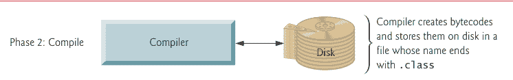

**图 1.7** | 典型的 Java 开发环境——编译阶段。

### 第 3 阶段：加载程序

在第三阶段，JVM 将程序放入内存中——这被称为加载。类文件可以从磁盘或通过网络（例如你的本地计算机或互联网）加载。要执行 Java 应用，你在命令行窗口中输入：

```
java Welcome
```


### 第 4 阶段：字节码验证

验证器检查字节码以确保它们是有效的且没有违反 Java 的安全限制（见图 1.9）。Java 强制执行安全，以确保通过网络到达的 Java 程序不会损坏你的文件或系统。

### 第 5 阶段：执行

在第五阶段，JVM 执行程序的字节码，执行程序指定的操作（见图 1.10）。

## 可能出现的问题

程序可能在第一次尝试时无法运行。之前的每个阶段都可能因为我们在本书书中讨论的各种错误而失败。例如，一个正在执行的程序可能会尝试除以零（在 Java 的整数算术中是非法操作）。这会导致 Java 程序显示错误消息。如果发生这种情况，你将不得不返回到编辑阶段，进行必要的修正，并继续后续阶段（以确定修正已修复问题）。

> [注：大多数 Java 程序都会输入或输出数据。当我们说一个程序显示消息时，我们通常是指它显示在你的计算机屏幕上。消息和其他数据也可能被输出到其他设备，例如磁盘和硬拷贝打印机，甚至可以输出到网络以传输到其他计算机。]

**常见编程错误 I.1**
在程序运行时发生如除以零之类的错误，因此它们被称为运行时错误或执行时错误，它们会导致程序立即终止，而无法成功完成任务。非致命错误允许程序运行完成，但产生错误的结果。

## 测试 Java 应用程序

在本节中，你将运行并与你的第一个 Java 应用程序进行交互。你将在接下来的练习中构建的 Painter 应用程序将展示你看到的元素和功能，这些都是你在书中学习编程的典型内容。使用 Painter 的图形用户界面（GUI），你可以控制绘图颜色、要绘制的形状（线条、矩形或椭圆）以及形状是否填充绘图颜色。你还可以将添加的形状添加到图中或添加整幅图。

> [注：我们使用不同的字体来区分功能，如标题和菜单（例如“文件”菜单）使用无衬线 Helvetica 字体，并用以强调非零元素，如文件名、程序代码或输入（例如 `ProgramName.java`），使用无衬线 Lucida 字体。]

本节的步骤展示了如何从你系统上的命令提示符（Windows）、终端（OS X）或 shell（Linux）窗口执行 Painter 程序。在整本书中，我们将这些窗口简称为“命令窗口”。执行以下步骤来使用 Painter 应用程序画一个笑脸：

1. **检查你的设置。** 在开始之前，请确认你已经在计算机上正确设置了 Java，你已将书中的示例复制到硬盘中，并且你知道如何在你的系统上打开命令窗口。
2. **切换到已完成应用程序的目录。** 现在使用 `cd` 命令切换到 Painter 应用程序所在的目录（也称为文件夹）。我们假设书中的示例位于 Windows 的 `C:\examples` 或 Linux/OS X 的 `user/examples` 文件夹中。在 Windows 上输入 `cd C:\examples\ch01\painter`，然后按回车。在 Linux/OS X 上，输入 `cd ~/examples/ch01/painter`，然后按回车。
3. **运行 Painter 应用程序。** 回想命令后接应用程序名称——class 文件（在本例中 `Painter`）即可执行应用程序。输入命令 `java Painter` 并按回车执行该程序。图 1.11 显示了程序分别在 Windows、Linux 和 OS X 上运行的情况——我们缩短了窗口以节省空间。

### 图 1.11 | 在 Windows 7、Linux 和 OS X 上执行的 **Painter** 程序。

**a) 在 Windows 上运行的 Painter 程序**

选择颜色
选择一个形状
指定矩形或椭圆是否填充

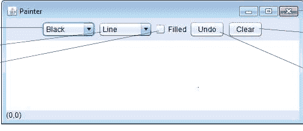

关闭按钮
清除整幅图
撤销上一个添加到图中的形状

**b) 在 Linux 上运行的 Painter 程序**

关闭按钮

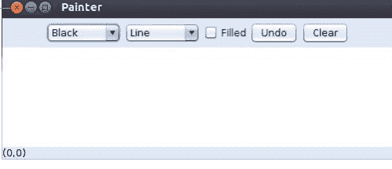

**c) 在 OS X 上运行的 Painter 程序**

关闭按钮

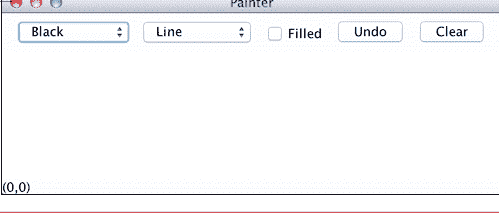

> [注：Java 命令是大小写敏感的——即大写字母和小写字母不同。以大写字母 P 输入 Painter 此应用程序的名称至关重要。否则，应用程序将无法执行。在使用 Java 命令时指定 `.class` 扩展会导致错误。此外，如果你收到错误消息“Exception in thread "main" java.lang.ClassDefFoundError: Painter”，说明你的系统存在 CLASSPATH 问题。请参考“在此之前”部分的说明来帮助你修复此问题。]

4. **为脸部画一个填充的黄色椭圆。** 选择 Yellow（黄色）作为绘图颜色，Oval（椭圆）作为形状并勾选 Filled（填充）复选框，拖动画出一个大椭圆（图 1.12）。

> **图 1.12** | 为脸部画一个填充的黄色椭圆。
> 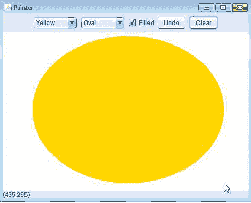

5. **画蓝色的眼睛。** 选择 Blue（蓝色）作为绘图颜色，然后画两个小椭圆作为眼睛（图 1.13）。

> **图 1.13** | 画蓝色的眼睛。
> 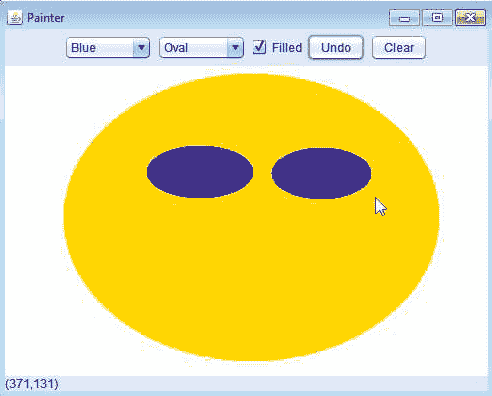

6. **画黑色眉毛和鼻子。** 选择 Black（黑色）作为绘图颜色，Line（线条）作为形状，然后画眉毛和鼻子（图 1.14）。线条没有填充，因此在画线时，勾选 Filled 复选框无效。

> **图 1.14** | 画黑色眉毛和鼻子。
> 

7. **画品红色嘴巴。** 选择 Magenta（品红）作为绘图颜色，Oval（椭圆）作为形状，然后画一个嘴巴（图 1.15）。

> **图 1.15** | 画品红色嘴巴。
> 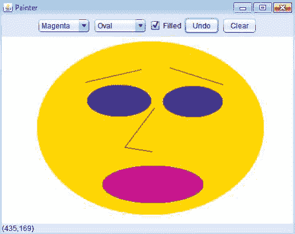

8. **在嘴上画一个黄色椭圆形成微笑。** 选择 Yellow（黄色）作为绘图颜色，然后画一个椭圆将品红色椭圆变成微笑（图 1.16）。

> **图 1.16** | 在嘴上画一个黄色椭圆形成微笑。
> 

9. **退出应用程序。** 要退出应用程序，点击关闭按钮（在 Windows、Linux 和 OS X 上位于右上角）。

# 第一章 计算机、互联网与 Java 简介

## 1.11 互联网与全球网

| Web 服务来源 | 用途 |
| --- | --- |
| YouTube | 视频搜索 |
| Facebook | 社交网络 |
| Instagram | 照片共享 |
| Foursquare | 移动签到 |
| LinkedIn | 商务社交网络 |
| Groupon | 社交电子商务 |
| Netflix | 电影租赁 |
| eBay | 互联网拍卖 |
| Wikipedia | 协作百科书 |
| PayPal | 支付 |
| Last.fm | 互联网电台 |
| Amazon 电子商务 | 购买书籍及许多其他产品 |
| Skype | 互联网电话 |
| Microsoft Bing | 搜索 |
| Flickr | 照片共享 |
| Zillow | 房地产定价 |
| Yahoo Search | 搜索 |
| WeatherBug | 天气 |

> **图 1.17** | 一些流行的 Web 服务 (www.programmableweb.com/apis/directory/17sortmashups)。（部分 2，共 2 部分。）

### 1.11.4 Ajax

Ajax 帮助基于互联网的应用程序运行得像桌面应用程序一样——考虑到此类应用程序在你的计算机和互联网服务器连接之间往返数据会导致传输延迟，这是一项挑战。通过使用 Ajax，像 Google Maps 这样的应用程序已经实现了卓越的性能以及桌面应用程序的视觉体验。尽管我们在本文中没有介绍“原生”Ajax 编程（这非常复杂），但我们在在线版第 31 章中展示了如何使用 JavaServer Faces (JSF) Ajax 组件来构建启用 Ajax 的应用程序。

### 1.11.5 物联网

互联网不再仅仅是计算机网络——它是一个物联网。“物”是指任何具有 IP 地址并能够通过网络自动发送数据的对象——例如，带有用于支付过路费的响应器的汽车、植入人体的心率监测器、报告能源使用情况的智能仪表、可以跟踪你的移动和位置的移动应用程序，以及根据天气预报和室内环境调整房间温度的智能恒温器。你将在在线版第 28 章中使用 IP 地址来构建网络应用程序。

## 1.12 软件技术

图 1.18 列出了你在软件开发社区中会听到的许多热门术语。我们为其中许多主题创建了资源中心，更多内容即将推出。

**图 1.18 | 软件技术。（部分 1，共 2 部分）**

| 技术 | 说明 |
| --- | --- |
| 敏捷软件开发 | 敏捷软件开发是一套尝试更快实现软件并使用更少资源的方法论。查看敏捷联盟 (www.agilealliance.org) 和敏捷宣言 (www.agileifesto.org)。 |
| 重构 | 重构涉及重做程序以使其更清晰、更易维护，同时保持其正确性和功能。它在敏捷开发方法中被广泛采用。许多 IDE 内置了重构工具，可以自动完成大部分重工作。 |
| 设计模式 | 设计模式是用于构建可维护的面向对象软件的证明架构。设计模式领域试图列举反复出现的模式，鼓励软件设计人员通过复用以更少的时间、金钱和精力开发出质量更好的软件。我们在在线版附录 N 中讨论了设计模式。 |
| LAMP | LAMP 是开发者用于构建 Web 应用的开源技术的缩写——它代表 Linux、Apache、MySQL 和 PHP（或 Perl——另外两种脚本语言）。MySQL 是一个开源数据库管理系统。PHP 是开发 Web 应用最流行的开源服务器端“脚本”语言。Apache 是最流行的 Web 服务器。Windows 对应的术语是 WAMP——Windows、Apache、MySQL 和 PHP。 |
| 软件服务 (SaaS) | 软件通常被视为一种产品；大多数软件都是以这种方式提供的。如果你想运行一个应用程序，你需要从供应商处购买软件包——通常是 CD、DVD 或网络下载。然后将该软件安装在计算机上并根据需要运行。当新版本出现时，你需要升级软件，这通常需要花费大量的时间和金钱。对于在各种计算机设备上维护数千个系统的组织来说，这个过程可能会变得非常繁琐。通过 SaaS，软件运行在互联网各处的服务器上。当更新时，全球所有的客户端都能看到新功能——无需本地安装。你通过浏览器访问服务。浏览器具有良好的移植性，因此可以在世界任何地方的计算机上运行相同的应用程序。Salesforce.com、Google 以及微软的 Office Live 和 Windows Live 都提供 SaaS。 |
| 平台服务 (PaaS) | 平台服务 (PaaS) 为在 Web 上服务开发和运行应用程序提供计算平台，而不是在你的计算机上安装工具。一些 PaaS 提供商包括 Google App Engine、Amazon EC2 和 Windows Azure™。 |

**图 1.18 | 软件技术。（部分 2，共 2 部分）**

| 技术 | 说明 |
| --- | --- |
| 云计算 | SaaS 和 PaaS 是云计算的示例。你可以使用存储在“云端”的软件和数据——即通过互联网在远程计算机（服务器）访问并按需使用——而不是将其存储在你的桌面、笔记本计算机或移动设备上。这允许你根据随时需要增加或减少计算资源，这比购买硬件来提供足够的存储和处理能力以满足偶尔的需求更有效益。云计算还通过将管理这些应用的负担转移给服务提供商来节省费用。 |
| 软件开发包 (SDK) | 软件开发包包含了开发者用于编写应用程序的工具和文档。例如，你将使用 Java 开发包 (JDK)。 |

软件是复杂的，可能需要几个月或数年才能实现。

**图 1.19 | 软件产品术语**

| 版本 | 说明 |
| --- | --- |
| Alpha | Alpha 是软件产品的早期发布版本，通常包含 Bug、不完整且不稳定。 |
| Beta | Beta 版本发布给相对较少的开发者进行测试，但仍可能发生变化。 |
| 发布候选版本 | 发布候选版本几乎完成并经过完善。 |
| 最终发布 | 在修复主要 Bug 后，将最终产品发布给普通大众。 |
| 持续 Beta | 使用这种方法开发的软件（例如 Google 搜索或 Gmail）通常没有版本号。 |

## 1.13 跟进信息更新

图 1.20 列出了帮助你跟上技术动态的关键技术和商业出版物。你还可以在 deitel.com/ResourceCenters.html 找到不断增加的互联网相关资源中心。

**图 1.20 | 技术和商业出版物**

| 出版物 | URL |
| --- | --- |
| AllThingsD | allthings.com |
| Bloomberg Business Week | www.businessweek.com |
| CNET | news.cnet.com |
| Communications of the ACM | cacm.acm.org |
| Computerworld | www.computerworld.com |
| Engadget | www.engadget.com |
| eWeek | www.eweek.com |
| Fast Company | www.fastcompany.com/ |
| Fortune | money.cnn.com/magazines/fortune |
| GigaOM | gigaom.com |
| Hacker News | news.ycombinator.com |
| IEEE Computer Magazine | www.computer.org/portal/web/computingnow/ |
| InfoWorld | www.infoworld.com |
| Mashable | mashable.com |
| PCWorld | www.pcworld.com |
| SD Times | www.sdtimes.com |
| Slashdot | slashdot.org/ |
| Technology Review | technologyreview.com |
| Techcrunch | techcrunch.com |
| The Next Web | thenextweb.com |
| The Verge | www.theverge.com |
| Wired | www.wired.com |

# 自测练习

## 1.1 为下列陈述填空：

a) 计算机在一组称为 ____ 的控制下处理数据。
b) 计算机的逻辑单元是 ____、____ 和 ____。
c) 本章使用的三种语言是 ____、____ 和 ____。
d) 将高级语言程序翻译成机器语言的程序被称为 ____。

---

# 自测练习题 31 答案

e) 是一种基于 Linux 内核和 Java 的移动设备操作系统。
f) 软件通常是功能完备的、（据说是）免费且可供社区使用的。
g) Wii 遥控器以及许多手机都使用一种，这使得设备能够对显示器做出响应。

填空关于 Java 环境的以下句子：

- a) 来自 JDK 的 `java` 命令执行一个 Java 程序。
- b) 来自 JDK 的 `javac` 命令编译 Java 程序。
- c) Java 源代码文件必须以 `.java` 文件扩展结尾。
- d) 当 Java 程序被编译时，编译器产生的文件以 `.class` 文件扩展结尾。
- e) Java 编译器产生的文件包含由 Java 虚拟机执行的。

填空以下陈述的空白（基于第 1.5 节）：

- a) **封装** 是一种设计实践，尽管对象可能知道如何通过定义良好的接口相互通信，但通常不允许它们知道其他对象是如何实现的。
- b) Java 程序员专注于创建**类**，它们包含字段以及操纵这些字段并为客户端提供服务的的方法。
- c) 从面向对象的角度分析和设计系统的过程被称为**面向对象分析和设计 (OOAD)**。
- d) 可以通过**继承**创建一个新的对象类（子类从现有类（称为父类）的特征开始，对其进行自定义并添加自己的独特特征）。
- e) **统一建模语言 (UML)** 是一种图形语言，允许设计软件系统的人使用行业标准符号来表示它们。
- f) 对象的尺寸、形状、颜色和重量被认为是对象的**属性**。

# 自测练习答案

- I.1 a) 程序，b) 输入输出，内存单元，中央处理器，算术逻辑单元，存储单元。c) 机器，汇编语言，高级语言。d) 编译器。e) Android。f) 发布候选版本 (Release candidate)。g) 加速度计。
- I.2 a) `java`。b) `javac`。c) `java`。d) `.class` e) 字节码。
- I.3 a) 信息隐藏。b) 类。c) 面向对象分析设计 (OOAD) d) 继承。e) 统一建模语言 (UML)。f) 属性。

# 练习

填空以下陈述的空白：

- I.4 a) 接收计算机外部信息并供计算机使用的逻辑单元是**输入设备**。
- b) 指示计算机解决问题的过程被称为**编程**。
- c) **高级语言**是一种计算机语言，它使用英语缩写作为中文指令。
- d) **输出设备** 是发送由各种设备处理过的信息的逻辑单元，以便在计算机外部使用。
- e) **存储器** 是计算机中保留信息的逻辑单元。
- f) **处理器** 是执行计算的计算机逻辑单元。
- g) **控制器** 是做出逻辑决策的计算机逻辑单元。
- h) **高级** 语言对程序员来说快速方便地编写程序最方便。
- i) 计算机可以直接理解的唯一语言是该计算机的**机器码**。
- j) **控制器** 是协调所有其他逻辑单元活动的计算机逻辑单元。

填空每个陈述中的空白：

- a) 现在用于开发大型企业级应用、增强 Web 服务器功能、为消费设备提供应用程序以及用于许多其他目的的编程语言是 **C++**。
- b) 最初被广泛认为是 UNIX 操作系统的开发语言的是 **C**。
- c) **TCP** 确保了由名为“字节”的顺序编号组成的消息通过正确路由从发送者传输到接收者，完整到达并按正确顺序组装。
- d) 该编程语言是由 Bjarne Ststrup 在 20 世纪 80 年代初在贝尔实验室开发的：**C++**。

填空每个陈述中的空白：

- a) Java 程序通常经过五个阶段，并**执行**。
- b) **集成开发环境 (IDE)** 提供了许多支持软件开发过程的工具，如用于编写和编辑程序的编辑器、定位程序中错误的调试器以及许多其他功能。
- c) `java` 命令执行 Java 程序。
- d) **Java 虚拟机 (JVM)** 是一个模拟计算机的软件应用程序，但为与其交互的程序隐藏了底层操作系统和硬件。
- e) **加载** 取包含程序字节码的 .class 文件并将其传输。
- f) **字节码验证器** 检查字节码以确保其有效性。

解释 Java 程序的两个编译阶段。

世界上最常见的物体之一是手表。讨论以下术语和概念如何应用于手表的概念：对象、属性、类、继承（例如，考虑闹钟）、建模、消息、封装和接口、信息隐藏。

# 改变世界 (Making a Difference)

在整本书中，我们包含了“改变世界”练习，在这些练习中，你将被要求对个人、社区、国家和世界真正重要的项目工作。有关致力于改变世界的全球组织的信息以及相关的编程项目，请访问我们的“改变世界中心”：www.deitel1.com/makingdifference。

## 1.9 (试用：碳足迹计算器)

一些科学家认为碳排放（燃烧化石燃料产生的燃料）对全球变暖有显著影响，如果个人采取措施限制碳基燃料的使用，将对此有所帮助。组织和个人日益关注他们的“碳足迹”。像 TerraPass 这样的网站：


http://www.terrapass.com/carbon-footprint-calculator/

```
和 Carbon Footprint
```

http://www.carbonfootprint.com/calculator.aspx

```
提供了碳足迹计算器。测试这些计算器以确定你的足迹。后续章节的练习将要求你编写自己的碳足迹计算器。

I.10 (试用：体重指数计算器) 肥胖会导致糖尿病和心脏病等疾病的增加。为了判断一个人是否超重或肥胖，可以使用称为身体质量指数 (BMI) 的测量。美国卫生和人类服务部提供了一个 BMI 计算器，地址为 http://www.cdc.nih.gov/guidelines/obesity/bmical.htm。使用它计算你的 BMI。后续练习将要求你编写 BMI 计算器。

I.11 (混合动力汽车的属性) 在这一章中，你学习了类的基础知识。现在你将填充“混合动力汽车”类的某些方面。混合动力汽车越来越受欢迎，因为它们的油耗通常比纯汽油汽车更好。浏览网页并研究今天四到五种混合汽车的特征，然后尽可能列出它们与混合相关的属性。一些常见的属性包括城市每加英里和高速每加英里。还要列出电池的属性（类型、重量等）。

I.12 (性别中立) 许多人希望消除所有形式交流中的性别。你被要求创建一个程序，可以处理段落文本并将性别特定词替换为性别中性词。假设你已经收到了一份性别特定词及其中性替换词的列表（例如，将“妻子”和“丈夫”替换为“配偶”，将“男人”和“女人”替换为“人”，将“女儿”和“儿子”替换为“孩子”），解释你读取段落文本并手动执行这些替换的过程。你的程序可能会产生“wopertchild”这种奇怪的术语吗？

# 2 Java 简介
应用程序；输入/输出与运算符

名字意味着什么？
我们称之为玫瑰的花
即使换一个名字
它的香气依然芬人。
—威廉·莎士比亚

语言最大的优点
是清晰清晰。
—盖伦（Galen）

一个人可以改变世界
只要每个人都
尝试。
—约翰·F·肯尼迪

# 目标

在本章中，你将：

- 编写简单的 Java 应用程序。
- 使用输入和输出语句。
- 学习 Java 的基本类型。
- 理解基础内存概念。
- 使用算术运算符。
- 学习算术运算符的优先级。
- 编写决策语句。
- 使用关系和相等运算符。


## 2.1 简介

- 2.2 你的第一个 Java 程序：打印一行文本
- 2.3 修改你的第一个 Java 程序
- 2.4 使用 printf 显示文本
- 2.5 另一个练习：整数相加
- 2.5.1 导入声明
- 2.5.2 声明 Addition 类
- 2.5.3 创建并使用 Scanner 从键盘获取输入
- 2.5.4 存储整数的变量
- 2.5.5 提示输入
- 2.5.6 从用户处获取 int 输入
- 2.5.7 提示输入第二个 int
- 2.5.8 在计算中使用变量
- 2.5.9 显示计算结果
- 2.5.10 Java API 文档
- 2.6 内存概念
- 2.7 算术
- 2.8 决策：相等和关系运算符
- 2.9 总结

总结 | 自测练习题 | 自测练习题答案 | 练习题 | 改变世界

## 2.1 简介

本章介绍了 Java 编程。我们从在屏幕上显示（输出）消息的程序示例开始。然后，我们展示了一个从用户处获取（输入）两个数字、计算它们的和并显示结果的程序。你将学习如何指示计算机执行算术计算并保存结果以备后用。最后一个示例演示了如何做出决策。该应用程序比较两个数字，然后显示消息展示比较结果。你将使用 JDK 命令行工具来编译和运行本章的程序。如果你更喜欢使用集成开发环境（IDE），我们还提供了 https://www.deitel.com/books/jhtp10/ 来深入介绍 Eclipse、NetBeans 和 IntelliJ。

## 2.2 你的第一个 Java 程序：打印一行文本

Java 应用程序是在使用命令启动 Java 虚拟机（JVM）时执行的计算机程序。在本节的后半部分，我们将讨论如何编译和运行 Java 应用程序。我们首先考虑一个显示一行文本的简单应用程序。图 2.1 显示了该程序，随后是一个显示其输出的框。

```java
// Fig 2.1: Welcome1.java

// 文本打印程序。

public class Welcome1 {

    // main 方法开始执行 Java 应用程序

    public static void main(String[] args) {

        System.out.println("Welcome to Java Programming!");

    } // 结束方法 main

} // 结束类 Welcome1
```

图 2.1 | 文本打印程序。（部分，共 2 部分）

欢迎来到 Java 编程！

**图 2.1** | 文本打印程序。（部分，共 2 部分）

该程序包含行号。我们出于教学目的添加了这些数字——它们不是 Java 程序的一部分。这个示例说明了几个重要的 Java 特性。我们将看到第 9 行在执行工作——在屏幕上显示 `Welcome to Java Programming!` 这个短语。

### 为程序编写注释

我们插入注释来记录程序并提高其可读性。Java 编译器会忽略注释，因此在程序运行时，它们不会导致计算机执行任何操作。

按照惯例，我们每个程序都以一个指示图号和文件名的注释开始。第 1 行的注释

```java
// Fig 2.1: Welcome1.java
```

以 `//` 开头，表示这是一个行尾注释——它在出现 `//` 的行末尾终止。行尾注释不需要另起一行；它也可以从一行的中间开始一直到行尾（如第 6、10 和 11 行）。第 2 行

```java
// Text-printing program.
```

按照惯例，这是一个描述程序目的的注释。Java 还有传统的注释，可以跨越多行，如下所示：

```java
/* 这是一个传统的注释。它
可以跨越多行 */
```

这些注释以分隔符 `/*` 和 `*/` 开始并结束。编译器会忽略分隔符之间的所有文本。Java 分别从 C 和 C++ 编程语言引入了传统注释和行尾注释。我们更倾向于使用 `//` 注释。
Java 提供了第三种注释——Javadoc 注释。它们由 `/**` 和 `*/` 分隔。编译器会忽略分隔符之间的所有文本。Javadoc 注释允许你直接在程序中嵌入程序文档。此类注释是 Java 首选的注释类型，我们使用它们来准备程序文档。Javadoc 工具（JDK 的一部分）读取 Javadoc 注释，并使用它们来准备 HTML 格式的程序文档。我们在在线附录 G“使用 Javadoc 创建文档”中演示 Javadoc 注释和 Javadoc 工具。

### 常见错误

当编译器遇到违反规则的代码时，就会发生语法错误。语法错误也被称为编译时错误，因为编译器在编译时检测到它们。

## 2.2 你的第一个 Java 程序：打印一行文本


### 良好实践

按照惯例，我们每个程序都以一个指示图号和文件名的注释开始。


### 预防技巧

当你编写新程序或修改现有程序时，保持你的注释与代码同步。


### 使用空行

第 3 行是一个空行。空行、空格和制表符使程序更容易阅读。它们统称为空白字符（whitespace）。编译器会忽略空白字符。


### 公共类的文件名

类必须存于文件名名为 `ClassName.java` 的文件中，因此类 `Welcome1` 存储在文件 `Welcome1.java` 中。

## 第2章 Java 应用程序简介：输入/输出与操作符

Java 是区分大小写的——大写字母和小写字母是不同的——因此 `value` 和 `Value` 是不同的（但都是合法的）标识符。

## 类正体

一个左括号（如第 5 行）`{` 开始每个类声明的主体。相应的右括号（如第 11 行）`}` 必须结束每个类声明。第 6–10 行进行了缩进。


> ### 良好的编程实践 2.3
> 将每个类声明的整个正体在界定类体的左括号和右括号之间缩进一个“级别”。这种格式强调了类的结构，并使其更易阅读。我们使用三个空格作为一级缩进——许多程序员更倾向于使用两个或四个空格。无论你选择哪种，请务必保持一致。


> ### 错误预防技巧 2.2
> 当你输入左括号 `{` 时，立即输入右括号 `}`，然后将光标移动到两个括号之间，并在输入正体之前进行缩进。这种做法可以防止因缺少括号导致的错误。许多 IDE 会在你输入左括号时自动插入右括号。


> ### 常见编程错误 2.3
> 如果括号没有成对出现，则属于语法错误。


> ### 良好的编程实践 2.4
> IDE 通常会为你自动缩进代码。Tab 键也可以用于缩进代码。你可以配置每个 IDE 来指定按下 Tab 键时插入的空格数。

## 声明方法

第 6 行

```java
// main method begins execution of Java application
```

是一个行尾注释，指明程序第 7–10 行的。第 7 行

```java
public static void main(String[] args)
```

是每个 Java 应用程序的起点。标识符 `main` 周围的括号表示它是一个称为“方法”的程序构建块。Java 类通常包含一个或多个方法。对于 Java 应用程序，其中一个方法必须命名为 `main` 并按第 7 行所示定义；否则，Java 虚拟机 (JVM) 将不会执行该程序。方法执行任务，并在完成任务时可以返回信息。我们在第 3.2.5 节中解释关键字 `static` 的作用。关键字 `void` 表示此方法将不返回任何信息。稍后，我们将看到方法如何返回信息。现在，只需在你的 Java 应用程序中模仿 main 的第一行即可。在第 7 行中，括号中的 `String[] args` 是方法声明的必要部分——我们将在第 7 章中讨论这一点。

第 8 行的左括号开始方法声明的主体。相应的右括号必须结束它（第 10 行）。方法正体中的第 9 行在括号之间进行了缩进。

## 2.2 你的第一个 Java 程序：打印一行文本

## 良好的编程实践 2.5

> 将每个方法声明的整个正体在括号之间缩进一个“级别”，这使得方法的结构脱颖而出，并使方法声明更易阅读。

使用 `System.out.println` 执行输出

```java
System.out.println("Welcome to Java Programming!");
```

指示编译器执行一个动作——即显示双引号包含的字符（引号本身不显示）。双引号和它们之间的字符共同构成了一个字符串——也称为字符字面量或字符串字面量。字符串中的空白字符不会被编译器忽略。字符串不能跨多行代码。

`System.out` 对象是为你预定义的——作为它执行操作的标准命令窗口。它允许 Java 应用程序在命令窗口中显示信息。在最近的 Microsoft Windows 版本中，命令窗口是命令提示符 (Command Prompt)。在 UNIX/Linux/Mac OS 中，命令窗口被称为终端 (terminal) 或 shell。许多程序员可以只需简单地调用该命令。

`println()` 方法在命令窗口中显示一行文本。第 9 行括号中的字符串是该方法的参数。当 `System.out.println` 完成其任务时，它会将输出光标（下一个字符将显示的位置）置在命令窗口下一行的开头。这与你在文本编辑器中输入字时按 Enter 键的情况类似——光标出现在文档下一行的开头。

整个第 9 行，包括 `System.out.println`、括号中的参数 `"Welcome to Java Programming!"` 以及分号 (`;`)，是一条语句 (statement)。一个方法通常包含一个或多个执行其任务的语句。大多数语句以分号结尾。当第 9 行的语句执行时，它会在命令行中显示 `Welcome to Java Programming`。

在学习编程时，有时“弄坏”程序是有帮助的，这样你就可以熟悉编译器的语法错误信息。这些信息并不总是指出代码中的确切问题。当你遇到错误时，它会给你一个产生原因的线索。[尝试从图 2.1 的程序中删除一个分号或括号，然后重新编译程序以查看生成的错误信息。]

## 错误预防技巧 2.3

> 当编译器报告语法错误时，它可能不是错误所在的代码行。首先，检查错误信息所在的行。如果在该行没有发现错误，请检查之前的行。

## 使用行尾注释提高可读性

为了帮助初学者，我们在结束方法定义的右括号以及结束类定义的右括号之后包含了行尾注释。例如，第 10 行

```java
// end method main
```

表示方法 main 的结束，而第 11 行

```java
// end class Welcome1
```

表示类 Welcome1 的结束。我们将在书中省略此类结束注释。

### 编译你的第一个 Java 应用程序

我们现在要编译并运行程序。假设你使用的是 Java 开发包的命令行工具，而不是 IDE。为了帮助你在 IDE 中编译运行程序，我们提供了针对 Eclipse、NetBeans 和 IntelliJ IDEA 的在线视频。这些位于书籍网站：

```
http://www.deitel.com/htp10
```

为了准备编译程序，输入

```
cd c:\examples\ch02\fig02_01
```

进入 fig02_01 目录。在 UNIX/Linux/Max OS 上，命令 cd

```
~/examples/ch02/fig02_01
```

切换 fig02_01 目录。编译程序时输入

```
javac Welcome1.java
```


# 第 2 章 Java 应用介绍：输入/输出与运算符

如果程序没有错误，此命令将创建一个新文件 `Welcome1.class`（Welcome1 的类文件），包含表示应用程序的平台无关字节码。当我们使用 `java` 命令在给定平台上执行应用程序时，JVM 将这些字节码转换为操作系统和硬件理解的指令。


## 常见编程错误 2.4

> 当使用 `javac` 时，如果你收到如“无效命令或 'filename'”、“'javac' 不是外部命令、可执行程序或批处理文件”的消息，那么你的 Java 软件安装没有正确完成。这表明系统的 PATH 环境变量未正确设置。仔细检查书中 Before You 部分的安装说明。在某些系统中，在修复 PATH 后，你可能需要重启计算机或打开新的命令窗口才能生效。

每个语法错误信息都包含错误发生的文件名和行号。例如，`Welcome1.java` 表示在 `Welcome1.java` 的第 6 行存在错误。信息的其他部分提供了有关语法错误的信息。


## 常见编程错误 2.5

> 编译器错误信息“class Welcome1 is public, should be declared in a file named Welcome1.java”表示文件名与文件中的公共类名称不匹配，或者你在编译类时错误输入了类名。

## 2.3 修改你的第一个程序

### 运行 Welcome1 应用程序

本书假设示例位于 Windows 的 `C:\examples`，或者位于 Linux/OS X 的用户账户的 `Documents/examples` 文件夹中。要在命令行窗口中执行此程序，请切换目录到包含 `Welcome1.java` 的目录——Microsoft Windows 下 `C:\examples\ch02\fig02_01` 或 Linux/OS X 下 `~/Documents/examples/ch02/fig02_01`。输入 `java Welcome1` 并按回车。此命令加载 JVM，由 JVM 加载 Welcome1 类文件。该命令省略了 `.class` 文件名；否则 JVM 将无法执行程序。JVM 调用 Welcome1 的 `main` 方法。`main` 方法第 9 行的语句显示“Welcome to Java Programming!”图 2.2 显示了在 Microsoft Windows 命令提示符中运行的程序。[注：许多环境的命令行窗口具有黑色背景和白色文字。我们调整了这些设置以使我们的截图更具可读性。]

> **错误预防提示 2.4**
> 当运行 Java 程序时，如果收到类似“Exception in thread Java.NoClassNotFound: Welcome1, your CLSPATH environment has not been set properly.”的消息，请仔细复阅书中“开始之前”部分的说明。在某些系统上，在执行 CLSPATH 后，你可能需要重启计算机或打开新的命令行窗口。

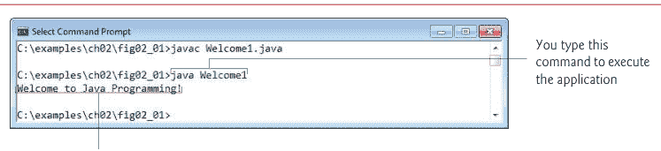

| 选择命令提示符 |
| :--- |
| C:\examples\ch02\fig02_01\java Welcome1.java |
| C:\examples\ch02\fig02_01\java Welcome1 |
| Welcome to Java Programming! |
| C:\examples\ch02\fig02_01> |

你输入此内容来执行应用程序。

程序输出到屏幕上：
`Welcome to Java Programming!`

**图 2.2 从命令提示符执行 Welcome1。**

### 使用多个语句显示单行文本

“Welcome to Java Programming”可以以多种方式显示。图 2.3 所示的 `Welcome2` 类使用两个语句（9–10 行）产生图 2.1 所示输出。[注：从现在起，我们将用黄色背景高亮每个代码列表中的新功能和关键特性，因为我们已经完成了 9–10 行。]

该程序与图 2.1 类似，因此我们只讨论这里的更改。第 2 行 `// Printing a line of text with multiple statements.` 是一个行尾注释，说明了程序的目的。

```java
// Fig. 2.3: Welcome2.java
// 使用多个语句打印一行
public class Welcome2
{
    // main 方法开始 Java 应用程序的执行
    public static void main(String[] args)
    {
        System.out.print("Welcome to ");
        System.out.println("Java Programming!");
    } // end main method
} // class Welcome2
```

Welcome to Java Programming!

**图 2.3** | 使用多个语句打印一行。

`main` 方法的 9–10 行：

```java
System.out.print("Welcome to ");
System.out.println("Java Programming!");
```

### 使用单个语句显示多行文本

单个语句可以使用换行字符显示多行，换行字符指示 `System.out.println` 方法将输出光标置于命令行窗口的下一行开头。与空行一样，空格字符和制表符也是如此。图 2.4 所示的程序使用了换行字符，在单个语句中显示多行。图 2.4 的大部分内容与图 2.1 和 2.3 相同。

```java
// Fig. 2.4: Welcome3.java
// 使用单个语句打印多行
public class Welcome3
{
    // main 方法开始 Java 应用程序的执行
    public static void main(String[] args)
    {
        System.out.println("Welcome to\nJava Programming!");
    } // end main method
}
```

Welcome to
Programming!

**图 2.4** | 使用单个语句打印多行。

第 9 行：

```java
System.out.println("Welcome to\nJava Programming!");
```

## 2.5 另一个应用：整数相加

`System.out.print` 或 `System.out.println` 的参数；然而，`System.out.println` 在参数后输出的换行符在不同操作系统之间是通用的。在线附录 I 介绍了 `printf` 格式化的一些细节。

我们的下一个应用是由用户通过键盘读取（或输入）两个整数（整数字，如 –22, 7, 0 和 1024），计算它们的和并显示出来。该程序必须跟踪用户提供的数字，以便在程序的后续进行计算。程序在计算机内存中记住数字和其他数据，并通过称为变量的程序元素访问数据。图 2.7 所示的程序演示了这些概念。在示例输出中，我们使用文本来标识用户的输入（即 45 和 72）。在之前的程序中，第 1–2 行说明了图表编号、文件名和程序的目的。

```java
// Fig 2.7: Addition.java
// 加法程序，输入两个数字，然后显示它们的和。
import java.util.Scanner; // 程序使用了 Scanner 类
public class Addition {
    public static void main(String[] args) {
        // 创建一个 Scanner 从命令行窗口获取输入
        Scanner input = new Scanner(System.in);
        int number1; // 第一个加数
        int number2; // 第二个加数
        int sum; // number1 和 number2 的和
        System.out.print("Enter integer: "); // 提示
        number1 = input.nextInt(); // 从用户处读取第一个数字
        System.out.print("Enter integer: "); // 提示
        number2 = input.nextInt(); // 从用户处读取第二个数字
        sum = number1 + number2; // 相加，并将总和存储在 sum 中
        System.out.printf("Sum is %d\n", sum); // 显示和
    } // 方法结束
} // 类 Addition结束
```

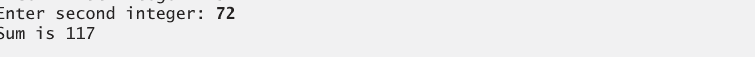

**图 2.7** | 加法程序，输入两个数字，然后显示它们的和。

### 2.5.1 import 声明

Java 的一大强大之处在于它有一组预定义的类，你可以重用它们，而不是“重新发明轮子”。这些类被分组在包中——相关类的命名命名组——并统称为 Java 类库，即 Java 应用程序接口（Java API）。第 3 行：

```java
import java.util.Scanner; // 程序使用了 Scanner 类
```

是一个 import 声明，有助于编译器编译此程序中使用的类。它表示该程序使用了来自 `java.util` 包的预定义 `Scanner` 类（稍后将讨论）。编译器随后确保你正确使用该类。

## 常见编程错误 2.7


所有的 import 声明都必须出现在文件中第一个类声明之前。在类声明内部或之后放置 import 声明会导致语法错误。

## 常见编程错误 2.8


忘记包含某个必须类的 import 声明会导致编译错误，遇到如“cannot find symbol”（找不到符号）的消息。当发生这种情况时，请检查你是否提供了正确的 import 声明，以及其中的名称是否正确（包括正确的大小写）。

## 软件工程观察 2.1

在每个新版本中，API 通常包含新功能，用于修复错误、提高性能或提供完成任务的方法。相应的旧版本不再需要且不应使用。此类 API 将被弃用并可能从后续版本中删除。

> 在浏览在线 API 文档时会遇到过用的 API。当你编译使用过用 API 代码时，编译器会发出警告。如果你使用命令行参数 `-deprecation` 编译代码，编译器会告诉你正在使用哪些过用的特性。对于每一个特性，在线文档（http://docs.oracle.com/java/7/docs/api/）通常指向替换过用特性的新新链接。

### 2.5.2 声明类 Addition

第 5 行：

```java
public class Addition
```

开始声明类 `Addition`。该类的文件名必须是 `Addition.java`。请记住，每个类声明的主体以左大括号（第 6 行）开始，以右大括号（第 27 行）结束。

应用程序从 `main` 方法主体开始执行，相应的右大括号（第 9 行）标记 `main` 主体的开始，第 26 行标记其结束。方法 `main` 在 `Addition` 类主体中缩进一层，`main` 主体中的代码再缩进一层以提高可读性。

### 2.5.3 声明并创建 Scanner 从键盘获取输入

`Scanner` 变量必须在程序中使用之前进行声明。变量名可以是任何有效的标识符——由字母、数字、下划线 (`_`) 和美元符号 (`$`) 组成且不以数字开头。变量名指定了程序中的数据类型。声明语句以分号 (`;`) 结束。第 11 行：

```java
Scanner input = new Scanner(System.in);
```

是一个变量声明，指定了 `input` 的类型。该程序使用了来自 `java.util` 包的预定义 `Scanner` 类（稍后将讨论）。数据可以来自许多来源，如键盘或文件。第 11 行使用 `new` 关键字创建一个 `Scanner` 对象。标准输入 `System.in` 允许程序读取用户输入的字节。`Scanner` 将这些字节转换为类型（如 `int`）。

### 2.5.4 声明变量以存储整数

第 11–15 行的变量声明语句：

```java
int number1; // 第一个加数
int number2; // 第二个加数
int sum; // number1 和 number2 的和
```

声明变量 `number1`、`number2` 和 `sum` 持 `int` 类型的数据——它们可以持有整数值（如 72, -11 和 0）。变量尚未初始化。`int` 的范围是 -2,147,483,648 到 +2,147,483,647。[注意：程序中使用的 int 值不能带有逗号。]

其他类型的数据类型是用于实数的 `float` 和 `double`，以及用于字符数据的 `char`。实数包含小数点，例如 3.4、0.0 和 -11.99。`char` 类型的变量表示单个字符，如大写字母（例如 A）、数字（例如 7）、特殊字符（例如 *）或转义序列（例如制表符 `\t`）。`int`、`float`、`double` 和 `char` 是原始类型。原始类型是关键字且全全小写字母。附录 D 总结了八种原始类型的特征（`boolean`, `char`, `short`, `int`, `long`, `float` 和 `double`）。

多个变量可以在单个声明中声明，用逗号命名变量（即逗号分隔的变量名列表）。例如，第 13–15 行也可以写成：

```java
int number1, // 第一个加数
number2, // 第二个加数
sum; // number1 和 number2 的和
```

## 良好的编程习惯 2.7

在每个声明中声明每个变量。这种格式允许在每个声明的变量旁边插入描述性注释。


## 良好的编程实践 2.8

选择具有意义的变量名有助于程序实现自文档化（即人们只需通过阅读程序本身就能理解它，而无需阅读相关的文档或编写过多的注释）。

## 良好的编程实践 2.9

按照惯例，变量名标识符以小写字母开头，名称中第一个单词后的每个单词都以大写字母开头。例如，变量名 `firstNumber` 的第二个单词 `Number` 是以大写字母 `N` 开头的。这种命名约定被称为驼峰命名法（camel case），因为大写字母像骆驼一样凸显出来。

### 2.5.5 提示用户输入

第 17 行：

```java
System.out.print("Enter first integer: "); // prompt
```

使用 `System.out.print` 来显示消息 "Enter first integer: "。这条消息被称为“提示”（prompt），因为它引导用户执行特定操作。我们使用方法 `print` 而不是 `println`，以便用户的输入显示在与提示信息相同的同一行。回想第 2.2 节，以大写字母开头的标识符通常表示类。`System` 是 `java.lang` 包的一部分。注意，`System` 类没有在程序开头通过声明语句进行导入。

## 软件工程观察 2.2

默认情况下，`java.lang` 包在每个 Java 程序中都会导入；因此，`java.lang` 中的类是唯一不需要导入声明的类。

### 2.5.6 从用户处获取 int

第 18 行：

```java
number1 = input.nextInt(); // read first number from user
```

使用 `Scanner` 对象的 `nextInt` 方法从键盘用户处获取一个整数。

此时，程序会等待用户输入数字并按 Enter 键以将数字提交给程序。我们的程序假设用户输入的是有效整数。如果不是，将会发生运行时逻辑错误（runtime logic error）。第 11 章“异常处理：深入探讨”将讨论如何通过启用处理此类错误的能力来管理它们。这也被称为使你的程序具有容错性（tolerant）。

在第 18 行中，我们使用赋值运算符 `=` 将调用方法 `nextInt()` 的结果存储在变量 `number1` 中。该语句读为“number1 获取了 input.nextInt() 的值”。运算符被称为二元运算符（binary operator），因为它有两个操作数——`number1` 和方法调用 `input.nextInt()` 的结果。这条语句被称为赋值语句（assignment statement），它为变量分配一个值。赋值运算符 `=` 右侧的所有内容在执行赋值之前都会先求值。

## 良好的编程实践 2.10

在二元运算符两侧放置空格以提高可读性。

### 2.5.7 提示输入第二个 int

第 20 行：

```java
System.out.print("Enter second integer: "); // prompt
```

提示用户输入第二个整数。第 21 行：


number2 = input.nextInt(); // read second number from user

```
读取第二个整数并将其赋值给 `number2`。
```

### 2.5.8 在计算中使用变量

第 23 行

```
sum = number1 + number2; // add numbers then store total in sum
```

这是一个赋值语句，它计算变量 `number1` 和 `number2` 的和，并使用加法运算符 `+` 将结果赋值给变量 `sum`。语句读为“sum 获取了 number1+number2 的值”。当程序遇到加法操作时，它使用存储在 `number1` 和 `number2` 中的值进行计算。在前面的陈述中，加法运算符是一个二元运算符，它的两个操作数是变量 `number1` 和 `number2`。包含计算的语句部分被称为表达式（expressions）。事实上，表达式是任何具有关联值的语句。例如，表达式 `number1 + number2` 的值是这两个数字之和。同样地，表达式 `input.nextInt()` 的值是由用户键入的。

### 2.5.9 显示计算结果

执行计算后，第 25 行

```
System.out.printf("Sum is %d\n", sum); // display sum
```

使用 `System.out.printf` 显示和。格式指定符 `%d` 是 `int` 值（在本例中为 `sum` 的值）的占位符——`d` 代表“十进制整数”（decimal integer）。格式字符串中的其余字符都是固定文本。因此，`printf` 打印 `Sum is %d`，随后是 `sum` 的值（位于 `%d` 格式指定符的位置）和一个换行符。

计算也可以在 `printf` 语句内部执行。可以将第 23 行和第 25 行的语句合并为：

```
System.out.printf("Sum is %d\n", (number1 + number2));
```

表达式 `number1 + number2` 周围的括号是可选的——包含它们是为了强调整个表达式的值输出到 `%d` 格式指定符的位置。这种括号是为了冗余的。

### 2.5.10 Java API 文档

对于我们使用的新 Java API 类，我们使用它所在的包。这些信息帮助您在 Java API 文档中找到每个包和类的描述。该文档的网页版可以在此处找到：

```
http://docs.oracle.com/java/7/docs/api/index.html
```

您可以在“附加资源”（Additional Resources）部分下载它：

```
http://www.oracle.com/technetwork/java/javase/downloads/index.html
```

附录 F 显示了如何使用此文档。

## 2.6 内存概念

变量名 `number1`、`number2` 和 `sum` 实际上对应计算机内存中的位置。每个变量都有名称、大小（以字节计）和一个值。在图 2.7 的加法中，当执行以下语句（第 18 行）时：

```
number1 = input.nextInt(); // read first number from user
```

用户输入的数字被放置于对应名称 `number1` 的内存位置。假设用户输入了 45。计算机将该整数值置于位置 `number1`（图 2.8），替换该位置中之前的值（如果有）。之前的值将丢失，因此这个过程是具有破坏性的（destructive）。

| number1 |
| :--- |
| 45 |

> 图 2.8 | 显示变量 number1 名称和值的内存位置

当语句（第 21 行）

```
number2 = input.nextInt(); // read second number from user
```

执行时，假设用户输入了 45。计算机将该整数值置于位置 `number2`（注：原文此处可能误写为 number1，应为 number2）替换该位置中之前的值（如果有）。之前的值将丢失。

| number2 |
| :--- |
| 45 |

> 图 2.8 | 变量 number2 名称

## 2.7 算术

大多数程序执行算术。算术运算符总结在图 2.11 中。注意使用一些代数未使用的符号。星号（`*`）表示乘法，百分号（`%`）是余运算符，我们稍后会讨论。图 2.11 中的算术运算符是二元运算符，因为每个作用于两个操作数。例如，表达式 `f + 7` 包含二元运算符 `+` 和两个操作数 `f` 和 `7`。

| Java 操作 | 运算符 | 代数表达式 | Java 表达式 |
| :--- | :--- | :--- | :--- |
| 加法 | `+` | $f + 7$ | `f + 7` |
| 减法 | `-` | $p - c$ | `p - c` |
| 乘法 | `*` | $bm$ | `b * m` |
| 除法 | `/` | $x / y$ 或 $x \div y$ | `x / y` |
| 余数 | `%` | $r \mod s$ | `r % s` |

**图 2.11** | 算术运算符。

整数除法产生整数商。例如，表达式 `7 / 4` 的结果为 1，而表达式 `17 / 5` 的结果为 3。整数除法中的任何分数部分都会被*截断*（即*丢弃*）——不会舍入。Java 提供了余运算符 `%`，产生除后的余数。表达式 `x % y` 产生 `x` 除以 `y` 后的余数。`7 % 3` 和 `17 % 5` 的结果均为 2。余运算符通常用于整数，但也适用于其他算术类型。在本章的练习和后续章节中，考虑余运算符的若干有趣的应用，例如判断一个数字是否是另一个数字的倍数。

### 直线性形式的算术表达式

Java 中的算术表达式必须采用直线性形式，以便将程序输入计算机。因此，如“a 除以 b”之类的表达式必须写成 `a / b`，以便所有常量、变量和运算符都出现在同一行线上。以下代数表示法通常无法被编译器接受：

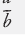

### 用于分组子表达式的括号

Java 中的括号用于对项进行分组，与代数表达式的方式相同。例如，要乘以数量 `b + c`，我们写成：

```
a * (b + c)
```

如果一个表达式包含嵌套括号，例如：

```
(a + b) * c
```

则最内层括号中的表达式（在本例中为 `a + b`）最先求值。

### 运算符优先级规则

Java 根据运算符优先级规则规定的顺序应用算术表达式中的运算符，这些规则通常与代数中遵循的规则相同：

1. 首先应用乘法、除法和取余运算符。如果表达式包含此类操作，它们将按照从左到右的顺序应用。乘法、除法和取余运算符具有相同的优先级。
2. 接下来应用加法和减法操作。如果表达式包含此类操作，运算符将从左到右应用。加法和减法运算符具有相同的优先级。

这些规则使得 Java 能够按照正确的顺序应用运算符。当我们说运算符从左到右应用时，指的是它们的结合性。某些运算符是从左到右结合的。图 2.12 总结了这些运算符优先级规则。附录 A 中包含完整的表格。

| 运算符 | 操作 | 求值顺序（优先级） |
| :--- | :--- | :--- |
| `*` `/` `%` | 乘法、除法、取余 | 先求值。如果有多个同类型的运算符，它们将从左到右求值。 |
| `+` `-` | 加法、减法 | 接下来求值。如果有多个同类型的运算符，它们将从左到右求值。 |
| `=` | 赋值 | 最后求值。 |

> 图 2.12 算术运算符的优先级。

### 代数表达式与 Java 表达式示例

让我们根据运算符优先级规则考虑几个表达式。每个示例都列出了一个代数表达式及其 Java 等效表达式。以下是五个项的算术平均值（平均数）的示例：

1. 我们使用简单的示例来解释表达式的求值顺序。在书中遇到的更复杂的表达式中会出现子标题级别的问题。关于求值的更多信息，请参阅《Java 语言规范》第 15 章。

| 代数 | Java |
| :--- | :--- |
| $m = \frac{a+b+c+d+e}{5}$ | `m = (a + b + c + d + e) / 5;` |

需要括号是因为除法的优先级高于加法。整个量 `(a + b + c + d + e)` 除以 5。如果错误地省略了括号，我们得到 `a + b + c + d + e / 5`，它的求值结果为：

```
a + b + c + d + e / 5
```

这是一个直线方程的示例：

| 代数 | Java |
| :--- | :--- |
| $y = mx + b$ | `y = m * x + b;` |

不需要括号。乘法运算符首先应用，因为乘法的优先级高于加法。赋值最后发生，因为它的优先级低于乘法或加法。

接下来的示例包含了取余（`%`）、乘法、除法、加法和减法操作：

| 代数 | Java |
| :--- | :--- |
| $z = pr \mod q + \frac{w}{x} - y$ | `z = p * r % q + w / x - y;` |

语句下圆圈的数字表示 Java 应用运算符的顺序。`*`、`%` 和 `/` 按从左到右的顺序首先求值（即从左侧结合），因为它们的优先级高于 `+` 和 `-`。接下来求值 `+` 和 `-` 操作。这些操作也从左到右应用。赋值（`=`）操作最后求值。

### 二次多项式的求值

为了更好地理解运算符优先级规则，请考虑一个包含二次多项式 $ax^2 + bx + c$ 的赋值表达式的求值：

```
y = a * x * x + b * x + c;
```

乘法操作按照从左到右的顺序首先求值（即从左侧结合），因为 Java 没有用于幂的算术运算符，所以 $x^2$ 表示为 `x * x`。（第 5.4 节显示了执行幂的替代方法。）加法操作接下来从左求值。假设 `a`、`b`、`c` 和 `x` 的初始化（给定值）如下：`a=2`、`b=3`、`c=7`、`x=5`。图 2.13 说明了运算符应用的顺序。

你可以使用冗余括号（不必要的括号）来使表达式更清晰。例如，前面的语句可以括起来为：

```
y = (a * x * x) + (b * x) + c;
```

步骤 1. `y = 2 * 5 * 5 + 3 * 5 + 7;`  `2 * 5` 等于 10（最左边的乘法）
步骤 2. `y = 10 * 5 + 3 * 5 + 7;`  `10 * 5` 等于 50（加法之前的乘法）
步骤 3. `y = 50 + 3 * 5 + 7;`  `3 * 5` 等于 15（最左边的乘法）
步骤 4. `y = 50 + 15 + 7;`  `50 + 15` 等于 65（最左边的加法）
步骤 5. `y = 65 + 7;`  `65 + 7` 等于 72（最后操作）

## 2.8 决策：相等与关系运算符

条件是一个可以是真或假的表达式。本节介绍了 Java 的选择语句，它允许根据条件的值做出决策。例如，“分数大于或等于 60”这一条件决定了学生是否通过了测试。如果 `if` 语句为真，则执行体；否则不执行。我们很快就会看到示例。

`if` 语句中的条件可以使用图 2.14 总结的相等运算符（`==` 和 `!=`）和关系运算符（`<`、`>`、`>=`、`<=`）形成。两个相等运算符具有相同的优先级，该优先级低于关系运算符。所有关系运算符具有相同的优先级并且从左到右结合。

| 代数运算符 | Java 相等或关系运算符 | 示例 Java 条件 | Java 条件的含义 |
| :--- | :--- | :--- | :--- |
| `=` | `==` | `x == y` | x 等于 y |
| `≠` | `!=` | `x != y` | x 不等于 y |
| `>` | `>` | `x > y` | x 大于 y |
| `<` | `<` | `x < y` | x 小于 y |
| `≥` | `>=` | `x >= y` | x 大于等于 y |
| `≤` | `<=` | `x <= y` | x 小于等于 y |

> 图 2.14 相等与关系运算符。

## 第 2 章 Java 应用程序介绍：输入/输出与操作符

```java
if (number1 > number2)
    System.out.printf("%d > %d%n", number1, number2);

if (number1 <= number2)
    System.out.printf("%d <= %d%n", number1, number2);

if (number1 >= number2)
    System.out.printf("%d >= %d%n", number1, number2);

// 方法 main 结束
// 类 Comparison 结束
```

```
输入第一个整数: 777
输入第二个整数: 777
777 = 777
777 <= 777
777 >= 777
```

```
输入第一个整数: 1000
输入第二个整数: 2000
1000 != 2000
1000 < 2000
1000 <= 2000
```

```
输入第一个整数: 2000
输入第二个整数: 1000
2000 != 1000
2000 > 1000
2000 >= 1000
```

图 2.15 使用 if 语句、关系操作符和相等操作符比较整数。

`Comparison` 类的声明从第 6 行开始：

```java
public class Comparison
```

该类的 `main` 方法（第 9-40 行）启动了程序的执行。第 12 行：

```java
Scanner input = new Scanner(System.in);
```

声明了 `Scanner` 变量 `input`，并为其赋值了一个可以从标准输入（即键盘）读取数据的 `Scanner` 对象。

第 14–15 行：

```java
int number1; // 第一个比较数字
int number2; // 第二个比较数字
```

声明了用于存储用户输入值的 `int` 类型变量。

第 17–18 行：

```java
System.out.print("输入第一个整数: "); // 提示
number1 = input.nextInt(); // 从用户处读取第一个数字
```

提示用户输入第一个整数并输入该值。该值存储在变量 `number1` 中。

第 20–21 行：

```java
System.out.print("输入第二个整数: "); // 提示
number2 = input.nextInt(); // 从用户处读取第二个数字
```

提示用户输入第二个整数并输入该值。该值存储在变量 `number2` 中。

第 23–24 行：

```java
if (number1 == number2) {
    System.out.printf("%d = %d\n", number1, number2);
}
```

比较 `number1` 和 `number2` 的值以判断它们是否相等。`if` 语句以关键字开头，后跟括号内的条件。一个 `if` 语句每行包含一条语句，但也可以包含多个语句，这些语句被包裹在大括号 `{}` 中。这里显示的体语句缩进不是必须的，但它通过强调第 24 行的语句是第 23 行开始的语句的一部分，从而提高了程序的可读性。如果存储在变量 `number1` 和 `number2` 中的数字相等（即：条件为真），则执行第 24 行。第 26–27 行、29–30 行、32–33 行、35–36 行和 38–39 行的 `if` 语句分别使用 `!=`、`<`、`>` 和 `>=` 操作符比较 `number1` 和 `number2`。如果一个或多个 `if` 的条件为真，则执行对应的体语句。

### 常见编程错误 2.9

> 将相等操作符 `==` 与赋值操作符 `=` 混淆会导致逻辑错误或编译错误。相等操作符应读作“等于”，而赋值操作符读作“获取”或“获取...的值”。为了避免混淆，有些人将相等操作符读作“双等”或“等于”。


### 良好的编程习惯 2.11

在每条语句行的末尾只放置一个分号。`if` 语句的条件后没有分号。如果使用了分号，将在执行运行时产生逻辑错误。例如：

```java
if (number1 == number2); // 逻辑错误
System.out.printf("%d = %d\n", number1, number2);
```

Java 将其解释为：

```java
if (number1 == number2)
{} // 空语句
System.out.printf("%d = %d\n", number1, number2);
```


行本身上的分号——称为空语句——是在 `if` 语句为真时要执行的语句。当空语句执行时，不执行任何任务。程序随后继续执行输出语句，该语句无论条件为真为假总是执行的，因为输出语句不是 `if` 语句的一部分。


## 第2章 Java应用程序介绍：输入/输出与操作符

### 空白符

注意图2.15中空白的使用。回想编译器通常会忽略空白。因此，语句可以跨行拆分而不影响程序的含义。理想情况下，语句应该是短小的。

> **错误预防提示 2.5**
> 长语句可以跨行拆分。选择逗号等断句点。如果你不确定，可以使用括号。

### 已讨论的操作符

| 操作符 | 结合性 | 类型 |
|---|---|---|
| `/` | 从左到右 | 乘法 |
| `+` | 从左到右 | 加法 |
| `<=` | 从左到右 | 关系 |
| `==` | 从左到右 | 相等 |
| `=` | 从左到右 | 赋值 |

## 2.9 总结

在本章中，你学习了Java的许多特性，包括在屏幕上显示数据、从键盘输入数据、计算和决策。你学习了许多重要的概念。

## 总结

### 2.2节 Java第一个程序：打印文本

- 使用 `java` 命令时执行Java应用程序。
- 注释提高了可读性。
- 以 `//` 开头的注释是行尾注释；它在行结束结束。
- `/* */` 注释可以跨行。
- `/** */` 注释根据这些注释生成HTML页面。

### 2.3节 修改你的第一个Java程序

- `System.out` 显示其参数并将输出光标置在最后一个打印字符之后。
- 反斜杠 `\` 在字符串中是转义字符。Java将其与下一个字符结合形成转义序列。转义序列 `\n` 表示换行符。

### 2.4节 使用 printf 显示文本

- `System.out.printf` 方法（第 43 页；f 表示“格式化的”）用于显示格式化数据。
- 方法 `printf` 的第一个参数是格式字符串（第 44 页），包含文本和/或格式占位符。每个格式占位符（第 44 页）指示要输出的数据类型，并作为格式字符串之后对应参数的占位符。
- 格式占位符以百分号 (`%`) 开始，后紧跟一个表示数据类型的字符。格式占位符 `%s`（第 44 页）是字符串的占位符。
- `%n` 格式（第 44 页）是一个可移植的换行分隔符。你不能将 `%n` 作为 `System.out.printf` 或 `System.out.println` 的参数；然而，`System.out.println()` 在参数之后使用的换行分隔符在不同操作系统之间是可移植的。

### 2.5节 另一个应用：整数相加

- 导入声明（第 46 页）帮助编译器声明程序中使用的类。
- Java 丰富的预定义类被分组在包（第 45 页）中——命名的类组。这些被称为 Java 类库（第 46 页）或应用程序编程接口（Java API）。
- 变量（第 46 页）是计算机内存中的一个位置，可以在其中存储值供程序使用。
- 变量在使用之前，必须用一个名称和一个类型进行声明。
- `Scanner`（包 `java.util`；第 47 页）使程序能够读取程序将要使用的数据。在使用 `Scanner` 之前，程序必须创建并指定数据源。
- 变量应该被初始化（第 47 页），以便为在程序中使用它们做准备。
- `new Scanner(System.in)` 创建一个 `Scanner`，从标准输入对象（`System.in`；第 47 页——通常是键盘）中读取数据。
- 数据类型 `int`（第 47 页）用于声明存储整数值的变量。`int` 的取值范围是 -2,147,483,648 到 +2,147,483,647。
- `Float` 和 `double`（第 47 页）指定带有小数点的实数，例如 3.4 和 -11.19。
- 类型为 `char`（第 47 页）的变量表示单个字符，例如大写字母（例如 A）、数字（例如 7）、特殊字符（例如 `*`）或转义序列（例如 tab、`\`）。
- `int`、`float` 和 `double` 等类型以原始类型（第 47 页）的形式出现。原始类型名称是关键字；它们必须以全小写出现。
- 提示（第 48 页）引导用户采取特定操作。
- `Scanner` 方法 `nextInt()` 获取一个用于程序的整数。
- 赋值操作符 (`=`，第 48 页) 允许程序给变量赋值。因为它有两个操作数，被称为二元操作符。
- 语句具有值的部分被称为表达式（第 49 页）。
- 格式占位符 `%d`（第 49 页）是 `int` 值的占位符。

### 2.6节 内存概念

- 变量名（第 50 页）对应计算机内存中的位置。每个变量都有名称、大小和值。
- 放置在内存位置中的值替换了原来的位置，并丢失了。

### 2.7节 算术

- 算术操作符（第 51 页）包括 `+`（加法）、`-`（减法）、`*`（乘法）、`/`（除法）和 `%`（取余）。

#### 自习练习

- 整数除法（第 51 页）产生整数商。
- 取余操作符 `%`（第 51 页）产生余数。
- 算术表达式必须以单行形式编写（第 51 页）。
- 如果表达式包含嵌套括号（第 52 页），则最内层的括号被求值。
- Java 根据优先级（第 52 页）确定的顺序应用操作符。
- 当我们说操作符从左到右时，指的是它们的结合性。
- 冗余括号（第 53 页）可以使表达式更清晰。

### 2.8节 决策制定：等值与关系操作符

- `if` 语句（第 54 页）根据条件的值（`true` 或 `false`）做出决策。
- `if` 语句中的条件由等值（`==` 和 `!=`）和关系（`<`、`<=`、`>` 和 `>=`）操作符形成（第 54 页）。
- `if` 语句以关键字 `if` 开始，后跟括号内的条件，并在体中期望一个语句。空语句 `{}`（第 57 页）。

## 自习练习

### 2.1 填空以下语句的空白：

a) 左括号 `{`，右括号 `}`。
b) `if`。
c) `//`。
d) 空格字符、换行和制表符。
e) 关键字。
f) `main`。
g) `System.out.println`、`System.out.print` 和 `System.out.printf`。

### 2.2 说明述是否正确。如果错误，解释原因。

a) 注释在程序执行时不执行任何操作。它们用于记录程序并提高其可读性。
b) 正确。
c) Java 是大小敏感的，所以这些变量是不同的。
d) 取余操作符 `%` 也可以用于非整数操作数。
e) 操作符 `*`、`/` 和 `%` 的优先级高于 `+` 和 `-`。

### 2.3 编写语句完成以下任务：

a) 声明类型为 `int` 的变量 `isVariable` 和 `number`。
b) 提示用户输入一个整数。
c) 输入一个整数并将结果从键盘赋值给变量 `value`。
d) 在命令行窗口打印 "This is a Java program"。使用 `System.out.println`。
e) 在命令行窗口分两行打印 "This is a Java program"。第一行结束于。使用 `System.out.printf` 和两个 `%s` 占位符。
f) 如果变量 `number` 不等于 7，显示 "the variable number is not equal to 7"。

### 2.4 识别并修正以下语句中的错误：

a) `if (c < 7);` `System.out.println("c is less than 7");`
b) `if (c => ?)` `System.out.println("c is equal to or greater than 7");`

### 2.5 编写声明、语句或注释完成以下任务：

a) 说明程序将计算三个整数的积。
b) 创建一个 `Scanner` 读取类型为 `int` 的输入 `x`、`y` 和 `z`。
c) 声明这些变量。
d) 提示用户输入第一个整数。
e) 从用户处读取第一个整数并存储在变量 `x` 中。
f) 提示用户输入第二个整数。
g) 从用户处读取第二个整数并存储在变量 `y` 中。
h) 提示用户输入第三个整数。
i) 从用户处读取第三个整数并存储在变量 `z` 中。
j) 计算变量 `x`、`y` 和 `z` 中三个整数的积，并将结果赋值给变量 `result`。
k) 使用 `System.out.printf` 显示消息 "Product is"，后跟变量 `result` 的值。

### 2.6 使用你在练习 2.5 中编写的语句，编写一个计算三个整数乘积的完整程序。

## 自习练习答案

### 2.5

a) `// 计算三个整数的乘积`
b) `Scanner input = new Scanner(System.in);`
c) `int x, y, z, result;`
   或
   `int x;`
   `int y;`
   `int z;`
   `int result;`
d) `System.out.print("Enter first integer: ");`
e) `x = input.nextInt();`
g) `System.out.print("Enter second integer: ");`
h) `y = input.nextInt();`
i) `System.out.print("Enter third integer: ");`
j) `z = input.nextInt();`
j) `result = x * y * z;`
k) `System.out.printf("Product is %d\n", result);`

### 2.6 自测练习题 2.6 的答案如下：

```java
// Ex. 2.6: Product.java
// 计算三个整数的乘积。
import java.util.Scanner; // 程序使用 Scanner

public class Product {
    // 创建 Scanner 以从命令行窗口获取输入
    Scanner input = new Scanner(System.in);
    int x; // 用户输入的第一个数字
    int y; // 用户输入的第二个数字
    int z; // 用户输入的第三个数字
    int result; // 数字的乘积

    System.out.print("Enter first integer: "); // 提示第一个整数
    x = input.nextInt(); // 读取第一个整数
    System.out.print("Enter second integer: "); // 提示第二个整数
    y = input.nextInt(); // 读取第二个整数
    System.out.print("Enter third integer: "); // 提示第三个整数
    z = input.nextInt(); // 读取第三个整数
    result = x * y * z; // 计算数字的乘积
    System.out.printf("Product is %d\n", result);
} // 类 Product结束
```

```
Enter first integer: 10
Enter second integer: 20
Enter third integer: 30
Product is 6000
```

# 练习题

### 2.7 填空每个语句的空白：

a) `____` 用于文档化程序并提高其可读性。
b) Java 程序可以通过 `____` 做出决策。
c) 计算通常由 `____` 语句执行。
d) 与乘法优先级相同的算术运算符是 `____` 和 `____`。
e) 当算术表达式中的括号嵌套时，会计算 `____` 组括号。
f) 计算机内存中的一个位置在程序执行过程的不同时间可能包含不同的值，这被称为 `____`。

### 2.8 为下列每项任务编写语句：

a) 显示消息 "Enter an integer"，并让光标留在同一行。
b) 将变量 `b` 和 `c` 的值赋值给变量 `a`。
c) 使用注释说明程序执行了一个示例工资计算。

### 2.9 判定下列每个陈述的正确或错误。如果错误，请解释原因。

a) Java 运算符从左到右求值。
b) 以下都是有效的名称：`_under_bar_`、`m928134`、`t5`、`j7`、`her_sales$`、`has_account_`、`a5`、`c` 和 `z2`。
c) Java 算术表达式从左到右求值。
d) 以下都是无效的名称：`3g`、`67h2`、`22h` 和 `2h`。

### 2.10 假设 `x = 2` 且 `y = 3`，下列语句会显示？

```java
System.out.printf("x = %d\n", x);
System.out.printf("Value of %d is %d\n", x, (x + x));
System.out.printf("x = %d\n", x++);
System.out.printf("y = %d\n", (x + y));
```

### 2.11 下列语句修改了变量的值？

a) `p = i + j + k++;`
b) `System.out.printf("Variables whose values are modified");`
c) `System.out.printf("a = %d");`
d) `value = input.nextInt();`

### 2.12 给定 `y = ax^3 + 7`，以下哪些是该方程的正确 Java 语句？

a) `y = a * x * x * x;`
b) `y = a * x * x * (x + 7);`
c) `y = (a * x) * x * (x + 7);`
d) `y = (a * (x * x)) * x + 7;`
f) `y = a * (x * x * x + 7);`
g) `y = a * (x * x + 7);`

### 2.13 写出每个 Java 语句中运算符的求值顺序，并显示在每个语句执行后 `x` 的值：

a) `x = 7 + 3 * 6 / 2 - 1;`
b) `x = 3 % 2 + 2 * 2 - 2 / 2;`
c) `x = (3 * 9 * (3 + (9 / 3)));`

### 2.14 编写一个应用程序，同一行显示数字 1 到 4，每对相邻数字之间用一个空格分隔。使用以下技术：

a) 使用 `System.out.println` 语句。
b) 使用四个 `System.out.print` 语句。
c) 使用 `System.out.printf`。

### 2.15 (算术) 编写一个应用程序，要求用户输入两个整数，并打印它们的和、积、差和商。

### 2.16 (比较整数) 编写一个应用程序，要求用户输入两个整数，显示较大的数字并在后面加上 "is larger"。如果数字相等，打印 "are equal"。

### 2.17 (最小与最大) 编写一个应用程序，输入三个整数，并显示它们的和、平均值、最小值和最大值。注意：平均值的计算结果应该是整数。

### 2.18 (使用星号显示形状) 编写一个应用程序，使用星号显示一个框、椭圆、箭头和菱形（`*`）：

### 2.19 下列代码输出什么？

```java
System.out.printf("%s%n", "*****", "*****");
```

### 2.20 下列代码输出什么？

```java
System.out.println("*****");
System.out.println("*****");
System.out.println("*****");
```

### 2.21 下列代码输出什么？

```java
System.out.print("*****");
System.out.print("*****");
System.out.print("*****");
```

### 2.22 下列代码输出什么？

```java
System.out.printf("The character %c has the value %d\n", (int) 'A');
```

### 2.23 下列代码输出什么？

```java
System.out.printf("The character %c has the value %d\n", (int) 'A');
```

### 2.24 (最大最小) 编写一个应用程序，读取五个整数并打印其中的最大值最小值。

### 2.25 (奇偶) 编写一个应用程序，读取一个整数并打印它是奇数还是偶数。

### 2.26 (倍数) 编写一个应用程序，读取两个整数，判断第一个是否是第二个的倍数。

### 2.27 (棋盘图案) 编写一个应用程序，显示如下棋盘图案：


### 2.28 (圆的直径、周长和面积) 展望。在本章中，你学习了整数和 `int` 类型。Java 可以表示包含小数点的浮点数，例如 3.14159。编写一个应用程序，从用户处获取整数形式的圆半径，并使用浮点值 3.14159 输出直径、周长和面积。[注意，你可以使用预定义的 `Math.PI` 值。这比 3.14159 更精确。`Math` 类定义在 `java.lang` 包中。该包中的类会自动导入。]

### 2.29 (字符的整数值) 另一个展望。在本章中，你学习了整数和 `int` 类型。Java 可以表示大写字母、小写字母以及各种符号。每个字符都有对应的整数表示。使用的字符及其对应的整数表示的集合被称为字符集。你可以通过将字符包含在单引号中来指示一个字符，例如 `'A'`。

你可以通过执行强制转换 `(int)` 来确定整数值，例如 `(int) 'A'`。这种运算符被称为转换运算符。（你将在第 4 章学习转换运算符。）下列语句输出字符 A 及其整数等效值：

```java
System.out.printf("*****", (int) 'A');
```

使用与本练习题早期所示类似的语句，编写一个应用程序，显示某些大写字母、小写字母、数字和特殊符号的整数表示。显示以下字符的整数表示：`A` `B` `C` `a` `b` `c` `0` `1` `2` `$` `*` `+` `/` 以及空格字符。

### 2.30 (整数数字位分离) 编写一个应用程序，从用户处输入一个五位数，将该数字拆分为单独数字，并打印这些数字，数字之间用三个空格分隔。例如，如果用户输入数字 42339，程序应该打印：

| 数字 | 平方 | 立方 |
|---|---|---|
| 0 | 0 | 0 |
| 1 | 1 | 1 |


| 2 | 4 | 8 |
| 3 | 9 | 27 |
| 4 | 16 | 64 |
| 5 | 25 | 125 |
| 6 | 36 | 216 |
| 7 | 49 | 343 |
| 8 | 64 | 512 |
| 9 | 81 | 729 |
| 10 | 100 | 1000 |

假设用户输入的数字位数是正确的。当你输入一个超过五位的数字时会发生什么？当你输入一个少于五位的数字时会发生什么？[提示：可以使用本章学到的技术来完成这个练习。你需要使用除法和取模运算来“提取”每个数字。]

## 2.31 (平方和立方表) 仅使用本章学到的编程技术，编写一个应用程序计算 0 到 10 数字的平方和立方，并按下方的表格格式呈现结果。

## 2.32 (负值、正值和零值) 编写一个程序输入五个数字，并判断输入的负数的个数、正数的个数以及零的个数。

## 改变

## 2.33 (身体质量指数计算器) 我们在练习 1.10 中引入了身体质量指数（BMI）计算器。计算 BMI 的公式为：

```
BMI = (weightInPounds * 703) / (heightInInches * heightInInches)
BMI = weightInKilograms / (heightInMeters * heightInMeters)
```

创建一个 BMI 计算器，读取用户以英寸为单位的体重和身高（或者如果你愿意，也可以以千克为单位的体重和米为单位的身高），然后计算并显示用户的身体质量指数。此外，显示来自健康与人类服务部/国立卫生研究院的以下信息，以便用户评估自己的 BMI：

| BMI 值 |
| --- |
| 体重过轻：小于 18.5 |
| 正常：在 18.5 到 24.9 之间 |
| 超重：在 25 到 29.9 之间 |
| 肥胖：30 或更高 |

[注：在本章中，你学习了使用 `int` 类型来表示整数。使用 `int` 值进行 BMI 计算将产生整数结果。在第 3 章中，你将学习使用 `double` 类型来表示带有小数点的数字。当使用 `double` 进行 BMI 计算时，它们将产生小数——这些数字被称为“浮点”数。]

## 2.34 (世界人口增长计算器) 利用网络确定当前世界人口和世界人口年增长率。编写一个应用程序输入这些值，然后显示一、二、三、四和五年后的估计世界人口。

## 2.35 (拼车节省费用计算器) 研究几个拼车网站。创建一个应用程序计算你的每日驾驶成本，以便你可以估计通过拼车可以节省多少钱，拼车还有其他优势，如减少碳排放和缓解交通拥堵。应用程序应输入以下信息并显示用户每天通勤的成本：

- a) 每日行驶总里程。
- b) 每加仑汽油的价格。
- c) 平均每加仑行驶里程。
- d) 每日停车费。
- e) 每日过路费。

# 类、对象、方法和字符串简介

# 3

> 你们的公职人员正是为你们服务的。
>
> —Adlai E. Stevenson
>
> 任何东西如果没有作为实用对象，就不具有价值。
>
> —Karl Marx

## 目标

在本章中，你将学习：

- 如何声明类并使用它创建对象。
- 如何将类的行为实现为方法。
- 如何将类的属性实现为实例变量。
- 如何调用对象的方法来让它们执行任务。
- 方法的局部变量是什么，它们与实例变量的区别是什么。
- 什么是基本类型和引用类型。
- 如何使用构造函数来初始化对象的数据。
- 如何表示和使用包含小数点的数字。


# 第3章 类、对象、方法和字符串简介

- 3.1 引言
- 3.2 实例变量、set 方法和 get 方法
  - 3.2.1 具有实例变量、set 方法和 get 方法的 Account
  - 3.2.2 AccountTest 类创建并使用 Account 对象
  - 3.2.3 编译和执行多个类的应用程序
  - 3.2.4 具有实例变量以及 set 和 get 方法的 UML 类图
  - 3.2.5 关于 AccountTest 类的额外说明
- 3.3 基本类型
- 3.4 构造函数
- 3.5 引用类型
- 3.6 数组
- 3.7 ArrayList
- 3.8 字符串
- 3.9 输入/输出
- 3.10 图形用户界面
- 3.11 文件和表格
- 3.12 递归
- 3.13 异常处理
- 3.14 继承
- 3.15 多态
- 3.16 接口
- 3.17 抽象类
- 3.18 包
- 3.19 访问修饰符
- 3.20 测试

## 72 第3章 类、对象、方法和字符串简介

将会发生编译错误。因此，公共类 `Account` 和 `AccountTest`（图 3.2）必须分别在单独的文件 `Account.java` 和 `AccountTest.java` 中声明。

每个类声明都包含关键字 `class`，其后紧跟类名——在本例中为 `Account`。每个类的体由一对左右括号括起来，如图 3.1 中的第 6 行和第 20 行所示。

### 标识符与大小命名

类名、方法名和变量名都是标识符，按照约定使用我们在第 2 章讨论过的相同驼峰命名法。按照约定，类名以大写字母开头，方法名和变量名以小写字母开头。

### 实例变量名

回顾第 1.5 节，对象具有属性，这些属性通过实例变量实现并贯穿其整个生命周期。实例变量在调用对象方法之前存在，在方法执行期间存在，在方法执行完成后也存在。该类的每个对象（实例）都有该类变量的副本。一个类通常包含一个或多个方法，用于操作属于该类特定对象的实例变量。

实例变量声明在类声明内部，但在类方法的体之外。第 7 行

```java
private String name; // instance variable
```

在方法 `setName`（第 10–13 行）和 `getName`（第 16–19 行）体之外声明了 `String` 类型的实例变量。`String` 变量可以存储如 "Jane Green" 等字符值。如果有许多 `Account` 对象，每个对象都有自己的名称。因为它是实例变量，它可以被该类的每个方法进行操作。

> **良好的编程实践 3.1**
>
> 优先在类体中列出类的实例变量，这样你就可以看到这些变量在类方法中使用的名称和类型。你可以在类的方法之外任何地方列出类的实例变量；分散实例变量会导致代码难以阅读。

### 访问修饰符 public 和 private

大多数实例变量声明都是使用 `private` 关键字声明的（第 7 行）。与 `public` 一样，`private` 是一种访问修饰符。使用访问修饰符 `private` 声明的变量或方法仅对声明它们的类中的方法可访问。变量 `name` 只能用于每个 `Account` 对象的方法中（`setName` 和 `getName`）。你很快就会发现，这提供了强大的软件工程机会。

### Account 类的 setName 方法

让我们查看 `setName` 方法声明的代码（第 10–13 行）：

```java
public void setName(String name) // 这一行是方法头
{
    this.name = name; // 存储名称
}
```

### 参数是局部变量

在第 2 章中，我们在 `main` 方法中声明了应用的所有变量。在特定方法体（如 `main`）中声明的变量是局部变量，只能在该方法中使用。每个方法只能访问自己的局部变量，不能访问其他方法的变量。当方法终止时，所有的局部变量都会丢失。方法的参数也是该方法的局部变量。

### setName 方法体

每个方法都由一对括号界定（如第 11 行和第 13 行），包含一个或多个语句。方法的参数也是该方法的局部变量。

> **良好的编程实践 3.2**
>
> 我们本可以通过选择不同的名称来避免这种需要，但在第 12 行中使用 `this` 名称是广泛接受的做法。

### Account 类的 getName 方法

方法 `getName`（第 16–19 行）

```java
public String getName() {
    return name;
}
```

## 3.2 实例变量、set 方法和 get 方法

```java
18 // 提示读取名称
19 System.out.println("Please enter the name:");
20 String theName = input.nextLine(); // 读取一行文本
21 myAccount.setName(theName); // 将 theName 放入 myAccount
22 System.out.println(); // 输出一个空行
23
24
25 // 显示存储在对象 myAccount 中的名称
26 System.out.printf("Name in object myAccount:%n%s%n",
27 myAccount.getName());
28 }
29 // // 类AccountTest结束
```

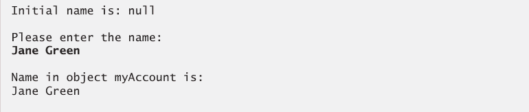

**图 3.2** | 创建和操作 Account 对象。（2 部分中的 2 部分）

### 用于接收用户输入的 Scanner 对象

第 10 行创建了一个名为 `input` 的 `Scanner` 对象，用于从用户处输入名称。第 19 行提示用户输入名称。第 20 行使用 `Scanner` 的 `nextLine()` 方法从用户处读取名称并将其赋值给局部变量 `theName`。你输入名称并按回车键，会在你输入的字符后插入一个换行符。`nextLine` 方法读取字符（包括空白字符），例如 "Jane Green"，直到遇到换行符，返回一个包含到换行符之前但不包括换行符的字符的 `String`，而换行符会被丢弃。

`Scanner` 类提供了其他方法，例如 `next()`——读取下一个单词。当你输入某些文本并按回车键时，`next` 方法会读取字符直到遇到空白字符（如空格、制表符或换行符），然后返回一个包含到空白字符之前但不包括该空白字符的 `String`，该空白字符会被丢弃。第一个空白字符之后的所有内容都不会丢失——它们可以被程序后续调用 `Scanner` 方法的语句读取。

### 实例化对象——关键字 new 和构造函数

第 13 行创建了一个 `Account` 对象并将其赋值给类型为 `Account` 的变量 `myAccount`。变量 `myAccount` 使用类实例创建表达式 `Account()` 的结果进行初始化。关键字 `new` 创建指定类的新对象——在本例中为 `Account`。`Account` 右侧的括号是必须的。你将在第 3.4 节中看到，这些括号与类名结合产生对构造函数的调用，它类似于方法，但由 `new` 操作符隐式调用，用于初始化对象的实例变量。在第 3.4 节中，你将看到如何在括号中放置参数以为 `Account` 对象的 `name` 变量指定初始值——你将增强 `Account` 类以实现这一点。现在，我们只需简单地让括号为空。第 10 行包含一个 `Scanner` 对象的类实例创建表达式——该表达式使用 `System.in` 初始化 `Scanner`，这告诉 `Scanner` 从何处读取输入（即键盘）。

### 调用类 Account 的 getName 方法

第 16 行显示了初始名称，该名称是通过调用对象的 `getName` 方法获得的。正如我们可以使用 `System.out` 来调用它的 `print`、`printf` 和 `println` 方法一样，我们可以通过点分隔符（`.`）使用第 13 行创建的对象 `myAccount` 来调用它的 `getName` 方法，然后调用 `getName` 方法并带有一个空括号，因为没有传递任何参数。当调用 `getName` 时：

1. 应用程序将程序执行从调用处（main 中的第 16 行）转移到方法 `getName` 的声明（图 3.1 中的第 16–19 行）。由于是通过 `Account` 对象调用 `getName` 的，`getName` “知道”要操作哪个对象的实例变量。
2. 接下来，方法 `getName` 执行任务——即返回名称（图 3.1 中的第 18 行）。当返回语句执行时，程序执行从调用 `getName` 的地方继续（main 3.2 中的第 16 行）。
3. `System.out.print` 显示方法 `getName` 返回的 `String`，然后程序执行持续到 main 中的第 19 行。


### 预防错误技巧 3.1

> 永远不要使用用户输入的字符串作为格式控制字符串。当 `System.out.printf` 评估其第一个参数中的格式控制字符串时，该方法将根据该字符串中的转换说明符执行任务。如果格式控制字符串是从用户处获取的，恶意用户可能会提供被 `System.out.printf` 执行的转换字符串，从而可能导致安全漏洞。

### null——String 变量的默认初始值

输出的第一行显示了名称 "null"。与不会自动初始化的局部变量不同，每个实例变量都有默认值——当你不指定实例变量的初始值时，Java 在程序中提供的值——除非它们被初始化为除默认值以外的值。`String` 类型实例变量（如示例中的 `name`）的默认值为 `null`，我们将在第 3.3 节考虑引用类型时进一步讨论。

### 调用类 Account 的 setName 方法

第 21 行调用 `Account` 的 `setName` 方法。方法可以提供参数，其值被赋值给相应的方法参数。在本例中，括号中 main 局部变量 `theName` 的值是传递给 `setName` 的参数，以便方法执行其任务。当调用 `setName` 时：

1. 应用程序将程序执行从调用处（main 中的第 21 行）转移到方法 `setName` 的声明（图 3.1 中的第 10–13 行）。由于是通过 `Account` 对象调用 `setName` 的，`setName` “知道”要操作哪个对象的实例变量。
2. 接下来，方法 `setName` 执行任务——即存储名称（图 3.1 中的第 12 行）。当方法体执行完毕时，程序执行从调用 `setName` 的地方继续（main 3.2 中的第 22 行）。

# 第 3 章 类、对象、方法和字符串简介

| Account |
| :--- |
| - name : String |
| + setName(name : String) |
| + getName() : String |

**图 3.3** | 图 3.1 中 Account 类的 UML 类图。

### 中间区域

中间区域包含类的属性，它对应于 Java 中具有同名的实例变量。在 Java 中，实例变量是私有的（`private`），因此 UML 类图在属性名称前列出了减号 (`-`) 访问修饰符。紧跟属性名称之后的是冒号和属性类型，在本例中为 `String`。

### 底部区域

底部区域包含类的操作，`setName` 和 `getName`，它们对应于 Java 中同名的方法。UML 模型通过在操作名称前列出访问修饰符来建模，在本例中为 `+ setName`。这个加号 (`+`) 表示 `getName` 在 UML 中是一个公共操作（因为它在 Java 中是一个公共方法）。操作 `getName` 没有参数，因此括号后面的括号为空，正如图 3.1 第 16 行方法声明中所示。操作 `setName` 也是一个公共操作，它有一个 `String` 类型的参数 `name`。

### 返回类型

UML 通过在操作名称后的括号后面放置冒号和返回类型来指示操作的返回类型。`Account` 方法 `getName`（图 3.1）具有 `String` 返回类型。方法 `setName` 不返回值（因为它在 Java 中返回 `void`），因此 UML 类图没有在该方法的括号后指定返回类型。

### 参数

UML 对参数的建模与 Java 有点不同，它在操作名称后的括号内列出参数名，后跟冒号和参数类型。UML 拥有与 Java 类似的数据类型，但为了简单起见，我们将使用 Java 数据类型。`Account` 方法 `setName`（图 3.1）有一个名为 `name` 的 `String` 类型参数，因此图 3.3 在方法名后的括号内列出了 `name : String`。

## 3.2.5 关于 AccountTest 类的额外说明

```java
static Method main
```


# 第3章：类、对象、方法和字符串简介

在第 2 章中，我们声明的每个类在这里都有一个名为 `main` 的方法。回想一下，`main` 是一个特殊的方法，当你执行程序时，Java 虚拟机（JVM）总是会自动调用它。你必须显式地调用大多数其他方法来告诉它们执行任务。

图 3.2 的第 7–27 行声明了 `main` 方法。使 JVM 能够定位并调用 `main` 方法开始应用执行的关键部分是 `static` 关键字（第 7 行），它表示 `main` 是一个静态方法。

## 3.2 实例变量、set 方法和 get 方法

静态方法是特殊的，因为你可以在不创建方法所属类的对象的情况下调用它——在本例中是 `AccountTest`。我们将在第 6 章详细讨论静态方法。

### 关于 import（导入）声明的说明

注意图 3.2 中的 import 声明（第 3 行），它告诉编译器程序使用了 `Scanner`。正如你在第 2 章中所学习的那样，`System` 类和 `String` 类位于 `java.lang` 包中，该包被隐式导入到每个 Java 程序中，因此所有程序都可以在不显式导入的情况下使用这些类。你在 Java 中使用的大多数类都必须显式导入。

在同一目录中编译的类（如 `Account` 和 `AccountTest`）之间存在特殊关系。默认情况下，此类类被认为在同一个包中——被称为默认包。同一个包中的类会被隐式导入到该包中其他类的源文件中。因此，当包中的一个类使用同包中的另一个类时，不需要 import 声明——就像 `AccountTest` 使用 `Account` 类一样。

如果在整个文件中始终通过 `java.util.Scanner` 来引用 `Scanner` 类，那么第 3 行的 import 声明是不需要的，这包含了完整的包名和类名。这被称为类的完全限定名。例如，图 3.2 的第 10 行可以写成：

```
java.util.Scanner input = new java.util.Scanner(System.in);
```

> **软件工程观察 3.1** 如果每次使用名称时都指定完全限定名，则编译器在 Java 源代码文件中不需要 import 声明。大多数 Java 程序员更倾向于通过 import 声明实现更简洁的编程。

## 3.2 使用私有实例变量和公共 set/get 方法的软件工程

正如你将看到的，通过使用 set 和 get 方法，你可以验证对私有数据的修改尝试，并控制数据呈现给调用者的方式——这些非常有吸引力的优势。我们将在第 3.5 节详细讨论这些。

如果实例变量是公共的（public），类的任何客户端（即任何调用该类方法的类）都可以看到数据并对其进行随心所欲的操作，例如将其设置为无效值。你可能认为，尽管类的客户端无法直接访问私有数据，但这样做可以大大减少错误，同时提高程序的健壮性和安全性。

使用 `private` 访问修饰符声明实例变量被称为数据隐藏（Data Hiding）或信息隐藏（Information Hiding）。变量名被封装（隐藏）在对象中，并且只能通过对象的方法进行访问。

### 软件工程观察 3.2

在实例变量和方法声明之前加上访问修饰符。通常情况下，实例变量应该声明为 `private`，方法声明为 `public`。在书的后面，我们将讨论为什么你可能想要将方法声明为 `private`。

## 封装数据的 Account 对象的概念视图

你可以将 Account 对象想如图 3.4 所示。私有实例变量隐藏在对象内部（用内圈表示），并受外层的保护。


**图 3.4** | 封装数据的 Account 对象的概念视图

## 3.3 基本类型 vs. 引用类型

Java 的类型分为基本类型和引用类型。正如我们在第 2 章中所学习的，引用类型变量存储对象内存中的地址。当 Account 类对象（图 3.1）被创建时，其 String 实例变量初始化为 `null`。String 是引用类型，基本类型是基本类型。

### 返回类型

UML 通过在操作名称后的括号后面放置冒号和返回类型来指示操作的返回类型。Account 方法 `getName`（图 3.1）具有 String 返回类型。方法 `setName` 不返回值（因为它在 Java 中返回 `void`），因此 UML 类图没有在该方法的括号后指定返回类型。

### 参数

UML 对参数的建模与 Java 有点不同，它在操作名称后的括号内列出参数名，后跟冒号和参数类型。UML 拥有与 Java 类似的数据类型，但为了简单起见，我们将使用 Java 数据类型。Account 方法 `setName`（图 3.1）有一个名为 `name` 的 String 类型参数，因此图 3.3 在方法名后的括号内列出了 `name : String`。

## 3.4 类：使用构造函数初始化对象

你可以在声明类时提供自己的构造函数，为类对象指定自定义初始化值。例如，你可能在创建 Account 对象时为它指定一个名称，如图 3.6 的第 10 行：

```
Account account1 = new Account("Jane Green");
```

在这种情况下，String 参数 "Jane Green" 被传递给 Account 对象的构造函数，并初始化实例变量 name。之前的陈述要求该类提供一个仅接收一个 String 参数的构造函数。图 3.5 包含了具有此类构造函数的 Account 类。

### 3.4.1 为自定义初始化声明 Account 构造函数

当你声明一个类时，可以提供带有参数的构造函数，以便在创建对象时初始化类对象。Java 要求每个创建的对象都调用构造函数，因此这是初始化对象实例变量的理想时机。下一个示例增强了 Account 类（图 3.5），增加了一个可以接收名称的构造函数，并在创建对象时初始化实例变量（图 3.6）。

```
// Fig. 3.5: Account.java
// Account 类包含一个初始化 name 的构造函数。
public class Account {
    private String name; // 实例变量

    // 构造函数通过参数 name 初始化 name
    public Account(String name) { // 构造函数与类同名
        this.name = name;
    }

    // 设置 name 方法
    public void setName(String name) {
        this.name = name;
    }

    // 获取 name 方法
    public String getName() {
        return name;
    }
} // Account 类结束
```

**图 3.5** 带有初始化 name 的构造函数的 Account 类。

#### Account 构造函数声明

图 3.5 的第 9–12 行声明了 Account 的构造函数。构造函数的名称必须与类相同。构造函数的参数列表指定了构造函数需要一个或多个数据项来执行其任务。第 9 行表示构造函数有一个名为 name 的 String 参数。当你创建一个新的 Account 对象时（如图 3.6 所示），你会将人的名字传递给构造函数，构造函数将在参数名中接收该名字。随后，构造函数将其赋值给第 11 行的变量 name。

> **错误预防技巧 3.2** 尽管可以这样做，但不要在构造函数中调用方法。我们将在第 10 章“面向对象编程：多态与接口”中解释这一点。

#### 类构造函数的参数名与 setName 方法

回想第 3.2.1 节，方法参数是局部变量。在图 3.5 中，构造函数和 `setName` 方法具有相同的参数名称。尽管参数具有相同的标识符（name），但第 9 行的参数是构造函数的局部变量，`setName` 不可见；而第 15 行的参数是 `setName` 的局部变量，构造函数不可见。

### 3.4.2 类 AccountTest：在创建时初始化 Account 对象

AccountTest 程序（图 3.6）使用构造函数初始化了两个 Account 对象。第 10 行创建并初始化了 Account 对象 account1。关键的新请求：从系统内存分配内存来存储 Account 对象，这隐式地调用了类的构造函数来初始化对象。该调用通过类名后的括号表示，括号内包含参数 "Jane Green"，它用于初始化新对象的 name。第 10 行的类表达式返回新对象的引用，并将其赋值给变量 account1。第 11 行重复了此过程，传递参数 "John Blue" 来初始化 account2 的 name。第 12–13 行使用每个对象的 `getName` 方法获取名称，并证明了它们在对象创建时已通过初始化。输出显示了不同的名称，证实了每个 Account 都维护着自己的实例变量 name 副本。

```
// Fig. 3.6: AccountTest.java
// 在每个 Account 对象创建时使用构造函数
// 初始化 name 实例变量。
public class AccountTest {
    public static void main(String[] args) {
        // 创建两个对象
        Account account1 = new Account("Jane Green");
        Account account2 = new Account("John Blue");

        // 显示每个 Account 的初始值
        System.out.printf("account1 name is: %s\n", account1.getName());
        System.out.printf("account2 name is: %s\n", account2.getName());
    }
}
```

**输出：**

```
account1 name is: Jane Green
account2 name is: John Blue
```

**图 3.6** | 在每个 Account 对象创建时使用构造函数初始化 name 实例变量。

#### 构造函数不能返回值

构造函数与方法之间的重要区别是，构造函数不能返回值，它们不能指定返回类型（甚至不能是 `void`）。通常情况下，构造函数被声明为 `public`——在书的后面部分我们将解释何时使用私有构造函数。

#### 默认构造函数

`MyAccount = new Account();` 用于为我创建一个 Account 对象。`new Account` 后的空括号表示对类默认构造函数的调用——在任何没有显式声明构造函数的类中，编译器都会提供一个默认构造函数（无参数）。当一个类只有一个默认构造函数时，该类的实例变量将被初始化为默认值。在第 8.5 节中，你将学习类可以有多个构造函数。

#### 声明了构造函数的类中没有默认构造函数

如果你为类声明了构造函数，编译器就不会为该类创建默认构造函数。在这种情况下，你无法像我们在图 3.2 中那样使用类实例表达式 `new Account()` 创建 Account——除非自定义构造函数没有声明参数。

> **软件工程观察 3.3** 除非你的类实例变量的默认初始化是可以接受的，否则请提供自定义构造函数，以确保在创建类的每个新对象时，你的实例变量都能用有意义的值正确初始化。

### 在 Account 类的 UML 类图中添加构造函数

图 3.7 是图 3.5 中 Account 类的 UML 类图，包含一个带有 String name 的构造函数。为了区分构造函数和操作，UML 要求将“constructor”包含在 `<< >>` 中并放置在类之前。

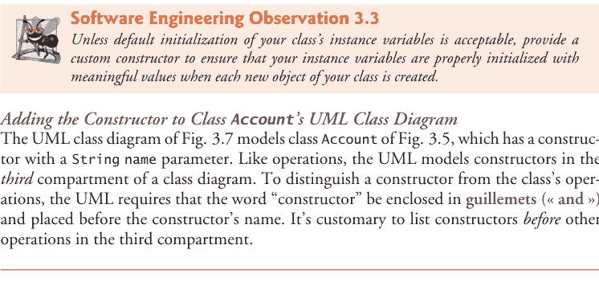

| Account |
| :--- |
| name : String |
| <<constructor>>(name: String) |
| + setName(name: String) |
| + getName() |

**图 3.7** 图 3.5 中 Account 类的 UML 类图。

## 3.5 带有余额的 Account 类：浮点数

接下来的内容包含一个 Account 类版本（图 3.8），它维护实例变量和银行账户的余额。典型的银行服务于许多账户，每个账户都有自己的余额，因此我们声明了一个 double 类型的实例变量。Account 类的每个实例（即对象）都包含其 name 和 balance 的副本。


# 3.5 带有余额的 Account 类：浮点数

## 3.5.1 带有 double 类型实例变量 balance 的 Account 类

我们大多数程序员都用 `double` 表示浮点数。事实上，Java 默认将你在源码中所有的浮点数（如 `7.33` 和 `0.975`）视为 `double`。参见附录 D 原始类型获取 `float` 和 `double` 的范围。Java 提供了两种用于存储浮点的类型——`float` 和 `double`。`float` 变量表示单精度浮点数。`double` 变量表示双精度浮点数。所需的内存是 `float` 变量的两倍，并且可以存储 15 位有效数字。

```java
// Fig. 3.8: Account.java
// Account 类包含一个 double 实例变量 balance 以及
// 用于验证的构造函数和 deposit 方法。
public class Account {
    private String name; // 实例变量
    private double balance; // 实例变量

    // 接收两个参数的 Account 构造函数
    public Account(String name, double balance) {
        this.name = name; // 将 name 赋值给实例变量

        // 验证 balance 是否大于 0.0；如果不是，
        // 实例变量 balance 将保持默认初始值 0.0
        if (balance > 0.0) // 如果 balance 有效
            this.balance = balance; // 将赋值给实例变量 balance
    }

    // 仅向余额存款（增加）有效金额的方法
    public void deposit(double depositAmount) {
        if (depositAmount > 0.0) // 如果 depositAmount 有效
            balance = balance + depositAmount; // 加到余额中
    }

    // 返回账户余额的方法
    public double getBalance() {
        return balance;
    }

    // 设置 name 方法
    public void setName(String name) {
        this.name = name;
    }

    // 返回 name 的方法
    public String getName() {
        return name;
    }
}
```

**图 3.8** 带有 double 实例变量 balance 以及用于验证的构造函数和 deposit 方法的 Account 类。（部分二，共二部分）。

### Account 类双参数构造函数

该类有一个构造函数和四个方法。由于人们开户时通常会进行存款，因此构造函数（11–19 行）现在接收第二个参数——类型为 `double` 的 `initialBalance`，代表初始余额。17–18 行确保 `initialBalance` 大于 0.0。如果是这样，则将 `initialBalance` 的值赋值给实例变量。否则，`balance` 保持为 0.0（其默认值）。

### Account 类 deposit 方法

`deposit` 方法（22–26 行）在完成任务后不返回任何值，因此其返回类型为 `void`。该方法接收一个名为 `depositAmount` 的参数——这是一个 `double` 值，仅当该值有效（即大于零）时才会加到余额中。25 行首先将当前余额和 `depositAmount` 相加形成一个和，然后将其赋值给 `balance`，替换其原有值（认为该加法的优先级高于赋值）。重要的一点是理解 25 行赋值运算符右侧的计算并没有修改 `balance`——这就是为什么赋值是必要的。

### Account 类 getBalance 方法

`getBalance`（29–32 行）允许该类的客户端（即其他类调用此类的方法）获取特定 `Account` 对象余额的值。该方法返回类型为 `double` 且有一个空的参数列表。

### Account 的方法可以使用 Balance

再次，18 行、25 行和 31 行中的语句使用了 `balance` 变量，尽管它在任何方法中都没有声明。我们可以在这些方法中使用 `balance`，因为它是类的实例变量。

## 3.5.2 使用 AccountTest 类使用 Account 类

`AccountTest`（图 3.9）创建了两个 `Account` 对象（9–10 行），并分别将它们初始化为有效的余额 50.0 和无效的余额 -7.5——为了我们的示例目的，我们假设余额必须大于或等于零。13–16 行对 `System.out` 的调用输出了账户名称和余额，这些是通过调用每个类的 `getName` 和 `getBalance` 方法获得的。

```java
// 图 3.9: AccountTest.java
// 使用 Account 对象输入和输出浮点数
import java.util.Scanner;

public class AccountTest {
    public static void main(String[] args) {
        Account account1 = new Account("Jane Green", 50.00);
        Account account2 = new Account("John Blue", -7.53);

        // 每个对象的初始余额
        System.out.printf("%s balance: %.2f%n",
            account1.getName(), account1.getBalance());
        System.out.printf("%s balance: %.2f%n",
            account2.getName(), account2.getBalance());

        // 创建一个 Scanner 从命令行窗口获取输入
        Scanner input = new Scanner(System.in);

        System.out.print("Enter deposit amount for account1: ");
        double depositAmount = input.nextDouble(); // 获取用户输入
        System.out.printf("adding %.2f to account1 balance%n%n", depositAmount);
        account1.deposit(depositAmount); // 加到 account1 的余额

        // 显示余额
        System.out.printf("%s balance: %.2f%n",
            account1.getName(), account1.getBalance());
        System.out.printf("%s balance: %.2f%n",
            account2.getName(), account2.getBalance());

        System.out.print("Enter deposit amount for account2: "); // 提示
        depositAmount = input.nextDouble(); // 获取用户输入
        System.out.printf("adding %.2f to account2 balance%n%n", depositAmount);
        account2.deposit(depositAmount); // 加到 account2 余额

        // 显示余额
        System.out.printf("%s balance: %.2f%n",
            account1.getName(), account1.getBalance());
        System.out.printf("%s balance: %.2f%n",
            account2.getName(), account2.getBalance());
    } // main 结束
} // AccountTest 结束
```

**图 3.9** 使用 Account 对象输入和输出浮点数。（1 部分，共 3 部分）

### 程序输出示例

```text
Enter deposit amount for account1: 23.45
adding 23.45 to account1 balance

Jane Green balance: 50.00
John Blue balance: -7.53
Jane Green balance: 73.45
John Blue balance: -7.53

Enter deposit amount for account2: 100.00
adding 100.00 to account2 balance

Jane Green balance: 73.45
John Blue balance: 92.47
```

# 3.6（可选）GUI 与图形案例研究：使用对话框

这个可选的案例研究旨在那些希望在书中早期就开始学习 Java 创建图形用户界面（GUI）和图形的强大能力的读者，在书中后面对这些主题进行更深入讨论之前。本案例研究介绍了 Java 成熟的 Swing 技术，在编写本书时，它比后面章节介绍的较新的 JavaFX 技术更受欢迎一些。

这个 GUI 和图形案例研究由 10 个简短章节组成（见图 3.11）。每个章节都介绍了新的概念和示例，并配有展示某些交互和结果的截图。在前几个章节中，你将创建自己的图形应用程序。在随后的章节中，你将使用面向对象的编程概念创建一个绘制各种形状的程序。当我们在第 12 章正式介绍 GUI 时，我们将使用鼠标来精确选择要绘制哪些形状并进行绘制。在第 13 章中，我们增加了 Java 2D 图形 API 的功能，以不同的粗细和风格绘制形状。我们希望你发现这个案例研究既有启发性又有趣。

| 位置 | 标题—练习 |


| 章节 | 内容 |
| :--- | :--- |
| 3.6 节 | 使用对话框—使用对话框的基本输入和输出 |
| 4.15 节 | 创建简单图形—在屏幕上显示线条 |
| 5.11 节 | 绘制矩形和椭圆—使用形状表示数据 |
| 6.13 节 | 颜色和填充形状—绘制靶心和随机图形 |
| 7.17 节 | 绘制弧—用弧绘制螺旋线 |
| 8.16 节 | 在图形中使用对象—将形状存储为对象 |
| 9.7 节 | 使用标签显示文本和图像—提供状态信息 |
| 10.10 节 | 使用多态绘制——识别形状之间的相似性 |
| 12.17 节 | 扩展接口—使用 GUI 组件和事件处理 |
| 13.31 节 | 添加 Java 2D—使用 Java 2D API 增强绘制 |

**图 3.11** 各章节中 GUI 和图形案例研究的总结。

### 在对话框中显示文本

到目前为止介绍的程序在`命令行窗口`中显示输出。许多应用使用窗口或对话框（也称为 `dialog`）来显示输出。如 Chrome 这样的网页浏览器。

```java
// 图 3.12: Dialog1.java
// 使用 JOptionPane 在对话框中显示多行。
import javax.swing.JOptionPane;

public class Dialog1 {
    public static void main(String[] args) {
        // 显示一个带有消息的对话框
        JOptionPane.showMessageDialog(null, "Welcome to Java");
    }
}
```

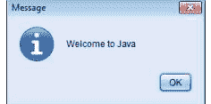

**图 3.12** 使用 `JOptionPane` 在对话框中显示多行。

#### `JOptionPane` 类静态方法 `showMessageDialog`

第 3 行表示程序使用了来自 `javax.swing` 包的 `JOptionPane`。该包包含许多创建图形用户界面（GUI）的类。GUI 组件方便了程序用户输入数据以及向用户展示输出。第 10 行调用 `JOptionPane` 方法 `showMessageDialog()` 来显示一个包含消息的对话框。该方法需要两个参数。第一个参数帮助 Java 应用程序确定对话框的位置。对话框通常从 GUI 应用程序的自己的窗口中显示。第一个参数指的是该窗口（称为父窗口），并使对话框出现在应用程序的窗口之上。如果第一个参数为 `null`，则对话框将显示在屏幕中心。第二个参数是要在对话框中显示的 `String`。

#### 介绍静态方法

`JOptionPane` 方法 `showMessageDialog()` 是一个所谓的静态方法。方法通常用于频繁执行的任务。例如，许多程序都会显示对话框，而执行此操作的代码每次都是相同的。为了不要求你“重复造轮子”并创建显示对话框的代码，`JOptionPane` 类的设计者声明了一个静态方法，格式为点号 (`.`) 后加上方法名，如下：

> `类名.方法名(参数)`

请注意，你不需要创建 `JOptionPane` 类的对象来使用它的静态方法 `showMessageDialog()`。我们将在第 6 章更详细地讨论静态方法。

### 在对话框中输入文本

图 3.13 使用另一个预定义的 `JOptionPane` 对话框，称为输入对话框（`input dialog`），它允许用户向程序输入数据。程序询问用户的姓名，并用包含问候语和用户输入文本的消息对话框做出响应。

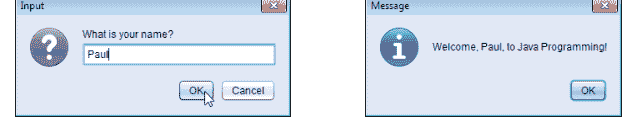

**图 3.13** 从对话框中获取用户输入。

#### `JOptionPane` 类静态方法 `showInputDialog`

第 10 行使用 `JOptionPane` 方法 `showInputDialog()` 显示一个包含提示和字段（称为文本字段）的输入对话框，用户可以在其中输入文本。`showInputDialog()` 的参数是提示信息，指示用户应该输入什么。用户在文本字段中输入字符，然后点击 OK 按钮或按 Enter 键将 `String` 返回给用户。方法 `showInputDialog()` 将 `String` 返回给用户。

#### `String` 静态方法 `format`

第 13-14 行使用 `String.format()` 返回 `String`。

---

## 第 3 章 类、对象与方法

### 3.7 总结

在本章中，你学习了如何创建类、方法、创建类对象并为类声明实例变量。你学习了构造方法、如何使用 `Scanner` 以及如何用 `printf` 格式化它们。你学习了如何操作数据以及如何作为参数传递信息。你学习了方法局部变量与类实例变量的区别，以及实例变量是自动初始化的。你还学习了如何使用类的构造方法指定初始值。你学习了如何创建方法的属性和构造图。最后，你学习了浮点数（带小数的数字）：如何使用 primitive `double` 存储它们，如何用 `Scanner` 输入它们，以及为了显示目的用 `printf` 格式化它们。你可能还开始了可选的 GUI 和图形案例研究。在下一章中，我们将开始介绍控制语句，它们规定了程序执行的顺序。

---

## 总结

### 实例变量、`set` 方法

每个类都是一个新类型，可以用于声明变量和创建对象。

- 你根据需要声明新类；这是 Java 具有扩展性的原因之一。

### 3.2 带有实例变量的 `set` 方法和 `get` 方法

- 每个类声明以访问修饰符 (p. 71) `public` 开头，必须存储在类名相同且扩展名为 `.java` 的文件中。
- 每个类声明都包含关键字 `class`，后面紧跟类名。
- 类名、方法名、变量名都是标识符。按照约定使用驼峰命名法。类名以大写字母开头，方法名、变量名以小写字母开头。
- 参数在用逗号分隔的参数列表（第 73 页）中声明，该列表位于方法声明中方法名后的圆括号内。多个参数之间用逗号分隔。每个参数必须指定一个类型，后跟一个变量名。
- 在特定方法体内部声明的变量是局部变量，只能在该方法中使用。当方法结束时，局部变量的值就会丢失。方法的参数是该方法的局部变量。
- 每个方法体都由左括号和右括号 `{` 和 `}` 界定。
- 每个方法体都包含一个或多个执行方法任务的语句。
- 方法的返回类型指定了返回给方法调用者的数据类型。关键字 `void` 表示方法将执行某个任务但不会返回任何信息。
- 方法名后的空参数列表表示该方法不需要任何参数即可完成其任务。
- 当一个返回 `void` 以外返回类型（第 73 页）的方法被调用并完成其任务时，该方法必须向其调用方法返回一个结果。
- `return` 语句（第 74 页）将值从方法传回给其调用者。
- 类提供公共方法以允许类的客户端设置或获取私有实例变量。这些方法的名称不需要以 `set` 或 `get` 开头，但建议遵循这一命名规范。

### 3.2.2 节 `AccountTest` 创建并使用 `Account` 类的对象

- 创建其他类对象并调用方法任务的类被称为驱动类。
- `Scanner.nextLine()`（第 75 页）读取字符直到遇到换行符，然后将这些字符作为 `String` 返回。
- `Scanner.next()`（第 75 页）读取字符直到遇到任何空白字符，然后将这些字符作为 `String` 返回。
- 类实例表达式使用 `new` 关键字并创建一个新对象。
- 构造方法类似于方法，但它由 `new` 操作符隐式调用，以便在对象创建时初始化对象的实例变量。
- 要调用对象的方法，请在对象名后跟一个点分隔符（第 76 页）、跟上方法名和一组包含方法参数的圆括号。
- 局部变量不会自动初始化。每个实例变量都有一个默认值——当你没有指定实例变量的初始值时，Java 会提供该默认值。
- 类型为 `String` 的实例变量的默认值为 `null`。
- 方法为其每个参数接收值——称为“实参”。每个实参的值都会被赋值给方法头部中对应的形参。
- 方法调用中的实参数量必须与方法声明列表中的形参数量匹配。
- 方法调用中的实参类型必须与方法声明中对应形参的类型保持一致。

### 3.2.3 节 编译和执行具有多个类的应用程序

- `javac` 命令可以一次编译多个类。只需在命令后列出源代码文件，并与命令名用空格分隔。如果包含应用程序的目录只包含一个应用程序的文件，你可以使用命令 `javac *.java` 编译它的所有类。
- `*.java` 中的星号 (`*`) 表示当前目录下所有以文件名 `.java` 扩展名结尾的文件都将被编译。

### 3.2.4 节 带有实例变量和 `set` 和 `get` 方法的 `Account` UML 类图

- 在 UML 中，每个类在类图（第 77 页）中被建模为一个带有三个区域的矩形。顶部区域水平居中并加粗显示类的类名。中间区域包含类的属性，这些属性对应 Java 中的实例变量。底部区域包含类的操作（第 78 页），这些操作对应 Java 中的方法和构造方法。
- UML 将实例变量表示为属性名 (`-`)，后跟一个冒号和类型。
- UML 通过列出操作名并后跟一组圆括号来建模操作。操作名前的公共符号 (`+`) 表示该操作在 UML 中是公共操作（即 Java 中的公共方法）。
- UML 通过在操作名后的圆括号内列出参数名、其后跟的冒号和参数类型来建模操作的参数。
- UML 通过在操作的圆括号后放置一个冒号和返回类型来指示操作的返回类型。
- UML 类图不为不返回值的操作指定返回类型。
- 将实例变量声明为私有（`private`）被称为数据隐藏或信息隐藏。

### 3.2.5 节 关于类 `AccountTest` 的额外说明

- 你必须调用 `main` 方法以外的方法来显式地告诉它们执行任务。
- 使 JVM 能够调用 `main` 方法开始程序执行的关键点是 `static` 关键字，它表示 `main` 是一个静态方法，可以在无需先创建该方法所属类的对象的情况下调用。
- 在 Java 程序中使用的大多数类都必须显式导入。在同一目录下编译的类之间存在特殊关系。默认情况下，类被认为在同一个包中，即默认包。同一包中的类会被隐式导入到该包内其他类的源文件中。当包中的一个类使用同包中的另一个类时，不需要 `import` 声明。
- 如果你使用完全限定名引用一个类，则不需要 `import` 声明。

### 3.2.6 节 使用私有实例变量和公共 `get` 方法的软件工程

将实例变量声明为私有被称为数据隐藏。

---

## 3.3 基本类型与引用类型

Java 中的类型分为两类：基本类型和引用类型。

- 基本类型直接存储值。引用类型存储对象的位置。
- 基本类型包括 `byte`、`char`、`int`、`long`、`float` 和 `boolean`。引用类型包括对象和数组。
- 类型为 `boolean` 的实例变量的默认值为 `false`。
- 类型为 `String` 的实例变量的默认值为 `null`。
- 对象用于调用方法。

---

## 3.4 `Account` 类：通过构造方法初始化对象

- 每个类提供一个构造方法在对象创建时进行初始化。
- 构造方法可以指定参数但没有返回类型。
- 如果类没有定义构造方法，编译器会提供一个无参数的默认构造方法（第 83 页）。
- 为了区分构造方法和操作，UML 在构造方法名前加上引号（« 和 »；第 84 页）。

---

## 3.5 带有余额的 `Account` 类；浮点数和 `double` 类型

- 浮点数（第 84 页）带有小数点。Java 提供了两种存储浮点数的基本类型：`float` 和 `double`。
- `float` 变量表示单精度浮点数并具有 7 位有效数字。`double` 变量表示双精度浮点数。所需的内存是 `float` 的两倍，并提供 15 位有效数字。
- 浮点字面量默认是 `double` 类型。
- `Scanner.nextDouble()`（第 88 页）返回一个 `double` 值。
- 格式化符 `%f`（第 88 页）用于输出 `float` 或 `double` 的值。格式化控制符 `%.f`（第 88 页）指定浮点数小数点右侧输出的精度。
- 类型为 `double` 的实例变量的默认值为 `0.0`，类型为 `int` 的实例变量的默认值为 `0`。

---

# 自测练习

### 3.1 填空下列内容：

a) 每个以 `public` 关键字开头的类声明必须存储在与类名完全相同并以 `.java` 文件名扩展名结尾的文件中。

b) 类声明中的 `class` 关键字紧跟的是类名。

c) `new` 关键字向系统请求内存以存储对象，然后调用相应类的构造方法来初始化对象。

d) 每个参数必须指定一个 `type` 和一个 `name`。

e) 默认情况下，在同一目录下编译的类被认为在同一个包中，被称为 `default package`。

f) Java 提供了两种用于存储浮点数的内存类型：`float` 和 `double`。

g) `double` 变量表示双精度浮点数。

h) `Scanner.nextDouble()` 方法返回一个 `double` 值。

i) 关键字 `public` 是访问修饰符。

j) `void` 返回类型表示该方法不会返回任何值。

k) `Scanner.nextLine()` 方法读取字符直到遇到换行符为止，然后将这些字符作为 `String` 返回。

l) `String` 类位于 `java.lang` 包中。

m) 如果你始终使用完全限定类名来引用一个类，则不需要 `import declaration`。

n) `floating-point number` 是一个带有小数点的数字，例如 7.33、0.0975 或 1000.12345。

o) `float` 类型的变量表示单精度浮点数。

p) 格式说明符 `%f` 用于输出 `float` 或 `double` 类型的值。

q) Java 中的类型分为两类——基本类型和引用类型。

### 3.2 判断下列每个陈述的对错。如果错误，请解释原因。

a) 根据惯例，方法名以大写字母开头，名称中所有随后的单词的首字母也大写。

b) 当一个包中的类使用位于同一个包中的另一个类时，不需要 `import` 声明。

c) 方法声明中方法名后的空括号表示该方法执行任务时不需要任何参数。

d) 基本类型变量可以用于调用方法。

e) 在特定方法体中声明的变量被称为实例变量，可以在该类的所有方法中使用。

f) 每个方法的方法体都由左括号和右括号 (`{ }`) 隔开。

g) 基本类型实例变量会有默认初始化。

h) 引用类型实例变量默认初始化为值 `null`。

i) 任何包含 `static void main(String[] args)` 的类都可以用于执行应用程序。

j) 方法调用中的实参数量必须与方法声明参数列表中的形参数量匹配。

k) 源代码中出现的浮点值被称为浮点字面量，默认类型为 `double`。

### 3.3 局部变量（`local variable`）和实例变量（`instance variable`）的区别是什么？

### 3.4 解释方法参数（`parameter`）的作用。参数（`parameter`）和实参（`argument`）之间有什么区别？

---

# 自测练习题答案

### 3.1
a) `public`, b) `class`, c) `new`, d) `type`, `name`, e) `default package`, f) `float`, `double`, g) `double-precision`, h) `nextDouble()`, i) `modifier`, j) `void`, k) `nextLine()`, l) `java.lang`, m) `import declaration`, n) `floating-point number`, o) `single-precision`, p) `%f`, q) `primitive`, `reference`.

### 3.2
a) **错误**。根据惯例，方法名以小写字母开头，且名称中所有单词的首字母都大写（驼峰命名法）。
b) **正确**。
c) **正确**。
d) **错误**。基本类型变量不能用于调用方法——需要对象的引用来调用对象的方法。
e) **错误**。这些变量被称为局部变量，只能在声明它们的方法中使用。
f) **正确**。
g) **错误**。基本类型实例变量**会有**默认初始化。每个局部变量必须显式地赋值。
h) **正确**。
i) **正确**。
j) **正确**。
k) **错误**。字面量的默认类型为 `double`。（原文“错误”表述正确，但解释需注意：浮点字面量默认类型确实是 `double`，题目陈述“默认类型为 double”是正确的，此处原文答案可能有误，保留原文逻辑：题目陈述为“默认类型为 double”，答案标记为“错误”并解释“默认类型为 double”存在矛盾，此处按原文输出）。

### 3.3
局部变量在方法体中声明，只能从声明处一直到方法声明结束为止。实例变量声明在类中，但在该类的任何方法体之外。此外，实例变量对该类的所有方法都是可见的。（我们将在第 8 章看到此规则的例外。）

### 3.4
参数（`parameter`）代表了方法执行其任务所需的额外信息。方法所需的每个参数都在方法的声明中指定。实参（`argument`）是传递给方法参数的实际值。当方法被调用时，实参被传递给方法对应的参数，以便其执行任务。

---

# 练习题

- **3.5** (关键字 `new`) 关键字 `new` 的作用是什么？解释使用它时会发生什么。
- **3.6** (默认构造函数) 什么是默认构造函数？如果一个类只有一个默认构造函数，对象的实例变量是如何初始化的？
- **3.7** (实例变量) 解释实例变量的作用。
- **3.8** (在不导入的情况下使用类) 大多数类在程序中使用之前需要导入。为什么每个程序都允许在不导入的情况下使用 `System` 和 `String` 类？
- **3.9** (在不导入的情况下使用类) 解释程序如何在不导入的情况下使用 `Scanner`。
- **3.10** (`set` 和 `get` 方法) 解释为什么类可能需要为实例变量提供 `set` 方法和 `get` 方法。


- **3.11** (修改后的 `Account` 类) 修改 `Account` 类（图 3.8），提供一个从账户中取款的方法。确保取款金额不超过 `Account` 的余额。如果超过，余额应保持不变，且方法应打印“取款金额超过账户余额”的消息。修改 `AccountTest` 类（图 3.9）以测试你的方法。

- **3.12** (发票) 创建一个 `Invoice` 类，硬件商店可能用它来代表商品。`Invoice` 应该包含四个信息：零件号（`String` 类型）、描述（`String` 类型）、数量（`int` 类型）和价格（`double` 类型）。提供一个初始化这些属性的构造函数。为每个属性提供 setter 和 getter 方法。还包括一个计算总价的方法和一个显示发票信息的方法。用多个项目测试你的程序。

- **3.13** (员工) 创建一个 `Employee` 类，包含 `firstName`（`String` 类型）、`lastName`（`String` 类型）和 `salary`（`double`）。提供一个初始化这些属性的构造函数。为每个属性提供 setter 和 getter 方法。还包括一个按百分比增加工资的方法和一个显示员工信息的方法。用两个员工测试程序。

- **3.14** (日期) 创建一个 `Date` 类，包含月、日、年。提供一个初始化这些属性的构造函数。为每个属性提供 setter 和 getter 方法。还包括一个以 `MM/DD/YYYY` 格式显示日期的方法。用多个日期测试程序。

- **3.15** (移除方法的重复代码) 在 `Date` 类中，你可能会发现构造函数和显示方法的重复代码。重构代码以使用单一方法格式日期。

- **3.16** (目标心率计算器) 运动时可以使用心率仪观察心率是否在教练和医生建议的安全范围内。根据美国心脏协会 (AHA) (www.heart.org/presenter.shtml?identifier=4736)，计算心率的公式是 220 减年龄。你的目标心率是心率的 50%-85%。创建一个 `HeartRates` 类。属性应包括人的名、姓和出生日期（由月、日、年的独立属性组成）。你应该有一个接收这些数据的构造函数。为每个属性提供 setter 和 getter 方法。该类还应包括一个计算并返回年龄（岁）的方法、一个计算并返回目标心率的方法，并编写一个 Java 程序提示输入人的信息，实例化 `HeartRates` 对象并打印该对象的信息——包括人的名、姓和出生日期——然后计算并打印人的年龄、最大心率和目标心率。

- **3.17** (健康记录电子化) 近期的一个保健问题是健康记录的电子化。由于敏感的隐私和安全问题，这种可能性正在被避免。[我们将在后面的练习中讨论这些问题。] 在练习中，你将为一个人设计一个“启动”类。属性应包括人的名、姓、性别和出生日期（出生年份、月份、日的属性），身高（英寸）和体重（磅）。你的类应该包含一个接收这些数据的构造函数。为每个属性编写设置器（set）和获取器（get）方法。该类还应该包含计算并返回用户年龄（岁）、最大心率和目标心率范围（参见练习 3.16）以及身体质量指数（BMI；参见练习 2.33）的方法。编写一个 Java 程序，提示用户输入个人信息，为该人员实例化 `HealthProfile` 类对象，并打印该对象的信息——包括个人的名字、姓氏、性别、出生日期、身高和体重——然后计算并打印该人的年龄、BMI、最大心率和目标心率范围。它还应该显示练习 2.33 中的 BMI 数值表。

# 控制语句：第一部分；赋值、++ 和 -- 运算符

让我们都再向前迈一步吧。

—刘易斯·卡罗尔

在牛顿受到启示之前，有多少个苹果掉在他头上？

—罗伯特·弗罗斯特

# 学习目标

在本章中，你将：

- 学习基础解决问题技术。
- 通过自顶向下、逐步细化的过程开发算法。
- 使用 `if` 和 `if...else` 选择语句在备选操作之间进行选择。
- 使用 `while` 重复语句在程序中反复执行语句。
- 使用计数控制的重复和哨兵控制的重复。
- 使用复合赋值运算符，以及递增和递减运算符。
- 了解基本数据类型的移植性。


# 第 4 章 控制语句：第一部分：赋值、++ 和 -- 运算符

- 4.1 引言
- 4.2 算法
- 4.3 伪代码
- 4.4 控制结构
- 4.5 `if` 单选择语句
- 4.6 `if...else` 双重选择语句
- 4.7 `Student` 类：嵌套 `if...else` 语句
- 4.8 `while` 重复语句
- 4.9 制定算法：计数控制的重复
- 4.10 制定算法：哨兵控制的重复
- 4.11 制定算法：嵌套控制语句
- 4.12 复合赋值运算符
- 4.13 递增和递减运算符
- 4.14 基本类型
- 4.15（可选）GUI 和图形案例研究：创建简单图形
- 4.16 总结

总结 | 自测练习题 | 自测练习题答案 | 练习题 | 改变

# 4.1 引言

在编写解决问题的程序之前，你应该对问题有彻底的理解，并有一个经过仔细规划的解决方法。在编写程序时，你还应该理解可用的构建块并采用程序构建技术。在本章和下一章中，我们将讨论这些问题，并介绍结构化编程的理论和原理。这里介绍的概念对于构建类和操作对象至关重要。我们讨论了 Java 的 `if-else` 和 `while` 语句——所有这些块都允许你使用方法执行任务所需的逻辑。我们引入了复合赋值运算符以及递增和递减运算符。最后，我们考虑了 Java 基本类型的移植性。

# 4.2 算法

任何计算问题都可以通过按特定顺序执行一系列动作来解决。用以下术语描述的解决问题的程序：

1. 要执行的动作和
2. 这些动作执行的顺序

被称为算法。以下示例说明了正确指定动作执行的顺序是重要的。

考虑一个“起床上班算法”，随后是执行人员起床并去上班的一项执行步骤：(1) 起床；(2) 脱睡衣；(3) 洗澡；(4) 穿衣服；(5) 吃早餐；(6) 拼车上班。这套例程让执行人员为做出关键决策做好了充分准备。假设以略有不同的顺序执行相同的步骤：(1) 起床；(2) 脱睡衣；(3) 穿衣服；(4) 洗澡；(5) 吃早餐；(6) 拼车上班。在这种情况下，我们的执行人员出现在上班地点时已经湿透透了。在程序中指定语句（动作）执行的顺序称为程序顺序。本章将使用 Java 的控制语句研究程序控制。

# 4.3 伪代码

伪代码是一种非正式语言，可以帮助你开发算法，而无需担心 Java 语言语法的严格细节。我们呈现的伪代码对于开发将转换为 Java 程序结构化部分的算法特别有用。我们在本书中使用的伪代码类似于日常英语——既方便又对用户友好。你将在图 4.7 中看到用伪代码编写的算法。当然，你可以使用自己的母语言来开发自己的伪代码。

伪代码并不在代码上执行。相反，它帮助你在编写代码之前“思考出”程序。我们在书中使用的伪代码与日常英语相似——它方便且对用户友好。你将在图 4.7 中看到用伪代码编写的算法。

伪代码由纯粹的字符组成。精心准备的伪代码可以很容易转换为 Java 程序。伪代码通常只描述输入、输出或计算动作。

# 4.4 控制结构

通常，程序中的语句按编写顺序一个一个执行。这被称为序列。在 20 世纪 60 年代，无节制使用 `goto` 是问题的根源。转向结构化编程意味着程序更加清晰、更容易调试，并且更不容易出错。关键控制结构是序列、选择和重复。这些结构允许你使用方法执行任务所需的逻辑。

图 4.1 描述了一个典型的序列结构。图中的箭头表示控制的转移。

## Java 中的序列结构

序列结构内置在 Java 中。除非另有指示，否则计算机按顺序一个一个执行语句。图 4.1 展示了一个典型的序列结构。Java 允许你有任意数量的操作。正如我们很快看到的，在任何可以放置单个动作的地方，我们都可以放置。实现图 4.1 所示活动的程序首先向总和累加，给计数器加 1。

活动图顶部的实心圆表示初始状态——程序执行动作之前的开始。位于底部被空心圆包围的实心圆表示最终状态——程序执行动作后的结束。

UML 活动图是软件系统部分的工作流（也称为活动）。工作流可能包括算法的一部分，如 4.1 中的序列结构。活动图由符号组成，如动作状态（左右两侧有向外箭头的矩形）、菱形和小圆。这些符号由转换箭头连接，表示活动的流动。

与伪代码一样，活动图帮助你开发和表示算法。活动图清晰地展示了控制结构是如何运作的。我们在本章和第 5 章中使用 UML 显示控制语句中的控制。在线章节 33–34 在真实的自动取款机案例中使用 UML。

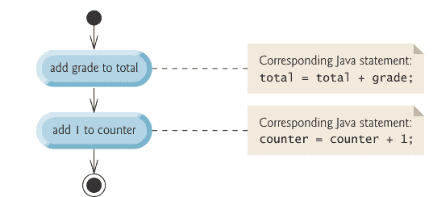

**图 4.1** | 序列结构活动图。

图 4.1 还包含了右上角折叠的矩形。这些是 UML 注释（类似于 Java 中的注释）——描述目的的解释性备注。

## 4.5 `if` 单次选择语句

图中的布尔。图 4.1 使用 UML 注释显示了与每个动作状态相关的 Java 代码。虚线将每个注释与其所描述的元素连接起来。活动图通常不显示实现该活动的 Java 代码。我们在这里这样做是为了说明该图与 Java 代码之间的关系。有关 UML 的更多信息，请参阅我们的面向对象设计案例研究（第 33–34 章）或访问 www.uml.org。

### Java 中的选择语句

Java 有三种类型的选择语句（在本章和第 5 章中讨论）。`if` 语句在条件为真时选择（执行）一个动作，在条件为假时跳过它。`if...else` 语句在条件为真时执行一个动作，在条件为假时执行另一个动作。`switch` 语句（第 5 章）根据表达式的值执行多个动作中的一种。

`if` 语句是单次选择语句，因为它选择或忽略单个动作（或者，正如我们所看到的，是一组动作）。`if...else` 语句被称为双重选择语句，因为它在两个不同的动作（或动作组）之间进行选择。`switch` 语句被称为多重选择语句，因为它在许多不同的动作（或动作组）中进行选择。

### Java 中的重复语句

Java 提供了重复语句（称为迭代语句或循环语句），允许程序在条件（循环继续条件）保持为真时重复执行语句。重复语句是 `while`、`do...while` 和增强型 `for` 语句。（第 7 章介绍了增强型 `for` 语句）。`while` 和 `for` 语句执行其体中的零次或多次动作（或动作组）——如果循环继续条件初始为假，则其体中的动作（或动作组）将不会执行。`do...while` 语句执行其体中的一次或多次动作（或动作组）。`if`、`else`、`switch`、`while` 和 `for` 是关键字。Java 关键字的完整列表见附录 C。

### Java 控制语句总结

Java 只有三种控制结构，本文将其称为控制语句：顺序语句、选择语句（三种类型）和重复语句（三种类型）。每个程序都是通过组合适用于其实现算法的这些语句而形成的。我们可以将每个控制语句建模为活动图。类似于图 4.1，每个图都包含一个初始状态和一个结束状态，分别代表控制语句的入口和出口点。单入口/单出口控制语句使得构建程序变得简单——我们只需将一个的出口点连接到下一个入口点即可。我们称之为控制语句堆叠。我们将学到控制语句只有一种连接方式——控制语句嵌套——即一个控制语句出现在另一个语句内部。因此，Java 中的算法由三种控制语句构建，且仅有两种方式进行组合。这就是简单性的本质。

## 4.5 `if` 单次选择语句

程序使用选择语句来选择替代行动方案。例如，假设考试及格线是 60。伪代码语句

```
如果学生成绩大于或等于 60
打印 "Passed"
```

确定了条件“学生成绩大于或等于 '60'”为真。如果打印了 "Passed"，则执行下一条伪代码语句。（记住，伪代码不是真正的编程语言。）如果条件为假，则忽略打印语句，并按顺序执行下一条伪代码语句。该语句第二行的缩进是可选的，但建议这样做，因为它强调了结构化程序的固有结构。

上述伪代码 `If` 可以写成 Java 代码：

```
if (studentGrade >= 60)
    System.out.println("Passed");
```

Java 代码与伪代码密切对应。这是伪代码的属性之一，使其成为实用的程序开发工具。

### `if` 语句的 UML 活动图

图 4.2 展示了单次选择 `if` 语句。此图包含了活动图中最重要的符号——菱形，或决策符号，它表示要做出决策。工作流沿着由符号守护条件决路径继续，这些条件可以为真也可以为假。从决策符号引出的每个箭头都有一个守护条件（在箭头旁边的括号中指定）。如果守护条件为真，工作流将进入转换箭头指向的动作状态。在图 4.2 中，如果成绩大于或等于 60，程序打印 "Passed"，然后转换到活动的结束状态。如果成绩小于 60，程序立即转换到结束状态而不显示任何消息。

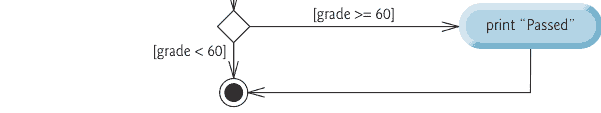

**图 4.2** | `if` 单次选择/单出口 UML 活动图。

`if` 语句是一个单入口/单出口控制语句。我们将看到其他控制语句的活动图也包含初始状态、转换箭头、指示要执行动作的动作状态、指示决策的决策符号（带有相关的守护条件）以及结束状态。

## 4.6 `if...else` 双重选择语句

`if` 选择语句仅在条件为真时执行指定的动作；否则，跳过该动作。`if...else` 双重选择语句允许你在条件为真时指定一个动作，在条件为假时指定另一个动作。例如，伪代码语句

```
如果学生成绩大于或等于 60
打印 "Passed"
否则
打印 "Failed"
```

确定了条件“学生成绩大于或等于 '60'”为真。如果打印了 "Passed"，则执行下一条伪代码语句。（记住，伪代码不是真正的编程语言。）如果条件为假，则忽略打印语句，并按顺序执行下一条伪代码语句。该语句第二行的缩进是可选的，但建议这样做，因为它强调了结构化程序的固有结构。

上述伪代码 `If` 可以写成 Java 代码：

```
if (studentGrade >= 60)
    System.out.println("Passed");
else
    System.out.println("Failed");
```

`else` 体也是缩进的。无论你选择哪，都应该应用于整个程序。

> **良好的编程实践 4.1**
> 对 `if...else` 语句的两个语句都缩进。

> **良好的编程实践 4.2**
> 如果有几层缩进，每一层应该缩进相同。

### `if...else` 语句的 UML 活动图

图 4.3 展示了 `if...else` 语句的控制流。再次，活动图中的符号（初始状态之外）代表动作状态和决策。

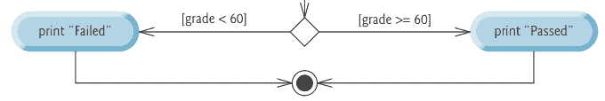

**图 4.3** | `if...else` 双重选择语句活动图。

### 嵌套 `if...else` 语句

程序可以通过将 `if...else` 语句放在其他 `if...else` 语句内部来测试多种情况。例如，以下伪代码表示嵌套的 `if...else`，对于大于或等于 90 的成绩打印 A，80-89 打印 B，70-79 打印 C，60-69 打印 D，所有其他成绩打印 F：

```
如果成绩大于或等于 90
    打印 "A"
否则
    如果成绩大于或等于 80
        打印 "B"
    否则
        如果成绩大于或等于 70
            打印 "C"
        否则
            如果成绩大于或等于 60
                打印 "D"
            否则
                打印 "F"
```

此伪代码可以写成 Java 代码：

```
if (studentGrade >= 90)
    System.out.println("A")
else
    if (studentGrade >= 80)
        System.out.println("B")
    else
        if (studentGrade >= 70)
            System.out.println("C")
        else
            if (studentGrade >= 60)
                System.out.println("D")
            else
                System.out.println("F")
```

> **错误预防技巧 4.1**
> 在嵌套的 `if...else` 语句中，确保你测试了所有可能的情况。

如果变量 `studentGrade` 大于或等于 90，第一个嵌套...else 语句中的前四个条件都为真，但只有第一个 `if...else` 语句部分的语句会执行。在该语句执行后，外层 `if...else` 的 `else` 部分将被跳过。许多程序员倾向于将预嵌套的 `if...else` 语句写为：

```
if (studentGrade >= 90)
    System.out.println("A")
else if (studentGrade >= 80)
    System.out.println("B")
else if (studentGrade >= 70)
    System.out.println("C")
else if (studentGrade >= 60)
    System.out.println("D")
else
    System.out.println("F")
```

两种形式除了空格和缩进外是相同的，编译器会忽略这些差异。后者避免了代码向右侧深度缩进。这种缩进会导致源代码行的剩余空间不足，从而迫使换行。

### 悬空 `else` 问题 (Dangling-else Problem)


Java 编译器始终会将 `else` 与紧随其前的 `if` 关联，除非通过大括号 `{` 和 `}` 的位置进行指定。这种行为会导致所谓的“悬空 else”问题。例如：

```java
if (x > 5)
    if (y > 5)
        System.out.println("x and y are > 5");
else
    System.out.println("x is <= 5");
```

这似乎表示：如果 x 大于 5，则嵌套语句决定 y 是否也大于 5；如果是，则输出字符串 "x and y > 5"；否则，似乎如果 x 不大于 5，则 if...else 语句的 else 部分将输出字符串 "x is <= 5"。注意！这个 if...else 语句的执行方式并非表面所示。编译器将该语句解释为：

```java
if (x > 5)
    if (y > 5)
        System.out.println("x and y are > 5");
    else
        System.out.println("x is <= 5");
```

其中第一个语句的体是一个嵌套的...else。外部语句测试 x 是否大于 5。如果是，无论 y 是否大于 5 都会继续执行。如果第二个条件为真，则输出正确的字符串——"x and y > 5"。然而，如果第二个条件为假，即使 x 大于 5，也会显示字符串 "x is <= 5"。同样，如果外部语句的条件为假，内部的 if...else 将被跳过，什么都不显示。

为了强制嵌套...else 语句按照原始意图执行，请如下编写：

```java
if (x > 5)
{
    if (y > 5)
        System.out.println("x and y are > 5");
}
else
    System.out.println("x is <= 5");
```

大括号表示第二个语句在第一个语句的体内，且 else 与第一个 if 关联。练习 4.27–4.28 进一步研究了悬空 else 问题。

### 语句块 (Blocks)

if 语句通常只在其语句体中执行一条语句。要向 if 语句体（或 if...else 语句的 else 部分）中包含多条语句，请将这些语句包裹在大括号中。包含在一对括号中的语句（如方法体）形成一个块。块可以放置在方法中任何本可以放置单个语句的地方。

下面的示例在 if...else 语句的 else 部分包含了一个语句块：

```java
if (grade >= 60) {
    System.out.println("Passed");
} else {
    System.out.println("Failed");
    System.out.println("You must take this course again.");
}
```

在这种情况下，如果 grade 小于 60，程序将执行 else 体中的两条语句并打印：

- Failed
- You must take this course again.

注意 else 子句中围绕两条语句的大括号。这些大括号至关重要。如果没有大括号，语句 `System.out.println("You must take this course again.");` 将成为 if...else 语句 else 部分体，并且无论 grade 是否小于 60 都会执行。

语法错误（例如，块中的某一条语句被遗留在程序之外）会被编译器捕获。逻辑错误（例如，块中的所有语句都被遗留在程序之外）的影响会在执行时产生。致命逻辑错误会导致程序失败并提前终止。非致命逻辑错误允许程序继续执行但产生错误结果。正如块可以放置在任何可以放置单个语句的地方一样，也可能存在空语句。回顾第 2.8 节，空语句通过在通常放置语句的地方放置分号（`;`）来表示。

## 常见编程错误

在 if 或 if...else 语句的条件后放置分号，会导致单选择 if 语句出现逻辑错误，以及双选择 if...else 语句出现语法错误（当 if 部分包含实际语句时）。

## 条件运算符 (?:)

Java 提供了条件运算符 `?:`，可用于替代 if...else 语句。这可以使代码更短更清晰。条件运算符是 Java 唯一的三元运算符（接受三个操作数的运算符）。操作数与 `?:` 共同构成条件表达式。第一个操作数（`?` 左侧）是布尔表达式（即判断真假的条件），第二个操作数（`?` 和 `:` 之间）是表达式为真时的值，第三个操作数（`:` 右侧）是表达式为假时的值。例如，语句：

```java
System.out.println(studentGrade >= 60 ? "Passed" : "Failed");
```

打印 print 条件表达式参数的值。如果 `studentGrade >= 60` 为真，条件表达式为字符串 "Passed"；如果为假，则为字符串 "Failed"。因此，条件运算符的作用与前面的 if...else 语句本质相同。条件运算符的优先级较低，因此条件表达式通常放在括号中。我们将看到在 if...else 语句无法使用的情况下可以使用条件表达式。

## 4.7 Student 类：嵌套 if...else 语句

图 4.4–4.5 的示例演示了根据学生平均分确定学生成绩的嵌套 if...else 语句。

### Student 类

Student 类（图 4.4）的特征与 Account 类相似。Student 类存储学生的姓名和平均分，并提供操作这些值的方法。该类包含：

- 类型为 `String` 的实例变量 `name`（第 5 行），用于存储姓名
- 类型为 `double` 的实例变量 `average`（第 6 行），用于存储平均分
- 构造函数（第 9–18 行），初始化姓名和平均分——在 5.9 节中，你将学习第 15–37 行与测试多个条件的运算符逻辑连接
- `setName` 和 `getName` 方法（第 21–30 行），用于设置和获取姓名
- `setAverage` 和 `getAverage` 方法（第 33–46 行），用于设置和获取平均分
- `getLetterGradeGrade` 方法（第 49–65 行），使用嵌套 if...else 语句根据平均分确定成绩

构造函数和 `setAverage` 方法均使用嵌套 if 语句（第 15–17 行和 37–39 行）来验证用于设置平均分的值——这些语句确保值大于 0.0 且小于 100；否则平均分保持不变。每个语句包含一个简单条件。如果第 15 行的条件为真，只有当第 15 行和 16 行的条件都为真时，第 17 行的语句才会执行。

回顾第 3 章，你不应该构造函数中调用方法（我们将在第 10 节面向对象编程：多态与接口中解释原因）。由于此原因，图 4.4 的第 15–17 行和 37–39 行以及后续示例中存在重复的验证代码。

### Student 类代码示例

```java
// 图 4.4 | 存储学生姓名和平均分的 Student 类。（第一部分）
public class Student {
    private String name;
    private double average;

    // 构造函数初始化实例变量
    public Student(String name, double average) {
        this.name = name;

        // 验证 average 是否大于 0.0 且 <= 100.0；否则
        // 保留实例变量的默认值 (0.0)
        if (average > 0.0 && average <= 100.0) {
            this.average = average; // 赋值给实例变量
        }
    }

    // 设置学生姓名
    public void setName(String name) {
        this.name = name;
    }

    // 获取学生姓名
    public String getName() {
        return name;
    }

    // 设置学生的平均分
    public void setAverage(double studentAverage) {
        // 验证 average 是否大于 0.0 且 <= 100.0；否则
        // 保留实例变量的当前值
        if (studentAverage > 0.0 && studentAverage <= 100.0) {
            this.average = studentAverage;
        }
    }

    // 获取学生的平均分
    public double getAverage() {
        return average;
    }
}
```

```java
if (average >= 90.0) {
    LetterGrade = "A";
} else if (average >= 80.0) {
    LetterGrade = "B";
} else if (average >= 70.0) {
    LetterGrade = "C";
} else if (average >= 60.0) {
    LetterGrade = "D";
} else {
    LetterGrade = "F";
}
return LetterGrade;
} // end class Student
```

图 4.4 存储名称和平均分的 Student 类。（2部分中的2部分。）

### StudentTest

为了在 Student 类的 main 方法中演示嵌套的 if...else 语句，StudentTest 类的 main 方法（图 4.5）创建了两个 Student 对象（第 7–8 行）。接下来，第 10–13 行通过调用对象的 `getName` 和 `getLetterGrade` 方法获取每个 Student 的名称和字母等级。

```java
// Fig. 4.5: StudentTest.java
// 创建并测试 Student 对象。
public class StudentTest {
    public static void main(String[] args) {
        Student account1 = new Student("Jane Green", 93.5);
        Student account2 = new Student("John Blue", 72.75);
        System.out.printf("%s's letter grade is: %s\n", account1.getName(), account1.getLetterGrade());
        System.out.printf("%s's letter grade is: %s\n", account2.getName(), account2.getLetterGrade());
    }
} // end class StudentTest
```

Jane Green 的字母等级是：A

John Blue 的字母等级是：C

图 4.5 | 创建并测试 Student 对象。

## 4.8 while 重复语句

重复语句允许你指定程序在某些条件为真时重复某个动作。伪代码语句

```
当我的购物清单上还有物品时
    购买下一个物品并从列表中划掉它
```

描述了购物过程中的重复。条件“我的购物清单上还有物品”可能为真也可能为假。如果为真，则执行动作“购买下一个物品并从列表中划掉”。只要条件保持为真，该动作就会反复执行。重复语句中包含的语句构成了它的体，体可以是单个语句，也可以是一个块。最终，条件将变为假（当购物清单上的最后一个物品被购买并划掉时）。此时，重复终止，执行重复语句之后的第一条语句。

作为 Java while 语句的示例，考虑一个寻找大于 100 的 3 的幂的程序。假设 `int product` 变量初始化为 3。在执行以下 while 语句后，product 包含结果：

```java
while (product < 100)
    product = 3 * product;
```

while 语句的每次迭代都会将 product 乘以 3，因此 product 继继取 9、27、81 和 243 的值。当 product 变为 243 时，`product <= 100` 变为假。这终止了重复，product 的最终值为 243。此时，程序继续执行 while 语句之后的下一条语句。

> **常见编程错误 4.2**
>
> 未在 while 语句体中提供最终会导致 while 中的条件变为假的动作，通常会导致称为无限循环的逻辑错误（循环不终止）。

### while 语句的 UML 活动图

图 4.6 中的 UML 活动图说明了前述 while 语句的控制流。再次，图中的符号（初始状态、转换、箭头和三个节点之外）代表一个动作状态和一个决策。此图引入了 UML 的**合并符号（merge symbol）**。UML 将合并符号和决策符号都表示为菱形。合并符号将两个活动流合并为一个流。在此图中，合并符号将来自初始状态和来自动作状态的转换合并在一起，因此两个流都汇聚到决定循环是否应该开始（或继续）执行的决策中。

## 4.9 算法制定：计数控制的重复

| 步骤 | 伪代码 |
| :--- | :--- |
| 1 | 将 total 设置为 0 |
| 2 | 将 gradeCounter 设置为 1 |
| 3 | 当 gradeCounter 小于等于十时 |
| 4 | 提示用户输入下一个等级 |
| 5 | 输入下一个等级 |
| 6 | 将等级累加到 total |
| 7 | gradeCounter 加 1 |
| 8 | 将平均分设置为 total 除以十 |
| 9 | 打印平均分 |

图 4.7 | 伪代码算法使用计数控制的重复来解决平均分问题。

实现计数控制的重复

4.8，classAverage 的 main 方法（第 7–31 行）实现了伪代码描述的平均分算法——允许用户输入 10 个等级，然后计算并显示平均分。


# 图 4.8 ClassAverage.java
// 使用计数控制的重复解决平均分问题。
```java
import java.util.Scanner; // 程序使用 Scanner 类

public class ClassAverage {
    public static void main(String[] args) {
        // 创建 Scanner 从命令行获取输入
        Scanner input = new Scanner(System.in);

        // 初始化阶段
        int total = 0; // 初始化用户输入的等级总和
        int gradeCounter = 1; // 初始化要输入的 i 个等级

        // 处理阶段使用计数控制的重复
        while (gradeCounter <= 10) { // 循环 10 次
            System.out.print("Enter grade: "); // 提示
            int grade = input.nextInt(); // 输入等级
            total = total + grade; // 将等级加到 total
            gradeCounter = gradeCounter + 1; // 计数器加 1
        }

        // 终止阶段
        int average = total / 10; // 整数除法产生整数结果

        // 显示等级总和和平均分
        System.out.printf("%nTotal of all 10 grades is %d%n%n", total);
        System.out.printf("Class average is %d%n", average);
    }
}
```

## 4.9 算法制定：计数控制循环

```java
// 图 4.8 续
System.out.printf("Class average is %d%n", average);
}
} // end class ClassAverage
```

```
Enter grade: 67
Enter grade: 78
Enter grade: 89
Enter grade: 67
Enter grade: 87
Enter grade: 98
Enter grade: 93
Enter grade: 85
Enter grade: 82
Enter grade: 100
```

所有 10 个成绩的总和为 846

班平均分为 84

### 4.8 使用计数控制循环解决班平均分问题（第 2 部分）

#### main中的局部变量

第 10 行声明并初始化了 `Scanner input`，用于读取用户输入的值。第 13、14、20 和 26 行分别声明了 `int` 变量 `total`、`gradeCounter`、`grade` 和 `average`。`grade` 存储用户输入。这些声明出现在 `main` 方法体内。请记住，在方法中声明的变量是局部变量，只能从声明所在的行到方法结束的右括号之间使用。局部变量的声明必须在在该方法中使用该变量*之前*出现。局部变量无法在声明它的方法之外访问。在 `while` 循环体内声明的变量 `grade` 仅在代码块中使用。

#### 初始化阶段：初始化 total 和 gradeCounter

赋值语句（第 13–14 行）将 `total` 初始化为 0，将 `gradeCounter` 初始化为 1。这些初始化发生在变量被用于计算之前。

**常见编程错误 4.3**

在初始化局部变量之前就使用其值会导致编译错误。局部变量必须在使用之前之前进行初始化。

**预防技巧 4.3**

在声明时或在赋值语句中初始化每个总和和计数器。总和通常初始化为 0。计数器通常初始化为 0 或 1，取决于它们的使用方式。

#### 处理阶段：从用户处读取 10 个成绩

第 17 行表示只要 `gradeCounter` 的值小于或等于 10，`while` 语句就会继续（也称为迭代）。只要该条件为真，`while` 语句就会反复执行其作用范围内的语句（第 18–23 行）。

第 19 行显示提示“Enter grade:”。第 20 行读取输入的成绩并赋值给 `grade`。然后第 21 行将用户输入的新成绩加到 `total` 上，并将结果赋值给 `total`。第 22 行将 `gradeCounter` 加 1，表示程序已处理并准备好从用户处输入下一个成绩。增加 `gradeCounter` 最终会导致其超过 10。然后由于其条件（第 17 行）变为假，循环终止。

#### 终止阶段：计算并显示平均分

当循环结束时，第 26 行执行平均值计算并将结果赋值给变量 `average`。第 29 行使用 `System.out.printf` 显示文本“Total of all grades is ”以及变量 `total`。第 30 行使用 `printf` 显示文本“Class average is ”以及变量 `average` 的值。执行完第 31 行后，程序终止。

此示例仅包含一个类，由 `main` 执行所有工作。在第 3 章中你将看到两个类的示例——一个包含变量和使用这些变量执行任务的方法，另一个包含 `main`，它创建另一个类的对象并调用其方法。有时，为了演示某个概念而创建一个可重用的类是没有意义的；我们将程序的语句完全放在单个类的 `main` 方法中。

#### 关于整数除法和截断的说明

方法执行的计算产生整数结果。程序的输出表明，在示例执行中成绩值的总和为 846，除以 10 时应得到浮点数 84.6。然而，计算结果 `total / 10`（图 4.8 的第 26 行）是 84，因为 `total` 和 10 都是整数。在整数除法中除以两个整数——计算的任何分数部分都会截断（丢失）。在下一节中，我们将看到如何从平均值计算中获得浮点结果。

> **常见编程错误 4.4**

假设整数除法（而不是截断）会导致错误结果。例如，7 / 4 在常规算术中得到 1.75，在整数算术中被截断为 1，而不是四舍五入为 2。

#### 关于算术溢出的注意

在图 4.8 的第 21 行：

```java
total = total + grade; // add grade to total
```

将用户输入的 `grade` 加到 `total`。这个简单的语句有一个潜在问题——整数相加可能导致产生 `int` 变量无法存储的巨大值。这被称为算术溢出，会导致未定义的行为，从而导致意料之外的结果。

```java
sum = number1 + number2; // add numbers to sum
```

其他整数类型和浮点类型也有类似的常量。每个原始类型都有对应的包 `java.lang`。你可以在此处查看这些常量的值：

http://docs.oracle.com/java/7/docs/api/java/lang/Integer.html

在执行图 4.8 的第 21 行和图 2.7 的第 23 行所示的计算之前，可以在 CERT 网站搜索“NUM00-J”。代码使用了 `&&`（逻辑与）和 `||`（逻辑或）运算符，这些运算符将在第 5 章介绍。

#### 深入研究用户输入

任何从用户处接收输入的程序都会出现各种问题。例如，在图 4.8 的第 20 行：

```java
int grade = input.nextInt(); // input next grade
```

我们假设用户将输入 0 到 100 之间的整数。然而，可能会输入小于 0、大于 100、超出 `int` 变量存储范围的整数、包含小数点的数字，甚至是不是整数的字母或符号。

为了确保输入有效，工业级程序必须对所有错误情况进行测试。输入成绩的程序应该通过范围检查来确保成绩在 0 到 100 之间。你可以要求用户重新输入任何超出范围的值。如果程序需要特定值集的输入（例如非连续产品代码），你可以确保每个输入都匹配集合中的值。

## 4.10 算法制定：哨兵控制循环

让我们推广 4.9 节的班平均分问题。考虑以下问题：

> 开发一个班平均分程序，每次运行时处理任意数量学生的成绩。

在之前的班平均分示例中，问题说明指定了人数，因此成绩数量（10）是已知的。在这个示例中，没有指示用户在执行期间将输入多少成绩。程序必须处理任意数量的成绩。它如何确定何时停止输入成绩？它何时知道计算并打印平均分？

解决这个问题的一种方法是使用特殊值（称为哨兵值、哑值或标志值）来指示“数据输入结束”。用户输入哨兵值表示没有更多成绩。哨兵控制循环通常被称为无限循环，因为在循环开始执行之前不知道重复的次数。

### 使用自顶向下、逐步细化的方法开发伪代码算法

#### 顶层与第一次细化

我们采用称为自顶向下、逐步细化的技术来处理这个班级平均分程序，这对于开发结构良好的程序至关重要。我们从程序的伪代码表示开始——一个传达程序整体功能的语句：

```
确定测验的班级平均分
```

“顶层”（top）实际上是程序的完整表示。遗憾的是，顶层很少能提供足够编写 Java 程序的数据。因此，我们现在开始细化过程。我们将顶层划分为一系列较小的任务，并按照它们的执行顺序列出。这产生了第一次细化：

- 初始化变量
- 输入、求和并计数分数
- 计算并打印班级平均分

这种细化只使用了序列——列出的步骤应该按顺序执行，一个接一个地执行。

**软件工程观察 4.3** 每次细化（以及顶层本身）都是算法的完整规范——仅仅是详细程度不同。

**软件工程观察 4.4** 许多程序可以在逻辑上分为三个阶段：初始化变量的初始化阶段；输入数据并调整变量的处理阶段；以及计算并输出结果的终止阶段。

#### 进入第二次细化

上述是自顶向下过程中第一次细化的全部内容。要进入下一个层级的细化——即第二次细化——我们需要确定特定的变量。在这个例子中，我们需要一个数字的运行总和、一个已处理数字计数、一个接收用户输入的每个分数的变量，以及一个存储计算出的平均分的变量。伪代码语句 `Initialize variables` 可以细化为：

```
初始化 total 为 0
初始化 counter 为 0
```

只有 `total` 和 `counter` 变量在使用之前需要初始化。`average` 和 `grade`（分别对应计算平均分和用户输入）不需要初始化，因为它们的值在计算或输入时会被替换。伪代码 `Input, sum and count the grades` 需要循环输入每个分数。我们预先不知道输入多少分数，因此我们将使用哨兵控制循环。用户每次输入一个。在输入最后一个分数后，用户输入哨兵值。程序在每个分数输入后测试哨兵值，并在用户输入哨兵值时终止。上述伪代码的第二次细化为：

```
提示用户输入第一个分数
输入第一个分数（可能是哨兵）
当用户尚未输入哨兵时
    将此分数加入运行总和
    计数加 1
    提示用户输入下一个分数
    输入下一个分数（可能是哨兵）
```

在伪代码中，我们不使用大括号来包裹 While 结构的体。我们只需在 `While` 下进行缩进。再次，伪代码仅是非正式的开发辅助。伪代码 `Calculate and print the class average` 可以细化为：

```
如果 counter 不等于 0
    让 average 等于 total 除以 counter
    打印 average
else
    打印“未输入分数”
```

我们在这里仔细地测试了除以零的可能性——这种逻辑错误会导致程序失败或产生无效输出。班级平均分问题的伪代码完整细化如图 4.9 所示。

**错误预防 4.4** 在执行除法（/）或取模（%）时，如果右操作数为零，请进行测试并处理（例如显示错误消息），而不是让错误发生。

**图 4.9** | 哨兵控制循环的班级平均分伪代码算法（第 1 部分）

```
初始化 total 为 0
初始化 counter 为 0
提示用户输入第一个分数
输入第一个分数（可能是哨兵）
当用户尚未输入哨兵时
    将此分数加入运行总和
    计数加 1
    提示用户输入下一个分数
    输入下一个分数（可能是哨兵）
```

**图 4.9** | 哨兵控制循环的班级平均分伪代码算法（第 2 部分）

```
如果 counter 不等于 0
    让 average 等于 total 除以 counter
    打印 average
else
    打印“未输入分数”
```

在图 4.7 和图 4.9 中，我们在伪代码中加入了空行和缩进，使其更易读。空行将算法分为不同的阶段和控制语句；缩进强调了控制语句体。图 4.9 中的伪代码解决了更通用的班级平均分问题。该算法是在两次细化后开发的。有时是需要的。

**软件工程观察 4.5** 一旦指定的伪代码细节足够以转换为 Java，就可以停止自顶向下逐步细化的过程。通常，此时实现 Java 程序是直接的。

**软件工程观察 4.6** 某些程序员不使用伪代码等程序开发工具。他们认为最终目标是在计算机上解决问题，编写伪代码仅仅延迟了最终输出的产生。虽然这对于简单熟悉的项目可能有效，但在大型项目中会导致错误和延迟。

### 实现哨兵控制循环

在图 4.10 中，`main` 方法（第 7–46 行）实现了图 4.9 的伪代码。虽然每个分数都是整数，但平均值计算可能会产生带小数点的数字——换句话说，这种类型是 `double`。你还会看到控制语句可以堆叠在另一个上面（按顺序）。该程序中的许多代码与图 4.8 中的相同，因此我们专注于新概念。

```java
// 图 4.10: ClassAverage.java
// 使用哨兵控制循环解决班级平均分问题。
import java.util.Scanner;

public class ClassAverage {
    public static void main(String[] args) {
        // 创建 Scanner 从命令行获取输入
        Scanner input = new Scanner(System.in);
        // 初始化阶段
        int total = 0; // 初始化分数总和
        int gradeCounter = 0; // 初始化已输入的数量
        // 提示输入并从用户处读取分数
        System.out.print("Enter grade or -1 to quit: ");
        int grade = input.nextInt();
        // 循环直到从用户处读取到哨兵值
        while (grade != -1) {
            total = total + grade; // 将分数加入总和
            gradeCounter = gradeCounter + 1; // 计数加1
            // 提示输入并从用户处读取下一个分数
            System.out.print("Enter grade or -1 to quit: ");
            grade = input.nextInt();
        }
        // 终止阶段
        // 如果用户至少输入了一个分数
        if (gradeCounter != 0) {
            // 使用带小数点的数字计算分数平均值
            double average = (double) total / gradeCounter;
            System.out.printf("Total of %d grades entered is %d%n", gradeCounter, total);
            System.out.printf("Class average is %.2f%n", average);
        } else {
            System.out.println("No grades were entered");
        }
    }
} // end class ClassAverage
```

哨兵值控制循环与计数控制循环的程序逻辑

第 33 行声明了双精度变量 `average`，这允许我们将课程平均分作为浮点数存储。第 14 行将 `gradeCounter` 初始化为 0，因为还没有输入任何分数。然而，此程序使用哨兵值控制循环来输入分数。为了准确统计输入的次数数量，程序仅在用户输入有效值时才增加 `gradeCounter`。


将此应用程序中哨兵值控制循环的程序逻辑与图 4.8 中的计数控制循环逻辑进行比较。在计数控制循环中，`while` 语句的每次迭代（图 4.8 的 17–23 行）都会根据指定的次数从用户处读取一个值。在哨兵值控制循环中，程序在进入 `while` 之前会读取第一个值（图 4.10 的 18–19 行）。该值决定程序的控制流是否进入 `while` 体。如果 `while` 的条件为假（没有输入分数），则用户输入了哨兵值，因此 `while` 体不执行（即没有输入分数）。反之，如果条件为真，则开始执行体并增加 `gradeCounter`（第 24–25 行）。然后循环体内的第 28–29 行从用户处输入值。接着，程序到达第 30 行循环体的结束右括号，因此执行继续对 `while` 条件的测试（第 22 行）。该条件使用用户最近输入的分数来决定循环是否应再次执行。由于变量 `grade` 始终是在程序测试 `while` 条件之前立即从用户处输入的，这允许程序在处理该值（即将其累加到 `total` 中）之前，先确定刚刚输入的值是否为哨兵值。如果输入了哨兵值，循环终止，程序不会对 `total` 减 1。

# 良好的编程实践 4.3

> 在哨兵值控制循环中，提示信息应该提醒用户哨兵值。


循环终止后，第 34–45 行的 `if...else` 语句执行。第 34 行的条件决定是否输入了分数。如果没有输入，`if...else` 语句的 `if` 部分（第 44–45 行）执行并显示消息“No grades were entered”，并将控制权返回调用方法。

## while 语句中的括号

注意图 4.10 中的 `while` 语句块（第 23–30 行）。如果没有括号，循环将只考虑第一个语句（即将分数加到总和）。块中的最后三个语句将落在循环体之外，导致计算机错误地解释代码为：

```
while (grade == -1)
total = total + grade; // 将分数加到总和
gradeCounter = gradeCounter + 1; // 增加计数

// 提示并从用户读取下一个分数
System.out.print("Enter grade or -1 to quit: ");
grade = input.nextInt();
```

如果用户在第 19 行（`while` 语句之前）没有输入哨兵值 -1，上述代码会导致程序出现死循环。

# 常见编程错误 4.5

省略定义块的括号会导致逻辑错误，例如死循环。为了防止这个问题，某些程序员会将每个控制语句的体括在括号中，即使该体只包含单个语句。

## 基本数据类型之间的显式和隐式转换

如果至少输入了一个分数，图 4.10 的第 37 行计算分数的平均值。回想 4.8，整数除法产生整数结果。即使变量 `average` 被声明为 `double`，如果我们没有将平均值计算改为：

```
double average = total / gradeCounter;
```

会在除法结果赋值给 `average` 之前丢失商的小部分。这是因为 `total` 和 `gradeCounter` 都是整数，除法产生整数结果。大多数平均值不是整数（例如 0 和 24）。出于此原因，我们在示例中以浮点数的形式计算平均值。要使用整数值进行浮点计算，我们必须临时将这些值视为浮点数以供计算使用。Java 提供了 `(double)` 转换运算符来完成这项任务。图 4.10 的第 37 行使用 `(double)` 转换运算符——这是一个一元运算符——来创建一个操作数（位于运算符右侧）的临时浮点数副本。以这种方式使用转换运算符是显式转换或类型转换。存储在 `total` 中的值仍然是整数。Java 仅评估操作数相同的算术表达式。为了确保这一点，Java 对选定的操作数执行一种称为“提升”（或隐式转换）的操作。例如，在包含 `int` 和 `double` 的表达式中，`int` 值被提升为 `double` 值用于表达式计算。在本示例中，`gradeCounter` 的值被提升为 `double` 类型，执行浮点除法并将计算结果赋值给 `average`。只要在计算的任何变量上应用 `(double)` 转换运算符，计算就会产生 `double` 结果。我们将讨论所有基本类型。转换运算符可用于数值类型之间（如 `int` 和 `double`）以及引用类型之间的转换（我们将在第 10 章“面向对象编程：多态和接口”中讨论）。转换为错误的类型可能会导致编译或运行时错误。转换运算符是一个一元运算符（即只接受一个操作数的运算符）。Java 支持 `(+)` 和 `()` 运算符的一元版本，因此我们可以编写像 `7 + 5` 这样的表达式。转换运算符从右到左关联，其优先级与其他一元运算符（如一元 `+` 和 `-`）相同。此优先级比乘法运算符 `*` 和 `%` 高出一级。（参见附录中的运算符优先级表。）


## 4.10 制定算法：哨兵值控制循环

第 42 行显示课程平均分。在本示例中，我们显示四舍五入到小数点后两位的平均分。格式说明符 `%.2f` 表示变量 `average` 显示时小数点后保留两位精度——这由格式说明符中的 `.2` 表示。在示例执行期间（图 4.10）输入的三个分数总和为 257，得出的平均值为 85.6666...。`print` 方法使用格式说明符对指定的位数进行四舍五入。在此程序中，平均分被四舍五入到百分位并显示为 85.67。

## 浮点数精度修正

浮点数并不总是 100% 精确的，但它们有许多应用。例如，当我们谈论 98.6 的“正常”体温时，不需要精确到很多位数。当我们从温度计上读到的温度为 98.6 时，它实际上可能是 98.59947310643。对于大多数涉及体温的应用，将这个数字称为 98.6 是可以的。

浮点数通常是除法的结果，例如示例中的课程平均分计算。在常规算术中，我们将 10 除以 3，结果是 3.33333...，3 无限循环。计算机仅分配固定内存来存储此类值，因此存储的浮点值只能是近似值。

由于浮点数的不精确性，`double` 优于 `float`，因为 `double` 能更准确地表示浮点数。出于此原因，我们在整本书中使用了 `double`。在某些应用中，`float` 和 `double` 的精度将是不足够的。对于精确的浮点数（如货币计算所需的），Java 提供了 `BigDecimal`（`java.math` 包），我们将在第 8 章讨论。


> **常见编程错误 4.7**
>
> 以假设浮点数被精确表示的方式使用它们可能会导致错误的结果。

# 4.11 制定算法：嵌套控制语句

对于下一个示例，我们使用伪代码和自顶向下逐步细化方法制定了一个算法，并编写了相应的 Java 程序。我们已经看到控制语句可以相互堆叠（顺序执行）。在这种情况下，我们检查另一种可以连接的结构化控制语句——即通过将控制语句嵌套在另一个语句内部。

考虑以下问题陈述：某所大学提供一门课程，为学生参加房地产经纪州执照考试做准备。最近，完成这门课程的十名学生参加了考试。大学想知道学生的表现如何。你被要求写一个程序来总结结果。你收到了一份 10 名学生的名单。在每个名字旁边，如果学生通过考试则写 1，如果不及格则写 2。

你的程序应该按如下方式分析考试结果：

1. 输入每个测试结果（即 1 或 2）。每当程序请求另一个测试结果时，显示消息“Enter result”。
2. 统计每种类型测试结果的数量。
3. 显示测试结果的摘要，说明通过的学生数和不及格的人数。
4. 如果有超过八名学生通过考试，打印“Bonus to instructor!（给老师奖金！）”。

在仔细阅读问题描述后，我们得出了以下观察结果：

1. 程序必须处理 10 名学生的测试结果。可以使用计数器控制的循环，因为测试结果的数量是预先知道的。
2. 每个测试结果都有一个数值——要么是 1，要么是 2。程序每次读取一个测试结果时，都必须判断它是 1 还是 2。我们在算法中测试是否为 1。如果该数字不是 1，我们假设它是 2。（练习题 4.24）考虑这一假设的后果。
3. 使用两个计数器来跟踪考试结果——一个用于统计通过考试的学生数，另一个用于统计不及格的人数。
4. 在程序处理完所有结果后，它必须判断是否有超过八名学生通过了考试。

让我们采用自顶向下、逐步细化的方法。我们先从顶层的伪代码表示开始：

> 分析考试结果并决定是否应该发放奖金

再次，顶层是程序的完整表示，但在伪代码自然演变为 Java 程序之前，可能需要进行多次细化。我们的第一次细化是：

> 初始化变量
> 输入 10 份考试结果，并统计通过和不及格的人数
> 打印考试结果摘要并决定是否应该发放奖金

在这里，尽管我们已经有了整个程序的完整表示，但仍需要进一步的细化。我们现在确定具体的变量。需要计数器来记录通过和不及格人数，一个计数器将用于控制循环过程，还需要一个变量来存储用户输入。存储用户输入的变量在算法开始时没有被初始化，因为它的值是在循环的每次迭代中从用户那里读取的。

伪代码语句

> 初始化变量

可以细化为：

> 将通过人数初始化为零
> 将不及格人数初始化为零
> 将学生计数器初始化为一

注意，在算法开始时只初始化了计数器。

伪代码语句

> 输入 10 份考试结果，并统计通过和不及格的人数

需要一个循环来连续输入每次考试的结果。我们预先知道恰好有 10 份测试结果，因此计数器控制的循环是合适的。在循环内部（即嵌套在循环中），一个双选择结构将确定考试结果是通过还是不及格，并增加相应的计数器。前述伪代码语句的细化如下：

```
While student counter is less than or equal to 10
    提示用户输入下一个考试结果
    If the student passed
        将 passes 加 1
    Else
        将 failures 加 1
    将 student counter 加 1
```

我们使用空行来隔离 `If...Else` 控制结构，这提高了可读性。

伪代码语句

> 打印考试结果摘要并决定是否应该发放奖金

可以细化为：

```
打印通过人数
打印不及格人数
如果通过的学生数超过八人
    打印 "Bonus to instructor!"
```

## 伪代码的完整第二次细化及转换为类分析

完整的第二次细化见图 4.11。注意，也使用了空行来隔开 `While` 结构，以提高程序的可读性。该伪代码现在已经足够细化，可以转换为 Java。

```
1  将 passes 初始化为零
2  将 failures 初始化为零
3  将 student counter 初始化为零
4
5  While student counter is less than or equal to 10
6      提示用户输入下一个考试结果
7      输入下一个考试结果
8
9      If the student passed
10         将 passes 加 1
11     Else
12         将 failures 加 1
13
14     将 student counter 加 1
```


| 行号 | 伪代码 |
| :--- | :--- |
| 15 | 打印通过人数 |
| 16 | 打印数量 |
| 17 | 打印不及格人数 |
| 18 | |
| 19 | 如果通过的学生数超过八人 |
| 20 | 打印 "Bonus to instructor!" |

**图 4.11** 考试结果问题的伪代码。（2 部分，共 2 部分。）

实现伪代码算法的 Java 类和两个示例执行如图 4.12 所示。main 方法的第 13、14、15 和 22 行声明了处理考试结果所需的变量。

> **预防技巧 4.5**
> 在声明时初始化变量有助于避免因尝试使用未初始化变量而可能引起的编译错误。Java 不要求将局部变量初始化包含在声明中，但要求在表达式中使用之前进行初始化。

**图 4.12** 使用嵌套控制语句分析考试结果。（1 部分，共 2 部分。）


# 算法制定：嵌套控制语句

实现伪代码算法的 Java 类和两个示例执行如图 4.12 所示。`main` 方法的第 13、14、15 和 22 行声明了处理考试结果所需的变量。

> **预防技巧 4.5**
> 在声明时初始化变量有助于避免因尝试使用未初始化变量而可能引起的任何编译错误。Java 不要求将局部变量初始化包含在声明中，但要求在表达式中使用之前进行初始化。

**图 4.12** 使用嵌套控制语句分析考试结果。（1 部分，共 2 部分。）

## 伪代码算法

```
1 将 passes 初始化为零
2 将 failures 初始化为零
3 将 student counter 初始化为零
4
5 While student counter is less than or equal to 10
6     提示用户输入下一个考试结果
7     输入下一个考试结果
8
9     If the student passed
10         将 passes 加 1
11     Else
12         将 failures 加 1
13
14     将 student counter 加 1
```

# 第 4 章 控制语句：第一部分：赋值、++ 和 -- 运算符

## 4.13 递增和递减运算符

| 运算符 | 运算符名称 | 示例表达式 | 解释 |
| :--- | :--- | :--- | :--- |
| `++` | 前置递增 | `++a` | 将 `a` 加 1，然后在 `a` 所在的表达式中使用 `a` 的新值。 |
| `++` | 后置递增 | `a++` | 在 `a` 所在的表达式中使用 `a` 的当前值，然后将 `a` 加 1。 |
| `--` | 前置递减 | `--b` | 将 `b` 减 1，然后在 `b` 所在的表达式中使用 `b` 的新值。 |
| `--` | 后置递减 | `b--` | 在 `b` 所在的表达式中使用 `b` 的当前值，然后将 `b` 减 1。 |

**图 4.14** 递增和递减运算符，用于对变量加 1（或减去 1）。

使用前置递增运算符称为前增（或前置减）。这会导致变量加 1（或减 1）；然后在变量所出现的表达式中使用该变量的新值。使用后置递增（或后置减）运算符对变量加 1（或减 1）称为后增（或后置减）。这会导致在变量出现的表达式中使用当前值；然后变量的值加 1（或减 1）。

> **良好编程规范 4.4**
> 与二元运算符不同，单元递增递减运算符应该放在操作数旁边，中间不要留空格。

### 前置递增与后置递增运算符的区别

图 4.15 展示了 `++` 运算符的前置和后置版本的区别。递减运算符（`--`）的工作原理类似。
第 9 行将变量 `c` 初始化为 5，第 10 行输出 `c` 的初始值。第 11 行输出表达式 `c++` 的值。该表达式显示了值，即 `c` 的原始值（5），然后 `c` 的值增加（变为 6）。因此，第 11 行再次输出 `c` 的初始值（5）。第 12 行输出 `c` 的新值（6），以证明变量的值在第 11 行中确实增加了。
第 17 行将 `c` 的值重置为 5，第 18 行输出 `c` 的值。第 19 行输出表达式 `++c` 的值。该表达式增加了 `c`，因此输出了它的新值（6）。第 20 行再次输出 `c` 的值，显示在第 19 行执行后 `c` 的值仍然为 6。

**图 4.15** 前置递增和后置递增运算符。（第一部分，共 2 部分。）

```java
// Fig. 4.15: Increment.java
// 前置递增和后置递增运算符。
public class Increment {
    public static void main(String[] args) {
        // 演示后置递增运算符
        int c = 5;
        System.out.printf("c before postincrement: %d\n", c); // 输出 5
        System.out.printf("c postincrementing c: %d\n", c++); // 输出 5
        System.out.printf("c after postincrement: %d\n", c); // 输出 6
        System.out.println(); // 跳过一行
        // 演示前置递增运算符
        c = 5;
        System.out.printf("c before preincrement: %d\n", c); // 输出 5
        System.out.printf("c preincrementing c: %d\n", ++c); // 输出 6
        System.out.printf("c after preincrement: %d\n", c); // 输出 6
    } // Increment 类结束
}
```

**图 4.15** 前置递增和递减运算符。（第二部分，共 2 部分。）

```
c before postincrement: 5
c postincrementing c: 5
c after postincrement: 6
c before preincrement: 5
c preincrementing c: 6
c after preincrement: 6
```

### 使用算术复合赋值运算符、递增和递减运算符简化语句

算术复合赋值运算符以及递增递减运算符可以简化程序语句。例如，图 4.12 中的三个赋值语句（第 26 行和第 31 行）

```java
passes = passes + 1;
failures = failures + 1;
studentCounter = studentCounter + 1;
```

可以使用复合赋值运算符更简洁地写为

```java
passes += 1;
failures += 1;
studentCounter += 1;
```

使用前置递增运算符为：

```java
++passes;
++failures;
++studentCounter;
```

或使用后置递增运算符为：

```java
passes++;
failures++;
studentCounter++;
```

在单独的语句中对变量进行递增或减时，前置递增和后置递增的效果相同，前置递减和后置递减的效果相同。只有当变量出现在较大的表达式上下文中，变量的前增和后增才会产生不同的效果（前置和后置减也亦然）。

> **常见错误 4.8**
> 尝试在变量以外的表达式上使用递增递减运算符会导致语法错误。

## 优先级和结合性

图 4.16 显示了运算符的优先级和结合性。第二列描述了顺序。第三列列出了类型。

> **良好编程规范 4.5**
> 操作顺序请参考表格。

| 运算符 | 结合性 | 类型 |
| :--- | :--- | :--- |
| `++` | 从右到左 | 单元 |
| `--` | 从右到左 | 单元 |
| `*` | 从左到右 | 乘法 |
| `+` | 从左到右 | 加法 |
| `<` | 从左到右 | 关系 |
| `==` | 从左到右 | 等等 |
| `?` | 从右到左 | 条件 |
| `=` | 从右到左 | 赋值 |
| `+=` | 从右到左 | 赋值 |
| `-=` | 从右到左 | 赋值 |
| `*=` | 从右到左 | 赋值 |
| `/=` | 从右到左 | 赋值 |
| `%=` | 从右到左 | 赋值 |

## 原始类型

附录 D 中的表格列出了原始类型。因为 Java 设计者希望确保可移植性，他们采用了国际格式标准（Unicode；更多信息请访问 www.unicode.org）和浮点数（IEEE 754）。

回顾 3.2 节，除非显式初始化，否则原始类型会被赋予默认值。类的实例变量会自动分配默认值。`char`、`byte`、`short`、`int`、`float` 和 `double` 变量默认赋予 0。`boolean` 类型变量默认赋予 `false`。引用类型变量默认初始化为 `null`。

## 4.15（可选）GUI 和图形案例研究：创建简单图形

Java 的一个吸引特性是支持图形，这允许你视觉增强应用程序。我们现在介绍 Java 的图形能力之一——绘制线条。它还涵盖了在计算机屏幕上显示图形的基础。

### Java 坐标系

要在 Java 中绘图，必须理解 Java 坐标系（图 4.17），这是识别点的方案。默认情况下，GUI 组件的左上角为 (0, 0)。坐标对由 x 坐标（水平坐标）和 y 坐标（垂直坐标）组成。x 坐标是从左到右移动的水平位置。y 坐标是从上到下移动的垂直位置。x 轴描述每个水平坐标，y 轴描述每个垂直坐标。坐标指示图形应该在屏幕上显示的位置。单位以像素为单位。像素代表“图像元素”。像素是显示器分辨率的最小单位。

**图 4.17** Java 坐标系。单位以像素为单位。

### 第一个绘图应用程序

我们的第一个绘图应用程序简单地画了两条线。`DrawPanel` 类（图 4.18）执行实际绘制，而 `DrawTest` 类（图 4.19）创建一个窗口来显示绘制结果。在 `DrawPanel` 类中，第 3–4 行的 `import` 语句允许我们使用 `Graphics` 类（来自 `java.awt` 包），该类提供了在屏幕上绘制文本和形状的各种方法；以及 `JPanel` 类（来自 `javax.swing` 包），该类提供了我们可以进行绘制的区域。

**图 4.18** 使用 `drawLine` 连接面板的四个角。

```java
// 图 4.18: DrawPanel.java
// 使用 drawLine 连接面板的四个角。
import java.awt.Graphics;
import javax.swing.JPanel;

public class DrawPanel extends JPanel {
    // 从面板的角部画出一个 X
    public void paintComponent(Graphics g) {
        // 调用 paintComponent 以确保面板显示正确
        super.paintComponent(g);
        int width = getWidth(); // 总宽度
        int height = getHeight(); // 总高度
        // 从左上角到右下角画线
        g.drawLine(0, 0, width, height);
        // 从左下角到右上角画线
        g.drawLine(0, height, width, 0);
    }
}
```

**图 4.19** 创建 `JFrame` 以显示 `DrawPanel`。（第一部分，共 2 部分）。

```java
// 图 4.19: DrawPanelTest.java
// 创建 Frame 以显示 DrawPanel。
import javax.swing.JFrame;

public class DrawPanelTest {
    public static void main(String[] args) {
        // 创建一个包含绘图的帧
        DrawPanel panel = new DrawPanel();
        // 创建一个新的帧来盛载面板
        JFrame application = new JFrame();
        // 设置帧在关闭时退出
        application.setDefaultCloseOperation(JFrame.EXIT_ON_CLOSE);
        application.add(panel); // 将面板添加到帧中
        application.setSize(250, 250); // 设置帧的大小
        application.setVisible(true); // 使帧可见
    }
} // DrawPanelTest 类结束
```

**图 4.19** 创建 `JFrame` 以显示 `DrawPanel`。（第二部分，共 2 部分）。

第 6 行使用关键字 `extends` 来指示 `DrawPanel` 类是 `JPanel` 的一种增强类型。关键字 `extends` 表示了一种所谓的继承关系，在这种关系中，我们新定义的类 `DrawPanel` 从类 `JPanel` 现有的成员（数据和方法）开始。被 `DrawPanel` 继承的类 `JPanel` 出现在关键字 `extends` 的右侧。在这种继承关系中，`JPanel` 被称为超类，`DrawPanel` 被称为子类。这导致 `DrawPanel` 类既拥有 `JPanel` 类的属性（数据）和行为（方法），还拥有我们在 `DrawPanel` 类声明中添加的新功能——具体来说就是沿面板对角线绘制两条线的能力。继承关系将在第 9 章详细解释。现在，在创建你的图形程序时，你应该模仿我们的 `DrawPanel` 类。

### paintComponent 方法

每个 `JPanel`（包括我们的 `DrawPanel`）都有一个 `paintComponent` 方法（第 9–22 行），每当系统需要显示 `DrawPanel` 时，系统会自动调用它。`paintComponent` 方法必须在第 9 行声明——否则系统将不会调用它。它在 `JFrame` 首次显示在屏幕上时、被屏幕上的另一个窗口覆盖后重新显示时，以及其内部窗口调整大小时被调用。`paintComponent` 方法需要一个参数，即 `Graphics` 对象，该对象由系统在调用 `paintComponent` 时提供。该 `Graphics` 对象用于绘制线、矩形和其他图形。

在你创建的每个 `paintComponent` 方法中，第一个语句始终应该是：

```java
super.paintComponent(g);
```


# 第 4 章 控制语句：第一部分：赋值、++ 和 -- 运算符

## 第一个绘图应用程序

我们的第一个绘图应用程序简单地画了两条线。`DrawPanel` 类（图 4.18）执行实际的绘制，而 `DrawPanelTest` 类（图 4.19）创建一个窗口来显示绘制结果。在 `DrawPanel` 类中，第 3–4 行的 import 语句允许我们使用 `Graphics` 类（来自 `java.awt` 包），该类提供了在屏幕上绘制文本和形状的各种方法；以及 `JPanel` 类（来自 `javax.swing` 包），该类提供了我们可以进行绘制的区域。

这确保了在开始绘制之前面板已正确渲染。接下来，第 14–15 行调用了 `DrawPanel` 继承自 `JFrame` 的方法。由于 `DrawPanel` 继承自 `JFrame`，`DrawPanel` 可以使用 `JFrame` 的任何公共方法。`getWidth()` 和 `getHeight()` 分别返回 `JFrame` 的宽度和高度。第 14–15 行将这些值存储在局部变量 `width` 和 `height` 中。最后，第 18 行和 21 行使用 `Graphics g` 调用 `drawLine()` 画两条线。`drawLine()` 方法在其四个参数表示的两个点之间画一条线。前两个参数是一个端点的 x 和 y 坐标，最后两个是另一个端点的坐标。如果你调整窗口大小，线条将相应缩放，因为参数是基于面板的宽度和高度的。在此应用程序中调整窗口会导致系统调用 `paintComponent()` 来重新绘制 `DrawPanel` 的内容。

### DrawPanelTest

为了在屏幕上显示 `DrawPanel`，你必须将其放入窗口中。你通过 `JFrame` 的对象创建一个窗口。在 `DrawPanelTest.java`（图 4.19）中，第 3 行导入了 `javax.swing`。第 8 行创建了一个 `DrawPanel` 对象来包含绘图。第 10 行创建了一个 `JFrame` 对象来盛载面板。第 13 行调用 `setDefaultCloseOperation()` 设置在关闭时退出。第 18 行使用 `add()` 将面板添加到帧。第 19 行使用 `setSize()` 设置帧的大小。第 20 行使用 `setVisible(true)` 使帧可见。

```java
// 此处应为 DrawPanel.java 与 DrawPanelTest.java 的代码清单
```


// 图 4.18: DrawPanel.java

// 使用 `readline` 连接面板的四个角。

import java.awt.Graphics;

import javax.swing.JPanel;

public class DrawPanel extends JPanel

{

    // 从面板的角部画出一个 X

    public void paintComponent(Graphics g)

    {

        // 调用 `paintComponent` 以确保面板显示正确

        super.paintComponent(g);

        int width = getWidth(); // 总宽度

        int height = getHeight(); // 总高度

        // 从左上角到右下角画线

        g.drawLine(0, 0, width, height);

        // 从左下角到右上角画线

        g.drawLine(0, height, width, 0);

    }

}

```

图 4.18 使用 `readline` 连接面板的四个角。

```java

// 图 4.19: DrawPanelTest.java

// 创建 Frame 以显示 DrawPanel。

import javax.swing.JFrame;

public class DrawPanelTest

{

    public static void main(String[] args)

    {

        // 创建一个包含绘图的帧

        DrawPanel panel = new DrawPanel();

        // 创建一个新的帧来盛载面板

        JFrame application = new JFrame();

        // 设置帧在关闭时退出

        application.setDefaultCloseOperation(JFrame.EXIT_ON_CLOSE);

    }

}

```

图 4.19 创建 `JFrame` 以显示 `DrawPanel`。（第一部分，共 2 部分）。

## 4.15（可选）GUI 和图形案例研究：创建简单图形 137

```java

17

18 application.add(panel); // 将面板添加到帧中

19 application.setSize(250, 250); // 设置帧的大小

20 application.setVisible(true); // 使帧可见

21 }

22 } // DrawPanel 类结束

```

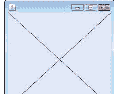

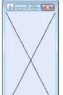

图 4.19 创建 `JFrame` 以显示 `DrawPanel`。（第二部分，共 2 部分。）

第 6 行使用关键字 `extends` 来指示 `DrawPanel` 类是 `JFrame` 的一种增强类型。关键字 `extends` 表示了一种所谓的继承关系，在这种关系中，我们新定义的类 `DrawPanel` 从类 `JFrame` 现有的成员（数据和方法）开始。被 `DrawPanel` 继承的类 `JFrame` 出现在关键字 `extends` 的右侧。在这种继承关系中，`JFrame` 被称为超类，`DrawPanel` 被称为子类。这导致 `DrawPanel` 类既拥有 `JFrame` 类的属性（数据）和行为（方法），还拥有我们在 `DrawPanel` 类声明中添加的新功能——具体来说就是沿面板对角线绘制两条线的能力。继承关系将在第 9 章详细解释。现在，在创建你的图形程序时，你应该模仿我们的 `DrawPanel` 类。

## `paintComponent` 方法

每个 `JPanel`（包括我们的 `DrawPanel`）都有一个 `paintComponent` 方法（第 9–22 行），每当系统需要显示 `DrawPanel` 时，系统会自动调用它。`paintComponent` 方法必须在第 9 行声明——否则系统将不会调用它。它在 `JFrame` 首次显示在屏幕上时、被屏幕上的另一个窗口覆盖后重新显示时，以及其内部窗口调整大小时被调用。`paintComponent` 方法需要一个参数，即 `Graphics` 对象，该对象由系统在调用 `paintComponent` 时提供。该 `Graphics` 对象用于绘制线、矩形和其他图形。

在你创建的每个 `paintComponent` 方法中，第一个语句始终应该是：

```java

super.paintComponent(g);

```

这确保了在开始绘制之前面板已正确渲染。接下来，第 14–15 行调用了 `DrawPanel` 继承自 `JFrame` 的方法。由于 `DrawPanel` 继承自 `JFrame`，`DrawPanel` 可以使用 `JFrame` 的任何公共方法。`getWidth` 和 `getHeight` 分返回 `JFrame` 的宽度和高度。第 14–15 行将这些值存储在局部变量 `width` 和 `height` 中。最后，第 18 行和 21 行使用 `Graphics g` 调用 `drawLine` 画两条线。`drawLine` 方法在其四个参数表示的两个点之间画一条线。前两个参数是一个端点的 x 和 y 坐标，最后两个是另一个端点的坐标。如果你调整窗口大小，线条将相应缩放，因为参数是基于面板的宽度和高度的。在此应用程序中调整窗口大小会导致系统调用 `paintComponent` 来重新绘制 `DrawPanel` 的内容。

### DrawPanelTest

为了在屏幕上显示 `DrawPanel`，你必须将其放入窗口中。你通过 `JFrame` 的对象创建一个窗口。在 `DrawPanelTest.java`（图 4.19）中，第 3 行导入了 `javax.swing`。第 8 行创建了一个 `DrawPanel` 对象来包含绘图。第 10 行创建了一个 `JFrame` 对象来盛载面板。第 13 行调用 `setDefaultCloseOperation` 设置在关闭时退出。第 18 行使用 `add` 将面板添加到帧。第 19 行使用 `setSize` 设置帧的大小。第 20 行使用 `setVisible(true)` 使帧可见。

# 总结

## 第 4.1 节 介绍

- 在编写程序解决问题之前，你必须对问题有彻底的理解，并有一个仔细规划的解决策略。你还必须理解可用的构建模块并运用程序构造技术。

## 第 4.2 节 算法

- 任何计算问题都可以通过按顺序执行一系列动作（第 102 页）来解决。
- 根据要执行的动作及其执行顺序来解决问题的方法称为算法（第 102 页）。
- 指定程序中语句的执行顺序的操作称为程序控制（第 102 页）。

## 第 4.3 节 伪代码

- 伪代码（第 103 页）是一种非正式语言，可以帮助你开发算法，而无需担心 Java 语言语法的严苛细节。
- 我们在本书书中使用的伪代码与日常英语相似——它方便且用户友好，但它并不是真正的编程语言。你可以使用你自己的语言（们）来开发你的伪代码。
- 伪代码可以帮助你在尝试用编程语言（如 Java）编写程序之前先“思考出”程序。
- 准备充分的伪代码可以很容易转换为对应的 Java 程序。

## 第 4.4 节 控制结构

- 通常情况下，程序中的语句按照编写的顺序一个接一个地执行。这一过程被称为顺序执行（第 103 页）。
- 各种语句允许你确保下一个执行的语句不一定是序列中的下一条。这被称为控制转移（第 103 页）。
- Bohm 和 Jacopini 证明了所有程序都可以仅用三种结构（第 103 页）编写——顺序结构、选择结构和重复结构。
- “控制结构”一词源于计算机科学领域。《Java 语言规范》将“控制结构”称为“控制语句”（第 104 页）。
- 顺序结构是内置在 Java 中的。除非另有指示，否则计算机会按照语句出现的顺序一个接一个执行——即按顺序执行。
- 无论任何动作被放置在何处，若干动作（第 104 页）都是 UML 的一部分。活动图模拟了软件系统的工作流（第 104 页；也称为活动）。
- 活动图由符号（第 104 页）组成——例如活动状态符号、菱形和小圆圈——这些符号通过转换箭头连接，箭头代表活动的流向。
- 状态（第 104 页）包含指定要执行特定动作的动作表达式。
- 活动图中的箭头表示转换，指示了动作发生的顺序。
- 位于活动图顶部的实心圆代表活动的初始状态（第 104 页）——程序在执行所建模动作之前的工作流的开始。
- 出现在图底部的空心圆包围实心圆代表最终状态（第 104 页）——程序执行其动作之后的工作流的结束。
- 右上角折叠的矩形是 UML 节点（第 104 页）——用于定义图中符号用途的说明性标记。
- Java 有三种类型的选择语句（第 105 页）。
- `if` 单重选择语句（第 105 页）选择或忽略一个或多个动作。
- `if...else` 双重选择语句在两个动作或动作组之间进行选择。
- `switch` 语句被称为多重选择语句（第 105 页），因为它在不同的选项或动作组之间进行选择。
- Java 提供了 `while`、`do...while` 和 `for`（也称为迭代或循环）语句，允许程序在循环条件保持为真时重复执行语句。
- `while` 和 `for` 语句执行其主体内的动作零次或多次——如果循环条件（第 105 页）初始为假，则动作将不会执行。`do...while` 语句执行其主体内的动作一次或多次。
- 单词 `if`、`else`、`while`、`do` 和 `for` 是 Java 关键字。关键字不能用作标识符，例如变量名。
- 每一个程序都是通过组合许多顺序、选择和重复语句（第 105 页）构的。
- 单入口/单出口语句（第 105 页）用于算法中。

## 第 4.5 节 `if` 语句

- 程序使用选择在备选方案中进行选择。
- 当条件为真时使用单重选择语句（第 105 页）。单入口/单出口控制。

## 第 4.6 节 `if...else` 语句

- `if` 选择语句（第 105 页）选择或忽略一个或多个动作。
- `if...else` 双重选择语句在两个动作或动作组之间进行选择。
- 多重选择语句（第 105 页）用于处理多种情况。

## 第 4.8 节 重复语句

- `while` 语句（第 114 页）允许你在条件保持为真时重复动作。
- 合并（第 114 页）将两个流合并为一个。

## 第 4.9 节 计数控制重复

- 计数控制重复（第 115 页）使用名为控制变量的变量来控制语句执行的次数。
- 计数控制重复通常被称为确定重复（第 115 页），因为重复次数在循环开始之前已知。
- 总和（第 115 页）是一个用于累加多个值值的变量。
- 局部变量声明必须在方法中使用该变量之前。
- 整数除法两个整数——小数部分被截断。

## 第 4.10 节 哨兵控制重复

- 必须选择一个不会与可输入值混淆的哨兵值。
- 自顶向下、逐步细化（第 120 页）对于开发结构良好的程序至关重要。
- 除以零是一个逻辑错误。
- 要对整数值执行浮点计算，可以将其中一个整数转换为双。

## 第 4.12 节 复合赋值运算符

- 赋值运算符（第 131 页）简写了赋值表达式。形式如下的语句

```java

variable = variable operator expression;

```

其中 `operator` 是二进制运算符 `+`、`-`、`*`、`/` 或 `%` 之一，可以写成形式

```java

variable operator= expression;

```


## 4.13 递增和递减运算符

- `++` 运算符将运算符右表达式的值加到运算符左变量的值上，并将结果存储在左侧。

- 一元递增运算符 `++` 和一元递减运算符 `--` 可对数值型变量的值加 1 或减 1（第 131 页）。

- 位于变量前（第 131 页）的递增或递减运算符是前置递增或前置递减运算符。位于变量后（第 131 页）的递增或递减运算符分别是后置递增或后置递减运算符。

- 使用前置递增或递减运算符加或减 1 与分别递增或递减相同。

- 对变量进行前置递增会导致变量加 1 或减 1；然后变量的新值将用于它所出现的表达式。

- 使用后置递增或递减运算符加或减 1 与分别后置递增或后置递减相同。

- 对变量进行后置递增或递减会导致其值先用于它所出现的表达式；然后变量的值加 1 或减 1。

- 在单独语句中对变量进行递增或递减时，前置递增和后置递增的效果相同，前置递减和后置递减的效果也相同。

## 4.14 原始类型

- Java 要求所有变量必须有类型。因此，Java 被称为强类型语言（第 134 页）。

- Java 使用 Unicode 字符和 IEEE 754 浮点数。

## 自测练习

### 4.1 填入下列每个陈述的空处：

- a) 所有程序都可以用三种类型的控制结构编写：`顺序`、`选择`，以及 `循环`。
- b) 使用 `if...else` 语句用于在条件为真时执行一个动作，在条件为假时执行另一个动作。
- c) 重复一组指令多次被称为 `计数器控制（或确定）` 重复。
- d) 当不知道一组语句将重复多少次时，使用 `哨兵、信号或哑值` 来结束重复。
- e) `顺序` 结构是 Java 内置的；默认情况下，语句按照它们出现的顺序执行。
- f) 类型 `char`、`byte`、`short`、`int`、`long`、`float` 和 `double` 类型的实例变量均被赋予值 `0`。
- g) Java 是一种 `强类型` 语言；它要求所有变量必须有类型。
- h) 如果递增运算符作用于变量，则先将变量加 1，然后将其值用于表达式中。

### 4.2 说明以下每个陈述是正确还是错误的。如果错误，请解释原因。

- a) 算法是一种根据执行的动作及其执行的顺序来解决问题的程序。 **正确**
- b) 包含在一对括号内的语句集是一个块。 **错误**，一对大括号内的语句集是一个块。
- c) 选择语句指定当某个条件仍然满足时要重复某个动作。 **错误**，选择语句指定在条件为真时执行某个动作；`while` 循环指定当条件满足时重复动作。
- d) 嵌套控制语句出现在另一个复合赋值运算符 `+=`、`-=`、`*=`、`/=` 和 `%=` 中，用于简化赋值表达式。 **错误**，嵌套控制语句是指控制语句出现在另一个控制语句中；复合赋值运算符用于简化赋值表达式。

## 第 4 章 控制语句：第一部分：赋值、++ 和 -- 运算符

- f) 原始类型（`boolean`、`char`、`byte`、`short`、`int`、`long`、`float` 和 `double`）仅可在 Windows 平台上迁移。 **错误**，原始类型可在所有操作系统平台上迁移。
- g) 指定程序中语句执行的顺序被称为程序控制。 **正确**
- h) 一元转换 `(double)` 为其操作数创建一个临时整数副本。 **错误**，一元转换 `(double)` 创建操作数的临时浮点数副本。
- i) 类型为 `boolean` 的实例变量默认被赋予 `true` 值。 **错误**，`boolean` 类型实例变量默认被赋予 `false` 值。
- j) 伪代码帮助你在尝试用编程语言编写程序之前思考程序。 **正确**

### 编写四条 Java 语句，使整数变量 `x` 加 1。

```java
x = x + 1;
x += 1;
x++;
++x;
```

### 编写语句完成以下每个任务：

a) 使用一条语句将 `x` 和 `y` 的和赋值，然后将 `x` 加 1。
```java
sum = x++ + y;
```

b) 测试变量是否大于 10。如果是，打印“Count is greater than 10”。
```java
if (count > 10)
    System.out.println("Count is greater than 10");
```

c) 使用一条语句将变量减 1，然后从变量 `total` 返回并将结果存储在变量 `total` 中。
```java
total = q--;
```

d) 计算 `q` 除以 `divisor` 后的余数，并将结果赋值给 `q`。用两种不同的方式写这条语句。
```java
q = q % divisor;
q %= divisor;
```

### 编写一条 Java 语句完成以下每个任务：

a) 声明一个 `int` 类型的变量并将其初始化为 0。
```java
int sum = 0;
```

b) 声明一个 `int` 类型的变量并将其初始化为 1。
```java
int x = 1;
```

c) 将变量加到变量 `sum`，并将结果赋值给变量 `sum`。
```java
sum += x;
```

d) 打印“The sum is: ”后跟变量 `sum` 的值。
```java
System.out.printf("The sum is: %d\n", sum);
```

### 将你在练习 4.5 中编写的语句合并到一个 Java 程序中，计算并打印 1 到 10 整数的和。使用 `while` 语句循环计算和递增。循环在 `x` 的值变为 11 时终止。

```java
// 练习 4.6: Calculate.java
// 计算 1 到 10 整数的和

public class Calculate {

    public static void main(String[] args) {

        int sum = 0;
        int x = 1;

        while (x <= 10) {
            sum += x;
            x++;
        }

        System.out.printf("The sum is: %d\n", sum);
    }
}
```
和是 55

### 在执行计算 `product *= ++x;` 语句后，确定语句中变量的值。假设所有变量都是 `int` 类型且初始值为 5。

`product = 25, x = 6`

### 识别并纠正以下代码组中的错误 (c)：

a) 
```java
while (c <= 5) {
    product *= c;
    c++;
}
```
**错误**：`while` 语句缺少大括号，且 `++;` 语法错误。
**修正**：添加大括号，将 `++;` 改为 `c++;`。

b) 
```java
if (gender == 1)
    System.out.println("Woman");
else
    System.out.println("Man");
```
**错误**：`else` 后面的分号是逻辑错误（原文可能指多余的分号或缩进问题），第二个输出会被执行。
**修正**：移除 `else` 后面的分号（若有），并建议使用大括号明确块结构。

### 以下语句哪里错了？

```java
while (z >= 0)
    sum += z;
```
**错误**：`z` 在 `while` 语句中从未改变。因此，如果条件 `(z >= 0)` 为真，就会死循环。为了防止死循环，必须递减 `z` 直到变为 0。

## 自测练习答案

### 4.1
顺序，选择，循环。b) if...else, c) 计数器控制（或确定）, d) 哨兵、信号或哑值。e) 顺序。f) 0 (零), g) 强类型。h) 前置。

### 4.2
a) 正确。b) 错误，一对大括号内的语句集是一个块。c) 错误，选择语句指定在条件为真时执行动作；`while` 循环指定当条件满足时重复动作。d) 错误，嵌套控制语句是指控制语句出现在另一个控制语句中；复合赋值运算符用于简化赋值表达式。e) 正确。f) 错误，原始类型可在所有操作系统平台上迁移。g) 正确。h) 错误，一元转换 `(double)` 创建操作数的临时浮点数副本。i) 错误，`boolean` 类型实例变量默认被赋予 `false` 值。j) 正确。

### 4.3
顺序，选择，循环。b) if...else

### 4.4
a) `x + y;`
b) 
```java
if (count > 10)
    System.out.println("Count is greater than 10");
```
c) `total = q--;`
d) `q %= divisor;`

### 4.5
a) `int sum = 0;`
b) `int x = 1;`
c) `sum += x;`
d) `System.out.printf("The sum is: %d\n", sum);`

### 4.6 程序如下：

```java
// 练习 4.6: Calculate.java
// 计算 1 到 10 整数的和

public class Calculate {

    public static void main(String[] args) {

        int sum = 0;
        int x = 1;

        while (x <= 10) {
            sum += x;
            x++;
        }

        System.out.printf("The sum is: %d\n", sum);
    }
}
```
和是 55

### 4.7
`product = 25, x = 6`

### 4.8
a) 错误：`while` 语句缺少大括号。修正：添加大括号。
b) 错误：`else` 后面的分号是逻辑错误。第二个输出会被执行。修正：移除 `else` 后面的分号。

### 4.9
`x` 在 `while` 语句中从未改变。因此，如果条件 `(x > 0)` 为真，就会死循环。为了防止死循环，必须递减 `x` 直到变为 0。

### 4.10
比较 `if` 单选择语句和 `while` 循环语句。这些语句相似之处何？不同之处何？

## 4 控制语句：第一部分：赋值、++ 和 -- 运算符

### 4.11
解释当 Java 程序尝试用一个整数除以另一个整数时发生了什么。小数部分去了？如何避免这种情况？

### 4.12
描述结合控制语句两种方式。

### 4.13
计算前 100 个正整数适用于哪种循环？计算任意数量整数的和适用于哪种？简述每种如何实现。

### 4.14
变量的前后递增的区别是什么？

### 4.15
识别并纠正以下代码段中的错误。[注意：每个代码段可能存在多个错误。]

```java
a) if (age >= 65) {
    System.out.println("Age is greater than or equal to 65");
} else {
    System.out.println("Age is less than 65");
}

b) int x = 1, total = 0;
while (x <= 10) {
    total += x;
    x++;
}

c) while (x <= 100) {
    total += x;
    x++;
}

d) while (y > 0) {
    System.out.println(y);
    --y;
}
```

### 4.16
下程序打印什么？

```java
// 练习 4.16: Mystery.java

public class Mystery {

    public static void main(String[] args) {

        int x = 1;
        int total = 0;

        while (x <= 10) {
            int y = x * x;
            System.out.println(y);
            total += y;
            x++;
        }

        System.out.printf("Total is %d\n", total);
    }
} // 结束类 Mystery
```

对于练习 17 到练习 4.20，执行以下每个步骤：

a) 读取题目描述。
b) 使用伪代码和自顶向下、逐步细化的方法制定算法。
c) 编写 Java 程序。
d) 测试、调试并执行 Java 程序。
e) 处理完整的数据集。

### 4.17 (油耗)
司机们关注汽车的油耗。一位司机通过记录每次满油后行驶的英里和使用的加仑数跟踪了多次行程。开发一个 Java 应用，输入每次行程的英里和加仑数（均为整数）。该程序应计算并显示每次行程的里程数，以及截至为止所有行程的每加仑里程。所有平均值计算应产生浮点数结果。使用 `Scanner` 类和哨兵控制循环（sentinel-controlled repeat）从用户获取数据。

### 4.18 (信用额度计算器)
开发一个 Java 应用，判断几个部门商店的客户中哪些超过了结算账户的信用额度。对于每个客户，可用以下因素：

- a) 账户号码
- b) 月初余额
- c) 客户本月产生的所有费用总和
- d) 添加到客户账户的所有贷记总和
- e) 允许的信用额度

程序应将所有因素作为整数输入，计算新余额（= 月初余额 + 费用 - 贷记），显示新余额并判断新余额是否超过了客户的信用额度。对于超过信用额度的客户，程序应显示“Credit exceeded”（额度超出）。

### 4.19 (销售佣金计算器)
一家大公司按佣金支付销售人员。每笔销售支付 200 美元加上该周总销售额的 9%。例如，每周销售价值 5,000 美元商品的销售人员获得 200 美元加上 5,000 美元的 9%，总计 650 美元。你获得了一份每个销售人员销售商品列表。这些商品的价值如下：

| 商品 | 价值 |
|---|---|
| 1 | 239.99 |
| 2 | 129.75 |
| 3 | 99.95 |
| 4 | 350.89 |

开发一个 Java 应用，输入销售人员上周销售的商品，并计算并显示销售人员的收入。销售商品数量没有限制。

### 4.20 (薪资计算器)
开发一个 Java 应用，确定三名员工每个人的总工资。公司对每位员工工作的前 40 小时支付标准工资，对超出的所有小时数支付时间倍半工资。你获得了一份员工列表、上周的工作小时数和每小时薪率。你的程序应为每位员工输入这些信息，然后显示该员工的总工资。使用 `Scanner` 类输入数据。

### 4.21 (寻找最大数)
寻找最大值的过程经常用于计算机程序。例如，一个确定比赛获胜者的程序会输入每个销售人员销售的单位数量。销售单位最多的销售人员胜出测试。编写一个伪代码控制结构，然后编写一个 Java 应用，输入一组十个整数并打印最大的整数。你的程序应至少使用以下三个变量：

- a) `counter`: 一个从 1 到 10 的计数器（即用于跟踪已输入了几个数字，并确定何时处理完 10 个数字）。
- b) `number`: 用户最近输入的整数。
- c) `largest`: 目前为止发现的最大数字。

### 4.22 (表格输出)
编写一个 Java 应用，使用循环打印以下数值表：

| N | 10*N | 100*N | 1000*N |
|---|---|---|---|
| 1 | 10 | 100 | 1000 |
| 2 | 20 | 200 | 2000 |
| 3 | 30 | 300 | 3000 |
| 4 | 40 | 400 | 4000 |
| 5 | 50 | 500 | 5000 |

### 4.23 (寻找两个最大数)
使用与练习题 4.21 类似的方法，找到输入的 10 个值中最大的两个。[注：你每个数字只能输入一次。]

### 4.24 (验证用户输入)
修改图 4 中的程序，以验证其输入。对于任何输入，如果输入的值不是 1 或 2，则继续循环，直到用户输入正确的值为止。

### 4.25
下一个程序打印什么?

```java
// 练习 4.25: Mystery2.java

public class Mystery2 {

    public static void main(String[] args) {

        int count = 1;

        while (count < 10) {
            System.out.print(count % 2 == 1 ? " ****" : "+++++");
            ++count;
        }
    }
} // end class Mystery2
```

### 4.26
下一个程序打印什么?

```java
// 练习 4.26: Mystery3.java

public class Mystery3 {

    public static void main(String[] args) {

        int row = 10;

        while (row >= 1) {
            int column = 1;
            while (column <= 10) {
                System.out.print(row % 2 == 1 ? "<" : ">");
                ++column;
            }
            --row;
            System.out.println();
        }
    }
}
```

### 4.27 (悬空 else 问题)
当 x 为 9 且 y 为 11 时，确定代码的输出。在 Java 程序中，`else` 总是与紧邻的 `if` 关联，除非使用括号。这被称为“悬空 else 问题”。消除以下代码的缩进以增加挑战性。提示：应用

- a) 
```java
if (x < 10)
    if (y > 10)
        System.out.println("*****");
    else
        System.out.println("#####");
```
- b) 
```java
if (x < 10) {
    if (y > 10)
        System.out.println("*****");
}
else
    System.out.println("#####");
```

### 4.28 (另一个悬空 else 问题)
修改代码以产生所示输出。提示：应用

```java
if (x < 10)
    if (y > 10)
        System.out.println("*****");
    else
        System.out.println("#####");
```

- a) 假设 x 为 5 且 y 为 8，其输出为：
```
0000
****
```
- b) 假设 x 为 5 且 y 为 8，其输出为：
```
0000
#####
```
- c) 假设 x 为 5 且 y 为 8，其输出为：
```
0000
****
```
- d) 假设 x 为 5 且 y 为 7，其输出为：
```
0000
#####
```

### 4.29 (星号正方形)
编写一个 Java 应用，提示用户输入边长，显示一个由星号组成的空心正方形。

### 4.30 (回文)
编写一个应用读取五位数并判断其是否为回文。如果输入不是五位数，显示错误消息并允许用户输入新值。

### 4.31 (打印二进制)
编写一个应用，输入一个仅包含 0 和 1 的整数（即二进制数），并打印其十进制等值。[提示：使用余数和除法运算符从右侧逐个提取二进制数字。最右侧位是 1，左侧的是 2，然后是 4、8 等。例如，二进制数 1101 是 $1 * 2^3 + 1 * 2^2 + 0 * 2^1 + 1 * 2^0$，即 $8 + 4 + 0 + 1 = 13$。]

### 4.32 (星号棋盘)
编写一个 Java 应用，使用输出语句

```java
System.out.print("*");
System.out.print(" ");
System.out.println();
```


来显示下面的棋盘图案。`System.out.println()` 方法不带参数时输出单个换行符。[提示：需要循环语句。]


# 差异

$n! = n \cdot (n-1) \cdot (n-2) \cdot \dots \cdot 1 \quad (当 $n$ 大于或等于 1 时)$

以及

$n! = 1 \quad (当 n = 0$ 时)$

例如，$5! = 5 \cdot 4 \cdot 3 \cdot 2 \cdot 1$，结果为 120。

- a) 编写一个程序，读取一个非负整数并计算打印它的阶乘。

- b) 编写一个程序，通过（理想情况下）反转以下公式来估算数学常数 $e$ 的值。允许用户输入要计算的项数。

$e = 1 + \frac{1}{1!} + \frac{1}{2!} + \frac{1}{3!} + \dots$

- c) 编写一个程序，使用以下公式计算 $e^x$ 的值。允许用户输入要计算的项数。

$e^x = 1 + \frac{x}{1!} + \frac{x^2}{2!} + \frac{x^3}{3!} + \dots$

# 差异

**4.38 (用加密保护隐私)** 联网设备上互联网通信和数据存储的爆炸式增长极大地增加了对隐私的关注。密码学领域致力于对数据进行编码，使其未经授权的用户难以（理想情况下是无法）读取。在本练习中，你将研究一种简单的数据加密和解密方案。一家想要通过互联网发送数据的公司要求你编写一个程序对其加密，以便更安全地传输。所有数据都以四位整数的形式传输。你的程序应该读取用户输入的四位整数并按以下方式加密：将每个数字替换为该数字加 7 后除以 10 的余数。然后交换第一位和第三位，交换第二位和第四位。最后打印加密后的整数。编写另一个程序，输入加密的四位整数并将其解密（通过反转加密方案）形成原始数字。[可选阅读项目：研究通用的“公钥加密”以及 PGP（良好的隐私）特定的公钥。你可能想研究 RSA 方案，它广泛应用于工业级应用程序。]

**4.39 (世界人口增长)** 几个世纪以来，世界人口增长显著。持续的增长将面临呼吸空气、饮用水、农耕地和其他资源的极限。有证据表明，近年来增长速度正在放缓，世界人口可能在本世纪达到顶峰，然后开始下降。

对于此练习，研究当前世界人口的增长估计值及其增长率（每年可能增加的百分比）。务必调查各种观点。编写一个程序计算未来 75 年每年的人口增长，使用当前增长率将保持不变的简化假设。以表格形式打印结果。第一列显示从第 1 年到第 75 年。第二列显示该年底预计的世界人口。第三列显示该年世界人口的数值增长。根据你的结果，确定如果今年的增长率持续存在，人口将在哪一年增加到现在的两倍。

# 5 控制语句：第 2 部分；逻辑运算符

> 轮子转了一了一圈。
— 威廉·莎士比亚

> 我们所所知的一切演化
> 都从模糊走向确定。
— 查尔斯·桑德斯·皮尔斯

# 目标

在本章中，你将：

- 学习计数控制循环的核心知识。
- 使用 `for` 和 `do...while` 循环语句在程序中多次执行语句。
- 理解使用 `switch` 选择语句进行多重选择。
- 使用 `break` 和 `continue` 程序控制语句来改变控制流。

# 5.1 引言

在本章通过引入 `while`、`for` 和 `switch` 语句，继续对结构化编程原理的介绍。我们通过一系列示例展示 `while` 语句。我们将介绍逻辑运算符，使我们能够使用更复杂的条件表达式。最后，我们将总结控制语句。

5.1 引言
5.2 计数控制循环的要点
5.3 `for` 循环语句
5.4 `do...while` 循环语句
5.5 `switch` 多重选择
5.6 案例：字符串
5.7 `break` 和 `continue` 语句
5.8 逻辑运算符
5.9 结构化编程总结
5.10 （可选）案例：图形
5.11 总结

# 5.2 计数控制循环的要点

本节使用第 4 章引入的 `while` 语句形式化执行计数控制循环所需的元素：

1. 控制变量（或循环计数器）
2. 控制变量的初始值
3. 每次循环修改控制变量的增量
4. 决定是否继续循环的条件

为了看到计数控制循环的元素，请考虑图 5.1 的应用，它使用循环显示 1 到 10。

```java
// 图 5.1: WhileCounter.java
// 使用 while 语句进行计数控制循环。
public class WhileCounter {
    public static void main(String[] args) {
        // 代码在这里
    }
}
```

在图 5.1 中，计数控制循环的元素定义在第 8、10 和 13 行。第 18 行将变量 `counter` 声明为 `int` 类型，为其留留空间并将初始值设置为 1。变量 也可以通过以下局部变量声明和赋值语句进行初始化：

```java
int counter; // 声明 counter
counter = 1; // 初始化 counter 为 1
```

第 12 行在循环的每次迭代中显示 `counter` 的值。第 13 行在循环的每次迭代中将计数变量增加 1。`while`（第 10 行）中的循环条件测试控制变量的值是否小于等于 10（条件的值为真）。程序在计数变量为 10 时执行此 `while` 循环。当计数变量超过 10 时（即 `counter` 变为 11），循环终止。

# 常见编程错误 5.1

浮点值可能是近似的，用浮点变量控制循环会导致计数值不精确和终止测试不准确。

# 错误预防提示 5.1

使用整数控制计数循环。

图 5.1 中的程序可以更简洁，通过在第 8 行将 `counter` 初始化为 0，并在 `while` 条件中使用预增 `++counter` 如下：

这段代码说了一个语句，`while` 条件在测试条件之前执行递增。（回顾第 4.13 节，`++` 的优先级高于 `<=`。）以这种紧凑的方式编码可能会使代码更难以阅读、调试、修改和维护，应该被避免。

# 软件工程观察 5.1

“保持简单”对于你编写的大部分代码都是很好的建议。

## 5.3 `for` 重复语句

第 5.2 节介绍了计数控制循环的各个元素。`while` 语句可以实现任何计数控制循环。Java 还提供了 `for` 重复语句，它可以在单行代码中指定计数控制重复的细节。图 5.2 使用 `for` 语句重新实现了图 5.1 的应用。

```java
// Fig. 5.2: ForCounter.java
// 使用重复语句进行计数控制的循环。
public class ForCounter {
    public static void main(String[] args) {
        // for 语句头部包含初始化、
        // 循环继续条件和递增
        for (int counter = 1; counter <= 10; counter++) {
            System.out.printf("%d\n", counter);
        }
    }
} // end class ForCounter
```


| 1 | 2 | 3 | 4 | 5 | 6 | 7 | 8 | 9 | 10 |
|---|---|---|---|---|---|---|---|---|---|
| 使用重复语句进行计数控制循环。 | | | | | | | | | |

当 `for` 语句（第 10–11 行）执行之前，第一个变量 `counter` 被声明并初始化为 1。（回想第 5.2 节，计数控制循环的第一个元素是控制变量及其初始值）。接下来，程序检查循环继续条件 `counter <= 10`，该条件位于两个分号之间。由于 `counter` 的初始值为 1，因此该条件最初为真。如果为真，体语句（第 11 行）显示 `counter` 变量的值。在执行完循环体后，程序在表达式 `counter++` 中增加 `counter`，该表达式出现在第二个分号的右侧。再次执行循环继续操作，以确定程序是否应该继续循环的下一次迭代。此时，`counter` 的值为 2，因此条件为真（未超过最终值）——此地，程序再次执行体语句（即循环的下一次迭代）。此过程持续进行，直到数字 1 到 10 都已显示，且 `counter` 的值变为 11，导致循环继续失败并终止（在循环体执行 10 次后）。程序执行 `for` 之后的第一个语句——在本例中为第 13 行。

图 5.2 在（第 10 行）使用了循环继续条件 `counter <= 10`。如果你错误地指定 `counter < 10`，循环将只会迭代九次。这是一个由差一错误（off-by-one error）引起的常见*逻辑*错误。

## 常见编程错误 5.2


使用错误的关系运算符或重复语句中循环继续条件的错误最终值会导致差一错误。

## 错误预防贴士 5.2

在循环条件中使用最终值和运算符 `<=` 有助于避免差一错误。对于一个输出 1 到 10 的循环，循环继续条件应该是 `counter <= 10` 而不是 `counter < 10`（这会导致差一错误）或 `counter < 11`（这是正确的）。许多程序员倾向于从零开始计数，即 `counter` 计数 10 次，将初始化为零，且循环继续测试为 `counter < 10`。

## 错误预防贴士 5.3

如所述，整数可能会溢出，导致逻辑错误。循环的控制变量可能会溢出。仔细编写你的循环条件以防止这种情况。

## 深入观察语句头部

图 5.3 详细观察了图 5.2 中的 `for` 语句。第一行——包括关键字 `for` 以及 `for` 之后括号内的所有内容（图 5.2 中的循环 10）——有时被称为 `for` 语句。该头部“无一不包”——指定了用于控制变量进行控制重复的每个项目。如果 `for` 的体中有多条语句，则需要大括号来定义循环体。

| for 关键字 控制变量 | 必须的分号 | 必须的分号 |
|---|---|---|
| for (int counter = 1; counter <= 10; counter++) | | |

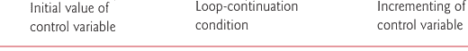

**图 5.3** | for 语句组件。

## for 语句的通用格式

`for` 语句的通用格式为

```
for (initialization; loopContinuationCondition; increment);
```

其中初始化表达式命名控制变量并可选地提供其初始值，`loopContinuationCondition` 决定循环是否继续执行，`increment` 修改控制变量的值，因此头部两个分号是必须的。如果循环继续条件最初为假，程序将不执行语句体。相反，执行将继续进行 `for` 之后的语句。

## 用等效的 while 语句表示 for 语句

`for` 语句通常可以用等效的 `while` 语句表示如下：

```java
initialization;

while (loopContinuationCondition) {

  statement

  increment;

}
```

## 5.3 重复语句 157

在第 5.8 节中，我们将展示一个无法用等效的 `while` 语句表示的情况。通常，`for` 语句用于计数控制循环，`while` 语句用于哨兵控制循环。

## 语句变量的作用域

在 `for` 语句中，初始化语句的控制变量的作用域仅限于该 `for` 语句。如果在 `for` 语句之外定义变量，该变量的作用域将不仅限于 `for` 语句。变量的作用域在第 6 节中详细讨论。

*(注：由于提供的原文文本存在大量重复和断句，下文从“for 语句的通用格式”开始的翻译已根据逻辑进行了梳理和去重翻译)*

## 5.4 for 语句的示例

以下示例展示了在 for 语句中改变控制变量的技巧。在每个用例中，我们只为头部编写适当的运算符。注意递减控制变量的循环中关系运算符的相应。

- a) 增量为1，控制变量从 1 变为 100。
  `for (int i = 1; i < 100; i++)`
- b) 递减为1，控制变量从 100 变为 1。
  `for (int i = 100; i >= 1; i--)`
- c) 增量为7，控制变量从 7 变为 77。
  `for (int i = 7; i < 77; i += 7)`
- d) 递减为2，控制变量从 20 变为 2。
  `for (int i = 20; i >= 2; i -= 2)`
- e) 控制变量遍历值 2, 5, 8, 11, 14, 17, 20。
  `for (int i = 2; i < 20; i += 3)`
- f) 控制变量遍历值 99, 88, 77, 66, 55, 44, 33, 22, 11, 0。
  `for (int i = 99; i >= 0; i -= 11)`

## 常见编程错误 5.5

> 使用错误的关系运算符（例如，在递减到 1 的循环中使用 `i <=` 替代 `i >= 1`）通常是一个逻辑错误。

## 常见编程错误 5.6

> 如果循环的控制变量每次递增或递减大于 1，则不要在循环继续条件中使用不等于运算符（`!=` 或 `<=`）。例如，考虑以下 for 语句头部 `for (counter=1; counter != 0; counter += 2)`。循环继续计数器 `counter=1` 永远不会变为假（导致无限循环），因为 counter 在每次迭代后都增加 2。

### 应用：求加 2 到 20 的偶数

我们考虑两个示例应用，展示了 for 的简单用法。图 5.5 中的应用使用 for 语句求 2 到 20 偶数的和，并将结果存储在 int 变量 `total` 中。

```java
// Fig. Sum.java

// 使用 for 语句求整数和。

public class Sum
{
    public static void main(String[] args)
    {
        int total = 0;

        // 2 到 20 之间的偶数
        for (int number = 2; number <= 20; number += 2)
            total += number;

        System.out.printf("Sum is %d%n", total);
    }
}
```

图 5.5 | 使用 for 语句求整数和。（2 部分中的第 1 部分。）

| 总和为 110 |

图 5.5 使用 for 语句求整数和。（2 部分中的第 2 部分。）

初始化表达式和增量表达式是逗号分隔的列表，允许你使用多个初始化表达式或多个增量表达式。例如，尽管不建议这样做，但你可以将图 5.5 中第 11–12 行的语句体通过逗号合并到 for 头部的增量部分，如下：

```java
for (int number = 2; number <= 20; total += number,
    // 空语句
```

> **良好的编程实践 5.1**
> 如果可能，尽可能将控制语句头部的大小限制在单行。

### 应用：复利计算

让我们使用公式来计算复利。考虑以下问题：

某人在利率为 5% 的储蓄账户中投资了 1000 美元。假设所有利息都留存在账户中，计算并打印 10 年内每年年底账户的金额。使用以下公式：

```
a = p(1 + r)^n
```

其中
- p 是原始投资金额（即本金）
- r 是年利率（例如，5% 对应 0.05）
- n 是年数
- a 是第 n 年末的金额。

该问题的解决方案（图 5.6）涉及一个循环，对资金留在账户中的 10 年中的每年都进行计算。方法中的第 8–10 行声明了 double 变量 `amount`、`principal` 和 `rate`，并将 `principal` 初始化为 1000.0 和 0.05。Java 将 1000.0 和 0.05 等浮点常数视为 double。同样，Java 将 7 和 -22 等整数常数视为 int 类型。

```java
// Fig. 5.6: Interest.java

// 使用 for 进行复利计算。

public class Interest {
    public static void main(String[] args) {
        double amount = 0.0; // 每年年底的存款金额
        double principal = 1000.0; // 计息前的初始金额
        double rate = 0.05; // 利率

        // 显示头部
        System.out.printf("%20s%s", "Year", "Amount on deposit");

        // 计算每年的金额
        for (int year = 1; year <= 10; year++) {
            // 计算新金额
            amount = principal * Math.pow(1.0 + rate, year);
            // 显示年份和金额
            System.out.printf("%4d%20.2f%n", year, amount);
        }
    }
}
```

| 年份 | 存款金额 |
| :--- | :--- |
| 1 | 1050.00 |
| 2 | 1102.50 |
| 3 | 1157.63 |
| 4 | 1215.51 |
| 5 | 1276.28 |
| 6 | 1340.10 |
| 7 | 1407.10 |
| 8 | 1477.46 |
| 9 | 1551.33 |
| 10 | 1628.89 |

### 使用宽度和对齐格式化字符串

输出位于四个字符的字段内（由 `%d` 指定）。金额以格式化说明符 `%.2f` 作为浮点数输出。该标志表示浮点值应带有分组分隔符进行输出。实际使用的分隔符取决于用户的区域设置（即国家/地区）。例如，在美国，数字每三位将使用逗号，并使用小数点分隔数字的小数部分，如 1,234.45。格式规范中的 20 表示该值应在宽度为 20 的字段中对齐输出。.2 指定了格式化数字的精度——在这种情况下，数字被舍入到最近的百分位，并在小数点右侧保留两位数字。

# 关于显示舍入值的警告

在本示例中，我们将变量 `amount` 和 `rate` 声明为 double 类型。我们处理的是美元的小数部分，需要一种允许值包含小数点的类型。遗憾的是，浮点数可能会带来麻烦。这里简单解释一下在使用 double（或 float）表示美元时可能出现的问题。

## 5.5 do..while 重复语句

金额（假设美元金额显示在小数点后保留两位）：机器中存储的两个 `double` 类型的金额可能是 14.234（在显示时通常会四舍入为 14.23）和 18.673（在显示时通常会四舍入为 18.67）。当这些金额相加时，产生的内部总和为 32.907，显示时通常会四舍入为 32.91。因此，你的输出可能如下：

14.23
+ 18.67
------
32.91

但如果按照显示的单个数字进行相加，人们预期总和为 32.90。你已收到警告！

> **错误预防提示 5.6**
> 不要使用 `double` (float) 类型的变量进行精确的货币计算。浮点数的不精确性可能会导致错误。在练习中，你将学习如何使用整数进行精确的货币计算——Java 提供了 `java.math.BigDecimal` 类用于此目的，我们在图 8.16 中进行了演示。

## 5.5 do..while 重复语句

`do..while` 重复语句与 `while` 语句相似。在 `while` 中，程序在循环开始时执行循环体之前测试循环延续条件；如果条件为假，则循环体永不执行。`do..while` 语句在执行循环体后终止；因此，循环体至少执行一次。当 `do..while` 语句终止时，执行将继续顺序执行下一个语句。图 5.7 展示了使用 `do..while` 输出数字 1–10 的程序。

```java
1 // Fig. 5.7: DoWhileTest.java
2 // do..while 重复语句。
4 public class DoWhileTest
5 {
6 public static void main(String[] args)
7 {
8 int counter = 1;
10 do
11 {
12 System.out.printf("%d ", counter);
13 ++counter;
14 } while (counter <= 10); // end do..while
16 
17 System.out.println();
18 }
19 // end main
20 // end class DoWhileTest
```

图 5.7 | do..while 重复语句。（部分 I，共 2 部分）

| 1 | 2 | 3 | 4 | 5 | 6 | 7 | 8 | 9 | 10 |
| :--- | :--- | :--- | :--- | :--- | :--- | :--- | :--- | :--- | :--- |
| **图 5.7** | do...while 重复语句。（部分 II，共 2 部分）|

第 8 行声明并初始化了控制变量 `counter`。进入 `do...while` 语句后，第 12 行输出 `counter` 的值，第 13 行增加 `counter`。程序在循环底部（第 14 行）评估循环延续测试。如果条件为真，循环在第一个循环体语句（第 12 行）继续。如果条件为假，循环终止，程序从循环后的下一个语句继续。

# do...while 重复语句的 UML 活动图

图 5.8 包含了 `do...while` 语句的 UML 活动图。该图清楚地表明，在循环至少执行一次动作之前，不会评估循环延续条件。将此活动图与 `while` 语句的活动图（图 4.6）进行比较。

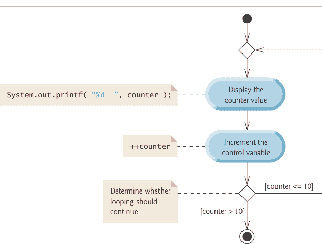

**图 5.8** | do...while 重复语句 UML 活动图。

# do...while 重复语句中的大括号

如果循环体内只有一个语句，则没有必要在 `do..while` 重复语句中使用大括号。然而，许多程序员包含大括号，以避免 `while` 语句和 `do...while` 语句之间的混淆。例如：

```
while (condition)
```

通常是 `while` 语句的第一行。一个单语句体没有大括号的 `do...while` 语句如下：

```
do
while (condition);
```

读者可能会将最后一行——`while(condition)`——误解为包含一个空语句（分号本身）的 `while` 语句。因此，带有循环体语句的 `do...while` 语句通常带有大括号写法：

```
do
{
    statement;
} while (condition);
```


> **编程实践 5.2**
> 始终在 `do...while` 语句中包含大括号。这有助于消除 `while` 语句与仅包含一个语句的 `do...while` 语句之间的歧义。

## 5.6 switch 多重选择语句

第 4 章讨论了单选择语句和 `if...else` 双重选择语句。`switch` 多重选择语句根据 `byte`、`short`、`int` 或 `char` 类型的常量整数表达式的可能值执行不同的操作。从 Java SE 7 开始，该表达式也可以是 `String`，我们将在第 5.7 节中讨论。

### 使用 switch 语句计算 A、B、C 和 F 等级

图 5.9 计算了用户输入的一组数字的平均值，并使用 `switch` 语句判断等级等同于 A、B、C、D 还是 F，以增加相应的等级计数器。程序还显示了每个等级的人数摘要。

与之前的版本的类平均总和程序类似，`Grades` 类的 `main` 方法（图 5.9）声明了局部变量 `total`（第 9 行）和 `gradeCounter`（第 10 行），用于跟踪用户输入的等级总和和输入的等级数量。第 11–15 行声明了每个等级类别的计数器变量。注意第 9–15 行中的变量被初始化为 0。

该方法有两个关键部分。第 26–56 行从用户控制的提示中读取任意数量的等级，更新变量 `total` 和 `gradeCounter`，并每个每个增加相应的字母等级计数器。第 59–80 行输出一份包含所有输入等级、平均值以及获得每个字母等级的人数的报告。让我们详细地检查这些部分。

```java
// 图 5.9: LetterGrades.java
// LetterGrades 类使用 switch 语句来计算字母等级。

import java.util.Scanner;

public class LetterGrades {
    public static void main(String[] args) {
        int total = 0; // 等级和
        int gradeCounter = 0; // 等级数量
        int aCount = 0; // A 等级
        int bCount = 0; // B 等级
        int cCount = 0; // C 等级
        int dCount = 0; // D 等级
        int fCount = 0; // F 等级

        Scanner input = new Scanner(System.in);

        // 直到输入
        while (input.hasNext()) {
            int grade = input.nextInt(); // 读取等级
            total += grade; // 加到总和
            ++gradeCounter; // 增加等级数量

            // 增加字母等级
            switch (grade / 10) {
                case 10:
                case 9: // 等级 90-99
                    aCount++;
                    break; // 退出 switch
                case 8: // 等级 80-89
                    bCount++;
                    break; // 退出 switch
                case 7: // 等级 70-79
                    cCount++;
                    break; // 退出 switch
                case 6: // 等级 60-69
                    dCount++;
                    break; // 退出 switch
                default: // 等级小于 60
                    fCount++;
                    break; // 退出 switch
            }
        } // 循环

        // 输出报告
        if (gradeCounter != 0) {
            // 计算平均值
            double average = (double) total / gradeCounter;

            // 输出摘要
            System.out.printf("Total of the %d grades entered is %d%n", gradeCounter, total);
            System.out.printf("Class average is %.2f%n", average);
            System.out.printf("Number of students who received each grade:\nA: %d\nB: %d\nC: %d\nD: %d\nF: %d\n",
                aCount, bCount, cCount, dCount, fCount);
        } else {
            // 如果没有输入等级，输出相应消息
            System.out.println("No grades were entered");
        } // 结束 if
    } // 结束 main
} // 结束 LetterGrades
```

输入 0-100 范围内的等级。
输入文件结束指示符以终止输入：
在 UNIX/Linux/Mac 上输入 `<Ctrl>d` 然后按回车
在 Windows 上输入 `<Ctrl>z` 然后按回车

成绩报告：
输入的 10 个等级总和为 778
班级平均分为 77.80

获得每个等级的人数：
A: 4
B: 1
C: 2
D: 1
F: 2

### 从用户处读取等级

第 19–23 行提示用户输入等级并输入文件结束指示符以终止输入。文件结束指示符是系统相关的按键组合，用户输入的该标记用于表示没有更多数据可输入。在第 15 章“文件、流和对象序列化”中，你将看到当程序从文件读取输入时如何使用文件结束指示符。

在 UNIX/Linux/Mac OS X 系统上，通过在单独的一行中输入以下序列来输入文件结束：

```
<Ctrl>d
```

此符号表示同时按下 `Ctrl` 键和 `d` 。在 Windows 系统上，可以通过输入以下内容输入文件结束：

```
<Ctrl>z
```


[注：在某些系统中，输入文件结束按键序列后可能需要按 Enter 键。此外，当输入文件结束指示符时，Windows 通常会在屏幕上显示字符 ^，如图 5.9 的输出所示]

## 可移植性提示 5.1

用于输入文件结束符的按键组合取决于系统。

`while` 语句（26–56）获取输入。第 26 行的条件调用 `Scanner` 的 `next` 方法来确定是否有更多数据可输入。如果有更多数据，该方法返回布尔值；否则，返回 `false`。该值被用作 `while` 语句条件的值。
如果用户使用文件结束指示符，`next` 方法返回 `false`。

第 28 行从用户处输入一个成绩值。第 29 行将成绩累加到 `total`。第 30 行 `timeCounter` 加 1。这些变量用于计算成绩的平均值。第 33–55 行使用 `switch` 语句根据输入的数字成绩递增相应的字母等级计数器计数。

### 处理成绩

`while` 语句（33–55）决定递增哪个计数器。我们假设用户输入的是 0–100 范围内的有效成绩。90–100 范围内的成绩代表 A，80–89 代表 B，70–69 代表 C，60–59 代表 D，0–59 代表 F。

`switch` 语句由一个块组成，该块包含一系列 `case` 标签和一个可选的 `default` `case`。在本例中，这些标签用于根据成绩确定递增哪个计数器计数。

当控制流到达 `switch` 时，程序会评估括号中的表达式 `(grade / 10)`。这是 `switch` 的控制表达式。程序将此表达式的值（必须是类型为 `byte`、`char` 或 `int` 的整数，或 `String`）与每个 `case` 标签进行比较。第 32 行的控制表达式执行整数除法，这会截断结果的小数部分。当我们除以 0 到 100 之间的值时，结果始终是 0 到 10 之间的值。我们在每个 `case` 示例中都使用了这些值。例如，如果用户输入 85，控制表达式的值为 8。`switch` 与 `case` 标签进行比较。如果发生匹配（第 40 行的 `case: 8`），程序执行 `case` 语句。对于整数 8，第 41 行将 `bCount` 加 1，因为 80 几的成绩是 B。`break` 语句（第 42 行）允许程序继续执行 `switch` 之后的第一个语句——在本程序中，我们到达了 `while` 循环的结束，因此控制权返回到第 26 行的循环继续条件，以确定循环是否继续执行。

我们 `switch` 中的 `case` 显式测试了值 10、9、8、7 和 6。注意第 35–36 行中测试值 9 和 10 的 `case`（两者都代表成绩 A）。以这种方式连续列出 `case` 且在它们之间不留任何语句，可以使 `case` 执行同一组语句——当控制表达式的值为 9 或 10 时，第 37–38 行的语句将执行。`switch` 语句没有提供测试值范围的机制，因此你需要测试的每个值都必须列在单独的 `case` 标签中。每个 `case` 可以有多条语句。`switch` 语句与其他控制语句的区别在于，它不需要在 `case` 中的多条语句周围使用大括号。

## 不带 break 语句的 case

如果没有 `break` 语句，在 `switch` 中发生匹配后，该 `case` 及其后续 `case` 的语句将一直执行，直到遇到 `break` 语句或 `switch` 结束。这通常被称为“穿透”（falling through）到后续 `case` 的语句。（此功能非常适合编写一个简洁的程序来显示练习 5.29 中的后一歌曲《圣诞节的十二天》）。


> ### 常见编程错误 5.7
> 在 `switch` 中需要时忘记写 `break` 语句是一个逻辑错误。

## default Case

如果控制表达式的值与 `case` 标签之间没有发生匹配，则执行 `default` `case`（第 52–54 行）。在本例中，我们使用 `default` `case` 处理所有小于 6 的控制表达式值——即所有不及格的成绩。

用户输入的该标记用于表示没有更多数据可输入。在第 15 章“文件、流和对象序列化”中，你将看到当程序从文件读取输入时如何使用文件结束指示符。

在 UNIX/Linux/Mac OS X 系统上，通过在单独的一行中输入以下序列来输入文件结束：

```
<Ctrl>d
```

此符号表示同时按下 `Ctrl` 键和 `d` 键。在 Windows 系统上，可以通过输入以下内容输入文件结束：

```
<Ctrl>z
```

[注：在某些系统中，输入文件结束按键序列后可能需要按 Enter 键。此外，当输入文件结束指示符时，Windows 通常会在屏幕上显示字符 ^，如图 5.9 的输出所示]

## 可移植性提示 5.1

用于输入文件结束符的按键组合取决于系统。

## 第 5 章 控制语句：第 2 部分：逻辑运算符

如果匹配，第 62 行设置本地变量 `noFaultState` 并 `switch` 语句终止；否则，`default` 情况将 `noFaultState` 设置为 `false`（第 65 行）。然后方法 `isNoFaultState` 返回本地变量 `noFaultState.value`。

为了简单起见，我们没有在构造函数或设置方法中验证 `AutoPolicy` 的数据，并假设缩写始终大写字母。此外，真实的 `AutoPolicy` 类将包含许多其他实例变量和方法，用于处理账户持有人的姓名、地址等数据。在练习 5.30 中，你将被要求通过 5.9 节中学到的技巧通过验证其州缩写来增强 `AutoPolicy` 类。

```
// 图. 5.11: AutoPolicy.java
// 代表汽车保险单的类。
public class AutoPolicy {
    private int accountNumber; // 保单账号
    private String makeModel; // 保险单对应的车型
    private String state; // 两位州缩写
    // 构造函数
}
```


## 5.7 AutoPolicy 类案例研究：switch 语句中的字符串

### AutoPolicy 类（第 1 部分）

```java
public AutoPolicy(int accountNumber, String makeModel, String state) {
    this.accountNumber = accountNumber;
    this.makeModel = makeModel;
    this.state = state;
}

// 设置 accountNumber
public void setAccountNumber(int accountNumber) {
    this.accountNumber = accountNumber;
}

// 返回 accountNumber
public int getAccountNumber() {
    return accountNumber;
}

// 设置 makeModel
public void setMakeModel(String makeModel) {
    this.makeModel = makeModel;
}

// 返回 makeModel
public String getMakeModel() {
    return makeModel;
}
```

**图 5.11** 代表汽车保险单的类。（2 部分中的第 1 部分。）

### AutoPolicy 类（第 2 部分）

```java
// 设置州
public void setState(String state) {
    this.state = state;
}

// 返回州
public String getState() {
    return state;
}

// 谓词方法返回该州是否有无责任险
public boolean isNoFaultState() {
    boolean noFaultState;

    // 判断该州是否有无责任险
    switch (getState()) { // 获取 AutoPolicy 对象的州缩写
        case "MA": case "NJ": case "NY": case "PA":
            noFaultState = true;
            break;
        default:
            noFaultState = false;
            break;
    }
    return noFaultState;
} // 类 AutoPolicy 结束
```

**图 5.11** 代表汽车保险单的类。（2 部分中的第 2 部分。）

### AutoPolicyTest 类（第 1 部分）

`AutoPolicyTest` (图 5.12) 创建了两个 `AutoPolicy` 对象（`main` 方法中的第 8–11 行）。第 14–25 行测试每个对象的 `policyInNoFaultState()` 方法，该方法使用 `AutoPolicy` 方法来确定并显示收到的对象是否代表无责任汽车保险州的保单。

```java
// 图 5.12: AutoPolicyTest.java
// 演示 switch 语句中的字符串。
public class AutoPolicyTest {
    public static void main(String[] args) {
        // 创建两个 AutoPolicy 对象
        AutoPolicy policy1 = new AutoPolicy(11111111, "Toyota Camry", "NJ");
        AutoPolicy policy2 = new AutoPolicy(22222222, "Ford Fusion", "ME");
    }
}
```

**图 5.12** 演示 switch 语句中的字符串。（2 部分中的第 1 部分。）

### AutoPolicyTest 类（第 2 部分）

```java
// 显示每个保单是否处于无责任州
policyInNoFaultState(policy1);
policyInNoFaultState(policy2);
}

// 方法显示 AutoPolicy 是否处于无责任汽车保险的州
public static void policyInNoFaultState(AutoPolicy policy) {
    System.out.println("The auto:");
    System.out.printf("Account # %d; Car: %s State %s is a no-fault state%n%n",
        policy.getAccountNumber(), policy.getMakeAndModel(),
        policy.getState());

    if (policy.isNoFaultState() ? "is" : "is not")
}

// 类 AutoPolicyTest 结束
```

输出结果：

```text
保单：
Account #: 11111111; Car: Toyota Camry;
State NJ is a no-fault state

保单：
Account #: 22222222; Car: Ford Fusion;
State ME is not a no-fault state
```

**图 5.12** 演示 switch 语句中的字符串。（2 部分中的第 2 部分）

## 5.8 break 和 continue 语句

除了 `break` 和重复语句外，Java 还提供了 `break` 语句（我们在 switch 语句的背景下讨论过）和 `continue` 语句（在本节和附录 L 中介绍）。前节展示了如何使用 `break` 来终止 switch 语句的执行。本节讨论了如何在重复语句中使用 `break`。

### break 语句

`break` 语句在 `while`、`for`、`do...while` 或 `switch` 中执行时会导致立即退出语句。执行继续进行控制语句之后的语句。`break` 语句的常见用法是提前跳出循环或跳过 switch 的剩余部分（如图 5.9 所示）。图 5.13 展示了 `break` 语句退出 `for` 循环。

```java
// 图 5.13: BreakTest.java
// break 语句退出 for 语句。
public class BreakTest {
    public static void main(String[] args) {
        // 代码省略...
    }
}
```

**图 5.13** break 语句退出 for 语句。（2 部分中的第 1 部分）

| 1 2 3 4 |
| :--- |
| 当 count = 5 时从循环中跳出 |

**图 5.13** break 语句退出 for 语句。（2 部分中的第 2 部分）

当 `for` 语句（第 9–15 行）中嵌套在第 11–12 行的 `if` 语句检测到 `count` 为 5 时，第 12 行的 `break` 语句被执行。这终止了 `for` 语句，程序继续执行第 17 行（紧接在 for 语句之后），该行显示指示循环终止时控制变量的值的消息。循环仅完全执行了四次，而不是 10 次。

### continue 语句

`continue` 语句在 `while`、`for`、`do...while` 中执行时会跳过循环体内的剩余语句并继续下一次迭代。在 `while` 和 `do...while` 语句中，程序会在 `continue` 语句之后评估循环条件。在 `for` 语句中，执行更新表达式。

**图 5.14** continue 语句终止 for 的迭代。

| 1 2 3 4 6 7 8 9 10 |
| :--- |
| 使用 continue 跳过打印 |

**图 5.14** continue 语句使用 continue 跳过打印。

在 5.3 节中，我们提到在大多数情况下 `while` 可以替代 `for`。当 `while` 中的更新表达式紧跟 `continue` 语句时，情况并非如此。在这种情况下，更新在程序评估之前...

## 5.9 逻辑运算符

`if`、`else`、`while`、`do...while` 和 `for` 语句都需要一个条件来决定如何继续程序的控制流。到为止，我们只学习了简单条件，例如 `count < 10`、`number != sentIn1Value` 和 `total=1000`。简单条件通过关系运算符 `>`、`<`、`<=` 以及相等运算符 `==` 和 `!=` 表达。在决策过程中测试多个条件时，我们在单独的语句或嵌套的 `if` 语句中执行这些测试。有时控制语句需要更复杂的条件来确定程序的控制流。

Java 的逻辑运算符允许你通过组合简单条件形成更复杂的组合。逻辑运算符有 `&&`（逻辑与）、`||`（逻辑或）、`&`（布尔逻辑与）、`|`（布尔逻辑或）、`^`（布尔异或）和 `!`（逻辑非）。[注意：当 `&` 和 `^` 运算符应用于整数时，它们是位运算符。我们在在线附录 K 中讨论了位运算符。]

### 条件与 (&&) 运算符

假设我们想在程序的某处确保在执行特定路径之前两个条件都为真。在这种情况下，我们可以使用 `&&`（逻辑与）运算符：

```java
if (gender == FEMALE && age >= 65)
    ++seniorFemales;
```

该语句包含两个简单条件。条件 `gender == FEMALE` 将变量 `gender` 与常量 `FEMALE` 进行比较，以判断一个人是否为女性。条件 `age >= 65` 可能被求值以判断一个人是否为老年人。该 `if` 语句考虑组合条件：

`gender == FEMALE && age >= 65`

当且仅当两个简单条件都真时，该条件为真。在这种情况下，语句的主体会将 `seniorFemales` 加 1。如果两个简单条件之一或两者都为假，程序将跳过它。一些程序员发现，当添加冗余的括号时，前面的条件更具读性，例如：

`(gender == FEMALE) && (age >= 65)`

表 5.15 中的表格总结了 `&&` 运算符。该表显示了 `expression1` 和 `expression2` 真值的所有可能组合。此类表格被称为真值表。Java 将所有包含关系运算符、相等运算符或逻辑运算符的表达式求值为 `false` 或 `true`。

| expression1 | expression2 | expression1 && expression2 |
| :--- | :--- | :--- |
| false | false | false |
| false | true | false |
| true | false | false |
| true | true | true |

**表 5.15** `&&`（逻辑与）运算符真值表。

### 逻辑或 (||) 运算符

现在我们使用它在选择执行路径之前，确保两个条件之一或两者都为真。在这种情况下，我们使用 `||`（逻辑或）运算符，如下面的程序段所示：

```java
if ((semesterAverage >= 90) || (finalExam >= 90))
    System.out.println("Student grade is A");
```

该语句也包含两个简单条件。条件 `semesterAverage >= 90` 求值以判断学生在整个学期的表现是否值得获得 A 等成绩。条件 `finalExam >= 90` 求值判断学生在期末考试中的卓越表现是否值得获得 A 等成绩。该 `if` 语句考虑组合条件：

`(semesterAverage >= 90) || (finalExam >= 90)`

如果两个简单条件之一或两者都为真，则授予学生 A 等成绩。只有当两个条件都为假时，不会打印 "Student grade is A" 消息。`&&` 运算符的优先级高于 `||` 运算符。两个运算符都从左到右结合。

| expression1 | expression2 | expression1 \|\| expression2 |
| :--- | :--- | :--- |
| false | false | false |
| false | true | true |
| true | false | true |
| true | true | true |

**图 5.16** `||`（逻辑或）运算符真值表。

### 复杂条件的短路求值

包含 `&&`、`||` 运算符的表达式部分的求值，*直到*确定条件是真是假为止。因此，对表达式：

`gender == FEMALE && (age >= 65)`

如果 `gender` 不等于 `FEMALE`（即整个表达式为假），求值立即停止；如果 `gender` 等于 `FEMALE`（即如果条件 `age >= 65` 为真，则表达式可能为真），则继续。逻辑与和逻辑或的这种特性被称为短路求值。


#### 常见编程错误 5.8

在使用运算符 `&&` 时，一个条件——我们称之为**依赖条件**——需要另一个条件为真，该依赖条件的求值才有意义。在这种情况下，依赖条件应该放在 `&&` 运算符之后以防止错误。例如条件 `(i != 0) && (10 / i == 2)`。依赖条件 `(10 / i == 2)` 必须出现在 `&&` 运算符之后，以防止除以零的可能性。

### 布尔逻辑与 (&) 和布尔逻辑或 (|) 运算符

布尔逻辑与 (`&`) 和布尔逻辑或 (`|`) 运算符与 `&&` 和 `||` 运算符相同，但 `&` 和 `|` 运算符总是求值两个操作数（即它们不执行短路求值）。因此，表达式：

`gender == 3 & (age >= 65)`

无论 `gender` 是否等于 1，都会求值 `age >= 65`。如果右操作数有副作用——修改变量的值，则这很有用。例如，表达式：

`birthday == true & (++age >= 65)`

保证了条件 `++age >= 65` 会被求值。因此，无论整个表达式为真为假，变量都会被增加。


> **错误预防提示 5.9**
> 为了清晰起见，避免在条件中使用副作用（如赋值）。它们可能会使代码更难理解，并导致细微的错误。


> **错误预防提示 5.10**
> 赋值 (`=`) 表达式通常不应在条件中使用。每个条件必须产生一个布尔值；否则会发生编译错误。在条件中，赋值将赋值给布尔值。

### 布尔逻辑异或 (^)

包含 `^` 的简单条件当且仅当其操作数之一为真时为真。如果两者都为真，结果为假。表 5.17 是 `^` 的真值表。

| expression1 | expression2 | expression1 ^ expression2 |
| :--- | :--- | :--- |
| false | false | false |
| false | true | true |
| true | false | true |
| true | true | false |

**表 5.17** `^`（逻辑异或）真值表。

### 逻辑非 (!) 运算符

`!`（也称为非）反转条件的含义。与二元运算符不同，它是一个只有一个操作数的一元运算符。图 5.19 使用 `!` 显示结果。

```java
// Fig. 5.19: LogicalOperators.java
// 逻辑运算符演示。
public class LogicalOperators {
    public static void main(String[] args) {
        // 创建 && 运算符真值表
        System.out.printf("%s:%s:%s\n%s\n%s\n%s\n%s\n",
            "Conditional AND (&&)", "false && false", "false",
            "false && true", "false",
            "true && false", "false",
            "true && true", "true");

        // 创建 || 运算符真值表
        System.out.printf("%s:%s:%s\n%s\n%s\n%s\n%s\n",
            "Conditional OR (||)", "false || false", "false",
            "false || true", "true",
            "true || false", "true",
            "true || true", "true");

        // 创建 &（布尔逻辑与）运算符真值表
        System.out.printf("%s:%s:%s\n%s\n%s\n%s\n%s\n",
            "Logical AND (&)", "false & false", "false",
            "false & true", "false",
            "true & false", "false",
            "true & true", "true");
    }
}
```


## 5.9 逻辑运算符

```java
// 为 ! (逻辑非) 运算符创建真值表
System.out.printf("%s%ns:%b%ns:%b%n", "Logical NOT (!)",
  "!false", false, "!true", true);
}
// 结束类 LogicalOperators
```

```text
逻辑与 (&&)
false && false: false
false && true: false
true && false: false
true && true: true

逻辑或 (||)
false || false: false
false || true: true
true || false: true
true || true: true

布尔逻辑与 (&)
false & false: false
false & true: false
true & false: false
true & true: true

布尔逻辑包含或 (|)
false | false: false
false | true: true
true | false: true
true | true: true

布尔逻辑异或 (^)
false ^ false: false
false ^ true: true
true ^ false: true
true ^ true: false

逻辑非 (!)
!false: true
!true: false
```

**图 5.19** | 逻辑运算符。（第 2/2 部分。）

### 为止介绍的运算符的优先级和结合性

图 5.20 显示了为止介绍的 Java 运算符的优先级和结合性。运算符按照优先级从高到低的顺序显示。

| 运算符 | 结合性 | 类型 |
| -- | -- | -- |
| `++` `--` | 从右到左 | 一元后置 |
| `++` `--` `+` `(type)` | 从右到左 | 一元前置 |
| `*` `/` `%` | 从左到右 | 乘法 |
| `+` `-` | 从左到右 | 加法 |
| `<` `<=` `>=` `>` | 从左到右 | 关系 |
| `==` `!=` | 从左到右 | 相等 |
| `&` | 从左到右 | 布尔与 |
| `^` | 从左到右 | 布尔异或 |
| `|` | 从左到右 | 布尔包含或 |
| `&&` | 从左到右 | 逻辑与 |
| `||` | 从左到右 | 逻辑或 |
| `?:` | 从右到左 | 条件 |
| `=` `+=` `-=` `*=` `/=` `%=` | 从右到左 | 赋值 |

**图 5.20** | 现有运算符的优先级/结合性。

## 5.10 结构化编程总结

正如建筑师通过运用其职业的集体智慧来设计建筑一样，程序员也是如此设计的。我们的领域比建筑学年轻得多，我们的集体智慧也稀疏得多。我们已经了解到，结构化程序比非结构化程序更容易理解、测试、调试、修改，甚至在数学意义上被证明是完全正确的。

### Java 控制语句是单入口/单出口的

图 5.21 显示了用于总结 Java 控制语句的 UML 活动图。初始状态和终结状态表示每个控制语句的单一入口点和单一出口点。在活动图中任意连接各个节点可能会导致非结构化程序。因此，编程领域选择了一组有限的控制控件，这些控件只能以两种简单的方式组合来构建结构化程序。

为了简单起见，Java 包含了单入口/单出口控制语句——每个控制语句只有一个进入方式和一个退出方式。将语句按顺序连接到之前的程序是简单的。一个控制语句的终结状态连接到下一个控制语句的初始状态——也就是说控制语句在程序中按顺序一个一个。我们称之为控制语句堆叠。形成结构化程序的规则还允许控制语句进行嵌套。

### 形成结构化程序的规则

图 5.22 显示了形成结构化程序的规则。这些规则还说明状态可以表示任何动作。规则还假设我们从最简单的活动图（图 5.23）开始，该图由一个初始状态、一个动作状态、一个终结状态和转换箭头组成。

#### 序列

#### 选择

#### while 语句

#### do...while 语句

#### for 语句

**图 5.21** | Java 的单入口/单出口序列、选择和重复语句。

#### 形成结构化程序的规则

1. 从最简单的活动图（图 5.23）开始。
2. 任何动作状态都可以被序列替换。
3. 任何动作状态都可以被选择（`if`、`if...else`、`switch`）或重复（`while`）替换。
4. 规则 2 和 3 可以按照你喜欢的任何顺序尽次数地应用。

**图 5.22** | 形成结构化程序的规则。

**图 5.23** | 最简单的活动图。

将图 5.22 中的规则应用于最简单的图中会得到整洁的外观。例如，在图 5.24 中，动作状态被双重选择（`if...else`）替换。图 5.24 中的虚线不是用于分隔状态，它们用于说明任何状态都可以被控制语句替换。

**图 5.24** | 双重选择。

规则 3 称为嵌套规则。对简单图重复应用规则 3 会产生嵌套结构。例如，在图 5.25 中，动作状态被多重选择（`switch`）替换。图 5.25 中的虚线不是用于分隔状态，它们用于说明任何状态都可以被控制语句替换。

**图 5.25** | 多重选择。

规则 4 生成更大、嵌套更深的语句。对简单图重复应用规则 4 会产生嵌套结构。例如，在图 5.26 中，动作状态被重复（`while` 语句）替换。图 5.26 中的虚线不是用于分隔状态，它们用于说明任何状态都可以被控制语句替换。

**图 5.26** | 重复。

通过应用图 5.22 中的规则产生的图构成了所有可能的结构化图集合，因此也是所有结构化程序的集合。结构化方法的优之处在于，我们只使用简单的单入口/单出口控制语句，并仅以两种方式组装它们。

如果遵循图 5.22 中的规则，无法创建“非结构化”活动图（如图 5.27）。如果你不确定某个图是否是结构化的，反向应用图 5.22 的规则将其还原为简单的活动图。如果你可以将其还原，则原始图是结构化的；否则，不是。

**图 5.27** | “非结构化”活动图。

## 5.11（可选）GUI 与图形案例研究：绘制矩形和椭圆

- 顺序结构
- `if` 语句（选择）
- `while` 语句（循环）

以及这些结构只能以两种方式组合——堆叠和嵌套。事实上，结构化编程是简单性的本质。

### 5.11（可选）GUI 与图形案例研究：绘制矩形和椭圆

本节演示了如何分别使用 `Graphics` 的方法 `drawRect()` 和 `drawOval()` 来绘制矩形和椭圆。这些方法在图 5.27 中进行了演示。

```java
// Fig. 5.27: Shapes.java
// 根据用户的选择绘制一系列形状
import java.awt.*;
import javax.swing.JPanel;

public class Shapes extends JPanel {
    private int choice; // 用户选择要绘制的形状

    public Shapes(int userChoice) {
        choice = userChoice;
    }

    // 从左上角开始绘制一系列形状
    public void paintComponent(Graphics g) {
        super.paintComponent(g);
        for (int i = 0; i < 10; i++) {
            // 根据用户的选择选择形状
            switch (choice) {
                case 1: // 绘制矩形
                    g.fillRect(10 + i * 10, 10 + i * 10, 50 + i * 10, 50 + i * 10);
                    break;
                case 2: // 绘制椭圆
                    g.drawOval(10 + i * 10, 10 + i * 10, 50 + i * 10, 50 + i * 10);
                    break;
            }
        }
    }
} // end class Shapes
```

**图 5.27** | 根据用户的选择绘制一系列形状。

#### 类 ShapesTest

图 5.28 负责处理用户的输入，并创建一个窗口根据用户的响应显示绘制结果。第 3 行导入了 `JFrame` 来处理显示，第 4 行导入了 `JOptionPane` 来处理输入。第 11–13 行提示用户输入并将用户的响应存储在变量 `choice` 中。第 15 行使用 `Integer.parseInt()` 将字符串转换为整数。第 18 行创建一个 `Shapes` 对象并将 `choice` 传递给构造函数。第 20–25 行执行设置窗口的操作，将其添加到框架并使其可见。

```java
// Fig. 5.28: ShapesTest.java
// 获取用户的输入并创建 JFrame
import javax.swing.JFrame;
import javax.swing.JOptionPane;

public class ShapesTest {
    public static void main(String[] args) {
        // 获取用户的选择
        String input = JOptionPane.showInputDialog(
          "输入 1 绘制矩形\n" +
          "输入 2 绘制椭圆");
        int choice = Integer.parseInt(input);
        // 创建面板并传递 choice
        Shapes panel = new Shapes(choice);
        JFrame application = new JFrame();
        application.setDefaultCloseOperation(JFrame.EXIT_ON_CLOSE);
        application.add(panel);
        application.setSize(300, 300);
        application.setVisible(true);
    }
}
```

**图 5.28** | 获取用户的输入并创建 JFrame。


# 图 5.28 | 获取用户的输入并创建 JFrame 显示 Shapes

## GUI 与图形案例练习

**5.1** 在 `JFrame` 的中心绘制 12 个圆（图 5.29）。最内层的圆半径为 10 像素，每个后续的圆都比上一个大 10 像素。通过找到 `JFrame` 的中心获取圆的左上角，向上一个半径并向左移动一个半径。边界矩形的宽度和高度都是圆的直径（即两次半径）。

## 控制语句：部分 2：逻辑运算符

**5.2** 修改章节末练习 5.16，使用对话框读取输入并使用不同长度的矩形显示条形图。

## 5.12 总结

在本章中，我们完成了对控制语句的介绍，这些语句能够控制方法的执行流。第 4 章讨论了 `if`、`if...else` 和 `while`。本章演示了 `for`、`do...while` 和 `switch`。我们展示了任何算法都可以通过顺序结构、三种选择语句（`if`、`if...else`）和三种循环语句（`while`、`do...while` 和 `for`）的组合来开发。在本章和第 4 章中，我们讨论了如何组合构建块以利用经典的程序构造和问题解决技术。你使用了 `break` 语句退出 `switch` 语句并立即。

### 总结

#### 计数循环的基础

- `for` 语句（第 153 页）需要初始化、循环条件和递增。
- `while` 语句（第 155 页）在执行循环体之前测试循环条件。
- `do...while` 语句（第 163 页）在执行循环体后测试循环条件。

#### 使用 for 语句的示例

- Java 将浮点数常量如 `1000.0` 和 `0.05` 处理为 `double`。同样，Java 将整数常量如 `7` 和 `-22` 处理为 `int`。
- `Math.pow(x, y)`（第 162 页）计算 $x$ 的 $y$ 次方。该方法接收两个 `double` 并返回一个 `double`。
- 格式说明符中的逗号（`,`）标记（第 162 页）表示浮点值带有分组分隔符输出。
- 格式说明符指示后面的整数是精度。

## 第 5.6 节 switch 多选择语句

- `switch` 语句（第 165 页）根据常量整数表达式的可能值（`byte`、`short`、`int` 或 `char` 类型的常量值，但不是 `long` 类型）或 `String` 来执行不同的操作。
- 文件结束（end-of-file）是一个依赖于系统的按键组合，用于终止用户输入。在 UNIX/Linux/Mac OS 系统上，通过在行尾输入序列 `<Ctrl>D` 来输入文件结束。此符号表示同时按下 Ctrl 键和 d 键。在 Windows 系统上，通过输入 `<Ctrl>z` 输入文件结束。
- `Scanner.hasNext()`（第 168 页）确定是否有更多数据需要解析。如果有更多数据，该方法返回布尔值 `true`；否则返回 `false`。只要还没有文件结束，`hasNext` 就会返回 `true`。
- `switch` 语句由一个块组成，该块包含一系列 `case` 标签（第 168 页）和一个可选的 `default case`（第 168 页）。
- 在 `switch` 语句中，程序求值表达式并将其值与每个 `case` 标签进行比较。如果匹配，程序将执行该 `case` 的语句。
- 连续列出 `case` 且之间没有语句时，可以让这些 `case` 执行同一组语句。
- 在 `switch` 中你想要测试的每个值都必须列在单独的 `case` 标签中。
- 每个 `case` 可以有多个语句，且不需要放在大括号中。
- `case` 通常以 `break` 语句（第 168 页）结束，该语句会终止 `switch` 的执行。
- 如果没有 `break`，每当 `switch` 中发生匹配时，都会执行该 `case` 及其后续所有 `case` 的语句，直到遇到 `break` 语句或 `switch` 结束为止。
- 如果控制表达式的值与 `case` 标签之间没有发生匹配，则执行可选的 `default case`。如果没有发生匹配且 `switch` 不包含 `default case`，程序控制将直接继续执行 `switch` 之后的第一条语句。

## 第 5.7 节 AutoPolicy 案例研究：switch 语句中的字符串

- `String` 可以用于 `switch` 语句的控制表达式和 `case` 标签。

## 第 5.8 节 break 和 continue 语句

- `break` 语句在 `for`、`do...while`、`switch` 中执行时，会导致立即退出该语句。
- `continue` 语句（第 174 页）在 `while` 中执行时，会跳过剩余的体语句并进入下一次迭代。在 `while` 和 `do...while` 语句中，程序立即求值循环延续。在 `for` 语句中，执行增量表达式，程序求值循环延续。

## 第 5.9 节 逻辑运算符

- 简单条件通过关系运算符 `<`、`>=` 以及逻辑运算符 `==` 和 `!=` 表示。
- 逻辑运算符（第 176 页）允许通过组合简单条件形成复杂条件。逻辑运算符包括 `&&`（逻辑与）、`||`（逻辑或）、`&`（布尔逻辑与）、`^`（布尔逻辑异或）和 `!`（逻辑非）。
- 要确保两个条件都为真，使用 `&&`（逻辑与）运算符。如果两个简单条件中的一个或两个为假，整个表达式即为假。
- 要确保你的条件中一个或两个都为真，使用 `||`（逻辑或）运算符，当其中一个或两个简单条件为真时，该运算符结果为真。

## 自测练习题 193

- 使用 `&&` 或 `||` 运算符的条件（第 176 页）使用短路求值（第 178 页）——它们只计算到确定条件是真的是假为止。
- `&` 和 `|` 运算符（第 178 页）的工作方式与 `&&` 和 `||` 相同，但总是会评估两个操作数。
- 具有布尔异或（第 179 页）运算符的简单条件，如果两个操作数中只有一个为真或假，则为真。如果两个操作数都为真或为假，则整个条件为假。该运算符保证评估两个操作数。
- 一元运算符 `!`（逻辑非）（第 179 页）“反转”条件的值。

## 自测练习题

**5.1** 填空以下语句的空白：

a) 通常，`for` 语句用于计数控制的重复，而 `while` 语句用于哨兵控制的重复。
b) `while` 语句在执行循环体之前测试循环延续条件；因此，循环体至少执行一次。
c) `switch` 语句根据整数变量或 `String` 的可能值选择多个操作。
d) `continue` 语句用于重复语句中，它保留循环体中的语句并进入循环的下一次迭代。
e) `&&` 运算符可用于在选择执行路径之前确保两个条件均真。
f) 如果 `for` 头部中的循环延续条件初始为假，程序将不执行 `for` 语句的体。
g) 执行常见任务且不需要对象的函数被称为方法。

**5.2** 判断以下陈述是正确还是错误。如果是错误，请解释原因。

a) `switch` 语句中需要 `default case`。
b) `switch` 语句的最后一个 `case` 中需要 `break` 语句。
c) 如果 `x > y` 为真或 `a < b` 为真，则表达式 `(x > y) && (a == b)` 为真。
d) 使用 `||` 运算符的表达式在两个操作数中一个或两个为真时即为真。
e) 标志格式中的逗号（`,`）格式（例如 `%,20.2f`）表示应带有千分位分隔符输出值。
f) 在 `switch` 语句中测试值范围时，在 `case` 标签的范围起始值和结束值之间使用连字符 (`-`)。
g) 列出没有语句的 `case` 允许这些 `case` 执行相同的语句组。

**5.3** 编写一个程序或一组程序，以完成以下每个任务：

a) 使用 `for` 语句计算从 1 到 99 的奇数之和。假设变量 `sum` 已经声明。
b) 使用 `while` 循环和计数器 `i` 计算从 5 到 20 的 2 的幂。假设变量 `i` 已声明但未初始化。每行仅打印五个整数。[提示：使用计算 `1 * 5`。当此表达式的值为 0 时，打印换行符；否则打印制表符。假设此代码是一个应用程序。使用 `System.out.print('\n')` 方法输出换行符，使用 `System.out.print('\t')` 方法输出制表符。]
c) 使用 `for` 语句重复部分 b。

## 第 5 章 控制语句：第 2 部分；逻辑运算符

**5.4** 找出每个代码段中的错误并解释：

a) `i = 1; while (i <= 10); i++`
b) `for (k = 0; k != 10; k++) System.out.println(k);`
c) 
```java
switch (n) { 
    case 1: System.out.println("The number is 1"); 
    case 2: System.out.println("The number is 2"); 
    break; 
    default: System.out.println("The number is not 1"); 
}
```
d) 下列代码应打印 1 到 10：`while (i < 10)`

## 自测练习答案

**5.1** a) for, b) 之后, c) switch, d) continue, e) && (逻辑与), f) 假, g) 方法

**5.5** 描述计数控制重复的四个基本元素。  
**5.6** 比较 `while` 和 `for` 重复。  
**5.7** 讨论在什么情况下使用 `do...while` 语句比 `while` 语句更合适。解释原因。  
**5.8** 比较 `break` 和 `continue` 语句。

**5.9** 找出并修正每个代码段中的错误：

a) `For (i = 100; i >= 1; i--) System.out.println(i);`

b) 下列代码应打印整数值是奇数还是偶数：
```java
switch (value % 2) {
    case 0:
        System.out.println("Even integer");
    case 1:
        System.out.println("Odd integer");
}
```

c) 下列代码应输出从 19 到 1 的奇数：
```java
for (i = 19; i >= 1; i -= 2)
    System.out.println(i);
```

## 第 5 章 控制语句：第 2 部分：逻辑运算符

d) 下面代码应该输出 2 到 100 之间的偶数：
```java
counter = 2;
{
    System.out.println(counter);
    counter += 2;
} while (counter < 100);
```

**5.10** 下面程序的作用是什么？
```java
// Exercise 5.10: Printing.Java
public class Printing {
    public static void main(String[] args) {
        for (int i = 1; i <= 10; i++) {
            for (int j = 1; j <= 5; j++) {
                System.out.print('@');
            }
            System.out.println();
        }
    }
} // end class Printing
```

**5.11** (寻找最小值) 编写一个应用程序来寻找整数的最小值。假设读取的第一个值指定用户输入的数值个数。

**5.12** (计算奇数乘积) 编写一个应用程序，计算从 1 到 15 的奇数的乘积。

**5.13** (阶乘) 阶乘在概率问题中经常使用。正整数 n 的阶乘（读作 "n factorial"）等于从 1 到 n 的整数的乘积。编写一个应用程序来计算 1 到 20 的阶乘。使用 `long` 类型。以表格格式显示结果。在计算 100 的阶乘时，可能会遇到什么困难？

**5.14** (修改复利) 修改图 5.6 中的复利计算应用程序，使其对利率为 5%、6%、7%、8%、9% 和 10% 的利率重复其步骤。使用循环来改变利率。

**5.15** (打印三角形) 编写一个应用程序，交替逐一个地显示模式。使用循环生成这些模式。所有的星号 (*) 应该并排打印。可以使用形式 `System.out.println("")` 的语句移动到下一行。可以使用形式 `System.out.print(" ")` 的语句为最后两个模式显示空格。语句中不应有其他输出。（提示：最后两个模式要求每行开头有适当数量的空白空格。）

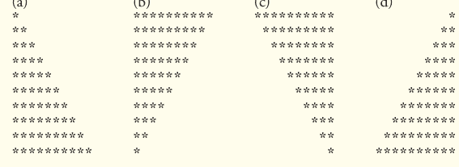

## 练习 197

**5.16** (条图程序) 计算机的一个有趣方面是显示图表和条形图。编写一个应用程序读取 1 到 30 之间的数字。对于读取的每个数字，你的程序应该显示相同数量的相邻星号。例如，如果程序读取数字 7，它应该显示 `*******`。在读取所有五个数字后，显示星号条形。

**5.17** (计算销售额) 一家在线零售商出售的产品零售价如下：产品 1，$2.98；产品 2，$4.50；产品 3，$9.98；产品 4，$4.49；产品 5，$6.87。编写一个应用程序读取如下形式的数字对：
- 产品编号
- 销售数量

你的程序应使用 `switch` 来确定每个产品的零售价。它应该计算并显示所有售出产品的总零售价值。使用哨兵控制的循环来确定程序何时停止循环并显示最终结果。

**5.18** (修改复利程序) 修改图 5.6 中的应用程序，仅使用整数来计算复利。（提示：将所有金额视为以分为单位的整数。分别使用除法和取模操作将结果拆分为美元和分。在美元和分之间插入一个点。）

**5.19** 假设 i=1, j=2, k=3 且 m=2。以下每个语句打印什么？
```java
a) System.out.println(i == 1);
b) System.out.println(j == 3);
c) System.out.println(i >= 1 && (j < 4);
d) System.out.println(m < 99 || (k == m);
e) System.out.println(i > 1) || (k == m);
g) System.out.println(k + m < j) || (j >= k);
h) System.out.println(k > m);
```

**5.20** (计算 π 值) 从无限级数计算 π 的值：
$$\pi = 4 - \frac{4}{5} + \frac{4}{7} - \frac{4}{9} + \dots$$
打印一个表格，通过计算前 200,000 项显示 π 的值。在得到接近 3.14159 的值之前，你使用了多少项？

**5.21** (勾股三角形) 直角三角形的边长可以全为整数。三条边长度的整数集合被称为勾股三角形。三条边的长度必须满足这种关系：两条边的长度平方和等于斜边的长度平方。编写一个应用程序，显示 s1、s2 且斜边不大于 50 的勾股数。使用三层嵌套循环来寻找所有可能。这种方法被称为“暴力破解”计算。在更高级的计算机科学中，对于许多有趣的问题，有比暴力破解更有效的算法。

**5.22** (修改三角形打印) 修改练习 15，将你的四个部分的星号代码并排打印。（提示：使用嵌套循环。）

**5.23** (德摩根定律) 在这一章中我们讨论了逻辑运算符 `&&`、`||` 和 `!`。德摩根定律可以让我们表达逻辑表达式更方便。这些定律规定：`(condition1 && condition2)` 在逻辑上等于 `(!condition1 || !condition2)`。同样，`(!condition1 || !condition2)` 在逻辑上等于 `(!condition1 && condition2)`。使用德摩根定律为以下各项编写一个应用程序，证明原始表达式和新表达式产生的值：
a) `!(x < 5) && !(y >= 7)`
b) `!(a == b) || !(g != 5)`
c) `!(x < 8) && (y < 4)`
d) `!(i > 4) || (j <= 6)`

**5.24** (菱形打印) 编写一个应用程序打印如下菱形。可以使用打印单个星号 (*)、单个空格或换行符的语句。最大化使用循环（嵌套 `for` 语句），减少输出语句的数量。
```
***
*****
*******
*****
***
```

**5.25** (修改菱形打印) 修改你在练习 24 中编写的应用程序，读取 1 到 19 之间的奇数来指定菱形的行数。你的程序随后应显示相应大小的菱形。

**5.26** 对 `break` 语句和 `continue` 语句的批评是它们是非结构化的。实际上，这些语句可以用结构化语句替换，尽管这样做可能很麻烦。描述你如何从循环中移除 `break` 语句并将其替换为结构化等价物。（提示：`break` 语句退出循环体。）另一种退出方法是使用循环延续测试。使用你在此开发的技术从图 5.13 的应用程序中移除 `break` 语句。以下程序的作用是什么？
```java
for (i = 1; i <= 5; i++) {
  for (j = 1; j <= 3; j++) {
    for (k = 1; k <= 4; k++) {
      System.out.print('*');
    }
    System.out.println();
  } // end inner for
  System.out.println();
} // end outer for
```


**5.28** 概述你如何从循环中移除任何 `continue` 语句并将其替换为结构化等价物。使用你在此开发的技术从图 5.14 的程序中移除 `continue` 语句。

**5.29** ("圣诞节十二天") 编写一个使用循环和 `switch` 语句来打印《圣诞节十二天》歌曲的应用程序。使用一个 `switch` 语句打印“第一天”、“第二天”等。使用另一个 `switch` 语句打印每段诗的剩余部分。访问网站 wikipedia.org/wiki/The_Twelve_Days_of_Christmas_(song) 获取歌词。

**5.30** (修改 AutoPolicy 类) 修改图 5.1 中的 `AutoPolicy` 类，验证北部州的双字母代码。这些代码分别是 CT（康涅狄格州）、MA（马萨诸塞州）、ME（缅因州）、NH（新罕布什尔州）、NJ（新泽西州）、NY（纽约州）、PA（宾夕法尼亚州）和 VT（佛蒙特州）。在 `AutoPolicy` 的 `setState` 方法中，使用逻辑或 (`||`) 运算符（第 5.9 节）在 `if...else` 语句创建一个条件，将方法的参数与每个双字母代码进行比较。如果代码错误，`if...else` 语句的 `else` 部分应该显示错误信息。在后面的章节中，你将学习如何使用异常处理来识别方法接收到的无效值。

**5.31** (全球变暖事实测验) 全球变暖这一争议性问题由前总统阿尔·戈尔主演的电影《不一样的真相》广泛宣传。戈尔先生和联合国网络因他们在建立和传播有关人类气候变化知识方面的努力共同获得了 2007 年诺贝尔和平奖。在网上研究全球变暖问题的两个方面（你可能想搜索“global warming”等词组）。创建一个关于全球变暖的五道选择题，每题有四个答案（编号 1-4）。保持客观并尝试代表该问题的两个方面。接下来，编写一个应用程序来测验，计算正确答案的数量（0 到 5）并向用户返回消息。如果用户正确回答了五个问题，打印“Excellent”；如果是四个，打印“Very good”；如果是三个或更少，打印“需要复习全球变暖知识了”，并列出你找到的一些网站列表。

**5.32** (税收替代方案；“公平税”) 有许多使税收更公平的提议。查看美国的 FairTax 倡议网站 www.fairtax.org。研究拟议的 FairTax 如何运作。其中一个建议是取消所得税和大多数其他税收，转而对你购买的所有产品和服务征收 23% 的消费税。一些 FairTax 的反对者说，由于税收的计算方式，如果说税率为 30% 会更准确——检查这一点。编写一个程序，提示用户输入他们在各个类别中的支出（例如：住房、食物、衣服、交通、教育、医疗保健、假期），然后打印该个人预计支付的 FairTax。

**5.33** (Facebook 用户量增长) 根据 CNNMoney.com，Facebook 在 2012 年 10 月达到了十亿用户。使用你在图 5.6 中学会的复合增长技术，并假设其用户量每月增长 4%，Facebook 需要多少个月才能将其用户量增长到 15 亿？Facebook 需要多少个月才能将其用户量增长到 20 亿？

# 方法：深入探究

形式始终追随功能。
—路易·亨利·苏利文

众志成一。
（由许多元素组成。）
—维吉尔

噢！唤回昨天，命令时间
回归。
—威廉·莎士比亚

用一个词回答我。
—威廉·莎士比亚

存在这样一个点，
方法在此处会自我吞噬。
—弗朗茨·法农

# 目标

在本章中，你将学习到：

- 静态方法和字段是如何与类而非对象关联的。
- 方法调用栈如何支持方法调用/返回机制。
- 关于参数提升和类型转换。
- 包如何对相关类进行分组。
- 如何使用安全随机生成来实现游戏应用程序。
- 声明的可见性如何限制在程序的特定区域。
- 什么是方法重载以及如何创建重载方法。

# 6.1 引言

经验表明，开发和维护大型程序的最佳方法是从较小的、简单的部分或模块开始构建它。这种技术被称为分而治法。我们在第 3 章中介绍的方法可以帮助你实现程序的模块化。在本章中，我们将更深入地研究方法。

你将学习到静态方法，它们不需要类对象即可被调用。你还将学习 Java 如何跟踪当前正在执行哪个方法、方法的局部变量如何在内存中维护，以及方法在执行完成后如何知道何时返回。

我们将简要过渡到随机数生成的模拟技术，并开发一个骰子游戏，该游戏将使用你在本书中使用的大部分编程技术。此外，你还将学习如何在程序中声明常量。

在开发应用程序时，你将使用或创建的许多类会有多个同名方法。这种技术被称为重载，用于实现对不同类型参数或不同数量参数执行相似任务的方法。

我们将在第 18 章“递归”中继续对方法的讨论。递归提供了一种在特定对象上进行方法调用的有趣方式，但并非总是如此。有时方法执行的任务不依赖于对象。这种方法适用于其声明的整个类，被称为静态方法或类方法。

类包含方便的静态方法来执行常见任务是很常见的。例如，回想我们在图 5.6 中使用 `Math` 类的静态方法 `pow` 来对数值求幂。要将方法声明为静态，请在方法声明的返回类型之前放置 `static` 关键字。对于导入到程序中的任何类，可以通过指定声明方法的类名，后跟一个点 (.) 和方法名来调用类的静态方法，例如：

```
ClassName.methodName(arguments)
```

## Math 类方法

在这里使用各种 `Math` 方法来演示静态方法的概念。`Math` 类提供了一个方法集合，用于常用的数学计算。例如，你可以使用静态方法计算 900.0 的平方根：

```
Math.sqrt(900.0)
```

该表达式的值为 30.0。`sqrt` 方法接收一个 `double` 类型参数并返回一个 `double` 类型的结果。要在命令行窗口输出前述方法调用的值，你可以编写语句：

```
System.out.println(Math.sqrt(900.0));
```

在这一条语句中，`sqrt` 返回的值作为 `println` 方法的参数。在调用 `sqrt` 方法之前，不需要创建 `Math` 对象。

> **软件工程观察 6.4**
> `Math` 类属于 `java.lang` 包，编译器隐式导入该包，因此在使用其方法时，**无需**手动导入 `Math` 类。

方法参数可以是常量、变量或表达式。如果 `c = 13.0, d = 3.0` 且 `f = 4.0`，则语句

```
System.out.println(Math.sqrt(c + d * f));
```

计算并打印 13.0 + 3.0 * 4.0 = 25.0 的平方根——即 5.0。图 6.2 总结了若干个类方法。在图中，`x` 和 `y` 的类型均为 `double`。

| 方法 | 描述 | 示例 |
| --- | --- | --- |
| `abs(x)` | x 的绝对值 | `abs(23.7)` 为 23.7<br>`abs(0.0)` 为 0.0<br>`abs(-23.7)` 为 23.7 |
| `ceil(x)` | 将 x 舍入为大于或等于 x 的最小整数 | `ceil(9.2)` 为 10<br>`ceil(-9.8)` 为 -9 |
| `cos(x)`, `exp(x)` | x 的三角余弦（弧度制），指数方法 e^x | `cos(0.0)` 为 1<br>`exp(1.0)` 为 2.71828<br>`exp(2.0)` 为 3.3896 |
| `floor(x)` | 将 x 舍入为小于或等于 x 的最大整数 | `floor(9.2)` 为 9<br>`floor(-9.8)` 为 -10.0 |
| `log(x)` | x 的自然对数（底为 e） | `log(Math.E)` 为 1.0<br>`log(Math.E * Math.E)` 为 2.0 |
| `max(x, y)` | x 和 y 的较大值 | `max(2.3, 12.7)` 为 12.7<br>`max(-2.3, -12.7)` 为 -2.3 |
| `min(x, y)` | x 和 y 的较小值 | `min(2.3, 12.7)` 为 2.3<br>`min(-2.3, -12.7)` 为 -12.7 |
| `pow(x, y)` | 将 x 的 y 次方（即 x^y） | `pow(2.0, 0.7)` 为 1.624<br>`pow(9.0, 0.5)` 为 3 |
| `sin(x)`, `sqrt(x)` | x 的三角正弦（弧度制），平方根 | `sin(0.0)` 为 0.0<br>`sqrt(900.0)` 为 30.0 |
| `tan(x)` | x 的三角正切（弧度制） | `tan(0.0)` 为 0.0 |

**图 6.2** 类方法。

## static 变量

回想第 3.2 节，类的每个对象都维护该类实例变量的自己的副本。某些变量对于类的每个对象不需要拥有自己的副本（你稍后就会看到）。这些变量是静态的（`static`），也被称为类变量。当创建包含静态变量类的对象时，该类的所有对象共享这些变量的一个副本。类的静态变量和实例变量统称为其字段（fields）。你将在 8.11 中学习更多关于静态字段的知识。

## 类静态常量 PI 和 E

`Math` 类声明了两个常量：`Math.PI` 和 `Math.E`，它们代表常用数学常数的高精度近似值。`Math.PI` (3.141592653589793) 是圆周长与直径的比值。`Math.E` (2.718281828459045) 是自然对数的底。

# 6.4 带有多个参数的方法

方法通常需要多个信息来执行其任务。我们现在考虑如何编写带有多个参数的方法。图 6.3 显示了一个名为 `maximum` 的方法，用于确定并返回三个值的最大值。在 `main` 中，第 14–18 行提示用户输入三个 `double` 值。第 22 行调用 `maximum`（声明在 28–41 行），接收三个值。当方法 `maximum` 返回结果到第 21 行时，程序将其赋值给局部变量 `result`。第 24 行输出最大值。在本节结束时，我们将讨论第 24 行的 `+` 运算符。

```java
// 图 6.3: MaximumFinder.java
// 程序员编写的带有 double 参数的方法。

import java.util.Scanner;

public class MaximumFinder {

    // 获取三个浮点数值并定位最大值
    public static void main(String[] args) {
        // 从命令行窗口创建 Scanner
        Scanner input = new Scanner(System.in);

        // 提示并输入三个浮点数值
        System.out.print("输入三个用空格分隔的浮点数: ");
        double number1 = input.nextDouble(); // 读取第一个 double
        double number2 = input.nextDouble(); // 读取第二个 double
        double number3 = input.nextDouble(); // 读取第三个 double

        // 确定最大值
        double result = maximum(number1, number2, number3);

        // 显示最大值
        System.out.println("Maximum is: " + result);
    }

    // 返回其三个 double 参数的最大值
    public static double maximum(double x, double y, double z) {
        // 开始时假设 x 是最大的
        double maximumValue = x;

        // 确定 y 是否大于 maximumValue
        if (y > maximumValue)
            maximumValue = y;

        // 确定 z 是否大于 maximumValue
        if (z > maximumValue)
            maximumValue = z;

        return maximumValue;
    } // 结束方法 maximum
} // 结束类 MaximumFinder
```

```
输入三个用空格分隔的浮点数: 9.35 2.74 5.1
Maximum is: 9.35

输入三个用空格分隔的浮点数: 5.8 12.45 8.32
Maximum is: 12.45

输入三个用空格分隔的浮点数: 6.46 4.12 10.54
Maximum is: 10.54
```

**图 6.3** 程序员编写的带有 double 参数的方法。

## public 和 static 关键字

方法 `maximum` 的声明以 `public` 关键字开头，该方法是“公开的”——可以从其他类的方法中调用。`static` 关键字允许 `main` 方法（另一个静态方法）在第 22 行调用 `maximum`，而无需使用类名 `MaximumFinder` 来限定方法名。任何使用 `maximum` 的其他类都必须使用类名限定方法名。

## 方法 maximum

考虑 `maximum` 的声明（第 28–41 行）。第 28 行表示它返回一个 `double` 值，方法名为 `maximum`，且该方法需要三个 `double` 参数（`x`、`y` 和 `z`）来完成任务。多个参数通过逗号分隔的列表指定。当从第 22 行调用 `maximum` 时，参数 `x`、`y` 和 `z` 分别用参数 `number1`、`number2` 和 `number3` 的值初始化。方法声明中的每个参数必须有一个实参。此外，每个实参必须与对应参数的类型一致。为了确定最大值，我们假设参数 `x` 包含最大值，因此第 30 行声明局部变量 `maximumValue`。当然，参数 `y` 或 `z` 可能包含实际值，因此我们将它们每一个与 `maximumValue` 进行比较。第 33–34 行的语句确定 `y` 是否大于 `maximumValue`。如果是，第 34 行将 `y` 赋值给 `maximumValue`。第 36–37 行对 `z` 执行相同的检查。此时，三个值中的最大值位于 `maximumValue` 中，因此第 40 行返回到第 22 行。当程序控制返回到调用 `maximum` 的位置时，`maximum` 的参数 `x`、`y`、`z` 不再存在内存中。

## 通过实现 maximum

我们 `maximum` 方法的体也可以通过两次 `Math.max` 调用来实现，如下：

```
return Math.max(x, Math.max(y, z));
```


第一次调用 `Math.max` 指定参数 `x` 和 `Math.max(y, z)`。在调用任何方法之前，必须对其参数赋值以确定它们的值。如果参数是一个方法调用，则必须执行该方法调用以确定其返回值。因此在前面的语句中，计算 `Math.max(y, z)` 以确定 `y` 和 `z` 的最大值。然后将结果作为第二个参数传递给另一个 `Math.max` 调用，它返回两个参数中的较大者。这是软件重用的良好示例——我们通过重用 `Math.max` 来找到三个值中的最大值，这种方法比图 6.3 的第 30–38 行简洁。

## 软件工程观察 6.5

> 方法最多返回一个值，但返回的值可以是指向包含许多值的对象的引用。

方法最多返回一个值，但返回的值可以是指向包含许多值的对象的引用。

## 软件工程观察 6.6

> 只有当变量被声明为字段时，才可以在类的多个方法中使用，或者程序应该在类的方法调用之间保存它们的值时。

## 常见编程错误 6.1

> 将相同类型的参数声明为 `float x` 而不是 `float x, float` 是一个语法错误——方法列表中的每个参数都需要一个类型。

## 第 6 章 方法：深入探讨

### 使用字符串拼接组合字符串

Java 允许你使用运算符 `+` 或 `+=` 将 `String` 对象组合成更大的字符串。这被称为字符串拼接。当运算符 `+` 的两个操作数都是 `String` 对象时，`+` 会创建一个新的 `String` 对象，并将右侧操作数的字符放置在左侧操作数的末尾——例如，表达式 `"hello " + " there"` 会创建字符串 `"hello there"`。

在 6.3 的第 24 行中，表达式 `"Maximum is: " +` 使用了运算符 `+`，操作数分别为 `String` 和 `double`。Java 中的每个基本类型值和对象都可以表示为 `String`。当 `+` 运算符其中一个是 `String` 时，另一个会被转换为 `String`。在第 24 行中，`double` 值被转换为其字符串表示，并放置在字符串 `"Maximum is: "` 的末尾。如果 `double` 末尾有任何零，当该数字转换为字符串时，这些零将被丢弃——例如 `9.3500` 被表示为 `9.35`。

用于拼接的类型会被转换为 `String`。与 `String` 拼接的布尔值（`boolean`）会被转换为字符串 `"True"` 或 `"False"`。所有对象都有一个 `toString` 方法，用于返回对象的字符串表示（我们将在随后的章节中详细讨论 `toString`）。当一个对象与 `String` 拼接时，会隐式地调用对象的 `toString` 方法以获取对象的字符串表示。`toString` 方法也可以被显式调用。

为了提高可读性，你可以将字符串字面量拆分成多行代码。如果必要，可以使用拼接重新组合这些字符串。我们将在第 14 章中讨论字符串的细节。


## 常见编程错误 6.2

跨行拆分字符串字面量是语法错误。如果必要，你可以将一个字符串拆分成较小的字符串，并使用拼接来形成所需的字符串。


## 常见编程错误 6.3

将用于字符串拼接的 `+` 运算符与用于加法的 `+` 运算符混淆会导致奇怪的结果。Java 从左到右求值运算符的操作数。例如，如果整数变量 `y` 的值为 5，表达式 `"y + y = " + y + 2` 的结果是 `"y + y = 52"`，而不是 `"y + 2 = 7"`，因为 `y` 的第一个值 (5) 被拼接到字符串 `"y + 2 = "` 上，然后值 2 被拼接到新的更大的字符串上。表达式 `"y + 2 = " + (y + 2)` 则产生预期的结果 `"y + 2 = 7"`。

## 6.5 方法声明和使用的注意事项

调用方法有三种方式：

1. 直接使用方法名来调用同一类中的另一个方法——例如 6.3 第 21 行中的 `maximum(number1, number2, number3)`。
2. 使用包含对象引用的变量，后跟点号 (`.`) 和方法名，来调用所引用对象的非静态方法——例如 3.2 第 16 行中的方法调用 `myAccount.getName()`，它从 `AccountTest` 的主方法调用了 `Account` 类的方法。非静态方法通常是实例方法。
3. 使用类名和点号 (`.`) 来调用类的静态方法——例如 6.3 节中的 `Math.sqrt(300.0)`。

静态方法可以调用其他静态方法。

## 6.6 方法调用栈和栈帧

为了理解方法是如何调用的，我们首先需要考虑栈。栈被称为后进先出 (LIFO) 数据结构。当方法被调用时，栈帧（激活记录）被推入栈中。当方法返回时，栈帧会从栈中弹出。

方法调用栈还包含在表达式中被提升为“最高”类型的局部变量。实际上，该表达式使用了每个值的副本——原始值保持不变。图 6.4 列出了基本类型以及每个类型可以被提升的类型。对于给定的类型，有效的提升总是提升到表中位置更高的类型。例如，`int` 可以被提升为更高级的 `long`、`float` 和 `double`。

提升规则适用于包含两个或多个基本类型值的表达式，以及传递给方法的基本类型值。

每个值都被提升为表达式中的“最高”类型。

当然，计算机内存是有限的，因此只能使用部分内存来存储栈帧。如果方法调用次数超过了处理能力，就会发生栈溢出——我们将在第 11 章“异常处理：深入探讨”中详细介绍。

## 6.7 参数提升和转换

方法调用的另一个重要特性是参数提升——如果可能，将参数的值转换为方法在其对应的参数中期望接收的类型。例如，程序可以使用 `int` 参数调用 `Math.sqrt`，尽管它期望的是 `double`。

```java
System.out.println(Math.sqrt(4));
```

正确求值 `Math.sqrt(4)` 并产生值 `2.0`。方法声明的参数列表使用 Java 将 `int` 4 转换为 `double` 值，然后将值传递给方法。如果不符合 Java 的规则，这些转换可能会导致错误。这些规则规定了哪些转换是被允许的——哪些可以在不丢失数据的情况下执行。在示例中，`int` 转换为 `double` 而没有改变值。然而，将 `double` 转换为 `int` 会截断 `double` 的小数部分——因此，值的部分丢失了。将大整数转换为小整数类型（例如从 `long` 到 `int`，或从 `int` 到 `short`）也可能导致值改变。

## 6.8 Java API 包

将图 6.4 表中的值转换为低位类型，如果低位类型无法表示高位类型的值，将会导致结果错误（例如，`int` 2000000 无法表示为 `short`，或者带有小数位的浮点数无法表示为 `long` 或 `short` 等整数类型）。在转换过程中可能会丢失信息的情况下，Java 编译器要求你使用强制转换操作符（第 4.10 节引入）来显式强制执行转换——否则会发生编译错误。这让你能够从编译器手中“夺回控制权”。你可以轻松地说：“我知道这种转换可能会导致信息丢失，但对我的目的来说没关系。”假设方法 `square` 计算一个整数的平方并需要一个 `int` 参数。为了用名为 `doubleValue` 的 `double` 类型调用 `square` 方法，我们需要编写如下方法调用：

```java
square((int) doubleValue)
```

此方法调用将 `doubleValue` 的值强制转换（转换）为临时整数，供 `square` 方法使用。因此，如果 `doubleValue` 的值为 `4.5`，该方法接收到的值为 `4` 并返回 `16`，而不是 `20.25`。

## 常见编程错误 6.7

> 将基本类型值转换为另一种基本类型时，如果新类型不是有效的提升，可能会改变该值。例如，将浮点数值转换为整数值可能会在结果中引入截断误差（丢失小数部分）。

| 类型 | 有效的提升 |
|---|---|
| double | 无 |
| float | double |
| long | float 或 double |
| int | long, float 或 double |
| char | int, float 或 double（但不是 char） |
| short | int, long, float 或 double（但不是 char） |
| byte | short, int, float 或 double（但不是 char） |
| boolean | 无（Java 中的 boolean 值不被视为数字） |

**图 6.4** | 基础类型允许的提升。

## 6.8 Java API 包

如你所见，Java 包含许多预定义类，这些类被分为若干相关类的类别，称为“包”（packages）。它们统称为 Java 应用程序接口（Java API）或 Java 类库。Java 的一大优势是 Java API 拥有数以千计的类。书中使用的一些关键 Java API 包如图 6.5 所示，该图仅代表了 Java API 中重用组件的一小部分。

| 包 | 说明 |
|---|---|
| java.awt.event | Java 抽象工具事件包包含类和接口，允许为 `java.awt` 和 `java.swing` 包中的 GUI 组件实现事件处理。（参见第 12 节“GUI 组件：部分 1”和第 22 节“GUI 组件：部分 2”。） |
| java.awt.geom | Java 2D 形状包包含用于处理 Java 高级二维图形能力的类和接口。（参见第 13 节。） |
| java.io | Java 输入/输出包包含允许程序处理输入和输出数据的类和接口。（参见第 15 节“流与序列化”。） |
| java.lang | Java 语言包包含许多 Java 程序所需的类和接口（贯穿全书）。该包由编译器自动导入到所有程序中。 |
| java.net | Java 网络包包含了一些类和接口，允许程序通过互联网等计算机网络进行通信。（参见在线第 28 节“网络”。） |
| java.security | Java 安全包包含用于增强应用程序安全的类和接口。 |
| JDBC 包 | 包含用于操作的类和接口。（参见第 24 节“使用 JDBC 访问数据库”。） |
| java.util | Java 工具包包含允许存储和处理大量数据的类和接口。其中许多类和接口已更新，以支持 Java SE 8 的新 lambda 功能。（参见第 16 节“泛型集合”。） |
| java.util.concurrent | Java 并发包包含实现可以并行执行多个任务程序的实用类和接口。（参见第 23 节“并发”。） |
| ... | Java Swing 组件包包含 Java Swing 组件的类和接口，为可移植 GUI 提供支持。该包使用了一些旧的 `.awt` 包中的内容。（参见第 12 节“GUI 组件：部分 1”和第 22 节“GUI 组件：部分 2”。） |
| java.swing.event | Java Swing 事件包包含允许 `java.swing` 包中 GUI 组件实现事件处理（例如，响应按钮点击）的类和接口。（参见第 12 节“GUI 组件：部分 1”和第 22 节“GUI 组件：部分 2”。） |
| javax.xml.ws | JAX-WS 包包含用于在 Java 中处理 Web 服务的类和接口。（参见在线第 32 节“基于 的 Web 服务”。） |
| javafx | JavaFX 是未来的首选 GUI 技术。我们将在第 25 节“JavaFX GUI：部分 1”以及在线 JavaFX 和多媒体章节中讨论这些包。 |

**图 6.5** | Java API 包（子集）。（第一部分，共两部分。）

## 6.9 案例研究：安全随机数生成

| 包 | 说明 |
|---|---|
| 书中使用的某些 Java SE 8 包 | |
| java.time | 书中使用的 Java SE 8 包 |
| java.util.function | 书中使用的 Java SE 8 包 |
| java.util.stream | 书中使用的 Java SE 8 包 |
| java.util | 书中使用的 Java SE 8 包 |
| java.net | 书中使用的 Java SE 8 包 |
| java.security | 书中使用的 Java SE 8 包 |
| java.util.concurrent | 书中使用的 Java SE 8 包 |
| java.swing.event | 书中使用的 Java SE 8 包 |
| javax.xml.ws | 书中使用的 Java SE 8 包 |
| javafx | 书中使用的 Java SE 8 包 |

（注：6.9 节的表格内容由于 OCR 出现了严重错乱。根据标准 Java API 文档和提供的片段，我重构了 Java SE 8 包的逻辑结构。）

### 创建 Random 对象

一个新的随机数生成器对象如下创建：

```java
Random randomNumber = new Random();
```

它可以用于生成随机值。

### 获取随机值

考虑以下语句：

```java
int randomValue = randomNumber.nextInt();
```

`SecureRandom` 方法生成一个随机值。如果它确实产生随机值，范围内的每个值都有被选中的概率。

### 更改 nextInt 产生的范围

`nextInt` 方法产生的范围通常与应用程序所需的范围不同。例如，模拟硬币抛掷程序只需要 0 代表“正面”，1 代表“反面”。模拟掷六面骰需要范围在 1–6 之间的随机整数。一个预测四种飞船飞过类型的游戏需要范围在 1–4 之间的随机整数。对于这些情况，该类提供了另一个版本的 `nextInt`，它接收一个参数并返回从 0 到小于该参数的值。例如，硬币抛掷，以下语句返回 0 或 1：

```java
int randomValue = randomNumber.nextInt(2);
```

### 掷六面骰

为了演示随机数，让我们编写一个程序模拟掷 20 次六面骰并显示每次的结果。我们首先使用 `nextInt` 生成 0–5 之间的随机值，如下：

```java
int face = randomNumber.nextInt(6);
```

参数 6——缩放因子——代表唯一值的范围（在本例中为 0, 1, 2, 3, 4 和 5）。这种操作是通过调整 `SecureRandom` 方法 `nextInt` 产生的范围来实现的。

六面骰的数字是 1–6，而它是 0–5。我们通过在结果上加上一个偏移值（在本例中为 1）来移动数字范围，如下：

```java
int face = 1 + randomNumber.nextInt(6);
```

上述语句分配了一个范围在 1–6 之间的随机整数。

## 6.9 案例研究：安全随机数生成

### 掷 20 次六面骰

图 6.6 显示了两个示例输出，证实了之前的计算结果在 1–6 的范围内，并且程序的每次运行都可以产生不同的随机数序列。第 3 行从 `java.security` 包导入 `SecureRandom`。第 10 行创建了 `randomNumbers` 对象来生成随机值。第 16 行循环执行 20 次以掷骰子。循环中的语句（第 21–22 行）每五个数字开始新行输出，以创建一个新的五列格式。

```java
// Fig. 6.6: RandomIntegers.java

// 偏移和缩放后的随机整数。

import java.security.SecureRandom; // 程序使用类 SecureRandom 类

public class RandomIntegers {

    public static void main(String[] args) {

        // randomNumbers 对象将产生安全的随机数

        SecureRandom randomNumbers = new SecureRandom();

        // 循环20次

        for (int counter = 1; counter <= 20; counter++) {

            // 从1到6之间选取随机整数

            int face = 1 + randomNumbers.nextInt(6);

            System.out.printf("%d\t", face); // 显示生成的点

            // 如果计数能被5整除，开始新行输出

            if (counter % 5 == 0) {
                System.out.println();
            }

        }

    }

} // 类 RandomIntegers结束
```

| 1 | 5 | 3 | 6 | 2 |
|---|---|---|---|---|
| 2 | 6 | 5 | 2 | 2 |
| 4 | 4 | 4 | 2 | 2 |
| 3 | 1 | 6 | 2 | 2 |

| 6 | 5 | 4 | 2 | 6 |
|---|---|---|---|---|
| 1 | 2 | 5 | 1 | 3 |
| 6 | 3 | 2 | 2 | 1 |
| 6 | 4 | 2 | 6 | 4 |

**图 6.6** | 偏移和缩放后的随机整数。

### 掷 6,000,000 次六面骰

为了证明由 `nextInt` 生成的数字出现的概率相等，让我们使用图 6.7 中的应用程序模拟掷 6,000,000 次骰子。从 1 到 6 的每个整数应该出现大约 1,000,000 次。

```java
// Fig. 6.7: RollDie.java

// 掷 6,000,000 次六面骰。

import java.security.SecureRandom;

public class RollDie {

    public static void main(String[] args) {

        // randomNumbers 对象将产生随机数

        SecureRandom randomNumbers = new SecureRandom();

        int frequency1 = 0; // 掷出1的计数
```


## 6.10 案例研究：机会游戏：引入 enum 类型

```java
int frequency2 = 0; // 掷出2的计数
int frequency3 = 0; // 掷出3的计数
int frequency4 = 0; // 掷出4的计数
int frequency5 = 0; // 掷出5的计数
int frequency6 = 0; // 掷出6的计数

// 统计6,000,000次掷骰计数
for (int roll = 1; roll <= 600000; roll++) { // 注意：此处代码中为600000，与描述6000000不符
    int face = 1 + randomNumbers.nextInt(6); // 从1到6的数字

    // 使用值1-6来确定递增哪个计数器
    switch (face) {
        case 1:
            ++frequency1; // 增加1的计数
            break;
        case 2:
            ++frequency2; // 增加2的计数
            break;
        case 3:
            ++frequency3; // 增加3的计数
            break;
        case 4:
            ++frequency4; // 增加4的计数
            break;
        case 5:
            ++frequency5; // 增加5的计数
            break;
        case 6:
            ++frequency6; // 增加6的计数
            break;
    }
}

System.out.println("Face"); // 输出表头
System.out.printf("1:%d\n2:%d\n3:%d\n4:%d\n5:%d\n6:%d\n",
    frequency1, frequency2, frequency3, frequency4,
    frequency5, frequency6);
}
}
```

**图 6.7** | 掷 6,000,000 次六面骰。（2部分中的第1部分）

| 点数 | 频率 |
|---|---|
| 1 | 999501 |
| 2 | 1000412 |
| 3 | 998262 |
| 4 | 1000820 |
| 5 | 1002245 |
| 6 | 998760 |

| 点数 | 频率 |
|---|---|
| 1 | 999647 |
| 2 | 999557 |
| 3 | 999571 |
| 4 | 1000376 |
| 5 | 1000701 |
| 6 | 1000148 |

**图 6.7** 掷 6,000,000 次六面骰。（2部分中的后部分。）

如示例输出所示，对 `nextInt` 生成的值进行缩放和偏移使得程序能够模拟掷六面骰。该程序使用控制语句（`switch` 嵌套在 `for` 循环内部）来确定每个骰子面出现的次数。`for` 语句（第 25–46 行）迭代 6,000,000 次。在每次迭代中，第 22 行产生一个 1 到 6 之间的随机值。该值被用作 `switch` 语句（第 25–45 行）的控制表达式（第 25 行）。根据点数的值，循环的每次迭代都会增加一个计数器变量。此 `switch` 语句没有 `default` 情况，因为我们为每种可能的值都提供了 `case`。

```java
// 表示游戏状态的常量的 enum 类型
private enum Status { CONTINUE, WON, LOST };
```

```java
// 表示骰子常见点数的常量
private static final int SNAKE_EYES = 2;
private static final int TREY = 3;
private static final int SEVEN = 7;
private static final int YO_LEVEN = 11;
private static final int BOX_CARS = 12;
```

```java
// 玩一次骰子游戏
public static void main(String[] args) {
    int myPoint = 0; // 如果第一次投掷时没有赢或输，则记录点数
    Status gameStatus; // 可以包含 CONTINUE、WON 或 LOST
    int sumOfDice = rollDice(); // 第一次掷骰子

    // 根据第一次投掷确定游戏状态和点数
    switch (sumOfDice) {
        case SEVEN: // 第一次掷为 7 则胜
        case YO_LEVEN: // 第一次掷为 11 则胜
            gameStatus = Status.WON;
            break;
        case SNAKE_EYES: // 第一次掷为 2 则输
        case TREY: // 第一次掷为 3 则输
        case BOX_CARS: // 第一次掷为 12 则输
            gameStatus = Status.LOST;
            break;
        default: // 没赢也没输，所以记住点数
            gameStatus = Status.CONTINUE; // 游戏未结束
            myPoint = sumOfDice; // 记住点数
            System.out.printf("Point is %d\n", myPoint);
            break;
    }

    // 游戏未完成
    while (gameStatus == Status.CONTINUE) { // 未未输
        sumOfDice = rollDice(); // 再次掷骰子

        // 确定游戏状态
        if (sumOfDice == myPoint) // 通过掷出点数胜
            gameStatus = Status.WON;
        else if (sumOfDice == SEVEN) // 在掷出点数前掷出 7 则输
            gameStatus = Status.LOST;
    }
}
```

**图 6.8** | Craps 模拟骰子游戏崩溃。（3 部分中的第 2 部分。）

```java
// 显示赢或输的消息
if (gameStatus == Status.WON) {
    System.out.println("Player wins");
} else {
    System.out.println("Player loses");
}

// 掷骰子，计算和并显示结果
public static int rollDice() {
    // 掷骰子值
    int die1 = 1 + randomNumbers.nextInt(6); // 第一次掷
    int die2 = 1 + randomNumbers.nextInt(6); // 第二次掷
    int sum = die1 + die2; // 骰子值之和

    // 显示这次掷的结果
    System.out.printf("Player rolled %d + %d = %d%n", die1, die2, sum);
    return sum;
} // Craps 类结束
```

| 玩家掷出 5 + 6 = 11 |
|---|
| 玩家获胜 |
| 玩家掷出 5 + 4 = 9 |
| 点数是 9 |
| 玩家掷出 4 + 2 = 6 |
| 玩家掷出 3 + 6 = 9 |
| 玩家获胜 |
| 玩家掷出 1 + 2 = 3 |
| 玩家输了 |
| 玩家掷出 2 + 6 = 8 |
| 点数是 8 |
| 玩家掷出 5 + 1 = 6 |
| 玩家掷出 2 + 1 = 3 |
| 玩家掷出 1 + 6 = 7 |
| 玩家输了 |

**图 6.8** Craps 类模拟了骰子游戏 Craps。（3 部分中的第 3 部分。）

### Method rollDice

在游戏规则中，玩家必须在第一次以及后续所有的投掷中都掷两颗骰子。我们声明了 `rollDice` 方法（第 68–81 行）来掷骰子并计算和打印它们的和。`rollDice` 方法被声明一次，但在 `main()` 方法中的两个地方（第 26 和 50 行）被调用，`main()` 包含了一个完整的 craps 游戏逻辑。`rollDice` 方法不接受参数，因此它的参数列表为空。每当被调用时，`rollDice` 都会返回骰子的和，返回类型 `int` 在方法头中指定（第 68 行）。尽管第 71 行和第 72 行看起来相同（骰子名称除外），它们并不一定产生相同的结果。这些语句中的每一个都会产生 1–6 范围内的随机值。变量 `randomNumbers`（在第 71–72 行中使用）没有在方法中声明。相反，它作为类的静态最终变量声明并在第 8 行初始化。这使得我们能够创建一个 `SecureRandom` 对象并在每次调用 `rollDice` 时重用它；它们共享这一个 `SecureRandom` 对象。

### Method main() 的局部变量

游戏相当复杂。玩家可能在第一次投掷时赢或输，也可能在之后的任何投掷中输。`main` 方法（第 21–65 行）使用局部变量 `myPoint`（第 23 行）在玩家第一次投掷时未赢或输时存储“点数”，局部变量 `gameStatus`（第 24 行）用于跟踪整体状态。如果第一次投掷时没赢没输，`gameStatus` 设为 `CONTINUE`（游戏未结束），`myPoint` 赋值为 `sumOfDice` 并打印点数。在 `while` 循环中（当 `gameStatus` 为 `CONTINUE` 时），再次掷骰子。如果 `sumOfDice` 等于 `myPoint`，则 `gameStatus` 变为 `WON`；否则，如果在掷出点数前掷出 7，则 `gameStatus` 变为 `LOST`。

## 6.11 声明的作用域

基本的作用域规则如下：

1. 参数声明的作用域是出现该声明的方法体。
2. 局部变量声明的作用域是从声明出现点到该代码块结束点。
3. 出现在 `for` 语句头部初始化部分的局部变量声明，其作用域是该 `for` 语句的体以及头部的其他表达式。
4. 方法或字段的作用域是整个类的体。这使得类的实例可以使用该类的字段和其他方法。

任何代码块都可以包含变量声明。如果方法中的局部变量或参数与类的字段同名，则该字段在块执行结束之前将被隐藏。在代码块中访问被遮蔽的变量：

- 如果该字段是实例变量，在它的名称前加上 `this` 关键字和一个点（`.`），例如 `this.x`。
- 如果该字段是静态类变量，在它的名称前加上类名和一个点（`.`），例如 `ClassName.x`。

图 6.9 展示了字段和局部变量的作用域问题。第 7 行声明并初始化字段 `x` 为 1。在任何声明了名为 `x` 的局部变量的方法中，该字段都会被遮蔽。`main` 方法（第 11–23 行）声明了一个局部变量 `x`（第 13 行）并将其初始化为 5。输出该局部变量的值，以说明字段 `x`（值为 1）在 `main` 中被遮蔽了。程序调用了另外两个方法——`useLocalVariable`（第 26–35 行）和 `useField`（第 38–45 行），它们不接受参数也不返回值。`main` 方法每个方法调用了两次（17–20 行）。`useLocalVariable` 方法声明了局部 `x`（第 28 行）。当第一次调用 `useLocalVariable` 时（第 17 行），它将 `x` 初始化为 25，输出 `x` 的值（30–31 行），增加 `x`（第 32 行）并再次输出 `x` 的值（33–34 行）。当第二次调用 `useLocalVariable` 时（第 19 行），它会重新创建局部变量 `x` 并将其重新初始化为 5；每次 `useLocalVariable` 用的输出都是相同的。

```java
// Fig. 6.9: Scope.java
// Scope 类演示了字段和局部作用域。
public class Scope {
    // 对该类所有方法都可见的字段
    private static int x = 1;

    // main 方法创建并初始化局部变量 x
    // 并调用方法 useLocalVariable 和 useField
    public static void main(String[] args) {
        int x = 5; // 方法局部变量 x 遮蔽了字段 x
        System.out.printf("local x in main is %d%n", x);
        useLocalVariable(); // useLocalVariable 拥有局部 x
        useField(); // useField 使用 Scope 类的字段 x
        useLocalVariable(); // useLocalVariable 重新初始化局部 x
        useField(); // Scope 类的字段保留了其值
        System.out.printf("local x in main is %d%n", x);
    }

    // 每次调用都创建并初始化局部变量 x
    public static void useLocalVariable() {
        int x = 25; // 每次调用 useLocalVariable 时初始化
        System.out.printf(
            "local x on entering method useLocalVariable is %d%n", x);
        x++; // 修改此方法的局部变量
        System.out.printf(
            "local x before exiting method useLocalVariable is %d%n", x);
    }

    // 每次调用都修改 Scope 类的字段
    public static void useField() {
        System.out.printf(
            "field x on entering method useField is %d%n", x);
        x *= 10; // 修改类的字段 x
        System.out.printf(
            "field x before exiting method useField is %d%n", x);
    }
}
```

**图 6.9** Scope 类演示了字段和局部变量的作用域。（2 部分中的第 1 部分）


```java
public static void useField() {

    System.out.printf(
        "%field x on entering method useField is %d%n", x);

    x = 10; // 修改 Scope 类的字段 x

    System.out.printf(
        "field x before exiting method useField is %d%n", x);
}
```

local x in main is 5

```
local x on entering method useLocalVariable is 25
local x before exiting method useLocalVariable is 25

field x on entering method useField is 1
field x before exiting method useField is 10

local x on entering method useLocalVariable is 25
local x before exiting method useLocalVariable is 25

field x on entering method useField is 10
field x before exiting method useField is 10

local x in main is 5
```

**Fig. 6.9** `Scope` 类演示了字段和局部变量的作用域。（2 部分中的第 2 部分）

`useField` 没有声明任何局部变量。当它引用 `x` 时，使用的是类的字段（第 7 行）。当第一次调用 `useField` 时（第 18 行），它输出字段 `x` 的值（1）（第 40–41 行），将字段 `x` 乘以 10（第 42 行），并在返回前再次输出字段 `x` 的值（10）（第 43–44 行）。当下一次调用 `useField` 方法时（第 20 行），该字段具有其被修改后的值（10），方法输出 10，然后是 100。最后，在方法中，程序在返回前再次输出字段 `x` 的值（10）（第 43–44 行）。当下一次调用 `useField` 方法时（第 20 行），该字段具有其修改后的值（10），方法输出 10，然后是 100。最后，在方法中输出

### 声明重载方法

方法重载允许多个方法具有相同的名称。如果两个方法具有相同的名称但满足以下任一点，则视为重载：
- 参数数量不同
- 参数类型不同
- 参数顺序不同

例如，以下代码演示了方法重载：

```java
// Fig. 6.1: Overload.java
// Overload 类演示了方法重载

public class Overload {

    public static void main(String[] args) {
        System.out.printf("local x in main is %d%n", x);
        localVariable(); // localVariable 拥有局部 x
        useField(); // useField 使用 Scope 类的字段 x
        localVariable(); // localVariable 重新初始化局部 x
        useField(); // Scope 类的字段保留了其值
    }

    // 每次调用都创建并初始化局部变量 x
    public static void useLocalVariable() {
        int x = 25; // 每次调用 useLocalVariable 时初始化
        System.out.printf("%local x on entering method useLocalVariable is %d%n", x);
        x++; // 修改此方法的局部变量
        System.out.printf("local x before exiting method useLocalVariable is %d%n", x);
    }

    // 每次调用都修改 Scope 类的字段
    public static void useField() {
        System.out.printf("%field x on entering method useField is %d%n", x);
        x = 10; // 修改 Scope 类的字段 x
        System.out.printf("field x before exiting method useField is %d%n", x);
    }

    // 重载方法
    public static void display(int a) {
        System.out.printf("Integer value: %d%n", a);
    }

    public static void display(double a) {
        System.out.printf("Double value: %f%n", a);
    }

    public static void display(int a, int b) {
        System.out.printf("Two integers: %d, %d%n", a, b);
    }

    public static void display(int a, double b) {
        System.out.printf("Integer and double: %d, %f%n", a, b);
    }

    private static int x = 1; // 为了示例起见
}
```

## 6.13 (可选) GUI 与图形案例研究：颜色与填充形状

例如，在图 6.10 中，编译器可能会（内部地）使用逻辑名称 "square of int" 来指定带有 `int` 参数的 `square` 方法，并使用 "square of double" 来指定带有 `double` 参数的 `square` 方法（这些是编译器用户实际使用的方法名称）。如果方法的声明开始为：

```java
void method1(int a, float b)
```

那么编译器可能会使用逻辑名称 "method1 of int and float"。如果参数指定为：

```java
void method1(float a, int b)
```

那么编译器可能会使用逻辑名称 "method1 of float and int"。参数类型的顺序非常重要——编译器认为上述两个方法头部是互不相同的。

### 重载方法的返回类型

在讨论编译器使用的方法逻辑名称时，我们没有提到方法的返回类型。方法调用不能仅通过返回类型来区分。如果你有仅在返回类型上不同的重载方法，并且你在独立语句中调用了其中一个方法，如：

```java
square(2)
```

编译器将无法确定调用哪个版本的方法，因为返回值被忽略了。当两个方法具有相同的签名但不同的返回类型时，编译器会发出错误信息，指示该方法在类中已经定义。如果方法的参数列表不同，则重载方法可以具有不同的返回类型。重载方法不需要具有相同数量的参数。


> **常见编程错误 6.8**
> 无论返回类型是否不同，使用具有相同参数列表的重载方法都是编译错误。

## 6.13 (可选) GUI 与图形案例研究：颜色与填充形状

虽然你只用线条和形状就可以创建很多设计，但 `Graphics` 提供了许多更多功能。我们介绍的两个功能是颜色和填充形状。添加颜色丰富了我们在屏幕上看到的图画。形状可以用实色进行填充。

计算机屏幕上显示的颜色由其红、绿、蓝分量（RGB 值）定义，这些分量的值为 0 到 255 整数。分量颜色的值越高，颜色就越丰富。我们使用 `Color` 类（包 `java.awt`）来使用 RGB 值表示颜色。为了方便，`Color` 类包含了许多预定义的静态 `Color` 对象——`BLACK`、`CYAN`、`DARK_GRAY`、`GRAY`、`LIGHT_GRAY`、`MAGENTA`、`ORANGE`、`PINK`、`WHITE` 和 `YELLOW`。每个对象都可以通过类名和点 (.) 访问，例如 `Color.RED`。你可以通过向 `Color` 的构造函数传递红、绿、蓝分量的值来创建自定义颜色：

```java
public Color(int r, int g, int b)
```

### 第 6 章方法：深入观察

`Graphics` 方法 `fillRect` 和 `fillOval` 分别绘制矩形和椭圆。这些方法与 `drawRect` 和 `drawOval` 具有相同的参数；前两个是形状左上角的坐标，接下来的两个决定宽度和高度。图 6.11–12 中的示例通过在脸上绘制并播放一个黄色的笑脸展示了颜色和填充形状。

```java
// 图 6.11: DrawSmiley.java
// 使用颜色和填充形状绘制笑脸。

import java.awt.Color;
import java.awt.Graphics;
import javax.swing.JPanel;

public class DrawSmiley extends JPanel {

    public void paintComponent(Graphics g) {
        // 绘制脸
        g.setColor(Color.YELLOW);
        g.fillOval(10, 10, 200, 200);

        // 绘制眼睛
        g.setColor(Color.BLACK);
        g.fillOval(55, 65, 30, 30);
        g.fillOval(135, 65, 30, 30);

        // 将嘴巴画微笑
        g.setColor(Color.YELLOW);
        g.fillRect(50, 110, 120, 30);
        g.fillOval(50, 120, 120, 40);
    }
} // 结束 DrawSmiley
```

图 6.11 | 使用颜色和填充形状绘制笑脸。

图 6.11 中第 3–5 行的导入导入了 `Color`、`Graphics` 和 `JPanel`。`DrawSmiley` 类（第 7–30 行）使用 `Color` 来指定绘图颜色，并使用 `Graphics` 类进行绘制。`JPanel` 提供了绘制区域。`paintComponent` 方法中的第 14 行使用 `Graphics` 方法 `setColor` 将当前绘制颜色设置为 `Color.YELLOW`。`setColor` 方法需要一个参数，即设置为绘图颜色的 `Color`。在这种情况下，我们使用预定义的 `Color.YELLOW`。第 15 行绘制了一个直径为 200 的圆来表示脸——当宽度和高度参数相同时，`fillOval` 会绘制一个圆。接下来，第 18 行将颜色设置为 `Color.BLACK`，第 19–20 行绘制了眼睛。第 23 行将嘴巴画成椭圆，但这并不是我们想要的。

## 6.13 (可选) GUI 与图形案例研究：颜色与填充形状 229

为了创建一个开心的脸，我们将修正嘴巴。第 26 行将颜色设置为 `Color.YELLOW`，我们绘制的任何形状都会混合。第 27 行绘制了一个高度为 30 的矩形。为了创建一个更好的微笑，第 28 行绘制了另一个椭圆来覆盖嘴巴。`SmileyTest` 类（图 6.12）创建并显示了一个 `JFrame`。当显示 `JFrame` 时，系统调用 `paintComponent` 来绘制。

```java
// 图 6.12: SmileyTest.java
// 显示笑脸的应用程序。

import javax.swing.JFrame;

public class SmileyTest {

    public static void main(String[] args) {
        DrawSmiley panel = new DrawSmiley();
        JFrame application = new JFrame();
        application.setDefaultCloseOperation(JFrame.EXIT_ON_CLOSE);
        application.setSize(230, 250);
        application.setVisible(true);
    }
} // 结束 SmileyTest
```


图 6.12 | 显示脸的应用程序。

### GUI 与图形案例研究练习

- 6.1 使用 `fillOval` 方法绘制一个颜色交替的靶心，如图 6.13 所示。使用随机参数的 `color(int r, int g, int b)` 生成随机颜色。
- 6.2 创建一个程序，用随机颜色、位置和大小绘制10个填充形状（6.14）。`paintComponent` 方法包含一个迭代 10 次的循环。在每次迭代中，循环应决定绘制矩形还是椭圆，创建随机颜色并随机选择坐标。坐标应根据面板的宽度和高度选择。长度应限制在半。

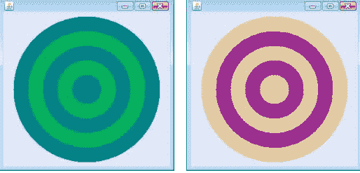

图 6.13 | 两种交替色的靶心。

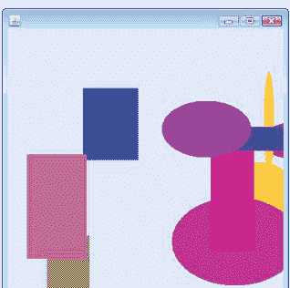

图 6.14 | 随机生成的形状。

## 6.14 总结

在本章中，你学习了更多关于方法的声明知识。你还学习了实例方法和静态方法之间的区别，以及如何通过在方法名前加上其所属类名和点 (.)分隔符来调用静态方法。你学习了如何使用运算符 `+` 和 `+=` 进行字符串拼接。我们讨论了方法调用栈帧如何跟踪被调用的方法以及每个方法完成任务后返回到哪里。我们还讨论了 Java 在原始类型和局部变量之间隐式转换的提升规则。接下来，你学习了 Java API 中一些常用的包。你了解了如何使用枚举类型和私有静态 `final` 变量来声明命名常量。你使用了 `Random` 类为模拟生成随机数。你学习了类中字段和局部变量的作用域。

摘要 231

在第 7 章中，你将学习如何在数组中维护数据列表和表格。你将看到一个更优雅的实现方法，用于一个掷 6,000,000 次骰子的程序。我们将展示两个版本的 `GradeBook` 案例研究，该案例在 `GradeBook` 对象中存储一组学生成绩。你还将学习如何访问应用程序开始执行时传递给 `main` 方法的命令行参数。

## 第 6 章 方法：深入观察

## 第 6.1 节 引言

- 经验表明，开发和维护大型程序的最佳方法是由许多小而简单的部分（或模块）来构建它。这种技术被称为分治法（第 201 页）。

## 第 6.2 节 Java 中的程序模块

- 方法在类内部声明。类通常被分组在包（packages）中，以便它们被导入和重用。
- 方法允许你通过将任务分离为自包含的单元来实现程序的模块化。方法中的语句只写写一次，并对其他方法隐藏。
- 使用现有的方法作为构建块来创建新程序是软件重用的一种形式（第 202 页），这允许你避免在程序内部重复代码。

## 第 6.3 节 静态方法、静态字段和 Math 类

- 方法通过调用方法的静态名称来提供被调用方法执行其任务所需的参数。当方法完成后，该方法要么返回一个结果，要么直接将控制权返回给调用者。
- 类可以包含静态方法，用于执行不需要类实例对象的常见任务。静态方法执行任务可能需要的任何静态数据都可以通过方法中的参数传递。调用静态方法时，通过指定方法所属的类名，后跟一个点（.）以及方法名，格式为 `ClassName.methodName(arguments)`。
- `Math` 类提供了用于执行常见数学计算的静态方法。
- 常数 `Math.PI`（第 204 页，3.14159265358973）是圆周长与直径的比值。常数 `Math.E`（第 204 页，2.71828182845045）是自然对数的基数（通过静态方法 `log(10)` 计算）。
- `Math` 和 `PI` 使用 `public`、`final` 和 `static` 修饰符声明。将它们设为 `public` 允许你在自己的类中使用这些字段。用 `final` 关键字声明的字段（第 205 页）是常量——其值在初始化后无法更改。`PI` 和 `E` 都声明为 `final`，因为将字段设为 `static` 允许它们通过类名和点（.）分隔符进行访问，就像 `Math` 类的方法一样。
- 所有对象共享类静态字段的一个副本。类变量（第 204 页）和实例变量共同表示类的字段。
- 当你使用 `java` 命令执行 Java 虚拟机（JVM）时，JVM 会加载你指定的类并使用类名调用 `main` 方法。你可以指定额外的命令行参数（第 205 页），JVM 将将这些参数传递给 `main`。
- 你可以在你声明的每个类中放置一个 `main` 方法——只有你用于执行应用程序的类中的 `main` 方法才会被 `java` 命令调用。

## 第 6.4 节 带有多个参数的方法声明

- 当调用方法时，程序会创建方法参数值的副本，并将其分配给方法对应的参数。当程序控制返回到调用方法的程序位点时，方法的参数将从内存中移除。
- 方法可以返回一个值，但返回的值可以是一个包含许多值的对象的引用。
- 如果在类的类的多个方法中使用需要某个变量，或者程序应该在对类方法的多次调用之间保存它们的值，则可以将变量声明为类的字段。
- 当一个方法有多个参数时，这些参数以逗号分隔的列表形式指定。对于方法声明中的每个参数，在方法调用中必须有一个对应的参数。此外，每个参数都必须与对应参数的类型一致。如果方法不接受参数，则参数列表为空。
- 字符串（Strings）可以使用运算符 `+` 进行拼接（第 208 页），该运算符会将右操作数的字符放置在左操作数的末尾。
- Java 中的每个基本数据类型值和对象都可以表示为 `String`。当对象与 `String` 拼接时，该对象会被转换为 `String`，然后将两个 `String` 进行拼接。
- 如果将布尔值（boolean）与 `String` 拼接，将使用单词 "true" 或 "false" 来表示布尔值。
- Java 中的所有对象都有一个特殊的方法 `toString`，它返回对象内容的 `String` 表示形式。当对象与 `String` 拼接时，JVM 会隐式地调用对象的 `toString` 方法以获取对象的字符串表示。
- 你可以将大型字面量拆分成几个较小的 `String` 并将其放置在多行上以提高可读性，然后使用拼接重新组合这些 `String`。

## 第 6.5 节 方法声明和使用的注意事项

- 有三种方式调用方法：使用方法本身来调用；使用对象的引用后跟一个点（.）以及方法名来调用；使用类名和点（.）来调用静态方法。
- 方法可以返回一个返回一个值。如果方法返回，语句继续。如果方法抛出异常，则异常传播。

## 第 6.6 节 方法调用栈与栈帧

- 当方法被调用时，会创建一个新的激活帧并推入调用栈。该帧包含局部变量和参数。
- 调用栈是一种后进先出（LIFO）数据结构。
- 方法返回时，其帧从栈中弹出。
- 栈的大小是的，如果增长太大，就会发生栈溢出。

## 第 6.7 节 类型提升与强制转换

- 提升（第 210 页）将一种基本类型的值转换为另一种类型。
- 提升规则（第 210 页）适用于包含不同类型的表达式。
- 如果转换可能会丢失信息，编译器要求你使用强制转换。

## 第 6.9 节 案例研究：安全数字生成

- `SecureRandom` 对象（`java.security` 包）可以产生非确定值。
- `SecureRandom nextInt`（第 214 页）生成 int 值。
- `SecureRandom` 类提供了另一个 `nextInt` 方法，接收一个 int 参数并返回从 0 到但不包含参数值的值。
- 随机数（第 214 页）可以生成：

```
int number = shiftingValue + randomNumbers.nextInt(scalingFactor);
```

其中 `shiftingValue` 指定连续整数范围的起始数字，`scalingFactor` 指定范围内的数字个数。

- 随机数可以从非连续整数范围中选择，如：

```
int differenceBetweenValues = shiftingValue + randomNumbers.nextInt(scalingFactor);
```

其中 `shiftingValue` 指定范围的起始数字，`differenceBetweenValues` 表示序列中相邻数字之间的差异，`scalingFactor` 指定范围内的数字个数。

## 第 6.10 节 案例研究：运气游戏；引入枚举类型

- 枚举类型（`enum` 类型）通过关键字 `enum` 和类型名引入。与类一样，大括号 `{ }` 限制枚举定义的体。大括号内部是常量列表，每个常量表示一个唯一的值。枚举中的标识符必须是唯一的。枚举类型的变量只能赋值该类型的常量。
- 常量也可以声明为 `static final` 变量。这些常量按照习惯用全大写字母声明，以便在程序中区分。

## 第 6.11 节 声明的作用域

- 作用域（第 222 页）是可以通过名称引用实体（如变量或方法）的程序部分。任何实体在程序的该部分都是“在作用域内”。
- 参数声明的作用域是出现该声明的方法体。
- 局部变量声明的作用域是从声明出现的地方开始到该块结束。
- 在 `for` 语句初始化部分出现的局部变量声明的作用域是 `for` 语句的体以及头部的其他表达式。
- 类的方法或字段的作用域是整个类的体（body）。这使得类的方法可以使用简单的名称来调用类的其他方法并访问类的字段。
- 任何代码块都可以包含变量声明。如果方法中的局部变量或参数与字段同名，则当代码块结束执行时，它会被**屏蔽**（shadowed）（第 223 页）。

## 6.12 节 方法重载

- Java 在类中拥有重载方法（第 225 页），只要这些方法具有不同的参数集合（由参数的数量、顺序和类型决定）。
- 重载方法通过其签名（第 226 页）来区分——签名是方法名以及参数的数量、类型和顺序的组合，但不包括其返回类型。

## 自习练习题

- 6.1 为下列语句填空：
  a) 方法通过一个(n) 被调用。
  b) 仅在声明它的方法内部已知的变量被称为一(n)。
  c) 被调用方法中的 __________ 可将表达式的值传回给调用者。
  d) 关键字 __________ 表示该方法不返回任何值。
  e) 数据可以在栈的 __________ 中添加或删除。
  f) 栈（Stocks）是一种数据结构；最后推入（插入）栈的项是第一个从栈中取出（移除）的项。
  g) 从被调用方法返回控制权给调用者的三种方法是 __________ 和。
  h) __________ 的对象可以产生真正的随机数。
  i) 方法调用在程序执行期间的每次方法调用时都会为局部变量存储内存。这些数据作为方法调用栈的一部分进行存储，被称为方法调用的 __________。
  j) 如果调用次数多于方法调用栈所能存储的句数，则会发生错误，表现为一(n)________。
  k) __________ 是程序中可以通过名称引用声明的部分。
  l) 可能存在多个同名但操作不同类型或参数的方法。这种特征被称为方法重载（method）。

- 6.2 对于第 68 页的类，说明以下每个实体的作用域：
  a) 变量 `randomNumbers`。
  b) 变量 `d11`。
  c) 方法 `roll10`。
  d) 方法 `main`。
  e) 变量 `sumOfDice`。

- 6.3 编写一个应用程序，测试图 6.2 所示的 `Math` 类方法示例实际上产生了预期的结果。

- 6.4 为以下每个方法提供方法头：
  a) 方法 `hypotenuse`，接收双精度浮点数参数 `side1` 和 `side2` 并返回一个双精度浮点数结果。
  b) 方法 `smallest`，接收三个整数 `x`、`y` 并返回一个整数。
  c) 方法 `instructions`，不接受任何参数也不返回任何值。
  [注：此类方法通常用于向用户显示指令。]
  d) 方法 `intToFloat`，接受整数数字并返回一个浮点数。

- 6.5 找出以下每个程序段中的错误。解释如何修正该错误。

```java
a) void g()
{
    System.out.println("Inside method g");
    void h()
    {
        System.out.println("Inside method h");
    }
}
```

```java
b) int sum(int x, int y)
{
    int result;
    result = x + y;
}
```

```java
c) void f(float a)
{
    float a;
    System.out.println(a);
}
```

```java
d) void product()
{
    int a = 6, b = 5, c = 4;
    result = a * b;
    System.out.printf("Result is %d\n", result);
    return result;
}
```

- 6.6 声明 `methodVolume` 来计算并返回球体的体积。使用以下语句计算数值：

```java
double volume = (4.0 / 3.0) * Math.pow(radius, 3);
```

编写一个 Java 应用程序，提示用户输入球的双 精度半径，调用 `sphereVolume` 计算体积并显示结果。

## 自习练习题答案

- a) 方法类（method class）， b) 局部变量（local variable）。 c) return（返回），d) void。e. top（顶部）。f) 后进先出（LIFO），g) return（返回）；每个表达式（every expression）；或遇到方法的结束大括号。h) SecureRandom。i) 栈帧（stack frame）、激活记录（activation record），j) 栈溢出（stack overflow）。k) 作用域（scope）。l. 方法重载（method overloading）。

- a) 类体（class body），b) 定义 `methodDice.body` 的块，c) 类体。d) 类体。e) 定义 `method main` 体的块。

6.3 下面的解决方案演示了图 6.2 中的 `Math` 类方法：

```java
// 练习 6.3: MathTest.java
// 测试 Math 类方法。
public class MathTest
{
    public static void main(String[] args)
    {
        System.out.printf("Math.abs(23.7) = %f\n", Math.abs(23.7));
        System.out.printf("Math.abs(0.0) = %f\n", Math.abs(0.0));
        System.out.printf("Math.abs(-23.7) = %f\n", Math.abs(-23.7));
        System.out.printf("Math.ceil(9.2) = %f\n", Math.ceil(9.2));
        System.out.printf("Math.ceil(-9.8) = %f\n", Math.ceil(-9.8));
        System.out.printf("Math.cos(0.0) = %f\n", Math.cos(0.0));
        System.out.printf("Math.exp(1.0) = %f\n", Math.exp(1.0));
        System.out.printf("Math.exp(2.0) = %f\n", Math.exp(2.0));
        System.out.printf("Math.floor(9.2) = %f\n", Math.floor(9.2));
        System.out.printf("Math.floor(-9.8) = %f\n", Math.floor(-9.8));
        System.out.printf("Math.log(Math.E) = %f\n", Math.log(Math.E));
        System.out.printf("Math.log(Math.E) = %f\n", Math.log(Math.E));
        Math.log(Math.E * E);
        System.out.printf("Math.max(2.3, 12.7) = %f\n", Math.max(2.3, 12.7));
        System.out.printf("Math.max(-2.3, -12.7) = %f\n", Math.max(-2.3, -12.7));
        Math.max(-2.3, -12.7);
        System.out.printf("Math.min(2.3, 12.7) = %f\n", Math.min(2.3, 12.7));
        System.out.printf("Math.min(-2.3, -12.7) = %f\n", Math.min(-2.3, -12.7));
        Math.min(-2.3, -12.7);
        System.out.printf("Math.pow(2.0, 7.0) = %f\n", Math.pow(2.0, 7.0));
        System.out.printf("Math.pow(9.0, 0.5) = %f\n", Math.pow(9.0, 0.5));
        System.out.printf("Math.sin(0.0) = %f\n", Math.sin(0.0));
        System.out.printf("Math.sqrt(900.0) = %f\n", Math.sqrt(900.0));
        System.out.printf("Math.tan(0.0) = %f\n", Math.tan(0.0));
    }
}
```


```java
31 } // 方法结束

32 } // MathTest 结束
```

```
Math.abs(23.7) = 23.700000

Math.abs(0.0) = 0.000000

Math.abs(-23.7) = 23.700000

Math.ceil(9.2) = 10.000000

Math.ceil(-9.8) = -9.000000

Math.cos(0.0) = 1.000000

Math.exp(1.0) = 2.718281

Math.exp(2.0) = 7.389056

Math.floor(9.2) = 9.000000

Math.floor(-9.8) = -10.000000

Math.log(Math.E) = 1.000000

Math.log(Math.E * E) = 2.000000

Math.max(2.3, 12.7) = 12.700000

Math.max(-2.3, -12.7) = -2.300000

Math.min(2.3, 12.7) = 2.300000

Math.min(-2.3, -12.7) = -12.700000

Math.pow(2.0, 7.0) = 128.000000

Math.pow(9.0, 0.5) = 3.000000

Math.sin(0.0) = 0.000000

Math.sqrt(900.0) = 30.000000

Math.tan(0.0) = 0.000000
```

- 6.4 a) `double hypotenuse(double side1, double side2)`
   b) `smallest(int x, int y, int z)`
   c) `void instructions()`
   d) `float intToInt(int number)`

- 6.5 a) 方法 `h` 在 `g` 的外部。
   修正：将 `h` 的声明移动到 `g` 外部。
   b) 方法应该返回一个整数，但并没有返回。
   修正：添加变量 `result`，并在方法末尾放置语句：`return result;`
   c) 参数列表后面的分号是错误的，且参数不应在方法中声明。
   修正：删除分号。
   d) 方法返回了一个值，但它不应该这样做。
   修正：将返回类型从 `void` 改为 `int`。

6.6 以下解决方案计算球体的体积，使用了用户输入的半径：

```java
// 练习 6.6: Sphere.Java

// 计算球体的体积。

import java.util.Scanner;

public class Sphere
{

    // 从用户获取半径并显示球体体积

    public static void main(String[] args) {

        Scanner input = new Scanner(System.in);

        System.out.print("Enter radius of sphere: ");

        double radius = input.nextDouble();

        System.out.printf("Volume is %f\n", sphereVolume(radius));

    } // 方法结束

    // 计算并返回球体体积

    public static double sphereVolume(double radius) {

        double volume = (4.0 / 3.0) * Math.PI * Math.pow(radius, 3);

        return volume;

    } // 方法结束 sphereVolume

 // 类结束 Sphere
```

# 练习

6.7 执行以下语句的值是多少？

- a) `x = Math.abs(-7.5);`
b) `x = Math.floor(7.5);`
c) `x = Math.abs(0.0);`
d) `x = Math.ceil(0.0);`
e) `x = Math.abs(-6.4);`
f) `x = Math.ceil(-6.4);`
g) `x = Math.abs(-8 + Math.floor(-5.5));`

6.8 (停车费用) 某停车场对于停车三小时以内的客户收取 2.00 元最低费用。超过三小时的部分，每小时（不足小时按小时计算）额外收取 0.50 元。任何给定 24 小时内的最高费用为 10.00 元。假设没有车辆停车时间超过 24 小时。编写一个应用程序，计算并显示昨天停在该停车场的每个客户的停车费用。你应该输入每个客户的停车小时数，并计算并显示昨天收据的总额。它应该使用 `calculateCharges` 方法来确定每个客户的费用。

# 第 6 章 方法：深入观察

6.9 (数字舍入) `Math.floor` 可用于将值舍入到最近的整数——例如，
`y = Math.floor(x + 0.5);`

这会将 `x` 舍入到最近的整数并将结果赋值给 `y`。编写一个应用程序，读取 `double` 类型的值并使用前面的语句将每个数字舍入到最近的整数。对于处理的每个数字，同时显示原始数字和舍入后的数字。

6.10 (数字舍入) 要将数字舍入到特定的小数位数，使用类似下面的语句：

```
y = Math.floor(x * 10 + 0.5) / 10;
```

这会将 `x` 舍入到十分位（即小数点右边的第一个位置），或者
`y = Math.floor(x * 100 + 0.5) / 100;`

这会将 `x` 舍入到百分分位（即小数点右边的第二个位置）。编写一个应用程序，定义四个方法以以不同的方式对数字 `x` 进行舍入：

- a) `roundToTenths(number)`
- b) `roundToCenths(number)`
- c) `roundToHundredths(number)`
- d) `roundToThousandths(number)`

对于每个值，你的程序应该显示原始值、舍入到最近整数的数字、舍入到最近十分位的数字、舍入到最近百分分位的数字以及舍入到最近千分位的数字。

6.11 回答以下每个问题：
a) 使用“random”（随机）意味着什么？
b) 为什么 `SecureRandom` 的 `nextInt` 方法对模拟概率游戏有用？
c) 为什么必须对 `SecureRandom` 对象产生的值进行缩放或偏移？
d) 为什么对现实情况进行计算机化模拟是一种有效的技术？

6.12 编写语句，将整数值赋值给以下范围内的变量 `n`：
a) 1 ≤ n ≤ 2.
b) 1 ≤ n ≤ 100.
c) 0 ≤ n ≤ 9.
d) 1000 ≤ n ≤ 1112.
e) -1 ≤ n ≤ 1.
f) -3 ≤ n ≤ 11.

6.13 编写语句，从以下每个集中显示一个随机数：
a) 2, 4, 6, 8, 10.
b) 3, 5, 7, 9, 11.
c) 6, 10, 14, 18, 22.

6.14 (幂运算) 编写一个方法 `integerPower(base, exponent)`，该方法返回 `exponent` 的值。

例如，`integerPower(3, 4)` 计算 3⁴ (3 * 3 * 3 * 3)。假设 `exponent` 是正非零整数且 `base` 是整数。不要使用任何 `Math` 方法。将此方法整合到应用程序中，读取 `base` 和 `exponent` 的整数值并使用 `integerPower` 方法进行计算。

6.15 (直角边计算) 定义一个方法 `hypotenuse`，在给定另外两条边长度时，计算直角三角形的直角边。该方法应接受两个 `double` 类型参数，并作为 `double` 类型返回直角边。将此方法整合到应用程序中，读取 `side1` 和 `side2` 的值并使用 `hypotenuse` 方法进行计算。使用 `Math` 方法 `pow` 和 `sqrt` 来确定图 6.15 中每个三角形的直角边长度。[注：`Math` 类也提供了方法 `hypot` 来执行此计算。]

| | Side 1 | Side 2 |
| :--- | :--- | :--- |
| 1 | 3.0 | 4.0 |
| 2 | 5.0 | 12.0 |
| 3 | 8.0 | 15.0 |

图 6.15 中的三角形值。

6.16 (倍数) 编写一个方法 `isMultiple`，对于每对整数，判断第二个是否是第一个的倍数。该方法应接受两个参数，如果第二个是第一个的倍数则返回 `true`，否则返回 `false`。将此方法整合到应用程序中，读取每对整数。

6.17 (奇偶数) 编写一个方法 `isEven`，使用取模运算符 (`%`) 来判断整数是否为偶数。该方法应接受一个整数参数，如果是偶数则返回 `true`，否则返回 `false`。将此方法整合到应用程序中，逐个判断整数是否为。

6.18 (显示星号图形) 编写一个方法 `squareAsterisks`，显示一个整数数量的星号方形。例如，如果 `side` 是 4，该方法应显示：
```
****
****
****
****
```
将此方法整合到应用程序中，从用户处读取一个值。

6.19 (任意图形) 修改练习 18 中的方法以接收一个整数类型的参数。如果 `side` 是 3，该方法应显示使用以下语句（使用 `Scanner` 对象）：
```
char fill = input.next();
```


# 练习题

## 6.20 (圆面积)
编写一个应用程序，提示用户输入半径并使用 `area` 方法计算。

## 6.21 (分离数字)
编写方法完成以下每项：
a) 计算整数除以的商。
b) 计算整数除以的余数。
c) 使用方法 (a) 和 (b) 编写显示 1 到 99。

## 6.22 (温度转换)
实现以下内容：
a) 方法返回华氏对应的摄氏，使用计算 `(fahrenheit - 32) * 5 / 9;`。
b) 方法返回摄氏对应的华氏，使用计算 `celsius * 9 / 5 + 32;`。
c) 使用方法 (a) 和 (b) 编写一个应用程序，让用户输入华氏温度并显示摄氏。

## 6.23 (最小值)
编写一个方法返回三个值中的最小值。使用 `Math.min()` 方法来实现。将此方法整合到应用程序中，从用户处读取三个值并确定结果。

## 6.24 (完美数)
如果一个整数的因子之和等于该数，则被称为完美数。例如，6 是完美数，因为 1 + 2 + 3 = 6。编写一个方法 `isPerfect` 判断整数。使用此方法在应用程序中显示 1 到 1000 之间的完美数。显示每个完美数的因子以确认该数字确实完美。

## 6.25 (质数)
如果一个正整数只能被 1 和自身整除，则是质数。例如，2, 3, 5 和 7 是质数，但 4, 6 和 9 不是。1 不是质数。
a) 编写一个方法判断数字是否为质数。
b) 使用此方法在应用程序中确定 1 到 10,000 的质数。你需要测试多少数字以确保找到所有的质数？
c) 最初，你可能认为 n/2 是测试一个数字是否为质数的上限，但你只需要测试到 n 的平方根即可。编写程序并运行。

## 6.26 (反转数字)
编写一个方法接受一个整数并返回其数字反转的值。例如，给定数字 7631，该方法应返回 1367。将此方法整合到应用程序中，从用户处读取一个值并显示结果。

## 6.27 (最大公约数)
两个整数的最大公约数是除以这两个数字的最大整数。编写一个方法 `gcd` 返回两个整数的公约数。[提示：你可能想使用欧几里得算法。可以在 `https://en.wikipedia.org/wiki/Euclidean_division_algorithm` 获取更多信息。]将此方法整合到应用程序中，从用户处读取两个值并显示结果。

## 6.28
编写一个方法 `qualityPoints`，输入学生的平均分，如果是 90–100 则返回 4，80–89 返回 3，70–79 返回 2，60–69 返回 1，低于 60 则返回 0。将此方法整合到应用程序中，从用户处读取一个值并显示结果。

# 做出改变

## **6.29** (掷硬币)
编写一个模拟掷硬币的应用程序。当用户选择“掷硬币”菜单选项时，程序就掷一次硬币。统计硬币每一面出现的次数。显示结果。程序应该调用一个独立的方法 `flip()`，该方法不接受参数并返回来自 `Coin` 枚举的值（`HEADS` 和 `TAILS`）。*注意：如果程序真实地模拟掷硬币，硬币的每一面出现的概率应占一半。*

## **6.30** (猜数字)
编写一个玩“猜数字”游戏的应用程序：你的程序通过在 1 到 1000 之间选择一个随机整数来确定数字。应用程序显示提示“输入 1 到 1000 之间的数字”。玩家输入第一次猜测。如果玩家猜测错误，你的程序应该显示“太高”或“太小”。同样，让玩家不断接近正确答案。程序应提示用户下一次猜测。当用户输入正确答案时，显示“恭喜”。然后允许用户选择是否再次玩。*注意：本题中的猜数技术是二分查找，在第 19 章“排序与二分查找”中有讨论。*

## **6.31** (猜数修改)
修改练习 6.30 的程序，统计玩家猜测的次数。如果次数为 10 次或少，显示“你知道秘密，或者你运气好！”如果玩家猜测次数超过 10 次，显示“啊！你知道秘密了！”为什么猜测次数不超过 10 次更好呢？嗯，在每次“猜测”中，玩家应该能够排除一半的范围，以此类推。

## **6.32** (点间距离)
编写一个方法计算两个点 (x1, y1) 和 (x2, y2) 之间的距离。所有返回值都应为 `double` 类型。将此方法整合到应用程序中，允许用户输入点的坐标。

## **6.33** (骰子游戏修改)
修改练习 6.8 的程序以允许下注。初始化变量 `balance` 为 1000 元。提示玩家输入注额。检查注额是否小于或等于 `balance`，如果不是，让用户重新输入，直到输入有效注额为止。然后，如果玩家赢了，将 `balance` 增加注额并显示新的 `balance`。如果玩家输了，从 `balance` 中减少注额并显示新的 `balance`；检查 `balance` 是否变为零，如果是，显示消息“抱歉，你破光了！”、“噢”或“你该兑换筹码了！”将 `craps` 实现为一个独立的方法，用于随机选择要显示的字符串。

## **6.34** (二进制、八进制和十六进制表)
编写一个应用程序，显示 1 到 256 范围内十进制数的二进制、八进制和十六进制等值表。如果你不熟悉这些数字系统，请先阅读在线附录 J。

# 做出改变

随着成本的下降，无论情况如何，每个人拥有一计算机并在学校中使用它都变得可行。这为提高全球所有学生的教育体验创造了令人兴奋的可能性，特别是在未来五年内。*注意：查看如笔记本电脑项目 (www.laptop.org) 等计划。此外，“绿色”笔记本电脑——是这些设备的一些关键“环保”特征吗？研究电子产品环境评估工具 (www.epeat.net)，它可以帮助你评估台式机、笔记本电脑和显示器的“绿色程度”，帮助你决定购买哪些产品。*

## **6.35** (计算机辅助教学)
在教育中使用计算机被称为计算机辅助教学 (CAI)。编写一个程序帮助任何小学生学习乘法。使用一个 `SecureRandom` 对象产生正的一位数字整数。程序应向用户提一个问题，例如：

> 6 乘以 ?? 等于几

学生然后输入答案。程序检查学生的答案。如果正确，显示消息“非常好！”并问另一个乘法问题。如果答案错误，显示消息“请再尝试。”并让学生反复尝试同一个问题，直到学生最终答对。应该使用一个独立的方法来生成每个新问题。此方法仅在应用程序开始执行以及每次用户正确回答问题时才调用。

# 6.36 计算机辅助教学：减轻学生疲劳

CAI 环境中的一个问题是学生疲劳。可以通过改变计算机的响应来吸引学生的注意力。修改练习 6.35 的程序，以便按如下方式显示不同的注释：

- 正确答案的可能响应：
  - 非常好！
  - 太棒了！
  - 做得好！
  - 继续努力！

- 错误答案的可能响应：
  - 不。请再试一次。
  - 错了。再试一次。
  - 不要放弃！
  - 继续尝试。

使用随机数生成选择一个 1 到 4 之间的数字，用于为每个正确或错误的答案选择四个适当响应之一。使用 `switch` 语句来选择这些问题。

# 6.37 计算机辅助教学：监控学生表现

更复杂的计算机辅助教学系统会监控一段时间学生的表现。开始新主题的决定通常基于学生对之前主题的成功情况。修改练习 6.36 的程序，统计学生正确和错误的回答次数。在学生输入 10 个答案后，你的程序应计算正确百分比。如果百分比低于 75%，显示“请向你的老师寻求额外帮助”，然后重置程序以便另一个学生尝试。如果百分比为 75% 或更高，显示“恭喜，你准备好进入下一个阶段了！”，然后重置程序以便另一个学生尝试。

# 6.38 计算机辅助教学：难度级别

练习 6.35–6.37 开发了一个计算机辅助教学程序来帮助教授小学生乘法。修改程序允许用户输入难度级别。在难度级别为 1 时，程序应仅使用一位数；在难度级别为 2 时，数字大小可达两位，以此类推。

# 6.39 计算机辅助教学：变换问题类型

修改练习 6.38 的程序，允许用户选择算术题类型：选项 1 意味着仅加法题，2 仅减法题，3 仅乘法题，4 仅除法题，5 意味着所有类型的随机混合。

# 数组和 ArrayList

> 从头开始，一直到结束。—— 卡罗尔
>
> 越位与不及同样是错误。—— 孔子

# 目标

在本章中，你将：

- 学习什么是数组。
- 使用数组存储数据并从值列表中检索数据。
- 声明数组、初始化数组并引用单个元素。
- 使用增强型 for 循环遍历数组。
- 将数组传递给方法。
- 声明和操作多维数组。
- 使用变长参数列表。
- 将命令行参数读入程序中。
- 构建一个面向对象的成绩单类。
- 使用类 `Arrays` 方法执行常见的数组操作。
- 使用类 `ArrayList` 操作可以动态调整大小的数组结构。

# 第 7 章 数组和 ArrayList

- 7.1 引言
- 7.2 数组
- 7.3 声明和创建数组
- 7.4 使用数组的示例
  - 7.4.1 创建并初始化数组
  - 7.4.2 使用初始化器
  - 7.4.3 计算存储在数组中的元素
  - 7.4.4 累加元素
  - 7.4.5 使用柱状图可视化
  - 7.4.6 使用数组元素作为计数器
- 7.5 异常处理：处理错误响应
  - 7.5.1 try 语句
  - 7.5.2 执行 catch 块
  - 7.5.3 提取异常参数
- 7.6 案例研究：洗牌与发牌模拟
- 7.7 增强 for 语句
- 7.8 使用数组分析结果
- 7.9 将数组传递给方法
- 7.10 值传递与引用传递
- 7.11 案例研究：使用数组的成绩单
- 7.12 多维数组
- 7.13 案例研究：使用二维数组的成绩单
- 7.14 变长参数列表
- 7.15 使用命令行参数

总结 | 自测练习 | 自测练习答案 | 练习 | 特别章节：构建你的计算机

# 引言

本章介绍了结构——数据项的集合。数组对象是由相同类型的相关数据项组成的数据结构。数组使得处理一组值变得方便。数组在创建后长度不变。我们在第 16-21 章中深入研究数据结构。

在讨论了如何声明和初始化数组后，我们展示了演示数组操作的示例。我们介绍了 Java 的异常处理机制，并利用它允许程序在尝试访问数组越界时继续执行。我们还展示了一个案例研究，说明数组如何帮助纸牌游戏中的洗牌和发牌。我们介绍了 Java 的增强 for 语句，它比 5.3 节中的计数控制 for 语句更容易访问数组中的数据。我们构建了两个版本的教师成绩单案例研究，使用数组在内存中维护学生成绩并分析。我们展示了如何使用变长参数列表创建可以带有不同数量参数的方法，并演示了如何在 main 方法中处理命令行参数。接下来，我们通过来自 `java.util` 包的类 `Arrays` 的静态方法演示常见的数组操作。

尽管数组很常用，但其功能有限。例如，如果在执行期间你想修改它，则必须创建一个新数组。在本章末尾，我们引入了 Java 的内置数据结构来自 Java API 集合类中的结构。它们提供了比传统数组更大的功能。它们是可用的、可靠、强大且高效的。我们关注 `ArrayList` 集合。`ArrayList` 与数组类似，但提供了额外的功能，例如根据需要动态调整大小以适应更多元素。

## Java SE 8

在阅读完第 17 章 Java SE 8 Lambdas 和 Streams 后，你将能够以更简洁、优雅的方式重新实现第 7 章中的许多示例，并且更容易并行化，以提高在今天多核系统上的性能。

## 7.2 数组

数组是一组变量（称为元素或组件），包含所有具有相同类型的值。数组是对象，它们被视为引用类型。正如你所看到的，我们通常认为的数组实际上是对数组对象内存的引用。数组的元素可以是基本类型也可以是引用类型（包括数组，正如我们在 7.11 节中所示）。要引用数组中的特定元素，我们指定数组引用的名称以及该元素在数组中的位置数字。元素的位置数字是该元素的索引或下标。

### 逻辑数组表示

图 7.1 显示了名为 `c` 的整型数组的逻辑表示。它包含 12 个元素。程序使用数组访问表达式引用这些元素任意一个，该表达式包含数组名称，后紧跟方括号 `([` 内的特定元素的索引。每个数组的第一个元素索引为 0，有时被称为零元素。因此，数组 `c` 的元素是 `c[0]`、`c[1]`、`c[2]` 等。数组 `c` 中最大的索引是 11，比 12 少 1——即数组元素的数量。数组名称遵循与其他变量名相同的命名约定。

| 数组名称 (c) | c[ 0 ] | -45 |
|---|---|---|
|  | c[ 1 ] | 6 |
|  | c[ 2 ] | 0 |
|  | c[ 3 ] | 72 |
|  | c[ 4 ] | 1543 |
|  | c[ 5 ] | -89 |
|  | c[ 6 ] | 0 |
|  | c[ 7 ] | 62 |
|  | c[ 8 ] | -3 |
|  | c[ 9 ] | 1 |
|  | c[ 10 ] | 6453 |
|  | c[ 11 ] | 78 |

图 7.1 | 一个 12 元素的数组。

# 第 7 章 数组和 ArrayList

索引必须是非负整数。程序可以使用表达式作为索引。例如，假设变量 `a` 为 5，变量 `b` 为 6，则语句

```
c[a + b] = 2;
```

向数组元素 `c[11]` 加上 2。索引数组是一个数组访问表达式，可以用于赋值语句的左侧，将新值放入数组元素中。

## 常见编程错误 7.1

> 索引必须是 `int` 或可以提升为 `int` 的类型的值——即 `byte`、`short` 或 `char`，但不能是 `long`；否则会发生编译错误。

让我们仔细检查图 7.1 中的数组。数组 `c` 的名称是 `c`。每个数组对象都知道其长度并将其存储在 `length` 变量中。表达式 `c.length` 返回数组的长度。即使数组 `c` 的 `length` 实例是公共的，它无法被更改因为它是一个 `final` 变量。数组的 12 个元素被称为 `c[0]`、`c[1]`、`c[2]`... `c[11]`。`c[0]` 的值是 -45，`c[1]` 的值为 6，`c[2]` 的值为 0，`c[7]` 的值为 62，而 `c[11]` 的值为 78。为了计算数组 `c` 前三个元素所包含的值之和并将结果存储在变量 `sum` 中，我们将：

```
sum = c[0] + c[1] + c[2];
```

为了将 `c[6]` 的值除以 2 并将结果赋值给变量 `x`，我们会写：

```
x = c[6] / 2;
```

## 7.3 声明和创建数组

数组对象占用内存空间。像其他对象一样，数组通过 `new` 创建。要创建一个数组对象，你指定数组元素的类型和元素数量，作为使用关键字 `new` 的数组创建表达式的一部分。该表达式返回一个引用，该引用可以存储在数组变量中。声明和数组创建创建一个包含 12 个元素的数组对象，并将数组的引用存储在名为 `c` 的数组变量中：

```
int[] c = new int[12];
```

此表达式可用于创建图 7.1 中的数组。当数组被创建时，它的每个元素都会接收一个默认值——数值基本元素为零，布尔元素为 `false`，引用为 `null`。正如你所看到的，在创建数组时你可以提供非默认元素值。

创建图 7.1 中的数组也可以分两个步骤完成：

```
int[] c; // 声明数组变量
c = new int[12]; // 创建数组；赋值给数组变量
```

在声明中，方括号表示 `c` 的类型是一个引用数组的变量。在赋值语句中，数组 `c` 接收指向 12 个元素数组的引用。

## 常见编程错误 7.2

在数组声明中，方括号内指定元素数量（例如 `int[12] c`）是错误的。

## 7.4 数组示例

程序可以在一个声明中创建多个数组。以下声明为 `b` 预留了 100 个元素，为 `x` 预留了 27 个元素：

```
String[] b = new String[100], x = new String[27];
```

当数组类型和方括号在声明开头结合时，声明中的所有标识符都是数组变量。在这种情况下，变量 `b` 和 `x` 指向 `String` 数组。为了可读性，我们*每个声明声明一个变量*。前面的声明等同于：

```
String[] b = new String[100]; // 创建数组 b
String[] x = new String[27]; // 创建数组 x
```

## 良好实践 7.1

为了可读性，每个声明只声明一个变量。每个声明占一行，并包含描述注释。当每个声明只声明一个数组时，方括号可以放在类型之后，也可以放在数组名称之后，例如：

```
String b[] = new String[100]; // 创建数组
String x[] = new String[27]; // 创建数组
```

但首选将方括号放在类型之后。

在一个声明中声明多个变量会导致细微的错误。考虑声明 `int[] a, b`；如果 `a` 和 `b` 都应该声明为数组变量，则该声明是正确的。如果 `a` 是数组变量而 `b` 是单个变量，则此声明是不正确的——声明 `int a[], b` 会达到预期结果。程序可以创建任何类型的数组。基本类型数组包含声明元素的值。同样，在引用类型的情况下，每个元素都是指向对象的引用。例如，`int` 数组的每个元素都是 `int` 值，`String` 数组的每个元素都是 `String` 对象。

## 7.4 数组示例

本节介绍了声明数组、创建数组以及初始化数组元素的示例。

### 7.4.1 创建并初始化数组

图 7.2 的应用使用 `new` 关键字创建一个 10 个 `int` 数组，初始值为零（`int` 变量的默认值）。第 9 行声明包含 10 个元素的数组——然后用数组对象初始化变量。第 11 行输出标题。第一列包含每个数组元素的索引 (0–9)，第二列包含每个数组元素的默认值 (0)。

```java
// 图 7.2: InitArray.java
// 将数组元素初始化为默认零。

public class InitArray {

    public static void main(String[] args) {

        // 声明变量 array 并用数组对象初始化
        int[] array = new int[10]; // 创建数组对象

        System.out.printf("%s%s%n", "Index", "Value"); // 标题

        // 输出每个数组元素的值
        for (int counter = 0; counter < array.length; counter++) {

            System.out.printf("%d%d%n", counter, array[counter]);

        }

    }

} // InitArray 结束
```


# 第 7 章 数组与 ArrayList

## 7.4 数组示例

| Index | Value |
|---|---|
| 0 | 0 |
| 1 | 0 |
| 2 | 0 |
| 3 | 0 |
| 4 | 0 |
| 5 | 0 |
| 6 | 0 |
| 7 | 0 |
| 8 | 0 |
| 9 | 0 |

**图 7.2** 将数组元素初始化为默认零。

`for` 语句（第 14–15 行）输出每个元素的索引（由 `counter` 表示）和值（由 `array[counter]` 表示）。控制变量 `counter` 初始为 0——索引值从 0 开始，零计数允许循环访问数组的每个元素。其 `for` 循环继续条件使用表达式 `.length`（第 14 行）来确定数组的长度。在这个示例中，数组长度为 10，因此只要变量 `counter` 的值小于 10，循环继续执行。10 元素数组的最大索引值为 9，因此在循环继续条件中使用小于运算符可以确保循环不会访问数组之外的元素（即在循环的最后迭代中，`counter` 为 9）。

### 7.4.2 使用数组初始化器

你可以创建一个数组并使用初始化器初始化其元素——初始化器是在花括号内的用逗号分隔的表达式列表（称为初始化列表）。在这种情况下，数组长度由初始化列表中的元素数量决定。例如：

```java
int[] n = { 10, 20, 30, 40, 50 };
```

创建了一个索引值为 0–4 的五元素数组。元素 `n[0]` 初始化为 10，`n[1]` 初始化为 20，以此类推。当编译器遇到一个包含初始化列表的数组声明时，它通过计算列表中的初始化器数量来确定数组的大小，然后在“后台”设置恰当的操作。

图 7.3 中的应用程序初始化了一个包含 10 个值的整型数组（第 9 行），并以表格形式显示该数组。显示数组元素的代码与图 7.2 中的代码完全相同（第 15–16 行）。

```java
// Fig 7.3: InitArray.java
// 使用数组初始化器初始化数组的元素。
public class InitArray {
    public static void main(String[] args) {
        // 初始化器列表指定了每个元素的初始值
        int[] array = { 32, 27, 64, 18, 95, 14, 70, 60, 37 };
        System.out.printf("%s%s%n", "Index", "Value"); // 表头
        // 输出每个数组元素的值
        for (int counter = 0; counter < array.length; counter++) {
            System.out.printf("%5d%d%n", counter, array[counter]);
        }
    }
}
```

| Index | Value |
|---|---|
| 0 | 32 |
| 1 | 27 |
| 2 | 64 |
| 3 | 18 |
| 4 | 95 |
| 5 | 14 |
| 6 | 70 |
| 7 | 60 |
| 8 | 37 |
| 9 | 0* |

**图 7.3** 使用初始化器初始化数组的元素。

### 7.4.3 计算存储在数组中的值

图 7.4 中的应用程序计算了一个包含 10 个元素的数组，并将整数 2 到 20（2, 4, 6, ..., 20）赋值给每个元素。然后，程序以表格格式显示数组。第 12–13 行的 `for` 语句通过将控制变量 `counter` 的当前值乘以 2 并加 2 来计算数组的值。

```java
// Fig. 7.4: InitArray.java
// 计算放入数组元素中的值。（部分 1/2）
public class InitArray {
    public static void main(String[] args) {
        final int ARRAY_LENGTH = 10; // 常量
        int[] array = new int[ARRAY_LENGTH]; // 创建数组
        // 计算每个数组元素的值
        for (int counter = 0; counter < array.length; counter++) {
            array[counter] = 2 + 2 * counter;
        }
        System.out.printf("%5s%8s%n", "Index", "Value"); // 表头
        for (int counter = 0; counter < array.length; counter++) {
            System.out.printf("%5d%8d%n", counter, array[counter]);
        }
    }
}
```

| Index | Value |
|---|---|
| 0 | 2 |
| 1 | 4 |
| 2 | 6 |
| 3 | 8 |
| 4 | 10 |
| 5 | 12 |
| 6 | 14 |
| 7 | 16 |
| 8 | 18 |
| 9 | 20 |

**图 7.4** 计算放入数组元素的值。（部分 2/2）

第 8 行使用 `final` 修饰符声明值为 10 的常量变量 `ARRAY_LENGTH`。常量变量在使用之前必须初始化，并且之后不能修改。如果你尝试在初始化后修改 `final` 变量，编译器会发出错误信息：“cannot assign value to final variable”。

> **编程规范 7.2** 常量变量被称为命名常量。它们比字面量（例如 10）更具可读性——像 `ARRAY_LENGTH` 这样的命名常量清晰地指示了它的用途。
>
> **编程规范 7.3** 多单词命名常量之间应用下划线分隔，如 `ARRAY_LENGTH`。
>
> **常见编程错误 7.4** 在初始化后为 `final` 变量赋值是编译错误。同样，在初始化之前访问 `final` 变量的值会导致类似于“variable might not have initialized”的编译错误。

### 7.4.4 数组求和

通常，数组元素代表用于计算的一系列值。例如，如果它们代表成绩，教授可能希望对数组求和并使用该总和计算平均值。图 7.14 和 7.18 中的 `GradeBook` 示例使用了这种技术。图 7.5 求和了一个 10 元素数组的值。程序在第 8 行声明并初始化数组。该语句执行计算。注意：作为初始化器的值通常是读取到程序中的，而不是在初始化列表中指定的。例如，应用程序可以从用户或磁盘上的文件（见第 15 章文件、流和对象序列化）读取数据。将数据读入程序（而不是硬编码到程序中）使程序更易读并可以使用不同的数据集。

```java
// Fig. 7.5: SumArray.java
// 计算数组元素的总和。
public class SumArray {
    public static void main(String[] args) {
        int[] array = {87, 68, 94, 100, 83, 78, 85, 91, 76, 87};
        int total = 0;
        // 将每个元素的值加到 total 中
        for (int counter = 0; counter < array.length; counter++) {
            total += array[counter];
        }
        System.out.printf("Total of array elements: %d%n", total);
    }
} // end class SumArray
```

Total of array elements: 849

**图 7.5** 计算数组元素的总和。

### 7.4.5 使用条形图图形化显示数组

许多程序以图形方式呈现数据。例如，数值通常显示为图中的条形。在这样的图中，较长的条形代表较大的数值。以图形方式显示数据的一种简单方法是使用条形图，将每个数值显示为星号（*）组成的条形。

教授通常喜欢检查考试成绩的分布。教授可能会绘制每个类别成绩数量的图以视觉化成绩分布。假设考试的成绩为 87, 68, 94, 100, 83, 78, 85, 91, 76 和 87。它们包括一个 100 分、两个 90 多分、四个 80 多分、两个 70 多分、一个 60 多分且没有低于 60 分的成绩。我们的下一个应用程序（图 7.6）将这些数据存储在数组中。

Grade distribution:
0-09: *
10-19: **
20-29: ***
30-39: ****
40-49: *****
50-59: ******
60-69: ******
70-79: ***
80-89: ****
90-99: **

**图 7.6** 条形图程序。

应用程序通过数组中的值显示成绩分布。

### 7.4.6 使用数组模拟掷骰子

第 14 行在循环的每次迭代中通过随机值来决定增加哪个频率元素。第 14 行的计算产生 1 到 6 之间的随机数，因此数组频率必须足够大，以存储六个计数器。然而，当我们忽略 `frequency[0]` 时，我们使用了一个七个元素的数组——让点数 1 增加 `frequency[1]` 更符合逻辑。因此，每个值都被用作数组 `frequency` 的索引。在第 14 行中，计算首先评估方括号以确定增加数组的哪个元素，然后 `++` 运算符将该元素加 1。我们通过循环 `array frequency` 来输出结果（19–20 行），替换了图 6.7 中的第 49–51 行。当我们在第 17 章中使用 Java 集合的新编程功能时，我们将展示如何用一条语句替换第 13–14 行和 19–20 行！

### 7.4.7 使用数组分析调查结果

我们的示例数组将汇总调查中收集的数据。考虑以下问题描述：

> 要求 20 名学生按 1 到 5 分对食堂食物质量进行评分，1 分为“糟糕”，5 分为“优秀”。将这 20 个响应放在一个整数数组中，并确定每个评分的频率。

这是一个典型的数组处理应用（图 7.8）。我们希望汇总每种类型响应的数量（即 1–5）。`responses` 数组（第 9–10 行）是一个包含 20 个元素的整数数组，包含了学生们的调查响应。数组中的最后一个值故意是错误的。当 Java 程序执行时，会检查数组索引的有效性——所有索引必须大于等于 0 且小于数组的长度。任何尝试访问该范围之外索引的操作都会导致名为 `ArrayIndexOutOfBoundsException` 的运行时错误。在本节结束时，我们将讨论无效值的返回，演示数组边界检查，并介绍 Java 的异常处理机制，该机制可用于检测和处理 `ArrayIndexOutOfBoundsException`。

```java
// 图 7.8: StudentPoll.java
// 选民分析程序。
public class StudentPoll {
    public static void main(String[] args) {
        // 学生响应数组（通常情况下在运行时输入）
        int[] responses = {1, 2, 5, 4, 3, 5, 2, 1, 3, 3, 1, 4, 3, 3, 2, 3, 3, 2, 14};
        int[] frequency = new int[6]; // 频率计数数组
        // 对于每个答案，选择 responses 元素并将其用
        // 作为频率索引以确定要增加的元素
        for (int answer = 0; answer < responses.length; answer++) {
            try {
                ++frequency[responses[answer]];
            } catch (ArrayIndexOutOfBoundsException e) {
                System.out.println(e); // 调用 toString 方法
                System.out.printf("responses[%d] = %d%n", answer, responses[answer]);
            }
        }
        System.out.printf("%10s%n", "Rating", "Frequency");
        // 输出每个数组元素的值
        for (int rating = 1; rating < frequency.length; rating++) {
            System.out.printf("%6d%10d%n", rating, frequency[rating]);
        }
    } // class StudentPoll
}
```

```
java.lang.ArrayIndexOutOfBoundsException: 14
responses[19] = 14
```

**图 7.8** 选民分析程序。（部分，共两部分）。


| 评分 | 频率 |
| :--- | :--- |
| 1 | 3 |
| 2 | 4 |
| 3 | 8 |
| 4 | 2 |
| 5 | 2 |

**图 7.8** 选民分析程序。（部分，共两部分。）

### frequency 数组
我们使用六个元素的 `frequency` 数组（第 11 行）来统计每个响应可能出现的类型数量。每个元素都被用作调查响应可能类型的计数器——`frequency[1]` 统计对食物评为 1 分的学生人数，`frequency[2]` 统计对食物评为 2 分的学生人数，以此类推。

### 汇总结果
该语句（第 15–27 行）逐个从数组中读取响应并增加计数器 `frequency[1]` 到 `frequency[5]` 之一；我们忽略 `frequency[0]`，因为调查响应限制在 1–5 的范围内。循环中的关键语句位于第 19 行左右。该语句根据 `responses[answer]` 的值增加相应的频率计数器。

让我们分步执行该语句的前几次迭代：

- 当计数器 `answer` 为 0 时，`responses[answer]` 是 `responses[0]` 的值（即 1——见第 9 行）。在这种情况下，`frequency[responses[answer]]` 被解释为 `frequency[1]`，计数器 `frequency[1]` 加 1。为了评估该表达式，我们从最内层括圈 `(answer, 0)` 中的值开始。`answer` 的值被代入表达式，然后评估下一组括号 `(responses[answer])`。该值是……

- 当计数器 `answer` 为 1 时，`responses[answer]` 是 `responses[1]` 的值（即 2——见第 9 行）。在这种情况下，`frequency[responses[answer]]` 被解释为 `frequency[2]`，计数器 `frequency[2]` 加 1。为了评估该表达式，我们从最内层括号 `(answer, 1)` 中的值开始。`answer` 的值被代入表达式，然后评估下一组括号 `(responses[answer])`。该值是……

- 当计数器 `answer` 为 2 时，`responses[answer]` 是 `responses[2]` 的值（即 5——见第 9 行）。在这种情况下，`frequency[responses[answer]]` 被解释为 `frequency[5]`，计数器 `frequency[5]` 加 1。为了评估该表达式，我们从最内层括号 `(answer, 2)` 中的值开始。`answer` 的值被代入表达式，然后评估下一组括号 `(responses[answer])`。该值是……

- 当计数器 `answer` 为 3 时，`responses[answer]` 是 `responses[3]` 的值（即 3——见第 9 行）。在这种情况下，`frequency[responses[answer]]` 被解释为 `frequency[3]`，计数器 `frequency[3]` 加 1。为了评估该表达式，我们从最内层括号 `(answer, 3)` 中的值开始。`answer` 的值被代入表达式，然后评估下一组括号 `(responses[answer])`。该值是……

- 当计数器 `answer` 为 4 时，`responses[answer]` 是 `responses[4]` 的值（即 3——见第 9 行）。在这种情况下，`frequency[responses[answer]]` 被解释为 `frequency[3]`，计数器 `frequency[3]` 加 1。为了评估该表达式，我们从最内层括号 `(answer, 4)` 中的值开始。`answer` 的值被代入表达式，然后评估下一组括号 `(responses[answer])`。该值是……

- 当计数器 `answer` 为 5 时，`responses[answer]` 是 `responses[5]` 的值（即 5——见第 9 行）。在这种情况下，`frequency[responses[answer]]` 被解释为 `frequency[5]`，计数器 `frequency[5]` 加 1。为了评估该表达式，我们从最内层括号 `(answer, 5)` 中的值开始。`answer` 的值被代入表达式，然后评估下一组括号 `(responses[answer])`。该值是……

### 7.5 异常处理：错误的响应
异常是执行过程中中断正常程序流的事件。当 Java 程序执行时，会检查数组索引的有效性——所有索引必须大于 0 且小于数组的长度。任何尝试访问该范围之外索引的操作都会导致名为 `ArrayIndexOutOfBoundsException` 的运行时错误。在本节结束时，我们将讨论无效值的返回，演示数组边界检查，并介绍 Java 的异常处理机制，该机制可用于检测和处理 `ArrayIndexOutOfBoundsException`。

#### 7.5.1 try 语句
处理异常时使用 `try` 块。`try` 块包含可能抛出异常的代码。如果 `try` 块发生异常，块中的剩余代码将被跳过并执行 `catch` 块。

#### 7.5.2 执行 catch 块
`catch` 块包含处理异常的代码。只有当相应的 `try` 块抛出异常时才会执行。`catch` 块接收包含错误信息的异常对象。

#### 7.5.3 异常参数的 toString 方法
当异常抛出时，会创建一个包含错误信息的对象。该对象有一个 `toString` 方法返回异常的字符串表示。

### 7.6 案例研究：洗牌与发牌模拟
本章的示例使用了包含基本类型的数组。回顾第 7.2 节，数组元素可以是基本类型或引用类型。本节使用随机数生成和引用元素数组（即扑克牌对象）来开发一个模拟洗牌和发牌的类。该类随后可以用于实现特定的游戏应用程序。章节末的练习题将使用这里开发的类来构建一个简单的扑克程序。

## 类 Card

`Card`（图 7.9）包含两个 `String` 实例变量——`face` 和 `suit`——用于存储特定 `Card` 的点数名称和花色名称的引用。该类的构造函数（第 10–14 行）接收两个 `String` 来初始化 `face` 和 `suit`。`toString` 方法（第 17–20 行）创建一个由卡牌点数、字符串 " of " 和花色组成的 `String`。`Card` 的 `toString` 可以显式调用，以获取 `Card` 对象的字符串表示（例如，"Ace of Spades"）。当对象在需要 `String` 的地方使用时，隐式调用对象的 `toString`（例如，当 `printf` 使用 `%s` 格式说明符输出对象，或使用 `+` 运算符将对象与字符串拼接时）。为了发生这种行为，`toString` 必须按照图 7.9 所示的头文件进行声明。

```java
// Fig. 7.9: Card.java
// Card 代表一张扑克牌。
public class Card {
    private final String face; // face of card ("
```

**图 7.9** | Card 代表一张扑克牌。

## DeckOfCards

`DeckOfCards`（图 7.10）声明了一个名为 `deck` 的 `Card` 数组实例变量（第 7 行）。引用类型的数组像任何其他数组一样声明。`DeckOfCards` 类声明了一个整数变量 `currentCard`（第 8 行），代表从 `deck` 数组中发的下一张 `Card` 的序号（0–51），以及一个命名常量 `NUMBER_OF_CARDS`（第 9 行），用于识别牌组中 `Card` 的数量（52）。

```java
// Fig. 7.10: DeckOfCards.java
// DeckOfCards 类代表一副扑克牌。
import java.security.SecureRandom;
```

**图 7.10** | DeckOfCards 类代表一副扑克牌。（部分 I，共 2 部分）。

### 7.6 案例研究：洗牌与发牌模拟

```java
public class DeckOfCards {
    private Card[] deck; // Card 对象的数组
    private int currentCard; // 下一个要发的 Card 的索引 (0-51)
    private static final int NUMBER_OF_CARDS = 52; // Card 的常量数量
    // 随机数生成器
    private static final SecureRandom randomNumbers = new SecureRandom();
    // 构造函数填充牌组
    public DeckOfCards() {
        String[] faces = {"Ace", "Deuce", "Three", "Four", "Five", "Six", "Seven", "Eight", "Nine", "Ten", "Jack", "Queen", "King"};
        String[] suits = {"Hearts", "Diamonds", "Clubs", "Spades"};
        deck = new Card[NUMBER_OF_CARDS]; // 创建 Card 对象的数组
        currentCard = 0; // 第一张牌将是 deck[0];
        // 用 Card 对象填充牌组
        for (int count = 0; count < deck.length; count++) {
            deck[count] = new Card(faces[count % 13], suits[count / 13]);
        }
    }
    // 使用单次算法洗牌组
    public void shuffle() {
        // 下一次调用 dealCard 方法应该再次从 deck[0] 开始
        currentCard = 0;
        // 对于每张牌，选取另一个随机 Card (0-51) 并交换它们
        for (int first = 0; first < deck.length; first++) {
            // 在 0 和 51 之间选择一个随机数
            int second = randomNumbers.nextInt(NUMBER_OF_CARDS);
            // 与随机选择的 Card 交换
            Card temp = deck[first];
            deck[first] = deck[second];
            deck[second] = temp;
        }
    }
    // 发一张牌
    public Card dealCard() {
        // 确定是否还有牌要发
        if (currentCard < deck.length) {
            return deck[currentCard++]; // 返回数组中的当前 Card
        } else {
            return null; // 表示所有牌已发完
        }
    }
}
```

**图 7.10** DeckOfCards 代表一副扑克牌。（部分 2。）

### DeckOfCards 构造函数
该类的构造函数实例化了 `deck` 数组（第 20 行），其元素为 `NUMBER_OF_CARDS` (52)。`deck` 的元素默认为 `null`，因此构造函数使用 `for` 语句（第 24–26 行）来填充牌组。循环控制变量 `count` 在小于 `deck.length` 时被初始化为 0。`count` 取 0 到 51 的每个整数值（数组的索引）。每张 `Card` 实例化并初始化两个 `String`——分别来自 `faces` 和 `suits` 数组（包含 "Hearts","Diamonds","Clubs" 和 "Spades"）。`count % 13` 计算总是得到 0 到 12 之间的值（第 16–17 行的 `faces` 索引），`count / 13` 计算总是得到 0 到 3 之间的值（第 18 行的 `suits` 索引）。当牌组初始化时，它会按花色顺序创建 "Ace" 到 "King" 的 `Card`（所有的 "Hearts"，然后是 "Diamonds"，然后 "Clubs"，最后 "Spades"）。我们在示例中使用 `String` 来表示点数和花色。在练习 7.34 中，我们让你使用常量数组修改此示例来表示点数和花色。

### DeckOfCards 方法 shuffle
`shuffle`（第 30–46 行）洗牌牌组中的 `Card`。该方法遍历所有 52 张 `Card`（索引 0 到 51）。对于每张牌，随机在 0 和 51 之间选取一个数字来选择另一张 `Card`。接下来，交换数组中的当前 `Card` 和随机选择的 `Card`。交换通过第 42–44 行的赋值完成。额外变量存储被交换的两张 `Card` 之一。仅通过两个语句无法完成交换：

```java
deck[first] = deck[second];
deck[second] = deck[first];
```

如果 `first` 是 "Ace of Spades" 且 `deck[second]` 是 "Queen of Hearts"，在第一次赋值后，数组包含了 "Queen of Hearts"，而 "Ace of Spades" 丢失了——因此需要额外变量。for 循环结束后，牌随机有序。在一次遍历中进行了 52 次交换，洗牌完成！

> 注意：建议在牌类中使用无偏算法。这种算法可以确保所有的牌序列出现概率相等。练习 7.35 要求你研究流行的 Fisher-Yates 洗牌算法并在 `DeckOfCards` 方法中实现它。

### DeckOfCards 方法 deal
`deal`（第 49–56 行）发数组中的一张牌。记住 `currentCard` 表示下一张要发的牌的索引（即牌组顶部的 `Card`）。因此，第 52 行将 `currentCard` 与数组长度进行比较。如果牌组为空（即 `currentCard` 小于 52），第 53 行返回“顶部”牌并后增 `currentCard` 以供下次调用——否则返回 `null`。回第 3 章，`null` 代表“无”。

### 洗牌与发牌
图 7.11 展示了 `DeckOfCards` 类。第 9 行创建了一个名为 `myOfCards` 的 `DeckOfCards` 对象。`DeckOfCards` 构造函数按花色和点数创建了 52 个 `Card` 对象。第 10 行调用 `DeckOfCards` 的 `shuffle` 方法重新排列 `Card` 对象。第 13–20 行发所有 52 张 `Card`，并每列 13 张分成四列打印。第 16 行通过调用 `DeckOfCards` 的 `deal` 方法发一个 `Card` 对象，显示在 19 个字符的字段中。当 `Card` 作为 `String` 输出时，隐式调用 `toString` 方法（图 7.9 的第 17–20 行）。第 18–19 行每四张牌换一行。

```java
// Fig. 7.11: DeckOfCardsTest.java
// 洗牌与发牌。
public class DeckOfCardsTest {
    // 运行应用程序
    public static void main(String[] args) {
        DeckOfCards myOfCards = new DeckOfCards();
        myOfCards.shuffle(); // 将牌随机排序
        // 按发牌顺序打印所有 52 张 Card
        for (int i = 1; i <= 52; i++) {
            // 发并打印一张 Card
            System.out.printf("%-9s", myOfCards.deal());
            if (i % 4 == 0) // 每四张牌输出换行符
                System.out.println();
        }
    }
}
```


| Six of Spades | Six of Clubs | Nine of Hearts |
|---|---|---|
| Queen of Hearts | Seven of Clubs | King of Spades |
| Three of Diamonds | Deuce of Clubs | Ten of Spades |
| Four of Spades | Ace of Clubs | Four of Hearts |
| Three of Clubs | Deuce of Hearts | Jack of Diamonds |
| King of Clubs | Ten of Hearts | Six of Diamonds |
| Queen of Clubs | Eight of Diamonds | Ten of Diamonds |
| Three of Spades | King of Diamonds | Six of Hearts |
| Ace of Spades | Seven of Hearts | Eight of Clubs |
| Deuce of Spades | Five of Hearts | Queen of Spades |
| Jack of Hearts | Four of Clubs | Nine of Diamonds |
| Ace of Diamonds | Five of Clubs | King of Spades |
| Five of Diamonds | Jack of Spades | Jack of Clubs |

## 7.7 增强型 for 语句

增强型语句在不使用计数器的情况下遍历数组的元素，从而避免了“超出”数组范围的可能性。我们将在第 7.16 节中展示如何对 Java API 的预构建数据结构（称为集合）使用增强型语句。增强 for 语句的语法如下：

```java
for (parameter : arrayName)
    statement
```

其中 `parameter` 包含一个类型和一个标识符（例如 `int number`），`arrayName` 是要遍历的数组。参数的类型必须与数组元素的类型一致。接下来的示例说明，标识符在循环的连续迭代中代表数组中的元素值。

图 7.12 使用增强型 for 语句（第 12–13 行）对成绩数组中的整数求和。增强型 for 的参数类型为 `int`；因为数组包含 `int` 类型的值——循环在每次迭代中选择一个值。增强型语句逐个遍历数组中的连续值，读法为“对于每次迭代，将数组的下一个元素赋值给 `int` 变量，然后执行后续语句”。因此，在每次迭代中，标识符 `number` 代表数组中的一个 `int` 值。第 12–13 行与以下计数器控制的 for 循环等价（使用图 7.5 的第 12–13 行计算数组整数总和），区别在于增强型语句中无法访问计数器：

```java
for (int counter = 0; counter < array.length; counter++)
    total += array[counter];
```

```java
// Fig. 7.12: EnhancedForTest.java
// 使用增强型语句对数组整数求和。
public class EnhancedForTest
{
    public static void main(String[] args) {
        int[] array = { 87, 68, 94, 100, 83, 78, 85, 91, 76, 87 };
        int total = 0;
        // 将每个元素的值累加到 total
        for (int number : array)
            total += number;
        System.out.printf("Total of array elements: %d%n", total);
    }
}
// end class EnhancedForTest
```

```
Total of array elements: 849
```

图 7.12 使用增强型语句可以用于计算数组整数的总和。

增强型语句只能用于获取数组元素——不能用于修改元素。如果你的程序需要修改元素，请使用传统的计数器控制的 for 语句。

## 7.8 将数组传递给方法

当遍历数组的代码不需要访问当前数组元素的计数器索引时，可以使用增强型 for 语句代替计数器控制的语句。例如，计算数组整数总和只需要访问元素值——每个元素的索引并不相关。然而，如果程序出于遍历数组以外的原因使用计数器（例如，在本章前面的示例中，在每个元素值旁边打印索引），请使用计数器控制的 for 语句。


> **错误预防提示 7.2**
> 增强 for 语句简化了遍历数组的代码，使代码更具可读性并消除了多种错误可能，因为它通过正确指定控制变量的初始值、循环继续条件和递增表达式，降低了出错概率。

### Java SE 8

for 语句和增强型 for 语句从起始值到结束值顺序遍历每个元素。在第 17 章“Java SE 8 Lambdas 和 Streams”中，你将学习 `Stream` 类及其 `forEach` 方法。结合使用这些工具提供了一种优雅、更简洁且不易出错的方法来获得更好的多核系统性能。

本节演示了如何将数组和单个数组元素作为参数传递给方法。要将数组传递给方法，只需指定数组名称而不带括号。例如，如果声明 `hourlyTemperatures` 为：

```java
double[] hourlyTemperatures = new double[24];
```

那么方法调用

```java
modifyArray(hourlyTemperatures);
```

会将数组 `hourlyTemperatures` 的引用传递给 `modifyArray`。每个数组对象都“知道”自己的长度。因此，当我们把数组对象的引用传递到方法时，不需要将该引用作为额外的参数传递。

要让方法通过方法调用接收数组，方法的参数列表必须指定数组参数。例如，方法头 `modifyArray` 可以写成：

```java
void modifyArray(double[] b)
```

表示 `modifyArray` 接收参数 `b` 中的 double 数组引用。方法调用传递了 `hourlyTemperatures` 的引用，当被调用方法使用变量 `b` 时，它指向与调用者中的 `hourlyTemperatures` 相同的数组对象。

当方法的参数是整个数组或引用类型的单个元素时，调用方法接收的是引用拷贝。当方法的参数是基本类型的单个元素时，调用方法接收的是元素值的拷贝。此类基本值是标量或标数量。要将单个数组元素传递给方法，请在方法调用中使用数组元素的索引名称作为参数。

## 7.9 数组与方法参数传递机制

图 7.13 展示了将数组传递给方法与传递基本类型元素的区别。

增强型 for 语句（第 16–17 行）显示了 `array` 的值。第 19 行调用 `modifyArray`。回想 6.4 节，在调用 `modifyArray` 修改后，`element` 的值现在变为 8。第 30 行调用 `modifyElement` 并传递 `array[3]`。因此，程序传递了 `array[3]` 值的拷贝；实际上 `array[3]` 是 8。方法 `modifyElement`（第 43–48 行）将接收到的参数值乘以 2，并将结果存储在其参数中，然后输出 `element` 的值（16）。由于声明它们的方法执行完毕，`element` 在 `modifyElement` 终止时被销毁。当程序返回 `main` 时，第 31–32 行返回未修改的 `array[3]` 值（即 8）。

## 7.10 案例研究：使用数组存储成绩的 GradeBook

与其他语言不同，Java 不允许你选择按值传递或按引用传递——所有参数都是按值传递的。方法可以向方法传递两种类型的值：基本类型值的拷贝（例如 `int` 和 `double` 类型的值）以及对象引用的拷贝。对象本身不能被传递给方法。当方法修改基本类型参数时，对参数的修改对调用者方法中的原始值没有影响。例如，当图 7.13 中的第 30 行将 `array[3]` 传递给 `modifyElement` 以修改元素时，第 45 行的语句表明，参数 `element` 的值对 `main` 方法中的 `array[3]` 没有影响。这对于引用类型参数也是如此。如果你修改了引用类型参数使其指向另一个对象，那么只有指向新对象的参数（即存储在调用者中的引用）仍然指向原始对象。

尽管对象是按值传递的，但方法仍然可以通过使用对象引用的副本调用其公共方法，从而与**所引用的对象进行交互**。由于存储在参数中的引用是作为参数传递的引用的拷贝，因此被调用方法中的参数和调用方法中的参数指向内存中的同一个对象。例如，在图 7.13 中，`modifyArray` 中的变量 `array2` 和 `main` 中的变量 `array` 都指向内存中的同一个数组。使用参数进行的任何更改都在调用方法中的对象上执行。在图 7.13 中，`modifyArray` 所做的更改影响了 `array` 所引用数组对象的内容。因此，通过对象的引用，被调用方法可以直接操作该对象。

> **性能提示 7.1**
> 出于性能考虑，传递数组引用而不是数组对象是有意义的。Java 中的所有内容都是按值传递，如果传递数组对象，则会传递每个元素的拷贝。对于大型数组，这将浪费时间并消耗大量的存储空间。

### 在数组中存储成绩

我们介绍开发 `GradeBook` 类案例研究的第一部分，教师可以使用该类来维护学生的考试成绩，并显示成绩报告，其中包含成绩、班级平均分、最低分、最高分以及成绩分布图。本节介绍的 `GradeBook` 版本在一个一维数组中存储一次考试的成绩。我们使用二维数组来存储学生多次考试的成绩。

`GradeBook`（图 7.14）使用 `int` 数组来存储单个示例中多个学生的成绩。数组被声明为实例变量（第 7 行），因此 `GradeBook` 维护其自己的一组成绩。构造函数（第 10–14 行）有两个参数——课程名称和成绩数组。当应用程序（例如图 7.15 中的 `GradeBookTest` 类）创建 `GradeBook` 对象时，应用程序将一个 `int` 数组传递给构造函数，构造函数将该数组的引用赋值给实例变量 `grades`（第 13 行）。成绩数组的大小由构造函数数组参数的 `length` 实例变量决定。因此，`GradeBook` 对象可以处理任意数量的成绩。参数中的成绩值可能来自用户输入、来自磁盘上的文件（如第 15 章所讨论的），也可能来自各种其他来源。在 `GradeBookTest` 中，我们初始化了一个带有成绩值的数组（图 7.15，第 10 行）。一旦成绩存储在 `GradeBook` 类的实例变量 `grades` 中，该类的所有方法都可以访问 `grades` 的元素。

```java
// 图 7.14: GradeBook.java
// 使用数组存储测试成绩的 GradeBook 类。
public class GradeBook {
    private String courseName; // 此 GradeBook 代表的课程名称
    private int[] grades; // 学生成绩数组

    public GradeBook(String courseName, int[] grades) {
        this.courseName = courseName;
        this.grades = grades;
    }

    // 设置课程名称
    public void setCourseName(String courseName) {
        this.courseName = courseName;
    }

    // 获取课程名称
    public String getCourseName() {
        return courseName;
    }

    // 对数据进行各种操作
    public void processGrades() {
        // 输出成绩
        outputGrades();
    }

    // getAverage 计算平均分
    public double getAverage() {
        int total = 0;
        for (int grade : grades) {
            total += grade;
        }
        return (double) total / grades.length;
    }

    // 调用 getMinimum 和 getMaximum
    public void printReport() {
        System.out.printf("%n班级平均分为 %.2f%%%n", getAverage());
        System.out.printf("%n最低分为 %d%n最高分为 %d%n", getMinimum(), getMaximum());
    }

    // 调用 outputBarChart 打印成绩分布图
    public void outputBarChart();

    // 输出数组
    public void outputGrades();

    // 寻找最低分
    public int getMinimum() {
        int lowGrade = grades[0]; // 假设 grades[0] 是最小的
        // 遍历数组
        for (int grade : grades) {
            // 如果 grade 低于 lowGrade，将其赋值给 lowGrade
            if (grade < lowGrade) {
                lowGrade = grade; // 新的最低分
            }
        }
        return lowGrade;
    }

    // 寻找最高分
    public int getMaximum() {
        int highGrade = grades[0]; // 假设 grades[0] 是最小的
        // 遍历数组
        for (int grade : grades) {
            // 如果 grade 高于 highGrade，将其赋值给 highGrade
            if (grade > highGrade) {
                highGrade = grade; // 新的最高分
            }
        }
        return highGrade;
    }
}
```


# 第 7 章 数组与 ArrayList

方法 `processGrades` 中的第 38–39 行通过 `getMinimum` 和 `getMaximum` 分别确定任何学生的最低分和最高分。这两个方法都使用了增强型循环语句来遍历数组 `grades`。`getMinimum` 方法中的第 51–56 行遍历数组。第 54–55 行将分数与 `lowGrade` 进行比较；如果分数小于 `lowGrade`，则将该分数设置为 `lowGrade`。当执行第 58 行时，`lowGrade` 包含了数组中的最小值。`getMaximum` 方法（第 62–75 行）的工作原理与 `getMinimum` 类似。

最后，方法 `processGrades` 中的第 42 行调用 `outputChart` 使用类似于图 7.6 的表格打印成绩分布。在这个示例中，我们通过查看一组分数，手动统计了每个类别的成绩数量（即 0–9, 10–19, ..., 90–99）。第 99–100 行使用类似于图 7–7 中的技术来计算每个类别中分数的频率。第 96 行声明了一个长度为 11 的 `int` 数组 `frequency`，用于存储每个类别成绩的频率。对于 `grades` 数组中的每个分数，我们确定要增加哪一个，第 100 行将当前分数整数除以 10——例如，如果分数为 8，第 100 行增加 `frequency[8]` 以更新 80–89 范围内的成绩计数。第 103–117 行根据数组 `frequency` 中的值打印柱状图（如图 7.15 所示）。图 7.6 的第 23–24 行、图 7.14 的第 113–116 行使用数组 `frequency` 中的值来确定每个柱图中显示的星号数量。

类 `GradeBookTest` 展示了 `GradeBook`。图 7.15 使用 `int` 数组 `grades`（在第 10 行声明并初始化）创建了一个 `GradeBook` 对象（图 7.14）。第 12–13 行将课程名称和 `gradesArray` 传递给 `GradeBook` 构造函数。第 14–15 行显示包含存储在 `GradeBook` 对象中的类名的欢迎消息。第 16 行调用了 `GradeBook` 的 `processGrades` 方法。输出总结了 `myGradeBook` 中的 10 个成绩。

## 软件观察 7.2


测试用例（或测试应用程序）负责创建被测试类的对象并用数据对其进行验证。这些数据可以来自任何几个源。测试数据可以直接使用数组初始化器放入数组中，也可以来自用户键盘输入、来自文件（你将在第 15 章中看到）、来自数据库（你将在第 24 章中看到）或来自网络（你将在在线章节 28 中看到）。在将这些数据传递给类的构造函数以实例化对象后，测试用例将调用该对象来测试其方法并操作其数据。在测试用例中收集数据允许类更具重用性，并能够从多个源操作数据。

```java
// Fig. 7.15: GradeBookTest.java
// GradeBookTest 使用成绩数组创建了一个 GradeBook 对象，
// 然后调用 processGrades 方法来对它们进行分析。
public class GradeBookTest
{
    // main 方法开始程序执行
    public static void main(String[] args)
    {
        // 学生成绩数组
        int[] gradesArray = { 87, 68, 94, 100, 78, 83, 85, 91, 76 };
        GradeBook myGradeBook = new GradeBook("CS101", gradesArray);
        System.out.printf("Welcome to Java Programming"); // 根据上下文修正了 printf 错误
        System.out.printf("Welcome to the grade book for%s%n", 
            myGradeBook.getCurrentName());
        myGradeBook.processGrades();
    }
}
```

图 7.15 `GradeBookTest` 使用成绩数组创建了一个 `GradeBook` 对象，然后调用 `processGrades` 方法对它们进行分析。（部分，共2 部分）。

```
成绩分布：
0-9:
10-19:
20-29:
30-39:
40-49:
50-59:
60-69: *
70-79: ****
80-89: **
90-99: *
100: *
```

图 7.15 `GradeBookTest` 使用成绩数组创建了一个 `GradeBook` 对象，然后调用 `processGrades` 方法对它们进行分析。（部分，共2 部分）。

### Java SE 8

在第 17 章 Java 8 Lambdas 和 Streams 中，图 17.5 的示例使用 `min`、`max`、`count` 和 `average` 方法优雅简洁地处理 `int` 数组的元素，而无需编写循环语句。在第 23 章并发中，图 23.29 的示例使用 `stream` 在一个方法中执行所有操作。

## 7.11 多维数组

具有两个维度的多维数组通常用于表示行列排列的值。要标识特定元素，你需要指定两个索引。按照约定，第一个指定元素的行，第二个指定列。需要两个索引来标识元素的数组被称为二维数组（多维数组可以超过两个维度）。Java 不直接支持多维数组，但允许你指定一维数组来实现相同的效果。图 7.16 展示了一个三行四列的二维数组（即三乘四 数组）。通常，具有 $m$ 行 $n$ 列的数组被称为 $m \times n$ 数组。

| | 列 0 | 列 1 | 列 2 | 列 3 |
|---|---|---|---|---|
| 行 0 | a[0][0] | a[0][1] | a[0][2] | a[0][3] |
| 行 1 | a[1][0] | a[1][1] | a[1][2] | a[1][3] |
| 行 2 | a[2][0] | a[2][1] | a[2][2] | a[2][3] |

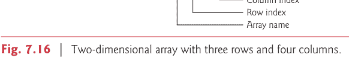

图 7.16 中的数组中的每个元素通过形式为 `row[column]` 的访问表达式标识；`row` 是数组名，`column` 是通过行和列唯一标识元素的索引。行 0 元素的第一个索引为 0，列 3 元素的第二个索引为 3。

### 一维数组数组

像一维数组一样，多维数组可以使用初始化器初始化。具有两行两列的二维数组 `b` 可以如下声明并初始化：

```java
int[][] b = {{1, 2}, {3, 4}};
```

初始值在大括号按行分组。因此，1 和 2 分别初始化 `b[0][0]` 和 `b[0][1]`，而 3 和 4 分别初始化 `b[1][0]` 和 `b[1][1]`。编译器通过初始化器的数量（由外层大括号内的集合表示）来确定 `b` 的行数。编译器通过该行中初始化值的数量来确定该行的列数。正如我们稍后看到的，这意味着行可以不同的长度。多维数组被维护为一维数组数组。因此，上述声明中的数组 `b` 实际上是由两个的一维数组组成的——一个包含第一个初始化器列表 `{1, 2}` 中的值，另一个包含第二个初始化器列表 `{3, 4}` 中的值。因此 `b` 本身是一个包含两个元素的数组，每个元素都是一个 `int` 类型值的一维数组。

### 不同长度行的二维数组

多维数组的表示方式使得它们非常灵活。事实上，数组 `b` 中行的长度并不要求相同。例如：

```java
int[][] b = {{1, 2}, {3, 4, 5}};
```

创建了具有两个元素的数组 `b`（由初始化器的数量决定），它表示二维数组的行。`b` 的每个元素都是指向 `int` 变量一维数组的引用。用于两个元素（1 和 2）的 `int` 数组，以及第 1 行的 `int` 数组是一个包含三个元素（3, 4 和 5）的一维数组。

### 使用数组创建表达式创建二维数组

每行具有相同列数的多维数组可以使用数组创建表达式创建。例如，以下行声明了数组 `b` 并将其赋值为一个三乘四数组的引用：

```java
int[][] b = new int[3][4];
```

在这种情况下，我们使用字面量 3 和 4 分别指定行和列数，但这不是要求的。程序也可以使用变量指定数组维度，因为新数组是在运行时而不是编译时创建的。当每行的列数不同时，多维数组如下创建：

```java
int[][] b = new int[2]; // 创建 2 行
b[0] = new int[5]; // 为行 0 创建 5 列
b[1] = new int[3]; // 为行 1 创建 3 列
```

上述语句创建了一个两行的二维数组。行 0 有五列，行 1 有三列。

### 二维数组示例：显示元素值

图 7.17 展示了使用数组初始化器初始化二维数组，并使用嵌套的 `for` 循环遍历数组（即操作每个数组的每个元素）。`InitArray` 类声明了两个数组。`array1` 的声明（第 9 行）使用相同长度的嵌套初始化器将第一行初始化为 1, 2 和 3，将第二行初始化为 4, 5 和 6。`array2` 的声明（第 10 行）使用不同长度的嵌套初始化器。在这种情况下，第一行初始化为两个元素，值分别为 1 和 2。第二行初始化为一个元素，值为 3。第三行初始化为三个元素，值分别为 4, 5 和 6。

```java
// Fig. 7.17: InitArray.java
// 初始化二维数组。
public class InitArray
{
    public static void main(String[] args)
    {
        int[][] array1 = {{1, 2, 3}, {4, 5, 6}};
        int[][] array2 = {{1, 2}, {3}, {4, 5, 6}};
        System.out.println("array1 按行排列的值为：");
        outputArray(array1);
        System.out.println("\narray2 按行排列的值为：");
        outputArray(array2);
    }

    public static void outputArray(int[][] array)
    {
        for (int row = 0; row < array.length; row++)
        {
            for (int column = 0; column < array[row].length; column++)
            {
                System.out.printf("%d ", array[row][column]);
            }
            System.out.println();
        }
    }
}
```

```
array1 按行排列的值为：
1 2 3
4 5 6

array2 按行排列的值为：
1 2
3
4 5 6
```

图 7.17 初始化二维数组。（第 2 部分）

第 13 行和第 16 行调用 `outputArray`（第 20–31 行）分别输出 `array1` 和 `array2` 的元素。方法 `outputArray`——参数 `int[][] array`——表示该方法接收一个二维数组。嵌套语句（第 23–30 行）输出二维数组的行。在外层语句的循环继续部分，表达式 `array.length` 决定了 `array` 的行数。在内部语句中，表达式 `array[row].length` 决定了 `array` 当前行的列数。内部语句的条件使循环能够确定每行的确切列数。我们在图 7.18 中演示了嵌套的增强型 `for` 语句。

### 使用 for 语句执行的多维数组操作

常见的数组操作使用 `for` 语句。例如，以下 `for` 语句将图 7.16 中数组 `a` 的第 2 行的所有元素设置为零：

```java
for (int column = 0; column < a[2].length; column++)
    a[2][column] = 0;
```

我们指定了第 2 行；因此，我们知道第一个索引始终为 2（0 是第一行，1 是第二行）。此循环只改变第二个索引（即列索引）。如果数组 `a` 的第 2 行包含四个元素，则述 `for` 语句等同于赋值语句：

```java
a[2][0] = 0;
a[2][1] = 0;
a[2][2] = 0;
a[2][3] = 0;
```

以下嵌套的 `for` 语句计算 `array` 中所有元素的总和：

```java
int total = 0;
for (int row = 0; row < a.length; row++)
{
    for (int column = 0; column < a[row].length; column++)
        total += a[row][column];
}
```

这些嵌套的 `for` 语句一次计算数组的一行总。外层循环首先将行索引设置为 0，以便内部语句计算第一行元素的总和。然后，外层循环将 `row` 增加到 1，以便计算第二行的总和。接着，外层循环又将 `row` 增加到 2，以便计算第三行的总和。当外层语句终止时，可以显示变量 `total`。在接下来的示例中，我们展示了如何使用增强型 `for` 语句以类似的方式处理二维数组。

## 7.12 案例研究：使用二维数组的 GradeBook 类

在 7.10 中，我们展示了 `GradeBook`（图 7.14），它使用一个一维数组来存储学生单次考试的成绩。在大多数学期中，学生会参加多次考试。教授可能需要分析整个学期的成绩，包括针对单个学生以及整个班级。

### 在 Class GradeBook 中用二维数组存储成绩

图 7.18 包含一个 `GradeBook` 类，该类使用二维数组来存储多个学生在多次考试中的成绩。数组的每一行代表一个学生在课程中的成绩，每一列代表所有参加某次考试的学生的成绩。`GradeBookTest`（图 7.19）传递了学生三次考试的成绩数组。我们使用一个按三分组数组进行数组操作以处理成绩。每个方法都与其较早的一维数组版本 `GradeBook`（图 7.14）中的对等方法相似。`getMinimum` 方法（第 46–62 行）确定任何学生在该学期的最低分。`getMaximum` 方法（第 65–83 行）确定任何学生在该学期的最高分。`getAverage` 方法（第 86–92 行）确定特定学生的学期平均分。`outputBarChart` 方法（第 99–129 行）为整个学期的学生成绩生成条形图。`outputGrades` 方法（第 132–156 行）以表格格式输出数组，并带有每个学生的学期平均分。

```java
// 图 7.18: GradeBook.java
// 使用二维数组存储成绩的 GradeBook 类。
public class GradeBook
{
    private String courseName; // 此成绩单所代表的课程名称
    private int[][] grades; // 学生成绩的二维数组

    // 双参数构造函数初始化 courseName 和 grades 数组
    public GradeBook(String courseName, int[][] grades)
    {
        this.courseName = courseName;
        this.grades = grades;
    }

    // 设置课程名称的方法
    public void setCourseName(String courseName)
    {
        this.courseName = courseName;
    }

    // 获取课程名称的方法
    public String getCourseName()
    {
        return courseName;
    }

    // 对数据执行各种操作
    public void processGrades()
    {
        // 输出成绩数组
        outputGrades();
        // 调用 getMinimum 和 getMaximum 方法
        System.out.printf("%s%n%s%n%s%n",
            "Lowest grade in the book is, %s", getMinimum(),
            "Highest grade in the book is, %s", getMaximum());
        // 输出条形图
        outputBarChart();
    }

    // 输出成绩数组
    public void outputGrades()
    {
        System.out.printf("The grades:%n");
        System.out.printf("      "); // 对齐列标题
        // 为每次测试创建一个列标题
        for (int test = 0; test < grades[0].length; test++)
            System.out.printf("Test %d, ", test + 1);
        System.out.println("Average:"); // 学生平均分列标题
        // 创建表示数组成绩的文本列
        for (int student = 0; student < grades.length; student++)
        {
            System.out.printf("Student %2d, ", student + 1);
            for (int test : grades[student]) // 输出学生的成绩
                System.out.printf("%8d, ", test);
            // 调用 getAverage 计算学生的平均分；
            // 将行作为参数传递给 getAverage 方法
            double average = getAverage(grades[student]);
            System.out.printf("%.2f%n", average);
        }
    }
}
```


// 找到最低分

public int getMinimum()
{
    // 假设数组第一个元素是最小的
    int lowGrade = grades[0][0];

    // 遍历行
    for (int[] studentGrades : grades)
    {
        // 遍历当前列
        for (int grade : studentGrades)
        {
            // 如果成绩小于 lowGrade，将其赋值给 lowGrade
            if (grade < lowGrade)
                lowGrade = grade;
        }
    }
    return lowGrade;
}

// 找到最高分

public int getMaximum()
{
    // 假设数组第一个元素是最大的
    int highGrade = grades[0][0];

    // 遍历行
    for (int[] studentGrades : grades)
    {
        // 遍历当前列
        for (int grade : studentGrades)
        {
            // 如果成绩大于 highGrade，将其赋值给 highGrade
            if (grade > highGrade)
                highGrade = grade;
        }
    }
    return highGrade;
}

// 确定一组成绩的平均分

public double getAverage(int[] studentGrades)
{
    int total = 0;
    // 求和一个学生的成绩
    for (int grade : studentGrades)
        total += grade;
    // 返回平均分
    return (double) total / studentGrades.length;
}

// 输出成绩分布的条形图

public void outputBarChart()
{
    System.out.println("Overall grade distribution:");
    // 存储每个10分范围的频率
    int[] frequency = new int[11];
    // 对于 GradeBook 中的每个成绩，增加频率
    for (int[] studentGrades : grades)
        for (int grade : studentGrades)
            ++frequency[grade / 10];
    // 对于每个成绩频率，在图表中打印条形
    for (int count = 0; count < frequency.length; count++)
    {
        // 输出条形标签 ("00-09", ..., "90-99", "100:")
        if (count == 10)
            System.out.printf("%5d: ", 100);
        else
            System.out.printf("%02d-%02d: ", count, count * 10 + 9);
        // 打印星号条形
        for (int stars = 0; stars < frequency[count]; stars++)
            System.out.print("*");
        System.out.println();
    }
}

```

## 7.12 案例研究：使用二维数组实现成绩单类 (`GradeBook`)

```java
154         System.out.printf("%9.2f%n", average);
155     }
156 }
157 } // end class GradeBook
```

图 7.18 使用二维数组存储成绩的 `GradeBook`。（4/4 部分。）

### getMinimum 和 getMaximum

`getMinimum`、`getMaximum`、`outputBarChart` 和 `outputGrades` 方法使用嵌套语句遍历数组 `grades`——例如，`getMinimum` 方法声明中的嵌套增强 `for` 语句（第 50–59 行）。外层增强 `for` 语句遍历二维数组 `grades`，在连续迭代中将累积行赋值给参数 `studentGrades`。参数名后的方括号表示 `studentGrades` 指向一个一维数组名——即 `grades` 数组中包含一个学生成绩的行。为了找到最低分，内部语句将当前一维数组 `studentGrades` 的元素与 `lowGrade` 进行比较。例如，在外层的第一次迭代中，`grades` 的第 0 行被赋值给参数 `studentGrades`。内部增强 `for` 语句遍历 `studentGrades` 并将每个值与 `lowGrade` 比较。如果某个成绩小于 `lowGrade`，则将 `lowGrade` 设置为该成绩。外层的第二次迭代中，`grades` 的第 1 行赋值给 `studentGrades`，并将该行的元素与变量 `lowGrade` 进行比较。此过程一直重复直到嵌套语句完成，此时 `lowGrade` 包含了二维数组中的最低分。`getMaximum` 方法的工作原理与 `getMinimum` 类似。

### outputBarChart 方法

图 7.18 中的 `outputBarChart` 方法与图 7.14 中的方法几乎相同。然而，为了输出整个学期的整体成绩分布，此处的方法使用了嵌套的增强 `for` 语句（第 107–111 行），根据二维数组中的成绩创建一个一维数组。两个 `outputBarChart` 方法中的其余代码显示的图表是完全相同的。

### outputGrades 方法

`outputGrades` 方法（第 132–156 行）使用嵌套语句输出 `grades` 数组的值以及每个学生的学期平均分。输出（图 7.19）显示了结果，其格式类似于教授物理成绩单的表格格式。第 138–139 行打印了每次测试的列标题。我们使用计数器控制的 `for` 语句，以便用数字识别每次测试。同样，第 144–155 行的语句首先使用计数器输出每一行以识别每个学生（第 146 行）。虽然数组索引从 0 开始，但第 139 行和 146 行输出 `test + 1`，使测试和学生编号从 1 开始（参见图 7.19 中的输出）。内部 `for` 语句（第 148–149 行）使用外层 `for` 语句的计数器变量来遍历 `grades` 数组的特定行以及每个学生的测试成绩。增强 `for` 可以嵌套在计数器控制的 `for` 语句中，反之亦然。最后，第 153 行通过将当前成绩行（即 `grades[student]`）传递给 `getAverage` 方法获取每个学生的学期平均分。

### getAverage 方法

`getAverage` 方法（第 86–96 行）接收一个参数——特定学生测试结果的一维数组。当第 153 行调用 `getAverage` 时，参数为 `grades[student]`，它指定将二维数组 `grades` 的某一行传递给 `getAverage`。例如，根据图 7.19 中创建的数组，参数 `grades[1]` 代表存储在二维数组 `grades` 第一行中的三个值（一个成绩的一维数组）。记住，二维数组的元素是一个一维数组。`getAverage` 计算元素的总和，将总数除以测试结果的数量，并以 `double` 类型返回浮点结果（第 95 行）。

### 演示 GradeBook 的 GradeTest 类

图 7.19 使用二维整型数组 `gradesArray`（在第 10–19 行声明并初始化）创建了一个 `GradeBook` 对象。第 21–22 行将课程名称和 `gradesArray` 传递给 `GradeBook` 构造函数。第 23–24 行显示欢迎消息，然后第 25 行调用 `GradeBook` 的 `processGrades` 方法显示显示学生本学期成绩的报告。

```java
// 图 7.19: GradeTest.java
// GradeTest 使用二维成绩数组创建 GradeBook 对象
// 然后使用 processGrades 方法对其进行分析。

public class GradeTest {
    // main 方法开始执行
    public static void main(String[] args) {
        // 学生成绩的二维数组
        int[][] gradesArray = {
            {87, 96, 70},
            {68, 87, 90},
            {94, 100, 80},
            {100, 81, 82},
            {83, 65, 85},
            {78, 87, 65},
            {85, 75, 83},
            {91, 94, 100},
            {76, 72, 84},
            {87, 93, 73}
        };
        GradeBook myGradeBook = new GradeBook(
            "CS101 Introduction to Java", gradesArray);
        System.out.printf("Welcome to the grade book for %s%n", myGradeBook.courseName());
        myGradeBook.processGrades();
    }
}
```

## 7.13 可变参数列表 (Variable Arguments)

图 7.19 使用二维成绩数组创建了一个 `GradeBook` 对象，然后使用 `processGrades` 方法进行分析... (此处省略了原文中重复的输出描述)

### 可变参数列表 (Varargs)

使用可变参数列表，可以让方法接收任意数量的参数...

## 7.14 使用命令行参数

可以通过方法 `main(String[] args)` 参数从命令行向应用程序传递参数，该参数接收一个 `String` 数组。按照惯例，此参数命名为 `args`。当使用 `java` 命令执行应用程序时，Java 会将 `java` 命令中类名之后的命令行参数作为 `args` 数组中的 `String` 传递给应用程序的 `main` 方法。通过访问数组的 `length` 属性可以获取命令行参数的数量。命令行参数的用途包括向应用程序传递选项和文件名。

我们的下一个示例使用命令行参数来确定数组的大小，以及用于计算数组剩余元素值的增量。该命令

```
java InitArray 5 0 4
```

将参数 `5`、`0` 和 `4` 传递给应用程序 `InitArray`。命令行参数之间用空格分隔，而不是逗号。当执行此命令时，`InitArray` 类的 `main` 方法接收到一个包含三个元素的数组 `args`（即长度为 3），其中 `args[0]` 包含字符串 `"5"`，`args[1]` 包含字符串 `"0"`，`args[2]` 包含字符串 `"4"`。程序决定如何使用这些参数——在图 7.21 中，我们将命令行参数转换为 `int` 值并使用它们来初始化数组。当 `length` 不为 3 时，程序打印错误信息并终止（第 9–12 行）。否则，第 14–32 行根据命令行参数的值初始化并显示数组。

第 16 行获取 `args[0]`，这是一个解析数组大小的字符串——并将其转换为 `int` 值，程序在第 17 行使用该值创建数组。静态方法 `Integer.parseInt` 将字符串转换为 `int`。第 20–22 行将命令行参数 `args[1]` 和 `args[2]` 转换为 `int` 值并分别存储在 `initialValue` 和 `increment` 中。第 24–25 行计算每个数组元素的值。

```java
// Fig. 7.21: InitArray.java
// 使用命令行参数初始化数组。

public class InitArray {
    public static void main(String[] args) {
        // 检查命令行参数的数量
        if (args.length != 3) {
            System.out.println("Error: Please reenter the entire command, including " +
                    "array size, initial value and increment");
        } else {
            // 从第一个命令行参数获取数组大小
            int arrayLength = Integer.parseInt(args[0]);
            int[] array = new int[arrayLength];
            // 从命令行参数获取初始值和增量
            int initialValue = Integer.parseInt(args[1]);
            int increment = Integer.parseInt(args[2]);
            // 计算每个数组元素的值
            for (int counter = 0; counter < array.length; counter++) {
                array[counter] = initialValue + increment * counter;
            }
            // 显示索引和值
            System.out.printf("%s\t%s%n", "Index", "Value");
            for (int counter = 0; counter < array.length; counter++) {
                System.out.printf("%d\t%d%n", counter, array[counter]);
            }
        }
    }
}
```

**图 7.21** 使用命令行参数初始化数组。（第 2 部分。）

| Index | Value |
| :--- | :--- |
| 0 | 0 |
| 1 | 4 |
| 2 | 8 |
| 3 | 12 |
| 4 | 16 |

第一次执行的输出显示应用程序收到的命令行参数不足。第二次执行使用命令行参数 `5`、`0` 和 `4` 分别指定数组的大小 (5)、第一个元素的值 (0) 以及数组中每个值的增量 (4)。相应的输出显示，这些值创建了一个包含整数 0, 4, 8, 12 和 16 的数组。第三次执行的输出显示命令行参数 `8`、`1` 和 `2` 产生了一个元素为从 1 到 15 的负数整数的数组。

## 7.15 Arrays 类

`Arrays` 通过提供用于常用数组操作的静态方法来帮助你避免重复造轮子。这些方法包括用于排序数组的 `sort`（即按升序排列元素）、用于搜索排序数组的 `binarySearch`（即确定数组是否包含特定值，如果是，则确定该值的位置）、用于比较数组的 `equals` 以及用于向数组填充值的 `fill`。这些方法针对基本数据类型数组和对象数组进行了重载。本节的重点是使用 Java API 提供的内置功能。第 19 章“搜索、排序与大 O”展示了如何实现自己的排序和搜索算法，这是计算机科学研究人员和学生感兴趣的话题。

图 7.22 使用 `Arrays.sort`、`binarySearch`、`equals` 和 `fill` 展示了如何使用类静态方法 `arraycopy` 复制数组。在 `main` 中，第 11 行对数组 `doubleArray` 的元素进行排序。`Arrays` 类的静态方法默认按升序排列数组元素。我们将在章节后面讨论如何进行降序排序。`sort` 的重载版本允许你对数组内特定范围的元素进行排序。第 12–15 行输出排序后的数组。

```java
// Fig. 7.22: ArrayManipulations.java
// Arrays 类方法和 System.arraycopy.

import java.util.Arrays;

public class ArrayManipulations {
```


```java
public static void main(String[] args) {

    // 对 doubleArray 升序排序
    double[] doubleArray = {8.4, 9.3, 0.2, 7.9, 3.4};
    Arrays.sort(doubleArray);
    System.out.printf("%ndoubleArray: ");
    for (double value : doubleArray)
        System.out.printf("%.1f ", value);

    // 用 7 填充 10 元素的数组
    int[] filledArray = new int[10];
    Arrays.fill(filledArray, 7);
    displayArray(filledArray, "filledArray");

    // 将 intArray 复制到数组 intCopy
    int[] intArray = {1, 2, 3, 4, 5, 6};
    int[] intCopy = new int[intArray.length];
    System.arraycopy(intArray, 0, intCopy, 0, intArray.length);

    // 比较 intArray 和 intCopy 的相等性
    boolean b = Arrays.equals(intArray, intCopy);
    System.out.printf("intArray %s intCopy%n", b ? "==" : "!=");
}

// 输出数组中的值
public static void displayArray(int[] array, String description) {
    System.out.printf("%s: %n", description);
    for (int value : array) {
        System.out.printf("%d \t", value);
    }
}
} // end ArrayManipulations
```

```
doubleArray: 0.2 3.4 7.9 8.4 9.3 
filledArray: 7 7 7 7 7 7 7 7 7 7 
intArray: 1 2 3 4 5 6
intCopy: 1 2 3 4 5 6
intArray == intCopy
```

# 7.16 集合简介与 ArrayList 类

第二个参数 (`0`) 是指定从数组中复制的元素范围内起始点的索引。此值可以是任何有效的数组索引。第三个参数 (`intArrayCopy`) 指定了将存储副本的数组。第四个参数 (`0`) 指定了目标数组中存储第一个被复制元素的索引。最后一个参数指定了从第一个参数中复制的元素数量。在这种情况下，我们复制了数组中的所有元素。

第 30 行和第 53 行调用了 `Arrays` 类的静态方法 `equals` 来判断数组是否相等。如果数组包含相同顺序的相同元素，方法返回 `true`；否则返回 `false`。

> **错误预防技巧 7.3**
> 在比较数组时，始终使用 `Arrays.equals(array1, array2)`，它比较两个数组的内容，而不是使用 `array1.equals(array2)`，后者比较的是 `array1` 和 `array2` 是否指向同一个对象。


第 40 行和第 49 行调用了 `Arrays` 类的静态方法 `binarySearch` 对 `intArray` 进行搜索，使用第二个参数（值分别为 5 和 8763）作为键。如果找到了值，`binarySearch` 返回该元素的索引；否则，`binarySearch` 返回一个负值。返回的负值基于搜索的插入点——即如果我们执行插入操作，键应该被插入到数组中的索引。在 `binarySearch` 确定插入点后，它会改变符号并从返回值中减去 1。在图 7.22 中，值 8763 的插入点是数组中索引为 6 的元素。`binarySearch` 方法将插入点更改为 -6，减去 1 并返回该值。从插入点减去 1 保证了当且仅当找到键时，`binarySearch` 方法返回正值 (>=0)。此返回值对于在排序的数组中插入元素很有用。第 19 章将详细讨论二分查找。

> **常见编程错误 7.6**
> 将未排序的数组传递给 `binarySearch` 是一个逻辑错误——返回的值是未定义的。


## Java SE 8—Arrays 方法 parallelSort

`Arrays` 类现在有几个“并行”方法，可以利用多核硬件。`Arrays` 方法 `parallelSort` 可以在多核系统上更高效地排序大型数组。在第 23.12 节，我们创建了一个巨大的数组，并使用 Java SE 8 日期/时间 API 来比较使用 `sort` 和 `parallelSort` 方法排序数组需要多长时间。

## 7.16 集合简介与 ArrayList 类

Java API 提供了几种预定义的数据结构，称为集合（collections），用于在内存中存储一组对象。这些类提供了高效的方法来组织、存储和检索你的数据，而无需了解数据是如何存储的。这缩短了应用程序开发时间。

你曾使用数组存储对象序列。数组在执行时不会自动改变大小以容纳额外的元素。集合类 `ArrayList<T>`（位于 `java.util` 包中）为这个问题提供了一个方便的解决方案——它可以动态改变其大小以容纳更多元素。`T`（按照约定）是一个占位符——在声明一个新的 `ArrayList` 时，将其替换为你想让 `ArrayList` 持有的元素类型。例如，

```java
ArrayList<String> list;
```

将 `list` 声明为只能存储 `String` 的 `ArrayList` 集合。带有这种占位符的类可以与任何类型配合，声明泛型变量并创建泛型类的对象。只有非基本类型可以使用；但是，Java 提供了一种名为“装箱”（boxing）的机制，允许基本值被封装为泛型类的对象。例如，

```java
ArrayList<Integer> integers;
```

将 `integers` 声明为只能存储 `Integer` 的 `ArrayList`。当你将一个 `int` 值放入 `ArrayList<Integer>` 时，该 `int` 值会被装箱（封装）为 `Integer` 对象；而当你从 `ArrayList<Integer>` 中检索 `Integer` 对象并将其赋值给 `int` 变量时，对象内部的值会被拆箱（解封装）。

额外的泛型类和泛型将分别在第 16 章和第 20 章中讨论。图 7.23 显示了 `ArrayList<T>` 类的一些常用方法。

| 方法 | 说明 |
| --- | --- |
| `add` | 向 `ArrayList` 的末尾添加元素。 |
| `clear` | 移除 `ArrayList` 中的所有元素。 |
| `contains` | 如果 `ArrayList` 包含指定的元素，返回 `true`；否则返回 `false`。 |
| `get` | 返回指定索引处的元素。 |
| `indexOf` | 返回指定元素在 `ArrayList` 中第一次出现的索引。 |
| `remove` | 重载。移除指定值的第一次出现处或指定索引处的元素。 |
| `size` | 返回 `ArrayList` 中存储的元素数量。 |
| `trimToSize` | 将 `ArrayList` 的容量缩减为当前元素的数量。 |

**图 7.23** | `ArrayList<T>` 类的一些方法和属性。

### 演示 ArrayList<String>

图 7.24 展示了一些容量能力。第 10 行创建了一个默认初始容量为 10 个元素的 `String` 类型的 `ArrayList`。容量表示在不增长的情况下可以容纳多少元素。`ArrayList` 在背后是使用常规数组实现的。当 `ArrayList` 增长时，它必须创建一个更大的数组，并将每个元素复制到新数组中。这是一个耗时操作。这种效率会很低。

## 7.17（可选）GUI 与图形案例研究：绘制弧形

使用 Java 的图形功能，我们可以创建复杂的图形，如果通过逐行代码来实现这些图形将会非常琐碎。在图 7.25–7.26 中，我们使用数组和重复语句，通过 `Graphics` 的 `fillArc` 方法绘制了一个彩虹。在 Java 中绘制弧形与绘制椭圆类似——弧形只是椭圆的一部分。

在图 7.25 中，第 10–11 行创建了两个新常量——`VIOLET` 和 `INDIGO`。如你所知，彩虹的颜色是红、橙、黄、绿、蓝、靛和紫。Java 仅为前几种颜色提供了预定义常量。第 15–17 行初始化了一个包含彩虹颜色的数组，从最内层的弧形开始。数组开头包含两个元素，你很快就会看到，这两个元素用于绘制彩虹中心的空心弧形。实例变量可以在声明时初始化，如第 10–17 行所示。构造函数（第 20–23 行）包含一条语句，调用了 `setBackground`（继承自 `JPanel`）并传入参数 `Color.WHITE`。`setBackground` 方法接收一个颜色，并将组件的背景设置为该颜色。

```java
// Fig.7.25: DrawRainbow.java
// 绘制彩虹弧形和颜色数组。
import java.awt.Color;
import java.awt.Graphics;
import javax.swing.JPanel;

public class DrawRainbow extends JPanel {

    // 定义靛色和紫色
    private final static Color VIOLET = new Color(128, 0, 128);
    private final static Color INDIGO = new Color(75, 0, 130);

    // 彩虹中使用的颜色，从最内层开始
    // 两个白色条目会导致中心出现空心弧形
    private Color[] colors = {
        Color.WHITE, Color.WHITE, Color.INDIGO, Color.BLUE,
        Color.GREEN, Color.YELLOW, Color.ORANGE, Color.RED
    };

    // 构造函数
    public DrawRainbow() {
        setBackground(Color.WHITE); // 将背景设置为白色
    }

    // 使用同心弧绘制彩虹
    public void paintComponent(Graphics g) {
        int radius = 20; // 颜色数组的半径。

        // 在底部中心附近绘制彩虹
        int centerX = getWidth() / 2;
        int centerY = getHeight() - 10;

        // 从最外层开始绘制填充的弧形
        for (int counter = colors.length; counter > 0; counter--) {
            // 设置当前弧形的颜色
            g.setColor(colors[counter - 1]);

            // 填充从 0 到 180 度的弧形
            g.fillArc(centerX - counter * radius,
                       centerY - counter * radius,
                       counter * 2, counter * 2, 0, 180);
        }
    }
} // DrawRainbow 类结束
```

图 7.25 | 使用弧形和颜色数组绘制彩虹。（2 部分中的第 1 部分）

`paintComponent` 中的第 30 行清除了局部变量，该变量决定了每个弧形的半径。局部变量 `centerX` 和 `centerY`（第 33–34 行）决定了彩虹底部中点的位置。第 37–46 行的循环使用 `counter` 从数组末尾倒数，先绘制最大的弧形，并将后续较小的弧形放置在上一个弧形之上。第 40 行设置了绘制当前弧形的颜色。我们在数组开头有 `Color.WHITE` 条目，以创建中心的空心弧形。否则，彩虹中心将仅仅是一个实紫色半圆。你可以更改单个颜色和数组中的条目数量来创建新的图形。

第 43–45 行的 `fillArc` 方法调用绘制了一个填充的半圆。`fillArc` 方法需要七个参数。前四个参数代表绘制弧形的边界矩形。其中两个参数指定边界矩形左上角的坐标，另外两个指定其宽度和高度。第五个参数是椭圆上的起始角度，第六个参数指定弧形的扫描范围和覆盖量。角度和扫描范围以度为单位，0 度指向顺时针方向。正的扫描范围按逆时针绘制弧形，而负的扫描范围按顺时针绘制弧形。与 `fillArc` 方法的方法用于绘制——它需要与 `fillArc` 相同的参数，在填充弧形后绘制弧形的边缘。

`DrawRainbowTest` 类（图 7.26）创建并设置了一个 `JFrame` 来显示彩虹。一旦程序使 `JFrame` 可见，系统就会调用 `DrawRainbow` 类中的 `paintComponent` 方法来绘制彩虹。

图 7.26 显示彩虹的应用程序。（2 部分中的第 1 部分。）

## 7.17（可选）GUI 与图形案例研究：绘制弧形

```java
public static void main(String[] args) {
    DrawRainbow panel = new DrawRainbow();
    JFrame application = new JFrame();
    application.setDefaultCloseOperation(JFrame.EXIT_ON_CLOSE);
    application.add(panel);
    application.setSize(400, 250);
    application.setVisible(true);
} // DrawRainbow 类结束
```


# 图 7.26 显示彩虹的应用程序（2 部分中的第 2 部分）

## 7.17（可选）GUI 与图形案例研究：绘制弧形

### 练习：螺旋线

a) 使用 `drawLine` 绘制一条螺旋线（如图 7.27 左侧截图所示）。
b) 使用 `drawArc` 绘制圆形螺旋线（如图 7.27 右侧截图所示）。

## 7.18 总结

本章开始了我们对数据结构的介绍，探索了使用数组来存储和检索数据。本章演示了如何声明数组、初始化数组以及引用单个元素。本章引入了增强型 `for` 语句来遍历数组。我们使用异常处理来测试当程序尝试访问越界数组元素时会发生的 `ArrayIndexOutOfBoundsException`。我们还说明了如何使用多维数组。最后，本章展示了如何从命令行读取参数。

我们引入了 `ArrayList<T>` 集合，它提供了数组的所有功能和性能，并具有动态调整大小等其他能力。我们使用 `add` 方法向 `ArrayList` 添加新项并插入项目。使用 `remove` 方法移除项的首次出现，并使用重载的 `remove` 方法根据指定索引移除项。我们使用 `size` 方法获取 `ArrayList` 中的项数。

## 7.3 节 声明和创建数组

- 要创建一个数组对象，需要在使用关键字 `new` 的数组创建表达式（第 246 页）中指定数组的元素类型和元素数量。
- 当数组被创建时，每个 element 元素都会接收一个默认值——数值基本数据类型元素为 0，布尔类型元素为 `false`，引用类型为 `null`。
- 在数组声明中，可以将类型和方括号结合在声明的开头，以指示该声明中的所有标识符都是数组变量。
- 基本数据类型数组的每个元素都包含一个该数组声明类型的变量。引用类型数组的每个元素都是一个指向该数组声明类型的引用。

## 7.4 节 数组使用示例

- 程序可以使用数组初始化器（第 248 页）来创建并初始化其元素。
- 常量变量（第 250 页）用关键字 `final` 声明，必须在使用之前对其进行初始化，并且之后不能再修改。

## 7.5 节 异常处理：处理错误的响应

- 当程序执行时会发生异常。“exception”（异常）一词暗示问题发生的频率较低——如果“规则”是指通常正确执行的语句，那么该问题就代表了“对规则的例外”。
- 异常处理（第 256 页）允许你创建容错性程序。
- 当 Java 程序执行时，JVM 会检查数组索引以确保它们大于或等于 0 且小于数组的长度。如果程序使用了无效索引，Java 会生成一个异常（第 256 页）以表示程序在执行时发生了错误。
- 要处理异常，请在 `try` 语句中使用可能捕获异常（第 256 页）的代码。
- `try` 块（第 256 页）包含可能抛出异常的代码，而 `catch` 块（第 256 页）包含发生异常时处理该异常的代码。
- 你可以拥有多个 `catch` 块来处理相应的 `try` 块可能抛出的不同类型的异常。
- 当 `try` 块结束时，在 `try` 块中声明的任何变量都会超出作用域。
- `catch` 块声明了一个类型和异常参数。在 `catch` 块内部，你可以使用该参数与捕获的异常对象进行交互。
- 当程序执行时，会检查数组索引的有效性——所有索引必须大于或等于 0 且小于数组长度。如果尝试使用无效索引访问数组，会发生 `ArrayIndexOutOfBoundsException`（第 257 页）。
- 异常的 `toString` 方法返回异常错误消息。

## 7.6 节 案例研究：数组洗牌与交易模拟

- 当对象在预期字符串的地方使用时，会隐式调用对象的 `toString` 方法（例如，当 `print` 使用 `%s` 格式说明将对象输出为字符串，或使用 `+` 运算符将对象连接字符串时）。

## 7.7 节 增强 for 语句

- 增强 for 语句（第 262 页）允许你遍历数组或集合的元素而无需使用计数器。增强 for 语句的语法为：

```
for (parameter : arrayName)
    statement
```

其中 `parameter` 有一个类型和一个标识符（例如 `int number`），`arrayName` 是要遍历的数组。

- 增强 for 语句不能修改数组中的元素。如果程序需要修改元素，请使用传统的计数器控制 `for` 语句。

## 7.8 节 将数组传递给方法

- 当参数按值传递时，会创建参数值的副本并将其传递给被调用方法。被调用的方法仅对该副本进行操作。

## 7.9 节 值传递 vs. 引用传递

- 当参数按引用传递（第 265 页）时，被调用的方法可以直接访问调用者中的参数值并对其进行修改。
- Java 中的所有参数都是按值传递的。方法调用可以向方法传递两种类型的值——基本值的副本和对象的引用。虽然对象的引用是按值传递的（第 265 页），但它仍然可以通过使用对象的引用调用方法来与被引用对象进行交互。
- 要将对象引用传递给方法，只需在方法调用中指定引用该对象的变量名即可。
- 当你将数组或引用类型的单个元素传递给方法时，被调用方法接收数组或元素引用的副本。当你传递基本数据类型的单个元素时，被调用方法接收该元素值的副本。
- 要向方法传递单个数组元素，请使用数组的索引名。

## 7.11 节 多维数组

- 二维多维数组通常用于表示由行和列信息组成的数值表。
- 具有 $m$ 行 $n$ 列的二维数组（第 272 页）是 $m \times n$ 数组。此类数组可以使用初始化器数组初始化：

```
array[][] arrayName = {row1 initializer, row2 initializer, ...};
```

- 多维数组被维护为一维数组的数组。因此，二维数组中行的长度不需要相同。
- 每行列数相同的多维数组可以使用以下形式的数组表达式创建：

```
arrayType[][] arrayName = new arrayType[numRows][numColumns];
```

## 7.13 节 变长参数列表

- 具有相同列数的多维数组可以使用以下形式的数组表达式创建（注：此处原文逻辑似乎有重复，已按原文翻译）。
- 变长参数列表使用省略号 `...` 允许传递任意数量的参数。
- 省略号只能在参数列表中出现一次。
- 变长参数列表（第 281 页）允许方法接收任意数量的参数。

## 7.14 节 使用命令行参数

- 命令行参数在类名之后出现。
- 命令行参数可以通过数组的 `length` 字段获取。
- 命令行参数的类型通常为 `String[]`。

## 7.15 节 Arrays 类

- `Arrays` 类（第 285 页）提供了常用的数组操作方法，包括对数组排序、二分查找、填充数组等。
- `System.arraycopy`（第 285 页）允许将一个数组复制到另一个。

## 7.16 节 集合简介与 ArrayList

- 集合提供了高效的方法来组织、存储和检索数据。
- `ArrayList`（第 288 页）类似于数组，但可以动态调整大小。
- 带有一个参数的 `add` 方法在末尾追加一个元素。
- 带有两个参数的 `add` 方法在指定位置插入新元素。
- `size` 方法（第 290 页）返回 `ArrayList` 中的元素数量。
- 带有对象引用的 `remove` 方法删除匹配的元素。
- 带有整数索引的 `remove` 方法删除该索引处的元素，之后的所有元素向下移动。
- `contains` 方法如果元素在 `ArrayList` 中则返回 `true`，否则返回 `false`。

## 自测练习

### 7.1 填空

- a) 列表和数值表存储在 ________。
- b) 数组是具有相同 ________ 的元素或组件的组。
- c) ________ 允许你在不使用计数器的情况下遍历。
- d) 用于引用特定数组的数字是元素的 ________。
- e) 使用两个索引的 ________。
- f) 使用增强 ________ 遍历 double 数组。
- g) 命令行参数存储在 ________。
- h) 使用 ________ 获取命令行参数的总数。假设命令行参数存储在 `String[] args` 中。
- i) 给定数据 `MyClass test`，第一个命令行参数是 ________。
- j) 方法参数列表中 ________ 表示接收任意数量参数。

### 7.2 判断真假。如果是假，请解释原因。

- a) 数组可以存储许多类型的值。
- b) 数组索引应该是普通的 float 类型。
- c) 传递给方法并在方法中修改的单个数组元素，在方法执行完成后将包含修改后的值。
- d) 命令行参数是用逗号分隔的。

### 7.3 对名为 `fractions` 的数组执行以下任务：

- a) 声明一个初始化为 10 的常量 `ARRAY_SIZE`。
- b) 声明一个具有 `ARRAY_SIZE` 个 double 元素的数组并初始化为 0。
- c) 引用元素 4。
- d) 将 1.667 赋值给元素 9。
- e) 将 3.333 赋值给数组元素 6。
- f) 使用 `for` 语句对数组的所有元素求和。将整数变量 `x` 声明为循环的控制变量。

### 针对一个三行三列的数组执行以下任务：

- a) 声明并创建一个类型为整数 `ARRAY_SIZE` 的数组，其具有三行三列。假设常量 `ARRAY_SIZE` 已经声明为 3。
- b) 该数组包含多少个元素？
- c) 使用 `for` 循环语句将数组的每个元素初始化为其索引之和。假设整数变量 `x` 和 `y` 已声明为控制变量。

### 找出并纠正以下程序中的错误：

```java
final int ARRAY_SIZE = 5;

ARRAY_SIZE = 10;

int[] b = new int[10];

for (int i = 0; i < b.length; i++)
    b[i] = 1;

int[][] a = {{1, 2}, {3, 4]};

a[1][1] = 5;
```

## 自测练习答案

- a) 数组 (arrays), b) 变量 (variables), c) 增强 for 语句 (enhanced for statement), d) 索引或位置数字 (index), e) 二维的 (two-dimensional), f) 双重 for (for double), g) 字符串数组 (array of Strings), 调用 (called by arrays), h) 长度 (length), i) 测试 (test), j) 省号 (...)。

- 错误。数组只能存储相同类型的值。
- 错误。数组索引必须是整数或整数表达式。
- 正确。对于数组的单个基本类型元素：被调用方法接收并处理每个元素的值，因此修改不会影响原始值。然而，如果数组的引用传递给方法，对数组元素的修改将反映在原始上。对于引用类型的单个元素：正确。被调用方法接收每个元素引用的副本，更改后的对象将反映在原始数组中。
- 错误。命令行参数通过空格分隔。

- a) `final int ARRAY_SIZE = 10;`

```java
double[] fractions = new double[ARRAY_SIZE];

fractions[4] = 1.667;

fractions[6] = 3.333;

double total = 0.0;

for (int x = 0; x < fractions.length; x++)
    total += fractions[x];
```

```java
int[] table = new int[ARRAY_SIZE];

for (int x = 0; x < table.length; x++)
    for (int y = 0; y < table[x].length; y++)
        table[x][y] = x + y;
```

- 错误：在初始化后对常量赋值。
    修正：在 `final int ARRAY_SIZE` 声明中为常量赋值，或声明另一个变量。
- b) 错误：在数组边界外引用数组（`b[10]`）。
    修正：将 `<` 运算符改为 `<=`。
- c) 错误：数组索引执行错误。
    修正：将语句改为 `a[1][1] = 5;`。

## 练习题

### 7.6 为以下每个语句填空：

a) 一维数组 `p` 包含四个元素。这些元素的名称是 ______ 和 ______。
b) 为数组命名、说明其类型并指定数组的维度被称为声明 ______ 数组。
c) 在二维数组中，第一个索引标识元素的 ______，第二个索引标识元素的 ______。
d) $m \times n$ 数组包含 ______ 列和 ______ 个元素。
e) 数组 `d` 中第 3 行第 5 列的元素名称是 ______。

### 7.7 判断以下陈述是正确还是错误。如果为错误，请解释原因。

a) 为了引用数组中的特定位置或元素，我们指定数组的名称和特定元素的值。
b) 数组声明为数组留留空间。
c) 为了表示为整数数组 `p` 留出 100 个位置，你编写声明 `p[100];`。
d) 将 15 元素数组元素初始化为零的应用程序必须包含一个语句。
e) 计算二维数组元素总和的应用程序必须包含嵌套的 `for` 语句。

### 7.8 编写语句完成每个任务：

a) 显示数组 `f` 中第 6 个元素的值。
b) 将一维整数数组 `g` 的所有五个元素初始化为 8。
c) 汇总浮点数组 `c` 的 100 个元素的总和。
d) 将 11 元素数组复制到数组 `b` 的部分，并显示 99 元素浮点数组 `w` 中的最小值和值。

### 7.9 考虑一个二乘三整数数组 `t`。

a) 编写声明并创建 `t` 的语句。
b) `t` 有几行？
c) `t` 有几列？
d) `t` 有多少元素？
e) 为 `t` 第 1 行的所有元素编写访问表达式。
f) 为 `t` 第 2 列的所有元素编写访问表达式。
g) 编写一条语句将 `t` 第 0 行第 1 列的元素设置为零。
h) 编写单独语句将 `t` 的每个元素初始化为零。
i) 编写一个嵌套 `for` 语句，从用户处初始化 `t` 元素的值。
j) 编写一系列语句确定并显示 `t` 中的最小值。
l) 编写一个语句显示 `t` 的第一行的元素。
m) 编写一个语句汇总 `t` 第三列的元素。不要使用循环。
o) 编写一个语句以表格格式显示 `t` 的内容。

### 7.10（佣金）使用数组解决以下问题：

公司按佣金支付员工。使用一维数组解决：每周获得 200 加上销售额的 9%，5000。编写一个应用程序（使用计数器数组）确定在以下范围内的销售额（假设薪水金额截断为整数）：

- a) 200–299
- b) 300–399
- c) 400–499
- d) 500–599
- e) 600–699
- f) 700–799
- g) 800–899
- h) 900–999
- i) 1000 及以上

以表格格式汇总结果。

### 7.11 编写语句执行以下一维数组操作：

a) 将 `counts` 的 10 个元素设置为零。
b) 将 `bonus` 的 15 个元素各加一。
c) 以列格式显示 `best` 的值。

### 7.12（去重）使用一维数组解决问题：

编写一个应用程序读取五个数字，每个在 10 到 100 之间。每读取一个，如果它不是已读取数字的重复，则显示。对于所有不同的“最坏情况”，使用可能的数组解决此问题。在用户输入新值后显示完整的唯一值。

### 7.13 标记三乘五二维数组 `sales` 的元素，以它们设置为零的顺序：

```java
for (int row = 0; row < sales.length; row++) {
    for (int col = 0; col < sales[row].length; col++) {
        sales[row][col] = 0;
    }
}
```


## 7.14 变长参数列表
编写一个应用程序，使用变长参数列表计算传递给方法的系列整数的乘积。使用多次调用测试方法，每次调用的参数数量不同。

## 7.15 命令行参数
重写图 7.2，显示数组的大小由第一个命令行参数指定。如果没有提供命令行参数，则使用 10 作为数组的默认大小。

## 7.16 使用增强语句
编写一个应用程序，使用增强语句汇总命令行参数传递的 `double` 值。[提示：使用 `Double` 类的静态方法 `parseDouble` 将字符串转换为 `double` 值。]

## 7.17 掷骰子
编写一个应用程序模拟掷两个骰子。该应用程序应使用 `Random` 类的对象掷第一个骰子，再次掷第二个骰子。然后计算两个值之和。每个骰子可以显示 1 到 6 的整数值，因此值的和在 2 到 12 之间变化，7 最频繁，2 和 12 最少。图 7.28 显示了两个骰子的 36 种可能组合。你的应用程序掷骰子 36,000,000 次。使用一个一维数组来统计每个可能的点和出现的次数。以表格格式显示结果。

| | 1 | 2 | 3 | 4 | 5 | 6 |
|---|---|---|---|---|---|---|
| 1 | 2 | 3 | 4 | 5 | 6 | 7 |
| 2 | 3 | 4 | 5 | 6 | 7 | 8 |
| 3 | 4 | 5 | 6 | 7 | 8 | 9 |
| 4 | 5 | 6 | 7 | 8 | 9 | 10 |
| 5 | 6 | 7 | 8 | 9 | 10 | 11 |
| 6 | 7 | 8 | 9 | 10 | 11 | 12 |

**图 7.28** 两个骰子的 36 种可能的点和。

## 7.18 骰子游戏
编写一个应用程序，运行 1,000,000 次骰子游戏（图 6.8）并回答以下问题：

- a) 在第一次掷、第二次掷、……第二十次掷以及二十次掷之后，有多少场游戏赢了？
- b) 在第一次掷、第二次掷、……第二十次掷以及二十次掷之后，有多少场游戏输了？
- c) 骰子游戏的胜算概率是多少？[注：你会发现骰子游戏是最公平的游戏之一。你认为这意味着什么？]
- d) 一场骰子游戏的平均长度是多少？
- e) 胜率会随着游戏的进行而提高吗？

## 7.19 航空公司订票系统
一家小型航空公司刚刚为其新的订票系统购买了一台计算机。你被要求开发这个新系统。你需要编写一个应用程序，为航空公司唯一架飞机的每班航班分配座位（容量：10 个座位）。你的程序应该显示选项：请输入 1 表示头等舱，输入 2 表示经济舱。如果用户输入 1，你的程序应该在头等舱区域（座位 1–5）分配座位。如果用户输入 2，你的程序应该在经济舱区域（座位 6–10）分配座位。你的程序随后应该显示一个看板，指示乘客的座位号以及是在飞机的头等舱还是经济舱。

使用基本类型 `boolean` 的一维数组来表示飞机的座位图。将数组的所有元素初始化为 `false`，表示所有座位都是空的。每当分配一个座位时，将数组中相应的元素设置为 `true`，表示该座位不再可用。你的程序永远不要分配已经分配过的座位。当某个区域满时，你的程序应该询问该人员是否可以安排在头等舱区域（反之亦然）。如果是，则进行相应的分配。如果不是，显示信息“下班航班将在 3 小时后出发”。

## 7.20 总销售额
使用二维数组解决以下问题：一家公司有四名销售人员（1 到 4），他们销售五种不同的产品（1 到 5）。每天，每位销售人员都会提交每种售出产品的销售单据。每张单据包含以下内容：

- a) 销售人员编号
- b) 产品编号
- c) 该日销售产品的总美元价值

因此，每位销售人员每天提交 0 到 5 张销售单。假设上个月所有单据的信息均可用。编写一个应用程序，读取上个月所有的销售信息，并按销售人员和产品汇总总销售额。所有总额都应存储在二维数组 `sales` 中。在处理完上个月的所有信息后，以表格格式显示结果，每列代表一个销售人员，每行代表一种产品。对每行求和得到上个月每种产品的总额。对每列求和得到上个月每个销售人员的总额。

## 7.21 海龟绘图
Logo 语言让绘图的概念闻名世界。想象一只在 Java 应用程序控制下在房间里移动的机械海龟。海龟笔有两种状态：抬起或落下。当笔落下时，海龟在移动时绘制形状；当笔抬起时，海龟自由移动而不写字。在这个程序中，将模拟海龟的操作并创建一个草图。使用一个初始化为零的 20x20 数组。从包含这些命令的数组读取命令。跟踪海龟当前的位置以及笔是抬起还是落下。假设海龟始终从 (0,0) 位置开始，笔抬起。你的应用程序必须处理的海龟命令如下：

| 命令 | 含义 |
|---|---|
| 1 | 笔抬起 |
| 2 | 笔落下 |
| 3 | 右转 |
| 4 | 左转 |
| 5,10 | 前进 10 格（将 10 替换为数字） |
| 6 | 显示 20x20 数组 |
| 9 | 数据结束（哨兵） |

**图 7.29** 海龟命令。

假设海龟在画布中心附近。以下“程序”将绘制并显示一个 12x12 的正方形，笔留在其位置：

```
2
5,12
3
4,12
6
9
```

当海龟带着笔移动时，将数组中相应的元素设置为 1。当给出 6 命令时，数组中任何为 1 的地方显示一个星号。任何为 0 的地方显示空白。编写一个应用程序来实现海龟绘图功能。编写几个绘制有趣形状的海龟程序。增加海龟的能力。

## 7.22 马走巡
棋类爱好者的一个趣味谜题是马走巡问题，最初由数学家欧拉提出。马可以在空棋盘上移动且每个格子只访问一次吗？我们在这里研究这个有趣的问题。马只进行 L 形移动（在一个方向移动两格，在垂直方向移动一格）。如图 7.30 所示，从空棋盘中间的一个格子开始，马（标记为 K）可以进行八次移动（编号为 0 到 7）。

| | 0 | 1 | 2 | 3 | 4 | 5 | 6 | 7 |
|---|---|---|---|---|---|---|---|---|
| 0 | | 2 | | | | | | |
| 1 | | | | | | | | |
| 2 | | | | 3 | | | | |
| 3 | | | | | | K | | |
| 4 | | | | | 4 | | | 7 |
| 5 | | | | | | 6 | | |
| 6 | | | | | | | | |
| 7 | | | | | | | | |

**图 7.30** 马可能的移动方式。

- a) 在纸上画一个棋盘，并尝试马走巡：在起始格子写 1，第二个格子写 2，第三个格子写 3，以此类推。在开始之前，估计你能走多远，记住完整的巡游包含 64 步。你走了哪里？这接近你的估计吗？

```
horizontal[0] = 2   vertical[0] = -1
horizontal[1] = 1   vertical[1] = -2
horizontal[2] = -1  vertical[2] = -2
horizontal[3] = -2  vertical[3] = -1
horizontal[4] = -2  vertical[4] = 1
horizontal[5] = -1  vertical[5] = 2
horizontal[6] = 1   vertical[6] = 2
horizontal[7] = 2   vertical[7] = 1
```

让变量 `currentRow` 和 `currentCol` 分别表示马位置的行和列。要执行类型为 `moveNumber` 的移动（其中 `moveNumber` 在 0 到 7 之间），你的程序应该使用：

```
currentRow += vertical[moveNumber];
currentCol += horizontal[moveNumber];
```


# 马走巡问题

编写一个应用程序让马在棋盘上移动。保持一个 1 到 64 的计数器。在马移动到的每个格子中记录计数。测试每个可能的移动以检查马是否已经访问过该格子。测试每个可能的移动以确保马不会落在棋盘外。运行该程序。马走了多少步？

## 可访问性启发式方法

在编写并运行一个马走巡应用程序后，你可能已经获得了一些有价值的见解。我们将利用这些见解来开发一种移动马的启发式方法（即常识规则）。启发式方法不保证成功，但精心开发的策略通常会提高成功率。你可能观察到边缘格子比棋盘中心的格子更难处理。事实上，最难处理或无法触及的格子是四个角。直觉可能建议你先尝试移动最难处理的格子，留下最容易的，这样在巡游结束时棋盘才变得拥挤。

我们可以通过对格子的可访问性进行分类来开发“可访问性方法”，并总是使用 L 形移动到最难触及的格子。在空棋盘上，中心 16 个格子被评为 8，每个角格子被评为 2，其他格子的可访问性为 3、4 或 6，如下：

| 2 | 3 | 4 | 4 | 4 | 2 |
|---|---|---|---|---|---|
| 3 | 4 | 6 | 6 | 6 | 3 |
| 4 | 6 | 8 | 8 | 8 | 4 |
| 6 | 8 | 8 | 8 | 8 | 6 |
| 6 | 8 | 8 | 8 | 8 | 6 |
| 4 | 6 | 8 | 8 | 8 | 4 |
| 3 | 4 | 6 | 6 | 6 | 3 |
| 2 | 3 | 4 | 4 | 4 | 2 |

编写新版本的马走巡，使用可访问性方法。马应该移动到可访问性最低的格子。如果出现平局，马可以移动到这些格子中的任何一个。因此，巡游可以在四个角中的一个开始。[注：当马在棋盘上移动时，你的程序应该随着更多格子的占用而减少可访问性数字。这样在巡游的任何给定时间，每个格子的可访问性数字将精确等于到达该格子的数量。]运行此版本的应用程序。从棋盘的每个格子运行 64 次巡游。你获得了多少次完全巡？

## 7.23 马走巡：暴力破解

在练习 7.22 的 (c) 部分，我们开发了马走巡问题的解决方案。该方法使用了“可访问性方法”，生成许多解决方案并执行高效。随着计算机能力的提高，我们将能够用计算机力量和不复杂的算法解决更多问题。让我们称之为“暴力破解”问题。

### a) 随机移动
使用随机数生成让马能够随机在棋盘上移动（以合法的 L 形移动）。你的程序应该运行一次巡游并显示最终的棋盘。马走了多远？

### b) 1,000 次尝试
最可能的，部分 (a) 中的应用程序产生了一条相对较短的路径。现在修改你的应用程序，尝试 1,000 次路径。使用一个一维数组来跟踪每个长度路径的次数。当你的应用程序完成 1,000 次路径的尝试后，它应该以整洁的表格格式显示这些信息。最好的结果是什么？

### c) 直到完整路径
最可能的，部分 (b) 中的应用程序给你提供了一些“体面”的路径，但没有完整的路径。现在让你的应用程序运行，直到它产生一条完整的路径。[警告：此版本的应用程序在性能强的计算机上可能会运行数小时。] 再次跟踪每个长度路径的次数，并在找到第一个完整路径时显示此表。你的应用程序在产生完整路径之前尝试了多少次？花费了多少时间？

### d) 对比讨论
比较暴力破解版本的骑士巡游和可访问性启发式版本（该版本需要对问题进行更仔细的研究）？哪种算法更难开发？哪种需要更多的计算机能力？我们能（预先）确定通过可访问性启发式方法获得完整路径吗？我们能（预先）确定通过暴力破解方法获得完整路径吗？论述暴力破解求解的优缺点。

## 7.24 八皇后问题

另一个国际象棋益智题是八皇后问题，它询问是否可能在棋盘上放置八个皇后，使得没有一个皇后“攻击”任何其他皇后（即：没有两个皇后位于同一行、同一列或在同一条对角线上）。使用在练习 7.22 中开发的技巧为解决八皇后问题制定一个启发式方法。运行你的应用程序。[提示：可以为棋盘上的每个方格分配一个值，表示如果在该方格中放置一个皇后，空棋盘上有多少个方格被“消除”。每个角都将被分配值 22，如图 7.31 所示。当将这些“消除数字”放置在所有 64 个方格中时，一个合适的启发式方法如下：将下一个皇后放在消除数字最小的方格中。为什么这种策略在直觉上很有吸引力？]


## 7.25 八皇后：暴力破解方法

在此练习中，你将开发几种暴力破解方法来解决练习 7.24 中引入的八皇后问题。

### a) 随机暴力破解
使用练习 7.23 中开发的随机暴力破解技术来解决八皇后问题。

### b) 穷举技术
使用穷举技术（即尝试棋盘上八个皇后的所有组合）来解决八皇后问题。

### c) 穷举法为何不适用马走巡
为什么穷举暴力破解方法可能不适用于骑士巡游问题？

### d) 方法对比
比较对比随机暴力破解和穷举暴力破解方法。

# 第 7 章 数组和 ArrayList

## 7.26 骑士巡游：闭合路径测试

在骑士巡游（练习 7.22）中，当骑士移动 64 步，且仅访问棋盘上的每个方格一次时，就发生了一个完整路径。当第 64 步距离骑士开始巡游的方格仅一步时，就发生了闭合路径。修改你在练习 7.22 中编写的算法，以测试是否发生了闭合路径或完整路径。

## 7.27 埃拉托斯特尼筛法

质数是一个大于 1 的整数，只能被它本身和 1 整除。埃拉托斯特尼筛法是一种寻找质数的方法。它的运行原理如下：

- 创建一个基本类型的布尔数组，所有元素初始化为 `true`。索引为质数的数组元素保持为 `true`。所有其他元素将 `true` 设置为 `false`。
- 从索引 2 开始，确定给定元素是否为 `true`。如果是，遍历数组的剩余部分，并将该索引的倍数的每个元素设置为 `false`。对下一个值为 `true` 的元素继续此过程。对于索引 2，数组中该元素之后的所有具有 2 的倍数的元素（4, 6, 8, 10 等）都将被设置为 `false`；对于索引 3，数组中该元素之后的所有具有 3 的倍数的元素（6, 9, 12 等）都将被设置为 `false`；当此过程完成后，数组中为 `true` 的元素表示该索引是质数。这些索引可以显示出来。编写一个使用 1,000 个元素数组的应用程序，来确定并显示 2 到 999 之间的质数。忽略数组元素 0 和 1。

## 7.28 模拟：乌龟和兔子

在这个问题中，你将重现经典的乌龟和兔子赛跑。你将使用随机数生成来开发这一难忘事件的模拟。我们的竞争者从起点开始。每个方格代表一个位置。终点线是 70。第一个到达或超过 70 的竞争者将获得新鲜胡萝卜和生菜。乌龟在爬山，偶尔会停滞。每秒移动一次。根据下表所示的规则来模拟乌龟和兔的比赛。从位置 1 开始。

| 动物 | 移动类型 | 概率 | 实际移动 |
| :--- | :--- | :--- | :--- |
| 乌龟 | 快跑 | 50% | 3 格 |
| 乌龟 | 慢跑 | 30% | 1 格 |
| 乌龟 | 大跳 | 10% | 9 格 |
| 乌龟 | 小跳 | 30% | 3 格 |
| 兔子 | 跳跃 | 20% | 6 格 |
| 兔子 | 睡眠 | 20% | 不移动 |
| 兔子 | 大滑 | 20% | -12 格 |
| 兔子 | 小滑 | 20% | -2 格 |

**表 7.32** 乌龟和兔的比赛规则。

使用随机数生成来开发这一难忘事件的模拟。我们的竞争者从起点开始。每个方格代表一个位置。终点线是 70。第一个到达或超过 70 的竞争者将获得新鲜胡萝卜和生菜。乌龟在爬山，偶尔会停滞。每秒移动一次。根据表 7.32 所示的规则来模拟乌龟和兔的比赛。从位置 1 开始。

当一个动物到达或超过 70 时，显示胜利者并终止模拟。如果乌龟获胜，显示 `TORTOISE WINS!!!`。如果兔子获胜，显示 `Hare wins`。如果双方平局，显示 `It's a tie`。当你准备好运行应用程序时，召集一群朋友一起观看。你会对参与程度感到惊讶的！

在书的后续章节中，我们将介绍许多 Java 能力，如图形、图像、动画、声音和多线程。在学习这些功能时，你可能会喜欢增强你的兔子模拟。

## 7.29 斐波那契数列

斐波那契数列 0, 1, 1, 2, 3, 5, 8, 13, 21, ... 从 0 和 1 开始，并具有每项都是前两项之和的特性。

### a) 计算第 n 个数
写一个方法 `Fibonacci(n)` 计算第 n 个斐波那契数。将此方法整合到一个应用程序中，允许用户输入 n 的值。

### b) 最大可显示数
确定系统可以显示的最大斐波那契数。

### c) 使用 double 类型
修改你在 a 部分编写的应用程序，使用 `double` 代替 `int` 来计算和返回 Fibonacci 数，并使用此应用程序重复 b。

练习 7.30–7.34 具有挑战性。一旦完成，你可能能够实现大多数流行的牌游戏。

## 7.30 洗牌和发牌

修改图 7.11 的应用程序以分发五张扑克牌。然后将其修改为图 7.10 的 `DeckOfCards` 类，以包含判断手牌是否包含：

- a) 一对
- b) 两对
- c) 三条（例如三张 J）
- d) 四条（例如四张 A）
- e) 同花（即五张相同花色的牌）
- f) 顺子（即五张连续值的牌）
- g) 葫芦（即一个点值的两张和另一个点值的三张）

[提示：向图 7.9 的 `Card` 类添加 `getFace` 和 `getSuit` 方法。]

## 7.31 评估手牌

使用练习 7.30 中开发的方法编写一个应用程序，分发两手五张扑克牌，评估每手牌并判断哪个更好。

## 7.32 项目：模拟发牌员

修改练习 7.31 中开发的应用程序，使其模拟发牌员。发牌员的五张牌是“面朝下”发出的，因此玩家无法看到。应用程序随后应评估发牌员的手，并根据牌的质量，发牌员抽取一张、两张或更多牌，以替换原始牌中相应数量的不需要的牌。应用程序随后应重新评估发牌员的手。[注意：这是一个难题！]

## 7.33 项目：玩家决策

修改练习 7.32 中开发的应用程序，使其能够自动处理发牌员的手，但允许玩家决定替换玩家手牌中的哪些牌。现在你使用这个新程序与电脑进行 20 局游戏。是你还是电脑赢了？让一个朋友和电脑玩两局。谁赢了？根据这些结果，完善你的扑克游戏应用程序。（这同样是一个难题。）玩 20 局游戏。你的程序玩得更好吗？

## 7.34 项目：使用枚举类型

修改图 7.9–7.11 中的应用程序，使用 `Face`（点数）和 `Suit`（花色）枚举类型来表示牌的点数花色。在每个源代码文件中将这些枚举类型声明为公共类型。每张牌都应该有一个 `Face` 和 `Suit` 实例。这些应该由 `Card` 构造函数初始化。创建一个由 `Face` 类型中常量名称初始化的 `Face` 数组，以及一个由 `Suit` 类型中常量名称初始化的 `Suit` 数组。[注：当将枚举输出为字符串时，将显示常量名称。]

## 7.35 Fisher-Yates 洗牌算法

研究 Fisher-Yates 洗牌算法，然后用它替换图 7.10 中的 `shuffle` 方法。

# 特别章节：构建自己的计算机

在接下来的示例中，我们将暂时偏离高级编程的世界，“打开”一台计算机并学习其内部结构。我们引入了机器语言编程并编写了几个机器语言程序。为了使这次经历特别有价值，我们将构建一台计算机（通过软件模拟技术），你可以在其上执行你的机器语言程序。

## 7.36 机器语言编程

让我们创建一个名为 Simpleton 的计算机。正如它的名字所示，它是一台简单但强大的机器。Simpleton 在它唯一理解的语言中运行程序：SML (Simpletron Machine Language)。

Simpleton 有一个**累加器**——一个寄存器，Simpleton 在使用该信息进行计算或以各种方式检查它之前，会将信息放在其中。累加器是一个带符号四位数，例如 `+3364`、`-1293`、`+0007` 和 `-0001`。Simpleton 配有 100 字的内存，这些记录通过其位置 `00`、`01`、...、`99` 被引用。

在运行 SML 之前，我们必须将程序**加载**或**放置**到内存中。每个 SML 程序的第一条指令（或语句）被放置在位置 `00`。模拟器将从该位置开始执行。

在 SML 中编写的每条指令占用 Simpleton 内存的一个单元（因此指令是有符号的四位十进制）。我们假设 SML 指令的符号总是正的，但数据的符号可以是正也可以是负。Simpleton 内存中的每个位置可能包含一条指令、一个程序数据值或（因此未定义）内存。每条 SML 指令的前两个数字是**操作码**，用于指定要执行的操作。SML 操作总结在表 7.33 中。

SML 指令的最后两个数字是**操作数**——包含操作所针对字的内存位置地址。让我们考虑几个简单的 SML 程序。

### 表 7.33 Simpleton 机器语言 (SML) 操作码

| 操作码 | 含义 |
| :--- | :--- |
| **输入/输出操作** | |
| `READ = 10` | 从键盘读取到内存特定位置。 |
| `WRITE = 11` | 将内存特定位置的字写入屏幕。 |
| **加载/存储操作** | |
| `LOAD = 20` | 从内存特定位置读取字到累加器。 |
| `STORE = 21` | 将累加器的字存储到内存特定位置。 |
| **算术操作** | |
| `ADD = 30` | 将内存特定位置的字加累加器（结果留在累加器中）。 |
| `SUBTRACT = 31` | 从累加器中减去内存特定位置的字（结果留在累加器中）。 |
| `DIVIDE = 32` | 用累加器除以内存特定位置的字（结果留在累加器中）。 |
| `MULTIPLY = 33` | 将内存特定位置的字乘以累加器（结果留在累加器中）。 |
| **转移操作** | |
| `BRANCH = 40` | 跳转到内存特定位置。 |
| `BRANCHNEG = 41` | 如果累加器为负，跳转到内存特定位置。 |
| `BRANCHZERO = 42` | 如果累加器为零，跳转到内存特定位置。 |
| `HALT = 43` | 停止。程序完成任务。 |

第一个 SML 程序（表 7.34）从键盘读取两个数字并计算显示它们的和。指令 `+1007` 从键盘读取第一个数字并将其放在位置 `07`（已初始化为 0）。指令 `+1008` 将下一个数字读入位置 `08`。`LOAD` 指令 `+2007` 将第一个数字放入累加器，`ADD` 指令 `+3008` 将第二个数字加到累加器中的数字。所有 SML 算术操作将结果留在**累加器**中。`STORE` 指令 `+2109` 将结果放回内存 `09`，`WRITE` 指令 `+1109` 获取数字并显示（带符号四位十进制）。`HALT` 指令终止执行。

#### 表 7.34 SML 程序：读取两个整数并计算它们的和（第一部分）

| 位置 | 数字 | 指令 |
| :--- | :--- | :--- |
| 00 | +1007 | (读取 A) |
| 01 | +1008 | (读取 B) |
| 02 | +2007 | (加载 A) |
| 03 | +3008 | (加 B) |
| 04 | +2109 | (存储 C) |

#### 表 7.34 SML 程序：读取两个整数并计算它们的和（第二部分）

| 位置 | 数字 | 指令 |
| :--- | :--- | :--- |
| 05 | +1109 | (写入 C) |
| 06 | +4300 | (停止) |
| 07 | +0000 | (变量 A) |
| 08 | +0000 | (变量 B) |
| 09 | +0000 | (结果 C) |

第二个 SML 程序（表 7.35）从键盘读取两个数字并确定较大的值。注意使用指令 `+4107` 作为条件转移，测试并调试其类似于 Java 的 `if` 语句。

#### 表 7.35 SML 程序：读取两个整数并确定较大的值

| 位置 | 数字 | 指令 |
| :--- | :--- | :--- |
| 00 | +1009 | (读取 A) |
| 01 | +1010 | (读取 B) |
| 02 | +2009 | (加载 A) |
| 03 | +3110 | (减去 B) |
| 04 | +4107 | (负值跳转到 07) |
| 05 | +1109 | (写入 A) |
| 06 | +4300 | (停止) |
| 07 | +1110 | (写入 B) |
| 08 | +4300 | (停止) |
| 09 | +0000 | (变量 A) |
| 10 | +0000 | (变量 B) |

现在编写 SML 程序来完成以下任务：

a) 使用哨兵控制循环读取 10 个正数。计算并显示它们的和。
b) 使用计数器控制循环读取七个数字（有些正，有些负），并计算并显示它们的平均值。
c) 读取一系列数字，确定并显示最大的数字。第一个数字表示应处理多少个数字。

## 7.37 计算机模拟器

在这个问题中，你将构建你自己的计算机。不，你不需要焊接组件。相反，你将使用强大的软件模拟技术为练习 7.36 创建一个面向对象的软件模型。你的 Simpleton 将把你正在使用的计算机变成一台 Simpleton，你实际上能够运行、测试和调试你在练习 7.36 中使用的 SML 程序。

当你运行你的 Simpleton 时，它应该开始显示：

```
*** 欢迎来到 Simpleton! ***
*** 请每次输入一条指令 ***
*** 或数据字。我将显示 ***
*** 位置和问号（？）。 ***
*** 输入该位置的字。 ***
*** 输入 -99999 停止输入程序。 ***
```

你的应用程序应该通过一个包含 100 个元素的一维数组内存来模拟 Simpleton 的内存。现在模拟器正在运行，让我们在输入表 7.35 中的程序（练习 7.36）时观察对话框：

```
00 ? +1009
01 ? +1010
02 ? +2009
03 ? +3110
04 ? +4107
05 ? +1109
06 ? +4300
07 ? +1110
08 ? +4300
09 ? +0000
10 ? +0000
11 ? -99999
```


你的程序应该显示内存位置，后面跟着一个问号。问号右侧每个值都由用户输入。当输入哨值 `-9999` 时，程序应该显示以下内容：

*** 程序完成 ***
*** 程序开始 ***

SML 程序已放置（或加载）到数组 `memory` 中。现在 Simpleton 开始执行 SML 程序。执行从 `00` 处的指令开始，并在 Java 中通过控制转移顺序地指向程序的其他部分。

使用变量 `accumulator`（累加器）来跟踪包含正在执行指令的位置。使用变量 `register`（寄存器）指示当前正在执行指令（即指令词的左侧数字）。使用变量 `operand`（操作数）指示当前指令操作的内存位置。操作数是当前执行指令右侧的两个数字。或者，从内存将下一个要执行的指令转移到名为 `instructionRegister`（指令寄存器）的变量。然后提取左两个数字并放入 `operationCode`，提取右两个数字并放入 `operand`。当 Simpleton 开始执行时，所有特殊寄存器都初始化为零。

现在，让我们逐步执行内存位置 `00` 处的第一条 SML 指令 `+1009`。

`instructionCounter`（指令计数器）告诉下一个执行指令的位置。我们使用 Java 语句获取该内存的内容：

```java
instructionRegister = memory[instructionCounter];
```

通过语句从指令寄存器中提取操作码和操作数：

```java
operationCode = instructionRegister / 100;
operand = instructionRegister % 100;
```

现在 Simpleton 确定操作码实际上是读（而不是写、加载等）。`switch` 语句在 SML 的 12 种操作之间切换。在 switch 状态下，各种 SML 指令的行为将如图 7.36 所示进行模拟。我们只讨论分支指令，其余留给你处理。

当 SML 程序执行完成后，将显示每个寄存器的名称和内容。这种输出通常被称为计算机转储（computer dump，计算机转储并不是计算机去去的地方）。为了帮助你编写方法，图 7.37 显示了一个示例格式。执行 Simpleton 程序后，将显示执行终止时指令的实际值和数据的实际值。

## 第 7 章 数组和 ArrayList

| 指令 | 描述 |
| :--- | --- |
| read | 显示提示“Enter an integer”，然后输入整数并将其存储在内存 `memory[operand]` 位置中。 |
| load | `accumulator = memory[operand];` |
| add | `accumulator += memory[operand];` |
| halt | 此指令显示消息 `*** Simpleton 已终止 ***` |

**图 7.36** Simpleton 中几条 SML 指令的行为。

```
REGISTERS:

accumulator +0000
instructionCounter +0000
instructionRegister +0000
operationCode +0000

MEMORY:

0 1 2 3 4 5 6 7 8 9
10 +0000 +0000 +0000 +0000 +0000 +0000 +0000 +0000 +0000 +0000
20 +0000 +0000 +0000 +0000 +0000 +0000 +0000 +0000 +0000 +0000
30 +0000 +0000 +0000 +0000 +0000 +0000 +0000 +0000 +0000 +0000
40 +0000 +0000 +0000 +0000 +0000 +0000 +0000 +0000 +0000 +0000
50 +0000 +0000 +0000 +0000 +0000 +0000 +0000 +0000 +0000 +0000
60 +0000 +0000 +0000 +0000 +0000 +0000 +0000 +0000 +0000 +0000
70 +0000 +0000 +0000 +0000 +0000 +0000 +0000 +0000 +0000 +0000
80 +0000 +0000 +0000 +0000 +0000 +0000 +0000 +0000 +0000 +0000
90 +0000 +0000 +0000 +0000 +0000 +0000 +0000 +0000 +0000 +0000
```

**图 7.37** 示例转储。

## 特别章节：构建你自己的计算机 313

此时，你应该实现一个执行 SML 的模拟器。在此练习中，我们对 Simpleton 提出了几项修改。在第 21 章的练习中，我们构建一个将高级语言（Basic 的变体）编写的程序转换为简单机器语言的编译器。执行可能需要以下修改：

- a) 扩展 Simpleton 的内存包含 1000 个位置，以便 Simpleton 处理更大的程序。
- b) 允许 Simpleton 执行剩余运算。这需要额外的 SML 指令。
- c) 修改模拟器执行幂运算。这需要额外的 SML 指令。
- d) 修改模拟器使用十六进制而非整数值表示 SML 指令。
- e) 修改模拟器允许输出而不是换行符。这需要额外的 SML 指令。
- g) 修改模拟器处理整数值外还处理浮点值。*提示：Simpleton 字将被分为两组，每组两个数字。每个两个数字代表一个字符的 ASCII 十进制值。添加一条机器语言指令，输入字符串并将其存储，从特定的 Simpleton 内存位置开始。该位置字的第一部分是字符串中字符的数量（即字符串的长度）。后续每个半字包含一个用两个数字表示的 ASCII 字符。机器语言指令将每个字符转换为 ASCII 值并分配给半字。*
- h) 修改模拟器处理以 (g) 格式存储的字符串输出。*提示：添加一条机器语言指令，从特定的 Simpleton 内存位置显示字符串。该位置字的第一部分是字符串中字符的数量（即字符串的长度）。后续每个半字包含一个用两个数字表示的 ASCII 字符。机器语言指令检查长度并将每个两个数字转换为相应的字符来显示字符串。*

### 7.39 (增强型成绩表)

修改图 7.18 中的 `GradeBook` 类，使其构造函数接受学生人数和考试次数，并构建一个适当大小的二维数组，而不是现在这样接收一个预先初始化的二维数组。将新二维数组的每个元素设置为 `-1`，以表示该元素未输入成绩。添加一个 `setGrade` 方法，用于为特定考试的特定学生设置一个成绩。修改图 7.19 中的 `GradeBookTest` 类，以指示 `GradeBook` 的学生人数和考试次数，并允许教师一次输入一个成绩。

# 贡献力量

### 7.40 (民意调查)

互联网和网页让更多的人能够建立网络、加入事业、发表观点等。近期的总统候选人已密集地利用互联网发布他们的信息并为竞选筹集资金。在这项练习中，你将编写一个简单的投票程序，允许用户从 1（最不重要）到 10（最重要）对五个社会意识问题进行打分。使用一个一维数组 `topics`（类型为 `String`）来存储这五个议题。使用一个 5 行 10 列的二维数组 `responses`（类型为 `int`）汇总调查结果，每行对应 `topics` 数组中的一个元素。当程序运行时，它应该要求用户对每个问题进行评分。让你的朋友和家人参与调查。然后让程序显示结果摘要：

- a) 一个表格报告，左侧为五个主题，顶部为 10 个评分值，每列列出每个主题的评分人数。
- b) 在每行的右侧显示每个问题的评分平均分。
- c) 哪个议题的总分最高？显示该议题和总分。
- d) 哪个议题的总分最低？显示该议题和总分。

# 类与对象：深入观察

这是否是一个隐藏美德的世界？
—威廉·莎士比亚

但是，为了服务
我们的私利，
什么阻止了对朋友的欺骗？
—查尔斯·丘奇尔

这一切之中；对自己忠诚。
—威廉·莎士比亚。

# 目标

在本章中，你将：

- 使用 `throw` 表示发生了问题。
- 在构造函数中使用关键字 `this` 调用同一类的另一个构造函数。
- 使用 `static` 变量和方法。
- 类的 `static` 成员。
- 使用 `enum` 类型创建具有唯一标识符的常量集。
- 带有参数的 `enum` 常量。
- 使用 `BigDecimal` 进行精确的货币计算。


# 第 8 章 类与对象：深入观察

| 8.1 引言 | 8.11 static 类成员 |
| 8.2 Time 类案例研究 | 8.12 static Import |
| 8.3 控制成员的访问 | 8.13 final 实例变量 |
| 8.4 引用当前对象 | 8.14 包访问 |
| 带有 this 引用的成员 | 8.15 使用 BigDecimal 进行精确的货币计算 |
| 8.5 Time 类案例研究：重载 | 8.16 (可选) GUI 和图形研究：在图形中使用对象 |
| 构造函数 | 8.17 总结 |
| 8.6 默认和无参构造函数 | |
| 8.7 Set 和 Get 方法说明 | |
| 8.8 组合 | |
| 8.9 enum 类型 | |
| 8.10 垃圾回收 | |
| 总结 | 自测练习题 | 自测练习题的答案 | 练习题 | 贡献力量 | |

# 8.1 引言

我们将深入研究构建类、控制类成员的访问以及创建构造函数。我们将展示如何抛出异常来表示问题的发生（第 7.5 节捕获异常）。我们使用 `this` 关键字方便地从一个构造函数调用另一个。我们讨论了组合——一种允许类拥有其他类引用的能力。我们重新审视了 set 和 get 方法的使用。回想我们讨论过一组常量。第 6.10 节引入了用于声明常量的基础 `enum` 类型。在本章中，我们讨论了枚举类型与类之间的关系，证明了枚举像类一样，可以在它自己的文件中声明，并带有构造函数、方法和字段。该类还详细讨论了静态类成员和 final 实例变量。最后，我们演示了如何使用 `BigDecimal` 执行精确的货币计算。第 12 章将讨论了另外两种类——嵌套类和匿名类。

# 8.2 Time 类案例研究

我们的第一个示例包含两个类——`Time`（图 8.1）和 `TimeTest`（图 8.2）。`Time` 类代表一天中的时间。`TimeTest` 类的 main 方法创建一个 `Time` 类对象并调用它的方法。程序的输出见图 8.2。

## Time 类声明

Time 的私有实例变量 `hour`、`minute` 和 `second`（第 6–8 行）代表通用格式的时间（24小时制，其中小时范围为 0–23，分钟和秒的范围均为 0–59）。`Time` 包含公共方法 `setTime`（第 12–25 行）、`toUniversal`（第 28–31 行）和 `toString`（第 34–39 行）。这些方法是类向客户端提供的接口。

```java
// 图 8.1: Time1.java
// Time 类以 24 小时格式维护时间

public class Time1 {

    private int hour; // 0 - 23
    private int minute; // 0 - 59
    private int second; // 0 - 59

    // 使用通用时间设置新值；如果小时、分钟或秒无效，则抛异常
    public void setState(int hour, int minute, int second) {

        // 验证小时、分钟和秒
        if (hour < 0 || hour >= 24 || minute < 0 || minute >= 60 || second < 0 || second >= 60) {
            throw new IllegalArgumentException("hour, minute or second out of range");
        }

        this.hour = hour;
        this.minute = minute;
        this.second = second;
    }

    // 转换为通用时间格式 (HH:MM:SS)
    public String toUniversal() {
        return String.format("%02d:%02d:%02d", hour, minute, second);
    }

    // 转换为标准时间格式 (H:MM:SS AM or PM)
    public String toString() {
        return String.format("%02d:%02d:%02d %s",
            (hour == 0 || hour == 12) ? 12 : hour,
            minute, second, (hour < 12 ? "AM" : "PM"));
    }

} // 类 Time 类
```

图 8.1 Time 类以 24 小时格式维护时间。

## 默认构造函数

在这个示例中，`Time1` 没有声明构造函数，因此编译器提供了默认构造函数。实例变量在类体中声明时接收默认值，语法与局部变量相同。

## setTime 方法和抛异常

`setState`（第 12–25 行）是一个公共方法，它声明了三个 `int` 参数并使用它们设置时间。每个参数都经过测试以判断是否超出范围。`hour` 值必须大于 0 且小于 24，因为通用时间格式将小时表示为 0 到 23（例如，下午11点是23，午夜是0）。同样地，分钟和秒的值必须大于 0 且小于 60。对于超出这些范围的值，`setTime` 抛出一个 `IllegalArgumentException` 异常（第 18–19 行），通知客户端传递了无效参数。如第 7.5 节所示，你可以使用 `try...catch` 来捕获异常并尝试从中恢复，我们将在图 8.2 中这样做。`throw` 语句中的实例化（图 8.1）创建一个 `IllegalArgumentException` 类型的对象。类名后的括号表示调用构造函数。在这种情况下，构造函数允许我们指定错误消息。异常创建后，`throw` 语句立即终止 `setTime` 方法并将异常返回给尝试设置时间的方法。如果参数均有效，22–24 行将它们赋值给 `hour`、`minute` 和 `second` 实例变量。

> **软件工程观察 8.1**
> 对于图 8.1 中的 `setTime` 方法，在使用参数设置实例值之前验证所有参数，确保只有在所有参数有效时才修改对象的数据。

## universalString 方法

`universalString`（第 28–31 行）不接受参数并返回通用时间格式的字符串，每个小时、分钟和秒都是两位——你可以使用 printf 格式中的标志（例如 `"%02d"`）来为未达到指定字段宽的值显示前导零。例如，如果时间是 1:30:07 PM，该方法将返回 13:30:07。使用 `String` 的静态方法 `format` 返回一个包含小时、分钟和秒值的字符串，每个都是两位并可能带有前导零（通过标志指定）。`format` 方法与 `System.out.printf` 类似，但 `format` 返回一个格式化字符串而不是在命令行窗口中显示。`universalString` 方法返回格式化字符串。

## toString 方法

`toString`（第 34–39 行）不接受参数并返回标准时间格式的字符串（例如 11:30:17 AM 或 12:07:06 PM）。与 `universalString` 方法类似，`toString` 使用静态方法 `format` 返回分钟和秒的数字值，必要时带有前导零。第 37 行使用条件运算符 (?) 决定确定小时的值——如果小时是 0 或 12（AM 或 PM），它显示为 12；否则，它显示为 1 到 11 之间的值。第 30 行的条件运算符决定是否返回 AM 或 PM 作为字符串的一部分。回想 Java 中所有对象都有一个 `toString` 方法，返回对象的字符串表示。我们选择返回一个包含标准时间格式的字符串。每当 `Time` 对象出现在代码中时，`toString` 方法就会被隐式调用，例如在 `System.out.printf` 调用中使用 `%s` 格式指定符输出值。你也可以显式地调用 `toString` 来获取 `Time` 对象的字符串表示。

# 8.2 时间类研究 319

## 使用类 Time1

`Time1Test`（图 8.2）使用了类 `Time1`。第 9 行声明并创建了一个 `Time1` 对象 `time`。`new` 算符隐式地调用了 `Time1` 的默认构造函数，`Time1` 并没有声明构造函数。为了确认 `Time1` 对象已正确初始化，第 12 行调用了方法 `displayTime` 方法（第 35–39 行），该方法反过来调用 `Time1` 对象的 `toString()` 方法以世界时间格式和标准时间格式输出时间，注意 `toString` 是隐式调用的而非显式调用的。接下来，第 16 行调用对象的 `setState` 方法来更改时间。然后第 17 行再次调用 `displayTime` 以两种格式输出时间，以确认其是正确的。

> **软件工程观察 8.2**
> 回想第 3 章，用访问修饰符 `private` 声明的方法可以被声明该私有方法的类的其他方法调用。方法通常被称为工具方法或辅助方法，因为它们通常被用于支持类方法的操作。

```java
// 图 8.2: Time1Test.Java
// 应用中使用的 Time1 对象。

public class Time1Test {

    // 创建并初始化一个 Time1 对象
    Time1 time = new Time1(); // 调用 Time1 构造函数

    // 输出时间的字符串表示
    displayTime("After time object is created", time);
```


# 第 8 章 类与对象：深入观察

## 图 8.2 应用中使用的 Time1 对象

```java
// 图 8.2: Time1Test.java
// 应用中使用的 Time1 对象。
public class Time1Test {
    public static void main(String[] args) {
        // 创建并初始化一个 Time1 对象
        Time1 time = new Time1(); // 调用 Time1 构造函数

        // 输出时间的字符串表示
        displayTime("After time object is created", time);
        System.out.println();

        // 修改时间并输出更新后的时间
        time.setTime(13, 27, 6);
        displayTime("After calling setTime", time);
        System.out.println();

        // 尝试用无效值设置时间
        try {
            time.setTime(99, 99, 99); // 所有值超出范围
        } catch (IllegalArgumentException e) {
            System.out.printf("Exception: %s%n%n", e.getMessage());
        }

        // 在尝试设置无效值后显示时间
        displayTime("After calling setTime with invalid values", time);
    }

    // 以 24 小时和 12 小时格式显示 Time 对象
    private static void displayTime(String header, Time1 t) {
        System.out.printf("%s%nUniversal time: %s%nStandard time: %s%n",
            header, t.toUniversalString(), t.toString());
    }
}
```

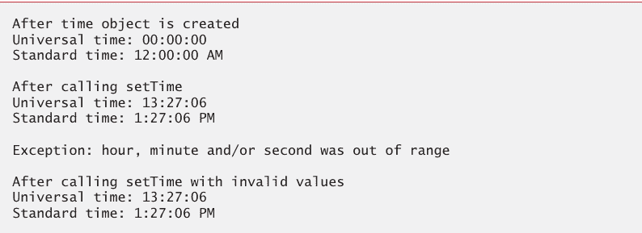
**图 8.2** 应用中使用的 Time1 对象。（部分 1，共 2 部分）

### 使用无效值调用 Time setTime
为了说明方法 `setTime` 会验证其参数，第 23 行调用了 `setTime` 方法，并将小时、分钟和秒传入了无效参数 99。该语句放置在 `try` 块中（第 21–24 行），以防它抛出 `IllegalArgumentException`，如果所有参数都无效，它就会抛出该异常。当这种情况发生时，异常在第 25–28 行被捕获，第 27 行通过调用 `getMessage` 显示异常的错误信息。第 31 行再次以两种格式输出时间，以确认当提供无效参数时 `setTime` 并未更改时间。

### Time 类声明的软件工程
考虑使用类设计来表示时间的几种方法。实例变量 `hour`、`minute` 和 `second` 被声明为 `private`。类内部使用的数据表示是类的实现细节，客户端不应关心。例如，`Time` 将时间内部表示为自午夜以来的分钟和秒数是完全合理的。客户端可以使用相同的公共方法获得相同的结果，而没有任何额外好处。（练习 8.5 允许你在类 `Time2` 中将时间表示为自午夜以来的秒数，并证明对类的客户端来说没有可见的变化。）

> **软件工程观察 8.3**
> 类简化了编程，因为客户端只需要使用公共方法。此类方法通常是面向客户端的，而不是面向实现的。客户端既不了解也不参与类的实现。客户端通常只关心类能做什么（做了什么），而不关心类是如何做到的。

## 8.3 控制对成员的访问

接口的变化不如实现频繁。当实现发生变化时，依赖实现的代码必须相应更改。隐藏实现减少了其他程序部分依赖类实现细节的可能性。

### Java SE 8—日期/时间 API
本节以及本章后面示例中的演示了表示日期和时间的类中的各种类实现概念。在专业的 Java 开发中，与其自己构建日期和时间类，不如使用 Java API 提供的类。虽然 Java 一直有处理日期的类，但 Java SE 8 引入了新的 Date/Time API——由 `java.time` 包中的类定义——使用 Java SE 8 构建的应用应该使用 Date/Time API 的功能，而不是早期的 Java 版本。新 API 修复了旧类的问题，并为处理日期、时间、时区和日历提供了更健壮、易用的功能。我们在第 23 章中使用了一些 Date/Time 特性。你可以在此处了解更多关于 Date/Time API 的类：
`download.java.com/jdk/java/time`

用访问修饰符 `private` 声明的方法可以被声明该私有方法的类的其他方法调用。此类方法通常被称为工具方法或辅助方法，因为它们通常被用于支持类公共方法的操作。

## 8.4 使用 this 引用当前对象的成员
每个对象都可以通过 `this` 关键字引用自身（有时称为该引用）。当为特定对象调用实例方法时，方法体隐式地使用 `this` 来引用该对象的实例变量和其他方法。这使得类代码知道应该操作哪个对象。你将在图 8.4 中看到，你也可以在实例方法中显式使用关键字。第 8.5 节显示了 `this` 的另一种用法。第 8.11 节解释了为什么不能在静态方法中使用 `this`。

我们现在演示 `this` 引用的隐式和显式用法（图 8.4）。这是一个在文件中声明了两个类的示例——`TestThis` 类声明在第 4–41 行，`SimpleTime` 类声明在第 14–47 行。这样做是为了演示当你编译包含多个类的 `.java` 文件时，编译器为每个编译类产生一个具有 `.class` 扩展名的独立类文件。在这种情况下，产生了两个独立的文件：`SimpleTime.class` 和 `TestThis.class`。当一个源文件包含多个类声明时，编译器会将这些文件放在同一个目录下。注意图 8.4 中只有 `TestThis` 被声明为 `public`。一个源文件只能包含一个公共类——否则会发生编译错误。非公共类只能被同一包中的其他类使用。因此，在这个示例中，`SimpleTime` 类只能被 `TestThis` 类使用。

### 图 8.4 this 隐式和显式地引用了对象的成员

```java
// 图 8.4: TestThis.java
// this 隐式和显式地引用了对象的成员。
public class TestThis {
    public static void main(String[] args) {
        SimpleTime time = new SimpleTime(15, 30, 19);
        System.out.println(time.buildString());
    }
} // end class TestThis

// class SimpleTime 演示了 "this" 引用
class SimpleTime {
    private int hour; // 0-23
    private int minute; // 0-59
    private int second; // 0-59

    // 如果构造函数的参数名称与实例变量名称相同，
    // 则需要 "this" 引用来区分这些名称
    public SimpleTime(int hour, int minute, int second) {
        this.hour = hour; // 设置 "this" 对象的 hour
        this.minute = minute; // 设置 "this" 对象的 minute
        this.second = second; // 设置 "this" 对象的 second
    }

    // 使用显式和隐式的 "this" 调用 toUniversalString
    public String buildString() {
        return String.format("%24s: %s%24s: %s",
            "this.toUniversalString()", this.toUniversalString(),
            "toUniversalString()", toUniversalString());
    }

    // 转换为通用时间格式字符串 (HH:MM:SS)
    public String toUniversalString() {
        // 访问实例变量时不需要 "this"，
        // 因为该方法没有与实例变量同名的局部变量
        return String.format("%02d:%02d:%02d",
            this.hour, this.minute, this.second);
    }
} // end class SimpleTime
```

```
this.toUniversalString() : 15:30:19
toUniversalString()      : 15:30:19
```


# 第 8 章 类与对象：深入观察

## 8.5 时间类研究：重载构造函数

如你所知，你可以声明构造函数来指定类对象应如何初始化。接下来，我们将演示一个带有多个重载构造函数的类，允许该类的对象以不同的方式初始化。要重载构造函数，只需提供多个具有不同签名的构造函数。

### 带有重载构造函数的 Time2

图 8.1 中 Time2 的默认构造函数将 `hour`、`minute` 和 `second` 初始化为默认的 0 值（即通用时间中的午夜）。默认构造函数无法允许类字段使用非零值初始化时间。Time2（图 8.5）包含五个重载构造函数，提供了初始化对象的方便方法。在该程序中，四个构造函数调用了第五个构造函数，其中确保了提供的 `hour` 的值在 0 到 23 之间，且 `minute` 和 `second` 的值都在 0 到 59 之间。编译器通过匹配构造函数调用中指定的参数的数量、类型和顺序与每个构造函数声明中指定的参数的数量、类型和顺序，来调用相应的构造函数。Time2 还为每个实例变量提供了 `set` 和 `get` 方法。

**图 8.5** | 带有重载构造函数的 Time2 类。（4 部分中的第 1 部分。）

```java
// 图 8.5: Time2.java
// 带有重载构造函数的 Time2 类声明
public class Time2 {
    private int hour; // 0-23
    private int minute; // 0-59
    private int second; // 0-59

    // Time2 无参数构造函数：将实例变量初始化为零
    public Time2() {
        this(0, 0, 0); // 调用三个参数的构造函数
    }

    // Time2 构造函数：提供了 hour，minute 和 second 默认为 0
    public Time2(int hour) {
        this(hour, 0, 0); // 调用三个参数的构造函数
    }

    // Time2 构造函数：提供了 hour 和 minute，second 默认为 0
    public Time2(int hour, int minute) {
        this(hour, minute, 0); // 调用三个参数的构造函数
    }

    // Time2 构造函数：提供了 hour、minute 和 second
    public Time2(int hour, int minute, int second) {
        if (hour < 0 || hour >= 24)
            throw new IllegalArgumentException("hour must be 0-23");
        if (minute < 0 || minute >= 60)
            throw new IllegalArgumentException("minute must be 0-59");
        if (second < 0 || second >= 60)
            throw new IllegalArgumentException("second must be 0-59");
        this.hour = hour;
        this.minute = minute;
        this.second = second;
    }

    // Time2 构造函数：提供了另一个 Time2 对象
    public Time2(Time2 time) {
        // 调用三个参数的构造函数
        this(time.getHour(), time.getMinute(), time.getSecond());
    }

    // Set 方法：使用通用时间设置新值，验证数据
    public void setState(int hour, int minute, int second) {
        if (hour < 0 || hour >= 24)
            throw new IllegalArgumentException("hour must be 0-23");
        if (minute < 0 || minute >= 60)
            throw new IllegalArgumentException("minute must be 0-59");
        if (second < 0 || second >= 60)
            throw new IllegalArgumentException("second must be 0-59");
        this.hour = hour;
        this.minute = minute;
        this.second = second;
    }

    // 获取 second 值
    public int getSecond() {
        return second;
    }

    // 转换为通用时间格式字符串 (HH:MM:SS)
    public String toUniversal() {
        return String.format("%02d:%02d:%02d", getHour(), getMinute(), getSecond());
    }

    // 转换为标准时间格式字符串 (H:MM:SS AM 或 PM)
    public String toString() {
        return String.format("%02d:%02d:%02d %s",
            (getHour() == 0 || getHour() == 12) ? getHour() % 12 : getHour(), getMinute(), getSecond(),
            (getHour() < 12 ? "AM" : "PM"));
    }
} // end class Time2
```

**图 8.5** | 带有重载构造函数的 Time2 类。（4 部分中的第 2-4 部分。）

#### Time2 的构造函数——通过 this 调用另一个构造函数

第 12-15 行声明了一个所谓的无参数构造函数，在不带参数的情况下调用。一旦在类中声明了任何构造函数，编译器将不再提供默认构造函数。这个无参数构造函数确保了 Time2 的客户端可以使用默认值创建 Time2 对象。此类构造函数按照构造函数体中的指定初始化对象。在方法体中，我们引入了这种方法调用语法的使用，这种语法只允许作为构造函数体中的第一条语句。第 14 行使用 `this` 调用带有三个参数（第 30–44 行）的 Time2 构造函数，并将 `hour`、`minute` 和 `second` 的值设置为 0。在这里使用 `this` 是一种通过另一个构造函数重用初始化代码的方法，而不是在无参数构造函数体中定义类似的代码。使用这种方法使得维护和修改更加容易。如果我们需要更改 Time2 类对象的初始化方式，只需要修改构造函数体即可。

> **常见编程错误 8.2**
> 在构造函数体中使用 `this` 调用该类的其他构造函数时，如果该调用不是构造函数的第一条语句，则会导致编译错误。当方法尝试通过 `this` 直接调用构造函数时，也会导致编译错误。

接收三个表示小时、分、秒的 `int` 参数。该构造函数对实例变量进行验证和初始化。

第 47–51 行声明了一个 `Time2` 构造函数，接收另一个 `Time2` 对象的引用。来自 `Time2` 参数的值被传递给第 30–44 行的三参数构造函数，以初始化小时、分和秒。第 50 行可以直接通过 `time.hour`、`time.minute` 和 `time.second` 表达式访问参数 `time` 的小时、分、秒值——尽管小时、分、秒被声明为 `Time2` 类的私有变量。这是由于同一类对象之间的特殊关系。稍后我们将看到为什么使用方法更为更好。

> **软件工程观察 8.5**
> 当类中的一个成员拥有另一个同类型类对象的引用时，第一个对象可以访问第二个对象的所有数据和方法（包括私有成员）。

#### 类 Time2：setTime 方法

`setTime`（第 56–70 行）如果参数超出范围，将抛出 `IllegalArgumentException`（第 59、62 和 65 行）。否则，它将 `Time2` 的实例变量设置为参数的值（第 67–69 行）。

#### 关于 Time2 的 get 和方法构造函数的说明

`Time2` 方法在整个类中被调用。特别是，`toUniversalString` 和 `toString` 的方法调用了第 122 行和第 129–130 行的 `getMinute` 和 `getSecond`。在每种情况下，这些方法都可以直接访问类的私有数据而不调用方法。然而，考虑到从三个值的表示（需要 12 字节内存）变为代表午夜后经过的总秒数的单个值（仅需要 4 字节内存）。如果我们进行这样的更改，只需要更改访问私有数据的方法体——特别是三参数构造函数、`setTime` 方法以及用于小时、分、秒的各个 `get` 方法。不需要修改 `toUniversalString` 或 `toString` 的方法体，因为它们没有直接访问数据。以这种方式设计类可以减少更改类实现时错误的概率。

同样，每个构造函数都可以包含来自三参数构造函数的适当语句。这样做可能会略微提高性能，因为消除了所有额外的构造函数调用。但重复语句会使类的内部数据表示变得复杂。`Time2` 构造函数调用三参数构造函数，要求对三参数构造函数实现的任何更改只需进行一次。此外，编译器可以通过删除对简单方法的调用并将其替换为声明的展开代码来优化程序——这种技术被称为代码内联（inlining），它可以提高程序性能。

### 使用类 Time2：重载构造函数

`TimeTest` 类（图 8.6）演示了重载的 `Time2` 构造函数（第 8–12 行和 24 行）。第 8 行调用了 `Time2` 无参数构造函数。第 9–12 行演示了向其他 `Time2` 构造函数传递参数。第 9 行调用了图 8.5 第 18–21 行接收一个 `int` 的单参数构造函数。第 10 行调用了图 8.5 第 24–27 行的双参数构造函数。第 11 行调用了第 30–44 行的三参数构造函数。第 12 行调用了图 8.5 第 47–51 行接收 `Time2` 的单参数构造函数。接下来，应用程序显示 `Time2` 对象的字符串表示，以确认它已初始化（第 15–19 行）。第 24 行尝试通过向构造函数传递三个无效值创建一个新的 Time2 对象来初始化 `t6`。当构造函数尝试使用无效的小时值初始化对象时，会发生 `IllegalArgumentException`。我们的代码在第 26 行捕获此异常并显示其错误信息，结果是一行输出。

**图 8.6** | 使用重载构造函数初始化 Time2 对象。（第 1/2 部分。）

```java
// 图 8.6: TimeTest.java
// 使用重载的构造函数初始化 Time2 对象
public class Time2Test {
    public static void main(String[] args) {
        Time2 t1 = new Time2(); // 00:00:00
        Time2 t2 = new Time2(2); // 02:00:00
        Time2 t3 = new Time2(21, 34); // 21:34:00
        Time2 t4 = new Time2(12, 25, 42); // 12:25:42
        Time2 t5 = new Time2(t4); // 12:25:42

        System.out.println("Constructed with:");
        displayTime("t1: all default arguments", t1);
        displayTime("t2: hour specified; default minute and second", t2);
        displayTime("t3: hour and minute specified; default second", t3);
        displayTime("t4: hour, minute and second specified", t4);
        displayTime("t5: Time2 object specified", t5);

        // 使用无效值初始化 t6
        try {
            Time2 t6 = new Time2(27, 74, 99); // 无效值
        } catch (IllegalArgumentException e) {
            System.out.printf("%s%n", e.getMessage());
        }
    }

    private static void displayTime(String header, Time2 t) {
        System.out.printf("%s%s%s%n", header, t.toUniversalString(), t.toString());
    }
}
```

**输出结果：**

```
Constructed with:
t1: all default arguments
00:00:00
t2: hour specified; default minute and second
02:00:00
t3: hour and minute specified; default second
21:34:00
t4: hour, minute and second specified
12:25:42
t5: Time2 object specified
12:25:42
Exception while initializing t6: hour must be 0-23
```


> 图 8.6 | 使用重载构造函数初始化 `Time2` 对象。（第 2/2 部分）

## 8.6 默认构造函数和无参数构造函数

每个类至少有一个构造函数。如果你不在类的声明中提供任何构造函数，编译器会创建一个不带参数的默认构造函数。默认构造函数将实例变量初始化为指定的值（数值类型为零，布尔值为 `false`，引用为 `null`）。在第 9.4 节中，你将学习默认构造函数执行另一个任务。记住，如果你声明了构造函数，编译器就不会创建默认构造函数。在这种情况下，如果需要初始化，必须声明无参数构造函数。与默认构造函数一样，无参数构造函数通过空括号调用。`Time2` 无参数构造函数（图 8.5 第 12–15 行）通过向三参数构造函数传递 `0` 来显式地初始化 `Time2` 对象。由于 `0` 是 `int` 变量的默认值，此示例中的无参数构造函数可以为空体。在这种情况下，调用无参数构造函数时，每个实例变量将接收其默认值。如果我们省略无参数构造函数，该类的客户端将无法通过 `new Time2()` 创建 `Time2` 对象。

> **错误预防提示 8.2**
> 确保不在构造函数定义中包含返回类型。Java 允许类中构造函数外的其他方法具有与类名称并指定返回类型。此类方法不是构造函数，在实例化类对象时不会被调用。

> **常见编程错误 8.3**
> 如果程序尝试向类的构造函数传递错误的数量或类型的参数来初始化对象，将发生编译错误。

## 8.7 关于 set 和 get 方法的说明

由于类的私有字段只能通过其方法进行操作。典型的操作可能是通过 `computeInterest` 方法调整客户的银行余额（例如 `BankAccount` 类的私有变量）。`set` 方法通常也是变器方法，因为它们通常会改变对象的状态——即修改实例变量的值。`get` 方法通常也是访问器方法或查询。

### set 和 get 方法与公共数据

似乎提供 set 和 get 功能本质上与将类的实例变量设为公共是一样的。这是 Java 使软件工程变得极具吸引力的细微之处之一。公共实例变量可以被任何拥有其引用的方法读取或写入。如果实例变量被声明为私有，公共 getter 方法允许其他方法访问它，但 getter 方法可以控制客户端。例如，getter 方法可以控制其返回的数据格式，保护客户端免受实际数据表示的影响。公共 setter 方法可以——并且——完全检查修改变量的尝试。例如，将月份设置为 `32` 或将重量设置为负数的尝试应该被拒绝。因此，尽管 set 和 get 方法提供了对私有数据的访问，但这种访问受到方法的限制。这有助于促进软件工程。

### 软件工程 8.6


类永远不应该拥有公共常量数据，但将数据声明为静态 `final` 可以让客户端可以使用常量。例如，`Math` 类提供了静态 `final` 常量 `Math.E` 和 `Math.PI`。

### 错误预防提示 8.3


如果常量的值在软件未来版本中可能会更改，请不要提供静态 `final` 常量。

### setter 方法中的有效性检查

数据完整性的优势并非仅仅因为变量声明为私有就能自动获得——你必须提供有效性检查。类的 setter 方法确定是否尝试给对象分配无效数据。通常，setter 方法返回 `void` 并使用异常处理来指示分配无效数据的尝试。我们将在第 11 章中详细讨论异常处理。

### 软件工程观察 8.7


在适当的情况下，提供公共方法来更改和检索私有实例变量的值。这种架构有助于向客户端隐藏类的实现，从而提高可维护性。

### 错误预防提示 8.4


使用 set 和 get 方法有助于创建更易调试和维护的类。如果只有一个方法执行特定任务（例如设置对象中的实例变量），则该类更易调试和维护。如果实例变量没有被正确设置，实际修改实例变量的代码集中在一个 setter 方法中。你的调试工作可以集中在该方法上。

# 第 8 章 类与对象：深入观察

## 谓词方法

访问器方法的另一个用途是测试某个条件为真还是为假——此类方法通常被称为谓词方法。例如 `ArrayList` 类的 `isEmpty` 方法，如果数组为空则返回 `true`，否则返回 `false`。程序在尝试从 `ArrayList` 中读取另一个项目之前，可能会先测试 `isEmpty`。

## 8.8 组合

一个类可以拥有其他类对象的引用作为成员。这被称为组合，有时被称为“具有”（has-a）关系。例如，闹钟（`AlarmClock`）需要知道当前时间以及设定的响报时间，因此在 `AlarmClock` 对象中包含两个 `Time` 对象的引用是合理的。汽车有方向盘、刹车踏和加速板。

### Date 类

此示例包含了 `Date` 类（图 8.7）、`Employee` 类（图 8.8）和 `EmployeeTest` 类（图 8.9）。`Date` 类（图 8.7）声明了实例变量 `month`、`day` 和 `year`（第 6–8 行）来表示它们。构造函数接收三个参数。第 17–19 行验证月份——如果超出范围，第 18–19 行将抛出异常。第 22–25 行验证日期是否符合特定月份的天数（除了 2 月 29 日需要对闰年进行特殊测试），第 24–27 行抛出异常。第 28–31 行对 2 月进行闰年测试。如果是 2 月且日期为 29 号且年份不是闰年，第 30–31 行抛出异常。如果没有抛出异常，第 33–35 行初始化实例变量，第 38–38 行将 `this` 输出为字符串。由于这是对当前日期的引用，因此会隐式调用对象的 `toString` 方法（第 42–45 行）以获取对象的字符串表示。在这个示例中，我们假设 `year` 的值是正确的——一个工业级的 `Date` 类也应该验证年份。

+ 图 8.7: Date.java

```java
// Date.java
// Date 类声明。

public class Date {

    private int month; // 1-12
    private int day; // 1-31 基于月份
    private int year; // 任何年份

    private static int[] daysPerMonth =
        { 0, 31, 28, 30, 31, 30, 31, 31, 30, 31, 30, 31 };

    // 构造函数：根据给年份确认月和日的正确值
    public Date(int month, int day, int year) {

        // 检查整数是否在范围内
        if (month <= 0 || month > 12)
            throw new IllegalArgumentException(
                "month " + month + ") must be 1-12");
    }
}
```

图 8 | Date 类声明。（部分 I，共二部分）。

```java
// 检查日是否在月份范围内
if (day <= 0 ||
    (day > daysPerMonth[month] && !(month == 2 && day == 29))
    throw new IllegalArgumentException(" " + day + 
        "out-of-range for the specified month and year");

// 检查闰年月份和日期是否为29
if (month == 2 && day == 29 && !(year % 400 == 0 ||
    (year % 4 == 0 && year % 100 != 0)))
    throw new IllegalArgumentException(" " + day + 
        "out-of-range for the specified month and year");

this.month = month;
this.day = day;
this.year = year;

System.out.printf("%Date object constructor for date %s\n", this);
}

// 返回 月/日/年 格式的字符串
public String toString() {
    return String.format("%d/%d/%d", month, day, year);
}

 // Date 类结束
```

**图 8.7** | Date 声明。（部分 2，共二部分。）

### Employee 类

`Employee` 类（图 8.8）拥有实例变量 `firstName`、`lastName`、`birthDate` 和 `hireDate`。成员 `firstName` 和 `lastName` 是对 `String` 对象的引用。成员 `birthDate` 和 `hireDate` 是对 `Date` 对象的引用。这证明了一个类可以拥有引用其他类对象的实例变量。`Employee` 构造函数（第 12-19 行）接收四个参数，代表姓、名、出生日期和入职日期。参数引用的对象被赋值给 `Employee` 对象的实例变量。当调用 `Employee` 的 `toString` 方法时，它返回一个包含员工姓名以及两个 `Date` 对象字符串表示的字符串。这些字符串都是通过隐式调用 `Date` 的 `toString` 方法获得的。

```java
// Fig. 8.8: Employee.java
// 带有其他对象引用的 Employee 类
public class Employee {

    private String firstName;
    private String lastName;
    private Date birthDate;
    private Date hireDate;
}
```

**图 8.8** | 带有其他对象引用的 Employee 类。（部分 I，共二部分。）

```java
10

11 // 初始化姓名、出生日期和入职期的构造函数
12 public Employee(String firstName, String lastName, Date birthDate,
13 Date hireDate) {
14 this.firstName = firstName;
15 this.lastName = lastName;
16 this.birthDate = birthDate;
17 this.hireDate = hireDate;
18 }
19

20 // 将 Employee 字符串
21 public String toString() {
22 return String.format("%s %s, born %s, hired %s",
        firstName, lastName, birthDate, hireDate);
23 }
 // Employee 类
```

图 8.8 | 带有其他对象引用的 Employee 类。（部分。）

### EmployeeTest Employee

```java
//// 8.9: EmployeeTest.java
// 组合示例。
public class EmployeeTest {

    public static void main(String[] args) {
        Date birth = new Date(5, 20, 1990);
        Date hire = new Date(10, 1, 2010);
        Employee emp = new Employee("John", "Doe", birth, hire);
        System.out.println(emp);
    }
}
```

图 8.9 | 组合示例。

## 8.9 枚举类型

在图 6.8 中我们引入了基础枚举类型，它定义了一组唯一的标识符。在本节中我们将讨论枚举类型与类之间的关系。与类一样，所有的枚举类型都是引用类型。枚举类型通过枚举声明声明，包含逗号分隔的枚举常量——它可以包含类的其他组件，如构造函数、字段和方法（如下）：

1. 枚举常量是隐式的 `final`（最后的）。
2. 枚举常量是隐式的 `static`（静态的）。
3. 使用 `new` 操作创建枚举对象会导致编译错误。

枚举常量可以使用常量使用的地方，例如 `switch` 语句和增强型 `for` 语句。

## 8.10

图 8.10 展示了枚举类型中的实例变量和方法。枚举声明（5–37）包含了两个部分——枚举常量和枚举类型的成员。第一部分（8–13 行）声明了六个常量。每个常量后面跟着传递给枚举构造函数（20–24 行）。正如我们在类中看到的构造函数一样，枚举构造函数可以指定任意数量的参数并进行重载。为了正确初始化每个枚举常量，我们在后面加上包含参数的括号。第二部分（16–36 行）声明了枚举类型的其他成员——两个实例变量（16–17 行）、一个构造函数（20–24 行）以及两个方法（27–30 行和 33–36 行）。

第 16–17 行声明了实例变量 `title` 和 `copyrightYear`。每个枚举类型实际上都是枚举 `Book` 对象，它拥有自己的实例变量 `title` 和 `copyrightYear`。构造函数（20–24 行）接收两个 `String` 参数，一个指定标题，另一个指定年份。第 22–23 行将这些参数赋值给实例变量。第 27–36 行声明的方法分别返回书籍标题和版权年份。

```java
// 8.10: Book.java
// 声明带有构造函数、显式实例字段以及这些字段访问器的枚举类型
public enum Book
{
 // 声明枚举类型的常量
  JHTPC("Java How to Program", "2015"),
  JHTPC("C How to Program", "2013"),
  IWHTPC("Internet & Wide Web How to Program", "2012");
}
```

图 8.10 带有构造函数、显式实例字段以及访问器的枚举类型。（部分 I，共二部分）。

```java
11 CPHTPC("C++ How to Program", "2014"))
12 VBHTPC("Visual Basic How to Program", "2014")
13 CSHARPTP("Visual C# How to Program", "2014")
14 
15 // 实例 String title; // 书名
16 private final String title;
17 private final String copyrightYear; // 版年份
18 
19 // 枚举构造函数
20 Book(String title, String copyrightYear)
21 {
22 this.title = title;
23 this.copyrightYear = copyrightYear;
24 }
25 
26 // 字段 title 的访问器
27 public String getTitle()
28 {
29 return title;
30 }
31 
32 // 字段 copyrightYear 的访问器
33 public String getCopyrightYear()
34 {
35 return copyrightYear;
36 }
37 } // 枚举 Book结束
```

> **图 8.10** 定义一个带有构造函数、显式实例字段以及这些字段访问器的枚举类型（部分 2，共 2）。

### 使用枚举类型 Book

图 8.11 测试了枚举 `Book` 并说明了如何遍历范围内的枚举。对于每一个枚举，编译器都会生成一个静态方法 `values()`（在第 12 行调用），该方法返回一个按声明顺序排列的枚举常量数组。第 12–14 行使用增强 `for` 语句显示在 `Book` 枚举中声明的所有常量。第 14 行调用了枚举 `Book` 的 `getTitle` 和 `getCopyrightYear` 方法来获取与常量关联的标题和版权年份。当枚举转换为 `String` 时（例如在第 13 行中），将使用常量的标识符作为字符串表示（例如，第一个枚举使用 `JHTP`）。

```java
// 图 8.11: EnumTest.java
// 测试枚举类型 Book。
import java.util.EnumSet;

public class EnumTest
{
    public static void main(String[] args)
    {
    }
}
```

> **图 8.11** 测试枚举类型 Book。（部分 1，共 2）。

# 8.10 垃圾回收

```java
System.out.println("All books:");
// 打印枚举 Book 中的所有书籍
for (Book book : Book.values()) {
    System.out.printf("%-10s-%45s%n",
        book.getTitle(), book.getCopyrightYear());
}
```


```java
System.out.printf("%ndisplay a range of enum constants:%n\n"); // 打印前四本书

for (Book book : EnumSet.range(Book.JHTP, Book.CPPHTP)) {
    System.out.printf("%-10s-%45s%n",
        book.getTitle(), book.getCopyrightYear());
}
} // 类 EnumTest结束
```

All books:
JHTP Java How To Program 2015
CHTP C How To Program 2013
IWHTP Internet & Wide Web Web How To Program 2012
CPPHTP C++ How To Program 2014
VBHTP Visual Basic How To Program 2014
CSHARP Visual C# How To Program 2014

Display a range of enum constants:
JHTP Java How To Program 2015
CHTP C How To Program 2013
IWHTP Internet & Wide Web Web How To Program 2012
CPPHTP C++ How To Program 2014

Fig. 8.11 Testing enum book。（部分 2，共 2）。

第 19–22 行使用 `EnumSet` 类的静态方法 `range()`（定义在 `java.util` 包中）来显示枚举范围。`range()` 方法接收两个参数——范围内的第一个和最后一个常量——并返回一个包含这两个常量之间（包含边界）的 `EnumSet`。例如，表达式 `EnumSet.range(Book.JHTP, Book.CPPHTP)` 返回一个包含 `Book.JHTP`、`Book.CHTP`、`Book.IWHTP` 和 `Book.CPPHTP` 的 `EnumSet`。增强 `for` 语句可以用于 `EnumSet`，仅用于显示 `EnumSet` 中每本书的标题和版权年份。`EnumSet` 还提供了其他静态方法用于从相同类型的枚举创建枚举集合。

> **常见编程错误 8.4**
> 在枚举声明中，在类型的构造函数、字段和方法之后声明枚举常量是语法错误。

# 8.10 垃圾回收

每个对象都会使用系统资源，例如内存。我们需要一种有规律的方法在资源不再需要时将它们归还给系统；否则就会发生“资源泄漏”，导致资源无法被你的程序或其他程序重用。JVM 执行自动垃圾回收，以回收不再使用的对象所占用的内存。当一个对象不再有任何引用时，该对象就符合回收条件。回收通常发生在 JVM 执行其垃圾回收器时，这可能在一段时间内不会发生，甚至在程序终止前根本都不会发生。内存泄漏在 C 和 C++ 等语言中很常见（因为这些语言中内存不会被自动回收），在 Java 中可能性较小，但仍可能以细微的方式发生。内存以外的资源泄漏也可能发生。例如，应用程序可能会打开磁盘上的文件以修改其内容——如果程序没有关闭该文件，它必须在任何其他程序使用该文件之前终止。

## 关于 Class 对象的 finalize 方法的说明

Java 中的每个类都有 `Object` 类的方法（位于 `java.lang` 包），其中之一就是 `finalize()`。（你将在第 9 章学习更多关于 `Object` 的知识。）你不应该使用 `finalize()`，因为它可能会导致问题，而且在程序终止前它是否真的会被调用是不确定的。

`finalize()` 的原始意图是允许垃圾回收器在回收内存之前保留对象。现在，对于任何使用系统资源（如磁盘上的文件）的类，更好的做法是提供一个方法，让程序员在程序不再需要资源时调用它来释放资源。使用 `try-with-resources` 语句配合 `AutoCloseable` 对象可以减少资源泄漏的可能性。正如其名称所示，一旦 `try-with-resources` 语句完成对象的处理，`AutoCloseable` 就会自动关闭。我们将在第 11.12 节详细讨论这一点。

## 软件工程观察 8.8

> 许多 Java API 类实现了 `AutoCloseable` 接口，这允许它们与 `try-with-resources` 语句一起使用。这确保了即使发生异常，资源也能被正确关闭。


# 8.11 静态类成员

每个类都可以拥有属于类本身而非任何实例的变量和方法。这些被称为静态成员。静态变量由类的所有实例共享，静态方法可以在不创建类对象的情况下调用。

```java
public class Circle {
    private double radius;
    private static int count = 0;

    public Circle(double radius) {
        this.radius = radius;
        count++;
    }

    public double area() {
        return Math.PI * radius * radius;
    }

    public static int getCount() {
        return count;
    }
}
```

静态变量用于类的所有实例值相同的情况。静态方法用于方法依赖于类变量的情况。

> **常见编程错误 8.7**
> 在每个实例唯一的情况下使用静态变量会导致所有实例共享相同的值。

## 类作用域

静态变量具有类作用域——它们可以在所有方法中使用。我们可以通过类的任何对象的引用来访问类的公共成员，或者通过类名加点（.）来限定成员，例如 `Math.random()`。类的私有静态成员在没有类对象时由客户端代码访问——它们在执行时只要类加载时就是可用的。在没有类对象的情况下访问公共方法（即使有对象时），通过类名加点来访问该静态成员。在没有类对象的情况下访问私有静态成员，提供一个公共静态方法并通过类名加点调用它。

变量在第 7 行被初始化为 0。如果静态变量没有初始化，编译器将分配一个默认值——在这种情况下，是 0，即 `int` 类型的默认值。

```java
// 8.12: Employee.java
// 静态变量用于维护内存中 Employee 对象的计数。
public class Employee {
    private static int count = 0; // 创建的 Employee 数量
    private String firstName;
    private String lastName;

    // 初始化 Employee，将静态 count 加 1 并输出指示构造函数被调用的字符串
    public Employee(String firstName, String lastName) {
        this.firstName = firstName;
        this.lastName = lastName;
        count++; // 增加员工的静态计数
        System.out.printf("Employee constructor: %s %s; count = %d%n", firstName, lastName, count);
    }

    // 获取名字
    public String getFirstName() {
        return firstName;
    }

    // 获取姓氏
    public String getLastName() {
        return lastName;
    }

    // 获取静态计数值的静态方法
    public static int getCount() {
        return count;
    }
} // 结束类 Employee
```

**图 8.12** | 静态变量用于维护内存中 Employee 对象的计数。

当 `Employee` 对象存在时，变量 `count` 可以在 `Employee` 对象的任何方法中使用——此示例在构造函数中递增了 `count`（第 18 行）。公共静态方法 `getCount`（第 36–39 行）返回到为止已创建的 `Employee` 对象数量。当不存在 `Employee` 类的对象时，客户端代码可以通过类名调用方法来访问变量，例如 `Employee.getCount()`。当对象存在时，也可以通过任何 `Employee` 对象的引用调用方法 `getCount`。

> **良好的编程实践 8.1**
> 使用类名和点运算符 (.) 来调用每个静态方法，以强调所调用的方法是静态方法。

## Class EmployeeTest

`EmployeeTest` 类的 `main` 方法（图 8.13）实例化了两个 `Employee` 对象（第 13–14 行）。当每个 `Employee` 对象的构造函数被调用时，图 8.12 的第 15-16 行将 `Employee` 的名字和姓赋值给实例变量 `firstName` 和 `lastName`。这两个变量并没有创建原始 `String` 参数的副本。实际上，Java 中的 `String` 对象是不可变的——它们在创建后无法被修改。因此，对于 Java 中大多数其他类的情况，必须节省大量内存。如果 `String` 是不可变的，你可能会奇怪为什么我们能够使用 `+` 和 `+=` 运算符来拼接字符串。字符串拼接实际上产生一个包含拼接值的新 `String` 对象。原始的 `String` 不会被修改。

```java
// Fig 8.13: EmployeeTest.java
// 静态类成员演示。
public class EmployeeTest {
    public static void main(String[] args) {
        // 显示在创建 Employees 之前 count 为 0
        System.out.printf("Employees before instantiation: %d%n", Employee.getCount());

        // 创建两个 Employees; count 应该为 2
        Employee e1 = new Employee("Susan", "Baker");
        Employee e2 = new Employee("Bob", "Blue");

        // 显示在创建 Employees 之后 count 为 2
        System.out.printf("Employees after instantiation: %d%n", Employee.getCount());
        System.out.printf("via e1.getCount(): %d%n", e1.getCount());
        System.out.printf("via e2.getCount(): %d%n", e2.getCount());

        // 获取 Employees 的名字
        System.out.printf("Employee 1: %s %s%nEmployee 2: %s %s%n",
            e1.getFirstName(), e1.getLastName(),
            e2.getFirstName(), e2.getLastName());
    }
} // 结束类 EmployeeTest
```

Employees before instantiation: 0
Employee constructor: Susan Baker; count = 1
Employee constructor: Bob Blue; count = 2

**图 8.13** 静态成员演示。（2 部分中的第 1 部分）。

```
Employees after instantiation:
via e1.getCount(): 2
via e2.getCount(): 2
via Employee.getCount(): 2

Employee 1: Susan Baker
Employee 2: Bob Blue
```

**图 8.13** | 静态内存演示。（2 部分中的第 2 部分）。

当 `main` 终止时，局部变量 `e1` 和 `e2` 被丢弃——局部变量内存仅在声明它的代码块执行时才存在。由于 `e1` 和 `e2` 是第 13–14 行（图 8.13）创建的 `Employee` 对象的唯一引用，当 `main` 终止时，这些对象变得“可以被垃圾回收”。

在典型情况下，垃圾回收器可能会回收任何可回收对象的内存。如果对象没有被回收，JVM 将不会执行。

## 8.12 静态导入

在 6.3 节中，你学习了 `Math` 的静态字段和方法。通过类名和点运算符可以访问静态字段和方法。静态导入允许你在不加类名的情况下访问它们，这在类有许多静态字段和方法时非常有用。静态导入有两种形式：导入特定成员（称为静态导入）和导入所有成员（称为星号导入）。导入特定成员如下：

```java
import static packageName.ClassName.memberName;
```

其中 `packageName` 是包名（例如 `java.lang`），`ClassName` 是类名（例如 `Math`），`memberName` 是成员名。星号表示类的所有静态成员：

```java
import static packageName.ClassName.*;
```

下面演示了静态导入，所有成员都是可用的。图 8.14 展示了静态导入 `Math` 方法。

> **常见编程错误 8.7**
> 如果程序尝试导入两个或多个同名的静态成员，将发生编译错误。

```java
// Fig. 8.14: StaticImportTest.java
// Math 方法的静态导入。
import static java.lang.Math.*;

public class StaticImportTest {
    public static void main(String[] args) {
        System.out.printf("sqrt(900.0) = %.1f%n", sqrt(900.0));
        System.out.printf("ceil(-9.8) = %.1f%n", ceil(-9.8));
        System.out.printf("E = %f%n", E);
        System.out.printf("PI = %f%n", PI);
    }
}
```

```
sqrt(900.0) = 30.0
ceil(-9.8) = -9.0
E = 2.718282
PI = 3.141593
```


**图 8.14** Math 方法的静态导入。

## 8.13 final 实例变量

最小权限原则是良好软件工程的基础。在应用程序中，代码应该只获得完成指定任务所需的权限和访问权限，而不是更多。这使得你的程序更加健壮，防止调用方法无意或恶意地修改变量值并调用不应允许的方法。

让我们看看这一原则如何适用于变量。有些变量是不需要修改的。我们可以使用 `final` 关键字来确保变量是不可修改的，任何对它的修改尝试都是错误的。例如：

```java
private final int INCREMENT = 0x0001;
```

声明了一个 `int` 类型的 `final`（常量）实例变量 `INCREMENT`。变量在声明时初始化。如果没有，必须在类的每个构造函数中初始化。在构造函数中初始化常量允许类的每个对象具有不同的常量值。如果 `final` 变量没有在声明或在每个构造函数中初始化，将发生编译错误。

## 第 8 章 类与对象：深入探讨

### 软件工程观察 8.11

将实例变量声明为 `final` 有助于强制最小权限原则。如果实例变量不应被修改，请将其声明为 `final` 以防止修改。例如，在图 8.8 中，实例变量 `firstName`、`lastName`、`birthDate` 在初始化后从未被修改过；它们应该被声明为 `final`。我们将在后续的所有程序中遵循这一做法。你将在第 23 章“并发”中看到额外的好处。

### 常见编程错误 8.8

在初始化后尝试修改 `final` 实例变量会导致编译错误。

### 错误预防贴士 8.5

尝试修改 `final` 实例变量在编译时成本很低，而不是引起执行错误。如果可能，最好在编译时消除 bug，而不是让它们溜到执行阶段（根据经验，执行阶段的修复成本要高出许多倍）。

### 软件工程观察 8.12

如果一个 `final` 字段在声明时被初始化为该类所有对象都相同的值，则该字段也应该被声明为 `static`。在初始化之后，它的值永远不会改变。因此，我们不需要为类的每个对象都创建一个字段的单独副本。将字段设为 `static` 可以让类的所有对象共享该 `final` 字段。

## 8.14 包访问

如果在类中声明方法或变量时，没有指定访问修饰符（`public`、`protected` 或 `private`——将在第 9 章讨论），则该方法或变量被认为具有包访问权限（package access）。在一个只包含一个类定义的程序中，这没有特定影响。然而，如果程序使用了来自同一个包的多个类（即一组相关的类），这些类可以通过对相应类对象的引用直接访问彼此的成员，或者在静态方法的情况下通过类名进行访问。包访问权限很少使用。

图 8.5 展示了包访问。该包在一个源文件中包含两个类——包含 `main` 方法（第 5–21 行）的 `PackageDataTest` 类和 `PackageData` 类（第 24–41 行）。位于同一个源文件中的类属于同一个包的一部分。因此，`PackageDataTest` 被允许修改 `PackageData` 对象的包访问权限数据。当你编译这个程序时，编译器会生成两个单独的类——`PackageDataTest.class` 和 `PackageData.class`。编译器将两个 `.class` 文件放置在同一个目录下。你也可以将 `PackageData` 放在一个单独的源文件中。

在 `PackageData` 类的声明中，第 26–27 行声明了没有修饰符的实例变量 `number` 和 `string`——因此，这些是包访问实例变量。`PackageDataTest` 类的 `main` 方法创建了 `PackageData` 类的实例（第 19 行），以演示直接修改 `PackageData` 实例变量的能力（如第 15–16 行所示）。修改的结果可以在输出窗口中看到。

## 8.15 使用 BigDecimal 进行精确的货币计算

```java
// Fig. 8.15: PackageDataTest.java
// 类的包访问成员可以被同一个包中的其他类访问

public class PackageDataTest {
    public static void main(String[] args) {
        PackageData packageData = new PackageData();

        // 输出 packageData 的字符串表示
        System.out.printf("After instantiation:%n%s%s\n", packageData);

        // 修改 packageData 对象中的包访问数据
        packageData.number = 77;
        packageData.string = "Goodbye";

        // 输出 packageData 的字符串表示
        System.out.printf("%nAfter changing values:%n%s%s\n", packageData);
    }
}

// 带有包访问实例变量类
class PackageData {
    int number; // 包访问实例变量
    String string; // 包访问实例变量

    // 构造函数
    public PackageData() {
        number = 0;
        string = "Hello";
    }

    // 返回 PackageData 对象的字符串表示
    public String toString() {
        return String.format("number: %d; string: %s", number, string);
    }
}
```

After instantiation:
number: 0; string: Hello

After changing values:
number: 77; string: Goodbye

**图 8.15** 类的包访问成员可以被同一个包中的其他类访问。

### 使用 BigDecimal

```java
// Interest.java
// 使用 BigDecimal 进行复利计算。

import java.math.BigDecimal;
import java.text.NumberFormat;

public class Interest {
    // 主方法
    public static void main(String[] args) {
        // 初始本金
        BigDecimal principal = BigDecimal.valueOf(1000.0);

        // 利率
        BigDecimal rate = BigDecimal.valueOf(0.05);

        // 显示表头
        System.out.printf("%4d%20s\n", "Year", "Amount on deposit");

        // 计算每年的存款金额
        for (int year = 1; year <= 10; year++) {
            // 计算金额
            BigDecimal amount =
                principal.multiply(rate.add(BigDecimal.ONE).pow(year));

            // 显示年份和金额
            System.out.printf("%4d%20s%n", year,
                NumberFormat.getCurrencyInstance().format(amount));
        }
    }
}
```

| Year | Amount on deposit |
| :--- | :--- |
| 1 | $1050.00 |
| 2 | $1102.50 |
| 3 | $1157.62 |
| 4 | $1215.51 |
| 5 | $1276.28 |
| 6 | $1340.10 |
| 7 | $1407.10 |
| 8 | $1477.46 |
| 9 | $1551.33 |
| 10 | $1628.89 |

**图 8.16** 使用 BigDecimal 进行复利计算。

### 创建 BigDecimal 对象

第 11–12 行使用 `valueOf` 静态方法声明并初始化 `principal` 和 `rate`——该方法接收一个 `double` 参数并返回 `BigDecimal` 对象。

### 执行计算

第 21–22 行使用 `BigDecimal` 的 `multiply` 和 `pow` 方法执行计算。第 22 行的表达式求值如下：

- 首先，`rate.add(BigDecimal.ONE)` 将利率加 1，产生包含 1.05 的 `BigDecimal`——这等同于图 5.6 第 19 行的 `1.0 + rate`。`BigDecimal` 常量 `ONE` 代表值 1。
- 接下来，对前面的结果调用 `pow` 方法以计算 1.05 的 year 次方——这等同于将 1.0 + rate 和 year 传递给 `Math.pow`。
- 最后，对 `principal` 对象调用 `multiply`，并将前面的结果作为参数。这返回代表年底存款金额的 `BigDecimal`。

### 格式化货币

在循环的每次迭代中，第 26 行

```java
NumberFormat.getCurrencyInstance().format(amount)
```

求值如下：

- 首先，表达式使用 `NumberFormat` 的静态方法 `getCurrencyInstance` 获取一个预配置为将数值格式化为特定区域字符串的 `NumberFormat` 对象——例如，在美国区域设置下，数值 1628.89 会被格式化。特定区域的格式化是国际化（为用户的各种区域和口语语言定制应用程序的过程）的重要组成部分。
- 接下来，表达式调用 `NumberFormat` 的 `format` 方法（在 `getCurrencyInstance` 返回的对象上）来对 `amount` 值进行格式化。`format` 方法随后返回特定区域的字符串表示，并在小数点后保留两位数字。

### 舍入 BigDecimal 值

除了精确计算外，`BigDecimal` 还允许你控制如何舍入——默认情况下，所有计算都是精确的，不会发生舍入。如果你没有指定如何舍入 `BigDecimal` 且给定值无法精确表示（例如 1 除以 3 的结果，即 0.333333...），则会抛出 `ArithmeticException`。

我们在本示例中未显示这一点，但你可以通过向 `BigDecimal` 类提供 `MathContext` 对象（来自 `java.math` 包）来为 `BigDecimal` 指定舍入模式。

在创建 `BigDecimal` 时使用构造函数。你也可以向各种执行计算的 `BigDecimal` 方法提供 `MathContext`。`MathContext` 类包含几个预配置的 `MathContext` 对象，你可以了解它们：

`http://docs.oracle.com/java/7/docs/api/java/math/MathContext.html`

默认情况下，每个预配置的 `MathContext` 使用名为“银行家舍入法”的舍入方式，正如 `RoundingMode.HALF_EVEN` 所解释的那样：

`http://docs.oracle.com/java/7/docs/api/java/math/RoundingMode.html#HALF_EVEN`

### BigDecimal 值的精度

`BigDecimal` 的精度（scale）是小数点右侧的位数。如果你需要将 `BigDecimal` 舍入到特定的数字，可以调用 `BigDecimal.setScale`。例如，下面的示例返回一个小数点后保留两位并使用银行家舍入法的 `BigDecimal`：

```java
amount.setScale(2, RoundingMode.HALF_EVEN)
```

## 8.16（可选）GUI 与图形案例研究：在图形中使用对象

到目前为止你看到的大多数图形都没有随着每次程序的执行而变化。6.13 节中的练习 6.2 要求你创建一个能够随机生成形状和颜色的程序。在那个练习中，每当系统调用 `paintComponent` 时，图形都会发生变化。为了创建一个每次绘制都保持不变的一致设计，我们将创建一组类来存储每个形状的信息。每当系统调用 `paintComponent` 时，我们都会执行。我们将让这些类变得“智能”，允许这些类的对象通过使用 `Graphics` 对象绘制自己。

### MyLine

图 17 声明了 `MyLine`，它具有所有这些功能。`MyLine` 导入了 `Color` 和 `Graphics`（第 3–4 行）。第 8–11 行声明了用于绘制线条端点坐标的实例变量，第 12 行声明了存储线条颜色的实例变量。第 15–22 行的构造函数定义了五个参数，对应它初始化的每个实例变量。第 25–29 行的 `draw` 方法需要一个 `Graphics` 对象，并使用它在正确的颜色和端点之间绘制线条。

```java
// Fig. 17: MyLine.java
// MyLine class represents a line.
import java.awt.Color;
import java.awt.Graphics;

public class MyLine {
    private int x1; // 第一个端点的 x 坐标
    private int y1; // 第一个端点的 y 坐标
    private int x2; // 第二个端点的 x 坐标
    private int y2; // 第二个端点的 y 坐标
    private Color color; // 此线条的颜色

    // 带有输入值的构造函数
    public MyLine(int x1, int y1, int x2, int y2, Color color) {
        this.x1 = x1;
        this.y1 = y1;
        this.x2 = x2;
        this.y2 = y2;
        this.color = color;
    }

    // 用指定的颜色绘制线条
    public void draw(Graphics g) {
        g.setColor(color);
        g.drawLine(x1, y1, x2, y2);
    }
} // end class MyLine
```

### DrawPanel 类

在图 8.18 中，我们声明了 `DrawPanel`，它将生成 `MyLine` 类的随机对象。第 12 行声明了 `MyLine` 数组以存储要绘制的线条。在构造函数（第 15-37 行）内部，第 17 行将背景颜色设置为 `Color.WHITE`。第 19 行创建一个长度在 5 到 9 之间的随机数组。第 22-36 行的循环创建一个具有随机长度的数组。第 25-28 行生成每个线条的随机坐标，第 32 行设置线条的颜色。第 35 行创建一个 `MyLine` 对象并将其添加到数组。第 45-46 行的 `paintComponent` 方法通过 `Graphics` 对象在面板上绘制这些线条。

```java
// DrawPanel.java
// Program that uses class MyLine
// to draw random lines.
import java.awt.Color;
import java.awt.Graphics;
import java.security.SecureRandom;
import javax.swing.JPanel;

public class DrawPanel extends JPanel {
    private SecureRandom randomNumbers = new SecureRandom();
    private MyLine[] lines; // array of lines

    // constructor, creates a panel
    public DrawPanel() {
        setBackground(Color.WHITE);
        // create lines
        lines = new MyLine[randomNumbers.nextInt(5) + 5];
    }
}
```


```java
// Fig. 19: DrawPanel.java
// Using arrays to draw random lines.

import java.awt.Color;
import java.awt.Graphics;
import java.util.Random;
import javax.swing.JPanel;

public class DrawPanel extends JPanel {

    private final Random randomNumbers = new Random();
    private final MyLine[] lines; // array of MyLine objects

    // constructor, create a panel with random shapes
    public DrawPanel() {
        setBackground(Color.WHITE);

        lines = new MyLine[5 + randomNumbers.nextInt(5)]; // 5-9 lines

        // for each array
        for (int count = 0; count < lines.length; count++) {
            // generate coordinates
            int x1 = randomNumbers.nextInt(300);
            int y1 = randomNumbers.nextInt(300);
            int x2 = randomNumbers.nextInt(300);
            int y2 = randomNumbers.nextInt(300);

            // generate random color
            Color color = new Color(randomNumbers.nextInt(256),
                                    randomNumbers.nextInt(256),
                                    randomNumbers.nextInt(256));

            // add the line to the array
            lines[count] = new MyLine(x1, y1, x2, y2, color);
        }
    }

    // draw individual shapes
    @Override
    public void paintComponent(Graphics g) {
        super.paintComponent(g);

        // draw the lines
        for (MyLine line : lines) {
            line.draw(g);
        }
    }
}
```

```java
// Fig. 19: MyLine.java
// Line class that stores coordinates and color.

import java.awt.Color;
import java.awt.Graphics;

public class MyLine {

    private final int x1, y1, x2, y2; // coordinates
    private final Color color; // line color

    // constructor
    public MyLine(int x1, int y1, int x2, int y2, Color color) {
        this.x1 = x1;
        this.y1 = y1;
        this.x2 = x2;
        this.y2 = y2;
        this.color = color;
    }

    // draw the line in the specified color
    public void draw(Graphics g) {
        g.setColor(color);
        g.drawLine(x1, y1, x2, y2);
    }
}
```

```java
// Fig. 19: TestDraw.java
// Creating a JFrame to display DrawPanel.

import javax.swing.JFrame;

public class TestDraw {

    public static void main(String[] args) {
        DrawPanel panel = new DrawPanel();

        JFrame frame = new JFrame();
        frame.setDefaultCloseOperation(JFrame.EXIT_ON_CLOSE);
        frame.add(panel);
        frame.setSize(300, 300);
        frame.setVisible(true);
    }
}
```


### GUI 与图形练习

**8.1** 扩展图 17–19 中的程序。这两个类都应该包含 `x1`、`y1`、`x2`、`y2` 坐标，一个颜色以及一个确定形状是否填充的布尔标志。在每个类中声明一个构造函数，带有参数初始化所有实例变量。为了绘制矩形和圆形，每个类应提供 `getOffsetX()`、`getOffsetY()`、`getWidth()` 和 `getHeight()` 方法来计算左上角坐标、宽度和高度。左上角坐标是两个 x 坐标中较小的，左上角坐标是两个 y 坐标中较小的，宽度是两个 x 坐标之间差值的绝对值，高度是两个 y 坐标之间差值的绝对值。

扩展 `JPanel` 并处理形状创建的应该声明三个数组，每个数组对应一种形状类型。每个数组的长度应该是 1 到 5 之间的随机数。`DrawPanel` 类的构造函数将填充具有随机位置、大小和颜色的形状。此外，修改所有三个形状类以包含以下内容：

- a) 一个构造函数，参数形状坐标为 0，形状颜色为黑色，填充属性为 false（仅限 `MyRectangle` 和 `MyOval`）。
- b) 每个类中实例变量的 setter 方法。这些设置坐标的方法在设置坐标之前应验证参数是否大于或等于零——如果不是，则将坐标设置为 0。构造函数应该调用 setter 方法而不是直接初始化局部变量。
- c) 每个类中实例变量的 getter 方法。`draw` 方法应该通过 getter 方法引用坐标，而不是直接访问。

## 8.17 总结

在本章中，我们介绍了额外的类概念。`Time` 类案例研究展示了一个完整的类声明，它由私有数据、为了增加初始化灵活性的重载公共构造函数、用于操作类数据的 set 和 get 方法，以及以不同格式返回 `Time` 对象字符串表示的方法组成。你学习了每个类都声明了一个 `toString` 方法，该方法返回对象的字符串表示，并且每当代码中需要 String 的地方出现类对象时，该 `toString` 方法就可以被隐式调用。我们展示了如何抛出异常来表示问题的发生。

你学习了 `this` 引用变量在类的实例方法中被隐式使用，以访问类的数据。你还学习了显式使用此引用来访问类成员（包括被遮蔽的字段），以及如何在构造函数中使用此引用来调用类的另一个构造函数。

我们讨论了编译器提供的默认构造函数和程序员提供的无参构造函数。你学习了类拥有对其他类对象的引用——这一概念被称为组合。你了解了更多关于枚举类型（enum）以及如何使用它们来创建一组常量供程序使用。你了解了 Java 的垃圾回收能力以及它如何（不可预测地）回收不再使用的对象的内存。本章解释了类中静态字段的动机，并演示了如何在你自己的类中声明和使用静态字段和方法。你学习了如何声明和初始化 `final` 变量。

你学习了未声明访问修饰符的字段默认获得包级访问权限。你看到了同一包内类之间的关系，这种关系允许每个类访问该包内其他类具有包访问权限的成员。最后，我们演示了如何使用 `BigDecimal` 进行精确的货币计算。

在下一章中，你将学习 Java 面向对象编程的重要方面——继承。你将发现 Java 中所有的类都直接或间接地通过继承与 `Object` 类相关。你还将开始理解类之间的关系如何使你能够构建更强大的应用程序。

## 章节 Time 案例研究

## 章节 8.2 控制成员的访问

- 类的公共方法也被称为类的公共服务或公共接口（第 316 页）。它们向类的客户端展示了该类提供的服务视图。
- 类的私有成员对客户端不可访问。
- `String` 类的静态 `format`（第 318 页）与 `System.out.printf` 类似，不同在于它返回一个格式化的字符串而不是在命令行窗口中显示。
- Java 中的所有对象都有一个 `toString` 方法，返回对象的字符串表示。当对象出现在需要 String 的代码中时，方法 `toString` 会被隐式调用。
- 访问修饰符 `public` 和 `private` 控制对类变量和方法的访问。
- 公共方法的主要目的是向类的客户端展示类所提供的服务视图。客户端不需要担心类是如何完成其任务的。
- 类的私有变量和私有方法（即其实现细节）对客户端不可访问。

## 章节 8.4 使用 this 引用引用当前对象的成员

- 对象的实例隐式使用 `this`（第 322 页）来引用对象的实例变量和其他方法。关键字 `this` 也可以被显式使用。
- 编译器为每个编译后的类生成一个带有 `.class` 扩展名的单独文件。
- 如果局部变量名与类字段同名，则局部变量会遮蔽该字段。你可以在方法中使用此引用来显式地引用被遮蔽的字段。

## 章节 8.5 Time 类研究：重载构造函数

- 重载构造函数允许以不同的方式初始化类对象。编译器通过它们的签名（第 324 页）来区分重载的构造函数。
- 要从类的一个构造函数调用同类的另一个构造函数，可以使用 `this` 关键字后跟包含构造函数参数的参数列表。如果你使用这样的构造函数调用，它必须作为构造函数体的第一条语句出现。

## 章节 8.6 默认和无参构造函数

- 如果类中没有提供构造函数，编译器会创建一个默认构造函数。
- 如果类声明了构造函数，编译器就不会创建默认构造函数。在这种情况下，如果需要默认初始化，你必须声明无参构造函数（第 327 页）。

## 章节 8.7 Set 和 Get 方法说明

- `set` 方法通常被称为变异器方法（第 331 页），因为它们通常会改变值。`get` 方法通常被称为访问器方法（第 331 页）或查询方法。谓词方法（第 332 页）测试条件为真还是假。

## 章节 8.8 组合

- 类可以拥有作为成员的其他类对象的引用。这被称为组合（第 332 页），有时被称为“有一个”（has-a）关系。

## 章节 8.9 枚举类型

- 所有枚举（第 335 页）都是引用类型。枚举通过 `enum` 声明来定义，并带有一个逗号分隔的枚举常量列表。声明可以可选地包含传统类的其他组件，如构造函数、字段和方法。
- 枚举常量是隐式的 `final`，它们声明了不应被修改的常量。
- 枚举常量是隐式的 `static`。
- 任何尝试使用 `new` 创建枚举类型对象的都会导致编译错误。
- 枚举常量可以使用任何常量的地方，例如 `switch` 语句的 case 标签以及控制增强 `for` 语句。
- 枚举中的每个常量后面可以跟随参数。
- 对于每个枚举，静态方法 `values()`（第 336 页）返回一个按声明顺序排列常量数组。
- `EnumSet` 范围（第 337 页）接收第一个和最后一个枚举，并返回包含两者之间所有（包含边界）枚举的 `EnumSet`。

## 第 8 章 类与对象：深入观察

## 章节 8.10 垃圾回收

- Java 虚拟机（JVM）执行自动垃圾回收（第 338 页）以回收不再使用的对象的内存。当不再有引用指向对象时，该对象符合垃圾回收条件。JVM 执行其垃圾回收器。

## 章节 8.11 静态成员

- 静态变量（第 338 页）代表对象之间共享的信息。
- 公共静态成员可以通过对类的任何引用或通过点（.）限定成员名来访问。客户端代码只能通过类的方法访问私有成员。
- 只要类被加载，静态成员就一直存在。
- 静态方法无法访问类的实例变量和实例方法，因为没有对该类进行实例化。

## 章节 8.12 静态导入

- 静态导入（第 342 页）允许你在不使用类名和点（.）的情况下引用静态成员。单个静态导入导入一个静态成员，静态导入导入类的所有静态成员。

## 章节 8.13 Final 变量

- 在应用程序代码的语境下，最小权限原则（第 443 页）规定代码应仅授予完成任务所需的权限和访问权限。
- 关键字 `final` 指定变量是不可修改的。此类变量必须在声明时或通过类的构造函数初始化。

## 章节 8.14 包访问

- 如果在类中声明方法或变量时没有修改访问，则方法或变量被认为具有包访问权限（第 344 页）。

## 章节 8.15 使用 BigDecimal 进行精确货币计算

- 任何需要无舍入误差的浮点计算的应用程序（例如金融应用程序）都应该使用 `BigDecimal`（package.math；第 346 页）。
- 静态方法 `valueOf(double d)` 带有 double 参数返回一个表示提供的精确值的 `BigDecimal`。
- `add`（第 347 页）将其参数 `BigDecimal` 加到调用该方法的 `BigDecimal` 上并返回结果。
- `BigDecimal` 提供了常量 `ONE` (1)、`ZERO` (0) 和 `TEN` (10)。
- `BigDecimal` 方法 `pow`（第 347 页）将其第一个参数提升到第二个参数指定的幂。
- `BigDecimal` 方法 `multiply`（第 347 页）将其参数 `BigDecimal` 与调用该方法的 `BigDecimal` 相乘并返回结果。
- `NumberFormat` 类（package.text；第 347 页）提供了将数值格式化为本地特定字符串的能力。该类的静态方法 `getCurrencyInstance` 返回一个用于本地特定货币值的配置好的 `NumberFormat`。`NumberFormat` 方法执行格式化。

# 自测练习 355

- 特定区域的格式化是国际化的重要部分——即为用户的各种地区和口语语言定制应用程序的过程。
- `BigDecimal` 允许你控制数值的舍入方式——默认情况下，所有计算都是精确的，不会发生舍入。如果你不需要指定如何对 BigDecimal 值进行舍入，且给定的值无法被精确表示，则会抛出 `ArithmeticException`。
- 你可以通过向创建 BigDecimal 的构造函数提供 `MathContext` 对象（`java.math` 包）来指定 BigDecimal 的舍入模式。你可以将 `MathContext` 传递给执行计算的 BigDecimal 方法。默认情况下，每个预配置的 `MathContext` 都使用“银行舍入”。
- BigDecimal 的精度（scale）是小数点右边的位数。如果你需要将 BigDecimal 舍入到特定的位数，可以调用 `BigDecimal.setScale`。

## 自测练习

8.1 填空以下语句的空白：
a) `static import` 导入类的所有静态成员。
b) String 类方法与 `System.out.printf` 类似，但它返回的是格式化后的 String，而不是在命令行窗口中输出 String。
c) 如果一个方法使用了与其字段之一同名的局部变量，则该局部变量在该方法的作用范围内会隐藏（shadows）该字段。
d) 类的公共方法也称为类接口。
e) `single-type` 声明指定了要导入哪个类。
f) 如果一个类声明了构造函数，编译器将不会创建默认构造函数。
g) 当对象出现在需要字符串的代码中时，对象的方法会被调用。
h) Get 方法通常被称为访问器方法（accessor）或查询方法（query）。
i) `predicate` 方法测试条件为真为假。
j) 对于每个枚举（enum），编译器都会生成一个静态方法 `values`，返回一个按声明顺序排列的字符串数组。
k) 组合（Composition）有时被称为“有一个”（has-a）关系。
l) `enum` 声明包含一个用逗号分隔的常量列表。
m) `static` 变量表示类所有对象共享的分类信息。
n) `single import` 声明导入一个静态成员。
o) 最小权限原则规定，应该只授予其完成既定任务所需的权限和访问权限。
p) 关键字 `final` 指定变量在声明或构造函数中初始化后是不可修改的。
q) `type-import-on-demand` 声明仅从包中导入程序使用的类。
r) Set 方法通常被称为修改器方法（mutator），因为它们通常会改变一个值。
s) 使用 `BigDecimal` 类执行货币计算。
t) 使用 `throw` 语句表示发生了某个问题。

## 自测练习答案

8.1 a) static import on demand. b) format. c) shadows. d) public services, public interface. e) single-type. f) default constructor. g) accessor methods, query methods. i) predicate. j) values. k) has-a. l) enum. m) static n) single import static. o) principle of least privilege. p) final. q) type-import-on-demand. r) mutator methods. s) BigDecimal. t) throw.

# 练习

8.2 （基于第 8.14 节）解释 Java 中包访问的概念。解释包访问的负面影响。

8.3 如果为构造函数指定了返回类型（即使是 `void`），会发生什么？

8.4 （Rectangle 类）创建一个具有 `length` 和 `width` 属性的 `Rectangle` 类，其默认值为 1。提供计算矩形周长和面积的方法。为长度和宽度都提供 set 和 get 方法。set 方法应该验证长度和宽度是大于 0.0 且小于 20.0 的浮点数。编写一个程序来测试这个 `Rectangle` 类。

8.5 （修改类的内部表示）图 8.5 中的 `Time2` 类将时间内部表示为自午夜以来的秒数，而不是两个整数值 `hour`、`minute`，是非常合理的。客户端可以使用公共方法获取结果。修改图 8.5 中的 `Time2` 类，将时间实现为自午夜以来的秒数，并证明客户端感知不到任何变化。

8.6 （SavingsAccount 类）创建一个 `SavingsAccount` 类。使用静态变量 `annualInterestRate` 来存储所有账户的年利率。该类的每个对象有一个私有变量 `savingsBalance`，表示其存款金额。提供一个 `calculateMonthlyInterest()` 方法，通过将 `savingsBalance` 乘以 `annualInterestRate` 除以 12 来计算月利——此利息应加到 `savingsBalance`。提供一个 `modifyInterestRate()` 方法，将 `annualInterestRate` 设置为新值。编写一个程序测试两个 `SavingsAccount` 对象：`saver1` 和 `saver2`，余额分别为 $2000.00 和 $3000.00。将利率设置为 4%，然后计算 12 个月每个月的月利，并打印两个储蓄账户的新余额。

8.7 （增强 Time2）修改图 8.5 中的 `Time2` 类，增加一个让存储的时间增加一秒的方法。提供 `incrementMinute()` 方法让分钟加一，提供 `incrementHour()` 方法让小时加一。编写一个程序测试 `tick` 方法、`incrementMinute` 方法和 `incrementHour` 方法，以确保它们正常工作。务必测试以下用例：

- a) 增加到下一个小时
- b) 增加到下个月
- c) 增加到下一天（例如从 23:59 到 00:00）

8.8 （增强 Date）修改图 8.5 中的 `Date` 类，增加一个让存储日期增加一天的方法。提供 `incrementMinute()` 方法让分钟加一，提供 `incrementHour()` 方法让小时加一。编写一个程序测试 `tick` 方法、`incrementMinute` 方法和 `incrementHour` 方法，以确保它们正常工作。务必测试以下用例：

- a) 增加到下一个小时
- b) 增加到下个月
- c) 增加到下一天（例如从 11:59 PM 到 12:00 AM）

8.9 （整数集合）重写 8.14 中的代码，使用一个静态方法来判断两个集合是否相等。编写一个程序测试 `nextDay` 方法。具体测试以下情况：

- a) 增加到下个月
- b) 增加到下一年

8.10 （TrafficLight）创建一个枚举类型 `TrafficLight`，具有常量（RED）。编写一个程序测试 `TrafficLight`。

8.11 （复数）创建一个名为 `Complex` 的类来执行复数运算。编写一个程序测试你的类。使用浮点变量表示类的私有实例变量。提供一个构造函数，使该类的对象可以用实部和虚部。

8.12 （日期和时间）创建一个 `DateTime` 类，结合 8.7 中的 `Time2` 类并增加日期。编写一个程序测试新的 `DateTime`。

8.13 （整数集合）创建一个 `IntegerSet` 类，可以持有 0–100 范围内的整数。集合由布尔数组表示。如果整数 `i` 在集合中，则 `Array[i]` 为真。无参数构造函数将数组初始化为空集合（即全为假）。提供以下方法：静态方法 `union` 创建两个集合的并集（即，如果元素在两个集合中的任一个为真，则新集合为真；否则新集合为假）。静态方法 `intersection` 创建两个集合的交集（即，如果元素在两个集合中都为假，则新集合为假；否则新集合为真）。`insert` 方法将 `k` 插入集合（通过设置 `a[k]`）。`delete` 方法删除 `m`（通过设置 `a[m]`）。`toString` 方法返回由空格分隔的数字列表。仅包含集合中存在的元素。使用 `---` 表示空集合。`equalsTo` 方法判断两个集合是否相等。编写一个程序测试 `IntegerSet`。测试你的所有方法是否正常工作。

8.14 （Date 类）创建一个 `Date` 类，具有以下功能：

- a) 以多种格式输出日期，例如
  MM/DD/YYYY
  June 14, 1992
  DD YYYY

- b) 重载构造函数以用 (a) 中的格式创建 `Date` 对象。在第一种情况下，构造函数应该接收三个整数。在第二种情况下，它应该接收一个字符串和两个整数。在第三种情况下，它应该接收两个整数，第一个表示年份中的天数。提示：将月份的字符串表示转换为数值，使用 `equals` 方法比较字符串。例如，如果 `s1` 和 `s2` 是字符串，调用 `s1.equals(s2)` 在字符串相同时返回真，否则返回假。

- c) 相两个复数：实部相加，虚部相加。
- d) 相减两个复数：左操作数的实部减去右操作数的实部，左操作数的虚部减去右操作数的虚部。
- e) 以 `(realPart + imaginaryPart)` 的形式打印复数。

8.15 （分数）创建一个 `Rational` 类来执行分数的运算。编写一个程序测试你的类。使用整数变量表示类的私有实例变量——分子和分母。提供一个构造函数，使该类的对象该类在声明时进行初始化。构造函数应将分数以约化形式存储。分数 2/4 等于 1/2，在对象中它应被存储为分子为 1，分母为 2。如果没有提供任何初始化器，则提供一个带有默认值的无参数构造函数。提供公共方法来执行以下各项操作：

- 相加两个有理数（Rational）：加法的结果应以约化形式存储。将其实现为静态方法。
- 减去两个有理数（Rational）：减法的结果应以约化形式存储。将其实现为静态方法。
- 乘以两个有理数（Rational）：乘法的结果应以约化形式存储。将其实现为静态方法。
- 除以两个有理数（Rational）：除法的结果应以约化形式存储。将其实现为静态方法。
- 返回以 a/b 格式表示的有理数的字符串表示，其中 a 是分子，b 是分母。
- 返回浮点数格式表示的有理数的字符串表示。（考虑提供格式化功能，允许类的用户指定小数点后的数字位数）。

**8.16**（大整数类）使用一个包含 40 个元素的数字数组创建一个 HugeInteger，用于存储多达 40 位的整数。提供 `toString`、`add` 和 `subtract` 方法并返回字符串；使用 `charAt` 方法提取每个数字，并提供整数中每个数字的值。为了比较 HugeInteger 对象，提供以下方法：`isEqual`、`notEqualTo`、`isGreaterThan`、`isLessThan`、`isGreaterThanIsNotEqualTo`。这些每个方法在两个 HugeInteger 对象之间满足相应关系时返回 true，否则返回 false。提供 `isZero` 方法以及 `multiply`、`divide` 和 `remainder`；[注：布尔值可以按指定的格式输出为单词 "true" 或 "false"]。

**8.17**（井字棋）创建一个 TicTacToe 类，让你能够编写一个玩井字棋的程序。该类使用一个 3x3 的二维数组。使用整数表示数组中每个单元格的值。枚举常量应命名为 X、O 和 EMPTY（代表位置）。构造函数应将棋盘元素初始化为 EMPTY。允许两个玩家进行。第一个玩家移动，在指定的方格中放置 X，并在第二个玩家移动的地方放置 O。每次移动必须在空单元格上进行。每次移动后，判断游戏是否获胜或平局。如果你觉得很有野心，可以修改你的程序与电脑对战。允许玩家选择先手还是后手。如果你觉得非常有野心，可以开发一个在 4x4x4 棋盘上玩三维井字棋的程序 [注：这是一个极具挑战性的项目]。

**8.18**（带有 BigDecimal 余额的 Account 类）重写 3.5 节中的 Account 类，将余额存储为 BigDecimal 对象并使用 BigDecimal 执行所有计算。

# 产生影响

**8.19**（项目：应急响应类）北美应急响应服务 9-1-1 连接到本地公共服务应点（PSAP）。传统上，PSAP 会回电呼叫者以获取身份信息——地址、电话号码和紧急情况性质，然后派遣相应的应急响应人员（如警察、救护车或消防队）。增强型 9-1-1（或 E9-1-1）使用计算机和数据库确定呼叫者的物理地址，将电话转至最近的 PSAP，并向接线员显示呼叫者的号码和地址。无线增强型 9-1-1 为接线员提供无线电话的身份信息。该服务分阶段推出，第一阶段要求运营商提供无线电话号码以及传输电话的小小区或基站的位置。第二阶段要求运营商提供呼叫者的位置（使用 GPS 等技术）。

# 第 9 章 面对象编程：继承

我们区分了“是”（is-a）关系和“包含”（has-a）关系。“是”关系表示继承。在“是”关系中，子类的对象也可以被视为其超类的对象——例如，汽车是一辆车辆。相比之下，“包含”关系表示组合（参见第 8 章）。在“包含”关系中，一个对象包含指向其他对象的成员引用——例如，汽车有一个方向盘（汽车对象拥有指向方向盘对象的引用）。

新类可以继承类库。组织会开发自己的类库，并利用全球范围内其他类库。在未来的将来，大多数新软件可能将由标准化的可重用组件构建，就像今天汽车和大多数计算机硬件的构造一样。这将促进更强大、丰富且廉价的软件的快速开发。

## 9.2 超类与子类

**图 9.1** 继承示例。

由于每个子类都是其超类的对象，且一个超类可以有多个子类，因此超类表示的对象集比其子类所表示的对象集大。例如，超类 Vehicle（车辆）代表所有车辆，包括汽车、卡车、自行车等。相比之下，子类 Car（汽车）代表车辆中一个更小、更具体的子集。

*大学成员层次结构*
继承关系形成树形结构。超类与其子类之间以层级关系存在。让我们开发一个示例类层次结构（图 9.2），也称为继承层次结构。大学社区有数千名成员，包括员工、学生和校友。员工分为是教职人员或行政人员。教职人员可以是管理人员（例如院长和系主任）或教师。该层次结构可能包含许多其他类。例如，学生可以是研究生或本科生。本科生可以是大一、大二、大三或大四学生。

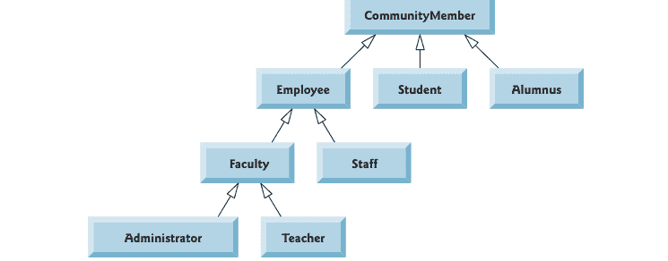

**图 9.2** | 大学社区成员（University CommunityMembers）的继承层次结构 UML 类图。

层次结构中的每个箭头都代表一个“是”关系。当我们沿着此层次结构中的箭头向上移动时，我们可以说，“员工（Employee）是社区成员（CommunityMember）”，以及“教师（Teacher）是教职人员（Faculty member）”。CommunityMember 是 Employee、Student（学生）的直接超类，而 Alumni（校友）是图中所有其他类的间接超类。从底部开始，你可以沿着箭头并将“是”关系应用到顶部的超类。例如，管理人员（Administrator）是教职人员，员工是社区成员，而且当然是一个对象（Object）。

**形状层次结构**

现在考虑图 9.3 中的 Shape（形状）继承层次结构。该层次结构从子类 Shape 开始，它被子类 TwoDimensionalShape（二维形状）和 ThreeDimensionalShape（三维形状）所扩展——形状要么是二维形状，要么三维形状。该层次结构的第三层包含特定类型的二维形状和三维形状。与图 9.2 所示，我们可以从从底部箭头指向该类层次结构中顶部的超类，识别出几个“是”关系。例如，Triangle（三角形）是一个二维形状且是一个 Shape，而 ThreeDimensionalShape 是一个 Shape。该层次结构可能包含许多其他类。例如，椭圆（ellipses）和梯形（trapezoids）也是二维形状。

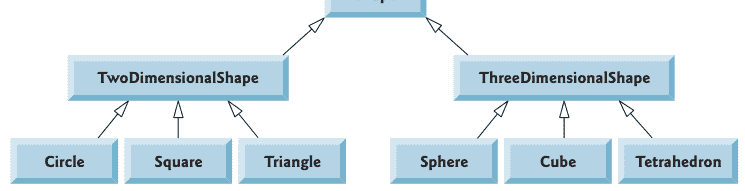

**图 9.3** | 形状（Shapes）的继承层次结构 UML 类图。

并不是所有的类关系都是继承关系。在第 8 章中，我们讨论了“包含”（has-a）关系，其中类拥有指向其他类的成员。此类关系通过现有类的组合来创建类。例如，给定类 Employee（员工）、BirthDate（出生日期）和 TelephoneNumber（电话号码），说一个 Employee 是一个 BirthDate 或一个 Employee 是一个 TelephoneNumber是不恰当的。然而，一个 Employee 拥有 BirthDate，一个 Employee 拥有 TelephoneNumber。

子类和子类对象可以以相似的方式处理——共性在超类的成员中表示。扩展共同超类的类对象可以被视为该超类的对象——此类对象与超类有“是”关系。我们将在本章稍些部分和第 10 章中详细介绍，并考虑许多利用“是”关系的示例。

子类可以自定义其继承自超类的方法。为此，子类通过适当的实现重写（重定义）超类方法，正如我们在子类的代码示例中看到的。

## 9.3 protected 成员

第 8 章讨论了 public（公共）和 private（私有）。类的公共成员在该类对象或其任一子类随时可访问。类的私有成员仅在类内部可访问。在本节中，我们引入访问修饰符 protected。使用 protected 访问提供了 public 和 private 之间的中间访问级别。超类的保护成员可以被其子类的成员访问，也可以被同一包内其他类的访问——protected 成员还具有包访问权限（package access）。

所有 public 和 protected 子类成员在成为子类成员时仍保留其原始的访问修饰符——超类的公共成员变为子类的公共成员，超类的保护成员变为子类的受保护成员。子类的私有成员在类外部是不可访问的。相反，它们对其子类隐藏，只能通过……访问。

子类可以自定义其继承自超类的方法。为此，子类通过适当的实现重写（重定义）超类方法，正如我们在子类的代码示例中看到的。

## 9.4 超类与子类之间的关系

我们现在使用一个包含公司类型的继承层次结构来讨论超类和子类之间的关系。在这个公司中，佣金员工（commission employees，作为子类的对象）获得销售提成，而底薪员工（base-based employees，作为子类的对象）获得底薪加销售提成。

我们将这些类关系的讨论分为五个示例：

- 第一个类 CommissionEmployee，直接继承自 Object 并声明实例变量 firstName、lastName、socialSecurityNumber、commission rate。
- 第二个示例类 BasePlusEmployee，直接继承自 Object 并声明 firstName、lastName、socialSecurityNumber、commission rate 和 salary。
- 第三个示例类 BasePlusEmployee 扩展 CommissionEmployee（拥有 salary）。这种软件让我们编写更少的代码。在此示例中，BasePlusEmployee 尝试访问 CommissionEmployee 的私有成员——会导致编译错误。
- 第四个示例显示，如果 CommissionEmployee 的实例变量声明为 public，BasePlusEmployee 子类可以直接访问该数据。两个 Employee 类包含相同的功能，但我们展示了继承版本更容易创建。
- 第五个示例在讨论保护变量的便利性后，将 CommissionEmployee 的实例变量设回 private 以实施良好的软件工程。然后我们展示 BasePlusEmployee 如何使用 CommissionEmployee 的公共方法来操作（受控方式）继承自 CommissionEmployee 的私有变量。

### 9.4.1 创建和使用 CommissionEmployee 类

我们从声明 class CommissionEmployee 开始（图 9.4）。第 4 行开始并指示类 CommissionEmployee 扩展（即继承）类 Object（来自 package.lang）。这允许类 CommissionEmployee 继承 Object 的方法——类 Object 没有字段。如果你没有显式指定一个没有 extends 的新类，该类将隐式扩展 Object。因此，你通常不会在代码中包含 "extends Object"——我们在示例中这样做仅是为了演示。

CommissionEmployee 类的方法和实例变量概述

CommissionEmployee 的公共服务包括构造函数（第 13–34 行）和方法 earnings（第 87–90 行）。第 37–52 行为最终实例变量（声明在第 6–8 行）firstName、lastName 和 socialSecurityNumber 声明了公共 getter 方法。这三个实例变量被声明为 final，因为它们在初始化后不需要修改——这就是为什么我们未提供相应的 set 方法。第 55–84 行为该类的 `grossSales` 和 `commissionRate` 实例变量（声明在第 9–10 行）声明了公有的 set 和 get 方法。该类将实例声明为私有，因此其他类的对象无法直接访问这些


// Fig. 9.4: CommissionEmployee.java

// CommissionEmployee 类代表一个按销售额百分比支付佣金的员工。

```java
public class CommissionEmployee extends Object {

    private final String firstName;
    private final String lastName;
    private final String socialSecurityNumber;
    private double grossSales; // 每周销售额
    private double commissionRate; // 佣金比例

    // 五参数构造函数
    public CommissionEmployee(String firstName, String lastName,
            String socialSecurityNumber, double grossSales, double commissionRate) {

        // 此处隐式调用 Object 的默认构造函数
        if (grossSales < 0.0)
            throw new IllegalArgumentException("Gross sales must be >= 0.0");

        if (commissionRate <= 0.0 || commissionRate >= 1.0)
            throw new IllegalArgumentException("Commission rate must be > 0.0 and < 1.0");

        this.firstName = firstName;
        this.lastName = lastName;
        this.socialSecurityNumber = socialSecurityNumber;
        this.grossSales = grossSales;
        this.commissionRate = commissionRate;
    }

    // 返回名字
    public String getFirstName() {
        return firstName;
    }

    // 返回姓氏
    public String getLastName() {
        return lastName;
    }

    // 返回社会安全号
    public String getSocialSecurityNumber() {
        return socialSecurityNumber;
    }

    // 设置销售额金额
    public void setGrossSales(double grossSales) {
        if (grossSales < 0.0)
            throw new IllegalArgumentException("Gross sales must be >= 0.0");
        this.grossSales = grossSales;
    }

    // 返回销售额金额
    public double getGrossSales() {
        return grossSales;
    }

    // 设置佣金比例
    public void setCommissionRate(double commissionRate) {
        if (commissionRate <= 0.0 || commissionRate >= 1.0)
            throw new IllegalArgumentException("Commission rate must be > 0.0 and < 1.0");
        this.commissionRate = commissionRate;
    }

    // 返回佣金比例
    public double getCommissionRate() {
        return commissionRate;
    }

    // 计算收益
    public double earnings() {
        return commissionRate * grossSales;
    }

    @Override // 表示此方法重写超类方法
    // 返回 CommissionEmployee 对象的字符串表示
    public String toString() {
        return String.format("%s: %s %s%n%s: %s%n%s: %.2f%n%s: %.2f",
                "commission employee", firstName, lastName,
                "social security number", socialSecurityNumber,
                "gross sales", grossSales,
                "commission rate", commissionRate);
    }
}
```

图 9.4 | `CommissionEmployee` 类代表一个按销售额百分比支付佣金的员工。

## 9.4 超类与子类之间的关系

### 类 `CommissionEmployee` 构造函数

构造函数是不被继承的，因此 `CommissionEmployee` 类不继承 `Object` 类的构造函数。然而，超类的构造函数仍然可以被子类调用。在 Java 中，任何子类构造函数的第一个任务都是调用其直接父类的构造函数（显式或隐式，如果没有指定构造函数），以确保从超类继承的变量正确初始化。调用超类构造函数的语法将在 9.4.3 节中讨论。在本示例中，`CommissionEmployee` 类的构造函数隐式调用了 `Object` 的构造函数。图 9.4 中的注释指示了隐式调用超类 `Object` 构造函数的位置（你不需要编写该调用的代码）。

未提供相应的 set 方法。第 55–84 行为该类的 `grossSales` 和 `commissionRate` 实例变量（声明在第 9–10 行）声明了公有的 set 和 get 方法。该类将实例变量声明为私有，因此其他类的对象无法直接访问这些变量。


## 9.4 超类与子类之间的关系

### 图 9.4 CommissionEmployee 类

**图 9.4** `CommissionEmployee` 类代表一个按销售额百分比支付佣金的员工。（3 部分中的第 1 部分）。

```java
// Fig. 9.4: CommissionEmployee.java
// CommissionEmployee 类代表一个按销售额百分比支付佣金的员工。

public class CommissionEmployee extends Object
{
    private final String firstName;
    private final String lastName;
    private final String socialSecurityNumber;
    private double grossSales; // 每周销售额
    private double commissionRate; // 佣金比例

    // 五参数构造函数
    public CommissionEmployee(String firstName, String lastName,
        String socialSecurityNumber, double grossSales, double commissionRate)
    {
        // 此处隐式调用 Object 的默认构造函数
        if (grossSales < 0.0)
            throw new IllegalArgumentException("Gross sales must be >= 0.0");
        if (commissionRate <= 0.0 || commissionRate >= 1.0)
            throw new IllegalArgumentException("Commission rate must be > 0.0 and < 1.0");

        this.firstName = firstName;
        this.lastName = lastName;
        this.socialSecurityNumber = socialSecurityNumber;
        this.grossSales = grossSales;
        this.commissionRate = commissionRate;
    }

    // 返回名字
    public String getFirstName()
    {
        return firstName;
    }

    // 返回姓氏
    public String getLastName()
    {
        return lastName;
    }

    // 返回社会安全号
    public String getSocialSecurityNumber()
    {
        return socialSecurityNumber;
    }

    // 设置销售额金额
    public void setGrossSales(double grossSales)
    {
        if (grossSales < 0.0)
            throw new IllegalArgumentException("Gross sales must be >= 0.0");
        this.grossSales = grossSales;
    }

    // 返回销售额金额
    public double getGrossSales()
    {
        return grossSales;
    }

    // 设置佣金比例
    public void setCommissionRate(double commissionRate)
    {
        if (commissionRate <= 0.0 || commissionRate >= 1.0)
            throw new IllegalArgumentException("Commission rate must be > 0.0 and < 1.0");
        this.commissionRate = commissionRate;
    }

    // 返回佣金比例
    public double getCommissionRate()
    {
        return commissionRate;
    }

    // 计算收益
    public double earnings()
    {
        return commissionRate * grossSales;
    }

    @Override // 表示此方法重写超类方法
    // 返回 Employee 对象的字符串表示
    public String toString()
    {
        return String.format("%s: %s %s%n%s: %s%n%s: %.2f%n%s: %.2f",
            "commission employee", firstName, lastName,
            "social security number", socialSecurityNumber,
            "gross sales", grossSales,
            "commission rate", commissionRate);
    }
} // 类 CommissionEmployee 结束
```

**图 9.4** `CommissionEmployee` 类代表一个按销售额百分比支付佣金的员工。（3 部分中的第 2 部分）。

| 行号 | 内容 |
| :--- | :--- |
| 99 | "gross sales", grossSales |
| 100 | "commission rate", commissionRate |
| 101 | } |
| 102 | // 类 CommissionEmployee 结束 |

**图 9.4** `CommissionEmployee` 类代表一个按销售额百分比支付佣金的员工。（3 部分中的第 3 部分）。

### 类 CommissionEmployee 构造函数

构造函数是不被继承的，因此 `CommissionEmployee` 类不继承 `Object` 类的构造函数。然而，超类的构造函数仍然可以被子类调用。在 Java 中，任何子类构造函数的第一个任务都是调用其直接父类的构造函数（显式或隐式，如果没有指定构造函数），以确保从超类继承的变量正确初始化。调用超类构造函数的语法将在 9.4.3 节中讨论。在本示例中，`CommissionEmployee` 类的构造函数隐式调用了 `Object` 的构造函数。如果代码不包含对超类构造函数的显式调用，Java 会隐式调用子类的默认或无参数构造函数。图 9.4 第 17 行的注释指示了隐式调用超类 `Object` 构造函数的位置（你不需要编写该调用的代码）。

---

### 图 9.5 CommissionEmployee 类测试程序

```java
// Fig. 9.5: CommissionEmployeeTest.java
// CommissionEmployee 类测试程序.

public class CommissionEmployeeTest
{
    public static void main(String[] args)
    {
        // 实例化 CommissionEmployee 对象
        CommissionEmployee employee = new CommissionEmployee(
            "Sue", "Jones", "222-2222", 10000, .06);

        // 获取 commission employee 数据
        System.out.println("Information obtained by get methods:");
        System.out.printf("%s %s%n", "First name is", employee.getFirstName());
        System.out.printf("%s %s%n", "Last name is", employee.getLastName());
        System.out.printf("%s %s%n", "Social security number is", employee.getSocialSecurityNumber());
        System.out.printf("%s %.2f%n", "Gross sales is", employee.getGrossSales());
        System.out.printf("%s %.2f%n", "Commission rate is", employee.getCommissionRate());

        employee.setGrossSales(5000);
        employee.setCommissionRate(.1);

        System.out.printf("%n%s%n%n%s%n",
            "Updated employee information obtained by toString", employee);
    }
} // end class CommissionEmployeeTest
```

**输出结果：**

通过 get 方法获取员工信息：
名字是 Sue
姓是 Jones
社会安全号是 222-2222
总销售额是 10000.00
佣金率是 0.06

通过 toString 获取的更新员工信息：
commission employee: Sue Jones
social security number: 222-2222
gross sales: 5000.00
commission rate: 0.10

**图 9.5** `CommissionEmployee` 类测试程序。

---

### 9.4.2 创建和使用 BasePlusCommissionEmployee 类

我们通过声明和测试（一个完全新且独立的）类 `BasePlusCommissionEmployee`（图 9.6）来讨论继承介绍的第二部分，该类包含名、姓、社会安全号、总销售额金额、佣金率和基本薪水。`BasePlusCommissionEmployee` 的公共服务包括 `BasePlusCommissionEmployee` 构造函数（第 15–42 行）以及方法 `earnings`（第 111–114 行）和 `toString`（第 117–126 行）。第 45–48 行为类的私有实例变量（在第 7–12 行声明）声明了公共 get 和 set 方法 `firstName`、`lastName`、`socialSecurityNumber`、`grossSales`、`commissionRate` 和 `baseSalary`。这些变量和方法封装了基本工资佣金员工的所有必要特征。该类与 `CommissionEmployee`（图 9.4）之间的相似性——在本例中，我们不会利用这种相似性。

**图 9.6** `BasePlusCommissionEmployee.java`

```java
// BasePlusCommissionEmployee.java
// BasePlusCommissionEmployee 类代表一个除了佣金外还有基本工资的员工。

public class BasePlusCommissionEmployee
{
    private final String firstName;
    private final String lastName;
    private final String socialSecurityNumber;
    private double grossSales; // 每周销售额
    private double commissionRate; // 佣金百分比
    private double baseSalary; // 每周基本工资

    // 六参数构造函数
    public BasePlusCommissionEmployee(String firstName, String lastName,
        String socialSecurityNumber, double grossSales,
        double commissionRate, double baseSalary)
    {
        // 构造函数体...
    }
    // ... 其他方法
}
```


// 如果 grossSales 无效则抛出异常

if (`grossSales < 0.0`)

    throw new `IllegalArgumentException`(

        "Gross sales must be >= 0.0");

// 如果 commissionRate 无效则抛出异常

if (`commissionRate < 0.0 || commissionRate >= 1.0`)

    throw new `IllegalArgumentException`(

        "Commission rate must be > 0.0 and < 1.0");

// 如果 baseSalary 无效则抛出异常

if (`baseSalary < 0.0`)

    throw new `IllegalArgumentException`(

        "Base salary must be >= 0.0");

```

Fig. 9.6 | BasePlusCommissionEmployee 类代表一个除了佣金外还接收基本工资的员工。（3 部分中的第 I 部分。）

```

this.firstName = firstName;

this.lastName = lastName;

this.socialSecurityNumber = socialSecurityNumber;

this.grossSales = grossSales;

this.commissionRate = commissionRate;

this.baseSalary = baseSalary;

// 构造函数结束

// 返回名

public String getFirstName() {

    return firstName;

}

// 返回姓

public String getLastName() {

    return lastName;

}

// 返回社会安全号

public String getSocialSecurityNumber() {

    return socialSecurityNumber;

}

// 设置总销售额

public void setGrossSales(double grossSales) {

    if (grossSales < 0.0) {

        throw new IllegalArgumentException("Gross sales must be >= 0.0");

    }

    this.grossSales = grossSales;

}

// 返回总销售额

public double getGrossSales() {

    return grossSales;

}

// 设置佣金率

public void setCommissionRate(double commissionRate) {

    if (commissionRate < 0.0 || commissionRate >= 1.0) {

        throw new IllegalArgumentException("Commission rate must be > 0.0 and < 1.0");

    }

    this.commissionRate = commissionRate;

}

// 返回佣金率

public double getCommissionRate() {

    return commissionRate;

}

// 设置基本薪水

public void setBaseSalary(double baseSalary) {

    if (baseSalary < 0.0) {

        throw new IllegalArgumentException("Base salary must be >= 0.0");

    }

    this.baseSalary = baseSalary;

}

// 返回基本薪水

public double getBaseSalary() {

    return baseSalary;

}

// 计算收益

// 更新后的 employee 的字符串表示

@Override

public String toString() {

    return String.format("%s %s %s, %.2f, %.2f, %.2f",

        "BasePlusCommissionEmployee", firstName,

        lastName, socialSecurityNumber,

        grossSales, baseSalary);

}

public double earnings() {

    return baseSalary + (commissionRate * grossSales);

```

**Fig. 9.6 BasePlusCommissionEmployee 代表一个除了佣金外还接收基本工资的员工。（3 部分中的第 II 部分。）

## 9.4 超类与子类之间的关系 373

```

// 返回佣金率

public double getCommissionRate() {

    return commissionRate;

}

// 设置基本薪水

public void setBaseSalary(double baseSalary) {

    if (baseSalary < 0.0) {

        throw new IllegalArgumentException("Base salary must be >= 0.0");

    }

    this.baseSalary = baseSalary;

}

// 返回基本薪水

public double getBaseSalary() {

    return baseSalary;

}

// 计算收益

// 更新后的 employee 的字符串表示

@Override

public String toString() {

    return String.format("%s %s %s, %.2f, %.2f, %.2f",

        "BasePlusCommissionEmployee", firstName,

        lastName, socialSecurityNumber,

        grossSales, baseSalary);

}

public double earnings() {

    return baseSalary + (commissionRate * grossSales);

}

```

## 317 第 9 章 面对象编程：继承

### Testing Class BasePlusCommissionEmployee

Figure 9.7 测试 `BasePlusCommissionEmployee` 类。第 9–11 行创建一个 `BasePlusCommissionEmployee` 对象并将 "Bob", "Lewis", "333-3333", 5000, .04 和 300 分别传递给构造函数的名、姓、社会安全号、总销售额、佣金率和基本薪水。第 16–27 行使用 `BasePlusCommissionEmployee` 方法获取对象的实例变量值并输出。第 29 行调用 `setBaseSalary` 方法更改基本薪水。9.6，第 95–102 行确保变量不会被赋值负值。图 9.7 的第 33 行显式调用 `toString` 方法以获取对象的字符串表示。

```

// Fig. 9.7: BasePlusCommissionEmployee.java

// BasePlusCommissionEmployee test程序.

public class BasePlusCommissionEmployeeTest {

    public static void main(String[] args) {

        // instantiateBaseCommissionEmployee employee =

        BasePlusCommissionEmployee employee = new BasePlusCommissionEmployee(

            "Bob", "Lewis", "333-3333", 5000, .04, 300);

        // get-basesalary commission employee data

        System.out.println("Employee information obtained by get methods:");

        System.out.printf("%s%n", "First name is:");

        employee.getFirstName());

        System.out.printf("%s%n", "Last name is:");

        employee.getLastName());

        System.out.printf("%s%n", "Social security number is:");

        employee.getSocialSecurityNumber());

        System.out.printf("%%.2f%%n", "Gross sales is:");

        employee.getGrossSales());

        System.out.printf("%%.2f%%n", "Commission rate is:");

        employee.getCommissionRate());

        System.out.printf("%%.2f%%n", "Base salary is:");

        employee.getBaseSalary());

        employee.setBaseSalary(1000);

        System.out.printf("%s%n%s%n%s%n",

        "Updated employee information obtained by toString:",

        employee.toString());

    } // end main

} // class BasePlusCommissionEmployeeTest

```


## 9.4 超类与子类之间的关系 375

| 通过 get 方法获取的员工信息 |
| :--- |
| 名字为 Bob |
| 姓为 Lewis |
| 社会安全号为 333-33-3333 |
| 总销售额为 5000.00 |
| 佣金率为 0.04 |
| 基本工资为 300.00 |

通过 toString 获取的更新员工信息：
底薪佣金员工: Bob Lewis
社会安全号: 333-33-3333
总销售额: 5000.00
佣金率: 0.04
基本工资: 1000.00

图 9.7 | BasePlusCommissionEmployee 测试程序。（2 部分中的第 2 部分。）

### 关于 BasePlusCommissionEmployee 类的说明

`BasePlusCommissionEmployee` 类的大部分代码（图 9.6）与 `Employee` 类（图 9.4）相似或完全相同。例如，私实例变量 `firstName` 以及方法 `setName`、`getFirstName`、`setName` 和 `getLast` 与 `Employee` 类的完全相同。这些类还包含私实例变量 `securityNumber`、`commissionRate` 和 `grossSales`，以及相应的 get 和 set 方法。此外，`BasePlusCommissionEmployee` 与 `Employee` 类几乎相同，不同之处 `BasePlusCommissionEmployee` 的构造函数还设置了 `baseSalary`。`BasePlusCommissionEmployee` 类的其他新增内容是私实例变量 `baseSalary` 以及方法 `setBaseSalary` 和 `getBaseSalary`。`BasePlusCommissionEmployee` 的 `toString` 与 `Employee` 类几乎相同，不同在于它输出的小数点后保留两位数字的实例变量 `baseSalary`。

> 我们发现这种“复制-粘贴”的方法往往容易出错且耗费精力。糟糕的是，它在整个系统中复制了同一个类的代码，导致了代码维护问题——这些代码需要在多个类中存在。是否有一种方法可以“获取”一个类的实例变量和方法，并使其成为其他类的一部分，而无需重复代码？在接文中我们将回答这个问题，并使用一种更优雅的方法来构建类，这种方法强调了继承的好处。

## 软件工程观察 9.3

通过继承，层次结构中所有类都相同的实例变量和方法被声明在超类中。对超类中这些某些特征的更改将由子类继承。如果没有继承，则需要对包含相关代码副本的所有源代码文件进行修改。

376 第 9 章 面向对象--继承

## 9.4.3 创建佣金员工——BasePlusCommissionEmployee 继承层次结构

现在我们声明 `BasePlusCommissionEmployee`（图 9.8）继承自 `CommissionEmployee` 类（图 9.4）。一个 `BasePlusCommissionEmployee` 对象是一个 `CommissionEmployee`，因为继承传递了 `CommissionEmployee` 类的能力。`BasePlusCommissionEmployee` 类还拥有实例变量 `baseSalary`（图 9.8，第 6 行）。`extends` 关键字（第 4 行）表示继承。`BasePlusCommissionEmployee` 继承了 `CommissionEmployee` 的实例变量和方法。

## 软件工程观察 9.4

在面向对象系统的设计阶段，你经常会发现类之间是紧密相关的。你应该“提取”公共实例变量并将它们放置在超类中。然后使用继承来开发子类，通过从超类继承的能力对它们进行专门化。


## 软件工程观察 9.5

声明子类不会影响其子类的源代码。继承保留了子类的完整性。

只有 `CommissionEmployee` 的公共和受保护成员在子类中可以直接访问的。`CommissionEmployee` 的构造函数不被继承。因此，公有的 `BasePlusCommissionEmployee` 服务包括构造函数（第 9–23 行）、继承自 `CommissionEmployee` 的公共方法，以及方法 `setBaseSalary`（第 26–33 行）、`earnings`（第 42–47 行）和 `toString`（第 50–60 行）。`earnings` 和 `toString` 方法重写了 `CommissionEmployee` 类中对应的方法，因为它们的子类版本分别无法正确计算 `BasePlusCommissionEmployee` 的收益，或无法返回适当的字符串表示。

```

// Fig 9.8: BasePlusCommissionEmployee.java

// 子类中无法访问超类的私有成员。

public class BasePlusCommissionEmployee extends CommissionEmployee

{

    private double baseSalary; // 每周基本工资

    // 六参数构造函数

    public BasePlusCommissionEmployee(String firstName, String lastName,

        String securityNumber, double grossSales,

        double commissionRate, double baseSalary){

        // 显式调用 super CommissionEmployee 构造函数

        super(firstName, lastName, securityNumber,

            grossSales, commissionRate);

        // 如果 baseSalary 无效则抛出异常

        if (baseSalary < 0.0)

            throw new IllegalArgumentException(

                "Base salary must be >= 0.0");

}

```

图 9.8 | 子类中无法访问超类的私有成员。（3 部分中的第 1 部分。）

## 9.4 超类与子类之间的关系 377

```

this.baseSalary = baseSalary;

}

    // 设置基本工资

    public void setBaseSalary(double baseSalary)

{

        if (baseSalary < 0.0)

            throw new IllegalArgumentException("Base salary must be >= 0.0");

        this.baseSalary = baseSalary;

    }

    // 返回基本工资

    public double getBaseSalary()

{


```java
return baseSalary;
}

// 计算收益
@Override
public double earnings() {
    // 调用父类的 earnings 方法
    return super.earnings() + baseSalary;
}

// 返回 BasePlusCommissionEmployee 的字符串表示
@Override
public String toString() {
    // 允许访问父类的公共方法
    return String.format("%s %s\nSSN: %s\nSales: %.2f\nRate: %.2f\nBase: %.2f",
        getFirstName(), getLast(), getSecurityNumber(),
        getGrossSales(), getCommissionRate(), baseSalary);
}
} // BasePlusCommissionEmployee 类
```

```
BasePlusCommissionEmployee.java:46: 错误：无法访问超类 commissionRate
    return baseSalary + commissionRate;
BasePlusCommissionEmployee.java:46: 错误：无法访问超类 grossSales
    return baseSalary + commissionRate;
BasePlusCommissionEmployee.java:56: 错误：无法访问超类 firstName
    "base-salaried employee", firstName,
```

**图 9.8** | 子类中无法访问超类的私有成员。（3 部分中的第 2 部分）。

378 第 9 章 面向对象--继承

```
BasePlusCommissionEmployee.java:56: 错误：无法访问超类 lastName
    "base-salaried employee", firstName, lastName,
BasePlusCommissionEmployee.java:57: 错误：无法访问超类 securityNumber
    "SSN: %s", securityNumber,
BasePlusCommissionEmployee.java:58: 错误：无法访问超类 grossSales
    "%.2f", grossSales,
BasePlusCommissionEmployee.java:58: 错误：无法访问超类 commissionRate
    "%.2f", commissionRate,
```

**图 9.8** | 子类中无法访问私有成员

### 子类构造函数必须调用其超类构造函数

每个子类构造函数都必须隐式或显式地调用其超类构造函数，以初始化继承自超类的实例变量。`BasePlusCommissionEmployee` 六参数构造函数（第 9–23 行）中的第 14–15 行显式地调用了 `Employee` 的五参数构造函数（图 9.4 第 13–33 行），以初始化 `BaseEmployee` 对象的超类部分（即变量 `firstName`、`lastName`、`securityNumber`、`grossSales` 和 `commissionRate`）。我们通过使用超类构造调用关键字以及包含超类构造参数的括号来实现。如果 `BaseEmployee` 的构造函数没有显式调用超类构造函数，编译器将尝试插入对超类默认或无参数构造函数的调用。`Employee` 类没有这样的构造函数，因此编译器会报错。图 9.8 第 14–15 行的子类构造调用将是构造体的第一语句。当子类包含无参数构造函数时，可以使用 `super()` 显式调用该构造函数，但很少这样做。

> #### 软件工程观察 9.6
> 你之前学过不应该在构造函数中调用类的方法，我们将在第 10 章中说明。

#### BasePlusCommissionEmployee 方法 earnings 和 toString

编译器为第 46 行（图 9.8）生成错误，因为 `BasePlusEmployee` 的实例变量 `commissionRate` 和 `grossSales` 是私有的——子类 `BasePlusCommissionEmployee` 方法不允许访问超类 `BasePlusEmployee` 的私有变量。我们在图 9.8 中使用了红色文本指示错误代码。编译器由于相同的原因引发了额外的错误。`BasePlusEmployee` 中的错误可以使用从 `Employee` 类继承的 get 方法来避免。

## 9.4 超类与子类之间的关系

例如，第 46 行可以调用 `getCommissionRate` 和 `getGrossSales` 来分别访问 `CommissionEmployee` 的私有实例变量 `commissionRate` 和 `grossSales`。第 56–58 行也可以使用适当的方法获取超类实例变量的值。

### 9.4.4 使用保护实例变量的 CommissionEmployee-BasePlusCommissionEmployee 继承

为了使 `BasePlusCommissionEmployee` 类能够直接访问实例变量 `firstName`、`lastName`、`securityNumber`、`grossSales` 和 `commissionRate`，我们在超类中将它们声明为 `protected`。正如我们在 9.3 节中讨论的，超类的保护成员可以被该类的所有子类访问。在新的 `CommissionEmployee` 类中，我们修改了图 9.4 的第 6–10 行，使用 `protected` 访问修饰符声明变量如下：

```java
protected final String firstName;
protected final String lastName;
protected final String securityNumber;
protected double grossSales; // 周销售额
protected double commissionRate; // 佣金百分比
```

声明的其余部分（此处未显示）与图 9.4 相同。我们本可以将 `CommissionEmployee` 的实例变量声明为 `public` 以启用它们。然而，将实例声明为 `public` 是糟糕的软件工程做法，因为它允许任何类对变量进行无限制访问，增加了错误的概率。通过使用保护实例变量，子类可以访问这些变量，但不是子类且不在同一包中的类无法访问这些变量——记住，保护成员对同一包中的其他类也是可见的。

#### BasePlusCommissionEmployee 类

`BasePlusCommissionEmployee`（图 9.9）继承了带有保护实例变量的新版本 `CommissionEmployee`。`BasePlusCommissionEmployee` 继承了保护实例变量 `firstName`、`lastName`、`securityNumber`、`grossSales` 和 `commissionRate`——这些变量现在都是 `BasePlusCommissionEmployee` 的保护成员。因此，在编译 `earnings` 方法的第 45 行以及 `toString` 方法的第 54–56 行时，编译器不会产生错误。如果另一个类可以使用 `BasePlusCommissionEmployee` 类的扩展，新的子类也可以访问这些保护成员。

```java
// Fig. 9.9: BasePlusCommissionEmployee.java
// BasePlusCommissionEmployee 继承自 CommissionEmployee
// 的保护实例变量
public class BasePlusCommissionEmployee extends CommissionEmployee {
    private double baseSalary; // 每周基础工资

// 六参数构造函数
public BasePlusCommissionEmployee(String firstName, String lastName,
    String socialSecurityNumber, double grossSales,
    double commissionRate, double baseSalary) {
    super(firstName, lastName, socialSecurityNumber,
        grossSales, commissionRate);
    // 如果 baseSalary 无效，则抛出异常
    if (baseSalary < 0.0)
        throw new IllegalArgumentException(
            "Base salary must be >= 0.0");
    this.baseSalary = baseSalary;
}

// 设置基础工资
public void setBaseSalary(double baseSalary) {
    if (baseSalary < 0.0)
        throw new IllegalArgumentException(
            "Base salary must be >= 0.0");
    this.baseSalary = baseSalary;
}

// 返回基础工资
public double getBaseSalary() {
    return baseSalary;
}

// 计算收益
@Override // 表示此方法重写了超类方法
public double earnings() {
    return baseSalary + (commissionRate * grossSales);
}

// 返回 BasePlusCommissionEmployee 的字符串表示
@Override
public String toString() {
    return String.format(
        "%s: %s %s: %s %s: %.2f %s: %.2f %s: %.2f",
        "base-salaried commission-employee", firstName, lastName,
        "social security number", socialSecurityNumber,
        "gross sales", grossSales, "commission rate", commissionRate,
        "base salary", baseSalary);
}
// // BasePlusCommissionEmployee 类结束
}
```

**图 9.9** | BasePlusCommissionEmployee 继承自 CommissionEmployee 的保护实例变量。（2 部分，共 2 部分）。

### 子类包含其所有超类的实例变量

当你创建一个 `BasePlusCommissionEmployee` 时，它包含了类层级结构中声明的所有实例变量——即从 `Object`（不包含实例变量）、`CommissionEmployee` 到 `BasePlusCommissionEmployee` 的变量。`BasePlusCommissionEmployee` 没有继承 `CommissionEmployee` 的五参数构造函数，而是显式地调用它（第 14–15 行），以初始化 `BasePlusCommissionEmployee` 从 `CommissionEmployee` 继承的实例变量。同样，`CommissionEmployee` 的构造函数必须显式地调用 `Object` 的构造函数。`BasePlusCommissionEmployee` 的构造函数必须显式调用 `CommissionEmployee` 的构造函数，因为 `CommissionEmployee` 没有可以调用的无参数构造函数。

此示例的测试类 `BasePlusCommissionEmployeeTest` 与图 9.7 相同并产生相同的输出，因此我们没有显示它。虽然图 9.6 中的 `BasePlusCommissionEmployee` 类没有使用继承，而图 9.9 版本使用了，但这两个类提供了相同的功能。源代码更短，因为 `CommissionEmployee` 函数只有一份。这使得代码更容易维护、修改和调试，因为与 `CommissionEmployee` 相关的代码仅存在于该类中。

### 关于使用保护实例变量的说明

在本示例中，我们将超类实例变量声明为 `protected`，以便子类可以访问它们。继承保护实例变量允许子类直接访问变量。但在大多数情况下，使用访问方法来操作实例变量是更好的做法。使用保护实例变量会产生许多问题。首先，子类可以不使用方法而直接给变量赋值，导致对象处于不一致状态。例如，如果我们将 `CommissionEmployee` 的变量声明为保护的，子类可能会给变量赋值非法值。使用实例变量的另一个问题是子类依赖于超类的实现。在实践中，子类应依赖于超类的服务（即非私有方法），而不是实现。如果我们决定更改实例变量的名称，`earnings` 和 `toString` 的声明不需要修改——只有直接引用实例变量的 get 和 set 方法体需要修改。这些更改仅发生在超类内部——不需要修改子类。局部化更改是良好的软件工程实践。子类（例如 `BasePlusCommissionEmployee`）可能会给变量赋值负值。

> **软件工程观察 9.7**：当超类应仅向子类和同一包中的类提供方法，而不向其他类时，使用 `protected` 访问修饰符。
>
> **软件工程观察 9.8**：将实例变量声明为保护的允许超类的实例变量实现发生变化而不影响子类。
>
> **错误预防提示 9.2**：如果可能，不要在超类中包含实例变量。相反，考虑使用访问实例变量的非私有方法。这将有助于类对象保持一致。

### 9.4.5 使用私有变量的 Employee-BasePlusCommissionEmployee 继承

让我们再次检查我们的层级结构，这次使用良好的软件工程实践。

#### CommissionEmployee 类

`CommissionEmployee` 类（图 9.10）声明了实例变量 `firstName`、`lastName`、`securityNumber`、`grossSales` 和 `commissionRate`（第 6–10 行），并提供了用于操作这些值的公共方法 `getFirstName`、`getLast`、`getSecurityNumber`、`setGrossSales`、`getGrossSales`、`setCommissionRate`、`getCommissionRate` 和 `toString`。方法 87–90 使用这些方法获取实例变量的值。如果我们决定更改实例变量的名称，`earnings` 和 `toString` 的声明不需要修改——只有直接引用实例变量的 get 和 set 方法体需要更改。这些更改仅发生在超类内部——不需要修改子类。局部化更改是良好的软件工程实践。

```java
// Fig. 9.10: CommissionEmployee.java
// CommissionEmployee 类使用方法操作其
// 私有实例变量
public class CommissionEmployee {
    private final String firstName;
    private final String lastName;
    private final String securityNumber;
    private double grossSales; // 周销售额
    private double commissionRate; // 佣金百分比
}
```

**图 9.10** CommissionEmployee 类使用方法操作其私有实例变量（3 部分，共 3 部分）。

## 9.4 超类与子类之间的关系

```java
// 五参数构造函数
public CommissionEmployee(String firstName, String lastName,
    String socialSecurityNumber, double grossSales,
    double commissionRate) {
    // 隐式调用 Object 构造函数
    // 如果 grossSales 无效，则抛出异常
    if (grossSales < 0.0)
        throw new IllegalArgumentException(
            "Gross sales must be >= 0.0");
    // 如果 commissionRate 无效，则抛出异常
    if (commissionRate < 0.0 || commissionRate >= 1.0)
        throw new IllegalArgumentException(
            "Commission rate must be > 0.0 and < 1.0");
    this.firstName = firstName;
    this.lastName = lastName;
    this.socialSecurityNumber = socialSecurityNumber;
    this.grossSales = grossSales;
```


# 第 9 章 面向对象编程：继承

## CommissionEmployee 类

```java
this.commissionRate = commissionRate;
}

// 返回名字
public String getFirstName()
{
    return firstName;
}

// 返回姓
public String getLastName()
{
    return lastName;
}

// 返回社会安全号
public String getSocialNumber()
{
    return socialSecurityNumber;
}

// 设置总销售额
public void setGrossSales(double grossSales)
{
    if (grossSales < 0.0)
        throw new IllegalArgumentException(
            "Gross sales must be >= 0.0");
    this.grossSales = grossSales;
}
```

图 9.10 CommissionEmployee 类使用方法来操作其私有实例变量。（3 部分中的第 1 部分。）

```java
63 64  // 返回总销售额
65  public double getGrossSales()
66  {
67      return grossSales;
68  }

69  // 设置佣金率
70  public void setCommissionRate(double commissionRate)
71  {
72      if (commissionRate <= 0.0 || commissionRate >= 1.0)
73          throw new IllegalArgumentException(
74              "Commission rate must be > 0.0 and < 1.0");
75      }
76      this.commissionRate = commissionRate;
77  }

78  // 返回佣金率
79  public double getCommissionRate()
80  {
81      return commissionRate;
82  }

83  // 计算收益
84  public double earnings()
85  {
86      return getCommissionRate() * getGrossSales();
87  }

88  // 返回 CommissionEmployee 的字符串表示
89  @Override
90  public String toString()
91  {
92      return String.format("%s:%s %s:%s %s:%.2f%s:%.2f"
93          "employee", getFirstName(), lastName(),
94          "security number", getSecurityNumber(),
95          "commission rate", getCommissionRate());
96  }
97 } // 类 CommissionEmployee 结束
```

图 9.10 CommissionEmployee 类使用方法来操作其私有实例变量。（3 部分中的第 3 部分）

## BasePlusCommissionEmployee 类

子类 `BasePlusCommissionEmployee`（源自 9.11）继承了 `CommissionEmployee` 的非私有方法，并可以通过这些方法以受控的方式访问子类成员。`BasePlusCommissionEmployee` 类有几处不同于 9.9 的变化。`earnings` 方法（第 43–47 行）和 `toString` 方法（第 50–55 行）分别调用了 `baseSalary` 方法来获取基本工资值，而不是直接访问 `baseSalary`。如果我们需要重命名变量 `baseSalary`，则只有 `setBaseSalary` 方法和 `getBaseSalary` 方法的主体会发生变化。

```java
// 图 9.11: BasePlusCommissionEmployee.java
// BasePlusCommissionEmployee 类继承自 CommissionEmployee
// 并通过继承的公共
// 方法访问父类的私有数据。
public class BasePlusCommissionEmployee extends CommissionEmployee
{
    private double baseSalary; // 每周基本工资

    // 六参数构造函数
    public BasePlusCommissionEmployee(String firstName, String lastName,
        String securityNumber, double grossSales,
        double commissionRate, double baseSalary)
    {
        super(firstName, lastName, socialSecurityNumber,
            grossSales, commissionRate);
        if (baseSalary < 0.0)
            throw new IllegalArgumentException(
                "Base salary must be >= 0.0");
        this.baseSalary = baseSalary;
    }

    // 设置基本工资
    public void setBaseSalary(double baseSalary)
    {
        if (baseSalary < 0.0)
            throw new IllegalArgumentException(
                "Base salary must be >= 0.0");
        this.baseSalary = baseSalary;
    }

    // 计算收益
    public double getBaseSalary()
    {
        return baseSalary;
    }

    @Override
    public double earnings()
    {
        return getBaseSalary() + super.earnings();
    }

    // 返回 BasePlusCommissionEmployee 的字符串表示
    @Override
    public String toString()
{
53      return String.format("%s%n%s: %.2f", "basePlus",
              super.toString(), "base salary", getBaseSalary());
55  }
56 } 
```

> **图 9.11** BasePlusCommissionEmployee 类继承自 CommissionEmployee，并通过继承的公共方法访问父类的私有数据。（2 部分中的第 1 部分）

图 9.11 BasePlusCommissionEmployee 类继承自 CommissionEmployee，并通过继承的公共方法访问父类的私有数据。（2 部分中的第 2 部分）

### BasePlusCommissionEmployee 的 earnings 方法

`earnings` 方法（第 43–47 行）调用 `baseSalary` 方法来获取基本工资值，而不是直接访问 `baseSalary`。如果我们需要重命名变量 `baseSalary`，则只有 `setBaseSalary` 方法和 `getBaseSalary` 方法的主体会发生变化。

> **常见错误**：在子类中重写方法时，忘记调用父类方法会导致递归调用。

### BasePlusCommissionEmployee 的 toString 方法

`toString` 方法（第 50–55 行）调用 `baseSalary` 方法来获取基本工资值，而不是直接访问 `baseSalary`。如果我们需要重命名变量 `baseSalary`，则只有 `setBaseSalary` 方法和 `getBaseSalary` 方法的主体会发生变化。

> **常见错误**：在子类中重写方法时，忘记调用父类方法会导致递归调用。

### 测试 BasePlusCommissionEmployee

测试 `BasePlusCommissionEmployee`。

```java
public class BasePlusCommissionEmployeeTest {
    public static void main(String[] args) {
        BasePlusCommissionEmployee emp = new BasePlusCommissionEmployee(
            "Jane", "Doe", "1234567890", 15000.0, 0.10, 500.0);
        System.out.println(emp.toString());
        System.out.println("Earnings: " + emp.earnings());
        emp.setBaseSalary(600.0);
        System.out.println(emp.toString());
        System.out.println("Earnings: " + emp.earnings());
    }
}
```

输出：
```
basePlus
Jane:Doe security number:1234567890 commission rate:0.10
base salary:500.00
Earnings: 2000.00
basePlus
Jane:Doe security number:1234567890 commission rate:0.10
base salary:600.00
Earnings: 2100.00
```

## 9.5 子类中的构造函数

正如前面提到的，实例化子类会启动一个构造函数调用链，其中子类构造函数在执行自身任务之前调用父类的构造函数。调用链中的最后一个总是 `Object` 的构造函数。子类的构造函数最后执行。例如，考虑 `CommissionEmployee` - `BasePlusCommissionEmployee` 的继承关系（9.10–11）。当创建一个 `BasePlusCommissionEmployee` 对象时，其构造函数调用 `CommissionEmployee` 的构造函数，后者又调用 `Object` 的构造函数。`Object` 的构造函数体为空，因此立即返回到 `CommissionEmployee` 的构造函数，后者初始化 `CommissionEmployee` 的实例变量。

> **软件工程观察 9.9** 确保如果构造函数没有为实例变量赋值，该变量仍被初始化为默认值（数值基本类型为 0，布尔类型为 false，引用为 null）。

## 9.6 Object 类

正如我们之前介绍过的，Java 中的所有类都直接或间接继承自 `Object` 类（`java.lang`），因此它的 11 个方法（部分重载）被所有类继承。图 9.12 总结了 `Object` 的方法。我们在书中会讨论其中几种方法（如图 9.12 所示）。

| 方法 | 描述 |
| --- | --- |
| `equals` | 此方法比较两个对象的相等性，相等则返回 `true`，否则返回 `false`。该方法接受任何 `Object` 作为参数。当需要对特定类进行相等性比较时，该类应重写 `equals` 以比较两个对象的内容。有关实现此方法的要求（包括 `hashCode` 方法），请参考方法的文档 oracle.com/java/7/docs/api/java/Object.html#equals(java.lang.Object)。默认实现使用 `==` 来判断两个引用是否指向内存中的同一个对象。14.3.3 展示了 `String` 的 `equals` 方法，并使用 `==` 和 `equals` 区分 `String` 对象。 |
| `hashCode` | 哈希值是 `int` 值，用于高速存储和检索存储在哈希表数据结构（第 16.11 节）中的信息。该方法也是作为 `Object` 默认 `toString` 方法实现的一部分被调用的。 |
| `toString` | 此方法（在第 9.4.1 节中引入）返回对象的字符串表示。该方法的默认实现返回对象的类包名和类名，通常紧随其对象的 `hashCode` 方法返回的值的十六进制表示。 |
| `wait`, `notify` | `notifyAll` 方法和 `wait` 的三个重载版本与多线程有关，多线程将在第 23 章中讨论。 |
| `getClass` | Java 中的每个对象都有自己的执行时间。`getClass` 方法（用于第 10.5 和 12.5 节）返回一个 `Class` 对象（`java.lang` 包），它包含有关对象类型的信息，例如其类名（由 `getClass` 方法返回）。 |
| `finalize` | 此方法由垃圾回收器调用，在回收对象内存之前对对象进行清理。回想第 8.10 节，不确定 `finalize` 是否会被调用何时何时。由于由于原因，大多数程序员应该避免使用 `finalize`。 |
| `clone` | 此方法不接受参数并返回一个 `Object` 引用，它为被调的对象创建一个副本。默认实现执行浅拷贝——将一个对象中的实例变量值复制到相同类型的对象中。对于引用类型，仅复制引用。重写的 `clone` 方法将实现深拷贝，为每个引用类型实例创建一个新对象。正确地实现 `clone` 是困难的。由于由于原因，不建议使用它。一些专家建议使用对象序列化来代替。回想第 7 章，数组是对象。因此，像其他对象一样，数组继承了 `Object` 类的成员。每个数组都有一个重写的 `clone` 方法，用于复制该数组。然而，如果数组引用了对象，这些对象不会被复制——执行的是浅拷贝。 |

图 9.12 | 对象方法。（共 2 部分的第 2 部分。）

## 9.7（可选）GUI 和图形形案例研究：使用标签显示文本和图像

程序在图形用户界面中需要向用户显示信息或指令时，会使用标签（labels）。标签是识别屏幕上 GUI 组件并让用户了解程序当前状态的方便方法。在 Java 中，`JLabel` 类对象（来自 `javax.swing` 包）可以显示文本、图像或两者都有。图 9.13 演示了几个 `JLabel` 特性，包括纯文本标签、图像标签以及同时带有文本和图像的标签。

```java
1 // 图: 9.13: LabelDemo.java
2 // 展示标签的使用。
3 import java.awt.BorderLayout;
4 import javax.swing.ImageIcon;
```

图 9.13 | 带有文本和图像的 JLabel。（共 2 部分的第 1 部分。）

## 9.7 使用标签显示文本和图像

```java
5 import java.swing.JLabel;
6 import javax.swing.JFrame;
7 
8 public class LabelDemo
9 {
10 public static void main(String[] args)
 // 创建一个带有纯文本的标签
JLabel northLabel = new JLabel("North");
```


// 从图像创建图标，以便将其放入 `JLabel` 中

`ImageIcon labelIcon = new ImageIcon("GUitip.gif");`

// 创建一个带有图标而非文本的标签

`JLabel centerLabel = new JLabel(labelIcon);`

// 创建另一个带有图标的标签

`JLabel southLabel = new JLabel(labelIcon);`

// 设置标签显示文本（以及图标）

`southLabel.setText("South");`

// 创建一个用于存放标签的帧

`JFrame application = new JFrame();`

`application.setDefaultCloseOperation(JFrame.EXIT_ON_CLOSE);`

// 将标签添加到帧中：第二个参数指定
// 在帧上添加标签

`application.add(northLabel, BorderLayout.NORTH);`

`application.add(centerLabel, BorderLayout.CENTER);`

`application.add(southLabel, BorderLayout.SOUTH);`

`application.setSize(300, 300);`

`application.setVisible(true);`

40 } // main 方法结束

41 } // 类 `LabelDemo` 结束

```

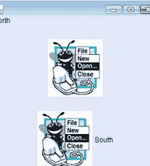

**图 9.13** 带有文本和图像的 `JLabel`。（共 2 部分的第 2 部分。）

第 3–6 行导入了显示 `JLabel` 所需的类。来自 `java.awt` 包的 `BorderLayout` 包含常量，指定了我们可以在 `JFrame` 类中何处放置 GUI 组件。`ImageIcon` 代表可以显示在 `JLabel` 上的图像，`JFrame` 代表将包含所有标签的窗口。

第 13 行创建了一个显示其构造函数参数 "North" 的 `JLabel`。第 16 行清除了局部变量 `labelIcon` 并为其分配了一个新的 `ImageIcon`。`ImageIcon` 的构造函数接收一个指定图像路径的字符串。由于我们只指定了文件名，Java 会加载 GIF、JPEG 和 PNG 格式的图像。第 19 行使用一个显示 `labelIcon` 的 `JLabel` 初始化并调整了局部变量 `centerLabel` 的大小。第 22 行删除并初始化了与上行代码相似的局部变量 `southLabel`。然而，第 25 行调用了 `setText` 方法来更改文本标签。默认方法 `setText` 可以在任何 `JLabel` 上调用以更改其文本。此 `JLabel` 同时显示图标和文本。

第 28 行创建了显示标签的 `JFrame`，第 30 行表示程序在 `JFrame` 关闭时应当终止。我们在第 34–36 行将标签附加到 `JFrame` 上。第一个参数是我们想要附加的子类，第二个参数是区域。每个 `JFrame` 都有一个关联的方法。

## 9.8 总结

本章引入了继承——通过获取现有类来创建类。你学习了超类和子类的概念，并使用了 `extends` 关键字创建子类。我们展示了如何使用 `@Override` 注解防止意外重载。`protected` 修饰符允许访问。最后，你学习了 `Object` 的方法。

## 总结

### 9.1 引言

- 继承（p. 361）减少了程序开发时间。
- 子类的直接超类（p. 361）是其继承的类。子类的间接超类（p. 361）向上两个或多个层。
- 在单继承（p. 361）中，类派自一个超类。在多继承中，类派自多个超类。Java 不支持多继承。
- 子类比其超类更具体，代表更小的对象组（p. 361）。
- 每个子类对象都是其超类的对象。然而，子类对象并不是其类子类的对象。
- “是一个...”关系（p. 362）代表继承。在“是一个...”关系中，子类对象也可以被视为超类对象。
- “有一个...”关系（p. 362）代表组合。在“有一个...”关系中，类对象包含对其他对象的引用。

### 9.2 超类和子类

- 单继承形成了树形层次结构——超类与其子类之间存在某种关系。

### 9.3 保护成员

- 如果程序拥有其或其某个子类对象的引用，则可以访问子类的公共成员。
- 超类的私有成员无法在子类内部直接访问。
- 类的 `protected` 成员（p. 364）在公共和私有访问之间具有中间保护级别。它们可以被类成员、其子类成员以及同包中其他类的成员访问。

### 9.4 超类与子类之间的关系

- 子类的私有成员在其子类中是隐藏的，只能通过继承自父类的公共（`public`）或保护（`protected`）成员进行访问。
- 如果在父类方法名前加上 `super`（第 364 页）和点（`.`）分隔符，就可以从子类访问被重写的子类方法。
- 子类无法访问其父类的私有成员，但可以访问非私有成员。
- 子类可以使用关键字 `super` 调用其父类的构造函数，后跟一个包含子类构造函数参数的括号。这必须作为子类体的第一条语句出现。
- 可以重写父类方法，以为子类声明适当的实现。
- `@Override` 注解（第 369 页）表示该方法应该重写父类方法。当编译器遇到用 `@Override` 声明的方法时，它会将该方法的签名与现有方法的签名进行比较。如果没有精确匹配，编译器将发出错误信息，例如“method does not override or implement a method of supertype”（方法未重写或实现父类型的方法）。
- `toString` 不接受参数并返回一个 `String`。`Object` 类的 `toString` 方法通常由子类重写。
- 当使用 `%s` 格式说明符输出对象时，会隐式调用对象的 `toString` 方法以获取其字符串表示。

### 9.5 子类中的构造函数

- 子类构造函数的第一个任务是调用其父类构造函数（第 378 页），以确保从父类继承的变量已初始化。

### 9.6 类 Object

- 参见图 9.12 中的 `Object` 方法表。

## 自我练习

- 9.1 填空每个陈述中的空白：
  a) ________ 是一种软件重用的形式，其中新类获取了现有类的成员，并用新功能增强了它们。
  b) 子类的 ________ 成员在类声明和子类中都是可访问的。
  c) 在 a ________ 关系中，子类对象也可以被视为其父类对象。
  d) 在 a ________ 关系中，类对象拥有其他类的引用作为成员。
  e) 在单继承中，一个类与其子类存在一种 ________ 关系。
  f) 子类的 ________ 成员在程序拥有该父类对象或其任一子类对象的任何地方都是可访问的。
  g) 当实例化子类对象时，会隐式或显式地调用父类 ________。
  h) 子类构造函数可以通过 ________ 关键字调用父类构造函数。

- 9.2 判断以下陈述是对的还是错的。如果陈述错误，请解释原因。
  a) 父类不是由子类初始化的。
  b) “有一个（has-a）”关系是通过继承实现的。

## 自我练习答案 393 页

c) `Car`（汽车）类与 `Steeringwheel`（方向盘）和 `Brakes`（刹车）类具有“是一个（is-a）”的关系。
d) 当子类使用相同的签名重定义父类方法时，该子类是在重载（overload）该父类方法。

## 自我练习答案

- 9.1 a) Inheritance（继承）。 b) public and protected（公共和保护）。 c) is-a or inheritance（是一个或继承）。d) has-a or composition（有一个或组合）。
  e) hierarchical（层级的）。 f) public（公共）， g) constructor（构造函数）。 h) super。

- 9.2 a) True（对）； b) False（错）。“有一个”关系是通过组合实现的。“是一个”关系是通过继承实现的。c) False（错）。这是一个“有一个”关系的示例。`Car` 类与 `Vehicle`（车辆）类具有“是一个（is-a）”的关系。d) False（错）。这被称为重载（overloading）——重载的方法名称相同，但签名不同。

## 练习题

- 9.3（使用组合而非继承）许多用继承编写的程序可以使用组合来编写，反之亦然。重写 `BasePlusCommissionCommissionEmployeeHierarchy` 类，以使用组合而不是继承。

- 9.4（软件重用）讨论继承如何促进软件重用、节省开发时间并防止错误。

- 9.5（学生继承层次结构）为大学的学生绘制一个与图 9.2 所示类似的继承层次结构。使用 `Student`（学生）作为该层次结构的超类，然后用 `UndergraduateStudent`（本科生）和 `GraduateStudent`（研究生）扩展 `Student`。继续尽可能深入扩展该层次结构（即尽可能越多）。例如，`Freshman`（大一）、`Sophomore`（大二）、`Junior`（大三）和 `Senior`（大四）可以扩展 `Undergraduate`，而 `DoctoralStudent`（博士生）和 `Masters`（硕士）可以是 `Undergraduate` 的子类。绘制层次结构后，讨论类之间存在的关系。注意：此练习不需要编写任何代码。

- 9.6（protected 与 private）某些程序员倾向于不使用保护访问，因为他们认为这破坏了子类的封装。讨论子类中保护访问与公共访问的相对优缺点。

- 9.7（四边形继承）为 `Quadrilateral`（四边形）、`Trapezoid`（梯形）、`Parallelogram`（平行四边形）、`Rectangle`（矩形）和 `Square`（正方形）类编写继承层次结构。以 `Quadrilateral` 作为层次结构的父类。创建并使用 `Point` 类来表示每个形状中的点。使层次结构尽可能深（即尽可能越多层）。指定每个类的实例变量和方法。`Quadrilateral` 的实例变量应该是四边形四个端点的 x-y 坐标对。编写一个程序实例化你的类对象并输出每个对象的面积（`Quadrilateral` 除外）。

- 9.9（每个代码段的作用是什么？）假设以下方法调用在子类的一个重写方法中被调用：

```
super.earnings()
```

b) 假设以下行代码出现在方法声明之前：

```
@Override
```

c) 假设以下行代码出现在构造函数体中：

```
super(firstArgument);
```


## 9.10（编写一行代码）编写一行代码，以执行以下任务：

a) 指定 `PieceWorker` 类继承自 `Employee` 类。
b) 在 `PieceWorker` 的 `toString` 方法中调用 `Employee` 的 `toString` 方法。
c) 在 `PieceWorker` 的构造函数中调用 `Employee` 的构造函数——假设子类构造函数接收名、姓和社会安全号的字符串。

- 9.11（在构造函数中使用 super）解释为什么你会在子类构造函数的第一语句中使用 `super`。
- 9.12（在实例方法中使用 super）解释为什么你会在子类的实例方法中使用 `super`。
- 9.13（在类中调用方法）在 9.10–9.11 中，`earnings` 和 `toString` 调用了类中的各种方法。解释在类内部获取这些方法的处。
- 9.14（Employee 层次结构）在本章中，你创建了一个 `BasePlusEmployee` 继承自 `Employee` 的层次结构。然而，并不是所有员工都是 `PlusEmployee`。在练习中，你将创建一个更通用的 `Employee` 父类，提取 `BaseEmployee` 中所有共有的属性和行为。所有员工的公共属性和行为是 `firstName`、`lastName`、`getSecurityNumber` 和 `toString`。创建一个新的子类 `Employee`，包含实例变量和方法。重新创建 `BasePlusEmployee`，使其继承自 `Employee` 而不是 `Employee`，作为 `BaseEmployee`。`BaseEmployee` 类应仅包含在 `Employee` 中声明的实例变量和方法。 `BaseEmployee` 的构造函数应该调用 `Employee` 的构造函数，其 `toString` 方法应该调用 `Employee` 的。完成这些修改后，使用这些新类分别确保 `Employee` 对象和 `BasePlusEmployee` 对象具有相同的显示。
- 9.15（创建 Employee 的新子类）其他类型的员工可能包括获得固定周薪的 `Salaries-Employees`、按生产数量支付工资的 `PieceWorkers` 或在工作超过 40 小时获得加班费（时薪的 1.5 倍）的 `HourlyEmployees`。创建继承自 `Employee`（练习 9.14）的 `HourlyEmployee`，它有一个实例变量 `hours`（double）表示每小时工作的小时，一个接收名、姓、社会安全号、时薪和工作小时作为参数的构造函数，用于修改 `hours` 和 `wage` 的 set 和 get 方法，一个根据工作小时计算 `HourlyEmployee` 收益的 `earnings` 方法，以及一个返回 `HourlyEmployee` 字符串表示的 `toString` 方法。`setWage` 方法应确保工资为负，`setHours` 应确保 `hours` 的值在 0 到 168（一周的总小时数）之间。在与图 9.5 类似的测试程序中使用 `HourlyEmployee`。

# 面向对象编程：多态与接口

# 10

> 一般命题无法决定具体的案例。
> —奥利弗·温德尔·霍尔姆斯

> 一位地位显赫的哲学家并不是在真空中思考。即使是他最抽象的想法，在某种程度上也受到他所处时代已知或未知事物的限制。
> —阿尔弗雷德·诺斯·怀特海

# 目标

在本章中，你将：

- 学习多态的概念。
- 使用重写的方法来实现多态。
- 区分抽象类和具体类。
- 声明抽象方法来创建抽象类。
- 学习多态如何使系统具有扩展性和可维护性。
- 在执行时确定对象的类型。
- 声明并实现接口，并熟悉 Java SE 8 的接口增强。


# 大纲

- 10.1 引言
- 10.2 多态示例
- 10.3 多态行为
- 10.4 抽象类与方法
- 10.5 案例研究：使用多态的薪资系统
    - 10.5.1 抽象子类 Employee
    - 10.5.2 具体子类 SalariedEmployee（薪员工）
    - 10.5.3 具体子类 HourlyEmployee（计时员工）
    - 10.5.4 具体子类 CommissionEmployee（佣金员工）
    - 10.5.5 间接子类 BasePlusCommissionEmployee（底薪+佣金员工）
    - 10.5.6 多态处理、instanceof 操作与向下转换
- 10.6 超类变量与子类变量之间允许的赋值
- 10.7 Final 方法与类
- 10.8 调用构造函数的问题的深度解释
- 10.9 创建和使用接口
    - 10.9.1 开发可支付层级结构
    - 10.9.2 接口 Payable
    - 10.9.3 类 Invoice
    - 10.9.4 修改类以实现接口 Payable
    - 10.9.5 修改类 SalariedEmployee 以用于可支付层级结构
    - 10.9.6 多态地使用 Payable Invoice 和 Employees
    - 10.9.7 Java API 的通用接口
- 10.10 Java SE 接口增强
    - 10.10.1 default 接口方法
    - 10.10.2 static 接口方法
    - 10.10.3 功能性接口
- 10.11（可选）GUI 和图形类：使用多态绘图
- 10.12 总结

> 总结 | 自测练习题 | 自测练习题答案 | 改变自我

# 10.1 引言

我们将通过继承层次结构来解释和演示多态，继续对面向对象编程的研究。多态让你能够“在泛化上编程”而不是“在具体化上编程”。特别是，多态使你能够编写程序来直接或间接地处理来自同一超类的对象，就像它们都是超类对象一样；这可以简化编程。

考虑以下多态的示例。假设我们创建一个程序来模拟生物学研究中几种动物的运动。`Frog` 类和 `Bird` 类将代表研究的动物类型。想象每个类都继承自 `Animal`，该类包含一个 `move` 方法，并用 x-y 坐标维护动物的位置。每个子类都实现 `move` 方法。我们的程序维护一个 `Animal` 数组，其中包含各种子类对象的引用。为了模拟动物的运动，程序每秒向每个对象发送相同的消息——即 `move`。每种特定类型的 `Animal` 都以自己的方式响应 `move` 消息——鱼可能游三英尺，青蛙可能跳五英尺，鸟可能飞十英尺。每个对象都知道如何根据其特定类型相应地修改其 x-y 坐标（即对该类型对象恰当的），以响应相同的调用，这是多态的核心概念。发送给各种对象的相同消息（在本例中为 `move`）会有许多形式的结果——因此有了“多态”一词。

## 实现扩展性

通过多态，我们可以设计并实现易于扩展的系统——只要新类属于程序泛化处理的继承层次结构，就可以在对程序的通用部分进行很少或不修改的情况下添加新类。新类只需“正确插入”。程序中必须更改的部分是那些需要直接了解我们添加到层级结构中的新类的部分。例如，如果我们扩展 `Animal` 来创建 `Tortoise` 类（这可能需要通过爬行一英寸来响应 `move` 消息），我们只需要编写 `Tortoise` 类以及实例化 `Tortoise` 对象的模拟部分。告诉 `Animal` 通用移动的模拟部分保持不变。

# 10.2 多态示例

考虑以下多态的示例。假设我们创建一个程序来模拟生物学研究中几种动物的运动。`Frog` 类和 `Bird` 类将代表研究的动物类型。想象每个类都继承自 `Animal`，该类包含一个 `move` 方法，并用 x-y 坐标维护动物的位置。每个子类都实现 `move` 方法。我们的程序维护一个 `Animal` 数组，其中包含各种子类对象的引用。为了模拟动物的运动，程序每秒向每个对象发送相同的消息——即 `move`。每种特定类型的 `Animal` 都以自己的方式响应 `move` 消息——鱼可能游三英尺，青蛙可能跳五英尺，鸟可能飞十英尺。每个对象都知道如何根据其特定类型相应地修改其 x-y 坐标（即对该类型对象恰当的），以响应相同的调用，这是多态的核心概念。发送给各种对象的相同消息（在本例中为 `move`）会有许多形式的结果——因此有了“多态”一词。

# 10.3 展示多态行为

第 9.4 节创建了一个类层次结构，其中 `BasePlusCommissionEmployee` 类继承自 `CommissionEmployee`。该节中的示例通过使用引用调用其方法来操作 `CommissionEmployee` 和 `BasePlusCommissionEmployee` 对象——我们使用超类变量指向超类对象，以及使用子类变量指向子类对象。这些赋值是自然且直观的——超类变量旨在指向超类对象，而子类变量旨在指向子类对象。然而，正如你很快看到的，其他的赋值同样可行。

在下一个示例中，我们使用指向子类对象的超类引用。然后，我们展示了在子类对象上调用方法时，是由引用的对象类型而不是变量的类型来决定调用哪个方法的。这个示例说明了子类对象可以被视为其超类的对象，从而实现有趣的操作。程序可以创建一个超类数组来引用许多类型的对象。这是被允许的，因为每个子类都是其超类的一个对象。例如，我们将一个 `BasePlusCommissionEmployee` 对象的引用赋值给超类 `CommissionEmployee`，因为 `BasePlusCommissionEmployee` 是一个 `CommissionEmployee`——所以我们可以将 `BasePlusCommissionEmployee` 视为一个 `CommissionEmployee`。

正如你之后将学到的，你不能将超类视为子类对象，因为超类不是其子类的对象。例如，我们不能将 `CommissionEmployee` 对象的引用赋值给 `BasePlusCommissionEmployee`，因为 `CommissionEmployee` 不是 `BasePlusCommissionEmployee`——`CommissionEmployee` 并没有 `BasePlusCommissionEmployee` 实例，也没有 `setBaseSalary` 和 `getBaseSalary` 方法。`is-a`（是一个）关系仅向上层次结构应用到其直接（及间接）超类，而反之则不然（即不能从层次结构向下从超类到其子类或间接子类）。

如果我们显式地将超类引用强制转换为子类类型，Java 编译器允许超类引用指向子类。我们为什么要执行这样的赋值呢？超类引用只能用于调用在超类中声明的方法——尝试通过超类引用对子类对象执行子类特有的操作来调用子类特有的方法会导致编译错误。如果程序需要通过子类变量执行子类特有的操作，程序必须首先通过称为“向下转型”（downcasting）的技术将超类引用强制转换为子类引用。这使得程序能够调用超类中不存在的子类方法。我们在 10.5 节中演示向下转型的机制。

## 软件工程观察 10.3


图 10.1 中的示例演示了三种使用超类和子类变量来存储超类和子类对象引用的方法。前两种是直观的——如第 9.4 节，我们将超类引用赋值给超类变量，将子类引用赋值给子类变量。然后，我们通过将引用赋值给超类变量来演示子类与超类之间的关系（即 `is-a` 关系）。该程序分别使用了图 9.10 和图 9.11 中的 `CommissionEmployee` 和 `BasePlusCommissionEmployee` 类。

```java
// 图 10.1: PolymorphismTest.java
// 将超类和子类引用赋值给超类和子类变量。

public class PolymorphismTest {

    public static void main(String[] args) {

        // 将超类引用赋值给超类变量
        CommissionEmployee commissionEmployee = new CommissionEmployee(
            "Sue", "Jones", "222-22-2222", 10000, 0.06);

        // 将子类引用赋值给子类变量
        BasePlusCommissionEmployee basePlusCommissionEmployee = new BasePlusCommissionEmployee(
            "Bob", "Lewis", "333-33-3333", 5000, 0.04, 300);

        // 使用超类变量在超类对象上调用 toString
        System.out.printf("%s: %s%s%n",
            "Call CommissionEmployee's toString with superclass reference",
            "to superclass object", commissionEmployee.toString());

        // 使用子类变量在子类对象上调用 toString
        System.out.printf("%s: %s%s%n",
            "Call BasePlusCommissionEmployee's toString with subclass",
            "reference to subclass object",
            basePlusCommissionEmployee.toString());

        // 使用超类变量在子类对象上调用 toString
        CommissionEmployee commissionEmployee2 = basePlusCommissionEmployee;

        System.out.printf("%s: %s%s%n",
            "Call BasePlusCommissionEmployee's toString with superclass",
            "reference to subclass object", commissionEmployee2.toString());

    } // end main
} // end class PolymorphismTest
```


使用父类引用调用 `CommissionEmployee` 的 `toString()` 于父类对象：
commission employee: Sue Jones
social security: 222-22-2222
gross sales: 10000.0
commission rate: 0.06

使用子类引用调用 `BasePlusCommissionEmployee` 的 `toString()` 于类对象：
base-salaried commission employee: Bob Lewis
social security: 333-33-3333
gross sales: 5000.00
commission rate: 0.04
base salary: 300

**图 10.1** 将父类和子类引用赋值给父类和子类变量。（部分 1）

## 10.4 抽象类与方法

```
Call BasePlusCommissionEmployee's toString with superclass reference to subclass object:

base-salaried commission employee: Bob Lewis

social security: 333-33-3333

gross sales: 5000.00

commission rate: 0.04

base salary: 300
```

**图 10.1** 将父类和子类引用赋值给父类和子类变量。（部分 2）

在 10.1 中，行 10–11 创建 `CommissionEmployee` 对象并将其引用赋值给 `CommissionEmployee` 变量。行 14–16 创建 `BasePlusCommissionEmployee` 对象并将其引用赋值给 `BasePlusCommissionEmployee` 变量。这些赋值是自然的，例如，`CommissionEmployee` 变量的主要目的是持有 `CommissionEmployee` 对象的引用。行 19–21 使用 `commissionEmployee` 显式调用 `toString()`。由于 `commissionEmployee` 指向 `CommissionEmployee` 对象，调用的是父类 `CommissionEmployee` 的版本。

行 30–31 将子类对象 `BasePlusCommissionEmployee` 的引用赋值给父类 `CommissionEmployee` 变量，行 32–34 使用其调用 `toString()`。当父类包含指向子类对象的引用时，调用的是方法的子类版本。因此，行 34 中的 `commissionEmployee2.toString()` 实际上调用了 `BasePlusCommissionEmployee` 的 `toString()`。当编译器遇到通过变量调用的方法时，编译器通过变量的类类型确定该方法是否可以执行。如果该类具有适当的方法（或继承了该方法），则执行调用。在运行时，变量所引的对象类型决定了实际使用的方法。这一过程称为动态绑定，将在 10.5 节中详细讨论。

### 抽象类的目的

当我们思考类时，我们假设程序会创建该类型的对象。有时，我们需要声明某些类——抽象类——我们从未打算创建它们的对象。由于它们仅在继承层次结构中作为父类使用，我们将它们称为抽象父类。这些类不能实例化对象，因为正如我们很快看到的，抽象类是不完整的。子类必须声明“缺失的部分”以成为“具体”类，从而从这些类中实例化对象。否则，这些子类也将是抽象的。我们在 10.5 节中演示抽象类。

抽象类的目的是提供一个适当的父类，其他类继承自它并共享共同的设计。例如，图 9.3 中的 `Shape` 层次结构——子类继承了什么是“形状”（`Shape`）的概念——通用属性如位置、颜色和边框宽度（`borderThickness`），以及 `draw()`、`move()`、`resize()` 和 `changeColor()` 等行为。可以实例化的类被称为具体类（`concrete classes`）。提供其声明的所有方法实现的类（其中某些实现是继承来的）。例如，我们可以从抽象类 `TwoDimensionalShape` 派生 `Circle`、`Square` 和 `Triangle` 类。同样，我们可以从抽象类 `ThreeDimensionalShape` 派生 `Sphere`、`Cube` 和 `Tetrahedron` 类。抽象类太通用，无法创建真实对象——这仅仅是子类之间的共同点。在创建对象之前，我们需要更具体一些。例如，如果你向抽象类 `TwoDimensionalShape` 发送 `draw()` 方法，类知道要画哪种特定形状，但不知道如何画。具体类提供了细节，使得实例化对象变得合理。

并不是所有的层次结构都包含抽象类。然而，你经常会只使用抽象父类来编写代码，以减少代码对特定子类类型的依赖。例如，你可以写一个参数为抽象父类的方法。当被调用时，该方法可以接收任何直接或间接继承该父类的具体类对象作为参数类型。

抽象类有时构成层次结构中的多个级别。例如，图 9.3 所示的层次结构从抽象类 `Shape` 开始。在层次结构的下一层是抽象类 `TwoDimensionalShape` 和 `ThreeDimensionalShape`。叶子层次结构的下一层是 `TwoDimensionalShapes`（`Circle`、`Square` 和 `Triangle`）和 `ThreeDimensionalShapes`（`Sphere`、`Cube` 和 `Tetrahedron`）的具体类。

### 声明抽象类和抽象方法

通过使用关键字 `abstract` 修饰一个类。抽象类通常包含一个或多个抽象方法。抽象方法是声明中带有 `abstract` 关键字的实例方法，如下：

```java
public abstract void draw(); // abstract method
```

抽象方法不提供实现。包含任何抽象方法的类必须显式声明为抽象类，即使它包含了一些具体的（非抽象）方法。抽象类的每个具体子类都必须为其父类的每个抽象方法提供具体的实现。构造函数和静态方法不能声明为抽象的。构造函数是不被继承的，因此抽象构造函数永远无法实现。虽然非私有的静态方法会被继承，但它们不能被重写。由于抽象方法是为了被重写的，它们可以根据对象的类型处理对象，因此将静态方法声明为抽象的是没有意义的。

> **软件工程观察 10.4**
> 抽象类声明了类层次结构各种类的通用属性和行为。抽象类通常包含一个或多个抽象方法，子类如果想要是具体的，就必须重写这些方法。抽象类的实例变量和具体方法遵循标准的继承规则。

> **常见编程错误 10.1**
> 尝试实例化抽象类的对象会导致编译错误。

> **常见编程错误 10.2**
> 在子类中未实现父类的抽象方法会导致编译错误，除非该子类本身也是抽象的。

### 使用抽象类来声明变量

尽管我们不能实例化抽象父类的对象，但你很快就会发现，我们可以使用抽象类来声明变量，这些变量可以持有任何派生自这些抽象父类的具体对象的引用。我们将使用变量以多态的方式操作子类对象。我们可以使用抽象类来调用在这些抽象父类中声明的静态方法。

考虑多态的另一个应用。绘图程序需要显示许多形状，包括你在编写绘图程序后向系统中添加的类型。绘图程序可能需要显示派生自抽象类的形状，例如 `Circle`、`Triangle`、`Rectangle` 或其他。绘图程序使用 `Shape` 变量来管理显示的对象。为了绘制此继承层次结构中的任何对象，绘图程序使用一个包含子类对象引用的父类变量来调用对象的 `draw()` 方法。该方法在抽象类 `Shape` 中声明，因此每个具体子类必须以特定于该形状的方式实现 `draw()`——继承层次结构中的每个对象都知道如何绘制自己。绘图程序不需要担心每个对象的类型，或者程序是否遇到过该类型的对象。

### 分层软件系统

多态在实现分层软件系统时特别有效。例如，在操作系统中，物理设备的命令的操作方式可能与其他命令不同。尽管如此，从设备读取或向设备写入数据的命令仍然具有某种统一性。对于每个设备，操作系统使用一个软件驱动程序来控制系统与设备之间的所有通信。向设备驱动对象发送写入消息需要根据该语境进行特定解释，以及它是如何操作特定类型的设备的。然而，写入操作本身与系统中的其他设备没有区别——从内存向该设备写入若干字节。面向对象的操作系统可能会使用一个抽象父类为所有设备驱动程序提供接口。然后，通过从该抽象父类继承，形成行为相似的子类。这些方法的实现在对应特定设备驱动的具体类中。新设备一直在开发，通常在操作系统发布很久之后。当你购买新设备时，它会带有一个由设备供应商提供的驱动程序。当你将其连接到计算机并安装驱动程序时，设备立即可用。这是多态如何使系统具有扩展性的另一个优雅示例。

## 10.5 案例研究：使用多态的工资系统

本节检查了我们在第 9.4 节中探索的 `CommissionEmployee` 和 `BasePlusCommissionEmployee` 层次结构。我们使用抽象方法和多态性，根据满足以下要求的增强员工层次结构进行工资计算：

- 公司按周向员工支付工资：固定薪员工无论工作小时数，都获得固定的周薪；时薪员工按小时支付工资，并在超过 40 小时的工作时间内获得加班费（即其时薪的 1.5 倍）；佣金员工按销售额的百分比支付工资；底薪佣金员工获得底薪加销售额的百分比。在当前薪期内，公司决定通过增加 10% 的工资来奖励佣金员工。公司希望你使用一个以多态方式执行工资计算的应用程序。

我们抽象了员工的通用概念。继承 `Employee` 的类有 `SalariedEmployee`、`CommissionEmployee` 和 `HourlyEmployee`。`BasePlusCommissionEmployee` 继承 `CommissionEmployee`——代表最后一种员工类型。图 10.2 中的 UML 类图显示了我们多态工资应用的继承层次结构。抽象类名 `Employee` 使用斜体——这是 UML 的惯例。

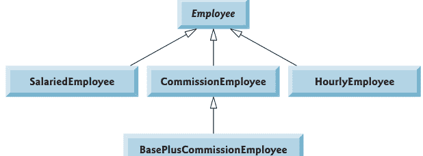

**图 10.2** 员工层次结构 UML 类图。

抽象父类 `Employee` 声明了层次结构的“接口”——即程序可以在所有员工对象上调用的方法集。我们在这里泛义使用“接口”一词，指的是程序与任何子类对象通信的各种方式。不要将“接口”的通用概念与 Java 接口的正式符号（后者是第 10.9 节的主题）混淆。图 10.3 中的图左侧显示了层次结构中的五个类，顶部显示方法。对于每个类，图都显示了每个方法的预期结果。我们没有在任何子类中列出重写的方法——这些方法都由每个子类继承并直接使用。

### 10.5 案例研究：使用多态的薪资系统

| 员工类型 | earnings() 实现 | toString() 输出示例 |
| :--- | :--- | :--- |
| **Employee** (抽象) | 抽象方法 | `firstName lastName`<br>`social security number: SSN` |
| **SalariedEmployee** | `weeklySalary` | `Salaried Employee: firstName lastName`<br>`social security number: SSN`<br>`weekly salary: weeklySalary` |
| **HourlyEmployee** | `if (hours <= 40) wage * hours else 40 * wage + (hours - 40) * wage * 1.5` | `Hourly Employee: firstName lastName`<br>`social security number: SSN`<br>`hourly wage: wage; hours worked: hours` |
| **CommissionEmployee** | `commissionRate * grossSales` | `Commission Employee: firstName lastName`<br>`social security number: SSN`<br>`gross sales: grossSales`<br>`commission rate: commissionRate` |
| **BasePlusCommissionEmployee** | `(commissionRate * grossSales) + baseSalary` | `Base-Salaried Commission Employee: firstName lastName`<br>`social security number: SSN`<br>`gross sales: grossSales`<br>`commission rate: commissionRate`<br>`base salary: baseSalary` |

**图 10.3** 用于 `Employee` 层次结构类的多态接口。

后续章节实现了图 10.2 中的 `Employee` 类层次结构。第一部分实现了抽象超类 `Employee`。接下来的四个部分每个实现其中一个具体类。最后一部分实现了一个测试程序，该程序构建了所有这些类的对象，并以多态的方式处理这些对象。

### 10.5.1 抽象超类 Employee

`Employee` 类（图 10.4）提供了 `earnings()` 和 `toString()` 方法，此外还提供了返回 `Employee` 实例变量值的 `get` 方法。`earnings()` 方法通用适用于所有员工。每个 `earnings()` 计算都取决于员工特定的类。因此，我们在超类 `Employee` 中将 `earnings()` 声明为抽象方法，因为对该方法提供特定的默认实现是没有意义——没有足够的信息来确定应该返回多少金额。

每个子类都重写 `earnings()`，程序给超类 `Employee` 变量分配一个员工对象的引用，然后在该变量上调用 `earnings()` 方法。我们维护了一个 `Employee` 变量数组，每个变量都持有对 `Employee` 对象的引用。你不能使用 `Employee` 类来创建 `Employee` 对象，因为 `Employee` 是抽象类。然而，由于继承，所有 `Employee` 子类的对象都可以被视为 `Employee` 对象。程序将遍历数组并为每个 `Employee` 对象调用 `earnings()` 方法。Java 以多态的方式处理这些方法。在 `Employee` 中将 `earnings()` 声明为抽象方法允许通过 `Employee` 变量调用 `earnings()` 的编译，并强制每个 `Employee` 子类都重写 `earnings()`。

`Employee` 中的 `toString()` 方法返回一个包含员工名、姓和社会安全号的字符串。正如我们将看到的，`Employee` 的每个子类都重写了 `toString()` 以返回该类对象的字符串表示，其中包含员工信息（例如，“Salaried Employee:”）随后是员工的其他信息。

让我们考虑 `Employee` 的声明（图 10.4）。该类包含一个构造函数，接收名、姓和社会安全号（第 11–17 行）；`get` 方法返回名、姓和社会安全号（分别对应第 20–23 行、26–29 行和 32–35 行）；方法 `toString()`（第 38–43 行）返回对象的字符串表示；抽象方法 `earnings()`（第 46 行）将由每个具体子类实现。在本示例中，`Employee` 构造函数没有对其参数进行验证；通常，应该提供此类验证。

```java
// Employee.java
// Employee 抽象类 Employee

public abstract class Employee {

    private final String firstName;
    private final String lastName;
    private final String socialSecurityNumber;

    // 构造函数
    public Employee(String firstName, String lastName, String socialSecurityNumber) {
        this.firstName = firstName;
        this.lastName = lastName;
        this.socialSecurityNumber = socialSecurityNumber;
    }

    // 返回名
    public String getFirstName() {
        return firstName;
    }

    // 返回姓
    public String getLastName() {
        return lastName;
    }

    // 返回社会安全号
    public String getSocialSecurityNumber() {
        return socialSecurityNumber;
    }

    // 返回 Employee 对象的字符串表示
    @Override
    public String toString() {
        return String.format("%s %s%n%s social security number: %s",
            getFirstName(), getLastName(), getSocialSecurityNumber());
    }

    // 具体子类必须重写抽象方法
    public abstract double earnings(); // 此没有实现
} // 抽象类 Employee
```


图 10.4 | Employee 抽象子类。（2 部分中的第 2 部分）

我们为什么没有将 `earnings` 声明为抽象方法？在 `Employee` 中提供该方法的特定实现根本没有意义。我们无法计算通用 `Employee` 的收益——我们必须先知道 `Employee` 的特定类型以确定合适的收益计算方法。通过将此方法声明为抽象，我们表明每个子类必须提供合适的 `earnings` 实现，并且程序能够使用超类 `Employee` 变量来为任何类型的 `Employee` 多态地调用 `earnings`。

## 10.5.2 具体子类 SalariedEmployee

`SalariedEmployee` 类（第 10.5 部分）继承 `Employee` 并重写了抽象方法 `earnings`（第 38–42 行），这使得 `SalariedEmployee` 具体。该类包含一个构造函数（第 9–19 行），接收名、姓、社会安全号和周薪；一个为实例变量 `weeklySalary` 设置非负值的方法（第 22–29 行）；返回 `weeklySalary` 的方法（第 32–35 行）；`earnings` 方法（第 38–42 行）提供了 `SalariedEmployee` 周薪的具体实现；以及 `toString` 方法（第 45–50 行），它返回一个包含“固定制员工：”以及后续信息的字符串。

> **预防错误 10.1**
> 我们说过不要在构造函数中调用重写的方法——如果你遵循这一建议，就可以避免直接或间接调用子类方法，这会导致运行时错误。


```java
// Fig.10.5 SalariedEmployee.java

// SalariedEmployee 具体类继承抽象类 Employee

public class SalariedEmployee extends Employee {

    private double weeklySalary;

    // 构造函数

    public SalariedEmployee(String firstName, String lastName,
        String securityNumber, double weeklySalary) {

        super(firstName, lastName, securityNumber);

        if (weeklySalary < 0.0) {
            throw new IllegalArgumentException("Weekly salary must be >= 0.0");
        }

        this.weeklySalary = weeklySalary;
    }

    // 设置周薪

    public void setWeeklySalary(double weeklySalary) {
        if (weeklySalary < 0.0) {
            throw new IllegalArgumentException("Weekly salary must be >= 0.0");
        }
        this.weeklySalary = weeklySalary;
    }

    // 返回周薪

    public double getWeeklySalary() {
        return weeklySalary;
    }

    // 计算收益；重写 Employee 中的抽象方法

    @Override
    public double earnings() {
        return getWeeklySalary();
    }

    // 返回 SalariedEmployee 对象的字符串表示

    @Override
    public String toString() {
        return String.format("salaried employee: %s%s: $%.2f",
            super.toString(), "weekly salary", getWeeklySalary());
    }
} // 类 SalariedEmployee 结束
```

图 10.5 | SalariedEmployee 具体类继承抽象类 Employee.

## 10.5 案例研究：使用多态的工资系统

为了实现 `earnings` 方法，类 `SalariedEmployee` 必须声明为抽象类——否则，类 `SalariedEmployee` 将无法编译。当然，在例例中，我们希望 `SalariedEmployee` 是一个具体类。

`toString` 方法（第 45–50 行）重写了 `Employee` 的 `toString` 方法。如果 `SalariedEmployee` 类没有重写 `toString`，它将继承 `Employee` 版本的 `toString`。在这种情况下，`SalariedEmployee` 的 `toString` 方法将仅仅返回 `SalariedEmployee` 的全名和社安全号，这不能代表一个 `SalariedEmployee`。子类的 `toString` 方法返回“salaried employee”；紧接着是通过调用子类的 `toString` 方法（第 49 行）获取父类 `Employee` 特有的信息（即：名、姓和社会安全号）——这是一个代码复用的很好的示例。`SalariedEmployee` 的字符串表示还包含通过调用类的 `weeklySalary` 方法获取的员工工资。

### 10.5.3 子类 HourlyEmployee

`HourlyEmployee`（图 10.6）扩展了 `Employee`（第 4 行）。该类包含一个构造函数（第 10–25 行），接收名、姓、社安全号、时薪工资和工作小时数。第 28–35 行和 44–51 行定义了设置方法，分别为实例变量和小时数分配新值。`setwage` 方法（第 28–35 行）确保工资值为负数，而 `sethours` 方法（第 44–51 行）确保小时数在 0 到 168 之间（一周的总小时数）。`HourlyEmployee` 还包含 `get` 方法（第 38–41 行和 54–57 行）来返回小时数和时薪工资的值；`earnings` 方法（第 60–67 行）用于计算 `HourlyEmployee` 的收益；以及 `toString` 方法（第 70–76 行），返回一个包含员工类型（“hourly employee”）和员工特定信息的字符串。`HourlyEmployee` 构造函数与 `SalariedEmployee` 构造函数一样，将名、姓和社安全号传递给父类构造函数（第 13 行）以初始化私有变量。此外，`toString` 方法（第 74 行）返回 `Employee` 特有的信息（即：名、姓和社会安全号）——这是代码复用的另一个示例。

图 10.6 | HourlyEmployee 类扩展 Employee。（3 部分中的第一部分）

```java
if (wage < 0.0) // 验证工资
    throw new IllegalArgumentException(
        "Hourly wage must be >= 0.0");
```

```java
if ((hours < 0.0) || (hours > 168.0)) // 验证小时数
    throw new IllegalArgumentException(
        "Hours worked must be >= 0.0 and <= 168.0");
```

```java
this.wage = wage;
this.hours = hours;
```

```java
// set wage
public void setWage(double wage)
{
    if (wage < 0.0) // 验证工资
        throw new IllegalArgumentException(
            "Hourly wage must be >= 0.0");
    this.wage = wage;
}
```

```java
// return wage
public double getWage()
{
    return wage;
}
```

```java
// set hours worked
public void setHours(double hours)
{
    if ((hours < 0.0) || (hours > 168.0)) // 验证小时数
        throw new IllegalArgumentException(
            "Hours worked must be >= 0.0 and <= 168.0");
    this.hours = hours;
}
```

```java
// return hours worked
public double getHours()
{
    return hours;
}
```

```java
// calculate earnings, override abstract method earnings in Employee
@Override
public double earnings()
{
    if (getHours() <= 40) // 无加班
        return getWage() * getHours();
    else
        return 40 * getWage() + (getHours() - 40) * 1.5;
}
```

图 10.6 HourlyEmployee 类扩展 Employee。（3 部分中的第二部分。）

```java
// return String representation of HourlyEmployee
@Override
public String toString()
{
    return String.format("hourly employee: %s%ns: $%.2f, %s: %.2f",
        super.toString(), "hourly wage", getWage(),
        "hours worked", getHours());
} // end class HourlyEmployee
```

图 10 | HourlyEmployee 扩展子类 CommissionEmployee（3 部分中的第三部分）

### 10.5.4 具体子类 CommissionEmployee

`CommissionEmployee` 类（图 10.7）扩展了 `Employee` 类。该类包含一个构造函数（第 10–25 行），接收名、姓、社安全号、金额和佣金率；设置 方法（第 28–34 行和 43–50 行）为实例变量 `commissionRate` 和 `grossSales` 分配有效值；get 方法（第 37–40 行和 53–56 行）获取这些变量的值；`earnings` 方法（第 59–63 行）用于计算 `CommissionEmployee` 的收益；以及 `toString` 方法用于获取员工的名字和信息。构造函数还将名、姓和社安全号传递给父类构造函数（第 14 行）以初始化 `Employee` 的私有实例变量。`toString` 方法调用父类 `toString` 方法（第 70 行）以获取员工特定信息（即：名、姓和社会安全号）。

> // Fig. 10.7 CommissionEmployee.java
> // CommissionEmployee extends Employee.

```java
public class CommissionEmployee extends Employee {

    private double grossSales; // 总销售额
    private double commissionRate; // 佣金比例

    // constructor
    public CommissionEmployee(String firstName, String lastName,
        String socialSecurityNumber, double grossSales,
        double commissionRate) {

        super(firstName, lastName, socialSecurityNumber);

        if (commissionRate < 0.0) // 验证佣金率
            throw new IllegalArgumentException(
                "Commission rate must be >= 0.0");

        this.grossSales = grossSales;
        this.commissionRate = commissionRate;
    }

    // set amount
    public void setGrossSales(double grossSales) {
        if (grossSales < 0.0) // 验证总销售额
            throw new IllegalArgumentException(
                "Gross sales must be >= 0.0");
        this.grossSales = grossSales;
    }

    // return amount
    public double getGrossSales() {
        return grossSales;
    }

    // set commission rate
    public void setCommissionRate(double commissionRate) {
        if (commissionRate < 0.0) // 验证佣金率
            throw new IllegalArgumentException(
                "Commission rate must be >= 0.0");
        this.commissionRate = commissionRate;
    }

    // return commission rate
    public double getCommissionRate() {
        return commissionRate;
    }

    // calculate earnings, override abstract method earnings in Employee
    @Override
    public double earnings() {
        return grossSales * commissionRate;
    }

    // return String representation of CommissionEmployee
    @Override
    public String toString() {
        return String.format("commission employee: %s%ns: %.2f, %s: %.2f",
            super.toString(), "gross sales", getGrossSales(),
            "commission rate", getCommissionRate());
    }
}
```

图 10.7 | CommissionEmployee extends Employee。（2 部分中的第一部分）

### 10.5.5 间接子类 BaseCommissionEmployee

`BaseCommissionEmployee` 类（图 10.8）扩展了 `CommissionEmployee`，因此是 `Employee` 的间接子类。`BaseCommissionEmployee` 有一个构造函数（第 9–20 行），接收名、姓、社安全号、金额、佣金率和基本工资。除了基本工资外，它将所有参数传递给 `CommissionEmployee` 构造函数（第 13–14 行）以初始化子类变量。设置方法（第 23–29 行）为基本工资分配新值，get 方法（第 32–35 行）返回基本工资的值。`earnings` 方法（第 38–42 行）计算 `BaseCommissionEmployee` 的收益——这是代码复用的另一个示例。`BaseCommissionEmployee` 的 `toString` 方法（第 45–51 行）创建一个字符串，通过调用 `CommissionEmployee` 的 `toString` 方法（第 49 行）并加上基本工资。结果是一个包含“base-salaried”以及 `CommissionEmployee` 信息的字符串。记住 `CommissionEmployee` 的 `toString` 通过调用其父类（即 `Employee`）的 `toString` 方法获取员工的名、姓和社会安全号——又一个代码复用的示例。`BaseCommissionEmployee` 的 `toString` 发起了跨越 `Employee` 层次结构三层的方法调用。

> // Fig. 10.8 BaseCommissionEmployee.java
> // BaseCommissionEmployee class extends CommissionEmployee.

```java
public class BaseCommissionEmployee extends CommissionEmployee {

    private double baseSalary; // 每周基本工资

    // constructor
```


# 414 第10章 面向对象编程：多态与接口

## BaseCommissionEmployee 类实现

```java
public BaseCommissionEmployee(String firstName, String lastName,
    String socialSecurityNumber, double baseSalary) {

    if (baseSalary < 0.0) // 验证基本工资
        throw new IllegalArgumentException("Base salary must be >= 0.0");

    this.baseSalary = baseSalary;
}

// set base salary
public void setBaseSalary(double baseSalary) {
    if (baseSalary < 0.0) // 验证基本工资
        throw new IllegalArgumentException("Base salary must be >= 0.0");
    this.baseSalary = baseSalary;
}

// return base salary
public double getBaseSalary() {
    return baseSalary;
}

// calculate earnings, override abstract method earnings in Employee
@Override
public double earnings() {
    return super.earnings() + baseSalary;
}

// return String representation of BaseCommissionEmployee
@Override
public String toString() {
    return String.format("base-salaried employee: %s%n%s: $%.2f",
        super.toString(), "base salary", getBaseSalary());
}
```

*(注：由于提供的原始文本中 `BaseCommissionEmployee` 的代码部分存在严重的文本重复和错乱，翻译时已根据逻辑进行了清理整理，以确保文档完整性。)*

## BasePlusCommissionEmployee 类实现

```java
this.baseSalary = baseSalary;
}

// 返回基础工资
public double getBaseSalary() {
    return baseSalary;
}

// 计算薪水，重写 CommissionEmployee 中的 earnings 方法
@Override
public double earnings() {
    return getBaseSalary() + super.earnings();
}

// 返回 BasePlusCommissionEmployee 的字符串表示
@Override
public String toString() {
    return String.format("%s; %s; %.2f",
        "base-salary", super.toString(),
        "base salary", getBaseSalary());
}
```

图 10.8 | `BasePlusCommissionEmployee` 继承自 `CommissionEmployee`。（2部分/2。）

## 10.5.6 多态处理、instanceof 运算符与向下转型

为了测试我们的层次结构，图 10.9 创建了四个类 `SalariedEmployee`、`HourlyEmployee`、`CommissionEmployee` 和 `BasePlusCommissionEmployee` 的每个对象。程序首先通过每个对象类型的变量，以非多态的方式处理这些对象，然后使用 `Employee` 对象数组以多态的方式进行处理。在以多态方式处理对象时，程序将每个 `BasePlusCommissionEmployee` 的基础工资增加了 10%——这需要在执行运行期间确定对象的类型。最后，程序确定并输出了 `Employee` 数组中对象的类型。第 9–18 行创建了四个具体的 `Employee` 子类的每个类对象。第 22–30 行以非多态的方式输出这些对象的字符串表示和薪水。每个对象的 `toString` 方法都由 `printf` 隐式调用，对象以 `%s` 格式说明符的形式作为字符串输出。

```java
// 图 10.9: PayrollSystemTest.java
// Employee 层次结构测试程序。

public class PayrollSystemTest {
    public static void main(String[] args) {
        // 创建子类对象
        SalariedEmployee salariedEmployee =
            new SalariedEmployee("John", "Smith", "111-1111", 800.00);
        HourlyEmployee hourlyEmployee =
            new HourlyEmployee("Karen", "Price", "222-2222", 16.75, 40);
        CommissionEmployee commissionEmployee =
            new CommissionEmployee(
                "Sue", "Jones", "333-33333", 10000, 0.06);
        BasePlusCommissionEmployee baseCommissionEmployee =
            new BasePlusCommissionEmployee(
                "Bob", "Lewis", "444-4444", 5000, .04, 300);
        System.out.println("单独处理的员工:");

        System.out.printf("%s:%s:%s%n",
            salariedEmployee, "earned", salariedEmployee.earnings());
        System.out.printf("%s:%s:%s%n",
            hourlyEmployee, "earned", hourlyEmployee.earnings());
        System.out.printf("%s:%s:%s%n",
            commissionEmployee, "earned", commissionEmployee.earnings());
        System.out.printf("%s:%s:%s%n",
            baseCommissionEmployee,
            "earned", baseCommissionEmployee.earnings());

        // 创建四元素数组
        Employee[] employees = new Employee[4];

        // 用员工初始化数组
        employees[0] = salariedEmployee;
        employees[1] = hourlyEmployee;
        employees[2] = commissionEmployee;
        employees[3] = baseCommissionEmployee;

        System.out.printf("多态方式处理的员工:%n%n");

        // 通用地处理数组 employees 中的每个元素
        for (Employee currentEmployee : employees) {
            System.out.println(currentEmployee); // 调用 toString

            // 判断元素是否为 BasePlusCommissionEmployee
            if (currentEmployee instanceof BasePlusCommissionEmployee) {
                // 将 Employee 引用向下转型
                BasePlusCommissionEmployee baseEmployee =
                    (BasePlusCommissionEmployee) currentEmployee;

                baseEmployee.setBaseSalary(1.10 * baseEmployee.getBaseSalary());

                System.out.printf(
                    "增加10%% 后的新基础工资为: $%,.2f%n",
                    baseEmployee.getBaseSalary());
            } // if 结束

            System.out.printf(
                "赚得 $%,.2f%n",
                currentEmployee.earnings());
        } // for 结束

        // 获取 employees.length 中每个对象的类型
        for (int j = 0; j < employees.length; j++) {
            System.out.printf("Employee %d is %s%n", j,
                employees[j].getClass().getName());
        }
    } // 类 PayrollSystemTest 结束
}
```

图 10.9 | `Employee` 层次结构测试程序。（1-4部分合并）。

### 运行输出示例

| 单独处理的员工: |
| :--- |
| 工薪员工: John Smith |
| 社会安全号: 111-11-1111 |
| 周薪: $800.00 |
| 赚得: $800.00 |
| 时薪员工: Karen Price |
| 社会安全号: 222-22-2222 |
| 时薪: $16.75; 工作小时数: 40.00 |
| 赚得: $670.00 |
| 佣金员工: Sue Jones |
| 社会安全号: 333-33-3333 |
| 总销售额: 10000; 费率: 0.06 |
| 赚得: $600.00 |
| 底薪佣金员工: Bob Lewis |
| 社会安全号: 444-44-4444 |
| 基础工资: $5000; 费率: 0.04; 奖金: 300 |
| 赚得: $5300.00 |

---

子类与其父类之间的关系。第 53–54 行将 `currentEmployee` 从 `Employee` 类型向下转型为 `BasePlusCommissionEmployee`——只有当该对象与 `BasePlusCommissionEmployee` 存在“is-a” 关系时才允许这样做。第 49 行的条件确保了这一点。如果我们想在 `Employee` 对象上调用 `BasePlusCommissionEmployee.setBaseSalary`，这是必需的——你可能会发现，直接在父类引用上调用子类特有的方法会导致编译错误。

### 常见编程错误 10.3
将父类变量赋值给子类变量是编译错误。

### 常见编程错误 10.4
在进行强制转换时，如果执行时的引用对象与转换运算符中指定的类型没有“is-a”关系，则会发生 `ClassCastException`。

如果第 49 行的 `instanceof` 表达式为真，第 53–60 行将为 `BasePlusCommissionEmployee` 对象执行特殊操作。使用 `BasePlusCommissionEmployee` 变量，第 56 行调用子类特有的方法 `getBaseSalary` 和 `setBaseSalary`，以获取并更新增加 10% 的员工工资。

#### 多态地调用 earnings
第 63–64 行调用方法 `earnings(currentEmployee)`，这会多态地调用子类对象的 `earnings` 方法。在第 63–64 行多态地获取 `SalariedEmployee`、`HourlyEmployee` 和 `CommissionEmployee` 的收益，与第 22–27 行单独获取这些员工的结果相同。由于基础工资增加了 10%，第 63–64 行获取的 `BasePlusCommissionEmployee` 的金额比第 28–30 行获取的更高。

#### 获取员工的类名
第 68–70 行将每个员工的类型显示为字符串。每个对象都知道自己的类，并可以通过 `getClass` 方法访问此信息，所有类都继承自 `Object`。方法 `getClass` 返回一个 `Class` 类型（来自 `java.lang`）的对象，其中包含有关对象类型的信息，包括类名。第 70 行在当前对象上调用 `getClass` 来获取它。`getClass` 的结果用于调用 `getName` 以获取员工的类名。

#### 通过向下转型避免编译错误
在上例中，我们通过在第 53–54 行将 `Employee` 变量向下转型为 `BasePlusCommissionEmployee` 避免了若干编译错误。如果你从第 55 行删除转换运算符 `(BasePlusCommissionEmployee)` 并直接将 `Employee` 变量 `currentEmployee` 赋值给 `BasePlusCommissionEmployee` 变量，你将收到“类型不兼容”编译错误。此错误表示不允许将父类引用 `currentEmployee` 赋值给子类变量 `employee`。编译器阻止了这种赋值，因为 `CommissionEmployee` 不是 `BasePlusCommissionEmployee`——“is-a” 关系仅适用于子类及其父类之间，而反之则不然。

## 10.6 父类与子类变量之间的允许赋值

同样，如果第 56 行和 60 行使用父类 `employee` 来调用子类特有的方法 `getBaseSalary` 和 `setBaseSalary`，我们在这些行将收到“找不到符号！”编译错误。不允许通过父类变量调用子类特有的方法——尽管第 56 行和 60 行仅在第 49 行的 `instanceof` 返回 `currentEmployee` 持有 `BasePlusCommissionEmployee` 对象的引用时才会执行。使用父类变量，我们只能调用在 `Employee` 类中找到的方法——`earnings`、`toString` 和 `Employee` 的 `set` 方法。

> **软件工程观察 10.5**
> 虽然实际调用的方法取决于变量所引对象的运行时类型，但变量只能调用该变量类型中的成员方法，这一点由编译器进行验证。

## 10.6 父类与子类变量之间的允许赋值

现在你已经看到了一个多态地处理子类对象的完整应用，我们总结一下对于父类和子类对象变量可以做什么和不能做什么。虽然子类对象也是父类对象，但这两个类仍然是不同的。正如之前讨论的，子类对象可以被视为其父类的对象。但由于子类可能具有额外的子类特有方法，在没有显式转换的情况下不允许将父类引用赋值给子类变量——这种赋值会导致子类对象的子类成员未定义。

我们已经讨论了三种将父类和子类引用赋值给父类和子类类型变量的方法：

1. 将子类引用赋值给父类变量是简单的。
2. 将子类引用赋值给子类变量是简单的。
3. 将父类引用赋值给子类变量是不安全的，需要显式向下转型，且仅在对象实际是该子类类型时才有效。

## 10.7 final 方法和类

我们看到 `final` 方法和类不能被重写或扩展。

#### final 方法不能被重写
`final` 方法不能被子类重写。这确保了所有子类的方法实现保持不变。声明为 `private` 的方法隐式为 `final`，因为子类不可见。声明为 `static` 的方法也是隐式的 `final`，因为它们绑定到类而不是实例。`String` 是 `final` 类的一个例子。

#### final 类不能作为父类
`final` 类不能被扩展。这防止了任何类继承它。实现，并且对 `final` 的调用在编译时解析——这被称为静态绑定。

我们现在讨论了将变量、方法和类声明为 `final`，并强调了某些内容可以是 `final` 的。当我们学习第 23 章的并发时，你会发现 `final` 变量让程序更容易并行化。关于 `final` 使用的更多见解，请访问 <http://docs.oracle.com/javase/tutorial/java/IandI/final.html>。


# 常见编程错误 10.5

尝试声明 `final` 类的子类是编译错误。

> **软件工程观察 10.6**
> 在 Java API 中，绝大多数类都不是 `final` 的。这允许继承和多态。然而，在某些情况下，将类声明为 `final` 是重要的——通常出于安全考虑。此外，除非你为扩展仔细设计了一个类，否则你应该将你的类声明为 `final` 以避免（通常是微妙的）错误。

# 10.8 关于构造函数中调用方法问题的深度解释

不要在构造函数中调用可重写的方法。在创建子类对象时，这可能导致重写方法在子类对象完全初始化之前就被调用。

回想一下当你构造子类对象时，它的构造函数首先调用直接链中的一个。如果父类构造函数调用了可重写方法，那么该方法的子类版本将由父类构造函数调用——在子类体执行之前。如果调用的子类方法依赖于尚未在子类体中完成的初始化，可能会导致微妙且难以检测的错误。

在构造函数中调用静态方法是可以接受的。例如，构造函数和设置方法对特定的实例变量执行相同的验证。如果验证代码很短，那么在构造函数和设置方法中重复它是可以接受的。如果需要较长代码，请定义一个静态验证方法（通常是私有辅助方法），然后在构造函数和设置方法中调用它。在构造函数中调用 `final` 实例方法也是可以的，前提是该方法没有直接或间接地调用任何可重写的实例方法。

# 10.9 创建和使用接口

[注：按照目前的写法，本节及其代码示例适用于 Java SE 7。Java SE 8 的接口增强将在 10.10 节介绍，并在第 17 章进行详细讨论。]

我们的下一个示例（图 10.11–10.15）重新检查第 10.5 节中的工资系统。假设相关公司希望在一个应付账应用程序中执行若干会计操作——除了计算必须支付给每个员工的收入外，公司还必须计算若干发票的应付款项（即购买货物的账单）。将其应用于不相关的事物（即员工和发票），这两项操作都与获取某种付款有关。对于员工，付款指的是员工的收入；对于发票，付款指的是发票上列出的商品总成本。我们是否能在一个应用程序中，以多态的方式计算员工和发票这样不同的内容呢？这种能力要求不相关的类实现一组公共的方法（例如，计算付款金额的方法）。Java 接口恰好提供了这种能力。

## 标准化交互

接口定义并标准化了人与系统相互交互的方式。例如，收音机的控制按钮作为收音机用户与收音机内部组件之间的接口。这些控制允许用户执行有限的操作（例如，改变状态、调整音量、在 AM 和 FM 之间选择），不同的收音机可能以不同的方式实现这些控制（例如，使用按钮、旋钮、语音命令）。接口规定了收音机允许用户执行的操作，但没有规定这些操作是如何实现的。

## 软件对象通过接口通信

软件对象通过接口进行通信。Java 接口描述了一组可以在对象上调用的方法，用于告诉对象执行某些任务或返回某些信息。下一个示例引入了一个名为 `Payable` 的接口，用于描述任何“具备支付能力”的对象的功能，该对象必须提供一个方法来确定应付款金额。接口声明以 `interface` 关键字开头，仅包含常量和抽象方法。与类不同，所有接口成员必须是 `public`，且接口不能指定任何实现细节，如具体方法和实例变量。接口中声明的所有方法隐式地为 `public abstract` 方法，所有字段隐式地为 `public`、`static` 和 `final`。

### 良好的编程实践 10-1

根据 Java 语言规范，声明接口的抽象方法时不使用 `public` 和 `abstract` 关键字是恰当的，因为它们在接口方法声明中是冗余的。同样，接口的常量也不应使用 `public`、`static` 和 `final` 关键字声明，因为它们也是冗余的。

## 使用接口

要使用接口，具体类必须指定它实现了该接口，并且按照接口声明中指定的签名声明接口中的每个方法。要指定一个类实现一个接口，请添加 `implements` 关键字和：

### 常见编程错误 10.6

在实现该接口的具体类中，未能实现接口的任何方法，将导致编译错误，指示该类必须声明为抽象类（`abstract`）。

## 关联异构类型

当类型不同的类（即没有通过类层次结构关联的类）需要共享公共方法和常量时，通常使用接口。这允许不相关类的对象以多态方式进行处理——实现相同接口的类会对相同的方法调用做出响应。如果你创建了一个描述所需功能的接口，请在所有需要该功能的类中实现该接口。例如，在本节开发的应付账款应用程序中，在所有能够计算付款金额的类中实现 `Payable` 接口（例如 `Employee`、`Invoice`）。

## 接口 vs 抽象类

当没有可以继承的默认实现（即没有字段和默认方法）时，接口通常被用来代替抽象类。公共抽象类通常是公共类型。与公共类一样，公共接口声明在与接口同名且以 `.java` 为扩展名的文件中。

### 软件工程观察 10.7

许多人认为接口是比类更重要的建模技术，特别是随着 Java SE 8 引入了新的接口增强之后（参见第 10.10 节）。

## 标记接口

我们将在第 15 章“文件、流和序列化”中看到标记接口（也称为标记接口）的使用——它们是没有任何方法或常量值的空接口。它们用于为类添加“是（is-）”关系。例如，在第 15 章中，我们将讨论一种称为对象序列化的方法，它可以将对象转换为表示形式并将它们转换回对象。要让你的对象能够执行此工作，只需在类声明的第一行末尾添加 `implements Serializable` 使它们变为可序列化。这样，该类的所有对象都与 `Serializable` 具有“是”关系。

## 10.9.1 开发 Payable 层体系

为了构建一个可以同时确定员工和发票付款的应用程序，我们首先创建接口 `Payable`，它包含方法 `getPaymentAmount`，该方法返回实现接口的类必须支付的 `double` 类型金额。`getPaymentAmount` 方法是 `Employee` 体系中 `earnings` 方法的通用版本——`earnings` 方法专门为 `Employee` 计算金额，而 `getPaymentAmount` 可以应用于广泛可能不相关的对象。声明接口 `Payable` 后，我们引入了类 `Invoice` 并实现了 `Payable` 接口。然后我们修改 `Employee` 类使其实现 `Payable`。最后，我们通过将 `SalariedEmployee` 的 `earnings` 重命名为 `PaymentAmount` 来更新子类，“适配” `Payable` 层体系。

### 良好的编程实践 10-2

在接口中声明方法时，选择一个能通用描述其目的的方法名称，因为该方法可能由许多不相关的类实现。`Invoice` 和 `Employee` 类都代表公司必须能够计算付款金额的事物，因此程序可以同样在 `Invoice` 和 `Employee` 上调用 `getPaymentAmount`。正如我们将看到的，这实现了公司会计应用程序所需的对 `Invoice` 和 `Employee` 的多态处理。

图 10.10 中的 UML 类图显示了我们会计应用程序中使用的接口和类层次结构。该层体系从接口 `Payable` 开始。UML 通过在名称上方使用角括号（« »）放置“interface”一词来区分接口与其他其它类型。UML 通过被称为“实现（realization）”的关系表示类与接口之间的关系。一个类被认为实现了（realize）接口的方法。类图将实现关系建模为带有空心箭头的虚线箭头，从实现类指向接口。图 10.10 中的图表示 `Invoice` 和 `Employee` 类分别实现了接口 `Payable`。正如图 10.2 中的类图一样，`Employee` 类以斜体显示，表示这是一个抽象类。具体类 `SalariedEmployee` 扩展 `Employee`，继承了其父类与接口 `Payable` 的实现关系。

## 10.9.2 接口 Payable

接口 `Payable` 的声明位于图 10.11 的第 4 行。接口方法都是公共且抽象的，因此不需要显式声明。`Payable` 接口只有一个方法，但接口可以有任意数量的方法。此外，`getPaymentAmount` 方法没有参数，但接口方法可以有参数。接口还可以包含静态最终常量。

```java
// Fig. 10.11: Payable.java
// Payable 接口声明。

public interface Payable
{
    double getPaymentAmount(); // 计算金额；无实现
}
```

**图 10.11** | Payable 接口声明。

## 10.9.3 类 Invoice

我们现在创建 `Invoice` 类（图 10.12）来表示一个仅包含一种零件信息的简单发票。该类声明了私有实例变量 `partNumber`、`partDescription`、`quantity` 和 `priceItem`（第 6–9 行），分别表示零件号、零件描述、订单零件数量和单价。`Invoice` 类还包含一个构造函数（第 12–26 行）、用于操作类实例变量的 get 和 set 方法（第 29–69 行），以及一个返回 `Invoice` 对象字符串表示的 `toString` 方法。`setQuantity` 方法（第 41–47 行）和 `setPriceItem` 方法（第 55–63 行）确保了 `quantity` 和 `priceItem` 仅为非负值。

```java
// Fig. 10.12: Invoice.java
// 实现了 Payable 的 Invoice 类。

public class Invoice implements Payable
{
    private final String partNumber;
    private final String partDescription;
    private int quantity;
    private double priceItem;

    // 构造函数
    public Invoice(String partNumber, String partDescription, int quantity,
        double priceItem)
    {
        if (quantity < 0) // 校验数量
            throw new IllegalArgumentException("Quantity must be >= 0");
        if (priceItem < 0.0) // 校验单价
            throw new IllegalArgumentException(
                "Price per item must be >= 0");
        this.quantity = quantity;
        this.partNumber = partNumber;
        this.partDescription = partDescription;
        this.priceItem = priceItem;
    } // 构造函数结束

    // 获取零件号
    public String getPartNumber()
    {
        return partNumber; // 应该校验
    }

    // 获取描述
    public String getPartDescription()
    {
        return partDescription;
    }

    // 设置数量
    public void setQuantity(int quantity)
    {
        if (quantity < 0) // 校验数量
            throw new IllegalArgumentException("Quantity must be >= 0");
        this.quantity = quantity;
    }

    // 获取数量
    public int getQuantity()
    {
        return quantity;
    }

    // 设置单价
    public void setPriceItem(double priceItem)
    {
        if (priceItem < 0.0) // 校验单价
            throw new IllegalArgumentException("Price per item must be >= 0");
        this.priceItem = priceItem;
    }

    // 获取单价
    public double getPriceItem()
    {
        return priceItem;
    }

    // 返回 Invoice 对象的字符串表示
    @Override
    public String toString()
    {
        return String.format("%s: %s %s (%s) %s: %s %s: %s,%.2f",
            "invoice", "part number", getPartNumber(), getPartDescription(),
            "quantity", getQuantity(), "price per item", getPriceItem());
    }

    // 执行与 Payable 接口合约所需的方法
    @Override
    public double getPaymentAmount()
    {
        return getQuantity() * getPriceItem(); // 计算总成本
    }
} // 类结束
```

**图 10.12** | 实现了 Payable 的 Invoice 类。

### 一个类只能继承一个类，但实现多个接口

`Invoice` 的第 4 行显示实现了 `Payable`。与所有类一样，`Invoice` 继承 `Object`。Java 不允许子类继承多个父类，但允许实现多个接口。要实现多个接口，在 `implements` 关键字之后使用逗号分隔的接口列表。

```java
public class Invoice implements Payable, AnotherInterface
```

> **软件工程观察 10.8**
> `Invoice` 的第 4 行显示实现了 `Payable`。要实现多个接口，在 `implements` 关键字之后使用逗号分隔的接口列表。

## 10.9.4 修改 Employee 类以实现 Payable 接口

我们修改 `Employee` 类以实现 `Payable` 接口。

```java
// Fig. 10.13: Employee.java
// 实现了 Payable 接口的 Employee 抽象类。

public abstract class Employee implements Payable {
    protected final String firstName;
    protected final String lastName;
    protected final String securityNumber;

    // 构造函数
    public Employee(String firstName, String lastName, String securityNumber) {
        this.firstName = firstName;
        this.lastName = lastName;
        this.securityNumber = securityNumber;
    }

    // 获取名字
    public String getFirstName() {
        return firstName;
    }

    // 获取姓氏
    public String getLastName() {
        return lastName;
    }

    // 获取社会安全号
    public String getSecurityNumber() {
        return securityNumber;
    }

    // 返回 Employee 的字符串表示
    @Override
    public String toString() {
        return String.format("%s %s %s", firstName, lastName, securityNumber);
    }

    // 抽象方法
    public abstract double getPaymentAmount();
}
```

**图 10.13** | 实现了 Payable 接口的 Employee 抽象类。


**图 10.13** | Payable 接口抽象类。（2 部分第 2 部分。）

## 10.9.5 在 Payable 层结构中修改 SalariedEmployee

图 10.14 包含了修改后的 `SalariedEmployee` 类，它继承 `Employee` 并实现了 `Payable` 的合约。该版本与图 10.5 相同，但它将 `earnings` 方法替换为 `getPaymentAmount`（第 39–43 行）。记住，`Payable` 版本的方法具有更通用的名称，适用于不同的类。由于 `Employee` 没有提供 `getPaymentAmount`，因此它被声明为抽象方法。

```java
// Fig. 10.14: SalariedEmployee.java
// 实现了 Payable 的 SalariedEmployee 类。
// getPaymentAmount 方法。

public class SalariedEmployee extends Employee
{
    private double weeklySalary;

    // 构造函数
    public SalariedEmployee(String firstName, String lastName,
        String securityNumber, double weeklySalary)
    {
        super(firstName, lastName, securityNumber);

        if (weeklySalary < 0.0)
            throw new IllegalArgumentException("Weekly salary must be >= 0.0");

        this.weeklySalary = weeklySalary;
    }

    // 设置工资
    public void setWeeklySalary(double weeklySalary)
    {
        if (weeklySalary < 0.0)
            throw new IllegalArgumentException("Weekly salary must be >= 0.0");

        this.weeklySalary = weeklySalary;
    }

    @Override
    public double getPaymentAmount()
    {
        return weeklySalary;
    }
}
```

```java
27
28    this.weeklySalary = weeklySalary;
29  }

30

31    // 返回周薪
32    public double getWeeklySalary()
33    {
34        return weeklySalary;
35    }

36

37    // 计算收益；实现在父类 Employee 中抽象的
38    //接口 Payable 方法
39    @Override
40    public double getPaymentAmount()
41    {
42        return getWeeklySalary();
43    }

44

45

46
    // 返回 SalariedEmployee 的字符串表示形式
47    @Override
    public String toString()
48    {
49        return String.format("salaried employee: %s%n%s: $%.2f",
            51            super.toString(), "weekly salary", getWeeklySalary());
52    }

53} // 结束类 SalariedEmployee
```

**图 10.14** | SalariedEmployee 类实现了 Payable 方法 getPaymentAmount。（2 部分中的 2 部分）。

当一个类实现一个接口时，由继承定义的“同为”（same-is）关系也适用于类。`SalariedEmployee` 实现了 `Payable`，因此我们可以说 `Employee` 是一个 `Payable`。事实上，扩展 `Employee` 的类的对象也是 `Payable` 对象。例如，`SalariedEmployee` 对象就是 `Payable` 对象。实现该接口的类的子类对象也可以被视为接口类型的对象。

因此，就像我们可以将 `SalariedEmployee` 对象的引用赋值给父类 `Employee` 变量一样，我们也可以将 `SalariedEmployee` 对象的引用赋值给接口 `Payable` 变量。`Invoice` 实现了 `Payable`，因此 `Invoice` 对象也是一个 `Payable` 对象，我们可以将 `Invoice` 对象的引用赋值给 `Payable` 变量。

# 软件工程观察 10.9

> 当使用父类类型或接口类型声明一个方法时，该方法将以多态的方式处理作为参数传递的对象。

# 软件工程观察 10.10

> 使用父类引用，我们可以多态地调用在父类及其超父类（例如 `Object` 类）中声明的任何方法。使用接口引用，我们可以多态地调用在接口、其超接口（一个接口可以扩展另一个接口）以及 `Object` 类中声明的任何方法——接口类型的变量必须引用对象才能调用方法，而所有对象都拥有 `Object` 类的方法。

# 10.9.6 使用接口 Payable 多态地处理发票和员工

`PayableInterfaceTest`（图 10.15）说明了接口 `Payable` 可在单个应用程序中以多态方式处理一组 `Invoices` 和 `Employees`。第 9 行声明了 `payableObjects` 并为其分配了一个 `Payable` 变量数组。第 12–13 行将 `Invoice` 对象的引用赋值给 `payableObjects` 的前两个元素。第 14–17 行将 `salariedEmployee` 对象引用赋值给 `payableObjects` 的剩余元素。这些赋值是被允许的，因为 `Invoice` 是 `Payable`，`salariedEmployee` 是 `Employee`，而 `Employee` 是 `Payable`。第 23–29 行使用增强型 for 语句多态地处理 `payableObjects` 中的每个 `Payable` 对象，将对象打印为字符串并连同付款金额。第 27 行通过 `Payable` 接口引用调用方法 `toString`，然而，引用（包括接口类型的引用）指向的是扩展了类并因此拥有 `toString` 方法的对象。（此处未隐式声明方法 `toString` 方法。）第 28 行调用 `Payable` 方法 `getPaymentAmount` 以获取对象的付款金额。输出显示，`payableObjects` 中的每个对象在第 27–28 行调用了相应类实现的 `toString` 和 `getPaymentAmount` 方法。例如，在 for 循环的迭代中，`currentPayable` 指向一个 `Invoice`，执行该类的 `toString` 和 `getPaymentAmount` 方法。

```java
// 10.15: PayableInterfaceTest.java
// Payable 接口测试程序，以多态方式处理发票
// 和员工。

public class PayableInterfaceTest
{
    public static void main(String[] args)
    {
        // 创建一个四元素的 Payable 数组
        Payable[] payableObjects = new Payable[4];

        // 用实现 Payable 的对象填充数组
        payableObjects[0] = new Invoice("01234", "seat", 375.00);
        payableObjects[1] = new Invoice("56789", "tire", 479.95);
        payableObjects[2] = new salariedEmployee("John", "Smith", "111-11-1111", 800.00);
        payableObjects[3] = new salariedEmployee("Lisa", "Barnes", "888-88-8888", 1200.00);

        System.out.println(
            "Invoices and Employees processed polymorphically:");

        // 通用地处理数组 payableObjects 中的每个元素
        for (Payable currentPayable : payableObjects)
        {
            // 输出 currentPayable 及其相应的付款金额
            System.out.printf("%n%s: %s,%.2f\n",
                currentPayable.toString(), // 可以隐式调用
                "payment due", currentPayable.getPaymentAmount());
        } // 结束 main
    }// // 结束类 PayableInterface
}
```

| 描述 | 描述 |
| --- | --- |
| 以多态处理的发票和员工： | |
| 发票: 零件号: 01234 (seat)<br>数量: 2<br>单价: $375.00<br>应付款: 750.00 | |
| 发票: 零件号: 56789 (tire)<br>数量: 4<br>单价: $479.95<br>应付款: 319.80 | |
| 工薪员工: John Smith<br>社会安全号: 111-11-1111<br>周薪: $800.00<br>应付款: 800.00 | |
| 工薪员工: Lisa Barnes<br>社会安全号: 888-88-8888<br>周薪: $1200.00<br>应付款: 1200.00 | |

图 10.15 Payable 接口测试程序，以多态方式处理发票和员工。（2 部分中的 2 部分）。

# 10.16 Java API 的常用接口

在开发应用程序时，你会广泛使用接口。在浏览器中，你可能会输入网站地址进行访问，或者可能点击按钮返回上一个网站。浏览器对你的交互做出响应，而用于响应事件的代码被称为事件处理器。在 GUI 组件：部分 1 以及第 22 章 GUI 组件：部分 2 中，你将学习如何构建响应用户交互的 GUI 和事件处理器。事件处理器实现监听器接口。每个监听器接口指定了一个响应用户交互的方法。

| 接口 | 描述 |
| --- | --- |
| Comparable | Java 包含几个运算符（例如 `<`, `<=`, `>`, `=`)允许你比较对象。`Comparable` 通常用于对集合排序。我们在第 16 章泛型集合和第 20 章泛型类和方法中使用了 `Comparable`。 |
| Serializable | 一种接口，用于标识可以写入（即序列化）或从...读取（即反序列化）某种类型的存储（例如磁盘、数据库）或跨网络传输对象的类。我们在第 15 章文件、流和对象序列化中使用了 `Serializable`。 |
| Runnable | 由任何表示执行任务的类实现。此类对象通常使用多线程（在第 23 章并发中讨论）并行执行。该接口包含一个方法 `run`，指定了对象在执行时的行为。 |
| AutoCloseable | 由可以使用 `try-with-resources` 语句（第 11 章异常处理：深入探讨）来帮助防止资源泄漏的类实现。 |

图 10.16 Java API 的常用接口。（2 部分中的 2 部分）。

# 10.11（可选）GUI 与图形案例研究：使用多态进行绘制 433

实现一个 SE 8 接口，该类与编译器“签署了一份合同”，表示：“我将声明接口指定的所有抽象方法，或者我将我的类声明为抽象类——实现类不要求重写接口的默认方法，但如果有需要也可以这样做。”


> **软件工程观察 10.11**
> Java 8 的默认方法允许你通过向接口添加方法来演进现有接口，而不会破坏使用这些接口的代码。

### 接口与抽象类

在 SE 8 之前，当没有可以继承的实现细节（没有字段和方法）时，通常使用接口（而不是抽象类）。有了默认方法，你可以在接口中声明通用方法的实现，这为你设计类时提供了更大的灵活性。

## 10.10.2 静态接口方法

在 SE 8 之前，通常会与接口关联一个包含静态辅助方法的类，用于处理对象。在第 16 章中，你将学习 `Collections` 类，它包含了许多用于处理实现 `Collection`、`List`、`Set` 等对象的静态辅助方法。例如，`Collections` 方法可以对任何实现 `List` 接口的类的对象进行排序。有了静态接口方法，辅助方法现在可以直接声明在接口中，而不是在单独的类中。

## 10.10.3 函数式接口

从 SE 8 开始，任何只包含一个抽象方法的接口被称为函数式接口。在 SE 7 的 API 中有很多这样的接口，SE 8 中引入了新的接口。你将在本书书中用到的一些函数式接口有：

- `ActionListener`（第 12 章）——你将实现此接口来定义一个在用户点击按钮时调用的方法。
- `Comparator`（第 16 章）——你将实现此接口来定义一个可以比较给定类型两个对象的方法，以确定第一个对象小于或等于第二个对象。
- `Runnable`（第 23 章）——你将实现此接口来定义一个可能与程序其他部分并行运行的任务。

函数式接口广泛用于 Java SE 8 在第 17 章中引入的新 Lambda 能力。你将通过创建一个所谓的匿名类并实现接口的（这些）方法来实现接口。在 Java 8 中，Lambda 提供了创建匿名方法的简写记法，编译器会自动为你将其翻译成匿名类。

## 10.11（可选）GUI 与图形案例研究：使用多态进行绘制

你可能已经注意到了 GUI 与图形案例研究练习 8.1 中创建的（并在练习 9.1 中修改的）绘图程序，其中形状类之间有许多相似之处。

# 434 第 10 章 面对象编程：多态与接口

通过继承，我们可以从所有三个类中“提取”出共同特征，并将它们放在单个形状父类中。使用父类类型的变量，我们可以以多态的方式操作形状对象。消除冗余代码将得到一个更小、更灵活且易于维护的程序。

## GUI 与图形案例研究练习

10.1 修改 GUI 与图形案例研究练习 8.1 和 9.1 中的 `MyLine`、`MyOval` 和 `MyRectangle`，以创建图 10.17 所示的层次结构。`MyShape` 层次结构的类应该是“智能”形状类，它们知道如何绘制自己（提供一个告诉它们在哪里绘图的 `Graphics` 对象）。一旦程序从该层次结构创建一个对象，它在剩余的生命周期内就可以作为 `MyShape` 以多态方式进行操纵。

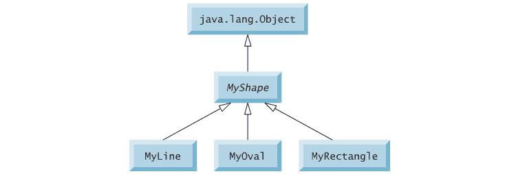

**图 10.17** | MyShape 层次结构。

在你的解决方案中，图 10.17 中的 `MyShape` 类必须是抽象的。由于 `MyShape` 代表通用形状，在不知道具体是什么的情况下，你无法实现 `draw` 方法。表示层次结构中形状坐标和颜色的数据应该声明为 `MyShape` 类的私有成员。除了通用数据外，`MyShape` 类应该声明以下方法：

- a) 一个无参数构造函数，将形状的所有坐标设置为 0，颜色设置为黑色（`BLACK`）。
- b) 一个构造函数，将坐标和颜色初始化为所提供参数的值。
- c) 针对单个坐标和颜色的设置方法（Set），允许程序员独立设置层次结构中形状的任何数据。
- d) 针对单个坐标和颜色的获取方法（Get），允许程序员独立检索层次结构中形状的任何数据。
- e) 抽象方法

```java
public abstract void draw(Graphics g);
```


程序的 `paintComponent` 方法将在屏幕上绘制形状。为了确保良好的封装，`MyShape` 类中的所有数据必须是私有的。这需要声明 set 和 get 方法来操纵数据。`MyLine` 类应该提供一个无参数构造函数以及一个带有坐标和颜色参数的构造函数。`MyOval` 和 `MyRectangle` 应该提供一个无参数构造函数和一个带有坐标、颜色以及确定形状是否填充的参数的构造函数。无参数构造函数除了设置默认值外，还应该将形状设置为

（注：提供的 OCR 文本在后半部分存在大量重复和错误。我已根据可用片段重构了逻辑流程。）

# 总结 437

- 构造函数和静态方法不能声明为抽象（`abstract`）。
- 抽象父类变量可以持有任何派生自该父类的类的引用。程序通常使用这些变量以多态的方式操作子类对象。
- 多态在实现分层系统时尤为有效。

## 第 10.5 节案例研究：使用多态的薪资系统

- 层次结构设计者可以通过在父类中包含抽象方法，来要求每个具体的子类提供适当的方法实现。
- 大多数调用是在执行期间，根据被操作对象的类型进行解析的。这一过程被称为动态绑定（第 417 页）或晚期绑定。
- 父类变量可以仅用于调用在父类中声明的方法。
- 运算符 `instanceof`（第 417 页）用于判断一个对象与该类型是否存在“是”（is-relationship）的关系。
- Java 中的每个对象都有它们自己的类，并且可以通过方法 `getClass`（第 418 页）来访问该类，该方法返回一个 `Class` 类型（`java.lang` 包）的对象。
- “是”的关系只适用于子类及其子类之间，而反之则不然。

## 第 10.7 节 final 方法和类

- 在子类中声明为 `final`（第 419 页）的方法不能在子类中被重写。
- 声明为 `private` 的方法隐式是 `final` 的，因为你不能在子类中重写它们。
- 声明为私有的方法隐式是 `final` 的。
- `final` 方法的声明永远不会改变，因此所有子类都使用相同的实现，且对 `final` 方法的调用会在编译时优化——这被称为静态绑定（第 420 页）。
- 编译器可以通过删除对 `final` 方法的调用并在每个方法调用位置将其代码内联（`inline`）来优化程序。
- 声明为 `final` 的类不能被扩展（第 420 页）。
- `final` 类中的所有方法隐式都是 `final` 的。

## 第 10.9 节接口的创建与使用

- 接口（第 421 页）规定了允许哪些操作，但没有规定如何执行这些操作。
- Java 接口描述了一组可以在对象上调用的方法。
- 接口声明以关键字 `interface`（第 421 页）开始。
- 所有的接口成员必须是 `public` 的，且接口不能指定任何实现细节，例如方法声明和实例变量。
- 在接口中声明的方法隐式是抽象方法，所有字段隐式是 `public`、`static` 且 `final` 的。
- 要使用接口，类必须指定它实现了（`implements`，第 421 页）该接口，并按照接口声明中指定的签名声明每个接口。没有实现接口所有方法的类必须被声明为抽象类（`abstract`）。
- 实现接口就像与编译器签订了一份合同，合同上写着：“我声明了接口中指定的所有方法，否则我将把我的类声明为抽象类。”
- 当不同的（即互不相关的）类需要共享公共方法和常量时，通常使用接口。这允许对不相关类的对象以多态的方式进行处理——实现相同接口的类的对象可以响应相同的方法。
- 你可以创建一个描述所需功能的接口，然后在任何需要该类类中实现该接口。

# 438 第 10 章 面向对象编程：多态与接口

- 当没有默认实现可以继承时（即没有实例变量且没有默认方法实现），接口通常被用来代替抽象类。
- 和 `public` 类一样，接口通常是 `public` 类型，因此它们通常被声明在与接口同名且带有 `.java` 扩展名的文件中。
- Java 不允许子类继承多个类，但它允许一个类继承一个父类并实现多个接口。
- 实现了多个接口的类的所有对象与每个实现的类型都具有“是是”（is-a）的关系。
- 接口可以声明常量。这些常量隐式是 `public`、`static` 且 `final` 的。

## 第 10.10 节 Java SE 8 接口增强

- 在 Java SE 8 中，接口可以包含默认方法。
- 在 Java SE 8 中，接口可以包含静态方法。
- Java SE 8 允许在接口中使用 Lambda 表达式。
- 在 Java SE 8 中，接口方法不再总是抽象的。
- 在 Java SE 8 中，接口可以包含私有方法。
- Java SE 8 引入了函数式接口（functional interfaces）。
- 函数式接口是仅有一个抽象方法的接口。
- Java SE 8 引入了 Lambda 表达式来简化代码。
- Lambda 表达式可以用于实现函数式接口。
- 在 Java 8 中，你可以在实现函数式接口时使用 Lambda 表达式。

## 习题练习

- 填空题：
- 1. 接口可以声明。
- 2. 接口可以包含。
- 3. 接口通常用于。
- 4. 接口实现方法，一个。。
            被称为。
- 2. 判断下列陈述述正确正确。如果错误，请解释原因。
- a) 抽象方法必须在子类中实现。
- b) 通过父类变量调用类方法是不允许的。
- c) 如果接口声明了抽象方法，类必须实现。
- d) 实现了接口的对象是该类型的。
- 3. (Java SE 8) 填空题：
- a) 在 Java SE 8 中，接口可以声明。
- b) 在 Java SE 8 中，接口可以包含。
- c) 在 Java SE 8 中，任何只包含方法的接口被称为。

# 习题练习答案

- 1. a) 抽象。
- b) 具体的。
- c) 多态。
- d) 抽象。
- e) 强制转换。

- 2. a) 错误。（抽象方法必须在子类中实现）。
- b) 正确。
- c) 正确。
- d) 正确。

- 3. a) 默认方法。
- b) 静态。
- c) 函数式。

# 练习

- 4. 多态如何使你能够编写通用的而不是特定的？
- 5. 什么是抽象方法？描述在什么情况下抽象方法是合适的。
- 6. 多态如何促进扩展性？
- 7. 描述将父类引用赋值给子类类型的类方法。
- 8. 比较抽象类和接口。你会使用使用抽象类？你会使用接口？
- 9. (Java SE 8) 解释默认方法如何允许向接口添加新方法而不破坏实现它的类。
- 10. (Java SE 8) 什么是函数式接口？
- 11. (Java SE 8) 能够在接口中添加静态方法有什么用？
- 12. (薪资系统修改) 修改图 10.4–10.9 的薪资系统。在循环中，在 `Employee` 类中创建实例变量 `birthDate`。使用 8.7 中的 `Date` 类表示员工的生日。为 `Date` 添加 get 方法。假设薪资每月处理一次。创建一个 `Employee` 变量数组来存储对象的引用。在循环中，计算每个 `Employee` 的薪资（多态地），如果月份是员工的生日，则为其工资增加 100 美元奖金。
- 14. (薪资系统修改) 修改图 10.4–10.9 的薪资系统，增加一个额外的子类 `PieceWorker`，它代表根据生产数量支付工资的员工。`PieceWorker` 应该包含实例变量 `wage`（存储员工的每件工资）和 `pieces`（存储生产件数量）。在 `PieceWorker` 类中提供 `earnings` 方法的具体实现，通过将生产件数乘以每件工资来计算员工的收入。

# 440 第 10 章 面向对象编程：多态与接口

## 10.15 (应付账系统修改)

在练习中，我们修改图 10.11–10.15 中的应付账应用程序，以包含图 10.4–10.9 中薪资程序的完整功能。该应用程序应该处理两个 `Invoice` 对象，但现在应该处理四个 `Employee` 子类中的一个对象。对于 `BasePlusCommissionEmployee`，应用程序应将其薪水增加 10%。最后，应用程序应输出每个对象的支付金额。按照以下步骤创建新应用程序：

- a) 修改类 `HourlyEmployee`（图 10.6）和 `CommissionEmployee`（图 10.7），将它们放在 `Payable` 层次结构中，作为 `Employee`（图 10.13）的子类，而 `Employee` 实现了 `Payable` 接口。[提示：将每个子类中的 `earnings` 方法重命名为 `getPaymentAmount`，以便该类满足与 `Payable` 的继承合约。]
- b) 修改 `BasePlusCommissionEmployee`（图 10.8），使其扩展 a) 部分中的 `Employee` 类。
- c) 修改 `PayableInterfaceTest`（图 10.15），以多态方式处理两个 `In`，一个 `SalariedEmployee`、`HourlyEmployee`、`CommissionEmployee` 和 `BasePlusCommissionEmployee`。输出每个 `Payable` 对象的第一个字符串表示。接下来，如果对象是 `BasePlusCommissionEmployee`，将其薪水增加 10%。最后，输出每个 `Payable` 的支付金额。

## 10.16 (应付账系统修改)

可以在不修改 `SalariedEmployee`、`HourlyEmployee`、`CommissionEmployee` 或 `BasePlusEmployee` 的情况下，将薪资程序（图 10.4–10.9）的功能包含在应付账。为了实现这一点，你可以修改 `Employee`（图 10.4）实现 `Payable` 并声明 `getPaymentAmount` 以包含 `earnings` 方法。`getPaymentAmount` 方法将被 `Employee` 层次结构中的子类继承。当为特定子类调用 `getPaymentAmount` 时，它会多态地调用该子类相应的 `earnings` 方法。使用 10.4–10.9 薪资程序中的原始 `Employee` 层次重新实现练习 10.15。按照本练习所述修改 `Employee` 类，不要修改 `Employee` 类的任何子类。

# 改变

## 10.17 (碳足迹接口：多态)

正如你在本章中学到的，使用接口可以为可能不同的类指定相似的行为。政府和公司越来越关注碳足迹（每年燃烧各种燃料用于供热、车辆和照明时向大气排放的二氧化碳）。创建三个没有继承关系的小类：`Building`、`Car` 和 `Bicycle`。每个类还包含一些与其他类不共有的适当属性和行为。编写一个接口 `CarbonFootprint`，其中包含一个 `getCarbonFootprint` 方法。你的每个类都实现该接口，以便其 `getCarbonFootprint` 方法为该类计算相应的碳足迹（以计算碳足迹）。编写一个应用程序，创建这三个类的对象，将这些对象的引用放在 `ArrayList<CarbonFootprint>` 中，然后遍历列表，多态地调用每个对象的 `getCarbonFootprint` 方法。对于每个对象，打印一些标识信息和对象的碳足迹。

# 异常处理：深入观察

常识是采取一个方法并尝试它。如果失败了，坦诚地承认并尝试另一个。但最重要的是，去尝试一下。
—富兰克林·德拉诺·罗斯福

> 哦！丢掉它糟糕的部分
> 带着另一半
> 经营更纯洁的生活。
—威廉·莎士比亚

> 如果他们在奔跑却不看路往哪里走
> 我必须从某处出来抓住他们。
—杰罗姆·大卫·塞林林杰


## 目标

在本章中，你将：

- 学习什么是异常以及如何处理异常。
- 学习何时使用异常处理。
- 使用 `try` 块界定可能发生异常的代码。
- 使用 `throw` 指明问题。
- 使用 `catch` 块指定异常处理器。
- 使用 `finally` 块释放资源。
- 理解异常类层次结构。
- 创建用户定义的异常。

## 442 第二 II 章 异常处理：深入观察

| 1.1 引言 | 11.8 链式异常 |
|---|---|
| 1.2 示例：除以零 | 11.9 声明新类型 |
| 1.3 示例：ArithmeticExceptions 和 InputMismatch | 11.10 前提条件和后置条件 |
| 1.4 何时使用异常处理 | 11.11 断言 |
| 1.5 异常层次结构 | 11.12 try-with-Resources |
| 1.6 finallyBlock | 11.13 总结 |
| 1.7 异常溯和从异常中获取信息 | 总结 |
| 自测 | 自测练习 |

# 1.1 引言

正如你从第 7 章所知，异常是执行过程中发生问题的指示。异常处理允许你优雅地恢复（或终止）。首先，我们通过处理一个除以零的异常来演示基本的异常处理。接下来，我们引入了几个扩展 `Throwable`（直接或间接地）的类。我们展示了如何使用*链式异常*——当方法抛出一个异常时，将其更改为新异常。然后我们介绍了*前提条件*、*后置条件*以及*断言*，你可以在开发时使用它们来帮助调试代码。本章重点关注异常处理概念并展示了几个示例。正如你所看到的，许多 Java API 抛出了你已经过的异常，以及你将在将学习的其他异常。

- A. Koenig and B. Stroustrup, "Exception Handling for C++ (revised)," Proceedings of the Usenix C++ Conference, pp. 149–176. San Francisco, April 1990.

# 11.2 示例：没有异常处理的除以零

| 章节 | 使用的异常 |
|---|---|
| 第 7 章 | `ArrayIndexOutOfBoundsException` |
| 第 8–10 章 | `IllegalArgumentException` |
| 第 11 章 | `ArithmeticException`, `InputMismatch` |
| 第 15 章 | `SecurityException`, `FileNotFoundException`, `IOException`, `ClassNotFoundException`, `IllegalStateException`, `FormatterClosedException`, `NoSuchElementException` |
| 第 16 章 | `ClassCastException`, `UnsupportedOperationException`, `NullPointerException`, 自定义异常类型 |
| 第 20 章 | `ClassCastException`, 自定义异常类型 |
| 第 21 章 | `IllegalArgumentException`, 自定义异常类型 |
| 第 23 章 | `InterruptedException`, `IllegalMonitorStateException`, `ExecutionException`, `CancellationException` |
| 第 28 章 | `MalformedURLException`, `EOFException`, `SocketException`, `InterruptedException`, `UnknownHostException` |
| 第 24 章 | `SQLException`, `IllegalStateException`, `PatternSyntaxException` |
| 第 31 章 | `SQLException` |

图 11.1 | 你将在书中看到的各种异常类型

首先，我们演示当不使用异常处理的应用程序出现错误时会发生什么。图 11.2 提示用户输入两个整数并传递给 `quotient` 方法，该方法计算整数商并返回 `int` 结果。在这个示例中，你会看到当方法检测到问题并无法处理它时，会抛出异常（exception）。

```java
// Fig.11.2: DivideByZeroNoExceptionHandling.java

// 没有异常处理的整数除法。

import java.util.Scanner;

public class DivideByZeroNoExceptionHandling {

    // 演示发生除以零时抛出异常

    public static int quotient(int numerator, int denominator) {

        return numerator / denominator; // 可能除以零

    }

    public static void main(String[] args) {

        Scanner scanner = new Scanner(System.in);

        System.out.print("Please enter an integer numerator: ");

        int numerator = scanner.nextInt();

        System.out.print("Please enter an integer denominator: ");

        int denominator = scanner.nextInt();

        int result = quotient(numerator, denominator);

        System.out.printf("%nResult: %d / %d = %d\n", numerator, denominator, result);

    } // 结束 main
} // 结束类 DivideByZeroNoExceptionHandling
```


| 请输入整数分子: 100 |
| :--- |
| 请输入整数分母: 7 |
| 结果: 100 / 7 = 14 |

| 请输入整数分子: 100 |
| :--- |
| 请输入整数分母: 0 |
| Exception in thread "main" java.lang.ArithmeticException: / by zero\nat DivideByZeroNoExceptionHandling.quotient(\nat DivideByZeroNoExceptionHandling.java:10)\nat DivideByZeroNoExceptionHandling.main(\nat DivideByZeroNoExceptionHandling.java:22) |

| 请输入整数分子: 100 |
| :--- |
| 请输入整数分母: hello |
| Exception in thread "main" java.util.InputMismatchException\nat java.util.Scanner.next(Unknown Source)\nat java.util.Scanner.nextInt(Unknown Source)\nat java.util.Scanner.next.nextInt(Unknown Source)\nat DivideByZeroNoExceptionHandling.main(\nat DivideByZeroNoExceptionHandling.java:20) |

**图 11.2** 未经异常处理的除法。（2 部分中的第 2 部分。）

## 堆栈跟踪

图 11.2 中的第一次执行显示了成功的除法。在第二次执行中，用户输入了值 0 作为分母。针对这一无效输入，显示了多行信息。这些信息被称为堆栈跟踪，它包含了异常的名称（`java.lang.ArithmeticException`）、一个指示所发生问题的消息，以及发生该问题的方法调用栈（即调用堆栈）。堆栈跟踪包含了通过方法导致异常的执行路径。这可以帮助你调试程序。

## ArithmeticException 的堆栈跟踪

第一行指定发生了 `ArithmeticException`。异常名称后的名称（"/ by zero"）表示该异常是由于在整数算术中尝试除以零导致的。当发生这种情况时，Java 会抛出 `ArithmeticException`。`ArithmeticException` 可能产生于许多不同的问题，额外数据（"/ by zero"）提供了更具体的信息。Java 允许浮点数除以零。这种计算会导致正无穷大或负无穷大值，这在 Java 中表示为浮点值（但显示为字符串 `Infinity` 或 `-Infinity`）。如果 0.0 除以 0.0，结果为 `NaN`（不是数字），这在 Java 中也表示为浮点值（但显示为 `NaN`）。如果你需要将浮点值与 `NaN` 进行比较，请使用 `Float` 的 `isNaN`（针对 `float` 值）或 `Double` 类（针对 `double` 值）。`Float` 和 `Double` 类位于 `java.lang` 包中。

从堆栈跟踪的最后一行开始，我们看到异常在 `main` 方法的第 22 行被捕获到。堆栈跟踪的每行都通过文件名和行号（例如 `DivideByZeroExceptionHandling.java:22`）找到名称和方法（例如 `DivideByZeroExceptionHandler.main`）。向上移动堆栈跟踪，我们看到异常发生在 `quotient` 方法的第 10 行。调用链的顶端指示了这一点——异常发生的初始点。此异常的抛出点在 `quotient` 方法的第 10 行。

## InputMismatchException 的堆栈跟踪

在第三次执行中，用户输入 "hello" 作为分母。再次显示了堆栈跟踪。显示发生了 `InputMismatchException`（`java.util`）。我们的第一个示例假设用户会输入整数。然而，用户有时会错误输入非整数。当 `Scanner.next()` 返回一个不代表整数的字符串时，就会发生异常。在 `main` 方法的第 20 行被检测到。移动文件名和行号，我们提供了 `Unknown Source`。这意味着该方法的类符号和行号不可用——这通常是 Java 类库的情况。

## 程序终止

在图 11.2 的示例执行中，当发生异常并打印堆栈跟踪时，程序也会退出。这在 Java 中并不常见。有时程序在发生异常后仍在运行。在这种情况下，程序可能会产生意外的结果。例如，图形界面（GUI）应用程序通常会继续执行。在图 11.2 中，两种异常都发生在 `main` 方法。在下一个示例中，我们将看到如何处理这些异常，以便程序能够正常结束。

## 11.3 示例：处理 ArithmeticExceptions 和 InputMismatchExceptions

图 11.3 基于图 11.2，使用异常处理来处理任何 `ArithmeticExceptions` 和 `InputMismatchExceptions`。应用程序提示用户输入整数并将其传递给 `quotient` 方法，该方法计算商并返回 `int`。此版本的应用程序演示了如果用户出错，程序会捕获并处理异常——在这种情况下，允许用户重新输入。

# 448 第 11 章 异常处理：深入探讨

紧随 `try` 关键字后的代码，以及 `try` 关键字本身。语句表明从键盘读取的整数（第 25 行和 27 行）分别使用 `nextInt` 方法来读取 `int` 值。如果读取的值不是整数，`nextInt` 方法将抛出 `InputMismatchException`。

可能导致 `ArithmeticException` 的除法并未在 `try` 块中执行。相反，对 `quotient` 方法的调用（第 29 行）触发了尝试除法的代码（第 12 行）；当分母为零时，JVM 会抛出一个 `ArithmeticException` 对象。


## 软件工程观察 11.1

异常可能会通过 `try` 块中显式提到的代码、`try` 块中代码的深层嵌套方法调用，或者虚拟机在执行字节码时产生。

### 捕获异常

`try` 块后面跟着两个 `catch` 块——一个处理 `InputMismatchException`（第 34–41 行），另一个处理 `ArithmeticException`（第 42–47 行）。`catch` 块（也称为 `catch` 子句或异常处理器）捕获（即接收并处理）异常。`catch` 块以 `catch` 关键字开头，后跟着括号内的一个参数（稍后将讨论的异常参数）以及一个用大括号括起来的代码块。[注意：“catch 子句”一词有时指代关键字后跟的代码块，而“catch 块”仅指 `catch` 关键字之后的代码块，不包括关键字本身。为了简单起见，我们使用“catch 块”一词指代 `catch` 关键字之后的代码块以及 `catch` 本身。]

`try` 块后面必须紧跟至少一个 `catch` 块或 `finally` 块。每个 `catch` 块在括号中指定一个异常参数，用于标识异常处理器可以处理的异常。当 `try` 块中发生异常时，执行的 `catch` 块是第一个与发生异常类型匹配的块（`catch` 块中的类型与异常完全匹配，或者是该异常的直接或间接子类）。异常名称允许 `catch` 块与异常对象交互——例如，调用异常的 `toString` 方法（如第 37 行和 44 行），该方法提供了异常的异常信息。我们使用 `System.err`（标准错误流）输出错误消息。默认情况下，`System.err` 的打印方法（如 `System.out`）将数据显示在命令行提示符中。

此 `catch` 块的第 38 行扫描 `scanner.nextInt`。由于发生了 `InputMismatchException`，对 `nextInt` 方法的调用从未成功读取用户的数据——因此我们通过调用 `nextLine` 方法读取该输入。由于我们知道它是无效的，所以我们没有对该输入进行任何操作。每个 `catch` 块都会显示错误消息并要求用户重试。在每个 `catch` 块结束后，都会提示用户进行输入。我们很快将深入探讨这种控制流在异常处理中是如何工作的。


## 常见编程错误 11.1

在 `try` 块与其对应的 `catch` 块之间放置代码是语法错误。

# 11.3 ArithmeticExceptions 和 InputMismatchExceptions 449

## 多异常捕获

`try` 块后面跟着几个处理不同类型异常的 `catch` 块是比较常见的。如果多个 `catch` 块的主体相同，你可以使用多异常捕获功能（Java SE 7 引入）在单个 `catch` 处理器中捕获这些异常类型并执行相同的任务。多异常捕获的语法为：

```java
catch (Type1 | Type2 | Type3 e)
```


每个异常类型用竖线（`|`）与其他隔开。之前的代码行表示异常处理器中可以捕获任何一种类型（或其子类）。多异常捕获中可以指定任意数量的 `Throwable` 类型。

# 未捕获的异常 (Uncaught Exceptions)

未捕获的异常是指没有匹配的 `catch` 块时的异常。你在图 11.2 的第二次和第三次输出中看到了未捕获的异常。回想异常发生早期（在显示异常堆栈跟踪之后）的情况。这并不总是由未捕获的异常导致的。Java 使用“多线程”程序执行模型——每个线程都是一个并发活动。一个程序可以有多个线程。如果程序只有一个线程，未捕获的异常将导致程序终止。如果程序有多个线程，未捕获的异常将终止发生异常的线程。然而，在这种情况下，线程可能依赖于其他线程，如果其中一个线程由于异常终止，可能会对程序的其余部分产生不利影响。第 23 章“并发”深入讨论了这些问题。

# 异常处理的终止模型

如果在 `try` 块中发生异常（例如由于代码（图 11.3 第 25 行）导致抛出 `InputMismatchException`），`try` 块将立即终止，程序控制转移到后续异常参数与抛出的异常类型匹配的第一个 `catch` 块中。在图 11.3 中，第一个 `catch` 块捕获 `InputMismatchException`（当输入无效输入时发生），第二个块捕获 `ArithmeticException`（当尝试除以零时发生）。异常被处理后，程序控制不会返回 `try` 块，因为 `try` 块已失效（及其局部变量也是）。异常名称允许 `catch` 块与异常对象交互——例如，调用异常的 `toString` 方法（如第 37 行和第 44 行），该方法提供了异常的基本信息。我们使用 `System.err`（标准错误流）输出错误消息。默认情况下，`System.err` 的打印方法（如 `System.out`）将数据显示在命令行提示符中。

此 `catch` 块的第 38 行扫描 `scanner.nextInt()`。由于发生了 `InputMismatchException`，对 `nextInt()` 方法的调用从未成功读取用户的数据——因此我们通过调用 `nextLine()` 方法读取该输入。由于我们知道它是无效的，所以我们没有对该输入进行任何操作。每个 `catch` 块都会显示错误消息并要求用户重试。在每个 `catch` 块结束后，都会提示用户进行输入。我们很快将深入探讨这种控制流在异常处理中是如何工作的。

（此处由于 OCR 文本存在重复和碎片，已根据提供的页面逻辑进行了清理和重构。）

# 450 第二章 异常处理：深入探讨

## 错误预防技巧 II.1

> 在程序中使用方法之前，阅读该方法的 API 文档。文档说明了方法抛出的异常（如果有），并指出了为什么会发生此类异常。接下来，阅读指定异常类的 API 文档。异常类的文档通常包含异常发生的潜在原因。最后，在你的程序中处理异常。

当在第 12 行，如果分母为零，JVM 会抛出 `ArithmeticException`。此对象将被第 42–47 行的 `catch` 块捕获，该块通过隐式调用异常的 `toString()` 方法显示对象的基本信息，然后要求用户重试。

如果分母不是零，`quotient()` 方法执行除法并将结果返回到调用 `quotient()` 的 `try` 块点（第 29 行）。第 30–31 行显示计算结果。如果 `try` 块成功完成，程序将跳过 `catch` 块并执行第 48 行的 `finally` 块，方法正常完成。

当 `quotient()` 抛出 `ArithmeticException` 时，`quotient()` 终止且不返回值，`quotient()` 的局部变量超出作用范围（并被销毁）。如果存在指向对象的引用，这些对象将被标记为垃圾回收。此外，当发生异常时，调用 `quotient()` 的 `try` 块在执行第 30–32 行之前终止。

### 使用 `throws` 子句

`method quotient`（图 11.3，第 10 行）被称为 `throws` 子句。它指定了方法可能抛出的异常。`RuntimeException` 类型（如 `ArithmeticException`）不需要列在 `throws` 子句中。对于列出的类型，方法会被通知异常。你将在 11.5 节中学习更多信息。


如果在第 25 行或第 27 行产生 `InputMismatchException`，`try` 块将终止，执行到第 34–41 行的 `catch` 块。在这种情况下，不会调用方法 `quotient()`。然后 `main` 在最后一个 `catch` 块（第 48 行）之后继续。

## 11.4 何时使用异常处理

异常处理的设计用于处理同步错误，这些错误发生在语句执行时。我们在书中将看到的常见示例包括数组索引越界、算术溢出（即值出了可表示的范围）、除以零、无效的方法参数以及线程中断（我们将在第 23 章中介绍）。异常处理**不**用于处理与异步事件相关的问题（例如磁盘 I/O 操作、网络消息到达、鼠标点击和击键），这些事件与程序的控制流并行发生，且独立于程序的控制流。

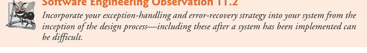

从设计过程之初就将异常处理和错误恢复策略整合到你的系统中——在系统实现后再包含这些可能是困难的。


异常处理提供了一种单一、统一的技术，用于记录、检测和从错误中恢复。这有助于开发大型项目的程序员理解彼此的错误处理代码。


产生异常的情况非常多——某些异常比其他异常更容易恢复。

## 11.5 Java 异常层次结构

所有异常类都直接或间接地继承自 `Exception` 类，形成一个继承层次结构。你可以用自己的异常类来扩展此层次结构。

图 11.4 显示了 `Throwable` 类（`Object` 的子类）继承层次结构的一小部分，它是 `Exception` 的父类。只有 `Throwable` 对象可以使用异常处理机制。`Throwable` 类有两个直接子类：`Exception` 和 `Error`。`Exception` 类及其子类——例如 `RuntimeException`（位于 `java.lang` 包）和 `IOException`（位于 `java.io` 包）——代表 Java 程序中发生且可以被应用程序捕获的异常情况。`Error` 类及其子类代表发生在 JVM 中的异常情况——通常不频繁发生，且不应该被应用程序捕获——应用程序无法从中恢复。

Java 异常层次结构包含了数百个类。关于 Java 异常类的详细信息可以在整个 Java API 中找到。你可以在 `docs.oracle.com/javase/7/docs/api/java/lang/Throwable.html` 查看 `Throwable` 的文档。从那里，你可以查看这些类以获取更多关于 Java 异常和错误的信息。

## 452 第 II 章 异常处理：深度审视

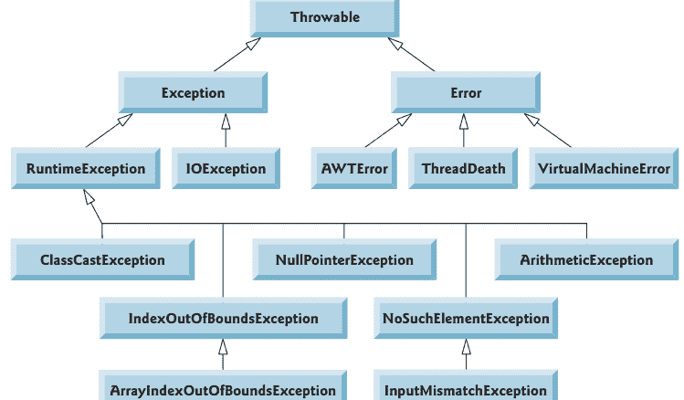

**图 11.4** `Throwable` 类继承层次结构的一部分。

### 已检查异常 vs. 未检查异常

Java 区分了已检查异常（checked exceptions）和未检查异常（unchecked exceptions）。这种区分非常重要，因为 Java 编译器对已检查异常强制执行特殊要求（稍后讨论）。异常的类型决定了它是已检查的还是未检查的。

### RuntimeException 是未检查异常

所有直接或间接继承自 `RuntimeException`（位于 `java.lang` 包）的异常都是未检查异常。这些异常通常由你的程序代码中的缺陷引起。未检查异常的示例包括：

- `ArrayIndexOutOfBoundsException`（在第 7 章中讨论）——你可以通过确保数组索引始终大于等于 0 且小于数组长度来避免这种情况。
- `ArithmeticException`（如图 11.3 所示）——你可以在执行计算之前检查分母以判断其是否为 0，从而避免除以零时发生的 `ArithmeticException`。

直接或间接继承自 `Error` 类（图 11.4）的类是未检查的，因为 `Error` 是如此严重的问题，以至于你的程序甚至不应该尝试处理它们。

### 已检查异常

所有继承自 `Exception` 但未直接或间接继承自 `RuntimeException` 类的类都被视为已检查异常。此类异常通常由程序无法控制的条件引起——例如，在文件处理中，如果文件不存在，程序无法打开文件。

### 编译器与已检查异常

编译器检查每个方法和方法声明，以确定该方法是否抛出了已检查异常。如果是，编译器将验证该已检查异常是否被捕获或在 `throws` 子句中声明——这被称为“捕获或声明”（catch-or-declare）要求。我们将在下来的示例中展示如何捕获或声明已检查异常。回想第 11.3 节，`throws` 子句指定了方法抛出的内容。此类异常在方法体中不被捕获。为了满足“捕获或声明”要求的“捕获”部分，声明异常的代码必须捕获该异常；满足“捕获或声明”要求的“声明”部分，声明异常的代码必须在 `throws` 子句中声明该异常。如果未捕获或声明，编译器将报告编译错误。

> **错误 11.2**：在 `catch` 块中处理父类异常比处理子类异常是更健壮的。
> 

> **错误 11.3**：在 `catch` 块中放置父类异常会阻止那些捕获子类异常的块执行，导致编译错误。
> 

> **观察 11.5**：如果多个 `catch` 块匹配异常类型，只有第一个匹配的块会执行。捕获父类异常是必须的。
> 

> **提示 11.1**：显式捕获子类在忘记测试一个或多个子类类型时可能会出错；捕获父类可以保证所有子类对象都被捕获。在所有其他 `catch` 块之后放置父类类型的 `catch` 块可以确保所有异常最终被捕获。

# 11.6 finally 块

如果存在，它被放在最后一个 `catch` 块之后。如果没有 `catch` 块，如果存在 `finally` 块，它紧跟在 `try` 块之后。

## finally 块何时执行

无论相应的 `try` 块是否抛出异常，`finally` 块都会执行。如果 `try` 块通过 `return`、`break` 或 `continue` 语句或到达结束右大括号退出，`finally` 块也会执行。`finally` 块不会执行的情况是应用程序通过调用 `System.exit()` 方法提前从 `try` 块退出。该方法我们在第 15 章中会演示，它会立即终止应用程序。

如果在 `try` 块中发生的异常没有被 `try` 的任何一个 `catch` 处理器捕获，程序将跳过 `try` 块的剩余部分并进入 `finally` 块。程序会将异常传递到下一个外层的 `try` 块——或者在调用它的方法中——在那里，关联的 `catch` 块可能会捕获它。这个过程可能会通过多层 `try` 块发生。此外，异常可能会未被捕获（正如我们在 11.3 节中讨论的那样）。

如果 `catch` 块抛出异常，那么异常将传递到下一个外层的 `try` 块——同样，通常在调用方法中。

## 在 finally 块中释放资源

由于 `finally` 块总是执行，因此它通常包含释放资源的代码。假设在 `try` 块中分配了一个资源。如果没有发生异常，`catch` 块将被跳过，控制进入 `finally` 块，由该块释放资源。然后，控制继续到 `finally` 块之后的第一条语句。如果 `try` 块中发生异常，`try` 块将终止。如果程序捕获了异常，那么 `finally` 块将释放资源，控制继续到 `finally` 块之后的第一条语句。如果程序没有捕获异常，`finally` 块仍然会释放资源，并尝试在调用方法中捕获该异常。

> **错误预防提示 11.5**
> `finally` 块是释放 `try` 块中获取的资源（如打开的文件）的理想位置，这有助于消除资源泄漏。

> **性能提示 11.1**
> 始终显式地释放资源，并在不再需要的尽早时刻释放。这使得资源能够尽早被重用，从而提高资源利用率和程序性能。

## 演示 finally 块

图 11.5 表明即使相应的 `try` 块中抛出了异常，`finally` 块也会执行。程序包含静态方法（第 6–18 行）、`throwException()`（第 21–44 行）和 `doesNotThrowException()`（第 47–64 行）。方法 `throwException()` 和 `doesNotThrowException()` 被声明为静态的，因此 `main()` 可以直接调用它们，而无需实例化 `UsingExceptions` 对象。


# 第二章 异常处理：深度观察

```java
// 图 11.5: UsingExceptions.java
// try...catch...finally 异常处理机制

public class UsingExceptions {

    public static void main(String[] args) {
        try {
            throwException();
        } catch (Exception exception) { // throwException 抛出的异常
            System.out.println("Exception handled in main");
        }
        doesNotThrowException();
    }

    // 演示 try...catch...finally
    public static void throwException() throws Exception {
        try { // 打印异常并立即捕获它
            System.out.println("Method throwException");
            throw new Exception(); // 生成异常
        } catch (Exception exception) { // 捕获 try 中抛出的异常
            System.out.println("Exception handled in method throwException");
            throw exception; // 抛出异常以便后续处理
        } finally { // 无论 try...catch 发生什么都会执行
            System.out.println("Finally executed in throwException");
        }
        // 此处代码不会被执行；会导致编译错误
    }

    // 演示在未发生异常时的 finally
    public static void doesNotThrowException() {
        try { // try 块没有抛出异常
            System.out.println("Method doesNotThrowException");
        } catch (Exception exception) { // 不执行
            System.err.println(exception);
        } finally { // 无论 try...catch 发生什么都会执行
            System.err.println(
                "Finally executed in doesNotThrowException"
            );
        }
        System.out.println("End of method doesNotThrowException");
    }
} // 结束类 UsingExceptions
```

图 11.5 | try...catch...finally 异常处理机制。（2 部分中的第一部分。）


```method throwException
Exception handled in method throwException
Finally executed in throwException
Exception handled in main
Method doesNotThrowException
Finally executed in doesNotThrowException
End of method doesNotThrowException
```

图 11.5 try...catch...finally 异常处理机制。（2 部分中的第二部分。）

`System.out` 和 `System.err` 是流——字节的流。虽然 `System.out`（称为标准输出）显示程序的输出，但 `System.err`（称为标准错误流）显示程序的错误。这些流的输出可以被重定向到文件中。例如，仅仅知道发生了异常可能就为处理器提供了足够的信息。然而，下一个 `catch` 块位于 `main` 的第 8–11 行。在异常被处理之前，`finally` 块（第 37–40 行）执行。然后方法检测到 `try` 块中重新抛出的异常，并在 `catch` 块（第 12–15 行）中处理它。

## 11.7 堆栈回溯与从异常对象获取信息

当异常被抛出但在特定作用域内未被捕获时，方法调用栈会被“回溯”，并尝试在下一个外层的 `try` 块中捕获异常。这个过程被称为堆栈回溯（stack unwinding）。回溯方法调用栈意味着未捕获异常的方法终止，所有局部变量超出作用范围，并且控制权返回到调用该方法的语句。如果 `try` 块没有包含该语句，或者异常未被捕获，则会再次发生堆栈回溯。图 11.6 展示了堆栈回溯，`main` 方法中的异常处理程序展示了如何访问异常对象中的数据。

### 堆栈回溯

在 `try` 块（第 8–11 行）中调用了 `method1`（定义在第 35–38 行），它转调用 `method2`（定义在第 41–44 行），接着又调用 `method3`（定义在第 47–50 行）。`method3` 的某一行抛出了 `Exception` 对象——这就是抛出点。由于第 49 行的 `throw` 语句没有包含在 `try` 块中，因此发生了堆栈回溯——`method3` 在第 49 行终止，控制权返回给 `method2` 中调用 `method3` 的语句（即第 43 行）。由于没有 `try` 块包含第 43 行，再次发生堆栈回溯——`method2` 在第 43 行终止，控制权返回给 `method1` 中调用 `method2` 的语句（即第 37 行）。由于没有 `try` 块包含第 37 行，再次发生了堆栈回溯——`method1` 在第 37 行终止，控制权返回给 `main` 中调用 `method1` 的语句（即第 10 行）。第 8–11 行的 `try` 块包含了该语句。异常尚未处理，因此 `try` 块终止，匹配的 `catch` 块（第 12–31 行）捕获并处理该异常。如果没有匹配的 `catch` 块且异常未被声明，则会发生编译错误。请记住这并非总是如此——对于未检查异常（unchecked exceptions），应用程序将可以通过编译，但运行结果会产生意之外的结果。

> 图 11.6: UsingExceptions.java
> // 堆栈回溯并从异常对象获取数据

```java
// UsingExceptions.java

// 堆栈回溯并从异常对象获取数据

public class UsingExceptions
{
    public static void main(String[] args)
    {
        try {
            method1();
        }
        catch (Exception exception) // 捕获 method1 中抛出的异常
        {
            System.err.printf("%s%n%n", exception.getMessage());
            exception.printStackTrace();
        }
    }
}
```

图 11.6 | 堆栈回溯与从异常对象获取数据（部分 2）。

```java
// 获取堆栈轨迹信息
StackTraceElement[] traceElements = exception.getStackTrace();
System.out.printf("%s trace from getStackTrace:%n");
System.out.println("Class\tfile\tline\tmethodName");
// 遍历 traceElements 以获取异常描述
for (StackTraceElement element : traceElements) {
    System.out.printf("%s\t", element.getClassName());
    System.out.printf("%s\t", element.getFileName());
    System.out.printf("%s\t", element.getLineNumber());
    System.out.printf("%s\n", element.getMethodName());
}

// main结束
// method2; 将异常抛回给 main
public static void method1() throws Exception
{
    method2();
}

// method3; 将异常抛回给 method1
public static void method2() throws Exception
{
    method3();
}

// 将异常抛回给 method2
public static void method3() throws Exception
{
    throw new Exception("Exception thrown in method3");
}

// 类 UsingExceptions结束
```

# 链式异常

```java
44    // 将异常抛回到 method2
45    public static void method3() throws Exception
46    {
47        throw new Exception("Exception thrown in method3");
48    }
49    // 类结束 UsingChainedExceptions
```

```java-stack-trace
java.lang.Exception: Exception thrown in method1
at UsingChainedExceptions.method1(UsingChainedExceptions.java:27)
    at UsingChainedExceptions.main(UsingChainedExceptions.java:10)
Caused by: java.lang.Exception: Exception thrown in method2
at UsingChainedExceptions.method2(UsingChainedExceptions.java:40)
    at UsingChainedExceptions.method1(UsingChainedExceptions.java:23)
        ... 1 more
Caused by: java.lang.Exception: Exception thrown in method3
at UsingChainedExceptions.method3(UsingChainedExceptions.java:47)
    at UsingChainedExceptions.method2(UsingChainedExceptions.java:36)
        ... 2 more
```

**图 11** — 链式异常。（2 部分中的第 2 部分）

# 程序控制流

程序由四个方法组成：`main`（第 6–16 行）、`method1`（第 19–29 行）、`method2`（第 32–42 行）和 `method3`（第 45–48 行）。`main` 方法 `try` 块中的第 10 行调用了 `method1`。`method1` `try` 块中的第 23 行调用 `method2`。`method2` `try` 块中的第 36 行调用 `method3`。在 `method3` 中，第 47 行抛出了一个新的 `Exception`。由于该语句不在 `try` 块中，`method3` 终止，异常被返回到第 36 行的调用者方法（`method2`）。该语句位于 `try` 块中；因此 `try` 块终止，异常在第 38–41 行被捕获。`catch` 块中的第 40 行抛出了一个新异常。在这种情况下，调用了带有两个参数的 `Exception` 构造函数。第二个参数代表在第 47 行捕获的异常。由于从 `catch` 块中抛出了异常，`method2` 终止并将新异常返回给第 23 行的调用者方法（`method1`）。再次，该语句位于 `try` 块中，因此 `try` 块终止，异常在第 25–28 行被捕获。`catch` 块中的第 27 行抛出了一个新异常，并将捕获的异常作为 `Exception` 构造函数的第二个参数传递。由于从 `catch` 块中抛出了异常，`method1` 终止并将新异常返回给第 10 行的调用者方法（`main`）。`main` 中的 `try` 块终止，异常在第 12–15 行被捕获。第 14 行打印了堆栈轨迹。

# 程序输出

注意程序输出，前三行显示了最近抛出的异常（即第 27 行 `method1` 抛出的异常）。接下来的四行表示从第 40 行的 `method2` 抛出的异常。最后，最后四行代表从第 47 行的 `method3` 抛出的异常。还要注意，当你反向读取输出时，可以看到剩余多少个链式异常。

# 11.9 声明新异常类型

大多数 Java 程序员使用来自 Java API、第三方供应商和免费类库（通常可以从互联网下载）的现有类来构建 Java 应用程序。这些类的方法通常被声明为在发生过程时抛出适当的异常。你编写代码处理这些异常，以使你的进程更加健壮。

如果你构建了其他程序员将使用的类，那么声明你自己的异常类通常是合适的，这些异常针对其他程序员使用你的可重用类时可能出现的问题。

### 新异常类型必须继承现有的类型

异常类必须继承现有的异常类，以确保该类可以使用异常处理机制。异常类就像任何其他类；然而，典型的异常类包含四个构造函数：

- 一个不接受任何参数，并将错误消息 `String` 传递给父构造函数
- 一个接收一个 `String` 类型的自定义错误消息并将其传递给父构造函数
- 一个接收一个 `String` 类型的自定义错误消息和一个 `Throwable`（用于链式异常）并将两者都传递给父构造函数
- 一个接收一个 `Throwable`（用于链式异常）并将其传递给父构造函数

> **良好的编程实践 11.2**
> 将每种严重的运行时故障与命名适当的 `Exception` 类关联可以提高清晰度。

> **软件工程观察 11.12**
> 在定义你的异常类型时，研究 Java API 中的现有异常类并尝试扩展相关的异常类。例如，如果你正在创建一个新类来表示方法尝试除以零，你可以在算术过程中发生零时扩展 `ArithmeticException`。如果现有类不是你异常类的父类，请决定新类应该是受检查异常（checked exception）还是未检查异常（unchecked exception）。如果要求客户端处理异常，则新异常类应该是检查异常（即 `Exception` 但不是 `RuntimeException`）。客户端应用程序应该能够合理地从此类异常中恢复。如果客户端代码能够忽略异常（即它是一个未检查异常），则新异常类应该继承 `RuntimeException`。

### 自定义异常类的示例

在第 21 章“自定义泛型数据结构”中，我们提供了一个自定义异常类的示例。我们声明了一个可重用的类 `List`，它能够存储对象引用的列表。如果 `List` 是空的，不允许对 `List` 执行某些操作，例如从前面或后面移除项。由于这个原因，某些 `List` 方法抛出 `EmptyListException` 异常。

# 11.10 前提条件和后置条件


### 前提条件和后置条件

程序员花费大量时间维护代码。为了这些任务并改进设计，你可以指定方法执行前后的预期状态。这些状态被称为前提条件和后置条件。

### 前提条件

前提条件在方法调用时必须为真。前提条件描述了对方法参数的约束以及方法对当前状态的其他预期。如果不满足前提条件，方法的行为是未定义的——它可能会抛出异常、带有非法值继续或尝试从错误中恢复。

### 后置条件

后置条件在方法成功返回后为真。后置条件描述了返回值以及方法可能产生的任何副作用。在定义方法时，你应该记录所有后置条件，以便其他人在调用你的方法时知道预期什么，并且在前提条件确实满足的情况下，确保你的方法遵守所有后置条件。

# 第二章异常处理：深入探讨

虽然断言（assertions）可以作为注释来引导程序开发，但 Java 包含了两个版本的 `assert` 语句用于验证程序员。理论上讲，`assert` 语句评估一个布尔表达式，如果为假，则抛出 `AssertionError`（`Error` 的子类）。`assert` 语句的第一种形式是

```java
assert expression;
```

如果 `expression` 为假，则抛出 `AssertionError`。第二种形式是

```java
assert expression1 : expression2;
```

如果 `expression1` 为假，则评估 `expression2` 并作为错误消息抛出 `AssertionError`。
你可以使用断言来实现前置条件和后置条件，或验证任何有助于确保代码正确运行的中间状态。图 11.8 展示了 `assert` 语句。第 11 行提示用户输入 0 到 10 之间的数字，第 12 行读取该数字。第 15 行确定输入的数字是否在有效范围内。如果数字超出范围，`assert` 语句将抛出错误；否则，程序正常继续。

```java
// Fig. 11.8: AssertTest.java
// 使用 assert 检查一个值是否在范围内
import java.util.Scanner;

public class AssertTest {
    public static void main(String[] args) {
        Scanner input = new Scanner(System.in);
        System.out.printf("Enter a number between 0 and 10: ");
        int number = input.nextInt();
        // 断言该值 >= 0 且 <= 10
        assert(number >= 0 && number <= 10) : "bad number: " + number;
        System.out.printf("You entered %d\n", number);
    }
 // end class AssertTest
```

```
Enter a number between 0 and 10: 5
You entered 5

Enter a number between 0 and 10: 50
Exception in thread "main" java.lang.AssertionError: bad number: 50
at AssertTest.main(AssertTest.main:15)
```

**图 11.8** | 使用 assert 检查一个值是否在范围内。

你主要使用断言来调试和识别应用程序中的逻辑错误。执行程序时，必须显式启用断言，因为它们会降低性能且对程序的用户来说是不必要的。要这样做，请使用 `java` 命令的 `-ea` 命令行选项，例如

```
java -ea AssertTest
```


# 软件工程观察 11.13

> 用户不应该捕获 `AssertionError`——这些应该只在程序开发期间使用。出于如此，你不应该捕获 `AssertionError`。相反，让程序终止，这样你就可以看到错误消息，定位并修复问题源。你不应该使用断言来指示生产环境代码中的运行时问题（正如我们在 11.8 中为了演示而做的那样）——请为此目的使用异常机制。

# 11.12 try-Resources：自动资源释放

通常，资源释放代码应该放置在 `finally` 块中，以确保资源被释放，无论在相应的 `try` 块中使用资源时是否发生了异常。另一种表示法——`try-resources` 语句（Java SE 7 引入）简化了获取一个或多个资源、在 `try` 块中使用它们并在相应的 `finally` 块中释放它们的代码。例如，文件处理应用程序可以使用 `try-resources` 语句处理文件，以确保在不再需要时正确关闭文件——我们将在第 15 章中演示这一点。每个资源必须是实现 `AutoCloseable` 接口的类对象，并提供 `close` 方法。`try-with-resources` 的通用形式为

```java
try (ClassName theObject = new ClassName())
    // 使用 theObject
}
catch (Exception e)
{
    // 捕获使用资源时发生的异常
}
```


`ClassName` 是实现 `AutoCloseable` 接口的类。此代码创建 `ClassName` 类型的对象并在 `try` 块中使用它，然后调用其 `close` 方法以释放对象使用的任何资源。`try-resources` 语句在 `try` 块结束时隐式地调用对象的 `close` 方法。你可以使用分号 (`;`) 在 `try-resources` 语句后的括号中分配多个资源。你将在第 15 和 24 章中看到 `try-resources` 语句的示例。

# 11.13 总结

在本章，你学习了如何使用异常处理来处理错误。你学习了异常处理允许你从程序执行的“主线”管理错误处理。我们展示了如何使用 `try` 块来封装可能抛出异常的代码，以及如何使用 `catch` 块处理可能出现的异常。你学习了异常处理的终止模型，该模型规定在处理完异常后，程序控制不会返回到抛出点。我们讨论了检查异常（checked exceptions）与未检查异常（unchecked exceptions），以及如何使用 `throws` 子句指定方法可能抛出的异常。

你学习了如何使用 `finally` 块来无论是否发生异常来释放资源。你还学习了如何抛出和重新思考异常。我们展示了如何使用 `printStackTrace`、`getStackTrace` 和 `getMessage` 方法获取有关异常的信息。接下来，我们介绍了链式异常，它允许你封装原始异常。然后，我们展示了如何创建你自己的异常类。

我们引入了前置条件和后置条件，以帮助使用方法的程序员理解在调用方法和返回时必须满足的条件。当未满足前置条件和后置条件时，方法会抛出异常。我们讨论了 `assert` 语句以及如何使用它来调试程序。特别是，`assert` 可以确保满足前置条件和后置条件。

我们引入了用于在 catch 处理器中处理多种类型异常的多异常捕获，以及用于在 try 块结束后自动分配资源的 `try-resources` 语句。在下一章中，我们将深入探讨图形用户界面（GUI）。

# 总结

## 11.1 引言

- 异常是执行过程中出现问题的指示。
- 异常处理允许程序员创建解决异常的应用程序。

## 11.2 示例：没有异常处理的除零

- 当方法检测到问题且无法处理时，异常会被抛出（p. 443）。
- 异常的堆栈跟踪（p. 444）包含了异常名称、指示发生问题的消息以及发生时的完整方法调用栈。
- 程序中发生异常的点是抛出点（p. 445）。

## 11.3 示例：处理 ArithmeticException 和 InputMismatchException

- `try` 块（p. 447）包含可能抛出异常的代码，如果发生该异常，该代码将不会执行。
- 异常可以通过显式提到 `try` 块中、调用所有其他地方甚至由 `try` 块中的 catch 发起的深度嵌套方法调用来捕获。
- `try` 块后面必须紧跟至少一个 `catch` 块或一个 `finally` 块（p. 448）。
- `catch` 块通过 `catch` 关键字和异常模式来指定要处理的异常类型。参数名称允许 `catch` 块与该异常对象交互。
- 未捕获的异常（p. 449）是指没有匹配 `catch` 块的异常。如果程序只包含一个线程，未捕获的异常将导致程序提前终止。否则，只有发生异常的线程将终止。程序的其余部分继续运行，但可能会产生不利结果。

## 总结 469

- 多异常捕捉（multi-catch，p. 449）允许在单个 catch 处理程序中捕捉多个异常，并对每个类型的异常执行相同的任务。多异常捕捉的语法为：
  `catch (Type1 | Type2 | Type3 e)`
- 每个异常之间用竖线 (|)隔开。
- 如果 try 块中发生异常，try 块将立即终止，程序控制转移到第一个参数类型与异常类型匹配的 catch 块。
- 异常被处理后，程序控制不会返回到抛出点，因为 try 块已经退出。这被称为异常处理的终止（p. 449）。
- 当发生异常时如果有多个 catch 块，则只执行第一个。
- `throws` 子句（throws clause，p. 450）指定了由逗号分隔的该方法抛出的异常列表，它出现在方法的参数列表之后、方法体之前。

## 11.4 节 何时使用异常处理

- 异常处理用于在语句执行时处理同步错误（p. 451）。
- 异常处理的设计目的不是为了处理与异步异常相关的问题（p. 451），异步异常与控制流并行发生且独立于它。

## 11.5 节 Java 异常层次结构

- 所有 Java 异常直接或间接继承自 `Class` 类。
- 程序员可以使用自己的异常类扩展 Java 异常层次结构。
- `Throwable` 类是 `Class` 的子类，因此也是所有异常的父类。只有 `Throwable` 对象可以用于异常处理机制。
- `Throwable` 类（p. 451）有两个子类：`Exception` 和 `Error`。
- `Exception` 类及其子类代表 Java 程序中可能发生且可以被应用程序捕获的问题。
- `Error` 类及其子类代表可能在运行时（Runtime system）中发生的问题。错误发生频率频繁，通常不应该被应用程序捕获。
- 异常（Class）将异常分为两类（p. 452）：受检异常（checked）和未检异常（unchecked）。
- Java 编译器不检查未检异常是否被捕捉或声明。可以通过适当的代码来防止未检异常。
- `RuntimeException` 的子类代表未检异常。所有继承自 `Exception` 类但未继承自 `RuntimeException` 的异常类型（p. 452）都是受检异常。
- 如果编写 catch 块来捕捉父类类型的异常对象，则它也可以捕捉该类所有的子类对象。这允许对相关异常进行多态处理。

## 11.6 节 finally 块

- 获取某些资源的程序必须将其返回给系统，以避免所谓的资源泄漏（p. 454）。资源释放代码放置在 `finally` 块中（p. 454）。
- `finally` 块是可选的。如果存在，它被放在最后一个 `catch` 块之后。
- 无论相应的 `try` 块或其任何相应的 `catch` 块中是否抛出异常，`finally` 块都会执行。
- 如果异常无法被该块关联的任何 catch 处理程序捕获，控制权将传递给下一个外层的 `try` 块。
- 如果 `catch` 块抛出了异常，`finally` 块仍会执行。然后该异常会被传递给下一个外层的 `try` 块。

## 470 第二章 异常处理：深度解析

- `throw` 语句（throw statement，p. 457）可以抛出任何 `Throwable` 对象。
- 当 `catch` 块在接收到异常后，决定无法处理该异常或只能部分处理它时，异常会被重新抛出（rethrow，p. 458）。重新抛出异常将处理（或部分处理）延迟到另一个 `catch` 块。
- 当发生重新抛出时，下一个嵌套的块会检测到重新抛出的异常，你的 `try` 的 `catch` 块将尝试处理它。

## 11.7 节 栈回溯和从异常获取信息

- 当异常被抛出但在特定作用范围内未被捕获时，方法调用栈会回溯，并尝试在下一个外层的 `try` 中捕捉该异常。
- `Throwable` 类提供了一个 `printStackTrace` 方法，用于打印方法调用轨迹。这在测试和调试中通常很有帮助。
- `Throwable` 类还提供了 `getStackTrace` 方法，获取与 `printStackTrace`（p. 461）相同的堆栈轨迹信息。
- `Throwable` 类的 `getMessage`（p. 461）返回存储在异常中的描述性字符串。
- 方法 `getStackTrace`（p. 461）以 `StackTraceElement` 对象数组的形式获取堆栈信息。每个 `StackTraceElement` 代表方法调用栈上的一个方法。
- `StackTraceElement`（p. 461）的 `ClassName`、`getFileName`、`getLineNumber` 和 `MethodName` 分别获取类名、文件名、行号和方法名。

## 11.8 节 链异常

- 链异常（chained exceptions，p. 462）允许异常对象维护完整的堆栈轨迹信息，包括导致当前异常的先前异常的信息。

## 11.9 节 声明新异常类型

- 新的异常类必须继承现有的异常类，以确保它可以用于异常处理机制。

## 11.10 节 前置条件和后置条件

- 方法的前置条件（precondition，p. 465）在调用方法时必须为真。
- 方法的后置条件（postcondition，p. 465）在方法成功返回后为真。
- 当方法的前置条件为假时，会抛出 `AssertionError`。

## 11.11 节 断言

- 断言（p. 466）有助于识别潜在的逻辑错误。
- `assert` 语句（assert statement）允许验证假设。
- 要在运行时启用断言，请使用 `-ea`。

## 11.12 节 try-with-resources：自动释放

- `try-with-resources` 语句（try-with-resources statement，p. 467）简化了获取资源并必须释放资源的代码。
- 每个资源必须是实现 `AutoCloseable` 接口的对象。

# 习题 471

- 11.1 列出常见的异常示例。
- 11.2 为什么异常特别适合处理由 Java API 方法产生的错误？
- 11.3 什么是“资源泄漏”？
- 11.4 如果 try 块完成后没有抛出异常，控制权将移动到哪里？
- 11.5 给出 `catch(Exception)` 的一个优势。
- 11.6 应用程序应该捕获 `Error` 对象吗？解释。
- 11.7 如果没有 catch 处理程序匹配抛出的异常类型，会发生什么？
- 11.8 为什么程序员会指定父类匹配抛出的异常类型？
- 11.10 使用 `finally` 块的关键原因是什么？
- 11.11 当 `catch` 块抛出异常时会发生什么？
- 11.12 `throw` 语句在 `catch` 块中如何处理异常引用？
- 11.13 当块抛出异常时，`try` 块中的局部引用会发生什么？

# 习题答案

- 11.1 内存耗尽、数组索引越界、算术溢出、除以零、空指针。
- 11.2 Java API 类的方法不太可能执行满足所有用户独特需求的错误处理。
- 11.3 当执行的程序在资源不再需要时没有正确释放资源，就会发生“资源泄漏”。

## 472 第二章 异常处理：深入探讨

11.9 这允许程序捕获相关类型的异常并以统一的方式进行处理。然而，通常单独捕获子类对于进行更精确的异常处理非常有用。

11.10 `finally` 块是释放资源以防止资源泄漏的首选方法。

11.11 首先，如果 `finally` 块，控制权将传递到该块。然后，异常将由与嵌套 `try` 块（如果存在）关联的 `catch` 块（如果存在）处理。

11.12 在当前语句的 `finally` 块执行后，它通过嵌套 `try` 语句的异常处理程序重新抛出异常。

11.13 引用超出作用范围。如果引用的对象变得不可达，该对象可以被垃圾回收。

# 练习题

11.14 (异常情况) 列出到为止本文中出现过的异常情况。尽可能列出更多的异常情况。对于每种情况，简要描述程序如何使用本章讨论的异常处理技术来处理该异常。异常包括除以零和数组索引越界。

11.15 (异常与构造函数失败) 直在本章之前，你处理构造函数检测到的错误的方式有些笨拙。解释异常处理是如何处理构造函数失败的有效手段。

11.16 (使用父类捕获异常) 使用继承来创建一个异常父类（称为 Exception）以及子类 ExceptionB 和 ExceptionC，其中 ExceptionB 继承自 Exception，ExceptionC 继承自 ExceptionB。编写一个程序，证明类型为 Exception 的 `catch` 块可以捕获类型为 ExceptionB 和 ExceptionC 的异常。

11.17 (使用类 Exception 捕获异常) 编写一个程序，演示如何通过以下代码捕获各种异常：

```java
catch (Exception exception)
```


这一次，定义类 `ExceptionA`（继承自 `Exception` 类）和 `ExceptionB`（继承自 `Exception` 类）。在你的程序中，创建 `try` 块并抛出类型为 `ExceptionA`、`ExceptionB`、`NullPointerException` 和 `IOException` 的异常。所有异常都应该由指定类型为 `Exception` 的 `catch` 块捕获。

11.18 (catch 块的顺序) 编写一个程序演示 `catch` 块的顺序很重要。如果你想在子类之前捕获父类异常类型，编译器将产生错误。

11.19 (构造函数失败) 编写一个程序显示构造函数传递有关异常处理程序的信息。定义类 `SomeClass`，它在构造函数抛出一个 `Exception`。你的程序尝试创建一个类型为 `SomeClass` 的对象并捕获来自构造函数的异常。

11.20 (重新抛出异常) 编写一个程序演示重新抛出异常。定义方法 `someMethod` 和 `someMethod2`，它们最初应该抛出一个异常。`someMethod` 调用 `someMethod2`，捕获异常并重新抛出。从 `main` 调用 `someMethod` 并捕获重新抛出的异常。打印此异常的堆栈跟踪。

11.21 (使用外部作用域捕获异常) 编写一个程序，显示带有自带 `try` 块的方法不需要捕获 `try` 内部生成的每个可能的错误。某些异常可以泄露到其他作用域并处理。

# GUI 组件：第一部分

> 你认为我可以整天听这些东西吗？
> ——刘易·卡罗尔 (Lewis Carroll)

> 儿童生活中的一个微小事件也是那个孩子世界的事件，因此是一个世界事件。
> ——加斯东·巴什尔 (Gaston Bachelard)

> 你付了钱，你就有自己的选择。
> ——冲击杂志 (Punch)

# 目标

在本章中你将：

- 学习如何使用 Nimbus 外观（look-and-feel）。
- 构建 GUI 并处理用户与 GUI 交互时生成的事件。
- 理解包含 GUI 组件、事件处理类和接口的包。
- 创建和操作按钮、标签、列表、文本字段和面板。
- 处理鼠标事件和键盘事件。
- 使用布局管理器安排 GUI 组件。


# 第 12 章 GUI 组件：第一部分

12.1 引言

12.2 Java 的 Nimbus 外观

12.3 使用 JOptionPane 进行基于 GUI 的输入/输出

12.4 Swing 组件概述

12.5 在窗口中显示文本和图像

12.6 文本字段以及嵌套类事件处理简介

12.7 常见事件类型和监听器

12.8 事件处理方法

12.9 JButton

12.10 维护状态的按钮

12.11 JComboBox：使用匿名内部类处理事件

12.12 JList

12.13 多选列表

12.14 鼠标事件

12.15 适配器类

12.16 用于鼠标绘制的 JPanel 子类

12.17 键事件处理

12.18 布局管理器简介

12.19 使用面板管理更多布局

12.20 JTextArea

12.21 总结 | 自测题 | 自测题答案 | 练习题 | 做出贡献

# 12.1 引言

图形用户界面（GUI）为与应用程序交互提供了一种易于操作的机制。GUI（读作 "GOO-ee"）为应用程序提供了独特的“外观”。GUI 由 GUI 组件构建。这些组件有时被称为控件（controls）或部件（widgets）的缩写。GUI 是用户通过鼠标、键盘或其他输入形式与之交互的对象。在本章和第 22 章“GUI 组件：第二部分”中，你将学习来自 `swing` 包的 Swing 组件。我们将在书中介绍其他组件。在第 25 章和在线章节中，你将学习 JavaFX——Java 用于图形和多媒体的最新 API。

> 外观观察 12.1

为应用程序提供一致直观的用户界面让用户对应用程序感到熟悉。

# IDE 对 GUI 设计的支持

许多 IDE 提供了设计工具，你可以通过鼠标拖放的方式来指定组件的大小、位置和其他属性。IDE 为你生成 GUI 代码。这极大简化了 GUI 的创建，但每个 IDE 生成代码的方式不同。由于由于，我们手动编写了 GUI 代码，正如你在这些示例的源码文件中看到的。我们鼓励你使用 IDE 视觉构建每个 GUI。

# 12.2 Java 的 Nimbus 外观

示例 GUI：Swing3
作为一个 GUI 示例，图 12.1 显示了 Swing3 应用程序。该应用程序是让你浏览 Java Swing API 提供的各种 GUI 组件的一种。只需在窗口的 GUI 组件区域中点击组件（例如 `JFrame`、`JButton`），即可在窗口右侧显示该 GUI 组件的演示。每个演示源码位于窗口底部的文本区域。我们标记了应用程序中的一些 GUI 组件。窗口顶部是包含窗口标题的栏。下方是包含菜单（File 和 View）的菜单。窗口右上区域有一组按钮——通常用户点击按钮执行任务。窗口的 GUI 组件区域有一个组合框；用户可以点击框右侧的箭头从列表中选择项目。菜单、按钮和组合框都是应用程序 GUI 的部分。它们让你能够与其交互。

**图 12.1** SwingSet3 应用程序演示了许多 Java Swing GUI 组件。

GUI 包含视觉方面（如颜色和字体），它还包含你与 GUI 交互的组件（如按钮和菜单）。共同


# 第 12 章 GUI 组件：第一部分

这些被称为 GUI 的外观（look-and-feel）。Swing 具有一种名为 Nimbus 的跨平台外观。如图 12.1 所示的 GUI 屏幕截图，我们配置了系统使用 Nimbus 作为默认外观。你有三种方法可以使用 Nimbus：

-   将其设置为你计算机上运行的所有 Java 应用程序的默认外观。

-   在启动应用程序时，通过向 `java` 命令传递命令行参数将其设置为该应用程序的外观。

-   在你的应用程序中通过程序将其设置为外观（参见第 22.6 节）。

要将 Nimbus 设置为所有 Java 程序的默认外观，你必须在 JDK 安装文件夹和 JRE 安装文件夹的 `lib` 文件夹中创建一个名为 `swing.properties` 的文件。在文件中放入以下行代码：

```
swing.defaultLaf=com.sun.java.swing.plaf.nimbus.NimbusLookAndFeel
```

除了 JRE 之外，你的 JDK 文件夹中还嵌套了一个 JRE。如果你使用的 IDE 依赖于 JDK，你可能还需要将 `swing.properties` 文件放置在嵌套 jre 的 `lib` 文件夹中。

如果你倾向于按应用程序选择 Nimbus，在运行应用程序时，在 `java` 命令之后、应用程序名称之前放置以下命令行参数：

```
-Dswing.defaultLaf=com.sun.java.swing.plaf.nimbus.NimbusLookAndFeel
```

# 12.3 使用 JOptionPane 进行简单的 GUI 输入/输出

第 2–10 章中的应用程序在命令窗口中显示并从命令窗口获取输入。大多数应用程序日常使用窗口或对话框（也称为 dialogs）来与用户进行交互。例如，电子邮件程序允许你在程序窗口中输入和读取消息。对话框是程序向用户显示重要信息或从用户处获取信息的窗口。Java 的 `JOptionPane` 类（位于 `javax.swing` 包）提供了用于输入和输出的内置对话框。这些对话框通过调用静态 `JOptionPane` 方法来显示。图 12.2 展示了一个简单的应用程序，它使用两个输入对话框从用户处获取整数，并使用消息框向用户显示这些整数的和。

```java
// Fig 12.2: Addition.java

// 使用 JOptionPane 进行输入和输出的 Addition 程序。

import java.awt.*;

import javax.swing.*;

public class Addition
{

    public static void main(String[] args) {

        // 从 JOptionPane 输入对话框获取用户输入

        String firstNumber =

        JOptionPane.showInputDialog("Enter first integer");
    }
}
```


# 12.3 使用 JOptionPane 进行基于 GUI 的简单输入/输出

## 代码示例：Addition 程序（部分 1，共 2 部分）

| 行号 | 代码 |
|---|---|
| 12 | `String secondNumber =` |
| 13 | `JOptionPane.showInputDialog("Enter second integer");` |
| 14 | |
| 15 | |
| 16 | `// 将 String 转换为 int 值进行计算` |
| 17 | `int number1 = Integer.parseInt(firstNumber);` |
| 18 | `int number2 = Integer.parseInt(secondNumber);` |
| 19 | |
| 20 | |
| 21 | `int sum = number1 + number2;` |
| 22 | `// 在 JOptionPane 消息对话框中显示结果` |
| 23 | `JOptionPane.showMessageDialog(null, "The sum is " + sum,` |
| 24 | `"Two of Integers", JOptionPane.PLAIN_MESSAGE);` |
| 25 | `// 结束类 Addition` |

> **图 12.2** 使用 JOptionPane 进行输入和输出的程序。（部分 2，共 2 部分。）

### 输入对话框

第 9 行导入 `JOptionPane` 类。第 10–11 行声明了局部变量 `firstNumber` 并将其赋值为静态方法 `showInputDialog` 的结果。该方法显示一个输入对话框（图 12.2 中的屏幕截图），使用方法的 String 参数（`"Enter first integer"`）作为提示词。

> **外观观察 12.2**
> 输入对话框中的提示词通常使用句式大小写（sentence-style capitalization），即仅单词的首字母大写，除非它是专有名词（例如 Jones）。用户在文本框中输入任何字符，然后点击 OK 或按 Enter 键提交字符串给程序。点击 OK 会关闭（隐藏）对话框。`showInputDialog` 返回 `null`。[注意：如果在文本框中输入内容但没有出现，请通过点击来激活文本框]。与可以使用 `Scanner` 从键盘输入多种类型的值不同，输入对话框只能输入字符串。这是大多数 GUI 组件的特点。我们的程序假设用户输入有效的整数。如果用户输入非整数或点击对话框中的 Cancel 按钮，将发生异常且程序无法正常运行。第 12–13 行显示另一个提示用户输入第二个整数的输入对话框。`JOptionPane` 绘制了一个模态对话框——当对话框在屏幕上，用户无法与应用程序的其他部分交互。

> **外观观察 12.3**
> 不要过度使用模态对话框，因为它们会降低应用程序的可用性。只有在需要防止用户与应用程序的其他部分交互时，才使用模态对话框。

### 将字符串转换为 int 值

为了执行计算，我们将用户输入的字符串转换为 int 值。记得 `Integer` 类的静态方法 `parseInt` 将 String 参数解析为 int 值并可能抛出 `NumberFormatException`。第 16–17 行将值赋值给局部变量 `number1` 和 `number2`，第 19 行对这些值求和。

### 消息对话框

第 22–23 行使用 `JOptionPane` 静态方法 `showMessageDialog` 显示包含字符串的消息对话框。第一个参数帮助 Java 应用程序确定对话框的位置。对话框通常从带有窗口的 GUI 应用程序显示。第一个参数（称为父窗口）导致对话框在父窗口上方居中显示（如第 12.9 节所示）。第二个参数是消息内容。`JOptionPane` 类提供了 `showInputDialog` 和 `showMessageDialog` 的多个重载版本，以及其他对话框类型的方法。有关完整信息，请访问 <http://docs.oracle.com/java/7/docs/api/swing/JOptionPane.html>。

> **外观观察 12.4**
> 窗口的标题栏通常使用标题式大小写（title capitalization）——即文本中每个单词的首字母大写，且不显示任何标点符号（例如 Title）。

### JOptionPane 常量

图 12.3 显示了表示消息对话框类型的常量。除了 `PLAIN_MESSAGE`，所有类型都显示图标。这些图标提供了消息对用户重要性的视觉指示。`QUESTION_MESSAGE` 是输入对话框的默认图标（参见 12.2）。

**图 12.3** 用于消息对话的 `JOptionPane` 静态常量。

| 消息对话框类型 | 图标 | 描述 |
|---|---|---|
| `ERROR_MESSAGE` | ! | 表示错误。 |
| `INFORMATION_MESSAGE` | i | 表示信息。 |
| `WARNING_MESSAGE` | | 警告潜在问题。 |
| `QUESTION_MESSAGE` | ? | 提出问题。此对话框通常需要响应，例如点击 Yes 或 No 按钮。 |
| `PLAIN_MESSAGE` | 无图标 | 包含消息但无图标的对话框。 |

# 12.4 Swing 组件概述

**图 12.4** 一些基础 Swing 组件。

| 组件 | 描述 |
|---|---|
| `JLabel` | 显示不可编辑的文本和/或图标。 |
| `JTextField` | 通常接收用户输入。 |
| `JButton` | 用鼠标点击时触发事件。 |
| `JCheckBox` | 指定一个可选或未勾选的选项。 |
| `JComboBox` | 下拉列表，用户可以从中进行选择。 |
| `JList` | 列表，用户可以通过点击其中任何项进行选择。可以选择多个元素。 |
| `JPanel` | 可以放置和组织元素的区域。 |

## Swing vs. AWT

实际上有两套 Java GUI 组件。在 Java 早期，GUI 是使用抽象窗口工具包（AWT）的组件构建的，通过在 Java 程序执行的平台上创建原生 GUI 组件。这些看起来就像在 Microsoft Windows 应用程序上运行的 Java 程序显示的 `Button` 对象。在 Mac OS X 上，`Button` 看起来像 Mac 应用程序中的。有时，用户与 AWT 组件交互的方式在平台之间存在差异。

> **视觉外观观察 12.5**
> Swing GUI 组件允许你在所有平台上为应用程序指定统一的视觉外观（look-and-feel），或者使用每个平台自定义的标识。应用程序甚至可以在执行过程中更改外观，以便让用户选择他们喜好的视觉样式。

## 轻量级与重量级 GUI 组件

大多数 Swing 组件都是轻量级组件——它们完全在 Java 中进行编写、操作和显示。AWT 组件是重量级组件，因为它们依赖本地平台的窗口系统来确定其功能和视觉外观。有几个 Swing 组件也是重量级组件。

## Swing 轻量级 GUI 组件的父类

图 12.5 的 UML 类图显示了类的继承层次结构，Swing 组件从这些类继承它们的共同属性和行为。

> **图 12.5** 轻量级 Swing 组件的常用父类。

类 `Component`（位于 `java.awt` 包）声明了包 `java.awt` 和 `javax.swing` 中 GUI 组件的共同特征。任何作为 `Container`（位于 `java.awt` 包）的对象都可以通过将组件附加到容器上来组织组件。容器可以放置在容器中以组织 GUI。类 `JComponent`（位于 `javax.swing` 包）是 `Container` 的子类。`JComponent` 是所有轻量级组件的父类，声明了它们的共同属性和行为。由于 `JComponent` 是 `Container` 的子类，因此所有轻量级 Swing 组件也是 `Container`。`JComponent` 支持的一些常用特征包括：

1. 可插拔的外观（pluggable look-and-feel），用于自定义组件的外观（例如针对特定平台）。你将在 22.6 节看到相关的示例。
2. 快捷键（称为 mnemonic），通过键盘直接访问 GUI 组件。你将在 22.4 节看到相关的示例。
3. GUI 组件属性的简要描述（称为工具提示），当鼠标指针悬停在组件上短段时间时出现。你将在下一节看到示例。
4. 对可访问性的支持，例如为视障人士提供的屏幕阅读器。
5. 对用户界面本地化的支持——即自定义界面以不同语言显示并使用当地文化习惯。

# 12.5 在窗口中显示文本和图像

我们的下一个示例引入了一个构建 GUI 应用程序的框架。该框架中的几个概念出现在我们的许多 GUI 应用程序中。这是我们的第一个应用程序出现在自己窗口中的示例。你创建的多数包含 Swing 组件的窗口都是类 `JFrame` 的实例或 `JFrame` 的子类。`JFrame` 是类 `java.awt.Window` 的间接子类，它提供了窗口的基本属性和行为——顶部的标题栏以及用于最小化、最大化和关闭窗口的按钮。应用程序的 GUI 通常特定于应用程序，我们的大多数示例由两个类组成：一个 `JFrame` 的子类，帮助我们演示新的 GUI 概念；以及一个在 `main` 方法中创建并显示应用程序主窗口的应用程序类。

### GUI 组件标记

GUI 由许多组件组成。GUI 设计师通常会提供文本来说明每个组件的作用。这种文本被称为标签（label），并通过 `JLabel` 创建——`JLabel` 是 `JComponent` 的子类。`JLabel` 显示只读文本、图像或文本与图像并存。应用程序在创建后很少更改其内容。

> **图 12.6–12.7** 的应用演示了几个 `JLabel` 特性，并介绍了我们在所有 GUI 应用程序中使用的框架。我们没有在这个示例中突出显示代码，因为大部分内容都是新的。[注意：每个 GUI 组件的特征比我们涵盖的要多得多。要了解 GUI 组件的完整细节，请访问在线文档 <http://docs.oracle.com/javase/7/docs/api/swing/JLabel.html>]

#### 代码清单 12.6：`LabelFrame.java`

```java
import javax.swing.JFrame; // 提供基本窗口功能
import javax.swing.JLabel; // 显示文本和图像
import javax.swing.SwingConstants; // Swing 常量
import javax.swing.Icon; // 用于操作图像的接口

public class LabelFrame extends JFrame {

    private final JLabel label1; // 只有文本
    private final JLabel label2; // 文本和图标
    private final JLabel label3; // 添加了文本和图标

    // LabelFrame 构造函数将 JLabel 添加到 JFrame
    public LabelFrame() {
        super("Testing JLabel");
        setLayout(new FlowLayout()); // 设置布局

        // 带有字符串参数的 JLabel 构造函数
        label1 = new JLabel("Label with text");
        label1.setToolTipText("This is label1");
        add(label1); // 将组件添加到窗口

        // 带有图标和对齐参数的 JLabel 构造函数
        Icon bug = new ImageIcon(getClass().getResource("bug1.png"));
        label2 = new JLabel("Label with text and icon", bug, SwingConstants.LEFT);
        label2.setToolTipText("This is label2");
        add(label2); // 将组件添加到窗口

        // 无参数的 JLabel 构造函数
        label3 = new JLabel();
        label3.setText("Label with text and icon");
        label3.setIcon(bug);
        label3.setHorizontalAlignment(SwingConstants.CENTER);
        label3.setVerticalAlignment(SwingConstants.BOTTOM);
        label3.setToolTipText("This is label3");
        add(label3); // 将组件添加到窗口
    }
}
```

#### 代码清单 12.7：`LabelTest.java`

```java
import javax.swing.*;
import java.awt.*;

public class LabelTest {
    public static void main(String[] args) {
        LabelFrame labelFrame = new LabelFrame();
        labelFrame.setDefaultCloseOperation(JFrame.EXIT_ON_CLOSE);
        labelFrame.setSize(260, 180);
        labelFrame.setVisible(true);
    }
}
```


图 12.7 | 测试 LabelFrame.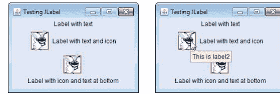

# 12.5 图标接口与 ImageIcon 类

图标是调用应用程序外观效果的一种流行方式，也常用于指示功能。例如，在 DVD 播放器和 MP3 播放器等设备上，大多数媒体播放使用相同的图标。Swing 组件可以显示图像。图标通常通过向构造函数传递 `Icon`（包 `javax.swing`）参数或通过调用 `setIcon` 方法来指定。`ImageIcon` 类支持多种图像格式，包括图形交换格式 (GIF)、便携网络图形 (PNG) 和联合图像专家组 (JPEG)。

第 28 行声明了一个 `ImageIcon`。文件 `bug1.png` 包含加载并存储在 `ImageIcon` 对象中的图像。该图像包含在本示例目录中。`ImageIcon` 对象被赋值给 `Icon` 引用。

## 12.5.1 加载图像资源

在第 28 行，表达式 `getClass().getResource("bug1.png")` 调用方法 `getClass()`（继承自 `Object`）来获取表示 `LabelFrame` 类的对象的引用。然后使用该引用调用方法 `getResource()`，该方法以 URL 的形式返回图像的位置。`ImageIcon` 使用该 URL 加载图像，然后将其加载到内存中。正如第 1 章所述，JVM 使用类加载器将类加载到内存中。类加载器知道每个类在磁盘上的位置。`getResource()` 使用类的加载器来确定资源（如图像文件）的位置。在此文件中，图像存储与 `LabelFrame.class` 文件相同的位置。这里描述的技术允许应用程序从相对于类文件位置的文件中加载图像。

## 12.5.2 创建并挂载 Label1

第 29-30 行使用另一个 `JLabel` 创建了一个显示文本“Label with icon”和第 28 行创建的 `Icon` 的 `JLabel`。该构造函数指示标签的内容是左对齐的，或称为左对齐（即图标和文本位于屏幕上标签区域的左侧）。`SwingConstants`（包 `javax.swing`）声明了一些在许多 Swing 组件中使用的常用整数常量（如 `SwingConstants.LEFT`、`SwingConstants.CENTER` 和 `SwingConstants.RIGHT`），这些常量被用于许多 Swing 组件。默认情况下，当标签同时包含文本和图像时，文本显示在图像右侧。`JLabel` 的水平和垂直对齐可以分别通过 `setHorizontalAlignment()` 和 `setVerticalAlignment()` 设置。第 31 行指定了标签的工具提示，第 32 行将标签添加到框架中。

## 12.5.3 挂载标签

`JLabel` 提供了在实例化后更改其外观的方法。第 34 行使用无参数构造函数创建了一个空 `JLabel`。第 35 行使用 `setText()` 方法设置标签上的文本。`getText()` 方法用于获取 `JLabel` 的文本。第 36 行使用 `setIcon()` 方法指定要显示的图标。`getIcon()` 方法用于获取显示在标签上的图标。第 37-38 行使用 `setHorizontalTextPosition()` 和 `setVerticalTextPosition()` 设置标签中的位置。在这种情况下，文本将以水平方向显示并在标签的底部。因此，图标将出现在文本上方。`SwingConstants` 中的水平位置常量为 `LEFT`、`CENTER` 和 `RIGHT`。`SwingConstants` 中的垂直位置常量为 `TOP`、`CENTER` 和 `BOTTOM`（图 12.8）。第 39 行设置了标签的工具提示。第 40 行将标签添加到 `JFrame` 中。

## 12.5.4 创建并显示 LabelFrame

（图 12.7）创建了 `LabelFrame` 类的对象（第 9 行），然后指定了窗口的默认关闭操作。默认情况下，当用户关闭 `LabelFrame` 时，我们希望应用程序终止。第 10 行调用 `setDefaultCloseOperation()`（继承自 `JFrame` 类）并以 `EXIT_ON_CLOSE` 作为参数，表示当用户关闭窗口时程序应当终止。这非常重要。如果没有它，当用户关闭窗口时应用程序将不会终止。接下来，第 11 行调用 `setSize()` 以像素为单位指定窗口的宽高。第 12 行调用 `setVisible()` 方法在屏幕上显示窗口。调整窗口大小可以展示布局如何改变窗口内标签的位置。

# 12.6 文本字段与事件处理简介

通常，用户与应用程序的 GUI 交互以指示应用程序应该执行的任务。例如，当你在应用程序中编写电子邮件时，点击“发送”按钮会将电子邮件发送到指定的地址。当用户与 GUI 组件交互时，这种交互（被称为“事件”）驱动程序执行任务。导致应用程序执行任务的一些常见交互包括点击按钮、在文本字段中输入内容、从菜单中选择项目、点击窗口和移动鼠标。执行任务响应的代码被称为“事件处理器”，而响应事件的过程被称为“事件处理”。

让我们考虑其他可以生成事件的 GUI 组件——`JTextField` 和 `JPasswordField`。`JTextField` 继承自 `JTextComponent`（包 `javax.swing`），它为 Swing 的基于文本的组件提供了许多功能。`JPasswordField` 继承自 `JTextField` 并添加了专门处理密码的方法。这些组件都是单行区域，用户可以通过键盘在此输入文本。`JTextField` 显示内容（见图 12.10 的输出）。`JPasswordField` 在用户输入时显示正在键入的字符，但使用回显字符隐藏实际字符，假设它们代表一个应该仅由用户知道的密码。

| 常量 | 描述 | 常量 | 描述 |
| :--- | :--- | :--- | :--- |
| 水平位置常量 | `LEFT` | 将文本放在左侧 | `TOP` | 将文本放在顶部 |
| | `CENTER` | 将文本放在居中 | `CENTER` | 将文本放在居中 |
| | `RIGHT` | 将文本放在右侧 | `BOTTOM` | 将文本放在底部 |

当用户在 `JTextField` 或 `JPasswordField` 中输入内容时：

```java
// 图 12.9: JTextFieldFrame.java
// JTextFields 和 JPasswords。

import java.awt.FlowLayout;
import java.awt.event.ActionListener;
import java.awt.event.ActionEvent;
import javax.swing.JFrame;
import javax.swing.JTextField;
import javax.swing.JPasswordField;
import javax.swing.JOptionPane;

public class JTextFieldFrame extends JFrame {

    private final JTextField textField1; // 设置了大小的文本字段
    private final JTextField textField2; // 有文本的文本字段
    private final JTextField textField3; // 设置了大小的文本字段
    private final JPasswordField passwordField; // 密码字段

    // JTextField 构造函数将 JTextField 添加到 JFrame
    public JTextFieldFrame() {
        super("JTextFields and JPasswordField");
        setLayout(new FlowLayout());

        // 创建具有 10 列的文本字段
        textField1 = new JTextField(10);
        add(textField1);

        // 创建带有文本的文本字段
        textField2 = new JTextField("Enter text");
        add(textField2);

        // 创建带有文本且具有 21 列的文本字段
        textField3 = new JTextField("Editable text", 21);
        textField3.setEditable(false); // 禁止编辑
        add(textField3);
    }
}
```

**图 12.9** | JTextFieldFrame 和 JPasswordField。（2. 的 i 部分）

```java
// 用于事件处理的私有内部类
private class TextFieldHandler implements ActionListener {

    // 处理文本字段事件
    @Override
    public void actionPerformed(ActionEvent event) {
        String string = "";

        // 用户在 textField1 中按下回车
        if (event.getSource() == textField1)
            string = String.format("textField1: %s", event.getActionCommand());

        // 用户在 textField2 中按下回车
        if (event.getSource() == textField2)
            string = String.format("textField2: %s", event.getActionCommand());

        // 用户在 textField3 中按下回车
        if (event.getSource() == textField3)
            string = String.format("textField3: %s", event.getActionCommand());

        // 用户在 passwordField 中按下回车
        if (event.getSource() == passwordField)
            string = String.format("passwordField: %s", event.getActionCommand());

        // 显示 JTextField 内容
        JOptionPane.showMessageDialog(null, string);
    }
} // 私有内部类 TextFieldHandler

// 注册事件处理器
TextFieldHandler handler = new TextFieldHandler();
textField1.addActionListener(handler);
textField2.addActionListener(handler);
textField3.addActionListener(handler);
passwordField.addActionListener(handler);
```


## 第 12 章 GUI 组件：第一部分

### 创建 GUI

第 22 行将 `TextField` 的布局设置为 `FlowLayout`。第 25 行创建了具有 10 列文本的 `textField1`。每列的像素宽度由文本框当前字体中字符的平均宽度决定。当文本在文本框中显示且宽度大于字段宽度时，右侧的部分文本将不可见。如果你在文本框中输入文字且光标到达右边缘，左侧的文本会被推出字段的左侧并不再可见。用户可以使用左、右箭头键在文本中移动。第 26 行将 `textField1` 添加到 `JFrame`。

第 29 行创建了 `textField2`，初始文本为“Enter text here”，显示在文本框中。字段宽度由列指定的默认文本宽度决定。第 30 行将 `textField2` 添加到 `JFrame`。

第 33 行创建了 `textField3` 并调用了 `JTextField` 构造函数，带有两个参数——要显示的默认文本“undecitable text”以及以列为单位的文本框宽度（第 31 行）。我们使用 `setEditable`（继承自 `JComponent` 的 `JTextField`）使文本框不可编辑——即用户无法修改字段中的文本。第 35 行将 `textField3` 添加到 `JFrame`。

第 38 行创建了 `passwordField`，文本为“Hidden text”，显示在文本框中。字段宽度由默认文本的宽度决定。当你执行应用程序时，注意文本显示为一串星号。第 39 行将 `passwordField` 添加到 `JFrame`。

### 为 GUI 组件设置事件处理的步骤

当用户在文本框中按回车键时，此示例应显示一个包含文本框内容的消息对话框。在应用程序对特定 GUI 组件的事件响应之前，你需要：

1. 创建一个表示事件处理程序并实现相应接口的类——称为事件监听器接口。
2. 指明当事件发生时应通知第 1 步中类的对象——称为注册事件处理程序。

### 使用嵌套类实现事件处理器

到目前为止讨论的所有类都是所谓的顶层类——也就是说，它们不是在另一个类内部声明的。Java 允许你在另一个类内部声明类——这些被称为嵌套类。嵌套类可以是静态的也可以是非静态的。非静态嵌套类是内部类，经常被用于实现事件处理器。

内部类对象必须通过顶层类的对象创建。每个内部类对象都隐含地拥有对其顶层类对象的引用。内部类对象用于允许你直接访问顶层类的所有变量和方法。静态嵌套类不需要顶层类对象的引用。你将在第 13 章“图形与 Java 2D”中看到这一点，Java 2D 图形 API 广泛使用了静态类。

### 内部类 TextFieldHandler

此示例中的事件处理是由内部类 `TextFieldHandler` 的对象执行的（第 50–81 行）。该类是私有的，因为它只用于为顶层类 `JTextField` 中的文本框创建事件处理程序。与其他类成员一样，内部类可以被声明为 `public`、`protected` 或 `private`。由于事件处理器通常特定于它们定义的应用程序，因此它们通常实现为内部类或匿名类（第 12.11 节）。

GUI 组件通过响应用户交互产生事件。每个事件都由一个类表示，并只能由相应类型的事件处理器处理。通常，组件支持的事件在对应组件类及其子类的 Java API 文档中描述。当用户在 `JTextField` 或 `JPasswordField` 中按回车键时，会发生一个 `ActionEvent`（位于 `java.awt.event` 包）。此类事件由实现 `ActionListener`（位于 `java.awt.event` 包）的对象处理。这里讨论的信息可以在 `JTextField` 和 `ActionEvent` 的 Java API 文档中找到。由于 `JPasswordField` 是 `JTextField` 的子类，`JPasswordField` 支持相同的事件。

为了处理此示例中的事件，内部类 `EventHandler` 实现了 `ActionListener` 并声明了接口中唯一的方法——`actionPerformed`（第 53–80 行）。该方法指定了发生 `ActionEvent` 时要执行的任务。因此，内部类 `EventHandler` 满足前面列出的第 1 步。

### 为每个文本框注册 EventHandler

在文本框中，第 42 行创建了一个 `String` 并将其赋值给变量。用户在文本框中按回车键，便生成了事件。

### 12.6 文本框与嵌套类事件处理简介

为了处理此示例中的事件，内部类 `EventHandler` 实现了 `ActionListener` 并声明了接口中唯一的方法——`actionPerformed`（第 53–80 行）。该方法指定了发生 `ActionEvent` 时要执行的任务。因此，内部类 `EventHandler` 满足前面列出的第 1 步。

### EventHandler 类详情

在此示例中，我们使用 `EventHandler` 的方法（第 53–80 行）来处理由文本框生成的事件。当用户在密码字段获得焦点时按回车键，系统创建一个唯一的 `ActionEvent`，包含事件信息，例如事件源和字段中的文本。系统将此 `ActionEvent` 传递给监听器的 `actionPerformed`。第 56 行声明了将显示的 `String`。该变量初始化为空字符串——不包含任何字符。

## 12.7 常见的 GUI 事件类型和监听器接口

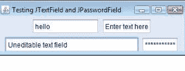
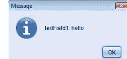
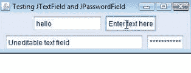


该应用程序使用单个 `JTextFieldHandler` 类的对象作为四个文本字段的事件监听器。从第 12.10 节开始，你将看到可以声明相同类型的事件监听器，并为每个单独的 GUI 组件注册其事件。这种技术允许我们通过为每个组件的事件提供单独的事件处理器，从而消除示例事件处理器中使用的 `if...else` 逻辑。

### Java SE 8：使用 Lambda 实现监听器

回想一下，像 `ActionListener` 这样只有一个抽象方法的接口在 Java SE 8 中是函数式接口。在第 17.9 节中，我们将展示使用 Java 8 lambda 表达式实现此类事件监听器接口的更简洁的方法。

## 12.7 常见的 GUI 事件类型和监听器接口

在第 12 节中，我们学习了当用户在文本字段中按回车时发生的事件存储在 `KeyEvent` 中。当用户与 GUI 交互时，可能会发生许多类型的事件。事件存储在扩展 `Event`（来自 `java.awt` 包）的类对象中。图 12.11 展示了包含 `java.awt` 包中许多事件类的层次结构。其中一些在本章和第 22 章中讨论。这些事件类型用于哪些 AWT 和 Swing 组件？特定 Swing GUI 组件的额外事件类型声明在 `javax.swing.event` 包中。


让我们总结一下你在第 12.6 节中看到的事件处理机制的三个部分——事件源、事件对象和事件监听器。**事件源**是用户交互的 GUI 组件。**事件对象**封装了有关发生事件的信息，作为对事件源的引用，以及事件监听器处理事件时可能需要的特定事件信息。**事件监听器**是一个在事件发生时由事件源通知的对象；实际上，它在“监听”事件，其其中一个方法会响应事件而执行。当监听器被通知事件发生时，监听器的方法会接收一个事件对象。然后监听器使用该事件对象来响应事件。这种事件处理模型被称为“委托事件模型”——事件的处理委托给应用程序中的一个对象（事件监听器）。

对于每种事件类型，通常都有对应的事件监听器接口。监听器是实现了 `java.awt.event` 和 `javax.swing.event` 包中一个或多个事件监听器接口的类对象。许多事件监听器是 AWT 和 Swing 组件通用的。此类类型声明在 `java.awt.event` 包中，其中一些显示如图 12.12。特定 Swing 组件的额外事件监听器类型声明在 `javax.swing.event` 包中。


每个事件监听器接口指定一个或多个必须在实现接口的类中声明的事件处理方法。回想第 10.9 节，任何实现接口的类必须声明接口的所有抽象方法；否则该类是抽象类，无法创建对象。

当事件发生时，GUI 组件通过调用每个监听器的相应事件处理方法来通知其已注册的监听器。例如，当用户按下回车键时，GUI 组件通过调用每个监听器的相应事件处理方法来通知其注册的监听器。

## 12.8 事件处理的工作原理

让我们通过示例说明事件处理是如何工作的。我们有两个问题：
1. 事件注册了吗？
2. GUI 组件如何知道调用适当的方法？

第一个问题通过图 12.9 中的事件注册来回答。第二个问题“GUI 组件如何知道调用适当的方法”通过事件类型来回答。

### 事件注册

每个 GUI 组件都维护一个监听器列表。为了简单起见，我们在图 12.13 中绘制了事件。


当执行以下语句时：

```java
textField.addActionListener(handler);
```

一个包含处理器引用的新条目被放在组件的监听列表中。

### 事件处理器调用

分发是 GUI 组件将事件分发给监听器的过程。当事件发生时，GUI 组件通过调用适当的方法处理事件。对于 `ActionEvent`，事件分发给 `ActionListener`（接口中的方法）。对于 `MouseEvent`，事件分发给 `MouseListener` 或 `MouseMotionListener`，取决于事件类型。每个事件监听器接口指定了在实现接口的类中声明的一个或多个事件处理方法。

事件处理模型被称为委托事件模型——事件的处理委托给应用程序中的一个对象（事件监听器）。每个事件监听器接口指定了在实现接口的类中声明的一个或多个事件处理方法。当事件发生时，GUI 组件通过调用适当的方法将事件分给注册的监听器。

## 12.9 JButton

按钮是用户点击以触发特定动作的组件。Java 程序使用多种类型的按钮，包括命令按钮、复选框、切换按钮和单选按钮。图 12.14 显示了本章涵盖的 Swing 按钮的继承层次结构。你可以看到，所有按钮都是 `AbstractButton`（`javax.swing` 包）的子类，在本节中声明了 Swing 按钮的共同特征，我们关注通常用于初始化命令的按钮。

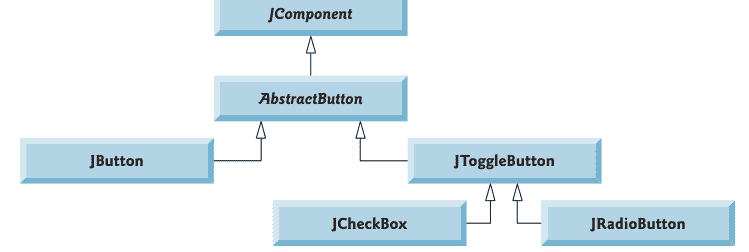

命令按钮（见图 12.16 的输出）在用户点击它时产生一个 `ActionEvent`。命令按钮用 `JButton` 类创建。JButton 表面的文本被称为按钮标签。

### 视觉观察 12.8

按钮上的文本通常使用标题大写。

### 视觉观察 12.9

GUI 可以有许多 `JButton`，但在当前显示的 GUI 部分中，每个按钮标签应该是唯一的。具有相同标签的多个 `JButton` 会让用户感到困惑。

图 12.15 和 12.16 的代码创建了两个 `JButton` 并演示了 `JButton` 可以显示图标。按钮的事件处理由内部类 `ButtonHandler` 的单个实例完成（图 12.15，第 39-48 行）。

```java
// Fig. 12.15: ButtonFrame.java
// Command buttons and action events.

import java.awt.FlowLayout;
import java.awt.event.ActionListener;
import java.awt.event.ActionEvent;
import javax.swing.JFrame;
import javax.swing.JButton;
import javax.swing.Icon;
import javax.swing.ImageIcon;
import javax.swing.JOptionPane;

public class ButtonFrame extends JFrame {

    private JButton plainButton; // 带文本的按钮
    private JButton fancyButton; // 带图标的按钮

    // ButtonFrame adds JButtons to JFrame
    public ButtonFrame() {
        super("Testing Buttons");
        setLayout(new FlowLayout());

        plainButton = new JButton("Plain Button"); // 带文本的按钮
        add(plainButton); // add plainButton to JFrame

        Icon bug1 = new ImageIcon(getClass().getResource("bug1.gif"));
        Icon bug2 = new ImageIcon(getClass().getResource("bug2.gif"));

        fancyButton = new JButton("Fancy Button"); // 设置图像
        fancyButton.setRolloverIcon(bug2); // 设置悬停图标
        add(fancyButton); // add fancyButton to JFrame

        // create new ButtonHandler for event handling
        ButtonHandler handler = new ButtonHandler();

        fancyButton.addActionListener(handler);
        plainButton.addActionListener(handler);
    }

    inner class ButtonHandler implements ActionListener {

        @Override
        public void actionPerformed(ActionEvent event) {
```


```java
JOptionPane.showMessageDialog(ButtonFrame.this, String.format(
    "You pressed: %s", event.getActionCommand()));
```

**图 12.15** 命令按钮和动作事件。

## 12.9 JButton

```java
// Fig. 12.16: ButtonTest.java
// Testing ButtonFrame;
import javax.swing.JFrame;

public class ButtonTest {
    public static void main(String[] args) {
        ButtonFrame buttonFrame = new ButtonFrame();
        buttonFrame.setDefaultCloseOperation(JFrame.EXIT_ON_CLOSE);
        buttonFrame.setSize(275, 110);
        buttonFrame.setVisible(true);
    }
} // end class ButtonTest
```

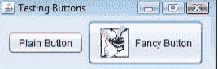
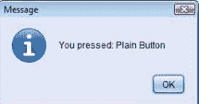


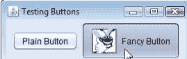
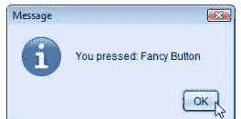

图 12.16 | 测试 ButtonFrame。

第 14–15 行声明了 `plainJButton` 和 `fancyJButton`。相应的对象在构造函数中实例化。第 23 行创建了标签为 "Plain Button" 的 `plainJButton`，第 24 行将该 `JButton` 添加到 `JFrame` 中。

`JButton` 可以显示图标。为了给用户提供额外的 GUI 视觉交互，`JButton` 还可以有一个悬停图标——当用户将鼠标悬停在 `JButton` 上时显示的图标。当鼠标进入或离开屏幕上 `JButton` 区域时，按钮上的图标会随之改变。第 26–27 行创建了 `ImageIcon` 对象，代表第 28 行创建的 `JButton` 的默认图标和悬停图标。这两个语句都假设图像文件存储在应用程序相同的目录中。图像通常存放在程序相同的目录或子目录（如 images）中。这些图像已在示例中提供给你。

第 22 行创建了带有文本 "Fancy Button" 和 bug 图标的 `FancyButton`。默认情况下，文本显示在图标右侧。第 29 行使用 `RolloverIcon`（继承自类 `AbstractButton`）在用户将鼠标移动到 `JButton` 上时显示指定的图像。第 30 行将该 `JButton` 添加到 `JFrame` 中。

## 视图与外观观察 12.10


由于 `AbstractButton` 支持在按钮上显示文本和图像，因此 `AbstractButton` 的所有类也显示文本和图像。

## 视图与外观观察 12.11


悬停图标提供了视觉反馈，指示 `JButton` 被点击。按钮像 `JTextField` 一样，会产生可以处理的 `ActionEvent`。

## 软件工程 12.2

Swing GUI 组件包含三种类型的按钮——`JButton`、`JCheckBox` 和 `JRadioButton`，它们具有开启/关闭值。`JCheckBox` 和 `JRadioButton` 类是 `JToggleButton` 的子类（图 12.14）。`JRadioButton` 与 `JCheckBox` 的不同在于它们是互斥的——一组中任何时候只能选择一个，就像单选按钮一样。

# 500 第 12 章 GUI 组件：第一部分

```java
// 响应复选框事件
@Override
public void itemStateChanged(ItemEvent event) {
    Font font = null; // 存储新的字体
    // 确定哪些 CheckBox 被选中并创建 Font
    if (boldJCheckBox.isSelected() && italicJCheckbox.isSelected()) {
        font = new Font("Serif", Font.BOLD & Font.ITALIC, 14);
    } else if (boldJCheckBox.isSelected()) {
        font = new Font("Serif", Font.BOLD, 14);
    } else if (italicJCheckBox.isSelected()) {
        font = new Font("Serif", Font.ITALIC, 14);
    } else {
        font = new Font("Serif", Font.PLAIN, 14);
    }
    textField.setFont(font);
}
// 结束类 CheckboxFrame
```

```图 12.17 | CheckBoxes 和项目事件。（2 个部分中的第 2 部分）。
```

```java
// 12.18: CheckboxTest.java
// 测试 Checkbox。
import javax.swing.JFrame;

public class CheckboxTest {
    public static void main(String[] args) {
        CheckboxFrame checkboxFrame = new CheckboxFrame();
        checkboxFrame.setDefaultCloseOperation(JFrame.EXIT_ON_CLOSE);
        checkboxFrame.setSize(275, 100);
        checkboxFrame.setVisible(true);
    }
} // 结束类 CheckboxTest
```

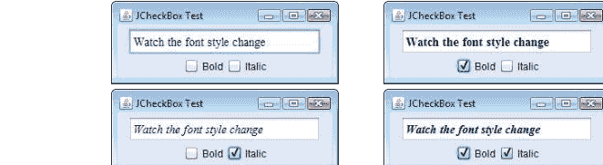

图 12.18 | 测试 CheckboxFrame。

当 `JTextField` 创建并初始化后（图 12.17，第 24 行），第 25 行使用方法 `setFont`（`JTextField` 直接继承自 `Component` 类）将 `JTextField` 的字体设置为 `Font` 类的一个新对象（位于 `java.awt` 包）。新的 `Font` 使用 "Serif"（一种代表 Times 等字体的通用名称，在所有 Java 平台上均受支持）、`Font.PLAIN` 尺寸和 14 号字体进行初始化。接下来的第 28–29 行创建了两个 `JCheckBox` 对象。传递给 `JCheckBox` 构造函数的 String 参数是默认显示在 `JCheckBox` 右侧的复选框标签。

当用户点击 `JCheckBox` 时，会发生一个 `ItemEvent`。该事件可以由 `ItemListener` 处理，监听器必须实现 `itemStateChanged`。事件由内部类 `CheckBoxHandler` 的实例执行（第 40–60 行）。第 34–36 行创建了 `CheckBoxHandler` 类的实例，并通过 `addItemListener` 方法为两个 `JCheckBox` 对象注册了该实例。

当用户点击 `boldJCheckBox` 或 `italicJCheckBox` 时，会调用 `CheckBox itemStateChanged`（第 43–59 行）。在本示例中，我们并不确定点击了哪一个 `JCheckBox`——我们使用两者的状态来确定显示的字体。第 49 行使用 `JCheckBox` 方法 `isSelected` 来判断两个 `JCheckBox` 是否都被选中。如果是，第 50 行通过为构造函数的字体样式参数添加常量 `Font.BOLD` 和 `Font.ITALIC` 来创建一个**粗体斜体**字体。第 51 行确定 `boldJCheckBox` 是否被选中，如果是，则第 52 行创建一个粗体字体。第 53 行确定 `italicJCheckBox` 是否被选中，如果是，则第 54 行创建一个斜体字体。如果上述任何条件都不成立，则第 56 行使用字体常量 `Font.PLAIN` 创建普通字体。最后，第 58 行设置其新字体，从而更改屏幕上 `JTextField` 中的字体。

## 内部类与其顶层类之间的关系

`CheckBoxHandler` 使用了 `boldJCheckBox`（第 49 和 51 行）、`italicJCheckBox`（第 49 和 53 行）和 `textField`（第 58 行），尽管它们并未在内部类中声明。记住，内部类与其顶层类之间有特殊关系——它允许访问顶层类的所有变量和方法。`CheckBoxHandler` 方法 `itemStateChanged`（第 43–59 行）利用这种关系来确定哪些 `JCheckBox` 被选中，并设置 `JTextField` 的字体。请注意，内部类 `CheckBoxHandler` 中的代码需要对顶层类对象进行显式引用。

## 12.10 JRadioButton

单选按钮（用 `JRadioButton` 类声明）与复选框类似，它们都有两种状态——选中和未选中（也称为“此时此刻”）。然而，单选按钮通常以一组的形式出现，且一次只能选择其中一个（如图 12.20 所示）。单选按钮用于表示互斥的选项（即一组中的多个选项）。单选按钮之间的逻辑关系由 `ButtonGroup`（`javax.swing` 包）维护。`ButtonGroup` 管理一组按钮且不会显示在用户界面中。相反，组中的单个 `JRadioButton` 对象会显示在 GUI 中。

图 12.19–12.20 的应用与 12.17–12.18 类似。用户可以更改 `JTextField` 字段的字体样式。该程序使用单选按钮，允许组内一次仅有一种字体样式被选中。`RadioButtonTest` 类（图 12.20）包含了执行此程序的 `main` 方法。

## 502 第 12 章 GUI 组件：第一部分

```java
// 图 12.19: RadioButtonFrame.java
// 使用 ButtonGroup 和 JRadioButton 创建单选按钮
import java.awt.*;
import java.awt.event.ItemEvent;
import java.awt.event.ItemListener;
import java.awt.event.ActionListener;
import javax.swing.*;

public class RadioButtonFrame extends JFrame implements ItemListener, ActionListener {
    private JTextField textField;
    private JRadioButton boldButton, italicButton, boldItalicalicButton, plainButton;
    private ButtonGroup group;

    public RadioButtonFrame() {
        setTitle("RadioButton Test");
        textField = new JTextField("Hello World");
        boldButton = new JRadioButton("Bold");
        italicButton = new JRadioButton("Italic");
        plainButton = new JRadioButton("Plain");
        boldItalicalicButton = new JRadioButton("Bold & Italic");

        group = new ButtonGroup();
        group.add(boldButton);
        group.add(italicButton);
        group.add(plainButton);
        group.add(boldItalicalicButton);

        boldButton.addItemListener(this);
        italicButton.addItemListener(this);
        plainButton.addItemListener(this);
        boldItalicalicButton.addItemListener(this);

        setLayout(new BorderLayout());
        add(textField, BorderLayout.CENTER);
        JPanel panel = new JPanel();
        // ... add buttons to panel ...
        add(panel, BorderLayout.SOUTH);

        setSize(300, 200);
        setDefaultCloseOperation(EXIT_ON_CLOSE);
    }

    @Override
    public void itemStateChanged(ItemEvent e) {
        if (e.getStateChange() == ItemEvent.SELECTED) {
            if (e.getSource() == boldButton) {
                textField.setFont(new Font("Serif", Font.BOLD, 14));
            } else if (e.getSource() == italicButton) {
                textField.setFont(new Font("Serif", Font.ITALIC, 14));
            } else if (e.getSource() == plainButton) {
                textField.setFont(new Font("Serif", Font.PLAIN, 14));
            } else if (e.getSource() == boldItalicalicButton) {
                textField.setFont(new Font("Serif", Font.BOLD | Font.ITALIC, 14));
            }
        }
    }

    @Override
    public void actionPerformed(java.awt.event.ActionEvent e) {}
}
```

## 第 12 章 GUI 组件：第一部分

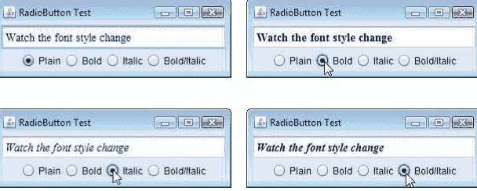

图 12.20 测试 RadioButtonFrame。（2部分中的2部分）。

构造函数中的第 35–42 行 (12.19) 创建了 `JRadioButton` 对象并将它们添加到 `JFrame` 中。每个 `JRadioButton` 都是通过第 35 行所示构造函数创建的。该构造函数指定了显示在 `JRadioButton` 右侧的标签，并定义了 `JRadioButton` 的初始状态。第二个参数表示该 `JRadioButton` 在显示时处于选中状态。

第 45 行初始化了一个 `ButtonGroup` 对象。该对象是形成 `JRadioButton` 对象之间逻辑关系的“胶水”，允许四个按钮中同时只有一个被选中。`ButtonGroup` 中可能没有 `JRadioButtons` 被选中，但这通常发生在用户尚未选择任何 `JRadioButton` 的情况下。第 46–49 行使用 `ButtonGroup` 方法将每个 `JRadioButton` 与组关联。如果向组添加了多个被选中的 `JRadioButton` 对象，则在 GUI 显示时，先添加的选中对象将被选中。

`JButtons` 和 `JCheckBox` 在被点击时会产生 `ItemEvent`。第 59–66 行创建了 `RadioButtonHandler` 类的实例（定义在第 70–85 行）。在此示例中，每个事件监听器都注册用于处理用户点击特定 `JRadioButton` 时生成的 `ItemEvent`。注意，每个 `RadioButtonHandler` 都初始化了一个特定的 `Font` 对象（在第 52–55 行创建）。


`RadioButtonHandler` 类（第 70–85 行）实现了 `ActionListener`，以便构造函数将接收到的 `Font` 存储为事件监听器对象的实例变量（定义在第 72 行）。当用户点击 `JRadioButton` 时，`radioGroup` 会关闭之前选中的 `JRadioButton`，`stateChanged` 方法（第 80–84 行）会将存储在 `JRadioButton` 对应的事件监听器对象中的 `JTextField` 字体设置为该字体。注意 `RadioButtonHandler` 类的第 83 行使用顶层类的 `textField` 实例变量来设置字体。

## 12.11 JComboBox：使用匿名内部类进行事件处理

组合框（有时称为下拉列表）允许用户从列表中选择一个项目（图 12.22）。组合框通过 `JComboBox` 类实现，该类扩展自 `JComponent`。`JComboBox` 是一个泛型类，类似于数组类 `ArrayList`（第 7 章）。当你创建一个 `JComboBox` 时，你需要指定你所管理的对象类型——`JComboBox` 会显示每个对象的字符串表示形式。

```java
// 图 12.21: ComboBox.java
// 显示图像名称列表的 JComboBox。
import java.awt.FlowLayout;
import java.awt.event.ItemListener;
import java.awt.event.ItemEvent;
import javax.swing.JFrame;
import javax.swing.JLabel;
import javax.swing.JComboBox;
import javax.swing.Icon;
import javax.swing.ImageIcon;

public class ComboBoxFrame extends JFrame {
    private final JComboBox<String> imagesJComboBox; // 存储图标名称
    private JLabel label; // 显示选中的图标

    private static String[] names = {
        "bug1.gif", "bug2.gif", "travelbug.gif", "bugamian.gif"
    };
    private final Icon[] icons = {
        new ImageIcon(getClass().getResource(names[0])),
        new ImageIcon(getClass().getResource(names[1])),
        new ImageIcon(getClass().getResource(names[2])),
        new ImageIcon(getClass().getResource(names[3]))
    };

    // ComboBoxFrame 构造函数将 JComboBox 添加到 JFrame
    public ComboBoxFrame() {
        super("Testing JComboBox");
        setLayout(new FlowLayout()); // 设置框架布局

        imagesJComboBox = new JComboBox<String>(names); // 设置 JComboBox
        imagesJComboBox.setMaximumCount(3); // 显示三行

        imagesJComboBox.addItemListener(new ItemListener() {
            // 处理 JComboBox 事件
            @Override
            public void itemStateChanged(ItemEvent event) {
                // 判断是否选中了项目
                if (event.getStateChange() == ItemEvent.SELECTED)
                    label.setIcon(icons[imagesJComboBox.getSelectedIndex()]);
            }
        }); // 匿名内部类

        add(imagesJComboBox); // 将组合框添加到 JFrame
        label = new JLabel(icons[0]); // 显示第一个图标
        add(label); // 将标签添加到 JFrame
    }
    // 结束类 ComboBoxFrame
}
```

图 12.21 | 显示图像名称列表的 JComboBox。（2部分中的2部分）

```java
// 12.22: ComboBoxTest.java
// 测试 ComboBoxFrame。
import javax.swing.JFrame;

public class ComboBoxTest {
    public static void main(String[] args) {
        ComboBoxFrame comboBoxFrame = new ComboBoxFrame();
        comboBoxFrame.setDefaultCloseOperation(JFrame.EXIT_ON_CLOSE);
        comboBoxFrame.setSize(350, 150);
        comboBoxFrame.setVisible(true);
    }
}
```

**图 12.21** | 显示图像名称列表的 JComboBox。（2部分中的2部分）。

（注：OCR 文本包含一些关于插图碎片化且重复的描述，这些内容已合并到 `ComboBoxFrame` 和 `ComboBoxTest` 类的逻辑流中。）

# 508 第 12 章 GUI 组件：第一部分

开始声明一个实现 `ItemListener` 接口的匿名内部类。这类似于开始声明一个类声明：

```java
public class MyHandler implements ItemListener
```

第 36 行的左大括号和第 46 行的右大括号限定了匿名内部类的体。第 38–45 行实现了 `ItemListener` 的 `itemStateChanged` 方法。该方法使用来自 `JComboBox` 图像的用户选择，此方法设置标签的 `Icon`。通过第 44 行的 `getSelectedIndex` 方法确定 `JComboBox` 中选中项目的索引，从而从数组中选择 `Icon`。对于从 `JComboBox` 选择的每个项目，另一个项目首先会被取消选择——当选择一个项目时会发生两个事件。我们希望只显示用户刚刚选择的图标。对于此位置，第 42 行确定 `ItemEvent` 方法的 `getStateChange` 是否返回 `SELECTED`。如果是，第 43–44 行设置 `label`。

# 软件工程观察 12.4


与其他类一样，当匿名内部类实现接口时，该类必须实现该接口中的所有方法。

第 35–46 行用于匿名内部类创建事件处理器的语法与 Java 集成开发环境（IDE）生成的代码相似。IDE 允许你可视化地设计 GUI，然后生成实现该 GUI 的代码。你只需要在处理每个事件的方法中插入语句即可。

# Java SE 8：使用 Lambda 实现匿名内部类

在第 17.9 节中，我们展示了如何使用 Java 8 lambda 来创建事件处理器。正如你将学到的，编译器会将 lambda 翻译成匿名内部类的对象。

# 12.12 JList

列表显示一系列项目，用户可以从中选择一个或多个项目（参见图 12.24 的输出）。列表使用 `JList` 类创建，该类直接继承自 `JComponent`。`JList` 像 `JComboBox` 一样，支持单选列表（一次只能选择一个项目）和多选列表（允许选择任意数量的项目）。在本节中，我们将讨论单选列表。

图 12.23–12.24 的应用程序创建一个包含 13 种颜色名称的 `JList`。当点击 `JList` 中的颜色名称时，会发生列表选择（ListSelection），应用程序将窗口背景颜色更改为选中颜色。`ListTest` 类（图 12.24）包含了执行此应用程序的 `main` 方法。

```java
// Fig 12.23: ListFrame.java
// 显示颜色列表的 JList。
import java.awt.FlowLayout;
import java.awt.Color;
import javax.swing.JFrame;
import javax.swing.JList;
import javax.swing.JScrollPane;
import javax.swing.event.ListSelectionListener;
import javax.swing.event.ListSelectionEvent;
import javax.swing.ListSelectionModel;

public class ListFrame extends JFrame {
    private JList<String> colorList; // 用于显示颜色的列表
    private static String[] colorNames = {"Black", "Blue", "Cyan",
        "Dark Gray", "Gray", "Green", "Light Gray", "Magenta",
        "Orange", "Pink", "Red", "White", "Yellow"};
    private static Color[] colors = {Color.BLACK, Color.BLUE,
        Color.CYAN, Color.DARK_GRAY, Color.GRAY, Color.GREEN,
        Color.LIGHT_GRAY, Color.MAGENTA, Color.ORANGE, Color.PINK,
        Color.RED, Color.WHITE, Color.YELLOW};

    // ListFrame 构造函数，向 JFrame 添加包含 JList 的 JScrollPane
    public ListFrame() {
        super("List Test");
        setLayout(new FlowLayout());

        colorList = new JList<>(colorNames); // colorNames 列表
        colorList.setVisibleRowCount(5); // 一次显示五行

        // 不允许多项选择
        colorList.setSelectionMode(ListSelectionModel.SINGLE_SELECTION);

        // 向框架添加包含 JList 的 JScrollPane
        add(new JScrollPane(colorList));

        colorList.addListSelectionListener(
            new ListSelectionListener() {
                // 处理列表选择事件
                @Override
                public void valueChanged(ListSelectionEvent event) {
                    getContentPane().setBackground(
                        colors[colorList.getSelectedIndex()]);
                }
            }
        );
    }
    // 类 ListFrame结束
}
```

图 12.23 显示颜色列表的 JList。（部分 2，共 2 部分）

```java
// Fig 12.24: ListTest.java
// 测试 ListFrame。
import javax.swing.JFrame;

public class ListTest {
    public static void main(String[] args) {
        ListFrame listFrame = new ListFrame();
        listFrame.setDefaultCloseOperation(JFrame.EXIT_ON_CLOSE);
        listFrame.setSize(350, 150);
        listFrame.setVisible(true);
    }
}
```

# 512 第 12 章 GUI 组件：第一部分

```java
colorJList.setSelectionMode(
    ListSelectionModel.MULTIPLE_INTERVAL_SELECTION);
add(new JScrollPane(colorJList)); // 添加带有滚动条的列表

copyJButton = new JButton("Copy >>>");
copyJButton.addActionListener(
    new ActionListener() // 匿名内部类
    {
        // 处理按钮事件
        @Override
        public void actionPerformed(ActionEvent event)
        {
            // 将选中的值放入 colorJList
            colorJList.setListData(
                colorJList.getSelectedValuesList().toArray(
                new String[0]));
        }
    });

add(copyJButton); // 将拷贝按钮添加到 JFrame
copyJList = new JList<String>();
copyJList.setVisibleRowCount(5); // 显示 5 行
copyJList.setFixedCellWidth(100); // 设置宽度
copyJList.setFixedCellHeight(15); // 设置高度
copyJList.setSelectionMode(
    ListSelectionModel.MULTIPLE_INTERVAL_SELECTION);
add(new JScrollPane(copyJList)); // 添加带有滚动条的列表
}
// 结束类 MultipleSelectionFrame
```

图 12.25 JList 允许多次选择。（2 部分，共 2 部分）

```java
// Fig 12.26: MultipleSelectionTest.java
// 测试 MultipleSelectionFrame。
import javax.swing.JFrame;

public class MultipleSelectionTest {
    public static void main(String[] args) {
        MultipleSelectionFrame multipleSelectionFrame =
            new MultipleSelectionFrame();
        multipleSelectionFrame.setDefaultCloseOperation(
            JFrame.EXIT_ON_CLOSE);
        multipleSelectionFrame.setSize(350, 150);
        multipleSelectionFrame.setVisible(true);
    }
}
```

图 12.26 测试 MultipleSelectionFrame。（1 部分，共 2 部分）。

# 鼠标事件处理 513

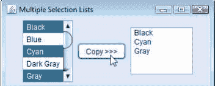

**图 12.26** 测试 MultipleSelectionFrame。（2 部分，共 2 部分。）


第 27 行创建了 `JList` `colorList` 并用数组 `colorNames` 中的字符串对其进行初始化。第 28 行将 `colorJList` 的可见行数设置为 5。第 29–30 行指定 `colorList` 为 `MULTIPLE_INTERVAL_SELECTION`（多间距选择）。第 31 行向 `JFrame` 中添加了一个包含 `colorJList` 的新 `JScrollPane`。第 51–57 行对 `colorList` 执行了类似的任务。因此，如果 `JList` 不包含任何项目，它在 `FlowLayout` 中将不会被绘制。第 53–54 行使用 `JList` 的方法 `setFixedWidth` 和 `setFixedCellHeight` 分别将 `colorList` 的宽度设置为 100 像素，并将列表中每个项目的高度设置为 15 像素。

通常情况下，由另一个 GUI 组件生成的事件（称为**外部事件**）会指定何时处理 `JList` 中的多次选择。在这种情况下，用户使用 `copyButton` 来触发事件，从而将 `colorList` 中选中的项目拷贝到 `colorJList` 中。

第 34–42 行为 `copyButton` 创建并注册了一个 `ActionListener`。当用户点击 `copyButton` 时，`actionPerformed` 方法（第 38–45 行）使用 `JList` 方法 `setListData` 设置在 `colorJList` 中显示的项目。第 43–44 行调用 `colorJList` 的方法 `getSelectedValues`，它返回一个 `List<String>`（因为 `JList` 是作为 `JList<String>` 创建的），代表 `colorList` 中选中的项目。我们调用 `List<String>` 的 `toArray` 将其转换为 `String` 数组，作为参数传递给 `colorJList` 的 `setListData` 方法。`toArray` 方法接收一个表示该方法将返回类型的数组。你将在第 16 章学习更多关于 `List` 和 `toArray` 的知识。

你可能会奇怪为什么在第 42 行可以使用 `colorList`，尽管应用程序直到第 49 行才创建它的对象。请记住，`actionPerformed` 方法（第 38–45 行）在用户按下 `copyButton` 之前不会执行，而在构造函数完成执行且应用程序显示 GUI 之前，点击是不可能的。在程序执行的该时间点，`colorList` 已经用一个新的 `JList` 初始化完毕。

# 12.14 鼠标事件处理

本节介绍了用于处理鼠标事件的 `MouseListener` 和 `MouseMotionListener` 事件监听器。任何派自 `java.awt.Component` 的 GUI 组件都可以处理鼠标事件。`MouseListener` 和 `MouseMotionListener` 的方法总结在图 12.27 中。`java.swing.event` 包包含接口 `MouseAdapter`，它扩展了 `MouseListener` 和 `MouseMotionListener`，创建一个包含所有方法的单一接口。当为该组件注册了适当的事件监听器对象时，就会调用 `MouseListener` 和 `MouseMotionListener` 的方法。

每个鼠标处理方法都接收一个 `MouseEvent` 作为参数，该参数包含发生鼠标事件的信息，包括其位置的 x 和 y 坐标。这些坐标是从其左上角测量的。

| 接口 / 方法 | 方法签名 | 描述 |
| :--- | :--- | :--- |
| **MouseListener** | `mouseClicked(MouseEvent e)` | 在组件上按下并释放鼠标时调用。 |
| | `mousePressed(MouseEvent e)` | 鼠标在组件上按下时调用。 |
| | `mouseReleased(MouseEvent e)` | 鼠标在组件上释放时调用。 |
| | `mouseEntered(MouseEvent e)` | 鼠标进入组件时调用。 |
| | `mouseExited(MouseEvent e)` | 鼠标离开组件时调用。 |
| **MouseMotionListener** | `mouseDragged(MouseEvent e)` | 鼠标在组件上拖动时调用。 |
| | `mouseMoved(MouseEvent e)` | 鼠标在组件内移动时调用。 |

图 12.27 `MouseListener` 和 `MouseMotionListener`。

# 516 第 12 章 GUI 组件：第一部分

```java
36 private class MouseHandler implements MouseListener,
37     MouseMotionListener
38 {
39     // MouseListener 事件处理器
40     // 处理鼠标在按下后立即释放的事件
41     @Override
42     public void mouseClicked(MouseEvent event)
43     {
44         statusBar.setText(String.format("Clicked at [%d, %d]",
45             event.getX(), event.getY()));
46     }
47 
48     // 处理鼠标按下时的事件
49     @Override
50     public void mousePressed(MouseEvent event)
51     {
52         statusBar.setText(String.format("Pressed at [%d, %d]",
53             event.getX(), event.getY()));
54     }
55 
56     // 处理鼠标释放时的事件
57     @Override
58     public void mouseReleased(MouseEvent event)
59     {
60         statusBar.setText(String.format("Released at [%d, %d]",
61             event.getX(), event.getY()));
62     }
63 
64     // 处理鼠标进入区域的事件
65     @Override
66     public void mouseEntered(MouseEvent event)
67     {
68         statusBar.setText(String.format("Mouse entered at [%d, %d]",
69             event.getX(), event.getY()));
70             mousePanel.setBackground(Color.GREEN);
71     }
72 
73     // 处理鼠标离开区域的事件
74     @Override
75     public void mouseExited(MouseEvent event)
76     {
77         statusBar.setText("Mouse outside JPanel");
78             mousePanel.setBackground(Color.WHITE);
79     }
80 
81     // MouseMotionListener 事件处理器
82     // 处理用户按下按钮并拖动鼠标的事件
83     @Override
84     public void mouseDragged(MouseEvent event)
85     {
86         statusBar.setText(String.format("Dragged at [%d, %d]",
87             event.getX(), event.getY()));
88     }
```

**图 12.28** 鼠标事件处理（3 部分中的后部分）。

## 12.14 鼠标事件处理 517

```java
89  // 处理用户移动鼠标的事件
90  @Override
91    public void mouseMoved(MouseEvent event) {
92      {
93          statusBar.setText(String.format("Moved at [%d, %d]",
94                               event.getX(), event.getY()));
95      }
96  }
97} // 内部类 MouseHandler 结束
98 // 类 MouseTrackerFrame 结束
```

图 12.28 鼠标事件处理。（3 部分之一。）

```java
1 // 图 12.29: MouseTrackerFrame.java
2 // 测试 MouseTrackerFrame.
3 import javax.swing.JFrame;
4 
5 public class MouseTracker
6 {
7   public static void main(String[] args)
8   {
9     MouseTrackerFrame mouseTrackerFrame = new MouseTrackerFrame();
10    mouseTrackerFrame.setDefaultCloseOperation(JFrame.EXIT_ON_CLOSE);
11    mouseTrackerFrame.setSize(300, 100);
12    mouseTrackerFrame.setVisible(true);
13  }
14 } // 类 MouseTracker 结束
```

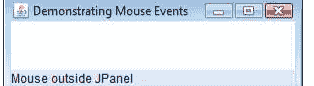


图 12.29 测试 `MouseTrackerFrame`。

第 23 行创建了 `JPanel1`。该 `JPanel1` 的鼠标事件由应用程序重新跟踪。第 24 行将 `mousePanel1` 的背景颜色设置为白色。当用户将鼠标移动到 `mousePanel` 时，应用程序会将 `mousePanel1` 的背景改为绿色。当用户将鼠标离开 `mousePanel` 时，应用程序将背景改回白色。第 25 行将 `mousePanel` 添加到 `JFrame`。正如你所学的，你必须在 `JFrame` 中指定 GUI 组件的布局。在相应章节中，我们引入了布局管理器 `BorderLayout`。在这里我们使用 `JFrame` 内容面板的默认布局 `BorderLayout`，它安排了 `NORTH`、`SOUTH`、`EAST`、`WEST` 和 `CENTER` 区域。`NORTH` 对应容器的顶部。此示例使用了 `CENTER` 和 `SOUTH` 区域。第 25 行使用双参数方法在 `CENTER` 区域添加面板。第 27-28 行在构造函数中声明了 `statusBar` 并将其附加到 `JFrame`。该 label 占据了 `JFrame` 的宽度。第 31 行创建了 `MouseHandler` 类（第 36-97 行）的实例 `handler1`，它响应鼠标事件。`addMouseListener` 和 `addMotionListener` 直接继承自 `Component` 类，可注册 `MouseListeners` 和 `MotionListeners`。`MouseHandler` 既是 `MouseListener` 也是 `MotionListener`，因为它实现了这两个接口。我们实现这两个接口是为了演示实现多个接口的类，但我们也可以实现接口。

鼠标进入 `mousePanel1` 区域，`mouseEntered`（第 65-71 行）和 `mouseExited` 分别被调用。`mouseEntered` 将 `mousePanel1` 的背景改为绿色。`mouseExited` 将背景改回白色。

## 518 第 12 章 GUI 组件：第一部分

鼠标进入 `mousePanel1` 区域，`mouseEntered`（第 65-71 行）和 `mouseExited` 分别被调用。`mouseEntered` 将 `mousePanel1` 的背景改为绿色。`mouseExited` 将背景改回白色。

## 12.15 适配器类

许多事件监听器（如 `MouseListener` 和 `MotionListener`）包含多个方法并不总是需要声明所有方法。例如，适配器类为每个方法提供空方法体。你可以扩展适配器并只重写你需要的方法。

软件工程观察


当类实现接口时，它与该接口存在关系。因此，适配器的子类也是对应事件类型的对象。

| java.event 中的事件适配器类 | 实现的接口 |
| :--- | :--- |
| `ComponentAdapter` | `ComponentListener` |
| `ContainerAdapter` | `ContainerListener` |
| `FocusAdapter` | `FocusListener` |
| `KeyAdapter` | `KeyListener` |
| `MouseAdapter` | `MouseListener` |
| `MouseMotionAdapter` | `MouseMotionListener` |
| `WindowAdapter` | `WindowListener` |

**图 12.30** 事件适配器类及其实现的接口。

# 520 第12 章 GUI 组件：第一部分

```java
31 int xPos = event.getX(); // 获取鼠标的 x 坐标
32 int yPos = event.getY(); // 获取鼠标的 y 坐标
33
34
35 details = String.format("Clicked %d time(s)");
36     event.getClickCount();
37
38 if (event.isMetaData()) // 右键
39     details += " with right mouse button";
40 else if (event.isMouseDown()) // 中键
41     details += " with center mouse button";
42 else // 左键
43     details += " with left mouse button";
44
45 statusBar.setText(details); // 在状态栏中显示消息
46 }
47 // 结束类 MouseDetailsFrame
```

图 12.31 | 展示点击并区分鼠标按钮。（共 2 部分）

```java
1 // 图 12.32: MouseDetails.java
2 // TestingDetailsFrame.
3 import javax.swing.JFrame;
4
5 public class MouseDetails
6 {
7     public static void main(String[] args)
8     {
9         MouseDetailsFrame mouseDetailsFrame = new MouseDetailsFrame();
10        mouseDetailsFrame.setDefaultCloseOperation(JFrame.EXIT_ON_CLOSE);
11        mouseDetailsFrame.setSize(400, 150);
12        mouseDetailsFrame.setVisible(true);
13    }
14 } // 结束类 MouseDetails
```

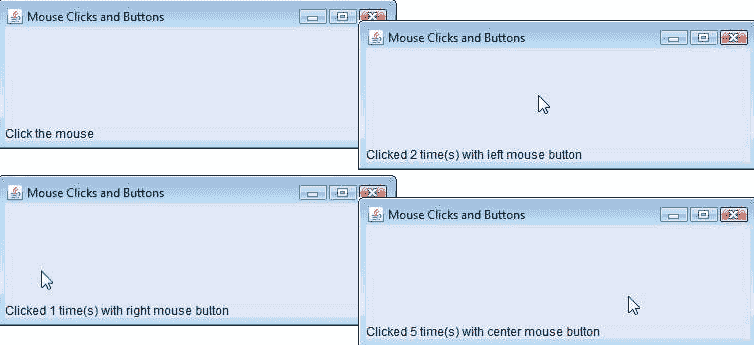

图 12.32 | TestingDetailsFrame。

# 常见编程错误 12.3

如果你扩展了一个适配器类并写错了要重写的方法名称，且没有使用 `Override` 声明该方法，那么你的方法将仅仅变成类中的另一个方法。这是一个很难检测的逻辑错误，因为程序将调用继承自适配器类的早期版本方法。

Java 应用程序的用户可能使用单键、双键或三键鼠标的系统。`MouseEvent` 继承自 `InputEvent` 类的多个方法，用于区分多键鼠标上的按钮，或者通过组合按键和鼠标点击来模拟多键鼠标。图 12.33 显示了用于区分鼠标按钮点击的 `InputEvent` 方法。Java 假设每个鼠标都包含一个左键。因此，测试左键点击非常简单。然而，对于单键或双键鼠标，必须同时使用按键和鼠标按钮来模拟鼠标上的按钮。在单键或双键鼠标的情况下，如果用户按住 `Alt` 键并在双键鼠标上点击左键或在单键鼠标上点击，Java 应用程序将假设点击了中间键。在单键鼠标的情况下，如果用户按住 `Meta` 键（在 Mac 上称为 Command 键或“Apple”键）并点击鼠标按钮，Java 应用程序将假设点击了右键。

| InputEvent 方法 |  |
| --- | --- |


| 方法 | 说明 |
| --- | --- |
| `isMetaDown()` | 当用户在双键或三键鼠标上点击右键时为真。若要在单键鼠标上模拟右键点击，用户可以按住键盘上的 Meta 键并点击鼠标按钮。 |
| `isAltDown()` | 当用户在三键鼠标上点击中间键时为真。若要在单键或双键鼠标上模拟中间键点击，用户可以分别按下 Alt 键并仅点击左键。 |

**图 12.33** | 确定是否点击了右键或中间键的 `InputEvent` 方法。

第 21.31 行代码为 `MouseDetailsFrame` 注册了一个 `MouseListener`。该事件监听器是 `MouseClickHandler` 类的对象，该类扩展了 `MouseAdapter`。这使我们只需要声明 `mouseClicked` 方法（第 28–45 行）。该方法首先捕获事件发生的坐标并将其存储在局部变量 `xPos` 和 `yPos` 中（第 31–32 行）。第 34–35 行创建一个字符串 `details`，其中包含连续点击鼠标次数，该次数由第 35 行的 `MouseEvent` 方法 `getCount` 返回。第 37–42 行使用 `isMetaDown` 和 `isAltDown` 方法确定用户点击了哪个鼠标按钮，并在每种情况下向 `details` 追加相应的字符串。生成的字符串显示在 `statusBar` 中。`MouseDetails` 类（图 12.32）包含执行程序的 `main` 方法。尝试反复点击鼠标的每个按钮，查看点击计数是否递增。

# 12.16 用于鼠标绘制的 `JPanel` 子类

第 12.14 节展示了如何在 `JPanel` 中跟踪鼠标事件。在本节中，我们使用 `JPanel` 作为专用绘制区域，用户可以通过拖动鼠标进行绘制。此外，本节还演示了一个扩展适配器的事件监听器。

## `paintComponent`

扩展 `JComponent` 类的轻量级 Swing 组件（如 `JPanel`）包含 `paintComponent`，它在轻量级 Swing 组件显示时被调用。通过重写此方法，你可以指定如何使用 Java 的功能绘制形状。在自定义 `JPanel` 作为专用绘制区域时，子类应该重写 `paintComponent` 方法，并在代码的第一条语句调用 `Component` 的父类版本。

> **错误预防技巧 12.1**：在 `paintComponent` 中，第一条语句应该始终调用 `Component` 的父类版本。

> **常见编程错误 12.4**：如果子类没有调用 `paintComponent` 的父类版本，绘制内容将被擦除。

## 定义绘制区域

应用程序使用 `MouseAdapter` 创建简单的绘制区域。此示例没有使用 `mouseMoved`，因此我们简单地重写 `mouseDragged` 来提供事件处理。

```java
// PaintPanel.java
import java.awt.Point;
import java.awt.Graphics;
import java.awt.event.MouseEvent;
import java.awt.event.MouseMotionAdapter;
import java.util.ArrayList;
import javax.swing.JPanel;

public class PaintPanel extends JPanel {
    // Point 引用列表
    private final ArrayList<Point> points = new ArrayList<>();

    // 设置 GUI 并注册鼠标事件
    public PaintPanel() {
        // 处理鼠标事件
        addMouseMotionListener(new MouseMotionAdapter() {
            // 存储坐标并重绘
            @Override
            public void mouseDragged(MouseEvent event) {
                points.add(event.getPoint());
                repaint();
            }
        });
    }

    // 在窗口指定位置的 4x4 边界框内绘制圆点
    @Override
    public void paintComponent(Graphics g) {
        super.paintComponent(g); // 清除绘制区域

        // 绘制所有点
        for (Point point : points) {
            g.fillOval(point.x, point.y, 4, 4);
        }
    }
}
```

**图 12.34** | 实现事件处理器的适配器类。（共 2 部分）

`PaintPanel` 类（图 12.34）扩展自 `JPanel` 创建专用绘制区域。`Point` 类（`java.awt` 包）表示一个 x、y 坐标。我们使用该类的对象来存储每次鼠标拖动事件的坐标。`Graphics` 用于绘制。在本示例中，我们使用 `Point` 的 `ArrayList`（第 13 行）来存储每次鼠标拖动发生的位置。如所示，`paintComponent` 使用这些 `Point` 进行绘制。

当它们被调用时什么都不做。因此，我们重写了第 23–28 行的 `mouseDragged` 方法以捕捉鼠标拖拽的坐标并将其存储为 `Point` 对象。第 26 行调用 `MouseEvent` 的 `getPoint` 方法获取事件发生的 `Point`，并将其存储在 `ArrayList` 中。第 27 行调用方法 `repaint`（直接继承自 `Component`），指示通过调用 `PaintPanel` 的 `paintComponent` 方法尽快在屏幕上刷新 `PaintPanel`。

`paintComponent` 方法（第 34–42 行）接收一个 `Graphics` 参数，当 `PaintPanel` 需要显示在屏幕上时（例如 GUI 首次显示时）或在屏幕上刷新时（例如调用了 `repaint` 方法或 GUI 被任何窗口隐藏后再次可见时），该方法会被调用。


### 外观观察 12.13

对 Swing GUI 组件调用 `repaint` 表明该组件应尽快刷新。只有当组件是不透明的（opaque）时，组件的背景才会被清除。组件方法 `setOpaque` 可以通过布尔参数设置，指示组件是不透明的（true）还是透明的（false）。

第 37 行调用 `paintComponent` 的父类版本来清除 `PaintPanel` 的背景（`JPanel` 默认是不透明的）。第 40–41 行在 `ArrayList` 中每个 `Point` 指定的位置绘制一个椭圆。`Graphics` 方法 `fillOval` 绘制一个实心椭圆。该方法的四个参数表示显示椭圆的矩形区域（称为边界框，bounding box）。前两个参数是矩形区域的左上角 x 坐标和左上角 y 坐标。`fillOval` 绘制椭圆使其触及矩形区域每边的中间。在第 41 行中，前两个参数由类实例变量 `x` 和 `y` 指定。你将在第 13 章中学习更多 `Graphics` 特性。


### 外观观察 12.14

在任何 GUI 组件上的绘制都是相对于该组件的左上角 (0, 0) 测量的，而不是屏幕的左上角。

在应用程序类 `Painter` 中使用自定义 `JPanel`（图 12.35）包含了执行此应用程序的主方法。第 14 行创建了一个 `PaintPanel` 对象，用户可以拖拽它进行绘制。第 15 行将 `PaintPanel` 添加到 `JFrame` 中。

```java
// Painter.java
// Testing PaintPanel.
import java.awt.BorderLayout;
import javax.swing.JFrame;
import javax.swing.JLabel;
import javax.swing.JPanel;

public class Painter {
    public static void main(String[] args) {
        // 创建 JFrame
        JFrame application = new JFrame("A simple program");
        PaintPanel paintPanel = new PaintPanel();
        application.add(paintPanel, BorderLayout.CENTER);

        // 创建一个标签并将其放在南部
        application.add(new JLabel("Drag the mouse to draw"),
            BorderLayout.SOUTH);

        application.setDefaultCloseOperation(JFrame.EXIT_ON_CLOSE);
        application.setSize(400, 200);
        application.setVisible(true);
    }
}
```

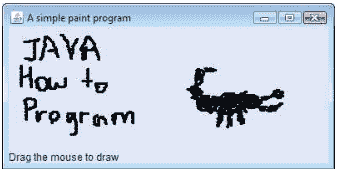

# 12.17 键盘事件处理

本节介绍了用于处理事件的 `KeyListener` 接口。当键盘上的按键按下和释放时，会产生键事件。实现 `KeyListener` 的类必须为 `keyPressed`、`keyReleased` 和 `keyTyped` 方法提供声明，这些方法以 `KeyEvent` 作为其参数。`KeyEvent` 类是 `InputEvent` 的子类。`keyPressed` 方法在响应按下任何非功能键时调用（功能键包括方向键、Home、End、Page Up、Page Down、功能键等）。当按键在任何按下事件后释放时，`keyTyped` 和 `keyReleased` 方法被调用。图 12.36 的应用程序演示了 `KeyListener` 方法。`KeyDemoFrame` 类扩展了 `JFrame` 并实现了 `KeyListener`，因此应用程序中声明了所有三个方法。构造函数（对应图 12.36，第 17–28 行）使用 `addKeyListener` 方法注册应用程序以处理自身的键事件。`addKeyListener` 方法在 `Component` 类中声明，因此 `Component` 的每个子类都可以通知监听器对象该组件的按键。

```java
// KeyDemoFrame.java
// 键盘事件处理.
import java.awt.Color;
import java.awt.event.KeyListener;
import java.awt.event.KeyEvent;
import javax.swing.JFrame;
import javax.swing.JTextArea;

public class KeyDemoFrame extends JFrame implements KeyListener {
    private String line1 = ""; // 文本区域的第一行
    private String line2 = ""; // 文本区域的第二行
    private String line3 = ""; // 文本区域的第三行
    private final JTextArea textArea; // 显示的文本区域

    // KeyDemoFrame 构造函数
    public KeyDemoFrame() {
        super("Demonstrating Keystroke Events");

        textArea = new JTextArea(10, 15); // 设置 JTextArea
        textArea.setText("Press any key on the keyboard...");
        textArea.setEditable(false);
        textArea.setDisabledTextColor(Color.BLACK);
        add(textArea); // 将文本区域添加到 JFrame

        addKeyListener(this); // 允许框架处理键事件
    }

    // 处理任何按键的按下
    @Override
    public void keyPressed(KeyEvent event) {
        line1 = String.format("Key pressed: %s",
            KeyEvent.getKeyText(event.getKeyCode())); // 显示按下的键
        setLines2and3(event); // 设置输出的第二、第三行
    }

    // 处理任何按键的释放
    @Override
    public void keyReleased(KeyEvent event) {
        line1 = String.format("Key released: %s",
            KeyEvent.getKeyText(event.getKeyCode())); // 显示释放的键
        setLines2and3(event); // 设置输出的第二、第三行
    }

    // 处理功能键的输入
    @Override
    public void keyTyped(KeyEvent event) {
        line1 = String.format("Key typed: %s", event.getKeyChar());
        setLines2and3(event); // 设置输出的第二、第三行
    }

    // 设置输出的第二和第三行
    private void setLines2and3(KeyEvent event) {
        line2 = String.format("Key code: %d", event.getKeyCode());
        line3 = String.format("Key char: %s", event.getKeyChar());
        textArea.setText(String.format("%s\n%s\n%s", line1, line2, line3));
    }
}
```

**图 12.36** | `KeyDemoFrame` | 键盘事件处理。（3 部分中的第 2 部分。）

# 12.18 布局管理器简介

布局管理器在容器中安排 GUI 组件以实现演示目的。你可以使用布局管理器来实现基本的布局功能，而不是确定每个 GUI 组件的位置和大小。这种功能允许你专注于外观，并让布局管理器处理布局细节。所有的布局管理器都实现了 `LayoutManager` 接口（在 `java.awt` 包中）。

`Container` 的 `setLayout` 方法接收一个实现 `LayoutManager` 接口的对象作为参数。在 GUI 中安排组件基本上有三种方式：

1. **绝对定位**：这对 GUI 的外观提供了最高程度的控制。通过将 `Container` 的布局设置为 `null`，你可以使用 `Component` 类的 `setSize` 和 `setBounds` 方法，指定每个 GUI 组件相对于 `Container` 左上角的绝对位置。如果你这样做，你还必须指定每个 GUI 组件的大小。使用绝对定位来编写 GUI 可能会非常繁琐，除非你拥有一个可以为之生成代码的集成开发环境（IDE）。

2. **布局管理器**：使用布局管理器来定位元素可能比使用绝对定位创建 GUI 更简单（或者说速度更快），并且能让你的 GUI 具有可缩放性，同时你会失去对每个组件的大小和精确位置的某些控制。

3. **IDE 中的可视化编程**：IDE 提供了可以轻松创建 GUI 的工具。每个 IDE 通常都提供 GUI 设计工具，允许你从工具箱将 GUI 组件拖放到某个区域中。然后，你可以根据喜好对 GUI 组件进行调整和对齐。IDE 会生成创建 GUI 的 Java 代码。此外，你可以通过双击组件轻松地为特定组件添加事件处理代码。某些设计工具允许你使用本章和第 22 章中描述的布局管理器。


### 视觉效果观察 12.15

大多数 IDE 都提供了用于视觉设计 GUI 的 GUI 工具：然后这些工具会编写创建 GUI 的 Java 代码。与内置布局管理器相比，此类工具通常对组件的大小、位置和对齐提供了更大的控制。


### 视觉效果观察 12.16

可以将 `Container` 的布局设置为 `null`，这表示不应该使用任何布局管理器。在没有布局管理器的 `Container` 中，你必须对组件进行定位和调整大小，并确保在尺寸调整事件发生时，所有组件都根据需要重新定位。组件的尺寸调整事件由 `ComponentListener` 处理。

图 12.38 总结了本章中介绍的布局管理器。第 22 章将讨论另外几个额外的布局管理器。

| 布局管理器 | 描述 |
| --- | --- |


| FlowLayout | `javax.swing.JPanel` 的默认布局。按照组件添加的顺序从左到右顺序排列组件。也可以使用 Container 方法（该方法将 `Component` 和索引位置作为参数）来指定组件的顺序。 |
| BorderLayout | JFrame（以及其他窗口）的默认布局。将组件分为五个区域：NORTH、SOUTH、EAST、WEST 和 CENTER。 |
| GridLayout | 将组件排列成行和列。 |

**12.38** | 布局管理器。

## 12.18.1 FlowLayout

FlowLayout 是最简单的布局管理器。GUI 组件按照它们被添加到容器的顺序从左到右放置在容器中。当到达容器边缘时，组件将继续在下一行显示。`FlowLayout` 类允许 GUI 组件左对齐、居中对齐（默认值）和右对齐。

示例 12.39–12.40 的应用创建了三个 `JButton` 并使用 `FlowLayout` 将添加到应用程序中。组件默认对齐。当用户点击“Left”时，FlowLayout 的对齐方式变为左对齐。当用户点击“Right”时，FlowLayout 的对齐方式变为右对齐。当用户点击“Center”时，FlowLayout 的对齐方式变为居中。最后一个示例输出显示了在窗口被调整为较窄宽度后，按钮流到新行的居中对齐情况。

与之前一样，使用 `Container` 类的 `setLayout` 方法设置容器的布局。第 25 行 (12.39) 将布局管理器设置为第 23 行声明的 `FlowLayout`。通常，在将任何 GUI 组件添加到容器之前会设置布局。

### 视觉效果观察 12.17

> 每个容器只能有一个布局管理器，但同一个应用程序中的多个容器可以使用不同的布局管理器。

```java
// Fig. 12.39: FlowLayout.java
// FlowLayout 允许组件跨多行流动。
import java.awt.FlowLayout;
import java.awt.Container;
import java.awt.event.ActionListener;
import java.awt.event.ActionEvent;
import javax.swing.JFrame;
import javax.swing.JButton;

public class FlowLayout extends JFrame {
    private final JButton leftButton; // 设置左对齐的按钮
    private final JButton centerButton; // 设置居中对齐的按钮
    private final JButton rightButton; // 设置右对齐的按钮
    private final FlowLayout layout; // 布局对象
    private final Container container; // 设置布局的容器

    public FlowLayout() {
        super("FlowLayout Demo");
        layout = new FlowLayout();
        container = getContentPane(); // 获取左侧容器
        setLayout(layout);
        // 设置 leftJButton 并注册按钮监听器
        leftButton = new JButton("Left");
        add(leftButton); // 将左按钮添加到框架
```

图 12.39 | FlowLayout 允许组件跨多行流动。（第 2 部分的 I 部分）。

```java
leftJButton.addActionListener(
new ActionListener() // 匿名内部类
{
    // 处理 leftJButton 事件
    @Override
    public void actionPerformed(ActionEvent event) {
        layout.setLayout(FlowLayout.LEFT);
        // 重新对齐附加组件
        layout.layoutContainer(container);
    }
);
```

```java
// 设置 centerJButton 并注册监听器
centerJButton = new JButton("Center");
add(centerJButton); // 将 Center按钮添加到框架
centerJButton.addActionListener(
new ActionListener() // 匿名内部类
{
    // 处理 centerJButton
    @Override
    public void actionPerformed(ActionEvent event) {
        layout.setLayout(FlowLayout.CENTER);
        // 重新对齐附加组件
        layout.layoutContainer(container);
    }
);
```

```java
// 设置 rightJButton 并注册监听器
rightJButton = new JButton("Right");
add(rightJButton); // 将 Right按钮添加到框架
rightJButton.addActionListener(
new ActionListener() // 匿名内部类
{
    // 处理 rightJButton 事件
    @Override
    public void actionPerformed(ActionEvent event) {
        layout.setLayout(FlowLayout.RIGHT);
        // 重新对齐附加组件
        layout.layoutContainer(container);
    }
);
```

图 12.38 | FlowLayout 允许组件跨多行流动。（第 2 部分的 II 部分）。

```java
1 // Fig. 12.40: FlowLayoutDemo.java
2 // Testing FlowLayout.
3 import javax.swing.JFrame;
4 
5 public class FlowLayoutDemo
6 {
7   public static void main(String[] args)
8 {
9     FlowLayoutFrame flowLayoutFrame = new FlowLayoutFrame();
10    flowLayoutFrame.setDefaultCloseOperation(JFrame.EXIT_ON_CLOSE);
11    flowLayoutFrame.setSize(300, 75);
12    flowLayoutFrame.setVisible(true);
13  }
14 // end class FlowLayoutDemo
```

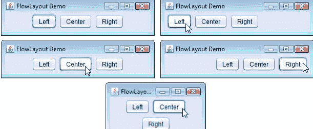

**12.40** | 测试 FlowLayoutFrame。

每个按钮的处理器都由一个单独的内部类对象处理（分别位于 30–43、48–61 行和 66–79 行），并且每个情况下的 `actionPerformed` 都执行两条语句。例如，leftJButton 按钮处理器的第 37 行使用 `FlowLayout` 方法 `setLayout` 将 FlowLayout 的对齐方式更改为左对齐(FlowLayout.LEFT)。FlowLayout.40 使用 `LayoutManager` 方法 `layoutContainer`（所有布局管理器继承）来指定 JFrame 应该重新布局。根据点击了哪个按钮，每个按钮的 `actionPerformed` 方法会将对齐设置为 FlowLayout.LEFT（第 37 行）、FlowLayout.CENTER（第 55 行）或 FlowLayout.RIGHT（第 73 行）。

## 12.18 BorderLayout

BorderLayout 管理器（JFrame 的默认布局管理器）将组件分为五个区域：NORTH、SOUTH、EAST、WEST 和 CENTER。NORTH 对应中心顶部。类 BorderLayout 继承自 Object 并实现接口 LayoutManager2（LayoutManager 的子接口，增加了若干方法以增强处理能力）。

BorderLayout 包含一个最多五个组件的 Container——每个区域一个。每个区域放置的组件可以是附加了其他组件的容器。放置在 NORTH 和 SOUTH 区域的组件延伸向

## 12.18 布局管理器简介

水平方向延伸到容器的两侧，其高度与放置在这些区域的组件相同。EAST 和 WEST 区域在 NORTH 和 SOUTH 区域之间垂直扩展，其宽度与放置在这些区域的组件相同。放置在 CENTER 区域的组件会扩展以填充布局中的剩余空间（这就是为什么图 12.37 中的 JFrame 覆盖了整个窗口的原因）。如果所有五个区域都被占用，整个容器的空间都将被 GUI 组件覆盖。如果 NORTH 或 SOUTH 区域未被占用，EAST、CENTER 和 WEST 区域的 GUI 组件将垂直扩展以填充剩余空间。如果 EAST 或 WEST 区域未被占用，CENTER 区域的 GUI 组件将水平方向扩展以填充剩余空间。此时中心区域将留空——其他 GUI 组件不会扩展以填充剩余空间。图 12.41-12.42 的应用演示了使用五个 JButton 的 BorderLayout 布局。

```java
// Fig. 12.41: BorderLayoutFrame.java
// 包含五个按钮的 BorderLayout。
import java.awt.BorderLayout;
import java.awt.event.ActionListener;
import java.awt.event.ActionEvent;
import java.awt.swing.JFrame;
import java.awt.swing.JButton;

public class BorderLayoutFrame extends JFrame implements ActionListener {
    private JButton[] buttons; // 用于隐藏部分内容的按钮数组
    private static String[] names = {"Hide North", "Hide South",
        "Hide East", "Hide West", "Hide Center"};
    private BorderLayout layout;

    // 设置 GUI 和事件处理器
    public BorderLayoutFrame() {
        super("BorderLayout Demo");
        layout = new BorderLayout(5, 5); // 五像素的间隙
        buttons = new JButton[names.length];

        // 创建 JButtons 并为它们注册监听器
        for (int count = 0; count < names.length; count++) {
            buttons[count] = new JButton(names[count]);
            buttons[count].addActionListener(this);
        }

        add(buttons[0], BorderLayout.NORTH);
        add(buttons[1], BorderLayout.SOUTH);
        add(buttons[2], BorderLayout.EAST);
        add(buttons[3], BorderLayout.WEST);
        add(buttons[4], BorderLayout.CENTER);
    }
}
```

**Fig. 12.41** | 包含五个按钮的 BorderLayout。（2 部分中的第1 部分）

```java
38
39  // 处理按钮事件
40  @Override
41  public void actionPerformed(ActionEvent event)
42  {
43
44      // 检查事件源并相应布局内容面板
45      for (JButton button : buttons) {
46
47          if (event.getSource() == button) {
48              button.setVisible(false); // 隐藏被点击的按钮
49          else
50              button.setVisible(true); // 显示其他按钮
51      }
52  }
53
54  layout.layoutContainer(getContentPane()); // 布局内容面板
55  }// BorderLayoutFrame 类结束
```

Fig. 12.41 | 包含五个框的 BorderLayout。（2 部分中的第2 部分）

12.41 的第 21 行描述了 BorderLayout。构造函数参数指定了水平排列组件（水平间隙空间）和垂直排列组件（垂直间隙空间）之间的像素数。默认水平和垂直各有一个像素的间隙空间。第 22 行使用 `setLayout` 方法将组件的布局设置为 `layout`。

我们使用另一个版本的 Container 方法向 BorderLayout 添加组件，该方法接受两个参数——组件本身以及该组件应该出现的区域。例如，第 32 行指定 `buttons[0]` 应该出现在 NORTH 区域。组件可以以任何顺序添加，但每个区域应只添加一个组件。


> 如果没有指定区域……布局管理器假设该组件应添加到 region BorderLayout.CENTER。


> 当向 BorderLayout 的某个区域添加更多一个组件时，只有最后添加到该区域的组件将能够显示。程序没有指示此问题的错误信息。

BorderLayout 类实现了 ActionListener，因此在这个示例中，BorderLayout 将处理 JButtons 的事件。出于这个原因，第 29 行将此引用传递给每个 JButton 的 `addActionListener` 方法。当用户点击布局中的特定 JButton 时，执行 `actionPerformed` 方法（第 40–55 行）。第 44–50 行的增强语句使用 `if...else` 来隐藏产生事件特定 JButton。调用 `setVisible`（继承自 Component 类的 JButton）方法并传入 `false` 参数（第 47 行）给 JButton。如果数组中的当前 JButton 不是产生事件的那个，则传入 `true` 参数调用 `setVisible` 方法（第 49 行），以确保该 JButton 显示在屏幕上。第 52 行使用布局管理器方法 `layoutContainer` 重新计算内容面板的布局。注意图 12.42 的屏幕截图中，随着按钮在其他区域的隐藏和显示，BorderLayout 中的某些区域发生了变化。尝试调整应用程序窗口的大小，查看各个区域如何根据宽度和高度进行缩放。对于更复杂的布局，将组件分组在 JPanel1 中，每个 JPanel 使用一个独立的布局管理器。将 JPanels 放在 JFrame 上使用默认 BorderLayout 或其他布局。

```java
// Fig. 12.42: BorderLayoutDemo.java
// 测试 BorderLayout。
import java.awt.BorderLayout;
import javax.swing.JFrame;
public class BorderLayoutDemo {
    public static void main(String[] args) {
        BorderLayout borderLayoutFrame = new BorderLayout();
        borderLayoutFrame.setDefaultCloseOperation(JFrame.EXIT_ON_CLOSE);
        borderLayoutFrame.setSize(300, 200);
        borderLayoutFrame.setVisible(true);
    } // BorderLayoutDemo 类结束
```

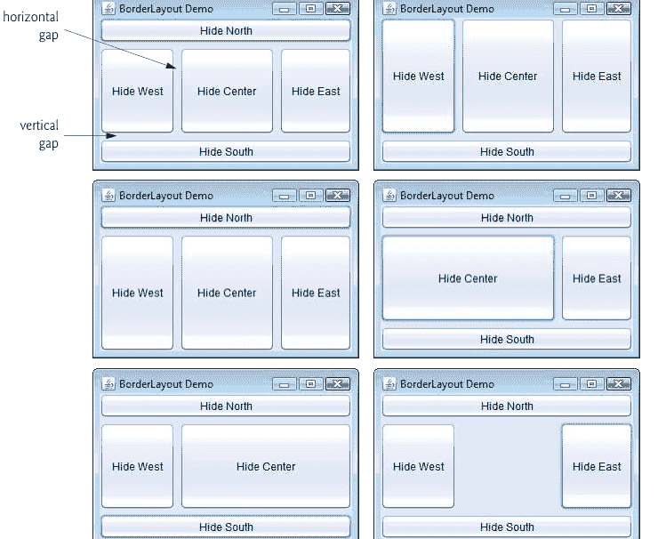

Fig. 12.42 | 测试 BorderLayoutFrame。

## 12.18 GridLayout

GridLayout 管理器将容器划分为网格，以便按行和列放置组件。GridLayout 类直接继承 Object 并实现 LayoutManager。GridLayout 中的每个组件具有相同的宽度和高度。组件从网格的左上角开始，从左到右添加，直到填满。该过程继续到下一行的左侧，依此类推。图 12.43-12.44 的应用演示了使用五个 JButton 的 GridLayout。


```java
// Fig. 12.43: GridLayoutFrame.java
// 包含五个按钮的 GridLayout。
import java.awt.GridLayout;
import java.awt.Container;
import java.awt.event.ActionListener;
import java.awt.event.ActionEvent;
import javax.swing.JFrame;
import javax.swing.JButton; // 修正了原文中的 java.awt.swing.JButton

public class GridLayoutFrame extends JFrame implements ActionListener {
    private JButton[] buttons; // 按钮数组
    private static String[] names = {"one", "two", "three", "four", "five", "six"};
    private boolean toggle = true; // 切换两种布局
    private final Container container; // 框架容器
    private final GridLayout gridLayout1; // 第一个布局
    private final GridLayout gridLayout2; // 第二个布局

    // 无参数构造函数
    public GridLayoutFrame() {
        super("GridLayout Demo"); // 增加标题以完整性
        gridLayout1 = new GridLayout(2, 3, 5, 5); // 2行3列，间隙5像素
        gridLayout2 = new GridLayout(3, 2); // 3行2列
        container = getContentPane();
        setLayout(gridLayout1);
        buttons = new JButton[names.length];

        for (int count = 0; count < names.length; count++) {
            buttons[count] = new JButton(names[count]);
            buttons[count].addActionListener(this); // 注册监听器
            add(buttons[count]); // 将按钮添加到 JFrame
        }
    }

    // 通过切换布局来处理按钮事件
    @Override
    public void actionPerformed(ActionEvent event) {
        if (toggle) {
            container.setLayout(gridLayout2);
        } else {
            container.setLayout(gridLayout1);
        }
        toggle = !toggle;
        container.validate(); // 重新布局
    }
} // 类结束 GridLayoutFrame
```

## 12.18 布局管理器简介

第 24–25 行（图 12.43）创建了两个 `GridLayout` 对象。第 24 行的 `GridLayout` 构造函数指定了一个具有 2 行 3 列的 `GridLayout`，网格组件之间有 5 像素的水平间距和 5 像素的垂直间距。第 25 行使用的 `GridLayout` 构造函数指定了一个具有 3 行 2 列的 `GridLayout`，使用默认间距（1 像素）。

此示例中的 `JButton` 最初被排列好（在第 27 行通过 `setLayout` 方法设置内容面板）。第一个组件被添加到第一行的第一列。下一个组件被添加到第一行的第二列，依此类推。当按下 `JButton` 时，会调用 `actionPerformed` 方法（第 39–49 行）。每次调用 `actionPerformed` 都会切换 `gridLayout2` 和 `gridLayout1`，使用实例布尔变量 `toggle` 来确定下一个设置的布局。

第 48 行显示了如何为已更改的布局重新排列容器。`Container` 方法 `validate()` 根据 `Container` 的当前布局管理器和当前显示的 GUI 组件，重新计算容器的布局。

```java
// 图 12.44: GridLayoutDemo.java
// 测试 GridLayoutFrame.
import javax.swing.JFrame;

public class GridLayoutDemo {
    public static void main(String[] args) {
        GridLayoutFrame gridLayoutFrame = new GridLayoutFrame(); // 修正变量名避免与类名冲突
        gridLayoutFrame.setDefaultCloseOperation(JFrame.EXIT_ON_CLOSE);
        gridLayoutFrame.setSize(300, 200);
        gridLayoutFrame.setVisible(true);
    }
} // 类结束 GridLayoutDemo
```

**图 12.43** 包含六个按钮的 `GridLayout`。（2 部分，共 2 部分。）

**图 12.44** 测试 `GridLayoutFrame`。

## 12.19 使用面板管理更复杂的布局

复杂的 GUI（如图 12.1 所示）通常需要将每个组件放置在精确的位置。它们通常由多个面板组成，每个面板的组件都按照特定的布局排列。`JPanel` 类继承自 `JComponent`，而 `JComponent` 继承自 `Container` 类，因此实际上每个 `JPanel` 都是一个 `Container`。因此，每个 `JPanel` 都可以通过 `Container` 方法附加组件，包括其他面板。图 12.45–46 的应用演示了如何使用 `JPanel` 创建更复杂的布局——其中几个按钮被放置在 `BorderLayout` 的 `SOUTH`（南部）区域。

```java
// 图 12.45: PanelFrame.java
// 使用 JPanel 帮助布局组件。
import java.awt.GridLayout;
import java.awt.BorderLayout;
import javax.swing.JFrame;
import javax.swing.JPanel;
import javax.swing.JButton;

public class PanelFrame extends JFrame {
    private final JPanel buttonPanel; // 用于存放按钮的面板
    private final JButton[] buttons;

    // 无参数构造函数
    public PanelFrame() {
        super("Panel Demo");
        buttons = new JButton[5];
        buttonPanel = new JPanel();
        buttonPanel.setLayout(new GridLayout(1, buttons.length));

        // 创建并添加按钮
        for (int count = 0; count < buttons.length; count++) {
            buttons[count] = new JButton("Button " + (count + 1));
            buttonPanel.add(buttons[count]); // 将按钮添加到面板
        }

        add(buttonPanel, BorderLayout.SOUTH); // 将面板添加到 JFrame
    }
} // 类结束 PanelFrame
```

**图 12.45** 带有五个 `GridLayout` 中的 `JButtons` 的 `JPanel`，附加到 `BorderLayout` 的 `SOUTH` 区域。

```java
// 图 12.46: PanelDemo.java
// 测试 PanelFrame.
import javax.swing.JFrame;

public class PanelDemo {
    public static void main(String[] args) {
        PanelFrame panelFrame = new PanelFrame(); // 修正实例化类型
        panelFrame.setDefaultCloseOperation(JFrame.EXIT_ON_CLOSE);
        panelFrame.setSize(450, 200);
        panelFrame.setVisible(true);
    }
} // 类结束 PanelDemo
```

**图 12.46** 测试 `PanelFrame`。（1 部分，共 2 部分）。

## 12.20 JTextArea

**图 12.46** 测试 `PanelFrame`。（第 2 部分）。


## 12.21 JTextArea 组件：第一部分

```java
// 12.47: TextAreaFrame.java
// 复制另一个 TextArea 中的文本。
import java.awt.event.ActionListener;
import java.awt.event.ActionEvent;
import javax.swing.Box;
import javax.swing.JFrame;
import javax.swing.JTextArea;
import javax.swing.JButton;
import javax.swing.JScrollPane;

public class TextAreaFrame extends JFrame {
    private final JTextArea textArea1; // 显示文本的
    private final JTextArea textArea2; // 接收文本的
    private final JButton copyButton;  // 复制按钮

    // 无参数构造函数
    public TextAreaFrame() {
        // 创建水平布局框
        Box box = Box.createHorizontalBox();

        // 创建并设置第一个TextArea
        textArea1 = new JTextArea("This is a demo", 10, 15);
        box.add(new JScrollPane(textArea1));

        // 创建第二个TextArea
        textArea2 = new JTextArea(10, 15);
        textArea2.setEditable(false);

        // 创建按钮并添加监听
        copyButton = new JButton("Copy >>>");
        copyButton.addActionListener(new ActionListener() {
            @Override
            public void actionPerformed(ActionEvent event) {
                textArea2.setText(textArea1.getSelectedText());
            }
        });

        box.add(copyButton);
        box.add(new JScrollPane(textArea2));

        // 将添加到 JFrame
        add(box);
    }
}
```

**图 12.47** 复制另一个 TextArea 中的文本。

当文本到达 `JTextArea` 的边缘时，文本可以换到下一行。这被称为换行。默认情况下，`JTextArea` 不换行。

> **观察 12.19**
>
> 要为 `JTextArea` 提供换行功能，请调用 `JTextArea` 的方法 `setLineWrap` 并传入 `true` 参数。

## JScrollPane 滚动条策略

此示例使用 `JScrollPane` 为 `JTextArea` 提供滚动功能。默认情况下，如果需要，`JScrollPane` 会显示滚动条。你可以在构造 `JScrollPane` 时设置其水平和垂直滚动条策略。如果程序拥有 `JScrollPane` 的引用，该程序可以使用 `JScrollPane` 的方法 `setHorizontalPolicy` 和 `setVerticalScrollBarPolicy` 随时更改滚动条策略。`JScrollPane` 类声明了以下常量：

```
JScrollPane.VERTICAL_SCROLLBAR_ALWAYS
JScrollPane.HORIZONTAL_SCROLLBAR_ALWAYS
```

表示滚动条应始终出现。常量：


```
JScrollPane.VERTICAL_SCROLLBAR_AS_NEEDED
JScrollPane.HORIZONTAL_SCROLLBAR_AS_NEEDED
```

表示滚动条仅在需要时出现（默认值）。以及常量：

```
JScrollPane.VERTICAL_SCROLLBAR_NEVER
JScrollPane.HORIZONTAL_SCROLLBAR_NEVER
```

表示滚动条永远不会出现。如果水平滚动条策略设置为 `JScrollPane.HORIZONTAL_SCROLLBAR_NEVER`，附加到 `JScrollPane` 上的 `JTextArea` 将自动换行。

## 12.2 总结

在本章中，你学习了许多 GUI 组件以及如何处理它们的事件。你还学习了嵌套类、内部类和匿名内部类。你看到了内部类对象与其顶层类对象之间的特殊关系。你学习了如何使用 `JOptionPane` 从用户处获取输入，以及如何向用户显示消息。你学习了如何在它们自己的窗口中执行应用程序。我们讨论了 `JFrame` 以及能够让用户与其进行交互的组件。在应用程序中，我们还向你展示了如何向用户显示文本和图像。你学习了如何使用 `JPanel` 创建绘制区域，你将在下一章中广泛使用它们。你看到了如何使用 `JPanel` 在窗口上组织组件。最后，你学习了 `J` 组件，用户可以在其中输入文本，应用程序可以显示。在第 22 章中，你将学习更多关于高级 GUI 组件，例如滑块、菜单和更复杂的布局管理器。在下一章中，你将学习如何为你的 GUI 应用程序添加图形。图形允许你使用颜色和样式绘制形状和文本。

## 12.1 引言

- 图形用户界面（GUI；第 474 页）为与应用程序交互提供了一种友好的机制。GUI 为应用程序提供了独特的视图和外观（第 474 页）。
- 为不同的应用程序提供一致、直观的界面组件，让使用户对新应用程序感到熟悉，从而能够快速学习。
- GUI 由 GUI 组件（第 474 页）构建——这些组件有时被称为控件（controls）或部件（widgets）。

## 12.2 Java 视觉外观

- 自 Java 6 更新以来，Java 自带了一种新的、优雅的跨平台视图和外观，称为 Nimbus（第 476 页）。
- 要将 Nimbus 设置为所有 Java 应用程序的默认外观，请在 JDK 和 JRE 安装的 `lib` 文件夹中创建一个 `.properties` 文本文件。在文件中放入以下代码行：

```java
swing.setLookAndFeel=com.sun.swing.laf.nimbus.NimbusLookAndFeel
```

- 若要按应用程序选择 Nimbus，在运行应用程序时，在 `java` 命令之后、应用程序名称之前放置以下命令行参数：

```bash
-Dswing.setLookAndFeel=com.sun.swing.laf.nimbus.NimbusLookAndFeel
```

## 12.3 使用 JOptionPane 进行简单的 GUI 输入/输出

- 大多数应用程序使用对话框（第 476 页）与用户交互。
- `javax.swing` 包中的 `JOptionPane` 类（第 476 页）为输入和输出提供了默认对话框。`JOptionPane` 静态方法 `showInputDialog()`（第 477 页）打印输入对话框（第 476 页）。
- 提示信息（prompt）通常使用句式大写——除非是专有名词，否则仅将文本第一个单词的首字母大写。这是大多数 GUI 组件的典型特征。
- 输入对话框只能输入字符串。
- `JOptionPane` 静态方法 `showDialog()`（第 478 页）显示对话框（第 476 页）。

## 12.4 Swing 组件概述

- 大多数 Swing 组件（第 474 页）位于 `javax.swing` 包中。
- 外观以及用户与应用程序交互的方式共同被称为该应用程序的视图和外观（look-and-feel）。Swing 组件允许你在所有平台上统一应用程序的视图和外观，或者使用轻量级组件，这些组件不依赖应用程序执行的底层平台支持的 GUI 组件。
- 某些组件是重量级组件（第 480 页），需要与本地窗口系统（第 480 页）直接交互，这可能会限制它们的外观功能。
- `java.awt` 包中的 `Component` 类（第 480 页）声明了 `java.awt`（第 479 页）和 `javax.swing` 包中 GUI 组件共有的属性和行为。
- `java.awt` 包中的 `Container` 类（第 480 页）是 `Component` 的子类，它们附加到屏幕上。
- `javax.swing` 包中的 `JComponent` 类（第 480 页）是 `java.awt`（第 479 页）和 `javax.swing` 包中 GUI 组件共有的属性和行为。

## 12.5 显示文本和图像

- `JFrame` 提供了窗口（window）和行为。
- `JLabel`（第 481 页）显示文本或图像。
- `JFrame`（第 483 页）创建窗口。
- `JComponent`（第 483 页）指定工具提示信息。
- `Container`（第 484 页）添加组件。
- `ImageIcon`（第 484 页）支持各种图像格式，包括 GIF 和 PNG。
- `Resource`（第 484 页）返回资源的位置。
- `JLabel`（第 484 页）具有水平和垂直对齐。
- `JLabel`（第 484 页）设置文本。
- `JLabel`（第 484 页）设置图标。
- `JFrame`（第 485 页）在窗口关闭时终止程序。
- `Component`（第 485 页）指定宽度和高度。

## 12.6 文本字段与嵌套类事件处理简介

- 事件是驱动的——当用户与 GUI 组件交互时，事件（第 485 页）驱动程序执行任务。
- 事件处理器（event handler）对事件执行任务响应。
- `JTextField`（第 485 页）提供常见的文本功能。
- `JPasswordField`（第 485 页）在用户输入时显示正在输入的字符，但隐藏实际字符（第 485 页）。
- 当用户点击组件时，组件接收点击事件（第 486 页）。
- `JComponent` 方法 `setEditable()`（第 488 页）可用于创建一个表示事件处理器的类并实现适当事件监听接口（第 488 页），将事件处理器类注册为事件处理器（第 488 页）。
- 要响应事件，你必须创建一个表示事件处理器的类并实现适当事件监听接口（第 488 页），将事件处理器类注册为事件处理器（第 488 页）。
- 非静态嵌套类（第 488 页）被称为内部类，常用于事件处理。

## 总结

- 内部类对象可以直接访问其顶层类的实例变量和方法。
- 静态嵌套类不需要其顶层类的对象，并且不会隐式地拥有顶层类对象的引用。
- 在 `JTextField` 或 `JPasswordField` 中按回车键会产生一个 `ActionEvent`（第 489 页），该事件可以通过 `java.awt.event` 中的 `ActionListener`（第 489 页）进行处理。
- `JTextField` 方法 `addActionListener()`（第 489 页）为文本字段的 `ActionEvent` 注册一个事件处理器。
- 用户与之交互的 GUI 组件是事件源（第 490 页）。
- `ActionEvent` 包含有关发生事件的信息，例如源和文本中的文本。
- `ActionEvent` 方法 `getSource()` 返回事件源的引用。`ActionEvent` 方法 `getActionCommand()`（第 490 页）返回在文本字段中输入的文本或 `JButton` 标签。
- `JPasswordField` 方法 `getPassword()`（第 490 页）返回用户输入的密码。

## 12.7 普通 GUI 事件与监听器接口

- 每种事件类型通常都有一个对应的事件监听器接口，该接口指定了一个或多个事件处理方法，这些方法必须在实现接口的类中声明。

## 12.8 事件处理的工作原理

- 当事件发生时，GUI 组件通过调用每个监听器适当的事件处理方法来通知其注册的监听器。
- 每个 GUI 组件都支持多种事件类型。当事件发生时，事件会被分发（第 494 页）给所有相应类型的监听器。

## 12.9 JButton

- 按钮是用户点击以触发操作的组件。所有按钮都是 `AbstractButton`（第 495 页：包 `javax.swing`）的子类。标签（第 495 页）通常使用标题大小（第 495 页）。
- 命令按钮（第 495 页）通过 `JButton` 创建。
- `JButton` 可以显示图标（Icon）。`JButton` 还有一个悬停图标（第 497 页）——当用户将鼠标悬停在按钮上时显示的图标。
- `AbstractButton` 类的方法 `RolloverIcon()`（第 498 页）指定当用户将鼠标悬停在按钮上时显示的图像。

## 12.10 维护状态的按钮

- 有三种 Swing 按钮类型——`JToggleButton`（第 498 页）、`JCheckBox`（第 498 页）和 `JRadioButton`（第 498 页）。
- 类 `JCheckBox` 和 `JRadioButton` 是 `JToggleButton` 的子类。
- 组件方法 `setFont()`（第 500 页）将组件的字体设置为 `java.awt` 中的新字体（第 500 页）。
- 点击 `JButton` 会导致一个事件（第 501 页），该事件可以由 `ActionListener`（第 501 页）处理，后者定义了方法 `itemChanged()`（第 501 页）。方法 `addActionListener()` 为 `JCheckBox` 或 `JRadioButton` 对象注册监听器。
- `JCheckBox` `isSelected()` 决定 `JCheckBox` 是否被选中。
- `JButton` 有两个状态——已选中和未选中。单选按钮（第 495 页）通常以一组（第 501 页）的形式出现，其中一次只能选择一个按钮。
- `JRadioButtons` 用于表示互斥的选项（第 501 页）。
- `JRadioButtons` 之间的逻辑关系由 `ButtonGroup` 对象（第 501 页）维护。
- `ButtonGroup` 方法 `add()`（第 504 页）将每个 `JRadioButton` 关联到 `ButtonGroup`。如果向组添加了多个被选中的 `JRadioButton` 对象，则在 GUI 显示时，先添加的被选中对象将被选中。
- `JRadioButtons` 在被点击时会产生 `ItemEvents`。

## 12.11 JComboBox：使用匿名内部类进行事件处理

- `JComboBox`（第 504 页）提供了一个项目列表，用户可以从中进行单项选择。`JComboBox` 生成 `ItemEvents`。
- `JComboBox` 中的每个项目都有一个索引（第 507 页）。当添加到 `JComboBox` 的第一个项目在 `JComboBox` 显示时，它将显示为当前选中的项。
- `JComboBox` 方法 `setRowCount()`（第 507 页）设置用户点击 `JComboBox` 时显示的最大元素数量。
- 匿名内部类（第 507 页）没有名称，通常出现在方法声明内部。在声明类时，必须创建一个匿名内部类对象。
- `JComboBox` 方法 `get()`（第 508 页）返回被选中项的索引。

## 12.12 JList

- `JList` 显示一个项目列表，用户可以从中选择一个或多个项目。`JList` 类支持单选列表（第 508 页）和多选列表。
- 当用户点击 `JList` 中的某项时，会发生一个选择事件（第 508 页）。`JList` 方法 `addSelectionListener()`（第 510 页）为 `JList` 的选择事件注册一个 `ListSelectionListener`（第 510 页）。`javax.swing.event` 包（第 492 页）中的 `ListSelectionListener` 必须实现 `valueChanged()`。
- `JList` 方法 `setRowCount()`（第 510 页）指定列表中可见的项目数。
- `JList` 方法 `setMode()`（第 510 页）指定模式。
- `JList` 附加了一个 `JScrollPane`（第 510 页）。
- `JFrame` 方法 `getContent()`（第 510 页）返回内容。
- `JList` 方法 `getSelectedIndex()`（第 510 页）返回索引。

## 12.13 多选择

- `JList`（第 511 页）允许用户进行多项选择。
- `JList` 方法 `setCellWidth()`（第 513 页）设置宽度。
- `JList` 方法 `setCellHeight()`（第 513 页）设置高度。
- `SelectionCount()`（第 511 页）返回点击次数。
- `JList` 方法 `getValues()`（第 513 页）返回选中的项。

## 12.14 鼠标事件处理

- `MouseListener`（第 513 页）用于处理键盘按下和释放时的鼠标事件。
- `KeyEvent`（第 494 页）包含事件信息。
- `MouseWheelListener`（第 515 页）允许应用程序响应滚轮事件。

## 12.15 适配器类

- 适配器类（第 518 页）实现接口并提供默认实现。当你扩展适配器类时，可以重写需要的方法。
- `getClickCount()`（第 521 页）返回点击次数。

## 12.16 使用鼠标绘制的 JPanel 类

- `paintComponent()`（第 522 页）在轻量级组件需要显示时被调用。重写此方法可以使用图形功能进行绘图。
- 当轻量级组件是不透明的（第 522 页）时，`paintComponent` 会清除其背景。
- 轻量级组件的透明度可以通过 `setOpaque()`（第 522 页）设置；传入 `false` 参数表示不透明。
- `Point`（第 523 页）代表 x-y 坐标。
- `Graphics`（第 523 页）用于绘制。
- `getPoint()`（第 524 页）获取鼠标事件发生的点。
- `repaint()`（第 524 页）指示组件应尽快刷新。
- `paintComponent` 接收 `Graphics` 参数，并在轻量级组件需要显示在屏幕上时自动调用。
- `Graphics drawOval()`（第 524 页）绘制实心圆。前两个参数是边界框的 x 坐标，最后两个是宽度和高度。

## 12.18 布局管理器简介

- 布局管理器（第 528 页）为了演示目的，在容器中安排 GUI 组件。
- 所有的布局管理器都实现了 `java.awt` 包中的 `LayoutManager` 接口（第 528 页）。
- `Container` 方法 `setLayout()` 指定容器的布局。
- `FlowLayout` 按照组件添加到容器的顺序将其左对齐排列。当到达容器边缘时，组件将继续在下一行显示。`FlowLayout` 允许 GUI 组件左对齐、居中（默认值）和右对齐。
- `FlowLayout` 方法 `setLayout()`（第 532 页）更改 `FlowLayout` 的对齐方式。
- `BorderLayout`（第 532 页，`JFrame` 的默认布局）将组件分为五个区域：`NORTH`、`SOUTH`、`EAST`、`WEST` 和 `CENTER`。`NORTH` 对应容器的顶部。
- `BorderLayout` 限制容器最多包含五个组件——每个区域一个。
- `GridLayout`（第 536 页）将容器划分为行和列网格。
- `Container` 方法 `validate()`（第 537 页）根据容器的当前管理器和当前一组显示的 GUI 组件返回容器的布局。

## 12.19 使用面板管理复杂布局

- GUI 通常由多个具有不同布局的面板组成。每个 `JPanel` 都可以通过 `Container` 方法附加其他组件或其他面板。

## 12.20 JTextArea

- `JTextArea`（第 539 页）——`JComponent` 的子类——可以包含多行文本。
- `Class Box`（第 540 页）是 `Container` 的子类，使用 `BoxLayout` 布局管理器（第 541 页）以水平或垂直方向排列 GUI 组件。
- `Box` 方法 `createHorizontal()`（第 541 页）创建一个 `Box`，按照组件封装的顺序从左到右排列组件。
- 方法 `getSelectedText()`（第 541 页）返回 `JTextArea` 中的选中文本。
- 在构造 `JScrollPane` 时可以设置其水平和垂直滚动策略（第 542 页）。可以使用 `JScrollPane` 的 `setHorizontalScrollPane()`（第 542 页）和 `setVerticalScrollBarPolicy()`（第 542 页）随时更改滚动条。

## 自测练习题

- 填写下列陈述中的空白：

a) 当在没有按下按钮的情况下移动鼠标且该事件注册了事件监听器时，会调用 ________ 方法。

b) 用户可以修改的文本被称为 ________ 文本。

c) 一个 ________ 在容器（Container）中安排 GUI 组件。

d) 用于附加 GUI 组件的 `add` 方法是类 _________ 的一个方法。


### 12.17（交互式绘制应用程序）

在此练习中，你将实现一个使用 `MyShape` 层次结构的 GUI 应用程序。你将为 GUI 创建两个类，并提供一个启动应用程序的测试类。`MyShape` 层次结构的类不需要额外的更改。

第一个类是名为 `DrawPanel` 的 `JPanel` 子类，代表用户绘图的区域。`DrawPanel` 类应该具有以下实例变量：

- 一个 `MyShape` 类型的形状数组，用于存储所有的绘制内容。
- 一个整数 `shapeCount`，用于计算数组中形状的数量。
- 一个整数 `shapeType`，用于确定要绘制的形状类型。
- 一个 `MyShape currentShape`，代表用户正在绘制的当前形状。
- 一个 `Color currentColor`，代表当前的绘制颜色。
- 一个布尔值 `filledShape`，用于确定是否绘制填充形状。
- 一个 `JLabel statusLabel`，代表状态栏。状态栏将显示当前鼠标位置的坐标。

`DrawPanel` 应该定义以下方法：

- 重写的方法 `paintComponent`，绘制数组中的形状。使用实例变量 `shapeCount` 来决定绘制多少个形状。如果 `currentShape` 不为空，`paintComponent` 方法也应该调用 `currentShape` 的 `draw` 方法。
- 为 `shapeType`、`currentColor` 和 `filled` 提供 setter 方法。
- 方法 `clearShape` 通过减少实例变量 `shapeCount` 来清除上一次绘制。确保 `shapeCount` 永远不小于零。
- 方法 `clearDrawing` 通过将 `shapeCount` 重置为零来移除当前绘制的所有形状。`clearDrawing` 应该调用 `repaint`（继承自 `JPanel`），通过指示系统调用 `paintComponent` 来刷新 `DrawPanel` 上的绘制内容。

`DrawPanel` 还应该提供事件处理，以便使用户使用鼠标进行绘图。创建一个扩展 `MouseAdapter` 并实现 `MouseListener` 的内部类，用于处理该类中的所有鼠标事件。

在内部类中，重写 `mousePressed` 方法分配指定类型的新形状，并将两个点都初始化为鼠标位置。接下来，重写 `mouseReleased` 方法绘制当前形状并将其放入数组。将 `currentShape` 的第二个点设置为当前鼠标位置并将 `currentShape` 添加到数组。增加实例变量 `shapeCount` 并调用 `repaint` 用新形状更新绘制内容。

重写 `mouseMoved` 方法，每当用户在 `DrawPanel` 内移动（但不拖动）鼠标时，设置 `statusLabel` 的文本为坐标。接下来，重写 `mouseDragged` 方法，将 `currentShape` 的第二个点设置为当前鼠标位置并调用 `repaint` 方法，这将让用户看到拖动动作。用鼠标当前位置更新 `statusLabel`。向 `JPanel` 注册 `MouseListener` 和 `MouseMotionListener` 以正确处理鼠标事件。

为 `DrawPanel` 创建一个带有单个 `JLabel` 参数的构造函数。在构造函数中，用传递给参数的值初始化 `statusLabel`。同时初始化数组为 100 个条目，`shapeCount` 设置为 0，`shapeType` 表示线条，`currentShape` 设置为 `null`，`currentColor` 设置为 `Color.BLACK`。构造函数随后应将 `DrawPanel` 的背景颜色设置为 `Color.WHITE`，并向 `JPanel` 注册 `MouseListener` 和 `MouseMotionListener` 以正确处理鼠标事件。

接下来，创建一个 `JFrame` 子类 `DrawFrame`，它提供一个使用户能够控制绘制各个方面的 GUI。对于 `DrawFrame` 的布局，我们建议使用 `BorderLayout`，组件位于 `NORTH` 区域，主绘制面板位于 `CENTER` 区域，状态栏位于 `SOUTH` 区域，如图 12.49 所示。在顶部面板中，包含下面列出的组件。每个组件的事件处理器都应该调用 `DrawPanel` 类中的相应方法。

- a) 用于撤销全部的按钮。
- b) 用于清除绘制中所有形状的按钮。
- c) 一个用于从 13 种预定义颜色中选择颜色的组合框。
- d) 一个用于选择要绘制形状的组合框。
- e) 一个指定形状应该是填充还是不填充的复选框。

在 `DrawFrame` 的构造函数中声明并创建接口组件。你需要在创建 `DrawPanel` 之前先创建状态栏 `JLabel`，这样你就可以将 `JLabel` 作为参数传递给 `DrawPanel` 的构造函数。最后，创建一个测试类来初始化并显示 `DrawFrame` 以执行应用程序。


**图 12.49** 绘制形状的界面。

### 12.18（基于 GUI 的 ATM 案例研究）

将第 33–34 章中的可选 ATM 案例重新实现为基于 GUI 的应用程序。使用 GUI 组件近似图 33.1 中的 ATM 用户界面。对于现金钞票口和标记为 `Remove Cash`（取款）和 `Insert Envelope`（插入信封）的存款槽，实现应用程序以接收指示用户何时取现金和插入存款的事件。

### 12.19（Ecofont）

Ecofont（www.ecofont.com/en.html）——由 SPANQ（一家荷兰公司）开发——是一种免费的开源字体，旨在减少高达 20% 的打印墨水量，从而减少墨盒的使用量以及制造和运输过程对环境的影响（使用更少的能量、更少的运输燃料等）。该字体基于无衬线字体 Verdana，字母中有微小的“孔”，在较小字号下是不可见的——例如经常使用的 9 号字体。下载 Ecofont，然后安装字体 `ecofont_regular.ttf`。接下来，开发一个带有“增大字体号”和“缩小字体号”按钮的 GUI 程序，允许你放大或缩小字号。从默认字号 9 开始。随着放大，你将更清楚地看到这些孔。随着缩小，孔会变得不明显。字号小到什么你会注意到这些孔？

### 12.20（打字教程：时代的关键技能）

快速准确地打字是使用计算机的一项基本技能。在此练习中，你将构建一个帮助用户“盲打”（即不看键盘打字）的应用程序。应用程序应显示虚拟键盘（图 12.50）并在用户输入的内容。使用按钮表示按键。当按下每个按键时，应用程序突出相应的 `JButton`，并将字符添加到显示已输入内容的 `JTextField` 中。*提示：要突出 `JButton`，使用其方法更改背景颜色。当释放按键时，重置其原始颜色。*


**图 12.50** 打字教程。

你可以通过输入全字母句（包含字母表中每个字母的短语）来测试你的程序，例如“The brown fox jumped over a lazy dog.”可以在网上找到其他全字母句。

为了让程序更有趣，你可以监控用户的准确性。你可以让用户输入预存在程序中的特定短语，并将其显示在虚拟键盘上方。你可以跟踪用户正确击键次数和错误次数。你还可以跟踪用户在哪些按键上有困难，并显示这些按键的报告。

## 第 13 章 图形与 Java 2D

> 用圆柱体、球体、锥体的视角来看自然。
>
> —Paul Cézanne
>
> 颜色就像特征，随着情感的变化而变化。
>
> —Pablo Picasso
>
> 在经历之前，没有任何是真实的——甚至谚言在你生活说明它之前，对你来说也不是谚言。
>
> —John Keats


### 目标

在本章中你将：

- 理解图形上下文和图形对象。
- 操作颜色和字体。
- 使用 `Graphics` 类的方法绘制各种形状。
- 使用 Java 2D API 中的 `Graphics2D` 类的方法绘制各种形状。
- 为使用 `Graphics2D` 显示的形状指定 `Paint`（填充）和 `Stroke`（笔画）特征。

| 13.1 引言 | 13.6 绘制弧 |
| :--- | :--- |
| 13.2 图形上下文与 Graphics | 13.7 绘制多边形和折线 |
| 13.3 颜色控制 | 13.8 Java 2D API |
| 13.4 字体操作 | 13.9 总结 |
| 13.5 绘制线条、矩形和椭圆 | |

总结 | 自我测 | 自我测答案 | 练习题 | 实际应用 |

### 13.1 引言

在本章中，我们将概述 Java 在绘制二维几何形状、控制颜色和字体方面的能力。Java 最初的魅力之一是它对图形的支持，这让程序员能够增强他们的应用程序。Java 提供了复杂的绘图能力，作为 Java2D API（在本章中介绍）及其后续者 JavaFX（在第 2 章中介绍）的一部分。本章从介绍 Java 的许多原始绘图能力开始。接下来，我们将介绍几个最强大的 Java2D 功能，例如控制用于绘制的线条样式，以及填充颜色和图案的形状。原本属于 Java 原始图形的类现在被认为是 Java2D API 的一部分。

图 13.1 显示了类层次的一部分，包含了本章涵盖的各种图形类和 Java2D 接口。

- `Color` 包含操作颜色的方法。
- `Font` 包含获取信息的方法。
- `Graphics` 包含绘制线条、矩形和其他形状的方法。


# 图形与 Java 2D

- `Graphics2D` 继承自 `Graphics`，用于使用 Java2D API 进行绘图。
- `Polygon` 包含创建多边形的方法。
- `BasicStroke` 和 `Texture` 帮助指定填充形状的特征。
- `GeneralPaint`、`Line2D`、`Ellipse2D`、`Rectangle2D` 和 `RoundRectangle2D` 代表不同的 2D 形状。

## 13.1 引言

要在 Java 中开始绘图，我们必须首先理解 Java 的坐标系（图 13.2），它是用于识别屏幕上每个点的网格。默认情况下，GUI 组件（例如窗口）的左上角坐标为 (0,0)。一个坐标由 x 坐标（水平坐标）和 y 坐标（垂直坐标）组成。x 坐标是自屏幕左边缘向右移动的水平距离。y 坐标是自屏幕顶部向下移动的垂直距离。x 轴描述了图形显示的位置。单位以像素（pixel，代表“图像元素”）来度量。像素是显示器分辨率的最小单位。

**Java 坐标系。**


**图 13.1** | 本章使用的来自 Java 原始图形能力和 Java2D API 的类和接口。

### 可移植性提示 13.1

不同的显示器具有不同的分辨率（即像素密度不同）。这可能导致图形在不同显示器上或在同一台显示器的不同设置下显示为不同的大小。

## 13.2 图形上下文与 Graphics


**图 13.2** | Java 坐标系

图形上下文允许在屏幕上绘图。`Graphics` 对象管理图形上下文并在屏幕上绘制代表文本和其他图形对象（例如线条、椭圆、矩形）的像素。`Graphics` 对象包含绘制、字体操作等的方法。`Graphics` 是一个抽象类（即你不能实例化 `Graphics` 对象）。这有助于 Java 的可移植性。由于绘图在每个平台上的执行方式不同，当 Java 在特定平台上实现时，会创建一个 `Graphics` 的子类，它提供接口以使我们能够以平台无关的方式使用图形。

回想第 12 章，`Component` 是 `java.awt` 包中许多类的父类。`JComponent`（swing 包）间接继承自 `Component`，包含一个可以用于绘制图形的 `paintComponent` 方法。`paintComponent` 方法接收一个 `Graphics` 对象作为参数。当 Swing 组件需要绘制时，系统会将此对象传递给 `paintComponent` 方法。`paintComponent` 方法头如下：

```java
public void paintComponent(Graphics g)
```

参数 `g` 接收系统特定 `Graphics` 子类实例的引用。前面的方法头应该让你感到眼熟——它与我们在第 12 章的一些应用程序中使用的是同一个方法。实际上，`JComponent` 是 `JPanel` 的父类。`JPanel` 的许多类都继承自 `JComponent`。

你**不**直接调用 `paintComponent`，因为绘制图形是一个事件驱动的过程。如第 11 章所述，Java 使用程序执行的多线程模型。每个线程都是一个并行活动。每个程序可以有许多线程。当你创建一个基于 GUI 的应用程序时，这些线程之一被称为事件分发线程（EDT）——它用于处理所有的 GUI 事件。对屏幕 GUI 组件的所有管理必须在该线程中进行。当 GUI 应用程序执行时，程序为 GUI 显示的每个轻量级组件（在事件分发线程中）调用 `paintComponent` 方法。要再次调用 `paintComponent`，必须发生某个事件（例如用另一个窗口覆盖并取消组件）。

如果你需要执行 `paintComponent`（即如果你想更新在 Swing 组件上绘制的图形），可以调用 `repaint` 方法，该方法返回 `void`，不接受参数，并且所有 `JComponent` 都间接继承自 `Component`（package）。

## 13.3 颜色控制

`Color` 类声明了用于操作颜色的方法和 Java 程序中的常量。定义的颜色常量总结在图 13.3 中，许多颜色方法和构造函数总结在图 13.4 中。`Graphics` 指定颜色。

**图 13.3** | 颜色常量与 RGB 值

| 颜色常量 | RGB 值 |
| :--- | :--- |
| `static final Color RED` | 255, 0, 0 |
| `static final Color GREEN` | 0, 255, 0 |
| `static final Color BLUE` | 0, 0, 255 |
| `static final Color ORANGE` | 255, 200, 0 |
| `static final Color PINK` | 255, 175, 175 |
| `static final Color CYAN` | 0, 255, 255 |
| `static final Color MAGENTA` | 255, 0, 255 |
| `static final Color YELLOW` | 255, 255, 0 |
| `static final Color BLACK` | 0, 0, 0 |
| `static final Color WHITE` | 255, 255, 255 |
| `static final Color GRAY` | 128, 128, 128 |
| `static final Color LIGHT_GRAY` | 192, 192, 192 |
| `static final Color DARK_GRAY` | 64, 64, 64 |

**图 13.4** | 颜色方法与相关

| 方法 | 说明 |
| :--- | :--- |
| *构造函数和方法* | |
| `public Color(int r, int g, int b)` | 根据 0 到 255 之间的红、绿、蓝整数创建颜色。 |
| `public Color(float r, float g, float b)` | 根据 0.0 到 1.0 之间的红、绿、蓝浮点值创建颜色。 |
| `public int getRed()` | 返回 0 到 255 之间的红色内容。 |
| `public int getGreen()` | 返回 0 到 255 之间的绿色内容。 |
| `public int getBlue()` | 返回 0 到 255 之间的蓝色内容。 |
| `public void setColor(Color c)` | 设置图形上下文的当前颜色。 |

颜色由红、绿、蓝值创建。这些值统称为 RGB 值。所有三个分量都可以是 0 到 255 之间的整数，或者全部是 0.0 到 1.0 之间的浮点值。第一个 RGB 分量指定红色量，第二个指定绿色量，第三个指定蓝色量。值越大，那种颜色的量越多。

### 代码示例

```java
// Fig. 13.5: ColorJPanel.java
// Changing drawing colors.
import java.awt.Graphics;
import java.awt.Color;
import javax.swing.JPanel;

public class ColorJPanel extends JPanel {
    // 用不同的颜色绘制矩形和字符串
    @Override
    public void paintComponent(Graphics g) {
        super.paintComponent(g);
        this.setBackground(Color.WHITE);

        // 使用整数设置绘制颜色
        g.setColor(new Color(255, 0, 20));
        g.fillRect(15, 25, 100, 65);
        g.drawString("Current RGB: " + g.getColor(), 130, 40);

        // 使用浮点数设置绘制颜色
        g.setColor(new Color(0.50f, 0.75f, 0.02f));
        g.fillRect(15, 100, 100, 20);
        g.drawString("Current RGB: " + g.getColor(), 130, 65);

        // 使用静态 Color 对象设置绘制颜色
        g.setColor(Color.BLUE);
        g.fillRect(15, 75, 100, 20);
        g.drawString("Current RGB: " + g.getColor(), 130, 90);

        // 显示单个 RGB 值
        Color color = Color.MAGENTA;
        g.setColor(color);
        g.fillRect(15, 100, 100, 20);
        g.drawString("RGB values: " + color.getRed() + ", " + color.getGreen() + ", " + color.getBlue(), 130, 115);
    }
} // end class ColorJPanel
```

**Fig. 13.5** | 绘制颜色。

```java
// Fig. 13.6: ShowColors.java
// Demonstrating Colors.
import javax.swing.JFrame;

public class ShowColors {
    // 执行应用程序
    public static void main(String[] args) {
        // 为 ColorJPanel 创建框架
        JFrame frame = new JFrame("Using colors");
        frame.setDefaultCloseOperation(JFrame.EXIT_ON_CLOSE);

        ColorJPanel colorJPanel = new ColorJPanel();
        frame.add(colorJPanel);
        frame.setSize(400, 180);
        frame.setVisible(true);
    }
} // end class ShowColors
```

**Fig. 13.6** | 演示颜色。


**Fig. 13.6** | 演示颜色。（2/2 部分）。

第 19 行使用 `Graphics` 方法 `drawString` 用当前颜色绘制一个字符串。表达式 `g.getColor()` 从 `Graphics` 对象中获取当前颜色。然后，我们将 `Color` 对象与字符串 `"Current RGB: "` 拼接，导致对 `Color` 方法的隐式调用。`Color` 的表示包含类名和包名（`java.awt.Color`）以及红色、绿色和蓝色颜色。

### 观察与启示 13.1

人们对颜色的感知不同。请仔细选择颜色，以确保您的应用程序对于能够感知颜色的人和色盲人士来说都是可读的。尝试避免在邻近的区域使用多种颜色。

第 22–27 行执行相同的任务。第 22 行使用带有三个浮点数的 `Color` 构造函数来创建一个深绿色（红色 0.50f，绿色 0.75f，蓝色 0.0f）。值的语法允许使用 `f` 字面量，这表示该字面量应被视为浮点数。记住，默认情况下，浮点数字面量被视为 `double` 类型。

第 27 行将当前绘制颜色设置为声明的 `Color` 常量之一。`Color` 常量是静态的，因此它们在执行期间类加载到内存时就会创建。

第 35–36 行的语句调用了 `Color` 方法 `getRed()`、`getGreen()` 和 `getBlue()`。图 13.6 中 `ShowColors` 类的 `main` 方法第 8–18 行创建了 `JFrame`，该 `JFrame` 将包含一个将显示的 `ColorJPanel` 对象。

### 软件工程观察 13.1

要更改颜色，你必须创建一个新的 `Color` 对象（或使用预先定义的常量）。像 `String` 对象一样，`Color` 对象是不可变的（不可修改）。

## 13.4 颜色选择器

`JColorChooser`（位于 `javax.swing` 包）允许应用程序用户选择颜色。图 13.7–13.8 展示了 `JColorChooser` 对话框。当你点击 Change Color 按钮时，会出现一个 `JColorChooser` 对话框。当你选择一种颜色并按下对话框的 OK 按钮时，应用程序窗口的背景颜色会改变。

```java
// Fig. 13.7: ShowColorsJFrame.java
// 使用 JColorChooser 选择颜色
import java.awt.BorderLayout;
import java.awt.Color;
import java.awt.event.ActionListener;
import java.awt.event.ActionEvent;
import javax.swing.JButton;
import javax.swing.JFrame;
import javax.swing.JColorChooser;
import javax.swing.JPanel;

public class ShowColors2Frame extends JFrame {
    private final JButton changeColorButton;
    private Color color = Color.LIGHT_GRAY;
    private final JPanel colorJPanel;

    // 设置 UI
    public ShowColors2Frame() {
        super("Using ColorChooser");
        colorJPanel = new JPanel();
        colorJPanel.setBackground(color);

        // 设置按钮并注册事件
        changeColorButton = new JButton("Change Color");
        changeColorButton.addActionListener(
            new ActionListener() {
                // 用户点击时显示 JColorChooser
                @Override
                public void actionPerformed(ActionEvent event) {
                    // 如果返回了颜色，设置默认颜色
                    color = JColorChooser.showDialog(
                        ShowColors2Frame.this, "Choose a color", color);

                    // 面板背景
                    if (color != null) {
                        colorJPanel.setBackground(color);
                    }
                } // end actionPerformed
            } // end anonymous class
        );
    }
}
```

**Fig. 13.7** | 使用 JColorChooser 选择颜色。（1/2 部分）。


# 第 13 章 图形与 Java 2D

## 13.3 颜色控制

```java
// Fig. 13.8: ShowColors2.java
// 使用 JColorChooser 选择颜色
import java.awt.BorderLayout;
import java.awt.Color;
import java.awt.event.ActionEvent;
import java.awt.event.ActionListener;
import javax.swing.JButton;
import javax.swing.JFrame;
import javax.swing.JColorChooser;
import javax.swing.JPanel;

public class ShowColors2Frame extends JFrame {
    private final JButton changeColorButton;
    private Color color = Color.LIGHT_GRAY;
    private final JPanel colorJPanel;

    // 设置 UI
    public ShowColors2Frame() {
        super("Using ColorChooser");
        colorJPanel = new JPanel();
        colorJPanel.setBackground(color);

        // 设置按钮并注册事件
        changeColorButton = new JButton("Change Color");
        changeColorButton.addActionListener(
            new ActionListener() {
                // 用户点击时显示 JColorChooser
                @Override
                public void actionPerformed(ActionEvent event) {
                    // 如果返回了颜色，设置默认颜色
                    color = JColorChooser.showDialog(
                        ShowColors2Frame.this, "Choose a color", color);

                    // 面板背景
                    if (color != null) {
                        colorJPanel.setBackground(color);
                    }
                } // end actionPerformed
            } // end anonymous class
        );

        add(colorJPanel, BorderLayout.CENTER);
        add(changeColorButton, BorderLayout.SOUTH);
        setSize(400, 180);
        setVisible(true);
    } // end ShowColors2Frame 构造函数
}
```

第 19 行使用 `Graphics` 方法 `drawString()` 用当前颜色绘制一个字符串。表达式 `g.getColor()` 从 `Graphics` 对象中获取当前颜色。然后，我们将 `Color` 对象与字符串 "Current RGB: " 拼接，导致对 `Color` 方法的隐式调用。`Color` 的表示包含类名和包名（`java.awt.Color`）以及红色、绿色和蓝色颜色。

**Fig 13.7** 使用 JColorChooser 选择颜色。（2/2 部分）。


(a) 初始应用程序


(b) JColorChooser 窗口


(c) 修改 JPanel 颜色后的应用程序窗口

**Fig 13.8** 使用 JColorChooser 选择颜色。

`JColorChooser` 类提供了静态方法 `showDialog()`，它创建一个 `JColorChooser` 对象，将其附加到对话框上并显示对话框。`showDialog()` 方法返回选定的 `Color` 对象，如果用户按下取消或在不按 OK 的情况下关闭对话框则返回 `null`。该方法接受三个参数：父组件的引用、显示在标题栏的字符串以及对话框的初始颜色。父组件是对话框所在的窗口引用（在本例中为 `JFrame`），对话框居中显示。如果父组件为 `null`，对话框也将居中显示。当颜色选择器对话框打开时，在对话框关闭用户无法与父组件进行交互。这种对话框被称为模态（modal）。

`JColorChooser`（位于 `javax.swing` 包）允许应用程序用户选择颜色。图 13.7–13.8 展示了 `JColorChooser` 对话框。当你点击 Change Color 按钮时，会出现一个 `JColorChooser` 对话框。当你选择一种颜色并按下对话框的 OK 按钮时，应用程序窗口的背景颜色会改变。

在用户选择颜色后，第 40–41 行确定颜色是否为空，如果是则将颜色设置为 `Color.LIGHT_GRAY`。第 44 行调用 `setBackground()` 来更改 `JPanel` 的背景颜色。`setBackground()` 方法是许多 GUI 组件可以使用的 `Component` 方法之一。用户可以使用 Change color 按钮继续更改应用程序的背景颜色。图 13.8 显示了默认的 `JColor` 对话框，允许用户从各种色块中选择颜色。对话框上方有三个标签——色块（Swatches）、HSB 和 RGB。这些代表了选择颜色的三种不同方式。HSB 标签允许你根据色调、饱和度和亮度选择颜色——这些值被用于定义颜色中的光量。关于 H 的更多信息请访问 http://en.wikipedia.org/wiki/HSL_and_HSV。RGB 标签允许你通过滑动块选择红色、绿色和蓝色分量。HSB 和 RGB 标签显示在图 13.9 中。


Fig. 13.9 | JColorChooser 对话框的 HSB 和 RGB 标签。（1/2 部分）。


**图 13.9** | JColorChooser 对话框的 HSB 和 RGB 选项卡。（第 2/2 部分。）

## 13.4 字体操作

本节介绍了用于操作字体的方法和常量。大多数字体和常量都是 `Font` 类的一部分。`Font` 类的某些构造函数、方法和常量在图 13.10 中所示。

| 方法或常量 | 描述 |
| --- | --- |
| **Font 常量、构造函数和方法** | |
| `public static final int PLAIN` | 表示普通字体样式的常量。 |
| `public static final int BOLD` | 表示粗体字体样式的常量。 |
| `public static final int ITALIC` | 表示斜体字体样式的常量。 |
| `public Font(String name, int style, int size)` | 创建一个具有指定字体名称、样式和大小的 `Font` 对象。 |
| `public int getStyle()` | 返回表示当前字体样式的整数。 |
| `public int getSize()` | 返回表示当前字体大小的整数。 |
| `public String getName()` | 返回字符串形式的当前字体名称。 |
| `public String getFamily()` | 返回字符串形式的字体族名称。 |
| `public boolean isPlain()` | 如果字体是普通字体则返回 `true`，否则返回 `false`。 |
| `public boolean isBold()` | 如果字体是粗体则返回 `true`，否则返回 `false`。 |
| `public boolean isItalic()` | 如果字体是斜体则返回 `true`，否则返回 `false`。 |

**图 13.10** | 字体相关的方法和常量。（第 1/2 部分。）

| 方法或常量 | 描述 |
| --- | --- |
| **用于操作字体的 Graphics 方法** | |
| `public Font getFont()` | 返回一个表示当前字体的 `Font` 对象。 |
| `public void setFont(Font f)` | 将当前字体设置为 `Font` 对象引用 `f` 指定的字体、样式和大小。 |

**图 13.10** — 相关方法和常量。（第 2/2 部分）。

`Font` 类构造函数接受三个参数——名称、字体样式和字体大小。字体可以是运行程序的系统当前支持的任何字体，例如标准的 Java 字体 `Monospaced`、`SansSerif` 和 `Serif`。字体样式为 `Font.PLAIN`、`Font.ITALIC` 或 `Font.BOLD`（它是 `Font` 类的一个静态字段）。字体样式可以组合使用（例如 `Font.ITALIC + Font.BOLD`）。字体大小以磅（points）为单位。绘制方法将当前绘制内容（即将显示的文本）设置为其 `Font` 参数。


> **可移植性提示 13.2** 字体数量随系统而异。Java 提供了五个字体名称——`Monospaced`、`SansSerif`、`Dialog` 和 `DialogInput`，它们可以在所有 Java 平台上使用。每个平台上的 Java 运行时环境 (JRE) 将这些逻辑名称映射到该平台上安装的实际字体。实际字体可能随平台而异。

图 13.11–13.12 的应用以四种字体显示文本，每种字体的大小不同。图 13.11 使用 `Font` 构造函数在绘制方法初始化 `Font` 对象。每次调用 `Font` 构造函数都会传递一个字符串类型的字体名称（`Serif`、`Monospaced` 或 `SansSerif`）、字体样式（`Font.PLAIN`、`Font.ITALIC` 或 `Font.BOLD`）和字体大小。一旦调用了 `Graphics` 方法 `setFont()`，调用之后显示的所有文本将以新字体出现，直到更改字体为止。每种字体的信息都在第 18、22、26 行和 31–32 行使用 `drawString()` 方法显示。`drawString()` 的坐标对应于字体基线的左下角。第 29 行将绘制颜色更改为红色，因此下一个字符串将以红色显示。第 31–32 行显示有关最终 `Font` 对象的信息。`Graphics` 的 `getFont()` 方法返回一个表示当前字体的 `Font` 对象。`getName()` 方法返回字符串形式的当前字体名称。`getSize()` 方法返回磅为单位的大小。


## **软件工程观察 13.2**

要更改字体，必须创建一个新的 `Font` 对象。`Font` 对象是不可变的——`Font` 类没有方法可以更改当前字体的特征。

图 13.12 包含 `main()` 方法，它创建了一个 `JFrame` 来显示 `FontJPanel`。我们向此 `JFrame` 添加了一个 `JPanel` 对象（第 15 行），它显示了在图 13.11 中创建的图形。

```java
// 图 13.11: FontJPanel.java
// 以不同的字体和颜色显示字符串。
import java.awt.Font;
import java.awt.Color;
import java.awt.Graphics;
import javax.swing.JPanel;

public class FontJPanel extends JPanel {
    @Override
    public void paintComponent(Graphics g) {
        super.paintComponent(g);

        // 设置为 Serif (Times), 粗体, 12pt 并绘制字符串
        g.setFont(new Font("Serif", Font.BOLD, 12));
        g.drawString("Serif 12 point bold.", 20, 30);

        // 设置为 Monospaced (Courier), 斜体, 24pt 并绘制字符串
        g.setFont(new Font("Monospaced", Font.ITALIC, 24));
        g.drawString("Monospaced 24 point italic.", 20, 50);

        // 设置为 SansSerif (Helvetica), 普通, 14pt 并绘制字符串
        g.setFont(new Font("SansSerif", Font.PLAIN, 14));
        g.drawString("SansSerif 14 point plain.", 20, 70);

        // 设置为 Serif (Times), 粗体斜体, 18pt 并绘制字符串
        g.setColor(Color.RED);
        g.setFont(new Font("Serif", Font.BOLD + Font.ITALIC, 18));
        g.drawString(g.getFont().getName() + " " + g.getFont().getSize(), 20, 90);
    }
} // end class FontJPanel
```

图 13.11 | 以不同的字体和颜色显示字符串。

```java
// 图 13.12: Fonts.java
// 使用不同的字体。
import javax.swing.JFrame;

public class Fonts {
    // 执行
    public static void main(String[] args) {
        // 创建 frame
        JFrame frame = new JFrame("Using fonts");

        FontJPanel fontJPanel = new FontJPanel();
        frame.add(fontJPanel); // 假设原文缺失此行，根据上下文补全
        frame.setSize(420, 150);
        frame.setDefaultCloseOperation(JFrame.EXIT_ON_CLOSE);
        frame.setVisible(true);
    } // end main
} // end class Fonts
```


图 13.12 | 使用不同的字体。

| 方法 | 描述 |
| --- | --- |
| **Font Metrics** | |
| `public int getAscent()` | 返回字体的上部（磅）。 |
| `public int getDescent()` | 返回字体的下部（磅）。 |
| `public int getLeading()` | 返回字体的行距（磅）。 |
| `public int getHeight()` | 返回字体的高度（磅）。 |
| **Graphics 方法获取 FontMetrics** | |
| `public FontMetrics getFontMetrics()` | 返回当前绘制内容的 `FontMetrics` 对象。 |
| `public FontMetrics getFontMetrics(Font f)` | 返回指定字体的 `FontMetrics` 对象。 |

图 13.13 | 字体操作。

`Font` 类构造函数接受三个参数——名称、字体样式和字体大小。字体可以是运行程序的系统当前支持的任何字体，例如标准的 Java 字体 `Monospaced`、`SansSerif` 和 `Serif`。字体样式为 `Font.PLAIN`、`Font.ITALIC` 或 `Font.BOLD`（它是 `Font` 类的一个静态字段）。字体样式可以组合使用（例如 `Font.ITALIC + Font.BOLD`）。字体大小以磅（points）为单位。绘制方法将当前绘制内容（即将显示的文本）设置为其 `Font` 参数。


> **可移植性提示 13.2** 字体数量随系统而异。Java 提供了五个字体名称——`Monospaced`、`SansSerif`、`Dialog` 和 `DialogInput`，它们可以在所有 Java 平台上使用。每个平台上的 Java 运行时环境 (JRE) 将这些逻辑名称映射到该平台上安装的实际字体。实际字体可能随平台而异。


# 第 13 章 图形与 Java 2D

## 13.4 字体操作

本节介绍了用于操作字体的方法和常量。大多数字体和常量都是 `Font` 类的一部分。`Font` 类的某些构造函数、方法和常量在图 13.10 中所示。

| 方法或常量 | 描述 |
| --- | --- |
| **Font 常量、构造函数和方法** | |
| `public static final int PLAIN` | 表示普通字体样式的常量。 |
| `public static final int BOLD` | 表示粗体字体样式的常量。 |
| `public static final int ITALIC` | 表示斜体字体样式的常量。 |
| `public Font(String name, int style, int size)` | 创建一个具有指定字体名称、样式和大小的 `Font` 对象。 |
| `public int getStyle()` | 返回表示当前字体样式的整数。 |
| `public int getSize()` | 返回表示当前字体大小的整数。 |
| `public String getName()` | 返回字符串形式的当前字体名称。 |
| `public String getFamily()` | 返回字符串形式的字体族名称。 |
| `public boolean isPlain()` | 如果字体是普通字体则返回 `true`，否则返回 `false`。 |
| `public boolean isBold()` | 如果字体是粗体则返回 `true`，否则返回 `false`。 |
| `public boolean isItalic()` | 如果字体是斜体则返回 `true`，否则返回 `false`。 |

**图 13.10** | 字体相关的方法和常量（第 1/2 部分）。

| 方法或常量 | 描述 |
| --- | --- |
| **用于操作字体的 Graphics 方法** | |
| `public Font getFont()` | 返回一个表示当前字体的 `Font` 对象。 |
| `public void setFont(Font f)` | 将当前字体设置为 `Font` 对象引用 `f` 指定的字体、样式和大小。 |

**图 13.10** | 字体相关的方法和常量（第 2/2 部分）。

`Font` 类构造函数接受三个参数——名称、字体样式和字体大小。字体可以是运行程序的系统当前支持的任何字体，例如标准的 Java 字体 `Monospaced`、`SansSerif` 和 `Serif`。字体样式为 `Font.PLAIN`、`Font.ITALIC` 或 `Font.BOLD`（它们是 `Font` 类的静态字段）。字体样式可以组合使用（例如 `Font.ITALIC + Font.BOLD`）。字体大小以磅为单位。绘制方法将当前绘制内容（即将显示的文本）设置为其 `Font` 参数。

> **可移植性提示 13.2** 字体数量随系统而异。Java 提供了五个逻辑字体名称——`Monospaced`、`SansSerif`、`Serif`、`Dialog` 和 `DialogInput`，它们可以在所有 Java 平台上使用。每个平台上的 Java 运行时环境 (JRE) 将这些逻辑名称映射到该平台上安装的实际字体。实际字体可能随平台而异。

图 13.11–13.12 的应用以四种字体显示文本，每种字体的大小不同。图 13.11 使用 `Font` 构造函数在绘制方法中初始化 `Font` 对象。每次调用 `Font` 构造函数都会传递一个字符串类型的字体名称（`Serif`、`Monospaced` 或 `SansSerif`）、字体样式（`Font.PLAIN`、`Font.ITALIC` 或 `Font.BOLD`）和字体大小。一旦调用了 `Graphics` 方法 `setFont`，调用之后显示的所有文本将以新字体出现，直到更改字体为止。每种字体的信息都在第 18、22、26 行和 31–32 行使用 `drawString` 方法显示。`drawString` 的坐标对应于字体基线的左下角。第 29 行将绘制颜色更改为红色，因此下一个字符串将以红色显示。第 31–32 行显示有关最终 `Font` 对象的信息。`Graphics` 的 `getFont` 方法返回一个表示当前字体的 `Font` 对象。`getName` 方法返回字符串形式的当前字体名称。`getSize` 方法返回以磅为单位的大小。

## **软件工程观察 13.2**

要更改字体，必须创建一个新的 `Font` 对象。`Font` 对象是不可变的——`Font` 类没有方法可以更改当前字体的特征。

图 13.12 包含 `main` 方法，它创建了一个 `JFrame` 来显示 `FontJPanel`。我们向此 `JFrame` 添加了一个 `JPanel` 对象（第 15 行），它显示了在图 13.11 中创建的图形。

### 图 13.11 | `FontJPanel.java`：以不同的字体和颜色显示字符串

```java
// 图 13.11: FontJPanel.java
// 以不同的字体和颜色显示字符串。
import java.awt.Font;
import java.awt.Color;
import java.awt.Graphics;
import javax.swing.JPanel;

public class FontJPanel extends JPanel {
    @Override
    public void paintComponent(Graphics g) {
        super.paintComponent(g);

        // 设置为 Serif (Times), 粗体, 12pt 并绘制字符串
        g.setFont(new Font("Serif", Font.BOLD, 12));
        g.drawString("Serif 12 point bold.", 20, 30);

        // 设置为 Monospaced (Courier), 斜体, 24pt 并绘制字符串
        g.setFont(new Font("Monospaced", Font.ITALIC, 24));
        g.drawString("Monospaced 24 point italic.", 20, 50);

        // 设置为 SansSerif (Helvetica), 普通, 14pt 并绘制字符串
        g.setFont(new Font("SansSerif", Font.PLAIN, 14));
        g.drawString("SansSerif 14 point plain.", 20, 70);

        // 设置为 Serif (Times), 粗体斜体, 18pt 并绘制字符串
        g.setColor(Color.RED);
        g.setFont(new Font("Serif", Font.BOLD + Font.ITALIC, 18));
        g.drawString(g.getFont().getName() + " " + g.getFont().getSize(), 20, 90);
    }
} // end class FontJPanel
```

### 图 13.12 | `Fonts.java`：使用不同的字体

```java
// 图 13.12: Fonts.java
// 使用不同的字体。
import javax.swing.JFrame;

public class Fonts {
    // 执行
    public static void main(String[] args) {
        // 创建 frame
        JFrame frame = new JFrame("Using fonts");

        FontJPanel fontJPanel = new FontJPanel();
        frame.add(fontJPanel);
        frame.setSize(420, 150);
        frame.setDefaultCloseOperation(JFrame.EXIT_ON_CLOSE);
        frame.setVisible(true);
    }
} // end class Fonts
```

## 13.5 字体度量

`FontMetrics` 类提供了获取字体度量信息的方法，如上部、下部、行距和高度。`Graphics` 类提供了获取 `FontMetrics` 对象的方法。相关方法和常量见下表。

| 方法 | 描述 |
| --- | --- |
| **FontMetrics 方法** | |
| `public int getAscent()` | 返回字体的上部（磅）。 |
| `public int getDescent()` | 返回字体的下部（磅）。 |
| `public int getLeading()` | 返回字体的行距（磅）。 |
| `public int getHeight()` | 返回字体的高度（磅）。 |
| **Graphics 方法获取 FontMetrics** | |
| `public FontMetrics getFontMetrics()` | 返回当前绘制内容的 `FontMetrics` 对象。 |
| `public FontMetrics getFontMetrics(Font f)` | 返回指定字体的 `FontMetrics` 对象。 |

### 图 13.15 | `MetricsPanel.java`：`FontMetrics` 和 `Graphics` 方法用于获取指标

```java
// 图 13.15: MetricsPanel.java
// FontMetrics 和 Graphics 方法用于获取指标
import java.awt.Font;
import java.awt.FontMetrics;
import java.awt.Graphics;
import javax.swing.JPanel;

public class MetricsPanel extends JPanel {
    // 显示指标
    @Override
    public void paintComponent(Graphics g) {
        super.paintComponent(g);

        g.setFont(new Font("SansSerif", Font.BOLD, 12));
        FontMetrics metrics = g.getFontMetrics();
        g.drawString(" font: " + g.getFont(), 10, 30);
        g.drawString("Ascent: " + metrics.getAscent(), 10, 45);
        g.drawString("Descent: " + metrics.getDescent(), 10, 60);
        g.drawString("Height: " + metrics.getHeight(), 10, 75);
        g.drawString("Leading: " + metrics.getLeading(), 10, 90);

        Font font = new Font("Serif", Font.ITALIC, 14);
        metrics = g.getFontMetrics(font);
        g.setFont(font);
        g.drawString(" font: " + font, 10, 120);
        g.drawString("Ascent: " + metrics.getAscent(), 10, 135);
        g.drawString("Descent: " + metrics.getDescent(), 10, 150);
        g.drawString("Height: " + metrics.getHeight(), 10, 165);
        g.drawString("Leading: " + metrics.getLeading(), 10, 180);
    }
} // end class MetricsPanel
```


```java
// 图. 13.16: Metrics.java
// 显示字体度量。
import javax.swing.JFrame;
public class Metrics {
    // 执行应用程序
    public static void main(String[] args) {
        // 为 MetricsJPanel("Demonstrating FontMetrics") 创建框架
        JFrame frame = new JFrame();
        frame.setDefaultCloseOperation(JFrame.EXIT_ON_CLOSE);

        MetricsJPanel metricsPanel = new MetricsJPanel();
        frame.setSize(510, 240);
        frame.setVisible(true);
    }
}
```


**13.16** 显示字体度量。

13.15 中的第 16 行创建并设置当前绘图字体为无衬线、粗体、12点的字体。第 17 行使用 `Graphics.getFontMetrics()` 获取当前字体的 `FontMetrics`。第 18 行输出 `g.getFont()` 返回的 `Font` 的字符串表示。第 19–22 行使用 `FontMetrics` 获取字体的升基高度（ascent）、高度（height）和行间距（leading）。

第 24 行创建了一个衬线、斜体、14点的字体。第 25 行使用了 `Graphics.getFontMetrics(Font)` 的第二个版本，它接受一个 `Font` 参数并返回一个相应的 `FontMetrics` 对象。它获取了字体的升基高度、高度和行间距。两种字体的字体度量略有不同。

# 13.5 绘制线条、矩形和椭圆

本节介绍了用于绘制线条、矩形和椭圆的 `Graphics` 方法。这些方法及其参数在图 13.17 中作了总结。对于每个需要宽度和高度参数的绘图方法，宽度和高度必须是非负值。否则，形状将无法显示。

| 方法 | 说明 |
| --- | --- |
| `public void drawLine(int x1, int y1, int x2, int y2)` | 在点 (x1, y1) 和点 (x2, y2) 之间绘制一条线。 |
| `public void drawRect(int x, int y, int width, int height)` | 绘制一个指定宽度和高度的矩形。矩形的左上角位于 (x, y)。仅使用 Graphics 对象的颜色绘制矩形的轮廓——矩形的内部区域不使用该颜色填充。 |
| `public void fillRect(int x, int y, int width, int height)` | 使用当前颜色绘制一个指定宽度和高度的矩形。矩形的左上角位于 (x, y)。 |
| `public void clearRect(int x, int y, int width, int height)` | 使用背景色绘制一个指定宽度和高度的矩形。矩形的左上角位于 (x, y)。如果你想移除图像的一部分，此方法非常有用。 |
| `public void drawRoundRect(int x, int y, int width, int height, int arcWidth, int arcHeight)` | 使用当前颜色绘制一个具有指定宽度和高度的圆角矩形。弧的宽度和高度决定了拐角的圆角程度（见图 13.20）。仅绘制形状的轮廓。 |
| `public void fillRoundRect(int x, int y, int width, int height, int arcWidth, int arcHeight)` | 绘制一个指定宽度和高度的填充圆角矩形。弧的宽度和高度决定了拐角的圆角程度（见图 13.20）。 |
| `public void draw3DRect(int x, int y, int width, int height, boolean b)` | 使用当前颜色绘制一个指定宽度和高度的三维矩形。矩形的左上角位于 (x, y)。当 b 为 true 时显示光泽，当 b 为 false 时隐藏。仅绘制形状的轮廓。 |
| `public void fill3DRect(int x, int y, int width, int height, boolean b)` | 使用当前颜色绘制一个指定宽度和高度的三维矩形。矩形的左上角位于 (x, y)。当 b 为 true 时显示外效果（appearance），当 b 为 false 时隐藏。 |
| `public void drawOval(int x, int y, int width, int height)` | 使用当前颜色绘制一个指定宽度和高度的椭圆。边界矩形的左上角位于 (x, y)。椭圆在边界矩形每个边的中心处触及该边（见图 13.21）。仅绘制形状的轮廓。 |
| `public void fillOval(int x, int y, int width, int height)` | 使用当前颜色绘制一个指定宽度和高度的椭圆。边界矩形的左上角位于 (x, y)。椭圆触及边界矩形的所有边（见图 13.21）。 |

图 13.17 | 绘制线条、矩形和椭圆的 Graphics 方法。

## 13.5 绘制线条、矩形和椭圆（示例）

图 13.18–13.19 的应用展示了各种线条、矩形、三维矩形、圆角矩形和椭圆。在图 13.18 中，第 17 行绘制了一条红线，第 20 行绘制了一个蓝色矩形，第 21 行绘制了一个填充矩形。`fillRoundRect()`（第 24 行）和 `drawRoundRect()`（第 25 行）方法绘制圆角矩形。它们的前两个参数指定圆角矩形的左上角——边界矩形的左上角，即矩形将要绘制的位置。第三和第四个参数指定矩形的宽度和高度。最后两个参数指定圆角的直径（即宽度和高度）用于表示圆角。

```java
// 图 13.18: RectOvals.java
// 绘制线条、矩形和椭圆。
import java.awt.Color;
import java.awt.Graphics;
import javax.swing.JPanel;

public class RectOvals extends JPanel {
    @Override
    public void paintComponent(Graphics g) {
        super.paintComponent(g);
        this.setBackground(Color.WHITE);

        g.setColor(Color.RED);
        g.drawLine(5, 30, 380, 30);

        g.setColor(Color.BLUE);
        g.drawRect(5, 40, 90, 55);

        g.setColor(Color.CYAN);
        g.fillRect(100, 40, 90, 55);

        g.setColor(Color.GREEN);
        g.drawRoundRect(195, 40, 90, 55, 20);

        g.setColor(Color.YELLOW);
        g.draw3DRect(5, 100, 90, 55, true);

        g.setColor(Color.MAGENTA);
        g.fill3DRect(100, 100, 90, 55, false);

        g.setColor(Color.BLACK);
        g.drawOval(195, 100, 90, 55);
        g.fillOval(290, 100, 90, 55);
    }
} // 类结束 RectOvals
```

**图 13.18** 绘制线条、矩形和椭圆。

```java
// 图 13.19: LinesOvals.java
// 测试 LinesOvals。
import java.awt.Color;
import javax.swing.JFrame;

public class LinesOvals {
    // 执行应用程序
    public static void main(String[] args) {
        // 为 LinesOvals 创建框架
        JFrame frame = new JFrame("绘制线条、矩形和椭圆");
        frame.setDefaultCloseOperation(JFrame.EXIT_ON_CLOSE);
        frame.add(new RectOvals()); // 修正：原文为 new LinesOvals()，此处应为面板类 RectOvals
        frame.setSize(400, 210);
        frame.setVisible(true);
    }
} // 类结束 LinesOvals
```


图 13.19 | 测试 LinesOvals。


图 13.20 | 圆角矩形的弧宽弧高。

## 13.6 绘制圆弧

当弧宽、弧高、宽度和高度的值相同时，结果是一个圆形。如果宽度和高度的值相同且 `arcWidth` 和 `arcHeight` 的值为 0，则结果是一个正方形。

`draw3DRect()`（图 13.18，第 28 行）和 `fill3DRect()`（第 29 行）接受相同的参数。前两个指定左上角。接下来的两个指定矩形的宽度和高度。最后一个参数决定矩形是凸起的（true）还是凹起的（false）。`draw3DRect()` 的三维效果显示为矩形的两条边为原始颜色，另外两条边为稍深色。`fill3DRect()` 显示为两条边为原始颜色，其他边为稍深色。凸起的矩形顶部和左侧具有原始绘制色的边。在某些颜色中，三维效果很难看出。

`drawOval()` 和 `fillOval()`（第 32–33 行）接受相同的参数。前两个指定包含椭圆的边界矩形的左上角。最后两个分别指定边界矩形的宽度和高度。图 13.21 显示了一个被边界矩形限制的椭圆。椭圆触及边界矩形四条边的中心。（边界矩形不在屏幕上显示。）


**图 13.21** | 被边界矩形限制的椭圆。

# 第 13 章 图形与 Java 2D


图 13.22 正角度和负弧角。

| 方法 | 描述 |
| --- | --- |
| `public void drawArc(int x, int y, int width, int height, int startAngle, int arcAngle)` | 相对于边界矩形的左上角 x 和 y 坐标，使用指定的宽度和高度绘制弧。弧段从 `startAngle` 开始绘制，跨越 `arcAngle` 角度。 |
| `public void fillArc(int x, int y, int width, int height, int startAngle, int arcAngle)` | 相对于边界矩形的左上角 x 和 y 坐标，使用指定的宽度和高度绘制填充的弧（即扇形区域）。弧段从 `startAngle` 开始绘制，跨越 `arcAngle` 角度。 |

图 13.23 绘制弧的方法。

图 13.24–13.25 展示了图 13.23 中的弧方法。该应用程序绘制了六个弧（三个未填充，三个填充）。为了说明决定弧出现位置的边界矩形，前三个弧显示在一个与弧具有相同 x、y、宽度和高度参数的矩形内部。

```java
// Fig.13.24: ArcsPanel.java
// 使用 drawArc 和 fillArc 显示弧。
import java.awt.Color;
import java.awt.Graphics;
import javax.swing.JPanel;

public class ArcsPanel extends JPanel {
    @Override
    public void paintComponent(Graphics g) {
        super.paintComponent(g);

        // 从 0 开始旋转 360 度
        g.setColor(Color.RED);
        g.drawRect(15, 35, 80, 80);
        g.setColor(Color.BLACK);
        g.drawArc(15, 35, 80, 80, 0, 360);

        // 从 0 开始旋转 110 度
        g.setColor(Color.RED);
        g.drawRect(100, 35, 80, 80);
        g.setColor(Color.BLACK);
        g.drawArc(100, 35, 80, 80, 0, 110);

        // 从 0 开始旋转 -270 度
        g.setColor(Color.RED);
        g.drawRect(185, 35, 80, 80);
        g.setColor(Color.BLACK);
        g.drawArc(185, 35, 80, 80, 0, -270);

        // 从 0 开始旋转 360 度
        g.fillArc(15, 120, 80, 40, 0, 360);

        // 从 0 开始旋转 -90 度
        g.fillArc(100, 120, 80, 40, 0, -90);

        // 从 0 开始旋转 -270 度
        g.fillArc(185, 120, 80, 40, 0, -270);
    }
}
```

图 13.24 | 使用 drawArc 和 fillArc 显示的弧。（2 部分中的第 1 部分）

# 13.6 绘制弧 577

```java
// 13.25: DrawingArcs.java
// 绘制弧。
import javax.swing.JFrame;

public class DrawingArcs {
    // 执行应用程序
    public static void main(String[] args) {
        // 为 ArcsJPanel 创建 Frame
        JFrame frame = new JFrame("Drawing Arcs");
        frame.setDefaultCloseOperation(JFrame.EXIT_ON_CLOSE);

        ArcsPanel arcsPanel = new ArcsPanel(); // 修正：类名应为 ArcsPanel
        frame.add(arcsPanel);
        frame.setSize(300, 210);
        frame.setVisible(true);
    }
} // end class DrawingArcs
```

图 13.25 | 绘制弧。

# 13.7 绘制多边形和折线

多边形是由直线段组成的闭合多边形状。折线是连接点的序列。图 13.26 讨论了绘制多边形和折线的方法。某些方法需要 `Polygon` 对象（位于 `java.awt` 包）。图 13.27–13.28 的应用程序绘制了多边形和折线。

| 方法 | 描述 |
| --- | --- |
| `public void drawPolygon(int[] xPoints, int[] yPoints, int nPoints)` | 绘制多边形。每个点的 x 坐标在 `xPoints` 数组中指定，y 坐标在 `yPoints` 数组中指定。参数指定点的数量。此方法绘制封闭的多边形。如果最后一个点与第一个点不同，则通过一条连接到第一个点的线来封闭多边形。 |
| `public void drawPolyline(int[] xPoints, int[] yPoints, int nPoints)` | 绘制连接线的序列。每个点的 x 坐标在 `xPoints` 数组中指定，y 坐标在 `yPoints` 数组中指定。参数指定点的数量。如果最后一个点与第一个点不同，则折线是不封闭的。 |
| `public void drawPolygon(Polygon p)` | 绘制多边形。 |
| `public void fillPolygon(int[] xPoints, int[] yPoints, int nPoints)` | 绘制填充的多边形。每个点的 x 坐标在 `xPoints` 数组中指定，y 坐标在 `yPoints` 数组中指定。参数指定点的数量。此方法绘制封闭的多边形。 |
| `public void fillPolygon(Polygon p)` | 绘制填充的多边形。 |

图 13.26 | 多边形的方法和类方法。

## 13.7 绘制多边形和折线 579

| 方法 | 描述 |
| --- | --- |
| `Polygon()` | 创建一个新的多边形对象。多边形不包含任何点。 |


# 多边形的方法和类方法（2 部分中的第 2 部分）

| 构造函数/方法 | 说明 |
| :--- | :--- |
| `Polygon(int[] xvalues, int[] yvalues, int numberOfPoints)` | 创建一个新的多边形对象。多边形有 `numberOfPoints` 条边，每个点由 `xvalues` 和 `yvalues` 组成。 |
| `public void addPoint(int x, int y)` | 向 `Polygon` 添加 x 和 y 坐标。 |

图 13.26 | 多边形的方法和类方法。（2 部分中的第 2 部分）

```java
// Fig.13.27: PolygonsJPanel
// 绘制多边形。
import java.awt.Graphics;
import java.awt.Polygon;
import javax.swing.JPanel;

public class PolygonsJPanel extends JPanel {

    // draw polygons and polylines
    @Override
    public void paintComponent(Graphics g) {
        super.paintComponent(g);

        // draw polygon with Polygon object
        int[] xvalues = {20, 40, 50, 30, 20, 15};
        int[] yvalues = {50, 50, 60, 80, 60};
        Polygon polygon1 = new Polygon(xvalues, yvalues, 6);
        g.drawPolygon(polygon1);

        // draw lines with two arrays
        int[] xvalues2 = {70, 90, 100, 80, 70, 65, 60};
        int[] yvalues2 = {100, 110, 110, 130, 110, 90};
        g.drawPolyline(xvalues2, yvalues2, 7);

        // fill polygon with two arrays
        int[] xvalues3 = {120, 140, 150, 190};
        int[] yvalues3 = {40, 70, 80, 60};
        g.fillPolygon(xvalues3, yvalues3, 4);

        // filled with Polygon object
        Polygon polygon2 = new Polygon();
        polygon2.addPoint(165, 135);
        polygon2.addPoint(175, 150);
        polygon2.addPoint(270, 200);
        polygon2.addPoint(200, 220);
        polygon2.addPoint(130, 180);
        g.fillPolygon(polygon2);
    }
}
```

图 13.27 | 使用 `drawPolygon` 和 `fillPolygon` 显示的多边形。（2 部分中的第 1 部分）

```java
// Fig. 13.28: DrawPolygons.java
// 绘制多边形。
import javax.swing.JFrame;

public class DrawPolygons {
    // 执行应用程序
    public static void main(String[] args) {
        // 为 PolygonsPanel 创建 frame
        JFrame frame = new JFrame("Drawing Polygons");
        frame.setDefaultCloseOperation(JFrame.EXIT_ON_CLOSE);
        JPanel polygon1 = new DrawingPolygons();
        frame.add(polygon1);
        frame.setSize(280, 270);
        frame.setVisible(true);
    }
} // end class DrawPolygons
```


图 13.28 | 绘制多边形。

图 13.27 的第 16–17 行创建了两个 `int` 数组并使用它们指定 `polygon1` 的点。第 18 行的 `Polygon` 构造函数调用接收了 `xValues`（包含每个点的 x 坐标）、数组 `yValues`（包含每个点的 y 坐标）以及 `6`（多边形中的点数）。第 19 行通过将其作为参数传递给 `Graphics` 方法 `drawPolygon` 来显示 `polygon1`。

第 22–23 行创建两个 `int` 数组并使用它们指定一系列连接线的点。数组 `xValues` 包含每个点的 x 坐标，数组 `yvalues2` 包含每个点的 y 坐标。第 24 行使用 `Graphics` 方法 `drawPolyline` 来使用参数 `xValues2`、`yValues2` 和 7（点数）显示一系列连接的线。

第 27–28 行创建了两个 `int` 数组并使用它们来指定多边形的顶点。数组 `xValues3` 包含每个点的 x 坐标，`yValues3` 包含每个点的 y 坐标。第 29 行通过向 `Graphics` 方法 `fillPolygon` 传递两个数组（`xValues3` 和 `yValues3`）以及绘制的点数（4）来显示多边形。

> **常见编程错误 13.1**
>
> 如果 `drawPolygon` 方法或 `fillPolygon` 方法的第三个参数指定的点数大于指定多边形的坐标数组中的元素个数，将抛出 `IndexOutOfBoundsException`。


第 32 行创建了一个没有点的 `Polygon` `polygon2`。第 33–37 行使用 `Polygon` 方法 `addPoint` 向 `Polygon` 添加 x 和 y 坐标对。第 38 行通过将 `polygon2` 传递给 `Graphics` 方法 `fillPolygon` 来显示该多边形。

# 13.8 Java 2D API

Java 2D API 为需要细节和复杂图形操作的程序员提供了高级的二维图形能力。该 API 包含 `java.awt.image`、`java.awt.color`、`java.awt.font`、`java.awt.geom`、`java.awt.print` 和 `java.awt.renderable` 包，用于处理线条艺术、文本和图像的功能。API 的功能非常多，本书无法完全涵盖。欲了解概述，请访问 `http://docs.oracle.com/javase/7/techniques/guides/2d/`。在本节中，我们将探索几种 Java 2D 功能。

使用 Java 2D API 进行绘图是通过 `Graphics` (`java.awt`) 的抽象子类实现的，该类包含了本章之前演示的所有图形能力。事实上，用于绘制每个 `paintComponent` 的实际对象是 `Graphics2D` 子类的实例，它被传递给 `paintComponent` 方法并通过父类 `Graphics` 访问。要访问 `Graphics2D` 功能，我们必须将传递给 `paintComponent` 的 `Graphics` 引用 `(g)` 强制转换为 `Graphics2D` 引用，语句如下：

```java
Graphics2D g2d = (Graphics2D) g;
```

接下来的两个示例使用了这种技术。

## 线、矩形、圆矩形和椭圆

此示例演示了 `java.awt.geom` 包中的几种 Java 2D 形状，包括 `Line2D.Double`、`Rectangle2D.Double`、`RoundRectangle2D.Double`、`Arc2D.Double` 和 `Ellipse2D.Double`。每个类的语法如下：每个类表示一个维度为 `double` 值的形状。每个形状都有一个使用 `float` 值的对应独立版本（例如 `Ellipse2D.Float`）。在每个类中，`Double` 都是点左侧指定类（例如 `Ellipse2D`）的公共静态嵌套类。要使用该静态方法，我们只需用外部类名限定类名即可。

在图 13.29–30 中，我们绘制了 Java 2D 形状并修改了它们的绘制特征，例如线宽、用图案填充形状以及绘制虚线。这些只是 Java 2D 提供的许多功能中的几个。

图 13.29 的第 25 行将 `paintComponent` 接收到的 `Graphics` 引用转换为 `Graphics2D` 引用并将其赋值给 `g2`，以便访问 Java 2D 功能。

```java
// Fig 13.29: ShapesJPanel.java
// 演示一些 Java 2D 形状。
import java.awt.Color;
import java.awt.Graphics;
import java.awt.BasicStroke;
import java.awt.GradientPaint;
import java.awt.TexturePaint;
import java.awt.Rectangle;
import java.awt.Graphics2D;
import java.awt.geom.Ellipse2D;
import java.awt.geom.Rectangle2D;
import java.awt.geom.RoundRectangle2D;
import java.awt.geom.Arc2D;
import java.awt.geom.Line2D;
import java.awt.image.BufferedImage;
import javax.swing.JPanel;

public class ShapesJPanel extends JPanel {
    // 使用 Java 2D API 绘制形状
    @Override
    public void paintComponent(Graphics g) {
        Graphics2D g2 = (Graphics2D) g; // 将 g 转换为 Graphics2D

        // 绘制带有蓝黄色渐变的椭圆
        g2.setPaint(new GradientPaint(5, 30, Color.BLUE, 35, 100, Color.YELLOW, true));
        g2.fill(new Ellipse2D.Double(5, 30, 65, 100));

        // 绘制红色矩形
        g2.setPaint(Color.RED);
        g2.setStroke(new BasicStroke(10.0));
        g2.draw(new Rectangle2D.Double(80, 30, 65, 100));

        // 绘制带有缓冲背景的圆矩形
        BufferedImage image = new BufferedImage(10, 10, BufferedImage.TYPE_INT_RGB);
        // 从图像获取 Graphics2D 并在其上绘制
        Graphics2D gg2 = image.createGraphics();
        gg2.setColor(Color.YELLOW);
        gg2.fillRect(0, 0, 10, 10);
        gg2.setColor(Color.BLACK);
        gg2.drawRect(0, 0, 9, 9);
        gg2.drawRect(1, 1, 8, 8);
        gg2.drawRect(2, 2, 7, 7);
        gg2.drawRect(3, 3, 6, 6);
        gg2.drawRect(4, 4, 5, 5);

        g2.setPaint(new TexturePaint(image, new Rectangle(150, 30, 65, 100)));
        g2.fill(new RoundRectangle2D.Double(150, 30, 65, 100, 20, 20));
    }
}
```

图 13.29 | 演示一些 Java 2D 形状。

```java
// Fig. 13.30: Shapes.java
// 演示一些 Java 2D 形状。
import javax.swing.JFrame;

public class Shapes {
    public static void main(String[] args) {
        // 创建 frame
        JFrame frame = new JFrame("Drawing 2D shapes");
        frame.setDefaultCloseOperation(JFrame.EXIT_ON_CLOSE);

        // 创建 ShapesJPanel
        ShapesJPanel shapesJPanel = new ShapesJPanel();

        frame.add(shapesJPanel);
        frame.setSize(425, 200);
        frame.setVisible(true);
    }
}
```

图 13.30 | 演示一些 Java 2D 形状。（部分 2）


### 椭圆、渐变填充与 Paint 对象

我们绘制的第一个形状是渐变色的椭圆。第 28–29 行调用 `Graphics2D` 方法 `setPaint` 传递定义形状颜色的 `Paint` 对象。`Paint` 对象实现了 `java.awt.Paint`。它可以是 13.3 节引入的简单 `Color` 对象，也可以是 2D API 中 `GradientPaint`、`TexturePaint`、`LinearGradientPaint` 或 `RadialGradientPaint` 类的实例。在这种情况下，我们使用 `GradientPaint` 对象。

`GradientPaint` 类帮助绘制具有渐变色的形状——称为渐变。这里使用的 `GradientPaint` 构造函数要求你指定渐变的起始坐标。第三个参数指定渐变的起始颜色。第四和第五参数指定渐变的结束坐标。第六个参数指定渐变是循环的（`true`）还是非循环的（`false`）。两组坐标决定了渐变的方向。因为第二个坐标 (35, 100) 在第一个坐标 (5, 30) 的右侧，所以渐变向右。因为这个渐变是循环的（`true`），颜色从蓝色开始变为黄色，然后逐渐恢复蓝色。如果渐变是非循环的，颜色将从指定的第一个颜色（例如蓝色）过渡到第二个颜色（例如黄色）。

### 矩形、线条

我们绘制了一个带有粗边框的矩形。第 33 行调用 `setPaint` 将 `Paint` 对象设置为红色。第 34 行使用 `Graphics2D` 方法 `setStroke` 设置矩形边界（或任何形状的线条）的特征。`setStroke` 方法需要 `Stroke` 接口。在这种情况下，我们使用 `BasicStroke` 的实例。`BasicStroke` 提供了多个构造函数来设置线条宽度、线条结尾（称为端点）、线条连接方式（称为连接）以及线条的虚线属性（如果是虚线）。这里的构造函数指定线条宽度为 10 像素。

### 圆角矩形、BufferedImage 和 TexturePaint 对象

接下来，我们绘制一个圆角矩形，并使用一个在 `BufferedImage` (`java.awt.image`) 对象中创建的模式进行填充。第 38–39 行创建了 `BufferedImage` 对象。`BufferedImage` 类用于生成彩色和灰度图像。此种特定的 `BufferedImage` 宽为 10 像素，高为 10 像素（如构造函数的前两个参数所示）。第三个参数 `BufferedImage.TYPE_INT_RGB` 表示该图像使用 RGB 颜色方案以彩色形式存储。

为了创建圆角矩形的填充模式，我们必须先在 `BufferedImage` 中进行绘制。第 42 行创建了一个 `Graphics2D` 对象（通过调用 `BufferedImage` 的 `createGraphics` 方法），该对象用于在 `BufferedImage` 中进行绘制。第 43–50 行使用 `setColor`、`fillRect` 和 `draw` 方法来创建该模式。

第 53–54 行将 `Paint` 对象设置为一个新的 `TexturePaint`（位于 `java.awt` 包）对象。`TexturePaint` 对象使用存储在其 `BufferedImage` 中的图像（构造函数的第一个参数）作为填充形状的填充纹理。第二个参数指定了将被纹理复制的 `Rectangle` 区域。在这种情况下，`Rectangle` 的大小与 `BufferedImage` 相同。然而，也可以使用 `BufferedImage` 的较小部分。

第 55–60 行使用 `Graphics2D` 的 `fill()` 方法绘制一个填充的 `Shape` 对象——在此情况下，是一个 `RoundRectangle2D.Double`。`RoundRectangle2D.Double` 类的构造函数接收六个参数，指定了矩形的尺寸以及宽度和弧高，以确定拐角的圆角程度。

### 弧


接下来，我们用粗线绘制一个饼形圆弧。第 59 行将 `Paint` 对象设置为 `Color::WHITE`。第 60 行将 `Stroke` 对象设置为一个新的 `BasicStroke`，线条宽度为 6 像素。第 61–62 行使用 `Graphics2D` 方法绘制一个 `Shape` 对象——在此情况下，是一个 `Arc2D.Double`。`Arc2D.Double` 构造函数的前四个参数指定了弧形边界矩形的左上 x 坐标、左上 y 坐标、宽度和高度。第五个参数指定了起始角度。第六个参数是弧角。最后一个参数指定了弧如何闭合。常量 `Arc2D.PIE` 表示弧通过绘制两条线来闭合——一条从弧的起点到边界矩形的中心，另一条从边界矩形的中心到终点。`Arc2D` 类提供了两个静态常量来指定弧的闭合方式。常量 `Arc2D.OPEN` 表示弧不应闭合。

# 线条

最后，我们使用 `Line2D` 对象绘制两条线——一条是实线，一条是虚线。第 65 行将 `Paint` 对象设置为 `Color::GREEN`。第 66 行使用 `Graphics2D` 方法绘制一个 `Shape` 对象——在此情况下，是一个 `Line2D.Double` 实例。`Line2D.Double` 构造函数的参数指定了线的起始坐标和结束坐标。

第 69 行创建了一个包含值 10 的单元素 `float` 数组。该数组描述了虚线中的虚线段。在每种情况下，每条虚线段的长度均为 10 像素。要在模式中创建不同长度的虚线段，只需将每条虚线段的长度作为数组中的元素提供。第 70 行将 `Paint` 对象设置为 `Color::YELLOW`。第 71–72 行设置了 `Stroke` 对象。线条宽度为 4 像素，并具有圆形端点（`BasicStroke.CAP_ROUND`）。如果线条连接在一起（在矩形的角部），它们的连接处将是圆形的（`BasicStroke.JOIN_ROUND`）。`dashes` 参数指定了线的虚线段长度。最后一个参数指示了 `dashes` 数组中模式中第一条虚线段的索引。第 73 行用当前的 `Stroke` 绘制线条。

# 第 13 章 图形与 Java 2D

## 使用 GeneralPath 创建自定义形状

我们展示了一个通用路径——由直线和复杂曲线构建而成的形状。通用路径用 `GeneralPath` 类（位于 `java.awt.geom` 包）的对象表示。图 13.1 和图 13.32 的应用演示了绘制五角星形状的通用路径。

```
// 图 13.31: Shapes2JPanel.java
// 演示通用路径。
import java.awt.Color;
import java.awt.Graphics;
import java.awt.Graphics2D;
import java.awt.geom.GeneralPath;
import java.security.SecureRandom;
import javax.swing.JPanel;

public class Shapes2JPanel extends JPanel {
    // 绘制通用路径
    @Override
    public void paintComponent(Graphics g) {
        super.paintComponent(g);
        SecureRandom random = new SecureRandom();

        int[] xPoints = {55, 67, 109, 73, 83, 55, 27, 53, 54, 37, 1, 43};
        int[] yPoints = {0, 36, 54, 96, 92, 76, 54, 36, 36};

        Graphics2D g2d = (Graphics2D) g;
        GeneralPath star = new GeneralPath();

        // 设置通用路径的初始坐标
        star.moveTo(xPoints[0], yPoints[0]);

        // 创建星形--这并没有绘制星形
        for (int count = 1; count < xPoints.length; count++) {
            star.lineTo(xPoints[count], yPoints[count]);
        }
        star.closePath();
        g2d.translate(150, 150); // 将原点平移到 (150, 150)

        // 围绕原点旋转并绘制星形
        for (int count = 0; count < 20; count++) {
            g2d.rotate(Math.PI / 10); // 旋转坐标系
            // 设置随机颜色
            g2d.setColor(new Color(random.nextInt(256), random.nextInt(256), random.nextInt(256)));
            g2d.fill(star); // 填充星形
        }
    } // ShapesJPanel 类结束
```

**图 13.31** | 2D 通用路径。

```
// 图 13.32: Shapes2.java
// 演示通用路径。
import java.awt.Color;
import java.awt.Graphics;
import java.awt.Graphics2D;
import java.awt.geom.GeneralPath;
import java.security.SecureRandom;
import javax.swing.JPanel;
import javax.swing.JFrame;

public class Shapes2 {
    // 执行应用
    public static void main(String[] args) {
        // 创建框架
        JFrame frame = new JFrame("Drawing Shapes");
        frame.setDefaultCloseOperation(JFrame.EXIT_ON_CLOSE);

        // 添加 ShapesJPanel
        ShapesJPanel shapesJPanel = new ShapesJPanel();
        frame.add(shapesJPanel);
        frame.setBackground(Color.WHITE);
        frame.setSize(315, 330);
        frame.setVisible(true);
    }
} // Shapes2 类结束
```


**图 13.32** | 通用路径。

第 19–20 行声明了星形的 x 和 y 坐标数组。第 23 行创建 `GeneralPath` 对象。第 26 行使用 `GeneralPath` 的 `moveTo` 方法指定第一个点。第 30 行使用 `GeneralPath` 的 `lineTo` 方法绘制到下一个点。第 32 行使用 `GeneralPath` 的 `closePath` 方法完成路径。第 34 行使用 `Graphics2D` 的 `translate` 方法平移原点到 (150, 150)。第 37–46 行使用 `for` 语句围绕原点旋转 20 次。第 39 行使用 `rotate(Math.PI / 10)` 旋转坐标系。第 42 行使用 `setColor` 设置随机颜色。第 45 行使用 `fill(star)` 填充星形。

## 总结

- `paintComponent` 方法用于在任何 `JComponent` 组件中绘制图形。
- `paintComponent` 方法接收一个 `Graphics` 对象，当轻量级 Swing 组件需要重绘时，系统会将该对象传递给方法。
- 当应用程序执行时，应用程序容器会调用 `paintComponent` 方法。要调用 `paintComponent`，必须发生事件。
- 当 `JComponent` 显示时，会调用其 `paintComponent` 方法。
- 在组件上调用 `repaint` 方法会更新在该组件上绘制的图形。

## 13.3 节 颜色控制

- `Color` 类声明了用于 Java 程序中处理颜色的方法和常量。
- 每个颜色都由红色、绿色和蓝色组件创建。这些组件共同组成 RGB 值。RGB 组件指定了颜色中红、绿、蓝的量。值越大，该颜色的量越多。
- `Color` 方法 `getRed`、`getGreen`、`getBlue` 返回从 0 到 255 的 `int` 值，分别代表红、绿、蓝的量。
- `Graphics` 方法 `getColor` 返回带有当前绘制颜色的 `Color` 对象。
- `Graphics` 方法 `setColor` 设置当前的绘制颜色。
- `Graphics` 方法 `fillRect` 用 `Graphics` 对象的当前颜色绘制一个矩形。
- `Graphics` 方法 `drawString` 用当前颜色绘制一个 `String`。
- `JColorChooser` GUI 组件允许用户选择颜色。
- `JColorChooser` 静态方法 `showDialog` 显示一个模态 `JColorChooser` 对话框。

## 13.4 节 字体处理

- `Font` 类包含处理字体的方法和常量。
- `Font` 类的构造函数接收参数——字体名称、字体样式和字体大小。
- `Font` 的样式可以是 `Font.PLAIN`、`Font.ITALIC` 或 `Font.BOLD`（每个都是 `Font` 类的静态字段）。字体样式可以组合使用（例如：`Font.ITALIC + Font.BOLD`）。
- 字体大小以磅（points）为单位。1磅是 1/72 英寸。
- `Graphics` 方法 `setFont` 设置文本显示时的字体大小。
- `Font` 方法 `getSize` 返回以磅为单位的字体大小。
- `Font` 方法 `getName` 以 `String` 形式返回字体名称。
- `Font` 方法 `getStyle` 返回代表当前 `Font` 样式的整数值。
- `Font` 方法 `getFamily` 返回当前字体所属的族名称。字体族名称取决于特定平台。
- `FontMetrics` 类包含获取字体信息的方法。
- 字体度量包括高度、降部和行间距。

## 13.5 节 绘制线条、矩形和椭圆

- `Graphics` 方法 `drawRoundRect` 和 `fillRoundRect` 绘制圆角矩形。
- `Graphics` 方法 `draw3DRect` 和 `fill3DRect` 绘制三维矩形。
- `Graphics` 方法 `drawOval` 和 `fillOval` 绘制椭圆。

## 13.6 节 绘制弧

- 弧被绘制为椭圆的一部分。
- 弧从起始角度开始，按照其弧角指定的度数进行扫描。
- `Graphics` 方法 `drawArc` 和 `fillArc` 用于绘制弧。

## 13.7 节 绘制多边形和折线

- `Polygon` 类包含创建多边形的方法。
- 多边形是闭合形状。
- 折线是直线段的序列。
- `Graphics` 方法 `drawLine` 连接点。
- `Graphics` 方法 `drawPolygon` 和 `fillPolygon` 用于绘制多边形。

## 13.8 节 Java 2D

- Java 2D API 提供了高级的图形能力。
- `Graphics2D` 是 `Graphics` 的子类。
- `Line2D.Double`、`Rectangle2D.Double`、`Arc2D.Double`、`Ellipse2D.Double` 都是 `Shape` 的类型。
- `GradientPaint` 和 `TexturePaint` 帮助用颜色填充形状。
- `BasicStroke` 类设置线条。
- `Graphics2D.draw` 绘制形状。
- `GeneralPath` 方法遵循路径。
- `GeneralPath` 方法 `moveTo` 向路径添加点。
- `GeneralPath` 方法 `closePath` 完成路径。
- `Graphics2D.translate` 将绘制原点移动到新位置。
- `Graphics2D.rotate` 旋转形状。

## 自测练习

### 13.1 填空：

a) 在 Java 2D 中，_____ 设置线条。
b) 类 _____ 帮助从一个到另一个的填充。
c) _____ 方法连接点。
d) RGB 是 _____ 的缩写。

### 13.2 判断陈述对错。如果错误，请说明原因。

a) `drawOval` 的两个参数指定椭圆的中心。
b) 在坐标系中，x 坐标从左到右增加，y 坐标从上到下增加。
c) `fillPolygon` 方法用当前颜色填充多边形。
d) `drawArc` 方法允许负角度。
e) 方法返回以厘米为单位的字体大小。
f) 坐标 (0,0) 位于显示器的中心。

## 自测答案

### 13.1
a) `BasicStroke`。b) `GradientPaint`。c) `drawLine`。d) 红、绿、蓝。

### 13.2
a) 错误。前两个参数指定矩形的左上角。
b) 正确。
c) 正确。
d) 正确。
e) 错误。字体大小以磅为单位。
f) 错误。坐标 (0,0) 对应绘制发生的 GUI 组件的左上角。

### 13.3
a) `setFont` 方法接收 `Font` 对象——而不是 `String`。
b) `Graphics` 类没有 `erase` 方法。
c) `Font.BOLDITAL` 不是有效的字体样式。绘制粗斜体字体请使用 `Font.BOLD + Font.ITALIC`。
d) `setColor` 接收 `Color` 作为参数，而不是三个整数。

## 练习

### 13.4 填下列语句的空白：

a) Java 2D API 中的 _____ 类用于绘制形状。
b) `Graphics2D` 类的 `draw` 和 `fill` 方法需要一个 _____ 对象作为参数。
c) 指定字体样式的三个常量是 _____ 和 _____。
d) `Graphics2D` _____ 设置 2D 形状的绘制颜色。

### 13.5 判断下列陈述对错。如果错误，请说明原因。

a) `drawPolygon` 方法会自动连接多边形的端点。
b) `drawLine` 方法在两点之间绘制直线。
c) `drawArc` 方法使用度数指定角度。
d) 在坐标系中，y 轴上的值从左到右增加。
e) `Graphics` 直接继承自 `Object` 类。
f) `Graphics` 是一个抽象类。
g) `Font` 类继承自 `Graphics` 类。

### 13.6 (使用方法 drawArc 绘制同心圆)
编写一个应用程序，绘制一系列同心圆；圆与圆之间的间距为 10 像素。使用 `Graphics` 的 `drawArc` 方法。

### 13.7 (使用类 Ellipse2D.Double 绘制同心圆)
修改你对练习 13.6 的解答，使用 `Ellipse2D.Double` 类和 `Graphics2D` 类的 `draw` 方法绘制同心圆。

### 13.8 (使用类 Line2D.Double 绘制随机直线)
修改你对练习 13.7 的解答，绘制随机颜色和随机粗细的线条。使用 `Line2D.Double` 类和 `Graphics2D` 类的 `draw` 方法绘制线条。

### 13.9 (随机三角形)
编写一个应用程序，显示不同颜色的随机三角形。每个三角形应该用不同的颜色填充。使用 `GeneralPath` 类和 `Graphics2D` 类的方法绘制三角形。

### 13.10 (随机字符)
编写一个应用程序，随机绘制不同字体、大小和颜色的字符。

### 13.11 (使用方法 drawLine)
编写一个应用程序，绘制 8x8 的网格。使用 `Graphics` 的 `drawLine` 方法。

### 13.12 (使用类 Line2D.Double)
修改你对练习 13.11 的解答，使用 `Line2D.Double` 实例和 `Graphics2D` 类的 `draw` 方法绘制网格。

### 13.13 (使用方法 drawRect)
编写一个应用程序，绘制 10x10 的网格。使用 `Graphics` 的 `drawRect` 方法。

### 13.14 (使用类 Rectangle2D.Double)
修改你对练习 13.13 的解答，使用 `Rectangle2D.Double` 类和 `Graphics2D` 类的 `draw` 方法绘制网格。

### 13.15 (绘制四面体)
编写一个应用程序，使用 `GeneralPath` 类和 `Graphics2D` 类的 `draw` 方法绘制四面体（三维形状）。


## 13.16 (绘制立方体)
编写一个应用程序，绘制立方体。使用 `GeneralPath` 类和 `Graphics2D` 类的 `draw` 方法。

## 13.17 (使用类 Ellipse2D.Double)
编写一个应用程序，允许用户以浮点数输入圆的半径，并绘制圆，以及圆的直径、周长和面积的值。使用值 3.14159 作为 π。[注：你也可以使用常量 `Math.PI` 作为 π。这比值 3.14159 更精确。使用以下公式（r 是半径）：`Math` 声明在 `java.lang` 包中，因此你不需要导入它。]

```
diameter = 2r
circumference = 2πr
area = π²
```

除了旋转外，还提示用户输入一组坐标。然后绘制圆及其直径、周长和面积。使用 `Ellipse2D.Double` 表示圆，并使用 `Graphics2D` 类的 `draw` 方法显示它。

## 13.18 (屏幕保护程序)
编写一个模拟屏幕保护程序的应用程序。该应用程序应该使用 `Graphics` 类的 `drawLine` 方法随机绘制线条。在绘制 100 条线条后，应用程序应该清除自身并重新开始绘制线条。为了允许连续绘制，在 `paintComponent` 方法的最后一行放置 `repaint` 的调用。不要担心你的系统出现任何问题。

## 13.19 (屏幕保护程序定时器)
`javax.swing` 包包含一个 `Timer` 类，它能够在固定的时间间隔（以毫秒为单位）执行接口 `ActionListener` 的 `actionPerformed` 方法。修改你对练习 13.18 的解答，移除 `paintComponent` 方法中的 `repaint` 调用。声明你的类实现 `ActionListener`。（`actionPerformed` 方法应简单地调用 `repaint`。）在你的类中声明一个类型为 `Timer` 的实例 `timer`。在构造函数中使用以下语句：

```
timer = new Timer(1000, this);
timer.start();
```

这创建了一个类实例，它将每隔 1000 毫秒（即每秒）调用此对象的 `actionPerformed` 方法。

## 13.20 (随机数量线条的保存器)
修改你对练习 13.19 的解答，允许用户在应用程序清除并开始绘制线条之前输入应绘制的随机线条数量。使用 `JTextField` 获取该值。用户应该能够在程序运行期间任何时候向 `JTextField` 中添加新数字。使用内部类来执行 `JTextField` 的事件处理。

## 13.21 (带形状的保存器)
修改你对练习 13.20 的解答，使其使用随机选择不同的形状。使用 `Graphics` 的方法。

## 13.22 (使用 Java 2D API 的保存器)
修改你对练习 13.21 的解答，使用 Java 2D API 的类和绘制功能。绘制矩形和椭圆等形状，并带有随机生成的渐变。使用 `GradientPaint` 类生成渐变。

## 13.23 (乌龟图形)
修改你对练习 7.21 的解答——*乌龟图形*——使用 `JTextField` 和 `JButton` 添加一个图形界面。使用行而不是星号 (*)。当乌龟图形程序指定一种方式时，通过将位置数乘以 10（或你选择的任何值）将位置数转换为屏幕上的像素数。使用 Java 2D API 特性实现绘制。

## 13.24 (骑士巡游)
提供骑士巡游的图形版本（练习 22, 23）。使用 `Graphics2D` 动画化骑士巡游。每移动一步，棋盘都会更新。如果巡游完成，显示一条消息。使用 `Timer` 动画化移动。

## 13.25 (乌龟与兔)
提供乌龟与兔的图形版本（练习 28）。使用 `Graphics2D` 模拟乌龟与兔。乌龟与兔从左下角延伸到右上角。

## 13.26 (使用折线绘制螺旋线)
编写一个应用程序，允许用户从 `JComboBox` 选择形状，并用折线绘制螺旋线。

## 13.27 (饼图)
编写一个应用程序，输入数字并将其绘制成饼。使用 `Ellipse2D.Double` 和 `Graphics` 的 `fill` 方法。

## 13.28 (选择形状)
修改你对练习 13.27 的解答，允许用户选择笔触特征。

## 13.29 (随机颜色)
修改你对练习 13.28 的解答，允许用户从 `ColorDialog` 选择颜色。

## 13.31 使用 Paint 绘制螺旋

### （可选）GUI 与图形案例研究：添加 Java2D

Java2D 引入了许多创建独特图形的能力。我们将你在练习 12.17 中创建的图形添加这些新功能。在这个版本中，我们将允许用户为填充指定渐变并更改线条和轮廓的笔触。用户将能够为渐变选择颜色。

首先，你必须修改 `Shape` 以支持 Java2D。对 `Shape` 类进行以下更改：

- a) 将抽象方法的参数类型从 `Graphics` 改为 `Graphics2D`。
- b) 将所有的 `Color` 类型改为 `Paint` 以启用渐变支持。[注：颜色接口 `Paint`。]
- c) 在 `Shape` 类中添加一个 `Stroke` 实例变量，并在构造函数中添加 `Stroke` 参数进行初始化。默认笔触应为 `BasicStroke` 的实例。

`Line`、`BoundsShape`、`Oval` 和 `Rectangle` 类应分别在其构造函数中添加一个 `Stroke` 参数。在方法中，每个形状在绘制或填充之前应设置 `Paint` 和 `Stroke`。由于 `Graphics2D` 是 `Graphics` 的子类，我们可以使用 `Graphics2D` 方法如 `drawLine`、`drawOval`、`fillOval` 等进行绘制。当这些方法被调用时，它们将使用指定的 `Paint` 和 `Stroke` 进行绘制。

接下来，你将更新 `JPanel` 以处理 Java2D 功能。将所有的 `Color` 变量改为 `Paint`。声明一个 `Stroke` 类型变量 `currentStroke` 并为其提供 set 方法。更新各个构造函数以包含 `Paint` 和 `Stroke`。在 `paintComponent` 方法中，将 `Graphics` 转换为 `Graphics2D` 并使用 `Shape` 类中的 `Graphics2D` 引用。

让新的 Java2D 功能在 GUI 中可用。创建一个用于设置 2D 选项的 `JPanel`。这些组件位于 `DrawFrame` 中当前包含标准形状控件的面板下方，如下：这些 GUI 组件包括：

- a) 一个复选框，用于指定是否使用渐变。
- b) 两个按钮，每个按钮显示一个 `ColorChooser`，允许用户选择渐变中的第一种和第二种颜色。（这将替换练习 12.17 中用于选择的 `JComboBox`。）
- c) 用于输入 Stroke 宽的文本框。
- d) 用于输入 Stroke 线的长度的文本框。
- e) 一个复选框，用于选择绘制虚线还是实线。


**图 13.34** | 使用 Java 2D 绘图。

如果用户选择渐变，则将 `DrawPanel` 上的 `Paint` 设置为用户选择的两种颜色之间的渐变。

```
new GradientPaint(0, 0, color1, 50, 50, color2, true)
```

创建一个 `GradientPaint` 对象，它每 50 像素从左上角到右下角对角线循环。变量 `color1` 和 `color2` 代表用户选择的颜色。如果用户没有选择使用渐变，只需将 `DrawPanel` 上的 `Paint` 设置为用户选择的第一个颜色。对于笔画（Stroke），如果用户选择实线，则使用表达式创建 `Stroke`：

```
new BasicStroke(width, BasicStroke.CAP_ROUND, BasicStroke.JOIN_ROUND)
```

其中 `width` 是用户在线宽字段中指定的值。如果用户选择虚线，则使用表达式创建 `Stroke`：

```
new BasicStroke(width, BasicStroke.CAP_ROUND, BasicStroke.JOIN_ROUND, 10, dashes, 0)
```

其中 `width` 再次位于线宽字段中，`dashes` 是一个包含一个元素的数组，其值为在虚线长度字段中指定的长度。当在 `DrawPanel` 中创建形状时，应将 `Panel` 和 `Stroke` 对象传递给对象的构造函数。

## 13.32 (针对低视力人士的大字体显示)
随着计算机和互联网在我们的个人和业务生活中发挥着日益重要的作用，让所有人（无论是否有残障）使用这些工具的可访问性变得越来越重要。根据世界卫生组织（www.who.int/mediacentre/factsheets/f282）的最新估计，全球有 2.46 亿人低视力。要了解更多关于低视力的信息，请访问 www.webaim.org/sim.php 查看基于 GUI 的低视模拟。低视力人士在阅读电子文档和网页时，可能更倾向于选择和/或更大的字体号。Java 内置了“逻辑”字体，保证在任何 Java 实现中可用，包括衬线字体（Serif）、无衬线字体（Sans-serif）和等宽字体（Monospaced）。编写一个使用 `JTextArea` 的 GUI 应用程序，用户可以在其中输入文本。允许用户从 `JComboBox` 中选择 Serif、Sans-serif 或 Monospaced。提供一个复选框（Checkbox），如果勾选，则文本加粗。包含“增大字体号”和“减小字体号”按钮，允许用户每次按磅值放大或缩小字体大小。从字体号 18 开始。为了本次练习的目的，将 `JComboBox`、`JButtons` 和 `JCheckBox` 上的字体号设置为 20 点，这样低视力人士就能阅读文本了。

---

# 第 14 章 字符串、字符与正则表达式

> 亨利·金主要的缺陷是喜欢嚼小段绳子。
>
> —Hilaire Belloc
>
> 有力的写作是简洁的。一个句子不应包含任何不必要的单词，一个段落不应包含任何不句子句子。
>
> —William Strunk, Jr.
>
> 我把这封信写得比平时长，是因为我没有时间把它写短。
>
> —Blaise Pascal

## 目标

在本章中，你将：

- 创建并操作 `String` 类的不可变字符字符串对象。
- 创建并操作 `StringBuilder` 类的可变字符字符串对象。
- 创建并操作 `Character` 类的对象。
- 使用 `String` 方法 `split` 将 `String` 对象拆标记。
- 使用正则表达式验证输入应用程序的 `String` 数据。


### 14.1 引言

本章介绍了 Java 的字符串和字符处理能力。这里讨论的技术适用于验证输入程序、向用户显示信息以及其他文本操作。它们也适用于开发文本编辑器、文字处理器、页面布局软件、计算机排字系统和其他。本章介绍了 Java 的字符串和字符处理能力。这里讨论的技术适用于验证输入程序，向用户显示信息以及其他文本操作。它们也适用于开发文本编辑器、文字处理器、页面布局软件、计算机排字系统和其他。本章介绍了 Java 的字符串和字符处理能力。这里讨论的技术适用于验证输入程序，向用户显示信息以及其他文本操作。它们也适用于开发文本编辑器、文字处理器、页面布局软件、计算机排字系统和其他。本章介绍了 Java 的字符串和字符处理能力。这里讨论的技术适用于验证输入程序，向用户显示信息以及其他文本操作。它们也适用于开发文本编辑器、文字处理器、页面布局软件、计算机排字系统和其他。本章介绍了 Java 的字符串和字符处理能力。这里讨论的技术适用于验证输入程序，向用户显示信息以及其他文本操作。它们也适用于开发文本编辑器、文字处理器、页面布局软件、计算机排字系统和其他。本章介绍了 Java 的字符串和字符处理能力。这里讨论的技术适用于验证输入程序，向用户显示信息以及其他文本操作。它们也适用于开发文本编辑器、文字处理器、页面布局软件、计算机排字系统和其他。本章介绍了 Java 的字符串和字符处理能力。这里讨论的技术适用于验证输入程序，向用户显示信息以及其他文本操作。它们也适用于开发文本编辑器、文字处理器、页面布局软件、计算机排字系统和其他。本章介绍了 Java 的字符串和字符处理能力。这里讨论的技术适用于验证输入程序，向用户显示信息以及其他文本操作。它们也适用于开发文本编辑器、文字处理器、页面布局软件、计算机排字系统和其他。本章介绍了 Java 的字符串和字符处理能力。这里讨论的技术适用于验证输入程序，向用户显示信息以及其他文本操作。它们也适用于开发文本编辑器、文字处理器、页面布局软件、计算机排字系统和其他。本章介绍了 Java 的字符串和字符处理能力。这里讨论的技术适用于验证输入程序，向用户显示信息以及其他文本操作。它们也适用于开发文本编辑器、文字处理器、页面布局软件、计算机排字系统和其他。本章介绍了 Java 的字符串和字符处理能力。这里讨论的技术适用于验证输入程序，向用户显示信息以及其他文本操作。它们也适用于开发文本编辑器、文字处理器、页面布局软件、计算机排字系统和其他。本章介绍了 Java 的字符串和字符处理能力。这里讨论的技术适用于验证输入程序，向用户显示信息以及其他文本操作。它们也适用于开发文本编辑器、文字处理器、页面布局软件、计算机排字系统和其他。本章介绍了 Java 的字符串和字符处理能力。这里讨论的技术适用于验证输入程序，向用户显示信息以及其他文本操作。它们也适用于开发文本编辑器、文字处理器、页面布局软件、计算机排字系统和其他。本章介绍了 Java 的字符串和字符处理能力。这里讨论的技术适用于验证输入程序，向用户显示信息以及其他文本操作。它们也适用于开发文本编辑器、文字处理器、页面布局软件、计算机排字系统和其他。 (Wait, the source text has repetitive sentences, following the source as is). The chapter discusses the capabilities of `String`, `StringBuilder` and `Character` from `java.lang` package. The chapter also discusses regular expressions that validate input. The new `String` contains the same characters as the `String` that has been passed to the constructor. `java.util.regex`.

### 14.2 字符与字符串的基础

Characters are the fundamental blocks of Java. Every program is composed of a sequence of characters—when grouped together—are interpreted by the Java compiler. A string may be represented as a single literal. The value of a `String` is a sequence of characters. For example, a `String` literal may include the following:

- "John Doe" (name)
- "999 Main Street" (address)
- "Waltham, Massachusetts" (city and state)
- "555" (telephone number)

> **Performance Tip 14.1** It's not necessary to copy an existing `String` object. `String` objects are immutable, because class `String` does not provide methods that allow the contents of a `String` to be modified after it is created.


# 14.1 引言

本章介绍了 Java 的字符串和字符处理能力。这里讨论的技术适用于验证输入程序，向用户显示信息以及其他文本操作。它们也适用于开发文本编辑器、文字处理器、页面布局软件、计算机排字系统和其他。

本章讨论了 `java.lang` 包中 `String`、`StringBuilder` 和 `Character` 类的功能。本章还讨论了验证输入的正则表达式。

# 14.2 字符与字符串的基础

字符是 Java 的基本构建块。每个程序都由一系列字符组成——当它们组合在一起时，会被 Java 编译器解释。字符串可以表示为单个字面量。`String` 的值是一系列字符。例如，`String` 字面量可能包含以下内容：

- `"John Doe"`（姓名）
- `"999 Main Street"`（地址）
- `"Waltham, Massachusetts"`（城市和州）
- `"555"`（电话号码）

> **性能提示 14.1** 没有必要复制现有的 `String` 对象。`String` 对象是不可变的，因为 `String` 类不提供在创建后修改 `String` 内容的方法。

# 14.3 String 类

`String` 提供了用于以各种方式初始化 `String` 对象的构造函数。图 14.1 演示了其中四种。

```java
// Fig. 14.1: StringConstructors.java
// String constructors.
public class StringConstructors {
    public static void main(String[] args) {
        char[] charArray = {'b', 'i', 'r', 't', 'h', 'a', 'y'};
        String s = "hello";

        // use constructors
        String s1 = new String();
        String s2 = new String(s);
        String s3 = new String(charArray);
        String s4 = new String(charArray, 6, 3);

        System.out.printf("%s1=%s%ns2=%s%ns3=%s%n%s4=%s%n", s1, s2, s3, s4);
    }
}
```

```
s1 = hello
s2 = hello
s3 = birthday
s4 = day
```

图 14.1 | String constructors.

第 12 行使用无参构造函数实例化一个新的 `String` 并将其引用赋给 `s1`。新 `String` 包含空字符串（可表示为 `""`），长度为 0。第 13 行使用接受 `String` 对象作为参数的构造函数实例化一个新的 `String` 并将其引用赋给 `s2`。新 `String` 包含与传递给构造函数的 `String` 相同的字符。第 14 行使用接受字符数组作为参数的构造函数实例化一个新的 `String` 并将其引用赋给 `s3`。新 `String` 包含数组中字符的副本。第 15 行使用接受一个字符和两个整数作为参数的构造函数实例化一个新的 `String` 并将其引用赋给 `s4`。第二个参数指定从数组中访问字符的起始位置（偏移量）。请记住，第一个字符位于位置 0。第三个参数指定要在数组中访问的字符数（计数）。新的 `String` 对象由这些字符形成。如果作为参数指定的偏移量或计数导致超出字符数组的边界，则抛出 `StringIndexOutOfBoundsException`。

## 14.3.2 String 方法 length、charAt 和 getChars

`String` 方法 `length`、`charAt` 和 `getChars` 分别返回 `String` 的长度、获取 `String` 中特定位置的字符以及将 `String` 中的一组字符作为字符数组检索。图 14.2 演示了这些方法中的每一个。

```java
// Fig. 14.2: StringMiscellaneous.java
// This application demonstrates the length, charAt and getChars
// methods of the String class.
public class StringMiscellaneous {
    public static void main(String[] args) {
        String s1 = "hello there";
        char[] charArray = new char[5];
        System.out.printf("%s1: %s", s1);
        // test length
        System.out.printf("%nLength of s1: %d", s1.length());
        // loop through characters in s1 with charAt and display reversed
        System.out.printf("%nThe String reversed is: %s", "");
    }
}
```

# 13.32 (针对低视力人士的大字体显示)

随着计算机和互联网在我们的个人和业务生活中发挥着日益重要的作用，让所有人（无论是否有残障）使用这些工具的可访问性变得越来越重要。根据世界卫生组织（www.who.int/mediacentre/factsheets/f282）的最新估计，全球有 2.46 亿人低视力。要了解更多关于低视力的信息，请访问 www.webaim.org/sim.php 查看基于 GUI 的低视模拟。低视力人士在阅读电子文档和网页时，可能更倾向于选择和/或更大的字体号。Java 内置了“逻辑”字体，保证在任何 Java 实现中可用，包括衬线字体（Serif）、无衬线字体（Sans-serif）和等宽字体（Monospaced）。编写一个使用 `JTextArea` 的 GUI 应用程序，用户可以在其中输入文本。允许用户从 `JComboBox` 中选择 Serif、Sans-serif 或 Monospaced。提供一个复选框，如果勾选，则文本加粗。包含“增大字体号”和“减小字体号”按钮，允许用户每次按磅值放大或缩小字体大小。从字体号 18 开始。为了本次练习的目的，将 `JComboBox`、`JButtons` 和 `JCheckBox` 上的字体号设置为 20 点，这样低视力人士就能阅读文本了。

# 字符串、字符与正则表达式

> 亨利·金主要的缺陷是喜欢嚼小段绳子。
>
> —Hilaire Belloc
>
> 有力的写作是简洁的。一个句子不应包含任何不必要的单词，一个段落不应包含任何不必要的句子。
>
> —William Strunk, Jr.
>
> 我把这封信写得比平时长，是因为我没有时间把它写短。
>
> —Blaise Pascal

# 目标

在本章中，你将：

- 创建并操作 `String` 类的不可变字符字符串对象。
- 创建并操作 `StringBuilder` 类的可变字符字符串对象。
- 创建并操作 `Character` 类的对象。
- 使用 `String` 方法 `split` 将 `String` 对象拆分为标记。
- 使用正则表达式验证输入应用程序的 `String` 数据。

# 14.3.1 String 构造函数

`String` 提供了用于以各种方式初始化 `String` 对象的构造函数。图 14.1 演示了其中四种。

# 14.3.3 比较字符串

# 14.3.4 解析字符串中的字符和子字符串

# 14.3.5 从字符串中提取子字符串

# 14.3.6 拼接字符串

# 14.3.7 杂 String 方法

# 14.3.8 方法 valueOf

# 14.4 StringBuilder 类

## 14.4.1 StringBuilder 构造函数

## 14.4.2 String 方法 length、capacity、setLength 和 ensureCapacity

## 14.4.3 String 方法 charAt、setCharAt 和 reverse

## 14.4.4 StringBuilder append 方法

## 14.4.5 StringBuilder 插入和删除方法

# 14.5 Character 类

# 14.6 字符串分词

# 14.7 正则表达式、Pattern 类和 Match 类

# 14.8 总结


Line 12 instantiates a new `String` using the no-argument constructor and assigns its reference to `s1`. The new `String` contains the empty string (which can be represented as `""`) and has a length of 0. Line 13 instantiates a new `String` using the constructor that takes a `String` object as an argument and assigns its reference to `s2`. The new `String` contains the same characters as the `String` that has been passed to the constructor. Line 14 instantiates a new `String` using the constructor that takes a `char` array as an argument and assigns its reference to `s3`. The new `String` contains a copy of the characters in the array. Line 15 instantiates a new `String` and assigns its reference to `s4` using the constructor that takes a `char` and two integers as arguments. The second argument specifies the starting position (offset) from which characters in the array are accessed. Remember that the first character is at position 0. The third argument specifies the number of characters (count) to access in the array. The new `String` object is formed from the characters. If the offset or the count specified as an argument results in an element out the bounds of the character array, a `StringIndexOutOfBoundsException` is thrown.

# 14.3 String 类

`String` provides constructors for initializing `String` objects in various ways. Figure 14.1 demonstrates four of them.

```java
// Fig. 14.1: StringConstructors.java
// String constructors.
public class StringConstructors {
    public static void main(String[] args) {
        char[] charArray = {'b', 'i', 'r', 't', 'h', 'a', 'y'};
        String s = "hello";

        // use constructors
        String s1 = new String();
        String s2 = new String(s);
        String s3 = new String(charArray);
        String s4 = new String(charArray, 6, 3);

        System.out.printf("%s1=%s%ns2=%s%ns3=%s%n%s4=%s%n", s1, s2, s3, s4);
    }
}
```

```
s1 = hello
s2 = hello
s3 = birthday
s4 = day
```

图 14.1 | String constructors.

# 14.3.2 String 方法 length, charAt 和 getChars

`String` methods `length`, `charAt` and `getChars` return the length of a `String`, obtain the character at a specific location in a `String` and retrieve a set of characters from a `String` as `char` array. Figure 14.2 demonstrates each of these methods.

```java
// Fig. 14.2: StringMiscellaneous.java
// This application demonstrates the length, charAt and getChars
// methods of the String class.
public class StringMiscellaneous {
    public static void main(String[] args) {
        String s1 = "hello there";
        char[] charArray = new char[5];
        System.out.printf("%s1: %s", s1);
        // test length
        System.out.printf("%nLength of s1: %d", s1.length());
        // loop through characters in s1 with charAt and display reversed
        System.out.printf("%nThe String reversed is: %s", "");
    }
}
```

```java
19
20  for (int count = s.length() - 1; count >= 0; count--)
21      System.out.printf("%c
```


**图 14.2** | String 使用了方法 length、charAt 和 getChars。（2部分，共2部分。）

第 15 行使用 `length` 方法来确定 `String` `s1` 中字符的数量。与数组类似，字符串也知道自己的长度。然而，与数组不同，你通过类方法访问 `String` 的长度。

第 20–21 行反序打印 `String` `s1` 的字符（并用空格隔开）。`String` 方法 `charAt`（第 21 行）返回字符串中特定位置的字符。`charAt` 方法接收一个整数作为索引，并返回该位置的字符。与数组一样，字符串的第一个元素位于位置 0。

第 24 行使用 `getChars` 方法将 `String` 的字符复制到字符数组中。第一个参数是从开始复制字符的起始索引。第二个参数是要从 `String` 中复制的最后一个字符。第三个参数是接收字符的字符数组。最后一个参数是复制的字符放置于目标数组的起始索引。接下来，第 27–28 行逐个字符打印字符数组的内容。

## 14.3 比较字符串

第 19 章讨论了数组的排序和搜索。通常，正在排序或搜索的信息由字符串组成，必须对它们进行比较以便排序或判断某个字符串是否出现在数组（或其他集合）中。`String` 类提供了比较字符串的方法，如接下来两个示例所示。

为了理解一个字符串大于或小于另一个字符串意味着什么，请考虑将一系列名称按字母顺序排序的过程。现在，你会认为 "Jones" 排在 "Smith" 之前，因为 "Jones" 的第一个字母在字母表中位于 "Smith" 的第一个字母之前。字母表只是一个 26 个字母的列表——一个有序的字符列表。每个字母在列表中都有一个特定的位置。Z 不仅仅是字母表中的一个字母——它具体是字母表中的第二十六个字母。

## 14.3 String 类

计算机如何知道一个字母排在另一个字母“之前”？所有字符在计算机中都用数字代码表示（参见附录 B）。当计算机比较字符串时，实际上是在比较字符串中字符的数字代码。

图 14.3 展示了 `String` 方法 `equals`、`equalsIgnoreCase`、`compareTo` 和 `regionMatches`，使用相等运算符 `==` 来比较 `String` 对象。

```java
// 图 14.3: StringCompare.java
// String 方法 equals, equalsIgnoreCase, compareTo 和 regionMatches.
public class StringCompare {
    public static void main(String[] args) {
        String s1 = new String("hello"); // s1 是 "hello" 的拷贝
        String s2 = "goodbye";
        String s3 = "Happy Birthday";
        String s4 = "happy birthday";

        System.out.printf("%s1 = %s2 %ns3 = %ns4 = %s%n%n", s1, s2, s3, s4, s4);
        // 测试 equals("hello")
        if (s1.equals("hello")) // true
            System.out.println("s1 equals \"hello\"");
        else
        // 测试相等性 ==
        if (s1 == "hello") // false; 它们不是同一个对象
            System.out.println("s1 is the same object as \"hello\"");
        else
            System.out.println("s1 is not the same object as \"hello\"");
        // 测试 ignoreCase
        if (s3.equalsIgnoreCase(s4)) // true
            System.out.printf("%s3 equals %s with case ignored%n", s3, s4);
        else
            System.out.println("s3 does not equal s4");
        // 测试 compareTo
        System.out.printf("%ns1.compareTo(s2) is %d", s1.compareTo(s2));
        System.out.printf("%ns2.compareTo(s1) is %d", s2.compareTo(s1));
        System.out.printf("%ns1.compareTo(s1) is %d", s1.compareTo(s1));
        System.out.printf("%ns3.compareTo(s4) is %d", s3.compareTo(s4));
        System.out.printf("%nns4.compareTo(s3) is %d%n%n", s4.compareTo(s3));
    }
}
```

图 14.3 String 方法 equals, equalsIgnoreCase, compareTo 和 regionMatches。（1部分，共2部分）

```java
// 测试 regionMatches（区分大小写）
if (s3.regionMatches(0, s4, 0, 5))
    System.out.println("First 5 characters of s3 and s4 match");
else
    System.out.println("First 5 characters of s3 and s4 do not match");

// 测试 regionMatches（忽略大小写）
if (s3.regionMatches(true, s4, 0, 5))
    System.out.println("First 5 characters of s3 and s4 match");
else
    System.out.println("First 5 characters of s3 and s4 do not match");
```

## 第 14 章 字符串、字符与正则表达式

字符串。第三个参数是比较字符串中的起始索引。最后一个参数是用于比较两个字符串的字符数。只有当指定数量的字符在字典序上相等时，该方法才返回 true。

最后，第 54 行的条件使用了五个参数的 `regionMatches` 方法来比较字符串部分的相等性。当第一个参数为 `true` 时，该方法将忽略所比较字符的大小写。其余参数与四个参数的 `regionMatches` 描述相同。

## String 方法 startsWith 和 endsWith

下一个示例（图 14.4）演示了 `String` 方法 `startsWith` 和 `endsWith`。该方法可以创建一个包含 "started","starting","ended" 和 "ending" 的字符串数组。其余部分由三个语句组成，用于测试数组元素，以确定它们是否以特定的字符集开头或结尾。

```java
// Fig. 14.4: StringStartEnd.java
// String methods startsWith and endsWith.
public class StringStartEnd
{
    public static void main(String[] args)
    {
        String[] strings ={"started", "starting", "ended", "ending"};
        // test method startsWith
        for (String string : strings) {
            if (string.startsWith("st"))
                System.out.printf("%s starts with \"st\"%n", string);
        }

        System.out.println();

        // test methodWith starting from position 2 of string
        for (String string : strings) {
            if (string.startsWith("art"))
                System.out.printf("%s starts with \"art\" at position 2%n", string);
        }

        System.out.println();

        // test method endsWith
        for (String string : strings) {
            if (string.endsWith("ed"))
                System.out.printf("%s ends with \"ed\"%n", string);
        }
    }
} // end class StringStartEnd
```

图 14.4 | String 方法 startsWithAndendsWith。（2 部分中的第1 部分。）

## 14.3 String 类 605

图 14.4 | String 方法 startsWith 和 endsWith（2 部分中的第 2 部分。）

第 11–15 行使用了接受 `String` 参数的 `startsWith` 方法版本。`if` 语句中的条件（第 13 行）决定数组中的每个字符串是否以字符 "st" 开头。如果是，该方法返回 `true`，应用程序打印该字符串。第 20–25 行使用了接受 `String` 和整数作为参数的方法。该整数指定了从字符串中哪个索引开始比较。`if` 语句中的条件（第 22 行）决定数组中的每个字符串是否从字符串的第三个字符开始具有字符 "art" 。如果是，该方法返回 `true`，应用程序打印该字符串。

第三个 `for` 语句（第 30–33 行）使用了接受 `String` 和 `endsWith` 参数的方法。第 32 行的条件决定了数组中的字符串是否以 "ed" 结尾。如果是，该方法返回 `true`，应用程序打印该字符串。

### 14.3.4 在字符串中定位字符和子字符串


# 第 14 章 字符串、字符与正则表达式

通常搜索一个字符或一组字符是非常有用的。例如，如果你正在创建自己的文字处理器，你可能希望提供搜索文档的功能。图 14.5 演示了 `String` 方法 `indexOf()` 和 `lastIndexOf()` 的许多版本，用于在字符串中搜索字符或子字符串。

图 14.5 | String 搜索方法 `indexOf` 和 `lastIndexOf`（2 部分中的第 1 部分）。

```java
// test lastIndexOf to find a character in a string
System.out.printf("Last 'c' is located at index %d\n",
    letters.lastIndexOf('c'));
System.out.printf("Last 'a' is located at index %d\n",
    letters.lastIndexOf('a', 25));
System.out.printf("Last '$' is located at index %d\n",
    letters.lastIndexOf('$'));

// test lastIndexOf to locate a substring in a string
System.out.printf("Last \"def\" is located at index %d\n",
    letters.lastIndexOf("def"));
System.out.printf("Last \"def\" is located at index %d\n",
    letters.lastIndexOf("def", 7)); // 注意此处括号匹配
System.out.printf("Last \"hello\" is located at index %d\n",
    letters.lastIndexOf("hello"));

// test lastIndexOf to find a substring in a string
System.out.printf("Last \"def\" is located at index %d\n",
    letters.lastIndexOf("def"));
System.out.printf("Last \"def\" is located at index %d\n",
    letters.lastIndexOf("def", 25));
System.out.printf("Last \"hello\" is located at index %d\n",
    letters.lastIndexOf("hello"));
} // end class StringIndexOfMethods
```

```
'c' is located at index 2
'a' is located at index 13
'$' is located at index -1
Last 'c' is located at index 15
'a' is located at index 13
'$' is located at index -1
"def" is located at index 3
"def" is located at index 16
"hello" is located at index -1
"def" is located at index 16
"def" is located at index 16
"hello" is located at index -1
```

图 14.5 | String 搜索方法 `indexOf` 和 `lastIndexOf`。（2 部分中的第 2 部分。）

所有的搜索都是在初始化为 `"abcdefghijkl"` 的字符串上进行的。第 11–15 行使用了接受 `String` 参数的 `startsWith()` 方法版本。`if` 语句中的条件（第 13 行）决定数组中的每个字符串是否以 `"st"` 开头。如果是，该方法返回 `true`，应用程序打印该字符串。第 20–25 行使用了接受 `String` 和整数作为参数的方法。该整数指定了从字符串中哪个索引开始比较。`if` 语句中的条件（第 22 行）决定数组中的每个字符串是否从字符串的第三个字符开始具有字符 `"art"`。如果是，该方法返回 `true`，应用程序打印字符串。

第三个 `for` 语句（第 30–33 行）使用了接受 `String` 和 `endsWith()` 参数的方法。第 32 行的条件决定了数组中的字符串是否以 `"ed"` 结尾。如果是，该方法返回 `true`，应用程序打印字符串。

## 14.3 String 类

第三个参数是比较字符串中的起始索引。最后一个参数是比较两个字符串的字符数。只有当指定数量的字符在字典序上相等时，该方法才返回 `true`。

最后，第 54 行的条件使用了五个参数的 `regionMatches()` 方法来比较字符串部分的相等性。当第一个参数为 `true` 时，该方法将忽略所比较字符的大小写。其余参数与四个参数的 `regionMatches()` 描述相同。

### 14.3.4 在字符串中定位字符和子字符串

通常搜索一个字符或一组字符是非常有用的。例如，如果你正在创建自己的文字处理器，你可能希望提供搜索文档的功能。图 14.5 演示了 `String` 方法 `indexOf()` 和 `lastIndexOf()` 的许多版本，用于在字符串中搜索字符或子字符串。

### 14.3.5 提取子字符串

`String` 类提供了两个通过复制现有字符串来实现子字符串的方法。图 14.6 演示了这两个方法。

第 11–15 行使用了接受 `String` 参数的 `startsWith()` 方法版本。`if` 语句中的条件（第 13 行）决定数组中的每个字符串是否以 `"st"` 开头。如果是，该方法返回 `true`，应用程序打印该字符串。第 20–25 行使用了接受 `String` 和整数作为参数的方法。该整数指定了从字符串中哪个索引开始比较。`if` 语句中的条件（第 22 行）决定数组中的每个字符串是否从字符串的第三个字符开始具有字符 `"art"`。如果是，该方法返回 `true`，应用程序打印字符串。

### 14.3.6 字符串拼接

`String` 方法 `concat()`（图 14.7）拼接两个 `String` 对象（类似于 `+` 运算符），并返回一个包含两个字符串字符的新 `String` 对象。第 13 行的表达式 `s1.concat(s2)` 通过将字符追加到 `s1` 中的字符之后形成一个字符串。`s1` 和 `s2` 引用的原始字符串不会被修改。

```java
// Fig. 14.7: StringConcatenation.java
// String method concat.
public class StringConcatenation {
    public static void main(String[] args) {
        String s1 = "Happy";
        String s2 = "Birthday";
        System.out.printf("s1 = %s%ns2 = %s%n", s1, s2);
        System.out.printf("Result of s1.concat(s2) = %s", s1.concat(s2));
        System.out.printf("s1 after concatenation = %s%n", s1);
    }
} // end class StringConcatenation
```

```
s1 = Happy
s2 = Birthday
Result of s1.concat(s2) = Happy Birthday
s1 after concatenation = Happy
```

**图 14.7** | String 方法 `concat()`。

### 14.3.7 杂项 String 方法

`String` 类提供了几种方法，返回原始字符串内容的 `String` 或字符数组副本，然后对这些副本进行修改。这些方法——在调用时都不会修改字符串——在图 14.8 中进行了演示。

```java
// Fig. 14.8: StringMiscellaneous2.java
// String methods replace, toLowerCase, toUpperCase, trim and toCharArray
public class StringMiscellaneous2 {
    public static void main(String[] args) {
        String s1 = "hello";
        String s2 = "GOODBYE";
        String s3 = " spaces";

        System.out.printf("s1 = %s%ns2 = %s%ns3 = %s%n%n", s1, s2, s3);
    }
}
```

```
s1 = hello
s2 = GOODBYE
s3 = spaces
将 s1 中的 'l' 替换为 'L': HELLO
s1.toUpperCase() = HELLO
s2.toLowerCase() = goodbye
s3 trim之后 = "spaces"
s1 作为字符数组 = hello
```

图 14.8 | String 方法 `replace()`、`toLowerCase()`、`toUpperCase()`、`trim()` 和 `toCharArray()`。（2 部分中的第 2 部分。）

第 19 行使用 `String` `replace()` 方法，将 `s1` 中每次出现的字符 `'l'`（小写 l）替换为 `'L'` 并返回一个新的 `String` 对象。`replace()` 方法会保持原始字符串不变。如果 `String` 中没有出现第一个参数，则 `replace()` 方法将返回原始字符串。`replace()` 方法的一个重载版本允许你替换子字符串而不是单个字符。

第 19 行使用 `String` 方法 `toUpperCase()` 生成一个新的字符串，其中 `s1` 中存在小写字母的地方被转换为大写字母。该方法返回一个包含转换后字符串的新 `String` 对象，并保持原始字符串不变。如果没有需要转换的字符，`toUpperCase()` 将返回原始字符串。

第 20 行使用 `String` 方法 `toLowerCase()` 返回一个新的 `String` 对象，其中 `s2` 中存在对应大写字母的地方被转换为小写字母。原始字符串保持不变。如果原始字符串中没有需要转换的字符，`toLowerCase()` 将返回原始字符串。

第 23 行使用 `String` 方法 `trim()` 生成一个新的 `String` 对象，该对象移除被修饰字符串开头和/或结尾处的所有空白字符。该方法返回一个不包含头部或尾部空白的字符串。原始字符串保持不变。如果开头和/或结尾没有空白字符，`trim()` 将返回原始字符串。

第 26 行使用 `String` 方法 `toCharArray()` 创建一个新的字符数组，其中包含 `s1` 中的所有字符。第 29–30 行输出数组中的每个字符。

### 14.3.8 String valueOf

正如我们所看到的，Java 中的每个对象都有一个 `toString()` 方法，允许程序获取对象的字符串表示。遗憾的是，这种技术无法用于基本数据类型，因为它们没有该方法。`String` 类提供了静态方法，可以接受任意类型的参数并将其转换为 `String`。图 14.9 展示了 `String` 类 `valueOf()` 方法。

第 18 行的表达式 `valueOf(char[])` 使用字符数组创建一个新的 `String` 对象。第 20 行的表达式 `valueOf(char[], 3, 3)` 使用字符数组的一部分创建一个新的 `String` 对象。第二个参数指定了使用的字符起始索引。第三个参数指定了使用的字符数量。

```java
// Fig. 14.9: StringValueOf.java
// String valueOf 方法.
public class StringValueOf {
    public static void main(String[] args) {
        char[] arrayOf = {'a', 'b', 'c', 'd', 'e', 'f'};
        boolean booleanValue = true;
        char charValue = 'Z';
        int integerValue = 7;
        long longValue = 10000000000L; // L 表示 long
        float floatValue = 2.5f; // f 表示 2.5 是一个 float
        double doubleValue = 33.33; // 无后缀，double 是默认值
        Object objectRef = "hello"; // 将字符串赋值给 Object 引用

        System.out.printf(
            "char array = %s\n", String.valueOf(arrayOf));
        System.out.printf("part of char array = %s\n",
            String.valueOf(arrayOf, 3, 3));
        System.out.printf(
            "boolean = %s\n", String.valueOf(booleanValue));
        System.out.printf(
            "char = %s\n", String.valueOf(charValue));
        System.out.printf("int = %s%n", String.valueOf(integerValue));
        System.out.printf("long = %s%n", String.valueOf(longValue));
        System.out.printf("float = %s%n", String.valueOf(floatValue));
        System.out.printf("double = %s%n", String.valueOf(doubleValue));
        System.out.printf("Object = %s%n", String.valueOf(objectRef));
    }
} // StringValueOf 类结束
```

```
char array = abcdef
part of char array = def
boolean = true
char = Z
int = 7
long = 10000000000
float = 2.5
double = 33.33
Object = hello
```

**图 14.9** | String `valueOf()` 方法。（2 部分中的第 2 部分。）

还有其他几个 `valueOf()` 方法，分别接受 `boolean`、`char`、`int`、`long`、`float`、`double` 和 `Object` 类型的参数。这些方法在第 21–30 行中演示。接受 `Object` 作为参数的 `valueOf()` 版本可以这样做：所有对象都可以转换为字符串。注意：Java 可以进行涉及字符串的优化，因为它知道字符串不会改变。

| 性能提示 14.3 | 如果数据改变，应使用 `StringBuilder`。 |
| :--- | :--- |
| 性能提示 14.4 | 在频繁执行拼接的程序中，使用 `StringBuilder` 实现通常更高效。 |

## 软件工程观察 14.1

`StringBuilder` 不是线程安全的。如果多个线程需要访问相同的信息，请在代码中使用 `StringBuffer`。`StringBuilder` 和 `StringBuffer` 提供相同的功能，但 `StringBuffer` 是线程安全的。有关线程的更多细节，请参见第 23 章。

### 14.4 StringBuilder 类

`StringBuilder` 提供了四个构造函数。我们在图 14.10 中演示了三个。第 8 行使用无参数 `StringBuilder` 构造函数创建一个空且初始容量为 16 的 `StringBuilder`（默认值）。第 9 行使用接受整数参数的 `StringBuilder` 构造函数创建一个空且初始容量为指定整数（即 10）的 `StringBuilder`。第 10 行使用接受 `String` 参数的构造函数创建一个包含字符串字符的 `StringBuilder`。初始容量为字符串字符数加 16。

第 12–14 行隐式使用 `StringBuilder` 类的 `toString()` 方法输出 `StringBuilder` 对象，以实现字符串拼接的 `+` 和 `+=` 运算符。在 14.4.4 节中，我们将讨论 Java 如何


# 14.4 StringBuilder 类

```java
// Fig. 14.10: StringBuilderConstructors.java
// StringBuilder 构造函数.
public class StringBuilderConstructors {
    public static void main(String[] args) {
        StringBuilder buffer1 = new StringBuilder();
        StringBuilder buffer2 = new StringBuilder(10);
        StringBuilder buffer3 = new StringBuilder("hello");

        System.out.printf("buffer1 = %s%n", buffer1);
        System.out.printf("buffer2 = %s%n", buffer2);
        System.out.printf("buffer3 = %s%n", buffer3);
    }
} // StringBuilderConstructors 类结束
```

```
buffer1 = ""
buffer2 = ""
buffer3 = "hello"
```

图 14.10 | StringBuilder 构造函数。

## 14.4.2 StringBuilder 方法 length、capacity、setLength 和 ensureCapacity

`StringBuilder` 类提供了 `length` 和 `capacity` 方法，用于返回 `StringBuilder` 中当前的字符数量以及可以存储的字符数量（在不分配更多内存的情况下）。`ensureCapacity` 方法确保 `StringBuilder` 至少具有指定的容量。`setLength` 方法增加或减少 `StringBuilder` 的长度。图 14.11 展示了这些方法。

```java
// Fig. 14.11: StringBuilderLen.java
// StringBuilder length, capacity and ensureCapacity methods.
public class StringBuilderCapLen {
    public static void main(String[] args) {
        StringBuilder buffer = new StringBuilder("Hello, how are you?");
        System.out.printf("buffer = %s%nlength = %d%ncapacity = %d%n", buffer, buffer.length(), buffer.capacity());
        buffer.ensureCapacity(75);
        System.out.printf("New capacity = %d%n", buffer.capacity());
        buffer.setLength(10);
        System.out.printf("New length = %d%nbuffer = %s%n", buffer.length(), buffer.toString());
    } // end class StringBuilderCapLen
}
```

```
buffer = Hello, how are you?
length = 19
capacity = 35
New capacity = 75
New length = 10
buffer = Hello, how
```

**图 14.11** | StringBuilder 的 `length`、`capacity` 和 `ensureCapacity` 方法。

应用程序包含一个名为 `buffer` 的 `StringBuilder`。第 8 行使用接受 `String` 参数的 `StringBuilder` 构造函数，将 `StringBuilder` 初始化为 "Hello, how are you?"。第 10–11 行打印了 `StringBuilder` 的内容、长度和容量。注意输出窗口中，`StringBuilder` 的容量被初始化为 35。记住，接受 `String` 参数的 `StringBuilder` 构造函数会将容量初始化为传递的参数字符串的长度加 16。

第 13 行使用 `ensureCapacity` 方法将 `StringBuilder` 的容量扩展到至少 75 个字符。实际上，如果原始容量小于参数，该方法将确保容量大于作为参数指定的数值，并且是原始容量的两倍加 2。如果 `StringBuilder` 的当前容量大于指定的容量，则其容量保持不变。

> **性能提示 14.5**
> 动态增加 `StringBuilder` 的容量可能会花费较长的时间。执行大量此类操作会降低应用程序的性能。如果 `StringBuilder` 的尺寸将大幅增加（可能增加多次），在开始时设置其容量将提高性能。

第 16 行使用 `setLength` 方法将 `StringBuilder` 的长度设置为 10。如果指定的长度小于 `StringBuilder` 中当前的字符数，则其内容会被截断（即指定长度之后的字符将被**丢弃**）。如果指定的长度大于 `StringBuilder` 中现有的字符数，则会追加空字符（数字表示为 0 的字符），直到 `StringBuilder` 中的字符总数等于指定的长度。

## 14.4.3 StringBuilder 方法 charAt、setCharAt、getChars 和 reverse

`StringBuilder` 类的方法 `charAt`、`setCharAt`、`getChars` 和 `reverse` 用于操作 `StringBuilder` 中的字符（图 14.12）。`charAt` 方法（第 12 行）接受一个整数并返回 `StringBuilder` 在该索引处的字符。`getChars` 方法（第 15 行）将字符从 `StringBuilder` 复制到作为参数传递的字符数组中。该方法接受四个参数——从 `StringBuilder` 中开始复制字符的起始索引、从 `StringBuilder` 中复制的最后一个字符之后的索引、将字符复制入的字符数组，以及在字符数组中放置第一个字符的起始位置。`setCharAt` 方法（第 21 行和第 22 行）接受一个整数，并将 `StringBuilder` 中指定位置的字符设置为字符参数。`reverse` 方法（第 25 行）反转 `StringBuilder` 的内容。尝试访问超出 `StringBuilder` 边界的字符将导致 `StringIndexOutOfBoundsException`。

```java
StringBuilder buffer = new StringBuilder();

buffer.insert(0, objectRef);
buffer.insert(0, " "); // 每个操作都包含两个空格
buffer.insert(0, string);
buffer.insert(0, " ");
buffer.insert(0, charArray);
buffer.insert(0, charArray, 3);
buffer.insert(0, " ");
buffer.insert(0, booleanValue);
buffer.insert(0, " ");
buffer.insert(0, characterValue);
buffer.insert(0, " ");
buffer.insert(0, integerValue);
buffer.insert(0, " ");
buffer.insert(0, longValue);
buffer.insert(0, " ");
buffer.insert(0, floatValue);
buffer.insert(0, " ");
buffer.insert(0, doubleValue);
```

```java
System.out.printf("buffer after inserts:%n%s%n%n", buffer.toString());

buffer.deleteCharAt(10); // 删除 2.5 中的 5
buffer.delete(2, 6); // 删除 33.333 中的 .333

System.out.printf("buffer after deletes:%n%s%n%n", buffer.toString());
```

```
buffer after inserts:
33.333 2.5 10000000 7 K true abcdef goodbye hello

buffer after deletes:
33 2. 10000000 7 K true abcdef goodbye hello
```

图 14.14 | StringBuilder 方法 `insert`、`delete` 和 `charAt`。（2 个部分中的第 2 部分）。

# 14.5 Character 类

Java 提供了八种类型包装类——`Boolean`、`Character`、`Double`、`Float`、`Byte`、`Short`、`Integer` 和 `Long`——允许基本类型值被视为对象处理。在本节中，我们将介绍 `Character` 类——它是基本类型 `char` 的包装类。

大多数方法都是静态方法，旨在方便处理单个值。这些方法接收一个字符并对该字符进行测试或操作。`Character` 类还包含一个构造函数，接收一个 `char` 来初始化一个 `Character` 对象。`Character` 类的大部分方法将在接下来的三个示例中给出。更多关于该类（以及所有类型包装类）的信息，请参见 Java API 文档中的 `java.lang` 包。

图 14.15 展示了测试字符以确定其是否属于特定字符类型的静态方法，以及对字符进行转换的静态方法。你可以输入任何字符并将方法应用在该字符上。

```java
// 图 14.15: StaticCharMethods.java
// 用于测试字符和转换大小写的 Character 静态方法。
import java.util.Scanner;

public class StaticCharMethods {
    public static void main(String[] args) {
        Scanner scanner = new Scanner(System.in); // 创建扫描器
        System.out.println("Enter a character and press Enter");
        String input = scanner.next();
        char c = input.charAt(0); // 获取输入字符

        // 显示字符信息
        System.out.printf("is defined: %b%n", Character.isDefined(c));
        System.out.printf("is digit: %b%n", Character.isDigit(c));
        System.out.printf("is first character in a Java identifier: %b%n", Character.isJavaIdentifierStart(c));
        System.out.printf("is part of a Java identifier: %b%n", Character.isJavaIdentifierPart(c));
        System.out.printf("is letter: %b%n", Character.isLetter(c));
        System.out.printf("is letter or digit: %b%n", Character.isLetterOrDigit(c));
        System.out.printf("is lower case: %b%n", Character.isLowerCase(c));
        System.out.printf("is upper case: %b%n", Character.isUpperCase(c));
        System.out.printf("to upper case: %s%n", Character.toUpperCase(c));
        System.out.printf("to lower case: %s%n", Character.toLowerCase(c));
    }
} // end class StaticCharMethods
```

```
输入一个字符并按回车
A
is defined: true
is digit: false
is first character in a Java identifier: true
is part of a Java identifier: true
is letter: true
is letter or digit: true
is lower case: false
is upper case: true
to upper case: A
to lower case: a
```

图 14.15 用于测试字符和转换大小写的静态字符方法。（2 个部分中的第 1 部分）。

```
输入一个字符并按回车
8
is defined: true
is digit: true
is first character in a Java identifier: false
is part of a Java identifier: true
is letter: false
is letter or digit: true
is lower case: false
is upper case: false
to upper case: 8
to lower case: 8
```

```
输入一个字符并按回车
$
is defined: true
is digit: false
is first character in a Java identifier: true
is part of a Java identifier: true
is letter: false
is letter or digit: false
is lower case: false
is upper case: false
to upper case: $
to lower case: $
```

图 14.15 用于测试字符和转换大小写的静态方法。（2 个部分中的第 2 部分）。

第 15 行使用 `isDefined` 确定字符是否已定义。
第 16 行使用 `isDigit` 确定字符是否为数字。
第 18 行使用 `isJavaIdentifierStart` 确定字符是否为 Java 标识符的首字符。
第 20 行使用 `isJavaIdentifierPart` 确定字符是否为 Java 标识符的一部分。
第 21 行使用 `isLetter` 确定字符是否为字母。
第 23 行使用 `isLetterOrDigit` 确定字符是否为字母或数字。
第 25 行使用 `isLowerCase` 确定字符是否为小写。
第 27 行使用 `isUpperCase` 确定字符是否为大写。
第 29 行使用 `toUpperCase` 将字符转换为大写。
第 31 行使用 `toLowerCase` 将字符转换为小写。

图 14.16 展示了静态方法 `digit` 和 `forDigit`，在不同的数字系统中将字符转换为数字。常见的数字系统使用进制（10）、八进制（8）、十六进制（16）和二进制（2）。这些基数也称为 radix。有关数字系统之间转换的更多信息，请参见附录 J。


```java
// 图 14.16: StaticCharMethods2.java
// Character 类的静态转换方法。
import java.util.Scanner;

public class StaticCharMethods2
{
    // 执行应用程序
    public static void main(String[] args)
    {
        Scanner scanner = new Scanner(System.in);

        // 获取基数
        System.out.println("Please enter a radix:");
        int radix = scanner.nextInt();

        // 获取用户选择
        System.out.printf("Please choose one:%n1 -- %s%n2 -- %s%n",
            "Convert digit to character", "Convert character to digit");
        int choice = scanner.nextInt();

        // 处理请求
        switch (choice)
        {
            case 1: // 将数字转换为字符
                System.out.println("Enter a digit:");
                int digit = scanner.nextInt();
                System.out.printf("Convert digit to character: %s%n",
                    Character.forDigit(digit, radix));
                break;

            case 2: // 将字符转换为数字
                System.out.println("Enter a character:");
                char character = scanner.next().charAt(0);
                System.out.printf("Convert character to digit: %s%n",
                    Character.digit(character, radix));
                break;
        }
    }
}
// end class StaticCharMethods2
```

# 14.7 正则表达式

正则表达式是一个用于在其他字符串中进行匹配搜索模式的字符串。此类表达式常用于验证输入并确保数据符合特定格式。例如，一个邮政编码（ZIP）可以使用正则表达式来验证其格式是否符合五位数字。

```java
// 验证邮政编码
public static boolean validateZip(String zip) {
    return zip.matches("\\d{5}");
}

// 验证电话
public static boolean validatePhone(String phone) {
    return phone.matches("[1-9]\\d{2}-[1-9]\\d{2}-\\d{4}");
}
```

```java
else if (!ValidateInput.validateCity(city))
    System.out.println("Invalid city");
else if (!ValidateInput.validateState(state))
    System.out.println("Invalid state");
else if (!ValidateInput.validateZip(zip))
    System.out.println("Invalid zip code");
else if (!ValidateInput.validatePhone(phone))
    System.out.println("Invalid phone number");
else
    System.out.println("Valid input. Thank you.");
} // end class Validate
```

请输入名：

Jane

请输入姓氏：

Doe

请输入地址：

123 Some Street

请输入城市：

Some City

请输入州：

SS

请输入邮编：

123

请输入电话：

123-456-7890

验证结果：

无效的邮政编码

请输入名：

Jane

请输入姓氏：

Doe

请输入地址：

123 Some Street

请输入城市：

Some City

请输入州：

SS

请输入邮编：

12345

请输入电话：

123-456-7890

验证结果：

输入有效。谢谢。

图 14.21 | 使用 `ValidateInput` 类对输入数据进行验证。（2 部分中的第 2 部分。）

图 14.20 验证了用户输入。第 9 行验证了名。要匹配一组没有定义字符类的字符，请使用方括号 `[]`。例如，模式 `"[aeiou]"` 匹配单个元音字符。字符范围

在第 9 行中，第二个字符后的星号 `*` 表示可以匹配任意数量的字符。当正则表达式运算符 `*` 出现在正则表达式中，应用程序会尝试匹配其前面子表达式的零次或多次。运算符 `+` 尝试匹配紧接其前面的子表达式的一次或多次。因此 `"A*"` 和 `"A+"` 匹配 "AAA" 或 "A"，但只有 `"A*"` 可以匹配空字符串。

如果 `validateFirstName` 返回 `true`（图 14.20 第 29 行），应用程序将通过调用 `validateLastName`（图 14.20 第 13–16 行）尝试验证姓氏（第 31 行）。该正则表达式验证姓氏匹配任意数量的字母、空格或连字符。

在图 14.20 第 33 行调用了方法 `validateAddress`（图 14.20 第 19–23 行）。这里使用了两个字符，是因为通常 `\"` 在字符串中起始转义序列。因此，字符串中的 `\\d` 代表正则表达式模式 `\d`。然后我们匹配一个或多个空白字符。字符 `|` 匹配其左侧或右侧的表达式。例如，`"John (Jane)"` 既匹配 "John" 也匹配 "John Jane"。括号用于对正则表达式的部分分组。在本例中，左侧匹配一个单词，右侧匹配由任意空格分隔的两个单词。地址必须包含一个数字，后跟一个或两个单词。因此，"10 Broadway" 和 "10 Main Street" 在此例中是有效地址。城市方法（图 14.20 第 26–29 行）和州方法（图 14.20 第 32–35 行）也匹配至少一个字符，或者任意两个由单个空格分隔的至少一个字符的单词，因此 Washington 和 West Newton 均符合。

## 量词

星号 `*` 和加号 `+` 是形式上的量词。图 14.22 列出了所有量词。我们已经讨论过星号 `*` 和加号 `+` 的工作原理。量词仅影响紧接在量词之前的子表达式。量词 `?` 匹配表达式零次或一次出现。量词 `{n}` 匹配表达式的 n 次出现。包含数字的大括号 `{n}` 匹配表达式的 n 次。我们使用这种量词来验证图 14.20 中第 40 行的邮编。带有逗号的大括号 `{n,m}` 匹配表达式在 n 到 m 次之间的次数。

| 量词 | 匹配 |
| --- | --- |
| `*` | 模式的零次或多次。 |
| `+` | 模式的一次或多次。 |
| `?` | 模式的零次或一次。 |
| `{n}` | 恰好 n 次。 |
| `{n,}` | 至少 n 次。 |
| `{n,m}` | n 到 m 次之间（包含边界）。 |

图 14.22 用于正则表达式的量词。

所有的量词都是贪婪的：只要匹配成功，它们会尽可能匹配尽可能多的次数。然而，如果这些量词后面跟着一个问号 `?`，该量词就会变成懒惰的（有时称为非贪婪）。它将在匹配成功的情况下尽可能匹配尽可能少的次数。

代码（图 14.20 第 40 行）匹配五次数字。电话使用了数字字符类。

## 替换子字符串与分割

有时替换字符串的一部分或将字符串分割是有用的。为了这个目的，类提供了 `replaceAll`、`replaceFirst` 和 `split`。这些方法在图 14.23 中进行了演示。

```java
import java.util.Arrays;

public class RegexSubstitution {
    public static void main(String[] args) {
        String firstString = "This sentence ends in 5 stars";
        String secondString = "1, 2, 3, 4, 5, 6, 7, 8";

        System.out.printf("Original String 1: %s\n", firstString);

        // 将 '*' 替换为 '^'
        firstString = firstString.replaceAll("\\*", "^");
        System.out.printf("^ substituted for *: %s\n", firstString);

        // 将 'stars' 替换为 'carets'
        firstString = firstString.replaceAll("stars", "carets");
        System.out.printf("carets substituted for stars: %s\n", firstString);

        System.out.printf("Original String 2: %s\n", secondString);

        // 将前三个数字替换为 'digit'
        for (int i = 0; i < 3; i++)
            secondString = secondString.replaceFirst("\\d", "digit");

        System.out.printf("First digits replaced by digit: %s\n", secondString);

        // 按逗号分割
        String[] results = secondString.split(",");
        System.out.printf("String split at commas: %s\n", Arrays.toString(results));
    }
}
```

`replaceFirst` 方法（第 33 行）替换模式匹配的第一次出现处。Java 中的 `String` 是不可变的；因此，`replaceFirst` 方法返回一个新的 `String`，其中相应的字符已被替换。该行代码获取原始 `String` 并将其替换为 `replaceFirst` 返回的 `String`。通过迭代三次，我们将 `secondString` 中数字（`\d`）的首次出现处替换为文本 "digit"。

`split` 方法将一个 `String` 划分为多个子字符串。原始字符串在匹配指定正则表达式的位置处被断开。`split` 方法返回一个 `String` 数组，其中包含正则表达式匹配项的子字符串。在第 39 行中，我们使用 `split` 方法对一个逗号分隔的整数字符串进行分词。用于界定分隔符的是一个正则表达式。在这种情况下，我们使用正则表达式 `\s*`（它匹配任何空白字符），并从生成的子字符串中提取了额外的空格。逗号和空白字符不会作为子字符串的一部分返回。同样，Java `String` `"\s*"` 代表正则表达式 `\s*`。第 40 行使用 `Arrays.toString` 将数组结果的内容显示在方括号中并用逗号分隔。

## 模式（`Pattern`）与匹配器（`Matcher`）

除了 `String` 类的正则表达式功能外，Java 在 `java.util.regex` 包中提供了其他类。`Pattern` 类代表正则表达式。`Matcher` 类包含一个正则表达式模式和一个用于搜索的 `CharSequence`。

`CharSequence`（位于 `java.lang` 包）是一个允许对字符序列进行读取的接口。该接口提供了 `charAt`、`length`、`subsequence` 和 `toString` 方法。`String` 和 `StringBuilder` 都实现了 `CharSequence`，这两个类的任何一个实例都可以与 `Matcher` 类配合。

## 常见编程错误 14.2

> 正则表达式可以针对实现了 `CharSequence` 接口的任意对象进行测试，但正则表达式必须是一个 `String`。尝试使用 `StringBuilder` 创建正则表达式是一个错误。


如果正则表达式只使用一次，可以使用静态 `Pattern.matches` 方法。使用此方法指定正则表达式和 `CharSequence` 以执行匹配。该方法返回一个布尔值，表示搜索对象（第二个参数）是否匹配该正则表达式。

如果正则表达式将使用多次（例如在循环中），则使用静态 `Pattern.compile` 为正则表达式创建一个特定的 `Pattern` 对象是更高效的。该方法接收一个代表模式的 `String` 并返回一个新的 `Pattern` 对象，然后可以使用该对象来调用 `matcher`。该方法接收一个用于搜索的 `CharSequence` 并返回一个 `Matcher`。

`Matcher` 提供了 `matches` 方法，其执行的任务与 `Pattern.matches` 方法相同，但它不接收参数——搜索模式和搜索对象被封装在 `Matcher` 对象中。`Matcher` 类提供了其他方法，包括 `lookingAt`、`replaceFirst` 和 `replaceAll`。

图 14.24 展示了一个使用正则表达式的简单示例。该表达式仅匹配不发生在 4 月且姓名以 "Z" 开头的人的生日。

## 第 14 章 字符串、字符与正则表达式

```java
// Fig 14.24: RegexMatches.java
// Pattern 类和 Matcher 类。
import java.util.regex.Matcher;
import java.util.regex.Pattern;

public class RegexMatches {
    public static void main(String[] args) {
        // 创建正则表达式
        Pattern pattern = Pattern.compile("\\.\\d[0-5-9]-\\d-\\d-\\d");

        String string1 = "Jane's Birthday is 05-12-75\n" +
                         "Dave's Birthday is 11-04-68\n" +
                         "John's Birthday is 04-28-73\n" +
                         "Joe's Birthday is 12-17-77";

        // 将正则表达式匹配字符串并打印匹配项
        Matcher matcher = pattern.matcher(string1);

        while (matcher.find()) {
            System.out.println(matcher.group());
        }
    }
}
```

Jane's Birthday is 05-12-75

Joe's Birthday is 12-17-77

第 11-12 行通过调用静态 `Pattern.compile` 方法创建了一个 `Pattern`。正则表达式（第 12 行）中的点字符 `*` 匹配除换行符以外的任何单个字符。第 20 行为编译后的正则表达式和匹配序列（`string1`）创建了 `Matcher`。第 22-23 行使用 `while` 循环遍历搜索。第 22 行使用 `Matcher` 方法 `find` 查找搜索对象与搜索模式的匹配。对此方法的每次调用都从上一次调用结束的地方开始，因此可以找到多个匹配项。`Matcher.lookingAt` 的方式相同，但它从搜索对象的开头开始，如果存在匹配项，则总是找到第一个匹配。

## 常见编程错误 14.3

`matches` 方法（来自 `String`、`Pattern` 类）仅在整个搜索对象匹配正则表达式时返回 `true`。`find` 和 `lookingAt`（来自 `Matcher` 类）在字符串对象匹配正则表达式时返回 `true`。

第 23 行使用 `Matcher` 方法 `group` 返回匹配搜索模式的 `String`。图 14.24 输出显示了在 `string1` 中找到的项。

图 14.24

## Java 8

正如你在 17.7 节中看到的，你可以将正则表达式与 lambda 和流结合。

## 14.8 总结


在本章中，你学习了更多用于选择 `String` 部分和处理 `String` 方法。你学习了字符类以及创建 `String` 的 `Builder` 类。章节末讨论了功能强大的正则表达式。在下一章中，你将学习文件处理，包括如何存储和检索持久化数据。

## 字符与字符串的基础

- 字符字面量的值（597 页）是其 Unicode 值。`String` 可以包含字母、数字和特殊字符如 `+`、`-` 和 `/`。Java 中的 `String` 是一个对象。`String` 字面量（597 页）通常用双引号表示。

## String 类

- `String` 是不可变的（599 页）——一旦创建，其字符内容就无法更改。
- `length` 方法（599 页）返回 `String` 中的字符数量。
- `charAt` 方法（599 页）返回特定位置的字符。
- `regionMatches` 方法（601 页）比较两个字符串片段的相等性。
- `equals` 方法测试相等性。如果 `String` 的内容相等，则返回 `true`，否则返回 `false`。
- `compareTo` 方法对 `String` 使用字典序（602 页）。
- 当基本类型值使用 `==` 比较时，如果两个值相同则结果为 `true`。当引用使用 `==` 比较，如果它们指向同一个对象则结果为 `true`。
- Java 将所有相同的字面量视为同一个对象。
- `indexOf` 方法执行区分大小写字符串比较。
- `compareTo` 方法使用字典序，如果 `String` 相等返回 0，如果调用字符串小于参数 `String` 则返回负数，如果调用字符串大于参数 `String` 则返回正数。
- `startsWith` 和 `endsWith` 方法（604 页）分别确定字符串是否以指定的字符开头或结尾。
- `indexOf` 方法（605 页）定位字符串中字符或子字符串的首次出现。`lastIndexOf` 方法（605 页）定位字符串中字符或子字符串的最后一次出现。
- `substring` 方法复制现有字符串的部分。
- `concat` 方法（608 页）连接两个字符串对象并返回一个新的字符串对象。
- `String` 方法 `replace` 返回一个新的字符串对象，该对象将 `String` 中所有出现的第一个字符参数都替换为其第二个字符参数。
- `String` 方法 `toUpperCase`（p. 609）返回一个新的字符串，其中原始字符串中小写字母的位置被替换为大写字母。`String` 方法 `toLowerCase`（p. 610）返回一个新的字符串，其中原始字符串中大写字母的位置被替换为小写字母。
- `String` 方法 `trim`（p. 610）返回一个新对象，删除了字符串开头和结尾的所有空白字符（例如空格、换行符和制表符）。
- `String` 方法 `toCharArray`（p. 610）返回一个包含字符串字符拷贝的字符数组。
- `String` 静态方法 `valueOf` 将其参数转换为字符串。

## StringBuilder 类

- `StringBuilder` 构造函数允许使用不包含任何字符且初始容量为 16 来初始化 `StringBuilder`；或者在参数中指定不包含字符的初始容量；或者使用 `String` 参数的字符拷贝，并将初始容量设置为 `String` 参数中的字符数加 16。
- `StringBuilder` 方法 `length`（p. 612）返回 `StringBuilder` 中当前存储的字符数。`StringBuilder` 方法 `capacity`（p. 612）返回 `StringBuilder` 在不分配更多内存的情况下可以存储的字符数。
- `StringBuilder` 方法 `ensureCapacity`（p. 613）确保 `StringBuilder` 至少具有指定的容量。方法 `setLength` 增加或减少 `StringBuilder` 的长度。
- `StringBuilder` 方法 `charAt`（p. 614）返回指定索引处的字符。`StringBuilder` 方法 `setCharAt`（p. 614）设置指定位置的字符。`StringBuilder` 方法 `getChars`（p. 614）将 `StringBuilder` 中的字符拷贝到传递的字符数组中。
- `StringBuilder` 的重载 `append` 方法（p. 615）向 `StringBuilder` 的末尾添加基本类型、字符数组、`String`、`Object` 或 `CharSequence` 值。
- `StringBuilder` 的重载 `insert` 方法（p. 617）在 `StringBuilder` 的任意位置插入基本类型、字符数组、`String`、`Object` 或 `CharSequence` 值。

## Character 类

- `Character` 方法 `isDefined`（p. 620）确定一个字符是否在 Unicode 字符集中。
- `Character` 方法 `isDigit`（p. 620）确定一个字符是否为 Unicode 数字。
- `Character` 方法 `isJavaIdentifierStart`（p. 620）确定一个字符是否可以作为 Java 标识符的首字符。`Character` 方法 `isJavaIdentifierPart`（p. 620）确定一个字符是否可以用于标识符。
- `Character` 方法 `isLetter`（p. 620）确定一个字符是否为字母。`Character` 方法 `isLetterOrDigit`（p. 620）确定一个字符是否为字母或数字。
- `Character` 方法 `isLowerCase`（p. 620）确定一个字符是否为小写字母。
- `Character` 方法 `toUpperCase`（p. 620）将字符转换为其对应的大写字母。`Character` 方法 `toLowerCase`（p. 621）将字符转换为其对应的小写字母。
- `Character` 方法 `digit`（p. 621）将字符参数转换为由其整数基数（p. 621）指定的数系统中的整数。`Character` 方法 `forDigit`（p. 621）将其整数数字转换为由其整数基数指定的数系统中的字符。
- `Character` 方法 `charValue`（p. 622）返回 `Character` 对象中存储的字符。`Character` 方法 `toString` 返回 `Character` 的字符串表示。

## 字符串分词

- `String` 类的 `split` 方法（p. 623）根据指定的分隔符（p. 623）对字符串进行分词，并返回包含标记的字符串数组。

## 正则表达式、Pattern 类和 Matcher 类

- 正则表达式（p. 624）定义了一组字符和符号序列。它们用于验证输入并确保数据符合特定格式。
- `String` 方法 `matches`（p. 624）接收指定正则表达式的字符串，并在调用正则表达式时匹配 `String` 对象的内容。该方法返回一个指示是否成功的布尔值。
- 字符类是一个表示字符组的转义序列。每个字符类匹配正则表达式尝试匹配的单个字符。
- 单词字符（`\w`）是空格、制表符、任何字母（大写或小写）、任何数字或下划线。
- 空白字符（`\s`）是空格、回车符或分页符。
- 数字字符（`\d`）是任何数字。
- 当正则表达式中出现 `*` 时，程序尝试匹配左侧的子序列零次或多次。
- 操作符 `+` 匹配其左侧的子序列一次或多次。
- 括号（`()`）用于分组正则表达式的部分。
- 星号（`*`）和加号（`+`）正式称为量词（p. 628）。
- 量词只影响其紧前面的子序列。
- 问号（`?`）匹配表达式零次或一次。
- 包含一个数字的大括号（`{n}`）匹配表达式 n 次。括号后带有逗号（`{n,}`）匹配至少 n 次。
- 包含两个数字的大括号（`{n,m}`）匹配表达式 n 到 m 次之间的。
- 量词是贪婪的（p. 629）——只要匹配成功，它们就会尽可能地匹配。如果量词后面跟着问号（`?`），则量词变为懒惰的（p. 629），只要匹配成功就会尽可能少地匹配。
- `String` 方法 `replaceAll`（p. 629）在原始字符串匹配正则表达式（p. 629）的任何地方用新文本（第二个参数）替换。
- 转义正则表达式字符 `\` 指示正则表达式引擎查找实际字符，而不是它所代表的。
- `String` 方法 `replaceFirst`（p. 629）用替换字符串替换第一次匹配。
- `String` 方法 `split`（p. 629）在匹配正则表达式的任何位置将字符串分为子字符串并返回子字符串数组。
- `Pattern` 类（p. 631）表示正则表达式。
- `Matcher` 类（p. 631）包含对字符序列的操作状态。
- `CharSequence` 是一个接口（p. 631），允许访问字符序列。`String` 和 `StringBuilder` 都实现了该接口。
- 如果正则表达式只使用一次，`Pattern` 方法 `matches`（p. 631）接收一个字符串或 `CharSequence` 执行匹配。该方法返回一个指示对象是否匹配正则表达式的布尔值。
- 如果正则表达式使用多次，使用 `Pattern` 方法 `compile`（p. 631）为该正则表达式创建一个特定的 `Pattern` 对象更高效。`Pattern` 方法 `matcher`（p. 631）接收一个要搜索的 `CharSequence` 并返回一个 `Matcher` 对象。
- `Matcher` 方法 `matches`（p. 632）执行与 `Pattern.matches` 相同的任务，但没有参数并返回一个布尔值。
- `Matcher` 方法 `find`（p. 632）尝试匹配正则表达式对象的对象的片段。
- `Matcher` 方法 `lookingAt`（p. 632）执行与 `find` 相同，但它总是从搜索对象的开头开始，如果存在，总是找到第一个匹配。
- `Matcher` 方法 `group`（p. 632）返回匹配正则表达式的字符串。返回的字符串是由 `find` 或 `lookingAt` 调用匹配的那个。
- `Matcher` 方法 `start`（p. 633）返回上次匹配的起始索引。
- `Matcher` 方法 `end`（p. 633）返回上次匹配的结束索引。
- `Matcher` 方法 `groupCount`（p. 633）返回正则表达式中的捕获组数量。
- `Matcher` 方法 `group(int group)`（p. 633）返回指定组捕获的子字符串。
- `Matcher` 方法 `region(int start, int end)`（p. 633）设置被搜索序列的区域。
- `Matcher` 方法 `regionStart`（p. 633）返回当前区域的起始索引。
- `Matcher` 方法 `regionEnd`（p. 633）返回当前区域的结束索引。
- `Matcher` 方法 `replaceFirst(CharSequence replacement)`（p. 634）用替换字符串替换匹配项。
- `Matcher` 方法 `replaceAll(CharSequence replacement)`（p. 634）用替换字符串替换所有匹配项。
- `Pattern` 静态方法 `quote(String str)`（p. 634）返回一个匹配作为参数的字面字符串的正则表达式。
- `Matcher` 方法 `reset()`（p. 634）将匹配器重置为序列的开头。
- `Matcher` 方法 `getInput()`（p. 634）返回正在操作的字符序列。
- `Matcher` 方法 `inputLength()`（p. 634）返回输入序列的长度。

# 练习题

**14.4 (比较字符串部分)** 编写一个使用 `String` 方法 `matches` 根据用户输入比较两个字符串的应用程序。该程序应输入要比较的字符数以及比较的起始索引。程序应说明这些字符串是否相等。执行比较时忽略字符的大小写。

**14.5 (随机句子)** 编写一个使用随机数生成创建句子的应用程序。使用四个名为 `article`（冠词）、`noun`（名词）、`verb`（动词）和 `preposition`（介词）的字符串数组。按照以下顺序从每个数组选择一个单词创建一个句子：冠词、名词、动词、介词、冠词和名词。每选取一个单词，将其连接到之前的单词之后。单词之间用空格分隔。输出最终句子时，它应该大写字母开头并以句号结尾。程序应生成并显示 20 个句子。

`article` 数组应包含 "the", "a", "some" 和 "any"；`noun` 数组应包含 "boy", "girl", "dog", "town" 和 "car"；`verb` 数组应包含动词 "drove", "jumped", "walked" 和 "skipped"；`preposition` 数组应包含 "to", "from", "over", "under" 和 "on"。

**14.6 (项目)** 五律诗是一种幽默的五行诗，第一、二行与第五行押韵，第三行与第四行押韵。使用与练习 14.5 类似的技巧，编写一个生成五律诗的 Java 应用程序。完善此程序以产生五律诗是一个具有挑战性的问题，但结果值得努力吗？

**14.7 (猪尾语)** 编写一个将英语短语编码为猪尾语的应用程序。猪尾语是一种编码算法；形成猪尾语有很多方法。为了简单起见，请使用以下方法：

从英语短语形成猪尾语，使用 `String` 方法 `split` 将短语分词为单词。将每个单词翻译成猪尾语单词，将单词的首字母移到末尾并添加 "ay"。因此，单词 "jump" 变成 "umpjay", "the" 变成 "ethay", "computer" 变成 "omputercay"。单词之间插入空格。如果英语短语由空格分隔，则删除标点符号和所有两个或更多字母的单词。特定方法 `particular` 应显示每个单词。每个标记传递给方法 `method-latin` 以打印猪尾语。要求用户输入文本。在文本中持续显示所有转换后的句子。

**14.8 (数字分词)** 编写一个以 `(555) 555-5555` 形式输入电话号码字符串的应用程序。该程序应使用 `String` 方法 `split` 提取区号作为一个标记，电话号码的前三位数字作为一个标记，后四位数字作为一个标记。电话号码的七位数字应合并成一个字符串。记住在分词过程中你需要更改分隔符字符。

**14.9 (显示反转句子)** 编写一个输入一行文本的应用程序，使用 `String` 方法 `split` 对行进行分词并按反序输出文本。使用空格作为分隔符。

**14.10 (显示大写和小写字符串)** 编写一个输入一行文本的应用程序，并输出两次文本——一次全大写，一次全小写。

**14.11 (搜索字符串)** 编写一个输入一行文本并搜索某个字符的应用程序，并使用 `String.indexOf` 确定该字符在文本中出现的次数。

**14.12 (搜索多个字符串)** 基于 14.11 的练习编写一个应用程序，输入一行文本并使用 `String` 方法 `indexOf` 确定字母表中每个字母在文本中出现的总次数。大写和小写字母应合并计数。将每个字母的总数存储在数组中，并以表格格式打印确定的值。

**14.13 (分词与比较字符串)** 编写一个读取一行文本、使用空格作为分隔符进行分词并仅输出以字母 "b" 开头的单词的应用程序。

**14.14 (分词与比较字符串)** 编写一个读取一行文本、使用空格作为分隔符进行分词并仅输出以字母 "ED" 结尾的单词的应用程序。

**14.15 (int 转换为字符)** 编写一个输入字符整数代码并显示相应字符的应用程序。修改此程序，使其生成 000 到 255 范围内所有可能的三位数代码并尝试打印相应的字符。

**14.16 (定义自己的字符串方法)** 编写 `String` 方法 `indexOf` 和 `lastIndexOf` 的自定义版本。

**14.17 (从五字母单词创建三字母字符串)** 编写一个从用户处读取五字母单词并根据单词字母产生所有可能的三字母字符串的应用程序。例如，从单词 "bathe" 产生的三字母单词包括 "ate", "bat", "bet", "tab", "the" 和 "tea"。

## 特殊章节：高级字符串操作练习

前面的练习针对文本，旨在测试你对基础字符串操作概念的理解。本节包含一系列高级字符串操作练习。你会发现这些问题既具有挑战性又有趣。问题的难度差异很大。有些需要一到两个小时的编写和实现。

**14.18 (文本分析)** 前面的练习针对文本，旨在测试你对基础字符串操作概念的理解。本节包含一系列中高级的字符串操作练习。你会发现这些问题既具有挑战性又有趣。问题的难度差异很大。有些需要一到两个小时的编写和实现。

**14.19 (以各种格式打印日期)** 日期以几种常见格式打印。其中两种是：

`04/25/1955` 和 `April 25, 1955`

编写一个读取第一格式日期并按第二格式打印的应用程序。

**14.20 (支票保护)** 计算机经常被用于支票系统，如薪资发放和应付账款。有很多关于（错误）打印超过 100 万美元支付的奇怪故事。计算机化支票系统由于人为错误或机器故障打印错误的金额。系统设计人员在系统中建立控制措施以防止发放错误支票。

另一个严重问题是人为篡改支票。计算机化支票系统使用名为“支票保护”的技术。支票的设计为计算机留了固定数量的空格，计算机可以在其中打印金额。假设工资单在计算机应该打印金额时包含八个空白处。如果金额很大，所有八个空格将被填满。


```
1,230.60 (支票金额)
----------
12345678 (位置编号)
```

另一方面，如果金额小于 1000 美元，通常会留几个空格为空。例如：

```
   99.87
----------
12345678
```

包含三个空白处。如果支票带有空白处打印，别人更容易篡改金额。为了防止篡改，许多支票系统会在金额前插入*前导星号*，如下：

```
***99.87
12345678
```

编写一个输入美元金额并打印在支票上的应用程序，必要时以支票保护格式打印。假设空格用于打印金额。

### 14.21 (编写支票金额的文字形式)

延续练习 14.20 中的讨论，我们再次强调设计支票写入系统以防止支票金额被更改的重要性。一种常见的安全方法要求金额既要用数字写，也要用数字拼写出来。如果有人能够更改支票金额，那么更改文字形式的金额将极其困难。编写一个应用程序，输入一个小于 $1000 的数字支票，并使用该金额对应的文字形式。例如，金额 112.43 应该写成：

```
ONE HUNDRED TWELVE and 43/100
```

### 14.22 (摩斯密码)

所有的编码方案中最著名的或许是摩斯密码，它是由塞缪尔·摩斯在 1832 年为电报系统开发的。摩斯密码为字母表中的每个字母分配了一系列点和划线，以及几个特殊字符（例如句号、逗号、分号）。在面向音效的系统中，点代表短音，划线代表长音。点和划线的其他表示形式用于以光为导向的系统和信号旗。单词之间的间隔通过空格或简单地通过没有划线来表示。在面向音效的系统中，空格通过一段不传输声音的短时间来表示。摩斯密码的国际版本见图 14.26。编写一个应用程序，读取一个英语短语并将其编码为摩斯密码。编写另一个应用程序，读取摩斯密码短语并将其转换为对应的英语。在每个摩斯密码字母之间留一个空格，在每个摩斯密码单词之间留三个空格。

**图 14.26 国际摩斯密码表示的字母和数字**

| 字符 | 代码 | 字符 | 代码 | 字符 | 代码 |
|---|---|---|---|---|---|
| A | .- | N | -. | 1 | .---- |
| B | -... | O | --- | 2 | ..--- |
| C | -.-. | P | .--. | 3 | ...-- |
| D | -.. | Q | --.- | 4 | ....- |
| E | . | R | .-. | 5 | ..... |
| F | ..-. | S | ... | 6 | -.... |
| G | --. | T | - | 7 | --... |
| H | .... | U | ..- | 8 | ---.. |
| I | .. | V | ...- | 9 | ----. |
| J | .--- | W | .-- | 0 | ----- |
| K | -.- | X | -..- | | |
| L | .-.. | Y | -.-- | | |
| M | -- | Z | --.. | | |

### 14.23 (公制单位转换)

编写一个应用程序帮助用户进行公制转换。你的应用程序应允许用户以字符串形式指定单位名称（例如，英制系统中的厘米、升、克、英寸、夸脱、磅等），并应该能回答简单的问题，例如：

- “2 米有多少英尺？”
- “10 夸脱有多少升？”

#### 特别章节：具有挑战性的字符串处理项目

你的应用程序应该识别无效的转换。例如，问题

> “5 公斤有多少英尺？”

是没有意义的，因为“英尺”是长度单位，而“千克”是质量单位。

### 14.24 (项目：拼写检查器)

许多流行的文字处理软件包内置了拼写检查器。在这个项目中，你被要求开发自己的拼写检查实用程序。我们可以提供一些建议帮助你入门。然后考虑添加更多功能。使用计算机字典（如果你有访问权限）作为单词来源。

为什么我们会写拼写错误的单词？在某些情况下，是因为我们简单地不知道正确的拼写，所以做了最好的猜测。在某些情况下，是因为我们颠换了两个字母的位置（例如，将 "field" 写成 "filed"）。有时我们会不小心多打了一个字母（例如，将 "hand" 写成 "handy"）。有时我们会把 "birthday" 写成 "birday"，等等。

用 Java 设计并实现一个拼写检查应用程序。你的应用程序应使用 `String` 类。在第 15 章中，我们将介绍文件处理。有了这项功能，你可以从任何文本文件中获取单词。你的应用程序要求用户输入一个单词，然后在列表中查找该单词。如果单词在数组中，你的应用程序应该打印“Word spelled correctly.”如果单词不在数组中，你的应用程序应该打印“Word not spelled correctly.”你可以尝试所有的相邻字母颠换，以检查该单词是否与数组直接匹配。实现诸如将双字母替换为单字母的测试，以及任何其他增加价值的测试。

### 14.25 (项目：填字游戏生成器)

大多数人都玩过填字游戏，但尝试过生成一个吗？生成一个填字游戏需要巨大的精力并要解决许多问题。例如，如何使用字符串来表示填字游戏？如果你野心勃勃，想生成一个部分，是否应该使用二维数组？生成一个填字游戏需要包含每个横向和纵向单词的提示。

### 14.26 (使用健康食材烹饪)

美国的肥胖问题正以惊人的速度增长。随着肥胖率的增加，相关问题也在增加（例如心脏病、血压、高胆固醇、糖尿病）。编写一个程序帮助用户在烹饪时选择健康的食材，并帮助对某些食物过敏的人（例如坚果、麸质）。你的应用程序应该从 `JTextField` 读取食谱并为某些食材提供更健康的替代方案。为了简单起见，你的应用程序应该假设食谱没有单位缩写，并使用数字（例如 1,2 cups）而不是文字（one, two cups）。常见的替代方案见图 14.27。你的应用程序应该显示如下警告：“在改变饮食之前请务必咨询医生。”

你的应用程序应该考虑到替代方案并非一对一的。例如，如果食谱要求三个鸡蛋，它可能需要使用鸡蛋代替。单位转换可以在以下网站获取：

- www.foodchef.com/recipeconversions/f/metricconversions.htm
- www.meterthinking.com/english
- www.gourmet.com/conversions.htm

你的应用程序应该考虑用户的健康问题，如高胆固醇、高血压、减肥等等。对于高胆固醇，程序应建议鸡蛋和乳制品的替代品；如果用户想减肥，应建议糖等食材的低热量替代品。

**图 14.27 常见食物替代方案**

| 食材 | 替代品 |
|---|---|
| 1 杯酸奶油 | 1 杯酸奶 |
| 1 杯牛奶 | 1/2 杯蒸牛奶加 1/2 杯水 |
| 1 茶匙柠檬汁 | 1/2 茶匙醋 |
| 1 杯糖 | 1/2 杯蜂蜜、1 杯糖蜜或 1/4 杯龙舌兰糖蜜 |
| 1 杯黄油 | 1 杯人造黄油或酸奶 |
| 1 杯面粉 | 1 杯米粉 |
| 1 杯蛋黄酱 | 1 杯奶油奶酪或 1/8 杯蛋黄酱加 7/8 杯酸奶 |
| 1 个鸡蛋 | 2 汤匙玉米淀粉、西米粉或土豆粉，或 2 个蛋白，或半根香蕉（压碎的） |
| 1 杯牛奶 | 1 杯豆奶 |
| 1/4 杯油 | 1/4 杯苹果酱 |
| 白面包 | 全麦面包 |

### 14.27 (垃圾邮件扫描)

垃圾邮件（或电子邮件）每年在美国花费数十亿美元，用于垃圾邮件防护软件、设备、网络资源、带宽以及生产力损失。在网上研究一些最常见的垃圾邮件和单词，并检查你的垃圾邮件箱。创建一个包含 30 个常见垃圾邮件单词和短语的列表。编写一个应用程序，用户在 `JTextField` 中输入一条信息。然后扫描信息以查找这 30 个关键词或短语。对于信息中出现的每一个词汇，添加指向消息的“垃圾邮件评分”。接下来，根据消息收到的数评估该消息是垃圾邮件的可能性。

### 14.28 (SMS 语言)

短信服务（SMS）是一种通信服务，允许在手机之间发送 160 个字符或更少的文本消息。随着手机在全球范围内的普及，SMS 正被许多发展中国家用于政治目的（例如发表意见和反对意见）、报道自然灾害的新闻等。例如，查看 communica.org/radio2/archives/87。由于 SMS 消息的长度限制，通常使用 SMS 语言——手机短信消息、电子邮件、即时消息中常用单词和短语的缩写。例如，在 SMS 语言中，“in my opinion”简为“imo”。在网上研究 SMS 语言。编写一个 GUI 程序，用户可以使用 SMS 语言输入消息，然后点击按钮将其翻译成英语（或你自己的语言）。还要提供一种机制将英语（或你自己的语言）编写的文本翻译成 SMS 语言。一个潜在的问题是一个 SMS 缩写可能会展开为多种短语。例如，IMO（如上所述）也可以代表“国际海事组织”、“为了纪念”等。

---

# 文件、流与对象序列化

> 意识……对于自身来说并不是被切成碎片的……“河流”或“流”是描述它最自然的比喻。
>
> ——威廉·詹

## 目标

在本章中，你将：

- 创建、读取、写入和更新文件。
- 使用 NIO 2 API 的功能检索文件和目录信息。
- 学习文本文件和二进制文件之间的区别。
- 使用 `Formatter` 类将文本输出到文件。
- 使用 `Scanner` 类从文件输入文本。
- 使用对象序列化、`Serializable` 接口以及 `ObjectOutputStream` 和 `ObjectInputStream` 向文件写入并从文件读取对象。
- 使用 `JFileChooser` 允许用户在磁盘上选择文件或目录。

## 15.1 引言

存储在变量和数组中的数据是临时的——当局部变量超出作用域或程序终止时，数据就会丢失。为了长期保留数据，即使在创建数据的程序终止后，计算机每天也使用文件执行编写文档或创建电子表格等任务。计算机将文件存储在辅助存储设备上，包括硬盘、闪存驱动器、DVD 等。在其中维护的数据是持久性数据——存在于执行时间之外。在本章中，我们将解释 Java 如何创建、更新和处理文件。

我们首先讨论 Java 用于程序化处理文件的架构。接下来，我们解释数据可以存储在文本文件和二进制文件中——并涵盖它们之间的区别。我们演示如何使用 `Paths` 和 `Files` 类以及 `Path` 和 `DirectoryStream` 接口（均来自 `java.nio.file` 包）检索文件和目录信息，然后考虑从文件写入数据和读取数据的机制。我们展示了如何使用文本文件快速方便地启动新文件。然而，正如你所看到的，将数据从文本读回对象形式是困难的。

## 15.2 文件与流

文件流可用于以字节或字符输入输出数据。

- 字节流以其二进制格式输出输入数据——`char` 是两个字节，`int` 是四个字节，`double` 是八字节。
- 字符流作为字符序列输出输入数据，其中每个字符是两个字节——例如，值 2000000000 需要 20 个字节（10 个字符），而值 7 只需要两个字节（一个字符）。

使用字节流创建被称为二进制文件，而使用字符流创建的文件被称为文本文件。文本文件可以用文本编辑器读取，二进制文件由理解其内容和顺序的程序读取。二进制文件中的数值可以用于计算，而字符 5 仅仅是用于字符串的字符，如“Sarah Miller is 15”。

### 标准输入、标准输出和标准错误流

Java 程序通过创建对象并与其关联字节或字符流来打开它。对象的构造函数与操作系统交互以打开文件。Java 还可以将流与不同的设备关联——`System.in`（标准输入流），`System.in` 通常允许程序从键盘输入。`System.out`（标准输出对象）通常允许程序将字符输出到屏幕。`System.err`（标准错误流）通常允许程序将字符错误消息输出到控制台。每个流都可以重定向。对于 `System.in` 和 `System.err`，这种能力允许程序从不同的源读取，例如磁盘上的文件。`System` 类提供了 `setIn`、`setOut` 和 `setErr` 方法来重定向标准输入、输出和错误流。

**图 15.1 Java 文件的字节视图**

| 0 | 1 | 2 | 3 | 4 | 5 | 6 | 7 | 8 | 9 |
|---|---|---|---|---|---|---|---|---|---|
| | | | | | | | | | | end-of-file |

## 15.3 使用 NIO 类和接口获取文件和目录信息


# 基于字符的输入输出

基于字符的输入输出可以通过 `Scanner` 和 `Formatter` 类来实现，如你在第 15.4 节所示。你已经广泛地使用 `Scanner` 从键盘输入数据。`Scanner` 也可以从文件中读取数据。`Formatter` 类允许以类似于 `System.out.printf` 的方式将格式化数据输出到任何基于文本的流中。`printf` 提供了输出的详细格式控制。所有这些特性都可以用于格式化文本文件。在第 28 章中，我们将使用流类来实现网络应用程序。

## Java SE 8 增加了另一种类型的流

第 17 节“Java SE 8 Lambdas and Streams”引入了一种新类型的流，它用于处理元素集合（如数组和 `ArrayList`），而不是我们在本章文件处理示例中讨论的字节流。

# 第 15 章 文件、流和对象序列化

## 15.3 使用 NIO 类和接口获取文件和目录信息

### Path 和 DirectoryStream 类

`Paths` 和 `Files`（均来自 `java.nio` 包）对于检索磁盘上文件和目录的信息非常有用：

- `Path` 接口——实现此接口的类对象表示文件或目录。`Path` 对象不打开文件，也不提供任何文件处理能力。
- `Paths` 类——提供了静态方法来获取表示文件或目录位置的 `Path` 对象。
- `Files` 类——提供了用于常用文件和目录操作的静态方法，例如复制文件；创建和删除目录；获取文件和目录信息；读取文件内容；获取允许管理文件和目录内容的对象；等。
- `DirectoryStream` 接口——实现此接口的类对象允许程序遍历目录的内容。

### 创建 Path 对象

你将使用 `Paths` 类的静态方法 `get` 将表示文件目录位置的 `String` 转换为 `Path`。然后，你可以使用 `Path` 接口和 `Files` 类的方法来确定指定文件或目录的信息。我们将在稍后讨论这些方法。如需查看这些方法的完整列表，请访问：

```
http://docs.oracle.com/javase/7/docs/api/java/nio/file/Path.html
http://docs.oracle.com/javase/7/docs/api/java/nio/file/Files.html
```

### 绝对路径与相对路径

文件的路径指定了它在磁盘上的位置。路径包含了通往文件或根目录的部分或全部目录。绝对路径包含从根目录开始的通往特定文件或目录的所有目录。特定磁盘上的每个文件或目录在其路径中具有相同的根目录。相对路径是“相对于”另一个目录的——例如，相对于应用程序开始执行所在目录的相对路径。

### 从 URIs 获取 Path 对象

`Files` 静态方法的重载版本使用 `URI` 对象来定位文件或目录。统一资源标识符（URI）是统一资源定位符（URL）的更通用的形式，URL 常用于定位网站。例如，URL `http://www.datei.com/` 是 Detail & Associates 网站的 URI。URI 用于在各种操作系统之间定位文件。在 Windows 平台上，URI

```
file://C:/data.txt
```

标识存储在 C 盘根目录下的 `data.txt` 文件。在 UNIX/Linux 平台上，URI

```
file:/home/student/data.txt
```

标识存储在用户 `student` 家目录下的 `data.txt` 文件。

### 示例：获取文件和目录信息

图 15.2 提示用户输入文件或目录名称，然后使用 `Paths`、`Path`、`Files` 和 `DirectoryStream` 类输出有关该文件或目录的信息。程序首先提示用户输入文件或目录（第 16 行）。第 19 行输入文件名和目录名并传递给 `Paths` 静态方法 `get`，该方法将 `String` 转换为 `Path`。第 21 行调用 `Files` 静态方法 `exists`，它接收一个 `Path` 并判断其在磁盘上是否存在（无论是作为文件还是目录）。如果名称不存在，控制将进入第 49 行，该行显示一条消息，说明 Path 的表示形式为“不存在”。否则，执行第 24–45 行：

- `Path` 方法 `getFileName`（第 24 行）返回不包含任何位置信息的文件或目录的 `String` 名称。
- `Files` 方法 `isDirectory`（第 26 行）接收一个 `Path` 并返回一个布尔值，表示该 `Path` 代表磁盘上的一个目录。
- `Path` 方法 `isAbsolute`（第 28 行）返回一个布尔值，表示该 `Path` 代表指向文件或目录的绝对路径。
- `Files` 方法 `getLastModifiedTime`（第 30 行）接收一个 `Path` 并返回一个 `FileTime`（包 `java.nio.file.attribute`），表示文件被修改的时间。程序输出 `FileTime` 的默认表示形式。
- `Files` 方法 `size`（第 31 行）接收一个 `Path` 并返回一个表示文件或目录字节数的 `long` 值。对于目录，返回的值是特定的。
- `Path` 方法 `toString`（在第 32 行隐式调用）返回一个表示 `Path` 的 `String`。
- `Path` 方法 `toAbsolutePath`（第 33 行）将所调用的 `Path` 转换为绝对路径。

如果 `Path` 代表一个目录，第 40–41 行使用 `Files` 静态方法 `newDirectoryStream` 获取一个包含目录内容 `Path` 对象的 `DirectoryStream<Path>`。第 43–44 行显示 `DirectoryStream<Path>` 中每个 `Path` 的 `String` 表示。注意 `DirectoryStream` 是一个类似于 `ArrayList` 的泛型。

#### 代码示例：FileDirectoryInfo.java

```java
// 15.2: FileDirectoryInfo.java
// 使用 NIO 类和接口获取文件和目录信息
import java.io.IOException;
import java.nio.file.DirectoryStream;
import java.nio.file.Files;
import java.nio.file.Path;
import java.nio.file.attribute.FileTime;
import java.nio.file.Paths;
import java.util.Scanner;

public class FileDirectoryInfo {
    public static void main(String[] args) throws IOException {
        Scanner input = new Scanner(System.in);

        System.out.println("Enter file or directory:");
        Path path = Paths.get(input.nextLine());

        if (Files.exists(path)) {
            System.out.println("FileName: " + path.getFileName());
            System.out.println("Is directory: " + Files.isDirectory(path));
            System.out.println("Is absolute path: " + path.isAbsolute());
            System.out.println("Last modified: " + Files.getLastModifiedTime(path));
            System.out.println("Size: " + Files.size(path));
            System.out.println("Path: " + path.toAbsolutePath());

            if (Files.isDirectory(path)) {
                System.out.println("directory contents:");
                DirectoryStream<Path> directoryStream = Files.newDirectoryStream(path);
                for (Path p : directoryStream) {
                    System.out.println(p);
                }
            }
        } else {
            System.out.println(path + " does not exist");
        }
    }
}
```

**图 15.2** Files 类获取文件和目录信息。（第 I 部分）


#### 运行输出示例

```
Enter file or directory:
c:\examples\ch15
c:\examples\ch15 exists
Is a directory
is an absolute path
Last modified: 2013-11-08T19:50:00.838256
Size: 4096
Path: c:\examples\ch15
Absolute path: c:\examples\ch15
目录内容：
c:\examples\ch15\fig15_02
c:\examples\ch15\fig15_12_13
c:\examples\ch15\SerializationApps
c:\examples\ch15\TextFieldApps

Enter file or directory:
c:\examples\ch15\fig15_02\FileDirectoryInfo.java
FileDirectoryInfo.java exists
Is not a directory
is an absolute path
Last modified: 2013-11-08T19:51:00.848255
Size: 2952
Path: c:\examples\ch15\fig15_02\FileDirectoryInfo.java
Absolute path: c:\examples\ch15\fig15_02\FileDirectoryInfo.java
```

> **错误预防提示 15.1**
>
> 一旦你发现 `Path` 存在，图 15.2 仍然可能抛出 `IOException`。例如，代表该 `Path` 的文件或目录可能在调用之后第 24–45 行的其他语句执行之前从系统中删除。工业级的文件和目录处理需要广泛的异常处理来应对此类情况。

### 分隔符字符

分隔符字符用于分隔路径中的目录和文件。在 Windows 计算机上，分隔符是反斜杠 (`\`)。在 Linux 或 Mac OS 系统上，Java 以相同的方式处理路径中的两种字符。例如，如果我们使用路径

```
c:\Program Files\Java\jdk1.6.0_11\demo\jfc
```

其中采用了每种分隔符，Java 仍然能够正确处理该路径。

> **良好编程实践 15.1**
>
> 当字符串表示路径信息时，请使用 `File.separator` 来获取本地计算机适当的分隔符，而不是显式使用 `/` 或 `\`。该常量是一个由单个字符组成的字符串——即该系统的分隔符。

> **常见编程错误 15.1**
>
> 在字符串字面量中使用 `\` 作为目录分隔符而不是 `\\` 是一个逻辑错误。单个 `\` 表示 `\` 后面紧跟的字符代表一个转义序列。请使用 `\\` 在字符串字面量中插入一个 `\`。

## 15.4 顺序访问文本文件


接下来，我们将创建并操作顺序访问文件，文件中的记录按记录键字段顺序存储。我们从文本文件开始，这使我们能够快速地创建和编辑人类可读的文件。我们将讨论如何创建、写入数据、读取和更新顺序访问文本文件。我们还包含了一个从文件中检索数据的信用查询程序。15.4.1–15.4.3 节中的程序都在 `Chapter TextFileApps` 目录下，以便它们可以操作同一个文本文件，该文件也存储在该目录中。

### 15.4.1 创建顺序访问文件

Java 对文件没有强制结构限制——记录的概念并不作为 Java 语言的一部分。因此，你必须对文件进行结构化以满足应用程序的要求。在示例中，我们展示了如何在文件中保持记录结构。

本节的程序创建一个简单的顺序访问文件，该文件可能用于应收账款系统，以跟踪信用客户欠公司的金额。对于每个客户，程序从用户处获取账户号、客户名称和余额（即公司因收到商品和服务而欠的金额）。每个客户的数据构成了该客户的“记录”。该应用程序使用账户号作为记录键——文件的记录将按账户号顺序创建和维护。在一个全面的应收账款系统（基于顺序访问文件）中，将提供排序功能，使用户可以任何顺序输入记录。然后这些记录将被排序并写入文件。

#### CreateFile 类

`CreateFile` 类（图 15.3）使用 `Formatter` 输出格式化字符串，使用与 `System.out.printf` 相同的格式方法。`Formatter` 对象可以输出到各种位置，如窗口或文件，正如我们在示例中所做。`Formatter` 对象在 `openFile` 方法的第 26 行（第 22–38 行）实例化。构造函数在第 26 行调用，接受一个参数——包含文件名及其路径的字符串。如果没有指定路径，JVM 假设文件位于执行程序所在的目录。对于文本文件，我们使用 `.txt` 扩展名。如果文件不存在，文件中的所有数据将被丢弃。如果已存在文件，则打开文件写入，生成的 `Formatter` 对象可用于写入文件。

```java
// 将新记录输出到文件；假设输入有效
output.format("%d %s %.2f", input.nextInt(),
    input.next(), input.nextDouble());
}
catch (FormatterClosedException formatterClosedException) {
    System.out.println("Error writing to file. Terminating.");
    break;
}
catch (NoSuchElementException elementException) {
    System.out.println("Invalid input. Please try again.");
    input.nextLine(); // 丢弃输入以便用户重试
}
}
System.out.println("??");
} // 结束 while
} // 结束方法 addRecords
// 关闭文件
public static void closeFile() {
    if (output != null)
        output.close();
} // 结束 CreateTextFile
```

第 28–32 行处理 `SecurityException`，如果用户没有写入文件的权限会发生该异常。第 33–37 行处理 `FileNotFoundException`，如果文件不存在且无法创建新文件会发生该异常。如果打开文件出错，也可能发生此类异常。在两个异常处理中，我们都调用 `System.exit` 退出并传递值。传递给执行程序的窗口的参数 0 表示成功退出。非零值（如 1）表示发生了错误。Windows 上的批处理文件和脚本提供了顺序执行多个程序的方便方法。当第一个程序结束时，下一个程序开始。可以使用批处理文件或脚本中的退出参数来确定其他程序的执行。有关批处理文件或脚本的更多信息，请参阅操作系统文档。该应用程序的示例数据如图 15.5。在示例输出中，用户输入五个账户的信息，然后输入文件结束符表示输入完成。示例输出没有显示数据在文件中显示。在下一节中，为了验证文件已成功创建，我们提供一个读取文件并打印内容的程序。由于是文本文件，你也可以通过文本编辑器验证信息。

**图 15.3** 使用 `Formatter` 类向文本文件写入数据。（2 部分中的后部分）

#### 示例数据

| 账号 | 名 | 姓 | 余额 |
| :--- | :--- | :--- | :--- |
| 100 | Bob | Blue | 24.98 |
| 200 | Steve | Green | -345.67 |
| 300 | Pam | White | 0.00 |
| 400 | Sam | Red | -42.16 |
| 500 | Sue | Yellow | 224.62 |


**图 15.5** 15.3 程序的示例数据。

### 15.4.2 从顺序访问文件读取数据

数据存储在文件中以便需要时检索。15.4.1演示了如何创建文件。本节展示了如何从文件中顺序读取数据。我们演示了如何使用 `Scanner` 从文件而非键盘输入数据。应用程序（图 15.6）从 15.4.1 创建的 `clients.txt` 文件中读取记录并显示。第 13 行声明了用于从文件检索输入的 `Scanner`。

```java
// 图 15.6: ReadTextFile.java
// 该程序读取文本文件并显示每条记录。
import java.io.IOException;
import java.lang.IllegalStateException;
import java.nio.file.Files;
import java.nio.file.Path;
import java.nio.file.Paths;
import java.util.NoSuchElementException;
import java.util.Scanner;

public class ReadTextFile {
    private static Scanner input;

    public static void main(String[] args) {
        openFile();
        readRecords();
        closeFile();
    }

    // 打开文件 clients.txt
    public static void openFile() {
        try {
            input = new Scanner(Paths.get("clients.txt"));
        } catch (IOException ioException) {
            System.err.println("Error opening file. Terminating.");
            System.exit(1);
        }
    }

    // 从文件读取记录
    public static void readRecords() {
        System.out.printf("%-10s%-12s%-12s%-10s%n", "Account",
                "First Name", "Last Name", "Balance");

        try {
            while (input.hasNext()) { // 当有更多内容要读时
                // 显示记录内容
                System.out.printf("%-10d%-12s%-12s%-10.2f%n",
                        input.nextInt(), input.next(), input.next(), input.nextDouble());
            }
        } catch (NoSuchElementException elementException) {
            System.err.println("File improperly formed. Terminating.");
        } catch (IllegalStateException exception) {
            System.err.println("Error reading from file. Terminating.");
        }
    } // 结束方法 readRecords

    // 关闭文件并终止应用程序
    public static void closeFile() {
        if (input != null)
            input.close();
    }
} // 结束类 ReadTextFile
```

**图 15.6** 使用 `Scanner` 进行顺序文件读取。（2 部分中的第 1 部分。）

| 账号 | 名 | 姓 | 余额 |
| :--- | :--- | :--- | :--- |
| 100 | Bob | Blue | 24.98 |
| 200 | Steve | Green | -345.67 |
| 300 | Pam | White | 0.00 |
| 400 | Sam | Red | -42.16 |
| 500 | Sue | Yellow | 224.66 |

方法 `readRecords`（第 37–59 行）读取并显示文件中的记录。第 39–40 行输出表头。第 44 行的 `hasNext` 方法在遇到结束标记时返回 `false`。第 47–48 行使用 `Scanner` 的 `nextInt`、`next` 和 `nextDouble` 来解析一个 `int`（账号）、两个 `String`（名和姓）和一个 `double` 值（余额）。每条记录是文件中的一行。如果信息格式不正确（例如，在应该有余额的地方出现了名字），则在输入记录时会发生 `NoSuchElementException`。该异常在第 51–54 行被处理。如果在输入数据之前关闭了 `Scanner`，则会发生 `IllegalStateException`（在第 55–58 行处理）。在第 47 行的格式字符串中，账号、名和姓左对齐，余额右对齐并保留两位小数精度输出。循环的每次迭代从文件中读取一行文本，该文本代表一条记录。第 62–66 行定义了方法 `closeFile()`，它负责关闭 `Scanner`。

## 15.4.3 案例研究：信用查询程序

为了从文件中按顺序检索数据，程序从文件开始处开始并连续读取所有数据，直到找到所需信息。在程序执行期间，可能需要多次处理文件（从文件开头开始）。`Scanner` 类不允许重新定位到开头。如果需要再次检索文件，程序必须关闭文件并重新打开。

图 15.7–8 中的程序定义了一个信用管理器，用于获取余额为 0 的客户列表（即没有钱的客户）、拥有贷方余额的客户列表（即欠公司钱的客户）以及对收到的商品和服务欠款的客户列表。贷方余额为负数，借方余额为正数。

### MenuOption 枚举类型

我们首先创建一个枚举类型（图 15.7）来定义信用管理器将拥有的不同菜单——如果你需要为枚举常量提供特定值，则此操作是必须的。选项及其值列在第 7–10 行中。

```java
// Fig 15.7: MenuOption.java
// 用于信用查询程序选项的枚举类型。
public enum MenuOption {
    // 声明枚举类型的内容
    ZERO_BALANCE(1),
    CREDIT_BALANCE(2),
    DEBIT_BALANCE(3),
    END(4);

    private final int value; // 当前菜单选项

    // 构造函数
    private MenuOption(int value) {
        this.value = value;
    }
} // 结束枚举 MenuOption
```

**图 15.7** 用于信用查询程序菜单选项的枚举类型。（2 部分中的第 2 部分。）

## CreditInquiry 类

图 15.8 包含了信用查询程序的功能。程序显示一个文本菜单并允许信用管理器输入三个选项之一来获取信用信息：

- 选项 1 (`ZERO_BALANCE`) 显示余额为 0 的账户。
- 选项 2 (`CREDIT_BALANCE`) 显示具有贷方余额的账户。
- 选项 3 (`DEBIT_BALANCE`) 显示具有借方余额的账户。
- 选项 4 (`END`) 终止程序执行。

**图 15.8** 信用查询程序。（4 部分中的第 1 部分。）

```java
case DEBIT_BALANCE:
    System.out.printf("%nAccounts with debit balances:%n");
    break;

readRecords(accountType);
accountType = getRequest(); // 获取用户的请求
}

// 从用户获取请求
private static MenuOption getRequest() {
    int request = 4;
    MenuOption[] choices = { MenuOption.ZERO_BALANCE, MenuOption.CREDIT_BALANCE,
            MenuOption.DEBIT_BALANCE, MenuOption.END };

    // 显示请求选项
    System.out.printf("%nEnter request%n%s%n%s%n%s%n%s%n");
    System.out.println("1 - List accounts with zero balances");
    System.out.println("2 - List accounts with credit balances");
    System.out.println("3 - List accounts with debit balances");
    System.out.println("4 - Terminate program");

    try (Scanner input = new Scanner(System.in)) {
        do { // 输入用户请求
            System.out.printf("%n");
            request = input.nextInt();
        } while ((request < 1) || (request > 4));
    } catch (NoSuchElementException e) {
        System.err.println("Invalid input. Terminating.");
    }
    return choices[request - 1]; // 返回选项的枚举值
}

// 从文件读取记录并显示所有适当类型的记录
private static void readRecords(MenuOption accountType) {
    // 打开文件并处理内容
    try (Scanner input = new Scanner(Paths.get("clients.txt"))) {
        while (input.hasNext()) { // 有数据待读
            int accountNumber = input.nextInt();
            String firstName = input.next();
            String lastName = input.next();
            double balance = input.nextDouble();

            // 如果账户类型正确，显示记录
            if (shouldDisplay(accountType, balance)) {
                System.out.printf("%10d%12s%12.2f%n", accountNumber, lastName, balance);
            }
        }
    } catch (NoSuchElementException | IllegalStateException | IOException e) {
        System.out.println("Error processing file. Terminating.");
        System.exit(1);
    }
} // 结束方法 readRecords

// 使用记录类型判断是否应该显示记录
private static boolean shouldDisplay(MenuOption accountType, double balance) {
    if (accountType == MenuOption.CREDIT_BALANCE && balance < 0) {
        return true;
    } else if (accountType == MenuOption.DEBIT_BALANCE && balance > 0) {
        return true;
    } else if (accountType == MenuOption.ZERO_BALANCE && balance == 0) {
        return true;
    }
    return false;
} // 结束类 CreditInquiry
```


# 15.5 对象序列化

## 15.4.4 更新顺序访问文件

许多顺序文件中的数据无法在不破坏文件中其他数据的风险下进行修改。例如，如果需要将名字“White”更改为“Worthington”，不能简单地覆盖旧名字，因为新名字需要更多空间。White 的记录写入文件的方式如下：

```
300 Pam White 0.00
```

如果使用新名称从文件的相同位置开始重写该记录，则该记录将变为：

```
300 Pam Worthington 0.00
```

新记录比原始记录大（字符更多）。"Worthington" 将覆盖当前记录中的 "0.00"，而 "Worthington" 中第二个 "o" 之后的字符将覆盖文件中下一个顺序记录的开头。问题在于，文本文件中存在着各种字段——而且记录的大小是不固定的。

在第 15.4 节中，我们演示了如何将记录的各个字段读取到（此处应为写入）文件中，以及如何从文件中读取这些字段。当输出被写入磁盘时，某些信息会丢失，例如实例类型。如果从文件中读取值 "3"，则无法判断它是一个 `int`、`String` 还是 `double`。在磁盘上，我们只有数据，而没有类型信息。

有时，我们想要读取一个对象或将其写入文件或通过网络传输。Java 提供了对象序列化来实现这些目的。序列化对象是一个表示为字节序列的对象，它包含了对象的数据以及关于对象类型和对象中存储的数据类型的信息。在序列化对象被写入文件后，可以从文件中读取并反序列化——也就是说，表示对象及其数据的类型信息和字节可以用来重建该对象。

### ObjectInputStream 和 ObjectOutputStream 类

`ObjectInputStream` 和 `ObjectOutputStream` 类（位于 `java.io` 包）分别实现了 `Input` 和 `Output` 接口，使对象能够从流（可能是文件）读取或写入流中。要使用序列化，我们使用用于读写文件的流对象来初始化 `ObjectInputStream` 和 `ObjectOutputStream`。以这种方式用其他流初始化流对象被称为“包装”（wrapping）——新对象包装了作为构造函数参数指定的流对象。

`ObjectInputStream` 和 `ObjectOutputStream` 类简单地读取和写入对象的基于字节的表示——它们不知道从何处读取字节或将字节写入何处。传递给 `ObjectInputStream` 构造函数的流提供了字节，`ObjectInputStream` 将这些字节转换为对象。同样，你传递给 `ObjectOutputStream` 的流对象会接收 `ObjectOutputStream` 生成的对象的字节表示，并将字节写入指定的目标（例如，文件、网络连接等）。

### ObjectOutput 和 ObjectInput 接口

`ObjectOutput` 接口包含方法 `writeObject`，它接收一个 `Object` 作为参数并将其信息写入 `OutputStream`。实现 `ObjectOutput` 的类（如 `ObjectOutputStream`）声明了此方法，并确保被输出的对象实现了 `Serializable`（稍后将讨论）。同样，`ObjectInput` 接口包含方法 `readObject`，它从 `InputStream` 读取并返回一个对象的引用。在对象被读取后，其引用可以强制转换为对象的实际类型。正如你将在第 28 章（网络通信）中看到的，通过网络进行通信也可以跨网络传输对象。

### 15.5.1 使用对象序列化创建顺序访问文件

本节演示了如何使用对象序列化创建和操作顺序访问文件。我们展示的对象序列化是通过基于字节的流进行的，因此创建和操作的顺序文件将是二进制文件。由于二进制文件通常无法在标准文本编辑器中查看，因此我们编写了一个特定的章节来解释如何读取和显示序列化对象。我们首先向顺序访问文件创建并写入序列化对象。示例与第 15.4 节中的示例类似，因此我们关注新特性。

### 定义 Account 类

我们开始定义 `Account` 类（图 15.9），它封装了序列化示例中使用的客户端记录信息。这些示例和类都位于与章节示例相同的 `SerializationApps` 目录下。这允许 `Account` 类被两个示例使用，因为它们的文件定义在同一个默认包中。`Account` 类包含私有实例变量 `firstName`、`lastName` 和 `balance`（第 7-10 行），以及访问这些实例变量的 set 和 get 方法。虽然 set 方法没有对这些中的数据进行验证，但在“工业级”系统中，它们应该这样做。`Account` 类实现了 `Serializable`（第 5 行），这允许该类的对象能够分别使用 `ObjectOutputStream` 和 `ObjectInputStream` 进行序列化和反序列化。`Serializable` 是一个标记接口。该接口不包含任何方法。实现 `Serializable` 的类被标记为可序列化对象。这很重要，因为除非对象是可序列化的对象，否则 `ObjectOutputStream` 将输出任何对象，而任何实现了 `Serializable` 的对象都是如此。

```java
// Fig.15.9: Account.java
// 用于将记录存储为对象的 Serializable Account 类。

import java.io.Serializable;

public class Account implements Serializable
{
    private int account;
    private String firstName;
    private String lastName;
    private double balance;

    // 省略构造函数, get 和 set 方法 ...

    public Account() {
        this.account = 0;
        this.firstName = "";
        this.lastName = "";
        this.balance = 0.0;
    }

    public Account(int account, String firstName, String lastName, double balance) {
        this.account = account;
        this.firstName = firstName;
        this.lastName = lastName;
        this.balance = balance;
    }

    public int getAccount() { return account; }
    public void setAccount(int account) { this.account = account; }
    public String getFirstName() { return firstName; }
    public void setFirstName(String firstName) { this.firstName = firstName; }
    public String getLastName() { return lastName; }
    public void setLastName(String lastName) { this.lastName = lastName; }
    public double getBalance() { return balance; }
    public void setBalance(double balance) { this.balance = balance; }
}
```

图 15.9 | 用于将记录存储为对象的 Serializable Account 类。

### 将序列化对象写入顺序访问文件

现在让我们讨论创建顺序访问文件的类。我们展示的对象序列化是通过基于字节的流进行的，因此创建和操作的顺序文件将是二进制文件。由于二进制文件通常无法在标准文本编辑器中查看，因此我们编写了一个特定的章节来解释如何读取和显示序列化对象。我们首先向顺序访问文件创建并写入序列化对象。示例与第 15.4 节中的示例类似，因此我们关注新特性。

```java
// Fig.15.10: CreateSequentialFile.java
// 使用 ObjectOutputStream 顺序写入文件。

import java.io.IOException;
import java.io.ObjectOutputStream;
import java.nio.file.Files;
import java.nio.file.Paths;
import java.util.NoSuchElementException;
import java.util.Scanner;

public class CreateSequentialFile {
    private static ObjectOutputStream output; // 输出到文件

    public static void main(String[] args) {
        openFile();
        addRecords();
        closeFile();
    }

    // 打开 clients.ser
    public static void openFile() {
        try {
            output = new ObjectOutputStream(
                Files.newOutputStream(Paths.get("clients.ser")));
        } catch (IOException e) {
            System.err.println("打开文件错误。终止。");
            System.exit(1); // 退出程序
        }
    }

    // 将记录添加到文件
    public static void addRecords() {
        Scanner input = new Scanner(System.in);
        System.out.printf("%d%s%s%s%n", 
            ("输入账号、名、姓和余额："),
            ("输入文件结束符以结束。"));

        while (input.hasNext()) { // 循环直到文件结束符
            try {
                // 创建新记录；此示例假设输入有效
                Account record = new Account(input.nextInt(), input.next(), input.nextDouble());
                // 将对象序列化到文件
                output.writeObject(record);
            } catch (NoSuchElementException element) {
                System.err.println("无效输入。请重试。");
                input.nextLine(); // 丢弃以便以便试
            } catch (IOException e) {
                System.err.println("写入文件错误。终止。");
                break;
            }
        }
    }

    // 关闭文件
    public static void closeFile() {
        try {
            if (output != null) {
                output.close();
            }
        } catch (IOException e) {
            System.err.println("关闭文件错误：" + e.getMessage());
        }
    }
}
```

图 15.10 | 使用 ObjectOutputStream 创建的顺序文件。

```java
// 关闭文件并终止应用程序
public static void closeFile() {
    try {
        if (output != null)
            output.close();
    } catch (IOException ioException) {
        System.out.println("Error closing file. Terminating.");
    }
}
```


# 第 15 章 文件、流和对象序列化

输入账号、名字、姓氏和余额。
输入文件结束符以结束输入。
? 100 Bob Blue 24.98
? 200 Steve Green -345.67
? 300 Pam White 00.00
? 400 Sam Red -42.16
? 500 Sue Yellow 224.64
? ^Z

图 15.10 | 使用 `ObjectOutputStream` 创建的顺序文件。（第 3 部分，共 3 部分。）

`ObjectOutputStream` 提供了用于输出字节数组和单个对象的方法，但我们希望将对象写入文件。为此，第 26–27 行将 `InputStream` 传递给 `ObjectInputStream` 类的构造函数，该构造函数将 `OutputStream` 包装在 `ObjectOutputStream` 中。`ObjectOutputStream` 使用 `OutputStream` 将代表对象的字节写入文件。如果在打开文件时发生问题，第 26–27 行可能会抛出 `IOException`（例如，在空间不足的驱动器上以写入模式打开文件，或以写入模式打开只读文件）。因此，程序会显示错误信息（第 29–33 行）。如果没有发生异常，文件将打开，并且可以将变量 `output` 写入到对象中。

该程序假设数据是正确的并且符合正确的记录号顺序。`addRecords` 方法（第 37–69 行）执行写操作。第 54 行根据用户输入的数据创建一个 `Account` 对象。使用 `ObjectOutputStream` 的 `writeObject` 方法将记录对象写入文件。只需一条语句即可写入整个对象。

`closeFile` 方法（第 72–83 行）调用 `output` 的 `ObjectOutputStream` 的 `close` 方法，同时对 `ObjectOutputStream` 及其底层的 `OutputStream` 进行关闭。对 `close` 方法的调用包含在 `try` 块中，因为如果文件无法正常关闭，`close` 将抛出 `IOException`。当使用包装流时，关闭最外流也会关闭被包装的流作为

在图 15.10 程序的示例执行中，我们输入了五个账户的信息——与图 15.5 中显示的信息相同。程序没有显示数据在文件中的实际外观。请记住，我们使用的是二进制文件，这些文件是人类不可读的。为了验证文件是否成功创建，下一节将提供一个读取文件内容的程序。

## 15.5.2 从顺序访问文件读取并反序列化数据

上一节展示了如何使用对象序列化创建一个用于顺序访问的文件。在本节中，我们讨论如何从文件中按顺序读取序列化后的数据。
图 15.11 中的程序从它打开并创建的文件读取记录，该程序通过调用 `Files` 静态方法 `newInputStream` 打开文件以进行输入，该方法接收一个指定文件的 `Path`，并根据文件返回一个可以用于读取文件的 `InputStream`。在图 15.10 中，我们使用 `ObjectOutputStream` 将对象写入文件。数据必须以写入文件时的相同格式从文件中读取。因此，我们使用包装在 `InputStream` 周的 `ObjectInputStream`（第 26–27 行）。如果打开文件时没有发生异常，可以使用变量 `input` 从文件中读取对象。

> 图 15.11 | 使用 `ObjectInputStream` 顺序读取对象文件并显示每条记录。（第 I 部分，共 3 部分。）

# 15.5 对象序列化 669

```java
32   System.err.println("Error opening file.");

33   System.exit(1);

34   }

35 

36

37   // 从文件读取记录

38   public static void readRecords()

39   {

40       System.out.printf("%-10s-%12s-%12s%10s%n", "Account",

41               "First Name", "Last Name", "Balance");

42

43

44

       try{

45           while (true) { // 循环直到出现 EOFException

46               Account record = (Account) input.readObject();

47

48

49

               // 显示记录内容

50               System.out.printf("%-10d-%12s-%12s%10.2f%n",

51                       record.getAccount(), record.getFirstName(),

52                       record.getLastName(), record.getBalance());

53           }

54       catch (EOFException endFileException)

55

56

           System.out.printf("No more records%n");

57

58

       catch (ClassNotFoundException classNotFoundException)

59

60

           System.err.println("Invalid object type. Terminating.");

61

62

       catch (IOException iException)

63

64

           System.err.println("Error reading from file. Terminating.");

65

66

67} // end method readRecords

68

69

70   // 关闭文件并终止应用程序

71   public static void closeFile()

72   {

73       try{

74           if (input != null)

75               input.close();

76       }

77       catch (IOException iException)

78

79           System.err.println("Error closing file. Terminating.");

80           System.exit(1);

81       }

82   }

83} // end ReadSequentialFile
```

图 15.11 | 使用 `ObjectInputStream` 顺序读取对象文件并显示每条记录。（第 2 部分，共 3 部分。）

# 670 章 文件、流和对象序列化

| 账号 | 名字 | 姓氏 | 余额 |
|---|---|---|---|
| 100 | Bob | Blue | 24.98 |
| 200 | Steve | Green | -345.67 |
| 300 | Pam | White | 00.00 |
| 400 | Sam | Red | -42.16 |
| 500 | Sue | Yellow | 224.64 |

更多记录

**图 15.11** | 使用 `ObjectInputStream` 顺序读取对象文件并显示每条记录。（第 3 部分，共 3 部分。）

程序在 `readRecords` 方法（第 37–66 行）中从文件中读取记录。第 46 行调用 `ObjectInputStream` 从文件中读取一个对象。为了使用 `Account` 特有的方法，我们将返回的对象强制转换为 `Account`。如果尝试读取文件末尾，`readObject` 将抛出 `EOFException`（在第 54–57 行处理）。如果无法读取类，`readObject` 将抛出 `ClassNotFoundException`。这发生在文件计算机没有该类的情况下。


本节介绍了对象序列化并演示了基本的序列化技术。序列化是一个具有许多陷阱的深度主题。在工业级应用中实现对象序列化之前，请仔细阅读对象序列化的在线文档。

## 15.6 使用 JFileChooser 打开文件

`JFileChooser` 显示一个对话框，使用户轻松选择文件或目录。为了演示 `JFileChooser`，我们增强了 15.3 节中的示例，如图 15.12–15 所示。该示例现在包含图形用户界面，但显示的数据与之前相同。构造函数调用了第 24 行的 `analyzePath` 方法。该方法随后调用第 31 行的 `getPath` 来获取所选文件或目录的 `Path` 对象。

`getFileFileChooser` 方法（第 71–75 行）创建一个 `JFileChooser`。我们调用 `setSelectionMode` 来指定用户从 `JFileChooser` 中选择的内容。对于此程序，我们使用 `JFileChooser` 静态常量 `FILES_AND_DIRECTORIES` 表示可以选择文件和目录。其他静态常量包括 `FILES_ONLY`（默认值）和 `DIRECTORIES_ONLY`。

第 77 行调用 `showDialog` 显示标题为“打开”的 `JFileChooser` 对话框。此参数指定 `JFileChooser` 的父窗口。如果传递 `null`，则对话将在屏幕中央显示——否则，对话将相对于应用程序窗口（由此参数指定）居中。`JFileChooser` 是模态对话框，在关闭对话框之前不允许用户与程序的任何其他窗口交互。用户选择驱动器、目录或文件名，然后点击打开。`showDialog` 返回一个整数，表示用户点击哪个按钮（打开或取消）关闭对话框。

# 15.6 使用 JFileChooser 打开文件 671

第 48 通过将结果与静态常量 `CANCEL_OPTION` 进行比较来判断用户是否点击了取消。如果它们相等，程序将终止。第 84 行调用 `JFileChooser` 方法来获取代表用户选择的文件或目录的 `File` 对象（ `java.io` 包），然后调用 `toPath` 返回一个 `Path` 对象。随后，程序显示有关所选文件或目录的信息。

```java
// Fig. 15.12: JFileChooserDemo.java

// 演示 JFileChooser。

import java.io.IOException;

import java.nio.file.DirectoryStream;

import java.nio.file.Files;

import java.nio.file.Path;

import java.nio.file.Paths;

import javax.swing.JFileChooser;

import javax.swing.JFrame;

import javax.swing.JOptionPane;

import javax.swing.JScrollPane;

import javax.swing.JTextArea;

public class JFileChooserDemo extends JFrame

{

    private JTextArea outputArea; // 显示文件内容

    // 设置 GUI

    public JFileChooserDemo() throws IOException {

        super("FileChooser Demo");

        outputArea = new JTextArea();

        add(new JScrollPane(outputArea)); // outputArea 是可滚的

        analyzePath(); // 从用户获取 Path 并显示信息

    }

    // 显示文件或目录的信息

    public void analyzePath() throws IOException {

        // 获取用户选择的文件或目录的 Path

        Path path = getFileOrDirectoryPath();

        if (path != null && Files.exists(path)) // 如果存在，

            // 收集文件（或目录）信息

            StringBuilder builder = new StringBuilder();

            builder.append(String.format("%s%n", path.getFileName()));

            builder.append(String.format("%s is a directory%n", path));

            builder.append(Files.isDirectory(path) ? " Is" : " Is not");

            builder.append(String.format("%s is an absolute path%n", path));

            builder.append(path.isAbsolute() ? " Is" : " Is not");

            builder.append(String.format("Last modified: %s%n", path.getLastModifiedTime(path)));

            builder.append(String.format("Size: %s%n", Files.size(path)));

            builder.append(String.format("%s%n", path));

}
```

**图 15.12** 演示 `JFileChooser`。（部分 I，共 2 部分）。

# 第 15 章 文件、流与对象序列化

**图 15.12** | 演示 `JFileChooser`（部分 II，共 2 部分）。

```java
1

2

3

4

5

6

7

// Fig. 15.13: JFileChooserTest.java

// 测试 JFileChooserDemo 类。

import java.io.IOException;

import javax.swing.JFrame;

public class JFileChooserTest

{
```

**图 15.13** | 测试 `FileDemonstration` 类。（部分 I，共 2 部分）。

# 15.7（可选）额外的 java.io 类 673

```java
public static void main(String[] args) throws IOException

{

    JFileChooserDemo application = new JFileChooser();

    application.setSize(400, 400);

    application.setDefaultCloseOperation(JFrame.EXIT_ON_CLOSE);

    application.setVisible(true);

} // 类 JFileChooserTest结束
```


# 使用此定位并选择文件或目录


## 显示文件和目录

选择文件的目录：如果是目录，则显示该目录的内容


## 15.13 测试 FileDemonstration（第 II 部分，共 2 部分）

# 15.7（可选）额外的 java.io 类

本节概述了额外的接口和类（来自 `java.io` 包）。

## 15.7.1 用于基于字节的输入输出的接口和类

`InputStream` 和 `OutputStream` 是抽象类，分别声明了用于执行字节级输入和输出的方法。

### 管道流

管道是线程之间的同步通信通道。我们将在第 23 章讨论线程。Java 提供了 `PipedOutputStream`（`OutputStream` 的子类）和 `PipedInputStream`（`InputStream` 的子类），以便在程序中的两个线程之间建立管道。一个线程通过向 `PipedOutputStream` 写入数据来向另一个线程发送数据。目标线程通过 `PipedInputStream` 从管道中读取信息。

### 过滤流

`FilterInputStream` 过滤一个 `InputStream`，而 `FilterOutputStream` 过滤一个 `OutputStream`。过滤简单意味着过滤流提供了额外的功能，例如将字节聚合为有意义的原始数据类型单元。`FilterInputStream` 和 `FilterOutputStream` 通常作为子类使用，它们的某些过滤功能由其子类提供。

`PrintStream`（`FilterOutputStream` 的子类）向指定的流执行文本输出。实际上，到目前为止，我们一直在全文中使用 `PrintStream` 输出——`System.out` 和 `System.err` 都是 `PrintStream` 对象。

### 数据流

以字节形式读取数据速度很快，但至关重要的一点是，程序是作为组成 `int`、`float`、`double` 等的字节聚合来读取数据的。Java 提供了 `DataInputStream`（`FilterInputStream` 的子类）和 `DataOutputStream`（`FilterOutputStream` 的子类）来读写这些原始数据类型。

### 缓冲流

缓冲是一种通过将较小的输出组合到缓冲区来减少 I/O 操作的技术。通过 `BufferedInputStream`（`FilterInputStream` 的子类），多个逻辑块的数据作为一次物理操作读取到内存中。当程序请求每个数据块时，从缓冲区获取。当缓冲区为空时，将执行下一次物理输入读取下一组逻辑块。

> **性能提示 15.1**：缓冲 I/O 比非缓冲 I/O 有显著改进。

### 基于内存的字节数组流

Java I/O 包含了从内存字节数组输入和输出输出的能力。`ByteArrayInputStream`（`InputStream` 的子类）从字节数组读取。`ByteArrayOutputStream`（`OutputStream` 的子类）输出到字节数组。基于字节的 I/O 的用途之一是数据验证。程序可以每次从输入流放入一行字节数组。验证程序可以检查字节数组的内容并在需要时修正数据。最后，程序可以从字节数组输入，“知道”输入数据格式正确。

### 多流的顺序输入

`SequenceInputStream`（`InputStream` 的子类）逻辑上连接了多个 `InputStream`——程序将该组视为连续的 `InputStream`。当程序到达一个输入流的末尾时，该流会关闭，序列中的下一个流将打开。

## 15.7.2 用于基于字符的输入输出的接口和类

除了字节流外，Java 还提供了 `Reader` 和 `Writer` 抽象类，它们是基于字符的流，就像你在 15.4 节中处理文本文件时使用的那些。大多数字节流都有对应的字符 `Reader` 或 `Writer` 类。

### 字符缓冲读写入器

`BufferedReader`（抽象类 `Reader` 的子类）和 `BufferedWriter`（抽象类 `Writer` 的子类）为字符流提供了缓冲。记住，字符流使用 Unicode 字符——此类流可以处理 Unicode 集合表示的任何语言的数据。

### 基于内存的字符数组读取器和写入器

`CharArrayReader` 和 `CharArrayWriter` 类分别对字符数组进行字符流的读取和写入。`LineNumberReader`（`BufferedReader` 的子类）是一个缓冲字符流，它会记录已读取的行数——换行符、回车符以及回车-换行符组合都会增加行计数。如果程序需要向读取者报告特定行的错误，则跟踪行号将非常有用。

### 基于字符的文件、管道和字符串读取器和写入器

`InputStream` 可以通过 `InputStreamReader` 类转换为 `Reader`。同样，`OutputStream` 可以通过 `OutputStreamWriter` 类转换为 `Writer`。`FileReader` 类（`InputStreamReader` 的子类）和 `FileWriter` 类（`OutputStreamWriter` 的子类）分别从文件读取字符和向文件写入字符。`PipedReader` 类和 `PipedWriter` 类实现了管道字符流，用于在线程之间传输数据。`StringReader` 和 `StringWriter` 类分别从字符串读取字符和向字符串写入字符。`PrintWriter` 将字符写入流。

## 15.8 总结

在本章中，你学习了如何处理持久化数据。我们比较了基于字节和基于字符的流，并引入了 `java.io` 和 `java.nio` 中的几个类。你使用了 `Files` 和 `Paths` 作为接口 `Path` 和 `DirectoryStream` 来获取有关文件和目录的信息。你使用了顺序文件处理来管理按记录键字段顺序存储的记录。你学习了文本文件处理与对象序列化之间的区别，并使用序列化来存储和检索整个对象。本章以一个使用 `JFileChooser` 的小示例结束，它允许用户从 GUI 轻松地选择文件。下一章将讨论 Java 用于操作数据集合的类——例如我们在第 7.16 节中介绍的 `ArrayList` 类。

## 总结

### 15.1 节 引言

- 计算机使用文件来长期保留大量的持久化数据（第 645 页），在程序创建并终止后保留这些数据。
- 计算机将文件存储在次级存储设备（第 645 页）上，如硬盘。

### 15.2 节 文件与流

- Java 将每个文件视为字节流（第 645 页）。
- 每个操作系统都提供了一种确定文件末尾的机制，例如文件结束标记（第 645 页）或文件的总字节计数。
- 基于字节的流（第 646 页）以二进制格式表示数据。
- 基于字符的流（第 646 页）将数据表示为字符序列。
- 使用基于字节的流创建的文件是二进制文件（第 646 页）。使用基于字符的流创建的是文本文件（第 646 页）。文本文件可以由文本编辑器读取，而二进制文件由一个将数据转换为人类可读格式的程序读取。
- Java 还可以将流与不同的设备关联。当 Java 程序开始执行时，会有三个流对象与设备关联——`System.in`、`System.out` 和 `System.err`。

### 15.3 节 使用 NIO 类和接口获取文件和目录信息

- `Path`（第 647 页）代表文件或目录的位置。`Path` 对象不打开文件，也不提供任何文件处理能力。
- `Paths` 类（第 647 页）用于获取代表文件或目录位置的 `Path`。
- `Files` 类（第 647 页）提供了常用文件和目录操作的静态方法，包括查询；创建和删除文件及目录的方法；获取文件和目录信息；读取文件内容；获取允许你操作文件和目录内容的对象；等等。
- `DirectoryStream`（第 647 页）允许遍历目录的内容。
- `Paths` 类的静态方法（第 647 页）将表示文件或目录位置的 `String` 转换为 `Path` 对象。
- 基于字符的输入和输出可以使用 `Scanner` 类执行。
- `Formatter`（第 647 页）允许将格式化数据输出到流。
- `Files.exists`（第 647 页）判断路径是否存在。
- `Files.isDirectory`（第 647 页）判断路径是否为目录。
- `Files.getLastModifiedTime`（第 647 页）返回文件的最后修改时间。
- `Files.size`（第 647 页）返回文件的字节数。
- `Files.toAbsolutePath`（第 647 页）返回路径的绝对路径。
- `Files.newDirectoryStream`（第 647 页）返回一个包含目录内容的 `DirectoryStream`。

### 15.4 节 顺序访问文件

- 缓冲区技术对文件的需求。
- 为了顺序读取文件，程序从文件开始读取。

### 15.5 节 对象序列化

- Java 提供了一种名为对象序列化（第 662 页）的机制，可以将整个对象写入流。
- 序列化对象（第 662 页）以字节序列的形式表示。
- 序列化对象写入后，可以被读取和反序列化（第 662 页）。
- 只有实现了 `Serializable`（第 662 页）的类才能被序列化。
- `ObjectOutputStream`（第 662 页）接收一个对象并将其写入文件。
- `ObjectInputStream`（第 663 页）从流读取对象的引用。

### 15.6 节 使用 JFileChooser 打开文件

- `JFileChooser` 类（第 670 页）用于显示对话框，允许用户从 GUI 轻松地选择文件。

### 15.7 节（可选）额外的 java.io 类

- `InputStream` 和 `OutputStream` 是执行文件 I/O 的抽象类。
- 管道（第 673 页）用于线程间的同步。一个线程通过 `PipedOutputStream`（第 673 页）发送数据。目标线程通过 `PipedInputStream`（第 673 页）从管道读取信息。
- 过滤器（第 674 页）提供了额外功能，例如将数据聚合为有意义的原类型。`FilterInputStream`（第 674 页）和 `FilterOutputStream` 通常被扩展，因此某些过滤功能由具体的子类提供。
- `PrintStream`（第 674 页）执行文本输出。`System.err` 是 `PrintStream`。
- `DataInput` 描述从输入类读取原始类型的方法。`DataInputStream`（第 674 页）和 `RandomAccessFile` 都实现了此接口。
- `DataOutputStream` 描述向输出类写入原始类型的方法。缓冲区是一种性能增强技术。缓冲区通过合并较小的输出来减少 I/O 操作次数。物理 I/O 操作次数远小于程序请求的 I/O 请求次数。
- 使用 `BufferedOutputStream`（第 674 页），每个输出操作都指向一个足够容纳多次输出数据的缓冲区。当缓冲区填满时，会执行一次大的物理输出操作（第 674 页）到输出设备。部分填充的缓冲区通过调用对象的 `flush` 方法（第 674 页）强制输出到设备。
- 使用 `BufferedInputStream`（第 675 页），多个逻辑块的数据作为一次物理操作读取到内存中。
- `ByteArrayInputStream` 从内存中的字节数组读取。`ByteArrayOutputStream` 输出到内存中的字节数组。
- `SequenceInputStream` 将多个 `InputStream` 连接起来。当程序到达输入流的末尾时，该流关闭，序列中的下一个流打开。
- `Reader`（第 675 页）和 `Writer`（第 675 页）抽象类处理基于字符的流。大多数基于字节的流都有对应的基于字符的 `Reader` 或 `Writer` 类。
- `BufferedReader`（第 675 页）和 `BufferedWriter`（第 675 页）对基于字符的流进行缓冲。
- `CharArrayReader`（第 676 页）和 `CharArrayWriter`（第 676 页）类操作字符数组。
- `LineNumberReader`（第 676 页）记录已读取的行数。
- `FileReader`（第 676 页）和 `FileWriter`（第 676 页）执行基于字符的文件 I/O。
- `PipedReader`（第 676 页）和 `PipedWriter`（第 676 页）类实现了管道字符流，用于在线程之间传输数据。
- `StringReader`（第 676 页）和 `StringWriter`（第 676 页）分别读取字符和将字符写入 `String`。`PrintWriter`（第 654 页）向流写入数据。

# 自习练习

## 15.1 确定以下每个陈述的真错。如果是错误的，请解释原因。

a) 你必须显式地创建流对象 `System.in`、`System.out` 和 `System.err`。
b) 当使用 `Scanner` 从文件读取数据时，如果你想多次读取数据，必须关闭并重新打开文件，以便从文件开头开始读取。
c) `Files.exists` 静态方法接收一个 `Path` 并确定其是否存在（无论是作为文件还是在磁盘上）。
d) 二进制文件在文本编辑器中是人眼可读的。
e) 绝对路径包含通向特定文件或目录的所有目录，以及根目录。
f) `Formatter` 类的 `format` 方法，它能够将数据输出到屏幕或文件。

## 15.2 完成以下任务，假设每个任务都应用于同一个程序：

a) 编写一条语句，打开文件 "oldmaster.txt" 用于输入——使用 `Scanner` 变量 `inOldMaster`。
b) 编写一条语句，打开文件 "trans.txt" 用于输入——使用 `Scanner` 变量 `inTransaction`。
c) 编写一条语句，打开文件 "newmaster.txt" 用于输出（并创建）——使用 `Formatter` 变量 `outNewMaster`。
d) 编写从文件 "oldmaster.txt" 读取一条记录所需的语句。使用数据创建 `Account` 类的对象——使用 `Scanner` 变量 `inOldMaster`。假设该类是图 15.9 中的 `Account` 类。
e) 编写从文件 "trans.txt" 读取一条记录所需的语句。该记录是 `TransactionRecord` 类的对象，包含 `getAccount`（接收一个 `int`）获取账号的方法和 `setAmount`（接收一个 `double`）设置交易金额的方法。
f) 编写一条语句，将记录输出到文件 "newmaster.txt"。该记录是 `Account` 类型的对象——使用格式化器 `outNewMaster`。

## 15.3 完成以下任务，假设每个任务都应用于同一个程序：

a) 编写一条语句，打开文件 "oldmaster.ser" 用于输入——使用 `ObjectInputStream` 变量 `inOldMaster` 包装一个 `FileInputStream` 对象。
b) 编写一条语句，打开文件 "trans.ser" 用于输入——使用 `ObjectInputStream` 变量 `inTransaction` 包装一个 `FileInputStream` 对象。
c) 编写一条语句，打开 "newmaster.ser" 用于输出（创建）——使用 `ObjectOutputStream` 变量 `outNewMaster` 包装一个 `FileOutputStream`。
d) 编写一条语句从文件 "oldmaster.ser" 读取一条记录。该记录是 `Account` 类的对象——使用 `ObjectInputStream` 变量 `inOldMaster`。假设 `Account` 类与图 15.9 中的 `Account` 类相同。
e) 编写一条语句从文件 "trans.ser" 读取一条记录。该记录是 `TransactionRecord` 类的对象——使用 `ObjectInputStream` 变量 `inTransaction`。
f) 编写一条语句，将 `Account` 类型的记录写入文件 "newmaster.ser"。

# 自习练习答案

## 15.1

a) 错误。这些流对象由 Java 运行时已经创建好了。
b) 错误。可以使用 `Scanner` 的相关方法或重新实例化 `Scanner` 来重置流位置，而无需关闭重新打开文件（注：`Scanner` 本身无 `reset()` 方法，通常通过重新创建 `Scanner` 对象实现）。
c) 正确。
d) 错误。二进制文件在文本编辑器中显示为乱码。
e) 正确。
f) 正确（指 `Formatter` 类的 `format` 方法）。

## 15.2

a) `Scanner inOldMaster = new Scanner(Paths.get("oldmaster.txt"));`
b) `Scanner inTransaction = new Scanner(Paths.get("trans.txt"));`
c) `Formatter outNewMaster = new Formatter("newmaster.txt");`
d) `Account account = new Account(inOldMaster.nextInt(), inOldMaster.next(), inOldMaster.nextDouble());` (假设构造函数参数为账号、姓名、余额)
e) `TransactionRecord record = new TransactionRecord(); record.setAccount(inTransaction.nextInt()); record.setAmount(inTransaction.nextDouble());`
f) `outNewMaster.format("%d %s %.2f%n", account.getAccount(), account.getName(), account.getBalance());`

## 15.3

a) `ObjectInputStream inOldMaster = new ObjectInputStream(new FileInputStream("oldmaster.ser"));`
b) `ObjectInputStream inTransaction = new ObjectInputStream(new FileInputStream("trans.ser"));`
c) `ObjectOutputStream outNewMaster = new ObjectOutputStream(new FileOutputStream("newmaster.ser"));`
d) `Account account = (Account) inOldMaster.readObject();`
e) `TransactionRecord record = (TransactionRecord) inTransaction.readObject();`
f) `outNewMaster.writeObject(account);`

# 第 15 章 文件、流与对象序列化

## 练习

### 15.4 文件匹配程序

文件匹配程序处理在单文件中出现的问题。例如，匹配并不总是发生。如果主文件上的客户在当前期间没有任何购买或支付，那么该客户就不会出现在交易文件中。同样，进行过购买或支付的客户可能是新加入的，如果是，公司可能为该客户创建一个记录。

编写一个完整的文件匹配程序。使用每个文件中的账号作为匹配的键。假设每个账户都是按账号排序的顺序文件。

a) 定义 `TransactionRecord` 类。该类应包含交易账号和金额。提供修改和检索值的方法。
b) 修改图 15.9 中的 `Account` 类，增加 `combine` 方法，接收一个 `TransactionRecord` 对象并合并 `Account` 对象的余额和 `TransactionRecord` 对象的金额。
c) 编写一个程序为该程序创建数据。使用图 15.14 和 15.15 中的示例账户数据。运行程序以创建 `trans.txt` 和 `oldmaster.txt` 文件供你的文件匹配程序使用。

**图 15.14 主文件示例数据**

| 主文件账号 | 姓名 | 余额 |
|---|---|---|
| 100 | Alan Jones | 348.17 |
| 300 | Mary Smith | 27.19 |
| 500 | Sam Sharp | 0.00 |
| 700 | Suzy Green | -14.22 |

**图 15.15 交易文件示例数据**

| 交易账号 | 交易金额 |
|---|---|
| 100 | 27.14 |
| 300 | 62.11 |
| 400 | 100.56 |
| 900 | 82.17 |

d) 创建 `FileMatch` 类以执行文件匹配功能。该类应包含读取 `oldmast.txt` 和 `trans.txt` 的方法。当匹配发生时（即具有相同账号的记录同时出现在主文件和交易文件中），将事务记录中的金额加到主记录中的当前余额中，并将结果写入 `newmast.txt` 记录中。（假设事务文件中的正数表示购买，负数表示付款。）当某个特定账户有主记录但没有相应的事务记录时，仅将该主记录写入 `newmast.txt`。当存在事务记录但没有相应的主记录时，向日志文件打印消息“账户号为...的未匹配事务记录”（从事务记录中填入账户号）。日志文件应为文本文件 `log.txt`。

### 15.5 多个事务的文件匹配

具有相同记录键的多个记录是可能的（也是很常见的）。这种情况会发生，例如，当客户在一段业务期内进行了多次购买和现金支付时。重写练习 15.4 中的应收账款匹配程序，使其能够处理多个具有相同记录键的事务记录。修改 `CreateData.java` 中的数据，包含图 15.16 中额外的事务记录。

**图 15.16 额外的事务记录**

| 账户号码 | 金额 |
| --- | --- |
| 300 | 83.89 |
| 700 | 80.78 |
| 700 | 1.53 |

### 15.6 对象序列化的文件匹配

使用对象序列化重写练习 15.5 的解决方案。使用自习练习 15.3 中的语句作为基础。你可能需要创建程序来读取存储在 `.ser` 文件中的数据——第 15.5.2 节中的代码可以为此目的进行修改。

### 15.7 电话号码单词生成器

标准电话键盘包含数字 0 到 9。每个数字都关联有三个字母（图 15.17）。许多人发现很难记忆电话号码，因此开发出与其电话号码对应的七字母单词。例如，电话号码为 668-2377 的人可以使用图 15.17 所示的对应关系开发出七字母单词“NUMBERS”。每个七字母单词精确对应于一个七位电话号码。希望增加外卖业务的餐厅可以使用号码 825-3688（即“TAKEOUT”）。

**图 15.17 电话键盘数字和字母**

| 数字 | 字母 | 数字 | 字母 | 数字 | 字母 |
| --- | --- | --- | --- | --- | --- |
| 2 | A B C | 5 | J K L | 8 | T U V |
| 3 | D E F | 6 | M N O | 9 | W X Y |
| 4 | G H I | 7 | P R S | | |

每个七位电话号码对应许多不同的七字母单词，但这些单词中的大多数代表了无法识别的字母组合。然而，理发店主可能会得知她的电话号码 424-7288 对应“HAIRCUT”而感到高兴。电话为 738-2273 的兽医可能会得知该号码对应字母“PETCARE”而感到高兴。汽车经销商可能会得知其经销商 639-2277 对应“NEWCARS”而感到高兴。

编写一个程序，给定一个七位数字，使用 `PrintStream` 向文件写入与该数字对应的每一个可能的七字母单词。共有 2,187 (3⁷) 种组合。避免包含数字 0 和 1 的电话号码。

### 15.8 学生调查

图 7.8 包含硬编码在程序中的调查响应数组。假设我们将处理存储在文件中的调查结果。本练习需要两个程序。首先，创建一个应用程序，提示用户输入调查响应，并将每个响应输出到文件。使用 `Formatter` 创建文件名。每个条目都应使用 `format` 方法写入。然后修改图 7.8 中的程序，从 `numbers.txt` 中读取调查响应。响应应使用 `Scanner` 从文件中读取。使用方法 `nextInt` 每次从文件中读取一个整数。程序应继续读取直到到达文件末尾。结果应输出到文件 `output.txt` 中。

### 15.9 在 MyDrawing 应用程序中添加对象序列化

修改练习 12.17，允许用户使用对象序列化将绘图保存到文件或从文件加载绘图。添加 Load（从文件读取对象）和 Save（将对象写入文件）按钮。使用 `ObjectOutputStream` 写入文件并使用 `ObjectInputStream` 从文件读取。`MyDrawing` 对象使用 `writeObject` 和 `readObject` 方法。序列化机制可以逐个写入或读取 `MyDrawing` 的每个元素。确保所有的 `Shape` 都是 `Serializable` 的。使用 Load 和 Save 按钮，使用 `JFileChooser` 选择存储形状或从其读取的文件。当用户运行程序时，屏幕上不应显示任何形状。一旦屏幕上有了形状，用户可以使用 Save 按钮将它们保存到文件中。

### 15.10 网络钓鱼扫描

网络钓鱼是电子邮件中的身份盗窃形式，发送者伪装成可靠的来源以获取私有信息，例如您的用户名、密码、信用卡号和安全码。网络钓鱼邮件声称来自热门银行、信用卡账户或在线支付服务，可能看起来非常正规。搜索网络钓鱼。另检查反钓鱼工作小组（www.antiphishing.org）以及 FBI 的网络调查网站（www.fbi.gov/about-us/investigate/cyber/），在那里你可以找到有关最新案例以及如何保护自己的信息。

创建一个常见的网络钓鱼信息的单词和短语列表。根据你对它们出现在网络钓鱼信息中可能性的估计为每个词分配一个值（可能的一分，中等可能的二分，很可能的三分）。编写一个应用程序扫描文件中的这些术语。对于文件中出现的每个关键词或短语，将其分配的值加到总分中。输出找到的每个关键词或短语、出现次数和总分。

# 第 16 章 泛型集合

## 目标

在本章中，你将：

* 学习什么是集合
* 使用 `Arrays` 进行数组操作
* 学习使程序能够处理基本类型的包装类
* 使用预构建的通用数据结构
* 使用迭代器遍历集合
* 学习同步和可变性

## 16.1 引言

在第 7.16 节中，我们引入了泛型 `ArrayList`——一种可调整大小的类数组数据结构，它引用创建时指定的任何类型的对象。在本章中，我们继续讨论集合框架，它包含了许多其他预构建的通用结构。集合的一些示例是你智能手机或媒体播放器上喜爱的歌曲列表、你在游戏中持有的卡牌、你喜欢的球队成员以及你在学校的课程。

> **Java SE 8**：在第 17 章 Lambda 和 Stream 之后，你将能够以更简洁、优雅的方式重新实现第 16 章的许多示例，并以一种更容易并行化的方式。在第 23 章并发中，你将学习如何使用 Java 的并发集合和并行流操作来提高性能。

## 16.2 集合概述

集合是一个数据结构——一个对象，可以包含其他对象的引用。通常，集合包含与存储的类型具有 is-a 关系的任何类型的引用。集合框架接口声明了在各种类型集合上执行的操作。图 16.1 列出了某些集合框架接口。框架提供了这些接口的若干实现。你也可以提供自己的实现。

### 基于对象的集合

集合框架的类和接口是 `java.util` 包的成员。在早期的 Java 版本中，集合框架的类只存储和操作 `Object` 引用，这允许你将任何对象存储在集合中，因为所有类都直接或间接继承自 `Object` 类。程序通常需要处理特定类型的对象。因此，从集合中获取的 `Object` 需要向下转换为适当的类型，以便程序正确处理这些对象。正如我们在第 10 章中讨论的，通常应该避免向下转换。

### 泛型集合

为了解决这个问题，集合框架引入了泛型功能进行了增强。我们在第 7 章中通过泛型 `ArrayList` 引入，并在第 20 章“泛型类和方法”中详细讨论了这些功能。泛型允许你指定存储在集合中的精确类型，并为你带来编译时检查的优势——如果你在集合中使用不适当的类型，编译器会发出错误信息。一旦你指定了集合中存储的类型，从中检索的任何引用都具有该类型。这消除了对显式强制转换的需求（如果引用的对象不是适当类型，转换可能会抛出 `ClassCastException`）。此外，泛型与泛型引入之前编写的 Java 代码兼容。

> **良好的编程实践 16.1**：避免重复造轮子——与其自己构建数据结构，不如使用 Java 集合框架提供的接口和集合，它们经过了仔细测试和调整，能够满足所有应用需求。

### 选择集合

每个集合的文档都讨论了它的内存需求以及这些方法在添加、删除元素、搜索元素、排序元素等操作中的性能特性。在选择集合之前，先查看你正在考虑的集合类别（Set、List、Map、Queue 等）的在线文档，然后选择最符合你应用需求的实现。第 19 章“搜索、排序与大 O 符号”讨论了描述算法如何工作以执行任务的方法——基于要处理的数据项数量。


在读完第 19 章后，你将更好地理解在线文档中描述的每个集合的性能特性。

**图 16.1 某些集合框架接口**

| 接口 | 说明 |
| --- | --- |
| `Collection` | 集合层次结构中的根接口，`Set`、`Queue` 和 `List` 均派生自它。 |
| `Set` | 不包含重复元素的集合。 |
| `List` | 一种包含重复元素的有序集合。 |
| `Map` | 将键与值关联的集合，且不能包含重复的键。`Map` 不继承自 `Collection`。 |
| `Queue` | 通常是先入先出的集合，模拟等待队列；也可以指定其他顺序。 |

## 16.3 类型包装类

每个基本类型（列于附录 D）都有对应的类型包装类（在 `java.lang` 包中）。这些类被称为 `Boolean`、`Byte`、`Character`、`Double`、`Float`、`Integer`、`Long` 和 `Short`。这些类允许你以对象的方式来操作基本类型值。这非常重要，因为我们在第 16-21 章中使用或开发的数据结构操作和存储的是对象——它们无法操作基本类型的值。然而，它们可以操作类型包装类的对象，因为每个类都继承自 `Object`。

每个数值类型类——`Byte`、`Short`、`Integer`、`Float` 和 `Double`——扩展自 `Number` 类。类型包装类是 `final` 的，因此你不能扩展它们。基本类型没有方法；与基本类型相关的方法位于对应的类型包装类中（例如，将 `String` 转换为 `int` 值的 `parseInt` 方法位于 `Integer` 类中）。

## 16.4 自动装箱与自动拆箱

Java 提供了自动装箱和拆箱转换，可以在基本类型值和类型包装对象之间自动转换。装箱转换将基本类型值转换为类型包装对象。拆箱转换将类型包装对象转换为基本类型值。考虑以下语句：

```
Integer integerObject = 10; // 自动装箱
int primitiveInt = integerObject; // 自动拆箱
```


```java
Integer[] integerArray = new Integer[5]; // 创建 Integer 数组

integerArray[0] = 10; // 给 integerArray 赋值

int value = integerArray[0]; // 从 integerArray 获取值
```

当你向这些类添加基本类型值时发生自动装箱，因为它们只存储对象的引用。当类型包装对象赋值给基本类型变量 `value` 时发生自动拆箱。我们在第16–21章中使用或开发的数据结构操作和共享的是对象——它们无法操作基本类型的值。然而，它们可以操作类型包装类的对象，因为每个类都继承自 `Object`。泛型与泛型引入之前编写的 Java 代码后兼容。

# 16.5 集合接口类

集合框架的类和接口是 `java.util` 包的成员。在早期的 Java 版本中，集合框架的类只存储和操作 `Object` 引用，这允许你将任何对象存储在集合中，因为所有类都直接或间接继承自 `Object` 类。程序通常需要处理特定类型的对象。因此，从集合中获取的 `Object` 需要向下转换为适当的类型，以便程序正确处理这些对象。正如我们在第10章中讨论的，通常应该避免向下转换。

## 泛型集合

为了解决这个问题，集合框架通过引入了泛型功能进行了增强。我们在第7章中通过泛型 `ArrayList` 引入了，并在第20章“泛型类和方法”中详细讨论了这些功能。泛型允许你指定存储在集合中的精确类型，并为你带来编译时检查的优势——如果你在集合中使用不适当的类型，编译器会发出错误信息。一旦你指定了集合中存储的类型，从中检索的任何引用都具有该类型。这消除了对显式强制转换的需求（如果引用的对象不是适当类型，转换可能会抛出 `ClassCastException`）。此外，泛型与泛型引入之前编写的 Java 代码后兼容。

# 良好的编程实践 16.1

> 避免重复造轮——与其自己构建数据结构，不如使用 Java 集合框架提供的接口和集合，它们经过了仔细测试和调整，能够满足所有应用需求。

## 选择集合

每个集合的文档都讨论了它的内存需求以及这些方法在添加、删除元素、搜索元素、排序元素等操作中的性能特性。在选择集合之前，先查看你正在考虑的集合类别（`Set`、`List`、`Map`、`Queue` 等）的在线文档，然后选择最符合你应用需求的实现。第19章“搜索、排序与大 O 符号”讨论了描述算法如何工作以执行任务的方法——基于要处理的数据项数量。


在读完第19章后，你将更好地理解在线文档中描述的每个集合的性能特性。

# 16.3 类型包装类

每个基本类型（列于附录 D）都有对应的类型包装类（在 `java.lang` 包中）。这些类被称为 `Boolean`、`Byte`、`Character`、`Double`、`Float`、`Integer`、`Long` 和 `Short`。这些类允许你以对象的方式来操作基本类型值。这非常重要，因为我们在第16–21章中使用或开发的数据结构操作和共享的是对象——它们无法操作基本类型的值。然而，它们可以操作类型包装类的对象，因为每个类都继承自 `Object`。

每个数值类型类——`Byte`、`Short`、`Integer`、`Float` 和 `Double`——扩展自 `Number` 类。类型包装类是 `final` 的，因此你不能扩展它们。基本类型没有方法；与基本类型相关的方法位于对应的类型包装类中（例如，将 `String` 转 `int` 值的 `parseInt` 方法位于 `Integer` 类中）。

# 16.4 自动装箱与自动拆箱

Java 提供了自动装箱和拆箱转换，可以在基本类型值和类型包装对象之间自动转换。装箱转换将基本类型值转换为类型包装对象。拆箱转换将类型包装对象转换为基本类型值。考虑以下语句：

```java
Integer[] integerArray = new Integer[5]; // 创建 Integer 数组

integerArray[0] = 10; // 给 integerArray 赋值

int value = integerArray[0]; // 从 integerArray 获取值
```

当你向这些类添加基本类型值时发生自动装箱，因为它们只存储对象的引用。当类型包装对象赋值给基本类型变量 `value` 时发生自动拆箱。我们在第16–21章中使用或开发的数据结构操作和共享的是对象——它们无法操作基本类型的值。然而，它们可以操作类型包装类的对象，因为每个类都继承自 `Object`。泛型与泛型引入之前编写的 Java 代码后兼容。

# 16.5 集合接口类

集合框架的类和接口是 `java.util` 包的成员。在早期的 Java 版本中，集合框架的类只存储和操作 `Object` 引用，这允许你将任何对象存储在集合中，因为所有类都直接或间接继承自 `Object` 类。程序通常需要处理特定类型的对象。因此，从集合中获取的 `Object` 需要向下转换为适当的类型，以便程序正确处理这些对象。正如我们在第10章中讨论的，通常应该避免向下转换。

# 16.6 列表

`List`（有时称为序列）是一种可以重复元素的有序集合。像数组索引一样，`List` 索引是从 0 开始的（即第一个元素的索引为 0）。除了从 `Collection` 继承的方法外，`List` 还提供了通过索引操作元素、维护指定范围元素、搜索元素以及获取 `Iterator` 以访问元素的方法。

接口 `List` 由多个类实现，包括 `ArrayList`、`LinkedList` 和 `Vector`。当你向这些类添加基本类型值时发生自动装箱，因为它们只存储对象的引用。`ArrayList` 和 `Vector` 是 `List` 的可变实现。在 `ArrayList` 的现有元素之间插入元素是一个低效的操作——新元素之后的所有元素都必须移动，这在包含大量元素的集合中可能是一项昂贵的操作。`LinkedList` 在集合中间插入（或删除）元素非常高效，但跳转到集合中的特定元素效率要低得多。我们将在第21章中讨论链表的架构。

`ArrayList` 和 `Vector` 的行为几乎相同。`Vector` 的操作默认是同步的，而 `ArrayList` 则不是。此外，`Vector` 类于 Java 1.0，在集合框架添加到 Java 之前。因此，`Vector` 具有一些不是 `List` 接口的一部分、也没有在 `ArrayList` 类中实现的方法。例如，`Vector` 方法 `addElement` 和 `add` 都可以将元素添加到 `Vector` 中，但只有 `add` 方法在 `List` 接口中指定并在 `ArrayList` 中实现。

同步集合（`synchronized collections`）比同步类具有更好的性能。因此，在不在线程间共享集合的程序中，通常优先使用 `ArrayList` 而不是 `Vector`。此外，Java Collections API 提供了同步封装（第 16.13 节），可用于非同步集合添加同步功能，并且 Java 并发 API 中提供了许多强大的同步集合。


**性能提示 16.1**
`ArrayList` 的行为类似于没有同步的 `Vector`，因此执行速度比 `Vector` 快，因为 `ArrayList` 没有线程同步的开销。


**软件工程观察 16.3**
`LinkedList` 可用于栈（`stacks`）、队列（`queues`）和双端队列（`deques`，读作“decks”）。该框架提供了其中一些结构的实现。

以下三个小节演示了 `List` 和 `Collection` 的功能。第 16.6.1 节使用 `Iterator` 从 `ArrayList` 中删除元素。第 16.6.2 节使用了 `Iterator` 以及几个针对 `List` 和 `LinkedList` 的方法。

## 16.6.1 ArrayList 和 Iterator

图 16.2 使用 `ArrayList`（引入自第 7.16 节）演示了接口集合的功能。程序将两个颜色数组放入 `ArrayList` 中，并使用 `Iterator` 从第一个 `ArrayList` 集合中移除第二个 `ArrayList` 集合中的元素。

```java
// Fig. 16.2: CollectionTest.java

// 通过 ArrayList 对象演示 Collection 接口

import java.util.List;
import java.util.ArrayList;
import java.util.Collection;
import java.util.Iterator;

public class CollectionTest
{
    public static void main(String[] args)
    {
        // 将 colors 数组中的元素添加到 list
        String[] colors = {"MAGENTA", "RED", "WHITE", "BLUE", "CYAN"};
        List<String> list = new ArrayList<String>();
        for (String color : colors) { // 将颜色添加到列表末尾
            list.add(color);
        }

        // 将 removeColors 数组中的元素添加到 removeList
        String[] removeColors = {"RED", "WHITE", "BLUE"};
        List<String> removeList = new ArrayList<String>();
        for (String color : removeColors) {
            removeList.add(color);
        }
    }
}
```

**图 16.2** 通过 ArrayList 对象演示 Collection 接口。（部分 1/2）

## 第 16 章 泛型集合

| ArrayList: MAGENTA RED BLUE CYAN |
| :--- |
| 调用 removeColors 后的 ArrayList: MAGENTA CYAN |

**图 16.2** | 通过 ArrayList 对象演示 Collection 接口。（部分 2/2。）

第 13 行和第 20 行初始化了数组 `colors` 和 `removeColors`。第 14 行和第 21 行分别创建了 `ArrayList<String>` 对象及其对 `List<String>` 变量 `list` 的引用。记住 `ArrayList` 是一个泛型类，因此我们可以指定类型参数（在本例中为 `String`）来标识每个列表中元素的类型。由于你在编译时指定了存储的类型，泛型集合提供了类型安全，允许编译器捕获无效类型。例如，你不能在 `String` 集合中存储 `Employees` 对象。

第 16–17 行使用 `colors` 数组中的 `String` 填充 `list`，第 23–24 行使用 `List` 方法使用 `removeColors` 数组中的 `String` 填充 `removeList`。第 29–30 行输出 `list` 的每个元素。第 29 行调用 `List` 方法 `size` 来获取 `ArrayList` 中的元素数量。第 30 行使用 `List` 方法 `get` 来检索单个元素值。第 29–30 行也可以使用增强型 `for` 语句（我们将在其他示例的集合章节中演示它）。

第 33 行调用了 `removeColors` 方法（第 43–55 行），并将 `list` 和 `removeList` 作为参数传递。`removeColors` 方法从 `list` 的 `String` 中删除 `removeList` 中的 `String`。第 38–39 行通过 `list.removeColors` 完成其任务。

`removeColors` 方法声明了两个 `Collection<String>` 参数（第 43–44 行）——可以作为参数传递两个集合。该方法通过 `Iterator` 访问第一个集合（`collection1`）。第 47 行调用 `Collection` 方法 `iterator` 以获取该集合的 `Iterator`。`Collection` 和 `Iterator` 接口都是泛型类型。循环继续的条件（第 50 行）调用方法 `hasNext` 来判断是否有可迭代的元素。`next` 方法在存在元素时返回 `true`，否则返回 `false`。

第 52 行的条件调用 `Iterator.next` 获取下一个元素的引用，然后使用第二个集合（`collection2`）的方法来判断 `collection2` 是否包含 `next` 返回的元素。如果是，第 53 行调用 `Iterator.remove` 从 `collection1` 中删除该元素。

## 常见编程错误 16.1


如果在创建迭代器后对集合进行了修改，该迭代器将失效并抛出 `ConcurrentModificationException`。由于这个原因，迭代器被称为“快速失败的”（`fail-fast`）。它们确保集合不会被多线程操作。

## 软件观察 16.4

我们指的是此示例中的 `ArrayList`。通常情况下，创建一个 `LinkedList` 会更合适。这指的是对应的类型。

## 类型推断 `<>` 符号

第 14 行和第 21 行指定了类型。例如，第 14 行可以写为：

```java
List<String> list = new ArrayList<>();
```

在这种情况下，Java 在声明右侧使用菱括号。我们将在本章后续中使用这种语法。

## 16.6.2 LinkedList

图 16.3 演示了 `LinkedList` 的各种操作。程序创建了两个 `String` 的 `LinkedList`。将一个 `List` 的元素添加到另一个。然后将所有的 `String` 转换为大写，并删除一个范围内的元素。

```java
// Fig 16.3: ListTest.java

// Lists, LinkedLists and ListIterators

import java.util.List;
import java.util.LinkedList;
import java.util.ListIterator;

public class ListTest {
    public static void main(String[] args) {
        // 将 colors 添加 list1
        String[] colors = {"black", "yellow", "green", "blue", "violet", "silver"};
        List<String> list1 = new LinkedList<>();
        for (String color : colors) { // 将颜色添加到列表末尾
            list1.add(color);
        }

        // 将 colors2 添加 list2
        String[] colors2 = {"gold", "white", "brown", "blue", "gray", "silver"};
        List<String> list2 = new LinkedList<>();
        for (String color : colors2) {
            list2.add(color);
        }

        list1.addAll(list2); // 合并列表
        list2 = null; // 释放资源
        printList(list1); // 输出 list1 元素
        convertToUpperCaseStrings(list1); // 转换为大写字符串
        printList(list1); // 输出 list1 元素
        System.out.printf("%ndeleting 4 to 6...%n");
        removeItems(1, 4, 7); // 从列表中删除第 4-6 项
        printList(list1); // 输出 list1 元素
        printReversed(list1); // 反序打印列表
    }

    // 输出 List 内容
    private static void printList(List<String> list) {
        System.out.printf("%nlist:%s%n");
        for (String color : list) {
            System.out.printf("%s ", color);
        }
        System.out.println();
    }

    // 定位 String 对象并转换为大写
    private static void convertUpperCaseStrings(List<String> list) {
    }
}
```


# 16.6 列表 693

```
ListIterator<String> iterator = list.listIterator();
```

list:
black yellow green blue violet gold white brown blue gray silver
list:
BLACK YELLOW GREEN VIOLET SILVER GOLD BROWN BLUE GRAY SILVER
删除元素 4 到 6...
list:
BLACK YELLOW GREEN WHITE BROWN BLUE GRAY SILVER
反转列表:
SILVER GRAY BROWN WHITE GREEN YELLOW BLACK

## 16.3 列表、链表和 ListIterators（第 2 部分，共 2 部分）

第 14 行和第 22 行创建了类型为 `String` 的 `LinkedList` `list1` 和 `list2`。`LinkedList` 是一个泛型类，它有一个参数，我们在示例中为该参数指定了类型参数 `String`。第 16–17 行和第 24–25 行调用 `add` 方法将数组中的元素追加到 `list1` 和 `list2` 的末尾。

第 27 行调用 `addAll` 方法将 `list2` 的所有元素追加到 `list1` 的末尾。第 28 行将 `list2` 设置为 `null`，因为 `list2` 不再被需要。第 29 行调用 `printList` 方法（第 41–49 行）输出 `list1` 的内容。第 31 行调用 `convertToUppercaseStrings` 方法（第 52–60 行）将每个 `String` 元素转换为大写。然后第 32 行再次调用 `printList` 显示修改后的字符串。第 35 行调用 `removeItems` 方法（第 64–68 行）删除列表中从索引 4 开始到但不包含 7 的元素范围。第 37 行调用 `printReversedList` 方法（第 71–80 行）按反向顺序打印列表。

## 694 第 16 章 泛型集合

### `convertToUppercaseStrings` 方法

`convertToUppercaseStrings` 方法（第 52–61 行）将其参数中的 `String` 元素转写为大写字符串。第 54 行调用 `listIterator` 方法获取列表的双向迭代器（即可以反向或正向遍历列表的）。`ListIterator` 也是泛型的。在本示例中，`ListIterator` 指向 `String` 对象，该方法是在一个 `String` 列表上调用的 `Iterator` 方法。第 56 行调用 `hasNext` 来判断列表是否包含另一个元素。第 58 行获取列表中的下一个 `String`。第 59 行调用 `toUpperCase` 方法获取 `String` 的大写版本，并调用 `ListIterator` 的 `set` 方法将迭代器指向的当前 `String` 替换为 `toUpperCase` 返回的 `String`。与 `toUpperCase` 类似，`String` 的 `toLowerCase` 返回 `String` 的小写版本。

### `removeItems` 方法

`removeItems` 方法（第 64–68 行）从列表中删除范围内的项目。第 67 行调用 `List` 的 `subList` 获取列表的一部分（称为子列表）。这被称为视图方法，允许程序查看列表的一部分。子列表仅仅是调用 `subList` 的列表的视图。`subList` 方法接收子列表的起始和结束索引。结束索引不属于子列表范围。在本示例中，第 35 行向 `subList` 传递 4 作为起始索引，7 作为结束索引。返回的子列表是索引从 4 到 6 的元素集。接下来，程序对子列表调用 `List` 的 `clear` 方法从列表中删除子列表的元素。对子列表进行的任何更改也会应用于原始列表。

### `printReversedList` 方法

`printReversedList` 方法（第 71–80 行）反向打印列表。第 73 行调用 `listIterator` 方法并将起始位置作为参数（在本例中为列表的最后一个元素）以获取列表的双向迭代器。`List` 的 `size` 返回列表中的项目数量。条件（第 78 行）调用 `ListIterator` 的 `hasNext` 来判断在反向遍历时是否还有更多元素。第 79 行调用 `ListIterator` 的 `previous` 方法从列表中获取上一个元素并将其输出到标准输出。

### 集合视图与 `Arrays.asList`

`Arrays` 类提供了静态的 `asList` 来提供数组的视图。这是一个视图方法，允许程序查看列表的一部分。子列表仅仅是调用 `subList` 的列表的视图。`subList` 方法接收子列表的起始和结束索引。结束索引不属于子列表范围。在本示例中，第 35 行向 `subList` 传递 4 作为起始索引，7 作为结束索引。返回的子列表是索引从 4 到 6 的元素集。接下来，程序对子列表调用 `List` 的 `clear` 方法从列表中删除子列表的元素。对子列表进行的任何更改也会应用于原始列表。

## 16.7 集合方法

### 软件工程观察 16.5

集合框架方法是多态的。也就是说，每个方法都可以对实现了特定接口的对象进行操作，无论其底层实现如何。

#### 16.7.1 `sort` 方法

`sort` 方法对 `List` 的元素进行排序，该 `List` 必须实现 `Comparable` 接口。顺序由元素类型通过 `compareTo` 方法实现的自然顺序决定。例如，数值的自然顺序是升序，而 `String` 的自然顺序是基于字典序（第 14.3 节）。`compareTo` 方法声明在 `Comparable` 接口中，有时被称为自然比较方法。`sort` 调用可以在第二个参数中指定一个 `Comparator` 对象，用以确定元素的另一种排序方式。

### 升序排序

图 1.6 使用 `Collections` 的 `sort` 方法对 `List` 的元素进行升序排序（第 17 行）。`sort` 方法执行迭代排序（我们在第 19.8 节中演示了递归排序）。第 14 行创建一个 `String` 类型的 `List`。第 15 行和第 18 行隐式调用列表的 `toString` 方法，以输出所示的格式输出列表。


// Fig. 16.6: Sort1.java

// Collections method sort.

import java.util.List;
import java.util.Arrays;
import java.util.Collections;

public class Sort1 {
    public static void main(String[] args) {
        String[] suits = {"Hearts", "Diamonds", "Clubs", "Spades"};

        // 创建并显示一个包含 suits 数组的列表
        List<String> list = Arrays.asList(suits);
        System.out.printf("Unsorted array elements: %s\n", list);

        Collections.sort(list); // sort ArrayList
        System.out.printf("Sorted array elements: %s\n", list);
    }
} // end class Sort1

```
Unsorted array elements: [Hearts, Diamonds, Clubs, Spades]
Sorted array elements: [Clubs, Diamonds, Hearts, Spades]

Fig. 16.6 | Collections method sort.

### 降序排序

图 16.7 对图 16.6 中使用的相同字符串列表进行降序排序。该示例引入了 `Comparator` 接口，它用于以不同的顺序对集合元素排序。第 18 行调用 `Collections` 的 `sort` 方法对 `List` 进行降序排序。静态方法 `Collections.reverseOrder()` 返回一个 `Comparator` 对象，用以反向顺序排序集合的元素。

```java
// Fig. 16.7: Sort2.java
// Using a Comparator object with method sort.

import java.util.List;
import java.util.Arrays;
import java.util.Collections;

public class Sort2 {
    public static void main(String[] args) {
        String[] suits = {"Hearts", "Diamonds", "Clubs", "Spades"};

        // 创建并显示一个包含数组元素的列表
        List<String> list = Arrays.asList(suits); // Create List
        System.out.printf("Unsorted array elements: %s%n", list);

        // 使用比较器降序排序
        Collections.sort(list, Collections.reverseOrder());
        System.out.printf("Sorted list elements: %s%n", list);
    }
} // end class Sort2
```

Unsorted array elements: [Hearts, Diamonds, Clubs, Spades]
Sorted list elements: [Spades, Hearts, Diamonds, Clubs]

**Fig. 16.7** Collections method sort with a Comparator.

### 使用 Comparator 排序

图 16.8 创建了一个名为 `TimeComparator` 的自定义 `Comparator`，它实现了接口以比较两个 `Time2` 对象。在 8.5 节声明的 `Time2` 类表示时、分、秒。

```java
// Fig. 16.8: TimeComparator.java
// Custom Comparator that compares Time2 objects.

import java.util.Comparator;

public class TimeComparator implements Comparator<Time2> {
    @Override
    public int compare(Time2 time1, Time2 time2) {
        int hourDifference = time1.getHours() - time2.getHours();
        if (hourDifference != 0) // test the first hour
            return hourDifference;

        int minuteDifference = time1.getMinute() - time2.getMinute();
        if (minuteDifference != 0) // test the minute
            return minuteDifference;

        int secondDifference = time1.getSeconds() - time2.getSeconds();
        return secondDifference;
    }
} // end class
```

**Fig. 16.8** Custom class that compares Time2 objects. (Part 1 of 2).

`Comparator` 接口接受一个参数（在本例中为 `Time2`）。实现 `Comparator` 的类必须声明 `compare` 方法，如果第一个参数小于第二个，返回负整数；如果第一个大于第二个，返回正整数。`compare` 方法（第 7-22 行）执行 `Time2` 对象之间的比较。第 10 行计算 `Time2` 对象的差。如果小时不同（第 12 行），我们返回该值。如果该值为正，则第一个小时大于第二个小时；如果值为负，则第一个小时小于第二个小时。如果该值为零，则小时相同，我们必须测试分钟（以及秒）来确定时间对象。图 16.9 使用自定义 `Comparator` 排序列表。`ArrayList` 和 `List` 是泛型类型，接受集合的元素类型。第 13-17 行创建五个 `Time2` 对象并添加到列表中。第 23 行调用 `sort` 并传入我们的 `Comparator` 类对象（图 16.8）。

```java
// Fig. 16.9: Sort3.java
// Collections method sort with a Comparator object.
import java.util.List;
import java.util.ArrayList;
import java.util.Collections;

public class Sort3 {
    public static void main(String[] args) {
        List<Time2> list = new ArrayList<>(); // create List

        list.add(new Time2(6, 24, 34));
        list.add(new Time2(18, 14, 58));
        list.add(new Time2(6, 5, 34));
        list.add(new Time2(12, 14, 58));
        list.add(new Time2(6, 24, 22));

        // output List elements
        System.out.printf("Unsorted array elements:%s%n", list);

        // 使用比较器排序
        Collections.sort(list, new TimeComparator());

        // output List elements
        System.out.printf("Sorted list elements:%s%n", list);
    }
}
```

Unsorted array elements: [6:24:34 AM, 6:14:58 PM, 6:05:34 AM, 12:14:58 PM, 6:24:22 AM]
Sorted list elements: [6:05:34 AM, 6:24:22 AM, 6:24:34 AM, 12:14:58 PM, 6:14:58 PM]

Fig. 16.9 Collections method sort with a Comparator object. (Part 2 of 2.)

### 16.7.2 shuffle 方法

`shuffle` 方法随机排列 `List` 的元素。第 7 章介绍了一个洗牌和发牌模拟，使用循环来洗牌牌组。图 16.10 使用方法洗牌一组 `Card` 对象，这些对象可能被用于扑克牌游戏模拟器。

```java
// Fig. 16.10: DeckOfCards.java
// Card shuffling and dealing with Collections method shuffle.

import java.util.List;
import java.util.Arrays;
import java.util.Collections;

// 表示牌组中扑克牌的类
class Card {
    public static enum Face {Ace, Deuce, Three, Four, Five, Six,
        Seven, Eight, Nine, Ten, Jack, Queen, King};
    public static enum Suit {Clubs, Diamonds, Hearts, Spades};
    private final Face face;
    private final Suit suit;

    // 构造函数
    public Card(Face face, Suit suit) {
        this.face = face;
        this.suit = suit;
    }

    // 返回扑克牌的面
    public Face getFace() {
        return face;
    }

    // 返回扑克牌的花色
    public Suit getSuit() {
        return suit;
    }

    // 返回扑克牌的字符串表示
    public String toString() {
        return String.format("%s of %s", face, suit);
    }
} // end class Card

// DeckOfCards 类声明
public class DeckOfCards {
    private List<Card> list; // 存储牌的 List

    // 设置牌组并洗牌
    public DeckOfCards() {
        Card[] deck = new Card[52];
        int count = 0; // 牌数

        // 用 Card 对象填充牌组
        for (Card.Suit suit : Card.Suit.values()) {
            for (Card.Face face : Card.Face.values()) {
                deck[count] = new Card(face, suit);
                count++;
            }
        }

        list = Arrays.asList(deck); // get List
        Collections.shuffle(list); // 洗牌组
    } // end DeckOfCards 构造函数

    // 输出牌组
    public void printCards() {
        // 两列显示 52 张牌
        for (int i = 0; i < list.size(); i++) {
            System.out.printf("%-19s%s", list.get(i), (i + 1) % 4 == 0 ? "\n" : " ");
        }
    }

    public static void main(String[] args) {
        DeckOfCards deck = new DeckOfCards();
        deck.printCards();
    }
} // end class DeckOfCards
```

Fig. 16.10 | Card shuffling and dealing with Collections method shuffle. (Part I of 3.)

类 `Card`（第 8–41 行）代表扑克牌中的一张牌。每张牌都有面值和花色。第 10–12 行定义了枚举类型——`Face` 和 `Suit`，它们代表牌的面值和花色。方法 `toString`（第 37–40 行）返回一个包含牌的面值和花色的字符串，用字符串 " of " 分隔。当枚举转换为字符串时，将使用常量的标识符作为字符串表示。通常我们使用全大写字母表示常量。在这个示例中，我们选择让牌的面值和花色首字母大写（例如 "Ace of Spades"）。

第 55–62 行向牌组中填充具有面值和花色组合的牌。两者都使用了 `Card` 类之外的枚举类型。你必须使用每个枚举所属的类名（即 `Card`）和点（.）来限定每个枚举的类型。因此，第 55 行和 57 行使用了 `Card.Suit` 来声明语句的控制变量。记住，枚举类型的 `values` 方法返回一个包含该枚举类型所有常量的数组。第 55–62 行使用增强 `for` 语句来构建 52 张新牌。

洗牌操作发生在第 65 行，该行使用静态方法 `Collections.shuffle` 来洗牌数组中的元素。方法 `shuffle` 在我们洗牌之前需要一个 `List` 参数。第 64 行调用类 `Arrays` 的静态方法 `asList` 来获取牌组数组的 `List` 视图。

方法 `printCards`（第 69–75 行）以四列显示牌组。在循环的每次迭代中，第 73–74 行输出一张剩余的牌，根据已输出的牌的数量，在 19 个字符的字段内由换行符或空字符串填充。如果牌的数量能被 4 整除，则输出换行符；否则输出空字符串。

## 16.7.3 方法 reverse, fill, copy, 和 min/max

`Collections` 类提供了反转、填充和复制 `List` 的方法。`Collections` 方法 `reverse` 反转 `List` 中元素的顺序，而方法 `fill` 覆盖 `List` 中的元素。`fill` 操作对于重新初始化 `List` 非常有用。方法 `copy` 取两个参数——目标 `List` 和源 `List`。每个源 `List` 元素都被复制到目标 `List` 中。目标 `List` 的长度至少与源 `List` 一样大；否则会发生 `IndexOutOfBoundsException`。如果目标 `List` 更长，则未被覆盖的元素保持不变。

到目前为止的方法都操作于 `List`。`min` 和 `max` 分别操作于集合。`min` 返回集合中的最小元素，`max` 返回集合中的最大元素。这两个方法都可以带有一个 `Comparator` 对象作为第二个参数，以执行自定义比较，例如图 16.9 中的 `Comparator`。图 16.11 展示了反转、填充方法。

```java
// Fig. 16.11: Algorithms1.java
```


// Collections 方法 reverse, fill, copy, min.

```java
import java.util.List;
import java.util.Arrays;
import java.util.Collections;

public class Algorithms1 {
    public static void main(String[] args) {
        // 创建并显示 List<Character>
        Character[] letters = {'P', 'C', 'M'};
        List<Character> list = Arrays.asList(letters); // 获取 List
        System.out.printf("list contains: %s\n", list);
        System.out.println(list);

        // 反转并显示 List<Character>
        Collections.reverse(list); // 反转顺序
        System.out.printf("\nafter reverse, list contains:%s\n", list);
        System.out.println(list);

        // 从数组创建 copyList
        Character[] listCopy = new Character[3];
        List<Character> copyList = Arrays.asList(listCopy);

        // 将 list 的内容复制到 copyList
        Collections.copy(copyList, list);
        System.out.printf("\nafter copying, copyList contains:%s\n", copyList);

        // 填充 list
        Collections.fill(list, 'R');
        System.out.printf("\nafter filling, list contains:%s\n", list);

        // max 和 min
        System.out.printf("Max: %s\n", Collections.max(list));
        System.out.printf("Min: %s\n", Collections.min(list));
    }
}
```

## 16.7 Collections 方法

### 16.7.4 binarySearch

快速二分查找算法——我们在第 19.4 节讨论过——已内置在 Collections 框架中的 `binarySearch`。该方法在 `List`（例如 `LinkedList` 或 `ArrayList`）中定位对象。如果找到了对象，则返回其索引。如果未找到，`binarySearch` 通过计算插入点并取负号来返回一个负值。然后，`binarySearch` 从插入点减去 1 返回该值，这保证了只有在找到对象时 `binarySearch` 才返回正数（>=0）。如果列表中有多个元素匹配键，无法保证定位到哪一个。

### 第16 章 通用集合

| 排序后的 ArrayList: [black, blue, pink, purple, red, tan, white, yellow] |
| :--- |
| 查找: black | 找到索引 0 |
| 查找: red | 找到索引 4 |
| 查找: pink | 找到索引 2 |
| 查找: aqua | 未找到 (-1) |
| 查找: gray | 未找到 (-3) |
| 查找: teal | 未找到 (-7) |

**Collections 方法 binarySearch。（第 2 部分，共 2 部分）**

第 15–16 行初始化了一个 ArrayList，其中包含 `colors` 数组中元素的拷贝。Collections 方法 `binarySearch` 期望其 List 参数的元素是升序排列的，因此第 18 行使用 Collections 方法 `sort` 对列表进行排序。如果 List 参数的元素未排序，则使用 `binarySearch` 的结果将是*未定义*的。第 19 行输出排序后的列表。第 22–47 行调用 `methodSearchResults`（第 31–43 行）来执行并输出结果。第 37 行调用 Collections 方法 `binarySearch` 来查找指定的键。`binarySearch` 方法接收一个 List 作为第一个参数，一个 Object 作为第二个参数。第 39–42 行输出搜索结果。`binarySearch` 的重载版本接受一个 `Comparator` 对象作为第三个参数，它指定了 `binarySearch` 如何比较搜索键与 List 中的元素。

### 16.7.5 Collections 的 addAll, frequency 和 disjoint

Collections 类提供了 `addAll`、`frequency` 和 `disjoint` 方法。Collections 方法 `addAll` 接收两个参数——一个用于插入新元素的 Collection 以及一个提供待插入元素的数组。Collections 方法 `frequency` 接收两个参数——一个要搜索的 Collection 以及一个要在集合中查找的 Object。`frequency` 方法返回第二个参数在集合中出现的次数。Collections 方法 `disjoint` 接收两个 Collection，如果它们没有共同元素，则返回 true。图 16.13 展示了 `addAll`、`frequency` 和 `disjoint` 方法的使用。

```java
// 图 16.13: Algorithms2.java
// Collections 方法 addAll, frequency and disjoint.
import java.util.ArrayList;
import java.util.List;
import java.util.Arrays;
import java.util.Collections;
```

**Collections 方法 addAll, frequency and disjoint。（第 1 部分，共 2 部分）**

### 16.7 Collections 方法

```java
public class Algorithms2 {
    public static void main(String[] args) {
        // 初始化 list1 和 list2
        String[] colors = {"red", "white", "yellow", "blue"};
        List<String> list1 = Arrays.asList(colors);
        ArrayList<String> list2 = new ArrayList<>();
        list2.add("black"); // 向 list2 末尾添加 black
        list2.add("red"); // 向 list2 末尾添加 "red"
        list2.add("green"); // 向 list2 末尾添加 green
        System.out.print("Before addAll, list2 contains: ");
        for (String s : list2) {
            System.out.printf("%s ", s);
        }
        Collections.addAll(list2, colors); // 将 colors 字符串添加到 list2
        System.out.printf("%nAfter addAll, list2 contains: ");
        // 显示 list2 中的元素
        for (String s : list2) {
            System.out.printf("%s ", s);
        }
        // 获取 "red" 的频率
        int frequency = Collections.frequency(list2, "red");
        System.out.printf("%nFrequency of red in list2: %d\n", frequency);
        // 检查 list1 和 list2 是否有共同元素
        boolean disjoint = Collections.disjoint(list1, list2);
        System.out.printf("%nlist1 and list2 have elements in common %b\n", disjoint);
        System.out.printf("" do not have" : "have"\n");
    }
} // 类 Algorithms2
```

Before addAll, list2 contains: black red green
After addAll, list2 contains: black red green white yellow blue
Frequency of red in list2: 2
list1 and list2 have elements in common

**图 16.13: 方法 addAll, frequency 和 disjoint（第 2 部分，共 2 部分）**

第 14 行使用 `colors` 数组中的元素初始化 list1，第 17–19 行向 list2 添加字符串 "black"、"red" 和 "green"。第 27 行使用 `frequency` 方法获取 list2 中 "red" 的频率。第 41 行调用 `disjoint` 测试 Collections 列表 list1 和 list2 是否有共同元素，在本例中它们是有共同元素的。

### 16.8 java.util 包中的 Stack 类

我们在第 6.6 节讨论方法调用栈时已经引入了栈（stack）的概念。在第 21 章“自定义通用数据结构”中，我们将学习如何构建数据结构，包括链表、栈、队列和树。在软件复用的世界中，当我们需要构建数据结构时，通常可以利用现有的数据结构。在本节中，我们将研究 Java 工具包（java.util）中的 Stack。

Stack 类继承自 Vector 以实现数据结构。图 16.14 展示了几个特殊方法。有关 Stack 类的详细信息，请访问 https://docs.oracle.com/java/7/api/java/util/Stack.html。

```java
// 图 16.14: StackTest.java
// java.util 包中的 Stack 类。
import java.util.Stack;
import java.util.EmptyStackException;

public class StackTest {
    public static void main(String[] args) {
        Stack<Number> stack = new Stack<>(); // 创建 Stack
        // 使用方法
        stack.push(12L); // push long
        stack.push(34567); // push int
        stack.push(1.0F); // push float
        stack.push(1234.5678); // push double
        printStack(stack);
        if (stack.isEmpty()) {
            System.out.println("stack is empty");
        } else {
            System.out.printf("stack is not empty\n");
        }
        // 从栈中移除项
        try {
            while (true) {
                Number removedObject = stack.pop(); // pop 方法
                System.out.printf("Popped %s\n", removedObject);
            }
        } catch (EmptyStackException emptyException) {
            emptyException.printStackTrace();
        }
    }
    private static void printStack(Stack<Number> stack) {
        // 显示栈内容
        System.out.printf("stack contains: %s\n", stack);
        if (stack.isEmpty()) {
            System.out.println("stack is empty");
        } else {
            System.out.printf("stack is not empty\n");
        }
    }
}
```


**图 16.14: `java.util` 包中的 `Stack` 类。（第 2 部分，共 2 部分）**

**错误预防提示 16.1**

由于 `Stack` 继承自 `Vector`，可以在 `Stack` 对象上调用所有的公共方法，即使这些方法没有执行常规的栈操作。例如，可以使用 `Vector` 方法在栈的任何位置插入元素——这种操作可能会“破坏”栈。在操纵栈时，应仅使用 `push` 和 `pop` 方法分别向栈中添加和删除元素。在第 2.5 节中，我们通过组合创建一个 `Stack`，仅在其公共接口中提供栈允许的能力。

# 710 第 16 章 泛型集合

这是一个 `int` 类型的值。同样，带有后缀 `F` 的浮点数字面量是一个 `float` 值。没有后缀的浮点数字面量是一个 `double` 值。你可以在 Java 语言规范 `http://docs.oracle.com/javase/spec/jse7/jls#j5-8.1` 中学习更多关于数值的知识。

一个无限循环（第 32–37 行）调用 `Stack` 方法来移除栈的顶端元素。该方法返回一个指向被移除元素的 `Number` 引用。如果栈中没有元素，`pop` 方法将抛出 `EmptyStackException`，这会导致该类终止。该类还声明了 `peek` 方法。此方法返回栈顶元素，但不将其从栈中弹出。

`printStack` 方法（第 46–52 行）显示栈的内容。当前的栈顶（最后推入栈的元素）是第一个打印的值。第 48 行调用 `Stack` 方法 `isEmpty`（继承自 `Vector` 类）来判断栈是否为空。如果为空，该方法返回 `true`；否则返回 `false`。

## 16.9 `PriorityQueue` 和 `Queue` 接口

回想，队列是一个表示等待队列的集合——通常，插入发生在队尾，删除发生在队头。在第 21.6 节中，我们讨论并实现了一个队列数据结构。在本节中，我们将研究 `java.util` 包中的 `Queue` 接口和 `PriorityQueue` 类。`Queue` 继承自 `Collection`，提供了移除和检查队列中元素的额外选项。`PriorityQueue` 实现 `Queue` 接口，根据元素的自然排序、`Comparable` 元素的 `compareTo` 方法或提供给构造函数的 `Comparator` 进行排序。

`PriorityQueue` 提供了相关功能，允许元素按排序顺序进入底层数据结构，并允许从底层数据结构的头部进行删除。当向 `PriorityQueue` 添加元素时，元素按优先级顺序插入，即最高优先级的元素（即最大值）将第一个从 `PriorityQueue` 中移除的元素。

常见的 `PriorityQueue` 操作包括：`offer` 根据优先级顺序在近似位置插入元素；`poll` 移除优先级队列中优先级最高的元素（即队列的头部）；`peek` 获取队列中优先级最高的元素的引用（而不移除元素）；`clear` 移除队列中的所有元素；`size` 获取优先级队列中的元素数量。

图 16.15 展示了 `PriorityQueue` 类。第 10 行创建了一个初始容量为 11 个元素的 `PriorityQueue<Double>`，并根据对象的自然排序对元素进行排序（这是 `PriorityQueue` 的默认行为）。`PriorityQueue` 是一个泛型类。第 10 行实例化了一个类型参数为 `Double` 的 `PriorityQueue`。`PriorityQueue` 类提供了五个构造函数。其中一个创建一个 `int` 和 `Comparator` 对象，以根据 `int` 初始容量和 `Comparator` 创建具有初始容量的 `PriorityQueue`。第 13–15 行使用 `offer` 方法向优先级队列添加元素。如果程序尝试向队列添加 `null`，该方法将抛出 `NullPointerException`。第 20–24 行的循环使用 `size` 判断优先级队列是否为空（empty）。当还有更多元素时，第 22 行使用 `PriorityQueue.peek` 获取队列中优先级最高的元素进行输出（而不从队列中移除它）。第 23 行使用 `poll` 方法移除队列中优先级最高的元素，该方法返回被移除的元素。


```java
// 图 16.15: PriorityQueueTest.java
// PriorityQueue 测试程序。

import java.util.PriorityQueue;

public class PriorityQueueTest {

    public static void main(String[] args) {

        // 容量为 11 的队列
        PriorityQueue<Double> queue = new PriorityQueue<>();

        // 向队列插入元素
        queue.offer(3.2);
        queue.offer(9.8);
        queue.offer(5.4);

        System.out.print("Polling from queue: ");

        // 显示队列中的元素
        while (queue.size() > 0) {
            System.out.printf("%.1f ", queue.peek()); // 查看顶端元素
            queue.poll(); // 移除顶端元素
        }
    }
} // 类 PriorityQueueTest 结束
```

```
Polling from queue: 3.2 5.4 9.8
```

**图 16.15** | `PriorityQueue` 测试程序。

## 16.10 `Set` 集合

`Set` 是一个无序的唯一元素集合（即没有重复）。集合框架包含了多种实现，包括 `HashSet` 和 `TreeSet`。`HashSet` 在哈希表中存储其元素，而 `TreeSet` 在树中存储其元素。哈希表将在第 21.7 节中介绍。

图 16.16 使用 `HashSet` 移除 `List` 中的重复字符串。回想 `List` 和 `Collection` 都是泛型，因此第 16 行创建了一个包含 `String` 对象的 `Set`，第 20 行将一个 `String` 集合传递给 `printNonDuplicates` 方法，第 24–35 行方法接收一个 `Collection` 参数。第 27 行构造了一个 `HashSet<String>` 参数。根据定义，`Set` 不包含重复项，当构造 `HashSet` 时，它会移除 `Collection` 中的重复项。第 31–32 行输出 `Set` 中的元素。

```java
// 图 16.16: SetTest.java
// 使用 HashSet 移除字符串数组中的重复值。

import java.util.List;
import java.util.Arrays;
import java.util.HashSet;
import java.util.Set;
import java.util.Collection;

public class SetTest {

    public static void main(String[] args) {
        // 从数组创建 List<String>
        String[] colors = {"red", "white", "blue", "green", "gray", "orange", "tan", "cyan", "orange"};
        List<String> list = Arrays.asList(colors);
        System.out.printf("List: %s\n", list);

        // 移除重复并打印
        printNonDuplicates(list);
    }

    // 从 Collection 创建 HashSet
    private static void printNonDuplicates(Collection<String> values) {
        Set<String> set = new HashSet<>(values);
        System.out.printf("Nonduplicates are: ");
        for (String value : set) {
            System.out.printf("%s ", value);
        }
        System.out.println();
    }
} // 类 SetTest 结束
```

### 排序集合

集合框架还包含了 `SortedSet` 接口，它根据排序顺序（例如自然排序）或由 `Comparator` 指定的顺序设置元素。`TreeSet` 实现了 `SortedSet`。

第 14 行创建了一个包含数组元素的 `TreeSet<String>`，第 17 行将字符串放入 `TreeSet`。字符串在添加到 `TreeSet` 时会进行排序。这还演示了范围方法，它们允许程序查看集合的一部分。

从 `headSet` 返回的视图小于 "orange"。如果对 `headSet` 进行任何更改，都将应用于原始的 `TreeSet`，因为 `headSet` 返回的是 `TreeSet` 的视图。

第 25 行调用 `tailSet` 获取一个大于等于 "orange" 的子集，然后输出结果。通过 `tailSet` 视图进行的任何更改都会影响原始的 `TreeSet`。第 28–29 行调用 `SortedSet` 方法 `first` 和 `last` 分别获取集合的最小最大元素。

`printSet` 方法（第 33–39 行）接收 `SortedSet` 作为参数并打印它。

```java
// 图 16.17: SortedSetTest.java
// 使用 SortedSets 和 TreeSets

import java.util.Arrays;
import java.util.SortedSet;
import java.util.TreeSet;

public class SortedSetTest {

    public static void main(String[] args) {
        // 从数组创建 TreeSet
        String[] colors = {"yellow", "green", "black", "tan", "grey",
                          "white", "orange", "red", "green"};

        SortedSet<String> tree = new TreeSet<>(Arrays.asList(colors));

        System.out.print("sorted set: ");
        printSet(tree);

        // 基于 "orange" 获取 headSet
        System.out.print("headSet(\"orange\"): ");
        printSet(tree.headSet("orange"));

        // 获取 tailSet
        System.out.print("tailSet(\"orange\"): ");
        printSet(tree.tailSet("orange"));

        // 获取第一个和最后一个元素
        System.out.printf("first: %s\n", tree.first());
        System.out.printf("last : %s\n", tree.last());
    }

    // 使用增强 for 语句输出 SortedSet
    private static void printSet(SortedSet<String> set) {
        for (String s : set) {
            System.out.printf("%s ", s);
        }
        System.out.println();
    }
} // 类 SortedSetTest 结束
```

```
sorted set: black grey orange red tan white yellow
headSet("orange"): black grey
tailSet("orange"): orange red tan white yellow
first: black
last : yellow
```

**图 16.17** | 使用 `SortedSets` 和 `TreeSets`。（2/2 部分）

## 16.11 `Maps`（映射）

`Map` 将键（keys）与值（values）关联起来。`Map` 中的键必须是唯一的，但关联的值不需要唯一。如果一个 `Map` 包含唯一的键和唯一的值，则认为实现了一对一映射。如果键是唯一的，则称该 `Map` 实现多对一映射——多个键可以映射到一个值。

`Map` 与 `Set` 的区别在于 `Map` 包含键和值，而 `Set` 只包含值。在实现 `Map` 接口的几个类中，有 `Hashtable`、`HashMap` 和 `TreeMap`。`Hashtable` 和 `HashMap` 在哈希表中存储元素，而 `TreeMap` 将元素存储在树中。本节将讨论这些表，并提供一个使用 `HashMap` 存储键值对的示例。`SortedMap` 接口扩展了 `Map`，并按排序维护其键——这些键可以是元素的自然顺序，也可以是 `Comparator` 指定的顺序。`TreeMap` 类实现了 `SortedMap`。

### 使用哈希表实现 `Map`

当程序创建对象时，它可能需要高效地存储和检索它们。如果你的部分数据与某个键值匹配，且键是唯一的并紧密排列的，那么存储和检索信息的效率就会很高。如果你有 100 名员工，他们有 9 位的社会安全号，并且你需要使用社会安全号作为键来存储和检索员工数据，那么任务将需要一个包含超过 8 亿条条目的数组，因为根据社会安全局网站，9 位的社会安全号以 001-899 开头（不包括 666）：

> `http://www.security.gov/employer/randomization.html`

对于几乎所有使用社会安全号作为键的应用程序来说，这都是不实际的。拥有大数组的程序只需使用社会安全号作为数组索引，就可以在存储和检索员工方面都实现高性能。

许多应用程序都有这个问题——即要么键的类型错误（例如，不是用于转换数组索引的正整数），要么类型正确但分布在巨大的范围内。我们需要一种高速方案，将社会安全号、库存零件号之类的键转换为唯一的数组索引。然后，当应用程序需要存储某些内容时，该方案可以快速将应用程序的键转换为索引，记录就可以存储在数组的对应槽位。检索以相同的方式完成：一旦应用程序获得了要检索数据索引的键，应用程序就应用该转换。

我们在这里描述的方案是所谓的“哈希”（hashing）技术的基础。当我们把键转换为数组索引时，我们实际上是打乱了位，形成了一种“杂乱的”或哈希后的数字。这个数字除了在存储和检索特定数据记录有用之外，并没有实际意义。

方案中的故障被称为冲突（collision）——当两个不同的键“哈希到”数组中的同一个单元（或元素）时就会发生这种情况。我们无法在同一个空间存储两个值，因此我们需要为第一个哈希到特定数组索引之外的所有值寻找替代方案。有很多方案，其中一种是对键应用另一种哈希变换（以提供数组中的下一个候选单元）。哈希过程的设计旨在将值分布在整个表中，因此假设是只需几次哈希就能找到一个可用单元。

另一种方案是使用一个哈希来定位第一个候选单元。如果该单元被占用，则按顺序搜索后续单元，直到找到可用单元为止。检索方式相同：对键进行哈希以确定初始位置，并检查它是否包含所需的数据。如果是，则搜索结束。如果不是，则线性搜索后续单元，直到找到所需的数据。

哈希表最流行的方式是让表的每个单元成为一个桶（bucket），通常是所有哈希到该单元的键值对的链表。该解决方案是 Java 的 `Hashtable` 和 `HashMap` 类（来自 `java.util` 包）。`Hashtable` 和 `HashMap` 都实现了 `Map` 接口。它们之间的主要区别是 `Hashtable` 是同步的（多个线程不应并发修改 `HashMap`），并且 `HashMap` 允许 `null` 键和 `null` 值。

表的负载因子（load factor）影响哈希方案的性能。负载因子是哈希表中被占用单元数与表中总单元数之比。这个比例越接近 1.0，冲突的概率就越大。

**性能提示 16.2**

> 哈希表中的负载因子是内存空间/执行权衡的经典示例；通过增加负载因子，我们获得了更好的内存利用率，但由于哈希冲突的增加，程序运行得变慢。通过降低负载因子，我们获得了更好的程序速度，因为哈希表大部分仍保持为空。

计算机专业的学生在名为“数据结构”和“算法”的课程中学习哈希。`Hashtable` 和 `HashMap` 让你能够使用哈希而无需自己实现哈希表机制——这是复用的经典用例。这个概念在我们学习面向对象编程时至关重要。正如前面的章节所讨论，类封装并隐藏了复杂性（即实现细节），并提供了用户友好的接口。妥善地设计类来展示行为是面向对象编程领域最受推崇的技能之一。图 16.18 使用 `HashMap` 来统计字符串中每个单词出现的次数。

```java
// 图 16.18: WordTypeCount.java
// 程序统计字符串中每个单词出现的次数。

import java.util.Map;
import java.util.HashMap;
import java.util.Set;
```


```java
import java.util.Scanner;

public class TypeCount {

    public static void main(String[] args) {

        Map<String, Integer> myMap = new HashMap<>();

        Scanner sc = new Scanner(System.in);

        System.out.println("Enter a string: ");

        String input = sc.nextLine();

        createMap(myMap);

        displayMap(myMap);

    }

    private static void createMap(Map<String, Integer> map) {

        String[] words = input.toLowerCase().split("\\s+");

        for (String word : words) {

            if (map.containsKey(word)) {

                map.put(word, map.get(word) + 1);

            } else {

                map.put(word, 1);

            }

        }

    }

    private static void displayMap(Map<String, Integer> map) {

        System.out.printf("size: %d%n", map.size());

        System.out.printf("isEmpty: %b%n", map.isEmpty());

        for (Map.Entry<String, Integer> entry : map.entrySet()) {

            System.out.printf("%s: %d%n", entry.getKey(), entry.getValue());

        }

    }

}
```

（注：由于提供的文本在末尾中断，上述代码已根据上下文逻辑进行了补全。）

# 第 16 章 通用集合

`display` 方法（第 47–62 行）显示 `map` 中的所有条目。它使用 `HashMap` 方法 `keySet()`（第 49 行）获取键的集合。由于 `map` 中的键是 `String` 类型，因此 `keySet()` 方法返回一个类型参数指定为 `String` 的泛型 `Set`。第 52 行创建了键的 `TreeSet`，这些键是有排序的。第 57–58 行的循环访问了 `map` 中的每个键及其对应的值。第 58 行使用格式指定符 `%10s` 将每个键左对齐，并使用格式指定符 `%10s` 将每个值右对齐。键按升序顺序显示。第 61 行调用 `Map` 方法 `size()` 来获取 `map` 中键值对的数量。第 61 行调用 `Map` 的 `isEmpty()` 方法，它返回一个指示 `Map` 是否空的布尔值。

# 16.12 Properties 类

`Properties` 对象是一个持久化的 `Hashtable`，用于存储 `String` 键值对——假设你使用 `setProperty()` 和 `getProperty()` 方法来操作表，而不是继承自 `Hashtable` 的方法和 `get()`。我们所说的“持久化”是指 `Properties` 对象可以被写入输出流（可能是文件）并通过输入流读回。在 Java 之前的版本中，`Properties` 对象的常用是维护应用程序的配置数据或用户偏好。[注意：Preferences API (`java.util.prefs`) 旨在替代 `Properties` 类的这种特定用法，但这超出了本书的范围。如需了解更多信息，请访问 http://bit.ly/JavaPreferences。] `Properties` 类继承自 `Hashtable<Object, Object>`——图 16.19 展示了 `Properties` 类的几个方法。

第 13 行创建了一个没有默认属性的 `Properties` 对象。`Properties` 类提供了一个重载构造函数，接收一个包含默认属性值的 `Properties` 对象的引用。第 16 行和第 17 行调用 `Properties` 方法 `setProperty()` 为指定的键存储值。如果表中不存在该键，`setProperty()` 返回 `null`；否则，它返回该键的上一个值。

```java
// 图 16.19 PropertiesTest.java

// 展示了 java.util 包中的 Properties 类。

import java.io.FileOutputStream;

import java.io.FileInputStream;

import java.io.IOException;

import java.util.Properties;

public class PropertiesTest {

    public static void main(String[] args) {

        Properties table = new Properties();

        // 设置属性

        table.setProperty("color", "blue");

        table.setProperty("width", "200");

        System.out.println("After setting properties");

        listProperties(table);

    }

}
```

图 16.19 | java.util 包的 Properties 类。（3 部分中的第 1 部分。）

```java
// 替换属性值

table.setProperty("color", "red");

System.out.println("After replacing properties");

listProperties(table);

saveProperties(table);

table.clear(); // 空表

System.out.println("After clearing properties");

listProperties(table);

loadProperties(table);

// 获取属性 color 的值

Object value = table.getProperty("color");

// 检查值是否在表中

if (value != null) {

    System.out.printf("Property color's value is %s\n", value);

} else {

    System.out.println("Property color is not in table");

}

// 将属性保存到文件

private static void saveProperties(Properties props) {

    try {

        FileOutputStream output = new FileOutputStream("props.dat");

        props.store(output, "Sample Properties"); // 保存属性

        output.close();

        System.out.println("After saving properties");

        listProperties(props);

    } catch (IOException e) {

        e.printStackTrace();

    }

}

// 从文件加载属性

private static void loadProperties(Properties props) {

    // 加载表的内容

    try {

        FileInputStream input = new FileInputStream("props.dat");

        props.load(input); // 加载属性

        input.close();

    }

}
```

**图 16.19** java.util 包的 Properties 类。（3 部分中的第 2 部分。）

```java
74  System.out.println("After loading properties");

75  listProperties(props);

76  }

77  catch (IOException ioException)

78  {

79      ioException.printStackTrace();

80  }

81  

82  // 输出属性值

83  private static void listProperties(Properties props)

84  {

85      Set<Object> keys = props.keySet(); // 获取属性名

86      

87      // 输出键/值对

88      for (Object key : keys)

89          System.out.printf("%s:%s%n", key, props.getProperty((String) key));

90  }

91  System.out.println();

92  }

93  // 结束类 PropertiesTest
```

After setting properties
color blue
width 200

After replacing properties
color red
width 200

After saving properties
color red
width 200

After clearing properties
color red
width 200

Property color's value is red

图 16.19 | java.util 的 Properties 类。（3 部分中的第 3 部分。）

第 38 行调用 `Properties` `getProperty()` 来定位与指定键关联的值。如果在此对象中未找到该键，`getProperty()` 返回 `null`。第 54 行调用 `Properties` `store()` 将 `Properties` 对象的内容保存到 `OutputStream`（此处为 `FileOutputStream`）。第二个参数 `String` 是写入文件的描述。第 72 行调用 `Properties` `load()` 从 `InputStream`（此处为 `FileInputStream`）恢复 `Properties` 内容。第 86 行调用 `Properties` `keySet()` 绑定属性的集合。由于 `Properties` 将内容存储为 `Object`，因此返回 `Set<Object>`。第 91 行通过键获取属性值。

# 16.13 同步集合

在第 23 章中，我们将讨论多线程。除了 `Vector` 和 `Hashtable` 之外，框架中的集合默认不同步的；在不需要多线程时可以高效运行。然而，由于它们不同步，多个线程的并发访问可能会导致不确定结果或致命错误。为了防止线程问题，对可能被多个线程访问的集合使用同步器。包装器接收调用，添加线程同步并委托给被包装的集合。`Collections` 提供了一系列静态方法将集合封装为同步版本。同步方法的头部列于图 16.20。关于这些方法的详细信息可以在 http://docs.oracle.com/java/7/docs/api/java/util/Collections.html 获取。这些方法创建一个泛型并返回该泛型的同步视图。例如，以下代码创建了一个存储 `String` 的 `synchronizedList(list2)`：

```java
List<String> list1 = new ArrayList<>();

List<String> list2 = Collections.synchronizedList(list1);
```

```
<T> synchronizedCollection(Collection<T> c)

<List<T>> synchronizedList(List<T> aList)

<Set<T>> synchronizedSet(Set<T> s)

<SortedSet<T>> synchronizedSortedSet(SortedSet<T> s)

<K, V> synchronizedMap(Map<K, V> m)

<K, V> synchronizedSortedMap(Map<K, V> m)
```

**图 16.20** | 同步包装方法。

# 16.14 不变集合

`Collections` 类提供了一系列静态方法为集合创建不可变包装器。当尝试修改集合时，不可变包装器会抛出 `UnsupportedOperationException`。在不可变集合中，集合存储的引用是不可变的，但它们引用的对象是可变的，除非它们属于像 `String` 这样的不可变类。这些方法的头部列于图 16.21。所有这些方法都接收一个泛型类型并返回泛型类型的不可变视图。例如，该代码创建了一个存储字符串对象的不可变列表（`list2`）：

```java
List<String> list1 = new ArrayList<>();

List<String> list2 = Collections.unmodifiableList(list1);
```


```
<T> unmodifiableCollection(Collection<T> c)

<List<T>> unmodifiableList(List<T> aList)

<Set<T>> unmodifiableSet(Set<T> s)

<SortedSet<T>> unmodifiableSortedSet(SortedSet<T> s)

<K, V> unmodifiableMap(Map<K, V> m)

<K, V> SortedMap<K, V> unmodifiableSortedMap(SortedMap<K, V> m)
```

# 第 16 章 泛型集合


图 16.21 | 不可变包装器。

## 16.15 抽象实现

集合框架提供了 `Collection` 接口的各种抽象实现，你可以通过它们快速“填充”自定义的集合。这些抽象实现包括一个名为 `AbstractCollection` 的轻量级 `Collection` 实现、一个允许对元素进行数组式访问的 `List` 实现名为 `AbstractList`、一个名为 `AbstractMap` 的 `Map` 实现、一个允许对元素进行顺序访问（从头到尾）的 `List` 实现名为 `AbstractSequentialList`、一个名为 `AbstractSet` 的 `Set` 实现以及一个名为 `AbstractQueue` 的队列实现。你可以在此处学到更多关于这些类的信息：`http://docs.oracle.com/javase/7/docs/api/java/package-summary.html`。要编写一个自定义实现，你可以扩展满足你所需的每个类的抽象实现，实现每个（抽象）方法，并根据需要重写该类的具体方法。

## 16.16 小结

本章介绍了 Java 集合框架。你学习了集合的层次结构，以及如何使用集合框架接口以多态的方式对集合进行编程。你使用了 `ArrayList` 和 `LinkedList` 类，它们都实现了 `List` 接口。我们介绍了 Java 用于操作堆（stacks）和队列（queues）的内置接口和类。你使用了几个预定义的方法来操作集合。你学习了如何使用 `Set` 类和 `HashSet` 来操作唯一值的无序集合。我们继续介绍集合，引入了 `SortedSet` 接口和 `TreeSet` 类，用于操作唯一值的有序集合。你学习了 Java 用于操作键值对的接口和类——`Map`、`SortedMap`、`Hashtable`、`HashMap` 和 `TreeMap`。我们讨论了特殊的 `Properties` 类，用于操作字符串键值对，它可以将其存储到文件中并从文件中检索。最后，我们讨论了 `Collections` 静态方法，用于创建集合的不可变和同步视图。有关集合框架的更多信息，请访问 `http://docs.oracle.com/javase/7/docs/technotes/guides/collections/`。在第 17 章“Java SE 8 Lambdas 和 Streams”中，你将使用 Java SE 8 新的功能性编程能力来简化集合操作。在第 23 章“并发”中，将学习如何使用 Java 的并发集合和并行流操作来提高多核系统的性能。

## 总结

### 第 16.1 节 引言

- Java 集合框架提供了内置的数据结构和操作这些结构的方法。

### 第 16.2 节 集合概述

- 集合是一个可以持有其他对象引用的对象。
- 集合框架的类和接口位于 `java.util` 包中。

### 第 16.3 节 类型包装类

- 类型包装类（例如 `Integer`、`Double`、`Boolean`）允许程序员将基本类型值作为对象进行操作（详见第 687 页）。这些类的对象可以使用在集合中。

### 第 16.4 节 自动装箱和自动拆箱

- 装箱（第 687 页）将基本类型值转换为对应类型包装类的对象。拆箱（第 687 页）将类型包装对象转换为对应的基本类型值。
- Java 自动执行装箱和拆箱转换。

### 第 16.5 节 接口 Collection 和类 Collections

- `Set` 和 `List` 扩展了 `Collection`（第 686 页），它包含在集合中添加、清除和保留对象的操作，以及用于获取集合迭代器的 `iterator` 方法（第 691 页，第 687 页）。
- `Collections` 类（第 688 页）提供了操作集合的静态方法。

### 第 16.6 节 列表

- `List`（第 694 页）是一个可以包含重复元素的有序集合（Collection）。
- `List` 接口由 `ArrayList`、`LinkedList` 和 `Vector` 实现。`ArrayList`（第 688 页）是一个可调整的数组实现。`LinkedList`（第 688 页）是 `List` 的链表实现。
- Java 7 在声明和创建泛型类型变量及对象的语句中使用 `~` 符号支持类型推断。
- `hasNext` 方法（第 691 页）确定集合是否包含另一个元素。`next` 方法返回集合中下一个对象的引用并移动迭代器。
- `subList` 方法（第 694 页）返回 `List` 的视图。对该视图的更改也会应用到 `List`。
- `clear` 方法（第 694 页）从 `List` 中移除元素。
- `toIndex` 方法（第 695 页）返回索引。

### 第 16.7 节 集合方法

- 算法 `sort`（第 697 页）、`binarySearch`（第 700 页）、`fill`（第 702 页）、`copy`、`addAll`（第 693 页）、`frequency`（第 706 页）和 `disjoint` 均对集合进行操作。
- 算法 `min` 和 `max`（第 703 页）查找最小和最大元素。
- `Comparator` 接口（第 697 页）提供了排序元素的方法。
- `Collections` 方法 `reverseOrder`（第 698 页）返回一个用于反向排序集合的 `Comparator`。
- 算法 `shuffle` 对元素进行随机打乱顺序。
- 算法 `binarySearch`（第 704 页）在有序的 `List` 中定位对象。

### 第 16.8 节 java.util 中的堆

- `Stack` 类（第 708 页）扩展了 `Vector`。`push` 方法（第 709 页）将参数压入栈顶。`pop` 方法（第 710 页）移除栈顶元素。`peek` 方法（第 710 页）返回栈顶元素但不移除。`isEmpty` 方法（第 710 页）确定栈是否为空。

### 第 16.9 节 PriorityQueue 和接口 Queue

- `Queue` 接口（第 710 页）扩展了 `Collection` 接口，提供了排序、移除和检查元素的额外操作。
- `PriorityQueue`（第 710 页）实现 `Queue` 并根据自然顺序或提供构造函数的 `Comparator` 对象对元素进行排序。
- `PriorityQueue` 方法 `offer`（第 710 页）根据优先级插入元素。`poll` 方法（第 710 页）移除优先级队列中的优先级元素。`peek` 方法（第 710 页）获取优先级元素的引用。`clear` 方法（第 710 页）移除优先级队列中的所有元素。`size` 方法（第 710 页）获取优先级队列中的元素数量。

### 第 16.10 节 集合

- `Set`（第 711 页）是一个不包含重复元素的无序集合。`HashSet`（第 711 页）在哈希表中存储元素。`TreeSet`（第 711 页）在树中存储元素。
- `SortedSet`（第 712 页）扩展了 `Set`，表示按排序顺序维护元素的集合。`TreeSet` 类实现了 `SortedSet`。
- `TreeSet` 方法 `headSet`（第 712 页）获取小于指定元素的 `TreeSet` 视图。`tailSet` 方法（第 713 页）获取包含大于或等于指定元素的 `TreeSet` 视图。对这些视图的任何更改都会应用到原始的 `TreeSet`。

### 第 16.11 节 Map

- `HashMap` 接收两个参数——键的类型和值的类型。
- `HashMap` 方法 `put`（第 717 页）向 `HashMap` 添加一个键-值对。方法 `get`（第 717 页）定位与指定键关联的值。方法 `isEmpty`（第 717 页）判断映射是否为空。
- `HashMap` 方法 `getKey`（第 718 页）返回键的集合。`Map` 方法 `size`（第 718 页）返回 `Map` 中键-值对的数量。
- 接口 `SortedMap`（第 714 页）继承 `Map`，并表示一个按排序顺序维护其键的映射。类 `TreeMap` 实现 `SortedMap`。

### 第 16.12 节 属性

- `Properties` 对象（第 718 页）是 `Hashtable` 的持久化子类。
- `Properties` 的无参数构造函数创建一个 `Properties` 表。重载的构造函数接收并设置默认值。
- `Properties` 方法 `setProperty`（第 718 页）指定与其键参数关联的值。方法 `store`（第 720 页）将 `Properties` 对象的内容保存到指定的 `OutputStream`。方法 `load`（第 721 页）从指定的 `InputStream` 恢复 `Properties` 对象的内容。

### 第 16.13 节 同步集合

- 用于集合框架的集合是不同步的。对于可以被多个线程同时访问的集合提供了同步包装器（第 721 页）。

### 第 16.14 节 不修改集合

- 不修改集合包装器（第 721 页）如果尝试修改集合，将抛出 `UnsupportedOperationExceptions`（第 694 页）。

### 第 16.15 节 抽象实现

- 框架提供了集合接口的各种抽象实现，你可以基于这些实现快速开发出自定义实现。

## 自测习题

### 16.1 填充以下每个陈述中的空白：

a) 一个(n) `Iterator` 用于遍历集合，并可以在迭代期间从集合中删除元素。
b) 在 `List` 中可以使用元素的 `index` 访问元素。
c) 假设我的数组包含指向 `Double` 对象的引用，执行语句 `"array[0] = 1.25;"` 时会发生 `boxing`。
d) Java 类 `ArrayList` 和 `Vector` 提供了可以动态调整大小的数组数据结构的功能。
e) 如果你不指定容量增量，系统将在每需要额外的容量容量时 `double the size` 的大小。
f) 你可以使用一个(n) `unmodifiable wrapper` 创建一个集合，该集合对其他部分提供只读访问，同时允许自己进行读写访问。
g) 假设我的数组包含指向 `Double` 对象的引用，执行语句 `"double number = array[0];"` 时会发生 `auto-unboxing`。
h) 集合算法 `disjoint` 确定两个集合是否具有共同元素。

### 判断每个陈述是真还是假。如果是假，解释原因。

a) 原型类型的值可以直接存储在集合中。
b) `Set` 可以包含重复的值。
c) `Map` 可以包含重复的键。
d) `LinkedList` 可以包含重复的键。
e) `Collections` 是一个接口。
f) `Iterators` 可以删除元素。
g) 使用哈希，随着负载因的增加，冲突的概率会降低。
h) `PriorityQueue` 允许空元素。

## 自测习题答案

### 16.1

a) `Iterator`。 b) `index`。 c) `boxing`。 d) `ArrayList`, `Vector`。 e) `double the size`。 f) `unmodifiable wrapper`。 g) `auto-unboxing`。 h) `disjoint`。

### 16.2

a) 假。向集合中添加原型类型时会发生装箱（`boxing`），这意味着原型类型被转换为对应的类型包装类。
b) 假。`Set` 不能包含重复的值。
c) 假。`Map` 不能包含重复的键。
d) 真。
e) 假。`Collections` 是一个类；`Collection` 是一个接口。
f) 真。
g) 假。随着负载因的增加，相对于总槽位的可用槽位减少，因此冲突的概率会增加。
h) 假。尝试插入空元素会导致 `NullPointerException`。

## 习题

### 16.3 定义以下每个术语：

a) `Collection`
b) `Collections`
c) `Comparator`
d) `List`
e) `load factor`
f) `collision`
g) 哈希中的空间/时间权衡
h) `HashMap`

### 16.4 简要解释 `Vector` 类中以下每个方法的的操作：

a) `add`
b) `set`
c) `remove`
d) `removeElements`
e) `removeElementAt`
f) `firstElement`
g) `lastElement`
h) `contains`
i) `indexOf`
j) `size`
k) `capacity`

### 16.5 解释为什么向 `Vector` 对象中插入额外元素是较快的操作，以及为什么向当前大小较小的 `Vector` 对象中插入额外元素是较慢的操作。

### 16.6 通过扩展 `Vector`，Java 开发者能够快速创建 `Stack` 类。这种继承的使用方式有什么负面影响，特别是对于 `Stack` 类？

### 16.7 简要回答以下问题：

a) `Set` 和 `Map` 的主要区别是什么？
b) 向集合中添加原型类型（例如 `double`）值时会发生什么？
c) 你可以在不使用 `Iterator` 的情况下打印集合中的所有元素吗？如果可以，如何做？

### 16.8 先简写以下每个与 `Iterator` 相关的方法的操作：

a) `iterator`
b) `hasNext`
c) `next`

### 16.9 简要解释 `HashMap` 类以下每个方法的的操作：

a) `put`
b) `get`
c) `isNotEmpty`
d) `containsKey`
e) `keySet`

### 16.10 判断以下陈述是真还是假。如果是假，解释原因。

a) 集合中的元素在执行 `binarySearch` 之前必须排序。
b) `TreeSet` `first` 获取第一个元素。
c) 使用 `Arrays` 方法创建的 `List` 是 `res`。

### 16.11 解释 `Properties` 类以下每个方法的的操作：

a) `load`
b) `store`
c) `getProperty`
d) `list`

### 16.12 使用 `ArrayList` 方法和接收集合参数的 `LinkedList` 构造函数重写 16–25。

### 16.13 (去重) 编写一个程序，读取系列名称并将它们存储在 `Set` 中消除重复。允许用户搜索名称。

### 16.14 (统计字母) 修改 16.18 的程序以统计每个字母的数量而不是每个。例如，“HELLO THERE”包含两个 H、三个 E、两个 L、一个 O 和一个 R。显示结果。

### 16.16 (统计重复单词) 编写一个程序，确定并打印句子中重复单词的数量。区分大小写。忽略标点符号。

### 16.17 (在 LinkedList 中有序插入元素) 编写一个程序，按顺序向 `LinkedList` 插入 0 到 100 的 25 个整数。程序应该显示元素，计算元素的和以及浮点平均值。

### 16.18 (复制和反转列表) 编写一个程序创建一个包含 10 个字符的 `LinkedList` 对象，然后创建一个包含第一个列表反序拷贝的第二个 `LinkedList` 对象。

### 16.19 (质数和质因子) 编写一个程序从用户获取整数并判断其是否为质数。如果不是质数，显示其唯一的质因数。记住质数的因子只有 1 和质数本身。每个非质数都有唯一的质因数分解。例如，考虑数字 54。54 的质因子是 2、3 和 3。当这些值相乘时，结果为 54。对于数字 54，质因子输出应该是 2 和 3。在你的解决方案中使用 `Set`。

### 16.20 (*使用 TreeSet 排序单词*) 编写一个程序，使用 `String` 的 `split` 方法对用户输入的一行文本进行分词，并将每个标记放入 `TreeSet` 中。打印 `TreeSet` 的元素。[注意：这会导致元素按升序排序顺序打印。]

### 16.21 (*更改 PriorityQueue 的排序顺序*) 图 16.15 的输出显示 `PriorityQueue` 按升序排列 `Double` 元素。重写图 16.15，使其按降序排列 `Double` 元素（即 9.8 应该是最高优先级元素，而不是 3.2）。

# Java SE 8 Lambdas 和 Streams

# 17

> “噢，愿我像你一样流动，让你的河流成为我完美的榜样，正如我的主题！”
> Sir John Denham

## 目标

在本章中，你将：

- 学习什么是函数式编程以及它是如何补充面向对象编程的。
- 使用函数式编程来简化你使用其他技术完成的编程任务。
- 编写实现函数接口的 lambda 表达式。
- 学习什么是流（Streams），以及流是如何由流源、中间操作和终端操作组成的。
- 在 `IntStreams` 上执行操作，包括 `forEach`、`count`、`min`、`max`、`sum`、`average`、`reduce`、`filter` 和 `sorted`。
- 在 `Streams` 上执行操作，包括 `filter`、`map`、`sorted`、`collect`、`forEach`、`findFirst`、`distinct`、`mapToDouble` 和 `reduce`。
- 创建表示 `int` 值范围和随机 `int` 值的流。

## 17.1 引言

你对 Java 的思考方式即将发生深刻的变化。在 SE 8 之前，Java 支持三种编程范式：过程化、面向对象编程和泛型编程。Java SE 8 增加了函数式编程。支持这种范式的语言和库能力通过 Project Lambda 被添加到 Java 中：

```
```


# 第 17 章 Java SE 8 Lambdas 和 Streams

## 目标

- 学习函数式编程以及它是如何补充面向对象编程的。
- 使用函数式编程来简化你使用其他技术完成的任务。
- 编写实现函数接口的 lambda 表达式。
- 学习什么是流（Streams），以及流是如何由流源、中间操作和终端操作组成的。
- 在 `IntStream` 上执行操作，包括 `forEach`、`count`、`min`、`max`、`sum`、`average`、`reduce`、`filter` 和 `sorted`。
- 在 `Stream` 上执行操作，包括 `filter`、`map`、`sorted`、`collect`、`forEach`、`findFirst`、`distinct`、`mapToDouble` 和 `reduce`。
- 创建表示 `int` 值范围和随机 `int` 值的流。

## 17.1 引言

你对 Java 的思考方式即将发生深刻的变化。在 SE 8 之前，Java 支持三种编程范式：过程化、面向对象编程和泛型编程。Java SE 8 增加了函数式编程。支持这种范式的语言和库能力通过 Project Lambda 被添加到 Java 中：

```
http://openjdk.java.net/projects/lambda
```

在本章中，我们定义了函数式编程，并展示了如何使用它比使用之前技术编写的程序更简洁、更少的框架。在第 23 章“并发”中，你将看到函数式程序更容易并行化（即同时执行多个操作），以便程序能够利用多核架构来提高性能。在阅读本章之前，你应该复习第 10.10 节，该节引入了 Java SE 8 的新接口特性（包含默认和静态方法的能力）并讨论了函数接口的概念。

## 17.2 函数式编程技术概述

本章展示了许多函数式编程的示例，通常展示了实现你在前面章节中编写的任务的方法（图 17.1）

| Java-SE-8 之前的主题 | 对应的 Java SE 8 讨论和示例 |
|---|---|
| 第 7 章，数组和 ArrayLists | 第 17.3–17.4 节引入了处理一维数组的基础 lambda 和流能力。 |
| 第 10 章，面向对象编程：多态和接口 | 第 10.10 节引入了支持函数式编程的 Java SE 8 接口（默认方法、静态方法和函数接口的概念）。 |
| 第 12 章，GUI 组件：部分 1 | 第 17.9 节展示了如何使用 lambda 实现事件监听器函数接口。 |
| 第 14 章，字符串和正则表达式 | 第 17.5 节展示了如何使用 lambda 处理集合。 |
| 第 15 章，文件和对象序列化 | 第 17.7 节展示了如何使用 lambdas 处理文件。 |
| 第 22 章，GUI 组件：部分 2 | 第 17.9 节展示了函数式程序更容易并行化。 |
| 第 23 章，并发 | 讨论了函数式程序如何利用多核。 |
| 第 25 章，JavaFX | 讨论了使用 lambdas 实现事件监听。 |

### 17.2.1 函数式接口

| 接口 | 说明 |
|--- |--- |
| `BinaryOperator<T>` | 包含 `apply` 方法，该方法接收两个 T 类型参数，对它们执行操作（如计算）并返回一个 T 类型的值。你将从 17.3 节开始看到 `BinaryOperator` 的示例。 |
| `Consumer<T>` | 包含一个方法，接收一个 T 类型参数并返回 `void`。对该 T 参数执行任务，例如输出对象或调用对象的方法。你将从 17.3 节开始看到多个 `Consumer` 的示例。 |
| `Function<T,R>` | 包含一个方法，接收一个 T 类型参数并返回一个 R 类型的值。对 T 参数调用一个方法并返回该方法的结果。你将从 17.5 节开始看到多个 `Function` 的示例。 |
| `Predicate<T>` | 包含 `test` 方法，接收一个 T 类型参数并返回一个布尔值。测试 T 参数是否满足某个条件。你将从 17.3 节开始看到多个 `Predicate` 的示例。 |
| `Supplier<T>` | 包含一个不接收参数的方法并产生一个 T 类型的值。通常用于创建一个存放流操作结果的集合对象。你将从 17.7 节开始看到多个 `Supplier` 的示例。 |
| `UnaryOperator<T>` | 包含一个不接收参数的方法并返回一个 T 类型的值。你将从 17.3 节开始看到 `UnaryOperator` 的示例。 |

**图 17.2** `java.util.function` 包中的六个泛型函数式接口。

### 17.2.2 Lambda 表达式

函数式编程是通过 Lambda 表达式实现的。Lambda 表示匿名方法——实现函数式接口的简写，类似于匿名内部类（第 12.11 节）。Lambda 表达式的类型是其所实现的函数式接口的类型。在任何期望函数式接口的地方都可以使用 Lambda 表达式。对于这一点，我们将 Lambda 表达式称为 lambda。在本节中我们将展示基本的 lambda 语法，并在本章及后续章节中使用讨论额外的 lambda 特性。

#### Lambda 语法

Lambda 由参数列表、一个箭头标记 (`->`) 和正体组成，如下：

```
(parameterList) -> {statements}
```

以下 lambda 接收两个输入并返回它们的和：

```
(int x, int y) -> {return x + y;}
```

在这种情况下，正体是一个语句块，可能包含一个或多个封装在花括号中的语句。这种语法有几种变体。例如，参数类型通常可以省略，如：

```
(x, y) -> {return x + y;}
```

在这种情况下，编译器通过 lambda 的上下文确定参数类型和返回类型——我们稍后会详细介绍这一点。

当正体只包含一个表达式时，可以省略 `return` 关键字和大括号，如：

```
(x, y) -> x + y
```

在这种情况下，表达式的值被隐式地返回。当参数列表只包含一个参数时，括号可以省略，如：

```
value -> System.out.printf("%d", value)
```

要定义一个具有空参数列表的 lambda，请在箭头 (`->`) 左侧指定参数列表为空括号，如：

```
() -> System.out.println("welcome to lambdas!")
```

此外，除了上述 lambda 语法外，还有被称为方法引用（method references）的特殊 lambda 形式，我们将在 17.5 节中引入。

### 17.2.3 流

Java SE 8 引入了流（streams）的概念，它们类似于你在第 16 章中学到的迭代器。流是实现 `Stream` 接口（来自 `java.util.stream` 包）的类，用于 `int`、`long` 或 `double` 值的集合（我们将在 17.3 节介绍）。结合 lambda，流允许你对元素（通常来自数组或集合）执行任务。

#### 流水线

流通过一系列步骤移动（称为流水线），从数据源（如数组或集合）开始，对源元素执行中间操作，并以终端操作结束。与集合不同，流没有自己的存储——一旦流被处理，就无法重用。

#### 中间操作与终端操作

中间操作对流元素执行任务并产生一个新的流。中间操作是惰性的（lazy）——在调用终端操作之前不会执行。例如，如果你有一个包含 1,000,000 个 `Person` 对象的集合并正在寻找名为 "Jones" 的对象，一旦找到，流处理就可以终止。终端操作启动处理并产生结果。终端操作是及时的（eager）——它们在被调用时执行。将在整个章节中介绍更多关于惰性和及时操作的内容，并将看到惰性操作如何提高性能。图 17.3 显示了一些中间操作。

#### 中间操作

| 方法 | 说明 |
|--- |--- |
| `filter` | 产生仅包含符合条件的流。 |
| `distinct` | 产生仅包含唯一元素的流。 |
| `limit` | 产生从原始流开始指定数量元素的流。 |
| `map` | 产生一个流，其中每个元素映射到一个新值（可能是不同类型）例如将数值转换为平方。 |
| `sorted` | 产生一个元素已排序的流。 |

**图 17.3** 普通中间操作。

#### 终端操作

| 方法 | 说明 |
|--- |--- |
| `forEach` | 对流中的每个元素执行操作（例如显示每个元素）。 |
| `average` | 取流中的所有值并返回平均值。 |
| `count` | 返回流中元素的数量。 |
| `max` | 找到流中的最大值。 |
| `min` | 找到流中的最小值。 |
| `reduce` | 使用关联函数（如集合或 `StringBuilder`）将元素归约为单个值。 |
| `collect` | 创建一个包含之前操作结果的集合。 |
| `toArray` | 创建一个包含流结果的数组。 |
| `findAny` | 找到任意流元素；一旦找到，立即终止流流水线。 |
| `anyMatch` | 判断流中是否有任意元素匹配指定的条件；如果匹配，立即终止流流水线。 |
| `allMatch` | 判断流中的所有元素是否匹配指定的条件。 |

**图 17.4** 普通终端操作。

#### 文件处理中的流 vs 函数式编程

在本章中，我们在函数式编程上下文中使用流术语——这与第 15 章（文件和对象序列化）中讨论的 I/O 流不是同一个概念。正如你在 17.7 节中看到的，你也可以使用函数式编程处理文件的内容。

## 17.3 IntStream 操作

展示了如何使用 lambda 和流来简化第 7 章（数组和 ArrayList）中学习的编程任务。图 17.5 展示了对 `IntStream`（`java.util.stream` 包）的操作——一种处理 `int` 值的特殊流。示例中的技术也适用于处理 `long` 和 `double` 值的 `LongStream` 和 `DoubleStream`。

```java
// Fig 17.5: IntStreamOperations.java
// 展示 IntStream 操作。

import java.util.Arrays;
import java.util.stream.IntStream;

public class IntStreamOperations {

    public static void main(String[] args) {

        int[] values = {3, 10, 6, 1, 4, 8, 2, 5, 9, 7};

        // 显示原始值
```


# 17.3 IntStream 操作

```java
System.out.printf("Original values: %s\n", values);

IntStream.of(values)
    .forEach(value -> System.out.printf("%d ", value));

System.out.println();

// 值的计数、最小、最大、和和平均值
System.out.printf("Count: %d\n", IntStream.of(values).count());
System.out.printf("Min: %d\n", IntStream.of(values).min().getAsInt());
System.out.printf("Max: %d\n", IntStream.of(values).max().getAsInt());
System.out.printf("Sum: %d\n", IntStream.of(values).sum());
System.out.printf("Average: %.2f\n", IntStream.of(values).average().getAsDouble());

// 使用 reduce 方法求值的和
System.out.printf("Sum via reduce method: %d\n",
    IntStream.of(values)
        .reduce(0, (x, y) -> x + y));

// 使用 reduce 方法求值的平方和
System.out.printf("Sum of squares via reduce method: %d\n",
    IntStream.of(values)
        .reduce(0, (x, y) -> x + y * y));
```

图 17.5 展示 IntStream 操作。（第一部分，共 2 部分）。

```java
// 使用 reduce 方法计算值的积
System.out.printf("Product via reduce method: %d%n",
    IntStream.of(values)
        .reduce(1, (x, y) -> x * y));

// 按排序顺序显示偶数
System.out.printf("Even values displayed in sorted order: %d",
    IntStream.of(values)
        .filter(value -> value % 2 == 0)
        .sorted()
        .forEach(value -> System.out.printf("%d ", value)));

// 奇数乘以 10 并按排序顺序显示
System.out.printf("Odd values multiplied by 10 and displayed in sorted order: %d%n",
    IntStream.of(values)
        .filter(value -> value % 2 != 0)
        .map(value -> value * 10)
        .sorted()
        .forEach(value -> System.out.printf("%d ", value)));

System.out.println();

// 1 到 10 之间的整数和（不含 10）
System.out.printf("Sum of integers from 1 to 9: %d%n",
    IntStream.range(1, 10).sum());

// 1 到 10 之间的整数和（含 10）
System.out.printf("Sum of integers from 1 to 10: %d%n",
    IntStream.rangeClosed(1, 10).sum());
```

原始值：3 10 6 14 8 2 5 9 7
计数：10
最小：1
最大：10
和：55
平均值：5.50

通过 reduce 方法计算的和：55
通过 reduce 方法计算的平方和：385
通过 reduce 方法计算的积：3628800

按排序顺序显示的偶数：2 4 6 8 10
按排序顺序显示的乘以 10 的奇数：10 30 50 70 90

1 到 9 之间的整数和：45
1 到 10 之间的整数和：55

**图 17.5** | 展示 IntStream 操作。（第 2 部分）

## 17.3.1 创建 IntStream 并使用 forEach 操作显示其值

`IntStream` 静态方法 `of()`（见第 14 行）接收一个 `int` 数组作为参数，并返回一个 `IntStream` 用于处理数组的值。一旦创建了流，你就可以链多个方法调用来创建一个流流水线。第 14–15 行的语句为 `values` 数组创建了一个 `IntStream`，然后使用 `IntStream` 方法 `forEach()`（一种终端操作）对每个流元素执行任务。`forEach()` 方法接收的参数是一个实现了 `IntConsumer` 接口（位于 `java.util.function` 包）的对象——这是泛型函数式接口 `Consumer` 的 `int` 特定版本。`accept()` 方法接收一个值并对其执行任务——在本例中是显示该值并加上空格。在 Java 8 之前，你通常使用类似匿名类来实现 `IntConsumer` 接口：

```java
new IntConsumer() {
    public void accept(int value) {
        System.out.printf("%d", value);
    }
}
```

但在 Java 8 中，你只需要编写 lambda 表达式：

```java
value -> System.out.printf("%d", value);
```

`accept()` 方法的参数名（`value`）变成了 lambda 的参数，而 `accept()` 方法的方法体语句变成了 lambda 表达式的体。如你所见，lambda 语法比匿名内部类更清晰、更简洁。

### 类型推断
编译器通常可以根据 lambda 使用的上下文推断 lambda 参数的类型以及 lambda 所需的类型。这取决于 lambda 的类型——即代码中 lambda 出现处所需的函数式接口。在第 15 行中，目标类型是 `IntConsumer`。在这种情况下，lambda 的参数类型被推断为 `int`，因为 `IntConsumer` 的 `accept()` 方法接收一个 `int`。你可以显式声明 lambda 的参数类型，例如：

```java
(int value) -> System.out.printf("%d", value);
```

如果是这样，lambda 的参数列表必须包含括号。通常我们让编译器在示例中推断 lambda 的参数类型。

### 最终局部变量与捕获 Lambda
在 Java 8 之前，实现匿名类时，你可以使用外部类的局部变量（称为词法作用域），但要求将这些变量声明为 `final`。Lambda 也可以使用 `final` 局部变量。在 Java 8 中，匿名类和 lambda 还可以有效地使用 `final` 变量——即在初始声明和初始化后不再修改的局部变量。引用外部词法作用域中局部变量的 lambda 被称为捕获 lambda。它捕获局部变量的值，并确保 lambda 在最终执行时可以使用该值，而此时可能其词法作用域已不存在了。

### 在实例方法中的 Lambda 中使用 this
作为匿名内部类，lambda 可以使用外部类的引用。在匿名内部类中，必须使用 `OuterClassName.this` 语法——否则该引用将指向匿名内部类的对象。在 lambda 中，你只需用 `this` 引用外部类的对象。

### Lambda 中的参数名和变量名
lambda 的参数名和变量名不能与作用域中的变量名相同。

## 17.3.2 终端操作

`IntStream` 提供了多种终端操作，对流进行归约：

- `reduce()`（第 19 行）：执行归约。
- `count()`（第 21 行）：返回元素的数量。
- `min()`（第 23 行）：返回最小值。
- `max()`（第 24 行）：返回最大值。
- `sum()`（第 26 行）：返回元素的和。
- `average()`（第 28 行）：返回平均值。

`reduce()` 方法接收一个累加器（初始值）和一个 lambda 表达式来执行归约：

```java
reduce(1, (x, y) -> x * y)
```

`reduce()` 方法还可以接收两个 lambda 表达式来执行归约：

```java
reduce((x, y) -> x * y)
```

`reduce()` 方法还可以接收一个累加器、一个 lambda 表达式和一个 lambda 表达式来执行归约：

```java
reduce(1, (x, y) -> x * y, (x, y) -> x * y)
```

`reduce()` 方法返回一个 `OptionalInt`，因为流可能为空：

```java
reduce((x, y) -> x * y)
```

`reduce()` 方法还可以接收一个累加器以及一个 lambda 表达式来执行归约：

```java
reduce(1, (x, y) -> x * y)
```

`reduce()` 方法返回一个 `OptionalInt`，因为流可能为空：

```java
reduce(1, (x, y) -> x * y)
```

`reduce()` 方法还可以接收两个 lambda 表达式来执行归约：

```java
reduce((x, y) -> x * y, (x, y) -> x * y)
```

`reduce()` 方法返回一个 `OptionalInt`，因为流可能为空：

```java
reduce((x, y) -> x * y)
```

`reduce()` 方法还可以接收一个累加器以及一个 lambda 表达式来执行归约：

```java
reduce(1, (x, y) -> x * y)
```

## 17.3.3 使用 reduce 方法计算值的乘积

图 17.5 的第 39–41 行使用 `reduce()` 来计算 `IntStream` 中值的乘积。在这种情况下，lambda 表达式将其两个参数相乘。由于我们要生成乘积，因此在种情况下都从标识值 1 开始。规约的评估如下：

- 在第一次调用 `reduce()` 时，lambda 参数 `x` 的值是标识值 (1)，lambda 参数 `y` 的值是流中的第一个整数 (3)，产生值 3 (1 * 3)。
- 在下一次调用 `reduce()` 时，lambda 参数 `x` 的值是上一次计算的结果 (3)，lambda 参数 `y` 的值是流中的第二个整数 (10)，产生 30 (3 * 10)。
- 在下一次调用 `reduce()` 时，lambda 参数 `x` 的值是上一次计算的结果 (30)，lambda 参数 `y` 的值是流中的第三个整数 (6)，产生 180 (30 * 6)。

此过程持续产生 `IntStream` 值的运行乘积，直到所有值都被使用完毕，此时返回最终乘积。

## 17.3.4 中间操作：过滤和排序 IntStream 值

图 17.5 的第 45–48 行创建了一个流流水线，定位 `IntStream` 中的偶整数，按升序进行排序，并显示每个整数并在后跟一个空格。

### 中间操作 filter
你过滤元素以产生符合某个条件（称为谓词）的中间结果流。`IntStream` 方法 `filter()`（第 46 行）接收一个实现 `IntPredicate` 函数式接口（包 `java.util.function`）的对象。第 46 行中的 lambda 表达式：

```java
value -> value % 2 == 0
```

实现了接口的 `test()` 方法，该方法接收一个整数并返回一个布尔值，指示该整数是否满足谓词——在这种情况下，如果值能被 2 整除，则 `IntPredicate` 返回 `true`。对 `filter()` 和其他中间流的调用是惰性的——在执行终端操作（它是急切的）之前不会被评估——并且会产生新的元素流。在第 45–48 行中，这发生在调用 `forEach()` 时（第 48 行）。

### 中间操作 sorted
`IntStream` 方法 `sorted()` 将流中的元素按升序排列。与 `filter()` 类似，`sorted()` 是一个惰性操作；然而当最终执行排序时，流流水线中之前的所有中间操作都必须完成，以便 `sorted()` 方法对已知元素进行排序。

### 处理流水线以及无状态与有状态中间操作
当调用 `forEach()` 时，流流水线被开始处理。第 46 行产生一个仅包含偶整数的中间 `IntStream`，然后第 47 行对其进行排序，第 48 行显示每个元素。

`filter()` 方法是一个无状态的中间操作——它不需要关于流中其他元素的任何信息就可以测试当前元素是否满足谓词。同样，`map()` 方法（稍后讨论）也是一个无状态中间操作。`sorted()` 方法是一个有状态的中间操作，它需要关于流中所有其他元素的信息来进行排序。同样，`distinct()` 方法是一个有状态中间操作。每个操作的在线文档都指定了它是无状态操作还是有状态操作。

### IntPredicate 函数式接口的其他方法
`IntPredicate` 还包含三个默认方法：

- `and()`：在调用的 `IntPredicate` 和接收其作为参数的 `IntPredicate` 之间执行带有短路评估的逻辑与（AND）操作（第 5.9 节）。
- `negate()`：反转调用的 `IntPredicate` 的布尔值。
- `or()`：在调用的 `IntPredicate` 和接收其作为参数的 `IntPredicate` 之间执行带有短路评估的逻辑或（OR）操作。

### 组合 Lambda 表达式
你可以使用这些方法和 `IntPredicate` 对象来组合更复杂的条件。例如，考虑以下两个 `IntPredicate`：

```java
IntPredicate even = value -> value % 2 == 0;
IntPredicate greaterThan = value -> value > 5;
```

要定位所有大于 5 的整数，你可以将第 46 行中的 lambda 表达式替换为 `IntPredicate`：

```java
even.and(greaterThan)
```

## 17.3.5 中间操作：映射

图 17.5 的第 54–58 行显示了一个流流水线，定位 `IntStream` 中的奇整数，将每个奇整数乘以 10，按升序排序，并用空格显示每个值。

### 中间操作 map
新功能是映射操作，它获取每个值并将其乘以 10。映射是一个中间操作，它将流的元素转换为新值，并产生一个包含结果元素的流。这些类型与原始流元素的类型不同。

`IntStream` 方法 `map()`（第 56 行）接收一个实现 `IntUnaryOperator` 函数式接口（包 `java.util.function`）的对象。

```java
value -> value * 10
```

实现了接口的 `applyAsInt()` 方法，该方法接收一个整数并将其映射为新值。对 `map()` 的调用是惰性的。`map()` 方法是一个无状态流操作。

### 处理流
当调用 `forEach()` 时（第 58 行），流流水线被开始处理。首先，第 55 行产生一个仅包含奇整数的中间 `IntStream`。接下来，第 56 行将每个奇整数乘以 10。然后，第 57 行对其排序，第 58 行显示每个元素。

### 使用 IntStream 创建流
如果你需要整数序列，可以使用 `IntStream.range()` 和 `rangeClosed()`（第 63 行）。这两个方法都接受两个参数：`range()` 产生序列，而 `rangeClosed()` 产生的序列包含第二个参数。图 17.6 展示了如何使用这些方法产生整数。

# 17.4 Stream<Integer> 操作

## 17.6 ArraysStreams.java：演示 lambda 和流

```java
import java.util.Arrays;
import java.util.List;
import java.util.stream.Collectors;

public class ArraysStreams {
    public static void main(String[] args) {
        Integer[] values = {2, 9, 5, 0, 3, 7, 1, 4, 8, 6};

        // 显示原始值
        System.out.printf("Original values: %s%n", Arrays.asList(values));

        // 使用流升序排序
        System.out.printf("Sorted values: %s%n",
            Arrays.stream(values)
                .sorted()
                .collect(Collectors.toList()));

        // 大于 4 的值
        List<Integer> greaterThan4 =
            Arrays.stream(values)
                .filter(value -> value > 4)
                .collect(Collectors.toList());
    }
}
```


.filter(value -> value > 4)
.collect(Collectors.toList());

System.out.printf("Values greater than 4: %s%n", greaterThan4);

// 使用流对大于 4 的值排序
System.out.printf("Values greater than 4 (ascending with streams): %s%n",
    greaterThan4.stream()
        .sorted()
        .collect(Collectors.toList()));

}

}

## 17.4.1 创建 Stream<Integer>

当你将对象数组传递给 `Arrays` 的静态方法 `stream` 时，该方法返回一个对应类型的 `Stream`——例如第 19 行从 Integer 数组产生一个 `Stream<Integer>`。`Stream` 接口（包 `java.util.stream`）是用于对非原始类型执行操作的泛型接口。类型取决于流的源。

`Arrays` 类提供了重载的 `stream` 方法，用于从整个 int、long 和 double 数组或数组中的元素范围创建 `Stream`、`LongStream` 和 `DoubleStream`。专门的 `IntStream`、`LongStream` 和 `DoubleStream` 类为数值流的常用操作提供了各种方法，正如你在 17.3 节中所学的那样。

## 17.4 Stream<Integer> 操作

### 17.4.2 排序流并收集结果

在第 7.15 节中，你学习了如何使用 `Arrays` 类的 `sort` 和 `parallelSort` 方法对数组进行排序。你经常会对流操作的结果进行排序，因此在第 18–21 行中，我们使用流技术对值进行排序并显示这些值。首先，第 19 行从值创建一个 `Stream<Integer>`。接下来，第 20 行调用 `sorted()` 方法对这些元素进行排序——结果是一个中间状态的 `Stream<Integer>`——按升序排列。

为了显示结果，我们可以使用流的终端操作 `forEach`（如 17.5 节第 15 行所示）输出每个值。在处理流时，创建一个新的集合来收集结果，以便对它们执行额外的操作。要收集集合，可以使用 `collect()` 方法（图 17.6，第 21 行），这是一个终端操作。流流水线被处理后，`collect` 方法收集一个可变的归约操作，将结果放入一个可以修改的对象中——通常是 `List`、`Map` 或 `Set` 等集合。第 21 行中的 `collect()` 方法接收一个实现 `Collector` 接口的参数。`java.util.stream` 包中的 `Collectors` 提供返回 `Collector` 实现的静态方法。例如，`Collectors.toList()`（第 21 行）将 `Stream<Integer>` 转换为 `List<Integer>`。在第 18–21 行中，生成的 `List<Integer>` 通过对其隐式调用 `toString` 来显示。

我们将在第 17.6 节中演示 `collect()` 方法的另一个版本。关于 `Collector` 类的更多细节，请参考：

```
http://download.java.net/jdk8/docs/api/java/util/stream/Collectors.html
```

### 17.4.3 过滤流并存储结果供以后使用

图 17.6 的第 24–27 行创建一个 `Stream<Integer>`，调用 `filter()` 方法（接收一个 `Predicate`）来定位所有大于 4 的值，并将结果收集到 `List<Integer>` 中。与 `Integer`（第 17.3.4 节）一样，函数接口 `Predicate` 拥有一个 `test()` 方法，返回指示参数是否满足条件的布尔值，以及 `negate()` 和 `or()` 方法。

我们将流水线生成的 `List<Integer>` 赋值给变量 `greaterThan`，该变量在第 28 行用于显示大于 4 的值，并在第 40–42 行对所有大于 4 的值执行额外操作。

### 17.4.4 过滤并排序流并收集结果

第 31–35 行按排序顺序显示大于 4 的值。首先，第 32 行创建一个 `Stream<Integer>`。然后，第 33 行过滤元素以定位所有大于 4 的值。接下来，第 34 行表示我们希望对结果进行排序。最后，第 35 行将结果收集到 `List<Integer>` 中，然后作为字符串显示。

### 17.4.5 排序之前收集的结果

第 40–42 行使用第 24–27 行创建的 `greaterThan` 集合，展示对包含先前流流水线结果的集合进行额外的处理。在这种情况下，我们使用流对 `greaterThan` 中的值进行排序，将结果收集到新的 `List<Integer>` 并显示排序后的值。

## 17.5 Stream<String> 操作

[本节演示了如何使用 Lambda 和流来简化你在第 14 节（字符串、字符和正则表达式）中学习的编程任务。]

图 17.7 在 `Stream<String>` 上执行了你在第 17.3–17.4 节中学习过的一些相同操作。此外，我们还演示了不区分大小写的排序和降序排序。在整个示例中，我们使用了用首字母大写颜色化的 `String` 数组（第 11–12 行）。第 15 行在执行任何流处理之前描述了 `strings` 的内容。

```java
// Fig. 17.7: ArraysStreams2.java
// 使用字符串数组演示 Lambda 和流。
import java.util.Arrays;
import java.util.Comparator;
import java.util.stream.Collectors;

public class ArraysStreams2 {
    public static void main(String[] args) {
        String[] strings = {
            "Red", "orange", "Yellow", "green", "Blue", "indigo", "Violet"
        };

        // 显示原始字符串
        System.out.printf("original strings: %s\n", Arrays.asList(strings));

        // 大写
        System.out.printf("strings in uppercase: %s\n",
            Arrays.stream(strings)
                .map(String::toUpperCase)
                .collect(Collectors.toList()));

        // 大于 n（不区分大小写）升序
        System.out.printf("strings greater than n: %s\n",
            Arrays.stream(strings)
                .filter(s -> s.compareToIgnoreCase("n") < 0)
                .sorted(String.CASE_INSENSITIVE_ORDER)
                .collect(Collectors.toList()));

        // 大于 n（不区分大小写）降序
        System.out.printf("strings greater than m sorted descending: %s\n",
            Arrays.stream(strings)
                .filter(s -> s.compareToIgnoreCase("n") < 0)
                .sorted(String.CASE_INSENSITIVE_ORDER.reversed())
                .collect(Collectors.toList()));
    }
}
```

图 17.7: ArraysStreams2.java - 使用字符串数组演示 Lambda 和流。（部分 1/2）

```java
this.salary = salary;
this.department = department;
}

// set firstName
public void setFirstName(String firstName) {
    this.firstName = firstName;
}

// get firstName
public String getFirstName() {
    return firstName;
}

// setLastName
public void setLastName(String lastName) {
    this.lastName = lastName;
}

// getLastName
public String getLastName() {
    return lastName;
}

// set salary
public void setSalary(double salary) {
    this.salary = salary;
}

// get salary
public double getSalary() {
    return salary;
}

// set department
public void setDepartment(String department) {
    this.department = department;
}

// get department
public String getDepartment() {
    return department;
}
```

图 17.9 | 用于图 17.10–17.16 的 Employee 类。（3 部分中的第 2 部分。）

# 第 17 章 Java SE 8 Lambdas 和 Streams

```java
// 68 // 返回 Employee 名字和姓氏的组合
public String getName() {
    return String.format("%s %s", getFirstName(), lastName());
}

// 返回一个包含 Employee 信息的字符串
@Override
public String toString() {
    return String.format("%-8s %-8s %-8.2f %s",
        getFirstName(), lastName(), getSalary(), getDepartment());
} // 方法 toString结束
} // 类 Employee 结束
```

图 17.9 | 用于 17.10–17.16 的 Employee 类。（3 部分中的第 3 部分。）

## 17.6.1 创建并显示 List<Employee>

类 `ProcessingEmployees` (17.10–17.16) 被拆分为几个图表，以便我们显示 lambda 和流操作及其对应的输出。图 17.10 创建了一个 Employee 数组（第 17–24 行）并显示了它的 List 视图（第 27 行）。

```java
// 1. 17.10: ProcessingEmployees.java
// 处理 Employee 对象的流。
import java.util.Arrays;
import java.util.Comparator;
import java.util.List;
import java.util.Map;
import java.util.TreeMap;
import java.util.function.Function;
import java.util.function.Predicate;
import java.util.stream.Collectors;

public class ProcessingEmployees {
    public static void main(String[] args) {
        // 初始化 Employee 数组
        Employee[] employees = {
            new Employee("Jason", "Red", 5000, "IT"),
            new Employee("Ashley", "Green", 7600, "IT"),
            new Employee("Matthew", "Indigo", 3587.5, "Sales"),
            new Employee("James", "Indigo", 4700.7, "Marketing"),
            new Employee("Luke", "Indigo", 6200, "IT"),
            new Employee("Jason", "Blue", 3200, "Sales"),
            new Employee("Wendy", "Brown", 4236.4, "Marketing")
        };

        // 获取 Employees 的 List 视图
        List<Employee> list = Arrays.asList(employees);
```

图 17.10 | 创建 Employee 数组，将其转换为 List 并显示该 List。（2 部分中的第 1 部分。）

## 17.6 Stream<Employee> 操作

```java
// 显示所有 Employees
System.out.println("Complete Employee list:\n");
list.stream().forEach(System.out::println);
```

Complete Employee list:
Jason Red 5000.00 IT
Ashley Green 7600.00 IT
Matthew Indigo 3587.50 Sales
James Indigo 4700.77 Marketing
Luke Indigo 6200.00 IT
Jason Blue 3200.00 Sales
Wendy Brown 4236.40 Marketing

**图 17.10** | 创建 Employee 数组，将其转换为 List 并显示该 List。（2 部分中的第 2 部分。）

第 31 行创建了一个 `Stream<Employee>`，然后使用流方法 `forEach` 显示每个 Employee 的字符串表示。实例方法引用 `System.out::println` 被编译器转换为一个实现 `Consumer` 接口的对象。该接口的 `accept` 方法接收一个参数并返回 void。在这个示例中，`accept` 方法将 Employee 传递给 `System.out::println` 实例方法，该方法隐式地调用 Employee 类的 `toString` 来获取字符串表示。图 17.10 末尾的输出了了所有 Employees 的结果。

## 17.6.2 过滤薪资在指定范围内的 Employees

图 17.11 展示了如何使用实现函数接口 `Predicate<Employee>` 的对象来过滤 Employees，该接口在第 34–35 行通过 lambda 定义。以这种方式定义 lambda 允许我们多次复用它们，正如我们在第 42 行和第 49 行所做的那样。第 41–44 行输出薪资在 4000–6000 范围内按薪资排序的 Employees：

- 第 41 行从 `List<Employee>` 创建一个 `Stream<Employee>`。
- 第 42 行过滤薪资在 4000–6000 范围内的 Employees，并按薪资排序。
- 第 43 行使用 `fourToThousand` 过滤流。
- 第 43 行使用 `Comparator.comparing(Employee::getSalary)` 按薪资排序。
- 最后，第 44 行执行 `forEach` 操作，输出按薪资排序的流。

```java
// Predicate<Employee> 返回 true 表示薪资在 4000-6000 范围内
Predicate<Employee> fourToThousand =
    e -> (e.getSalary() >= 4000 && e.getSalary() <= 6000);

// 显示薪资在 4000-6000 范围内的 Employees
System.out.printf("%nEmployees earning 4000-6000 per month sorted by salary:%n");

// 输出 4000-6000 范围内的 Employee
list.stream()
    .filter(fourToThousand)
    .sorted(Comparator.comparing(Employee::getSalary))
    .forEach(System.out::println);
```


## 17.6.3 按字段排序 Employees

17.12 展示了如何使用流按多个字段排序。为了实现这一点，我们首先创建两个接收 `Employee` 并返回字符串的 `Function`：

- `byFirstName`（第 54 行）被赋值为 `getFirstName` 方法引用
- `byLastName`（第 55 行）被赋值为 `getLastName` 方法引用

接下来，我们使用这些 `Function` 创建一个 `Comparator`（`lastThen`；第 58–59 行），先按姓比较，再按名比较。我们使用 `Comparator.comparing` 创建一个调用 `getLastName` 获取 `Employee` 姓的 `Comparator`。对于得到的 `Comparator`，我们调用 `thenComparing` 来进行按名比较。

```java
// 从 Employee 获取名字和姓氏的 Function
Function<Employee, String> byFirstName = Employee::getFirstName;
Function<Employee, String> byLastName = Employee::getLastName;

// 按姓后按名比较 Employees 的 Comparator
Comparator<Employee> lastThen = Comparator
    .comparing(byLastName)
    .thenComparing(byFirstName);

// 按姓、名升序排序 Employees
System.out.printf("%nEmployees in ascending order by last name first:%s%n",
    list.stream()
        .sorted(lastThen)
        .forEach(System.out::println));

// 按姓、名降序排序 Employees
System.out.printf("%nEmployees in descending order by last name first:%s%n",
    list.stream()
        .sorted(lastThen.reversed())
        .forEach(System.out::println));
```

### 按姓降序后按名正序排列员工

| 姓名 | 姓 | 薪水 | 部门 |
| :--- | :--- | :--- | :--- |
| Jason | Red | 5000.00 | IT |
| Matthew | Indigo | 3587.50 | Sales |
| Luke | Indigo | 6200.00 | IT |
| James | Indigo | 4700.77 | Marketing |
| Ashley | Green | 7600.00 | IT |
| Wendy | Brown | 4236.40 | Sales |
| Jason | Blue | 3200.00 | Sales |

**图 17.12** 按姓降序后按名正序排列员工。（部分 2，共 2）

## 17.6.4 将员工映射到唯一的姓

你之前使用过 `map` 对整数进行计算并将 `String` 转换为大写字母。在这两种情况下，生成的流包含的值与原始值相同。图 17.13 显示了如何将一种类型（`Employee`）的对象映射到另一种类型（`String`）的对象。第 77–81 行执行了以下任务：

- 第 77 行创建了一个 `Stream<Employee>`。
- 第 78 行使用实例方法引用 `Employee::getName` 作为方法 `map` 的 `Function` 参数，将员工映射到他们的姓。
- 第 79 行对 `Stream<String>` 调用 `distinct`，以消除 `Stream<String>` 中的任何重复 `String`。
- 第 80 行对唯一的名称进行排序。
- 最后，第 81 行执行 `forEach` 操作，处理流水线并按排序顺序输出唯一的姓。

第 86–89 行按姓降序后按名正序排列员工，然后使用 `Employee` 方法 `getName`（第 88 行）将员工映射到 `String`，并在终端的 `forEach` 中显示排序后的名称。

```java
// 显示排序后的唯一员工姓
System.out.printf("%nEmployee last names:%n");
list.stream()
    .map(Employee::getName)
    .distinct()
    .sorted()
    .forEach(System.out::println);

// 仅显示姓和名并排序
System.out.printf("%nEmployee names in order by last name then first name:%n");
list.stream()
    .sorted(lastThen)
    .map(Employee::getName)
    .forEach(System.out::println);
```

**图 17.13** 将 Employee 对象映射到姓和全名。（部分 1，共 2）

### 唯一的员工姓

Blue
Brown
Green
Indigo
Red

### 按姓降序后按名正序排列的员工姓名

Jason Blue
Wendy Brown
Ashley Green
James Indigo
Luke Indigo
Matthew Indigo
Jason Red

**图 17.13** 将 Employee 对象映射到姓和名。（部分 2，共 2）

## 17.6.5 按部门分组流

图 17.14 使用 `Stream.collect`（第 95 行）按部门对员工进行分组。`collect` 方法的参数是一个 `Collector`，它指定了如何将数据汇总为有用的形式。在这种情况下，我们使用 `Collectors` 静态方法 `groupingBy`，它接收一个 `Function` 来对流中的对象进行分类——默认返回的是包含给定类别中元素的 `List`。当使用此 `Collector` 配合 `collect` 方法时，结果是一个 `Map<String, List<Employee>>`，其中每个 `String` 是一个部门，每个 `List<Employee>` 包含该部门的员工。我们将此 `Map` 赋值给 `groupedBy`，它在第 96–103 行用于按部门显示员工。`Map` 方法 `forEach` 对 Map 的每个键值对执行操作。该方法的参数是一个实现函数式接口 `BiConsumer` 的对象。该接口的 `accept` 方法有两个参数。对于 `Map`，第一个参数表示键，第二个参数表示对应的值。

```java
// 按部门分组
System.out.printf("Employees by department:%n");
Map<String, List<Employee>> groupedBy =
    list.stream()
        .collect(Collectors.groupingBy(Employee::getDepartment));

groupedBy.forEach(
    (department, employeesDepartment) -> {
        System.out.printf("%s has %d employees%n", department, employeesDepartment.size());
    }
);
```

**图 17.14** 按部门分组。（部分 1，共 2）

### 按部门分组的员工

| 部门 | 数量 |
| :--- | :--- |
| IT | 3 |
| Marketing | 2 |
| Sales | 2 |

**图 17.14** 按部门分组。（部分 2，共 2）

## 17.6.6 统计每个部门的员工人数

图 17.15 展示了使用 `Stream.collect` 和 `Collectors.groupingBy` 按部门统计员工人数。这产生一个 `Map<String, Long>`，其中每个 `String` 是部门名，对应的 `Long` 是人数。`groupingBy` 接收两个参数——第一个是用于分类流的 `Function`，第二个是另一个 `Collector`。在这种情况下，我们使用 `Collectors` 静态方法 `counting` 来统计数量，而不是将它们收集到 `List`。第 111–113 行输出了 Map 的键值对。

```java
// 统计每个部门的员工人数
System.out.printf("Count of employees by department:%n");
Map<String, Long> employeeCount =
    list.stream()
        .collect(Collectors.groupingBy(Employee::getDepartment,
                  Collectors.counting()));

employeeCount.forEach(
    (department, count) -> System.out.printf("%s has %d employees%n", department, count));
```

### 按部门统计

IT 有 3
Marketing 有 2
Sales 有 2

**图 17.15** 统计每个部门的员工人数。

## 17.6.7 计算员工薪水的总和与平均值

图 17.16 展示了 `Stream.mapToDouble`（第 119–132 行），它将对象映射到双精度数值并返回一个 `DoubleStream`。在这种情况下，我们将员工对象映射到它们的薪水，以便计算总和和平均值。`mapToDouble` 方法接收一个实现函数式接口 `ToDoubleFunction` (`java.util.function`) 的对象。该接口的 `applyAsDouble` 方法调用实例方法并返回一个 double 值。第 119、126 和 132 行分别用于 `mapToDouble` 员工实例方法引用 `Employee::getSalary`，它返回员工薪水。编译器将此方法引用转换为实现 `ToDoubleFunction` 接口的对象。

```java
// 使用 DoubleStream sum 方法计算员工薪水总和
System.out.printf("  Sum of Employees' salaries (via sum method): %.2f%n",
    list.stream()
        .mapToDouble(Employee::getSalary)
        .sum());

// 使用 Stream reduce 方法计算员工薪水总和
System.out.printf("  Sum of Employees' salaries (via reduce method): %.2f%n",
    list.stream()
        .mapToDouble(Employee::getSalary)
        .reduce(0, (value1, value2) -> value1 + value2));

// 使用 DoubleStream average 方法计算员工薪水平均值
System.out.printf("  Average of Employees' salaries: %.2f%n",
    list.stream()
        .mapToDouble(Employee::getSalary)
        .average()
        .getAsDouble());
```

员工薪水总和（通过 sum 方法）：34524.67
员工薪水总和（通过 reduce 方法）：34525.67
员工薪水平均值：4932.10

**图 17.16** 员工薪水的总和与平均值。

## 17.7 从文件创建 Stream<String>

17.17 使用 lambda 表达式和流来总结文件中每个单词出现的次数，然后按首字母对单词进行分组，并按字母顺序显示摘要。这通常被称为索引（[concordance](http://en.wikipedia.org/wiki/Concordance_(publishing))）。索引通常用于分析出版的作品。例如，威廉·莎士比亚和克里斯托弗·马洛的作品曾被质疑他们是否为同一个人。图 17.18 显示了程序的输出。图 17.17 的第 16 行创建了一个正则表达式，我们将用它来将文本行拆分为单个单词。该模式代表一个或多个连续的空白字符。（我们在第 14.7 节中介绍过正则表达式。）

```java
// Fig. 17.17. StreamOfFiles.java
// 统计文本文件中单词出现的次数。
import java.io.IOException;
import java.nio.file.Files;
import java.nio.file.Paths;
import java.util.Map;
import java.util.TreeMap;
import java.util.regex.Pattern;
import java.util.stream.Collectors;

public class StreamOfFiles {
    public static void main(String[] args) throws IOException {
        // 正则表达式匹配一个或多个连续的空白字符
        Pattern pattern = Pattern.compile("\\s+");

        // 统计 Stream<String> 中每个单词出现的次数并排序
        Map<String, Long> wordCounts =
            Files.lines(Paths.get("Chapter2Paragraph.txt"))
                .map(line -> line.replaceAll("([^?!\\p{P}])", ""))
                .flatMap(line -> java.util.Arrays.stream(line.split("\\s+")))
                .collect(Collectors.groupingBy(String::toLowerCase, Collectors.counting()));

        // 按首字母分组单词
        wordCounts.entrySet()
            .stream()
            .forEach(entry -> {
                System.out.printf("%s: %d%n", entry.getKey(), entry.getValue());
            });
    }
}
// end class StreamOfFiles
```


**图 17.17** | 统计文本文件中单词出现的次数。

| A | I | R |
|---|---|---|
| a: 2 | inputs: 1 | result: 1 |
| and: 3 | instruct: 1 | results: 2 |
| application: 2 | introduces: 1 | run: 1 |
| arithmetic: 1 | | |
| B | J | S |
| begin: 1 | java: 1 | save: 1 |
| | | jdk: 1 screen: 1 |
| | | sum: 1 |
| C | L | T |
| calculates: 1 | last: 1 | that: 3 |
| calculations: 1 | later: 1 | the: 7 |
| chapter: 1 | learn: 1 | their: 2 |
| chapters: 1 | | then: 2 |
| commandline: 1 | M | this: 2 |
| compares: 1 | make: 1 | to: 4 |
| comparison: 1 | messages: 2 | tools: 1 |
| compile: 1 | N | two: 2 |
| computer: 1 | numbers: 2 | |
| D | 0 | U |
| decisions: 1 | obtains: 1 | use: 2 |
| demonstrates: 1 | of: 1 | user: 1 |
| display: 1 | on: 1 | |
| displays: 2 | output: 1 | |
| E | | W |
| example: 1 | | we: 2 |
| examples: 1 | | with: 1 |
| F | P | Y |
| for: 1 | perform: 1 | you'll: 2 |
| from: 1 | present: 1 | |
| | program: 1 | |
| | programming: 1 | |
| | programs: 2 | |
| H | | |
| how: 2 | | |

**图 17.18** | 图 17.17 程序的输出，按三列显示。

### 总结文件中每个单词的出现次数

第 19-24 行将文本文件 `Chapter2Paragraph.txt`（位于示例所在文件夹）总结为 `Map<String, Long>`，其中每个 `String` 键是一个单词，相应的 `Long` 值是该单词出现的次数。该语句执行了以下操作：

- 第 20 行使用 `Stream` 方法从文件的文本行创建 `Stream<String>`。`Files` 类（包 `java.nio.file`）是 Java API 中许多已增强以支持流的类之一。
- 第 21 行使用 `Stream` `map` 方法移除文本行中的所有标点符号（撇号除外）。lambda 参数表示一个在其 `String` 参数上调用 `replaceAll` 方法的函数。该方法接收两个参数——第一个是用于匹配的正则表达式，第二个是用于替换匹配项的字符串。在正则表达式中，`(?![\\p{P}])` 表示非标点符号字符。
- 第 22 行使用 `flatMap` 将每行拆分为单个单词。lambda 参数表示一个将字符串拆分并返回数组的函数。`flatMap` 方法随后将这些数组扁平化为单一 `Stream`。
- 第 23 行使用 `groupingBy` 按单词的小写形式对其进行分组。lambda 表达式 `String::toLowerCase` 确保了分组不区分大小写。
- 第 24 行使用 `counting()` 统计每个单词出现的次数。结果是一个 `Map`，其键为单词，值为它们的出现次数。

# 762 第 17 章 Java SE 8 Lambda 表达式与流

| 面 | 频率 |
|---|---|
| 1 | 999339 |
| 2 | 999937 |
| 3 | 1000302 |
| 4 | 999323 |
| 5 | 1000183 |
| 6 | 1000916 |

**图 17.19** — 使用流滚动 6,000 次 `IntStream`。（2 部分，共 2 部分。）

## 创建随机值的 IntStream

在 Java 8 中，`SecureRandom` 重载了方法 `ints()`、`longs()` 和 `doubles()`，这些方法继承自 `Random`（`java.util` 包）。这些方法分别返回 `IntStream`、`LongStream` 和 `DoubleStream`，表示随机数流。每个方法都有四种重载。我们在这里描述 `ints()` 方法——`longs()` 和 `doubles()` 方法在处理长整型和双精度值的某些任务时表现良好。

- `ints()`——创建一个用于无限随机整数流的 `IntStream`。无限流的元素数量未知——你使用短终端操作来完成对无限流的处理。我们将在第 23 章中使用无限流，通过埃拉托斯特尼筛法来寻找质数。
- `ints(long)`——创建一个包含指定数量随机整数的 `IntStream`。
- `ints(int, int)`——创建一个无限随机整数值流的 `IntStream`，范围从第一个参数开始，但不包含第二个参数。
- `ints(long, int, int)`——创建一个包含指定数量随机整数值的 `IntStream`，范围从第一个参数开始，到第二个参数结束（但不包含它）。

第 17 行使用 `ints` 的重载版本在范围内创建一个包含 6,000 个随机整数值的 `IntStream`。

## 将 IntStream 转换为 Stream<Integer>

我们通过将结果收集到 `Map<Integer, Long>` 中来总结此示例中的频率，其中每个 `Integer` 键是骰子的一面，每个 `Long` 值是该面的频率。不幸的是，Java 不允许在集合中使用原始类型，因此为了在 `Map` 中汇总结果，我们必须先将 `IntStream` 转换为 `Stream<Integer>`。我们通过调用 `IntStream` 方法 `boxed()` 来实现。

## 总结骰子频率

第 19–22 行调用 `stream` `collect` 将结果总结为 `Map<Integer, Long>`。`Collectors.groupingBy()` 方法（第 19 行）的第一个参数调用了 `Function` 接口的 `identity()`，它创建了一个返回其参数的 `Function`。这允许随机值被用作 `Map` 的键。`groupingBy()` 方法的第二个参数统计每个键出现的次数。

## 显示结果

第 21–22 行调用结果 `Map` 的 `forEach()` 来显示结果的汇总。该方法接收一个实现 `BiConsumer` 函数式接口的对象作为参数。记住，对于 `Map`，第一个参数表示键，第二个参数表示对应的值。第 21–22 行中的 Lambda 使用参数 `face` 作为键，使用 `frequency` 作为值，并显示该面数和频率。

## 17.9 Lambda 事件处理器

在第 12.11 节，你学习了如何使用匿名内部类实现事件处理器。某些事件监听接口（如 `ActionListener` 和 `ItemListener`）是函数式接口。对于此类接口，你可以使用 lambda 实现事件处理器。对于图 12.21 中的以下语句：

```java
imagesJComboBox.addItemListener(
  new ItemListener() { // 匿名内部类
    // 处理 JComboBox 事件
    @Override
    public void itemChanged(ItemEvent event) {
      // 判断项目是否被选中
      if (event.getStateChange() == ItemEvent.SELECTED)
        label.setIcon(imagesJComboBox.getSelectedItem());
    }
  }); // 匿名内部类结束
); // addItemListener 调用结束
```

为 `JComboBox` 注册事件监听器可以更简洁地实现：
```java
imagesJComboBox.addItemListener(event -> {
  if (event.getStateChange() == ItemEvent.SELECTED)
    label.setIcon(imagesJComboBox.getSelectedItem());
});
```

## 17.10 流的补充说明

对于这种简单的事件处理器，lambda 显著减少了需要编写的代码量。

## 17.12 总结

在本章中，你学习了 Java 8 的新函数式编程功能。我们展示了许多示例，用更简单的方法实现之前章节的任务。我们回顾了关键技术——函数式接口、lambda 和流。你学习了如何处理 `IntStream`——整数值流。你从数组创建了 `IntStream`，然后使用中间操作和终端操作来处理并产生结果。你使用 lambda 创建了实现函数式接口的方法。我们展示了如何使用 `forEach()` 方法对每个元素执行操作。使用了归约操作来统计元素数量、确定最小值和最大值、求和和平均值。你还学习了如何使用 `reduce()` 来创建自己的归约操作。

# 总结

765

## 17.1 节 引言

- 在 Java SE 8 之前，Java 支持三种范式：过程化编程、面向对象编程和泛型编程。Java SE 8 增加了函数式编程。
- 新的语言和库功能作为 Project Lambda 的一部分被添加到 Java 中。

## 17.2 节 函数式编程技术概述

- 在函数式编程之前，你通常先确定想实现什么，然后指定完成该任务的精确步骤。
- 使用循环遍历元素集合被称为**外部迭代**（第 731 页），需要按顺序访问元素。这种迭代需要可变变量。
- 在函数式编程（第 732 页）中，你指定在任务中想实现什么，但并不指定如何实现。
- 让库来决定如何遍历元素集合被称为**内部迭代**（第 732 页）。内部迭代更容易并行化。
- 函数式编程关注于**不可变性**（第 732 页）——不修改正在处理的数据源或任何其他状态。

### 17.2.1 节 函数式接口

- 函数式接口也称为单抽象方法（SAM）接口。
- `java.util.function` 包包含六个基础函数式接口：`BinaryOperator`、`Consumer`、`Predicate`、`Supplier` 和 `UnaryOperator`。
- 对于 `int`、`long` 和 `double` 原始类型，这六个基础接口有很多专门版本。针对二元操作（方法接受两个参数），还有 `Consumer`、`Function` 和 `Predicate` 的泛型自定义版本。

### 17.2.2 节 Lambda 表达式

- Lambda 表达式（第 733 页）表示一个匿名方法——实现函数式接口的简写表示。
- Lambda 的类型是该 lambda 实现的函数式接口类型。
- Lambda 由参数列表、随后的箭头标记（`->`，第 733 页）和主体组成；如下所示：`(Parameter) -> {statements}`

例如，该 lambda 接收两个 int 并返回它们的和：

```java
(int x, int y) -> return x + y;
```

此 lambda 的主体是一个语句块，其中可能包含括在大括号中的一个或多个语句。

- Lambda 的参数可以省略，例如：

```java
(x, y) -> return x + y;
```

在这种情况下，参数类型和返回类型由 lambda 的上下文决定。

- 只有一个表达式主体的 lambda 可以写为：

```java
(x, y) -> x + y
```


在这种情况下，表达式的值被隐式地返回了。

- 当参数列表仅包含一个参数时，可以省略括号，例如：
  `value -> System.out.printf("%d", value)`

- 参数列表为空的 lambda 通过箭头标记（`->`）左侧的 `()` 定义，例如：
  `() -> System.out.printf("Welcome to lambdas!")`

- 还有 lambda 的特殊形式，被称为**方法引用**。

## 17.2.3 节 流

流（第 734 页）是实现了 `Stream` 接口（来自 `java.util.stream` 包）的对象，它们允许你执行函数式编程任务。还有用于处理 `int`、`long` 或 `double` 值的特殊流接口。

流通过一系列处理步骤——被称为**流流水线**进行移动，该流水线从数据源开始，对数据源元素执行各种操作，并以终端操作结束。流流水线通过链式方法调用形成。

与集合不同，流没有它们自己的存储——一旦流被处理，它就无法重用，因为它不维护原始数据的副本。

- **中间操作**（第 734 页）指定在流的元素上执行的任务，并返回一个新的流。
- 中间操作是**惰惰的**（第 739 页）——在调用终端操作之前不会执行。这允许库开发者优化流处理的性能。
- **终端操作**（第 734 页）启动流流水线中间操作的处理并产生结果。终端操作是**急急的**（第 734 页）——在被调用时执行请求的操作。

## 17.3 节 IntStream 操作

- `IntStream`（`java.util.stream`）是一种用于操作 `int` 值的特殊流。

### 17.3.1 节 创建 IntStream 并使用 forEach 显示其值

- `IntStream.of` 方法（第 738 页）接收一个 int 数组并返回一个用于处理 lambda 值的 `IntStream`。
- `IntStream.forEach`（一个终端操作；第 738 页）接收其元素作为参数，该参数实现了 `Consumer` 接口（`java.util.function` 包）。该接口的方法接收一个 int 值并执行任务。
- 编译器可以从 lambda 使用的上下文推断 lambda 参数的类型以及 lambda 返回的类型。这由 lambda 的**目标类型**（第 738 页）决定——即代码中 lambda 出现处预期的函数式接口。
- Lambda 可以使用 `final` 局部变量或**有效最终的**（第 738 页）局部变量。
- 引用封闭词法作用域内局部变量的 lambda 被称为**捕获 lambda**。
- Lambda 可以使用外部类的 `this` 引用，无需使用其他类名对其进行限定。
- 你在 lambda 中使用的参数名和变量名不能与 lambda 词法作用内的任何其他局部变量相同；否则会发生编译错误。

### 17.3.2 节 终端操作 count, min, max 和 average

- `IntStream` 为常见的流归约提供了终端操作——`count`（第 739 页）返回所有 int 的数量，`min` 返回最小的 int，`max` 返回最大的 int。

### 17.3.3 节 终端操作 reduce

- 你可以通过调用其 `reduce` 方法为 `IntStream` 定义自己的归约操作。第一个参数正式称为**恒等值**，第二个参数是一个实现 `IntBinaryOperator`（第 740 页）的对象。

### 17.3.4 节 中间操作：过滤和排序

- `filter` 元素产生一个匹配谓词的中间结果流。`IntStream.filter` 方法（第 741 页）接收一个实现 `IntPredicate` 函数式接口的对象（`java.util.function` 包）。
- `IntStream.sorted`（惰性操作）将流中的元素按升序排列（默认）。流流水线中的所有之前的的操作必须在在该方法排序之前完成。

- `filter` 是**无状态中间操作**——不需要关于流中其他元素的任何信息即可测试当前元素是否满足谓词。
- `sorted` 是**有状态中间操作**，它需要流中所有元素的信息来进行排序。

### 17.3.5 节 中间操作：映射

- 映射是一种将流的元素转换为新值并产生包含可能不同类型元素的流中间操作。
- `IntStream.map`（无状态中间操作；第 742 页）接收一个实现 `IntUnaryOperator` 函数式接口的对象（`java.util.function`）。

### 17.3.6 节 使用 IntStream 方法和 rangeClosed 创建 int 流

- `IntStream.range`（第 743 页）和 `rangeClosed` 产生有序的 int 值。这两个方法都接受两个表示范围的 int。`range` 方法产生从其第一个参数到但不包含第二个参数的序列。`rangeClosed` 方法产生包含两个参数在内的序列。

## 总结

- `IntStream` 为常见的流归约提供了终端操作——`count`（第 739 页）返回所有 int 的数量，`min` 返回最小的 int，`max` 返回最大的 int。
- `OptionalDouble.getAsDouble` 在没有值时抛出 `NoSuchElementException`。为了防止此异常，可以调用 `orElse`。
- `IntStream.summaryStatistics` 在一次遍历 `IntStream` 时执行 count、min、max、sum 和 average 操作并返回一个 `IntStatistics` 对象（`java.util`）。
- `OptionalDouble` 在存在值时返回该 double；否则，你可以调用 `orElse`。
- `IntStream.sum` 返回所有 int 的和。

## 关键 API

- `IntPredicate.and`（第 741 页）在调用的 `IntPredicate` 与其 `IntPredicate` 参数之间执行带短路的逻辑与操作。
- `IntPredicate.negate`（第 741 页）反转调用的 `IntPredicate` 的布尔值。
- `IntPredicate.or`（第 741 页）在调用的 `IntPredicate` 与其 `IntPredicate` 参数之间执行带短路的逻辑或操作。
- 你可以使用 `IntPredicate` 的默认方法来组合更复杂的条件。

## 17.4 节 Stream<Integer> 操作

- `Array.stream` 方法用于从对象数组创建 `Stream`。

### 17.4.1 节 创建一个 Stream<Integer>

- `Stream` 接口（包 `java.util.stream`；第 744 页）是一个用于对对象执行流操作的泛接口。所处理的对象类型由 `Stream` 的源决定。
- `Arrays` 类提供了重载的流方法，可以根据 int、long 和 double 数组或从数组中的元素范围来创建 `IntStreams`、`LongStreams` 和 `DoubleStreams`。
- `sorted` 方法（第 745 页）默认将流中的元素按降序排序。
- 若要创建一个包含流流水线结果的集合，可以使用 `collect` 方法（终端操作）。当流流水线被处理时，`collect` 方法执行一个可变归约操作，将结果放入对象中，例如 `List`、`Map` 或 `Set`。
- `collect` 方法接收一个实现 `Collector` 接口（包 `java.util.stream`）的对象，该接口指定了如何执行可变归约。
- `Collectors` 类（包 `java.util.stream`）提供了返回预定义收集器实现的静态方法。
- `Collectors` 方法 `toList` 将 `Stream<T>` 转换为 `List<T>`。

### 17.4.2 节 对流排序并收集结果

### 17.4.3 节 过滤流并存储结果以备后用

- `Stream` 方法 `filter`（第 745 页）接收一个 `Predicate` 并返回匹配该 `Predicate` 的对象流。`Predicate` 方法返回一个布尔值，指示参数是否满足某个条件。`Predicate` 接口还有 `negate` 和 `or` 方法。

### 17.4.5 节 对收集的结果进行排序

- 一旦你将流流水线的结果放入集合中，就可以从该集合创建一个新的流，以便对先前的结果执行额外的流操作。

## 17.5 节 映射与排序

### 17.5.1 节 映射字符串：使用方法引用转换为大写

- `Stream` 方法 `map`（第 747 页）将每个元素映射到一个新值，并产生一个元素数量与原始流相同的的新流。
- **方法引用**（第 747 页）是实例方法的简写表示。
- `ClassName::instanceMethodName` 表示类实例方法的方法引用。它创建一个单参数的 lambda 表达式，该表达式调用 lambda 参数的实例方法并返回方法的结果。
- `objectName::instanceMethodName` 表示可以在特定对象上调用的实例方法的方法引用。它创建一个单参数的 lambda 表达式，该表达式调用指定对象上的实例方法——将 lambda 参数传递给该实例方法——并返回方法的结果。
- `ClassName::staticMethod` 表示类静态方法的方法引用。它创建一个单参数的 lambda 表达式，将 lambda 参数传递给特定的静态方法，并且 lambda 返回方法的结果。
- `ClassName::new` 表示构造器引用。它创建一个 lambda 表达式，调用指定类的无参构造函数来创建并初始化该类的新对象。

### 17.5.2 节 过滤流后按忽略大小写的升序排序

- `Stream` 方法 `sorted`（第 748 页）可以接收一个 `comparator` 作为参数，以指定如何比较流元素进行排序。
- 默认情况下，`sorted` 方法使用流元素类型的自然顺序。
- 对于 `String`，自然顺序是敏感的，这意味着 "Z" 小于 "a"。传递预定义的 `Comparator.CASE_INSENSITIVE_ORDER` 可以执行忽略大小写的排序。

### 17.5.3 节 过滤字符串后按忽略大小写的降序排序

- 函数式接口 `Comparator` 的默认方法 `reversed`（第 748 页）会反转现有 `Comparator` 的排序顺序。

## 17.6 节 Employee 流操作

### 17.6.1 节 创建并显示 List<Employee>

- 当将实例引用 `System.out::println` 传递给 `Stream.forEach` ，编译器会将其转换为一个实现 `Consumer` 接口的对象。该接口的方法接收一个参数并返回 `void`。在这种情况下，`accept` 方法将参数传递给 `System.out::println` 实例方法。

### 17.6.2 节 过滤指定范围内的工资员工

- 若要重用 lambda，可以将其赋值给相应函数式接口类型的变量。
- `Comparator` 的静态方法 `comparing`（第 753 页）接收一个 `Function`，该函数用于从对象中提取值用于比较，并返回一个 `Comparator` 对象。
- 惰性求值的性能优势是能够执行短路评估——即一旦获得结果就立即停止流流水线。
- `Stream` 方法 `findFirst` 是一种短路终端操作，它处理流流水线，一旦发现流流水线中的第一个对象就会终止处理。该方法返回一个包含找到的对象的 `Optional`（如果存在的话）。

### 17.6.3 节 按多个字段对员工排序

- 若要按两个字段排序，你需要创建一个使用两个 `Function` 的 `Comparator`。首先，你调用 `Comparator.comparing` 创建一个使用第一个 `Function` 的 `Comparator`。在生成的 `Comparator` 上，调用方法 `thenComparing` 并传入第二个 `Function`。生成的 `Comparator` 使用第一个函数比较对象，对于相等的对象，使用第二个函数。

### 17.6.4 节 将员工映射为唯一的字符串

- 你可以将对象映射到不同的类型以产生一个与原始流元素数量相同的流。
- `Stream` 方法 `distinct`（第 754 页）消除了重复元素。

### 17.6.5 节 分组

- `Collectors` 方法 `groupingBy`（第 755 页）接收三个参数：一个 `classifier`、一个 `Map` 工厂和一个 `downstream` 收集器。`classifier` 是作为 Map 键的 `Function`。`downstream` 收集器决定如何收集每个分组。
- `Map` 方法 `entrySet` 返回一个包含键值对的 `Set`。
- `Set` 方法 `stream` 返回一个处理该 `Set` 的流。

### 17.6.6 节 统计每个部门的数量

- `Collectors` 方法 `groupingBy`（第 756 页）接收两个参数：一个 `classifier` 和一个 `downstream` 收集器。`classifier` 是作为 Map 键。
- `Collectors` 方法 `counting` 返回一个统计 List 中对象数量的收集器。

### 17.6.7 节 求和与平均值

- `Stream` 方法 `mapToDouble`（第 756 页）将对象映射为 double 值并返回 `DoubleStream`。它接收一个实现 `ToDoubleFunction`（包 `java.util.function`）的对象。该接口的 `applyDouble` 方法在对象上调用并返回 double 值。

## 17.7 节 从文件创建字符串

- `Files.lines`（第 759 页）创建读取文件行的字符串。
- `Stream` 方法 `flatMap`（第 760 页）接收一个 `Function` 并将对象映射为流——例如，一行文本。
- `Pattern.splitAsStream`（第 760 页）使用正则表达式分割 `String`。

## 17.8 节 生成随机值流

- `SecureRandom` 的方法 `ints`、`longs` 和 `doubles`（继承自 `Random` 类）分别返回 `IntStream`、`LongStream` 和 `DoubleStream`，用于随机数。
- `ints` 无参数方法创建一个无限流（第 762 页）的随机值。无限流是一个元素数量未知的流——你使用短路终端操作来完成对无限流的处理。
- `ints` 接收一个 long 参数创建一个具有指定数量随机值的 `IntStream`。
- `ints` 接收两个参数创建一个无限流，其范围为从第一个参数开始但不包含第二个参数的随机整数值。
- `ints` 接收一个 long 和两个 int 参数创建一个具有指定数量随机整数值的 `IntStream`，其范围为从第一个参数开始但不包含第二个参数的。
- 若要将 `IntStream` 转换为 `Stream<Integer>`，调用 `IntStream.boxed`。
- `Function.identity` 创建一个直接返回其参数的 `Function`。

## 17.9 节 Lambda 事件处理器

- 某些事件监听器是函数式接口（第 763 页）。对于此类接口，你可以使用 lambda 实现事件处理器。对于简单的事件处理器，lambda 显著减少了需要编写的代码量。

## 17.10 节 关于 Java 8 接口的额外说明

- 函数式接口必须包含一个抽象方法，但可以包含在接口声明中完全实现的默认方法和静态方法。
- 当一个类实现带有默认方法的接口且没有覆盖它们时，该类将继承默认方法的实现。接口的设计者可以通过添加新的默认和静态方法来演进接口，而不会破坏实现接口的现有代码。

# 自测练习

- 如果一个类从两个接口继承了相同的默认方法，则该类必须重写该方法；否则编译器将产生编译错误。
- 你可以通过创建自己的函数式接口，只需确保每个接口只包含一个抽象方法，并包含零或多个默认或静态方法。
- 你可以通过在接口前加上 `@FunctionalInterface` 注解来声明该接口为函数式接口。编译器将确保该接口只包含一个抽象方法；否则，将产生编译错误。

# 自测练习

## 17.1 填空下列陈述中的空白：

- a) Lambda 表达式实现了 **函数式接口**。
- b) 函数式程序更容易被 **并行化**（即：同时执行多个操作），以便程序能够利用多核架构来增强性能。
- c) 通过 **内部迭代**，库决定了如何访问集合中的所有元素以执行任务。
- d) 函数式接口 **BinaryOperator** 包含一个接受两个 T 参数的方法，该方法对它们执行操作（如计算）并返回类型为 T 的值。
- e) 函数式接口 **Predicate** 包含一个接受一个 T 参数并返回布尔值的方法，用于测试 T 是否满足某个条件。
- f) 一个 **lambda 表达式** 代表一个匿名方法——提及函数式接口的简写。
- g) 中间流操作是 **惰性** 的——在没有调用终端操作之前，它们不会被执行。
- h) 终端流操作 **急切地** 对流中的每个元素执行操作。
- i) lambdas 使用来自闭包词法作用域的变量。
- j) 惰性求值的性能优势是能够执行 **短路求值**——一旦结果可用，立即处理流流水线。
- k) 对于 Map 来说，BiConsumer 的第一个参数代表 **键**，其第二个参数代表相应的 **值**。

## 17.2 判断下列每个陈述的对错。如果错误，请解释原因。

- a) **正确**。Lambda 表达式可以用任何期望函数式接口的地方。
- b) **错误**。终端操作是**急切的**——它们在被调用时执行请求的操作。
- c) **错误**。Reduce 的第一个参数正式称为**恒等值**（identity value）——该值在通过 `BinaryOperator<T>` 与流元素结合时，会产生元素的原始值。例如，在对元素求和时，恒等值是 **0**；在计算元素乘积时，恒等值是 **1**。
- d) **正确**。`Stream.findFirst` 是一个短路终端操作，它处理流流水线但一旦找到对象就会终止。
- e) **错误**。`Stream.flatMap` 接收一个将元素映射到流的函数。例如，该元素可以是一个包含单词的 String，结果可以是另一个用于单个值的中间状态 `Stream<String>`。
- f) **错误**。当一个类实现带有默认方法的接口且**没有重写**它们时，该类继承了默认方法的实现。接口的设计者可以通过添加新的默认和静态方法来演进接口，而不会破坏实现接口的现有代码。

# 第 17 章 Java SE 8 Lambda 和 Stream

## 17.3 为以下每个任务编写一个 lambda 或方法引用：

- a) 写一个 lambda，可以替换以下匿名内部类：

```java
// 此处原文缺少代码示例
```


# 练习

## 17.4 填空下列陈述中的空白：
a) Stream **流水线** 由流源、中间操作和终端操作组成。
b) 以下代码使用了 **外部** 迭代技术：

```java
int sum = 0;

for (int counter = 0; counter < values.length; counter++)
    sum += values[counter];
```

c) 函数式编程专注于 **做什么**——而不是修改处理的数据源或任何其他程序状态。
d) 函数式接口 **Consumer<T>** 包含一个接受 T 参数并返回 void 的方法；使用 T 执行任务，例如输出对象、调用对象的方法等。
e) 函数式接口 **Supplier<T>** 包含一个不接受任何参数并产生类型为 T 的值的方法——通常用于创建一个集合对象，并将流操作的结果存入其中。

f) Stream 是实现了 Stream 接口的对象，并允许你对元素的 **序列** 执行函数式编程任务。

g) 中间操作 **filter** 产生一个仅包含满足条件的元素的流。
h) **collect** 将处理结果放入集合，如 List、Set 或 Map。
i) filter 和其他中间流是惰性的——在执行 **终端** 操作之前，它们不会被求值。
j) **Pattern.splitAsStream** 方法（Java 8 新）使用正则表达式对 String 进行分词。
k) 函数式接口可能只包含 **一个抽象** 方法，也可以包含完全实现的默认和静态方法。

## 17.5 判断下列每个陈述的对错。如果错误，请解释原因。

a) **错误**。中间操作指定了在流元素上执行的任务，**并返回一个新的流**；终端操作才会触发实际计算并产生结果（或副作用）。
b) **错误**。归约操作处理流中的所有值并**生成一个单一结果**（如 Optional、基本类型值或集合），而不是转换为新的流。
c) **错误**。`IntStream.rangeClosed` 产生从第一个参数**到包含**第二个参数的序列。`IntStream.range` 产生从第一个参数**到不包含**第二个参数的序列。
d) **正确**。`Files`（包 `java.nio.file`）是 Java API 中许多已支持 Stream 支持的类之一。
e) **错误**。Map 接口包含返回 Stream 的方法，如 `entrySet().stream()`、`keySet().stream()`、`values().stream()`。
f) **正确**。函数式接口——在函数式编程中广泛使用——方法有 `apply`、`compose` 以及默认的 `andThen`（指 `Function<T,R>` 接口）。
g) **正确**。如果一个类从两个接口继承了相同的默认方法，该类必须重写该方法；否则编译器不知道使用哪一个方法，因此会产生编译错误。

## 17.6 为以下每个项编写一个 lambda 或方法引用：

a) `(int a, int b) -> a * b`
b) `(a, b) -> a * b`
c) `(a, b) -> a * b` (或 `a * b` 隐式返回)
d) `() -> "Welcome to lambdas!"`
e) `ArrayList::new`
f) 
```java
button.addActionListener(event -> 
    JOptionPane.showMessageDialog(ParentFrame.this, "Button event handler")
);
```

# 第 17 章 Java SE 8 Lambda 和 Stream

## 17.7 假设 list 是一个 `List<Integer>`，详细解释该流流水线：

```java
list.stream()
  .filter(value -> value % 2 != 0)
  .sum()
```

**解释**：
1. `list.stream()`：将 `List<Integer>` 转换为顺序 `Stream<Integer>`。
2. `.filter(value -> value % 2 != 0)`：中间操作，保留奇数元素（对 2 取模不等于 0），返回新的 `Stream<Integer>`。
3. `.sum()`：终端操作（归约），计算流中所有剩余整数的和，返回 `int` 结果。

> **注意**：`Stream<Integer>` 没有 `sum()` 方法，此代码编译报错。需改为 `mapToInt(Integer::intValue).sum()` 或使用 `reduce(0, Integer::sum)`。

## 17.8 假设 random 是一个 `SecureRandom` 对象，详细解释该流流水线：

```java
random.ints(100000, 3)
  .boxed()
  .collect(Collectors.groupingBy(Function.identity(),
    .forEach((side, frequency) ->
      System.out.println("%s-%d%n", side, frequency))));
```

**代码修正与解释**：
原代码语法错误（`collect` 后多出 `.forEach` 且 `System.out.println` 格式化字符串用法错误）。修正版：

```java
random.ints(100000, 3)          // 生成 100000 个 [0, 3) 的 int 随机流
  .boxed()                      // 装箱为 Stream<Integer>
  .collect(Collectors.groupingBy(Function.identity(), Collectors.counting())) // 按值分组计数
  .forEach((side, frequency) -> 
      System.out.printf("%s-%d%n", side, frequency)); // 遍历 Map 打印
```

**流程**：
1. `random.ints(100000, 3)`：生成 100,000 个 0、1、2 的 `IntStream`（模拟三面骰子/硬币）。
2. `.boxed()`：转为 `Stream<Integer>` 以便收集器处理。
3. `.collect(Collectors.groupingBy(Function.identity(), Collectors.counting()))`：按元素值（`Function.identity()`）分组并计数，返回 `Map<Integer, Long>`。
4. `.forEach(...)`：遍历 Map，用 `printf` 格式化输出“面值-频次”。

## 17.9 (总结文件中的字符) 修改 17.17 的程序，总结文件中每个字符出现的次数。

```java
import java.io.IOException;
import java.nio.file.Files;
import java.nio.file.Paths;
import java.util.Map;
import java.util.stream.Collectors;

public class CharFrequency {
    public static void main(String[] args) throws IOException {
        String filePath = "src/17.17.txt"; // 假设文件路径
        String content = Files.readString(Paths.get(filePath));
        
        Map<Character, Long> freq = content.chars() // IntStream
            .mapToObj(c -> (char) c)                // Stream<Character>
            .collect(Collectors.groupingBy(
                c -> c, 
                Collectors.counting()
            ));
        
        freq.entrySet().stream()
            .sorted(Map.Entry.comparingByKey())
            .forEach(e -> System.out.printf("'%c': %d%n", e.getKey(), e.getValue()));
    }
}
```

## 17.10 (总结目录中的文件类型) 使用 `DirectoryStream.entries()` 方法、lambda 和 stream 来总结指定目录中的文件类型。

```java
import java.io.IOException;
import java.nio.file.DirectoryStream;
import java.nio.file.Files;
import java.nio.file.Path;
import java.nio.file.Paths;
import java.util.Map;
import java.util.stream.Collectors;

public class FileTypeSummary {
    public static void main(String[] args) throws IOException {
        Path dir = Paths.get("."); // 当前目录
        
        try (DirectoryStream<Path> stream = Files.newDirectoryStream(dir)) {
            Map<String, Long> typeCounts = stream
                .filter(Files::isRegularFile) // 仅统计普通文件
                .map(Path::getFileName)
                .map(Path::toString)
                .map(name -> {
                    int idx = name.lastIndexOf('.');
                    return (idx == -1) ? "无扩展名" : name.substring(idx + 1).toLowerCase();
                })
                .collect(Collectors.groupingBy(
                    ext -> ext, 
                    Collectors.counting()
                ));
            
            typeCounts.entrySet().stream()
                .sorted(Map.Entry.<String, Long>comparingByValue().reversed())
                .forEach(e -> System.out.printf("%s: %d%n", e.getKey(), e.getValue()));
        }
    }
}
```

## 17.11 (处理发票) 使用本章示例文件夹提供的类创建 `Invoice` 对象的数组。

**Invoice 类定义**：
```java
public class Invoice {
    private int partNumber;
    private String partDescription;
    private int quantity;
    private double price;
    // 构造器、getter/setter、toString 省略
}
```

**查询实现**：
```java
import java.util.Arrays;
import java.util.Comparator;
import java.util.List;
import java.util.stream.Collectors;

public class InvoiceProcessor {
    public static void main(String[] args) {
        Invoice[] invoices = {
            new Invoice(83, "电动砂纸机", 7, 57.98),
            new Invoice(24, "电锯", 18, 99.99),
            new Invoice(7, "大锤", 11, 21.50),
            new Invoice(77, "锤子", 76, 11.99),
            new Invoice(39, "割草机", 3, 79.50),
            new Invoice(68, "螺丝刀", 106, 6.99),
            new Invoice(56, "曲线锯", 21, 11.00),
            new Invoice(3, "扳手", 34, 7.50)
        };

        // a) 存储并显示
        List<Invoice> invoiceList = Arrays.asList(invoices);
        System.out.println("a) 所有发票:");
        invoiceList.forEach(System.out::println);

        // b) 按 Price 映射并显示
        System.out.println("\nb) 价格映射:");
        invoiceList.stream()
            .map(Invoice::getPrice)
            .forEach(System.out::println);

        // c) 映射到 PartDescription 和 Quantity，按 Quantity 排序
        System.out.println("\nc) 描述和数量 (按数量排序):");
        invoiceList.stream()
            .map(inv -> inv.getPartDescription() + " " + inv.getQuantity())
            .sorted(Comparator.comparingInt(s -> 
                Integer.parseInt(s.substring(s.lastIndexOf(' ') + 1))))
            .forEach(System.out::println);
        // 更优：sorted(Comparator.comparing(Invoice::getQuantity)) 在 map 前排序

        // d) 映射到 PartDescription 和发票金额，按金额排序
        System.out.println("\nd) 描述和发票金额 (按金额排序):");
        invoiceList.stream()
            .map(inv -> new AbstractMap.SimpleEntry<>(
                inv.getPartDescription(), 
                inv.getQuantity() * inv.getPrice()
            ))
            .sorted(Comparator.comparingDouble(Map.Entry::getValue))
            .forEach(e -> System.out.printf("%s: %.2f%n", e.getKey(), e.getValue()));

        // e) 筛选 $200-$500 之间的发票金额
        System.out.println("\ne) 金额在 $200-$500 之间:");
        invoiceList.stream()
            .map(inv -> new AbstractMap.SimpleEntry<>(
                inv.getPartDescription(), 
                inv.getQuantity() * inv.getPrice()
            ))
            .filter(e -> e.getValue() >= 200 && e.getValue() <= 500)
            .sorted(Comparator.comparingDouble(Map.Entry::getValue))
            .forEach(e -> System.out.printf("%s: %.2f%n", e.getKey(), e.getValue()));
    }
}
```

## 17.12 (删除重复单词) 编写一个程序，从用户处输入一个字符串，确定并按字母顺序显示唯一的单词。

```java
import java.util.Arrays;
import java.util.Scanner;
import java.util.stream.Collectors;

public class UniqueWords {
    public static void main(String[] args) {
        Scanner scanner = new Scanner(System.in);
        System.out.print("输入字符串 (无标点): ");
        String input = scanner.nextLine();
        
        String result = Arrays.stream(input.split("\\s+"))
            .distinct()
            .sorted()
            .collect(Collectors.joining(" "));
        
        System.out.println("唯一单词 (按字母序): " + result);
    }
}
```

## 17.13 (排序字母并去重) 向 `List<Character>` 插入 30 个随机字母。

```java
import java.util.ArrayList;
import java.util.Collections;
import java.util.List;
import java.util.Random;
import java.util.stream.Collectors;

public class RandomChars {
    public static void main(String[] args) {
        Random rand = new Random();
        List<Character> chars = new ArrayList<>();
        for (int i = 0; i < 30; i++) {
            chars.add((char) ('A' + rand.nextInt(26))); // 大写字母
        }
        System.out.println("原始: " + chars);

        // a) 升序
        List<Character> asc = chars.stream().sorted().collect(Collectors.toList());
        System.out.println("a) 升序: " + asc);

        // b) 降序
        List<Character> desc = chars.stream().sorted(Collections.reverseOrder()).collect(Collectors.toList());
        System.out.println("b) 降序: " + desc);

        // c) 去重后升序
        List<Character> distinctAsc = chars.stream().distinct().sorted().collect(Collectors.toList());
        System.out.println("c) 去重升序: " + distinctAsc);
    }
}
```

## 17.14 (用于并行化的 IntStream 映射与归约) 修改图 17.5 以先映射平方再归约求和。

```java
// 原错误写法 (非结合性):
// int sum = values.parallelStream().reduce(0, (x, y) -> x + y * y);

// 正确实现: 先 mapToInt 平方, 再 sum (或 reduce)
int sumOfSquares = Arrays.stream(values) // 或 values.parallelStream()
    .map(x -> x * x)                     // 映射为平方
    .reduce(0, Integer::sum);            // 归约求和 (结合性安全)

// 或更简洁:
int sum = Arrays.stream(values).map(x -> x * x).sum();
```

---

# 第 18 章 递归

## 目标
在本章你将：
- 学习递归的概念。
- 编写并使用递归方法。
- 确定递归算法中的基本情况和递归步骤。
- 学习系统如何处理递归调用。
- 学习递归与迭代之间的区别以及何时使用它们。
- 学习什么是分形以及如何使用递归绘制它们。
- 学习什么是递归回溯以及为什么是一种有效的解决方法。

## 18.1 引言
到目前为止讨论的程序通常以分层方式相互调用的结构构造。对于某些问题，让方法调用自己是有用的。这种方法被称为**递归方法**。递归方法可以直接或间接地通过另一个方法调用自己。递归是高级计算机科学课程中的重要课题。在本章中，我们从概念上考虑递归，然后介绍几个包含递归的程序。图 18.1 总结了书中的递归示例和练习。

**图 18.1** 本书中的递归示例和练习

| 章节 | 示例与练习 |
| :--- | :--- |
| 18 | 阶乘方法（图 18.3 和 18.4）、斐波那契方法（图 18.5）、汉诺塔（图 18.11）、分形（图 18.18 和 18.19）、这在做什么？（练习 18.7、12 和 23）、查找代码中的错误（练习 18.8）、整数幂（练习 18.9）、可视化递归（练习 18.10）、最大公约数（练习 18.11）、判断字符串是否为回文（练习 18.14）、八皇后问题（练习 18.15）、打印数组（练习 18.16）、反向打印数组（练习 18.17）、数组中的最小值（练习 18.18）、分形（练习 18.19）、使用递归回溯（练习 18.20）、随机生成迷宫（练习 18.21）、任意大小的迷宫（练习 18.22）、计算斐波那契数（练习 18.23） |
| 19 | 合并排序（图 19.6）、线性查找（练习 19.8）、二分查找（练习 19.9）、快速排序（练习 19.10） |
| 21 | 二叉树插入（图 21.27）、二叉树前序遍历（图 21.17）、二叉树中序遍历（图 21.17）、二叉树后序遍历（图 21.17）、反向打印链表（练习 21.20）、搜索链表（练习 21.21） |

## 18.2 递归概念
递归方法有许多共同元素。当调用递归方法来解决问题时，它能够解决**最简单的情况**，或**基本情况**（base cases）。如果带有**基本情况**调用方法，它将返回一个结果。如果带有一个更复杂的问题调用方法，它会将问题拆分成两个概念部分——一个方法知道如何处理的部分和一个不知道如何处理的部分。为了递归的可行性，后者部分必须类似于原始问题，但是其稍微简单或更小的版本。因为这个问题仍然是原始问题——这被称为**递归调用**，也称为**递归步骤**。递归步骤通常包含一个返回语句，因为它的结果将与原始方法已知的部分结合起来，形成一个传回给原始调用者的结果。这种将问题拆分为两个较小部分的概念是第 6 章引入的**分治**策略的一部分。

递归步骤在原始方法仍然活跃（即它尚未执行完毕）时执行。它可以在许多递归调用中发生，因为方法将每个新问题拆分成两个概念部分。为了递归最终终止，**越来越小的调用序列必须收敛于基本情况**。当方法识别出基本情况时，它将结果返回给方法的上一个拷贝。返回序列持续到原始方法将最终结果交给调用者。我们将在 18.3 节中通过具体的示例来说明这个过程。

递归方法可能会调用另一个方法，该方法反过来调用递归方法。这被称为**间接递归调用**或**间接递归**。例如，方法 A 调用方法 B，方法 B 又调用方法 A。这是递归，因为第二次调用方法 A 是在第一次调用活跃时进行的——也就是说，第一次调用方法 A 尚未执行完毕（因为它正在等待方法 B 返回结果），并且还没有返回给方法 A 的原始调用者。

## 18.3 递归示例：阶乘
为了理解递归的概念，让我们来看一个计算机用户非常熟悉的例子——计算机上文件系统目录的递归定义。计算机通常将文件存储在目录中。目录可以是空的，也可以包含文件和/或其它目录（通常称为子目录）。目录中的每一个这些子目录也可能包含文件和目录。如果我们想列出目录中的每个文件（包括该目录所有子目录中的所有文件），我们需要创建一个方法，首先列出初始目录的文件，然后通过递归调用来列出每个子目录中的文件。当遇到一个不包含任何子目录的目录时，就达到了**基准情况**（base case）。此时，原始目录中的所有文件都已列出，不再需要进一步的递归。

### 18.3 使用递归计算阶乘
编写一个递归程序来执行一种常用的数学计算。考虑正整数 $n$ 的阶乘（读作“n 的阶乘”），它是以下乘积：

```
n! = n \cdot (n-1) \cdot (n-2) \cdot ... \cdot 1
```

当 1! 等于 1 且 0! 定义为 1 时，5! 是乘积 $5 \cdot 4 \cdot 3 \cdot 2 \cdot 1$，它等于 120。
整数（当 $n \ge 0$ 时）的阶乘可以使用以下语句**迭代**地计算：

```java
factorial = 1;
for (int counter = number; counter >= 1; counter--)
    factorial *= counter;
```

通过观察以下关系，可以得到大于 1 的整数阶乘计算的**递归定义**：

```
n! = n \cdot (n-1)!
```

例如，5! 显然等于 $5 \cdot 4!$，如下所示：

```
5! = 5 \cdot 4 \cdot 3 \cdot 2 \cdot 1;
5! = 5 \cdot (4 \cdot 3 \cdot 2 \cdot 1);
5! = 5 \cdot 4!
```

5! 的计算过程如图 18.2 所示。图 18.2(a) 显示了连续的递归调用是如何进行的，直到 1!（基准情况）等于 1，从而终止递归。图 18.2(b) 显示了每次递归调用向调用者返回的值，直到最终值被计算并返回。

图 18.3 使用递归来计算并打印 0 到 21 整数的阶乘。递归方法 `factorial`（第 7–13 行）测试确定终止条件（第 9 行）是否为真。如果 number 小于等于 1（基准情况），`factorial` 返回 1，不再需要进一步的递归，方法返回。（在本例中调用方法 `factorial` 的前提条件是其参数必须是非负数。）如果 number 大于 1，第 12 行将问题表示为 number 与 `factorial(number - 1)` 递归调用的积，这是一个比原始计算稍微小一点的版本。

**图 18.2** 5 的递归求值。

```java
// FactorialCalculator.java
// 递归方法。

public class FactorialCalculator {
    // 递归方法 factorial (假设其参数 >= 0)
    public static long factorial(long number) {
        if (number <= 1) // 测试基准情况
            return 1; // 基准情况: 0! = 1 且 1! = 1
        else // 递归步骤
            return number * factorial(number - 1);
    }
}
```


# 18.4 使用 BigInteger 的 FactorialCalculator

## 递归阶乘方法（部分 1，共 2）

```java
// 0-21 值的输出格式
public static void main(String[] args) {
    // 计算 0 到 21 的阶乘
    for (int counter = 0; counter <= 21; counter++)
        System.out.printf("%d = %d\n", counter, factorial(counter));
}
```

```
0! = 1
1! = 1
2! = 2
3! = 6
4! = 24
5! = 120
```

**图 18.3** 递归阶乘方法。（部分 1，共 2）

## 溢出示例

| 值 | 结果 |
| :--- | :--- |
| 12! = 479001600 | 12! 导致 `int` 变量溢出 |
| ... | ... |
| 20! = 2432902008176640000 | |
| 21! = 5109094217170440000 | 21! 导致 `long` 变量溢出 |

**图 18.3** 递归阶乘方法。（部分 2）


### 常见错误
遗漏基准情况或错误使用递归导致无法收敛到基准情况，可能会导致无限递归错误，直到内存耗尽。这类似于迭代解决方案中的无限循环。由于整数类型的限制，最终可能需要 `float` 或 `double` 变量来计算更大的数字。正如我们在第 9 章所示，Java 是一种可扩展的语言，允许我们创建任意大的整数。事实上，`java.math` 包提供了 `BigInteger` 和 `BigDecimal` 用于无法用原始类型执行的任意精度计算。我们可以在此处了解更多这些类：

- `docs.oracle.com/java/7/docs/api/math/BigInteger.html`
- `docs.oracle.com/java/7/docs/api/math/BigDecimal.html`

# 18.4 使用 BigInteger 实现 FactorialCalculator

图 18.4 实现了 `FactorialCalculator`。为了展示大于 `long` 能够存储的值，我们计算了 0 到 50 整数的阶乘。第 3 行从 `java.math` 包导入 `BigInteger`。新的 `factorial` 方法（第 8–15 行）接收一个 `BigInteger` 作为参数并返回一个 `BigInteger`。

```java
// 18.4: FactorialCalculator.java
// 递归阶乘方法。
import java.math.BigInteger;
```

**图 18.4** 递归方法的阶乘计算。（部分 1，共 2）

```java
public class FactorialCalculator {
    // 递归方法 BigInteger factorial (假设其参数 >= 0)
    public static BigInteger factorial(BigInteger number) {
        if (number.compareTo(BigInteger.ONE) <= 0) // 测试基准情况
            return BigInteger.ONE; // 情况: O! = 1 且 1! = 1
        else // 递归步骤
            return number.multiply(
                factorial(number.subtract(BigInteger.ONE)));
    }

    // 0-50 值的阶乘输出
    public static void main(String[] args) {
        // 计算 0 到 50 的阶乘
        for (int counter = 0; counter <= 50; counter++) {
            System.out.printf("%d = %d\n", counter, BigInteger.valueOf(counter));
        }
    }
} // FactorialCalculator 类结束
```


> 图 18.4 递归方法的阶乘计算。（部分 2）

# 18.5 递归示例：斐波那契数列

斐波那契数列 0, 1, 2, 3, 5, 8, 13, 21, ... 从 0 和 1 开始，其特性是每个随后的斐波那契数都是前两个数之和。这种数列出现在自然界中，并描述了一种螺旋形式。相邻斐波那契数之比收敛于 1.618... 的常数值，这个数字被称为黄金比例或黄金分割点。人类倾向于认为黄金比例具有美。建筑师经常设计长宽比为黄金数的窗户、房间和建筑。明信片的设计也采用黄金分割的长宽比。

斐波那契数列可以递归定义如下：

```
fibonacci(0) = 0
fibonacci(1) = 1
fibonacci(n) = fibonacci(n-1) + fibonacci(n-2)
```

斐波那契计算有两个基准情况：`fibonacci(0)` 定义为 0，`fibonacci(1)` 定义为 1。在图 18.5 中，使用方法 `fibonacci`（第 10–18 行）计算第 n 个斐波那契数。方法 `main`（第 21–26 行）测试了 `fibonacci`，显示了 0–40 的斐波那契值。为标题创建的变量 `counter`（第 23 行）指示了每次循环中计算哪个斐波那契数。斐波那契数增长很快（尽管没有阶乘快），因此我们使用 `BigInteger` 作为参数类型和方法的返回类型。

```java
// Fig 18.5: FibonacciCalculator.java
// 递归 fibonacci 方法。
import java.math.BigInteger;

public class FibonacciCalculator {
    private static BigInteger TWO = BigInteger.valueOf(2);

    // fibonacci 方法的递归声明
    public static BigInteger fibonacci(BigInteger number) {
        if (number.equals(BigInteger.ZERO) ||
            number.equals(BigInteger.ONE)) // 基准情况
            return number;
        else // 递归步骤
            return fibonacci(number.subtract(BigInteger.ONE)).add(
                fibonacci(number.subtract(TWO)));
    }

    // 显示 0-40 的斐波那契值
    public static void main(String[] args) {
        for (int counter = 0; counter <= 40; counter++) {
            System.out.printf("Fibonacci of %d is: %d\n", counter, fibonacci(BigInteger.valueOf(counter)));
        }
    }
} // end class FibonacciCalculator
```

```
Fibonacci of 0 is: 0
Fibonacci of 1 is: 1
Fibonacci of 2 is: 2
Fibonacci of 3 is: 3
Fibonacci of 4 is: 5
Fibonacci of 5 is: 8
Fibonacci of 7 is: 13
Fibonacci of 8 is: 21
Fibonacci of 9 is: 34
Fibonacci of 10 is: 55
Fibonacci of 37 is: 24157817
Fibonacci of 38 is: 39088169
Fibonacci of 39 is: 63245986
Fibonacci of 40 is: 102334155
```


**图 18.5** 递归斐波那契方法。（部分 2，共 2 部分）

# 18.7 递归与迭代

## 方法调用栈示例

在方法调用 `A` 内部，调用了方法 `B` 和 `E`。原始方法尚未完成，因此其栈帧仍留在栈中。从方法 `A` 内部发出的第一个方法调用是方法 `B`，方法调用 `B` 的栈帧被推到方法调用 `A` 栈帧上方。在调用方法 `E` 之前，方法 `B` 必须执行并完成。在方法调用 `B` 内部，将调用方法 `C` 和 `D`。首先调用方法 `C`，其栈帧被推入栈中[见图 18.8 的 (b) 部分]。此时方法 `B` 尚未结束，其栈帧仍在方法调用栈中。当方法调用 `C` 执行时，它没有进行进一步的内部调用，而是简单地返回了值 1。当该值返回时，它的栈帧从栈顶弹出。此时，栈顶端的方法调用是 `B`，它通过执行方法调用 `D` 继续执行。方法 `D` 的栈帧被推入栈中[见图 18.8 的 (c) 部分]。方法 `D` 在没有进行任何后续方法调用的情况下完成并返回值 0。随后，方法调用 `C` 的栈帧从栈中弹出。现在，方法 `B` 内部的两个方法都已返回。方法 `B` 继续执行并返回值 1。方法 `B` 完成，其栈帧从栈中弹出。此时，方法调用 `A` 的栈帧位于栈顶，该方法继续执行直到调用方法 `E`，方法 `E` 的栈帧现在被推入栈中[见图 18.8 的 (d) 部分]。方法 `E` 完成并返回值 1。该方法的栈帧从栈中弹出，方法 `A` 再次继续执行。此时，方法调用 `A` 将不再进行任何其他方法调用并可以完成其执行，向调用者返回值 2（`fibonacci(3) = 2`）。`A` 的栈帧从栈中弹出。正在执行的方法始终是栈帧位于栈顶的那个方法，而方法的栈帧包含了其局部变量的值。

## 递归与迭代对比

我们学习了阶乘（`factorial`）和斐波那契（`Fibonacci`）方法，它们可以很容易地用递归或迭代的方式实现。在本节中，我们比较了这两种方法，并了解为什么在特定情况下可能会选择其中一种而不是另一种。

迭代和递归都基于控制语句：迭代使用重复语句（例如 `for` 或 `do...while`），而递归使用选择语句（例如 `if...else` 或 `switch`）。迭代和递归都显式使用重复语句，而递归通过重复的方法调用来实现重复。迭代和递归处理每次迭代的方式在循环继续条件失败时终止，而递归在到达基准情况（`base case`）时终止。计数器控制的迭代和递归通常都类似于迭代：迭代不断修改计数器，直到其取到一个使循环继续条件失败的值；而递归不断获取原始问题的更小值，直到到达基准情况。迭代和递归都可能无限发生。如果循环继续测试变为假，就会发生无限循环；如果递归没有以改变基准情况的方式来缩小问题，或者没有测试基准情况，就会发生无限递归。

为了说明迭代和递归之间的区别，让我们来看一个阶乘问题的迭代解决方案（图 18.9）。该方案使用了一个重复语句（第 12–13 行），而不是递归解决方案中的选择语句（图 18.3 的第 9–12 行）。两种解决方案都使用了终止测试。在递归解决方案（图 18.3）中，第 9 行测试了基准情况。在迭代解决方案中，图 18.9 的第 12 行测试了循环继续条件——如果测试失败，循环终止。最后，迭代解决方案并没有产生原始问题的更小版本，而是使用了一个计数器，该计数器不断修改直到循环继续条件变为假。

```java
// 图 18.9 FactorialCalculator.java
// 迭代阶乘方法
public class FactorialCalculator {
    // 方法 factorial
    public long factorial(long number) {
        long result = 1;
        // 迭代阶方法 factorial
        for (int i = number; i >= 1; i--) {
            result *= i;
        }
        return result;
    }

    // 输出 0-10 的阶乘
    public static void main(String[] args) {
        for (int counter = 0; counter <= 10; counter++) {
            System.out.printf("%d = %d%n", counter, factorial(counter));
        }
    }
}
```

```
0! = 1
1! = 1
2! = 2
3! = 6
4! = 24
5! = 120
6! = 720
7! = 5040
8! = 40320
9! = 362880
10! = 3628800
```

**图 18.9** 迭代阶乘方法。

递归有很多负面影响。它重复地调用方法的机制以及随之产生的开销。这种重复体现在处理器时间和内存空间上。每次递归调用产生产生方法的副本（实际上是栈帧中的变量）——这些副本消耗大量的内存空间。由于迭代发生在方法内部，避免了重复的方法调用和额外的内存分配。

### 软件工程观察 1.1
任何可以用递归解决的问题都可以用迭代解决。通常选择递归方法，因为它更容易理解和调试，且代码更少。选择递归方法的另一个原因是优雅性。

### 性能提示 1.2
在对性能要求高的情况下避免递归。递归调用需要额外的时间并消耗额外的内存。

### 常见错误 1.2
意外让方法直接或间接地调用自己会导致无限递归。

### 汉诺塔问题 1.8
在本章前面的部分，我们学习了可以容易用递归和迭代实现的方法。现在我们介绍汉诺塔问题，其迭代解决方案并不显而易见。汉诺塔是计算机科学家必须面对的一个经典问题。对于 $n$ 个盘，任务是按照以下规则将盘从一个柱子移动到另一个柱子：一次只能移动一个盘，且不能将较大的盘放在较小的盘之上。

# 18.9 分形

```java
public static void main(String[] args) {
    int startPeg = 1; // 值 1 用于表示输出中的 startPeg
    int endPeg = 3; // 值 3 用于输出中的 endPeg
    int tempPeg = 2; // 值 2 用于输出中的 tempPeg
    int totalDisks = 3; // 盘子数量
    // 初始非递归调用：移动所有盘子。
    solveTowers(totalDisks, startPeg, endPeg, tempPeg);
} // TowersOfHanoi 类的结束
```


- 1 --> 3
- 3 --> 2
- 1 --> 1
- 2 --> 3
- 1 --> 3

**图 18.11** | 使用递归方法求解汉诺塔问题。（2 部分中的第 2 部分。）

# 第 18 章 递归

## 18.9 分形

分形是一种可以通过递归重复模式生成的几何图形（图 18.12）。通过递归地将该模式应用于原始图形的每个线段，对图形进行修改。虽然这类图形在 20 世纪之前就已经研究过，但是数学家本诺瓦·曼德尔博在 70 年代（Benoit Mandelbrot）引入了“分形”一词，并介绍了分形的创建具体方法及其实际应用。曼德尔博的分形几何为自然界中复杂的形状（如山脉、云和海岸线）提供了数学模型。分形在数学和科学中有许多用途。它们可以用于更好地理解自然界（例如星系）、人体（例如脑褶）或宇宙（例如星系）中的系统或模式。并不是所有的分形都像自然界的物体。分形成为了一种流行的艺术形式。分形具有自相似性——当分成部分时，每个部分看起来像整体的缩小复制。当放大分形的一个部分时，许多分形会产生原始的精确复制——这种分形被称为严格相似形。

### 18.9.1 科赫曲线分形

作为一个例子，让我们看看严格相似的科赫曲线分形（图 18.12）。它是通过移除图中每条线的中间三分，并用两条形成顶点的线来替换它形成的，使得如果原始线的中间三分保留，就会形成一个等边三角形。创建分形的公式通常涉及移除上一个分形图像的所有或部分。这种模式对于这种分形已经已经确定——我们在这里关注的是如何在递归解决方案中使用这些公式。

(a) 层级 0

(b) 层级 1


(c) 层级 2

(d) 层级 3


(e) 层级 4

(f) 层级 5


图 18.12 | 科赫分形。

我们从一条递归的直线开始（图 18.12(a)），并应用该模式，在中间创建一个三角形（图 18.12(b)）。然后我们再次对每条直线应用该模式，得到图 18.12(c)。每当应用一次模式时，我们就说该分形处于一个新的层级或深度（有时也使用阶 order）。分形可以显示在许多层级——层级 3 的分形有三次迭代（图 18.12(d)）。在经过几次迭代后，该分形开始看起来像雪花的一部分（图 18.12(e) 和 (f)）。由于由于是严格相似的分形，在图 18.12(f) 中，每个部分都包含分形的精确复制。如果增大这个框的大小，它将看起来像整个分形。相似的分形，雪花与科赫曲线相似，但是从三角形而不是线开始的。相同的模式应用于三角形的每条边，得到一个像封闭雪花的图像。为了简单起见，我们专注于科赫曲线。

### 18.9.2 案例研究：羽毛分形

我们现在通过程序使用递归来绘制分形，创建一个严格相似的分形。我们称之为“羽毛”（Lo feather），由 Han Lo 创建。它最终将看起来像羽毛的一部分（图 18.19）。基本情况从两个点 A 和 B 之间的线开始（图 18.13）。为了计算更高层级，我们找到 C 点的中点。计算 C 点的位置，使用以下公式：

```java
xC = (xA + xB) / 2;
yC = (yA + yB) / 2;
```

[注：字母 x 和 y 指该点的坐标。例如，`xA` 指 A 点的 x 坐标，而 `yC` 指 C 点的 y 坐标。](img/e7130731ea5a7b79dabe372943f7b636_836_0.png)

**图 18.13** | 层级 0 的“羽毛”。

要创建这个分形，我们还必须找到位于 AC 左侧的点 D，创建一个等腰直三角形。计算 D 点的位置，使用以下公式：

```java
xD = xA + (xC - xA) / 2 - (yC - yA) / 2;
yD = yA + (yC - yA) / 2 + (xC - xA) / 2;
```

我们现在从层级 0 移动到层级 1：首先，添加点 C 和 D（如图 18.14）。然后，移除原始线并添加 DA、DB。剩余的线呈角度，使我们的分形看起来像羽毛。对于分形的下一级，该算法在层级 1 的三条线上的重复。对于每条线，应用公式，原来的 D 现在认为是 A，而每条线的另一端认为是 B。图 18.15 包含了层级 0 的线（现在是虚线）和层级 1 添加的线。我们将 D 点改为 A，并将原始点 A、C 和 B 分别 B1、B2 和 B3。之前的公式现在编号 1-3，以便跟踪哪个点与每条线关联。点 C1 和 D1 代表与 A 到 B1 线相关的 C 和 D。为了实现这一点，图 18.15 中的三条线被移除，并被来自 C 和 D 点的新线替换。图 18.16 显示了新线（为了方便，层级 2 的线以虚线显示）。图 18.17 显示了没有虚线的层级 2。在这个过程中，重复多次，分形将生长得像羽毛的一半，如图 18.19 的输出。我们将给出此应用程序的代码


**图 18.14** | “羽毛分形”层级 1 的点 C 和 D。


**图 18.15** | 层级 1 的“羽毛”，确定了层级 2 的 C 和 D 点。[注：层级 0 的分形作为虚线包含在内，以提醒线相对于当前分形的位置。](img/e7130731ea5a7b79dabe372943f7b636_837_2.png)

**图 18.16** | 层级 2 的“羽毛”，提供了层级 1 的虚线。


**图 18.17** | 层级 2 的“羽毛”。

```java
super("Fractal");
```

```java
// 设置 levelJLabel 并将其添加到 controlJPanel
final JLabel levelJLabel = new JLabel("Level: 0");
final FractalJPanel drawSpace = new FractalJPanel(0);

// 设置控制面板
final JPanel controlPanel = new JPanel();
controlPanel.setLayout(new FlowLayout());

// 设置颜色按钮并注册监听
final JButton colorButton = new JButton("Color");
controlPanel.add(colorButton);
colorButton.addActionListener(
    new ActionListener() { // 匿名内部类
        // 处理 colorButton 事件
        @Override
        public void actionPerformed(ActionEvent event) {
            Color color = JColorChooser.showDialog(
                Fractal.this, "Choose a color", Color.BLUE);
            // 如果没有返回颜色，设置默认颜色
            if (color == null) {
                color = Color.BLUE;
            }
            drawSpace.setColor(color);
        } // 结束匿名内部类
}); // 结束 addActionListener

// 设置减少级别按钮将其添加到控制面板并注册监听
final JButton decreaseLevelButton = new JButton("Decrease Level");
controlPanel.add(decreaseLevelButton);
decreaseLevelButton.addActionListener(
    new ActionListener() { // 匿名内部类
        // 处理 decreaseLevelButton 事件
        @Override
        public void actionPerformed(ActionEvent event) {
            int level = drawSpace.getLevel();
            --level;
            // 如果可能，修改级别
            if ((level >= MIN_LEVEL) && (level <= MAX_LEVEL)) {
                levelJLabel.setText("Level: " + level);
                drawSpace.setLevel(level);
                repaint();
            }
        } // 结束匿名内部类
}); // 结束 addActionListener
```

**图 18.18** | 分形用户界面。（共 3 部分的第 1 部分。）

```java
// 设置增加级别按钮以包含控制面板并注册监听
final JButton increaseLevelButton = new JButton("Increase Level");
controlPanel.add(increaseLevelButton);
increaseLevelButton.addActionListener(
    new ActionListener() { // 匿名内部类
        // 处理 increaseLevelButton 事件
        @Override
        public void actionPerformed(ActionEvent event) {
            int level = drawSpace.getLevel();
            ++level;
            // 如果可能，修改级别
            if ((level >= MIN_LEVEL) && (level <= MAX_LEVEL)) {
                levelJLabel.setText("Level: " + level);
                drawSpace.setLevel(level);
                repaint();
            }
        } // 结束匿名内部类
}); // 结束 addActionListener

controlPanel.add(levelJLabel);

// 创建 mainPanel 以包含 controlPanel 和 drawSpace
final JPanel mainPanel = new JPanel();
mainPanel.add(controlPanel);
mainPanel.add(drawSpace);
add(mainPanel); // 将 JPanel 添加到 JFrame
setSize(WIDTH, HEIGHT); // 设置 JFrame 的尺寸
setVisible(true); // 显示 JFrame
} // 结束 Fractal 构造函数

public static void main(String[] args) {
    Fractal demo = new Fractal();
    demo.setDefaultCloseOperation(JFrame.EXIT_ON_CLOSE);
} // 结束类 Fractal
```

**图 18.18** | 分形用户界面。（共 3 部分的第 2 部分。）

Decrease Level 按钮的事件处理器在第 60–80 行中注册。`actionPerformed` 方法获取当前的递减级别并将其加 1（第 67-68 行）。71–72 行确保级别大于或等于 `MIN_LEVEL` 且等于 `MAX_LEVEL`——分形在递归级别小于 `MIN_LEVEL` 时没有定义，并且你可以看到 `MAX_LEVEL` 之上的细节。你可以增加到任何所需的级别，大约在 10 级及以上，由于需要绘制的点数过多，分形渲染变得变慢。第 74–76 行刷新级别标签以反映变化——设置了新级别并调用 `repaint()` 方法来更新图像，以显示新级别下的分形。

Increase Level 按钮的工作原理与 Decrease JButton 类似，但级别是增加而不是减少，以便显示分形的更多维度（JPanel 第 93–94 页）。当应用程序执行时，级别将被设置为 0，这将显示 `FractalJPanel` 类中指定的两个点之间的蓝色。

`FractalJPanel` 类（图 18.19）规定了绘制 `JPanel` 的尺寸为 400 乘 400（第 13–14 行）。`FractalJPanel` 构造函数接收当前级别作为参数并将其赋值给实例变量 `level`。实例变量 `color` 设置为默认蓝色。第 22–23 行更改了 `JPanel` 的背景颜色（这样很容易设置分形）以及绘制的 `FractalJPanel` 的尺寸。

```java
// 图 18.19: FractalJPanel.java
// 使用递归绘制“Lo 羽毛分形”
import java.awt.Graphics;
import java.awt.Color;
import java.awt.Dimension;
import javax.swing.JPanel;

public class FractalJPanel extends JPanel {
    private Color color; // 分形的颜色
    private int level; // 分形的级别
    private static int WIDTH = 400; // JPanel 的宽度
    private static int HEIGHT = 400; // JPanel 的高度

    // 设置初始级别和 JPanel
    public FractalJPanel(int level) {
        color = Color.BLUE; // 初始颜色
        this.level = level; // 级别
        setBackground(Color.WHITE);
        setPreferredSize(new Dimension(WIDTH, HEIGHT));
    }

    // 绘制分形
    public void paintComponent(Graphics g) {
        super.paintComponent(g);
        g.setColor(color);
        // 基础情况：
        if (level == 0) {
            // 在两个点之间画线
            g.drawLine(0, 0, WIDTH, HEIGHT);
        } else { // 递归步骤：
            // 计算中点
            int xC = (0 + WIDTH) / 2;
            int yC = (0 + HEIGHT) / 2;
            // 计算第四点
            int xD = (0 + xC) / 2;
            int yD = (0 + yC) / 2;
            // 绘制线条
            g.drawLine(0, 0, xC, yC);
            // 递归调用
            drawFractal(level - 1, g, 0, 0, xC, yC);
            g.drawLine(xC, yC, xD, yD);
            // 递归调用
            drawFractal(level - 1, g, xC, yC, xD, yD);
            g.drawLine(xD, yD, WIDTH, HEIGHT);
            // 递归调用
            drawFractal(level - 1, g, xD, yD, WIDTH, HEIGHT);
        }
    }

    // 设置级别
    public void setLevel(int level) {
        this.level = level;
    }

    // 获取级别
    public int getLevel() {
        return level;
    }

    // 设置颜色
    public void setColor(Color color) {
        this.color = color;
    }

    // 获取颜色
    public Color getColor() {
        return color;
    }

    // 绘制方法
    private void drawFractal(int level, Graphics g, int xA, int yA, int xB, int yB) {
        // 递归绘制逻辑
    }
}
```

**图 18.19** | 使用递归绘制“Lo 羽毛分形”。


图 18.19 | 使用递归绘制“Lo 羽毛分形”（共 4 部分的第 1 部分）。

# 18.9 分形

# 18.10 递归回溯

我们的递归方法具有相似的结构——如果到达基础情况，则返回结果；否则，进行一次或多次递归调用。本节探索了一种更复杂的递归技术，用于寻找迷宫的路径，如果存在解决方案则返回 `true`。该解决方案涉及一次移动通过迷宫，移动方向可以向下、向右、向上或向左（不允许对角线移动）。

当到达死胡同（即我们无法在不撞墙的情况下向前迈一步）时，我们会返回上一个位置并尝试向不同的方向。如果没有其他方向可以走，我们就再次返回。这个过程会持续进行，直到我们在迷宫中找到可以向另一个方向移动的点。一旦找到这样的位置，我们就向新方向移动，并通过另一个递归调用来解决迷宫的剩余部分。

要返回迷宫中的上一个位置，我们的递归方法简单地返回 `false`，向上方法调用链移动到之前的递归调用（该调用引用了迷宫中的上一个位置）。使用递归返回早期的决策点被称为**递归回溯**。如果其中一个递归调用没有导致问题的解决方案，程序将返回到上一个决策点并做出决策，该决策点就是迷宫中的上一个位置，要做的决策是下一步移动的方向。一个方向通向死胡同，因此继续搜索另一个方向。迷宫问题的递归回溯解使用递归沿方法调用链向上返回，然后尝试不同的方向。如果回溯到了迷宫的入口处且所有方向的路径都尝试过了，则迷宫没有解决方案。

练习要求实现迷宫问题的递归回溯解（练习 18.20-18.22）和八皇后问题（练习 18.15），后者是尝试在空棋盘上放置八个皇后，使得任何一个皇后都不会“攻击”其他任何皇后（即没有两个皇后位于同一行、同一列或同一对角线上）。

## 18.11 结语

在本章中，你学习了如何使用递归方法——即调用它们自己的方法。你学习了递归方法通常将问题分为两个部分——方法知道如何处理的部分（**基准情况**）和一个方法不知道如何处理的部分（**递归步骤**）。递归是原始问题的一个略小版本，通过递归方法调用来执行。你看到了一些递归示例，包括计算阶乘和生成斐波那契数列中的值。然后，你学习了递归在“底层”是如何运作的，包括递归调用被推入或弹出程序执行栈的顺序。接下来，你比较了递归和迭代方法。你学习了使用递归来解决更复杂的问题——汉诺塔和显示分形。本章以介绍递归回溯结束，这是一种解决涉及通过递归调用进行回溯以尝试可能的解决方案问题的技术。在下一章中，你将学习许多对列表排序和在数据列表中查找项目的技巧，并将探索应该使用每种搜索和排序技术的情况。

## 总结

### 18.1 节 引言

- 递归方法（第 777 页）直接调用自己或通过另一个方法间接调用自己。

### 18.2 节 递归概念

- 当调用递归方法（第 778 页）解决问题时，它只能解决最简单的情况或基准情况。如果用基准情况调用（第 778 页），方法将返回一个结果。
- 如果用比基准情况更复杂的问题调用递归方法，它通常将问题分为两个复杂部分——方法知道如何处理的部分和一个不知道如何处理的部分。为了使递归可行，方法不知道如何处理的部分必须与原始问题相似，但是它的略小版本。由于这个新问题与原始问题相似，方法会调用该问题的新副本来处理较小的问题——这就是**递归步骤**（第 778 页）。
- 为了让递归最终终止，每当方法使用原始问题的更简单版本调用自己时，越来越较小的问题规模必须收敛于基准情况。当方法识别出基准情况时，它会将结果返回给方法的上一个副本。
- 递归可能被另一个方法调用，该方法反过来调用原始方法。这种过程仍然导致对原始方法的递归调用。这被称为**间接递归**（第 778 页）。

### 18.3 节 递归示例：阶乘

- 遗漏基准情况或错误地使用递归步骤导致其不收敛于基准情况，可能会导致**无限递归**（第 781 页），最终耗尽内存。这种错误类似于迭代（非递归）解决方案中的无限循环问题。

### 18.5 节 递归示例：斐波那契数列

- 斐波那契数列（第 783 页）从 0 和 1 开始，具有每个斐波那契数都是前两个数之和的属性。
- 连续斐波那契数之比收敛于 1.618... 的常数，这个数字被称为**黄金分割点**或**黄金比例**（第 783 页）。
- 某些递归解决方案（如斐波那契）会导致方法调用的“爆炸”。

### 18.6 节 递归与方法调用栈

- 递归可能由另一个方法调用，执行方法的栈帧位于栈的顶部，包含其局部变量。

### 18.7 节 递归与迭代

- 迭代和递归都涉及重复：迭代通过语句实现，而递归通过方法调用实现。当识别出基准情况时递归停止。带有计数控制的迭代和递归都会逐渐缩小问题。迭代在循环条件不为假时发生无限循环，而递归在问题没有缩小时发生无限递归。
- 递归反复调用方法以及随之产生的开销。任何可以用递归解决的问题也可以通过迭代解决。当它自然地反映问题时，递归方法比迭代方法更易于理解和调试。递归方法通常只需要少量代码，而迭代方法可能需要大量代码。选择递归解决方案的另一个原因是迭代解决方案可能并不明显。

### 18.9 节 分形

- 分形（第 791 页）是通过无限重复模式生成的几何图形。
- 分形具有**自相似性**属性（第 791 页）——子部分是整体的缩小尺寸副本。

### 18.10 节 递归回溯

- 在**递归回溯**（第 802 页）中，如果一个递归调用没有导致解决方案，程序将返回上一个决策点并做出不同的决策，通常会导致另一组递归调用。

## 复习练习

**18.1** 判断下列陈述的真假。如果是假的，请解释原因。

- a) 间接调用自己的方法不是递归示例。
- b) 递归由于内存空间减少而在计算上是有效的。
- c) 当调用递归方法解决问题时，它实际上只能解决最简单的情况或基准情况。
- d) 为了使递归可行，解决方案中的递归步骤必须与原始问题相似，但是它的较大版本。

**18.2** 需要 `A` 来终止递归。

- a) 递归步骤
- b) `break` 语句
- c) `void` 返回类型
- d) 基准情况

**18.3** 第一次调用递归方法是

- a) 非递归
- b) 递归的
- c) 递归步骤
- d) 以上都不是

**18.4** 每当应用分形的模式时，它被称为处于新的

- a) 宽度
- b) 高度
- c) 层
- d) 体积

**18.5** 迭代和递归都涉及

- a) 重复语句
- b) 终止语句
- c) 计数器
- d) 以上都不是

# 805 自测练习题答案

**18.6** 填入每个陈述中的空白处：

- a) 连续斐波那契数字的比例值收敛于 1.618... 的常数，这个数被称为 ______（**黄金分割比例**），或 ______（**黄金分割**）。
- b) 迭代通常使用循环语句，而递归通常使用（____）**方法调用**语句。
- c) 分形在被划分为若干部分时具有 ______ 特性，其中每个部分都是整体的缩小比例的副本。

# 自测练习题答案

- **18.1** a) 错误。这种方式调用自身的方法是间接递归的示例。b) 错误。由于多次方法调用和内存空间占用，递归在计算上可能是低效的。c) 正确。d) 错误。为了使递归可行，递归解决方案中的递归步骤必须保持与原始问题相同，但必须是该问题的略小版本。
- **18.2** d
- **18.3** a
- **18.4** c
- **18.5** b
- **18.6** a) 黄金分割 (golden ratio), 黄金分割 (golden mean)。 b) 选择 (selection)。 c) 自相似 (self-similar)。

# 练习题

**18.7** 下面代码的作用是什么？

```java
public int mystery(int a, int b) {
    if (b == 1)
        return a;
    else
        return a + mystery(a, b - 1);
}
```

**18.8** 找出以下递归方法中的错误，并解释如何修正它们。该方法应该找到从 0 到 n 的数值之和。

```java
public int sum(int n) {
    if (n == 0)
        return 0;
    else
        return n + sum(n);
}
```

**18.9** （递归幂方法）编写一个递归方法 `power(base, exponent)`，在调用时返回 `base^exponent`。例如，`power(3, 4) = 3 * 3 * 3 * 3`。假设 `exponent` 是大于或等于 1 的整数。提示：递归步骤应使用关系 `base^exponent = base * base^(exponent - 1)`，当 `exponent` 等于 1 时出现终止条件，因为 `base^1 = base`。将此方法整合程序中，允许用户输入底数和指数。

**18.10** （递归可视化）观察递归的“运行”非常有趣。修改 18.3 中的阶乘方法，使其在单独的一行打印输出并添加一级缩进。尽力让输出清晰、有趣且有意义。你的目标是设计并实现一种更容易理解递归的输出。你可能想在其他递归示例和整个练习中添加显示功能。

**18.11** （最大公约数）整数 x 和 y 的最大公约数是能整除 x 和 y 的最大整数。编写一个递归方法 `gcd`，返回 x 和 y 的最大公约数。x 和 y 的 gcd 递归定义如下：如果 `y` 等于 0，则 `gcd(x, y)` 为 `x`；否则，`gcd(x, y)` 为 `gcd(y, x % y)`；其中 `%` 是取余运算符。使用此方法替换你在类 6.27 的应用中编写的方法。

**18.12** 下面程序的作用是什么？

```java
// Exercise 18.12 Solution: MysteryClass.java
public class MysteryClass {
    public static int mystery(int[] array, int size) {
        if (size == 1)
            return array[0];
        else
            return array[size - 1] + mystery(array, size - 1);
    }

    public static void main(String[] args) {
        int[] array = {1, 2, 3, 4, 5, 6, 7, 8, 9, 10};
        int result = mystery(array, array.length);
        System.out.printf("Result is %d%n", result);
    }
} // end class MysteryClass
```

**18.13** 下面程序的作用是什么？

```java
// Exercise 18.13 Solution: SomeClass.java
public class SomeClass {
    public static String someMethod(int[] array, int x) {
        if (x < array.length)
            return String.format("%s%d", someMethod(array, x + 1), array[x]);
        else
            return "";
    }

    public static void main(String[] args) {
        int[] array = {1, 2, 3, 4, 5, 6, 7, 8, 9, 10};
        String results = someMethod(array, 0);
        System.out.println(results);
    }
} // end class SomeClass
```


# 练习题

## 18.14 （回文）
回文是一个正向读和反向读都相同的字符串。回文的示例有 "radar"、"able i ere i saw elf" 以及（如果忽略空格的话）"a man a plan panama"。编写一个递归方法 `testPalindrome`，如果字符串存储在数组中则返回布尔值 `true`，否则返回 `false`。该方法应忽略字符串中的空格和标点符号。

## 18.15 （八皇后问题）
一个八皇后问题的解题者问：是否可以在国际棋盘上放置皇后，使得没有一个皇后会“攻击”任何其他皇后（即没有两个皇后位于同一行、同一列或同一对角线上）？例如，如果将皇后放在左上角，则其他皇后都不能放置在图 18.20 中任何标记的方格中。用递归解决此问题。[提示：你的解决方案应该从第一列开始，并寻找可以放置皇后的位置——最初将皇后放在第一行。然后解决方案应该搜索剩余的列。在前几列中，会有几个可以放置皇后的位置。取第一个可用的位置。如果到达一个没有可以放置皇后位置的列，程序应该返回上一个列，并将该列中的皇后移动到新行。这种持续的回溯和尝试替代方案的方法是递归回溯的示例。]

## 18.16 （打印数组）
编写一个递归方法 `printArray`，显示整数数组中的所有元素，并用空格分隔。

## 18.17 （反向打印数组）
编写一个递归方法 `stringReverse`，接受包含字符串的字符数组作为参数并反向打印它。[提示：使用不接受参数的方法 `methodCharArray` 来获取包含字符的 `char` 数组]。

## 18.18 （数组中的最小值）
编写一个递归方法 `findMinimum`，确定整数数组中的最小元素。该方法在接收一个元素数组时返回。

## 18.19 （分形）
重复 18.9 节中的分形模式以形成星形。使用五行（见图 18.21）而不是一条，其中每行都是星形的一个分枝。

## 18.20 （使用递归回溯遍历迷宫）
图 18.22 中的 `#` 和点网格是迷宫的二维数组表示。`#` 代表迷宫的墙，点代表路径。只能移动到数组中包含点的位置。

## 18.22 （迷宫的二维数组表示）
编写一个递归方法 `mazeTraversal` 来遍历如图 18.22 所示的迷宫。该方法接收代表迷宫的 12x12 数组以及当前位置（第一次调用此方法时，当前位置是迷宫的入口）。当 `mazeTraversal` 尝试寻找出口时，应该在路径上放置字符。一种保证找到出口的简单算法（假设存在）。如果没有出口，你将回到起始位置。算法如下：从迷宫的当前位置开始，尝试向任何可能的方向（下、右、上、左）移动一格。如果至少可以在一个方向移动，则递归调用 `mazeTraversal`，并将迷宫上的新位置作为当前位置。

## 18.21 （随机生成迷宫）
编写一个 `mazeGenerator`，接受二维 12x12 数组作为参数并生成迷宫。该方法还应提供迷宫的起点和终点。使用 18.20 题中的 `mazeTraversal` 方法测试几个随机生成的迷宫。

## 18.22 （任意尺寸的迷宫）
泛化 18.20 和 18.21 题中的 `mazeTraversal` 和 `mazeGenerator` 方法，以处理任意宽高的迷宫。

## 18.23 （计算斐波契数的时间）
增强图 18.5 中的斐波契程序，使其计算计算所需的大致时间以及调用递归方法的次数。为此，调用静态 `System.currentTimeMillis()`，它不接受参数并返回计算机当前的毫秒数。调用两次方法——在调用 `fibonacci` 之前和之后。保存每个值并计算时间差，以确定执行计算需要多少毫秒。

# 第 19 章 搜索、排序与大 O 符号

## 目标

在本章中你将：

- 使用线性查找和二分查找在数组中搜索给定值。
- 使用迭代选择排序和插入排序算法对数组排序。
- 使用递归合并排序算法对数组排序。
- 确定搜索排序算法的效率。
- 引入大 O 表示法来比较算法的效率。

## 19.1 引言

数据搜索涉及确定一个值（称为搜索键）是否存在于数据中，并找到它。两种流行的搜索算法是：易于编程但效率较低的**线性查找**，以及效率相对较高但编程较复杂的**二分查找**。排序是根据一个或多个排序键将数据按升序或降序排列。姓名列表可以按字母顺序排序，银行账户可以按账户号码排序，员工工资记录可以按社会安全号排序，以此类推。本章介绍了两种简单的算法：选择排序和插入排序，以及高效但更复杂的合并排序。图 19.1 总结了书中示例和练习中讨论的搜索排序算法。

> **软件工程观察 19.1**
>
> 在需要搜索和排序的应用程序中，使用 Java API 的预定义功能（第 16 章）。本章介绍的技术旨在向学生介绍搜索和排序算法背后的概念——高级计算机科学课程通常会详细讨论这些。

### 图 19.1 | 本文涵盖的搜索排序算法（第 1 部分）

| 章节 | 算法 | 位置 |
|---|---|---|
| **搜索算法** | | |
| 16 | `Collections` 类的 `binarySearch` 方法 | 图 16.12 |
| 19 | 线性查找、二分查找、递归线性查找、递归二分查找 | 第 19.2 节、第 19.4 节、练习题 19.8、练习题 19.9 |
| 21 | `List` 的线性查找、二叉树查找 | 练习题 21.21、练习题 21.23 |

### 图 19.1 | 本文涵盖的搜索排序算法（第 2 部分）

| 章节 | 算法 | 位置 |
|---|---|---|
| **排序算法** | | |
| 16 | `Collections` 类的 `sort` 方法、`SortedSet` 集合 | 图 16.6–16.9、图 16.17 |
| 19 | 选择排序、插入排序、递归合并排序、冒泡排序、桶排序、递归快速排序 | 第 19.6 节、第 19.7 节、第 19.8 节、练习题 19.5 和 19.6、练习题 19.7、练习题 19.10 |
| 21 | 二叉树排序 | 第 21.7 节 |

## 19.2 线性查找

查找电话号码、通过搜索引擎查找网站以及在字典中检查单词定义都涉及搜索大量数据。本节和第 19.4 节讨论了两种常见的搜索算法：一种是容易编程但效率较低（线性查找），另一种是效率相对较高但编程较复杂（二分查找）。

### 线性查找算法

线性算法按顺序搜索数组中的每个元素。如果搜索键与数组中的元素不匹配，算法将测试每个元素，当到达数组末尾时，通知用户搜索键不存在。如果搜索键在数组中，算法将测试每个元素，直到找到一个与搜索键匹配的元素并返回该元素的索引。

### 线性查找实现

`LinearSearch` 类（图 19.2）包含了 `linearSearch` 的静态方法和用于测试 `int` 数组的 `main`。

```java
// 图 19.2: LinearSearch.java
// 顺序搜索数组中的项。

import java.util.Arrays;
import java.util.Scanner;
import java.security.SecureRandom;

class LinearSearch {

    // 对数据进行搜索
    public static int linearSearch(int data[], int searchKey) {
        // 遍历数组
        for (int index = 0; index < data.length; index++) {
            if (data[index] == searchKey) {
                // 返回索引
                return index;
            }
        }
        // 返回 -1
        return -1;
    }

    public static void main(String[] args) {
        Scanner input = new Scanner(System.in);
        SecureRandom generator = new SecureRandom();

        // 创建数组
        int[] data = new int[10];

        // 填充数组
        for (int i = 0; i < data.length; i++) {
            data[i] = 10 + generator.nextInt(90);
        }

        // 显示数组
        System.out.printf("%s%n", Arrays.toString(data));

        // 获取输入
        System.out.printf("请输入一个整数 (-1 退出): ");
        int searchInt = input.nextInt();

        // 重复输入
        while (searchInt != -1) {
            // 执行搜索
            int position = linearSearch(data, searchInt);

            if (position == -1) {
                // 未找到
                System.out.printf("%d 未找到%n", searchInt);
            } else {
                // 找到
                System.out.printf("%d 位于位置 %d%n", searchInt, position);
            }

            // 获取输入
            System.out.printf("请输入一个整数 (-1 退出): ");
            searchInt = input.nextInt();
        }
    }
}
```


# 第 19 章 搜索、排序与大 O 符号

## 19.3 大 O 表示法

描述这种努力的方法是大 O 表示法，它指示了算法解决问题可能需要的工作量。对于搜索排序算法，这特别取决于有多少数据元素。

### 19.3.1 O(1) 算法

假设有一种算法设计用于测试数组的第一个元素是否等于第二个元素。如果数组有 10 个元素，该算法只需要一次比较。事实上，该算法与数组元素的数量完全无关。这种算法被认为具有常数运行时间，在大 O 表示法中表示为 `O(1)`，读作“order one”。一个复杂度为 `O(1)` 的算法并不一定需要一次比较。`O(1)` 仅意味着比较的次数是常数——它不会随着数组大小的增加而增长。一个测试数组第一个元素是否为后续三个元素之一的算法，即使需要三次比较，其复杂度仍然是 `O(1)`。

### 19.3.2 O(n) 算法

测试第一个元素是否等于数组中其他任何一个元素的算法将进行 $n-1$ 次比较，其中 $n$ 是数组元素的数量。如果数组有 10 个元素，则最多需要 9 次比较。随着 $n$ 的增长，表达式中的 $n$ 部分将占据“主导”地位，而减法部分变得微不足道。大 O 表示法的设计是为了突出这些主导项，并忽略那些随着 $n$ 增长而变得不重要的项。出于这个原因，需要 $n-1$ 次比较的算法（例如我们之前描述的算法）被称为 `O(n)`。`O(n)` 算法被称为具有线性时间。`O(n)` 通常读作“on the order of $n$”或简单地称为“order $n$”。

### 19.3.3 O(n²) 算法

现在假设你有一个算法，用于测试数组中的某个元素是否在数组的其他地方重复。第一个元素必须与数组中的每个其他元素进行比较。第二个元素必须与除第一个以外的所有元素进行比较（它已经和第一个比较过了）。第三个元素必须与除第一个以外的所有元素进行比较。在最后，该算法将完成 $(n-1) + (n-2) + ... + 2 + 1$ 或 $n^2/2$ 次比较。随着 $n$ 的增加，$n^2$ 项占据主导，该项变得无关紧要。大 O 表示法突出了 $n^2$ 项，而忽略了 $n/2$。正如我们很快看到的，大 O 表示法中省略了常数因子。

大 O 关注的是算法运行时间如何随处理项目数量而增长。假设一个算法需要 16 次比较；对于 8 个元素，需要 64 次比较。使用该算法，元素数量翻倍，比较次数增加四倍。考虑一个需要 $n^2/2$ 次比较的简单算法。对于 4 个元素，算法需要 8 次比较；对于 8 个元素，需要 32 次比较。同样，元素数量翻倍，比较次数增加四倍。这些算法随 $n$ 的平方增长，因此大 O 忽略了常数，这些算法被认为是 `O(n²)`，这被称为二次时间，读作“on the order of $n$-squared”或简单地称为“order $n$-squared”。

当 $n$ 较小时，`O(n²)` 算法不会显著影响性能。随着 $n$ 的增长，你会开始注意到性能的下降。在百万级元素的数组上运行 `O(n²)` 将需要万亿次“操作”（每个操作可能需要几条机器指令来执行）。这可能花费几个小时。一个十亿元素的数组将需要五千万亿次操作，该算法可能需要几十年！遗憾的是，`O(n²)` 算法很容易编写，正如你在本节中看到的。你也会看到大 O 指标更优的算法。这些高效算法通常需要更多的技巧和努力来创建，但它们的卓越性能值得额外的努力，特别是当 $n$ 变大且算法被组合成更大的程序时。

### 19.3.4 线性搜索的大 O

线性搜索算法在 `O(n)` 时间内运行。该算法的最坏情况是必须检查每个元素，以确定搜索元素是否存在于数组中。如果数组大小翻倍，算法必须执行的比较次数也会翻倍。当搜索元素恰好位于数组开头时，线性搜索可以提供良好的性能。当搜索元素位于数组末尾时，线性搜索需要进行尽可能多的比较。

线性搜索很容易编写，但与其他算法相比，它很慢。如果需要在大型数组上多次搜索，最好使用更有效的算法，例如我们即将介绍的二分查找。

> **性能提示 19.1**
> 有时最简单的算法性能糟糕。它们的优点是容易编写、测试和调试。有时需要更复杂的算法来最大化性能。

## 19.4 二分查找

二分查找比线性搜索更高效，但它要求数组必须是排序的。如果匹配搜索键，算法结束。假设是升序，那么如果搜索键小于中间元素，则不可能是数组后半部分的任何元素，算法继续处理前半部分（从第一个元素到但不包括中间元素）。如果搜索键大于中间元素，则不可能是数组前半部分的任何元素，算法继续处理后半部分（从中间元素之后到最后一个）。每次迭代测试剩余部分的中间值。如果搜索键不匹配元素，算法将排除一半剩余元素。算法最终通过找到元素或子数组为空而结束。

作为一个示例，考虑一个有 15 个元素的数组，这样就会有一个明显的中间元素。对于偶数个元素，中间位于两个元素之间。我们实现的算法选择这两个中较高的一个。

### 19.4.1 二分查找实现

`BinarySearchTest`（图 19.3）包含：

- 静态方法 `binarySearch` 在 `int` 数组中搜索指定的键
- 静态方法 `remainingElements` 显示正在搜索数组的剩余元素
- `main` 方法

`main` 方法（第 57-90 行）与 19.2 中的 `main` 几乎相同。在这个程序中，我们创建了一个包含 15 个元素的数组（第 62 行），第 67 行调用 `Arrays` 类的 `sort` 方法对数组进行默认排序。记住，二分查找算法仅对排序后的数组有效。该程序的第一行输出显示了排序后的 `int` 数组。当用户指示程序搜索 18 时，程序测试中间元素，该元素是 57（如 `*` 所示）。搜索键小于 57，因此程序排除了数组的后半部分。最后，程序检查 18（匹配搜索键）并返回 1。

```java
// 用于对齐的输出空格
for (int i = 0; i < middle; i++)
    System.out.println(" * "); // 表示当前中间
```

```java
// 如果在中间找到元素
if (key == data[middle])
    location = middle; // location 是当前中间位置
else if (key < data[middle]) // 排除后半部分
    high = middle - 1;
else // 中间元素太小
    low = middle + 1; // 排除下半部分
```

```java
middle = (low + high + 1) / 2; // 重新计算中间
while ((low < high) && (location == -1));
```

```java
return location; // 返回搜索键的位置
} // end binarySearch
```

```java
// 输出数组中特定特定值的方法
private static String remainingElements(int[] data, int low, int high) {
    StringBuilder temporary = new StringBuilder();
```

```java
// 为了对齐添加空格
for (int i = 0; i < low; i++)
    temporary.append(" * ");
```

```java
// 添加数组中剩余的元素
for (int i = low; i <= high; i++)
    temporary.append(data[i] + " * ");
```

```java
return String.format("%s%n", temporary);
} // end method remainingElements
```

```java
public static void main(String[] args) {
    Scanner input = new Scanner(System.in);
    SecureRandom generator = new SecureRandom();
    int[] data = new int[15]; // 创建数组
```

```java
for (int i = 0; i < data.length; i++) // 填充数组
    data[i] = 10 + generator.nextInt(90);
```

```java
Arrays.sort(data); // 二分查找需要排序过的数组
System.out.printf("%s%n%n", Arrays.toString(data)); // 显示数组
```

```java
// 从用户获取输入
System.out.print("请输入一个整数值 (-1 退出: ");
int searchInput = input.nextInt();
```

```java
// 重复输入整数；-1 终止程序
while (searchInt != -1) {
    // 执行搜索
    int location = binarySearch(data, searchInt);
    if (location == -1) // 未找到
        System.out.printf("%d was not found%n%n", searchInt);
    else // 找到
        System.out.printf("%d was found in position %d%n%n", searchInt, location);
    // // 从源获取输入
    System.out.print("请输入一个整数值 (-1 退出): ");
    searchInt = input.nextInt();
}
} // // end main
} // end class BinarySearchTest
```

**程序输出示例：**

```text
请输入一个整数值 (-1 退出): 18
13 18 29 36 42 47 56 63 68 80 81 82 88
*
13 18 29 36 42 47 56
*
13 18 29
*
18 被找到在位置 1

请输入一个整数值 (-1 退出): 82
13 18 29 36 42 47 56 63 68 80 81 82 88
*
63 68 80 81 82 88
*
82 88
*
82
*
82 被找到在位置 12

请输入一个整数值 (-1 退出): 69
13 18 29 36 42 47 56 63 68 80 81 82 88
*
63 68 80 81 82 88
*
63 68 80
*
80
*
69 未找到

请输入一个整数值 (-1 退出): -1
```

第 10–39 行声明 `binarySearch` 方法，接收要搜索的数组 (`data`) 和搜索键 (`key`)。第 12–14 行计算 `low`、`high` 以及程序正在搜索的索引 `mid`。在方法开始时，`low` 是 0，`high` 是数组长度，`mid` 是这两个平均值。第 15 行将 `location` 初始化为 -1——如果没有找到键将返回该值。第 17–36 行循环直到 `low` 大于 `high`（未找到时发生）或 `location` 不等于 -1（表示找到）。第 28 行测试 `mid` 元素是否等于 `key`。如果是，将 `mid` 赋值给 `location`，结束并返回 `location` 给调用者。循环的每次迭代测试单个值（第 28 行）并排除数组中剩余的一半值（第 31 或 33 行）。

### 19.4.2 二分查找的效率

在最坏情况下，使用二分查找搜索包含 $2^{23}$ 个元素的有序数组只需要 23 次比较。重复地除以 2（因为每次比较后我们可以排除元素）并向下取整（因为我们还移除了中间元素）得到 0 表示没有更多元素需要查找。对于 $2^{20}-1$ 个元素的数组，需要 20 次比较。搜索 $n$ 个元素的数组所需的比较次数是 $\log_2 n$。

## 19.5 排序

排序按照特定顺序（如升序或降序）排列数据的过程。有很多排序算法，每种在时间和空间复杂度方面都有自己的特点。

### 选择排序

选择排序是一种简单的排序算法，通过反复从未排序部分找到最小值并将其放在开头。算法将输入列表分为两部分：从左到右构建的排序子列表和剩余元素的未排序子列表。算法重复地在未排序子列表中找到最小元素，并与未排序子列表的最左侧元素交换，直到整个列表排序完成。

选择排序的时间复杂度为 `O(n²)`，因为对于 $n$ 个元素中的每一个都要扫描剩余元素以找到最小值。然而，它的空间复杂度为 `O(1)`，因为它在原地进行排序。

### 插入排序

插入排序是另一种简单的排序算法，一次构建一个最终的排序数组。它从未排序部分取一个元素，将其插入到已排序部分的正确位置。插入排序的时间复杂度在最坏情况下为 `O(n²)`，但如果数组已经是排序的，则可能是 `O(n)`。与选择排序一样，它的空间复杂度为 `O(1)`。

### 合并排序

合并排序是一种分治算法。它通过递归地将数组分为两部分，递归地对每部分排序，然后合并这两个排序部分。合并排序的时间复杂度在所有情况下均为 `O(n log n)`，这对于大数据集更高效。然而，它的空间复杂度为 `O(n)`，因为需要辅助数组来存储合并后的元素。

### 快速排序

快速排序也是一种分治算法。它通过选择一个元素作为“基准”，并根据元素小于或大于基准将数组划分为两个子数组。快速排序的时间复杂度平均为 `O(n log n)`，但如果基准选择不当，最坏情况下可能是 `O(n²)`。由于递归栈的存在，空间复杂度为 `O(log n)`。

## 19.6.1 选择排序实现

`SelectionSortTest`（图 19.4）包含：

- 静态方法 `selectionSort` 使用选择排序算法对整数数组排序
- 静态方法 `swap` 交换两个数组元素的值
- 静态方法 `printPass` 在每轮遍历后显示数组内容
- 以及 `main` 用于测试 `selectionSort` 方法

如示例所示，`main`（第 57–72 行）创建一个名为 `data` 的整数数组，并用 10–99 之间的随机整数填充。第 68 行测试 `selectionSort` 方法。

```java
// 图 19.4: SelectionSortTest.java
// 使用选择排序法对数组进行排序。
// import java.security.SecureRandom;
// import java.util.Arrays;

public class SelectionSortTest {

    // 使用选择排序排序数组
    public static void selectionSort(int[] data) {
        // 遍历 data.length - 1 个元素
        for (int i = 0; i < data.length - 1; i++) {
            int smallest = i; // 剩余数组的第一个索引
            for (int index = i + 1; index < data.length; index++) {
                if (data[index] < data[smallest])
                    smallest = index;
            }
            swap(data, smallest); // 将最小元素交换到当前位置
            printPass(i + 1, smallest); // 输出算法的每一轮
        }
    }

    // 交换两个元素值的辅助方法
    private static void swap(int[] data, int first, int second) {
        int temporary = data[first]; // 将第一个值存入临时变量
        data[first] = data[second]; // 用第二个值替换第一个
        data[second] = temporary; // 将临时变量值放入第二个
    }

    // 打印算法的一轮
    private static void printPass(int[] data, int pass, int index) {
        System.out.printf("after pass %2d: ", pass);
        // 输出到选定项目之前的元素
        for (int i = 0; i < index; i++) {
            System.out.printf("%d ", data[i]);
        }
        System.out.printf("%d* ", data[index]); // 表示交换位置
        // 完成数组输出
        for (int i = index + 1; i < data.length; i++) {
            System.out.printf("%d ", data[i]);
        }
    }
}
```


# 第 19 章 搜索、排序与大 O 表示

## 选择排序实现

```java
System.out.printf("%n"); // 用于对齐

// 表示已排序数组数量
for (int j = 0; j < pass; j++) {
    System.out.print("-");
}
```

```java
public static void main(String[] args) {
    SecureRandom generator = new SecureRandom();
    int[] data = new int[10]; // 创建数组
    for (int i = 0; i < data.length; i++) // 填充数组
        data[i] = 10 + generator.nextInt(90);
    System.out.printf("Sorted array:%s%s%s\n", Arrays.toString(data)); // 排序
    System.out.printf("Sorted array:%s%s%s\n", Arrays.toString(data));
}
```

**图 19.4** 使用选择排序法对数组进行排序。（2 部分中的第 1 部分。）

未排序的数组：
[40, 60, 59, 46, 98, 82, 23, 51, 31, 36]

after pass 1: 23 60 59 46 98 82 40* 51 31 36
after pass 2: 23 31 59 46 98 82 40 51 60* 36
after pass 3: 23 31 36 46 98 82 40 51 60 59*
after pass 4: 23 31 36 40 98 82 46* 51 60 59
after pass 5: 23 31 36 40 46 82 98* 51 60 59
after pass 6: 23 31 36 40 46 51 98 82* 60 59
after pass 7: 23 31 36 40 46 51 59 82 60 98*
after pass 8: 23 31 36 40 46 51 59 60 82* 98
after pass 9: 23 31 36 40 46 51 59 60 82 98*

排序后的数组：
[23, 31, 36, 40, 46, 51, 59, 60, 82, 98]

> **图 19.4** 使用选择排序法对数组进行排序。（2 部分中的第 2 部分）

### `selection` 方法和 `swap` 方法
第 9–24 行声明了 `selection` 方法。第 12–23 行循环了 `data.length - 1` 次。

## 插入排序

未排序数组：
[34, 96, 12, 87, 40, 80, 16, 50, 30, 45]

| 遍历后 | 状态 |
| :--- | :--- |
| 1 | 34 96* 12 87 40 80 16 50 30 45 |
| 2 | 12* 34 96 87 40 80 16 50 30 45 |
| 3 | 34 80* 96 87 40 80 16 50 30 45 |
| 4 | 12 34 40* 87 96 80 16 50 30 45 |
| 5 | 12 34 40 80* 87 96 16 50 30 45 |
| 6 | 12 16* 34 40 50 80 87 96 30 45 |
| 7 | 12 16 34 40 50* 80 87 96 30 45 |
| 8 | 12 16 30* 34 40 50 80 87 96 45 |

**图 19.5** 使用插入排序对数组排序。（3 部分中的第 2 部分）。

| 遍历后 | 状态 |
| :--- | :--- |
| 9 | 12 16 30 34 40 45* 50 80 87 |
| 已排序数组： | [12, 16, 30, 34, 40, 45, 50, 80, 87, 96] |

**图 19.5** 使用插入排序对数组排序。（3 部分中的第 3 部分。）

### `insertionSort` 方法
第 9–28 行声明了 `insertionSort` 方法。第 12–27 行对数组中的 `length - 1` 个元素进行循环。在每次迭代中，第 14 行声明并初始化了变量 `insert`，它保存了要插入到数组已排序部分的元素值。第 15 行初始化了 `moveItem`，跟踪插入元素的位置。第 18–23 行循环以寻找元素应该插入的正确位置。当程序到达数组开头或遇到一个小于要插入数值的元素时，循环将终止。第 21 行将元素向右移动，第 22 行增加下一个元素的插入位置。循环结束后，第 25 行将元素插入到目标位置。

### `printPass` 方法
方法 `printPass` 的输出（第 31–51 行）使用连字符指示每次遍历后数组已排序的部分。在插入的元素旁边放置一个星号。

### 19.7.2 插入排序的效率
插入排序的运行时间也是 $O(n^2)$。与选择排序一样，插入排序的实现（第 9–28 行）包含两个循环。外层循环（第 12–27 行）迭代 `data.length` 次，将每个元素插入到目前已排序元素中的适当位置。对于此应用程序而言，`data.length` 等于 $n - 1$（因为 `length` 是数组的大小）。内层循环（第 18–23 行）遍历数组中之前的元素。在最坏情况下，此内层循环需要 $n - 1$ 次比较。每个单独循环的运行时间为 $O(n)$。在大 O 表示法中，嵌套循环意味着你必须将迭代次数相乘。对于外层循环的每次迭代，内层循环会有特定次数的迭代。在该算法中，外层循环每迭代 $O(n)$ 次，内层循环会有 $O(n)$ 次迭代。这些结果相乘得到大 O 表示为 $O(n^2)$。

## 19.8 合并排序
合并排序是一种高效的排序算法，但比选择排序和插入排序更复杂。合并排序通过将数组分成两个等大的子数组，对每个子数组进行排序，然后将它们合并为一个更大的数组完成排序。当元素数为奇数时，算法会创建两个子数组，其中一个的元素比另一个多。示例中合并排序的实现是递归的。基准情况是一个只有一个元素的数组，显然，在这种情况下合并排序会直接返回。递归将数组分成两个半部分，递归地排序它们，然后将两个已排序的数组合并为一个更大的已排序数组。

假设算法已经合并了较小的数组以创建已排序的数组 A：
| 4 | 10 | 34 | 56 | 77 |
以及 B：
| 5 | 30 | 51 | 52 | 93 |

合并排序将两个数组合并为一个更大的已排序数组。A 中的最小元素是 4（位于 A 的索引 0 处）。B 中的最小元素是 5（位于 B 的索引 0 处）。

### 19.8.1 合并排序实现

```java
// 19.6: MergeSort.java
// 使用合并排序对数组排序。

import java.security.SecureRandom;
import java.util.Arrays;

public class MergeTest {
    public static void mergeSort(int[] data) {
        // 整个数组
        sortArray(data, 0, data.length - 1);
    } // 方法结束

    // 拆分数组并合并
    private static void sortArray(int[] data, int low, int high) {
        // 基准情况：大小等于 1
        if ((high - low) >= 1) { // 如果不是基准情况
            int middle1 = (low + high) / 2; // 计算数组中间值
            int middle2 = middle1 + 1; // 计算下一个元素

            // 输出拆分步骤
            System.out.printf("split: %s%n", subarray(data, low, high));
            System.out.printf("%s%n", subarray(data, low, middle1));
            System.out.printf("%s%n", subarray(data, middle2, high));

            // 拆分半：排序每个半部分（递归调用）
            sortArray(data, low, middle1); // 前半部分
            sortArray(data, middle2, high); // 后半部分

            // 拆分调用返回后合并两个已排序数组
            merge(data, low, middle1, middle2, high);
        }
    }

    // 将两个已排序的子数组合并为一个已排序子数组
    private static void merge(int[] data, int left, int middle1, int middle2, int right) {
        int leftIndex = left; // 左子数组索引
        int rightIndex = middle2; // 右子数组索引
        int combinedIndex = left; // 临时工作数组索引
        int[] combined = new int[data.length]; // 工作数组

        // 通过合并输出两个子数组
        System.out.printf("merge: %s%n", subarray(data, left, middle1));
        System.out.printf("%s%n", subarray(data, middle2, right));

        // 合并数组直到到达其中一个末尾
        while (leftIndex <= middle1 && rightIndex <= right) {
            // 将两个元素中较小的放入结果中
            // 并移动数组中的空间
            if (data[leftIndex] <= data[rightIndex])
                combined[combinedIndex++] = data[leftIndex++];
            else
                combined[combinedIndex++] = data[rightIndex++];
        }

        // 如果左侧数组为空
        if (leftIndex == middle2) {
            // 拷贝右数组的剩余部分
            while (rightIndex <= right)
                combined[combinedIndex++] = data[rightIndex++];
        } else {
            // 拷贝左数组的剩余部分
            while (leftIndex <= middle1)
                combined[combinedIndex++] = data[leftIndex++];
        }

        // 将值复制回原始数组
        for (int i = left; i <= right; i++)
            data[i] = combined[i];

        // 输出合并后的数组
        System.out.printf("%s%n%n", subarrayString(data, left, right));
    }

    // 输出数组中特定值的方法
    private static String subarrayString(int[] data, int low, int high) {
        StringBuilder temporary = new StringBuilder();

        // 输出用于对齐的空格
        for (int i = 0; i < low; i++)
            temporary.append(" ");

        // 输出数组中剩余的元素
        for (int i = low; i <= high; i++)
            temporary.append(" " + data[i]);

        return temporary.toString();
    }

    public static void main(String[] args) {
        SecureRandom generator = new SecureRandom();
        int[] data = new int[10]; // 创建数组
        for (int i = 0; i < data.length; i++) // 填充数组
            data[i] = 10 + generator.nextInt(90);

        System.out.printf("Sorted array:%s%n%n", Arrays.toString(data)); // 显示数组
        mergeSort(data); // 排序数组
        System.out.printf("Sorted array:%s%n%n", Arrays.toString(data)); // 显示数组
    } // MergeSort 类结束
}
```

> 图 19.6 使用归并排序对数组排序。（5 部分中的第 2 部分）。

未排序数组：
[75, 56, 85, 90, 49, 26, 12, 48, 40, 47]

```
split: 75 56 85 90 49 26 12 48 40 47
      75 56 85 90 49

split: 75 56 85 90 49
      75 56 85

split: 75 56 85
      75 56

split: 75 56
      75

merge: 75
      56
      56 75

merge: 56 75
      85
      56 75 85

split: 90 49
      90
      49

merge: 49
      49 90

merge: 56 75 85
      49 90
      49 56 75 85 90

split: 26 12 48 40 47
      26 12 48
      40 47

split: 26 12 48
      26 12
      48

split: 26 12
      26
      12

merge: 26
      12
      12 26

merge: 12 26
      48
      12 26 48

split: 40 47
      40
      47
```


图 19.6 | 使用归并排序对数组排序。（5部分中的第4部分）

| merge: | 40 |
| | 47 |
| | 40 47 |
| merge: | 12 26 48 |
| | 40 47 |
| | 12 26 40 48 |
| merge: | 49 56 75 85 90 |
| | 12 26 40 47 48 56 75 85 90 |

排序后的数组：
[12, 26, 40, 47, 48, 56, 75, 85, 90]

**图 19.6** 使用归并排序对数组。（第5部分。）

## mergeSort 方法

图 19.6 的第 9–12 行声明了 `mergeSort` 方法。第 11 行调用 `sortArray`，参数为 `0` 和 `data.length–1`——对应要排序数组的起始和结束索引。这些值告诉 `sortArray` 操作。

## sortArray 方法

递归方法 `sortArray`（ 15–38 行）执行归并排序算法。第 18 行测试基本情况。如果数组大小为 1，则数组已经排序，方法返回。如果数组大小大于 1，该方法将数组分为两个子数组，递归地调用 `sortArray` 排序子数组，然后将它们合并。

第 32 行调用 `sortArray` 处理数组的前半部分，第33 行调用 `sortArray` 处理后半部分。当这两个方法返回时，数组的每个部分都已排序。

## merge 方法

`merge` 中的第 56–64 行循环直到其中一个子数组到达结尾。第 60 行测试数组开头的元素较小。如果左数组中的元素较小，第 61 行将其放入合并数组。如果右数组中的元素较小，第 63 行将其放入合并数组。当循环完成时，一个子数组已放入合并数组，但另一个子数组仍在继续。如果左数组未到达结尾，则右数组必须到达结尾，第 73–74 行用左数组的元素填充合并数组。最后，第 77–78 行将合并数组复制到原始数组。

## 19.8 归并排序的效率

归并排序比插入排序或选择排序高效得多。考虑对 `sortArray` 的第一次非递归调用。这会导致两次对数组大小为一半的递归调用 `sortArray`，以及一次 `merge` 调用，最坏情况下需要 $n$ 次比较来填充原始数组，即 $O(n)$。（回想每个元素通过比较每个子数组中的一个元素来选择。）调用会导致四次递归调用，子数组大小约为原始数组的四分之一，每次 `merge` 调用在最坏情况下需要 $n/2$ 次比较，总比较次数为 $O(n)$。此过程持续，每次 sort 产生两个额外的 sort 调用和一个 merge 调用，直到算法将数组分成单元素子数组。在每一层中，都需要 $O(n)$ 次比较来合并子数组。每一层将数组平分，大小翻倍需要增加一层。大小四倍需要增加两层。这种模式是对对数的，产生了 $\log n$ 层。这使得总效率为 $O(n \log n)$。

## 19.9 本章搜索与排序算法的大 O 总结

图 19.7 总结了本章涵盖的搜索和排序算法及其各自的大 O。图 19.8 列出了本章涵盖的大 O 值，以及 $n$ 的取值以突出增长率的差异。

| 算法 | 位置 | 大 O |
| --- | --- | --- |
| 搜索算法： | | |
| 线性搜索 | 19.2节 | O(n) |
| 二分搜索 | 19.4节 | O(log n) |
| 递归线性搜索 | 练习 19.8 | O(n) |
| 递归二分搜索 | 练习 19.9 | O(log n) |
| 排序算法： | | |
| 选择排序 | 19.6节 | O(n²) |
| 插入排序 | 19.7节 | O(n²) |
| 归并排序 | 19.8节 | O(n log n) |
| 冒泡排序 | 练习 19.5 和 19.6 | O(n²) |

**图 19.7** 具有大 O 值的搜索和排序算法。

| n | O(log n) | O(n) | O(n log n) | O(n²) |
| --- | --- | --- | --- | --- |
| 1 | 0 | 1 | 0 | 1 |
| 2 | 1 | 2 | 2 | 4 |
| 3 | 1 | 3 | 3 | 9 |
| 4 | 1 | 4 | 4 | 16 |
| 5 | 2 | 5 | 5 | 25 |
| 10 | 3 | 10 | 3 | 100 |
| 100 | 6 | 100 | 7 | 10000 |
| 1000 | 3 | 1000 | 10 | 1000000 |
| 1000000 | 6 | 1000000 | 20 | 10¹² |
| 1000000000 | 9 | 1000000000 | 30 | 10¹⁸ |

**图 19.8** 常用大 O 的比较次数。

## 19.10 总结

本章介绍了搜索和排序。我们讨论了两种搜索算法——线性搜索和二分搜索，以及三种排序算法——选择排序、插入排序和归并排序。我们引入了大 O 符号，它可以帮助分析算法的效率。接下来的两章将讨论可以增长或缩小的数据结构。第20章演示如何使用泛型。第21章讨论泛型数据结构。第23章我们将讨论多线程以及它如何帮助性能。

## 总结

### 1.1 引言
- 搜索（811）确定搜索键在数据中，如果是，找到它的位置。
- 排序（811）涉及将数据排序。

### 1.2 线性搜索
- 搜索算法（812）搜索每个元素直到找到正确的元素或到达数组结尾。

### 1.3 大 O
- 搜索算法之间的主要区别在于它们所需的精力。
- 大 O（814）描述了解决问题所需的效率。对于搜索和排序算法，它通常取决于元素的数量。
- O(1) 算法并不意味着只需要一次比较（815）。它只是意味着比较次数不会随数组大小而增长。
- O(n) 算法被称为线性运行时间（815）。
- 大 O 符号与算法运行时间的增长率相关，因此常数被忽略了。
- 线性搜索算法的时间复杂度为 O(n)。
- 搜索的最坏情况是检查每个元素以确定搜索键（816）是否存在，这发生在搜索键是最后一个元素或不存在时。

### 1.4 二分搜索
- 二分搜索（816）比线性搜索高效，但它要求数组是排序的。

### 自测习题 835

- 二分查找的运行时间为 $O(\log n)$；每一步都会移除剩余元素的一半；这也被称为对数运行时间（第 820 页）。
- 如果数组大小增加一倍，二分查找只需要一次额外的比较。

## 第 19.6 节 选择排序

- 选择排序（第 821 页）是一种简单但效率低下的排序算法。
- 排序开始于选择最小元素，并将其与第一个元素交换。第二次迭代选择次小元素（即最小元素），并将其与第二个元素交换。排序持续持续直到最后迭代选择第二大元素并与倒数第二个元素交换，将最大的元素留在最后一个索引。在选择排序的第 $i$ 次迭代中，数组中最小的 $i$ 个元素被排序到前 $i$ 个位置。
- 选择排序算法的运行时间为 $O(n^2)$（第 824 页）。

## 第 19.7 节 插入排序

- 插入排序的第一次插入（第 824 页）取数组中的第二个元素，如果它小于第一个元素，则将其与第一个元素交换。第二次迭代查看第三个元素，并相对于前两个元素将其插入到正确的位置。在插入排序的第 $i$ 次迭代后，原数组中的前 $i$ 个元素已经排序。
- 插入排序算法的运行时间为 $O(n^2)$（第 827 页）。

## 第 19.8 节 合并排序

- 合并排序（第 827 页）是一种比选择排序和插入排序更快、但实现起来更复杂的算法。合并排序通过将数组分成两个等大小的子数组，递归地对每个子数组进行排序，并将这些子数组合并成一个更大的数组来完成排序。
- 合并排序的基准情况是一个只有一个元素的数组。单元素数组已经是排序过的，因此当调用时传入单元素数组时，合并排序会立即返回。合并排序的合并部分接收两个已排序的数组并将它们合并为一个更大的数组。
- 合并排序通过查看每个数组中的第一个元素（这也是该数组中的最小元素）来执行合并。合并排序选取这些中最小的一个，并放在较大数组的第一个元素位置。如果子数组中仍有元素，合并排序会查看这些中的第二个（现在是最小的），并将其与另一个子数组中的第一个元素进行比较。合并排序一直持续到较大数组填满。
- 在最情况下，第一次调用合并需要进行 $O(n)$ 次比较来填充最终数组中的槽。合并排序是在两个大约为 $n/2$ 的子数组上执行的。每个子数组对于每个子数组都需要 $n/2$ 次比较，总共 $O(n)$。这种模式持续下去，因为每一层处理的数组数量是两倍，但每个数组的大小都是之前数组的一半。对于二分查找来说，这导致了 $\log n$ 层，总效率为 $O(n \log n)$（第 833 页）。

## 自测习题

1.1 填空以下内容：
a) 选择排序算法在包含 $n$ 个元素的数组上运行需要 `________` 倍的时间。
b) 二分查找和合并排序的关键方面都决定了 `________`

1.2 二分查找和合并排序的哪个关键方面决定了各自的 Big O 时间？

1.3 插入排序在哪个方面优于合并排序？合并排序在哪个方面优于插入排序？

1.4 在文中，我们说合并排序将数组分成两个子数组，对这些子数组排序并合并它们。为什么有人会对我们的陈述“它对这些子数组排序”感到困惑？

## 自测习题答案

1.1 a) 16，因为 $O(n^2)$ 算法排序四倍的信息需要16倍的时间。b) $O(n \log n)$
1.2 b) 所有算法都包含了“减半”——在每次比较后移除考虑的元素。合并排序在每次调用时都会将数组对半。
1.3 插入排序易于理解和编程；合并排序的效率 $O(n \log n)$ 远高于插入排序 $O(n^2)$。
1.4 在某种意义上，它并没有真正排序那些子数组。它只是简单地将原数组对半，直到提供一个单元素子数组，这显然是排序过的。它通过合并单元素数组以形成更大的子数组来构建原数组，然后再次合并这些子数组，依此类推。

## 习题

19.5 (冒泡排序) 实现冒泡排序——另一种简单但效率低下的排序技术。较小的值像水中的气泡一样逐渐“浮”到数组的顶部（即第一个元素），而较大的值沉到数组的底部（末尾）。该技术使用嵌套循环对数组进行多次扫描。每次扫描比较相邻的元素对。如果一对元素对是有序的（或相等），冒泡排序保持值不变。如果一对元素对是倒序的，冒泡排序会在必要时交换它们的值。第一次扫描比较数组的前两个元素，必要时交换。第二次扫描比较数组的后两个元素。必要时交换数组中的元素。两次扫描后，最大的元素将位于最后一个索引。解释为什么冒泡排序是 $O(n^2)$ 算法。

19.6 (改进冒泡排序) 通过以下简单修改改进你在 19.5 习题中冒泡排序的性能：
a) 在第一次扫描后，最大的元素保证在最后；第二次扫描后，两个最大的数“就位”；依此类推。对于十元素数组，在不需要的情况下对每一对进行比较的为什么？
b) 数据可能已经是排序或接近排序的，在每次扫描结束时检查是否发生了交换。如果没有交换，排序应该终止。如果发生了交换，则至少需要一次。

19.7 (桶排序) 桶排序开始于一个正整数的一维数组，行索引从 0 到 9，列索引从 0 到 $n-1$，其中 $n$ 是要排序的值的数量。二维数组的每一行被称为桶。编写一个包含一个方法的 `BucketSort` 类，其操作如下：
- 根据值的个位将一维数组的每个值放入桶数组的行中。例如，97 放在 7 行，3 放在 3 行，100 放在 0 行。这个过程称为分配。
- 行遍历桶数组，并将值复制到原数组。这个过程称为收集。对每个后续数字（十位、百位等）重复操作。在第二位（十位）上，100 放在 0 行，3 放在 0 行，97 放在 9 行。在第三位（百位）上，100 放在 0 行。在此扫描之后，数组已排序。

19.8 (递归查找) 修改 19.2，使用递归线性查找对数组进行线性查找。该方法应接收搜索键和起始索引作为参数。如果找到，返回其在数组中的索引；否则，返回 -1。

19.9 (递归二分查找) 修改 19.3，使用递归二分查找对数组进行二分查找。该方法应接收搜索键、起始索引和结束索引作为参数。如果找到，返回其在数组中的索引。如果没有找到，返回 -1。

19.10 (快速排序) 快速排序技术对值值数组使用以下算法：
- 分区步骤：取未排序数组的第一个元素并确定它在排序数组中的最终位置（即元素左侧的所有值都小于该元素，右侧的所有值都大于该元素——我们在下方展示了如何这样做）。
- 递归步骤：对每个子数组执行步骤 1，另一个元素被放在排序数组的最终位置，并创建两个未排序的子数组。当子数组包含一个元素时，它就处于最终位置（因为单元素数组已经是排序过的）。

```
12 2 6 4 89 8 10 37 68 45
```

元素 `12` 使用斜体表示，表示它刚刚与 37 进行了交换。

从数组左侧开始，从元素 12 开始，将每个元素与 37 进行比较，直到找到一个大于 37 的元素——然后交换 37 和该元素。第一个大于 37 的元素是 89，因此交换 37 和 89。新数组为：

```
12 2 6 4 37 8 10 89 68 45
```

从右侧开始，从元素 89 开始，将每个元素与 37 进行比较，直到找到一个小于 37 的元素——然后交换 37 和该元素。第一个小于 37 的元素是 10，因此交换 37 和 10。新数组为：

```
12 2 6 4 10 8 37 89 68 45
```

从左侧开始，从元素 10 开始，将每个元素与 37 进行比较，直到找到一个大于 37 的元素——然后交换 37 和该元素。没有更多大于 37 的元素了，因此我们将 37 与自身比较，我们知道 37 已经在排序后数组的最终位置。37 左的所有值都比它小，37 右的所有值都比它大。

一旦在之前的数组上应用了分区，就会有两个未排序的子数组。包含小于 37 的子数组包含 12, 2, 6, 4, 10 和 8。包含大于 37 的子数组包含 89、68 和 45。排序继续递归，两个子数组都以与数组相同的方式进行分区。

根据前面的讨论，编写一个递归方法 `quickSort` 来对一维整数数组进行排序。该方法应接收待排序原始数组的起始索引和结束索引作为参数。

# 泛型类与方法

# 20

> ...我们特殊的个特性，区别于我们普通的人性。
> —奥利弗·温德尔·霍尔斯，父

> 生于一种法律之下，受限于另一种法律之上。
> —布鲁克勋

## 目标

在本章中，你将：

- 创建对不同类型参数执行相同任务的泛型方法。
- 创建一个泛型 `Stack` 类，可以用于存储任何类或接口类型的对象。
- 理解泛型方法和类的编译时转换。
- 理解如何使用非泛型方法或其他泛型方法来重载泛型方法。
- 理解原始类型（raw types）。
- 当方法体内部不需要关于参数的精确类型信息时，使用通配符（wildcards）。


# 第 20 章 泛型类与方法


- 20.1 引言
- 20.2 泛型方法的动机
- 20.3 泛型方法：实现与编译时转换
- 20.4 额外的编译时转换问题：使用参数作为返回类型的方法
- 20.5 重载泛型方法
- 20.6 泛型类
- 20.7 原始类型
- 20.8 使用类型参数的方法中的通配符
- 20.9 总结

自我 | 自测 | 自测答案 | 练习

## 20.1 引言

你在第 7 章和第 16 章中使用过泛型方法和类。在本章中，你将学习如何编写自己的泛型代码。

如果我们写一个单一的排序方法来对 `Integer` 数组、`String` 数组或任何支持排序（即其元素可以比较）的类型的数组进行排序，那就太好了。如果我们写一个单一的 `Stack` 类，可以作为整数栈、浮点数栈、字符串栈或其他任何类型的栈，那也很好。如果我们能够在编译时检测类型不匹配——即所谓的编译时安全——那更好了。例如，如果一个 `Stack` 只存储整数，那么尝试向该栈推送一个 `String` 应该是一个编译错误。本章讨论了泛型——特别是泛型方法和泛型类——它提供了创建上述类型安全泛型的手段。

## 20.2 泛型方法的动机

重载方法通常用于对不同类型的数据执行相似的操作。为了引入泛型方法的动机，让我们从一个示例（图 20.1）开始，其中包含重载的 `printArray` 方法（第 22–29 行、32–39 行和42–49 行），分别打印 `Integer` 数组、`Double` 和 `Character` 数组元素的字符串表示。我们本可以使用原始类型 `int`、`double` 和 `char` 数组。我们使用类型包装类的数组来建立我们的泛型方法示例，因为只有引用类型可以用于泛型方法和泛型类中指定泛型类型。

```java
// Fig 20.1: OverloadedMethods.java

// 使用重载方法打印数组元素。

public class OverloadedMethods {

    public static void main(String[] args) {

        Integer[] integerArray = {1, 2, 3, 4, 5, 6, 7};

        Double[] doubleArray = {1.1, 2.2, 3.3, 4.4, 5.5, 6.6, 7.7};

        Character[] characterArray = {'H', 'E', 'L', 'L', 'O', '!', '?'}; 

        printArray(integerArray);

        printArray(doubleArray);

        printArray(characterArray);

    }

    public static void printArray(Integer[] inputArray) {

        for (Integer element : inputArray)

            System.out.print(element + " ");

        System.out.println();

    }

    public static void printArray(Double[] inputArray) {
```


```java
for (Double element : inputArray)
    System.out.print(element + " ");
System.out.println();
}

public static void printArray(Character[] inputArray) {
    for (Character element : inputArray)
        System.out.print(element + " ");
    System.out.println();
}
}
```

## 20.3 通用方法：实现与编译时翻译

图 20.1（第 14、16 和 18 行）以及两个应用程序的输出是相同的。这证明了泛型的表达能力。

| arrayInteger contains: |
| :--- |
| 1 2 3 4 5 |
| doubleArray contains: |
| 1.1 2.2 3.3 4.4 5.5 6.6 7.7 |
| characterArray contains: |
| H E L O |

**图 20.3** 使用泛型方法 `printArray` 打印数组元素。

### 泛型方法的类型参数部分

第 22 行开始声明 `printArray`。所有的泛型方法声明都有一个类型参数部分（在本例中为 `<T>`），该部分用角括号分隔，位于方法的返回类型之前。每个类型参数部分包含一个或多个参数，并用逗号分隔。类型参数（也称为类型变量）是指定泛型名称的标识符。类型参数用于在泛型方法声明中声明返回类型、参数类型和局部变量类型，并作为传递给泛型方法的参数类型的占位符，这些类型被称为实际类型参数。泛型方法的体声明方式与其他任何方法相同。类型参数只能表示引用类型——不能表示原始类型（如 `int` 和 `double`）。同样注意，整个方法声明中的类型参数名称与类型参数部分中声明的名称匹配。例如，第 25 行将 `element` 声明为类型 `T`，这与第 22 行中的类型参数 `<T>` 匹配。此外，类型参数只能在类型参数部分声明，但在方法的参数列表中可以出现多次。例如，类型参数 `T` 在方法的参数列表中出现了两次：

```java
public static <T> T maximum(T value1, T value2)
```

在不同的方法之间，类型名称需要是唯一的。在方法 `printArray` 中，`T` 出现在两个位置，而图 20.1 中的重载 `printArray` 方法指定了 `Integer`、`Double` 或 `Character` 作为数组元素类型。`printArray` 的其余部分与图 20.1 中展示的版本相同。


### 良好的编程实践 20.1

### 测试泛型 printArray 方法

如图 20.1 所示，图 20.3 中的程序首先声明并初始化六元素 `Integer` 数组 `integerArray`（第 9 行）、七元素 `double` 数组 `doubleArray`（第 10 行）和五个元素 `character` 数组 `characterArray`（第 11 行）。然后通过调用 `printArray`（第 14、16 和 18 行）输出——分别使用 `integerArray`、`doubleArray` 和 `characterArray`。

当编译器遇到第 14 行时，它首先确定 `integerArray` 的类型（即 `Integer[]`），并尝试寻找一个名为 `printArray` 且指定了单个 `Integer[]` 参数的方法。在本例中没有这样的方法。接下来，编译器确定名为 `printArray` 的泛型方法是否使用类型参数来表示数组元素类型。编译器确定 `printArray`（第 22–29 行）匹配并设置对该方法的调用。第 16 行和第 18 行对方法 `printArray` 的调用重复相同的过程。


### 常见编程错误 20.1

如果编译器无法找到非通用方法或泛型方法的声明调用，就会发生编译错误。


### 常见编程错误 20.2

如果编译器找不到与方法调用匹配的声明，但找到了多个满足调用的泛型方法，就会发生编译错误。参见 http://docs.oracle.com/java/specs/jls/html#se-15 关于泛型的细节。

### 编译时的擦除

当编译器将泛型方法 `printArray` 翻译字节码时，它移除类型参数并将类型参数替换为 `Object`。这一过程被称为擦除（erasure）。默认情况下，泛型数组被替换为类型。这与 C++ 等语言不同，后者会为每个类型生成单独的代码。

## 20.4 使用类型参数作为返回类型的方法

### 泛型类和方法

泛型接口允许你指定一组相关的类型。当你声明一个实现 `Comparable<T>` 的类时，必须实现 `compareTo` 方法来比较两个对象的内容。正如 `Comparable<T>` 文所示，如果对象相等返回 0，如果 `object1` 小于 `object2` 返回负整数，如果 `object1` 大于 `object2` 返回正整数。实现 `Comparable<T>` 的用处是它可以与 `Collections` 类的排序和搜索方法配合。

```java
// 20.5: MaximumTest.java
// 泛型方法返回对象
public class MaximumTest {
    public static void main(String[] args) {
        System.out.printf("Maximum of %d, %d and %d is %d%n%n", 3, 4, 5);
        System.out.printf("Maximum of %.1f, %.1f and %.1f is %.1f%n%n", 6.6, 8.8, 7.7);
        System.out.printf("Maximum of %s, %s and %s is %s%n", "apple", "orange", maximum("pear", "apple", "orange"));
    }
    // 确定三个 Comparable 对象最大的
    public static <T extends Comparable<T>> T maximum(T x, T y, T z) {
        T max = x; // x 最初是最大的
        if (y.compareTo(max) > 0) {
            max = y; // y 目前是最大的
        }
        if (z.compareTo(max) > 0) {
            max = z; // z 是最大的
        }
        return max;
    }
} // end class MaximumTest
```

## 20.4 使用类型参数作为返回类型的方法

### 泛型 maximum 和指定类型参数的上界

泛型 `maximum`（第 17–28 行）使用参数 `T` 作为方法的返回类型（第 17 行）、方法参数 `x` 和 `y` 的类型（第 17 行）以及局部变量 `max` 的类型。类型部分指定了 `Comparable<T>`——只有实现了 `Comparable<T>` 的类的对象可以使用此方法。默认情况下，`Object` 是上界，这意味着任何类型的对象都可以使用。无论类型参数是扩展类还是实现接口，类型参数都会声明边界。

在 20.4 中，`maximum` 的类型参数比 20.3 中指定的更具限制性，后者允许任何类型对象。`Comparable<T>` 限制是重要的，因为并不是所有对象都是可比较的。然而，`Comparable<T>` 对象保证具有 `compareTo` 方法。

方法 `maximum` 使用与 6.4 节中相同的算法来确定三个参数中的最大值。该方法假设第一个参数（`x`）是最大的，并将其赋值给局部变量 `max`（第 19 行）。接下来，第 21–22 行的 `if` 语句确定 `y` 是否大于 `max`。该条件调用 `y` 的 `compareTo(max)` 方法，该方法返回一个负整数或正整数，以确定 `y` 与 `max` 的关系。如果 `compareTo` 的返回值大于 0，则 `y` 较大并赋值给变量 `max`。同样，第 24–25 行的 `if` 语句确定 `z` 是否大于 `max`。如果是，第 25 行将 `z` 赋值给 `max`。然后第 27 行返回 `max`。

调用 maximum

第 11 行传递给 `max` 的参数也发生了类似的过程。每个 `double` 自动装箱为 `Double` 对象并传递给 `max`。同样，这是允许的，因为 `Double` 实现了 `Comparable` 接口。返回的 `double` 使用指定符 `%.1f` 输出，因此 `maximum` 的返回值被拆箱并作为 `double` 输出。第 13 行对 `maximum` 的调用接收三个 `String`，它们也是 `Comparable<String>`。我们特意在每次方法调用中将最大值放在不同的位置（第 9、11 和 13 行），以便泛型方法无论该值在参数列表中的位置如何，都能找到最大值。


### 泛型类和方法

### 擦除和类型参数的上界

当编译器将 `maximum` 翻译成字节码时，它会通过擦除（erase）将类型参数替换为实际类型。在 20.3 中，所有泛型类型都被替换为 `Object`。实际上，所有的类型参数都被替换为类型参数的上界，该上界在类型参数部分指定。20.6 通过展示移除类型参数部分并将类型参数 `T` 替换为上界后的源代码，说明了 `maximum` 类型的擦除。`Comparable<>` 的擦除就是 `Comparable`。

```java
public static Comparable maximum(Comparable x, Comparable y, Comparable z) {
    Comparable max = x; // assume x is initially the largest
    if (y.compareTo(max) > 0)
        max = y; // y is the largest
    if (z.compareTo(max) > 0)
        max = z; // z is the largest
    return max; // returns the largest object
}
```

图 20-1 编译器执行擦除后的泛型方法。

擦除后，`maximum` 指定返回 `Comparable`。然而，调用方法并不期望接收与传递给 `maximum` 的参数相同的对象——在本例中为 `Integer`、`Double` 或 `String`。当编译器在方法声明中将类型参数信息替换为上界时，它会在每个方法调用之前插入显式的强制转换操作，以确保返回值是调用者预期的类型。因此，第 9 行对 `maximum` 的调用（20.5）之前有一个 `Integer` 强制转换，如下：

`(Integer) maximum(3, 4, 5)`

第 11 行对 `maximum` 的调用之前有一个 `Double` 强制转换，如下：

`(Double) maximum(6.6, 8.8, 7.7)`

以及第 13 行对 `maximum` 的调用之前有一个 `String` 强制转换，如下：

`(String) maximum("pear", "apple", "orange")`

在每种，返回值的强制转换类型是从特定方法调用中的泛型参数推断出的，因为根据方法声明，返回类型和参数是匹配的。如果没有泛型，你将负责实现强制转换操作。

## 20.5 重载泛型方法

泛型方法可以像任何其他方法一样重载。一个类可以定义两个或多个泛型方法，它们具有相同的方法名但不同的方法参数。例如，20.3 中的泛型方法 `printArray` 可以被另一个带有额外参数 `lowscript` 和 `highscript` 的泛型方法 `printArray` 重载，以指定要输出的数组部分（参见练习 20.5）。

泛型方法也可以被非泛型方法重载。当编译器遇到方法调用时，它会搜索与方法名以及调用中指定的参数匹配的方法声明——如果两个或多个重载方法都可被视为匹配，则会发生错误。例如，图 20.3 中的泛型方法 `printArray` 可以被一个特定于 `String` 的版本重载，该版本以所需的表格格式输出 `String`（参见练习 20.6）。

## 20.6 泛型类

数据结构（如栈）的概念可以独立于它处理的元素类型进行理解。泛型类提供了一种以类型无关的方式描述栈（或任何其他类）概念的方法。我们可以实例化泛型类的特定类型的对象。泛型为软件的可重用性提供了良好的机会。

一旦你有了一个泛型类，就可以使用简单简洁的表示法来指示应该替换类类型参数的类型。在编译时，编译器会确保你的代码的类型安全，并使用 20.3–20.4 节中描述的确保技术，使你的客户端代码能够与泛型类进行交互。

例如，一个泛型类可以作为创建许多 `Stack` 类的基础（例如“Double 栈”、“Integer 栈”、“Employee 栈”）。这些类是参数化类或参数化类型，因为它们接受一个或多个类型参数。记住，类型参数代表引用类型，这意味着泛型类不能用基本类型实例化。然而，我们可以实例化一个存储 Java 包装类对象的 `Stack`，并使用自动装箱将基本值转换为对象。

### 实现泛型栈类

图 27 声明了一个用于类演示泛型类——java.util 包已经包含了一个泛型类。泛型类的声明看起来和泛型方法相似，但类名后面跟着一个类型参数部分（第 5 行）。在这种情况下，类型参数 `T` 代表元素类型。Stack 部分可以有一个由逗号分隔的一个或多个类型参数（你将在练习 20.8 中创建一个具有两个类型参数的泛型类）。

```java
// Fig. 20.7: Stack.java
// Stack泛型类声明。
import java.util.ArrayList;
public class Stack<T> {
    private final ArrayList<T> elements; // ArrayList 存储栈元素
    // 无参数构造函数创建一个默认大小的栈
    public Stack() {
        this(10); // 默认栈大小
    }
    // 构造函数创建一个指定元素数量的栈
    public Stack(int capacity) {
        int initCapacity = capacity > 0 ? capacity : 10; // 校验
        elements = new ArrayList<T>(initCapacity); // 创建 ArrayList
    }
    // 将元素推入栈
    public void push(T pushValue) {
        elements.add(pushValue); // 将 pushValue 置于栈顶
    }
    // 如果栈不为空则返回栈顶元素；否则抛出 EmptyStackException
    public T pop() {
        if (elements.isEmpty()) // 如果栈为空
            throw new EmptyStackException("Stack is empty, cannot pop");
        // 移除并返回栈顶元素
        return elements.remove(elements.size() - 1);
    }
} // Stack<T>
```

**Fig. 20.7** 泛型类声明。

方法 `push`（第 23–26 行）使用 `ArrayList` 将推入的项添加到 `ArrayList` 的末尾。`ArrayList` 中的最后一个元素代表栈顶。
方法 `pop`（第 29–36 行）首先确定是否正尝试从空栈中弹出元素。如果是，第 32 行抛出 `EmptyStackException`（定义在图 20.8 中），否则图 20.7 中的第 35 行通过移除底层 `ArrayList` 中的最后一个元素来返回栈顶元素。
`EmptyStackException`（图 20.8）提供了一个无参数构造函数和一个单参数构造函数。无参数构造函数设置默认错误消息，而单参数构造函数则设置自定义错误消息。
作为泛型方法，当泛型类被编译时，编译器会对类的类型参数进行类型擦除，并将其替换为它们的上界。对于 `Stack` 类（图 20.7），未指定上界，因此使用了默认上界 `Object`。泛型类类型参数的作用范围是整个类。然而，类型参数不能用于类静态变量的声明。

```java
// Fig. 20.8: EmptyStackException.java
// EmptyStackException 类声明。
public class EmptyStackException extends RuntimeException {
    // 无参数构造函数
    public EmptyStackException() {
        this("Stack is empty");
    }
    // 单参数构造函数
```


## 20.6 泛型类

```java
// Fig. 20.9: StackTest.java
// 泛型类测试程序。

public class StackTest
{
    public static void main(String[] args)
    {
        Stack<Double> doubleStack = new Stack<>(5);
        Stack<Integer> integerStack = new Stack<>(10);

        testPushDouble(doubleStack);
        testPopDouble(doubleStack);
        testPushInteger(integerStack);
        testPopInteger(integerStack);
    }

    public static void testPushDouble(Stack<Double> stack)
    {
        for (int i = 0; i < 5; i++)
        {
            stack.push(1.1 * i);
        }
    }

    public static void testPopDouble(Stack<Double> stack)
    {
        try
        {
            while (true)
            {
                double popValue = stack.pop();
                System.out.printf("%.1f ", popValue);
            }
        }
        catch (EmptyStackException e)
        {
            e.printStackTrace();
        }
    }

    public static void testPushInteger(Stack<Integer> stack)
    {
        for (int i = 0; i < 10; i++)
        {
            stack.push(i);
        }
    }

    public static void testPopInteger(Stack<Integer> stack)
    {
        try
        {
            while (true)
            {
                int popValue = stack.pop();
                System.out.printf("%d ", popValue);
            }
        }
        catch (EmptyStackException e)
        {
            e.printStackTrace();
        }
    }
}
```

图 20.8 | 图 20.7 的泛型类

测试使用 `Stack` 泛型（图 20.7）的图 20.7 泛型类。现在，让我们考虑应用（图 20.9），其中我们初始化了 `Stack<Double>`（读作 "Stack of Double"）和 `Stack<Integer>`（读作 "Stack of Integer"）类型的变量。`Double` 和 `Integer` 类型与栈的类型参数相同，以便它可以执行类型检查并在必要时插入强制转换操作。我们稍后将详细讨论强制转换操作。第 12–13 行实例化了容量为 5 的 `doubleStack` 和容量为 10（默认）的 `integerStack`。第 16、20–21 行调用了 `testPushDouble`（第 25–36 行）、`testPopDouble`（第 39–59 行）、`testPushInteger`（第 62–73 行）和 `testPopInteger`（第 76–96 行），以演示示例中的两个栈。

```java
// Fig. 20.10: StackTest2.java
// 将泛型 Stack 对象传递给泛型方法。

public class StackTest2
{
    public static void main(String[] args)
    {
        Double[] doubleElements = {1.1, 2.2, 3.3, 4.4, 5.5};
        Integer[] integerElements = {1, 2, 3, 4, 5, 6, 7, 8, 9, 10};

        // 创建一个 Stack<Double> 和 Stack<Integer>
        Stack<Double> doubleStack = new Stack<>();
        Stack<Integer> integerStack = new Stack<>();

        // 将 doubleElements 推入 doubleStack
        testPush("doubleStack", doubleStack, doubleElements);
        testPop("doubleStack", doubleStack); // 从 doubleStack 弹出元素

        // 将 integerElements 推入 integerStack
        testPush("integerStack", integerStack, integerElements);
        testPop("integerStack", integerStack); // 从 integerStack 弹出元素
    }

    // 泛型方法 testPush 将元素推入 Stack
    public static <T> void testPush(String name, Stack<T> stack, T[] elements)
    {
        System.out.printf("%nPushing elements onto %s\n", name);

        // 将元素推入 Stack
        for (T element : elements)
        {
            System.out.printf("%s ", element);
            stack.push(element); // 将元素推入栈
        }
    }

    // 泛型方法 testPop 从 Stack 弹出元素
    public static <T> void testPop(String name, Stack<T> stack)
    {
        // 从栈中弹出元素
        try
        {
            T popValue = stack.pop();
            System.out.printf("%nPopping elements from %s\n", name); // 存储从栈移除的元素

            // 从 Stack 中移除所有元素
            while (true)
            {
                popValue = stack.pop();
                System.out.printf("%s ", popValue);
            }
        }
        catch (EmptyStackException emptyStackException)
        {
            System.out.println();
            emptyStackException.printStackTrace();
        }
    }
} // 类 StackTest2 结束
```

**Fig. 20.10** 将泛型 Stack 对象传递给泛型方法。（2 部分中的第一部分。）

```
Pushing elements onto doubleStack
1.1 2.2 3.3 4.4 5.5
Popping elements from doubleStack
5.5 4.4 3.3 2.2 1.1
EmptyStackException: Stack is empty, cannot pop
at Stack.pop(Stack.java:32)
at StackTest2.testPop(StackTest2.java:50)
at StackTest2.main(StackTest2.java:17)
```

**Fig. 20.10** 将泛型 Stack 对象传递给泛型方法。（2 部分中的第二部分）

```
Pushing elements onto integerStack
1 2 3 4 5 6 7 8 9 10
Popping elements from integerStack
10 9 8 7 6 5 4 3 2 1
EmptyStackException: Stack is empty, cannot pop
at Stack.pop(Stack.java:32)
at StackTest2.testPop(StackTest2.java:50)
at StackTest2.main(StackTest2.java:21)
```

第 11–12 行分别实例化了 `Stack<Double>` 和 `Stack<Integer>` 对象。第 15–16 行和 19–20 行调用了泛型方法 `testPush` 和 `testPop` 来测试 `Stack` 对象。由于参数类型只能表示引用类型，为了能够传递数组，第 7–8 行中声明的类型被包装成了 `Double` 和 `Integer` 包装类。当这些数组使用基本类型值初始化时，编译器会对每个基本类型值进行自动装箱（autobox）。

泛型方法 `testPush`（第 24–35 行）使用指定的（在第 24 行）参数 `T` 来表示存储在 `Stack<T>` 中的数据。该泛型方法接受三个参数：一个用于输出的表示 `Stack<T>` 对象名称的 `String`；一个 `Stack<T>` 对象的引用；以及一个 `T` 类型数组——即将要推入 `Stack<T>` 的元素类型。编译器在调用时会强制 `Stack` 的类型与要推入 `Stack` 的元素类型保持一致，这就是泛型方法调用的真正价值。泛型方法 `testPop`（第 38–58 行）接受两个参数：一个用于输出的表示 `Stack<T>` 对象名称的 `String` 和一个 `Stack<T>` 对象的引用。

## 20.7 原始类型

20.6 节泛型类的测试程序使用类型参数 `Double` 和 `Integer` 实例化了 `Stack`。也可以在不指定类型参数的情况下实例化泛型 `Stack`，如下：

```java
Stack objectStack = new Stack(5); // 未指定类型参数
```

在这种情况下，`objectStack` 有一个原始类型——编译器在泛型类中为每个类型参数使用 `Object` 类型。前面的语句创建了一个可以存储任何对象的 `Stack`。这对于与以前版本的兼容性很重要。例如，Java 集合框架（第 16 章）中存储引用的数据结构现在以泛型类型实现。

原始类型被赋值给指定类型参数的 `Stack<Double>` 对象，如下：

```java
Stack rawStack2 = new Stack<Double>(5);
```

因为 `Double` 是 `Object` 的子类，且 `Stack<Double>` 中的元素（即 `Double` 对象）显然是对象。同样，指定了类型参数的原始类型可以赋值给原始类型对象：

```java
Stack<Integer> integerStack = new Stack(10);
```

尽管这种赋值是不安全的，因为原始类型可能会存储 `Integer` 以外的类型。在这种情况下，编译器会发出警告。

### 在泛型类中使用原始类型

图 20.11 的测试程序使用原始类型实例化 `Stack`，这表明 `rawStack1` 可以持有任何对象。第 14 行将 `Stack<Double>` 赋值给 `rawStack2`，其声明为原始类型。第 17 行将原始类型 `Stack` 赋值给 `Stack<Integer>`，这是合法的但会导致编译器警告（Fig 20.12），因为原始类型可能会存储其他类型。此外，第 19–22 行对泛型方法 `testPush` 和 `testPop` 的调用导致 `rawStack1` 和 `rawStack2` 被声明为原始类型。警告表明编译器无法保证 `Stack` 操作的类型是正确的，因为我们没有提供声明类型参数的变量。方法 `testPush`（第 28–39 行）和 `testPop`（第 42–62 行）与图 20.10 相同。

```java
// 20.11: RawTypeTest.java
// 原始类型程序

public class RawTypeTest {
    public static void main(String[] args) {
        Double[] doubleElements = {1.1, 2.2, 3.3, 4.4, 5.5};
        Integer[] integerElements = {1, 2, 3, 4, 5, 6, 7, 8, 9, 10};

        // 将原始类型赋值给原始类型变量
        Stack rawStack1 = new Stack(5);

        // 将 Stack<Double> 赋值给原始类型
        Stack rawStack2 = new Stack<Double>(5);

        // 将原始类型赋值给 Stack<Integer> 变量
        Stack<Integer> integerStack = new Stack(10);

        testPush("rawStack1", rawStack1, doubleElements);
        testPop("rawStack1", rawStack1);
        testPush("rawStack2", rawStack2, doubleElements);
        testPop("rawStack2", rawStack2);
        testPush("integerStack", integerStack, integerElements);
        testPop("integerStack", integerStack);
    }

    // 泛型方法将元素推入栈
    public static <T> void testPush(String name, Stack<T> stack, T[] elements) {
        // ... 方法体同上
    }

    // 泛型方法从栈弹出元素
    public static <T> void testPop(String name, Stack<T> stack) {
        // ... 方法体同上
    }
}
```


# Fig. 20.11 | 原始类型程序（3 部分中的第二部分）

## 程序输出

### Pushing elements onto rawStack1
```
1.1 2.2 3.3 4.4 5.5
```

### Popping elements from rawStack1
```
5.5 4.4 3.3 2.2 1.1
EmptyStackException: Stack is empty, cannot pop
at Stack.pop(Stack.java:32)
at RawTypeTest.testPop(RawTypeTest.java:53)
at RawTypeTest.main(RawTypeTest.java:20)
```

### Pushing elements onto rawStack2
```
1.1 2.2 3.3 4.4 5.5
```

### Popping elements from rawStack2
```
5.5 4.4 3.3 2.2 1.1
EmptyStackException: Stack is empty, cannot pop
at Stack.pop(Stack.java:32)
at RawTypeTest.testPop(RawTypeTest.java:53)
at RawTypeTest.main(RawTypeTest.java:22)
```

### Pushing elements onto integerStack
```
1 2 3 4 5 6 7 8 9 10
10 9 8 7 6 5 4 3 2 1
EmptyStackException: Stack is empty, cannot pop
at Stack.pop(Stack.java:32)
at RawTypeTest.testPop(RawTypeTest.java:53)
at RawTypeTest.main(RawTypeTest.java:24)
```

**Fig. 20.11** — 原始类型测试程序（3 部分中的第三部分）。

## 编译器警告

图 20.12 显示了当使用 `-Xlint:unchecked` 选项编译 `RawTypeTest.java` 文件（Fig. 20.11）时编译器生成的警告信息，该选项提供了在使用泛型的代码中可能不安全操作的信息。Fig. 20.11 中的第一个警告是针对第 17 行生成的，该行将原始类型 `Stack` 赋值给 `Stack<Integer>` 变量——编译器无法确保 `Stack` 中的所有对象都是 `Integer`。警告出现在第 19 行。

```
RawTest.java:17: warning: [unchecked] unchecked conversion
found   : Stack
required: Stack<java.Integer>
Stack<Integer> integerStack = new Stack<>(10);
^
```

```
RawTest.java:19: warning: [unchecked] unchecked conversion
found   : Stack
required: Stack<java.Double>
testPush("rawTestStack1", rawTestStack1, doubleElements);
^
```

```
RawTest.java:19: warning: [unchecked] unchecked method invocation:
<testPush(java.lang.String, Stack<T>, T[]) in RawTest is applied to
(java.lang.String, Stack, java.lang.Double[])
testPush("rawTestStack1", rawTestStack1, doubleElements);
^
```

```
RawTest.java:20: warning: [unchecked] unchecked conversion
found   : Stack
required: Stack<T>
testPop("rawTestStack1", rawTestStack1);
^
```

```
RawTest.java:20: warning: [unchecked] unchecked method invocation:
<testPop(java.lang.String, Stack<T>) in RawTest is applied to
(java.lang.String, Stack)
testPop("rawTestStack1", rawTestStack1);
^
```

```
RawTest.java:21: warning: [unchecked] unchecked conversion
found   : Stack
required: Stack<java.lang.Double>
testPush("rawTestStack2", rawTestStack2, doubleElements);
^
```

```
RawTest.java:21: warning: [unchecked] unchecked method invocation:
<testPush(java.lang.String, Stack<T>, T[]) in RawTest is applied to
(java.lang.String, Stack, java.lang.Double[])
testPush("rawTestStack2", rawTestStack2, doubleElements);
^
```

```
RawTest.java:22: warning: [unchecked] unchecked conversion
found   : Stack
required: Stack<T>
testPop("rawTestStack2", rawTestStack2);
^
```

```
RawTest.java:22: warning: [unchecked] unchecked method invocation:
<testPop(java.lang.String, Stack<T>) in RawTest is applied to
(java.lang.String, Stack)
testPop("rawTestStack2", rawTestStack2);
^
```

9 个警告

> 图 20.12 | 来自编译器的警告信息。

## 20.8 接受类型参数的方法中的通配符

在本节中，我们将引入一个关于通配符（wildcards）的泛型概念。让我们考虑一个通配符的示例。假设你想实现一个泛型方法来计算 `ArrayList` 中数字的总和。你首先需要将数字插入集合中。由于泛型类只能与类或接口类型一起使用，数字将被自动装箱为类型包装类的对象。例如，任何 `int` 值都会被自动装箱为 `Integer` 对象，任何 `double` 值都会被自动装箱为 `Double` 对象。无论它们的类型如何，我们都能计算 `ArrayList` 中所有数字的总和。为此，我们在声明 `ArrayList` 时使用了类型参数，该参数是 `Integer` 和 `Double` 的子类。此外，方法将接收一个 `ArrayList<Number>` 类型的参数并计算其元素的总和。Fig. 20.13 展示了如何计算 `Number` 类型的 `ArrayList` 元素的总和。

```java
// Fig. 20.13: TotalNumbers.java
// 计算 ArrayList<Number> 中数字的总和。

import java.util.ArrayList;

public class TotalNumbers {

    public static void main(String[] args) {

        // 创建、初始化并输出包含
        // 整数和双浮点数的 Number 数组，然后显示元素的总和

        Number[] numbers = {1, 2, 3, 4.}; // Integers and Doubles

        ArrayList<Number> numberList = new ArrayList<>();

        for (Number number : numbers) {
            numberList.add(number); // 将每个数字放入 numberList
        }

        System.out.printf("numberList contains: %s%n", numberList);
        System.out.printf("Total of the elements in numberList: %.1f%n", sum(numberList));
    }

    // 计算元素的总和
    public static double sum(ArrayList<Number> list) {
        double total = 0; // 初始化总和

        for (Number element : list) {
            total += element.doubleValue();
        }

        return total;
    }
} // 结束 TotalNumbers 类
```

```
numberList contains: [1, 2, 3, 4]
Total of the elements in numberList: 10.0
```

**图 20.13** 计算 `ArrayList<Number>` 中数字的总和。

第 11 行声明并初始化了一个 `Number` 数组。由于初始化值是原始值，Java 将每个原始值装箱为相应的包装类型对象。`int` 值 1 和 3 被装箱为 `Integer` 对象，`double` 值 2 和 4 被装箱为 `Double` 对象，并将其赋值给变量 `numberList`。第 14-15 行遍历 `numbers` 数组并将每个元素放入 `numberList`。第 17 行输出 `ArrayList` 的内容作为字符串。该语句隐式地调用了 `ArrayList` 的 `toString` 方法，它返回格式为 `"[elements]"` 的字符串，其中 `elements` 是逗号分隔的元素表示形式。第 18-19 行显示方法返回的元素总和。`sum` 方法（第 23-32 行）接收一个 `Number` 的 `ArrayList` 并计算集合中 `Number` 总和。该方法使用了增强 `for` 语句来计算 `ArrayList` 的元素。第 28-29 行将 `ArrayList` 中的每个 `Number` 赋值给变量 `element`，然后使用 `doubleValue` 方法获取原始值。结果累加到 `total` 中。当循环结束时，方法返回 `total`。

### 使用通配符类型参数实现 sum

回想 Fig. 20.13 中 `sum` 的目的是计算 `ArrayList` 中存储的任何类型的 `Number` 总和。我们创建了一个包含 `Integer` 和 `Double` 对象的 `Number` `ArrayList`。鉴于方法可以计算 `Number` `ArrayList` 的所有元素，你可能期望该方法也适用于包含单一数值类型的 `ArrayList`，例如 `ArrayList<Integer>`。我们修改了 `Total` 类以创建一个 `Integer` 的 `ArrayList` 并将其传递给 `sum` 方法。当我们编译程序时，编译器发出以下错误：

```
sum(java.util.ArrayList<Number>) in TotalNumbers
cannot be applied to (java.util.ArrayList<Integer>)
```

尽管 `Number` 是 `Integer` 的父类，但编译器并不认为 `ArrayList<Number>` 是 `ArrayList<Integer>` 的子类。如果是的话，我们在 `ArrayList<Number>` 上执行的每个操作也可以在 `ArrayList<Integer>` 上执行。考虑这种情况：你可以给 `ArrayList<Number>` 添加 `Double`，但不能给 `ArrayList<Integer>` 添加 `Double`，因为子类型关系并不成立。

我们如何创建一个更灵活的 `sum` 方法，能够计算包含 `Number` 元素的任何 `ArrayList` 的元素？这就是通配符类型参数重要的地方。通配符允许你将方法参数、返回值、字段等指定为类型或子类型。通配符类型用问号（`?`）表示，它本身代表“未知类型”。在这种情况下，通配符 `extends Number` 意味着通配符具有上限 `Number`。因此，未知类型参数必须是 `Number` 或 `Number` 的子类。使用此处所示的参数类型，方法 `sum` 可以接收任何类型的 `Number` 参数，例如 `ArrayList<Integer>`（第 20 行）、`ArrayList<Double>`（第 33 行）或 `ArrayList<Number>`（第 46 行）。

```java
// Fig. 20.14: WildcardTest.java
// 通配符测试程序

import java.util.ArrayList;

public class WildcardTest {

    public static void main(String[] args) {

        // 创建、初始化并输出 Integer 的 ArrayList
        // 显示元素的总和

        Integer[] integers = {1, 2, 3, 4, 5};
        ArrayList<Integer> integerList = new ArrayList<>();

        // 在 integerList 中插入元素
        for (Integer element : integers) {
            integerList.add(element);
        }

        System.out.printf("integerList contains: %s%n", integerList);
        System.out.printf("Total of the elements in integerList: %.0f%n", sum(integerList));

        // 创建、初始化并输出 Double 的 ArrayList，然后
        // 显示元素的总和

        Double[] doubles = {1.1, 3.3, 5.5};
        ArrayList<Double> doubleList = new ArrayList<>();

        // 在 doubleList 中插入元素
        for (Double element : doubles) {
            doubleList.add(element);
        }

        System.out.printf("doubleList contains: %s%n", doubleList);
        System.out.printf("Total of the elements in doubleList: %.1f%n", sum(doubleList));

        // 创建、初始化并输出包含
        // 整数和双浮点数的 Number ArrayList，然后显示元素的总和

        Number[] numbers = {1, 2.4, 3, 4.1}; // Integers and Doubles
        ArrayList<Number> numberList = new ArrayList<>();

        // 在 numberList 中插入元素
        for (Number number : numbers) {
            numberList.add(number);
        }

        System.out.printf("numberList contains: %s%n", numberList);
        System.out.printf("Total of the elements in numberList: %.1f%n", sum(numberList));
    }

    // 元素的总和；在 ArrayList 参数中使用通配符
    public static double sum(ArrayList<? extends Number> list) {
        double total = 0; // 初始化总和

        for (Number element : list) {
            total += element.doubleValue();
        }

        return total;
    }
}
```

**图 20.14** 通配符测试程序。（第一部分，共 2 部分）。

# 第 20 章 通用类与方法

```java
54      // 计算总和
55      for (Number element : list)
56          total += element.doubleValue();
57
58      return total;
59  }
60 } // WildcardTest 类
```


integerList 包含: [1, 2, 3, 4, 5]
integerList 中元素的总和: 15

doubleList 包含: [1.1, 3.3, 5.5]
doubleList 中元素的总和: 9.9

numberList 包含: [1, 2.4, 3, 4.1]
numberList 中元素的总和: 10.5

**图 20.14** 通配符测试程序。（2 部分中的第 2 部分）

第 11–20 行创建并初始化了一个 `ArrayList<Integer>`，通过调用 `sum`（第 20 行）输出其元素。第 24–33 行对包含 `Integer` 和 `Double` 的 `ArrayList<Number>` 执行相同的操作。
在方法（第 50–59 行）中，`ArrayList` 参数的元素类型并由方法直接感知，它们被已知至少是 `Number`，因为指定了带有上界的通配符。因此，第 56 行是允许的，因为所有 `Number` 对象都有 `doubleValue()` 方法。
尽管通配符在向方法传递参数化类型时提供了灵活性，但它们也有一些缺点。方法头（第 50 行）中的通配符 `?` 并没有指定一个类型参数，你无法在整个方法体中使用它作为标识符（即你不能在第 55 行将 `Number` 替换为 `?`）。然而，你可以将它们的和声明为：

```java
public static <T extends Number> double sum(ArrayList<T> list)
```

这允许方法接收一个包含任何 `Number` 子类元素的 `ArrayList`。然后，你可以在整个方法体中使用类型 `T`。
如果在在没有指定上界的情况下指定了通配符，则在通配符类型的值上只能调用 `Object` 类型的方法。此外，在参数类型参数中使用通配符的方法不能用于向参数所引用的集合添加元素。


> **常见编程错误 20.3** 在方法的类型参数部分中使用通配符，或在方法体中使用通配符作为变量的显式类型是语法错误。

# 20.9 总结

本章介绍了泛型。你学习了如何在类型参数部分中指定类型参数来声明泛方法和类。你还学习了如何为类型参数指定上界，以及 Java 编译器如何使用擦除（erasure）和强制转换来支持泛方法和类中的多种类型。我们讨论了通过原始类型（raw types）实现向后兼容。你还学习了如何在泛方法或泛类中使用通配符。

在第 21 章中，你将学习如何实现自己的可以在运行时增长或收缩的动态数据结构。特别是，你将使用在本章中学到的泛型能力来实现这些结构。

# 章节总结

## 第 20.1 节 引言

- 泛方法允许你通过一个方法声明指定一组相关的方法。
- 泛类和接口允许你指定一组相关的类型。

## 第 20.2 节 泛方法的动机

- 重载方法通常用于对不同类型的数据执行操作。
- 当编译器遇到方法调用时，它会尝试寻找一个名称和参数与方法调用中的参数类型兼容的方法声明。

## 第 20.3 节 泛方法：实现与编译时翻译

- 如果由多个重载方法执行的操作对每个参数都是相同的，则可以使用泛方法更紧凑、方便地编码。编译器根据传递给泛方法的类型来处理操作。
- 泛方法声明与方法声明相似，只是在名称后面跟着一个 `<>` 括的类型参数部分。泛方法使用原始类型（p. 843）。
- 泛方法的类型参数部分包含一个或多个用逗号分隔的参数。
- 泛方法在编译时，编译器对类类型参数进行擦除并将其替换为上界。
- 类型参数不能在类的声明中使用。
- 在实例化泛类对象时，尖括号中的类型被称为参数（p. 851）。编译器使用这些参数来替换类型参数，以便进行类型检查并在需要时插入转换。

## 第 20.4 节 使用参数作为返回类型的额外编译问题

- 泛方法编译时，编译器执行擦除，除非另有指定。
- 对返回类型变量执行擦除时，会在前面插入强制转换，以确保返回值具有调用者预期的类型。

## 第 20.5 节 泛方法的重载

- 泛方法可以与泛方法或非泛方法进行重载。

## 第 20.6 节 泛类

- 泛类提供了一种独立于类型描述类的方法。我们可以实例化泛类的特定类型。
- 泛类声明看起来像类声明，只是名称后面跟着一个类型参数部分。泛类的类型参数部分可以有一个或多个用逗号分隔的参数。
- 泛类编译时，编译器对类的类型参数进行擦除并将其替换为上界。

## 第 20.7 节 原始类型

- 可以在不指定类型参数的情况下实例化泛类。在这种情况下，类对象被认为具有原始类型（p. 857）——编译器在整个泛类中隐式使用 `Object`（或类型参数的上界）。

## 第 20.8 节 接受类型参数的方法中的通配符

- `Number` 是 `Integer` 和 `Double` 的父类。
- `doubleValue()`（p. 862）获取 `Number` 的原始值作为双值。
- 通配符类型允许你指定方法参数
- 因为通配符 `?` 不是类型名称，你无法在整个方法体中使用它作为类型名称。
- 如果在没有指定上界的情况下指定了通配符，则只能调用 `Object` 类型的方法。
- 在类型参数中使用通配符的方法（p. 862）不能用于向参数引用的集合添加元素。

# 练习

## 20.1 判断下列陈述真伪。如果是假的，请解释原因。

+ a) 泛方法不能与非泛方法具有相同的方法名称。

# 自测练习题 867 答案

- b) 所有泛型方法声明都包含一个紧接在方法名之前的类型参数部分。
- c) 泛型方法可以通过另一个具有相同方法名但不同参数的泛型方法进行重载。
- d) 类型参数可以在类型参数部分声明一次，但在方法的参数列表中可以出现多次。
- e) 不同泛型方法之间的类型参数名称必须是唯一的。
- f) 泛型类类型参数的作用范围是整个类，但其静态成员除外。

## 20.2 为下列每项填空：

a) ____ 分别通过泛型方法声明来指定一组相关方法，或通过单个类声明来指定一组相关类型，并启用该功能。
b) 类型参数部分由 ____ 界定。
c) 泛型方法的 ____ 可用于指定方法的参数类型、指定方法的返回类型以及在方法内部声明变量。
d) 语句 "`Stack<Integer> objectStack = new Stack();`" 表示 objectStack 存储了
e) 在泛型声明中，类名后面跟着一个
f) 语法 ____ 指定了通配符的上界为 T。

# 自测练习题答案

- **20.1** 错误。泛型方法和非泛型方法可以具有相同的方法名。泛型方法可以通过另一个具有相同方法名但不同参数的泛型方法进行重载。泛型方法还可以通过提供具有相同名称和参数个数的非泛型方法来重载。b 错误。c 正确。d 正确。e 错误。不同泛型方法之间的类型参数名称必须是唯一的。f 正确。

- **20.2** a 泛型类。b) 括号 (`<` 和 `>`)。c) 类型参数。d) 原始类型。e) 类型参数部分。f) `extends T`。

# 练习题

## 20.3 (解释符号) Java 程序中使用符号：

```java
public class Array<T> {
```

## 20.4 (泛型方法 selectionSort) 根据图 19.4 的排序程序编写一个泛型方法 `selectionSort`。编写一个能够接收输入、排序并输出 `Integer` 数组和 `Float` 数组的程序。[提示：在方法 `selectionSort` 的类型参数部分中使用 `<T extends Comparable>`，这样你就可以使用 `compareTo` 来比较类型 `T` 所表示的对象]

## 20.5 (重载泛型方法 printArray) 重载图 20.3 中的泛型方法 `printArray`，使其接受两个整数参数 `lowScript` 和 `highScript`。验证 `lowScript` 和 `highScript`。如果其中任一超出范围，则重载后的 `printArray` 应抛出 `InvalidSubException`；否则，`printArray` 应返回打印的元素个数。修改 may 在 `integerArray`、`doubleArray` 和 `charArray` 上创建两个版本的 `printArray`。测试两个版本 `printArray` 的所有功能。

## 20.6 (用非泛型方法重载泛型方法) 使用非泛型版本重载 20.3 中的泛型方法 `printArray`，该版本专门以整齐的表格格式打印 `String` 数组，如下示例所示：

| stringArray contains: |
| :--- |
| one two three four |
| five six seven eight |

## 20.7 (GenericEqualTo 方法) 编写一个简单的 `isEqualTo` 方法泛型版本，它使用 `equals` 方法比较其参数，如果它们相等则返回 `true`，否则返回 `false`。在一个程序中使用此泛型方法，用各种内置类型（如 `Object` 或 `Integer`）调用 `isEqualTo`。当你尝试运行此程序时会得到什么？

## 20.8 (泛型类 Pair) 编写一个泛型 `Pair`，它有两个类型参数——`F` 和 `S`——分别表示对中的第一个和第二个元素的类型。为对的和第二个元素添加 `get` 和 `set` 方法。[提示：类头应为 `public class Pair<R,S>`]。

## 20.9 (重载泛型方法) 如何对泛型方法进行重载？

## 20.10 (重载解析) 编译器在调用方法时会执行匹配过程以确定调用哪个方法。在什么情况下，尝试进行匹配会导致编译错误？

## 20.11 (该语句的作用是什么？) 解释为什么 Java 程序可能会使用该语句

```java
ArrayList<Employee> workerList = new ArrayList<>();
```

# 自定义泛型数据结构

# 21

> 我所束缚的，
> 我无法释放；
> 我所释放的，
> 又回到了我这里。
> —Lee Wilson Dodd

> 顶端永远有空间。
> —Daniel Webster

> 我想我永远不会看到
> 一首像树一样美丽的诗。
> —Joyce Kilmer

# 目标

在本章中你将：

- 使用引用、自引用类、递归和泛型构建链式数据结构。
- 创建和操作动态数据结构，如链表、队列、栈和二叉树。
- 链式数据结构的各种重要应用。
- 如何使用类、继承和组合创建可用的数据结构。
- 将类组织在包中以促进重用。


# 870 第 21 章 自定义数据结构

# 目录

- 21.1 引言
- 21.2 自引用类
- 21.3 动态内存分配
- 21.4 链表
- 21.4.1 单链表
- 21.4.2 实现泛型 List
- 21.4.3 ListNode 和 List
- 21.4.4 类 Test
- 21.4.5 insertFront
- 21.4.6 insertBack
- 21.4.7 removeFromFront
- 21.4.8 removeFromBack
- 21.4.9 print
- 21.4.10 创建包
- 21.5 栈
- 21.6 队列
- 21.7 树
- 21.8 结语

总结 | 自测练习题 | 自测练习题答案 | 练习题 | 特别章节 构建编译器

# 21.1 引言

本章展示了如何构建在执行期间伸缩的动态结构。链表是“链式”的数据集合——插入和删除可以在链表的任何地方进行。栈只操作一端——顶部。队列表示等待队列——插入发生在后端（也称为尾），删除发生在前端（也称为头）。二进制树有助于快速搜索和排序、高效消除重复项、表示文件系统结构、将表达式编译机器语言以及许多应用。

我们讨论了这些主要的数据结构类型，并实现了创建和操作它们的程序。我们使用类、继承和组合来创建它们，以实现可重用维护性。我们还解释了如何将类组织在包中以促进重用。我们需要需要构建链式数据结构的计算机科学和计算机工程学生包含本章。

> **软件工程观察 21.1**
> 大多数软件开发者使用我们在第 16 章讨论的定义的泛型类，而不是开发链式数据结构。

# 可选在线 构建编译器

如果你非常有野心，可能会尝试特别章节构建编译器中描述的大项目，我们发布在 `http://www.dev1.com/books/jp10` 上。你一直在使用 Java 将 Java 程序翻译成字节码以便执行它们。在这个项目中，你将亲自构建自己的编译器。它将读取简单但高级的语言（如流行语言 BASIC 的早期版本）中的语句并将其转换为简单机器语言（SML）这是你在第 7 章特别章节构建计算机中学习的语言。你的模拟器程序将执行由编译器生成的 SML！使用面向对象的方法来实现此项目将让你有机会更多地练习书中中学到的内容。特别章节将仔细引导你了解该高级语言的规范，并描述

## 21.2 自引用类 871

你将需要将每个高级语言语句转换为机器语言指令的算法。如果你喜欢挑战，可能会尝试练习中建议的对编译器和 Simpleton 模拟器进行增强。

## 21.2 自引用类

自引用类包含一个指向相同类类型对象的实例变量。例如，泛型类 `Node<T>` 的声明：

```java
class Node<T> {

    private T data;

    private Node<T> nextNode; // 指向下一个链节点的引用

    public Node(T data) { /* 构造函数体 */ }

    public void setData(T data) { /* 方法体 */ }

    public T getData() { /* 方法体 */ }

    public void setNext(Node<T> next) { /* 方法体 */ }

    public Node<T> getNext() { /* 方法体 */ }

}
```

它有两个实例变量——`data`（泛型 `T` 类型）和 `Node<T>` 类型变量 `nextNode`。变量 `nextNode` 引用已声明同类的 `Node<T>` 对象——即这里的“自引用类”。字段 `nextNode` 是一个链接——它将一个 `Node<T>` 对象“链接”到另一个相同类型的对象。`Node<T>` 还有五个方法：接收值以初始化 `data` 的构造函数、设置 `data` 值的 `setData` 方法、返回 `data` 值的 `getData` 方法，以及返回下一个节点引用的 `setNext` 和 `getNext` 方法。

程序可以将自引用对象连接形成如列表、队列、栈和树等有用结构。图 21.1 展示了两个连接在一起形成列表的自引用对象。在第二个自引用对象的链接成员中放置了一个反斜杠——代表空引用（null），以指示该链接不引用 Java 中的字符。反斜杠只是说明性的；它并不对应 Java 中的反斜杠字符。按照惯例，我们使用空引用来表示数据结构的结束。


图 21.1 | 连接在一起的自引用类对象。

## 21.3 动态内存分配

创建和维护动态数据结构需要动态内存分配——在执行时用于持有新节点，并在不再需要时释放空间。请记住，Java 不需要你显式释放已分配的内存。Java 会对程序中不再引用的对象进行自动垃圾回收。

动态内存分配的限制可以大到计算机可用物理内存的大小或虚拟内存系统中可用磁盘空间的大小。通常限制要小得多，因为计算机的可用内存必须在许多应用程序之间共享。

声明和类实例创建表达式：

```java
// 10 是要添加的节点

Node<Integer> nodeToAdd = new Node<Integer>(10);
```

分配一个 `Node<Integer>` 对象并返回其引用，该引用赋值给 `nodeToAdd`。如果内存不足，前面的表达式将抛出 `OutOfMemoryError`。接下来的章节将讨论列表、队列和树——它们都使用动态内存分配和自引用类创建数据结构。

## 21.4 链表

链表是自引用类对象（节点）的线性集合（即序列），通过引用链接连接——这就是“链”表的含义。通常，程序通过其第一个节点访问链表。程序通过存储在第一个节点中的链接引用访问每个随后的节点。按照惯例，列表最后一个节点中的链接引用被设置为 `null` 以表示“列表末尾”。数据动态地存储在列表中并从列表中移动——程序根据需要创建和删除节点。列表和队列也是线性数据结构，正如我们将会看到的，它们是链表的受限版本。

数据列表在 Java 数组中创建，但链表提供了若干优势。当数据结构中表示的元素数量不可预测时，链表是合适的。链表是动态的，因此列表长度可以根据需要增加或减少，而 Java 数组的大小无法更改——它在程序创建它时就已经固定了。当然，数组可以增长和缩小。只有当系统内存不足以满足动态分配请求时，数组才会满。`java.util` 包包含 `LinkedList` 类（在第 16 章讨论过），用于实现和操作在程序执行过程中增长和缩小的链表。


> **性能提示 21.1**
> 向链表中插入元素是快速的——只需修改两个引用（在找到插入点后）。所有现有的节点对象保留在内存中的当前位置。

通过将每个新元素插入到列表中的正确位置，可以按排序顺序维护链表。（当然，找到正确的插入点需要时间。）现有的列表元素不需要移动。


> **性能提示 21.2**
> 在排序数组中进行插入和删除可能非常耗时——被插入或删除元素之后的所有元素都必须进行相应的移动。

### 21.4.1 单向链表

链表通常不连续存储在内存中。相反，它们在逻辑上是连续的。图 21.2 展示了一个包含多个节点的单向链表。此图展示了一个链表——每个节点包含指向下一个节点的引用。通常，链表被实现为双向链表——每个节点包含一个指向下一个节点和前一个节点的引用。这允许从数组开头立即访问任何元素，但只能通过遍历列表来访问其地址。

## 21.4 链表

```java
if (isEmpty()) // firstNode 和 lastNode 指向同一个对象
```


```java
firstNode = lastNode = new ListNode<T>(insertItem);
else // lastNode.nextNode 指向新节点
    lastNode = lastNode.nextNode = new ListNode<T>(insertItem);
```

```java
// 从 List 中移除节点
public T removeFront() throws EmptyListException {
    if (isEmpty()) // 如果 List 为空则抛出异常
        throw new EmptyListException(name);
    T removedItem = firstNode.data; // 获取要被移除的数据
    // 更新引用 firstNode 和 lastNode
    if (firstNode == null)
        lastNode = null;
    else
        firstNode = firstNode.nextNode;
    return removedItem; // 返回被移除的节点
}
```

```java
// 从 List 中移除节点
public T removeBack() throws EmptyListException {
    if (isEmpty()) // 如果 List 为空则抛出异常
        throw new EmptyListException(name);
    T removedItem = lastNode.data; // 获取要被移除的数据
    // 更新引用 firstNode 和 lastNode
    if (firstNode == null)
        lastNode = null;
    else // 定位新节点
    {
        ListNode<T> current = firstNode;
        // 循环直到当前节点不指向 lastNode
        while (current.nextNode != lastNode)
            current = current.nextNode;
        lastNode = current; // current 是新的 lastNode
        current.nextNode = null;
    }
    return removedItem; // 返回被移除的节点
}
```

**图 21.3** | 节点和类声明。（4 部分中的第 3 部分。）

### 876 第21 章 自定义泛型数据结构

```java
// 判断列表是否为空
public boolean isEmpty() {
    return firstNode == null; // 如果列表为空则返回 true
}

// 输出列表内容
public void print() {
    if (isEmpty()) {
        System.out.printf("Empty %s\n", name);
        return;
    }
    System.out.printf("The %s is: ", name);
    ListNode<T> current = firstNode;
    // 如果不在列表末尾，输出 current 的数据
    while (current != null) {
        System.out.printf("%s ", current.data);
        current = current.nextNode;
    }
    System.out.println();
}
end class List<T>
```

**图 21.3** ListNode 和 List 类声明。（4 部分中的第 4 部分。）

```java
// 图 21.4: EmptyListException.java
// EmptyListException 类声明
package com.deitel.datastructures;
public class EmptyListException extends RuntimeException {
    // 构造函数
    public EmptyListException() {
        this("List"); // 调用其他 EmptyListException 构造函数
    }
    // 构造函数
    public EmptyListException(String name) {
        super(name + " is empty"); // 调用父类构造函数
    }
}
end class EmptyListException
```

**图 21.4** EmptyListException 类声明。

### 21.4 链表

```java
// 图 21.5: ListTest.java
// 用于演示 List 功能的 ListTest 类
import com.deitel.datastructures.List;
import com.deitel.datastructures.EmptyListException;
public class ListTest {
    public static void main(String[] args) {
        List<Integer> list = new List<>();
        // 在链列表中插入整数
        list.insertAtFront(-1);
        list.print();
        list.insertAtFront(0);
        list.print();
        list.insertAtBack(1);
        list.print();
        list.insertAtBack(5);
        list.print();
        // 从列表中移除对象；每次移除后打印
        try {
            int removedItem = list.removeFront();
            System.out.printf("%d removed%n", removedItem);
            list.print();
            removedItem = list.removeFront();
            System.out.printf("%d removed%n", removedItem);
            list.print();
            removedItem = list.removeBack();
            System.out.printf("%d removed%n", removedItem);
            list.print();
        } catch (EmptyListException emptyListException) {
            emptyListException.printStackTrace();
        }
    }
end class ListTest
```


列表为：-1
列表为：0
列表为：0 1

**图 21.5** | ListTest 类演示 List 功能。（2 部分中的第 1 部分。）

| 状态 | 列表状态 |
| :--- | :--- |
| 移除 0 | 列表为：1 |
| 移除 -1 | 列表为：0 |
| 移除 1 | 列表为：0 1 |
| 移除 5 | 列表为：1 5 |
| 移除 1 | 列表为空 |

**图 21.5** | ListTest 类演示 List 功能。（2 部分中的第 2 部分）

# 第 21 章 自定义数据结构

## 21.4.3 泛型类 ListNode 和 List

泛型 `ListNode`（图 21.3 第 4-37 行）声明了包私有字段 `data` 和 `nextNode`。`data` 字段是 `T` 的引用，因此其类型将在客户端创建 `List` 时确定。`nextNode` 变量存储指向链表中下一个 `ListNode` 对象的引用（如果是最后一个，则为 `null`）。`List` 类第 42-43 行（图 21.3）声明了指向列表中第一个和最后一个节点的引用（分别为 `firstNode` 和 `lastNode`）。构造函数通常测试条件并修改（第 47-50 行和 53-57 行）为 `null`。`List` 类最重要的方法是 `insertFront`（第 60-66 行）、`insertAtBack`（第 69-75 行）、`removeFront`（第 78-92 行）和 `removeBack`（第 95-118 行）。`isEmpty` 方法判断列表是否为空（即第一个节点的引用为空）。判定方法不会修改被调用的对象。如果列表为空，`isEmpty` 返回 `true`；否则返回 `false`。`print` 方法（第 127-146 行）显示列表内容。我们在讨论 `ListTest` 类后将详细讨论 `List` 类的方法。

## 21.4.4 ListTest 类

`List` 类的方法（图 21.5）创建了一个 `List<Integer>` 对象（第 10 行），然后使用 `insertFront` 在列表开头插入对象，使用 `insertAtBack` 在列表末尾插入对象，使用 `removeBack` 从列表头部删除对象。在每次插入后，`ListTest` 调用 `print` 方法显示当前内容。如果尝试从空列表中移除项，将抛出 `EmptyElementException`（图 21.4），`removeFront` 和 `removeBack` 方法调用被放置在异常处理程序块中。注意第 13、15 和 19 行（图 21.5），应用程序将原始 `int` 值传递给 `insertFront` 和 `insertAtBack` 方法。这些方法在声明时都使用了泛型类型 `T` 参数（图 21.3 第 60 和 69 行）。由于此示例使用了 `List<Integer>`，该类型表示包装类。在这种情况下，Java 将每个字面量自动装箱为 `Integer` 对象，并将该对象插入到列表中。

## 21.4.5 List 方法 insertAtFront

现在我们详细讨论 `List` 类的每个方法（图 21.3），并提供显示 `insertFront`、`insertAtBack`、`removeFront` 和 `removeBack` 方法执行的引用操作的图。`insertFront` 方法（图 21.3 第 60-66 行）将新节点放在列表头部。步骤如下：

1. 调用 `isEmpty` 判断列表是否为空（第 62 行）。
2. 如果列表为空，将用 `insertItem` 初始化的新 `ListNode` 赋值给 `firstNode` 和 `lastNode`（第 63 行）。赋值运算符是从右到左求值的。第 13-16 行的 `ListNode` 构造函数调用第 20-24 行的 `ListNode` 构造函数，将实例数据指向作为参数的 `insertItem`，并将引用 `nextNode` 设置为 `null`，因为这是列表中第一个也是最后一个节点。
3. 如果列表不为空，通过将 `firstNode` 设置为新的 `ListNode` 对象并用 `insertItem` 和 `firstNode` 初始化它（第 65 行），将新节点“链接”到列表中。当 `ListNode` 构造函数（第 20-24 行）执行时，它将实例数据指向 `insertItem`，并通过将新节点的 `nextNode` 引用设置为作为参数传递的 `ListNode`（之前的第一个节点）来执行插入。

在图 21.6 中，(a) 部分显示了 `insertAtFront` 操作期间以及程序将新节点链接到列表之前的列表和新节点。(b) 部分 `insertAtFront` 操作第 3 步中的虚箭头使包含 1 的节点成为列表中新的第一个节点。


**图 21.6** | insertAtFront 操作的图示。

## 21.4.6 List 方法 insertAtBack

`insertAtBack` 方法（图 21.3 第 69-75 行）将新节点放在列表末尾。步骤如下：

1. 调用 `isEmpty` 判断列表是否为空（第 71 行）。
2. 如果列表为空，将用 `insertItem` 初始化的新 `ListNode` 赋值给 `firstNode` 和 `lastNode`（第 72 行）。赋值运算符是从右到左求值的。第 13-16 行的 `ListNode` 构造函数在第 20-24 行调用构造函数，将实例变量 `data` 指向作为参数 `insertItem`，并将 `referenceNode` 设置为 `null`。
3. 如果列表不为空，第 74 行通过将 `lastNode.nextNode` 指向用 `insertItem` 初始化的新 `ListNode` 将新节点链接到列表中。`ListNode` 的构造函数（第 13-16 行）将实例变量 `data` 指向参数 `insertItem`，并将 `referenceNode` 设置为 `null`，因为这是列表中的最后一个节点。

在图 21.7 中，部分 (a) 显示了 `insertAtBack` 操作期间的列表和新节点。部分 (b) 中的虚箭头说明了 `insertAtBack` 方法，该方法将新节点添加到非空列表的末尾。


**图 21.7** | 操作 `insertAtBack` 的图形化表示。

## 21.4.7 列表方法 removeFromFront

`removeFront` 方法（图 21.3 的第 78-92 行）移除列表的首节点并返回被移除数据的引用。如果列表为空，程序将调用此方法，它会抛出 `EmptyElementException`（第 80-81 行）。否则，方法返回被移除数据的引用。步骤如下：

1. 将 `firstNode.data`（正要移除的数据）赋值给 `removeItem`（第 83 行）。
2. 如果 `firstNode` 和 `lastNode` 指向同一个对象（第 86 行），说明此时列表只有一个元素。因此，方法将 `firstNode` 和 `lastNode` 设置为 `null`（第 87 行），从列表中移除该节点（使列表为空）。
3. 如果列表包含多个节点，该方法将 `firstNode.nextNode` 的值赋值给 `firstNode`（第 89 行）。因此，`firstNode` 指向之前是列表中第二个的节点。
4. 返回 `removeItem`（第 91 行）。

在图 21.8 中，部分 (a) 阐述了移除操作前的列表。部分 (b) 中的虚线和箭头显示了引用的操作。


**图 21.8** | 操作 `removeFront` 的图形化表示。

## 21.4.8 列表方法 removeBack

`removeBack` 方法（图 21.3 的第 95-118 行）移除列表的最后一个节点并返回被移除数据的引用。如果程序调用该方法时列表为空，该方法将抛出 `EmptyListException`（第 97-98 行）。步骤如下：

1. 将 `lastNode.data`（正要移除的数据）赋值给 `removeItem`（第 100 行）。
2. 如果 `firstNode` 和 `lastNode` 指向同一个对象（第 103 行），此时列表只有一个元素。因此，第 104 行将 `firstNode` 和 `lastNode` 设置为 `null`，从列表中移除该节点（留空）。
3. 如果列表包含多个节点，创建一个 `ListNode` 引用 `current` 并将其赋值给 `firstNode`（第 107 行）。
4. “遍历列表”直到它指向最后一个节点。`while` 循环（第 110-111 行）只要 `current.nextNode`（列表中的下一个节点）不是 `lastNode`，就会将 `current.nextNode` 赋值给 `current`。
5. 在倒数节点之后，将 `current` 赋值给 `lastNode`（第 113 行），以更新列表最后一个节点。
6. 将 `current.nextNode` 设置为 `null`（第 114 行），从列表中移除最后一个节点并在 `current` 节点结束列表。
7. 返回 `removeItem` 引用（第 117 行）。

在图 21.9 中，部分 (a) 阐述了移除操作前的列表。部分 (b) 中的虚线和箭头显示了引用的操作。


**图 21.9** | 操作 `removeFromBack` 的图形化表示。

我们将列表的插入和删除操作限制在列表的头部和尾部。在练习 21.26 中，你将增强 `List` 类以允许在列表的*任何地方*插入和删除。

## 21.4.9 列表方法 print

`print` 方法（图 21.3 的第 127-146 行）首先确定列表是否为空（第 129-133 行）。如果是，`print` 将显示一条指示列表为空的消息并将 `current` 返回给调用方法。否则，`print` 输出列表的数据。第 126 行创建 `ListNode current` 并用 `firstNode` 初始化它。只要 `current` 不为 `null`，第 141 行通过将引用 `current.nextNode` 的值赋值给 `current` 来移动到下一个节点。此打印算法对于链表、栈和队列是相同的。

## 21.4.10 创建你自己的包

如你所知，Java API 类型（类、接口和枚举）组织在分组相关类型的包中。包通过允许程序导入类，而不是将其*复制*到每个使用它们的文件夹中，促进了软件重用。程序员使用包来组织程序组件，特别是在大型程序中。例如，你可能有一个包含程序图形界面类型的包，另一个包包含管理应用程序数据和与服务器通信的类型。此外，包帮助你为你声明的每个类型指定唯一名称，有助于防止类名冲突。本节介绍了如何创建和使用你自己的包。我们在这里讨论的大部分内容是

### 全限定名

包名是全限定名的一部分，因此类 `List` 的全名实际上是 `com.deitel.datastructures.List`。你可以在程序中使用这个全限定名，也可以在程序中导入这个简单名称（类本身——`List`）。如果另一个包包含一个 `List` 类，可以使用全限定名来区分程序中的类并防止名称冲突（也称为命名冲突）。

### 第 3 步：编译包中的类型

第 3 步是编译类以便将其存储在适当的包中。当编译包含包声明的 Java 文件时，生成的类文件将被放置在由声明指定的目录。包 `com.deitel.datastructures` 中的类被放置在目录中：

```
com
deitel
datastructures
```

包声明中的名称指定了包中类的确切位置。`javac` 命令行选项 `-d` 会导致编译器根据包声明创建目录。该选项还指定了包名中的顶层目录应该放置在系统的哪个位置——你可以指定该位置的相对路径或绝对路径。例如，命令

```
javac -d . List.java EmptyListException.java
```

指定了包名中的第一个目录（`com`）应该放置在当前目录。前一个命令中的点 (`. -d`) 代表 Windows、UNIX、Linux 和 Mac 操作系统（以及其他几个操作系统）上的当前目录。同样，命令

```
javac -d .. List.java EmptyListException.java
```

指定了包名中的第一个目录（`com`）应该放置在父目录——我们对本章中所有的可重用类都这样做了。一旦使用 `-d` 选项进行编译，包的目录结构就会包含 `ListNode.class`、`List.class` 和 `EmptyListException.class` 文件。

### 第 4 步：从你的包导入类型

一旦类型被编译到包中，就可以被导入（第 4 步）。类 `ListTest`（图 21.5）位于默认包中，因为它的 `.java` 文件不包含包声明。由于类 `ListTest` 与 `List` 以及 `EmptyListException` 类在不同的包中，你必须导入这些类以便 `ListTest` 可以使用它们（图 21.5 的第 3-4 行），或者在整个 `ListTest` 类中使用 `List` 和 `EmptyListException` 的地方必须使用全限定名。例如，图 21.5 的第 10 行编写为：

```
com.deitel.datastructures.List<Integer> list = new com.deitel.datastructures.List<>();
```

### 单类型导入与按需导入泛的声明

图 21.5 的第 3-4 行是单类型导入声明——它们指定了要导入的一个类。当源文件使用一个包中的多个类时，可以使用如下形式的按需导入类型声明来导入这些类：

```
import packagename.*;
```

在末尾使用星号 (`*`) 来通知编译器 `packagename` 包中的所有公共类都可以在包含导入的文件中使用。只有在执行时使用的类才会被加载。前面的 `import` 允许你使用 `packagename` 包中任何类型的名称。在书中，我们提供单类型导入声明作为一种文档形式，向你具体展示每个程序中使用了哪些类型。


### 常见编程错误 21.1

使用 `import java.*;` 声明会导致编译错误。你必须指定要从类导入类的完整包名。

### 错误预防提示 21.1

使用单类型导入声明有助于通过仅导入代码中实际使用的类型来避免命名冲突。

### 编译程序时指定类路径

在编译 `ListTest` 时，`javac` 必须找到 `List` 和 `ListExtension` 的 `.class` 文件，以确保 `ListTest` 正确使用它们。编译器开始搜索一个特殊对象——类加载器，以定位它所需的类。类加载器开始搜索绑定到 JDK 的 Java 类。然后它会搜索可选包。Java 提供了一种扩展机制，允许（可选的）包添加到 Java 中，用于开发和执行目的。如果在标准 Java 类或扩展类中未找到该类，类加载器将搜索类路径——这是一个包含类型的目录或存档文件列表。每个目录或文件通过字符分隔符隔开——Windows 上使用分号 (`;`)，在 UNIX/Linux/Mac OS 上使用冒号 (`:`)。存档文件是包含其他文件的目录，通常采用压缩格式。例如，你的程序使用的标准类包含在 `rt.jar` 存档文件中，它随 JDK 一安装。存档文件通常以 `.jar` 或 `.zip` 文件扩展名结尾。

默认情况下，类路径只包含当前目录。然而，可以通过以下方式修改类路径：

1. 向 `javac` 编译器提供 `-classpath listOf` 选项
2. 设置 `CLSPATH` 环境变量（一个你定义并由操作系统维护的特殊变量，以便程序可以在指定位置查找类）。

如果你在不指定 `-classpath` 选项的情况下编译 `ListTest.java`，例如：

```
javac ListTest.java
```

类将假设 `ListTest` 程序使用的额外包位于当前目录中。正如我们提到的，我们将包放置在父目录中，以便本章中的其他程序可以使用。要编译 `ListTest.java`，请在 Windows 上使用命令：

```
javac -classpath .. ListTest
```

或在 UNIX/Linux/Mac OS 上使用命令：

```
javac -classpath .. ListTest
```


`-classpath` 允许类加载器定位父目录中的 `com.deitel.datastructures` 内容。

# 常见编程错误 21.2


指定显式类路径会将当前目录从类路径中排除。这会导致当前目录中的类无法加载。如果必须从当前目录加载类，请在类路径中包含点 (`.`) 以指定当前目录。

# 软件工程 21.2


通常，使用编译器的 `-classpath` 选项而不是 `CLSPATH` 环境变量来指定程序的类路径是更好的做法。

# 错误预防提示 21.2


使用 `CLSPATH` 环境变量指定类路径可能会导致使用相同包的不同版本的程序出现微妙且难以定位的错误。

# 执行程序时指定类路径

执行程序时，JVM 必须能够定位程序类的 `.class` 文件。与编译器一样，JVM 使用类加载器，它首先搜索标准类和扩展类，然后搜索类路径（默认值）。可以使用与编译器相同的技术显式指定类路径：`-classpath` 或 `-cp` 命令行选项，后跟目录或存档文件列表。如果必须从当前目录加载类，请确保在类路径中包含点 (`.`) 以指定当前目录。要执行 `ListTest` 程序，请使用以下命令：

```
java -classpath ..ListTest
```

你需要对本章剩余示例使用类似的 `java` 和 `javac` 命令。有关类路径的更多信息，请访问 `docs.oracle.com/javase/7/docs/technotes/tools/index.html#general`。

# 21.5 栈

栈是一种受限的列表——新节点只能在栈顶添加或移除。因此，栈被称为后进先出（LIFO）数据结构。

## 21.5 栈

结构。底部节点的 `link` 成员被设置为 `null`，表示栈的底部。栈并不要求实现为链表——它可以使用数组来实现。

操作栈的主要方法是 `push`（入）和 `pop`（出），它们分别向栈的顶部添加新节点和从栈的顶部移除一个节点。`pop` 方法还返回从弹出节点的数据。

栈有许多有趣的应用。例如，当程序调用一个方法时，该方法必须知道如何返回到调用者；调用方法的返回地址会被推入执行栈（在第 6.6 节中讨论）。如果发生了一系列调用，连续的返回地址将按照后进先出的顺序推入栈中，以便每个方法都能返回到其调用者。栈对递归方法的支持，就像支持常规非递归方法调用一样。

程序执行栈还包含程序执行期间每个方法中局部变量的内存。当方法返回给调用者时，该方法的局部变量会从栈中弹出，程序将不再感知这些变量。如果局部变量是一个引用，且它所引用的对象没有其他变量引用它，则该对象可以被垃圾收集。

编译器使用栈来评估算术表达式并生成机器语言代码。本章练习探索了栈的几种应用，包括使用它们开发一个完整的编译器。`java.util` 包含 `Stack` 类（见第 16 章），用于实现和操作在程序执行过程中可以增长和缩小的栈。

在本节中，我们利用列表和栈之间的紧密关系，通过重用 21.3 节中的 `List<T>` 类来实现栈。我们展示了两种不同形式的用法。首先，我们通过组合（composition），通过包含一个 `List` 对象的引用作为私有实例变量，实现了一个功能完全相同的栈类。本章中的栈和队列数据结构被实现存储任何类型对象的引用，以鼓励进一步的可用性。

### 类 StackInheritance<T>

图 21.10 和 21.11 显示并操作了一个扩展自 21.3 节 `List<T>` 类的栈。我们希望栈拥有 `push`、`pop`、`isEmpty` 和 `print` 方法。本质上，这些是 `List<T>` 的 `insertAtFront`、`removeFromFront`、`isEmpty` 和 `print` 方法。当然，`List<T>` 包含其他方法（如 `insertAtBack` 和 `removeBack`），我们不会通过栈的公共接口开放这些方法。需要记住，`List<T>` 公共接口类中的所有方法也是子类 `StackInheritance<T>` 的公共方法（见 21.10）。`StackInheritance<T>` 的每个方法都调用相应的 `List<T>` 方法——例如，`push` 调用 `insertAtFront`，`pop` 调用 `removeFromFront`。`StackInheritance<T>` 的客户端可以调用 `isEmpty` 和 `print`，因为它们继承自 `List<T>`。`StackInheritance<T>` 继承自 `List<T>`——这些类位于同一个包中。

`StackInheritance<T>` 的测试 `main`（图 21.11）创建了 `StackInheritance<Integer>` 类的对象 `stack`（第 10 行）。程序将整数推入栈中（第 13、15 和 19 行）。这里使用了自动装箱将 `Integer` 对象插入数据结构。第 27–32 行在无限 `while` 循环中从栈中弹出对象。

```java
// Fig. 21.10: StackInheritance.java
// StackInheritance 继承自 List 类。
package com.deitel.datastructures;

public class StackInheritance<T> extends List<T>
{
    // 构造函数
    public StackInheritance()
    {
    }

    // 将对象添加到栈
    public void push(T object)
    {
        insertAtFront(object);
    }

    // 从栈中移除对象
    public T pop() throws EmptyListException
    {
        return removeFromFront();
    }
} // 类结束 StackInheritance
```

图 21.10 | StackInheritance 继承自 List 类。如果在空栈上调用 `pop`，该方法将抛出 `EmptyListException`。在这种情况下，程序显示异常的堆栈轨迹，显示了异常发生时程序执行栈上的方法。程序使用 `print` 方法输出栈的内容。

```java
// Fig. 21.11: StackInheritanceTest.java
// 栈操作程序。
import com.deitel.datastructures.StackInheritance;
import com.deitel.datastructures.EmptyListException;

public class StackInheritanceTest
{
    public static void main(String[] args)
    {
        StackInheritance<Integer> stack = new StackInheritance<>();

        // 使用 push 方法
        stack.push(-1);
        stack.print();
        stack.push(0);
        stack.print();
        stack.push(1);
        stack.print();
        stack.push(5);
        stack.print();

        // 从栈中移除项
        try {
            int removedItem;
            while (true) {
                removedItem = stack.pop(); // 使用 pop 方法
                System.out.printf("%d popped%n", removedItem);
                stack.print();
            }
        } catch (EmptyListException emptyListException) {
            emptyListException.printStackTrace();
        }
    }
} // 类结束 StackInheritanceTest
```

栈是: -1
栈是: 0
栈是: 1
栈是: 5
5 popped
栈是: 1
1 popped
栈是: 0
0 popped
栈是: -1
-1 popped
栈
com.deitel.datastructures.EmptyListException: 栈为空
at com.deitel.datastructures.List.removeFromFront()
at com.deitel.datastructures.StackInheritance.pop()
at com.deitel.datastructures.StackInheritanceTest.main(StackInheritanceTest.java:22)
at com.deitel.datastructures.StackInheritanceTest.main(StackInheritanceTest.java:29)

### 通过组合形成栈而不是继承

我们利用列表和栈之间的紧密关系，通过重用 21.3 节中的 `List<T>` 类来实现栈。我们展示了两种不同形式的用法。首先，我们通过组合，通过包含一个 `List` 对象的引用作为私有实例变量，实现了一个功能完全相同的栈类。本章中的栈和队列数据结构被实现存储任何类型对象的引用，以鼓励进一步的可用性。

```java
// Fig. 21.12: StackComposition.java
// StackComposition 使用组合的 List 对象。
package com.deitel.datastructures;

public class StackComposition<T> {
    private List<T> stack;

    // 构造函数
    public StackComposition() {
        stack = new List<T>("stack");
    }

    // 将对象添加到栈
    public void push(T object) {
        stack.insertFront(object);
    }

    // 从栈中移除对象
    public T pop() throws EmptyListException {
        return stack.removeFront();
    }

    // 确定栈是否为空
    public boolean isEmpty() {
        return stack.isEmpty();
    }

    // 输出栈内容
    public void print() {
        stack.print();
    }
} // 类结束 StackComposition
```

图 21.12 | StackComposition 使用组合的 List 对象。

# 21.6 队列

另一种常用的数据结构是队列。队列类似于超市结账台——收银员首先服务队头的人。其他客户只能从队尾进入并等待服务。队列节点仅从队列的头部（或前端）移除，并仅在尾部（或后端）插入。因此，队列是一种先进先出（FIFO）数据结构。插入和移除操作被称为 `enqueue`（入队）和 `dequeue`（出队）。

队列在计算机系统中有很多用途。计算机中的每个 CPU 只能服务一个应用程序。每个需要处理时间的应用程序都放入队列中。队列头的应用程序是下一个接受服务的。随着前面的应用程序接受服务，每个应用程序逐渐向前移动。

队列也用于支持打印，单个打印机可能由网络的所有用户共享。许多用户可以向打印机发送作业，即使打印机正在忙。这些打印作业被放在队列中，直到打印机可用。一个称为调度程序的程序管理队列，确保每个作业完成后，下一个作业发送到打印机。

数据包在计算机网络中等待队列。每个包到达节点时，必须路由到其最终目的地的下一个节点。路由节点每次路由一个包，因此额外的包将排队，直到路由器可以路由它们。

## 类 Queue<T>

```java
// 从队列中移除对象
public T dequeue() throws EmptyListException
{
    return queueList.removeFront();
}

// 确定队列是否为空
public boolean isEmpty()
{
    return queueList.isEmpty();
}

// 输出队列内容
public void print()
{
    queueList.print();
}
} // Queue 类结束
```

**图 21.13** | 队列使用了 List 类。（2 部分中的第 2 部分。）

`QueueTest`（图 21.14）的 `main` 方法创建并初始化了 `Queue<T>` 变量 `queue`（第 10 行）。第 13、15、17 和 19 行入队了四个整数，利用自动装箱将 `Integer` 对象插入队列。第 27–32 行使用无限循环按照先进先出的顺序出队对象。当队列为空时，方法会抛出 `EmptyListException`，程序将显示异常的堆栈跟踪。

```java
// 图 21.14: QueueTest.java
// QueueTest 类定义。
import com.deitel.datastructures.Queue;
import com.deitel.datastructures.EmptyListException;

public class QueueTest
{
    public static void main(String[] args)
    {
        Queue<Integer> queue = new Queue<>();

        // 使用 enqueue 方法
        queue.enqueue(-1);
        queue.print();
        queue.enqueue(0);
        queue.print();
        queue.enqueue(1);
        queue.print();
        queue.enqueue(5);
        queue.print();

        // 从队列中移除对象
        try
        {
            int removedItem;
            while (true) {
                removedItem = queue.dequeue(); // 使用 dequeue 方法
                System.out.printf("%n%d dequeued%n", removedItem);
                queue.print();
            }
        } catch (EmptyListException emptyListException) {
            emptyListException.printStackTrace();
        }
    }
} // QueueTest 类结束
```


队列是: -1
队列是: -1 0
队列是: -1 0 1
队列是: -1 0 1 5

-dequeued
队列是: 0 1 5

0 dequeued
队列是: 1 5

1 dequeued
队列是: 5

5 dequeued
空队列
```
com.deitel.datastructures.EmptyListException: queue is empty
    at com.deitel.datastructures.List.removeFront(List.java:81)
    at com.deitel.datastructures.Queue.dequeue(Queue.java:24)
    at QueueTest.main(Queue.java:29)
```

图 21.14 | 处理程序。（2 部分中的第2 部分）

## 21.7 树

列表、栈和队列是线性数据结构（即序列）。树是一种具有特殊属性的非线性、二维数据结构。树包含两个或多个链接。本节讨论了二叉树（图 21.15）——其节点包含两个链接的树（其中一个或两个链接可能为 `null`）。根节点是树中的第一个节点。根节点中的每个链接指向一个子节点。左孩子是左子树中的第一个节点（也称为左子树的根节点），右孩子是右子树中的第一个节点（也称为右子树的根节点）。特定节点的节点被称为兄弟节点。没有子节点的节点被称为叶子节点。计算机科学家自然地从根向下生长树——这与自然界大多数树的生长方式相反。

# 第21 章 自定义泛型数据结构


**图 21.15** | 二叉树的图形表示。

在我们的示例中，我们创建一个名为二叉搜索树的特殊二叉树。二叉搜索树（无重复值）具有以下特征：任何左子树中的值小于其父节点的值，任何右子树中的值大于其父节点的值。图 21.16 展示了包含整数值的二叉搜索树。二叉搜索树的形状取决于值插入的顺序。


**图 21.16** | 包含值的二叉搜索树。

图 21.17 和 21.18 定义了一个泛型二叉树类并使用它来操作节点。应用程序通过三种方式遍历树——使用中序、前序和后序遍历（这些是递归处理的）。程序生成随机数并将其插入树中。`Tree<T>` 定义在 `com.deitel.datastructures` 包中。

```java
// 图 21.17: Tree.java
// 二叉搜索树的 TreeNode 和类定义。

package com.deitel.datastructures;
```

**图 21.17** | 二叉搜索树的 TreeNode 和类定义。（4 部分中的第1 部分）。

```java
// 类

class TreeNode<T extends Comparable<T>> {

    // 成员访问
    TreeNode<T> leftNode;
    T data; // 节点值
    TreeNode<T> rightNode;

    // 构造函数初始化数据并创建叶子节点
    public TreeNode(T nodeData) {
        data = nodeData;
        leftNode = rightNode = null; // 无节点
    }

    // 查找插入点并插入节点
    public void insert(T insertValue) {
        // 插入左子树
        if (insertValue.compareTo(data) < 0) {
            // 插入 TreeNode
            if (leftNode == null) {
                leftNode = new TreeNode<>(insertValue);
            } else // 递归向左
                leftNode.insert(insertValue);
        }
        // 插入右子树
        else if (insertValue.compareTo(data) > 0) {
            // 插入 TreeNode
            if (rightNode == null) {
                rightNode = new TreeNode<>(insertValue);
            } else // 递归向右
                rightNode.insert(insertValue);
        }
    }
} // TreeNode 类结束

// Tree 类
public class Tree<T extends Comparable<T>> {
    private TreeNode<T> root;

    // 构造函数初始化空的整数 Tree
    public Tree() {
        root = null;
    }

    // 在二叉树中插入新节点
    public void insertNode(T insertValue) {
        if (root == null) {
            root = new TreeNode<>(insertValue); // 创建根节点
        } else // 调用 insert 方法
            root.insert(insertValue);
    }
}
```

```java
    // 前序遍历
    public void preorderTraversal() {
        preorderHelper(root);
    }

    // 执行前序遍历的递归方法
    private void preorderHelper(TreeNode<T> node) {
        if (node == null) {
            return;
        }
        System.out.printf("%s ", node.data); // 输出节点数据
        preorderHelper(node.leftNode); // 遍历左子树
        preorderHelper(node.rightNode); // 遍历右子树
    }

    // 中序遍历
    public void inorderTraversal() {
        inorderHelper(root);
    }

    // 执行中序遍历的递归方法
    private void inorderHelper(TreeNode<T> node) {
        if (node == null) {
            return;
        }
        inorderHelper(node.leftNode);
        System.out.printf("%s ", node.data); // 输出节点数据
        inorderHelper(node.rightNode); // 遍历右子树
    }

    // 后序遍历
    public void postorderTraversal() {
        postorderHelper(root);
    }

    // 执行后序遍历的递归方法
    private void postorderHelper(TreeNode<T> node) {
        if (node == null) {
            return;
        }
    }
```

**图 21.17** | 二叉搜索树的 TreeNode 和类定义。（4 部分中的第2 部分）。

```java
// 图 21.18: TreeTest.java
// 二叉树测试程序。
import java.security.SecureRandom;
import com.deitel.datastructures.Tree;

public class TreeTest {
    public static void main(String[] args) {
        Tree<Integer> tree = new Tree<>();
        SecureRandom randomNumber = new SecureRandom();
        System.out.println("Inserting the following values: ");
        // 在树中插入 10 个 0-99 之间的整数
        for (int i = 1; i <= 10; i++) {
            int value = randomNumber.nextInt(100);
            System.out.printf("%d ", value);
            tree.insertNode(value);
        }
        System.out.printf("%n%nPreorder traversal%n");
        tree.preorderTraversal();
        System.out.printf("%n%nInorder traversal%n");
        tree.inorderTraversal();
        System.out.printf("%n%nPostorder traversal%n");
        tree.postorderTraversal();
        System.out.println();
    }
} // TreeTest 类结束
```

让我们过一下二叉树程序。`TreeTest` 类中的 `main` 方法（图 21.18）通过实例化一个空的 `Tree<T>` 对象并将其引用赋值给变量 `tree`（第 10 行）。第 16–22 行随机生成 10 个整数，每个整数通过调用 `insertNode` 方法（第 20 行）插入到二叉树中。程序分别对树执行了前序、中序和后序遍历（稍后将进行解释），分别对应第 24、27 和第 30 行。

## Tree 类概述

`Tree` 类（图 21.17，第 45–114 行）要求其类型参数实现 `Comparable` 接口，因此插入到树中的每个值都将与现有值进行比较，以找到插入点。该类有一个字段 `root`（第 47 行）——一个指向树的根节点的 `TreeNode<T>` 引用。`Tree` 的构造函数（第 50–53 行）将 `root` 初始化为 `null`，表示树为空。该类包含 `insertNode` 方法（第 56–62 行）用于向树中插入新节点，以及 `preorderTraversal`（第 65–68 行）、`inorderTraversal`（第 82–85 行）和 `postorderTraversal`（第 99–102 行）方法来开始树的遍历。这些方法都调用一个递归工具方法，在树的内部表示上执行遍历。

## Tree 方法 insertNode

类方法 `insertNode`（第 56–62 行）首先确定树是否为空。如果是的话，第 59 行初始化一个新的 `TreeNode`，将要插入的值存入树中，并将新引用赋值给 `root`。如果树不为空，第 61 行调用 `insert` 方法（第 21–41 行）。该方法使用递归来确定新节点在树中的位置并将其插入到该位置。在二叉搜索树中，节点只能作为叶子节点插入。

## Tree 方法 insert

`TreeNode` 方法 `insert` 将要插入的值与树根节点中的数据进行比较。如果该值小于根节点数据（第 24 行），程序确定子树是否为空（第 27 行）。如果是，第 28 行分配一个新的 `TreeNode`，用要插入的值对其进行初始化，并将新引用赋值给 `leftNode`。否则，第 30 行递归地在左子树中为该值执行插入。如果该值大于根节点数据（第 33 行），程序确定右子树是否为空（第 36 行）。如果是，第 37 行分配一个新的 `TreeNode`，用要插入的值对其进行初始化并将新引用赋值给 `rightNode`。否则，第 39 行递归地在右子树中为该值执行插入。如果值相等，则直接忽略。

## Tree 方法 inorderTraversal, preorderTraversal 和 postorderTraversal

`Tree` 类中的方法 `inorderTraversal`、`preorderTraversal` 和 `postorderTraversal` 调用 `Tree` 辅助方法 `inorderHelper`（第 88–96 行）、`preorderHelper`（第 71–79 行）和 `postorderHelper`（第 105–113 行）来遍历树并打印节点。`Tree` 类中的辅助方法允许你在不传递树根节点的情况下开始遍历。`root` 引用是程序员不应该访问的实现细节。`inorderTraversal` 和 `postorderTraversal` 方法仅获取私有的 `root` 引用并调用相应的辅助方法来启动树的遍历。辅助方法的边界情况判断接收到的引用是否为 `null`，如果是，则立即返回。

## 21.7 树 899

`inorderHelper` 方法（第 88–96 行）定义了中序遍历的步骤：

1. 调用 `inorderHelper` 遍历左子树（第 93 行）。
2. 处理节点中的值（第 94 行）。
3. 调用 `inorderHelper` 遍历右子树（第 95 行）。

中序遍历在处理左子树的值之前，不会处理节点中的值。图 21.19 中树的中序遍历为：

```
6 13 17 27 33 42 48
```


**图 21.19** | 带有值的二叉搜索树。

二叉搜索树的中序遍历按升序处理值。创建二叉搜索树的过程实际上对数据进行了排序；因此被称为二叉树排序。

`preorderHelper` 方法（第 71–79 行）定义了前序遍历的步骤：

1. 处理节点的值（第 76 行）。
2. 调用 `preorderHelper` 遍历左子树（第 77 行）。
3. 调用 `preorderHelper` 遍历右子树（第 78 行）。

前序遍历在访问节点时处理每个节点的值。在处理某个节点的值后，处理左子树的值，然后处理右子树的值。图 21.19 中树的前序遍历为：

```
19 13 6 17 42 33 48
```

`postorderHelper` 方法（第 105–113 行）定义了后序遍历的步骤：

1. 调用 `postorderHelper` 遍历左子树（第 110 行）。
2. 调用 `postorderHelper` 遍历右子树（第 111 行）。
3. 处理节点的值（第 112 行）。

后序遍历在处理完左右子树后处理节点的值。图 21.19 中树的后序遍历为：

```
6 13 17 27 33 42 48
```


## 21.8 总结

本章完成了我们对数据结构的介绍。我们从第 16 章介绍了 Java 的内置集合，并在第 20 章展示了如何实现泛型方法。在本章中，你学习了构建可以在运行时伸缩和缩小的数据结构。我们还看到了二叉搜索树去重复值。

在下一章中，你将继续学习 Swing GUI 组件，基于第 12 章学到的技术。在第 25 章，我们将引入 JavaFX GUI，并在在线章节中深入讨论 JavaFX GUI、图形和多媒体。

## 总结

### 21.1 节 引言

- **动态数据结构**（p. 870）在运行时伸缩和缩小。
- **链表**（p. 870）是“链式连接”的数据项集合——可以在链表的任何位置进行插入和删除。
- **栈**（p. 870）在编译器和操作系统中非常重要——插入和删除仅在**栈顶**（p. 870）进行。
- 在**队列**（代表等待队列）中，插入从**尾部**（p. 870）进行，删除从**头部**（p. 870）进行。

### 21.2 节 自引用类

- **自引用类**（第 871 页）包含一个指向相同类类型对象的引用。自引用对象可以连接在一起形成动态数据结构。

### 21.3 节 动态内存分配

- 动态内存分配的限制（第 871 页）可以大到计算机可用内存或虚拟内存系统中的可用磁盘空间。通常限制要小得多，因为计算机的可用内存必须在许多用户之间共享。
- 如果没有可用内存，将抛出 `OutOfMemoryError`。

### 21.4 节 链表

- 链表通过列表第一个节点访问。每个后续节点通过存储在前一个节点中的**链接引用**成员访问。
- 根据约定，列表最后一个节点的链接引用被设置为 `null`，以标记列表的结束。
- 节点可以包含任何类型的数据，包括其他类的对象。
- 当要存储的数据元素数量不可预测时，链表是合适的。链表是动态的，因此列表的长度可以根据需要增加或减少。
- “常规”数组的大小无法更改——它在创建时就已经固定了。
- 列表节点不存储在连续内存中。相反，它们在逻辑上是连续的。
- **包**有助于管理程序组件并促进软件复用。
- 包为唯一类型名称提供了约定，以防止命名冲突（第 884 页）。
- 在一个类型被导入到多个程序之前，必须将其放在一个包中。每个 Java 源代码文件中只能有一个**包声明**（第 883 页），且它必须在文件中的所有其他声明和语句之前。
- 每一个包名都以你的 Internet 域名的反序开头。在主名反转后，你可以为你的包选择任何其他你喜欢的名称。
- 在包中进行编译时，`javac` 命令行选项 `-d`（第 884 页）指定了存储包的位置，并导致编译器在目录不存在时创建包的目录。
- 包名是**完全限定类型名**的一部分。
- **单类型导入声明**（第 885 页）仅指定要导入的该类。**按需导入类型声明**（第 885 页）仅导入程序从特定包中使用的类。
- 编译器使用**加载器**（第 885 页）在 `classpath` 中查找它需要的类。`classpath` 由目录或存档文件列表组成，每个文件由**目录分隔符**（第 885 页）分隔。
- 编译器和 JVM 的 `classpath` 可以通过向 `java` 或 `javac` 命令提供 `-classpath` 选项（第 886 页），或通过设置环境变量 `CLASSPATH` 来指定。如果必须从当前目录加载类，请在 `classpath` 中包含点（`.`）。

### 21.5 节 栈

- 栈是一个**后入先出（LIFO）结构**（第 887 页）。管理栈的主要方法是 `push`（第 887 页）和 `pop`（第 887 页），它们分别向栈顶添加新节点和从栈顶移除节点。`pop` 方法返回被移除节点的数据。
- 当调用一个方法时，被调用的方法必须知道如何返回到调用者，因此返回地址被推入**方法执行栈**中。如果发生一系列调用，连续的返回值将按照后入先出的顺序被推入栈中。
- 程序执行栈包含了每次调用方法时为局部变量创建的空间。当方法返回到调用者时，该方法的局部变量的空间会从栈中弹出，这些变量将不再供程序使用。
- 编译器使用栈来评估算术表达式并生成处理这些表达式的机器语言代码。
- 将每个栈实现为对 `List` 方法调用的技术称为**委托**——栈方法**委托**对适当的 `List` 方法的调用。

### 21.6 节 队列

- **队列**（第 890 页）类似于超市的结银台队列——队列中的第一个人先接受服务，其他客户只能在队尾进入队列并等待服务。
- 队列节点仅从队列的**头部**移除，且仅插入在**尾部**。由于这个原因，队列被称为**先入先出（FIFO）数据结构**。
- 队列的插入和移除操作被称为 `enqueue`（第 891 页）和 `dequeue`（第 891 页）。
- 队列在计算机系统中有很多用途。计算机只有一个处理器，因此一次只能服务一个应用程序。其他应用程序的条目被放在队列中。队列头的条目是下一个接受服务的。随着应用程序接受服务，每个条目都会移动到队列头部。

### 21.7 节 树

- 树是非线性的、二维数据结构。树包含两个或多个链接。
- **二叉树**（第 893 页）是具有两个链接的树。
- 树的第一个节点是**根节点**。
- 树中的每个链接引用一个**子节点**。
- 没有孩子的节点是**叶子节点**。
- **中序遍历**（第 894 页）按顺序处理节点。
- **前序遍历**（第 894 页）在处理左子树和右子树之前处理根节点。
- **后序遍历**（第 894 页）在处理左子树和右子树之后处理根节点。
- 具有 $n$ 层的二叉树最多有 $2^n - 1$ 个节点。
- 1000 个元素的二叉树至少需要 10 次比较。
- 1,000,000 个元素的二叉树最多需要 20 次比较。

## 自测题

**21.1** 完成下列的空白：
a) 自引用类用于形成可以增长和缩小的数据结构。
b) 队列是一种仅在尾部插入并从头部删除的列表版本。
c) 一个不改变链表仅检查其是否为空的方法被称为**谓词**。
d) 栈被称为 LIFO 结构，因为最后一个插入的节点最先被**移除**。
e) 链表的节点引用是**链接**。
f) Java 中自动回收已释放内存被称为**垃圾收集**。
g) 栈是一种仅从头部删除的列表版本。
h) 树是非线性的、二维数据结构。
i) 队列被称为 FIFO 结构，因为第一个插入的节点最先被**移除**。
j) 二叉树包含两个链接成员。
k) 树的根是**根节点**。
l) 树中的每个链接引用**子节点**。
m) 文中提到的二叉树的三种遍历算法是中序、前序和后序。
o) 在包中编译类型时，`javac` 命令行选项 `-d` 指定存储包的位置并导致编译器在目录不存在时创建包的目录。
p) 编译器使用**加载器**在 `classpath` 中查找它需要的类。
q) 编译器和 JVM 的 `classpath` 可以通过向 `java` 或 `javac` 命令提供 `-classpath` 选项，或通过设置环境变量 `CLASSPATH` 来指定。
r) 每个 Java 源代码文件中只能有一个**包声明**，且它必须在文件中的所有其他声明和语句之前。

**21.2** 链表和栈有什么区别？

**21.3** 栈和队列有什么区别？

**21.4** 述述实体或概念如何有助于数据结构的复用性：
a) 类
b) 继承
c) 组合

**21.5** 提供图 21.20 中二叉树的中序、前序和后序遍历。

## 第 21 章 自定义泛型数据结构

### 自习练习答案

- **21.1** a) 引用。b) 栈。c) 谓词。d) 先进先出 (FIFO)。e) 连接。f) 垃圾收集，g) 队列。h) 树 i) 后进先出 (LIFO)。j) 二进制，k) 根。l) 子节点或子树 m) 叶子节点，n) 中序、前序、后序。o) -d) 类加载器，q) -classpath, CLASSPATH。r) 包声明。
- **21.2** 可以在链表的任何位置插入节点，也可以从链表的任何位置删除节点。栈中的节点只能在栈顶插入，并只能从栈顶删除。
- **21.3** 队列是一个 FIFO 数据结构，它同时拥有指向头部和尾部的引用，因此可以在尾部插入节点并从头部删除。栈是一个 LIFO 数据结构，它对栈顶有单一引用，节点的插入和删除都在该处进行。
- **21.4** a) 类允许我们根据需要创建尽可能多的数据结构对象。b) 继承允许子类复用父类的功能。可以通过子类访问公共和保护的父类方法，以消除重复逻辑。c) 组合允许类通过在列表中存储另一个类实例的引用来复用代码。包含该引用的类的方法可以调用实例的公共方法。
- **21.5** 中序遍历为：
```
11 18 19 32 33 40 44 49 69 71 72 83 92 97 99
```
前序遍历为：
```
49 28 18 32 11 19 30 42 44 83 71 69 72 97 92 99
```
后序遍历为：
```
11 19 18 32 44 40 28 69 72 71 92 99 97 83 49
```

### 练习题

- **21.6** (合并列表) 编写一个程序合并两个字符链表。`ListConcat` 类应包含一个静态方法 `concatenate`，该方法接收两个对象的引用并将第二个列表合并到第一个列表中。
- **21.7** (向有序列表插入) 编写一个程序，将 0 到 100 之间的 25 个随机整数按顺序插入链表中。对于这个练习，你需要修改 `List<T>` 类以维护一个有序列表。该类的类名为 `SortedList`。
- **21.8** (合并有序列表) 修改练习 21.7 中的 `SortedList` 类，使其包含一个 `merge` 方法，该方法可以将接收到的作为参数的 `SortedList` 与调用它的 `SortedList` 进行合并。编写一个应用程序来测试 `merge` 方法。
- **21.9** (反向复制列表) 编写一个静态方法 `reverseCopy`，它接收一个 `List<T>` 作为参数并返回一个元素反转的 `List<T>` 副本。在应用程序中测试该方法。
- **21.10** (使用栈反序打印句子) 编写一个程序，输入一行文本并使用栈反序显示该行的单词。
- **21.11** (回文测试器) 编写一个程序，使用栈来判断字符串是否为回文（字符串正反读拼写相同）。该程序应该忽略空格和标点符号。
- **21.12** (中缀表达式转后缀表达式转换器) 编译器使用栈来帮助评估表达式和生成机器语言代码的过程。在本练习和下一个练习中，我们将研究编译器如何评估仅由常量、运算符和括号组成的算术表达式。

人类通常编写如 `3 + 4` 和 `7 / 9` 的表达式，其中运算符 (+ 或 /) 写在操作数之间——这被称为**中缀表达式**。计算机“偏好”后缀表达式，即运算符写在操作数的右侧。前面的中缀表达式在后缀表达式中分别显示为 `3 4 +` 和 `7 9 /`。

为了评估复杂的表达式，编译器会首先将表达式转换为后缀表达式并评估后缀版本。这些算法中的每一个只需要对表达式进行单次扫描。每个算法都使用栈来支持其操作，但每个算法使用栈的目的不同。

在这个练习中，你将编写一个中缀表达式转后缀表达式转换算法的版本。在下一个练习中，你将编写一个后缀评估算法的版本。在稍后的练习中，你将发现在这个练习中编写的代码可以帮助你实现一个完整的编译器。

编写 `InfixToPostfixConverter` 类，将一个带有单数字整数的中缀算术表达式（假设值已表示）转换为后缀表达式。

```
(6 + 2) * 5 - 8 / 4
```


后缀表达式。后缀版本（不包含括号）通过 `StringBuilder` 读取并使用本中的栈来创建后缀表达式。算法如下：

a) 将左括号 `(` 推入栈。
b) 在表达式末尾追加右括号 `)`。
c) 从左到右读取表达式：
当当前字符是数字时，将其追加。
当当前字符是左括号 `(`，将其推入栈。
当当前字符是右括号 `)`，将其弹出。
当当前字符是运算符：
从栈中弹出两个元素 `x` 和 `y`。
计算 `y` 并将结果推入栈。
允许的操作有：
+ 加法
- 减法
* 乘法
^ 幂
% 取模

栈应通过节点进行维护。你可能想要提供以下方法：

a) `convertToPostfix`，将中表达式转换为后缀表达式。
b) `isOperator`，判断字符是否为运算符。
c) `precedence`，判断运算符1 的优先级是否小于、等于或大于运算符2。返回 true 或 false。
d) `Peek`，在不弹出的情况下返回栈顶值。

### 21.13 (后缀评估器)
编写 `PostfixEvaluator` 类以评估如 `2 5 * 8 /` 这样的后缀表达式。使用本章之前的栈，程序应扫描并评估表达式。算法如下：

a) 在表达式末尾追加右括号 `)`。当遇到右括号时，不需要进一步处理。
b) 在遇到右括号之前，从左到右读取表达式。
如果当前字符是数字，执行：
将其值推入栈（字符减去 `'0'`）。
否则，如果当前字符是运算符：
从栈中弹出两个元素 `x` 和 `y`。
计算 `y` 并将结果推入栈。（注意：在 b) 中，如果运算符是 `/`，栈顶是 4，栈的下一个元素是 40，将 4 推入 `x`，将 40 弹出 `y`，计算 40 / 4 并将结果 10 推入栈。）这也适用于 `-`。允许的操作有：
+ 加法
- 减法
* 乘法
^ 幂
% 取模

栈应由本章引入的栈之一维护。你可能想要提供：

a) `EvaluatePostfixExpression`，评估后缀表达式。
b) `CalculateIt`，评估运算符 op2。

### 21.14 (后缀评估器的修改)
修改练习 21.13 的后缀评估程序以便处理大于 9 的整数。

### 21.15 (超市)
编写一个程序模拟超市排队。排队是一个队列对象。客户以 1 到 4 分钟的随机间隔到达。同样，每个客户以 1 到 4 分钟的随机间隔接受服务。显然，如果到达率大于平均服务率，队列将无限增长。运行超市 12 小时（720 分钟），使用以下算法：

a) 选择 1 到 4 之间的随机整数来确定第一个客户到达的分钟。
b) 在第一个客户到达时，执行以下操作：
确定客户的服务时间（1 到 4 分钟随机整数）。
开始服务该客户。
安排下一个客户的到达时间（当前时间加上 1 到 4 分钟随机整数）。

c) 对于每天的每个模拟分钟，考虑以下情况：
如果下一个客户到达，则按以下步骤操作：
- 提示。
- 将客户入队。
- 安排下一个客户的到达时间。
如果上一个客户的服务已完成，则执行以下操作：
- 提示。
- 从队列中取出等待服务的客户。

确定客户的服务完成时间（在当前时间加上一个 1 到 4 之间的随机整数）。

现在运行模拟 720 分钟，并在完成以下每个操作后记录：

- a) 任何时刻队列中的最大人数是多少？
- b) 任何客户经历的最长等待是多少？
- c) 如果到达间隔从 1 到 4 分钟改为 1 到 3 分钟会发生什么？

### 21.16 (允许二叉树包含重复项)
修改图 21.17 和 21.18，允许二叉树创建重复的节点。

### 21.17 (处理字符串的二叉搜索树)
使用图 21.17 和 21.18 的程序编写一个程序，该程序接收文本输入，将其插入单独的单词，在二叉搜索树中测试该方法，并打印树的中序、前序和后序遍历。

### 21.18 (去重)
在本章中，我们看到在创建二叉搜索树时，去重是非常直接的。描述你将如何仅使用一维数组来执行去重。比较基于数组的去重与基于二叉搜索树的去重的性能。

### 21.19 (二叉树的深度)
修改图 21.17 和 21.18，使 `Tree` 类提供一个 `getdepth` 方法，用于确定树中有多少层。在一个向 `Tree` 插入 20 个节点的应用程序中测试该方法。

### 21.20 (递归反向打印列表)
修改 21.3 中的 `List<T>` 类，包含 `printBackward` 方法，以递归方式反序输出链表中的元素。编写一个创建整数列表并反序打印该列表的程序。

### 21.21 (递归搜索列表)
修改 21.3 中的 `List<T>` 类，包含 `search` 方法，递归地在链表中搜索指定的值。如果找到，该方法应返回该节点的引用；否则返回 `null`。在一个创建整数列表的测试程序中使用此方法。提示用户在列表中定位一个值。

### 21.22 (二叉树删除)
在此练习中，我们讨论了从二叉搜索树中删除。删除项时会遇到三种情况——在叶子节点中（即没有子节点），或在有一个或两个子节点的节点中。

如果要删除的项位于叶子节点中，则删除该节点并将父节点中的引用设置为 `null`。

如果要删除的项位于有一个子节点的节点中，则父节点中的引用指向子节点，并删除包含该项的节点。这将导致子节点取代树中被删除节点的位置。

最后一种情况最困难。当删除一个具有两个子节点的节点时，必须用树中的另一个节点取代其位置。然而，父节点中的引用不能简单地赋值给待删除的节点之一。在大多数情况下，结果二叉搜索树将无法符合以下二叉搜索树（无重复值）的特征：任何子树中的值都小于父节点的值，且任何右子树中的值都大于父节点的值。

使用哪个节点作为替换节点来维护这一特征？它或者是树中小于被删除节点值的最大节点，或者是树中大于被删除节点值的最小节点。让我们考虑取值较小的那个节点。在二叉搜索树中，小于某个值的最大值位于父节点的左子树中，并保证位于该子树的最右侧节点中。通过向右遍历左子树，直到其引用为 `null` 来找到该节点。我们现在正在替换替换节点，它是一个叶子节点或其左侧有一个子节点的节点。如果替换节点是叶子节点，执行删除的步骤为：
- a) 将替换节点的引用存储在临时变量中。
- b) 将父节点中的引用设置为替换节点。
- c) 如果替换节点是叶子节点，将父节点中的引用设置为 `null`。
- d) 如果替换节点有一个子节点，将父节点中的引用设置为该子节点。
- e) 如果替换节点有两个子节点，找到右子树中值最小的节点，将其值复制到替换节点中，然后删除该节点。

### 21.23 (二叉树搜索)
修改 21.17 的树，包含 `search` 方法，尝试在树中定位指定的值。如果找到，该方法应返回该节点的引用；否则返回 `null`。

### 21.24 (层序遍历)
21.17 和 21.18 的程序说明了遍历二叉树的三种方法——中序、前序和后序遍历。本练习介绍了二叉树的层序遍历，按层打印节点，从根节点开始。它使用队列来控制输出。算法如下：
- a) 将根节点插入队列。
- b) 当队列中还有节点时：
    - 获取队列中的下一个节点。
    - 打印节点的值。
    - 如果节点的左孩子引用不为 `null`，则将左孩子插入队列。
    - 如果节点的右孩子引用不为 `null`，则将右孩子插入队列。

### 21.25 (打印树)
修改 21.17 的 `Tree` 类，执行一个递归输出方法来显示树对象。该方法应按行输出树，树的顶部在左侧，底部向右侧延伸。每行垂直输出；例如，21.20 中的二叉树输出如图 21.21 所示。

最右侧的叶子出现在输出右侧顶部，根节点出现在输出的左侧。每列开始五个空格表示输出节点前的空格数。该变量应从零开始，以便根节点在屏幕左侧输出。该方法使用修改的中序遍历来输出树——它从树中最右侧节点开始向左处理。算法如下：


**图 21.21** 递归方法的示例输出

当当前节点引用不为 `null` 时：
- 递归调用 `outputTree`，传入当前节点的右子树和 `total1Spaces + 5`。
- 使用语句从 1 数到 `total1Spaces` 输出空格。
- 输出当前节点的值。
- 设置当前节点的左子树。

### 21.26 (在链表的任意位置插入/删除)
我们的链表类仅允许在链表的头部和尾部插入和删除。这些功能在我们使用继承或组合来产生栈类和队列类时非常方便，可以简单地复用列表类。请实现我们在本章中开发的链表列表，以处理列表任意位置的插入和删除。创建与图 21.6 (插入到头部)、21.7 (插入到尾部)、21.8 (removeFromFront) 和 21.9 (removeBack) 相似的图表，展示了如何向链表的中间插入节点，以及如何从链表的中间删除现有的节点。

### 21.27 (不带尾部引用的列表和队列)
我们的链表实现（图 21.3）同时使用了 `firstNode` 和 `lastNode`。`lastNode` 用于 `List` 类的 `insertAtBack` 和 `removeBack` 方法。`insertAtBack` 方法对应于 `Queue` 类的 `enqueue` 方法。我们重写了 `List` 类，使其不再使用 `lastNode`。因此，对列表尾部的任何操作都必须从列表头部开始搜索列表。这会影响我们对 `Queue` 类的实现（图 21.13）；

### 21.28 (二叉树排序和搜索的性能)
二叉树的一个问题是，数据插入的顺序会影响树的形状——对于某些数据集，不同的插入顺序可能会产生形状截然不同的树。二叉树排序和搜索算法的性能对二叉树的形状非常敏感。如果数据按升序插入，二叉树会变成什么样？按降序插入呢？为了实现最大的搜索性能，树应该具备什么？

### 21.29 (索引列表)
如文所示，链表必须进行顺序搜索。对于大型列表，这可能会导致性能低下的。提高列表性能的常用技术是维护一个列表的索引。索引是一组指向列表位置的引用。例如，一个搜索名称列表的应用可以通过创建一个包含 26 个条目的索引来提高性能——每个条目对应字母表中的一个字母。搜索以 'Y' 开头的列表将首先搜索列表以确定 'Y' 条目开始的位置，然后一直“跳转”直到找到所需的名称。这比从链表开头开始搜索链表要快得多。我们使用图 21.3 中的 `List` 类作为 `IndexedList` 类的基础。一个演示索引列表操作的程序。我们展示了如何包含 `insertIndexedList`、`searchIndexedList` 和 `deleteIndexedList` 方法。

### 21.30 (继承自 List 类的队列类)
在第 21.5 节中，我们通过继承（图 21.10）和组合（图 21.12）从 `List` 创建了 `stack` 类。在第 21.6 节中，我们通过组合（图 21.13）从 `List` 创建了 `queue` 类。通过继承 `List` 类创建一个队列类。这个类与我们通过组合创建的类有什么区别？

## 特别章节：构建你自己的编译器

在练习 7.37–7.38 中，我们引入了 Simpleton 机器语言 (SML)，你实现了一个 Simpleton 编译器模拟器来执行 SML 程序。在练习 21.31–21.35 中，你将构建一个将高级编程语言编写的程序转换为 SML 的编译器。这一节“缝合”了整个编程过程。你将用这种新的高级语言编写程序，在你构建的编译器上编译它们，并并在你在练习 7.37 中构建的模拟器上运行它们。你应当尽力以面向对象的方式实现你的编译器。[**注**：由于练习 21.31–21.35 的描述篇幅较大，我们将它们发布在位于 www.deite.com/books/jhtp10 的 PDF 文档中]：

# GUI 组件：部分 2

> ……事件的力量唤了沉睡的天赋。
> —Edward Hoagland

如果他们能停止担心，转而将直觉应用于记录他们时代外观和感觉的问题上，你我和我就能看到更有趣的摄影。
> —Jessie Tarboux Beats

# 目标

在本章中，你将：

- 创建并操作滑块、菜单、弹出窗口。
- 使用 Swing 的可插拔外观与（pluggable look-and-feel）通过编程方式更改 GUI 的外观。
- 使用 `JDesktopPane` 和 `JInternalFrame` 创建多文档界面。
- 使用额外的布局管理器 `BoxLayout` 和 `GridBagLayout`。


# 912 第 22 章 GUI 组件：部分 2

| 22.1 引言 | 22.7 DesktopPane 和 InternalFrame |
| :--- | :--- |
| 22.2 JSlider | 22.8 JTabbedPane |
| 22.3 理解 Java 中的窗口 | 22.9 BoxLayout 布局 |
| 22.4 在 Frame 中使用菜单 | 22.10 GridBagLayout 布局 |
| 22.5 PopupMenu | 22.11 总结 |
| 22.6 可插拔外观与界面 | |
| 总结 | 自测练习 | 自测练习答案 | 练习题 |

# 22.1 引言

在本章中，我们将继续对 Swing GUI 的学习。我们将讨论额外的组件和布局管理器，并为构建更复杂的 GUI 奠定基础。我们将从用于选择整数值范围的滑块开始，然后讨论窗口的更多细节。接下来，你将使用菜单来组织应用程序的命令。

Swing GUI 的外观与感觉可以在 Java 程序执行的所有平台上保持一致，也可以通过 Swing 的可插拔外观与界面（PLAF）对 GUI 进行自定义。我们提供了一个示例，说明了如何在 Swing 的默认 metal 外观之间切换。

Java 8：使用 Lambda 实现监听器
在本章中，使用匿名内部类和嵌套类。

# 22.2 JSlider

`JSlider` 允许用户从一个范围内选择。`JSlider` 继承自 `JComponent`。大多数 Swing 组件支持鼠标和键盘交互——例如，如果 `JSlider` 拥有焦点（即它当前被选中），按下左箭头或右箭头会导致滑块分别减少或增加 1。向下箭头和向上箭头会导致滑块减少或增加 1。PgDn（分页向下）键和 PgUp（分页向上）键会导致滑块增加范围的十分之一。Home 键将滑块移动到最小值，End 键将滑块移动到最大值。对于水平 `JSlider`，最小值在左端，最大值在右端。对于垂直 `JSlider`，最小值在底部，最大值在顶部。`JSlider` 上的最小值和最大值可以通过调用布尔参数的 `JSlider` 方法来反转。滑块的相对位置表示 `JSlider` 的当前值。

图 22.2–22.4 中的程序允许用户在 `JPanel` 的子类 `OvalPanel` 上调整圆的大小（图 22.2）。用户通过水平值指定直径圆。`OvalPanel` 知道如何在自身上绘制圆，使用其实例变量 `diameter` 来确定圆的直径——直径用作显示圆的边界框的宽度和高度。当用户与 `JSlider` 交互时，直径会被设置。事件处理器调用 `OvalPanel` 中的 `setDiameter` 方法设置直径，并调用 `repaint` 绘制新圆。`repaint` 调用返回 `OvalPanel` 的组件。


```java
// Fig. 22.2: OvalPanel.java

// 一个自定义的 JPanel 类。

import java.awt.Graphics;

import java.awt.Dimension;

import javax.swing.JPanel;

public class OvalPanel extends JPanel {

    private int diameter = 10; // 默认直径
```


// 绘制指定直径的椭圆

@Override
public void paintComponent(Graphics g) {
    super.paintComponent(g);
    g.fillOval(10, 10, diameter, diameter);
}

}

```

**图 22.2** | 用于绘制圆的 `JPanel` 子类。（部分 I，共二部分。）

## 914 第22 章 GUI 组件：部分 2

```java
// 验证并设置直径，然后重绘
public void setDiameter(int newDiameter) {
    // 如果直径无效，默认为 10
    diameter = (newDiameter >= 0 ? newDiameter : 10);
    repaint(); // 重绘面板
}

// 布局管理器用于确定理想尺寸
public Dimension getPreferredSize() {
    return new Dimension(200, 200);
}

// 布局管理器用于确定最小尺寸
public Dimension getMinimumSize() {
    return getPreferredSize();
} // 结束类 OvalPanel
```

图 22.2 | 使用 `JSlider` 绘制指定直径的圆。（2 部分，共 2 部分。）

```java
// 图 22.3: SliderFrame.java
// 使用 JSliders 调整椭圆的大小。
import java.awt.BorderLayout;
import java.awt.Color;
import javax.swing.JFrame;
import javax.swing.JSlider;
import javax.swing.SwingConstants;
import javax.swing.event.ChangeListener;
import javax.swing.event.ChangeEvent;

public class SliderFrame extends JFrame {
    private final JSlider diameterSlider; // 用于选择直径的滑块
    private final OvalPanel myPanel; // 用于绘制圆的面板

    // 无参数构造函数
    public SliderFrame() {
        super("Slider Demo");
        myPanel = new OvalPanel(); // 创建绘制圆的面板
        myPanel.setBackground(Color.YELLOW);
        // 设置 JSlider 控制直径值
        diameterSlider = new JSlider(SwingConstants.HORIZONTAL, 0, 200, 10);
        diameterSlider.setMajorTickSpacing(10); // 每 10 个单位创建一个刻度
        diameterSlider.setPaintTicks(true); // 在滑块上绘制刻度
```

图 22.3 | 使用 `JSlider` 确定圆的直径。（1 部分，共 2 部分。）

## 22.2 JSlider 915

```java
// 注册 JSlider 事件
diameterJSlider.addChangeListener(
    new ChangeListener() // 匿名内部类
    {
        // 处理滑块值的变化
        @Override
        public void stateChanged(ChangeEvent e) {
            myPanel.setDiameter(diameterJSlider.getValue());
        }
    }
);

add(diameterJSlider, BorderLayout.SOUTH);
add(myPanel, BorderLayout.CENTER);
}
// 结束类 SliderFrame
```

图 22.3 使用 `JSlider` 确定圆的直径。（2 部分，共 2 部分。）

```java
// 图 22.4: SliderDemo.java
// 测试 SliderFrame。
import javax.swing.JFrame;

public class SliderDemo {
    public static void main(String[] args) {
        SliderFrame sliderFrame = new SliderFrame();
        sliderFrame.setDefaultCloseOperation(JFrame.EXIT_ON_CLOSE);
        sliderFrame.setSize(220, 270);
        sliderFrame.setVisible(true);
    }
} // 结束类 SliderDemo
```

a) 带有默认圆的初始 GUI

b) 用户将滑块指针向右移动后的 GUI


图 22.4 `SliderFrame` 的测试类。

`OvalPanel` 类（图 22.2）包含一个 `paintComponent` 方法（第 12–17 行）用于绘制椭圆（在本例中为圆），一个 `setDiameter` 方法（第 20–25 行）用于改变圆直径并重绘 `OvalPanel`，一个 `getPreferredSize`（第 28–31 行）返回 `OvalPanel` 的理想宽度和高度，以及一个 `getMinimumSize` 方法（第 34–37 行）返回 `OvalPanel` 的最小宽度和高度。方法 `getPreferredSize` 和 `getMinimumSize` 被某些布局管理器用于确定组件的大小。

`SliderFrame` 类（图 22.3）控制 `JSlider`，其构造函数（第 17–24 行）创建了 `OvalPanel myPanel`（第 21 行）并设置了它的背景颜色（第 22 行）。第 25–26 行创建了 `JSlider` 对象来控制 `OvalPanel` 上圆的直径。`JSlider` 构造函数接受四个参数。第一个指定 `diameterJSlider` 的方向，第二个是 `HORIZONTAL`（`SwingConstants` 中的一个常量）。第二和第三个参数表示该 `JSlider` 值范围内的最小和最大整数值。最后一个参数指定 `JSlider` 的初始值（即滑块显示的位置），应为 0。

第 27–28 行自定义了 `JSlider` 的外观。`setMajorTickSpacing` 方法中的每个主刻度代表 `JSlider` 支持的值范围内的 10 个值。`paintTicks` 方法带有 `true` 参数表示应该绘制刻度。

### 2.3 理解窗口

窗口是一个可以显示在屏幕上的容器。`JFrame` 是 `Window` 的子类。它是一个可以包含其他组件的容器。当窗口显示时，它可以被移动、调整大小和关闭。

### 将资源返回给系统

默认情况下，用户点击关闭按钮时窗口不会关闭。你可以使用 `setDefaultCloseOperation` 来控制这种行为。例如，程序可能在关闭之前询问是否要保存文件的更改。

### 显示和定位窗口

默认情况下，窗口是隐藏的，直到程序调用带有 `true` 参数的 `setVisible` 方法。窗口的大小应通过调用 `setSize` 来设置。窗口出现在屏幕上的位置通过 `setLocation` 来指定。

### 事件

当用户操作窗口时，此操作会产生事件。通过 `addEventListener` 为窗口事件注册监听器。`WindowListener` 提供了事件处理方法——：`windowActivated`（当用户激活一个窗口时）、`windowClosed`（窗口关闭后）、`windowClosing`（当用户启动关闭窗口时）、`windowDeactivated`（当用户激活另一个窗口时）、`windowIconified`（当用户最小化窗口时）以及 `windowOpened`（程序首次在屏幕上显示窗口时）。

## 22.4 在框架中使用菜单

菜单是 GUI 中不可或缺的一部分。它们允许用户执行操作而不会让 GUI 变得混乱。在 Swing 中，菜单只能附加到提供了 `setMenuBar` 方法的对象上。用于声明菜单的类有 `JMenuBar`、`JMenu`、`JMenuItem`、`JCheckBoxMenuItem` 和 `JRadioButtonMenuItem`。

> **外观观察**
> 菜单简化了 GUI，因为组件可以隐藏在其中。这些组件只有当用户通过选择菜单查找它们时才会可见。

### 多个相关菜单的概述

`JMenuBar`（`Component` 的子类）包含管理菜单栏的方法，菜单栏是菜单的容器。`JMenu`（`javax.swing.JMenuItem` 的子类）包含管理菜单的方法。菜单项作为子菜单添加到菜单栏或其他菜单中。

## 918 第 22 章 GUI 组件：部分 2

`JMenuItem` 类（`javax.swing.AbstractButton` 的子类）包含了管理菜单项所需的方法。菜单项是菜单内部的 GUI 组件，被选中时会触发事件。菜单项也可以作为子菜单，提供更多用户可以选择的菜单项。子菜单用于在菜单中对菜单项进行分组。

`JCheckBoxMenuItem` 类（`javax.swing.JMenuItem` 的子类）包含了管理可以开启或关闭的菜单项所需的方法。当 `JCheckBoxMenuItem` 被选中时，菜单项左侧会出现一个勾选框。当 `JCheckBoxMenuItem` 再次选中时，勾选框会被移除。

`JRadioButtonMenuItem` 类（`javax.swing.JMenuItem` 的子类）包含了管理可以开启或关闭的菜单项所需的方法，与 `JCheckBoxMenuItem` 类似。当多个 `JRadioButtonMenuItem` 作为 `ButtonGroup` 的一部分时，同一时间内组内只能选择一个项。当 `JRadioButtonMenuItem` 被选中时，菜单项左侧会出现一个实心圆圈。当另一个 `JRadioButtonMenuItem` 被选中时，之前选中项的实心圆圈会被移除。

## 在应用程序中使用菜单

图 22.5–26 展示了各种菜单项，以及如何指定特殊字符助键（mnemonics），以便通过键盘快速访问菜单或菜单项。助键可用于 `javax.swing.AbstractButton` 的所有子类。`MenuFrame` 类（图 22.5）创建了 GUI 并处理菜单事件。该应用程序中的大部分代码出现在该类的构造函数中（第 34–151 行）。

```java
// Fig.22.5: MenuFrame.java
// 演示菜单。
import java.awt.Color;
import java.awt.Font;
import java.awt.BorderLayout;
import java.awt.event.ActionListener;
import java.awt.event.ActionEvent;
import java.awt.event.ItemListener;
import java.awt.event.ItemEvent;
import javax.swing.JFrame;
import javax.swing.JRadioButtonMenuItem;
import javax.swing.JCheckBoxMenuItem;
import javax.swing.JOptionPane;
import javax.swing.JLabel;
import javax.swing.SwingConstants;
import javax.swing.ButtonGroup;
import javax.swing.JMenu;
import javax.swing.JMenuItem;
import javax.swing.JMenuBar;

public class MenuFrame extends JFrame {
    private final Color[] colorValues = {Color.BLACK, Color.BLUE, Color.RED, Color.GREEN};
```

**图 22.5** `JMenuItem` 和助键。（5 部分中的第1 部分）

## 22.4 在 Frame 中使用菜单 919

```java
private final JRadioButtonMenuItem[] colorItems; // 颜色菜单项
private final JRadioButtonMenuItem[] fonts; // 字体菜单项
private final JCheckBoxMenuItem[] styleItems; // 字体菜单项
private final JLabel displayLabel; // 显示示例文本
private final ButtonGroup fontGroup; // 管理字体菜单项
private final ButtonGroup colorGroup; // 管理颜色菜单项
private int style; // 用于创建字体样式

// 设置 GUI 的无参构造函数
public MenuFrame() {
    super("JMenus");

    JMenu fileMenu = new JMenu("File"); // 创建文件菜单
    fileMenu.setMnemonic('F'); // 设置助键为 F

    // 创建 About... 菜单项
    JMenuItem aboutItem = new JMenuItem("About...");
    aboutItem.setMnemonic('A'); // 设置助键为 A
    fileMenu.add(aboutItem); // 将项添加到文件菜单
    aboutItem.addActionListener(
        new ActionListener() {
            @Override
            public void actionPerformed(ActionEvent event) {
                // 用户选择 About... 时显示消息对话框
                JOptionPane.showMessageDialog(MenuFrame.this,
                    "This is an example\nusing menus",
                    "About", JOptionPane.PLAIN_MESSAGE);
            }
        }
    );

    JMenuItem exitItem = new JMenuItem("Exit"); // 创建退出项
    exitItem.setMnemonic('x'); // 设置助键为 x
    fileMenu.add(exitItem); // 将项添加到文件菜单
    exitItem.addActionListener(
        new ActionListener() {
            @Override
            public void actionPerformed(ActionEvent event) {
                // 用户点击 exitItem 时终止应用程序
                System.exit(0); // 退出应用程序
            }
        }
    );

    JMenuBar bar = new JMenuBar(); // 创建菜单栏
    setJMenuBar(bar); // 将菜单栏添加到应用程序
    bar.add(fileMenu); // 将文件菜单添加到菜单栏
```


# 第 22 章 GUI 组件：部分 2

## 图 22.5 菜单和助键（5 部分中的第 2 部分）

```java
JMenu formatMenu = new JMenu("Format"); // 创建格式菜单
formatMenu.setMnemonic('r'); // 设置助键为 r

// 列出字符串颜色的数组
String[] colors = {"Black", "Blue", "Red", "Green"};

JMenu colorMenu = new JMenu("Color"); // 创建颜色菜单
colorMenu.setMnemonic('c'); // 设置助键为 C

// 为颜色创建单选按钮项
JMenuItem[] items = new JRadioButtonMenuItem[colors.length];
ButtonGroup group = new ButtonGroup(); // 管理颜色
ItemHandler itemHandler = new ItemHandler(); // 处理器

// 创建单选按钮菜单项
for (int count = 0; count < colors.length; count++) {
    items[count] = new JRadioButtonMenuItem(colors[count]); // 创建项
    colorMenu.add(items[count]); // 将项添加到颜色菜单
    group.add(items[count]); // 添加组
    items[count].addActionListener(itemHandler);
}

items[0].setSelected(true); // 选择第一项
formatMenu.add(colorMenu); // 将颜色菜单添加到格式菜单
formatMenu.addSeparator(); // 在菜单中添加分隔符

// 列出字体的数组
String[] fonts = {"Serif", "Monospaced", "SansSerif"};
JMenu fontMenu = new JMenu("Font"); // 创建字体菜单
fontMenu.setMnemonic('n'); // 设置助键为 n

// 为字体创建单选按钮项
JMenuItem[] fontItems = new JRadioButtonMenuItem[fonts.length];
ButtonGroup group = new ButtonGroup(); // 管理组

// 创建单选按钮菜单项
for (int count = 0; count < fonts.length; count++) {
    fontItems[count] = new JRadioButtonMenuItem(fonts[count]);
    fontMenu.add(fontItems[count]); // 将项添加到字体菜单
    group.add(fontItems[count]); // 添加组
    fontItems[count].addActionListener(itemHandler);
}

fontItems[0].setSelected(true); // 选择第一个字体
fontMenu.addSeparator(); // 在字体菜单添加分隔符

String[] styleNames = {"Bold", "Italic"};
JMenuItem[] styleItems = new JCheckBoxMenuItem[styleNames.length];
ItemHandler styleHandler = new ItemHandler(); // 处理器

// 创建样式菜单项
for (int count = 0; count < styleNames.length; count++) {
    styleItems[count] = new JCheckBoxMenuItem(styleNames[count]); // 样式
    fontMenu.add(styleItems[count]); // 添加字体菜单
    styleItems[count].addActionListener(styleHandler); // 处理器
}

formatMenu.add(fontMenu); // 将字体菜单添加到格式菜单
bar.add(formatMenu); // 将格式菜单添加到菜单栏

// 设置标签显示文本
displayLabel = new JLabel("Sample Text", SwingConstants.CENTER);
displayLabel.setForeground(colorValues[0]);
displayLabel.setFont(new Font("Serif", Font.PLAIN, 72));
getContentPane().setBackground(Color.CYAN);
add(displayLabel, BorderLayout.CENTER); // 添加标签
}

// 处理菜单项动作事件的内部类
private class ItemHandler implements ActionListener {
    // 处理颜色和字体选择
    @Override
    public void actionPerformed(ActionEvent event) {
        // 处理颜色选择
        for (int count = 0; count < colorItems.length; count++) {
            if (colorItems[count].isSelected()) {
                displayLabel.setForeground(colorValues[count]);
                break;
            }
        }
        // 处理字体选择
        for (int count = 0; count < fonts.length; count++) {
            if (event.getSource() == fontItems[count]) {
                displayLabel.setFont(
                    new Font(fontItems[count].getText(), style, 72));
            }
        }
        repaint(); // 重绘应用程序
    }
} // 结束 ItemHandler 类
```

**图 22.5** | JMenus 和助键（5 部分中的第 4 部分）

## 22.4 在 Frame 中使用菜单

```java
// 图 22.6: MenuTest.java
// 测试 MenuFrame。
import javax.swing.JFrame;

public class MenuTest {
    public static void main(String[] args) {
        MenuFrame menuFrame = new MenuFrame();
        menuFrame.setDefaultCloseOperation(JFrame.EXIT_ON_CLOSE);
        menuFrame.setSize(500, 200);
        menuFrame.setVisible(true);
    }
} // MenuTest 类结束
```


图 22.6 | MenuFrame 的测试类（2 部分中的 1 部分）

### 设置文件菜单

第 38–76 行设置了文件菜单并将其附加到菜单栏上。**文件**菜单包含一个**关于...**菜单项，选中该菜单项会显示消息对话框，以及一个**退出**菜单项，可以选择它来终止应用程序。第 34 行使用 `JMenu` 并将字符串 "File" 作为标题传递给构造函数。第 39 行使用 `JMenu.setMnemonic`（继承自抽象 `AbstractButton`）指示 F 是该菜单的助键。按下 `Alt` 键并按 `F` 打开菜单，就像用鼠标点击菜单一样。在 GUI 中，菜单中的助键字符带有下划线显示（参见图 22.6 中的屏幕截图）。

### 外观与交互观察 22.2

助键可以通过键盘访问菜单命令和按钮命令。

### 外观与交互观察 22.3

每个按钮或菜单项应使用不同的助键。通常使用菜单项或按钮标签的第一个字母作为助键。如果有多个按钮或菜单项以相同的字母开头，则选择名称中最显著的字母（例如，退出菜单项通常选择为 **x**）。助键是不区分大小写的。

第 42–43 行创建了文本为 "About..." 的 `JMenuItem` 并将其助键设置为 A。第 44 行通过 `JMenu` 方法将此菜单项添加到文件菜单中。要通过键盘访问“关于...”菜单，按下 `Alt` 键按 `F` 打开菜单，然后选择“关于...”菜单。第 46–56 行创建了一个 `ActionListener` 来处理项的动作事件。第 52–54 行显示了一个消息框。在 `showMessageDialog` 的大多数用法中，第一个参数是 `null`。第一个参数的作用是指定父窗口，该窗口决定了对话框出现在屏幕中央的位置。如果指定了窗口，它将出现在指定窗口的居中位置。在本例中，程序使用 `MenuFrame` 指定了父窗口——这是 `MenuFrame` 对象的引用。在内部类中使用此引用时，应将其指定为内部类对象。要引用外部类对象的 `this`，请使用外部类名并加点（.）进行限定。

记住，对话框通常是模态的。模态对话框在对话框关闭之前，不允许应用程序中的任何其他窗口访问它。`JOptionPane` 创建的对话框是模态的。`JDialog` 类可以创建模态对话框。

第 59–72 行创建了文本为“退出”的 `JMenuItem` 并设置其助键为 x，通过第 72 行的 `JMenu` 方法将其附加到文件菜单。第 90 行创建了一个 `ActionListener`，当用户选择“退出”时终止程序。第 74–76 行创建了 `JFrame`，通过 `add` 方法将其附加到窗口。

### 外观与交互观察 22.4

菜单按照它们添加的顺序从左到右显示。

### 设置格式菜单

第 78–79 行创建了格式菜单并设置助键为 r。第 84–85 行创建了颜色菜单，由于 F 是格式菜单的助键，因此设置助键为 C。第 88 行创建了 `JMenuItem` 数组，将其添加到颜色菜单。第 90 行创建了 `ButtonGroup`，确保一次只有一个颜色被选中。第 93–100 行的循环创建了 `JRadioButtonMenuItem` 数组，将其添加到颜色菜单并注册 `ActionListener`。第 102 行通过 `add` 将颜色菜单添加到格式菜单。第 104 行通过 `addSeparator` 在格式菜单中添加分隔符。

### 外观与交互观察 22.5

弹出菜单是通过作为子菜单来创建的。

### 外观与交互观察 22.6

分隔符在逻辑上被添加到菜单。

### 外观与交互观察 22.7

任何 `JComponent` 都可以添加到菜单栏（`JMenuBar`）。

### 创建 GUI 的其余部分

第 145–147 行创建了一个 `JLabel`，用于显示字体颜色和样式。第 149 行通过调用 `JComponent` 方法将前景颜色设置为数组中的第一个元素 `Color.BLACK`。初始字体设置为 PLAIN 样式，大小为 72 点。第 150 行将内容区的背景设置为青色，并将标签附加到 `BorderLayout` 的 `CENTER` 位置。

第 157–181 行的 `actionPerformed` 方法使用两个循环分别确定是哪个字体或颜色菜单项设置了 `JLabel` 的字体或颜色。第 163 行的 `if` 使用 `AbstractButton.isSelected` 判断 `JRadioButtonMenuItem`。第 173 行的 `if` 调用事件的 `getSource` 获取生成事件的 `JRadioButtonMenuItem` 引用。第 176 行调用 `getText` 从菜单项获取字体名称。

第 188–207 行的 `itemStateChanged` 方法在用户选择字体菜单中的 `JCheckBoxMenuItem` 时被调用。第 195–230 行确定哪些 `JCheckBoxMenuItem` 被选中，并根据它们的组合状态确定新字体。

## 22.5 JPopupMenu

应用程序通常出于多种原因提供上下文相关的弹出菜单——它们可以更方便，可能没有菜单栏，并且可以为屏幕上的组件显示选项。在 Swing 中，菜单使用 `JPopupMenu` 类（`JComponent` 的子类）创建。这些菜单提供了针对触发弹出事件组件的特定选项。

> **外观与交互**
> 弹出触发事件是特定的。在大多数使用多键鼠标的平台上，当用户在支持弹出菜单的组件上点击右键时，就会发生弹出触发事件。

```java
import java.awt.event.ActionEvent;
import javax.swing.JFrame;
import javax.swing.JRadioButtonMenuItem;
import javax.swing.JPopupMenu;
import javax.swing.ButtonGroup;

public class PopupFrame extends JFrame {
    private final JRadioButtonMenuItem[] items; // 存储颜色项
    private final Color[] colors = {
        Color.BLUE, Color.YELLOW, Color.RED
    }; // 要使用的颜色
    private final JPopupMenu popupMenu; // 允许用户选择颜色

    // 无参数构造函数设置 GUI
    public PopupFrame() {
```


super("JPopupMenu");

ItemHandler handler = new ItemHandler(); // 菜单项处理器

String[] colors = {"Blue", "Yellow", "Red" };

ButtonGroup colorGroup = new ButtonGroup(); // 管理颜色项

popupMenu = new JPopupMenu(); // 创建弹出菜单

items = new JRadioButtonMenuItem[colors.length];

// 构建项，添加到弹出菜单，启用处理

for (int count = 0; count < items.length; count++) {

    items[count] = new JRadioButtonMenuItem(colors[count]); // 将项添加到弹出菜单

    popupMenu.add(items[count]); // 将项添加到按钮组

    colorGroup.add(items[count]); // 将项添加到按钮组

    items[count].addActionListener(handler); // 添加处理器

}

setBackground(Color.WHITE);

// 为窗口声明 MouseListener 以显示弹出菜单

addMouseListener(

    new MouseAdapter() // 匿名内部类

    {

        // 处理鼠标按下事件

        @Override

        public void mousePressed(MouseEvent event) {

            checkTriggerEvent(event);

        }

        // 处理鼠标释放事件

        @Override

        public void mouseReleased(MouseEvent event) {

            checkTriggerEvent(event);

        }

});

```

### 图 22.7 | 用于选择颜色的 JPopupMenu。（3 部分中的第 2 部分）

# 22.5 JPopupMenu

```java

    // 判断事件是否应触发弹出菜单

    private void checkForTriggerEvent(MouseEvent event)

    {

        if (event.isPopupTrigger()) {

            popupMenu.show(

                event.getComponent(), event.getX(), event.getY());

        }

    }

    // 结束 PopupFrame 构造函数

    // 处理菜单项事件的私有类

    private class ItemHandler implements ActionListener

    {

        // 处理菜单项选择

        @Override

        public void actionPerformed(ActionEvent event) {

            // Determine选择了哪个菜单项

            for (int i = 0; i < items.length; i++) {

                if (event.getSource() == items[i]) {

                    {

                        getContentPane().setBackground(colorValues[i]);

                        return;

                    }

                }

            }

        }

    } // 结束内部类 ItemHandler

} // 结束类 PopupFrame

```

### 图 22.7 用于选择颜色的 JPopupMenu。（3 部分中的第 3 部分）

```java

// Fig. 22.8: PopupTest.java

import javax.swing.JFrame;

// 测试 PopupFrame。

public class PopupTest

{

    public static void main(String[] args)

    {

        PopupFrame popupFrame = new PopupFrame();

        popupFrame.setDefaultCloseOperation(JFrame.EXIT_ON_CLOSE);

        popupFrame.setSize(300, 200);

        popupFrame.setVisible(true);

    }

} // 结束类 PopupTest

```

### 图 22.8 PopupFrame 的测试类。（2 部分中的第 1 部分）

# 928 第22 章 GUI 组件：部分 2


### 图 22.8 PopupFrame 的测试类。（2 部分中的第 2 部分。）

第 44–69 行注册了一个 `MouseListener` 来处理应用程序窗口的鼠标事件。`mousePressed`（第 48–52 行）和 `mouseReleased`（第 55–59 行）方法检查弹出触发事件。每个方法都调用了私有工具方法 `checkForTriggerEvent`（第 62–67 行）来判断是否发生了弹出事件。如果发生了，`MouseEvent.isPopupTrigger` 返回 true，并且 `JPopupMenu` 方法将显示 `JPopupMenu`。方法的第一个参数指定了源组件，其位置有助于确定 `JPopupMenu` 在屏幕上出现的位置。最后两个参数是 `JPopupMenu` 将出现的 x-y 坐标（从源组件左上角测量）。


> **外观与交互观察**：当用户从菜单中选择一个项时，内容面板的背景会发生变化。

## 22.6 外观与交互 (Look and Feel)

> **外观与交互观察**：基于 `JPopupMenu` 的弹出菜单允许用户选择颜色。

### 22.5 JPopupMenu 可插件外观 (Pluggable Look-and-Feel) 929

> **外观与交互观察**：显示不同平台的界面允许弹出菜单出现在鼠标光标所在的位置。

> **外观与交互观察**：Swing 组件在不同平台上看起来通常不同。

> **外观与交互观察**：应用程序的外可以在运行时更改。

Swing 提供了在运行时更改应用程序外观的灵活性。这是非常实用的，因为外观会随平台而异。

> **外观与交互观察**：应用程序的外可以在运行时更改。

> **外观与交互观察**：应用程序的外可以在运行时更改。

# 第 22 章 GUI 组件：第 2 部分

### 图 22.9 基于 Swing 的 GUI 界面。（3 部分中的第 2 部分）

## 22.6 可插件外观（Pluggable Look-and-Feel）

```java

73 add(northPanel, BorderLayout.NORTH); // 添加北部面板

74 add(southPanel, BorderLayout.SOUTH); // 添加南部面板

75

76

```

```java

77

78 radio[0].setSelected(true); // 设置默认选择

79 // LookAndFeel 构造函数结束

80

81 // 使用 UIManager 设置 GUI 的外观

82 private void changeLookAndFeel(int value)

83 {

84 try // 更改外观

85

86 // 为此应用程序设置外观

87 UIManager.setLookAndFeel(looks[value].getClassName());

88

89

90 // 更新此应用中的组件

91 SwingUtilities.updateComponentTreeUI(this);

92 catch (Exception exception)

93 {

94 exception.printStackTrace();

95 }

96

97 // 处理单选按钮事件的私有内部类

98 private class ItemHandler implements ItemListener

99 {

100 // 处理用户的外观选择

101 @Override

102 public void itemStateChanged(ItemEvent event)

103 {

104 for (int count = 0; count < radio.length; count++) {

105

106 if (radio[count].isSelected())

107 {

108 label.setText(String.format(

109 "This is a %s look-and-feel", lookNames[count]));

110 comboBox.setSelected(count); // 设置组合框索引

111 changeLookAndFeel(count); // 更改外观

112 }

113 }

114 }

115 // 私有内部类 ItemHandler 结束

116 // LookAndFeelFrame 类结束

```

### 图 22.9 基于 Swing 的 GUI 界面。（3 部分中的第 3 部分）

```java

1 // 图 22.10: LookAndFeelDemo.java

2 // 更改外观。

3 import javax.swing.JFrame;

```

### 图 22.10 LookAndFeelFrame 类的测试类。（2 部分中的第 1 部分）

```java

5 public class LookAndFeelDemo

6 {

7   public static void main(String[] args) {

8     LookAndFeelFrame lookAndFeelDemo = new LookAndFeelFrame();

9     LookAndFeelFrame.setDefaultCloseOperation(JFrame.EXIT_ON_CLOSE);

10    LookAndFeelFrame.setSize(400, 220);

11    LookAndFeelFrame.setVisible(true);

12  }

13 }

14 // LookAndFeelDemo 类结束

```


### 图 22.10 LookAndFeelDemo 类的测试类。（2 部分中的第 2 部分）

我们的 `changeLookAndFeel` 方法（第 81–95 行）由用户界面底部 `JRadioButtons` 事件处理程序调用。该事件处理器（声明在私有内部类 `ItemHandler` 中）传递一个整数，表示数组 `arrays` 中应用于更改外观的元素。第 86 行调用了静态方法 `setLookAndFeel`。`UIManager` 的 `getClassName` 方法决定了与 `UIManager` 对应的类名。如果外观尚未加载，它将在调用 `setLookAndFeel()` 的过程中被加载。第 89 行调用了 `SwingUtilities`（位于 `javax.swing` 包）的静态方法 `updateComponentTreeUI`，以更新附加到其参数的每个 GUI 组件（即我们的应用程序 `LookAndFeelFrame` 实例）的外观。

## 22.7 JDesktopPane 和 JInternalFrame

多文档接口（MDI）是一个包含其他窗口（称为子窗口）的主窗口（称为父窗口），它通常用于管理多个文档。例如，电子邮件程序允许你同时打开多个窗口，你可以同时撰写或阅读邮件。同样，文字处理器允许用户在单独的窗口中打开多个文档，这使得可以在它们之间切换而无需关闭一个打开另一个。图 22.11–12 中的应用程序演示了如何使用 Swing 的 `JDesktopPane` 和 `JInternalFrame` 实现多文档接口。

```java

// 图 22.11: DesktopFrame.java

// 演示 JDesktopPane。

import java.awt.BorderLayout;

import java.awt.Dimension;

import java.awt.Graphics;

import java.awt.event.ActionListener;

import java.awt.event.ActionEvent;

import javax.swing.JFrame;

import javax.swing.JDesktopPane;

import javax.swing.JMenuBar;

import javax.swing.JMenu;

import javax.swing.JInternalFrame;

import javax.swing.JMenuItem;

import javax.swing.JPanel;

import javax.swing.ImageIcon;

import java.util.SecureRandom;

public class DesktopFrame extends JFrame {

    private JDesktopPane theDesktop;

    // 设置 GUI

    public DesktopFrame() {

        super("Using JDesktopPane");

        JMenuBar menuBar = new JMenuBar();

        JMenu menu = new JMenu("Add");

        JMenuItem newFrame = new JMenuItem("Internal Frame");

        newFrame.addActionListener(new ActionListener() {

            // 显示内部窗口

            public void actionPerformed(ActionEvent event) {

                // 创建内部帧

                JInternalFrame frame = new JInternalFrame(

                    "Internal Frame", true, true);

                MyPanel panel = new MyPanel();

                frame.add(panel, BorderLayout.CENTER);

                frame.pack(); // 设置内部帧大小到内容

            }

        });

        theDesktop.add(frame); // 添加内部帧

        frame.setVisible(true); // 显示内部帧

        }menu.add(newFrame); // 添加项目到菜单

        menuBar.add(menu); // 将菜单添加到菜单栏

        setMenuBar(menuBar); //为此应用程序设置菜单栏

        theDesktop = new JDesktopPane();

        add(theDesktop); // 将桌面面板添加到框架

    }

} // DesktopFrame 类结束

// 在面板上显示 ImageIcon 的类

class MyPanel extends JPanel {

    private static final SecureRandom generator = new SecureRandom();

    private final ImageIcon picture; // 要显示的图像
```


## 第 22 章 GUI 组件：第二部分

### 22.8 JTabbedPane

`JTabbedPane` 将 GUI 组件排列成层，一次只有一个层可见。通过标签访问每个层——类似于文件柜中的文件夹。当用户点击标签时，就会显示相应的层。标签默认出现在顶部，但也可以放置在 `JTabbedPane` 的左侧、右侧或底部。任何组件都可以放在标签上。如果该组件是容器（例如面板），它可以使用任何布局管理器在标签上布局多个组件。`JTabbedPane` 类是 `Component` 的子类。图 22.13–24 中的应用程序创建了一个带有三个标签的表格面板。每个标签显示 `JPanel1`、`panel2` 或 `panel3` 之一。

```java
// 图 22.13: JTabbedPaneFrame.java
// 演示 JTabbedPane.
import java.awt.BorderLayout;
import java.awt.Color;
import javax.swing.JFrame;
import javax.swing.JTabbedPane;
import javax.swing.JLabel;
import javax.swing.JPanel;
import javax.swing.JButton;
import javax.swing.SwingConstants;

public class JTabbedPaneFrame extends JFrame {
    // 设置 UI
    public JTabbedPaneFrame() {
        super("JTabbedPane Demo");
        JTabbedPane tabbedPane = new JTabbedPane(); // 创建 JTabbedPane
        // 设置 panel1 并将其添加到 JTabbedPane
        JLabel label1 = new JLabel("panel one");
    }
}
```

**图 22.13** | 使用 JTabbedPane 组织 GUI 组件。

```java
// 图 22.14: JTabbedPaneDemo.java
// 演示 JTabbedPane.
import javax.swing.JFrame;

public class JTabbedPaneDemo {
    public static void main(String[] args) {
        JTabbedPaneFrame frame = new JTabbedPaneFrame();
        frame.setDefaultCloseOperation(JFrame.EXIT_ON_CLOSE);
        frame.setSize(250, 200);
        frame.setVisible(true);
    }
} // 结束 JTabbedPaneDemo
```

**图 22.14** JTabbedPane 的测试类。

构造函数（第 15–46 行）构建了 GUI。第 19 行创建了一个空的 `JTabbedPane`——默认设置是标签位于顶部。如果标签无法在一行显示，它们将换行形成额外的行。接下来，构造函数创建了 `panel1`、`panel2` 和 `panel3` 以及它们的 GUI 组件。当我们设置每个标签时，使用 `addTab` 方法将它们添加到 `tabbedPane`。第一个参数是指定标签类型的 `String`。第二个参数是 `Icon` 引用，指定在标签上显示的图标。第三个参数是 `Component` 引用，表示点击标签时显示的 GUI 组件。如果 `Icon` 是 `null` 引用，则不显示图像。最后一个参数是指定标签工具提示的 `String`。例如，第 25 行将标题为 "Tab One" 工具提示为 "First Panel" 的 `panel1` 添加到 `tabbedPane`。要查看，请点击鼠标或使用方向键循环标签。

### 22.9 BoxLayout 布局管理器

在第 12 章中，我们介绍了三种布局管理器：`FlowLayout`、`BorderLayout` 和 `GridLayout`。本节和第 22.10 节介绍了两个额外的布局管理器。

| 布局管理器 | 描述 |
| --- | --- |
| BoxLayout | 允许 GUI 组件在容器中从左到右或从上到下排列。`Box` 类使用了 BoxLayout 并提供了静态方法来创建水平或垂直的 `Box`。 |
| GridBagLayout | 与 `GridLayout` 类似，但组件的大小可以不同且可以以任意顺序添加。 |

**图 22.15** | 额外的布局管理器。

`BoxLayout` 管理器（位于 `javax.swing` 包中）沿容器的 x 轴水平排列或沿 y 轴垂直排列 GUI 组件。图 22.16–17 中的应用程序演示了使用 `BoxLayout` 的容器。

```java
// 图 22.16: BoxLayoutFrame.java
// 演示 BoxLayout.
import java.awt.Dimension;
import javax.swing.JFrame;
import javax.swing.Box;
import javax.swing.JPanel;
import javax.swing.JButton;
import javax.swing.JTabbedPane;

public class BoxLayoutFrame extends JFrame {
    public BoxLayoutFrame() {
        super("Demonstrating BoxLayout");
        final int SIZE = 3; // 每个标签的数量
        JTabbedPane tabs = new JTabbedPane(JTabbedPane.TOP, JTabbedPane.SCROLL_TAB_LAYOUT);

        // 创建水平框并添加到 horizontal1
        JPanel horizontal1 = new JPanel();
        horizontal1.setLayout(new BoxLayout(horizontal1, BoxLayout.X_AXIS));
        for (int count = 0; count < SIZE; count++) {
            horizontal1.add(new JButton("Button " + count));
        }

        // 创建垂直间距并添加到 vertical1
        JPanel vertical1 = new JPanel();
        vertical1.setLayout(new BoxLayout(vertical1, BoxLayout.Y_AXIS));
        for (int count = 0; count < SIZE; count++) {
            vertical1.add(Box.createVerticalStrut(25));
            vertical1.add(new JButton("Button " + count));
        }

        // 创建水平胶水并添加到 horizontal2
        JPanel horizontal2 = new JPanel();
        horizontal2.setLayout(new BoxLayout(horizontal2, BoxLayout.X_AXIS));
        for (int count = 0; count < SIZE; count++) {
            horizontal2.add(Box.createHorizontalGlue());
            horizontal2.add(new JButton("Button " + count));
        }

        // 创建刚性区域并添加到 vertical2
        JPanel vertical2 = new JPanel();
        vertical2.setLayout(new BoxLayout(vertical2, BoxLayout.Y_AXIS));
        for (int count = 0; count < SIZE; count++) {
            vertical2.add(Box.createRigidArea(new Dimension(12, 8)));
            vertical2.add(new JButton("Button " + count));
        }

        // 创建垂直胶水并添加到 panel
        JPanel panel = new JPanel();
        panel.setLayout(new BoxLayout(panel, BoxLayout.Y_AXIS));
        for (int count = 0; count < SIZE; count++) {
            panel.add(Box.createGlue());
            panel.add(new JButton("Button " + count));
        }

        // 将每个内容放置在 tabbed pane 上
        tabs.add("Horizontal Box", horizontal1);
        tabs.add("Vertical Box with Struts", vertical1);
        tabs.add("Horizontal Box with Glue", horizontal2);
        tabs.add("Vertical Box with Rigid Areas", vertical2);
        tabs.add("Vertical Box with Glue", panel);

        add(tabs); // 将 tabbed pane 添加到 frame 上
    } // 结束 BoxLayoutFrame 构造函数
} // 结束 BoxLayoutFrame 类
```

**图 22.16** | BoxLayout 布局管理器。

```java
// 图 22.17: BoxLayoutDemo.java
// 演示 BoxLayout.
import javax.swing.JFrame;

public class BoxLayoutDemo {
    public static void main(String[] args) {
        BoxLayoutFrame boxLayoutFrame = new BoxLayoutFrame();
        boxLayoutFrame.setDefaultCloseOperation(JFrame.EXIT_ON_CLOSE);
        boxLayoutFrame.setSize(400, 220);
        boxLayoutFrame.setVisible(true);
    }
} // end class BoxLayoutDemo
```

**图 22.17** BoxLayout 的测试类。


## 创建 Box 容器

第 19–22 行创建了 Box 容器。引用 `horizontal1` 和 `horizontal12` 通过静态 Box 方法 `createHorizontalBox` 初始化，该方法返回一个具有水平 `BoxLayout` 的 Box 容器，其中 GUI 组件从左到右排列。变量 `vertical11` 和 `vertical12` 通过静态 Box 方法 `createVerticalBox` 初始化，该方法返回具有垂直 `BoxLayout` 的容器引用，其中 GUI 组件从上到下排列。

## 支胶 (Struts)

第 27–28 行的循环向 `horizontal11` 添加了三个 `JButton`。第 31–35 行的语句向 `vertical11` 添加了三个 `JButton`。在添加每个按钮之前，第 33 行通过静态 Box 方法 `createVerticalStrut` 添加了一个支胶。垂直支胶是一个不可见的 GUI 组件，具有固定高度，用于保证 GUI 组件之间有固定的空间。方法 `createVerticalStrut` 的 `int` 参数决定了支胶的像素高度。当容器调整大小时，通过支胶分隔的组件之间的距离不会改变。`Box` 类还声明了用于水平 `BoxLayout` 的方法 `createHorizontalStrut`。

## 胶水 (Glue)

第 38–42 行的语句向 `horizontal` 添加了三个 `JButton`。在添加每个按钮之前，第 40 行通过静态 Box 方法 `createHorizontalGlue` 向容器添加了水平胶水。水平胶水是一个不可见的 GUI 组件，可以用于固定大小的 GUI 组件以占据额外空间。通常，在 `BoxLayout` 中，额外空间出现在水平 GUI 组件的右侧或垂直组件的下方。胶水允许将额外空间放在 GUI 组件之间。当容器调整大小时，由胶水元素分隔的组件保持原有大小，但胶水会拉伸以占据它们之间的空间。`Box` 类还为垂直 `BoxLayout` 声明了 `createVerticalGlue`。

## 刚性区域 (Rigid Areas)

第 45–49 行的语句向 `vertical` 添加了三个 `JButton`。在添加每个按钮之前，第 47 行通过静态 Box 方法 `createRigidArea` 向容器添加了刚性区域。刚性区域是一个具有固定宽度高度的不可见组件。`createRigidArea` 的参数是一个 `Dimension` 对象，用于指定区域的宽度和高度。

## 为容器设置 BoxLayout

第 52–53 行创建了一个 `JPanel` 对象，并按照常规方法使用 `Container` 方法 `setLayout` 将设置为 `BoxLayout`。`BoxLayout` 构造函数接收其所控制布局的容器引用，以及一个指示布局是水平（`BoxLayout.X_AXIS`）还是垂直（`BoxLayout.Y_AXIS`）的常量。

## 添加 Glue 和 JButton

第 55–59 行的语句向 `panel 1` 添加了三个 `JButton`。在添加每个按钮之前，第 57 行通过静态 Box 方法 `createGlue` 向容器添加了胶水组件。该组件根据 `Box` 的大小进行扩展和收缩。

## 创建 JTabPane

第 62–63 行创建了一个 `JTabPane` 来显示程序中的五个容器。参数 `JTabPane.TOP` 表明标签应该出现在 `JTabPane` 的顶部。参数 `JTabPane.SCROLL_TAB_LAYOUT` 指定如果标签太多无法在一行内显示，则应换到新行。

## 将 Box 容器和 JPanel 附加到 JTabPane

第 66–70 行将 Box 容器和 `JPanel` 附加到 `JTabPane`。执行应用程序。当窗口出现时，调整窗口大小以查看胶水组件的拉伸如何影响每个标签上的布局区域。

## 22.10 GridBagLayout 布局管理器

最强大的预定义布局管理器之一是 `GridBagLayout`（位于 `java.awt` 包中）。这种布局与 `GridLayout` 类似，都是在网格中排列组件，但它更灵活。组件的大小可以不同（即它们可以占据多行多列），并且可以以任何顺序添加。

使用 `GridBagLayout` 的第一步是确定 GUI 的外观。对于这一步，你只需要一张纸。画出 GUI，然后在上面画一个网格进行划分。

### GridBagConstraints 字段 anchor

`GridBagConstraints` 字段 `anchor` 指定了组件在未填充区域中的相对位置。

### GridBagConstraints 字段 fill

`GridBagConstraints fill` 定义了当区域大于组件时组件的填充方式。该变量被赋值为以下 `GridBagConstraints` 之一：`NORTH`、`NORTHEAST`、`EAST`、`SOUTH`、`SOUTHWEST`、`WEST`、`NORTHWEST`。

### GridBagConstraints 字段 gridx 和 gridy

`gridx` 和 `gridy` 指定了组件的位置。在图 22.18 中，组件。

### GridBagConstraints 字段 gridwidth 和 gridheight

`gridwidth` 指定了列数。`JTextField` 占据两个。`gridheight` 指定了行数。

### GridBagConstraints 字段 weightx

`weightx` 指定了如何分配水平空间。然而，如果容器大于。

### GridBagConstraints 字段 weighty

`weighty` 指定了如何分配垂直空间。图 22.20 显示。

### weightx 和 weighty 的影响

`weightx` 和 `weighty` 的效果在容器调整大小之前是可见的。权重值较大的组件占据的空间比权重较小的组件多。

### GridBagLayout 示例

图 22.21–22.22 中的应用程序使用 `GridBagLayout` 管理器来排列图 22.18 中的组件。该应用程序除了如何使用 `GridBagLayout` 之外什么都没做。

---

### 代码示例

**图 22.21 | GridBagFrame.java（第 1 部分）**

```java
// Fig. 22.21: GridBagFrame.java
// Demonstration GridBagLayout.
import java.awt.GridBagLayout;
import java.awt.GridBagConstraints;
import java.awt.Component;
import javax.swing.JFrame;
import javax.swing.JTextArea;
import javax.swing.JTextField;
import javax.swing.JButton;
import javax.swing.JComboBox;

public class GridBagFrame extends JFrame {
    private final GridBagLayout layout; // 此框架的布局
    private final GridBagConstraints constraints; // 布局的约束

    public GridBagFrame() {
        super("GridBagLayout");
        layout = new GridBagLayout();
        setLayout(layout); // 设置框架布局
        constraints = new GridBagConstraints(); // 实例化约束

        JTextArea textArea1 = new JTextArea("TextArea1", 5, 10);
        JTextArea textArea2 = new JTextArea("TextArea2", 2, 2);
        String[] names = { "Iron", "Steel", "Brass" };
        JComboBox<String> comboBox = new JComboBox<String>(names);
        JTextField textField = new JTextField("TextField");
        JButton button1 = new JButton("Button 1");
        JButton button2 = new JButton("Button 2");
        JButton button3 = new JButton("Button 3");

        // textArea 的 weightx 和 weighty 均为 0: 默认值
        // 所有组件的 anchor 均为 CENTER: 默认值
        constraints.fill = GridBagConstraints.BOTH;
        addComponent(textArea1, 0, 0, 1, 3);
    }
}
```

**图 22.21 | GridBagFrame.java（第 2 部分）**

```java
// button1 的 weightx 和 weighty 均为 0：默认值
constraints.fill = GridBagConstraints.HORIZONTAL;
addComponent(button1, 0, 1, 2, 1);

// comboBox 的 weightx 和 weighty 均为 0：默认值
// fill 为 HORIZONTAL（水平）
addComponent(comboBox, 2, 1, 2, 1);

// button2
constraints.weightx = 1000; // 可以变得更宽
constraints.weighty = 1; // 可以变得更高
constraints.fill = GridBagConstraints.BOTH;
addComponent(button2, 1, 1, 1, 1);

// button3 使用设置 fill
constraints.weightx = 0;
constraints.weighty = 0;
addComponent(button3, 1, 2, 1, 1);

// textField 的 weightx 和 weighty 均为 0，fill 为 BOTH（全部）
addComponent(textField, 3, 0, 2, 1);

// textArea2 的 weightx 和 weighty 均为 0，fill 为 BOTH
addComponent(textArea2, 3, 2, 1, 1);
} // GridBagFrame 构造函数结束

// 设置约束的方法
private void addComponent(Component component,
    int row, int column, int width, int height) {
    constraints.gridx = column;
    constraints.gridy = row;
    constraints.gridwidth = width;
    constraints.gridheight = height;
    layout.setConstraints(component, constraints); // 设置约束
    add(component); // 添加组件
} // GridBagFrame 类结束
```

**图 22.22 | GridBagDemo.java**

```java
// Fig. 22.22: GridBagDemo.java
// 演示 GridBagLayout。
import javax.swing.JFrame;

public class GridBagDemo {
    public static void main(String[] args) {
        GridBagFrame gridBagFrame = new GridBagFrame();
        gridBagFrame.setDefaultCloseOperation(JFrame.EXIT_ON_CLOSE);
        gridBagFrame.setSize(300, 150);
        gridBagFrame.setVisible(true);
    }
} // GridBagDemo 类结束
```


# 第 22 章 GUI 组件：部分 2

## 22.10 GridBagLayout 布局管理器

### GUI 概述
GUI 包含三个 `JButton`、两个 `JTextArea`、一个 `JComboBox` 和一个 `JTextField`。布局管理器是 `GridBagLayout` 对象。第 21–22 行创建了 `GridBagLayout` 对象，并为 `JFrame` 设置了该布局管理器。第 23 行创建了 `GridBagConstraints` 对象，用于确定每个组件的位置和大小。第 26–35 行创建了将添加到内容面板的每个 GUI 组件。

### JTextArea1
第 39–40 行配置了 `JTextArea1` 并将其添加到内容面板中。约束中未指定 `weightx` 和 `weighty` 的值，因此它们都有默认值。如果空间可用，`JTextArea` 将不会调整大小。然而，由于它跨越了多行，因此其垂直尺寸取决于 `button2` 和 `button3` 的 `weighty` 值。当任一按钮根据其 `weighty` 值调整大小时，`JTextArea` 也会随之调整。第 39 行将约束中的 `fill` 设置为 `GridBagConstraints.BOTH`，导致 `JTextArea` 始终填充其在网格中的分配区域。

### JButton1
`button1` 是下一个添加的组件（第 43–44 行）。默认情况下，`weightx` 和 `weighty` 值均为 0。`fill` 变量设置为 `HORIZONTAL`——该组件将在水平方向上填充其区域。垂直方向不填充。`weighty` 值为 0，因此只有当同一行中的另一个组件具有 `weighty` 值时，按钮才会变大。`button1` 位于第 0 行、第 1 列，占据了一行和两列。

### JComboBox
`comboBox` 是下一个添加的组件（第 48 行）。默认情况下，`weightx` 和 `weighty` 值为 0，`fill` 变量设置为 `HORIZONTAL`。`JComboBox` 仅会在水平方向上增长。`weightx`、`weighty` 和 `fill` 变量在被更改之前将保留约束中的值。`comboBox` 放置在第 2 行、第 1 列，占据了一行和两列。

### JButton2
`button2` 是下一个添加的组件（第 51–54 行）。`weightx` 设置为 1000（可以变得更宽），`weighty` 设置为 1（可以变得更高）。`fill` 设置为 `GridBagConstraints.BOTH`。`button2` 位于第 1 行、第 1 列。

### JButton3
`button3` 是下一个添加的组件（第 57–59 行）。`weightx` 和 `weighty` 均为 0。`button3` 位于第 2 行、第 1 列，占据了一行和两列。

### JTextField 与 textArea2
第 62 行显示 `textField` 的 `weightx` 和 `weighty` 均为 0，`fill` 为 `BOTH`。
第 65 行显示 `textArea2` 的 `weightx` 和 `weighty` 均为 0，`fill` 为 `BOTH`。

### 方法 addComponent
第 72–75 行根据组件的网格位置设置约束。`gridy` 是 `GridBagConstraints` 约束。`gridwidth` 变量设置了组件在网格中的跨度。

---

### 代码示例

```java
String[] names = { "zero", "one", "two", "three", "four" };
JButton[] buttons = new JButton[names.length];
```

```java
for (int count = 0; count < buttons.length; count++) {
    buttons[count] = new JButton(names[count]);
}
```

```java
// 为 textField 定义 GUI 约束
constraints.weightx = 1;
constraints.weighty = 1;
constraints.fill = GridBagConstraints.BOTH;
constraints.gridwidth = GridBagConstraints.REMAINDER;
addComponent(textField);
```

```java
// buttons[0] -- weightx 和 weighty 为 1: fill 为 BOTH
constraints.gridwidth = 1;
addComponent(buttons[0]);
```

```java
// buttons[1] -- weightx 和 weighty 为 1: fill 为 BOTH
constraints.gridwidth = GridBagConstraints.RELATIVE;
addComponent(buttons[1]);
```

```java
// buttons[2] -- weightx 和 weighty 为 1: fill 为 BOTH
constraints.gridwidth = GridBagConstraints.REMAINDER;
addComponent(buttons[2]);
```

```java
// comboBox -- weightx 为 1: fill 为 BOTH
constraints.weightx = 0;
constraints.gridwidth = GridBagConstraints.REMAINDER;
addComponent(comboBox);
```

```java
// buttons[3] -- weightx 为 1: fill 为 BOTH
constraints.weighty = 1;
constraints.gridwidth = GridBagConstraints.REMAINDER;
addComponent(buttons[3]);
```

```java
// buttons[4] -- weightx 和 weighty 为 1: fill 为 BOTH
constraints.gridwidth = GridBagConstraints.RELATIVE;
addComponent(buttons[4]);
```

```java
// list -- weightx 和 weighty 为 1: fill 为 BOTH
constraints.gridwidth = GridBagConstraints.REMAINDER;
addComponent(list);
```

```java
// GridFrame2 构造函数结束
```

```java
// 向容器添加组件
private void addComponent(Component component) {
    layout.setConstraints(component, constraints);
    this.add(component); // 添加组件
}
```

```java
// GridFrame2 类结束
```

---

### 设置 JFrame 的布局为 GridBagLayout
第 21–22 行创建了一个 `GridBagLayout` 并使用它设置 `JFrame` 的布局管理器。放置在 `GridBagLayout` 中的组件在第 27–38 行中创建——它们包含一个 `JComboBox`、一个 `JTextField`、一个 `JList` 和五个 `JButton`。

### 配置 JTextField
首先添加 `JTextField`（第 41–45 行）。`weightx` 和 `weighty` 值设置为 1。第 44 行的 `fill` 语句指定 `JTextField` 是该行的最后一个组件。使用实用方法 `addComponent`（在第 79–83 行中声明）将 `JTextField` 添加到内容面板中。`addComponent` 方法接收一个 `Component` 参数并使用 `GridBagLayout` 的 `setConstraints` 方法为该组件设置约束。`add` 方法将组件附加到内容面板上。

### 配置 JButton buttons[0]
`JButton buttons[0]`（第 48–49 行）的 `weightx` 和 `weighty` 值为 1。`fill` 变量为 `BOTH`。由于 `buttons[0]` 不是该行最后两个组件之一，因此它被赋予的 `gridwidth` 为 1，将占据一列。通过调用实用方法 `addComponent` 将 `JButton` 添加到内容面板中。

### 配置 JButton[1]
`JButton[1]`（第 52–53 行）的 `weightx` 和 `weighty` 值为 1。`fill` 类型为 `BOTH`。第 52 行指定该 `JButton` 放置相对于上一个组件的位置。通过调用 `addComponent` 将按钮添加到 `JFrame` 中。

### 配置 JButton[2]
`JButton[2]`（第 56–57 行）的 `weightx` 和 `weighty` 值为 1。`fill` 类型为 `BOTH`。此按钮是该行的最后一个组件，因此使用了 `REMAINDER`。通过调用 `addComponent` 将按钮添加到内容面板中。

### 配置 JComboBox
`JComboBox`（第 60–62 行）的 `weightx` 为 1，`weighty` 为 0。`JComboBox` 将在水平方向上扩展。`JComboBox` 是该行唯一的组件，因此使用了 `REMAINDER`。将 `JComboBox` 添加到内容面板中。

### 配置 JButton[3]
`JButton[3]`（第 65–67 行）的 `weightx` 和 `weighty` 值为 1。`fill` 类型为 `BOTH`。该按钮是该行唯一的组件，因此使用了 `REMAINDER`。将按钮添加到内容面板中。

### 配置 JButton[4]
`JButton[4]`（第 70–71 行）的 `weightx` 和 `weighty` 值为 1。`fill` 类型为 `BOTH`。该按钮是该行的倒数第二个组件，因此使用了 `RELATIVE`。将按钮添加到内容面板中。

### 配置 JList
`JList`（第 74–75 行）的 `weightx` 和 `weighty` 值为 1。将列表添加到内容面板中。

---

## 22.11 总结
在本章中，我们讨论了菜单、滑块和布局管理器。在下一章中，你将学习多线程。

### 22.2 总结
- `GridBagLayout`（第 951 页）提供了一种灵活的对齐方式。
- `GridBagConstraints` 常量（第 951 页）定义了组件在网格中的行为。
- `WindowListener`（第 951 页）允许响应窗口事件。
- `JMenuBar`（第 951 页）用于组织菜单。
- `JPopupMenu`（第 951 页）提供了上下文菜单。
- Pluggable look-and-feel（第 951 页）允许更改应用程序的视觉样式。

---

## 22.8 节 JTabbedPane
- `JTabbedPane` (p. 936) 将 GUI 组件排列成层，其中只有一个层可见。用户通过点击其标签页来访问每个层。

## 22.9 节 BoxLayout 布局管理器
- `BoxLayout` (p. 939) 在容器中从左到右或从上到下排列 GUI 组件。
- 类 `Box` 表示一个以 `BoxLayout` 为默认布局管理器的容器，并提供了创建具有水平或垂直 `BoxLayout` 的 `Box` 的方法。

## 22.10 节 GridBagLayout 布局管理器
- `GridBagLayout` (p. 942) 与 `GridLayout` 类似，但每个组件的大小可以不同。
- `GridBagConstraints` 对象 (p. 943) 规定了组件在 `GridBagLayout` 中的放置方式。

---

## 自测习题

### 22.1 填空每个陈述中的空白：
a) 使用 `JMenu` 类来创建菜单。
b) `Menu` 类的 `addSeparator` 方法在菜单中放置分隔线。
c) `JSlider` 事件由接口的 `stateChanged` 方法处理。
d) `GridBagConstraints` 实例 `anchor` 默认设置为 `CENTER`。

### 22.2 判断每个陈述的正确与否。如果为错误，请解释原因。
a) 错误。`JFrame` 不需要任何菜单。
b) 错误。变量 `f111` 属于 `GridBagConstraints` 类。
c) 正确。
d) 正确。

### 22.3 找到每个陈述中的错误并解释如何纠正错误：
a) `JMenuBar` 应该是 `JMenuBar`（原文可能指大小写或拼写错误，此处按答案修正）。
b) `mySlider = JSlider(1000, 222, 100, 450);` 构造函数的第一个参数应该是 `SwingConstants.HORIZONTAL` 或 `SwingConstants.VERTICAL`，并且必须使用关键字 `new`。最小值应该小于最大值，且初始值应该在范围内。
c) `gbc.fill = GridBagConstraints.NORTHWEST;` 常量应当是 `BOTH`、`HORIZONTAL`、`VERTICAL` 或 `NONE` 之一。
d) `paintcomponent` 应该是 `paintComponent`，且方法应该将 `super.paintComponent(g)` 作为第一条语句。
e) `JFrame frame = new JFrame("A Window"); f.setVisible(true);` 必须调用 `JFrame` 的 `setSize` 方法建立窗口的大小，且变量名应一致（`frame` vs `f`）。

---

## 自测习题答案
22.1 a) `JMenu`. b) `addSeparator`. c) `stateChanged`, `ChangeListener`. d) `anchor`.
22.2 a) 错误。`JFrame` 不需要任何菜单。 b) 错误。变量 `f111` 属于 `GridBagConstraints` 类。 c) 正确。 d) 正确。
22.3 a) `JMenuBar` 应该是 `JMenuBar`。 b) 构造函数参数错误，需 `new JSlider(SwingConstants.HORIZONTAL, ...)`。 c) `fill` 常量错误。 d) 方法名大小写错误，缺少 `super` 调用。 e) 变量名不匹配，缺少 `setSize`。

---

## 习题

### 22.4 (填空题) 填写每个陈述中的空白：
a) 一个 `JMenuItem` 被添加到 `JMenu` 被称为一个菜单项。
b) `setJMenuBar` 方法将一个 `JMenuBar` 附加到 `JFrame`。
c) `Box` 类有一个默认的 `BoxLayout`。
d) 一个 `JDesktopPane` 管理一组用 `JInternalFrame` 创建的内部子窗口。

### 22.5 (判断正误) 判断每个陈述的正确与否。如果为错误，请解释。
a) 错误。`JMenuBar` 是附加到 `JFrame` 的对象，`Menu` 不是 `JMenuBar` 对象。
b) 错误。`BorderLayout` 是 `JFrame` 的默认布局管理器。
c) 错误。`JApplet` 可以包含菜单，但 `JApplets` 拼写错误，且现代 Java 已弃用 Applet。

### 22.6 (寻找代码错误) 找到每个项中的错误。解释如何纠正错误。

```java
a.add(new JMenuItem("Submenu Color")); // 创建子菜单
// 错误：a 应为 JMenu 对象，且通常需先创建 JMenu 再 add JMenuItem，或使用 add(JMenu) 创建子菜单结构。
```

```java
container.setLayout(new BorderLayout());
// 错误：container 变量未声明/未实例化。应为具体容器实例（如 JFrame 的 contentPane 或 JPanel）。
```


### 22.7 (绘制圆及其属性)
编写一个程序显示一个随机大小的圆，并计算面积、半径和周长。使用以下公式：`diameter = 2 × radius`，`area = π × radius²`，`circumference = 2 × π × radius`。使用常量 `Math.PI`。绘制应该在 `JPanel` 的子类上进行，计算结果应显示在只读的 `JTextArea` 中。

### 22.8 (使用 JSlider)
增强习题 22.7 中的程序，允许用户通过 `JSlider` 修改半径。程序应适用于 100 到 200 范围内的所有半径。随着半径的变化，直径、面积和周长应该被更新并显示。初始半径应为 150。使用习题 22.7 中的示例。所有绘制应在 `JPanel` 的子类上进行，计算结果应显示在只读的 `JTextArea` 中。

### 22.9 (改变文本和权重)
探索图 22 中程序改变文本和权重值产生的影响。当权重未对齐时会发生什么。

### 22.10 (同步 JSlider 和 JTextField)
编写一个使用 `paintComponent` 绘制当前颜色的程序。使用 `JLabel` 标识值。使用 `JSlider` 设置红色、绿色和蓝色值。使用 `JTextField` 获取值。[注意：`setValue` 是一个不返回值的方法。]

### 22.11 (创建颜色检查器)
创建 `JPanel` 的子类，包含三个 `JSlider` 和三个 `JTextField`。红、绿、蓝使用 0 到 255 的值。当用户更改值时，相应的 `JSlider` 应被设置。

### 22.12 (创建颜色选择器：修改)
修改习题 22.11，允许用户在 `JTextField` 中输入整数。当用户按下回车键时，绘制面板重绘。

### 22.13 (创建颜色选择器：修改)
修改 22.12 中的应用程序，在提供自己的 `paintComponent` 的 `JPanel` 实例上绘制矩形。

### 22.14 (绘制应用程序)
修改 22.13 中的应用程序，允许用户拖动鼠标跨越绘制区域（`JPanel` 子类）绘制形状。

### 22.15 (绘制应用程序修改)
修改 22.14 中的应用程序，允许用户通过点击窗口框或从 `File` 菜单选择 `Exit` 来退出应用程序。

### 22.16 (完整应用程序)
使用本章和第 12 章的技术创建一个完整的应用程序。程序应使用第 12 章和本章的 GUI 组件，允许用户选择形状、颜色和填充特征。每个形状应存储在 `MyShape` 对象数组中，`MyShape` 是形状类层次结构中的父类。使用 `JDesktopPane` 和 `JInternalFrames` 允许用户在独立的子窗口中创建多个图形。用户界面作为一个包含允许用户确定绘制形状特征的所有 GUI 组件的独立子窗口。用户随后可以点击任何 `JFrame`。

## 第 23 章 并发

## 目录

### 23.1 引言

### 23.2 线程状态与生命周期

- 23.2.1 新建(New)与可运行(Runnable)状态
- 23.2.2 等待(Waiting)状态
- 23.2.3 定时等待(Timed Waiting)状态
- 23.2.4 阻塞(Blocked)状态
- 23.2.5 终止(Terminated)状态
- 23.2.6 操作系统视角下的可运行状态
- 23.2.7 线程优先级与调度
- 23.2.8 无期推迟与死锁

### 23.3 使用 Executor 框架创建并执行线程

### 23.4 线程同步

- 23.4.1 不可变数据
- 23.4.2 监视器(Monitors)
- 23.4.3 未同步的可变数据共享
- 23.4.4 同步的可变数据共享——实现原子操作

### 23.5 不使用同步的生产者/消费者关系

### 23.6 生产者/消费者关系：ArrayBlockingQueue

### 23.7 (进阶) 使用 synchronized、wait、notify 和 notifyAll 的生产者/消费者关系

### 23.8 (进阶) 生产者/消费者关系：有界缓冲区

### 23.9 (进阶) 生产者/消费者关系：Lock 和 Condition 接口

### 23.10 并发集合

### 23.11 GUI 中的多线程：SwingWorker

- 23.11.1 在工作线程中执行计算：斐波那契数列
- 23.11.2 处理中间结果：埃拉托尼筛法

### 23.12 使用 Java SE 8 日期 API 进行 sort/parallelSort 排序

### 23.13 Java SE：顺序流与并行流

### 23.14 (进阶) 接口 Callable 和 Future

### 23.15 (进阶) Fork/Join 框架

### 23.16 总结

总结 | 自测练习 | 自测练习答案 | 练习题

## 23.1 引言

[标记为“进阶”的章节旨在希望对并发有更深入处理的读者，偏好仅进行重点性介绍的读者可以跳过]。如果我们能将注意力放在一次只执行一项任务并将其做好，那就太好了。在许多事情同时发生的复杂世界中，要做到这一点通常很难。本章介绍了 Java 开发创建和管理多个任务的程序的能力。正如我们将演示的那样，这可以极大地提高程序的性能。

当我们说两个任务正在并发运行时，意味着它们正在同时取得进展。直到最近，大多数计算机只有一个处理器。在这些类计算机上操作，通过在任务之间快速切换来并发执行任务，在移动到下一个任务之前完成每个任务的一小部分工作，从而让所有任务都保持进展。例如，个人电脑在编译程序、向打印机发送文件、通过网络接收电子邮件时，这些操作是常见的。自 Java 诞生以来，它一直支持并发。

当我们说两个任务正在并行运行时，并行性是并发的一个子集。人体会形成许多各种并行操作。例如，呼吸、血液循环、消化、思考和行走可以并行发生，正如所有的感官——视觉、听觉、触觉、嗅觉和味觉一样。人们认为这种并行是可能的，因为人类大脑包含数十亿个“处理器”。今天的多核计算机拥有多个处理器，可以并行执行任务。

## Java 并发

Java 通过语言和 API 为你提供了并发能力。Java 程序可以有多个执行线程，每个线程都有自己的方法栈（`method-stack`）和程序计数器（`program counter`），使其在与其他线程并发执行的同时，与应用程序范围内的资源（如内存和文件句柄）共享。这种能力被称为多线程。


## 性能提示 23.1

单线程应用程序的一个可能导致响应能力差的问题是：耗时长长的活动必须在其他活动开始之前完成。在多线程应用程序中，线程可以分布在多个核心上（如果可用），使得多线程任务并行执行，应用程序可以运行得更高效。多线程还可以提高单处理器系统上的性能——当一个线程无法继续时（例如，它正在等待 I/O 操作），另一个线程可以使用处理器。

## 并发编程的用途

我们将讨论并发编程的许多应用。例如，在互联网上流传输音频或视频时，用户可能不想等到整个音频或视频下载完成后再开始播放。对于这个问题，可以使用多个线程——一个用于下载音频或视频（在章节的后半部分我们将其称为生产者），另一个用于播放（在章节的后半部分我们将其称为消费者）。这些活动是并发进行的（通过协调，使播放器不会等到内存中有足够的音频或视频来让播放器线程忙碌）。生产者和消费者线程共享内存——我们将展示如何协调这些线程以确保正确执行。Java 虚拟机（JVM）创建线程来运行程序并执行诸如垃圾回收等管理任务。

## 并发编程是困难的

编写多线程程序可能是很复杂的。虽然人类思维可以并发执行功能，但人们发现很难在并行的思维线程之间跳转。要弄清楚为什么多线程程序难以编写和理解，请尝试以下操作：打开三本书到第 1 页，尝试并发阅读。从第一本书读几个词，然后从第二本，再从第三本，然后回来从第一本读接下来的词，以此类推。在这一切混乱中，试图理解书的内容，记住你在每本书的位置！

## 尽可能使用并发 API 的预置类

编写并发应用程序是困难且容易错误的。如果你必须在程序中使用同步，请遵循以下指南：

1. 大多数程序员应该使用并发 API 中的现有类和接口来为你管理同步——例如我们在 23.6 节中讨论的 `ArrayBlockingQueue` 类（`BlockingQueue` 的实现）。你经常使用的另外两个并发 API 是 `LinkedBlockingQueue` 和 `ConcurrentHashMap`（如图 23.22）。并发 API 类由专家编写，经过彻底的测试和调试，运行高效，并有助于避免常见的陷阱。23.10 节与 Java 的预置集合重叠。

2. 对于想要控制同步的进阶程序员，可以使用 `synchronized` 关键字和 `Object` 方法 `wait`、`notify` 和 `notifyAll`，我们在可选章节 23.7 中进行了讨论。

3. 只有最高级的程序员应该使用 `Locks` 和 `Conditions`（我们在可选章节 23.9 中引入它们），以及像 `LinkedTransferQueue`（`TransferQueue` 的实现）这样的类，我们在图 23.22 中对其进行了总结。

你可能想阅读我们对第 2 点和第 3 点进阶功能的讨论，尽管你可能不会使用它们。我们解释这一点是因为：

* 它们为并发应用程序如何访问共享内存提供了坚实的基础。
* 通过展示这些低级功能的复杂性，我们希望向你传达这样一个信息：尽可能使用简单的内置并发能力。

## 23.2 线程状态与生命周期

### 23.2.1 新状态与可运行状态

新线程从*新状态（new state）*开始它的生命周期。它保持在该状态，直到程序启动该线程，将其放入*可运行状态（runnable state）*。处于运行状态的线程被认为正在执行其任务。

### 23.2.2 等待状态

有时，*可运行*线程在等待另一个线程执行任务时会转换到*等待状态（waiting state）*。只有当另一个线程通知它继续执行时，*等待状态*线程才会回到*可运行状态*。

### 23.2.3 定时等待状态

*可运行*线程会在指定的时间范围内进入*定时等待状态（timed waiting state）*。当时间间隔结束或它所等待的事件发生时，它会回到*可运行状态*。*定时等待*和*等待*线程无法使用处理器，即使有可用的处理器。如果*可运行*线程在等待执行任务时提供了可选的等待，则它可以转换到*定时等待状态*。当该线程被另一个线程通知或时间间隔结束时（以先到者为准），它首先返回。将线程放入*定时等待状态*的另一种方法是让*可运行*线程睡眠——睡眠线程会在*定时等待状态*中保持一段指定的时间（称为睡眠），之后它会回到*可运行状态*。当线程暂时没有工作需要执行时它们会睡眠。例如，文字处理程序可能包含一个周期性备份当前文档（即向磁盘写入文档副本）以供恢复的线程。如果线程在连续备份之间不睡眠，它将需要一个循环，在其中不断将文档副本写入磁盘。这个循环将消耗处理器时间而不执行任何生产性工作，从而降低系统性能。在这种情况下，线程指定一个睡眠间隔（连续备份之间的时间）并进入*定时等待状态*更为高效。当该线程的睡眠间隔结束时，它被返回到*可运行状态*，此时它会将文档副本写入磁盘并重新进入定时等待。

### 23.2.4 阻塞状态

当*可运行*线程尝试执行一个无法立即完成且必须等待该任务完成的任务时，它转换到*阻塞状态（blocked state）*。例如，当线程发出输入/输出请求时，操作系统会阻塞该线程的执行，直到该 I/O 请求完成——此时，*阻塞*线程将转换到*可运行状态*，以便它可以恢复执行。*阻塞*线程无法使用处理器，即使有可用的处理器。

### 23.2.5 终止状态

可运行线程在成功完成其任务或终止（可能是由于错误）时进入*终止状态（terminated state）*（有时也称为死亡状态）。在图 23.1 的 UML 状态图中，*终止状态*之后是 UML 最终状态（牛眼圈/靶心符号），用表示状态转换的结束。

### 23.2.6 操作系统视角的可运行状态

在操作系统层级，Java 的可运行状态通常包含两个独立的状态（图 23.2）。操作系统向 Java 虚拟机（JVM）隐藏了这些状态，JVM 只能看到可运行状态。当线程转换到新状态时，它处于就绪状态（`ready state`）。当操作系统将线程分配给处理器时（也称为调度线程），就绪线程进入运行状态（`running state`，即开始执行）。在大多数操作系统中，每个线程都会获得少量的处理器时间——称为量子（`quantum`）或时间片（`timeslice`）——用于执行其任务。决定量子有多大是操作系统课程中的一个关键课题。当它的量子过期时，线程返回就绪状态，操作系统将另一个线程分配给处理器。就绪状态和运行状态之间的转换完全由操作系统处理。JVM 并不“看到”这些转换——它仅仅将线程视为可运行的，并交给操作系统在就绪和运行之间进行线程转换。操作系统用于确定调度哪个线程的过程被称为线程调度（`thread scheduling`），它依赖于线程的优先级。


### 23.2.7 线程优先级与线程调度

每个线程都有一个线程优先级，有助于确定线程调度的顺序。每个新线程都继承创建它的线程的优先级。非正式地说，高优先级线程对程序更重要，应该在分配给低优先级线程之前分配处理器时间。尽管如此，线程优先级无法保证线程执行的顺序。

建议你不要显式地创建和使用 `Thread` 对象来实现并发，而是使用 `Executor` 接口（在 23.3 节中描述）。`Thread` 类包含一些实用的静态方法，你将在本章后面中使用它们。

大多数操作系统使用时间片技术，这使得等优先级的线程可以共享处理器。如果没有时间片技术，一组等优先级线程中的每个线程都会运行到完成（除非它离开可运行状态并进入等待或定时等待状态，或者被高优先级线程中断）。有了时间片技术，如果一个线程在量子过期时尚未完成执行，处理器将从该线程手中剥夺并交给下一个等优先级的线程（如果有的话）。

操作系统的线程调度器决定下一个运行哪个线程。一个简单的线程调度器通过选择最高优先级的线程来决定下一个运行哪个线程。如果多个线程具有相同的最高优先级，调度器将使用轮询方法在它们之间选择。

## 23.3 使用 Executor 框架创建和执行线程

本节演示了如何使用 `Executor` 和 `Runnable` 对象在应用程序中执行并发任务。

### 使用 Runnable 接口创建并发任务

你实现 `Runnable` 接口（位于 `java.lang` 包）来指定要与其他任务并发执行的任务。`Runnable` 接口声明了一个单一的方法 `run`，该方法包含了 `Runnable` 对象应该执行的代码。

### 使用 Executor 执行 Runnable 对象

为了执行任务，你必须执行它。`Executor` 执行 `Runnable`。它通过创建和管理一个线程池（`thread pool`）来实现这一点。当 `Executor` 开始执行一个 `Runnable` 时，`Executor` 调用 `Runnable` 的 `run` 方法，在新线程中执行它。

使用 `Executor` 相比于自己创建线程有许多优势。`Executor` 复用现有线程，消除了为每个任务创建新线程的开销，并通过优化线程数量来提高性能，以确保处理器保持忙碌，同时避免因创建过多线程导致应用资源耗尽。

## 软件工程观察 23.2

> 虽然显式创建线程是可行的，但建议你使用 `Executor` 接口来管理 `Runnable` 对象的执行。

### 使用 Executors 类获取执行器对象

`ExecutorService` 接口（位于 `java.util.concurrent` 包）扩展了 `Executor`，并声明了用于管理 `Executor` 生命周期的各种方法。你通过调用 `Executors` 类（位于 `java.util.concurrent` 包）中声明的静态方法之一来获取 `ExecutorService` 对象。在示例中，我们使用了 `ExecutorService` 和 `Executors` 类中的一个方法，它执行了三个任务。

### 实现 Runnable 接口

`PrintTask` 类（第 23.3 行）实现了 `Runnable` 接口（第 5 行），以便多个 `PrintTask` 可以并发执行。变量 `sleepTime`（第 8 行）在 `PrintTask` 构造函数（第 17 行）中存储一个 0 到 5 秒之间的随机整数。每个运行 `PrintTask` 的线程都会睡眠 `sleepTime` 指定的时间，然后输出其任务名称和一条指示其已完成的消息。

```java
// PrintTask.java

// PrintTask 类睡眠 0 到 5 秒之间的随机时间

import java.security.SecureRandom;

public class PrintTask implements Runnable {

    private static final SecureRandom generator = new SecureRandom();

    private final int sleepTime; // 线程睡眠时间

    private final String taskName;

    // 构造函数

    public PrintTask(String taskName)

    {

        this.taskName = taskName;

        // 在 0 到 5 秒之间选择睡眠时间

        sleepTime = generator.nextInt(5000); // 毫秒

    }

    // run 方法包含线程将执行的代码

    public void run() {

        try // 让线程睡眠 sleepTime 长度

            System.out.printf("%s going to sleep for %d milliseconds.%n",

                taskName, sleepTime);
```

**图 23.3** | PrintTask 类睡眠 0 到 5 秒之间的随机时间。（2/2 中的第一部分）。


Thread.sleep(sleepTime); // 让线程睡眠

} catch (InterruptedException exception) {

    exception.printStackTrace();

    Thread.currentThread().interrupt(); // 重新中断线程

}

// 打印任务名称

System.out.printf("%s sleeping%n", taskName);

} // PrintTask 类结束

```

图 23.3 — PrintTask 类睡眠 0 到 5 秒之间的随机时间。（2/2 中的第二部分。）

当线程调用 PrintTask 的 `run` 方法时，PrintTask 开始执行。第 25–26 行显示一条消息，指示当前线程和该任务将睡眠 `sleepTime` 毫秒。第 27 行调用 Thread 类的静态 `sleep()` 方法，将线程置于指定时间的定时等待状态。此时，线程失去了处理器的控制权，系统允许另一个线程执行。当线程醒来时，第 36 行输出一条消息指示任务已完成睡眠，然后方法返回。第 29–33 行的 `catch` 块处理 `sleep()` 方法的 `InterruptedException`，这是必要的，因为如果睡眠线程被调用了其中断方法，`sleep()` 方法可能会抛出 `InterruptedException` 类型的受检异常。

### 线程处理中断异常

让执行线程自己处理 `InterruptedExceptions` 是一种良好的实践。通常，你会通过在方法中声明 `throws` 异常而不是捕获异常来实现。然而，回第 11 章，当你重写方法时，`throws` 子句只允许原始方法 `throws` 子句中声明的相同异常类型或子集。Runnable 的 `run` 方法原始声明中没有 `throws` 子句，因此我们在第 21 行没有提供方法。为了确保执行线程接收到 `InterruptedException`，第 32 行首先通过调用 `currentThread()` 方法获取当前线程引用，然后使用 Thread 的 `interrupt()` 方法将 `InterruptedException` 传递给当前线程。

### 使用 ExecutorService 管理执行 PrintTasks 的线程

图 23.4 使用 ExecutorService 对象管理执行 PrintTasks 的线程（定义在 23.3 中）。第 11–13 行创建并管理三个要执行的 PrintTasks。第 18 行使用 `CachedThreadPool` 获取一个能够根据应用需要创建新线程的 ExecutorService。这些线程被 ExecutorService 用于执行 Runnables。

- 关于处理线程中断的详细信息，请参阅 Brian Goetz 等人的《Java Concurrency Practice》，Addison-Wesley Professional, 2006 第 7 章。

```java
// Fig. 23.4: TaskExecutor.java
// 使用 ExecutorService 执行 Runnables。

import java.util.concurrent.Executors;
import java.util.concurrent.ExecutorService;

public class TaskExecutor {

    public static void main(String[] args) {

        // 创建并命名每个 runnable
        PrintTask task1 = new PrintTask("task1");
        PrintTask task2 = new PrintTask("task2");
        PrintTask task3 = new PrintTask("task3");

        System.out.println("Starting Executor");

        // 创建执行任务的 ExecutorService
        ExecutorService executorService = Executors.newCachedThreadPool();

        // 启动任务
        executorService.execute(task1);
        executorService.execute(task2);
        executorService.execute(task3);

        // 关闭执行器
        executorService.shutdown();

    }

}

// 输出示例:
Starting Executor
task1 going to sleep for 1234 milliseconds.
task2 going to sleep for 5678 milliseconds.
task3 going to sleep for 9012 milliseconds.
task1 sleeping
task2 sleeping
task3 sleeping
```

**图 23.4** | 使用 ExecutorService 执行 Runnables。

## 23.4 线程同步

第 21–23 行调用 ExecutorService 的 `execute()` 方法，用于调度任务。第 26 行调用 `ExecutorService.shutdown()`，通知 Executor 停止接收新任务，但继续执行已经提交的任务。第 28 行输出一条指示任务已启动的消息。方法返回。

### 主线程

执行由 JVM 创建的 `main` 中的代码。PrintTask 的 `run()` 方法中的代码（23.3 第 25–37 行）在 ExecutorService 中执行。当 `main` 结束时，程序继续运行，因为仍有任务必须完成。

### 等待之前调度的任务终止

在调度任务执行后，你通常会等待任务完成——例如，可以使用任务的结果。在调用 `shutdown()` 之后，调用 `ExecutorService.awaitTermination()` 来等待调度的任务完成。我们在图 23.7 中演示了这一点。我们在图 23.4 中没有调用 `awaitTermination`，是为了演示在主线程结束后程序仍然可以继续执行。

当多个线程共享一个对象且该对象被一个或多个线程修改时，除非妥善管理共享对象，否则可能会出现不确定的结果（我们将在示例中看到）。如果一个线程正在更新共享对象，而另一个线程也尝试更新它，则不确定哪个线程的更新生效。同样，如果一个线程正在更新共享对象，而另一个线程尝试读取它，则不确定读取操作看到的是旧值还是新值。

# 第 23 章并发

在某些情况下，程序的行为是不可信的——有时程序会产生正确的结果，有时则不会，而且没有任何迹象表明共享对象被错误地操作了。

这个问题可以通过一次只允许一个线程对访问共享对象的代码具有独占访问权限来解决。在此期间，其他想要访问该对象的线程将保持等待状态。当具有独占访问权限的线程完成对对象的访问后，允许等待线程中的一个继续执行。这一过程被称为**线程同步**（thread synchronization），它协调了多个并发线程对共享数据的访问。通过这种方式同步线程，你可以确保每个访问共享对象的线程都排除了其他所有线程执行相同操作——这被称为**互斥**（mutual exclusion）。

## 23.4.1 不变数据

实际上，线程同步对于可变数据（mutable data，即在生命周期内可能会改变的数据）是必要的。对于不会改变的不变数据，线程不可能因为另一个线程对数据的操作而看到旧值或错误值。

当你跨线程共享数据时，请将相应的字段声明为 `final`，以确保变量的值在初始化后不会改变。这可以防止对共享数据的意外修改，这种修改可能会破坏线程安全。将引用标记为 `final` 不会改变引用，但不能保证所引用的对象是不变的——这完全取决于对象的属性。但将不会改变的引用标记为 `final` 仍然是一个良好的习惯。


> **软件工程观察 23.3**
> 始终将你不预期会改变的字段声明为 `final`。声明为 `final` 的原始类型变量可以安全地跨线程共享。它所引用的对象在程序使用之前将完全构造并初始化，并防止引用指向另一个对象。

## 23.4.2 监视器

执行同步的一种方法是使用 Java 内置的监视器（monitors）。每个对象都有一个监视器和一个监视锁（固有锁，intrinsic lock）。监视器确保在任何时候只有一个线程持有其锁。监视器和监视锁可用于强制互斥。如果某个操作要求在执行时持有锁，则线程在继续执行操作之前必须获取锁。其他尝试执行需要相同锁的操作的线程将被阻塞，直到第一个线程释放锁，此时被阻塞的线程可能会获取锁并继续执行操作。

要指定线程必须持有监视器才能执行一段代码块，则称该代码受**监视器锁**保护**（guarded by the monitor lock）；线程必须获取锁以执行受保护的语句。监视器一次只允许一个线程执行在同一对象上同步的 `synchronized` 语句中的语句，因为一次只有一个线程可以持有监视器锁。`synchronized` 语句使用 `synchronized` 关键字声明：

```java
synchronized (object)
{
    statements
}
```

其中 `object` 是将获取其监视器锁的对象；如果 `synchronized` 语句出现在该对象中，则对象通常就是该对象。如果不同线程中的多个 `synchronized` 语句尝试同时在一个对象上执行，则只有一个在该对象上是活跃的——所有其他尝试进入同一对象的 `synchronized` 语句的线程都被置于阻塞状态。

当一个 `synchronized` 语句执行完毕时，对象的监视器锁会被释放，并允许尝试进入 `synchronized` 语句的被阻塞线程之一获取锁。Java 的 `synchronized` 方法也必须获取用于调用方法的对象的锁。同样，静态 `synchronized` 方法必须获取类的锁，该

> **软件工程观察 23.4**
> 使用 `synchronized` 块来强制互斥是 **Java 监视器模式**（Java Monitor Pattern）设计模式示例（参见 Brian Goetz 等人的《Java 并发编程》第 4.2.1 节，Addison-Wesley Professional，2006）。


## 23.4.3 非同步的可变数据共享

首先，我们来说说明在没有同步的情况下跨线程共享对象的危险性。在这个示例中（图 23.5–23.7），两个 `Runnable` 维护指向单个整数数组的数值。每个 `Runnable` 向数组写入三个值，然后终止。这看起来可能是无害的，但我们将看到，如果是在没有同步的情况下操作数组，可能会导致错误。

### SimpleArray

一个 `SimpleArray` 对象（图 23.5）将在多个线程之间共享。`SimpleArray` 将允许这些线程将 `int` 值放入数组（在第 9 行声明）。第 10 行初始化变量 `writeIndex`，它将用于确定应该写入的数组元素。构造函数（第 13–16 行）创建一个指定大小的整数数组。

```java
// Fig. 23.5: SimpleArray.java
// 管理多个线程共享的整数数组的类。

import java.security.SecureRandom;
import java.util.Arrays;

public class SimpleArray // 注意：不是线程安全的！
{
    private static Random generator = new SecureRandom();
    private int[] array; // 共享的整数数组
    private int writeIndex = 0; // 下一个写入元素的共享索引
    ...
}
```

> 图 23.5 — 管理多个线程共享的整数数组的类。（注意：图 23.5–23.7 的示例是不安全的。）第 1 部分

```java
// 构造指定大小的 SimpleArray
public SimpleArray(int size)
{
    array = new int[size];
}

// 将值添加到共享数组
public void add(int value)
{
    int position = writeIndex; // 写入索引
    array[position] = value; // 在对应位置写入值
    ++writeIndex; // 增加写入索引
}

// 输出数组的内容
public String toString() {
    return Arrays.toString(array);
}
```

图 23.5 管理多个线程共享的整数数组的类。

### ArrayWriter

`ArrayWriter`（图 23.6）实现 `Runnable`，以定义在 `SimpleArray` 对象中插入值的任务。

```java
// Fig. 23.6: ArrayWriter.java
// 向数组添加整数

import java.lang.Runnable;

public class ArrayWriter implements Runnable {
    private final SimpleArray sharedSimpleArray;
    private final int startValue;

    public ArrayWriter(int value, SimpleArray array) {
        startValue = value;
        sharedSimpleArray = array;
    }

    public void run() {
        for (int i = startValue; i < startValue + 3; i++) {
            sharedSimpleArray.add(i); // 向共享数组添加一个元素
        }
    }
}
```

图 23.6 向数组添加整数。（注意：23.7 的示例是不线程安全的。）

### SharedArrayTest

`SharedArrayTest`（图 23.7）执行两个 `ArrayWriter` 任务，向 `SimpleArray` 对象添加值。

```java
// Fig. 23.7: SharedArrayTest.java
// 执行两个 Runnable 向共享的 SimpleArray 添加元素。

import java.util.concurrent.Executors;
import java.util.concurrent.ExecutorService;

public class SharedArrayTest {
    public static void main(String[] args) {
        SimpleArray array = new SimpleArray(6);
        ExecutorService service = Executors.newFixedThreadPool(2);
        service.execute(new ArrayWriter(1, array));
        service.execute(new ArrayWriter(11, array));
        service.shutdown();
    }
}
```

图 23.7 执行两个 Runnable 向共享的 SimpleArray 添加元素。

# 第 23 章 并发


图 23.7 | 执行 Runnable 以向共享数组添加元素。（注意：图 23.5–23.7 的示例不是线程安全的）。（3 部分中的第2 部分）。

## 23.4 线程同步 973

```
pool-1-thread-2 wrote 12 to element 4.
Next write index: 5
pool-1-thread-2 wrote 13 to element 5.
Next write index: 6
```


SimpleArray 的内容：
[11, 2, 3, 0, 12]

**图 23.7** 执行两个 `Runnable` 以向共享数组添加元素（注意：图 23.5–23.7 的示例不是线程安全的）。（3 部分中的第 3 部分）。

## ExecutorService 方法 awaitTermination

回想 `ExecutorService` 方法 `shutdown` 会立即返回。在第 23 行调用 `ExecutorService shutdown` 之后的任何代码都会继续执行，因为主线程仍然被分配给处理器。我们希望输出 `Array` 对象以便在线程完成任务后查看结果。因此，我们需要程序在主线程输出 `SimpleArray` 对象的内容之前等待线程完成。`ExecutorService` 提供了 `awaitTermination` 方法来实现此目的。该方法在任务完成或指定的时间过去后将控制权返回调用者。如果所有任务都已完成，`awaitTermination` 不超时，否则返回 `false`。`awaitTermination` 的两个参数代表超时值和一个使用常量类 `TimeUnit` 定义的测量单位（在本例中为 `TimeUnit.MINUTES`）。

如果调用线程在等待其他线程终止时中断，`awaitTermination` 会抛出 `InterruptedException`。我们在应用程序的主方法中捕获了此异常，没有重新中断主线程，因为该程序一旦终止就会结束。

在示例中，两个任务都在 `awaitTermination` 超时之前完成，第 34 行显示了 `SimpleArray` 对象的内容。否则，第 37–38 行将显示消息，表明任务未执行完 `awaitTermination` 就超时。

## 示例程序输出

图 23.7 显示了由于同步对共享数据的访问而可能导致的问题（在输出中）。值 1 被写入了元素 0，然后被后来的值覆盖。此外，当增加到 3 时，没有任何内容写入元素，如本例中打印的 O 所示。回想一下，我们在对共享数据进行操作的操作之间添加了 `sleep` 调用，以强调线程调度的不可预测性以及产生错误的可能性。即使允许操作按正常速度进行，你也可以在程序的输出中看到错误。然而，现代处理器处理简单操作的速度非常快，除非你对程序进行几十次测试，否则你可能看不到由这两个线程引起的错误。多线程编程的挑战之一在于——它们可能发生得非常频繁且不可预测，从而营造出程序是正确的幻象。

### 23.4.4 同步可变数据——使操作原子化

图 23.7 中的错误归因于共享对象 `SimpleArray` 不是线程安全的——如果由多个线程并发访问 `SimpleArray`，它很容易产生错误。问题出在 `add` 方法上，它存储了 `writeIndex` 的值，在该处放置一个新值，然后增加 `writeIndex`。这样的方法在单线程程序中不会出现问题。然而，如果一个线程获取了 `writeIndex` 的值，无法保证另一个线程不会在第一个线程有机会在数组中放置值之前增加 `writeIndex`。如果发生这种情况，第一个线程将根据过时的 `writeIndex` 值写入数组——该值已不再有效。另一种可能性是，一个线程在另一个线程向数组添加元素但在尚未增加之前之后，获取了 `writeIndex` 的值。在这种情况下，第一个线程将根据无效的 `writeIndex` 值写入数组。

`SimpleArray` 不是线程安全的，因为它允许任意数量的线程并发读取和修改共享数据，这会导致错误。为了使 `SimpleArray` 成为线程安全，我们必须确保没有两个线程同时访问其共享可变数据。当一个线程正在存储 `writeIndex`、向数组添加值以及增加 `writeIndex` 的过程中，在这些三个操作的任何时候，其他线程都不能读取或更改 `writeIndex` 的值，或修改数组的内容。换句话说，我们希望这三个操作——写入 `writeIndex`、写入数组、增加 `writeIndex`——是一个原子操作，不能被划分为更小的子操作。正如我们在随后的示例中看到的，对共享数据的读操作也应该是原子的。我们可以通过确保一次只有一个线程执行这三个操作来模拟原子性。

可以使用 `synchronized` 关键字来实现原子性。通过将子操作置于 `synchronized` 语句或 `synchronized` 方法中，我们允许一次仅有一个线程获取锁并执行操作。当线程完成 `synchronized` 块中的所有操作并释放锁时，另一个线程可能会获取锁并开始执行操作。这确保了执行操作的线程将看到共享可变数据的实际值，并且这些值不会因为另一个线程的修改而在操作进行过程中发生意外变化。


## 软件工程观察 23.5

将可能被多个线程共享的可变数据访问放在 `synchronized` 语句或 `synchronized` 方法内部，并在同一个锁上同步。在执行多个操作时持有锁以确保操作是有效的。

## 带有同步的 SimpleArray 类

图 23.8 显示了带有适当同步的 `SimpleArray` 类。注意它与图 23.5 中的 `SimpleArray` 类相同，只是现在也是 `synchronized` 方法（第 20 行）。因此，一次只有一个线程可以执行此方法。我们重用了之前示例中的 `ArrayWriter`（图 23.6）和 `SharedArrayTest`（图 23.7）。

## 23.4 线程同步 975

```java
// Fig.23.8: SimpleArray.java

// 使用同步管理多个线程共享的整数数组的类。

import java.security.SecureRandom;
import java.util.Arrays;

public class SimpleArray {

    private static final SecureRandom generator = new SecureRandom();

    private final int[] array; // 共享整数数组

    private int writeIndex = 0; // 下写入元素的索引

    // 根据指定的大小构造 SimpleArray

    public SimpleArray(int size) {

        array = new int[size];

    }

    // 向共享数组添加值

    public synchronized void add(int value) {

        int position = writeIndex; // 存储索引

        try {

            // 在实际应用程序中，你不应该在持有锁时睡眠

            Thread.sleep(generator.nextInt(500)); // 仅用于演示

        } catch (InterruptedException exception) {

            Thread.currentThread().interrupt();

        }

        // 将值放在相应的元素中

        array[position] = value;

        System.out.printf("%s wrote %d to element %d,%n", Thread.currentThread().getName(), value, position);

        writeIndex++; // 写入元素的索引

        System.out.printf("Next write index: %d%n", writeIndex);

    }

    // 用于输出共享整数数组的内容

    public synchronized String toString() {

        return Arrays.toString(array);

    }

}
```

**图 23.8** 使用同步管理多个线程共享整数数组的类（2 部分中的第 1 部分）。

## 第23章 并发

```
pool-1-thread-1 wrote 1 to element 0.
Next write index: 1
pool-1-thread-2 wrote 11 to element 1.
Next write index: 2
pool-1-thread-2 wrote 12 to element 2.
Next write index: 3
pool-1-thread-2 wrote 13 to element 3.
Next write index: 4
pool-1-thread-1 wrote 2 to element 4.
Next write index: 5
pool-1-thread-1 wrote 3 to element 5.
Next write index: 6
```

SimpleArray 的内容：
[1, 11, 12, 13, 2,]

**图 23.8** 使用同步管理多个线程共享整数数组的类（2 部分中的第 2 部分）。

第 20 行将 `add` 声明为 `synchronized`（同步），使得该方法中的所有操作都表现为单一的原子操作。第 22 行执行第一个子操作——存储 `writeIndex` 的值。第 35 行定义第二个子操作，在方法的索引位置写入一个元素。第 39 行增加 `writeIndex`。当方法在第 41 行执行完毕时，执行线程会释放 `SimpleArray` 锁，这使得另一个线程可以开始执行 `add` 方法。

在同步的 `add` 方法中，除了执行在数组插入值所需的实际操作外，我们还向控制台打印消息，以指示线程执行该方法时的进度。这样做是为了确保消息按正确的顺序打印，允许我们通过这些输出与之前未同步示例的输出进行比较，以判断方法是否正确同步。在随后的示例中，为了演示目的，我们继续从同步块中输出消息；通常，不应在同步块中执行 I/O 操作，因为尽量减少对象被“锁定”的时间至关重要。[注意：此示例中的第 27 行调用了 `sleep` 方法（仅用于演示）以强调线程调度的不可预测性。在持有锁时，永远不要调用 `sleep`。]


| 性能技巧 23.2 | 在保持必要的同步的同时，尽可能缩短同步语句的持续时间。这可以最大程度地减少阻塞线程的等待时间。避免在持有锁时执行 I/O、耗时计算以及不需要同步的操作 |

## 23.5 无同步的生产者/消费者关系

在生产者/消费者关系中，应用程序的生产者部分生成数据并将其存储在共享对象中，而应用程序的消费者部分从共享对象中读取数据。生产者/消费者关系将“识别需要完成的工作”与“实际执行工作的任务”分开来。

### 生产者/消费者关系的示例

常见的生产者/消费者关系的一个例子是打印池化（print spooling）。尽管当你想要从应用程序（即生产者）打印时，打印机可能不可用，但你仍然可以“完成”打印任务，因为数据会被临时放在磁盘上，直到打印机可用。同样，当打印机（即消费者）可用时，它不需要等待用户想要打印。一旦打印机可用，池化后的打印作业就可以立即打印。生产者/消费者关系的另一个例子是应用程序通过将数据放在固定大小的缓冲区来将数据复制到 DVD 上，当 DVD 驱动器“刻录”数据到 DVD 时即可进行。

### 同步与状态依赖性

在多线程生产者/消费者关系中，生产者线程生成数据并将其放入名为缓冲区的共享对象中。消费者线程从缓冲区中读取数据。这种关系需要同步来确保值的生产和消费是正确的。对多个线程共享的可变数据（例如缓冲区）上的所有操作都必须用锁保护以防止损坏，如第 23.4 节所述。生产者和消费者共享的缓冲区数据上的操作也依赖于状态——只有当缓冲区处于正确状态时，操作才能进行。如果缓冲区处于非满状态，生产者就可以生产；如果缓冲区处于非空状态，消费者就可以消费。所有访问缓冲器的操作必须使用同步，以确保只有在缓冲区处于适当状态时，数据才写入或从缓冲区读取。如果生产者尝试将新数据放入缓冲区，它必须等待直到有空间写入新值。如果消费者发现缓冲区为空或发现之前的数据已被读取，消费者必须等待新数据可用。状态依赖的其他例子是：如果油箱空了你就无法开车，如果油箱已满你就无法向其中加入更多油。

## 缺乏同步导致的逻辑错误

考虑一下如果我们不对多个操作共享数据的线程之间的访问进行同步，会产生什么样的逻辑错误。我们的下一个示例（图 23.9–23.13）实现了一个没有正确同步的生产者/消费者关系。生产者线程将 1 到 10 的数字写入共享缓冲区——这是一个两个线程共享的单一内存位置（在本示例图 23.12 的第 6 行中在缓冲区中创建的单个 `int` 变量）。消费者线程从共享缓冲区中读取这些数据并显示。程序的输出显示了生产者向共享缓冲区写入（生产）数据，以及消费者从共享缓冲区读取（消费）的数据。

写入共享缓冲区的每个值都必须被消费者恰好消费一次。然而，线程并没有同步。因此，如果生产者在消费者读取之前的数据之前将新数据放入共享缓冲区，数据可能会丢失或混乱。此外，如果消费者在生产者产生下一个值之前再次消费数据，数据可能会被错误地重复。为了展示这些可能性，以下示例中的消费者线程记录它读取的所有值的总和。生产者线程产生从 1 到 10 的值。如果消费者只读取一次产生的值，总和将是 55。但是，如果你执行几次，你会发现总和并不总是 55（如图 23.13 中的输出所示）。为了强调这一点，每个示例中的生产者和消费者线程在执行任务之间会随机睡眠长达三秒的间隔。因此，我们不知道生产者线程何时尝试写入新值，或者消费者线程何时尝试读取一个值。

## 接口缓冲区

程序由接口 `Buffer`（图 23.9）以及类 `Producer`（图 23.10）、`Consumer`（图 23.11）、`UnsynchronizedBuffer`（图 23.12）和 `SharedBufferTest`（图 23.13）组成。接口 `Buffer`（图 23.9）声明了 `blockingPut`（第 6 行）和 `blockingGet`（第 9 行），`UnsynchronizedBuffer` 必须实现这些方法，以便生产者放入放入值，消费者从缓冲区检索值。在随后的示例中，`blockingPut` 和 `blockingGet` 方法调用了抛出 `InterruptedException` 的方法——我们通常在这里对每个方法声明 `throws` 子句，这样以后就不需要修改此接口。

```java
// 图 23.9: Buffer.java

// Buffer 接口指定了生产者和消费者的方法。

public interface Buffer {

    // 将值放入缓冲区

    public void blockingPut(int value) throws InterruptedException;

    // 从缓冲区返回值

    public int blockingGet() throws InterruptedException;

}
```

> **图 23.9** Buffer 接口指定了生产者和消费者的方法。（注意：图 23.9–23.13 的示例不是线程安全的。）

## Producer 类

`Producer` 类（图 23.10）实现了 `Runnable` 接口，允许其作为单独线程在任务中执行。构造函数（第 11–14 行）使用在 `main` 方法中创建（图 23.13 第 15 行）的对象初始化 `Buffer` 引用。正如我们将看到的，这是一个没有对共享对象进行同步的 `UnsynchronizedBuffer` 对象。程序中的生产者线程在 `run` 方法（图 23.10，第 17–39 行）中执行任务。循环的每次迭代（第 21–35 行）都会调用 `Thread.sleep`（第 25 行），将生产者置于 0 到 3 秒随机间隔的定时等待状态。线程唤醒后，第 26 行传递控制变量的值，以设置 `Buffer` 对象的 `blockingPut` 值。第 27–28 行保留到为止产生的所有值的总和并输出值。当循环完成时，第 36–37 行显示消息，指示生产者已完成数据生产并终止。接下来，`run` 方法终止，这表明生产者已完成任务。任何从 `Runnable` 的 `run` 方法中调用的方法（例如 `Buffer` 方法 `blockingPut`）都执行为该任务执行线程的。这一事实在第 23.6–23.8 节中，当我们在生产者/消费者关系中添加同步机制时会变得非常重要。

```java
// Fig. 23.10: Producer.java

// Producer with a run method that inserts the values 1 to 10 in buffer.

import java.security.SecureRandom;

public class Producer implements Runnable {

    private static final SecureRandom generator = new SecureRandom();

    private final Buffer sharedLocation; // reference to sharedLocation

    // constructor

    public Producer(Buffer sharedLocation) {

        this.sharedLocation = sharedLocation;

    }

    // store values from 1 to 10 in sharedLocation

    public void run() {

        int sum = 0;

        for (int count = 1; count <= 10; count++) {

            try { // sleep 0 to 3 seconds, then place value in Buffer


Thread.sleep(generator.nextInt(3000)); // random sleep

sharedLocation.blockingPut(count); // set value in buffer

sum += count;

System.out.printf("%02d%n", sum);

} catch (InterruptedException exception) {

Thread.currentThread().interrupt();

}

}

System.out.printf("Producer done producing%nTerminating Producer%n");

}

} // end class Producer

```

**Fig. 23.10** 具有 `run` 方法的 Producer，其将值 1 到 10 插入缓冲区。（注意：图 23.9–23.13 的示例不是线程安全的。）

### Consumer 类

Consumer 类（图 23.11）也实现了 `Runnable` 接口，允许 Consumer 与 Producer 并发执行。第 11–14 行使用一个实现了 `Buffer` 接口的对象初始化 `Buffer` 引用 `sharedLocation`（在 main 中创建，见图 23.13），并作为参数 `shared` 传递给构造函数。正如我们将看到的，这就是用于初始化 Producer 对象的同一个 `UnsynchronizedBuffer` 对象——因此，两个线程共享同一个对象。程序中的 Consumer 线程执行 `run` 方法（第 17–39 行）指定的任务。第 21–34 行迭代 10 次。每次迭代都会调用 `Thread.sleep`（第 26 行），让 Consumer 线程进入长达 3 秒的定时等待状态。接下来，它使用 `Buffer` 的 `blockingGet` 从共享缓冲区中获取值，并将其加到变量 `sum`。第 28 行显示到目前为止消耗的所有值的总和。当循环完成后，第 36–37 行显示一行指示 Consumer 已完成其任务。一旦方法终止（这表示两个线程都退出了终止状态），程序即结束。

```java
// Fig. 23.11: Consumer.java

// Consumer with a run method that loops, reading 10 values from buffer.

import java.security.SecureRandom;

public class Consumer implements Runnable {

    private static final SecureRandom generator = new SecureRandom();

    private final Buffer sharedLocation; // reference to sharedLocation

    // constructor

    public Consumer(Buffer sharedLocation) {

        this.sharedLocation = sharedLocation;

    }

    // read sharedLocation's value 10 times and sum the values

    public void run() {

        int sum = 0;

        for (int count = 1; count <= 10; count++) {

            // sleep 0 to 3 seconds, read value from buffer and add to sum

            try {

                Thread.sleep(generator.nextInt(3000));

                sum += sharedLocation.blockingGet();

                System.out.printf("%t%2d%n", sum);

            } catch (InterruptedException exception) {

                Thread.currentThread().interrupt();

            }

        }

        System.out.printf("%n%s %d%n", "Consumer finished", sum);

    }

}
```

**Fig. 23.11** 具有 `run` 方法的 Consumer，它循环并从缓冲区读取 10 个值。

## 23.5 无同步的生产者/消费者关系

| 操作 | 数值 | 生产总和 | 消费总和 | 备注 |
|---|---|---|---|---|
| 消费者读取 | 3 | | 3 | |
| 生产者写入 | 4 | 10 | | |
| 消费者读取 | 4 | | 7 | |
| 生产者写入 | 5 | 15 | | 5 丢失 |
| 生产者写入 | 6 | 21 | | 6 丢失 |
| 消费者读取 | 7 | | 28 | 14 |
| 消费者读取 | 7 | | 21 | 7 再次读取 |
| 生产者写入 | 8 | 36 | | 29 |
| 消费者读取 | 8 | | 37 | 8 再次读取 |
| 生产者写入 | 9 | 45 | | |
| 生产者写入 | 10 | 55 | | 9 丢失 |

生产者完成生产
终止生产者
消费者读取 10 | 47
消费者读取 10 | 57 | 10 再次读取
消费者读取 10 | 67 | 10 再次读取
消费者读取 10 | 77 | 10 再次读取

消费者读取数值总计 77
终止消费者

| 操作 | 数值 | 生产总和 | 消费总和 | 备注 |
|---|---|---|---|---|
| 消费者读取 | -1 | | -1 | 读取了 -1 数据 |
| 生产者写入 | 1 | | | |
| 消费者读取 | 1 | | 0 | |
| 消费者读取 | 1 | | 2 | 我再次读取 |
| 消费者读取 | 1 | | 3 | 我再次读取 |
| 消费者读取 | 1 | | 4 | 我再次读取 |
| 生产者写入 | 2 | | | |
| 消费者读取 | 2 | | 6 | |
| 生产者写入 | 3 | 6 | | |
| 消费者读取 | 3 | | 9 | |
| 生产者写入 | 4 | 10 | | |
| 消费者读取 | 4 | | 13 | |
| 生产者写入 | 5 | 15 | | |
| 生产者写入 | 6 | 21 | | 5 丢失 |
| 消费者读取 | 6 | | 19 | |
| 消费者读取数值总计 19 | | | | |
| 生产者写入 | 7 | 28 | | 7 从未被读取 |
| 生产者写入 | 8 | 36 | | 8 从未被读取 |
| 生产者写入 | 9 | 45 | | 9 从未被读取 |
| 生产者写入 | 10 | 55 | | 10 从未被读取 |

生产者完成生产
终止生产者

**图 23.13** 使用两个线程操作未同步缓冲区的应用程序。（注意：图 23.9–23.13 的示例不是线程安全的。）（部分 2 / 2）

## 第 23 章 并发

回想此示例的概述，生产者应该先执行，生产者产生的每个值都应该被消费者恰好消费一次。然而，当你研究图 23.13 的第一次输出时，请注意生产者在消费者读取第一个值 (3) 之前写入了值 1、2 和 3。因此，值 5、6 和 9 丢失了，而 8 被读取了两次，10 被读取了四次。所以第一次输出产生了错误的总和 77，而不是正确的总和 55。在第二个任务中，消费者在生产者写入任何值之前就读取了值 -1。在生产者写入值 2 之前，消费者读取了 1 次值。与此同时，值 5、7、8 和 9 都丢失了——消费者最后一个在生产者之前终止了。显示了错误的总和 19。（输出中生产者或消费者执行顺序不当的行已高亮显示。）


> ### 错误预防提示 23.1
并发线程对共享对象的访问必须仔细控制，否则程序可能会产生错误的结果。

为了解决数据丢失和重复的问题，第 23.6 节提供了一个示例，其中我们使用 `ArrayBlockingQueue`（来自 `java.util.concurrent` 包）来同步对共享对象的访问，保证每个值都会被生产和消费一次。

## 23.6 生产者/消费者关系：ArrayBlockingQueue

同步生产者和消费者线程的最佳方法是使用 Java `java.util.concurrent` 中的类，它们为你封装了同步。Java 包含了 `ArrayBlockingQueue` 类——这是一个完全实现的、线程安全的缓冲区，它实现了第 16 章讨论的 `Queue` 接口，并分别提供了 `put`、`take`、`offer` 和 `poll` 方法。`put` 方法在 `BlockingQueue` 的末尾添加元素，如果队列满了则等待。`take` 方法从 `BlockingQueue` 的头部移除元素，如果队列为空则等待。这些方法使得 `ArrayBlockingQueue` 成为实现共享缓冲区的好选择。由于 `put` 方法会阻塞直到缓冲区有空间写入数据，而 `take` 方法会阻塞直到有新数据可读，生产者必须产生一个值，消费者正确地消费它，然后生产者产生下一个值（在第一个之后）。`ArrayBlockingQueue` 在数组中存储共享数据，其大小在 `ArrayBlockingQueue` 构造函数中指定。一旦创建，`ArrayBlockingQueue` 的大小固定，不会扩展以容纳额外的元素。

### BlockingBuffer 类

图 23.14–23.15 展示了生产者和消费者访问 `ArrayBlockingQueue`。`BlockingBuffer`（图 23.14）使用存储 `Integer` 的 `ArrayBlockingQueue` 对象。第 1 行创建 `ArrayBlockingQueue` 并向构造函数传递 1（第 7 行），以便对象持有单个值，以模拟图 23.12 中的 `UnsynchronizedBuffer`。第 7 行和第 11 行（图 23.14）使用了泛型，我们在第 16–20 章讨论过。我们在第 23.8 节中讨论多元素缓冲区。由于我们的 `BlockingBuffer` 使用线程安全的 `ArrayBlockingQueue` 类来管理所有的共享状态（在此例中缓冲区），`BlockingBuffer` 本身是线程安全的，即使我们没有实现同步逻辑。

```java
// 图 23.14: BlockingBuffer.java

// 使用 ArrayBlockingQueue 创建同步缓冲区

import java.util.concurrent.ArrayBlockingQueue;

public class BlockingBuffer implements Buffer {

    private final ArrayBlockingQueue<Integer> buffer;

    public BlockingBuffer() {

        buffer = new ArrayBlockingQueue(1);

    }

    // 将值放入缓冲区

    public void put(int value) throws InterruptedException {

        buffer.put(value);

    }

    // 从缓冲区获取值

    public int get() throws InterruptedException {

        return buffer.take();

    }

}
```


## 使用 `ArrayBlockingQueue` 创建同步缓冲区

图 23.14 展示了生产者和消费者访问 `ArrayBlockingQueue`。`BlockingBuffer`（图 23.14）使用一个存储 `Integer` 的 `ArrayBlockingQueue` 对象。第 1 行创建 `ArrayBlockingQueue` 并向构造函数传递 1（第 7 行），以便对象持有单个值，以模拟图 23.12 中的 `UnsynchronizedBuffer`。第 7 行和第 11 行（图 23.14）使用了泛型，我们在第 16–20 章讨论过。我们在第 23.8 节中讨论多元素缓冲区。由于我们的 `BlockingBuffer` 使用线程安全的 `ArrayBlockingQueue` 类来管理所有的共享状态（在此例中缓冲区），`BlockingBuffer` 本身是线程安全的，即使我们没有实现同步逻辑。

`put` 方法在 `BlockingQueue` 的末尾添加元素，如果队列满了则等待。`take` 方法从 `BlockingQueue` 的头部移除元素，如果队列为空则等待。这些方法使得 `ArrayBlockingQueue` 成为实现共享缓冲区的好选择。由于 `put` 方法会阻塞直到缓冲区有空间写入数据，而 `take` 方法会阻塞直到有新数据可读，生产者必须产生一个值，消费者正确地消费它，然后生产者产生下一个值（在第一个之后）。`ArrayBlockingQueue` 在数组中存储共享数据，其大小在 `ArrayBlockingQueue` 构造函数中指定。一旦创建，`ArrayBlockingQueue` 的大小固定，不会扩展以容纳额外的元素。

图 23.14–23.15 展示了生产者和消费者访问一个 `ArrayBlockingQueue`。

### 代码示例：`BlockingBuffer.java` (图 23.14)

```java
// 图 23.14: BlockingBuffer.java
// 使用 ArrayBlockingQueue 创建同步缓冲区

import java.util.concurrent.ArrayBlockingQueue;

public class BlockingBuffer implements Buffer {

    private final ArrayBlockingQueue<Integer> buffer;

    public BlockingBuffer() {
        buffer = new ArrayBlockingQueue(1);
    }

    // 将值放入缓冲区
    public void put(int value) throws InterruptedException {
        buffer.put(value);
    }

    // 从缓冲区获取值
    public int get() throws InterruptedException {
        return buffer.take();
    }
}
```


# 使用 ArrayBlockingQueue 创建同步缓冲区

`BlockingBuffer`（图 23.14）使用一个存储 `Integer` 的 `ArrayBlockingQueue` 对象。第 1 行创建 `ArrayBlockingQueue` 并向构造函数传递 1（第 7 行），以便对象持有单个值，以模拟图 23.12 中的 `UnsynchronizedBuffer`。第 7 行和第 11 行（图 23.14）使用了泛型，我们在第 16–20 章讨论过。我们在第 23.8 节中讨论多元素缓冲区。由于我们的 `BlockingBuffer` 使用线程安全的 `ArrayBlockingQueue` 类来管理所有的共享状态（在此例中缓冲区），`BlockingBuffer` 本身是线程安全的，即使我们没有实现同步逻辑。

## 生产者/消费者关系：ArrayBlockingQueue

同步生产者和消费者线程的最佳方法是使用 Java `java.util.concurrent` 中的类，它们为你封装了同步。Java 包含了 `ArrayBlockingQueue` 类——这是一个完全实现的、线程安全的缓冲区，它实现了第 16 章讨论的 `Queue` 接口，并分别提供了 `put`、`take`、`offer` 和 `poll` 方法。`put` 方法在 `BlockingQueue` 的末尾添加元素，如果队列满了则等待。`take` 方法从 `BlockingQueue` 的头部移除元素，如果队列为空则等待。这些方法使得 `ArrayBlockingQueue` 成为实现共享缓冲区的好选择。由于 `put` 方法会阻塞直到缓冲区有空间写入数据，而 `take` 方法会阻塞直到有新数据可读，生产者必须产生一个值，消费者正确地消费它，然后生产者产生下一个值（在第一个之后）。`ArrayBlockingQueue` 在数组中存储共享数据，其大小在 `ArrayBlockingQueue` 构造函数中指定。一旦创建，`ArrayBlockingQueue` 的大小固定，不会扩展以容纳额外的元素。

## BlockingBuffer 类

图 23.14–23.15 展示了生产者和消费者访问一个 `ArrayBlockingQueue`。`BlockingBuffer`（图 23.14）使用一个存储 `Integer` 的 `ArrayBlockingQueue` 对象。第 1 行创建 `ArrayBlockingQueue` 并向构造函数传递 1（第 7 行），以便对象持有单个值，以模拟图 23.12 中的 `UnsynchronizedBuffer`。第 7 行和第 11 行（图 23.14）使用了泛型，我们在第 16–20 章讨论过。我们在第 23.8 节中讨论多元素缓冲区。由于我们的 `BlockingBuffer` 使用线程安全的 `ArrayBlockingQueue` 类来管理所有的共享状态（在此例中缓冲区），`BlockingBuffer` 本身是线程安全的，即使我们没有实现同步逻辑。

```java
// 图 23.14: BlockingBuffer.java

// 使用 ArrayBlockingQueue 创建同步缓冲区

import java.util.concurrent.ArrayBlockingQueue;

public class BlockingBuffer implements Buffer {

    private final ArrayBlockingQueue<Integer> buffer;

    public BlockingBuffer() {

        buffer = new ArrayBlockingQueue(1);

    }

    // 将值放入缓冲区

    public void put(int value) throws InterruptedException {

        buffer.put(value);

    }

    // 从缓冲区获取值

    public int get() throws InterruptedException {

        return buffer.take();

    }

}
```

## BlockingTest 类

`BlockingBufferTest`（图 23.15）包含启动应用程序的 `main` 方法。第 13 行创建一个 `ExecutorService`，第 16 行创建一个 `BlockingBuffer` 对象并将其引用赋值给 `Buffer` 变量。第 18–19 行执行生产者和消费者 `Runnable`。当线程执行生产者和消费者任务时，第 22 行等待调度任务完成。

```java
// 图 23.15: BlockingBufferTest.java

import java.util.concurrent.ExecutorService;

import java.util.concurrent.Executors;

import java.util.concurrent.TimeUnit;

public class BlockingBufferTest {

    public static void main(String[] args) throws InterruptedException {

        // 创建带有两个线程的池

        ExecutorService executorService = Executors.newCachedThreadPool();

        // 创建 BlockingBuffer 存储整数

        Buffer sharedLocation = new BlockingBuffer();

        executorService.execute(new Producer(sharedLocation));

        executorService.execute(new Consumer(sharedLocation));

        executorService.shutdown();

        executorService.awaitTermination(1, TimeUnit.MINUTES);

    } // 结束类 BlockingBufferTest
}
```


## 23.7 synchronized.wait, notify and notifyAll

| 生产者写入 | 单元格 |
|---|---|
| 生产者写入 1 | 1 |
| 消费者读取 1 | 0 |
| 生产者写入 2 | 1 |
| 消费者读取 2 | 0 |
| 生产者写入 3 | 1 |
| 消费者读取 3 | 0 |
| 生产者写入 4 | 1 |
| 消费者读取 4 | 0 |
| 生产者写入 5 | 1 |
| 消费者读取 5 | 0 |
| 生产者写入 6 | 1 |
| 消费者读取 6 | 0 |

**图 23.15** 使用两个线程操作一个正确实现生产者/消费者关系的缓冲区的应用程序。（部分 I / 2）。

| 消费者读取 | 6 | 缓冲区单元占用: 0 |
|---|---|---|
| 生产者写入 | 7 | 缓冲区单元占用: 1 |
| 消费者读取 | 7 | 缓冲区单元占用: 0 |
| 生产者写入 | 8 | 缓冲区单元占用: 1 |
| 消费者读取 | 8 | 缓冲区单元占用: 0 |
| 生产者写入 | 9 | 缓冲区单元占用: 1 |
| 消费者读取 | 9 | 缓冲区单元占用: 0 |
| 生产者写入 | 10 | 缓冲区单元占用: 1 |

生产者完成生产
终止消费者
消费者读取 10 缓冲区单元占用: 0
消费者读取值总计为 55
终止消费者

**图 23.15** 两个线程阻塞于一个正确实现生产者/消费者关系的阻塞缓冲区上。（第 2 部分，共 2 部分）。

虽然 `ArrayBlockingQueue` 的 `put` 方法和 `take` 方法已经有了正确的同步，但 `BlockingBuffer` 的 `blockingPut` 和 `blockingGet` 方法（图 23.14）并未声明为 `synchronized`。因此，`blockingPut` 方法中执行的语句——put 操作（第 17 行）和输出（第 18–19 行）不是原子的；`blockingGet` 方法中的语句——take 操作（第 25 行）和输出（第 26–27 行）同样如此。因此，无法保证每个输出都会在相应的 `put` 或 `take` 操作之后立即发生，导致输出顺序出现乱序。即使它们确实如此，`ArrayBlockingQueue` 对象对数据的访问执行了正确的同步，这一点从消费者读取的值之和始终是 55 就可以证明。

### 23.7（进阶）使用 synchronized, wait, notify 和 notifyAll 的生产者/消费者关系

[注：本节面向想要控制同步的高级编程人员。² 上一个示例展示了多个线程如何使用 `ArrayBlockingQueue` 类以线程安全的方式共享单元素缓冲区，该类封装了保护共享可变数据所需的同步机制。为了教学目的，我们现在解释如何使用类的 `synchronized` 关键字和方法来实现共享缓冲区。使用 `ArrayBlockingQueue` 通常会产生更具维护性、性能更好的代码。

² 有关 `wait`, `notify`, `notifyAll` 的信息，请参见 Brian Goetz 等著的《Java Concurrency in Practice》，Addison-Wesley Professional, 2006。

在确定可变数据和同步策略（即将数据与锁关联）之后，同步缓冲区访问的下一步是将 `blockingGet` 和 `blockingPut` 方法实现为同步方法。这要求线程在尝试访问数据之前获取 `Buffer` 对象的监视器锁，但并没有自动确保线程只有在缓冲区处于正确状态时才继续操作。我们需要一种方法允许线程根据某些条件是否成立来等待。在向缓冲区放入新项目的情况下，允许继续的条件是缓冲区未满。在从缓冲区获取项目的情况下，允许操作继续的条件是缓冲区不空。如果相关条件为真，操作就可以继续；如果为假，线程必须等待直到该条件变为真。当线程在某个条件上等待时，它会被从处理器中移除并进入等待状态，同时释放它持有的锁。

#### wait, notify 和 notifyAll 方法

`Object` 的 `wait`, `notify` 和 `notifyAll` 可以与条件结合使用，使线程在无法执行任务时等待。如果线程观察到某个对象的监视器锁，然后判定在满足某些条件之前无法继续，则线程可以对该 `synchronized` 对象调用 `wait`；这会释放对象的监视器锁，线程在等待状态下，而其他线程尝试执行该对象的 `synchronized` 语句或方法。当执行 `synchronized` 语句的线程完成或满足了另一个可能等待的线程的条件时，它可以对该 `synchronized` 对象调用 `notify`，以允许等待的线程再次转换为可运行状态。从等待状态转换的线程可以尝试重新获取该对象的监视器锁。即使线程能够获取，它此时也可能无法执行其任务——此时该线程将重新进入等待状态并隐式地释放监视器锁。

### SynchronizedBuffer 类

同步在 `SynchronizedBuffer` 的 `blockingPut` 和 `blockingGet` 方法中处理。因此，生产者和消费者的 `run` 方法只需调用共享对象的同步 `blockingPut` 和 `blockingGet` 方法（图 23.16），该对象实现了 `Buffer` 接口（第 4 行）。

```java
// 图 23.16: SynchronizedBuffer.java
// 使用 Object 的 wait 和 notifyAll 方法
// 同步共享可变数据的访问。

public class SynchronizedBuffer implements Buffer {

    private int buffer = -1; // 生产者和消费者线程共享
    private boolean occupied = false;

    // 将 value 放入缓冲区
    public synchronized void blockingPut(int value)
        throws InterruptedException {

        // 如果没有空闲位置，线程处于等待状态
        while (occupied) {
            // 输出线程信息和缓冲区信息，然后等待
            System.out.println("Producer tries to write."); // 仅用于演示
            displayState("Buffer full."); // 仅用于演示
            wait();
        }

        buffer = value; // 设置新的缓冲区值
        // 表示生产者无法存储另一个值
        // 直到消费者检索缓冲区值
        occupied = true;

        displayState("Producer writes " + buffer); // 仅用于演示
        notifyAll(); // 告诉等待线程进入可运行状态
    } // 结束方法 blockingPut；释放 SynchronizedBuffer 的锁

    // 从缓冲区返回值
    public synchronized int blockingGet() throws InterruptedException {
        // 如果没有可读数据，线程处于等待状态
        while (!occupied) {
            // 输出线程信息和缓冲区信息，然后等待
            System.out.println("Consumer tries to read."); // 仅用于演示
            displayState("Buffer empty. Consumer waits."); // 仅用于演示
            wait();
        }

        // 表示生产者可以存储另一个值
        // 因为消费者检索了缓冲区值
        occupied = false;

        displayState("Consumer reads " + buffer); // 仅用于演示
        notifyAll(); // 通知等待线程（们）进入可运行状态
        return buffer;
    } // 方法结束 blockingGet(); // 释放 SynchronizedBuffer 的锁

    // 显示当前操作和缓冲区状态；仅用于演示
    private synchronized void displayState(String operation) {
        System.out.printf("%-40s%d\t%b%n", operation, buffer, occupied);
    }
} // 结束类 SynchronizedBuffer
```

**图 23.16** 使用 Object 方法 `wait` 和 `notifyAll` 同步共享可变数据的访问。

#### SynchronizedBuffer 类的字段和方法

`SynchronizedBuffer` 类包含字段 `buffer`（第 6 行）和 `occupied`（第 7 行）——你必须对字段访问进行同步，以确保 `SynchronizedBuffer` 类是安全的。方法 `blockingPut`（第 10–31 行）和 `blockingGet`（第 34–54 行）被声明为 `synchronized` —— 在特定的 `SynchronizedBuffer` 对象上，一次只有一个线程可以调用这些方法中的任意一个。字段 `occupied` 用于判断是由生产者还是消费者执行任务。该字段用于 `blockingPut` 和 `blockingGet` 方法中的条件表达式中。如果 `occupied` 为 `false`，则 `buffer` 为空，消费者无法读取 `buffer` 的值，但生产者可以在 `buffer` 中放入一个值。如果 `occupied` 为 `true`，消费者可以从 `buffer` 读取一个值，但生产者不能在 `buffer` 中放入值。

#### 方法 blockingPut 和生产者线程

当生产者的 `run` 方法调用 `synchronized blockingPut` 时，线程隐式地获取 `SynchronizedBuffer` 对象的监视器锁。如果监视器锁可用，生产者就会隐式地获取锁。然后，第 14–20 行的循环首先确定 `occupied` 是否为 `true`。如果是，则缓冲区已满，我们希望等待直到缓冲区为空，因此第 17 行输出一条消息，指示生产者正尝试写入一个值，第 18 行调用 `displayState` 显示缓冲区已满且生产者正在等待直到有空间。第 19 行调用方法 `wait`（`SynchronizedBuffer` 从 `Object` 继承），将调用 `blockingPut` 的线程（即生产者线程）置等待状态，并隐式释放对 `SynchronizedBuffer` 对象的锁。这很重要，因为线程目前无法执行其任务，而且其他线程（在这种情况下是消费者）应该允许访问对象，以便条件（`occupied`）发生变化。现在，另一个线程可以尝试获取 `SynchronizedBuffer` 对象的锁并调用该对象的 `blockingPut` 或 `blockingGet` 方法。

生产者保持在等待状态，直到另一个线程通知生产者它可以继续——此时，生产者返回到可运行状态，并尝试隐式地重新获取 `SynchronizedBuffer` 对象的锁。由于 `wait` 在循环中被调用，因此会再次测试循环继续条件——如果条件仍为真，则再次调用 `wait`；否则线程就可以继续执行循环后的下一个语句。

第 22 行将值赋值给 `buffer`。第 26 行设置 `occupied = true`，表示缓冲区现在包含一个值（即消费者可以读取该值，但生产者尚不能放入另一个值）。第 28 行调用方法 `displayState` 输出一条消息，指示生产者正在向缓冲区写入一个新值。第 30 行调用方法 `notifyAll`（从 `Object` 继承）。如果有任何线程正在等待 `SynchronizedBuffer` 对象的监视器锁，这些线程将进入可运行状态，并现在可以尝试重新获取锁。`notifyAll` 方法立即返回，`blockingPut` 方法返回给调用者（即生产者的 `run` 方法）。当 `blockingPut` 方法返回时，它隐式地释放锁。

#### 方法 blockingGet 和消费者线程

当消费者的 `run` 方法调用 `synchronized blockingGet` 时，线程隐式地获取 `SynchronizedBuffer` 对象的监视器锁。如果监视器锁可用，消费者就会隐式地获取锁。然后，第 37–43 行的循环首先确定 `occupied` 是否为 `false`。如果是，则缓冲区为空，我们希望等待直到缓冲区有数据，因此第 40 行输出一条消息，指示消费者正尝试读取一个值，第 41 行调用 `displayState` 显示缓冲区为空且消费者正在等待直到有数据。第 42 行调用方法 `wait`（`SynchronizedBuffer` 从 `Object` 继承），将调用 `blockingGet` 的线程（即消费者线程）置等待状态，并隐式释放对 `SynchronizedBuffer` 对象的锁。这很重要，因为线程目前无法执行其任务，而且其他线程（在这种情况下是生产者）应该允许访问对象，以便条件（`occupied`）发生变化。现在，另一个线程可以尝试获取 `SynchronizedBuffer` 对象的锁并调用该对象的 `blockingPut` 或 `blockingGet` 方法。

消费者保持在等待状态，直到另一个线程通知消费者它可以继续——此时，消费者返回到可运行状态，并尝试隐式地重新获取 `SynchronizedBuffer` 对象的锁。如果锁可用，消费者继续执行 `wait` 调用后的下一个语句。由于 `wait` 在循环中被调用，因此会再次测试循环继续条件——如果条件仍为真，则再次调用 `wait`；否则线程就可以继续执行循环后的下一个语句。

第 46 行设置 `occupied = false`，表示生产者可以存储另一个值，因为消费者检索了缓冲区值。第 48 行调用方法 `displayState` 输出一条消息，指示消费者正在从缓冲区读取值。第 50 行调用方法 `notifyAll`。第 52 行返回 `buffer` 值。

### 执行生产者和消费者任务

```java
// 执行生产者和消费者任务
executorService.execute(new Producer(sharedLocation));
executorService.execute(new Consumer(sharedLocation));
executorService.shutdown();
executorService.awaitTermination(1, TimeUnit.MINUTES);
// 类 SharedBufferTest2
```


## 图 23.17 | 两个线程正确地操作同步缓冲区（3 部分中的第 2 部分）

| 操作 | 缓冲区 | 已被占用 |
| --- | --- | --- |
| 消费者尝试读取。缓冲区为空。消费者等待。 | -1 | false |
| 生产者写入 1 | 1 | true |
| 消费者读取 1 | 1 | false |
| 消费者尝试读取。缓冲区为空。消费者等待。 | 1 | false |
| 生产者写入 2 | 2 | true |
| 消费者读取 2 | 2 | false |
| 生产者写入 3 | 3 | true |
| 消费者读取 3 | 3 | false |
| 生产者写入 4 | 4 | true |
| 生产者尝试写入。缓冲区满。生产者等待。 | 4 | true |
| 消费者读取 4 | 4 | false |
| 生产者写入 5 | 5 | true |
| 消费者读取 5 | 5 | false |
| 生产者写入 6 | 6 | true |
| 生产者尝试写入。缓冲区满。生产者等待。 | 6 | true |
| 消费者读取 6 | 6 | false |
| 生产者写入 7 | 7 | true |
| 生产者尝试写入。缓冲区满。生产者等待。 | 7 | true |
| 消费者读取 7 | 8 | false |
| 生产者写入 8 | 8 | true |
| 消费者读取 8 | 8 | false |
| 消费者尝试读取。缓冲区为空。消费者等待。 | 8 | false |

## 第 23 章 并发

| 生产者写入 9 | 9 | true |
| --- | --- | --- |
| 消费者读取 9 | 9 | false |
| 消费者尝试读取。缓冲区为空。消费者等待。 | 9 | false |
| 生产者写入 10 | 10 | true |
| 消费者读取 10 | 10 | false |

**图 23.17** 两个线程正确地操作同步缓冲区（3 部分中的第 3 部分）

研究图 23.17 中的输出。观察发现每个产生的整数都恰好被消费了——没有值丢失，也没有值被重复消费。同步确保了生产者只在缓冲区为空时才产生值。生产者总是先运行，如果消费者自上次消费后生产者没有产生值，则消费者将等待；如果消费者尚未消费生产者最近产生的值，则生产者将等待。运行此程序几次以确认每个产生的整数都被恰好消费。在示例输出中，请注意高亮的行，它们指示了生产者和消费者何时必须等待执行各自的任务。

## 23.8（进阶）生产者/消费者关系：有界缓冲区

23.7 节中的程序使用线程同步来保证两个线程正确地操作共享缓冲区中的数据。然而，应用程序的性能可能不是最优。如果两个线程以不同的速度运行，其中一个线程将花费更多（或大部分）时间在等待。例如，在 23.7 节的程序中，我们在两个线程之间共享了单个变量。如果生产者产生值的速度快于消费者的消费速度，生产者将等待消费者，因为缓冲区中没有其他位置可以放置下一个值。同样，如果消费者消费值的速度快于生产者产生值的速度，消费者将等待生产者在共享缓冲区中放置下一个值。即使线程以相同的相对速度运行，这些线程在一段时间推移后也可能偶尔“脱步”，导致其中一个线程等待另一个。

### 性能贴士 23.3

我们无法对并发线程的相对速度做出假设——与操作系统、网络、用户和其他组件的交互可能会导致线程以不同的速度运行。当此发生时，线程会进行等待。当线程过度等待时，程序的效率会降低，交互式程序的响应性会变差，应用程序将遭受更长的延迟。


### 有界缓冲区

为了尽量减少共享资源并以相同平均速度运行的线程的等待时间，我们可以实现一个有界缓冲区，它提供固定数量的单元格，生产者可以在其中放置值，消费者可以从中检索这些值。（事实上，我们已经在 23.6 节中通过 `ArrayBlockingQueue` 类实现了这一点。）如果生产者临时交付值的速度快于消费者的消费速度，生产者可以将额外的值写入额外的单元格中（如果有可用的话）。这使得生产者即使在消费者没有工作时也能执行其任务。同样，如果消费者消费的速度快于生产者产生值的速度，消费者可以从缓冲区中读取额外的值（如果有）。这使得消费者即使在生产者准备好产生额外值之前也能保持忙碌。使用有界缓冲区的生产者/消费者关系示例是视频流，我们在 23.1 节中讨论过。

如果生产者和消费者以不同的速度运行，有界缓冲区是不恰当的。如果消费者的执行总是比生产者快，一个包含一个位置的缓冲区就足够了。如果生产者总是比消费者快，则需要一个具有“无限”数量位置的缓冲区。然而，如果生产者和消费者以相同的速度运行，有界缓冲区有助于缓解偶尔加速或减慢的影响。

### 性能贴士 23.4

即使使用有界缓冲区，生产者也可能填满缓冲区，从而强制消费者等待。同样，如果缓冲区为空，消费者必须等待生产者产生另一个。

### 使用 `ArrayBlockingQueue` 实现有界缓冲区

实现有界缓冲区最简单的方法是使用 `ArrayBlockingQueue`。这可以通过修改 23.6 节的示例并将大小传递给 `ArrayBlockingQueue` 构造函数来实现。与其重复之前的示例，我们改为……

### 作为循环缓冲区实现有界缓冲区

图 23.18 和 23.19 中的程序演示了生产者和消费者访问有界缓冲区。再次复用 23.5 节中的 `Buffer` 接口以及 `Producer` 和 `Consumer` 类。我们在 `CircularBuffer`（图 23.18）中将有界缓冲区实现为循环缓冲区。循环缓冲区从第一个单元格开始按顺序写入和读取。当生产者或消费者到达最后一个元素时，它们返回缓冲区写入或读取。在这种生产者/消费者关系中，消费者只有在数组不空时消费值，生产者只有在数组未满时产生值。该类同步方法的输出语句仅用于演示。

```java
// 图 23.18: CircularBuffer.java

// 对共享的三元素有界缓冲区进行同步。

class CircularBuffer implements Buffer {

    private int[] buffer = {-1, -1, -1}; // 共享缓冲区

    private int occupiedCells = 0; // 使用的缓冲区计数

    private int writeIndex = 0; // 写入元素的索引

    private int readIndex = 0; // 读取元素的索引

    // 将值放入缓冲区

    public synchronized void blockingPut(int value)

    throws InterruptedException {

        // 等待缓冲区有可用空间，然后写入值

        // 如果没有空位置，将线程放入阻塞状态

        while (occupiedCells == buffer.length) {

            System.out.printf("缓冲区满。生产者等待%n");

            wait(); // 等待一个缓冲区单元释放

        }

        buffer[writeIndex] = value; // 设置新的缓冲区值

        // 更新循环写入索引

        writeIndex = (writeIndex + 1) % buffer.length;

        ++occupiedCells; // 又一个缓冲区单元满了

        displayState("生产者写入 " + value);

        notifyAll(); // 通知等待从缓冲区读取的线程

    }

    // 从缓冲区返回的值

    public synchronized int blockingGet() throws InterruptedException {

        // 等待缓冲区有数据

        while (occupiedCells == 0) {

            System.out.printf("缓冲区空。消费者等待%n");

            wait(); // 等待数据可用

        }

        int readValue = buffer[readIndex]; // 获取值

        // 更新循环读取索引

        readIndex = (readIndex + 1) % buffer.length;

        --occupiedCells; // 又一个缓冲区单元空了

        displayState("消费者读取 " + readValue);

        notifyAll(); // 通知等待写入缓冲区的线程

        return readValue; // 返回值

    }

    // 显示缓冲区状态

    public void displayState(String operation) {

        System.out.printf("%s%n", operation);

        System.out.printf("buffer: ");

        for (int i = 0; i < buffer.length; i++) {

            System.out.printf("%d  ", buffer[i]);

        }

        System.out.printf("%n");

        System.out.printf("occupiedCells: %d%n", occupiedCells);

        System.out.printf("writeIndex: %d, readIndex: %d%n%n", writeIndex, readIndex);

    }

} // 类结束
```


**图 23.18** | 对包含三个元素的有界缓冲区进行同步访问。

第 5 行将数组 `buffer` 初始化为包含三个元素的 `int` 数组，表示循环缓冲区。变量 `occupiedCells`（第 7 行）计算缓冲区中包含待读数据的元素数量。当 `occupiedCells` 为 0 时，缓冲区为空，消费者必须等待；当 `occupiedCells` 为 3（循环缓冲区的大小）时，缓冲区已满，生产者必须等待。变量 `writeIndex`（第 8 行）指示生产者可以放置数值的下一个位置。`readIndex`（第 9 行）指示消费者从哪个位置读取下一个数值。`CircularBuffer` 的实例都是该类共享可变数据的一部分，对所有这些变量的访问都是同步的，以确保 `CircularBuffer` 是线程安全的。

## `CircularBuffer` 方法 `blockingPut`

`CircularBuffer` 方法 `blockingPut`（第 12–31 行）执行了与图 23.16 相同的任务，但进行了几处修改。第 17–22 行的循环决定了生产者是否必须等待（即所有缓冲区都已满）。如果是，第 19 行指示生产者是否正在等待其任务。然后，第 20 行调用 `wait()` 方法，导致生产者释放 `CircularBuffer` 的锁并等待直到有新值可以写入缓冲区。当执行在 `while` 循环后从第 23 行继续时，生产者的值被放置在循环缓冲区 `writeIndex` 处。第 26 行更新 `writeIndex` 以供下一次调用 `CircularBuffer` 方法 `blockingPut`。这一行是缓冲区循环性的关键。当 `writeIndex` 增加到缓冲区末尾之后，它被设置为 0。第 28 行增加 `occupiedCells`，因为现在缓冲区中多了一个消费者可以读取的值。接下来，第 29 行调用 `notifyAll()` 将等待的线程转换到可运行状态，这样如果（存在）消费者，它现在就可以尝试从缓冲区读取一个值了。

## `CircularBuffer` 方法 `blockingGet`

`CircularBuffer` 方法 `blockingGet`（第 34–54 行）也执行了与图 23.16 相同的任务，但进行了几处修改。第 38–42 行的循环（图 23.18）决定了消费者是否必须等待（即所有缓冲区为空）。如果消费者必须等待，第 40 行调用 `wait()` 方法，导致当前线程释放 `CircularBuffer` 的锁并等待数据可用。第 41 行重新获取锁。当执行在生产者的 `notifyAll()` 调用后从第 44 行继续时，`readValue` 被赋值为循环缓冲区 `readIndex` 处的值。第 47 行更新 `readIndex` 以供下一次调用 `CircularBuffer` 方法 `blockingGet`。第 49 行减少 `occupiedCells`，因为缓冲区现在多了一个生产者可以放置值的位置。第 50 行调用 `displayState()` 更新输出已消耗的值、占用的缓冲区单元数、缓冲区单元的内容以及当前的 `writeIndex` 和 `readIndex`。第 51 行调用 `notifyAll()` 允许任何等待写入 `CircularBuffer` 对象的生产者再次尝试写入。然后，第 53 行将被消耗的值返回给调用者。

## `CircularBuffer` 方法 `displayState`

`displayState()` 方法（第 57–86 行）更新输出已消耗的值、占用的缓冲区单元数、缓冲区单元的内容以及当前的 `writeIndex` 和 `readIndex`。

## 测试 `CircularBufferTest`

`CircularBufferTest` 类（图 23.19）包含启动应用的 `main()` 方法。第 12 行创建 `ExecutorService`，第 15 行创建 `CircularBuffer`，第 18 行调用 `displayState()` 显示初始状态。第 21–22 行执行生产者和消费者任务，第 24 行在任务完成后调用 `shutdown()`，第 25 行等待任务完成。

```java
// 图 23.19: CircularBufferTest.java

// 生产者/消费者线程正确操作有界缓冲区

import java.util.concurrent.ExecutorService;

import java.util.concurrent.Executors;

import java.util.concurrent.TimeUnit;

public class CircularBufferTest {

    public static void main(String[] args) throws InterruptedException {

        // 创建两个线程的线程池

        ExecutorService executorService = Executors.newCachedThreadPool();

        // 创建存储 int 的 CircularBuffer

        CircularBuffer sharedLocation = new CircularBuffer();

        // 显示缓冲区的初始状态

        sharedLocation.displayState("Initial State");

        // 执行生产者和消费者任务

        executorService.execute(new Producer(sharedLocation));

        executorService.execute(new Consumer(sharedLocation));

        executorService.shutdown();

        executorService.awaitTermination(1, TimeUnit.MINUTES);

    }

} // 类结束 CircularBufferTest
```


**图 23.19** | 生产者/消费者线程正确操作有界缓冲区。（部分 1/3）

初始状态（缓冲区单元占用：0）
缓冲区单元：-1 -1
--- ---
WR

生产者写入 1（缓冲区单元占用：1）
缓冲区单元：1 -1 -1
--- ---
R W

消费者读取 1（缓冲区单元占用：0）
缓冲区单元：1 -1
--- ---
WR

缓冲区为空。消费者等待。
生产者写入 2（缓冲区单元占用：1）
缓冲区单元：1 -2
--- ---
R W

消费者读取 2（缓冲区单元占用：0）
缓冲区单元：1 -2
--- ---
WR

生产者写入 3（缓冲区单元占用：1）
缓冲区单元：1 2 3
--- ---
W R

# 第23章 并发

每当生产者写入一个值或消费者读取一个值时，程序都会发送消息，指示执行的操作（读或写）、缓冲区的内容以及 `writeIndex` 和 `readIndex` 的位置。在图 23.19 的输出中，生产者首先写入值 1。随后，缓冲区在第一个单元格中包含值 1，另外两个单元格中包含值 -1（我们用于输出目的的默认值）。写入索引更新到第二个单元格，而读取索引保持在第一个单元格。接下来，消费者读取了 1。缓冲区包含相同的值，但读取索引已更新到第二个单元格。消费者尝试再次读取，但缓冲区是空的，消费者被迫等待。在程序的这次执行中，只有一次其中某一方需要等待。

## 23.9（高级）生产者/消费者关系：Lock 和 Condition 接口

虽然 `synchronized` 关键字提供了大多数基础的线程同步需求，但 Java 还提供了其他工具来辅助开发并发程序。在本节中，我们将讨论 `Lock` 和 `Condition` 接口。这些接口允许你对线程同步进行更精确的控制，但使用起来更加复杂。只有最高级的程序员才使用这些接口。

### Lock 接口和 ReentrantLock 类

任何对象都可以包含一个实现 `Lock` 接口（位于 `java.util.concurrent.locks` 包）的对象的引用。线程调用 `Lock` 的 `lock()` 方法（类似于进入 `synchronized` 块）来获取锁。一旦一个线程获得了 `Lock`，在该线程释放 `Lock` 之前（通过调用 `Lock` 的 `unlock()` 方法——即退出 `synchronized` 块），锁将不允许另一个线程获取锁。如果多个线程同时尝试在同一个对象上调用 `lock()`，只有其中一个可以获取锁——所有其他线程将进入锁的等待状态。当线程调用 `unlock()` 时，对象上的锁被释放，一个尝试锁定该对象的等待线程将继续执行。

> **错误预防提示 23.4**
> 将 `lock` 和 `unlock` 方法的调用放在 `finally` 块中。如果抛出异常，必须仍然调用 `unlock`，否则可能会发生死锁。


`ReentrantLock` 类（位于 `java.util.concurrent.locks` 包）是 `Lock` 接口的一个基本实现。该锁的构造函数接受一个布尔参数，用于指定锁是否具有公平策略。如果参数为 `true`，则 `ReentrantLock` 的公平策略是“等待时间最长的线程将在锁可用时获取锁”。这种公平策略保证了不会发生无限期推迟（也称为饥饿）。如果公平策略参数为 `false`（默认值），则无法保证当锁可用时哪个等待线程将获取锁。

> **软件工程观察 23.6**
> 使用带有公平策略的 `ReentrantLock` 可以避免无限期推迟。


> **性能提示 23.5**
> 在大多数情况下，非公平锁更为优，因为使用公平锁会降低等待性能。

#### Condition 对象和接口 Condition

如果一个线程拥有 `Lock` 后发现自己在满足某些条件之前无法继续执行任务，则该线程可以在一个 `Condition` 对象上等待。使用 `Lock` 允许显式地声明线程可能需要等待的 `Condition` 对象。例如，在生产者/消费者关系中，生产者可以在一个对象上等待，而消费者可以在另一个对象上等待。当使用 `synchronized` 关键字和对象的内置监视器时，这是无法实现的。`Condition` 对象与 `Lock` 关联，并通过调用 `Lock` 的 `newCondition()` 方法创建，该方法返回一个实现 `Condition` 接口（位于 `java.util.concurrent` 包）的对象。在 `Condition` 对象上，线程可以调用 `Condition` 的 `await()` 方法（类似于 `Object` 方法 `wait`）。这会立即释放关联的 `Lock` 并将线程置于该 `Condition` 的等待状态。随后，其他线程获取 `Lock`。当一个可运行的线程完成任务并确定等待线程现在可以继续时，该可运行线程可以调用 `Condition` 方法 `signal()`（类似于 `Object` 方法 `notify`），以允许处于 `Condition` 等待状态的线程返回可运行状态。此时，从等待状态转换到可运行状态的线程可以尝试重新获取 `Lock`。即使它重新获取了 `Lock`，此时可能仍然无法执行其任务——在这种情况下，线程可以调用 `Condition` 的 `await()` 方法来释放 `Lock` 并重新进入等待状态。当调用 `signal` 时如果有多个线程处于 `Condition` 等待状态，`Condition` 的默认实现会通知等待时间最长的线程转换为可运行状态。如果线程调用 `Condition` 方法 `signalAll()`（类似于 `Object` 方法 `notifyAll`），则所有等待该条件运行的线程将能够重新获取 `Lock`。这些线程中只有一个线程可以获取对象上的 `Lock`——其他线程将等待，直到 `Lock` 再次可用。如果 `Lock` 具有公平策略，等待时间最长的线程将获取 `Lock`。当线程完成共享对象的操作后，必须调用 `unlock` 来释放 `Lock`。

> **错误预防提示 23.5**
> 当线程使用锁操作共享对象时，确保如果一个线程调用 `await` 方法进入 `Condition` 对象的等待状态，另一个线程最终会调用 `Condition` 方法 `signal`，将等待 `Condition` 对象的线程转换回可运行状态。如果有多个线程在调用 `signal` 时处于 `Condition` 等待状态，默认实现会通知等待时间最长的线程转换为可运行状态。

> **常见错误 23.2**
> 如果线程调用 `await` 方法进入 `Condition` 对象的等待状态，确保另一个线程最终会调用 `Condition` 方法 `signal`，将等待 `Condition` 对象的线程转换回可运行状态。

### Lock 和 Condition 与 synchronized 关键字

在应用中，使用 `Lock` 和 `Condition` 对象可能优于使用 `synchronized` 关键字。`Lock` 允许中断线程或指定超时来获取锁，这在 `synchronized` 关键字中是不行的。此外，`Condition` 对象允许你指定多个等待的条件，这在 `synchronized` 关键字中是不可能的。对于 `synchronized`，没有方法可以通知等待线程缓冲区已就绪。除非你的应用需要这些功能，否则通常不需要使用 `Lock` 和 `Condition`。


> **软件工程观察 23.7**
> 将 `Lock` 和 `Condition` 视为 `synchronized` 的高级版本。`Lock` 和 `Condition` 支持超时等待、可中断等待和多个条件——如果你不需要这些功能，就不需要 `Lock` 和 `Condition`。


> **错误预防提示 23.6**
> 使用接口配合 `Lock` 是容易出错的——因为不保证会调用 `unlock`，而 `synchronized` 语句中的监视器在语句完成后总是释放的。当然，如果你将其放在 `finally` 块中，是可以保证的，正如我们在图 23.0 中所示。

### Lock 和 Condition 实现同步

我们使用 `Lock` 和 `Condition` 对象来实现生产者/消费者关系，以协调对共享单单元缓冲区的访问（图 23.20 和 23.21）。在这种情况下，每个产生的值恰好被消费一次。同样，我们使用了 23.5 节中的 `Buffer` 接口以及 `Producer` 和 `Consumer` 类，只是删除了 `Producer` 类和 `Consumer` 类中的行。

#### SynchronizedBuffer 类

`SynchronizedBuffer` 类（图 23.20）包含五个字段。第 11 行创建了一个 `ReentrantLock` 新对象并将其引用赋值给 `accessLock`。创建 `ReentrantLock` 时没有使用公平策略，因为在这个示例中只有一个生产者或消费者会等待获取锁。第 14–15 行创建了一个缓冲区满时等待的生产者线程队列（即缓冲区中存在消费者尚未读取的数据）。当消费者从满缓冲区中读取数据时，它会调用该条件的 `signal()` 方法。`canRead` 条件创建了一个缓冲区空时等待的消费者线程队列（即缓冲区中没有数据供消费者读取）。如果缓冲区为空，消费者将调用该条件的 `await()` 方法。当生产者向空缓冲区写入数据时，它会调用该条件的 `signal()` 方法。整数 `buffer`（第 17 行）持有共享的可变数据。布尔变量 `occupied`（第 18 行）跟踪缓冲区当前是否包含数据（消费者应该读取）。

```java
// Fig. 23.20: SynchronizedBuffer.java
// 使用 Lock 和 Condition 接口对共享整数进行同步访问

import java.util.concurrent.locks.Lock;
import java.util.concurrent.locks.ReentrantLock;
import java.util.concurrent.locks.Condition;

public class SynchronizedBuffer implements Buffer {

    // 用于控制此缓冲区同步的锁
    private final Lock accessLock = new ReentrantLock();

    // 用于读和写的条件
    private final Condition canWrite = accessLock.newCondition();
    private final Condition canRead = accessLock.newCondition();

    private int buffer = -1; // 生产者和消费者线程共享
    private boolean occupied = false; // 缓冲区是否被占用

    // 将值放入缓冲区
    public void blockingPut(int value) throws InterruptedException {
        accessLock.lock();

        // 输出线程信息和缓冲区信息，然后等待
        try {
            // 如果缓冲区不为空，将线程置等待状态
            while (occupied) {
                System.out.println("Producer tries to write.");
                displayState("Buffer full. Producer waits.");
                canWrite.await(); // 等待缓冲区为空
            }

            buffer = value; // 设置新的缓冲区值

            // 在消费者检索当前缓冲区值之前，
            // 表明生产者不能存储另一个值
            occupied = true;

            displayState("Producer writes " + buffer);

            // 通知任何等待从缓冲区读取的线程
            canRead.signalAll();
        } finally {
            accessLock.unlock(); // 解锁此对象
        }
    }

    // 从缓冲区返回值
    public int blockingGet() throws InterruptedException {
        int readValue = 0; // 初始化从缓冲区读取的值
        accessLock.lock(); // 锁住此对象

        // 输出线程信息和缓冲区信息，然后等待
        try {
            // 如果没有数据可读，将线程置等待状态
            while (!occupied) {
                System.out.println("Consumer tries to read.");
                displayState("Buffer empty. Consumer waits.");
                canRead.await(); // 等待缓冲区填满
            }

            // 表明生产者可以存储另一个值
            // 因为消费者刚刚检索了缓冲区值
            occupied = false;

            readValue = buffer; // 从缓冲区检索值
            displayState("Consumer reads " + readValue);
        } finally {
            // 通知任何等待缓冲区为空的线程
            canWrite.signalAll();
            accessLock.unlock(); // 解锁此对象
        }

        return readValue;
    }

    // 显示当前操作和缓冲区状态
    private void displayState(String operation) {
        try {
            accessLock.lock(); // 锁住此对象
            System.out.printf("%-40s%d\t%b%n%n", operation, buffer, occupied);
        } finally {
            accessLock.unlock(); // 解锁此对象
        }
    }
} // 结束类 SynchronizedBuffer
```


**图 23.20** | 使用 `Lock` 和 `Condition` 接口对共享整数进行同步访问。（后部分。）

`put` 方法中的第 23 行调用了 `SynchronizedBuffer` 的 `accessLock` 上的 `lock()` 方法。如果锁可用（即没有其他线程获取它），则该线程拥有该锁并继续执行。如果锁不可用（即它被另一个线程持有），方法将等待直到锁释放。获取锁后，执行第 26–46 行。第 29 行测试 `occupied` 以判断缓冲区是否已满。如果是，第 31–32 行将显示一条消息，指示该线程将等待。第 33 行调用 `canWrite` 对象上的 `await()` 方法，这会临时释放 `SynchronizedBuffer` 的锁，并等待消费者的信号指示缓冲区可以写入。当缓冲区可用时，方法继续执行，写入缓冲区（第 36 行），将 `occupied` 设置为 `true`（第 40 行），并显示一条指示生产者已写入值的消息（第 42 行）。第 45 行调用条件对象 `canRead` 的 `signal()` 方法，通知等待的消费者（如果有的话）缓冲区有新数据可读。第 49 行从 `finally` 块中调用 `unlock()` 方法释放锁并允许消费者继续。

`blockingGet` 方法（第 54–86 行）的第 57 行调用 `lock()` 方法来获取锁。该方法等待直到锁可用。一旦锁可用，第 63 行测试 `occupied` 以判断缓冲区是否为空。如果是，第 67 行在 `canRead` 上调用 `await()`。第 72 行将 `occupied` 设置为 `false`。第 74 行从缓冲区检索值。第 79 行信号 `canWrite`。第 83 行从 `finally` 块中调用 `unlock()`。

### 常见编程错误

> 忘记通知等待的线程会导致死锁。该线程将保持等待状态，从而阻止其继续执行。

```java
4 import java.util.concurrent.Executors;
5 import java.util.concurrent.TimeUnit;
6
7 public class SharedBufferTest2
8 {
9     public static void main(String[] args) throws InterruptedException
10     {
11         // 创建带有线程的新线程池
12         ExecutorService executorService = Executors.newCachedThreadPool();
13
14         // 创建 SynchronizedBuffer 来存储整数
15         Buffer sharedLocation = new SynchronizedBuffer();
16
17         System.out.printf("%-40s\t%s\n%-40s\t%s\n%-40s\t%s\n", "Operation", "Buffer", "Occupied", "");
18
19         // 执行生产者和消费者任务
20         executorService.execute(new Producer(sharedLocation));
21         executorService.execute(new Consumer(sharedLocation));
22
23         executorService.shutdown();
24         executorService.awaitTermination(1, TimeUnit.MINUTES);
25     }
26 } // 结束类 SharedBufferTest2
```

```java
// Fig. 23.21: SharedBufferTest2.java
// 两个线程操作同步缓冲区。
// import java.util.concurrent.ExecutorService;
```

| 操作 | 计数 | 状态 |
| :--- | :--- | :--- |
| 生产者写入 5 | 5 | true |
| 消费者读取 5 | 5 | false |
| 消费者尝试读取。缓冲区为空。消费者等待。 | 5 | false |
| 生产者写入 6 | 6 | true |
| 消费者读取 6 | 6 | false |
| 生产者写入 7 | 7 | true |
| 消费者读取 7 | 7 | false |
| 生产者写入 8 | 8 | true |
| 消费者读取 8 | 8 | false |
| 生产者写入 9 | 9 | true |
| 消费者读取 9 | 9 | false |
| 生产者写入 10 | 10 | true |

**图 23.21** | 两个操作同步缓冲区的线程。（部分 3，共 3 部分）

## 23.10 并发集合

在第 16 章中，我们引入了 Java API 中的各种集合。我们还提到，可以获取这些集合的同步版本，允许一次只有一个线程访问可能在多个线程之间共享的集合。`java.util.concurrent` 包中的集合是专为多线程间共享集合而设计和优化的。

**图 23.22** 列出了 `java.util.concurrent` 包中的许多并发集合。**ConcurrentHashMap** 和 **LinkedBlockingQueue** 的条目加粗显示，因为它们是最高频使用的并发集合。与第 16 章引入的集合一样，并发集合也经过增强以支持 lambda。然而，并发集合并没有提供支持流的方法，而是提供了自己的类流的操作实现——例如，`ConcurrentHashMap` 拥有 `forEach()`、`reduce()` 和 `search()` 方法——这些方法是为线程间共享的并发集合专门设计和优化的。有关并发集合的更多信息，请访问：

*   Java 7: http://docs.oracle.com/java/7/docs/api/java/util/concurrent/package-summary.html
*   Java 8: http://download.java.net/jdk8/docs/api/java/util/concurrent/package-summary.html

| 集合 | 描述 |
| :--- | :--- |
| `ArrayBlockingQueue` | 一个固定大小的队列，支持生产者/消费者关系——可能有许多生产者和消费者。 |
| `ConcurrentHashMap` | 一种基于哈希表的映射（类似于第 16 章引入的 `HashMap`），允许任意数量的读取线程和有限数量的写入线程。这种（以及 `LinkedBlockingQueue`）是目前最常使用的集合。 |
| `ConcurrentLinkedDeque` | 双端队列的并发链表实现。 |
| `ConcurrentLinkedQueue` | 一个可以动态增长的队列的并发链表实现。 |
| `ConcurrentSkipListMap` | 一个按键排序的并发映射。 |
| `ConcurrentSkipListSet` | 一个排序集合。 |
| `CopyOnWriteArrayList` | 一个线程安全的 `ArrayList`。每次修改集合的操作都会创建内容的新副本。适用于对集合的遍历次数远多于修改次数的场景。 |
| `CopyOnWriteArraySet` | 使用 `CopyOnWriteArrayList` 实现的集合。 |
| `DelayQueue` | 一个包含 `Delayed` 对象的可变大小队列。只有在延迟过期后，对象才会被移除。 |
| `LinkedBlockingDeque` | 以链表实现的双端阻塞队列，大小可以固定。 |
| `LinkedBlockingQueue` | 以链表实现的阻塞队列，大小可以固定。这种和 `ConcurrentHashMap` 是目前最常使用的集合。 |
| `LinkedTransferQueue` | `TransferQueue` 接口的链表实现。每个生产者都有选择等待消费者取走插入的元素（通过 `transfer()` 方法）或简单地将元素放入队列（通过 `put()` 方法）。还提供了重载的 `tryTransfer()` 立即将元素传输给消费者或在指定的超时时间内传输。如果传输无法完成，则元素将不会放入队列。通常用于线程间传递消息的应用程序。 |
| `PriorityBlockingQueue` | 一个可变长度的优先级阻塞队列（类似于 `PriorityQueue`。[专家级]。）。 |
| `SynchronousQueue` | 一个没有内部容量的阻塞队列实现。一个线程的每次插入操作必须等待另一个线程的移除操作，反之亦然。 |

**图 23.22** | 并发集合总结（`java.util.concurrent` 包）。

## 23.11 使用 GUI 进行多线程：SwingWorker

Swing 应用为多线程编程带来了一系列独特的挑战。所有的 Swing 应用都只有一个线程，即事件分发线程。

| 方法 | 描述 |
| :--- | :--- |
| `process()` | 接收来自 `publish()` 的中间结果并在事件分发线程上处理这些结果。 |
| `setProgress()` | 设置进度属性以通知事件分发线程上的进度更新。 |

**图 23.23** | 常用的 `SwingWorker` 方法。（部分 1，共 2 部分。）

### 23.11.1 在工作线程中执行计算：斐波契数

在下一个示例中，用户输入一个数字 *n*，程序获取第 *n* 个斐波契数，我们使用第 18.5 节讨论的算法进行计算。由于该算法对于大值是耗时的，我们使用 `SwingWorker` 对象在线程中执行计算。GUI 提供一组组件，每次点击按钮获取序列中的下一个斐波契数，从 `fibonacci(1)` 开始。这些组件直接在事件分发线程中执行短时间计算。该程序能够生成到第 92 个斐波契数——随后的值超出了 `long` 类型能表示的范围。回想可以使用 `BigInteger` 来表示任意大的值。

`BackgroundCalculator` 类（图 23.24）在工作线程中执行递归斐波契数计算。该类扩展 `SwingWorker`（第 8 行），重写了 `doInBackground()` 和 `done()` 方法。`doInBackground()`（第 21–24 行）在工作线程中计算第 *n* 个斐波契数并返回结果。`done()`（第 27–43 行）将结果显示在 `JLabel` 中。

```java
// Fig 23.24: BackgroundCalculator.java
// 用于在后台线程计算斐波契数的 SwingWorker 子类
import javax.swing.SwingWorker;
import javax.swing.JLabel;
import java.util.concurrent.ExecutionException;

public class BackgroundCalculator extends SwingWorker<Long, Object> {
    private final int n; // 要计算的斐波契数
    private final JLabel resultLabel; // 用于显示结果的 JLabel

    // 构造函数
    public BackgroundCalculator(int n, JLabel resultLabel) {
        this.n = n;
        this.resultLabel = resultLabel;
    }

    // 在工作线程中运行的耗时代码
    public Long doInBackground() {
        return nthFib = fibonacci(n);
    }

    // 当 doInBackground 返回时，在事件分发线程上运行的代码
    protected void done() {
        try {
            // 获取 doInBackground 的结果并显示
            resultLabel.setText(get().toString());
        } catch (InterruptedException exception) {
            resultLabel.setText("等待结果时被中断.");
        } catch (ExecutionException exception) {
            resultLabel.setText("执行过程中遇到错误.");
        }
    }

    // 递归方法 fibonacci；计算第 n 个斐波那契数
    public long fibonacci(long number) {
        if (number == 0 || number == 1)
            return number;
        else
            return fibonacci(number - 1) + fibonacci(number - 2);
    }
} // end class BackgroundCalculator
```


**图. 23.24** 用于在后台线程计算斐波那契数的 `SwingWorker` 子类。（2 部分中的 2）

`SwingWorker` 是一个泛型类。在第 8 行中，第一个类型参数是 `Long`，第二个是 `Object`。第一个类型参数表示 `doInBackground` 方法返回的类型；第二个类型表示中间结果。由于我们在此示例中没有使用 `publish` 和 `process`，因此我们使用 `Object` 作为第二个类型参数。我们将在第 23.11.2 节讨论 `publish` 和 `process`。

可以控制 GUI 的类实例化 `BackgroundCalculator`。`BackgroundCalculator` 维护了实例变量：一个表示要计算的斐波那契数的整数，以及一个显示结果的 `JLabel`（第 10–11 行）。`BackgroundCalculator` 构造函数（第 14–18 行）使用传递给构造函数的参数初始化这些实例变量。

## 软件工程观察 23.8


当在 `BackgroundCalculator` 对象上调用 `execute` 方法时，该对象会被调度在工作线程中执行。`doInBackground` 方法从工作线程调用并触发 `fibonacci` 方法（第 46–52 行），并将实例变量作为参数传递（第 23 行）。`fibonacci` 方法使用递归来计算 $n$ 的斐波那契数。当 `fibonacci` 返回时，`doInBackground` 方法返回结果。

`doInBackground` 返回后，`done` 方法从事件分发线程调用。该方法通过调用 `get` 获取返回值尝试将 `resultLabel` 设置为 `doInBackground` 的值（第 32 行）。`get` 方法等待结果就绪，但由于我们在 `done` 方法中调用它，在调用 `get` 之前计算已经完成。第 34–37 行在当前线程在等待 `get` 时被中断时捕获 `InterruptedException`。此异常在本示例中不会发生，因为在 `get` 执行时计算已经完成。第 38–42 行捕获 `ExecutionException`，如果在计算过程中发生异常，则抛出该异常。

## Class FibonacciNumbers

`FibonacciNumbers` 类（图 23.25）显示了一个包含两组 GUI 组件的窗口——一组用于在工作线程中设置斐波那契数，另一组用于响应用户点击 `JButton` 时获取下一个斐波那契数。构造函数（第 38–109 行）将这些组件放置在不同的 `JPanel` 中。第 46–47 行和 78–92 行向 `workerJPanel` 添加了两个标签、一个 `JTextField` 和一个 `JButton`，允许用户输入一个整数，由 `BackgroundWorker` 计算其斐波那契数。第 84–85 行和 103 行向 `eventThreadJPanel` 添加了两个标签和一个 `JButton`，允许用户获取序列中的下一个斐波那契数。实例变量 `n1` 和 `n2` 包含序列中的两个斐波那契数并分别初始化为 0 和 1（第 29–30 行）。实例变量 `count` 存储最近计算的序列号，并初始化为 1（第 31 行）。当 GUI 启动时，两个标签在 `eventThreadJPanel` 中显示文本“Fibonacci of: 1”。

```java
// 图 23.25: FibonacciNumbers.java

// 使用 SwingWorker 执行耗时计算，
// 结果显示在 GUI 中。

import java.awt.GridLayout;
import java.awt.event.ActionEvent;
import java.awt.event.ActionListener;
import javax.swing.JButton;
import javax.swing.JFrame;
import javax.swing.JPanel;
import javax.swing.JLabel;
import javax.swing.JTextField;
import javax.swing.border.TitledBorder;
import javax.swing.border.LineBorder;

class FibonacciNumbers extends JFrame {

    private long n1 = 0;
    private long n2 = 1;
    private int count = 1;
    private JPanel workerPanel;
    private JPanel eventThreadPanel;
    private JTextField numberTextField;
    private JButton goButton;
    private JButton nextNumberButton;
    private JLabel nLabel;
    private JLabel nFibonacciLabel;
    private JLabel resultLabel;

    public FibonacciNumbers() {
        super("Fibonacci Numbers");
        workerPanel = new JPanel(new GridLayout(2, 1, 5));
        workerPanel.setBorder(new TitledBorder(new LineBorder(Color.BLACK), "SwingWorker"));
        workerPanel.add(new JLabel("Fibonacci:"));
        workerPanel.add(numberTextField = new JTextField());
        eventThreadPanel = new JPanel(new GridLayout(2, 1, 5));
        eventThreadPanel.setBorder(new TitledBorder(new LineBorder(Color.BLACK), "SwingWorker"));
        eventThreadPanel.add(nLabel = new JLabel("Fibonacci of: "));
        eventThreadPanel.add(nFibonacciLabel = new JLabel("1"));
        goButton = new JButton("Go");
        goButton.addActionListener(new ActionListener() {
            public void actionPerformed(ActionEvent event) {
                int n;
                try {
                    n = Integer.parseInt(numberTextField.getText());
                } catch (NumberFormatException ex) {
                    resultLabel.setText("Enter an integer.");
                    return;
                }
                resultLabel.setText("Calculating...");
                BackgroundCalculator task = new BackgroundCalculator(n, resultLabel);
                task.execute();
            }
        });
        workerPanel.add(goButton);
        workerPanel.add(resultLabel = new JLabel(""));
        nextNumberButton = new JButton("Next Number");
        nextNumberButton.addActionListener(new ActionListener() {
            public void actionPerformed(ActionEvent event) {
                long temp = n1 + n2;
                n1 = n2;
                n2 = temp;
                count++;
                nLabel.setText("Fibonacci of " + count + ": ");
                nFibonacciLabel.setText(String.valueOf(n2));
            }
        });
        eventThreadPanel.add(nextNumberButton);
        add(workerPanel);
        add(eventThreadPanel);
        setSize(275, 200);
        setVisible(true);
    }
}

class BackgroundCalculator extends SwingWorker<Long, Void> {
    private long n;
    private JLabel resultLabel;

    public BackgroundCalculator(long n, JLabel resultLabel) {
        this.n = n;
        this.resultLabel = resultLabel;
    }

    @Override
    protected Long doInBackground() {
        return fibonacci(n);
    }

    @Override
    protected void done(Void done) {
        try {
            resultLabel.setText(get().toString());
        } catch (InterruptedException exception) {
            resultLabel.setText("等待结果时被中断.");
        } catch (ExecutionException exception) {
            resultLabel.setText("执行过程中遇到错误.");
        }
    }

    private long fibonacci(long number) {
        if (number == 0 || number == 1)
            return number;
        else
            return fibonacci(number - 1) + fibonacci(number - 2);
    }
}
```

**图 23.25** | 使用 SwingWorker 执行耗时计算，结果显示在 GUI 中。（4 部分中的 1）。

## 23.11 带 GUI 的多线程：SwingWorker 入门

```java
110 // main method begins program execution
111 public static void main(String[] args)
112 {
113     FibonacciNumbers application = new FibonacciNumbers();
114     application.setDefaultCloseOperation(EXIT_ON_CLOSE);
115 }
116 } // end class FibonacciNumbers
```

a) 在后台计算第 40 个斐波那契数

b) 在计算第 40 个斐波那契数的同时，计算其他斐波那契值


**图. 23.25** 使用 SwingWorker 执行长时间计算并在 GUI 中显示结果。（4 部分中的第 4 部分）。

第 48–77 行为 `goJButton` 注册了事件处理程序。如果用户点击此按钮，第 58 行将获取 `JTextField` 中输入的值，并尝试将其解析为整数。第 72–73 行创建了一个新的 `BackgroundCalculator` 对象，并将用户输入的值和用于显示计算结果的 `fibonacciLabel` 传入。第 74 行调用 `BackgroundCalculator` 的 `execute` 方法，将其调度在单独线程中执行。`execute` 方法不会等待 `BackgroundCalculator` 完成。它会立即返回，允许 GUI 在计算执行时继续处理其他事件。

如果用户点击 `eventDispatchPane` 中的 `nextButton`，则会执行在第 86–102 行注册的事件处理程序。第 92–95 行将存储在 `n1` 和 `n2` 中的前两个斐波那契数相加，以确定序列中的下一个数字，更新 GUI 中 `n1` 和 `n2` 的新值并增加计数。第 98–99 行更新下一个数字。这些计算代码位于 `actionPerformed` 方法中，因此它们在事件分发线程（event dispatch thread）上执行。在事件分发线程中处理此类短计算不会导致 GUI 变得无响应，就像计算大数斐波那契数的递归算法那样。由于较长的斐波那契计算是通过 `SwingWorker` 在单独的工作线程中执行的，因此可以在递归计算进行时获取下一个斐波那契数。

## 23.11.2 处理中间结果：埃拉托尼筛法

我们已经展示了一个使用 `SwingWorker` 类在后台线程执行长时间过程并在过程完成后更新 GUI 的示例。现在我们展示一个在过程完成之前通过中间结果更新 GUI 的示例。图 23.26 是 `PrimeCalculator` 类，它扩展了 `SwingWorker` 以在工作线程中计算前 n 个质数。除了上一个示例使用的 `doInBackground` 和 `done` 方法外，该类还使用了 `SwingWorker` 的 `publish`、`process` 和 `setProgress` 方法。在这个示例中，`publish` 方法将质数发布给 `process` 方法，`process` 方法在 GUI 中显示这些质数，而 `setProgress` 更新进度属性。我们稍后将展示如何使用此属性来更新 `ProgressBar`。

```java
// 图 23.26: PrimeCalculator.java

// 计算前 n 个质数，并在发现时显示它们。

import javax.swing.JTextField;
import javax.swing.JLabel;
import javax.swing.JButton;
import javax.swing.SwingWorker;
import java.security.SecureRandom;
import java.util.Arrays;
import java.util.List;
import java.util.concurrent.CancellationException;
import java.util.concurrent.ExecutionException;

public class PrimeCalculator extends SwingWorker<Integer, Integer> {
    private static final SecureRandom generator = new SecureRandom();
    private final JTextField intermediateJTextField;
    private final JButton getPrimesButton;
    private final JButton cancelButton;
    private final JLabel statusLabel;
    private final boolean[] primes;

    // 构造函数
    public PrimeCalculator(int max, JTextField intermediateJTextField,
        JLabel statusLabel, JButton getPrimesButton, JButton cancelButton) {
        this.intermediateJTextField = intermediateJTextField;
        this.statusLabel = statusLabel;
```


## 23.11 带 GUI 的多线程：SwingWorker

### PrimeCalculator 类

**图 23.26** `PrimeCalculator.java`：计算前 n 个质数，并在发现时显示它们。（3 部分中的第 1 部分）

```java
this.getPrimesButton = getPrimesButton;
this.cancelButton = cancelButton;
primes = new boolean[max];
```

**图 23.26** `PrimeCalculator.java`：计算前 n 个质数，并在发现时显示它们。（3 部分中的第 2 部分）

```java
Arrays.fill(primes, true); // 将所有元素初始化为 true

public Integer doInBackground() {
    int count = 0;
    for (int i = 2; i < primes.length; i++) {
        if (isCancelled()) {
            return count;
        }
        if (primes[i]) {
            publish(i);
            count++;
            for (int j = i + i; j < primes.length; j += i) {
                primes[j] = false;
            }
        }
        Thread.sleep(generator.nextInt());
        setProgress(100 * i / primes.length);
    }
    return count;
}
```

**图 23.26** `PrimeCalculator.java`：计算前 n 个质数，并在发现时显示它们。（3 部分中的第 3 部分）

```java
protected void process(List<Integer> publishedVals) {
    for (Integer i : publishedVals) {
        intermediateJTextField.append(i + "\n");
    }
}

protected void done() {
    getPrimesButton.setEnabled(false);
    try {
        statusLabel.setText("Found " + get() + " primes.");
    } catch (InterruptedException | ExecutionException | CancellationException ex) {
        statusLabel.setText(ex.getMessage());
    }
}
// end class PrimeCalculator
```

发布索引以便其作为中间结果显示在 GUI 中，并增加找到质数的数量。第 66–67 行将当前索引的所有倍数设为 `false`，表示它们不是质数。整个数组已遍历完毕，第 72 行返回找到的质数。

### process 方法

第 76–80 行声明了 `process` 方法，它在事件分发线程（event dispatch thread）中执行，并接收来自 `publish` 方法的参数 `publishedVals`。工作线程与事件分发线程之间的值传递是异步的；每次调用 `publish` 不都会调用 `process`。第 78–79 行的循环遍历此列表并在 `JTextArea` 中显示发布的值。由于 `doInBackground` 中的计算进展很快，频繁发布值会导致 `JTextArea` 的更新在事件分发线程上堆积，导致 GUI 变得迟缓。

事实上，在寻找大量质数时，事件分发线程可能会连续接收到大量更新 `JTextArea` 的请求，导致其事件队列内存耗尽。这就是为什么我们让工作线程休眠几次 `publish` 调用。计算速度被恰好降低，允许事件分发线程能够跟上更新 `JTextArea` 新质数的请求，从而使 GUI 能够流畅更新并保持响应。

### done 方法

第 83–98 行定义了 `done` 方法。当计算完成或取消时，`done` 方法会启用“Get Primes”按钮并禁用“Cancel”按钮（第 85–86 行）。第 91 行获取并显示来自 `doInBackground` 方法的返回值——找到的质数数量。第 93–97 行捕获 `get` 方法抛出的异常，并在 `statusJLabel` 中显示适当的消息。

### FindPrimes 类

`FindPrimes` 类（图 23.27）显示了一个允许用户输入数字的 `JTextField`、一个用于查找小于该数字的所有质数的 `JButton`，以及一个用于显示质数的 `JTextArea`。一个 `JButton` 允许用户取消计算，`ProgressBar` 显示计算进度。构造函数（第 32–125 行）设置了 GUI。

**图 23.27** | 在计算质数时使用 SwingWorker 显示质数并更新 JProgressBar。（第 1 部分，共 4 部分）

```java
// 23.27: FindPrimes.java
// 使用 SwingWorker 显示质数并在计算质数时 
// 更新 JProgressBar。
import javax.swing.JFrame;
import javax.swing.JTextArea;
import javax.swing.JButton;
import javax.swing.ProgressBar;
import javax.swing.JLabel;
import javax.swing.JPanel;
import javax.swing.JScrollPane;
import javax.swing.ScrollPaneConstants;
```

```java
import java.awt.BorderLayout;
import java.awt.GridLayout;
import java.awt.event.ActionListener;
import java.awt.event.ActionEvent;
import java.util.concurrent.ExecutionException;
import java.beans.PropertyChangeListener;
import java.beans.PropertyChangeEvent;
```

```java
public class FindPrimes extends JFrame {
    private final JTextField highestPrimeTextField = new JTextField();
    private final JButton getPrimesButton = new JButton("Get Primes");
    private final JTextArea displayTextArea = new JTextArea();
    private final JButton cancelButton = new JButton("Cancel");
    private final JProgressBar progressBar = new JProgressBar();
    private final JLabel statusLabel = new JLabel();
    PrimeCalculator calculator;
}
```

```java
// 构造函数
public FindPrimes() {
    super("Finding Primes with SwingWorker");
    setLayout(new BorderLayout());

    // 用于从用户获取数字初始面板
    JPanel northPanel = new JPanel();
    northPanel.add(new JLabel("Find primes less than: "));
    highestPrimeTextField.setColumns(5);
    northPanel.add(highestPrimeTextField);
    getPrimesButton.addActionListener(
        new ActionListener() {
            public void actionPerformed(ActionEvent e) {
                progressBar.setValue(0); // 重置 JProgressBar
                displayTextArea.setText(""); // 清空 JTextArea
                statusLabel.setText(""); // 清空 JLabel

                int number; // 搜索直到此值的质数

                try {
                    // 获取用户输入
                    number = Integer.parseInt(highestPrimeTextField.getText());
                } catch (NumberFormatException e) {
                    statusLabel.setText("Enter an integer.");
                    return;
                }
            }
        }
    ); // addActionListener 调用
    northPanel.add(getPrimesButton);
}
```

**图 23.27** | 使用 SwingWorker 在计算质数时显示质数并更新 JProgressBar。（第 2 部分，共 4 部分）

```java
// 创建一个新的 PrimeCalculator 对象
calculator = new PrimeCalculator(number, displayPrimesJ, statusJLabel, getPrimesJButton, cancelButton);

// 禁用质数获取按钮并启用取消按钮
getPrimesButton.setEnabled(false);
cancelButton.setEnabled(true);

calculator.execute(); // 执行 PrimeCalculator 对象
```

```java
// 添加滚动列表以显示计算结果
displayPrimesTextArea.setEditable(false);
add(new JScrollPane(displayPrimesTextArea),
    ScrollPaneConstants.VERTICAL_SCROLLBAR_ALWAYS,
    ScrollPaneConstants.HORIZONTAL_SCROLLBAR_NEVER);
```

```java
// 初始化显示 cancelJButton 的面板
// progressProgressBar
cancelButton.addActionListener(
    new ActionListener() {
        public void actionPerformed(ActionEvent e) {
            calculator.cancel(true); // 取消计算
        }
    }
); // addActionListener 调用
```

**图 23.27** | 使用 SwingWorker 显示质数并更新 JProgressBar。（第 3 部分，共 4 部分）

```java
southPanel.add(cancelButton);
progressBar.setStringPainted(true);
southPanel.add(progressBar);
southPanel.add(statusLabel);

add(northPanel, BorderLayout.NORTH);
add(southPanel, BorderLayout.SOUTH);
setSize(350, 300);
setVisible(true);
} // 构造函数结束

// main 方法开始程序执行
public static void main(String[] args) {
    FindPrimes application = new FindPrimes();
    application.setDefaultCloseOperation(EXIT_ON_CLOSE);
} // 类结束
```

**图 23.27** | 在计算质数时使用 SwingWorker 显示质数并更新 ProgressBar。（第 4 部分，共 4 部分）

在完成之前停止计算。第 91 行执行 `PrimeCalculator` 开始寻找质数。如果用户点击取消按钮，注册在第 107–115 行的事件处理器调用 `PrimeCalculator` 的方法 `cancel`（第 112 行）继承自 `SwingWorker` 类，计算将提前返回。`cancel` 方法的参数表示尝试中断任务以取消任务。

## 23.12 使用 Java SE 8 Date/Time API 测试 sort/parallelSort 耗时

在 7.15 节中，我们使用了 `Arrays` 的静态方法对数组排序，并引入了静态方法 `parallelSort` 在多核系统上高效地排序大型数组。图 23.28 使用了这两种方法对包含 15,000,000 个 long int 值的数组进行排序，我们可以演示 `parallelSort` 在多核系统上相对于 `sort` 的改进（我们在双核系统上运行了该程序）。


```java
// Comparison.java
// Comparing performance of Arrays methods sort and parallelSort
import java.time.Duration;
import java.time.Instant;
import java.text.NumberFormat;
import java.util.Arrays;
import java.security.SecureRandom;

public class SortComparison {
    public static void main(String[] args) {
        SecureRandom random = new SecureRandom();

        // create array of random ints, then copy it
        int[] array1 = random.ints(15_000_000).toArray();
        int[] array2 = new int[array1.length];
        System.arraycopy(array1, 0, array2, 0, array1.length);

        // time the sort of array1 with Arrays method sort
        System.out.println("Starting sort");
        Instant start = Instant.now();
        Arrays.sort(array1);
        Instant end = Instant.now();

        // display timing results
        long time = Duration.between(start, end).toMillis();
        System.out.printf("Total time in milliseconds: %d%n%n", time);

        // time the sorting of array2 with Arrays method parallelSort
        System.out.println("Starting parallelSort");
        Instant parallelStart = Instant.now();
        Arrays.parallelSort(array2);
        Instant parallelSortEnd = Instant.now();

        // displaying results
        long parallelSortTime = Duration.between(parallelStart, parallelSortEnd).toMillis();
        System.out.printf("Total time in milliseconds: %d%n", parallelSortTime);

        // time difference as a percentage
        String percentage = NumberFormat.getInstance().format(
            (double) time / parallelSortTime);
        System.out.printf("%s sort took %s more time than parallelSort%n",
            percentage);
    }
} // end class SortComparison
```

Starting sort
Total time in milliseconds: 1319
Starting parallelSort
Total time in milliseconds: 323
sort took 408% more time than parallelSort

**图 23.28** | 比较 `Arrays` 方法 `sort` 和 `parallelSort` 的性能。（第 2 部分，共 2 部分）

### 创建数组

第 16 行使用 `SecureRandom` 方法创建一个包含 15,000,000 个随机 `int` 值的 `IntStream`，该方法调用 `IntStream.toArray()` 将值放入数组。第 17 行和第 18 行复制了数组，以确保 `sort` 和 `parallelSort` 的调用都作用于同一组值。

### 使用 Date/Time API 类 `Instant` 和 `Duration` 测试 `Arrays` 方法 `sort` 耗时

第 22 行和第 24 行调用每个 `Instant` 的静态方法 `now` 来获取排序前后的当前时间。为了确定两个实例之间的差异，第 27 行使用 `Duration` 类的静态方法 `between`，它返回一个包含时间差的 `Duration` 对象。接下来，我们调用 `Duration` 方法 `toMillis` 获取毫秒级差异。

### 使用 Date/Time API 类 `Instant` 和 `Duration` 测试 `Arrays` 方法 `parallelSort` 耗时

第 32–34 行使用 `Instant` 调用 `Arrays` 方法 `parallelSort`。然后，第 37–38 行计算实例之间的差异。

### 显示排序时间的百分比差异

第 43–44 行使用 `NumberFormat`（位于 `java.text` 包）将排序时间的比例格式化为百分比。`NumberFormat` 静态方法 `getInstance` 返回一个用于将数字格式化为百分比的 `NumberFormat` 对象。`NumberFormat.format` 执行格式化。如示例输出所示，`sort` 方法排序 15,000,000 个随机 `int` 值所花费的时间比 `parallelSort` 多出 400% 以上。

## 23.13 Java SE 8: 顺序流与并行流

### 并行数组操作

除了 `parallelSort` 方法外，`Arrays` 类现在还包含了 `parallelSetAll` 和 `parallelPrefix` 方法，它们执行以下任务：

- **`parallelSetAll`**: 使用生成器填充数组，生成器接收一个索引并返回 `int`、`long`、`double` 或 `boolean` 类型的值。返回一个原始数组。
- **`parallelPrefix`**: 将函数应用于数组元素并将结果存储在新数组中。该函数接收一个元素并返回 `int`、`long`、`double` 或 `boolean` 类型的值。返回一个原始数组。

根据所使用的重载方法，`parallelSetAll` 和 `parallelPrefix` 可以用于原始数组或对象数组。例如：

```java
int[] array = {1, 2, 3, 4, 5};
Arrays.parallelSetAll(array, i -> i * 2);
// array 现在变为 {0, 2, 4, 6, 8}

Arrays.parallelPrefix(array, (a, b) -> a + b);
// array 现在变为 {0, 2, 6, 12, 20}
```

## 23.13 Java SE 8: 顺序流 vs 并行流

```java
System.out.printf(" average: %f%n", stats.getAverage());
}
} // end class StatisticsComparison
```

分别计算的结果

count: 10,000,000
sum: 5,003,695,285
min: 1
max: 1,000
average: 500.369529
总耗时（毫秒）： 173

在顺序流上计算统计信息
count: 10,000,000
sum: 5,003,695,285
min: 1
max: 1,000
average: 500.369529
总耗时（毫秒）： 69

在并行流上计算统计信息
count: 10,000,000
sum: 5,003,695,285
min: 1
max: 1,000
average: 500.369529
总耗时（毫秒）： 38

图 23.29 | 比较顺序流和并行流操作的性能。（第 3 / 3 部分）

### 通过顺序流的多次遍历执行流操作

第 17.3 节演示了对 `IntStream` 的数值操作。第 20–26 行对 `Arrays` 方法返回的 `LongStream` 分别执行计数、和、最小、最大和平均值操作并计时。第 29–36 行显示了结果以及执行所有五个操作所需的总耗时。

### 通过顺序流的单次遍历执行流操作

第 39–48 行演示了使用 `LongStream` 方法 `summaryStatistics` 带来的性能提升，它可以在 `LongStream` 的单次遍历中确定计数、和、最小值、最大值和平均值——所有流默认都是顺序的。此操作消耗的时间大约是分别执行五个操作所需时间的 40%。

### 通过并行流的单次遍历执行流操作

第 51–60 行演示了在 `parallelLongStream` 上使用 `LongStream` 方法 `summaryStatistics` 带来的性能提升。要获取可以利用多核处理器的并行流，只需在现有流上调用 `parallel()`。如从示例输出所示，在并行流上执行操作进一步减少了所需的总耗时——仅占顺序 `LongStream` 计算时间的 55%，仅占分别执行五个操作所需时间的 22%。

## 23.14 （进阶）接口 `Callable` 和 `Future`

`Runnable` 接口仅为多线程编程提供了基本功能。事实上，它具有局限性。假设 `Runnable` 正在执行一项耗时计算，而应用程序想要获取该计算的结果。`run` 方法无法返回值，因此需要共享的可变数据来将值传回调用线程，这又需要线程同步。`Callable` 接口（位于 `java.util.concurrent` 包）解决了这一局限性。该接口声明了一个单一的方法 `call`，返回一个代表 `Callable` 任务结果的值——即耗时计算的结果。

创建 `Callable` 的应用程序可能希望它与其他 `Runnable` 并发运行。`ExecutorService` 方法 `submit` 返回一个 `Future` 对象，该对象代表 `Callable` 的结果。`Future.get` 方法会阻塞调用线程，等待 `Callable` 完成并返回其结果。该接口提供的方法允许你取消 `Callable` 的执行、判断 `Callable` 是否被取消以及 `Callable` 是否完成了其任务。

### 使用 `CompletableFuture` 执行异步任务

Java SE 8 引入了 `CompletableFuture` 类（`java.util.concurrent` 包），它实现了 `Future` 接口并允许你异步执行执行任务的 `Runnable` 或返回值的 `Supplier`。`Supplier` 接口类似于 `Callable`，是一个函数式接口，包含一个方法（在此例中为 `get`），该方法不接收参数并返回结果。`CompletableFuture` 类为高级程序员提供了许多额外功能，例如在不立即执行的情况下创建 `CompletableFuture`，或者组合一个或多个 `CompletableFuture` 以便你可以运行任何或所有它们来完成任务、在 `CompletableFuture` 完成后执行代码等。

图 23.30 顺序执行了两个耗时计算，然后使用 `CompletableFuture` 再次异步执行它们，以演示在多核系统上异步执行带来的性能提升。为了演示目的，我们的耗时计算是通过递归实现实现的（第 73–79 行）；对于斐波那契值，使用循环计算会快得多。

图 23.30 | 顺序和异步执行的斐波那契计算。（第 2 / 4 部分）

（此处后续代码块根据要求不翻译）

## 23.14 (高级) 接口 `Callable` 和 `Future`

fibonacci(44) 的计算时间 = 3.605 秒
总计算时间 = 9.506 秒

异步长耗计算
正在计算 fibonacci(45)
正在计算 fibonacci(44)
fibonacci(44) = 701489733
fibonacci(44) 的计算时间 = 3.655 秒
fibonacci(45) = 5.911 秒
总计算时间 = 5.911 秒
同步计算的时间比异步计算多了 161%

图 23.30 | 同步和异步执行的斐波那契计算。（4 部分，共 4 部分）

### 类 `Time`

`Time` 类（第 10–20 行）存储了两个表示任务开始和结束时间的 `Instant` 对象，并提供了 `methodSeconds` 方法来计算它们之间的总时间。在整个示例中，我们都使用 `Time` 对象来计算执行斐波那契计算所需的时间。

### 方法 `startFibonacci` 用于执行和计时斐波那契计算

方法 `startFibonacci`（第 59–70 行）在 `main` 方法（第 29、30、39 和 41 行）中被多次调用，以启动斐波那契计算并计算所需的时间。该方法接收计数的斐波那契数并执行以下任务：

- 第 62 行创建一个 `TimeData` 对象来存储开始和结束时间。
- 第 64 行显示要计算的斐波那契数。
- 第 65 行在调用 `fibonacci` 方法之前存储当前时间。
- 第 66 行调用 `fibonacci` 方法执行计算。
- 第 67 行在斐波那契计算完成后存储当前时间。
- 第 68 行显示结果以及计算所需的总时间。
- 第 69 行返回 `TimeData` 对象供 `main` 方法使用。

### 同步执行斐波那契计算

`main` 方法（第 24–56 行）首先演示了同步斐波那契计算。第 29 行调用 `startFibonacci(45)` 来启动 `fibonacci(45)` 计算，并存储包含开始和结束时间的 `TimeData` 对象。当其完成后，第 30 行调用 `startFibonacci(44)` 来启动 `fibonacci(44)` 计算并存储其 `TimeData`。第 31–32 行将 `TimeData` 对象传递给 `calculateTime`（第 91–104 行），该方法返回秒为单位的总计算时间。第 33–34 行显示同步斐波那契计算的总计算时间。

### 异步执行斐波那契计算

第 38–41 行在单独线程中启动了异步斐波那契计算。`CompletableFuture` 方法 `supplyAsync` 执行一个返回返回值的异步任务。该方法接收的参数是一个实现了 `Supplier` 接口的对象——在此例中，我们使用空参数列表的 lambda 表达式来调用 `startFibonacci(45)`（第 39 行）和 `startFibonacci(44)`（第 41 行）。编译器推断出 `supplyAsync` 返回一个 `CompletableFuture<TimeData>`，因为 `startFibonacci` 方法返回 `TimeData`。`CompletableFuture` 类提供了静态方法 `runAsync` 用于执行不返回结果的异步任务——该方法接收一个 `Runnable`。

### 获取异步计算结果

`CompletableFuture` 类实现了 `Future` 接口，因此我们可以通过调用 `Future` 方法（第 44–45 行）获取异步任务的结果。这些是阻塞调用——它们会导致主线程等待，直到异步任务完成并返回结果。在我们的案例中，结果是 `TimeData` 对象。两个任务返回后，第 46–47 行将 `TimeData` 对象传递给 `calculateTime` 方法（第 91–94 行）以获取秒为单位的总计算时间。然后，第 48–49 行显示异步斐波那契计算的总计算时间。最后，第 52–55 行计算并显示同步和异步计算之间执行时间的百分比差异。

### 程序输出

在我们的双核系统上，同步计算总共花费了 9.506 秒。虽然单个计算的时间与同步计算相当，但异步计算的总时间仅为 5.911 秒，因为这两个计算是真正并行执行的。从输出可以看出，同步计算的时间多了 161%。

## 23.15 (高级) Fork/Join 框架

Java 的并发 API 包含了 fork/join 框架，它可以帮助程序员实现通用算法。该框架不是本书的讨论范围。尽管如此，专家告诉我们，大多数 Java 程序员仍然会从 Java 内部以及其他第三方库中的 fork/join 框架中受益。例如，Java 8 的并行能力就是使用该框架实现的。

fork/join 框架特别适用于分治法算法，例如我们在第 19.8 节中实现的合并排序。回顾一下，合并排序算法在运行时将其拆分为两个等大的子数组，对每个数组进行排序，然后将它们合并为一个更大的数组。每个子数组通过执行相同的算法进行排序。对于合并排序之类的算法，可以使用 fork/join 框架创建并发任务，以便将其分配到多个处理器上实现真正的并行——分配任务到不同处理器的细节由框架为你处理。

## 23.16 总结

在本章中，我们介绍了 Java 用于增强多核系统性能的并发能力。你学习了并发执行和并行执行之间的区别。我们讨论了 Java 如何通过多线程提供并发支持。

## 总结

### 23.1 引言

- 两个并发操作的任务都在取得进展。
- 两个并行操作的任务正在同时执行。从这个意义上说，并行性是并发的一个子集。如今的多核计算机拥有多个可以执行任务的处理器。


Java 通过语言和 API 让你能够使用并发。

Java 程序可以拥有多个执行线程，每个线程都有自己的方法堆栈（`method-stack`）和程序计数器（`program counter`），使其能够与其他线程并发执行。这种能力被称为多线程处理。

在多线程应用程序中，线程可以分布在多个处理器（如果可用）上，以便多个任务并行执行，使应用程序能够运行得更高效。

JVM 创建线程来运行程序以及执行诸如垃圾回收等家务工作任务。

多线程还可以提高单处理器系统上的性能——当一个线程无法继续执行时（例如，它正在等待 I/O 操作的结果），另一个线程可以使用处理器。

绝大多数程序员仍然使用并发 API 提供的现有集合类和接口，这些 API 已经处理了相关的同步问题。

## 第 23.2 节 线程状态与生命周期

- 新线程在新建状态（`new state`，第 961 页）下开始其生命周期。当程序启动该线程时，它处于可运行状态（`runnable state`）。处于可运行状态的线程被认为正在执行其任务。

- 可运行线程转换到等待状态（`waiting state`，第 961 页），以等待另一个线程执行某项任务。当另一个线程通知它继续执行时，等待线程会转换回可运行状态。

- 可运行线程可以进入计时等待状态（`timed waiting state`，第 961 页）并持续指定的时间，当该时间过期或它正在等待的事件发生时，转换回可运行状态。

- 一个可运行线程在等待另一个线程执行某项任务时提供了一个可选的时间间隔等待，则它将转换到计时等待状态。当该线程被另一个线程通知或计时间隔过期时，它将返回可运行状态。

- 睡眠的线程（`sleeping thread`，第 961 页）在计时等待状态下保持指定的时长，之后它会返回可运行状态。

- 一个可运行线程转换到阻塞状态（`blocked state`，第 961 页），当它尝试执行一个无法立即完成的任务且线程必须临时等待直到该任务完成。在此时，阻塞的线程会转换到可运行状态，以便它可以恢复执行。

- 线程进入终止状态（`terminated state`，第 961 页），当它成功完成其任务或以其他方式终止（可能是由于错误）。

- 在操作系统层面，可运行状态（`runnable state`，第 962 页）包含了两个状态。当线程首次从新建状态转换到可运行状态时，它处于就绪状态（`ready state`，第 962 页）。当操作系统调度该线程时，就绪线程进入运行状态（`running state`，第 962 页）。

- 大多数操作系统会分配一个时间片（`quantum`，第 962 页），线程在其中执行其任务。当该时间片过期时，线程返回就绪状态，另一个线程被分配到处理器上。

- 线程调度根据线程优先级决定调度哪个线程。

- 操作系统线程调度器（`thread scheduler`，第 962 页）的工作是决定下一个运行哪个线程。

- 当一个高优先级线程抢占就绪状态时，操作系统会抢占当前运行的线程（这种操作被称为抢占式调度；`preemptive scheduling`；第 963 页）。

- 取决操作系统，高优先级线程可能会推迟——可能是无限推迟（第 963 页）低优先级线程的执行。

## 第 23.3 节 使用执行器框架创建和执行线程

- 一个 `Runnable` 对象（第 963 页）代表一个可以与其他任务并发执行的任务。

- `Runnable` 接口声明了 `run` 方法（第 963 页），你在该方法中放置定义要执行任务的代码。执行 `Runnable` 的线程会调用该方法来执行任务。

- 程序在最后一个线程完成执行之前不会终止。

## 总结

- 你无法预判线程被调度的顺序，即使你知道它们被创建和启动的顺序。

- 建议你使用 `Executor` 接口（第 963 页）来管理 `Runnable` 对象的执行。`Executor` 通常会创建并管理一组线程——称为线程池（`thread pool`，第 963 页）。

- 执行器（`Executors`，第 964 页）可以重用线程，并通过优化使用的线程数量来保持进程忙碌，从而提高性能。

- `Executor` 方法（第 963 页）创建一个 `Runnable` 并将其分配给线程池中可用的线程。如果没有可用线程，`Executor` 会创建一个新线程或等待线程变为可用。

- `ExecutorService`（包 `java.util.concurrent`；第 964 页）扩展了 `Executor` 并添加了其他用于管理 `Executor` 生命周期周期的方法。

- `Executors` 方法 `newCachedThreadPool`（第 965 页）返回一个 `ExecutorService`，该服务会在应用程序需要时创建新线程。

- `ExecutorService` 方法在未来执行其 `Runnable`。该方法在调用后立即返回——程序不会等待每个任务完成。

- `ExecutorService` 方法 `shutdown`（第 967 页）通知 `ExecutorService` 停止接收新任务，但会继续执行现有任务，并在这些任务完成执行后终止。

## 第 23.4 节 线程同步

- 线程同步（`thread synchronization`，第 968 页）协调多个线程对共享数据的访问。

- 通过对线程进行同步，你可以确保每个访问共享资源的线程都排除了其他线程同时进行访问的可能——这就是互斥（`mutual exclusion`，第 968 页）。

- 执行同步的一种常用方法是使用 Java 内置的监视器。每个对象都有一个监视器和一个锁（第 968 页）。监视器确保对象的锁在任何时候最多只有一个线程持有，并可用于确保互斥。

- 如果一个操作需要执行线程在执行操作期间持有锁，线程必须临时等待直到该任务完成。在此时，阻塞的线程会转换到可运行状态，以便它可以恢复执行。


多线程还可以提高单处理器系统上的性能——当一个线程无法继续执行时（例如，它正在等待 I/O 操作的结果），另一个线程可以使用处理器。

绝大多数程序员仍然使用并发 API 提供的现有集合类和接口，这些 API 已经处理了相关的同步问题。

## 第 23.2 节 线程状态与生命周期

- 新线程在新建状态（new state，第 961 页）下开始其生命周期。当程序启动该线程时，它处于可运行状态（runnable state）。处于可运行状态的线程被认为正在执行其任务。
- 可运行线程转换到等待状态（waiting state，第 961 页），以等待另一个线程执行某项任务。当另一个线程通知它继续执行时，等待线程会转换回可运行状态。
- 可运行线程可以进入计时等待状态（timed waiting state，第 961 页）并持续指定的时间，当该时间过期或它正在等待的事件发生时，转换回可运行状态。
- 一个可运行线程在等待另一个线程执行某项任务时提供了一个可选的时间间隔等待，则它将转换到计时等待状态。当该线程被另一个线程通知或计时间隔过期时，它将返回可运行状态。
- 睡眠的线程（sleeping thread，第 961 页）在计时等待状态下保持指定的时长，之后它会返回可运行状态。
- 一个可运行线程转换到阻塞状态（blocked state，第 961 页），当它尝试执行一个无法立即完成的任务且线程必须临时等待直到该任务完成。在此时，阻塞的线程会转换到可运行状态，以便它可以恢复执行。
- 线程进入终止状态（terminated state，第 961 页），当它成功完成其任务或以其他方式终止（可能是由于错误）。
- 在操作系统层面，可运行状态（runnable state，第 962 页）包含了两个状态。当线程首次从新建状态转换到可运行状态时，它处于就绪状态（ready state，第 962 页）。当操作系统调度该线程时，就绪线程进入运行状态（running state，第 962 页）。
- 大多数操作系统会分配一个时间片（quantum，第 962 页），线程在其中执行其任务。当该时间片过期时，线程返回就绪状态，另一个线程被分配到处理器上。
- 线程调度根据线程优先级决定调度哪个线程。
- 操作系统线程调度器（thread scheduler，第 962 页）的工作是决定下一个运行哪个线程。
- 当一个高优先级线程抢占就绪状态时，操作系统会抢占当前运行的线程（这种操作被称为抢占式调度；preemptive scheduling；第 963 页）。
- 取决操作系统，高优先级线程可能会推迟——可能是无限推迟（第 963 页）低优先级线程的执行。

## 第 23.3 节 使用执行器框架创建和执行线程

- 一个 `Runnable` 对象（第 963 页）代表一个可以与其他任务并发执行的任务。
- `Runnable` 接口声明了 `run` 方法（第 963 页），你在该方法中放置定义要执行任务的代码。执行 `Runnable` 的线程会调用该方法来执行任务。
- 程序在最后一个线程完成执行之前不会终止。

## 总结

- 你无法预判线程被调度的顺序，即使你知道它们被创建和启动的顺序。
- 建议你使用 `Executor` 接口（第 963 页）来管理 `Runnable` 对象的执行。`Executor` 通常会创建并管理一组线程——称为线程池（thread pool，第 963 页）。
- 执行器（`Executors`，第 964 页）可以重用线程，并通过优化使用的线程数量来保持进程忙碌，从而提高性能。
- `Executor` 方法（第 963 页）创建一个 `Runnable` 并将其分配给线程池中可用的线程。如果没有可用线程，`Executor` 会创建一个新线程或等待线程变为可用。
- `ExecutorService`（包 `java.util.concurrent`；第 964 页）扩展了 `Executor` 并添加了其他用于管理 `Executor` 生命周期的方法。
- `Executors` 方法 `newCachedThreadPool`（第 965 页）返回一个 `ExecutorService`，该服务会在应用程序需要时创建新线程。
- `ExecutorService` 方法在未来执行其 `Runnable`。该方法在调用后立即返回——程序不会等待每个任务完成。
- `ExecutorService` 方法 `shutdown`（第 967 页）通知 `ExecutorService` 停止接收新任务，但会继续执行现有任务，并在这些任务完成执行后终止。

## 第 23.4 节 线程同步

- 线程同步（thread synchronization，第 968 页）协调多个线程对共享数据的访问。
- 通过对线程进行同步，你可以确保每个访问共享资源的线程都排除了其他线程同时进行访问的可能——这就是互斥（mutual exclusion，第 968 页）。
- 执行同步的一种常用方法是使用 Java 内置的监视器。每个对象都有一个监视器和一个锁（第 968 页）。监视器确保对象的锁在任何时候最多只有一个线程持有，并可用于确保互斥。
- 如果一个操作需要执行线程在执行操作期间持有锁，线程必须临时等待直到该任务完成。在此时，阻塞的线程会转换到可运行状态，以便它可以恢复执行。（注：此处由于原文文本存在断句，已根据语境整合翻译）

## 总结 1039

- 实现边界缓冲区最简单的方法是使用 `ArrayBlockingQueue` 作为缓冲区，这样所有的同步细节都由它为你处理。

## 第 23.9 节（高级）生产者/消费者关系：Lock 和 Condition 接口

- `Lock` 和 `Condition` 接口（第 1002 页）为程序员提供了线程同步的控制，但使用起来更复杂。
- 任何对象都可以包含一个实现 `Lock` 接口（`java.util.concurrent.locks` 包）的对象的引用。线程调用 `Lock` 的 `lock` 方法（第 1002 页）来获取锁。一旦一个线程获得了锁，`Lock` 将不会允许另一个线程获取，直到第一个线程释放它（通过调用 `Lock` 的 `unlock` 方法；第 1002 页）。
- 如果多个线程试图同时对同一个 `Lock` 对象调用 `lock` 方法，则只有一个线程可以获取锁——其他线程被置于等待状态。当线程调用 `unlock` 时，锁被释放，尝试锁定对象的等待线程将继续执行。
- `ReentrantLock` 类（第 1002 页）是 `Lock` 接口的基本实现。
- `ReentrantLock` 构造器接受一个布尔值，指定锁是否具有公平策略（第 1002 页）。如果为 `true`，`ReentrantLock` 的公平策略是“等待最长的线程将在锁可用时获取锁”——这防止了无限期等待。如果参数为 `false`，则无法保证哪个等待线程会在锁可用时获取锁。
- 如果拥有 `Lock` 的线程确定在满足某些条件之前它无法继续执行任务，则它可以在一个 `Condition` 对象上等待（第 1003 页）。使用 `Lock` 允许你显式地声明线程可能需要等待的条件。
- `Condition`（第 1003 页）与特定的 `Lock` 配合工作，通过调用 `newCondition()` 方法创建，该方法返回一个 `Condition`。若要在 `Condition` 上等待，线程可以调用 `Condition` 的 `await` 方法。这会立即释放关联的锁，并将线程置于该 `Condition` 的等待状态。其他线程随后可以尝试获取锁。
- 当一个可运行线程完成任务且某个线程可以继续执行时，可运行线程可以调用 `Condition.signal` 方法，将该 `Condition` 等待状态下的所有线程置为可运行状态。此时，从等待状态转换到可运行状态的线程可以尝试重新获取锁。
- 如果调用 `signal` 时有多个线程处于 `Condition` 的等待状态，`Condition` 信号的默认实现会将等待最长的线程转换到可运行状态。
- 如果线程调用 `signalAll()`，所有等待该条件的线程都会转换到可运行状态，并获得获取锁的资格。
- 当线程完成对共享对象的操作后，它必须调用 `unlock` 来释放锁。
- `Locks` 允许你中断等待线程或为等待获取锁设置超时时间——这在 `synchronized` 中是无法实现的。此外，`Lock` 并不限制必须在同一个代码块中获取和释放，而 `synchronized` 关键字就是这样限制的。
- `Condition` 对象允许你指定线程可能等待的条件。因此，可以通过调用 `Condition` 的 `signalAll` 方法（第 1003 页）指示等待线程某个特定条件现在已为真。使用 `synchronized` 时，没有办法显式说明线程等待的条件。

## 第 23.11 节 带 GUI 的多线程：SwingWorker

- 事件线程（第 1011 页）处理与应用程序 GUI 组件的交互。所有与 GUI 交互的任务都被放入事件队列中，并由该线程顺序执行。
- Swing GUI 组件不是线程安全的。通过确保只从唯一的事件分派线程访问 Swing 组件来实现线程安全。
- 在响应用户界面交互时执行耗时计算会占用事件分派线程，防止其处理其他任务，并导致 GUI 组件无响应。长时间的计算应该在单独线程中处理。
- 你可以扩展泛型 `SwingWorker`（`java.swing` 包：1011 页），它实现了 `Runnable`，以便在工作线程中执行任务，然后根据任务结果从事件分派线程更新 Swing 组件。你重写 `doInBackground` 和 `done` 方法。`doInBackground` 方法执行计算并返回结果。`done` 方法在 GUI 中显示结果。
- `SwingWorker` 的第一个类型参数表示 `doInBackground` 方法返回的类型；第二个参数表示该类型在 `publish` 和 `process` 方法之间传递，以处理中间结果。
- `doInBackground` 方法从工作线程调用。在 `doInBackground` 返回后，`done` 方法从事件分派线程调用以显示结果。
- `SwingWorker` 的 `publish` 方法反复将中间结果发送给 `process` 方法，后者在 GUI 组件中显示结果。`progress` 方法更新进度属性。
- `process` 方法在事件分派线程中执行并接收来自 `publish` 方法的数据。工作线程中的 `publish` 和事件分派线程中的 `process` 之间的值传递是异步的；`process` 不一定会在每次调用 `publish` 时被调用。
- `PropertyChangeListener`（第 1024 页）是 `java.beans` 包中的接口，定义了一个属性 `propertyChange`。每当调用 `setProperty` 方法，都会生成一个 `PropertyChangeEvent` 来指示属性已更改。

## 第 23.12 节 使用 Java SE 8 日期时间 API 进行排序和并行排序

- `Instant` 类的静态方法 `now()` 获取当前时间。
- 要确定两个实例之间的差异，使用 `Duration` 的静态方法 `between`，它返回一个包含时间差的 `Duration`。
- `Duration.toMillis()` 将 `Duration` 返回为 `long` 类型的毫秒。
- `NumberFormat` 静态方法 `getCurrencyInstance()` 返回一个用于格式化货币的 `NumberFormat`。
- `NumberFormat` 使用 `format()` 方法格式化数字。
- `Arrays` 静态方法 `parallelSetAll` 使用生成函数填充数组。
- `Arrays` 静态方法 `parallelPrefix` 将 `BinaryOperator` 应用于当前和之前的元素，并将结果存储。

## 第 23.13 节 Java 8 流：顺序流与并行流

- 流可以并行化，以提高多核系统上的性能。
- 要获取并行流，只需在流上调用 `parallel()`。

## 第 23.14 节（高级）Callable 和 Future

- `Callable` 接口（第 130 页，`java.util.concurrent` 包）允许任务返回一个值。
- `ExecutorService` 方法 `submit`（第 130 页）执行 `Callable` 并返回一个 `Future` 类型的对象。
- `Future`（第 130 页）表示执行 `Callable` 的结果。该接口还提供了取消执行、判断是否已取消以及是否完成任务的方法。
- Java 8 引入了 `CompletableFuture` 类（`java.util.concurrent`，130 页），它实现了 `Future` 接口并允许你异步执行任务。
- `Supplier` 接口（第 130 页）类似于 `Callable`，具有一个返回结果的函数式接口。
- `CompletableFuture` 静态方法 `supplyAsync`（第 133 页）异步执行 `Supplier` 任务。
- `CompletableFuture.get()` 阻塞方法会导致调用线程等待异步任务完成。

## 第 23.15 节 Fork/join 框架

- Java 的并发 API 包含了 fork/join 框架，帮助程序员并行化算法。fork/join 框架特别适用于分治算法，例如合并排序。

## 练习

### 23.1 填充：

a) 线程在____ 时进入终止状态。
b) 若要在指定的毫秒内暂停并恢复执行，线程应调用____ 类的____ 方法。
c) Runnable 可以在指定的时间间隔进入____ 状态。
d) 在操作系统层面，可运行状态包含两个独立的状态____ 和____。
e) Runnable 使用实现____ 接口的类进行执行，并在完成当前 Runnable（如果有）后立即结束。
g) 在生产者 关系中，生产者生成数据并存储在共享对象中，后者从共享对象读取数据。
h) 关键字____ 表示一次只有一个线程在对象上执行。

### 23.2（高级可选部分）填充：

a) `Condition` 的 `signal` 方法将对象等待状态下的单个线程转换到可运行状态。
b) `Condition` 的 `signalAll` 方法将对象等待状态下的所有线程转换到可运行状态。
c) 线程可以调用 `Condition` 对象的 `await` 方法来释放关联的锁并将线程置于等待状态。
d) 类使用数组实现了 `BlockingQueue` 接口。
e) `Instant` 类的静态方法获取当前时间。
f) `Duration` 方法以毫秒作为 long 值返回 `Duration`。
g) `NumberFormat` 静态方法返回一个 `NumberFormat`，用于将数字格式化为百分比。
h) `NumberFormat` 方法按指定的格式返回其参数的字符串表示形式。
i) `Arrays` 静态方法使用生成器函数产生的值填充数组。
j) `Arrays` 静态方法将 `BinaryOperator` 应用于当前和之前的数组元素，并将结果存储在当前元素中。
k) 要获取并行流（parallel stream），请调用现有的流。
l) 在许多功能中，`CompletableFuture` 允许你异步执行任务并返回值。

### 23.3 判断下列各项陈述是否正确错。如果错误，请解释。

a) 如果线程已终止，则它不是可运行的（runnable）。
b) 某些操作系统在线程中使用许可机制（licensing）。因此，它们可以允许线程抢占任何优先级的线程。
c) 当线程的时间片（quantum）过期时，由于操作系统将其分配给处理器，该线程返回到运行状态（running state）。

### 23.4（高级选项）判断下列各项陈述是否正确错。如果错误，请解释原因。

a) 要确定两个 `Instant` 之间的差异，请使用 `Duration` 的静态方法 `difference`，它返回一个包含时间差的 `Duration` 对象。
b) 流（Streams）很容易被并行化，这使得程序能够从多核系统性能的提升中获益。
c) `Supplier` 接口类似于 `Callable` 接口，是一个只有一个方法的函数式接口，该方法不接受参数并返回结果。（注：原文此处为 interface Supplier, like interface Callable）
d) `CompletableFuture` 静态方法 `runAsync` 异步执行一个返回结果的 `Supplier` 任务。
e) `CompletableFuture` 静态方法 `supplyAsync` 异步执行一个不返回结果的 `Runnable` 任务。

## 自测练习题答案

- 23.1 a) 它的 `run` 方法结束。b) `sleep`。c) 等待（waiting）。d) 就绪（ready），运行（running）。e) `Executor.shutdown`。f) 生产者/消费者，生产者，消费者。h) 同步（synchronized）。
- 23.2 a) `signal`。b) `signalAll`。c) `await`，d) `ArrayBlockingQueue`。e) `now`，f) `millis`。g) `asInstanceOf`。h) `format`。i) `parallelSet`。j) `parallelPrefix`。k) `parallel`。l) `Runnable`, `Suppliers`。
- 23.3 a) 正确。时间片允许线程执行直到其切片过期。其他相同优先级的线程可以执行。c) 错误。当线程的时间片过期时，线程返回到就绪状态（ready），操作系统将其分配给另一个线程。d) 正确。


- 23.4 a) 错误。计算两个 `Instant` 之间差异的 `Duration` 方法名为 `between`。b) 正确。c) 正确。d) 错误。异步执行 `Supplier` 的方法是 `supplyAsync`。e) 错误。异步执行 `Runnable` 的方法是 `runAsync`。

# 练习

## 2.5 （判断对错）判断下列各项陈述是否正确错。如果错误，请解释原因。

- a) 线程在睡眠时，`sleep` 方法不消耗处理器时间。
- b) Swing 组件是线程安全的。
- c) （高级）声明一个方法为 `synchronized` 保证不会发生死锁。
- d) （高级）一旦线程获取了 `ReentrantLock`，在第一个线程释放它之前，`ReentrantLock` 将不会允许另一个线程获取该锁。

## 2.6 （多线程术语）定义下列每一项术语。

- a) 线程 (thread)
- b) 多线程 (multithreading)
- c) 就绪状态 (runnable state)
- d) 定时等待状态 (timed waiting state)
- e) 抢占式调度 (preemptive scheduling)
- f) `Runnable` 接口
- g) 生产者/消费者关系 (producer/Consumer relationship)
- h) 时间片 (quantum)

## 2.7 （高级：多线程术语）讨论下列每一项术语：

- a) 同步 (synchronized)
- b) 等待 (wait)
- c) 通知 (notify)
- d) 通知所有 (notifyAll)
- e) 锁 (Lock)
- f) 条件 (Condition)

## 2.8 （阻塞状态）列出进入阻塞状态（blocked state）的原因。

## 23.9 （死锁与无限期等待）讨论在系统中可能发生的以下问题：死锁（deadlock）以及由于某种原因导致的无限期等待（indefinite postponement），导致一个或多个线程被延迟。

## 23.10 （反弹）使用 `Runnable` 编写一个程序，球在碰到边缘时反弹。

## 23.11 （反弹）修改 23.10，在用户点击 `JPanel` 时随机添加一个球。

## 23.12 （反弹与阴影）修改 23.11，当球碰到边缘时绘制一个阴影。

## 23.13 （高级：锁与条件）

## 23.14 （生产者/消费者：真实示例）一个生产者/消费者关系的良好示例。

# 第 24 章 使用 JDBC 访问数据库

## 24.1 关系数据库

大多数流行的数据库管理系统都提供 JDBC 驱动程序。在本章中，我们将介绍 JDBC 并使用它来操作 Java DB 数据库。我们在这里演示的技术可以操作其他具有 JDBC 驱动程序的数据库。如果没有，第三方供应商也会为许多 DBMS 提供 JDBC 驱动程序。本章的示例已使用 Java SE 7 和 Java SE 8 JDK 在 Java DB 上进行过测试。

### Java 持久化 API (JPA)

在第 29 章中，我们将介绍 Java Persistence API (JPA)。在该章中，你将学习如何操作表示数据库表的 Java 类以及它们之间的关系——称为**对象-关系映射**——然后使用这些类的对象与数据库进行交互。你会发现，存储数据和从数据库检索数据将由系统为你处理——你在本章中学到的技术通常会被 JPA 隐藏起来。

## 24.2 关系数据库

关系数据库是数据的逻辑表示，允许在不考虑其物理结构的情况下访问数据。关系数据库将数据存储在表中。图 24.1 展示了一个可能用于人事系统的示例表。该表名称为 Employee（员工），其主要用途是描述员工的属性。表由行组成，每行描述一个单一实体——在图 24.1 中，一个员工。行由列组成，列中存储了值。该表包含六行。每行的编号是主键——一列（或一组列），其值对于每行来说都是唯一的。这保证了每行都可以通过其主键被标识。主键列的良好示例是社会安全号码、员工 ID 号以及库存系统中的零件号，因为这些列中的值被保证是唯一的。图 24.1 中的行按主键顺序显示。在这种情况下，行按主键升序列出，但也可以按降序列出或不按任何特定顺序排列。

| Number (编号) | Name (姓名) | Department (部门) | Salary (薪水) | Location (地点) |
|---|---|---|---|---|
| 23603 | Jones | 413 | 1100 | New Jersey |
| 24568 | Kerwin | 413 | 2000 | New Jersey |
| 34589 | Larson | 642 | 1800 | Los Angeles |
| 35761 | Myers | 611 | 1400 | Orlando |
| 47132 | Neumann | 413 | 9000 | New Jersey |
| 78321 | Stephens | 612 | 8500 | Orlando |

图 24.1 | Employee 表示例数据。

每列代表一个不同的属性。在表内，行（通过主键）是唯一的，但行之间的特定列值可能会重复。例如，Employee 表中 Department（部门）列的三个不同行都包含数字 413。

### 选择数据子集

数据库用户通常对不同的数据以及数据之间的不同的关系感兴趣。大多数用户只需要行和列的子集。查询指定了从表中选择哪些数据子集。你使用 SQL 来定义查询。例如，你可能会从 Employee 表中选择数据以创建一个结果，显示每个部门的所在地，并按部门编号递增排序显示数据。该结果如图 24.2 所示。SQL 将在 24.4 节中讨论。

| Department (部门) | Location (地点) |
|---|---|
| 413 | New Jersey |
| 611 | Orlando |
| 642 | Los Angeles |

**图 24.2** 来自 Employees 表的去重部门和地点数据。

## 24.3 一个 books 数据库

我们在本章的 books 数据库背景下介绍关系数据库，你将在多个示例中使用它。在讨论 SQL 之前，我们先讨论 books 数据库的表。我们使用这个数据库来介绍各种数据库概念，包括如何使用 SQL 从数据库获取信息以及操作数据。我们提供了一个创建数据库的脚本。你可以在本章的示例目录找到该脚本。24.5 节解释了如何使用该脚本。

### Authors 表（作者表）

该数据库由三个表组成：Authors（作者）、AuthorISBN 和 Titles（标题）。该表（见图 24.3）由三列组成，用于维护每个作者的唯一编号、名字和姓氏。图 24.4 包含了 Authors 表的示例数据。

| Column (列) | Description (描述) |
|---|---|
| AuthorID | 数据库中的作者 ID 号。在 books 数据库中，此整数被定义为自动递增——对于在该表中插入的每行，AuthorID 值都会增加 1，以确保每行都有唯一的 ID。此列代表表的主键。这些列是所谓的“标识列”（identity columns）。我们为该数据库提供的 SQL 脚本使用 IDENTITY 关键字将 Author 列标记为标识列。关于使用 IDENTITY 关键字和创建数据库的更多信息，请参阅 Java Developer's Guide：`http://docs.oracle.com/javadb/10.1.1/guide/dev.pdf`。 |
| FirstName | 作者的名字（字符串）。 |
| LastName | 作者的姓氏（字符串）。 |

**图 24.3** books 数据库中的 Authors 表。

| AuthorID | FirstName | LastName |
|---|---|---|
| 1 | Paul | Deitel |
| 2 | Harvey | Deitel |
| 3 | Abbey | Deitel |
| 4 | Dan | Quirk |
| 5 | Michael | Morgan |

**图 24.4** Authors 表的示例数据。

### Titles 表（标题表）

图 24.5 的表由四列组成，维护数据库中每本书的信息，包括其 ISBN、标题、版本号和版权。图 24.6 包含了 Titles 表的数据。

| Column (列) | Description (描述) |
|---|---|
| ISBN | 书号（字符串）。表的主键。ISBN 是国际标准书籍号的缩写——出版社用于给每本书分配唯一标识的方案。 |
| Title | 书名（字符串）。 |
| EditionNumber | 版本号（整数）。 |
| Copyright | 版权年份（字符串）。 |

**图 24.5** books 数据库中的 Titles 表。

| ISBN | Title | EditionNumber | Copyright |
|---|---|---|---|
| 013251006 | Internet & World How to Program | 5 | 2012 |
| 013387800 | Java to Program, Late | 10 | 2015 |
| 013257655 | Java to Program, Late | 10 | 2015 |
| 013299044 | Objects | | 2013 |
| 0132990601 | Simply Visual Basic 2010 | 4 | 2013 |
| 0133406954 | Visual Basic 2012 How to Program | 6 | 2014 |
| 013379337 | Visual C# 2012 How to Program | 5 | 2014 |
| 013615174 | Visual C+ 2008 How to Program | 2 | 2008 |
| 013378713 | C++ How to Program | 9 | 2014 |
| 0133570924 | Android How to Program | 2 | 2015 |
| 0133570924 | Android for Programmers: An-Approach, Volume 1 | 2 | 2014 |
| 0132521360 | Android for Programmers: An-Driven Approach | 1 | 2012 |

**图 24.6** books 数据库中 Titles 表的示例数据。

### AuthorISBN 表

图 24.7 描述的 AuthorISBN 表由两列组成，维护每本书的 ISBN 和其对应的作者 ID 号。该表将作者与其书籍关联。AuthorID 列是外键——该表中的一列，匹配另一个表的主键列（即 ISBN 列也是外键——它匹配 Titles 表中的主键列）。数据库可能由许多表组成。设计数据库的目标之一是减少数据库表之间的重复数据。对于在创建数据库表时指定的外键，请连接多个表的数据。该表中的 AuthorID 和 ISBN 列共同构成复合主键。该表中的每行都唯一匹配一个作者和一个书籍的 ISBN。图 24.8 包含了 books 数据库 AuthorISBN 表的数据。

| Column (列) | Description (描述) |
|---|---|
| AuthorID | 作者 ID 号，指向 Authors 表的外键。 |
| ISBN | 书的 ISBN，指向 Titles 表的外键。 |

**图 24.7** books 数据库中的 AuthorISBN 表。

| AuthorID | ISBN | AuthorID | ISBN |
|---|---|---|---|
| 1 | 013251006 | 2 | 013337937 |
| 2 | 013215006 | 1 | 013615174 |
| 3 | 013215006 | 2 | 013615174 |
| 1 | 013308780 | 4 | 013615174 |
| 2 | 013308780 | 1 | 013378713 |
| 1 | 013257655 | 2 | 013378713 |
| 2 | 013257655 | 1 | 013374036 |
| 1 | 013299044 | 2 | 013374036 |
| 2 | 013299044 | 3 | 013374036 |
| 1 | 0132990601 | 1 | 0133570924 |
| 2 | 0132990601 | 2 | 0133570924 |
| 3 | 0132990601 | 3 | 0133570924 |
| 1 | 0133406954 | 1 | 0132121360 |
| 2 | 0133406954 | 2 | 0132121360 |
| 3 | 0133406954 | 3 | 0132121360 |
| 1 | 013337937 | 5 | 0132121360 |

**图 24.8** books 数据库 AuthorISBN 表的示例数据。

每个外键值都必须出现在另一个表的主键值，以便 DBMS 能够确保外键是有效的——这被称为引用完整性规则。例如，某个特定的 `AuthorID` 值在 `AuthorISBN` 表中的行是否有效，是通过检查 `Authors` 表中是否存在以该 `AuthorID` 作为主键的行来判断的。

外键允许从多个表中选择相关数据——这被称为数据连接（joining）。主键与其对应的外键之间存在一对多的关系（例如，一个作者可以写多本书，而一本书可以由多位作者编写）。这意味着外键在它所在的表中可以出现多次，但在另一个表中只能出现一次（作为主键）。例如，ISBN `0132151006` 可能出现在 `AuthorISBN` 表的几行中（因为这本书有几位作者），但在 `Titles` 表中只出现一次，因为 `ISBN` 是 `Titles` 表的主键。

## 实体-关系 (ER) 图

主键与其在所在表中对应的外键之间存在一对多的关系（例如，一个作者可以写多本书）。外键在它所在的表中可以出现多次，但在另一个表中只能出现一次（作为主键）。图 24.9 是书籍数据库的实体关系（ER）图。该图展示了数据库表以及它们之间的关系。每个框中的第一个隔格包含表的列，其余隔格也包含表的列。*斜体*的名称是主键。表的主键唯一标识表中的某行。每一行都必须有一个主键，且该值在表中必须是唯一的。这被称为完整性规则（Rule of Integrity）。同样，对于 `AuthorISBN` 表，主键是两个列的组合——这被称为复合主键。

| Authors | AuthorISBN | Titles |
| --- | --- | --- |
| AuthorID | 1 | ∞ | 1 ISBN |
| FirstName | ISBN | ∞ Title |
| LastName | | EditionNumber, Copyright |

图 24.9 图书数据库中的表关系。

图 24.9 中连接表的线表示表与之间的关系。考虑 `Authors` 表和 `AuthorISBN` 表之间的连线。在连的一端有一个 `1`，在 `AuthorISBN` 一端是一个无限大符号（∞）。这表示一种一对多的关系——对于 `Authors` 表中的每个作者，在 `AuthorISBN` 表中可以有该作者所写书籍的任意数量 ISBN（也就是说，一个作者可以写任何数量的书）。注意，关系线将表中的 `AuthorID` 列（`AuthorID` 是主键）连接到 `AuthorISBN` 表中的 `AuthorID` 列（`AuthorID` 是外键）——表之间的线将主键连接到匹配键。

`Titles` 表和 `AuthorISBN` 表之间的线说明了一对多的关系——一本书可以由多位作者编写。注意，表之间的线将 `Titles` 表中的主键连接到 `AuthorISBN` 表中对应的外键。图 24.9 中的关系说明了 `AuthorISBN` 表的唯一目的是在 `Authors` 和 `Titles` 之间提供多对多的关系——一个作者可以写多本书，一本书可以有多个作者。

## 24.4 SQL

我们现在结合我们的书籍数据库讨论 SQL。你将能够在本章后面的示例中使用这里讨论的 SQL。接下来的几个子节将演示使用图 24.10 中 SQL 关键字的 SQL 查询和语句。其他的 SQL 查询超出了本文范围。

| SQL 关键字 | 描述 |
| --- | --- |
| SELECT | 从一个或多个表中检索数据。 |
| FROM | 查询中的表。每个 SELECT 都是必须的。 |
| WHERE | 选择标准，决定了要检索或更新的行。在 SQL 查询或 SQL 语句中可选的。 |
| GROUP BY | 对行进行分组的标准。在 SELECT 查询中可选的。 |
| ORDER BY | 对行进行排序的标准。在 SELECT 查询中可选的。 |
| INNER JOIN | 合并来自多个表的行。 |
| INSERT | 向指定的表插入行。 |
| UPDATE | 更新指定表中的行。 |
| DELETE | 从指定的表中删除行。 |

**图 24.10** | SQL 关键字。

### 24.4.1 基础 SELECT 查询

让我们考虑几个从数据库书籍中提取信息的 SQL 查询。查询从数据库中的一个或多个表中“选择”（selects）行和列。此类选择通过带有 `SELECT` 关键字的查询来完成。`SELECT` 查询的基本形式是

```
SELECT * FROM tableName
```

其中星号 (`*`) 通配符表示应该从 `tableName` 中检索所有列。例如，若要检索 `Authors` 表中的所有数据：

```
SELECT * FROM Authors
```


大多数程序不需要表中的所有数据。若要仅检索特定列，请将 `*` 替换为逗号分隔的列列表。例如，若要检索 `Authors` 表中所有行的 `AuthorID` 和 `LastName` 列，请使用查询：

```
SELECT AuthorID, LastName FROM Authors
```

此查询返回图 24.11 所示的数据。

| AuthorID | LastName |
| --- | --- |
| 1 | Deitel |
| 2 | Deitel |
| 3 | Deitel |
| 4 | Quirk |
| 5 | Morgano |

**图 24.11** | 来自 `Authors` 表的示例 `AuthorID` 和 `LastName` 数据。

## 软件工程观察 24.2

通常情况下，你通过预先知道表中列顺序来处理结果。（注意：此节在源 OCR 中似乎是碎片/损坏的，根据上下文重建）。

## 24.4.2 WHERE 子句

在大多数情况下，需要过滤查询返回的结果。`WHERE` 子句用于指定行必须满足的标准。例如，从 `Titles` 表中选择 `EditionNumber` 大于 2010 的行：

```
SELECT * FROM Titles
WHERE EditionNumber > 2010
```

## 24.4.3 使用 JDBC 访问数据库

JDBC（Java Database Connectivity）是一种用于 Java 应用程序连接关系型数据库的 Java API。它提供了执行 SQL 语句并处理结果的方法。（注意：此节文本在提供的内容中是不完整的）。

## 24.4.3 ORDER BY 子句

可以使用可选的 `ORDER BY` 子句对查询结果中的行进行升序或降序排序。一个带有 `ORDER BY` 子句的查询基本形式为：

```
SELECT columnName1, columnName2, ... FROM tableName ORDER BY column ASC
SELECT columnName1, columnName2, ... FROM tableName ORDER BY column DESC
```

其中 `ASC` 指定升序（从低到高），`DESC` 指定降序（从高到低），`column` 指定用于排序的列。例如，要按姓氏升序顺序获取作者列表（图 24.15），查询语句如下：

```
SELECT AuthorID, FirstName, LastName
FROM Authors
ORDER BY LastName ASC
```

| AuthorID | FirstName | LastName |
| --- | --- | --- |
| 1 | Paul | Deitel |
| 2 | Harvey | Deitel |
| 3 | Abbey | Deitel |
| 5 | Michael | Morgano |
| 4 | Dan | Quirk |

图 24.15 | 表 `Authors` 中按 `LastName` 升序排列的示例数据。

### 降序排序

默认顺序是升序，因此 `ASC` 是可选的。要按姓氏降序顺序获取相同的作者列表（图 24.16），查询语句如下：

```
SELECT AuthorID, FirstName, LastName
FROM Authors
ORDER BY LastName DESC
```

| AuthorID | FirstName | LastName |
| --- | --- | --- |
| 4 | Dan | Quirk |
| 5 | Michael | Morgano |
| 1 | Paul | Deitel |
| 2 | Harvey | Deitel |
| 3 | Abbey | Deitel |

图 24.16 | 表 `Authors` 中按 `LastName` 降序排列的示例数据。

### 多列排序

可以使用 `ORDER BY` 子句中的多个列进行排序，其形式如下：

```
ORDER BY column1 sortingOrder, column2 sortingOrder, ...
```

其中 `column` 为 `ASC` 或 `DESC`。每列的 `sortingOrder` 不一定完全相同。查询语句：

```
SELECT AuthorID, FirstName, LastName
FROM Authors
ORDER BY LastName, FirstName
```

会先按姓升序对所有行进行排序，然后按名排序。如果任何行的姓值相同，则按名返回（图 24.17）。

| AuthorID | FirstName | LastName |
| --- | --- | --- |
| 3 | Abbey | Deitel |
| 2 | Harvey | Deitel |
| 1 | Paul | Deitel |
| 5 | Michael | Morgano |
| 4 | Dan | Quirk |

**图 24.17** | 按 `LastName` 和 `FirstName` 升序排列的 `Authors` 示例数据。

### 结合 WHERE 和 ORDER BY 子句

`WHERE` 和 `ORDER BY` 子句可以在一个查询中结合，例如：

```
SELECT ISBN, Title, EditionNumber, Copyright
FROM Titles
WHERE Title LIKE '%How to Program'
ORDER BY Title ASC
```

返回 `Titles` 表中每个标题以 "How to Program" 结尾的书的 `ISBN`、`Title`、`EditionNumber` 和 `Copyright`，并按 `Title` 升序排序。查询结果如图 24.18 所示。

| ISBN | Title | EditionNumber | Copyright |
| --- | --- | --- | --- |
| 013374036 | Android How to Program | 2 | 2015 |
| 013299044 | C How to Program | 7 | 2013 |
| 013378713 | C++ How to Program | 9 | 2014 |
| 013251006 | Internet & Wide Web How to Program | 5 | 2012 |
| 013380780 | Java How to Program | 10 | 2015 |
| 033406954 | Visual Basic 2012 How to Program | 6 | 2014 |
| 013379337 | Visual C# 2012 How to Program | 5 | 2014 |
| 013615174 | Visual C++ How to Program | 2 | 2008 |

**图 24.18** | 表 `Titles` 中以 How to Program 结尾的书籍示例，按 `Title` 升序排列。

## 24.4.4 从多表映射数据：INNER JOIN

数据库设计人员经常将相关数据拆分到不同的表中，以确保数据库不存储冗余数据。例如，在书籍数据库中，我们使用 `AuthorISBN` 表来存储作者与其相应标题之间的关系。如果我们不将这些信息拆分到单独的表中，我们就需要在 `Titles` 表的每个条目中都包含作者信息。这将导致数据库为写了多本书的作者存储重复信息。通常情况下，有必要将多个表的数据合并到单个结果中。这被称为“连接表（joining the tables）”，通过 `INNER JOIN` 操作符指定，该操作符通过匹配两个表中公共列中的值来合并两个表的行。`INNER JOIN` 的基础是：

```
SELECT columnName1, columnName2, ...
FROM table1
INNER JOIN table2
ON table1.columnName = table2.columnName
```

`INNER JOIN` 的 `ON` 子句指定了每个表中用于比较的列，以确定合并哪些行——这些字段几乎都对应于被连接表中的外键字段。例如，该查询根据 `ISBN` 生成每个作者编写的书籍的作者列表：

```
SELECT FirstName, LastName, ISBN
FROM Authors
INNER JOIN AuthorISBN
ON Authors.AuthorID = AuthorISBN.AuthorID
ORDER BY LastName
```

上述查询按 `LastName` 升序对 `Authors` 表和 `AuthorISBN` 表中的行进行排序。

## 24.4.5 INSERT 语句

```
INSERT INTO table (columnName1, columnName2, ..., columnNameN)
VALUES (value1, value2, ..., valueN)
```

其中 `table` 是插入的表名。`table` 后面跟着括号内的列名列表（如果 `INSERT` 操作为表的每个列都指定了值，则此列表是可选的）。列名列表后面是 SQL 关键字 `VALUES` 以及一个逗号分隔的值列表。指定的值必须与指定的列类型匹配（例如，如果 `columnName1` 预期是 `FirstName`，那么 `value1` 应该是一个字符串）。在插入行时始终列出列。

```
INSERT INTO Authors (FirstName, LastName)
VALUES ('Sue', 'Smith')
```

插入表。语句表明为 `FirstName` 和 `LastName` 提供了值。对应的值是 `'Sue'` 和 `'Smith'`。我们没有指定 `AuthorID`，因为 `AuthorID` 是一个自增列。对于添加到表的每行，DBMS 分配一个唯一的 `AuthorID` 值，该值是自增序列中的下一个值（即 1, 2 和 3，依此类推）。在这种情况下，Sue 将被分配 `AuthorID` 数字 6。图 24.20 显示了插入操作后的表。[注意：并非所有的数据库管理系统都支持自增列。请检查您的 DBMS 文档获取自增列的替代方案。]

## 常见编程错误 24.4

为自动递增列指定值是一个错误。

| AuthorID | FirstName | LastName |
| :--- | :--- | :--- |
| 1 | Paul | Deitel |
| 2 | Harvey | Deitel |
| 3 | Abbey | Deitel |
| 4 | Dan | Quirk |
| 5 | Michael | Morgano |
| 6 | Sue | Red |

图 24.20 | 执行 `INSERT` 操作后 `Authors` 表的示例数据。

## 24.4.6 UPDATE 语句

`UPDATE` 语句用于修改表中的数据。其基本形式为：

```
UPDATE tableName
SET columnName = value1, columnName2 = value2, ..., columnNameN = valueN
WHERE criteria
```

其中 `tableName` 是要更新的表。`tableName` 后面紧跟关键字 `SET` 以及一个由逗号分隔的 `columnName = value` 列表。可选的 `WHERE` 子句提供了确定要更新哪些行的标准。虽然不是强制性的，但除非对每行都要更改，否则通常会使用 `WHERE` 子句。`UPDATE` 语句更新表中的某行。该语句表示对于 `LastName` 为 "Red" 且 `FirstName` 为 "Sue" 的行，将 `LastName` 赋值为 "Black"。注意：如果有多个匹配的行，此语句将修改所有行的姓为 "Black"。如果我们之前搜索过它，`WHERE` 子句可以简化如下：

```
UPDATE Authors
SET LastName = 'Black'
WHERE LastName = 'Red' AND FirstName = 'Sue'
```

| AuthorID | FirstName | LastName |
| :--- | :--- | :--- |
| 1 | Paul | Deitel |
| 2 | Harvey | Deitel |
| 3 | Abbey | Deitel |
| 4 | Dan | Quirk |
| 5 | Michael | Morgano |
| 6 | Sue | Black |

## 24.4.7 DELETE 语句

SQL 语句从表中删除行。其基本形式为：

```
DELETE FROM tableName WHERE criteria
```

其中 `tableName` 是要删除的表。可选的 `WHERE` 子句指定了用于确定要删除的行的标准。如果省略此子句，则表中的所有行将被删除。`DELETE` 语句删除了 `Authors` 表中 Sue 的行。如果你在执行 `DELETE` 操作之前就已经知道了 `AuthorID`，`WHERE` 子句可以简化为：

```
DELETE FROM Authors
WHERE LastName = 'Black' AND FirstName = 'Sue'
```

图 24.22 显示了 `DELETE` 操作后的表。

| AuthorID | FirstName | LastName |
| :--- | :--- | :--- |
| 1 | Paul | Deitel |
| 2 | Harvey | Deitel |
| 3 | Abbey | Deitel |
| 4 | Dan | Quirk |
| 5 | Michael | Morgano |

图 24.22 | 执行 `DELETE` 操作后表的示例数据。

## 24.5 设置 Java DB

本章使用 Oracle 的纯 Java DB，它随 Oracle 的 JDK 安装在 Windows、Mac OS 和 Linux 上。在执行本章的应用程序之前，你必须设置好第 24.6–24.7 节和 24.8 节中使用的 Java DB。对于本章，你将使用 Java DB 的嵌入版本。这意味着你在每个示例中操作的数据库必须位于该章节的文件夹中。本章的示例位于第 24 章的两个子文件夹中——`examples` 和 `example`。Java DB 也可以作为服务器接收网络上的数据库请求，但这超出了本章的范围。

### 24.5.1 JDK 安装文件夹

Java DB 位于你 JDK 安装目录下的 `db` 子目录中。下面列出的目录适用于 Oracle 的 JDK 7 update 5：

- Windows 32 位 JDK: `C:\Program Files (x86)\Java\jdk1.7.0_5`
- Windows 64 位 JDK: `C:\Program Files\Java\jdk1.7.0_5`
- Mac OS X: `/Library/Java/JavaVirtualMachines/jdk1.7.0_51.jdk/Contents/Home`
- Ubuntu Linux: `/usr/lib/jvm/java-7-oracle`

对于 Linux，安装位置取决于你使用的用户以及可能使用的 Linux 版本。我们出于测试目的使用了 Ubuntu Linux。

根据你所使用的平台，如果你使用的是不同版本的 JDK 7 或 JDK 8，JDK 安装文件夹的名称可能会不同。在接下来的指令中，我们应该根据你使用的 JDK 版本更新 JDK 安装文件夹的名称。

### 24.5.2 Java DB 配置

Java DB 带有几个文件，允许你进行配置和运行。在窗口中执行这些文件之前，你必须设置环境变量 `JAVA_HOME` 指向上述列出的 JDK 准确安装目录（或与上述列出的内容不同的你的安装位置）。请参阅本书的“准备工作（Before You）”部分获取有关设置环境变量的信息。

### 24.5.3 在 Windows 上创建章节数据库

设置好 `JAVA_HOME` 环境变量后，执行以下步骤：

1. 以管理员身份运行记事本。在 Windows 7 上，选择“开始 > 所有程序 > 辅助工具”，右键点击记事本并选择“以管理员身份运行”。在 Windows 8 上，搜索记事本，在搜索结果中右键点击它，并在应用栏中选择“高级”，选择“以管理员身份运行”。
2. 从记事本打开位于 JDK 安装目录 `db\bin` 文件夹下的 `setEmbeddedCP.bat` 文件。
3. 找到以下行：
   ```
   @rem set DERBY_INSTALL=
   @set DERBY_INSTALL=%JAVA_HOME%\db
   ```
   保存更改并关闭此文件。
4. 打开命令提示符窗口并切换目录到 JDK 安装目录下的 `db\bin` 文件夹。然后输入 `setEmbeddedCP` 并回车以设置 Java DB 所需的环境。

### 24.5.4 在 Mac OS X 上创建章节数据库

设置好 `JAVA_HOME` 环境变量后，执行以下步骤：

1. 打开终端，输入：
   ```
   DERBY_HOME=/Library/Java/JavaVirtualMachines/jdk1.7.0_51.jdk/Contents/Home
   ```
   并回车。然后输入：
   ```
   export DERBY_HOME
   ```
   并回车。这指定了 Java DB 在你 Mac 位置。
2. 在终端中，使用 `cd` 命令切换目录到 `books_examples/db/bin` 文件夹。然后输入 `./setEmbeddedCP` 并回车以设置 Java DB 所需的环境。
3. 在终端中，使用 `cd` 命令切换到 `books_examples` 目录。该目录包含构建数据库的 SQL 脚本 `books.sql`。

## 24.6 使用 JDBC 访问数据库

要创建数据库，在 `ij>` 提示符输入命令：

```
connect 'jdbc:derby:books;create=true;user=deitel;password=deitel';
```

并回车以创建数据库。要创建表，输入以下 SQL：


```sql
CREATE TABLE Authors (
  AuthorID INTEGER PRIMARY KEY,
  FirstName VARCHAR(30),
  LastName VARCHAR(30)
);
```

要插入数据，输入以下 SQL 语句：

```sql
INSERT INTO Authors (AuthorID, FirstName, LastName) VALUES (1, 'Paul', 'Deitel');
INSERT INTO Authors (AuthorID, FirstName, LastName) VALUES (2, 'Harvey', 'Deitel');
INSERT INTO Authors (AuthorID, FirstName, LastName) VALUES (3, 'Abbey', 'Deitel');
INSERT INTO Authors (AuthorID, FirstName, LastName) VALUES (4, 'Dan', 'Quirk');
INSERT INTO Authors (AuthorID, FirstName, LastName) VALUES (5, 'Michael', 'Morgano');
INSERT INTO Authors (AuthorID, FirstName, LastName) VALUES (6, 'Sue', 'Red');
```

要验证数据，输入以下 SQL：

```sql
SELECT * FROM Authors;
```

要更新一行，输入以下 SQL：

```sql
UPDATE Authors
SET LastName = 'Black'
WHERE AuthorID = 6;
```

要删除一行，输入以下 SQL：

```sql
DELETE FROM Authors
WHERE AuthorID = 5;
```

要退出 Java DB 命令行工具，输入 `exit`。

## 24.6 使用 JDBC 操作数据库

- 7. 执行第 24.5.1 节的第 7–9 步以创建 addressbook 数据库。将 books 替换为 addressbook。

你现在准备好执行本章的示例了。

## 24.5.3 在 Linux 上创建本章的数据库

在设置 `JAVA_HOME` 环境变量后，执行以下步骤：

- 1. 打开 shell 窗口。

- 2. 执行第 24.5.2 节中的步骤，但在步骤 1 中，将 `DERBY_HOME` 设置为 `DERBY_HOME=YourLinuxInstallationFolder/db`。

在你的 Ubuntu Linux 系统上，这是：

`DERBY_HOME=/usr/lib/jvm/java-7-oracle/db`

你现在准备好执行本章的示例了。

## 24.6 使用 JDBC 操作数据库

本节介绍了两个示例。第一个介绍了如何连接到数据库并对其查询。第二个演示了如何在 `JTable` 中显示结果。

### 24.6.1 连接并查询数据库

示例 24.23 对 books 数据库执行了一个简单的查询，检索整个 Author 表并显示数据。该程序说明了连接数据库、查询数据库和处理结果。随后的讨论涵盖了程序的关键方面。

第 3–8 行导入了程序中使用的来自 `java.sql` 包的 JDBC 接口和类。`main` 方法（第 12–48 行）连接到 books 数据库，查询数据库，显示结果并关闭数据库连接。第 14 行为数据库 URL 定义了一个字符串常量。它标识了要连接的数据库名称，以及 JDBC 驱动程序所用的相关信息（稍后将讨论）。第 15–16 行声明了一个代表 SQL 查询的字符串常量，该查询将选择数据库 authors 表中的 authorID、firstName 和 lastName 列。

```java
// 24.23: DisplayAuthors.java
// 显示 Authors 表的内容。
import java.sql.Connection;
import java.sql.Statement;
import java.sql.DriverManager;
import java.sql.ResultSet;
import java.sql.ResultSetMetaData;
import java.sql.SQLException;

public class DisplayAuthors
{
    public static void main(String args[])
    {
        final String DATABASE_URL = "jdbc:derby:books";
        final String SELECT_QUERY =
            "SELECT authorID, firstName, lastName FROM authors";

        // 使用 try-with-resources 连接并查询数据库
        try (
            Connection connection = DriverManager.getConnection(
                DATABASE_URL, "deitel", "deitel");
            Statement statement = connection.createStatement();
            ResultSet resultSet = statement.executeQuery(SELECT_QUERY)) {
            // 获取 ResultSet 的元数据
            ResultSetMetaData metaData = resultSet.getMetaData();
            int numberOfColumns = metaData.getColumnCount();

            System.out.printf("Authors Table of Books Database:%n%n");
            // 显示 ResultSet 中列的名称
            for (int i = 1; i <= numberOfColumns; i++) {
                System.out.printf("%-8s\t", metaData.getColumnName(i));
            }
            System.out.println("");

            // 显示查询结果
            while (resultSet.next()) {
                for (int i = 1; i <= numberOfColumns; i++) {
                    System.out.printf("%-8s\t", resultSet.getObject(i));
                }
                System.out.println("");
            }
        } catch (SQLException e) {
            e.printStackTrace();
        }
    } // 结束类 DisplayAuthors
}
```

| AUTHORID | FIRSTNAME | LASTNAME |
| --- | --- | --- |
| 1 | Paul | Deitel |
| 2 | Harvey | Deitel |
| 3 | Abbey | Deitel |
| 4 | Dan | Quirk |
| 5 | Michael | Morgano |

**图 24.23** | 显示 Authors 表的内容。（第二部分）

JDBC 支持自动驱动程序发现——它为你将数据库驱动程序加载到内存中。为了确保程序可以加载驱动程序，你必须在执行程序时在 classpath 中包含该类的位置。你在第 24.5 节在 Java DB 上执行 `setEmbeddedCP.bat` 或 `setEmbeddedCP` 文件时已经做到了这一点——该步骤在你的平台的命令行窗口中配置了 `CLASSPATH` 环境变量。完成后，你只需使用以下命令运行此应用程序：

`java DisplayAuthors`

### 连接数据库

我们在此示例中使用的 JDBC 接口继承了 `AutoCloseable` 接口，你可以使用 `try-with-resources` 语句（第 24.5 节引入）使用实现这些接口的对象。第 19–23 行在 `try` 后的括号中创建了此示例的 `AutoCloseable` 对象——此类对象在 `try` 块终止（第 43 行）或 `try` 块执行期间发生异常时会自动关闭。`try` 后括号中创建的每个对象必须用分号 (`;`) 与其他部分隔开。第 20–21 行创建了由 `connection` 引用的 `Connection` 对象（包 `java.sql`）。实现 `Connection` 的对象管理 Java 程序与数据库之间的连接。`Connection` 对象允许程序创建管理数据库的 SQL 语句。程序使用静态方法 `getConnection`（包 `java.sql`）的结果初始化连接，该方法尝试连接到数据库。

### 查询数据库

下一个示例（图 24.25 和 24.28）允许你向程序输入任何查询。该示例使用 `JTable` 显示查询结果，并使用 `TableModel` 对象为 `JTable` 提供 `ResultSet` 数据。`JTable` 是一个 GUI 组件，可以绑定以显示查询结果。`ResultSetTableModel` 类（图 24.25）通过 `TableModel` 连接数据库并维护 `ResultSet`。`ResultSetQueryResult` 类（图 24.28）创建 `ResultSetTableModel` 类的实例为 `JTable` 提供数据。

### ResultSetTableModel 类

`ResultSetTableModel` 类（图 24.25）继承自 `AbstractTableModel` 类（`javax.swing.table` 包），该类实现了 `TableModel`。`ResultSetTableModel` 重写了 `getColumnClass`、`getColumnName`、`getRowCount` 和 `getValueAt` 方法。`TableModel` 方法 `setValue` 的默认实现（由 `AbstractTableModel` 提供）没有重写，因为此示例不支持 `JTable` 单元格。`TableModel` 方法 `addListener` 和 `removeListener` 的默认实现（由 `AbstractTableModel` 提供）没有重写，因为 `AbstractTableModel` 中的这些实现能够正确地添加和移除事件监听器。

### 性能提示

如果查询指定了从数据库中选择的精确列，`ResultSet` 将按顺序包含这些列。在这种情况下，使用列号获取列值比使用列名更高效。列号避免了通过搜索列名来定位相应列。

### 预防提示

使用列名从 `ResultSet` 获取值产生的代码比通过列号获取值不容易出错——你不需要记住列的顺序。此外，如果列顺序发生变化，你的代码也不需要更改。

### 常见错误

从 `ResultSet` 获取值时指定索引 0 会导致 `SQLException`——`ResultSet` 的第一个列索引始终为 1。当到达 `try-with-resources` 块的结束时，通过 `try` 获取的 `ResultSet` 和 `Connection` 被丢弃。如果你在创建它的 `Statement` 之后尝试操作 `ResultSet`，就会发生 `SQLException`。

### 软件工程观察

每个语句对象一次只能打开一个 `ResultSet`。当 `Statement` 返回一个新的 `ResultSet` 时，该语句会关闭之前的 `ResultSet`。要使用多个 `ResultSet`，必须由不同的 `statement` 对象返回 `ResultSet`。


```java
// 图 24.25: ResultSetTableModel
// 向 JTable 提供 ResultSet 数据的 ATableModel。
import java.sql.Connection;
import java.sql.Statement;
import java.sql.DriverManager;
import java.sql.ResultSet;
import java.sql.ResultSetMetaData;
import java.sql.SQLException;
import javax.swing.table.AbstractTableModel;

// JTable 中的行和列从 1 开始计数
// 行和列从 0 开始计数。在处理
// JTable 中的行和列时，必须
// 将行号或列号加 1 以操作
// 相应的列（即 JTable 的 0 列是
// ResultSet 的 1 列，JTable 的 0 是 ResultSet 的 行）。
public class ResultSetTableModel extends AbstractTableModel {
    private final Connection connection;
    private final Statement statement;
    private ResultSet resultSet;
    private ResultSetMetaData metaData;
    private int numberOfRows;

    // 跟踪数据库连接状态
    private boolean connectedDatabase = false;

    // 构造函数初始化 ResultSet 并获取其元数据对象；
    // 确定行数
    public ResultSetTableModel(String url, String username,
        String password, String query) throws SQLException {
        // 连接数据库
        connection = DriverManager.getConnection(url, username, password);

        // 创建用于查询数据库的语句
        statement = connection.createStatement(
            ResultSet.TYPE_SCROLL_INSENSITIVE,
            ResultSet.TYPE_CONCUR_READ_ONLY);

        // 更新数据库连接状态
        connectedDatabase = true;

        // 设置并执行查询
        setQuery(query);
    }

    // 获取表示列类型的类
    public Class getColumnClass(int column) throws IllegalStateException {
        // 确保数据库连接可用
        if (!connectedDatabase) {
            throw new IllegalStateException("Not Connected to Database");
        }
        // 确定列的 Java 类
        try {
            String className = metaData.getColumnClassName(column + 1);
            // 返回表示 className 的 Class 对象
            return Class.forName(className);
        } catch (Exception exception) {
            exception.printStackTrace();
        }

        return Object.class; // 如果发生问题，假设类型为 Object
    }

    // 获取 ResultSet 中的列数
    public int getColumnCount() throws IllegalStateException {
        if (!connectedDatabase) {
            throw new IllegalStateException("Not Connected to Database");
        }
        // 确定列数
        try {
            return metaData.getColumnCount();
        } catch (SQLException sqlException) {
            sqlException.printStackTrace();
        }
        return 0; // 如果发生问题，返回 0 作为列数
    }

    // 获取 ResultSet 中特定列的
    public String getColumnName(int column) throws IllegalStateException {
        if (!connectedDatabase) {
            throw new IllegalStateException("Not Connected to Database");
        }
        // 确定列名
        try {
            return metaData.getColumnName(column + 1);
        } catch (SQLException sqlException) {
            sqlException.printStackTrace();
        }
        return ""; // 如果发生问题，返回空字符串
    }

    // 获取 ResultSet 中的行数
    public int getRowCount() throws IllegalStateException {
        if (!connectedDatabase) {
            throw new IllegalStateException("Not Connected to Database");
        }
        return numberOfRows;
    }

    // 获取特定行和列的值
    public Object getValueAt(int row, int column) throws IllegalStateException {
        if (!connectedDatabase) {
            throw new IllegalStateException("Not Connected to Database");
        }
        // 获取指定行和列的值
        try {
            resultSet.absolute(row + 1);
            return resultSet.getObject(column + 1);
        } catch (SQLException sqlException) {
            sqlException.printStackTrace();
        }
        return null; // 如果发生问题，返回 null
    }

    // 设置新的查询字符串
    public void setQuery(String query) throws SQLException, IllegalStateException {
        // 确保数据库连接可用
        if (!connectedDatabase) {
            throw new IllegalStateException("Not Connected to Database");
        }
        // 指定并执行查询
        resultSet = statement.executeQuery(query);

        // 获取 ResultSet 的元数据
        metaData = resultSet.getMetaData();

        // 确定 ResultSet 中的行数
        resultSet.last(); // 到最后一行
        numberOfRows = resultSet.getRow(); // 获取行数

        // 通知 JTable 模型已更改
        fireTableStructureChanged();
    }

    // 关闭语句和连接
    public void disconnectFromDatabase() {
        if (connectedDatabase) {
            // 关闭语句和连接
            try {
                resultSet.close();
                statement.close();
                connection.close();
            } catch (SQLException sqlException) {
                sqlException.printStackTrace();
            } finally { // 更新数据库连接状态
                connectedDatabase = false;
            }
        }
    }
}
```

**图 24.25** 向 `JTable` 提供 `ResultSet` 数据的 `ATableModel`。（第 1/4 部分）

**图 24.25** 向 `JTable` 提供 `ResultSet` 数据的 `ATableModel`。（第 2/4 部分）

**图 24.25** 向 `JTable` 提供 `ResultSet` 数据的 `ATableModel`。（第 3/4 部分）

**图 24.25** 向 `JTable` 提供 `ResultSet` 数据的 `ATableModel`。（第 4/4 部分）

# 第 24 章 使用 JDBC 访问数据库

处理异常（例如，报告错误并终止应用程序）。第 34 行建立了与数据库的连接。第 37–39 行调用 `Connection` 方法 `createStatement()` 来创建一个 `Statement` 对象。此示例使用了带有两个参数的 `createStatement()` 方法版本——结果集类型和结果集并发性。结果集类型（图 24.26）指定了 `ResultSet` 的游标是否可以双向滚动或仅向前滚动，以及 `ResultSet` 是否对底层数据的更改敏感。

| ResultSet 常数 | 说明 |
|---|---|
| `TYPE_FORWARD_ONLY` | 指定 `ResultSet` 的游标只能向正方向移动（即从 `ResultSet` 的第一行到最后一行）。 |
| `TYPE_SCROLL_INSENSITIVE` | 指定 `ResultSet` 的游标可以在每个方向滚动，并且对底层数据处理的更改不会反映在 `ResultSet` 中，除非程序再次查询数据库。 |
| `TYPE_SCROLL_SENSITIVE` | 指定 `ResultSet` 的游标可以在每个方向滚动，并且在处理 `ResultSet` 期间对底层数据进行的更改会立即反映在 `ResultSet` 中。 |

**图 24.26** 用于指定 `ResultSet` 类型的 `ResultSet` 常数。


> **移植性提示 24.3** 某些 JDBC 驱动程序不支持滚动 `ResultSet`。在这种情况下，驱动通常返回一个游标只能向前移动的 `ResultSet`。更多信息请参阅您的数据库驱动文档。

> **编程错误 24.8** 当数据库驱动不支持后移动时，尝试在 `ResultSet` 中反向移动游标会导致 `SQLFeatureNotSupportedException`。

对更改敏感的 `ResultSet` 会通过 `ResultSet` 接口的方法立即反映更改。如果 `ResultSet` 对更改不敏感，则必须重新执行产生 `ResultSet` 的查询以反映任何已做的更改。结果集并发性（图 24.27）指定了 `ResultSet` 是否可以使用 `ResultSet` 的更新方法进行更新。

| ResultSet 静态并发常数 | 说明 |
|---|---|
| `CONCUR_READ_ONLY` | 指定 `ResultSet` 不可更新——对 `ResultSet` 的更改无法通过 `ResultSet` 的更新方法反映在数据库中。 |
| `CONCUR_UPDATABLE` | 指定 `ResultSet` 可以更新（即其内容的更改可以通过 `ResultSet` 的更新方法反映在数据库中）。 |

**图 24.27** 用于指定结果属性的 `ResultSet` 常数。

## 24.6 使用 JDBC 纵数据库

某些 JDBC 驱动程序不支持可更新的 `ResultSet`。在这种情况下，驱动通常返回一个只读的 `ResultSet`。更多信息请参阅您的数据库驱动文档。

> **移植性提示 24.9**

当数据库驱动不支持可更新的 `ResultSet` 时，尝试更新 `ResultSet` 会导致 `SQLFeatureUnsupportedException`。

> **常见编程错误 24.9**

此示例使用了可滚动、对更改不敏感且只读的 `ResultSet`。第 45 行（图 24.25）使用 `query` 方法（第 144–163 行）执行默认查询。

### `ResultSetTableModel` `getColumnClass()` 方法

`getColumnClass()` 方法（第 49–69 行）返回一个表示特定列中所有对象超父类的 `Class` 对象。`JTable` 使用此信息来配置 `JTable` 中每个列的单元格渲染器。第 58 行返回 `ResultSetMetaData` 方法 `getColumnClassName()` 以获取指定列的完全限定类名。第 61 行加载该类并返回对应的 `Class` 对象。如果发生异常，第 63–66 行的 `catch` 块会打印堆栈跟踪并返回第 68 行 `Object.class`——代表类 `Class` 对象的实例——作为默认类型。[注意：第 58 行使用了 `column + 1`。`JTable` 的行号和列号从 0 开始计数。然而，`ResultSet` 返回用于 `JTable` 的行号和列号需要对行号或列号加 1，才能操作相应的 `ResultSet` 行或列。]

### `ResultSetTableModel` `getColumnCount()` 方法

`getColumnCount()` 方法（第 72–88 行）返回模型底层 `ResultSet` 的列数。第 81 行返回 `ResultSetMetaData` 方法 `getColumnCount()` 以获取 `ResultSet` 的列数。如果发生异常，第 83–86 行的 `catch` 块会打印堆栈跟踪并返回 0 作为默认列数。

### `ResultSetTableModel` `getColumnName()` 方法

`getColumnName()` 方法（第 92–109 行）返回模型底层 `ResultSet` 中的列名。第 101 行使用 `ResultSetMetaData` 方法 `getColumnName()` 从 `ResultSet` 中获取名称。如果发生异常，第 103–106 行的 `catch` 块会打印堆栈跟踪并返回第 108 行空字符串作为默认列。

### `ResultSetTableModel` `getRowCount()` 方法

`getRowCount()` 方法（第 112–119 行）返回模型底层 `ResultSet` 的行数。当 `query()` 方法（第 144–163 行）执行查询时，它将变量数存储在 `numberOfRows` 中。

### `ResultSetTableModel` `getValueAt()` 方法

`getValueAt()` 方法（第 122–141 行）返回模型底层 `ResultSet` 中特定行和列的值。第 132 行使用 `ResultSet` 方法 `absolute()` 将 `ResultSet` 游标置于特定行。第 133 行使用 `ResultSet` 方法 `getObject()` 获取当前行特定列中的对象。如果发生异常，第 135–138 行的 `catch` 块会打印堆栈跟踪并返回第 140 行 `null` 作为默认值。

### `ResultSetTableModel` `setQuery()` 方法


## Method setQuery

Method `setQuery`（第 144–163 行）执行接收到的参数查询以获取一个新的 `ResultSet`（第 152 行）。第 155 行给新 `ResultSet` 的 `ResultSetMetaData`。第 158 行使用 `ResultSet` 方法 `last` 将 `ResultSet` 游标置于 `ResultSet` 的最后一行（注意：如果表格包含许多行，这可能会很慢）。第 159 行使用 `ResultSet` 方法 `getRow` 获取 `ResultSet` 中当前行的行号。第 162 行调用 `fireTableStructureChanged` 方法（继承自 `AbstractTableModel`），向任何使用此 `ResultSetTableModel` 对象的 `JTable` 通知模型结构发生了变化。`setQuery` 方法抛出调用 `setQuery` 的应用程序主体发生的任何异常。

## ResultSetTableModel Method disconnectFromDatabase

Method `disconnectFromDatabase`（第 166–186 行）实现了 `classTableModel` 的适当方法。类设计者应该提供一个类客户端必须显式调用的公共方法，以释放对象拥有的资源。在使用中，`disconnectFromDatabase` 方法关闭 `ResultSet`、`Statement` 和 `Connection`（第 173–175 行），这些被认为是有限资源。`ResultSetTableModel` 的客户端在类实例不再需要时始终调用此方法。在释放资源之前，第 168 行验证连接是否终止。如果没有，方法将继续。如果 `connectedDatabase` 为 false，类中的其他方法将抛出 `IllegalStateException`。`disconnectFromDatabase` 方法将 `connectedDatabase` 设置为 false（第 183 行），以确保客户端在 `ResultSetTableModel` 实例终止后不再使用它。`IllegalStateException` 是 Java 库中的一种异常，适用于指示此类错误。

## 24.6 使用 JDBC 操控数据库

```java
import javax.swing.JButton;
import javax.swing.Box;
import javax.swing.JLabel;
import javax.swing.JTextField;
import javax.swing.RowFilter;
import javax.swing.table.TableRowSorter;
import javax.swing.table.TableModel;
```

```java
public class DisplayQueryResults extends JFrame {
    // 数据库 URL，用户名和密码
    private static final String DATABASE_URL = "jdbc:dbry:books";
    private static final String USERNAME = "deitel";
    private static final String PASSWORD = "deitel";

    // 默认查询从 Authors 表检索所有数据
    private static final String DEFAULT_QUERY = "SELECT * FROM Authors";

    private static DefaultTableModel tableModel;
}
```

```java
public static void main(String[] args) {
    // 创建 ResTableModel 并显示数据库表
    // 为 SELECT FROM Authors 查询结果创建 TableModel
    tableModel = new DefaultTableModel(DATABASE_URL, USERNAME, PASSWORD, DEFAULT_QUERY);
}
```

```java
// 设置 JTextArea，用户在其中输入查询
final JTextArea queryArea = new JTextArea(DEFAULT_QUERY, 3, 100);
queryArea.setLineWrap(true);
queryArea.setWrapStyle(true);
```

```java
JScrollPane scrollPane = new JScrollPane(queryArea);
scrollPane.setVerticalScrollPolicy(ScrollPaneConstants.VERTICAL_SCROLLBAR_AS_NEEDED);
scrollPane.setHorizontalScrollPolicy(ScrollPaneConstants.HORIZONTAL_SCROLLBAR_NEVER);
```

```java
// 设置用于提交查询的 JButton
JButton submitButton = new JButton("Submit Query");

// 创建 Box 以管理 GUI 中 queryArea 和 submitButton 的布局
Box boxNorth = Box.createHorizontalBox();
boxNorth.add(scrollPane);
boxNorth.add(submitButton);
```

```java
// 根据 tableModel 创建 JTable
JTable resultTable = new JTable(tableModel);
```

```java
JLabel filterLabel = new JLabel("Filter:");
final JTextField filterText = new JTextField();
JButton filterButton = new JButton("Apply Filter");
```

**图. 24.28** | 显示 books 数据库中 Authors 表的内容。（5 部分中的第 2 部分）

```java
Box boxSouth = Box.createHorizontalBox();
boxSouth.add(filterLabel);
boxSouth.add(filterText);
boxSouth.add(filterButton);
```

```java
// JFrame 内容面板上的 GUI 组件
JFrame window = new JFrame("Displaying Query Results");
add(boxNorth, BorderLayout.NORTH);
add(new JScrollPane(resultTable), BorderLayout.CENTER);
add(boxSouth, BorderLayout.SOUTH);
```

```java
// 为 submitButton 创建监听器
submitButton.addActionListener(
    new ActionListener() {
        public void actionPerformed(ActionEvent event) {
            // 执行新查询
            try {
                tableModel.executeQuery(queryArea.getText());
            } catch (SQLException sqlException) {
                JOptionPane.showMessageDialog(null,
                    sqlException.getMessage(), "Database error",
                    JOptionPane.ERROR_MESSAGE);
            }

            // 尝试通过执行默认查询来从无效的用户查询中恢复
            try {
                tableModel.executeQuery(DEFAULT_QUERY);
                queryArea.setText(DEFAULT_QUERY);
            } catch (SQLException sqlException2) {
                JOptionPane.showMessageDialog(null,
                    sqlException2.getMessage(), "Database error",
                    JOptionPane.ERROR_MESSAGE);
            }

            // 确保数据库连接已关闭
            tableModel.disconnectFromDatabase();

            System.exit(1); // 终止应用程序
        }
    }
);
```

**图. 24.28** | 显示 books 数据库中 Authors 表的内容。（5 部分中的第 3 部分）

```java
final TableRowSorter<TableModel> sorter = new TableRowSorter<TableModel>(tableModel);
resultTable.setRowSorter(sorter);

// 为 filterButton 创建监听器
filterButton.addActionListener(
    new ActionListener() {
        // 将过滤文本传递给监听器
        public void actionPerformed(ActionEvent e) {
            String text = filterText.getText();
            if (text.length() == 0) {
                sorter.setRowFilter(null);
            } else {
                try {
                    sorter.setRowFilter(new RowFilter.regexFilter(text));
                } catch (PatternSyntaxException ex) {
                    JOptionPane.showMessageDialog(null,
                        "Bad regex pattern", "Bad regex pattern",
                        JOptionPane.ERROR_MESSAGE);
                }
            }
        }
    }
);

// 用户退出时释放窗口（这覆盖了默认的 HIDE_ON_CLOSE）
window.setDefaultCloseOperation(DISPOSE_ON_CLOSE);
window.setVisible(true);

// 确保用户退出时关闭数据库
addWindowListener(new WindowAdapter() {
    // 窗口关闭时断开数据库连接并退出
    public void windowClosed(WindowEvent event) {
        tableModel.disconnectFromDatabase();
        System.exit(0);
    }
});
```

```java
} catch (SQLException sqlException) {
    JOptionPane.showMessageDialog(null,
        sqlException.getMessage(),
        "Database error", JOptionPane.ERROR_MESSAGE);
    tableModel.disconnectFromDatabase();
    System.exit(1); // 终止应用程序
} // 结束类 DisplayQueryResults
```

**图. 24.28** | 显示 books 数据库中 Authors 表的内容。（5 部分中的第 4 部分）


## 第24章 使用 JDBC 访问数据库

```java
// 设置 JTextArea，用户在其中输入查询
final JTextArea queryArea = new JTextArea(DEFAULT_QUERY, 3, 100);
queryArea.setLineWrap(true);
queryArea.setWrapStyleWord(true);
```

```java
JScrollPane scrollPane = new JScrollPane(queryArea);
scrollPane.setVerticalScrollBarPolicy(ScrollPaneConstants.VERTICAL_SCROLLBAR_AS_NEEDED);
scrollPane.setHorizontalScrollBarPolicy(ScrollPaneConstants.HORIZONTAL_SCROLLBAR_NEVER);
```

```java
// 设置用于提交查询的 JButton
JButton submitButton = new JButton("Submit Query");

// 创建 Box 以管理 GUI 中 queryArea 和 submitButton 的布局
boxNorth = Box.createHorizontalBox();
boxNorth.add(scrollPane);
boxNorth.add(submitButton);
```

```java
// 根据 tableModel 创建 JTable
JTable resultTable = new JTable(tableModel);
```

```java
JLabel filterLabel = new JLabel("Filter:");
final JTextField filterText = new JTextField();
JButton filterButton = new JButton("Apply Filter");
```

**图 24.28** | 显示 books 数据库中 Authors 表的内容。（5 部分中的第 2 部分）

```java
Box boxSouth = Box.createHorizontalBox();
boxSouth.add(filterLabel);
boxSouth.add(filterText);
boxSouth.add(filterButton);
```

```java
// JFrame 内容面板上的 GUI 组件
JFrame window = new JFrame("Displaying Query Results");
add(boxNorth, BorderLayout.NORTH);
add(new JScrollPane(resultTable), BorderLayout.CENTER);
add(boxSouth, BorderLayout.SOUTH);
```

```java
// 为 submitButton 创建监听器
submitButton.addActionListener(
    new ActionListener() {
        public void actionPerformed(ActionEvent event) {
            // 执行新查询
            try {
                tableModel.executeQuery(queryArea.getText());
            } catch (SQLException sqlException) {
                JOptionPane.showMessageDialog(null,
                    sqlException.getMessage(), "Database error",
                    JOptionPane.ERROR_MESSAGE);
            }

            // 尝试通过执行默认查询来从无效的用户查询中恢复
            try {
                tableModel.executeQuery(DEFAULT_QUERY);
                queryArea.setText(DEFAULT_QUERY);
            } catch (SQLException sqlException2) {
                JOptionPane.showMessageDialog(null,
                    sqlException2.getMessage(), "Database error",
                    JOptionPane.ERROR_MESSAGE);
            }

            // 确保数据库连接已关闭
            tableModel.disconnectFromDatabase();

            System.exit(1); // 终止应用程序
        }
    }
});
```

**图 24.28** | 显示 books 数据库中 Authors 表的内容。（5 部分中的第 3 部分）

```java
final TableRowSorter<TableModel> sorter =
    new TableRowSorter<TableModel>(tableModel);
resultTable.setRowSorter(sorter);

// 为 filterButton 创建监听器
filterButton.addActionListener(
    new ActionListener() {
        // 将过滤文本传递给监听器
        public void actionPerformed(ActionEvent e) {
            String text = filterText.getText();
            if (text.length() == 0) {
                sorter.setRowFilter(null);
            } else {
                try {
                    sorter.setRowFilter(RowFilter.regexFilter(text));
                } catch (PatternSyntaxException ex) {
                    JOptionPane.showMessageDialog(null,
                        "Bad regex pattern", "Bad regex pattern",
                        JOptionPane.ERROR_MESSAGE);
                }
            }
        }
    }
);

// 用户退出时释放窗口（这覆盖了默认的 HIDE_ON_CLOSE）
window.setDefaultCloseOperation(WindowConstants.DISPOSE_ON_CLOSE);
window.setVisible(true);

// 确保用户退出时关闭数据库
addWindowListener(new WindowAdapter() {
    // 窗口关闭时断开数据库连接并退出
    public void windowClosed(WindowEvent event) {
        tableModel.disconnectFromDatabase();
        System.exit(0);
    }
});
```

```java
catch (SQLException sqlException) {
    JOptionPane.showMessageDialog(null,
        sqlException.getMessage(),
        "Database error", JOptionPane.ERROR_MESSAGE);
    tableModel.disconnectFromDatabase();
    System.exit(1); // 终止应用程序
} // 结束类 DisplayQueryResults
```

**图 24.28** | 显示 books 数据库中 Authors 表的内容。（5 部分中的第 4 部分）

---

## 24.7 RowSet 接口

在之前的示例中，你学习了如何通过显式建立数据库连接 `Connection`、为数据库准备查询语句 `Statement` 并执行查询来查询数据库。在本节中，我们将演示 `RowSet` 接口，它可以自动配置数据库连接并准备查询语句。`RowSet` 接口提供了几个方法，允许你指定建立连接所需的属性（例如数据库的 URL、用户名和密码）并创建语句（例如查询语句）。`RowSet` 还提供了几个方法来返回这些属性。

### 连接型和离线型 RowSets

`RowSet` 有两种类型——连接型（connected）和离线型（disconnected）。连接型 `RowSet` 对象仅需连接到数据库一次，并在对象在使用期间保持连接状态。离线型 `RowSet` 对象会连接到数据库，执行查询从数据库检索数据，然后关闭连接。程序可以在 `RowSet` 离线状态下修改其数据。在离线型 `RowSet` 重新与数据库建立连接后，修改后的数据可以更新到数据库中。`java.sql.rowset` 包包含两个接口——`JdbcRowSet` 和 `CachedRowSet`。`JdbcRowSet` 是一种连接型 `RowSet`，作为 `ResultSet` 对象的包装器，允许你滚动并更新 `ResultSet` 中的行。请记住，默认情况下，`ResultSet` 是不可滚动且只读的——你必须显式将结果集的类型指定为 `CONCUR_SCROLL_INSENSITIVE` 以使 `ResultSet` 对象可滚动且可更新。`JdbcRowSet` 默认是可滚动和可更新的。`CachedRowSet` 是一种离线型 `RowSet`，它将 `ResultSet` 数据缓存在内存中，并且默认可滚动且可更新。`CachedRowSet` 对象还是可序列化的，因此可以通过网络（如互联网）在 Java 应用程序之间传递。然而，`CachedRowSet` 有一个局限性——内存中可以存储的数据量有限。`java.sql.rowset` 包还包含了三个 `RowSet` 接口。

> **注意**：`RowSet` 可以为不支持滚动 `ResultSet` 的驱动程序提供滚动能力。

### 使用 RowSet

图 24.29 使用 `RowSet` 重新实现了 24.23 的示例。图 24.29 不再显式建立连接和创建语句，而是使用 `JdbcRowSet` 自动创建连接和语句。

`RowSetProvider` 类（包 `java.sql.rowset`）提供了静态方法 `newInstance()`，它返回一个实现 `RowSetFactory` 接口（包 `java.sql.rowset`）的对象，可用于创建各种类型的 `RowSet`。`try-with-resources` 语句中的第 18–19 行使用 `RowSetFactory.createJdbcRowSet()` 获取一个 `JdbcRowSet` 对象。

第 22–24 行设置了 `RowSet` 属性，`DriverManager` 使用这些属性建立基础连接。第 22 行调用 `JdbcRowSet` 方法 `setUrl()` 指定数据库 URL。第 23 行调用 `JdbcRowSet` 方法 `setUsername()` 指定用户名。第 24 行调用 `JdbcRowSet` 方法 `setPassword()` 指定密码。第 25 行调用 `JdbcRowSet` 方法 `setCommand()` 执行将用于填充 `RowSet` 的 SQL 查询。第 26 行调用 `JdbcRowSet` 方法 `execute()` 执行 SQL 查询。`execute()` 方法执行操作——它建立到数据库的连接、准备查询语句、执行查询并返回由查询准备的 `ResultSet`。连接、语句和 `ResultSet` 与图 24.23 几乎相同，不同之处在于第 29 行（图 24.29）从 `JdbcRowSet` 获取一个 `ResultSetMetaData` 对象，第 39 行使用 `JdbcRowSet` 的 `next()` 方法获取结果下一行，第 42 行使用 `getObject()` 方法获取列值。当到达 `try` 块结束时，`try-with-resources` 语句调用 `JdbcRowSet` 方法 `close()`，这将关闭 `RowSet` 封装的 `ResultSet`、`Statement` 和连接。在 `CachedRowSet` 中，调用 `close()` 会释放该 `RowSet` 所持有的资源。该程序的输出与图 24.23 相同。

```java
// 图 24.29: JdbcRowTest.java
// 使用 JdbcRowSet 显示 Authors 表的内容
import java.sql.ResultSetMetaData;
import java.sql.SQLException;
import java.sql.rowset.JdbcRowSet;
import java.sql.rowset.RowSetProvider;

public class JdbcRowTest {
    private static final String DATABASE_URL = "jdbc:derby:books";
    private static final String USERNAME = "deitel";
    private static final String PASSWORD = "deitel";

    public static void main(String[] args) {
        // 连接数据库并查询
        try (JdbcRowSet rowSet = RowSetProvider.newInstance().createJdbcRowSet()) {
            // 设置 JdbcRowSet 属性
            rowSet.setUrl(DATABASE_URL);
            rowSet.setUsername(USERNAME);
            rowSet.setPassword(PASSWORD);
            rowSet.setCommand("SELECT * FROM Authors"); // 设置查询
            rowSet.execute();

            // 处理结果
            ResultSetMetaData metaData = rowSet.getMetaData();
            int numberOfColumns = metaData.getColumnCount();
            System.out.printf("Authors Table of Books:%n");

            // 显示每一行
            while (rowSet.next()) {
                for (int i = 1; i <= numberOfColumns; i++)
                    System.out.printf("%s\t", rowSet.getObject(i));
            }
        } catch (SQLException sqlException) {
            sqlException.printStackTrace();
            System.exit(1);
        }
    } // 结束 main
} // 结束类 JdbcRowTest
```

**图 24.29** | 使用 JdbcRowSet 显示 Authors 表的内容（第一部分）

Authors Table of Books:

| AUTHORID | FIRSTNAME | LASTNAME |
|---|---|---|
| 1 | Paul | Deitel |
| 2 | Harvey | Deitel |
| 3 | Abbey | Deitel |
| 4 | Dan | Quirk |
| 5 | Michael | Morgano |

**图 24.29** | 使用 JdbcRowSet 显示 Authors 表的内容（第二部分）

---

## 24.8 PreparedStatements

`PreparedStatement` 允许你创建比 `Statement` 执行效率更高的编译 SQL 语句。`PreparedStatement` 还可以指定参数，使其比 `Statement` 更灵活——你可以使用不同的参数值重复执行相同的查询。例如，在 `books` 数据库中，你可能想要查找特定姓名的作者的所有书籍标题，并且可能想对多个作者执行该查询。使用 `PreparedStatement`，查询定义如下：


```java
PreparedStatement authorBooks = connection.prepareStatement(
"SELECT LastName 
```

上述 SQL 语句最后一行的两个问号（`?`）是作为查询一部分传递的值占位符。在执行 `PreparedStatement` 之前，程序必须使用 `PreparedStatement` 接口的 `set` 方法指定参数值。

对于上述查询，两个参数都是字符串，可以使用 `setString` 方法进行设置，如下：

```java
authorBooks.setString(1, "Deitel");
authorBooks.setString(2, "Paul");
```

`set` 方法的第一个参数表示设置的参数编号，第二个参数是该值。参数编号从 1 开始计数，对应第一个问号。当程序执行设置了参数值的 `PreparedStatement` 时，传递到数据库的 SQL 是：

```sql
SELECT LastName, FirstName, Title
FROM Authors INNER JOIN AuthorISBN
ON Authors.AuthorID=AuthorISBN.AuthorID
INNER JOIN Titles
ON AuthorISBN.ISBN=Titles.ISBN
WHERE LastName = ? AND FirstName = ?
```

`set` 方法会根据需要转义字符串。例如，如果姓氏是 O'Brien，

```java
authorBooks.setString(1, "O'Brien");
```

将 `O'Brien` 中的字符 `'` 替换为单引号字符来对其转义，以便 `'` 在数据库中正确显示。

### 性能提示 24.2
在多次执行带有参数值的 SQL 语句时，使用 `PreparedStatement` 比 `Statement` 更高效。


### 错误预防 24.2
使用带有接收字符串值参数的 `PreparedStatement`，确保字符串在 SQL 语句中被正确引用。


### 错误预防 24.3
`PreparedStatement` 防止 SQL 注入攻击，攻击通常发生在用户插入不当输入时。为了避免此类安全问题，在仅可以通过参数提供用户输入的地方使用 `PreparedStatement`——在创建 `PreparedStatement` 时用 `?` 表示。一旦创建了这样的 `PreparedStatement`，你就可以使用它的方法将用户输入作为参数。

`PreparedStatement` 接口为每种 SQL 类型提供了方法。重要的是使用与参数 SQL 类型匹配的 `set` 方法，以避免将参数值转换为错误的类型。

### 使用 PreparedStatements 的地址录应用程序
我们现在展示一个地址录程序，它允许你浏览条目、添加新条目并搜索特定姓名的条目。我们的 `AddressBook` Java 数据库包含一个 `Addresses` 表，其中有 `addressID`、`FirstName`、`LastName`、`Email` 和 `PhoneNumber` 等列。`addressID` 列是 `Addresses` 表中的一个标识列。

### Person 类
我们的地址录应用程序由三个类组成——`Person`（图 24.30）、`PersonQueries`（图 24.31）和 `AddressBookDisplay`（图 24.32）。`Person` 类是一个简单的类，代表通讯录中的某个人。该类包含地址 ID、名、姓、电子邮件地址和电话号码字段，以及用于操作这些字段的 `set` 和 `get` 方法。

**图 24.30** | 表示通讯录中条目的 Person 类。（第 1 部分，共 2 部分。）

```java
48   return firstName;

49  }

50 

51   // sets the lastName

52   public void setName(String lastName)

53   {

54     this.lastName = lastName;

55   }

56 

57   // returns the last name

58   public String getLastName()

59   {

60     return lastName;

61   }

62 

63   // sets the email address

64   public void setEmail(String email)

65   {

66     this.email = email;

67   }

68 

69   // returns the email address

70   public String getEmail()

71   {

72     return email;

73   }

74 

75   // sets the phone number

76   public void setPhoneNumber(String phone)

77   {

78     this.phoneNumber = phone;

79   }

80 

81   // returns the phone number

82   public String getPhoneNumber()

83   {

84     return phoneNumber;

85   }

86  } // end class Person
```

**图 24.30** 表示通讯录中条目的 Person 类。（第 2 部分，共 2 部分。）

### Class PersonQueries
`PersonQueries` 类（见图 24.31）管理通讯录应用的数据库连接，并创建应用程序用于与数据库交互的 `PreparedStatements`。第 18–20 行声明了三个 `PreparedStatement` 变量。构造函数（第 23–49 行）在 27–28 行连接到数据库。

```java
// Fig. 24.31: PersonQueries.java

// 通讯录应用程序使用的 PreparedStatements。

// import java.sql.Connection;
```

**图 24.31** | 通讯录应用程序使用的 PreparedStatements。（第 I 部分，共 5 部分）。

```java
4 import java.sql.DriverManager;

5 import java.sql.PreparedStatement;

6 import java.sql.ResultSet;

7 import java.sql.SQLException;

8 import java.util.List;

9 import java.util.ArrayList;
```

```java
11 public class PersonQueries

12 {

13 private static final String URL = "jdbc:db:AddressBook";

14 private static final String USERNAME = "deitel";

15 private static final String PASSWORD = "deitel";
```

```java
16 private Connection connection; // 管理连接

17 private PreparedStatement selectAllPeople;

18 private PreparedStatement selectPeopleLastName;

19 private PreparedStatement insertNewPerson;
```

```java
20 //构造函数

21 public PersonQueries()

22 {

23 try

24 {

25 connection = DriverManager.getConnection(URL, USERNAME, PASSWORD);
```

```java
26 // 创建一个选择通讯录中所有条目的查询

27 selectAllPeople = connection.prepareStatement("SELECT * FROM Addresses");
```

```java
29 // 创建一个选择特定列表条目的查询

30 selectPeopleLastName = connection.prepareStatement(

31 "SELECT * FROM Addresses WHERE LastName = ?");
```

```java
33 // 创建一个向数据库添加新条目的插入语句

34 insertNewPerson = connection.prepareStatement(

35 "INSERT INTO Addresses " + 

36 "(FirstName, LastName, Email, PhoneNumber) " + 

37 "VALUES (?, ?, ?, ?)");
```

```java
39 catch (SQLException exception)

40 sql.printStackTrace();

41 System.exit(1);
```

```java
45 // 选择数据库中的所有地址

46 public List<Person> getAllPeople()

47 {

48 List<Person> results = null;

49 ResultSet resultSet = null;
```

**图 24.31** 通讯录应用程序使用的 PreparedStatements。（第 2 部分，共 5 部分）。

```java
try

{

    // executeQuery 返回包含匹配条目的 ResultSet

    ResultSet resultSet = selectAllPeople.executeQuery();

    results = new ArrayList<Person>();

    while (resultSet.next()) {

        results.add(new Person(

            resultSet.getInt("addressID"),

            resultSet.getString("FirstName"),

            resultSet.getString("LastName"),

            resultSet.getString("Email"),

            resultSet.getString("PhoneNumber")

        ));

    }

} catch (SQLException sqlException) {

    sqlException.printStackTrace();

} finally {

    try {

        resultSet.close();

    } catch (SQLException sqlException) {

        sqlException.printStackTrace();

    }

}

return results;
```

```java
// 根据姓查询人员

public List<Person> getPeopleByLastName(String name) {

    List<Person> results = null;

    ResultSet resultSet = null;

    try {

        selectPeopleLastName.setString(1, name);

        // executeQuery 返回包含匹配条目的 ResultSet

        resultSet = selectPeopleLastName.executeQuery();

        results = new ArrayList<Person>();

        while (resultSet.next()) {

            results.add(new Person(

                resultSet.getInt("addressID"),

                resultSet.getString("FirstName"),

                resultSet.getString("LastName"),

                resultSet.getString("Email"),

                resultSet.getString("PhoneNumber")

            ));

        }

    } catch (SQLException sqlException) {

        sqlException.printStackTrace();

    } finally {

        try {

            resultSet.close();

        } catch (SQLException sqlException) {

            sqlException.printStackTrace();

        }

    }

    return results;

}
```

**图 24.31** 通讯录应用程序使用的 PreparedStatements。（第 3 部分，共 5 部分）。

```java
163 // 关闭数据库连接

164 public void close()

165 {

166   try

167     connection.close();

168   }

169   catch (SQLException sqlException)

170 {

171     sqlException.printStackTrace();

172   }

173 } // 类 Person 结束
```

**图 24.31** 通讯录应用程序使用的 PreparedStatements。（第 4 部分，共 5 部分）。

### CreatingPreparedStatements
第 31–32 行调用 `prepareStatement` 来创建一个名为 `selectAll` 的 `PreparedStatement`，用于选择 `Addresses` 表中的所有行。第 35–36 行创建一个带有参数的 `PreparedStatement` `selectLastName`。该语句选择 `Addresses` 表中匹配特定姓的行。注意用于选择姓的 `?` 字符。第 39–42 行创建一个名为 `insertPerson` 的 `PreparedStatement`，包含四个代表新条目的名、姓、地址和电话的参数。再次注意用于表示这些参数的 `?`。

### PersonQueries 方法 getAllPeople
`getAllPeople` 方法（第 52–91 行）通过调用 `executeQuery` 执行 `PreparedStatement` `selectAll`，返回一个包含匹配行的 `ResultSet`（在本例中为 `Addresses` 表中的所有行）。第 61–71 行将查询结果放入 `ArrayList` 中，并在第 90 行返回给调用者。

### PersonQueries 方法 addPerson 和 Close
`addPerson` 方法（第 138–161 行）使用 `PreparedStatement` 方法 `setString`（第 146–149 行）为 `insertPerson` `PreparedStatement` 设置参数。第 152 行使用 `PreparedStatement` 方法 `executeUpdate` 插入新记录，返回数据库中更新（或插入）的行数。`close` 方法（第 164–174 行）简单地关闭数据库连接。

### Class AddressBookDisplay
`AddressBookDisplay`（图 24.32）应用程序使用 `PersonQueries` 对象与数据库交互。第 59 行创建 `PersonQueries` 对象。当用户按下“浏览所有”按钮时，会调用 `browseButtonActionPerformed` 处理程序（第 309–335 行）。第 313 行调用 `PersonQueries` 对象的 `getAllPeople` 方法以获取数据库中的所有条目。随后用户可以使用滚动条目上一个和下一个 `JButton`。当用户点击“查找（Find）”按钮时，会调用 `queryActionButtonPerformed` 处理程序（第 265–287 行）。第 267–268 行 `PersonQueries` 对象的 `getLastName` 方法用于获取数据库中与姓匹配的条目。如果有多个条目，用户可以使用上一个和下一个 `JButton` 在之间滚动查看。

```java
// 图 24.32:AddressBookDisplay.java

// 一个简单的地址簿
```


import java.awt.event.ActionEvent;

import java.awt.event.ActionListener;

import java.awt.event.WindowAdapter;

import java.awt.event.EventListener;

import java.awt.FlowLayout;

import java.awt.GridLayout;

import java.util.List;

import javax.swing.JButton;

import javax.swing.Box;

import javax.swing.JFrame;

import javax.swing.JLabel;

import javax.swing.JPanel;

import javax.swing.JTextField;

import javax.swing.WindowConstants;

import javax.swing.BoxLayout;

import javax.swing.BorderFactory;

import javax.swing.OptionPane;

public class AddressBookDisplay extends JFrame {

    private Person currentEntry;

    private PersonQueries personQueries;

    private List<Person> results;

    private int numberOfEntries = 0;

    private int currentIndex;

    private JButton browseButton;

    private JLabel emailLabel;

    private JTextField emailTextField;

    private JLabel firstNameLabel;

    private JTextField firstNameNameTextField;

    private JLabel idLabel;

    private JTextField idTextField;

    private JLabel indexTextField;

    private JLabel lastNameLabel;

    private JTextField lastNameTextField;

    private JTextField maxTextField;

    private JButton nextButton;

    private JLabel ofLabel;

    private JLabel phoneLabel;

    private JTextField phoneTextField;

    private JButton previousButton;

    private JButton queryButton;

    private JLabel queryLabel;

```

**图 24.32** | 一个简单的地址簿。（8 部分中的第 1 部分）。

## 24.8 PreparedStatements

```java
private JPanel queryPanel;

private JPanel navigatePanel;

private JPanel displayPanel;

private JTextField queryTextField;

private JButton insertButton;

// 构造函数

public AddressBookDisplay() {

    super("Address Book");

    // 建立数据库连接并设置 PreparedStatements

    personQueries = new PersonQueries();

    // 创建 UI

    navigatePanel = new JPanel();

    previousButton = new JButton();

    indexTextField = new JTextField(2);

    ofLabel = new JLabel();

    textField = new JTextField(2);

    nextButton = new JButton();

    displayPanel = new JPanel();

    idLabel = new JLabel();

    textField = new JTextField(10);

    firstNameLabel = new JLabel();

    firstNameTextField = new JTextField(10);

    lastNameLabel = new JLabel();

    lastNameTextField = new JTextField(10);

    emailLabel = new JLabel();

    emailTextField = new JTextField(10);

    phoneLabel = new JLabel();

    phoneTextField = new JTextField(10);

    queryPanel = new JPanel();

    queryLabel = new JLabel();

    queryTextField = new JTextField(10);

    queryButton = new JButton();

    browseButton = new JButton();

    insertButton = new JButton();

    setLayout(new FlowLayout(FlowLayout.CENTER, 10, 10));

    setSize(400, 300);

    setResizable(false);

    navigatePanel.setLayout(navigatePanel, BoxLayout.X_AXIS);

    previousButton.setText("Previous");

    previousButton.setEnabled(false);

    previousButton.addActionListener(new ActionListener() {

        public void actionPerformed(ActionEvent evt) {

            previousButtonActionPerformed(evt);

        }

    });

```

图 24.32 | 一个简单的地址簿。（8 部分中的第 2 部分）。

```java
100                                     previousButtonActionPerformed(evt);

101                                 }

102                                 }

103                                 }

104                                 

105                                 navigatePanel.add(previousButton);

106                                 navigatePanel.add(Box.createHorizontalStrut(10));

107

108      indexField.setHorizontalAlignment(

109                              JtextField.CENTER);

110      indexField.addActionListener(

111                              new ActionListener()({

112                              {

113                              public void actionPerformed(ActionEvent evt)

114                              {

115                                      indexFieldActionPerformed(evt);

116                              }

117                              }

118                              );

119                              

120      navigatePanel.add(indexField);

121      navigatePanel.add(Box.createHorizontalStrut(10));

122

123      ofLabel.setText("of:");

124      navigatePanel.add(ofLabel);

125      navigatePanel.add(Box.createHorizontalStrut(10));

126

127      maxField.setHorizontalAlignment(

128                              JtextField.CENTER);

129      maxField.setEditable(false);

130      navigatePanel.add(maxField);

131      navigatePanel.add(Box.createHorizontalStrut(10));

132

133      nextButton.setText("Next");

134      nextButton.setEnabled(false);

135      nextButton.addActionListener(

136                              new ActionListener()({

137                              {

138                              public void actionPerformed(ActionEvent evt)

139                                      nextButtonActionPerformed(evt);

140                              }

141                              }

142                              );

143                              

144      navigatePanel.add(nextButton);

145      navigatePanel.add(displayPanel);

146

147      displayPanel.setLayout(new GridLayout(5, 2));

148

149      idLabel.setText("ID:");

150      displayPanel.add(idLabel);

**图 24.32** | 一个简单的地址簿。（8 部分中的第 3 部分）。

```java
153      textField.setEditable(false);
154      displayPanel.add(textField);
155

156      firstNameLabel.setText("First Name:");
157      displayPanel.add(firstNameLabel);
158      displayPanel.add(firstNameTextField);
159

160      lastNameLabel.setText("Last Name:");
161      displayPanel.add(lastNameLabel);
162      displayPanel.add(lastNameTextField);
163

164      emailLabel.setText("Email:");
165      displayPanel.add(emailLabel);
166      displayPanel.add(emailTextField);
167

168      phoneLabel.setText("Phone:");
169      displayPanel.add(phoneLabel);
170      displayPanel.add(phoneTextField);
```

## 24.8 PreparedStatements 1095

```java
jTextField.setText("" + (currentEntryIndex + 1));
jTextFieldActionPerformed(evt);
}
// // 当 queryButton 被点击时处理调用
private void queryButtonActionPerformed(ActionEvent evt)
{
    results = personQueries.getByLastName(jTextField.getText());
    numberOfEntries = results.size();
    if (numberOfEntries != 0)
        currentEntryIndex = 0;
    currentEntry = results.get(currentEntryIndex);
    jTextField.setText("" + currentEntry.getAddressID());
    firstNameField.setText(currentEntry.getFirstName());
    lastNameField.setText(currentEntry.getLastName());
    emailField.setText(currentEntry.getEmail());
    phoneField.setText(currentEntry.getPhoneNumber());
    maxField.setText("" + numberOfEntries);
    jTextField.setText((currentEntryIndex + 1));
    extButton.setEnabled(true);
    previousButton.setEnabled(true);
}
else
    browseButtonActionPerformed(evt);
// 当在 textField 中输入新值时处理调用
private void indexField(ActionEvent evt)
{
    currentEntryIndex = Integer.parseInt(jTextField.getText()) - 1;
    if (numberOfEntries != 0 && currentEntryIndex < numberOfEntries)
    {
        currentEntry = results.get(currentEntryIndex);
        jTextField.setText("" + currentEntry.getAddressID());
        firstNameField.setText(currentEntry.getFirstName());
        lastNameField.setText(currentEntry.getLastName());
        emailField.setText(currentEntry.getEmail());
        phoneField.setText(currentEntry.getPhoneNumber());
        maxField.setText("" + numberOfEntries);
        jTextField.setText("" + (currentEntryIndex + 1));
    }
}
// 当 browseButton 被点击时处理调用
private void browseButtonActionPerformed(ActionEvent evt)
{
```

图 24.32 | 一个简单的通讯录。（8 部分中的第 6 部分。）

## 第24 章 使用 JDBC 访问数据库


```java
try {
    results = personQueries.getAllPeople();
    numberOfEntries = results.size();
    if (numberOfEntries != 0) {
        currentEntryIndex = 0;
        currentEntry = results.get(currentEntryIndex);
        idTextField.setText("" + currentEntry.getAddressID());
        firstNameField.setText(currentEntry.getFirstName());
        lastNameField.setText(currentEntry.LastName());
        emailTextField.setText(currentEntry.getEmail());
        phoneTextField.setText(currentEntry.getPhoneNumber());
        maxTextField.setText("" + numberOfEntries);
        indexTextField.setText("" + (currentEntryIndex + 1));
        nextButton.setEnabled(true);
    }
} catch (Exception e) {
    e.printStackTrace();
}

// 当 insertButton 被点击时处理调用
private void insertButtonActionPerformed(ActionEvent evt) {
    int result = personQueries.addPerson(firstNameField.getText(),
        lastNameField.getText(), emailTextField.getText(),
        phoneTextField.getText());

    if (result == 1) {
        JOptionPane.showMessageDialog(this, "Person added!",
        "Person added", JOptionPane.PLAIN_MESSAGE);
    } else {
        JOptionPane.showMessageDialog(this, "Person not added!",
        "Error", JOptionPane.PLAIN_MESSAGE);
    }
}

browseButtonActionPerformed(evt);

// 主方法
public static void main(String[] args) {
    new AddressBookDisplay();
}
// 类结束 AddressBookDisplay
```

图 24.32 | 一个简单的通讯录。（8 部分中的第 7 部分）。

## 24.8 PreparedStatements 1097

a) 初始通讯录屏幕。


b) 点击“浏览所有条目”后的结果。


c) 查找姓名为 Green 的条目。


e) 添加新条目并浏览到该条目后。


**图 24.32** 一个简单的通讯录（8 部分之一）。

要向 `AddressBook` 数据库中添加新条目，用户可以输入名、姓、电子邮件和电话号码（`AddressID` 为 `JTextField`）并按下“插入新条目”按钮。此时会调用 `insertButtonActionPerformed`（第 338–352 行）。第 340–342 行调用 `addPersonQueries` 对象的方法向数据库添加新条目。第 351 行调用 `browseActionPerformed` 以获取通讯录中更新后的人员列表并相应更新 GUI。

## 第24 章 使用 JDBC 访问数据库

用户可以通过点击 `Previous JButton` 来查看不同的条目，这将分别调用 `previousButtonActionPerformed` 方法（第 241–250 行）或 `nextButtonActionPerformed` 方法（第 253–262 行）。或者，用户也可以在 `textField` 中输入数字来查看特定的条目。

## 24.9 存储过程

许多数据库管理系统允许你向数据库中存储一组 SQL 语句。此类操作被称为存储过程。接口允许程序调用它们。数据库为输出参数提供了方法。


## 24.10 事务处理

许多数据库管理系统允许你将一组操作视为原子操作。在事务结束时，可以决定提交事务或回滚事务。提交事务将完成数据库操作。回滚事务将使数据库恢复到事务执行之前的状态。这在事务某部分未能完成时非常有用。


## 24.11 可移植性

存储过程的语法在不同的数据库管理系统之间存在，但 JDBC 为创建存储过程提供了统一的接口。你使用 `ResultSet` 来指示更新的行数。


# 1100 第24 章 使用 JDBC 访问数据库

## 24.2 节 关系数据库

- 关系数据库（p. 1047）将数据存储在表（p. 1047）中。表由行（p. 1047）组成，行由存储值的列组成。
- 表的主键（p. 1047）在每行中具有唯一值。
- 表的每一列（p. 1047）代表一个不同的属性。
- 主键可以由多个列组成。
- 标识列（identity column）是 SQL 中表示自增字段的方式（p. 1048）。SQL `IDENTITY`（p. 1048）将某列标记为标识列。
- 外键是表中的一列，该列必须与另一个表中的主键列匹配。这被称为引用完整性约束的作用（p. 1050）。
- 表之间的一对多关系（p. 1051）表示一个表中的某行对应另一个表中的许多行。
- 主键中的每一列都必须有值，且主键的值是唯一的。这就是实体完整性规则（p. 1051）。
- 外键允许将多个表的信息进行连接。主键与其对应的外键之间存在一对一的关系。

## 24.4.1 节 基础 SELECT 查询

- 查询的基本形式（p. 1052）

```sql
SELECT * FROM tableName
```

其中星号 (`*`; p. 1052) 表示选择来自 `tableName` 的所有列，而 `tableName` 指定了要从数据库中检索行的表。

- 若要检索特定列，请将 `*` 替换为用逗号分隔的列名列表。

## 24.4.2 节 WHERE 子句

- 查询中可选的 WHERE 子句（p. 1053）为查询选择筛选标准。查询的基本形式为（p. 1052）

```sql
SELECT columnName1, columnName2, ... FROM tableName WHERE criteria
```

- WHERE 子句可以包含运算符 `<`、`>`、`<>` `=`。`LIKE`（p. 1053）用于带有通配符字符 (`%`) 和下划线 (`_`) 的字符串匹配。
- 模式中的百分比字符 (`%`; p. 1053) 表示匹配模式的字符串在模式中百分比字符的位置可以有零或多个字符。
- 模式字符串中的下划线 (`_`; p. 1053) 表示模式中该位置对应单个字符。

## 24.4.3 节 ORDER BY 子句

- 查询结果可以通过 ORDER BY 子句（p. 1055）进行排序。ORDER BY 子句的最简单形式为

```sql
SELECT columnName1, columnName2, ... FROM tableName ORDER BY ASC
SELECT columnName1, columnName2, ... FROM tableName ORDER BY DESC
```

其中 `ASC` 指定升序，`DESC` 指定降序，`column` 指定用于排序的列。默认排序顺序为升序，因此 `ASC` 是可选的。

- 可以通过 ORDER BY 子句中使用多个列来用于排序，其格式如下：

```sql
ORDER BY columnName1 sortingOrder, columnName2 sortingOrder, ...
```

# 1101 总结

- WHERE 和 ORDER BY 子句可以合并到一个查询中。如果使用，ORDER BY 必须是查询中的最后一个子句。

## 24.4.4 节 从多个表合并数据：INNER JOIN

- INNER JOIN（p. 1057）通过匹配表间公共列的值来合并两个表的行。INNER JOIN 操作的基本形式为：

```sql
SELECT columnName1, columnName2
FROM table1
INNER JOIN table2
ON columnName1 = columnName2...
```

ON 子句（p. 1057）指定了每个表中用于比较的列，以确定哪些行被连接。如果一个 SQL 语句使用了来自多个表的同名列，则必须通过在列名前加上表名和点（.）来对列名进行完全限定（p. 1059）。

## 24.4.5 节 INSERT 语句

- INSERT 语句（p. 1058）向表中插入一个新行。该语句的基本形式为：

```sql
INSERT INTO tableName (columnName1, columnName2, ..., columnNameN)
VALUES (value1, value2, ..., valueN)
```

其中 `tableName` 是要插入行的表。`tableName` 之后是用逗号分隔的列名列表。列列表之后是括号内的 SQL `VALUES`（p. 1058）和用逗号分隔的值列表。

- SQL 使用单引号 (`''`) 来界定字符串。要指定包含单引号的字符串，请用另一个单引号来转义单引号（即 `''`）。

## 24.4.6 节 UPDATE 语句

- UPDATE 语句（p. 1059）修改表中的数据。UPDATE 语句的基本形式为：

```sql
UPDATE tableName
SET columnName1 = value1, columnName2 = value2, ..., columnNameN = valueN
WHERE criteria
```

其中 `tableName` 是要更新的表。关键字 `SET`（p. 1059）之后是用逗号分隔的列名列表。

## 24.4.7 节 DELETE 语句

- DELETE 语句（p. 1060）从表中删除行。DELETE 最简单的形式为：

```sql
DELETE FROM tableName WHERE criteria
```

其中 `tableName` 是要删除的表。如果省略 WHERE 子句，则删除表中的所有行。

## 24.5 节 设置 Java 数据库

- 某些 JDBC 驱动程序（p. 1072）不支持滚动或可更新的结果集。

## 24.6.1 节 连接和查询数据库

- `java.sql` 包包含数据库的类和接口。
- `DriverManager.getConnection`（p. 1065）尝试连接到数据库。
- `Connection.createStatement`（p. 1066）创建 `Statement` 对象。
- `Statement.executeQuery`（p. 1066）执行查询并返回 `ResultSet`。
- `ResultSetMetaData`（p. 1066）描述 `ResultSet`。
- `ResultSet.getCount`（1066）返回列数。
- `ResultSet.next`（p. 1066）将光标移动到下一行，如果存在则返回 `true`；否则返回 `false`。在开始 `ResultSet` 之前必须调用此方法，因为光标最初位于第一行之前。
- `ResultSet.getColumnType`（p. 1066）返回列类型的 `Type`（p. 1067）常量（`java.sql`）。
- `ResultSet.get` 接收列号（`int`）或列名（`String`）指示要获取的列值。
- `ResultSet` 行和列从 1 开始。
- 每个 `Statement` 只能打开一个 `ResultSet`。当 `Statement` 返回新的 `ResultSet` 时，它会关闭之前的 `ResultSet`。

## 24.6.2 节 查询数据库

- `TableModel.getClass`（p. 1068）返回表示特定表中所有对象的超类对象。`Table`（p. 1067）使用这些信息设置表中数据的默认渲染器和单元格编辑器。
- `Connection.createStatement` 有重载版本可以接收结果类型和并发性。结果类型指定 `ResultSet` 光标是否能够双向滚动或只能向前，以及 `ResultSet` 是否对更改敏感。并发性（p. 1072）指定 `ResultSet` 是否可更新。
- `ResultSetMetaData.getClassName`（p. 1073）获取列的完全限定类名。
- `TableModel.getColumnCount`（p. 1073）返回 `ResultSet` 中的列数。
- `TableModel.getColumnName`（p. 1073）返回 `ResultSet` 中的列名。
- `ResultSetMetaData.getClassName` (p. 1073) 获取 `ResultSet` 列的名称。
- `TableModel.getRowCount` (p. 1073) 返回模型中 `ResultSet` 的行数。
- `TableModel.getValueAt` (p. 1073) 返回模型底层 `ResultSet` 中特定行和列的 `Object`。
- `ResultSet.absolute` (p. 1073) 返回特定行的 `ResultSet` 游标。
- `AbstractTableModel.fireTableStructureChanged` (p. 1074) 通知任何使用特定 `TableModel` 对象作为数据的 `JTable`，因为模型的数据发生了变化。

## 第 24.7 节 RowSet 接口

- `RowSet` (p. 1080) 连接到数据库并自动执行查询。
- `RowSet` (p. 1080) 在对象使用期间保持与数据库的连接。断开连接的 `RowSet` (p. 1080) 执行查询后关闭连接。
- `JdbcRowSet` (p. 1080) 是一种已连接的 `RowSet`，它封装了 `ResultSet` 并允许你更新其行数据。与 `ResultSet` 不同，`JdbcRowSet` 默认是可滚动和可更新的。
- `CachedRowSet` (p. 1080) 是一种断开连接的 `RowSet`，它将 `ResultSet` 的数据缓存在内存中。`CachedRowSet` 是可滚动和可更新的。`CachedRowSet` 是序列化的。
- `RowSetProvider` (package `javax.sql.rowset`; p. 1080) 提供静态方法工厂，返回一个实现 `RowFactory` (package `javax.sql.rowset`) 接口的对象，该对象用于创建各种类型的 `RowSet`。
- `RowSetFactory` (p. 1080) 方法 `createRowSet` 返回一个 `JdbcRowSet` 对象。
- `JdbcRowSet.setUrl` 指定数据库 URL。
- `JdbcRowSet.setUsername` 指定用户名。
- `JdbcRowSet.setPassword` 指定密码。
- `JdbcRowSet.setCommand` 执行将用于填充 `RowSet` 的 SQL 查询。
- `JdbcRowSet.execute` 执行 SQL 查询。方法 `execute` 建立数据库的 `Connection`，准备查询语句，执行查询并存储查询返回的 `ResultSet`。`Connection`、`Statement` 和 `ResultSet` 被封装在 `JdbcRowSet` 对象中。

## 第 24.8 节 PreparedStatements

- `PreparedStatements` (p. 1082) 是经过编译的，因此它们的执行效率比 `Statements` 高。
- `PreparedStatements` 可以带有参数，因此同一个查询可以使用不同的参数执行。
- SQL 语句中使用问号 (`?`) 指定参数。在执行 `PreparedStatement` 之前，你必须使用 `PreparedStatement` 的 `set` 方法来指定参数。
- `PreparedStatement.setString` (p. 1082) 第一个参数表示参数的编号，第二个参数是该参数的值。
- 参数从 1 开始计数，从第一个问号 (`?`) 开始。
- 方法 `setString` 根据需要自动对 `String` 值进行转义。
- 接口 `PreparedStatement` 为每种支持的 SQL 类型提供了方法。

## 第 24.9 节 存储过程

- JDBC 允许使用 `CallableStatement` (p. 1098) 对象调用存储过程 (p. 1098)。
- `CallableStatement` 可以指定输入参数。`CallableStatement` 可以在存储过程中指定输出参数 (p. 1098)，并用于放置返回值。

## 第 24 章 使用 JDBC 访问数据库


## 第 24.10 节 事务处理

- 事务处理 (p. 1098) 允许与数据库交互的程序将数据库操作（或一组操作）视为一个单一操作——称为原子操作 (p. 1099) 或事务 (p. 1099)。
- 在事务结束时，可以做出提交（commit）或回滚（rollback）事务的决策。
- 提交事务 (p. 1099) 完成数据库操作——插入、更新和删除无法在执行新的数据库操作的情况下撤销。
- 回滚事务 (p. 1099) 将数据库恢复到操作前的状态。
- 事务处理通过 `JDBC` 接口提供。
- 当自动提交开启时，`SQL` 语句将被分组为事务。
- 当自动提交禁用时，必须通过 `commit` (p. 1099) 提交更改，或者通过 `rollback` (p. 1099) 回滚事务。(p. 1099) 将数据库恢复到操作前的状态。
- 方法 `setCommit`(p. 1099) 设置自动提交状态。

## 自测习题

24.1 填充下列语句的空白：

a) 数据库语言是 ________。
b) ________________ 包含行。
c) ________________ 唯一标识每一行。
d) `ORDER BY` ________ 指定了排序顺序。
e) ________________ 链接表。
f) ________________ 是一组操作。
g) ________________ `SQL` 结果。
h) ________________ 允许编辑数据。
i) ________________ 管理连接。
j) ________________ 用于获取数据。
k) ________________ 是可滚动和可更新的。
l) ________________ 将数据缓存在内存中。

## 自测习题答案

24.1 a) `SQL` b) `ResultSet` c) `Statement` d) 主键 e) `ResultSet` f) 连接 g) 外键 h) 事务 i) 断开连接的 `RowSet` j) `JDBC` k) 自动提交 l) `CachedRowSet`

## 习题

24.2 填充下列语句的空白：

a) `SQL` b) 行和列 c) `ResultSet` d) 主键 e) 排序 f) 关联 g) 外键 h) 事务 i) `RowSet` j) `JDBC` k) 语句 l) `ResultSet`

24.3 书籍数据操作程序：

a) 添加新作者。
b) 编辑现有信息。
c) 添加新标题。
d) 添加新数据。

24.4 员工数据库：

a) 将员工添加到表中。
b) 将工资存入表中。
c) 添加工资。

24.5 员工数据库查询程序：

a) 选择位于销售部门的所有员工。
b) 选择工作 30 天的员工。
c) 按佣金率降序选择所有员工。

24.6 员工数据库数据操作程序：

a) 为所有底薪+佣金员工加薪 10%。
b) 如果生日在当月，发放 100 美元。
c) 为销售额超过 10000 美元的员工发放 100 美元。

24.7 通讯录：更新现有条目

修改图 24.30–24.32 中的程序，添加一个按钮允许用户调用 `updatePersoninQueries` 方法来更新数据库中的现有条目。

24.8 通讯录：删除现有条目

修改习题 24.7 的程序，添加一个按钮允许用户调用 `deletePersoninQueries` 方法删除数据库中的现有条目。


图 24.33 | 员工数据库中的表关系。

# JavaFX GUI：第一部分

> 但，慢着！那扇窗户里透出了哪道光？
>
> 那是东方，朱丽叶是冉太阳！
>
> —威廉·莎士比亚
>
> 即使是孩子生活中一个微小的事件，也是那个孩子世界里的一个事件，因此是一个世界性事件。
>
> —加斯东·巴谢拉德
>
> ... 最明智的先知会先确保事件的发生。
>
> —霍拉斯·沃尔波
>
> 你认为我能整天听着这些废话吗？
>
> —刘易斯·卡罗尔

# 目标

在本章中，你将：

- 构建 `JavaFX` GUI 并处理由用户交互产生的事件。
- 理解 `JavaFX` 应用程序窗口的结构。
- 使用 `JavaFX Scene Builder` 创建 `FXML` 文件，描述包含 `Label`、`ImageView`、`TextField`、`Slider` 和 `Button` 的 `JavaFX` 场景，无需编写任何代码。
- 使用 `VBox` 和 `GridPane` 布局容器安排 GUI 组件。
- 使用控制器类为 `JavaFX FXML` GUI 定义事件处理器。
- 构建两个 `JavaFX` 应用程序。


# 1108 第 25 章 JavaFX GUI：第一部分


25.1 引言

25.2 `JavaFX Scene Builder` 与 `NetBeans IDE`

25.3 `JavaFX` 应用程序窗口结构

25.4 Welcome App——显示文本和图像

25.4.1 创建应用程序项目

25.4.2 `NetBeans` 项目——查看内容

25.4.3 向项目添加项目

25.4.4 从 `NetBeans` 打开 `JavaFX Scene Builder`

25.4.5 切换到 `VBox` 布局容器

25.4.6 配置 `VBox` 布局

25.4.7 添加并配置 `Label`

25.4.8 添加并配置 `ImageView`

25.4.9 运行 Welcome App

25.5 小费计算器 App——事件处理简介

25.5.1 测试小费计算器 App

25.5.2 技术概览

25.5.3 构建应用程序的 GUI

25.5.4 `TipCalculator` 类

25.5.5 `TipCalculatorController` 类 `NetBeans`

25.6 在线 `JavaFX` 章节涵盖的功能

25.7 总结

总结 | 自学练习 | 自学练习答案 | 练习题 | 改变世界

# 25.1 引言

> [注：本章的准备知识是第 1–11 章。本章不要求你读过第 12 章“GUI 组件：第一部分”，该章节讨论了 GUI。]

图形用户界面（GUI）为与应用程序交互提供了一种用户友好的方法。GUI（读音为 "GOO-ee"）提供了独特的“外观和感觉”。GUI 由 GUI 组件构建。这些有时被称为控件（controls）或小部件（widgets）——window gadgets 的缩写。GUI 组件是一个对象，用户通过鼠标、键盘或其他任何形式的输入（如语音识别）与之交互。

# 外观与感觉观察 25.1

为应用程序提供一致的用户界面组件可以让用户对新程序产生熟悉感，从而让他们更快学习并更高效地使用。

## Java GUI 的历史

`Java` 最初的 GUI 库是抽象窗口工具包（`AWT`），`Swing`（第 12 和 22 章）在 `Java SE 1.2` 中添加到平台。从那时起，`Swing` 一直是主要的 GUI 语言。`Swing` 现在处于维护模式——`Oracle` 已停止开发，今后仅提供错误修复；然而，它将仍然是 `Java` 的一部分并继续被使用。

`Java` 的未来 GUI 和多媒体 API 是 `JavaFX`。`Sun Microsystems`（2010 年被 `Oracle` 收购）于 2007 年宣布了 `JavaFX`，作为 `Adobe Flash` 和 `Microsoft Silverlight` 的竞争对手。`JavaFX 1.0` 于 2008 年发布。在 2.0 版本之前，开发者使用 `JavaScript` 来编写 `JavaFX` 应用程序。`JavaScript` 源代码编译为字节码，允许 `JavaFX` 应用程序在 `Java` 虚拟机上运行。从 2011 年的 2.0 版本开始，`JavaFX` 被重新实现为一组 `Java` 库，可以直接在 `Java` 应用程序中使用。`JavaFX` 相比 `Swing` 的一些优势包括：

# 25.2 JavaFX Scene Builder 与 NetBeans IDE 1109

- `JavaFX` 更容易使用——它为 GUI、图形和多媒体（图像、动画、音频和视频）提供一个 API，而 `Swing` 仅用于 GUI，因此你需要使用其他 API 处理图形多媒体应用程序。
- 使用 `Swing`，许多 `IDE` 提供了 GUI 设计工具来将组件拖入布局中；然而，每个 `IDE` 生成的代码都不同。`JavaFX Scene Builder`（第 25.2 节）可以独立使用或与许多 `IDE` 集成，无论使用哪种 `IDE`，生成的代码都是相同的。
- 虽然 `Swing` 可以自定义，但 `JavaFX` 允许你通过层级样式表（`CSS`）控制外观和感觉，这就是原因。
- `JavaFX` 支持我们使用的变换（transformations）。

## 本章使用的 JavaFX 版本

在本章中，我们在 `Windows`、`Mac` 和 `Linux` 上使用 `JavaFX 7`（2012 年发布）。在编写本书时，`Oracle` 准备发布 `JavaFX 8`。在在线第 26 章中，我们将介绍即将出版的 `JavaFX` 特性。

1. http://www.oracle.com/technet/java/tools/index.html。

# 1110 第 25 章 JavaFX GUI：第一部分

## 什么是 FXML？

当你创建和修改 GUI 时，`JavaFX Scene Builder` 会生成 `FXML`——一种用于在不编写任何代码的情况下定义和安排 GUI 控件的 `XML` 词汇。学习本章不需要了解 `FXML`。

正如你在第 25.4 节中看到的，`JavaFX Scene Builder` 为你隐藏了 `FXML` 的细节——它是声明式编程的另一个例子，我们在第 17 章中结合 `SE lambda` 也使用过这种技术。

> **软件工程观察 25.1**
>
> `FXML` 代码与在 `Java` 源代码中定义的程序逻辑分离——这种界面（GUI）与实现（`Java` 代码）的分离使得调试、修改和维护 `JavaFX` 应用程序变得更容易。

# 25.3 JavaFX 应用程序窗口结构

`JavaFX` 应用程序窗口由几个部分组成（图 25.1），你将在 25.4–25.5 节中使用它们：


图 25.1 | `JavaFX` 应用程序窗口部分。

- 显示 `JavaFX` 应用程序 GUI 的窗口被称为阶段（stage），它是 `Stage` 类（package `javafx.stage`）的实例。
- 阶段包含一个活跃的场景（scene），将 GUI 定义为场景图（scene graph）——应用程序视觉元素的树数据结构，例如 GUI 控件、形状、图像、视频和文本。场景是 `Scene` 类（package `javafx.scene`）的实例。
- 场景图中的每个视觉元素都是节点（node）——`Node` 类（package `javafx.scene`）子类的实例，它定义了场景图中所有节点的共同属性和行为——场景图被称为根节点——每个节点有一个父节点。节点可以具有变换（如移动、旋转、缩放和倾斜）、不透明度（控制节点是透明、半透明还是不透明）、效果（如投影、模糊、反射和光照）等，我们将在在线第 26 章中介绍这些内容。

## 25.4 欢迎应用—显示文本和图像

- 拥有子节点的节点通常是布局容器，它们在场景中安排其子节点的布局。你将在本章中使用两个容器（`VBox` 和 `GridPane`），并在在线第 26–27 节中学习更多容器。
- 安排在布局容器中的节点是控件的组合，并且在更复杂的 GUI 中，还可能包含其他布局容器。控件是 GUI 组件，例如显示文本的 `Label`（标签）、允许程序接收用户文本的 `TextField`（文本字段）、用于触发操作的 `Button`（按钮），以及当用户与这些控件交互时（例如点击按钮）时，控件会生成一个事件。程序可以响应这些事件——被称为**事件处理**——以指定发生用户交互时会发生什么。
- 事件处理器是一个响应用户交互的方法。`FXML` GUI 的事件处理器定义在所谓的控制器类（controller class）中（如你将在第 25.5 节中看到的）。

在本节中，你将在不编写任何代码的情况下，构建一个 `JavaFX` 欢迎应用，在 `Label` 中显示文本，并在 `ImageView` 中显示图像（图 25.2）。首先，你将在 `NetBeans IDE` 中创建一个 `JavaFX` 项目。然后，你将使用视化编程技术和 `JavaFX Scene Builder` 将组件拖放到设计区域。接下来，你将使用 `JavaFX Scene Builder` 的检查器（Inspector）窗口来配置选项，例如 `Label` 的文本和字体大小以及 `ImageView` 的视图。最后，你将从 `NetBeans` 运行该应用。本节假设你已经阅读了“在此之前”（Before You Read）部分，并安装了 `NetBeans` 和 `Scene Builder`。本章的示例使用了 `NetBeans 7.4`、`Scene Builder 1.1` 和 `Java SE 7`。


**图 25.2** 在 `Windows 7` 上运行的最终版欢迎应用。

### 25.4.1 创建应用项目

你将使用 `NetBeans` 创建一个 `JavaFX FXML` 应用。在你的系统上启动 `NetBeans`。初始会显示启动页（图 25.3）——该页面提供了指向 `NetBeans` 文档的链接，并列出你最近的项目列表（如果有）。


图 25.3 | 显示启动页的 `NetBeans IDE`。

#### 创建新项目

要打开项目，你必须先创建一个项目——一组相关文件，例如构成应用程序的代码文件和图像。点击工具栏上的“New Project...（新建项目）”按钮，或选择“File > New Project...”来显示新建项目对话框（图 25.4）。在 Categories（类别）下选择 `JavaFX`，在 Projects（项目）下选择 `JavaFX FXML Application`，然后点击 Next >（下一步）。


图 25.4 | 新建项目对话框。

#### JavaFX Application 对话框

在 New `FX` Application 对话框（图 25.5）中，指定以下信息：

1. Project Name（项目名称）字段——这是你应用的名称。在此字段中输入 `Welcome`。
2. Project Location（项目位置）字段——项目在你系统上的位置。`NetBeans` 将新项目放在你用户账户 `Documents`（文档）文件夹下的 `NetBeansProjects` 子目录下。你可以点击 Browse...（浏览）按钮来指定不同的位置。你的项目名称将用作子目录名称。
3. FXML name（FXML 名称）字段——包含应用 GUI 的 `FXML` 文件名。在此处输入 `Welcome`——`IDE` 会在项目中创建 `welcome.fxml` 文件。
4. Create Application Class（创建应用程序类）复选框——当勾选此项时，`NetBeans` 会创建一个指定名称的类。该类包含应用的主方法。在此字段中输入 `Welcome`。如果你在类名前加上包名（package name），`NetBeans` 将在该包中创建类；否则，`NetBeans` 将该类放在默认包中。

点击 Finish（完成）创建项目。


图 25.5 | 新建 `JavaFX` Application 对话框。

### 25.4.2 NetBeans 项目窗口—查看项目内容

`NetBeans` 项目窗口提供了对你所有项目的访问。`Welcome` 节点代表你的应用项目。你可以同时拥有多个项目——每个项目将有自己的顶层节点。在项目节点内部，内容被组织成文件夹和文件。你可以通过展开 `Welcome` > `Source Packages` > `<default package>` 节点（图 25.6）来查看欢迎项目的内容。如果你在图 25.5 节中为应用类指定了包名，那么将显示该包名而不是 `<default package>`。

| Projects | Files | Services |
| --- | --- | --- |
| 展开的节点 | Welcome | |
| | Source | |
| | `<default package>` | |
| | `Welcome.fxml` | |
| | `Welcome.java` | |
| | `WelcomeController.java` | |
| | 折叠的节点 | Libraries | |

**图 25.6** `NetBeans` 项目窗口。

- `JavaFX` Application:
- `Welcome.fxml`——这包含 GUI 的 `FXML` 标记。
- `Welcome.java`——这是允许 GUI 的主类。
- `WelcomeController.java`——这是你定义处理程序方法的类。

### 25.4.3 向项目添加图像

在应用中使用图像的一种方法是将其添加到项目。本章示例使用的 `bug.png` 位于 `images` 文件夹。在文件系统中找到 `images` 文件夹，然后将 `bug.png` 拖到 `<default package>` 节点以添加它。

### 25.4.4 从 NetBeans 打开 JavaFX Scene Builder

现在你打开 `JavaFX Scene Builder` 来创建此应用。这样做是在项目窗口中右键点击 `Welcome.fxml`，然后选择 Open（打开）它。

#### 删除默认控件


# 第 25 章 JavaFX GUI：第一部分

## 25.4 Welcome 应用程序

NetBeans 提供的 FXML 文件有一个由 `Button` 和 `Label` 组成的默认 GUI。欢迎应用不使用这些控件，因此你可以删除它们。这样做是点击内容面板（或 Scene Builder 左下方的 Hierarchy 窗口），然后按 Backspace 或 Delete 键。在任何情况下，Scene Builder 都会显示警告“某些组件具有 fxid。你确定要删除它们吗？”这意味着项目中的 Java 代码可能引用了它们。

Library 包含 JavaFX 容器。你使用检查器窗口并落在画布内容面板来配置当前选择的项目以及可以设计 GUI 的其他项目。Hierarchy 显示 GUI 的结构，并允许你选择和重新组织控件——对于此应用，将没有任何代码，你可以点击 Delete 删除。

### 删除对 WelcomeController 类的引用

正如你将在第 25.5 节中学到的，在 Scene Builder 中，你可以指定控制器类的名称，该类包含响应与 GUI 任何交互的方法。欢迎应用不需要响应任何用户交互，你将删除 FXML 文件中的引用。这样做是选择 Hierarchy 窗口中的 `AnchorPane` 节点，然后展开检查器窗口的 Code 部分并删除 Controller class 字段中指定的值。

### 25.4.5 更改为 VBox 布局容器

对于此应用，你把 `Label` 和 `ImageView` 放置在 `VBox` 布局容器（包 `javafx.scene.layout`）中，这将是场景的根节点。布局容器帮助你安排和调整 GUI 组件。`VBox` 从上到下垂直排列其节点。我们在第 25.5 节中讨论 `GridPane` 布局容器。默认情况下，NetBeans 提供 `AnchorPane` 作为根布局。从默认的 `AnchorPane` 更改为 `VBox`：

1. **将 VBox 添加到默认布局。** 从 Library 窗口的 Containers 部分拖入 `VBox` 到 `AnchorPane` 的内容面板中。
2. **将 VBox 设为根布局。** 选择 `Edit > Trim to Selection` 将 `VBox` 设为根布局并移除 `AnchorPane`。

### 25.4.6 配置 VBox 布局

现在将指定 `VBox` 的对齐方式、尺寸和内边距：

1. **指定 VBox 的对齐方式。** `VBox` 的 alignment 决定了子节点的布局位置。在此应用程序中，我们每个节点（`Label` 和 `ImageView`）在场景中水平居中，垂直也居中。为了实现这一点，选择 `VBox`，在 Inspector 的 Properties 部分将 Alignment 设置为 `CENTER`。当你设置 Alignment 时，请注意可以使用多种对齐值。
2. **指定 VBox 的首选大小。** 场景图根的大小（宽度和高度）用于在应用程序启动时的窗口大小。要设置首选大小，选择 `VBox`，在 Inspector 的 Layout 部分将 Pref Width 设置为 450，将 Pref Height 设置为 300。

### 25.4.7 添加并配置 Label

1. **将 Label 添加到 VBox。** 从 Library 窗口的 Controls 部分拖入 `Label` 到 `VBox`。`Label` 在 `VBox` 中自动居中是因为你在 25.4.6 中将 `VBox` 的 alignment 设置为 `CENTER`。
2. **更改 Label 的字体。** 在此应用程序中，设置 `Label` 以大粗体显示。要这样做，选择 `Label`，在 Inspector 的 Preferences 部分点击 Font 属性。在出现的窗口中，将 style 设置为 `Bold`，size 设置为 30。

### 25.4.8 添加并配置 ImageView

最后，将添加显示 `bug.png` 的 `ImageView`：

1. **将 ImageView 添加到 VBox。** 从 Library 窗口的 Controls 部分拖入 `ImageView` 到 `VBox`。`ImageView` 自动位于 `Label` 下方。你添加到 `VBox` 的每个新控件都位于 `VBox` 其他子节点下方，但你可以在 Scene Hierarchy 窗口中更改顺序。像 `Label` 一样，`ImageView` 也自动在 `VBox` 中居中。
2. **设置 ImageView 的图像。** 设置要显示的图像，选择 `ImageView` 并点击 Inspector Properties 部分 Image 属性右侧的省略号 (`...`) 按钮。默认情况下，Scene Builder 打开一个对话框显示项目的源码文件夹，这就是你在 25.4.3 节放置图像文件 `bug.png` 的地方。选择图像文件，点击 Open。Scene Builder 显示图像并通过设置 `ImageView` 的 Fit Width 和 Fit Height 属性来调整 `ImageView` 以匹配图像比例（图像宽度与高度的比例）。
3. **更改 ImageView 的尺寸。** 我们希望以原始尺寸显示图像。要这样做，为 `ImageView` 的 Fit Width 和 Fit Height 属性设置默认值，这些属性位于 Inspector 的 Layout 部分。一旦删除了这些值，Scene Builder 将把 `ImageView` 调整为图像的精确尺寸。保存 FXML 文件。

你现在已完成 GUI。Scene Builder 的内容面板应该如图 25.8 所示。


**图 25.8** 在 Scene Builder 中完成的 Welcome 应用程序 GUI 设计。

### 25.4.9 运行 Welcome 应用程序

你可以通过三种方式从 NetBeans 运行应用程序：

- 在 NetBeans Projects 窗口中选择项目的根节点，然后点击工具栏上的 Run Project (▷) 按钮。
- 在 NetBeans Projects 窗口中选择项目的根节点，然后按 `F6`。
- 在 NetBeans Projects 窗口中右键点击项目的根节点，然后选择 Run。

在所有情况下，IDE 将编译应用程序（如果尚未编译），然后运行应用程序。

Welcome 应用程序现在应该如图 25.2 所示。

## 25.5 小费计算器应用程序——事件处理简介

小费计算器应用程序（图 25.9(a)）计算并显示小费。默认情况下，`Slider` 决定了百分比。在此应用程序中，我们通过移动 `Slider` 使用 0 到 30% 的百分比（图 25.9(b)）。此部分将介绍我们构建应用程序的步骤。

事件驱动程序执行任务。导致应用程序执行任务的常见用户交互包括点击按钮、在文本字段中输入、从菜单中选择项目、关闭窗口以及移动鼠标。响应事件执行任务的代码被称为事件处理器（event handler），而响应事件的过程被称为事件处理（event handling）。

在应用程序对特定控件的事件做出响应之前，你必须：

1. 创建一个表示事件处理器并实现适当接口（作为事件监听器接口，event-listener interface）的类。
2. 指明当事件发生时应通知该类的一个对象——即作为事件处理器。

在此应用程序中，你将响应两个事件：当用户移动滑动块（`Slider`）的滑块时，应用程序将更新 `Label` 以显示当前百分比；当用户点击计算（`Calculate`）按钮时，应用程序将计算并显示小费和总金额。

你会发现，对于某些事件——例如当用户点击按钮（`Button`）时——你可以通过 Scene Builder 检查器（Inspector）窗口的 Code 部分将控件链接到其事件处理方法。接口将会自动为你创建，你只需调用你指定的方法。对于属性值改变时发生的事件——例如当用户移动滑动块滑块以改变滑动块的值——你会发现你必须完全在代码中创建事件处理器。

### 实现 ChangeListener 接口以处理滑动块位置的变化

你将实现 `ChangeListener` 接口（来自 `javafx.beans.value` 包）来响应用户移动滑动块滑块的操作。具体来说，你将使用 `changed` 方法在用户移动滑动块滑块时显示用户选择的小费百分比。

### 模型-视图-控制器 (MVC) 架构

使用 FXML 实现 GUI 的 JavaFX 应用程序遵循模型-视图-控制器（MVC）设计模式，该模式将应用程序的数据（包含在模型中）、应用程序的 GUI（视图 view）以及应用程序的处理逻辑（控制器 controller）分离开。

控制器实现处理用户输入的逻辑。模型包含数据，而视图展示存储在模型中的数据。当用户提供某些输入时，控制器根据给定的输入修改模型。在小费计算器中，金额、小费和总额就是模型。当模型发生变化时，控制器会将视图更新为更改后的数据。

在 JavaFX FXML 应用程序中，你在控制器类中定义事件处理器。控制器类定义了用于编程方式操作控件的实例变量，以及事件处理方法。控制器类还可能声明支持应用程序运行的其他实例变量、静态变量和方法。在像小费计算器这样简单的应用程序中，模型和控制器通常合并为一个类，正如我们在示例中所做的那样。

### FXMLLoader 类

当 JavaFX FXML 应用程序开始执行时，使用 `FXMLLoader` 类的静态方法 `load` 来加载表示应用程序 GUI 的 FXML 文件。该方法：

- 创建 GUI 的场景图（scene graph）并返回一个指向场景图根节点的 `Parent`（包 `javafx.scene`）引用。
- 为通过编程方式操作的组件初始化控制器的实例变量。
- 为 FXML 中指定的任何事件创建并注册事件处理器。

我们将在第 25.5.4–25.5.5 节中详细讨论这些步骤。

### 25.5.3 构建应用程序的 GUI

在本节中，我们将展示使用 Scene Builder 创建小费计算器的精确步骤。在完成这些步骤之前，GUI 看起来不会像图 25.9 所示。

#### 此应用程序控件的 fxcid 属性值

如果某个控件或布局将在控制器类中通过编程方式进行操作（正如我们在应用程序中对其中一个 `Label`、所有的 `TextField` 和 `Slider` 所做的那样），你必须为该控件或布局提供一个名称。在第 25.5.4 节中，你将学习如何在源码中为 FXML 中的每个组件声明变量，并将讨论这些变量是如何初始化的。每个对象的名称通过其 `fx:id` 属性指定。你可以通过在场景中选择组件，然后展开检查器的 Code 部分来设置此属性的值——`fx:id` 属性出现在 Code 部分的顶部。图 25.11 显示了小费计算器中程序化操作的控件的 `fx:id` 属性。为了清晰起见，我们的命名规范是在 `fx:id` 属性中使用控件的类名。


**图 25.11** 标记了 `fx:id` 的小费计算器程序化控件。

#### 创建计算器项目

点击工具栏上的“New Project...”按钮或选择 `File > New Project...`。在“New Project”对话框中，在 Categories 下选择 JavaFX，在 Projects 下选择 JavaFX XML Application，然后点击 `Next >`。在 Project Name 字段中指定 `TipCalculator`，并在 FXML Application class 字段指定。点击 Finish 创建项目。

#### 步骤 1：将根布局从 AnchorPane 改为 GridPane

在 Scene Builder 中打开 `TipCalculator.fxml`，这样你就可以构建 GUI 并删除默认控件，然后将默认的 `AnchorPane` 改为 `GridPane`：

1. 添加一个 `GridPane`。从 Library（库）中将 `GridPane` 拖入布局。
2. 将 `GridPane` 设置为根布局。选择 `AnchorPane`。

#### 步骤 2：向 GridPane 添加行

默认情况下，`GridPane` 包含两列三行。回想一下图 25.10 中的 GUI 包含五行。你可以通过点击行并选择 `GridPane > Add Row` 来添加行或列。

| 选择的标签页 | 行 |
|---|---|
| 0 | |
| 1 | |
| 2 | |
| 3 | |
| 4 | |

**图 25.12** 五行的 `GridPane`。

#### 步骤 3：向 GridPane 添加控件

从 Library 窗口将控件拖入图 25.10 的单元格中。执行以下操作：

1. 添加 `Label`。从 Library 窗口将 `Label` 拖入第一列 (0)。
2. 添加 `TextField`。从 Library 窗口将 `TextField` 拖入第 2 行和第 3 行。
3. 添加 `Slider`。从 Library 窗口将 `Slider` 拖入第 1 行。
4. 添加 `Button`。从 Library 窗口将 `Button` 拖入第 4 行。你可以通过双击按钮来设置按钮的文本，或者通过选择按钮并在 Properties（属性）部分设置其文本。

`GridPane` 的外观应该像图 25.13 所示。

#### 步骤 4：将 GridPane 0 列的内容右对齐

`GridPane` 列的内容默认是左对齐的。要让第 0 列右对齐，请通过点击列的顶部或底部选择它，然后在检查器的 Layout（布局）部分将 Halignment（水平对齐）设置为 `RIGHT`。

#### 步骤 5：调整 GridPane 列宽以适应内容

默认情况下，Scene Builder 将每个 `GridPane` 列宽设置为 100 像素，每行的高度设置为 30 像素，以确保你可以将控件拖入单元格。在此应用程序中，我们调整每列的大小以适应其内容。要这样做，选择列顶部或底部标签，然后在检查器的 Layout 部分将 Pref Width 属性设置为 `USE_COMPUTED_SIZE`，表示列宽应基于最宽的子元素——在本例中是 `Label`。对列 1 重复此过程。`GridPane` 的外观应该像图 25.14 所示。

| | 0 | 1 |
|---|---|---|
| 0 | Amount | |
| 1 | 15% | |
| 2 | Tip | |
| 3 | Total | |
| 4 | | [Calculate] |

**图 25.14** 适应内容的 `GridPane`。

#### 步骤 6：调整 TextField

Scene Builder 将每个 `TextField` 的宽度设置为 200 像素。你可以根据创建的每个 GUI 适当调整控件大小。在此应用程序中，我们不需要 `TextField` 那么宽，因此我们使用每个 `TextField` 的首选宽度，这要窄一些。当为多个控件设置相同的属性值时，选择所有控件并指定一次值。要选择三个 `TextField`，请按住 `Ctrl`（或 `Command`）键并点击每个 `TextField`。在检查器的 Layout 部分，将 Pref Width 属性设置为 `USE_COMPUTED_SIZE`。这表示每个 `TextField` 将使用其首选宽度（由 JavaFX 定义）。注意 `GridPane` 的右列会根据 `TextField` 的首选宽度进行调整。

#### 步骤 7：调整按钮大小

默认情况下，Scene Builder 根据文本设置按钮（`Button`）的宽度。对于此应用，我们选择让按钮的宽度与 `GridPane` 右侧列中的其他控件相同。要做到这一点，选择按钮，然后在检查器的“布局”部分，将“最大宽度”属性设置为 `MAX_VALUE`。这会导致按钮的宽度增长到该列的宽度。

#### 预览 GUI

在设计 GUI 时，可以通过选择“预览 > 在窗口中显示预览”来对其预览。正如图 25.15 所示，左列的标签与右列的控件之间没有间隙。此外，`GridPane` 周围没有间隙，因为阶段的大小是为了适应场景的内容。因此，许多控件触碰了或达到了窗口的边界。你将在下一步中修复这些问题。


**图 25.15** 调整大小后带有 `TextField` 和按钮的 `GridPane`。

#### 步骤 8：配置 GridPane 的内边距及其列之间的水平间隙

节点内容与其顶部、右侧、底部和左侧边缘之间的空间被称为内边距，它将内容与节点的边缘隔开。由于 `GridPane` 的大小决定了阶段窗口的大小，此示例中的内边距也将 `GridPane` 的子节点与窗口边缘隔开。要设置内边距，选择 `GridPane`，然后在检查器的“布局”部分，将“内边距”属性的四个值（TOP、RIGHT、BOTTOM 和 LEFT）均设置为 14——这是 JavaFX 推荐的控件边缘与场景边缘之间的距离。


# 25.5 小费计算器应用程序——事件处理简介

你可以通过 `Hgap`（水平间隙）和 `Vgap`（垂直间隙）分别指定 `GridPane` 的列和行之间的默认空间量。由于 Scene Builder 将每行的高度设置为 30 像素——这大于这些控件的高度——因此组件之间已经存在一些空间。要指定列之间的水平间隙，在“层级结构（Hierarchy）”中选择 `GridPane`，然后在检查器的“布局（Layout）”部分，将 `Hgap` 属性设置为 8。如果你想精确控制组件之间的垂直空间，可以将每行的 `Height` 属性设置为 `USE_COMPUTED_SIZE`（正如我们在第 5 步中对列的 `Pref Width` 属性所做的那样），然后设置 `GridPane` 的 `Vgap`。

## 第 9 步：使 `tipTextField` 和 `totalTextField` 变为不可编辑且不可获取焦点

`tipTextField` 和 `totalTextField` 在此应用中用于显示结果，而不是接收输入。因此，它们不应该是具有交互性的。只有当纯文本字段（Text-only field）处于焦点时，你才能在其中输入——也就是说，用户正在交互的控件。当你点击一个交互式控件时，它就会获得焦点。同样，当你按下 `Tab` 键时，焦点会从当前的可获取焦点控件转移到下一个控件——这是按照控件添加到 GUI 的顺序发生的。交互式控件（如 `TextField`、`Slider` 和 `Button`）默认情况下是可获取焦点的。非交互式控件（如 `Label`）是不可获取焦点的。

在此应用中，`tipTextField` 和 `totalTextField` 均不可获取焦点。要进行这些更改，同时选择两个 `TextField`，然后使用检查器的“属性（Properties）”部分，取消勾选“可编辑（Editable）”和“焦点遍历（Focus Traversable）”属性。

## 第 10 步：设置 `Slider` 的属性

为了完成 GUI，现在将配置小费计算器的滑动条（`Slider`）。默认情况下，`Slider` 的范围是 0.0 到 100.0，初始值为 0.0。这允许 0 到 30 之间的小费百分比，默认为 15%。要进行这些更改，选择 `Slider`，然后在检查器的“属性（Properties）”部分，将 `Max` 属性设置为 30，并将 `Value` 属性设置为 15。我们还把 `Block Increment`（块增量）属性设置为 5——当用户点击滑动条的端点与滑块之间时，`Value` 属性增加或减少的量。通过选择“文件（File） > 保存（Save）”保存 FXML 文件。

### 预览最终布局

选择“预览（Preview） > 在窗口中显示预览（Show Preview in Window）”查看最终的 GUI（图 25.16）。当我们讨论 25.5.5 节中的 `CalculatorController` 类时，我们将展示如何在 FXML 文件中指定计算按钮（Calculate Button）的事件处理器。


**图 25.16** | Scene Builder 中最终的 GUI 预览。

## 25.5.4 TipCalculator 类

当你创建 TipCalculator 应用项目时，NetBeans 创建了两个 Java 源代码文件：

- `TipCalculator.java`——此文件包含 `TipCalculator` 类，其中包含 `main` 方法（在本节中讨论）。
- `CalculatorController.java`——此文件包含 `CalculatorController` 类，在 25.5.5 节中将展示如何在 FXML 文件中指定计算按钮的事件处理器。

在 25.5.5 节中，我们将展示如何在 FXML 文件中指定计算按钮的事件处理器。NetBeans 生成的 `CalculatorController.java` 代码被替换为图 25.18–25 中的代码。

### CalculatorController 的导入语句

图 25.18 显示了 `CalculatorController` 的导入语句。

```java
// CalculatorController.java
// 处理计算按钮和小费百分比事件的控制器
import java.math.BigDecimal;
import java.math.RoundingMode;
import java.text.NumberFormat;
import javafx.beans.value.ChangeListener;
import javafx.beans.value.ObservableValue;
import javafx.event.ActionEvent;
import javafx.fxml.FXMLLoader;
import javafx.scene.control.Label;
import javafx.scene.control.Slider;
import javafx.scene.control.TextField;
```

**图 25.18** | CalculatorController 的导入声明。

- 行 3–12 导入了 `CalculatorController` 使用的类和接口：
- `java.math` 包中的 `BigDecimal`（行 3）用于精确计算。
- `java.math` 包中的 `RoundingMode` 枚举（行 4）用于在计算或将浮点数格式化为字符串时指定如何舍入。
- `java.text` 包中的 `NumberFormat`（行 5）提供了数字格式化功能，例如特定区域的货币和百分比格式。在美国本地化下，货币值 34.56 将格式化为 $34.95，百分比将格式化为 15%。`NumberFormat` 类确定运行你应用的系统本地化，并据此格式化货币和金额。
- 你实现了 `javafx.beans.value` 包中的 `ChangeListener` 接口（行 6），以响应用户移动 `Slider` 的滑块。此接口的 `changed` 方法接收一个实现了 `ObservableValue` 接口的对象（第 7 行）——即在发生变化时会生成事件的值。
- 按钮的事件处理器接收 `ActionEvent`（第 8 行：package `javafx.event`），这表示按钮被点击了。你将在第 26 章中看到许多 JavaFX 控件都支持 `ActionEvent`。
- 注解 `@FXML`（第 9 行；package `javafx.fxml`）用于 JavaFX 控制器类，用于编写那些应指向 GUI FXML 文件中 JavaFX 组件的实例变量，以及响应 GUI FXML 文件中 JavaFX 组件事件的方法。
- `javafx.scene.control`（第 10–12 行）包含了许多 JavaFX 控件，包括 `Label`、`Slider` 和 `TextField`。

当你使用各种类和接口编写代码时，可以使用 NetBeans IDE 的“源导入”（Source Imports）命令，让相同类或接口名称的导入语句出现在多个包中，IDE 将显示一个对话框，你可以在其中选择合适的导入语句。

### TipCalculatorController 的静态变量和实例变量

图 25.19 的第 17–38 行展示了 `TipCalculatorController` 的静态和实例变量。`NumberFormat` 对象（第 17–20 行）分别用于格式化货币值和百分比。`getCurrencyInstance` 方法返回一个使用运行应用程序的系统默认区域格式化货币的 `NumberFormat`。同样，`getPercentInstance` 方法返回一个使用系统默认区域将值格式化为百分比的 `NumberFormat`。`BigDecimal` 对象 `tipPercentage` 存储当前百分比，并在用户点击应用程序的计算（Calculate）按钮时用于小费计算（图 25.19）。

```java
public class TipCalculatorController {
    // 货币和百分比格式化器
    private static final NumberFormat currency =
        NumberFormat.getCurrencyInstance();
    private static final NumberFormat percent =
        NumberFormat.getPercentInstance();

    private BigDecimal tipPercentage = new BigDecimal(0.15); // 默认

    // 在 FXML 中定义并供代码使用的 GUI 控件
    @FXML
    private TextField amountField;

    @FXML
    private Label tipPercentageLabel;

    @FXML
    private Slider tipPercentageSlider;

    @FXML
    private TextField tipTextField;

    @FXML
    private TextField totalTextField;
}
```

**图 25.19** | TipCalculatorController 的静态变量和实例变量。

#### @FXML 注解

回想第 25.5.3 节，该应用程序在其 Java 源码中操作该类对应的实例变量。`@FXML` 注解位于每个声明之前（第 25, 28, 31, 34 和 37 行），标明该变量名可以在描述应用程序 GUI 的 FXML 文件中使用。你在 FXML 类中指定的变量名必须在构建 GUI 时与 `fx:id` 值匹配。当 `FXMLLoader` 加载 `TipCalculator.fxml` 创建 GUI 时，它会初始化每个用 `@FXML` 声明的控制器实例变量，以确保它们指向 FXML 文件中正确的 GUI 组件。

### TipCalculatorController 的 calculateButtonPressed 事件处理器

图 25.20 显示了 `TipCalculatorController` 类的 `calculateButtonPressed` 方法，该方法在用户点击计算按钮时被调用。方法前的 `@FXML` 注解（第 41 行）表示这可以用于在描述应用程序 GUI 的 FXML 文件中指定控件的事件处理器。对于会生成 `ActionEvent` 的控件（许多 JavaFX 控件均如此），事件处理方法必须返回 `void` 并接收一个 `ActionEvent` 参数（第 42 行）。

```java
// 计算并显示小费和总金额
@FXML
private void calculateButtonPressed(ActionEvent event) {
    try {
        BigDecimal amount = new BigDecimal(amountField.getText());
        BigDecimal tip = amount.multiply(tipPercentage);
        BigDecimal total = amount.add(tip);

        tipTextField.setText(currency.format(tip));
        totalTextField.setText(currency.format(total));
    } catch (NumberFormatException ex) {
        amountField.setText("Enter the amount");
        amountField.selectAll();
        amountField.requestFocus();
    }
}
```

**图 25.20** | TipCalculatorController 的 calculateButtonPressed 事件处理器。

#### 在 Scene Builder 中指定计算按钮的事件处理器

当你通过 Scene Builder 创建计算按钮时，你指定了它的事件处理器。你可以通过展开 Controller 部分在代码中看到这一点。指定计算按钮的事件：

1. 选择 `Button`。
2. 在 Inspector（检查器）窗口中展开 Code。
3. Action，选择方法。

事件处理方法必须返回 `void` 并接收一个 `ActionEvent` 参数（第 42 行）。对于会生成 `ActionEvent` 的控件（许多 JavaFX 控件均如此），方法前的 `@FXML` 注解表示这可以用于在描述应用程序 GUI 的 FXML 文件中指定控件的事件处理器。

#### 计算并显示小费和总金额

`calculateButtonPressed` 方法的第 46–51 行计算了小费和总金额：

```java
BigDecimal amount = new BigDecimal(amountField.getText());
BigDecimal tip = amount.multiply(tipPercentage);
BigDecimal total = amount.add(tip);

tipTextField.setText(currency.format(tip));
totalTextField.setText(currency.format(total));
```

如果输入不是数字，将捕获 `NumberFormatException` 并执行：

```java
amountField.setText("Enter the amount");
amountField.selectAll();
amountField.requestFocus();
```

### TipCalculatorController 的 initialize 方法

图 25.21 展示了 `TipCalculatorController` 的 `initialize` 方法。当 `FXMLLoader` 加载 `TipCalculator.fxml` 创建 GUI 时，它会初始化每个用 `@FXML` 声明的控制器实例变量。

```java
public void initialize() {
    // 设置舍入模式
    currency.setRoundingMode(RoundingMode.HALF_UP);

    // tipPercentageSlider.valueProperty() 的监听器
    tipPercentageSlider.valueProperty().addListener(new ChangeListener<Number>() {
        @Override
        public void changed(ObservableValue<? extends Number> ov,
                             Number oldValue, Number newValue) {
            tipPercentage = BigDecimal.valueOf(newValue.intValue() / 100.0);
            tipPercentageLabel.setText(percent.format(tipPercentage));
        }
    });
}
```

**图 25.21** | TipCalculatorController 的 initialize 方法。

匿名内部类并创建该类的一个对象。对象的引用被传递给 `addListener`。在 `new` 关键字之后，语法 `ChangeListener<Number>()`（第 69 行）开始声明一个实现 `ChangeListener<Number>` 的匿名内部类。这类似于使用以下代码开始类声明：

```java
public class MyHandler implements ChangeListener<Number>
```

第 70 行的左大括号 `{` 和第 79 行的右大括号 `}` 定义了匿名内部类的体。第 71–78 行实现了 `ChangeListener<Number>` 的 `changed` 方法，该方法接收指向发生变化的 `ObservableValue` 的引用、一个包含 `Slider` 在事件发生前旧值的 `Number`，以及一个包含 `Slider` 新值的 `Number`。当用户移动 `Slider` 时，第 75–76 行存储了新的提示值百分比，第 77 行更新了 `tipPercentageLabel`。

匿名类可以访问其顶层类的实例变量、静态变量和方法——在本例中，匿名内部类使用了变量 `tipPercentageLabel` 和静态变量。然而，匿名类对其体所在方法的局部变量的访问是有限的。从 Java SE 8 开始，匿名内部类还可以访问类的有效局部变量——更多信息请参见第 17.3.1 节。

#### Java SE 8: 使用 Lambda 实现接口

回想第 10.10 节，在 Java SE 8 中，包含一个方法的接口是函数式接口；并回想第 17 章，接口可以使用 lambda 来实现。第 17.9 节展示了如何使用 lambda 实现事件处理函数式接口。图 25.21 中的事件处理器可以用如下 lambda 表达式实现：


```java
tipPercentageSlider.valueProperty().addListener(
    (ov, oldValue, newValue) ->
    {
        tipPercentage =
            BigDecimal.valueOf(newValue.intValue() / 100.0);
        tipPercentageLabel.setText(text.format(tipPercentage));
    });
```

## 25.6 在线 JavaFX 章节涵盖的内容

JavaFX 是一种强健的 GUI、图形和多媒体技术。在在线的第 26 和 27 章中，你将：

- 学习额外的 JavaFX 布局和控件。
- 处理其他事件类型（如 `MouseEvents`）。
- 在场景图节点上应用变换（如移动、旋转、缩放和倾斜）效果（如阴影、模糊、反射和光照）。
- 使用 CSS 指定控件的外观和感觉。
- 使用 JavaFX 属性和数据绑定实现在相应数据变化时控件的自动更新。
- 执行 JavaFX 动画。
- 使用 JavaFX 多媒体能力播放音频和视频。

此外，我们的 JavaFX 资源中心 `http://deutsche.com/JavaFX` 包含了指向在线资源的链接，你可以在那里学习更多关于 JavaFX 能力的内容。

## 25.7 总结

在本章中，我们介绍了 JavaFX。我们展示了 JavaFX 阶段（stage，即应用程序窗口）的结构。你学习了阶段显示的是场景的场景图（scene graph），场景图由节点（nodes）组成，而节点使用布局和控件。

你在 JavaFX Scene Builder 中使用视觉编程技术设计了 GUI，这使你无需编写任何 Java 代码即可创建 GUI。你使用 `VBox` 和 `GridPane` 容器排列了 `Label`、`ImageView`、`TextField` 和 `Button` 控件。你学习了 `FXMLLoader` 如何从 Scene Builder 加载 FXML 来创建 GUI。

你实现了一个控制器类来响应用户与 `Button` 和 `Slider` 控件的交互。我们展示了某些事件处理器可以在 Scene Builder 的 FXML 中指定，但针对属性值变化的事件处理器必须直接在控制器的代码中实现。你还学习了 `FXMLLoader` 会创建并初始化应用程序控制类的实例，控制器的实例变量使用 `@FXML` 注解进行声明，并为 FXML 中指定的任何事件创建并注册事件处理器。

在下一章中，你将学习更多额外的 JavaFX 控件和布局，并使用 CSS 为你的 GUI 设置样式。你还将学习更多关于 JavaFX 属性以及如何使用名为“数据绑定”的技术用新数据自动更新 GUI 中的元素。

## 总结

### 第 25.1 节 引言

- 图形用户界面（GUI）为与应用程序 GUI 交互提供了一种友好的机制；GUI 发音为 "GOO-ee"，具有独特的“外观和感觉”。
- GUI 是由组件——简单的控件或小部件构建的。
- 为不同的应用程序提供一致、直观的用户界面可以给用户对新应用程序的熟悉感，以便他们能够更快地学习并更高效地使用。
- JavaFX 的图形和多媒体 API 统称为 JavaFX。

### 第 25.2 节 JavaFX Scene Builder 与 NetBeans IDE

- JavaFX Scene Builder 是一个独立的 JavaFX GUI 布局工具，可以与各种 IDE 配合使用。
- JavaFX Scene Builder 允许你通过从 Scene Builder 库中拖拽 GUI 控件到设计区域来创建 GUI，然后修改和样式化 GUI——这一切无需编写任何代码。
- JavaFX Scene Builder 生成 FXML（FXML 标记语言）——一种 XML 词汇，用于定义和排列 JavaFX GUI 控件而无需编写任何 Java 代码。
- FXML 代码与在 Java 源码中定义的程序逻辑是分离的——这种界面（GUI）与实现（Java 代码）的分离使得调试、修改和维护 JavaFX 应用程序变得更容易。

### 第 25.3 节 JavaFX 窗口结构

- JavaFX 应用程序 GUI 的窗口被称为阶段（stage），它是 `Stage` 类（位于 `javafx.stage` 包）的实例。
- 阶段包含一个场景（scene），该场景将 GUI 定义为场景图（scene graph），场景图是应用程序视觉元素（如 GUI 控件、形状、图像、文本等）的树形结构。场景是 `Scene` 类（位于 `javafx.scene` 包）的实例。
- 场景图中的每个视觉元素都是节点（node），它是定义了所有节点的属性和行为的子类。
- 场景图中的第一个节点被称为根节点（root node）。
- 拥有子节点的节点通常是布局。
- 排列在布局容器中的节点是控件和其他布局的组合。
- 当用户与控件交互时，会产生事件。程序可以使用事件处理来指定交互时发生的情况。
- 事件处理器是响应用户交互的方法。GUI 的事件处理器定义在控制器类中。

### 第 25.4 节 欢迎应用程序——显示文本和图像

- 在 NetBeans 中创建一个应用程序，首先创建一个一组相关文件，如代码文件和图像。
- NetBeans 窗口访问所有项目。在项目节点中，内容被组织为文件夹和文件。
- NetBeans 为 JavaFX 应用程序创建三个文件：用于 GUI 的 FXML 标记文件、包含应用程序主类的文件以及包含应用程序控制器类的文件。
- 要在 JavaFX Builder 中打开 FXML 文件，点击项目窗口中的 FXML 文件并选择 Open。
- 布局容器帮助你排列组件。`VBox` 从上到下垂直排列。
- 要让布局容器成为场景图的根节点，选择该布局容器，然后选择 Scene Builder > Edit 菜单。
- `VBox` 对齐其元素的位置。
- 场景图根节点的首选尺寸（宽度和高度）被场景用于在应用程序启动时确定其大小。
- 你可以通过双击它并输入文本，或者选择 Label 并在检查器属性部分设置文本来设置 Label 的文本。
- 向 `VBox` 添加控件时，每个新控件默认放置在前一个控件下方。你可以通过在 Scene Builder 层次结构中拖拽来更改顺序。
- 要设置要显示的图像，在检查器属性部分中设置 `ImageView`。图像的宽高比是图像宽度与高度的比率。

### 第 25.5 节 小费计算器应用程序

#### 25.5.1 设计 GUI

- 使用 `GridPane` 布局将控件排列成行和列。
- 设置控件的 `fx:id` 属性以便在控制器中引用。
- 配置 `Slider` 的范围和初始值。

#### 25.5.2 技术概览

- JavaFX 程序的主类继承自 `Application`（位于 `javafx.application` 包）。
- 主类的 `main` 方法调用 `Application` 的静态 `launch` 方法来开始执行 JavaFX 应用程序。该方法反过来会导致 JavaFX 运行时创建一个 `Application` 子类的对象并调用其 `start` 方法，该 `start` 方法会创建 GUI，将其附加到 `Scene` 中，并放置在 `start` 方法作为参数接收的 `Stage` 上。
- `GridPane`（位于 `javafx.scene.layout` 包）在矩形网格中将 JavaFX 节点排列成列和行。
- `GridPane` 中的每个 Cell（单元格）可以是空的，也可以包含一个或多个 JavaFX 组件，包括用于排列控件的布局容器。
- `GridPane` 中的组件可以横跨越多个列或行。
- `TextField`（位于 `javafx.scene.control` 包）可以接受文本输入或显示文本。
- `Slider`（位于 `javafx.scene.control` 包）默认表示 0.0–100.0 范围内的值，并允许用户通过移动 `Slider` 的滑块来选择该范围内的数字。
- `Button`（位于 `javafx.scene.control` 包）允许用户启动操作。
- `NumberFormat` 类（位于 `java.text` 包）可以格式化特定区域的货币和百分比字符串。
- GUI 是事件驱动的。当用户与 GUI 组件交互时，这种交互——称为事件——会驱动程序执行任务。
- 响应事件并执行任务的代码由事件处理器（event handler）调用。
- 对于某些事件，你可以使用 Scene Builder 检查器窗口的代码将控件链接到事件处理器。在这种情况下，实现事件监听接口的方法将由你创建，并将调用你指定的方法。
- 对于在属性值变化时发生的事件，你必须完全在代码中创建事件处理器。
- 你实现 `ChangeListener` 接口（位于 `javafx.beans.value` 包）来响应用户通过 `Slider` 滑块的操作。
- 使用 GUI 的 JavaFX 应用程序通过 FXML 实现，它将应用程序的数据（包含在模型中）与模型-视图-控制器（MVC）设计模式分离，将应用程序的视图（view）和处理逻辑（controller）分离。控制器实现处理用户输入的逻辑。视图展示模型中的数据。当用户提供输入时，控制器根据给定输入修改模型。当模型更改时，控制器更新视图以显示更改的数据。在简单的应用程序中，模型和控制器合并为一个类。
- 在 JavaFX FXML 应用程序中，你在控制器中定义事件处理器。控制器定义了用于编程方式与控件交互的实例，以及事件处理方法。
- `FXMLLoader` 类的静态 `load` 方法返回代表应用程序 GUI 的 FXML 文件，以创建 GUI 的场景图（scene graph），并返回指向场景根节点的 `Parent` 类（位于 `javafx.scene` 包）的引用。它还会初始化控制器的实例变量，并为 FXML 中指定的任何事件创建并注册事件处理器。

#### 25.5.3 构建应用程序的 GUI

- 如果要在控制器类中通过编程方式操作控件或布局，你必须为该控件或布局提供一个名称。每个对象的名称通过其 `fx:id` 属性指定。你可以通过选择场景中的组件、展开检查器窗口的 Code 部分来设置该属性的值——`fx:id` 属性出现在顶部。

  

- 默认情况下，`GridPane` 包含两列三行。你可以通过右键点击并选择 `GridPane` > `Add Row Above` 或 `GridPane` > `Add Row Below` 在现有行上方或下方添加行。你可以通过右键点击包含该行或该列的标签并选择 `Delete` 来删除某行或某列。
- 你可以通过双击，或通过选择 `Button` 并在检查器窗口的 Properties 部分中设置其 `Text` 属性来设置 `Button` 的文本。
- `GridPane` 的内容默认是左对齐的。要更改对齐方式，点击列顶部或底部的标签选择该列，然后在检查器的 Layout 部分中设置 `Alignment` 属性。
- 要使按钮的宽度与 `GridPane` 列中的其他控件一致，请选择 `Button`，然后在检查器的 Layout 部分中将 `Max Width` 属性设置为 `MAX_VALUE`。
- 在设计 GUI 时，你可以通过选择 `Preview` > `Show Preview in Window` 在 Scene Builder 中进行预览。
- 节点内容与其顶部、右侧和左侧边缘之间的空间是 `padding`（内边距），它将内容与节点边缘隔离开。要设置内边距，选择节点，然后在检查器的 Layout 部分中设置 `Padding` 的值。
- 你可以通过 `Hgap`（水平间隙）和 `Vgap`（垂直间隙）分别指定 `GridPane` 内容与行之间的空间。
- 只有当 `TextField` 处于“焦点”（focus）状态时，你才能其中输入文字——即用户正在交互的控件。当你点击交互式控件时，它会获得焦点。同样，当你按下 Tab 键时，焦点会从当前的可聚焦控件转移到下一个控件——这发生在添加到 GUI 的控件中。

#### 25.5.4 事件处理器

- `Button` 的 `onAction` 属性在 Scene Builder 中指定事件处理器方法名。
- 控制器类实现 `Initializable` 接口，`initialize` 方法在 FXML 加载完成后自动调用。
- 使用 `@FXML` 注解标记控制器中的控件引用和事件处理方法。

#### 25.5.5 属性与事件

- JavaFX 属性（如 `valueProperty()`）支持观察者模式，允许添加监听器响应值变化。
- `ChangeListener` 接口的 `changed` 方法接收可观察值、旧值和新值三个参数。
- 使用 `BigDecimal` 进行精确的货币计算，避免浮点数精度问题。
- `NumberFormat.getCurrencyInstance()` 和 `getPercentInstance()` 用于格式化货币和百分比显示。

### 自我测试

用于显示 JavaFX stage 的应用程序启动方法。f) 真。g) 假。默认情况下，`Slider` 允许你从 0.0 到 100.0 之间选择值。h) i) 真。

## 练习

**25.3 (剪贴簿应用)** 使用 Flickr、Create 等网站寻找四张地标图片。创建一个与 Welcome 应用程序相似的程序，在其中你将图片排列成拼贴画。添加用于标识每个地标的文本。你可以使用项目中的图片，也可以指定在线图像的 URL。

**25.4 (增强型小费计算器)** 修改小费计算器，允许用户输入聚会的人数。如果账单在聚会成员之间平均分摊，计算并显示每人应支付的金额。

**25.5 (房押贷款计算器)** 创建一个房押贷款计算器应用，允许用户输入购买价格、首付款和利率。根据这些值，程序应计算贷款金额（购买价格减去首付款），并显示 10 年、20 年和 30 年的每月还款额。允许用户使用滑动块选择自定义贷款期限（以年为单位），并显示自定义贷款期限的每月还款额。

**25.6 (大学贷款还款计算器)** 银行提供可以在 5、10、15、20 或 30 年内还清的大学贷款。编写一个程序，允许用户输入贷款金额和年利率。根据这些值，程序应显示贷款年限和相应的每月还款。

**25.7 (汽车还款计算器)** 通常，银行提供的贷款期为二至五年（24 到 60 个月）的汽车贷款。借款人分期偿还贷款。每期付款金额取决于贷款期限、借款金额和利率。创建一个程序，允许客户输入汽车价格、首付款金额以及两年、三年、四年和五年的每月还款额。多种选项允许用户轻松比较还款计划并选择最合适的。

**25.8 (每加仑里程计算器)** 司机想知道汽车的每加仑里程数，以便估算汽油成本。开发一个程序，允许用户输入行驶里程数和消耗加仑数，并显示相应的每加仑里程。

## 做出改变

**25.9 (体重指数计算器应用)** 计算 BMI 的公式为：

```
BMI = weightInPounds * 703 / heightInInches^2
```

或

```
BMI = weightInKilograms / heightInMeters^2
```


# 创建 BMI 计算器应用

创建一个 BMI 计算器应用，允许用户输入体重和身高，以及他们使用的是英制单位还是公制单位，然后计算并显示用户的体重指数。程序还应显示来自健康部门和国家健康研究所的以下信息，以便用户评估自己的 BMI：

- 体过轻：小于 18.5
- 正常：在 18.5 到 24.9 之间
- 超重：在 25 到 29.9 之间
- 肥胖：30 或以上

# 目标心率计算器应用

运动时，你可以使用心率监测仪查看心率是否保持在教练和医生建议的安全范围内。根据美国心脏协会（AHA）的标准，计算每分钟最大心率的公式为 `220 - age`（http://bit.ly/AHATargetHeartRates）。你的目标心率是最大心率的 50-85% 范围。

> **注**：这些公式是 AHA 提供的估计值。最大心率和目标心率可能会根据个人的健康状况、体力和性别变化。在开始或修改运动计划之前，请咨询医生或合格的医疗保健人员。

编写一个程序输入人的年龄，然后计算并显示该人的最大心率和目标心率范围。

# Web 章节

以下章节可以在 *Java How to Program, 10/e* 的配套网站（www.pearsonhighed.com/deite1）以 PDF 文档下载：

- 第 26 节，JavaFX GUI：部分 II
- 第 27 节，JavaFX 图形与多媒体
- 第 28 节，网络
- 第 29 节，Java 持久 API (JPA)
- 第 30 节，JavaServer™ Faces Web 应用：部分 I
- 第 31 节，JavaServer™ Faces Web 应用：部分 II
- 第 32 节，基于 REST 的 Web 服务
- 第 33 节，（可选）ATM 案例研究，部分 1：使用 UML 进行面向对象设计
- 第 34 节，（可选）ATM 案例研究，部分 2：实现面向对象设计

这些文件可以在 Adobe Reader® (get.adobe.com/reader) 中查看。

# 运算符优先级表

运算符按优先级从高到低的顺序显示（图 A.1）。

## 部分 I

| 运算符 | 描述 | 结合性 |
|---|---|---|
| `++` `--` | 一元后置增、一元后置减 | 从右到左 |
| `++` `--` | 一元前置增、一元前置减 | 从右到左 |
| `+` `-` | 一元正号、一元负号 | 从右到左 |
| `!` | 一元逻辑取反 | 从右到左 |
| `~` `(type)` | 一元位取反、一元强制转换 | 从右到左 |
| `*` `/` `%` | 乘法、除法、余数 | 从左到右 |
| `+` `-` | 加法或字符串拼接、减法 | 从左到右 |
| `<<` `>>` `>>>` | 左移、右移、无符号右移 | 从左到右 |
| `<` `<=` `>` `>=` | 小于、小于等于、大于、大于等于 | 从左到右 |
| `instanceof` | 类型检查 | 从左到右 |
| `==` `!=` | 等于、不等于 | 从左到右 |
| `&` | 位与 | 从左到右 |
| `^` | 位异或 | 从左到右 |
| `\|` | 位或 | 从左到右 |
| `&&` | 逻辑与 | 从左到右 |
| `\|\|` | 逻辑或 | 从左到右 |
| `? :` | 三目运算符 | 从右到左 |
| `=` `+=` `-=` `*=` `/=` `%=` `&=` `^=` `\|=` `<<=` `>>=` `>>>=` | 赋值及复合赋值 | 从右到左 |

**图 A.1** 运算符优先级表

# ASCII 集合

**图 B.1** ASCII 集合

| 十进制 | 字符 | 十进制 | 字符 | 十进制 | 字符 | 十进制 | 字符 | 十进制 | 字符 | 十进制 | 字符 | 十进制 | 字符 | 十进制 | 字符 | 十进制 | 字符 | 十进制 | 字符 |
|---|---|---|---|---|---|---|---|---|---|---|---|---|---|---|---|---|---|---|---|
| 0 | `nul` | 1 | `soh` | 2 | `stx` | 3 | `etx` | 4 | `eot` | 5 | `enq` | 6 | `ack` | 7 | `bel` | 8 | `bs` | 9 | `ht` |
| 10 | `lf` | 11 | `vt` | 12 | `ff` | 13 | `cr` | 14 | `so` | 15 | `si` | 16 | `dle` | 17 | `dc1` | 18 | `dc2` | 19 | `dc3` |
| 20 | `dc4` | 21 | `nak` | 22 | `syn` | 23 | `etb` | 24 | `can` | 25 | `em` | 26 | `sub` | 27 | `esc` | 28 | `fs` | 29 | `gs` |
| 30 | `rs` | 31 | `us` | 32 | `sp` | 33 | `!` | 34 | `"` | 35 | `#` | 36 | `$` | 37 | `%` | 38 | `&` | 39 | `'` |
| 40 | `(` | 41 | `)` | 42 | `*` | 43 | `+` | 44 | `,` | 45 | `-` | 46 | `.` | 47 | `/` | 48 | `0` | 49 | `1` |
| 50 | `2` | 51 | `3` | 52 | `4` | 53 | `5` | 54 | `6` | 55 | `7` | 56 | `8` | 57 | `9` | 58 | `:` | 59 | `;` |
| 60 | `<` | 61 | `=` | 62 | `>` | 63 | `?` | 64 | `@` | 65 | `A` | 66 | `B` | 67 | `C` | 68 | `D` | 69 | `E` |
| 70 | `F` | 71 | `G` | 72 | `H` | 73 | `I` | 74 | `J` | 75 | `K` | 76 | `L` | 77 | `M` | 78 | `N` | 79 | `O` |
| 80 | `P` | 81 | `Q` | 82 | `R` | 83 | `S` | 84 | `T` | 85 | `U` | 86 | `V` | 87 | `W` | 88 | `X` | 89 | `Y` |
| 90 | `Z` | 91 | `[` | 92 | `\` | 93 | `]` | 94 | `^` | 95 | `_` | 96 | `` ` `` | 97 | `a` | 98 | `b` | 99 | `c` |
| 100 | `d` | 101 | `e` | 102 | `f` | 103 | `g` | 104 | `h` | 105 | `i` | 106 | `j` | 107 | `k` | 108 | `l` | 109 | `m` |
| 110 | `n` | 111 | `o` | 112 | `p` | 113 | `q` | 114 | `r` | 115 | `s` | 116 | `t` | 117 | `u` | 118 | `v` | 119 | `w` |
| 120 | `x` | 121 | `y` | 122 | `z` | 123 | `{` | 124 | `\|` | 125 | `}` | 126 | `~` | 127 | `del` | | | | |

# 关键字与保留字

**图 C.1** Java 关键字

| `abstract` | `assert` | `boolean` | `break` | `byte` |
|---|---|---|---|---|
| `case` | `catch` | `char` | `class` | `continue` |
| `default` | `do` | `double` | `else` | `enum` |
| `extends` | `final` | `finally` | `float` | `for` |
| `if` | `implements` | `import` | `instanceof` | `int` |
| `interface` | `long` | `native` | `new` | `package` |
| `private` | `protected` | `public` | `return` | `short` |
| `static` | `strictfp` | `super` | `switch` | `synchronized` |
| `this` | `throw` | `throws` | `transient` | `try` |
| `void` | `volatile` | `while` | | |

## 目前未使用的关键字

`const` `goto`

Java 还包含保留字 `true` 和 `false`（它们是布尔字面量），以及 `null`（它是表示空引用的字面量）。和关键字一样，这些保留字不能用作标识符。

# 原始类型

**图 D.1** 原始类型

| 类型 | 位宽 (bits) | 取值范围 | 标准 |
|---|---|---|---|
| `boolean` | 1 (JVM 实现相关) | `true` 或 `false` | |
| `char` | 16 | `'\u0000'` 到 `'\uFFFF'` (0 到 65535) | ISO Unicode 字符集 |
| `byte` | 8 | -128 到 +127 (-2⁷ 到 2⁷ - 1) | |
| `short` | 16 | -32,768 到 +32,767 (-2¹⁵ 到 2¹⁵ - 1) | |
| `int` | 32 | -2,147,483,648 到 +2,147,483,647 (-2³¹ 到 2³¹ - 1) | |
| `long` | 64 | -9,223,372,036,854,775,808 到 +9,223,372,036,854,775,807 (-2⁶³ 到 2⁶³ - 1) | |
| `float` | 32 | 负范围: -3.4028235E+38 到 -1.4012985E-45<br>正范围: 1.4012985E-45 到 3.4028235E+38 | IEEE 754 浮点数 |
| `double` | 64 | 负范围: -1.7976931348623157E+308 到 -4.94065645841247E-324<br>正范围: 4.94065645841247E-324 到 1.7976931348623157E+308 | IEEE 754 浮点数 |

> **注**：布尔值的表示取决于每个平台上 Java 虚拟机的实现。

你可以使用下划线来提高数值的可读性。例如，`1_000_000` 等于 1000000。

关于 IEEE 754 的更多信息，请访问 http://grouper.ieee.org/groups/754/。关于 Unicode 的更多信息，请参阅附录 H。

# 附录 E 使用调试器

> 我也将捕获这只苍蝇。 ——威廉·莎士比亚
>
> 我们生来就会犯错，为错误而编码。 ——路易斯·托马斯
>
> 我们预期的很少发生；我们最不预期的往往会发生。 ——本杰明·迪斯莱

## 目标

在本附录中，你将学习到：

- 设置断点以调试应用程序。
- 使用 `run` 命令通过调试器运行应用程序。
- 使用 `stop` 命令设置断点。
- 使用 `cont` 命令继续执行。
- 使用 `print` 命令评估表达式。
- 使用 `set` 命令在程序执行期间更改变量值。
- 使用 `step`、`up` 和 `next` 命令控制执行。
- 使用 `watch` 命令查看字段在程序执行期间如何被修改。
- 使用 `clear` 命令列出或清除断点。

## E.1 引言

在第 2 章中，你学习了错误分为两种类型——语法错误和逻辑错误，并且你学习了如何从代码中消除语法错误。逻辑错误不会阻止应用程序成功编译，但它们会导致应用程序在运行时产生错误结果。JDK 包含一个调试器，允许你监控应用程序的执行，以便你定位并移除逻辑错误。调试器将是你最重要的应用程序开发工具之一。许多 IDE 提供了与 JDK 包含的调试器类似的自己的调试器，或者为 JDK 调试器提供图形用户界面。

本附录通过不接收用户输入的命令行应用程序演示了 JDK 调试器的功能。这里讨论的相同调试器也可以用于调试接收用户输入的应用程序，但需要稍微复杂一点的设置。为了专注于调试器功能，我们选择使用不涉及用户输入的简单命令行应用程序来演示调试器。有关 Java 调试器的更多信息，请访问 http://docs.oracle.com/java/7/docs/tools/windows/jdb.html。

## E.2 断点以及 run、stop、cont 和 print 命令

我们通过研究断点开始学习调试器，断点是设置在任何可执行代码行上的标记。当执行到达断点处时，执行会暂停，允许你检查变量的值以帮助确定逻辑错误。为了说明调试器的功能，我们使用了图 E.1 中的示例。

### 示例代码

```java
public class AccountTest {
    public static void main(String[] args) {
        double balance = 50;
        System.out.printf("initial balance: %.2f%n", balance);
        double depositAmount = 25;
        System.out.printf("adding %.2f to account balance%n", depositAmount);
        balance += depositAmount;
        System.out.printf("new balance: %.2f%n", balance);
    }
}
```

**图 E.1** 创建并操作对象。

### 调试步骤

1. **打开命令行提示符窗口并切换目录**。通过“开始 > 程序 > 命令行提示符”打开窗口。通过输入 `cd examples` 切换到包含示例的目录。

2. **为调试编译应用程序**。Java 调试器仅适用于使用 `-g` 选项编译的 `.class` 文件。输入 `javac -g AccountTest.java` 使用 `-g` 命令行选项编译应用程序。

3. **启动调试器**。在命令行提示符中输入 `jdb`。此命令将启动调试器并允许你使用其功能。

4. **在调试器中运行应用程序**。输入 `run AccountTest` 通过调试器运行 `AccountTest` 应用程序。如果在调试器中运行之前没有设置断点，应用程序将像使用 `java` 命令一样运行。

5. **在 Java 中插入断点**。你在应用程序的特定代码行设置断点。步骤中使用的行号来自图 E.1 中的源代码。通过 `stop at AccountTest:12` 在第 12 行设置断点。`stop` 命令在行处插入断点。你可以根据需要设置多个断点。通过 `stop at AccountTest:19` 在第 19 行设置另一个断点。

当调试器暂停应用程序的执行时，该应用程序处于断点模式。即使在调试过程开始后也可以设置断点。调试器命令 `stop in` 后跟一个类名、句号和方法名（例如 `stop in Account.credit`），将指示调试器在指定方法的第一个可执行语句处设置断点。当程序控制权进入该方法时，调试器恢复运行。

```text
C:\examples\debugger> jdb
Initializing jdb ...
> stop at AccountTest:12
Deferring breakpoint AccountTest:12.
It will be set after the class is loaded.
> stop at AccountTest:19
Deferring breakpoint AccountTest:19.
It will be set after the class is loaded.
>
```

**图 E.4** 在第 12 行和 19 行设置断点。

6. **运行应用程序并开始调试过程**。运行 `run AccountTest` 来执行应用程序并开始调试过程（图 E.5）。调试器打印文本，表明在第 12 行和 19 行设置了断点。它将每个断点称为“延迟断点”，因为每个断点都是在调试器开始运行之前设置的。当执行到达第 12 行的断点时，应用程序暂停。此时，调试器通知已到达断点，并显示第 12 行的源代码。该行代码是下一个将执行的语句。

```text
> run AccountTest
run AccountTest
Set uncaught java.lang.Throwable
Set deferred uncaught java.lang.Throwable
>
VM Started: Set deferred breakpoint AccountTest:19
Set deferred breakpoint AccountTest:12

Breakpoint hit: "thread=main", AccountTest.main(), line=12 bci=13
AccountTest.main(AccountTest.java:12)
System.out.printf("initial balance: %.2f%n", balance);

main[1]
```

**图 E.5** 重启 AccountTest 应用程序。


- 8. 使用命令恢复执行。输入 `cont` 命令会导致应用程序继续运行，直到遇到下一个断点（第 19 行），此时调试器会通知你（图 E.6）。AccountTest 的正常输出出现在调试器的消息之间。

## E.3 print 和 set 命令

```
main[1] cont
> initial account balance: $50.00

adding 25.00 to account balance

Breakpoint hit: "thread-main", AccountTest.main(), line=19 bci=60
19 account.deposit(depositAmount); // add to account balance

main[1]
```

**图 E.6** 执行到达第二个断点。

- 9. 检查变量的值。输入 `print depositAmount` 显示存储在 `depositAmount` 变量中的当前值（图 E.7）。`print` 命令允许你查看计算机内部某一个变量的值。该命令将帮助你发现并消除代码中的逻辑错误。显示的值为 25.0——这是 E.1 中第 15 行赋值给 `depositAmount` 的值。

```
main[1] print depositAmount
depositAmount = 25.0
main[1]
```

**图 E.7** 检查变量 `depositAmount` 的值。

- 10. 继续执行应用程序。输入 `cont` 继续应用程序的执行。由于没有断点，应用程序不再处于断点模式。应用程序继续执行并最终终止（图 E.8）。调试器将在应用程序结束时停止。

```
main[1] cont
> new account balance: $75.00

The application exited
```

**图 E.8** 继续执行应用程序并退出调试器。

## E.3 print 和 set 命令

在上一节中，你学习了如何使用调试器的 `print` 命令在程序执行期间检查变量的值。在本节中，你将学习如何使用 `print` 命令来检查更复杂表达式的值。你还将学习 `set` 命令，它允许程序员为变量分配新值。

对于本节，我们假设你已经按照 E.2 中的第 1 步和第 2 步打开了命令提示符窗口，切换到包含附录 E 示例的目录（例如 `C:\examples\debugger`），并为调试编译了 `AccountTest` 应用程序（以及 `Account` 类）。

- 1. **启动调试。** 在命令提示符中，输入 `jdb` 启动 Java 调试器。
- 2. **插入断点。** 通过输入 `stop at AccountTest:19` 在代码的第 19 行设置断点。
- 3. **运行应用程序并到达断点。** 运行 `AccountTest` 开始调试过程（图 E.9）。这将导致 `AccountTest` 的 `main` 方法执行到第 19 行。它会挂起应用程序执行并将应用程序切换到断点模式。此时，第 9–13 行的语句创建了一个 `Account` 对象，并打印了其 `getBalance` 方法计算的 Account 初始余额。第 15 行的语句声明并初始化了局部变量 `depositAmount` 为 25.0。第 19 行的语句是下一个将执行的语句。

```
C:\examples\debugger> jdb
Initializing jdb...
> stop at AccountTest:19
Deferring breakpoint AccountTest:19.
It will be set after the class is loaded.
> run AccountTest
run AccountTest
Set uncaught java.lang.Throwable
Set deferred java.lang.Throwable
VM Started: Set deferred breakpoint AccountTest:19
initial account balance: $50.00

adding 25.00 to account balance

Breakpoint hit: "thread-main", AccountTest.main(), line=19 bci=60
19 account.deposit(depositAmount); // add to account balance

main[1]
```

- 4. **评估算术和布尔表达式。** 回想 E.2，一旦应用程序进入断点模式，你就可以使用调试器的 `print` 命令探索变量的值。你还可以使用 `print` 命令求值算术和布尔表达式。在提示窗口中，输入 `depositAmount == 23.0`。包含 `==` 符号的表达式被视为布尔表达式。返回的值为 `false`（图 E.10），因为 `depositAmount` 当前并不包含值 23.0。

```
main[1] print depositAmount - 2.0
depositAmount - 2.0 = 23.0
main[1] print depositAmount == 23.0
depositAmount == 23.0 = false
main[1]
```

**图 E.10** 检查算术和布尔表达式的值。

- 5. **修改值。** 调试器允许你在执行期间更改变量的值。这对于尝试不同的值和定位应用程序中的错误非常有价值。你可以使用调试器的 `set` 命令更改变量的值。输入 `set depositAmount = 75.0`。调试器更改 `depositAmount` 的值并显示其新值（图 E.11）。

```
main[1] set depositAmount = 75.0
depositAmount = 75.0 = 75.0
main[1]
```

**图 E.11** 修改值。

- 6. **查看应用程序结果。** 输入 `cont` 继续执行应用程序。`AccountTest` 的第 19 行（图 E.1）执行，将 `depositAmount` 传递给 `Account` 方法。`main` 方法随后显示新余额。结果为 $125.00（图 E.12）。这表明前面的步骤将 `depositAmount` 的值从初始值（25.0）更改了 75.0。

```
main[1] cont
> new account balance: $125.00

The application exited
C:\examples\debugger>
```

**图 E.12** 基于更改的 `depositAmount` 值的余额输出。

## E.4 使用 step、step up 和 next 命令控制执行

有时，你需要逐行执行应用程序以发现并修复错误。以这种方式遍历应用程序的一部分可以帮助你验证方法代码是否执行正确。在本节中，你将学习如何使用调试器完成此任务。你在本节中学习的命令允许你逐行执行方法、一次性执行方法的所有语句，或执行方法中剩余语句（如果你已经执行了方法中的某些语句）。

再次，我们假设你正在包含附录示例的目录工作，并使用 `-g` 编译器选项进行了调试编译。

- 1. **启动调试器。** 输入 `jdb` 启动调试器。
- 2. **设置断点。** 输入 `stop at AccountTest:19` 在第 19 行设置断点。
- 3. **运行应用程序。** 输入 `run AccountTest` 运行应用程序。当应用程序显示两条输出消息后，调试器会指示已到达断点并显示第 19 行的代码。调试器和应用程序将暂停并等待输入下一个命令。
- 4. **使用 `step` 命令。** `step` 命令执行应用程序中的下一条语句。要执行的下一条语句是一个方法调用，控制将转移到调用的方法。`step` 命令允许你进入一个方法并研究该方法的每一条语句。例如，你可以使用 `print` 和 `set` 命令来验证和修改方法中的变量。现在你使用 `step` 命令进入 `Account` 类的 `deposit` 方法（图 E.13）。调试器指示步进已完成并显示下一条可执行语句——在本例中，是 `Account` 类的第 24 行（图 E.13）。

```
main[1] step
> Step completed: "thread-main", Account.deposit(), line=24 bci=0
  if (depositAmount > 0.0) // if the depositAmount is valid
main[1]
```

**图 E.13** 进入 deposit 方法。

- 5. **使用 `step up` 命令。** 在你进入 `deposit` 方法后，输入 `step up`。该命令执行方法中剩余的语句并返回到调用方法的地方。`deposit` 方法仅包含一条语句，即将方法的参数金额加到实例余额（balance）上。`step up` 命令执行这条语句，然后会在 `AccountTest` 的第 22 行之前暂停。下一步操作将打印新的账户余额（图 E.14）。在较长的方法中，你可能想查看几行代码，然后继续调试调用者的代码。当你不想继续逐行步进整个方法时，`step up` 命令非常有用。

```
main[1] step up
> Step completed: "thread-main", AccountTest.main(), line=22 bci=65
  System.out.printf("new account balance: %.2f%n",
main[1]
```

**图 E.14** 跳出方法。

- 6. **使用 `cont` 命令继续执行。** 输入 `cont` 命令（图 E.15）继续执行。第 22–23 行的语句执行，显示新余额，然后应用程序和调试器将终止。

```
main[1] cont
> new account balance: $75.00

The application exited
C:\examples\debugger>
```

**图 E.15** 继续执行 AccountTest 应用程序。

- 7. **重启调试器。** 使用 `jdb` 重启调试器。
- 8. **设置断点。** 断点会一直持续到设置其的调试会话结束——一旦调试器退出，所有断点将被移除。（在 E.6 节中，你将学习如何在调试会话之前手动清除断点。）因此，在步骤 7 重启调试器后，步骤 2 中第 19 行的断点不再存在。要重置第 19 行的断点，请再次输入 `stop at AccountTest:19`。
- 9. **运行应用程序。** 输入 `run AccountTest` 运行应用程序。与步骤 3 类似，`AccountTest` 直到第 19 行，然后调试器暂停并等待下一个命令。
- 10. **使用 `next` 命令。** 输入 `next`。该命令的行为与 `step` 命令相似，但要执行的语句包含方法调用除外。在这种情况下，方法将完整执行，应用程序在方法调用后进入下一行可执行代码（图 E.16）。回想步骤 4，`step` 命令会执行调用的方法。在本例中，`next` 命令将 `account.deposit` 执行完毕，然后调试器暂停在 `AccountTest` 的第 22 行。

```
main[1] next
> Step completed: "thread-main", AccountTest.main(), line=22 bci=65
22
System.out.printf("new account balance: $%.2f\n")
main[1]
```

**图 E.16** 跳过方法调用。

- 11. **使用 `exit` 命令。** 使用 `exit` 命令结束调试会话（图 E.17）。该命令会导致 `AccountTest` 应用程序立即终止，而不是执行 `main` 中剩余的语句。在调试某些应用程序（例如 GUI 应用程序）时，应用程序在调试会话结束后仍继续执行。

```
main[1] exit
C:\examples\debugger>
```

**图 E.17** 退出调试器。

## E.5 watch 命令

在本节中，我们介绍 `watch` 命令，它告诉调试器监控一个字段。当该字段即将变化时，调试器将通知你。在本节中，你将学习如何使用 `watch` 命令查看 `Account` 的字段 `balance` 在 `AccountTest` 应用程序执行期间是如何修改的。

与前节相同，假设你已经遵循了 E.2 节中的步骤 1 和步骤 2，打开命令提示符，切换到示例目录并编译用于调试的 `AccountTest` 和 `Account` 类（即带有 `-g` 参数）。

- 1. **启动调试器。** 输入 `jdb` 启动调试器。
- 2. **监控类的字段。** 通过输入 `watch Account.balance` 为 `Account` 的字段 `balance` 设置监视（图 E.18）。你可以在调试器执行期间对任何字段设置监视。当字段值即将变化时，调试器进入断点模式并通知你值将发生。监视只能放在字段上，不能放在局部变量上。

```
C:\examples\debugger> jdb
Initializing jdb -
> watch Account.balance
Deferring watch modification of Account.balance.
It will be set after the class is loaded.
>
```

**图 E.18** 为 Account 的 balance 字段设置监视。

- 3. **运行应用程序。** 使用命令 `run AccountTest` 运行应用程序。调试器现在将通知你字段 balance 的值将发生（图 E.19）。当应用程序启动时，会创建一个初始余额为 $50.00 的 `Account` 实例，并将该对象的引用赋值局部变量 `account`（图 3 第 9 行）。回想 3.8 节，当该对象的构造函数运行时，如果参数 `initialBalance` 大于 0.0，实例变量 `balance` 将被赋予参数 `initialBalance` 的值。

```
main[1] unwatch Account.balance
Removed: watch modification of Account.balance
main[1] cont
> initial account balance: $50.00
adding 25.00 to account balance
new account balance: $75.00
The application exited
C:\examples\debugger>
```

**图 E.22** 移除对变量 balance 的监视点。

## E.6 clear 命令

在上一节中，你学习了如何使用 `unwatch` 命令来移除对字段的监视。调试器还提供了 `clear` 命令来移除应用程序中的断点。你通常需要调试应用程序中的重复性操作，例如循环。你可能想在循环的某些迭代（而非所有迭代）中检查变量的值。如果你在循环体内设置了断点，调试器将在每次执行包含断点的代码行之前暂停程序运行。在确定循环运行正常后，你可能想要移除断点并让迭代继续进行。在本节中，我们将使用图 5.6 中的复利计算应用程序来演示当你在语句体中设置断点时调试器的行为，以及如何在调试会话中移除断点。

- 打开命令提示符窗口，更改目录并编译应用程序进行调试。打开命令提示符窗口，然后到包含附录 E 示例的目录。为了方便起见，我们在该目录下提供了 `Interest.java` 文件的副本。输入 `javac -g Interest.java` 编译应用程序。
- 启动调试器并设置断点。输入 `jdb` 启动调试器。通过输入 `stop at Interest:13` 在 `Interest` 的第 13 行设置断点，然后输入 `stop at Interest:22` 在第 22 行停止。
- 运行应用程序。输入 `run Interest` 运行应用程序。应用程序将执行，直到遇到第 13 行的断点（图 E.23）。
- 继续执行。输入 `cont` 继续执行——应用程序执行第 13 行，打印列标题“year”和“Amount on deposit”。第 13 行出现在 `Interest` 中第 16-23 行的语句之前（图 5.6），且该语句仅执行一次。执行继续通过第 13 行，直到在语句的第一次迭代中遇到第 22 行的断点（图 E.24）。
- 检查变量值。输入 `print year` 检查变量 `year` 的当前值（即 `for` 的控制变量）。也打印变量 `amount` 的值（图 E.25）。

```
> run Interest
run Interest
Set uncaught java.lang.Throwable
Set deferred uncaught java.lang.Throwable
> VM Started: Set deferred breakpoint Interest:22
Set deferred breakpoint Interest:13
Breakpoint hit: "thread-main", Interest.main(), line=13 bci=9
System.out.printf("%s%20s%n", "Year", "Amount on deposit");
main[1]
```

**图 E.23** 在 `Interest` 应用程序中到达第 13 行的断点。

```
main[1] cont
> Year Amount on deposit
Breakpoint hit: "thread-main", Interest.main(), line=22 bci=55
System.out.printf("%4d,%20.2f%n", year, amount);
main[1]
```

**图 E.24** 在 `Interest` 应用程序中到达第 22 行的断点。

```
main[1] print year
year = 1
main[1] print amount
```


amount = 1050.0

main[1]

```
图 E.25 在 `Interest` 的 `for` 循环第一次迭代期间打印 year 和 amount。
```

6. 继续执行。输入 `cont` 继续执行。第 22 行执行并打印 `year` 和 `amount` 的当前值。当 `for` 进入第二次迭代后，调试器会通知你第 22 行的断点已第二次触发。调试器会在每行设置了断点的行即将执行时暂停——当断点出现在循环中时，调试器会再次暂停 `year` 和 `amount` 的值，以查看自 `for` 第一次迭代以来这些值发生了什么变化（图 E.26）。

```
main[1] cont

> 1 1050.00

Breakpoint hit: "thread-main", Interest.main(), line=22 bci=55

System.out.printf("%4d,%20.2f%n", year, amount);

main[1] print amount

amount = 1102.5

main[1] print year

year = 2

main[1]
```

图 E.26 在 `Interest` 的 `for` 循环第二次迭代期间打印 year 和 amount。

7. 移除断点。你可以通过 `clear` 显示应用程序中所有断点的列表（图 E.27）。假设你已经确定应用程序的 `for` 语句工作正常，因此你想移除第 22 行的断点，让循环的剩余迭代正常进行。你可以通过输入 `clear:22` 移除第 22 行的断点。现在输入 `clear` 列出应用程序中剩余的断点。调试器应指示仅剩余第 13 行断点（图 E.27）。该断点已经被触发，将不再影响执行。

```
main[1] clear

Breakpoints set:

breakpoint Interest:13

breakpoint Interest:22

main[1] clear Interest:22

Removed: breakpoint Interest:22

main[1] clear

Breakpoints set:

breakpoint Interest:13

main[1]
```

图 E.27 移除第 22 行的断点

8. 移除断点后继续执行。输入 `cont` 继续执行。回上次停止在第 22 行的 `printf` 语句之前。如果第 22 行的断点成功移除，继续应用程序将为语句的当前和剩余迭代产生正确的输出（图 E.28）。

```
main[1] cont

2 1002.50

3 157.63

4 215.51

5 276.28

6 340.10

7 407.10

8 477.46

9 551.33

10 628.89

The application exited

c:\examples\debugger>
```


# 索引

## 符号

- `&` 运算符 176
- `&&` 运算符 177
- `*` 运算符 51, 125
- `+` 运算符 111
- `++` 运算符 131
- `-` 运算符 52
- `--` 运算符 131
- `/` 运算符 125
- `<` 运算符 54
- `<=` 运算符 54
- `==` 运算符 57
- `>` 运算符 54
- `>=` 运算符 54
- `^` 运算符 179
- `|` 运算符 177
- `||` 运算符 178
- `%` 运算符 125
- `~` 运算符 179
- `!` 运算符 179
- `? :` 运算符 110
- `@FunctionalInterface` 注解 764
- `@Override` 注解 420
- `->` (菱形箭头) 290
- `...` (省略号) 281
- `<>` (菱形操作符) 691, 849
- `::` (方法引用) 734
- `$` (美元符号) 37, 47, 91, 102, 233, 389

## A

- **AWT** (Abstract Window Toolkit) 719
- **ALU** (Arithmetic Logic Unit) 6
- **API** (Application Programming Interface) 46, 201
- **IDE** (Integrated Development Environment) 18
- **JVM** (Java Virtual Machine) 19, 38
- **JDK** (Java Development Kit) 40
- **JDBC** (Java Database Connectivity) 1064
- **JPA** (Java Persistence API) 1047
- **RDBMS** (Relational Database Management System) 1046
- **SQL** (Structured Query Language) 1044
- **TCP** (Transmission Control Protocol) 25
- **UI** (User Interface) 474
- **WWW** (World Wide Web) 26
- **W3C** (World Wide Web Consortium) 260
- **SaaS** (Software as a Service) 28
- **SDK** (Software Development Kit) 29
- **SML** (Simple Machine Language) 306
- **IoT** (Internet of Things) 271
- **MVC** (Model-View-Controller) 1121
- **LIFO** (Last-In-First-Out) 210, 854, 856
- **EOF** (End of File) 167, 645
- **GCD** (Greatest Common Divisor) 806
- **BMI** (Body Mass Index) 33
- **DOD** (Department of Defense) 16
- **OOP** (Object-Oriented Programming) 10
- **OOAD** (Object-Oriented Analysis and Design) 131
- **PNG** (Portable Network Graphics) 484
- **JPEG** (Joint Photographic Experts Group) 484
- **GIF** (Graphics Interchange Format) 484
- **CSS** (Cascading Style Sheets) 1109
- **FXML** 1110

- `abstract` 关键字 402
- `assert` 关键字 466
- `boolean` 关键字 115
- `break` 关键字 168
- `byte` 关键字 146
- `case` 关键字 168
- `catch` 关键字 256, 449
- `char` 关键字 47
- `class` 关键字 37, 72
- `const` 保留字 1147
- `continue` 关键字 169
- `default` 关键字 168, 432, 732, 763
- `do` 关键字 163
- `double` 关键字 47, 84
- `else` 关键字 105
- `enum` 关键字 221
- `extends` 关键字 365, 376
- `final` 关键字 215, 420, 748, 988
- `finally` 关键字 450
- `float` 关键字 47, 84
- `for` 关键字 108, 156
- `goto` 保留字 103, 1147
- `if` 关键字 105
- `implements` 关键字 421, 426
- `import` 关键字 46
- `instanceof` 运算符 668
- `int` 关键字 72, 121
- `interface` 关键字 421
- `long` 关键字 305
- `native` 关键字 1147
- `new` 关键字 83, 246
- `package` 关键字 78
- `private` 关键字 225, 339
- `protected` 关键字 397
- `public` 关键字 31, 72, 206, 321
- `return` 关键字 73, 778
- `short` 关键字 146
- `static` 关键字 343, 408, 763, 833
- `strictfp` 关键字 1147
- `super` 关键字 364, 387
- `switch` 关键字 968
- `synchronized` 关键字 991, 1002
- `this` 关键字 395, 416
- `throw` 关键字 443, 447
- `throws` 关键字 450, 461
- `transient` 关键字 1147
- `try` 关键字 256, 447, 450
- `void` 关键字 38, 75, 116
- `volatile` 关键字 1147
- `while` 关键字 114, 117

- `abs()` 方法 (`Math`) 204
- `accept()` 方法 (`Consumer`, `IntConsumer`) 738, 755
- `add()` 方法 (`ArrayList`, `List`, `LinkedList`, `GridPane`, `JTable`, `JMenu`, `BigDecimal`, `Collections`, `PriorityQueue`, `Box`) 278, 288, 290, 690, 693, 696, 697, 710, 941, 1068, 1119, 1123, 347
- `addActionListener()` 方法 1119
- `addAll()` 方法 (`Collections`, `List`) 706, 693
- `addListener()` 方法 (`Abstract`, `Window`) 501, 917
- `addTab()` 方法 (`JTabbedPane`) 938
- `after()` 方法 1026
- `and()` 方法 (`Predicate`) 745
- `append()` 方法 (`StringBuilder`) 612
- `apply()` 方法 (`Function`) 767
- `applyAsInt()` 方法 (`IntUnaryOperator`) 742
- `area()` 方法 355
- `arraycopy()` 方法 (`System`) 285, 286
- `ascent` 方法 (`FontMetrics`) 571
- `await()` 方法 (`Condition`) 1003
- `awaitTermination()` 方法 (`ExecutorService`) 973

## B

- `base` 251, 252, 621
- `BaseEmployee` 类 513
- `BASIC` 语言 1
- `BigDecimal` 类 162, 163, 346, 781
  - `add()` 347
  - `multiply()` 347
  - `pow()` 347
  - `valueOf()` 348
  - `ZERO` 常量 347
  - `setScale()` 348
- `BigInteger` 类 781, 1012
  - `abs()` 91
  - `compare()` 782
  - `multiply()` 782
  - `subtract()` 782
  - `ONE` 常量 782
  - `ZERO` 常量 784
- `Big O` 表示法 814, 820, 824, 827, 833
- `BinaryOperator` 函数式接口 739
- `binarySearch()` 方法 (`Arrays`, `Collections`) 704, 816, 820
- `BlockingQueue` 接口 984
- `boolean` 基本类型 110, 1147
- `BorderLayout` 类 518, 528, 529, 532, 541
- `Box` 类 349, 930, 941
  - `createHorizontalBox()` 941
  - `createVerticalBox()` 941
  - `createHorizontalGlue()` 941
  - `createVerticalGlue()` 941
  - `createVerticalStrut()` 941
  - `X_AXIS` 常量 942
  - `Y_AXIS` 常量 942
- `BoxLayout` 类 541, 939
- `breakpoint` 119, 1149
- `BufferedReader` 类 675
- `BufferedWriter` 类 675
- `BufferedInputStream` 类 674
- `BufferedOutputStream` 类 674
- `ByteArrayInputStream` 类 675
- `ByteArrayOutputStream` 类 675

## C

- `C` 语言 16
- `C++` 语言 16
- `CachedRowSet` 接口 1080
- `Callable` 接口 1030
- `CallableStatement` 接口 1098
- `CAP_ROUND` 常量 333, 585
- `capacity()` 方法 (`StringBuilder`) 611, 612
- `CardLayout` 类 531
- `catch` 块 256, 449
- `ceil()` 方法 (`Math`) 210
- `Character` 类 615, 620, 687
  - `charValue()` 622
  - `digit()` 621
  - `forDigit()` 621
  - `isDefined()` 620
  - `isDigit()` 620
  - `isJavaIdentifierPart()` 620
  - `isJavaIdentifierStart()` 620
  - `isLetter()` 620
  - `isLowerCase()` 620
  - `isUpperCase()` 620
  - `toLowerCase()` 620
  - `toUpperCase()` 620
- `CharArrayReader` 类 676
- `CharArrayWriter` 类 676
- `Class` 类 338, 438, 488, 1073
  - `getName()` 418
  - `getResource()` 484
- `classpath` 环境变量 885, 1064
- `clear()` 方法 (`ArrayList`, `List`, `PriorityQueue`, `Graphics`) 278, 694, 710, 572
- `close()` 方法 (`Connection`, `ResultSet`, `Statement`, `CachedRowSet`, `JdbcRowSet`, `OutputStream`, `Formatter`, `AutoCloseable`) 1067, 1082, 667, 467
- `Collections` 类 606, 686, 706
  - `addAll()` 706
  - `binarySearch()` 704, 706
  - `disjoint()` 706
  - `fill()` 711
  - `frequency()` 704, 706
  - `max()` 703, 706
  - `min()` 703, 706
  - `reverse()` 702, 706
  - `shuffle()` 704, 696
  - `sort()` 702
- `Color` 类 227, 556, 563
  - `getRed()` 560, 562
  - `getGreen()` 560, 562
  - `getBlue()` 560, 562
  - 常量: `BLACK`, `BLUE`, `CYAN`, `DARK_GRAY`, `GRAY`, `GREEN`, `LIGHT_GRAY`, `MAGENTA`, `ORANGE`, `PINK`, `RED`, `WHITE`, `YELLOW` 227
- `CompletableFuture` 类 1030
  - `runAsync()` 1034
  - `supplyAsync()` 1033
  - `get()` 1034
- `Component` 类 500, 511, 529, 537, 538, 540
  - `getHeight()` 317
  - `getWidth()` 317
  - `setBackground()` 291, 515
  - `setBounds()` 529
  - `setFont()` 567
  - `setForeground()` 974
  - `repaint()` 559
- `ConcurrentHashMap` 类 1010
- `ConcurrentLinkedDeque` 类 1010
- `ConcurrentSkipListMap` 类 1010
- `Condition` 接口 1003, 1004
  - `await()` 1003
  - `signal()` 1003
  - `signalAll()` 1003
- `Connection` 接口 1065, 1067, 1072
  - `createStatement()` 1026
  - `prepareStatement()` 1082
  - `close()` 1067
  - `setAutoCommit()` 1090
  - `commit()` 1099
  - `rollback()` 1099
- `Consumer` 函数式接口 738, 751, 755
- `Container` 类 500, 511, 529, 537, 538, 540
- `continue` 语句 169
- `copyOf()` 方法 (`Arrays`) 285
- `cos()` 方法 (`Math`) 204
- `count()` 方法 (`IntStream`, `Stream`) 739, 752
- `createStatement()` 方法 (`Connection`) 1026
- `currentTimeMillis()` 方法 (`System`) 111
- `Cursor` 类 641

## D

- `DataInput` 接口 674
- `DataOutput` 接口 674
  - `writeBoolean()` 674
  - `writeByte()` 674
  - `writeChar()` 674
  - `writeDouble()` 674
  - `writeFloat()` 674
  - `writeInt()` 674
  - `writeLong()` 674
  - `writeShort()` 674
  - `writeUTF()` 674
- `DataInputStream` 类 674
- `DataOutputStream` 类 674
- `Date/Time API` 287, 321, 213
- `Date` 类 357
- `default` 方法 (接口中) 432, 732, 763, 832
- `delete()` 方法 (`StringBuilder`) 617
- `deleteCharAt()` 方法 (`StringBuilder`) 617
- `descent` 方法 (`FontMetrics`) 571
- `dispose()` 方法 (`Window`) 917
- `do...while` 语句 163, 164, 186
- `double` 基本类型 84, 122, 205
- `Double` 类 687, 681
- `DriverManager` 类 1065
  - `getConnection()` 1106
- `drawArc()` 方法 (`Graphics`) 572, 575
- `drawLine()` 方法 (`Graphics`) 137, 572, 575
- `drawOval()` 方法 (`Graphics`) 572, 575
- `drawPolygon()` 方法 (`Graphics`) 578, 580
- `drawRect()` 方法 (`Graphics`) 572, 573
- `drawString()` 方法 (`Graphics`) 562

## E

- `E` 常量 (`Math`) 204
- `Ellipse2D` 类 550, 582
- `Ellipse2D.Double` 类 581
- `EmptyStackException` 类 710
- `Enum` 类 337
- `equals()` 方法 (`Object`, `String`, `Arrays`) 387, 601, 285
- `equalsIgnoreCase()` 方法 (`String`) 601
- `Error` 类 451
- `EventObject` 类 490
  - `getSource()` 490
- `Exception` 类 451
- `Executor` 接口 963
- `ExecutorService` 接口 964, 1030
  - `submit()` 1000
  - `shutdown()` 964
  - `awaitTermination()` 973
- `exp()` 方法 (`Math`) 204
- `extends` 关键字 365, 376

## F

- `File` 类 647, 676
  - `isDirectory()` 648
  - `getName()` 648
  - `toPath()` 671
- `FileInputStream` 类 674
- `FileOutputStream` 类 671
- `FileReader` 类 676
- `FileWriter` 类 676
- `Files` 类 648, 777
  - `lines()` 方法 (Java SE 8) 719
  - `size()` 648
  - `getLastModifiedTime()` 648
- `FilterInputStream` 类 674
- `FilterOutputStream` 类 674
- `float` 基本类型 84, 135
- `Float` 类 687, 683
- `floor()` 方法 (`Math`) 210
- `FlowLayout` 类 531, 532
  - `LEFT`, `CENTER`, `RIGHT` 常量 532
- `for` 语句 108, 156, 158, 162, 186
- `forEach()` 方法 (`Iterable`, `Map`, `IntStream`, `Stream`) 738, 755, 745
- `format()` 方法 (`String`, `NumberFormat`, `Math`, `Formatter`) 92, 318, 347, 654
- `Formatter` 类 654
  - `close()` 654
  - `format()` 654
- `Function` 函数式接口 733, 1027
- `Future` 接口 1030
  - `get()` 1034

## G

- `Garbage Collection` 338, 450, 959
- `GeneralPath` 类 555, 586, 592
  - `lineTo()` 587
  - `moveTo()` 587
- `get()` 方法 (`Map`, `List`, `Optional`, `Future`, `ResultSet`, `WeakReference`) 719, 690, 759, 1034, 1067
- `getActionCommand()` 方法 (`EventObject`) 490
- `getAutoCommit()` 方法 (`Connection`) 1090
- `getBlue()` 方法 (`Color`) 562
- `getChars()` 方法 (`String`, `StringBuilder`) 559, 613
- `getClass()` 方法 (`Object`) 488
- `getClickCount()` 方法 (`MouseEvent`) 524
- `getColumnClass()` 方法 (`TableModel`) 1068, 1073
- `getColumnCount()` 方法 (`TableModel`, `ResultSetMetaData`) 1068, 1073
- `getColumnName()` 方法 (`ResultSetMetaData`) 1067
- `getConnection()` 方法 (`DriverManager`) 1106
- `getContentPane()` 方法 (`JFrame`) 315
- `getFontMetrics()` 方法 (`Graphics`) 570
- `getGreen()` 方法 (`Color`) 560, 562
- `getHeight()` 方法 (`FontMetrics`, `Component`, `JPanel`) 570, 317
- `getInputStream()` 方法 (`Socket`) 673
- `getKeyChar()` 方法 (`KeyEvent`) 528
- `getKeyCode()` 方法 (`KeyEvent`) 527
- `getLastModified()` 方法 (`Files`) 648
- `getLeading()` 方法 (`FontMetrics`) 570
- `getMaxSize()` 方法 (`JSlider`) 912
- `getMinSize()` 方法 (`JSlider`) 912
- `getModel()` 方法 (`JSlider`) 913
- `getName()` 方法 (`File`, `Path`, `Font`) 648, 566
- `getPassword()` 方法 (`JPasswordField`) 494
- `getPoint()` 方法 (`MouseEvent`) 525
- `getPreferredSize()` 方法 (`Component`) 915
- `getProperty()` 方法 (`System`) 481
- `getRed()` 方法 (`Color`) 562, 575
- `getResource()` 方法 (`Class`) 484
- `getRowCount()` 方法 (`TableModel`) 1068, 1073
- `getSelectedIndex()` 方法 (`JComboBox`, `JList`) 508, 511
- `getSelectedValue()` 方法 (`JList`) 513
- `getSelectedValues()` 方法 (`JList`) 513
- `getSize()` 方法 (`Font`, `ArrayBlockingQueue`) 566, 567, 986
- `getSource()` 方法 (`EventObject`) 490
- `getStackTrace()` 方法 (`Throwable`) 461
- `getStateChange()` 方法 (`ItemEvent`) 508
- `getStyle()` 方法 (`Font`) 566, 567
- `getText()` 方法 (`JTextComponent`, `Label`, `InputComponent`) 484, 541, 1131
- `getWidth()` 方法 (`Component`, `JPanel`, `FontMetrics`) 317, 570
- `getX()` 方法 (`MouseEvent`) 518
- `getY()` 方法 (`MouseEvent`) 518
- `Graphics` 类 136, 227, 291, 434, 522, 556, 581, 632
  - `drawArc()` 572, 575
  - `drawLine()` 137, 572, 575
  - `drawOval()` 572, 575
  - `drawPolygon()` 578, 580
  - `drawRect()` 572, 573
  - `drawString()` 562
  - `fillArc()` 575
  - `fillOval()` 528, 575
  - `fillPolygon()` 578, 581
  - `fillRect()` 228, 560, 572, 573
  - `fillRoundRect()` 573, 585
  - `getFontMetrics()` 570
  - `rotate()` 588
  - `setColor()` 228, 560, 585
  - `setFont()` 567
- `Graphics2D` 类 541, 551, 585, 586
- `GradientPaint` 类 556, 584, 593
- `GridBagConstraints` 类 943, 948
  - `RELATIVE` 949
  - `REMAINDER` 949
  - `SOURTHWEST`, `SOUTHEAST`, `NORTHWEST`, `NORTHEAST` 943
- `GridBagLayout` 类 939, 942, 945, 529, 536
- `GridPane` 类 (JavaFX) 1119, 1123
  - `add()` 1123
- `GregorianCalendar` 类 357

## H

- `HashMap` 类 675, 714
- `HashSet` 类 688, 771
- `hasNext()` 方法 (`Iterator`, `Scanner`) 691, 75
- `hasPrevious()` 方法 (`ListIterator`) 694
- `headSet()` 方法 (`SortedSet`) 712
- `height` 属性 (JavaFX) 1126
- `HIDE_ON_CLOSE` 常量 (`WindowConstants`) 916

## I

- `Icon` 接口 484
- `IllegalArgumentException` 类 445, 965
- `IllegalMonitorStateException` 类 1003
- `IllegalStateException` 类 657, 998, 1003
- `Image` 类 (JavaFX) 1111
- `ImageIcon` 类 390, 484
- `ImageView` 类 (JavaFX) 1111
  - `fitWidth` 属性 1116
- `implements` 关键字 421, 426
- `import` 声明 46, 78
- `indexOf()` 方法 (`String`, `ArrayList`) 605, 288
- `InetAddress` 类 673
- `init()` 方法 (Applet) 917
- `InputEvent` 类 521, 525
  - `isAltDown()` 521, 528
  - `isControlDown()` 528
  - `isMetaDown()` 521, 528
  - `isShiftDown()` 528
- `InputMismatchException` 类 445, 448
- `InputStream` 类 673, 721
- `InputStreamReader` 类 676
- `insert()` 方法 (`StringBuilder`) 627
- `Instant` 类 (Java SE 8) 10, 932
- `Integer` 类 283, 478, 687, 681
  - `parseInt()` 192, 283
  - `IntegerPower()` 238
- `interface` 关键字 421
- `IntBinaryOperator` 函数式接口 740
- `IntConsumer` 函数式接口 738
- `IntFunction` 函数式接口 736, 1027
- `IntPredicate` 函数式接口 741
  - `test()` 742
- `IntStream` 接口 (Java SE 8) 107, 736
  - `average()` 739
  - `boxed()` 762
  - `count()` 739
  - `filter()` 741, 745, 748
  - `forEach()` 738
  - `map()` 742
  - `max()` 739
  - `min()` 739
  - `of()` 738
  - `range()` 764
  - `rangeClosed()` 743
  - `reduce()` 739
  - `sorted()` 741, 768
  - `sum()` 739
- `IntToDoubleFunction` 函数式接口 1027
- `IntToLongFunction` 函数式接口 1027
- `IntUnaryOperator` 函数式接口 732, 1027
  - `applyAsInt()` 742
- `IOException` 类 667
- `isAbsolute()` 方法 (`Path`) 648
- `isDirectory()` 方法 (`Files`) 648
- `isEmpty()` 方法 (`ArrayList`, `Map`, `Stack`, `String`) 532, 718, 710
- `isSelected()` 方法 (`AbstractButton`, `JCheckBox`) 825, 501
- `ItemEvent` 类 501, 504
  - `getStateChange()` 508
- `ItemListener` 接口 763
- `Iterator` 接口 608, 688, 691
  - `hasNext()` 691
  - `next()` 691
  - `remove()` 691
- `ItemListener` 接口 501, 924

## J

- `JApplet` 类 917
- `JButton` 类 479, 494, 498, 503
- `JCheckBox` 类 491, 501, 504
- `JColorChooser` 类 563
- `JComboBox` 类 470, 494, 544
  - `getSelectedIndex()` 508
- `JComponent` 类 485, 488, 534, 539, 541
  - `paintComponent()` 137, 522, 915, 933
  - `setOpaque()` 522, 524
  - `setToolTipText()` 473
  - `getSelectedText()` 541
- `JDesktopPane` 类 933, 935
- `JDialog` 类 923
- `JFileChooser` 类 676
  - `showOpenDialog()` 564
  - `showSaveDialog()` 564
- `JFrame` 类 916
  - `setJMenuBar()` 917, 924
  - `setSize()` 348, 290
  - `getContentPane()` 315
  - `setDefaultCloseOperation()` 138, 485, 916
- `JInternalFrame` 类 936, 942
  - `MAXIMIZABLE`, `ICONIFIABLE`, `CLOSABLE`, `RESIZABLE` 936
- `JLabel` 类 541, 384, 390, 483
  - `setHorizontalAlignment()` 486
  - `setText()` 390, 483
- `JList` 类 479, 500, 507
  - `getSelectedIndex()` 511
  - `getSelectedValue()` 513
  - `getSelectedValues()` 513
  - `setVisibleRowCount()` 510
  - `setSelectionMode()` 510
  - `setFixedCellWidth()` 513
  - `setFixedCellHeight()` 513
- `JMenu` 类 917, 924, 935
  - `add()` 924
- `JMenuBar` 类 917, 924
- `JMenuItem` 类 918, 935
- `JOptionPane` 类 90, 91, 476, 479, 481, 483, 489, 500, 501, 556, 558, 920, 946, 953
  - `showMessageDialog()` 192, 91
  - `showInputDialog()` 92, 477
  - `PLAIN_MESSAGE`, `QUESTION_MESSAGE`, `WARNING_MESSAGE` 常量 479
- `JPanel` 类 136, 137, 529, 515, 526, 538
  - `getHeight()` 137
  - `getWidth()` 137
- `JPasswordField` 类 494, 498
- `JPopupMenu` 类 922, 925
  - `show()` 922
- `JProgressBar` 类 1021
- `JRadioButton` 类 491, 501, 504
- `JRadioButtonMenuItem` 类 917, 918, 925
- `JScrollPane` 类 510, 531, 541, 542, 547
  - `VERTICAL_SCROLLBAR_AS_NEEDED`, `VERTICAL_SCROLLBAR_ALWAYS`, `VERTICAL_SCROLLBAR_NEVER` 542
  - `HORIZONTAL_SCROLLBAR_AS_NEEDED` 542
- `JSlider` 类 912, 913, 916
  - `getMaximum()` 912
  - `getMinimum()` 912
  - `setMajorTickSpacing()` 914
  - `setMinorTickSpacing()` 912
  - `setPaintTicks()` 912
  - `setSnapToTicks()` 912
- `JTable` 类 384, 390, 479, 481, 534, 1069
  - `setRowSorter()` 1079
  - `setAutoCreateRowSorter()` 348
  - `getSelectedRow()` 348
- `JTabbedPane` 类 936, 942
  - `addTab()` 938
  - `SCROLL_TAB_LAYOUT` 942
- `JTextArea` 类 528, 539, 541, 947
  - `setLineWrap()` 542
  - `setWrapStyleWord()` 542
- `JTextField` 类 474, 485, 489, 493, 533
  - `addActionListener()` 1119
  - `setText()` 541
  - `setEditable()` 488
  - `getText()` 541
- `JToggleButton` 类 498
- `JTree` 类 938, 941, 944, 947
- `JWindow` 类 916

## K

- `KeyAdapter` 类 519
- `KeyEvent` 类 494, 525
  - `getKeyChar()` 528
  - `getKeyCode()` 527
  - `isActionKey()` 528
- `KeyListener` 接口 499, 515
- `Koch` 类 791
  - `level` 792

## L

- `Label` 类 (JavaFX) 1121
- `last()` 方法 (`ResultSet`, `SortedSet`) 1074, 713
- `lastIndexOf()` 方法 (`String`) 605
- `LayoutManager` 接口 528, 532
- `leading` 方法 (`FontMetrics`) 571
- `Line2D` 类 556, 585
- `Line2D.Double` 类 581, 592
- `LineNumberReader` 类 676
- `LinkedBlockingDeque` 类 1010
- `LinkedBlockingQueue` 类 1010
- `LinkedList` 类 695, 696, 697
  - `addFirst()` 696
  - `addLast()` 695
  - `add()` 696, 697
- `List` 接口 518, 688, 690, 694, 697
  - `add()` 690, 693
  - `get()` 690
  - `size()` 690
  - `subList()` 694
  - `of()` (Java 9+) 690, 693
- `ListIterator` 接口 688, 510, 694
  - `hasPrevious()` 694
  - `previous()` 694
  - `set()` 694
- `ListSelectionListener` 接口 510
- `ListSelectionModel` 接口 510
  - `SINGLE_SELECTION`, `SINGLE_INTERVAL_SELECTION`, `MULTIPLE_INTERVAL_SELECTION` 510
- `LocalDate` 类 321
- `LocalTime` 类 321
- `LocalDateTime` 类 321
- `log()` 方法 (`Math`) 205
- `Long` 类 687
- `LongStream` 接口 (Java SE 8) 736
- `look and feel` 912, 929
  - `UIManager.setLookAndFeel()` 932
  - `UIManager.getLookAndFeel()` 929
- `lower()` 方法 (`NavigableSet`) 992

## M

- `Map` 接口 686, 714
  - `containsKey()` 717
  - `forEach()` (Java SE 8) 755
  - `get()` 719
  - `getOrDefault()` 716
  - `isEmpty()` 718
  - `put()` 717
  - `size()` 718
  - `entrySet()` 760
- `Map.Entry` 接口 760
- `Matcher` 类 597, 631
  - `group()` 632
  - `lookingAt()` 631
  - `matches()` 631
  - `replaceAll()` 631
- `Math` 类 162, 203, 204
  - `abs()` 204
  - `ceil()` 210
  - `cos()` 204
  - `E` 常量 204
  - `exp()` 204
  - `floor()` 210
  - `log()` 205
  - `max()` 204
  - `min()` 204
  - `PI` 常量 224, 203, 205, 223
  - `pow()` 203, 204, 210
  - `random()` 204, 210
  - `round()` 204, 210
  - `sin()` 204
  - `sqrt()` 204, 210
  - `tan()` 204
- `max()` 方法 (`Collections`, `IntStream`, `Math`) 703, 706, 739, 204
- `min()` 方法 (`Collections`, `IntStream`, `Math`) 703, 706, 739, 204
- `MouseAdapter` 类 518, 519
- `MouseEvent` 类 494, 518, 524
  - `getClickCount()` 524
  - `getPoint()` 525
  - `getX()` 518
  - `getY()` 518
- `MouseListener` 接口 513, 514, 518, 519
  - `mouseClicked()` 514, 928
  - `mouseEntered()` 514
  - `mouseExited()` 514
  - `mousePressed()` 514, 928
  - `mouseReleased()` 514, 914, 928
- `MouseMotionAdapter` 类 519, 522
- `MouseMotionListener` 接口 494, 513, 514, 928
  - `mouseDragged()` 514
  - `mouseMoved()` 514
- `MouseWheelListener` 接口 515
- `moveTo()` 方法 (`GeneralPath`) 587
- `multiply()` 方法 (`BigDecimal`, `BigInteger`) 347, 782
- `Mutex` (互斥锁) 968
- `MySQL` 28, 1046

## N

- `NavigableSet` 接口 712
  - `lower()` 992
- `new` 关键字 83, 246
- `next()` 方法 (`Iterator`, `ResultSet`, `Scanner`) 691, 1066, 75
- `nextDouble()` 方法 (`Scanner`) 88
- `nextInt()` 方法 (`Scanner`) 75
- `nextLine()` 方法 (`Scanner`) 75
- `Node` 类 (JavaFX) 1120, 861, 1110
  - `requestFocus()` 1131
- `NoSuchElementException` 类 654
- `notify()` 方法 (`Object`) 388
- `notifyAll()` 方法 (`Object`) 388, 998, 1001
- `null` 字面量 76, 81, 114, 135, 246, 287, 378

## O

- `Object` 类 338, 662
  - `clone()` 385
  - `equals()` 387
  - `getClass()` 488
  - `hashCode()` 387
  - `notify()` 388
  - `notifyAll()` 388, 998, 1001
  - `toString()` 337, 208
  - `wait()` 388, 988, 991
- `ObjectInputStream` 类 662
- `ObjectOutputStream` 类 662
  - `writeObject()` 667
- `Optional` 类 (Java SE 8) 7, 82, 339, 577, 752
  - `get()` 759
  - `orElse()` 759
- `OptionalDouble` 类 (Java SE 8) 739, 755
- `orElse()` 方法 (`Optional`) 759
- `OutOfMemoryError` 451
- `OutputStream` 类 663, 673
- `OutputStreamWriter` 类 676
- `override` 注解 420

## P

- `Package` 78, 212
  - `java.awt` 479, 558, 581, 516, 528
  - `java.awt.event` 212, 491, 495, 518, 582
  - `java.awt.font` 581
  - `java.awt.geom` 212, 581
  - `java.awt.image` 581
  - `java.awt.print` 581
  - `java.beans` 1024
  - `java.io` 624
  - `java.lang` 488, 203, 212, 365, 387, 997
  - `java.lang.math` 246, 308, 711, 1128
  - `java.net` 212
  - `java.nio.file` 645, 646, 777
  - `java.security` 213
  - `java.sql` 1022, 1063
  - `java.text` 1120, 1128
  - `java.time` 321
  - `java.util` 41, 212, 288, 706, 822, 964, 1099, 1030
  - `java.util.concurrent` 212, 1002, 1003
  - `java.util.function` (Java SE 8) 732
  - `java.util.regex` 597, 718
  - `java.util.stream` (Java SE 8) 736
  - `javax.swing` 917, 924, 476, 499, 540, 501, 764, 543, 550, 563, 929, 935, 918
  - `javax.swing.event` 214, 379, 498, 445, 533
  - `javax.swing.table` 1068, 1079
  - `javafx.application` 1119
  - `javafx.beans.value` 1122, 1132
  - `javafx.event` 1129
  - `javafx.fxml` 1121
  - `javafx.scene.control` 1120
  - `javafx.scene.layout` 1119
  - `javafx.stage` 1110
- `Paint` 接口 854
- `Parent` 类 (JavaFX) 1122, 1127
- `parseInt()` 方法 (`Integer`) 192, 283
- `Path` 接口 647
  - `getFileName()` 648
  - `isAbsolute()` 648
  - `toAbsolutePath()` 648
  - `toString()` 648
- `Pattern` 类 597, 631
  - `compile()` 631
  - `matcher()` 631
  - `matches()` 631
  - `splitAsStream()` (Java SE 8) 760
- `peek()` 方法 (`PriorityQueue`, `Stack`, `Stream`) 710, 718, 752
- `PI` 常量 (`Math`) 224, 203, 205, 223
- `PipedInputStream` 类 673
- `PipedOutputStream` 类 673
- `PipedReader` 类 675
- `PipedWriter` 类 676
- `Point` 类 523
- `Polygon` 类 556, 578
  - `addPoint()` 579, 581
- `Predicate` 函数式接口 753, 745, 751
  - `and()` 745
  - `negate()` 745
  - `test()` 742
- `PreparedStatement` 接口 1082, 1085, 1089
  - `executeQuery()` 1089
  - `executeUpdate()` 1089
  - `setString()` 1082, 1089
- `PriorityBlockingQueue` 类 1010
- `PriorityQueue` 类 710, 719
  - `clear()` 718
  - `offer()` 710
  - `poll()` 710
  - `peek()` 710
- `print()` 方法 (`System.out`, `PrintStream`) 42, 424
- `println()` 方法 (`System.out`, `PrintStream`) 39, 942
- `PrintStream` 类 674
- `PrintWriter` 类 676
- `private` 关键字 225, 339
- `Properties` 类 718
  - `load()` 721
- `protected` 关键字 397
- `public` 关键字 31, 72, 206, 321
- `put()` 方法 (`Map`, `BlockingQueue`) 717, 984

## Q

- `Queue` 接口 688, 710, 984

## R

- `Random` 类 300, 213
  - `ints()` (Java SE 8) 762
  - `doubles()` (Java SE 8) 762
  - `longs()` (Java SE 8) 762
- `Reader` 类 676
- `Rectangle` 类 230, 582
- `Rectangle2D.Double` 类 581, 585
- `ReentrantLock` 类 1002, 1004
  - `lock()` 1002, 1003
  - `unlock()` 1002, 1007
- `remove()` 方法 (`ArrayList`, `Iterator`, `List`, `TableModelListener`) 288, 290, 691, 1068
- `removeTableModelListener()` 方法 (`TableModel`) 1068
- `repaint()` 方法 (`Component`, `JComponent`) 559, 915, 933
- `replace()` 方法 (`String`, `Matcher`) 621, 629, 631
- `replaceAll()` 方法 (`String`, `Matcher`) 629, 631
- `requestFocus()` 方法 (`Node`, `Component`) 1131
- `ResultSet` 接口 1066, 1072, 1073, 1074
  - `absolute()` 1073
  - `close()` 1067
  - `getColumnCount()` 1067
  - `getColumnName()` 1067
  - `getObject()` 1067, 1073
  - `getInt()` 1066
  - `getString()` 1066
  - `next()` 1066
  - `last()` 1074
  - `CONCUR_READ_ONLY` 1072
  - `CONCUR_UPDATABLE` 1072
  - `TYPE_FORWARD_ONLY` 1072
  - `TYPE_SCROLL_INSENSITIVE` 1072
  - `TYPE_SCROLL_SENSITIVE` 1072, 1073
- `ResultSetMetaData` 接口 1066
  - `getColumnCount()` 1067
  - `getColumnName()` 1067
  - `getColumnType()` 1066
- `return` 语句 73, 778
- `reverse()` 方法 (`Collections`, `StringBuilder`, `Comparator`) 702, 706, 614, 748
- `RowFilter` 类 1079
- `RowSet` 接口 1080
- `RowSetFactory` 类 1080
  - `createDbRowSet()` 1080
- `RowSetProvider` 类 1080
- `Runnable` 接口 963
  - `run()` 963
- `runAsync()` 方法 (`CompletableFuture`) 1034
- `RuntimeException` 类 452

## S

- `Scanner` 类 46, 47
  - `nextDouble()` 88
  - `nextInt()` 75
  - `nextLine()` 75
  - `hasNext()` 75
  - `useDelimiter()` 623
- `Scene` 类 (JavaFX) 1110, 1119, 1127, 1128
- `Scene` 图 (JavaFX) 1110
- `SecureRandom` 类 213, 214
  - `ints()` (Java SE 8) 762
- `select` 语句 (SQL) 1052, 1054, 1055, 1056
- `SelectionSort` 算法 821
- `Serializable` 接口 422, 663
- `set()` 方法 (`ListIterator`, `ArrayList`, `Graphics`, `JSlider`, `JList`) 694, 288, 560, 912, 513
- `setAutoCommit()` 方法 (`Connection`) 1090
- `setBackground()` 方法 (`Component`) 291, 515
- `setBounds()` 方法 (`Component`) 529
- `setCharAt()` 方法 (`StringBuilder`) 614
- `setColor()` 方法 (`Graphics`) 228, 560, 585
- `setDefaultCloseOperation()` 方法 (`JFrame`, `JInternalFrame`) 138, 485, 916
- `setFont()` 方法 (`Graphics`, `Component`, `JComponent`) 567
- `setForeground()` 方法 (`Component`, `JComponent`) 974
- `setHorizontalAlignment()` 方法 (`JLabel`) 486
- `setJMenuBar()` 方法 (`JFrame`) 917, 924
- `setLayout()` 方法 (`Container`) 528
- `setLocation()` 方法 (`Component`) 529
- `setMajorTickSpacing()` 方法 (`JSlider`) 914
- `setMinorTickSpacing()` 方法 (`JSlider`) 912
- `setOpaque()` 方法 (`JComponent`) 522, 524
- `setPaintTicks()` 方法 (`JSlider`) 912
- `setRowSorter()` 方法 (`JTable`) 1079
- `setScale()` 方法 (`BigDecimal`) 348
- `setSelectedIndex()` 方法 (`JComboBox`, `JList`) 508
- `setSelectionMode()` 方法 (`JList`) 510
- `setSize()` 方法 (`JFrame`, `Component`) 348, 290
- `setSnapToTicks()` 方法 (`JSlider`) 912
- `setString()` 方法 (`PreparedStatement`) 1082, 1089
- `setText()` 方法 (`JTextComponent`, `JLabel`, `AbstractButton`) 541, 390, 483, 924, 1131
- `setToolTipText()` 方法 (`JComponent`) 473
- `setVisible()` 方法 (`Component`, `Window`, `JFrame`) 481, 923, 1121
- `setVisibleRowCount()` 方法 (`JList`) 510
- `Shape` 接口 581
- `Short` 类 687
- `showMessageDialog()` 方法 (`JOptionPane`) 192, 91
- `showInputDialog()` 方法 (`JOptionPane`) 92, 477
- `showOpenDialog()` 方法 (`JFileChooser`) 564
- `showSaveDialog()` 方法 (`JFileChooser`) 564
- `shuffle()` 方法 (`Collections`) 696, 704
- `signal()` 方法 (`Condition`) 1003
- `signalAll()` 方法 (`Condition`) 1003
- `sin()` 方法 (`Math`) 204
- `size()` 方法 (`ArrayList`, `List`, `Map`, `ArrayBlockingQueue`, `Font`, `Files`) 290, 690, 718, 986, 566, 648
- `sleep()` 方法 (`Thread`) 965, 978, 980, 981
- `Socket` 类 673
- `sort()` 方法 (`Arrays`, `Collections`, `List`, `IntStream`, `Stream`) 287, 702, 697, 741, 748, 756
- `SortedMap` 接口 714
- `SortedSet` 接口 712, 713
  - `first()` 713
  - `last()` 713
  - `headSet()` 712
- `split()` 方法 (`String`, `Pattern`) 623, 629, 760
- `sqrt()` 方法 (`Math`) 204, 210
- `Stack` 类 708, 710
  - `peek()` 710
  - `pop()` 710
  - `push()` 710
  - `empty()` 710
  - `search()` 710
- `StackTraceElement` 类 641
  - `getClassName()` 641
  - `getMethodName()` 641
- `Stage` 类 (JavaFX) 1110, 1119, 1127
- `start()` 方法 (`Thread`, `Application`) 963, 1119
- `Statement` 接口 1065, 1067
  - `close()` 1067
  - `executeQuery()` 1066
  - `executeUpdate()` 1066
- `static` 关键字 343, 408, 763, 833
- `Stream` 接口 (Java SE 8) 734, 744
  - `collect()` 755, 756
  - `count()` 752
  - `filter()` 742
  - `findFirst()` 752
  - `forEach()` 745
  - `map()` 742, 747
  - `max()` 739
  - `min()` 739
  - `reduce()` 739
  - `sorted()` 741, 748
  - `sum()` 752
- `String` 类 192, 597, 611
  - `charAt()` 599
  - `compareTo()` 601, 603
  - `compareToIgnoreCase()` 601
  - `concat()` 609
  - `contains()` 605
  - `endsWith()` 604
  - `equals()` 601
  - `equalsIgnoreCase()` 601
  - `format()` 92, 318
  - `getChars()` 559
  - `indexOf()` 605
  - `lastIndexOf()` 605
  - `length()` 599
  - `matches()` 624
  - `regionMatches()` 603
  - `replace()` 621, 629
  - `replaceAll()` 629
  - `split()` 623, 629
  - `startsWith()` 604
  - `substring()` 607
  - `toCharArray()` 610
  - `toLowerCase()` 609
  - `toUpperCase()` 609
  - `trim()` 610
  - `valueOf()` 610
- `StringBuilder` 类 599, 611, 612
  - `append()` 612
  - `capacity()` 611, 612
  - `charAt()` 614
  - `delete()` 617
  - `deleteCharAt()` 617
  - `getChars()` 613
  - `insert()` 627
  - `length()` 612
  - `reverse()` 614
  - `setCharAt()` 614
  - `toString()` 612
- `StringIndexOutOfBoundsException` 类 607
- `StringReader` 类 676
- `StringWriter` 类 676
- `subList()` 方法 (`List`) 694
- `substring()` 方法 (`String`, `BigInteger`) 607, 782, 784
- `subtract()` 方法 (`BigInteger`) 782
- `sum()` 方法 (`IntStream`, `Stream`) 739, 752
- `Supplier` 函数式接口 733, 1030, 1033
- `SwingConstants` 接口 484, 916
- `SwingWorker` 类 1020
  - `isCancelled()` 1020
- `switch` 语句 968
- `synchronized` 关键字 991, 1002
- `System` 类
  - `arraycopy()` 285, 286
  - `currentTimeMillis()` 111
  - `exit()` 455, 653
  - `getProperty()` 481
  - `setErr()` 646
  - `setIn()` 646
  - `setOut()` 646
- `System.err` (标准错误流) 446, 664, 674
- `System.in` (标准输入流) 46, 646
- `System.out` (标准输出流) 39, 664, 674

## T

- `TableModel` 接口 1064, 1067, 1068, 1073
  - `addTableModelListener()` 1068
  - `getColumnClass()` 1068, 1073
  - `getColumnCount()` 1068, 1073
  - `getRowCount()` 1068, 1073
  - `getValueAt()` 1068
  - `removeTableModelListener()` 1068
- `TableModelEvent` 类 1079
- `TableRowSorter` 类 1079
- `tan()` 方法 (`Math`) 204
- `TextArea` 类 528, 539, 541
- `TextField` 类 (JavaFX) 1120
- `TextInputControl` 类 (JavaFX) 1131
- `Thread` 类 963, 965, 970
  - `currentThread()` 965, 990
  - `interrupt()` 965
  - `sleep()` 965, 978, 980, 981
  - `start()` 963
  - `join()` 965
  - `yield()` 965
- `ThreadLocal` 类 962
- `throw` 语句 443, 447
- `throws` 子句 450, 461
- `Throwable` 类 461
  - `getMessage()` 461
  - `getStackTrace()` 461
  - `printStackTrace()` 461
- `toAbsolutePath()` 方法 (`Path`) 648
- `toCharArray()` 方法 (`String`) 610
- `toLowerCase()` 方法 (`String`, `Character`) 609, 620
- `toString()` 方法 (`Object`, `StringBuilder`, `Path`, `ArrayList`, `Arrays`) 337, 208, 612, 648, 288, 814
- `toUpperCase()` 方法 (`String`, `Character`) 609, 620
- `transfer()` 方法 (`BlockingQueue`) 984
- `TreeMap` 类 714, 760
- `TreeSet` 类 712, 713
- `trim()` 方法 (`String`) 610
- `try` 块 256, 447, 450
- `try-with-resources` 语句 362, 455
- `Type` 接口 1067

## U

- `UIManager` 类 929
  - `getLookAndFeel()` 929
  - `setLookAndFeel()` 932
- `UnaryOperator` 函数式接口 733
- `UnsupportedOperationException` 类 694
- `update()` 方法 (`Observable`, `ResultSet`) 1024, 1073

## V

- `valueOf()` 方法 (`String`, `BigDecimal`, `Enum`) 610, 348, 336
- `VBox` 类 (JavaFX) 1115
  - `alignment` 属性 1116
  - `spacing` 属性 1116
- `Vector` 类 688
- `View` 类 (JavaFX) 1132
- `void` 关键字 38, 75, 116

## W

- `wait()` 方法 (`Object`) 388, 988, 991
- `Window` 类 916, 917
  - `addWindowListener()` 917
  - `dispose()` 917
- `WindowAdapter` 类 519
- `WindowConstants` 接口 916
  - `DO_NOTHING_ON_CLOSE` 916
  - `HIDE_ON_CLOSE` 916
  - `DISPOSE_ON_CLOSE` 917
- `WindowEvent` 类 917
- `WindowListener` 接口 518, 519, 917
  - `windowActivated()` 917
  - `windowClosed()` 917, 1079
  - `windowClosing()` 917
  - `windowDeactivated()` 917
  - `windowDeiconified()` 917
  - `windowIconified()` 917
  - `windowOpened()` 917
- `write()` 方法 (`OutputStream`, `Writer`, `DataOutput`) 663, 674
- `writeBoolean()` 方法 (`DataOutput`) 674
- `writeByte()` 方法 (`DataOutput`) 674
- `writeChar()` 方法 (`DataOutput`) 674
- `writeDouble()` 方法 (`DataOutput`) 674
- `writeFloat()` 方法 (`DataOutput`) 674
- `writeInt()` 方法 (`DataOutput`) 674
- `writeLong()` 方法 (`DataOutput`) 674
- `writeObject()` 方法 (`ObjectOutputStream`) 667
- `writeShort()` 方法 (`DataOutput`) 674
- `writeUTF()` 方法 (`DataOutput`) 674
- `Writer` 类 676

## X

- `x` 坐标 135, 556, 580
- `X_AXIS` 常量 (`Box`) 942

## Y

- `y` 坐标 135, 556, 580
- `Y_AXIS` 常量 (`Box`) 942

## Z

- `ZERO` 常量 (`BigDecimal`) 347
- `ZERO` 常量 (`BigInteger`) 784
- 零基索引 156, 248

---

## 附录

### 附录 F, 使用 API
### 附录 G, 创建文档
### 附录 H, 格式化输出
### 附录 I, 数制系统
### 附录 J, 位操作
### 附录 K, 设计语句
### 附录 L, 设计图
### 附录 M, 设计模式
### 附录 N, 设计类型

---

## 网络上的附录

以下附录位于网络上：

- 附录 F, 使用 API
- 附录 G, 创建文档
- 附录 H, 格式化输出
- 附录 I, 数制系统
- 附录 J, 位操作
- 附录 K, 设计语句
- 附录 L, 设计图
- 附录 M, 设计模式
- 附录 N, 设计类型

---

## E.7 总结

在本附录中，你学习了如何在调试器中插入和移除断点。断点允许你暂停应用程序执行，以便使用调试器的 `print` 命令检查变量值。这种功能将帮助你定位并修复应用程序中的逻辑错误。你了解了如何使用 `print` 命令检查表达式的值，以及如何使用 `set` 命令更改变量的值。你还学习了调试器命令（包括 `step`、`step up` 和 `next` 命令），这些命令用于判断方法是否执行正确。你学习了如何使用 `watch` 命令在整个应用程序生命周期内跟踪字段。最后，你学习了如何使用 `clear` 命令列出应用程序设置的所有断点，或移除单个断点以在无断点的情况下继续执行。

---

## 图 E.28

在未设置第 22 行断点的情况下执行应用程序。

---

## 近期编辑者的额外评论

**非常棒的教材和参考书。对包括 lambda 在内的最新功能有详尽的描述。代码示例使其易于理解。** — Lance Andersen，甲骨文公司技术部首席成员

**如果你认为最新版本只是重复，那么你就不会读这本书了。它既有让程序员入门的广度，又有深度，同时对于想要更新到最新版本的资深程序员来说，也是一个很好的伴侣。Java 的完美介绍。对非静态方法和变量的解释非常出色。** — Manfred Riem，Java 冠军

**清晰地描述了 Java API 不同部分的用例。这些提示和观察非常有用。清晰地解释了 Java 中的机会和陷阱。在没有告诉读者该做什么和不做什么的情况下，对面向对象的框架的解释非常棒、清晰。多态性用得非常出色。涵盖了所有字符串。很高兴看到使用了 try-with-resources 和 DataStream。这是一个非常出色的章节。在一个章节中同时涵盖 lambdas 和字符串是一项艰巨的挑战；作者们成功了；我喜欢他们展示 lambda 与现有代码进行对比的方式；他们展示了是编译器在做工作。对递归的解释非常到位。对 BigInteger 和 BigDecimal 的介绍非常棒。我读过的关于泛型的解释最好的一个。清晰地解释了它们应该何时以及如何被使用；理解某些错误的实现会导致性能损失或产生难以理解的程序，这非常重要。对链表、栈和队列的解释非常出色。** — Johan Vos，WorldGo 和 Java 冠军

**对 Java 核心内容和编程主题的覆盖面很广，像 lambdas 和表达式等新领域也变得至关重要。这是一个非常棒的章节。我喜欢 Arrays 章节。继承示例是激发继承动机的一种棒方法。很高兴看到 try-with-resources 和 DataStream 被使用。这是一个非常出色的章节。将 lambdas 和字符串放在一个章节中是一项艰巨的挑战；作者们成功了。**

**可选的 ATM 案例研究将之前章节中的许多概念整合到一个大型项目中，展示了面向对象的设计过程 —— 对继承和多态的讨论非常出色，因为作者们将其融入到了设计中。**
