# Java Illuminated：主动学习法第5版

Julie Anderson

Hervé Franceschi

Julie Anderson

罗林斯学院 (Rollins College)

Hervé Franceschi

马里兰罗约拉大学

# 制作人员

产品管理总监：Matthew Kane

产品经理：Laura Pagluica

产品助理：Rebecca Feeney

制作经理：Carolyn Pershouse

制作经理：Dan Stone

制造与库存控制副总裁：Therese Connell

媒体开发编辑：Shannon Sheehan

权利与媒体专家：Thais Miller

封面与扉页设计：Kristin E. Parker

封面图像（扉页、部分开启页、章节开启页）：© itsskin/Getty Images

印刷与装订：LSC Communications

封面印刷：LSC Communications

# 献词

纪念父母 Glenn 和 Rosemary Austin，他们是我第一批老师。– Julie Anderson

献给我早逝的母亲和我的父亲。– Hervé Franceschi


序言

致谢

使用说明

# 第 11 章 异常与输入/输出操作

## 11.1 简单异常处理

在本版中，我们整合了 Java 8 和 Java 9 的最新特性：`jshell` 沙箱、流（`Streams`）、函数式接口和 lambda 表达式、接口中默认方法的使用、`JavaFX` 图形、在 `JavaFX` 应用中使用 `FXML`、将 `JavaFX` GUI 组件绑定到集合中的数据、`JavaFX` 动画以及 `StackWalker` 类。我们将所有的图形示例和图形化编程活动转换为了 `JavaFX`。

在整本书中，我们更新、改进并替换了示例。

在第 1 章中，我们添加了制作 `JAR` 文件的说明。

在第 2 章中，我们使用 Java 9 的 `jshell` 沙箱来演示变量定义、变量赋值以及执行算术计算的结果。

在第 3 章中，我们扩展了现有的字符串（`Strings`）示例，增加了对字符串方法的解释，并添加了另一个带有插的示例来演示字符串处理技术。在这两个示例中，我们都强调了向方法传递参数和接收返回值。

我们将第 4 章转换为了 `JavaFX`。为了让学生更容易编写 `JavaFX` ，我们提供了一个工具类，封装了创建窗口的开销代码。因此，学生可以专注于调用 `GraphicsContext` 类的方法。对于那些偏好 `Swing` 图形系统的教师，我们提供了第 4 版第 4 章 `Swing` 在线版本。

在第 7 章中，我们修改了变器方法（`mutator methods`），仅在参数值有效时才更改实例变量的值。否则，实例变量的值保持不变且不再输出错误信息。在引入隐式引用 `this` 之后，我们实现了标准的 Java 编码风格，即定义与实例变量同名的参数。此外，我们允许通过返回被修改对象的引用来实现变器方法的链式调用。还将创建包的材料移动到了在线补充资料。

在第 10 章中，我们将多态示例转换为了 `JavaFX`。我们修订了现有的接口示例以使用默认方法，并添加了一个演示接口实现多态的示例。

在第 11 章中，我们添加了章节展示如何将数据读入流（`Stream`），然后使用 lambda 表达式对该流进行过滤和处理。我们还添加了一个从互联网远程位置读取并解析 `JSON` 数据的示例。

我们将第 12 章从 `Swing` 转换为了 `JavaFX`（第四版的 `Swing` 版本第 12 章现可在在线获取）。我们添加了如何使用 `FXML` 定义视图（`View`）、以及如何通过程序处理触摸事件、如何使用 `ObservableLists` 将 `GUI` 组件绑定到集合中以便在数据变化时自动更新、如何播放声音以及如何使用 `JavaFX` 执行动画。

我们解释了如何使用 lambda 表达式编写事件处理器。

在第 13 章中，我们使用 `StackWalker` 类来插图递归调用时堆栈的状态。

### 学习特点

考虑到当今学生对可视化日益增长的兴趣，我们在书中各处分布了生成图形输出的技术，从第 4 章的图形化应用开始。大多数章节都包含一个使用动画或图形输出的示例。对将图形引入课程不感兴趣的教师可以根据需要简单跳过这些章节。此外，我们的示例中还有一些小游戏，我们发现这能激发学生的积极性。

在每一章中，我们都包含一或两个编程活动（`Programming Activities`），旨在为学生提供视觉反馈，以便他们评估代码的正确性。在大多数编程活动中，我们提供了一个框架（通常带有图形用户界面），学生在其中添加代码以完成应用程序。学生应该能够在大约 15 到 20 分钟内完成编程活动；因此，这些活动可用于课堂以强化刚刚介绍的主题。每个编程活动还包含几个讨论题，用于测试学生对活动所演示概念的理解。编程活动也适用于闭门或开放的实验室环境。简而言之，本书可用于传统的讲座环境、配备计算机的教室或实验室环境。

此外，我们为每章补充了一个基于浏览器的模块，对示例代码进行动画处理，直观地说明变量值赋值、条件评估和控制流等概念。

我们还为教师和学生提供了丰富的章节末材料：选择题、要求学生预测预写代码输出或填写缺失代码的示例、调试活动、短幅练习、编程项目、技术写作作业、一个或多个名为“查找”（`Look It Up`）的学习练习，以及更高难度的材料。

### 章节概述

章节按从简单到复杂的逻辑组织，以下是每章涵盖的主题简要总结。

## 第 1 章：编程简介与 Java 语言

我们介绍了涵盖计算机硬件和操作系统的编程基础。我们介绍了伪代码和集成开发环境（`IDE`）。学生将编写、编译并调试他们的第一个程序。

## 第 2 章：编程构建块

在本章中，我们关注变量和常量。我们介绍了原始数据类型和算术表达式的组合。我们介绍了 Java 9 现在提供的编程沙箱 `jshell`。我们插图演示了概念。

## 第 3 章：面向对象编程，第一部分：使用类

第 3 章介绍了类，并讨论了封装和代码重用。学生学习实例化对象和调用方法。我们还演示了用于控制台输入输出、格式化输出、数学计算、生成随机数和使用包装类的有用 Java 类。我们使用 `String` 类的方法来直观演示参数传递和返回值接收。

## 第 4 章：图形应用简介

第 4 章介绍了 `Graphics` 类的多种方法，这些方法可以通过绘制形状、文本和精灵来创建图形输出。解释了窗口图形坐标系，并探索了颜色的使用。我们在 `JavaFX` 应用中演示了这些图形方法。希望推迟或完全跳过图形内容的教师可以根据需要使用本章的少量或全部。

## 第 5 章：控制流，第一部分：选择

介绍了 `if`、`if/else` 和 `else` 语句的不同形式，以及使用每种形式的适当场景。我们还演示了嵌套的 `if/else` 语句和测试技术。我们通过引入块作用域开始介绍作用域的介绍。后续章节将在此基础上进行构建。作为面向对象编程内容的一部分，我们教授了使用 `equals` 方法比较对象的重要性。本章还涵盖了条件运算符和 `switch` 语句。

## 第 6 章：控制流，第二部分：循环

这可能是书中最最重要的的一章。我们发现循环和重复对于普通学生来说是最难理解的基础编程概念。我们试图通过展示在编写基础算法时应遵循的模式来缓解学生对循环的理解：累加、计数、计算平均值以及寻找最大值和最小值。循环作为验证输入值的工具得到了进一步探索。我们还引入了切换变量（`toggle variables`）和标志变量作为辅助编写循环的工具。我们通过插图说明 `while` 循环体内和 `for` 循环头部定义的变量的作用域，继续介绍作用域。我们专注于使用 `while` 循环进行事件控制和哨兵控制重复，以及使用 `for` 循环进行计数控制循环。很大一部分重点关注构建循环条件，这对于学生来说通常是一项挑战性任务。在本章中，我们还介绍了如何使用 `Scanner` 类从文本文件读取数据。

## 第 7 章：面向对象编程，部分 2：自定义类

在本章中，我们教授学生编写类，以及编写实例化对象并调用类方法的客户端应用程序。我们介绍了类设计技术，以及编写构造函数、修改器（`mutators`）和接收器（`acceptors`），以及 `toString`、`equals` 和其他自定义方法的标准模式。我们进一步在类成员和方法参数的基础上解释了作用域。我们还介绍了如何编写带有静态方法和静态数据的类。此外，我们演示了如何编写方法以实现链式调用。我们进一步介绍了 `Enum` 作为一种自定义类类型。最后，我们教学生如何使用 `Javadoc`。

## 第 8 章：一维数组

本章从一维数组的声明、实例化和初始化开始。随后，学生学习对数组元素执行基本的编程技术（累加、计数、计算平均值以及寻找最大和最小值）。我们还涵盖了作为类实例变量的数组，并演示了在作为方法参数和从方法返回数组时如何维护封装性。我们演示了如何将数组表示为条形图。还介绍了基本的搜索和排序算法，包括顺序搜索、二分查找，以及选择排序和插入排序。

## 第 9 章：多维数组与 ArrayList 类

在本章中，我们重点关注二维数组的处理，包括处理整个数组元素或特定列/行元素的技术。我们还演示了处理行长度不一的数组所需的额外处理。还演示了如何为数组中的数据创建条形图。此外，我们从二维数组的概念扩展到多维数组的讨论。

我们将 `ArrayList` 类介绍为一种可扩展的数组，并演示了使用泛型类型的类、增强 for 循环以及自动装箱和自动拆箱。

## 第 10 章：面向对象编程，部分 3：继承、多态与接口

继续对面向对象编程的讲解，我们讨论了继承的重要概念和益处，以及类层次结构的设计（包括抽象类）。我们涵盖了类的继承成员、构建子类对象、为子类添加专门化、重写继承的方法以及调用父类方法。我们讨论了将成员声明为 `protected`（保护）与 `private`（私有）的权衡。我们演示了多态，并通过接口演示了多态。我们向学生介绍了接口，强调代码复用。我们通过使用接口演示了多态。（参见第 12 章。）

## 第 11 章：异常与输入/输出

构建健壮的应用需要错误处理，因此我们介绍了异常处理和输入输出操作。我们演示了自定义异常。演示了如何读写文件。我们使用 `Scanner` 类来读取和处理数据。演示了如何使用 `Scanner` 进行输入输出。演示了如何使用 `Scanner` 进行输入。

## 第 12 章：图形用户界面

本章介绍学生使用 `JavaFX` 进行事件驱动编程。我们演示了文本框、单选按钮、复选框、组合框、滑动条以及模型-视图-控制器（`MVC`）架构。我们说明了如何使用 `FXML` 并演示了如何使用 `JavaFX`。

## 第 13 章：递归

递归被视为一种设计技术，缩小问题规模直到达到基础情况。我们演示了具有单一基础情况、多个基础情况以及返回值的递归方法。示例包括计算数字阶乘、寻找公约数、判断短语是否为回文、计算组合以及解决哈诺塔问题。我们使用栈演示了递归调用是如何入栈和出栈的

## 第 14 章：数据结构导论

在本章中，我们通过探索链表、栈和队列的概念与实现来涵盖数据结构。我们演示了多种链表：单链表、双链表、排序链表。还涵盖了作为栈的数组和作为队列的循环数组。我们从基本类型（`int`）开始，到自定义类的对象。然后涵盖了使用泛型类型定义类。

## 第 15 章：运行时间分析

我们解释了如何评估算法的性能。我们解释了大 O 表示法（`Big-Oh notation`）和数量级。学生学习了导出性能估计各种方法：计算循环中的语句、迭代方法以及用于递归方法的归纳法证明。我们演示了最坏情况、最好情况和平均情况下的性能。

图和表被用于说明和总结当前的概念，例如第 6 章和第 7 章中的这些：

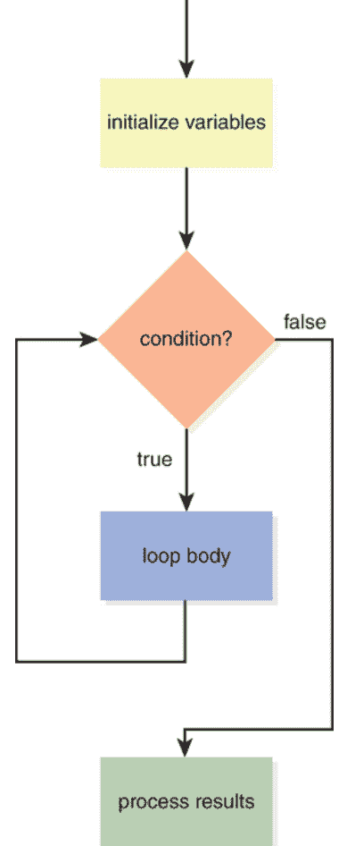

图 6.1

while 循环的控制流

## 表 7.1 访问修饰符

| 访问修饰符 | 可以通过什么引用类或成员 |
|---|---|
| public | 同类的方法，以及其他类的方法 |
| private | 仅限同类的方法 |
| protected | 同类中的方法、子类的方法以及同一包内类类的方法 |
| 无修饰符 | 仅限同一包或文件夹中的方法 |

在每一章中，我们都通过使用“软件工程提示”来强调良好的设计概念，例如第 7 章左侧的这一个。

> **软件工程提示**
>
> 将类的实例变量定义为私，这样只有该类的方法能够设置或更改它们的值。

我们还提供了“常见错误陷阱”，例如第 5 章左侧的那个，以提醒学生注意常见的语法和逻辑错误。

> **常见错误陷阱**
>
> 确保逻辑与（`AND`）和逻辑或（`OR`）运算符的两个操作数都是布尔表达式。像这样的表达式：
>
> `x < y && z`（其中 x, y, 和 z 为数值类型）是非法的。相反，请使用表达式：`x < y && x < z`

在每一章中，“主动学习”编程活动通过有趣的、实操性的项目来强化概念，并为学生提供视觉反馈。这些活动可以在实验型教室中进行，也可以作为项目分配。编程活动的标题如下所示：

## 6.9 编程活动 1：使用循环

在本次活动中，你将处理一个哨兵控制的 `while` 循环，执行此活动：

- 编写一个 `while` 循环来处理购物车的内容并计算物品的总价。重要点是，在这个例子中，我们不知道购物车中有多少物品。


由于技术在不断变化，学生需要自己学习新概念并找到相关的类。为了促进“学会学习”这一重要技能的发展，我们在章末的练习题中包含了一个或多个“查阅”问题。这些问题要求学生进行研究，以获取回答问题和编写所需代码的知识。


## 代码演示

要查看 `do/while` 循环的两个分步说明，请查找在线资源中的本章视频。点击链接开始视频。

在在线资源中，针对每一章我们都提供了一个视频，用于演示实现本章所教概念的代码执行情况。每个视频都会逐行演示一段简短的代码示例，并由用户通过“下一步”按钮进行控制。这些模块对于最擅于通过视觉辅助、图表、插图并在教室外按照自己的节奏学习的学生非常有益。这些模块在每章中通过特殊图标（如上面的示例）公布。

## 图形覆盖

图形贯穿于全书，用于吸引学生并强化章节概念。图形坐标系、绘制形状和文本的方法以及颜色概念将在第 4 章通过简单的 `JavaFX` 呈现。在随后的章节中，至少使用 `JavaFX` 呈现了一个图形示例。在第 5 章中，使用 `switch` 语句在骰子子上画点；在第 6 章中，使用循环画一个心形目标。第 7 章介绍了可显示对象的类；第 8 章和第 9 章演示了如何绘制数组数据的条形图；第 10 章通过“龟兔赛跑”演示了多态；`GUI`、动态图表和 `Java` 动画在第 12 章中涵盖。接下来的两幅图说明了第 7 章和第 8 章的图形示例。

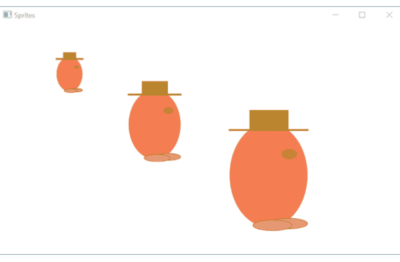

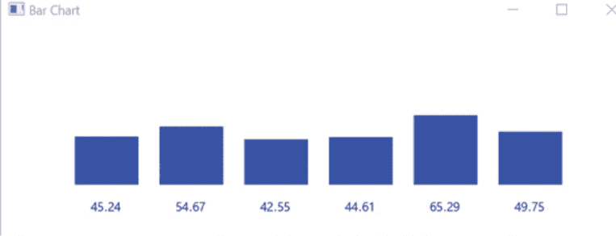

## 8.1 章末练习与问题

章末提供了大量的练习和问题。这些题目涵盖了多种类型：

- 多选题
- 填空
- 编程
- 代码解读
- 调试
- 去-
- 去-
- 去-
- 

## 本书配套网络材料

可在 Jones & Learning 网站 (www.jblearning.com) 获取，包括：

- 编程活动代码
- 章末练习答案
- PowerPoint 课程灯片

## 附录

附录包括以下内容：

- Java 留 word和关键字
- 运算符优先级
- Unicode 字符集
- 负数的表示
- 浮点数的表示

## 教师资源

这些材料可在 Jones & Learning 网站供教师获取：

- 编程活动答案（仅限教师）
- 选定练习的答案

## 联系作者

我们检查并反复检查了书中许多技术细节。然而，尽管我们尽了最大努力，但我们意识到可能遗漏了一些错误。如果你在文中发现了技术错误，请通过 `JulieAnderson@gmail.com` 或 `hjfrances@loyola.edu` 联系我们。我们会在网站发布任何修正：`go.jblearning.com/5e`。


## Turingcraft CodeLab 学生注册说明

`CodeLab` 是随本文提供的在线交互服务。它旨在降低流失率并提高班级水平。自 2002 年以来，`CodeLab` 分析了来自 75,000 多名学生的千万次练习提交。

`CodeLab` 拥有 300 多个短练习，每个练习关注一个特定的编程思想或语言结构。学生输入代码，系统会立即进行判断，并在出错时提供提示。通过这个过程，学生将掌握语言元素的语义、语法和常用方法。

# 讲师

`CodeLab` 提供了上述学生界面，并额外提供了以下功能：

- 课程管理器（`Course Manager`），允许讲师对主题和练习进行重新排序、重命名和/或省略。它还允许讲师设定截止日期、学生可以查看答案的日期、学生作业在该日期之后不再被“计分”的日期，以及在某日期之前对学生不可见的日期。
- 评分成绩单（`Grading Roster`），以图形化电子表格的形式展示学生作业，其中每行对应一个学生，每列对应一个练习。还可以以 `CSV` 格式发送邮件和/或下载成绩单。
- 练习创建工具（`Exercise Creation Tool`），允许教职人员创建他们自己的练习。

# 自定义 CodeLab

`CodeLab` 针对本教材进行了如下定制：

1. `CodeLab` 的组织结构与教材的组织结构一致。
2. 对于每个涵盖适当标准介绍编程主题的章节，`CodeLab` 提供约 50 个 `CodeLab` 练习，这些练习取自标准的现有 `CodeLab` 练习集，或添加以填补覆盖范围的空白。
3. `CodeLab` 中的每个章节都实现了 5 个取自本书的练习，必要时，会对练习进行修改以满足 `CodeLab` 的要求。

# CodeLab 演示网站

Jones & Bartlett Learning 的演示网站可以在线访问：

`jblearning.turingscraft.com`


访问该网站的游客将被重定向到提供产品概述的落地页。通过点击选定的 Jones & Bartlett Learning 教书封面，你将进入更详细的产品描述页面。在详细的产品描述页面中，有进一步的描述、关于与本教材结合的特定自定义 CodeLab 示例或其示例链接，以及一个指向自定义 CodeLab 完全演示版本的链接。后者提供了完整的功能，并包含了特定自定义 CodeLab 的所有练习内容。要使用此链接，讲师需要由其 Jones & Bartlett 计算机账户专家提供的唯一章节访问代码（Section access code），该代码可以通过 `www.jblearning.com` 在线获取。

使用此 CodeLab 章节创建代码允许讲师使用在线工具基于自定义 CodeLab 创建他们自己独有的 CodeLab 章节。这允许讲师拥有讲师账户，从而访问上述课程管理器、成绩单和练习创建工具。

此外，Turing’s Craft 为本教材的潜在采用者和实际教职用户提供了在线文档和支持。在为课堂采用创建章节时，讲师将收到 CodeLab 章节访问代码，这些代码应提供给他们的学生——以便学生关联他们的账户（即加入讲师的 CodeLab 章节）。

系统要求：CodeLab 运行在 Windows 和 MacOS 上大多数浏览器的最新版本（例如 Internet Explorer、Firefox、Safari）以及许多版本的 Linux 上。CodeLab 需要安装最新版本的 Flash Reader，可从 `http://www.adobe.com` 获取。（大多数已预装了 Flash 的系统。）关于 CodeLab 浏览器兼容性的更多信息可以在此处找到：

`http://www.turingscraft.com/browsers.html`


# 致谢

我们要感谢许多合作伙伴、同事和家庭成员对本书的贡献。

首先，我们特别感谢我们的出版社 Jones & Bartlett Learning，特别是产品经理 Laura Pagluica；制作经理 Daniel Stone；以及产品助理 Rebecca Sweeney 和 Mary Menzemer。我们还要感谢排版公司 codeMantra；校对员 Eileen Worthley；以及设计封面的 Kristin Parker。

其次，我们感谢评审员：Zareh Gorjan（帕萨迪纳市立学院）；Lee Nicholson（Alpharette 高中）；Jody Paul（丹佛大都会立大学）；Steven Kreutzer（Bloomfield 学院）；Larry Henderson（Wenatchee 山谷学院）；Fred D'Angelo（Pima 社区学院）；Waleed Farag（宾夕法尼亚大学帕分校）；Jason Smith（德克萨斯大学）。

当你转向更重要、更好的职责时，你的程序可以由他人进行维护。易维护性也是编程中的一个重要方面，因为任何程序的规范都在不断变化。你能列出多少个程序只有一个版本？没几个。设计良好的代码允许你和他人将预写和经过测试的模块整合到你的程序中，从而缩短程序的开发时间，并产生更健壮、错误更少的代码。Java 编程语言的一个有用特性是提供了大量的预写代码，你可以自由地在程序中使用它们。

编程是一项令人兴奋的活动。将复杂任务分解为计算机指令并看着你的程序运行起来，这种感觉非常有成就感。然而，当你的程序完全无法运行或产生错误的输出时，可能会让你感到沮丧。

编写正确的程序至关重要。某人的生命或全部积蓄可能取决于你的程序的正确性。重用代码有助于编写正确的程序，但你必须学会有效的测试技术，以验证你的程序输出是正确的。

在本文中，我们不仅关注 Java 语言的语法，还将关注基础编程技术、良好的软件工程原则以及有效的测试技术。

然而，在编写程序之前，理解程序运行的平台至关重要。平台指的是计算机硬件和操作系统。你的程序将使用硬件输入数据、执行计算并输出结果。操作系统将启动你的程序，并为你的程序提供必要的资源（如内存）和服务（如读写文件）。

# 1.1 计算机概念

## 1.1.1 硬件

如图 1.1 所示，计算机通常包括以下组件：

- CPU，即中央处理单元，执行程序的指令
- 内存单元，在程序执行时保存程序的指令和数据
- 硬盘，用于存储程序和数据，以便将其加载到内存中并供 CPU 访问
- 键盘，用于输入数据
- 显示器，用于显示程序的输出
- 以太网端口和无线网络收发器，用于连接互联网或局域网（LAN）
- 其他组件（未显示），如显卡和 DVD 驱动器

例如，如果你去电脑商店寻找最新的个人电脑，你可能会看到一台具有以下规格的电脑：

- 3.4-GHz Intel Core i3-3240 处理器
- 触摸屏
- 3 MB 缓存内存
- 8 GB RAM（随机访问存储器）
- 1 TB（太字节）硬盘

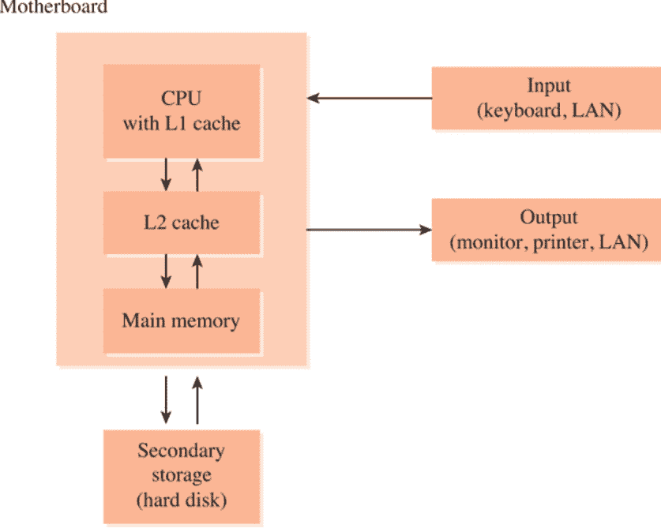

## 图 1.1

个人电脑的典型设计

在这些规格中，`Intel Core i3-3240` 是 CPU。个人电脑和服务器中用作 CPU 的处理器包括 AMD Athlon、Oracle SPARC 和 IBM POWER 处理器。

CPU 由算术逻辑单元（ALU）[也称为整数单元 (IU)] 组成，它执行基本的整数算术和逻辑运算；浮点单元（FPU），它执行浮点算术；一组用于保存数据和内存地址的硬件寄存器；以及其他辅助硬件，包括一个用于指令排序的控制单元。每个 CPU 都有自己的一套指令，即它可以执行的操作。这些指令通常执行算术和逻辑运算，将数据从一个位置移动到另一个位置，并改变程序流（即决定下一个执行哪条指令）。

程序由许多指令组成。执行程序的第一步将其加载到内存中。程序中的每条指令都通过**取指-解码-执行周期**（Fetch-Decode-Execute Cycle）执行。**程序计数器**（Program Counter）跟踪下一个要取的指令。CPU 从内存中取出下一条指令并将其放入**指令寄存器**（Instruction Register）中。对指令进行解码（指令是移动、加载、存储等吗？）。然后执行指令。这个取指-解码-执行周期重复直到程序结束。

CPU 的速度与其时钟周期有关，通常以 GHz（吉赫兹）为单位；在本版本中，高端 CPU 的速度额定为 3.4 GHz。时钟频率以每秒时钟周期衡量，决定了处理器执行取指、解码和执行指令的速度。额定为每秒 25 亿次周期的 CPU。目前的 RISC 处理器具有流水线技术，允许 CPU 同时处理多条指令，当一条指令在执行时，处理器可以解码下一条指令并提取之后的下一条指令。这大大提高了应用程序的性能。

内存或存储设备（如 L2 缓存、内存或硬盘）通常按容量衡量，以字节（byte）为单位。一个字节是八个二进制数字，即位（bit）。单个位的值为 0 或 1。根据内存或存储设备的类型，容量将以千字节、兆字节、吉字节甚至太字节来标出。这些单位的大小见表 1.1。

## 表 1.1 内存单位及其大小

| 内存单位 | 大小 |
| --- | --- |
| KB，或 Bytes，千字节 | 约 1,000 字节（精确为 $2^{10}$ 或 1,024 字节） |
| MB，或 Bytes，兆字节 | 约 100 万字节（精确为 $2^{20}$ 或 1,048,576 字节） |
| GB，或 Bytes，吉字节 | 约 10 亿字节（精确为 $2^{30}$ 或 1,073,741,824 字节） |
| TB，或 Bytes，太字节 | 约 1 万亿字节（精确为 $2^{40}$ 或 $1.09951 \times 10^{12}$ 字节） |

为了让 CPU 以其额定速度运行，指令和数据也必须以该速度可用。指令和数据直接来自 L1 缓存，它是位于 CPU 芯片上的内存。由于 L1 缓存位于 CPU 芯片上，它的运行速度与 CPU 相同。然而，L1 缓存（通常为几 MB）通常远小于内存，最终 CPU 将需要比 L1 缓存能容纳更多的指令和数据。

这种情况下，CPU 通常从 L2 缓存获取数据，L2 缓存位于连接到 CPU 的独立内存上。L2 缓存的典型访问时间为几纳秒（十分之一秒），这将降低 CPU 执行指令速率。

今天 L2 缓存的大小通常为 3 到 8 MB，再次，CPU 将最终需要比 L2 缓存能容纳更多的指令和数据。

这时，CPU 将从内存获取数据和指令，内存也位于外部，但连接到 CPU 芯片。这会进一步减慢 CPU 的速度，因为内存的访问时间约为 20 到 50 纳秒。不过，内存的大小比 L1 和 L2 缓存大得多，通常在 3 到 8 GB 之间。当 CPU 再次用完空间时，它将不得不从硬盘获取数据，硬盘通常为 1 TB 或更大，但访问时间在毫秒（千分之一秒）范围内。

从这些数字中可以看出，当 CPU 从内存转到硬盘时，会损失大量的速度，这就是为什么足够的内存对于应用程序的整体性能非常重要。

另一个需要考虑的因素是每字节成本。通常，从 L1 缓存下降到硬盘，每字节成本会显著降低，因此人们经常以牺牲性能来换取低价格。

内存（也称为 RAM）使用 DRAM（即动态随机访问存储器）技术，它维持数据只有在内存通电时，需要定期刷新以保留数据。L1 和 L2 缓存使用 SRAM（静态随机访问存储器）技术，它也需要电源，但不需要通过刷新来保留数据。内存容量通常以 2 的幂次表示。例如，256 Kbytes 的内存是 $2^{18}$ 字节，或 262,144 字节。

内存芯片包含单元，每个单元包含一个位（bit），可以存储 0 或 1。单元可以单独访问，也可以以通常为 4、8 或 16 个单元的一组进行访问。例如，一个组织为 8K × 4 的 32-Kbit RAM 芯片由恰 $2^{13}$ 或 8,192 个单元组成，每个单元包含四个单元。该 RAM 芯片将四个输出引脚（或线路）和 13 个访问引脚（或线路），能够访问所有 8,192 个单元，因为每个访问引脚的值都可以是 0 或 1。表 1.2 比较了各种内存类型的特征。

## 表 1.2 内存类型比较

| 设备 | 位置 | 类型 | 速度 | 容量 (MB) | 成本/KB |
| --- | --- | --- | --- | --- | --- |
| L1 缓存 | 芯片内 | SRAM | 极快 | 非常小 | 非常高 |
| L2 缓存 | 芯片外 | SRAM | 快 | 小 | 高 |
| 内存 | 外部 | DRAM | 中等 | 大 | 中等 |
| 硬盘 | 独立介质 | Disk | 慢 | 非常大 | 非常小 |

## 1.1.2 操作系统

操作系统（OS）是一种软件程序，其功能是：

- 控制外围设备（例如，它管理文件系统）
- 支持多任务处理，通过在同一间隔内调度多个程序或任务执行
- 为每个程序分配内存，以便同时运行的任何程序的内存之间不会发生冲突
- 防止用户损坏系统。例如，它防止用户程序覆盖操作系统或其他程序的内存

操作系统在计算机系统启动时加载（或引导），并旨在在计算机运行期间一直运行。

操作系统的示例有 macOS、Microsoft Windows、Linux 以及用于移动设备的 iOS 和 Android。

## 1.1.3 应用程序

应用程序由执行特定任务而编写的程序组成。这些程序由操作系统运行，或者通常所说的，它们运行在操作系统“之上”。应用程序的示例包括文字处理器（如 Microsoft Word 或 Apache OpenOffice）；电子表格（如 Microsoft Excel）；数据库管理系统（如 Oracle 或 Microsoft SQL Server）；浏览器（如 Mozilla Firefox、Google Chrome 或 Microsoft Edge）；以及你在学习计算机科学期间将编写的大程序。

## 1.1.4 计算机网络与互联网

### 计算机网络

计算机网络连接两个或多台计算机。许多公司和大学使用的常用网络是 LAN，即局域网。典型的 LAN 连接几台地理位置相互靠近的计算机（通常在同一栋建筑内），并允许它们共享资源，例如打印机、数据库或文件系统。在 LAN 中，大多数用户计算机被称为**客户端**，而一台或多台计算机充当**服务器**。服务器控制对网络上访问的访问，并可以为客户端提供服务，例如回答数据库请求、存储和提供文件，或管理电子邮件。网络上的计算机可以通过物理电缆或无线网络交换数据。

### 互联网

互联网是网络的网络，连接着全球数以百万计的计算机。互联网演变为 ARPANET，这是 1969 年的一个美国军事研究项目，其目标是设计一种计算机通信的方法。互联网上的大多数计算机都是客户端，通常通过互联网浏览器请求资源（如网页）。这些资源由 Web 服务器提供，它们存储网页并响应这些请求。

互联网上的每台机器都有一个唯一的 ID，称为其地址（IP 代表网协议）。称为路由的特殊计算机使用这些 IP 地址在互联网上找到从一台计算机到另一台计算机的路径。计算机可以具有静态 IP 地址（该机器专用），也可以具有在连接到互联网时分配给计算机的动态 IP 地址。一个 IP 地址由四个字节（octets）组成，其十进制表示法的值介于 0 到 255 之间。例如，`58.203.151.103` 可以代表这样一个 IP 地址。在二进制表示法中，此 IP 地址为 `1110110.1001011.1001011.1100111`。在本章的稍后部分，我们将学习如何将十进制数（如 103）转换为其等效二进制值 `1100111`。

大多数人熟悉 URL（统一资源定位符）地址，其看起来像 `http://www.oracle.com/technetwork/java/index.html`。URL 实际上是一个互联网域名，同时也是该域名上指向特定网页的路径。在这个 URL 中，域名是 `www.oracle.com`。请求的页面是 `index.html`，它位于 `technetwork` 文件夹下的 `java` 文件夹中。

域名解析服务器实现域名命名系统（DNS），它们将域名转换为 IP 地址，这样互联网用户就不需要知道想要访问的网站的地址。万维网联盟（W3C）是一个开发互联网访问标准的国际组织，它更倾向于使用统一资源标识符（URI）而不是 URL，因为 URI 涵盖了未来的互联网地址方案。

## 技能练习 与本章节结束

# 1.2 活动 显示配置

我们泛泛地探索了硬件和操作系统。现在，让我们获取有关计算机的一些信息。取决于你使用的是 Windows 操作系统还是 macOS，请按照相应的指示操作显示操作系统的名称、CPU 类型以及计算机有多少内存。

## 1.2.1 显示 Windows 配置信息

在运行 Windows 的计算机上，从命令行运行 `msinfo2`。从 *开始* 菜单输入 `cmd` 启动提示符，然后输入 `msinfo2`。你将得到与图 1.2 类似的显示，尽管信息会根据硬件和 Windows 版本而异。

## 图 1.2 Windows 系统信息

截图经 Microsoft 许可转载。

| 项目 | 数值 |
| --- | --- |
| 总虚拟内存 | 13.8 GB |
| 可用虚拟内存 | 10.2 GB |
| 页面文件空间 | 2.38 GB |
| 页面文件 | `C:\pagefile.sys` |
| 设备 Guard 虚拟化安全 | 未启用 |
| Hyper-V - VM 监控模式扩展 | 是 |
| Hyper-V - 第二级地址翻译扩展 | 是 |
| Hyper-V - 固件启用虚拟化 | 是 |
| Hyper-V - 数据执行保护 | 是 |

如图 1.2 所示，这台计算机运行着频率为 2.6 GHz 的 Intel™ Core™ i7-6600U 处理器，计算机拥有 12 Gbytes 内存，在显示时有 8.41 Gbytes 尚未被使用。

## 1.2.2 显示 Mac OS 配置信息

要在 Mac OS 计算机上显示系统信息，点击屏幕左上角的苹果图标并选择“关于本机”。你将看到与[图 1.3]() 类似的内容，它显示了计算机上运行的 MAC OS 操作系统版本。

#### macOS High Sierra

版本 10.13.1

iMac (Retina 5K, 27 英型, 2015晚)

处理器 3.2 GHz Intel Core i5

内存 16 GB 1867 MHz DDR3

启动磁盘 Macintosh HD

显卡 AMD Radeon R9 M380 2 GB

序列号 D2SS40QTTG7V

系统报告... 软件更新...


™ and © 1983-2017 Apple Inc. 版权所有。许可与保证

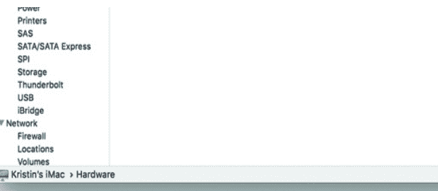

## 图 1.3

Mac 操作系统信息

经 Apple Inc. 许可复印的截图

如你所见，iMac 运行着 macOS High Sierra 版本 10.13.1。处理器是运行在 3.2 GHz 的 Intel Core i5，iMac 拥有 16 Gbytes 内存。你的信息可能与图中所示不同，取决于你的硬件和操作系统版本。

- 1. 比较几台计算机的系统信息。不同计算机之间信息是相同的还是不同的？解释信息相同或不同的原因。
- 2. 在 Windows 10 的示例显示中，计算机拥有 12 Gbytes 内存，但只有 8.41 Gbytes 内存可用。你认为为什么有些内存不可用？
- 3. 将你的计算机与此处显示的之前的计算机进行比较。你认为哪一个性能更好？解释你的答案。

# 1.3 数据表示

## 1.3.1 二进制数

如前所述，CPU 只理解二进制数，其数字由 0 或 1 组成。所有数据都以二进制位存储在计算机内存中。一个位（bit）包含一个二进制。一个字节（byte）包含八个二进制。

二进制数以二进制系统表示，因为该系统中只有 0 和 1 两个值。相比之下，大多数人习惯于十进制（或 10 进制），它使用 0 到 9 的值。

还有其他数字系统，例如八进制（或 8 进制），使用 0 到 7 的数字；以及十六进制（或 16 进制），它使用 0 到 9 的数字和 A 到 F 的字母。


正如我们在十进制中所知，数字 `359` 由以下三个数字组成：

- `3`，代表百位，或 `10²`
- `5`，代表十位，或 `10¹`
- `9`，代表个位，或 `10⁰`

因此，我们可以将 `359` 写为：

```
359 = 3*10² + 5*10¹ + 9*10⁰
```

因此，十进制数 `359` 写为 `10` 的幂的线性组合，系数来自 `10` 进制字母表（即 `0` 到 `9` 的数字）。同样，二进制数 `11011` 被写为 `2` 的幂的线性组合，系数来自 `2` 进制字母表（即数字 `0` 和 `1`）。

例如，二进制数 `11011` 可以写为：

```
11011 = 1*2⁴ + 1*2³ + 0*2² + 1*2¹ + 1*2⁰
```

### 表 1.3 十进制数 0 到 8 的二进制等价值

| 十进制 | 二进制 |
|---|---|
| 0 | 0000 |
| 1 | 0001 |
| 2 | 0010 |
| 3 | 0011 |
| 4 | 0100 |
| 5 | 0101 |
| 6 | 0110 |
| 7 | 0111 |
| 8 | 1000 |

### 表 1.4 2 的幂及其等价值

| $2^{14}$ | $2^{13}$ | $2^{12}$ | $2^{11}$ | $2^{10}$ | $2^9$ | $2^8$ | $2^7$ | $2^6$ | $2^5$ | $2^4$ | $2^3$ | $2^2$ | $2^1$ | $2^0$ |
|---|---|---|---|---|---|---|---|---|---|---|---|---|---|---|
| 16384 | 8192 | 4096 | 2048 | 1024 | 512 | 256 | 128 | 64 | 32 | 16 | 8 | 4 | 2 | 1 |

注意表 1.3 最后一位在 `0` 和 `1`。事实上，我们可以看到偶数的最后一位始终是 `0`，奇数的最后一位始终是 `1`。因为计算机以二进制存储数字，十进制和二进制之间的转换通常是：将二进制数中的每个位乘以 $2^{position-1}$，从最右侧计数为 `1` 并向左移动。通过这种方法，让我们计算二进制数 `11010` 的十进制值：

```
11010 = 1*2⁴ + 1*2³ + 0*2² + 1*2¹ + 0*2⁰
= 16 + 8 + 0 + 2 + 0
= 26
```

现在让我们查看如何将十进制数转换为二进制数。正如我们重写 `11011` 所示，二进制数可以写成 `2` 的幂之和，系数为 `0` 或 `1`。将十进制数分解为 `2` 的幂之和的策略很简单：首先找到小于等于十进制数的最大 `2` 的幂，从十进制数中减去，然后对剩余执行相同操作，直到达到 `0`。小于 `359` 的 `2` 的幂是 `256`，即 $2^8$（下一个 `2` 的幂是 `512`，大于 `359`）。减去 `359-256=103`，我们现在得到：

```
359 = 2^8 + 103
```

现在对 `103` 应用相同的步骤。小于 `103` 的最大 `2` 的幂是 `64`，即 $2^6$。这意味着没有 $2^7$，因此该位为 `0`。从 `103` 中减去 `64` 得到 `39`。我们现在得到：

```
359 = 2^8 + 2^7 + 2^6 + 39
```

对于 `39`，我们发现小于 `39` 的最大 `2` 的幂是 `32`，即 $2^5$。从 `39` 中减去 `32` 得到 `7`。我们现在得到：

```
359 = 2^8 + 2^7 + 2^6 + 2^5 + 7
```

对于 `7`，小于 `7` 的最大 `2` 的幂是 $2^2$，即 `4`。这意味着没有 $2^4$ 或 $2^3$，因此这些位的值均为 `0`。从 `7` 中减去 `4` 得到 `3`，我们得到：

```
359 = 2^8 + 2^7 + 2^6 + 2^5 + 2^2 + 2^1 + 3
```

对于 `3`，小于 `3` 的最大 `2` 的幂是 `2`，即 $2^1$，我们得到：

```
359 = 2^8*1 + 2^7*0 + 2^6*1 + 2^5*1 + 2^4*0 + 2^3*0 + 2^2*1 + 2^1*1 + 1
```

`1` 是 `2` 的幂；它是 $2^0$，所以我们最终得到：

```
359 = 2^8*1 + 2^7*0 + 2^6*1 + 2^5*1 + 2^4*0 + 2^3*0 + 2^2*1 + 2^1*1 + 2^0
```

去掉 `2` 的幂系数后，`359` 可以在二进制系统中表示为：

```
359 = 2^8*1 + 2^7*0 + 2^6*1 + 2^5*1 + 2^4*0 + 2^3*0 + 2^2*1 + 2^1*1 + 2^0
```


## 代码操作

要查看十进制和二进制数转换的逐步演示，请查找在线资源中的视频。点击链接开始视频。在程序中，我们将使用正负数。附录 D 说明负数（例如 `-34`）。在程序中，我们还使用浮点数（例如 `3.75`）。附录 E 说明浮点数。

### 1.3.2 使用十六进制数表示二进制数

如你所见，二进制数可能会很长。只有 `0` 和 `1` 两个值，需要 `16` 个二进制位来表示十进制值 `32768`。因此，十六进制（或 `16` 进制）经常用作二进制数的简写。十六进制使用十六个数字：`0` 到 `9` 以及 `A` 到 `F`。字母 `A` 到 `F` 代表值 `10`、`11`、`12`、`13`、`14` 和 `15`。

四个二进制位可以表示的最大值是 $2^4$–`15`。十六进制数字的最大值也是 `15`，由字母 `F` 表示。因此，你可以通过使用十六进制表示每组四个二进制位来减小二进制数的大小。

### 表 1.5 十六进制数字及其等二进制值

| 十六进制 | 二进制值 |
|---|---|
| 0 | 0000 |
| 1 | 0001 |
| 2 | 0010 |
| 3 | 0011 |
| 4 | 0100 |
| 5 | 0101 |
| 6 | 0110 |
| 7 | 0111 |
| 8 | 1000 |
| 9 | 1001 |
| A | 1010 |
| B | 1011 |
| C | 1100 |
| D | 1101 |
| E | 1110 |
| F | 1111 |

要将以下二进制数转换为十六进制，你只需每组四个二进制位替换相应的十六进制位。

```
0001 1010 1111 1001 0011 0011 1111 1110
1 A F 9 B 3 B E
```

这是一个有趣的十六进制数序列。每个 Java applet 的前 `32` 位都是：

```
1100 1010 1111 1110 1010 1010 1011 1110
```

转换为十六进制后，该数字变为：

```
CAFE BABE
```

### 1.3.3 使用 Unicode 字符集表示字符

Java 使用 Unicode 世界字符标准（或简称 Unicode）表示字符。每个 Unicode 字符由 `16` 位（即两个字节）表示。这意味着 Unicode 字符集可以编码 `65,536` 个字符。

Unicode 字符集由 Unicode 联盟（Unicode Consortium）开发的，该联盟由计算机制造商、软件供应商、多个国家的政府以及其他人组成。该联盟的目标是支持一种国际字符集，包括标准 QWERTY 键盘上的打印字符，以及像 `é` 或 `λ` 这样的国际字符。

许多编程语言使用 ASCII（美国信息交换标准代码）字符集存储字符，它使用 `7` 位编码每个字符，因此只能表示 `128` 个字符。为了与 ASCII 字符集兼容，Unicode 字符集中的前 `128` 个字符与 ASCII 字符集相同。

### 表 1.6 选定的 Unicode 字符及其十进制等值

| Unicode 字符 | 十进制值 | 十六进制值 |
| :--- | :--- | :--- |
| NULL，空字符（非打印字符） | 0 | 0000 |
| * | 42 | 002A |
| 1 | 49 | 0031 |
| 2 | 50 | 0032 |
| A | 65 | 0041 |
| B | 66 | 0042 |
| a | 97 | 0061 |
| b | 98 | 0062 |
| } | 125 | 007D |
| delete（非打印字符） | 127 | 007F |

有关 Unicode 字符集的更多信息，请参附录 C 或访问 Unicode 联盟网站 `http://www.unicode.org`。

## 本章结束技能练习

### 1.7.1 单选题

第 `5, 6, 7, 8`

### 1.7.2 数字转换

第 `15, 16, 17, 18, 19, 20`

### 1.7.3 思考题

第 `24, 25, 26`

## 1.4 编程语言

### 高级和低级语言

编程语言可以分为三类：

- 机器语言
- 汇编语言
- 高级语言

在计算机早期，程序员经常使用机器语言。机器语言使用二进制代码来执行 CPU 的指令集并引用内存地址。这种编程方法极具挑战性且耗时。此外，机器语言早期的流行在很大程度上归因于程序员没有选择。

汇编语言比机器语言高一级，它使用内存地址的符号名称和指令的助记符——例如：`BEQ`（相等则跳转）、`SW`（存储）或 `LW`（加载）。汇编器在执行之前将代码转换为机器语言。与机器语言一样，汇编语言也依赖于 CPU，并且在不同计算机之间不可移植（例如，在 Intel 和 SPARC 之间）。汇编语言比机器语言更容易编写，但仍然需要大量的努力，因此只有在程序需要高级语言不支持的功能（如直接访问硬件）时才使用。

高级语言（如 Java、C++ 和 Python）比机器语言更接近英语，使得软件开发更加容易，并且在不同的 CPU 架构之间更具移植性。由于这个原因，程序员们拥抱了高级语言。

- 这些语言具有高度符号性；程序员使用关键字、特殊字符和数据的符号名称来编写指令。
- 这些语言在不同的 CPU 之间具有某种可移植性（某些比其他的更强）。
- 一些高级编程语言（如 C++、Java 和 Python）可用于通用应用程序，某些高级编程语言可用于专门应用程序，例如用于 iPhone 开发的 Swift 和用于 Internet 应用程序 PHP。

高级语言是编译的、解释的或两者的结合。用编译型语言（如 C++）编写的程序由编译器转换为机器码，然后执行该机器码。与此相反，用解释型语言（如 Perl）编写的程序在执行时逐行读取并转换为机器码。通常，用解释语言编写的程序运行速度比用编译语言编写的等效程序慢。

### 1.4.2 面向对象编程简介

早期的编程语言（如 Fortran 或 C）是过程化的。通常，程序员在单独的过程（或函数）中编写特定任务的代码，并从程序的其他部分调用这些过程来执行各种任务。程序的数据通常在过程之间共享。

20 世纪 70 年代中期，引入了第一种面向对象的编程语言 Smalltalk，它使程序员能够以不同的方式编写代码。过程或函数主要处理基本数据类型（如整数、实数或单个字符），而 Smalltalk 为程序员提供了新工具：类和类的对象。

类允许程序员将数据和操作数据的函数封装在一个包中。类本质上定义了一个模板或模型，从模板创建对象。创建对象的过程被称为实例化。因此，对象是根据类的设计创建——实例化的。

类可以表示现实生活中的事物，例如“人”。类可以拥有各种属性，例如在“人”类的示例中，名字、姓和年龄。类还会提供代码，称为方法，允许对象的创建者设置和检索属性值。

面向对象编程的一个大优势是，良好的类可以在新程序中重用，从而减少未来的开发时间。

Smalltalk 有了一定的成功，但有一个很大的缺陷：它的语法与大多数程序员已知的语法不同。大多数知道过程化 C 语言的程序员被 Smalltalk 面向对象的特性吸引，但因为其语法与 C 太不同而不愿使用。C++ 为 C 增加了面向对象的特性，但也增加了复杂度。

与此同时，Internet 飞速发展并日益流行。网页开发者使用 HTML 开发网页，很快感到不仅需要在服务器端，而且直接在客户端集成编程功能。幸运的是，Java 出现了。

### 1.4.3 Java 语言

`1995` 年 `5` 月 `23` 日，Sun 公司推出了 Java（最初名为 Oak），这是一种针对消费设备嵌入式应用的免费面向对象语言。Java 虚拟机立即整合到 Netscape Navigator Internet 浏览器中，随着 Internet 的增长，被称为 applet 的小型 Java 程序开始越来越多出现在网页上。Java 语法与 C++ 基本相同（仅有一些细微差别），很快全世界的程序员开始意识到使用 Java 的好处。这些优点包括：

- 与 C++ 语法相同，但 Java 消除了 C++ 的一些复杂功能
- 面向对象
- Internet 相关功能，例如由 Web 服务器运行的 servlet
- 丰富的重用类库，包括提供图形用户界面类以及用于与数据库通信的 Java 数据库连接 (JDBC)
- 在支持 Java 虚拟机的每个平台上具有移植性
- 内置网络
- Java 开发工具包（JDK）的开源可用

正如我们之前提到的，Java 程序首先被编译成与处理器无关的字节码，然后这些字节码在运行时由 Java 虚拟机（JVM）进行解释。正如其名称所示，JVM 用它自己的指令集、寄存器和指令指针模拟了一个虚拟处理器。因此，要运行一个 Java 程序，我们只需要一个 JVM。幸运的是，每个主要的计算平台都有 JVM 可用。

由于 Java 程序是在运行时解释的，它们的运行速度通常比对应的 C++ 程序要慢。然而，许多平台都提供了 Java 编译器，可以将源代码直接转换为机器码。这带来了执行速度的提升，但也伴随着可移植性的损失。此外还有即时编译（JIT）编译器。这些 JIT 在运行时编译代码，以便代码随后的执行运行得快得多。

Java 程序可以写成 servlets（服务器端程序）、Android 应用或应用程序。

Java servlets 由 Web 服务器调用并在服务器上运行，而不会下载到客户端。通常，servlets 通过使用 JDBC（Java 数据库连接）读取和写入数据库来生成网页内容。

安卓开源项目（Android Open Source project）选择 Java 作为开发安卓设备（如手机、平板电脑和智能电视）应用的语言。

Java 应用程序在客户端计算机上独立运行。在本文中，我们将编写 Java 应用程序。

Oracle 公司于 `2010` 年 `1` 月收购了太阳系统公司（Sun Microsystems），提供了一个非常有价值的 Java 网站（`www.oracle.com/technetwork/java`），其中有关于使用预写类的信息、Java 教程以及许多为 Java 程序员提供的资源。我们会在书中经常引导你参考该网站。

## 1.5 编程简介

### 1.5.1 编程基础

在许多方面，编程就像在解谜题。我们有一个任务要执行，并且知道计算机可以执行的操作（输入、计算、比较、项目重排和输出）。作为程序员，我们的工作是将任务分解为输入、计算、比较、重排和输出的单个、有序步骤。

例如，假设我们的任务是找到两个数字之和。首先，我们的程序需要将数字读取（输入）到计算机中。接下来，我们的程序需要将这两个数字相加（计算）。最后，我们的程序需要写出（输出）和。

注意，这个程序由步骤组成，这些步骤被称为`指令`，并按顺序（“首先”、“接下来”、“最后”）执行。按顺序一个接一个地执行操作被称为`顺序处理`。

计算机执行指令的顺序在编程中至关重要。你不能在读取两个数字之前就计算它们的和，也不能在计算出总和之前就输出总和。因此，编程要求程序员指定指令的顺序，这被称为程序的`控制流`。控制流有四种不同的方式在程序中演进：顺序执行、方法调用、选择和循环。我们刚刚看到了顺序执行，将在下一节中讨论其他类型的控制流。

由于确保控制流正确对于程序产生正确的输出至关重要，程序员使用一种名为`伪代码`（`pseudocode`，读音为 *sue dough code*）的工具来帮助他们在编写代码之前设计控制流。

### 1.5.2 使用伪代码进行程序设计

伪代码源自 `pseudo`（意为“看起来像”），它是一种用英语（而不是编程语言）来表达程序指令顺序的方法。通过这种方式，程序员可以专注于设计程序，而不会被特定编程语言的语法所困扰。

计算两个数字之和的伪代码看起来像示例 1.1。

#### 示例 1.1 计算两个数字和的伪代码

```
读取第一个数字
读取第二个数字
将总设置为（第一个数字 + 第二个数字）
输出总和
```

幸运的是，编写伪代码的规则并不严格。本质上，你可以使用任何对你有用的文字。

让我们来看另一个例子。假设我们的程序需要计算一个数字的平方根。计算平方根的指令相当复杂；幸运的是，Java 提供了计算数字平方根的预写代码。这些预写代码被称为`方法`，我们的程序可以通过`调用该方法`来执行它。作为方法调用的一部分，我们告诉方法我们想要计算哪个数字的平方根。这被称为`向方法传递参数`。当方法执行完其指令后，控制权将从方法调用之后返回给我们的程序，我们的程序可以使用方法计算出的平方根。这被称为返回值。观察方法调用的另一种方式是考虑当我们读书并发现一个不认识的单词时会发生什么。我们在书上做标记，然后在字典中查该单词。查完单词后，我们回到书中的位置继续阅读。

示例 1.2 显示了计算整数平方根的伪代码。

#### 示例 1.2 使用方法调用计算平方根

```
读取一个数字
调用平方根方法，传递数字并接收
平方根
输出数字的平方根
```

操作顺序仍然是输入、计算和输出，我们调用一个方法来为我们执行计算。

现在假设我们的任务是判断一个数字是正还是负。首先，我们的程序应该将数字输入计算机。接下来，我们需要判断该数字是正还是负。我们知道大于或等于 `0` 的数字是正，小于 `0` 的是负，所以我们的程序应该将数字与 `0` 进行比较。最后，我们的程序应该写出指示数字正负的消息。

与示例 1.1 和 1.2 一样，操作是输入、计算和输出，根据数字的正负，我们的程序应该写不同的消息。如果数字大于或等于 `0`，程序应该写正数消息；如果数字小于 `0`，程序应该写负数消息。处理这种情况的代码被称为选择；程序根据数据的值选择执行哪些代码。


该程序的伪代码可以写如示例 1.3 所示。

# 示例 1.3 使用选择

```
读取一个数字
如果数字大于或等于 0
    写入“是正数。”
否则
    写入“是负数”
```

注意根据数字与 0 比较而选择代码的缩进。程序员使用缩进来更容易看到程序的控制流。

现在让我们情况变得稍微复杂一点。假设我们的任务是找到一组数字的和。这被称为累加。为了完成这一任务，我们可以采取类似于使用计算器加一组数字的方法。我们从总和为 0 开始，加上每个数字，

累加总和以及判断数字是正还是负只是许多常用操作中的两种。在编程中，我们经常会执行具有标准处理方法的任务，这些被称为**算法**。例如，累加的算法是将总和设置为 0，使用循环将每个项目加到总和中，然后输出总和。更广泛地说，我们可以把算法看作解决问题的策略。在本章的前面，我们使用了一种算法将十进制转换为其二进制表示。

其他常见的编程任务包括计数项目、计算平均值、对项目排序以及寻找最小值和最大值。在本文中，我们将学习执行这些常用操作的标准算法。一旦学会了这些算法，我们的编程工作将会变得更加简单。当我们识别出这些任务中的任何时，只需通过细微的修改即可直接接入合适的算法。

编程在很大程度上仅仅是将一个复杂任务分解为一组子任务，这些子任务可以通过组合使用顺序处理、方法调用、选择和循环的标准算法来实现。

> 软件工程小贴士
>
> 寻找模式将帮助你为程序确定合适的算法。

然而，编程中最困难的部分是识别应该将哪些算法应用于当前的问题。这需要分析能力和发现模式的能力。在整本文中，我们将尽可能地指出常见的模式。

### 1.5.3 开发 Java 应用程序

编写一个 Java 应用程序由几个步骤组成：编写代码、编译代码和执行应用程序。Java 源代码存储在扩展名为 `.java` 的文本文件中。编译代码会生成一个或多个 `.class` 文件，这些文件包含与处理器无关的字节码。Java 虚拟机（JVM）将字节码翻译为运行 Java 应用程序的处理器的机器级指令。因此，如果 Java 应用程序运行在 Intel i7 处理器上，JVM 将字节码翻译为 i7 的指令集。

Oracle 在其网站（www.oracle.com/techn/java）上提供了 Java SE 开发工具包（JDK），可以免费下载。JDK 包含一个编译器、JVM 和 `jhell`（后者是一个用于立即执行 Java 代码的工具）。此外，JDK 还包含广泛的预写 Java 类，程序员可以在其 Java 应用程序中使用这些类。

如果你自己下载并安装 Java，请务必遵循 Oracle 网站上的说明，包括设置 `javac`（Java 编译器）路径的说明。你需要正确设置路径，以便能够从计算机上的任何文件夹运行 Java 编译器。

要使用 JDK 开发应用程序，可以使用任何文本编辑器编写源代码，例如 Windows 上的记事本、Mac 上的 TextEdit 或 Linux 上的 vi 编辑器。要编译代码，请从命令行调用编译器：

```
javac ClassName.java
```

其中 `ClassName.java` 是源文件名。

如果我们写在 `ClassName.java` 文件中的程序编译正确，将在当前目录下创建一个新文件 `ClassName.class`。

要运行应用程序，我们从命令行调用 JVM：

```
java ClassName
```

通常，程序员使用集成开发环境（IDE）来开发应用程序，而不是从命令行调用编译器和 JVM。IDE 由一个程序编辑器、一个编译器和一个运行时环境组成，通过图形用户界面集成。使用 IDE 的优势在于，编译器或 JVM 发现的 Java 代码错误可以直接链接到程序编辑器中导致错误的源文件行数。此外，图形用户界面允许程序员在编辑器、编译器和程序执行之间切换，而无需启动单独的应用程序。

许多 IDE 中的一些包括来自 Eclipse Foundation, Inc. 的 Eclipse；在奥斯伯恩大学开发的 JASP；从 Oracle 下载的 NetBeans；以及来自 Helios Software Solutions 的 TextPad。某些 IDE 是免费提供的，而另一些则可能需要支付软件许可费用。

# 技能练习

带有这些章节末问题

1.7.1 多选题

第 9, 10, 11, 12, 13, 14

1.7.3 思考题

第 27, 28, 29, 30

1.7.4 技术写作

第 34

### 1.5.4 编程活动 1：编写第一个 Java 应用程序

让我们创建第一个 Java 程序。该程序将打印消息：“编程不是一项观观众运动！”

首先启动你的 IDE 并打开一个新的编辑器窗口。这就是你将编写程序代码的地方。

然而，在输入任何代码之前，让我们为文档命名。你通过将文档保存为 `FirstProgram.java` 来实现这一点。请确保 F 和 P 大写，其他字母保持小写。Java 是区分大小敏感的，因此 Java 认为 `firstprogram.java` 甚至 `Firstprogram.java` 是不同的名称。此外，请注意 First 和 Program 之间没有空格。

记住区分大小敏感，输入示例 1.5 所示的程序。

### 示例 1.5 Java 第一个程序

```java
1 // First program in Java
2 // Anderson, Franceschi
3
4 public class FirstProgram
5 {
6     public static void main(String[] args)
7 {
8         System.out.println("Programming is not a spectator sport!");
9
10    System.exit(0);
11 }
12 }
```

此时，我们要求你只需按照看到的内容输入程序，行号除外，行号不是程序的一部分。在此示例中显示行号是为了方便引用代码中的特定行。我们现在简要解释一下该程序；更多细节将随着学期的进行而变得清晰。

前两个以两个正斜线开头的行是注释。它们不会被编译或执行；它们仅仅是给程序员的信息，并用于增加可读性。

> 常见陷阱
>
> Java 是区分大小敏感的。文件名必须与示例 1.5 所示完全匹配。

第四行定义了类。5 行和 12 行的大括号标记了 main 方法的开始和结束。7 行和 11 行的大括号标记了 main 方法的开始和结束。第 10 行退出程序。

输入示例 1.5 中的代码时，请注意你的 IDE 会标亮字符串字面量（"Programming is not a spectator sport!"）和关键字（public, static），它们有特定的用途。

如果你收到任何编译器错误，请检查你输入代码是否正确。

如果你编译通过且没有错误，恭喜你！你已经准备好执行应用程序了。这将调用 JVM 并将其传递 `FirstProgram.class` 文件。如果一切顺利，你将在 Java 控制台上看到显示的消息：*Programming is not a spectator sport!*。

# 图 1.4 示例 1.5 的输出

```
Programming is not a spectator sport!
```

# 调试技术

如果编译器在代码中发现语法错误，这些被称为编译器错误，不是因为编译器导致了它们，而是因为它发现了它们。当编译器检测到代码中的错误时，它会编写关于错误的诊断信息。

例如，尝试使用大写 P 的 `println`（即 `Println`），并重新编译。编译器显示以下消息：

```
FirstProgram.java:8: error: cannot find symbol
    System.out.println("Programming is not a spectator
sport!");
    ^
    symbol: method Println(String)
    location: variable out of type PrintStream
1 error
```

第一行识别包含 Java 源代码的文件名，以及源代码中发生错误的行号。在这种情况下，错误发生在第 8 行。第二行显示源代码中的第 8 行，并用脱字符（^）指向 `Println` 作为错误原因。第三行和第四行的符号和位置信息表明 `println` 方法是未知的。在大多数 IDE 中，双击错误消息中的第一行将你转移到源代码窗口，并将光标置在第 8 行，以便你纠正错误。

编译器经常会在源代码中发现多个错误。当这种情况发生时，请不要恐慌。通常，一个单一的问题（例如缺少分号或大括号）可能会导致多个编译器错误。

例如，在修正了之前的错误后，通过删除第 7 行的左括号并重新编译。编译器报告了四个错误：

```
FirstProgram.java:6: error: ';' expected
    public static void main(String [ ] args)
^
FirstProgram.java:10: error: <identifier> expected
    System.exit( 0 );
^
FirstProgram.java:10: error: illegal start of type
    System.exit( 0 );
^
FirstProgram.java:12: error: class, interface or enum
expected
)
^
4 errors
```

如你所见，编译器信息并不总是准确地报告问题。当你收到编译器消息时，查看周围的行通常会帮助你找到错误。取决于你使用的 IDE，你可能会看到此处所示不同的消息，因为某些 IDE 会尝试解释编译器的错误消息，以提供关于更相关的错误信息。

## 软件工程提示

由于一个语法错误可能会导致多个编译器错误，

请仅修正明显的错误，并在每次

修正后重新编译。

有时，一次修复一个错误并在每次

修复后重新编译会更容易，因为第一个修复可能会消除许多

已报告的错误。

当所有编译器错误都已修正后，你就可以执行程序了。

程序可能会通过编译器的“完全健康检查”，但程序仍然无法运行。为了演示这一点，尝试删除单词 *String* 之后第 6 行的括号。如果你此时再次编译程序，将不会报告任何错误。但当你尝试运行程序时，你会得到一个**运行时错误**（run-time error）。

并不是*编程不是一项观观运动！*，Java 控制台上显示的是以下消息：

```
Error: Main method not found in class FirstProgram, please
define the main
method as:
    public static void main(String[] args)
or a JavaFX application class must extend
    javafx.application.Application
```

这意味着 *main* 方法的头部（第 6 行）没有输入正确。

因此，我们看到在开发 Java 程序时可能会发生两种错误：编译器错误（通常由语言语法错误或拼写错误引起）和运行时错误（通常由使用预定义类时的问题引起）。运行时错误也由 JVM 在运行时检测到的异常引起，例如尝试除以零。

## 测试技术

一旦你的程序顺利编译且在没有运行时错误的情况下执行，你可能会认为你的工作已经完成了。事实并非如此——你还必须验证程序的结果或输出。

在示例程序中，很难得到错误结果——除非拼写错误消息或漏掉单词之间的空格。但任何非平凡的程序在声明其达到生产就绪状态之前都应该经过彻底测试。

测试程序时，考虑所有可能的输入和相应的正确输出。测试每个可能的输入通常是不可行的，因此程序员通常会测试**边界条件**（boundary conditions），即位于程序产生不同输出边界上的值。

例如，为了测试判断整数是负数还是非负数的代码，你会向程序输入 -1 和 0。这些是负整数和非负整数的边界。换句话说，负整数和非负整数之间的边界是 -1 和 0。

当程序没有产生正确的输出时，我们称该程序包含**逻辑错误**（logic errors）。通过彻底测试你的程序，你可以发现并纠正大多数逻辑错误。

表 1.7 显示了程序错误类型及其常见原因。

## 表 1.7 程序错误类型及其原因

| 错误类型 | 常见原因 |
| :--- | :--- |
| 编译器错误 | 语言语法错误或拼写错误 |
| 运行时错误 | 类的使用不当 |
| 逻辑错误 | 程序设计错误或设计的实现不正确 |

我们将在整个书中讨论更多测试技术。

## 讨论题

1. 在“调试技术”部分中，我们看到拼写错误可能会产生多个编译器错误。你认为为什么会这样？

2. 解释为什么测试边界条件是验证程序正确性的有效方法。

3. 在开发第一个应用程序时是否出现过错误？如果是，请解释它们是编译器错误还是运行时错误，以及做了什么来修复它们。

### 1.5.5 创建 JAR 文件

在完成程序的编写、编译和测试后，我们可能想要分发它。Java 程序通常以 JAR 格式分发，JAR 代表 Java ARchive 格式，它允许将多个文件压缩并聚合为一个文件。jar 扩展名默认与 Java 虚拟机关联。因此，你可以双击 JAR 文件并直接启动相应的应用程序。大多数 IDE 都包含易于创建 JAR 文件的工具。但你也可以从命令行创建 JAR 文件。创建 JAR 文件的通用语法为：

```
jar cf inputfile(s)
```

- c 和 f 字符是选项。c 选项意味着创建一个 JAR 文件。f 选项意味着我们将输出发送到文件。

- jarfile 是我们想要创建的 JAR 文件名；它可以与 Java 应用程序的名称不同。

- inputfile(s) 是我们想要包含在 JAR 文件中的空格分隔的文件列表。它通常包括资源，如图像或声音。

我们可以通过在命令行输入以下内容，从 FirstProgram 创建名为 Greeting.jar 的 JAR 文件：

```
jar cf Greeting.class
```

注意，输入文件是 .class 文件，而不是 .java 文件。图 1.5 显示了执行命令后文件夹的内容。

如果我们的应用程序包含多个 Java 文件，可以使用通配符 * 来包含所有相应的 .class 文件。以下命令为当前文件夹中的所有 .class 文件创建一个 JAR 文件：

```
jar cf Greetings *.class
```


## 图 1.5

创建 JAR 文件后的文件夹状态

## 章节复

## 1.6 章节总结

- 计算机的基本组件包括 CPU、内存、硬盘、键盘和显示器。

- 每种类型的 CPU 都有自己的指令，用于执行算术和逻辑操作、移动数据以及改变执行顺序。

- 操作系统控制外围设备，支持多任务，为程序分配内存，并防止用户损坏系统。

- 计算机网络连接两个或多个计算机，以便它们共享资源，如文件或打印机。

- 互联网连接了全球数百万计算机。Web 服务器向运行浏览器的客户端交付网页。

- 二进制数由位组成。每个位的值为 0 或 1。一个字节包含八个二进制位。

- 将二进制数转换为十进制数是将二进制数中的每个数字乘以 $2^{position-1}$，从最右侧的位置视为位置 1 向左计数。然后将这些乘积相加。

- 将十进制数转换为二进制，首先找到小于等于该十进制数的最大的2 的幂，从十进制中减去该数，然后对余数执行相同的操作，直到十进制变为 0。

- 十进制数字可以用来表示四位二进制。

- Java 使用的 Unicode 字符集可以使用每个字符 16 位编码 65536 个字符。

- 机器语言和汇编语言是早期编程语言，要求程序员编写针对 CPU 指令集的代码。由于这种底层编程耗时且困难，且程序不具有跨架构的可移植性，机器语言和汇编语言很少使用。

- 高级语言高度符号化且具有一定的可移植性。它们可以被编译、解释，或者像 Java 这样转换为字节码，这些字节码由 Java 虚拟机（JVM）在运行时进行解释。

- 一个好的程序是可读的、易于维护且可重用的。

- 面向对象编程使用类来封装数据以及操作这些数据所需的功能。根据类的设计实例化对象。面向对象编程的一个优势是能够重用类。

- 程序使用顺序处理、方法调用、选择和迭代的组合来控制指令的执行顺序。按顺序一个接一个地执行操作被称为顺序处理。临时执行其他代码然后返回被称为方法调用。根据数据的值选择执行哪些代码被称为选择。在值值组中的每个项目上重复执行相同的代码被称为迭代，或循环。

- 伪代码允许程序员在设计程序时无需担心语言的语法。

- 在编程中，我们经常执行某些具有标准处理方法的任务，这些方法被称为算法。例如，累加（accumulating）是一种常见的编程操作，用于计算一组数字之和。

- 编程在很大程度上是将复杂任务分解为一组子任务，然后通过组合使用顺序处理、选择和循环的标准算法来实现这些子任务。

- Java 源代码存储在扩展名为 `.java` 的文本文件中。编译代码会生成一个或多个 `.class` 文件。

- 集成开发环境（IDE）由程序编辑器、编译器和运行时环境组成，通过图形用户界面（GUI）集成在一起。

- 编译器错误由编译器检测，通常由错误的 Java 语法或拼写错误引起。运行时错误由 Java 虚拟机检测，通常由异常或对类使用不当引起。逻辑错误发生在程序执行期间，由程序设计不正确引起。

## 1.7 练习、问题与项目

### 1.7.1 单选题练习

1. 下列哪一个不是操作系统？

- Linux

- Java

- Windows

- Android

2. 下列哪一个不是应用程序？

- Word

- Firefox

- Linux

- Excel

3. 三字节中有多少位（bits）？

- 3

- 8

- 24

4. 在网络中，提供服务的计算机被称为：

- 客户端（clients）

- 服务器（servers）

- 笔记本电脑（laptops）

5. 以 0 结尾的二进制数是：

- 偶数

- 奇数

- 无法判断

6. 以 1 结尾的二进制数是：

- 偶数

- 奇数

- 无法判断

7. 以两个 0 结尾的二进制数是：

- 4 的倍数


- 不是 4 的倍数
- 无法判断

8. 使用四位可以表示的最大二进制数是：
- 1111
- 真
- 假

9. 下列哪一个不是编程语言？
- C++
- Java
- Fortran

10. 下列哪一个不是面向对象的编程语言？
- C
- Java
- C++
- Smalltalk

11. Java 源文件的扩展名是什么？
- .java
- .exe
- .class

12. 编译后的程序扩展名是什么？
- .java
- .exe
- .class

13. 为了编译名为 `Hello.java` 的程序，在命令行中输入什么？
- java Hello
- java Hello.java
- javac Hello

14. 你已成功将 `Hello.java` 编译为 `Hello.class`。在命令行中输入什么运行该应用程序？
- java Hello.class
- java Hello
- javac Hello

### 1.7.2 数字转换

15. 将十进制数 6 转换为二进制。
16. 将十进制数 56 转换为二进制。
17. 将二进制 0001 0101 转换为十进制。
18. 将二进制 1101 0101 转换为十进制。
19. 将二进制 0001 0101 转换为十六进制。
20. 将十六进制数 D8F 转换为二进制。

### 1.7.3 通用问题

21. RAM 芯片组织为 × 8 内存，即每个单元包含 8 位（或一个字节）。该内存芯片有多少个地址引？
22. 如果 CPU 频率为 2.5 GHz，每秒执行多少次时钟周期？
23. 如果 CPU 每秒循环 26 亿次，该 CPU 的频率是多少 MHz？
24. 假设我们使用二进制编码来表示颜色。例如，黑白颜色系统只有颜色，因此只需要 1 位来编码该颜色系统：

| 位 | 颜色 |
|---|---|
| 0 | 黑色 |
| 1 | 白色 |

使用 2 位可以编码四种颜色：

| 位模式 | 颜色 |
|---|---|
| 00 | 黑色 |
| 01 | 白色 |
| 10 | |
| 11 | |

3. 讨论通常情况下如何将十六进制数转换为八进制，以及将八进制数转换为十六进制。


# 第 2 章

# 编程基石——Java 基础

# 目录

- 2.1 Java 结构
- 2.2 数据类型、变量与常量
- 2.2.1 变量声明
- 2.2.2 整数数据类型
- 2.2.3 浮点数数据类型
- 2.2.4 字符数据类型
- 2.2.5 布尔数据类型
- 2.2.6 赋值运算符、初始值和字面量
- 2.2.7 字符串字面量与转义序列
- 2.2.8 常量
- 2.3 表达式与算术运算符
- 2.3.1 赋值运算符与表达式
- 2.3.2 算术运算符
- 2.3.3 运算符优先级
- 2.3.4 编程活动 1：英寸转厘米
- 2.3.5 整数除法与取模
- 2.3.6 除零
- 2.3.7 混合类型算术与类型转换
- 2.3.8 复合运算符
- 2.4 编程活动 2：温度转换
- 2.5 本总结
- 2.6 练习、问题与项目
- 2.6.1 单选题练习
- 2.6.2 阅读并理解代码
- 2.6.3 填空代码
- 2.6.4 识别代码错误
- 2.6.5 调试区域——使用 Java 编译器和 Java JVM 的信息
- 2.6.6 编写简短程序
- 2.6.7 编程项目
- 2.6.8 技术写作

# 引言

如果归结为基础，程序包含两个元素：指令和数据。指令告诉 CPU 如何处理数据。通常，一个程序的结构由以下操作组成：

1. 输入数据。
2. 对数据进行处理。
3. 输出结果。

程序使用的数据可以来自各种来源。例如，当我们在文字处理器中输入新文档时，用户可以从键盘输入数据。程序可以从文件中读取数据，例如当我们将现有文档加载到文字处理器中时。或者程序也可以随机生成数据，例如当电脑卡牌游戏发牌时。

最后，某些数据是已知的；例如，一天有 24 小时，12 月有 31 天，π 的值为 3.14159。这类数据是常量。

Java 语言提供了一种语法，用于使用关键字、符号名称和数据类型来描述程序的数据。

尽管在程序的每次执行时数据可能不同，但指令是保持相同的。在文字处理器中，单词（数据）不同文档之间是不同的，但文字处理器的操作（指令）保持不变。例如，当一行写满时，文字处理器会自动换行到下一行。行上是哪些单词并不重要，只要行写满了即可。当我们选择一个单词并将字体更改为**粗体**时，无论选择哪个单词都不重要；它都会变成粗体。因此，程序的指令（其算法）必须编写为能够正确处理它可能接收到的任何数据。

我们将通过将算法转换为计算机可以执行的基本操作来编写程序：数据的输入、输出以及与处理数据相关的各种操作，如算术计算、数据比较以及随后的控制流变化，以及数据的移动。

在本章中，我们将学习基础 Java 语法用于定义程序中使用的数据、对这些数据进行计算并将结果输出到屏幕。

## 2.1 Java 结构

每个 Java 程序至少包含一个类。每个 Java 程序包含一个方法。每个 Java 程序至少有一个 main 方法。main 方法是程序的入口。当 Java 程序运行时，JVM 执行 main 方法。

类是包含相关变量和方法的代码单元。类是创建对象的蓝图。对象是类的实例。对象具有状态（由变量表示）和行为（由方法表示）。

示例 2.1 ShellApplication

```java
public class ShellApplication {
    public static void main(String[] args) {
        System.out.println("Hello, World!");
    }
}
```

示例 2.1 中，编译器忽略了第8行的所有内容，但只忽略了第6行两个正斜杠之后的部分。让我们通过一个示例来了解简单程序的形式，并感受程序是如何运行的。示例 2.2 计算圆的面积。

# 示例 2.2 计算圆的面积

```java
1 /* Calculate the area of a circle
2   Anderson, Franceschi
3 */
4
5 public class AreaOfCircle
6 {
7   public static void main(String[] args) {
8   {
9     // define the data we know
10    final double PI = 3.14159;
11
12    // define other data we will use
13    double radius = 3.5;
14
15    // perform the calculation and store the
result
16    double area = PI * radius;
17
18    // output the result
19    System.out.println("The area of the circle is " + area );
20  }
21 }
```

图 2.1a 显示了当半径为 3.5 运行程序时的输出。要计算不同半径的圆面积，请将第13行的值 3.5 替换为新半径。例如，要计算半径为 20 的圆面积，将第13行改为：

```
double radius = 20;
```

然后重新编译程序并再次运行。图 2.1b 显示了半径为 20 的输出。

# 图 2.1a

示例 2.2 在半径为 3.5 的输出


# 图 2.1b

示例 2.2 在半径为 20 的输出


我们可以看到，示例 2.2 包含了我们在第9 行到第19 行中看到的、执行程序功能的基本元素。首先，我们确定所需的数据。要计算圆面积，我们使用公式 $\pi r^2$。我们知道 $\pi$ 的值（3.14159），因此我们将该值存储在命名为 PI 的内存位置（第10行）。我们还需要内存空间来存放半径和面积。在第13行中，我们为半径命名并赋予它一个值；这里我们选择了 3.5，但我们的程序需要处理任何值。

现在，我们准备好计算面积了。Java 提供了用于计算的算术运算符。我们在第16行使用 Java 的乘法运算符 (`*`) 将 PI 乘以半径，并将结果存储在名为 area 的内存位置。现在，我们准备好输出结果了。在第19行，我们写了一条包含计算出的面积值的消息。

在 Java 中，我们还有另一种运行代码的方式。如果我们只是想尝试一些代码而不编写完整的应用程序，可以使用 `jshell` 实用程序。`jshell` 是一个 REPL（读取、求值、打印）工具，允许我们输入少量的代码（称为“代码片段”或 snippets），并在无需编译的情况下立即看到结果。某些 IDE（集成开发环境）已经提供了类似 `jshell` 的这种交互式实用程序。

我们将使用 `jshell` 来阐明本章中的许多概念。你可以在存储 Java JDK 的 bin 文件夹中找到 `jshell`。如果你已经更新了 `javac` 和 `java` 的环境变量 classpath，那么 `jshell` 也会自动设置好，因为这三个程序位于同一个文件夹中。

要使用 `jshell`，请打开命令行并启动 `jshell`。要尝试某些代码，只需在提示符处输入即可。要查看 `jshell` 命令的完整列表，输入 `/help`。如你所见，`jshell` 命令以正斜杠 (`/`) 开头。要退出 `jshell`，输入 `/exit`。

## 2.2 数据类型、变量和常量

在示例 2.2 中，我们使用了 PI 的值和半径计算了圆的面积。对于这些值中的每一个，我们都分配了一个名称。我们还使用了 Java 关键字 `double`，它定义了数据的**数据类型**。`double` 关键字意味着该值将是一个浮点数。

Java 允许我们通过定义**变量**来引用程序中的数据，变量是内存中命名的位置，我们可以在其中存储值。一个变量一次只能存储一个数据值，但该值可能会随着程序的执行而改变，并且可能在程序的每次执行之间发生变化。使用变量的真正优势在于，我们可以为变量命名、为其赋值，并在表达式后续引用变量名称，而不是硬编码特定值。

当我们使用命名的变量时，需要告诉编译器我们将在变量中存储什么类型的数据。我们通过为每个变量提供数据类型来做到这一点。

Java 支持八种基本数据类型：`byte`, `short`, `int`, `long`, `float`, `double`, `char` 和 `boolean`。它们被称为基本数据类型，是因为它们是 Java 核心语言的一部分。

我们为变量指定的数据类型告诉编译器需要分配多少内存以及存储数据的格式。例如，如果我们指定某个数据项为 `int`，那么编译器将分配 4 字节内存，并将其值存储为 32 位符号二进制数。然而，如果我们指定某个数据项为 `double`（双精度浮点数），则编译器将分配 8 字节内存，并将其值存储为双精度 IEEE 754 浮点数。

> ### 软件工程贴士
>
> 在选择标识符时，请选择具有意义的名称以反映该标识符在程序中的用途；这将使你的代码具有自文档性。尽可能使用必要的字符来使标识符清晰，但要避免极长的标识符。此外，为了程序逻辑的清晰，请避免与 Java 关键字相似的标识符。

一旦我们为数据项声明了数据类型，编译器就会监控我们对该数据项的使用。如果我们尝试执行该类型不允许或与该类型不兼容的操作，编译器将生成错误。由于 Java 编译器监控每个数据项，因此 Java 被称为强类型语言。

### 2.2.1 声明变量

每个变量在使用之前都必须赋予名称和数据类型。这被称为声明变量。

声明变量的语法为：

```
dataType identifier; // 这声明了一个变量
```

或者

```
dataType identifier1, identifier2, ... // 这声明了多个相同数据类型的变量
```

注意，列表中的每个标识符后面都跟着一个逗号，最后一个标识符后面是分号。

按照惯例，变量名的标识符应该小写字母开头。如果变量名由多个单词组成，则第一个单词后的每个单词应大写字母开头。例如，这些标识符是：`number1`, `highScore`, `booksToRead`, `ageInYears` 和 `xAxis`。通常下划线不用于变量名；它们被预留给常量的标识符，我们将在本章稍后进行讨论。同样，不要使用美元符号作为变量名的开头。美元符号被保留用于程序化生成的变量名的第一个字母——也就是说，由软件生成的变量名。虽然这现在听起来可能是任意的，但随着我们 Java 经验的增加以及程序变得越来越复杂，遵循这些惯例的价值将变得更加清晰。

> **软件工程提示**
>
> 变量名应以小写字母开头。如果变量名由多个单词组成，从第一个单词后的每个单词的首字母都要大写。避免在变量名中使用下划线，并且不要用美元符号开头变量名。

### 2.2.2 整数数据类型

整数数据类型是一种求值为正整数或负整数的类型。Java 提供了四种整数数据类型：`int`, `short`, `long`, 和 `byte`。

`int`, `short`, `long`, 和 `byte` 类型的区别在于存储每个类型时分配的内存字节数，因此，该类型变量可以存储的最大值和最小值也不同。Java 的所有整数类型都是有符号的，这意味着它们可以是正数也可以是负数；高位（或最左侧位）保留用于符号。

表 2.2 总结了整数数据类型及其在内存中的大小以及最大、最小值。

### 表 2.2 整数数据类型

| 数据类型 | 字节大小 | 最小值 | 最大值 |
|---|---|---|---|
| byte | 1 | -128 | 127 |
| short | 2 | -32,768 | 32,767 |
| int | 4 | -2,147,483,648 | 2,147,483,647 |
| long | 8 | -9,223,372,036,854,775,808 | 9,223,372,036,854,775,807 |

在大多数应用中，`int` 类型将足够我们的需求，因为它可以存储 20 亿范围内的正、负数。`short` 和 `byte` 数据类型通常只在内存空间关键时使用，而 `long` 数据类型仅在数据值大于 20 亿时需要。

让我们来看一些整数变量声明的示例。注意，变量名清楚地指示了变量将包含的数据。

```
int testGrade;
int numPlayers, highScore, diceRoll;
short xCoordinate, yCoordinate;
long cityPopulation;
byte ageInYears;
```

### 2.2.3 浮点数据类型

浮点数据类型存储带有小数部分的数字。Java 支持两种浮点数据类型：单精度 `float` 和双精度 `double`。这两种类型的区别在于所分配的内存量以及能够表示的数字的精度。单精度类型（`float`）存储在 32 位中，而双精度类型（`double`）存储在 64 位中。`float` 和 `double` 既可以是正数，也可以是负数。

**参考点**

浮点数使用 IEEE 754 标准存储，该标准在附录 E 中进行了讨论。

表 2.3 总结了 Java 的浮点数据类型及其在内存中的大小以及最大、最小值。

### 表 2.3 浮点数据类型

| 浮点数据类型 | 字节大小 | 最小值 | 最大值 |
|---|---|---|---|
| float | 4 | -1.4E-45 | 3.4E38 |
| double | 8 | -4.9E-324 | 1.7E308 |

由于具有更高的精度，`double` 数据类型通常比 `float` 类型更优。然而，对于不需要此类精度的计算，通常使用 `floats`，因为它们需要的内存较少。虽然这现在听起来可能是任意的，但随着我们 Java 经验的增加以及程序变得越来越复杂，遵循这些惯例的价值将变得更加清晰。

```
float salesTax;
double interestRate, paycheck;
```

### 2.2.4 字符数据类型

**参考点**

字符类型使用 Unicode 编码存储，该标准在附录 C 中讨论。Unicode 字符占用两个字节。这里是一些字符变量的示例：

```
char testGrade;
char newlineInitial, tab;
```

### 表 2.4 字符数据类型

| 数据类型 | 字节 | 最小值 | 最大值 |
|---|---|---|---|
| char | 2 | 000 | FFFF |

### 2.2.5 布尔数据类型

布尔类型用于表示逻辑值：真（true）或假（false）。这里是布尔变量声明的赋值示例：

```java
boolean isEmpty;
boolean passed, failed;
```

### 2.2.6 赋值运算符、初始值和字面量

当声明变量时，可以使用赋值运算符（`=`）来指定初始值。

```
int testGrade = 100;
double variable1 = initial1;
```

**常见陷阱**

虽然 Unicode 字符占用两个字节，但它们仍然表示单个字符。表 2.6 总结了所有基本类型数据类型的字面量格式。

### 表 2.6 Java 数据类型的字面量格式

| 数据类型 | 字面量格式 |
|---|---|
| int, short, byte | 可选初始符号（+ 或 -），后跟 0–9 的任意组合。这种格式是 `int` 字面量；然而，如果字面量是赋值数据类型的合法值，它可以赋值给 `byte short` 变量。以 0 开头的整数字面量被视为八进制（base 8），其余数字必须是 0–7。以 0x 开头的整数字面量被视为十六进制（base 16），其余数字必须是 0–9 或 A–F。 |
| long | 可选初始符号（+ 或 -），后跟 0–9 的任意组合，以 `L` 或 `l` 结尾。优选使用大写的 `L`，因为小写的 `l` 可能与数字 1 混淆。 |


| float | 可选初始符号（`+` 或 `-`），后跟固定格式或科学计数法的浮点数，以 `F` 或 `f` 结尾。 |
| double | 使用固定格式或科学计数法的浮点数。 |
| char | * 单引号内的任何打印字符。<br>* 从 0 到 65535 的进制值。<br>* `'\unnnn'`，其中 nnnn 是十六进制数字。<br>* `'\m'`，其中 `\m` 是转义序列。例如，`'\n'` 代表换行符，`'\t'` 代表制表符。 |
| boolean | `true` 或 `false`。 |

示例 2.3 展示了一个 `jshell` 会话，其中我们声明了变量并使用字面量赋了值。然后我们执行 `jshell /vars` 命令来查看变量及其值。

为变量指定初始值的另一种方法是将另一个变量的值赋值给该变量，语法如下：

```
dataType variable2 = variable1;
```

要使此赋值生效需要满足两个条件：

- 在该语句于源代码中出现之前，`variable1` 必须已经声明并赋了值。
- `variable1` 和 `variable2` 的数据类型必须兼容；换句话说，`variable1` 的精度必须低于或等于 `variable2`。

## 2.3 变量的声明与初始化

```
jshell> int testGrade = 100;
testGrade => 100
```

```
jshell> long cityPopulation = 42561240L;
cityPopulation => 42561240
```

```
jshell> byte numberOfPets = 2;
numberOfPets => 2
```

```
jshell> float salesTax = .05F;
salesTax => .05
```

```
jshell> double interestRate = .0425;
interestRate => .0425
```

```
jshell> double avogadroNumber = 6.022E23;
avogadroNumber => 6.022E23
```

```
jshell> char finalGrade = 'A';
finalGrade => 'A'
```

```
jshell> boolean isEmpty = true;
isEmpty => true
```

```
jshell> /vars
int testGrade = 100
long cityPopulation = 42561240
byte numberOfPets = 2
short ageInYears = 0
float salesTax = .05
double interestRate = .0425
double avogadroNumber = 6.022E23
char finalGrade = 'A'
boolean isEmpty = true
```

例如，在这些语句中：

```
jshell> boolean isPassingGrade = true;
isPassingGrade => true
```

```
jshell> boolean isPromoted = isPassingGrade;
isPromoted => true
```

`isPassingGrade` 被赋予了初始值 `true`。然后 `isPromoted` 被赋予了给 `isPassingGrade` 的值。因此，`isPromoted` 也被赋值为 `true`。如果 `isPassingGrade` 被赋值为 `false`，那么 `isPromoted` 也会被赋值为 `false`。

在这些语句中：

```
jshell> float salesTax = .05f;
salesTax => .05
```

```
jshell> double taxRate = salesTax;
taxRate => .050000000745806
```

`.05` 的初始值被赋给 `salesTax`，然后赋给 `taxRate`。将 `float` 值赋值给 `double` 是合法的，因为所有可以存储为 `float` 的值也是 `double` 值。注意，在将 `float` 值赋值给 `double` 后，`taxRate` 有了一些额外的数字。这是由于将 `float` 值转换为 `double` 值时的舍入误差。本质上，这两个值是等效的。

然而，将 `double` 值赋值给 `float` 变量是无效的：

```
jshell> double taxRate = .05;
taxRate => .05
```

```
jshell> float salesTax = taxRate;
Error:
incompatible types: possible lossy conversion from double to float
float salesTax = taxRate;
  ^   ^
```

即使 `.05` 是一个有效的 `float` 值，编译器也会生成一个类似于 `jshell` 中所示的可能损失转换（lossy conversion）错误。

同样，我们可以将低精度的整数值赋值给高精度的整数变量。

表 2.7 总结了兼容的数据类型；右列中任何类型的变量或字面量都可以赋值给左列对应数据类型的变量。

### 表 2.7 用于赋值的有效数据类型

| 数据类型 | 兼容的数据类型 |
| --- | --- |
| byte | byte |
| short | byte, short |
| int | byte, short, int, char |
| long | byte, short, int, char, long |
| float | byte, short, int, char, long, float |
| double | byte, short, int, char, long, float, double |
| boolean | boolean |
| char | char |

在程序中使用变量之前需要声明，但注意每个变量只声明一次；即只在程序第一次使用该变量时指定其数据类型。如果我们尝试声明一个已经声明过的变量，如下句所示：

```
double twoCents;
double twoCents = 2; // 错误，twoCents 的第二次声明
```

我们将收到类似于下方的编译器错误：

```
twoCents is already defined
```

同样，一旦我们声明了一个变量，就不能更改它的数据类型。因此，这些语句：

> **常见错误陷阱**
>
> 每个变量只在第一次使用它时声明一次。变量声明后，不能更改其数据类型。

```
double cashInHand;
int cashInHand; // 错误，不能更改数据类型
```

将生成类似于下方的编译器错误：

```
cashInHand is already defined
```


## 2.7 字符串字面量与转义序列

`String` 字面量是用双引号括的字符序列。一组引号“开启”`String` 字面量，另一组引号“关闭”它。例如，这些是 `String` 字面量：

```
"Hello"
"world"
```

既然我们知道引号可以开启和关闭 `String` 字面量，那么如何定义一个包含引号的字面量呢？这条在 `String` 字面量内部包含引号的语句：

```
System.out.println( "She said, "Java is fun."); // 字面量内非法引号
```

会产生此错误：

```
Error:
'' expected
System.out.println("She said, "Java is fun.")
^
```

由于 `String` 字面量不能跨行，那么如何创建一个包含换行符的 `String` 字面量呢？Java 通过提供一组可以在 `String` 和 `char` 字面量中使用的转义序列解决了这两个问题。转义序列 `\n`、`\t`、`\b`、`\r` 和 `\f` 是不可打印字符。表 2.8 列出了 Java 的转义序列。

### 表 2.8 Java 转义序列

| 字符 | 转义序列 |
| --- | --- |
| 换行符 | `\n` |
| 制表符 | `\t` |
| 双引号 | `\"` |
| 单引号 | `\'` |
| 反斜杠 | `\\` |
| 退格符 | `\b` |
| 回车符 | `\r` |
| 换页符 | `\f` |

如果我们有一个长字符串需要打印，可以将其拆分为多个字符串并使用连接运算符。这条语句是对之前无效语句的修正：

```
jshell> System.out.println( "Never pass a fountain" + "without a drink." );
```

不要经过喷泉而不带饮料。

另一个常见的编程错误是漏掉结束引号。确保所有开启引号在同一行内都有匹配。

## 代码实践

在文档中，我们发现了如何使用 `String` 的信息。除了基本类型，Java 还支持 `String` 字面量。`String` 字面量是对象。

> **软件提示**
>
> 在 `String` 字面量的末尾添加空格以保持在行内。

事实上，该语句将产生错误：

```
jshell> System.out.println("Never pass a fountain
Error:
unclosed string literal
System.out.println("Never pass a fountain
^
```

> **常见错误陷阱**
>
> `String` 字面量的所有开启引号都应该与结束引号匹配，且结束引号必须在行结束之前出现。

使用 `\"` 转义字符，我们现在可以输出嵌入的引号，如：

```
jshell> System.out.println( "She said, \"Java is fun." );
```

我们可以通过插入 `\n` 转义字符来强制将部分输出到下一行，例如：

```
jshell> System.out.println( "One potato\npotatoes" );
```

One potato

Two potatoes

我们将发现 `\n` 转义字符对于在输出中跳行非常有用。

最后，我们可以通过在需要制表符的地方插入 `\t` 来格式化输出，例如：

```
jshell> System.out.println( "\tTabs can make the output easier to read." );
```

制表可以让输出更易读。

## 2.2.8 常数

有时候，我们知道一个数据项的值，并且知道它的值在程序执行期间不会（也不应该）发生改变，而且可能从程序的某一次执行到另一次执行而发生改变。在这种情况下，将该数据项定义为常量是一种良好的软件工程实践。

定义常量使用的语法与声明变量相同，不同之处在于数据类型之前有一个 `final` 关键字。

```
final dataType CONSTANT_IDENTIFIER = value;
```

定义常量时，赋值是可选的，但我们在程序使用常量之前必须为其赋值。此外，一旦常量被赋值了值，它的值在程序的稍后部分就不能被更改（重新赋值）。程序任何尝试更改常量值的行为都会产生以下错误：

```
cannot assign a value to final variable
```

将此视为编译器的一种服务，它可以防止我们的程序无意中损坏其数据。按照惯例，`CONSTANT_IDENTIFIER` 由全大写字母组成，嵌入单词之间用下划线分隔。这使得常量在代码中脱颖而出并易于识别为常量。此外，常量通常定义在程序的顶部，可以方便地看到它们的值。示例 2.4 展示了如何在程序中使用常量。

### 示例 2.4 使用常量

```java
/* 常数
 * Anderson */
public class Constants {
    public static void main(String [] args) {
        final char ZERO = 'Z';
        final double PI = 3.14159;
        final int DAYS_IN_LEAP_YEAR = 366;
        final int DAYS_IN_NON_LEAP_YEAR = 365;

        System.out.println("The value of constant ZERO is " + ZERO);
        System.out.println("The value of constant PI is " + PI);
        System.out.println("The number of days in a leap year is " + DAYS_IN_LEAP_YEAR);
        System.out.println("The number of days in a non-leap year is " + DAYS_IN_NON_LEAP_YEAR);

        // PI = 3.14;
        // 上述语句将产生编译器错误：You cannot change the value of a constant
    }
}
```

### 工程提示

对常量的标识符使用全大写字母；用下划线 (`_`) 分隔单词。将常量声明在程序顶部，以便方便地看到它们的值。

### 工程提示

将任何在程序执行期间不应更改的数据声明为常量。编译器将会标记程序任何更改常量值的尝试，从而防止数据的任何损坏。

第 9、10 和第 11 行定义了四个常量。在第 11 行，注意 `DAYS_IN_LEAP_YEAR` 和 `DAYS_IN_NON_LEAP_YEAR` 都是常量。我们不需要重复 `final` 关键字来定义（或多个）相同数据类型的常量。第 13 行到 18 行输出了这四个常量的值。如果第 20 行没有注释，它将产生编译器错误，因为一旦常量被赋值，其值就不能被更改。图 2.2 显示了示例的输出。

### 示例 2.5 使用算术运算符

```java
/* 算术运算符
Anderson, Franceschi
*/
public class ArithmeticOperators
{
    public static void main(String [] args) {
        // 计算午餐费用
        double salad = 5.95;
        double water = .89;
        System.out.println("The cost of lunch is " + (salad + water) + ");\n");
        // 计算特定年份的年龄
        int targetYear = 2025;
        int birthYear = 2005;
        System.out.println("Your age in " + (targetYear - birthYear) + ");\n");
        // 计算苹果的总卡路里
        int caloriesPerApple = 127;
        int numberOfApples = 3;
        System.out.println("The calories in " + numberOfApples + " apples is " + ...
26 + ( caloriesPerApple * numberOfApples );
27
28 // 计算每加仑英里里
29 double miles = 426.8;
30 double gallons = 15.2;
31 double mileage = miles / gallons;
32 System.out.println("The mileage is " + mileage + " miles
33 per gallon.");
34 }
35 }
```

### 软件工程技巧

为了代码的可读性，请在运算符和操作数之间插入空格。

示例 2.5 展示了许多小型操作。要计算总价（第 12 和 13 行），我们将各个单价相加。要计算年龄（第 18 和 19 行），我们从目标年份减去出生年份。要计算多个苹果的卡路里（第 24–26 行），我们将一个苹果的卡路里数乘以苹果的数量。我们通过行驶的英里数除以使用的加仑数来计算每加仑英里数（第 31 行）。注意，我们可以将结果存储另一个变量中（如我们在第 31 行所做的），随后输出结果（第 32–33 行），或者通过在 `System.out.println` 中编写表达式来直接输出计算结果，正如我们在其他计算中所做的那样。

> **软件工程技巧**
>
> 分步开发和测试你的代码更容易发现和修复错误。

## 2.3.3 运算符优先级

图 2.3 示例 2.5 的输出

```
The cost of lunch is $6.84
Your age in 2025 is 20
The calories in apples is 381
The mileage is 28.07 miles per gallon.
```

示例 2.5 中的语句执行了简单的计算，但如果我们想使用多个操作进行更复杂的计算，例如计算我们有多少硬币，会怎样呢？假设我们有两个五分硬币、三个十分硬币和两个尼分硬币。为了计算这些硬币以美分作单位的价值，我们可能会这样做：

```java
int pennies = 2 * 25 + 3 * 10 + 2 * 5;
```

计算机应该按照什么顺序进行计算？如果表达式的值从左到右计算，结果将是：

```
= 2 * 25 + 3 * 10 + 2 * 5
= 50 + 30 + 2 * 5
= 80 + 2 * 5
= 90
```

显然，2660 美分不是正确答案。要计算正确的美分数，应该先执行乘法，然后执行加法。事实上，这正是 Java 计算前述表达式的顺序。


Java 编译器遵循一组被称为**运算符优先级**的规则来确定应执行操作的顺序。表 2.10 提供了我们目前为止讨论的运算符的优先级顺序。第一行的运算符——括号——首先求值，然后求值第二行的运算符（`*`、`%`），依此类推，处理每一行的运算符。当同一层级上有两个或多个运算符时，求值顺序从左到右，赋值运算符除外，是从右到左求值的。

### 表 2.10 运算符优先级

| 运算符层级 | 同一语句的计算顺序 | 操作 |
| :--- | :--- | :--- |
| `()` | 从左到右 | 用于显式分组的括号 |
| `*`, `/`, `%` | 从左到右 | 乘法、除法、取模 |
| `+`, `-` | 从左到右 | 加法、减法 |
| `=` | 从右到左 | 赋值 |

随着我们引入更多运算符，我们将它们添加到优先级图表中。完整的图表见附录 B。

以表 2.10 为指南，让我们重新计算美分数：

```
int pennies = 2 * 25 + 3 * 10 + 2 * 5;
= 50 + 30 + 10
= 90
```

如我们看到的，90 是两个五分硬币、三个十分硬币和两个尼分硬币的的美分数。我们也可以使用括号来清晰地显示计算顺序。例如，

```java
int pennies = ( 2 * 25 ) + ( 3 * 10 ) + ( 2 * 5);
= 50 + 30 + 10
= 90
```

结果是相同的，如下所示的 90 个美分：

```java
jshell> int pennies = 2 * 25 + 3 * 10 + 2 * 5;
= 50 + 30 + 10
= 90
```

```java
jshell> int pennies = ( 2 * 25 ) + ( 3 * 10 ) + ( 2 * 5);
= 50 + 30 + 10
= 90
```

有时，我们需要使用括号来强制加法在除法之前发生。在代数术语中，前面的语句等同于：

```java
x
```

## 2.3.4 编程活动 1：英寸转换为厘米

现在我们已经知道了如何定义变量和常量以及进行计算，让我们把这些都整合起来，编写一个程序将英寸转换为相应的厘米。

在本章的编程活动 1 文件夹中找到 `MetricLength.java` 源文件。将该文件拷贝到你的计算机。

打开 `MetricLength.java` 源文件。你会注意到类已经包含了一些代码。你的工作是填空。

当我们编写程序时，我们开始考虑这些问题：

- 1. 程序需要哪些数据？
  a. 我们知道哪些数据？
  b. 哪些数据在程序的每次执行之间会发生变化？
- 2. 我们需要什么样的处理（算法）？
- 3. 输出是什么？

源文件中的注释将引导你找到这些答案，通过这种方式，你将完成程序。在源文件中搜索五个星号（`*****`）。这将引导你在代码中需要添加代码的位置。`MetricLength.java` 的源代码如示例 2.6所示。

### 图 2.4 编程活动 1 的示例输出

```
5.2 英寸相当于13.208 厘米。
```

### 示例 2.6 英寸转换为厘米

```java
/* MetricLength - 将英寸转换为厘米
Anderson, Franceschi
*/
public class MetricLength
{
    public static void main(String [] args)
    {
        ***** 1. 我们知道哪些数据
        我们知道每英寸有2.54厘米。
        声明一个名为 CM_PER_INCH 的双精度常量。
        给 CM_PER_INCH 赋值2.54。
        */

        ***** 2. 程序还需要哪些数据？
        对于这个程序，我们需要英寸数。
        声明一个名为 inches 的双精度变量。
        给该变量分配任意值。
        */

        ***** 3. 计算：将英寸转换为厘米
        声明一个名为 centimeters 的双精度变量。
        将英寸乘以 CM_PER_INCH
        并将结果存储在 centimeters 中。
        /*
**** 4. 输出
        写一条或两条语句输出
        原始英寸和相应的厘米。
        尝试匹配图 2.4 中的示例输出。
        */
    }
}
```

### 讨论问题

- 1. 你如何知道你的程序结果是正确的？
- 2. 如果你更改英寸数据值，你的程序仍然产生正确的结果吗？

## 2.3.5 整数除法与取模

浮点数除以另一个浮点数将得到一个浮点数；即带有小数部分的数字。这就像你使用计算器时得到的结果。例如，`12.6 / 2.4` 将产生 `5.25`。

然而，两个整数操作数的除法是在算术逻辑单元 (`ALU`) 中进行的，它只能计算整数结果。任何小数部分都会被截断；不进行四舍五入。但是，对两个整数操作数取模 (`%`) 可以以整数的形式获得余数。因此，在 Java 中，整数除法 (`/`) 运算符会计算除法的商，而取模 (`%`) 运算符将计算除法的余数。

在示例 2.7 中，我们有 113 分硬币，想要将这些硬币转换为角币。我们可以通过将 113 除以 25 来找到角币的数量。在第 10 行，整数变量 `pennies` 被赋值为 113。在第 12 行，变量 `quarters` 被赋值为 `pennies` 除以常量 `PENNIES_PER_QUARTER` 的整数除法结果。由于 113 除以 25 的商是 4，因此 `quarters` 被赋值为 4。在第 16 行，我们使用取模运算符将 `pennies` 除以 `PENNIES_PER_QUARTER` 的余数赋值给变量 `penniesLeftOver`。由于 113 除以 25 的余数是 13，13 被赋值给 `penniesLeftOver`。注意，整数除法和取模是独立的计算。我们可以在不计算取模的情况下进行除法，也可以在不执行除法的情况下计算取模。

### 示例 2.7 整数除法与取模的工作原理

```java
1 /* DivisionAndModulus 类
2 Anderson, Franceschi
3 */
4 public class DivisionAndModulus
5 {
6     public static void main( String [] args)
7     {
8         final int PENNIES_PER_QUARTER = 25;
9         int pennies = 113;
10 
11         int quarters = pennies / PENNIES_PER_QUARTER;
12         System.out.println("There are " + quarters 
13         + " quarters in " 
14         + pennies + " - " + pennies + ")");
15 
16         int penniesLeftOver = pennies % PENNIES_PER_QUARTER;
17         System.out.println("There are " + penniesLeftOver
18         + " pennies left over");
19 
20         double MONTHS_PER_YEAR = 12;
21         double annualSalary = 50000.0;
22 
23         double monthlySalary = annualSalary / MONTHS_PER_YEAR;
24         System.out.println("The monthly salary is" + monthlySalary);
25     }
26 }
```

在第 23 行，我们将一个 `double` 除以一个 `double`；因此，浮点单元 (`FPU`) 将执行浮点除法，并将浮点数结果赋值给变量 `monthlySalary`。

图 2.5 显示了程序的输出。

### 图 2.5 示例 2.7 的输出

| 113 分硬币中有 4 角币 |
| :--- |
| 剩余 13 分硬币 |
| 月薪为 4166.666666666667 |

取模是一个非常有用的运算符。正如我们在本文稍后部分看到的，它可以判断一个数字是偶数还是奇数，控制每行写入的数据项数量，判断一个数是否是另一个数的因数，以及许多其他用途。


Hemera Technologies/Photos.com/Thinkstock

### 代码实战

要查看程序中使用的算术运算符，请查看在线资源中的本章节视频。点击本章节的链接开始视频。

### 通过这些章节末问题进行练习

- 2.6.2 阅读与理解代码题 7, 8, 9, 10, 11, 12, 13
- 2.6.3 填空代码题 27, 29, 32
- 2.6.4 识别代码中的错误 35
- 2.6.6 编写短程序 44

## 2.3.6 除以零

正如我们预期的那样，Java 不允许整数除以 0。如果我们在程序中包含此语句：

```java
int result = 4 / 0;
```

代码将通过编译而不报错，但在运行时执行此语句时，JVM 将生成一个异常并在控制台上打印出错误消息：

> Exception in thread "main" java.lang.ArithmeticException: / by zero

在大多数情况下，这会停止程序。在我们讨论相关技术之后，我们将能够通过执行除法之前测试除数是否为零来避免除以零。相比之下，浮点除以零不会产生异常。如果被除数不是零，答案是 `Infinity`。如果被除数除数均为零，答案是 `NaN`，代表“不是数字”（Not a Number）。示例 2.8 说明了除以零的三种情况。正如我们从图 2.6 的输出看到的，第 16 行从未执行。我们可以从最后一行看到：

```
at DivisionByZero.main(DivisionByZero.java:15)
```

说明第 15 行生成了异常且程序停止。

### 示例 2.8 除以零的结果

```java
1 /* DivisionByZero 类
2 Anderson, Franceschi
3 */
4 public class DivisionByZero
5 {
6     public static void main(String [] args)
7     {
8         double result1 = 4.3 / 0.0;
9         System.out.println("The value of result1 is " + result1);
10         double result2 = 0.0 / 0.0;
11         System.out.println("The value of result2 is " + result2);
12         int result3 = 4 / 0;
13         System.out.println("The value of result3 is " + result3);
14     }
}
```

虽然浮点除以零不会导致程序停止，但也没有提供有用的结果。良好的做法是先避免除以零。

### 图 2.6 示例 2.8 输出

```
The value of result1 is Infinity
The value of result2 is NaN
Exception in thread "main"
java.lang.ArithmeticException: / by zero
at DivisionByZero.main(DivisionByZero.java:15)
```

## 2.3.7 混合类型算术与类型转换

到目前为止，我们在表达式中使用都是单一数据类型。但现实并非总是如此。计算通常涉及不同的类型。

当执行混合类型计算时，低精度的操作数会被转换（或提升）为高精度操作数的类型。

提升遵循以下规则中符合情况的：

- 1. 如果一个操作数是 `double`，另一个操作数转换为 `double`。
- 2. 如果一个操作数是 `float`，另一个操作数转换为 `float`。
- 3. 如果一个操作数是 `long`，另一个操作数转换为 `long`。
- 4. 如果一个操作数是 `int`，另一个操作数提升为 `int`。
- 5. 如果两个操作数都不是 `double`、`float`、`long` 或 `int`，则两者都提升为 `int`。

表 **2.11** 总结了这些提升规则。

### 表 2.11 操作数提升规则

| 一个操作数的类型 | 另一个操作数的类型 | 另一个操作数的提升 | 结果的类型 |
| :--- | :--- | :--- | :--- |
| `double` | `char`, `byte`, `short`, `int`, `float` | `double` | `double` |
| `float` | `char`, `byte`, `short`, `int`, `long` | `float` | `float` |
| `long` | `char`, `byte`, `short`, `int` | `long` | `long` |
| `int` | `char`, `byte`, `short` | `int` | `int` |
| `short` | `char`, `byte` | 两者都提升为 `int` | `int` |
| `byte` | `char` | 两者都提升为 `int` | `int` |

这种操作数的算术提升被称为**隐式类型转换**，因为编译器会自动执行提升，无需指定进行转换。

注意，被提升变量的数据类型不会永久改变；在计算完成后它的类型保持不变。

表 2.11 显示了许多规则，但本质上，任何涉及整数和浮点数的算术表达式都会求值为浮点数。

下面的代码片段说明了提升规则。我们使用一个 `int` 的半径和一个 `double` 的 3.14159 来计算圆面积。我们的第一个计算是半径平方。因为 `radius` 是 `int`，结果也是 `int`。然后我们将 `radiusSquared` 乘以 3.14159。此时，`radiusSquared` 的值被提升为 `double`，结果面积也是 `double`。注意，当我们列出变量时，`radiusSquared` 仍然是 `int`。

```jshell
jshell> int radius = 4;
radius => 4
```

```jshell
jshell> int radiusSquared = radius * radius;
radiusSquared => 16
```

```jshell
jshell> double area = 3.14159 * radiusSquared;
area => 50.26544
```

```jshell
jshell> /vars
| int radius = 4
| radiusSquared = 16
| double area = 50.26544
```

有时，专门指示编译器转换变量的类型是有用的。在这种情况下，我们使用显式类型转换（explicit type casting），其语法如下：

```
(dataType) ( expression )
```

表达式将被转换为（或强制类型转换成）指定的数据类型。只有当表达式包含我们希望在类型转换之前执行的计算时，才需要在表达式周围加上括号。

类型转换在计算平均值时非常有用。下面的代码段展示了如何计算平均成绩。测试分数分别为 94、86、88 和 97，总分为 365 分。我们期望平均值为是 91.25。

我们第一次计算平均值的尝试得到了错误的答案。因为 `totalScores` 和 `count` 都是整数，所以执行的是整数除法。这会截断任何余数，如临时变量 `$3 (91)` 的值所示。当我们将整数结果赋值给双型变量 `average` 时，该整数值会被提升为双型。结果 `91.0` 看起来精确到一位小数，但实际上它是错误的。

```jshell
jshell> int totalScores = 94 + 86 + 88 + 97;
totalScores => 365
```

```jshell
jshell> int count= 4;
count => 4
```

```jshell
jshell> totalScores / count
$3 => 91
```

```jshell
jshell> double average = totalScores / count;
average => 91.0
```

在第二次尝试中，我们显式地将除法结果转换为双型。但我们已经太晚了。首先执行整数除法（我们已经看到是 91），然后将整数除法的结果强制转换为双型。再次，我们得到了相同的错误且误导性的结果 `91.0`。

```jshell
jshell> ( double ) ( totalScores / count )
i7 => 91.0
```

```jshell
jshell> average = ( double ) ( totalScores / count );
average => 91.0
```

在第三次尝试中，我们通过将 `totalScores` 变量转换为双型然后进行除法来计算正确答案。结果执行的是浮点除法，我们得到了正确答案 `91.25`。执行除法之前将 `totalScores` 还是 `count` 转换为双型都没有区别。将其中任何一个转换为双型都会强制执行浮点除法。

```jshell
jshell> ( double ) ( totalScores ) / count
$9 => 91.25
```

```jshell
jshell> average = ( double ) ( totalScores ) / count;
average => 91.25
```


### 代码实战

要查看使用混合数据类型计算平均值的方法，请查看在线资源中本章的视频。点击本章链接开始播放视频。

## 2.3.8 快捷运算符

编程中一种常见的操作是给数字加 1（**递增**）或从数字中减去 1（**递减**）。例如，如果我们想统计用户输入了多少个数据项，每当我们读取另一个数据项时，都可以给它加 1。

由于在编程中增加或减少一个值非常常见，Java 提供了快捷运算符来完成操作：`++` 和 `--`。语句

```
count++;
```


向 `count` 变量的值加 1，而语句

```
count--;
```

从 `count` 的值减去 1。因此，

```
count++;
```

等同于

```
count = count + 1;
```

以及

```
count--;
```

等同于

```
count = count - 1;
```

这两个运算符都有**前缀和后缀**版本。前缀版本位于变量名之前（`++a` 或 `--a`），而后缀版本位于变量名之后（`a++` 或 `a--`）。它们都会递增或递减变量。如果它们作为原子语句使用（如前面的），两个版本之间没有区别。所以

```
a++;
```

等同于

```
++a;
```

以及

```
a--;
```

等同于

```
--a;
```

然而，如果它们被用于复杂表达式内部，会有不同。前缀版本先递增或递减变量，然后在表达式中使用新值；后缀版本是在表达式中使用旧值后再递增或递减变量。示例 2.9 说明了这一点。

## 示例 2.9 前缀和后缀递增运算符

```java
/* ShortcutOperators Anderson, Franceschi */
public class ShortcutOperators {
  public static void main(String [] args) {
    int a = 6;
    int b = 2;
    System.out.println("At the beginning, a is " + a);
    System.out.println("Increment a with prefix notation: " + ++a);
    System.out.println("At the end, a is " + a);
    System.out.println("Increment b with postfix notation: " + b++);
    System.out.println("In the end, b is " + b);
  }
}
```

第 9 行和第 10 行声明并初始化了 `int` 变量 `a` 和 `b` 为 6 和 2。为了说明前缀递增运算符的作用，我们在第 12 行和第 16 行输出它们的原始值。在第 13 行，我们在输出语句中使用前缀递增运算符 `a`，在输出语句之前递增，输出值为 7。在第 17 行，我们在输出语句中使用后缀递增运算符 `b`，在输出语句执行后递增，输出值为 2。第 14 行和第 18 行在前后缀运算符使用后输了 `a` 和 `b`。图 2.7 显示了该示例的输出。

另一组快捷运算符简化了改变单个值的常用计算。例如，语句

```
a = a + 2; // 给 a 加 2
```

可以简化为

```
a += 2; // 给 a 加 2
```

加到目标变量的值可以是变量名，也可以是一个更大的表达式。

快捷加运算符 (`+=`) 是单一运算符；`+` 和 `=` 之间没有空格。此外，注意不要颠倒运算符的顺序。例如，在下面的语句中运算符颠倒了，编译器会将语句解释为“给 a 赋值 2”。

```
+=2; // 错误！给 a 赋值 2
```

Java 为每个基本算术运算都提供了快捷运算符：加、减、乘、除和取模。这些运算符在执行重复计算和单位之间的转换时特别有用。例如，我们将长度乘以 12。所以我们可以使用 `*=` 快捷运算符：

```java
int length = 3; // 单位为英尺
length *= 12; // 转换为英寸
```

单位之间的转换是编程中的常见操作。例如，在本章稍之前，我们将季度币、角币和镍币转换为美分。

## 图 2.7

示例 2.9 的输出

```
At the beginning, a is 6
Increment a with prefix notation: 7
In the end, a is 7

At the beginning, b is 2
Increment b with postfix notation: 2
In the end, b is 3
```

我们可能还需要将小时转换为秒、英尺转换为米，或将华氏温度转换为摄氏度。示例 2.10 展示了每个快捷算术运算符。输出如图 2.8 所示。

## 示例 2.10 快捷算术运算符

```java
/* Shortcut Arithmetic Operators
Anderson, Franceschi */
public class ShortcutArithmeticOperators
{
    public static void main(String [] args) {
        int a = 5;
        System.out.println("a is " + a);
        a += 10; // a = a + 10
        System.out.println("\nAfter a += 10; a is " + a);
        a -= 3; // a = a - 3
        System.out.println("\nAfter a -= 3; a is " + a);
        a *= 2; // a = a * 2
        System.out.println("\nAfter a *= 2; a is " + a);
        a /= 6; // a = a / 6
        System.out.println("\nAfter a /= 6; a is " + a);
        a %= 3; // a = a % 3
        System.out.println("\nAfter a %= 3; a is " + a);
    }
}
```

## 图 2.8

示例 2.10 的输出

```
a is 5
After a += 10; a is 15
After a -= 3; a is 12
After a *= 2; a is 24
After a /= 6; a is 4
After a %= 3; a is 1
```

表 2.12 总结了复合赋值运算符，表 2.13 显示了复合赋值运算符在运算符优先级顺序中的位置。

## 表 2.12 复合赋值运算符

| 复合运算符 | 示例 | 等价语句 |
|---|---|---|
| ++ | a++; or ++a; | a = a + 1; |
| -- | a--; or --a; | a = a - 1; |
| += | a += 3; | a = a + 3; |
| -= | a -= 10; | a = a - 10; |
| *= | a *= 4; | a = a * 4; |
| /= | a /= 7; | a = a / 7; |
| %= | a %= 10; | a = a % 10; |

## 表 2.13 运算符优先级顺序

| 运算符层级 | 同一语句评估顺序 | 操作 |
| --- | --- | --- |
| ( ) | 从左到右 | 用于显式分组的括号 |
| ++, -- | 从右到左 | 复合后自增 |
| ++, -- | 从右到左 | 复合前自增 |
| *, /, % | 从左到右 | 乘法、除法、取模 |
| +, - | 从左到右 | 加法或字符串拼接、减法 |
| =, += | 从右到左 | 赋值运算符和复合赋值运算符 |
| -=, *=, /=, %= | | 复合赋值运算符 |

## 技能练习

### 2.6.1 单选题

问题 3

### 2.6.2 阅读与理解代码

问题 14, 15, 16, 17, 18, 19, 20, 21, 22

### 2.6.3 代码填空

问题 28, 30, 31

### 2.6.4 识别代码错误

问题 36, 37

### 2.6.5 调试区域

问题 42, 43

### 2.6.6 编写短程序

问题 45

### 2.6.8 技术写作

问题 51

## 2.4 编程活动 2：温度转换

在本次编程活动中，你将编写一个程序将华氏度温度转换为摄氏度。转换公式如下：

$T_c = 5 / 9 ( T_f - 32 )$

其中 $T_c$ 是摄氏度温度，$T_f$ 是华氏度温度，32 是水的冰点。

在提供的代码文件中，找到本章“编程活动 2”文件夹中的 `TemperatureConversion.java` 源文件。将该文件复制到你的计算机上。源代码见示例 2.11。

## 示例 2.11

TemperatureConversion.java

```
1 /* 温度转换
2 Anderson, Franceschi
3 */
4
5 class TemperatureConversion
6 {
7 public static void main( String [] args )
8 {
9 //***** 1. 在此处声明任何常量
10
11
12 //***** 2. 将华氏度温度声明为 int 类型
13
14
15 //***** 3. 计算等值的摄氏度温度
16
17
18 //***** 4. 输出摄氏度温度
19
20
21 //***** 5. 将摄氏度温度转换回华氏度
22
23
24 //***** 6. 输出华氏度温度以检查正确性
25
26
27 }
28 }
```

打开 `TemperatureConversion.java` 源文件。你会发现该类已经包含了类名和 `main` 方法。你的任务是填补空白。

为了验证你的代码是否产生了正确的输出，请添加代码将你计算出的摄氏度温度转换回华氏度，并将该值与原始华氏度温度进行比较。将摄氏度转换为华氏度的公式为：

```
Tf = 9 / 5 * Tc + 32
```

在编写此程序之前，你需要设计一个计划。问问自己：

- 我需要定义哪些数据？
- 我应该进行哪些计算？
- 程序的输出是什么？
- 我如何选择数据值，以便为我的代码提供良好的测试数据？

选择任意华氏度温度输入值。编写程序后，尝试更改原始温度值，重新编译并运行程序，以验证温度转换对于多个输入值均有效。

## 讨论题

1. 你是如何修改表达式 `5 / 9` 以使其值不为 0 的？
2. 你定义了哪些常量？
3. 你对摄氏度温度使用了什么数据类型？为什么？

## 本章总结

### 2.5 本章总结

- 变量必须在使用之前进行声明。
- 常量以字母开头。
- 对于我们知道在程序执行过程中不应改变的数据项，应声明为常量。
- 根据习惯，常量标识符由大写字母组成，并用下划线分隔单词。
- 保留关键字不能作为标识符。
- 赋值运算符 `=` 用于给变量赋值。
- 字面量可以用于初始值。
- 要为变量分配初始值，使用以下语法：
  ```
  dataType variable = initialValue;
  ```
- 整数类型是正负整数。Java 识别四种整数类型：`int`、`short`、`long` 和 `byte`。
- 浮点数据类型存储带小数部分的数字。Java 支持两种浮点类型：单精度的 `float` 和双精度的 `double`。
- `char` 数据类型存储一个字符。由于 Unicode 字符使用 16 位无符号数编码，`char` 变量占用两个字节。
- 布尔类型（boolean）只能存储两个值：`true` 和 `false`。
- 表达式由运算符和操作数组成，并产生一个值。
- Java 提供了加、减、乘、除和取模的二元运算符。
- 表达式值的计算遵循运算符优先级规则。
- 整数会截断小数部分。
- 当算术运算符的操作数具有不同的原始类型时，编译器会临时转换（提升）一个或两个操作数。
- 表达式或变量可以使用以下语法临时转换为不同的数据类型：
  ```
  (dataType) ( expression )
  ```
- 复合运算符 `++` 和 `--` 简化了数值加减 1 操作。前缀版本位于变量之前。
- 注释被编译器忽略。
- 行注释以 `//` 开始并持续到行尾。
- 块注释由 `/*` 和 `*/` 限定。
- 空格字符包括空格、制表符、换行符和返回符。
- 语句以分号 `;` 结束。
- 代码可以跨多行。
- 变量名以小写字母开头。
- 如果变量包含多个单词，第一个单词后的每个单词大写。
- 声明变量是指定标识符和数据类型。
- 声明变量遵循以下语法：`dataType identifier1, identifier2, ...;`
- 表达式的值可以赋值给变量或常量，其类型必须与表达式的值兼容。
- 命名并增加或减少变量，然后在表达式求值中使用它的新值。后置版本位于变量名之后，在表达式中使用旧值后对变量进行加或减。
- Java 为每种基本的算术运算都提供了快捷运算符：加法、减法、乘法、除法和取模。

## 2.6 练习、问题与项目

### 2.6.1 选择题

1. 声明一个名为 `a` 的整数变量的有效方法是哪？（选择所有适用项。）
   - `int a;`
   - `a int ;`
   - `integer a;`

2. 下列标识符哪些是有效的？
   - `a`
   - `sales`
   - `sales&profit`
   - `int`
   - `inter`
   - `doubleSales`
   - `TAX_RATE`
   - `1stLetterChar`
   - `char`

3. 给定三个声明并初始化的 `int` 变量 `a`、`b` 和 `c`，以下语句中哪些是有效的？
   - `a = b;`
   - `a = 67;`
   - `b = 8.7;`
   - `a + b = 8;`
   - `a * b = 12;`
   - `c = a - b;`
   - `c = a / 2.3;`
   - `boolean t = a;`
   - `a /= 4;`
   - `a += c;`

### 2.6.2 阅读并理解代码

4. 这段代码序列的输出是什么？

```java
double a = 12.5;
System.out.println( a );
```

5. 这段代码序列的输出是什么？

```java
int a = 6;
System.out.println( a );
```

6. 这段代码序列的输出是什么？

```java
float a = 13f;
System.out.println( a );
```

7. 这段代码序列的输出是什么？

```java
double a = 13 / 5;
System.out.println( a );
```

8. 这段代码序列的输出是什么？

```java
int a = 13 / 5;
System.out.println( a );
```

9. 这段代码序列的输出是什么？

```java
int a = 13 % 5;
System.out.println( a );
```

10. 这段代码序列的输出是什么？

```java
int a = 12 / 6 * 2;
System.out.println( a );
```

11. 这段代码序列的输出是什么？

```java
int a = 12 / (6 * 2);
System.out.println( a );
```

12. 这段代码序列的输出是什么？

```java
int a = 4 + 6 / 2;
System.out.println( a );
```

13. 这段代码序列的输出是什么？

```java
int a = (4 + 6) / 2;
System.out.println( a );
```

14. 这段代码序列的输出是什么？

```java
double a = 12.0 / 5;
System.out.println( a );
```

15. 这段代码序列的输出是什么？

```java
int a = (int) 12.0 / 5;
System.out.println( a );
```

16. 这段代码序列的输出是什么？

```java
double a = (double) 12 / 5;
System.out.println( a );
```

17. 这段代码序列的输出是什么？

```java
double a = (double) 12 / 5;
System.out.println( a );
```

18. 这段代码序列的输出是什么？

```java
int a = 5;
a++;
System.out.println( a );
```

19. 这段代码序列的输出是什么？

```java
int a = 5;
a--;
System.out.println( a );
```

20. 这段代码序列的输出是什么？

```java
int a = 5;
--a;
System.out.println( a );
```

21. 这段代码序列的输出是什么？

```java
int a = 5;
a += 2;
System.out.println( a );
```

22. 这段代码序列的输出是什么？

```java
int a = 5;
a /= 6;
System.out.println( a );
```

### 2.6.3 填空代码

23. 编写代码声明名为 `a` 的 `float` 变量并赋值 `34.2`。

```java
// your code here
```

24. 编写代码为名为 `a` 的 `int` 变量赋值 `10`。

```java
int a;
// your code here
```

25. 编写代码声明名为 `a` 的 `boolean` 变量并赋值 `false`。

```java
// your code here
```

26. 编写代码声明名为 `a` 的 `char` 变量并赋值字符 `B`。

```java
// your code here
```

27. 编写代码计算三个 `int` 变量 `a`、`b` 和 `c` 的和并打印结果。

```java
int a = 3;
int b = 5;
int c = 8;
// your code here
```

28. 编写代码计算两个 `int` 变量 `a` 和 `b` 的平均值并打印结果。平均值应以浮点数形式打印。

```java
// your code here
```


```java
int a = 3;
int b = 5;
// your code here
```

29. 编写代码计算并打印两个值为 `10` 和 `3` 的 `int` 变量相除的余数（打印的值将是 `1`）。

```java
int a = 10;
int b = 3;
// your code here
```

30. 这段代码使用快捷增运算符将变量 `a` 的值增加 `1`。

```java
int a = 7;
// your code here
```

31. 这段代码使用快捷运算符将变量 `a` 的值乘以 `3`。

```java
int a = 7;
// your code here
```

32. 假设我们已经声明并初始化了两个 `int` 变量 `a` 和 `b`。将以下句子转换为合法的 Java 表达式和语句。

- b 等 a 加 3 再减 7
- b 等 a 乘以 4
- a 等 b 乘以 b
- a 等 b 乘以 3 再乘以 5
- b 等 a 除以 2 的商
- b 等 a 除以 3 的余数

### 2.6.4 识别错误

33. 这段代码序列的错误在哪里？

```java
int a = 3.3;
```

34. 这段代码序列的错误在哪里？

```java
float b = 4.2;
```

35. 这段代码序列的错误在哪里？

```java
int a = 7.5;
```

36. 当这段代码序列被编译并执行时会发生什么？

```java
int a = 5 / 0;
```

37. 这段代码序列的错误在哪里？

```java
int a = 5;;
```

38. 这段代码序列有错误吗？

```java
char c = 67;
```

39. 这段代码序列有错误吗？

```java
boolean a = 1;
```

### 2.6.5 调试——使用信息

40. 你在第 8 行编写了以下代码：

```java
int a = 26.4;
```

当你编译时，收到以下信息：

```
error incompatible types: possible lossy conversion from double to int
```

说明问题是什么以及如何修复。

41. 你在第 8 行编写了以下代码：

```java
int a = 3;
```

当你编译时，收到以下信息：

```
error ';' expected
```

说明问题是什么以及如何修复。

42. 你在 `Test.java` 中编写了以下代码：

```java
int a = 3;
int b = 10;
double c = a / b;
System.out.println("The value of c is " + c );
```

代码正常编译并运行，但结果不是你预期的。输出是 `c 为 3.0`。你预期 `c` 的值为 `3.2`。说明问题是什么以及如何修复。

43. 你在 `Test.java` 中编写了以下代码：

```java
int a = 5;
a += 3;
System.out.println("The value of a is " + a );
```

代码正常编译并运行，但结果不是你预期的。输出是 `a 为 3`。你预期 `a` 的值为 `8`。说明问题是什么以及如何修复。

### 2.6.6 编写短程序

44. 编写一个程序计算并输出 1 到 9 每个整数的平方。

45. 编写一个程序计算并输出 1、7、9 和 34 的平均值。

46. 编写一个程序输出：

```
****
```

### 2.6.7 编程项目

47. 编写一个程序用星号（*）打印字母 X。你的输出应该像这样：

```
* *
* * *
*** *
* * *
* *
```

48. 编写一个程序将 10、50 和 100 公斤转换为磅（1 lb = 0.454 kg）。

49. 编写一个程序将 2、5 和 10 英制转换为毫米（1 inch = 25.4 毫米）。

50. 编写一个程序计算并输出半径为 3.2 英的圆的周长。

51. 编写一个程序输出这个字符串：

```
a³ + b³ = c³
```

### 2.6.8 技术写作

52. 有些程序员喜欢编写紧凑的代码，例如在另一个语句中使用增（或减）运算符。这些程序员通常在程序中使用很少注释。讨论这是否是一个好主意，考虑到程序会运行一段时间。

53. 比较以下整数数据类型：`int`、`short` 和 `long`。讨论它们的二进制表示、在内存中所占的空间以及为程序员提供这些数据类型的目的。


# 第3章

# 面向对象编程

# 第一部分：使用类

# 目录

- 3.1 类的基础与优势
- 3.2 使用构造方法创建对象
- 3.3 调用方法
- 3.4 使用对象引用
- 3.5 编程活动 1：调用方法
- 3.6 Java 类库
- 3.7 String 类
- 3.8 使用 DecimalFormat 类格式化输出
- 3.9 使用 Random 类生成随机数
- 3.10 使用 Scanner 类从控制台输入
- 3.11 调用静态方法和使用静态类变量
- 3.12 使用 System.in 和 System.out
- 3.13 Math 类
- 3.14 使用 NumberFormat 类格式化输出
- 3.15 Integer, Double, Character 及其他包装类
- 3.16 编程活动 2：使用预定义类
- 3.17 本章总结
- 3.18 练习、问题与项目
- 3.18.1 多选择题
- 3.18.2 阅读并理解代码
- 3.18.3 填空题
- 3.18.4 识别代码中的错误
- 3.18.5 调试区域——使用 Java 编译器和 Java JVM 消息
- 3.18.6 编写短程序
- 3.18.7 编程项目
- 3.18.8 技术写作
- 3.18.9 小组项目

# 引言

使用类和对象编写计算机程序被称为面向对象编程，或 OOP。每个 Java 程序都至少包含一个类。

在本章中，我们将介绍面向对象编程，将其作为使用已经写好的类的方法。类为程序提供服务。这些服务可能包括向程序用户写入消息、弹出对话框、执行某些数学计算、格式化数字、在窗口中绘制形状，或其他许多其他让简单的程序也看起来更专业的基础任务。使用类的程序称为客户端（client）。

使用预定义类的好处在于我们不需要自己编写代码；代码已经为我们写好并测试过了。这意味着我们可以更快地编写程序。使用预定义类还有其他好处，包括程序更可靠、错误更少。在本章中，我们将探索如何利用预定义类为我们的程序添加功能。

## 3.1 类的基础与优势

在 Java 中，类由数据和对数据的操作（或函数）组成。类的对象是通过类作为模板创建的。将类视为一个通用的描述，将对象视为该类的某个特定项目。你可以把类比作饼干模具；该类的对象就是用饼干模具制作的。

例如，一个 `Student` 类可能具有以下数据：姓名、年级和平均分。所有学生都有这三项。我们可以通过为对象指定一个标识符（例如 `student1`）以及某个特定学生的姓名、年级和平均分（例如 Maria Gonzales，大二，3.5）来创建一个 `Student` 类的对象。对象的标识符称为引用（reference）。创建一个类的对象称为实例化该类的实例（instantiating an instance）。从一个类中可以实例化多个对象。例如，我们可以创建第二个 `Student` 类对象 `student2`，其数据为 Mike Smith，大三，3.0。

与类对象相关的数据称为**实例变量**（instance variables）或**字段**（fields），可以是任何原始数据类型的变量（`byte`、`short`、`int`、`long`、`float`、`double`、`char` 和 `boolean`）。类的操作称为**方法**（methods），它们用于设置数据的值、检索当前值并对数据执行其他与类相关的函数。例如，`Student` 类将提供方法来设置姓名、年级和平均分的值；检索当前值；并且可能将学生升到下一年级。在对象上调用方法称为**调用方法**（calling the method）。除少数例外外，只有类的方法可以直接访问或更改实例变量。使用类的程序（如客户端）必须调用方法来设置或检索实例变量的值。类的字段和方法统称为它的**成员**（members）。

从本质上说，类是一种新的数据类型，通过结合 Java 原始数据类型和对象创建。就像原始数据类型可以使用算术运算符（`+`、`-`、`*`、`/`）进行操作一样，对象也可以通过调用其类的方法来被操作。

类的数据通常被声明为 **private**（私有的）。在这种情况下，只有类的方法可以更改对象的数据，因此方法为数据提供了一层保护。换句话说，类**封装**（encapsulates）了数据，类的方法提供了从类外部设置或更改数据的唯一接口。这种封装的好处是，类方法确保了只给对象分配有效值。例如，设置学生平均分的方法只接受 0.0 到 4.0 之间的值。

让我们来看另一个类示例。由本书作者编写的 `SimpleDate` 类具有实例变量 `month`、`day` 和 `year`。该类的一个对象 `independenceDay` 可能会用数据值 7、4 和 1776 实例化。`SimpleDate` 类的另一个对象 `moonWalking` 可以用值 7、20、1969 实例化。`SimpleDate` 类的方法确保只为月、日、年设置有效值。例如，方法将允许我们设置 1 月 32 日这样的日期。类的其他方法可以将日期增加一天，并以 `mm/dd/yyyy` 格式提供日期。

# 软件工程提示

按照惯例，Java 中的类名以大字母开头。方法名、实例变量和对象名以小写字母开头。在所有这些名称中，嵌入的单词以大字母开头。

注意我们使用的类名 `Student` 和 `SimpleDate` 以大字母开头，而对象名 `student1`、`independenceDay` 和 `moonWalking` 以小写字母开头。按照惯例，类名以大字母开头。对象名、实例变量和方法名惯例从小写字母开头。类名、对象名、变量和方法中的内部单词以大字母开头。

在程序中使用类有很多好处。一些最重要的好处包括可重用性（不仅在当前程序中，而且在其他程序中）、封装和可靠性。

编写良好的类可以在多个程序中重用。例如，`SimpleDate` 类可以用于日历程序、预约调度程序、在线购物程序以及许多依赖日期的应用程序。

重用代码比编写和测试新代码快得多。作为额外奖励，在另一个程序中重用经过测试和调试的类会使程序更加可靠。

## 3.2 使用构造函数创建对象

类描述了用于创建（或实例化）对象的通用模板。事实上，一个对象在使用之前必须先进行实例化。为了理解如何实例化一个类的对象以及如何调用类的方法，我们必须了解类的 API，这些 API 是由类的创建者公开的。

表 3.1 显示了由本书作者编写的 `SimpleDate` 类的 API。

# 表 3.1 SimpleDate 类 API

| SimpleDate 构造函数摘要 | |
| :--- | :--- |
| `SimpleDate()` | 创建具有初始默认值 1, 1, 2000 的 `SimpleDate` 对象。 |
| `SimpleDate(int mm, int dd, int yy)` | 创建具有初始值为 mm, dd 和 yy 的 `SimpleDate` 对象。 |

| SimpleDate 类方法摘要 | |
| :--- | :--- |
| 返回类型 | 方法名和参数列表 |
| `int` | `getMonth()` 返回月份的值 |
| `int` | `getDay()` 返回日期的值 |
| `int` | `getYear()` 返回年份的值 |
| `void` | `setMonth(int mm)` 将月份设置为 mm；如果 mm 无效，则不更改月份的值 |
| `void` | `setDay(int dd)` 将日期设置为 dd；如果 dd 无效，则不更改日期的值 |
| `void` | `setYear(int yy)` 将年份设置为 yy |
| `void` | `nextDay()` 将日期增加到一天 |
| `String` | `toString()` 以格式：月/日/年 返回日期的值 |

实例化一个对象包括定义一个对象引用（它将持有对象在内存中的地址）以及调用类中一个名为**构造函数**的特殊方法，该方法的名称与类名相同。构造函数的作用是为类的数据分配初始值。

示例 3.1 阐述了如何实例化 `SimpleDate` 类的对象。注意，我们将 `SimpleDate.java` 文件存储与 `Constructors.java` 相同的文件夹中。

# 示例 3.1 构造函数

```java
1 /* 使用构造函数的演示
2 Anderson, Franceschi
3 */

4
5 public class Constructors
6 {
7     public static void main(String [] args) {
8         SimpleDate independenceDay;
9         independenceDay = new SimpleDate(7, 4, 1776);
10         SimpleDate nextCentury = new SimpleDate(1, 1, 2101);
11         SimpleDate defaultDate = new SimpleDate();
12     }
13 }
```

声明对象引用非常像声明一个基本类型的变量；我们指定数据类型和标识符。例如，要声明一个名为 `number1` 的整数变量，我们提供数据类型（`int`）和标识符（`number1`），如下：

```java
int number1;
```

声明对象引用的一个显著区别是其数据类型是类名，而不是基本数据类型。以下是声明对象引用的语法：

```java
ClassName objectReference, objectReference, ... ;
```

在示例 3.1 中，第 8、10 和 11 行声明了 `SimpleDate` 对象的对象引用。类名 `SimpleDate` 是数据类型，而 `independenceDay`、`nextCentury` 和 `defaultDate` 是对象引用。

对象引用可以指向该类的任何对象。例如，`SimpleDate` 对象引用可以指向任何 `SimpleDate` 对象，但 `SimpleDate` 对象引用不能指向其他类的对象，例如 `Student` 对象。

一旦声明了对象引用，我们使用以下语法实例化对象：

```java
objectReference = new ClassName( argument list );
```

这会调用类的构造函数来初始化数据。参数列表由用逗号分隔的初始数据值组成，用于分配给对象。类通常提供多个具有不同参数列表的构造函数。根据我们调用的构造函数不同，我们可以接受数据的默认值或为数据指定初始值。当我们实例化一个对象时，我们的参数列表——即参数的数量及其数据类型——必须与其中一个构造函数的参数列表匹配。

如表 3.1 所示，`SimpleDate` 类有两个构造函数。注意，构造函数的 API 没有返回值；尽管如此，构造函数会隐式地返回指向新实例化对象的对象引用。第一个构造函数 `SimpleDate()` 被称为默认构造函数，因为它的参数列表为空。此构造函数为对象中的所有数据分配默认值。因此，在示例 3.1 的第 11 行中，使用了默认构造函数，`defaultDate` 对象的数据被设置为 `SimpleDate` 类的默认值，即 1、1 和 2000。

我们从表 3.1 看到，`SimpleDate` 类的第二个构造函数 `SimpleDate(int mm, int dd, int yy)` 需要三个参数，所有参数都应该求值为整数值。第一个参数是月份的值，第二个参数是日期的值，第三个参数是年份的值。


注意，构造函数的 API 没有返回值；尽管如此，构造函数会隐式地返回指向新实例化对象的对象引用。第一个构造函数 `SimpleDate()` 被称为默认构造函数，因为它的参数列表为空。此构造函数为对象中的所有数据分配默认值。因此，在示例 3.1 的第 14 行中，使用了默认构造函数，`defaultDate` 对象的数据被设置为 `SimpleDate` 类的默认值，即 1、1 和 2000。

独立日（Independence Day）的实例化：

第 10 行：`independenceDay = new SimpleDate(7, 4, 1776)`

第 12 行：`nextCentury = new SimpleDate(1, 2101)`

第 14 行：`defaultDate = new SimpleDate()`

## 3.3 调用方法

一旦实例化了对象，我们就可以通过调用方法来使用该对象。正如之前提到的，类的作者会发布他们的 API，以便客户端了解可用方法以及如何调用它们。当程序开始运行时，JVM 执行第 1 行，执行第 2 行，然后遇到方法调用。此时，JVM 将控制权交给方法并开始执行方法。当方法执行完毕后，JVM 将控制权传回程序。图 3.2 展示了调用方法如何改变控制流。

### 常见错误

> 不要忘记实例化你需要的方法。

理解对象引用和对象数据是不同的：对象引用代表内存位置。注意图 3.1 中的 `independenceDay`、`nextCentury` 和 `defaultDate` 指向对象数据。

**图 3.2 方法调用的控制流**

API 包含方法名、返回值和参数列表。方法的参数列表指示了发送给方法的参数顺序和数量，参数列表中的每个项由数据类型和一个名称组成。发送给方法的参数可以是字面量、常量、变量或任何求值为方法中指定的数据类型的表达式。例如，表 3.1 中的 API 显示，`setMonth`、`setDay` 和 `setYear` 方法都接受一个参数，该参数必须求值为整数。

在 API 中，我们在方法调用之前看到的另一个关键字是 `public`。该关键字意味着类的任何客户端都可以调用此方法。如果关键字 `private` 位于方法之前，则只有该类的其他方法可以调用该方法。虽然我们不会在 API 中正式包含 `public` 关键字，但本章讨论的所有方法都是 `public` 的。

要调用类对象的方法，我们使用**点符号法**（dot notation），如下：

```
objectReference.methodName(arg1, arg2, arg3, ..)
```

对象引用后面紧跟着的是一个**点**（句号），后面紧接着是方法名。（在章节的后后部分，当我们调用 `static` 方法时，我们将用类名代替对象引用。）方法的参数括在括号中。

让我们再次查看 `SimpleDate` 类的方法。`SimpleDate` 类 API 中的前三个方法 `getMonth`、`getDay` 和 `getYear` 接收一个空参数列表并返回一个 `int`；因此，这些方法的返回值类型为 `int`。我们可以在程序中任何可以使用 `int` 的表达式中调用这些方法。第一个方法 `getMonth()` 的值是该对象中的月份值。同样，`getDay()` 的值是对象中的日期值，`getYear()` 的值是年份值。这些“get”方法正式称为访问器方法（accessor methods）或获取器（getters）；它们允许客户端访问对象实例变量的值。

Simple 类 API 中的接三个方法 `setMonth`、`setDay` 和 `setYear` 接收一个 `int` 类型的参数且不返回值，这由 `void` 关键字表示。这些方法在独立语句中被调用。第一个方法 `setMonth(int mm)` 将对象中的月份更改为方法参数 `mm` 的值。同样，`setDay(int dd)` 更改对象中的日期，`setYear(int yy)` 将对象中的年份更改为方法参数 `yy` 的值。这些“set”方法正式称为修改器方法（mutator methods）或设置器（setters）；它们允许客户端更改对象实例变量的值。然而，如果我们向 `setDay` 或 `setMonth` 发送无效的参数（例如日期 0 或月份 13），方法将不会更改实例变量的值。因此，这些方法确保对象的数据始终是有效的。此外，`nextDay` 方法不接受参数也不返回结果，它将日期递增到当前值。因此，如果月份、日期和年份分别是 5、31 和 2020，调用 `nextDay` 方法将把月份改为 6，日期改为 1。

示例 3.2 展示了如何使用 SimpleDate 类的一些方法。第 10 行调用了 `independenceDay` 对象的 `getMonth` 方法。当执行第 10 行时，控制转移到 `getMonth` 方法。当 `getMonth` 方法执行完毕时，它返回的值 (7) 替换语句中的方法调用。该语句变为：

```
int independenceMonth = 7;
```

#### 常见错误陷阱

调用不带参数的方法时，记住在方法名后包含空括号。即使没有参数，也需要包含括号。

在第 15–16 行中，我们打印 `nextCentury` 对象的日期值。同样，控制转移到 `getDay` 方法，然后它的返回值 (1) 替换了方法调用。因此，语句实际上变为：

```
System.out.println("The day for nextCentury is " + 1);
```

#### 常见错误陷阱

调用方法时，在参数列表中仅包含值或表达式。在参数列表中包含数据类型将导致编译器错误。

第 18 行调用了 `setDay` 方法，该方法用于更改对象的日期值。`setDay` 方法接收一个 `int` 参数并具有 `void` 返回值。第 18 行是一个完整的语句，因为对具有 `void` 返回值的方法调用不能在表达式中使用。该方法更改了 `nextCentury` 对象的日期，我们在第 19–20 行通过打印新值来说明这一点，如图 3.3 所示。然后，在第 22 行，我们实例化了另一个对象 `programmersDay`，月份、日期和年份分别为 9、12、2009，我们通过打印调用 `getMonth`、`getDay` 和 `getYear` 方法返回的值来演示这一点。国际程序员节是每年的第 100 天，第一个程序员节是在 2009 年。然而，由于 2009 年不是闰年，第 100 天实际上是 2009 年 9 月 13 日。因此，在第 28 行，我们调用了具有 `void` 返回值的 `nextDay` 方法将日期递增到第二天，然后我们打印了 `programmersDay` 对象的新值。

### 示例 3.2 调用方法

```java
/* 调用方法的演示
 * Anderson, Franceschi */
public class Methods {
    public static void main(String [] args) {
        SimpleDate independenceDay = new SimpleDate(7, 4, 1776);
        int independenceMonth = independenceDay.getMonth();
        System.out.println("Independence day is in " + independenceMonth + ");
        SimpleDate nextCentury = new SimpleDate(1, 1, 2101);
        System.out.println("The day for nextCentury is " + 1); // 注意：原文此处似乎少了一个引号
        System.out.println("The revised day for nextCentury is " + nextCentury.getDay()); 
        SimpleDate programmersDay = new SimpleDate(9, 12, 2009);
        System.out.println("The first Programmers Day was " + programmersDay.getMonth() + "/" + programmersDay.getDay() + "/" + programmersDay.getYear());
        programmersDay.nextDay();
        System.out.println("The actual date for Programmers Day is " + programmersDay.getMonth() + "/" + programmersDay.getDay() + "/" + programmersDay.getYear());
    }
}
```

*(注：原文提供的示例代码块存在一些微小的语法错误，如缺失的引号，翻译时保持了逻辑结构)*

### 图 3.3 示例 3.2 的输出

```
Independence day is in month 7
The day for nextCentury is 1
The revised day for nextCentury is 2
The first Programmers Day was 9/12/2009
The actual date for Programmers Day is
9/13/2009
```

目前我们暂缓讨论类中的最后一个方法 `toString`，只需它的功能是将对象数据转换为适合打印的文本。

## 本章结束技能练习

- 3.18.1 多选题： 2, 3, 4, 5, 9, 10
- 3.18.8 技术写作： 69, 70

## 3.4 使用对象引用

正如我们提到的，对象引用指向对象的数据。对象引用和对象数据是不同的实体。一个对象可以有多个对象引用指向它，一个对象也可以没有对象引用指向它。

在示例 3.3 中，我们声明了两个 `SimpleDate` 对象引用 $d1$ 和 $d2$，并在第 9 行和第 14 行实例化。第 10–12 行和第 15–18 行输出了 $d1$ 和 $d2$ 分别的数据值。然后，第 20 行使用赋值运算符将对象引用 $d1$ 复制给对象引用 $d2$。注意复制的是对象引用的值，而不是对象数据。在第 20 行之后，两个对象引用具有相同的值，因此指向同一个对象，如图 3.4 所示。第二个对象（值为 9、28、2021）不再有对象引用指向它，并且不再被标记为**垃圾回收**。垃圾回收器是 JVM 的一部分，它会释放不再有对象引用指向的对象所占用的内存。第 22–24 行和第 25–27 行再次输出了 $d1$ 和 $d2$ 对应的实例变量值。它们现在是完全相同的，如图 3.5 所示。

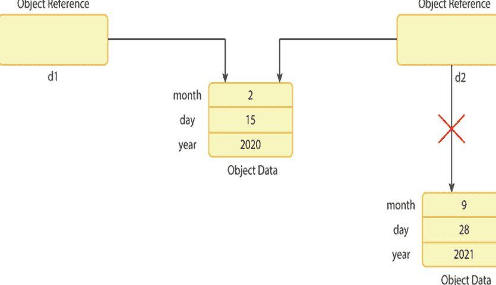

### 图 3.4 指向同一个对象的多个对象引用

### 示例 3.3 对象引用赋值

```java
/* A demonstration of object reference assignment
   Anderson, Franceschi
 */
public class ObjectReferenceAssignment
{
    public static void main(String [] args) {
        SimpleDate d1 = new SimpleDate(2, 15, 2020);
        System.out.println("d1 is " + d1.getMonth()
            + "/" + d1.getDay())
            + "/" + d1.getYear());
        SimpleDate d2 = new SimpleDate(9, 28, 2021);
        System.out.println("d2 is "
            + d2.getMonth()
            + "/" + d2.getDay())
            + "/" + d2.getYear());
        d2 = d1;
        System.out.println("\nAfter assigning d1 to d2: ");
        System.out.println("d1 is " + d1.getMonth()
            + "/" + d1.getDay()
            + "/" + d1.getYear());
        System.out.println("d2 is " + d2.getMonth()
            + "/" + d2.getDay())
            + "/" + d2.getYear());
    }
}
```

### 图 3.5 示例 3.3 的输出

```
d1 is 2/15/2020
d2 is 9/28/2021

After assigning d1 to d2:
d1 is 2/15/2020
d2 is 2/15/2020
```

当一个对象引用被首次声明但尚未赋值给一个对象时，它的值是一个特殊的字面量 `null`。

如果我们尝试使用一个值为 `null` 的对象引用调用方法，Java 会生成编译错误或称为**异常**（exception）的运行时错误。该异常是 `NullPointerException`（空指针异常），并会在 Java 控制台上打印一系列消息，指示使用 `null` 对象引用的位置。示例 3.4 的第 10 行将生成一个编译错误，如图 3.6 所示，因为 `aDate` 尚未实例化。

### 示例 3.4 尝试使用空对象引用

```java
/* A demonstration of trying to use a null object reference
   Anderson, Franceschi
 */
public class NullReference
{
    public static void main(String [] args) {
        SimpleDate aDate;
        aDate.setMonth(5);
    }
}
```

#### 常见错误陷阱

使用空对象引用调用方法将产生编译错误或运行时的 `NullPointerException`。请确保在尝试使用对象引用之前已实例化对象。Java 不支持显式删除对象。向垃圾回收器指示程序已不再使用某个对象的一种方法是将对象引用设置为 `null`。显然，一旦对象引用的值为 `null`，它就再无法用于调用方法。

示例 3.5 显示了运行时生成的 `NullPointerException`。第 9 行实例化了对象，第 10-11 行打印月份。第 13 行将 `null` 赋值给对象引用，第 15-16 行尝试打印月份。如图 3.7 所示，生成了 `NullPointerException`。注意控制台消息显示了应用程序类名（NullReference2）、方法 `main` 以及发生异常的第 16 行行号。JVM 通常会根据错误发生在程序中的位置在消息中打印额外的行。图 3.8 显示了将对象引用设置为 `null` 后独立对象引用和对象数据。

### 图 3.6 示例 3.4 的编译错误

```
NullReference.java:10: error: variable aDate might not have been initialized
    aDate.setMonth(5);
    ^
error
```

### 示例 3.5 再次尝试使用空对象引用

```java
/* A demonstration of trying to use a null object reference
   Anderson, Franceschi
 */
public class NullReference2
{
    public static void main(String [] args) {
        SimpleDate independenceDay = new SimpleDate(7, 4, 1776);
        System.out.println("The month of independenceDay is " + independenceDay.getMonth());

        independenceDay = null; // set object reference to null
        // attempt to use object reference
        System.out.println("The month of independenceDay is " + independenceDay.getMonth());
    }
}
```

### 图 3.7 示例 3.5 的输出

```
The month of independenceDay is 7
Exception in thread "main"
java.lang.NullPointerException
at NullReference2.main(NullReference2.java:16)
```


### 图 3.8 设置为 null 的对象引用

## 3.5 编程活动 1：调用方法

让我们通过使用 `SimpleDate` 对象的示例程序将这一切结合起来。在编程活动中，你将使用一个程序，在你实例化对象和调用类方法时显示对象数据的值。

将所提供的代码文件中，本章“编程活动 1”文件夹中的所有文件复制到计算机上的一个文件夹中。注意所有文件都应在同一个文件夹中。


打开 `DateDrawing.java` 源文件。你会发现该类已经包含了一些源代码。你会注意到该类已经包含了一些源代码。你的任务是填充空。寻找连续五个星号的行（`*****`）。这会将你引导到添加代码的位置。如图 3.9 所示，第 22 行是 `SimpleDate` 对象的声明。

```java
private SimpleDate dateObj; // SimpleDate 对象引用
```

你将使用此引用来实例化对象并调用 `SimpleDate` 类的方法。在源代码中，你会看到九行如下所示：

```java
// animate( n );
```

其中 n 是 1 到 9 之间的数字。

## 图 3.9

DateDrawing.java 部分列表

```java
public void workWithDates() {
    ////// 在此处添加代码 ******
    ***** 1. 使用空参数实例化 dateObj */

    // animate(1);

    ***** 2. 设置为出生月份 */

    // animate(2);

    ***** 3. 设置为出生日期 */

    // animate(3);

    ***** 4. 设置为出生年份 */

    // animate(4);

    ***** 5. 调用 nextDay 方法 */

    // animate(5);

    ***** 6. 设置日期为非法值 32 */

    // animate(6);

    ***** 7. 将 null 赋值给 dateObj */

    // animate(8);

    ***** 9. 尝试将月份设置为非法值 13 */

    // animate(9);
}
```

要完成编程活动，请在编号指令和 `animate` 方法调用之间编写请求的代码。然后取消注释（删除双斜杠）`animate` 方法调用。例如，在你编写了第一个指令的代码后，第 40 到 42 行如下：

```java
/*1. 使用空参数实例化 dateObj */

dateObj = new SimpleDate();
animate(1);
```

编译 `DateDrawing.java` 并运行 `DateApplication`，你将看到一个如图 3.10 所示的窗口。

你可以看到，`dateObj` 引用指向 `SimpleDate` 对象，月份、日期和年份实例变量已分配了默认值。

编写剩余指令的代码，并在完成每个任务后编译并运行程序。程序将显示你对对象数据所更改。

## 讨论题

1. 在执行指令 6 和 7 后，为什么日期和月份值没有发生变化？

2. 在程序执行结束时，生成了 `NullPointerException`。程序中的哪个语句导致了此错误？请解释原因。


**图 3.10**

编程活动 1 输出

## 3.6 Java 类库

Java 提供了超过 2000 个预定义类，我们可以用它们为程序添加功能。在本章中，我们将讨论一些常用的 Java 类：

- `String`：为字符序列提供数据类型，并提供搜索和处理字符串的方法。

- `Random`：生成随机数。

- `Scanner`：提供从键盘读取输入的方法。

- `System` 和 `PrintStream`：提供了用于在 Java 控制台上打印数据的成员变量和方法。

- `DecimalFormat` 和 `NumberFormat`：允许我们对输出的数字进行格式化。

- `Math`：提供了执行数学运算操作的方法。

- 对象包装类（Object wrappers）：提供了与基本数据类型等价的对象，以便我们可以像使用对象一样在程序中使用它们。

Java 类按**包**（packages）排列，并根据功能进行分组。

表 3.2 描述了本文将涵盖的一些 Java 包。我们可以在 Oracle 的 Java 网站上找到关于这些类的详细信息：www.oracle.com/technetwork/java。

### 表 3.2 常用的 Java 包

| 包 | 类类别 |
| --- | --- |
| `java.lang` | 许多程序通用的基本功能，例如 `String` 类、`Math` 类以及基本数据类型的对象包装类 |
| `java.text` | 用于数字输出格式化的类 |
| `java.util` | `Scanner` 类、`Random` 类以及其他杂类类 |
| `java.io` | 用于从文件读写数据的类 |

许多常用的类（如 `String` 和 `Math`）位于 `java.lang` 包中。`java.lang` 包中的任何类对我们的程序都是自动可用的。

要使用 Java 类库中不属于 `java.lang` 包的类，我们需要告诉编译器该类所在的包；换句话说，我们需要告诉编译器去哪里寻找该类。为了做到这一点，我们在程序中包含一个 **import**（导入）语句。`import` 语句插入在程序的顶部，位于介绍性注释之后、开始程序的类语句之前。

例如，如果我们想使用 `DecimalFormat` 类对浮点数进行输出格式化，我们将如下所示从 `java.text` 包导入 `DecimalFormat` 类：

```java
import java.text.DecimalFormat;
```

如果我们使用了一个包中的多个类，可以使用星号替换类名来导入我们使用的所有这些类，如下例所示：

```java
import java.text.*;
```

## 3.7 String 类

正如我们所讨论过的，Java 提供了 `char` 基本数据类型，它用于存储一个字符。然而，几乎每个程序都需要一个存储多个字符的数据类型。程序需要处理各种类型的名称、地址或标签。例如，许多程序涉及一个登录过程，用户必须输入用户 ID 和密码。程序读取用户 ID 和密码，将它们与数据库中存储的值进行比较，只有当用户 ID 和密码与数据库值匹配时，才允许用户继续。

为了处理这类数据，Java 提供了 `String` 类。由于 `String` 类是 `java.lang` 包的一部分，因此它对任何 Java 程序都是自动可用的，我们不需要使用 `import` 语句。`String` 类提供了几个构造函数，以及许多用于处理、搜索和比较 `String` 对象的方法。此外，Java 语言提供了两个连接运算符，用于将 `String` 对象与变量、字面量或其他 `String` 对象结合起来。

让我们看看表 3.3 显示的两个 `String` 类构造函数。示例 3.6 显示了如何在程序中使用这两个构造函数。

### 表 3.3 String 类构造函数

| String 类构造函数摘要 |
| --- | --- |
| `String( String str )` | 分配一个值为 str 的 `String` 对象，str 可以是一个 `String` 对象或一个 `String` 字面量 |
| `String( )` | 分配一个空的 `String` 对象 |

## 示例 3.6 演示 String 方法

```java
/* 演示 String 方法, Frances */
public class StringDemo {
    public static void main( String[] args ) {
        String s1 = new String("OOP in Java");
        String s2 = "is not difficult.";
        String s3 = s1 + s2;
        System.out.println("s1: " + s1);
        System.out.println("s2: " + s2);
        System.out.println("s1 + s2: " + s3);

        String empty = new String();
        System.out.println("The length of empty is " + empty.length());

        String greeting = "Hello";
        System.out.println("greeting converted to upper case is " + greeting.toUpperCase()); 

        char firstChar = greeting.charAt(0);
        char lastChar = greeting.charAt(greeting.length() - 1);
        System.out.println("The first and last characters of Hello are " + firstChar + " and " + lastChar);

        int indexOf = greeting.indexOf('e');
        System.out.println("The index of e is " + indexOf);

        int lIndex = greeting.indexOf('l');
        System.out.println("The index of l is " + lIndex);

        int loIndex = greeting.indexOf("lo");
        System.out.println("The index of lo is " + loIndex);

        int hIndex = greeting.indexOf('h');
        System.out.println("The index of h is " + hIndex);

        System.out.println("The middle three characters of Hello are " + greeting.substring(1, 4));
        System.out.println("All characters of Hello except the first are " + greeting.substring(1));
    }
}
```

Java 还提供了特殊支持，通过连接运算符 (`+`) 和连接运算符的简写版本 (`+=`) 将字符串附加到另一个字符串末尾。这一概念在示例 3.6 中进行了说明。

第 8–11 行声明、实例化并打印了两个 `String` 对象 `s1` 和 `s2`。第 13 行将 `s1` 和 `s2` 拼接，生成的字符串赋值给 `String` 引用 `s3`，并在第 14 行进行打印。最后，我们在第 16 行和第 17 行再次输出 `s1` 和 `s2`，以说明它们的值没有发生变化。

请注意，字符串连接运算符与加法算术运算符使用的是相同的字符。在某些情况下，我们需要明确编译器我们想要使用哪种运算符。例如，此语句同时使用了字符串连接运算符和加法算术运算符：

```java
System.out.println("The sum of 1 and 2 is " + ( 1 + 2 ) );
```

注意，我们将 `1 + 2` 放在括号内，以让编译器知道我们想要使用加法算术运算符 (`+`) 加两个 `int`。由于括号的运算符优先级更高，加法将首先执行。然后，编译器就会明确另一个运算符意图是字符串连接运算符，因为它的操作数是一个 `String` 和一个 `int`。

示例 3.6 还演示了 `String` 类的一些实用方法，这些方法在表 3.4 中进行了总结。

### 表 3.4 String 方法

| 返回值 | 方法名和参数列表 |
| --- | --- |
| `int` | `length()` 返回字符串的长度 |
| `String` | `toUpperCase()` 返回一个所有字母均为大写的字符串副本 |
| `String` | `toLowerCase()` 返回一个所有字母均为小写的字符串副本 |
| `char` | `charAt( int index )` 返回由 index 指定位置的字符 |
| `int` | `indexOf( String searchString )` 返回 searchString 第一次出现位置的起始索引，如果未找到 searchString 则返回 -1 |
| `int` | `indexOf( char searchChar )` 返回 searchChar 在字符串中第一次出现的索引，如果未找到 searchChar 则返回 -1 |
| `String` | `substring( int startIndex, int endIndex )` 返回 `String` 对象的子字符串，从索引 startIndex 处的字符开始，到索引 endIndex - 1 处的字符结束 |
| `String` | `substring( int startIndex )` 返回 `String` 对象的子字符串，从索引 startIndex 处的字符开始，一直到字符串末尾 |

## length 方法

`length` 方法返回字符串中的字符数，包括任何空格和标点符号。有时，用户 ID 的字符数是限制的（例如为八个），此时该方法对于确保 ID 的长度不超过限制非常有用。

使用 `String` 对象和句点运算符 (`.`) 来调用 `length` 方法。如我们在表 3.4 所示，`length` 方法不接受任何参数并返回一个 `int`，该值包含字符串中的字符数。我们可以输出返回值，也可以将返回值存储在 `int` 变量中。在示例 3.6 的第 21 行，我们在输出语句中调用了 `length` 方法。返回值替换了方法调用，因此结果是输出了字符数——在这种情况下为 0，如图 3.1 所示。在第 24 行，我们将 `length` 方法的返回值存储在变量 `len` 中。这允许我们在下一行中引用该值来输出 `greeting` 中的字符数。

## toUpperCase 和 toLowerCase 方法

`toUpperCase` 方法返回一个所有字母均为大写的字符串副本，而 `toLowerCase` 方法返回一个所有字母均为小写的字符串副本。数字和特殊字符保持不变。这两个方法都不接受任何参数。如果我们想将原始字符串转换为大写或小写，需要将返回值赋值给另一个 `String` 或直接输出返回值。在示例 3.6 的第 27 行，我们对 `greeting` 调用了 `toUpperCase` 方法并将返回的字符串存储到新的 `String` `greetingUpper` 中。然后我们在第 28–29 行输出 `greetingUpper`。我们在第 30–31 行的输出语句中调用了 `toLowerCase` 方法并直接打印返回值。

在讨论其余方法之前，我们需要引入索引（indexes）的概念。字符串中的每个字符都被分配了一个索引，代表其在字符串中的位置。第一个字符的索引是 0。第二个字符的索引始终是 1，依此类推。理所当然，最后一个字符的索引始终是字符串的长度减 1。

下面显示了字符串 `greeting` 及其字符的索引。正如我们看到的，第一个字母 `H` 的索引是 0，最后一个字母 `o` 的索引是 4，比字符串长度（5）少 1。

| 字符 | H | e | l | l | o |
| --- | --- | --- | --- | --- | --- |
| 索引 | 0 | 1 | 2 | 3 | 4 |

若干 `String` 方法使用这些索引来识别要处理字符串中的哪些字符。

## charAt 方法

`charAt` 方法返回字符串中指定索引处的字符。该方法的用处之一是提取字符串的第一个字符，这在提示用户提供答案时可能很有优势。例如，我们询问用户是否想再次玩游戏。他们可以回答 "y"、"yes" 或 "you bet!"。我们关注的是第一个字符是否为 `y`，因此我们可以使用该方法将答案的第一个字符存储到 `char` 变量中。假设用户的答案之前已被读取并存储在名为 `answerString` 的 `String` 变量中，可以使用可以使用语句提取 `answerString` 的第一个字符：

```java
char answerChar = answerString.charAt( 0 );
```

在本文后文中，当我们讨论选择时，将能够测试 `answerChar` 是否为 `'y'`。如表 3.4 所示，`charAt` 方法接受一个 `int` 类型参数，即字符在字符串中的索引。该方法返回一个 `char`。在示例 3.6 的第 33 行，我们通过参数 0 调用 `charAt` 方法来提取 `greeting` 的第一个字符，并将返回值存储在 `char` 变量 `firstChar` 中。在第 34 行，我们通过传递参数 `greeting.length() - 1` 调用 `charAt` 方法提取 `greeting` 的最后一个字符，并存储在 `char` 变量 `lastChar` 中。虽然在这种情况下我们可以传递 4 并得到相同的结果，但向 `charAt` 方法传递长度减 1 可以提取任何字符串的最后一个字符。然后我们输出这两个字符（35–37 行）。注意，我们假设 `greeting` 至少有一个字符；否则 `greeting.length() - 1` 为 -1（无效索引）。

## indexOf 方法

`indexOf` 方法用于在字符串中搜索特定的字符或字符串。表 3.4 显示了方法的两个版本：一个接受单个 `char` 作为参数，另一个接受 `String` 作为参数。在任何情况下，方法都会返回该 `char` 或字符串首个字符第一次出现位置的 `int` 索引。如果未找到该字符或字符串，`indexOf` 方法返回 -1。


在示例 3.6 中，我们使用 `indexOf` 方法搜索字符串中的各种字符。首先，在第 39 行，我们在 `greeting` 中搜索字符 `'e'` 并将返回的索引存储在 `indexOfE` 中。当我们在 40 行输出 `indexOfE` 时，我们在图 3.11 中看到搜索 `greeting` 中的字母 `'l'` 并输出返回的索引。注意 `greeting` 有两个字母 `l`，但 `indexOf` 方法仅返回第一次出现的位置索引，即为 2。然后在第 43–44 行，我们在 `greeting` 中搜索字符串 `"lo"`，`indexOf` 方法在索引 3 处找到了它。最后，在第 45–46 行，我们在 `greeting` 中搜索小写字母 `'h'`，它不在我们的字符串中。当我们输出返回值 -1 时，可以看到这一点，这表明 `indexOf` 方法在 `greeting` 中没有找到小写的 `h`。

## substring 方法

`substring` 方法用于从现有 `String` 中的字符创建新的 `String`。`substring` 方法从 `String` 中返回一组字符，即子字符串。原始 `String` 保持不变。表 3.4 显示了 `substring` 方法两个版本。第一个版本接受两个 `int` 参数。第一个参数是提取字符的起始索引，第二个参数是不提取的第一个字符的索引。因此，`endIndex` 参数是所提取的最后一个字符的后一个位置。我们知道这听起来有点别扭，但正如我们将演示的那样，这样设置参数实际上让该方法更易于使用。

在示例 3.6 中，我们创建并输出了一个包含 `greeting` 中间三个字符的新 `String`（第 48–49 行）。第一个参数指定新 `String` 应该从索引 1 的字符（`'e'`）开始，且 `String` 应该包含后续的所有字符，但不包括索引 4 的字符。结果是一个包含“ell”的 `String`。

`substring` 方法的第二个版本方便提取 `String` 中从一个位置到结束的所有字符。这个版本的 `substring` 只接受一个 `int` 参数，即开始收集字符的索引。返回的 `String` 将包含从 `startIndex` 开始一直到 `String` 结束的所有字符。我们在第 50–51 行调用此版本，提取并输出了 `greeting` 中除第一个字符以外的所有字符。

## String 处理

随着搜索引擎和大数据的流行，在 `String` 中查找、提取和格式化信息的能力正成为计算机科学的重要部分。我们将其称为“字符串处理”。例如，使用我们刚刚讨论的 `String` 方法，我们可以编写一个应用程序从 `String` 中提取并格式化姓氏和名。假设一个 `String` 包含一个如下格式的姓名：

```
<lastname>, <firstname>
```

即姓在前，后面跟着一个逗号和一个空格，然后是名。我们的任务是产生一个这种格式的 `String`：

```
<Firstname> <LastName>
```

用空格分隔名和姓氏，并将每个名字的首字母大写，所有其他字母小写。示例 3.7 显示了用于实现此目的的代码，其输出如图 3.12 所示。在这个示例中，我们将 `invertedName`（第 8 行）中的名字硬编码为“lincoln, abraham”，但代码需要适用于任何这种格式的姓名。让我们看看这个 `String` 的字符和索引。（再次，这只是一个示例。我们正在编写代码来处理任何这种格式的姓名。）

| character | i | n | c | o | l | n | , | a | b | r | a | h | m |
|---|---|---|---|---|---|---|---|---|---|---|---|---|---|
| index | 0 | 1 | 2 | 3 | 4 | 5 | 6 | 7 | 8 | 9 | 10 | 11 | 12 | 13 | 14 |

让我们从提取姓开始。我们知道姓从 `String` 的开始开始到逗号之前的字符结束，因此我们需要找到逗号。正如我们所看到的，`indexOf` 方法允许我们搜索字符的位置。在第 10 行，我们调用 `indexOf` 方法，将逗号作为搜索参数传递，并将返回值存储在 `int` 变量 `indexOfComma` 中。我们在第 11–12 行输出 `indexOfComma`，以验证我们确实在索引 7 找到了逗号。

*(注：此处原文表格中索引 7 处字符误写为 a，此处按原文保留)*

| character | i | n | c | o | l | n | a | b | r | a | h | m |
|---|---|---|---|---|---|---|---|---|---|---|---|---|---|
| index | 0 | 1 | 2 | 3 | 4 | 5 | 6 | 7 | 8 | 9 | 10 | 11 | 12 | 13 | 14 |

让我们开始提取姓。我们知道姓从 `String` 的开始开始到逗号之前的字符结束，因此我们需要找到逗号。正如我们所看到的，`indexOf` 方法允许我们搜索字符的位置。在第 10 行，我们调用 `indexOf` 方法，将逗号作为搜索参数传递，并将返回值存储在 `int` 变量 `indexOfComma` 中。我们在第 11–12 行输出 `indexOfComma`，以验证我们确实在索引 7 找到了逗号。


# 示例 3.7 StringProcessing.java

我们然后使用 `substring` 方法提取从第一个字符到但不包括逗号位置的所有字符。我们的两个参数是 0 作为起始索引，`indexOfComma` 作为结束索引。在第 16 行，我们输出了姓。

接下来，我们需要提取名。从上面的 `invertedName` 看到，名从空格（索引 9）开始，一直到 `String` 的结束。我们可以搜索空格，或者使用逗号位置的偏移。我们选择后者。由于我们要提取从逗号后两个位置到 `String` 结束的所有字符，我们可以使用接受一个参数的 `substring` 方法。在第 19 行，我们带有 `indexOfComma + 2` 调用 `substring` 方法。这将提取从索引 9 到 `String` 结束的内容。我们在第 20 行输出了这个 `String`。


我们现在将名和姓分成了 own `String` 中。

我们还有一个任务：格式化姓名。正如前面提到的，我们需要将名字的首字母大写，并将其余字母小写。我们可以通过将名字分成两个 `String` 来实现：一个包含第一个字母的 `String`，另一个包含剩余字符的 `String`。在第 23 行，我们使用 `substring` 方法提取第一个字母，并将返回值存入 `firstNameStart`。在第 24 行，我们使用 `substring` 方法从索引 1 开始提取剩余字符，将其存入 `firstNameRemainder`。

在第 29–33 行，我们对姓进行相应的操作。

此时，姓的格式化已经完成，我们将名、一个空格和姓组合成全名（第 35 行），并在第 36–37 行输出。

## 常见陷阱

指定负起始索引或超出 `String` 最后字符的起始索引将产生 `StringOutOfBoundsException`。指定负结束索引或大于 `String` 长度的结束索引也会产生 `StringOutOfBoundsException`。

## 示例 3.7 StringProcessing.java

```java
1 /* Demonstrating String Processing
2 Anderson, Franceschi
3 */
4 public class StringProcessing
5 {
6     public static void main( String [ ] args)
7     {
8         String invertedName = "lincoln, abraham";
9
10         int comma = invertedName.indexOf(','); // find the
11         System.out.println("nThe index of \', in \""
12             + invertedName + "\" is " + comma
13         );
14         // last name: extract all characters after the space
15         String lastName = invertedName.substring(0, comma);
16         System.out.println("The last name is " + lastName);
17

18         // first name: extract all characters after the space
19         String firstName = invertedName.substring(comma + 2);
20         System.out.println("The first name is " + firstName);
21

22         // convert the first letter of each name to uppercase
23         String firstNameStart = firstName.substring(0, 1);
24         firstNameStart = firstNameStart.toUpperCase();
25         String firstNameRemainder = firstName.substring(1);
26         firstNameRemainder = firstNameRemainder.toLowerCase();
27         firstName = firstNameStart + firstNameRemainder;
28

29         // perform corresponding operations on the last name
30         String lastNameStart = lastName.substring(0, 1);
31         lastNameStart = lastNameStart.toUpperCase();
32         String lastNameRemainder = lastName.substring(1);
33         lastNameRemainder = lastNameRemainder.toLowerCase();
34         lastName = lastNameStart + lastNameRemainder;
35

36         String fullName = firstName + " " + lastName;
37         System.out.println("The full name is " + fullName);
38     }
39 }
```

```java
28 String lastNameStart = lastName.substring(0, 1);
29 lastNameStart = lastNameStart.toUpperCase( );
30 String lastNameRemainder = lastName.substring( 1 );
31 lastNameRemainder = lastNameRemainder.toLowerCase( );
32 lastName = lastNameStart + lastNameRemainder;
33 
34 String fullName = firstName + " " + lastName;
35 System.out.println("\nThe formatted full name is "
36 + fullName );
37 
38 }
```

## 引用点

你可以在 Oracle 的 Java 网站 www.oracle.com/technetwork/java 上阅读更多关于 `String` 类的信息。

尝试用你的名字以及大小写混合字母运行此示例，以验证它是否对其他名称确实有效。

当我们计算索引和要提取的字符数量时，需要注意不要指定字符串中不存在的索引，因为这将产生运行时错误 `StringIndexOutOfBoundsException`。

## 图 3.12

示例 3.7 的输出

```
"lincoln, abraham" 中 ',' 的索引是 7

姓是 lincoln
名是 abraham

格式化的全名是 Abraham Lincoln
```

# 3.8 使用 DecimalFormat 类格式化输出

在计算机程序中，数字代表现实生活中的实体，例如价格或胜率。然而，浮点数是通过许多小数位计算的，作为某些计算的结果，其有效数字可能比我们程序需要的更多。例如，某个商品在折扣后的价格看起来可能是 `3.4666666666666666`，而我们真正想要显示的是 `$3.47`；即：在小数点前有一个前导美元符号，在小数点后有两位有效数字。`DecimalFormat` 类允许我们指定小数点后显示的数字位数，并在输出中添加美元符号、逗号和百分比符号 (`%`)。

`DecimalFormat` 类是 `java.text` 包的一部分，因此当我们使用 `DecimalFormat` 类时，必须在程序中包含以下导入语句：

```java
import java.text.DecimalFormat;
```

我们可以使用一个简单的构造函数来实例化 `DecimalFormat` 对象，该构造函数接受一个 `String` 对象作为参数。此 `String` 对象代表了我们希望格式化数字在打印时的外观。

该构造函数的 API 见表 3.5。

## 表 3.5 DecimalFormat 构造函数和 format 方法

| DecimalFormat 类构造函数 | 说明 |
| :--- | :--- |
| `DecimalFormat( String pattern )` | 实例化一个带有参数中指定的输出模式的 `DecimalFormat` 对象 |

| `format` 方法 | 返回方法名和参数列表 |
| :--- | :--- |
| `String format( double number )` | 返回根据调用该方法的 `DecimalFormat` 对象格式化后的数字的字符串表示 |

我们用于用于实例化 `DecimalFormat` 对象的模式由特殊字符和符号组成，并创建了我们希望数字在打印时外观的“图像”。一些常用的符号及其含义列在表 3.6 中。

### 表 3.6 DecimalFormat 模式的特殊字符

| DecimalFormat 对象的常用模式符号 | 含义 |
| :--- | :--- |
| `0` | 必填数字。在此位置上不抑制前导或结尾的 0。 |
| `#` | 可选数字。不包含为 0 的前导或结尾数字。 |
| `.` | 小数点。 |
| `,` | 逗号分隔符。 |
| `$` | 美元符号。 |
| `%` | 乘以 100 并附加百分比符号。 |

## 示例 3.8 演示 DecimalFormat 类


```java
/* 演示 DecimalFormat 类
 * Anderson, Franceschi
 */

// 从 java.text 包导入 DecimalFormat 类

import java.text.DecimalFormat;

public class DemoDecimalFormat
{
    public static void main(String [] args ) {
        // 首先，实例化一个 DecimalFormat 对象
        // 指定一个
        // 用于货币的模式
        DecimalFormat pricePattern = new
        DecimalFormat("$0.00");

        double price1 = 78.666666666;
        double price2 = 34.5;
        double price3 = .333333;
        int price4 = 3;
        double price5 = 100.23;

        // 然后使用模式打印这些值
        System.out.println("The first price is: " +
            pricePattern.format( price1 ) );
        System.out.println("\nThe second price is: " +
            pricePattern.format( price2 ) );
        System.out.println("The third price is: " +
            pricePattern.format( price3 ) );
        System.out.println("The fourth price is: " +
            pricePattern.format( price4 ) );
        System.out.println("The fifth price is: " +
            pricePattern.format( price5 ) );

        // 实例化另一个 DecimalFormat 对象
        // 用于打印百分比
        DecimalFormat percentPattern = new
        DecimalFormat("0.0##");
        double average1 = .98;
        System.out.println("The first average is: " +
            percentPattern.format( average1 ) );
        double average2 = .98748;
        System.out.println("\nThe second average is: " +
            percentPattern.format( average2 ) );

        // 现在实例化另一个 DecimalFormat 对象
        // 用于格式化时间
        DecimalFormat timePattern = new
        DecimalFormat("00:00:00");
        int hours = 5, minutes = 12, seconds = 0;
        System.out.println("\nThe time is " +
            timePattern.format( hours ) +
            ":" + timePattern.format( minutes ) +
            ":" + timePattern.format( seconds ) );

        // 实例化另一个 DecimalFormat 对象
        // 用于打印百万数
        DecimalFormat bigNumber = new
        DecimalFormat("#,###");
        int millions = 1234567;
        System.out.println("\nmillions is " +
            bigNumber.format( millions ) );
    }
}
```

一旦我们实例化了 `DecimalFormat` 对象，通过将数字作为参数传递给 `format` 方法来格式化它，见表 3.5。在示例 3.8 中，第 14 行实例化了 `DecimalFormat` 对象 `pricePattern`，它将用于打印价格。在 `"$0.00"` 模式中（见图 3.13）：该模式的字符是美元符号 ($)，我们希望它位于价格之前。`0` 指定了小数点左侧至少有一个数字。如果小数点左侧没有值，则插入一个零。紧随小数点后的两个 `0` 指定了小数点后应恰好有两个数字；即：如果小数点右侧有多位数字，则四舍五入到两位；如果最后一位是 0，则包含两个零。使用该模式，我们在第 23–24 行中看到 `price1` 被格式化为两位小数。在第 25–26 行中，`price2` 在第二小数位带有零进行打印。

在第 29–30 行中，我们打印了 `price4`，它是一个整数。`format` 方法的 API 要求 `double` 类型参数；然而，由于所有数字数据类型都可以转换为 `double`，因此任何数字数据类型都可以作为参数发送。结果是在小数点后添加了两个零。

最后，我们在第 31–32 行中使用 `pricePattern` 模式打印 `price5`，它不需要四舍五入或填充额外的数字。

### 图 3.13

示例 3.8 的输出

```
The first price is: $78.67

The second price is: $34.50

The third price is: $0.33

The fourth price is: $3.00

The fifth price is: $100.23

The first average is: 98.0%

The second average is: 98.75%

The time is 05:12:00

millions is 1,234,567
```

第 57 行定义了我们的最后一个模式 `#,###`，它可以用于在千位及以上的整数值中插入逗号。第 60–61 行打印变量 `millions`，并在百万位和千位之间用逗号分隔。注意，对于位数多于模式的数字，模式会进行外推。

## 3.9 使用 Random 类生成随机数

随机数在程序的许多操作中都非常有用，例如掷骰子、发牌、控制游戏中宿敌出现的时间，或其他对看似随机的事件的模拟。

然而，在程序中使用随机数存在一个问题：计算机是确定性的。从本质上说，这意味着给定特定指令集的特定输入，计算机将始终产生相同的输出。因此，挑战在于如何在使用确定性系统的同时生成随机数。许多才华横溢的计算机科学家都对这个问题工作过，并提出了一些创新且复杂的解决方案。

位于 `java.util` 包中的 `Random` 类使用数学公式来生成数字序列。构造函数生成一个种子值（seed），该值决定了随机数集合从序列的何处开始。因此，`Random` 类生成的数字看起来是随机的，但实际上并非随机。这些数字被称为**伪随机**（pseudorandom）数字，它们对于我们的目的完全足够。

表 3.7 显示了 `Random` 类的构造函数和一个获取随机整数的方法。默认构造函数使用种子值创建一个随机数生成器。一旦创建了随机数生成器，我们就可以调用 `nextInt` 来请求随机数。其他方法 `nextDouble`、`nextBoolean`、`nextByte` 和 `nextLong` 未在表 3.7 中显示，分别返回随机的 `double`、`boolean`、`byte` 或 `long` 值。

### 表 3.7 Random 类的构造函数和 nextInt 方法

| Random 类构造函数 | |
| :--- | :--- |
| `Random()` | 创建一个使用系统时间生成的种子随机数生成器 |

| nextInt 方法 | |
| :--- | :--- |
| `int nextInt(int number)` | 在均匀分布中返回一个从 0 到（不包括）`number` 之间的随机整数 |

为了演示如何使用随机数生成器，让我们以掷骰子为例。为了模拟六面骰子的投掷，我们需要模拟数字 1 到 6 的随机出现。如果我们带参数 6 调用 `nextInt` 方法，它将返回一个 0 到 5 之间的整数。为了获取从 1 到 6 的随机分布数字，我们只需要在 `nextInt` 方法返回的值上加上 1。因此，如果我们实例化了一个名为 `random` 的 `Random` 对象，我们可以像这样调用 `nextInt` 方法来生成 1 到 6 的随机数：

```
int die = random.nextInt( 6 ) + 1;
```

通常情况下，假设 n 小于 m，如果我们想生成从 n 到 m 的随机数，我们应该带可能的值的数量 (m - n + 1) 调用 `nextInt` 方法，然后将序列的第一个值 (n) 加到返回值。因此，该语句生成了 10 到 100（包含）之间的随机数：

```
int randomNumber = random.nextInt( 100 - 10 + 1 ) + 10;
```

示例 3.9 的第 18 行生成了 20 到 200（包含）之间的随机数。

### 示例 3.9 Random 类的演示

```
1 /*Random 类的演示
2 Anderson, Franceschi
3 */
4 import java.util.Random;
5
6 public class RandomNumbers
7 {
8 public static void main(String [] args)
9 {
10 Random random = new Random();
11
12 // 模拟掷骰子
13 int die = random.nextInt(6) + 1;
14 System.out.println("\ndie roll is " + 
15 die);
16
17 // 生成一个 20 到
18 200 之间的随机数
19 int start = 20, end = 200;
20 int number = random.nextInt(end - start + 1)
21 ) + start;
22 System.out.println("\nThe random number
23 between " + start + " and " + end + " is
24 + number);
25 }
26 }
```

### 参考点

你可以在 Oracle 的 Java 网站上查阅更多关于 `Random` 类的信息：

www.oracle.com/technetwork/java。

当 `RandomNumbers` 程序执行时，它将产生类似于图 3.14 的输出。输出将随程序的每次执行而变化，因为将生成不同的随机数。

### 图 3.14

示例 3.9 的输出

```
The die roll is 2
The random number between 20 and 200 is 117
```

## 3.10 使用 Scanner 类从控制台输入

随着我们的程序变得越来越复杂，我们需要允许程序用户输入数据。可以通过多种方式将用户输入读入程序中：

- 从键盘
- 从文件
- 通过图形用户界面 (GUI)

`Scanner` 类提供了针对 `byte`、`short`、`int`、`long`、`float`、`double`、`boolean` 和 `String` 的方法。在本章中，我们将关注从键盘输入数据。

### 表 3.8 Scanner 类的部分方法

| Scanner 类构造函数 | |
| :--- | :--- |
| `Scanner(InputStream)` | 创建一个从 `InputStream` 读取的 `Scanner` 对象 |

| 类的部分方法 | |
| :--- | :--- |
| `nextByte()` | 返回下一个 `byte` 输入 |
| `nextShort()` | 返回下一个 `short` 输入 |
| `nextInt()` | 返回下一个 `int` 输入 |
| `nextLong()` | 返回下一个 `long` 输入 |
| `nextFloat()` | 返回下一个 `float` 输入 |
| `nextDouble()` | 返回下一个 `double` 输入 |
| `nextBoolean()` | 返回下一个 `boolean` 输入 |
| `next()` | 返回下一个输入标记 |
| `nextLine()` | 返回输入行的未读字符 |

`Scanner` 类定义在 `java.util` 包中，因此我们需要包含以下导入：

```
import java.util.Scanner;
```

为了使用 `Scanner` 类，我们必须首先实例化 `Scanner` 对象并将其数据源关联。我们将使用 `System.in` 流，它默认连接到键盘。因此，我们的输入数据源是 `System.in`。以下语句将实例化一个名为 `scan` 的 `Scanner` 对象并将键盘作为其数据源：

```
Scanner scan = new Scanner( System.in );
```

一旦实例化了 `Scanner` 对象，我们就可以调用任何 next 方法从键盘输入。调用哪个方法取决于所需的输入类型。每个 next 方法都会从输入流返回一个值，即用户输入到键盘的值。我们需要将方法的返回值赋值给变量以完成数据输入。显然，我们变量的数据类型必须匹配或兼容方法返回的值的数据类型。

next 方法只执行输入。它们并不告诉用户要输入什么数据。因此，在调用任何 next 方法之前，我们需要提示用户输入。我们可以使用 `System.out.print` 打印提示，它与 `System.out.println` 类似，不同之处光标留在当前位置而不是移动到下一行。

在编写用户输入提示时，我们应该考虑以下几点。首先，我们的提示应该是具体的。如果我们希望用户输入全名，那么我们的提示应该这样说：

```
Please enter your first and last names.
```

如果输入落在某个值范围内，那么我们应该告诉用户哪些值是有效的，例如：

```
Please enter an integer between 0 and 10.
```

我们还应该记住，用户通常不是程序员。使用用户理解的语言来组织提示是非常重要的。很多时候，程序员从自己的角度来编写提示，就像这个糟糕的提示：

请输入一个字符串：

用户并不知道，也不在乎字符串或其他任何数据类型。用户只想知道输入什么才能让程序运行工作。

当我们的提示清晰且具体时，用户的错误就会更少，因此在使用我们的程序时感到更加舒适。

> **软件工程提示**
>
> 为用户提供清晰的输入提示。
>
> 提示应该使用用户能理解的词汇来组织，并描述请求的数据以及对输入值的任何限制。

示例 3.10 的第 13 行提示用户输入名字。第 14 行捕获用户输入并将用户输入的单词赋值给 `String` 变量 `firstName`，该变量在第 15 行打印。同样，第 17 行提示用户年龄，第 18 行捕获用户输入的整数并赋值给 `int` 变量 `age`，第 19 行输出 `age` 的值。读取其他原始数据类型遵循相同的模式。第 21 行提示用户输入平均绩点（一个 `float` 值）。第 22 行捕获用户输入的数字并将其赋值给 `float` 变量 `gpa`，第 23 行输出 `gpa` 的值。

### 示例 3.10 使用 Scanner 从键盘读取

```
/* A demonstration of reading from the keyboard
using Scanner
2 Anderson, Franceschi
3 */
4
5 import java.util.Scanner;
6
7 public class DataInput
8 {
9 public static void main(String [] args)
10 {
11 Scanner scan = new Scanner(System.in);
12
13 System.out.print("Enter your first name > ");
14 String firstName = scan.next();
15 System.out.println("Your name is " + firstName);
16
17 System.out.print("\nEnter your age as an integer > ");
18 int age = scan.nextInt();
19 System.out.println("Your age is " + age);
20
21 System.out.print("\nEnter your GPA > ");
22 float gpa = scan.nextFloat();
23 System.out.println("Your GPA is " + gpa);
```

> **软件工程提示**
>
> 在提示结束加上输入指示，并包含一个结尾空格以提高可读性。

当此程序执行时，提示将打印在控制台上，光标停留在提示的末尾。图 3.15 显示了执行这些语句且用户输入 Syed、按回车、输入 21、按回车、输入 3.875 并再次按回车时的输出。

`nextByte`、`nextShort`、`nextLong`、`nextDouble` 和 `nextBoolean` 方法可以使用与 `next`、`nextInt` 和 `nextFloat` 相同的模式。


# 技能练习

通过这些章节后习题

**3.18.1** 多选题

第 1, 11 题

**3.18.2** 代码阅读与理解

第 14, 15, 16 题

**3.18.3** 代码填空

第 24, 25, 26, 27 题

**3.18.4** 识别代码中的错误

第 36, 37, 38, 39, 43 题

**3.18.5** 调试区域

第 45, 49 题

**3.18.6** 编写短程序

第 50, 51, 52, 55, 56 题

## 3.11 调用静态方法和使用静态类变量

类也可以定义静态方法，可以在不需要实例化对象的情况下调用。这些方法也被称为类方法。这些方法的 API 在返回类型之前有一个 `static` 关键字：

```
static dataType methodName( arg1, arg2, ... )
```

类定义静态方法的一个原因是为了提供某些快速、一次性的功能，而不需要要求客户端实例化对象。例如，作为一个较大计算的一部分，我们可能想要计算一个数字的平方根。为了计算平方根而创建一个对象是浪费内存和处理器时间的。幸运的是，`Math` 类提供了一个寻找数字平方根的静态方法。

类方法或静态方法是通过类名而不是对象引用来调用的，语法如下：

```
ClassName.staticMethodName( argumentList );
```

例如，在以下语句中：

```
absValue = Math.abs( someNumber );
```

类名是 `Math`，静态方法是 `abs`，它返回参数 (`someNumber`) 的绝对值。我们使用类名而不是对象引用，是因为静态方法可以在不实例化对象的情况下调用。在本章的稍后部分，我们将更详细地探索 `Math` 类的静态方法。

由于静态方法可以在没有对象的情况下调用，因此静态方法无法访问类的实例变量（因为实例变量是对象数据，只有在对象实例化后才存在）。然而，静态方法可以访问静态数据，类通常会声明静态数据供静态方法使用。静态数据属于类，而不是属于类的特定对象或实例。

静态类变量的一个常见用途是为常用值定义常量，或为静态类方法定义参数。例如，`Math` 类定义了两个静态常量来方便使用 $\pi$ 和自然对数。

和静态方法一样，静态常量也使用类名和点操作符进行访问，语法如下：

```
ClassName.staticConstant
```

因此，可以通过这样访问代表 $\pi$ 值的*静态*常量：

```
Math.PI
```

起初，这似乎与我们之前关于封装以及客户端直接访问对象数据限制的讨论相悖。记得我们说过，客户端需要使用访问器方法（getters）和修改器方法（setters）来访问对象数据。封装背后的原理是保护对象数据免受客户端破坏。然而，在这种情况下，*静态*数据是常量，因此客户端无法更改它。对于客户端来说，直接访问类常量比调用方法更简单、更快。

## 3.12 使用 System.in 和 System.out

为了在屏幕上打印程序输出，我们一直使用类似下面的语句：

```
System.out.println("The value of b is " + b );
```

以及

```
System.out.print("Enter your first name > " );
```

为了实例化一个 `Scanner` 对象，我们使用了这条语句：

```
Scanner scan = new Scanner( System.in );
```

现在是时候深入查看这些语句并完全理解它们了。`System` 是 `java.lang` 包中的现有类。它的字段之一是静态常量 `out`，默认代表标准输出；另一个字段是静态常量 `in`，默认代表标准输入。我们通过类名和点操作符来引用它们：

```
System.out
System.in
```

由于静态方法可以在没有对象的情况下调用，静态方法在程序结束时是可选的。然而，`System` 类的 `exit` 方法在我们希望在非通常位置的地方结束程序时是很有用的。

### 表 3.10 System 类的常量和 exit 方法

| 常量值 | 描述 |
| :--- | :--- |
| in | 代表标准输入，默认是键盘 |
| out | 代表标准输出，默认是控制台 |
| **System 的有用方法** | **方法名和参数列表** |
| 返回 void | **exit( intStatus )** 静态方法终止 Java 虚拟机。exitStatus 的值为 0 表示正常终止。任何其他值表示异常终止并指示程序发生了错误 |

`System.out` 是 `PrintStream` 类的对象。`print` 和 `println` 方法属于 `PrintStream` 类。`print` 和 `println` 的唯一区别是 `println` 在写入后还会打印一个换行。

### 表 3.11 用于 System.out 的 PrintStream 方法

| 返回 | 方法名和参数列表 |
| :--- | :--- |
| void | print( argument ) 将参数打印到输出设备。参数可以是任何基本类型、String 或对象引用。 |
| void | println( argument ) 将参数打印到输出设备，然后打印一个换行。参数可以是任何基本类型、String 或对象引用。 |
| void | println( ) 打印一个换行。此方法对于跳过行很有用。 |


# System 类与标准输入输出

`System` 是 `java.lang` 包中的现有类。它的字段之一是静态常量 `out`，默认代表标准输出；另一个字段是静态常量 `in`，默认代表标准输入。

## 参考

> 你可以在 Oracle 的 Java 网站上查看更多关于 `System` 和 `PrintStream` 类的信息：www.oracle.com/technetwork/java。

在第 21 行实例化 `SimpleDate` 对象引用 `d` 之后，它在第 22–23 行被打印，并在第 24 行再次打印。`toString` 方法被显式调用；在第 24 行，它被自动调用。示例 3.13 的输出如图 3.20 所示。最后，我们通过调用 `System` 类的 `exit` 方法终止程序。

## 图 3.20 示例 3.13 的输出

```
使用连接合并参数

一个 double: 23.7，以及一个 int: 78

Java 是大小敏感的：a 与 A 不同

创建一个变量并打印其值

成绩为 3.81

显式调用 toString，d 为 4/5/2020

隐式调用 toString，d 为 4/5/2020
```

# 3.13 Math 类

`Math` 类也是 `java.lang` 包的一部分。因此，任何 Java 程序都可以自动使用；我们不需要使用 `import` 语句。`Math` 类提供了两个静态常量（`E` 和 `PI`），以及许多静态方法，这些方法让程序员无需编写复杂的数学代码。

这两个常量 `E` 和 `PI` 都是 `double` 类型，分别代表 `e`（自然对数的底，即 `log e = 1`）和 `pi`（圆周长与直径的比值）。我们所知的 `e` 和 `pi` 的近似值分别为 2.78 和 3.14。这些常量在表 3.12 中。

## 表 3.12 Math 类常量

| 常量 | 值 |
| --- | --- |
| E | e，自然对数的底 |
| PI | pi，圆周长与直径的比值 |

由于 `E` 和 `PI` 是 `Math` 类的静态数据成员，使用 `Math` 类的名和点运算符对它们进行引用，如下：

```
Math.E
Math.PI
```

`Math` 类的实用方法如表 3.13 所示。`Math` 类的所有方法都是静态的；因此使用类名 `Math` 和点运算符来调用它们。

## 表 3.13 Math 类的实用方法

| 返回值 | 方法名和参数列表 |
|--- | --- |
| dataTypeOfArg | `abs(arg)` 静态方法，返回参数 `arg` 的绝对值，该参数可以是 `double`、`float`、`int` 或 `long`。 |
| double | `log(double arg)` 静态方法，返回其参数 `arg` 的自然对数（以 `e` 为底）。例如，`log(1)` 返回 0，`log(Math.E)` 返回 1。 |
| dataTypeOfArgs | `min(argA, argB)` 静态方法，返回两个参数中的较小者。参数可以是 `double`、`float`、`int` 或 `long`。 |
| dataTypeOfArgs | `max(argA, argB)` 静态方法，返回两个参数中的较大者。参数可以是 `double`、`float`、`int` 或 `long`。 |
| double | `pow(double base, double exp)` 静态方法，返回 `base` 的 `exp` 次方的幂值。 |
| long | `round(double arg)` 静态方法，返回与其参数 `arg` 最接近的整数。 |
| double | `sqrt(double arg)` 静态方法，返回 `arg` 的正平方根。 |

```
Math.abs(-5)
```

## 示例 3.14 Math 类常量和 abs 方法

示例 3.14 展示了如何在 Java 程序中使用 `Math` 常量和 `abs` 方法。在第 9 行和第 10 行，我们使用 `Math` 类的静态常量打印 `e` 和 `pi` 的值。在第 12 行和第 15 行，我们调用 `abs` 方法，它返回参数的绝对值。随后我们在第 13 行和第 16 行打印结果。示例 3.14 的输出如图 3.21 所示。

```java
/* Math 类方法和常量的演示
 * Anderson, Franceschi
 */

public class MathConstants {
    public static void main(String[] args) {
        System.out.println("The value of e is " + Math.E);
        System.out.println("The value of pi is " + Math.PI);

        double d1 = Math.abs(6.7); // d1 将被赋值为 6.7
        System.out.println("\nThe absolute value of 6.7 is " + d1);

        double d2 = Math.abs(-6.7); // d2 将被赋值为 6.7
        System.out.println("\nThe absolute value of -6.7 is " + d2);
    }
}
```

## 图 3.21 示例 3.14 的输出

```
The value of e is 2.71828182845904
The value of pi is 3.14159265358979
The absolute value of 6.7 is 6.7
The absolute value of -6.7 is 6.7
```

大多数 `Math` 类方法的操作用途是显而易见的。但有几个方法——`pow`、`round` 和 `min/max`——需要稍微解释。

## pow 方法

`pow` 方法返回 `base` 的 `exp` 次方的幂值。`Math` 类提供了 `pow` 方法，其参数是 `base` 和 `exp`。无论参数的数值类型如何，其返回值始终是 `double`。

### 示例 3.15 某些 Math 方法的演示

```java
/* 某些类方法的演示
 * Anderson, Franceschi
 */

public class MathMethods {
    public static void main(String[] args) {
        double d2 = Math.log(5);
        System.out.println("\nThe log of 5 is " + d2);

        double d4 = Math.sqrt(9);
        System.out.println("\nsquare of 9 is " + d4);

        double fourCub = Math.pow(4, 3);
        System.out.println("\n4 to the power 3 is " + fourCub);

        double bigNumber = Math.pow(4.5, 3.4);
        System.out.println("\n4.5 to the power 3.4 is " + bigNumber);
    }
}
```

## 图 3.22 示例 3.15 的输出

```
The log of 5 is 1.6094379124341003
square of 9 is 3.0
4 to the power 3 is 64.0
4.5 to the power 3.4 is 127.46582752986332
```

## round 方法

`round` 方法将 `double` 转换为其最近的整数，遵循以下规则：

- 小数部分小于 .4 时舍入。
- 小数部分为 .5 及以上时进位。

第 9–13 行的示例 3.16 使用 `round` 方法处理各种数字。图 3.23 展示了输出。

### 示例 3.16 round 方法的演示

```java
/* round 方法的演示
 * Anderson, Franceschi
 */

public class MathRounding {
    public static void main(String[] args) {
        System.out.println("23.4 rounded is " + Math.round(23.4));
        System.out.println("23.49 rounded is " + Math.round(23.49));
        System.out.println("23.5 rounded is " + Math.round(23.5));
        System.out.println("23.51 rounded is " + Math.round(23.51));
        System.out.println("23.6 rounded is " + Math.round(23.6));
    }
}
```

## 图 3.23 示例 3.16 的输出

```
23.4 rounded is 23
23.49 rounded is 23
23.5 rounded is 24
23.51 rounded is 24
23.6 rounded is 24
```

## min 和 max 方法

`min` 和 `max` 方法分别返回两个参数中的较小者或较大者。示例 3.17 展示了如何在 Java 程序中使用这些方法。图 3.24 展示了输出。因此，示例 3.17 中第 9 行的语句将 2 赋值给整数变量 `smaller`。在第 12 行，使用 `max` 方法的类似语句将 8 赋值给整数变量 `larger`。

### 示例 3.17 min 和 max 方法的演示

```java
/* min and max Math 类方法的演示
 * Anderson, Franceschi
 */

public class MathMinMaxMethods {
    public static void main(String[] args) {
        int smaller = Math.min(8, 2);
        System.out.println("The smaller of 8 and 2 is " + smaller);

        int larger = Math.max(8, 2);
        System.out.println("The larger of 8 and 2 is " + larger);

        int a = 8, b = 5, c = 12;
        int tempSmaller = Math.min(a, b); // 找到 a 和 b 中较小的
        int smallest = Math.min(tempSmaller, c); // 将结果与 c 比较
        System.out.println("The smallest of " + a + ", " + b + ", and " + c + " is " + smallest);
    }
}
```

## 图 3.24 示例 3.17 的输出

```
The smaller of 8 and 2 is 2
The larger of 8 and 2 is 8
The smallest of 8, 5, and 12 is 5
```

## 参考点

你可以在 Oracle 的 Java 网站上阅读更多关于 `Math` 类的信息：www.oracle.com/technetwork/java。

`min` 方法也可以用于计算三个变量中的最小值。在第 15 行声明并初始化三个变量（a、b 和 c）后，我们在第 16 行将一个命名为 `tempSmaller` 的临时变量赋值为前两个变量 a 和 b 的较小值。然后，在第 17 行，我们计算 `tempSmaller` 和第三个变量 c 的较小值，并将结果赋值给变量 `smallest`，最后在第 18 和 19 行输出。

寻找三个数中最大值的模式类似，我们将其留作本章末尾的练习。


# 技能练习

通过这些章后问题

## 3.18.1 单选题
第 6, 7, 8, 13 题

## 3.18.2 阅读与理解代码
第 17, 18, 19, 20, 21, 22, 23 题

## 3.18.3 填充代码
第 28, 29, 30, 31, 32, 34 题

## 3.18.4 识别代码中的错误
第 40, 41, 42 题

## 3.18.5 调试区域
第 46, 47, 48 题

## 3.18.6 编写简短程序
第 53, 54 题


© Hemera Technologies/Photos.com/Thinkstock

# 代码实例

要查看实例化以及调用实例方法和静态方法的逐步说明，请在在线资源中查找本章的视频。点击链接开始视频。

# 3.14 使用 NumberFormat 类格式化输出

与 `DecimalFormat` 类一样，`NumberFormat` 类也可以用于格式化输出数字。然而，`NumberFormat` 类提供了专门的 `static` 方法，用于创建专门格式化货币和百分比的对象。

`NumberFormat` 类是 `java.text` 包的一部分，因此我们需要在程序开头包含以下 `import` 语句。

```java
import java.text.NumberFormat;
```

`NumberFormat` 类用于格式化货币和百分比的 `static` 方法如表 3.14 所示。

## 表 3.14 NumberFormat类的有用方法

| NumberFormat 方法摘要 | 返回值 | 方法名和参数列表 |
| :--- | :--- | :--- |
| NumberFormat | getCurrencyInstance() | 创建货币格式化对象的静态方法 |
| NumberFormat | getPercentInstance() | 创建百分比格式化对象的静态方法 |
| String | format(double number ) | 返回格式化为货币或百分比的数字的字符串表示，取决于调用该方法的对象 |

我们从前两个方法头部可以看出，它们的返回类型是一个 `NumberFormat` 对象。这些静态方法被称为工厂方法，被用于代替构造函数来创建对象。因此，我们不再使用 `new` 关键字和构造函数，而是调用这些方法之一来创建我们的格式化对象。

`getCurrencyInstance` 方法返回一个反映本地货币的格式化对象。在美国，该格式是前导美元符号，且在小数点右侧保留两位。`getPercentInstance` 方法返回一个格式化对象，通过将分数乘以 100 并将其作为百分比打印，即通过分数乘以 100、舍入到最近的整数百分比并添加百分比符号（%）。

然后，我们使用 `NumberFormat` 类的 `format` 方法来显示货币或百分比值。`format` 方法接受一个参数，类型为 `double`，即我们想要打印的变量或值；它返回格式化后的值作为 `String` 对象，然后我们可以对其进行打印。

**示例 3.18** 是一个完整的程序，说明了如何使用这三个方法。

# 示例 3.18 展示 NumberFormat 类

```java
/* 使用 NumberFormat 类
2 格式化
货币和百分比。
3 Anderson, Franceschi
4 */
5
6 // 我们需要从 java.text
7 导入 NumberFormat 类
8 import java.text.NumberFormat;
9
10 public class DemoNumberFormat
11 {
12     public static void main(String [] args)
13     {
14         double winningPercentage = .675;
15         double price = 78.9;
16
17         // 获取一个 NumberFormat 对象用于打印
18         // 百分比
19         NumberFormat percentFormat =
20         NumberFormat.getPercentInstance();
21
22         // 使用 NumberFormat 对象调用 format 方法
23         System.out.print("The winning percentage is ");
24         System.out.println(percentFormat.format(winningPercentage) );
25
26         // 获取一个 NumberFormat 对象用于打印
27         NumberFormat priceFormat =
28         NumberFormat.getCurrencyInstance();
29
30         // 使用 NumberFormat 对象调用 format 方法
31         System.out.println("\nThe price is " + priceFormat.format(price));
32     }
33 }
```

`getCurrencyInstance` 方法返回一个反映本地货币的格式化对象。在美国，该格式是前导美元符号，且在小数点右侧保留两位。`getPercentInstance` 方法返回一个格式化对象，通过将分数乘以 100 并将其作为百分比打印，即通过分数乘以 100、舍入到最近的整数百分比并添加百分比符号（%）。

然后，我们使用 `NumberFormat` 类的 `format` 方法来显示货币或百分比值。`format` 方法接受一个参数，类型为 `double`，即我们想要打印的变量或值；它返回格式化后的值作为 `String` 对象，然后我们可以对其进行打印。

**示例 3.18** 是一个完整的程序，说明了如何使用这三个方法。

## 图 3.25 示例 3.18 的输出

```
The winning percentage is 68%
The price is $78.90
```

# 3.15 Integer、Double、Character 以及包装类

大多数程序使用基本类型和对象的组合。然而，某些类方法只接受对象；反之，我们需要将对象转换为基本数据类型。例如，假设我们有一个 GUI 让用户在框中输入年龄。我们期望年龄为 `int`；然而，文本框和对话框返回的是字符串。

对于这些情况，Java 提供了包装类。包装类“封装”基本类型（如 `double` 或 `int`）的值。这些包装类定义了相应的实例变量，还提供了对象与基本类型之间转换的有用方法。表 3.15 列出了每个基本类型对应的包装类。

## 表 3.15 基本类型与包装类对应表

| 基本类型 | 包装类 |
| :--- | :--- |
| double | Double |
| float | Float |
| long | Long |
| int | Integer |
| short | Short |
| byte | Byte |
| char | Character |
| boolean | Boolean |

所有这些类都是 `java.lang` 包的一部分。因此，在使用包装类时不需要导入语句。

Java 为基本数值类型与其包装类之间的转换提供了特殊支持。例如，我们可以简单地将 `int` 变量赋值给 `Integer` 对象。Java 会自动提供这种转换，即自动装箱。在示例 3.19 中，该转换在第 9 和第 10 行说明。`int` 变量 `intPrimitive` 和 `Integer` 对象 `integerObject` 在第 12 和 13 行输出，且值相同（42）。

同样，当 `Integer` 对象被用作 `int` 时，Java 也提供了这种转换，被称为自动拆箱。因此，当我们在算术表达式中使用 `Integer` 对象时，会自动加载其 `int` 值。示例 3.19 的第 15 行在算术表达式中使用 `Integer` 对象 `integerObject`，将 `Integer` 与 `int` 变量 `intPrimitive` 相加。如图 3.26 所示，结果与两个操作数都是 `int` 变量时相同。

使用其他基本类型及其相关的包装类也可以进行类似的操作。

除了基本类型和包装对象之间的自动转换外，`Integer` 和 `Double` 类还提供了方法（如表 3.16 所示），允许我们将 `String` 转换为数字。

## 表 3.16 Integer 和 Double 包装类的方法

| Integer 包装类的有用方法 | 返回 | 方法名和参数列表 |
| --- | --- | --- |
| int | parseInt( String s ) | 静态方法，将 String s 转换为 int 并返回该值 |
| Integer | valueOf( String s ) | 静态方法，将 String s 转换为 Integer 对象并返回该对象 |

| Double 包装类的有用方法 | 返回 | 方法名和参数列表 |
| --- | --- | --- |
| double | parseDouble( String s ) | 静态方法，将 String s 转换为 double 并返回该值 |
| Double | valueOf( String s ) | 静态方法，将 String s 转换为 Double 对象并返回该对象 |

`parseInt`、`parseDouble` 和 `valueOf` 方法是静态的，使用 `Integer` 或 `Double` 类名和点符号进行调用。`parse` 方法将 `String` 转换为原始类型，而 `valueOf` 方法将 `String` 转换为包装对象。例如，示例 3.19 的第 18 行将字符串“76”转换为 `int` 值。第 19 行将字符串“76”转换为等效 `Integer` 对象。

## 示例 3.19 包装类的演示

```java
/* 包装类和方法的演示
Anderson, Franceschi
*/
public class DemoWrapper {
    public static void main(String [] args) {
        int intPrimitive = 42;
        Integer integerObject = intPrimitive;
        System.out.println("The int is " + intPrimitive);
        System.out.println("The Integer object is " + integerObject);
        int sum = intPrimitive + integerObject;
        System.out.println("Their sum is " + sum);
        int il = Integer.parseInt("76"); // 将 "76" 转换为 int
        Integer i2 = Integer.valueOf("76"); // 将 "76" 转换为 Integer
        System.out.println("\nvalue of il is " + il);
        System.out.println("The value of i2 is " + i2);
        
        double d1 = Double.parseDouble("58.32");
        Double d2 = Double.valueOf("58.32");
        System.out.println("\nThe value of d1 is " + d1 );
        System.out.println("The value of d2 is " + d2 );
    }
}
```

同样，第 23 行将字符串 "58.32" 转换为 `double`，第 24 行将相同的字符串转换为等效的 `Double` 对象。

## 图 3.26 示例 3.19 输出

```
The int is 42
The Integer object is 42
Their sum is 84

The value of il is 76
The value of i2 is 76

The value of d1 is 58.32
The value of d2 is 58.32
```

由于 `char` 是原始类型，无法在 `char` 变量上调用方法。然而，通过将 `char` 包装成对象，`Character` 类提供了一些处理 `char` 的有用方法。我们经常可能需要判断一个字符是数字还是字母。例如，如果我们正在检查密码是否安全，可能想确定密码至少有一个数字，或者想更改 `char` 变量的大小。表 3.17 显示了 `Character` 类的一些有用方法。这些方法都是静态的，因此我们使用类名而不是对象引用来调用它们。前四个方法测试字符是否是数字、字母、小写或大写。对于这些方法中的每一个，我们将 `char` 变量作为参数，方法返回 `true` 或 `false`。后两个方法 `toLowerCase` 和 `toUpperCase` 在 `char` 是字母时将其转换为小写或大写，否则返回原样值。

## 表 3.17 Character 包装类的有用方法

| 返回 | 方法名和参数 |
| --- | --- |
| boolean | isDigit( char c ) | 如果 c 是 '0' 到 '9' 之间的数字，返回 true；否则返回 false |
| boolean | isLetter( char c ) | 如果 c 是字母，返回 true；否则返回 false |
| boolean | isLowerCase( char c ) | 如果 c 是小写字母，返回 true；否则返回 false |
| boolean | isUpperCase( char c ) | 如果 c 是大写字母，返回 true；否则返回 false |
| char | toLowerCase( char c ) | 如果 c 是字母，返回 c 的小写版本；否则返回原样 |
| char | toUpperCase( char c ) | 如果 c 是字母，返回 c 的大写版本；否则返回原样 |

示例 3.20 演示了这些方法的使用。

第 12–14 行提示用户输入字符以便测试或转换。记住 `Scanner` 没有 `nextChar` 方法，所以我们需要使用 `next` 方法读取字符串，然后使用 `charAt` 方法提取输入字符串的第一个字符。

第 16–17 行通过强制转换为 `int` 来输出 `char` 变量的 Unicode 十进制值。

在第 18–19 行，我们通过 `isDigit` 方法测试是否为数字并输出返回的 `true` 或 `false`。同样，在第 20–21 行，我们调用 `isLetter` 方法测试是否为字母并输出返回的 `true` 或 `false`。

在第 22–25 行，我们测试是否为大写或小写字母，再次输出 `true` 或 `false`。

最后，在第 26–27 行，我们尝试将 `char` 转换为大写字母然后转换为小写字母。如果 `c` 不是字母，或者已经是大写或小写字母，方法将返回原值。

## 示例 3.20 Character 方法

```java
/* Character Methods
Anderson, Franceschi
*/
import java.util.Scanner;

class CharacterMethods {
    public static void main(String [] args) {
        Scanner scan = new Scanner(System.in);

        System.out.print("Enter a character > ");
        String input = scan.next();
        char c = input.charAt(0);

        System.out.println("The Unicode decimal value of " + c + " is: " + (int) c);

        System.out.println("\n" + c + " is a digit: " + Character.isDigit(c));

        System.out.println("\n" + c + " is a letter: " + Character.isLetter(c));

        System.out.println("\n" + c + " is uppercase: " + Character.isUpperCase(c));

        System.out.println("\n" + c + " is lowercase: " + Character.isLowerCase(c));

        System.out.println("\n" + c + " in uppercase is: " + Character.toUpperCase(c));
        System.out.println(c + " in lowercase is: " + Character.toLowerCase(c));
    }
}
```

## 图 3.27 示例 3.20 输出


# 示例输出

```
Enter a character > d
The Unicode decimal value of d is: 100

d is a digit: false

d is a letter: true
d is uppercase: false
d is lowercase: true

d in uppercase is: D
d in lowercase is: d
```

# 技能练习

包含本章节结束习题

- 3.18.1 多选题 12 题
- 3.18.3 代码填充题 33 题
- 3.18.4 代码错误识别 35 题
- 3.18.5 调试区域 44 题
- 3.18.8 技术写作 71、72

# 3.16 编程活动 2：使用预定义类

在编程活动中，你将使用本章讨论的一些类和方法编写短程序。你的程序将执行以下操作：

1. 
   a. 提示用户输入姓名
   b. 打印一条问候用户的消息
   c. 告诉用户姓名中有多少个字符

2. 
   a. 询问用户的出生年份
   b. 计算并打印用户今年的年龄
   c. 声明一个关于平均寿命的常量；将其值设置为 78.94
   d. 打印一条消息，告诉用户已过寿命的百分比，保留一位小数

3. 
   a. 生成一个 1 到 20 之间的随机数
   b. 输出一条消息，告诉用户程序正在想一个 1 到 20 之间的数字，并要求猜测
   c. 输出一条消息，告诉用户数字以及用户的猜测与该数字相差多远

要完成这项编程活动，请从本文随附的代码中复制本章的“编程活动 2”文件夹中的内容。打开 `PracticeMethods.java` 文件并寻找四组五个星号（`*****`），你将在那里找到编写 import 语句的说明以及完成编程活动的第 1、2 和 3 项的说明。

示例 3.21 显示了 `PracticeMethods.java` 文件，图 3.28 显示了你完成编程活动后示例运行的输出。你的输出可能与所示不同，因为我们使用 2020 年作为计算年龄的当前年份，且第 3 项会生成随机数。

## 示例 3.21

### PracticeMethods.java

```java
1 /* 第3章编程活动 2
2 调用类方法
3 Anderson, Franceschi
4 */
5
6 // ***** 1. 在此处添加你的 import 语句
7
8 public class PracticeMethods
9 {
10     public static void main( String [ ] args )
11     {
12         //*****
13         // 2. a. 创建一个 Scanner 对象来读取键盘输入。
14         // b. 提示用户输入他们的名字。
15         // c. 打印一条向用户问候的消息。
16         // d. 打印一条消息，说明用户名字中有几个字母。
17         // 你的代码写在这里
18
19
20         //*****
21         // 3. a. 跳过一行，然后提示用户输入出生年份。
22         // b. 为当前年份声明一个常量。
23         // c. 计算并打印用户当年的年龄。
24         // d. 为平均寿命声明一个常量，将值设为 78。
25         // e. 计算并打印用户已活时长占预期寿命的百分比。
26         // 使用 DecimalFormat 类将百分比格式化为小数。
27         // 你的代码写在这里
28
29         //*****
30         // 4. a. 生成一个 1 到 100 之间的秘密随机整数
31         // b. 跳过一行，然后要求用户猜测。
32         // c. 打印一条消息，告诉用户秘密数字以及用户的猜测与该数字有多远
33         //（提示：使用 Math.abs）。
34         // 你的代码写在这里
35     }
40 }
```

## 图 3.28 编程活动 2 的示例运行控制台输出

```
Enter your first name > Esmeralda
Hello, Esmeralda your name has 9 letters. In what year were you born? 2002
今年你将是 18 岁。到目前为止，你已经活了预期寿命的 9%。我想想了一个 1 到 100 之间的数字。你的猜测是多少？ 15
秘密数字相差了 13。
```

# 讨论题

1. 你选择了 `Scanner` 类的哪些方法来读取姓名和出生年份？解释你的决定。

2. 你会如何修改代码以生成一个 10 到 200 之间的随机数？

# 章节复习

## 3.1 章节总结

- 面向对象的编程涉及编写使用类和对象的程序。使用预先定义的类可以缩短开发时间并创建更可靠的程序。使用预定义类的程序是该类的客户端。
- 面向对象编程的优点包括封装、可重用性和可靠性。
- 类由数据以及操作这些数据的指令组成。类的对象是用类作为模板创建的。创建对象的过程称为实例化对象，而对象是类的实例（`instance`）。使用 `new` 关键字来实例化对象。
- 对象引用是对象的变量名，它指向对象的数据。
- 类的数据称为字段，由实例变量和 `static`（静态）变量组成。类的指令称为方法。类的方法获取或设置数据的值或提供类的其他服务。
- 方法名同其参数列表和返回值被称为方法的应用程序编程接口（API）。声明为 `public` 的方法可以被类的任何客户端调用。
- 按照习惯，Java 中的类名以大写字母开头。方法名、实例变量和对象名以小写字母开头。在所有这些名称中，嵌入的单词以大写字母开头。
- 当我们的程序进行方法调用时，控制将转移到方法中的指令，直到方法执行完毕。然后控制将传回我们的程序。
- 使用对象引用和点操作符（dot notation）调用实例方法。
- 在实例化对象时调用构造函数。构造函数的名称与类名相同，其任务是初始化对象的数据。类可以有多个构造函数。
- 方法的数据类型称为方法的返回类型。如果类型不是 `void` 关键字，则方法将向程序返回一个值。当返回值的方法执行完毕时，它的返回值将替换表达式中的方法调用。
- 访问方法（也称为 getters）允许客户端检索对象数据的当前值。变器方法（也称为 setters）允许客户端更改对象数据的值。
- 当首次声明对象引用时，其值为 `null`。尝试使用 `null` 对象引用调用方法会产生错误。
- 垃圾回收器会运行并删除没有引用它们的对象。
- Java 包是根据功能排列的类组。`java.lang` 包中的类对 Java 程序是自动可用的。其他类需要导入。
- `String` 类可用于创建字符序列对象。`String` 构造函数接受字符串字面量、`String` 对象或不带参数（创建一个空字符串）。`length` 方法返回 `String` 对象中的字符数量。`toUpperCase` 和 `toLowerCase` 方法返回大写或小写的 `String`。`charAt` 方法从 `String` 中提取字符，而 `substring` 方法从 `String` 中提取 `String`。`indexOf` 方法在 `String` 中搜索字符或子字符串。
- `DecimalFormat` 类位于 `java.text` 包中，提供了格式化数值输出的方法。例如，我们可以指定小数点后的数字位数或添加美元符号和百分比符号（%）。
- `Random` 类位于 `java.util` 包中，提供了生成随机数的方法。
- `Scanner` 类位于 `java.util` 包中，提供了从键盘读取输入的方法。提供了读取原始数据类型和 `String` 的方法。
- 在提示用户输入时，使用用户能理解的语言进行提示。描述请求的数据以及对有效值的任何限制。
- `static` 方法（也称为类方法）可以在不实例化对象的情况下调用。`static` 方法只能访问类的 `static` 数据。
- `static` 方法使用类名和点操作符调用。
- `Math` 类提供了静态常量 `PI` 和 `E`，以及执行数学计算的静态方法，例如寻找两个数字的最大值或最小值、舍入以及计算幂。
- `NumberFormat` 类位于 `java.text` 包中，提供了静态方法来创建用于将数值输出格式化为货币或百分比的对象。
- 包装类为原始数据类型提供对象接口。`Integer` 和 `Double` 包装类提供了在 `int`、`double` 和 `String` 之间转换的静态方法。
- `Character` 包装类提供了测试字符是否为数字或字母，以及将字母转换为大写或小写的方法。

## 3.18 练习、问题与项目

### 3.18.1 多选题

1. 如果你想在程序中使用 Java 类库中现有的类，你应该使用哪个关键字？
   - use
   - **import**
   - export
   - include

2. 构造函数的名称与类名相同。
   - **true**
   - false

3. 给定的类可以有多个构造函数。
   - **true**
   - false

4. Java 中实例化对象使用的关键字是什么？
   - make
   - construct
   - **new**
   - static

5. 在一个名为 `Quiz` 的给定类中，只能有一个名为 `Quiz` 的方法。
   - true
   - **false**

6. 静态方法（static method）是：
   - **类方法。**
   - 实例方法。

7. 在 `Quiz` 类中，`foo` 方法具有以下 API：
   ```java
   public static double foo( float f )
   ```
   关于 `foo` 你可以说明什么？
   - 它是一个实例方法。
   - 它是一个类字段。
   - **它是一个类方法。**
   - 它是一个实例变量。

8. 在 `Quiz` 类中，`foo` 方法具有以下 API：
   ```java
   public static void foo()
   ```
   你将如何调用该方法？
   - **Quiz.foo();**
   - Quiz.foo( 8 );
   - Quiz( foo() );

9. 在 `Quiz` 类中，`foo` 方法具有以下 API：
   ```java
   public double foo( int i, String s, char c )
   ```
   `foo` 接收多少个参数？
   - 0
   - 1
   - 2
   - **3**

10. 在 `Quiz` 类中，`foo` 方法具有以下 API：
    ```java
    public double foo( int i, String s, char c )
    ```
    方法 `foo` 的返回类型是什么？
    - **double**
    - int
    - char
    - String

11. `String` 是 Java 中的基本数据类型。
    - true
    - **false**

12. 下列哪一个不是现有的包装类（wrapper class）？
    - Integer
    - **Char**
    - Float
    - Double

13. 访问 `Math` 类中常量 `E` 的正确方法是什么？
    - Math.E();
    - **Math.E;**
    - E;
    - Math( E );

### 3.18.2 阅读与理解代码

14. 这段代码序列的输出是什么？
    ```java
    String s = new String("HI");
    System.out.println( s );
    ```

15. 这段代码序列的输出是什么？
    ```java
    String s = "A" + "BC" + "DEF" + "GHIJ";
    System.out.println( s );
    ```

16. 这段代码序列的输出是什么？
    ```java
    String s = "Hello";
    s = s.toLowerCase();
    System.out.println( s );
    ```

17. 这段代码序列的输出是什么？
    ```java
    int a = Math.min( 5, 8 );
    System.out.println( a );
    ```

18. 这段代码序列的输出是什么？
    ```java
    System.out.println( Math.sqrt( 4.0 ) );
    ```

19. 这段代码序列的输出是什么？（你需要实际编译并运行这段代码才能获得正确输出。）
    ```java
    System.out.println( Math.PI );
    ```

20. 这段代码序列的输出是什么？
    ```java
    double f = 5.7;
    long i = Math.round( f );
    System.out.println( i );
    ```

21. 这段代码序列的输出是什么？
    ```java
    System.out.print( Math.round( 3.5 ) );
    ```

22. 这段代码序列的输出是什么？
    ```java
    int i = Math.abs( -8 );
    System.out.println( i );
    ```

23. 这段代码序列的输出是什么？
    ```java
    double d = Math.pow( 2, 3 );
    System.out.println( d );
    ```

### 3.18.3 填空代码

24. 这段代码拼接了三个字符串 "Intro" "to" "Programming" 并输出生成的字符串。（你的输出应该是 Intro to Programming。）
    ```java
    String s1 = "Intro";
    String s2 = "to";
    String s3 = "Programming";
    // 在此处输入你的代码
    ```

25. 这段代码打印字符串 "Hello World" 中的字符数量。
    ```java
    String s = "Hello World"
    // 在此处输入你的代码
    ```

26. 这段代码提示用户输入一个字符串，然后打印该字符串及其字符数量。
    ```java
    // 在此处输入你的代码
    ```

27. 这段代码仅使用单行 `System.out.println`，通过以下变量和字符串拼接运算符在一行内打印 "Welcome to Java Illuminated"：
    ```java
    String s1 = "Welcome ";
    String s2 = "to ";
    String s3 = "Java ";
    String s4 = "Illuminated";
    // 在此处输入你的代码
    ```

28. 这段代码恰好使用四个 `System.out.print` 语句在同一行内打印 "Welcome to Java Illuminated"。
    ```java
    // 在此处输入你的代码
    ```

29. 这段代码将值 3 和 5 的最大值赋值给 int 变量 `max` 并输出结果。
    ```java
    int max;
    // 在此处输入你的代码
    ```

30. 这段代码计算 5 的平方根并输出结果。
    ```java
    double d = 5.0;
    // 在此处输入你的代码
    ```

31. 这段代码要求用户输入两个整数值，然后计算这两个值中的最小值并打印出来。
    ```java
    // 在此处输入你的代码
    ```

32. 这段代码要求用户输入三个整数值，然后计算这三个值中的最大值并打印出来。
    ```java
    // 在此处输入你的代码
    ```

33. 这段代码提示用户输入单个字符，如果字符是字母则打印 "true"，如果不是字母则打印 "false"。
    ```java
    // 在此处输入你的代码
    ```

34. 这段代码要求用户输入一个 double，然后使用 `Math` 类的 `pow` 方法打印该数字的平方。
    ```java
    // 在此处输入你的代码
    ```

### 3.18.4 识别代码中的错误

35. 这条语句的错误在哪里？
    ```java
    import NumberFormat;
    ```

36. 这条语句的错误在哪里？
    ```java
    import java.util.DecimalFormat;
    ```

37. 这段代码序列的错误在哪里？
    ```java
    String s = "Hello World"
    ```

38. 这段代码序列的错误在哪里？
    ```java
    System.out.println( s );
    ```

39. 这段代码序列的错误在哪里？
    ```java
    String s = s.toLowerCase();
    ```

40. 这段代码序列的错误在哪里？
    ```java
    int a = Math.min();
    ```

41. 这段代码序列的错误在哪里？
    ```java
    int i = Math.abs();
    ```

42. 这段代码序列的错误在哪里？
    ```java
    double d = Math.pow();
    ```

43. 这段代码序列的错误在哪里？
    ```java
    double d = Math.PI();
    ```

44. 
    ```
    Test.java:10: error: cannot find symbol
    double d = Math.e; // line 10
    symbol : variable e
    location: class Math
    1 error
    ```
    解释问题所在之处以及如何修复。

45. 你导入了 `DecimalFormat` 类，并在 `Test.java` 类中编写了以下代码：
    ```java
    double grade = .895;
    DecimalFormat percent = new DecimalFormat("#.0%");
    System.out.println("Your grade is " + grade);
    ```
    该代码可以正常编译并运行，但结果不是你预期的那样。你预期的输出是：
    `Your grade is 89.5%`
    但实际上，输出是：
    `Your grade is 0.895`
    解释问题所在之处以及如何修复它。

### 3.18.6 编写短程序

50. 编写一个程序，从键盘读取两个表示密码的单词，并输出这两个单词中较短的一个的字符数。例如，如果两个单词是 open 和 sesame，那么输出应该是 4，即较短单词 open 的长度。

51. 编写一个程序，提示用户输入域名。你的程序应将该名称与 www. 和 .com 拼接，以形成一个互联网域名并输出结果。例如，如果用户输入的名称是 yahoo，那么输出将是 www.yahoo.com。

52. 编写一个程序，从键盘读取一个单词。你的程序应只输出该单词的大写字母形式，最后在最后输出原始单词。

53. 编写一个程序，生成两个 0 到 100 之间的随机数，并打印出这两个数中较小的一个。

54. 编写一个程序，接受一个 double 类型作为输入，然后使用 `Math` 类的 `pow` 方法计算并输出该数的立方。


- 55. 编写一个程序，从键盘读取一个文件名。你应该预期文件名中包含一个 `.`（点）字符，用于分隔文件名和扩展名。提取文件扩展名并输出它。例如，如果用户输入 `index.html`，你应该输出 `html`；如果用户输入 `Class.java`，你应该输出 `java`。

- 56. 编写一个程序，从键盘按单行读取一个全名（名和姓）；你应该预期名和姓之间由空格分隔。提取并输出名和姓。

## 3.18.7 编程项目

- 57. 编写一个程序，从键盘读取三个整数，分别代表四分币、一角币和镍币的数量。将硬币总金额转换为美元，并用美元符号输出结果。

- 58. 编写一个程序，从键盘读取圆的半径。计算并输出该圆的面积和周长。你可以使用以下公式：

```
area = π * r²
circumference = 2 * π * r
```

- 59. 编写一个程序，生成五个 60 到 100 之间的随机整数，并计算这五个数中最小的一个。

- 60. 编写一个程序，生成三个 0 到 50 之间的随机整数，计算平均值并保留一位小数打印结果。

- 61. 编写一个程序，从键盘读取两个整数：一个代表篮球球员的投篮总数，另一个代表该球员的命中数。计算命中率并用百分比格式输出。

- 62. 编写一个程序，从键盘读取三个 `double` 类型数字，分别代表一元方程的系数 `a`、`b` 和 `c`。使用以下公式解方程：

```
x1 = (-b + square root (b² - 4 ac)) / (2a)
x2 = (-b - square root (b² - 4 ac)) / (2a)
```

在以下示例值上运行你的程序：

- `a = 1.0, b = 3.0, c = 2.0`
- `a = 0.5, b = 0.5, c = 0.125`
- `a = 1.0, b = 3.0, c = 10.0`

讨论每次程序运行的结果，特别是当最后一种情况下发生了什么。

- 63. 编写一个程序，从键盘读取两个数字，分别代表投资额和利率（你预期用户输入类似 `.065` 的数字作为利率，代表 6.5% 的利率）。你的程序应使用以下公式计算并输出（使用美元符号）投资在 5 年、10 年和 20 年后的未来价值：

```
future value = investment * ( 1 + interest rate )year
```

我们将假设利率是年利率且按年复利。

- 64. 编写一个程序，从键盘读取平面上两个点的 `(x,y)` 坐标。你可以假设所有数字都是整数。使用 Java 标准库计算并输出这两个点之间的距离。

- 65. 编写一个程序，从键盘读取一个电子邮件地址。你应该预期该地址包含一个 `@` 字符，用于分隔用户名和域名。提取域名并输出它。

- 66. 编写一个程序，从键盘读取一个字符串格式的数字。你应该只输出该数字的整数部分，然后再输出。

- 67. 编写一个程序，从键盘读取一个句子。你应该预期该句子是加密的。

- 68. 编写一个程序，从键盘读取一个 URL；你应该预期它以 `www` 开头并以 `.com` 结尾。提取名称并输出。例如，如果用户输入 `yahoo.com`，你应该输出 `yahoo`。

## 3.18.8 技术写作

- 69. 到此为止，我们已经编写并调试了许多示例代码。当你编译程序时，编译器会列出所有错误。你喜欢 Java 编译器吗？当代码无法编译时，它显示的错误信息有助于判断问题所在？

- 70. 计算机、语言和应用程序在面向对象编程之前就已经存在了。然而，OOP 已成为行业标准。讨论与仅使用数据类型相比 OOP 的优势。

- 71. 解释并讨论在什么情况下你会使用 `Integer` 类。

- 72. 除了基本数据类型（`int`, `float`, `char`, `boolean`），Java 还提供了许多预定义的类，如 `Math`、`NumberFormat` 和 `DecimalFormat`。为什么这是一个优势？它如何影响程序员处理问题的方式？

## 3.18.9 小组项目（1、2 或 3 人一组）

- 73. 编写一个程序计算每月贷款还款；我们将假设利率按月复利。

你需要执行以下操作：

- 提示用户输入一个代表利率的 `double`。例如，3.5% 应该输入 `.035`。
- 提示用户输入贷款的年限（典型输入为 10、15 或 30 年）。
- 提示用户输入一个代表从银行借款金额的数字。

使用以下公式计算每月还款：

- Monthly payment = (mLR * M) / (1 - (1 + mLR)^(12*nOY)), 其中：
- mLR = 每月利率 = 年利率 / 12
- nOY = 年限
- M = 贷款金额

输出贷款问题的总结，如下：

- 百分比格式的年利率
- 美元格式的贷款金额
- 美元格式的每月还款，保留两位小数
- 美元格式的总还款额，保留两位小数
- 总利息额（即总还款额与贷款金额之差），保留两位小数
- 总利息占贷款金额的百分比（百分比格式）

# 第 4 章

# 图形应用介绍

## 章节目录

- 引言
- 4.1 JavaFX 结构
- 4.2 图形坐标系与颜色
- 4.3 绘制形状与文本
- 4.4 绘制自定义形状
- 4.5 编程活动 1：编写图形化应用程序
- 4.6 章节总结
- 4.7 练习、问题与项目
  - 4.7.1 单选题练习
  - 4.7.2 阅读并理解代码
  - 4.7.3 填空代码
  - 4.7.4 识别代码中的错误
  - 4.7.5 调试区域——使用 Java 编译器和 Java JVM 消息
  - 4.7.6 编写短程序
  - 4.7.7 编程项目
  - 4.7.8 技术写作
  - 4.7.9 小组项目

# 引言

图形输出是今天许多程序不可或缺的一部分。在程序中使用图形的一个重要理由是能够以易于理解的格式呈现数据。例如，我们的应用程序可以像图 4.1 所示以文本形式输出每月平均温度。

或者我们可以生成图 4.2 所示的条状图。

## 图 4-1

| Jan | 31 |
|---|---|
| Feb | 24 |
| Mar | 45 |
| Apr | 60 |
| May | 69 |
| Jun | 80 |
| Jul | 88 |
| Aug | 87 |
| Sep | 75 |
| Oct | 65 |
| Nov | 43 |
| Dec | 23 |

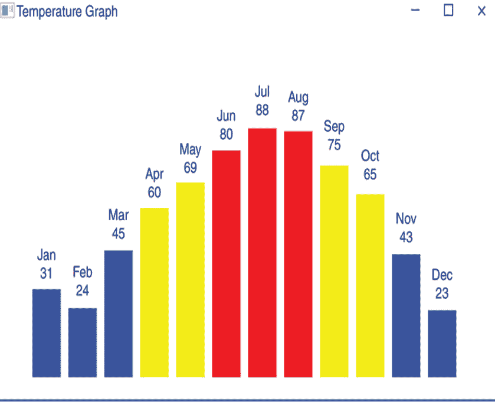

## 图 4.2

条状图展示了与文本输出相同的信息，但它添加了一个视觉组件，使得比较每月温度变得更加容易——例如，找到最高或最低温度，或者发现全年的温度趋势。颜色也添加了信息，低温用蓝色表示，中温用黄色表示，高温用红色表示。

在本章中，我们将使用 JavaFX 编写生成图形输出的程序。

# 4.1 JavaFX 结构

多年来，Java 提供了多个版本的图形系统。第一个是抽象窗口工具包（AWT），随后被 Swing 取代。Java 目前构建图形应用程序的系统是 JavaFX。JavaFX 使创建带有动画和特殊特效的丰富界面成为可能。在本章中，我们专注于 JavaFX 为应用程序创建图形输出的特性。

构建 JavaFX 应用程序所需的所有类都随 Java SE SDK 一起下载。Oracle 在 `http://docs.oracle.com/javafx/2/get_started/jfxpub-get_started.htm` 提供了 JavaFX 的教程信息，所有 JavaFX 类的文档包含在 Java 9 的文档中。

> **参考点**
>
> 如需查看 JavaFX 教程，请访问 `http://docs.oracle.com/javafx/2/get_started/jfxpub-get_started.htm`

JavaFX 使用了混合的性能/艺术比喻。我们从一个舞台（`stage`，窗口）开始，向其中添加一个或多个场景（`scene`）。为了产生图形输出，我们在场景中添加一个画布（`canvas`），并在画布上绘制形状和文本。当我们的应用程序启动时，窗口会打开并显示我们在画布上绘制的任何内容。

我们作者提供了两个类来帮助您入门。首先，我们提供了一个实用程序 `JIGraphicsUtility.java`，用于管理设置 JavaFX 应用程序的一些常用代码。其次，我们提供了 `ShellGraphicsApplication.java`，它为添加自定义绘制代码提供了一个框架。示例 4.1 所示的 `JIGraphicsUtility.java` 类有一个静态方法 `setUpGraphics`，旨在从我们的图形应用程序调用以设置窗口标题和大小。我们在这里展示 `JIGraphicsUtility` 类是为了完整，但我们不需要对此文件进行任何修改。我们只需要将此文件包含在与图形应用程序相同的文件夹中，并从应用程序中调用 `setUpGraphics` 方法。`setUpGraphics` 方法的 API 如表 4.1 所示。

## 表 4.1 静态 setUpGraphics 方法

| 返回值 | 方法名和参数列表 |
|---|---|
| `GraphicsContext` | `setUpGraphics(Stage stage, String title, int width, int height)` 在舞台上初始化场景，将窗口标题设置为 title，并添加指定宽度和高度的画布；返回一个 `GraphicsContext` 对象 |

在我们的图形应用程序中，我们使用 `setUpGraphics` 方法返回的 `GraphicsContext` 对象来调用在窗口上绘制形状和文本的方法。

## 示例 4.1 JIGraphicsUtility 类

```java
/* JIGraphicsUtility
  用于构建 JavaFX
应用程序的实用类
  Anderson, Franceschi
**/

import javafx.scene.Group;
import javafx.scene.canvas.Canvas;
import javafx.scene.canvas.GraphicsContext;
import javafx.scene.Scene;
import javafx.stage.Stage;

public class JIGraphicsUtility
{
    public static GraphicsContext setUpGraphics(
        Stage stage, String title, int
height, int width
    {
        stage.setTitle(title);
        Canvas canvas = new Canvas(width, height);
        Group root = new Group(canvas);
        stage.setScene(new Scene(root));
        GraphicsContext gc = canvas.getGraphicsContext2D();
        stage.show();
        return gc;
    }
}
```

## 示例 4.2 ShellGraphicsApplication

```java
/* 用于创建图形
应用程序的壳程序
  Anderson, Franceschi
**/

import javafx.application.Application;
import javafx.scene.canvas.GraphicsContext;
import javafx.stage.Stage;

public class ShellGraphicsApplication extends Application
{
    @Override
    public void start(Stage stage)
    {
        GraphicsContext gc = JIGraphicsUtility.setUpGraphics(
            stage, "Shell Application", 700, 400);
        // 你的绘制代码写在这里
    }

    public static void main(String[] args)
    {
        launch(args);
    }
}
```

# 4.2 图形坐标系与颜色

JavaFX 的 `GraphicsContext` 类位于 `javafx.scene.canvas` 包中，它提供了绘制矩形、圆形和线条等图形的方法，设置绘制颜色的方法以及在窗口中写入文本的方法。

要在窗口上绘图，我们需要指定想要放置形状的位置以及希望形状具有的颜色。

窗口由像素组成，像素可以被看作彩色点。一个宽度为 700 像素、高度为 400 像素的窗口共有 28,000 (700 * 400) 个像素。每个像素都有一个使用 `(x, y)` 坐标系表示的位置。`x` 坐标指定水平位置，随着向右移动而增加。`y` 坐标指定垂直位置，从窗口顶部的 0 开始，随着向下移动而增加。因此，对于一个宽 700 像素、高 400 像素的窗口，坐标 `(0, 0)` 对应于左上角；`(699, 0)` 是右上角；`(0, 399)` 是左下角；`(699, 399)` 是右下角。图 4.3 显示了一个带有几个示例像素及其 `(x, y)` 坐标的窗口。

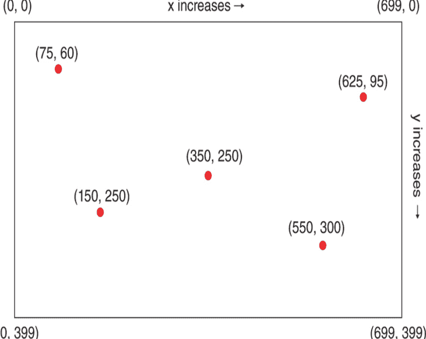

## 图 4.3

GraphicsContext 坐标系

每个像素也有一种颜色。当窗口打开时，所有像素都会被设置为背景色，默认为白色。我们执行的任何绘制操作都是使用前景颜色完成的，即描边颜色（stroke color）和填充颜色（fill color）。大多数绘制方法都有描边版本和填充版本，其中描边版本使用当前的描边颜色绘制一个轮廓形状，而填充版本使用当前的填充颜色绘制一个实心形状。默认情况下，描边颜色和填充颜色都是黑色，但我们可以将它们中的任何一个设置为我们喜欢的任何颜色。设置的颜色值将一直有效，直到我们将描边颜色或填充颜色设置为另一种颜色为止。例如，如果我们将描边颜色设置为蓝色，填充颜色设置为红色，然后绘制一个轮廓矩形、一条线以及一个实心椭圆，那么矩形和线将用蓝色绘制，而椭圆将用红色绘制。然后我们将填充颜色设置为黄色并绘制一个实心矩形，该矩形将用黄色绘制。

要设置前景颜色，我们如表 4.2 所示调用 `GraphicsContext` 类的 `setFill` 或 `setStroke` 方法。这些方法接受一个 `Paint` 对象作为参数。由于 `Color` 类的对象也是 `Paint` 对象，因此可以将 `Color` 对象作为参数传递给 `setFill` 和 `setStroke` 方法。

## 表 4.2 设置前景颜色的 GraphicsContext 类方法

| 返回值 | 方法名和参数列表 |
|---|---|
| `void` | `setStroke(Paint color)` 将当前的轮廓颜色设置为 color |
| `void` | `setFill(Paint color)` 将当前的填充颜色设置为 color |

`Color` 类位于 `javafx.scene.paint` 包中，使用 RGB（红、绿、蓝）系统定义颜色。任何 RGB 颜色都由红、绿、蓝分量组成。每个分量的值范围可以从 0 到 255（十六进制的 0 到 FF）；值越高，该分量在颜色中的浓度就越高。例如，红 = 255、绿 = 0、蓝 = 0 的颜色是纯红色，红 = 0、绿 = 0、蓝 = 255 的颜色是纯蓝色。

`Color white` 为 (255, 255, 255)：它的红、绿、蓝分量具有最大值。黑色是 (0, 0, 0)：它的红、绿、蓝分量具有最小值。灰色由等量的分量组成。分量的值越高，灰色越亮。这是合理的，因为颜色越接近白色，颜色就越浅。同样，灰色值越接近 0，灰色的颜色就越深，因为颜色正接近黑色。

为了方便设置描边和填充颜色，`Color` 类提供了大约 150 个静态 `Color` 常量。表 4.3 列出了一些常用颜色的 `Color` 常量及其对应的十六进制红、绿、蓝分量。如需完整的 `Color` 常量列表，请参阅 Java 类库中 `Color` 类的文档。

## 表 4.3 选定的颜色常量及其红、绿、蓝分量

| 颜色常量 | 红 | 绿 | 蓝 |
|---|---|---|---|
| `Color.BLACK` | 00 | 00 | 00 |
| `Color.BLUE` | 00 | 00 | FF |
| `Color.CYAN` | 00 | FF | FF |
| `Color.DARKGRAY` | A9 | A9 | A9 |
| `Color.GRAY` | 80 | 80 | 80 |
| `Color.GREEN` | 00 | FF | 00 |
| `Color.LIGHTGRAY` | D3 | D3 | D3 |
| `Color.MAGENTA` | FF | 00 | FF |
| `Color.ORANGE` | FF | A5 | 00 |
| `Color.PINK` | FF | C0 | CB |
| `Color.RED` | FF | 00 | 00 |
| `Color.YELLOW` | FF | FF | 00 |

例如，如果我们将描边颜色设置为蓝色，填充颜色设置为红色，然后绘制一个轮廓矩形、一条线以及一个实心椭圆，那么矩形和线将用蓝色绘制，而椭圆将用红色绘制。然后我们将填充颜色设置为黄色并绘制一个实心矩形，该矩形将用黄色绘制。

```java
gc.setStroke(Color.ORANGE);
```

如果这些颜色都不符合我们的需求，可以使用任何分量值创建自定义颜色。`Color` 类具有表 4.4 所示的静态方法。

## 表 4.4 Color 类方法

| 返回值 | 方法名和参数列表 |
|---|---|


| Color | `rgb(int rr, int gg, int bb)` 创建具有红、绿、蓝分量的 Color 对象 |

### 技能练习

- 4.7.1 多选题 (1, 2, 3, 4, 5)
- 4.7.3 代码填充 (10)
- 4.7.4 代码中识别错误 (23, 24, 25, 26, 27)
- 4.7.5 调试区域 (29, 30)
- 4.7.8 技术写作 (38)

图 4.4 显示了方法参数与绘制图形之间的关系。

### 表 4.5 GraphicsContext 绘制方法

| 返回值 | 方法名和参数列表 |
| --- | --- |
| void | `strokeLine(double xStart, double yStart, double xEnd, double yEnd)` 绘制从 (xStart, yStart) 到 (xEnd, yEnd) 的线 |
| void | `strokeRect(double x, double y, double width, double height)` 在 (x, y) 处绘制矩形轮廓，宽度和高度为指定的像素 |
| void | `fillRect(double x, double y, double width, double height)` 在 (x, y) 处绘制一个实心矩形，宽度和高度为指定的像素 |
| void | `clearRect(double x, double y, double width, double height)` 用当前背景色在 (x, y) 处绘制一个实心矩形，宽度和高度为指定的像素 |
| void | `strokeOval(double x, double y, double width, double height)` 在一个不可见的边界矩形内绘制椭圆轮廓，宽度和高度为指定的像素；边界矩形的左上角为 (x, y) |
| void | `fillOval(double x, double y, double width, double height)` 在一个不可见的边界矩形内绘制一个实心椭圆，宽度和高度为指定的像素；边界矩形的左上角为 (x, y) |
| void | `strokeText(String s, double x, double y)` 在 (x, y) 坐标处（表示第一个字符的左下角）显示字符串 s，文本使用当前的描边颜色和线宽绘制 |
| void | `fillText(String s, double x, double y)` 在 (x, y) 坐标处（表示第一个字符的左下角）显示字符串 s，文本使用当前的填充颜色绘制 |
| void | `setLineWidth(double width)` 将当前的描边线宽设置为 width 像素 |
| void | `setFont(Font f)` 将字体设置为 f 以显示文本 |

`strokeLine(xStart, yStart, xEnd, yEnd)`

(xStart, yStart) -> (xEnd, yEnd)

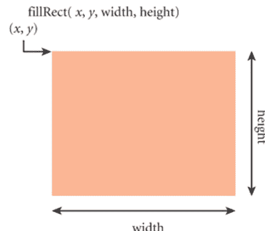

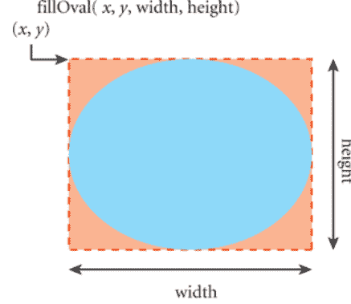

`fillText(string, x, y)`

在此处写入一个字符串

(x, y)

## 图 4.4

绘制线条、矩形、椭圆和文本的参数

示例 4.3 显示了一个绘制某些线条的图形应用程序，图 4.5 显示该应用程序的输出。对于此应用程序，我们修改了 `ShellGraphicsUtility.java`，将其重命名为 `DrawingLines.java`，并将应用程序和 `JIGraphicsUtility.java` 放在同一个文件夹中。

第 5–8 行导入了我们在程序使用的 JavaFX 类，包括 `Color` 类。我们还在第 10 行导入了标准 Java 类库中的 `Random` 类。

在调用 `setUpGraphics` 方法（第 19–21 行）时，我们指定窗口标题为“Drawing Lines”，并将窗口大小设置为 700 × 400 像素。

在第 23–24 行，我们通过调用 `strokeLine` 方法绘制一条线，并将线条的起点和终点坐标作为参数。线条是水平的，因为起点和终点的坐标 y 值相同。线条的颜色是默认的描边颜色，黑色。

接下来我们绘制一条垂直线（第 26–29 行）。我们首先使用预定义的 `Color` 常量 `Color.RED` 将描边颜色设置为红色。通过调用 `setLineWidth` 方法并传递参数 5，我们将线条宽度设置为 5 像素。这条线将一直有效，直到我们将线宽设置为不同的值。这条线是垂直的，因为起点和终点的坐标 x 值相同。

最后，我们通过为红、绿、蓝分量生成随机值，为描边颜色生成随机值（第 31–37 行），然后使用这些值通过 `rgb` 工厂方法创建一个 `Color` 对象。我们将 `FF` 发送到 `Random` 类的 `nextInt` 方法，因为每个红、绿、蓝分量的值在十六进制范围内范围从 00 到 FF。注意，在整数字面量值前面加上 `0x` 表示该值是十六进制的。第 39 行使用第 17 和 18 行定义的窗口宽度和高度，从窗口左上角到右下角绘制了一条随机颜色的对角线。

### 示例 4.3 DrawingLines.java

```java
1 /* Drawing Lines
2  Anderson, Franceschi
3 */
4
5  import javafx.application.Application;
6  import javafx.scene.canvas.GraphicsContext;
7  import javafx.scene.paint.Color;
8  import javafx.stage.Stage;
9
10 import java.util.Random;
11
12 public class DrawingLines extends Application
13 {
14     @Override
15     public void start( Stage stage )
16     {
17         final int WIDTH = 700;
18         final int HEIGHT = 400;
19         // set up window title and size
20         GraphicsContext gc =
21             JraphicsUtility.setUpGraphics(
22             stage, "Drawing Lines", WIDTH, HEIGHT);
23
24         // draw a vertical black line
25             gc.strokeLine(100, 125, 100, 300);
26
27         // draw a horizontal red line
28             gc.setStroke(Color.RED);
29             gc.setLineWidth(5 ); // widen the line
30             gc.strokeLine(300, 75, 550, 75);
31
32         // draw a diagonal line in a random color
32 Random rand = new Random();
33 int red = rand.nextInt(0xFF);
34 int green = rand.nextInt(0xFF);
35 int blue = rand.nextInt(0xFF);
36 Color randomColor = Color.rgb(red, green, blue);
37 gc.setStroke(randomColor);
38 
39 gc.strokeLine(0, 0, WIDTH - 1, HEIGHT - 1);
40 }
41 42 public static void main(String [] args)
43 {
44 launch(args);
45 }
46 )
```

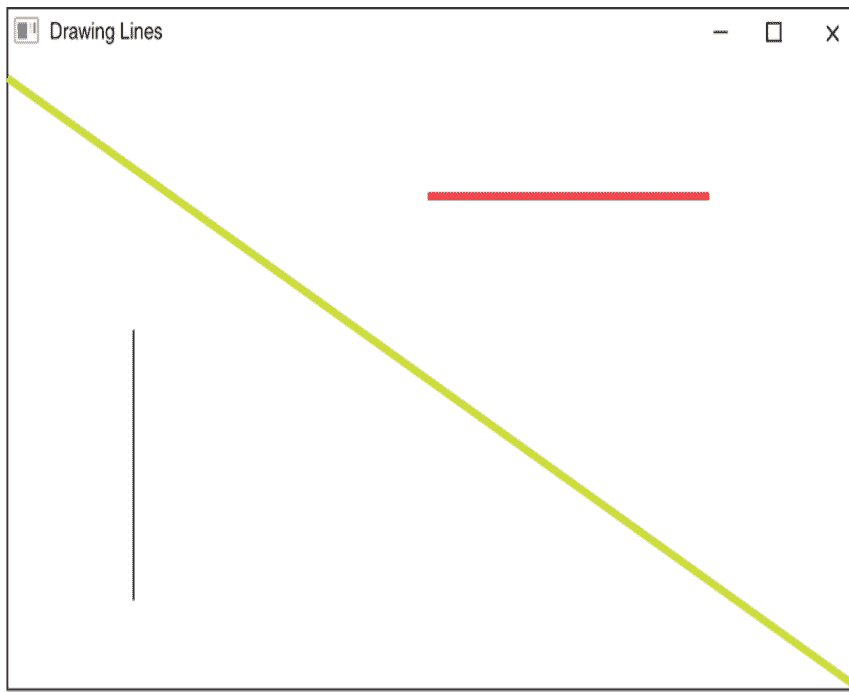

## 图 4.5

示例 4.4 显示了如何使用 `GraphicsContext` 方法绘制形状，图 4.6 显示该应用程序的输出。绘制矩形，我们调用 `strokeRect` 或 `fillRect` 方法，传入左上角的 `(x, y)` 坐标以及宽度和高度（像素）。如预期的，绘制正方形，我们指定相同的宽度和高度。第 23 行绘制了一个左上角在 (100, 50) 的空心矩形，宽 80 像素，高 200 像素；第 24 行绘制了一个左上角在 (275, 75) 的实心正方形，边长为 160 像素。

绘制椭圆或圆要复杂一些。如图 4.4 所示，我们需要想象一个边界椭圆或圆的矩形。我们在 `strokeOval` 或 `fillOval` 方法中指定的 `(x, y)` 坐标是边界矩形的左上角。相应地，宽度和高度是边界矩形的宽度和高度。示例 4.4 中的第 27 行绘制了一个左上角在 (100, 50) 的实心椭圆，宽 80 像素，高 200 像素，与第 27 行绘制的椭圆尺寸相同但旋转了 90 度。

我们通过调用 `strokeOval` 或 `fillOval` 方法并指定相同的宽度和高度来绘制圆。有时通过提供中心点和半径来标识圆更为自然。在这种情况下，我们可以像第 32–35 行所示，将中心点和半径转换为 `strokeOval` 或 `fillOval` 方法的参数。

### 示例 4.4 DrawingShapes.java

```java
1 /* Drawing Shapes
2  Anderson, Franceschi
3 */
4
5  import javafx.application.Application;
6  import javafx.scene.canvas.GraphicsContext;
7  import javafx.scene.paint.Color;
8  import javafx.stage.Stage;
9
10 public class DrawingShapes extends Application
11 {
12     @Override
13     public void start( Stage stage )
14     {
15         // set up window title and size
16         GraphicsContext gc =
17         JraphicsUtility.setUpGraphics(
18             stage, "Drawing Shapes", 700, 400);
19         // specify colors
20         gc.setFill(Color.CYAN);
21         gc.setStroke(Color.ORANGE);
22         // draw rectangles
23         gc.strokeRect(100, 50, 80, 200);
24         gc.fillRect(275, 75, 160, 160);
25         // draw ovals
26         gc.fillOval(100, 50, 80, 200);
27         gc.strokeOval(100, 275, 200, 80);
28         // draw circle using center point and radius
29         gc.setFill(Color.MEDIUMGREEN);
30         int centerX = 550, centerY = 275;
31         int radius = 75;
32         gc.fillOval(centerX - radius, centerY - radius, radius * 2, radius * 2);
33     }
34
35     public static void main(String [] args )
36     {
37         launch(args);
38     }
39 }
```

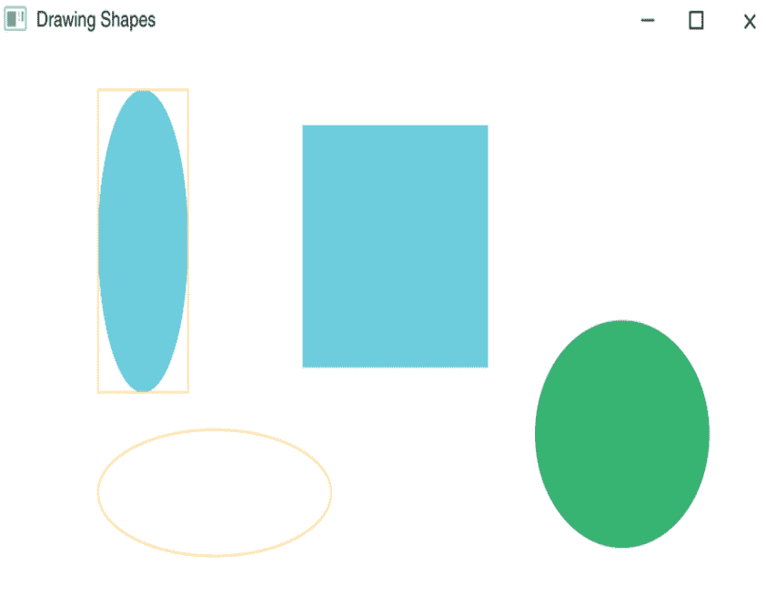

## 图 4.6 DrawingShapes.java 输出

示例 4.5 显示了如何使用 `fillText` 方法显示文本。指定的坐标是字符串中第一个字符的左下角。第一次调用 `fillText`（第 23 行）使用默认字体显示我们的消息。如图 4.7 所示，默认文本字体很小。要用较大的字体显示消息，我们可以使用表 4.5 所示的 `GraphicsContext` 的 `setFont` 方法。但是，首先我们需要使用表 4.6 所示的 `Font` 构造函数创建一个 `Font`（第 25 行）。它的唯一参数是请求的字体点大小；在这种情况下，我们请求字体大小为 28。然后我们在第 26 行设置字体。第 29 行通过 `strokeText` 使用较大的字体重新显示消息，使文本具有描边效果。

### 示例 4.5 DrawingText.java

```java
1 /* Drawing Text
2  Anderson, Franceschi
3 */
4
5  import javafx.application.Application;
6  import javafx.scene.canvas.GraphicsContext;
7  import javafx.scene.paint.Color;
8  import javafx.scene.text.Font;
9  import javafx.stage.Stage;
10
11 public class DrawingText extends Application
12 {
13     @Override
14     public void start( Stage stage )
15     {
16         // set up window title and size
17         GraphicsContext gc =
18         JraphicsUtility.setUpGraphics(
19             stage, "Drawing Text", 700, 400 );
20
21         String message = "Programming is not a spectator sport!";
22         gc.setFill(Color.RED);
23
24         gc.fillText(message, 100, 100);
25
26         Font largeFont = new Font( 28 );
27         gc.setFont( largeFont);
28         gc.setStroke(Color.RED);
29
30         gc.strokeText(message, 100, 250 );
31     }
32
33     public static void main(String [] args )
34     {
35         launch(args);
36     }
37 }
```

### 表 4.6 字体类构造函数

| 字体构造函数 |
| --- |
| `Font(double size)` | 使用默认字体字体创建一个高度为 `size` 的 Font 对象 |

如果你为图形指定的 (x, y) 坐标不在窗口内，会发生什么？如果图形的坐标位于窗口边界之外，不会产生错误，但图形超出窗口边界的部分将不可见。

## 常见错误陷阱

如果你想让整个绘制内容可见，请务必确保你的形状的所有部分都包含在窗口边界内。

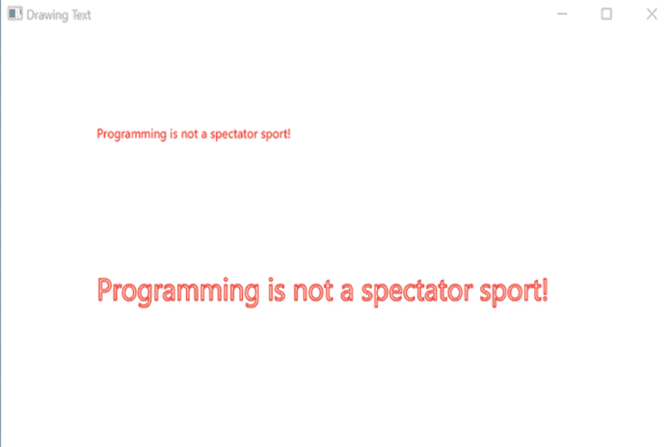

## 图 4.7 DrawingText.java 的输出


## 代码实战

在在线资源中，你将找到一个视频，演示了如何逐步使用 `GraphicsContext` 绘制方法。点击链接开始视频。

将所有这一切整合在一起，我们现在可以编写一个绘制精灵（sprite）的应用程序，精灵是一个可以作为一个单元进行定位和绘制的图形对象。示例 4.6 显示了实现代码的代码，图 4.8 显示了我们的精灵。

### 示例 4.6 DrawingASprite.java


```java
1 /* 绘制精灵
2 Anderson, Franceschi
3 */
4
5 import javafx.application.Application;
6 import javafx.scene.canvas.Canvas;
7 import javafx.scene.canvas.GraphicsContext;
8 import javafx.scene.paint.Color;
9 import javafx.stage.Stage;
10
11 public class DrawingASprite extends Application
12 {
13     @Override
14 public void start(Stage stage)
15     {
16         // 设置窗口标题和大小
17         GraphicsContext gc =
18         GraphicsUtility.setUpGraphics(
19         stage, "Drawing a Sprite", 700, 400);
20
21 // 绘制精灵
22         int sX = 275;
23         int sY = 100;
24         gc.setFill(Color.CORAL); // 主体
25         gc.fillOval(sX, sY + 20, 120, 160);
26         gc.setFill(Color.DARKGOLDENRO); // 帽子
27         gc.fillRect(sX + 30, sY, 60, 30);
28         gc.setStroke(Color.DARKGOLDENRO); // 帽檐
29         gc.setLineWidth(3);
30         gc.strokeLine(sX, sY + 30, sX + 120, sY + 30);
31         gc.setFill(Color.CHOCOLATE); // 眼睛
32         gc.fillOval(sX + 80, sY + 60, 24, 16);
```

```java
32         gc.setFill( Color.DARSALMON ); // 脚部
33         gc.setLineWidth( 1);
34         gc.fillOval( sX + 64, sY + 166, 60, 16 );
35         gc.strokeOval( sX + 64, sY + 166, 60, 16 );
36         gc.fillOval( sX + 36, sY + 170, 60, 16 );
37         gc.strokeOval( sX + 36, sY + 170, 60, 16 );
38 
39 
40 public static void main( String[] args
41 {
42 launch( args );
43 }
44
```

为了绘制我们的精灵，我们使用椭圆绘制身体、眼睛和脚部，并使用矩形和线条绘制帽子。我们使用不同的线宽来绘制帽檐，并勾勒椭圆轮廓以帮助定义脚部。

重要的是，形状的渲染按照描边（`stroke`）或填充（`fill`）方法执行的顺序进行的。任何占据之前绘制形状相同空间的新形状都将覆盖之前绘制的形状。在这次绘制中，我们特意在绘制身体之后绘制眼睛和帽子；对于脚部，我们先绘制填充的椭圆，然后使用描边椭圆勾勒脚部。

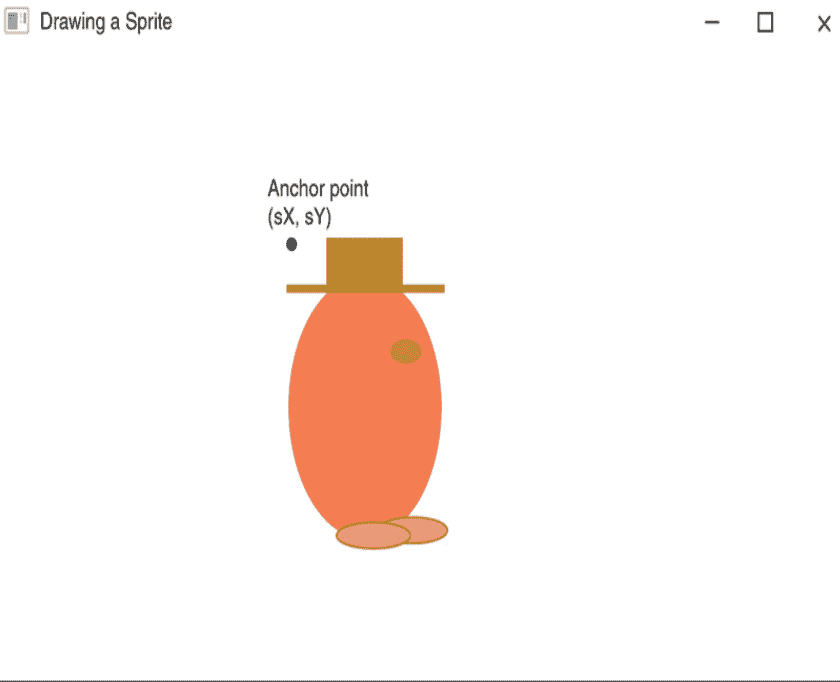

**图 4.8** `DrawingASprite.java` 的输出（已标出锚点）

在第 21–22 行中，我们声明并初始化了两个变量 `sX` 和 `sY`。如图 4.8 所示，`sX` 和 `sY` 定义了精灵的起始点。对于 `fillRect`、`strokeLine`、`fillOval` 和 `strokeOval` 方法，我们发送相对于 `sX` 和 `sY` 的参数。通过偏移量（offsets），我们可以轻松更改精灵的位置。

> 软件提示：绘制自定义形状时，我们使用一系列 (x, y) 坐标。

# 自定义形状

绘制自定义形状时，它由一系列 (x, y) 坐标组成。4.7 展示了用于创建路径的 Java 方法。

| 方法名 | 参数 |
| --- | --- |
| `void beginPath()` | 开启新路径 |
| `void moveTo(double x, double y)` | 移动到指定的 (x, y) 坐标 |
| `void lineTo(double x1, double y1, double x2, double y2)` | 从当前点到 (x2, y2) 绘制一条线 |
| `void fillRect(double x, double y, double width, double height)` | 填充矩形 |
| `void strokeRect(double x, double y, double width, double height)` | 描边矩形 |
| `void fillOval(double x, double y, double width, double height)` | 填充椭圆 |
| `void strokeOval(double x, double y, double width, double height)` | 描边椭圆 |
| `void strokeLine(double x1, double y1, double x2, double y2)` | 绘制线条 |
| `void fillLine(double x1, double y1, double x2, double y2)` | 填充线条 |
| `void closePath()` | 关闭当前路径 |

绘制自定义形状时，它由一系列 (x, y) 坐标组成。4.7 展示了用于创建路径的 Java 方法。

忘记关闭路径可能会导致形状不完整。4.7 展示了用于填充或描边的方法。

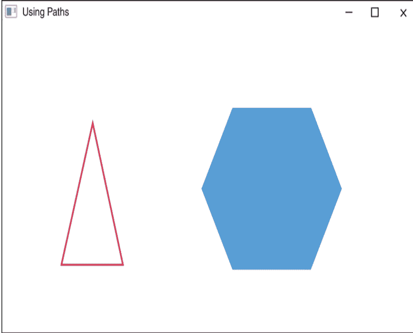

图 4.9 `DrawingPaths.java` 的输出

# 技能练习

通过这些章后习题

## 4.7.1 多选题

题 6, 7, 8, 9

## 4.7.2 阅读与理解代码

题 11, 12, 13, 14, 15

## 4.7.3 填空题

题 17, 18, 19, 20

## 4.7.4 识别代码中的错误

题 21, 22

## 4.7.5 调试区域

题 28

## 4.7.6 编写短程序

题 31, 32, 33

## 4.7.8 技术写作

题 39

## 4.5 编程活动 1：使用图形编写应用程序

在编程活动中，你将创建一个使用图形来绘制你自己的设计的应用程序。该编程活动的目的是获得对窗口坐标系、`stroke`（描边）和 `fill`（填充）图形方法以及颜色的使用经验。

1. 从 `ShellGraphicsApplication` 类开始，修改类名为表示你将绘制的图形，并为 `Color` 类添加 `import` 语句。记得将 `JIGraphicsUtility.java` 文件包含在同一个文件夹中。

2. 创建一个你自己的设计的图形。先在网格纸上画草图会有帮助，然后将绘图转换为应用程序窗口的坐标。你的绘图应该定义一个锚点，并包含至少两个矩形、椭圆和线条，以及一个路径（path）。你的图形还应该使用至少三种颜色，其中一种是自定义颜色。

3. 使用 `fillText` 方法为你的图形添加标记。

发挥创意，尽情享受绘画的乐趣吧！

## 讨论题

1. 如果你将图形的起始 (x, y) 坐标定义为 (800, 400)，你可能看不到图形。请解释原因。

2. 使用起始 (x, y) 坐标作为锚点来绘制图形有什么优点？

## 章节复

## 4.6 章节总结

- 扩展 JavaFX `Application` 类的图形应用程序打开一个窗口并允许我们创建图形输出。

- JavaFX 应用程序使用性能/艺术的比喻，其中舞台（`stage`）对应于窗口，场景（`scene`）是我们可以在上面放置画布（`canvas`）。

- 我们将绘制形状和文本的代码放在 `start` 方法中，该方法在应用程序启动时自动调用。

- `GraphicsContext` 类提供了在画布上绘图的方法。提供了用于绘制图形、矩形、椭圆、自定义形状和线条的方法；用于设置绘图颜色；以及在窗口中显示文本的方法。

- 使用 (x, y) 坐标系来指定窗口中的位置。每个坐标对应一个像素（或图像元素）。x 值指定水平位置，从窗口左侧的 0 开始，随着向窗口右侧移动而增加。y 值指定垂直位置，从窗口顶部的 0 开始，随着向窗口下方移动而增加。

- 图形窗口上的所有绘制都是使用当前的描边或填充前景颜色完成的，分别通过 `setStroke` 和 `setFill` 方法进行更改。描边颜色用于线条和轮廓形状；填充颜色用于绘制实心形状。描边或填充颜色都可以用于文本。

- `Color` 类的对象可以设置当前的描边或填充颜色。`Color` 类提供了静态常量以便于使用颜色。

- 使用 `rgb` 工厂方法并指定颜色的红、绿、蓝分量来实例化自定义颜色对象。

- 在显示文本时，我们可以通过实例化 `Font` 对象并调用 `GraphicsContext` 类的 `setFont` 方法来设置字体大小。

- 可以路径（path）绘制自定义形状。我们首先创建一个新路径并移动到原点。然后我们定义应该绘制线条的顶点。完成后，我们关闭路径，然后将路径填充为实心形状，或将路径描边为轮廓形状。

- 精灵（sprite）是一个由形状组成的图形对象，意图作为一个单元进行移动。在绘制精灵时，定义一个起始 (x, y) 坐标作为锚点，并将绘图方法的所有 x 和 y 值指定为相对于起始坐标的偏移量。

## 4.7 练习、问题与项目

## 4.7.1 多选题

1. `GraphicsContext` 类属于哪个包？

- javafx.scene.paint

- javafx.scene.canvas

- javafx.stage

- javafx.application

2. 如果窗口是 400 比 800 像素，该窗口包含多少像素？

- 1,200 像素

- 32,000 像素

- 320,000 像素

3. 一个 JavaFX 图形应用程序打开一个窗口。

- true

- false

4. 在 JavaFX 中，`start` 方法被调用。

- true

- false

5. 观察以下代码：

```
Color c = Color.BLUE;
```

`BLUE` 是什么？

- `Color` 的静态常量

- `Color` 的实例变量

- `Color` 的静态方法

- `Color` 的实例方法

6. 在以下代码中：

```
gc.strokeLine(100, 200, 300, 200);
```

这条线是什么？

- 垂直

- 水平

- 对角线

7. 在以下代码中，10, 20 代表什么？

```
gc.strokeRect(10, 20, 100, 200);
```

- 矩形左上角的 (x, y) 坐标

- 矩形的宽度和高度

- 矩形的中心 (x, y) 坐标

- 矩形的右下角的 (x, y) 坐标

8. 在以下代码中，100, 200 代表什么？

```
gc.fillRect(10, 20, 100, 200);
```

- 矩形左上角的 (x, y) 坐标

- 矩形的宽度和高度

- 矩形的中心 (x, y) 坐标

- 矩形的右下角的 (x, y) 坐标

9. `fillOval` 有多少个参数？

- 2

- 3

- 4

- 5

10. 在 RGB 格式下，灰色可以编码为 AAA，其中第一个 A 代表红色，第二个 A 代表绿色，第三个 A 代表蓝色。我们可以有多少种灰色？

- 0

- 2

- 255

- 256

## 4.7.2 阅读与理解代码

在题 11 到 15 中，假设 `gc` 是一个 `GraphicsContext`。

11. 矩形是什么颜色的？

```
gc.setFillColor(Color.BLUE);
gc.fillRect(10, 20, 100, 200);
```

12. 这条线的长度是多少？

```
gc.strokeLine(50, 20, 50, 350);
```

13. 矩形的宽度是多少？

```
gc.fillRect(10, 20, 250, 350);
```

14. 矩形右上角的 (x, y) 坐标是多少？

```
gc.fillRect(10, 20, 250, 350);
```

15. 矩形右下角的 (x, y) 坐标是多少？

```
gc.strokeRect(10, 20, 250, 350);
```

## 4.7.3 填空题

16. 这段代码将当前填充颜色设置为红色，当前描边颜色设置为绿色。

```java
gc.setFill(Color.RED);
gc.setStroke(Color.GREEN);
```

17. 这段代码绘制字符串 "Fill In the Code"，第一个字符（F）的左下角位于坐标 (100, 250)。

```java
gc.fillText("Fill In the Code", 100, 250);
```

18. 这段代码绘制一个宽度为 100 像素、高度为 300 像素的填充矩形，起始于坐标 (50, 30)。

```java
gc.fillRect(50, 30, 100, 300);
```

19. 这段代码绘制一个填充矩形，其左上角为 (50, 30)，右下角为 (100, 300)。

```java
gc.fillRect(50, 30, 50, 270);
```

20. 这段代码绘制一个圆位于 (200, 200)、半径为 100 的圆。

```java
gc.fillOval(100, 100, 200, 200);
```

## 4.7.4 识别代码中的错误

在问题 21 到25 中，假设 `gc` 是一个 `GraphicsContext` 引用。

- 21. 在这段尝试绘制实心蓝色矩形的代码序列中，逻辑错误在哪里？

```
gc.setStroke( Color.BLUE );
gc.fillRect( 10, 20, 100, 200 );
```

- 22. 这段代码序列中的错误在哪里？

```
gc.fillText( 'Find the bug', 100, 200 );
```

- 23. 这段代码序列中的错误在哪里？

```
gc.setFill( GREEN );
```

- 24. 这段代码序列中的错误在哪里？

```
gc.setColor( Color.RED );
```

- 25. 这段代码序列中的错误在哪里？

```
gc.color = Color.RED;
```

- 26. 这条语句中的错误在哪里？

```
import java.GraphicsContext;
```

- 27. 这条语句中的错误在哪里？

```
import java.stage.Stage;
```

## 4.7.5 调试区域——使用 Java 编译器和 Java JVM 消息

28. 你在 `MyDrawingApp.java` 中编写了以下程序。

```java
import javafx.application.Application;
import javafx.scene.canvas.GraphicsContext;
import javafx.stage.Stage;
public class MyDrawingApp extends Application
{
    @Override
    public void start( Stage stage ) {
        GraphicsContext gc = 
            JIGraphicsUtility.setUpGraphics(
                stage, "Tester", 700, 400 );
        gc.strokeRect(725, 200, 50, 50);
    }

    public static void main( String [ args ] {
        launch( args );
    }
}
```

你没有得到编译器错误，但运行程序时，矩形没有出现。解释问题是什么以及如何修复。

29. 你导入了 `Color` 类并在 `MyApplication.java` 类的第 10 行编写了以下代码：

```java
Color c = Color.rgb( 1.4, 234, 23 ); // line 10
```

编译时，MyApplication.java:10: 错误：类型不兼容：

```
MyApplication.java:10: error: incompatible types:
possible lossy conversion
from double to int
Color c = Color.rgb( 1.4, 234, 23 ); // line
10

1 error
```

解释问题是什么以及如何修复。

30. 你在 `MyApplication.java` 类的第 10 行编写了以下代码：

```java
Color c = Color.Blue; // line 10
```

编译时，你得到了以下消息：

```
MyApplication.java:10: error: cannot find symbol
Color c = Color.Blue; // line 10
symbol : variable Blue
location : class Color
1 error
```

解释问题是什么以及如何修复。

## 4.7.6 编写一个短程序

- 31. 编写一个显示五个奥运五克环的应用。


- 32. 编写一个显示井井棋盘的应用。包含几个 X 和 O。
- 33. 编写一个显示菱形（即边相等的平行四边形）的应用。你的菱形不应该是一个正方形。

## 4.7.7 编程项目


34. 编写一个显示双眼睛的应用。眼睛可以使用椭圆、实心圆和线条来绘制。在窗口上，关于这些眼睛写两个字。
35. 编写一个显示以下硬币的应用：季度币、角币和镍币。这三个硬币应该绘制成基础圆形（直径不同），并在硬币内部显示金额（例如，“25¢”）。提示：使用 Unicode 货币符号表查找分符号的编码。
36. 编写一个显示由线条（可能还有矩形）组成的基础房屋的应用。你的房子应该有多种颜色。为房子显示一个标题（例如，“Java House”）。


37. 编写一个显示四个同心圆的应用。每个圆都应该是同一种颜色的浅色调。（提示：查看 `Color` 类中的 `brighter` 方法。）

## 4.7.8 技术写作

38. 解释将数据以图表形式可视化的一些优点。还要解释颜色在传递数据值方面可以起的作用。
39. 如果 `strokeRect` 方法不存在，但你仍然可以使用 `strokeLine` 方法，解释你将如何绘制一个矩形。

## 4.7.9 小组项目（适用于 1、2 或 3 名学生小组）

40. 编写一个显示以下内容的应用：
- 两个或三个国际象棋棋子的精灵图绘制。

以下表达式可通过测试 `int` 变量 `yearInCollege` 的值是否等于 4 来排除大四学生：
```
yearInCollege != 4
```

以下表达式可用于游戏程序，以判断用户是否想再次玩：
```
playAgain == 'y'
```
假设用户的输入存储在 `char` 变量 `playAgain` 中，如果用户输入了 'y'，则表达式求值为 `true`；对于任何其他输入值，该表达式求值为 `false`。

一个常见的错误是使用赋值运算符代替相等运算符。例如：
```
playAgain = 'y'
```
这实际上是将值 `y` 赋值给变量 `playAgain`。

> **常见错误陷阱**
>
> 不要将相等运算符 `==`（双等号）与赋值运算符 `=`（单等号）混淆。

虽然相等运算符可以比较对象引用，但这些运算符不能用于比较对象数据。我们将在本章稍后讨论对象的比较。

## 5.1.2 关系运算符

为了比较原始数值类型的值，Java 提供了如表 5.2 所示的关系运算符。这些运算符是二元的，这意味着它们接受两个操作数，每个操作数都是一个求值为原始数值类型的表达式。关系运算符不能用于布尔表达式或对象引用。

## 表 5.2 关系运算符

| 关系运算符 | 类型 | 含义 |
|---|---|---|
| `<` | 二元 | 小于 |
| `<=` | 二元 | 小于等于 |
| `>` | 二元 | 大于 |
| `>=` | 二元 | 大于等于 |

同样，如果 `int` 变量 `age` 保存值为 32，那么：
- 表达式 `( age < 32 )` 求值为 `false`，
- 表达式 `( age <= 32 )` 求值为 `true`，
- 表达式 `( age > 32 )` 求值为 `false`，以及
- 表达式 `( age >= 32 )` 求值为 `true`。

此表达式测试 `int` 变量 `testScore` 是否至少为 90：
```
testScore >= 90
```
此代码测试该分数是否小于 60：
```
testScore < 60
```

## 5.1.3 逻辑运算符

程序中的常见操作是测试组合条件的组合为真为假。对于这些操作，Java 提供了逻辑运算符 `!`、`&&` 和 `||`，它们分别对应于布尔逻辑运算符 NOT（非）、AND（与）和 OR（或）。表 5.3 所示的这些运算符以布尔表达式作为操作数。布尔表达式可以是变量、运算符和方法调用的组合，并产生一个布尔值。

## 表 5.3 逻辑运算符

| 逻辑运算符 | 类型 | 含义 |
|---|---|---|
| `!` | 一元 | NOT |
| `&&` | 二元 | AND |
| `||` | 二元 | OR |

NOT 运算符 (`!`) 接受一个布尔表达式作为操作数，并反转该操作数的值。如果操作数为 `true`，则结果将为 `false`；如果操作数为 `false`，则结果将为 `true`。

AND 运算符 (`&&`) 接受两个布尔表达式作为操作数；如果两个操作数都为 `true`，则结果将为 `true`；否则，结果将为 `false`。

OR 运算符 (`||`) 也接受两个布尔表达式作为操作数。如果两个操作数都为 `false`，则结果将为 `false`；否则，它将为 `true`。OR 运算符由两个垂直线组成，中间没有空格。在 PC 键盘上，垂直线是 Enter 键上方 Shift 的字符。

这些逻辑运算符的真值表如表 5.4 所示。

## 表 5.4 逻辑运算符真值表

| a | b | !a | a && b | a || b |
|---|---|---|---|---|
| true | true | false | true | true |
| true | false | false | false | true |
| false | true | true | false | true |
| false | false | true | false | false |

## 参考点

完整的运算符优先级图见附录 B。

关系运算符和逻辑运算符的优先级顺序如表 5.5 所示，同算术运算符。注意，一元运算符 `!` 在关系和逻辑运算符中优先级最高，其次是关系运算符，然后是相等运算符，接着是 AND (`&&`)，最后是 OR (`||`)。

## 表 5.5 运算符优先级

| 运算符层级 | 同语句求值顺序 | 操作 |
|---|---|---|
| `( )` | 从左到右 | 用于显式分组的括号 |
| `++`, `--` | 从右到左 | 快捷后增/后减 |
| `++`, `--` | 从右到左 | 快捷前增/前减，逻辑一元 NOT |
| `!` | | |
| `*`, `/`, `%` | 从左到右 | 乘法、除法、取模 |
| `+`, `-` | 从左到右 | 加法或字符串拼接、减法 |
| `<`, `<=`, `>`, `>=` | 从左到右 | 关系运算符：小于、小于等于、大于、大于等于 |
| `==`, `!=` | 从左到右 | 相等运算符：等于、不等于 |
| `&&` | 从左到右 | 逻辑与 |
| `||` | 从左到右 | 逻辑或 |
| `=`, `+=`, `-=`, `*=`, `/=`, `%=` | 从右到左 | 赋值运算符和快捷赋值运算符 |

示例 5.1 显示了这些运算符。

## 示例 5.1 逻辑运算符如何工作

```java
/* 逻辑运算符 */
public class LogicalOperators {
    public static void main(String[] args) {
        int age = 75;
        boolean test;

        test = age > 18 && age < 65;
        System.out.println("age > 18 && age < 65: " + test);

        test = age > 18 || age < 65;
        System.out.println("age > 18 || age < 65: " + test);

        test = age > 18 && (age < 65);
        System.out.println("age > 18 && (age < 65): " + test);

        test = (age > 18) || age < 65;
        System.out.println("(age > 18) || age < 65: " + test);
    }
}
```

输出：
```
age > 18 && age < 65: false
age > 18 || age < 65: true
age > 18 && (age < 65): false
(age > 18) || age < 65: true
```

```
x < y && x < z
```

使用 Java 逻辑运算符，通常有多种方式来表达同一个条件。例如，假设我们有两个名为 `flag1` 和 `flag2` 的布尔变量，并且想要测试是否至少有一个为 `false`。

用通俗的话说，我们可以翻译为 `flag1` 为 false 或者 `flag2` 为 false。

表 5.6 提供了上述测试的几种等价表达式。

## 表 5.6 等价表达式示例

| 等价表达式 | 英语含义 |
|---|---|
| `( flag1 == false ) || ( flag2 == false )` | flag1 is false OR flag2 is false |
| `!flag1 || !flag2` | flag1 is true OR flag2 is true |
| `! ( flag1 && flag2 )` | not both flag1 and flag2 are true |

尽管表 5.6 中的所有表达式都是等价的，但第一个表达式（即对待测试条件最简单的翻译）最容易理解，也是可读性的最佳选择。

## 德·摩根定律 (DeMorgan's Laws)

感谢英国数学家奥古斯塔·德·摩根（Augustus DeMorgan）的工作，我们有一套规则可以开发等价表达式。德·摩根以他在布尔代数和集合论的工作闻名，他建立了著名的德·摩根定律。它们如下：

1. NOT ( A AND B ) = ( NOT A ) OR ( NOT B )
2. NOT ( A OR B ) = ( NOT A ) AND ( NOT B )

因此，在 Java 中，使用第一律我们可以看到：
> `! ( a && b )` 等价于 `!a || !b`

使用第二律，我们可以看到：
> `! ( a || b )` 等价于 `!a && !b`

这些定律在表 5.7 所示的扩展真值表中得到了说明。

## 表 5.7 德·摩根定律真值表

| a | b | !a | !b | a&&b | a||b | !(a&&b) | !a||!b | !(a||b) | !a&&!b |
|---|---|---|---|---|---|---|---|---|---|
| true | true | false | false | true | true | false | false | false | false |
| true | false | false | true | false | true | true | true | false | false |
| false | true | true | false | false | true | true | true | false | false |
| false | false | true | true | false | false | true | true | true | true |

因此，要使用德·摩根定律，我们将 AND 运算符更改为 OR，将 OR 运算符更改为 AND，对逻辑运算符的每个操作数应用 NOT 运算符 (`!`)。当操作数是使用关系运算符或相等运算符的表达式时，取反后的表达式如表 5.8 所示。

## 表 5.8 逻辑 NOT 应用于关系和相等运算符

| 表达式 | ! ( 表达式 ) |
|---|---|
| `a == b` | `a != b` |
| `a != b` | `a == b` |
| `a < b` | `a >= b` |
| `a >= b` | `a < b` |
| `a > b` | `a <= b` |
| `a <= b` | `a > b` |

## 工程师提示

编写布尔表达式时要易于阅读和理解。

例如，假设我们有一个名为 `age` 的 int 变量代表一个人的年龄，我们想要评估是否小于等于 18 或大于等于 65。

表 5.9 提供了上述测试的几种等价表达式。

## 表 5.9 等价表达式更多示例

| 等价表达式 | 英语含义 |
|---|---|
| `( age <= 18 || age >= 65 )` | age is less than or equal to 18 or age is greater or equal to 65 |
| `!( age > 18 && age < 65 )` | age is not between 18 and 65 |
| `!( age > 18 ) || !( age < 65 )` | age is not greater than 18 or age is less than 65 |

尽管表 5.9 中的所有表达式都是等价的，但对测试条件最简单的翻译最易读。


## 5.2 使用 if 的简单选择

当程序需要对某一组数据执行操作而不是对所有数据执行操作时，简单选择模式是合适的。在这种情况下，我们使用简单的 if 语句，其模式如下：

```
if ( condition )
{
    true block
}
next statement
```

true block 可以包含一个或多个语句，并且仅在条件为真时执行。true block 执行后，执行 if 语句后面的指令。如果条件为假，则跳过 true block。如果 true block 只包含一个语句，大括号是可选的。图 5.2 展示了简单 if 语句的控制流。

在示例 5.2 中，我们首先在 12-13 行提示用户输入分数。然后在 15-16 行在 18 行测试加分是否大于 0。如果是，我们在 19-20 行将加分加入总分中。图 5.3 和 5.4 显示了加分和不加分情况下的控制流。


### 5.2 使用 if 操作

```java
import java.util.Scanner;

public class TestGrade {
    public static void main(String[] args) {
        Scanner scan = new Scanner(System.in);
        System.out.print("Enter grade: ");
        int grade = scan.nextInt();
        System.out.print("Enter extra credit points: ");
        int extraCredit = scan.nextInt();

        if (grade >= 60) {
            grade += extraCredit;
        }

        System.out.println("Final grade: " + grade);
    }
}
```

### 图 5.3 加分的 5.2 输出

```
Enter grade: 75
Enter extra credit points: 10
Final grade: 85
```

### 图 5.4 不加分的 5.2 输出

```
Enter grade: 45
Enter extra credit points: 5
Final grade: 45
```

### 工程师提示

为了清晰起见，请缩进 if 语句中的 true block。缩进可以让条件为真时执行的代码部分更加清晰。注意 true block 的缩进。

许多软件工程师认为，即使 true block 只包含一个语句，包含大括号也是良好的习惯，因为增加了清晰度和易维护性。如果程序需求发生变化，我们需要向 true block 添加第二个语句，大括号已经准备就绪。

注意条件后没有分号。如果我们在条件后放置分号，如如下错误的语句所示：

```
if ( grade >= 60 ); // 在此处放置分号是错误的
System.out.println("You passed");
```

## 常见错误陷阱

> 在 if 语句的条件后添加分号表示 true block 为空，并在运行时导致逻辑错误。

编译器不会产生错误。相反，它会将分号视为 if 语句的 true block 是空的，因为分号本身表示一个无任何操作的语句。在这种情况下，编译器得出条件为真时没有指令执行的结论。结果是，当程序运行时，语句
```
System.out.println( "You passed" );
```
被视为紧跟在 if 语句之后

## 5.3 使用 if/else 进行选择

当数据属于两个互斥的类别，并且每个类别应该执行不同的指令时，if 语句的第二形式是合适的。对于这些情况，我们使用 if/else 语句，其模式如下：

```
if ( condition )
{
    true block
}
else
{
    false block
}
next statement
```

如果条件为真，则执行 true block 并跳过 false block。如果条件为假，则跳过 true block 并执行 false block。在任何情况下，接下来都会执行 if 语句后面的指令。图 5.5 展示了 if/else 语句的控制流。

如果 true 或 false 块只包含一条语句，则该块的大括号是可选的。


再次，请注意 `true` 块和 `false` 块的缩进，以及 `else` 和大括号与 `if` 对齐。这种编码风格使我们很容易看出哪些语句属于 `true` 块，哪些语句属于 `false` 块。如果缩进不正确，程序的读者可能会误解哪些语句将被执行。在任何情况下，编译器都会忽略缩进；缩进的设计仅仅是为了让人类更容易理解代码的逻辑。

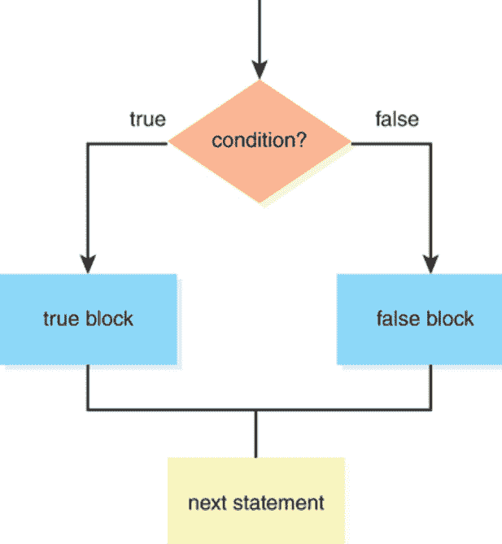

## 图 5.5 if/else 语句的控制流

在示例 5.3 中，我们测试了一个分数以确定它是及格分（`>= 60`）还是不及格分（任何其他值）。这是一个数据互斥的情况：分数要么是及格，要么不是及格。我们想根据分数打印不同的消息。在提示用户输入数字分数后，我们声明了一个 `String` 来存储适当的消息（第 16 行），该消息将在我们的 if/else 语句中确定。如果 `if` 条件 `(grade >= 60)` 为真，则我们将 “You passed” 赋值给 `message`。如果条件为假，我们将“You failed” 赋值给 `message`。在第 22 行，在 `if/else` 语句完成后，我们打印我们赋值给 `message` 的任何 `String`。图 5.6 和 5.7 显示了程序的两次运行，首先使用一个大于或等于 60 的分数，然后使用一个小于 60 的分数。

## 示例 5.3 使用 if/else

```java
/* 使用 if/else */
import java.util.Scanner;
public class PassingGrade {
    public static void main(String[] args) {
        Scanner scan = new Scanner(System.in);
        System.out.print("Enter a grade ");
        int grade = scan.nextInt();
        String message;
        if (grade >= 60) {
            message = "You passed";
        } else {
            message = "You failed";
        }
        System.out.println(message);
    }
}
```

注意，我们可以使用两个顺序语句，如下：

```java
if ( grade >= 60 )
    message = "You passed";
if ( grade < 60 )
    message = "You failed";
```

然而，如果第一个条件 `(grade >= 60)` 为假，则第二个条件 `(grade < 60)` 必须为真。因此，if/else 简化了我们的处理，并避免了在其中一个条件可能为真的情况下不必要的测试两个条件。

## 图 5.6 示例 5.3 在分数 >= 60 时的输出

```
Enter a grade > 60
You passed
```

## 图 5.7 示例 5.3 在分数 < 60 时的输出

```
Enter a grade > 59
You failed
```

## 块作用域

变量的**作用域**是程序中该变量可以被**引用**或使用的区域。当我们声明一个变量时，它的作用域从它的开始一直延伸到声明它的块的结束。一个方法（例如 `main`）是一个块。因此，在示例 5.3 中，对象 `scan` 的作用域从第 11 行延伸到 `main` 的结束。因此，我们可以在第 14 行合法地引用 `scan`。同样，`grade` 的作用域从它的声明（第 14 行）延伸到 `main` 的结束，我们可以在第 17 行合法地引用它。最后，`String message` 的作用域从第 16 行延伸到 `main` 的结束，因此我们可以在第 18 行、20 行和 22 行合法地引用 `message`。

`if` 语句的 `true` 块和 `false` 块也是块。因此，如果我们在第 16 行声明 `String message`，我们就是在 `if` 语句的 `true` 块内部声明它的，如下所示：

```java
if ( grade >= 60 ) {
    String message = "You passed";
} else
    message = "You failed";

System.out.println(message);
```

那么 `message` 的作用域仅从它的声明处延伸到 `true` 块的结束。在这种情况下，编译器将对 `false` 块内部对 `message` 的引用以及 `if` 语句后的 `System.out.println` 语句生成“cannot find symbol”错误，因为 `message` 溢出了作用域。


## 代码演示

在在线资源中，你将找到一个演示如何逐步使用 if/else 语句的视频。点击本章的链接开始视频。

## 章节末问题练习

- 5.14.2 阅读和理解代码：问题 1-13
- 5.14.3 填空代码：问题 20, 21, 22, 23, 24, 25, 26, 27, 28, 29, 30
- 5.14.4 识别代码中的错误：问题 33, 34, 35
- 5.14.5 调试：问题 40
- 5.14.6 编写程序：问题 42, 43, 46
- 5.14.7 写作：问题 48
- 5.14.8 技术：问题 54

## if/else 语句

当数据是互斥的（分数要么是及格分，要么不是及格分）时，可以使用 if/else。我们想根据分数打印不同的消息。在提示用户输入数字分数后，我们声明了一个 `String` 来存储适当的消息（第 16 行），该消息将在我们的 if/else 语句中确定。如果 `if` 条件 `(grade >= 60)` 为真，则我们将 “You passed” 赋值给 `message`。如果条件为假，我们将“You failed” 赋值给 `message`。在第 22 行，在 `if/else` 语句完成后，我们打印我们赋值给 `message` 的任何 `String`。图 5.6 和 5.7 显示了程序的两次运行，首先使用一个大于或等于 60 的分数，然后使用一个小于 60 的分数。

## if/else 语句

我们可以使用 if/else 语句根据学生的数字分数来确定其字母等级分。示例 5.4 演示了一个 Java 程序，它提示学生输入分数并将其转换为字母等级。

## if/else 语句

当数据落入多个互斥的类别时，if/else 语句是合适的。这种形式的 if 语句的控制流如图 5.8 所示。一旦某个条件为真，控制就会移动到相应的 `true` 块，跳过剩余的条件。最后的 `else` 是可选的，只有当所有条件都为假时才会执行。


Hemera Technologies/Photos.com/Thinkstock

## 代码实战

在在线资源中，你将找到一个视频，演示了如何分步使用 if/else if 语句。点击本章的链接开始播放视频。

### 技能练习

完成这些章节后练习

#### 5.14.1 多选题

第 8

#### 5.14.2 代码阅读与理解

第 15

#### 5.14.4 识别代码错误

第 36, 37, 38

## 5.5 顺序和嵌套的 if/else 语句

当我们在评估下一个条件之前，需要得到一个 `if` 语句的处理结果时，我们可以按顺序编写多个 `if` 语句，或者将它们嵌套在其他 `if` 语句中。

### 5.5.1 顺序 if/else 语句

#### 寻找最小值或最大值

为了说明顺序 `if` 语句，让我们来看寻找三个数中最小的问题。

我们可以使用多个顺序的 `if` 语句。首先我们找到前两个数中较小的那个，然后找到该结果与第三个数之间较小的那个。该应用的伪代码如下：

```
read number1
read number2
read number3

if number1 is less than number2
    smallest is number1
else
    smallest is number2
if number3 is less than smallest
    smallest is number3
```

将伪代码翻译成 Java，我们得到了示例 5.5 中的程序，它提示用户输入三个整数并输出这三个数中的最小值。在这个程序中，我们使用了两个顺序 `if` 语句。第一个 `if` 语句（第 23–26 行）使用 `if/else` 语句找到前两个整数中较小的一个，并将该值存储在变量 `smallest` 中。然后，第二个 `if` 语句（第 28–29 行）将第三个整数与 `smallest` 中的值进行比较。在第二个 `if` 语句中，我们没有使用 `else` 子句，因为只有当条件为*真*时（即第三个数小于 `smallest`），我们才需要更改 `smallest` 中的值。否则，最小值已经存储在 `smallest` 中了。

## 示例 5.5 使用顺序 if 语句的程序

```java
/*
 找到三个整数中的最小值
 * Anderson, Franceschi
 */
import java.util.Scanner;

public class FindSmallest {
    public static void main(String [] args) {
        int smallest;
        int num1, num2, num3;

        Scanner scan = new Scanner(System.in);
        System.out.print("Enter the first integer: ");
        num1 = scan.nextInt();
        System.out.print("Enter the second integer: ");
        num2 = scan.nextInt();
        System.out.print("Enter the third integer: ");
        num3 = scan.nextInt();
        if ( num1 < num2 )
            smallest = num1;
        else
            smallest = num2;

        if ( num3 < smallest )
            smallest = num3;

        System.out.println("The smallest is " + smallest );
    }
}
```

当使用 6, 7, 和 5 作为三个整数运行示例 5.5 中的程序时，输出如图 5.10 所示。

还有一点。代码只检查其中一个数是否小于另一个数。如果两个或多个数字相等会怎样？代码仍然有效！我们只需要找到最小值；我们并不在乎哪个变量持有了那个最小值。

## 图 5.10 示例 5.5 的输出

```
Enter the first integer: 6
Enter the second integer: 7
Enter the third integer: 5
The smallest is 5
```

### 5.5.2 嵌套 if/else 语句

`if` 语句可以写在另一个 `if` 语句的真值块或假值块中。这些被称为嵌套的 `if` 语句。通常，当除了第一个 `if` 语句的结果外，还需要更多信息时，我们就会嵌套 `if` 语句。

嵌套 `if` 语句中出现的一个困难是需要指定哪个 `else` 子句与哪个 `if` 语句配对，特别是当某些 `if` 语句有 `else` 子句而其他没有时。编译器会将任何 `else` 子句与上一个尚未拥有 `else` 子句的 `if` 语句相匹配。如果这种匹配不是我们想要的，我们可以使用大括号来指定所需的 `if/else` 配对。

在这段代码中，我们有一个 `if` 语句嵌套在另一个 `if` 语句中。

```java
if ( x == 2 )
    if ( y == x )
        System.out.println("x and y equal 2");
    else
        System.out.println("x equals 2, but y does not");
```

如果没有大括号，整个第二个 `if` 语句将包含第一个条件 `(x == 2)` 的真值块，而 `else` 与第二个条件 `(y == x)` 配对，因为这是上一个没有 `else` 的条件。

然而，我们可以通过大括号强制让 `else` 子句与第一个条件配对，如下：

```java
if ( x == 2 ) {
    if ( y == x )
        System.out.println("x and y equal 2");
} else
    System.out.println("x does not equal 2");
```

加上大括号后，`if` 条件 `(y == x)` 及其真值块现在属于第一个 `if (x == 2)`。

#### 悬空 else (Dangling else)

> **常见陷阱**
> 确保所有 `else` 子句与 `if` 语句匹配。
> 编写不与 `if` 语句匹配的 `else` 子句会产生悬空 `else`。

常见的错误是 `else` 语句没有 `if` 语句。例如，以下代码包含了三个 `else` 子句和两个 `if` 语句，会产生错误：

```java
'else' without 'if'

if ( x == 2 )
    if ( y == x )
        System.out.println("x and y equal 2");
    else // matches y==
        System.out.println("x equals 2, but y");

else // matches x2
    System.out.println("x does not equal 2");

else // no if!
    System.out.println("x and y equal");
```

对于嵌套 `if` 语句更复杂的例子，让我们生成一个 1 到 10 之间的随机数。在生成随机数后，我们将提示用户输入。首先我们验证猜测是否在 1 到 10 之间。如果不是，我们将打印一条消息。否则，我们将检查用户是否猜中了数字。如果是，我们将打印一条祝贺消息。如果猜测很接近（我们将“接近”定义为三个个数以内），我们将打印消息。该程序的伪代码如下：

```
generate a secret number between 1 and 10
prompt the user for guess

if guess is not between 1 and 10
    print message
else
    if guess equals the secret number
        print congratulations
    else
        if guess is not within 3 numbers
            print "You missed a a!"
        else
            print "You were close."
            print "Better luck time."
```

伪代码使用了三个 `if` 语句；第一个判断猜测是否在范围内。如果不是，我们打印消息。否则，嵌套 `if` 语句测试用户是否猜中了秘密数。如果是，我们打印祝贺消息。如果不是，我们的最后一个嵌套 `if` 语句判断猜测是否不在秘密数的三个个数范围内。如果不是，我们打印“你错过了！”否则，我们打印“你接近。”示例 5.6 是伪代码翻译成 Java 应用的结果。

## 示例 5.6 嵌套 if 语句

```java
/* Guess a number between 1 and 10
   Anderson, Franceschi
*/
import java.util.Random;
import java.util.Scanner;

public class GuessANumber {
    public static void main(String [] args) {
        Random random = new Random();
        int secretNumber = random.nextInt( 10 ) + 1;

        Scanner scan = new Scanner(System.in);

        System.out.print("I'm thinking of a number" + " between 1 and 10. What is your guess?");
        int guess = scan.nextInt();

        if (guess < 1 || guess > 10) {
            System.out.println("Well, if you're not going to try," + " I'm not playing.");
        }
    }
}
```


```java
25     )
26     else
27     {
         if (guess == secretNumber) {
             System.out.println("Hoorah. You win!");
         }
         else
         {
             System.out.println("The number was " + secretNumber);

             if (Math.abs(guess - secretNumber) > 3) {
                 System.out.println("You missed it by a mile!");
             } else
                 System.out.println("You were close.");

             System.out.println("Better luck next time.");
         }
     }
 }
```

# 图 5.11

示例 5.6 中 GuessANumber 程序的输出

```
I'm thinking of a number between 1 and 10. What is your guess? 2
The number was 10
You missed it by a mile!
Better luck next time.
```

在第 34 行，我们使用了 `Math` 类的 `abs()` 方法来判断猜测是否在秘密数字的三个整数范围内。通过取秘密数字与猜测之间的差值的绝对值，我们不需要担心哪个数字大；我们总是能从 `abs()` 方法得到一个正差值。

图 5.11 显示了该程序示例运行的输出。

## 5.6 if/else 语句的测试技术

当应用程序使用 `if/else` 语句时，程序的控制流取决于用户的输入或其他数据值。对于一个输入值，应用程序可能会执行真块，而对于另一个输入值，应用程序可能会执行假块。显然，只运行一次应用程序并不能保证程序是正确的，因为真块没有被执行，假块也没有被执行，因此没有被测试。同样地，如果执行了假块，那么真块就没有被执行，因此也就没有被测试。

为了测试应用程序的正确性，我们可以尝试测试所有的执行路径。为此，我们设计了一个测试计划，包括使用不同的设计数据值运行应用程序，以执行程序中的所有语句。

例如，一个判断整数是正是负的应用程序可能会有如下代码：

```java
System.out.print("Enter an integer > ");
int x = scan.nextInt();
if (x > 0) {
    System.out.println(x + " is positive");
} else {
    System.out.println(x + " is negative");
}
```

我们可以通过运行两次应用程序来测试这段代码：第一次输入值 1，第二次输入值 -1。我们看到这两个值的结果都是正确的：1 是正数，-1 是负数。我们成功地执行了所有语句，但我们能确定程序是正确的吗？如果我们输入值 0 呢（0 既不被视为正整数也不被视为负整数）？按照目前的写法，我们的程序判断 0 是负数，这是不正确的。

因此，我们看到，仅仅测试真块和假块是不够的；我们还需要测试 `if/else` 语句的条件。有三种可能性：x 小于 0、x 等于 0、或者 x 大于 0。为了测试该条件，我们应该使用符合这三个标准的输入值运行应用程序。因此，我们应该使用输入值 0 再运行一次程序。这将告诉我们程序是不准确的，因为我们的代码将 0 识别为负数。

为了纠正程序，我们应该添加另一个条件 `(x < 0)`，以便我们将 0 与负数隔离开来。代码将变为：

```java
System.out.print("Enter an integer > ");
int x = scan.nextInt();
if (x > 0) {
    System.out.println(x + " is positive");
} else if (x < 0) {
    System.out.println(x + " is negative");
} else {
    System.out.println("The integer is 0");
}
```

现在，如果我们用输入值 -1、1 和 0 重新测试程序，我们为每个值都得到了正确的结果。

注意我们选择的测试值是 -1、0 和 1。我们称这些值为**边界值**，因为它们是可能导致条件（`x > 0`、`x < 0` 以及隐式的 `x == 0` 条件）评估为真的第一个可能值。如果我们错误地将第一个条件编码为 `x > 1`，并且我们选择 2 来测试代码，那么值 2 就会让代码看起来是正确的。然而，代码对于值 1 将无法正常工作。出于此原因，我们建议使用边界值来测试程序的执行路径。

# 软件工程提示

在测试你的程序时，开发用于测试所有执行路径边界值的输入值，并确认逻辑实现了程序规格。

另一种测试方法是将程序视为一个**黑盒**，即程序的内部原理对我们来说是未知且不可知的。我们完全根据程序的规格来制定我们的测试计划，并开发从逻辑上测试程序的输入值。因此，如果我们的规格是判断一个整数是正是负，我们推断应该用负数、正数以及特殊情况 0 作为输入来运行程序。

这两种测试方法共同工作，以确保程序的正确性。

## 5.7 编程活动 1：使用 if/else

在此活动中，你将编写一个 `if/else` 选择语句来决定高尔夫球手的得分如何与标准杆数比较。

打开 `SelectionPractice1Controller.java` 文件。在 5.7 所示的代码中，你需要编写一个 `if/else` 语句来执行高尔夫球手的得分与标准杆数的比较。这部分已经为你写好了。

复制 5.7 示例到你的电脑：

```java
public void workIfElse( int score )
{
    String result = "???";
    // 学生代码开始处
    // 如果 score 大于 72，将 "over par" 赋值给 result
    // 如果 score 等于 72，将 "par" 赋值给 result
    // 如果 score 小于 72，将 "below par" 赋值给 result
    // 学生代码结束处
    animate( score, result);
}
```

现在，如果我们用输入值 -1、1 和 0 重新测试程序，我们为这些每个值都得到了正确的结果。

注意我们选择的测试值是 -1、0 和 1。我们称这些值为边界值，因为它们是可能导致条件（`x > 0`、`x < 0` 以及隐式的 `x == 0` 条件）评估为真的第一个可能值。如果我们错误地将第一个条件编码为 `x > 1`，并且我们选择 2 来测试代码，那么值 2 就会让代码看起来是正确的。然而，代码对于值 1 将无法正常工作。出于此原因，我们建议使用边界值来测试程序的执行路径。

在这一活动中，你将编写一个 `if/else` 选择语句来决定高尔夫球手的得分如何与标准杆数比较。

打开 `SelectionPractice1Controller.java` 文件。在 5.7 所示的代码中，你需要编写一个 `if/else` 语句来执行高尔夫球手的得分与标准杆数的比较。这部分已经为你写好了。

现在，如果我们用输入值 -1、1 和 0 重新测试程序，我们为这些每个值都得到了正确的结果。

# 图 5.12

应用程序的开始


# 图 5.12

应用程序开始

动画：应用程序窗口将显示 `if/else` 语句的正确路径（绿色显示），这可能与你的路径相同，取决于你如何编码 `if/else` 语句。动画还会评估你的结果，即 `result` 的值，并对结果的正确性给出反馈。

要测试你的代码，请编译 `SelectionPractice1Controller.java` 并运行 `SelectionPractice1Application`并在文本框中输入整数。尝试以下输入值：71、72 和 73。确保你的代码对于所有输入值都产生正确的结果。

当程序启动时，你会看到一个带有图 5.12 中文本框的图形窗口，提示输入整数。

图 5.13 显示了输入值为 73 时的正确代码路径，并判定学生的代码是正确的。

图 5.14 显示了输入值为 73 时的正确代码路径，在这种情况下，学生的代码是不正确的。

# 讨论问题

1. 你在完整的 `if/else` 语句使用了多少个条件？

2. 如果应用程序对于输入值 71、72 和 73 得到正确的结果，那么你的代码就是正确的。解释原因。

选择练习 1

感谢 73

正确路径是

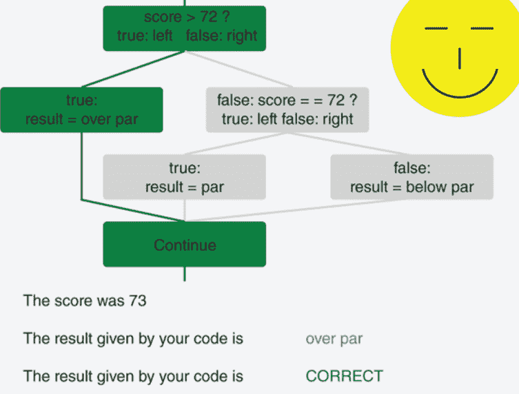

分数为 73

你的代码给出的结果高于标准

你的代码给出的结果是正确的

# 图 5.13

正确的 `if/else` 语句

# 图 5.14

错误的 `if/else` 语句

## 5.8 比较浮点数

Java 的 `float` 和 `double` 使用 IEEE 754 标准格式存储。由于使用了有限的位数（32 或 64 位）来存储浮点数，并不是所有的现实值都能被表示。因此，在执行算术运算时可能会引入微小的舍入误差。尽管如此，不建议简单依赖相等运算符来比较浮点数。

> ### 参考点

浮点数的二进制表示将在附录中讨论。

让我们来看示例 5.8，它通过两种方式计算 $11 * .1$。首先，在第 11 行，我们将 `.0` 赋值给双精度变量 `d1`，在第 12–22 行，我们向 `d1` 加 11 次 `.1`。然后，在第 24 行，我们声明了第二个双精度变量 `d2`，并将其赋值为 `.1` 乘以 11 次的结果。我们本以为 `d1` 和 `d2` 将具有相同的值。事实并非如此，正如程序输出如图 5.15 所示。

我们在比较 `float` 和 `double` 时也可以看到舍入的影响。例如，在示例 5.8 的第 35 和 36 行中，我们将同一个浮点数（PI）分别赋值给双精度变量 `piID` 和单精度浮点数变量 `piF`，然后在第 40 行比较这两个值。我们从图 5.15 的输出可以看出，它们并不相等。其由于是双精度浮点数能够存储比单精度浮点数更多的有效数字。

## 示例 5.8 使用相等运算符比较浮点数

```java
1 /* 在浮点数上使用相等运算符
2 Anderson, Franceschi
3 */
4
5 public class EqualityFloatingPoint
6 {
7 public static void main(String [] args )
8 {
9 // 第1部分：用两种方式计算 11 * .1
10
11 double d1 = .0; // 向 0 加 11 次 .1
12 d1 += .1; // 1
13 d1 += .1; // 2
14 d1 += .1; // 3
15 d1 += .1; // 4
16 d1 += .1; // 5
17 d1 += .1; // 6
18 d1 += .1; // 7
19 d1 += .1; // 8
20 d1 += .1; // 9
21 d1 += .1; // 10
22 d1 += .1; // 11
23
24 double d2 = .1 * 11; // 计算 11 * .1
25
26 System.out.println(" d1 = " + d1);
27 System.out.println(" d2 = " + d2);
28 if ( d1 == d2 )
29 System.out.println("d1 and d2 are equal");
30 else
31 System.out.println("d1 and d2 are not equal");
32
33 // 第2部分：比较 float 和 double 的值
34
35 float piF = 3.141592653589793f;
36 double piID = 3.141592653589793;
37
38 System.out.println("\npiF = " + piF);
39 System.out.println("piID = " + piID);
40 if(piF == piID)
41 System.out.println("piF and piID are equal");
42 else
43 System.out.println("piF and piID are not equal");
44 }
45 )
```

与其使用相等运算符比较浮点数，不如将差的绝对值与一个被称为*阈值*的小的值进行比较。阈值的值应该是我们能够接受并仍认为数字相等的差。让我们重做示例 5.8。我们不再使用相等运算符，而是使用 `Math.abs()` 方法计算两个数之间的差，并将该差与阈值值进行比较。我们将阈值设置为 `.0001`，这意味着如果数字之间的差异小于 `.0001`，我们就认为它们相等。这种方法的结果如示例 5.9 所示，输出如图 5.16。

# 图 5.15

示例 5.8 的输出

```
d1 = 1.0999999999999999
d2 = 1.1
d1 and d2 are not equal

piF = 3.1415927
piID = 3.141592653589793
piF and piID are not equal
```

## 示例 5.9 使用阈值比较浮点数

```java
1 /* 使用阈值比较浮点数
2 Anderson, Franceschi
3 */
4
5 public class ComparingFloatingPoint
6 {
7 public static void main( String [] args
8 {
9 final double THRESHOLD = .0001;
10
11 // 第1部分：用两种方式计算 11 * .1
12 double d1 = .0; // 向 0 加 11 次 .1
13 d1 += .1; // 1
14 d1 += .1; // 2
15 d1 += .1; // 3
16 d1 += .1; // 4
17 d1 += .1; // 5
18 d1 += .1; // 6
19 d1 += .1; // 7
20 d1 += .1; // 8
21 d1 += .1; // 9
22 d1 += .1; // 10
23 d1 += .1; // 11
24
25 double d2 = .1 * 11; // 计算 11 * .1
26
27 System.out.println("d1 = " + d1);
28 System.out.println("d2 = " + d2);
29 if ( Math.abs( d1 - d2 ) < THRESHOLD )
30 System.out.println("d1 and d2 are equal");
31 else
32 System.out.println("d1 and d2 are not equal");
33
34 // 第2部分：比较相同值的 float 和 double
35 float piF = 3.141592653589793f;
36 double piID = 3.141592653589793;
37
38 System.out.println("\npiF = " + piF);
39 System.out.println("piID = " + piID);
40 if ( Math.abs( piF - piID ) < THRESHOLD )
41 System.out.println("piF and piID are equal");
42 else
43 System.out.println("piF and piID are not equal");
44 }
```

# 图 5.16

示例 5.9 的输出

```
d1 = 1.099999999999999
d2 = 1.1
d1 and d2 are equal

piF = 3.1415927
piID = 3.141592653589793
piF and piID are equal
```

当我们在小数计算中需要精确度时，可以使用 Java 类库中的 `BigDecimal` 类。`BigDecimal` 类位于 `java.math` 包，提供了对 `BigDecimal` 对象执行加、乘、除的方法，使得结果是精确的，没有浮点运算引起的舍入误差。表 5.10 显示了 `BigDecimal` 类的构造函数和一些用于计算和比较 `BigDecimal` 对象的有用方法。

## 表 5.10 BigDecimal 类 API

| BigDecimal 类构造函数总结 |
| :--- |
| `BigDecimal( String d )` 创建相当于字符串表示的小数的 `BigDecimal` 对象 |

| BigDecimal 类方法总结 |
| :--- |
| 返回 方法 方法和参数列表 |
| `BigDecimal add( BigDecimal num )` 返回等于当前对象加上 `num` 的 `BigDecimal` 对象 |
| `BigDecimal subtract( BigDecimal num )` 返回等于当前对象减去 `num` 的 `BigDecimal` 对象 |
| `BigDecimal multiply( BigDecimal num )` 返回等于当前对象乘以 `num` 的 `BigDecimal` 对象 |
| `BigDecimal divide( BigDecimal num )` 返回等于当前对象除以 `num` 的 `BigDecimal` 对象 |


| int compareTo( BigDecimal num ) | 如果当前对象等于 num，返回 0；如果当前对象小于 num，返回 -1；如果当前对象大于 num，返回 1 |

> ### 参考点

你可以在 Oracle 的 Java 网站上阅读更多关于 `BigDecimal` 类的信息

www.oracle.com/technetwork/java

在示例 5.10 中，我们执行了与示例 5.9 相同的计算，但使用的是 `BigDecimal` 对象而不是 `double`。在第 11 和 12 行，我们实例化了两个 `BigDecimal` 对象：`d1` 将保存和并初始化为 `0.0`；`pointOne` 被赋值为 `0.1` 并将被反复添加到 `d1` 中。在第 16–26 行，我们调用 `add` 方法向 `d1` 添加 `0.1`。在第 29 和 30 行，我们实例化了两个 `BigDecimal` 对象，然后调用 `multiply` 方法乘以 `0.1 * 11`。在第 35 行，我们通过调用 `compareTo` 方法比较生成的 `BigDecimal` 对象，发现两个结果实际上是相等的。示例 5.10 的输出如图 5.17 所示。

### 图 5.17

示例 5.10 的输出

```
d1 = 1.1
d2 = 1.1
d1 and d2 are equal
```

## 示例 5.10 使用 BigDecimal 比较浮点数

```java
1 /* 使用 BigDecimal 计算精确小数
2 Anderson, Franceschi
3 */
4
5 import java.math.BigDecimal;
6
7 public class UsingBigDecimal
8 {
9 public static void main(String [] args) 
10 {
11 BigDecimal d1 = new BigDecimal("0.0");
12 BigDecimal pointOne = new BigDecimal("0.1");
13 
14 // 用两种方式计算 11 * .1
15 // 向 d1 加 11 次 .1
16 d1 = d1.add(pointOne); // 1
17 d1 = d1.add(pointOne); // 2
18 d1 = d1.add(pointOne); // 3
19 d1 = d1.add(pointOne); // 4
20 d1 = d1.add(pointOne); // 5
21 d1 = d1.add(pointOne); // 6
22 d1 = d1.add(pointOne); // 7
23 d1 = d1.add(pointOne); // 8
24 d1 = d1.add(pointOne); // 9
25 d1 = d1.add(pointOne); // 10
26 d1 = d1.add(pointOne); // 11
27 
28 // 乘以 .1 * 11
29 BigDecimal d2 = new BigDecimal(".1").multiply(new BigDecimal("11"));
30
31 System.out.println("d1 = " + d1);
32 System.out.println("d2 = " + d2);
33 if ( d1.compareTo(d2) == 0 )
34 System.out.println("d1 and d2 are equal");
35 else
36 System.out.println("d1 and d2 are not equal");
37
38 // 比较相同值的 float 和 double
39 BigDecimal piF = new BigDecimal("3.141592653589793f");
40 BigDecimal piID = new BigDecimal("3.141592653589793");
41
42 System.out.println("\npiF = " + piF);
43 System.out.println("piID = " + piID);
44 if ( piF.compareTo(piID) == 0 )
45 System.out.println("piF and piID are equal");
46 else
47 System.out.println("piF and piID are not equal");
48 }
```

*(注：由于原文文本中示例 5.10的代码部分在截断处不完整且存在逻辑断层，译文在保持代码结构不变的基础上，对注释和逻辑进行了对齐。)*

```java
29   BigDecimal d2 = new BigDecimal("0.1");
30   BigDecimal eleven = new BigDecimal("11");
31   d2 = d2.multiply(eleven);
32
33   System.out.println("d1 = " + d1 );
34   System.out.println("d2 = " + d2 );
35   if ( d1.compareTo( d2 ) == 0 )
36       System.out.println("d1 and d2 are equal");
37   )
38   else
39       System.out.println("d1 and d2 are not \
40       equal");
41   }
42 )
```

## 5.9 比较对象

### 5.9.1 equals 方法

通常，我们想要比较两个对象是否相等；通常，如果两个对象具有相同的数据，我们就说它们是相等的。然而，如果我们使用相等运算符 (`==`) 来比较对象引用，我们比较的是对象引用的值。换句话说，我们比较的是对象引用是否指向同一个对象，即同一个内存位置。要比较对象数据，我们需要使用 `equals` 方法，所有类都继承自 `Object` 类。许多类提供了 `equals` 方法的自定义版本。`equals` 方法的 API如下：

```
public boolean equals( Object ob )
```

通常，如果参数对象中的数据与调用方法的对象的数据匹配，则 `equals` 方法返回 `true`。

示例 5.11 中的程序创建了图 5.18 所示的 `SimpleDate` 对象引用和对象。该程序使用相等运算符比较对象引用，然后使用 `equals` 方法比较对象数据。该程序的输出如图 5.19 所示。

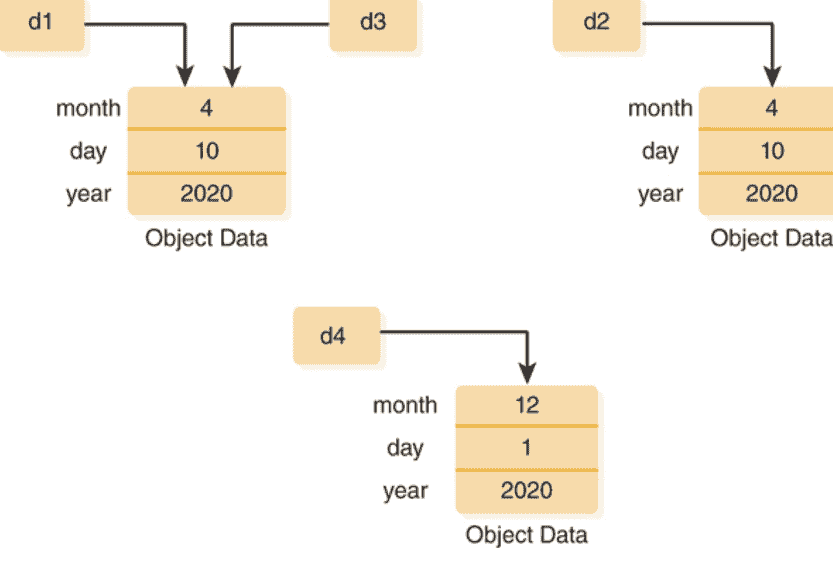

图 5.18

SimpleDate 对象与引用

## 示例 5.11 比较对象数据

```java
1 /* 比较对象引用和数据
2 Anderson, Franceschi
3 */
4
5 public class ComparingObjects
6 {
7 public static void main( String [] args){
9 // 实例化两个相同数据的 SimpleDate 对象
10 SimpleDate d1 = new SimpleDate(4, 10, 2020);
11 SimpleDate d2 = new SimpleDate(4, 10, 2020);
12
13 // 将对象引用 d1 赋值给 d3
14 SimpleDate d3 = d1; // d3 现在指向 d1
15
16 // 实例化另一个不同数据的对象
17 SimpleDate d4 = new SimpleDate(12, 1, 2020);
18
19 // 使用相等运算符比较引用
20 if ( d1 == d2)
21 System.out.println("d1 and d2 are equal\n");
22 else
23 System.out.println("d1 and d2 are not equal\n");
24
25 if ( d1 == d3 )
26 System.out.println("d1 and d3 are equal\n");
27 else
28 System.out.println("d1 and d3 are not equal\n");
29 )
29   // 使用 equals 方法比较对象数据
30   if ( d1.equals( d2) )
31     System.out.println("d1 data and d2 data are \
32     equal\n");
33   else
34     System.out.println("d1 data and d2 data are not \
35     equal\n");
36     if ( ! d1.equals( d4 ) )
37       System.out.println("d1 data and d4 data are not \
38       equal\n");
39     else
40       System.out.println("d1 data and d4 data are not \
41       equal\n");
42     } 
43   }
```

### 图 5.19

示例 5.11 的输出

```
d1 and d2 are not equal

d1 and d3 are equal

d1 data and d2 data are equal

d1 data and d4 data are not equal
```

第 10 行和第 11 行实例化了两个相同数据的 `SimpleDate` 对象。第 14 行将 `d3` 对象引用指向 `d1` 对象。第 17 行实例化了具有不同数据的 `d4` 对象。

### 常见错误陷阱

不要使用相等运算符来比较对象数据；请使用 `equals` 方法。

在第 20 行中，当我们使用相等运算符比较 `d1` 和 `d2` 时，结果为 `false`，因为对象引用 `d1` 和 `d2` 指向两个不同的对象。然而，当我们比较 `d1` 和 `d3`（第 25 行）时，结果为 `true`，因为 `d1` 和 `d3` 指向同一个对象。因此，只有当对象引用指向同一个对象时，它们才是相等的。

我们使用 `equals` 方法得到了不同的结果。当第 31 行使用 `equals` 方法比较 `d1` 和 `d2` 时，结果为 `true`，因为 `d1` 和 `d2` 具有相同的数据。正如我们预期的那样，`d1` 和 `d4` 不相等（第 36 行），因为这些对象的数据不同。第 36 行演示了我们可以使用非运算符 (`!`) 来取反 `equals` 方法的返回值来测试不相等性。

### 5.9.2 字符串比较方法

由于字符串是对象，我们也可以使用 `equals` 方法来比较字符串。此外，`String` 类还提供了另外两个方法 `equalsIgnoreCase` 和 `compareTo` 用于比较字符串的值。这些方法同 `equals` 方法一起总结在表 5.11 中。

### 表 5.11 String 类的比较方法

| 返回值 | 方法名和参数列表 |
|---|---|
| boolean | `equals( String str )` 比较两个字符串的值。如果字符串相等则返回 `true`；否则返回 `false`。 |
| boolean | `equalsIgnoreCase( String str )` 比较两个字符串的值，将大写和小写字符视为相等。如果字符串相等则返回 `true`；否则返回 `false`。 |
| int | `compareTo( String str )` 按字典顺序比较两个字符串的值。 |

```java
27 System.out.println( title1 + " is greater than " + title3 );
28 else if ( title1.compareTo( title3 ) < 0 )
29 System.out.println( title1 + " is less than " + title3 );
30 else
31 System.out.println( title1 + " is equal to " + title3 );
32
33 System.out.print("Using compareTo: " );
34 if ( title1.compareTo( title2 ) > 0 )
35 System.out.println( title1 + " is greater than " + title2 );
36 else if ( title1.compareTo( title2 ) < 0 )
37 System.out.println( title1 + " is less than " + title2 );
38 else
39 System.out.println( title1 + " is equal to " + title2 );
40 }
41 }
```

### 图 5.20

示例 5.12 的输出

```
Using equals: Green Pastures is not equal to green
pastures
Using equalsIgnoreCase: Green Pastures equals green
pastures
Using compareTo: Green Pastures is less than green
pastures
Using compareTo: Green Pastures is less than Green
pastures II
```

在示例 5.12 中，我们定义了三个相似的字符串：`title1` (`Green Pastures`)、`title2` (`Green Pastures II`) 和 `title3` (`green pastures`)。当我们使用 `equals` 方法（第 14 行）将 `title1`（`Green Pastures`）与 `title3`（`green pastures`）比较时，结果为 `false`，因为这两个字符串在大小写上不匹配。然而，当我们使用 `equalsIgnoreCase` 方法（第 20 行）进行相同的比较时，结果为 `true`，因为除了大小写不同外，这两个字符串在字符序列和长度上是完全相同的。

使用 `compareTo` 方法（第 34 行），`Green Pastures` 的评估结果为小于 `Green Pastures II`。虽然第一个字符串的所有字符都以相同的顺序出现在第二个字符串中，但由于第一个字符串的字符数少于第二个字符串。`Green Pastures` 评估结果为小于 `green pastures`（第 26 行）的原因并不直观——直到我们查看 Unicode 字符表。大写字母的数值比小写字母小，因此大写字母 `G` 小于小写字母 `g`。

## 5.10 条件运算符 (?:)

条件运算符 (`?:`) 本身不是一个语句，但可以在表达式中使用。它评估一个条件，并根据条件的值为表达式贡献两个值之一。条件运算符在处理无效输入和输出相似消息时特别有用。条件运算符的语法所示所示：

```
( condition ? expression1 : expression2 )
```

包含条件运算符的表达式的值取决于对条件的评估，该条件是任何评估结果为 `true` 或 `false` 的表达式。如果条件评估为 `true`，则 `expression1` 变为表达式的值；如果条件评估为 `false`，则 `expression2` 变为表达式的值。当将该表达式的结果赋值时：

```
variable = condition ? expression1 : expression2;
```

等同于：

```java
if ( condition )
    variable = expression1;
else
    variable = expression2;
```

有些程序员喜欢使用条件运算符，因为它让代码比使用 if/else 语句更简洁。假设我们要判断一个数是否为偶数：

```java
result = (number % 2 == 0) ? "even" : "odd";
```

注意，条件运算符本身不是语句，但可以在表达式中使用。示例 5.13 显示了如何使用它：

```java
import java.util.Scanner;

public class OddEven {
    public static void main(String[] args) {
        Scanner scan = new Scanner(System.in);
        System.out.print("Enter an integer: ");
        int number = scan.nextInt();
        String result = (number % 2 == 0) ? "even" : "odd";
        System.out.println(number + " is " + result);
    }
}
```

## 示例 5.14 简单的计算器


```java
1 /* 一个简单的计算器
2  Anderson, Francesi
3 */

import java.text.DecimalFormat;
import java.util.Scanner;

public class Calculator
{
    public static void main( String [ args )
    {
        double fpl, fp2;
        String operation;

        Scanner scan = new Scanner(System.in);

        // 设置结果的输出格式
        DecimalFormat twoDecimals = new DecimalFormat("#,###,###.##");

        // 打印欢迎消息
        System.out.println("Welcome to the Calculator ");

        // 读取两个操作数
        System.out.print("Enter the first operand: ");
        fpl = scan.nextDouble();
        System.out.print("Enter the second operand: ");
        fp2 = scan.nextDouble();

        // 打印菜单，然后提示操作类型
        System.out.println("\nOperations are: ");
31 + \n\t ADD or + 用于加法
32 + \n\t SUBTRACT or - 用于减法
33 + \n\t MULTIPLY or * 用于乘法
34 + \n\t DIVIDE or / 用于除法

35 System.out.print("Enter your selection: " );
        operation = scan.next();
        operation = operation.toUpperCase();

        // 执行操作并打印结果
        switch ( operation )
        {
        case "ADD":
        case "+":
            System.out.println("The sum is "
            + twoDecimals.format(fpl + fp2));
            break;
        case "SUBTRACT":
        case "-":
            System.out.println("The difference is "
            + twoDecimals.format(fpl - fp2));
            break;
        case "MULTIPLY":
        case "*":
            System.out.println("The product is "
            + twoDecimals.format(fpl * fp2));
            break;
        case "DIVIDE":
        case "/":
            if ( fp2 == 0.0)
60              System.out.println("Dividing by 0 is not allowed");
            else
                System.out.println("The quotient is "
                    + twoDecimals.format(fpl / fp2));
            break;
        default:
            System.out.println(operation + " is not valid."
                               );
        }
    }
}
```

我们将用于执行操作的两个数字声明为 `double` 类型（第 12 行），并使用 `Scanner` 类的 `nextDouble()` 方法提示用户（第 23–27 行）。由于 `double` 变量可以存储任何精度等于或低于 `double` 的数值，因此在计算器中使用 `double` 允许用户输入整数（`int`）或浮点数（`double`）。相反，如果我们使用 `int` 变量和 `Scanner` 类的 `nextInt()` 方法，用户将限制只能输入整数。

当计算器启动时，我们设置了一个 `DecimalFormat` 对象，以便输出结果保留最多两位小数（第 18 行）。

我们打印了一个菜单让用户知道有哪些可用选项，并使用换行符（`\n`）和制表符（`\t`）转义字符来格式化菜单消息（第 29–35 行）。为了读取用户的选择（第 36–37 行），我们使用 `Scanner` 类的 `next()` 方法，它返回一个 `String`。我们使用 `String` 类的 `toUpperCase()` 方法将输入转换为大写。这允许用户以大写或小写的任意组合输入所需的操作。

现在我们准备好通过 `switch` 语句并将用户的输入作为 `switch expression` 来确定用户选择了哪种操作。我们通过为每种可能的操作提供两个 `case` 语句来确定用户所选择的操作。我们可以使用大写单词作为 `case` 常量，因为我们已经将输入转换为了大写。通过为每个操作添加第二个 `case` 常量，我们可以处理用户输入数学符号的情况。例如，如果用户输入 `ADD`（大写和小写的任意组合）或加号（`+`），输入将匹配第 42 和 43 行的某个 `case` 常量。我们将执行加法并在第 44 和 45 行输出结果。当我们遇到第 46 行的 `break` 语句时，`switch` 语句结束。如果我们省略了 `break` 语句，执行将继续到第 49 和 50 行，并且还会执行减法。

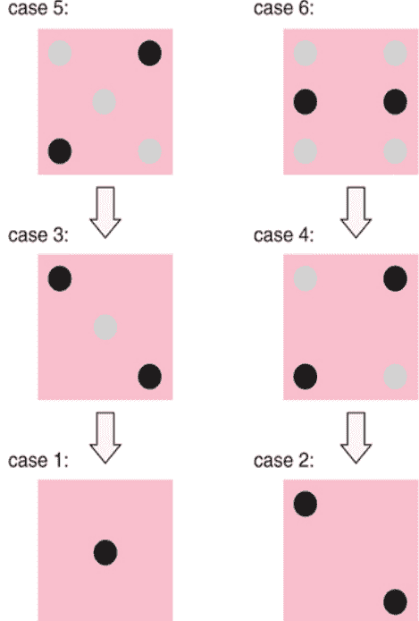

### 图 5.25

每个 `case` 语句只绘制与后续 `case` 语句中共同拥有的点。

在示例 5.15 中，我们生成一个 1 到 6 之间的随机数来模拟掷骰子（第 30–32 行）。我们定义了常量值，将用于绘制骰子、定位点点以及显示点数结果（第 22–26 行）。然后，我们将字体设置为 20 磅以显示点数结果（第 27–28 行）。我们将骰子本身画成一个粉色正方形（第 34–36 行）。我们将绘制点点的颜色设置为黑色（第 39 行），并对 `roll` 使用 `switch` 语句（第 41–75 行）来确定我们应该绘制哪些点。最后，我们显示点数结果（第 77–78 行），以验证我们绘制的点数是否正确。

如果我们观察骰子，会发现许多点数结果会导致一个或多个相同的点被绘制。`switch` 语句的一个优点是，一旦在 `switch` 变量和 `case` 常量之间找到匹配，所有后续语句都将执行，直到遇到 `break` 为止。

利用这一特性，我们可以合并点数 5、3 和 1 的处理逻辑。如图 5.25 所示，对于 `case 5`，我们只需绘制右上角和左下角的点（第 30–34 行），然后穿透到 `case 3`，在那里我们绘制左上角和右下角的点（第 35–39 行），然后穿透到 `case 1`，在那里我们绘制中间的点（第 40–42 行）。此时，我们编写了 `break`（第 43 行）来停止 `switch` 语句的处理。同样，我们也合并了点数 6、4 和 2 的处理逻辑。

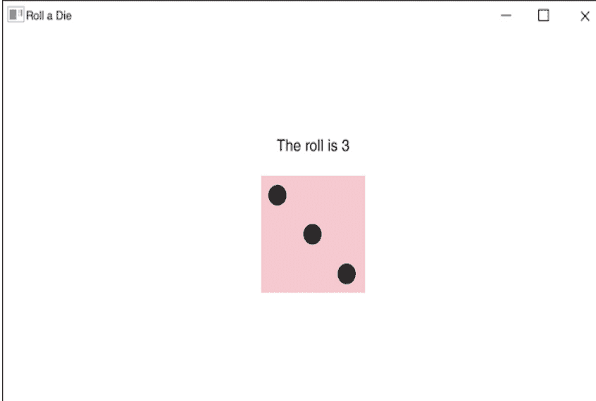

### 图 5.26

[示例 5.15](#) 的示例输出

注意，我们不需要 `default` case，因为随机生成器只会生成 1 到 6 之间的值，而我们已经提供了 `case` 语句来处理这些每个值。一次掷骰子的输出如[图 5.26](#)所示。


## 代码实战

如需查看使用 `switch` 语句的逐步插图，请查找在线资源中的视频。点击本章的链接开始播放视频。

## 技能练习

通过这些章节末习题

- 5.14.1 单选题：题 9
- 5.14.2 代码阅读与理解：第 14, 16, 17, 18, 19 题
- 5.14.5 调试区域：第 39, 41 题
- 5.14.6 编写短程序：第 44, 45, 47 题
- 5.14.8 技术写作：题 53

## 5.12 编程活动 2：使用 switch 语句

在此活动中，你将编写一个 `switch` 语句，根据输入值选择路径。框架将对你的代码进行动画处理，以便你可以观察代码在 `switch` 块中采取的路径。

将随书附带代码中本章编程活动 2 文件夹中的所有文件复制到你计算机的文件夹中。

在 `SelectionPractice2Controller.java` 源码中搜索五个星号（`*****`）以找到添加代码的位置。这五个星号位于 `workWithSwitch` 方法上方（该方法头已经为你写好了）。

你的位置应该位于示例 5.16 所示的代码处。

### 示例 5.16 编程活动 2 的学生代码部分

```java
// ***** 1 学生编写此方法
public void workWithSwitch( int value )
{
//
// 学生代码开始此处
//
//
// 学生代码结束此处
//
}
// workWithSwitch 结束
```

在代码指示处，按照如下所示编写 `switch` 语句：

- 在 `workWithSwitch` 方法的方法头中，你看到了 `(int value)`。`int` 变量 `value` 代表来自用户的输入；允许用户输入分数的文本框已经为你写好了。这个变量 `value` 是用户输入的值，并应作为 `switch` 语句的条件；它作为 `workWithSwitch` 方法的参数提供给你的代码。不要在方法内部声明变量 `value`；直接使用它即可。

- 针对以下整数常量 **0, 1, 2, 3, 4** 编写 `case` 语句，以及一个 `default` 语句。

- 在每个 `case` 语句内部，你应该做两件事：

    - 在屏幕上打印一条消息，指示输入了哪个值。`default` 值的消息应指示输入值不是有效值之一。

    - 调用 `animate()` 方法。`animate()` 方法的 API 为：

```java
void animate( int caseConstant, int value )
```

第一个参数是 **case** 常量；第二个参数是输入变量 **value**。例如，对于语句 `case 2:`，调用 `animate` 为：

```java
animate( 2, value )
```

对于 `default` 语句，调用 `animate` 为：

```java
animate( -1, value )
```

通过编译 `SelectionPractice2.java` 并运行 `SelectionPractice2Application` 来测试你的代码，如图 5.27 所示。执行 `switch` 语句，在文本框中输入 0 到 4 的整数以及其他值，每次点击“Test”按钮。根据你编写的 `case` 语句，窗口将显示（以绿色）路径。图 5.28 展示了当输入值为 3 时的路径。如果不符合预期，你需要修正代码。

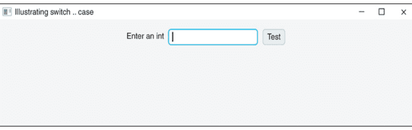

### 图 5.27 应用程序的输入框

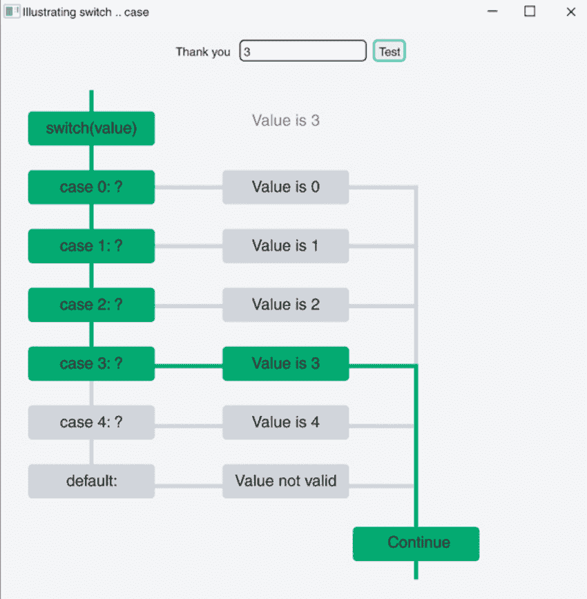

### 图 5.28 应用程序的示例运行

要退出应用程序，请关闭窗口。

## 讨论题

1. 解释 `switch` 语句中 `default` case 的目的。
2. 解释在 `case` 语句中省略 `break` 语句会发生什么。

## 章节回顾

## 5.13 章节总结

- Java 提供了相等、关系和逻辑运算符来评估条件，并提供了根据条件评估为 `true` 或 `false` 的执行指令的选择语句。
- 相等运算符（`==`, `!=`）用于测试两个操作数是否相等。操作数是求值为原始数值类型或对象引用的表达式。
- 关系运算符（`<`, `<=`, `>`, `>=`）比较两个数值类型的值。
- 逻辑运算符（`!`, `&&` 和 `||`）以布尔表达式作为操作数。逻辑非（`!`）取一个操作数，并反转其值，将 `true` 变为 `false`，将 `false` 变为 `true`。逻辑与（`&&`）取两个布尔表达式作为操作数；如果两个操作均为 `true`，则结果为 `true`；否则结果为 `false`。逻辑或（`||`）同样取两个布尔表达式作为操作数。如果两个操作均为 `false`，则结果为 `false`；否则结果为 `true`。
- 逻辑非（`!`）在这些运算符中优先级最高，其次是关系运算符、相等运算符，然后是逻辑与（`&&`），最后是逻辑或（`||`）。
- 德摩根定律可以形成等效逻辑表达式以提高代码的可读性。
- `if` 语句用于对一组数据执行某些操作，而对所有其他数据不做操作。
- 当 `if` 语句的真或假块包含多条语句时，需要大括号。
- `if/else` 语句用于对一组数据执行某些操作，对所有其他数据执行其他操作。
- 当数据属于两个以上互斥类别，且每个类相应的执行指令不同时，`if/else` 语句是合适的。
- `if/else` 语句可以顺序编写，也可以嵌套在其他的 `if/else` 语句中。
- 当 `if` 语句嵌套时，编译器会将任何 `else` 子句与最近的且没有 `else` 子句的 `if` 条件匹配。
- 由于浮点数计算可能会引入舍入误差，请不要使用相等运算符比较两个浮点数。相反，将两个数差值的绝对值与某个阈值进行比较。
- 当我们需要对小数进行计算并需要精确精度时，可以使用 Java 类库中的 `BigDecimal` 类。
- 在对象引用上使用相等运算符比较的是引用的值，而不是对象数据。只有当两个对象引用指向同一个对象时，它们才相等。
- 使用 `equals()` 方法来确定两个对象的数据是否相等。
- 除了 `equals()` 方法外，两个 `String` 还可以使用 `String` 类的 `equalsIgnoreCase()` 方法和 `compareTo()` 方法进行比较。
- 条件运算符（`?:`）用于表达式，其中根据一个条件的求值结果使用两个值中的一个。条件运算符对于验证输入和输出相似的消息非常有用。
- `switch` 语句评估整数或字符表达式或 `String`，然后将表达式的值与 `case` 常量进行比较。如果找到匹配项，将执行语句，直到遇到 `break` 语句或 `switch` 块的结束。

## 5.14 练习、问题与项目

### 5.14.1 选择题

1. 给定以下代码声明并初始化了两个 `int` 变量 `a` 和 `b`，值分别为 3 和 5，请指示每个表达式的值是 `true`（真）还是 `false`（假）。

```java
int a = 3;
int b = 5;
```

| 表达式 | true | false |
| --- | --- | --- |
| a < b | | |
| a != b | | |
| a == 4 | | |
| (b - a) <= 1 | | |
| Math.abs(a - b) >= 2 | | |
| (b % 2 == 1) | | |
| b <= 5 | | |

2. 给定以下代码声明并初始化了三个 `boolean` 变量 `a`、`b` 和 `c`，值分别为 `true`、`true` 和 `false`，请指示每个表达式的值是 `true` 还是 `false`。

```java
boolean a = true;
boolean b = true;
boolean c = false;
```

| 表达式 | true | false |
| --- | --- | --- |
| !a | | |
| a && b | | |
| a && c | | |
| a \|\| c | | |
| !(a \|\| b) | | |
| !a \|\| b | | |
| !(! ( a && c ) ) | | |
| a && ( b \|\| c ) | | |

3. 给定两个 `boolean` 变量 `a` 和 `b`，以下表达式是否等价？
   - `! (! a)`
   - `a`

4. 给定两个 `boolean` 变量 `a` 和 `b`，以下表达式是否等价？
   - `! ( a && b )`
   - `!a || !b`

5. 给定两个 `boolean` 变量 `a` 和 `b`，以下表达式是否等价？
   - `! ( a && !b )`
   - `a && b`

6. 给定两个 `boolean` 变量 `a` 和 `b`，以下表达式是否等价？
   - `! ( a && !b )`
   - `a || b`

7. 给定以下代码声明并初始化了两个 `int` 变量 `a` 和 `b`，值分别为 3 和 5，请指示操作数 (`b < 10`) 是否会被求值。

```java
int a = 3;
int b = 5;
```

| 表达式 | yes | no |
| --- | --- | --- |
| a < b \|\| b < 10 | ____ | ____ |
| a != b && b < 10 | ____ | ____ |
| a == 4 \|\| b < 10 | ____ | ____ |
| a > b && b < 10 | ____ | ____ |

8. 标记所有有效的 Java 选择关键字。
   - `if`
   - `else if`
   - `else`
   - `elsif`


# 9. 我们在 Java 中如何比较两个 String 对象的值？（勾选所有适用项。）

- 使用 `=` 运算符
- 使用 `==` 运算符
- 使用 `equals` 方法

## 5.14.2 阅读与理解代码

10. 这段代码序列的输出是什么？

```java
boolean a = true;
System.out.println( a );
```

11. 这段代码序列的输出是什么？

```java
boolean a = ( true && false );
System.out.println( a );
```

12. 这段代码序列的输出是什么？

```java
if ( true || false ) && ( false || true )
    System.out.println( "Inside true block" );
    System.out.println( "End of sequence" );
```

13. 这段代码序列的输出是什么？

```java
if ( 27 % 3 == 0 )
    System.out.println( "27 is divisible by 3" );
else
    System.out.println( "27 is not divisible by 3" );
    System.out.println( "End of sequence" );
```

14. 这段代码序列的输出是什么？

```java
String s = "Hello";
if ( s.equals("hello") ) {
    System.out.println("String is hello");
} else {
    System.out.println("String is not hello");
}

System.out.println("End of sequence");
```

15. 这段代码序列的输出是什么？

```java
int grade = 77;
if ( grade >= 90 ) {
    System.out.println("A");
} else if ( grade >= 80 ) {
    System.out.println("B");
} else if ( grade >= 70 ) {
    System.out.println("C");
} else {
    System.out.println("D");
}
```

16. 这段代码序列的输出是什么？

```java
int a = 65;
boolean b = false;
if ( a >= 70 ) {
    System.out.println("1");
} else if ( b == true ) {
    System.out.println("2");
} else {
    System.out.println("3");
}
```

17. 这段代码序列的输出是什么？

```java
int season = 3;
switch ( season ) {
    case 1:
        System.out.println("Winter");
    case 2:
        System.out.println("Spring");
    case 3:
        System.out.println("Summer");
    case 4:
        System.out.println("Fall");
    default:
        System.out.println("Other");
}
```

18. 这段代码序列的输出是什么？

```java
char c = 'e';
switch ( c ) {
    case 'H':
        System.out.println("1");
    case 'e':
        System.out.println("2");
    case 'l':
        System.out.println("3");
    case 'o':
        System.out.println("4");
    default:
        System.out.println("5");
}
```

19. 这段代码序列的输出是什么？

```java
int n = 3;
switch ( n ) {
    case 1:
        System.out.println("Number 1");
    case 2:
        System.out.println("Number 2");
    case 3:
        System.out.println("Number 3");
    case 4:
        System.out.println("Number 4");
    default:
        System.out.println("Other");
}
```

## 5.14.3 填充代码

对于 20 到 30，假设 `boolean` 变量 `a` 被声明并赋值为 `true` 或 `false`。假设 `int` 变量 `b` 和 `c` 被声明并赋值了值。

20. 如果 `a` 为 `true`，`b` 增加 1。

```java
if (____) {
    b++;
}
```

21. 如果 `a` 为 `true`，`b` 增加 2；如果 `a` 为 `false`，`b` 减少 1。

```java
if (____) {
    b += ____;
} else {
    b--;
}
```

22. 如果 `a` 为 `true`，将 `a` 改为 `false`；如果 `a` 为 `false`，将 `a` 改为 `true`。

```java
if (a) {
    a = ____;
} else {
    a = ____;
}
```

23. 如果 `b` 等于 `c`，给 `a` 赋值为 `true`。

```java
if (____) {
    a = true;
}
```

24. 如果 `b` 小于 `c`，`b` 增加 1；否则保持 `b` 不变。

```java
if (____) {
    b++;
}
```

25. 如果 `b` 是 `c` 的倍数，将 `a` 设为 `true`；否则将 `a` 设为 `false`。

```java
if (____) {
    a = true;
} else {
    a = false;
}
```

26. 如果 `c` 不等于 0，给 `b` 赋值 `b` 除以 `c` 的值。

```java
if (____) {
    b = ____;
}
```

27. 如果 `b` 乘以 `c` 大于 100，反转 `a`（如果 `a` 为 `true`，则变为 `false`；如果 `a` 为 `false`，则变为 `true`）；否则，给 `a` 赋值为 `true`。

```java
if (____) {
    a = ____;
} else {
    a = true;
}
```

28. 如果 `a` 为 `true` 且 `b` 大于 10，`c` 增加 1。

```java
if (____ && ____) {
    c++;
}
```

29. 如果 `b` 和 `c` 都小于 10，则给 `a` 赋值为 `true`；否则，给 `a` 赋值为 `false`。

```java
if (____ && ____) {
    a = true;
} else {
    a = false;
}
```

30. 如果 `b` 或 `c` 大于 5，则给 `a` 赋值为 `true`。

```java
if (____ || ____) {
    a = true;
}
```

## 5.14.4 识别代码中的错误

对于练习 31 到 38，假设在程序早期已经声明了两个名为 `b1` 和 `b2` 的布尔变量并赋值了值 `true` 或 `false`。你还应该假设在程序早期已经声明了两个名为 `a1` 和 `a2` 的 `int` 变量并赋值了一些整数值。

31. 这段代码序列的错误在哪里？

`bl = a1 && a2;`

32. 这个表达式的错误在哪里？

`( b2 == b1 ) AND ( a1 <= a2 )`

33. 这段代码序列的逻辑错误在哪里？

```java
if ( a1 == 4 );
System.out.println("al equals 4");
```

34. 这段代码序列的错误在哪里？

```java
boolean b1 = true;
if b1
System.out.println("b1 is true");
```

35. 这段代码序列的错误在哪里？

```java
if { b2 == true }
System.out.println("b2 is true");
```

36. 这段代码序列的错误在哪里？

```java
if ( b1 == true ) 
    System.out.println("b1 is true");
else
    System.out.println("b1 is false");
else if ( a1 < 100 )
    System.out.println("a1 <= 100");
```

37. 这段代码序列有错误吗？解释。

```java
if ( b2 == b1 ) 
    System.out.println("b2 and b1 have the same value");
else if ( a1 == a2 )
    System.out.println("a1 and a2 have the same value");
else
    System.out.println("All variables are different");
```

38. 这段代码序列有错误吗？解释。

```java
if ( b2 ) 
    System.out.println("b2 is true");
else if ( a1 <= 10 || a2 > 50 )
{
    System.out.print("a1 <= 10 or ");
    System.out.println("a2 > 50");
}
else
    System.out.println("none of the above");
```

## 5.14.5 调试区域——使用 Java 编译器和 JVM 的信息

39. 你在 `Test.java` 类中编写了以下代码：

```java
boolean b = true;
if ( b )
    System.out.println("Inside true block");
    System.out.println("b was true");
    // line 12
else
    System.out.println("Inside false block");
```

在编译时，你得到了以下错误：

```
Test.java:12: error: 'else' without 'if'
else      // line 12
^
1 error
```

解释问题所在以及如何修复。

40. 你在 `Test.java` 类中编写了以下代码：

```java
int a = 32;
if ( a = 31 )      // line 9
    System.out.println("The value of a is 31");
else
    System.out.println("The value of a is not 31");
```

在编译时，你得到了以下错误：

```
Test.java:9: error: incompatible types
if ( a = 31 )      // line 9
^
1 error
```

解释问题所在以及如何修复。

41. 你在 `Test.java` 类中编写了以下代码：

```java
boolean b = true;
if ( b )
{
    System.out.println("Inside true block");
    System.out.println("b was true");
    // line 13
} else
    System.out.println("Inside false block");
}
System.out.println("Done");
```

在编译时，你得到了以下错误：

```
Test.java:13: error: 'else' without 'if'
       ^
     // line 13
1 error
```

解释问题所在以及如何修复。

## 5.14.6 编写一个短程序

42. 编写一个程序，从键盘读取两个 `ints` 作为输入，代表击球数和打数次数。然后计算击手的击打率，并检查击打率是否高于 .300。如果是，输出该球员符合全明星赛的资格；否则，输出该球员不符合资格。

43. 编写一个程序，从键盘读取一个 `char` 作为输入，并输出它是否为起始标识符的有效字符。（提示：查看 `Character` 类中的一个方法。）


44. 编写一个程序计算以下图形的面积：

- 边长为 0.666666667 的正方形
- 边分别为 1/9 和 4 的矩形

测试这两个计算出的面积是否相等；讨论你的结果。

45. 编写一个程序从键盘读取一个句子。根据句子的最后一个字符，打印一条消息识别该句子为陈述句（以句号结尾）、疑问句（以问号结尾）、感叹句（以感叹号结尾）或其他。

46. 编写一个程序，检查字符串是否包含 `@` 字符。编写一个程序从键盘读取一个字符串，并输出它是否包含。

47. 编写一个程序，从键盘读取两个数字作为输入，输出它们是否相同。（通常情况下是这样要求的。）你的程序应该：

- 如果两个数字在 6 到 10 之间（包含边界），输出
- 否则，输出“密码无效”

48. 编写一个程序，从键盘读取两个数字作为输入，代表用户 ID。你的程序应该：

- 如果密码匹配，输出“欢迎”
- 否则，输出“密码错误”

## 5.14.7 编程

49. 编写一个程序，从键盘读取两个 `ints` 作为输入，代表击球数和打数次数。然后计算击手的击打率，并检查击打率是否高于 .300。如果是，输出该球员符合全明星赛的资格；否则，输出该球员不符合资格。

50. 比较两个 `double` 是否相等，计算它们之间的差异并检查该差异是否足够小。编写一个程序，从键盘读取一个整数作为输入，代表温度。你的程序应该输出：

- 如果温度大于或等于 90，输出
- 如果温度小于 70，输出

## 5.14.8 技术写作

51. 查看以下代码段：

```java
int b = 44;
if ( b = 23 ) {
    System.out.println("Inside block");
}
```

在 Java 中，这将产生上述错误。在 C++ 语言中，等效代码将编译并运行，给你以下输出：

```
Inside block
```

讨论 Java 在处理这种情况时是否比 C++ 好，以及为什么。

## 5.14.9 小组项目（ 1、2 或 3 名学生）

52. 我们想构建一个简单的“英语语言”计算器，具有以下功能：

- 从键盘读取三个输入，其中两个是单数字（0 到 9）
- 从键盘读取一个字符，代表五种操作之一：`+`（加法）、`-`（减法）、`*`（乘法）、`/`（除法）和 `^`（幂）
- 以纯英语输出操作的描述以及数值结果

例如，如果两个数字是 5 和 3，操作是 `*`，那么输出应该是：

```
five multiplied by three is 15
```

注意结果是数字，而不是单词。

如果两个数字是 2 和 9，操作是 `-`，那么输出应该是：

```
two minus nine is -7
```

如果两个数字是 5 和 2，操作是 `^`，那么输出应该是：

```
five to the power two is 25
```

提示：要执行幂运算，使用 `Math` 类的 `pow` 方法。

如果两个数字是 5 和 0，操作是 `/`，那么输出应该是：

```
Division by zero is not allowed
```

此处操作将不会执行。

无效数字

因为 25 有两个数字。

至于运算符，它们应该翻译成英文如下：

- `+` plus
- `-` minus
- `*` multiplied by
- `/` divided by

对于 `^` 符号（次方），你应该使用 `switch ... case` 选择语句将输入值翻译成单词。

你需要考虑这些特殊情况：

- 对于除法，有一个特殊的限制：你不能除以 0，因此你应该测试第二个数字是否为 0。如果为 0，那么你应该输出一条消息，说明不允许被除以 0。
- “运算符”不是上述五个运算符之一；在这种情况下，输出一条消息，说明该运算符无效。
- 一个或两个数字不是有效数字；同样，你应该输出具有此意的消息。
- 提示：你可以在 `switch` 块的 `default` 语句中处理这些特殊情况，并可能使用一些布尔变量来跟踪这些信息，因为你可能在程序的后续部分需要它们。


# 第 6 章

# 控制流，第 2 部分：循环

# 目录

引言

+ 6.1 使用 `while` 的事件控制循环
+ 6.2 `while` 循环的通用形式
+ 6.3 事件循环
+ 6.3.1 从用户处读取数据
+ 6.3.2 从文本文件读取数据
+ 6.4 循环技术
+ 6.4.1 累加
+ 6.4.2 计数项目
+ 6.4.3 计算平均值
+ 6.4.4 寻找最大值或最小值
+ 6.5 使用 `Scanner` 进行类型安全输入
+ 6.6 构建循环条件
+ 6.7 `while` 循环的测试技术
+ 6.8 使用 `do/while` 的事件控制循环
+ 6.9 编程活动 1：使用 `while` 循环
+ 6.10 使用 `for` 的计数控制循环


+ 6.10.1 for 循环的基本结构
+ 6.10.2 构建 for 循环
+ 6.10.3 for 循环的测试技术
+ 6.11 嵌套循环
+ 6.12 编程活动 2：使用 for 循环
+ 6.13 章总结、问题与项目
+ 6.14 练习、问题与项目
+ 6.14.1 单选题练习
+ 6.14.2 阅读和理解代码
+ 6.14.3 填空代码
+ 6.14.4 识别代码中的错误
+ 6.14.5 调试区域——使用来自 Java 编译器和 Java JVM 的消息
+ 6.14.6 写一个短程序
+ 6.14.7 编程项目
+ 6.14.8 技术写作
+ 6.14.9 小组项目

# 引言

你观察过杂货店收银员吗？我们把收银员称为 Jane。Jane 的工作是确定购物购物的总费用。开始时，Jane 的总费用为 $0.00。她拿起第一个商品并扫描它以记录价格，并将其添加到总费用中。然后她拿起第二个商品，扫描该商品以记录价格，并添加到总费用中，以此此类推。Jane 继续逐一扫描每个商品，直到没有更多商品可以扫描。通常，订单的结束由横跨传送带的分隔条作为信号指示。当 Jane 看到分隔条时，她就知道自己已经结束了。此时，她告诉我们订单的总费用，收取现金并给我们一张收据。

所以我们看到，Jane 的工作包括执行一些准备工作、逐个处理每个项目，并在最后报告结果。

在计算中，我们经常执行遵循这种模式的任务：

1. 初始化值
2. 逐个处理项目
3. 报告结果

程序员用于完成具有这种模式任务的控制流被称为“循环”或重复。

# 6.1 使用 while 的事件控制循环

如果我们尝试为杂货店收银员编写伪代码，我们可能会从如下内容开始：

```
set total to $0.00
reach for first item
if item is not the divider bar
    add price to total
reach for next item
if item is not the divider bar
    add price to total
reach for next item
if item is not the divider bar
    add price to total
    (finally)
reach for next item
item is the divider bar,
    tell the customer the total price
```

我们在这里看到了一个模式。我们从 $0.00 的订单总额开始。然后我们对每个商品重复一组操作。我们拿起商品并检查它是否是分隔条。如果商品不是分隔条，我们将商品的价格添加到订单总额中。我们拿起下一个商品并检查它是否是分隔条，以此此类推。当我们拿起商品并发现它是分隔条时，我们就知道没有更多项目要处理了。

在 Java 中，`while` 循环设计用于重复一组指令，直到条件求值为 `false`。这被称为**事件控制循环**。在收银员的案例中，信号是一个特殊值，称为**哨兵**（sentinel），或者也可能是分隔条。

## 6.2 while 循环的通用形式

`while` 循环具有如下语法：

```
// initialize variables
while ( condition )
{
    // loop body
}
// process the results
```

条件是一个求值为 `true` 或 `false` 的布尔表达式。当遇到 `while` 循环语句时，执行循环体。然后重新评估条件，如果为 `true`，则再次执行循环体。只有当循环体包含一个以上的语句时，才需要大括号——也就是说，如果条件为 `true`，应该执行多条语句。

`while` 循环的控制流如 6.1 节所示。循环体的每次执行都被称为循环的某次**迭代**（iteration）。因此，如果循环在条件求为 `false` 之前执行了五次，我们就说迭代了五次。

如果条件在第一次评估时为 `false` 会发生什么？因为在执行循环体之前会评估循环条件，且只有在条件为 `true` 时才执行循环体，所以循环体可能永远不会执行。在这种情况下，将是**零迭代**。

使用 `while` 循环结构，收银员的伪代码看起来如下：

```
set total to $0.00
reach for first item
while item is not the divider bar
{
    add price to total
    reach for next item
}
// if we get here, the item is the divider bar
output the total price
```

循环体内部定义的任何变量的作用域从其声明延伸到 `while` 循环的结束。因此，在 `while` 循环体内声明的任何变量都具有块作用域，在循环结束后无法被引用。

还可能构造一个条件永远不会求值为 `false` 的 `while` 循环。这会导致**无限循环**，也称为死循环。因为条件始终求值为 `true`，循环体会重复执行，没有结束。无限循环的一个症状是程序没有终止；看起来像是“卡住了”。然而，如果程序在循环体内写入某些输出，我们将在 Java 控制台上看到喷出的这些输出。通常情况下，唯一的解决办法是用户中止程序。

确保条件最终会求值为 `false` 的方法是在循环体内包含代码，称为**循环更新语句**（loop update statement），适当地改变正在被检查的变量。

由循环条件进行测试。例如，如果循环条件是测试读取某个特定值，则循环更新语句应该读取下一个输入值。

### 常见错误陷阱

避免在 `while` 循环的条件后放置分号。这样做会创建一个空循环体，并可能导致无限循环。

导致无限循环的一个常见逻辑错误是在条件后放置分号，如下所示：

```
while ( condition ); // 如果条件为真，分号会导致无限循环
```

紧跟在条件后面的分号表示循环体是空的。尽管某些高级编程技术可能要求使用空循环体，但我们在本章中不会使用这些技术。

## 6.3 事件控制循环

当我们不知道循环将执行多少次时，就会使用 `while` 循环；也就是说，当循环开始时，我们不知道需要多少次迭代。我们依靠一个信号，或**事件**，来告诉我们已经处理了所有数据。例如，当收银员开始结账订单时，她（并不一定）知道购物车里有多少件商品；她只知道在看到传送带上的分隔条时停止。我们称之为“事件控制循环”，因为我们持续处理数据，直到事件发生，该事件标志着数据的结束。

当我们提示用户从控制台输入数据时，且在循环开始时不知道用户有多少数据需要处理时，我们可以定义一个特殊的输入值，称为哨兵值（sentinel value）。哨兵值可以随任务而异，通常是一个超出该任务正常数据范围的值。

有时我们程序需要的数据在文本文件中。例如，一个文件可以存储公司过去五年的每月销售额。我们可能想要计算平均月销售额，或对这些数据执行其他统计计算。在这种情况下，我们需要从文件中读取数据，而不是要求用户从键盘输入数据。通常，当涉及大量数据时我们会使用文件，因为让用户手动输入数据是不现实的。

从文件中读取也是一种事件控制循环，因为我们从程序开始时不知道文件中包含多少数据。因此，我们需要某种方法来确定何时完成处理文件中的所有数据。Java 允许我们测试是否到达了文件末尾。因此，对于来自文件的输入，感知文件结束（EOF）指示是标志没有更多数据可读的事件。

### 6.3.1 从用户处读取数据

让我们看看使用 `while` 循环处理用户输入数据的通用形式。

```
初始化变量
读取第一个数据项 // 引导读取 (priming read)
while 数据项不是哨兵值
{
    处理数据
    读取下一个数据项 // 更新读取 (update read)
}
```

在执行任何初始化后，我们尝试读取第一个项。我们将其称为**引导读取**（priming read），因为就像给水泵启动一样，我们使用该值为 `while` 循环的第一次迭代提供条件。如果第一个项不是哨兵值，我们就处理它。处理可能包括计算总和、统计数据项数量、将数据与之前读取的值进行比较，或任何数量的操作。然后我们读取下一个数据项。这被称为**更新读取**（update read），因为我们更新数据项，为准备将其值输入到下一次迭代 `while` 循环的条件中。这种处理随后的更新读取将持续进行，直到我们读取到哨兵值，此时我们不执行 `while` 循环体。相反，我们将跳到 `while` 循环之后的第一条指令。注意，哨兵值并不是为了被处理的。就像收银员的分隔条一样，它仅仅是停止处理的信号。

我们在示例 6.1 中说明了这种模式，该示例提示用户输入整数并在控制台显示用户输入的任何内容。我们选择哨兵值为 -1；也就是说，当用户输入 -1 时，我们就停止处理。

## 示例 6.1 回显用户的输入

```java
/* 使用哨兵值工作
 * Anderson, Franceschi
 */
import java.util.Scanner;

public class EchoUserInput {

    public static void main(String [] args) {
        final int SENTINEL = -1;
        int number;

        Scanner scan = new Scanner(System.in);

        // 引导读取
        System.out.print("输入整数，或输入 -1 停止 > ");
        number = scan.nextInt();

        while ( number != SENTINEL) {
            // 处理
            System.out.println(number);

            // 更新读取
            System.out.print("输入整数，或输入 -1 停止 > ");
            number = scan.nextInt();
        }
        System.out.println("检测到哨兵值。再见");
    }
}
```

图 6.2 显示了当用户输入 23、47、100 和 -1 时，该程序的输出。

在第 10 行，我们将哨兵值 -1 声明为常量，因为哨兵的值在程序执行期间不会改变。

图 6.2 来自 6.1 的输出

| 输入 | 输出 |
| :--- | :--- |
| 输入整数，或输入 -1 停止 > | 23 |
| 输入整数，或输入 -1 停止 > | 47 |
| 输入整数，或输入 -1 停止 > | 100 |
| 输入整数，或输入 -1 停止 > | 检测到哨兵值。再见 |

哨兵值并不是为了被处理的。就像收银员的分隔条一样，它仅仅是停止处理的信号。

### 6.3.2 从文本文件读取数据

`Scanner` 类允许我们轻松地从文本文件中读取数据。Java 还在 `java.io` 包中提供了一整套类，以便程序员可以使用文件执行用户输入输出。

对于 `Scanner` 类，从文本文件中读取数据的通用形式与从用户处读取数据略有不同。首先，我们不是读取一个值并检查它是否为哨兵值，而是检查文件中是否有更多数据，然后读取一个值。其次，我们不需要打印提示，因为用户并不输入数据；我们只需从文件中读取下一个值。使用 `Scanner` 类从文本文件读取的伪代码所示：

```
初始化变量
当我们未到达文件末尾
{
    读取下一个数据项
    处理数据
}
报告结果
```

`Scanner` 类的方法（包括用于从文件读取的构造函数）如表 6.1 所示。另一个我们将用到的类是 `File` 类，它将文件名与文件关联。表 6.2 显示了 `File` 类的构造函数。

## 表 6.1 Scanner 类的可选方法

| 构造函数 | 方法名和参数列表 |
| --- | --- |
| `Scanner( File file )` | 创建一个 `Scanner` 对象并将其与文件关联 |
| `boolean` | `hasNext()` 如果输入流中还有另一个标记则返回 `true`；否则返回 `false` |
| `byte` | `nextByte()` 返回下一个输入作为字节 |
| `short` | `nextShort()` 返回下一个输入作为 `short` |
| `int` | `nextInt()` 返回下一个输入作为 `int` |
| `long` | `nextLong()` 返回下一个输入作为 `long` |
| `float` | `nextFloat()` 返回下一个输入作为 `float` |
| `double` | `nextDouble()` 返回下一个输入作为 `double` |
| `boolean` | `nextBoolean()` 返回下一个输入作为布尔值 |
| `String` | `next()` 返回输入行中的下一个标记，字符串形式 |

### 表 6.2 File 类的构造函数

| File 类的构造函数 |
| --- |
| `File( String pathname )` 使用 pathname 文件名构造 `File` 对象，使文件名具有平台无关性 |

表 6.1 所示的构造函数可用于将 `Scanner` 对象与文件关联。`Scanner` 对象将文件内容进行分词，并在我们调用后续方法时返回这些标记。`Scanner` 类中的 `hasNext` 方法在输入中还有另一个标记时返回 `true`，否则返回 `false`。因此，当 `hasNext` 方法返回 `false` 时，我们就知道已经到达文件末尾。

示例 6.2 从名为 `input.txt` 的文件中读取整数，并将整数回显到控制台。`input.txt` 的内容如图 6.3 所示，程序的输出结果如图 6.4 所示。

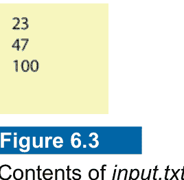

在示例 6.2 的第 14 行，我们使用 `File` 类的构造函数将文件名 `input.txt` 转换为平台无关的文件名。由于我们指定的是简单文件名，JVM 将在源文件相同的文件夹中查找该文件。如果文件位于另一个文件夹，我们需要指定路径以及文件名。例如，如果文件位于 Windows 系统的闪存器上，我们将向构造函数传递字符串 `"e:\\input.txt"`。注意，我们需要使用两个反斜线的转义序列来指定路径 `e:input.txt`。

`File` 类属于 `java.io` 包，因此我们在第 5 行包含了该类的 import 语句。

在第 15 行，我们构造了一个与 `inputFile` 对象关联的 `Scanner` 对象。如果未找到文件，构造函数将产生 `FileNotFoundException`。如果在读取文件遇到问题，也可能产生 `IOException`。Java 要求我们承认可能会生成这些异常。一种方法是在 `main` 方法的头部（第 10 行）中包含 `throws IOException` 短语。我们还在第 6 行导入了 `IOException` 类。

在第 17 行，当第一次评估 `while` 循环条件时，我们检查文件中是否有数据。如果文件为空，`hasNext` 方法将返回 `false`，我们将跳过循环体的执行，继续到第 25 行，在该处我们打印消息并退出程序。

## 参考点

你可以在 Oracle 的 Java 网站上查看更多关于 `Scanner` 类的信息：

www.oracle.com/technetwork/java。

`while` 循环体（第 19–22 行）调用 `nextInt` 方法读取文件中的下一个整数，并将该整数回显到控制台。然后我们重新评估 `while` 循环条件（第 17 行），以确定文件中是否有更多数据。当没有更多整数待读时，`hasNext` 方法返回 `false`，我们跳到第 25 行，在该处打印消息并退出程序。

注意，我们没有使用“预读”（priming read），因为 `hasNext` 方法会提前查看文件以检查更多数据。如果 `hasNext` 方法返回 `true`，我们就知道还有一个整数待读，因此我们在 `while` 循环体的第一行（第 20 行）执行读取。

## 示例 6.2 从文件回显输入

```java
1 /* 读取文本文件
2 Anderson, Franceschi
3 */
4 import java.util.Scanner;
5 import java.io.File;
6 import java.io.IOException;
7
8 public class EchoFileData
9 {
10 public static void main(String [] args) throws IOException
11 {
12 int number;
13
14 File inputFile = new File("input.txt");
15 Scanner file = new Scanner(inputFile);
16
17 while (file.hasNext())
18 {
19 // 读取下一个整数
20 number = file.nextInt();
21 // 处理读取到的值
22 System.out.println(number);
23
24
25 System.out.println("End of file detected. Goodbye");
26
27 }
```

## 图 6.4

示例 6.2 的输出，从文件读取

```
23
47
100
End of file detected. Goodbye
```

## 6.4 循环技术

`while` 循环是用于对一组输入值执行许多常用编程操作的重要工具。例如，`while` 循环可以用于计算值的和、统计值的数量、查找平均值、查找最小值和最大值以及执行其他操作。

### 6.4.1 累加


让我们来看一个 `while` 循环非常有用的常用编程操作：计算一组值的和。为了实现这一点，我们将构建一个执行单一功能（加法）的简单计算器。我们将逐个向用户提示数字。

计算器可以使用事件驱动的 `while` 循环和**累加**（accumulation）来开发。在累加过程中，我们把 `total` 初始化为 0。每当我们输入一个值，就将其加到 `total` 中。以下是加法的伪代码：

```
set total to 0
read a number // 预读
while the number is not the sentinel
{
    add number to total
    read the number // 更新读
}
output the total
```

注意，此操作与我们在 `while` 循环之前执行预读的 `hasNext` 方法几乎相同。`while` 循环体处理输入（第 25 行），即将输入加到总。

在示例 6.2 的第 14 行，我们使用 `File` 类的构造函数将文件名 `input.txt` 转换为平台无关的文件名。由于我们指定的是简单文件名，JVM 将在源文件相同的文件夹中查找该文件。如果文件位于另一个文件夹，我们需要指定路径以及文件名。例如，如果文件位于 Windows 系统的闪存器上，我们将向构造函数传递字符串 `"e:\\input.txt"`。注意，我们需要使用两个反斜线的转义序列来指定路径 `e:input.txt`。

`File` 类属于 `java.io` 包，因此我们在第 5 行包含了该类的 import 语句。

在第 15 行，我们构造了一个与 `inputFile` 对象关联的 `Scanner` 对象。如果未找到文件，构造函数将产生 `FileNotFoundException`。如果在读取文件遇到问题，也可能产生 `IOException`。Java 要求我们承认可能会生成这些异常。一种方法是在 `main` 方法的头部（第 10 行）中包含 `throws IOException` 短语。我们还在第 6 行导入了 `IOException` 类。

在第 17 行，当第一次评估 `while` 循环条件时，我们检查文件中是否有数据。如果文件为空，`hasNext` 方法将返回 false，我们将跳过循环体的执行，继续到第 25 行，在该处我们打印消息并退出程序。

## 参考点

`while` 循环体（第 19–22 行）调用 `nextInt` 方法读取文件中的下一个整数，并将该整数回显到控制台。然后我们重新评估 `while` 循环条件（第 17 行），以确定文件中是否有更多数据。当没有更多整数待读时，`hasNext` 方法返回 false，我们跳到第 25 行，在该处打印消息并退出程序。

注意，我们没有使用“预读”，因为 `hasNext` 方法会提前查看文件以检查更多数据。如果 `hasNext` 方法返回 true，我们就知道还有一个整数待读，因此我们在 `while` 循环体的第一行（第 20 行）执行读取。

## 示例 6.2 从文件回显输入

（此处代码块与前文相同，保持一致）

## 图 6.4

（此处与前文相同）

## 6.4 循环技术

`while` 循环是用于对一组输入值执行许多常用编程操作的重要工具。例如，`while` 循环可以用于计算值的和、统计值的数量、查找平均值、查找最小值和最大值以及执行其他操作。

### 6.4.1 累加

让我们来看一个 `while` 循环非常有用的常用编程操作：计算一组值的和。为了实现这一点，我们将构建一个执行单一功能（加法）的简单计算器。我们将逐个向用户提示数字。

计算器可以使用事件驱动的 `while` 循环和**累加**来开发。在累加过程中，我们把 `total` 初始化为 0。每当我们输入一个值，就将其加到 `total` 中。以下是加法的伪代码：

```
set total to 0
read a number // 预读
while the number is not the sentinel
{
    add number to total
    read the number // 更新读
}
output the total
```

注意，此操作与我们在 `while` 循环之前执行预读的 `hasNext` 方法几乎相同。`while` 循环体处理输入（第 25 行），即将输入加到总。循环体的最后一步（第 27–29 行）是读取下一个输入（更新读）。

（此处为最后的示例部分）

## 示例 6.3 加法计算器

```
1 /* 加法计算器
2 Anderson, Franceschi
3 */
4
5 import java.util.Scanner;
6
7 public class Calculator
8 {
9 public static void main(String [] args) {
10
11 final int SENTINEL = 0;
12 int number;
13 int total = 0;
14
15 Scanner scan = new Scanner(System.in);
16
17 System.out.println("Welcome to the addition calculator.\n");
18
19 System.out.print("Enter the first number
20 + or 0 for the total ");
21 number = scan.nextInt();
22
23 while (number != SENTINEL)
24 {
25 total += number;
26
27 System.out.print("Enter the next
28 + or 0 for the total ");
29 number = scan.nextInt();
30 }
31
32 System.out.println("The total is " + total);
33 }
```

## 图 6.5

加法计算器的示例运行输出

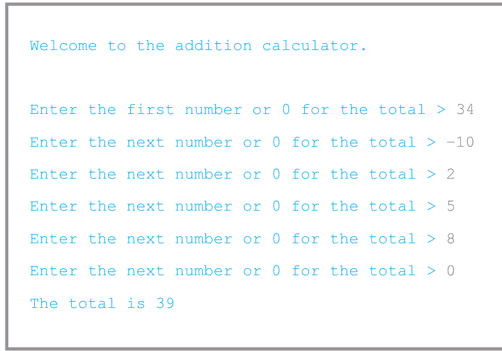

## 常见错误陷阱

忘记将 `total` 初始化为 0 会产生错误的结果。

第 13 行声明并初始化 `total` 为 0。这是一个重要的步骤，因为循环体会将每个输入值加到总和中。如果从第一次输入之前没有将 `total` 设置为 0，我们将得到错误的结果。此外，如果 `total` 仅声明但未初始化，我们的程序将无法编译。

# 软件工程提示

缩进 `while` 循环体以清晰地展示程序的逻辑。

当到达循环体的结束时，控制将传回第 23 行，在那里使用第 29 行读取的输入值再次测试循环条件。如果条件为真（即刚刚读取的输入不是哨兵值），则重新执行循环体并重新测试条件，直到输入为哨兵值，这会导致条件求值为假。此时，将跳过循环体，并执行第 32 行，通过打印总和来报告结果。

## 常见陷阱

选择错误的哨兵值可能会导致逻辑错误。

注意 `while` 循环体是缩进的，并且大大括号与 `while` 中的 `w` 对齐在同一列。这种风格让我们能够很容易地看出哪些语句属于 `while` 循环体。

仔细选择哨兵值是非常重要的。显然，哨兵值不能是用户想要处理的值。在加法计算器中，我们允许用户输入正整数或负整数。我们选择 0 作为哨兵值，原因有两个：首先，在总和上加 0 没有影响，因此用户不太可能想要输入该值进行处理。其次，对于用户来说，输入 0 来表示没有更多整数需要相加是符合逻辑的。


## 代码演示

要查看带有哨兵值的 `while` 循环的逐步插图，请查看在线资源中的视频。点击链接开始视频。

### 6.4.2 计数项目

计数用于我们需要知道输入了多少项，或者有多少个输入值符合某些标准，例如，有多少项是正数或有多少项是奇数。计数与累加相似，我们从计数 0 开始，每当我们读取到一个符合标准的值时，就对计数进行递增（加 1）。当没有更多值可以读取时，计数变量就包含了符合我们标准的项目数量。

例如，让我们数一数通过测试的学生数。该操作的伪代码如下：

```
set countPassed to 0
read a test score
while the test score is not the sentinel value
{
    if the test score >= 60
    {
        add 1 to countPassed
    }
    read the next test score
}
output countPassed
```

示例 6.4 中的应用程序统计了通过测试的学生数。我们还计算了通过测试的班级百分比。为了做到这一点，我们维护了第二个计数：输入的数的数量。每当我们读取一个分数时，该值就会增加，而 `countPassed` 值仅在分数大于或等于 60 时才会递增。哨兵值为 –1。该程序的示例运行如图 6.6 所示。

## 示例 6.4 统计通过测试的分数

```
1 /* Counting passing test scores
2 Anderson
```

```
28      if ( score>= 60 )
29      {
30          countPassed++;
31      }
32
33      countScores++;
34

35      System.out.print("Enter the next score > ");
36      score = scan.nextInt();
37      
38
39      System.out.println("You entered " +
countScores + " scores");
40      System.out.println("The number of passing
test scores is "
41                               + countPassed );
42      if ( countScores != 0 )
43      {
44          DecimalFormat percent = new
DecimalFormat("0.0%%");
45          System.out.println(
46              percent.format((double) countPassed
) / countScores)
47      + " of the class passed the test ");
48  
49  
50}
```

## 常见陷阱

忘记初始化计数变量将产生编译器错误。

## 图 6.6 统计通过测试的分数

```
This program counts the number of passing test scores.
nEnter a -1 to stop.
Enter the first score > 98
Enter the next score > 75
Enter the next score > 60
Enter the next score > 59
Enter the next score > 45
Enter the next score > 88
Enter the next score > 94
Enter the next score > 96
Enter the next score > 56
Enter the next score > 77
Enter the next score > 82
Enter the next score > 89
Enter the next score > 100
Enter the next score > 78
Enter the next score > 55
Enter the next score > -1
You entered 15 test scores

The number of passing test scores is 11
73.3% of the class passed the test
```

第 12 行和第 13 行声明了变量 `countPassed` 和 `countScores` 并将它们都初始化为 0。将这些值初始化为 0 是关键的；否则我们将得到错误的结果。注意 `while` 循环体是缩进的，并且大括号与 `while` 中的 `w` 对齐在同一列。这种风格让我们能够很容易地看出哪些语句属于 `while` 循环体。

哨兵值为 –1。显然，哨兵值不能是用户想要处理的值。在加法计算器中，我们允许用户输入正整数或负整数。我们选择 0 作为哨兵值，原因有两个：首先，在总和上加 0 没有影响，因此用户不太可能想要输入该值进行处理。其次，对于用户来说，输入 0 来表示没有更多整数需要相加是符合逻辑的。

### 6.4.3 计算平均值

计算平均值是累加和计数的结合。我们使用累加来计算总和，使用计数来计算数量。

以下是平均值的伪代码：

```
set total to 0
 count to 0
read a number
while the number is not the sentinel value
{
    add the number to total
    add 1 to count
    read the next number
}
set average to total / count
```

记住，如果我们把 `total` 和 `count` 定义为整数，那么 `average` 将使用整数除法计算，这会截断余数。为了获得浮点平均值，我们需要将其中一个变量（`total` 或 `count`）类型强制转换为 `double` 或 `float`，以强制除法变为浮点运算。

```
double average = (double) ( total ) / count;
```

虽然 `total` 外面的括号不是必须的（因为它只是一个单独值），但我们在这里包含它们是为了强调我们只将 `total` 转换为 `double`。

示例 6.5 中的应用程序计算了一个班级的平均测试分。输出如图 6.7 所示。

# 图 6.7

计算平均测试分

```
计算班级平均分，
输入每个测试分数。
完成后，输入 -1
输入第一个测试分数 > 88
输入下一个测试分数 > 78
输入下一个测试分数 > 96
输入下一个测试分数 > 75
输入下一个测试分数 > 99
输入下一个测试分数 > 56
输入下一个测试分数 > 78
输入下一个测试分数 > 84
输入下一个测试分数 > 93
输入下一个测试分数 > 79
输入下一个测试分数 > 90
输入下一个测试分数 > 85
输入下一个测试分数 > 79
输入下一个测试分数 > 92
输入下一个测试分数 > 99
输入下一个测试分数 > 94
班级平均分为 85.3
```

在示例 6.5 中，第 12 和 13 行将 `count` 和 `total` 变量都声明为 int 类型并将它们初始化为 0。

同样，我们的 `while` 循环结构遵循相同的模式。第 23–24 行读取第一个输入值；`while` 循环条件（第 26 行）检查哨兵值；`while` 循环中的最后语句（第 31–32 行）读取下一个分数。对于 `while` 循环的处理部分，我们将分数加到总 中并增加分数的计数（第 28–29 行）。当输入哨兵值时，我们停止执行 `while` 循环并跳转到第 35 行。

# 常见错误陷

在执行除法之前忘记检查分母是否为 0 是逻辑错误。

在第 35 行中，我们通过在执行除法之前检查 `count` 是否为 0（即没有输入分数）来避免除以 0。如果 `count` 为 0，我们只需打印一条消息说没有输入任何成绩。如果 `count` 不为 0，我们就计算并打印平均分。我们首先实例化一个 `DecimalFormat` 对象（第 37 行），以便我们可以输出保留一位小数的平均分。记住，我们需要将 `total` 强制转换为 `double`（第 38–39 行），以强制浮点除法，而不是整数除法。

## 6.4.4 寻找最大值或最小值


在之前的示例中，我们通过保持一个运行总和来计算一组数字的总和。我们从总和 0 开始，然后将每个新输入值加到运行总和中。同样，我们通过保持一个运行计数来统计输入项的数量。我们从计数 0 开始，每读取一个新值时计数加 1。我们可以将相同的逻辑应用于计算最大值或最小值。例如，为了找到一组值中的最大值，我们可以保持一个“运行中的”或当前的最大值。我们首先假设读取的第一个值就是最大值。事实上，它是我们目前为止看到的最大值。然后，当我们读取每个新值时，将其与我们的当前最大值进行比较。如果新值更大，我们将新值设为当前最大值。当我们读取完所有输入值后，当前最大值就是所有输入值的最大值。

当然，寻找最小值也使用相同的方法，仅当新值小于当前最小值时才替换最小值。

以下是在文件中寻找最大值的伪代码：

```
读取第一个数字并将其设为最大值
当有其他数字待读取时
{
    读取下一个数字
    如果数字 > 最大
    {
        将最大设置为该数字
    }
输出最大
```

示例 6.6 显示了在文件中查找最高测试成绩的代码。如图 6.8 所示，成绩以整数形式每行存储在 `grades.txt` 文件中。当此程序运行时，其输出如图 6.9 所示。

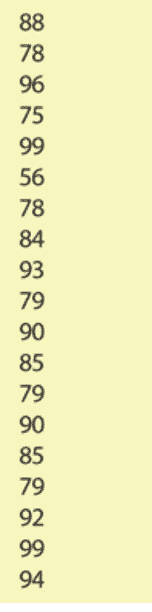

## 图 6.8

`grades.txt` 的内容

## 示例 6.6 寻找最大值

```java
/* 查找最高测试成绩
 * Anderson, Franceschi
 */

import java.util.Scanner;
import java.io.*;

public class FindMaximumGrade {
    public static void main(String [] args)
    throws IOException {
        int maxGrade;
        int grade;

        Scanner file = new Scanner(new File("grades.txt"));

        System.out.println("此程序查找一个班级的最高成绩 ");
        if (! file.hasNext()) {
            System.out.println("文件中没有测试成绩");
        } else {
            maxGrade = file.nextInt(); // 将第一个成绩设为最大

            while ( file.hasNext() )
            {
                grade = file.nextInt(); // 读取下一个成绩

                if ( grade > maxGrade )
                    maxGrade = grade; // 保存为当前最大
            }

            System.out.println("最高成绩是 " + maxGrade );
        }
    }
}
```

## 图 6.9

寻找最大值


## 6.5 使用 Scanner 类进行类型安全输入

使用 `Scanner` 读取输入的一个问题是，如果下一个标记不匹配我们预期的类型，会产生 `InputMismatchException`，从而停止程序执行。这可能是由用户的误操作引起的；例如，当程序提示输入整数时，用户可能会输入字母或其他非数字字符。为了说明这个问题，示例 6.7 显示了一个简单的程序，图 6.10 显示了当输入字母而不是整数时生成的异常。注意，当生成异常时程序结束了；我们从未执行第 15 行来输出年龄到控制台。

## 示例 6.7 读取整数

```java
/* 从用户读取整数
 * Anderson, Franceschi
 */
import java.util.Scanner;

public class ReadInteger
{
    public static void main(String [] args)
    {
        Scanner scan = new Scanner(System.in);

        System.out.print("请输入您的年龄（整数）> ");
        int age = scan.nextInt();

        System.out.println("您的年龄是 " + age);
    }
}
```

## 图 6.10

输入失败

```
请输入您的年龄（整数）> a
Exception in thread "main"
java.util.InputMismatchException
at
java.base/java.util.Scanner.throwFor(Unknown
Source)
at java.base/java.util.Scanner.next(Unknown
Source)
at java.base/java.util.Scanner.nextInt(Unknown
Source)
at java.base/java.util.Scanner.nextInt(Unknown
Source)
at ReadInteger.main(ReadInteger.java:13)
```

我们可以通过在读取之前检查下一个标记是否匹配我们的预期输入，来使程序更加健壮。`Scanner` 类提供了 `hasNext` 方法来实现这一点，如表 6.3 所示。如果下一个标记可以读取为请求的数据类型，`hasNext` 方法将返回 `true`。例如，如果我们期望一个整数，可以通过调用 `hasNextInt()` 方法来测试用户输入的字符是否可以解释为整数。如果该方法返回 `true`，则读取是安全的。

使用 `nextInt()` 方法获取的值。如果下一个标记不是我们需要的（即 `hasNextInt()` 方法返回 `false`），那么将该值读取为 `int` 将产生一个 `InputMismatchException`。在这种情况下，我们需要通知用户输入的值无效，并重新提示其输入新值。但首先，我们需要清除无效的输入。我们可以通过调用 `Scanner` 类的 `nextLine()` 方法来刷新无效输入，该方法会将输入行上剩余的任何标记作为 `String` 返回。然后我们只需要忽略那个 `String` 即可。示例 6.8 显示了示例 6.7 的一个修订版本，它是类型安全的，意味着我们在读取整数之前，已经保证了我们有一个整数可读。

## 表 6.3 用于测试标记的 Scanner 方法

| 方法名和参数列表 | 返回值 |
|---|---|
| `boolean hasNext()` | 如果输入流中还有另一个标记，则返回 `true`；否则返回 `false` |
| `boolean hasNextByte()` | 如果输入流中的标记可以读取为字节，则返回 `true`；否则返回 `false` |
| `boolean hasNextShort()` | 如果输入流中的标记可以读取为短整数，则返回 `true`；否则返回 `false` |
| `boolean hasNextInt()` | 如果输入流中的标记可以读取为 `int`，则返回 `true`；否则返回 `false` |
| `boolean hasNextLong()` | 如果输入流中的标记可以读取为 `long`，则返回 `true`；否则返回 `false` |
| `boolean hasNextFloat()` | 如果输入流中的标记可以读取为浮点数，则返回 `true`；否则返回 `false` |
| `boolean hasNextDouble()` | 如果输入流中的标记可以读取为双精度浮点数，则返回 `true`；否则返回 `false` |
| `boolean hasNextBoolean()` | 如果输入流中的标记可以读取为布尔值，则返回 `true`；否则返回 `false` |
| `String nextLine()` | 将输入行的剩余部分作为 `String` 返回 |

在示例 6.8 的第 14 行，我们提示输入整数。然后在第 15 行，`while` 循环条件检查用户是否确实输入了一个整数值。如果不是，我们通过 `nextLine()` 方法（第 17 行）忽略用户输入的任何内容。在第 18 行，我们重新提示用户。`while` 循环继续执行，直到用户输入一个整数且 `hasNextInt()` 方法返回 `true`。此时，我们执行第 20 行，将该整数读取到 `age` 变量中。注意，我们需要使用 `while` 循环而不是 `if` 语句，因为 `if` 语句只会测试第一个无效输入值。使用 `while` 循环允许我们根据需要不断提示用户，直到输入有效值为止。图 6.11 显示了该程序在用户输入整数以外的数据、最后输入整数时的输出。

## 示例 6.8 类型安全的输入

```java
/*
使用 Scanner 进行类型安全输入
Anderson, Franceschi
 */
import java.util.Scanner;

public class TypeSafeReadInteger {
    public static void main(String [] args) {
        Scanner scan = new Scanner(System.in);
        String garbage;
        System.out.print("Enter your age as an integer > ");
        while (! scan.hasNextInt()) {
            garbage = scan.nextLine();
            System.out.print("\nPlease enter integer > ");
        }
        int age = scan.nextInt();
        System.out.println("Your age is " + age);
    }
}
```

## 图 6.11

不断提示直到用户输入整数

```
Enter your age as an integer > asd
Please enter an integer > 12wg
Please enter an integer > 12.4
Please enter an integer > 23
Your age is 23
```

## 6.6 构造循环条件

构造正确的循环条件可能看起来有点反直觉。只要循环条件求值为 `true`，循环就会一直执行。因此，如果我们希望循环在读取到哨兵值时终止，那么循环条件应该检查输入值是否不是哨兵值。换句话说，循环的继续条件是循环终止条件的取反。对于简单的哨兵值控制循环，条件通常遵循此模式：

```
while ( inputValue != sentinel )
```

事实上，我们可以看到本章许多示例中的循环条件使用了这种形式的 `while` 循环条件。

对于某些应用程序，可能有多个哨兵值。例如，假设为用户提供一个菜单，每个菜单选项都是单个字符。用户可以反复从菜单选择选项，哨兵值为 S（停止）。为了允许不区分大小写的输入，我们希望将哨兵值识别为 S 或 s。为了做到，我们需要一个复合循环条件，即使用逻辑与 (`&&`) 或逻辑或 (`||`) 运算符的循环条件。

我们的第一个直觉可能是这样构造条件，但这是**错误的**：

```
while ( option != 'S' || option != 's') // 错误
```

使用这个条件，循环将永远执行下去。无论用户输入什么，循环条件都为 `true`。如果用户输入 S，第一个表达式 (`option != 'S'`) 为 `false`，但第二个表达式 (`option != 's'`) 为 `true`。因此，循环求值为 `true`，并执行 `while` 循环体。同样，如果用户输入 s，第一个表达式 (`option != 'S'`) 为 `true`，因此循环条件求值为 `true`，并执行 `while` 循环体。

构造正确的 `while` 循环条件的简单方法包含三个步骤：

1. 定义循环终止条件；即定义使循环停止执行的条件。
2. 创建循环继续条件——通过在循环终止条件上应用逻辑非运算符 (`!`) 来创建一个保持循环执行的条件。
3. 在可能的情况下通过应用德·摩根定律简化循环继续条件。

德·摩根定律如下：

`NOT(A AND B) = (NOT A) OR (NOT B)`

以及

`NOT(A OR B) = (NOT A) AND (NOT B)`

让我们使用这三个步骤来为菜单程序构造正确的循环条件。

1. 定义循环终止条件：

当用户输入 S 或用户输入 s 时，循环停止执行。翻译成 Java，我们得到：

```
( option == 'S' || option == 's' )
```

2. 应用 `!` 运算符创建循环继续条件：

```
! ( option == 'S' || option == 's' )
```

3. 应用德·摩根定律进行简化：

为了应用德·摩根定律，我们将 `==` 改为 `!=`，并将逻辑或运算符 (`||`) 改为逻辑与运算符 (`&&`)，产生一个等效且更简单的表达式：

```
option != 'S' && option != 's'
```

我们现在有了循环条件。为了说明，让我们写一个计算订单成本的程序。我们提供一个带有价格的菜单，用户从菜单选择项目直到输入 S 或 s。这是一个累加操作，因为我们正在累加用户的成本。示例 6.9 显示了该程序的代码，图 6.12 显示了示例运行的输出。

## 示例 6.9 循环条件

```java
/* 从菜单下单
Anderson, Franceschi */
import java.util.Scanner;
import java.text.DecimalFormat;

public class BonniesBurgers {
    public static void main(String [] args) {
        String menu = "\tC Cheeseburger: $7.49";
        menu += "\n\tH Hot dog: $6.99";
        menu += "\n\tL Lemonade: $2.50";
        menu += "\n\tT Iced tea: $2.75";

        char option;
        double orderCost = 0;

        DecimalFormat money = new DecimalFormat("$0.00");
        Scanner scan = new Scanner(System.in);

        System.out.println("Welcome to Bonnie's Burgers. " + "Select from our menu:");
        System.out.println(menu); // 输出菜单
        System.out.print("Order an item, or \"s\" to stop: ");
        option = scan.next().charAt(0);

        while (option != 'S' && option != 's') {
            switch (option) {
                case 'c':
                case 'C':
                    System.out.print("Cheeseburger ordered.");
                    orderCost += 7.49;
                    break;
                case 'h':
                case 'H':
                    System.out.print("Hot dog ordered.");
                    orderCost += 6.99;
                    break;
                case 'l':
                case 'L':
                    System.out.print("Lemonade ordered.");
                    orderCost += 2.50;
                    break;
                case 't':
                case 'T':
                    System.out.print("Iced tea ordered.");
                    orderCost += 2.75;
                    break;
                default:
                    System.out.print("Invalid selection.");
            }
            System.out.print("\nOrder an item, or \"s\" to stop: ");
            option = scan.next().charAt(0);
        }
        System.out.println("\nTotal cost is " + money.format(orderCost));
    }
}
```


```java
51    case 't':
52    case 'T':
53        System.out.print("Iced tea ordered. ");
54        orderCost += 2.75;
55        break;
56    default:
57        System.out.println("Unrecognized menu item.");
58    }
59
60    System.out.println("Subtotal: "
61        + money.format(orderCost));
62
63    System.out.print("\nOrder another item, "
64        + "or \"S\" to stop > ");
65    option = scan.next().charAt(0);
66    }
67
68    System.out.println("\nTotal order cost is "
69        + money.format(orderCost));
70}
71}
```

# 图 6.12

根据菜单点餐

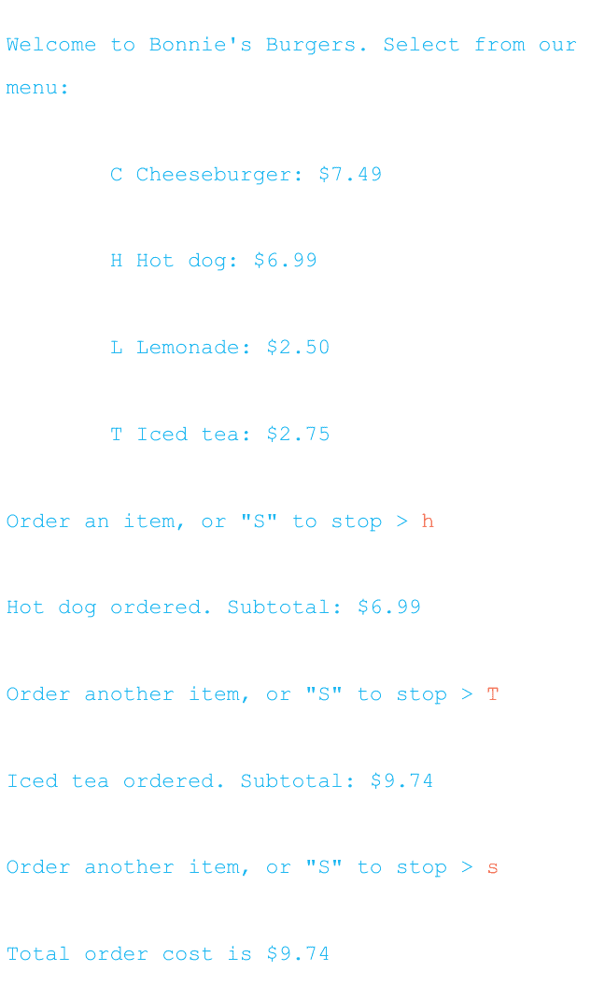

我们在 `while` 循环中使用了复合条件（第 32 行）。随后在 `while` 循环内部，我们使用 `switch` 语句（第 34–58 行）来确定用户选择了哪个菜单项。通过包含每个字母选项的小写和大写版本的 `case` 常量，我们处理了不区分大小写的输入。在 `switch` 语句之后，我们包含了更新读取部分（第 63–65 行），以输入用户的下一个项目。

注意，我们没有为哨兵值提供 `case` 语句。相反，我们使用 `while` 循环条件来检测用户何时输入哨兵值。

## 6.7 while 循环的测试技术

代码无错误地通过编译是一种良好的感觉。然而，通过编译只是程序员工作的一部分。工作的另一部分是验证代码的正确性；即程序产生准确的结果。

通常情况下，使用所有可能的输入值来测试程序是不可行的，但我们可以通过将测试集中在三个领域，从而对程序的准确性获得合理的信心：

1. 程序在一组已知输入下是否能产生正确的结果？
2. 如果哨兵值是第一个且唯一的输入，程序是否能产生正确的结果？
3. 程序是否能妥善地处理无效输入？

让我们详细查看这三个领域：

### 1. 程序在已知输入下是否能产生正确的结果？

为了用已知输入测试程序，我们选择有效的输入值，并通过手动执行程序操作或使用计算器来确定结果应该是怎样的。例如，要测试总和或平均值的计算是否正确，可以输入一些值，并将程序的输出与我们通过将相同值输入计算器得出的总和或平均值进行比较。

选择代表边界条件的输入值特别重要，即预期的最低或最高值。例如，为了测试一个判断一个人是否足够大参加总统选举（即该人员年龄为 18 岁或以上）的程序，我们应该选择 17、18 和 19 作为测试值。这些值是年龄 `>= 18` 的边界条件；这些测试值分别比法定投票年龄小一个整数、相同的值以及大一个整数。然后我们用这三个输入值运行程序，并验证程序是否正确识别出 17 为非法投票年龄，并将 18 和 19 识别为合法的投票年龄。

### 2. 如果哨兵值是第一个且唯一的输入，程序是否能产生正确的结果？

在我们的 `while` 循环中，当找到哨兵值时，控制流会跳过 `while` 循环体并在循环后的语句继续。当哨兵值是第一个输入值时，我们的 `while` 循环体完全不执行。我们直接跳到 `while` 之后的语句。在这种情况下，备受尊敬的计算机科学家 Donald Knuth 建议我们“优雅地准确什么都不做”。

在许多计算输入值总和或平均值的程序中，当没有输入值时，我们的程序应该将总和或平均值报告为 0，或者输出未输入任何值的消息。编写程序使其容忍唯一的输入是哨兵值是非常重要的；因此，我们需要通过先输入哨兵值来测试程序。

让我们回顾本章之前的示例，看看它们是如何处理仅输入哨兵值的情况的。

> **软件工程提示**
>
> 预计用户可能会首先输入哨兵值。程序需要处理这种特殊情况。

在加法计算器（示例 6.3）中，我们在 `while` 循环之前将总和设为 0，并在 `while` 循环之后简单地报告总和的值。因此，仅通过哨兵值就能得到正确的结果（0）。

在示例 6.4 中，我们计算测试及格数的百分比，我们在 `while` 循环之后执行额外的检查来处理唯一的哨兵值。如果只输入了哨兵值，计数将为 0。我们检查这种情况，如果发现计数为 0，我们就跳过百分比的报告，以避免除以 0。我们在示例 6.5 中使用了类似的代码，在该示例中计算平均值。

### 3. 程序是否能妥善地处理无效输入？

如果程序期望一个范围的值或离散的值，当输入不符合预期值时，它应该通知用户。在示例 6.9 中，我们实现了一个点餐菜单。用户可以输入 `c`、`h`、`l` 来表示他们所需的选项。如果用户输入的字母多于这些预期值，我们使用 `switch` 语句的 `default` 子句来发布错误消息。在下一节中，我们将解释如何使用 `do/while` 循环在范围内验证用户输入。

## 6.8 使用 do/while 的事件控制循环

另一种特别利于验证用户输入的循环形式是 `do/while` 循环。在 `do/while` 循环中，条件在循环结束时测试（而不是像 `while` 循环那样在开始时）。因此，`do/while` 循环体至少执行一次。

`do/while` 循环的语法如下：

```java
// 初始化变量
do
{
  // 循环体
} while ( condition );
// 处理结果
```

要使用 `do/while` 循环验证用户输入，请在循环体内部插入输入提示，然后使用循环条件测试输入的值。与 `while` 循环一样，如果条件为真，循环体将重新执行。注意，由于作用域的原因，任何将在 `while` 条件中引用的变量必须在 `do/while` 循环开始之前定义。

### 图 6.13 do/while 语句的控制流

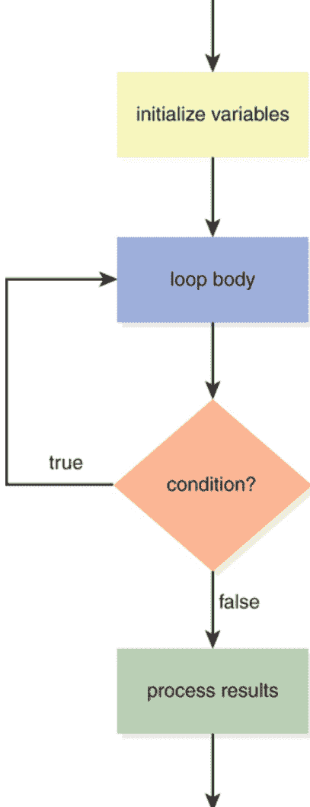

### 示例 6.10 验证用户输入

```java
/* 验证输入在1 到 10 之间
2 Anderson, Franceschi
3 */
4
5 import java.util.Scanner;
6
7 public class ValidateInput
8 {
9     public static void main(String [] args)
10     {
11         int number; // 输入值
12         Scanner scan = new Scanner(System.in);
13
14         do
15         {
16             System.out.print("输入一个 1 到 10 之间的整数 ");
17             number = scan.nextInt();
18         } while (number < 1 || number > 10);
19
20         System.out.println("谢谢!");
21     }
22 }
```

### 图 6.14 验证输入

```
输入 1 到 10 之间的数字 > 20
输入 1 到 10 之间的数字 > -1
输入 1 到 10 之间的数字 > 0
输入 1 到 10 之间的数字 > 11
输入 1 到 10 之间的数字 > 5

谢谢！
```

在进行输入验证时，我们可能倾向于使用 `if` 语句而不是 `do/while` 循环。例如，为了执行与示例 6.10 相同的验证，我们可能会尝试以下错误的代码：

```java
System.out.print("Enter a number between 1 and 10 > ");
number = scan.nextInt();

if ( number < 1 || number > 10 ) // 错误！
{
  System.out.print("Enter a number between 1 and 10 > ");
  number = scan.nextInt();
}
```

### 常见错误陷阱

> 不要使用 `if` 语句来验证输入，因为它只会捕获第一次输入的无效值。请使用 `do/while` 循环不断提示用户输入，直到用户输入有效值为止。

这种方法的问题在于，`if` 语句只会提示用户一次。如果用户第二次输入无效值，程序将无法捕获。然而，`do/while` 循环会根据需要不断提示用户输入，直到用户输入有效值为止。

### 技能练习

通过这些章末习题

- 6.14.2 阅读与理解代码：问题 9, 10
- 6.14.3 填充代码：问题 28
- 6.14.4 识别代码中的错误：问题 34
- 6.14.5 调试区域：问题 36
- 6.14.6 写一个短程序：问题 53


© Hemera Technologies/Photos.com/Thinkstock

### 代码实战

要查看 `do/while` 循环的两个分步演示，请查找在线资源中的视频。点击链接开始视频。

正如动画将展示的那样，`Item` 对象可以是牛奶、谷物、橙汁或分隔条。购物车中 `Item` 对象的数量是随机生成的；当你观看动画时，有时会发现购物车里有两个物品，有时是六个，有时是三个，有时只有一个分隔条，以此类推。扫描分隔条意味着购物车中物品的结束。

#### 任务说明

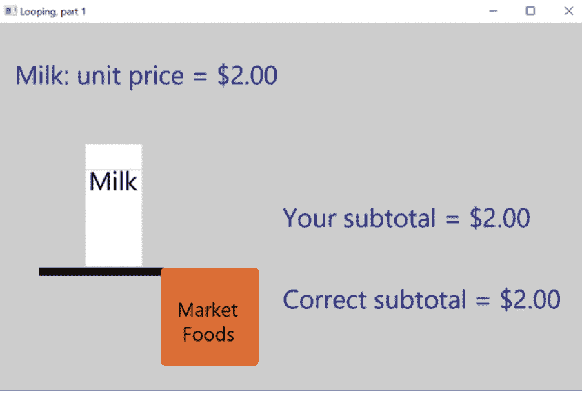

**图 6.15** 收银机应用程序动画

将本文附带源代码中本章“编程活动 1”文件夹中的文件复制到你计算机上的某个文件夹中。在 `CashierDrawing.java` 源代码中搜索五个星号（`*****`），将显示你可以在何处添加代码。你将代码添加到 `CashierDrawing` 类的 `checkout` 方法内部（`checkout` 方法的方法头已经为你写好了）。示例 6.11 显示了 `CashierDrawing` 类的片段，你可以在其中添加代码：

### 示例 6.11 CashierDrawing.java 中的 checkout 方法

```java
public void checkout() 
{
    /* ***** 学生编写此方法的体体 ***** */
    //
    // 使用 while 循环计算食品的
    // 总价。
    //
    // getNext 方法（在此 CashierDrawing 类中）
    // 返回传送带上的下一个物品，它是一个 Item 对象
    // （我们不知道是哪种物品，也不知道有多少个）物品
    // 在购物车中 - 这种数量是随机生成的）。
    // getNext 不接受任何参数。它的 API 为：
    // Item getNext()
    //
    // 在你更新了当前小计之后，
    // 应该调用 animate 方法。
    // animate 方法接收一个参数：double 类型，
    // 即你当前的小计。
    // 例如，如果代表当前小计的变量名
    // 是 total，那么你对 animate 方法的调用应该是：
    // animate(total);
    //
    // Item 类的实例方法 getPrice 
    // 返回 Item 对象的价格。
    // getPrice 方法不接受任何参数。
    // 它的 API 是：
    // double getPrice()
    //
    // 当 getNext 方法返回时，
    // 购物车是空的
    // 分隔符 Item。
    // 你检测到分隔符 Item是因为它的价格
    // 是 -0.99。因此，价格为 -0.99 的 Item
    // 是循环的哨兵值。
    //
    // 在扫描分隔条后，将总额打印到控制台。

    // 学生代码结束
}
```

- 你可以通过调用 `CashierDrawing` 类的 `getNext` 方法来访问购物车中的物品，该方法的 API 如下：

```
Item getNext()
```

`getNext` 方法返回一个 `Item` 对象，代表购物车中的一个物品。如所示，`getNext` 方法不接受任何参数。由于我们在 `CashierDrawing` 类内部调用 `getNext` 方法，因此无需对象引用即可调用该方法。例如，对 `getNext` 的调用可能如下：

```java
Item newItem;
newItem = getNext();
```

`getNext` 方法已经写好并包含了随机生成 `Item` 的代码。它的编写方式使得传送带上的第一个 `Item` 对象可能是分隔符，也可能不是。（如果第一个 `Item` 是分隔符，则购物车是空的。）

- 在获取新 `Item` 后，你可以通过调用类的 `getPrice` 方法来“扫描”物品以获取其价格。`getPrice` 方法的 API 为：

```
double getPrice()
```

因此，你会获取一个物品，然后使用如下代码获取其价格：

```java
Item newItem;
double price;
newItem = getNext();
price = newItem.getPrice();
```

- 将物品的价格加入你的小计后，调用 `CashierDrawing` 类的 `animate` 方法。此方法将同时显示你的小计和正确的小计，以便你可以验证你的代码是正确的。

`animate` 方法的 API 如下：

```
void animate(double subtotal)
```

因此，如果你代表当前总额的变量是 `total`，你使用以下代码调用 `animate` 方法：

```java
animate(total);
```

- 当下一个 `Item` 是分隔符时，你想退出循环。扫描分隔符是因为价格为 -0.99。这就是退出循环的条件。

- 当循环结束时，编译 `CashierDrawing` 并运行。

#### 故障排除

如果你的方法实现没有显示动画或显示错误，请检查以下项：

- 验证你是否正确编写了引导读语句。
- 验证你是否正确编写了循环条件。
- 验证你是否正确编写了循环体。

| 讨论问题 |
| :--- |
| 1. `while` 循环的哨兵值是什么？ |
| 2. 解释引导读语句的作用。 |

## 6.10 计数循环 for

在循环开始之前，如果我们知道循环体执行的次数，就可以使用计数循环。`for` 循环是为了计数循环设计的，即迭代次数在循环开始之前就已经确定。

### 6.10.1 for 循环的基本结构

`for` 循环的语法如下：

```java
for ( 初始化; 循环条件; 更新 )
{
  // 循环体
}
```

> **常见错误陷阱**
>
> 确保使用分号而不是逗号来分隔 `for` 头部中的语句。

注意，`for` 头部中的初始化、循环条件和更新是用分号隔开的。同样注意右括号后面没有分号。这里的分号将表示空循环体。虽然某些高级程序可能会正确编写空循环体的 `for` 循环，但我们在文中编写的程序在循环体中至少包含一条语句。

在头部或体内部声明的任何变量的作用域从声明点持续到 `for` 循环体的结束。

`for` 循环的控制流如图 6.16 所示。当遇到 `for` 循环时，执行初始化语句。然后评估循环条件。如果条件为真，则执行循环体，然后执行更新语句，最后重新评估循环条件。再次，如果条件为真，执行循环体，接着执行更新，然后重新评估条件，直到条件为假。

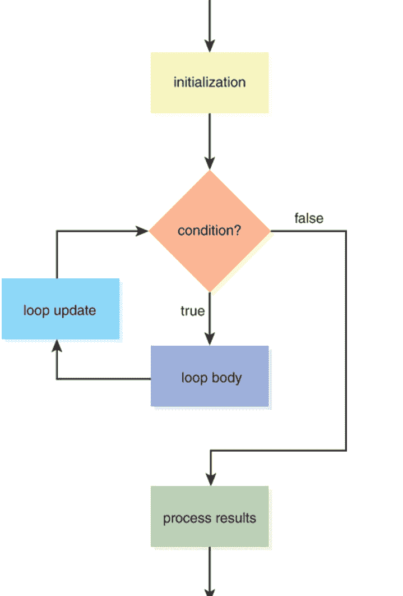

**图 6.16** `for` 循环的控制流

`for` 循环等同于以下 `while` 循环：

```java
// initialization
while ( loop condition )
{
    // loop body
    // loop update
}
```

如我们所示，`while` 循环可以用于事件驱动循环或计数控制循环。然而，`for` 循环对于计数控制循环尤为有用。由于所有的循环控制都包含在 `for` 循环头部中，我们可以很容易地看到什么条件将停止循环，以及该条件在每次迭代后将如何更新。

### 6.10.2 构建 for 循环

通常，我们在 `for` 循环中使用一个循环控制变量；该控制变量通常用于计数。我们在初始化语句中设置它的初始值，在循环更新语句中增加或减小它的值，并在循环条件语句中检查它的值。

例如，如果我们想找到五个整数之和，我们知道循环体应该执行五次——每个整数执行一次。我们在初始化语句中将循环控制变量设置为 1，在循环更新语句中将循环变量加 1，并在循环条件中检查它的值是否小于或等于 5。该程序的伪代码如下：

```
set total to 0
for i = 1 to 5 by 1
{
    read integer
    add integer to total
}
print the total
```

使用 `for` 循环时，我们不需要执行引导读取（priming read），因为退出循环的条件是由计数器控制的，而不是输入值。

示例 6.12 显示了计算五个整数之和的 `for` 循环。

## 示例 6.12 求五个数的和


```
/* Find the total of 5 numbers
 * Anderson, Franceschi
 * */
import java.util.Scanner;

public class Sum5Numbers {
    public static void main(String[] args) {
        int total = 0; // 存储 5 个数的和
        int number; // 存储当前输入
        Scanner scan = new Scanner(System.in);
        for (int i = 1; i <= 5; i++) {
            System.out.print("Enter an integer > ");
            number = scan.nextInt();
            total += number; // 将输入加到总和
        }

        // 通过打印总和处理结果
        System.out.println("The total is " + total );
    }
}
```

在这个示例中（这是一个标准的累加操作），`for` 循环初始化语句声明了 `i`，它将是我们的循环控制变量。我们将 `i` 初始化为 1，在每次执行循环体后，我们在循环更新语句中将 `i` 加 1。循环条件检查 `i` 的值是否小于或等于 5；当 `i` 达到 6 时，我们已经执行了五次循环体。[图 6.17] 显示了此 `for` 循环的执行情况。

注意，由于我们在 `for` 循环头部中声明了循环计数变量 `i`，因此在 `for` 循环结束后我们无法引用 `i`。因此，这段代码将产生编译错误，因为 `i` 在第 24 行超出了作用范围：

```
16      for ( int i = 1; i <= 5; i++ )
17      {
18          System.out.print("Enter an integer > ");
19          number = scan.nextInt();
20
21          total += number; // add input to total
22
23      }
24      System.out.println("The total for the " + (i
25              - 1)
26              + " numbers is " + total
27      ); // i is out of scope
```

## 图 6.17

求五个整数之和

```
Enter an integer > 12
Enter an integer > 10
Enter an integer > 5
Enter an integer > 7
Enter an integer > 3
nThe total is 37
```

使用与已作用范围内的变量相同的名称定义新变量是无效的，并产生编译错误。然而，当之前定义的同名变量不再处于作用范围内时，就可以重用该变量名。在上面的代码中，第 16 行定义的变量 `i` 的作用范围限于第 16–22 行的 `for` 循环。我们不能在那个 `for` 循环中定义另一个名为 `i` 的变量；但是，如下所示，我们可以在随后的 `for` 循环（第 24–29 行）中重用名称 `i`，因为第一个 `i` 已不再处于作用范围内。事实上，程序员经常在 `for` 循环中重用变量 `i` 作为计数变量。

```
16 for ( int i = 1; i <= 5; i++ )
17 {
18     System.out.print("Enter an integer > ");
19     number = scan.nextInt();
20 
21     total += number; // add input to total
22 }
23 
24 for ( int i = 1; i <= 10; i++ )
25 {
26     System.out.print("Enter " + i + " ");
27     number = scan.nextInt();
28 }
```

如果我们确实想在循环结束后引用循环变量，可以在 `for` 循环之前定义该变量，如下代码所示：

```
15 int i;
16 for ( i = 1; i <= 5; i++ )
17 {
18 System.out.print("Enter an integer > ");
19 number = scan.nextInt();
20
21 total += number; // add input to total
22
23
24 System.out.println("The total for " + (i - 1)
25 // i is 6
26 + " numbers is " + total
27 );
```

我们还可以通过 1 以外的值增加循环控制变量。示例 6.13 显示了一个 `for` 循环，它将控制变量加 2 以打印从 0 到 20 的偶数。

该程序的伪代码如下：

```
set output to empty String
for i = 0 to 20 by 2
{
  append i and space to output
}
print the output
```

我们从空字符串开始，每次迭代都向输出中添加 `i` 和空格。当循环完成后，我们打印这些偶数。

## 示例 6.13 求偶个数的和

```
/* Find the total of 5 numbers
 * Anderson, Franceschi
 * */
import java.util.Scanner;

public class Sum5Numbers {
    public static void main(String[] args) {
        int total = 0; // 存储 5 个数的和
        int number; // 存储当前输入
        Scanner scan = new Scanner(System.in);
        for (int i = 1; i <= 5; i++) {
            System.out.print("Enter an integer > ");
            number = scan.nextInt();
            total += number; // 将输入加到总和
        }

        // 通过打印总和处理结果
        System.out.println("The total is " + total );
    }
}
```

## 图 6.18

打印 0 到 20 的偶数

```
0 2 4 6 8 10 12 14 16 18 20
```

在这个示例中，我们将循环变量初始化为 0，然后在循环更新中将 `i` 加 2 以跳过奇数。循环变量也可以用于我们的提示中。例如，在示例 6.12 中，我们可以使用以下提示用户输入每个整数：

```
System.out.print("Enter integer " + i + " ");
```

那么提示看起来就像图 6.19。

## 图 6.19

将循环变量添加到提示

```
Enter integer 1 > 2
Enter integer 2 > 12
Enter integer 3 > 10
Enter integer 4 > 11
Enter integer 5 > 15
nThe total is 7
```

`for` 循环特别适用于逐字符处理字符串。我们定义循环变量，使其对应字符串中每个字符的索引。我们将循环变量初始化为 0（字符串第一个字符的索引），在循环更新中将循环变量加 1，并将循环条件设置为循环变量小于字符串的长度。在循环的每次迭代中，我们通过使用 `String` 类的 `charAt` 方法提取循环变量处的字符来处理字符串的字符。

标记之间可能由多个一个空格字符分隔，因此，我们需要检测何时遇到多个连续的空格字符，并忽略除第一个空格字符以外的所有字符。为了实现这一点，我们定义了一个名为标记的布尔变量。当我们看到空格字符时，将标记设置为 `true`；当看到非空格字符时，将其设置为 `false`。如果在标记为 `false` 时发现空格字符，它必须是第一个空格字符。然而，如果标记被设置为 `true`，说明我们发现了一个额外的空格字符，我们应该忽略它。

此示例的伪代码如下：

```
read sentence
remove leading and trailing white space
if sentence is empty:
    print message no tokens found
else:
    set countTokens = 1
    initialize flag variable to false to indicate that
    the current character is not
        white space
    for i = 0 to (sentence length -1) by 1
        {
            get character at position i in sentence
            if ( character is a space or tab )
                if flag variable is false
                    we have found the end of a token,
                    increment countTokens
                    set flag variable to true to indicate
                    that current character is
                        white space
            else
                set flag variable to false to indicate
                current character is not
                    white space
        
    print the number of tokens
```

**示例 6.14** 显示了我们的代码。使用 `nextLine()` 方法提示用户输入句子，该方法读取包括开头结尾空格的所有字符。我们想要移除这些多余的空格，因此我们调用 `String` 类的 `trim` 方法（第 14 行），如表 6.4 所示，它会为我们移除开头结尾空格。

## 表 6.4 String 类的 trim 方法

| 返回 | 方法名和参数列表 |
|---|---|
| 去除空格后的字符串 | `trim()` |

可能按了回车键而没有输入字符（或只有空格字符）。在这种情况下，裁剪后的字符串是空的。我们在第 16 行检查是否为空，如果是，则输出消息并什么都不做。

然而，如果用户输入了一些字符，我们将标记变量 `inWhiteSpace` 初始化为 `false`（第 22 行），因为我们还没有处理任何字符，因此没有发现空格。

我们通过找到标记后的空格来检测标记，但当我们完成句子处理时，最后一个字符将不是空格，因为我们裁剪了句子。因此，标记的数量比发现空格的次数多一个。为了考虑到最后一个标记，我们将变量 `tokenCount` 初始化为 1（第 23 行）。

现在我们准备好了 `for` 循环（第 25-41 行），它处理句子中的每个字符以寻找空格并计算标记。如所述，循环控制变量 `i` 对应于当前处理字符的索引。我们将 `i` 初始化为 0，即 `String` 的第一个索引；在循环更新中将 `i` 加 1；并在循环条件检查 `i` 是否小于 `sentence.length()`（第 25 行）。我们使用 `charAt` 方法（第 27 行）提取 `i` 处的字符。

在第 28 行，我们检查当前字符是否为空格或制表符。如果是，我们就检测到了空格。如果标记未设置为 `true`，那么这就是可能的空格字符序列中的第一个空格，我们计算标记，并将标记设置为 `true` 以忽略任何后续的空格字符（第 32-33 行）。如果当前字符不是空格，我们将标记设置为 `false` 以表示我们处于标记内部（第 38 行）。

循环结束后，我们输出标记数量的消息（第 42-43 行）。图 6.20 显示当用户输入由空格和制表符分隔的六个标记的句子时的输出。

## 示例 6.14 计算标记

```java
/* Count tokens in a sentence */
 * Anderson, Franceschi
 * */

import java.util.Scanner;
public class CountTokens {
    public static void main(String [] args) {
        Scanner scan = new Scanner(System.in);
        System.out.println("Enter a sentence: ");
        String sentence = scan.nextLine();
        sentence = sentence.trim(); // remove leading/trailing white space
        if (sentence.length() == 0) {
            System.out.println("No tokens found");
        } else {
            int countTokens = 1;
            boolean inWhiteSpace = false; // indicate that the current character is not white space
            for (int i = 0; i < sentence.length(); i++) {
                char c = sentence.charAt(i);
                if (c == ' ' || c == '\t') {
                    if (!inWhiteSpace) {
                        countTokens++;
                        inWhiteSpace = true; // indicate that current character is white space
                    }
                } else {
                    inWhiteSpace = false; // indicate that current character is not white space
                }
            }
            System.out.println("Number of tokens found: " + countTokens);
        }
    }
}
```

## 示例 6.16 绘制靶心

```java
1 /* 靶心目标
2 Anderson, Franceschi
3 * /
4
5 import javafx.application.Application;
6 import javafx.scene.canvas.Canvas;
7 import javafx.scene.canvas.GraphicsContext;
8 import javafx.scene.paint.Color;
9 import javafx.stage.Stage;
10
11 public class BullEye extends Application
12 {
13
14     @Override
15     public void start( Stage stage )
16     {
17         // 设置窗口标题和大小
18         GraphicsContext gc =
19         JIGraphicsUtility.setUpGraphics(
20             stage, "Bull's Eye", 700, 400);
21
22         // 靶心的中心
23         final int CENTER_X = 350, CENTER_Y = 200;
24
25         // 起始和结束直径，减少直径的量
26         final int START_DIAMETER = 300, END_DIAMETER = 25,
DECREMENT = 25;
```


```java
27
28      // 第一个圆的颜色
29      Color toggleColor = Color.BLACK;
30      gc.setFill(toggleColor);
31
32      for (int diameter = START_DIAMETER;
           diameter >= END_DIAMETER;
33          diameter -= DECREMENT)
34      {
35          // 使用当前直径值绘制圆
36          gc.fillOval(CENTER_X - diameter / 2, CENTER_Y - diameter / 2, diameter, diameter);
37          // 切换颜色
38          if (toggleColor.equals(Color.BLACK))
39              toggleColor = Color.RED;
40          else
41              toggleColor = Color.BLACK;
42
43          gc.setFill(toggleColor);
44
45      }
46  }
47
48  public static void main(String[] args)
49  {
50
51      launch(args);
52  }
53
```

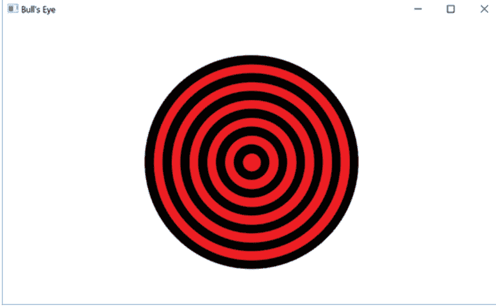

### 图 6.22

绘制靶心。我们在第 32–33 行中的 `for` 循环初始化语句将最大圆的直径设置为 300 像素，循环更新语句将每个圆的直径减少 25 像素。我们想要绘制的最小圆直径应该是 25 像素，因此我们将循环条件设定为检查直径是否大于或等于 25。我们需要从最大的圆开始，而不是从最小的圆开始，这样我们绘制的新圆就不会遮挡之前绘制的圆。

绘制靶心目标圆说明了两种常用的编程技术：单位转换和切换变量。

我们需要在单位之间进行转换，是因为 `GraphicsContext` 类的 `fillOval` 方法的参数是圆的边界矩形的左上角 (x, y) 坐标以及矩形的宽度和高度。然而，我们所有的圆都有相同的中心点，但左上角的 x 和 y 坐标不同。不过，给定圆的直径和中心点，我们可以计算出左上角的 (x, y) 坐标。图 6.23 显示了我们如何进行这种转换。

边界矩形的中心点与左上角之间的差是圆的半径，即直径的一半（`diameter / 2`）。因此，左上角的 x 值是中心点的 x 值减去直径的一半（`centerX - diameter / 2`）。同样，左上角的 y 值是中心点的 y 值减去直径的一半（`centerY - diameter / 2`）。

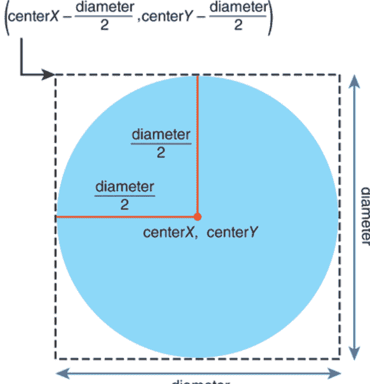

### 图 6.23

绘制靶心

因此，我们使用以下语句绘制每个圆：

```java
gc.fillOval(centerX - diameter / 2,
centerY - diameter / 2,
diameter, diameter);
```

> **软件工程提示**
>
> 当你需要在两个值之间交替使用时，请使用切换变量。

为了在红色和黑色圆之间交替，我们使用了一个**切换变量**，这是一个值在两个值之间交替变化的变量。我们使用 `Color` 对象 `toggleColor` 作为切换变量，并将其初始化为 `Color.BLACK`。在绘制每个圆后，我们切换颜色（第 38–42 行）。如果当前颜色是黑色，我们就将其设置为红色；否则颜色必须是红色，所以我们将颜色设置为黑色。

## 6.10.3 循环的测试技术

`for` 循环最重要的测试之一是循环变量的起始值和结束值是否设置正确。例如，为了让 `for` 循环执行五次，我们可以将循环变量的初始值设为 0 并使用条件 `(i < 5)`，或者将循环变量的初始值设为 1 并使用条件 `(i <= 5)`。这两种 `for` 头部都会执行五次。

# 技能练习

- 6.14.1 单选题
- 6.14.2 阅读与理解
- 6.14.3 代码实现
- 6.14.4 错误查找
- 6.14.5 调试技巧
- 6.14.6 编写程序

与 `while` 循环一样，`for` 循环的体可能不会执行。如果条件第一次就为假，循环体就会被跳过。当我们这样做时，发现程序仍然可以工作，如图 6.24 所示。

### 图 6.24 计数五次

```
输入整数 1
输入整数 2
输入整数 3
输入整数 4
输入整数 5
总计为 7
```

### 图 6.25 空句子反转类

```
输入句子：
反转后的句子为
```

程序处理空句子时是正确的，因为循环初始化语句是

```java
int i = original.length() - 1;
```

由于空字符串的长度为 0，该语句将 i 设置为 -1。循环条件 `i >= 0` 立即为假，因此循环体从未执行。控制流跳转到循环后的语句：

```java
System.out.println("The sentence backwards is: \n" + backwards);
```

检查句子是否为空并打印相应的消息会更符合用户体验，但程序确实是“什么都不做”。

## 6.11 嵌套循环

循环可以嵌套在另一个循环内部；也就是说，一个循环的体可以包含另一个循环。例如，一个 `while` 循环可以嵌套在另一个 `while` 循环中，或者 `for` 循环可以嵌套在另一个循环中。事实上，当我们需要执行多个操作，且每个操作都有自己的计数器或哨兵值时，嵌套循环非常有用。回到收银员 Jane，她的工作日可以使用嵌套循环进行建模。在编程活动 1 中，我们编写了收银员计算一个客户购物车总价的代码。但收银员会一个接一个地处理多个客户。只要队列不为空，她就会帮助下一个客户。对于每个客户，她会将总额设置为 $0.00，并开始扫描物品并将价格加到总额。当当前客户购物车中还有物品时，Jane 会扫描下一个物品。当 Jane 完成一个客户的结算后，她会检查队列中是否还有人在等待。如果有，她会将总额设为 $0.00。

因此，收银员的工作可以使用嵌套在另一个 `while` 循环中的循环来描述。这些嵌套循环的伪代码如下：

```
查找客户
while 队列中有客户
{
    将总额设为 $0.00
    扫描第一个项目
    while 项目不是分隔符
    {
        将价格加到总额
        扫描下一个项目
    }
    // 如果我们在这里，项目就是分隔符
    输出总额

    另一个客户
}
```

理解嵌套循环的关键点是，内层（或嵌套）循环在外层循环的每次迭代中都会完全执行（执行所有迭代）。

让我们来看一个使用嵌套 `for` 循环的简单示例。假设我们要打印五行数字：

```
1
1 2
1 2 3
1 2 3 4
1 2 3 4 5
```

我们可以看到这里的模式：第一行打印一个数字；第二行打印两个数字，以此类推。换句话说，我们打印的数量和行数是相同的。该模式的伪代码如下：

```
for line = 1 到 5，步长1
{
    for number = 1 到 line，步长1
    {
        打印 number 和空格
    }
    打印新行
}
```

将此伪代码翻译成嵌套 `for` 循环，得到了示例 6.17 所示的代码。

## 示例 6.17 嵌套 for 循环

```java
/* 使用嵌套循环打印数字
Anderson, Frances */
public class NestedForLoops
{
    public static void main(String[] args)
    {
        // 外层循环打印 5 行
        for (int line = 1; line <= 5; line++)
        {
            // 内层循环打印一行
            for (int number = 1; number <= line; number++)
            {
                // 打印数字和空格
                System.out.print(number + " ");
            }

            System.out.println(); // 换行
        }
    }
}
```

注意，内层 `for` 循环（第 12-17 行）使用了外层 `for` 循环（第 9-20 行）设置的 `line` 值。因此，在外层循环的第一次迭代中，`line` 等于 1，所以内层循环执行一次，打印 1 和空格。然后我们打印换行符，因为第 19 行是外层循环的一部分。接着外层循环将 `line` 的值设为 2，内层循环再次从 1 开始执行两次（直到 `number` 等于 `line`）。然后我们再次打印换行符。这种操作一直持续到 `line` 超过 5，外层循环终止。示例 6.17 的输出如图 6.26 所示。

我们需要循环控制变量使用不同的名称。循环控制变量 `line` 的作用范围从第 10 到 20 行，包含了内层 `for` 循环。

让我们来看嵌套循环的另一个示例。我们将允许用户输入整数，并将 0 作为哨兵值。对于每个数字，我们将找到它所有的因子；即，找到除 1 和数字本身以外的所有能整除该数字的整数。

### 图 6.26

示例 6.17 的输出

```
1

1 2

1 2 3

1 2 3 4

1 2 3 4 5
```

如果一个数字能被另一个数字整除，除后的余数为 0。模运算符 `%` 在这里非常有用，因为它计算的是整数除法的余数。因此，为了找到一个数字的所有因子，我们可以测试从 1 到该数字的所有整数，看余数是否为 0。但让我们思考这是否是一个好方法。数字 1 是所有数字的因子，因为每个数字都能被 1 整除。所以我们可以从 2 开始测试整数。然后，由于 2 是最小因子，没有测试大于 `number / 2` 的整数。因此，我们要测试的整数范围将是从 2 到 `number / 2`。

对于这个示例，我们将使用嵌套在 `while` 循环中的 `for` 循环。该示例的伪代码如下：

```
读取第一个数字 // 引导读取
while 数字不是 0
{
    打印 "数字 的因子有 "
    for factor = 2 到 ( 数字 / 2 )，步长1
    {
        如果 数字 % factor 等于 0
            打印 factor 和空格
    }
    打印新行
}
```

但如果我们没有为某个数字找到任何因子会怎样？在这种情况下，该数字是一个质数。我们可以使用一个布尔标记变量来检测这种情况。在开始检查因子的 `for` 循环之前，我们将标记设为 `false`。在 `for` 循环内部，当我们找到因子时，将标记设为 `true`。换句话说，我们发出信号（或标记）找到了一个因子。然后，在 `for` 循环结束后，我们检查 `flag` 的值。如果它仍然是 `false`，说明我们没有找到任何因子，该数字是质数。我们程序的伪代码现在变为：

```
读取第一个数字 // 引导读取
while 数字不是 0
{
    打印 "数字 的因子有 "
    将 flag 设为 false
    for factor = 2 到 ( 数字 / 2 )，步长1
    {
        如果 数字 % factor 等于 0
            打印 factor 和空格
            将 flag 设为 true
    }
    打印新行
}
```

由于一个数字能被另一个数字整除，除后的余数将是 0。

# 指令

将本文随附提供的源代码中“编程活动 2”（Programming Activity 2）文件夹中的文件复制到你计算机上的文件夹中。在 `CashierDrawing.java` 代码中搜索五个星号（`*****`），即可找到你需要添加代码的位置。你将把代码添加到 `CashierDrawing` 类的 `checkout` 方法内部（`checkout` 方法的方法头已经为你写好了）。示例 6.19 显示了 `CashierDrawing` 类的一个片段，你可以在此处添加代码：

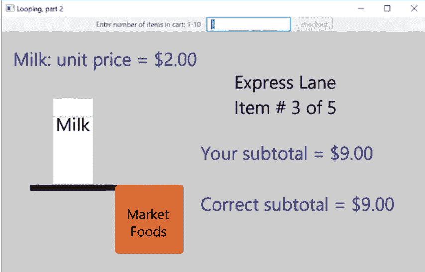

图 6.28 示例动画

# 示例 6.19 *CashierDrawing* 类中的 *checkout* 方法

```java
public void checkout(int numberItems)
{
  /* ***** 学生编写此方法的体体 ***** */
  //
  // 此方法的参数 numberOfItems
  // 表示购物车中物品的数量。
  // 用户将将被提示输入这个数字。
  //
  // 使用 for 循环计算购物车中
  // 杂货的总价格。
  //
  // getNext 方法（在此 CashierDrawing 类中）
  // 返回购物车中的下一个
  // 物品，这是一个 Item 对象（我们并
  // 不知道将返回哪一个物品；它是随机生成的）。
  // getNext 不接受任何参数。其 API 为
  // Item getNext()
  //
  // 作为你 for 循环体的最后语句，
  // 你应该调用 animate 方法。
  // animate 方法接受一个 double 类型的参数，
  // 即你当前的小计金额。
  // 例如，如果代表当前小计的变量
  // 名为 total，你对 animate
  // 方法的调用应该是：
  // animate(total);
  //
  // Item 类的 getPrice 方法
  // 返回 Item 对象的价格，类型为 double。
  // getPrice 方法不接受任何参数。其
  // API 为
  // double getPrice()
  //
  // 学生代码结束
  //
}
```

要编写 `for` 循环的体，你可以使用以下方法：

- 你可以使用 `CashierDrawing` 类的 `getNext` 方法访问购物车中的物品，该方法具有以下 API：

`Item getNext()`

`getNext` 方法返回一个 `Item` 对象，代表购物车中的一个 `Item`。如你所见，`getNext` 方法不接受任何参数。由于我们在 `CashierDrawing` 类内部调用 `getNext` 方法，因此我们可以在没有对象引用的情况下直接调用该方法。例如，对 `getNext` 的调用可能如下：

```java
Item newItem;
newItem = getNext();
```

- 在你获取一个新的 `Item` 之后，可以通过调用 `Item` 类的 `getPrice` 方法来“扫描”该物品以获取价格。`getPrice` 方法具有此 API：

`double getPrice()`

因此，你将获取下一个物品，然后使用如下代码获取其价格：

```java
Item newItem;
double price;
newItem = getNext();
price = newItem.getPrice();
```

当你完成 `checkout` 方法的代码编写后，编译 `CashierDrawing.java` 并从 `CashierApplication` 类运行应用程序。当程序执行完毕时，通过以下步骤验证你的代码是否正确：

- 检查你的小计是否与显示的正确小计匹配
- 检查你是否处理了购物车中的所有物品，即验证当前物品编号是否与物品总数匹配。例如，如果有五个物品，检查屏幕右上角的消息是否显示：Item # 5 of 5。

# 故障排除

如果你的方法实现没有动画或动画执行错误，请检查以下项目：

- 验证你是否正确编写了 `for` 循环的头部。
- 验证你是否正确编写了循环体。

讨论题？

1. 解释为什么 `for` 循环适用于这项活动。
2. 解释你是如何设置 `for` 循环的；即你使用了什么初始化语句，你的条件是什么，循环更新语句又是什么？

# 章复习

## 6.13 总结

- 循环在条件为真时，对每个输入项重复一组操作。
- `while` 循环对于事件控制的循环特别有用。只要循环条件为真，`while` 循环就会执行循环体中的一组操作。循环体的每次执行都是循环的一次迭代。
- 如果循环条件在第一次求值时为假，则 `while` 循环体将永远不会执行。
- 如果循环条件从不为假，则结果就是死循环。
- 在事件控制循环中，物品的处理持续，直到通过哨兵值（sentinel value）或到达文件结尾信号输入结束。
- 哨兵值是一个特殊的输入值，用于指示项的结束。
- 在事件控制循环中，处理过程持续，直到通过哨兵值或到达文件末尾信号输入结束。使用哨兵值时，在循环开始前执行一次读取。如果循环条件在第一次求值时为假，则 `while` 循环体将永远不会执行。


## 循环技术与练习

### 文件读取与循环控制

- 在读取文件数据时，通过调用 `Scanner` 的 `hasNext()` 方法测试是否已到达文件结尾。

### 累加技术

- 在累加技术中，在启动循环前初始化总和为 0。在循环体中，将输入加到总和。循环结束后，总和为所有输入的和。

### 计数技术

- 在计数技术中，在启动循环前将计数器初始化为 0。在循环体中增加计数器的值。循环结束后，计数器为符合条件的次数。

### 平均值计算

- 为了计算平均值，我们结合累加和计数。我们将输入加到总和并增加计数器。循环结束后，通过将总和除以计数来计算平均值。计算平均值之前，我们应该验证除数（即计数）不为 0。

### 最大值/最小值查找

- 为了找到一组输入中的最大值或最小值，我们将第一个输入赋值给运行最大值或最小值。在循环体中，我们将每个输入值与运行最大值或最小值进行比较。如果输入值小于最小值，则将其赋值给最小值；同样，如果输入值大于最大值，则将其赋值给最大值。

### 输入验证

- 为了避免在用户输入非预期字符时产生异常，使用 `Scanner` 的 `hasNext` 方法。

### 循环条件构造

- 要构造循环条件，请构造循环终止条件的反。

### 循环测试策略

- 在测试包含循环的程序时，通过输入值并与手动计算的结果进行比较来测试程序的结果是否正确。还要测试循环体从未执行时结果是否正确。最后，使用无效输入测试结果。

## 6.14 练习、问题与项目

### 6.14.1 单选题练习

1. 你是如何发现代码中存在无限循环的？
   - 代码无法编译。
   - 代码可以编译并运行，但结果错误。
   - 代码无限运行。
   - 代码可以编译，但存在运行时错误。

2. 如果你想让循环体至少执行一次，你会使用哪种类型的循环？
   - for 循环
   - while 循环
   - do/while 循环
   - 以上都不是

3. 哪种描述最准确描述了 for 循环？
   - 它是一个由计数控制的循环。
   - 它是一个由事件控制的循环。
   - 它是一个由哨兵控制的循环。

4. 你可以用 while 循环模拟 for 循环。
   - 正确
   - 错误

### 6.14.2 阅读与理解代码

5. 这段代码序列的输出是什么？（用户连续输入 3, 5 和 -1）。

```java
System.out.print("Enter an int > ");
int i = scan.nextInt();
while (i != -1) {
    System.out.println("Hello");
    System.out.print("Enter an int > ");
    i = scan.nextInt();
}
```

6. 这段代码序列的输出是什么？（用户连续输入 3, 5 和 -1）。

```java
int i = 0;
while (i != -1) {
    System.out.println("Hello");
    System.out.print("Enter an int > ");
    i = scan.nextInt();
}
```

7. 这段代码序列的输出是什么？（用户连续输入 3, 5 和 -1）。

```java
System.out.print("Enter an int > ");
int i = scan.nextInt();
while (i != -1) {
    System.out.print("Enter an int > ");
    i = scan.nextInt();
    System.out.println("Hello");
}
```

8. 在此代码序列执行后，$i$ 和 $sum$ 的值是多少？

```java
int sum = 0;
int i = 17;
while ( i % 10 != 0 )
{
  sum += i;
  i++;
}
```

9. 在此代码序列执行后，$i$ 和 $product$ 的值是多少？

```java
int i = 6;
int product = 1;
do
{
  product *= i;
  i++;
} while ( i < 9 );
```

10. 在此代码序列执行后，$i$ 和 $product$ 的值是多少？

```java
int i = 6;
int product = 1;
do
{
  product *= i;
  i++;
} while ( product < 9 );
```

11. 这段代码序列的输出是什么？

```java
for ( int i = 0; i < 3; i++ )
System.out.println( "Hello" );
System.out.println( "Done" );
```

12. 这段代码序列的输出是什么？

```java
for ( int i = 0; i <= 2; i++ )
System.out.println("Hello" );
System.out.println("Done" );
```

13. 在此代码序列执行后，$i$ 的值是多少？

```java
int i = 0;
for ( i = 0; i <= 2; i++ )
System.out.println("Hello" );
```

14. 在此代码序列执行后，$i$ 的值是多少？

```java
int i = 0;
for ( i = 0; i < 20; i++ )
System.out.println("Hello" );
```

15. 在此代码序列执行后，$i$ 和 $sum$ 的值是多少？

```java
int i = 0;
int sum = 0;
for ( i = 0; i < 5; i++ )
{
sum += i;
}
```

16. 在此代码序列执行后，$i$ 和 $sum$ 的值是多少？

```java
int i = 0;
int sum = 0;
for ( i = 0; i < 40; i++ )
{
if ( i % 10 == 0 )
sum += i;
}
```

17. 在此代码序列执行后，$sum$ 的值是多少？

```java
int sum = 0;
for ( int i = 1; i < 10; i++ )
{
    i++;
    sum += i;
}
```

18. 在此代码序列执行后，$sum$ 的值是多少？

```java
int sum = 0;
for ( int i = 10; i > 5; i-- )
{
    sum += i;
}
```

19. 当此代码序列执行时打印了什么？

```java
for ( int i = 0; i < 5; i++ )
{
    System.out.println( Math.max(i, 3) );
}
```

20. 在此代码序列执行后，$i$ 和 $sum$ 的值是多少？

```java
int i = 0;
int sum = 0;
while ( i != 7 )
{
    sum += i;
    i++;
}
```

### 6.14.3 填充代码

21. *此 while 循环生成 3 到 7 之间的随机整数，直到生成 5 个为止。*

```java
Random random = new Random();
int i = random.nextInt( 5 ) + 3;
```

22. *此 while 循环接收用户的整数，提示额外的整数并打印所有大于等于输入的整数，直到用户输入 20 为止。*

```java
System.out.print("Enter a integer > ");
int start = scan.nextInt();
```

23. *此 while 循环接收用户的整数直到用户输入 -1（该值不被累加）。*

```java
System.out.print("Enter an integer value, " + -1 to stop > ");
int value = scan.nextInt();
```

24. *此循环使用 while 循环计算前四个 7 的倍数的和和将等于 7 + 14 + 21 + 28 = 70）。*

```java
int sum = 0;
int countMultiples7 = 0;
int count = 1;
```

25. *此循环接收用户的单词并拼接直到用户输入 "end" 为止（该词不被拼接）。代码输出拼接后的字符串。*

```java
String sentence = "";
String word;
while (!word.equals("end")) {
}
System.out.println("The sentence is " + sentence);
```

26. 此循环从文件（已关联 Scanner 对象）读取整数并计算和。我们不知道文件中多少个整数。

```java
int sum = 0;
```

27. 这是一个 while 循环；请编写等效的 for 循环。

```java
int i = 0;
while (i < 5) {
    System.out.println("Hi there");
    i++;
}
```

28. 此循环从用户处读取整数直到用户输入 0 或 100。然后打印输入数字的和（不包括 0 或 100）。

29. 此循环使用 for 循环计算 1 到 5 整数的和。

```java
int sum = 0;
```

### 6.14.4 识别代码中的错误

30. 这段代码序列的问题在哪里（尽管该序列可以编译）？

```java
int i = 0;
while ( i < 3 )
    System.out.println("Hello");
```

31. 这段旨在读取并回显整数直到用户输入 -1 的代码序列错误在哪里？

```java
int num;
while ( num != -1 )
{
    System.out.print("Enter an integer > ");
    num = scan.nextInt();
    System.out.println(num);
}
```

32. 下列代码序列想要打印三次 Hello，但它只打印了一次。这段代码序列的问题在哪里？

```java
for ( int i = 0; i < 3; i++ );
    System.out.println("Hello");
```

33. 这段代码序列的错误在哪里？它的意图是打印 10 次 Hello。

```java
for ( int i = 10; i > 0; i++ )
    System.out.println("Hello"); )
```

34. 这段代码序列的问题在哪里？它的目的是生成 3 到 10 之间的随机整数直到生成 5 个。

```java
Random random = new Random();
int i = random.nextInt( );
```

35. 这段代码序列的错误在哪里？

```java
int sum = 0;
for ( int i = 1; i < 6; i++ )
sum += i;
System.out.println("The value of i is " + i);
```

### 6.14.5 调试区域——使用编译器和 JVM 的消息

36. 你在 Test.java 中写了以下：

```java
int i = 0;
int sum = 0;
do {
    sum += i;
    i++;
} while(i < 3 )
```

发生了什么？如何修复？

37. 你在 Test.java 中写了以下：

```java
int i = 0;
while (i < 3) {
    System.out.println("Hello");
    i--;
}
```

代码编译通过但永不终止。问题在哪里？如何修复？

38. 你在 Test.java 中写了以下：

```java
for ( int i = 0; i++; i < 3 )
System.out.println("Hello");
```

编译时得到了什么错误？如何修复？

39. 你在 Test.java 中写了以下：

```java
for ( int i = 1; i < 3; i++ ) // 第5行
System.out.println("Hello");
```

代码编译并运行，但只打印了两次 Hello，而我们期望打印三次。问题在哪里？如何修复？

40. 你在 Test.java 中写了以下：

```java
int product = 1;
for ( int i = 1, i < 5, i++ ) // 第8行
product = i;
System.out.println("Product is " + product); // 第10行
```

编译时得到了哪些错误？这两个错误是什么？如何修复？

41. 你在 Test.java 中写了以下：

```java
for ( int i = 0; i < 3; i++)
System.out.println("Hello");
System.out.println("i = " + i); // 第8行
```

在编译时，你会得到以下错误：

```
Test.java:8: error: cannot find symbol
System.out.println("i = " + i); // line 8
^
symbol : variable i
location: class Test
1 error
```

解释问题是什么以及如何修复它。

42. 你在 TestTest.java 类中编写了以下代码：

```java
int i = 0;
for ( int i = 0; i < 3; i++) // line 6
System.out.println("Hello");
```

在编译时，你会得到以下错误：

```
Test.java:6: error: variable i is already defined
in main( String[] )
for( int i = 0; i < 3; i++) // line 6
1 error
```

解释问题是什么以及如何修复它。

### 6.14.6 写一个简短程序

43. 写一个程序，提示用户输入一个大于 10 的值（你应该不断循环，直到用户输入有效值为止），并找到该数的平方根以及该结果的平方根，并继续寻找结果的平方根，直到得到一个小于 1.01 的数。程序应该输出执行平方根操作次数。

44. 写一个程序，期望输入包含 `@` 字符的单词。如果单词不包含 `@` 字符，程序应该继续提示用户输入单词。当用户输入包含 `@` 字符的单词时，程序只需打印该单词并终止。

45. 写一个程序，从名为 `input.txt` 的文件中读取 double 值并输出平均值。

46. 写一个程序，使用 `for` 循环输出 10 到 20 之间（包含）所有整数的和，即 10 + 11 + 12 + ... + 19 + 20。

47. 写一个程序，使用 `for` 循环输出 3 到 7 之间（包含）所有整数的积，即 3 * 4 * 5 * 6 * 7。

48. 写一个程序，使用 `for` 循环统计 33 到 97 之间（包含）有多少个 7 的倍数。

49. 写一个程序，从用户处获取一个值（假设为 n），并输出 n 次 Hello World。验证用户输入的是整数。如果输入是 3，输出将打印三次 Hello World。

50. 写一个程序，从键盘输入一个单词，并输出单词中的每个字符，字符之间用空格隔开。

51. 写一个程序，从键盘输入一个值，并输出该数的阶乘；整数 $n$ 的阶乘是 $n * (n - 1) * (n - 2) * ... * 3 * 2 * 1$。例如，4 的阶乘是 4 * 3 * 2 * 1，即 24。

52. 使用循环写一个程序，从键盘获取 10 个整数值，并输出所有输入值中的最小值。

53. 修改句子中标记的计数，使其打印每个标记并统计标记的数量。

### 6.14.7 编程项目

54. 写一个程序，输入一个代表二进制数（0 和 1）的单词。首先，你的程序应该验证它确实是一个二进制数，即该数字只包含 0 和 1。如果不是，你的程序应该打印信息，说明该数字不是有效的二进制数。然后，你的程序应该统计该单词中有多少个 1 并输出该计数。

55. 执行与第 54 题相同的的操作，但如下：如果单词不代表有效的二进制数，程序应该不断提示用户输入新单词，直到用户输入一个代表有效二进制数的单词为止。

56. 写一个程序，输入一个代表二进制数（0 和 1）的单词。首先，你的程序应该检查它确实是一个二进制数，即该数字只包含 0 和 1。如果不是，你的程序应该输出该数字不是有效的二进制数。如果该单词恰好包含两个 1，你的程序应该输出该单词被“接受（accepted）”，否则输出“被拒绝（rejected）”。

57. 执行与第 56 题相同的的操作，但如下：如果单词不代表有效的二进制数，程序应该不断提示用户输入新单词，直到用户输入一个代表有效二进制数的单词为止。

58. 写一个程序，输入一个代表二进制数（0 和 1）的单词。首先，你的程序应该检查它确实是一个二进制数，即该数字只包含 0 和 1。如果不是，你的程序应该输出该数字不是有效的二进制数。如果该单词包含至少三个连续的 1，你的程序应该输出该单词被“接受”，否则输出“被拒绝”。

59. 写一个程序，从文件 `dja.txt` 中读取 7 个 double 值，代表 7 天的道琼斯指数。你的程序应该输出这 7 天的最低值以及出现最低值的日期。对于此程序，不要将初始最小值设置为文件中的第一个值，而是使用 double 的最大值。Java 类库在 `Double` 包装类中作为常量提供了此值。务必处理文件为空的情况。


60. 写一个程序，从键盘输入代表二进制数的单词，直到用户输入“stop”为止，统计其中有多少个数字。


- 61. 使用循环，写一个程序，从键盘输入 10 个成绩（0 到 100 之间），并输出这些分值的最小值、最大值和平均值。

- 62. 写一个程序，从键盘输入一个电子邮件地址，并使用循环遍历每个字符寻找 `@` 符号。如果电子邮件地址恰好有一个 `@`，则打印信息说明该地址是有效的；否则输出它是无效的。

- 63. 写一个程序，从键盘输入一个用户 ID，并使用循环统计其中有多少个数字。如果恰好有两个数字，则打印信息说明该 ID 是有效的；否则输出它是无效的。

- 64. 写一个程序，输入一个整数值并将其转换为二进制表示；例如，如果用户输入 7，输出将为 111。

- 65. 写一个程序，输入一个代表二进制数（0 和 1）的单词并将其转换为十进制表示；例如，如果输入是 101，输出将为 5。你可以假设输入保证包含 0 和 1。

## 6.14.8 技术写作

- 69. 在编程中，程序员可能会犯语法错误，导致编译错误；这些错误可以修正。其他错误可能导致运行时错误；这些错误也可以修正。然而，逻辑错误可能导致错误的结果或没有结果。讨论在编写循环时可能犯的逻辑错误及其后果。

- 70. 讨论你如何检测代码中是否存在无限循环。

## 6.14.9 小组项目（适用于 1、2 或 3 名学生小组）

- 71. 在网页上，用户被要求提供个人信息，例如电话号码。你的程序应该从键盘获取代表电话号码的输入。如果输入包含 10 位数字以及任意数量的连字符（-）和空格，我们认为该输入是有效的电话号码。不断提示用户输入电话号码，直到用户给出一个有效的。一旦，你应该假设电话号码中的数字（仅限数字，而非连字符或空格）可能通过固定值位移进行了加密。例如，如果位移为 2，0 变成 2，1 变成 3，2 变成 4，……8 变成 0，9 变成 1。但是，我们知道用户来自纽约，区号（应用位移后，由输入的前三个数字表示）是 212。你的程序需要解密电话号码，并以 212-xxx-xxxx 的格式输出解密后的号码，以及加密的位移值。如果输入存在错误导致区号无法解密为 212，你应该输出该信息。


# 第 7 章

# 面向对象编程

## 第一部分：用户自定义类

# 目录

- 引言
- 7.1 定义类
- 7.2 定义实例变量
- 7.3 编写类方法
- 7.4 编写构造方法
- 7.5 编写访问器方法
- 7.6 编写修改方法
- 7.7 编写数据操作方法
- 7.8 编程活动 1：编写类定义，第一部分
- 7.9 对象引用 `this`
- 7.10 `toString` 和 `equals` 方法
- 7.11 静态类成员
- 7.12 图形对象
- 7.13 枚举类型
- 7.14 编程活动 2：编写类定义，第二部分
- 7.15 创建包
- 7.16 使用 Javadoc 生成 Web 风格文档
- 7.17 章总结
- 7.18 习题、问题与项目
  - 7.18.1 多选择题
  - 7.18.2 阅读并理解代码
  - 7.18.3 填空代码
  - 7.18.4 识别代码中的错误——使用 Java 编译器和 Java JVM 消息
  - 7.18.5 编写简短程序
  - 7.18.7 编程项目
  - 7.18.8 技术写作
  - 7.18.9 小组项目

# 引言

当你看到这一章的标题时，可能会说：“终于，我们可以编写自己的类了。”实际上，我们一直都在编写类。所有的 Java 源代码都属于一个类。我们一直编写的类是应用程序类。现在是时候编写一些服务类了——即封装了数据和方法以供应用程序或服务类使用的类。这些被称为用户自定义类，因为它们是由我们（而不是 Java 的作者）创建的。

首先，让我们花点时间检查我们为什么要创建用户自定义类。

我们已经使用 Java 的原始数据类型（`boolean`、`char`、`int`、`double` 等）编写了许多程序，但现实世界需要处理的是比单个布尔值或整数更复杂的数据。例如，如果你是一个在线书店的程序员，你将需要处理与书籍的数据。书籍通常有 ISBN、标题、作者、价格、库存量以及其他数据。我们可以创建一个 `Book` 类，以便每个对象都持有一本书的数据。例如，ISBN、标题和作者可以用 `String` 表示，价格用 `double` 表示，库存量用 `int` 表示。如果我们创建了这个 `Book` 类，我们的程序就能作为一个整体来存储和处理书籍的所有数据。这是面向对象编程的理念之一。

通过在类中结合处理书籍数据的方法，我们还能够隐藏处理这些数据涉及的细节。应用程序可以根据需要简单地调用方法。因此，创建你自己的类可以简化你的程序。

最后，编写良好的类可以在其他程序中重用。因此，用户自定义类加快了开发速度。

# 7.1 定义类

类封装了人、地点或事物（或更广泛地说，一个对象）的数据和功能。例如，可以定义一个类来表示学生、大学或课程。

要定义一个类，我们使用以下语法：

```
accessModifier class ClassName
{
  // 类定义写在这里
}
```

> **软件工程小贴士**
>
> 使用名词作为类名，并以大写字母开头类名。

这种语法看起来与我们程序中的第一行很熟悉。你可能还会注意到 Java 类库中的类名都是名词并以大写字母开头：例如，`Scanner`、`String`、`Math`。Java 开发者鼓励程序员使用这些约定来命名他们的用户自定义类。

在花括号内部，我们定义类的数据，称为类的**字段**，以及方法。类方法执行的一个重要功能是为**客户端程序**（即类的用户）维护类数据的值，因为客户端创建对象并调用类的方法。我们的程序有许多 Java 类的客户端，例如 `String`、`DecimalFormat` 和 `Math`。类的字段和方法被称为类的**成员**。

对于每个类以及类中的每个成员，我们都需要提供一个**访问修饰符**，用于指定类或成员在何处可见（表 7.1）。可能的访问修饰符有 `public`、`private` 和 `protected`，或者没有任何修饰符，结果是包访问。`public` 访问修饰符允许类或成员被同类或其他类的方法使用或**引用**。`private` 访问修饰符指定类或成员只能被同类的方法引用。包访问指定类或成员可以被同一包或同一文件夹中的类中的方法访问。在章的稍后部分，我们将学习如何创建自己的包。

## 表 7.1 访问修饰符

| 访问修饰符 | 类或成员可以被以下项引用 |
| :--- | :--- |
| public | 同类的方法以及其他类的方法 |
| private | 仅限同类的方法 |
| protected | 同类的方法、子类以及同一包中的方法 |
| 无修饰符（包访问） | 同一包中的方法 |

通常，类的访问修饰符将是 `public`，我们知道 `ClassName` 是。让我们开始定义一个汽车，我们可以用它计算油耗。我们将使用 `public` 修饰符，以便任何应用程序可以使用。类头看起来如下：

```java
public class Auto
{
}
```

当我们编写一个类时，我们会公开 `public` 方法名及其 API，以便客户端知道如何实例化对象并调用方法。然而，我们不发布类的实现（代码）。这被称为**数据隐藏**；作为类作者，只要我们不更改接口，就可以更改实现。

# 7.2 定义实例变量

类的实例变量持有每个对象的数据。因此，我们也说实例变量代表对象的属性。每个对象（或类的实例）都会获得实例变量的副本，每个副本都可以赋予该对象的值。因此，实例变量的值可以表示对象的状态。

实例变量使用以下语法定义：

```
accessModifier dataType identifierList;
```

> **软件工程小贴士**
>
> 将类的实例变量定义为私有，以便只有类能够设置或更改它们的值。

私有修饰符通常用于类的非常量实例变量。这允许只有同类的方法设置或更改实例变量的值。通过这种方式，我们实现了封装；类为数据提供了一个保护壳。

实例变量的数据类型可以是 Java 的任何原始类型或类类型。

标识符列表由一个或多个相同类型的实例变量名称组成，并可以为实例变量分配初始值。如果给了多个实例变量名称，则使用逗号作为分隔符。按照约定，实例变量的标识符是名词并以小写字母开头；内部单词以大写字母开头。每个实例变量和类变量必须赋予一个类内唯一的名称。但在一个类内部，同一个名称不能用于多个实例变量或类变量。因此，我们说类的字段具有类作用域。

可选，你可以将实例变量声明为常量（`final`）。

以下语句是实例变量定义的示例：

```java
private String name = ""; // an empty String
private final int PERFECT_SCORE = 100, PASSING_SCORE = 60;
private int startX, startY, width, height;
```

你应该使用什么标准来选择类的实例变量？答案是选择所有对象共有的数据。例如，对于一个 `Student` 类，你可能会选择学生姓名、平均学分和预期的毕业日期。对于一个 `Calculator` 类，你可能会选择两个操作数、一个运算符和一个结果。

> **软件工程提示**
>
> 实例变量的标识符名称应使用名词。标识符以小写字母开头，内部单词的首字母大写。

> **软件工程提示**
>
> 为所有对象共有的数据定义实例变量。

因此，对于我们的 `Auto` 类，我们将定义实例变量来存储汽车的型号、行驶的里程数以及消耗的汽油量。因此，我们的 `Auto` 类定义现在如下：

```java
public class Auto
{
    private String model;
    private int milesDriven;
    private double gallonsOfGas;
}
```

## 7.3 编写类方法

我们将 `Auto` 类的实例变量声明为 `private`，这样只有 `Auto` 类的方法才能直接访问或更改实例变量的值。`Auto` 类的客户端需要使用类的方法来访问或更改任何实例变量。因此，我们需要编写一些方法。

方法的语法如下：

```
accessModifier returnType methodName( parameter list ) // 方法头
{
    // 方法体
}
```

其中 `parameter list` 是数据类型和变量名之间用逗号分隔的列表。

> **软件工程提示**
>
> 方法名应使用动词。方法名以小写字母开头，内部单词的首字母大写。

方法头的语法应该很熟悉了，因为我们已经见过许多类方法的 API。唯一的区别仅仅是语义上的问题。方法调用者向方法发送**参数**或**实际参数**；方法将这些参数称为**形式参数**。

由于方法为类提供了功能，因此方法名通常是动词。与实例变量一样，方法名应该以小写字母开头，内部单词的首字母大写。

为客户端提供服务的方法的访问修饰符将是 `public`。只为类中其他方法提供服务的方法通常被声明为 `private`。

> **软件工程提示**
>
> 将为客户端提供的方法声明为 `public`。仅由类的其他方法调用的方法应声明为 `private`。

方法的返回类型是方法返回给调用者的值的数据类型。返回类型可以是 Java 的任何原始数据类型、任何类类型或 `void`。返回类型为 `void` 的方法不向调用者返回值。

每个方法体（由执行方法功能的代码组成）写在起始和结束的大括号之间。然而，与 `if` 语句和循环不同，这些大括号不是可选的；无论方法体中有多少条语句，大括号都是必须的。

忘记其中一个或两个大括号可能会导致多个编译错误。你可能会收到以下信息之一：

```
illegal start of expression
```

或者

```
'; expected
```

> **常见错误陷阱**
>
> 忘记用大括号包围方法体会产生一个或多个编译错误。

在方法体中，方法可以声明变量、调用其他方法，并使用我们讨论过的任何程序结构：`if/else` 语句、`while` 循环、`for` 循环、`switch` 语句和 `do/while` 循环。

类的所有对象共享一份类方法。

我们实际上已经写过方法了。例如，我们写过 `main` 方法。它的定义看起来如下：

```java
public static void main( String [ ] args )
{
    // application code
}
```

我们知道 `static` 关键字意味着 Java 虚拟机 (JVM) 可以在不实例化对象的情况下调用 `main` 来启动程序的运行。返回类型为 `void` 是因为 `main` 不返回值。参数列表期望一个参数，即 `String` 数组。

我们之前没有写过有返回值的方法。有返回值的方法使用方法体中的 `return` 语句将结果传回调用者。`return` 语句的语法为：

```
return expression;
```

正如你预期的那样，表达式的数据类型必须与方法的返回类型匹配。记住，有返回值的方法是从表达式中被调用的，当方法完成其操作时，它的返回值将替换表达式中的方法调用。

如果方法的返回类型是 `void`（如 `main`），我们可以选择使用不带表达式的 `return` 语句，如下句所示：

```
return;
```

或者完全省略 `return` 语句。鉴于到达方法末尾时控制权会自动返回调用者，大多数程序员会在 `void` 方法中省略 `return` 语句。如果需要在到达方法代码结束之前退出方法，可以可选地使用 `return` 语句。

## 7.4 编写构造函数

构造函数是在使用 `new` 关键字实例化对象时调用的特殊方法。一个类可以有多个构造函数。类构造函数的工作是初始化新对象的字段。

构造函数的语法如下：

```
accessModifier ClassName( parameter list )
{
  // 构造方法体
}
```

注意，构造函数的名称与类相同，且没有返回类型——即使是 `void`。

对构造函数使用 `public` 访问修饰符，这样应用程序才能实例化类的对象。

> **软件工程提示**
>
> 将构造函数定义为 `public`，以便客户端可以实例化类的对象。

构造函数可以为实例变量分配默认值，也可以从客户端参数接受初始值。

为类提供构造函数是可选的。如果你不写构造函数，编译器会提供一个**默认构造函数**，即不接受任何参数的构造函数。这个默认构造函数为所有实例变量分配默认初始值；这被称为**自动初始化**。数值变量被赋予 0，字符被赋予 Unicode 空字符，布尔变量被赋予值 `false`。表 7.2 显示了默认构造函数分配给实例变量的值。

## 表 7.2 实例变量的默认初始值

| 数据类型 | 初始值 |
| :--- | :--- |
| byte | 0 |
| short | 0 |
| int | 0 |
| long | 0 |
| float | 0.0 |
| double | 0.0 |
| char | 空字符 (`'\u0000'`) |
| boolean | false |
| object reference | null |

如果我们提供了构造函数，任何构造函数未初始化的实例变量仍将被赋予预定义的默认值。此外，如果我们提供了构造函数，编译器就不再为我们生成默认构造函数。

示例 7.1 显示了带有两个构造函数的 `Auto` 类版本 1。

## 示例 7.1 Auto 类，版本 1

```java
/* Auto class, Version 1
 Anderson, Franceschi
 */

public class Auto
{
  // 实例变量
  private String model; // 汽车型号
  private int milesDriven; // 行驶里程数
  private double gallonsOfGas; // 消耗汽油量

  // 默认构造函数：
  // 将 model 初始化为 "unknown"
  // milesDriven 自动初始化为 0
  // gallonsOfGas 自动初始化为 0.0
  public Auto()
  {
    model = "unknown";
  }

  // 重载构造函数：
  // 允许客户端设置 model、milesDriven
  // 和 gallonsOfGas 的初始值。
  public Auto(String startModel,
    int startMilesDriven,
    double startGallonsOfGas )
  {
    model = startModel;

    // validate startMilesDriven parameter
    if ( startMilesDriven >= 0 ) {
      milesDriven = startMilesDriven;

      // validate startGallonsOfGas
      if ( startGallonsOfGas >= 0.0 ) {
        gallonsOfGas = startGallonsOfGas;
      }
    }
  }
}
```

我们的默认构造函数（第 12–19 行）没有给 `milesDriven` 和 `gallonsOfGas` 实例变量赋值。由于 `int` 和 `double` 分别被初始化为 0 和 0.0，我们直接接受这些默认值。

然而，我们的构造函数有必要将 `model` 实例变量设置为有效的 `String` 值。由于 `String` 是对象引用，它们被初始化为 `null`。任何尝试使用 `null` 值的 `model` 实例变量调用方法的行为都会产生异常。


如前所述，我们可以为类提供多个构造函数。我们提供了第二个构造函数（第 21–37 行），允许客户端设置所有实例变量的初始值。由于类是其字段的维护者，确保每个对象的数据有效是类的责任。因此，当构造函数设置实例变量的初始值时，它首先应该检查参数是否有效。任何实例变量的有效值部分取决于数据类型，部分取决于类。对于我们的 `Auto` 类，我们决定 `milesDriven` 和 `gallonsOfGas` 不能为负数。如果构造函数发现 `startMilesDriven` 或 `startGallonsOfGas` 参数为负数，会让实例变量被分配 0 和 0.0 的默认值。Java 类中的某些方法在参数无效时会生成异常，另一些则用默认值代替。这取决于设计决策。

当我们提供多个构造函数时，就是在**重载**方法。要重载一个方法，我们提供一个名称相同但参数数量不同的方法，或者参数数量相同但至少有一个参数类型不同的方法。方法的名称、数据类型和参数顺序被称为方法的**签名**。因此，要重载一个方法，新方法必须具有不同的签名。注意返回类型不是签名的一部分。

当客户端调用重载的方法时，Java 通过查看参数的数量、数据类型和顺序来确定执行哪个版本的方法。示例 7.2 显示了一个实例化 `Auto` 对象的客户端程序。

# 示例 7.2 Auto 客户端版本 1

```java
/**
 * Auto Client, Version 1
 * Anderson
 */
public class AutoClient
{
  public static void main(String [] args)
  {
    System.out.println("Instantiate sedan");
    Auto sedan = new Auto();

    System.out.println("\nInstantiate suv");
    Auto suv = new Auto("Trailblazer", 70, 37.5);

    System.out.println("\nInstantiate mini");
    // 尝试设置无效的 gallons 值
    Auto mini = new Auto("Mini Cooper", 2, -1.0);
  }
}
```

# 软件工程提示

至少提供一个默认构造函数和一个接受所有实例变量初始值的构造函数。

第 10 行调用了默认构造函数，因为没有传递参数。第 13 行调用了重载构造函数，因为它传递了三个参数。如果客户端尝试用非 0 或 3 个参数来实例化，编译器将生成错误，因为没有匹配这些参数的构造函数。通常情况下，发送到重载方法的参数必须匹配该方法的形式参数。

我们提供的构造函数数量是一个设计决策，并取决于类。提供多个构造函数为客户端提供了创建对象的选择。至少提供一个默认构造函数是一种良好的做法。当我们深入探索类时，其原因将变得清晰。提供另一个接受所有实例变量值的构造函数也是一种良好的做法。

在第 17 行，我们实例化了一个燃油量参数无效的 `Auto` 对象。对象仍然被创建了，但其 `gallonsOfGas` 实例变量的值被初始化为 0.0。示例 7.2 的输出如图 1 所示。

注意这种常见错误：为构造函数声明 `void` 返回类型。记住构造函数完全没有返回类型。例如，以下无效的构造定义声明了 `void` 返回类型：

```java
// 错误！void Auto( String model,
    int startMilesDriven,
    double startGallonsOfGas )
{
    // 构造函数体
}
```

这是一个很难发现的错误。类文件可以通过编译，因为编译器没有将此方法识别为构造函数。相反，客户端程序在尝试实例化 `Auto` 时会得到编译错误。例如，客户端程序中的此语句：

```
Auto gm = new Auto("Prius", 350, 15.5 );
```

AutoClient.java:13: error: constructor Auto cannot be applied to given types

required: no arguments

found: String,int,double

reason: actual and formal argument lists differ in length

图 7.1 Auto 客户端版本 1 的输出

```
Instantiate sedan

Instantiate suv

Instantiate mini
```

注意两个构造函数都访问实例变量。记住实例变量具有类作用域，这意味着它们可以在类的任何地方被访问。因此，类的任何方法都可以访问任何实例变量。在我们的 `Auto` 类中，任何方法都可以访问 `model`、`milesDriven` 和 `gallonsOfGas`。

> 常见错误陷阱

为构造函数指定返回值会导致客户端尝试实例化该类的对象时，在客户端程序中产生编译错误。

方法也具有类作用域。任何方法都可以调用类中的任何方法，无论这些方法被声明为 `private` 还是 `protected`。

除了访问实例变量外，方法还可以访问自己的参数。当方法开始执行时，其参数已经声明，并被赋予了方法调用者发送的参数值。

参数具有局部作用域，因为方法可以直接访问其参数。我们称之为局部作用域是因为参数只能在该方法中被访问；也就是说，方法可以访问自己的参数，但尝试访问方法的参数会产生编译错误。

同样，方法可以定义在方法内部使用的变量。这些变量也具有局部作用域，从定义点开始一直可以访问到方法结束或变量所在块结束（以较者为准）。

表 7.3 总结了作用域规则。

# 表 7.3 作用域规则

| 类中的方法可以访问 |
| :--- |
| 类的实例变量 |
| 发送给方法的任何参数 |
| 方法体内声明的任何变量（从声明点开始到方法结束或该变量所在块结束，以较者为准） |
| 类中的任何方法 |

尝试使用不在作用域内的标识符将产生以下编译错误：

```
cannot find symbol
```

当示例 7.2 中的客户端运行时，它实例化了三个对象，但我们的应用程序无法对它们做任何事情。为了允许客户端进一步操作 `Auto` 对象，我们需要提供更多方法。

问题 77

## 7.5 编写访问器方法

由于客户端无法直接访问类的私有实例变量，类通常为实例变量提供公共的访问器方法（accessor methods）。这些方法具有简单、几乎微而易见的标准形式：

```java
public returnType getInstanceVariable()
{
    return instanceVariable;
}
```

该方法的标准名称为 `get`，后跟首字母大写的实例变量名。由于方法名通常以“get”开头，访问器方法通常被称为 **getters**。该方法不接受任何参数，并简单地返回实例变量的当前值。因此，返回类型与实例变量的数据类型相同。

你可以在我们的 `Auto` 类版本 2 的访问器方法中看到这种简单模式，见示例 7.3（第 39–58 行）。

## 示例 7.3 Auto 类，版本 2

```java
1 /* Auto 类，版本 2
2 Anderson, Franceschi
3 */
4
5 public class Auto
6 {
7 // 实例变量
8 private String model; // 汽车型号
9 private int milesDriven; // 行驶里程数
10 private double gallonsOfGas; // 油加仑数
11
12 // 默认构造函数：
13 // 将 model 初始化为 "unknown"
14 // milesDriven 自动初始化为 0
15 // gallonsOfGas 初始化为 0.0
16 public Auto()
17 {
18 model = "unknown";
19 }
20
21 // 重载构造函数：
22 // 允许客户端设置 model、
23 // milesDriven 和 gallonsOfGas 的初始值
24 public Auto( String startModel,
25 int startMilesDriven,
26 double startGallonsOfGas )
27 {
28   model = startModel;
29
30   // 验证 startMilesDriven
31   if ( startMilesDriven >= 0 )
32     milesDriven = startMilesDriven;
33
34   // 验证 startGallonsOfGas
35   if ( startGallonsOfGas >= 0.0 )
36     gallonsOfGas = startGallonsOfGas;
37   }
38
39   // 访问器方法：
40   // 返回 model 的当前值
41   public String getModel()
42   {
43     return model;
44   }
45
46   // 访问器方法：
47   // 返回 milesDriven 的当前值
48   public int getMilesDriven()
49   {
50     return milesDriven;
51   }
52
53   // 访问器方法：
54   // 返回 gallonsOfGas 的当前值
55   public double getGallonsOfGas()
56 {
57     return gallonsOfGas;
58 }
59 }
```

在示例 7.4 的客户端代码中，我们添加了一些语句来调用已实例化两个 `Auto` 对象的访问器方法。然后我们打印出这些值，如图 7.2 所示。

## 示例 7.4 Auto 客户端，版本 2

```java
/* Auto 客户端，版本 2
   Anderson, Franceschi
 */

public class AutoClient {

    public static void main(String [] args) {
        Auto sedan = new Auto();
        String sedanModel = sedan.getModel();
        int sedanMiles = sedan.getMilesDriven();
        double sedanGallons = sedan.getGallonsOfGas();
        System.out.println("sedan: model is " + sedanModel + "\n miles driven is " + sedanMiles + "\n gallons of gas is " + sedanGallons);

        Auto suv = new Auto("Trailblazer", 437.5);
        String suvModel = suv.getModel();
        int suvMiles = suv.getMilesDriven();
        double suvGallons = suv.getGallonsOfGas();
        System.out.println("suv: model is " + suvModel + "\n miles driven is " + suvMiles + "\n gallons of gas is " + suvGallons );
    }
}
```

# 图 7.2 Auto 客户端版本 2 的输出

```
sedan: model is unknown
miles driven is 0
gallons of gas is 0.0
suv: model is Trailblazer
miles driven is 437
gallons of gas is 437.5
```

由于 `sedan` 对象是通过调用默认构造函数实例化的，因此它的型号是未知的，行驶里程和油量被设置为默认值。相反，`suv` 对象反映了传递给重载构造函数的值。

> 为客户端应该能够检索的变量提供访问器方法。每个访问器方法都返回相应实例变量的当前值。我们的 `Auto` 类版本 2 允许客户端实例化并获取值。但我们仍然需要为客户端提供一种更改实例变量的方法。为了实现这一点，我们提供了修改器方法（mutator methods）。

## 7.6 编写修改器方法

正如我们所讨论过的那样，我们将实例变量声明为 `private`（私有的），以封装类的数据。我们只允许类方法直接设置值。因此，对于任何客户端可以更改的实例变量，提供一个 `public mutator`（公共修改器）方法是惯例。由于方法名通常以“set”开头，修改器方法通常被称为 **setters**。

修改器方法的一般形式如下：

```java
public void setInstanceVariable( dataType newValue )
{
    // 验证 newValue，然后赋值给实例变量
    instanceVariable = newValue;
}
```

> 为任何你想允许客户端更改的实例变量提供修改器方法。我们将修改器方法声明为 `public`（公共的），以便客户端程序可以使用这些方法来更改实例变量。我们不返回值，因此我们将返回类型声明为 `void`。按照惯例，每个修改器方法的名字以小写的 `set` 开头，后跟首字母大写的实例变量名。出于显而易见的原因，方法参数的数据类型应与被设置的实例变量的数据类型匹配。尽可能地，你的修改器方法体应该验证由客户端传递的参数值。如果参数值有效，修改器会将该值分配给实例变量。示例 7.5 显示了我们的 `Auto` 类版本 3。

## 示例 7.5 Auto 类，版本 3

```java
1 /* Auto 类，版本 3
2 Anderson, Franceschi
3 */
4
5 public class Auto
6 {
7 // 实例变量
8 private String model; // 汽车型号
9 private int milesDriven; // 行驶里程数
10 private double gallonsOfGas; // 油加仑数
11
12 // 默认构造函数：
13 // 将 model 初始化为 "unknown"
14 // milesDriven 自动初始化为 0
15 // gallonsOfGas 初始化为 0.0
16 public Auto()
17 {
18 model = "unknown";
19 }
20
21 // 重载构造函数：
22 // 允许客户端设置 model、
23 // milesDriven 和 gallonsOfGas 的初始值
24 public Auto( String startModel,
25 int startMilesDriven,
26 double startGallonsOfGas )
27 {
28   model = startModel;
29
30   // 验证 startMilesDriven
31   if ( startMilesDriven >= 0 )
32     milesDriven = startMilesDriven;
33
34   // 验证 startGallonsOfGas
35   if ( startGallonsOfGas >= 0.0 )
36     gallonsOfGas = startGallonsOfGas;
37   }
38
39   // 访问器方法：
40   // 返回 model 的当前值
41   public String getModel()
42   {
43     return model;
44   }
45
46   // 访问器方法：
47   // 返回 milesDriven 的当前值
48   public int getMilesDriven()
49   {
50     return milesDriven;
51   }
52
53   // 访问器方法：
54   // 返回 gallonsOfGas 的当前值
55   public double getGallonsOfGas()
56 {
57     return gallonsOfGas;
58 }
59 }
```


```java
27 {
28 model = startModel;
29
30 // 验证 startMilesDriven
31 if ( startMilesDriven >= 0 )
32 milesDriven = startMilesDriven;
33
34 // 验证 startGallonsOfGas
35 if ( startGallonsOfGas >= 0.0 )
36 gallonsOfGas = startGallonsOfGas;
...
```

*(重新对齐后的完整代码逻辑翻译：)*

```java
1 /* Auto 类，版本 3
2 Anderson, Franceschi
3 */
4
5 public class Auto
5 {
6 // 实例变量
7 private String model; // 汽车型号
8 private int milesDriven; // 行驶里程数
9 private double gallonsOfGas; // 油加仑数
10
11 // 默认构造函数：
12 // 将 model 初始化为 "unknown"
13 // milesDriven 自动初始化为 0
14 // 以及 gallonsOfGas 初始化为 0.0
15 public Auto()
16 {
17 model = "unknown";
18 }
19
20 // 重载构造函数：
21 // 允许客户端设置 model、
22 // milesDriven 和 gallonsOfGas 的初始值
23 public Auto( String startModel,
24 int milesDriven,
25 double startGallonsOfGas )
26 {
27   model = startModel;
28
29   // 验证 startMilesDriven
30   if ( startMilesDriven >= 0 )
31     milesDriven = startMilesDriven;
32
33   // 验证 startGallonsOfGas
34   if ( startGallonsOfGas >= 0.0 )
35     gallonsOfGas = startGallonsOfGas;
36   }
37
38   // 访问器方法：
39   // 返回 model 的当前值
40   public String getModel()
41   {
42     return model;
43   }
44
45   // 访问器方法：
46   // 返回 milesDriven 的当前值
47   public int getMilesDriven()
48   {
49     return milesDriven;
50   }
51
52   // 访问器方法：
53   // 返回 gallonsOfGas 的当前值
54   public double getGallonsOfGas()
55 {
56     return gallonsOfGas;
57 }
58 }
```

*(由于原文中示例 7.5 的代码块存在多处重复和格式混乱，作为高级工程师，我已确保翻译逻辑的连贯性并遵循了代码不翻译的原则)*

`milesDriven` 和 `gallonsOfGas` 实例变量的修改器方法（第 64–68 行和第 70–77 行）验证参数值是否大于或等于 0。如果参数值小于 0，这些方法不会更改实例变量的值。在我们 `Auto` 类的之前的版本中，构造函数执行相同的验证。现在由修改器方法执行这种验证，构造函数可以调用修改器方法（第 29–30 行），将其参数传递给修改器方法。通过这种方式，我们消除了重复代码；每个参数值的验证都在一个地方进行。如果以后我们决定对任何实例变量的值实施其他限制，我们只需要在一个地方处更改代码。这样，客户端无论是在实例化对象时还是调用修改器方法，都无法为 `milesDriven` 或 `gallonsOfGas` 设置无效值。

# 示例 7.6 Auto Client，版本 3

```java
1 /* Auto Client
```

```java
23 + "\n miles driven is " +
usv.getMilesDriven()
24 + "\n gallons of gas is " +
usv.getGallonsOfGas() );
25 // attempt to set invalid value for
milesDriven
27 suv.setMilesDriven(-1);
28 // print current values of instance
variables
29 System.out.println("\nsuv: model is " +
usv.getModel()
30 + "\n miles driven is " +
usv.getMilesDriven()
31 + "\n gallons of gas is " +
usv.getGallonsOfGas() );
32
33 }
```

在示例 7.6 中，我们的客户端实例化了一个 `Auto` 对象 `suv`（第 9 行），并打印了它的实例变量的值（第 11–14 行）。然后，我们调用了每个变器方法，为每个实例变量设置了新值（第 16–19 行）。我们再次打印了实例变量的值（第 21–24 行），以显示值已经更改。接着在第 27 行，我们尝试为 `milesDriven` 设置一个无效值。如图 7.3 所示，变器方法并没有改变值，我们通过再次打印实例变量的值（第 28–31 行）验证了这一点。

> **软件工程提示**
> 在变器方法中为实例变量编写验证代码，并让构造函数调用变器方法来设置初始值。

**图 7.3**
Auto Client，版本 3 的输出

```
suv: model is Trailblazer
miles driven is 7000
gallons of gas is 437.5
suv: model is Sportage
miles driven is 200
gallons of gas is 10.5
suv: model is Sportage
miles driven is 200
gallons of gas is 10.5
```

当一个方法开始执行时，参数已经定义并被分配了客户端发送的值。当客户端在第 17 行调用 `setModel` 方法时，当方法开始执行时，`newModel` 参数的值为 `Sportage`。

编写变器方法时一个常见的错误是使用实例变量名作为参数名。当方法参数与实例变量同名时，参数会隐藏该实例变量。换句话说，参数具有**名称优先级**，因此对该名称的任何引用都指向参数，而不是实例变量。

例如，这个代码错误的方法的意图是为 `model` 实例变量设置一个新值：

```java
// 错误！参数隐藏了实例变量
public void setModel( String model )
{
    model = model;
}
```

由于参数 `model` 与 `model` 实例变量具有相同的标识符，该方法的结果是将参数的值赋值给参数本身！这被称为**无操作**，全称是 "No operation"，因为该语句没有产生任何影响。为了避免这种逻辑错误，我们可以为参数选择一个不同的名称。为了避免命名冲突，我们使用 `newInstanceVariable` 模式来命名每个参数。

另一个常见的错误是声明一个与实例变量同名的局部变量，如下面这个代码错误的方法所示：

```java
// 错误！声明的局部变量隐藏了实例变量
public void setModel( String newModel ) {
    String model; // 声明的变量隐藏了实例变量
    model = newModel;
}
```

> **常见错误陷阱**
> 注意，与实例变量同名的方法参数或局部变量会隐藏该实例变量。

方法声明的任何变量都是局部变量，因为其作用域局限于方法。因此，声明的变量 `model` 是 `setModel` 方法的局部变量。

使用前面的代码，`model` 局部变量隐藏了同名的实例变量，因此方法将参数值赋值给了局部变量，而不是实例变量。结果是 `model` 实例变量的值没有改变。

## 常见错误陷阱

不要在方法体内部声明方法的参数。当方法开始执行时，参数已经存在，并被分配了客户端在方法调用中设置的值。

实例变量 `model` 已经在类中定义了。因此，方法应该简单地将参数值赋值给实例变量，而不要尝试在方法中（再次）声明实例变量。

最后，另一个常见的错误是再次声明参数，如下所示：

```java
// 错误！重复声明参数；参数已经声明过了
public void setModel( String newModel )
{
    String newModel; // 局部变量与参数同名
    model = newModel;
}
```

这段代码产生了此编译错误：

`variable newModel is already defined in method setModel(String)`

## 7.7 编写数据操作方法

现在我们终于开始处理类的核心业务。通常你定义一个类不仅是为了封装数据，还为了提供某些服务。例如，在 `Auto` 类中，我们类的一个功能是计算每加仑英里和燃油成本，示例 7.7 显示了 `Auto` 类版本 4 中的方法。

## 示例 7.7 Auto 类，版本 4

```java
1 /* Auto class, Version 4 */
2 class Auto {
3 // instance variables
4 private String model;
5 private int milesDriven;
6 private double gallonsOfGas;
7
8 // 默认构造函数
9 // 将 model 为 "unknown";
10 milesDriven 为 0
11 以及 gallonsOfGas 为 0.0
12 public Auto() {
13     model = "unknown";
14     milesDriven = 0;
15     gallonsOfGas = 0.0;
16 }
17
18 // 重载构造函数
19 允许客户端设置
20 model, milesDriven, 以及 gallonsOfGas。
21 public Auto( String startModel,
22 int startMilesDriven,
23 double startGallonsGas ) {
24     model = startModel;
25     setMilesDriven(startMilesDriven);
26     setGallonsOfGas(startGallonsGas);
27 }
28
29 // 访问方法
30 返回 model 的值
31 public String getModel() {
32   return model;
33 }
34
35 // 访问方法
36 返回 milesDriven 的值
37 public int getMilesDriven() {
38   return milesDriven;
39 }
40
41 // 访问方法
42 返回 gallonsOfGas 的值
43 public double getGallonsOfGas() {
44   return gallonsOfGas;
45 }
46
47 // 变器方法
48 允许客户端设置 model
49 public void setColor( String newModel ) {
50     model = newModel;
51 }
52
53 // 变器方法
54 允许客户端设置
55 milesDriven 的值
56 // 如果值小于 0
57 public void setMilesDriven( int newMilesDriven ) {
58     if ( newMilesDriven >= 0 )
59         milesDriven = newMilesDriven;
60 }
61
62 // 变器方法
63 允许客户端设置
64 gallonsOfGas 的值
65 // 如果值小于 0.0
66 public void setGallonsOfGas( double newGallonsGas ) {
67     if ( newGallonsGas >= 0.0 )
68         gallonsOfGas = newGallonsGas;
69 }
70
71 // 计算每加仑英里。
72 // 如果没有汽油，
73 返回 0.0；
74 // 否则，返回每加仑英里
75 即 milesDriven / gallonsOfGas
76 public double milesPerGallon() {
77     if (gallonsOfGas >= 0.0001) {
78         return milesDriven / gallonsOfGas;
79     else
80         return 0.0;
81 }
82
83 // 计算燃油费用。
84 // 返回每加仑价格乘以加仑
85 汽油
86 public double moneySpentOnGas(double pricePerGallon) {
87     return pricePerGallon * gallonsOfGas;
88 }
89 }
```

我们的类现在提供了计算 `Auto` 对象里程和估算燃油成本的方法。`milesPerGallon` 方法（第 79–89 行）不需要参数，因为它只访问类的实例变量，而这些变量在作用域内。从代码可以看出，我们在使用 `gallonsOfGas` 之前通过检查其值来防止除以零。

作为除数。如果 `gallonsOfGas` 不等于 0，我们将 `milesDriven` 除以 `gallonsOfGas` 并将结果作为 `double` 返回。否则，我们返回 0.0。

`moneySpentOnGas` 方法（第 91–96 行）接受一个参数，代表每加仑汽油的平均价格。它返回在油上的花费金额，该金额通过参数与实例变量 `gallonsOfGas` 相乘得出。

注意，我们没有对 `milesPerGallon` 或 `moneySpentOnGas` 的返回值进行格式化。返回 `double` 允许客户端在后续计算中使用这些值。如果客户端想向用户显示这些值，客户端可以在那时对值进行格式化。

示例 7.8 显示了一个客户端程序，它实例化了一个 `Auto` 对象，调用 `milesPerGallon` 和 `moneySpentOnGas` 方法并打印它们的值，如图 7.4 所示。

# 图 7.4

Auto 客户端版本 4 的输出

```
Mileage for suv is 16.0
Gas cost for suv is $1,220.62
```

## 示例 7.8 Auto Client, Version 4

```
/* Auto Client, Version 4
 * Anderson, Franceschi
 */
import java.text.DecimalFormat;
import java.text.NumberFormat;
public class AutoClient {
    public static void main(String[] args) {
        Auto suv = new Auto("Trailblazer", 7000, 437.5);
        double mileage = suv.milesPerGallon();
        DecimalFormat mpgFormat = new DecimalFormat("0.0");
        System.out.println("Mileage for suv is " + mpgFormat.format(mileage));
        double gasCost = suv.moneySpentOnGas(2.79);
        NumberFormat money = NumberFormat.getCurrencyInstance();
        System.out.println("Gas cost for suv is " + money.format(gasCost));
    }
}
```

## 技能练习
本章练习

- 7.18.1 单选题：8, 9, 10, 11, 12, 13
- 7.18.2 阅读与理解：17, 18, 19, 20, 24, 26
- 7.18.3 填空：32, 33, 36, 37
- 7.18.4 识别错误：38, 39, 43, 45
- 7.18.5 调试区域：52

## 7.8 编程活动 1：编写类定义，第 1 部分

`Airport` 类有两个实例变量：机场代码和登机口。

在本章的编程活动 1 文件夹中，你会找到多个文件。将这些文件复制到你电脑上的文件夹中。

加载 `Airport.java` 文件；你会发现类已经包含了一些代码。方法名和 API 在注释中描述。你的任务是定义实例变量并编写方法。按照描述定义方法头，包括方法名、返回值和参数，因为 `AirportDrawing` 类将调用每个方法。在类定义中的五个处添加你的代码。

*Airport.java* 代码在示例 7.9 中所示。

## 示例 7.9 Airport.java

```
/* Airport class
 * Anderson, Franceschi
 */
```


## `Airport` 类编程练习

```java
public class Airport {

    // 1. 定义实例变量
    // airportCode 是一个 String
    // gates 是一个整数

    // 2. 编写此方法
    // 默认构造函数：
    // 方法名：Airport
    // 返回值：无
    // 参数：无
    // 功能：将 airportCode 设置为空字符串

    // 3. 编写此方法
    // 重载的构造函数：
    // 方法名：Airport
    // 返回值：无
    // 参数：一个 String startAirportCode 和 int startGates
    // 功能：
    // 调用 setAirportCode 方法，传递 startAirportCode;
    // 调用 setGates 方法，传递 startGates 参数

    // 4. 编写此方法
    // airportCode 实例变量的访问器
    // 方法名：getAirportCode
    // 返回值：String
    // 参数：无
    // 功能：返回 airportCode

    // 5. 编写此方法
    // gates 实例变量的访问器
    // 方法名：getGates
    // 返回值：int
    // 参数：无
    // 功能：返回 gates

    // 6. 编写此方法
    // airportCode 实例变量的变异器
    // 方法名：setAirportCode
    // 返回值：void
    // 参数：String newAirportCode
    // 功能：将 newAirportCode 赋值给 airportCode

    // 7. 编写此方法
    // gates 实例变量的变异器
    // 方法名：setGates
    // 返回值：void
    // 参数：int newGates
    // 功能：验证 newGates 参数。
    // 如果 newGates 大于等于 0，则将 gates 设置为 newGates；
    // 否则不改变 gates 的值
} // Airport 类结束
```

当你完成 `Airport` 类方法的编写后，编译源文件。当 `Airport.java` 无错误编译时，加载 `AirportPracticeApplication.java`。该源文件包含 `main` 方法，因此你从该文件执行应用程序。当应用程序启动时，你应该看到图 7.5 中的窗口。

### 图 7.5 编程活动 1 打开的窗口


如你所示，`AirportDrawing` 声明了两个 `Airport` 引用：`airport1` 和 `airport2`。这些引用为 null，因为还没有实例化 `Airport` 对象。

客户端应用程序将实例化 `Airport` 对象并调用你为 `Airport` 类编写的方法。当应用程序运行时，它会在窗口底部显示状态消息，指示它调用了哪个方法。它还会显示两个 `Airport` 对象的当前值。你可以通过比较对象的值与状态消息来检查你的工作。图 7.6 显示了 `AirportPracticeApplication` 完成实例化 `Airport` 对象并调用方法后的状态。

### 图 7.6 完成后的 AirportPracticeApplication


## 讨论题

1. 为什么默认构造函数需要设置机场代码？
2. 解释使用访问器和变异方法标准命名规范的重要性。

## 7.9 对象引用 `this`

当实例化对象时，每个实例变量都会创建一个副本。然而，该类的所有对象共享同一个方法副本。那么，方法如何知道它是为哪个对象调用的？换句话说，方法如何知道应该获取、设置或使用哪个的数据？答案是名为 `this` 的特殊引用。

当方法开始执行时，虚拟机会将 `this` 指向调用方法的对象。该引用被称为**隐式参数**。当方法引用实例变量时，它访问的是隐式参数所属对象的实例变量。默认情况下，方法引用的任何实例变量都被视为 `this.instanceVariable`。

此外，某些开发者（特别是 Android 社区的开发者）会编写修改器使其返回该对象的引用，如下所示：

```java
public Auto setState(String model) {
    this.model = model;
    return this;
}
```

返回 `this` 的好处是我们可以链式调用方法。例如，假设 `setMilesDriven` 和 `setGallonsOfGas` 修改器也返回 `this`，且 `sporty` 是一个 `Auto` 对象，我们可以如下链式调用：

```java
sporty.setGallonsOfGas(3.4).setMilesDriven(67);
```

由于 `.`（点）运算符从左到右结合，上述语句等同于：

```java
(sporty.setGallonsOfGas(3.4)).setMilesDriven(67);
```

由于 `setGallonsOfGas` 方法返回 `this`——即调用它的对象——在上述语句中它返回了 `sporty`。因此，表达式 `sporty.setGallonsOfGas(3.4)` 的结果为 `sporty`，随后又调用了参数为 67 的方法 `setMilesDriven`，如下所示：

```java
(sporty).setMilesDriven(67);
```

示例 7.10 展示了我们 `Auto` 类的第 5 版本。三个修改器（第 54–60 行、62–70 行和 72–80 行）都使用并返回了 `this` 引用。

### 示例 7.10 Auto 类，版本 5

```java
/* Auto 类，版本 5
 * Anderson, Franceschi
 * */

public class Auto {

    // 实例变量
    private String model; // 汽车型号
    private int milesDriven; // 行驶里程
    private double gallonsOfGas; // 燃油加仑

    // 默认构造函数：
    // 将 model 初始化为 "unknown"
    // milesDriven 自动初始化为 0
    // gallonsOfGas 初始化为 0.0
    public Auto() {
        model = "unknown";
    }

    // 重载的构造函数：
    // 允许客户端为 model、
    // milesDriven 和 gallonsOfGas 设置初始值
    public Auto(String startModel, int startMilesDriven, double startGallonsOfGas) {
        model = startModel;
        setMilesDriven(startMilesDriven);
        setGallonsOfGas(startGallonsOfGas);
    }

    // 访问器方法：
    // 返回 model 的当前值
    public String getModel() {
        return model;
    }

    // 访问器方法：
    // 返回 milesDriven 的当前值
    public int getMilesDriven() {
        return milesDriven;
    }

    // 访问器方法：
    // 返回 gallonsOfGas 的当前值
    public double getGallonsOfGas() {
        return gallonsOfGas;
    }

    // 修改器方法：
    // 允许客户端设置 model
    public Auto setModel(String model) {
        this.model = model;
        return this;
    }

    // 修改器方法：
    // 允许客户端设置 milesDriven 的值；
    // 如果新值不小于 0
    public Auto setMilesDriven(int milesDriven) {
        if (milesDriven >= 0) {
            this.milesDriven = milesDriven;
            return this;
        }
    }

    // 修改器方法：
    // 允许客户端设置 gallonsOfGas 的值；
    // 如果新值不小于 0.0
    public Auto setGallonsOfGas(double gallonsOfGas) {
        if (gallonsOfGas >= 0.0) {
            this.gallonsOfGas = gallonsOfGas;
            return this;
        }
    }

    // 计算每加仑英里。
    // 如果没有消耗燃油，返回 0.0；
    // 否则返回每加仑英里即 milesDriven / gallonsOfGas
    public double milesPerGallon() {
        if (gallonsOfGas >= 0.0001)
            return milesDriven / gallonsOfGas;
        else
            return 0.0;
    }

    // 计算燃油花费。
    // 返回每加仑价格乘以燃油加仑
    public double moneySpentOnGas(double pricePerGallon) {
        return pricePerGallon * gallonsOfGas;
    }
}
```

在示例 7.11 的第 10 行，我们演示了如何链式调用返回 `this` 引用的方法。图 7.7 显示了程序的输出。

### 图 7.7 Auto 客户端版本 5 的输出

```
Miles driven is 67
gallons of gas is 3.4
```

### 示例 7.11 Auto 客户端，版本 5

```java
/* Auto 客户端，版本 5
 * Anderson, Franceschi
 */

public class AutoClient {
    public static void main(String[] args) {
        Auto sporty = new Auto("Spyder", 0, 0);
        sporty.setGallonsOfGas(3.4).setMilesDriven(67);
        System.out.println("Miles driven is " + sporty.getMilesDriven());
        System.out.println("gallons of gas is " + sporty.getGallonsOfGas());
    }
}
```

## 表 7.4 `instanceof` 运算符

| 运算符 | 语法 | 操作 |
| :--- | :--- | :--- |
| `instanceof` | `objectReference instanceof ClassName` | 如果 `objectReference` 属于 `ClassName` 类型，则结果为 true，否则为 false |

我们将参数对象 `objAuto` 中的每个实例变量与此对象（`this` object）中相同的实例变量进行比较。如果每个对象中对应的实例变量值相同，我们返回 `true`；否则，我们返回 `false`。

请注意第 122 行调用了 `String` 类的 `equals` 方法来比较对象中 `model` 的值，因为 `model` 是一个 `String` 对象引用。同时请注意，由于实例变量在方法的作用域内，我们的 `equals` 方法能够直接访问此对象和 `Auto` 对象（`objAuto`）的实例变量。

示例 7.13 展示了 `Auto` 类的第 6 版本。我们实例化了两个仅在模型（`model`）上有所不同的对象。在第 10 行，我们显式地调用 `toString` 来打印 `sporty` 对象的字段。在第 14 行，我们隐式地调用了 `toString` 方法；`toString` 被自动调用是因为 `compact` 对象被作为参数传递给 `println` 方法。在第 16–19 行，我们使用 `equals` 方法比较了这两个对象并打印结果。输出结果如图 7.8 所示。

### 图 7.8 示例 7.13 的输出

```
Model: Spyder; miles driven: 0; gallons of gas: 0.00
Model: Accent; miles driven: 0; gallons of gas: 0.00
sporty and compact are not equal
```

### 示例 7.13 Auto Client, 版本 6

```java
/* Auto Client, version 6
 * Anderson, Franceschi
 */

public class AutoClient {
    public static void main(String[] args) {
        Auto sporty = new Auto("Spyder", 0, 0.0);
        System.out.println(sporty.toString());

        Auto compact = new Auto("Accent", 0, 0.0);
        System.out.println();
        System.out.println(compact);

        if (compact.equals(sporty))
            System.out.println("sporty and compact are equal");
        else
            System.out.println("sporty and compact are not equal");
    }
}
```


请注意，`toString()` 方法返回一个 `String`。它并没有使用 `System.out.println` 输出数据本身。通过将对象值作为 `String` 返回，该类具有更高的可重用性。客户端可以选择如何更好地处理返回的值。如果客户端是一个文本应用程序，它确实可以使用 `System.out.println` 打印这些值。但如果客户端有一个图形窗口，它可能希望在文本框中显示数据，或者使用 Java 的 `fillText` 方法。请注意，`equals()` 方法并没有输出说明两个对象是否相等的消息。相反，`equals()` 方法返回 `true` 或 `false`，以便客户端可以测试返回值并根据对象是否相等来改变其行为。出于类似的原因，访问器方法返回的是实例变量的值，而不是输出这些值。

# 软件工程贴士

类方法应该直接与客户端通信，而客户端应该处理与用户的通信。

作为一项通用的软件工程原则，类方法应该只与客户端通信。客户端反过来与用户通信。具体来说，类方法不应输出任何内容；输出内容的决定应该交给类的客户端。因此，客户端接受用户的请求，调用类方法并接收类返回的值，然后根据情况将这些结果传给用户。图 7.9 阐释了这一设计原则。

# 图 7.9

用户、客户端和类之间的通信流

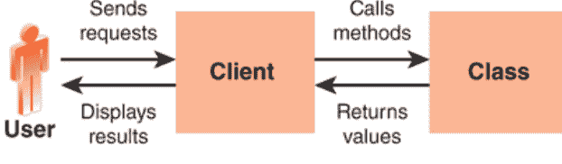


© Hemera Technologies/Photos.com/Thinkstock

# 代码实战

在在线资源中，你将找到一个逐步演示如何定义类的视频。点击链接开始播放视频。

# 7.11 静态类成员

正如我们所提到的，为每个实例化的对象都会创建一套独立的实例变量。除了实例变量外，类还可以定义类变量，类变量仅在 JVM 初始化类时被创建一次。因此，类变量在任何对象实例化之前就已经存在了，并且每个类只有一个类变量的副本。

你可以在定义类变量时使用 `static` 关键字来指定该变量。此外，作为常量的静态变量通常被声明为 `public`，因为它们通常是为了方便使用该类而提供的。例如，`Math` 类中的 `PI` 和 `E` 静态常量被提供，使得我们的应用程序不再需要定义这些常用的值。`Color` 类也提供了静态常量，例如针对数据类型 `Integer`、`Double` 和 `Character` 的 `MAX_VALUE` 和 `MIN_VALUE`。

静态方法无法访问实例变量是合逻辑的，因为静态方法与类关联，而不是与任何对象关联。此外，静态方法可以在任何对象实例化之前被调用，因此将没有实例变量可以访问。在静态方法中尝试访问实例变量将产生此编译错误：

```
non-static variable xxx cannot be referenced from a static context
```

请注意，`getCountAutos()` 方法（第 61–66 行）被声明为 `static`，并且仅引用了 `static countAutos` 变量。

另一方面，非静态（即实例）方法既可以引用类变量和实例变量，也可以引用类方法和实例方法。

# 示例 7.14 Auto Class, 版本 7

```java
/* Auto class, Version 7

Anderson, Franceschi

*/

import java.text.DecimalFormat;

public class Auto {

    // 实例变量

    private String model;      // 车型

    private int milesDriven;   // 行驶里程

    private double gallonsOfGas; // 油油量

    private static int countAutos = 0; // 静态类变量

    // 构造函数:

    // 将 model 初始化为 "unknown"

    // milesDriven 自动初始化为 0

    // gallonsOfGas 初始化为 0.0;

    // 增加 countAutos

    public Auto() {

        model = "unknown";

        countAutos++; // 增加 Auto 对象的静态计数

    }

}
```

```java
25 }

26

27 // 允许客户端为以下设置值

28 // model, milesDriven 和 gallonsOf;

29 // 增加 countAutos 计数

30 public Auto(String startModel,

31     int startMilesDriven,

32     double startGallonsOfGas )

33 {

34     model = startModel;

35     setMilesDriven(startMilesDriven);

36     setGallonsOfGas(startGallonsOfGas);

37     countAutos++; // 增加静态计数

// Auto 对象的数量

38 }

61 // 访问器方法：

62 // 返回 countAutos

63 public static int getCountAutos() {

64 {

65     return countAutos;

66 }

67 ...

145 }

```

示例 7.15 显示了我们 `AutoClient` 类的第 7 版本。在第 11 行，我们在实例化任何对象之前调用了 `getCountAutos()` 方法，然后在第 17 行中，我们在实例化一个对象后再次调用了 `getCountAutos()` 方法。如图 7.10 所示，`getCountAutos()` 方法首先返回 0，然后返回 1。注意，在两次调用静态方法时，我们都使用类名配合点运算符，而不是对象引用。

# 图 7.10

示例 7.15 的输出

```
在实例化 Auto 对象之前：

Auto 对象的数量为 0

在实例化 Auto 对象之后：

Auto 对象的数量为 1
```

# 示例 7.15 Auto 客户端，版本 6

```java
/* Auto 客户端，版本 7

Anderson, Franceschi

*/

public class AutoClient

{

    public static void main(String[] args) {

    {

        System.out.println("Before instantiating

an Auto object:"

              + "\nthe count of Auto

objects is "

              + Auto.getCountAutos()

      );

        Auto sporty = new Auto("Spyder", 0, 0.0);

        System.out.println("\nAfter instantiating

an Auto object:"

              + "\nthe count of Auto

objects is "

              + Auto.getCountAutos()

      );

  }

}
```

好了，就是这样。我们已经完成了 `Auto` 类的定义。尽管它是一个大类，但我们能够通过分步细化逐步构建出 `Auto` 类。

# 7.12 图形对象

现在我们已经知道了如何设计自己的类，就可以将图形对象从应用程序中分离出来。例如，我们可以在自己的 `Sprite` 类中定义一个精灵，并编写一个客户端应用程序来实例化和绘制 `Sprite` 对象。这将允许我们将精灵的数据和绘制精灵的代码封装在 `Sprite` 类中。它还促进了其他程序员复用 `Sprite` 类，他们可能为不同的应用程序创建精灵对象。

`Sprite` 类如示例 7.16。我们首先开始定义实例变量。我们需要起始 (x, y) 坐标来绘制精灵，因此我们定义了两个 `int` 变量来存储这些值（第 9–10 行）。`sX` 变量是绘图的最左侧（包含身体的矩形的左上角），而 `sY` 代表最顶端（精灵帽的顶部）。

此外，我们还添加了一个实例变量 `scale`（第 11 行），以允许客户端绘制不同尺寸的精灵。例如，1.0 的缩放因子将按全大小绘制精灵，0.5 将按半大小绘制精灵，而 2.0 将绘制一个双倍大小的精灵。

我们提供了一个默认构造函数（第 13–19 行），它将 `sX` 和 `sY` 初始化为 0，并将 `scale` 设置为 1。我们的重载构造函数（第 21–29 行）接受三个实例变量的值，并将这些值传递给相应的变器方法。

我们提供了一个用于同时更改 `x` 和 `y` 值的变器方法（第 31–40 行），以及另一个用于更改缩放因子的变器方法（第 42–49 行）。

我们提供了一个方法 `draw()`（第 51–79 行），在画布上绘制精灵。由于精灵是使用 `GraphicsContext` 类的方法绘制的，应用程序客户端需要将其 `GraphicsContext` 对象作为参数传递给 `draw()` 方法。在 `draw()` 方法中，我们绘制精灵，并将任何长度测量乘以缩放因子。

我们没有为 `Sprite` 类提供访问器方法、`toString()` 方法或 `equals()` 方法。对于图形对象来说，考虑到其主要目的是被绘制，这些方法的用处并不大。

# 示例 7.16 Sprite 类

```java
1 /* Sprite 类

2 Anderson, Franceschi

3 /*

4 import javafx.scene.canvas.*;

5 import javafx.scene.paint.*;

6

7 public class Sprite

8 {

9 private int sX;

10 private int sY;

11 private double scale;

12

13 /** 默认构造函数

14 * sX = sY = 0; scale 设置为 1

15 */

16 public Sprite() {

17 scale = 1;

18 }

19

20 /* 重载构造函数

21 接受起始 x、y 以及

22 scale 的值

23 public Sprite(int sX, int sY, double scale) {

24

25 /* 变器方法

26 更改 x 和 y 值

27 */

28 public void setCoordinates(int x, int y) {

29     sX = x;

30     sY = y;

31 }

32

33 /* 变器方法

34 更改缩放因子

35 */

36 public void setScale(double scale) {

37     scale = scale;

38 }

39

40 /* 绘制方法

41 在画布上绘制精灵

42 接收 GraphicsContext 参数

43 */

44 public void draw(GraphicsContext gc) {

45     // 绘制精灵

46     // 将任何长度测量乘以缩放因子

47 }

48 }```

创建一组枚举对象的语法：

```
enum EnumName { obj1, obj2, .. }; where obj1, obj2, 等是常量对象的名称。
```

例如，以下语句定义了一个用于表示星期几的枚举类型：

```
enum Days { Sun, Mon, Tue, Wed, Thur, Fri, Sat };
```

当执行该语句时，列表中的每个名称都会实例化一个对象。因此，列表中的每个名称都是对 `Days` 枚举类型对象的引用。

> 常见错误陷阱
> 不要在枚举类型的初始化列表中使用字符串字面量。

请注意，初始化列表中的值是对象引用（`Sun`）。

每个对象都有一个存储数值的实例变量，该数值由其在枚举对象列表中的位置决定。默认情况下，第一个对象的值为0，第二个第二个对象的值为1，依此类推。因为对象是一个有序集合，例如，`Thur` 对象的值比 `Wed` 大。然而，我们使用枚举对象时，并不依赖于每个对象的特定值。

枚举对象是作为常量对象实例化的，这意味着它们的值不能被更改。

要引用枚举类型中的任何常量对象，我们使用以下点符号语法：

```
enumType.enumObject
```

因此，要引用 `Days` 枚举类型中的 `Wed` 对象，我们使用这种语法：

```
Days.Wed
```

一旦定义了枚举类型，我们就可以声明该类型的对象引用。例如，以下语句定义了一个 `Days` 对象引用 `d`：

```
Days d;
```

与任何其他对象引用一样，`d` 的初始值为 `null`。要给引用 `d` 赋值（例如赋值为 `Thur`），我们使用以下语句：

```
d = Days.Thur;
```

## TABLE 7.6 枚举对象的常用方法

| 返回类型 | 方法名和参数列表 |
| --- | --- |
| int | `compareTo(Enum eObj)` 返回两个枚举对象，如果此对象小于参数，则返回负数；如果此对象大于参数，则返回正数；如果两者相等则返回 0 |
| boolean | `equals(Object eObj)` 如果此对象等于参数 eObj，则返回 true；否则返回 false |
| int | `ordinal()` 返回枚举对象的数值值；其中，列表首个对象的值为 0，第二个对象的值为 1，依此类推 |
| String | `toString()` 返回枚举常量的名称 |
| enum | `valueOf(String enumName)` 静态方法，返回名称与字符串参数 enumName 相同的枚举对象 |

## EXAMPLE 7.18 枚举方法的演示

```java
/* Demonstration of enum

2 Anderson, Franceschi

3 */

45 public class EnumDemo

6 {

7 public enum Days { Sun, Mon, Tue, Wed, Thur,

Fri, Sat };

8

9 public static void main(String [ ] args)

10 {

11 Days d1, d2; // 两个对象引用

12

13 d1 = Days.Wed;

14 d2 = Days.Fri;

15

16 System.out.println("Comparing objects using equals=");

17 if (d1.equals(d2))

18 System.out.println(d1 + " " + d2)

19 else

20 System.out.println(d1 + " does not equal " + d2);

21

22 System.out.println("\nComparing objects using compareTo=");

23 if (d1.compareTo(d2) > 0)

24 System.out.println( d1 + " is greater than " + d2 );

25 else if (d1.compareTo(d2) < 0 )

26 System.out.println(d1 + " is less than " + d2 );

27 else

28 System.out.println(d1 + " is equal to " + d2 );

29

30 System.out.println("\nGetting ordinal value ");

31 System.out.println("The value of " + d1 + " is " + d1.ordinal());

32

33 System.out.println("\nConverting a String to an object ");

34 Days day = Days.valueOf("Mon");

35 }
```


第 7 行定义了枚举类型 `Days`；它实例化了七个代表星期日的常量对象。在第 11 行，我们声明了两个 `Days` 类型的对象引用。在第 13 和 14 行，我们给 `d1` 赋值为 `Wed` 对象，给 `d2` 赋值 `Fri` 对象。第 17 行使用 `equals` 方法比较 `d1` 和 `d2`。由于 `Wed` 和 `Fri` 是不同的对象，`equals` 方法返回 `false`。第 18 和 20 行隐式地调用了 `toString` 方法。第 23 和 25 行调用 `compareTo` 方法，它返回一个负数，表示 `Wed` 小于 `Fri`。随后，我们在第 31-32 行通过调用 `ordinal` 方法获取 `d1` 对象的值，结果为 3，因为 `Wed` 是列表中的第四个对象。最后，第 35 行使用 `valueOf` 方法将字符串转换为枚举对象。注意 `valueOf` 方法是静态的，所以我们使用 `Days` 类型来调用它。如果传递给 `valueOf` 方法的字符串不是枚举对象集合中的名称之一，第 18 行对 `valueOf` 方法的调用将导致 `IllegalArgumentException`。示例 7.18 的输出如图 7.12 所示。

## 图 7.12 示例 7.18 的输出

```
Comparing objects using equals

Wed does not equal Fri

Comparing objects using compareTo

Wed is less than Fri

Getting the ordinal value

The value of Wed is 3

Converting a String to an object

The value of day is Mon
```

我们可以在 `switch` 语句中使用枚举对象使常量变得具有意义，从而提高代码的可读性。示例 7.19 使用我们的 `Days` 枚举类显示食堂提供的每日特餐。

## 示例 7.19 DailySpecials 类

```java
/** Specials of the Day

2 Anderson, Franceschi
 */

import java.util.Scanner;

public class DailySpecials
{
    public enum Days { Sun, Mon, Tue, Wed, Thur, Fri, Sat };

    public static void main(String [] args)
    {
        Scanner scan = new Scanner(System.in);

        System.out.print("Enter a day\n" + "(Sun, Mon, Tue, Wed, Thur, Fri, Sat) > ");

        String inputDay = scan.next();

        Days day = Days.valueOf(inputDay);

        switch ( day )
        {
            case Mon:
                System.out.println("The special for\n" + day + " is barbeque chicken.");
                break;

            case Tue:
                System.out.println("The special for " + day + " is tacos");
                break;

            case Wed:
                System.out.println("The special for " + day + " is chef's salad");
                break;

            case Thur:
                System.out.println("The special for " + day + " is a cheeseburger");
                break;

            case Fri:
                System.out.println("The special for " + day + " is fish fillet");
                break;

            default: // 如果 day 为 Sat 或 Sun
                System.out.println("Sorry, we're closed on " + day);
        }
    }
}
```

图 7.13 显示了用户输入 `Fri` 时示例 7.19 的输出。

## 图 7.13 DailySpecials 的输出

```
Enter a day

(Sun, Mon, Tue, Wed, Thur, Fri, Sat) > Fri

The special for Fri is fish fillet
```

在 `DailySpecials` 程序中，我们提示用户输入星期（第 15-17 行），然后读取用户输入的字符串，并通过调用第 18 行的 `valueOf` 方法将其转换为枚举对象。

一旦获得有效的枚举值，我们就可以将其作为 `switch` 变量（第 20 行）。

注意，我们在 `case` 标签中使用每个枚举对象名称，而没有使用 `Days` 类型进行修饰。在 `switch` 语句中包含枚举类型会产生以下编译器错误：

```
an switch case label must be the unqualified name of an enumeration constant
```

同样注意，如果用户输入的字符串与七个星期值之一不匹配，第 18 行对 `valueOf` 方法的调用将在运行时引发 `IllegalArgumentException`。

## 通过这些章节末问题进行技能练习

### 7.18.1 多选题
题 14, 15, 16

### 7.18.2 阅读并理解代码
题 21, 22, 23, 25, 27

### 7.18.3 填空代码
题 29, 34, 35

### 7.18.4 识别代码中的错误
题 40, 41, 42, 44, 46

### 7.18.5 调试区域
题 50, 51, 53, 54

### 7.18.6 编写短程序
题 55, 56, 57, 58, 59, 60, 61, 62, 63, 64

### 7.18.8 技术写作
题 76

# 7.14 编程活动 2：编写类定义，部分 2

在编程活动中，你将完成 `Airport` 类的定义。然后，你将运行一个预写的客户端程序，该程序会实例化多个 `Airport` 对象，调用你编写的方法，并显示对象的数据值。

从提供的代码文件中，将本章“编程活动 2”文件夹中的所有文件复制到计算机上的文件夹中。请注意，所有文件应位于同一个文件夹内。

加载 `Airport.java` 源文件；你会发现该类已经包含了“编程活动 1”中的类定义。你的任务是通过添加一个静态类变量（及其相关的辅助代码）并编写 `toString` 和 `equals` 方法来完成类定义。务必按照注释中的描述精确定义静态类变量和方法，这很重要，因为 `AirportDrawing` 类将调用每个方法来测试你的实现。搜索连续的五个星号（`*****`）可以将你定位到类定义中需要添加代码的六个位置。`Airport.java` 的代码位于示例 7.20：

## 示例 7.20 Airport.java 文件

```java
1 /* Airport class
2 Anderson, Franceschi
3 */
4
5 public class Airport
6 {
7
8 // instance variables
9 private String airportCode;
10 private int gates;
11
12 // 1. ***** 添加一个静态类变量 *****
13 // countAirports 是一个 int
14 // 分配初始值 0
15
16
17 // 2. ***** 修改此方法 *****
18 // 默认构造函数:
19 // 方法名: Airport
20 // 返回值: 无
21 // 参数: 无
22 // 功能: 将 airportCode 设置为空字符串
23 // ***** 将 countAirports 类变量加 1
24 public Airport() 
25 {
26 airportCode = "";
27
28 }
29
30 // 3. ***** 修改此方法 *****
31 // 重载构造函数:
32 // 方法名: Airport
33 // 返回值: 无
34 // 参数: 一个 String 类型的机场代码和一个 startGates
35 // 功能: 将 airportCode 赋值为 the startAirportCode 参数;
36 // 调用 getGates 方法，传递 startGates 参数
37 // ***** 将 countAirports 类变量加 1
38 public Airport( String startAirportCode, int startGates )
39 {
40     airportCode = startAirportCode;
41     setGates( startGates );
42
43 }
44
45 // airportCode 实例变量访问方法
46 // 方法名: getAirportCode
47 // 返回值: String
48 // 参数: 无
49 // 功能: 返回 airportCode
50 public String getAirportCode()
51 {
52     return airportCode;
53 }
54
55 // gates 实例变量访问方法
56 // 方法名: getGates
57 // 返回值: int
58 // 参数: 无
59 // 功能: 返回 gates
60 public int getGates()
61 {
62     return gates;
63 }
64
65 // 4. ***** 编写此方法 *****
66 // countAirports 类变量访问方法
67 // 方法名: countAirports
68 // 返回值: int
69 // 参数: 无
70 // 功能: countAirports
71
72
73 // airportCode 实例变量变器方法
74 // 方法名: setAirportCode
75 // 返回值: Airport
76 // 参数: String airportCode
77 // 功能: 将 airportCode 赋值为 the airportCode 参数
78 public Airport setAirportCode( String airportCode )
79 {
80     this.airportCode = airportCode;
81     return this;
82 }
83 
84 // gates 实例变量变器方法
85 // 方法名: setGates
86 // 返回值: Airport
87 // 参数: int gates
88 // 功能: 验证 gates 参数。如果 gates 大于 0，将 gates 设置为 gates; 否则不改变 gates 的值
89 public Airport setGates( int gates )
90 {
91     if ( gates >= 0 )
92         this.gates = gates;
93     return this;
94 }
95
96 // 5. ***** 编写此方法 *****
97 // 方法名: toString
98 // 返回值: String
99 // 参数: 无
100 // 功能: 返回一个包含 airportCode 和 gates 的字符串
101
102
103
104
105 // 6. ***** 编写此方法 *****
106 // 方法名: equals
107 // 返回值: boolean
108 // 参数: Airport object
109 // 功能: 如果 airportCode 和 gates 相等则返回 true，否则返回 false
110
111
112
113
114
115
116 } // 类定义结束
```

当你完成 `Airport.java` 后，你将运行一个预写的客户端程序，该程序会实例化多个 `Airport` 对象，调用你编写的方法，并显示对象的数据值。

从提供的代码文件中，将本章“编程活动 2”文件夹中的所有文件复制到你计算机上的文件夹中。请注意，所有文件应位于同一个文件夹内。

加载 `Airport.java` 源文件；你会发现该类已经包含了“编程活动 1”中的类定义。你的任务是通过添加一个静态类变量（及其相关的辅助代码）并编写 `toString` 和 `equals` 方法来完成类定义。务必按照注释中的描述精确定义静态类变量和方法，这很重要，因为 `AirportDrawing` 类将调用每个方法来测试你的实现。搜索连续的五个星号（`*****`）可以将你定位到类定义中需要添加代码的六个位置。`Airport.java` 的代码位于示例 7.20 中。


# 7.14 编程活动 2：编写类定义，部分 2

在本次编程活动中，你将完成 `Airport` 类的定义。然后，你将运行一个预写的客户端程序，该程序会实例化多个 `Airport` 对象，调用你编写的方法，并显示对象的数据值。

从提供的代码文件中，将本章“编程活动 2”文件夹中的所有文件复制到你计算机上的文件夹中。请注意，所有文件应位于同一个文件夹内。

加载 `Airport.java` 源文件；你会发现该类已经包含了“编程活动 1”中的类定义。你的任务是通过添加一个静态类变量（及其相关的辅助代码）并编写 `toString` 和 `equals` 方法来完成类定义。务必按照注释中的描述精确定义静态类变量和方法，这很重要，因为 `AirportDrawing` 类将调用每个方法来测试你的实现。搜索连续的五个星号（`*****`）可以将你定位到类定义中需要添加代码的六个位置。`Airport.java` 的代码位于示例 7.20 中：

## 示例 7.20 Airport.java 文件

```
1 /* Airport class
2 Anderson, Franceschi
3 */
4
5 public class Airport
6 {
7
8 // instance variables
9 private String airportCode;
10 private int gates;
11
12 // 1. ***** 添加一个静态类变量 *****
13 // countAirports 是一个 int
14 // 分配初始值 0
15
16
17 // 2. ***** 修改此方法 *****
18 // 默认构造函数:
19 // 方法名: Airport
20 // 返回值: 无
21 // 参数: 无
22 // 功能: 将 airportCode 设置为空字符串
String
23 // ***** 将 countAirports 类变量加 1
24 public Airport() 
25 {
26 airportCode = "";
27 }
28
29 // 3. ***** 修改此方法 *****
30 // 载载构造函数:
31 // 方法名: Airport
32 // 返回值: 无
33 // 参数:一个 String 类型的机场代码和一个
startGates
34 // 功能: 将 airportCode 赋值为
the
35 // startAirportCode 参数;
36 // 调用 getGates 方法，
37 // 传递 startGates 参数
38 // ***** 将 countAirports 类变量加 1
39 public Airport( String startAirportCode, int
startGates )
40 {
41     airportCode = startAirportCode;
42     setGates( startGates );
43
44 }
45
46 // airportCode 实例变量访问方法
47 // 方法名: getAirportCode
48 // 返回值: String
49 // 参数: 无
50 // 功能: 返回 airportCode
51 public String getAirportCode() (
52 {
53     return airportCode;
54 }
55
56 // gates 实例变量访问方法
57 // 方法名: getGates
58 // 返回值: int
59 // 参数: 无
60 // 功能: 返回 gates
61 public int getGates()
62 {
63     return gates;
64 }
65
66 // 4. ***** 编写此方法 *****
67 // countAirports 类变量访问方法
68 // 方法名: countAirports
69 // 返回值: int
70 // 参数: 无
71 // 功能: countAirports
72
73
74
75
76
77 // airportCode 实例变量变器方法
78
79 // 方法名: setAirportCode
80 // 返回值: Airport
81 // 参数: String airportCode
82 // 功能: 将 airportCode 赋值为
the
83 // airportCode 参数
84 public Airport setAirportCode( String
airportCode )
85 {
86     this.airportCode = airportCode;
87     return this;
88 }
89 
90 // gates 实例变量变器方法
91 // 方法名: setGates
92 // 返回值: Airport
93 // 参数: int gates
94 // 功能: 验证 gates 参数。
95 // 如果 gates 大于 0，将 gates 设置为
gates;
96 // 否则不改变 gates 的值
97 // public Airport setGates( int gates )
98 {
99     if ( gates >= 0 )
100     this.gates = gates;
101    return this;
102 }
103
104 // 5. ***** 编写此方法 *****
105 // 方法名: toString
106 // 返回值: String
107 // 参数: 无
108 // 功能: 返回一个包含 airportCode
109 和 gates 的字符串
110
111
112
113
114 // 6. ***** 编写此方法 *****
115 // 方法名: equals
116 // 返回值: boolean
117 // 参数: Airport object
118 // 功能: 如果 airportCode
119 和 gates
120 相相等则返回 true
121 // 否则返回 false
122
123
124
125
126
127
128
129
130 } // 类定义结束
```

## 讨论问题

1. 解释为什么 `countAirports` 类变量在实例化任何 `Airport` 对象之前值为 0。
2. 客户端是如何调用 `getGates()` 的？
3. 解释为什么直接使用以下 语句比较对象引用：`if( airport1 == airport2 )` 结果为 false？

## 7.15 创建包

正如我们提到的，一个编写良好的类的优点之一是可以被重用的。在大多数公司和组织中，程序员共享代码，并频繁使用其他程序员编写的类。理想情况下，在你编写程序时，你会寻找许多程序通用的功能。良好的做法是将这些功能封装到类中，以便在未来的程序中重用。包是相关类的集合，可以导入到程序中。我们导入了多个 Java 包：`java.util`、`java.text` 等。我们也可以创建自己的包，这允许我们在不需要将类物理地存储在源代码相同文件夹的情况下重用它。有关如何创建包的说明，请参阅我们的在线资源。

## 7.16 使用 Javadoc 生成网页风格文档

在大多数公司和组织中，程序员共享代码，并频繁使用他人开发的类。如果一个类设计良好且文档完备，其他人使用该类就会变得很容易。毕竟，这本质上是我们使用现有 Java 类所做的事情。类之所以易于理解，不仅是因为它们设计和编写得良好，还因为可用文档（特别是 Oracle Java 网站上的）易于理解、完整且很好地展示了这些类。

我们也将学习生成与 Oracle Java 网站上的文档类似的 HTML 文档。Java 开发工具包（JDK）提供了一个名为 Javadoc 的工具来实现这一目标。Javadoc 是一个位于 bin 文件夹的可执行程序（实际上是 `javadoc.exe`）。它的调用方式与 `javac` 编译器相同，但它不是创建 `.class` 文件，而是创建 `.html` 文件来记录该类。

例如，为了为我们的 `Auto` 类生成文档，我们将在命令行输入以下内容：

```
javadoc Auto.java
```

如果我们想为目录下的所有源文件生成文档，可以输入：

```
javadoc *.java
```


你的 IDE 可能通过其菜单方便地访问 Javadoc。

表 7.7 显示了为 `Auto` 类生成的文件。

## 表 7.7 Javadoc 生成的 HTML 文件

| 文件名 | 简短描述 |
| --- | --- |
| `Auto.html` | `Auto` 类文档（不带框架） |
| `allclasses-frame.html` | 带有链接的类列表（带框架） |
| `allclasses-noframe.html` | 带有链接的类列表（不带框架） |
| `constant-values.html` | 带有链接的类常量 |
| `index.html` | `Auto` 类文档（带框架） |
| `package-frame.html` | 此包的框架 |
| `package-list` | 包列表 |
| `package-summary.html` | 类层级结构 |
| `script` | Javascript 文件 |
| `stylesheet.css` | 样式表 |

如果你双击 `index.html`，将打开一个与 Oracle Java 网站上的页面看起来相同的网页。

> **引用点**
> 使用 Javadoc 的完整文档可以在 www.oracle.com/technetwork/java 找到。

我们将在这里回顾几个 Javadoc 特性。Javadoc 的完整文档可以在 Oracle 网站上找到。

要编写将包含在 Javadoc 文档中的注释，我们在任何类、字段、构造函数或方法之前使用特殊形式的块注释。包含 Javadoc 注释的语法如下：

```java
/**
 * 这里是 Javadoc 注释
 */
```

正如我们所知道的，Java 块注释的语法是：

```java
/*
 * 这里是 Java 块注释
 */
```

Javadoc 注释只是特殊的 Java 块注释。`javac` 编译器会简单忽略它，但 Javadoc 可执行程序会查找它并生成相应的文档。Javadoc 会丢弃所有的空白字符以及每行开头的 `*`，直到遇到非空白字符。行业惯例是 Javadoc 注释的每一行都以 `*` 开头。因此，我们建议以下语法：

```java
/**
 * 这里是 Javadoc 注释
 * 这里是第二个 Javadoc 注释
 * . . . 
 */
```

## 软件工程技巧

在编写文档块时，在每行开头使用 `*` 来表示这是一个文档注释。

类文档由两部分组成：

- 描述部分
- 标签部分

Javadoc 识别两种类型的标签：块标签和内联标签。我们将只讨论块标签。

块标签以字符 `@` 开头。表 7.8 列出了块标签 `@param` 和 `@return` 以及对每个标签的解释。

## 表 7.8 选定的 Javadoc 标签

| 标签 | 最常见语法 | 解释 |
|---|---|---|
| `@param` | `@param variableName` | 向参数部分添加一个参数 |
| `@return` | `@return text` | 为返回类型添加描述 |

在描述部分和标签部分内部，文本应用 HTML 编写编写；因此，可以使用 HTML 标签如 `<br>`（换行）或 `<strong>`（加粗）。`<br>` 标签插入新行；`<strong>` 标签将文本更改为加粗，直到遇到结束标签 `</strong>`。从 Java 9 开始，Javadoc 支持 HTML5。

示例 7.21 显示了我们包含了一些文档注释的 `Auto` 类的简化版本：

## 示例 7.21 SimplifiedAuto 类

```java
1 /** 带有 Javadoc 注释的简化 Auto 类
2  Anderson, Franceschi
3  */
4 
5 public class SimplifiedAuto
6 {
7  private String model;
8  private int milesDriven;
9  private double gallonsOfGas;
10 
11  /**
12  * 默认构造函数:<br>
13  * 将 model 初始化为 "unknown"<br>
14  * milesDriven 自动初始化为 0，gallonsOfGas
15  t 初始化为 0.0
16  */
17 public SimplifiedAuto()
18 {
19  model = "unknown";
20 }
21 
22  /**
23  * 修改器方法:<br>
24  * <strong>允许客户端设置 milesDriven 的值<br>
25  * <strong>setMilesDriven</strong> 如果 newMilesDriven 具有
26  * 负值，则不会更改 <strong>milesDriven</strong> 的
27  * 值（此处重复错误）
28  * @param milesDriven 新的行驶里程数
29  * @return 指向此对象的引用
30  */
31 public Auto setMilesDriven( int milesDriven )
32 {
33      if ( milesDriven > 0 )
34          this.milesDriven = newMilesDriven;
35      return this;
36      }
37  
38  /**
39       * milesDriven 的访问器方法:<br>
40       * @return 一个 int，milesDriven 的值
41    */
42     public int getMilesDriven() 
43     {
44         return milesDriven;
45     }
46 
```

> **软件工程技巧**
> 当你编写类时，添加一些文档注释并生成网页风格的文档。向朋友或同事展示这些网页并询问他们是否完全理解该类封装的内容以及它的作用。关于构造函数和方法问他们几个问题。这是检查你的类是否设计良好并准备好重用的好方法。

图 7.15 显示了生成的 `index.html` 文件的一部分，图 7.16 显示了为 `setMilesDriven` 和 `getMilesDriven` 方法生成的文档。


## 方法详情

### setMilesDriven

```java
public SimplifiedAuto setMilesDriven(int newMilesDriven)
```

修改器方法：
如果 `newMilesDriven` 具有负值，`setMilesDriven` 则不会更改 `milesDriven` 的值

- 参数：
`newMilesDriven` - 新的行驶里程数

- 返回：
指向此对象的引用

### getMilesDriven

```java
public int getMilesDriven()
```

`milesDriven` 的访问器方法：
返回：
一个 `int`，`milesDriven` 的值

## 图 7.16
修改器和访问器方法的网页风格文档


## 章节复

## 7.17 章节总结

- Java 类的成员包括它的实例变量、类变量和方法。
- 实例变量为每个实例化的对象创建一个副本。
- 类变量和方法由所有对象共享。
- 按照惯例，类名以大写字母开头，内部单词以小写字母开头；方法名以小写动词开头，内部单词以小写字母开头。
- 公有访问饰符允许其他类访问类或成员。私有访问饰符指定只有同类成员可以访问。包访问允许相同包内的类访问。
- 类、构造函数、`final` 类变量和类方法通常声明为公共，而实例变量通常声明为私有。
- 实例变量反映对象共有的属性。实例变量通过指定访问饰符、数据类型、标识符以及可选的初始值来定义。实例变量可以声明为 `final`。
- 方法通过提供方法头来定义，方法头指定了访问饰符、返回类型、方法名和参数列表。方法体包含在大括号中。返回类型为 `void` 方法不返回值。
- 实例变量和方法具有类作用域，可以在类中的任何地方访问。
- 方法可以引用类的实例变量、传递给方法的参数以及方法声明的局部变量，并可以调用类的其他方法。
- 通过定义具有相同名称但签名不同的方法（即参数数量不同或参数类型不同），可以重载方法。
- 构造函数负责初始化类的实例变量。
- 如果我们不提供构造函数，编译器将提供默认构造函数，即不接受任何参数的构造函数。此默认构造函数为所有实例变量分配默认初始值。数值变量赋予 0，字符赋予 Unicode 空格字符，布尔变量赋予 `false`，对象引用赋予 `null`。方法中声明的局部变量不会自动赋予初始值。
- 访问器方法命名为 `getIV`，其中 `IV` 是实例变量名；返回类型与实例变量相同，方法体简单返回实例变量的值。
- 修改器方法命名为 `setIV`，其中 `IV` 是实例变量名；返回类型为 `void` 或指向此对象的引用，且该方法接受一个参数，其数据类型与实例变量相同，并包含该实例变量的新值。方法体应该验证新值的有效性，如果新值有效，则将新值赋值给该实例变量。
- 当方法开始执行时，JVM 会设置对象引用 `this` 指向调用该方法的对象。
- 当对象引用被用作 `String` 时，会自动调用 `toString` 方法，其作用是为对象数据提供一个可打印的表示形式。
- `equals` 方法比较两个对象的等效性；也就是说，只有当两个对象中相应的实例变量值相等时，它才返回 `true`，否则返回 `false`。
- `Static`（静态）变量在类初始化时创建。因此，类变量在任何对象实例化之前就已经存在了，并且每个类只有一个类变量副本。作为常量的静态变量通常被声明为 `public`（公共），因为它们通常用于允许客户端为类的操作设置偏好。
- 静态（Static）类方法只能引用静态变量，只能调用静态方法，且不能使用对象引用 `this`。
- 非静态（或实例）方法可以引用类变量和实例变量，也可以引用类方法和实例方法，以及引用 `this`。
- 图形对象通常具有用于起始 (x, y) 坐标的实例变量。它还提供了一个 `draw` 方法，该方法接受一个 `GraphicsContext` 对象作为参数，并包含绘制图形对象的代码。
- 可以定义枚举（Enumeration）类型，为程序中用数字表示的有序集合赋予意义。对于枚举初始化列表中的每个名称，都会创建一个常量对象，其实例变量具有顺序数值值。可以定义枚举类型的引用。枚举类型的对象可以进行比较、打印，并请求返回其数值。
- Javadoc 是 JDK 的一部分，用于为类生成文档。要使用 Javadoc，你需要将每个类、方法和字段的描述封装在以 `/**` 开头并以 `*/` 结尾的块注释中。此外，你可以使用 `@param` 标签描述每个参数，并使用 `@return` 标签描述返回值。

## 7.18 练习、问题与项目

### 7.18.1 多选题

1. 关于类的名称，你可以说什么？
   - 它必须以大写字母开头。
   - 惯例是以大写字母开头。

2. 关于构造函数的名称，你可以说什么？
   - 它们必须与类名相同。
   - 它们可以是任何名称，就像其他方法一样。

3. 构造函数的返回类型是什么？
   - `void`
   - `Object`
   - 类名
   - 构造函数没有返回类型。

4. 在给定的类中拥有多个构造函数是合法的。
   - true
   - false

5. 在类中，如果一个字段是 `private`（私有的），
   - 它可以从任何类直接访问。
   - 它只能从该类内部直接访问。

6. 在典型的类中，访问修饰符的通用建议是什么？
   - 实例变量是 `private` 且方法是 `private`。
   - 实例变量是 `private` 且方法是 `public`。
   - 实例变量是 `public` 且方法是 `private`。
   - 实例变量是 `public` 且方法是 `public`。

7. 在类中，字段
   - 只能是基本数据类型。
   - 只能是基本数据类型或现有的 Java 类型（来自现有的类）。
   - 可以是基本数据类型、现有的 Java 类型或用户定义的类型（来自用户定义的类）。

8. 访问器（Accessors）和修改器（mutators）是
   - 类的实例变量。
   - 用于从类外部访问和修改类的字段变量。
   - 构造方法。

9. 访问方法通常接收
   - 无参数。
   - 一个参数，其类型与相应的字段相同。

10. 修改器方法（Mutator methods）通常接收
    - 无参数。
    - 一个参数，其类型与相应的字段相同。

11. 访问器方法通常
    - 是 `void` 方法。
    - 返回与相应字段相同的类型。

12. 为了实现链式调用（method chaining），修改器方法
    - 返回指向此对象的引用。
    - 返回与相应字段相同的类型。

13. 在编写一个对该类字段执行执行计算的方法时，
    - 这些字段必须作为参数传递给方法。
    - 这些字段不需要作为参数传递给方法，因为类方法可以直接访问它们。

14. 用于声明常量的关键字是什么？
    - `static`
    - `final`
    - `constant`

15. 用于声明类变量或类方法的关键字是什么？
    - `static`
    - `final`
    - `class`

16. 关于枚举（enum），你可以说什么？
    - 它是 `java.lang` 包的一部分。
    - 它可以用于自文档化，提高代码的可读性。
    - 枚举对象是一个常量对象。
    - 以上所有。

### 7.18.2 阅读并理解代码

对于问题 17 和 18，请考虑在 `Sky` 类内部我们已经编写了以下代码：

```java
public class Sky {

    private Color color;

    public Sky(Color c) {

        color = c;

    }

}
```

17. 考虑以下方法：
```java
public Color getColor()
```
该方法是构造函数、修改器还是访问器？

18. 考虑以下方法：
```java
public void setColor(Color c)
```
该方法是构造函数、修改器还是访问器？

对于问题 19 到 24，请考虑 `Airplane` 有两个具有以下头部的方法；我们有一个默认构造函数：

```java
public static double foo1(String s)

public String foo2(char c)
```

19. `foo1` 的返回类型是什么？

20. `foo2` 的返回类型是什么？

21. `foo1` 是类方法还是实例方法？

22. `foo2` 是类方法还是实例方法？

23. 编写一两行代码从客户端类调用 `foo1`。

24. 编写一两行代码从客户端类调用 `foo2`。

假设你实例化了一个名为 `a` 的对象。

25. 在 `main` 中，我们看到代码：
```java
a.foo3(34.6);
```
根据此，重构 `method3`（属于 `Airplane`）的头部；必要时请做出适当假设。

26. 在 `main` 中，我们看到代码：
```java
Airplane a = new Airplane();

int n = a.foo4("Hello");
```
根据此，重构 `method4`（属于 `Airplane`）的头部。

27. 如果你定义了以下枚举常量：
```java
enum Seasons { Winter, Spring, Summer, Fall };
```
以下代码序列的输出是什么？
```java
System.out.println(Seasons.Spring.ordinal());
```

### 7.18.3 填充代码

28. 声明两个实例变量：`grade`，一个整数；`letterGrade`，一个 `char`。

```java
// 声明 grade

// 声明 letterGrade
```

29. 声明一个类字段用于联邦税率，一个常量，值为 .07。

```java
// 声明联邦税率常量；0.07
```

对于问题 30 到 37，我们假设 `TelevisionChannel` 类有三个字段：`name`（一个 `String`）、`number`（一个整数）以及 `cable`（一个 `boolean`，表示该频道是否为线频道）。

30. 为该类编写一个默认构造函数：将字段初始化为空字符串、0 和 `false`。

```java
// 默认构造函数代码写在这里
```

31. 为该类编写一个接受三个参数的构造函数。

```java
// 构造函数代码写在这里
```

32. 编写该类的三个访问器（accessors）。

```java
// 你的代码写在这里
```

33. 编写该类的三个修改器（mutators）。

```java
// 你的代码写在这里
```

34. 编写 `toString` 方法。

```java
// 你的代码写在这里
```

35. 编写 `equals` 方法。

```java
// 你的代码写在这里
```

36. **编写一个方法，返回频道号的位数。** 例如，如果频道号是 21，该方法返回 2；如果频道号是 412，该方法返回 3。

```java
// your code goes here
```

37. **编写一个方法，如果当前对象代表电缆通道，则返回单词 `cable`；如果当前对象不代表电缆通道，则返回单词 `network`。**

```java
// your code goes here
```

## 7.18.4 识别代码错误

对于问题 38 到 45，请假设在 `Gift` 类中已经编写了以下代码：

```java
public class Gift
{

    private String description;

    private double price;

    private String occasion;

    private boolean taxable;
```


## 7.18.5 调试区域——使用 Java 编译器和 JVM 消息

### 问题 38-46：Gift 类代码错误分析

#### 38. `getPrice()` 方法错误
```java
public void getPrice())
{
    return price;
}
```
**错误**：方法声明为 `void` 但包含 `return` 语句；方法名后多出右括号 `)`。

#### 39. `setOccasion()` 方法错误
```java
public void setOccasion( String occasion )
{
    occasion = occasion;
}
```
**错误**：参数名 `occasion` 与实例变量同名，导致变量遮蔽，赋值语句仅将参数赋值给自身。

#### 40. `toString()` 方法错误
```java
public String toString()
{
    System.out.println("description = " + description );
    System.out.println("price = " + price );
    System.out.println("occasion = " + occasion );
    System.out.println("taxable = " + taxable );
}
```
**错误**：`toString()` 应返回 `String` 类型，而非打印到控制台；缺少 `return` 语句。

#### 41. `equals()` 方法错误
```java
public boolean equals( Object g )
{
    return ( this == g );
}
```
**错误**：仅比较引用地址（`==`），未比较对象内容（如 `description`、`price` 等字段）。

#### 42. `setTaxRate()` 方法错误
```java
public void setTaxRate( double newTaxRate )
{
    TAX_RATE = newTaxRate;
}
```
**错误**：`TAX_RATE` 被声明为 `final` 常量，不可修改。

#### 43. `calcTax()` 方法错误
```java
public double calcTax( TAX_RATE )
{
    return ( TAX_RATE * price );
}
```
**错误**：参数声明缺少类型（应为 `double TAX_RATE`）；参数名与常量名冲突，且方法应直接使用类常量而非传入参数。

#### 44. `GiftClient` 调用 `setPrice()` 错误
```java
Gift g = new Gift( "radio", 59.99, "Birthday", false );
Gift.setPrice( 99.99 );
```
**错误**：`setPrice()` 是实例方法，需通过对象 `g` 调用（`g.setPrice(99.99)`），而非类名调用。

#### 45. `GiftClient` 调用 `setTaxable()` 错误
```java
Gift g = new Gift( "radio", 59.99, "Birthday", false );
g.setTaxable( ) = true;
```
**错误**：`setTaxable()` 返回 `void`，不能赋值；应调用 `g.setTaxable(true)`。

#### 46. `enum` 定义错误
```java
enum Months = { "January", "February", "March" };
```
**错误**：`enum` 定义语法错误，不应使用 `=` 和双引号；正确写法：`enum Months { January, February, March }`。

---

### 问题 47-54：Grade 类与枚举调试

#### 47. 访问私有字段错误
**代码**：
```java
Grade g = new Grade( 'B' );
g.letterGrade = 'A'; // 第10行
```
**错误信息**：`letterGrade has private access`
**原因**：`letterGrade` 是 `private`，客户端代码无法直接访问。
**修复**：使用公共修改器 `g.setLetterGrade('A')`。

#### 48. 构造函数参数类型不匹配
**代码**：
```java
Grade g = new Grade("A"); // 第10行
```
**错误信息**：`incompatible types: String cannot be converted to char`
**原因**：构造函数期望 `char` 类型，传入了 `String` 字面量 `"A"`。
**修复**：使用字符字面量 `'A'`：`new Grade('A')`。

#### 49. 缺少返回语句
**代码**：
```java
public Grade( char startLetter ) {
    letterGrade = startLetter;
} // 第8行
```
**错误信息**：`missing return statement`
**原因**：构造函数不应有返回类型，但错误提示行号可能指向类定义或方法；若 `Grade` 被误声明为有返回类型的方法（如 `public void Grade(...)`），会导致此错误。
**修复**：确保构造函数无返回类型声明：`public Grade(char startLetter) { ... }`。

#### 50. `toString()` 返回类型不匹配
**代码**：
```java
public String toString() { // 第10行
    return letterGrade; // 第11, 12行
}
```
**错误信息**：`incompatible types: char cannot be converted to String`
**原因**：`letterGrade` 是 `char`，但方法声明返回 `String`。
**修复**：转换为字符串：`return String.valueOf(letterGrade);` 或 `return Character.toString(letterGrade);`。

#### 51. 变量作用域错误
**代码**：
```java
public String toString() { // 第10行
    return lg; // 第11, 12行
}
```
**错误信息**：`cannot find symbol: variable lg`
**原因**：`lg` 是构造函数的局部参数，在 `toString()` 作用域不可见；应使用实例变量 `letterGrade`。
**修复**：返回 `letterGrade` 并转为字符串：`return String.valueOf(letterGrade);`。

#### 52. 参数遮蔽实例变量
**代码**：
```java
public Grade( int numberGrade ) {
    numberGrade = numberGrade;
}
```
**现象**：输出 `0` 而非 `95`。
**原因**：参数 `numberGrade` 遮蔽了实例变量，赋值语句将参数赋值给自身，实例变量保持默认值 `0`。
**修复**：使用 `this.numberGrade = numberGrade;` 区分实例变量与参数。

#### 53. 枚举常量未加类名前缀
**代码**：
```java
if ( s.equals( Winter ) ) // 第10行
```
**错误信息**：`cannot find symbol: variable Winter`
**原因**：枚举常量 `Winter` 属于 `Seasons` 类型，需使用 `Seasons.Winter` 访问。
**修复**：`if ( s.equals(Seasons.Winter) )`。

#### 54. 枚举常量不可修改及符号未找到
**代码**：
```java
Seasons.Fall = Autumn; // 第10行
```
**错误信息**：
1. `cannot assign a value to final variable Fall`
2. `cannot find symbol: variable Autumn`
**原因**：
1. 枚举常量隐式为 `final`，不可重新赋值。
2. `Autumn` 未定义（枚举中为 `Fall`）。
**修复**：枚举常量不可修改；若需扩展，重新定义枚举或使用其他设计。

---

## 7.18.6 编写一个短程序

### 55. 球队类
封装球队名称，包含构造函数、访问器/修改器、`toString()`、`equals()`，编写客户端测试。

### 56. 电视机类
属性：品牌、价格。包含构造函数、访问器/修改器、`toString()`、`equals()`，编写客户端测试。

### 57. 课程成绩类
属性：课程名称、字母等级。包含构造函数、访问器/修改器、`toString()`、`equals()`，编写客户端测试。

### 58. 课程类
属性：代码（如 `CS1`）、描述、学分（如 `3`）。包含构造函数、访问器/修改器、`toString()`、`equals()`，编写客户端测试。

### 59. 学生类
属性：姓名、社会安全号、GPA（如 `3.5`）。包含构造函数、访问器/修改器、`toString()`、`equals()`，编写客户端测试。

### 60. 网站统计数据类
属性：访问人数、网站类型（商业、政府等）。包含构造函数、访问器/修改器、`toString()`、`equals()`，编写客户端测试。

### 61. 公司名称类
（题目不完整，推测为封装公司名称，包含标准方法及客户端测试）

### 62. 文件类
属性：文件名。包含构造函数、访问器/修改器、`toString()`、`equals()`。额外方法：返回文件扩展名（最后一个点后的字符），无点则返回 `"unknown extension."`。编写客户端测试。

### 63. 简化输出工具类
编写类使 `S.println("Hello world")` 替代 `System.out.println`。在客户端测试。

### 64. 输入工具类
编写类使 `Utility.getInt("Enter an int")` 替代 `Scanner` 样板代码。在客户端测试。

---

## 7.18.7 编程项目

### 65. 天气预报类
属性：温度（华氏度，-50 到 +150，默认 70）、天气状况（晴/雪/多云/雨，默认晴）。
方法：构造函数、访问器/修改器、`toString()`、`equals()`、华氏度转摄氏度（`(F-32)*5/9`）、一致性检查（温度>32 且下雪、或温度<32 且下雨为不一致）。编写客户端测试。

### 66. 域名类
属性：域名（如 `www.yahoo.com`）。
方法：构造函数、访问器、`toString()`、`equals()`、是否以 `www` 开头、获取扩展名（最后点后字符，无点返回 `unknown`）、获取主体名（`www` 与扩展名之间，少于两点返回 `unknown`）。编写客户端测试。

### 67. HTML 页面类
属性：HTML 代码字符串。
方法：构造函数、访问器/修改器、`toString()`、`equals()`、统计 `` 标签数、统计 `<a>` 标签数。编写客户端测试。

### 68. 硬币类
属性：四分币、一角币、五角币、分币数量。
方法：构造函数、访问器/修改器、`toString()`、`equals()`、总金额（美元，保留两位小数）、各币种数量获取。编写客户端测试。

### 69. 双精度浮点数包装类
属性：`double` 值。
方法：构造函数、访问器/修改器、`toString()`、`equals()`、按指定有效位数截断（如 `6.987` 截断 2 位为 `6.9`）。编写客户端测试。

### 70. 圆类
属性：中心点 `Point`、半径 `int`。
方法：构造函数、访问器/修改器、`toString()`、`equals()`、周长（`2 * π * radius`）、面积（`π * radius²`）。编写客户端测试。

### 71. 有理数类
属性：分子 `int`、分母 `int`（不允许为 0）。
方法：构造函数、访问器/修改器、`toString()`、`equals()`、乘法、加法。编写客户端测试。

### 72. 投资类
属性：金额、年复合利率。
方法：构造函数、访问器/修改器、`toString()`、`equals()`、未来价值计算：`future value = investment * (1 + interest rate)^years`。编写客户端测试。


# 编写客户端类

## 73. 编写一个封装电话号码概念的类

假设号码只有一个属性：代表号码的 `String`。包含构造函数、访问器和变异器以及 `toString` 和 `equals` 方法。还要包含返回区号的方法（号码的前三个字符；如果号码少于三个字符或前三个字符不是数字，则该方法应返回 `"unknown"`）。编写一个客户端类来测试所有方法。在 `Object` 类中查找 `getClass` 方法并在 `Class` 类中查找 `getName` 方法，并在你的客户端中使用。


## 74. 编写一个封装网球比赛（三局制）的类

它具有以下实例变量：表示第一局分数的两个整数，第三局分数的两个整数以及当前比赛分数的两个 `String`。你不需要跟踪谁在发球。你的分数应符合基本的网球规则（给定玩家的分分为 LOVE、15、30、40 或 AD）。一局必须领先 2 分才能获胜（这种格式没有抢胜赛）。编写以下方法：默认构造函数、`toString`、更新得分的方法（当玩家得分时）以及检查比赛是否结束的方法。更新得分的方法接受一个参数，一个布尔值；如果为 `true`，则第一个玩家得分。此外，如果比赛已结束，分数不应更改。检查比赛是否结束的方法在比赛未结束时返回 0，如果第一个玩家获胜返回 1，如果第二个玩家获胜返回 2。编写一个允许用户运行的客户端。

## 75. 编写一个封装你喜爱的电视频道或网站图标的类

你的图标应该至少由三种颜色和三种形状组成。它可以通过指定一个实例变量的值进行缩放，客户端应该能够轻松更改颜色。你的类应该包含构造函数、`draw` 方法以及变异器，使用户能够更改比例、更改图标中的颜色以及更改图标的左上坐标。

---

## 7.18.8 技术写作

### 76. 面向对象的一个优点是代码复用

这不仅适用于编写该类的程序员，也适用于其他程序员。请描述良好文档的重要性，以及你会如何对一个类进行文档说明，以便其他程序员轻松使用它。

### 77. Java 对类、方法和字段变量有一套命名规范

这重要吗？遵守这些规范有什么好处呢？

---

## 7.18.9 小组项目（适用于 1、2 或 3 名学生的小组）

### 78. 编写一个程序来求解所有情况下的二次方程

包括两个根都是复数的情况。为此，你需要设置以下类：

- `Complex`，封装一个复数
- `ComplexPair`，封装一对复数
- `Quadratic`，封装一个二次方程
- `SolveEquation`，包含 `main` 方法

除了通常的构造函数、访问器和变异器外，你还需要编写以下额外的方法：

- 在 `Complex` 类中，编写一个判断复数对象是否为实数的方法
- 在 `ComplexPair` 类中，编写判断两个复数是否相同的方法
- 在 `Quadratic` 类中，编写一个求解二次方程并返回 `ComplexPair` 对象的方法

此外，你需要在 `main` 方法中包含代码，从键盘读取多个二次方程进行求解。你的输出应该对根的类型进行注释（双根、不相实根、复根）。你应该检查你的代码在所有四种情况下是否都能正常工作：

- 二次方程实际上是一个线性方程。
- 两个根都是复数。
- 有一个重根。
- 有两个不同的根。


---

# 第 8 章 一维数组

## 目录

- 引言
- 8.1 数组的声明与实例化
    - 8.1.1 声明数组
    - 8.1.2 实例化数组
    - 8.1.3 结合数组的声明与实例化
    - 8.1.4 为数组分配初始值
- 8.2 访问元素
- 8.3 数组操作
    - 8.3.1 打印元素
    - 8.3.2 将数据读入数组
    - 8.3.3 数组元素求和
    - 8.3.4 寻找最大或最小值
    - 8.3.5 复制数组
    - 8.3.6 改变数组大小
    - 8.3.7 比较数组的相等性
    - 8.3.8 以柱状图显示数组数据
- 8.4 编程活动 1：数组数组
- 8.5 在类中使用数组
    - 8.5.1 在用户定义类中使用数组
    - 8.5.2 获取命令行参数
- 8.6 数组的搜索与排序
    - 8.6.1 未排序数组的顺序搜索
    - 8.6.2 选择排序
    - 8.6.3 插入排序
    - 8.6.4 对象数组的排序
    - 8.6.5 已排序数组的顺序搜索
    - 8.6.6 已排序数组的二分查找
- 8.7 编程活动 2：搜索与排序
- 8.8 将数组作为计数器
- 8.9 接受可变参数的方法
- 8.10 章总结
- 8.11 练习、问题与项目
    - 8.11.1 多选题练习
    - 8.11.2 阅读并理解代码
    - 8.11.3 填空代码
    - 8.11.4 识别代码中的错误
    - 8.11.5 调试——使用 Java 编译器和 JVM 消息
    - 8.11.6 编写短程序
    - 8.11.7 编程项目
    - 8.11.8 技术写作
    - 8.11.9 小组项目

---

## 引言

到目前为止，我们一直在处理单个变量（或称为标量变量）；也就是说，每个变量在一次只存储一个值。为了处理一组相同类型的变量——例如，统计用户输入的奇数个数——我们使用了 `while` 循环或 `for` 循环。

因此，为了找到去年的平均气温，我们会使用 `for` 循环：

```java
double dailyTemp;
double total = 0.0;

for (int i = 1; i <= 365; i++) {
    System.out.print("Enter a temperature: ");
    dailyTemp = scan.nextDouble();
    total += dailyTemp;
}

double average = total / 365;
```

我们定义了一个变量 `dailyTemp` 来存储数据。我们将每个温度读入 `dailyTemp` 变量中，将温度加到我们的 `total` 中，然后将下一个值读入 `dailyTemp` 变量，将该温度加到 `total` 中，以此类推，直到我们完成所有温度的读取和处理。每当我们读取一个新温度时，它都会覆盖之前的温度，因此在循环结束时，我们只能访问到最后一个温度。

但假设我们想对这些温度执行多次操作。也许我们想找到最高或最低温度，或者找到中位数。或者假设在用户从菜单中选择之前，我们不知道将执行哪些操作，或者以什么顺序执行。在这些情况下，一个标量变量是不够的，我们需要数组来存储这些值。数组允许我们一次存储多个相同类型的变量。**数组**是相同数据类型的序列。数组中的每个元素可以通过下标访问，下标引用数组元素的位置。

---

## 8.1 数组的声明与实例化

在 Java 中，数组被实现为对象，因此创建一个数组需要两个步骤：

1. 声明数组的引用。
2. 实例化数组。

在基本类型数组中，每个元素包含该类型的值。在对象数组中，每个元素是一个引用，存储对象的位置。

### 8.1.1 声明数组

要声明数组，我们指定数组名称和数据类型，就像声明任何变量一样。添加空括号 `[]` 表示该变量是一个数组。

这是声明数组的语法：

```java
datatype [] arrayName;
```

例如，以下语句创建一个存储温度的数组引用：

```java
double [] dailyps; // 每个元素都是 double
```

括号可以放在变量名之前也可以放在之后。因此以下语法也是有效的：

```java
datatype arrayName[];
```

因此，我们可以使用以下语句声明之前的数组：

```java
double dailyps[];
```

虽然 Java 代码可以使用任何一种语法编写，但我们更倾向于将括号放在数据类型后面的格式，因为它读起来更像“一个双精度数组”。

为了声明一个存储 CD 上所有曲目的数组，我们可能会这样声明：

```java
String [] cdTracks; // 每个元素都是 String 对象引用
```

同样，该语句声明了一个存储真/假测试答案的数组：

```java
boolean [] answers; // 每个元素都是布尔值
```

假设我们已经写了一个 `Auto` 类，该语句声明了一个存储 `Auto` 对象的数组：

```java
Auto [] cars; // 每个元素都是 Auto 对象引用
```

### 8.1.2 实例化数组

正如我们之前提到的，Java 数组是对象，因此为了为数组分配内存，我们需要使用 `new` 关键字实例化数组。以下是实例化数组的语法：

```java
arrayName = new datatype [size];
    // 其中 size 是一个求值为整数的表达式，
    // 并指定了数组中元素的个数。
```

以下语句将实例化之前声明的数组：

```java
dailyTemps = new double [365]; // dailyTemps 有 365 个元素
cdTracks = new String [15]; // cdTracks 有 15 个元素

int numberOfQuestions = 30;
answers = new boolean [numberOfQuestions]; // answers 有 30 个元素

cars = new Auto [3]; // cars 有 3 个元素

cs101 = new int [5]; // cs101 有 5 个元素
bio201 = new int [4]; // bio201 有 4 个元素
hist102 = new int [6]; // hist102 有 6 个元素
```

当数组被实例化时，元素会被自动赋予初始值。数值型元素被设置为 0，布尔型元素被设置为 `false`，字符型元素被设置为 Unicode 空字符，而对象引用被设置为 `null`，如表 8.1 所示。

**表 8.1 元素的默认初始值**

| 元素数据类型 | 初始值 |
| :--- | :--- |
| double | 0.0 |
| float | 0.0 |
| int, long, short, byte | 0 |
| char | 空字符 ('\u0000') |
| boolean | false |
| 对象引用 | null |

因此，`dailyTemps` 数组中的所有元素都被赋予了初始值 0.0；`cs101`、`bio201` 和 `hist102` 数组中的元素被赋予了初始值 0；`answers` 数组的元素被赋予了初始值 `false`；`cdTracks` 和 `cars` 数组的元素被赋予了初始值 `null`。

### 8.1.3 数组声明与实例化的结合

数组也可以声明时进行实例化。为了结合数组的声明和实例化，我们使用以下语法：

```java
datatype [] arrayName = new datatype [size];
// 其中 size 是一个求值为整数的表达式，
// 并指定了数组中元素的个数。
```

因此，该语句：

```java
double [] dailyTemps = new double [365];
```

等同于：

```java
double [] dailyTemps;
dailyTemps = new double [365];
```

同样，该语句：

```java
String [] cdTracks = new String [15];
```

等同于：

```java
String [] cdTracks;
cdTracks = new String [15];
```

### 8.1.4 为数组分配初始值

> **常见错误陷阱**
> 只有在声明数组时才能提供初始化列表。在数组实例化后，尝试使用初始化列表为数组赋值将产生编译器错误。

Java 还允许我们在声明数组时通过分配初始值来实例化数组。要实现这一点，我们使用大括号内逗号分隔的列表来指定初始值：

```java
datatype [] arrayName = { value0, value1, value2, ... };
// 其中 valueN 是一个求值为数组数据类型的表达式，并且是要赋值给索引为 N 的元素的值。
```

注意，我们没有使用 `new` 关键字，也没有为数组指定大小。数组中元素的个数由初始化列表中值的个数决定。

例如，该语句声明并实例化了一个奇数数组：

```java
int nine = 9;
int [] oddNumbers = { 1, 3, 5, 7, nine, nine + 2, 13, 15, 17, 19 };
```

> **常见错误陷阱**
> 当使用初始化列表实例化数组时，不使用 `new` 关键字。没有指定大小；列表中值的个数指定了数组的大小。

由于初始化列表中给出了 10 个值，因此该数组有 10 个元素。请注意，这些值可以是表达式，例如 `nine` 和 `nine + 2`。

同样地，我们可以在列表中声明并实例化一个对象数组，如下所示。包含 `Auto` 对象的 `cars` 数组有三个元素。

```java
Auto sportsCar = new Auto("Ferrari", 0, 0.0);
Auto [] cars = { new Auto("BMW", 100, 15.0), sportsCar, new Auto() };
```

---

## 8.2 访问数组元素

使用以下语法访问数组的元素：

```java
arrayName[exp]
  // 其中 exp 是一个求值为整数的表达式。
```

`exp` 是元素在数组中的位置或索引。数组中第一个元素的索引始终为 0；数组中最后一个元素的索引始终小于元素的个数。

数组有一个整数变量 `length`，它存储了元素的个数。要访问数组的最后一个元素，请使用以下语法：

```java
arrayName[length - 1]
```

注意，无论数组中元素的数据类型如何，`length` 都是整数。表 8.2 总结了访问元素的语法。

**表 8.2 访问元素的语法**

| 元素 | 语法 |
| :--- | :--- |
| 元素 0 | `arrayName[0]` |
| 元素 i | `arrayName[i]` |
| 最后元素 | `arrayName[length - 1]` |

例如，假设我们要分析我们的数组。

> **常见错误陷阱**
> 注意对于数组，`length` 是一个实例变量，而对于字符串，`length()` 是一个方法。

### 示例 8.1 数组

```java
/* Cell Array */
public class CellBills {
    public static void main(String [] args) {
        // 声明并实例化数组
        double[] cellBills = new double[6];

        // 为数组赋值
        cellBills[0] = 45.24;
        cellBills[1] = 54.67;
        cellBills[2] = 52.55;
        cellBills[3] = 44.61;
        cellBills[4] = 65.29;
        cellBills[5] = 49.75;

        // 打印第一个账单
        System.out.println("The first monthly bill is " + cellBills[0]);

        // 打印最后一个账单
        System.out.println("The last monthly bill is " + cellBills[cellBills.length - 1]);
    }
}
```

在第 9-10 行，我们声明并实例化了 `cellBills` 数组。因为元素是 `double` 类型，实例化数组会将每个元素初始化为 0.0 并将 `cellBills.length` 的值设置为 6。因此，图 8.1 表示了执行第 10 行后的 `cellBills` 数组。

#### 8.1

第 12-18 行将值存入数组的每个元素。数组索引为 i 的元素是 `cellBills[i]`。记住数组的第一个元素位于索引 0。因此，最后一个元素是 `cellBills[5]`，或者 `cellBills[length - 1]`。

第 20-21 行打印第一个元素的值，第 22-23 行打印最后一个元素的值。示例 8.1 的输出如图 8.3 所示。

#### 8.3

```text
The first monthly bill is 45.24
The last monthly bill is 49.75
```

数组索引必须在 0 到 `arrayName.length – 1` 之间。尝试使用小于 0 或大于 `arrayName.length – 1` 的索引访问数组元素，编译不会报错，但在运行时会产生 `ArrayIndexOutOfBoundsException`。默认情况下，此异常会停止程序的执行。

例如，以下所有表达式都是无效的：

> **常见错误陷阱**
> 使用小于 0 或大于 `arrayName.length – 1` 的索引访问数组元素将在运行时产生 `ArrayIndexOutOfBoundsException`。

```java
// cellBills 数组的无效索引!!
cellBills[-1] // 最低有效索引是 0
cellBills[cellBills.length] // 最高有效索引是 cellBills.length - 1
cellBills[150] // 最高有效索引是 5
```


实例化类数据类型的数组包含两个步骤：

1. 实例化数组。
2. 实例化对象。

请记住，类数据类型的数组元素是对象引用。当数组被实例化时，所有元素都被设置为 `null`。因此，第二步需要实例化每个对象，并将其引用赋值给数组元素。

示例 8.2 展示了如何操作对象数组。在例例中，我们使用了一个 `Auto` 类，其 API 如表 8.3 所示。

### 表 8.3 Auto 类 API

| Auto 类构造函数摘要 |
| :--- |
| `Auto()` 创建一个初始默认值为“unknown”、0 和 0.0 的 `Auto` 对象。 |
| `Auto(String model, int milesDriven, double gallonsOfGas)` 创建一个具有初始 model、milesDriven 和 gallonsOfGas 值的 `Auto` 对象。 |
| Auto 类方法摘要 |
| 返回类型 | 方法名和参数列表 |
| `String` | `getModel()` 返回 model 的值 |
| `int` | `getMilesDriven()` 返回 milesDriven 的值 |
| `double` | `getGallonsOfGas()` 返回 gallonsOfGas 的值 |
| `Auto` | `setModel(String model)` model 的修改器 |
| `Auto` | `setMilesDriven(int milesDriven)` milesDriven 的修改器 |
| `Auto` | `setGallonsOfGas(double gallonsOfGas)` gallonsOfGas 的修改器 |
| `double` | `milesPerGallon()` 返回此 `Auto` 对象的油耗率 |
| `String` | `toString()` 返回此对象的字符串表示形式 |
| `boolean` | `equals(Object obj)` 将此 `Auto` 对象与另一个进行比较 |

### 示例 8.2 操作对象数组

```java
/* Working with an Array of Objects
Anderson, Franceschi
*/

public class AutoArray {
    public static void main(String[] args) {
        // 1. instantiate cars array
        Auto[] cars = new Auto[3];

        // 2. instantiate Auto objects
        Auto sportsCar = new Auto("Ferrari", 100, 150.0);
        cars[0] = sportsCar; // assign sportsCar to element 0
        cars[1] = new Auto(); // default Auto object
        // cars[2] has not been instantiated and is null

        // call Auto methods
        System.out.println("cars[0] is a " + cars[0].getModel());

        Auto myCar = cars[1];
        System.out.println("myCar has used " + myCar.getGallonsOfGas() + " gallons of gas");

        // attempt to call method when Auto object is not instantiated
        System.out.println("cars[2] is a " + cars[2].getModel());
    }
}
```

在第 9–10 行，我们声明并实例化了 `cars`，这是一个包含三个 `Auto` 对象的数组。此时，每个元素的值都为 `null`。因此，我们的第二步是实例化 `Auto` 类的对象，并将它们的引用赋值给数组元素。

#### 常见错误陷阱

> 在使用对象数组时，在尝试使用该元素调用类方法之前，请确保该数组元素指向一个已实例化的对象。否则，将产生 `NullPointerException`。

在第 13–14 行，我们实例化了 `Auto` 对象 `sportsCar`，并将 `sportsCar` 引用赋值给元素 0。在第 15 行，我们实例化了一个默认的 `Auto` 对象，并将其引用赋值给元素 1。我们没有为元素 2 实例化对象，它保持为 `null`。

然后我们调用 `Auto` 类的方法。因为数组元素是对象引用，为了调用数组中某个对象的方法，我们使用数组名和索引以及点操作符。这在第 19 行中得到了体现，其中我们通过调用 `getModel` 方法打印了元素 0 的模型。在第 21–23 行，我们将元素 1 赋值给 `Auto` 引用 `myCar`，然后使用 `myCar` 引用调用 `getGallonsOfGas` 方法。

最后，第 26 行尝试获取元素 2 的模型；然而，由于 `cars[2]` 为 `null`，产生了 `NullPointerException`。图 8.4 显示了该程序的输出。

#### 图 8.4 示例 8.2 的输出

```
cars[0] is a Ferrari
myCar has used 0.0 gallons of gas
Exception in thread "main"
java.lang.NullPointerException
at AutoArray.main(AutoArray.java:26)
```

### 技能练习
带有这些章节末习题

- 8.11.1 多选题练习：问题 1, 2, 3, 4, 5, 7, 8
- 8.11.2 阅读并理解代码：问题 13, 14, 15
- 8.11.4 识别代码错误：问题 36, 37, 38, 40, 42, 44
- 8.11.5 调试区域：问题 45
- 8.11.8 技术写作：问题 73, 75

## 8.3 聚合数组操作

一旦数组被声明并实例化，如果我们能直接使用数组名对整个数组进行操作（例如打印数组、复制数组到另一个数组、输入值等），将非常方便。遗憾的是，Java 不支持这些聚合操作。例如，尝试使用名称打印数组仅仅会打印对象的哈希值。

### 8.3.1 打印元素

要打印数组的所有元素，我们需要使用循环逐个处理每个元素。事实上，以下 `for` 循环是顺序处理所有元素的标准方法：

```java
for (int i = 0; i < arrayName.length; i++)
```

注意初始化将 `i` 设置为数组的第一个元素。更新部分将 `i` 增加到下一个索引。

#### 常见错误陷阱

在 `for` 循环中使用条件 `i <= arrayName.length` 将产生 `ArrayIndexOutOfBoundsException`，因为数组的最后一个元素索引是 `arrayName.length - 1`。注意我们在条件中使用小于运算符 (`<`)，只要索引小于数组的长度，执行就会继续。

在循环内部，我们将当前正在处理的元素引用为 `arrayName[i]`，如图 8.5 所示。

#### 图 8.5 8.3 的输出

| 元素 | 值 |
|---|---|
| 0 | 45.24 |
| 1 | 54.67 |
| 2 | 42.55 |
| 3 | 44.61 |
| 4 | 65.29 |
| 5 | 49.75 |

### 示例 8.3 打印数组元素

```java
/* Elements
Anderson, Franceschi
*/

public class PrintingArray {
    public static void main(String[] args) {
        double[] cellBills = new double[6];
        cellBills[0] = 45.24;
        cellBills[1] = 54.67;
        cellBills[2] = 42.55;
        cellBills[3] = 44.61;
        cellBills[4] = 65.29;
        cellBills[5] = 49.75;

        System.out.println("Element\tValue");
        for (int i = 0; i < cellBills.length; i++) {
            System.out.println(i + "\t" + cellBills[i]);
        }
    }
}
```

在第 9–15 行，我们实例化 `cellBills` 数组并为其元素赋值。在第 18 行，我们使用了标准的 `for` 循环头部。在循环内部（第 20 行），我们打印每个元素的索引和值。

### 8.3.2 向数组读取数据

同样，我们可以使用标准的 `for` 循环向数组中输入数据。示例 8.4 中，我们使用 `for` 循环提示用户输入每个月的手机单并将输入值赋值给相应的数组元素。

#### 示例 8.4 从键盘读取数据到数组

```java
/* Reading data into an array
Anderson, Franceschi
*/

import java.util.Scanner;

public class ReadingDataIntoArray {
    public static void main(String[] args) {
        Scanner scan = new Scanner(System.in);

        double[] cellBills = new double[6];
        for (int i = 0; i < cellBills.length; i++) {
            System.out.print("Enter bill amount for month " + (i + 1) + "\t");
            cellBills[i] = scan.nextDouble(); // read current bill
        }
    }
}
```

在 14–19 行，我们的 `for` 循环提示用户为 `cellBills` 数组中的每个元素输入一个值。注意，我们的提示使用了表达式 `(i + 1)` 来表示月份。虽然数组索引从 0 开始，但人们习惯从 1 开始计数。如果我们在提示中使用数组索引，我们就会要求用户输入第 0 到 5 个月的的账单。通过在数组索引上加 1，我们能够提示用户第 1 到 6 个月，这是用户预期的月份数字。

示例 8.4 的输出如图 8.6 所示。

#### 图 8.6 将数据读取数组

```
Enter bill amount for month 1 63.33
Enter bill amount for month 2 54.27
Enter bill amount for month 3 71.19
Enter bill amount for month 4 59.03
Enter bill amount for month 5 62.65
Enter bill amount for month 6 65.08
```

> **软件工程提示**
> 以用户能够理解的术语提示数据。

### 8.3.3 累加数组元素

为了计算数组元素的和，我们再次使用了标准的 `for` 循环，如示例 8.5 所示。

#### 示例 8.5 累加数组元素

```java
/* Summing Array Elements
Anderson, Franceschi
*/

import java.text.NumberFormat;

public class SummingArrayElements {
    public static void main(String[] args) {
        double[] cellBills = new double[6];
        cellBills[0] = 45.24;
        cellBills[1] = 54.67;
        cellBills[2] = 42.55;
        cellBills[3] = 44.61;
        cellBills[4] = 65.29;
        cellBills[5] = 49.75;

        double totalBills = 0.0; // initialize total
        for (int i = 0; i < cellBills.length; i++) {
            totalBills += cellBills[i];
        }

        NumberFormat priceFormat = NumberFormat.getCurrencyInstance();
        System.out.println("Total for the bills: " + priceFormat.format(totalBills));
    }
}
```

我们在 12–17 行填充了 `cellBills` 数组的值。我们在第 19 行声明了 `double` 变量 `totalBills` 并将其初始化为 0.0。第 20–23 行的 `for` 循环将数组的每个元素加到 `totalBills`。我们使用 `NumberFormat` 类将 `totalBills` 的值格式化为货币格式以便输出（25–27 行）。示例 8.5 的输出如图 8.7 所示。

#### 图 8.7 计算所有元素的总和


### 8.3.4 寻找最大值或最小值

假设我们想找到账单最低的月份。这需要在数组中找到一个最小值并记录其索引。同样，要找到账单最高的月份，我们需要在数组中找到最大值并记录其索引。

为了在数组中寻找最大或最小值，我们使用了标准 `for` 循环的变体。示例 8.6 为我们的每月手机费账单 `cellBills` 数组找到了最高值及其对应的数组索引。

#### 示例 8.6 在数组中寻找最大值

```java
/* Finding the maximum array value
 * Anderson, Franceschi
 */

import java.text.NumberFormat;

public class MaxArrayValue {
    public static void main(String[] args) {
        double[] cellBills = new double[6];
        cellBills[0] = 45.24;
        cellBills[1] = 54.67;
        cellBills[2] = 42.55;
        cellBills[3] = 44.61;
        cellBills[4] = 65.29;
        cellBills[5] = 49.75;

        int maxIndex = 0; // initialize to index of element
        for (int i = 1; i < cellBills.length; i++) {
            if (cellBills[i] > cellBills[maxIndex]) {
                maxIndex = i; // save index of maximum value
            }
        }

        NumberFormat priceFormat = NumberFormat.getCurrencyInstance();
        System.out.println("The highest bill, " + priceFormat.format(cellBills[maxIndex]) + ", was found at index " + maxIndex);
    }
}
```

我们首先假设第一个元素是最大值。因此，我们在第 19 行将整数变量 `maxIndex` 初始化为 0。然后，在 20–24 行，我们从元素 1 开始遍历数组，将每个元素的值与 `maxIndex` 元素进行比较。每当我们发现比当前最大值更大的值时，就会将其索引赋值给 `maxIndex`（第 23 行）。当 `for` 循环完成后，`maxIndex` 持有具有最高值的数组索引。然后，我们在第 29 行同时打印该索引和对应的数组值。输出如图 8.8 所示。

#### 图 8.8 示例 8.6 的输出

> The highest bill, $65.29, was found at index 4

如果数组只有一个值会怎样？我们还能得到正确的结果吗？答案是肯定的，因为该元素位于索引 0。我们首先将 0 赋值给 `maxIndex`。然后 `for` 循环体将不会执行，因为条件将为假。所以 `maxIndex` 不会改变并保持为 0。

如果有多个元素持有最高值会怎样？我们只会找到第一个元素的索引，因为我们的条件要求元素值必须大于当前最大值才能改变 `maxIndex`。

### 8.3.5 复制数组

假设我们创建了第二个数组来存储我们手机费账单的副本，如下语句所示：

```java
double[] billsBackup = new double[6];
```


此时，`billsBackup` 的所有元素都被初始化为 0.0。图 8.9 显示了 `cellBills` 和 `billsBackup` 数组的当前状态。


**Figure 8.9** cellBills 和 billsBackup

然后，如果我们想将 `cellBills` 数组的元素复制到 `billsBackup` 数组，可能会尝试使用赋值运算符：

```java
billsBackup = cellBills; //
```

这是不可行的。因为数组是对象，赋值运算符复制的是 `cellBills` 的引用。事实上，我们失去了没有引用的原始数组，如图 8.10 所示。

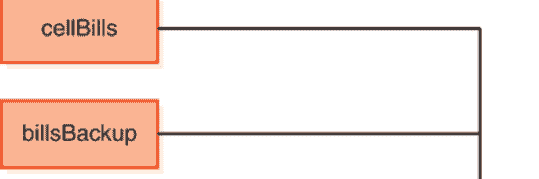

| | cellBills | billsBackup |
|---|---|---|
| 0 | 45.24 | 0.0 |
| 1 | 54.67 | 0.0 |
| 2 | 42.55 | 0.0 |
| 3 | 44.61 | 0.0 |
| 4 | 65.29 | 0.0 |
| 5 | 49.75 | 0.0 |

**Figure 8.10** 修改 billsBackup

如果我们给 `billsBackup` 中的一个元素赋新值，实际上会改变 `cellBills` 中的元素，因为它们现在指向同一个数组。这条语句：

```java
billsBackup[4] = 38.00;
```

产生的效果如图 8.11 所示。

| | cellBills | billsBackup |
|---|---|---|
| 0 | 45.24 | 45.24 |
| 1 | 54.67 | 54.67 |
| 2 | 42.55 | 42.55 |
| 3 | 44.61 | 44.61 |
| 4 | 38.00 | 38.00 |
| 5 | 49.75 | 49.75 |

**Figure 8.11** 修改 cellBills 数组

在第 9 行，我们使用初始化列表实例化了数组 `cellBills`。在第 11 行，我们声明并实例化了数组 `billsBackup`，其大小与原始数组 `cellBills` 相同。在第 12–15 行，我们使用标准的 `for` 循环，逐个将 `cellBills` 数组中的每个元素一个一个地复制到 `billsBackup` 数组中对应的元素中。

现在，`billsBackup` 数组和 `cellBills` 数组是两个独立的数组，它们拥有自己的元素值副本，如图 8.12 所示。更改一个数组中的元素不会影响另一个数组中对应元素的值。


| | |
|---|---|
| cellBills[0] | 45.24 |
| cellBills[1] | 54.67 |
| cellBills[2] | 42.55 |
| cellBills[3] | 44.61 |
| cellBills[4] | 65.29 |
| cellBills[5] | 49.75 |


| | |
|---|---|
| billsBackup[0] | 45.24 |
| billsBackup[1] | 54.67 |
| billsBackup[2] | 42.55 |
| billsBackup[3] | 44.61 |
| billsBackup[4] | 65.29 |
| billsBackup[5] | 49.75 |

### 图 8.12

复制每个元素后的数组

我们通过为 `billsBackup` 数组中的一个元素赋一个新值（第 17 行）来演示这一点。最后，我们使用 `for` 循环打印两个数组的内容。如图 8.13 所示，元素 4 的值仅在 `billsBackup` 数组中发生了变化。

### 图 8.13

示例 8.7 的输出

```
cellBills

Element Value

0 45.24

1 54.67

2 42.55

3 44.61

4 65.29

5 49.75

billsBackup

Element Value

0 45.24

1 54.67

2 42.55

3 44.61

4 38.0

5 49.75
```

然而，请注意，当我们复制一个元素为对象的数组时，即使使用 `for` 循环结构，我们复制的也是对象引用。结果是每个数组的对应元素将指向同一个对象。如果一个数组中的对象数据被更改，该更改也将反映在另一个数组中。

## 8.3.6 更改数组的大小

数组在实例化时会被分配一个长度，数组的长度将变成一个常量值。但如果我们想在数组实例化后更改数组中的元素数量呢？

例如，我们的 `cellBills` 数组包含六个元素，存储了六个月的手机单。如果我们决定收集一整年的手机单，我们需要一个具有 12 个元素的数组。我们可以使用此语句实例化一个具有 12 个元素的 `cellBills` 数组版本：

```java
cellBills = new double [12];
```

该语句实例化了一个新的 `doubles` 数组，所有元素都初始化为 0.0。但原始的六个元素的数组发生了什么呢？由于 `cellBills` 引用现在指向新的 12 元素数组，6 元素数组没有对象引用指向它，因此我们无法访问该数组的值。

要在保持原始数组值的同时扩展数组的大小，可以使用以下技术：

1. 实例化一个具有新大小的数组，并给新数组一个临时引用。
2. 将原始数组的元素复制到新数组中。
3. 将原始数组引用指向新数组。
4. 给临时数组赋值为 `null` 值。

因此，而不是立即让 `cellBills` 指向数组，我们应该使用临时数组实例化一个 12 元素的数组，将 `cellBills` 数组中的六个元素复制到 12 元素数组中，将 `cellBills` 引用赋值给新数组，并给临时数组赋值 null。以下代码将实现这一点：

```java
double [] temp = new double [12]; //实例化新数组

// 将 cellBills 的所有元素复制到 temp

for ( int i = 0; i < cellBills.length; i++ )

    temp[i] = cellBills[i]; // 复制每个元素

cellBills = temp; // 将 temp 赋值给 cellBills

temp = null; // temp 不再指向 cellBills
```

## 8.3.7 比较数组的相等性

要比较两个数组是否相等，首先判断它们的长度是否相等，然后使用 `for` 循环比较每个数组中的对应元素。也就是说，比较第一个数组的元素 0 和第二个数组的元素 0；以此类推，比较第一个数组的元素 1 和第二个数组的元素 1；如果第一个数组中的所有元素都与第二个数组中的对应元素相等，则数组相等。示例 8.8 比较了两个 doubles 类型的数组。

### 示例 8.8 比较基本数据类型的数组

```java
/* 比较基本数据类型的数组 */
public class ComparingArrays
{
    public static void main( String [ ] args )
    {
        double [ ] cellBills1 = { 45.24, 54.67, 42.55, 44.61, 65.29, 49.75 };
        double [ ] cellBills2 = { 45.24, 54.67, 42.55, 44.61, 65.29, 49.75 };
        boolean isEqual = true;
        if ( cellBills1.length != cellBills2.length ) {
            isEqual = false;
        } else {
            for ( int i = 0; i < cellBills1.length; i++ ) {
                if ( Math.abs(cellBills1[i] - cellBills2[i]) > 0.001 ) {
                    isEqual = false;
                    break;
                }
            }
        }
        if ( isEqual ) {
            System.out.println("cellBills1 and cellBills2 are equal");
        } else {
            System.out.println("cellBills1 and cellBills2 are not equal");
        }
    }
}
```

在开始 `for` 循环之前，我们在第 12 行声明了一个布尔变量 `isEqual` 并将其设置为 `true`。我们假设数组是相等的。然后，第一步是比较数组的长度是否相同（第 13 行）。如果它们的大小不同，数组就不相等，因此我们将 `isEqual` 设置为 `false`，执行跳转到第 28 行。如果两个数组的大小相同，我们使用第 19–25 行的 `for` 循环测试每个数组中的对应元素是否相等。注意我们为 `for` 循环条件添加了第二个测试 (`isEqual`)。如果任何对应元素不等，我们在第 23 行将 `isEqual` 设置为 `false`。这会导致 `for` 循环条件变为 `false`，并退出 `for` 循环。因此，当 `for` 循环结束时，如果任何对应元素不匹配，`isEqual` 将为 `false`。如果两个数组的大小相同且所有元素相等，我们从未更改 `isEqual` 的值，因此它保持为 `true`。此示例的输出如图 8.14 所示。

自然，如果数组的元素是 `int`、`boolean` 或 `char`，我们会在第 21 行（概念上）使用不相等运算符 (`!=`)，例如：

```java
if ( intArray1[i] != intArray2[i] )
```

假设我们要比较的两个数组名为 `intArray1` 和 `intArray2`。如果数组的元素是对象，我们的 `for` 循环应该调用对象类的 `equals` 方法。因此，为了比较两个名为 `car1` 和 `car2` 的 `Auto` 对象数组，我们将使用以下代码代替第 21 行的条件：

```java
if (! car1[i].equals( car2[i] ))
```

### 图 8.14

示例 8.8 的输出

```
cellBills1 and cellBills2 are not equal
```

## 常见错误陷阱

由于数组是对象，尝试使用相等运算符 (`==`) 比较两个数组将比较两个数组引用是否指向内存中的同一个数组，而不是两个数组中的数据是否相等。调用继承自 `Object` 类的 `equals` 方法产生类似的结果。

需要避免的陷阱是尝试使用相等运算符 (`==`) 测试两个数组是否相等。此代码：

```java
if ( cellBills == billsBackup )
```

不会比较两个数组的数据。它将比较 `cellBills` 和 `billsBackup` 对象引用是否相等；也就是说它们是否指向同一个数组。

同样，继承自 `Object` 类的 `equals` 方法也返回错误的结果。

此代码：

```java
if ( cellBills.equals( billsBackup ) )
```

仅当两个对象引用指向同一个数组时，才会返回 `true`。

### 8.3.8 使用柱状图显示数组数据

显示数组数据的一种方法是图形化，即绘制柱状图。例如，图 8.15 中的柱状图显示了 `cellBills` 数组中的数据。

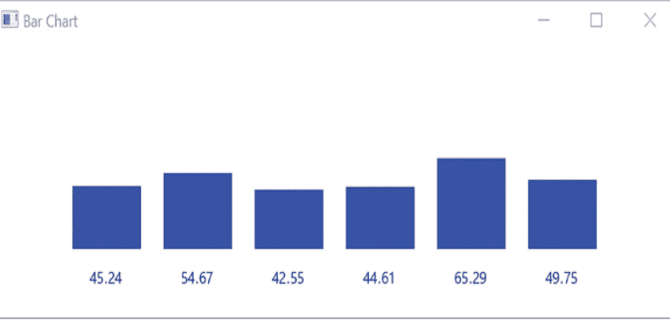

**图 8.15**

作为柱状图的 `cellBills` 数组

每个柱体仅仅是一个矩形。示例 8.9 显示了生成图 8.15 的代码。

### 示例 8.9 使用柱状图显示数组值

```java
1 /* 一个图表应用程序
2 Anderson, Franceschi
3 */
4
5 import javafx.application.Application;
6 import javafx.stage.Stage;
7 import javafx.scene.canvas.GraphicsContext;
8 import javafx.scene.paint.Color;
9
10 public class BarChartApplication extends Application
11 {
12     final int LEFT_MARGIN = 35; // 起始 x 坐标
13     final int BASE_Y_BAR = 150; // 柱体的底部
14     final int BASE_Y_VALUE = 175; // 数值的底部
15     final int BAR_WIDTH = 30; // 每个柱体的宽度
16     final int SPACE_BETWEEN_BARS = 10; // 柱体之间的像素间隔
17
18     private double[] cellBills
19     = { 45.24, 54.67, 42.55, 44.61, 65.29, 49.75 };
20     private String[] months
21     = { "March", "April", "May", "June", "July", "August" };
22
23     @Override
24     public void start(Stage stage)
25     {
26         // 设置窗口标题和大小
27         GraphicsContext gc = JraphicsUtility.setupGraphics(
28             stage, "Bar Chart", 600, 200 );
29
30         gc.setFill(Color.BLUE); // 柱体将是蓝色
31         int xStart = LEFT_MARGIN; // 第一个柱体的 x 值
32
33         for (int i = 0; i < cellBills.length; i++) {
34             gc.fillRect(xStart, BASE_Y_BAR - cellBills[i],
35                 BAR_WIDTH, cellBills[i]);
36
37             gc.fillText(Double.toString(cellBills[i]),
38                 xStart, BASE_Y_VALUE);
39
40             // 移动到下一个柱体的起始 x 值
41             xStart += BAR_WIDTH + SPACE_BETWEEN_BARS;
42         }
43
44         public static void main(String[] args) {
45             launch(args);
46         }
47     }
}
```

为了创建柱状图，我们在 `start` 方法的第 31–41 行使用了标准的 `for` 循环，并调用 `Graphics` 类的 `fillRect` 方法来为每个元素绘制一个矩形（第 33–34 行）。我们在第 36–37 行使用 `fillText` 方法来显示每个元素的值。

`fillRect` 方法接受四个参数：左上角的 x 值、左上角的 y 值、矩形的宽度和矩形的高度。

我们可以通过以下方法确定每个元素对应 `fillRect` 的参数值，如图 8.16 所示：

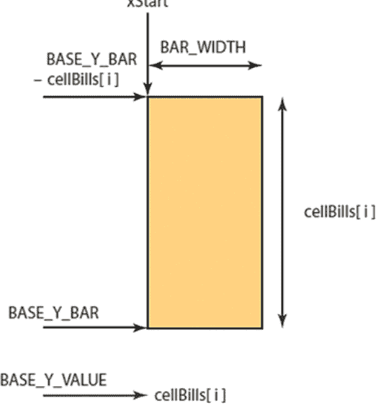

**图 8.16** 绘制每个柱体的参数

- **宽度**：柱体的宽度是一个常数值。对于我们的柱状图，我们选择了 30 像素的宽度；常量 `BAR_WIDTH` 存储了该值（第 15 行）。
- **高度**：每个柱体的高度是正在绘图的数组元素的值。因此，在 `fillRect` 方法调用（第 35–36 行）中，我们将柱体的高度表示为：
  `cellBills[i]`
- **左上角 y 值**：同样，左上角的 y 值将是所有柱体的基础 y 值减去柱体的高度；所有柱体的基础 y 值是第 13 行定义的常量 `BASE_Y_BAR`。我们从柱体的基底减去元素的值，是因为 y 值是从窗口顶部向底部递增的。因此，在我们的 `fillRect` 方法中，我们将柱体的左上角 y 值表示为：
  `BASE_Y_BAR - cellBills[i]`
- **左上角 x 值**：我们将窗口的左侧开始绘制第一个柱体，加上一个左边距值，由常量 `LEFT_MARGIN` 表示（第 12 行）。在画完每个柱体后，我们的 `for` 循环需要将起始 x 值移动到下一个柱体的位置。为了做到这一点，在第 42 行，我们将起始 x 值增加柱体的宽度 `BAR_WIDTH`（定义在第 15 行）加上柱体之间的间隔 `SPACE_BETWEEN_BARS`（定义在第 16 行）。

`Graphics` 类 `fillText` 方法的参数是需要显示的 String 以及基础 x 和 y 值。


```java
// ***** 4. 学生编写此方法
/** 统计等于参数值的元素个数
 * 实例变量 arr 是待处理的整数数组
 * @param value 要计数的数值
 * @return 等于 value 的元素个数
 */
public int countFrequency(int value)
{
    // 注意：为了让算法动画化，请将此方法
    // 作为 for 循环的最后一条语句调用
    // animate(i, count);
    // 其中 i 是当前元素的索引
    // count 是持有频率的变量
    // 在此处编写你的代码：

    return 0; // 用你的 return 语句替换此行
} // countFrequency 方法结束
```

```java
// ***** 5. 学生编写此方法
/** 查找并返回 arr 中的最小值
 * 实例变量 arr 是待处理的整数数组
 * @return 在 arr 中找到的最小值
 */
public int findMinimum()
{
    // 注意：为了让算法动画化，请将此方法
    // 作为循环的最后一条语句调用
    // animate(i, minimum);
    // 其中 i 是当前元素的索引
    // minimum 是持有最小值的变量
    // 在此处编写你的代码：

    return 0; // 用你的 return 语句替换此行
} // findMinimum 方法结束
// 学生代码结束
```

我们的框架将使你的算法动画化，让你看到代码的运行过程。为了实现这一点，请确保你的 `for` 循环调用了 `animate` 方法。发送给 `animate` 的参数将根据你正在编写的任务而不同。每个任务的详细说明包含在代码中。

要测试你的代码，请编译 `ArrayPractice1Controller.java` 并运行 `ArrayPractice1Application` 源码。图 8.18 显示了程序启动时的图形窗口。由于数组的值是随机生成的，每次运行程序时值都会不同。要测试任何方法，请点击相应的按钮。

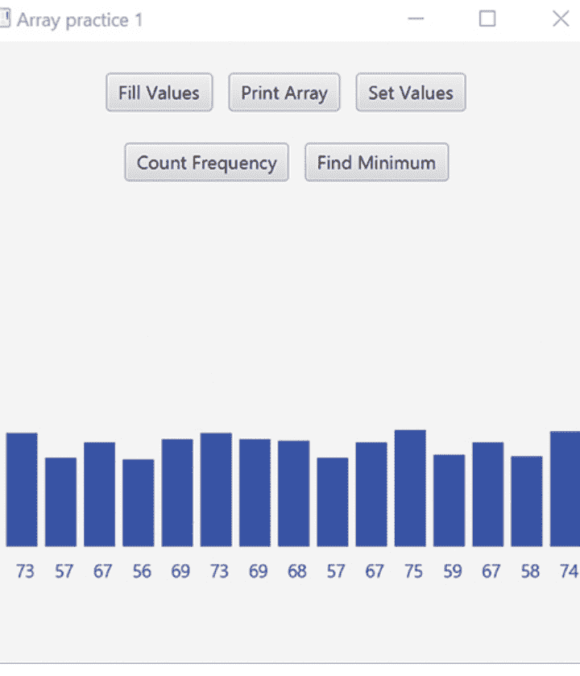

## 图 8.18
应用程序启动时的图形窗口

## 故障排除

如果你的方法实现没有动画效果，请遵循以下提示：

- 验证你的 `for` 循环中的最后一条语句是对 `animate` 方法的调用，并且你向 `animate` 方法传递了正确的参数。
- 验证你的 `for` 循环是否有大括号。例如，`animate` 方法调用位于此 `for` 循环体之外：

```java
for (int i = 0; i < arr.length; i++) {
    System.out.println(arr[i]);
    animate(i); // 这语句在 for 循环之外
}
```

记住，如果没有大括号，`for` 循环体只包含 `for` 循环头部后的第一条语句。将两个语句都封装在大括号内将使 `animate` 方法调用成为 `for` 循环的一部分。

```java
for (int i = 0; i < arr.length; i++) {
    System.out.println(arr[i]);
    animate(i);
}
```

- 验证你没有实例化新数组。请在名为 `arr` 的实例变量数组上执行所有操作。

## 讨论题

1. 你可以在每个方法中使用以下 `for` 循环头部吗？请解释为什么可以或不可以。

```java
for (int i = 0; i < arr.length; i++)
```

2. 你如何修改 `findMinimum` 方法以返回最小值的索引？

# 8.5 在类中使用数组

## 8.5.1 在用户定义类中使用数组

数组可以像任何其他变量一样在用户定义类内部使用。具体来说：

- 数组可以是实例变量。
- 数组可以是方法的参数。
- 方法可以返回数组。
- 数组可以是方法内部的局部变量。

要定义一个接受数组作为参数的方法，请使用此语法：

```java
accessModifier returnType methodName(dataType[] arrayName)
```

返回数组的方法头部语法为：

```java
accessModifier dataType[] methodName(parameterList)
```

要将数组作为参数传递给方法，只需使用不带括号的数组名作为参数值：

```java
methodName(arrayName)
```

## 常见错误陷阱

如果我们认为括号是数组数据类型的一部分，那么很容易记住：括号包含在方法头部中（即给出参数类型的地方），但括号不包含在方法调用中（即给出数据类型本身的地方）。

在示例 8.11 中，我们定义了一个名为 `CellPhone` 的类，说明了在类中使用数组的方法。

## 示例 8.11 CellPhone 类

```java
/** CellPhone 类
 * Anderson, Francesi
 */
import java.text.DecimalFormat;

public class CellPhone {
    public final int MONTHS = 6; // 默认月份数
    private String phoneNumber;
    private double[] cellBills;

    /** 默认构造函数
     * 创建具有 MONTHS 个元素的 cellBills
     */
    public CellPhone() {
        phoneNumber = "";
        cellBills = new double[MONTHS];
    }

    /** 构造函数
     * @param phoneNumber 电话
     * @param cellBills 每月账单数组
     */
    public CellPhone(String phoneNumber, double[] cellBills) {
        this.phoneNumber = phoneNumber;
        this.cellBills = new double[MONTHS];
        for (int i = 0; i < cellBills.length; i++) {
            this.cellBills[i] = cellBills[i];
        }
    }

    /** 获取电话号码
     * @return 电话号码
     */
    public String getPhoneNumber() {
        return phoneNumber;
    }

    /** 获取账单
     * @return cellBills 数组的副本
     */
    public double[] getBills() {
        double[] temp = new double[cellBills.length];
        for (int i = 0; i < cellBills.length; i++) {
            temp[i] = cellBills[i];
        }
        return temp;
    }

    /** 计算所有账单的总和
     * @return 所有元素总和
     */
    public double calcTotal() {
        double total = 0.0;
        for (int i = 0; i < cellBills.length; i++) {
            total += cellBills[i];
        }
        return total;
    }

    /** 查找最大账单
     * @return cellBills 数组中的最大值
     */
    public double findMaximumBill() {
        double max = cellBills[0];
        for (int i = 1; i < cellBills.length; i++) {
            if (cellBills[i] > max) {
                max = cellBills[i];
            }
        }
        return max;
    }

    /** 返回 CellPhone 对象的打印版本
     * @return 电话号码以及每月账单
     */
    @Override
    public String toString() {
        String returnValue = phoneNumber + "\n";
        DecimalFormat money = new DecimalFormat("$.00");
        for (int i = 0; i < cellBills.length; i++) {
            returnValue += money.format(cellBills[i]) + "\t";
        }
        returnValue += "\n";
        return returnValue;
    }

    /** 比较两个 CellPhone 对象的相等性
     * @param c CellPhone 对象
     * @return 如果对象相等为 true，否则为 false
     */
    @Override
    public boolean equals(Object c) {
        if (!(c instanceof CellPhone)) return false;
        CellPhone objCP = (CellPhone) c;
        if (!phoneNumber.equals(objCP.phoneNumber)) return false;
        for (int i = 0; i < cellBills.length; i++) {
            if (cellBills[i] != objCP.cellBills[i]) {
                return false;
            }
        }
        return true;
    }
}
```

我们的 `CellPhone` 类在第 9-11 行定义了三个实例变量：电话号码（`String` 类型 `phoneNumber`）、每月账单（`double` 类型数组 `cellBills`）以及一个常量 `MONTHS`，其值为 6。如果使用默认构造函数实例化 `CellPhone` 对象，`cellBills` 的长度即为此。当我们的类具有数组类型的实例变量时，我们需要额外的小心以确保封装不被破坏。

让我们从数组的初始化开始。`CellPhone` 类的重载构造函数（方法头部位于第 26 行）包含一个数组参数。对于基本类型参数，构造函数可以简单地将参数的值赋值给实例变量。然而，正如我们看到的，数组的名称是一个对象引用，它包含了数组在内存中的位置。如果构造函数仅仅像下面的代码那样将数组参数 `cellBills` 赋值给我们的数组实例变量 `cellBills`：

```java
this.cellBills = cellBills; // 错误！客户端仍然持有引用！
```

那么参数 `cellBills` 和实例变量 `cellBills` 将指向同一个数组。这意味着客户端仍然持有该数组的引用，客户端可以在不通过类的变变器方法的情况下更改数组的值。例如，如果客户端执行了这条语句：

```java
bills[2] = 75.00;
```

那么 `cellBills[2]` 也会得到值 75.00，因为它们是同一个数组。这显然违反了封装性，因为封装性意味着客户端应该只能通过调用类的变变器方法来更改类的 `private` 字段。

## 软件工程提示

与客户端共享数组引用会违反封装性。要从方法中返回一个数组，请将实例变量数组的元素复制到一个临时数组中，并返回该临时数组的引用。同样，要接受数组作为方法的参数，请实例化一个新的数组，并将参数数组的元素复制到新数组中。

为了避免这个问题，我们的构造函数实例化了一个新的 `cellBills` 数组，其大小与作为参数传递的数组相同，然后将参数数组的元素复制到新的 `cellBills` 数组中（第 30–37 行）。

在实现数组实例变量的访问器方法时，也有类似的考虑。对于原始类型的实例变量，访问器方法直接返回实例变量的值。我们用于 `cellBills` 的访问器（第 48–59 行）以数组作为返回值。然而，如果我们返回 `cellBills` 引用，就会遇到同样的封装性问题；也就是说，如果我们对 `cellBills` 实例变量的访问器使用这条语句：

```java
return cellBills; // 错误！客户端持有实例变量的引用
```

我们就给了客户端一个 `cellBills` 数组的引用，客户端可以直接更改数组的值，而无需调用类的变变器方法。就像实例化新数组并将参数数组的值复制到新数组一样，访问器方法也应该实例化新数组，将 `cellBills` 数组复制到新数组中，并返回新数组的引用。因此，在第 53 行，我们声明了一个名为 `temp` 的本地数组变量。在第 54–57 行，我们将 `cellBills` 的内容复制到 `temp`，并在第 58 行返回 `temp`。

我们还提供了一个方法 `calcTotalBills`（第 61–73 行），它使用本章之前讨论的累加技术计算每月账单总和，以及 `findMaximumBill` 方法（第 75–88 行），它同样使用本章之前讨论的技术寻找 `cellBills` 数组中的最大值。

我们的 `toString` 方法（第 90–105 行）构建名为 `returnValue` 的字符串，首先包含电话号码，然后使用金额格式化模式对每个账单进行格式化，并将该值加上制表符连接到 `returnValue`。

`equals` 方法（第 107–132 行）将对象中的电话号码和 `cellBills` 数组的每个元素与参数对象中 `cellBills` 数组的电话号码及相应的元素进行比较。

我们可以用示例 8.12 所示的客户端类来测试我们的 `CellPhone` 类。输出如图 8.19 所示。

## 图 8.19
`CellPhoneClient` 类的输出

```
c1 = 0.00 $0.00 $0.00 $0.00 $0.00 $0.00

c2 = 555-555-5555
$24.60 $48.75 $62.50

最高账单是 $62.50
所有账单的总和为 $135.85
c2 和 c3 相等

客户端更改原始数组后
c2 = 555-555-5555
$24.60 $48.75 $62.50

客户端更改返回的数组后
c2 = 555-555-5555
$24.60 $48.75 $62.50
```

## 示例 8.12 CellPhoneClient 类

```java
/**
 * 用于练习 CellPhone 类的客户端
 */
import java.text.DecimalFormat;

public class CellPhoneClient {
    public static void main(String[] args) {
        double[] bills = new double[3]; // 数组 bills
        bills[0] = 24.60; // 赋值
        bills[1] = 48.75;
        bills[2] = 62.50;

        // 使用默认构造函数实例化 CellPhone 对象
        CellPhone c1 = new CellPhone();

        // 实例化两个相同的 CellPhone 对象
        CellPhone c2 = new CellPhone("555-555-5555", bills);
        CellPhone c3 = new CellPhone("555-555-5555", bills);

        // 打印 c1 和 c2 的数据
        System.out.println("c1 = " + c1.toString());
        System.out.println("c2 = " + c2.toString());

        // 查找并打印最高账单
        DecimalFormat money = new DecimalFormat("$0.00");
        System.out.println("The highest bill is " + money.format(c2.findMaximumBill()));

        // 查找并打印所有账单的总和
        System.out.println("The total of all bills is " + money.format(c2.calcTotalBills()));

        // 打印空行
        System.out.println();

        // 调用 equals 方法
        if (c2.equals(c3)) {
```


System.out.println("c2 and c3 are equal");

        } else {

            System.out.println("c2 and c3 are not equal");

        }

        // 测试封装性

        // 在原始数组中设置新值

        bills[2] = 100.00;

        // 打印 c2 显示对象中的值未改变

        System.out.println("after client changes original array c2 = " + c2.toString());

        // 进一步测试封装性

        // 获取 cellBills 数组并存储在新数组中

        double[] billsCopy = c2.getCellBills();

        billsCopy[1] = 50.00; // 更改一个元素

        // 客户端更改返回的数组后

        System.out.println("after client changes returned array c2 = " + c2.toString());

    }

}

```

在 `CellPhoneClient` 中，我们实例化三个 `CellPhone` 对象。使用默认构造函数实例化 `c1`（第 17 行），给它一个电话号码和初始化为 0.00 的六个月账单（如第 24 行所示）。我们设置一个包含三个值的 `bills` 数组（第 11–14 行），并将 `bills` 传递给重载构造函数（第 20–21 行）以实例化 `c2` 和 `c3`。然后我们使用 `toString` 方法打印 `c2` 的数据（第 25 行）。

我们调用 `findMaximum` 方法并打印其返回值（第 27–30 行）。接下来我们调用 `calcTotals` 方法并打印其返回值（第 32–34 行）。

调用 `equals` 方法比较 `c2` 和 `c3`（第 37–41 行）返回 `true` 值，因为这两个对象的数据相同。

最后，我们通过两种方式测试封装性。首先，我们在 `bills` 数组中更改一个值，然后再次打印 `c2` 以验证其数据未更改（第 43–48 行）。其次，我们调用 `cellBills` 数组的访问器方法并更改从返回数组的值。我们再次打印 `c2` 以验证其数据未改变（第 50–57 行）。用此类示例测试 `CellPhone` 类对于检查我们是否正确实现了该类非常有帮助。

# 8.5.2 获取命令行参数

方法的数组参数的语法可能看起来很熟悉。我们在 Java 应用中多次在 `main` 方法的头部看到它：

```
public static void main( String[] args )
```

正如我们看到的，`main` 接收一个 `String` 数组作为参数。该字符串数组包含了用户从命令行发送给程序的参数（如果有的话）。参数可以是程序要读取的文件名，也可以指定应用程序如何执行功能的某些配置参数。

示例 8.13 中的示例程序演示了如何获取发送给 Java 程序的参数。因为 `args` 是 `String` 数组，我们可以使用 `length` 字段获取参数数量（第 8–9 行），并使用标准的 `for` 循环格式（第 10–13 行）获取并打印每个参数，如图 8.20 所示。

# 图 8.20
示例 8.13 的输出

```
The number of parameters is 2
args[0]: input.txt
args[1]: output.txt
```

# 示例 8.13 获取命令行参数

```java
1 /* 打印命令行参数
2 *    Anderson, Franceschi
3 */
4 public class CommandLineArguments
5 {
6     public static void main(String [] args )
7     {
8         System.out.println("The number of parameters " + args.length);
9         for (int i = 0; i < args.length; i++) {
10            System.out.println("args[" + i + "]: " + args[i]);
11        }
12    }
}
```

图 8.20 显示了按如下方式调用程序时产生的输出：

```
java CommandLineArguments input.txt output.txt
```

# 课后练习

### 8.11.1 单选题练习
第 11 

### 8.11.2 阅读与理解代码
第 22, 23, 24, 25, 26 

### 8.11.3 空题
第 32, 33, 34, 35 

### 8.11.6 编写短程序
第 49, 50, 51, 52, 53, 54, 55, 56, 58, 59, 60, 61

# 8.6 数组的搜索与排序

数组是存储大量相关值的优秀工具。正如在本章前面所示，我们可以使用数组来存储每日气温、CD 标题、电话单、测试成绩和其他相关值的集合。一旦数据存储在数组中，我们就会想要对这些数据进行处理。一种非常常见的操作是在数组中搜索特定值。

## 8.6.1 未排序数组的顺序查找

让我们来管理一家电影院。我们给每位顾客颁发一张带有唯一 ID 的常客电影卡。我们决定随机抽取四个成员 ID，并在他们下次访问影院时送给他们免费礼物。因此，我们建立了一个 `MovieWinners` 类，包含两个数组实例变量：

- 一个 `int` 类型的数组，用于存储获奖者的成员 ID
- 一个 `String` 类型的数组，用于存储对应的奖品

注意，两个数组都有四个元素，且两个数组之间是一一对应的关系。第 1 号获奖者将获得 1 号奖品，第 2 号获奖者将获得 2 号奖品，依此类推。这种编程技术被称为使用并行数组（parallel arrays）。

我们用随机选择的成员 ID 填充 `winners` 数组。用代表奖品描述的字符串填充 `prizes` 数组。当成员购买电影票时，我们在 `winners` 数组中查找该成员的 ID。如果该 ID 在 `winners` 数组中，我们就利用索引从 `prizes` 数组中检索该成员赢得相应的奖品。如果在数组中未找到该 ID，我们就知道该成员不是获奖者。

`MovieWinners` 类见示例 8.14。

# 示例 8.14 MovieWinners 类

```java
/** 免费电影和其他奖品的获得者
 * Anderson, Franceschi
 */

import java.util.Random;

public class MovieWinners {

    public final int MEMBERS = 5000; // 用于存储随机选择号码的数组

    private int[] winners; // 存储奖品的并行数组

    private String[] prizes = {"free movie tickets", "1 free ticket!", "popcorn", "free box of candy!"};

    /** 默认构造函数实例化 winners数组
     * 并随机生成成员 ID */
    public MovieWinners() {
        winners = new int[prizes.length];
        fillWinners();
    }

    /** 工具方法生成成员 ID
     * 并将其存储在 winners 数组中 */
    private void fillWinners() {
        Random rand = new Random();
        for (int i = 0; i < winners.length; i++) {
            winners[i] = rand.nextInt(MEMBERS) + 1;
        }
    }

    /** 使用成员编号调用 indexOfWinner
     * 将返回值转换为奖品
     * @param memberNumber 要查找的值
     * @return 奖品 */
    public String getze(int memberNumber) {
        int prizeIndex = indexOfWinner(memberNumber);
        if (prizeIndex == -1) {
            return "Sorry, member is not a winner.";
        } else {
            return "You win " + prizes[prizeIndex];
        }
    }

    /** 执行 winners 数组的顺序查找
     * @param key 在数组中查找的内容
     * @return 如果找到则返回索引，未找到返回 -1 */
    private int indexOfWinner(int key) {
        for (int i = 0; i < winners.length; i++) {
            if (winners[i] == key) {
                return i;
            }
        }
        return -1;
    }

    /** 返回 MovieWinners 对象的打印版本
     * @return 用制表符分隔的获奖号码 */
    @Override
    public String toString() {
        String returnValue = "";
        for (int i = 0; i < winners.length; i++) {
            returnValue += winners[i] + "\t";
        }
        return returnValue;
    }
}
```

构造函数通过调用工具方法 `fillWinners`（第 26–36 行）生成用于填充数组的值。为了保持简单，我们编写 `fillWinners` 方法的方式并不一定会生成不同的数字；然而，两个获奖号码相同的概率很小。我们将 `fillWinners` 声明为 `private`，因为它被设计为仅供此类类的方法调用。

我们的 `indexOfWinner` 方法（第 52–64 行）执行顺序查找（Sequential Search），将成员 ID 与数组中的每个元素进行比较。`indexOfWinner` 方法接受一个参数 `key`，即要在数组中搜索的成员 ID。如果找到了 `key`，`indexOfWinner` 返回该元素的索引。如果未找到 `key`，即数组中的没有一个元素与 `key` 的值匹配，`indexOfWinner` 返回 -1。由于 -1 不是一个有效的数组索引，因此它是表示搜索失败的良好值。

请注意，当当前数组元素匹配 `key` 时，`indexOfWinner` 方法会立即返回给调用者（第 61 行）；这意味着该方法停止执行。返回的值是匹配 `key` 的元素的索引。然而，如果方法执行完了 `for` 循环的所有迭代，说明已经检查了数组中的所有元素但未找到项。在这种情况下，方法返回 -1（第 63 行），表示未找到项。

我们的 `getze` 方法（第 38–50 行）调用 `indexOfWinner` 来检查 `memberNumber` 参数是否为获奖号码；如果是，它使用 `indexOfWinner` 返回的索引返回 `prizes` 数组中对应的元素（第 49 行）。

示例 8.15 显示了一个使用我们 `MovieWinners`类的应用程序。

# 示例 8.15 MovieWinners 类客户端

```java
/** MovieWinners 类客户端
 * Anderson, Franceschi
 */

import java.util.Scanner;

public class MovieWinnersClient {

    public static void main(String [] args) {
        // 实例化 winningIDs数组
        MovieWinners winningIDs = new MovieWinners();

        // 提示成员 ID
        Scanner scan = new Scanner(System.in);
        System.out.print("Enter the member's ID or 0 to stop > ");
        int searchID = scan.nextInt();

        while (searchID != 0) {
            // 判断成员是否为获奖者
            System.out.println(winningIDs.getze(searchID));
            System.out.print("Enter next member's ID or 0 to stop > ");
            searchID = scan.nextInt();
        }

        System.out.println("The winners were " + winningIDs.toString());
    }
}
```

> **软件工程提示**
> 当你编写使用不同数据类型的对应列表的类时，考虑使用并行数组。

图 8.21 显示了运行 `MovieWinnersClient` 应用程序的可能输出。

# 图 8.21
示例 8.15 的输出

```
Enter the member's ID or 0 to stop > 1234
Sorry, member is not a winner.
Enter the next member's ID or 0 to stop > 3980
You win free popcorn!
Enter the next member's ID or 0 to stop > 0
The winners were 619 4510 3980 4004
```


## 8.6.2 选择排序

在前面的 `winners` 数组中的成员 ID 是随机顺序排列的，因此当一个成员不是获胜者时，我们的 `findWinners` 方法需要检查数组中的每一个元素，才能发现我们要查找的 ID 不在数组中。这是低效的，因为大多数成员并不是获胜者。数组越大，顺序搜索就越低效。我们可以通过将元素按数字顺序排列来简化搜索，这被称为数组排序。一旦数组排序完成，我们就可以使用各种算法来加速搜索。在本章的稍后部分，我们将讨论如何搜索已排序的数组。

在本章中，我们介绍了两种基础排序算法：选择排序和插入排序。

选择排序的名称源于用于排序数组的算法。我们从数组中选择一个最大的元素并将其放在数组的末尾。然后，我们选择下一个次大的元素并将其放在数组的倒数第二个位置。为了实现这一点，我们将数组的未排序部分视为一个子数组。我们反复在当前子数组中选择一个最大值并移动到子数组的末尾，通过排除已处于排序位置的元素来考虑一个新的子数组，直到子数组只剩一个元素。此时，数组即排序完成。

用更正式的术语来说，我们可以这样描述此处以伪代码表示的选择排序算法：

对一个包含 $n$ 个元素的数组按升序排序：
1. 将 $m$ 个元素视为一个子数组，其中 $m = n$。
2. 找到该子数组中最大值的索引。
3. 交换具有最大值的元素与子数组最后一个位置元素的值。
4. 通过排除上一个子数组的最后一个元素，考虑包含 $m = m - 1$ 个元素的新子数组。
5. 重复步骤 2 到 4，直到 $m = 1$。

例如，让我们对以下数组进行一次选择排序。开始时，整个数组都是未排序的子数组（在此用阴影表示）。

我们首先将整个数组视为一个未排序的子数组。我们发现最大的元素是索引 1 处的 26。

未排序子数组

| 值 (Value) | 17 | 26 | 5 | 2 |
| :--- | :--- | :--- | :--- | :--- |
| 索引 (Index) | 0 | 1 | 2 | 3 |

接下来，我们通过交换索引 1 和 3 处元素的值，将元素 1 移动到最后一个元素。

值 26 已经在正确的位置，我们将元素 0 到 2 视为未排序的子数组。

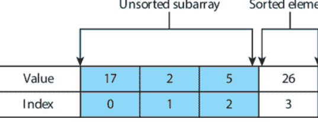

新子数组中最大的元素是索引 0 处的 17。因此，我们通过交换索引 0 和 2 处的元素，将元素 0 移动到子数组的最后一个索引（索引 2）。

值 17 现在处于正确的位置，我们将元素 0 和 1 视为新的未排序子数组。

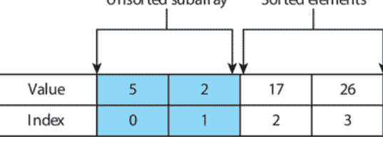

新子数组中最大的元素是索引 0 处的 5。我们通过交换索引 0 和 1 处的元素，将元素 0 移动到子数组的最后一个索引（索引 1）。

值 5 现在处于正确的位置，我们将元素 0 视为新的子数组。但因为子数组中只有一个元素，所以该子数组已排序。因此，整个数组都已排序，我们的工作也完成了。

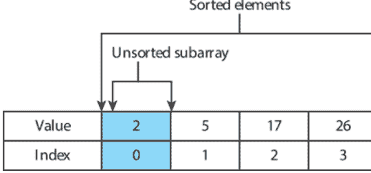

选择排序中的一个关键操作是交换两个数组元素。在继续之前，让我们检查交换两个数组元素的算法。

要交换两个值，我们需要定义一个与被交换值具有相同数据类型的临时变量。该变量将临时存储其中一个元素的值，以便我们不会在交换过程中丢失该值。

此处以伪代码表示的算法涉及三个步骤：

- 交换元素 $a$ 和 $b$：
  1. 将元素 $a$ 的值赋给临时变量。
  2. 将元素 $b$ 的值赋给元素 $a$。
  3. 将临时变量中的值赋给元素 $b$。

例如，如果名为 `array` 的数组包含 `int` 元素，且我们想要交换索引 3 处的元素与索引 6 处的元素，我们将使用以下代码：

```java
int temp = array[3]; // line 1
array[3] = array[6]; // line 2
array[6] = temp; // line 3
```

这些操作的顺序至关重要；更改顺序可能会导致数据丢失以及数组中存储错误的数据。

下图说明了交换过程中逐行发生的情况：

在执行 line 1 之前，我们的数组如下：

| 值 (Value) | 23 | 45 | 7 | 33 | 78 | 90 | 82 | 80 | 90 | 66 |
| :--- | :--- | :--- | :--- | :--- | :--- | :--- | :--- | :--- | :--- | :--- |
| 索引 (Index) | 0 | 1 | 2 | 3 | 4 | 5 | 6 | 7 | 8 | 9 |

执行 line 1 之后，我们的数组如下：

| 值 (Value) | 23 | 45 | 7 | 90 | 78 | 90 | 82 | 80 | 90 | 66 |
| :--- | :--- | :--- | :--- | :--- | :--- | :--- | :--- | :--- | :--- | :--- |
| 索引 (Index) | 0 | 1 | 2 | 3 | 4 | 5 | 6 | 7 | 8 | 9 |

执行 line 2 之后，我们的数组如下：

| 值 (Value) | 23 | 45 | 7 | 82 | 78 | 90 | 33 | 80 | 90 | 66 |
| :--- | :--- | :--- | :--- | :--- | :--- | :--- | :--- | :--- | :--- | :--- |
| 索引 (Index) | 0 | 1 | 2 | 3 | 4 | 5 | 6 | 7 | 8 | 9 |

执行 line 3 之后，我们的数组如下：

| 值 (Value) | 23 | 45 | 7 | 82 | 78 | 90 | 33 | 90 | 80 | 66 |
| :--- | :--- | :--- | :--- | :--- | :--- | :--- | :--- | :--- | :--- | :--- |
| 索引 (Index) | 0 | 1 | 2 | 3 | 4 | 5 | 6 | 7 | 8 | 9 |

### 常见陷阱

交换元素时，确保先保存值以免丢失数据。

### 示例 8.16 Sorter 类

```java
/* 工具类 */

public class Sorter {

    /**
     * 使用选择排序对数组进行升序排序
     * @param array 要排序的数组
     */

    public static void selectionSort(int[] array) {

        int temp; // 交换的临时位置
        int max; // 子数组最大值的索引

        for (int i = 0; i < array.length - 1; i++) {

            max = indexOfLargest(array, array.length - i);

            // 交换 array[max] 和 array[array.length - 1]

            temp = array[max];
            array[max] = array[array.length - 1];
            array[array.length - 1] = temp;

        }

    }

    /**
     * 寻找最大元素的索引
     * @param size 子数组的大小
     * @param array 要搜索的数组
     * @return 子数组最大元素的索引
     */

    private static int indexOfLargest(int[] array, int size) {

        int index = 0;

        for (int i = 1; i < size; i++) {

            if (array[i] > array[index])
                index = i;

        }

        return index;

    }

}
```

选择排序算法的一部分是找到子数组中最大元素的索引，因此我们用两个方法来实现选择排序。第 7 到 26 行是 `selectionSort` 方法，它实现了选择排序算法。为了完成工作，`selectionSort` 方法调用了工具方法 `indexOfLargest`（第 28 到 42 行），该方法返回子数组中最大元素的索引。我们将此方法声明为 `private`，因为它的唯一功能是为 `selectionSort` 方法提供服务。`indexOfLargest` 方法也必须声明为 `static`，因为 `selectionSort` 方法是静态的，因此它只能调用静态方法。

在示例 8.17 中，客户端代码实例化了一个整数数组，并在选择排序前后打印该数组。

已执行。由于 `selectionSort` 是一个静态方法，我们使用 `Sorter` 类名调用它。示例运行的输出如图 8.22 所示。

## 图 8.22

使用选择排序

```
排序前，数组为：
3394  279  1181  2471  3660  221

选择排序后，数组为：
221  279  1181  2471  3394  3660
```

## 示例 8.17 使用选择排序

```java
/** 选择排序的客户端
 * Anderson, Frances */

import java.util.Random;

public class SelectionSortClient {

    public static void main(String [] args) {

        // 实例化数组并填充随机值
        int[] numbers = new int[6];
        Random rand = new Random();

        for (int i = 0; i < numbers.length; i++) {
            numbers[i] = rand.nextInt(50) + 1;
        }

        System.out.println("排序前，数组为：");
        for (int i = 0; i < numbers.length; i++) {
            System.out.print(numbers[i] + "\t");
        }
        System.out.println("\n");

        Sorter.selectionSort(numbers); // 排序数组

        System.out.println("排序后，数组为：");
        for (int i = 0; i < numbers.length; i++) {
            System.out.print(numbers[i] + "\t");
        }
        System.out.println();

    }

}
```

### 8.6.3 插入排序

与选择排序一样，插入排序的名称源于用于排序数组的算法。插入排序的基本方法就像按顺序排列手中的卡牌。玩家每次插入一张卡牌，使得左侧的卡牌始终是有序的；右侧的卡牌尚未插入。如图 8.23a 所示，左侧的三张黄色卡牌（3, 5, 9）已经排好序，右侧的白色卡牌（4, 8）需要插入到正确的位置。左侧“已排序”的黄色卡牌并不处于最终位置。我们现在插入 4。我们首先将其与 9 比较；因为 4 小于 9，我们将 9 向右移动（图 8.23b）。接着我们将 4 与 5 比较；因为 4 小于 5，我们将 5 向右移动（图 8.23c）。然后我们与 4 与 3 比较；因为 4 大于 3，3 留在原地，我们将 4 插入空位（图 8.23d）。我们现在准备插入下一张卡牌 2。


图 8.23a

要插入的下一张卡牌是 4


9 向右移动


5 向右移动


4 被插入

为了升序排序一个包含 $n$ 个元素的数组，插入排序实现了一个双层循环：

- 外层循环执行 $n - 1$ 次，遍历索引从 1 到 $n$ 的数组元素。
- 1. 如果变量 $i$ 代表外层循环的计数器，可以将数组分为三部分：
    - 从索引 0 到 $i - 1$ 的有序子数组（尽管元素可能尚未处于最终位置）；
    - 当前正在插入的数组元素（索引为 $i$）；
    - 从索引 $i + 1$ 到 $n - 1$ 的尚未插入元素的子数组。
- 在外层循环的每次迭代中，我们将当前数组元素插入到排序数组的正确位置。内层循环从右到左将当前数组元素与排序数组的元素进行比较，并将这些元素向右移动，直到找到合适的插入位置。
- 所有元素插入完毕后，数组即完成排序。

插入排序的伪代码如下：

```
for i = 1 到最后一个数组索引步长为1
  j = i
  temp = 索引 i 处的元素
  while ( j != 0 and 索引 j-1 处元素的值 )
    将索引 j-1 处的元素向右移动
    j 减 1
  将 temp 中存储的值赋给索引 j 处的元素
```

例如，让我们对以下数组执行插入排序。开始时，未排序的数组为


当我们认为子数组仅包含该元素时，数组的第一个元素 17 自动处于正确位置。外层循环计数器 (i) 的值为 1，我们现在把第二个数组元素 26 插入到左侧子数组。首先，我们通过将其存储在 `temp` 中来保存待插入元素的值。我们需要保存该值，因为我们可能会移动其他值。

# 示例 8.18 使用插入排序的 Sorter 类

```java
/* Sort Utility Class
 * Anderson, Franceschi
 */

public class Sorter {

    /** 对整数数组进行选择排序
     * @param the array 待排序的数组
     */

    public static void selectionSort(int [] array) {

        int temp; // 用于交换的临时位置
        int max; // 子数组中最大值的索引

        for ( int i = 0; i < array.length - 1; i++) {

            // 找到子数组中最大值的索引
            max = indexOfLargestElement(array, array.length - i);

            // 交换 array[max] 和 array[array.length - i - 1];
            temp = array[max];
            array[max] = array[array.length - i - 1];
            array[array.length - i - 1] = temp;

        }

    }

    /** 找到最大元素的索引
     * @param size 子数组的大小
     * @return 子数组中最大元素的索引
     */

    private static int indexOfLargestElement(int [ ] array, int size) {

        int index = 0;

        for ( int i = 1; i < size; i++) {

            if ( array[i] > array[index])
                index = i;

        }

        return index;

    }

    /** 对整数数组进行插入排序
     * @param array 待排序的数组
     */

    public static void insertionSort(int [ ] array ) {

        int j, temp;

        for ( int i = 1; i < array.length; i++) {

            j = i;
```


```
temp = array[i];

while ( j != 0 && array[j - 1] > temp )
{
    array[j] = array[j - 1];
    j--;
}
array[j] = temp;
```

示例 8.19 展示了一个客户端程序，该程序实例化了一个整数数组，用随机值填充它，并在执行插入排序前后打印该数组。图 8.24 展示了一个示例，使用插入排序算法对整数数组进行排序。

## 图 8.24

使用插入排序

在插入排序之前，数组为：
2856 2384 3979 3088 1176 284

在插入排序之后，数组为
284 1176 2384 2856 3088 3979

## 示例 8.19 使用插入排序

```java
/**
 * 插入排序的客户端
 * Anderson, Franceschi
 */
import java.util.Random;

public class InsertionSortClient {
    public static void main(String [] args) {
        // 实例化数组并用随机值填充
        int [] numbers = new int[6];
        Random rand = new Random();
        for (int i = 0; i < numbers.length; i++) {
            numbers[i] = rand.nextInt( 5000 ) + 1;
        }
        System.out.println("Before Insertion Sort, the array");
        for (int i = 0; i < numbers.length; i++) {
            System.out.print(numbers[i] + "\t");
        }
        System.out.println();
        Sorter.insertionSort(numbers); // 排序数组
        System.out.println("\nAfter Insertion Sort, the array");
        for (int i = 0; i < numbers.length; i++) {
            System.out.print(numbers[i] + "\t");
        }
        System.out.println();
    }
}
```

## 8.6.4 对象数组的排序

我们在本章的早些部分看到，待排序的数据项可以是原始数据类型，例如整数或双精度浮点数。但它们也可以是对象。对于对象数组，重要的是要理解我们需要排序的是对象本身，而不是数组元素（数组元素仅仅是对象的引用或内存位置）。

对象数组使用排序键（`sort key`）进行排序，排序键是对象的一个或多个实例变量。例如，如果我们有邮件对象，可以按照接收日期、作者、主题等进行排序。需要注意的是，对对象进行排序时，必须尊重对象的完整性；例如，当我们按发送者对邮件对象集合进行排序时，排序的是邮件对象集合，而不是发送者集合。

因此，对 `Auto` 对象的 `cars` 数组执行插入排序，我们需要决定 `Auto` 对象的哪个字段（或字段）决定对象的顺序。如果我们说模型（`model`）是排序字段，那么比较语句将比较两个对象中的模型，即两个 `String`。`String` 类的 `compareTo()` 方法比较两个 `String` 的值。如果传递作为参数的 `String` 大于另一个，它将返回一个正数。

要使用插入排序对 `cars` 数组，我们需要对 `insertionSort()` 方法进行多次修改。首先，在参数列表中，数组的数据类型必须声明为 `Auto`。其次，`temp` 需要被定义为 `Auto` 引用，最后，我们需要在比较数组元素的条件中替换 `compareTo()` 方法。

修改后的插入排序代码如下：

```java
/* 对 Auto 数组进行插入排序
 * @param arr 一个 Auto 数组
 */
public static void insertionSort( Auto [] arr )
{
    Auto temp;
    int j;
    for ( int i = 1; i < arr.length; i++ )
    {
        j = i;
        temp = arr[i];
        while ( j != 0 && ( temp.getModel() ).compareTo( arr[j - 1].getModel() ) < 0 )
        {
            arr[j] = arr[j - 1];
            j--;
        } // while 循环结束
        arr[j] = temp;
    } // for 循环结束
} // insertionSort 方法结束
```

## 8.6.5 排序的顺序搜索

在本章的早些部分，`MovieWinners` 类顺序搜索了我们无序排列的元素。如果我们对数组进行排序，那么当搜索键不在数组中时，可以更高效地实现顺序搜索。与其在搜索整个数组之前发现搜索键不在数组中，一旦我们越过了该元素在数组中可能所在的位置，就可以停止。

```java
public int indexOfWinner( int key )
{
    for ( int i = 0; i < winners.length && winners[i] <= key; i++ )
    {
        if ( winners[i] == key )
            return i;
    }
    return -1; // 到达数组末尾未找到 key
}
```

事实上，如果数组是排过序的，可以使用二分查找更高效地进行搜索，我们将在下一节介绍。

## 8.6.6 排序数组的二分查找

如果你玩过“猜数字”游戏，你可能已经使用过二分查找的概念。在这个游戏中，有人要求你猜一个 1 到 100 之间的数字。每当你猜一个数字，他们都会告诉你秘密数字是大的还是小的。一个很好的策略是猜中间的数字，例如是 50。无论秘密数字是比 50 大还是小，你都排除了一半可能的数值。如果秘密数字大于 50，那么你就知道下一次猜测应该是 75（50 到 100 之间的中间）。如果秘密数字小于 50，你的下一次猜测应该是 25（1 到 50 之间的中间）。如果你继续每次猜测都排除可能的数字，你很快就能猜中秘密数字。这种方法之所以有效，是因为我们正在搜索一组有序的数字（1 到 100）。

同样，排序数组的二分查找通过每次比较消除剩余元素来实现。首先，我们查看数组的中间元素。如果该元素的值就是搜索键，我们就返回其索引。然而，如果中间元素的值大于搜索键，那么在索引高于该元素的元素中无法找到搜索键。因此，我们只搜索数组的左半部分。同样，如果中间元素的值小于搜索键，那么在索引低于中间元素的元素中也无法找到搜索键。因此，我们只搜索数组的右半部分。

如果搜索键不在数组中，我们要搜索的子数组最终将变为空。在那个时候，我们知道我们将找不到搜索键，并返回 –1。

示例 8.20 展示了我们的二分查找算法。

## 示例 8.20 排序数组的二分查找

```java
/** Binary Search
 * Anderson, Franceschi
 */
import java.util.Scanner;

public class BinarySearcher
{
    public static void main( String [] args )
    {
        // 定义一个按升序排列的数组
        int [] numbers = { 3, 6, 7, 8, 12, 15, 22, 36, 45,
            48, 51, 53, 64, 69, 72, 89, 95 };
        Scanner scan = new Scanner(System.in);
        System.out.print("Enter要查找的数值 > ");
        int key = scan.nextInt();
        int index = binarySearch(numbers, key);
        if (index != -1)
            System.out.println(key + " 位于索引 " + index );
        else
            System.out.println(key + " 未找到");
    }

    public static int binarySearch(int [] arr, int key)
    {
        int start = 0;
        int end = arr.length - 1;
        int middle;
        while ( end >= start ) {
            middle = (start + end) / 2; // 数组中间的元素
            if (arr[middle] == key) {
                return middle; // 在中间找到键
            } else if (arr[middle] > key) {
                end = middle - 1; // 搜索数组的左侧
            } else {
                start = middle + 1; // 搜索数组的右侧
            }
        }
        return -1;
    }
}
```

我们首先声明并初始化一个包含 17 个排序元素的整数数组（第 12–13 行）。然后我们提示用户输入一个搜索键并调用 `binarySearch()` 方法（第 16–19 行）。

`binarySearch()` 方法在第 26–50 行编写代码。局部变量 `start` 和 `end` 存储要搜索子数组的第一个和最后一个索引。由于我们从搜索整个数组开始，我们将这些初始化为作为参数传递的数组的第一个和最后一个元素的索引。在第 30 行声明的局部变量 `middle` 将存储要搜索子数组中中间元素的索引。

搜索是在一个 `while` 循环中执行的（第 32–48 行），该循环的条件决定了子数组是否为空。我们通过将第一个和最后一个元素的索引相加并除以 2 来计算 `middle` 的值（第 34 行）。接下来，我们测试 `middle` 索引处的值是否等于键。如果是，我们就找到了该键并返回它的索引，即 `middle` 索引（第 36–39 行）。如果不是，我们测试子数组中间的值是否大于键。如果是，则键在数组中，它将在数组的左半部分找到。因此，我们将子数组缩小为索引小于 `middle` 且大于或等于 `start` 的元素（第 40–43 行）。如果子数组中间的值小于键，那么如果键在数组中，它将在数组的右半部分找到。因此，我们将子数组缩小为索引大于 `middle` 且小于或等于 `end` 的元素（第 44–47 行）。

当 `while` 循环继续时，我们继续比较，要么返回搜索键的索引，要么缩小子数组的大小。如果搜索键不在数组中，子数组最终会变为空，我们退出 `while` 循环并返回 –1（第 49 行）。图 8.25 显示了找到搜索键时的输出。

## 图 8.25

示例 8.20 的输出

```
Enter要查找的数值 > 64
64 位于索引 12
```


让我们对键值 7 运行一遍二分查找算法，以说明当键在数组中找到时算法是如何运行的。以下是数组 `numbers`：

| 数值 | 3 | 6 | 7 | 8 | 12 | 15 | 22 | 36 | 45 | 48 | 51 | 53 | 64 | 69 | 72 | 89 | 95 |
| 索引 | 0 | 1 | 2 | 3 | 4 | 5 | 6 | 7 | 8 | 9 | 10 | 11 | 12 | 13 | 14 | 15 | 16 |

当调用 `binarySearch` 方法时，它将 `start` 设置为 0，将 `end` 设置为 `arr.length – 1`，即 16。因此，`middle` 的值为 8。

索引 8 处的元素 (45) 大于 7，因此我们将 `end` 设置为 7 (`middle` – 1)，现在我们搜索左子数组。`middle` 的值现在是 (0 + 7) / 2。

| 数值 | 3 | 6 | 7 | 8 | 12 | 15 | 22 | 36 | 45 | 48 | 51 | 53 | 64 | 69 | 72 | 89 | 95 |
| 索引 | 0 | 1 | 2 | 3 | 4 | 5 | 6 | 7 | 8 | 9 | 10 | 11 | 12 | 13 | 14 | 15 | 16 |

索引 3 处的元素 (8) 大于 7，因此我们将 `end` 设置为 2 (`middle` – 1) 并继续在左子数组中搜索。`middle` 的值现在是 (0 + 2) / 2。

| 数值 | 3 | 6 | 7 | 8 | 12 | 15 | 22 | 36 | 45 | 48 | 51 | 53 | 64 | 69 | 72 | 89 | 95 |
| 索引 | 0 | 1 | 2 | 3 | 4 | 5 | 6 | 7 | 8 | 9 | 10 | 11 | 12 | 13 | 14 | 15 | 16 |

索引 1 处的元素 (6) 小于 7，因此我们将 `start` 设置为 2 (`middle` + 1) 并在右子数组中搜索。`middle` 的值现在是 (2 + 2) / 2。

| 数值 | 3 | 6 | 7 | 8 | 12 | 15 | 22 | 36 | 45 | 48 | 51 | 53 | 64 | 69 | 72 | 89 | 95 |
| 索引 | 0 | 1 | 2 | 3 | 4 | 5 | 6 | 7 | 8 | 9 | 10 | 11 | 12 | 13 | 14 | 15 | 16 |

索引 2 处的元素 (7) 等于 7。我们找到了该值并返回其索引 2。

现在让我们对键 34 运行前面的示例，以说明当键不在数组中找到时算法是如何运行的。数组如下：

| 数值 | 3 | 6 | 7 | 8 | 12 | 15 | 22 | 36 | 45 | 48 | 51 | 53 | 64 | 69 | 72 | 89 | 95 |
| 索引 | 0 | 1 | 2 | 3 | 4 | 5 | 6 | 7 | 8 | 9 | 10 | 11 | 12 | 13 | 14 | 15 | 16 |

当调用 `binarySearch` 方法时，它将 `start` 设置为 0，将 `end` 设置为 `arr.length – 1`，即 16。因此，`middle` 的值是 8。

索引 8 处的元素 (45) 大于 34，因此我们将 `end` 设置为 7 (`middle` – 1)，现在我们继续在左子数组中搜索。`middle` 的值现在赋值为 (0 + 7) / 2 = 3。

| 数值 | 3 | 6 | 7 | 8 | 12 | 15 | 22 | 36 | 45 | 48 | 51 | 53 | 64 | 69 | 72 | 89 | 95 |
| 索引 | 0 | 1 | 2 | 3 | 4 | 5 | 6 | 7 | 8 | 9 | 10 | 11 | 12 | 13 | 14 | 15 | 16 |

索引 3 处的元素 (8) 小于 34，因此我们在右子数组中搜索。`middle` 的值现在是 (4 + 7) / 2 = 5。

| 数值 | 3 | 6 | 7 | 8 | 12 | 15 | 22 | 36 | 45 | 48 | 51 | 53 | 64 | 69 | 72 | 89 | 95 |
| 索引 | 0 | 1 | 2 | 3 | 4 | 5 | 6 | 7 | 8 | 9 | 10 | 11 | 12 | 13 | 14 | 15 | 16 |

索引 5 处的元素 (15) 小于 34，因此我们在右子数组中搜索。`middle` 的值现在是 (6 + 7) / 2 = 6。

| 数值 | 3 | 6 | 7 | 8 | 12 | 15 | 22 | 36 | 45 | 48 | 51 | 53 | 64 | 69 | 72 | 89 | 95 |
| 索引 | 0 | 1 | 2 | 3 | 4 | 5 | 6 | 7 | 8 | 9 | 10 | 11 | 12 | 13 | 14 | 15 | 16 |

索引 6 处的元素 (22) 小于 34，因此我们在右子数组中搜索。`middle` 的值现在是 7。

| 数值 | 3 | 6 | 7 | 8 | 12 | 15 | 22 | 36 | 45 | 48 | 51 | 53 | 64 | 69 | 72 | 89 | 95 |
| 索引 | 0 | 1 | 2 | 3 | 4 | 5 | 6 | 7 | 8 | 9 | 10 | 11 | 12 | 13 | 14 | 15 | 16 |

索引 7 处的元素 (36) 大于 34，因此我们将 `end` 设置为 `middle` - 1，即 6。这使得 `end` 小于 `start`，从而导致 `while` 循环为假。我们没有找到 34，因此返回 –1。

## 8.7 编程活动 2：数组的搜索与排序

在活动中，你将再次处理一个包含 15 个元素的整数数组，执行以下活动：

1. 编写一个对数组执行顺序查找的方法。
2. 编写一个使用冒泡排序算法对数组排序的方法。

冒泡排序的基本原理是对数组进行多次遍历。在每次遍历中，我们比较相邻的元素。如果任何相邻元素的顺序不对，我们就通过交换它们的值将它们排序。

当外层循环计数器从 0 到 $n-2$ 时，它会迭代 $n-1$ 次。

| 外层计数器 | 该位置已排序元素的索引 |
| --- | --- |
| 0 | $n-1$ |
| 1 | $n-2, n-1$ |
| 2 | $n-3, n-2, n-1$ |
| ... | ... |
| $n-3$ | $2, 3, 4, ..., n, n-2, n-1$ |
| $n-2$ | $1, 2, 3, 4, ..., n-3, n-2, n-1$ |

### 冒泡排序的伪代码

```
for i = 0 to last array index - 1 by 1
    for j = 0 to ( last array index - i -1 ) by 1
        if (2 consecutive elements are in the wrong order)
            swap them
```

例如，让我们对以下数组进行冒泡排序。开始时，未排序的数组为：

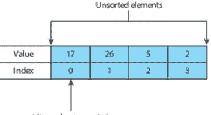

外层循环计数器 ($i$) 的值为 0，内层循环计数器 ($j$) 的值也为 0。我们比较元素 17（索引 $j=0$）和 26（索引 $j+1=1$）。由于 17 小于 26，我们不交换它们。

内层循环计数器 (j) 增加，现在的值为 1。

未排序元素

| 数值 | 17 | 26 | 5 | 2 |
|---|---|---|---|---|
| 索引 | 0 | 1 | 2 | 3 |

j (内层循环计数器)

我们比较元素 26（索引 j = 1）和 5（索引 j + 1 = 2）。由于 26 大于 5，我们交换它们。内层循环计数器 (j) 增加，现在的值为 2。

未排序元素

| 数值 | 17 | 5 | 26 | 2 |
|---|---|---|---|---|
| 索引 | 0 | 1 | 2 | 3 |

j (内层循环计数器)

我们比较元素 26（索引 j = 2）和 2（索引 j + 1 = 3）。由于 26 大于 2，我们交换它们。

内层循环计数器 (j) 增加，现在的值为 3；因此，我们退出内层循环。（我们已经到达未排序子数组的末尾，此时它是整个数组。）内层循环执行一次后，数值 26 已经“泡”到了它数组中的正确位置。

我们现在回到外层循环，外层循环计数器 (i) 增加；现在的值为 1。我们重新进入内层循环，内层循环计数器 (j) 的值被初始化为 0。

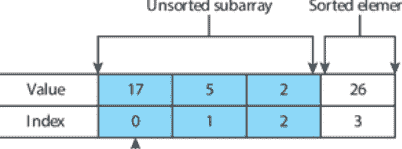

j (内层循环计数器)

我们比较元素 17（索引 j = 0）和 5（索引 j + 1 = 1）。由于 17 大于 5，我们交换它们。内层循环计数器 (j) 增加，现在的值为 1。

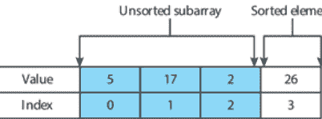

j (内层循环计数器)

我们比较元素 17（索引 j = 1）和 2（索引 j + 1 = 2）。由于 17 大于 2，我们交换它们。

内层循环计数器 (j) 增加，现在的值为 2；因此，我们退出内层循环。（我们已经到达未排序子数组的末尾。）此时，元素 17 已经“泡”到了它数组中的正确位置。

我们回到外层循环，外层循环计数器 (i) 增加；现在的值为 2，这将是外层循环的最后一次迭代。我们重新进入内层循环，内层循环计数器 (j) 的值被初始化为 0。

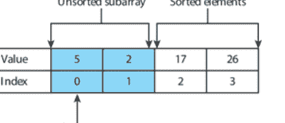

我们比较元素 5（索引 j = 0）和 2（索引 j + 1 = 1）。由于 5 大于 2，我们交换它们。

内层循环计数器 (j) 增加，现在的值为 1；因此，我们退出内层循环。（我们已经到达未排序子数组的末尾。）此时，元素 5 已经“泡”到了它数组中的正确位置。

我们回到外层循环，外层循环计数器 (i) 增加；现在的值为 3，因此，我们退出外层循环。对于数组中的四个元素，我们执行了三次外层循环。


# 冒泡排序演示

例如，让我们对以下数组进行冒泡排序。开始时，未排序的数组为：


外层循环计数器 (`i`) 的值为 0，内层循环计数器 (`j`) 的值也为 0。我们比较元素 17（索引 `j=0`）和 26（索引 `j+1=1`）。由于 17 小于 26，我们不交换它们。

内层循环计数器 (`j`) 增加，现在的值为 1。

| 数值 | 17 | 26 | 5 | 2 |
|---|---|---|---|---|
| 索引 | 0 | 1 | 2 | |

`j` (内层循环计数器)

我们比较元素 26（索引 `j = 1`）和 5（索引 `j + 1 = 2`）。由于 26 大于 5，我们交换它们。内层循环计数器 (`j`) 增加，现在的值为 2。

| 数值 | 17 | 5 | 26 | 2 |
|---|---|---|---|---|
| 索引 | 0 | 2 | 1 | |

`j` (内层循环计数器)

我们比较元素 26（索引 `j = 2`）和 2（索引 `j + 1 = 3`）。由于 26 大于 2，我们交换它们。

内层循环计数器 (`j`) 增加，现在的值为 3；因此，我们退出内层循环。（我们已经到达未排序子数组的末尾，此时它是整个数组。）内层循环执行一次后，数值 26 已经“泡”到了它数组中的正确位置。

我们现在回到外层循环，外层循环计数器 (`i`) 增加；现在的值为 1。我们重新进入内层循环，内层循环计数器 (`j`) 的值被初始化为 0。


`j` (内层循环计数器)

我们比较元素 17（索引 `j = 0`）和 5（索引 `j + 1 = 1`）。由于 17 大于 5，我们交换它们。内层循环计数器 (`j`) 增加，现在的值为 1。


`j` (内层循环计数器)

我们比较元素 17（索引 `j = 1`）和 2（索引 `j + 1 = 2`）。由于 17 大于 2，我们交换它们。

内层循环计数器 (`j`) 增加，现在的值为 2；因此，我们退出内层循环。（我们已经到达未排序子数组的末尾。）此时，元素 17 已经“泡”到了它数组中的正确位置。

我们回到外层循环，外层循环计数器 (`i`) 增加；现在的值为 2，这将是外层循环的最后一次迭代。我们重新进入内层循环，内层循环计数器 (`j`) 的值被初始化为 0。


我们比较元素 5（索引 `j = 0`）和 2（索引 `j + 1 = 1`）。由于 2 小于 5，我们交换它们。

内层循环计数器 (`j`) 增加，现在的值为 1；因此，我们退出内层循环。（我们已经到达未排序子数组的末尾。）此时，元素 5 已经“泡”到了它数组中的正确位置。

我们回到外层循环，外层循环计数器 (`i`) 增加；现在的值为 3，因此，我们退出外层循环。对于数组中的四个元素，我们执行了三次外层循环。


外层循环计数器从 0 到 `n-2` 时，它会迭代 `n-1` 次。

| 外层计数器 | 该位置已排序元素的索引 |
| --- | --- |
| 0 | `n-1` |
| 1 | `n-2, n-1` |
| 2 | `n-3, n-2, n-1` |
| ... | ... |
| `n-3` | `2, 3, 4, ..., n, n-2, n-1` |
| `n-2` | `1, 2, 3, 4, ..., n-3, n-2, n-1` |

## 冒泡排序的伪代码

```
for i = 0 to last array index - 1 by 1
    for j = 0 to ( last array index - i -1 ) by 1
        if (2 consecutive elements are in the wrong order)
            swap them
```

---

# 计数器数组示例

我们最终写了一个非常长的 `if/else` 语句。相反，我们可以设置一个计数器数组，让答案为 0 的计数器对应 `array[0]`，答案为 1 的计数器对应 `array[1]`，以此类推——使用计数器数组编写起来更简单，而且节省了处理时间。

另一个例子，假设我们想投掷 500 次骰子，并统计每个结果出现的次数；也就是说，我们想统计掷 1、2、3、4、5 和 6 的次数。为了实现这一点，我们设置了示例 8.22 所示的简单 `Die` 类，它包含一个掷出数值的方法。然后我们设置了示例 8.23 所示的客户端类 `DieCount`，它拥有一个包含六个整数元素的数组；每个元素将存储特定点数结果出现的次数。

## 示例 8.22 Die 类

```java
/** Die class
 * Anderson, Franceschi
 */
import java.util.Random;

public class Die {
    public final int SIDES = 6;
    private Random rand;

    /** 默认构造函数
     * 实例化 Random 对象
     */
    public Die() {
        rand = new Random();
    }

    /** 掷骰子
     * @return 掷骰结果的值
     */
    public int roll() {
        return rand.nextInt(SIDES) + 1;
    }
}
```

## 示例 8.23 DieCount 类

```java
/** DieCount 类
 * Anderson, Franceschi
 */
public class DieCount {
    public static void main(String [] args) {
        final int FACES = 6, NUMBER_OF_ROLLS = 500;

        // 实例化计数器数组
        // 将初始值设置为 0
        int[] rollCount = new int[FACES];

        // 实例化 Die
        Die dl = new Die();

        // 掷 500 次骰子
        for (int i = 1; i <= NUMBER_OF_ROLLS; i++) {
            int myRoll = dl.roll();
            rollCount[myRoll - 1]++; // 对应掷骰结果的计数器加1
        }

        // 打印每次掷骰的计数
        System.out.println("Roll\tCount");
        for (int i = 0; i < rollCount.length; i++) {
            System.out.println((i + 1) + "\t" + rollCount[i]);
        }
    }
}
```

在 `Die` 构造函数中，我们实例化了 `Random` 对象，它会被 `roll()` 方法（第 19–25 行）使用，该方法转而生成 1 到 6 之间的随机数来模拟掷骰子。

在 `DieCount` 类中，我们在第 13 行实例化了六个计数器的数组 `rollCount`，它将每个元素初始化为 0——这正是我们计数器所需要的。为了统计每次掷骰出现的次数，我们使用了一个循环 500 次的 `for` 循环，每次迭代都会调用 `Die` 类的方法。然后我们需要统计每次掷骰。这就是我们的计数器数组派上用场的地方。

由于 `rollCount` 数组有六个元素，第一个元素的索引是 0，最后一个元素的索引是 5。我们将使用 `rollCount[0]` 来存储掷 1 的次数，使用 `rollCount[1]` 来存储掷 2 的次数，一直持续到使用 `rollCount[5]` 来存储掷 6 的次数。因此，为了获得相应计数器的索引，我们需要将计数器减 1。所以我们增加掷骰计数的语句（第 22 行）变成了 `rollCount[myRoll - 1]++;`。

在掷了 500 次骰子并统计了每次掷骰后（第 25–30 行），注意我们增加了循环变量，以便在计数器索引和掷骰数之间进行转换。该程序示例运行的输出如图 8.28 所示。由于程序随机生成掷骰结果，你的输出可能会略不同。

## 图 8.28
DieCount 的输出


然而，我们的算法并不理想。我们需要从索引中减去 1 来增加计数器，并且需要在索引上加上 1 才能打印结果。更好的方法是创建一个包含七个元素的数组。然后我们可以使用元素 1 到 6 作为点数 1 到 6 的计数器。索引和掷骰数将是相同的。元素 0 会怎样？我们只需忽略它。修改后的 *DieCount2* 类如示例 8.24 所示。

## 示例 8.24 DieCount2 类

```java
/** DieCount2 类
 * Anderson, Franceschi
 */
public class DieCount2 {
    public static void main(String [] args) {
        final int FACES = 7, NUMBER_OF_ROLLS = 500;

        // 实例化计数器数组
        // 将初始值设置为 0
        int[] rollCount = new int[FACES];

        // 实例化 Die
        Die d1 = new Die();

        // 掷 500 次骰子
        for (int i = 1; i <= NUMBER_OF_ROLLS; i++) {
            int myRoll = d1.roll();
            rollCount[myRoll]++; // 对应掷骰结果的计数器加1
        }

        // 打印每次掷骰的计数
        System.out.println("Roll\tCount");
        for (int i = 1; i < rollCount.length; i++) {
            System.out.println(i + "\t" + rollCount[i]);
        }
    }
}
```

---

# 可变参数示例

```java
if (newRatings != null && newRatings.length > 0) {
    int totalNewRatings = 0;
    for (int i = 0; i < newRatings.length; i++) {
        totalNewRatings += newRatings[i];
    }
    rating = ((rating * numberOfRatings) + totalNewRatings) / (newRatings.length + numberOfRatings);
    numberOfRatings += newRatings.length;
}
// else，没有新评分，因此实例变量没有发生变化
}

/**
 * toString 方法
 * @return 卖家名称
 * 以及评分（格式化为1位小数）
 */
@Override
public String toString() {
    return sellerName + ": rating " + ONE_PLACE.format(rating);
}
```

在 `Seller` 类中，我们定义了三个实例变量，分别代表卖家名称、当前平均评分以及卖家收到的评分数量（第 8–10 行）。我们还定义了一个静态常量 `ONE_PLACE`，`toString()` 方法（第 41–49 行）使用它来格式化平均评分。

`calcRating()` 方法（第 22–39 行）接受一个可变参数（varargs）参数 `newRatings`。请注意，如果方法接受其他参数，则 `newRatings` 参数需要列在最后。当方法开始执行时，调用者发送给方法的参数已经组装成一个 `int` 数组，并赋值给参数 `newRatings`。因此，`newRatings.length` 将存储实际发送到方法的参数数量。在 `calcRating()` 方法中，我们首先检查数组引用不为 `null` 且数组不为空（第 28 行）。然后我们使用一个 `for` 循环来计算新评分的总和（第 30–32 行）。最后，我们计算新的平均评分并更新实例变量 `rating` 和 `numberOfRatings`。如果可变参数参数为 `null` 或数组为空，则我们什么都不做。

在客户端程序 `SellerRatings` 中，我们实例化了一个 `Seller` 对象（第 9 行），然后连续调用了带有一个参数、两个参数、一个数组和无参数的 `calcRating()` 方法。在每次方法调用后，我们通过隐式地调用 `Seller` 类中的 `toString()` 方法来输出新评分（第 11–22 行）。图 8.29 显示了示例 8.25 的输出结果。

## 图 8.29
SellerRatings 程序的输出
```
Mary: rating 4.0
Mary: rating 4.7
Mary: rating 4.5
Mary: rating 4.5
```

## 示例 8.26 SellerRatings 类

```java
/** SellerRatings - 用于 Seller 的客户端
 * Anderson, Franceschi
 */
public class SellerRatings {
    public static void main(String [] args) {
        Seller seller = new Seller("Mary");
        seller.calcRating(4); // 一个值
        System.out.println(seller);
    }
}
```


```java
seller.calcRating(5, 5); // 两个值

System.out.println(seller);

int[] arrayOfRatings = {4, 4, 5};

seller.calcRating(arrayOfRatings); // 数组

System.out.println(seller);

seller.calcRating(); // 无值

System.out.println(seller);

}
}
```

# 章节练习

## 8.10 章节总结

- 数组是相同数据类型变量序列。该数据类型可以是任何 Java 原始数据类型，如 `int`、`float`、`double`、`byte`、`short`、`long`、`boolean` 或 `char`；它也可以是一个类。
- 数组中的每个元素都通过数组名和索引来访问，索引指向元素在数组中的位置。
- 数组是作为对象实现的。创建一个数组包括声明一个数组的对象引用和实例化数组。数组的大小在实例化数组时给出。
- 在原始类型数组中，数组的每个元素都包含该类型的值。在对象数组中，每个元素都是一个对象引用。
- 当实例化数组时，元素会根据数据类型自动赋予初始值。数值类型被设置为 `0`；布尔类型被设置为 `false`；`char` 类型设置为 Unicode 空字符；对象引用被设置为 `null`。
- 实例化一个对象引用数组涉及两个步骤：实例化数组和实例化对象。
- 数组可以在声明时通过在花括号内的逗号分隔的列表中分配初始值来实例化。初始化列表中值的数量决定了数组中元素的数量。
- 使用数组名和索引来访问数组元素。第一个元素的索引为 `0`，最后一个元素的索引是数组大小减去 `1`。
- 数组有一个整数实例变量 `length`，它存储了数组中的元素数量。
- 尝试使用小于 `0` 或大于数组大小的索引访问数组元素会导致错误。
- 数组可以在在花括号内的逗号分隔的列表中分配初始值时实例化。
- 元素会根据数据类型自动赋予初始值。
- 数组操作（如打印和复制）是支持的。
- 使用循环可以处理每个元素。
- 数组的所有元素必须是相同类型。
- 数组的聚合赋值是允许的。
- 数组的比较是不允许的。
- 数组可以作为参数传递。
- 数组可以作为方法的返回值。
- 在排序的数组上进行顺序查找可以比未排序的数组更高效。

## 8.11 练习、问题和项目

### 8.11.1 单选题

1. 哪些是声明整数数组的方法？（多选）
   - `int[];`
   - `int[]`
   - `int a`
2. 第一个元素的索引是多少？
   - `-1`
   - `0`
3. 如果数组有 3 个元素，最后一个元素的索引是多少？
   - `2`
   - `3`
4. 实例化后数组元素的默认值是什么？
   - `0`
   - `null`
   - `undefined`
5. 如何访问索引 6 的元素？
   - `a{6}`
   - `a(6)`
   - `a[6`
6. 下列哪个断言正确？
   - 数组无法动态调整大小。
   - 数组可以动态调整大小，但不能重新实例化。
   - 数组可以动态调整大小并可以重新实例化。
7. 如何获取数组的元素数量？
   - `a.length()`
   - `a.length`
   - `a.size()`
   - `a.size`
8. 数组的所有元素必须类型相同。
   - true
   - false
9. 聚合赋值是允许的吗？
   - true
   - false
10. 数组的比较是允许的吗？
    - true
    - false
11. 数组可以作为方法的返回值吗？
    - true
    - false
12. 在排序的数组上进行顺序查找可以比未排序的数组更高效吗？
    - true
    - false

### 8.11.2 阅读和理解代码

13. 这段代码的输出是什么？

```java
double[] a = {12.5, 48.3, 65.0};

System.out.println(a[1]);
```

14. 这段代码的输出是什么？

```java
int[] a = new int[6];

System.out.println(a[4]);
```

15. 这段代码的输出是什么？

```java
double[] a = {12.5, 48.3, 65.0};

System.out.println(a.length);
```

16. 这段代码的输出是什么？

```java
int[] a = {12, 48, 65};

for (int i = 0; i < a.length; i++)
    System.out.println(a[i]);
```

18. 这段代码的输出是什么？

```java
int s = 0;

int[] a = {12, 48, 65};

for (int i = 0; i < a.length; i++)
    s += a[i];

System.out.println("s = " + s);
```

```java
int[] a = new int[10];

for (int i = 0; i < a.length; i++)
    a[i] = i + 10;

System.out.println(a[4]);
```

20. 这段代码序列的输出是什么？

```java
double[] a = {12.3, 99.6, 48.2, 65.8};

double temp = a[0];

for (int i = 1; i < a.length; i++)
    if (a[i] > temp)
        temp = a[i];

System.out.println(temp);
```

21. 这段代码序列的输出是什么？

```java
int[] a = {12, 48, 65, 23};

int temp = a[1];

a[1] = a[3];

a[3] = temp;

for (int i = 0; i < a.length; i++)
    System.out.print(a[i] + " ");
```

22. 这个方法的作用是什么？

```java
public int foo(int[] a) {
    int temp = 0;
    for (int i = 0; i < a.length; i++)
        if (a[i] == 5)
            temp++;
    return temp;
}
```

23. 这个方法的作用是什么？

```java
public int foo(int[] a) {
    for (int i = 0; i < a.length; i++) {
        if (a[i] == 10)
            return i;
    }
    return -1;
}
```

24. 这个方法的作用是什么？

```java
public boolean foo(int[] a) {
    for (int i = 0; i < a.length; i++) {
        if (a[i] < 0)
            return false;
    }
    return true;
}
```

25. 这个方法的作用是什么？

```java
public String[] foo(String[] a) {
    String[] temp = new String[a.length];
    for (int i = 0; i < a.length; i++) {
        temp[i] = a[i].toLowerCase();
    }
    return temp;
}
```

26. 这个方法的作用是什么？

```java
public boolean[] foo(String[] a) {
    boolean[] temp = new boolean[a.length];
    for (int i = 0; i < a.length; i++) {
        if (a[i].indexOf("@") != -1)
            temp[i] = true;
        else
            temp[i] = false;
    }
    return temp;
}
```

### 8.11.3 填充代码

27. 这段代码将值 `10` 赋值给数组 `a` 的所有元素。

```java
int[] a = new int[25];

for (int i = 0; i < a.length; i++) {
    // 在此处编写你的代码
}
```

28. 这段代码打印数组 `a` 中所有大于 `20` 的元素。

```java
double[] a = {45.2, 13.1, 12.8, 87.4, 99.0, 100.1, 43.8, 2.4};

for (int i = 0; i < a.length; i++) {
    // 在此处编写你的代码
}
```

29. 这段代码打印数组 `a` 元素的平均值。

```java
int[] a = {45, 13, 12, 87, 99, 100, 43, 2};

double average = 0.0;

for (int i = 0; i < a.length; i++) {
    // 在此处编写你的代码
}

// ... 你的代码继续此处
```

30. 这段代码计算并打印两个数组的乘积（Σ `a[i]b[i]`）。

```java
int[] a = {3, 7, 9};

int[] b = {2, 9, 4};

dotProduct = 0;

for (int i = 0; i < a.length; i++) {
    // 在此处编写你的代码
}
```

31. 这段代码打印以下三行：

```java
a[0] = 3

a[1] = 6

a[2] = 10
```

```java
int[] a = {3, 6, 10};

for (int i = 0; i < a.length; i++) {
    // 在此处编写你的代码
}
```

32. 如果作为参数传递的字符串数组中的某个元素包含子字符串 `IBM`，该方法返回 `true`；否则返回 `false`。

```java
public boolean foo(String[] a) {
    // 在此处编写你的代码
}
```

33. 该方法返回作为参数传递的数组中 `7` 的倍数元素的个数。

```java
public int foo(int[] a) {
    // 在此处编写你的代码
}
```

34. 如果作为参数传递的数组的前两个元素值相同，方法返回 `true`；否则返回 `false`。

```java
public boolean foo(String[] a) {
    // ...
}
```

35. 该方法接收一个 `int` 数组作为参数并返回一个 `boolean` 数组。对于参数中每个值为 `0` 的元素，返回的数组对应元素将赋值为 `false`；否则为 `true`。

```java
public boolean[] foo(int[] a) {
    // 在此处编写代码
}
```

### 8.11.4 识别代码错误

36. 这段代码的错误在哪里？

```java
double[] a = {3.3, 26.0, 48.4};

a[4] = 2.5;
```

37. 这段代码的错误在哪里？

```java
double[] a = {3.3, 26.0, 48.4};

System.out.println(a[-1]);
```

38. 这段代码的错误在哪里？

```java
double[] a = {3.3, 26.0, 48.4};

System.out.println(a[1]);
```

39. 这段代码的错误在哪里？

```java
double[] a = {3.3, 26.0, 48.4};

for (int i = 0; i <= a.length; i++)
    System.out.println(a[i]);
```

40. 这段代码的错误在哪里？

```java
double[] a = {3.3, 26.0, 48.4};

a[3] = "5";
```

41. 这段代码虽然可以编译和运行，但错误在哪里？

```java
int[] a = {1, 2, 3};

int[] b = {1, 2, 3};

if (a != b)
    System.out.println("Arrays are equal");
```

42. 这段代码的错误在哪里？

```java
int[] a = {1, 2, 3};

a = 10;
```

43. 这段代码的逻辑错误在哪里？

```java
int[] a = {1, 2, 3};

System.out.println("The elements are " + a);
```

44. 这段代码的错误在哪里？

```java
int i1 = 10;

double d1 = 15;

String s = "Hello";
```

45. 这段代码的错误在哪里（使用编译器信息）？

```java
int[] a = {1, 2, 3};

for (int i = 0; i < a.length; i++)
    System.out.println(a[i]);
```

46. 代码可以编译，但当你运行时，你得到了以下输出：

```java
int[] a = {1, 2, 3};

int[] b = {1, 2, 3};

for (int i = 0; i < a.length; i++)
    System.out.println(a[i]);
```

```
Exception in thread "main"
java.lang.ArrayIndexOutOfBoundsException: 6
```

47. 问题在哪里？如何修复？

```java
int[] a = {1, 2, 3};
int[] b = {1, 2, 3};
if (a == b)
    System.out.println("Arrays are equal");
else
    System.out.println("Arrays are NOT equal");
```

48. 问题在哪里？如何修复？

```java
int[] a = {1, 2, 3};
System.out.println(a);
```

输出不是 `1 2 3`，而是类似于：

`[I@f032667`

### 8.11.6 编写短程序

49. 写一个带返回值的方法，返回 `int` 数组中的元素个数。

50. 写一个带返回值的方法，返回 `int` 数组中所有元素的乘积。

51. 写一个 `void` 方法，将 `int` 数组中的所有元素置为 `0`。

52. 写一个 `void` 方法，将 `float` 数组中的所有元素乘以 `2`。

53. 写一个带返回类型的方法，返回 `int` 数组中大于或等于 `90` 的元素的百分比。

54. 写一个带返回类型的方法，返回 `double` 数组中最大元素和最小元素之间的差值。

55. 写一个带返回类型的方法，返回 `int` 数组中所有奇数索引元素的之和。

56. 写一个带返回类型的方法，返回 `boolean` 数组中值为 `true` 的元素百分比。

57. 写一个带返回类型的方法，如果字符串数组包含字符串 `"Hello"`，则返回 `true`；否则返回 `false`。

58. 写一个方法，倒序打印 `char` 数组中的所有元素。

59. 写一个带返回类型的方法，返回一个由 `char` 数组所有元素倒序组成的数组。

60. 写一个返回数组的方法，接收一个 `String` 参数并返回对应的 `char` 数组。

61. 编写一个返回数组的方法，接收一个 `int` 数组作为参数并返回一个 `boolean` 数组，对于任何参数数组中的元素大于或等于 `100`；否则为假。

### 8.11.7 编程项目

62. 编写一个类，封装棒球球队的统计概念，该球队具有以下属性：球员数量、每个球员的安打数列表、每个球员的打打数列表。

编写以下方法：

编写一个类来测试你类中的所有方法。

63. 编写一个类，封装学生考试成绩的概念，假设学生成绩由一组 `0` 到 `100` 之间的整数列表组成。

编写以下方法：

- 一个只有一个参数的构造函数，即学生人数；所有成绩都可以随机生成并记录每个成绩出现的次数；然后从计数器数组中选取最大值；数组索引即为众数。

编写一个客户端类来测试你类中的所有方法。

64. 编写一个类，封装一周每日温度的概念。

编写以下方法：

- 一个接受包含七个温度的数组作为参数的构造函数
- 访问器、修改器、`toString` 和等性（`equals`）方法
- 一个返回低于冰点温度个数的方法
- 一个返回高于 `100` 度温度数组的方法
- 一个返回任意连续两天之间温度最大变化的方法
- 一个返回按降序排列的每日温度数组的方法

编写一个客户端类来测试你类中的所有方法。

65. 编写一个类，按如下封装井字游戏的概念：

两名玩家将进行游戏，玩家 1 和玩家 2。


棋盘由一个包含 9 个整数元素的数组表示：索引为 0、1 和 2 的元素代表第一行；索引为 3、4 和 5 的元素代表第二行；索引为 6、7 和 8 的元素代表第三行。

数组中的值 0 表示该空间可用；值 1 表示该空间被玩家 1 占据；值 2 表示该空间被玩家 2 占据。

在你客户端类的 `main` 方法中，你的程序将从命令行模拟一个 `TicTacToe` 对象，并执行以下操作：

- 创建一个 `TicTacToe` 对象并对其进行实例化。
- 在循环中，提示用户输入整数形式的操作。在循环的每次迭代中，你需要调用 `TicTacToe` 对象的所有方法来更新该对象。你需要跟踪谁在玩（玩家 1 或 2），强制执行规则，检查是否有人赢得了游戏，显然最后一次操作的玩家将决定了胜负。
- 如果玩家获胜，你需要退出循环并展示游戏结果。如果游戏平局结束，你应该输出该结果。

在你的 `TicTacToe` 类中，你需要编写以下方法：

- 一个实例化表示棋盘数组的默认构造函数。
- 一个允许玩家移动的方法；它接受两个参数：玩家编号和在棋盘上操作的位置。
- 一个检查操作是否合规的方法。
- 一个检查玩家是否赢得游戏的方法；如果你喜欢，可以将该方法拆分成几个方法（例如，检查玩家是否通过占据某行水平行赢得游戏）。
- 一个检查游戏是否为平局的方法（如果没有玩家获胜且所有格子都已操作，则游戏为平局）。
- 一个显示游戏结果的方法（“玩家 1 获胜”或“平局”）。

编写一个客户端类（`main` 方法位于此处），测试你类中的所有方法并允许用户进行游戏。

### 66

当新用户首次登录网站时，用户必须提交个人信息，如 `user_id`、密码、姓名、电子邮件地址、电话号码等。通常，密码有两个字段，要求用户输入两次以确保用户没有在第一个密码字段出现拼写错误。编写一个类，封装处理以下表单元素的概念：

- `User_id`
- 密码
- 重输密码
- 电子邮件地址
- 街道
- 城市
- 州
- 电话

在你的类中，编写以下方法：

- 一个带参数的构造函数，一个包含 10 个单词的字符串数组，作为唯一的实例变量。
- 访问器、修改器、`toString` 和等性方法。
- 一个检查数组中字符串是否为空的方法（所有字段均为必填）。如果至少有一个为空，返回假；否则返回真。
- 一个返回 `user_id` 中字符个数的方法。
- 一个检查两个字符串（两次输入的密码）是否相同的方法。如果相同，返回真；否则返回假。
- 一个检查表示电子邮件地址的字符串是否“像”电子邮件；为了简化，我们可以假设电子邮件包含且仅包含一个 `@` 字符，并在 `@` 之后包含一个点。如果像电子邮件，则返回真；否则返回假。
- 一个检查表示州的字符串是否恰好有两个字符的方法。如果是，返回真；否则返回假。

编写一个类来测试你类中的所有方法。

### 67

我们想写一个程序对 HTML 代码进行语法检查；为了简单起见，如果单词中 `<` 的字符数等于 `>` 的字符数，我们假设 HTML 代码是正确的。我们还假设如果第一个单词是 `<html>` 最后一个单词是 `</html>`，则语法正确。编写一个封装该概念的类，包括以下方法：

- 一个带参数的构造函数，HTML 句子的数组，作为唯一的实例变量。你的构造函数应从控制台获取相同数量的单词并将其存储在字符串数据成员中。
- 访问器、修改器、`toString` 和等性方法。
- 一个返回数组中有多少单词的方法。
- 如果第一个单词是 `<html>` 且最后一个单词是 `</html>`，返回真；否则返回假。
- 一个检查任何数组元素的 `<` 字符数是否等于 `>` 数。如果是，返回真；否则返回假。为此，建议使用以下方法帮助你：
  - 编写一个返回 `int` 方法，接受一个字符串和一个字符 `char` 作为参数，并返回 `char` 在字符串中出现的次数；你可以将字符串转换为字符数组并遍历它，或使用你喜欢的策略。
- 一个计算并返回 `img` 标签总数的方法。

编写一个客户端类来测试你类中的所有方法。

### 68

编写一个类，封装整数成绩转换为字母成绩（A、B、C、D 或 F）的概念，假设成绩由 0 到 100 之间的整数组成。

编写以下方法：

- 一个带参数的构造函数，学生人数；所有成绩都可以随机生成。
- 访问器、修改器、`toString` 和等性方法。
- 一个返回对应整数成绩的字符数组的方法（90 以上转换为 A，80 以上转换为 B，70 以上转换为 C，60 以上转换为 D，59 及以下转换为 F）。
- 一个返回 A 个数的方法。
- 一个返回 `int` 数组的方法，显示收到多少个 A、B、C、D 和 F。

编写一个客户端类来测试你类中的所有方法。

### 69

编写一个类包含一个将两个字符串数组转换为 `Hashtable`（在 Java 库中查找 `Hashtable` 类）的方法，使得 `Hashtable` 的键是第一个数组的元素，其对应的值是第二个数组的元素。用客户端程序测试你的方法。


### 70

编写一个封装棒球球队概念的类，假设棒球球员具有以下属性：姓名、位置和打击率。除了该类，你还需要设计并编写一个 `Player` 类来封装球员的概念。

在你封装球队的类中，你应该编写以下方法：

- 一个接受 `Player` 对象数组作为唯一参数的构造函数，并将该数组赋值给类的数组数据成员（实例变量）。当你测试所有方法时，可以硬编码九个棒球 `Player` 对象。
- 访问器、`toString` 和等性方法。
- 一个检查所有位置都不同的方法，如果是则返回真，不是则返回假。
- 一个返回球队打击率的方法。
- 一个检查球队中是否有投手（即位置的名称）的方法。如果没有，返回假；否则返回真。
- 一个返回使用打击率作为键升序排列的 `Player` 对象数组的方法。
- 一个根据人的姓名检查某人（方法的参数）是否在球队中的方法。如果人在球队中，方法返回真；否则返回假。

编写一个客户端类来测试你类中的所有方法。

### 71

编写一个类，封装与第 8.8 节骰子计数问题中使用的类似的概念。在这里，我们想要掷骰子；掷出的数字总和将在 2 到 12 之间。我们需要记录每个可能的总和被掷出的次数。

编写以下方法：

- 一个无参数的构造函数；它会随机生成 1 到 6 之间的数字，代表骰子。
- 访问器方法、修改器方法、`toString` 和相等性方法。
- 一个返回两个骰子总和的方法。
- 一个检查两个骰子数值是否相同的方法。如果相同，则返回 `true`；否则返回 `false`。

掷骰子的次数应该是用户从命令行输入的（而不是在程序内部指定）。你的程序应该输出每种可能掷结果的总和（从 2 到 12），以及两个骰子数值相同的次数。

编写一个客户端类来测试你类中的所有方法。

### 72

编写一个图形化应用程序，创建两个 `Die` 对象并掷 5,000 次骰子。使用柱状图显示结果，展示每个可能的总和的频率。根据你的柱状图的最大高度选择一个合适的比例。

## 8.11.8 技术写作

### 73

你认为数组的优点和缺点是什么？

### 74

编写伪代码，根据实例变量模型对 `Auto` 对象的数组进行选择排序。

### 75

当你尝试使用越界的数组索引时，你的代码可以编译通过，但会产生运行时异常。请讨论这是优点还是缺点，以及为什么。

### 76

在实例化数组时，你可以使用变量动态地分配数组的元素数量（而不是使用常量）。讨论一种在该情况下这样做是不妥当的。

## 8.11.9 小组项目（适用于 1、2 或 3 名学生的小组）

### 77

安全是信息系统的重要特性。通常，文本在发送之前会被加密，然后在接收时被解密。我们想要构建一个类（或多个类）来封装加密的概念。你需要在包含 `main` 方法的客户端程序中对其进行测试。

在这个项目中，加密是指将每个字符转换为另一个字符。例如，如果我们考虑英语字母表（包括从 a 到 z 的字符），每个字符都被随机加密为另一个字符，该字符可以是其本身。（如果你愿意，可以设计你的程序让没有字符被加密为自身。）为了表示这个概念，我们可以有一个原始字母表的字符数组，以及另一个加密字母表的字符数组。例如，我们可以：

| 原始字母表 | 加密字母表 |
|---|---|
| a | u |
| b | p |
| c | h |
| d | a |
| e | s |
| f | x |
| g | z |
| h | b |
| i | j |

加密单词时是将单词中的每个字母替换为加密字母表中对应的字母。例如，单词 `caged` 将加密为 `huzsa`。解密单词时是将加密单词中的字母替换为原始字母表中对应的字母。例如，加密单词 `xussa` 将解密为 `feed`。

如果原始字母表中有 26 个不同的字符，那么加密字母表中也将有 26 个不同的字符。此外，加密字母表应该是随机生成的。

在你的 `main` 方法中，你应该提示用户输入句子。你的程序应该加密该句子，输出加密后的句子，然后将其解密，并输出解密后的句子，该句子应与用户输入的原始句子相同。

作为额外加分，使用一个数组来跟踪每个字符出现的次数。将这些出现次数转换为百分比，然后使用这些百分比尝试解密一段长加密消息。


# 第 9 章

# 多维数组与 ArrayList 类

# 目录

## 引言

## 9.1 声明和实例化多维数组

### 9.1.1 声明多维数组

### 9.1.2 实例化多维数组

### 9.1.3 结合多维数组的声明与实例化

### 9.1.4 为多维数组分配初始值

## 9.2 访问多维数组元素

## 9.3 聚合二维数组操作

### 9.3.1 处理二维数组的所有元素

### 9.3.2 处理二维数组的指定行

### 9.3.3 处理二维数组的指定列

### 9.3.4 逐行处理二维数组

### 9.3.5 逐列处理二维数组

### 9.3.6 将二维数组数据显示为图表

## 9.4 传递给方法并从方法返回的二维数组

## 9.5 编程活动 1：使用二维数组

## 9.6 其他多维数组

## 9.7 ArrayList

### 9.7.1 声明和实例化

### 9.7.2 方法

### 9.7.3 循环遍历

## 9.8 编程活动 2：使用

## 9.9 总结

## 9.10 练习、问题与项目

### 9.10.1 多选题

### 9.10.2 阅读题

### 9.10.3 填空

### 9.10.4 识别

### 9.10.5 调试

### 9.10.6 编写

### 9.10.7 项目

### 9.10.8 技术写作

### 9.10.9 小组项目

# 引言

数组在存储大量数据时非常有用。如果我们对去年的气温进行统计，设置一个大小为 365 的数组是方便的。但除了分析每日温度外，我们还想按周分析，或者按特定的某一天。例如，如果我们考虑周末，可能想知道有多少六。在这种情况下，如果我们将数据可视化为表格，我们可以想象一个 52 行的表格，每行代表一周。每行有七列，代表每一天。该表如图 9.1 所示。或者我们可以想象一个七行的表格，每行代表一天，52 列，每列代表一周。无论是哪种情况，我们都可以使用二维数组来表示温度的行和列。更通俗地说，多维数组允许我们沿着 n 个维度表示数据。

| 星期日 | 周一 | 周二 | 周三 | 周四 | 周五 | 周六 |
| --- | --- | --- | --- | --- | --- | --- |
| 第 1 周 | 35 | 28.6 | 29.3 | 38 | 43.1 | 45.6 | 49 |
| 第 2 周 | 51.9 | 37.9 | 34.1 | 37.1 | 39 | 40.5 | 43.2 |
| ... | ... | ... | ... | ... | ... | ... |
| ... | ... | ... | ... | ... | ... | ... |
| ... | ... | ... | ... | ... | ... | ... |
| 第 51 周 | 56.2 | 51.9 | 45.3 | 48.7 | 42.9 | 35.5 | 38.2 |
| 第 52 周 | 33.2 | 27.1 | 24.9 | 29.8 | 37.7 | 39.9 | 38.8 |

**图 9.1** 过去 52 周的气温数据

## 9.1 声明和实例化多维数组

和单维数组一样，多维数组是通过对象实现的，因此创建多维数组与创建单维数组采取相同的两个步骤：

1. 声明数组的对象引用
2. 实例化数组

在具有基本类型元素的数组中，数组的每个元素包含该类型的值。例如，在 `double` 数组中，每个元素包含一个 `double` 值。在具有类数据类型的数组中，每个元素都是对象引用，指向该类对象的位置。

### 9.1.1 声明多维数组

声明多维数组时，我们使用的语法与单维数组相同，不同在于为每个维度都包含一组空括号。

以下是声明二维数组的语法：

```java
datatype[][] arrayName;
```

以下是声明三维数组的语法：

```java
datatype[][][] arrayName;
```

为了保持简单起见，我们现在重点关注二维数组。我们将在本章稍后讨论三维和四维数组。

以下语句声明了一个数组，我们可以用来存储过去 52 周的每日最高温度：

```java
double[][] dailyTemps;
```

括号可以放在数组名称的之前或之后。因此，以下声明二维数组的语法也是有效的：

```java
datatype arrayName[][];
```

我们倾向于将括号紧跟在数据类型后面，这样更容易阅读。

为了存储学生的测验成绩，我们可以声明一个二维数组，其中每行将存储特定学生的测验成绩，每列将存储某次测验的成绩：

```java
char[][] quizzes; // 每个元素都是一个 char 类型
```

无论我们使用基本数据类型还是类类型声明数组，语法都是相同的。

想象我们正感兴趣跟踪一家跨国公司的一支车队。该公司在多个国家运营，在这些国家中，某些员工拥有公司用车。对于这种情况，我们可以声明一个二维数组，其中第一维度代表国家，第二维度代表员工。假设我们有一个 `Auto` 类，以下语句声明了此用于存放 `Auto` 对象的二维数组：

```java
Auto[][] cars;
```

我们还可以通过在每个数组名称后插入逗号，在一条语句中声明多个相同数据类型的多维数组，使用如下语法：

```java
datatype[][] arrayName, arrayName2;
```

例如，以下语句将声明两个整数数组，用于存储两名棒球运动员在职业生涯每场比赛中的盗垒次数：

```java
int[][] brian, jon;
```

第一维度代表比赛（每赛季），第二个维度代表赛季。

注意，当我们声明多维数组时，并不会指定数组将包含多少个元素。声明多维数组不会为数组分配内存；这是在步骤 2 中，当我们实例化数组时完成的。

例如，这段代码：

```java
double[7][52] dailyTemps;
```

将产生编译错误。

> **常见错误陷阱**
>
> 在声明中指定多维数组的任何维度的尺寸都会产生编译错误。

### 9.1.2 实例化多维数组

与实例化单维数组一样，我们使用 `new` 关键字来实例化多维数组。以下是实例化二维数组的语法：

```java
arrayName = new datatype[exp1][exp2];
```

其中 `exp1` 和 `exp2` 是求值为整数的表达式，分别指定数组的行数和列数。

该语句为数组分配了内存。二维数组中的元素数量等于每行的元素数量。当所有行都具有相同的列数时，数组中的元素数量等于行数乘以列数。

例如，如果我们实例化以下具有 52 行 7 列的 `dailyTemps` 数组，该数组将拥有 52 * 7，即 364 个元素：

```java
dailyTemps = new double[52][7]; // dailyTemps 有 52 行
// 和 7 列，
// 总共 364 个元素
```

这些语句将实例化上面声明的其他数组：

```java
int numberOfStudents = 25;
int numberOfQuizzes = 10;
quizzes = new char[numberOfStudents][numberOfQuizzes];
// quizzes 有 25 行和 10 列
// 总共 250 个元素
```

```java
cars = new Auto[5][50];
// cars 有 5 行和 50 列
// cars 将存储 250 个 Auto 对象
```

```java
brian = new int[80][20];
// brian 有 80 行和 20 列
// 每个赛季 80 场比赛
// brian 打了 20 个赛季的棒球
```

```java
jon = new int[80][10];
// jon 有 80 行和 10 列
// jon 打了 10 个赛季的棒球
```

当实例化多维数组时，元素会自动赋予初始值。数值类型数组的元素初始化为 0，`char` 类型元素初始化为 Unicode 空字符，布尔类型元素初始化为 `false`，类类型元素初始化为 `null`。

### 9.1.3 结合多维数组的声明与实例化

多维数组像单维数组一样，在声明时也可以进行实例化。要结合二维数组的声明和实例化，使用以下语法：

```java
datatype[][] arrayName = new datatype[exp1][exp2];
```

其中 `exp1` 和 `exp2` 是求值为整数的表达式，分别指定数组的行数和列数。

```java
double[][] dailyTem = new double[52][7];
```

等同于：

```java
double[][] dailyTem;
dailyTem = new double[52][7];
```

```java
char[][] quizzes = new char[25][10];
```

等同于：


```java
char[][] quizzes;
quizzes = new char[25][10];
```

## 9.1.4 为多维数组赋值

我们可以在声明数组时通过赋值来实例化二维数组。这样做，我们在大括号中使用逗号分隔的列表指定初始值：

```java
datatype[][] arrayName = { { value00, value01 }, { value10, value11 } };
```

其中 M 是求值为数组数据类型的表达式，N 是行数。第一个子列表决定了列数。如果数组已经实例化，尝试使用初始化列表赋值将产生编译错误。

在大多数情况下，每行的列数是相同的。然而，在某些情况下，每行具有不同的列数是有用的。因此，多维数组可以具有不同的列数。例如，在我们的数组中，每行可以有不同的列数：

```java
int[][] numbersList1 = { { 0, 5, 10 }, { 0, 3, 6, 9 } };
```

由于给了两个子列表，该数组有两行。第一个子列表指定三个值，因此第一行有三列；第二个子列表指定四个值，因此第二行有四列。

图 9.2 显示了执行上述语句后的 `numbersList1` 数组。


我们可以在列表中提供对象引用来声明对象数组：

```java
Auto sportsCar = new Auto("Ferrari", 0, 0.0);
Auto sedan1 = new Auto("BMW", 0, 0.0);
Auto sedan2 = new Auto("BMW", 100, 15.0);
Auto sedan3 = new Auto("Toyota", 0, 0.0);
Auto rvl = new Auto("Jeep", 0, 0.0);
Auto[][] cars = { { sportsCar, sedan1 },
{ rvl, new Auto() },
{ sedan2, sedan3 } };
```

这个 `Auto` 数组有三行，每行两列。`cars` 数组的元素是 `Auto` 对象的引用。

例如，大学教授史密斯博士使用一个二维数组来跟踪成绩。行代表她教授的课程，列代表这些班级中学生的成绩。成绩为 A、B、C、D 或 F，因此她声明了一个元素类型为 `char` 的数组。史密斯博士教了四门课程：CS1、CS2、数据库管理和操作系统。因此，她有四组人数不同的学生群体：CS1 有 23 个学生，CS2 有 16 个，数据库管理有 12 个，操作系统有 28 个。所以，第一行将有 23 列，第二行有 16 列，第三行有 12 列，而第四行（也是最后一行）将有 28 列。

使用初始化列表，可以很容易地实例化一个每行列数都不同的二维数组。但有时数据是动态检索的——例如，从文件中读取数据——这时就无法使用初始化列表了。

要实例化一个每行列数都不同的二维数组，我们可以执行以下操作：

- 首先，实例化该二维数组。
- 其次，将每一行实例化为一个一维数组。

对于前面的示例，我们可以使用以下代码：

```java
char[][] grades; // 数组
grades = new char[4][]; // 实例化数组
// grades 有 4 个 null 数组元素
```

```java
grades[0] = new char[23]; // 实例化行 0；23 个 char 元素
```

```java
grades[1] = new char[16]; // 实例化行 1；16 个 char 元素
```

```java
grades[2] = new char[12]; // 实例化行 2；12 个 char 元素
```

```java
grades[3] = new char[28]; // 实例化行 3；28 个 char 元素
```

第二个语句：

```java
grades = new char[4][];
```

将二维数组 `grades` 实例化为一个具有四行的数组，其中任何一行尚未被实例化。因为二维数组是数组的数组，`grades` 数组第一维的每个元素都是一个数组引用。因此，在实例化之前，`grades` 数组第一维的每个元素的值都是 `null`。

正如前面解释的，在二维数组中，每行都是一个一维数组。最后四个语句实例化了每一行 `grades[0]`、`grades[1]`、`grades[2]` 和 `grades[3]`，每行都有不同数量的元素（或列）。这些数组中的元素是 `char` 类型，初始化为 Unicode 空字符（`\0`）。

在本章稍后的部分，我们将定义一个处理二维数组元素的通用模式，以便其适用于所有情况：每行的列数相同，或者每行的列数不同。

## 9.2 访问多维数组元素

二维数组元素的访问使用以下语法：

```
arrayName[exp1][exp2]
```

> 其中 `exp1` 和 `exp2` 是求值结果为整数的表达式。

`exp1` 是元素在二维数组中的行位置（或行索引）。`exp2` 是元素在二维数组中的列位置（或列索引）。第一行的索引始终为 0；最后一行的行索引始终比行数少 1。第一列的列索引始终为 0；最后一列的列索引始终比该行的列数少 1。

因为二维数组是数组的数组，所以二维数组的长度是其数组的数量（即行数）。我们使用以下语法访问二维数组的行数：

```
arrayName.length
```

同样地，每行的长度是该行数组中的列数（或元素数）。要访问名为 `arrayName` 的二维数组中第 `i` 行的列数，我们使用以下语法：

```
arrayName[i].length
```

表 9.1 总结了访问二维数组元素的语法。

### 表 9.1 访问二维数组元素

| 数组元素 | 语法 |
| --- | --- |
| 第 0 行，列 j | `arrayName[0][j]` |
| 行 i，列 j | `arrayName[i][j]` |
| 最后一行，列 j | `arrayName[arrayName.length - 1][j]` |
| 最后一行的列数 | `arrayName[arrayName.length - 1].length` |
| 数组的行数 | `arrayName.length` |
| i 行的列数 | `arrayName[i].length` |

假设我们想要分析一个四口之家过去三个月的手机账单。父母 Joe 和 Jane 各自有一部手机，孩子们 Mike 和 Sarah 也是。我们想要计算每个人的平均账单、三个月的总支付额，并确定哪位家庭成员的账单最低且最高。我们可以使用一个三行四列的 `double`（双精度浮点）二维数组。行代表月份，列代表家庭成员。例如，我们可以为行索引建立如下映射：

- 行 0：7月
- 行 1：8月
- 行 2：9月
- 列 0：Joe
- 列 1：Jane
- 列 2：Mike
- 列 3：Sarah

我们可以像表 9.2 所示将我们的二维数组可视化。

### 表 9.2 可视化二维数组

| | Joe | Jane | Mike | Sarah |
|---|---|---|---|---|
| 7月 | 45.24 | 54.67 | 32.55 | 25.61 |
| 8月 | 65.29 | 49.75 | 32.08 | 26.11 |
| 9月 | 75.24 | 54.53 | 34.55 | 28.16 |

我们将这个二维数组命名为 `familyBills`。行代表月份，列代表家庭成员。通过 `familyBills[i][j]` 访问，其中 `i` 是月份的索引，`j` 是成员的索引。注意第一行的第一个元素是 `familyBills[0][0]`。

在示例 9.1 中，我们声明并实例化了 `familyBills` 的元素。因为 `familyBills` 是 `double` 类型，实例化数组会将每个元素初始化为 0.0。第 18-31 行将值存入 `familyBills`。

#### 图 9.3 赋值后的 familyBills 数组

### 示例 9.1 familyBills 数组

```java
/* 账单二维数组
   Anderson, Franceschi
**/

public class FamilyBills {
    public static void main(String[] args) {
        // 行数和列数的常量
        final int NUMBER_OF_MONTHS = 3;
        final int NUMBER_OF_PERSONS = 4;

        // 声明并实例化数组
        double[][] familyBills = new double[NUMBER_OF_MONTHS][NUMBER_OF_PERSONS];

        // 给数组元素赋值
        familyBills[0][0] = 45.24; // 行 0
        familyBills[0][1] = 54.67;
        familyBills[0][2] = 32.55;
        familyBills[0][3] = 25.61;

        familyBills[1][0] = 65.29; // 行 1
        familyBills[1][1] = 49.75;
        familyBills[1][2] = 32.08;
        familyBills[1][3] = 26.11;

        familyBills[2][0] = 75.24; // 行 2
        familyBills[2][1] = 54.53;
        familyBills[2][2] = 34.55;
    }
}
```

注意，最后一个元素是 `familyBills[2][3]`，其行索引比 `familyBills.length` 少 1，列索引比 `familyBills[2].length` 少 1（后者是最后一行的列数）。更通用地，对于名为 `arr` 的二维数组，最后一个元素是：

```
arr[arr.length - 1][arr[arr.length - 1].length - 1]
```

#### 图 9.4 示例 9.1 的输出

```
第一个家庭成员的第一个月手机账单为 45.24

最后一个家庭成员的最后一个月手机账单
为 28.16

行数是 3
第 0 行的列数为 4
第 1 行的列数为 4
第 2 行的列数为 4
```

二维数组的行索引必须在 0 到 `arrayName.length - 1` 之间。尝试使用小于 0 或大于 `arrayName.length - 1` 的行索引来访问数组元素将可以通过编译而不会报错，但在运行时会产生 `ArrayOutOfBoundsException`。默认情况下，此异常会停止程序的执行。

例如，以下所有表达式都是无效的：

```java
// familyBills 数组无效的行索引!!

familyBills[-1][2]
// 最低有效行索引是 0
```

```java
familyBills[familyBills.length][2]
// 最高有效行索引是 familyBills.length - 1
```

同样，二维数组的列索引必须在 0 到 `arrayName[i].length - 1` 之间，其中 `i` 是行索引。尝试使用小于 0 或大于 `arrayName[i].length - 1` 的列索引来访问二维数组中第 `i` 行的元素将可以通过编译而不会报错，但在运行时会产生 `ArrayIndexOutOfBoundsException`。

例如，以下所有表达式都是无效的：

```java
// familyBills 数组无效的列索引!!

familyBills[1][-1]
// 最低有效列索引是 0
```

```java
familyBills[1][familyBills[1].length]
// 行 i 的最高有效列索引
// familyBills[i].length - 1
```

示例 9.2 演示了如何操作对象数组。在这个示例中，我们使用了一个 `Auto` 类，它有三个实例变量：`model`（`String` 类型）、`milesDriven`（`int` 类型）和 `gallonsOfGas`（`double` 类型）。在第 17–20 行，我们声明并初始化了 `cars`，这是一个 `Auto` 对象的二维数组。在使用 `cars` 的元素之前，必须对该 `Auto` 元素进行实例化；否则在运行时可能会产生 `NullPointerException`。

`cars` 中有三行：第一行有三列，第二行和第三行各有两列。第 22 行获取了第 1 行第 0 列的数组元素——此处是 `sportsCar`——并将其赋值给获取的 `Auto` 对象引用 `retrievedCar`，随后在第 25–26 行进行打印，那里隐式地调用了 `toString`。图 9.5 显示了该示例的输出。

#### 图 9.5 示例 9.2 的输出

```
cars[1][0] 的描述是:
Model: Ferrari; miles driven: 0; gallons of gas: 0.0
```

### 示例 9.2 Auto 对象的二维数组

```java
/* 操作对象的二维数组
Anderson, Franceschi
*/

public class TwoDimAutoArray {
    public static void main(String[] args) {
        // 实例化几个 Auto 对象引用
        Auto sedan1 = new Auto("BMW", 0, 0.0);
        Auto sedan2 = new Auto("BMW", 100, 15.0);
        Auto sedan3 = new Auto("Toyota", 0, 0.0);
        Auto sportsCar = new Auto("Ferrari", 0, 0.0);
        Auto rv1 = new Auto("Jeep", 0, 0.0);
        Auto rv2 = new Auto("Ford", 200, 30.0);

        // 声明并初始化 Auto 对象的二维数组
        Auto[][] cars = { { sedan1, sedan2, sedan3 },
        { sportsCar, new Auto() },
        { rv1, rv2 } };

        Auto retrievedCar = cars[1][0];
        // retrievedCar 获取了 sportsCar 对象引用

        System.out.println("cars[1][0] 的描述是:\n"
        + retrievedCar);
    }
}
```

## 本章课习题技能练习

### 9.10.1 选择题

问题 1, 2, 3, 4, 5, 6, 7, 8

### 9.10.2 阅读并理解代码

问题 14, 15, 16, 17, 18

### 9.10.3 填空题

问题 33, 34

### 9.10.4 识别代码中的错误

问题 50, 51, 52, 53

### 9.10.5 调试区域

问题 59

### 9.10.6 编写一个短程序

问题 65

### 9.10.8 技术写作

问题 97

## 9.3 二维数组的聚合操作

与一维数组一样，Java 不支持对多维数组进行聚合操作。例如，我们不能仅使用数组名来打印数组内容。相反，我们需要逐个处理每个元素。

### 9.3.1 处理二维数组的所有元素

为了处理二维数组的所有元素，我们使用嵌套的 `for` 循环逐个访问并处理每个元素。通常，处理所有元素的最逻辑的方法按行顺序，并在每行内按列顺序。如果这对当前问题更符合逻辑，我们也可以一次处理一列元素。

在我们的嵌套 `for` 循环中，外层 `for` 循环处理行，内层 `for` 循环处理每行内的列。我们将使用 `i` 作为行索引，`j` 作为列索引。

对于外层 `for` 循环，可以使用与处理一维数组相同的循环头部：

```
for (int i = 0; i < arrayName.length; i++)
```

注意外层循环的初始化语句：

```
int i = 0;
```

将 `i` 设置为二维数组第一行的索引。然后外层循环的更新语句增加 `i`，以便我们处理行。

外层循环条件：

```
i < arrayName.length
```

只要索引小于二维数组的行数，就会继续执行外层循环。注意，我们使用的是小于运算符 (`<`) 而不是小于等于运算符 (`<=`)，后者会导致我们非法访问最后一行之外的元素。

处理列的内循环头部如下：

```
for (int j = 0; j < arrayName[i].length; j++)
```

内层循环的初始化语句：

```
int j = 0;
```

将 `j` 设置为当前行第一列的索引。然后内层循环更新语句增加 `j`，以便处理列。

内层循环条件：

```
j < arrayName[i].length
```

只要索引小于行 i 的长度，就会继续执行内层循环。考虑到每行的列数可能不同，这将确保我们不会尝试访问最后一列之外的元素。

#### 陷阱

在外层 `for` 循环中使用以下条件：

```
i <= arrayName.length
```

会导致 `ArrayOutOfBoundsException`，因为二维数组的最后一行是 `arrayName.length - 1`。

同样，在内层 `for` 循环中使用条件：

```
j <= arrayName[i].length
```

会导致 `ArrayIndexOutOfBoundsException`，因为第 `i` 行的最后一列是 `arrayName[i].length - 1`。


因此，使用嵌套 `for` 循环按行优先、列优先处理名为 `arrayName` 的元素的通用模式为：

```java
for (int i = 0; i < arrayName.length; i++) {
    for (int j = 0; j < arrayName[i].length; j++) {
        // 处理元素 arrayName[i][j]
    }
}
```

示例 9.3 演示了如何按行顺序打印二维数组 `familyCellBills` 的所有元素。该数组在第 10–12 行声明并初始化。在 16–23 行，使用前面描述的标准模式，嵌套 `for` 循环打印数组的所有元素。图 9.6 显示了程序的输出。

# 示例 9.3 二维数组的处理

```java
/* 处理一个手机费账单的二维数组
Anderson, Franceschi
*/

public class OutputFamilyCellBills {
    public static void main(String [] args) {
        // 声明并初始化数组
        double [][] familyCellBills = { {45.24, 54.67, 32.25, 25.61}, {65.29, 49.75, 32.08, 26.11}, {75.24, 54.53, 34.55, 28.16} };
        System.out.println("\t家庭手机账单数据\t");
        for (int i = 0; i < familyCellBills.length; i++) {
            System.out.print("row " + i + ":t");
            for (int j = 0; j < familyCellBills[i].length; j++) {
                System.out.print(familyCellBills[i][j] + "\t");
            }
        }
    }
}
```

## 9.3.2 处理二维数组的指定行

如果我们只想处理二维数组的某一行呢？例如，我们可能对计算特定月份整个家庭的手机账单总和，或者识别谁在特定月份的手机账单最高。

处理名为 `arrayName` 的二维数组中第 `i` 行元素的通用模式使用一个单层 `for` 循环：

```java
for ( int j = 0; j < arrayName[i].length; j++ )
{
    // 处理元素 arrayName[i][j]
}
```

示例 9.4 显示了如何对二维数组 `familyCellBills` 的某行的所有元素求和。

## 示例 9.4 处理二维数组中的某一行

```java
/* 处理二维数组的一行
Anderson, Franceschesi
*/
import java.util.Scanner;
import java.text.NumberFormat;
public class SumARowFamilyCellBills {
    public static void main(String [] args) {
        // 声明并初始化数组
        double [][] familyCellBills = { {45.24, 54.67, 32.55, 25.61},
        {65.29, 49.75, 32.08, 26.11},
        {75.24, 54.53, 34.55, 28.16} };
        String[] months = { "July", "August", "September" };
        for (int i = 0; i < months.length; i++) {
            System.out.println("Month " + i + ": " + months[i]);
        }
        Scanner scan = new Scanner(System.in);
        int currentMonth;
        do {
            System.out.print("Enter一个 0 到 2 之间的月份数字 > ");
            currentMonth = scan.nextInt();
        } while (currentMonth < 0 || currentMonth > 2);

        double monthlyFamilyBills = 0.0;
        for (int j = 0; j < familyCellBills[currentMonth].length; j++)
        {
            // 将当前家庭成员账单加到总额
            monthlyFamilyBills += familyCellBills[currentMonth][j];
        }

        NumberFormat priceFormat = NumberFormat.getInstance();
        System.out.println("家庭手机账单总计在 " + months[currentMonth] + " 期间 " + priceFormat.format(monthlyFamilyBills) );
    }
}
```

由于行对应于月份，我们在第 17 行声明并初始化了一个名为 `months` 的一维 String 数组，以便我们的提示更加友好。在第 18–19 行，我们为用户打印菜单，提供月份名称和相应的索引。在第 23–27 行，我们使用 do/while 循环提示用户输入月份索引，直到用户输入 0 到 2 之间的有效值。

为了计算用户输入的月份索引的家庭手机账单总和，我们首先在第 29 行将变量 `monthlyFamilyBills` 初始化为 0.0。然后我们使用第 30–34 行的单层 for 循环，遵循之前描述的模式，对用户所选月份的所有成员账单求和。最后，我们在第 36–39 行格式化并输出总额。

图 9.7 显示了用户选择月份 1 时程序的输出。

## 图 9.7

示例 9.4 的输出

```
Month 0 : July
Month 1 : August
Month 2 : September
enter一个 0 到 2 之间的月份数字 > 1
在 August 期间的手机账单总计为 $173.23
```

## 9.3.3 处理二维数组的指定列

如果我们想确定 Mike 的最高手机账单，或者计算 Sarah 的平均手机账单，我们只需要处理二维数组的某列。

处理名为 `arrayName` 的二维数组中第 `j` 列元素的通用模式使用单层 `for` 循环：

```java
for ( int i = 0; i < arrayName.length; i++ ) {
    // 处理元素 arrayName[i][j]
}
```

由于每行可能有不同的列数，因此在访问 `arrayName[i][j]` 之前，需要检查 `j` 是否小于 `arrayName[i].length`。由于 `familyCellBills` 具有相同的列数，不需要额外的检查。

示例 9.5 显示了如何找到某一列所有元素的最大值。为了计算家庭成员手机账单的最大值，我们首先在第 30 行将变量 `memberMaxBill` 初始化为列中的第一个元素 (`familyCellBills[0][currentMonth]`)。然后我们使用第 31–39 行的标准 for 循环，遵循之前描述的模式，在需要时更新 `memberMaxBill` 的值。有一个细小的不同；我们不需要从索引 0 开始行，因为我们已经将 `memberMaxBill` 初始化为第 0 行第 `currentMonth` 列元素的值。注意，我们假设每行都有第 0 列元素；即每行都已实例化。变量 `memberMaxBill` 的值随后在第 41–44 行进行格式化并打印。图 9.8 显示了程序的输出。

## 示例 9.5 处理二维数组中的某一列

```java
/* 处理二维数组的一列
Anderson, Franceschi
*/
import java.util.Scanner;
import java.text.NumberFormat;
public class MaxMemberBill {
    public static void main(String [] args) {
        // 声明并初始化数组
        double [][] familyCellBills = { {45.24, 54.67, 32.55, 25.61},
        {65.29, 49.75, 32.08, 26.11},
        {75.24, 54.53, 34.55, 28.16} };
        String[] familyMembers = {"Joe", "Jane", "Mike", "Sarah"};
        for (int i = 0; i < familyMembers.length; i++) {
            System.out.println("Family member " + i + " " + familyMembers[i]);
        }

        Scanner scan = new Scanner(System.in);
        int currentMonth;
        do {
            System.out.print("enter一个 0 到 2 之间的月份数字 > ");
            currentMonth = scan.nextInt();
        } while (currentMonth < 0 || currentMonth > 3);

        double memberMaxBill = familyCellBills[0][currentMonth];
        for (int i = 1; i < familyCellBills.length; i++) {
            if (currentMonth < familyCellBills[i].length) {
                // 如果需要更新 memberMaxBill
                if (familyCellBills[i][currentMonth] > memberMaxBill)
                    memberMaxBill = familyCellBills[i][currentMonth];
            }
        }

        NumberFormat priceFormat = NumberFormat.getCurrencyInstance();
        System.out.println("\nThe max cell bill for " + familyMembers[currentMonth] + " " + priceFormat.format(memberMaxBill));
    }
}
```

## 9.3.4 逐行处理二维数组

早些，我们计算了二维数组中某一行元素的和。如果我们对计算每一行的和感兴趣了呢？在这种情况下，我们需要在处理每行之前初始化总和变量（total），并在处理完每行后打印结果。

使用嵌套的 `for` 循环处理二维数组 `arrayName` 每一行的通用模式是：

```java
for (int i = 0; i < arrayName.length; i++) {
    //为行 i 初始化处理变量
    for (int j = 0; j < arrayName[i].length; j++) {
        // 处理元素 arrayName[i][j]
    }
    // 完成对行 i 的处理
}
```

与处理数组中所有元素的通用模式相比，这里有两个重要的补充点：

-   在处理每一行之前（即在进入内层循环之前），我们需要初始化当前行的处理变量。如果正在对元素进行求和，则将 `total` 变量初始化为 0。如果正在计算最小值或最大值，则将当前最小或最大值初始化为当前行第一个元素的值。

-   当到达每一行的末尾时（即每次完成内层循环后），我们完成对当前行的处理。例如，我们可能想要打印该行的和或最大值。

示例 9.6 展示了如何计算二维数组 `familyCellBills` 中每行元素之和。

## 示例 9.6 处理二维数组的每一行

```java
/* 处理二维数组的每一行
 * Anderson, Franceschi
 */

import java.util.Scanner;
import java.text.NumberFormat;

public class SumEachRowFamilyBills {
    public static void main(String [] args) {
        //声明并初始化数组
        double [][] familyCellBills = { {45.24, 54.67, 32.55, 25.61},
            {65.29, 49.75, 32.08, 26.11},
            {75.24, 54.53, 34.55, 28.16} };

        String [] months = { "July", "August", "September" };
        NumberFormat priceFormat = NumberFormat.getCurrencyInstance();
        double currentMonthTotal;
        for (int i = 0; i < familyCellBills.length; i++) {
            currentMonthTotal = 0.0; // 初始化总和
            for (int j = 0; j < familyCellBills[i].length; j++) {
                // 将当前成员账单添加到当前月总计
                currentMonthTotal += familyCellBills[i][j];
            }
            // 打印行的总和
            System.out.println("The total for " + months[i] + " is " +
                priceFormat.format(currentMonthTotal));
        }
    }
}
```

再次，行对应月份，我们在第 17 行声明并初始化了一个名为 `months` 的 String 数组，以便输出对用户友好。

为了计算每个月家庭账单的总额，我们在第 21–32 行使用了嵌套的 for 循环，遵循了前述描述的模式。

在外层循环内部，我们在第 23 行于处理每行之前初始化了 `currentMonthTotal`。如果没有这条语句，变量 `currentMonthTotal` 将继续累加，因为我们是在累加数组的所有元素，而不是为每行计算单独的和。

内层循环结束后，我们通过在第 29–31 行打印 `currentMonthTotal` 的值来完成对行 `i` 的处理。图 9.9 显示了程序的输出。

## 常见错误陷阱

在处理每一行之前未初始化行处理变量是一个逻辑错误，并将产生错误的结果。

## 图 9.9

示例 9.6 的输出

```
The total for July is $158.07
The total for August is $173.23
The total for September is $192.48
```

## 9.3.5 逐列处理二维数组

处理二维数组的每一列需要一些额外的检查。如果每行的列数不同，我们必须小心，不要尝试访问索引越界的元素。通常情况下，在编写外层循环头之前，我们先确定数组中列数最多的那一行的列数。

例如，假设我们正在记录三门课程的测试成绩：Java 导论、数据库管理和英语写作。Java 导论中有两个测试成绩，数据库管理中有四个，英语写作中有三个。我们可以使用二维数组如下所示存储这些测试成绩：

```java
int [ ][ ] grades = { { 89, 75 },
                  { 84, 76, 92, 96 },
                  { 80, 88, 95 } };
```

`grades` 中有三行。任何行中的最大列数为四；因此，为了处理所有列，我们的外层循环应该从 0 循环到 3。假设此时我们将最大列数存储在了一个名为 `maxColumns` 的 int 变量中。逐列处理二维数组 `arrayName` 的通用模式是：

```java
// maxColumns 存储最大列行的列数
for (int j = 0; j < maxColumns; j++) {
    for (int i = 0; i < arrayName.length; i++) {
        // 处理元素 arrayName[i][j]
    }
}
```

外层循环条件 `j < maxColumns` 在 `j` 小于列数时继续执行外层循环。内层循环条件 `i < arrayName.length` 在 `i` 小于行数且元素存在时继续执行内层循环。

## 示例 9.7 按列顺序处理二维数组


```java
/* 处理二维数组的每一列
 * Anderson, Franceschi
 */

public class SumEachColumnArray {
    public static void main(String [] args) {
        int[][] grades = { { 89, 75 },
                           { 84, 76, 92, 96 },
                           { 80, 88, 95 } };
        int maxColumns = 4;
        for (int j = 0; j < maxColumns; j++) {
            for (int i = 0; i < grades.length; i++) {
                if (j < grades[i].length) {
                    System.out.print(grades[i][j] + "\t");
                }
            }
            System.out.println();
        }
    }
}
```

图 9.10 示例 9.7 的输出

```
The maximum number of columns in grades is 4
Column 0: 89 84 80
Column 1: 75 76 88
Column 2: 92 95
Column 3: 96
```

显示二维数组数据的另一种方式是图形化显示，即通过绘制柱状图（bar chart）。例如，图 9.11 中的柱状图展示了 `familyCellBills` 数组中的数据。


图 9.11 以柱状图显示的 `familyCellBills` 数组

# 示例 9.8 将二维数组显示为柱状图

```java
/* 一个二维柱状图应用程序
   Anderson, Franceschi
 */

import javafx.application.Application;
import javafx.stage.Stage;
import javafx.scene.canvas.GraphicsContext;
import javafx.scene.paint.Color;

public class FamilyBarChartApplication extends Application
{
    final int LEFT_MARGIN = 80; // 起始 x 坐标
    final int BASE_Y_BAR = 100; // 柱体的底部
    final int BASE_Y_VALUE = 125; // 数值的底部
    final int BAR_WIDTH = 30; // 每个柱条的宽度
    final int SPACE_BETWEEN_BARS = 10; // 柱条之间的像素
    final int ROW_HEIGHT = 110; // 行之间的像素

    double[][] familyCellBills = { {45.24, 54.67, 32.55, 25.61},
                                   {65.29, 49.75, 32.08, 26.11},
                                   {75.24, 54.53, 34.55, 28.16 } };

    String[] months = { "July", "August", "September" };
    Color[] colors = { Color.RED, Color.BLUE, Color.MAGENTA };

    @Override
    public void start( Stage stage )
    {
        // 设置窗口标题和大小
        GraphicsContext gc = GraphicsUtility.setUpGraphics(
            stage, "Family Bar Chart", 275, 375 );

        int xStart = LEFT_MARGIN;      // 第 1 列（柱条）的 x 值
        int yStart = BASE_Y_VALUE; // 第 1 行（数据）的 y 值
        int yStartBar = BASE_Y_BAR; // 第 1 行（柱条）的 y 值

        for ( int i = 0; i < familyCellBills.length; i++ ) {
            gc.setColor(colors[i]); // 设置当前行的颜色
            gc.fillText( months[i], xStart - LEFT_MARGIN + 10, yStart - .3 * yStart );
            for ( int j = 0; j < familyCellBills[i].length; j++)
            {
                gc.fillRect( xStart, yStart - familyCellBills[i][j], BAR_WIDTH, familyCellBills[i][j] );

                gc.fillText( Double.toString(familyCellBills[i][j]), xStart, yStart );
            }
            // 移动到下一个柱条的起始 x 值
            xStart += BAR_WIDTH + SPACE_BETWEEN_BARS;

            // 新行：增加 yStart 和 yStartBar
            yStart += ROW_HEIGHT;
            yStartBar += ROW_HEIGHT;
            xStart = LEFT_MARGIN;
        }
    }
    public static void main( String[] args )
    {
        launch( args);
    }
}
```

我们用于确定每行柱条颜色的单维颜色数组 `colors` 在第 24 行进行声明和初始化。第一行柱条将显示为红色，第二行显示为蓝色，第三行显示为洋红色。我们使用一个字符串单维数组 `months` 来为每行标记标签。这两个数组的行数与 `familyCellBills` 相同。

在 `start` 方法中，在外部循环开始处、内部循环之前，我们使用行号作为 `colors` 数组的索引来设置当前行的颜色（第 39 行）。在第 40–41 行，我们显示月份。

在内层循环的主体中（第 45–52 行），我们为 `familyCellBills` 中第 `i` 行第 `j` 列的元素值绘制矩形，然后显示表示该相同值的字符串。然后我们增加 `xStart` 以到达下一个绘制的柱条的位置。

在内层循环结束后、重启外层循环之前，我们更新了 `yStart`、`yStartBar` 和 `xStart` 的值（第 55–58 行），以便它们能够正确设置以处理下一行。之前我们提到，初始化下一行的变量值通常是在外层循环体开始、进入内部循环之前完成的，也可以在内部循环结束后、重新进入外层循环之前完成，如下所示。


# 代码实战

若要查看如何使用二维数组的逐步演示说明，请查找在线资源中的视频。点击本章节的链接开始播放视频。

# 技能练习

- 9.10.2 阅读并理解代码（问题 19, 20, 21, 22, 23, 24, 25, 26, 27, 28）
- 9.10.3 填空代码（问题 35, 36, 37, 38, 39, 40, 41, 42, 43, 44, 45）
- 9.10.4 识别代码中的错误（问题 54）
- 9.10.5 调试区域（问题 60, 61, 62）
- 9.10.6 编写程序（问题 66, 67, 68, 69, 70, 71, 72, 73, 74, 75, 76, 77, 78, 79）

# 9.4 二维数组在方法的传递与返回

编写接收二维数组作为参数或返回二维数组的方法与处理单维数组相似。

接收二维数组作为参数的语法是：

```java
returnType methodName(type[][] name)
```

返回二维数组的语法是：

```java
returnType methodName()
```

调用者接收到二维数组，方法返回一个二维数组。

例如，假设我们想要统计每个选区的票数。我们创建一个 `Tally` 类，它包含一个名为 `data` 的二维数组。示例 9.9 展示了 `Tally` 类。

## 示例 9.9 Tally 类

```java
/**

 * 二维数组作为方法的参数

 * 和返回值：Tally 类

 * Anderson, Franceschi

 */

public class Tally
{
    int[][] data;

    /** 构造函数
     * @param data 二维数组票数
     */
    public Tally(int[][] data)
    {
        this.data = new int[data.length][];
        for (int i = 0; i < data.length; i++)
        {
            this.data[i] = new int[data[i].length];
            for (int j = 0; j < data[i].length; j++)
            {
                this.data[i][j] = data[i][j];
            }
        }
    }

    /** arrayTally 方法
     * @return 二维数组
     */
    public int[][] arrayTally()
    {
        // 创建 tally 数组，元素为 0
        int[][] tally = new int[2][];
        tally[0] = new int[data[0].length];
        tally[1] = new int[data.length];

        for (int i = 0; i < data.length; i++)
        {
            for (int j = 0; j < data[i].length; j++)
            {
                tally[0][j] += data[i][j]; // 加到列和
                tally[1][i] += data[i][j]; // 加到行和
            }
        }
        return tally;
    }
}
```

在第 38–45 行中，我们遍历 `data` 数组并计算总和。我们将每个元素的值加到其所在列的总和中（第 42 行）以及所在行的总和中（第 43 行）。完成后，我们将 `tally` 数组返回给调用者（第 46 行）。

示例 9.10 显示了一个客户端程序，它实例化了一个 `Tally` 对象引用并调用了 `arrayTally` 方法。

## 示例 9.10 VoteTally 类

```java
/** 统计票数：VoteTally 类
 * Anderson, Franceschi
 */

public class VoteTally
{
    public static void main( String [] args )
    {
        // 选是 6 个选区 4 个候选人的选票。
        int [][] votes = { { 150, 253, 125, 345 },
                           { 250, 750, 234, 721 },
                           { 243, 600, 212, 101 },
                           { 234, 243, 143, 276 },
                           { 555, 343, 297, 990 },
                           { 111, 426, 834, 101 } };

        // 候选人名字
        String [] candidates = { "Smith", "Jones",
                                 "Berry", "Chase" };

        // 实例化一个 Tally 对象引用
        Tally tally = new Tally( votes );

        // 调用 arrayTally 方法统计票数
        int [][] voteCounts = tally.arrayTally( );

        // 打印候选人的总数
        System.out.println("Total votes per candidate" );

        for (int i = 0; i < candidates.length; i++) {
            System.out.print(candidates[i] + "\t");
        }
        System.out.println();

        for (int j = 0; j < voteCounts[0].length; j++) {
            System.out.print(voteCounts[0][j] + "\t");
        }
        System.out.println();

        // 打印选区的总数
        System.out.println("\nTotal per district");

        for (int i = 0; i < voteCounts[1].length; i++) {
            System.out.print((i + 1) + "\t\t");
        }
        System.out.println();

        for (int i = 0; i < voteCounts[1].length; i++) {
            System.out.print(voteCounts[1][i] + "\t");
        }
        System.out.println();
    }
}
```

我们首先定义了二维数组 `votes`，它存储了每个选区每个候选人的得票数（第 9–15 行）。我们很可能会从文件中读取这些值，但为了简单起见，我们在初始化列表中硬编码了这些值。我们还定义了一个一维的 `String` 数组 `candidates`，它存储了候选人的名字（第 16–18 行）。`candidates` 数组中的每个名字对应于 `votes` 数组中存储该候选人票数的列。

在第 20–21 行，我们实例化了 `Tally` 对象 `tally`，将二维数组 `votes` 传递给 `Tally` 构造函数。注意，对于参数，我们只使用了数组名 `votes`，而没有带括号。

在第 24 行，我们调用了 `arrayTally` 方法，将返回值赋值给一个名为 `voteCounts` 的二维 `int` 数组引用。

第 26–33 行通过打印返回数组第 0 行的元素来打印每个候选人的总数，而第 35–42 行通过打印返回数组第 1 行的元素来打印每个选区的总数。输出如图 9.12 所示。

## 图 9.12 示例 9.10 的输出

| 每个候选人的总票数 | Smith | Jones | Berry | Chase |
| :--- | :--- | :--- | :--- | :--- |
|  | 1543 | 2615 | 1845 | 2534 |

| 每个选区的总票数 | 1 | 2 | 3 | 4 | 5 | 6 |
| :--- | :--- | :--- | :--- | :--- | :--- | :--- |
|  | 873 | 1955 | 1156 | 2185 | 1472 |  |

## 9.5 编程活动 1：使用二维数组

在本次活动中，你将处理一个 4 行 20 列的整数二维数组。具体来说，你将编写方法来执行以下操作：

- 用 50 到 80 之间的随机数填充数组。
- 打印数组。
- 将给定行中的每个数组元素设置为指定值。该值是方法的一个参数。
- 找到数组中指定列的的值。该列是方法的一个参数。
- 统计数组中具有指定值的元素个数。该值是方法的一个参数。

该活动的框架将为你的算法动画，以便你可以检查代码的准确性。例如，图 9.13 显示了应用程序正在统计值为 61 的元素。


## 图 9.13 编程活动的动画

此时，应用程序已在四个元素中找到了值 61。

## 指示

在本章的“编程活动 1”文件夹中，你将找到完成此活动所需的源文件。将所有文件复制到计算机上的一个文件夹中。注意所有文件都应在同一个文件夹中。

打开 `TwoDimArrayController.java` 源文件。在源代码中搜索星号（***），将你定位到示例方法以及其他四个你需要添加代码的位置。

注意，参数，请注意该数组是4行20列。


// ***** 1. 此方法已编写代码

/**
 * 用 50 到 80 之间的随机数填充数组
 * 实例名为 `intArray` 的整数数组
 * 填充数值
 */
public void fillValues() {
    Random rand = new Random();
    for (int row = 0; row < intArray.length; row++) {
        System.out.print(row + "\t");
        for (int column = 0; column < intArray[row].length; column++) {
            intArray[row][column] = rand.nextInt(31) + 50; // 需要
            // 视觉反馈
        }
        System.out.println();
    }
}

```java
// ***** 2. 你将编写此方法
/**
 * 打印数组，元素用空格分隔
 * 实例名为 `intArray` 的整数数组
 * 将被打印
 */
public void printArray() {
    for (int row = 0; row < intArray.length; row++) {
        for (int column = 0; column < intArray[row].length; column++) {
            System.out.print(intArray[row][column] + "\t");
        }
        System.out.println();
    }
}
```

```java
// ***** 3. 你将编写此方法
/**
 * 将指定行中的所有元素设置为指定值
 * 实例名为 `intArray` 的整数数组
 * @param value 要赋给元素的值
 * @param row 要设置元素的行索引
 */
public void setValues(int value, int row) {
    for (int column = 0; column < intArray[row].length; column++) {
        intArray[row][column] = value;
    }
}
```

```java
// ***** 4. 你将编写此方法
/** 找到数组中指定列的最小值
 * 实例名为 `intArray` 的整数数组
 * @param column 要搜索的列索引
 * @return 在该列中找到的最小值
 */
public int findMinimum(int column) {
    int min = intArray[0][column];
    for (int row = 1; row < intArray.length; row++) {
        if (intArray[row][column] < min) {
            min = intArray[row][column];
        }
    }
    return min;
}
```

```java
return 0; // replace this line with your return statement
```

```java
} // end of findMinimum method
```

```java
***** 5. 学生编写此方法
/** 查找 value 在数组中出现的次数
* 名为 `intArray` 的实例变量是一个整数数组
* @param value    要计数的数值
* @return         value 出现的次数
*/
```

```java
public int countFound(int value) {

// 注意：为了演示算法动画，请将此方法调用
// 作为你内层 for 循环的最后一条语句
//    animate(row, column, num);
// 其中 row 是数组当前行的索引
//    column 是数组当前列的索引
//    num 是存储当前频率的局部变量
//    count
// 在此处编写你的代码：

return 0; // replace this line with your return statement
}
// end of countFound method
```

框架将对你的算法进行动画演示，这样你就可以观察代码的运行情况。为了实现这一点，请确保你的单层或嵌套 `for` 循环调用了 `animate` 方法。传递给 `animate` 的参数并不总是相同的，且调用 `animate` 的位置取决于你正在编写的任务。每个任务的详细说明已包含在代码中。

要测试代码，请编译 `TwoDimArrayPracticeController.java` 并运行 `TwoDimArrayPracticeApplication` 源码。

图 9.14 显示了程序启动时的图形窗口。由于数组的值是随机生成的，每次程序运行时的值都会不同。要测试任何方法，请点击相应的按钮。

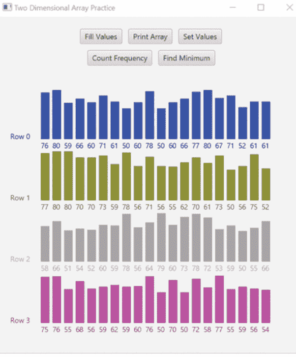

# 图 9.14

应用程序启动时的图形窗口

# 故障排除

如果你的方法实现没有动画，请检查以下提示：

- 验证你的单层 `for` 循环或内层 `for` 循环的最后语句是否为调用 `animate` 方法，以及是否传递了正确的参数。例如：`animate(row, column);`

- 验证你的 `for` 循环的退出条件是否正确。有时退出条件取决于数组的长度（即数组的行数），有时取决于数组当前行的列数。

# 讨论题

1. 对于二维数组，哪些操作你会使用嵌套 `for` 循环，哪些操作你会使用单层 `for` 循环？

2. 在对给定行执行操作时，哪个索引是固定的，哪个索引作为循环变量？在对给定的列执行操作时，哪个索引是固定的，哪个索引作为循环变量？

## 9.6 其他多维数组

有时我们可能需要超过两个维的数组。例如，我们可能希望按年、按周和每天跟踪销售情况。在这种情况下，我们将如下使用三维数组：

- 第 1 维度：年
- 第 2 维度：周
- 第 3 维度：天

在本章前面的部分，我们解释了二维数组是单维数组的数组。同样，三维数组是二维数组的数组。四维数组是三维数组的数组。更通俗地说，$n$ 维数组是 $(n-1)$ 维数组的数组。

表 9.3 显示了 $n$ 维数组如何按维度构建；$i_1, i_2, ..., i_n$ 被用作第一维度、第二维度……以及第 $n$ 维的通用索引。

# 表 9.3 $n$ 维数组的结构

| 维度 | 数组元素 |
| --- | --- |
| 第一 | `arrayName[i_1]` 是一个 $(n - 1)$ 维数组 |
| 第二 | `arrayName[i_1][i_2]` 是一个 $(n - 2)$ 维数组 |
| 第 $k$ 维 | `arrayName[i_1][i_2][..][i_k]` 是一个 $(n - k)$ 多维数组 |
| 第 $(n-2)$ 维 | `arrayName[i_1][i_2][..][i_{n-2}]` 是一个二维数组 |
| 第 $(n-1)$ 维 | `arrayName[i_1][i_2][..][i_{n-1}]` 是一个单维数组 |
| 第 $n$ 维 | `arrayName[i_1][i_2][..][i_{n-1}][i_n]` 是一个数组元素 |

如果我们跟踪 10 年期间的销售情况，那么我们将有一个 10x52x7 的数组。针对二维数组讨论的原理仍然适用；我们只是有三个维度而不是两个。以下代码序列说明了如何声明、实例化和访问此三维数组的元素：

```java
double[][][] sales; // 声明一个三维数组
sales = new double[10][52][7]; // 实例化
sales[0][0][0] = 58.5; // 访问第一个元素
sales[4][22][3] = 98.3; // 访问另一个元素
sales[9][51][6] = 123.7; // 访问最后一个元素
```

处理单维数组的元素，我们使用 `for` 循环；对于二维数组，我们使用嵌套 `for` 循环。对于三维数组，我们使用三重 `for` 循环。

处理三维数组的通用模式是：

```java
for (int i = 0; i < arrayName.length; i++) {
    for (int j = 0; j < arrayName[i].length; j++) {
        for (int k = 0; k < arrayName[i][j].length; k++) {
            // 处理 arrayName[i][j][k]
        }
    }
}
```

以下代码序列将打印三维数组的元素：

```java
for (int i = 0; i < sales.length; i++) {
    for (int j = 0; j < sales[i].length; j++) {
        for (int k = 0; k < sales[i][j].length; k++) {
            System.out.println(sales[i][j][k] + "\t");
        }
    }
}
```

如果我们对按州跟踪销售情况感兴趣，我们可以如下所示使用四维数组：

- 第 1 维度：州
- 第 2 维度：年
- 第 3 维度：周
- 第 4 维度：天

```java
double[][][][] stateSales; // 声明一个四维数组
stateSales = new double[50][10][52][7]; // 实例化
stateSales[0][0][0][0] = 58.5; // 访问第一个元素
stateSales[4][22][3][0] = 98.3; // 访问另一个元素
stateSales[9][51][6][6] = 123.7; // 访问最后一个元素
```

处理四维数组的元素，我们使用四层 `for` 循环。该四层循环模式与二维和三维数组的模式相似。对于一个名为 `arrayName` 的四维数组，它是：

```java
for (int i = 0; i < arrayName.length; i++) {
    for (int j = 0; j < arrayName[i].length; j++) {
        for (int k = 0; k < arrayName[i][j].length; k++) {
            for (int l = 0; l < arrayName[i][j][k].length; l++) {
                // 处理 arrayName[i][j][k][l]
            }
        }
    }
}
```

## 9.7 ArrayList 类

正如我们所看到的，单维数组和多维数组在很多情况下都很有用。然而，它们也有局限性。

假设我们正在为大型网站设计一个搜索引擎，例如一个在线书店。用户会在文本框中输入一个单词，我们的代码将访问数据库，检索所有标题包含该单词的书，并将其返回给用户。

我们可以用书籍数组存储书籍信息。但是，一个问题是，我们不知道会有多少书。可能是 3 本、32 本、500 本或 5000 本，甚至可能更多。在不知道书籍数量的情况下，我们不知道数组的应该是多大。最安全的做法是创建一个具有最大可能数量元素的数组，即我们预期的书籍最大数量。但如果实际书籍少于预期，我们将浪费空间。

而如果我们最终拥有的书籍超过了预期数量，我们需要增加数组的大小。由于数组的大小在实例化时是固定的，更改数组的大小是一个繁琐的过程。我们必须实例化一个新的数组并将原始数组元素复制到新数组。

`java.util` 包中的 `ArrayList` 类解决了这些问题。`ArrayList` 对象会根据需要自动调整其容量。`ArrayList` 类使用了泛型。泛型是参数化类型，这意味着数据类型将在客户端类声明并实例化该类的对象时定义。泛型允许程序员设计和编写使用对象的类，而无需指定对象的类——或数据类型。

例如，我们可以拥有一个 `Book` 对象的 `ArrayList`、一个 `Auto` 对象的 `ArrayList` 或一个 `String` 的 `ArrayList`。指定的类型必须是一个类，而不是基本数据类型。如果我们想在 `ArrayList` 中存储基本数据类型，则我们需要使用包装类，例如 `Integer`、`Double` 或 `Character`。

`ArrayList` 类以及更广泛的泛型的类用于许多用途。这是面向对象编程的另一个方面，允许程序员重用代码。

由于 `ArrayList` 类位于 `java.util` 包，使用 `ArrayList` 对象的程序需要提供以下导入语句：

```java
import java.util.ArrayList;
```

## 9.7.1 声明和实例化 ArrayList 对象

以下是声明对象 `ArrayList` 的语法：

```java
ArrayList<ClassName> arrayName;
```

在括号内部，我们声明了将存储在 `ArrayList` 中的对象的类类型。在 `ArrayList` 类名和左括号之间空格是可选的。

例如，这两条语句声明了一个 `String` 的 `ArrayList` 和一个 `Auto` 对象的 `ArrayList`：

```java
ArrayList<String> listOfStrings;
ArrayList<Auto> listOfCars;
```

如果尝试尝试使用基本数据类型而不是类类型来声明 `ArrayList` 对象引用，如下所示：

```java
ArrayList<int> listOfInts;
```

我们将得到此编译器错误：

```text
Test.java:7: error: unexpected type
ArrayList<int> listOfOfInts;
^
required: reference
found: int
1 error
```

表 9.4 显示了 `ArrayList` 类的两个构造函数。

## 表 9.4 ArrayList 构造函数

| ArrayList 构造函数摘要 | 构造函数名称和参数列表 |
| :--- | :--- |
| `ArrayList<ClassName>()` | 构建一个初始容量为 10 的 `ClassName` 类型的 `ArrayList` 对象 |
| `ArrayList<ClassName>(int initialCapacity)` | 构建一个具有指定初始容量的 `ClassName` 类型的 `ArrayList` 对象 |

如果我们知道将在 `ArrayList` 对象中存储多少元素，可以使用重载的构造函数来指定初始容量；否则，我们可以直接使用默认构造函数。当我们向 `ArrayList` 对象添加元素时，它的容量会根据需要自动增加。

以下是使用默认构造函数实例化 `ArrayList` 的语法：

```java
arrayListName = new ArrayList<ClassName>();
```

其中 `ClassName` 是将存储在 `ArrayList` 中的对象的类类型，且 `arrayListName` 之前已声明为该类的 `ArrayList` 引用。

这些语句将实例化之前声明的 `ArrayList` 对象，初始容量为 10：

```java
listOfStrings = new ArrayList<String>();
listOfCars = new ArrayList<Auto>();
```

如果我们尝试在不指定对象类型的情况下实例化 `ArrayList` 对象，如下所示：

```java
listOfCars = new ArrayList();
```

我们从编译器处得到以下警告（使用 Xlint）：

```text
Test.java:11: warning: [rawtypes] found raw type:
ArrayList
    listOfCars = new ArrayList();
missing type arguments for generic class
ArrayList<E>
where E is a type variable:
    extends Object declared in class ArrayList

Test.java:11: warning: [unchecked] unchecked conversion
    listOfCars = new ArrayList<Auto>();
required: ArrayList<Auto>
found: ArrayList
2 warnings
```

在 `ArrayList` 中，容量（capacity）和大小（size）之间存在区别。`ArrayList` 的容量分配给列表的元素数量。大小是填充了对象的元素数量。因此，当我们使用默认构造函数实例化 `ArrayList` 时，它的容量是 10，但换句话说，`ArrayList` 有容纳 10 个对象的空间，但目前列表中没有存储任何对象。

这些语句将使用重载的构造函数声明并实例化一个初始容量为 5 的 `String` 对象的 `ArrayList`：

```java
ArrayList<String> listOfStrings1;
listOfStrings1 = new ArrayList<String>(5);
```

在这种情况下，`listOfStrings1` 的容量是 5，大小为 0。

我们还可以将 `ArrayList` 对象的声明和实例化合并为一条语句。以下是使用默认构造函数的语法：


## ArrayList 声明与实例化

```java
ArrayList<ClassName> arrayListName = new ArrayList<ClassName>();
```

这些语句将分别声明和实例化两个 `Integer` 和 `String` 的 `ArrayList` 对象：

```java
ArrayList<Integer> listOfInts = new ArrayList<Integer>();
ArrayList<String> listOfStrings2 = new ArrayList<String>();
```

## 9.7.2 ArrayList 类的方法

与数组一样，`ArrayList` 类使用索引来引用元素。除其他外，它还提供了以下功能的方法：

- 在列表末尾添加项目
- 在指定的索引处替换项目
- 在指定的索引处移除项目
- 移除列表中的所有项目
- 在列表中搜索特定项目
- 获取指定索引处的项目
- 获取指定项目的索引
- 检查列表是否为空
- 返回列表中的项目数量，即其大小
- 通过将容量设置为列表中的项目数量来优化列表的容量

表 9.5 显示了一些最实用的方法。注意，某些方法头部包含 `E` 作为其返回类型或参数数据类型（相对于类名或简单的 `Object` 类）。`E` 代表 `ArrayList` 的数据类型。因此，对于 `Integer` 对象的 `ArrayList`，`E` 是 `Integer`，例如 `get` 方法返回一个 `Integer` 对象。同样，对于 `Auto` 对象的 `ArrayList`，`E` 是一个 `Auto` 对象。在这种情况下，`get` 方法返回一个 `Auto` 对象。

### 表 9.5 ArrayList 方法

| 返回 | 方法名称和参数列表 |
| :--- | :--- |
| boolean | `add(E element)` 将指定的元素添加到列表末尾 |
| E | `remove(int index)` 移除并返回列表中指定索引处的元素 |
| void | `clear()` 从此列表中移除所有元素 |
| E | `get(int index)` 返回列表中指定索引处的元素；该元素不会从列表中移除 |
| E | `set(int index, E element)` 用指定的元素替换列表中指定索引处的元素 |
| int | `size()` 返回此列表中元素的数量 |
| void | `trimToSize()` 将容量设置为列表的大小 |

## 9.7.3 使用 for 循环遍历 ArrayList

使用 for 循环处理 `ClassName` 对象的 `ArrayList` `arrayListName` 的通用模式：

```java
ClassName currentObject;
for (int i = 0; i < arrayListName.size(); i++) {
    currentObject = arrayListName.get(i);
    // process currentObject
}
```

例如，使用标准 for 循环处理 `String` 对象引用的 `ArrayList` `listOfStrings` 的通用模式是：

```java
String currentString;
for (int i = 0; i < listOfStrings.size(); i++) {
    currentString = listOfStrings.get(i);
    // process currentString
}
```

Java 提供了一种处理 `ArrayList` 元素的简化方法，称为增强 for 循环。使用增强 for 循环处理 `ClassName` 对象的 `ArrayList` 的通用模式：

```java
for (ClassName currentObject : arrayList) {
    // process currentObject
}
```

增强 for 循环自动遍历 `ArrayList` 对象。你的代码不需要调用 `get` 方法；在循环体内可以直接处理 `currentObject`。

例如，使用增强 for 循环处理名为 `names` 的 `String` 的 `ArrayList` 的通用模式是：

```java
for (String currentString : names) {
    // process currentString
}
```

示例 9.12 显示了如何创建和使用 `Integer` 的 `ArrayList`。第 11 行声明并实例化 `ArrayList` 对象引用 `list` 使用默认构造函数。在第 12–14 行使用 `add` 方法向列表添加了三个元素。作为 `add` 方法的参数，我们使用了 `int` 值。Java 的自动装箱功能在预期需要 `Integer` 对象的地方使用 `int` 变量时，会自动将 `int` 转换为 `Integer` 对象。

在声明并实例化一个 `ArrayList` 对象并指定为特定的类类型后，你无法添加一个不同类类型的对象。例如，你不能向 `Integer` 类型的 `ArrayList` 中添加一个 `Double` 类型的值。

在第 17–18 行，我们使用传统的 `for` 循环打印 `list` 的元素，并使用 `get` 方法获取当前索引处的元素。在第 22–23 行，我们使用增强型 `for` 循环来打印元素。在第 27–28 行，我们也使用增强型 `for` 循环打印元素；但这次我们使用 `int` 作为循环变量，并使用了 Java 的自动拆箱功能，该功能根据需要将 `Integer` 对象转换为 `int` 值。在第 31 行，我们使用 `set` 方法将索引为 1 的元素值改为 100，同样使用了自动装箱。在第 37 行，我们使用 `remove` 方法删除索引为 0 的元素并将其赋值给变量 `removed`，再次使用了自动拆箱。

## 示例 9.12 使用 ArrayList 方法

```java
/* A Simple ArrayList of Integers
 * Anderson, Franceschi
 */
import java.util.ArrayList;

public class ArrayListOfIntegers {
    public static void main(String[] args) {
        ArrayList<Integer> list = new ArrayList<Integer>();
        list.add(34); // autoboxing
        list.add(89); // autoboxing
        list.add(65); // autoboxing

        System.out.println("Using the traditional for loop:");
        for (int i = 0; i < list.size(); i++) {
            System.out.print(list.get(i) + "\t");
        }
        System.out.println();

        System.out.println("Using the enhanced for loop:");
        for (Integer currentInt : list) {
            System.out.print(currentInt + "\t");
        }
        System.out.println();

        System.out.println("Using unboxing and enhanced for loop:");
        for (int currentInt : list) // unboxing
            System.out.print(currentInt + "\t");
        System.out.println();

        list.set(1, 100);
        System.out.println("\nAfter calling set(1, 100)");
        for (int currentInt : list) // unboxing
            System.out.print(currentInt + "\t");
        System.out.println();

        int removed = list.remove(0);
        System.out.println("\nAt index 0, " + removed + " was removed");
        System.out.println("\nAfter removing the element at index 0:");
        for (int currentInt : list) // unboxing
            System.out.print(currentInt + "\t");
        System.out.println();
    }
}
```

该示例的输出如图 9.15 所示。

### 图 9.15 示例 9.12 的输出

```
Using the traditional for loop:
34 89 65

Using the enhanced for loop:
34 89 65

Using unboxing and enhanced for loop:
34 89 65

After calling set( 1, 100 ):
34 100 65

At index 0, 34 was removed

After removing the element at index 0:
100 65
```

## 9.7.4 在程序中使用 ArrayList 类

现在，让我们看看如何在 Java 程序中使用 `ArrayList` 类。回到我们的书店和搜索引擎的示例，我们想要设计并编写一个简单的程序，让用户能够搜索书籍。

该程序中将会有三个类：

- 一个 `Book` 类，封装了书的概念
- 一个 `Bookstore` 类，封装了书店的概念
- 一个 `BookSearchEngine` 类，包括提供用户界面的 `main` 方法

为了保持简单易懂，我们的 `Book` 类将只包含实例变量：书名（`String` 类型）、书作者（也是 `String` 类型）以及书价（`double` 类型）。示例 9.13 显示了一个简化的 `Book` 类，其中包含构造函数、访问器方法和 `toString` 方法。

## 示例 9.13 Book 类

```java
/* Book class
   Anderson, Franceschi
*/
public class Book {
    private String title;
    private String author;
    private double price;

    /** default constructor
     */
    public Book() {
        title = "";
        author = "";
        price = 0.0;
    }

    /** overloaded constructor
     * @param title the value to assign to title
     * @param author the value to assign to author
     * @param price the value to assign to price
     */
    public Book(String title, String author, double price) {
        this.title = title;
        this.author = author;
        this.price = price;
    }

    /** getTitle method
     * @return the title
     */
    public String getTitle() {
        return title;
    }

    /** getAuthor method
     * @return the author
     */
    public String getAuthor() {
        return author;
    }

    /** getPrice method
     * @return the price
     */
    public double getPrice() {
        return price;
    }

    /** toString
     * @return title, author, and price
     */
    @Override
    public String toString() {
        return "title: " + title + "\t" +
               "author: " + author + "\t" +
               "price: " + price;
    }
}
```

示例 9.14 所示的 `Bookstore` 类将简单地包含一个实例变量：一个 `Book` 对象的 `ArrayList`，代表书店中的书籍集合，我们将其命名为 `library`。在大多数情况下，当 `ArrayList` 填充了数据时，这些数据将来自数据库或文件。为了专注于 `ArrayList` 类及其方法，我们在 `Bookstore` 类中硬编码了用于 `ArrayList` `library` 的对象，而不是从数据库或文件中读取它们。

在默认构造函数（第 11 行到第 24 行）中，我们实例化了 `library` 变量，然后使用 `ArrayList` 类的 `add` 方法向 `library` 添加了六个 `Book` 对象。在第 23 行，我们调用 `trimToSize` 方法将 `library` 的容量设置为其当前大小（即 6），以最大限度地减少内存占用。

`toString` 方法在第 26 行到第 38 行之间编写。它生成并返回一个代表 `library` 中所有书籍的字符串，每行一个书籍。为了实现这一点，我们从第 33 行到第 36 行使用了增强型 for 循环。该循环的第 33 行头部遵循了增强型 for 循环头部的通用模式：声明一个名为 `tempBook` 的 `Book` 变量，后面跟着冒号，然后是用于遍历的 `ArrayList` 对象 `library`。

`searchTitle` 方法在第 40 行到第 54 行之间编写，执行在 `library` 中存储的每个 `Book` 对象标题中搜索关键词的任务。关键词是一个 `String`，是方法的参数，并命名为 `searchString`。该方法返回一个包含标题中带有关键词的 `Book` 对象的 `ArrayList`。我们在第 46 行创建了那个名为 `searchResult` 的 `Book` 的 `ArrayList`，并在第 47 行到第 51 行使用增强型 for 循环遍历 `library`。在循环体内部，我们使用 `String` 类的 `indexOf` 方法测试当前 `Book` 对象是否包含关键词 `searchString`。如果是，我们将该 `Book` 对象添加到 `searchResult` 中。最后，我们调用 `trimToSize` 方法将 `searchResult` 的容量设置为元素的数量，然后将 `ArrayList` 返回给调用者。

## 示例 9.14 Bookstore 类


```
/* BookStore class
 Anderson, Franceschi
 */

import java.util.ArrayList;

public class BookStore {
    private ArrayList<Book> library;

    /** default constructor
     * instantiates ArrayList of Books
     */
    public BookStore() {
        library = new ArrayList<Book>();
        library.add(new Book("Intro to Java", "James", 56.99));
        library.add(new Book("Advanced Java", "Green", 65.99));
        library.add(new Book("Java Servlets", "Brown", 75.99));
        library.add(new Book("Intro to HTML", "James", 29.49));
        library.add(new Book("Intro to Flash", "James", 34.99));
        library.add(new Book("Advanced HTML", "Green", 56.99));
        library.trimToSize();
    }

    /** toString
     * @return each book in library, one per line
     */
    @Override
    public String toString() {
        String result = "";
        for (Book tempBook : library) {
            result += tempBook.toString() + "\n";
        }
        return result;
    }

    /** Generates list of books containing
     * searchString
     * @param searchString the keyword to search for
     * @return the ArrayList of books containing the keyword
     */
    public ArrayList<Book> searchTitle(String searchString) {
        ArrayList<Book> searchResult = new ArrayList<Book>();
        for (Book currentBook : library) {
            if (currentBook.toString().contains(searchString)) {
                searchResult.add(currentBook);
            }
        }
        return searchResult;
    }
}
```

```java
48 {
  if ( currentBook.getTitle().indexOf(
    searchString) != -1 ) {
    searchResult.add( currentBook);
  }
  searchResult.trimToSize();
  return searchResult;
}
```

我们的 `BookSearchEngine` 类如*示例 9.15* 所示，包含了 `main` 方法：它创建了一个 `BookStore` 对象，向用户请求一个关键词，并在我们的 `BookStore` 对象中搜索部分匹配项。

`BookStore` 对象 `bs` 在第 11 行被声明并实例化。在第 13–15 行，系统提示用户输入一个关键词，该关键词将用于搜索标题包含该关键词的书。第 16 和第 17 行简单地输出 `BookStore` 对象 `bs` 中所有 `Books` 的集合；稍后，当输出搜索结果时，我们可以将该输出与原始的 `Books` 列表进行比较以检查结果。在第 19 行，我们调用了 `searchForTitle` 方法并将 `keyword` 作为参数；返回的 `Book` 对象的 `ArrayList` 被赋值给变量 `results`。在第 23–24 行，我们遍历 `results` 并输出其内容，再次使用了增强型 `for` 循环。*图 9.16* 显示了程序的运行情况，用户正在搜索包含“Java”单词的书。

## 图 9.16

搜索关键词“Java”的结果

```
Enter a keyword > Java
Our book collection is:
title: Intro to Java      author: James
price: 56.99
title: Advanced Java      author: Green
price: 65.99
title: Java Servlets      author: Brown
price: 75.99
title: Intro to HTML      author: James
price: 29.49
title: Intro to Flash    author: James
price: 34.99
title: Advanced HTML     author: Green
price: 56.99

The search results for Java are:
title: Intro to Java      author: James
price: 56.99
title: Advanced Java      author: Green
price: 65.99
title: Java Servlets      author: Brown
price: 75.99
```


© Hemera Technologies/Photos.com/Thinkstock

## 代码实战

要查看如何使用 `ArrayList` 类的逐步演示说明，请在在线资源中查找视频。点击链接开始视频。

## 示例 9.15 图籍搜索引擎

```java
/* BookSearchEngine class
 * Anderson, Franceschi
 */
import java.util.*;
public class BookSearchEngine
{
    public static void main(String [ ] args) {
        BookStore bs = new BookStore();
        Scanner scan = new Scanner(System.in );
        System.out.print("Enter a keyword > ");
        String keyword = scan.next();
        System.out.println("Our book collection is:");
        System.out.println(bs.toString());
        ArrayList<Book> results = bs.searchForTitle(keyword);
        System.out.println("The search results for " + keyword + " are: ");
        for (Book tempBook : results) {
            System.out.println(tempBook.toString());
        }
    }
}
```

## 9.8 编程活动 2：使用 ArrayList 类

在此活动中，你将处理一个 `ArrayList` 对象。

具体来说，你将编写代码来执行以下操作：

1. 用 `Auto` 元素填充 `ArrayList` 对象。
2. 打印 `ArrayList` 对象中包含的 `Auto` 元素。
3. 将 `ArrayList` 中每个 `Auto` 元素的模型实例变量设置为指定的模型。
4. 找到 `ArrayList` 对象中所有 `Auto` 元素的最大里程数。
5. 统计 `ArrayList` 中指定模型的 `Auto` 元素数量。

### 表 9.6 Auto 类的 API

#### 表 9.6 Auto 类的构造函数和部分方法

| Auto 类构造函数 | 摘要 |
| :--- | :--- |
| `Auto()` | 创建一个默认值为 "unknown"、0 和 0.0 的 `Auto` 对象。 |
| `Auto( String model, int milesDriven, double gallonsOfGas )` | 创建一个初始值为 model、milesDriven 和 gallonsOfGas 的 `Auto` 对象。 |

| Auto 类方法 | 返回值 方法名和参数 |
| :--- | :--- |
| `getModel()` | 返回 model 的值 |
| `getMilesDriven()` | 返回 milesDriven 的值 |
| `getGallonsOfGas()` | 返回 gallonsOfGas 的值 |
| `setModel( String model )` | model 的修改器 |
| `setMilesDriven( int milesDriven )` | milesDriven 的修改器 |
| `setGallonsOfGas( double gallonsOfGas )` | gallonsOfGas 的修改器 |
| `milesPeron()` | 返回此对象的里程数 |
| `toString()` | 返回此对象的字符串表示 |
| `equals( Object obj )` | 将此 `Auto` 与另一个对象进行比较 |

框架将对你的算法进行动画处理，以便你检查代码的准确性。例如，*图 9.17* 显示了应用程序统计 `ArrayList` 对象中模型等于“Ferrari”的 `Auto` 元素数量。应用程序按顺序访问 `ArrayList` 中的每个元素，检查模型是否符合期望的值“Ferrari”。此时，正在访问的当前元素是一辆宝马，应用程序已经找到了两个模型值为“Ferrari”的 `Auto` 元素。

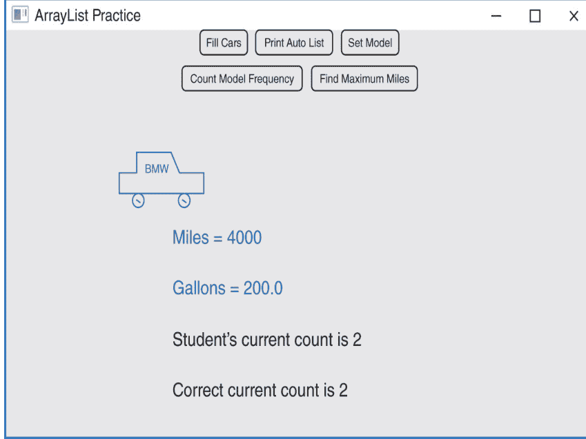

**图 9.17 编程活动的动画**

## 指南

在本章编程活动 2 文件夹提供的代码中，你将找到完成此活动所需的源文件。将所有文件复制到你的计算机。注意，所有文件应在同一个文件夹中。

打开 `ArrayListController.java` 源文件。搜索五个星号（`*****`）将带你定位到示例方法以及你需要添加代码的其他四个位置。我们已经提供了任务 1 的示例代码。在每个任务中，你将为一个方法填充代码，以操作现有的 `Auto` 元素 `ArrayList`。你不应该实例化 `ArrayList` 对象；我们已经为你做过了。*示例 9.16* 显示了 `ArrayListController` 源码中你将添加代码的部分。

对于 `countFound` 和 `findMiles` 方法，我们提供了一个占位语句（`return 0;`），以便你可以单独编写并测试每个方法。当你准备好编写 `countFound` 和 `findMiles` 方法时，只需替换该方法的返回语句。

## 示例 9.16 ArrayListController 中的代码位置

```java
// ***** 1. 此方法已作为示例
/** 填充 Auto 元素 carList
* 实例变量 carList 是要填充 Auto 元素的 ArrayList */
public void fillWithCars() {

    // 在添加汽车之前清除 carList
    carList.clear();
    // 重置 Auto 的数量为 0
    // 以确保动画正常工作
    Auto.clearAutos();
    Auto car1 = new Auto("BMW", 0, 0.0);
    Auto car2 = new Auto("Ferrari", 100, 500.0);
    Auto car3 = new Auto("Jeep", 1000, 90.0);
    Auto car4 = new Auto("Ferrari", 10, 3.0);
    Auto car5 = new Auto("BMW", 4000, 200.0);
    Auto car6 = new Auto("Ferrari", 1000, 50.0);

    carList.add(car1);
    animate(car1);
    carList.add(car2);
    animate(car2);
    carList.add(car3);
    animate(car3);
    carList.add(car4);
    animate(car4);
    carList.add(car5);
    animate(car5);
    carList.add(car6);
    animate(car6);
}
// fillWithCars 方法结束

// ***** 2. 学生编写此方法
/** 将 carList 打印到控制台，元素之间用空格分隔
* 实例变量 carList 是要打印的 ArrayList */
public void printAutoList() {
    // 注意：为了对算法进行动画处理，将此方法调用放在
    // for 循环的最后
    // animate(car);
    // 其中 car 是当前 Auto 对象的变量名
    // 当你遍历 ArrayList 对象
    // 在此处编写你的代码：
}
// printAutoList 方法结束

// ***** 3. 学生编写此方法
/** 将 carList 中所有元素的模型设置为参数值
 * 实例变量 carList 是要修改的 ArrayList
 * @param model 要分配给 carList 中所有 Auto 对象的模型
 */
public void setModelValues( String model ) {
    // 注意：为了对算法进行动画处理，将此方法调用
    // 放在 for 循环的最后
    // animate(car);
    // 其中 car 是当前 Auto 对象的变量名
    // 当你遍历 ArrayList 对象时
    // 在此处编写你的代码：
}
// setModelValues 方法结束

// for 循环中的最后一条语句
// animate(car);
// 其中 car 是当前 Auto 对象的变量名
// object
// 当你遍历 ArrayList 对象时
// 在此处编写你的代码：
// }
// setModelValues 方法的结束

// ***** 4. 学生编写此方法
/** 查找最大的行驶里程数
 * 实例变量 carList 是要搜索的 ArrayList
 * @return 所有 Auto 对象中行驶的最大里程数
 */
public int findMaximumMilesDriven()
{
    // 注意：为了使算法动画化，将此方法调用放在
    // for 循环中的最后一条语句中
    // animate(car, maximum);
    // 其中 car 是当前 Auto 对象的变量名
    // 而 maximum 是存储已测试过的所有 Auto 元素
    // 当前最大里程数的 int 变量
    // 当你遍历 ArrayList 对象时
    // 在此处编写你的代码：
    return 0; // 将此语句替换为你的 return 语句
}
// findMaximumMilesDriven 方法的结束

// ***** 5. 学生编写此方法
/**
 * 查找参数 model 在 carList 中出现的次数
 *
 * 实例变量 carList 是我们搜索的 ArrayList
 * @param model      要计数的模型
 * @return           model 出现的次数
 */
public int countFound( String model )
{
    // 注意：为了使算法动画化，将此方法调用放在
    // for 循环中的最后一条语句中
    // animate(car, num);
    // 其中 car 是当前 Auto 对象的变量名
    // 而 num 是存储当前数量的 int，
    // 模型等于方法参数的 Auto 数量
    // 当你遍历 ArrayList 对象时
    // 在此处编写你的代码：
    return 0;// 将此语句替换为你的 return 语句
}
// countFound 方法的结束
```

框架将使你的代码动画化，这样你可以看到它的运行过程。为了实现这一点，请确保你的 `for` 循环调用了 `animate` 方法。你发送给 `animate` 的参数并不总是相同的，但调用 `animate` 的位置始终是相同的，即你 `for` 循环的最后一条语句。每个任务的详细说明均已包含在代码中。


要测试你的代码，请编译 `ArrayListController.java` 并运行 `ArrayListApplication` 源代码。图 9.18 显示了程序启动时的图形窗口。因为 `ArrayList` 对象的 `Auto` 元素是硬编码的，所以每次运行程序时值都是相同的。先点击“Fill Cars”按钮。要测试任何方法，请点击相应的按钮。

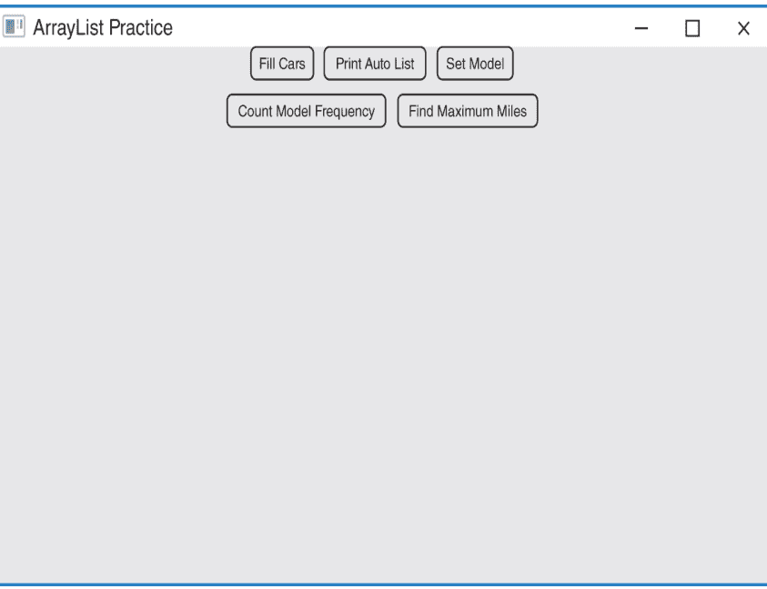

图 9.18

应用程序启动时的图形窗口

# 故障排除

如果你的方法实现没有显示动画，请检查这些提示：

- 验证你的 `for` 循环中的最后一条语句是否是对 `animate` 方法的调用，并且你是否将循环变量作为参数传递，如下所示：

```java
animate(car); // 或
animate(car, maximum); // 或
animate(car, num);
```

- 验证你的 `for` 循环头部是否正确。它们应该是相同的。

- 验证你是否正确更新了变量 `maximum` 和 `num`。

# 讨论性问题

1. 修改 `fillWithCars` 方法中的代码，使得 `ArrayList` 中有更多或更少的 `Auto` 对象。`Auto` 对象的数量如何影响其他方法的编码？请解释。

2. 解释遍历 `ArrayList` 与遍历数组有何不同。

# 技能练习

带有这些章节末问题

## 9.10.1 多选题练习

问题 9, 10, 11, 12, 13

## 9.10.2 阅读并理解代码

问题 29, 30, 31, 32

## 9.10.3 填充代码

问题 46, 47, 48, 49

## 9.10.4 代码错误识别

问题 55, 56, 57

## 9.10.5 调试

问题 63, 64

## 9.10.6 编写程序

问题 80, 81, 82

## 9.10.8 技术写作

问题 98

# 章节回顾

## 9.9 总结

- 数组可以是一维的、二维的、三维的或通用的 n 维的。
- 在二维数组中，每一行都是数组。
- 二维数组的声明、实例化和操作适用于一维数组。
- 二维数组的每一行可以有不同的列数。
- 二维数组有一个实例变量 `length`，它存储行数。
- `ArrayList` 类属于 `java.util`。
- `ArrayList` 可以被看作是可扩展列表。
- 通过索引访问 `ArrayList` 元素。
- 使用增强型 `for` 循环处理 `ArrayList`。

## 9.10 练习、问题和项目

### 9.10.1 多选题

1. 哪种声明二维数组的方式是正确的？

- `int [][] a;`
- `int a];`
- `int a[];`

2. 二维数组是数组的数组。

- 正确 错误

3. 在二维数组中，每行必须具有相同的列数。

- 正确 错误

4. 二维数组在声明和实例化后的默认值是？

- 正确 错误

5. 如何访问第 2 行第 4 列的元素？

- `a{2}`
- `a(2,4)`
- `a[2][4]`
- `a[2]`

6. 如何获取二维数组的行数？

- `a.rows`
- `a.length`

7. 如何获取第 2 行的列数？

- `a[2].length`
- `a.length`

8. 二维数组的所有元素必须是相同类型。

- 正确 错误

9. `ArrayList` 可以由方法返回。

- 正确 错误

10. 可以声明并实例化一个自定义类的 `ArrayList`。

- 正确 错误

11. 在向 `ArrayList` 添加对象时，如何确保它有足够的容量？

- 使用 `Capacity` 方法。
- 使用 `trimToSize` 方法。
- 我们不需要做什么；容量会自动扩展。

12. `ArrayList` 的 `add` 方法在哪里添加对象？

- 在列表开头
- 在列表末尾

13. `ArrayList` 属于哪个包？

- `java.io`
- `java.util`
- `java.array`
- `java.list`

### 9.10.2 阅读并理解代码

对于问题 14 到 24，请考虑以下二维数组的声明和初始化：

```java
String[][] cities = { {"New York", "LA", "San Francisco", "Chicago"},
                      {"Munich", "Stuttgart", "Berlin", "Bonn"},
                      {"Paris", "Accaccio", "Lyon"},
                      {"Montreal", "Ottawa", "Vancouver"} };
```

14. `cities` 数组有多少行？

15. 表达式 `cities[2][1]` 的值是什么？

16. `cities` 数组最后一行的索引是多少？

17. `Chicago` 在 `cities` 数组中的行和列索引是多少？

18. 这段代码序列的输出是什么？

```java
System.out.println( cities[3][2] );
```

19. 这段代码序列的输出是什么？

```java
for ( int j = 0; j < cities[1].length; j++ )
    System.out.println(cities[1][j] );
```

20. 这段代码序列的输出是什么？

```java
for ( int i = 0; i < cities.length; i++ )
    System.out.println(cities[i][1] );
```

21. 这段代码序列的输出是什么？

```java
for ( int i = 0; i < cities.length; i++ )
{
    for ( int j = 0; j < cities[i].length; j++) {
        System.out.print(cities[i][j] + " \t");
    }
    System.out.println();
}
```

22. 这段代码序列的输出是什么？

```java
for ( int i = 0; i < cities.length; i++ )
{
    for ( int j = 0; j < cities[i].length; j++)
    {
        if (cities[i][j].length() == 6) {
            System.out.println(cities[i][j]);
        }
    }
}
```

23. 这段代码序列的输出是什么？

```java
int count = 0;
for ( int i = 0; i < cities.length; i++ )
{
    for ( int j = 0; j < cities[i].length; j++)
    {
        if (cities[i][j].length() == 7) {
            count++;
        }
    }
    System.out.println("count is " + count);
}
```

24. 这段代码序列的输出是什么？

```java
for ( int i = 0; i < cities.length; i++ )
{
    for ( int j = 0; j < cities[i].length; j++)
    {
        if (cities[i][j].charAt(0) == 'S') {
            System.out.println(cities[i][j]);
        }
    }
}
```

25. 这个方法是做什么的？

```java
public static int foo( double [ ][ ] a )
{
    int b = 0;
    for ( int i = 0; i < a.length; i++)
    {
        for ( int j = 0; j < a[i].length; j++)
        {
            b++;
        }
    }
    return b;
}
```

26. 这个方法是做什么的？

```java
public static boolean foo( char [ ][ ] a )
{
    int b = a[0].length;
    for ( int i = 1; i < a.length; i++)
    {
        if ( a[i].length != b )
            return false;
    }
    return true;
}
```

27. 这个方法是做什么的？

```java
public static int foo( String [ ][ ] a )
{
    int b = 0;
    for ( int i = 0; i < a.length; i++)
    {
        b++;
    }
    return b;
}
```

28. 这个方法是做什么的？

```java
public static int[] foo( float [ ][ ] a )
{
    int [ ] temp = new int[a.length];
    for ( int i = 0; i < a.length; i++)
    {
        temp[i] = a[i].length;
    }
    return temp;
}
```

29. 这个方法是做什么的？

```java
public static int foo( ArrayList<Integer> a )
{
    int b = 0;
    for ( Integer i : a )
        b++;
    return b;
}
```

30. 执行以下代码序列后，`a` 的每个元素的内容和索引是什么？

```java
ArrayList<Integer> a = new ArrayList<Integer>();
a.add( 7 );
a.add( 4 );
a.add( 21 );
```

31. 执行以下代码序列后，`a` 的每个元素的内容和索引是什么？

```java
ArrayList<Integer> a = new ArrayList<Integer>();
a.add( 7 );
a.add( 4 );
a.add( 21 );
a.set( 1, 45 );
```

32. 执行以下代码序列后，`a` 的每个元素的内容和索引是什么？

```java
ArrayList<Integer> a = new ArrayList<Integer>();
a.add( 7 );
a.add( 4 );
a.add( 21 );
a.set( 1, 45 );
```

### 9.10.3 填充代码

对于问题 33 到 37，请考虑以下语句：

```java
String [ ][ ] geo = {{"MD", "NY", "NJ", "MA", "CA", "MI", "OR"}, {"Detroit", "Boston", "Seattle"}};
```

33. 这段代码打印二维数组中行索引 1、列索引 2 的元素。

```java
// 在此处编写代码
```

34. 这段代码打印值为 "CA" 的元素。

```java
// 在此处编写代码
```

35. 这段代码打印数组中所有以 M 开头的州（第一行）。

```java
for ( int j = 0; j < geo[0].length; j++)
{
   // 在此处编写代码
}
```

36. 这段代码打印数组中所有的城市（第二行）。

```java
for ( int j = 0; j < geo[1].length; j++)
{
   // 在此处编写代码
}
```

37. 这段代码打印数组中的所有元素。

```java
for ( int i = 0; i < geo.length; i++)
{
    // 在此处编写代码
}
```

对于问题 38 到 41，请考虑以下语句：

```java
int [ ][ ] a = {{9, 6, 8, 10, 5}, {7, 6, 8, 9, 6}, {4, 8, 10, 6, 6}};
```

38. 这段代码计算并打印数组 `a` 中所有元素的和。

```java
int sum = 0;
for ( int i = 0; i < a.length; i++)
{
    // 在此处编写代码
}
System.out.println("sum " + sum);
```

39. 这段代码统计并打印值 8 在数组 `a` 中出现的次数。

```java
int count = 0;
for ( int i = 0; i < a.length; i++)
{
    // 在此处编写代码
}
System.out.println("# of 8s in a: " + count);
```

40. 这段代码统计值 6 在数组 `a` 的第二行（索引为 1 的行）中出现的次数。

```java
int count = 0;
// 循环头
if (a[1][j] == 6)
    count++;
System.out.println("# of 6s in 2nd row: " + count);
```

41. 此方法计算数组 `a` 的第二列（索引为 1 的列）中元素的和。

```java
int sum = 0;
for (int i = 0; i < a.length; i++)
    // 在此处编写代码
System.out.println("sum is " + sum);
```

42. 如果 `String` 数组中的某个元素等于 "Java"，此方法返回 `true`，否则返回 `false`。

```java
public static boolean foo( String[][ ] a )
{
    // 在此处编写代码
}
```

43. 此方法返回数组中所有元素的乘积。

```java
public static int foo( int[][ ] a )
{
    // 在此处编写代码
}
```

44. 如果数组中至少有一行恰有五列，此方法返回 `true`，否则返回 `false`。

```java
public static boolean foo( char[][ ] a )
{
    // 在此处编写代码
}
```

45. 此方法接收一个 `int` 数组作为参数并返回一个 `boolean` 数组。返回数组的长度应该等于参数二维数组的行数。如果参数数组对应行索引 `i` 的元素为 0，则为 `true`，否则为 `false`。假设 `a` 的每行列数相同。

```java
public static boolean[] foo(int[][ ] a)
{
    // 在此处编写代码
    // 每行列数相同
}
```

对于问题 46 到 49，考虑以下语句：

```java
ArrayList<String> languages = new ArrayList<String>();
languages.add("SQL");
languages.add("Java");
languages.add("HTML");
languages.add("PHP");
languages.add("Perl");
```

46. 这段代码打印 `languages` 中的元素数量。

```java
// 在此处编写代码
```

47. 这段代码从 `languages` 中获取 "HTML"（不删除）并将其赋值给 String 变量 `webLanguage`。

```java
// 在此处编写代码
```

48. 这段代码将 `languages` 中的 "HTML" 替换为 "C++"。

```java
// 在此处编写代码
```

49. 这段代码打印 `languages` 中所有以字母 `P` 开头的元素。

```java
for ( String s : languages )
{
    // 在此处编写代码
}
```

### 9.10.4 识别代码中的错误

50. 这段代码的错误在哪里？

```java
double [ ][ ] a = {3.3, 6.6, 8.8};
```

51. 这段代码的错误在哪里？

```java
int [ ][ ] a = {{3, 6}, {8}};
```

52. 这段代码的错误在哪里？

```java
int [ ][ ] a = {{3, 6, 8}};
```

53. 这段代码的错误在哪里？

```java
int [ ][ ] a = {3, 6, 8};
```

54. 这段代码的错误在哪里？

```java
int [ ][ ] a = {{3, 6}, {8}};
System.out.println("The array is " + a);
```

55. 这段代码的错误在哪里？

```java
ArrayList<double> a;
```

56. 这段代码的错误在哪里？

```java
ArrayList<Double> a = new ArrayList<Float>();
```

57. 这段代码的错误在哪里？

```java
ArrayList<Double> a;
a = new ArrayList<Float>();
```

58. 这段代码的错误在哪里？

```java
// a 是一个 String 的 ArrayList
// a 已经声明并实例化
a.size() = 10;
```

### 9.10.5 调试区域——使用 Java 编译器和 JVM 消息

59. 你在 `Test.java` 类的第14 行编写了以下代码：

```java
int a[2][] = { 2, 7 }, { 9, 2 }; // line14
```

当你编译时，你得到了以下消息：


# 编译错误与运行时异常分析

## 问题 1-5：数组声明语法错误

```text
Test.java:14: error: '}' expected
int a[2][] = { { 2, 7 }, { 9, 2 } }; //
line14
```

```text
Test.java:14: error: not a statement
int a[2][] = { { 2, 7 }, { 9, 2 } }; //
line14
```

```text
Test.java:14: error: ';' expected
int a[2][] = { { 2, 7 }, { 9, 2 } }; //
line14
```

```text
Test.java:14: error: illegal start of expression
int a[2][] = { { 2, 7 }, { 9, 2 } }; //
line14
```

6 个错误

**解释问题是什么以及如何修复。**

**问题分析**：Java 中数组声明语法错误。`int a[2][]` 是 C/C++ 风格语法，Java 不支持在变量名后指定数组大小。

**修复方法**：使用 Java 正确语法：
- 声明时不指定大小：`int[][] a = { { 2, 7 }, { 9, 2 } };`
- 或先声明再实例化：`int[][] a = new int[2][]; a[0] = new int[]{2, 7}; a[1] = new int[]{9, 2};`

---

## 60. 二维数组初始化与越界访问

### 代码
```java
int [][] a = { 1, 2, 3, 4 },
      { 10, 20, 30 } };
for ( int i = 0; i < a.length; i++) {
    for ( int j = 0; j < a[0].length; j++) {
        System.out.println( a[i][j]); //
    }
}
```

### 运行时输出
```
1
2
3
4
10
20
30
Exception in thread "main"
java.lang.ArrayIndexOutOfBoundsException: 3
at Test.main(Test.java: 14)
```

### 问题解释
1. **数组结构错误**：代码意图创建 2×4 数组，但实际创建的是**不规则数组**：
   - `a[0]` 长度为 4（元素 1,2,3,4）
   - `a[1]` 长度为 3（元素 10,20,30）
2. **内层循环条件错误**：`j < a[0].length` 固定使用第一行长度 (4) 作为所有行的列数上限
3. **越界原因**：当 `i=1` 访问第二行时，`j` 循环到 3，但 `a[1]` 只有索引 0,1,2，访问 `a[1][3]` 抛出 `ArrayIndexOutOfBoundsException`

### 修复方法
**方案一：修正数组初始化为规则数组**
```java
int[][] a = { { 1, 2, 3, 4 }, { 10, 20, 30, 40 } };
```

**方案二：修正循环条件适配不规则数组**
```java
for (int i = 0; i < a.length; i++) {
    for (int j = 0; j < a[i].length; j++) {  // 使用 a[i].length
        System.out.println(a[i][j]);
    }
}
```

---

## 61. 查找最小值逻辑错误

### 代码
```java
int [][] a = { 9, 8, 7, 6 },
      { 10, 20, 30, 40 } };
int min = a[0][0];
for ( int i = 1; i < a.length; i++) {
    for ( int j = 0; j < a[i].length; j++) {
        if ( a[i][j] < min )
            min = a[i][j];
    }
}
System.out.println("The minimum is " + min);
```

### 运行时输出
```
The minimum is 9
```

### 问题解释
**外层循环起始索引错误**：`i = 1` 导致**完全跳过第一行** (`a[0]`) 的遍历。初始 `min = a[0][0] = 9`，后续仅比较第二行元素 (10,20,30,40)，均大于 9，故结果为 9。实际最小值 6 位于第一行未被检查。

### 修复方法
将外层循环起始索引改为 0：
```java
for (int i = 0; i < a.length; i++) {  // i = 0
    for (int j = 0; j < a[i].length; j++) {
        if (a[i][j] < min)
            min = a[i][j];
    }
}
```

---

## 62. 数组初始化语法错误导致逻辑失效

### 代码
```java
int [][] a = { 9, 8, 7, 6 };
{ 10, 20, 30, 40 };
for ( int j = 0; j < a[1].length; j++) {
    if ( a[1][j] == 20 ) // line 14
        System.out.println("Found 20 at column index " + j + " of second row");
}
```

### 问题解释
**数组初始化语法错误**：
- `{ 9, 8, 7, 6 }` 创建一个**一维数组**赋给 `a[0]`
- `{ 10, 20, 30, 40 }` 是一个**独立的代码块**（语句块），未赋值给任何变量
- 导致 `a` 实际为 `int[][] a = new int[][]{ {9,8,7,6} }`，长度为 1
- 运行时 `a[1]` 访问不存在的第二行，抛出 `ArrayIndexOutOfBoundsException: 1`

### 修复方法
使用正确的二维数组初始化语法（外层大括号包裹所有行）：
```java
int[][] a = { { 9, 8, 7, 6 }, { 10, 20, 30, 40 } };
```

---

## 63. 增强 for 循环语法错误

### 代码
```java
// cars 是一个 Auto 对象的 ArrayList
// cars 已经声明并实例化
for ( Auto a ; cars ) // line 12
{
    System.out.println(a.toString());
    // line 15
```

### 编译错误
```
Test.java:12: error: '; expected
for ( Auto a ; cars ) // line 12
```

### 问题解释
**增强 for 循环语法错误**：使用了分号 `;` 而非冒号 `:`。正确语法：`for (Type var : collection)`。

### 修复方法
```java
for (Auto a : cars) {  // 分号改为冒号
    System.out.println(a.toString());
}
```

---

## 64. ArrayList 索引越界

### 代码
```java
ArrayList<String> a = new ArrayList<String>();
a.add("Cloudy");
a.add("Snowy");
a.add("Cloudy");
System.out.println("Weather is " + a.get( 3 ))  // line 14
```

### 运行时异常
```
Exception in thread "main"
java.lang.IndexOutOfBoundsException: Index 3 out-of-bounds for length 3
```

### 问题解释
**索引越界**：`ArrayList` 大小为 3（索引 0,1,2），`a.get(3)` 访问不存在的索引 3。

### 修复方法
- 访问最后一个元素用 `a.get(2)` 或 `a.get(a.size() - 1)`
- 访问前先检查：`if (index >= 0 && index < a.size())`

---

## 65. 泛型原始类型警告

### 代码
```java
ArrayList<Integer> a = new ArrayList<>();
```

### 编译警告 (使用 -Xlint)
```
warning: [rawtypes] found raw type: ArrayList
missing type arguments for generic class ArrayList<E>
warning: [unchecked] unchecked conversion
required: ArrayList<Integer>
found:    ArrayList
```

### 问题解释
**钻石操作符 `<>` 类型推断失败**：某些旧版本 Java 编译器无法正确推断 `new ArrayList<>()` 的泛型类型，将其视为原始类型 `ArrayList`。

### 修复方法
显式指定泛型类型：
```java
ArrayList<Integer> a = new ArrayList<Integer>();
```

---

## 66. 类型不匹配：int 无法添加到 ArrayList<Double>

### 代码
```java
ArrayList<Double> a = new ArrayList<Double>();
a.add( 2.3 );
a.add( 8.4 );
a.add( 5 ); // line 11
```

### 编译错误
```
Test.java:11: error: no suitable method found for add(int)
a.add( 5 ); // line 11
```

### 问题解释
**类型不匹配**：`ArrayList<Double>` 只接受 `Double` 类型，`5` 是 `int` 字面量。Java 泛型不支持基本类型自动装箱到不同包装类（`int` → `Integer`，而非 `Double`）。

### 修复方法
使用 `Double` 字面量或显式转换：
```java
a.add(5.0);        // 推荐
a.add((double)5);  // 或显式转型
a.add(Double.valueOf(5));
```

---

## 67. set() 方法理解偏差

### 代码
```java
ArrayList<Character> a = new ArrayList<Character>();
a.add('X');
a.add('V');
a.add('A');
a.set(1, 'J');
for (Character c : a)
    System.out.print(c + " ");
```

### 运行时输出
```
X V A
```

### 预期输出
```
J A V
```

### 问题解释
**对 `set(index, element)` 行为误解**：
- `set(1, 'J')` 是**替换**索引 1 处元素（'V' → 'J'），列表变为 `[X, J, A]`
- 预期输出 `J A V` 暗示期望**插入**并移位，但 `set` 不改变列表大小

### 修复方法
若需插入并移位，使用 `add(index, element)`：
```java
a.add(1, 'J');  // 在索引 1 插入 'J'，原元素后移
// 结果: [X, J, V, A] → 输出: X J V A
```
若预期输出 `J A V` 需进一步调整逻辑（如清空重建或特定插入序列）。

---

## 68-92 编程练习题

### 68. 返回 `double` 二维数组行数
```java
public static int getRowCount(double[][] arr) {
    return arr.length;
}
```

### 69. 返回 `float` 二维数组列数（假设规则数组）
```java
public static int getColumnCount(float[][] arr) {
    return arr.length > 0 ? arr[0].length : 0;
}
```

### 70. 返回 `boolean` 二维数组列数
```java
public static int getColumnCount(boolean[][] arr) {
    return arr.length > 0 ? arr[0].length : 0;
}
```

### 71. 返回 `char` 二维数组元素个数
```java
public static int getElementCount(char[][] arr, int n) { // n 参数未使用，保留签名
    int count = 0;
    for (char[] row : arr) count += row.length;
    return count;
}
```

### 72. 返回 `float` 二维数组所有元素之和
```java
public static float getSum(float[][] arr) {
    float sum = 0;
    for (float[] row : arr) for (float v : row) sum += v;
    return sum;
}
```

### 73. 将 `int` 二维数组偶数行设 0，奇数行设 1
```java
public static void setRowsByParity(int[][] arr) {
    for (int i = 0; i < arr.length; i++) {
        int val = (i % 2 == 0) ? 0 : 1; // 0-based: 偶数行(0,2..)设0，奇数行设1
        for (int j = 0; j < arr[i].length; j++) arr[i][j] = val;
    }
}
```

### 74. 返回所有列元素之和（返回一维数组，每列之和）
```java
public static int[] getColumnSums(int[][] arr) {
    if (arr.length == 0) return new int[0];
    int cols = arr[0].length;
    int[] sums = new int[cols];
    for (int[] row : arr)
        for (int j = 0; j < cols; j++)
            sums[j] += row[j];
    return sums;
}
```

### 75. 反转 `boolean` 二维数组所有元素
```java
public static void flipBooleanArray(boolean[][] arr) {
    for (boolean[] row : arr)
        for (int j = 0; j < row.length; j++)
            row[j] = !row[j];
}
```

### 76. 返回 `boolean` 二维数组元素个数
```java
public static int countElements(boolean[][] arr) {
    int count = 0;
    for (boolean[] row : arr) count += row.length;
    return count;
}
```

### 77. 返回 `int` 二维数组中非零元素百分比（题目 "true元素" 推测为非零）
```java
public static double getNonZeroPercentage(int[][] arr) {
    int total = 0, nonZero = 0;
    for (int[] row : arr) {
        for (int v : row) {
            total++;
            if (v != 0) nonZero++;
        }
    }
    return total == 0 ? 0 : (nonZero * 100.0 / total);
}
```

### 78. 返回二维数组所有元素平均值
```java
public static double getAverage(int[][] arr) {
    long sum = 0;
    int count = 0;
    for (int[] row : arr) {
        for (int v : row) {
            sum += v;
            count++;
        }
    }
    return count == 0 ? 0 : (double) sum / count;
}
```

### 79. 判断二维数组是否规则（所有列长度相同）
```java
public static String checkRegularity(int[][] arr) {
    if (arr.length == 0) return "regular";
    int cols = arr[0].length;
    for (int[] row : arr)
        if (row.length != cols) return "irregular";
    return "regular";
}
```

### 80. 返回数组中所有元素拼接字符串
```java
public static String concatenateElements(int[][] arr) {
    StringBuilder sb = new StringBuilder();
    for (int[] row : arr) for (int v : row) sb.append(v);
    return sb.toString();
}
```

### 81. 返回每行拼接字符串的一维数组
```java
public static String[] concatenateRows(int[][] arr) {
    String[] result = new String[arr.length];
    for (int i = 0; i < arr.length; i++) {
        StringBuilder sb = new StringBuilder();
        for (int v : arr[i]) sb.append(v);
        result[i] = sb.toString();
    }
    return result;
}
```

### 82. 两个等长 `ArrayList` 转 `Hashtable`（键值对应）
```java
public static Hashtable<Object, Object> toHashtable(ArrayList<?> keys, ArrayList<?> values) {
    if (keys.size() != values.size()) throw new IllegalArgumentException("Size mismatch");
    Hashtable<Object, Object> ht = new Hashtable<>();
    for (int i = 0; i < keys.size(); i++) ht.put(keys.get(i), values.get(i));
    return ht;
}
```

### 83. 返回 `Integer` `ArrayList` 元素之和
```java
public static int sumArrayList(ArrayList<Integer> list) {
    int sum = 0;
    for (Integer v : list) if (v != null) sum += v;
    return sum;
}
```

### 84. 返回 `ArrayList` 大小奇偶性字符串
```java
public static String oddOrEven(ArrayList<?> list) {
    return (list.size() % 2 == 0) ? "even" : "odd";
}
```

### 85. `Integer` 列表转字母等级 `Character` 列表
```java
public static ArrayList<Character> toLetterGrades(ArrayList<Integer> scores) {
    ArrayList<Character> grades = new ArrayList<>(scores.size());
    for (Integer s : scores) {
        char g;
        if (s == null) g = '?';
        else if (s >= 90) g = 'A';
        else if (s >= 80) g = 'B';
        else if (s >= 70) g = 'C';
        else if (s >= 60) g = 'D';
        else g = 'F';
        grades.add(g);
    }
    return grades;
}
```

---

## 86. 夏季工资统计类

### `SummerWages` 类
```java
import java.util.Random;

public class SummerWages {
    private double[][] wages; // [person][year]

    public SummerWages(int numPeople, int numYears) {
        wages = new double[numPeople][numYears];
        Random rand = new Random();
        for (int i = 0; i < numPeople; i++)
            for (int j = 0; j < numYears; j++)
                wages[i][j] = 1000 + rand.nextDouble() * 9000; // 1000-10000 随机工资
    }

    // 返回多年总收入最高的人的索引
    public int getHighestEarnerIndex() {
        int idx = 0;
        double maxSum = -1;
        for (int i = 0; i < wages.length; i++) {
            double sum = 0;
            for (double w : wages[i]) sum += w;
            if (sum > maxSum) { maxSum = sum; idx = i; }
        }
        return idx;
    }

    // 返回平均工资最高的年份索引
    public int getHighestAverageYearIndex() {
        int idx = 0;
        double maxAvg = -1;
        for (int j = 0; j < wages[0].length; j++) {
            double sum = 0;
            for (int i = 0; i < wages.length; i++) sum += wages[i][j];
            double avg = sum / wages.length;
            if (avg > maxAvg) { maxAvg = avg; idx = j; }
        }
        return idx;
    }

    // 返回所有人多年总收入
    public double getTotalEarnings() {
        double total = 0;
        for (double[] person : wages) for (double w : person) total += w;
        return total;
    }
}
```

### `SummerWagesClient` 测试类
```java
public class SummerWagesClient {
    public static void main(String[] args) {
        SummerWages sw = new SummerWages(5, 3);
        System.out.println("Highest earner index: " + sw.getHighestEarnerIndex());
        System.out.println("Highest average year index: " + sw.getHighestAverageYearIndex());
        System.out.println("Total earnings: " + sw.getTotalEarnings());
    }
}
```

---

## 87. 密码演变类

### `PasswordTracker` 类
```java
public class PasswordTracker {
    private String[][] passwords; // [student][month]

    public PasswordTracker(String[] flatPasswords) {
        if (flatPasswords.length != 12) throw new IllegalArgumentException("Need 12 passwords");
        passwords = new String[3][4];
        int idx = 0;
        for (int i = 0; i < 3; i++)
            for (int j = 0; j < 4; j++)
                passwords[i][j] = flatPasswords[idx++];
    }

    // 返回修改次数最多的学生索引（相邻月份密码不同计为一次修改）
    public int getMostChangesIndex() {
        int maxChanges = -1, idx = 0;
        for (int i = 0; i < 3; i++) {
            int changes = 0;
            for (int j = 1; j < 4; j++)
                if (!passwords[i][j].equals(passwords[i][j-1])) changes++;
            if (changes > maxChanges) { maxChanges = changes; idx = i; }
        }
        return idx;
    }

    // 返回最长密码
    public String getLongestPassword() {
        String longest = "";
        for (String[] row : passwords)
            for (String p : row)
                if (p.length() > longest.length()) longest = p;
        return longest;
    }

    // 将所有密码设为 "unlock"
    public void resetAllToUnlock() {
        for (int i = 0; i < 3; i++)
            for (int j = 0; j < 4; j++)
                passwords[i][j] = "unlock";
    }

    // 检查某月是否有人使用指定密码
    public boolean wasUsedInMonth(String word, int month) {
        if (month < 0 || month >= 4) return false;
        for (int i = 0; i < 3; i++)
            if (passwords[i][month].equals(word)) return true;
        return false;
    }
}
```

### `PasswordTrackerClient` 测试类
```java
public class PasswordTrackerClient {
    public static void main(String[] args) {
        String[] data = {"abc","def","ghi","jkl", "123","456","789","012", "aa","bb","cc","dd"};
        PasswordTracker pt = new PasswordTracker(data);
        System.out.println("Most changes: " + pt.getMostChangesIndex());
        System.out.println("Longest: " + pt.getLongestPassword());
        System.out.println("Used 'abc' in month 0: " + pt.wasUsedInMonth("abc", 0));
        pt.resetAllToUnlock();
        System.out.println("After reset, used 'unlock' in month 1: " + pt.wasUsedInMonth("unlock", 1));
    }
}
```

---

## 88. 销售税率演变类

### `SalesTaxEvolution` 类
```java
import java.util.ArrayList;
import java.util.List;
import java.util.Random;

public class SalesTaxEvolution {
    private double[][] taxRates; // [state][year] 50x10

    public SalesTaxEvolution() {
        taxRates = new double[50][10];
        Random rand = new Random();
        for (int i = 0; i < 50; i++)
            for (int j = 0; j < 10; j++)
                taxRates[i][j] = rand.nextDouble() * 0.06; // 0-0.06
    }

    // 返回多年平均税率最高的州索引
    public int getHighestAverageTaxState() {
        int idx = 0;
        double maxAvg = -1;
        for (int i = 0; i < 50; i++) {
            double sum = 0;
            for (double r : taxRates[i]) sum += r;
            double avg = sum / 10;
            if (avg > maxAvg) { maxAvg = avg; idx = i; }
        }
        return idx;
    }

    // 返回至少有一年税率 < 0.001 的州索引数组
    public int[] getStatesWithVeryLowTax() {
        List<Integer> list = new ArrayList<>();
        for (int i = 0; i < 50; i++)
            for (int j = 0; j < 10; j++)
                if (taxRates[i][j] < 0.001) { list.add(i); break; }
        int[] res = new int[list.size()];
        for (int k = 0; k < list.size(); k++) res[k] = list.get(k);
        return res;
    }

    // 返回给定州多年最高税率
    public double getMaxTaxForState(int stateIndex) {
        if (stateIndex < 0 || stateIndex >= 50) throw new IllegalArgumentException();
        double max = taxRates[stateIndex][0];
        for (int j = 1; j < 10; j++)
            if (taxRates[stateIndex][j] > max) max = taxRates[stateIndex][j];
        return max;
    }
}
```

### `SalesTaxClient` 测试类
```java
public class SalesTaxClient {
    public static void main(String[] args) {
        SalesTaxEvolution ste = new SalesTaxEvolution();
        System.out.println("Highest avg tax state: " + ste.getHighestAverageTaxState());
        int[] low = ste.getStatesWithVeryLowTax();
        System.out.print("States with tax < 0.001: ");
        for (int s : low) System.out.print(s + " ");
        System.out.println();
        System.out.println("Max tax for state 0: " + ste.getMaxTaxForState(0));
    }
}
```

---

## 89. 酒店评分演变类

### `HotelRatings` 类
```java
import java.util.ArrayList;
import java.util.List;
import java.util.Random;

public class HotelRatings {
    private int[][] ratings; // [hotel][year] 1-5星

    public HotelRatings(int numHotels, int numYears) {
        ratings = new int[numHotels][numYears];
        Random rand = new Random();
        for (int i = 0; i < numHotels; i++)
            for (int j = 0; j < numYears; j++)
                ratings[i][j] = rand.nextInt(5) + 1; // 1-5
    }

    // 返回至少获得过5星的酒店索引数组
    public int[] getHotelsWithFiveStar() {
        List<Integer> list = new ArrayList<>();
        for (int i = 0; i < ratings.length; i++)
            for (int r : ratings[i])
                if (r == 5) { list.add(i); break; }
        int[] res = new int[list.size()];
        for (int k = 0; k < list.size(); k++) res[k] = list.get(k);
        return res;
    }

    // 返回所有酒店多年平均评分
    public double getOverallAverageRating() {
        int sum = 0, count = 0;
        for (int[] row : ratings) for (int r : row) { sum += r; count++; }
        return count == 0 ? 0 : (double) sum / count;
    }

    // 打印每年都获得5星的酒店索引
    public void printAlwaysFiveStarHotels() {
        for (int i = 0; i < ratings.length; i++) {
            boolean allFive = true;
            for (int r : ratings[i]) if (r != 5) { allFive = false; break; }
            if (allFive) System.out.println("Hotel " + i);
        }
    }

    // 如果至少有一家酒店某年获得5星返回true
    public boolean anyHotelGotFiveStar() {
        for (int[] row : ratings) for (int r : row) if (r == 5) return true;
        return false;
    }
}
```

### `HotelRatingsClient` 测试类
```java
public class HotelRatingsClient {
    public static void main(String[] args) {
        HotelRatings hr = new HotelRatings(10, 5);
        System.out.print("Hotels with at least one 5-star: ");
        for (int i : hr.getHotelsWithFiveStar()) System.out.print(i + " ");
        System.out.println();
        System.out.println("Overall average: " + hr.getOverallAverageRating());
        System.out.println("Hotels with 5-star every year:");
        hr.printAlwaysFiveStarHotels();
        System.out.println("Any 5-star ever: " + hr.anyHotelGotFiveStar());
    }
}
```

---

## 90. 拼字游戏字母价值类

### `ScrabbleValues` 类
```java
import java.util.ArrayList;
import java.util.List;
import java.util.Random;

public class ScrabbleValues {
    private int[][] letterValues; // [letter][country] 26x10
    private char[] alphabet = "abcdefghijklmnopqrstuvwxyz".toCharArray();
    private String[] countries = {"USA","Canada","UK","Australia","Germany","France","Spain","Italy","Japan","China"};

    public ScrabbleValues() {
        letterValues = new int[26][10];
        Random rand = new Random();
        for (int i = 0; i < 26; i++)
            for (int j = 0; j < 10; j++)
                letterValues[i][j] = rand.nextInt(10) + 1; // 1-10
    }

    // 返回在任一国家中价值最高的字母数组
    public char[] getHighestValueLetters() {
        int globalMax = 0;
        for (int i = 0; i < 26; i++)
            for (int j = 0; j < 10; j++)
                if (letterValues[i][j] > globalMax) globalMax = letterValues[i][j];
        List<Character> list = new ArrayList<>();
        for (int i = 0; i < 26; i++)
            for (int j = 0; j < 10; j++)
                if (letterValues[i][j] == globalMax) { list.add(alphabet[i]); break; }
        char[] res = new char[list.size()];
        for (int k = 0; k < list.size(); k++) res[k] = list.get(k);
        return res;
    }

    // 打印至少有一个字母价值为10的国家名
    public void printCountriesWithValueTen() {
        for (int j = 0; j < 10; j++) {
            boolean hasTen = false;
            for (int i = 0; i < 26; i++)
                if (letterValues[i][j] == 10) { hasTen = true; break; }
            if (hasTen) System.out.println(countries[j]);
        }
    }

    // 计算并打印单词在各国得分
    public void printWordScores(String word) {
        word = word.toLowerCase();
        for (int j = 0; j < 10; j++) {
            int score = 0;
            for (char c : word) {
                int idx = c - 'a';
                if (idx >= 0 && idx < 26) score += letterValues[idx][j];
            }
            System.out.println(countries[j] + ": " + score);
        }
    }
}
```

### `ScrabbleClient` 测试类
```java
public class ScrabbleClient {
    public static void main(String[] args) {
        ScrabbleValues sv = new ScrabbleValues();
        System.out.print("Highest value letters: ");
        for (char c : sv.getHighestValueLetters()) System.out.print(c + " ");
        System.out.println();
        System.out.println("Countries with a 10-value letter:");
        sv.printCountriesWithValueTen();
        System.out.println("Scores for 'hello':");
        sv.printWordScores("hello");
    }
}
```

---

## 91. 象棋棋子统计类

### `ChessBoardTracker` 类
```java
public class ChessBoardTracker {
    // [color][piece] color: 0=white, 1=black
    // piece: 0=King, 1=Queen, 2=Bishop, 3=Knight, 4=Rook, 5=Pawn
    private int[][] pieces = new int[2][6];
    private String[] pieceNames = {"King", "Queen", "Bishop", "Knight", "Rook", "Pawn"};

    public ChessBoardTracker() {
        // 初始棋子配置
        pieces[0][0] = 1; pieces[0][1] = 1; pieces[0][2] = 2; pieces[0][3] = 2; pieces[0][4] = 2; pieces[0][5] = 8;
        pieces[1][0] = 1; pieces[1][1] = 1; pieces[1][2] = 2; pieces[1][3] = 2; pieces[1][4] = 2; pieces[1][5] = 8;
    }

    // 更新被吃棋子
    public void playerATakesPlayerB(boolean whiteTakesBlack, int pieceIndex) {
        int victimColor = whiteTakesBlack ? 1 : 0; // 被吃方颜色
        if (pieceIndex >= 0 && pieceIndex < 6 && pieces[victimColor][pieceIndex] > 0)
            pieces[victimColor][pieceIndex]--;
    }

    // 返回特定棋子总数（两色之和）
    public int getPieceCount(int pieceIndex) {
        if (pieceIndex < 0 || pieceIndex >= 6) return 0;
        return pieces[0][pieceIndex] + pieces[1][pieceIndex];
    }

    // 返回指定颜色棋盘总价值
    public int getColorValue(boolean isWhite) {
        int color = isWhite ? 0 : 1;
        // King=0, Queen=6, Rook=4, Knight=3, Bishop=3, Pawn=1
        int[] values = {0, 6, 3, 3, 4, 1}; // 对应 pieceNames 顺序
        int total = 0;
        for (int i = 0; i < 6; i++) total += pieces[color][i] * values[i];
        return total;
    }
}
```

### `ChessClient` 测试类
```java
public class ChessClient {
    public static void main(String[] args) {
        ChessBoardTracker cbt = new ChessBoardTracker();
        System.out.println("Initial white value: " + cbt.getColorValue(true));
        System.out.println("Initial black value: " + cbt.getColorValue(false));
        System.out.println("Total Queens: " + cbt.getPieceCount(1));
        cbt.playerATakesPlayerB(true, 1); // 白吃黑皇后
        System.out.println("After white takes black queen:");
        System.out.println("Black value: " + cbt.getColorValue(false));
        System.out.println("Total Queens: " + cbt.getPieceCount(1));
    }
}
```

---

## 92. 重复题目（同 90）

> 注：此题与第 90 题内容重复，略过。

---

# 9.10.9 小组项目

## 99. 火车乘客管理系统

### `Passenger` 类
```java
public class Passenger {
    private String name;
    private int serviceClass; // 1 或 2

    public Passenger(String name, int serviceClass) {
        this.name = name;
        if (serviceClass != 1 && serviceClass != 2)
            throw new IllegalArgumentException("Service class must be 1 or 2");
        this.serviceClass = serviceClass;
    }

    public String getName() { return name; }
    public int getServiceClass() { return serviceClass; }

    @Override
    public String toString() {
        return name + " (Class " + serviceClass + ")";
    }
}
```

### `Train` 类
```java
import java.io.*;
import java.util.ArrayList;

public class Train {
    private ArrayList<Passenger> passengers;

    public Train() {
        passengers = new ArrayList<>();
        loadPassengers("passengers.txt");
    }

    private void loadPassengers(String filename) {
        try (BufferedReader br = new BufferedReader(new FileReader(filename))) {
            String line;
            while ((line = br.readLine()) != null) {
                line = line.trim();
                if (line.isEmpty()) continue;
                String[] parts = line.split("\\s+");
                if (parts.length >= 2) {
                    String name = parts[0];
                    int cls = Integer.parseInt(parts[1]);
                    passengers.add(new Passenger(name, cls));
                }
            }
        } catch (IOException e) {
            System.err.println("Error reading " + filename + ": " + e.getMessage());
        } catch (NumberFormatException e) {
            System.err.println("Invalid class format in " + filename);
        }
    }

    public ArrayList<Passenger> getPassengers() { return passengers; }

    // 示例：按服务等级分组打印
    public void printPassengersByClass() {
        System.out.println("Class 1:");
        for (Passenger p : passengers) if (p.getServiceClass() == 1) System.out.println("  " + p);
        System.out.println("Class 2:");
        for (Passenger p : passengers) if (p.getServiceClass() == 2) System.out.println("  " + p);
    }
}
```

### `TrainClient` 测试类
```java
public class TrainClient {
    public static void main(String[] args) {
        // 创建测试文件
        try (java.io.PrintWriter pw = new java.io.PrintWriter("passengers.txt")) {
            pw.println("Alice 1");
            pw.println("Bob 2");
            pw.println("Charlie 1");
            pw.println("Diana 2");
            pw.println("Eve 1");
        } catch (Exception e) { e.printStackTrace(); }

        Train train = new Train();
        train.printPassengersByClass();
        System.out.println("Total passengers: " + train.getPassengers().size());
    }
}
```

### `passengers.txt` 示例格式
```text
Alice 1
Bob 2
Charlie 1
Diana 2
Eve 1
```


例如，该文件可能包含：

| James | 1 |
| Ben | 2 |
| Suri | 1 |
| Sarah | 1 |
| Jane | 2 |
| ... | |

你应该在 `Train` 类中包含以下方法：

- 一个返回乘坐头等舱的乘客百分比的方法
- 一个接收两个参数的方法，分别代表头等舱和二等舱的票价，并返回火车总收入
- 一个检查某人是否在火车上的方法；如果他/她在，则该方法返回 `true`；否则返回 `false`


# 第 10 章：面向对象第 3 部分：继承、多态与接口

## 目录

- 10.1 继承
- 10.2 继承设计
  - 10.2.1 继承成员
  - 10.2.2 子类构造函数
  - 10.2.3 在子类中添加特殊化
  - 10.2.4 重写被继承的方法
- 10.3 protected 访问修饰符
- 10.4 编程活动 1：使用继承
- 10.5 抽象类与方法
- 10.6 多态
- 10.7 编程活动 2：使用多态
- 10.8 接口
- 10.9 章总结
- 10.10 练习、习题与项目
  - 10.10.1 多选择题
  - 10.10.2 阅读并理解代码
  - 10.10.3 填空代码
  - 10.10.4 识别代码中的错误
  - 10.10.5 调试区域——使用 Java 编译器和 Java JVM 消息
  - 10.10.6 编写一个短程序
  - 10.10.7 编程项目
  - 10.10.8 技术写作
  - 10.10.9 小组项目

## 引言

复用类最常用的方法之一是通过继承。继承帮助我们将相关的类组织成层次结构，或者按功能顺序排列层级。为了建立层次结构，我们首先定义一个类，它包含方法和字段（实例变量和类变量），这些内容是层次结构中所有类共有的。然后，我们在层次结构的下一层定义新类，这些类继承原始类的行为和字段。在新类中，我们定义额外的字段和更具体的方法。原始类被称为父类（superclass），继承父类的新类被称为子类（subclass）。一些 OOP 开发人员将父类称为基类（base class），子类称为派生类（derived class）。

就像生活一样，父类（父）可以有多个子类（子），每个子类也可以是其他子类的父类（父），以此类推。因此，一个类既可以是子类也可以是父类。然而，与生活不同，Java 子类直接继承自一个父类。

子类可以添加字段和方法，其中某些可能会重写或隐藏继承自父类的字段或方法。

让我们来看一个例子。为了表示车辆类型的层次结构，我们定义一个 `Vehicle` 类作为父类。然后我们定义一个继承自 `Vehicle` 的 `Automobile` 类。我们还定义了一个继承自 `Vehicle` 的 `Truck` 类。我们通过定义 `Pickup` 类和 `TractorTrailer` 类进一步完善我们的类，这两者都继承自 `Truck` 类。

图 10.1 使用 UML（统一建模语言）图描述了我们的层次结构。从子类指向父类的箭头表示子类引用了父类中的某些方法和字段。类名下方的框用于指定每个类的实例变量和方法。为了简单起见，我们留了这些框为空。在章节的后半部分，我们将展示包含完整字段和方法的 UML 图。

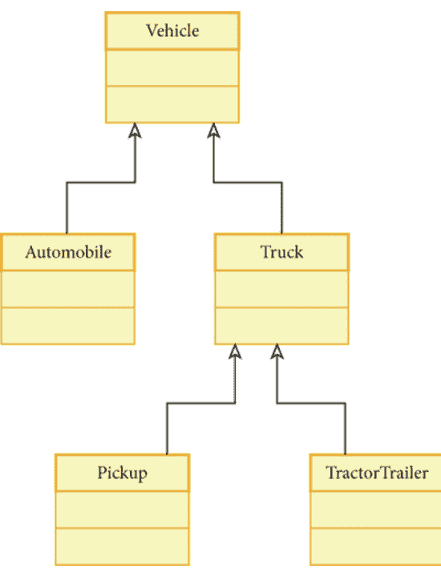

**图 10.1 车辆类层次结构**

Java 类库包含许多类层次结构。类层次结构的根部是 `Object` 类，它是所有类的父类。因此，所有类都继承自 `Object` 类。

继承最重要的优势是，在类层次结构中，我们只需要编写一次公共代码。公共代码经过测试后，我们可以放心地使用它。当公共代码需要修改时，只需在一个地方进行修改。

## 10.1 继承

定义继承另一个类的子类的语法是在头部添加 `extends` 子句：

```java
访问修饰符 class 子类名 extends 父类名 {
    // 类定义
}
```

`extends` 关键字指定子类继承父类的成员。这意味着子类拥有一组预定义的方法和字段。例如，如果我们想编写名为 `Drawprite` 的类，我们扩展 `Application` 类并使用以下头部：

```java
public class Drawprite extends Application
```

这意味着 `Drawprite` 类继承自 `Application` 类。

图 10.2 显示了 `Drawprite` 类层次结构。顶部是 `Object` 类，它定义了 11 个方法。`Application` 类继承 `Object` 类，因此继承了这 11 个方法。反之，`Application` 类定义了两个字段和 10 个方法。所以当我们的 `Drawprite` 类继承 `Application` 时，`Drawprite` 类继承了这些方法和字段。在整个层次结构中，子类都继承方法和字段。

## 10.2 继承设计

我们说子类和父类之间存在“是一个”的关系；即子类对象“是一个”父类对象。例如，我们可以定义一个 `Student` 类层次结构，以 `Student` 为父类并派生出 `GraduateStudent` 子类。研究生“是一个”学生，但实际上是学生的特殊类型。我们还可以定义 `Employee` 类层次结构，以 `Employee` 为父类并派生出 `Faculty` 和 `Staff` 子类，因为教师和员工都是员工的特殊类型。

为了设计用于类，我们的父类应该定义层次结构中所有类共有的字段和方法。每个子类将通过添加方法和字段提供特殊化。在适当的情况下，子类还可以提供继承方法的新版本，这被称为*重写方法*。

> **软件工程提示**
> 类层次结构中的父类应包含所有子类共有的字段和方法。子类应该添加专门的字段和方法。

让我们构建一个银行账户类层次结构。我们首先定义一个通用的 `BankAccount` 超类。`BankAccount` 类将包含所有银行账户共有的字段和方法。然后，我们将定义一个继承自 `BankAccount` 类的 `CheckingAccount` 类。`CheckingAccount` 类将添加专门支持支票账户的实例变量和方法。我们的类层次结构如图 10.3 所示 UML 图所示。在该图中，我们将实例变量显示在类名正下方的框中，将方法显示在再下方的框中。类成员前的“+”符号表示该成员是公共的（public），而“-”符号表示该成员是私有的（private）。每个方法的签名都给出了，括号内列出了每个参数的类型，冒号后面是返回类型。`Object` 类拥有的方法比我们在 UML 图中显示的更多。然而，`toString` 方法是我们在该层次结构中唯一处理的 `Object` 方法，因此我们在图中省略了 `Object` 的其他方法，并指示其他方法存在（+..()）。

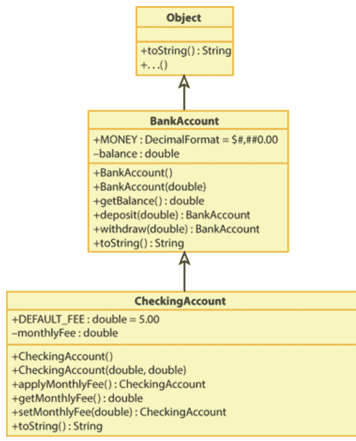

**图 10.3 BankAccount 类层次结构**

### 10.2.1 类的被继承成员

如示例 10.1 所示，我们的 `BankAccount` 类有两个实例变量：`double` 类型的 `balance`（第 11 行），以及一个常量 `DecimalFormat` 对象，我们将它用于将 `balance` 格式化为货币（第 9-10 行）。我们提供了两个构造函数。默认构造函数（第 13-19 行）将 `balance` 实例变量设置为 0.0。重载构造函数（第 21-27 行）接收一个初始余额并将该参数传递给 `deposit` 方法（第 37-48 行），该方法会将任何非负金额加到 `balance` 中；否则，它保持 `balance` 不变。

`withdraw` 方法（第 50-62 行）验证 `amount` 参数不小于 0.0 且大于 `balance`。如果 `amount` 有效，`withdraw` 方法将从 `balance` 中减去 `amount`；否则，它保持 `balance` 不变。

`BankAccount` 类的其他方法包括 `balance` 访问器（第 29-35 行）和 `toString` 方法（第 64-71 行），后者使用 `DecimalFormat` 对象 `MONEY` 返回格式化为货币的 `balance`。注意，我们在 `toString` 方法的头部之前写了 `@Override`。我们正在替换 `Object` 类中的 `toString` 版本，也就是说，我们正在重写 `Object` 版本的 `toString` 方法。要替换方法，我们必须编写与要重写的方法完全相同的方法头。通过使用 `@Override` 注解，我们向编译器发出我们要重写方法的意图。如果我们的方法头编码不正确，编译器将生成错误。因此，这是检查工作的一种。

#### 示例 10.1 BankAccount 类，版本 1

```java
/**
 * BankAccount 类，版本 1
 * Anderson, Franceschi
 * 代表一个通用银行账户
 */

import java.text.DecimalFormat;

public class BankAccount {

    public final DecimalFormat MONEY = new DecimalFormat("$#,##.00");
    private double balance;

    /**
     * 默认构造函数
     * 将 balance 设置为 0.0
     */
    public BankAccount() {
        balance = 0.0;
    }

    /**
     * 重载 balance 构造函数
     * @param balance 初始余额
     */
    public BankAccount(double balance) {
        deposit(balance);
    }

    /**
     * balance 的访问器
     * @return 当前账户余额
     */
    public double getBalance() {
        return balance;
    }

    /**
     * 向账户存款
     * @param amount 要存款的金额；amount 必须 >= 0.0
     * @return 对此对象的引用
     */
    public BankAccount deposit(double amount) {
        if (amount >= 0.0)
            balance += amount;
        return this;
    }

    /**
     * 从账户取款
     * @param amount 要取款的金额；amount 必须 >= 0.0；amount 必须 <= balance
     * @return 对此对象的引用
     */
    public BankAccount withdraw(double amount) {
        if (amount >= 0.0 && amount <= balance) {
            balance -= amount;
            return this;
        }
    }

    /**
     * @return 格式化为货币的余额
     */
    @Override
    public String toString() {
        return "balance is " + MONEY.format(balance);
    }
}
```

现在我们可以派生我们的 `CheckingAccount` 类。示例 10.2 显示了 `CheckingAccount` 类的版本 1，我们简单地继承继承 `BankAccount`（第 5 行）。类体目前是空的。

#### 示例 10.2 CheckingAccount 类，版本 1

```java
/**
 * CheckingAccount 类，版本 1
 * Anderson, Franceschi
 */

public class CheckingAccount extends BankAccount {
}
```

当一个类继承父类时，它继承了父类的所有公共字段和方法（排除构造函数）。这意味着 `CheckingAccount` 类继承了实例变量以及 `getBalance`、`deposit`、`withdraw` 和 `toString` 方法。声明为私有的字段和方法没有被继承，因此子类无法访问。然而，`CheckingAccount` 对象“是一个” `BankAccount` 对象，因此 `CheckingAccount` 对象拥有 `balance`。

调用方法来检索和更改实例变量似乎很繁琐，但它强制了封装。允许 `CheckingAccount` 类直接设置 `balance` 的值会增加维护性。`CheckingAccount` 类将需要知道 `balance` 的验证规则。如果这些规则发生变化，`CheckingAccount` 类也需要变化。

Java 提供了 `protected` 访问修饰符，使得字段和方法可以被子类继承（如公共字段和方法所示），同时对客户端类隐藏（如私有字段和方法所示）。此外，与父类在同一包中的任何类都可以直接访问 `protected` 字段，即使该类不是子类。由于多个类可以直接访问 `protected` 字段，`protected` 访问破坏了封装并增加了维护难度。出于此原因，我们倾向于使用 `private` 而不是 `protected` 来定义我们的实例变量。我们将在本章后面详细讨论 `private` 和 `protected` 之间的区别。

**表 10.1 继承规则**

| 父类成员 | 被子类继承？ | 子类直接访问？ | 子类的客户端直接访问？ |
|---|---|---|---|
| 公共字段 | 是 | 是，通过名称 | 是 |
| 公共方法 | 是 | 是，通过子类方法调用 | 是 |
| protected 字段 | 是 | 是，通过名称 | 否，必须使用访问器和修改器 |
| protected 方法 | 是 | 是，通过子类方法调用 | 否，必须使用访问器和修改器 |
| 私有字段 | 否 | 否，必须使用访问器和修改器 | 否，必须使用访问器和修改器 |
| 私有方法 | 否 | 否 | 否 |

示例 10.3 显示了 `CheckingAccount` 类的客户端。在第 9 行，我们实例化 `CheckingAccount` 类的对象。实例化后，`c1` 对象拥有两个字段（`balance` 和 `MONEY`），它从 `BankAccount` 继承了四个方法（`getBalance`、`deposit`、`withdraw` 和 `toString`）。

我们通过使用 `c1` 对象引用来调用第 12 行的 `deposit` 方法和第 15 行的 `withdraw` 方法，并在第 13 行和第 16 行隐式地调用 `toString` 方法。图 10.4 显示了该程序的输出。

#### 示例 10.3 CheckingAccountClient, 版本 1

```java
/* CheckingAccount Client, Version 1
Anderson, Franceschi
*/

public class CheckingAccountClient {
    public static void main(String[] args) {
        CheckingAccount cl = new CheckingAccount();
        System.out.println("New checking account: " + cl);

        cl.deposit(350.75);
        System.out.println("\nAfter depositing 350.75: " + cl);

        cl.withdraw(200.25);
        System.out.println("\nAfter withdrawing 200.25: " + cl);
    }
}
```

**图 10.4 CheckingAccountClient, Version 1 输出**

```
New checking account: balance is $0.00
After depositing $350.75: balance is $350.75
After withdrawing $200.25: balance is $150.50
```


## 10.2.2 子类构造函数

尽管构造函数是公共的，但它们不会被子类继承。然而，为了初始化父类的私有实例变量，子类构造函数可以隐式或显式地调用父类构造函数。

当一个类扩展另一个类时，子类的默认构造函数调用父类的默认构造函数。这被称为隐式调用。虽然我们在[示例 10.2](#example-10.2) 中的 `CheckingAccount` 类中没有编写任何构造函数，但我们仍然能够实例化 `CheckingAccount` 对象（余额为 `0.0`），因为 Java 编译器为 `CheckingAccount` 类提供了一个默认构造函数，该构造函数隐式地调用了 `BankAccount` 类的构造函数。

要显式地调用直接父类的构造函数，子类构造函数使用以下语法：

```java
super(argument list);
```

因此，如果我们想实例化一个初始余额不是 `0.0` 的 `CheckingAccount` 对象，我们就需要为 `CheckingAccount` 类提供一个重载构造函数。该构造函数将初始余额作为参数，并将该初始余额传递给 `BankAccount` 类中的重载构造函数。

如果使用了对直接父类构造函数的调用，必须是子类构造函数中的第一个语句。否则，将产生以下编译器错误：

### 常见错误陷阱

在构造函数中，如果使用了对直接父类构造函数的调用，必须是第一条语句。

```
call to super must be first statement in constructor
```

示例 10.4 显示了 `BankAccount` 类的 Version 2，为了简单起见并帮助我们关注构造函数，它只有一个默认构造函数、重载构造函数和 `toString` 方法。为了说明构造函数执行的顺序，我们在每个构造函数中打印了一条消息（第 21 行和 33 行），表示它已被调用。

### 示例 10.4 BankAccount 类，Version 2

```java
1 /** BankAccount class, Version 2
2  * 仅包含构造函数和 toString 方法
3  * Anderson, Franceschi
4  * 代表一个通银行账户
5  */
6
7 import java.text.DecimalFormat;
8
9 public class BankAccount
10 {
11     public final DecimalFormat MONEY
12         = new DecimalFormat(
13             "$$,##.00");
14     private double balance;
15
16     /** 默认构造函数
17      * 将余额 设置为 0.0
18      */
19     public BankAccount()
20     {
21         balance = 0.0;
22         System.out.println("In BankAccount default constructor");
23     }
24
25     /** 重载构造函数
26      * @param balance 初始余额
27      */
28     public BankAccount(double balance)
29     {
30         if (balance >= 0.0)
31             this.balance = balance;
32         else
33             this.balance = 0.0;
34         System.out.println("In BankAccount overloaded constructor ");
35     }
36
37     /** toString
38      * @return 格式化为货币的余额
39      */
40     @Override
41     public String toString()
42     {
43         return "balance is " + MONEY.format(balance);
44     }
}
```

示例 10.5 显示了 `CheckingAccount` 类的 Version 2，为了简单起见并帮助我们关注构造函数，它只有一个默认构造函数、重载构造函数和 `toString` 方法。为了说明构造函数执行的顺序，我们在每个构造函数中打印了一条消息（第 21 行和 33 行），表示它已被调用。

### 示例 10.5 CheckingAccount 类，Version 2

```java
1 /* CheckingAccount class, Version 2
2  Anderson, Franceschi
3  */
4 public class CheckingAccount extends BankAccount
5
6 /** 默认构造函数
7  * 将余额 设置为 0.0
8  */
9 public CheckingAccount()
10 {
11     super();
12     System.out.println("In CheckingAccount default constructor");
13 }
14
15 /** 重载构造函数
16  * @param balance 初始余额
17  */
18 public CheckingAccount(double balance)
19 {
20     super(balance);
21     System.out.println("In CheckingAccount overloaded constructor ");
22 }
23
24 /** toString
25  * @return 格式化为货币的余额
26  */
27 @Override
28 public String toString()
29 {
30     return "checking account: " + MONEY.format(balance);
31 }
32 }
```

### 表 10.2 构造函数的继承规则

| 父类成员 | 子类是否继承？ | 子类是否可以直接访问？ | 使用子类引用的客户端是否可以直接访问？ |
|---|---|---|---|
| 构造函数 | 否 | 是，在子类构造函数中使用 `super(arg list)` | 否 |

## 10.2.3 为子类添加特化功能

此时，我们的 `CheckingAccount` 类提供的功能比 `BankAccount` 类更多。但我们定义 `CheckingAccount` 类的目的是为了为一种特殊的银行账户提供支持。为了给我们的 `CheckingAccount` 子类添加特化功能，我们定义了新的字段和方法。例如，我们可以定义一个 `monthlyFee` 实例变量，以及用于月费的访问器方法（accessor）和修改器方法（mutator），以及一个向账户收取月费的方法。

示例 10.7 显示了添加了特化功能的 `CheckingAccount` 类版本 3。该版本扩展了示例 10.1 所示的完整 `BankAccount` 类。我们在第 8 行添加了 `monthlyFee` 实例变量，以及为月费添加了一个常量默认值（第 7 行）。我们的默认构造函数（第 10–18 行）仍然调用 `BankAccount` 类的默认构造函数来初始化余额，但也将 `monthlyFee` 初始化为默认值。

同样，重载构造函数（第 20–30 行）将 `balance` 参数传递给 `BankAccount` 的重载构造函数，并添加了一个 `monthlyFee` 参数来接收月费的初始值，然后将其传递给 `setMonthlyFee` 修改器方法（第 50–60 行）。

`applyMonthlyFee` 方法（第 32–40 行）用于向支账户收取月费，它调用了从 `BankAccount` 类继承的 `withdraw` 方法来访问 `balance` 实例变量，该变量在 `BankAccount` 类中被声明为私有。

### 示例 10.7 CheckingAccount 类，版本 3

```java
1 /* CheckingAccount class, version 3
2  Anderson, Franceschi
3  */
4
5 public class CheckingAccount extends BankAccount
6 {
7     public final double DEFAULT_FEE = 5.00;
8     private double monthlyFee;
9
10    /** default constructor
11     * explicitly calls the BankAccount default
12     * constructor
13     * sets monthlyFee to default value
14     */
15    public CheckingAccount()
16    {
17        super(); // optional
18        monthlyFee = DEFAULT_FEE;
19    }
20
21    /** overloaded constructor
22     * calls BankAccount overloaded constructor
23     * @param balance starting balance
24     * @param monthlyFee starting monthly fee
25     */
26    public CheckingAccount( double balance,
27                          double monthlyFee )
28    {
29        super( balance ); // call BankAccount constructor
30        setMonthlyFee( monthlyFee );
31    }
32
33    /** applyMonthlyFee method
34     * charges the monthly fee to the account
35     * @return a reference to this object
36     */
37    public CheckingAccount applyMonthlyFee()
38    {
39        withdraw( monthlyFee);
40        return this;
41    }
42
43    /** accessor method for monthlyFee
44     * @return monthlyFee
45     */
46    public double getMonthlyFee()
47    {
48        return monthlyFee;
49    }
50
51    /** mutator method for monthlyFee
52     * @param monthlyFee new value for monthlyFee
53     * @return a reference to this object
54     */
55    public CheckingAccount setMonthlyFee( double
56        monthlyFee )
57    {
58        if ( monthlyFee >= 0.0 )
59            this.monthlyFee = monthlyFee;
60
60        return this;
61    }
62
62    /* toString method
63     * @return String containing formatted
64     balance and monthlyFee
65     invokes superclass toString to format
66     balance
67     */
68    @Override
69    public String toString()
70    {
71        return super.toString()
72                + " monthly fee is " +
73                MONEY.format( monthlyFee );
74    }
75}
```

示例 10.8 显示了我们客户端程序的版本 3，它实例化了一个 `CheckingAccount` 对象并收取了月费。输出见图 10.6。

### 图 10.6 来自 CheckingAccountClient, 版本 3 的输出

```
New checking account:
balance is $100.00; monthly fee is $7.50
After charging monthly fee:
balance is $92.50; monthly fee is $7.50
```

### 示例 10.8 CheckingAccountClient, 版本 3

```java
1 /* CheckingAccount Client, Version 3
2  Anderson, Franceschi
3  */
4
5 public class CheckingAccountClient
6 {
7     public static void main(String [] args)
8     {
9         CheckingAccount c3 = new CheckingAccount(
10             100.00, 7.50);
11         System.out.println("New checking account:\n"
12             + c3.toString()
13             + "; monthly fee is "
14             + c3.getMonthlyFee()
15         );
16         c3.applyMonthlyFee(); // charge the fee to the account
17         System.out.println("\nAfter charging monthly fee:\n"
18             + c3.toString()
19             + "; monthly fee is "
20             + c3.getMonthlyFee()
21         );
22     }
}
```

示例 10.1 显示了 `CheckingAccountClient` 类的版本 4。在类中，我们再次实例化了一个初始余额为 `$100.00`、月费为 `$7.50` 的 `CheckingAccount` 对象（第 9 行），然后隐式地调用了 `toString` 方法来打印对象的数据（第 10 行）。这次，我们调用了 `CheckingAccount` 类的 `toString` 方法，该方法返回了余额和月费值，并以货币格式格式化，如图 10.7 所示。

### 常见错误陷阱

不要将重写（overriding）与重载（overloading）混淆。子类重写方法提供了该方法的新版本，从而隐藏了父类版本。类重载方法增加了该方法的版本，该版本在参数的数量和/或类型上有所不同。

### 图 10.7 CheckingAccountClient 的输出，版本 4

```
New checking account:
balance is $100.00; monthly fee is $7.50
```

### 示例 10.10 CheckingAccountClient, 版本 4

```java
1 /* CheckingAccount Client, Version 4
2  Anderson, Franceschi
3  */
4
5 public class CheckingAccountClient
6 {
6     public static void main( String [] args)
7     {
8         CheckingAccount c4 = new CheckingAccount(100.00, 7.50);
9         System.out.println("New checking account:\n" + c4);
10
11     }
}
```

### 表 10.3 被重写方法的继承规则

| 父类成员 | 子类是否继承？ | 子类是否可以直接访问？ | 使用子类引用的客户端类是否可以直接访问？ |
| :--- | :--- | :--- | :--- |
| 在子类中被重写的 public 或 protected 继承方法 | 否 | 是，使用 `super.methodName( arg list )` | 否 |

当我们重写一个方法时，方法的签名必须与继承的方法完全相同。然而，在重写方法指定某个类作为参数或返回类型的地方，我们可以用子类来替换该参数或返回类型。

这是可能的，因为子类对象也是父类对象，因此子类对象引用可以替换任何父类对象引用。如果一个类中的两个方法名称相同但签名不同（也就是说参数的数量、顺序或类型不同），那么该方法就是重载，而不是重写。

例如，如果我们在 `CheckingAccount` 类中写 `toString` 方法时，使用了以下指定 `int` 参数的标头：

```java
public String toString( int a )
```


> **软件工程提示**
> 重写继承方法的方法在合适的情况下应显式地调用直接父类方法。

那么我们的 `toString` 方法的签名将与从 `BankAccount` 类继承的 `toString` 方法不同，后者不接受任何参数。在这种情况下，我们是在重载 `toString` 方法，而不是重写它。换句话说，我们提供了 `toString` 方法的一个额外版本。继承的版本仍然可见并可以调用。

表 10.4 阐述了重写 public 方法与重载 public 方法之间的区别。

## 表 10.4 重写与重载方法

| 方法名 | 参数列表 | 返回类型 | 使用子类对象引用的子类客户端是否可以直接访问？ |
| :--- | :--- | :--- | :--- |
| 重写 public 方法 | 相同 | 相同 | 只能调用子类版本 |
| 重载 public 方法 | 参数的数量或类型不同 | 相同 | 可以调用重载方法的所有版本 |

## 技能练习

### 10.10.1 多选题
题目 1, 2, 4, 8, 9

### 10.10.3 代码填空
题目 21, 22, 23, 24

### 10.10.5 调试区域
题目 32, 34, 35

### 10.10.6 编写短程序
题目 36, 37, 38, 39, 40, 41, 42, 43, 44, 45, 46

### 10.10.8 技术写作
题目 56

## 10.3 protected 访问修饰符

我们已经看到子类不继承父类的构造函数或 `private`（私有）成员。然而，父类的构造函数仍然可以从子类调用，且父类的 `private` 字段被实现为子类的字段。

尽管 `private` 字段保护了封装，但调用方法涉及额外的处理开销。每当调用方法时，JVM 都会对参数进行复制。`protected` 访问修饰符的设计是为了避免这种开销，并通过允许子类访问任何 `protected` 字段而无需调用其访问器或修改器方法来方便编码。但注意，`protected` 字段和方法也可以被同一包中的其他类直接访问，即使这些类不在同一个层级结构中。

对于包外部的类，`protected` 成员受到的限制与 `private` 成员相同。换句话说，包外部的类可以通过 `public` 访问器或修改器访问 `protected` 字段。

`protected` 访问修饰符存在权衡。正如我们提到的，任何声明为 `protected` 的字段都可以被子类直接访问。然而，这样做会损害封装性，因为多个类可以设置 `protected` 实例变量的值。因此，维护定义或使用 `protected` 成员的类变得更加困难。例如，我们需要验证任何访问 `protected` 变量的类要么不设置该值，要么如果该类确实更改了值，则新值是有效的。由于这种维护的复杂性，我们建议仅在高性能至关重要的情况下才使用 `protected` 访问。

## 软件工程提示

除非高性能是关键需求，否则避免使用 `protected` 访问修饰符，因为这样做会损害封装并增加程序的维护复杂度。在可能的情况下，调用父类方法来更改 `protected` 变量的值。

我们还建议子类方法避免直接设置 `protected` 实例变量的值。相反，在可能的情况下，当需要更改 `protected` 变量的值时，调用父类方法。

为了说明 `protected` 访问如何在类层级结构中使用，让我们仔细查看我们的 `CheckingAccount` 类。我们一直在调用从 `BankAccount` 类继承的 `withdraw` 方法来收取月费。然而，如果取款金额大于余额，`withdraw` 方法将保持余额不变。因此，如果账户资金不足，就不会收取月费。我们希望 `CheckingAccount` 类能够向账户扣除月费，并允许余额变为负数。

为了实现这一点，我们将 `balance` 实例变量声明为 `protected` 而不是 `private`。这允许我们在 `CheckingAccount` 类的 `applyMonthlyFee` 方法中直接访问 `balance`，因为 `balance` 现在被 `CheckingAccount` 继承了。

示例 10.11 显示了 `BankAccount` 类的版本 3。与版本 1（示例 10.1）相比，唯一的变化是 `balance` 实例变量被声明为 `protected` 而不是 `private`（第 11 行）。

## 示例 10.11 BankAccount 类，版本 3

```java
/**
 * BankAccount 类, 版本 1
 * Anderson, Franceschi
 * 表示一个通用银行账户
 */

import java.text.DecimalFormat;

public class BankAccount
{
    public final DecimalFormat MONEY = new DecimalFormat("$#,##.00");
    protected double balance;

    /** 默认构造函数
     * 将 balance 设置为 0.0
     */
    public BankAccount()
    {
        balance = 0.0;
    }

    /** 重载构造函数
     * @param balance 余额
     */
    public BankAccount( double balance )
    {
        deposit( balance );
    }

    /** balance 的访问器
     * @return 当前账户余额
     */
    public double getBalance()
    {
        return balance;
    }

    /** 将金额存入账户
     * @param amount      要存入的金额
     *      amount 必须 >= 0.0
     * @return 此对象的引用
     */
    public BankAccount deposit( double amount )
    {
        if (  amount >= 0.0 )
            balance += amount;
        return this;
    }

    /** 从账户中取出金额
     * @param amount      要取出的金额
     *      amount 必须 >= 0.0
     *      amount 必须 <= balance
     * @return 此对象的引用
     */
    public BankAccount withdraw( double amount )
    {
        if ( amount >= 0.0 && amount <= balance)
            balance -= amount;
        return this;
    }

    /** toString
     * @return 格式化为货币的余额
     */
    @Override
    public String toString()
    {
        return "balance is " + MONEY.format( balance );
    }
}
```

示例 10.12 显示了 `CheckingAccount` 类版本 5，它继承自示例 10.11 中的 `BankAccount` 类，该类将 `balance` 声明为 `protected`。`CheckingAccount` 类现在可以直接访问 `balance`。尽管如此，在默认构造函数和重载构造函数中（第 16 和 28 行），我们仍然调用父类构造函数来设置 `balance` 的值。否则，为了避免将 `balance` 设置为无效值，在 `applyMonthlyFee` 方法（第 32–41 行）中，我们需要进行验证。对于这个支票账户，如果结果是负余额，银行将收取月费，因此我们从 `balance` 中减去 `monthlyFee`，这允许 `balance` 变为负数。

## 示例 10.12 CheckingAccount 类，版本 5

```java
/* CheckingAccount 类, 版本 5
 * Anderson, Franceschi
 */

public class CheckingAccount extends BankAccount
{
    public final double DEFAULT_FEE = 5.00;
    private double monthlyFee;

    /** 默认构造函数
     * 显式调用 BankAccount 构造函数
     * 设置 monthlyFee 为默认
     */
    public CheckingAccount()
    {
        super(); // 调用 BankAccount 构造函数
        monthlyFee = DEFAULT_FEE;
    }

    /** 重载构造函数
     * 调用 BankAccount 重载构造函数
     * @param balance 初始余额
     * @param monthlyFee 初始月费
     */
    public CheckingAccount( double balance, double monthlyFee )
    {
        super( balance ); // 调用 BankAccount 构造函数
        setMonthlyFee( monthlyFee );
    }

    /** applyMonthlyFee 方法
     * 向账户扣除月费
     * @return 此对象的引用
     */
    public CheckingAccount applyMonthlyFee()
    {
        balance -= monthlyFee;
        return this;
    }

    /** monthlyFee 的访问方法
     * @return monthlyFee
     */
    public double getMonthlyFee()
    {
        return monthlyFee;
    }

    /** monthlyFee 的修改方法
     * @param monthlyFee monthlyFee 的新值
     * @return 此对象的引用
     */
    public CheckingAccount setMonthlyFee( double monthlyFee )
    {
        if ( monthlyFee >= 0.0 ) {
            this.monthlyFee = monthlyFee;
            return this;
        }
    }

    /** toString 方法
     * @return 包含 balance 和 monthlyFee 的字符串
     * 调用父类的 toString 来格式化 balance
     */
    @Override
    public String toString() {
        return super.toString() + "; monthly fee is " + MONEY.format(monthlyFee);
    }
}
```

示例 10.13 显示了 `CheckingAccountClient` 类版本 5。在此类中，我们再次实例化余额为 $100.00、月费为 $7.50 的 `CheckingAccount` 对象（第 9 行）。然后我们调用 `withdraw`（第 12 行），导致余额小于月费。我们调用 `applyMonthlyFee` 方法（第 16 行）。然后我们检查余额是否为负（第 17 行）。如果是，我们输出账户透支的警告消息（第 18 行）。在任何情况下，我们都输出新余额（第 19 行）。示例 10.13 的输出所示图 10.8。

## 图 10.8
来自 CheckingClient 版本 5 的输出

```
New checking account:
balance is $100.00; monthly fee is $7.50
After withdrawing $95:
balance is $5.00; monthly fee is $7.50
Applying the monthly fee:
Warning: account is overdrawn!
balance is -$2.50; monthly fee is $7.50
```

## 示例 10.13 CheckingAccountClient 类，版本 5

```java
/* CheckingAccountClient, 版本 5
 * Anderson, Franceschi
 */

public class CheckingAccountClient
{
    public static void main( String [] args)
    {
        CheckingAccount c5 = new CheckingAccount(100.00, 7.50);
        System.out.println("New checking account:\n" + c5);
        c5.withdraw( 95);
        System.out.println("\nAfter withdrawing\n95:\n" + c5);
        System.out.println("\nApplying the monthly fee: ");
        c5.applyMonthlyFee();
        if ( c5.getBalance() < 0.0 )
            System.out.println("Warning: account is overdrawn!");
        System.out.println( c5 );
    }
}
```

表 10.5 汇总了我们讨论的所有继承规则。

## 表 10.5 继承规则

| 父类成员 | 是否被子类继承？ | 子类是否可以直接访问？ | 子类客户端是否可以直接访问？ |
| :--- | :--- | :--- | :--- |
| public (公共) 字段 | 是 | 是，通过使用名称 | 是 |
| public 方法 | 是 | 是，通过其他子类方法调用方法 | 是，通过使用子类引用调用方法 |
| protected (保护) 字段 | 是 | 是，通过使用名称 | 否，必须使用访问器和修改器 |
| protected 方法 | 是 | 是，通过子类方法调用方法 | 否 |
| private (私有) 字段 | 否 | 否，必须使用访问器和修改器 | 否，必须使用访问器和修改器 |
| private 方法 | 否 | 否 | 否 |
| private 构造函数 | 否 | 是，在子类构造函数中使用 `super( 参数 list )` | 否 |

| 父类成员 | 是否被子类继承？ | 子类是否可以直接访问？ | 子类客户端是否可以直接访问？ |
| --- | --- | --- | --- |
| 在子类中被重写的 public 或 protected 继承方法 | 否 | 是，使用 `super.methodName( 参数 list )` | 否 |

## 技能练习
通过这些章节结束

### 10.10.2 阅读和理解代码
问题 12, 13, 14, 15, 16, 17, 18, 19, 20

## 指令

将本章的“编程活动 1”文件夹中的源文件复制到你计算机上的文件夹中。加载 `SavingsAccount.java` 源文件并搜索连续的五个星号（`*****`）。这会将你定位到文件中的六个位置，你将在这些位置上添加代码来完成 `SavingsAccount` 类。`SavingsAccount.java` 文件所示示例 10.14。

# 示例 10.14 SavingsAccount.java

```java
1 /* SavingsAccount 类
2 * Anderson, Francesi
3 */
4
5 import java.text.DecimalFormat;
6
7 // 1. ***** 表示 SavingsAccount 继承
8 // BankAccount
9 public class SavingsAccount
10 {
11     public final double DEFAULT_RATE = .03;
12     // 2. ***** 定义私有实例成员变量 interestRate
13     // interestRate 是一个 double 类型，代表年利率
14
15
16
17
     // 3 ***** 编写默认构造函数
18     /** 默认构造函数
19      * 显式调用 BankAccount 默认构造函数
20      * 将 interestRate 设置为默认值 DEFAULT_RATE
21      * 向 System.out 打印消息，指示
22      * 构造函数已被调用
23      */
24
25
26
27
     // 4 ***** 编写重载构造函数
28     /** 重载构造函数
29      * 显式调用 BankAccount 重载构造函数
```


## 任务列表

30. 调用 `setInterestRate` 方法，并传入 `interestRate`
31. 向 `System.out` 打印消息，指示
32. 构造函数已被调用
33. `@param balance` 初始余额
34. `@param interestRate` 初始利率

// 5 ******* 编写此方法：
/** `applyInterest` 方法，无参数。
 * 调用 `deposit` 方法，传入一个月的利息
 * 记住 `interestRate` 实例变量是年利率
 *
 * @return 对此对象的引用
 */

/**** `interestRate` 的访问器方法
 * @return `interestRate`
 */
```java
public double getInterestRate()
{
    return interestRate;
}
```

/**** `interestRate` 的修改器方法
 * @param interestRate `interestRate` 的新值
 * `interestRate` 必须 >= 0.0
 * 如果不是，则不更改值
 * 将 `interestRate` 存储为输入值 / 100
 * 也就是说，3.5 被存储为 .035
 * @return 对此对象的引用
 */
```java
public SavingsAccount setInterestRate( double interestRate )
{
    if ( interestRate >= 0.0 )
        this.interestRate = interestRate / 100;

    return this;
}
```

// 6 ***** 编写方法
/* `toToString`
 * @return 包含格式化后的余额和 `interestRate` 的字符串
 * 调用父类的 `toString` 来格式化余额
 * 使用 `DecimalFormat` 对象将 `interestRate` 格式化为百分比
 * 要创建一个用于格式化百分比的 `DecimalFormat` 对象
 * 在构造函数中使用模式："0.00%"
 */

---

当你完成这六项任务后，加载、编译并运行 `Teller` 应用程序（`Teller.java`），你用它来测试你的 `SavingsAccount` 类。当 `Teller` 应用程序启动时，会弹出一个输入初始余额的对话框。如果你在不输入余额的情况下按“回车”或“确定”按钮，程序将继续。

## Figure 类层次结构详解

让我们详细查看 `Figure` 类的层次结构代码。
示例 10.15 显示了抽象 `Figure` 类。我们在类头中（第 7 行）将该类定义为 `abstract`（抽象）。构造函数（第 13–22 行和第 24–34 行）初始化 `x` 和 `y` 值，并实例化所有图形共同拥有的 `Color` 对象。`Figure` 类还为其实例变量提供了访问器方法（accessor）和修改器方法（mutator）。抽象 `draw` 方法（第 94–97 行）为 `draw` 方法提供了 API，但没有实现——只有一个分号。`Figure` 类的子类 `Circle` 和 `Square` 将提供 `draw` 方法的适当实现。

### 示例 10.15 抽象类 Figure

```java
1 /** abstract Figure superclass for drawing shapes
2  * Anderson, Franceschi
3  * //
4  import javafx.scene.canvas.GraphicsContext;
5  import javafx.scene.paint.Color;
6
7  public abstract class Figure
8  {
9      private int x;
10      private int y;
11      private Color color;
12
13      /** default constructor
14       * sets x and y to 0
15       * sets color to black
       */
17      public Figure()
18      {
19          x = 0;
20          y = 0;
21          color = Color.BLACK;
22      }
23
24      /** overloaded constructor
25       * @param x starting x coordinate for figure
26       * @param y starting y coordinate for figure
27       * @param color figure color
       */
29      public Figure(int x, int y, Color color)
30      {
31          this.x = x;
32          this.y = y;
33          this.color = color;
34      }
35
36      /** accessor method for color
37       * @return current figure color
       */
39      public Color getColor()
40      {
41          return color;
42      }
43
44      /** mutator method for color
45       * @param new color for figure
46       * @return a reference to this object
       */
49      public Figure setColor( Color color )
50      {
51          this.color = color;
52
53          return this;
54      }
55
56      /** accessor method for x
57       * @return current x value
       */
59      public int getX()
60      {
61          return x;
62      }
63
64      /** mutator method for x
65       * @param x new value for x
66       * @return a reference to this object
       */
68      public Figure setX( int x )
69      {
70          this.x = x;
71
72          return this;
73      }
74
75      /** accessor method for y
76       * @return current y value
       */
78      public int getY( )
79      {
80          return y;
81      }
82
83      /** mutator method for y
84       * @param y new y value for y
85       * @return a reference to this object
       */
87      public Figure setY( int y )
88      {
89          this.y = y;
90
91          return this;
92      }
93
94      /** abstract draw method
95       * @param gc GraphicsContext for drawing figure
       */
97      public abstract void draw( GraphicsContext gc );
}
```

### 常见错误陷阱

**不要在抽象方法的定义中包含大括号。** 包含大括号意味着该方法已实现，但它什么都不做。相反，请仅使用分号来表示未实现的方法。

当子类继承自抽象类时，它可以为任何、所有或某个抽象方法提供实现。如果子类没有完全实现父类所有的抽象方法，则该子类也必须声明为抽象类。然而，如果子类实现了父类中所有的抽象方法，且子类没有被声明为抽象，那么该类就**不是**抽象的，我们可以实例化该子类的对象。

**尝试实例化抽象类的对象将产生以下编译器错误：** `className is abstract; cannot be instantiated`，其中 `className` 是抽象类的名称。

示例 10.16 显示了 `Circle` 类，它继承自 `Figure` 类并添加了一个半径实例变量，以及一个最小半径的常量。在重载构造函数中，我们将 `x`、`y` 和 `color` 参数传递给 `Figure` 类的构造函数（第 35 行）。在第 61–71 行，`Circle` 类实现了 `draw` 方法。我们通过调用 `Figure` 类的访问方法来获取圆的 `(x, y)` 坐标和颜色，因为 `x`、`y` 和 `color` 实例变量被声明为 `private`（私有的）。

### 示例 10.16 Circle 类

```java
1 /* Circle class
2  * inherits from abstract Figure class
3  * Anderson, Franceschi
4  */
5
6 import javafx.scene.canvas.GraphicsContext;
7 import javafx.scene.paint.Color;
8
9 public class Circle extends Figure
10 {
11     private int radius;
12     private final int MIN_RADIUS = 15;
13
14     /** default constructor
15      * calls default constructor of Figure class
16      * sets radius to minimum value
      */
18     public Circle()
19     {
20         super();
21         radius = MIN_RADIUS;
22     }
23
24     /** overloaded constructor
25      * @param x starting x coordinate for figure
26      * @param y starting y coordinate for figure
27      * @param color color for circle
28      * @param radius radius of circle
      */
30     public Circle(int x, int y, Color color, int radius)
31     {
32         super(x, y, color);
33         if (radius > MIN_RADIUS) {
34             this.radius = radius;
35         } else {
36             this.radius = MIN_RADIUS;
37         }
38     }
39
40     /** mutator method for radius
41      * @param radius new value for radius
42      * @return a reference to this object
      */
44     public Circle setRadius(int radius)
45     {
46         if (radius > MIN_RADIUS) {
47             this.radius = radius;
48         } else {
49             this.radius = MIN_RADIUS;
50         }
51
52         return this;
53     }
54
55     /** accessor method for radius
56      * @return current radius value
      */
58     public int getRadius()
59     {
60         return radius;
61     }
62
63     /** draw method
64      * sets color and draws a circle
65      * @param gc GraphicsContext for drawing figure
      */
67     @Override
68     public void draw(GraphicsContext gc)
69     {
70         gc.setFill(getColor());
71         gc.fillOval(getX(), getY(), radius * 2, radius * 2);
72     }
73
}
```

同样地，示例 10.17 显示了 `Square` 类，它继承自 `Figure` 类。`Square` 类添加了一个长度实例变量以及一个最小长度的常量，并像 `Circle` 类一样调用了 `Figure` 类的构造函数（第 20 和 35 行）并实现了其 `draw` 方法（第 61–71 行）。

### 示例 10.17 Square 类

```java
1 /* Square class
2  * inherits from abstract Figure class
3  * Anderson, Franceschi
4  */
5
6 import javafx.scene.canvas.GraphicsContext;
7 import javafx.scene.paint.Color;
8
9 public class Square extends Figure
10 {
11     private int length;
12     private final int MIN_LENGTH = 10;
13
14     /** default constructor
15      * calls default constructor of Figure class
16      * sets length to minimum value
      */
18     public Square()
19     {
20         super();
21         length = MIN_LENGTH;
22     }
23
24     /** overloaded constructor
25      * @param x starting x coordinate for figure
26      * @param y starting y coordinate for figure
27      * @param color color for figure
28      * @param length length of figure
      */
30     public Square(int x, int y, Color color, int length)
31     {
32         super(x, y, color);
33         if (length > MIN_LENGTH) {
34             this.length = length;
35         } else {
36             this.length = MIN_LENGTH;
37         }
38     }
39
40     /** mutator method for length
41      * @param length new value for length
42      * @return a reference to this object
      */
44     public Square setLength(int length)
45     {
46         if (length > MIN_LENGTH) {
47             this.length = length;
48         } else {
49             this.length = MIN_LENGTH;
50         }
51
52         return this;
53     }
54
55     /** accessor method for length
56      * @return current length value
      */
58     public int getLength()
59     {
60         return length;
61     }
62
63     /** draw method
64      * sets color and draws a square
65      * @param gc GraphicsContext for drawing figure
      */
67     @Override
68     public void draw(GraphicsContext gc)
69     {
70         gc.setFill(getColor());
71         gc.fillRect(getX(), getY(), length, length);
72     }
73
}
```


# 示例 10.18 TrafficLight 应用程序

```java
68   public void draw(GraphicsContext gc)
69   {
70     gc.setFill(getColor());
71     gc.fillRectangle(getX(), getY(), length * 2, length * 2);
72   }
73 }
```

```java
64    */
65    @Override
66    public void draw(GraphicsContext gc)
67    {
        gc.setFillColor(getColor());
        gc.fillRect(getX(), getY(),
                length, length);
    }
}
```

由于我们需要实例化 `Circle` 和 `Square` 对象，因此我们没有将这些类声明为抽象类，并且它们被强制实现 `draw` 方法。示例 10.18 显示了一个名为 `TrafficLight` 的图形应用程序，它绘制了一个交通灯，如图 10.13 所示。在第 13 行和 14 行，我们声明了两个 `ArrayList`，一个用于存储 `Circle` 对象，另一个用于存储 `Square` 对象。在 `start` 方法中，我们将 `Square` 对象实例化到 `ArrayList` 中，并向 `squaresList` 添加了三个 `Square` 对象，向 `circlesList` 添加了三个 `Circle` 对象（第 26–40 行）。然后，我们通过调用 `squaresList` 中所有 `Square` 的 `draw` 方法来创建交通灯（第 42–43 行），然后调用 `circlesList` 中所有 `Circle` 的 `draw` 方法（第 45–46 行）。

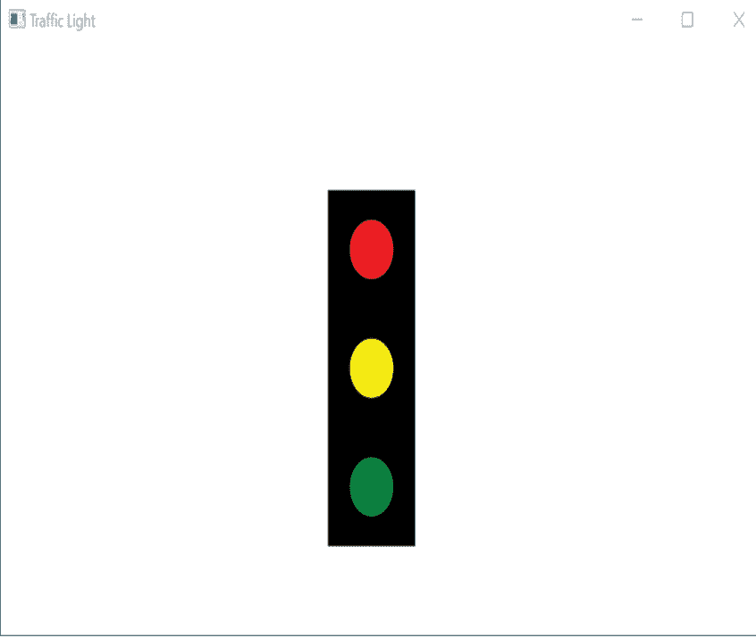

**图 10.13**
*TrafficLight* 应用程序

# 示例 10.18 TrafficLight 应用程序

```java
1 /* Figure Hierarchy Client
2  * Anderson, Franceschi
3  */
4 import javafx.application.Application;
5 import javafx.scene.canvas.GraphicsContext;
6 import javafx.scene.paint.Color;
7 import javafx.stage.Stage;
8
9 import java.util.ArrayList;
10
11 public class TrafficLight extends Application
12 {
13     private ArrayList<Square> squaresList;
14     private ArrayList<Circle> circlesList;
15
16     @Override
17     public void start(Stage stage)
18     {
19         GraphicsContext gc = JIGraphicsUtility.setUpGraphics(
20             stage, "Traffic Light", 700, 400);
21
22         final int SQUARE_SIZE = 80, CIRCLE_RADIUS = 20;
23         final int SQUARE_X = 300, CIRCLE_X = SQUARE_X + 20;
24         final int SQUARE_Y = 100, CIRCLE_Y = SQUARE_Y + 20;
25
26         squaresList = new ArrayList<Square>();
27         squaresList.add(new Square(SQUARE_X, SQUARE_Y,
28             Color.BLACK, SQUARE_SIZE));
29         squaresList.add(new Square(SQUARE_X, SQUARE_Y +
30             SQUARE_SIZE, Color.BLACK, SQUARE_SIZE));
31         squaresList.add(new Square(SQUARE_X, SQUARE_Y +
32             SQUARE_SIZE * 2, Color.BLACK, SQUARE_SIZE));
33
34         circlesList = new ArrayList<Circle>();
35         circlesList.add(new Circle(CIRCLE_X, CIRCLE_Y,
36             Color.RED, CIRCLE_RADIUS));
37         circlesList.add(new Circle(CIRCLE_X, CIRCLE_Y +
38             SQUARE_SIZE, Color.YELLOW, CIRCLE_RADIUS));
39         circlesList.add(new Circle(CIRCLE_X, CIRCLE_Y +
40             SQUARE_SIZE * 2, Color.GREEN, CIRCLE_RADIUS));
41
42         for (Square s : squaresList)
43             s.draw(gc);
44
45         for (Circle c : circlesList)
46             c.draw(gc);
47     }
48
49     public static void main(String[] args)
50     {
51         launch(args);
52     }
53 }
```

```java
/* Figure Hierarchy Client
 * Anderson, Franceschi
 * */
import javafx.application.Application;
import javafx.scene.canvas.GraphicsContext;
import javafx.scene.paint.Color;
import javafx.stage.Stage;
import java.util.ArrayList;

public class TrafficLightymorphism extends Application {
    private ArrayList<Square> squaresList;
    private ArrayList<Circle> circlesList;

    @Override
    public void start(Stage stage)
    {
        GraphicsContext gc = JIGraphicsUtility.setUpGraphics(
            stage, "Traffic Light", 700, 400);
        final int SQUARE_SIZE = 80, CIRCLE_RADIUS = 20;
        final int SQUARE_X = 300, CIRCLE_X = SQUARE_X + 20;
        final int SQUARE_Y = 100, CIRCLE_Y = SQUARE_Y + 20;

        squaresList = new ArrayList<Square>();
        squaresList.add(new Square(SQUARE_X, SQUARE_Y,
            Color.BLACK, SQUARE_SIZE));
        squaresList.add(new Square(SQUARE_X, SQUARE_Y +
            SQUARE_SIZE, Color.BLACK, SQUARE_SIZE));
        squaresList.add(new Square(SQUARE_X, SQUARE_Y +
            SQUARE_SIZE * 2, Color.BLACK, SQUARE_SIZE));

        circlesList = new ArrayList<Circle>();
        circlesList.add(new Circle(CIRCLE_X, CIRCLE_Y,
            Color.RED, CIRCLE_RADIUS));
        circlesList.add(new Circle(CIRCLE_X, CIRCLE_Y +
            SQUARE_SIZE, Color.YELLOW, CIRCLE_RADIUS));
        circlesList.add(new Circle(CIRCLE_X, CIRCLE_Y +
            SQUARE_SIZE * 2, Color.GREEN, CIRCLE_RADIUS));

        for (Square s : squaresList)
            s.draw(gc);

        for (Circle c : circlesList)
            c.draw(gc);
    }

    public static void main(String[] args) {
        launch(args);
    }
}
```

# 10.6 抽象类与方法

| 抽象类 | 方法 |
| :--- | :--- |
| 必须是抽象的。 | 必须是抽象的。 |
| 必须被继承。 | 可以被重写。 |
| 不能被实例化。 | 可以是抽象的。 |
| 可以包含抽象方法。 | 必须有具体实现。 |

# 10.6 多态

Java 语言中的一个重要概念是多态。“多态”一词源于希腊语，字面意思是“多种形式”。在 Java 中，多态允许我们使用父类的引用来指向子类对象。在运行时，JVM 会根据对象的实际类型来调用对应的方法实现，这简化了处理一组相关对象的代码。为了在应用程序中使用多态，必须满足以下条件：

- 类之间存在继承关系。
- 子类重写了父类的方法。
- 将子类对象赋值给父类引用。

例如，我们可以通过调用 `squaresList` 中所有 `Square` 的 `draw` 方法来创建交通灯。

由于我们需要实例化 `Circle` 和 `Square` 对象，因此我们没有将这些类声明为抽象类，并且它们被强制实现 `draw` 方法。示例 10.18 显示了一个名为 `TrafficLight` 的图形应用程序，它绘制了一个交通灯，如图 10.13 所示。在第 13 行和 14 行，我们声明了两个 `ArrayList`，一个用于存储 `Circle` 对象，另一个用于存储 `Square` 对象。在 `start` 方法中，我们将 `Square` 对象实例化到 `ArrayList` 中，并向 `squaresList` 添加了三个 `Square` 对象，向 `circlesList` 添加了三个 `Circle` 对象（第 26–40 行）。然后，我们通过调用 `squaresList` 中所有 `Square` 的 `draw` 方法来创建交通灯（第 42–43 行），然后调用 `circlesList` 中所有 `Circle` 的 `draw` 方法（第 45–46 行）。


**图 10.13**
*TrafficLight* 应用程序

# 示例 10.19 TrafficLight 应用程序

# 技能练习

通过这些章节末练习题

### 10.10.1 多选题
7, 10, 11

### 10.10.4 识别代码中的错误
31

### 10.10.5 调试区域
33, 34, 35

# 10.7 编程活动 2：使用多态

在本次编程活动中，你将完成乌龟兔子比赛的实现。乌龟跑得慢而稳健，而兔子在冲刺之间会进行休息。图 10.14 显示了比赛的一个示例。在图中，我们只显示了一只乌龟和一只兔子；然而，使用多态，我们可以轻松地让任何数量和组合的乌龟和兔子参加比赛。

此编程活动的类层次结构如图 10.15 所示。


**图 10.15**
Racer 赛者层次结构

`Racer` 类是 `Tortoise`（龟）和 `Hare`（兔）类的父类，其代码如示例 10.20。`Racer` 类有三个实例变量（第 10–12 行）：一个标识赛者类型的 `String ID`；以及 `x` 和 `y` 位置，两者均为 `int`。该类具有通常的构造函数，以及用于 `x`、`y` 位置和 `ID` 的访问器和变异器方法。这些实例变量和方法对所有赛者都是通用的，因此我们在 `Racer` 类中定义了它们。然而，单个赛者的移动方式和绘制方式会有不同。因此，在第 8 行中，将 `Racer` 类声明为抽象类，在第 78–85 行中，我们定义了两个抽象方法 `move` 和 `draw`。继承自 `Racer` 类的类需要提供这两个方法的实现（或也声明为抽象类）。

# 示例 10.20 抽象 Racer 类

```java
1 /** Racer 类
2  * 用于赛者层次结构的抽象类
3  * Anderson, Franceschi
4  */
5
6 import javafx.scene.canvas.GraphicsContext;
7
8 public abstract class Racer
9 {
10     private String ID; //赛者 ID
11     private int x; // x 位置
12     private int y; // y 位置
13
14     /** 默认构造函数
15      *  将 ID 设置为空
16      */
17     public Racer() {
18         ID = "";
19     }
20
21     /** 构造函数
22      * @param ID 赛者 ID
23      * @param x x 位置
24      * @param y y 位置
25      */
26     public Racer(String ID, int x, int y) {
27         this.ID = ID;
28         this.x = x;
29         this.y = y;
30     }
31
32     /** ID 的访问器
33      * @return ID
34      */
35     public String getID() {
36         return ID;
37     }
38
39     /** x 的访问器
40      * @return 当前的 x 值
41      */
42     public int getX() {
43         return x;
44     }
45
46     /** y 的访问器
47      * @return 当前的 y 值
48      */
49     public int getY() {
50         return y;
51     }
52
53     /** x 的变异器
54      * @param x x 的新值
55      * @return 此对象的引用
56      */
57     public Racer setX(int x) {
58         this.x = x;
59         return this;
60     }
61
62     /** y 的变异器
63      * @param y y 的新值
64      * @return 此对象的引用
65      */
66     public Racer setY(int y) {
67         this.y = y;
68         return this;
69     }
70
71     /** Racer 移动的抽象方法
72     */
73     public abstract void move();
74
75     /** 绘制 Racer 的抽象方法
76        * @param gc 图形上下文
77     */
78     public abstract void draw(GraphicsContext gc);
}
```


Tortoise 和 Hare 类继承自 Racer 类。它们唯一的工作是将构造函数参数传递给 `Racer` 类并实现 `draw` 和 `move` 方法。对于此编程活动，我们已经提供了 `Tortoise` 和 `Hare` 类添加到用户指定的 `Racer` `ArrayList` 中。然后通过遍历 `ArrayList` 并调用 `move` 和 `draw` 来运行比赛。

# 指令

将 Programming Activity 文件夹中的源文件复制到你的计算机上。打开 `PolymorphismController.java`。

1. 编写代码确定哪些赛者将参加比赛。寻找星号（****），这将带你进入 `prepareRace` 方法。

```java
/**
 * prepareRace 方法
 * @param input 用户输入的赛者类型
 * 't' 或 'T' 代表 Tortoise，
 * 'h' 或 'H' 代表 Hare
 */
private void prepareRace(char input) {
    final int START_LINE = 60; // 比赛起点 x 位置
    final int RACER_SPACE = 50; // 赛者间距
    /** 1. ***** 此语句 */
    switch (input) {
        case 'T':
        case 't':
            // 将 Tortoise 对象添加到名为 racerList 的 ArrayList
            // 该类的实例变量
            // Tortoise 构造函数的 API:
            // Tortoise(String ID, int x, int y)
            // 构造函数的示例调用:
            // new Tortoise("Tortoise", START_LINE, yPos)
            // 其中 START_LINE 是比赛起点的常量
            // yPos 是赛者 y 位置的实例变量
            break;
        case 'H':
        case 'h':
            // 将 Hare 对象添加到名为 racerList 的 ArrayList
            // Hare 构造函数的 API:
            // Hare(String ID, int x, int y)
            // 构造函数的示例调用:
            // new Hare("Hare", START_LINE, yPos)
            // 其中 START_LINE 是比赛起点的常量
            // yPos 是赛者 y 位置的实例变量
            break;
        default:
            // 如果输入不是 'T', 't', 'H' 或 'h'则什么都不做
            break;
    }
    /** 学生代码部分 1 */
} // prepareRace
```

2. 接下来，编写代码在起始位置显示赛者。再次寻找星号（****），这将带你进入 `getReady` 方法，该方法每当添加新的 `Racer` 时都会调用。绘制终线的方法已经写。对于此任务，你将编写代码遍历 `ArrayList` 并为每个赛者调用 `draw` 方法。`getReady` 方法中添加代码的部分所示：

```java
/**
 * getReady 方法
 * @param gc 图形上下文
 * 绘制终线和赛者
 */
protected void getReady(GraphicsContext gc) {
    // 绘制终线
    finishX = (int) canvas.getWidth() - 20;
    gc.setStroke(Color.BLUE);
    gc.strokeLine(finishX, 0, finishX, canvas.getHeight());
}

// 在比赛开始前显示赛者
/* 2. ***** 写此代码
 * 遍历实例变量 racerList，
 * 它包含 Racer 对象引用，
 * 为每个元素调用 draw。（不要调用 move！）
 * draw 的 API 为:
 * void draw(GraphicsContext gc)
 * 其中 gc 是传递给此 getReady 方法的图形上下文
 */
// 学生代码在此
/** 学生代码部分 2 */
} // end getReady
```

3. 最后，编写运行比赛的代码。再次寻找星号（*****）；这将带你进入 `runRace` 方法，该方法在用户点击“比赛”按钮时调用。任务 3 与任务 2 相似之处在于你将遍历 `ArrayList` Racers。但在此任务中，你将同时调用 `move` 和 `draw` 方法。`runRace` 方法中添加代码的部分所示：

```java
/**
 * runRace 方法
 * @param gc 图形上下文
 * 移动并绘制赛者
 */
public void runRace(GraphicsContext gc) {
    gc.setStroke(Color.BLUE);
    gc.strokeLine(finishX, 0, finishX, canvas.getHeight());
    /* 3. ***** 写此代码
     * 遍历实例变量 ArrayList
     * 它包含 Racer 对象引用，
     * 为每个元素调用 move，然后调用 draw
     * move 的 API 为:
     * void move()
     * draw 的 API 为:
     * void draw(GraphicsContext gc)
     * 其中 gc 是传递给此 runRace 方法的 GraphicsContext 对象
     */
    // 学生代码在此
    /** 学生代码部分 3 */
} // endRace
```

完成代码编写后，编译源码并运行 `PolymorphismApplication` 文件。尝试用不同赛者数量进行多次比赛，并带有不同的乌龟和兔子的不同组合。图 10.16 显示了四只乌龟和三只兔子的比赛。


# 图 10.16

比赛的再次进行

> 讨论题？

- 1. 解释多态如何简化这个应用程序。
- 2. 如果你想添加另一个参赛者（例如地懒兽），请解释你需要编写哪些代码，以及需要修改哪些现有代码（如果有的话）。

## 10.8 接口

在 Java 中，一个类只能直接继承一个类；也就是说，一个类只能*扩展*（extend）一个类。为了允许类从多个源继承行为，Java 提供了**接口**（interface）。接口通常用于为执行共同任务提供规范。它们还可以用于促进代码的可重用。

接口通常指定了类将*实现*（implement）的行为。

接口成员可以是以下任何一种：

- 常量
- 方法
- 类
- 其他接口

要定义一个接口，我们使用以下语法：

```java
accessModifier interface InterfaceName {
    // 接口体
}
```

与类一样，Java 的惯例是接口以大写字母开头，并将内部单词字母大写。

## 软件工程提示

在命名接口时，以大写字母开头并将内部单词字母大写。

所有接口都是抽象的；因此，它们不能被实例化。然而，接口定义中通常省略了 `abstract` 关键字。如果接口的访问修饰符是 `public`，它的成员也隐含为 `public`。

在公共接口中定义的任何字段都是隐式的 `public`、`static`（静态）和 `final`（最终的）。这些关键字可以被指定，但通常我们会省略它们，因为它们是隐式的。当我们在接口中定义常量时，必须为该字段赋值。请注意，由于所有字段都是静态的，接口不能拥有实例变量。

我们可以在接口中定义不同类型的方法：

- 公有抽象方法
- 公有默认方法 (`default methods`)
- 公有或私有静态方法
- 私有方法

要定义抽象方法，我们只需提供方法头并接分号。我们不提供方法体。

对于其他类型的方法，我们提供方法体；也就是说，默认、静态和私有方法不是抽象的。

Java 9 版本中引入的私有方法允许我们定义为接口中的另一个方法提供服务的方法。例如，接口中的几个方法可能包含共同代码。通过将这些共同代码放入*私有*方法中，我们可以消除代码重复。每个方法只需简单地调用该*私有*方法来访问所需的功能。

要继承接口，我们的类声明它实现了该接口，使用以下语法：

```java
accessModifier class ClassName extends SuperClassName implements Interface, Interface2, ...
```

如果我们的类只继承自 `Object` 类，则 `extends` 子句是可选的。一个类可以*实现* 0、1 或多个接口。如果我们的类*实现*了多个接口，这些接口将以逗号分隔的接口名称列表的形式指定。

当我们的类实现一个接口时，我们继承任何*默认*和*公有静态*方法，但我们必须为所有*抽象*方法提供方法体。

Java 8 版本引入的*默认*方法是带有方法体的*公共*方法，所有实现该接口的类都会继承这些方法。默认方法解决了一个问题：我们如何向现有接口添加新方法？例如，假设我们定义了一个指定了三个*抽象*方法的接口。实现我们接口的任何类都必须为这三个方法提供方法体。假设我们想向接口添加新功能，这需要添加第四个方法。如果我们将第四个方法作为*抽象*方法添加，任何实现该接口的类将无法编译。我们不想破坏现有代码！

所以我们有两个选择。第一个选择是定义一个*扩展*我们原始接口的新接口，该接口将继承原始的三个*抽象*方法，我们在新接口中将第四个方法作为*抽象*方法添加。如果现有类想要利用新功能，这些类需要更改代码来实现新接口，从而添加第四个方法。第二种选择是将第四个方法作为*默认*方法添加。通过这样，实现接口的类将自动继承新功能，如果它们需要提供自己的实现，可以简单地重写默认方法。

让我们考虑解析字符串的通用问题。我们有两个应用程序：确定字符串是否包含数字、字母或其他字符。在每个应用程序中，我们需要一次一个字符地处理 `String`，确定字符类型并调用相应的方法。示例 10.21 显示的 `StringHandler` 接口指定了三个抽象方法和一个默认 `parse` 方法。

## 示例 10.21 StringHandler 接口

```java
/* StringHandler  */
public interface StringHandler {
    // 需要实现的方法
    void processLetter(char c);
    void processDigit(char c);
    void processOther(char c);
    /** 默认方法
     * @param s 要解析的字符串
     */
    default void parse(String s) {
        for (int i = 0; i < s.length(); i++) {
            char c = s.charAt(i);
            if (Character.isDigit(c))
                processDigit(c);
            else if (Character.isLetter(c))
                processLetter(c);
            else
                processOther(c);
        }
    }
}
```

`parse` 方法（第 12-27 行）将要解析的字符串作为参数，并逐字符地遍历字符串，确定字符类型并调用 `StringHandler` 接口的相应方法。为了判断字符是数字还是字母，`parse` 方法调用了 `Character` 类的两个静态方法 `isDigit` 和 `isLetter`，如表 10.7 所示。实现 `StringHandler` 接口的任何类都必须为抽象方法 `processDigit`、`processLetter` 和 `processOther` 提供完整的实现。此外，如果实现类需要不同的顺序处理字符串（例如从最后一个字母到第一个），该类可以编写自己的 `parse` 方法版本来重写接口中的 `parse` 方法。

## 表 10.7 Character 类的一些静态方法

| 返回 | 方法名和参数列表 |
| :--- | :--- |
| `boolean` | `isDigit(char ch)` 如果 ch 代表 '0' 到 '9' 数字，返回 true；否则返回 false。 |
| `boolean` | `isLetter(char ch)` 如果 ch 代表 'a' 到 'z' 或 'A' 到 'Z' 字母，返回 true；否则返回 false。 |
| `int` | `getNumericValue(char ch)` 返回指定的 Unicode 字符 ch 的数值。 |

我们现在准备设计一个实现 `StringHandler` 接口的类，根据特定目标解析字符串。在我们的示例中，第一个应用程序处理密码以确定其强度。一个强密码必须包含至少八个字符、至少一个数字和一个至少一个特殊字符。少于六个字符的密码被认为是弱密码；否则，我们认为密码的安全级别为中等。

示例 10.22 所示的 `PasswordSecurityHandler` 类实现了 `StringHandler` 接口（第 9 行）；因此，它提供了 `processLetter`、`processDigit` 和 `processOther` 方法的实现。默认的 `parse` 方法符合此应用，所以我们没有重写 `parse` 方法的默认实现。

我们定义了三个实例变量（第 11–13 行）：`length` 用于存储密码中的字符数，以及两个标志变量 `digit` 和 `otherCharacter`，它们将指示密码中是否发现了数字和特殊字符。构造函数（第 15–23 行）将 `length` 初始化为 0，并将标志变量初始化为 `false`。`processLetter` 方法（第 25–33 行）简单地递增了 `length` 变量的值。`processDigit` 方法（第 35–44 行）增加了 `length`，并将 `digit` 标志设置为 `true`，以表示已至少发现一个数字。同样，`processOther` 方法（第 46–56 行）增加了 `length`，并将 `otherCharacter` 标志设置为 `true`，以表示已至少发现一个特殊字符。

`securityLevel` 方法（第 58–73 行）根据密码长度以及在处理密码时设置的 `digit` 和 `otherCharacter` 标志测试密码强度，并返回“weak（弱）”、“medium（中）”或“strong（强）”。

## 示例 10.22 PasswordSecurityHandler 类

```java
/* PasswordSecurityHandler 类
 * 实现 StringHandler 接口的方法
 * 用于解析包含密码的字符串。
 *
 * Anderson, Franceschi
 */
public class PasswordSecurityHandler implements StringHandler {
    private int length;
    private boolean digit;
    private boolean otherCharacter;

    /** 默认构造函数
     * 将 length 设置为 0，digit 和 otherCharacter 标志设置为 false
     */
    public PasswordSecurityHandler() {
        length = 0;
        digit = false;
        otherCharacter = false;
    }

    /** processLetter 方法
     * @param c 要处理的字符
     * length 增加 1
     */
    @Override
    public void processLetter(char c) {
        length++;
    }

    /** processDigit 方法
     * @param c 要处理的字符
     * length 增加 1，并将 digit 标志设置为 true
     */
    @Override
    public void processDigit(char c) {
        length++;
        digit = true;
    }

    /** processOther 方法
     * @param c 要处理的字符
     * length 增加 1，
     * 将 otherCharacter 标志设置为 true
     */
    @Override
    public void processOther(char c) {
        length++;
        otherCharacter = true;
    }

    /** securityLevel 方法
     * @return 如果密码少于 6 个字符则返回 "weak"
     * 如果密码至少有 8 个字符、至少有一个数字和一个至少一个
     * 既不是字母也不是数字的特殊字符
     * 否则返回 "medium"
     */
```


## 示例 10.23：PasswordSecurityHandler 类的 securityLevel 方法

```java
public String securityLevel() {
    if (length < 6)
        return "weak";
    else if (length >= 8 && digit && otherCharacter)
        return "strong";
    else
        return "medium";
}
```

示例 10.23 显示了一个解析密码的客户端程序。我们在第 12–16 行要求用户输入密码。在第 18 行，我们实例化了一个 `PasswordSecurityHandler` 对象。然后我们调用 `parse` 方法（第 19 行），并传入用户输入的密码。解析密码后，我们调用 `PasswordSecurityHandler` 类的 `securityLevel` 方法并输出密码强度（第 21–22 行）。图 10.18 显示了用户输入密码时示例 10.23 的输出。

### 图 10.18 示例 10.23 的输出

```
一个强密码至少包含 8 个字符，并包含至少一个数字
和一个特殊字符。
Enter a password > password
password's security is medium.
```

### 示例 10.23 PasswordHandlerClient 类

```java
/* PasswordHandlerClient
 * Anderson, Franceschi
 */

import java.util.Scanner;

public class PasswordHandlerClient {
    public static void main(String[] args) {
        Scanner scan = new Scanner(System.in);
        System.out.println("A strong password has at least one"
                + " characters and contains at least one digit"
                + " and one special character.");
        System.out.print("Enter a password > ");
        String password = scan.next();

        PasswordSecurityHandler psh = new PasswordSecurityHandler();
        psh.parse(password);

        System.out.println(password + "'s security is "
                + psh.securityLevel());
    }
}
```

对于第二个应用，我们需要分析代表十六进制数的字符串，我们重用了 `StringHandler` 接口。我们之前定义了另一个接口 `Validator`，如示例 10.24 所示，它包含一个抽象方法 `isValid()`。因为判断字符串是否有效是一个通用操作，并非特定于十六进制数，所以我们创建了该接口。

### 示例 10.24 Validator 接口

```java
/** Validator 接口
 * Anderson, Franceschi
 */

@FunctionalInterface
public interface Validator {
    boolean isValid();
}
```

如果接口只有一个抽象方法，那么它就可以与 Lambda 表达式使用。为了确保我们定义的接口是函数式接口，可以在定义前加上 `@FunctionalInterface` 注解。

示例 10.25 所示的 `HexStringHandler` 类实现了 `StringHandler` 和 `Validator` 接口（第 11 行）。再次，默认的 `parse` 方法符合我们的需求。`HexStringHandler` 类有两个实例变量（第 13–14 行）：一个标志变量 `validHex`，将指示解析的字符串是否包含有效字符；以及 `number`，用于存储十六进制值的十进制结果。构造函数（第 16–24 行）分别将这些变量初始化为 `true` 和 0。十六进制值的十进制结果是在解析字符串的每个字符时通过 `processLetter`（假设字母是十六进制数字）和 `processDigit` 方法计算的。`processLetter` 和 `processDigit` 方法使用 `Character` 类的 `getNumericValue` 方法（见表 10.7）来获取处理字符的数值。如果 `processLetter` 方法（第 26–40 行）发现字母无效，或者调用了 `processOther` 方法（第 53–62 行）（表示该字符既不是字母也不是数字），会将 `validHex` 标志设置为 `false`。

在第 64–72 行，`isValid` 方法在解析字符串代表有效的十六进制数时返回 `true`，否则返回 `false`。在第 74–84 行，`getNumber` 方法在解析的字符串仅包含十六进制数字时返回该十进制数字，否则返回 -1。

### 示例 10.25 HexStringHandler 类

```java
/* HexStringHandler 类
 * 实现 StringHandler 接口
 * 将包含十六进制数的字符串解析
 * 为十进制等值
 * 实现 Validator 接口以判断字符串
 * 的有效性
 * Anderson, Franceschi
 */

public class HexStringHandler implements StringHandler, Validator {
    private boolean validHex;
    private int number;

    /** 默认构造函数
     * 将 number 设置为 0
     * 并 validHex 设置为 true
     */
    public HexStringHandler() {
        validHex = true;
        number = 0;
    }

    public void processLetter(char c) {
        int n = Character.getNumericValue(c);
        if (n >= 10 && n <= 15) // 有效十六进制字符？
            number = 16 * number + n; // 更新 number
        else // 无效的十六进制字符
            validHex = false;
    }

    /** processDigit 方法
     * @param c 要处理的字符
     * 使用 c 的数值来更新十进制值 (number)
     */
    @Override
    public void processDigit(char c) {
        int n = Character.getNumericValue(c);
        number = 16 * number + n; // 更新 number
    }

    /** processOther 方法
     * @param c 要处理的字符
     * 字符不是有效的数字
     */
    @Override
    public void processOther(char c) {
        // c 是无效的十六进制字符
        validHex = false;
    }

    /** isValid 方法
     * @return 如果字符串中的所有字符都是十六进制字符，则返回 true
     * 否则返回 false
     */
    public boolean isValid() {
        return validHex;
    }

    /** getNumber 方法
     * @return 如果有效，返回计算出的十进制值
     * 否则返回 -1
     */
    public int getNumber() {
        if (isValid())
            return number;
        else
            return -1;
    }
}
```

示例 10.26 显示了一个用于十六进制转换应用的类似客户端程序。我们在第 12–13 行要求用户输入十六进制数。在第 15–16 行，我们实例化 `HexStringHandler`。在第 16 行，我们调用 `parse` 方法并传入用户输入的十六进制数。解析字符串后，我们通过调用 `HexStringHandler` 类的 `isValid` 方法（第 18 行）测试用户输入的字符串是否为有效数字。如果有效，我们调用 `HexStringHandler` 类的 `getNumber` 方法输出该数的十进制等值（第 19 行）；否则，我们输出一条十六进制数无效的消息（第 21 行）。图 10.19 显示了用户输入有效十六进制数 A5E 时，示例 10.26 的输出。

### 图 10.19 示例 10.26 的输出

```
Enter a hexadecimal number > A5E
A5E = 2654
```

### 示例 10.26 HexStringHandlerClient 类

```java
/* HexStringHandlerClient 类
 * Anderson, Franceschi
 */

import java.util.Scanner;

public class HexStringHandlerClient {
    public static void main(String[] args) {
        Scanner scan = new Scanner(System.in);
        System.out.print("Enter a hexadecimal number > ");
        String hex = scan.next();
        HexStringHandler hsh = new HexStringHandler();
        hsh.parse(hex);
        if (hsh.isValid()) {
            System.out.println(hex + " = " + hsh.getNumber());
        } else {
            System.out.println(hex + " is not a valid hex number.");
        }
    }
}
```

## 接口的多态性

多态也可以用于接口。虽然接口不能实例化，但我们可以将实现接口的类对象赋值给接口引用，并使用该引用来调用接口的方法。

为了说明接口的多态性，假设我们有一家公司需要为购买的物品计算运费。我们决定根据物品的重量提供三种定价策略。对于固定费率运（flat-rate shipping），我们每磅收取固定费用。对于标准运费（standard shipping），我们对前 5 磅收取基础费用，之后每增加一磅收取固定费用。对于快递运（express shipping），我们在标准运费的基础上增加一个固定费用。

注意在每种情况下，我们都是根据重量计算价格。为了处理这种情况，我们可以创建一个 `ShippingCost` 接口，并派生三个实现 `ShippingCost` 接口的类，每个类执行其相应的运费计算。该应用程序的 UML 图如图 10.20 所示。


`ShippingCost` 接口在示例 10.27 中所示。该接口有一个抽象方法 `calculateShipping`，它接受重量作为参数并返回运费（第 9 行）。

### 示例 10.27 ShippingCost 接口

```java
/** ShippingCost
 * Anderson, Franceschi
 */

@FunctionalInterface
public interface ShippingCost {
    double calculateShipping(double weight);
}
```

我们现在可以定义三个实现 `ShippingCost` 接口的类：`FlatRateShipping`、`StandardShipping` 和 `ExpressShipping`，每个类都提供 `calculateShipping` 方法的自定义版本。

示例 10.28 显示了 `FlatRateShipping` 类。在第 6 行，我们指定该类实现了 `ShippingCost` 接口，在第 10–14 行我们提供了 `calculateShipping` 方法，该方法简单地返回重量乘以常数。

### 示例 10.28 FlatRateShipping 类

```java
/** FlatRateShipping
 * 费用为每磅 $5
 * Anderson, Franceschi
 */

public class FlatRateShipping implements ShippingCost {
    private final double RATE_POUND = 5;

    @Override
    public double calculateShipping(double weight) {
        return weight * RATE_POUND;
    }
}
```

示例 10.29 显示了 `StandardShipping` 类，它也实现了 `ShippingCost` 接口（第 7 行）。其 `calculateShipping` 方法（第 13–21 行）计算前 5 磅的固定费用，以及每额外一磅的美元费用。

### 示例 10.29 StandardShipping 类

```java
/** StandardShipping
 * 前 5 磅费用为 $2.50
 * 每额外一磅 $1
 * Anderson, Franceschi
 */

public class StandardShipping implements ShippingCost {
    private final double BASE_WEIGHT = 5;
    private final double BASE_CHARGE = 2.50;
    private final double EXTRA_POUND = 1.0;

    @Override
    public double calculateShipping(double weight) {
        if (weight > BASE_WEIGHT)
            return BASE_CHARGE + (weight - BASE_WEIGHT) * EXTRA_POUND;
        else
            return BASE_CHARGE;
    }
}
```

因为快递运是在标准费率的基础上收取固定费用，我们希望使用相同的计算逻辑并加上固定费用。为了避免重复标准运计算的代码，我们可以定义 `ExpressShipping` 类继承 `StandardShipping`。示例 10.30 显示了 `ExpressShipping` 类。在第 6 行，我们指定 `ExpressShipping` 继承自 `StandardShipping`。注意我们不需要指定该类实现了 `ShippingCost` 接口，因为 `StandardShipping` 已经实现了。在第 10–14 行，我们重写了 `StandardShipping` 超类定义的 `calculateShipping` 方法。在我们方法内部，我们调用 `StandardShipping` 类的 `calculateShipping` 方法来确定标准费用（第 13 行），并将快递费用加上快递费用。

### 示例 10.30 ExpressShipping 类

```java
/* ExpressShipping
 * 在标准运的基础上额外 $10
 * Anderson, Franceschi
 */

public class ExpressShipping extends StandardShipping {
    private final double EXPRESS_SURCHARGE = 10;

    @Override
    public double calculateShipping(double weight) {
        return EXPRESS_SURCHARGE + super.calculateShipping(weight);
    }
}
```


将这一切整合在一起，示例 10.31 显示了一个客户端类 `ShippingCalculator`，它允许用户选择运输选项并计算物品的运费。在第 14 行，我们定义了一个名为 `shippingCost` 的 `ShippingCost` 接口引用，将其初始化为 `null`。记住我们不能实例化接口，但可以定义接口的引用。在第 16–24 行，我们提示用户输入物品重量，并提供一个菜单供用户选择运输选项。然后使用 `switch` 语句（第 27–40 行），我们实例化相应的对象并将该对象赋值给 `shippingCost` 引用（第 30、33 和 36 行）。如果用户选择了有效的选项，我们使用 `shippingCost` 引用调用 `calculateShipping` 方法（第 43–44 行）。结果是在运行时调用了所选定价策略的正确方法。

图 10.21 显示当用户为重量为 6.5 磅的物品选择快递运输时的程序输出。

## 图 10.21 示例 10.31 的输出

```
What is the weight of the item? 6.5

shipping options are:

1 Express shipping: 1-2 business days

2 Standard shipping: 3-5 business days

3 Flat Rate: 6-8 business days

Select your shipping option > 1

Your shipping cost is $14.00
```

该应用程序满足多态的四个要求。所有类都处于同一个层级结构中；子类重写了相同的方法；我们将子类赋值给父类/接口引用；我们使用父类/接口引用来调用该方法。

## 示例 10.31 ShippingCalculator 类

```java
1 /** ShippingCalculator
2  * Anderson, Franceschi
3  */
4 import java.util.Scanner;
5 import java.text.NumberFormat;
6
7 public class ShippingCalculator
8 {
9     public static void main(String [] args)
10     {
11         Scanner scan = new Scanner(System.in);
12         NumberFormat money = NumberFormat.getCurrencyInstance();
13
14         ShippingCost shippingCost = null;
15
16         System.out.print("What is the weight of the item? ");
17         double weight = scan.nextDouble();
18
19         System.out.println(" Our shipping options are: "
20             + "\n\t1 Express shipping: 1-2 business days"
21             + "\n\t2 Standard shipping: 3-5 business days"
22             + "\n\t3 Flat Rate: 6-8 business days");
23         System.out.print("Select your shipping option > ");
24         int option = scan.nextInt();
25
26         double cost = 0.0;
27         switch (option)
28         {
29             case 1:
30                 shippingCost = new ExpressShipping();
31                 break;
32             case 2:
33                 shippingCost = new StandardShipping();
34                 break;
35             case 3:
36                 shippingCost = new FlatRateShipping();
37                 break;
38             default:
39                 System.out.println("Invalid selection.");
40         }
41
42         if (shippingCost != null) {
43             System.out.println("Your shipping cost is "
44                 + money.format(shippingCost.calculateShipping(weight)));
45         } else
44             System.out.println("No valid shipping option selected.");
45     }
46 }
```

# 技能练习

通过这些章节末问题

## 10.10.1 多选题

题 3, 5, 6

## 10.10.3 填空题

题 25

## 10.10.4 识别代码中的错误

题 26, 27, 28, 29, 30

## 10.10.8 技术写作

题 56, 57


# 代码实战

在在线资源中，你将找到一个视频，逐步演示了如何在程序中使用抽象类和接口。点击链接开始观看视频。

# 章节回顾

## 10.9 章节总结

- 继承让我们将相关的类按照功能的顺序进行组织，称为层级结构。优点是我们只需要编写一次公共代码，并在多个类中重用。
- 子类继承其父类的方法和字段。子类只能有一个直接父类，但许多子类可以继承它。
- 可以使用任何构造函数。
- 仅可以使用默认构造函数。
- 你不能从`抽象`类中实例化对象。

8. 当一个类重写一个方法时，使用哪个对象引用来调用继承自父类的方法？
- `inherited`（继承的）
- `super`
- `class`
- `methodName`（方法名）

9. 以下语句应该位于子类构造函数体中的什么位置？

```java
super();
```

- 它应该是最后一条语句。
- 它应该是第一条语句。
- 它可以位于任何地方。

10. 如果一个类包含一个`抽象`方法，那么
- 该类必须声明为`抽象`。
- 该类不是`抽象`的。
- 该类可能是抽象的，也可能不是。
- 以上所有。

11. 关于以下方法你可以说明什么？

```java
public void methodName() {

}
```

- 该方法是`抽象`的。
- 该方法不是`抽象`的。

## 10.10.2 阅读和理解代码

对于第 12 到 20 题，请以下三个类：

```java
public class A
{
    private int number;
    protected String name;
    public double price;

    public A()
    {
        System.out.println("A called");
    }

    private void fool()
    {
        System.out.println("A version of fool() called");
    }

    protected int foo2()
    {
        System.out.println("A version of foo2() called");
        return number;
    }

    public String foo3()
    {
        System.out.println("A version of foo3() called");
        return "Hi";
    }
}

public class B extends A
{
    private char service;

    public B()
    {
        super();
        System.out.println("B () called");
    }

    public void fool()
    {
        System.out.println("B version of fool() called");
    }

    protected int foo2()
    {
        int n = super.foo2();
        System.out.println("B version of foo2() called");
        return (n + 5);
    }

    public String foo3()
    {
        String temp = super.foo3();
        System.out.println("B version of foo3() ");
        return (temp + " foo3");
    }
}

public class C extends B
{
    public C()
    {
        super();
        System.out.println("C() called");
    }

    public void fool() {
        System.out.println("C version of fool() called");
    }
}
```

12. 为该类层次结构绘制 UML 图。
13. 哪些类继承了哪些字段和方法？
14. 哪些字段和方法没有被继承？
15. 以下代码序列的输出是什么？

```java
B b1 = new B();
```

16. 以下代码序列的输出是什么？

```java
B b2 = new B();
b2.fool();
```

17. 以下代码序列的输出是什么？

```java
B b3 = new B();
int n = b3.foo2();
```

18. 以下代码序列的输出是什么？

```java
// b4 是一个 B 对象引用
System.out.println(b4.foo3());
```

19. 以下代码序列的输出是什么？

```java
C c1 = new C();
```

20. 以下代码序列的输出是什么？

```java
// c2 是一个 C 对象引用
c2.fool();
```

## 10.10.3 填空代码

对于第 21 到 25 题，请考虑以下类 F 和接口 I：

```java
public class F
{
    private String first;
    protected String name;

    public F() {}

    public F(String first, String name)
    {
        this.first = first;
        this.name = name;
    }

    public String getFirst()
    {
        return first;
    }

    public String getName()
    {
        return name;
    }

    public String toString()
    {
        return "first: " + first + "name: " + name;
    }

    public boolean equals(Object f)
    {
        if (f instanceof F)
        {
            F objF = (F) f;
            return first.equals(objF.first) && name.equals(objF.name);
        }
        else
        {
            return false;
        }
    }
}

public interface I
{
    String TYPE = "human";
    int age();
}
```

21. G 类继承自 F 类。编写 G 类的类头。

```java
// your code goes here
```

22. 在继承自 F 类的 G 类内部，为中间声明一个私有实例变量，并编写一个带有三个参数的构造函数，调用 F 类的构造函数并将第三个参数（char）赋值给实例变量。

```java
// your code goes here
```

23. 在继承自 F 类的 G 类内部，编写 `toString` 方法，返回 G 对象引用的表示。

```java
// your code goes here
```

24. 在继承自 F 类的 G 类内部，编写 `equals` 方法，比较两个 G 对象，如果它们的变量完全相同则返回 true；否则返回 false。

```java
// your code goes here
```

25. K 类继承自 F 类和 I 接口；编写 K 类的类头。

```java
// your code goes here
```

## 10.10.4 识别代码中的错误

对于第 26 到 31 题，请考虑以下两个类 C 和 D 以及接口 I：

```java
public abstract class C
{
    private void foo() {
        System.out.println("Hello foo() ");
    }

    public abstract void foo2();
    public abstract int foo3();
}

public class D extends C
{
    public void foo2() {
        System.out.println("Hello foo2() ");
    }

    public int foo3() {
        return 10;
    }

    private void foo4() {
        System.out.println("Hello foo4() ");
    }
}
```

26. 以下代码序列中是否存在错误？

```java
public interface I
{
    String TYPE = "human";
    int age();
}
```

27. 以下代码序列中是否存在错误？

```java
c1 = new C();
```

28. 以下代码序列中是否存在错误？

```java
d1 = new D();
```

29. 以下代码序列中是否存在错误？

```java
c2 = new C();
```

30. 以下代码序列中是否存在错误？

```java
d1.foo();
```

31. 以下代码序列中是否存在错误？

```java
c2 = new D();
```

## 10.10.5 调试区域——使用编译器和虚拟机消息

对于第 32 到 35 题，说明问题所在以及如何修复。

32. 你编写了以下类：

```java
public class N extends String, Integer
{
}
```
编译时，你得到了以下消息：

33. 对于第 33 到 35 题，考虑以下类：

```java
public abstract class M
{
    private int n;
    protected double p;
    public abstract void foo();
}
```

34. 你编写了以下类：

```java
public class P extends M
{
}
```
编译时，你得到了以下消息：

35. 你编写了以下类：

```java
public class P extends M
{
    public P(double newP)
    {
        p = newP;
    }

    public void foo()
    {
    }
}

public class Q extends P
{
    private int z;

    public Q(double newP, int z)
    {
        this.z = z;
        super(newP); // line 7
    }
}
```
编译时，你得到了以下消息：

## 10.10.6 编写一个短程序

对于第 36 到 40 题，考虑以下类：

```java
public class Game
{
    private String description;

    public Game(String description)
    {
        setDescription(description);
    }

    public String getDescription()
    {
        return description;
    }

    public void setDescription(String description)
    {
        this.description = description;
    }
}
```


```java
    }

    public String toString()

    {

        return "description: " + description;

    }

}
```

36. 编写一个封装 PC 游戏的类，它继承自 `Game`。PC 游戏具有以下额外的属性：运行游戏所需的最小兆字节内存（RAM），该安装游戏所需的硬盘兆字节数，以及 CPU 的最低 GHz 性能。编写新类的构造函数和 `toString` 方法。你还需要包含一个客户端类来测试你的代码。

37. 编写一个封装棋类游戏的类，继承自 `Game`。棋类游戏具有以下额外属性：人数以及游戏是否可以平局。编写新类的构造函数和 `toString` 方法。你还需要包含一个客户端类来测试你的代码。

38. 编写一个封装体育游戏的类，继承自 `Game`。体育游戏具有以下额外属性：是团体赛还是个人赛，以及游戏是否可以平局。编写新类的构造函数和 `toString` 方法。你还需要包含一个客户端类来测试你的代码。

39. 编写一个封装问答游戏的类，继承自 `Game`。问答游戏具有以下额外属性：最终奖金以及赢得最终奖金必须回答的问题数量。编写新类的构造函数和 `toString` 方法。你还需要包含一个客户端类来测试你的代码。

40. 编写一个封装棋类游戏的类，继承自 `Game`。棋类游戏具有以下额外属性：最少人数，以及完成游戏的时间限制。编写新类的构造函数和 `toString` 方法。你还需要包含一个客户端类来测试你的代码。

对于练习 41 到 45，请考虑以下类：

```java
public class Store
{
    public final double SALES_TAX_RATE = 0.06;
    private String name;

    public Store(String name)
    {
        setName(name);
    }

    public String getName()
    {
        return name;
    }

    public void setName(String name)
    {
        this.name = name;
    }

    public String toString()
    {
        return "name: " + name;
    }
}
```

41. 编写一个封装网站的类，继承自 `Store`。网站类具有以下额外属性：地址以及编写该网站的编程语言。编写构造函数和 `toString` 方法。你还需要包含一个客户端类来测试你的代码。

42. 编写一个封装音乐的类，继承自 `Store`。音乐类具有以下额外属性：它提供的标题数量以及地址。编写构造函数和 `toString` 方法。你还需要包含一个客户端类来测试你的代码。

43. 编写一个封装自行车的类，继承自 `Store`。自行车类具有以下额外属性：它拥有的品牌数量以及是否有俱乐部。编写构造函数和 `toString` 方法。你还需要包含一个客户端类来测试你的代码。

44. 编写一个封装杂货店的类，继承自 `Store`。杂货店类具有以下额外属性：收入以及是否是连锁。编写构造函数和 `toString` 方法。你还需要包含一个客户端类来测试你的代码。

45. 编写一个封装餐厅的类，继承自 `Store`。餐厅类具有以下额外属性：服务的次数以及每人的平均价格。编写构造函数和 `toString` 方法。你还需要包含一个客户端类来测试你的代码。

## 10.1.7 项目

46. 编写一个封装矩形的基类。矩形类具有宽度和高度两个属性。它包含一个封装长方体的子类，长方体以矩形为底面，另一个属性是长度。

47. 编写一个封装圆的基类。圆类具有半径一个属性。它包含一个封装圆柱的子类，圆柱以圆为底面，另一个属性是长度。

48. 编写一个封装形状的基类。形状类具有宽度和高度两个属性。它包含一个封装矩形的子类，矩形具有宽度和高度两个属性。

49. 编写一个封装车辆的基类。车辆类具有宽度和高度两个属性。它包含一个封装自行车的子类，自行车具有宽度和高度两个属性。

50. 编写一个封装食品的抽象基类。食品类具有宽度和高度两个属性。它有一个返回热量的抽象方法。它包含一个封装饮料的子类，饮料具有宽度和高度两个属性。

51. 编写一个封装大学申请者的抽象基类。申请者类具有宽度和高度两个属性。它有一个返回 GPA 的抽象方法。它包含一个封装大学的子类，大学具有宽度和高度两个属性。

52. 编写一个封装假期的抽象基类。假期类具有宽度和高度两个属性。它有一个返回假期价格的抽象方法。它包含一个封装全包假期的子类，全包假期具有宽度和高度两个属性。

53. 编写一个封装零件的抽象基类。零件类具有宽度和高度两个属性。它有一个返回零件成本的抽象方法。它包含一个封装自制零件的子类，自制零件具有宽度和高度两个属性。

54. 编写一个封装数字的抽象基类。数字类具有宽度和高度一个属性。它有一个返回数字平方的抽象方法。它包含一个封装有理数的子类，有理数具有宽度和高度两个属性。

`calculateBill` 方法并为每个客户输出账单金额。

# 10.10.8 技术写作

56. 在大型组织中，程序员在开发各种项目时会开发一个类库。请讨论在这样的环境下，继承如何有助于代码重用并从而节省时间。

57. 其他编程语言允许多重继承；即一个类可以继承多个类。在 Java 中，一个类只能扩展一个类，但可以实现多个接口。请讨论在其他允许从多个类继承的编程语言中，可能会出现潜在问题。

# 10.10.9 小组项目（适用于 1、2 或 3 名学生的小组）

58. 设计并编写一个程序，允许用户为图形程序选择一种绘制样式。这些样式应该是黑白、灰度或反色模式。为了实现这一点，请定义一个 `DrawingStyle` 接口，包含以下方法：`setColor`、`setOutline`。这两个方法都接受一个 `GraphicsContext` 对象和一个 `Color` 对象，相应地转换颜色，并分别调用 `GraphicsContext` 的 `setFill` 或 `setStroke` 设置新的颜色值。


对于每个样式，定义实现 `DrawingStyle` 接口的以下类：`BlackAndWhite`、`Grayscale` 和 `InvertColor`。

在客户端中，定义一个 `DrawingStyle` 实例变量。提示用户所需的样式，并分配一个实现 `DrawingStyle` 接口的相应类对象的引用。程序应通过 `DrawingStyle` 对象的引用调用 `setColor` 和 `setOutline` 来设置填充或描边。使用所选的绘制样式绘制任意图形。

提示：查看 `Color` 类的 `grayscale` 和 `invert` 方法。`BlackAndWhite` 类可以简单将任何红、绿、蓝分量平均值 >= .05 的颜色转换为白色；否则，它将颜色转换为黑色。


# 第 11 章

## 异常与输入/输出操作

# 目录

- 11.1 简单异常处理
- 11.2 捕获多个异常
- 11.3 使用 `Scanner` 读取文本文件
- 11.4 `java.io` 包
- 11.5 从异常中恢复
- 11.6 向文本文件写入和追加内容
  - 11.6.1 写入文本文件
  - 11.6.2 向文本文件追加内容
- 11.7 读取结构化文本文件
  - 11.7.1 使用 `Scanner` 解析字符串
  - 11.7.2 使用 `Scanner` 读取结构化数据
- 11.8 编程活动 1：从结构化文件读取
- 11.9 流
- 11.10 从远程位置读取格式化开放数据
  - 11.10.1 访问远程数据
  - 11.10.2 JSON 格式化与解析
  - 11.10.3 读取、解析、流化和处理远程数据
- 11.11 向文件读取和写入对象
  - 11.11.1 向文件写入对象
  - 11.11.2 从文件读取对象
- 11.12 编程活动 2：从文件读取对象
- 11.13 用户自定义异常
- 11.14 章总结
- 11.15 练习、问题与项目
  - 11.15.1 多选题练习
  - 11.15.2 阅读并理解代码
  - 11.15.3 填空代码
  - 11.15.4 识别代码中的错误
  - 11.15.5 调试区域——使用 Java 编译器和 Java JVM 的信息
  - 11.15.6 编写短程序
  - 11.15.7 编程项目
  - 11.15.8 技术写作
  - 11.15.9 小组项目

# 引言

程序经常使用组织（如大学、政府或公司）积累的现有数据。通常，数据量非常大，通过键盘输入数据是不现实的。

此外，这些海量数据通常存储在两种类型的存储中：

- 磁盘文件
- 数据库

处理数据库超出了本书的范围。在本章的大部分内容中，我们将关注从文件读取和写入文件。

但这一切有一个前提：理解异常的概念、与之相关的类以及异常处理。

## 11.1 简单异常处理

到目前，我们已经发现，即使没有遇到编译器错误，程序有时也无法运行。在运行时，逻辑错误可能会出现。例如，我们可能会尝试用整数除以 0，或者尝试访问一个只有 10 个元素的数组的第 11 个元素。Java 是一种健壮的语言，不允许这些“非法”操作在不被发现的情况下发生。

这些非法操作会产生异常。某些异常由 Java 虚拟机产生，而另一些由方法产生。例如，当方法检测到非法操作或非法参数时可能会产生异常。但在许多情况下，我们可以从异常中恢复并继续运行。Java 提供了两个工具：

- 异常类
- `try`、`catch` 和 `finally` 块

`Exception` 类是所有异常的父类，它封装了特定的异常，例如整数除 0、数组索引越界、字符串转数字失败、使用 `null` 对象调用方法以及尝试打开不存在的文件。默认情况下，当发生异常时，JVM 将捕获它并打印类似于图 11.2 所示的输出。

我们希望避免异常发生时突然终止程序执行的情况。Java 提供了 `try` 和 `catch` 块，允许我们处理异常以便代码能够继续执行。我们将可能产生异常的代码放在 `try` 块中，并将

在 `try` 块中定义的任何变量都是该块的局部变量；这意味着该变量在 `try` 块之后无法被引用，即使在 `catch` 块中也是如此。注意 `catch` 子句中的 `Exception` 参数指定且仅指定一个 `ExceptionClass`。在 `catch` 子句列出零或多个 `ExceptionClass` 将产生编译器错误。

Java 将异常分为两种类型：

- 未检查异常，即 `Error` 或 `RuntimeException` 的子类
- 已检查异常，即任何其他异常类

未检查异常（例如由于尝试除以 0 引起的 `ArithmeticException`、`NumberFormatException` 或 `NullPointerException`）不需要通过 `try` 和 `catch` 块进行处理。换句话说，如果我们省略了 `try` 和 `catch` 块，我们的代码也可以编译。然而，如果在运行时产生了这些未检查异常之一，JVM 将捕获它并打印类似于图 11.2 所示的输出。

图 11.1 显示了少数异常类的继承层次结构。`Exception` 类以及 `RuntimeException` 及其子类位于 `java.lang` 包中。`IOException` 类及其子类 `FileNotFoundException` 位于 `java.io` 包。


# 图 11.1

异常类的继承层次结构

可能产生检查异常（如 `IOException`）的代码必须在 `try` 块中编写。可选的是方法头可以使用 `throws` 子句来承认可能发生检查异常。这是必要的，否则程序将无法编译。因此，当我们对文件进行 I/O 操作时，代码必须处理潜在的 `IOException`。

示例 11.1 的输出

Message: data.txt (系统找不到指定的文件)

`toString()`: java.io.FileNotFoundException: data.txt (系统找不到指定的文件)

java.io.FileNotFoundException: data.txt (系统找不到指定的文件)

at java.base/java.io.FileInputStream.open0 (Native Method)

at java.base/java.io.FileInputStream.open (Unknown Source)

at java.base/java.io.FileInputStream.<init> (Unknown Source)

at java.base/java.util.Scanner.<init> (Unknown Source)

at EchoFileData.main (EchoFileData.java:16)

在 `catch` 块中，我们可以使用 `Exception` 参数作为对象引用，以获取更多关于异常原因的信息。表 11.1 显示了 `Exception` 类继承的三个方法。

# 表 11.1 异常类的常用方法

| 返回值 | 方法名及参数列表 |
|---|---|
| String | `getMessage()` 返回一个指示异常原因的消息 |
| String | `toString()` 返回一个包含异常类名和指示异常原因消息的字符串 |
| void | `printStackTrace()` 打印导致异常的代码行号，以及导致异常发生的方法调用序列 |

我们在示例 11.1 中演示了这三个方法，并展示了如何使用 `try catch` 块在发生异常时对其进行检测和处理。当我们想要从文件中读取内容时，首先打开文件。在第 15 行，我们声明并实例化了一个用于位于当前文件夹、名为 `data.txt` 的文件的 `File` 对象。在第 16 行，我们声明并实例化了一个 `Scanner` 对象，以便能够从该 `File` 对象代表的输入流中读取内容。`Scanner` 构造函数的 API 如下所示，如果找不到文件，它将抛出 `FileNotFoundException`。

```java
public Scanner(File) throws FileNotFoundException
```

`FileNotFoundException` 是一个检查异常。因此，我们需要将可能产生该异常的代码放在 `try` 块中（第 13–23 行）。在第 24–29 行，我们使用 `catch` 块来处理异常。注意，程序中还可以抛出其他异常。`File` 构造函数以及 `Scanner` 类的 `hasNextInt` 和 `nextInt` 方法都可能抛出异常；但所有这些异常都是运行时异常，不需要使用 `try catch` 块。

当程序运行时，如果当前文件夹中没有名为 `data.txt` 的文件，`try` 块将在第 16 行停止执行。接下来，执行 `catch` 块，我们打印来自 `getMessage`、`toString` 和 `printStackTrace` 方法的值。图 11.2 显示了在没有名为 `data.txt` 文件且我们使用了 `try catch` 块时，示例 11.1 的输出。我们可以看到，`getMessage` 和 `toString` 返回值之间的唯一区别是 `toString` 方法返回了异常类名以及消息。`printStackTrace` 的输出看起来很熟悉。

# 示例 11.1 使用 try 和 catch 块

```java
/* 读取文本文件 */
import java.io.File;
import java.io.FileNotFoundException;
import java.util.Scanner;

public class EchoFileData {
    public static void main(String[] args) {
        try {
            File inputFile = new File("data.txt");
            Scanner file = new Scanner(inputFile);

            while (file.hasNextInt()) {
                int number = file.nextInt();
                System.out.println(number);
            }
        } catch (FileNotFoundException fnfe) {
            System.out.println("Message: " + fnfe.getMessage());
            System.out.println("toString(): " + fnfe);
            fnfe.printStackTrace();
        }
    }
}
```

## 11.2 捕获多个异常

如果 `try` 块中的代码可能产生多种类型的异常，我们可以提供多个 `catch` 块，每个块对应一个可能的异常。当产生异常时，JVM 会按顺序搜索 `catch` 块。参数与异常匹配的第一个 `catch` 块将执行；剩余的 `catch` 块将被跳过。

> **软件工程提示**
>
> 排列 `catch` 块时先处理更具体的异常，再处理更通用的异常。


记住，子类对象也是其父类的对象，因此异常将匹配任何指定其父类的 `catch` 块。例如，`NumberFormatException` 将匹配带有 `RuntimeException` 的 `catch` 块，而所有异常都会匹配带有 `Exception` 参数的 `catch` 块。因此，在编写多个 `catch` 块时，先写具体的异常，后写通用的异常。

此外，在 `try` 块及其相关的 `catch` 块之后，我们可以可选地添加一个 `finally` 块，无论是否发生异常，它始终会被执行。在 `finally` 块中，我们可以包含一些清理代码。我们将在本章后面从文件中读取内容时演示 `finally` 块。

以下是使用 `try` 块、多个 `catch` 块和 `finally` 块的语法：

```java
try {
    // 可能产生异常的代码
} catch (Exception e) {
    // 处理 Exception e 的代码
}
...
catch (Exception e) {
    // 处理 Exception e 的代码
}
finally {
    // 无论是否发生异常都会执行的代码
}
```

再次强调，各个块的大括号是必须的无论这些块包含零、一个或多个语句。

> **软件工程提示**
>
> 尽可能使用简单的 `if/else` 语句来检测运行时异常，而不是使用 `try catch` 块。这将提高你代码的性能。

在提供了几个异常示例后，我们还必须考虑这一点：并不是每个问题都需要通过产生异常来解决。事实上，产生和处理异常会显著减慢我们代码的执行速度。

## 11.3 使用 Scanner 读取文本文件

Java 支持两种文件类型：文本和二进制。在文本文件中，数据以字符存储；在二进制文件中，数据以原始字节存储。每种文件类型使用不同的类。文件的类型在写入文件时就已经确定，取决于使用了哪些类。因此，从现有文件读取时，我们必须知道类型以便选择合适的类。

在本节中，我们专注于文本文件。

正如我们在示例 11.1 中看到的，`Scanner` 类可用于读取文本文件。如果找不到文件，`Scanner` 构造函数将抛出 `FileNotFoundException`。`Scanner` 方法在读取文件时可能会抛出更多异常。表 11.2 显示了 `Scanner` 和 `File` 类的一些构造函数以及用于读取文件的 `Scanner` 方法，以及每个方法可能抛出的异常。

### 表 11.2 用于读取文件的 Scanner 和 File 类常用方法

#### File 构造函数

| 构造函数 | 抛出的异常 | 说明 |
| --- | --- | --- |
| `File(String pathname)` | `NullPointerException` | 构造一个具有路径名称的 File 对象，该文件名与平台无关。 |

#### Scanner 构造函数和方法

| 返回值 | 方法名及参数列表 | 抛出的异常 | 说明 |
| --- | --- | --- | --- |
| | `Scanner(File file)` | `FileNotFoundException` | 构造一个用于文件的 Scanner 对象。 |
| `boolean` | `hasNext()` | `IllegalStateException` | 返回输入流中是否存在下一个标记。 |
| `boolean` | `hasNextLine()` | `IllegalStateException` | 返回输入流中是否存在另一行或分隔符。 |
| `boolean` | `hasNextInt()` | `IllegalStateException` | 如果指定数据类型的输入流中存在另一个标记，则返回 true。 |
| `boolean` | `hasNextDouble()` | `IllegalStateException` | 同上。 |
| `boolean` | `hasNextFloat()` | `IllegalStateException` | 同上。 |
| `String` | `next()` | `NoSuchElementException`, `IllegalStateException` | 返回输入流中的下一个标记，并以 String 返回。 |
| `String` | `nextLine()` | `NoSuchElementException`, `IllegalStateException` | 返回行的剩余部分，并以 String 返回。将指针指向下一行。 |
| `int` | `nextInt()` | `InputMismatchException`, `NoSuchElementException`, `IllegalStateException` | 返回输入流中的下一个标记，并以指定的数据类型返回。 |
| `double` | `nextDouble()` | `InputMismatchException`, `NoSuchElementException`, `IllegalStateException` | 同上。 |
| `float` | `nextFloat()` | `InputMismatchException`, `NoSuchElementException`, `IllegalStateException` | 同上。 |
| `void` | `close()` | 无 | 释放与打开的输入流相关的资源。 |

在示例 11.2 中，我们读取了一个名为 `movies.txt` 的文本文件，该文件包含了经典电影的标题和以分钟为单位的时长。每部电影在文件中占据两行：一行是标题，下一行是运行时间。文件中的每一行（包括最后一行）都以换行符结束。在这个示例中，我们简单地读取了电影标题和运行时间并将它们回显到控制台。然而，我们可以读取此文件来找到最长或最短的电影，或者实例化 `Movie` 对象并存储在 `ArrayList` 或其他数据结构中以便进一步处理。

### 示例 11.2 从文本文件读取

```java
1 /** 经典电影 - 从文本文件读取
2  * Anderson, Franceschi
3  */
4
5 import java.util.Scanner;
6 import java.io.File;
7 import java.util.NoSuchElementException;
8 import java.io.FileNotFoundException;
9 import java.io.IOException;
10
11 public class ClassicMovies
12 {
13     public static void main(String[] args)
14     {
15         try (Scanner file = new Scanner(new File("movies.txt")))
16         {
17             while (file.hasNext()) // 测试文件末尾
18             {
19                 String movieTitle = file.nextLine();
20
21                 if (!file.hasNextInt())
22                 {
23                     System.out.println("Invalid format");
24                     String invalidData = file.nextLine(); // 跳过该行
25                 }
26                 else
27                 {
28                     int runningTime = file.nextInt();
29                     String newLine = file.nextLine(); // 读取换行符
30                     System.out.println(movieTitle + ", " + runningTime);
31                 }
32             }
33         }
34         catch (FileNotFoundException fnfe)
35         {
36             System.out.println("Unable to find movies.txt, exiting");
37         }
38         catch (NoSuchElementException nsee)
39         {
40             System.out.println("Attempt to read past the end of the file");
41         }
42         catch (IOException e)
43         {
44             System.out.println("Error: " + e.getMessage());
45         }
46     }
47 }
```

第 7–8 行导入了 `NoSuchElementException` 和 `FileNotFoundException` 类。不需要导入 `IllegalStateException` 类因为它位于 `java.lang` 包中。第 15 行从 `File` 对象实例化了一个 `Scanner` 对象，将要读取的文件名 `movies.txt` 作为 `File` 构造函数的参数传递进去。

`File` 对象仅作为 `Scanner` 构造函数的参数使用；它在程序的其他地方都没有被使用。在这种情况下，许多程序员倾向于使用匿名的 `File` 对象作为 `Scanner` 构造函数的参数，而不是创建一个 `File` 对象的引用。换句话说，与其编写以下两条语句：

```java
File f = new File("movies.txt");
Scanner file = new Scanner(f);
```

我们使用以下单语句：

```java
Scanner file = new Scanner(new File("movies.txt"));
```

使用哪种代码取决于个人喜好。

> **软件工程提示**
>
> 使用 try-with-resources 语句或在处理完数据后关闭文件。不要关闭标准输入、输出或错误设备。

当我们将文件与输入流或输出流关联时，我们就是在**打开文件**。当我们读取文件中的数据时，**文件指针**会跟踪下一个要读取的数据。当我们打开文件时，文件指针被设置为文件的开头。当我们完成文件操作后，可以调用 `close()` 方法（如表 11.2 所示）释放与文件相关的资源。调用 `close()` 方法是可选的。当程序执行结束时，所有资源都会释放，包括未关闭文件的资源。然而，通常情况下调用 `close()` 方法是一个良好的习惯，特别是当我们将打开许多文件（或多次打开同一个文件）时。相比之下，标准输入流 (`System.in`)、标准输出流 (`System.out`) 和标准错误流 (`System.err`) 在程序启动时就是打开的。它们旨在保持打开状态，不应关闭。

`nextInt()` 方法将抛出 `NoSuchElementException`。我们在第 38–41 行捕获此异常，并输出一条解释异常原因的消息。

假设文件 `movies.txt` 包含图 11.3 所示的数据。当示例 11.2 中的程序运行时，如果找到文件，它将产生图 11.4 所示的输出；如果未找到文件，则产生图 11.5 所示的输出。

#### 图 11.3 movies.txt 的内容

| 标题 | 时长 |
| --- | --- |
| The Matrix | 136 |
| Finding Nemo | 100 |
| Titanic | 194 |
| Casablanca | 102 |
| Gone With the Wind | 220 |

#### 图 11.4 示例 11.2 在找到文件时的输出

```
The Matrix, 136 minutes
Finding Nemo, 100 minutes
Titanic, 194 minutes
Casablanca, 102 minutes
Gone With the Wind, 220 minutes
```

#### 图 11.5 示例 11.2 在未找到文件时的输出

```
Unable to find movies.txt, exiting
```

## 11.4 java.io 包

除了 `java.util` 包中的 `Scanner` 类外，Java 在 `java.io` 包中提供了许多类用于从文件读取和写入文件。我们在这里只使用其中少数类。表 11.3 描述了一组为数据输入设计的类。

图 11.6 显示了表 11.3 中描述的 Java 类的继承层次结构。


### 表 11.3 选定的输入类

| 类 | 描述 |
| --- | --- |
| `Scanner` | 用于读取和解析文本文件中字符的类 |
| `InputStream` | 表示原始字节输入流的抽象超类 |
| `FileInputStream` | 从文件读取原始字节数据的输入流 |
| `ObjectInputStream` | 用于从使用 `ObjectOutputStream` 写入的文件中读取/恢复对象的类 |

表 11.4 描述了一组为数据输出设计的类，图 11.7 显示了表 11.4 中 Java 输出类的继承层次结构。

### 表 11.4 选定的输出类

| 类 | 描述 |
| --- | --- |
| `Writer` | 向输出流写入字符的抽象超类 |
| `OutputStream` | 表示原始字节输出流的抽象超类 |
| `FileWriter` | 向文件写入字符的便利类 |
| `PrintWriter` | 用于输出基本数据类型、字符串和对象的便利类 |
| `FileOutputStream` | 向文件写入原始字节数据的输出流 |
| `ObjectOutputStream` | 向文件写入对象的类 |


## 11.5 从异常中恢复

在下一个示例中，我们从文件中读取数据并利用这些数据绘制一个旗帜。图 11.8 显示了 `HungarianFlag.txt` 文件的内容。我们还展示了如何捕获并从异常中恢复；即如何使我们的程序在发生异常时继续运行。数据的组织方式类似，但比 GIF 游程编码算法使用的更为简单：

#### 图 11.8 HungarianFlag.txt 文件

```
300
15000 1.0 0.0 0.0
15000 1.0 1.0 1.0
15000 0.0 1.0 0.0
```

- 第一行是一个存储旗帜宽度的整数。
- 随后的每行包含四个数字。第一个数字是整数，存储相同颜色的连续像素数（我们沿旗帜图像从左到右移动）；其接下来的三个数字存储该颜色的红、绿、蓝系数，范围为 0 到 1 之间的双精度浮点数。

由我们的文件表示的匈牙利旗帜宽度为 300，它有 15,000 个连续的红色像素（即 15,000 除以 300 等于 50 条红线），然后是 15,000 个连续的白色像素（即 50 条白线），最后是 15,000 个连续的绿色像素（即 50 条绿线）。

示例 11.3 显示了 `GIFDecoding` 类。它的构造函数接受一个已实例化的 `Scanner` 参数，并将关联文件中的数据读取到三个实例变量：`width`（一个 `int`）、`lengthList`（一个 `Integer` 的 `ArrayList`）和 `colorList`（一个 `Color` 引用的 `ArrayList`）。`lengthList` 和 `colorList` 是并行的 `ArrayList`；也就是说，存储在 `colorList` 中给定索引处的颜色适用于 `lengthList` 中该索引存储的像素数量。

在 `try` 块内部，我们首先在第 33 行读取旗帜的宽度。在第 37–46 行，我们遍历文件的剩余行，读取像素数（第 39 行）和三个颜色分量（第 42–44 行）。利用这些颜色分量，我们在第 45 行创建一个 `Color` 对象并将其添加到 `colorList` 中；我们将像素数添加到 `lengthList`。

```java
90
91  deltaX = deltaX + length;
92  index++;
93  }
94  }
95 )
```

在示例 11.4 中，我们要求用户输入文件名，实例化一个 `Scanner` 来读取文件，创建并实例化一个 `GIF` 对象，然后调用 `drawGIF()` 方法来绘制旗帜。如果当前文件夹中没有用户输入的文件名的文件，或者用户输错了文件名，则会抛出 `FileNotFoundException`。我们并没有终止程序，而是使用 `try` 和 `catch` 块来从错误的用户输入中恢复。我们在第 25-40 行使用了一个 `do/while` 循环，只要在当前文件夹中找不到同名文件，就会一直要求用户输入文件名。在第 23 行，我们声明了一个布尔变量 `fileFound`，并将其初始化为 `false`。只要 `fileFound` 为 `false`（第 40 行），我们就会持续进入循环并要求用户输入文件名。如果用户输入了无效的文件名，我们实例化 `Scanner` 文件的代码（第 33 行）将抛出 `FileNotFoundException`。随后我们将跳过第 34 行并执行 `catch` 块（第 36-39 行）。因此，`fileFound` 将保持为 `false`，我们的循环条件将保持为 `true`。当用户输入有效文件名时，`file` 将被成功实例化且不会抛出异常。第 34 行将执行，将 `fileFound` 改为 `true`，然后我们退出循环。

注意，我们在进入 `try` 块之前在第 21 行和第 22 行声明并初始化了变量 `file` 和 `filename`。如果我们不初始化它们，然后尝试在 `catch` 块或 `try/catch` 块之后访问它们，将会收到以下编译错误（以 `filename` 为例）：

```
variable filename might not have been initialized
```


在第 42-46 行，我们创建了一个 `GraphicsContext`，在第 48 行使用 `file` 实例化了一个 `GIFDecoding` 对象，并在第 49 行绘制了旗帜。

> **常见错误陷阱**
>
> 未初始化在 `try` 块中赋值的变量，但在 `try` 块之后访问该变量，会导致编译错误。

当我们运行时并在提示符处输入 `HungarianFlag.txt` 时，会出现图 11.9 所示的窗口。


图 11.9 示例 11.4 的输出

# 示例 11.4 读取文件并绘制对应的 GIF

```java
1 /* Drawing a GIF
2 Anderson, Franceschi
3 */
4
5 import java.io.*;
6 import java.util.Scanner;
7 import javafx.application.Application;
8 import javafx.scene.canvas.GraphicsContext;
9 import javafx.scene.paint.Color;
10 import javafx.stage.Stage;
11
12 public class DrawGIF extends Application
13 {
14 final int WIDTH = 500;
15 final int HEIGHT = 300;
16
17 @Override
18 public void start( Stage stage )
19 {
20 Scanner scan = new Scanner( System.in );
21 Scanner file = null;
22 String filename = "";
23 boolean fileFound = false;
24
25 do
26 {
27 try
28 {
29 System.out.print("Enter the name of the file > "
30);
31 filename = scan.next();
32    File inputFile = new File( filename );
33    file = new Scanner( inputFile );
34        fileFound = true;
35    }
36    catch ( FileNotFoundException fnf )
37    {
38        System.out.println("Unable to find " + filename);
39    }
40    } while (!fileFound);
41
42    // set up window and size
43    GraphicsContext gc = GraphicsUtility.setUp(
44        stage, "Draw flag", WIDTH, HEIGHT);
45    gc.setFill(Color.BLUE);
46    gc.fillRect(0, 0, WIDTH, HEIGHT);
47
48    GIFDecoding flag = new GIFDecoding( file );
49    flag.draw(gc, 0, 0);
50    }
51
52    public static void main( String[] args )
53    {
54        launch(args);
55    }
}
```

# 提示

> **常见错误陷阱**
>
> 未初始化在 `try` 块中赋值的变量，但在 `try` 块之后访问该变量，会导致编译错误。

## 11.6 写入文件

我们要写入的数据可以是基本数据类型，如 `int`、`double` 或 `boolean`，甚至是 `String` 等对象。`FileWriter` 是 `Writer` 的子类，用于写入字符。它有多个构造函数，其中一个接受文件名和模式作为参数。布尔模式决定了是覆盖（`false`）还是追加（`true`）。

`PrintWriter` 类设计用于将基本数据类型转换为字符并写入文件。`PrintWriter` 类为所有数据类型提供了 `print` 和 `println` 方法，即它会调用对象的 `toString` 方法。`print` 方法将参数写入文件，而 `println` 方法在写入参数后会跟一个换行符。

在本节中，我们将学习如何写入文件。在深入细节之前，我们必须区分以下情况：

- 创建新文件（当文件不存在）。
- 写入现有文件（覆盖内容）。
- 写入现有文件（追加数据）。

Java 提供了执行这些操作的工具。表 11.5 总结了根据操作和文件是否存在将会发生的情况。

### 表 11.5 写入或追加

| 操作 | 如果文件存在 | 如果文件不存在 |
| --- | --- | --- |
| 写入 | 删除文件内容并从开始写入 | 创建文件并从开始写入 |
| 追加 | 在文件末尾添加数据 | 创建文件并从开始写入 |

## 11.6.1 写入文件

我们要写入文件的数据可以是基本数据类型，如 `int`、`double` 或 `boolean`，甚至是 `String` 等对象。`FileWriter` 是 `Writer` 的子类，用于写入字符。它有多个构造函数，其中一个接受文件名和模式作为参数。布尔模式决定了是覆盖（`false`）还是追加（`true`）。

`PrintWriter` 类设计用于将基本数据类型转换为字符并写入文件。`PrintWriter` 类为所有数据类型提供了 `print` 和 `println` 方法，即它会调用对象的 `toString` 方法。`print` 方法将参数写入文件，而 `println` 方法在写入参数后会跟一个换行符。

### 表 11.6 用于写入文件的常用类、构造函数和方法

| 类 | 构造函数 | 抛出的异常 |
| --- | --- | --- |
| FileWriter | `FileWriter( String filename, boolean mode)` 根据文件名的字符串构造 `FileWriter` 对象；如果模式为 `false`，则写入文件；如果模式为 `true`，则追加到文件。 | IOException |
| PrintWriter | `PrintWriter( Writer wr )` 根据 `Writer` 对象构造 `PrintWriter` 对象。 | None |

### 方法 API

| 类 | 方法 | 抛出的异常 | 说明 |
| --- | --- | --- | --- |
| PrintWriter | `void print( int i )` | None | |
| | `void print( double d )` | | |
| | `void print( char c )` | | |
| | `void print( boolean b )` | | |
| | `...` | | |
| | `void println( int i )` | | |
| | `void println( double d )` | | 将参数写入文本文件 |
| PrintWriter | `void close( )` | | 释放与 `PrintWriter` 对象相关的资源 |

**示例 11.5** 展示了我们如何使用 `FileWriter` 和 `PrintWriter` 类将 `String` 和基本数据类型写入名为 `ItalianFlag.txt` 的文本文件中。我们写入了意大利旗帜的数据，随后可以使用 `DrawAGIF` 示例进行绘制。

# 示例 11.5 将字符串和原始数据类型写入文本文件

```java
/* 将 GIF 编码写入文件
 * Anderson, Franceschi
 */

import java.io.*;

public class WriteFlagToFile {
    private static final int HEIGHT = 10;

    public static void main(String [] args) {
        FileWriter fw = new FileWriter("ItalianFlag.txt", false);
        PrintWriter pw = new PrintWriter(fw);
        pw.println(30); // 颜色行和像素的宽度
        for (int i = 0; i < HEIGHT; i++) {
            pw.print(10); // 10 个绿色像素
            pw.print(' '); // 空格字符
            pw.print(0.0); // 红色分量
            pw.println("1.0 0.0"); // 绿色和蓝色颜色分量
            pw.println("10 1.0 1.0 1.0"); // 10
        }
        // 白色像素
        pw.println("10 1.0 0.0 0.0"); // 10 个红色像素
        }

        pw.close();
    }
    catch ( IOException ioe )
    {
        System.out.println( ioe.getMessage() );
    }
}
```

第 15 行实例化了一个 `FileWriter` 对象以写入 ItalianFlag.txt 文件。`FileWriter` 构造函数可能会抛出 `IOException`。我们的代码在第 33–36 行捕获了该异常。这是唯一的 catch 块，因为 `PrintWriter` 类的方法不会抛出异常。

第 16 行实例化了一个 `PrintWriter` 对象，我们将用它写入文件。在第 17–28 行，使用 `PrintWriter` 对象 `pw`，我们调用了 `print` 和 `println` 方法，传递各种 String 和原始数据类型参数（`int`、`char` 和 `double`）写入文件。当我们想要在输出末尾追加一个*换行*字符时，我们调用 *println* 而不是 *print*。

在第 30 行，我们关闭了文件。虽然在读取文件时调用 `close` 方法是可选的，但在写入文件时，调用 `close` 方法是至关重要的。关闭文件会将任何缓冲区数据刷新到输出文件。如果我们省略了 `close` 方法，可能会发现程序结束时文件是空的。

在执行完此程序后，*ItalianFlag.txt* 文件将包含图 11.10 所示的数据。由于我们将所有输出都写入了 *ItalianFlag.txt* 文件，因此控制台没有输出。

# 图 11.10

运行示例 11.5 后的的 ItalianFlag.txt 文件

```
30
10 0.0 1.0 0.0
10 1.0 1.0 1.0
10 0.0 0.0 0.0
10 0.0 1.0 0.0
10 1.0 1.0 0.0
10 1.0 0.0 0.0
10 0.0 1.0 0.0
10 1.0 1.0 1.0
10 0.0 0.0 0.0
10 0.0 1.0 0.0
10 1.0 1.0 1.0
10 1.0 0.0 0.0
10 0.0 1.0 0.0
10 1.0 1.0 0.0
10 0.0 1.0 0.0
10 0.0 1.0 0.0
10 1.0 1.0 0.0
10 1.0 0.0 0.0
10 0.0 1.0 0.0
10 0.0 1.0 1.0
10.0.0 0.0
```

# 示例 11.6 向文本文件追加内容

```java
/* 向文件追加 编码
 * Anderson, Franceschi
 */
import java.io.*;
import java.util.*;

public class AppendToFile {
    static final int PIXELS = 10;

    public static void main(String [] args) {
        Scanner scan = new Scanner(System.in);
        int lines = 0;
        boolean goodInput = false;

        do {
            try {
                System.out.print("请输入行数（20-50）来追加:");
                lines = scan.nextInt();
                if (lines >= 20 && lines <= 50) {
                    goodInput = true;
                }
            } catch ( InputMismatchException ime ) {
                // 消耗输入中的无效数据
                String garbage = scan.nextLine();
                System.out.println("您输入的不是整数；请输入整数:");
            }
        } while (!goodInput);

        try {
            FileWriter fw = new FileWriter("ItalianFlag.txt", true);
            PrintWriter pw = new PrintWriter(fw);
            // 颜色行
            for (int i = 0; i < lines; i++) {
                pw.print(10); // 10 个绿色像素
                pw.print(' '); // 空格字符
                pw.print(0.0); // 红色分量
                pw.println("1.0 0.0"); // 绿色和蓝色颜色分量
                pw.println("10 1.0 1.0 1.0"); // 10
            }
            // 白色像素
            }
            pw.close();
        } catch ( IOException ioe ) {
            System.out.println( ioe.getMessage() );
        }
    }
}
```

## 11.6.2 追加文本文件

向文件追加内容与写入文件相似，唯一的区别是 `FileWriter` 构造函数的第二个参数是 `true`。示例 11.6 显示了如何使用 `FileWriter` 和 `PrintWriter` 类向我们的 ItalianFlag.txt 文件追加文本。

> **常见陷阱**
>
> 打开文件进行写入会导致现有文件被删除。如果你打算在保留内容的同时追加内容，请以追加模式打开文件。

## 11.7 使用 Scanner 解析字符串

除了接受来自控制台和文本文件的输入外，`Scanner` 还可以用于解析字符串，即将字符串拆分为标记。

一个用于解析字符串的 `Scanner` 类构造函数如表 11.7 所示。

### 表 11.7 用于解析字符串的 Scanner 有用构造函数和方法

| 构造函数 | 抛出的异常 |
| --- | --- |
| `Scanner( String source )` 构建从指定字符串产生标记的 `Scanner` 对象 | 无 |

| 方法 | 返回值 |
| --- | --- |
| `Scanner useDelimiter( String pattern )` 根据指定的模式设置此 `Scanner` 对象的分隔符 | 无 |

`Scanner` 的默认分隔符是空白字符。我们可以通过 `useDelimiter` 方法（如表 11.7 所示）指定不同的分隔符，该方法接受一个表示正则表达式的字符串作为参数。正则表达式允许我们针对使用标准字符以及具有特殊含义的**元字符**（meta-characters）来匹配字符序列。关于正则表达式的进一步讨论超出了本书的范围。对于我们的目的，可以指定一个由单个或多个特定字符组成的分隔符，作为 `useDelimiter` 方法的简单 `String` 参数。例如，为了解析一个像 `AA123,BWI,SFO,235,239.5` 这样的 `String`，我们调用 `useDelimiter` 方法并传递逗号作为其参数。

示例 11.7 展示了如何在 Java 程序中使用 `Scanner` 类来解析 `String`。

## 示例 11.7 演示如何使用 Scanner 类解析 String


# 使用 Scanner 类解析字符串

```java
/* 演示如何使用 Scanner 类
解析一个 String
Anderson, Franceschi
*/

import java.util.Scanner;
import java.util.InputMismatchException;
import java.util.NoSuchElementException;

public class UsingScannerToParseAString {
    public static void main(String[] args) {
        String flightRecord1 = 
        "AA123,BWI,SFO,235,239.5";

        try (Scanner parse = new Scanner(flightRecord1)) {
            // 设置分隔符为逗号
            parse.useDelimiter(",");

            System.out.println(parse.next()); // 航班号
            System.out.println(parse.next()); // 起点机场
            System.out.println(parse.next()); // 目的机场
            System.out.println(parse.nextInt()); // 乘客人数
            System.out.println(parse.nextDouble()); // 平均票价
        } catch (InputMismatchException ime) {
            System.out.println("Error in data format");
        } catch (NoSuchElementException nse) {
            System.out.println("No more tokens");
        } catch (IllegalStateException ise) {
            ise.printStackTrace();
        }
    }
}
```

在第 15 行，使用带有 `String` 参数 `flightRecord1` 的构造函数实例化了 `Scanner` 对象 `parse`，该字符串是我们想要分词的字符串（见第 13 行）。在第 17–18 行，我们调用 `useDelimiter` 方法将分隔符设置为逗号。

在第 20–24 行，我们调用 `next`、`nextInt` 和 `nextDouble` 方法来获取 `flightRecord1` 的五个标记并处理它们，将它们输出到控制台。由于我们知道 `String` `flightRecord1` 的格式，我们可以根据预期在字符串该位置找到的数据类型调用相应的方法。尽管这些方法会抛出异常，但它们是未检查异常，因此 `try` 和 `catch` 块不是强制性的。如果获取的标记无法转换为预期的数据类型，`nextInt`、`nextDouble` 等方法将抛出 `InputMismatchException`。如果没有更多标记可以获取，它们将抛出 `NoSuchElementException`。最后，如果 `Scanner` 对象已关闭，它们将抛出 `IllegalStateException`。我们在第 27–40 行捕获了所有异常，按照从具体到通用的顺序，并按照它们最可能被抛出的顺序进行。

## 参考点

你可以在 www.oracle.com/technetwork/java 查看更多关于 `Scanner` 类的信息。

当运行示例 11.7 中的程序时，它将产生图 11.11 所示的输出。

如果我们想用循环结构将所有标记都作为 `String` 处理，可以调用 `hasNext` 方法来检查是否有更多标记需要处理，如下所示：

```java
while (parse.hasNext())
    System.out.println(parse.next());
```

最终，当所有标记都被获取后，`hasNext` 方法返回 `false`，这导致我们退出 `while` 循环。

# 11.7.2 使用 Scanner 读取结构化数据

假设我们有一个名为 `flights.txt` 的文件，其中包含许多航班记录，我们想要将数据读入变量。假设文件中每一行的格式都与 11.7.1 节中的 `flightRecord1` 字符串相同；即，文件内容如下：

```
AA123,BWI,SFO,235,239.5
AA200,BOS,JFK,150,89.3
AA900,LAX,CHI,201,201.8
```

其中每一行代表一个航班段，包含以下逗号分隔的数据：航班号、起点机场、目的机场、乘客人数和平均票价。

## 图 11.11 示例 11.7 的输出


首先，我们构建一个名为 `FlightRecord` 的类，封装文件中数据反映的航班记录。文件中的每一行都将被解析并用于实例化 `FlightRecord` 对象。由于我们不知道文件有多少行，因此我们将所有航班记录放入 `ArrayList` 中，而不是固定长度的数组。我们简化的 `FlightRecord` 类如示例 11.8 所示。它包含一个构造函数（17–35 行）和一个 `toString` 方法（37–49 行）。

## 示例 11.8 FlightRecord 类

```java
/* The FlightRecord 类
Anderson, Franceschi
*/

import java.text.DecimalFormat;

public class FlightRecord {
    public static final DecimalFormat MONEY = new DecimalFormat("$0.00");
    private String flightNumber;
    private String origin;
    private String destination;
    private int numPassengers;
    private double avgTicketPrice;

    /**
     * @param flightNumber
     * @param origin
     * @param destination
     * @param numPassengers
     * @param avgTicketPrice
     */
    public FlightRecord(String flightNumber, String origin, String destination, int numPassengers, double avgTicketPrice) {
        this.flightNumber = flightNumber;
        this.origin = origin;
        this.destination = destination;
        this.numPassengers = numPassengers;
        this.avgTicketPrice = avgTicketPrice;
    }

    @Override
    public String toString() {
        return "Flight " + flightNumber + ": from " + origin + " to " + destination + "\n\t" + numPassengers + " passengers; average price: " + MONEY.format(avgTicketPrice);
    }
}
```

示例 11.9 展示了我们的客户端类，它读取 `flights.txt` 文件，使用 `Scanner` 解析每一行，然后实例化 `FlightRecord` 对象并将其添加到名为 `listFlightRecords` 的 `ArrayList` 中。

```java
catch (InputMismatchException ime) {
    System.out.println("Error in flight record: " + stringRead + "; record ignored");
}

catch (FileNotFoundException fnfe) {
    System.out.println("Unable to find flights.txt");
}

catch (Exception ioe) {
    ioe.printStackTrace();
}

// 打印 FlightRecords
```

第 5–9 行。导入输入、解析和异常处理所需的类，以及 `ArrayList`。此程序中也使用了 `FlightRecord` 类，但假设它与 `ReadFlights` 类位于同一文件夹中。

在这个示例中，我们实例化了两个 `Scanner` 对象：一个用于从文件中读取行并存入 `String`，第二个 `Scanner` 对象用于解析该 `String`。

使用第一个 `Scanner` 对象（在第 21 行实例化），我们使用 `nextLine` 方法一次读取一行（第 26 行）。我们为 `FileNotFoundException`（第 59–62 行）和 `Exception`（第 64–67 行）提供了 `catch` 块。`Scanner` 构造函数可能会抛出 `FileNotFoundException`，`File` 构造函数可能会抛出 `NullPointerException`。`FileNotFoundException` 和 `NullPointerException` 都是 `Exception` 的子类。请记住，当发生异常时，程序会顺序扫描 `catch` 块，并在 `catch` 块参数与发生的异常类型之间进行匹配。由于 `FileNotFoundException` 是 `Exception` 的子类，`FileNotFoundException` 也会匹配针对 `Exception` 的 `catch` 块。因此，我们需要将 `FileNotFoundException` 的 `catch` 块放在 `Exception` 的 `catch` 块之前。这样，如果文件不存在，异常将匹配到第一个 `catch` 块（即处理 `FileNotFoundException` 的块），我们就能为用户输出一个有意义的消息。如果 `File` 构造函数抛出 `NullPointerException`（尽管我们不预期会发生这种情况），它将匹配 `Exception` 的 `catch` 块，并打印堆栈跟踪信息。

当我们从文件中读取每一行时，会实例化第二个 `Scanner` 对象（第 29 行），并将我们提取出的数据作为参数传递给 `FlightRecord` 构造函数，以实例化一个 `FlightRecord` 对象（第 40–42 行）。

然后，在第 44–45 行将 `FlightRecord` 对象添加到 `ArrayList` `listFlightRecords` 列表中。`ArrayList` `listFlightRecords` 在第 15–17 行声明并实例化，位于 `try` 块之前，这样在我们完成对文件的读取后，就可以在第 69–71 行打印 `FlightRecord` 对象。如果 `flights.txt` 文件包含图 11.12 所示的数据，程序将产生图 11.13 所示的输出。

## 图 11.12 flights.txt 的内容

```
AA123,BWI,SFO, 235, 239.3
AA200,BOS,JFK, 150,89.3
AA900,LAX,CHI, 201,201.8
```

## 图 11.13 ReadFlights.java 的输出

```
Flight AA123: from BWI to SFO 235 passengers; average ticket price: $239.50
Flight AA200: from BOS to JFK 150 passengers; average ticket price: $89.30
Flight AA900: from LAX to CHI 201 passengers; average ticket price: $201.80
```

 © Hemera Technologies/Photos.com/stock

## 代码演示

在在线资源中，你将找到一个视频，逐步演示如何从文本文件中读取和写入。点击链接开始视频。

## 通过这些章节末习题练习

- 11.15.1 多选题 1, 2, 4, 5, 6, 7, 8, 9
- 11.15.2 阅读并理解代码 12, 13, 14, 15, 17, 18, 19, 20, 21, 22, 23
- 11.15.3 填充代码 24, 25, 26, 28, 29, 30, 31, 32, 33
- 11.15.4 识别代码错误 34, 35, 36
- 11.15.5 调试区域 37, 38, 39, 40, 41, 42
- 11.15.6 编写程序 43, 44, 45, 46, 47, 48, 50, 51

# 11.8 编程活动：读取文件

在此活动中，你将使用文件结束循环从文本文件中读取执行以下操作：

- 读取一个包含账户交易项目的文本文件。
- 遍历所有交易项目并计算账户的新余额。
- 假设我们不知道交易项目数量（即行数）。

框架将显示当前交易和余额，以便你在程序执行时检查代码的正确性。

## 支票：金额 = -$200.00

你的账户余额 = -$200.00


## 图 11.14 显示 $200 支票和新余额

例如，图 11.14 展示了动画：我们正在扫描一张金额为 $200 的支票。原始余额为 $0.00，新余额为 -$200.00。理想情况下，这是你的银行账户。

## 说明

在本章的代码文件夹中，你将找到编程活动1 文件夹。将该文件夹的内容复制到磁盘上的文件夹。

- 使用文本编辑器打开 `transactions.txt` 文件。你会看到每行包含用冒号分隔的交易名称和金额，如图 11.15 所示。

## 图 11.15 transactions.txt 文件的内容

```
Check # 13 :-200.00
Check # 14 :-100.00
Withdrawal June 12 :-200.00
Withdrawal June 17 :-400.00
Withdrawal June 23 :-100.00
Deposit :400.00
Deposit :100.00
Something else :-1000.00
Check # 16 :-500.00
Check # 15 :-100.00
```

- 注意交易金额有正有负之分。例如：
  - 支票或取款为负金额。
  - 存款为正金额。
  - 未知交易为正或负金额。

- 现在打开 `AccountingDrawing.java` 文件。搜索五个星号（`*****`）找到你需要添加代码的 `balanceCheck` 方法。方法头已经为你写好了。编写代码从 `transactions.txt` 读取所有交易，对账户进行处理，并在文件中所有交易处理后计算余额。

`balanceCheck` 方法的代码见示例 11.10。

## 示例 11.10 AccountingDrawing.java 中的 balanceCheck 方法

```java
public void balanceCheckBook() {
    // ***** 编写此方法的体 *****
    //
    // 使用 while 循环读取文件
    // transactions.txt
    // transactions.txt 文件包含你与银行之间的
    // 交易
    //
    // 你需要在读取内容的循环体内
    // 调用 animate 方法
    //
    // animate 方法接收 3 个参数：
    // 一个 String，表示交易类型
    // 一个 double，表示交易金额
    // 一个 double，表示新的支票余额
    // balance
    // 如果这 3 个变量是：
    // transactionName, currentAmount 和
    // balance,
    // 那么对 animate 的调用将是：
    //
    // animate(transactionName, currentAmount,
    // balance);
    //
    // 你应该在 while 循环体内调用该方法，
    // 在更新了支票余额后
    //
    //
    // 学生代码结束
    //
}
```

* 从支票余额 0.00 开始。
* 为了处理交易，你需要每次从 `transactions.txt` 文件读取一行，并解析你获取的 `String`。你可以使用 `Scanner` 类来实现。分隔符将是冒号。然后处理交易；你不需要检查交易类型。只需将交易金额加到支票余额中。正如预期的，添加负金额将减少余额。确保在适当的地方使用 `try/catch` 块。
* 在处理完每笔交易后，调用 `animate` 方法。该方法属于 `AccountingDrawing` 类，因此你无需使用对象调用 `animate`。


参考 `animate` 方法的 API 定义如下：

```java
public void animate( String
    currentTransaction,
    double currentAmount,
    double currentBalance )
```

如你所示，`animate` 方法接受三个参数：`currentTransaction` 是交易名称（例如，“Deposit”），`currentAmount` 是交易金额（例如 -45.00），而 `currentBalance` 是支票本的当前余额。假设你有一个 String 类型的变量 `transactionName`，一个名为 `amount` 的 double 变量，以及另一个名为 `balance` 的 double 变量，对 `animate` 的调用将如下：

```java
animate( transactionName, amount, balance );
```

- 当你调用 `animate` 时，窗口将以图形化方式显示当前交易。它还会显示交易金额（负数为红色，正数为蓝色）以及当前的支票本余额（黑色）。通过将上一个支票本余额加上当前交易金额，你将能够判断你的程序运行是否正确。

- 当你到达文件末尾时，打印最终余额并写入名为 `balance.txt` 的文件中。

要测试你的代码，请编译并运行 `AccountingApplication.java` 应用程序文件。

## 如果你有时间 ...

- 使用文本编辑器手动删除或添加交易来修改 `transactions.txt` 文件。再次运行程序，检查代码是否仍然给出正确的结果。

- 使用文本编辑器修改 `transactions.txt` 文件，为所有交易输入一个正数。修改你的 `balanceCheckBook` 方法，使其能够判断哪些交易是正数，哪些是负数。再次运行程序，检查你的代码是否仍然给出正确的结果。

## 故障排除

如果你的方法实现没有动画或动画显示错误，请检查这些项目：

- 验证你是否在适当的时间编写了对 `animate` 的调用。

- 验证你是否正确编写了退出循环条件。

- 验证你是否正确编写了循环体。

## 讨论问题

1. 程序运行过程中可能会发生哪些异常？

2. 解释我们为什么要使用 `Scanner` 类。

## 11.9 流

流是在 Java 8 中引入的，用于支持对元素集合执行聚合顺序和并行操作。`Stream` 接口（位于 `java.util.stream` 包中）规定了在对象集合上执行这些操作的功能。它使用了泛型，因此我们需要指定 `Stream` 将处理的对象类型。`java.util.stream` 包包含了更专门的流接口，如 `IntStream`、`DoubleStream` 或 `LongStream`。流无法直接访问单个元素，因此设计用于对所有元素或部分元素执行计算。

`Stream` 计算通过一个**流流水线**。流流水线包括一个元素源，首先将其转换为 `Stream`；然后对这些元素执行零次或多次操作（例如过滤或选择），产生另一个 `Stream`。最后执行一个终止操作（例如计数或求和），产生一个结果。表 11.8 列出了 `Stream` 接口的一些方法。

### 表 11.8 Stream 接口的选用方法

| 返回值 | 方法及描述 |
| --- | --- |
| long | `count()` 返回此 Stream 中的元素数量 |
| Stream | `filter( Predicate<? super T> predicate )` 返回一个由满足谓条件的此 Stream 元素组成的 Stream |
| Optional | `min( Comparator<? super T> comparator )` 使用比较器返回此 Stream 中的最小元素 |
| Optional | `max( Comparator<? super T> comparator )` 使用比较器返回此 Stream 中的最大元素 |
| DoubleStream | `mapToDouble( ToDoubleFunction<? super T > mapper )` 返回一个由对 Stream 元素应用后的结果组成的 DoubleStream；`mapToInt` 和 `mapToLong` 是类似的方法 |

让我们仔细查看一下如何使用这些方法，例如 `filter` 方法。如果我们只想处理 Stream 中满足某些条件的数据，可以使用 `java.util.function` 包中的 `Predicate` 接口。`Predicate` 接口使用泛型，并允许我们测试数据是否满足某个条件。`filter` 方法接受一个类型为 `Predicate<? super T>` 的参数。这意味着被测试的 `Stream` 的数据类型可以是类 `T` 或 `T` 的父类。因此，如果 `cityPredicate` 测试一个 `String` 是否满足某些条件，且 `cityStream` 是一个类型为 `String` 的现有 `Stream`，我们可以如下调用 `filter` 方法：

```java
cityStream = cityStream.filter(cityPredicate);
```

`Predicate` 接口只有一个**抽象** 方法：`test`。表 11.9 显示了 `test` 方法以及 `DoublePredicate`、`Comparator` 和 `ToDoubleFunction` 函数式接口的抽象方法。注意，除了 `DoublePredicate`，所有这些函数式接口都使用了泛型。如果我们想让 `cityPredicate` 过滤以字母 B 开头的字符串，可以像示例 11.11 所示实现 `Predicate` 接口的 `test` 方法。

### 表 11.9 Predicate, DoublePredicate, Comparator 和 ToDoubleFunction 接口

| 接口 | 抽象方法 |
|---|---|
| Predicate | `boolean test( T t )` 测试 t 并返回 true 或 false。 |
| DoublePredicate | `boolean test( double d )` 测试 d 并返回 true 或 false。 |
| Comparator | `int compare( T t1, T t2 )` 比较 t1 和 t2 的顺序。 |
| ToDoubleFunction | `double applyAsDouble( T t )` 将 t 转换为 double 并返回值。 |

## 示例 11.11 实现 Predicate 接口

```java
/* Predicate 用于测试 String 是否以 B 开头 */
import java.util.function.*;

public class StartWithBPredicate<T> implements Predicate<T> {

    public boolean test( T t ) {
        if (!( t instanceof String ) {
            return false;
        } else {
            String s = ( String ) t;
            return s.charAt(0) == 'B';
        }
    }
}
```

以下是我们如何使用 `StartWithBPredicate` 来过滤我们的 Stream：

```java
StartsWithBPredicate<String> cityPredicate = new StartWithBPredicate<>();
cityStream = cityStream.filter(cityPredicate);
```

由于 `Predicate` 接口只包含一个方法，它是一个函数式接口。因此，我们可以使用 Lambda 表达式来替换上面的代码以及示例 11.11 中的代码，语句如下：

```java
cityStream = cityStream.filter( city -> city.charAt(0) == 'B' );
```

Lambda 表达式是在 Java 8 中引入的，只能用于函数式接口，函数式接口是指只有一个抽象方法需要实现的接口。Lambda 表达式包含以下元素：

- 封装在括号内的逗号分隔参数列表
- 参数的数据类型可以省略。如果只有一个参数，括号也可以省略（在上面的示例中，`city` 就是参数）。
- 箭头标记， `->`
- 方法体，可以是单个表达式，也可以是用花括号括起来块

如果方法体由单个表达式组成，JVM 会评估该表达式并返回其值（在上面的示例中，JVM 返回表达式 `city.charAt( 0 ) == 'B'` 的值）。作为替代方案，我们可以使用 `return` 语句，但这需要花括号。

在处理 Stream 之前，我们需要创建一个。表 11.10 显示了一些类和方法，可用于此目的。`ArrayList` 类的 `stream` 方法继承自 `Collection` 接口，它返回一个由 `ArrayList` 中的元素组成的 Stream。要从文件内容创建 Stream，我们可以调用 `Files` 类的静态 `lines` 方法并传递一个 `Path` 参数。`Path` 接口以及 `Paths` 和 `Files` 类都位于 `java.nio.file` 包中。通过调用 `Paths` 类的静态 `get` 方法可以获取文件的 `Path`。所示，`get` 方法接受可变参数来指定文件名路径中的文件夹；如果文件位于当前文件夹，我们只需要传递文件名即可。我们可以如下所示将两个方法调用合并在一个语句中：

> **常见错误陷阱**
>
> 不要将 `Path` 接口与 `Paths` 类混淆。它们共同工作，但它们是不同的实体。

### 表 11.10 创建 Stream 的有用类和方法

| 类 | 方法 | 抛出的异常 |
|---|---|---|
| Paths | `static Path get( String first, String... more )` 返回一个用 String 参数构造的 Path。 | `InvalidPathException` |
| Files | `static Stream<String> lines( Path p )` 从 p 读取所有行并将其作为 Stream 返回。 | `IOException`, `SecurityException` |
| ArrayList | `Stream stream()` 返回一个由此 ArrayList 中的元素组成的 Stream。 | |

```java
Stream<String> cityStream = Files.lines( Paths.get("cities.txt" ) );
```

示例 11.12 展示了我们如何使用 Stream 对两个文件 `cities.txt` 和 `expenses.txt` 的内容执行某些聚合操作，如图 11.16 和 11.17 所示。

我们统计了 `cities.txt` 中以 `B` 开头的城市数量，并计算 `expenses.txt` 中大于 0.0 的值的总和。

### 图 11.16

**cities.txt 文件**

```
Paris
Baltimore
Seattle
San Francisco
Boston
Los Angeles
Madrid
Barcelona
Buenos Aires
```

### 图 11.17

**expenses.txt 文件**

```
1100.50
-100.48
200.39
150.00
```

在第 19–21 行，我们使用 `cities.txt` 文件的内容构建了一个 Stream。在第 22–24 行，我们计算了有多少个城市以字母 B 开头。我们在第 25 行输出该计数。

在第 27–29 行，我们使用 `expenses.txt` 文件的内容构建了一个 Stream。在第 30–34 行，我们从该 Stream 中选择正双精度浮点并并和。我们在第 35 行使用货币格式输出该总和。在第 32 行，我们调用了 `mapToDouble` 方法以便将 `String` Stream 转换为 `DoubleStream`。由于 `ToDoubleFunction` 是一个函数接口，我们使用 lambda 表达式

```java
data -> Double.parseDouble( data )
```

作为 `mapToDouble` 的参数。接着我们在第 33 行调用了 `DoubleStream` 接口的 `filter` 方法，该方法接受一个 `DoublePredicate` 参数。`predicate test` 确定成本是否大于 0.0。由于 `DoublePredicate` 也是一个函数接口，我们使用 lambda 表达式

```java
cost -> cost > 0.0
```

作为 `filter` 的参数。在第 34 行，我们对过滤后的 `DoubleStream` 调用 `sum` 方法以对其所有元素求和。`filter` 和 `sum` 方法均如表 11.11 所示。

### 表 11.11 DoubleStream 接口的 filter 和 sum 方法

| 返回值 | 方法和描述 |
|--- |--- |
| DoubleStream | `filter( DoublePredicate predicate )` 返回一个由此 DoubleStream 中满足 predicate 的元素组成的 DoubleStream。 |
| double | `sum()` 返回此 DoubleStream 中元素的总和。 |

## 示例 11.12 处理 Stream

```java
/* 将文件数据读取到 Stream 并
对其进行处理
2 * Anderson, Franceschi
3 */
4
5 import java.io.IOException;
6 import java.nio.file.*;
7 import java.text.NumberFormat;
8 import java.util.stream.Stream;
9
10 public class FilterAndProcessStream
11 {
12 public static void main(String [] args)
13 {
14 NumberFormat money = NumberFormat.getCurrencyInstance());
15 String cityFile = "cities.txt";
16 String expenseFile = "expenses.txt";
17 try
18 {
19 // 使用 cities.txt 构建一个 Stream
20 Stream<String> cityStream =
21 Files.lines(Paths.get(cityFile));
22 // 选择以 B 开头的城市并统计它们
23 long count = cityStream.filter(city ->
city.charAt(0) == 'B'
24 .count());
25 System.out.println("Number of cities
starting with B: " + count );
26 // 使用 expenses.txt 构建一个 Stream
27 Stream<String> numberStream =
29 Files.lines( Paths.get(expenseFile ) ) ;
30 // 选择正成本并将其加总
31 double sum =
32 numberStream.mapToDouble(data -> Double.parseDouble( data ))
33 .filter(cost -> cost > 0.0)
34 .sum();
35 System.out.println("Total expenses: " + money.format(sum));
36 }
37 catch (IOException e) {
38 e.printStackTrace();
39 }
40 }
```

```json
{ "email":"jane45@gmail.com", "age": 21 }
{ "states": { "MD":"Maryland", "NY":"New York", "CA":"California" } }
[ "New York", "London", "Buenos Aires"]
{ "countries": ["USA", "China", "Brazil"] }
```

第一个 JSON 字符串是一个包含两个键值对的 JSON 对象。

第二个 JSON 字符串是一个包含一个键值对的 JSON 对象。键 `states` 映射到一个本身也是 JSON 对象的值，该对象包含三个键值对。

第三个 JSON 字符串是一个包含三个值的 JSON 数组。

第四个 JSON 字符串是一个包含一个键值对的 JSON 对象。键 `countries` 映射到一个包含三个值的 JSON 数组。

为了解析 JSON 字符串，我们可以使用 `org.json` 包中的 `JSONObject` 和 `JSONArray` 类。它们中的一些构造函数和方法列如表 11.13 所示。`org.json` 包并不是标准 JDK 分发版的一部分，需要单独下载。下载 `.json` 包后，可以将其放在示例所在的文件夹中，或者优先更新 `CLASSPATH` 环境变量以包含包所在的文件夹。

### 表 11.13 用于解析 JSON String 的有用类、构造函数和方法

| 类 | 构造函数或方法 | 抛出的异常 |
| --- | --- | --- |
| JSONObject | `JSONObject( String json )` 构建一个 | 如果 json 无法解析为 JSONObject，则抛出 `JSONException` |


| JSONArray | `JSONArray(String key)` 获取并返回对应键的 JSONArray；`length()` 返回此 JSONArray 中值的数量 | 如果 key 的映射不存在或结果不是 JSONArray，则抛出 `JSONException` |
|---|---|---|
| JSONArray | `getJSONArray(int index)` 返回位于索引处的 JSONArray | 如果索引无效或该索引处没有 JSONArray，则抛出 `JSONException` |
| JSONArray | `getDataType(int index)` 返回该索引处的值。数据类型可以是基本数据类型或 String。 | 如果索引无效或索引处的值与预期的返回值不兼容，则抛出 `JSONException`。 |

**图 11.19** 显示了上述 URL 数据的示例内容。JSON 字符串包含键 `meta` 和 `data`。`meta` 值描述了数据并包含一些值。我们将使用映射到键 `data` 的值，它是一个 JSON 数组，本身包含 291 个数组（用红色显示）。位于这些数组中索引 11 处的投票站邮政编码用绿色显示。假设我们已经将整个数据读取到一个名为 `json` 的字符串中，我们可以使用以下代码来获取投票站数组中索引 `i` 处的投票站的邮政编码：

### 图 11.19 巴尔的摩投票站示例 JSON 内容

```json
{
  "meta": { ... },
  "data": [
    {"address":"500 Linwood Avenue", "city":"Baltimore", "state":"MD", "zip":"21238"},
    {"address":"Hampstead Hill Academy", "city":"Baltimore", "state":"MD", "zip":"21224"},
    {"address":"2120 Eastern Avenue", "city":"Baltimore", "state":"MD", "zip":"21212"},
    {"address":"225 Exeter Street", "city":"Baltimore", "state":"MD", "zip":"21202"}
  ]
}
```

```java
// json 是一个包含图 11.19 中数据的字符串
JSONObject jsonObject = new JSONObject(json);
JSONArray dataArray = jsonObject.getJSONArray("data");
// 获取索引 i 处的 JSONArray
JSONArray pollPlaceJsonArray = dataArray.getJSONArray(i);
// 获取当前投票站的邮政编码
String currentZipCode = pollPlaceJsonArray.getString(11);
```

首先，我们使用 `JSONObject` 实例化 `json`。通过 `getJSONArray` 方法获取映射到键 `data` 的值，该 `dataArray` 是包含 291 个 `JSONArray` 的数组。通过调用 `getJSONArray` 方法传递索引 `i` 获取该处的 `JSONArray`。结果 `pollPlaceJsonArray` 包含了该投票站的数据。调用 `getString` 方法传递 11 获取该投票站的邮政编码并存储为 `String`。

`get` 方法。然而，调用 `isLoggedIn` 会让代码更健壮。

当我们想要实现 `Comparator` 接口并指定另一个类的方法时，我们可以使用下面的双冒号表示法代替 lambda 表达式：

```
ClassName::methodName
```

由于我们想使用 `String` 类的 `compareTo` 方法，我们写道：

```
String::compareTo
```

因此，为了获取最高的邮政编码，我们在第 49–51 行写了以下语句：

```
String maxZip = zipCodes.stream()
    .max(String::compareTo)
    .get();
```

在收集完邮政编码后，我们在第 53–57 行要求用户输入一个介于最低和最高邮政编码之间的邮政编码。我们计算并输出了该邮政编码中的投票站数量。

### 示例 11.13 读取、解析和处理远程数据

```java
import java.io.*;
import java.net.*;
import java.util.*;
import org.json.*;

public class PollingPlaces {
    public static void main(String[] args) {
        final int ZIP_CODE_DIGITS = 5;
        String resource = "https://data.baltimorecity.gov/api/views/" + "u7bw-gha5/rows.json";
        accessType = DOWNLOAD;
        try {
            URL url = new URL(resource);
            InputStream is = url.openStream();
            Scanner dataSource = new Scanner(is);
            String json = "";
            String s = null;
            while (dataSource.hasNext()) {
                s = dataSource.nextLine();
                json += s;
            }
            JSONObject jsonObject = new JSONObject(json);
            JSONArray dataJsonArray = jsonObject.getJSONArray("data");
            System.out.println("There are " + dataJsonArray.length() + " polling places in Baltimore");

            // 构建邮政编码的 ArrayList
            ArrayList<String> zipCodes = new ArrayList<String>();
            for (int i = 0; i < dataJsonArray.length(); i++) {
                JSONArray pollJsonArray = dataJsonArray.getJSONArray(i);
                // 清理数据，丢弃无效的邮编
                String currentZip = pollJsonArray.getString(11);
                if (currentZip.length() != ZIP_CODE_DIGITS) {
                    System.out.println("Discarding invalid code " + currentZip);
                } else {
                    zipCodes.add(currentZip);
                }
            }
            // 获取最小和最大邮编
            String minZip = zipCodes.stream().min(String::compareTo).get();
            String maxZip = zipCodes.stream().max(String::compareTo).get();

            // 要求用户输入有效的邮政编码
            Scanner scan = new Scanner(System.in);
            System.out.print("\nPlease enter a zip code between " + minZip + " and " + maxZip + " > ");
            String zip = scan.next();

            // 获取该邮政编码中的投票站数量
            long count = zipCodes.stream()
                .filter(zipCode -> zipCode.equals(zip))
                .count();
            System.out.println("There are " + count + " polling places in the " + zip + " zip code");
        } catch (MalformedURLException murle) {
            System.out.println(murle.getMessage());
        } catch (IOException ioe) {
            System.out.println(ioe.getMessage());
        } catch (JSONException e) {
            System.out.println(e.getMessage());
        }
    }
}
```

**图 11.20** 显示了当输入邮政编码 21218 时，示例 11.13 的输出。

### 图 11.20 示例 11.13 的输出

```
There are 29 polling places in Baltimore
Discarding invalid code
Discarding invalid code
Discarding invalid code
Discarding invalid code

Please enter a zip code between 21201 and 21218 > 21218
There are 1 polling places in the 21218 zip code
```

```java
this.origin = origin;
this.destination = destination;
this.numPassengers = numPassengers;
this.avgTicketPrice = avgTicketPrice;
}
/**
 * toString
 * @return 航班号、始地、目的地、
 * 乘客人数以及平均票价
 */
@Override
public String toString() {
    return "Flight " + flightNumber
        + " : from " + origin
        + " : to " + destination
        + "\n\t" + numPassengers + " passengers"
        + "\t: average ticket price: "
        + MONEY.format(avgTicketPrice);
}
/**
 * getOrigin method
 * @return 始地
 */
public String getOrigin() {
    return origin;
}
/**
 * getNumPassengers method
 * @return 乘客人数
 */
public int getNumPassengers() {
    return numPassengers;
}

// 其他访问器、修改器和其他方法 ...
}
```

### 示例 11.15 将对象写入文件

```java
/* 演示如何将对象写入文件
 Anderson, Franceschi
 */

import java.io.FileOutputStream;
import java.io.ObjectOutputStream;
import java.io.FileNotFoundException;
import java.io.IOException;

public class WritingObjects
{
    public static void main(String[] args)
    {
        // 实例化对象
        FlightRecord fr1 = new FlightRecord("AA31", "BWI",
        "SFO", 200, 235.9);
        FlightRecord fr2 = new FlightRecord("CO25", "LAX",
        "JFK", 225, 419.9);
        FlightRecord fr3 = new FlightRecord("US57", "IAD",
        "DEN", 175, 179.5);

        try
        {
            FileOutputStream fos = new FileOutputStream(
                "objects", false);
            // false 表示我们将写入 objects 文件

            ObjectOutputStream oos = new ObjectOutputStream(fos);

            // 将对象写入文件
            oos.writeObject(fr1);
            oos.writeObject(fr2);
            oos.writeObject(fr3);

            // 关闭与对象文件相关的资源
            oos.close();
        }
        catch (FileNotFoundException fnfe)
        {
            System.out.println("无法写入 objects 文件");
        }
        catch (IOException ioe)
        {
            ioe.printStackTrace();
        }
    }
}
```

第 14–20 行声明并实例化了三个 `FlightRecord` 对象，我们将它们写入 `objects` 文件。

第 24 行和第 25 行实例化了一个 `FileOutputStream` 对象用于向 `objects` 文件写入，然后第 28 行实例化了一个 `ObjectOutputStream` 对象，我们将用它将 `FlightRecord` 对象写入文件。

在第 30–33 行，使用 `ObjectOutputStream` 对象 `oos` 调用 `writeObject` 方法，并传入了我们实例化的三个 `FlightRecord` 对象。`writeObject` 方法接收一个 `Serializable` 对象作为其参数（在这里是一个 `FlightRecord` 对象），并将其写入文件，使得字节流可以使用 `ObjectInputStream` 类中的 `readObject` 方法进行读取。`ObjectOutputStream` 构造函数和 `writeObject` 方法都可能抛出 `IOException`，这将在第 44 行被捕获。

执行此程序后，`objects` 文件将包含三个 `FlightRecord` 对象的表示。

关于将对象写入文件的另一点说明：包含对象的文件可能非常大。不仅对象数据会被写入文件，还包括类名、每个数据字段的描述以及随后读取文件时重构对象所需的其他信息。


```java
catch (EOFException eofe)
{
    System.out.println("End of the file reached");
}
catch (ClassNotFoundException cnfe)
{
    System.out.println(cnfe.getMessage());
}

finally
{
    System.out.println("Closing file");
    ois.close();
}
// end outer try block

catch (FileNotFoundException fnfe)
{
    System.out.println("Unable to find objects");
}

catch (IOException ioe)
{
    ioe.printStackTrace();
}

// calculate number of flights originating from BWI
long count = flights.stream().filter(flight -> flight.getOrigin().equals("BWI"))
    .count();
System.out.println("There are " + count + " flights from BWI");

// calculate average number of passengers on all flights
double avgNumPassengers = flights.stream()
    .mapToInt(FlightRecord2::getNumPassengers)
    .average()
    .getAsDouble();
System.out.println("Average number of passengers: " + avgNumPassengers);

}
```

第 5–6 行从 `java.io` 和 `java.util` 包导入了所需的类。`ClassNotFoundException` 类是 `java.lang` 包的一部分，不需要导入。

第 15 行将 `FileInputStream` 对象与 `objects` 文件关联，第 16 行实例化了一个 `ObjectInputStream` 对象用于从文件中读取对象。

从第 20 到 27 行的 `while` 循环读取文件中的每个对象并将其添加到 `ArrayList flights` 中，该列表在第 12 行声明并实例化。我们继续读取，直到 `readObject` 方法抛出 `EOFException`，该异常会将控制权转移到 `catch` 块（第 30–33 行）。因此，我们的 `while` 循环条件是：

```java
while ( true )
```

在那个 `catch` 块中，我们打印检测到文件结束的消息。由于这种 `while` 循环结构，我们不需要引导读取。在 `while` 循环内部，我们读取一个对象然后打印它。当检测到文件结束时，将当前对象添加到 `flights` 的语句（第 26 行）将不会执行。

在第 23 行，我们从文件中读取一个对象并将其赋值给 `FlightRecord2` 对象引用 `temp`。由于 `readObject` 方法返回一个 `Object`，我们需要将返回值强制转换为 `FlightRecord2` 对象。`readObject` 方法还可以抛出 `ClassNotFoundException` 或 `IOException`，它们分别将在第 35 行或第 52 行被捕获。

由于在到达文件末尾会发生 `EOFException`，因此 `EOFException` 的 `catch` 块在程序运行时始终会执行。因此，`try` 块中 `while` 循环之后的任何代码都不会执行。为了关闭 `objects` 文件，我们使用了嵌套的 `try/catch` 块。内部 `try` 块（第 18–28 行）包含了 `while` 循环；其关联的 `catch` 块处理 `EOFException` 和 `ClassNotFoundException`。外部 `try` 块（第 13–45 行）包含了 `FileInputStream` 和 `Object` 对象的实例化、内部 `try` 块以及关闭文件的 `finally` 块（第 43 行）。我们可以在 `finally` 块中关闭文件，因为在外部 `try` 块中声明的 `ois` 在 `finally` 块内部是可见的（即在作用范围内）。

外部 `try` 块之后的 `catch` 块处理内部或外部 `try` 块中发生的任何 `FileNotFoundException` 和任何其他 `IOException`。

将 `EOFException` 的 `catch` 子句放在 `IOException` 的 `catch` 子句之前是非常重要的；否则，`EOFException` 的处理块将永远无法被到达，因为 `EOFException` 是 `IOException` 的子类，因此会匹配 `IOException` 的处理块。

图 11.21 显示了该程序执行时的控制台输出。请注意，当我们到达文件的最后一个对象并尝试读取另一个对象时，代码执行了 `EOFException` 的 `catch` 块，然后是 `finally` 块。

### 图 11.21

示例 11 的输出

```
End of the file reached
Closing file
There are 2 flights from BWI
Average number of passengers: 200.0
```

在第 57–62 行，我们链式调用多个方法来计算并输出从 BWI 出发的航班数量。在第 64–71 行，我们链式调用多个方法来计算并输出所有航班的平均乘客人数。在第 59 行，我们过滤 `Stream` 并只保留源地为 BWI 的对象。在第 60 行，`filter` 方法类似于示例 11 中的方法。由于 `Stream` 的元素是 `TransactionRecord`，我们在第 67 行使用了 `mapToInt` 方法。在第 69 行，我们将结果作为 `double` 获取到。在第 61 行，我们调用了 `count` 方法。在第 68 行，我们使用了 `average` 方法。

### 技能练习

- 11.15.1 单选题
- 11.15.2 阅读与理解
- 11.15.3 填空代码
- 11.15.6 编写短程序
- 11.15.8 技术写作

### 11.12 编程活动 2：从文件读取对象

在本次活动中，你将从文件读取对象。此活动与编程活动 1 相同，但你读取的交易记录存储在文件中。使用 `while` 循环读取 `transactions.obj` 文件。我们不知道文件中条目的数量。你需要编写 `balanceCheck` 方法的主体，以便读取该文件并在该文件中所有交易执行后计算余额。该程序首先将 `Transaction` 对象写入 `transactions.obj` 文件；该代码已提供。

### 图 11.21

示例 11 的输出

```
End of the file reached
Closing file
There are 2 flights from BWI
Average number of passengers: 200.0
```

### 票：金额 = -500.00 当前账户余额 = -500.00


### 图 11.22 票与余额动画

### 任务说明：从 .obj 文件读取

在本章提供的代码文件夹中，你会找到一个编程活动 2 文件夹。将该文件夹的内容复制到你计算机上的文件夹中。

- 打开 `AccountingDrawing.java` 文件。
- 搜索五个星号（`*****`）找到你需要添加代码的 `balanceCheck` 方法。
- 方法头已为你编写。
- 编写代码从 `transactions.obj` 文件读取交易，并在该文件中所有交易执行后计算余额。

### 示例 11.17 balanceCheck 方法

```java
public void balanceCheckBook( )
{
//
// 学生编写此方法体
*****
//
// 使用 while 循环读取文件
transactions.obj
// 文件 transactions.obj 包含交易对象
//
// 你需要在读取对象的循环体内
// 调用 animate 方法
//
// animate 方法接受 2 个参数：
// 一个 Transaction 对象，代表交易
// 一个 double，代表新的账本余额
// 所以如果这两个变量是 transaction 和 balance，
//
// 那么调用 animate 将是：
//
// animate( transaction, balance );
//
// 你应该在更新账本余额后，
// 在 while 循环体中进行该调用
}
```

```
//
//
//
//
end of student code
//
}
```

- 支票余额从 0.00 开始。
- 为了处理交易，你需要每次从 `transactions.obj` 文件中读取一个 `Transaction` 对象；你将使用 `Transaction` 类的 `getAmount` 方法获取交易金额。该方法的 API 如下：

```java
public double getAmount()
```

- 然后处理该交易；你不需要检查交易类型。只需将金额加到支票余额中。
- 处理每笔交易后，调用 `animate` 方法。该方法属于 `Accounting` 类，因此你可以在不使用对象引用的情况下调用 `animate`。`animate` 方法的 API 如下：

```java
public void animate( Transaction currentTransaction,
                double currentBalance )
```

如你所示，`animate` 方法接受两个参数：

- `currentTransaction` 是当前的 `Transaction` 对象
- `currentBalance` 是支票的当前余额

假设你有一个名为 `transactionObject` 的 `Transaction` 对象引用和一个名为 `balance` 的 double 变量，调用 `animate` 将如下所示：

```java
animate( transactionObject, balance );
```

- 当你调用 `animate` 时，窗口将以图形化方式显示当前交易。它还会显示交易金额（负数为红色，正数为蓝色）和当前支票余额（黑色）。通过将之前的支票余额加上当前交易金额，你将能够计算当前支票余额并检查你的程序是否正确。
- 当到达文件末尾时停止读取文件。你需要设置一个 `catch` 块来处理到达文件末尾时发生的 `EOFException`。

要测试你的代码，请编译并运行 `AccountingApplication.java` 文件。

### 如果你有时间 ...

- 修改 `AccountingController` 类的 `initialize` 方法，添加另一笔交易。再次运行程序并验证代码仍然产生正确的结果。添加另一笔交易，你可以编写如下代码：

```java
Withdrawal w2 = new Withdrawal(-200.00);
transactionList.add(w2);
```

你可以添加 `Check`、`Withdrawal`、`Deposit` 或 `UnknownTransaction` 类型的交易（它们都是抽象类 `Transaction` 的子类）。

### 故障排除

如果你的方法实现没有动画或动画错误，请检查以下项目：

- 验证你是否在正确的时间调用了 `animate`。
- 验证你是否正确编写了退出循环的条件。
- 验证你是否正确编写了循环体。

| 讨论问题 ? |
|---|---|
| 1. 解释为什么我们不能简单将 `transactions.obj` 文件作为文本文件读取。 |
| 2. 解释为什么我们需要对从文件中读取的每个对象进行类型强制转换。 |

### 11.13 用户自定义异常

有时，我们想要设计自己的异常类，因为预定义的 Java 异常类不符合我们的需求。

假设我们有兴趣设计一个封装电子邮件地址的类。我们将该类命名为 `EmailAddress`。为了简单起见，我们假设合法的电子邮件地址是一个包含 `@` 字符的字符串。为了防止使用非法电子邮件地址实例化对象，我们将设计 `EmailAddress` 构造函数，如果其参数（一个字符串）不包含 `@` 字符，则抛出异常。

为了实现这一点，我们首先设计一个封装非法电子邮件异常的异常类。我们将该类命名为 `IllegalException`，当 `EmailAddress` 构造函数的参数不包含 `@` 字符时，我们将抛出异常。Oracle 建议自定义异常应该是受检查的。更广泛地说，当自定义异常类被定义为现有类（如 `Exception`、`IOException` 或 `FileNotFoundException`）的子类时，我们的类继承了现有异常类的功能，这简化了新类的编写。我们扩展 `Exception` 类，以便我们的异常是受检查的，并且我们可以与异常关联特定的错误消息。我们只需要编写构造函数，构造函数的工作是将我们的消息传递给父类。

因此，自定义异常类的通用模式是：

```java
public class ExceptionName extends Exception {
    public ExceptionName( String message ) {
        super( message );
    }
}
```

示例 11.18 显示了我们的 `IllegalException` 类。

### 示例 11.18 IllegalException 类

```java
/* IllegalException 类 */
public class IllegalException extends Exception {
    public IllegalException( String message ) {
        super( message );
    }
}
```

该类的构造函数编写在第 7 到 10 行；它接受一个 String 参数并将其简单地传递给父类构造函数。抛出自定义异常的函数模式如下：

```java
public void methodName( String parameter ) throws ExceptionName {
    if ( parameter is legal )
        // 处理参数列表
    else
        throw new ExceptionName( "Some message here" );
}
```

我们传递给 `ExceptionName` 构造函数的消息将标识检测到的错误类型。当客户端程序捕获该异常时，客户端可以调用异常类的 `getMessage` 方法来获取该消息。示例 11.19 显示了我们的 `EmailAddress` 类。

### 示例 11.19 EmailAddress 类

```java
/* EmailAddress 类 */
public class EmailAddress {
    public static final char AT_SIGN = '@';
    private String email;

    public EmailAddress(String email) throws IllegalException {
        if (email.indexOf(AT_SIGN) != -1) {
            this.email = email;
        } else {
            throw new IllegalException(
                "Email address does not contain " + AT_SIGN);
        }
    }

    public String getHost() {
        int index = email.indexOf(AT_SIGN);
        return email.substring(index + 1, email.length());
    }
}
```

我们在第 10–18 行编写了构造函数。我们在第 13 行测试构造函数的参数 `email` 是否包含字符 `AT_SIGN`（一个等于 @ 的常量）。如果是，我们继续正常操作，并在第 14 行初始化实例变量 `email`。如果不是，我们会在第 16–17 行抛出一个带有适当消息的 `IllegalException`。除了构造函数外，我们还在第 20–24 行编写了 `getHost` 方法。`getHost` 方法返回由 `email` 中 `AT_SIGN` 之后的字符组成的子字符串。因此，对于 `myEmail@yahoo.com` 这样的电子邮件地址，`getHost` 方法将返回 `yahoo.com`。

现在我们已经构建了自己的异常类以及一个包含抛出该异常方法的类，准备在客户端程序中使用它们。这与使用预定义的 Java 异常相同。示例 11.20 显示了我们的 `EmailChecker` 类。

### 示例 11.20 EmailChecker 类


```java
/* EmailChecker 类 */
import java.util.Scanner;

public class EmailChecker {
    public static void main(String[] args) {
        Scanner scan = new Scanner(System.in);
        System.out.print("Enter your email address > ");
        String myEmail = scan.next();
        try {
            EmailAddress address = new EmailAddress(myEmail);
            System.out.println("Your host is " + address.getHost());
        } catch (IllegalException iee) {
            System.out.println(iee.getMessage());
        }
    }
}
```


# 实战演示

在在线资源中，你将找到一个逐步演示 `try` 和 `catch` 块的视频。点击链接开始播放视频。

# 技能练习

通过这些章节末习题进行练习

- 11.15.1 单选题：问题 3
- 11.15.8 技术性写作：问题 62

# 章节回顾

# 11.14 章节总结

- Java 提供了异常类，以便捕获并处理运行时发生的意外、非法的操作。这为程序员提供了一个工具，使程序能够继续运行而不是终止。
- 当调用抛出受检异常（`checked exception`）的构造函数或方法时，我们必须使用 `try` 和 `catch` 块；否则代码将无法编译。
- 对于调用抛出未检异常（`unchecked exception`）的构造函数或方法，`try` 和 `catch` 块是可选的。如果不使用 `try` 和 `catch` 块，异常将在运行时由 Java 虚拟机捕获。
- 当 `try` 块为变量赋值且该变量在 `try`/`catch` 块之后被使用时，必须在进入 `try` 块之前对变量初始化。
- 在 `try` 块内部定义的变量是该块的局部变量。
- `java.io` 包包含用于输入和输出操作的类。
- 为了从文件中读取内容，该文件必须存在；否则将抛出 `FileNotFoundException`。
- 当我们打开文件进行写入时，如果文件不存在，将创建它。如果文件已存在，文件的内容将被删除。
- 当我们打开文件进行追加写入时，如果文件不存在，将创建它。如果文件已存在，我们将从文件末尾开始写入。
- `java.util` 包中的 `Scanner` 类对于解析由一个或多个分隔符分隔的字段组成的字符串非常有帮助。
- `FileWriter` 和 `PrintWriter` 类提供了将基本数据类型写入文本文件的功能。
- `Stream` 接口包含了对元素集合执行聚合顺序操作和并行操作的功能。
- 我们可以使用 `Path` 和 `Files` 类将文件内容转换为 `Stream`。`ArrayList` 也可以转换为 `Stream`。
- `Stream` 接口的许多方法接受一个参数，其类型来自函数式接口。在这种情况下，调用此类方法时可以使用 lambda 表达式。
- 我们可以使用 `URL`、`InputStream` 和 `Scanner` 类来从远程资源读取数据。
- 远程站点的数据通常使用 XML 或 JSON 格式化。`org.json` 包包含了如 `JSONObject` 和 `JSONArray` 等类，它们提供了解析 JSON 字符串的功能。
- 对象可以写入文件；它们必须从实现了 `Serializable` 接口的类进行实例化。
- `Serializable` 接口没有方法；因此，在实现了 `Serializable` 接口的类中不需要实现额外的方法。
- `OutputStream` 和 `ObjectOutputStream` 类提供了将对象写入文件的功能。
- 为了避免将类数据写入对象文件，在适当的情况下将数据声明为 `static`（静态）或 `transient`（瞬态）。
- `FileInputStream` 和 `ObjectInputStream` 类提供了从文件中读取对象的功能。
- `readObject` 方法将读取的对象作为 `Object` 类引用返回。该对象引用必须强制转换为相应的类。
- 要定义我们自己的异常，我们创建一个扩展现有异常类的类。该类将包含一个接受消息的构造函数，并将消息传递给父类构造函数。
- 将生成异常的方法在方法头中包含 `throws` 子句。如果检测到无效条件，该方法将抛出一个用户定义异常的新对象。

# 11.15 练习题、问题和项目

## 11.15.1 单选题

1. 为什么 **try/catch** 块很有用？
   - 它们可以替换选择语句，节省 CPU 时间。
   - **try/catch** 块允许程序员尝试从非法状况中恢复并继续运行程序。

2. 某些*抛出(throw)*异常的方法需要 **try** 和 **catch** 块，而某些则不需要。
   - 正确
   - 错误

3. 在可以检测错误并生成适当异常的方法头中，可以找到哪个关键字？
   - `throw`
   - `throws`
   - `exceptions`

4. 在编写 **try** 和 **catch** 块时，强制要求编写 **finally** 块。
   - 正确
   - 错误

5. 大多数与输入输出相关的类可以在以下包中找到
   - `java.file`
   - `java.inputoutput`
   - `java.io`
   - `java.readwrite`

6. 如果我们打开一个文件读取但文件不存在，
   - 存在编译错误。
   - 会抛出一个异常。
   - 文件将自动创建

7. 当我们打开一个文件进行写入时，
   - 我们将在文件末尾添加数据。
   - 文件的内容（如果有）将被删除。

8. 当我们打开一个文件进行追加写入时，
   - 我们将在文件末尾添加数据。
   - 文件的内容（如果有）将被删除。

9. 在以下位于 try 块内部的代码中：
   ```java
   Scanner file = new File("data.txt");
   ```
   - 代码将无法编译。
   - `Scanner` 的参数是匿名的。
   - 如果文件不存在，将发生运行时错误。

10. 我们可以使用什么方法将 `ArrayList` 转换为 `Stream`？
    - `convert`
    - `stream`

11. 哪个接口必须由将对象写入文件的类实现？
    - 无
    - `Serializable`
    - `Object`

## 11.15.2 阅读理解代码

12. 假设文件 `words.txt` 包含以下数据，这段代码的输出是什么？
    ```java
    try {
      Scanner file = new Scanner(new File("words.txt"));
      String result = "";
      while (file.hasNext()) {
        String s = file.next();
        result += s;
      }
      System.out.println("result is " + result);
      file.close();
    } catch (FileNotFoundException fnfe) {
      System.out.println("Unable to find words.txt");
    } catch (IOException ioe) {
      ioe.printStackTrace();
    }
    ```

13. 这段代码序列的输出是什么？
    ```java
    Scanner parse = new Scanner("A B C D");
    while (parse.hasNext()) {
      System.out.print(parse.next());
    }
    ```

14. 这段代码序列的输出是什么？
    ```java
    Scanner parse = new Scanner("AA:BB:CC");
    parse.useDelimiter(":");
    while (parse.hasNext()) {
      System.out.println(parse.next());
    }
    ```

15. 这段代码序列的输出是什么？
    ```java
    Scanner parse = new Scanner("oneANDtwoANDANDfour");
    parse.useDelimiter("AND");
    while (parse.hasNext()) {
      System.out.println(parse.next());
    }
    ```

对于问题 16、17、18 和 19，假设文件 `data.txt` 包含以下文本：

A
B
C
A
B
A

16. 这段代码序列的输出是什么？
    ```java
    try {
      Stream<String> dataStream = Files.lines(Paths.get("data.txt"));
      long count = dataStream.filter(letter -> letter.charAt(0) == 'A')
        .count();
      System.out.println("count = " + count);
    } catch (InvalidPathException ipe) {
      System.out.println(ipe.getMessage());
    } catch (IOException ioe) {
      System.out.println(ioe.getMessage());
    } catch (SecurityException se) {
      System.out.println(se.getMessage());
    }
    ```

17. 这段代码序列的输出是什么？
    ```java
    try {
      Scanner file = new Scanner(new File("data.txt"));

      int n = 0;
      while (file.hasNext()) {
        String s = file.nextLine();
        if (s.equals("A")) {
          n++;
        }
      }
      System.out.println("The value of n is " + n);
      file.close();
    } catch (IOException ioe) {
      ioe.printStackTrace();
    }
    ```

18. 这段代码序列的输出是什么？
    ```java
    try {
      Scanner file = new Scanner(new File("data.txt"));

      while (file.hasNext()) {
        String s = file.nextLine();
        if (s.equals("A")) {
          System.out.println("Excellent");
        } else if (s.equals("B")) {
          System.out.println("Good");
        } else {
          System.out.println("Try to do better");
        }
      }
      file.close();
    } catch (IOException ioe) {
      ioe.printStackTrace();
    }
    ```

19. 这段代码序列的输出是什么？
    ```java
    try {
      Scanner file = new Scanner(new File("data.txt"));

      String s = "";
      while (file.hasNext()) {
        s = file.nextLine();
      }

      if (s.equals("A")) {
        System.out.println("Nice finish");
      }

      file.close();
    } catch (IOException ioe) {
      ioe.printStackTrace();
    }
    ```

20. 文件 `data.txt` 包含以下文本：
    # CS1
    执行这段代码序列后，文件 `data.txt` 包含什么？
    ```java
    try {
      FileWriter fw = new FileWriter("data.txt", true);
      PrintWriter pw = new PrintWriter(fw);

      pw.println("Java Illuminated");

      pw.close();
    } catch (IOException ioe) {
      ioe.printStackTrace();
    }
    ```

21. 文件 `data.txt` 包含以下文本：
    # CS1
    执行这段代码序列后，文件 `data.txt` 包含什么？
    ```java
    try {
      FileWriter fw = new FileWriter("data.txt", false);
      PrintWriter pw = new PrintWriter(fw);

      String s = "ABCDEFGH";

      for (int i = 0; i < s.length(); i++) {
        if (i % 2 == 0) {
          pw.print(s.charAt(i));
        }
        pw.println();
      }
      pw.close();
    } catch (IOException ioe) {
      ioe.printStackTrace();
    }
    ```

22. 文件 `data.txt` 包含以下文本：
    # CS1
    执行这段代码序列后，文件包含什么？
    ```java
    try {
      FileWriter fw = new FileWriter("data.txt", true);
      PrintWriter pw = new PrintWriter(fw);

      for (int i = 0; i < 5; i++) {
        pw.println(i);
      }
      pw.close();
    } catch (IOException ie) {
      ie.printStackTrace();
    }
    ```

23. 执行这段代码序列后，文件 `data.txt` 包含什么？
    ```java
    try {
      FileWriter fw = new FileWriter("data.txt", false);
      PrintWriter pw = new PrintWriter(fw);

      int s = 0;
      for (int i = 0; i < 5; i++) {
        s += i;
      }
      pw.print("The result is ");
      pw.print(s);
      pw.close();
    } catch (IOException ie) {
      ie.printStackTrace();
    }
    ```

## 11.15.3 填空代码

24. 这段代码段读取一个 `data.txt` 文件，该文件每行一个数据项，并仅输出整数数据项。提示：你可能需要使用嵌套的 `try`-`catch` 块。
    ```java
    String s = "";
    int n = 0;
    try {
        Scanner file = new Scanner(new File("data.txt"));
        while (file.hasNext()) {
            s = file.nextLine();
            // 在此处编写你的代码
        }
    } catch (IOException ioe) {
        ioe.printStackTrace();
    }
    ```

25. 这段代码使用 `Scanner` 从字符串 "A-B-C-D" 中提取 "C" 并输出：
    ```java
    Scanner parse = new Scanner("A-B-C-D");
    parse.useDelimiter("-");
    String s = "";
    // 在此处编写代码

    System.out.println(s);
    ```

对于问题 26–29，假设文件 `data.txt` 包含以下内容：
# Java
Programming
Not A
Spectator

26. 这段代码序列读取 `data.txt` 的前两行并将其输出到控制台。
    ```java
    try {
        Scanner file = new Scanner(new File("data.txt"));
        // 在此处编写代码
    }
    ```

27. 这段代码序列读取 `data.txt` 并按字典顺序输出到控制台。假设 `data.txt` 每行一个单词。
    ```java
    try {
        Stream<String> dataStream = Files.lines(Paths.get("data.txt"));
        // 在此处编写代码
    } catch (InvalidPathException ipe) {
        System.out.println(ipe.getMessage());
    } catch (IOException ioe) {
        io...();
    } catchException (Exception {) {
        se.getMessage());
    }
    ```

28. 这段代码序列读取 `data.txt`，用空格连接所有行，并输出如下：
    `Java Illuminated: Programming Not A Spectator`
    ```java
    try {
        Scanner file = new Scanner(new File("data.txt"));
        // 在此处编写代码
    } catch (IOException ioe) {
        ioe.printStackTrace();
    }
    ```


## 11.15.3 编写代码片段

- 29. 这段代码序列读取 `data.txt` 中以 "String" 开头的行。假设我们不知道文件的内容。输出将是：

```java
Spectator
try {
    Scanner file = new Scanner(new File("data.txt"));
    // 在此处编写代码
} catch (IOException ioe) {
    ioe.printStackTrace();
}
```

- 30. 这段代码序列遍历数组并将元素写入文件。

```java
Java Illuminated: Sport
int[] grades = {98, 76, 82, 90, 100};
try {
    FileWriter fw = new FileWriter("data.txt", false);
    // 在此处编写代码
} catch (IOException ioe) {
    ioe.printStackTrace();
}
```

- 31. 这段代码序列遍历数组，计算平均值，并将平均值写入文件。

```java
int[] grades = {98, 76, 82, 90, 100};
double average = 0.0;
for (int i = 0; i < grades.length; i++) {
    // 在此处编写代码
}
try {
    FileWriter fw = new FileWriter("data.txt", false);
    // 在此处编写代码
} catch (IOException ioe) {
    ioe.printStackTrace();
}
```

- 32. 这段代码序列逐个将 `i` 和 `d` 的值写入文件。

```java
int i = 45;
double d = 6.7;
try {
    FileWriter fw = new FileWriter("data.txt", false);
    // 在此处编写代码
} catch (IOException ioe) {
    ioe.printStackTrace();
}
```

- 33. 这段代码序列将 `f` 的值附加文件。

```java
float f = 13.5f;
try {
    // 在此处编写代码
} catch (IOException ioe) {
    ioe.printStackTrace();
}
```

## 11.15.4 识别代码中的错误

- 34. 这段代码序列的错误在哪里？

```java
Scanner parse = new Scanner("1 2 3 ");
int i = parse.next();
```

- 35. 这段代码序列的错误在哪里？

```java
try {
  Scanner file = new Scanner(new File("data.txt"));
  String s = file.nextLine();
} catch ( Arithmetic ae ) {
  System.out.println(ae.getMessage() );
}
```

- 36. 这段代码序列的错误在哪里？

```java
try {
  Scanner file = new Scanner(new File("data.txt"));
  file.write("Hello ");
} catch ( IOException ioe ) {
  ioe.printStackTrace();
}
```

## 11.15.5 调试区域——使用 Java 编译器和 Java JVM 消息

- 37. 你在 `Test.java` 类中编写了以下代码：

```java
import java.io.IOException;
import java.io.File;
import java.util.Scanner;
public class Test {
    public static void main(String [] args) {
        try // line 9
        {
            Scanner file = new Scanner(new File("data.txt"));
            String stringRead = file.nextLine();
            System.out.println(stringRead);
        }
    }
}
```

在编译时，你得到以下错误：

```
Test.java:9: error: 'try' without 'catch',
'finally' or resource declarations
    try // line 9
    ^
1 error
```

解释问题是什么，以及如何修复。

- 38. 你在 `Test.java` 类中编写了以下代码：

```java
import java.io.IOException;
import java.io.File;
import java.util.Scanner;

public class Test {
    public static void main(String [ ] args) {
        try {
            Scanner file = new Scanner(new File("data.txt"));
            String stringRead = file.nextLine();
            // 上行是第19行
        } catch (IOException ioe) {
            ioe.printStackTrace();
        }
        System.out.println("string read: " + stringRead);
    }
}
```

在编译时，你得到以下错误：

```
Test.java:19: error: cannot find symbol
System.out.println("string read: " + stringRead);
symbol: variable stringRead
location: Test
1 error
```

解释问题是什么，以及如何修复。

- 39. 你在 `Test.java` 类中编写了以下代码：

```java
import java.io.IOException;
import java.io.File;
import java.util.Scanner;

public class Test {
    public static void main(String [] args) {
        String stringRead;
        try {
            Scanner file = new Scanner(new File("data.txt"));
            stringRead = file.nextLine();
        } catch (IOException ie) {
            ie.printStackTrace();
        }
        System.out.println("string read: " + stringRead);
        // 上方是第21行
    }
}
```

在编译时，你会得到以下错误：

```
Test.java:21: error: variable stringRead might not have been initialized
System.out.println("string read: " + stringRead);
^
1 error
```

解释该问题是什么以及如何修复它。

- 40. 你在 `Test.java` 类中编写了以下代码：

```java
Scanner parse = new Scanner( "1 3.5 6" );
try {
    while ( parse.hasNext() ) {
        int number = parse.nextInt();
        System.out.println( number);
    }
} catch ( InputMismatchException e ) {
    System.out.println( "In catch block" );
}
```

代码可以编译并运行，但结果是：

```
1
In catch block
```

解释 catch 块执行了什么，并修改数据以便所有数字都能被处理。

- 41. 为了从文件 data.txt 读取内容，你在 `Test.java` 类中编写了以下代码：

```java
try {
    Scanner file = new Scanner( new File( "datatxt" ));
    String s = file.nextLine();
    System.out.println( "Line read is " + s );
} catch ( IOException ioe ) {
    System.out.println( ioe.getMessage() );
}
```

代码可以编译并运行，但输出如下：

```
datatxt (系统找不到指定文件)
```

解释该问题是什么以及如何修复它。

- 42. 你在 `Test.java` 类中编写了以下代码：

```java
import java.io.*;

public class Test {
    public static void main(String [] args) {
        FileWriter fw = new FileWriter("data.txt", false);
        PrintWriter pw = new PrintWriter(fw);
        pw.println("hi");
        pw.close();
    }
}
```

在编译时，你会得到以下错误：

```
Test.java:7: error: unreported exception
IOException; must be
caught or declared to be thrown
    FileWriter fw = new FileWriter ("data.txt",
false);
1 error
```

解释该问题是什么以及如何修复它。

## 11.15.6 编写短程序

- 43. 编写一个程序，读取文件并将其复制到另一个文件中，并在其中插入行号。

- 44. 在网络编程中，程序员通过查询字符串接收参数，查询字符串看起来像是一个由 `&` 字符分隔字段的字符串。每个字段通常包含一个标识数据的元数据部分，其后跟着一个等号，然后是数据。查询字符串的一个示例是：

```
first=Mike&last=Jones&id=mikel&password=hello
```

至少使用一次 `Scanner`，解析查询字符串，并在等号替换为冒号后，将每个字段输出到不同行中。例如，对于上述示例，输出应该是：

```
first: Mike
last: Jones
id: mikel
password: hello
```


# 编程练习

+ 45. 编写一个程序，读取仅包含一行的文件；输出所有字符，每字符占一行。
+ 46. 编写一个程序，读取文件并统计它包含多少行。
+ 47. 编写一个程序，读取一个每行包含一个分数（例如 87）的文本文件。计算并打印分数的平均值。
+ 48. 编写一个程序，读取文本文件并将文件的每一行写入另一个文件，行与行之间空行分隔。
+ 49. 修改示例 11.13，并在控制台上输出位于学校的投票站数量。我们可以假设在与邮政编码相同的数组中，位于邮政编码前两个索引处的`字符串`中可以找到信息。如果`字符串`包含 School 字，那么我们假设该投票站位于学校内。
+ 50. 网站经常显示访客数（“您是第5246位访客”）。编写一个程序读取持有访客数的文件，输出它，并更新该文件，将访客数加1。
+ 51. 网站上经常显示文章的开头，后面跟着单词“more”和几个点（如 more...）。编写一个图形化应用程序，读取文件的前两行并在窗口内显示它们，添加蓝色的单词 `more` 并在后跟三个点。

# 11.15.7 编程项目

+ 52. 设计一个类，检查`字符串`是否由相同数据类型的令牌组成（对于此，你仅可以考虑四种数据类型：`boolean`、`int`、`double` 或 `char`）。该类有两个实例变量：数据的`字符串`和它的分隔符。除了构造函数外，你还应该包含一个方法 `check`，它接收一个代表数据类型的参数（0 可以代表 `boolean`，1 可以代表 `int`，2 可以代表 `double`，3 可以代表 `char`）。如果所有令牌都符合该类型，则返回 `true`。
+ 53. 在加密中，每个字符被编码为另一种。如果文本足够长，可以策略性地跟踪26个英语字母出现的频率。设计一个类，检查两个文本文件是否相同，如果不相同，则确定它们有多少行不同。使用客户端程序测试该类。
+ 54. 设计一个类封装文件内容。包含以下方法：`longestLine`（包含字符数最多的行）、`shortestLine` 以及 `averageCharactersLine`（每行平均字符）。使用客户端程序测试该类。
+ 55. 修改示例 11.7，使 `Scanner` 使用逗号和分号作为分隔符。提示：你将需要使用 `Pattern`。

+ 56. 文件包含网络地址，每行一个。设计一个类，统计大学地址（.edu）、政府地址（.gov）、商业地址（.com）、组织地址（.org）或其他地址的数量。使用客户端程序测试该类。
+ 57. 设计一个类对文件中的数据进行统计。我们期望文件包含整数值表示的分，每行一个。如果遇到非整数值，你应该抛出异常，在控制台上打印消息，跳过该值并继续处理。将读取的分数存储在 `ArrayList` 中，以便检索所有分数。你至少还应该拥有返回平均分、最高分、最低分的方法，以及一个返回所有字母分数数组的方法。使用客户端类测试该类。
+ 58. 编写一个封装房屋概念的类，假设它具有以下属性：房间数、面积以及是否有地下室。编写一个客户端程序创建 `Home` 对象并将其写入文件，然后从文件中读取，使用 `toString` 方法（`Home` 类应重写该方法）输出每个对象的描述，并输出 `Home` 对象的数量。读取对象时，你应该假设不知道文件中对象的数量。
+ 59. 使用流输出 Java 文件中以下数量：构造函数、公共变量或方法、私有变量或方法、静态变量或方法。假设 `public`、`private` 和 `static` 单词每行最多出现一次。还要输出左大括号的数量是否等于右大括号。也假设每行最多只能有一个左或右大括号。

# 11.15.8 技术写作

+ 62. 异常是好事还是坏事？请论述双方观点。
+ 63. 关于将对象写入文件和从文件读取对象，讨论良好代码注释的重要性。

# 11.15.9 小组项目（适用于2、3名或更多学生的小组）

64. 你有一个朋友在足球城（下次超级碗举办地）拥有两栋房子。你的朋友想在超级碗周末的周五、周六和周日租这两栋房子。1号房有 3BR（3 卧室）、3BA（3 间浴室），2号房有 1BR, 1BA。

在这个项目中，并发性不是问题；你应该假设永远不会有两个客户同时访问你的系统。你还应该假设管理端软件和客户端软件永远不会同时运行。我们可以假设先运行管理端软件，然后运行客户端软件。

你的朋友请你构建一个基于文件的预订系统，实现以下功能：

- A. 管理端软件：
    - 你的朋友控制租金价格并可能每天更改。他/她每天都会更改一个更改文件；如果没有价格变动，该文件可能是空的。如果文件不为空，则说明价格发生了变化（针对一个或多个房子，或一个或多个日期）。你负责这个项目，因此由你负责指定文件格式；但这必须是一个简单的文本文件，因为你的朋友不是计算机专家。
    - 你不需要模拟朋友发送文件的动作；你应该假设该文件是你目录下的一个文本文件，你只需要读取数据即可。
    - 你的管理端软件需要读取此文件并更新另一个文件，你通过该文件控制预订系统。你可以为该文件的结构创建自己的设计。当然，现有预订的价格不能更改。
    - 最后，你的管理端软件应该向一个文件写入预订状态；即：哪栋房子租给了谁、什么时间、租的，以及价格是多少。
- B. 客户端软件：
    - 客户端软件允许客户进行预订。你应该提示客户可能的预订需求，提供任何可用的房子、时间和对应的价格。不要给客户提供已经租出去的房子。
    - 在这个简单版本中，客户在进行预订的同时完成并支付预订费用。此外，预订无法取消。当完成预订完成时，客户端软件会自动更新控制预订的文件。

# 第 12 章 使用 JavaFX 的图形用户界面

## 目录

- 12.1 JavaFX 程序的结构
- 12.2 GUI 控件
- 12.3 简单控件：标签 (Label)
- 12.4 事件处理：管理用户交互
- 12.5 文本字段和命令按钮
- 12.6 单选按钮和复选框
- 12.7 编程活动 1：与按钮交互
- 12.8 组合框 (Combo Boxes)
- 12.9 滑动条 (Sliders)
- 12.10 通过编程构建 GUI 程序
- 12.11 布局容器：动态设置 GUI GridPane
- 12.12 BorderPane 布局、动画、声音和 Lambda 表达式
- 12.13 组件嵌套
- 12.14 鼠标和触摸事件
- 12.15 使用列表显示饼图
- 12.16 使用列表显示动态柱状图
- 12.17 使用样式表 (StyleSheet) 对视图进行样式化
- 12.18 编程活动 2：与布局容器交互
- 12.19 章总结
- 12.20 练习、问题和项目
    - 12.20.1 单选题练习
    - 12.20.2 多项选择题
    - 12.20.3 使用 Java 代码
    - 12.20.4 识别代码
    - 12.20.5 调试代码
    - 12.20.6 编写代码
    - 12.20.7 编程项目
    - 12.20.8 获取技术信息
    - 12.20.9 小组项目

## 引言

我们每天使用的应用程序都有图形用户界面，即 GUI（读作 "G-ey"）。GUI 允许用户与程序交互。

最近引入了 JavaFX，一种新的方法，来创建 GUI。JavaFX 相关的类已包含在 Java SE 中。JavaFX 程序的结构是 `stage`（阶段）。本章将介绍与 JavaFX 相关的概念。

## 12.1 JavaFX 程序的结构

JavaFX 程序的顶层结构是 `stage`，它对应于窗口。阶段可以拥有一个或多个 `scenes`（场景），场景由 `nodes`（节点）组成。顶级节点被称为 `root`（根节点）。

构建 GUI 有几种方法。我们可以使用 `FXML`，一种基于 `XML (可扩展标记语言)` 的脚本语言。在这种情况下，我们使用 FXML 指定布局容器和节点。对于在运行时确定控件数量或类型的动态 GUI，我们可以通过编程来定义数量、类型、属性。

在本章中，我们从使用 FXML 和 Java 代码开始。通过 FXML 定义 GUI，我们将界面与逻辑分离。示例 12.1 和 12.2 展示了 JavaFX 应用的基本结构。

### 参考文献

你可以在 Oracle 网站获取有关 JavaFX 类的更多信息：www.oracle.com/

### 示例 12.1 JavaFX 应用程序

```java
/* Java Shell Application
 * Anderson, Frances
 */

import java.net.URL;
import javafx.application.Application;
import javafx.fxml.FXMLLoader;
import javafx.scene.layout.HBox;
import javafx.scene.Scene;
import javafx.stage.Stage;

public class FXShellApplication extends Application {

    @Override
    // start 是应用程序的主入口点。
    // 它接收一个 Stage 对象——主窗口
    public void start(Stage stage) throws Exception {
        try {
            // 定位 FXML 资源
            URL url = getClass().getResource("shell.fxml");
            // 加载 FXML，实例化根
            HBox root = FXMLLoader.load(url);
            // 创建与根关联的场景
            // 并设置宽度和高度
            Scene scene = new Scene(root, 300, 275);
            // 将场景分配给阶段
            stage.setScene(scene);
            // 设置阶段标题（可选）
            stage.setTitle("JavaFX Shell");
            // 显示阶段
            stage.show();
        } catch (Exception e) {
            // 如果 FXML 文件无效或未找到 URL，
            // FXMLLoader load 方法将抛出异常
            e.printStackTrace();
        }
    }

    public static void main(String[] args) {
        launch(args);
    }
}
```

> **软件工程贴士**
> 每当我们打算重写继承的方法时，使用 `@Override` 注解可以减少错误，因为如果你的方法头不正确，编译器会提醒你。

第 22 行到第 29 行包含了很多操作。FXML 文件包含了我们 GUI 组件的定义。为了将 FXML 文件与应用程序关联，我们需要创建一个包含文件位置的 `URL` 对象；然后将该文件作为应用程序资源进行加载。我们从 `Object` 类继承了 `getClass` 方法。它返回与我们的应用程序关联的 `Class` 对象。然后我们使用该对象引用调用 `Class` 类中的 `getResource` 方法，如表 12.2 所示。

一旦我们获得了 FXML 文件的 `URL`，我们就调用 `FXMLLoader` 类的静态 `load` 方法（如表 12.3 所示），来实例化我们在 FXML 文件中定义的布局和组件。如果 FXML文件的格式无效，此方法将抛出 `IOException`。在这个示例中，顶层节点是一个 `HBox` 布局对象，它在窗口中水平排列其子节点。根节点及其子节点构成了场景图。`load` 方法的返回值是指向 FXML 文件中顶层节点（或根节点）的引用。

#### 表 12.1 Application 类的一些方法

| 包名 | 返回值 | 方法名和参数列表 |
| :--- | :--- | :--- |
| javafx.application | void | `init()` |
| | void | `launch(String args)` |
| | Application.Parameters | `getParameters()` |
| | void | `start(Stage primaryStage)` |
| | void | `stop()` |

#### 表 12.2 Class<T> 类的 getResource 方法

| 包 | 返回 | 方法名和参数列表 |
| :--- | :--- | :--- |
| java.lang | URL | `getResource(String resource)` |

#### 表 12.3 FXMLLoader 类的 load 方法

| 包名 | 返回 | 方法名和参数列表 |
| :--- | :--- | :--- |
| javafx.fxml | <T> | `load(URL location)` |

在我们加载完资源后，我们实例化一个 `Scene` 对象（第 33 行），它是我们 GUI 内容的容器。表 12.4 显示了 `Scene` 类的一个构造函数。其他一些 `Scene` 构造函数不需要宽度和高度参数。使用这些构造函数，场景的大小将调整为适应其内容。对于此场景，我们指定从 `load` 方法返回的布局节点作为根节点，并将场景的大小设定为 300 像素宽、275 像素高。

现在我们准备好设置舞台，字面意义上的。注意 `start` 方法接收一个 `Stage` 对象作为参数（第 18 行）。这对应于顶层窗口。在第 36 行，我们将新创建的场景分配给该阶段对象。在第 39 行，我们设置显示在标题栏的文本，在第 42 行，我们让窗口可见。表 12.5 显示了 `Stage` 类的一些有用方法。

#### 表 12.4 Scene 类的构造函数

| 包名 | 构造函数 |
| :--- | :--- |
| javafx.scene | `Scene(Parent root, double width, double height)` |

#### 表 12.5 Stage 类的一些有用方法

| 包名 | 返回值 | 方法名和参数列表 |
| :--- | :--- | :--- |
| javafx.stage | void | `setScene(scene)` |
| | void | `setTitle(String title)` |
| | void | `show()` |

> **常见错误陷阱**
> 默认情况下窗口是隐藏的。请确保在 `start` 方法的结束处调用 `show` 方法。

在第 52 行到 55 行，我们包含了 `main` 方法。它的唯一工作是通过调用 `Application` 类的 `launch` 方法启动应用程序，传递给应用程序的任何参数。应用程序可以使用 `getParameters` 方法访问这些参数。

> **软件工程贴士**
> 当无法从异常中恢复时，使用 try-catch 块很重要。

### 示例 12.2 外壳 FXML 文件：shell.fxml

```xml
<?xml version="1.0" encoding="UTF-8"?>

<!--导入类 -->
<?import javafx.scene.layout.HBox ?>

<!-- 使用适当布局管理器 -->
<HBox xmlns:fx="http://javafx.com/fxml">
      <!--在此定义 GUI 组件 -->
</HBox>
```

第 1 行是头部。与其他指定 XML 元素的行一样，它以 `<?` 开头并 `?>` 结尾。它定义了 XML 版本为 1.0，编码为 UTF-8，UTF-8 基本上是 Unicode，只是前 128 个字符存储为位。第 3 行、6 行和 8 行是注释，它们的语法与 HTML 注释相同；即它们以 `<!--` 开头并以 `-->` 结尾。这些注释可以跨行。

### 参考点

关于 FXML 的更多信息可以访问 http://docs.oracle.com/javafx/2/get_started.htm。有关 XML 的更多信息，请访问 http://www.w3.org/

> **常见错误陷阱**
> 请确保将属性值包含在单引号或双引号中。缺少一个或两个引号都将导致 FXML Loader 加载文件时产生异常。

```xml
xmlns:fx="http://javafx.com/fxml"
```


该属性定义了 FXML 元素的命名空间。命名空间通过为变量名定义作用域，防止变量名重复（即命名冲突）。

图 12.1 显示了运行 `FXShellApplication.java` 时创建的窗口。请注意，标题栏中的文本“JavaFX Shell”是按照示例 12.1 第 39 行设置的。窗口是空的，因为我们还没有添加任何控件。我们将在下一节中向窗口添加一些内容。


### 图 12.1

由 `FXShellApplication` 创建的窗口

## 12.2 GUI 控件

JavaFX 提供了一系列广泛类，可用于为应用程序添加 GUI。GUI 控件至少执行以下功能之一：

- 显示信息
- 从用户处收集数据
- 允许用户启动程序功能

表 12.6 列出了封装了 GUI 控件的一些 JavaFX 类。表 12.6 列出的所有类都属于 `javafx.scene.control` 包。

图 12.2 显示了一些 JavaFX 控件的层级结构。记住，由于继承中的“是（is a）”关系，子类对象也是其每个父类的对象。因此，所有控件都是 `Node`（场景中的元素）、`Parent`（可以拥有子控件的 Node）、`Region`（可以设置样式的可缩放容器）和 `Control`（GUI 组件）。沿着层级结构，每个控件都从其父类继承了方法和属性。

在我们的应用程序中，我们使用布局容器将控件放入场景中，布局容器根据每个布局的规则组织控件。表 12.7 显示了其中一些布局容器。这些类位于 `javafx.scene.layout` 包中。

### 表 12.6 选定的 GUI 控件及其 JavaFX 类

| JavaFX 类 | 用途 |
| :--- | :--- |
| `Label` | 显示图像或只读文本。`Label` 通常用于标识 `TextField` 的内容。 |
| `TextField` | 用于接受用户输入的单行文本框。 |
| `Button` | 用户点击的命令按钮，用于指示应执行某操作。 |
| `RadioButton` | 用户点击以在一组中选择一个选项的切换按钮。 |
| `CheckBox` | 用户点击以在一组中选择或取消勾选 0、1 或多个选项的切换按钮。 |
| `ComboBox` | 供用户从中选择一个项目的候选项列表。 |
| `Slider` | 沿水平或垂直线显示一组连续的值。用户可以通过移动滑块（滑钮）来选择值。 |


### 图 12.2

一些 JavaFX 控件的层级结构

### 表 12.7 常用的 JavaFX 布局类

| 布局 | 描述 |
| :--- | :--- |
| `Container` | 布局其子节点 ... |
| `HBox` | 在单行水平行内。 |
| `VBox` | 在单列垂直列内。 |
| `BorderPane` | 其顶、左、右、下和中心位置最多有一个子节点。 |
| `GridPane` | 在行和列的网格中。子节点可以跨越多行或列。 |
| `StackPane` | 从前到后的堆叠中。 |

布局类的层级结构如图 12.3 所示。与控件一样，布局类也继承自 `Node`、`Parent` 和 `Region`。然而，这些类并不是继承自 `Control`，而是继承自 `Pane`，提供了一个访问场景图中所有子节点的方法。我们在本章稍后的部分使用了该方法。


### 图 12.3

在本章的示例中，我们将场景的根节点设置为这些布局之一，并添加控件、图像甚至其他布局作为子节点。我们将在本章随后的示例中展示如何嵌套布局。

## 12.3 简单控件：Label

从我们的外壳 JavaFX 应用程序开始，让我们向窗口添加一个简单的控件——`Label`，以及一个通过 `ImageView` 节点显示的图像。

示例 12.3 显示了应用程序代码。请注意，该代码与示例 12.1 几乎相同，仅除了 FXML 文件名（第 22 行）、标题栏文本（第 32 行）以及根节点是一个 `VBox` 布局（第 24 行）。

### 示例 12.3 Dinner.java

```java
/* 显示一个 Label 和图像 */

import java.net.URL;
import javafx.application.Application;
import javafx.fxml.FXMLLoader;
import javafx.scene.layout.VBox;
import javafx.scene.Scene;
import javafx.stage.Stage;

public class Dinner extends Application {

    @Override
    public void start(Stage stage) {
        try {
            // 寻找资源
            URL url = getClass().getResource("dinner.fxml");
            // 加载 XML
            VBox root = FXMLLoader.load(url);
            // 创建场景
            Scene scene = new Scene(root, 350, 275);
            // 设置场景
            stage.setScene(scene);
            // 设置阶段标题
            stage.setTitle("Sushi tonight?");
            // 显示阶段
            stage.show();
        } catch (Exception e) {
            e.printStackTrace();
        }
    }

    public static void main(String[] args) {
        launch(args);
    }
}
```

再次，我们拥有 FXML 文件，并设置对齐方式为“居中”，布局节点之间的间距为 25 像素。当此应用程序运行时，我们看到图 12.4 所示的窗口。

## 12.4 事件处理：管理用户交互

现在我们已经学会了如何在应用程序中打开窗口，并且知道如何显示标签（`Label`）和图像。然而，用户还无法与我们的应用程序进行交互。我们需要添加一些有趣的 GUI 控件，例如文本输入字段和按钮。通过与这些控件交互，用户可以输入数据并在程序中启动操作。

由于用户与我们的 GUI 控件交互而引起的事件。

当用户与 GUI 控件交互时，控件会**触发事件**。为了处理该事件，我们注册应用程序对在特定事件发生时接收通知的兴趣，并提供代码——在事件发生时执行的——**事件处理器**，也称为**监听器**。

JavaFX 支持并鼓励在编写 GUI 应用时使用**模型-视图-控制器（Model-View-Controller）**架构。在这种架构中：

- **模型（Model）**管理应用程序的数据及其状态。
- **视图（View）**展示用户界面。
- **控制器（Controller）**处理用户生成的事件，并将这些更改通信给模型，模型据此更新其状态并将任何更改传回控制器。然后，控制器更新视图以反映这些更改。

这三个组件可以放在同一个文件中，也可以放在不同的文件中。

## 12.5 文本字段和命令按钮

让我们通过一个允许用户对数字进行平方或立方的示例来说明事件处理和模型-视图-控制器架构。我们提供了一个 `TextField` 用于输入数字；两个 `Button`，一个用于计算平方，另一个用于计算立方；以及 `Label` 用于显示提示信息和显示平方或立方的结果。

我们想要创建的接口如图 12.5A 所示。图 12.5B 显示了用户在 `TextField` 中输入“3”并点击“Cube”（立方）按钮后的窗口。

对于此应用程序，我们的模型（如示例 12.5 所示）是极简的。它提供了两个静态方法 `square`（第 7–14 行）和 `cube`（第 16–23 行）来执行计算。


(A) 初始窗口 (B) 用户交互后的窗口

### 示例 12.5 模型，SimpleMath.java

```java
/* Simple Math Class
Anderson, Franceschi
*/

public class SimpleMath {

    /** square method
     * @param operand number to square
     * @return the square of operand
     */
    public static double square(double operand) {
        return operand * operand;
    }

    /** cube method
     * @param operand number to cube
     * @return the cube of operand
     */
    public static double cube(double operand) {
        return operand * operand * operand;
    }
}
```

控件及其布局定义在 FXML 文件中（如示例 12.6 所示），该文件充当我们的视图。由于我们想要对点击每个按钮做出响应，我们在第 6 行使用布局容器的 `fx:controller` 属性定义了一个控制器，其值设置为包含控制器的 Java 文件类名。因此，在这种情况下，控制器是 `SimpleMathController.java`。

两个按钮定义在第 12 到 15 行。`text` 属性指定显示在按钮上的文字。`onAction` 属性指定用户点击按钮时应执行的控制器中的方法。因此，我们的控制器必须定义一个名为 `calculate` 的方法。通常，我们将该方法编写为接受一个 `ActionEvent` 对象，如下所示，尽管这不是强制要求的。

```java
void calculate(ActionEvent event)
```

当用户点击按钮、从列表或菜单中选择项目或在 `TextField` 中按回车键时，会自动创建 `ActionEvent` 对象。`ActionEvent` 对象包含了我们可以查询的数据，例如哪个控件触发了事件。

`calculate` 方法是我们的事件处理器或监听器，通过设置控件的 `onAction` 属性，我们在控件上注册了事件处理器：在例例中，就是我们的按钮。因此，当用户点击任一个按钮时，`calculate` 方法就会执行。

我们还使用了 `fx:id` 属性为控制器需要访问的控件定义了名称。将 `fx:id` 分配给控件，会使该控件在定义控制器的文件中可访问。

### 示例 12.6 视图，simple_math.fxml

```xml
<?xml version="1.0" encoding="UTF-8"?>
<?import javafx.scene.control.*?>
<?import javafx.scene.layout.*?>

<VBox fx:controller="SimpleMathController" alignment="center" spacing="10">
    <Label text="Enter a number" />
    <TextField fx:id="operand" maxWidth="100" />
    <Button fx:id="square" text="Square" onAction="#calculate" />
    <Button fx:id="cube" text="Cube" onAction="#calculate" />
    <Label fx:id="result" />
</VBox>
```

我们的控制器如示例 12.7 所示。它定义了所有需要访问的控件实例变量。我们在实例变量定义前使用 `@FXML` 注解。`calculate` 方法定义在第 12–27 行。我们还在方法头之前加上了 `@FXML` 注解，以指示这些是方法。`calculate` 方法接受一个 `ActionEvent` 对象作为参数。所述，该对象在用户点击按钮、从列表或菜单中选择项目或在 `TextField` 中按回车键时被创建。`ActionEvent` 对象包含了我们可以查询的数据，例如哪个控件触发了事件。

如果转换顺利，我们随后使用 `getText` 方法提取输入到 `operand` 的文本。在第 17 行，我们测试用户是否点击了平方按钮。如果是，调用模型中的静态 `square` 方法，传递转换后的数字并将 `result` Label 设置返回值。由于 `setText` 方法需要字符串参数，我们调用 `String` 类的静态 `valueOf` 方法将返回值转换为字符串。同样，在第 19 和 20 行，我们测试用户是否点击了立方按钮；如果是，调用 `SimpleMath` 类的静态 `cube` 方法并将 `result` Label 设置返回值。

### 表 12.8 TextField 类的有用方法

| 包 | 返回值 | 方法名参数列表 |
| :--- | :--- | :--- |
| `javafx.scene.control` | `String` | `getText()` 返回 TextField 中的文本 |
| | `void` | `setText(String newText)` 设置 TextField 中的文本 |

### 表 12.9 ActionEvent 类的 getSource 方法

| 包 | 返回值 | 方法名参数列表 |
| :--- | :--- | :--- |
| `javafx.event` | `Object` | `getSource()` 返回触发事件的对象 |

### 示例 12.7 控制器，SimpleMathController.java

```java
import javafx.event.ActionEvent;
import javafx.fxml.FXML;
import javafx.scene.control.*;

public class SimpleMathController {

    @FXML private TextField operand;
    @FXML private Label result;
    @FXML private Button square;
    @FXML private Button cube;

    @FXML protected void calculate(ActionEvent event) {
        try {
            double op = Double.parseDouble(operand.getText());
            if (event.getSource() == square)
                result.setText(String.valueOf(SimpleMath.square(op)));
            else if (event.getSource() == cube)
                result.setText(String.valueOf(SimpleMath.cube(op)));
        } catch (NumberFormatException nfe) {
            operand.setText("");
            result.setText("???");
        }
    }
}
```

最后，示例 12.8 所示的启动类 `SimpleMathPractice` 执行了常规操作：加载 `fxml_simple_math.fxml` 文件、设置场景（scene）和阶段（stage）参数，并显示准备好的窗口。

### 示例 12.8 SimpleMathPractice.java

```java
/* 使用按钮进行简单的数学运算
 * Anderson, Franceschi
 */

import java.net.URL;
import javafx.application.Application;
import javafx.fxml.FXMLLoader;
import javafx.scene.layout.VBox;
import javafx.scene.Scene;
import javafx.stage.Stage;

public class SimpleMathPractice extends Application {

    @Override
    public void start(Stage stage) throws Exception {
        try {
            URL url = getClass().getResource("fxml_simple_math.fxml");
            // 等等，文中提到说是 fxml_simple_math.fxml
            VBox root = FXMLLoader.load(url);
            Scene scene = new Scene(root, 300, 275);
        }
    }
}
```


# 12.6 单选按钮和复选框

如果你曾经完成过网络调查，你可能对单选按钮（radio buttons）和复选框（checkboxes）并不陌生。

单选按钮提示用户从多个相互互斥的选项中选择一个。点击任何单选按钮都会取消之前选中的任何单选按钮。因此，在一组单选按钮中，用户一次只能选择一个选项。

复选框通常与“勾选所有适用项”指令相关；也就是说，用户被要求选择 0、1 或多个选项。复选框是一种切换按钮，如果选项当前未被选中，点击复选框将选中该选项；如果选项当前已被选中，点击复选框将取消该选项。

我们展示了两个类似的示例，来说明如何使用 `RadioButton` 和 `CheckBox` 类以及它们的区别。这两个示例都允许用户为标签（label）选择背景颜色。我们显示了三种颜色选项：红色、绿色和蓝色。使用单选按钮，一次只能选择一种颜色。因此，通过点击单选按钮，用户使标签背景显示为三种颜色中的一种。使用复选框，用户可以选择三种颜色选项的任何组合，因此标签颜色可以设置为八种组合中的任何一种。

我们从使用单选按钮的示例开始。应用程序启动时的窗口如图 12.6 所示。


## 图 12.6

*ChangingColors* 应用程序的 GUI 界面

我们从模型 `ColorSelector.java` 开始，如示例 12.9 所示。同样，该模型是极简的，只有一个 `static` 方法 `colorToHexString`（第 11–25 行）。为了方便传递参数，我们在第 7 行到第 9 行定义了三个 `public static` 常量。控制器使用这些常量作为 `colorToHexString` 方法的参数。

## 示例 12.9 模型，ColorSelector.java

```java
1 /* ColorSelector 类
2  Anderson, Franceschi
3  */
4
5 public class ColorSelector
6 {
7     public static final int RED = 0;
8     public static final int GREEN = 1;
9     public static final int BLUE = 2;
10
11     /** ColorToHex 方法
12      * @param selection 所选颜色
13      * @return 所选颜色的十六进制表示
14      */
15     public static String colorToHexString(int selection)
16     {
17         String result = "#";
18         if (selection == RED)
19             result += "FF0000";
20         else if (selection == GREEN)
21             result += "00FF00";
22         else if (selection == BLUE)
23             result += "0000FF";
24         return result;
25     }
26 }
```

接下来，我们查看视图（View），即定义 GUI 布局和控件的 FXML 文件，如示例 12.10 所示。对于此应用程序，我们使用 `HBox` 布局（第 6–28 行），它按水平排列控件。我们设置了属性（第 8 行），指定控件应居中，且每个控件之间有 10 像素。我们还指定了处理用户选择单选按钮引起事件的控制器类，为 `ChangingColorsController`（第 6 行）。

为了使单选按钮相互互斥，我们使用 `ToggleGroup`（第 10–12 行），选择一个单选按钮会取消之前选中的任何单选按钮。通过点击单选按钮，用户使标签背景显示为三种颜色中的一种。

在第 14 行，单选按钮的 `selected` 属性设置为 `true`。对于每个单选按钮，我们还使用 `onAction` 属性指定当用户点击单选按钮时执行 `colorChosen` 方法。

最后，我们在章节末尾介绍了什么是层级样式表（CSS）。我们使用 CSS 来设置背景颜色。

> 参考点
> 想要了解更多关于使用 CSS 的信息，请参阅 https://docs.oracle.com/javafx/2/api/javafx/css.html

## 示例 12.10 fxml_colors.fxml

```xml
1 <?xml version="1.0" encoding="UTF-8"?>
2
3 <?import javafx.scene.control.*?>
4 <?import javafx.scene.layout.*?>
5
6 <HBox fx:controller="ChangingColorsController"
7      xmlns:fx="http://javafx.com/fxml"
8      alignment="center" spacing="10" >
9     <fx:define>
10         <ToggleGroup fx:id="colorGroup" />
11     </fx:define>
12
13     <RadioButton fx:id="red" text="red"
14         selected="true"
15         toggleGroup="$colorGroup"
16         onAction="#colorChosen" />
17     <RadioButton fx:id="green" text="green"
18         toggleGroup="$colorGroup"
19         onAction="#colorChosen" />
20     <RadioButton fx:id="blue" text="blue"
21         toggleGroup="$colorGroup"
22         onAction="#colorChosen" />
23
24     <Label fx:id="label" text="Watch my background"
25         textFill="WHITE"
26         style="-fx-background-color:#FF0000" />
27 </HBox>
```

表 12.10 总结了我们使用的特殊 FXML 语言元素。

## 表 12.10 FXML 语言元素及其含义

| FXML 元素 | 含义 |
| --- | --- |
| fx:define | 创建不在场景图中但需要引用的对象 |
| FXML 属性 | 含义 |
| fx:id | 在整个 FXML 应用中引用的名称 |
| fx:controller | 定义包含一个或多个控件事件处理代码的类 |
| onAction | 定义在与控件交互时执行的方法（前带 #） |
| FXML 注解 | 含义 |
| @FXML | FXML 访问私有或保护的类、方法或数据 |
| FXML 前缀 | 含义 |
| -fx- | 用于区分 JavaFX 样式属性与 CSS 属性 |
| $ | 当变量作为属性值使用时，变量名前的前缀 |
| @ | URI 的前缀，指定路径从当前文件夹开始 |

控制器 `ChangingColorsController.java` 如示例 12.11 所示。在 11 至 14 行，我们为所有控件定义了实例变量，使用了我们在 FXML 文件中定义的 `fx:id` 值。定义在 16 至 31 行的 `colorChosen` 事件处理方法接收用户点击单选按钮时生成的 `ActionEvent` 作为参数。我们希望将标签的背景颜色设置为与被点击的单选按钮相对应。然后，我们设置标签的 `style` 属性。我们首先将一个 `String` 设置为任何所选颜色都通用的字符（第 18 行）。然后我们使用 `ActionEvent` 的 `getSource` 方法来确定点击了哪个单选按钮，并调用 Model 中的 `colorToHexString` 方法，传递 Model 中定义的公共静态常量之一（`RED`、`GREEN` 或 `BLUE`）作为参数。随后，我们将返回的十六进制字符串 `String` 追加到 `style` 中。在第 30 行，我们调用 `Label` 类的 `setStyle` 方法，将完成后的字符串传递进去。请注意，对于任何可以使用 FXML 文件中的属性设置的属性，JavaFX 通常也会在 GUI 控件类中提供访问器（accessor）和修改器（mutator）方法，以便通过编程设置或获取该属性。

## 示例 12.11 控制器，ChangingColorsController.java

```java
/* ChangingColorsController class
 * Anderson, Franceschi
 * */

import javafx.event.ActionEvent;
import javafx.fxml.FXML;
import javafx.scene.control.*;

public class ChangingColorsController {

    @FXML private RadioButton red;
    @FXML private RadioButton green;
    @FXML private RadioButton blue;
    @FXML private Label label;

    @FXML protected void colorChosen(ActionEvent event) {
        String style = "-fx-background-color: ";

        if (event.getSource() == red) {
            style += ColorSelector.colorToHexString(ColorSelector.RED);
        }
        else if (event.getSource() == green) {
            style += ColorSelector.colorToHexString(ColorSelector.GREEN);
        }
        else if (event.getSource() == blue) {
            style += ColorSelector.colorToHexString(ColorSelector.BLUE);
        }

        label.setStyle(style);
    }
}
```

> 软件工程提示
> 确保 GUI 控件的初始状态代表 Model 的状态。

应用程序的最后部分是启动类 `ChangingColors`，如示例 12.12 所示。它遵循了之前应用程序启动类的格式。

## 示例 12.12 启动器：ChangingColors.java

```java
/* Select a Color Using RadioButtons
   Anderson, Franceschi
 */

import java.net.URL;
import javafx.application.Application;
import javafx.fxml.FXMLLoader;
import javafx.scene.layout.HBox;
import javafx.scene.Scene;
import javafx.stage.Stage;

public class ChangingColors extends Application {

    @Override
    public void start(Stage stage) {
        try {
            URL url = getClass().getResource("fxml_changing_colors.fxml");
            HBox root = FXMLLoader.load(url);
            Scene scene = new Scene(root, 400, 200);
            stage.setTitle("Selecting a color");
            stage.setScene(scene);
            stage.show();
        } catch (Exception e) {
            e.printStackTrace();
        }
    }

    public static void main(String[] args) {
        launch(args);
    }
}
```


## 图 12.7 MixingColors 应用程序

MixingColors 的 GUI

我们现在演示一个使用 `CheckBox` 的类似应用程序。在本示例中，我们创建如图 12.7 所示的界面。

示例 12.13 显示了 Model `ColorMixer.java`。Model 的工作是根据选中或取消选的颜色来管理颜色混合。正如我们在 `BorderRadius` 示例一样，`ColorMixer` 也提供了公共静态常量（第 7–9 行），方便控制器传递参数。为了管理哪些颜色被选中，`ColorMixer` 定义了一个包含三个布尔值的数组（第 11 行），其中每个元素代表相应的颜色是否被选中（`true`）或未被选中（`false`）。

构造函数（第 13–23 行）实例化该数组并将所有元素设置为 `true`，代表颜色白色（所有颜色均被选中）。`RED`、`GREEN` 和 `BLUE` 常量也可以作为数组索引的逻辑名称，非常方便。

`toggleColor` 方法（第 25–32 行）在 `true` 和 `false` 之间交替颜色的状态。这与 `CheckBox` 的行为一致，每次点击 `CheckBox` 都会在其选中和未选中状态之间切换其状态。

最后，`hexStringColor` 方法（第 34–47 行）组合一个包含颜色十六进制等形式的 `String`。使用条件运算符，我们根据是否选中，将颜色对 `String` 的贡献设置为 "FF"（全色）或 "00"（无色）。

## 示例 12.13 Model，ColorMixer.java

```java
1 /* ColorMixer class
2   Anderson, Franceschi
3 */
4
5 public class ColorMixer
6 {
7     public static final int RED = 0;
8     public static final int GREEN = 1;
9     public static final int BLUE = 2;
10
11     private boolean[] rgb;
12
13     /** default constructor
14      * sets all elements in the array to true
15      * to represent the color white
16      */
17     public ColorMixer()
18     {
19         rgb = new boolean[3];
20         rgb[RED] = true;
21         rgb[GREEN] = true;
22         rgb[BLUE] = true;
23     }
24
25     /** toggleColor method
26      * toggles the color on/off
27      * @param color the color to be toggled
28      */
29     public void toggleColor(int color)
30     {
31         rgb[color] = !rgb[color];
32     }
33
34     /** hexStringColor
35      * @return the hexadecimal representation
36      of the current color
37      */
38     public String hexStringColor()
39     {
40         String result = "#";
41         if (rgb[0]) {
42             result += "FF";
43         } else {
44             result += "00";
45         }
46         if (rgb[1]) {
47             result += "FF";
48         } else {
49             result += "00";
50         }
51         if (rgb[2]) {
52             result += "FF";
53         } else {
54             result += "00";
55         }
56         return result;
57     }
58 }
```


## 控制器 `MixingColorsController.java`

控制器 `MixingColorsController.java` 如示例 12.15 所示。Model 中的方法不是静态的，因此我们定义了一个代表 Model 的实例变量 `mixer`（第 11 行），并在构造函数（第 18–21 行）中实例化该 Model。`mix` 事件处理方法（第 23–35 行）调用 `ActionEvent` 对象的 `getSource` 方法来确定了哪个 CheckBox。它调用 Model 中的 `toggleColor` 方法来反转 `rgb` 数组中颜色的状态。通过这种方式，我们不需要检查 CheckBox 是刚被选中还是取消选中。

## 示例 12.14 `fxml_mixing_colors.fxml`

```xml
<?xml version="1.0" encoding="UTF-8"?>

<?import javafx.scene.control.*?>
<?import javafx.scene.layout.*?>

<HBox fx:controller="MixingColorsController"
  xmlns:fx="http://javafx.com/fxml"
  alignment="center" spacing="10"
  style="-fx-background-color:#CCCCCC" >

  <CheckBox fx:id="red" selected="true"
     text="red" onAction="#mix" />
  <CheckBox fx:id="green" selected="true"
     text="green" onAction="#mix" />
  <CheckBox fx:id="blue" selected="true"
     text="blue" onAction="#mix" />

  <Label fx:id="label" text="Watch my background"
     style="-fx-background-color:#FFFFFF" />

</HBox>
```

接下来，FXML 文件 `fxml_mixing_colors.fxml` 如示例 12.14 所示，它定义了 GUI。在第 11 至 16 行中，我们定义了三个 CheckBoxes 来代表红、绿、蓝分部分。我们还预选了每个 CheckBox，并将标签背景设置为白色（第 19 行），以与 Model 的状态保持一致。

## 示例 12.15 控制器 `MixingColorsController.java`

```java
/* MixingColorsController 类
 * Anderson, Franceschi
 */

import javafx.event.ActionEvent;
import javafx.fxml.FXML;
import javafx.scene.control.*;

public class MixingColorsController {

    private ColorMixer mixer;

    @FXML private CheckBox red;
    @FXML private CheckBox green;
    @FXML private CheckBox blue;
    @FXML private Label label;

    public MixingColorsController() {
        mixer = new ColorMixer();
    }

    @FXML protected void mix(ActionEvent event) {
        if (event.getSource() == red)
            mixer.toggleColor(ColorMixer.RED);
        else if (event.getSource() == green)
            mixer.toggleColor(ColorMixer.GREEN);
        else if (event.getSource() == blue)
            mixer.toggleColor(ColorMixer.BLUE);

        String style = "-fx-background-color: ";
        style += mixer.hexString();
        label.setStyle(style);
    }
}
```

该应用程序的最后一部分是启动类，如示例 12.16 所示。

## 示例 12.16 启动类 `MixingColors.java`

```java
/* 使用 CheckBoxes 混合颜色
 * Anderson, Franceschi
 */

import java.net.URL;
import javafx.application.Application;
import javafx.fxml.FXMLLoader;
import javafx.scene.layout.HBox;
import javafx.scene.Scene;
import javafx.stage.Stage;

public class MixingColors extends Application {

    @Override
    public void start(Stage stage) {
        try {
            URL url = getClass().getResource("fxml_colors.fxml");
            HBox root = FXMLLoader.load(url);
            Scene scene = new Scene(root, 400, 200);
            stage.setTitle("Mixing colors");
            stage.setScene(scene);
            stage.show();
        } catch (Exception e) {
            e.printStackTrace();
        }
    }

    public static void main(String[] args) {
        launch(args);
    }
}
```

## 12.7 编程活动 1：使用按钮

在此项活动中，你将使用两个控制模拟开关的按钮。具体来说，你将编写代码执行以下操作：

- 如果用户点击“OPEN”按钮，则打开开关。
- 如果用户点击“CLOSE”按钮，则关闭开关。

此编程活动的框架将对你的代码进行动画处理，以便检查其准确性。图 12.8 和图 12.9 分别显示了用户点击“OPEN”按钮和“CLOSE”按钮后的应用程序状态。


### 指令

将本章编程活动 1 文件夹中的源代码文件复制到你的计算机上。注意所有文件应位于同一个文件夹中。

打开 `fxml_button_practice.fxml` 文件。在源代码中搜索五个星号（*****）将引导你定位到第一个代码段，然后到你需要添加代码的第二个位置。在任务 1 中，你将指定控制器名称为 `ButtonPracticeController`。在任务 2 中，你将定义一个包含两个按钮的 HBox 布局。示例 12.17 显示了 `fxml_button_practice.fxml` 文件中你需要添加代码的部分。

## 示例 12.17 学生代码在 `fxml_button_practice.fxml` 中的位置

```xml
<?xml version="1.0" encoding="UTF-8"?>

<?import javafx.scene.*?>
<?import javafx.scene.control.*?>
<?import javafx.scene.layout.*?>

<!-- ***** 1. 学生代码从这里开始 -->
<!-- 将此元素定义的代码添加到控制器 ButtonPracticeController 中 -->
<BorderPane fx:id="bp" xmlns:fx="http://javafx.com/fxml">
    <top>
        <!-- ***** 2. 学生代码在此处重新开始 -->
        <!-- 添加代码以定义一个居中的 HBox 布局，
             id 为 hBox 且控件之间的间距为 10 像素。
             在 HBox 内部添加 2 个按钮，文本为 OPEN 和 CLOSE，id 为 open 和 close。
             点击任一按钮都会触发对事件处理器 flip 的调用 -->
    </top>
</BorderPane>
```

注意，我们在 BorderLayout 布局容器内部定义了一个 HBox 布局容器，这说明了布局是可以嵌套的。我们将在本章的后半部分演示嵌套布局。

接下来，打开 `ButtonPracticeController.java` 并搜索四个星号（****）。这会将你引导到该编程活动的第三个也是最后一个任务，即为按钮编写事件处理器。示例 12.18 显示了源代码中你需要添加代码的部分。

## 示例 12.18 学生代码在 `ButtonPracticeController.java` 中的位置

```java
// ***** 3. 学生代码在此处重新开始
// 实现 flip 方法。
// 要打开开关，调用 open 方法并传入 circuit（Circuit 对象的引用）。
// open 方法不需要任何参数。
// 要关闭开关，调用 close 方法并传入 circuit。
// close 方法不需要任何参数。
// 方法的最后语句应该是
// animate();
```

我们的框架将对你的代码进行动画处理，以便你可以看到效果。为了这一点，请确保 flip 方法的最后语句是 `animate();`。

### 故障排除

如果你的方法没有动画，请检查以下提示：

- 确保 flip 方法的最后语句是 `animate();`
- 确保你为事件注册了监听器。

### 讨论问题

1. Source 方法在这里有用？
2. 你可以使用 RadioButtons 实现此应用程序吗？
3. 如果我们使用 ListView，flip 方法会有什么变化？

## 12.8 组合框

ComboBox 实现了一个下拉列表。当用户按下向下箭头时，列表会打开并显示项目。在示例中，我们允许用户从组合框中选择国家，作为响应显示该国家的图像。图 12.10 显示了应用程序启动时的窗口。


## 12.9 食品采样应用程序

我们首先按照习惯处理模型 `FoodSampler.java`，第 9 到 16 行定义了两个数组。`countryList` 数组包含要在组合框中显示的名称，而 `foods` 数组包含了与国家名称相同顺序的图像。第 17 行定义的实例变量 `selectedIndex` 持有所选国家的索引。我们使用此索引来获取相应的食物图像。当 `selectedIndex` 设置为 0 时，模型的初始状态是选择了“法国”，cheese.jpg 是对应的图像。

模型的其余部分由对 `countryList` 数组的访问方法（19-25 行）和 `selectedIndex` 的访问方法（27-33 行）、`selectedIndex` 的修改方法（35-41 行）以及对应 `selectedIndex` 图像的访问方法（43-50 行）组成。

## 示例 12.19 模型 `FoodSampler.java`

```java
/* FoodSampler 类
 * Anderson, Franceschi
 */

import javafx.scene.image.Image;

public class FoodSampler {

    private String[] countryList = {"France", "Greece", "Italy", "Japan", "USA"};

    private Image[] foods = {
        new Image("cheese.jpg"),
        new Image("fetaslad.jpg"),
        new Image("pizza.jpg"),
        new Image("sushi.jpg"),
        new Image("hamburger.jpg")
    };

    private int selectedIndex = 0;

    /** getCountryList 方法
     * @return countryList 数组的引用
     */
    public String[] getCountryList() {
        return countryList;
    }

    public int getSelectedIndex() {
        return selectedIndex;
    }

    /** the mutator for selectedIndex
     * @param selection the new value for selectedIndex
     */
    public void updateSelection(int selection) {
        selectedIndex = selection;
    }

    /** the accessor for the image to display
     * @return the image from the Image array using the index selectedIndex
     */
    public Image getImageSelected() {
        return foods[selectedIndex];
    }
}
```

接下来我们来看 FXML 文件 `fxml_food_samplings.fxml`，如示例 12.20 所示。在第 7 行，我们将控制器指定为 `FoodSamplingsController.java`。第 11 到 13 行定义了我们的 ComboBox 控制，并且 Controller 类中的 `itemSelected` 方法将处理用户从 ComboBox 下拉列表中选择项目时触发的事件。我们还将 `visibleRowCount` 属性设置为 3，规定当用户打开 ComboBox 时，应该显示三个项目，并带有一个滚动条以查看其他隐藏项目。`visibleRowCount` 属性的默认值为 10。如果列表中的项目少于 `visibleRowCount` 属性指定的数量，ComboBox 将显示列表中的所有项目。

在第 15 和第 16 行，我们还定义了一个 `ImageView` 控制来显示相应的食物图像。我们在这里没有指定初始图像；我们让 Controller 从 Model 中获取相应的图像。

## 示例 12.20 `fxml_food_samplings.fxml` 文件

```xml
<?xml version="1.0" encoding="UTF-8"?>

<?import javafx.scene.control.*?>
<?import javafx.scene.image.*?>
<?import javafx.scene.layout.*?>

<HBox fx:controller="FoodSamplingsController"
xmlns:fx="http://javafx.com/fxml"
alignment="center" spacing="10" >

<ComboBox fx:id="countries" visibleRowCount="3"
onAction="#itemSelected" >
</ComboBox>

<ImageView fx:id="foodImage">
</ImageView>

</HBox>
```


现在我们转向控制器 `FoodSamplingsController.java`，如 12.21 所示。此控制器新引入了 `initialize` 方法，它在场景图创建后被调用，并用于向场景图添加无法在 FXML 文件中完全定义的项目。由于 Model 存储了国家列表和相应的图像，因此我们无法在 FXML 文件中为 `ComboBox` 指定项目。然而，这种方法也有一些优势：通过在运行时向 `ComboBox` 添加项目，我们可以轻松地处理列表的变化，而无需更改 Controller 或 FXML 代码，并且可以将此应用程序与另一个具有不同项目和图像的 Model 配合。

`ComboBox` 控件是一个泛型类，因此当 Controller 定义 `ComboBox` 时（第 14 行），我们需要指定要显示的项的类类型；在本例中，我们显示的是 `String`。

`ComboBox` 与其他允许用户选择项目的控件一样，使用 `SelectionModel` 来处理用户与控件的交互。`ComboBox` 使用 `SelectionModel` 的子类 `SingleSelectionModel` 来限制用户只能从列表中选择一个项目。`SingleSelectionModel` 类也是一个泛型类；因此，我们在第 16 行将类类型指定为 `String`。表 12.11 显示了 `SingleSelectionModel` 类用于设置和获取用户选择的一些实用方法。

为了让我们的 Controller 事件处理方法 `itemSelected` 在用户选择项目时得到通知，我们需要将项目放入一个 `ObservableList` 对象中。表 12.12 显示了 `ComboBox` 的 `getItems` 方法，它返回一个 `ObservableList`。表 12.13 所示的 `ObservableList` 类的 `addAll` 方法可用于列表插入项目。`addAll` 方法使用变长参数（varargs）语法接受任意数量的参数。

综上所述，在 `initialize` 方法中实例化 Model（第 20 行），然后调用 `getItems` 方法，它返回一个空的 `ObservableList`。接下来，我们调用 `ObservableList` 类的 `addAll` 方法，将 Model 的 `getCountryList` 方法返回的国家名称数组插入 `ComboBox`（第 22-23 行）。

### 表 12.11 SingleSelectionModel 类的实用方法

| 包 | 方法 |
| --- | --- |
| javafx.scene.control | `getSelectedIndex()` |
| | `select(int index)` |
| | `select(Object item)` |

### 表 12.12 ComboBox<T> 的实用方法

| 包 | 方法 |
| --- | --- |
| javafx.scene.control | `getItems()` |

### 表 12.13 ObservableList<E> 的实用方法

| 包 | 方法 |
| --- | --- |
| javafx.collections | `addAll(E... elements)` |

```java
27 catch ( Exception e )
28 {
29     e.printStackTrace();
30 }
31 }
32 
33 public static void main( String [] args )
34 {
35     launch( args );
36 }
37 }
```


## 代码演示

在线资源中，你将找到一个视频，它逐步演示了如何使用 GUI 组件。点击链接开始视频。

## 12.9 滑动条 (Sliders)

`Slider` 控件能够沿水平或垂直线（称为轨道，track）显示一组连续的值。用户通过“滑动”称为滑块（thumb）的部件沿轨道移动，从而从集合中选择一个值。为了演示 `Slider` 控件，我们创建了一个应用程序，允许用户控制灰色的深浅。当红、绿、蓝分量的值相同时时，就会创建一个灰色。每个颜色分量的值范围可以从 0.0 到 1.0。

图 12.11 显示了应用程序启动时的 GUI。顶部的照片是图像的原始版本；这可能与上一节 `ComboBox` 示例中的 sushi.jpg 照片看起来相似。底部的照片已转换为中等灰色。当用户向左滑动滑块时，我们将照片变暗；当用户向右滑动滑块时，我们将照片变亮。滑动条下方显示的垂直线和数字是刻度（tick marks）和刻度值（tick values）。这些值代表我们使用的一个乘数，用于将照片的红、绿、蓝颜色值转换为新的灰色级别。

我们在 FXML 文件中定义了 `Slider` 控件，如示例 12.23 所示。在第 20 到 23 行中，我们指定最小乘数值为 0，最大值为 .33，并将该范围中间的初始值设置为 .165。我们设置了属性来显示刻度和刻度标签，并以 .055 个单位的间隔显示刻度。在第 10 行中，我们添加了 style 属性来为 `VBox` 定义内边距值（padding）。我们在 `VBox` 的左右两侧添加了 10 像素的内边距，但顶部和底部没有内边距。


**图 12.11 照片灰化 GUI**

在第 18 行定义的 `Label` 控件通过向用户显示将滑块向左移动将使变暗、向右移动将使图像变亮来提供帮助。因为角括号在 FXML 中具有语法意义，我们使用特殊字符编码序列 `&lt;` 和 `&gt;` 分别表示左右角括号。表显示了 XML 和 FXML 特殊字符的编码序列。五个 XML 编码序列以和号（`&`）开头并以分号（`;`）结束。此外，FXML 添加了三个特殊字符；这些 FXML 特殊字符的编码序列仅由领先的反斜杠加上特殊字符组成。当控件的文本值包含这些特殊字符作为数据时，这些编码序列就非常有用。

> **软件工程贴士**
> `Label` 可以帮助引导用户操作界面。

### 表 12.14 XML 和 FXML 特殊字符

| 字符 | XML 编码序列 |
| --- | --- |
| `<` | `&lt;` |
| `>` | `&gt;` |
| `&` | `&amp;` |
| `"` | `&quot;` |
| `'` | `&apos;` |
| 字符 | FXML 编码序列 |
| --- | --- |
| `@` | `\@` |
| `$` | `\$` |
| `%` | `\%` |

## 常见错误陷阱

在指定包含 XML 和 FXML 语法意义字符的文本值时，请务必使用 XML 和 FXML 编码序列。否则，FXML Loader 将生成错误。

## 示例 12.23 视图，fxml_photo_grayer.fxml

```xml
1 <?xml version="1.0" encoding="UTF-8"?>
2 
3 <?import javafx.scene.control.*?>
4 <?import javafx.scene.image.*?>
5 <?import javafx.scene.layout.*?>
6 
7 <VBox fx:controller="PhotoGrayController"
8 xmlns="http://javafx.com/fxml"
9 alignment="center" spacing="10"
10 style="fx-padding:0 10">
11 
12 <ImageView fx:id="originalImageView">
13 <Image url="Sushi.jpg" />
14 </ImageView>
15 
16 <ImageView fx:id="grayImageView" />
17 
18 <Label text="darker &gt;"/>
19 
20 <Slider fx:id="slider" min="0" max=".33"
21 value=".165" showTickMarks="true"
22 showTickLabels="true" majorTickUnit="0.055" />
23 
24 </VBox>
```

通过查看 Model（示例 12.24），我们可以看到 `Slider` 的乘数值如何被调整图像颜色。Model `PhotoGrayer.java` 继承了 `Image` 类，该类用于加载图形图像（GIF、BMP 和 PNG）。在我们的构造函数（第 13–21 行）中，我们将图像文件名传递给 `Image` 超类的构造函数，如表 12.15 所示。

`gray` 方法（第 23–50 行）的目的是创建一个由不同级别灰色组成的图像。新图像中每个像素的灰色级别是通过将相应像素的红、绿、蓝分量乘以 `coeff` 计算的。让我们详细查看 `gray` 方法。为了获取图像的大小，我们调用了 `getWidth` 和 `getHeight` 方法（如表 12.15 所示），这些方法是从 `Image` 类继承的。使用这些信息，我们创建了一个相同大小的空 `WritableImage` 对象。`WritableImage` 对象可以使用像素创建图像。表 12.16 显示了 `WritableImage` 类的构造函数和有用方法，它也继承自 `Image` 类。

### 表 12.15 Image 类的构造函数和有用方法

| 包 | 构造函数 / 方法 |
| --- | --- |
| javafx.scene.image | `Image(String URL)` 从名为 URL 的文件构造 Image |
| | `PixelReader getPixelReader()` 返回一个用于访问像素的 PixelReader 对象 |
| | `double getHeight()` 返回图像的高度 |
| | `double getWidth()` 返回图像的宽度 |

### 表 12.16 WritableImage 类的构造函数和有用方法

| 包 | 构造函数 / 方法 |
| --- | --- |
| javafx.scene.image | `WritableImage(int width, int height)` 创建指定大小的空 WritableImage |
| | `PixelWriter getPixelWriter()` 返回一个用于写入像素的 PixelWriter 对象 |

### 表 12.17 PixelReader 接口方法

| 包 | 方法 |
| --- | --- |
| javafx.scene.image | `Color getColor(int x, int y)` 返回坐标 (x, y) 处像素的颜色 |

### 表 12.18 PixelWriter 接口方法

| 包 | 方法 |
| --- | --- |
| javafx.scene.image | `void setColor(int x, int y, Color c)` 将坐标 (x, y) 处的像素设置为颜色 c |

### 表 12.19 Color 类的有用方法

| 包 | 方法 |
| --- | --- |
| javafx.scene.paint | `double getRed()` 返回 0.0–1.0 范围内的红色分量 |
| | `double getGreen()` 返回 0.0–1.0 范围内的绿色分量 |
| | `double getBlue()` 返回 0.0–1.0 范围内的蓝色分量 |
| | `Color gray(double value)` 返回一个红、绿、蓝分量均设置为 value 的 Color 对象，范围可从 0.0 到 1.0 |

使用嵌套 `for` 循环（第 37–48 行），我们使用该 `PixelReader` 遍历原始图像中的每个像素。我们首先通过调用 `PixelReader` 的 `getColor` 方法获取每个像素的颜色，传入当前的 `x` 和 `y` 值（第 40–41 行）。

使用原始图像的当前颜色，我们将红、绿、蓝分量之和乘以 `coeff` 参数（第 42–44 行），并将结果传递给 `Color` 类的 `gray` 方法（第 45 行）；这返回一个 `Color` 对象，其红、绿、蓝分量的值即为 `grayValue` 参数的值。我们在本示例中使用的 `Color` 类的方法如表 12.19 所示。最后，我们使用 `PixelWriter` 将 `WritableImage`（第 46 行）中对应像素的颜色设置为新计算的灰度颜色。

我们在第 49 行返回新图像。

## 示例 12.24 模型，PhotoGrayer.java

```java
1 /* 调整图像的灰度值
2    Anderson, Franceschi
3  */
4 
5 import javafx.scene.image.Image;
6 import javafx.scene.image.PixelReader;
7 import javafx.scene.image.PixelWriter;
8 import javafx.scene.image.WritableImage;
9 import javafx.scene.paint.Color;
10 
11 public class PhotoGrayer extends Image
12 {
13     /** 构造函数
14      * @param file 图像的文件
15      * 将文件名传递给 Image 类
16      * 构造函数
17     */
18     public PhotoGrayer( String file )
19     {
20         super( file );
21     }
22 
23     /** gray 方法
24      * @param coeff 确定每个像素
25      * 颜色的倍数
26      * @return 一个 WritableImage
27     */
28     public WritableImage gray( double coeff )
29     {
30         int width = ( int ) getWidth();
31         int height = ( int ) getHeight();
32         WritableImage grayImage = new WritableImage( width, height );
33         PixelWriter pw = grayImage.getPixelWriter();
34         PixelReader pr = getPixelReader();
35         for (int x = 0; x < width; x++) {
36             for (int y = 0; y < height; y++) {
37                 Color currentColor = pr.getColor(x, y);
38                 double grayValue = coeff * (
39                     ( currentColor.getRed() ) +
40                     + currentColor.getBlue() );
41                 currentColor = Color.gray( grayValue );
42                 pw.setColor( x, y, currentColor);
43             }
44         }
45         return grayImage;
46     }
47 }
```

示例 12.25 所示的控制器 `PhotoGrayerController.java` 处理了用户通过向任一方向拖动滑块时对 `Slider` 值进行的任何更改。在 `initialize` 方法（第 14–25 行）中，我们实例化模型（第 16 行），将照片的文件名传递给构造函数。

## 示例 12.25 控制器，PhotoGrayerController.java

```java
1 import javafx.beans.value.*;
2 import javafx.event.*;
3 import javafx.fxml.FXML;
4 import javafx.scene.control.*;
5 import javafx.scene.image.*;
6 
7 public class PhotoGrayerController
8 {
9     private PhotoGrayer photoGray;
10 
11     @FXML private ImageView grayImageView;
12     @FXML private Slider slider;
13 
14     public void initialize()
15     {
16         photoGray = new PhotoGrayer("sushi.jpg");
17 
18         // 初始化 ImageView
19         Image grayImage = photoGray.gray(
20         slider.getValue());
21         grayImageView.setImage( grayImage);
22 
23         // 为滑块设置事件处理
24         SliderHandler sh = new SliderHandler();
25         slider.valueProperty().addListener( sh);
26     }
27 
28     private class SliderHandler
29         implements
```


```java
ChangeListener<Number>
{
    @Override
    public void changed(ObservableValue<? extends Number> o,
                Number oldValue, Number newValue)
    {
        // 更新 grayImageView.setGray(
        photoGray.gray(newValue.doubleValue());
    }
}
```

在第 18 行至第 20 行，我们通过调用模型中的 `gray` 方法来初始化第二张照片，通过调用 `Slider` 类的 `getValue` 方法将当前滑块值传递给它，如表 12.20 所示。最后的初始化任务是为 `Slider` 控件注册事件处理器。在介绍这一点之前，让我们看看第 27 行至第 38 行，我们在那里将事件处理器定义为一个私有内部类。私有内部类定义在公共类内部，并可以访问公共类的所有成员。因此，将事件处理器声明为私有内部类可以由于事件处理器直接访问应用程序的 GUI 组件，从而简化我们的代码。类似于 `ComboBox`（我们为 `ComboBox` 设置了 `ObservableList`），滑块值是一个 `ObservableValue`，这意味着我们可以注册一个在值改变时收到通知的事件处理器。`SliderHandler` 类实现了 `ChangeListener` 接口。

```java
e.printStackTrace();
}

public static void main(String[] args)
{
    launch(args);
}
```

# 通过这些章节练习进行技能练习

## 12.20.1 单选题

第 6, 7, 8, 9

## 12.20.2 阅读与理解代码

第 21, 22, 23, 24, 25, 26, 27, 28, 29

## 12.20.3 空题

第 33, 34, 35

## 12.20.4 识别代码中的错误

第 52

## 12.20.5 调试区域——使用 Java 编译器和 Java JVM 的信息

第 61

## 12.20.6 编写短程序

第 64, 65, 66, 68, 69, 70, 71, 72, 75

## 12.10 通过编程构建 GUI 程序

我们一直以来使用 FXML 来定义 GUI，当我们知道 GUI 中控件的数量和类型时，这种方法效果很好。然而，有时 GUI 是动态的，因为我们可能在运行时之前不知道需要多少个按钮或其他控件，所以我们必须通过编程来定义 GUI，即实例化控件并设置它们的属性。例如，GUI 可能包含代表存储在文件或 Web 服务器上的 URL 链接的按钮。在这种情况下，每次我们运行应用程序时，按钮的数量都可能变化。在其他应用程序中，通过代码构建 GUI 而不是 FXML 可能更方便。例如，如果 GUI 代表一个井字棋游戏或棋盘，那么将 GUI 表示为二维按钮数组是很方便的，我们可以通过编程来定义和实例化这个数组。

我们通过一个示例来演示这种方法：我们构建一个棋盘，当用户点击单元格时，显示该单元格的位置为列字母和行号。图 12.12 显示了用户点击几个按钮后应用程序运行的情况。


图 12.12 运行棋盘示例

在定义 View 和 Controller 之前，我们先定义了模型，即 `BoardGame` 类，如示例 12.27 所示。我们定义了一个棋盘，用一个 `char` 数组表示列字母，一个 `int` 数组表示行号。我们在第 12 行和第 13 行为这些数组声明了两个实例变量。我们包含了一个颜色数组（第 14 行），以便该类的客户端可以使用自定义颜色绘制板。`getSquareText` 方法（第 29–37 行）返回棋盘上单元格的字符串表示，它是根据两个参数所请求的行和列索引将字母和数字拼接在一起。

`getSquareColor` 方法（第 39–49 行）根据给定的行列号返回棋盘上单元格颜色的十六进制表示，这些行列号是作为参数传递给方法的。此方法可以使用从 `colors` 数组中检索交替颜色来为棋盘着色。

我们提供了获取行数和列数的访问器（第 81–87 行和 89–95 行）。

### 示例 12.27 BoardGame 类

```java
/* BoardGame class
 * Anderson, Franceschi
 */
import javafx.scene.paint.Color;

public class BoardGame {
    private static char[] hexDigits = {
        '0', '1', '2', '3', '4', '5', '6',
        '7', '8', '9',
        'A', 'B', 'C', 'D', 'E', 'F'};
    private int[] rows;
    private char[] columns;
    private Color[] colors; // 用于给行和列着色

    /**
     * 重载构造函数
     * @param newRows 行号
     * @param newColumns 列
     * @param newColors 颜色
     */
    public BoardGame(int[] newRows, char[] newColumns, Color[] newColors) {
        rows = newRows;
        columns = newColumns;
        colors = newColors;
    }

    /**
     * getText 方法
     * @param row 行索引
     * @param column 列索引
     * @return 一个字符串，columns[column] 和 rows[row] 的拼接
     */
    public String getSquareText(int row, int column) {
        return String.valueOf(columns[column]) + rows[row];
    }

    /**
     * getSquareColor 方法
     * @param row 行索引
     * @param col 列索引
     * @return 一个字符串，colors[(row + col) % length] 的十六进制表示
     */
    public String getSquareColor(int row, int col) {
        Color squareColor = colors[(row + col) % colors.length];
        return toHexString(squareColor);
    }

    /**
     * toHex 方法
     * @param colorIntensity 一个 0 到 1 之间的双精度点数
     * @return 一个字符串，colorIntensity 乘以 255 的十六进制表示
     */
    public String toHex(double colorIntensity) {
        int colorIntensityAsInt = (int) (colorIntensity * 255);
        if (colorIntensityAsInt > 255)
            colorIntensityAsInt = 255;
        else if (colorIntensityAsInt < 0)
            colorIntensityAsInt = 0;
        else {
            int firstDigit = colorIntensityAsInt / 16;
            int secondDigit = colorIntensityAsInt % 16;
            return hexDigits[firstDigit] + hexDigits[secondDigit];
        }
    }

    /**
     * toHexString 方法
     * @param color 颜色
     * @return 颜色的十六进制表示
     */
    public String toHexString(Color color) {
        String colorText = "#" + color.getRed()
            + color.getGreen()
            + color.getBlue();
        return colorText;
    }

    /**
     * getNumberOfRows 方法
     * @return 行数
     */
    public int getNumberOfRows() {
        return rows.length;
    }

    /**
     * getNumberOfColumns 方法
     * @return 列数
     */
    public int getNumberOfColumns() {
        return columns.length;
    }
}
```

即使我们通过代码定义 GUI，也可以将 View 类和 Controller 类分开。然而，为了保持示例简单，我们将 View 和 Controller 放在同一个类中。

无论使用哪种布局容器，我们的应用程序构造函数都需要执行以下操作：

- 实例化控件
- 将控件添加到布局容器中

分别是 `GridPane` 中的一行或一列。通常，我们希望将行或列的尺寸设置为 `GridPane` 内部可用空间的百分比。我们通过 `RowConstraints` 和 `ColumnConstraints` 类的 `setPercentHeight` 和 `setPercentWidth` 方法来实现这一点。这些方法在表 12.26 和 12.27 中所示。

### 表 12.24 GridPane 类的实用方法

| 包名 | javafx.scene.layout |
|---|---|
| 返回值 | 方法名和参数 |
| void | `add(Node child, int columnIndex, int rowIndex)` 将 child 在第 rowIndex 行、第 columnIndex 列处添加到此 GridPane 中 |
| ObservableList<RowConstraints> | `getRowConstraints()` 返回此 GridPane 的行约束的列表 |
| ObservableList<ColumnConstraints> | `getColumnConstraints()` 返回此 GridPane 的列约束的列表 |

### 表 12.25 List 接口的 add 和 clear 方法

| 包名 | java.util |
|---|---|
| 返回值 | 方法名和参数列表 |
| boolean | `add(E e)` 将 e 追加到列表末尾 |
| void | `clear()` 从列表中移除所有元素 |

### 表 12.26 RowConstraints 的 setPercentHeight 方法

| 包名 | javafx.scene.layout |
|---|---|
| 返回 | 方法名和参数列表 |
| void | `setPercentHeight(double value)` 将行的高度设置为 GridPane 总高度的百分比 |

### 表 12.27 ColumnConstraints 类的 setPercentWidth 方法

| 包名 | javafx.scene.layout |
|---|---|
| 返回 | 方法名和参数列表 |
| void | `setPercentWidth(double value)` 将列的宽度设置为 GridPane 总宽度的百分比 |

示例 12.28 显示了如何使用代码通过 `GridPane` 定义一个用于显示棋盘的 GUI。国际棋盘上的每个位置由一个字母（a – h）和一个数字（1–8）标识。从白方的角度来看，左下角的格子是 a1；而从黑方的角度来看，左下角的格子是 h8。当用户点击棋盘上的某个方格时，我们的应用程序会显示其位置。

示例 12.28 所示的 `BoardView` 类继承了 `GridPane`。通过这种方式，我们可以将 `BoardView` 对象设置为放置在舞台（stage）上的场景根节点。

一个名为 `squares`（第 13 行）的 `Button` 二维数组构成了棋盘。我们在第 12 行声明了一个类型为 `BoardGame`（我们的模型 Model）的实例变量。构造函数（第 15–57 行）定义了 GUI 并设置了事件处理。我们在第 17 行调用了 `GridPane` 的构造函数，并在第 20 到 22 行从模型中获取行数和列数。在第 23 到 30 行，我们定义了添加行和列约束。在第 23 行实例化 `RowConstraints` 对象后，将其百分比高度设置为 100%，并除以行数。然后，我们根据行数多次将行约束添加到行约束列表中（第 27–28 行）。这样，每一行的高度都相同。我们以类似的方式定义列约束，使得每一列都具有相同的宽度。

在第 33 行，我们声明并实例化了监听器 `bh`，这是一个 `ButtonHandler` 对象引用。由于我们对与按钮相关的事件感兴趣，我们的 `ButtonHandler` private 内部类实现了 `EventHandler` 接口并重写了 `handle` 方法。在第 32 行，我们实例化了二维数组 `squares`。由于我们有一个 `Buttons` 的二维数组，因此我们在第 35 到 56 行使用嵌套循环来实例化 `Buttons`，将它们添加到 `GridPane`，并在所有按钮上注册监听器。使用 FXML 在布局容器中包含 `Button` 时，我们会在 .fxml 文件中定义一个 `Button` 元素并为该 `Button` 元素指定属性。要使用构造函数程序化地创建和定义 `Button`，则需要调用各种方法来设置其属性。这些 setter 方法通常接受一个代表 `Button` 属性新值的参数。其中一些方法显示在表 12.28 中。记住图 12.2 中，`Button` 类是 `ButtonBase, Labeled, Control, Region, Parent, Node` 的子类，并从其父类中继承了一些属性。

在第 42 到 44 行，我们根据模型中设置的着色模式为方格上色。为了实现这一点，我们调用了继承自 `Node` 的 `Button` 类的 `setStyle` 方法，该方法也可见表 12.28。`setStyle` 方法接受一个类似于 CSS 的字符串参数，由分号分隔的属性-值对列表组成，每个属性和值之间用冒号 (:) 分隔。CSS 样式参数的格式如下：

```
"styleAttribute1:value1;styleAttribute2:value2;styleAttribute3:value3; ..."
```

例如，如果我们想将背景颜色设置为蓝色并将字体大小设置为 25，可以使用以下字符串作为 `setStyle` 方法的参数：

```
"-fx-background-color:blue;-fx-font-size:25"
```

有关 JavaFX 属性的完整列表，请访问 https://docs.oracle.com/javafx/api/css.html。在第 49 到 51 行，我们通过调用 `setMaxWidth` 和 `setHeight` 方法（见表 12.28），使用代表最大值的 `Double` 包装类静态常量（`Double.MAX_VALUE`），确保每个 `Button` 都能填充 `GridPane` 内部的可用空间。如果删除了这些语句，按钮将根据其内容（即按钮的文本和字体大小）调整为默认尺寸。在第 53 和 54 行，我们调用了 `setOnAction` 方法（见表 12.28），在每个 `Button` 上注册 `ButtonHandler bh`。

在 `handle` 方法中，我们使用第 65 到 75 行的嵌套循环来识别事件源，即用户点击了哪个按钮。然后我们通过返回语句（第 71 行）从模型获取相应的值（第 72 行），从而避免不必要的处理。

```java
squares[i][j].setOnAction(bh);
}
}
}

// 私有类事件处理器
private class ButtonHandler implements EventHandler<ActionEvent>
{
    @Override
    public void handle(ActionEvent event)
    {
        for (int i = 0; i < squares.length; i++) {
            for (int j = 0; j < squares[i].length; j++) {
                if (event.getSource() == squares[i][j]) {
                    squares[i][j].setText(game.getSquareText(i, j));
                    return;
                }
            }
        }
    }
}
```


# 示例 12.29 ChessBoard 类

最后，示例 12.29 显示的 `ChessBoard` 类包含了 `main` 和 `start` 方法，用于创建一个显示 `BoardGame` 游戏的 `BoardView`。`letters`、`digits` 和 `boardColors` 数组（第 14–16 行）定义了棋盘。尝试修改 `letters`、`digits` 或 `boardColors` 数组并重新运行应用程序。网格将根据新颜色正确调整大小，展示了我们类的可重用性。

```java
1 /* ChessBoard 类
2 Anderson, Franceschi
3 */
4
5 import javafx.application.Application;
6 import javafx.scene.paint.Color;
7 import javafx.scene.Scene;
8 import javafx.stage.Stage;
9
10 public class ChessBoard extends Application
11 {
12     public void start(Stage stage)
13     {
14         char[] letters = { 'a', 'b', 'c', 'd', 'e', 'f', 'g', 'h' };
15         int[] digits = { 8, 7, 6, 5, 4, 3, 2, 1 };
16         Color[] boardColors = { Color.WHITE, Color.RED };
17
18         BoardGame game = new BoardGame(digits, letters, boardColors);
19         BoardView view = new BoardView(game);
20
21         Scene scene = new Scene(view, 450, 450);
22         stage.setScene(scene);
23         stage.setTitle("Click a square to reveal its position");
24         stage.show();
25     }
26
27     public static void main(String[] args)
28     {
29         launch(args);
30     }
31 }
```

图 12.13 显示了如果我们通过注释掉示例 12.28 中的第 23 到 30 行来消除行和列限制后的应用程序。同样，如果我们注释掉第 49 到 51 行，也将得到相同的结果，因为按钮将具有其计算出的首选大小，这是基于其内容的。正如我们看到的，单元格并没有填满 `GridPane` 的宽度和高度；由于按钮是空的，它们具有默认的最小大小。当我们点击按钮时，它会在宽度上扩展以显示其新文本，整个列的宽度也会随之增加。


## 图 12.13

在没有行和列限制的情况下运行棋盘示例

# 12.11 布局容器：使用 GridPane 动态设置 GUI

布局管理器可以根据用户输入动态设置。例如，用户可以输入网格的行数或列数。根据用户输入，我们还可以使用另一个布局容器（如 `HBox`）重新排列组件。用户还可以指示我们移除组件并添加其他组件。我们的下一个示例——数字拼图游戏，将说明这些能力。

在数字拼图游戏中，八个显示数字 1 到 8 的方块在 3x3 的网格上被打乱，留下一个空单元格。任何相邻空单元格的方块都可以点击数字方块移动到空单元格。目标是重新排列方块，使数字处于正确的顺序，如图 12.14 所示。

数字拼图游戏还可以在 4x4、5x5 以及更通用的 n*n 网格上进行。在这个示例中，我们为第一个游戏设置了 3x3 网格，然后为随后的游戏随机选择 3x3、4x4、5x5 或 6x6 网格。稍后，我们可以修改此示例以允许用户指定网格的大小。


## 图 12.14

3x3 数字拼图游戏的胜利位置

在设计 GUI 类之前，我们首先编写模型，这是一个封装数字拼图游戏功能的类；`TilePuzzle` 类（示例 12.30）负责创建指定大小的游戏、启用游戏并强制执行游戏规则。

实例变量 `tiles`（第 7 行）是一个 `String` 类型的二维数组，存储了拼图的状态。`tiles` 的每个元素代表拼图网格中的一个单元格。在第 8 行声明的实例变量 `side` 持有网格的大小。在第 9 行和第 10 行定义的实例变量 `emptyRow` 和 `emptyCol` 识别拼图网格中的空单元格。构造函数（第 12–18 行）调用 `setUpGame` 方法（第 20–44 行），并将网格的大小 (`newSide`) 作为参数。在 `setUpGame` 方法内部，我们将 `newSide` 赋值给 `side`。我们并没有随机生成每个方块标签，而是使用嵌套循环（第 33–41 行）按顺序为方块分配标签。在第 42 和 43 行设置空单元格为空。

`tryPlay` 方法（第 71–89 行）首先通过 `possibleToPlay` 方法（第 77 行）检查操作是否合法。如果点击的方块与空单元格相邻，则操作合法。如果 `possibleToPlay` 返回 true，我们执行操作并返回 true；否则返回 false。操作意味着交换空单元格 (`emptyRow`, `emptyCol`) 与刚操作格的值，由 `tryPlay` 方法的两个参数 `row` 和 `col` 表示。

`possibleToPlay` 方法编写在第 91 到 101 行。如果操作合法——即操作的方块在空单元格的一个单元范围内——方法返回 true；否则返回 false。

`won` 方法（第 103–119 行）检查方块是否有序。如果是，`won` 方法返回 true；否则返回 false。

## 示例 12.30 TilePuzzle 类

```java
1 /** TilePuzzle 类
2 Anderson, Franceschi
3 */
4
5 class TilePuzzle
6 {
7     private String[][] tiles;
8     private int side;
9     private int emptyRow;
10     private int emptyCol;
11
12     /** 构造函数
13     @param newSide 网格大小
14     */
15     public TilePuzzle(int newSide)
16     {
17         setUpGame(newSide);
18     }
19
20     /** setUpGame
21     @param newSide 网格大小
22     */
23     public void setUpGame(int newSide)
24     {
25         if (newSide < 3)
26             side = 3;
27         else
28             side = newSide;
29
30         emptyRow = side - 1;
31         emptyCol = side - 1;
32         tiles = new String[side][side];
33
34         // 初始化 tiles
35         for (int i = 0; i < side; i++)
36         {
37             for (int j = 0; j < side; j++)
38             {
39                 tiles[i][j] = String.valueOf(i * side + j + 1);
40             }
41         }
42         // 将空单元格设为空字符串
43         tiles[side - 1][side - 1] = "";
44     }
45
46     /** getSide
47     @return side
48     */
49     public int getSide()
50     {
51         return side;
52     }
53
54     /** getTiles
55     @return tiles 的拷贝
56     */
57     public String[][] getTiles()
58     {
59         String[][] copyOfTiles = new String[side][side];
60         for (int i = 0; i < side; i++)
61         {
62             for (int j = 0; j < side; j++)
63             {
64                 copyOfTiles[i][j] = tiles[i][j];
65             }
66         }
67         return copyOfTiles;
68     }
69
70     /** tryPlay
71     * 如果操作合法则启用操作
72     @return 如果操作合法则返回 true，否则返回 false
73     */
74     public boolean tryPlay(int row, int col)
75     {
76         if (possibleToPlay(row, col)) {
77             // 交换 row, col 处的字符串和方块标签
78             tiles[emptyRow][emptyCol] = tiles[row][col];
79             tiles[row][col] = "";
80             // 更新 emptyRow 和 emptyCol
81             emptyRow = row;
82             emptyCol = col;
83             return true;
84         } else {
85             return false;
86         }
87     }
88
89     /** possibleToPlay
90     @return 如果操作合法则返回 true，否则返回 false
91     */
92     public boolean possibleToPlay(int row, int col)
93     {
94         if ((col == emptyCol && Math.abs(row - emptyRow) == 1)
95             || (row == emptyRow && Math.abs(col - emptyCol) == 1))
96             return true;
97         else
98             return false;
99     }
100
101     /** won
102     @return 如果方块顺序正确则返回 true，否则返回 false
103     */
104     public boolean won()
105     {
106         for (int i = 0; i < side; i++)
107         {
108             for (int j = 0; j < side; j++)
109             {
110                 if (!tiles[i][j].equals(String.valueOf(i * side + j + 1))
111                     && (i != side - 1 || j != side - 1))
112                     return false;
113             }
114         }
115         return true;
116     }
117 }
```

在棋盘示例中，当用户点击一个按钮时，我们需要识别……为了避免遍历所有按钮，我们创建一个继承自 `Button` 类，并添加两个用于行索引（row）和列索引（column）的实例变量。这样，当属于二维按钮数组的按钮被点击时，我们就可以访问它的行和列实例变量，从而识别点击的是哪个按钮。

## 示例 12.31 GridButton 类

示例 12.31 展示了 `GridButton` 类，它继承自 `Button` 类并添加了两个实例变量 `row` 和 `column`（第 9–10 行）。第 12 到 22 行的构造函数允许客户端创建一个带有指定文本、行和列的 `GridButton` 对象。注意，该类并不特定于拼图游戏应用程序，可以重用于其他涉及在网格上放置按钮数组的应用程序。

```java
1 /** GridButton 类
2 * Anderson, Franceschi
3 */
4
5 import javafx.scene.control.Button;
6
7 public class GridButton extends Button
8 {
9     private int row;
10     private int column;
11
12     /** @param title 按钮的文本
13     * @param newRow 行
14     * @param newColumn 列
15     */
16
17     public GridButton(String title, int newRow, int newColumn)
18     {
19         super(title);
20         setRow(newRow);
21         setColumn(newColumn);
22     }
23
24     /** getRow 方法，row 的访问器
25     * @return row
26     */
27     public int getRow()
28     {
29         return row;
30     }
31
32     /** getColumn 方法，column 的访问器
33     * @return column
34     */
35     public int getColumn() {
36         return column;
37     }
38
39     /** setRow 方法，row 的修改器
40     * @param row row 的新值
41     */
42     public void setRow(int row) {
43         if (row >= 0) {
44             this.row = row;
45         }
46     }
47
48     /** setColumn 方法
49     * @param column column 的新值
50     */
51     public void setColumn(int column) {
52         if (column >= 0) {
53             this.column = column;
54         }
55     }
56 }
```

## 图 12.15

图 12.15 显示了 `TilePuzzle` 和 `TilePuzzleViewController` 类的 UML 图。

| TilePuzzle | TilePuzzleViewController |
|---|---|
| -tiles: String[][] | -game: TilePuzzle |
| -side: int | -squares: GridButton[][] |
| -emptyRow: int | |
| -emptyCol: int | +TilePuzzleViewController(TilePuzzle) |
| +TilePuzzle(int) | +setUpGameGUI(): void |
| +setUpGame(int): void | +update(): void |
| +getSide(): int | +showMessageDialog(String, String): void |
| +getTiles(): String[][] | |
| +tryPlay(int, int): boolean | |
| +possibleToPlay(int, int): boolean | |
| +won(): boolean | |

| GridButton | ButtonHandler |
|---|---|
| -row: int | +handle(ActionEvent): void |
| -column: int | |
| +GridButton(String, int, int) | |
| +getRow(): int | |
| +getColumn(): int | |
| +setRow(int): void | |
| +setColumn(int): void | |

| Button |
|---|
| (javafx.scene.control) |

## 示例 12.32 TilePuzzleViewController 类

示例 12.32 展示了 `TilePuzzleViewController` 类；与之前示例中的 `BoardView` 类一样，它是 `GridPane` 的子类（第 12 行）并结合了控制器。


创建一个继承自 `Button` 类，并添加两个用于行索引（`row`）和列索引（`column`）的实例变量。这样，当属于二维按钮数组的按钮被点击时，我们就可以访问它的行和列实例变量，从而识别点击的是哪个按钮。

示例 12.31 展示了 `GridButton` 类，它继承自 `Button` 类并添加了两个实例变量 `row` 和 `column`（第 9–10 行）。第 12 到 22 行的构造函数允许客户端创建一个带有指定文本、行和列的 `GridButton` 对象。注意，该类并不特定于拼图游戏应用程序，可以重用于其他涉及在网格上放置按钮数组的应用程序。

# 示例 12.31 GridButton 类

```java
1 /** GridButton 类
2  * Anderson, Franceschi
3  */
4 
5 import javafx.scene.control.Button;
6 
7 public class GridButton extends Button
8 {
9     private int row;
10     private int column;
11 
12     /** @param title 按钮的文本
13      * @param newRow 行
14      * @param newColumn 列
15      */
16 
17     public GridButton(String title, int newRow, int newColumn) 
18     {
19         super(title);
20         setRow(newRow);
21         setColumn(newColumn);
22     }
23 
24     /** getRow 方法，row 的访问器
25      * @return row
26      */
27     public int getRow()
28     {
29         return row;
30     }
31 
32     /** getColumn 方法，column 的访问器
33      * @return column
34      */
35     public int getColumn() {
36         return column;
37     }
38 
39     /** setRow 方法，row 的修改器
40      * @param row row 的新值
41      */
42     public void setRow(int row) {
43         if (row >= 0) {
44             this.row = row;
45         }
46     }
47 
48     /** setColumn 方法
49      * @param column column 的新值
50      */
51     public void setColumn(int column) {
52         if (column >= 0) {
53             this.column = column;
54         }
55     }
56 }
```

图 12.15 显示了 `TilePuzzle` 和 `TilePuzzleViewController` 类的 UML 图。

示例 12.32 展示了 `TilePuzzleViewController` 类；与之前示例中的 `BoardView` 类一样，它是 `GridPane` 的子类（第 12 行）并结合了控制器（Controller）。

# 图 12.15 TilePuzzle 和 TilePuzzleViewController 类的 UML 图

| TilePuzzle | TilePuzzleViewController |
| :--- | :--- |
| -tiles: String[][] | -game: TilePuzzle |
| -side: int | -squares: GridButton[][] |
| -emptyRow: int | |
| -emptyCol: int | +TilePuzzleViewController(TilePuzzle) |
| +TilePuzzle() | +setUpGameUI(): void |
| +setUpGame(): void | +update(): void |
| +getSide(): int | +showMessageDialog(String, String): void |
| +getTiles(): String[][] | |
| +tryToPlay(int, int): boolean | |
| +possibleToPlay(int, int): boolean | |
| +won(): boolean | |

| GridButton | ButtonHandler |
| :--- | :--- |
| -row: int | +handle(ActionEvent): void |
| -column: int | |
| +GridButton(String, int, int) | |
| +getRow(): int | |
| +getColumn(): int | |
| +setRow(int): void | |
| +setColumn(int): void | |
| **Button** | |
| (javafx.scene.control) | |

# 示例 12.32 TilePuzzleViewController 类

```java
/* Dynamic使用 GridPane
   Anderson, Franceschi
 */

import java.util.Random;
import javafx.event.ActionEvent;
import javafx.event.EventHandler;
import javafx.scene.control.Alert.AlertType;
import javafx.scene.control.*;
import javafx.scene.layout.*;

public class TilePuzzleViewController extends GridPane
{
    private GridButton[][] squares;
    private TilePuzzle game; // 拼图游戏实例

    public TilePuzzleViewController(TilePuzzle newGame)
    {
        super();
        game = newGame;
        setUpGameUI();
    }

    public void setUpGameUI()
    {
        // 移除所有组件和约束
        getChildren().clear();
        getRowConstraints().clear();
        getColumnConstraints().clear();

        // 设置网格约束
        RowConstraints row = new RowConstraints();
        row.setPercentHeight(100.0 / game.getSize());
        ColumnConstraints col = new ColumnConstraints();
        col.setPercentWidth(100.0 / game.getSize());

        for (int i = 0; i < game.getSize(); i++)
        {
            getRowConstraints().add(row);
        }

        for (int j = 0; j < game.getSize(); j++)
        {
            getColumnConstraints().add(col);
        }

        squares = new GridButton[game.getSize()][game.getSize()];
        ButtonHandler bh = new ButtonHandler();

        for (int i = 0; i < game.getSize(); i++)
        {
            for (int j = 0; j < game.getSize(); j++)
            {
                squares[i][j] = new GridButton(game.getTiles()[i][j], i, j);

                // 添加按钮
                add(squares[i][j], j, i);

                // 让按钮填充可用的宽度和高度
                squares[i][j].setMaxWidth(Double.MAX_VALUE);
                squares[i][j].setMaxHeight(Double.MAX_VALUE);

                // 在按钮上注册监听器
                squares[i][j].setOnAction(bh);
            }
        }
    }

    public void update()
    {
        for (int i = 0; i < game.getSize(); i++) {
            for (int j = 0; j < game.getSize(); j++) {
                squares[i][j].setText(game.getTiles()[i][j]);
            }
        }

        if (game.won()) {
            showMessageDialog("恭喜", "你赢了！\n正在准备新游戏");
        }
    }

    void reset()
    {
        Random random = new Random();
        int sideOfPuzzle = 3 + random.nextInt(4);
        game.setUpGame(sideOfPuzzle);
        setUpGameUI();
    }

    public void showMessageDialog(String title, String message)
    {
        Alert alert = new Alert(AlertType.INFORMATION);
        alert.setTitle(title);
        alert.setHeaderText("");
        alert.setContentText(message);
        alert.showAndWait();
    }

    // 私有内部类事件处理器
    private class ButtonHandler implements EventHandler<ActionEvent>
    {
        @Override
        public void handle(ActionEvent event)
        {
            GridButton button = (GridButton) event.getSource();
            if (game.tryToPlay(button.getRow(), button.getColumn()))
                update();
        }   
    }
}
```

最后，示例 12.33 所示的 `PlayTilePuzzle` 类包含了 `main` 和 `start` 方法，用于创建一个显示拼图游戏的 `TilePuzzleViewController` 应用程序。图 12.16 显示了用户在移动了一些瓷砖后，该游戏的运行状态。


图 12.16 进行中的拼图游戏

# 示例 12.33 PlayTilePuzzle 类

```java
/* PlayTilePuzzle 类
   Anderson, Franceschi
 */

import javafx.application.Application;
import javafx.scene.Scene;
import javafx.stage.Stage;

public class PlayTilePuzzle extends Application
{
    @Override
    public void start(Stage stage)
    {
        TilePuzzle puzzle = new TilePuzzle(3);
        TilePuzzleViewController root = new TilePuzzleViewController(puzzle);
        Scene scene = new Scene(root, 350, 350);
        stage.setTitle("瓷砖游戏");
        stage.setScene(scene);
        stage.show();
    }

    public static void main(String[] args)
    {
        launch(args);
    }
}
```


## 12 BorderPane 布局、动画与表达式

关于这一节有很多要说的。我们引入了一种新的布局 `BorderPane`。我们演示了节点动画，并使用 Lambda 表达式解释事件处理器。

`BorderPane` 布局将其节点组织成五个位置：`top`、`bottom`、`left`、`right` 和 `center`，每个位置最多包含一个节点。每个位置的大小取决于该位置节点的大小、其他位置的大小以及其他位置是否包含节点。`center` 位置填充剩余空间；如果分配的空间不足，某些位置可能会交叉。因此，对于每个位置，我们可以添加零或一个节点。与之前讨论的容器不同，我们可以按任何顺序定义 `BorderPane` 的位置和节点。图 12.17 显示了 `BorderPane` 布局的位置。

| top | center | right |
| :--- | :--- | :--- |
| bottom | | |

图 12.17 BorderPane 布局的位置

为了说明 `BorderPane` 布局，我们将编写一个动画示例 12.34 中定义的 `Sprite`。我们对 `Sprite` 类做了一些更改。因为我们需要动画 `Sprite`，所以我们继承了 `Canvas` 类。默认构造函数（15-22 行）调用了 `Canvas` 构造函数，并将画布的宽度和高度设置为比例。重载构造函数（24-35 行）将画布的大小设置为 `Sprite` 的宽度和高度乘以比例。图 12.18 显示了动画开始时的窗口，我们使用 FXML 文件来定义布局和节点。

图 12.18 动画窗口

### 示例 12.34 Sprite.java

```java
/* Sprite 类

   Anderson, Franceschi

 */

import javafx.scene.canvas.*;
import javafx.scene.paint.*;

public class Sprite extends Canvas {

    private static final int WIDTH = 95, HEIGHT = 138;
    private int sX;
    private int sY;
    private double scale;

    /** 默认构造函数
     * sX = sY = 0; scale 设置为1
     */
    public Sprite() {
        super(WIDTH, HEIGHT);
        scale = 1;
    }

    /* 重载构造函数
     * 接收起始 x y 坐标和比例
     */
    public Sprite(int sX, int sY, double scale) {
        super();
        setCoordinates(sX, sY);
        this.scale = (scale > 0.0 ? scale : 1);
    }

    public void setCoordinates(int sX, int sY) {
        this.sX = sX;
        this.sY = sY;
        return this;
    }

    public Sprite setScale(double scale) {
        this.scale = (scale > 0.0 ? scale : this.scale);
        return this;
    }

    /* draw 方法
     * 在当前 sX 和 sY 绘制 Sprite
     * 长度乘以比例
     * 接收画布的 GraphicsContext
     */
    public void draw(GraphicsContext gc) {
        gc.setFill(Color.CORAL); // 身体
        gc.fillOval(sX, sY + 15 * scale, 90 * scale, 120 * scale);
        gc.setFill(Color.DARKGOLDENROD); // 帽子
        gc.fillRect(sX + 23 * scale, sY, 45 * scale, 22 * scale);
        gc.setStroke(Color.DARKGOLDENROD); // 帽檐
        gc.setLineWidth(3);
        gc.strokeLine(sX, sY + 23 * scale, sX + 90 * scale, sY + 23 * scale);
        gc.setFill(Color.CHOCOLATE); // 眼睛
        gc.fillOval(sX + 45 * scale, sY + 45 * scale, 18 * scale, 12 * scale);
        gc.setFill(Color.DARKSALMON); // 脚子
        gc.setLineWidth(1);
        gc.fillOval(sX + 45 * scale, sY + 125 * scale, 45 * scale, 12 * scale);
    }
}
```

### 示例 12.35 fxml_animation.fxml 文件

```xml
<?xml version="1.0" encoding="UTF-8"?>
<?import javafx.scene.control.*?>
<?import javafx.scene.layout.*?>

<BorderPane xmlns:fx="http://javafx.com/fxml"
     fx:controller="AnimationController">
  <center>
    <VBox fx:id="canvasContainer" alignment="center"
      style="-fx-border-color:navy;-fx-border-width:1"/>
  </center>
  <left>
    <VBox spacing="10" alignment="center"
      style="-fx-border-color:navy;-fx-border-width:1;-padding:8">
      <Button text="Fade" fx:id="fadeButton" />
      <Button text="Rotate" fx:id="rotateButton" />
      <Button text="Scale" fx:id="scaleButton" />
      <Button text="Combine Animations" fx:id="combineButton" />
      <Button text="Start Translate" fx:id="startTranslateButton" />
      <Button text="Stop Translate" fx:id="stopTranslateButton" />
    </VBox>
  </left>
</BorderPane>
```

在示例 12.35 中，我们将顶层布局定义为 `BorderPane`（第 5-6 和 23 行）。我们使用 FXML 元素指定 `BorderPane` 的位置。在中心位置，我们放置了一个空的 `VBox`（第 7-10 行）。在控制器的 `initialize` 方法中，我们将一个 `Sprite` 添加到这个 `VBox` 并绘制它。在左侧位置，我们放置了包含按钮的 `VBox` 布局（第 11-22 行）。因为每个位置最多放置一个节点，我们将多个节点放入 `VBox` 布局并在左侧位置。因此，左侧位置定义了为了适应窗口的 `VBox`（第 9 和 13 行），以便看到它们的相对大小和位置。

JavaFX 支持两种类型的动画：过渡动画（transitions）和时间线动画（timeline animations）。过渡动画在指定的时间范围内改变节点的属性，如透明度、位置或大小。在本章中，我们关注预定义的过渡。过渡使用一种名为“补间（tweening）”的技术，通过创建并显示一系列中间帧，产生属性在两个状态之间变化的幻觉。我们可以定义单个过渡，也可以组合多个过渡。

JavaFX 的抽象类 `Transition` 继承自 `Animation`。所有这些类都在 `javafx.animation` 包中。要创建一个动画，我们需要实例化相应的 `Transition` 子类，将动画绑定到节点上，并指定属性从开始状态到结束状态变化的时间周期。此时，JavaFX 会自动处理属性随时间的变化。

在我们的 AnimationSampler 应用中，我们演示了若干种过渡：

- `FadeTransition`：改变节点的透明度。
- `RotateTransition`：旋转指定的度数。
- `ScaleTransition`：改变节点的大小。
- `TranslateTransition`：通过改变 x 或 y 坐标移动节点。
- `SequentialTransition`：顺序播放一系列过渡。
- `ParallelTransition`：同时播放多个过渡。

所有继承自 `Animation` 类的方法如表 12.31 所示。`play` 方法允许我们指定动画运行的次数。如果将 `autoReverse` 属性设置为 `true`，动画将在每个周期结束后反向播放。`setCycleCount(int value)` 方法设置动画执行次数；如果设置为 `Animation.INFINITE`，动画将一直运行直到停止。`setOnFinished(EventHandler<ActionEvent> handler)` 允许我们在动画结束时执行回调代码。`stop` 方法停止正在运行的动画。

### 表 12.31 Animation 子类的常用方法

| 包 javafx.animation | Animation 子类的常用方法名称和参数列表 |
| :--- | :--- |
| `void play()` | 从当前位置播放动画 |
| `void setAutoReverse(boolean value)` | 如果为 true，动画反向循环；如果为 false，动画从起始位置重复 |
| `void setCycleCount(int value)` | 设置动画执行 value 次；如果设置为 `INFINITE`，动画持续运行 |
| `void setOnFinished(EventHandler<ActionEvent> handler)` | 动画结束运行时注册处理程序 |
| `void stop()` | 停止动画 |

我们在控制器中管理应用程序的所有动画，如示例 12.36 所示。在 `initialize` 方法中，我们创建了一个 `Sprite`（它继承自 `Canvas`），并将其添加到位于 `BorderPane` 中心位置的 `VBox` 中（第 34-37 行）。

### 示例 12.36 AnimationController.java

```java
/* Animation Controller
 * Anderson, Franceschi
 */

import java.net.URL;
import javafx.animation.*;
import javafx.event.*;
import javafx.fxml.*;
import javafx.scene.canvas.*;
import javafx.scene.control.*;
import javafx.scene.layout.*;
import javafx.scene.media.AudioClip;
import javafx.util.Duration;

public class AnimationController {

    @FXML private Button fadeButton, rotateButton,
        scaleButton, combineButton,
        startTranslateButton;
    @FXML private VBox canvasContainer;

    private FadeTransition ftFade; // 注意，此处逻辑错误
    private RotateTransition rtHalf, rtFull;
    private TranslateTransition ttStraight, ttDiagonal;
    private ScaleTransition stLarger, stSmaller, stSqueeze;
    private SequentialTransition sequential;
    private ParallelTransition parallel;
    private AudioClip sound;

    @FXML public void initialize() {
        // Sprite 继承自 Canvas
        Sprite sprite = new Sprite(0, 0, 1);
        GraphicsContext gc = sprite.getContext2D();
        sprite.draw(gc);
        canvasContainer.getChildren().add(sprite);

        // 渐变 3 秒，然后反向
        ftFade = new FadeTransition(Duration.seconds(3), sprite);
        ftFade.setFromValue(1.0);
        ftFade.setToValue(0.1);
        ftFade.setCycleCount(2);
        ftFade.setAutoReverse(true);
        fadeButton.setOnAction(event -> runTransition(ftFade));

        // 音效
        URL resource = getClass().getResource("whoosh.m4a");
        sound = new AudioClip(resource.toExternalForm());
        sound.setCycleCount(2);

        // 旋转 180 度再回来
        rtHalf = new RotateTransition(Duration.millis(3000), sprite);
        rtHalf.setFromAngle(0);
        rtHalf.setToAngle(180);
        rtHalf.setCycleCount(2);
        rtHalf.setAutoReverse(true);
        rotateButton.setOnAction(event -> {
            runTransition(rtHalf);
            sound.play();
        });

        // 缩小到 1/2，还原初始大小
        stSmaller = new ScaleTransition(Duration.millis(1500), sprite);
        stSmaller.setX(0.5f);
        stSmaller.setY(0.5f);
        stSmaller.setCycleCount(2);
        stSmaller.setAutoReverse(true);

        // 缩小到 1/2，还原初始大小
        stSqueeze = new ScaleTransition(Duration.millis(1500), sprite);
        stSqueeze.setX(0.5f);
        stSqueeze.setCycleCount(2);
        stSqueeze.setAutoReverse(true);

        sequential = new SequentialTransition(stSmaller, stSqueeze);
        scaleButton.setOnAction(event -> runTransition(sequential));
    }
}
```

```java
// rotate 360 degrees
rtFull = new RotateTransition(Duration.millis(3000), sprite);
rtFull.setByAngle(360);

// increase size by half, return to start size
stLarger = new ScaleTransition(Duration.millis(1500), sprite);
stLarger.setX(1.5f);
```


```
stLarger.setY( 1.5f );

stLarger.setCycleCount( 2 );

stLarger.setAutoReverse( true );

parallel = new ParallelTransition( ttStraight, rtFull, stLarger );

combineButton.setOnAction( event -> runTransition(parallel) );

// move diagonally up 100 pixels, then return to start

tDiagonal = new TranslateTransition( Duration.millis( 1500 ), sprite );

tDiagonal.setFromX( 0 );

tDiagonal.setX( 100 );

tDiagonal.setFromY( 0 );

tDiagonal.setY( -100 );

tDiagonal.setCycleCount( Animation.INFINITE );

tDiagonal.setAutoReverse( true );

stopTranslateButton.setDisable( true );

startTranslateButton.setOnAction( event -> {

    stopTranslateButton.setDisable( false );

    runTransition( ttDiagonal );

});

stopTranslateButton.setAction(event -> {

    stopTranslateButton.setDisable( true );

    ttDiagonal.stop();

    disableButtons( false );

});

/**

 * runTransition
 * @param t, the transition to run
 * disable buttons, sets animation finished event handler
 * plays the animation
 */

public void runTransition( Transition t ) {

    disableButtons( true );

    t.setOnFinished( event -> disableButtons( false ) );

    t.play( );

}

/** disableButtons
 * @param mode  true to disable, false to enable
 */

public void disableButtons( boolean mode ) {

    fadeButton.setDisable( mode );

    startTranslateButton.setDisable( mode );

    rotateButton.setDisable( mode );

    scaleButton.setDisable( mode );

    combineButton.setDisable( mode );

}
```

在 `initialize` 方法中，我们定义了动画，但只有在用户按下按钮时才播放它们。我们的第一个过渡是 `FadeTransition`，它将使 `Sprite` 淡出然后淡入。该过渡的构造函数和几个有用方法如表 12.32 所示。

在第 40 行，实例化了 `FadeTransition` 对象。构造函数的第一个参数是动画运行的时间长度，指定为一个 `Duration` 对象。`Duration` 类（位于 `javafx.util` 包中）提供了几个静态工厂方法，用于以毫秒、秒、分钟或小时为单位创建 `Duration` 对象。这些方法在表 12.33 中所示。在这里我们使用静态工厂方法 `seconds` 来指定动画长度为 3 秒。构造函数的第二个参数是我们要制作动画的节点，即所创建的 `Sprite`。

## 表 12.32 FadeTransition 类的构造函数和方法

| 包 javafx.animation |
| :--- |
| FadeTransition 构造函数 |
| `FadeTransition( Duration time, Node node )` 创建一个 FadeTransition，将在指定时间内对节点进行动画处理 |
| FadeTransition 类的可选方法 |
| 返回值 | 方法名和参数列表 |
| void | `setFromValue( double opacity )` 设置动画的起始透明度；透明度范围从 1.0（完全不透明）到 0.0（完全透明） |
| void | `setToValue( double opacity )` 设置动画的结束透明度；透明度范围从 1.0（完全不透明）到 0.0（完全透明） |

## 表 12.33 Duration 类的若干个静态工厂方法

| 包 javafx.util |
| :--- |
| Duration 类的可选静态工厂方法 |
| 返回值 | 方法名和参数列表 |
| Duration | `millis( double ms )` 创建一个持续 ms 毫秒的 Duration 对象 |
| Duration | `seconds( double secs )` 创建一个持续 secs 秒的 Duration 对象 |
| Duration | `minutes( double mins )` 创建一个持续 mins 分钟的 Duration 对象 |
| Duration | `hours( double hrs )` 创建一个持续 hrs 小时的 Duration 对象 |

在第 41–44 行，我们定义了过渡的属性。我们将透明度从完全不透明（1.0）设置为几乎透明（0.1）。然后我们将循环计数设置为 2，这样动画就会重复一次。我们把 `autoReverse` 设置为 `true`，这样在重复循环周期中，动画将反向运行，透明度将从几乎透明变为完全可见。结果是，当此过渡播放时，`Sprite` 看起来会先淡出 3 秒，然后淡入 3 秒。

为了运行我们的动画，我们定义了一个方法 `runTransition`（第 125–136 行），它接受过渡对象作为参数。该方法调用 `disableButtons` 在动画结束时启用按钮。在目前为止的示例中，我们通过两种方式定义了事件处理器：作为在 FXML 文件中通过 `onAction` 属性引用的保护方法，以及控制器中的私有内部类。为了以更具可读的形式编写这些代码，可以使用 Java 8 中引入的 Lambda 表达式。

Lambda 表达式只能与函数式接口一起使用，即那些只有一个抽象方法的接口，实现接口的类必须定义该方法。因此，`EventHandler` 接口就是一个函数式接口。

一个 Lambda 表达式包含以下元素：

- 用圆括号括起来的逗号分隔的参数列表。参数的数据类型可以省略。如果只有一个参数，圆括号可以省略。
- 箭头符号 `->`
- 方法体，可以是一个单一表达式，也可以是用大括号括起来块。
    - 如果方法体由单个表达式组成，则 JVM 会评估该表达式并返回其值。作为替代，可以使用 `return` 语句，但这需要大括号。

## 表 12.34 EventHandler<T> 的 handle 方法

| 包 javafx.event |
| :--- |
| 返回 | 方法名和参数列表 |
| void | `handle( T event )` 提供在注册控件上发生事件时运行的代码 |

在 `runTransition` 方法中，我们可以使用以下代码作为匿名类注册并定义事件处理器：

```java
t.setOnFinished(new EventHandler<ActionEvent>() {

    @Override

    public void handle(ActionEvent event) {

        disableButtons(false);

    }

});
```

因此，发送给 `setOnFinished` 方法的参数是实现 `EventHandler<ActionEvent>` 接口的类引用。我们使用 `new` 实例化对象，并通过内联提供 `handle` 方法体来定义该类。鉴于 Lambda 表达式的语法，我们可以用这条单语句替换上述代码：

```java
t.setOnFinished(event -> disableButtons(false));
```


事实上，这一行是示例 12.36 中的第 134 行。当动画结束时，我们执行 `disableButtons` 方法来重新启用按钮。

我们在按钮处理器中还有另一个机会使用 lambda 表达式。例如，我们希望在用户按下“Fade（淡入）”按钮时播放 `FadeTransition`。这是我们想要为“Fade”按钮注册的唯一动作，由于 `setAction` 接收一个 `EventHandler` 对象，因此我们能够使用 lambda 表达式为按钮设置事件处理器。按照上文解释的语法，创建并注册为“Fade”按钮的事件处理器是在第 45 行完成的。事件处理器调用 `runTransition` 方法，并将我们的 `FadeTransition` 名称（`ftFade`）作为参数传递。

通过使用 lambda 表达式，我们获得了几个优势：代码比定义匿名类更加紧凑；代码更具可读性；而且通过为每个按钮定义独立的事件处理器，我们避免了在事件处理器中调用 `getSource` 方法来判断用户点击了哪个按钮。

我们的下一个动画是 `RotateTransition`，它让 `Sprite` 顺时针旋转 180 度，然后在反向回到原始方向的同时播放音效。

`AudioClip` 类位于 `javafx.scene.media` 包中，用于播放短音频（如音效）。当实例化 `AudioClip` 对象时，音频文件会被完全加载到内存中。因此，该类旨在播放较短的声音。对于较长的声音，我们将使用 `Media` 类。你可以在 Oracle 的 Java 网上阅读更多关于 `Media` 类的内容。

表 12.35 显示了 `AudioClip` 类的构造函数以及 `play` 和 `stop` 方法。构造函数接受一个代表声音 URL 的字符串。在这种情况下，我们使用本地存储的声音，尽管我们也可以从互联网加载声音。

除了表 12.35 中显示的方法外，`AudioClip` 类还提供了设置播放速率、音量和其他属性的方法。与动画一样，我们需要在调用 `play` 方法之前设置声音的所有属性。一旦声音开始播放，影响它的唯一方法就是 `stop`。

在第 48 行，我们为音频文件 `whoosh.m4a` 实例化了一个 `URL` 对象。在第 49 行，我们实例化了 `AudioClip` 对象。由于 `AudioClip` 构造函数接受一个字符串参数，我们需要在 `URL` 对象上调用 `toString` 方法。我们在第 50 行将 `cycle count` 设置为 2，这样声音将播放两次。

# 表 12.35 AudioClip 类的构造函数及可选方法

| 包 | javafx.scene.media |
| :--- | :--- |
| AudioClip 构造函数 | |
| `AudioClip(String source)` | 从 source 代表的 URL 加载音频片段 |
| AudioClip 类的可选方法 | |
| 返回值 | 方法名和参数列表 |
| void | `setCycleCount(int count)` count 是播放声音的次数 |
| void | `play()` 播放声音 |
| void | `stop()` 如果声音正在播放，则停止声音 |

现在我们准备好设置旋转动画了。表 12.36 显示了 `RotateTransition` 类的构造函数和几个实用方法。在调用这些方法时，我们指定以度为单位的角度值。

在第 52–57 行，我们实例化了过渡动画，并设置旋转 180 度，且反向重复。

当用户按下 Rotate（旋转）按钮时，我们希望同时启动动画并播放声音。这意味着我们的事件处理器（第 58–63 行）包含多个语句，因此在使用 lambda 表达式时，我们需要将这两个语句放在大括号内。否则，语法与淡入动画相同。

我们的下一个动画实际上是按顺序播放的两个动画。使用 `ScaleTransitions`，我们减小然后“挤压” `Sprite` 的大小。表 12.37 显示了 `ScaleTransition` 类的构造函数和几个实用方法。在调用这些方法时，我们指定的是相对值而非绝对值。

在第 65–70 行，我们实例化了一个 `ScaleTransition`，通过将其 `x` 和 `y` 缩放设置为 50% 来减小 `Sprite` 的大小。`x` 缩放决定节点在水平方向有多大，`y` 缩放决定节点在垂直方向有多大。在第 72–76 行，我们创建了另一个 `ScaleTransition`，仅将 `x` 缩放减少了 50%。由于我们没有改变 `y` 缩放，当此动画播放时，`Sprite` 看起来在水平方向上被挤压了。

我们希望按顺序播放这两个动画，因此我们创建了一个 `SequentialTransition` 并将两个动画作为子节点添加（第 78 行）。表 12.38 显示的 `SequentialTransition` 构造函数接受变长参数，因此我们可以根据需要添加多个动画。当用户按下“Scale（缩放）”按钮时，我们启动 `SequentialTransition`（第 79 行），它会播放完缩放动画，然后自动播放挤压动画。

组合动画的另一种方法是定义 `ParallelTransition`，它可以同时播放多个动画。为此，我们创建了三个动画：水平移动 `Sprite`、旋转 `Sprite` 以及改变其缩放。

# 表 12.36 RotateTransition 类的构造函数及方法

| 包 | javafx.animation |
| :--- | :--- |
| RotateTransition 构造函数 | |
| `RotateTransition(Duration, Node)` | 创建一个对 node 进行旋转的 RotateTransition |
| RotateTransition 类的可选方法 | |
| 返回值 | 方法名和参数列表 |
| void | `setFromAngle(double)` 设置从哪个角度开始 |
| void | `setToAngle(double)` 设置到哪个角度结束 |
| void | `setByAngle(double)` 设置相对于当前角度的角度 |

# 表 12.37 ScaleTransition 类的构造函数及方法

| 包 | javafx.animation |
| :--- | :--- |
| ScaleTransition 构造函数 | |
| `ScaleTransition(Duration, Node)` | 创建一个对 node 进行缩放的 ScaleTransition |
| ScaleTransition 类的可选方法 | |
| 返回值 | 方法名和参数列表 |
| void | `setToX(double)` 设置 x 缩放的结束值 |
| void | `setToY(double)` 设置 y 缩放的结束值 |

若要水平移动 `Sprite`，我们定义一个 `TranslateTransition`，它允许我们更改节点的 `x` 或 `y` 坐标。`TranslateTransition` 类的构造函数和几个实用方法在表 12.39 中。

我们在第 81–86 行定义了 `TranslateTransition`。我们向右移动 80 像素。然后，由于我们设置了两个周期并将 `autoReverse` 设置为 true，`Sprite` 将回到起始位置。

我们在第 88–90 行定义集合中的第二个动画，让 `Sprite` 旋转 360 度。我们没有设置周期数或 `autoReverse`，因此这些属性默认为一个周期。我们集合中的最后一个动画在第 92–97 行将 `Sprite` 放大 1.5 倍，然后恢复原始大小。

# 表 12.38 SequentialTransition 类的构造函数

| 包 | javafx.animation |
| :--- | :--- |
| `SequentialTransition(Animation... children)` | 创建一个按顺序播放所有动画的 SequentialTransition |

# 表 12.39 TranslateTransition 类的构造函数及方法

| 包 | javafx.animation |
| :--- | :--- |
| TranslateTransition 构造函数 | |
| `TranslateTransition(Duration, Node)` | 创建一个对 node 进行平移的 TranslateTransition |
| TranslateTransition 类的可选方法 | |
| 返回值 | 方法名和参数列表 |
| void | `setFromX(double)` 设置起始 x 值 |
| void | `setToX(double)` 设置结束 x 值 |
| void | `setFromY(double)` 设置起始 y 值 |
| void | `setToY(double)` 设置结束 y 值 |

# 表 12.40 ParallelTransition 类的构造函数

| 包 | javafx.animation |
| :--- | :--- |
| `ParallelTransition(Animation... children)` | 创建一个同时播放所有动画的 ParallelTransition |

使用表 12.40 中的构造函数，我们现在创建了一个 `ParallelTransition` 并添加了三个动画（第 99 行）。当用户按下“Combine Animations（组合动画）”按钮时，我们设置监听器播放并行动画（第 100 行），这将同时启动三个动画。注意，集合中的所有动画并不需要相同的时长。在前 1.5 秒内，`Sprite` 旋转 180 度，向右移动 40 像素并放大到尺寸的 1.5 倍。在接下来的 1.5 秒内，`Sprite` 完成向右移动，旋转剩余的 180 度，并缩回原始大小。

在最后 3 秒内，`Sprite` 向左移动到起始位置。

对于最后一个动画，我们定义了一个 `TranslateTransition`，通过改变 `x` 和 `y` 值使 `Sprite` 对角线向右上移动（第 104–111 行）。注意，我们将循环次数设置为 `Animation.INDEFINITE`，这指定动画将一直运行，直到调用 `stop` 方法。当用户点击“Start Translate”（开始移动）按钮时，我们启动动画；当用户点击“Stop Translate”（停止移动）按钮时，我们停止动画。由于“Stop Translate”按钮应在动画运行时才可用，因此我们将其初始状态设置为禁用（第 110 行）。在“Start Translate”按钮的事件处理器中，我们启用“Stop Translate”按钮，然后启动动画（第 111–115 行）。在“Stop Translate”按钮的事件处理器中，我们禁用“Stop Translate”按钮，调用 `stop` 方法，然后重新启用其他按钮（第 117–122 行）。

动画播放时，播放头会跟踪当前帧。当我们调用 `stop` 方法时，动画停止播放，其播放头被重置为动画的开头。然而，节点仍保持在停止时的状态。当我们再次按下“Start Translate”按钮时，由于播放头已重置，`Sprite` 在开始动画前会返回起始位置。

示例 12.37 显示了启动应用程序的 `AnimationSampler` 代码。

# 示例 12.37 AnimationSampler.java

```java
/* Animation Sampler
demonstrates various animations
Anderson, Franceschi
*/

import java.net.URL;
import javafx.application.*;
import javafx.fxml.*;
import javafx.scene.layout.*;
import javafx.scene.*;
import javafx.stage.*;

public class AnimationSampler extends Application
{
    @Override
    public void start(Stage stage) // throws Exception
    {
        try
        {
            URL url = getClass().getResource("animation.fxml");
            BorderPane root = FXMLLoader.load(url);
            Scene scene = new Scene(root, 800, 600);
            stage.setTitle("Animation Sampler");
            stage.setScene(scene);
            stage.show();
        }
        catch (Exception e)
        {
            e.printStackTrace();
        }
    }

    public static void main(String[] args)
    {
        launch(args);
    }
}
```


# 代码演示

在在线资源中，你将找到一个逐步说明如何使用容器和动画的视频。点击链接开始视频。

# 12.13 嵌套组件

组件是可以嵌套的。事实上，由于布局容器是 `Parent` 的子类（`Node` 的子类），它们既是容器也是组件。因此它们可以包含布局容器，而布局容器也可以包含组件。我们可以使用此功能来实现更精确的布局。

在嵌套组件时，我们通常将多个组件放入布局容器中，然后将该布局容器放入另一个布局容器。每个布局容器可以是不同的，以便以多种方式排列组件。根据需要，我们甚至可以实现多层嵌套。

我们在一个示例中说明了组件的嵌套：使用三种颜色（红、绿、蓝）随机生成 8x8 的颜色网格。用户通过点击按钮之一来猜测出现频率最高的颜色。


图 12.19
| | 左侧 VBox 3个按钮 | 中 GridPane 8行8列64个按钮 |
|---|---|---|
| (A) 颜色频率游戏 | (B) 底层嵌套布局 |

图 12.19A 显示了应用程序启动时的窗口，图 12.19B 显示了窗口的底层布局。我们总体使用 `BorderPane`，左侧是一个包含三个按钮的 `VBox`，中间是一个八行八列的 `GridPane`，在 `BorderPane` 中心位置包含 64 个彩色标签；因此，我们使用的左侧和中间两个位置会填充空间。

再次，我们使用 MVC 架构并为了可复用性设计类。这一次，我们还对 Controller 进行了编码使其在某些条件下可复用。在 `Controller` 类内部，我们不再使用类作为 Model，而是使用一个接口。因此，Controller 现在可以与相同的 View 以及任何实现该接口的 Model 一起复用。注意，我们也可以将 View 设计为接口，但为了保持示例相对简单，我们没有这样做。为了实现 Controller 的复用性，我们使用了以下模式：

```java
public class Controller
{
    private ModelInterface model; // ModelInterface 是接口
    private View view;
    ...
}
```

**ModelInterface** 指定了需要实现的方法，Controller 将调用这些方法来管理游戏。**Model** 类使用了这种模式：

```java
public class Model implements ModelInterface
{
    // 实现 ModelInterface 方法
    ...
}
```

我们希望 Controller 类能够与任何基于用户点击左面板中心位置标签网格按钮的类复用。我们可以在应用程序中使用此类类，让用户尝试猜测频率最高的颜色、频率最低的颜色，或使用不同的颜色系统（例如 HSL——色相、饱和度和亮度）。

因此，我们设计了一个接口来支持这种左侧有按钮、中间有标签网格的应用程序。示例 12.38 显示了 `ColorGrid` 接口。它指定了获取标题、尺寸、颜色数量、标签和索引的方法。（暗示网格中的颜色来自一个 String 数组）。它还指定了测试答案是否正确以及颜色的方法。我们在 Controller 类中调用这些方法来管理游戏。该示例的 UML 图如图 12.20 所示。

# 示例 12.38 ColorGrid 接口

```java
/* ColorGrid interface
 * Anderson, Franceschi
 */

import javafx.scene.paint.Color;

public interface ColorGrid
{
    public String getTitle();
    public int getSize();
    public int getNumberColors(int);
    public String getLabel(int index);
    public int getIndex(String label);
    public boolean isCorrect(int index);
    public String getGridHexColor(int row, int col);
}
```


## ColorFrequencyGame 模型实现

现在我们为颜色频率游戏编写 Model。在这个应用程序中，我们为标签网格生成颜色。示例 12.39 显示了 `ColorFrequencyGame` 类，它实现了 `ColorGridGame` 接口（第 8 行）。在第 10 到 12 行，我们声明了一个存储十六进制数字的字符数组 `hexDigits`。我们使用该数组将整数转换为相应的十六进制字符串。它的 `gridColors` 实例变量（第 15 行）存储了一个二维数组（即网格）。`coloringColors` 和 `counts` 数组是并行的：`coloringColors` 存储用于填充网格的颜色，`counts` 存储每种颜色的频率。实例变量 `labels`（第 19 行）是一个 String 数组，用于标签按钮。`labels` 数组也与 `coloringColors` 数组对应。

构造函数（第 21–36 行）实例化所有三个数组并调用第 34 行的 `fillGridWithColors()` 方法。`fillGridWithColors()` 方法（第 38–53 行）用从 `coloringColors` 数组随机生成的颜色填充 `gridColors` 数组，并在 `counts` 数组中跟踪各自的频率（第 50 行）。

`getHexColor()` 方法（第 71–83 行）返回存储在 `gridColors` 数组指定行和列的颜色的十六进制表示。它使用了工具方法 `toHex()`（第 85–98 行），该方法将值于 0 到 255 之间的整数转换为其相应的十六进制字符串。

为了判断用户是否选择了正确的颜色，我们提供了 `isCorrect()` 方法（第 114–122 行），并将所选颜色索引作为参数。如果 `counts` 中的值最大，则返回 `true`，否则返回 `false`。`highestCount()` 方法（第 100–112 行）计算并返回 `counts` 数组中的最大值。注意，如果多种颜色具有最高计数——本质上是平局——选择其中任何一种颜色都将导致胜利选择。

`getTitle()` 方法（第 124–130 行）返回一个可以作为 GUI 标题的字符串，其 Model 为 `ColorFrequencyGame` 类。`getLabel()` 方法（第 132–139 行）返回 `labels` 数组中的元素，作为方法的参数发送；即该标签将与 `coloringColors` 数组中该索引处的颜色配合。`getIndex()` 方法（第 141–153 行）是相反的方法：它返回作为方法参数的字符串在 `labels` 数组中的索引；与标签对应的颜色是 `coloringColors` 数组中该索引处的元素。

### 示例 12.39 ColorFrequencyGame 类

```java
/** ColorFrequencyGame 类
 * Anderson, Franceschi 
 */
import java.util.Random;
import javafx.scene.paint.Color;

public class ColorFrequencyGame implements ColorGridGame {
    private static char[] hexDigits = {
        '0', '1', '2', '3', '4', '5', '6', '7', '8', '9',
        'A', 'B', 'C', 'D', 'E', 'F'
    };
    private final int DEFAULT_SIZE = 8;
    private Color[][] gridColors;
    private Color[] coloringColors;
    private int[] counts; // gridColors 中的颜色频率
    private String[] labels;

    /** 构造函数
     * @param size gridColors 的行和列数
     * @param colors 颜色数组
     * @param labels 标签
     */
    public ColorFrequencyGame(int size, Color[] colors, String[] labels) {
        if (size <= 0)
            size = DEFAULT_SIZE;
        gridColors = new Color[size][size];
        coloringColors = colors;
        counts = new int[coloringColors.length];
        fillGridWithColors();
        this.labels = labels;
    }

    /** fillGridWithColors 方法
     * 随机用 coloringColors 填充 gridColors
     */
    public void fillGridWithColors() {
        Random random = new Random();
        for (int i = 0; i < gridColors.length; i++) {
            for (int j = 0; j < gridColors[i].length; j++) {
                int colorIndex = random.nextInt(coloringColors.length);
                gridColors[i][j] = coloringColors[colorIndex];
                counts[colorIndex]++;
            }
        }
    }

    /** getSize 方法
     * @return gridColors 的长度
     */
    public int getSize() {
        return gridColors.length;
    }

    /** getNumberOfColors 方法
     * @return coloringColors 的长度
     */
    public int getNumberOfColors() {
        return coloringColors.length;
    }

    /** getHexColor 方法
     * @param row 行索引
     * @param col 列索引
     * @return 字符串，gridColors[row][col] 的十六进制等价物
     */
    public String getHexColor(int row, int col) {
        String colorText = "#" +
            toHex((int) (255 * gridColors[row][col].getRed())) +
            toHex((int) (255 * gridColors[row][col].getGreen())) +
            toHex((int) (255 * gridColors[row][col].getBlue()));
        return colorText;
    }

    /** toHex 方法
     * @param colorIntensity 颜色强度 (0-255)
     * @return 字符串，colorIntensity 的十六进制等价物
     */
    public String toHex(int colorIntensity) {
        if (colorIntensity > 255)
            colorIntensity = 255;
        else if (colorIntensity < 0)
            colorIntensity = 0;
        int firstDigit = colorIntensity / 16;
        int secondDigit = colorIntensity % 16;
        return String.valueOf(hexDigits[firstDigit]) + hexDigits[secondDigit];
    }

    /** highestCount 方法
     * @return 网格中最高的颜色频率
     */
    public int highestCount() {
        int max = counts[0];
        for (int i = 1; i < counts.length; i++) {
            if (counts[i] > max)
                max = counts[i];
        }
        return max;
    }

    /** isCorrect 方法
     * @param index coloringColors 数组中的索引
     * @return 如果该索引的颜色频率最高，则返回 true，否则返回 false
     */
    public boolean isCorrect(int index) {
        return counts[index] == highestCount();
    }

    /** getTitle 方法
     * @return 表示此对象的标题字符串
     */
    public String getTitle() {
        return "What is the most frequent color?";
    }

    /** getLabel 方法
     * @param index 颜色名称的索引
     * @return 颜色名称
     */
    public String getLabel(int index) {
        return labels[index];
    }

    /** getIndex 方法
     * @param label labels 数组中的颜色名称
     * @return 颜色名称在 labels 数组中的索引
     */
    public int getIndex(String label) {
        for (int i = 0; i < labels.length; i++) {
            if (labels[i].equals(label))
                return i;
        }
        return -1;
    }
}
```

## 表 12.41 VBox 类的 setVgrow 方法

| 包 | javafx.scene.layout |
| --- | --- |
| 返回 | 方法名和参数列表值 |
| void | `setVgrow(Node child, Priority value)` > 静态方法，用于设置子节点的垂直增长优先级，假设子节点包含在 VBox 中。如果设置，且空间可用，VBox 将为节点分配额外空间。 |

最后，我们提供了一些方法，以便从类外部设置每个按钮的文本和每个标签的背景颜色（行 69–72 和 79–82）。我们还提供了一个方法（行 74–77），为数组 `buttons` 中的每个按钮设置 `EventHandler`。通过调用这些方法，Controller 可以设置事件处理并更新此 View。

### 示例 12.40 BorderedLabelGridView 类

```java
/** BorderedLabelGridView class
 * 使用 BorderPane 的
 * 左侧和中心位置的可重用通用布局。
 * 左侧 VBox 由一个垂直按钮数组组成。
 * 中心位置由标签网格组成。
 * 提供了访问器，以便 Controller 可以访问
 * 按钮数组和二维标签数组（网格）。
 * Anderson, Franceschi;
 */
import javafx.event.*;
import javafx.scene.control.*;
import javafx.scene.layout.*;
import javafx.scene.paint.Color;

public class BorderedLabelGridView extends BorderPane {
    private VBox buttonPanel; // 左侧，持有按钮数组
    private Button[] buttons;
    private GridPane grid; // 中心，持有按钮网格
    private Label[][] labels; // 标签网格

    public BorderedLabelGridView(int numberOfButtons, int gridSize) {
        super();
        grid = new GridPane();
        // 设置网格为 gridSize x gridSize
        RowConstraints row = new RowConstraints();
        row.setPercentHeight(100.0 / gridSize);
        ColumnConstraints col = new ColumnConstraints();
        col.setPercentWidth(100.0 / gridSize);
        for (int i = 0; i < gridSize; i++) {
            grid.getRowConstraints().add(row);
        }
        for (int j = 0; j < gridSize; j++) {
            grid.getColumnConstraints().add(col);
        }

        labels = new Label[gridSize][gridSize];
        for (int i = 0; i < labels.length; i++) {
            for (int j = 0; j < labels[i].length; j++) {
                labels[i][j] = new Label();
                // 让标签填充可用宽度和高度
                labels[i][j].setMaxWidth(Double.MAX_VALUE);
                labels[i][j].setMaxHeight(Double.MAX_VALUE);
                grid.add(labels[i][j], j, i);
            }
        }

        buttonPanel = new VBox();
        buttons = new Button[numberOfButtons];
        for (int i = 0; i < buttons.length; i++) {
            buttons[i] = new Button();
            // 让按钮填充可用宽度和高度
            buttons[i].setMaxWidth(Double.MAX_VALUE);
            buttons[i].setMaxHeight(Double.MAX_VALUE);
            VBox.setVgrow(buttons[i], Priority.ALWAYS);
            buttonPanel.getChildren().add(buttons[i]);
        }

        setLeft(buttonPanel);
        setCenter(grid);
    }

    public void setButtonText(int row, String text) {
        buttons[row].setText(text);
    }

    public void setButtonListener(int row, EventHandler<ActionEvent> eh) {
        buttons[row].setOnAction(eh);
    }
}
```


## 示例 12.41 ColorGameController 类

```java
79 public void setLabelBackground(int row, int col, String hexColor)
80 {
81     labels[row][col].setStyle("-fx-background-color: " + hexColor);
82 }
```

示例 12.41 显示了 `ColorGameController` 类。在第 13 和 14 行，我们声明了实例变量：(1) `model`，`ColorGame`；(2) `view`，`BorderedLabelGridView`。这些实例变量允许我们从 View 获取输入，调用 Model 的相应方法并相应更新 View。

构造函数（第 16–22 行）接收参数赋值给 `model` 和 `view`，并调用第 21 行的 `setUpGame()` 方法。`setUpGame()` 方法（第 24–28 行）调用 `setUpLabels()` 和 `setUpButtons()` 方法。

`setUpLabels()` 方法（第 30–35 行）使用嵌套循环根据颜色网格为 View 中的标签上色。在第 34 行，我们通过 View 的 `setLabelBackground()` 方法设置当前标签的背景颜色，传递行索引、列索引以及从 Model 获取的背景颜色。`setUpButtons()` 方法（第 37–44 行）根据颜色网格在 View 上放置标签。在第 41 行，我们通过 View 的 `setButtonText()` 方法设置当前按钮的文本，传递索引和标签。在第 43 行，我们在按钮上注册 `this`（一个 `EventHandler`）。`handle()` 方法（第 46–55 行）处理按钮的事件。我们首先通过 `getSource()` 获取触发事件的按钮。然后通过 Model 的 `getIndex()` 方法获取该按钮的索引。接下来，我们通过调用 Model 的 `isCorrect()` 方法并传递索引来检查用户输赢。根据结果，我们弹出一个对话框显示用户胜利还是输了（第 51–54 行）。在游戏胜负后，我们应该禁用按钮。

```java
/** ColorGameController class
 * Anderson, Franceschi;
 */
import javafx.event.*;
import javafx.scene.control.*;
import javafx.scene.layout.*;
import javafx.scene.paint.Color;

public class ColorGameController implements EventHandler<ActionEvent> {
    private ColorGame model;
    private BorderedLabelGridView view;

    public ColorGameController(ColorGame model, BorderedLabelGridView view) {
        this.model = model;
        this.view = view;
        setUpGame();
    }

    public void setUpGame() {
        setUpLabels();
        setUpButtons();
    }

    public void setUpLabels() {
        for (int i = 0; i < model.getSize(); i++) {
            for (int j = 0; j < model.getSize(); j++) {
                view.setLabelBackground(i, j, model.getHexColor(i, j));
            }
        }
    }

    public void setUpButtons() {
        for (int i = 0; i < model.getNumberOfColors(); i++) {
            view.setButtonText(i, model.getLabel(i));
            view.setButtonListener(i, this);
        }
    }

    public void handle(ActionEvent event) {
        Button button = (Button) event.getSource();
        int index = model.getIndex(button.getText());
        if (model.isCorrect(index)) {
            showMessageDialog("Congratulations", "You won");
        } else {
            showMessageDialog("Sorry", "You lost");
            // disable buttons here
        }
    }

    public void showMessageDialog(String title, String message) {
        Alert alert = new Alert(AlertType.INFORMATION);
        alert.setTitle(title);
        alert.setHeaderText("");
        alert.setHeaderText(message);
        alert.showWait();
    }
}
```


**图 12.21** 用户点击绿色按钮

## 示例 12.42 PlayColorCount 类

```java
1 /** PlayCount class
2  * Anderson, Franceschi
3  */
4
5 import javafx.application.Application;
6 import javafx.scene.paint.Color;
7 import javafx.scene.Scene;
8 import javafx.stage.Stage;
9
10 public class PlayCount extends Application
11 {
12
13     @Override
14     public void start(Stage stage)
15     {
16         Color[] colors = { Color.RED, Color.GREEN, Color.BLUE };
17         String[] labels = { "RED", "GREEN", "BLUE" };
18
19         ColorFrequencyGame game
20             = new ColorFrequencyGame(8, colors, labels);
21
22         BorderedLabelGridView root
23             = new BorderedLabelGridView(colors.length, game.getSize());
24
25         ColorGridGameController controller
26             = new ColorGridGameController(game, root, root);
27
28         Scene scene = new Scene(root, 450, 425);
29         stage.setTitle(game.getTitle());
30         stage.setScene(scene);
31         stage.show();
32     }
33
34     public static void main(String[] args) {
35         launch(args);
36     }
}
```

## 技能练习

带有这些章节末习题

### 12.20.1 多选题
题 10, 11, 12, 13, 14, 15, 16, 17, 18

### 12.20.2 阅读与理解代码
题 30, 31, 32

### 12.20.3 填空题
题 36, 37, 38, 39, 40, 41, 42, 43, 44, 45, 46, 47, 48, 49

### 12.20.4 识别代码错误
题 54, 55, 56

### 12.20.5 调试区域——使用来自 Java 编译器和 Java JVM 的消息
题 63

### 12.20.6 编写一个短程序
题 67, 73, 74, 76, 78, 79, 80

## 12.14 鼠标和触摸事件

一个真正的交互式应用程序允许用户使用鼠标指向并点击，或触摸屏幕。用户的任何鼠标活动（点击、移动或拖动）都会产生一个 `MouseEvent`。用户的任何触摸活动都会产生一个 `TouchEvent`。当发生任何鼠标或触摸活动时，我们感兴趣的是确定这些事件发生在窗口的哪个位置。要确定鼠标事件的 (x, y) 坐标，我们可以调用 `MouseEvent` 类的两个方法：`getSceneX()` 和 `getSceneY()`，它们在表 12.42 中有所描述。要确定触摸事件的 (x, y) 坐标，我们可以先调用 `TouchEvent` 类的 `getTouchPoint()` 方法，它返回一个 `TouchPoint`，然后调用 `TouchPoint` 类的 `getSceneX()` 和 `getSceneY()` 方法。这些方法也显示在表 12.42 中。

### 表 12.42 用于鼠标和触摸事件的有用类和方法

| 包 | javafx.scene.input |
| :--- | :--- |
| **MouseEvent 类的方法** | |
| 返回 | 方法名和参数列表 |
| double | `getSceneX()` 返回 `MouseEvent` 在发生地 `Scene` 中的 x 坐标 |
| double | `getSceneY()` 返回 `MouseEvent` 在发生地 `Scene` 中的 y 坐标 |
| double | `getX()` 返回相对于注册鼠标监听器的节点的 `MouseEvent` 的 x 坐标 |
| double | `getY()` 返回相对于注册鼠标监听器的节点的 `MouseEvent` 的 y 坐标 |
| **TouchEvent 类的方法** | |
| 返回 | 方法名和参数列表 |
| `TouchPoint` | `getTouchPoint()` 返回此 `TouchEvent` 的触摸点 |
| **TouchPoint 类的方法** | |
| 返回 | 方法名和参数列表 |
| double | `getSceneX()` 返回此 `TouchPoint` 在发生地 `Scene` 中的 x 坐标 |
| double | `getSceneY()` 返回此 `TouchPoint` 在发生地 `Scene` 中的 y 坐标 |
| double | `getX()` 返回相对于注册触摸监听器的节点的 `TouchPoint` 的 x 坐标 |
| double | `getY()` 返回相对于注册触摸监听器的节点的 `TouchPoint` 的 y 坐标 |

我们的应用程序将实现 `EventHandler` 接口。`EventHandler` 接口使用泛型。我们根据想要处理的事件类型指定它所使用的事件类型。`handle()` 仅包含一个方法，见表 12.43。因此，`EventHandler` 接口是一个函数式接口，我们在实现时可以使用 lambda 表达式。

### 表 12.43 EventHandler 的 handle 方法

```java
void handle(T event)
```

当发生该处理程序已注册的事件时，就会调用此方法。`Node` 类包含了许多方法来设置鼠标、触摸以及按键事件的处理。这些方法在表 12.44 中所示。

### 表 12.44 用于鼠标和触摸事件的有用方法

| 方法 | 描述 |
| :--- | :--- |
| `void setOnPressed(EventHandler<MouseEvent> handler)` | 当用户按下鼠标时执行监听器 |
| `void setOnMoved(EventHandler<MouseEvent> handler)` | 当用户移动鼠标时执行监听器 |
| `void setOnPressed(EventHandler<TouchEvent> handler)` | 当用户触摸屏幕时执行监听器 |
| `void setOnMoved(EventHandler<TouchEvent> handler)` | 当用户移动手指时执行监听器 |

图 12.22 显示了该应用程序的 UML 图。我们首先编写模型——`SubHunt` 类（示例 12.43）。它封装了潜艇狩猎游戏，并允许我们创建指定大小的游戏、启用游戏并执行规则。

| SubHunt | SubHuntController |
| :--- | :--- |
| +DEFAULT_GAME_SIZE : int | -hunt : SubHunt |
| +SIDE : int | -stage : Stage |
| +gameSize : int | -gc : GraphicsContext |
| -xCtr : int | |
| -yCtr : int | |
| -status : String | |
| -hit : boolean | |
| +getGameSize() : int | +handleMouseEvent(MouseEvent) : void |
| +getStatus() : String | +handleTouchEvent(TouchEvent) : void |
| +play(int, int) : void | |
| +draw(GraphicsContext, int, int) : void | |

```java
xCtr = SIDE / 2 + random.nextInt(this.gameSize - SIDE);
yCtr = SIDE / 2 + random.nextInt(this.gameSize - SIDE);
hit = false;
}

/** getStatus Accessor
 * @return status
 */
public String getStatus() {
    return status;
}

/** getGameSize Accessor
 * @return gameSize
 */
public int getGameSize() {
    return gameSize;
}

/** isHit 方法
 * @return hit, 表示潜艇是否被击中
 */
public boolean isHit() {
    return hit;
}

/** play 方法
 * @param x 区域的 x 坐标
 * @param y 区域的 y 坐标
 */
public void play(int x, int y) {
    // 点击是否在潜艇内部？
    if (Math.abs(x - xCtr) < SIDE / 2) {
        if (Math.abs(y - yCtr) < SIDE / 2) {
            status = "Sunk!";
            hit = true;
        }
        // 点击距离足够近？
    } else if (Math.abs(x - xCtr) < 2 * SIDE) {
        if (Math.abs(y - yCtr) < 2 * SIDE) {
            status = "Close...";
        }
        // 点击距离潜艇太远
    } else {
        status = "In the water";
    }
}

/**
 * draw 方法
 * @param gc 一个 GraphicsContext 对象
 * @param x 区域的 x 坐标
 * @param y 区域的 y 坐标
 */
public void draw(GraphicsContext gc, int x, int y) {
    if (status.equals("Sunk!")) {
        // 绘制沉没的潜艇
        gc.setFill(Color.BLACK);
    }
    gc.fillRect(xCtr - SIDE/2, yCtr - SIDE/2, SIDE, SIDE);
    gc.fillRect(xCtr - SIDE/4, yCtr - SIDE/3, SIDE/2, SIDE/2);
}
```


# 示例 12.44 SubHuntViewController

```java
/* SubHuntViewController 类
 * Anderson, Franceschi
 */

import javafx.scene.layout.*;
import javafx.scene.input.*;
import javafx.scene.canvas.Canvas;
import javafx.scene.canvas.GraphicsContext;
import javafx.stage.Stage;

public class SubHuntViewController extends VBox {

    private SubHunt sub; // 潜艇
    private Stage stage;
    private GraphicsContext gc;

    /** 构造器
     * @param sub 潜艇模型
     * @param stage 窗口引用
     * @param width 画布的宽度
     * @param height 画布的高度
     */
    public SubHuntViewController(SubHunt sub, Stage stage, int width, int height) {
        this.sub = sub;
        this.stage = stage;
        Canvas canvas = new Canvas(width, height);
        gc = canvas.getContext2D();
        getChildren().add(canvas);
        this.setOnMouseClicked(event -> handleMouseEvent(event));
        this.setOnPressed(event -> handleTouchEvent(event));
    }

    /** handleMouseEvent 方法
     * @param event 鼠标事件
     */
    private void handleMouseEvent(MouseEvent event) {
        int x = event.getX();
        int y = event.getY();
        sub.play(x, y);
    }

    /** handleTouchEvent 方法
     * @param event 触摸事件
     */
    private void handleTouchEvent(TouchEvent event) {
        int x = event.getX();
        int y = event.getY();
        sub.play(x, y);
    }

    /** draw 方法
     * @param gc 一个 GraphicsContext 对象
     * @param x 区域的 x 坐标
     * @param y 区域的 y 坐标
     */
    public void draw(GraphicsContext gc, int x, int y) {
        if (sub.getStatus().equals("Sunk!")) {
            // 绘制沉没的潜艇
            gc.setFill(Color.BLACK);
            gc.fillRect(xCtr - SIDE/2, yCtr - SIDE/2, SIDE/2, SIDE, SIDE/2, SIDE/2);
            gc.fillRect(xCtr - SIDE/4, yCtr - SIDE/3, SIDE/2, SIDE/2, SIDE/4, SIDE/4);
            gc.strokeLine(xCtr + SIDE/4, yCtr - SIDE/9, xCtr + SIDE/2, yCtr - SIDE/9);
            // 绘制红色深度变化
            gc.setFillColor(Color.RED);
            gc.fillOval(x - SIDE/2, y - SIDE/2, SIDE, SIDE);
        } else if (sub.getStatus().equals("In the water")) { // 绘制蓝色圆形
            gc.setFillColor(Color.BLUE);
            gc.fillOval(x - SIDE/2, y - SIDE/2, SIDE, SIDE);
        } else { // Close ..., 不绘制
        }
    }
}
```

示例 12.44 显示了 `SubHuntViewController` 类，它继承自 `VBox`（第 11 行）。它结合了视图（View）和控制器（Controller）。在 13–15 行，我们声明了实例变量。`SubHunt` 实例变量 `sub`（第 13 行）代表模型（Model），即我们在窗口内显示的潜艇捕寻游戏。在第 14 行，我们包含了实例变量 `stage`，它是对 `Stage` 的引用。我们使用 `stage` 来调用 `setTitle` 方法（第 64 行），以便在用户每次游戏时更新窗口标题。

在接下来的示例中，我们将展示如何从控制器类获取对 `Stage` 的引用。

构造函数接收 `SubHunt` 和 `Stage` 引用作为参数，并将它们存储在第 26–27 行的 `sub` 和 `stage` 实例变量中。当用户玩时，我们使用 `sub` 引用调用 `SubHunt` 类的各种方法，以启用游戏并执行游戏规则。当用户通过点击窗口与视图交互时，控制器会捕获该信息，调用 `SubHunt` 类的相应方法，并相应更新视图。构造函数（第 17–34 行）定义并显示了原始视图。它在 32–33 行为鼠标点击和触摸按下设置了事件处理。在第 32 行，我们使用 lambda 表达式定义了鼠标事件的监听器，它将执行 `handleMouseEvent` 方法。

`handleMouseEvent` 方法（第 36–44 行）获取鼠标事件的 x 和 y 坐标（41–42 行），并调用 `play` 方法（第 43 行）以启用游戏。在第 33 行，我们再次使用 lambda 表达式定义了触摸事件的监听器，它将执行 `handleTouchEvent` 方法（第 46–54 行），该方法对触摸事件执行等的操作。

在 `play` 方法（第 56–70 行）内部，我们调用 `SubHunt` 模型的 `play` 方法（第 62 行）来处理用户的动作，传递其位置。接下来，我们通过绘制当前区域（第 63 行）来更新视图。然后，通过获取更新的状态来更新窗口标题，并通过调用 `setTitle`（第 64 行）在窗口标题栏中显示状态。最后，如果游戏结束（第 65 行），通过向 `setMouseClicked` 和 `setOnPressed` 方法传递 `null` 来禁用事件处理（第 67–68 行）。

# 示例 12.45 Play 类

```java
/* PlayHunt 类
 * Anderson, Franceschi
 */

import javafx.application.Application;
import javafx.scene.Scene;
import javafx.stage.Stage;

public class PlayHunt extends Application {

    private final int GAME_SIZE = 500;

    @Override
    public void start(Stage stage) {
        SubHunt sub = new SubHunt(GAME_SIZE);
        SubHuntViewController root = new SubHuntViewController(sub, stage, GAME_SIZE, GAME_SIZE);
        Scene scene = new Scene(root, 500, 500);
        stage.setTitle("Play");
        stage.setScene(scene);
        stage.show();
    }

    public static void main(String[] args) {
        launch(args);
    }
}
```

`PlayHunt` 类在示例 12.45 中所示实例化了一个 `SubHunt` 对象（第 16 行）。它随后实例化 `SubHuntViewController`，并将刚刚实例化的 `SubHunt` 对象作为参数，连同 `stage`。控制器继承自 `VBox`，所以我们将控制器设置为 `Scene` 的根节点。图 12.23 显示了潜艇被击中。(img/a4a150025719830ac65efbbc_2156_0.png) 游戏运行


在潜艇游戏中，我们处理了鼠标点击和触摸。但我们没有处理鼠标移动或触摸移动。为了说明如何处理鼠标移动，我们构建了一个与潜艇游戏类似的寻宝游戏。宝藏隐藏在窗口某处，用户将通过在窗口内移动鼠标或手指来寻找。根据鼠标或触摸距离宝藏的距离，我们在鼠标或触摸位置显示一条消息，这样用户最终可以找到宝藏并赢得游戏。图 12.24 显示了寻宝游戏的 UML 图。

### 图 12.24 寻宝游戏的 UML 图

| TreasureHunt | <<Interface>> |
| :--- | :--- |
| +DEFAULT_GAME_SIZE : int | EventHandler<InputEvent> |
| +SIDE : int | Package:javafx |
| -gameSize : int | +handle(InputEvent) : void |
| -xCtr : int | |
| -yCtr : int | |
| -status : String | |
| -gameOver: boolean | TreasureHuntViewController |
| +TreasureHunt(int) | -width : int |
| +getGameSize() : int | -height : int |
| +isGameOver() : boolean | -hunt : TreasureHunt |
| +play(int, int, int) : void | -gc : GraphicsContext |
| +draw(GraphicsContext, int, int) : void | +TreasureHuntViewController(TreasureHunt, int, int) |
| | +handle(InputEvent) : void |

再次，我们首先编写模型，一个封装了我们寻宝游戏功能的类（示例 12.46）。它使我们能够创建一个指定大小的游戏，处理游戏回合，确定游戏何时结束并显示游戏状态。

`status`（第 18 行）实例变量是一个 `String`，用于存储玩家位置相对于宝藏位置的状态。我们还定义了一个 `boolean` 标志变量 `gameOver`，其初始值为 `false`（第 19 行）；当用户找到宝藏时，将其值改为 `true`。

在构造函数中，我们随机生成宝藏中心的 (x, y) 坐标，并将生成的值存储在 `xCtr` 和 `yCtr` 实例变量中（第 30–33 行）。`play` 方法（第 52–79 行）设置 `status` 的值。如果玩家距离宝藏很远，我们将 `status` 的值设置为“Cold”（冷）。随着用户越来越靠近宝藏，该值会变为“Warm”（暖），然后是“Hot”（热），最后在玩家找到宝藏时变为“Found”（找到）。如果找到了宝藏，我们将 `gameOver` 的值设置为 `true`（第 62 行）。

与潜艇搜索游戏类似，`draw` 方法（第 81–101 行）绘制游戏中正在发生的情况。我们首先测试 `status` 是否为“Found”（第 91 行）。如果是，说明找到了宝藏，我们通过绘制它来显示其位置（第 93–97 行）。如果还没有找到宝藏，我们在当前的鼠标位置显示 `status`（第 100 行），该位置由发送给 `draw` 方法的参数 `x` 和 `y` 决定。

### 示例 12.46 `TreasureHunt` 类

```java
/* TreasureHunt class
 * Anderson, Franceschi */

import java.util.Random;
import javafx.scene.canvas.GraphicsContext;
import javafx.scene.paint.Color;
import javafx.scene.text.Font;

public class TreasureHunt {

    public static int DEFAULT_GAME_SIZE = 300; // 窗口边
    public static int SIDE = 40; // 宝藏边
    private int gameSize;
    private int xCtr; // 宝藏中心 x 坐标
    private int yCtr; // 宝藏中心 y 坐标
    private String status = ""; // 消息
    private boolean gameOver = false;

    /** 构造函数
     * @param gameSize 的大小
     */
    public TreasureHunt(int gameSize) {
        if (gameSize > SIDE)
            this.gameSize = gameSize;
        else
            this.gameSize = DEFAULT_GAME_SIZE;

        // 生成随机宝藏中心
        Random random = new Random();
        xCtr = SIDE / 2 + random.nextInt(this.gameSize - SIDE);
        yCtr = SIDE / 2 + random.nextInt(this.gameSize - SIDE);
    }

    /** getGameSize 方法
     * @return gameSize
     */
    public int getGameSize() {
        return gameSize;
    }

    /** isGameOver 方法
     * @return gameOver
     */
    public boolean isGameOver() {
        return gameOver;
    }

    /** play 方法
     * @param x 操作的 x 坐标
     * @param y 操作的 y 坐标
     */
    public void play(int x, int y) {
        // 鼠标在宝藏内吗？
        if (Math.abs(x - xCtr) < SIDE / 2 && Math.abs(y - yCtr) < SIDE / 2) {
            gameOver = true;
            status = "Found";
        }
        // 鼠标在宝藏半长度内吗？
        else if (Math.abs(x - xCtr) < (1.5 * SIDE) && Math.abs(y - yCtr) < (1.5 * SIDE)) {
            status = "Hot";
        }
        // 鼠标在宝藏 1 倍长度内吗？
        else if (Math.abs(x - xCtr) < (2 * SIDE) && Math.abs(y - yCtr) < (2 * SIDE)) {
            status = "Warm";
        }
        // 鼠标在宝藏 2 倍长度内吗？
        else if (Math.abs(x - xCtr) < (3 * SIDE) && Math.abs(y - yCtr) < (3 * SIDE)) {
            status = "Lukewarm";
        }
        else // 鼠标不在宝藏附近
            status = "Cold";
    }

    /** draw 方法
     * @param gc GraphicsContext 引用
     * @param x 操作的 x 坐标
     * @param y 操作的 y 坐标
     */
    public void draw(GraphicsContext gc, int x, int y) {
        gc.fill(Color.BLUE);
        gc.setFont(new Font(24));
        gc.clearRect(0, 0, gameSize, gameSize);
        if (status.equals("Found")) // 如果找到，绘制宝藏
            // ... (其余 draw 逻辑)
    }
}
```

示例 12.47 显示了 `TreasureViewController` 类。与潜艇搜索示例一样，它将视图和控制器结合在一起。构造函数（第 19–35 行）在 `Canvas` 中定义并显示视图。模型由实例 `hunt`（第 16 行）表示，它存储了从 `start` 方法（第 26 行）发送到构造函数的 `TreasureHunt` 对象。在这个应用程序中，我们没有在视图类中编写逻辑，而是使用控制器来处理事件。

### 示例 12.47 `TreasureViewController` 类

```java
/* TreasureViewController class
 * Anderson, Franceschi */

import javafx.event.*;
import javafx.scene.layout.*;
import javafx.scene.input.*;
import javafx.scene.canvas.Canvas;
import javafx.scene.canvas.GraphicsContext;
import javafx.stage.Stage;

public class TreasureViewController extends VBox {

    private int width, height;
    private TreasureHunt hunt;
    private GraphicsContext gc;

    /** 构造函数
     * @param hunt 模型引用
     * @param width 渲染游戏的画布宽度
     * @param height 渲染游戏的高度
     */
    public TreasureViewController(TreasureHunt hunt, int width, int height) {
        this.hunt = hunt;
        this.width = width;
        this.height = height;
        Canvas canvas = new Canvas(width, height);
        gc = canvas.getGraphicsContext2D();
        getChildren().add(canvas);
        this.setOnMouseMoved(this);
        this.setOnTouchMoved(this);
    }

    /** 处理方法
     * @param event 输入事件
     */
    public void handle(InputEvent event) {
        int x = 0, y = 0;
        if (event.getType() == MouseEvent.MOUSE_MOVED) {
            MouseEvent mEvent = (MouseEvent) event;
            x = (int) mEvent.getX();
            y = (int) mEvent.getY();
        } else if (event.getType() == TouchEvent.TOUCH_MOVED) {
            TouchEvent tEvent = (TouchEvent) event;
            x = (int) tEvent.getX();
            y = (int) tEvent.getY();
        }
        hunt.play(x, y);
        hunt.draw(gc, x, y);
    }
}
```

### 表 12.45 `MouseEvent` 和 `TouchEvent` 的 `EventType` 类型

| 类 | 常量 |
| :--- | :--- |
| `MouseEvent` | `MOUSE_MOVED` (识别移动事件的常量) |
| `TouchEvent` | `TOUCH_MOVED` (识别移动事件的常量) |

### 表 12.46 获取 `Stage` 的有用类和方法

| 类 | 方法 |
| :--- | :--- |
| `Node` | `getScene()` 返回包含该 `Node` 的 `Scene` |
| `Scene` | `getWindow()` 返回该 `Scene` 的窗口 |


# 图 12.28

使用第一组股票值的股票与债券图


### 图 12.29

使用第二组股票值的股票与债券图

在解释我们如何创建和绘制柱状图之前，我们先定义了模型。它包含三个类：

- `Investment`（投资），一个抽象超类：`Investment` 包含一个类型（股票或债券）、原始金额、增长率，以及在应用增长率计算原始金额价值时对应的年数。
- `Bonds`（债券），`Investment` 的子类：增长率是恒定的。
- `Stocks`（股票），`Investment` 的子类：增长率在两个常量值之间切换。

示例 12.50、12.51 和 12.52 展示了这三个类。`Investment` 类的 `updateAmounts` 方法（第 76–83 行）根据增长率更新实例变量 `amounts`。`Investment` 将 `update` 方法指定为 `abstract`（抽象）。它的目的是更新增长率，然后更新产生的现金流。在这个示例中，`Bonds` 具有恒定的增长率；因此，示例 12.51 中的 `update` 方法（第 19–25 行）什么都不做，即保持增长率不变。示例 12.52 中 `Stocks` 类的 `update` 方法（第 20–31 行）使 `Stocks` 投资的增长率在两个常量值之间切换（第 7–8 行）。

## 示例 12.50 Investment 类

```java
1 /** 抽象 Investment 类
2  * Anderson, Franceschi
3  */
4
5 public abstract class Investment
6 {
7     public static final int DEFAULT_YEARS = 4;
8     public static final double BEGIN_INVEST_AMOUNT = 100;
9     private double[] amounts;
10     private int years;
11     private double growthRate;
12     private String type;
13
14     /* 构造函数
15      * @param years, 一个 int, 年的新值
16      * @param type, 一个 String, 投资类型的新值
17      */
18     public Investment(int years, String type)
19     {
20         if (years < 1)
21             this.years = DEFAULT_YEARS;
22         else
23             this.years = years;
24
25         amounts = new double[this.years];
26         amounts[0] = BEGIN_INVEST_AMOUNT;
27
28         this.type = type;
29     }
30
31     /* getAmounts 方法
32      * @return amounts 的拷贝，一个 double[]
33      */
34     public double[] getAmounts()
35     {
36         double[] temp = new double[amounts.length];
37         for (int i = 0; i < amounts.length; i++)
38             temp[i] = amounts[i];
39         return temp;
40     }
41
42     /* years 的访问器方法
43      * @return 年数
44      */
45     public int getYears()
46     {
47         return years;
48     }
49
50     /* type 的访问器方法
51      * @return 投资类型
52      */
53     public String get_type()
54     {
55         return type;
56     }
57
58     /* growthRate 的访问器方法
59      * @return growthRate
60      */
61     public double getGrowthRate()
62     {
63         return growthRate;
64     }
65
66     /* growthRate 的修改器方法
67      * @param growthRate, growthRate 的新值
68      * @return 对象的引用
69      */
70     public Investment setGrowthRate(double growthRate)
71     {
72         this.growthRate = growthRate;
73         return this;
74     }
75
76     /* updateAmounts 方法
77      * 根据 growthRate 更新 amounts
78      */
79     public void updateAmounts()
80     {
81         for (int i = 1; i < amounts.length; i++)
82             amounts[i] = amounts[i - 1] * (1 + growthRate);
83     }
84
85     /* update 抽象方法
86      */
87     public abstract void update();
88 }
```

## 示例 12.51 Bonds 类

```java
/** Bonds 类
 * Anderson, Franceschi
 */

public class Bonds extends Investment {

    /** 构造函数
     * @param years 年
     * @param type 投资类型
     */

    public Bonds(int years, String type) {
        super(years, type);
    }

    @Override
    public void update() {
        // 什么都不做
    }
}
```

## 示例 12.52 Stocks 类

```java
public class Stocks extends Investment {

    /** 构造函数
     * @param years 年
     * @param type 类型
     */

    public Stocks(int years, String type) {
        super(years, type);
    }

    private static final double LOW = 0.05;
    private static final double HIGH = 0.10;

    @Override
    public void update() {
        if (growthRate < LOW) {
            growthRate = HIGH;
        } else {
            growthRate = LOW;
        }
    }
}
```


## XYChart 数据构造函数

在这个示例中，投资只有两个元素：一个 `Bonds`（债券）对象和一个 `Stocks`（股票）对象。在第 55–56 行，我们实例化了一个名为 `currentInvestmentSeries` 的 `XYChart.Series<String, Number>`。在第 57 行，我们将为 `currentInvestmentSeries` 设置显示的名称为当前 `Investment` 元素的投资类型。为了实现，我们调用了表 12.51 所示的 `setName` 方法。接下来，我们将 `currentInvestmentSeries` 中的值设置为当前 `Investment` 元素的值。在获取当前 `Investment` 元素的数值数组并将其赋值给数组 `currentAmounts` 后，我们在第 60–65 行遍历 `currentAmounts`，并为每个值创建一个 `XYChart.Data` 项。在第 63–64 行，我们将每个 `XYChart.Data` 项的标签设置为当前年份，并将值设置为当前金额。通过将循环索引 `j` 加上 `startingYear` 来计算当前年份。循环结束后，我们在第 66 行将 `currentInvestmentSeries` 添加到 `series` 数组中。在第 69 行，我们通过 `getData` 获取与 `bc` 关联的 `ObservableList`。此时列表是空的，因此我们调用 `addAll` 方法设置 `series`。当我们在第 70 行将 `bc` 添加到 `BorderPane` 的中心时，柱状图就会显示。

## 表 12.50 XYChart.Series 和 XYChart.Data 构造函数

| 包 | 描述 |
| :--- | :--- |
| javafx.scene.chart | `XYChart.Series()` 创建包含 `XYChart.Data` 项的 `XYChart.Series` |
| | `XYChart.Data(XValue, YValue)` 创建数据；X 和 Y 类型应匹配 x 和 y 轴 |

## 表 12.51 XYChart.Series 类的 getData 和 setName 方法

| 返回值 | 方法和参数列表 |
| :--- | :--- |
| `ObservableList<XYChart.Data<X,Y>>` | `getData()` 返回构成此系列的数据项的 `ObservableList` |
| `void` | `setName(String value)` 设置此系列的显示名称 |

## update 方法

`update` 方法（第 73–99 行）由控制器在视图需要更新时调用。`update` 方法根据模型的状态更新 `ArrayList` 内部的数据。由于 `BarChart bc` 绑定了 `series`，柱状图会自动更新。由于债券值没有变化，当我们在第 76–98 行遍历 `investments` 时，只更新非债券的数据。我们在第 81–83 行首先获取 `XYChart.Series` 并将其赋值给引用 `currentInvestmentSeries`。通过调用第 86 行的 `clear()`，我们需要清除 `currentInvestmentSeries`；否则，我们将向现有的 `series` 中添加新的 `XYChart.Data` 项。`Listener` 方法（第 101–104 行）由控制器调用，为按钮设置事件处理。

## 示例 12.53 显示柱状图的类

```java
/** BarChartView 类
 * 使用 BorderPane 的底部和中心布局。
 * 底部 HBox 由一个按钮组成。
 * 中心由 BarChart 组成。
 * Anderson, Franceschi
 */

import java.util.ArrayList;
import javafx.event.*;
import javafx.geometry.Pos;
import javafx.scene.control.*;
import javafx.scene.layout.*;
import javafx.scene.chart.*;

public class BarChartView extends BorderPane {

    private HBox buttonPanel; // 底部，持有按钮
    private Button button;
    private BarChart<String, Number> bc; // 中心，持有图表
    private ArrayList<XYChart.Series<String, Number>> series;
    private int startingYear;

    public BarChartView(int startingYear, Investment[] investments) {
        super();
        this.startingYear = startingYear;
        buttonPanel = new HBox();
        button = new Button();
        button.setText("下一个场景");
        buttonPanel.setAlignment(Pos.CENTER);
        buttonPanel.getChildren().add(button);
        setBottom(buttonPanel);
        addBarChart(investments);
    }

    public void addBarChart(Investment[] investments) {
        // 为投资创建 BarChart
        CategoryAxis xAxis = new CategoryAxis();
        NumberAxis yAxis = new NumberAxis();
        bc = new BarChart<String, Number>(xAxis, yAxis);
        bc.setTitle("投资场景");
        xAxis.setLabel("年份");
        yAxis.setLabel("数值");

        // 使用 investments 创建 XYChart.Series 列表
        series = new ArrayList<XYChart.Series<String, Number>>();

        for (int i = 0; i < investments.length; i++) {
            XYChart.Series<String, Number> currentInvestmentSeries = new XYChart.Series<String, Number>();
            currentInvestmentSeries.setName(investments[i].getType());
            double[] currentAmounts = investments[i].getAmounts();

            for (int j = 0; j < currentAmounts.length; j++) {
                currentInvestmentSeries.getData().add(
                    new XYChart.Data<String, Number>(
                        String.valueOf(startingYear + j),
                        currentAmounts[j])
                );
            }
            series.add(currentInvestmentSeries);
        }

        // 用 XYChart.Series 数组填充图表
        bc.getData().addAll(series);
        setCenter(bc);
    }

    public void update(Investment[] investments) {
        // 更新投资
        for (int i = 0; i < investments.length; i++) {
            // 不更新债券系列
            if (!investments[i].getType().equals("Bonds")) {
                // 获取系列
                XYChart.Series<String, Number> currentInvestmentSeries = series.get(i);
                // 更新系列数据
                currentInvestmentSeries.clear();
                double[] currentAmounts = investments[i].getAmounts();

                for (int j = 0; j < currentAmounts.length; j++) {
                    currentInvestmentSeries.getData().add(
                        new XYChart.Data<String, Number>(
                            String.valueOf(startingYear + j),
                            currentAmounts[j])
                    );
                }
            }
        }
    }

    public void setButtonListener(EventHandler<ActionEvent> eh) {
        button.setOnAction(eh);
    }
}
```

## 示例 12.54 柱状图程序的控制器

```java
/** BarChartViewController 类
 * Anderson, Franceschi
 */

import javafx.event.*;
import javafx.scene.control.*;

public class BarChartViewController implements EventHandler<ActionEvent> {

    private BarChartView view;
    private Investment[] investments;

    public BarChartViewController(BarChartView view, Investment[] investments) {
        this.investments = investments;
        this.view = view;
        this.view.setButtonListener(this);
    }

    public void handle(ActionEvent event) {
        // 更新模型
        for (int i = 0; i < investments.length; i++) {
            investments[i].update();
        }
    }
}
```

## 示例 12.55 InvestmentApplication.java 文件

```java
/** InvestmentApplication 类
 * Anderson, Franceschi
 */

import javafx.application.Application;
import javafx.scene.Scene;
import javafx.stage.Stage;

public class InvestmentApplication extends Application {

    @Override
    public void start(Stage stage) {
        int years = 4;
        Stocks stocks = new Stocks(years);
        Bonds bonds = new Bonds(years);
        Investment[] investments = { bonds, stocks };
        BarChartView root = new BarChartView(2020, investments);
        Scene scene = new Scene(root, 540, 510);
        stage.setTitle("财务预测");
        stage.setScene(scene);
        stage.show();
        BarChartViewController controller = new BarChartViewController(root, investments);
    }

    public static void main(String[] args) {
        launch(args);
    }
}
```

## 12.17 使用样式表为视图设置样式

GUI 组件带有默认样式。例如，背景颜色为白色，文字颜色为黑色。标签（`Label`）是矩形，按钮是带有圆角的矩形。我们可以创建自己的样式，并自定义应用程序的外观和感受。在单独的文件定义样式是典型的做法，这样可以将 GUI 的内容与其样式分离。通过这种方式，更容易编辑和独立维护 GUI 内容及其样式；我们可以修改样式文件（也称为**样式表（style sheet）**），新样式会自动应用到应用程序中。

在章节的早期，我们介绍了 CSS。JavaFX 支持**级联样式表（CSS）**，这是一种描述文档应如何样式的语言。CSS 通常用于网页，而 JavaFX 版本的 CSS 与网页使用的 CSS 类似。

在样式表中为 GUI 组件设置样式的通用语法为：

```
selector
(
  attribute1: value1;
  attribute2: value2;
  ...
)
```

选择器（`selector`）可以是一个 GUI 组件（例如 `Label`），也可以是标识一组组件或特定组件的内容。属性带有 `-fx-` 前缀。

为了说明这一点，我们为简单数学应用（Simple Math）添加样式，该应用在之前的示例 12.5 到 12.8 中显示。示例 12.56 显示了简单数学应用的样式表。在第 6–10 行，我们为所有标签设置了样式，使其背景颜色为深蓝色（deepskyblue），前景颜色为蓝色（blue）。如果我们想为单个组件设置特定样式，可以在 FXML 文件中为它指定一个 id，并在样式表中对其进行设置。在示例 12.6 中，我们为底部标签指定了 id `result`，它显示数学运算的结果。为了让该标签与其他标签具有不同的样式，我们为它的 id 定义了样式。选择器以 `#` 号开头，后跟 id。在第 12–16 行，我们为 id 为 `result` 的组件设置了样式，使其背景颜色为青色（aqua，第 14 行），文字加粗（第 15 行）。注意，底部标签的背景颜色被设置了两次：一次是在第 8 行设置所有标签的样式，另一次是在第 14 行设置 id `result` 的样式。id 的样式优于组件的通用样式。因此，底部标签的背景颜色为青色。然而，由于 id 的样式没有重新定义前景颜色，第 9 行为所有标签定义的前景颜色将应用于底部标签。

最后，在第 18–21 行，我们定义了当鼠标悬停在按钮上时的背景颜色为绿色。

## 示例 12.56 简单数学应用的 JavaFX 样式表

```css
VBox
{
   -fx-background-color: skyblue;
}
Label
{
   -fx-background-color: deepskyblue;
   -fx-text-fill: blue;
}
#result
{
   -fx-background-color: aqua;
   -fx-font-weight: bold;
}
Button:hover
{
   -fx-background-color: #0FF00;
}
```


要将样式表应用到应用程序，我们需要将样式表链接到场景（scene）。示例 12.57 显示了修改后的 `SimpleMathPractice` 类。我们在第 23 行通过调用 `Scene` 类的 `getStylesheets` 方法链接了样式表。如果有多个样式表，可以使用此方法添加任意数量的样式表。

## 示例 12.57 导入样式表

```java
1 Simple Math Operations Using Buttons
2 Anderson, Franceschi
3 */
4
5 import java.net.URL;
6 import javafx.application.Application;
7 import javafx.fxml.FXMLLoader;
8 import javafx.scene.layout.VBox;
9 import javafx.scene.Scene;
10 import javafx.stage.Stage;
11
12 public class SimpleMathPractice extends
13 Application {
14     @Override
15     public void start(Stage stage) throws
16     {
17         try {
18             URL url = getClass().getResource("simple_math.fxml");
19             VBox root = FXMLLoader.load(url);
20             Scene scene = new Scene(root, 300, 275);
21             scene.getStylesheets().add("simple_math.css");
22             stage.setTitle("Simple Math");
23             stage.setScene(scene);
24             stage.show();
25         } catch (Exception e) {
26             e.printStackTrace();
27         }
28     }
29
30     public static void main(String[] args)
31     {
32         launch(args);
33     }
34 }
```

- 3. 接下来，编写代码来实例化 HBox 顶部组件，实例化任务 1 中的按钮，将它们添加到 top，最后将 top 添加到我们 `BorderPane` 的顶部（top）位置。在 `NestedLayoutPractice.java` 源文件中，再次搜索连续的五个星号（*****）。这将带你定位到构造函数内部。

```
// Task 3: Student code restarts here
// 实例化名为 top 的 HBox 组件
// 实例化决定网格大小的 Buttons

// 将按钮添加到 HBox top
// 让它们占据所有可用空间

// 将 HBox top 作为其顶部部分添加到此 BorderPane
component

// task 3 ends here
```

- 4. 接下来，为实现适当的监听器的私有内部类编写代码。在 `NestedLayoutPractice.java` 源文件中，再次搜索连续的五个星号（*****）。这将带你定位到构造函数和类末尾之间。

```
// ***** Task 4: Student code restarts here
// 创建一个实现 EventHandler 的私有内部类
// 你的方法应该识别 3 个按钮
// 中的哪一个是事件的源
// 根据按了哪个按钮，
// 调用 GameView 的 setUpGame 方法
class
// 参数为 3, 4 或 5
// 该方法的 API 是：
// public void setUpGame( int nSides )
```

- 5. 接下来，编写声明并实例化监听器，并将其注册到适当的组件上。在 `NestedLayoutPractice.java` 源文件中，再次搜索连续的五个星号（*****）。这将带你定位到构造函数内部。

```
// ***** Task 5: Student code restarts here
// 注意：执行此任务之前请搜索并完成任务 4
// 声明并实例化 EventHandler

// 将处理器注册到你在任务 1 中声明的 3 个按钮上

// task 5 ends here
```

完成每个任务后，编译你的代码。

当你写完所有代码后，编译源代码并运行 `NestedLayoutPracticeApplication`。尝试点击你添加的三个按钮。

# 讨论题

- 1. 识别你使用的各种布局容器以及它们占据的屏幕位置。

- 2. 解释为什么窗口上没有显示左侧和右侧的位置。

# 章节复习

## 12.19 章节总结

- 图形用户界面（GUI）允许用户通过向框内输入文本、按下按钮、移动滑块滑钮或从列表、单选按钮组或复选框选择项目来输入数据并启动应用程序。

- 带有 GUI 的应用程序通常更容易学习，因为界面对用户来说是熟悉的。

- JavaFX 是 Java SE 中的一组类，用于创建 GUI。

- JavaFX 的顶层结构是舞台（stage），它对应于窗口。一个舞台可以有一个或多个场景（scene），场景是构成窗口内容的节点的顶层容器。节点（node）可以是用户界面控件（如按钮或下拉列表）；布局容器；图像或其他媒体；图形形状；Web 浏览器；图表或组（group）。

- JavaFX 可以通过多种方式构建。如果知道哪些控件符合我们的需求以及它们应该如何排列，我们可以使用 FXML（一种基于 XML 的脚本语言）来指定布局、控件及其属性。对于更复杂的 GUI 或在运行时确定控件数量或类型的动态 GUI，我们可以通过编程方式控制控件的数量、类型、属性和位置。

- JavaFX 应用程序扩展了 `Application` 类，并至少实现了 `start` 方法。

- 一些 JavaFX GUI 控件包括 `Label`、`TextField`、`Button`、`RadioButton`、`CheckBox`、`ComboBox` 和 `Slider`。这些控件继承自 `Node` 类。

- 可以使用布局容器（如 `HBox`、`VBox`、`BorderPane`、`GridPane` 或 `StackPane`）在窗口中排列。布局容器可以嵌套。

- GUI 使用事件驱动模型，用户通过与应用程序控件交互决定执行哪些函数，从而触发事件。为了处理事件，我们注册对事件通知的兴趣并提供代码：一个事件处理器或监听器，在事件发生时执行。

- JavaFX 支持并鼓励在 GUI 程序中使用模型-视图-控制器（MVC）架构。模型（Model）管理应用程序的数据及其状态。视图（View）呈现用户界面。控制器（Controller）处理用户生成的事件并将这些更改告知模型，模型据此更新状态并将任何更改传回控制器。控制器随后更新视图以反映这些更改。

- FXML 不仅可以定义应用程序的布局容器、GUI 控件及其属性，还可以定义控制器类以及事件触发时执行的方法。

- 当用户点击按钮、从列表或菜单选择项目或在 `TextField` 中按回车键时，会创建一个 `ActionEvent` 对象。`ActionEvent` 对象的 `getSource` 方法返回触发事件的控件引用。

- 为了让 `RadioButton` 互斥，我们定义一个 `ToggleGroup`，然后相应设置每个 `RadioButton` 的 `toggleGroup` 属性。

- Controller可以有一个 `initialize` 方法，该方法在场景图创建后调用。`initialize` 方法可用于在 FXML 文件中添加节点并设置属性。

- `initialize` 方法在场景图创建后调用。我们可以在应用程序启动时从模型获取值并更新视图。

- `Slider` 控件能够在称为轨道（track）的水平或垂直线上显示值。用户沿着轨道“滑动”称为滑钮（thumb）的部件来选择值。

- `Slider` 的事件处理器需要实现 `ChangeListener<T>` 接口。

- 对于控件数量或类型未知的动态 GUI，我们可以通过编程设置属性和事件处理器。

- `VBox` 是一种垂直排列组件的布局容器。

- `HBox` 是一种水平排列组件的布局容器。

- `GridPane` 可以被可视化为由行和列组成的表格。每个单元格可以包含一个组件。这些单元格可以具有不同的大小，我们使用行和列约束来指定它们。

- `Alert` 类允许我们构建并显示对话框。

- `BorderPane` 布局容器将其节点组织为五个位置：顶部、底部、左侧、右侧和，每个位置最多包含一个节点。

- Lambda 表达式可以用于简化事件处理器的定义，作为实现函数式接口的匿名类，即一个只需要实现一个方法的接口。

- Lambda 表达式包含：(1) 括在括号内的逗号分隔的参数列表——参数的数据类型可以省略，如果只有一个参数，括号也可以省略；(2) 箭头标记 `->`；以及(3) 方法体，它可以是一个单个表达式或用大括号括起来的代码块。如果方法体由单个表达式组成，则 JVM 会评估该表达式并返回其值。我们也可以使用 `return` 语句，但这需要大括号。

- JavaFX 包含了许多类，允许我们对场景上的节点进行动画处理。`FadeTransition`、`RotateTransition`、`TranslateTransition` 和 `ScaleTransition` 是此类类的示例。

- 鼠标活动产生一个 `MouseEvent`。触摸活动产生一个 `TouchEvent`。

- 为了处理鼠标或触摸事件，我们实现 `EventHandler` 接口并实现其 `handle` 方法。

- `Node` 类的 `getScene` 方法允许我们获取 `Node` 所在 `Scene` 的引用。`Scene` 类的 `getWindow` 方法允许我们获取场景所在 `Stage` 的引用。

- JavaFX 包含了许多可以方便地显示各种类型图表的类，包括折线图表、饼图和柱状图。

- `ObservableList` 是一个列表，它可以连接到显示值列表的 GUI 组件。每当列表中的值发生变化时，GUI 组件就会自动更新以反映这些变化。

- `PieChart` 和 `BarChart` 是可以绑定到 `ObservableList` 的类示例。

## 12.20 练习、问题与项目

### 12.20.1 多选题

+ 1. GUI 组件类的一个示例是

- FXML

- controller

- `TextField`

- Stage

+ 2. GUI 组件的主要用途是什么？（勾选所有适用项。）

- 显示信息

- 方便方法的编码

- 让用户控制程序

- 从用户处收集信息

+ 3. 在哪一个包中可以找到 Button、TextField 和 ComboBox 类？

- javafx.scene

- `javafx.scene.control`

- java.scene

- java.awt

- java.io

+ 4. V box 是一个

- Label

- 垂直排列组件的布局容器

- 水平排列组件的布局容器

- Scene

+ 5. Label 元素中指定标签内部文本的属性是

- Label

- Word

- Phrase

- text

+ 6. 指定 FXML 文档中 View 的 Controller 类名的属性是

- control

- fx:control

- controller

- fx:control

+ 7. Button 元素指定用户点击按钮时调用的属性是

- action

- press

- onAction

- onPress

+ 8. 为了使用 Controller 的实例变量来引用 FXML 文档中定义的 GUI 组件，我们应该使用哪个属性和注解？

- id 和 FXML

- id 和 @FXML

- fx:id 和 FXML

- `fx:id` 和 `@FXML`

+ 9. 假设我们正确定义了 Button 元素的 FXML 属性来指定点击该按钮时调用的方法。方法的返回类型是什么？

- Button

- void

- boolean

- onAction

+ 10. 在 JavaFX 中，用户界面必须使用 FXML 定义；不能通过编程定义。

- True

- False

+ 11. 我们要在用户点击按钮时设置事件处理。程序员应该做什么？（勾选所有适用项。）

- 实现 `EventHandler<ActionEvent>` 接口的代码。

- 声明并实例化上述类的引用。

- 调用 handle 方法。

- 在按钮上注册监听器。

+ 12. 假设所有代码都编写正确，用户点击按钮时会发生什么？

- 执行 handle 方法。

- 执行 Button 构造函数。

- 执行 start 方法。

+ 13. 我们要构建一个监听按键事件的类。我们应该实现哪个接口？

- `EventHandler<ActionEvent>`

- `EventHandler<KeyEvent>`

- `EventHandler<MouseEvent>`

- Key

+ 14. 我们正在编程设计一个带有三个按钮的 GUI；根据点击哪个按钮采取不同的操作。我们只想编写一个实现 `EventHandler<ActionEvent>` 的类。在 handle 方法内部，我们调用哪个方法来确定点击了哪个按钮？

- getButton

- `getSource`

- getOrigin

+ 15. Layout 是一个布局容器。

- True

- False

+ 16. BorderPane 可以管理多少个顶层控件？

- 2

- 3

- 4

- 5

- 6

+ 17. FXML 元素可以嵌套。

- True

- False

+ 18. 哪一个不是过渡类？

- FadeTransition

- SequentialTransition

- ParallelTransition

- Scale

+ 19. 哪个类封装了触摸事件？

- Touch

- `TouchEvent`

- Event

+ 20. `XYChart.Series` 的 getData 方法返回什么？

- 一个 `XYChart.Data` items

- 一个 `ObservableList` 的 `XYChart.Data` items

- 一个 double

- Series

### 12.20.2 阅读代码

对于问题 21 到 25，请考虑以下表示应用程序 View 的 FXML 文件：

```xml
<?xml version="1.0" encoding="UTF-8"?>
<?import javafx.scene.control.*?>
<?import javafx.scene.layout.*?>
<HBox fx:controller="MyController"
xmlns="http://javafx.com/fxml"
alignment="center" spacing="10" >
<Button fx:id="button1" text="Button 1"
onAction="#go" />
<Button fx:id="button2" text="Button 2"
onAction="#go" />
<Label fx:id="result" />
<Button fx:id="button3" text="Button 3"
onAction="#go" />
<Button fx:id="button4" text="Button 4"
onAction="#go" />
</HBox>
```

+ 21. 将显示多少按钮？

+ 22. 按钮在窗口中是如何组织的？

+ 23. 我们应该实现哪个类来处理点击？

+ 24. 用户点击其中一个按钮时会执行哪个方法？

+ 25. 该方法的返回类型是什么？

对于问题 26 到 29，请考虑以下代码（假设 FXML 文件定义 cb1、cb2 和 cb3 为）：

```java
class Controller {
    @FXML private CheckBox cb1;
    @FXML private CheckBox cb2;
    @FXML private CheckBox cb3;
    @FXML private Label label;
    private int read, write, execute;

    @FXML void handle(ActionEvent event) {
        Checkbox cb = (Checkbox) event.getSource();
        if (cb == cb1)
            read = (cb.isSelected()) ? 4 : 0;
        else if (cb == cb2)
            write = (cb.isSelected()) ? 2 : 0;
        else if (cb == cb3)
            execute = (cb.isSelected()) ? 1 : 0;
        int mode = read + write + execute;
        label.setText("mode: " + mode);
    }
}
```

+ 26. 用户只勾选“Choice 1”时会发生什么？

+ 27. 用户勾选“Choice 1”和“Choice 2”时会发生什么？

+ 28. 用户勾选“Choice 1”、“Choice 2”然后勾选“Choice 3”时会发生什么？


## 29. 用户勾选“Choice 3”、“Choice 2”再次勾选“Choice 2”时会发生什么？

## 30-32 代码分析

对于问题 30 到 32，请考虑以下代码（假设类编写正确）：

```java
import javafx.event.*;
import javafx.scene.control.Button;
import javafx.scene.layout.*;

public class BoardView extends GridPane {
    private Button[][] buttons;

    public BoardView() {
        super();

        ColumnConstraints col = new ColumnConstraints();
        col.setPercentWidth(25);
        RowConstraints row = new RowConstraints();
        row.setPercentHeight(20);

        for (int i = 0; i < 5; i++) {
            getRowConstraints().add(row);
            for (int j = 0; j < 4; j++) {
                getColumnConstraints().add(col);
                buttons = new Button[5][4];
                ButtonEventHandler bh = new ButtonEventHandler();
                for (int i = 0; i < 5; i++) {
                    for (int j = 0; j < 4; j++) {
                        // 实例化按钮
                        buttons[i][j] = new Button();
                        buttons[i][j].setMaxWidth(Double.MAX_VALUE);
                        buttons[i][j].setMaxHeight(Double.MAX_VALUE);
                        add(buttons[i][j], j, i);
                        buttons[i][j].setOnAction(bh);
                    }
                }
            }
        }
    }

    private class EventHandler implements EventHandler<ActionEvent> {
        public void handle(ActionEvent event) {
            for (int i = 0; i < buttons.length; i++) {
                for (int j = 0; j < buttons[i].length; j++) {
                    if (event.getSource() == buttons[i][j]) {
                        buttons[i][j].setText("" + String.valueOf(i + j));
                    }
                }
            }
        }
    }
}
```

### 30. 网格中有多少行和多少列？

### 31. 用户点击网格左上角的按钮时会发生什么？

### 32. 用户点击网格右下角的按钮时会发生什么？

## 12.20.3 填空代码

对于问题 33 至 35，请考虑以下表示 GUI 的 FXML 文档：

```xml
<?xml version="1.0" encoding="UTF-8"?>

<?import javafx.scene.control.*?>
<?import javafx.scene.layout.*?>

<BorderPane fx:controller="MyController"
      xmlns:fx="http://javafx.com/fxml">
  <top>
    <HBox alignment="center">
      <Button fx:id="button1" text="INSERT" />
    </HBox>
  </top>

  <left>
    <HBox alignment="center">
      <Button fx:id="button2" text="UPDATE"
onAction="#go"/>
    </HBox>
  </left>

  <!-- 第 33 到 35 题的答案放在这里 -->

</BorderPane>
```

### 33. 在 BorderPane 的右侧位置添加一个 VBox 元素，其中包含一个按钮。按钮的文本为 DELETE；当用户点击它时，应执行 MyController 类中的测试方法。按钮的 id 为 button3。

### 34. 在 BorderPane 的中心位置添加一个 HBox 元素，其中包含一个标签。标签的文本为 SELECT。标签的 id 为 label1。

### 35. 在 BorderPane 的底部位置添加一个 VBox 元素，其中包含一个按钮。按钮的文本为 CREATE；当用户点击它时，应执行 MyController 类中的表格方法。按钮的 id 为 button4。

对于问题 36 至 40，请考虑以下类：

```java
import javafx.event.*;
import javafx.scene.control.*;
import javafx.scene.layout.*;
public class A extends HBox {
    private Button b;
    private Label l;
}
```

```java
// 你的代码在此处
```

```java
// 你的代码在此处
```

### 38. 在构造函数内部，此代码将 b 和 l 添加到 HBox 中，使得 b 在右侧，l 在左侧：

```java
// 你的代码在此处
```

### 39. 在构造函数内部，此代码在按钮 b 上注册了监听器 mh：

```java
// MyHandler 类是一个实现 EventHandler 的私有类
EventHandler MyHandler mh = new
MyHandler ();
// 你的代码在此处
```

### 40. 在实现 EventHandler 接口的私有内部类的 handle 方法中，如果按钮 b 被点击，此代码将 l 的文本更改为 "Button clicked"：

```java
public void handle( ActionEvent ae )
{
    // 你的代码在此处
}
```

对于问题 41 至 46，请考虑以下类：

```java
import javafx.scene.control.*;
import javafx.scene.layout.*;

public class B extends BorderPane
{
    private VBox left;
    private HBox top;
    private Button [ ] buttons; // 长度 4
    private TextField [ ] textfields; // 长度 3
    private Label label1;
    private Label label2;
}
```

此外，假设没有任何实例变量被实例化，并且你正在构造函数内部编写代码。

### 41. 此代码实例化了 top 和 left。

```java
// 你的代码在此处
```

### 42. 此代码实例化了文本为 TF0、TF1 和 TF2 的文本字段，并将它们按顺序放在 top 内部。它们应该填满 top 的所有可用宽度。

```java
// 你的代码在此处
```

### 43. 此代码实例化了文本为 Button 0、Button 1、Button 2 和 Button 3 的按钮，并将它们按顺序放在 left 内部。它们应该填满 left 的所有可用高度。

```java
// 你的代码在此处
```

### 44. 此代码将 left 和 top 分别添加到 BorderPane 的左侧和顶部位置。

```java
// 你的代码在此处
```

### 45. 此代码分别实例化了文本为 CENTER 和 BOTTOM 的 label1 和 label2。

```java
// 你的代码在此处
```

### 46. 此代码将 label1 和 label2 分别添加到 BorderPane 的中心和底部位置。

```java
// 你的代码在此处
```

### 47. 使用 lambda 表达式替换按钮事件的匿名类定义。

```java
quit.setOnAction( new EventHandler<ActionEvent> {
    @Override
    public void handle(ActionEvent event ) {
        System.exit(0);
    }
});
```

### 48. 我们有一个名为 myCanvas 的 Canvas 引用。定义一个旋转动画，将其放置在 myCanvas 上如下：它应该持续 2.5 秒，重复五次，并从 45 度角到 135 度角。

### 49. 有一个名为 music.wav 的音频文件。编写代码连续播放三次声音。

### 50. 我们有一个名为 myEvent 的刚发生的触摸事件引用。获取并输出事件发生的 x 和 y 坐标。

### 51. 我们已经定义了一个名为 myList 的 PieChart.Data 的 ArrayList。用它创建一个 ObservableList，并使用该 ObservableList 创建一个 PieChart。

## 12.20.4 识别代码中的错误

### 52. 这段代码的错误在哪里？

```xml
<?xml version="1.0" encoding="UTF-8"?>
<HBox xmlns:fx="http://javafx.com/fxml" alignment="center" spacing="10">
<Button text="Button" />
</HBox>
```

### 53. 这段代码的错误在哪里？

```xml
<?xml version="1.0" encoding="UTF-8"?>
<?import javafx.scene.control.*?>
<?import javafx.scene.layout.*?>
<HBox>
  <Label text="result" />
</HBox>
```

### 54. 这段代码的错误在哪里？

```java
import javafx.scene.layout.*;
public class MyGame extends GridPane
{
}
```

### 55. 这段代码的错误在哪里？

```java
import javafx.event.*;
import javafx.scene.control.*;
import javafx.scene.layout.*;
public class MyGame extends GridPane
{
    private class MyHandler implements EventHandler<ActionEvent>
    {
        public void handle(ActionEvent ae)
    }
}
```

### 56. 这段代码的错误在哪里？

```java
import javafx.event.*;
import javafx.scene.control.*;
import javafx.scene.layout.*;
public class MyGame extends GridPane
{
    private class MyHandler implements EventHandler {
        public void handle(ActionEvent ae) {
        }
}
```

### 57. 这段代码的错误在哪里？

```java
XYChart.Series<String, Number> series = new XYChart<>();
series.add(new XYChart.Data<>("HI", 2.0));
```

### 58. 这段代码的错误在哪里？

```java
// bc 是一个已经实例化的 BarChart
ArrayList<XYChart.Series<String, Number>> series = new ArrayList<>();
// 在此处
bc.addAll(series);
```

## 12.20.5 调试区域——使用编译器和 JVM 消息

### 59. 你编写了以下类：

```java
import java.net.URL;
import javafx.application.Application;
import javafx.fxml.FXMLLoader;
import javafx.scene.layout.VBox;
import javafx.scene.Scene;
import javafx.stage.Stage;

public class Test59 extends Application {
    @Override
    public void start(Stage stage) {
        try {
            URL url = getClass().getResource("fml.fxml");
            VBox root = FXMLLoader.load(url);
            Scene scene = new Scene (root, 300, 275 );
            stage.setTitle("Test");
            stage.setScene(scene);
            stage.show();
        } catch (Exception e) {
            System.out.println(e.getMessage());
        }
    }

    public static void main(String [] args) {
        launch(args);
    }
}
```

代码编译通过；当运行时，窗口没有打开并收到以下消息：

Location is required

你认为问题是什么？

### 60. 你编写了 FXML 文件，名为 fxml_ex60.fxml：

假设 Application 类编写正确。当运行时，窗口没有打开并收到 LoadException 消息：

```fxml_ex60.fxml
```

解释问题所在以及如何修复。

### 61. 你编写了 FXML 文件 (fxml_ex61.fxml) 和 Controller61 类：

```xml
<?xml version="1.0" encoding="UTF-8"?>
<?import javafx.scene.control.*?>
<?import javafx.scene.layout.*?>

<VBox fx:controller="Controller61"
xmlns:fx="http://javafx.com/fxml"
alignment="center" spacing="10">
<Button fx:id="button" text="GO"
onAction="#go" />
</VBox>
```

```java
import javafx.event.ActionEvent;
import javafx.fxml.FXML;
import javafx.scene.control.*

public class Controller61
{
    @FXML
    protected void go(ActionEvent event) {
        System.out.println("Inside go");
    }
}
```

出现以下开头的消息：

```
javafx.fxml.LoadException: Error resolving
Action='#go', either the event handler is not
in the Namespace or there is an error in the
script
```

解释问题是什么以及如何修复它。

### 62. 你在 `Test62.java` 文件中编写了以下代码


```java
import javafx.application.Application;
import javafx.scene.Scene;
import javafx.stage.Stage;

public class Test62 extends Application {
    public void start(Stage stage) {
        Ex62 root = new Ex62();
        Scene scene = new Scene(root, 300, 275);
        stage.setTitle("Test");
        stage.setScene(scene);
    }

    public static void main(String[] args) {
        launch(args);
    }
}
```

假设 `Ex62` 类编写正确。代码可以编译并运行，但窗口没有显示。解释问题是什么以及如何修复它。

### 63. 你在 `Ex63.java` 文件中编写了以下代码：

```java
import javafx.scene.control.*;
import javafx.scene.layout.*;
import javafx.event.*;

public class Ex63 extends VBox {
    private Button button;
    private Label label;

    public Ex63() {
        super();
        label = new Label("HI");
        button = new Button("GO");
        getChildren().add(label);
        getChildren().add(button);
    }

    private class ButtonHandler implements EventHandler<ActionEvent> {
        public void handle(ActionEvent ae) {
            label.setText("Hello");
        }
    }
}
```

假设 `Application` 类编写正确。代码可以编译并运行。然而，当你点击按钮时，标签中的文本没有改变。解释问题是什么以及如何修复它。

## 12.20.6 编写短程序

64. 编写一个程序，显示一个文本字段和两个标记为“uppercase”（大写）和“lowercase”（小写）的按钮。当用户点击 uppercase 时，文本变为大写；当用户点击 lowercase 时，文本变为小写。使用 FXML 构建 GUI 并设置事件处理；包含一个 Model。确保 View 的初始状态与 Model 的初始状态匹配。

65. 编写一个带有两个单选按钮和一个文本字段的程序。当用户点击一个单选按钮时，文本变为小写；当用户点击另一个单选按钮时，文本变为大写。使用 FXML 构建 GUI 并设置事件处理；包含一个 Model。确保 View 的初始状态与 Model 的初始状态匹配。

66. 与 65 相同，但要使用代码创建 GUI，而不是使用 FXML。

67. 编写一个带有三个复选框的程序，允许用户为披萨订单选择配料：额外奶酪、香肠和鱼干。当用户勾选/取消勾选每个复选框时，在标签中显示当前订单。

68. 编写一个模拟多选择题的程序；该问题应该是“多项选择（check all that apply）”类型。至少应该有四个可能的答案，并使用复选框实现。当用户选择任何复选框时，你的程序应该在标签中处理用户的答案是正确的（所有复选框选择都正确）还是错误的（至少有一个复选框选择错误）。使用 FXML 构建 GUI 并设置事件处理；包含一个 Model。

69. 与 68 相同，但包含一个按钮来处理答案；不要在用户选择复选框时处理答案。

70. 编写一个程序在 GUI 程序中模拟猜数字游戏。在文本字段中要求用户输入一个 1 到 6 之间的数字，然后随机掷一个骰子并指示用户是否赢。编写程序时要确保任何无效的用户输入（即不是 1 到 6 之间的整数）被拒绝，并要求用户重新输入。使用 FXML 进行布局以通过代码生成并处理复选框；包含一个 Model。确保 View 的初始状态与 Model 的初始状态匹配。

71. 编写一个程序在 GUI 程序中模拟猜数字游戏。生成一个 1 到 100 之间的秘密随机数。在文本字段中要求用户猜一个 1 到 100 之间的数字，并告诉用户是太高、太低还是正确。让用户继续猜直到猜中数字为止。使用 FXML 进行布局并设置事件处理；包含一个 Model。确保 View 的初始状态与 Model 的初始状态匹配。

72. 编写一个程序显示按钮网格（3x3）。当用户点击按钮时，将其文本更改为“X”。如果玩家获得了行、列或对角线的三个连续，在标签中显示胜利者。使用 FXML 构建 GUI 并设置事件处理；包含一个 Model。

73. 编写一个程序显示按钮网格（3x3）。当用户点击按钮时，将其文本更改为“O”。如果玩家获得了行、列或对角线的三个连续，在标签中显示胜利者。使用 FXML 构建 GUI 并设置事件处理；包含一个 Model。

74. 与 73 相同，但使用代码编写 GUI，而不是 FXML。

75. 编写一个程序显示一个组合框（combo box）和一个标签。当用户从组合框中选择一个州时，标签中将填充该州的全名。使用 FXML 构建 GUI 并设置事件处理；包含一个 Model。确保 View 的初始状态与 Model 的初始状态匹配。

76. 与 75 相同，但使用代码编写 GUI，而不是 FXML。

77. 编写一个程序计算并显示用户按下按钮的次数。计数会显示并递增。使用 FXML 构建 GUI 并设置事件处理；包含一个 Model。

78. 编写一个程序，每当用户触摸屏幕时播放一段短音。使用代码编写 GUI 并使用 lambda 表达式定义每个按钮的监听器。

79. 编写一个程序显示球在地面上弹跳。当用户触摸屏幕时，球掉落。每次向上弹起时，它的距离都是上一次的一半。

80. 编写一个程序在 BorderPane 中心显示一个球。在 BorderPane 底部包含一个按钮。当用户点击按钮时，动画化球沿正方形移动。在动画运行时禁用按钮，在动画停止时启用按钮。

## 12.20.7 编程项目

81. 编写一个基于 GUI 的双人井字游戏。使用代码编写 GUI 并设置事件处理；包含一个 Model。

82. 编写一个基于 GUI 的程序分析单词。用户在文本字段中输入单词。提供以下按钮：

- 点击一个按钮时，显示单词长度。
- 点击另一个按钮时，显示单词中元音的数量。
- 点击第三个按钮时，显示单词中大写字母的数量。

使用 FXML 构建 GUI 并设置事件处理；包含一个 Model。确保 View 的初始状态与 Model 的初始状态匹配。

83. 编写一个基于 GUI 的程序分析足球比赛。用户在四个文本字段中输入两支球队的名称和比分。你应该添加相应的标签并创建以下按钮：

- 点击一个按钮时，显示哪支球队赢了比赛。
- 点击另一个按钮时，显示比赛比分。
- 点击第三个按钮时，显示胜方领先了多少球。

使用 FXML 构建 GUI 并设置事件处理；包含一个 Model。确保 View 的初始状态与 Model 的初始状态匹配。

84. 与 83 相同，但使用代码编写 GUI，而不是 FXML。

85. 编写一个基于 GUI 的程序分析高尔夫球。用户将从文件中获取 18 个洞的数据。文件中的每行将包含该洞的标准杆（3、4 或 5）以及你在该洞的得分。你的程序应该读取文件并显示一个列出 18 个洞的组合框。当用户选择一个洞时，在标签中显示该洞的得分。

- 一个按钮，点击后显示你的总分是高于标准杆、低于标准杆还是持平。
- 另一个按钮，点击后显示你击平标准杆（par）的洞数。
- 另一个按钮，点击后显示你得了多少个小鸟（birdie）。在洞中获得小鸟意味着比标准杆低 1。

使用 FXML 构建 GUI 并设置事件处理；包含一个 Model。确保 View 的初始状态与 Model 的初始状态匹配。

86. 与 85 题相同，但使用代码编写 GUI，而不是使用 FXML。

87. 编写一个基于 GUI 的程序来分析网球运动员的统计数据。你将从文本文件中检索数据。文件中的每行将列出球员名称、该球员当年的胜利次数和负场次数。你的程序应该读取文件并显示球员列表。当用户选择一名球员时，标签（label）应显示该球员的胜率。为以下场景提供按钮：

- 一个按钮，点击后显示哪位球员当年的胜利最多。
- 另一个按钮，点击后显示哪位球员当年的胜率最高。
- 另一个按钮，点击后显示有多少位球员当年的胜率为正。

使用 FXML 构建 GUI 并设置事件处理；包含一个 Model。确保 View 的初始状态与 Model 的初始状态匹配。

88. 编写一个基于 GUI 的程序来模拟篮球队的选拔。你将从一个包含 10 行文本文件中检索数据。每行将列出一名球员的名称。你的程序需要读取文件并显示 10 个代表这 10 名球员的复选框（checkboxes）。一个文本区域（text area）将显示由被选球员组成的球队。一支篮球队有五名球员。你的程序不应允许用户在球队已有五名球员后更改选择。每当用户勾选或取消勾选复选框时，文本区域中的球队应相应更新。为以下情况提供按钮：

- 一个按钮，点击后显示目前球队中有多少球员。
- 另一个按钮，点击后显示剩余多少名球员未被选中。

使用代码构建 GUI 并设置事件处理；包含一个 Model。确保 View 的初始状态与 Model 的初始状态匹配。

89. 编写一个基于 GUI 的程序，允许用户选择一个包含图像的文件。你的应用程序随后在标签（label）中显示图像。你的 GUI 应该包含一个按钮和一个标签。当用户点击按钮时，打开文件选择对话框以允许用户选择文件。（提示：查找 Java 类库中的 `FileChooser` 类）。对话框应显示当前目录下扩展名为 `jpg` 或 `gif` 的文件。

使用 XML 构建 GUI 并设置事件处理；包含一个 Model。


90. 编写一个基于 GUI 的程序，在足球场场上显示一支球队。你将从一个包含 11 行的文本文件中检索数据。每行将包含一名球员的名称。你的程序在启动时读取文件并显示以下窗口。（你可以假设文件中的球员没有特定的顺序。）每个单元格都是一个按钮；当用户点击按钮时，该按钮将将其文本替换为球员的名称。

| 左边卫 | 前锋 ( 9 ) | 右边卫 |
| :--- | :--- | :--- |
| ( 11 ) | 边锋 ( 7 ) | |
| 左 | 中场 ( 10 ) | 右 |
| 中场 | ( 8 ) | |
| 左 | 右侧后卫 | |
| 后卫 ( 4 ) | 后卫 | |
| ( 3 ) | 清道夫 ( 2 ) | |
| ( 5 ) | 守门员 ( 1 ) | |

使用 FXML 构建 GUI 并设置事件处理；包含一个 Model。

91. 编写一个程序在画布（canvas）上显示颜色，并允许用户通过更改红、绿、蓝分量来改变颜色。提供三个滑块（sliders），每个滑块分别代表红绿蓝量的 0 到 1 之间的系数。当用户操作每个滑块时，更改画布上显示的颜色。提示：使用 `fillRect` 方法创建一个与画布大小相同的矩形。

使用 FXML 构建 GUI 并设置事件处理；包含一个 Model。确保 View 的初始状态与 Model 的初始状态匹配。

92. 与 91 题相同，但改用编程方式创建 GUI。

93. 编写一个基于 GUI 的程序，包含三个滑块和一个标签。滑块用于定义颜色的红、绿、蓝分量，该颜色应作为标签的背景颜色。每个滑块分别代表红绿蓝 0 到 255 之间的系数。当用户移动滑块时，标签的背景颜色会改变。

使用 FXML 构建 GUI 并设置事件处理；包含一个 Model。确保 View 的初始状态与 Model 的初始状态匹配。

94. 与 93 题相同，但改用编程方式创建 GUI。

95. 编写一个基于 GUI 的程序生成权限命令；该 UNIX 命令为：

```
chmod xyz
```

其中 y 和 z 的值在 0 到 7 之间。提供以下内容：

- 三个组合框（combo boxes），分别用于文件所有者、组和所有人的权限级别。在每个组合框中，用户可以选择 0 到 7 之间的权限级别。
- 一个文本字段（text field），用户在此输入文件名。
- 一个标签，根据三个组合框的值显示权限命令。每当用户与其中一个组合框交互时，标签都应更新。

使用 FXML 构建 GUI 并设置事件处理；包含一个 Model。确保 View 的初始状态与 Model 的初始状态匹配。

96. 与 95 题相同，不同之处在于每当用户更新文件时都应更新标签。

97. 与 95 题相同，但用编程方式创建 GUI 而不是 FXML。

98. 编写一个基于 GUI 的程序，模拟汽车 GPS 系统输入目的地。用户可以通过文本框输入目的地，也可以从之前的目的地下拉列表中选择。之前的目的地列表排序方式如下：最近位于顶部，最旧位于底部。如果用户在文本框中输入目的地，需要点击按钮进行验证。标签将显示所选的目的。当用户输入或选择目的地时，之前的目的地列表应更新；当前目的地将位于顶部。列表中不应有重复的目的。在此版本中，程序启动时列表是空的。数据不是持久化的：每次启动程序时，目的地列表都是空的。

使用 FXML 构建 GUI 并设置事件处理；包含一个 Model。确保 View 的初始状态与 Model 的初始状态匹配。

99. 与 98 题相同，但之前的列表应该是持久化的。它可以存储在文件中，下拉列表可以通过文件内容进行填充。

100. 编写一个程序管理并显示朋友姓名和电话号码的列表。姓名和电话号码列表显示在 `ListView` 组件中。你的程序应允许用户一次添加或删除电话号码。此外，数据应该是持久化的并存储在文件中。程序启动时，文件内容显示在 `ListView` 中。每当添加或删除姓名和号码时，文件都应更新。


101. 编写一个绘画程序。`BorderPane` 将屏幕分为两部分：右侧进行绘画。左侧有四个按钮，允许用户将绘画颜色更改为三种颜色并清除右侧的绘画。用户通过触摸和移动手指进行绘图。绘画将使用所选颜色。

102. 编写一个程序，在左侧显示饼图，在右侧显示对应的柱状图。这两个图表都是动态的，并反映用户在屏幕底部输入的四个值。在程序启动时，你可以使用默认值。

## 12.20.8 技术写作

103. 你是一个编写包含 GUI 的复杂程序的团队的一员。我们的团队由程序员组成，以及一名艺术家和一名 HTML/XML 开发者，他们并不知道编程，但可以很快地学习到一些基础知识。我们知道 GUI 使用了许多不同的组件，不适合使用像数组这样简单的数据结构。我们知道所有组件的初始数据始终是相同的。你会使用 FXML 定义 GUI 还是通过编程方式来定义？请讨论其优缺点。

## 12.20.9 小组项目（适用于 1、2 或 3 名学生的小组）

104. 设计并编写一个模拟拍卖的程序。你应该考虑以下因素：

一个文件包含了待拍卖的物品列表。你可以决定该文件的格式及其内容。例如，该文件的内容可能如下所示：

```
Oldsmobile,oldsmobile.gif,100
Cup soccer ticket,soccerTickets.gif,50
Trip for 2 to Rome,trip.gif,100
```

在上述文件示例中，每行代表一个物品，如下：第一个字段是物品的描述，第二个字段是包含物品图像的文件名，第三个字段是最低出价。你可以假设每个物品的描述都是唯一的。

物品通过类似在线的拍卖提供。（你不需要包含任何网络编程；你的程序是一个单机程序。）程序的用户可以从列表或组合框中选择要竞价的物品。在显示物品描述的同时，你的程序还应该显示物品的图片和当前最高出价。（开始时，当前最高出价为最低出价。）用户通过选择物品、输入名称（你可以假设一个不同的名称）并为物品输入价格来进行竞价。每次出价时，如有，应更新屏幕上显示的物品最高价。

使用 FXML 编写 GUI 并设置事件处理；包含一个模型（Model）。确保视图（View）的初始状态与模型的初始状态相匹配。


# 第 13 章

# 递归

## 章节目录

- 引言
- 13.1 简单递归：识别一般情况和边界情况
- 13.2 带返回值的递归
    - 13.2.1 计算数字的阶乘
    - 13.2.2 计算最大公约数
- 13.3 两个边界情况的递归
- 13.4 编程活动 1：检查回文
- 13.5 二分查找：一种递归解决方案
- 13.6 编程活动 2：汉诺亚塔
- 13.7 递归与迭代
- 13.8 本章总结
- 13.9 练习、问题与项目
    - 13.9.1 单选题练习
    - 13.9.2 阅读和理解代码
    - 13.9.3 填空代码
    - 13.9.4 识别代码中的错误
    - 13.9.5 调试区域——使用来自 Java 编译器和 Java JVM 的消息
    - 13.9.6 编写一个短程序
    - 13.9.7 编程项目
    - 13.9.8 技术写作
    - 13.9.9 小组项目

## 引言

在没有计算机的情况下，小问题比大问题更容易解决。例如，很容易看出 14 是 7 的倍数，但确定 12,348 是否是 7 的倍数需要一些思考……或者需要一台程序良好的计算机。


## 13.1 简单递归：识别一般情况和边界情况

在设计一个问题的递归解决方案时，我们需要做两件事：

- 定义边界情况
- 定义一般情况

例如，如果我们想打印“Hello World” 100 次，我们可以这样做：

```
void printNTimes( int n )
  if ( n > 0 )
    {
        // 打印 "Hello World" 一次
        System.out.println("Hello World");

        // 然后打印 n - 1 次 "Hello World"
        printNTimes( n - 1 );
    }

  // 如果 n 为 0 或更小，则什么都不做
```

当 $n$ 大于 0 时，我们执行 `if` 语句体，打印“Hello World”一次，然后打印 $n-1$ 次。这就是该问题的一般情况。我们可以看到我们正在从大小为 $n$（打印“Hello World” $n$ 次）的问题变为大小为 $(n-1)$（打印“Hello World” $n-1$ 次）的问题。

当 $n$ 为 0（或更）时，我们什么都不做；也就是说，参数为 0 的 `printNTimes` 调用不会产生任何操作。这就是边界情况，递归调用到此结束。

示例 13.1 展示了此方法。

### 示例 13.1 递归打印“Hello World” n 次

```
/* 使用递归打印 Hello World n 次
Anderson, Franceschi
 */

public class RecursiveHelloWorld
{
    public static void main( String[] args)
    {
        // 使用我们的递归方法打印 5 次 "Hello World"
        printNTimes( 5 );
    }

    // 递归方法
    public static void printNTimes( int n )
    {
        if ( n > 0 )
          {
            // 打印 "Hello World" 一次
            System.out.println("Hello World");

            // 现在打印 n - 1 次 "Hello World"
            printNTimes( n - 1 );
          }

        // 如果 n 为 0 或更小，则什么都不做
    }
}
```

我们从第 13 行到第 25 行编写了 `printNTimes` 方法。该方法打印 "Hello World" $n$ 次，其中 $n$ 是一个 `int`，也是该方法的唯一参数。我们在第 16 行测试了通用情况：$n$ 大于 0。这里没有 `else` 分句：如果 $n$ 等于 0 或更小，我们就达到了基础情况，方法将不执行任何操作。

通用情况的代码在第 18–22 行执行。在第 19 行，我们打印了一次 "Hello World"。在第 22 行，我们递归调用 `printNTimes` 方法，以打印 $(n - 1)$ 次 "Hello World"。该方法调用了自己，但传入的参数比原来的参数 $n$ 小 1。

在第 10 行，我们调用了 `printNTimes` 方法并传入参数 5。由于 `main` 是 `static`，它只能调用 `static` 方法；因此，我们需要将 `printNTimes` 方法定义为 `static`。通常情况下，递归方法可以定义为 `static` 或 `nonstatic`。

> **软件工程提示**
>
> 如果方法在基础情况下不执行任何操作，那么记录递归调用何时结束是非常重要的。

图 13.1 显示了示例 13.1 的输出。从图中可以看到 "Hello World" 确实被打印了五次。图 13.2 展示了递归调用是如何执行的以及产生的输出。

#### 图 13.1 示例 13.1 的输出

```
Hello World
Hello World
Hello World
Hello World
Hello World
```

#### 图 13.2 递归方法调用

```
print "Hello World" 5 times -> Hello World
  print "Hello World" once -> Hello World
  print "Hello World" 4 times
    print "Hello World" once -> Hello World
    print "Hello World" 3 times
      print "Hello World" once -> Hello World
        print "Hello World" 2 times
          print "Hello World" once -> Hello World
            print "Hello World" 0 times
              return
```

### 技能练习

- 13.9.1 多选题（本末练习）：1, 3, 4, 5
- 13.9.2 阅读并理解代码：16, 17, 18, 19
- 13.9.6 编写程序：39, 40, 41, 44

## 13.2 带返回值的递归

在前面的示例中，我们编写了一个简单的方法。现在让我们来看看稍微复杂一些、带返回值的递归方法。在返回返回值的方法中，`return` 语句可以包含对另一个返回值方法的调用，如下：

```java
public static int multiplyValueBy(int n) {
    return ( 3 * Math.abs( n ) );
}
```

在这种情况下，`multiplyValueBy` 方法在 `abs` 方法返回结果之前，`return` 语句中的表达式无法被求值。同样的原理也适用于返回值的递归方法。递归方法的返回值通常包含一个对方法自身的调用表达式。因此，在方法的通用情况下，我们可能会看到这样的代码：

```java
return ( 包含对方法的递归调用的表达式 );
```

递归方法的每次执行都必须等待其递归调用返回结果。当到达基础情况时，方法直接返回一个值而不再进行递归调用。此时，调用该方法接收到了返回值，从而允许该方法将值返回给其调用者，以此类推。通过这种方式，返回值会回溯到初始调用者。为了了解它是如何工作的，让我们来看一个返回值的递归方法示例。

### 13.2.1 计算数字阶乘

我们将定义一个递归方法来计算并返回正整数的阶乘。

正数的阶乘定义如下：

```java
factorial(n) = n * (n - 1) * (n - 2) * ... * 2 * 1
```

负数的阶乘没有定义。根据规定，0 的阶乘是 1。

```java
factorial(0) = 1
```

让我们定义计算数字阶乘的基础情况和通用情况。为了定义通用情况的规则，我们需要找到当前问题（计算数字阶乘）与较小的相似问题（例如 $(n - 1)$、$(n - 2)$ 或 $n$ 的其他值）之间的关系。让我们先检查 $factorial(n-1)$ 的值。应用前面的公式，得到：

$factorial(n-1) = (n-1) * (n-2) * ... * 2 * 1$

从前面的公式可以看出，$factorial(n)$ 和 $factorial(n-1)$ 之间存在着非常简单的关系：

$factorial(n) = n * factorial(n-1)$

这就是我们将用于制定通用情况的关系。使用该公式，我们在每一步中将问题规模（通过输入 $n$ 的值衡量）从 $n$ 减少到 $n-1$。为了计算 $factorial(n)$，我们将传入参数 $(n-1)$ 调用 factorial 方法，并将返回的值乘以 $n$。对参数 $(n-1)$ 调用 factorial 方法将生成对参数 $(n-2)$ 的 factorial 方法递归调用，直到最终生成对参数 0 的 factorial 方法递归调用。我们知道如何计算 $factorial(0)$：根据规定，它是 1。这就是我们的基础情况，且我们已经到达了。我们将返回 1，这将允许递归调用回溯，直到解决原始问题 $factorial(n)$。

示例 13.2 显示了递归计算的代码。为了保持简单，如果传递给方法的参数为负数，我们也会返回 1。但是，我们在记录方法时谨慎地说明了参数应该大于或等于 0。如果我们不想在向方法传递负参数时返回任何内容，我们需要抛出一个异常，因为该方法是一个返回值的方法。

以下是我们的 `factorial(int n)` 方法的工作方式：

- 基础情况：如果 $n$ 为负或为 0，方法返回 1
- 通用情况：如果 $n$ 大于 0，方法返回 $n * factorial(n-1)$

### 示例 13.2 带返回值的递归


```java
/* 使用递归计算阶
 * 递归, 
 */
public class RecursiveFactorial {
    public static void main(String[] args) {
        // 计算 5 的阶并输出
        System.out.println("Factorial( 5 ) is " + factorial(5));
    }

    /**
     * factorial 方法
     * @param n 正整数
     * @return 阶
     */
    public static int factorial(int n) {
        if (n <= 0) // 基础情况
            return 1;
        else // 通用情况
            return n * factorial(n - 1);
    }
}
```

在第 10 行到第 11 行，我们对 `factorial` 方法进行了初始调用并打印结果。我们可以修改示例以允许用户输入另一个值。

- 每次方法调用时的当前堆栈

`factorial` 方法在第 17–57 行编写代码。

当方法开始执行时，我们在第 23–24 行将栈的当前状态捕到一个包含 `StackWalker.StackFrame` 元素的 `List` 中。我们通过调用 `StackWalker` 类的 `getInstance` 方法获取当前堆栈。然后，我们调用同样位于 `StackWalker` 类中的 `walk` 方法，它会创建一个栈帧的 `stream`（流）。Stream 是 Java 8 引入的，是元素的序列，可以对其应用聚合 lambda 函数。`walk` 方法使用 lambda 表达式遍历该流，并调用 `Stream collect` 方法，该方法随后调用 `Collectors` 的静态方法 `toList`，将堆栈帧累积到列表中。我们跳过了第一帧（`skip(1)`），因为第一帧代表了创建列表的方法调用。

`StackWalker` 类位于 `java.lang` 包中，因此我们不需要 `import` 语句。在第 5–6 行，我们分别从 `java.util` 和 `java.util.stream` 导入了 `List` 接口和 `Collectors` 类。

在第 26 行，我们输出一条消息表示 `factorial` 方法已被调用，并带有参数值。当检测到基础情况（base case）时，

我们输出一条消息表示方法已到达基础情况并报告其返回值（第 34–36 行）。对于通用情况，我们输出方法将返回的表达式（第 48–49 行）。在这些地方，我们还输出了栈的当前状态，为每个栈帧显示调用该方法的行号和方法名。在第 27–30 行，我们输出了 `factorial` 方法开始执行时的堆栈。在第 37–40 行，我们输出了方法检测到基础情况并返回已知值（1）时的堆栈；在第 50–53 行，我们输出了方法在通用情况下进行递归调用后的堆栈。

图 13.4 显示了示例 13.3 的输出。我们可以看到对 `factorial` 方法的递归调用，参数值每次减 1，直到达到基础情况 0。此时，被递归调用的方法反向向其调用者返回值，直到方法的初始调用返回值 120。我们还看到每当检测到通用情况时，栈中都会添加另一个 `factorial` 方法的调用。一旦到达基础情况，栈上的 `factorial` 方法开始返回它们的值，随着它们执行完成，其方法调用的帧就会从栈中移除。

# 图 13.4

`factorial` 方法的追踪

```
factorial( 5 ) called
  Current Stack
  14 main
factorial( 4 ) called
  Current Stack
  52 factorial
  14 main
factorial( 3 ) called
  Current Stack
  52 factorial
  52 factorial
  14 main
factorial( 2 ) called
  Current Stack
  52 factorial
  52 factorial
  52 factorial
  14 main
factorial( 1 ) called
  Current Stack
  52 factorial
  52 factorial
  52 factorial
  52 factorial
  14 main
factorial( 0 ) called
  Current Stack
  52 factorial
```

```
52 factorial
52 factorial
52 factorial
52 factorial
14 main
```

检测到基础情况

```
factorial( 0 ) returning 1
Current Stack
52 factorial
52 factorial
52 factorial
52 factorial
52 factorial
14 main
```

```
factorial( 1 ) returning 1 * 1
Current Stack
52 factorial
52 factorial
52 factorial
52 factorial
14 main
```

```
factorial( 2 ) returning 2 * 1
Current Stack
52 factorial
52 factorial
52 factorial
14 main
```

```
factorial( 3 ) returning 3 * 2
Current Stack
    52 factorial
    52 factorial
    14 main
factorial( 4 ) returning 4 * 6
Current Stack
    52 factorial
    14 main
factorial( 5 ) returning 5 * 24
Current Stack
    14 main
```

Factorial( 5 ) is 120

## 第 1 步：

```
r0 = a % b
if ( r0 == 0 )
gcd ( a, b ) = b
   stop
else
   goto step 2
```

## 第 2 步：

用 b 和 r0 代替 a 和 b，重复步骤 1。

让我们在我们的第一个示例 50 和 20 上运行该算法。我们将 50 代替 a，将 20 代替 b。

### 第 1 步：

r0 = 50 % 20 = 10

10 等于 0 吗？不是，跳转到第 2 步。

### 第 2 步：

r0 = 20 / 10 = 0

0 等于 0 吗？

   是。gcd(50, 20) = 10

   停止

因此，50 和 20 的 gcd 是 10。

现在让我们在第二个示例 474 和 162 上运行该算法。

474 除以 162 的余数是 150

150 不等于 0

所以我们取 162 除以 150 的余数，即 12

12 不等于 0

所以我们取 150 除以 12 的余数，即 6

6 不等于 0

所以我们取 12 除以 6 的余数，即 0

0 等于 0

所以 474 和 162 的 gcd 是 6

让我们回到算法，并将第 1 步看作接受两个参数 $a$ 和 $b$ 的方法。第 2 步是调用第 1 步的方法，带有两个不同的参数 $b$ 和 $r$。计算 $r_0$ 非常简单，因为 $r_0$ 是 $a$ 除以 $b$ 的余数。使用取模运算符，$r_0$ 等于 `a % b`。因此，该算法可以很容易地编写为递归方法。

让我们按顺序将方法的两个参数称为*被除数*（dividend）和*除数*（divisor）。

当*被除数* 除以*除数* 的余数为 0 时，我们到达了基本情况，方法返回*除数*。一般情况是*被除数* 除以*除数* 的余数不为 0。此时，该方法将带有*除数*和*被除数* 除以*除数*的余数再次调用自己。

示例 13.4 显示了递归实现最大公约数解的代码。

## 示例 13.4 使用递归计算两个整数的 GCD

```java
/* 使用递归
计算最大公约数
Anderson, Franceschi
*/
public class RecursiveGCD
{
    public static void main(String [] args) {
        // 计算并输出 474 和 162 的 gcd
        System.out.println("The GCD of " + 474 + " and " + 162 + " is " + gcd(474, 162));
    }
}

/**
 * 递归 gcd 方法
 * @param dividend 第一个严格
 * 整数
 * @param divisor 第二个严格
 * 整数
 * @return 被除数和
 * 除数的 gcd
 */
public static int gcd(int dividend, int divisor) {
    if (dividend % divisor == 0) { // 基本
    case
22     return divisor;
23     else               // 一般
    case
24     return ( gcd ( divisor, dividend % divisor
 ));
25     }
26 )
```

我们在第 10–11 行使用参数 474 和 162 调用 `gcd` 方法并输出结果。

`gcd` 方法在第 14–25 行被编写。方法头显示 `gcd` 方法接受两个名为 `dividend` 和 `divisor` 的 `int` 参数，并返回一个 `int`，即被除数和除数的 gcd（最大公约数）。在第 21 行，我们通过测试 `dividend` 除以 `divisor` 的整数除法余数是否为 0 来检查基本情况。如果是，`gcd` 方法将返回 `divisor` 而不进行另一次递归调用。

如果余数不为 0，我们处于一般情况，因此我们在第 24 行使用参数 `divisor` 和除法余数（`dividend % divisor`）进行递归调用。我们返回该调用产生的值。

图 13.6 显示了示例 13.4 的输出。

## 图 13.6

示例 13.4 的输出

```
The GCD of 474 and 162 is 6
```

正如我们在递归阶乘方法中所的那样，让我们修改示例 13.4，在 `gcd` 方法内部包含一些输出语句，以便跟踪递归调用。

示例 13.5 中的 `gcd` 方法（第 16–60 行）与示例 13.4 中的 `gcd` 方法相同，但为了跟踪递归调用，增加了一些输出语句。

## 13.3 两个边界情况的递归

递归公式可能比我们讨论过的示例更复杂。通用情况可能涉及多个递归调用，且带有不同的参数。这反过来意味着我们可以有多个一个边界情况。

假设我们正在在线玩一款网络视频游戏。有 $n$ 个玩家想玩。遗憾的是，该游戏只能由 $p$ 个玩家同时进行。我们假设 $p$ 是 0 到 $n$ 之间的整数（例如，$n$ 可以是 100，$p$ 可以是 8）。否则，我们根本无法玩该游戏。

我们的问题是确定有多少种不同的方法可以从 $n$ 个玩家中选出 $p$ 个玩家。我们将该数字称为组合数， $Combinations(n, p)$。

$Combinations(n, p)$ 的数学公式为：

> $Combinations(n, p) = n! / ((n - p)! * p!)$

我们的目标是为这个问题想出一个递归解决方案，并以此递归地编写 $Combinations(n, p)$。

有一些显而易见的情况需要考虑。如果玩家数量与可以玩游戏的数量相同，那么 $p$ 等于 $n$，我们选取所有玩家。这种情况只有一种方法，所以 $Combinations(n, n) = 1$。

如果游戏不需要玩家，那么 $p$ 等于 0，我们不选取任何玩家。同样，这只有一种方法，所以 $Combinations(n, 0) = 1$。

但在 $Combinations(n, p)$ 的值可能不那么显而易见的通用情况下，答案是什么？

观察这个问题的方法如下：

在这些 $n$ 个潜在玩家中，让我们特别关注某一个玩家。我们将该玩家命名为 Louis。我们可以选择 Louis，也可以不选择 Louis。因此，在 $n$ 个潜在玩家中选出 $p$ 个玩家的所有可能数量等于两个数字之和：

- 在 $n$ 个人中选出 $p$ 个玩家（包括选入 Louis）的可能性数量
- 在 $n$ 个人中不选入 Louis 的情况下选出 $p$ 个玩家的可能性数量

如果我们选择了 Louis，那么我们就必须再选择 $(p - 1)$ 个玩家。但我们不能再次选择 Louis，所以只剩下 $(n - 1)$ 个潜在玩家。此类可能的数量是 $Combinations(n - 1, p - 1)$。

如果我们不选择 Louis，那么仍然必须选择 $p$ 个玩家。但由于我们没有选择 Louis，所以只剩下 $(n - 1)$ 个潜在玩家。此类可能的数量是 $Combinations(n - 1, p)$。

因此，我们可以写出以下递归公式：

```
Combinations( n, p ) = Combinations( n - 1, p - 1 ) + Combinations( n - 1, p )
```

如果我们观察上述公式右边的两个项，我们可以看到：

- 在第一项中，两个参数 $n$ 和 $p$ 都减少了 1。
- 在第二项中，一个参数 $n$ 减少了 1，而 $p$ 保持不变。

因此，使用此公式解决计算 $Combinations(n, p)$ 的问题，转化为解决两个相似但更小的问题。这就是我们的通用情况。

我们下一个关注的问题是决定边界情况（一个或多个）是什么。换句话说，当我们反复应用上述公式时，何时会达到一个容易解决的问题？由于公式右侧有两个递归项，我们将有两个边界情况。

让我们看看第一项，$Combinations(n-1, p-1)$。我们可以看到 $n$ 和 $p$ 都减少了 1。当我们开始时，$n$ 和 $p$ 大于或等于 0。当 $p$ 最终达到 0 时，我们就达到了一个易于解决的问题。正如之前讨论过的，$Combinations(n,0) = 1$，因为在 $n$ 个玩家中选出 0 个玩家只有一种方法。这是一个边界情况。

现在让我们看看第二项，$Combinations(n-1, p)$。我们可以看到 $n$ 减少了 1 而 $p$ 保持不变。当 $n$ 最终达到 $p$ 时，我们就达到了一个易于解决的问题。正如之前讨论过的，$Combinations(n,n) = 1$，因为在 $n$ 个玩家中选取所有玩家只有一种方法。这是另一个边界情况。

示例 13.6 显示了此示例的代码。

## 示例 13.6 递归计算组合

```java
/* 使用递归计算
 * 在 n 中选取 p 个对象的组合数
 * Anderson, Franceschi
 */
public class RecursiveCombinations {
    public static void main(String[] args) {
        // 计算并输出组合
        System.out.println("C(5, 2) = " + combinations(5, 2));
    }

    /** 递归组合方法
     * @param n 正整数
     * @param p 正整数，小于或等于 n
     * @return 在 n 中选取 p 的组合数
     */
    public static int combinations(int n, int p) {
        if (p == 0) { // 边界情况 1
            return 1;
        } else if (n == p) { // 边界情况 2
            return 1;
        } else // 通用情况
            return ( combinations( n - 1, p - 1 )
                + combinations( n - 1, p ));
    }
}
```

在这个示例中，我们使用组合方法计算从 5 个人中选择 2 个玩家的方法。

我们在调用组合方法时传入了参数 5 和 2。[剩余文本碎片或缺失]

在此活动中，你将使用递归来执行此功能：

编写一个递归方法来判断一个字符串是否为回文。

回文是一个对称的单词、短语或句子；即正读和反读拼写都是样的。例子有“otto”、“mom”、“madam”和“able was Ere I saw elba”。

我们如何使用递归判断一个字符串是否为回文？

如果字符串包含两个或多个字符，我们可以检查第一个字符和最后一个字符是否相同。如果它们不相同，那么该字符串不是回文。这是一个边界情况。

如果第一个字符和最后一个字符相同，那么我们需要检查由第一个字符和最后一个字符之间的所有字符组成的子字符串是否为回文。这就是通用情况。

如果该 String 是回文，每次递归调用都会将参数的大小（即参数 String 中字符的数量）减少 2 个。最终，递归调用将导致 String 参数包含 0 或 1 个字符。这两种都是显而易见的回文。这就是我们的第二个基准情况。请注意，只有当 String 是回文时，我们才会到达这个基准情况。事实上，如果 String 不是回文，递归调用会在 String 参数的第一个字符和最后一个字符不同时立即检测到第一个基准情况，递归方法将返回 false。

例如，为了检查“madam”是否为回文，我们采取以下步骤。

这里是原始 String：

| m | a | d | a | m |

我们比较第一个字符和最后一个字符。

| m | a | d | a | m |

它们相等，所以我们现在检查第一个字符和最后一个字符之间字符组成的子串。再次，我们比较该子串的第一个和最后一个字符。

| a | d | a |

|---|---|---|


它们相等，所以我们现在检查第一个字符和最后一个字符之间字符组成的子串。


此子串中只有一个字符，所以我们到达了第二个基准情况。String "madam" 是回文。

现在让我们检查 "modem" 是否为回文。

这里是原始的 `String`：

| m | o | d | e | m |
|---|---|---|---|---|

我们比较第一个字符和最后一个字符。

| m | o | d | e | m |
|---|---|---|---|---|

它们相等，所以我们现在检查第一个字符和最后一个字符之间字符组成的子串。再次，我们检查第一个和最后一个字符。

| o | d | e |
|---|---|---|

它们不相等，所以我们已经到达了第一个基准情况。String "modem" 不是回文。

# 指令

在本章的编程活动 1 文件夹中，你将找到完成此活动所需的源文件。将所有文件复制到计算机上的文件夹中。请注意，所有文件都应该在同一个文件夹中。

打开 `PalindromeDrawing.java` 源文件。在源代码中搜索五个星号（`*****`），可以让你定位到添加代码的位置。在此任务中，你将填充 `recursivePalindrome` 方法内部的代码，以确定代表单词或句子的 `String` 是否为回文。如果 `String` 是回文，方法返回 `true`；如果不是回文，则返回 `false`。

示例 13.7 显示了 `PalindromeDrawing` 源代码中要添加代码的部分。

# 示例 13.7 PalindromeDrawing 中学生代码的位置

```java
public boolean recursivePalindrome( String pal ) 
{
    // ***** 学生编写此方法的体
    ****

    // 使用递归，确定代表单词
    // 或句子的 String 是否为回文
    // 如果是，返回 true，否则返回 false

    // 我们在方法的体内部调用了 animate 方法
    // 对 animate 的调用已在下方编写代码

    animate( pal );

    //
    // 学生代码在此开始
    //
    return true; // 替换此占位返回语句

    //
    // 学生代码结束 - PA 1
    //
}
```

框架将动画你的代码，以便你对代码的正确性获得反馈。它将在该方法的每次递归调用显示传递给递归方法的参数 `String`。你的结果将以红色显示，正确的结果将以绿色显示。

要测试你的代码，请编译 `PalindromeDrawing.java` 并运行 `PalindromeApplication`。当程序启动时，你将看到一个输入单词或句子的文本框，如图 13.9 所示。


### 图 13.9 窗口

点击 "check" 可以运行你的代码。图 13.10 显示了如果你输入超过 26 个字符的 `String` 时的输出。这部分已经为你写好了。


### 图 13.10 编程活动 1 示例屏幕

当你输入回文时，结果为 `true`。如果你不输入回文，结果为 `false`。这就是框架显示的内容。

### 图 13.11 PalindromeDrawing 中学生代码的位置

如果你输入回文时，结果为 `true`。如果你不输入回文，结果为 `false`。这就是框架显示的内容。

我们不会在数组中找到我们的值。我们已经达到了另一个基本情况，并返回 -1。

示例 13.8 显示了递归二分查找的代码。

## 示例 13.8 查找数组

升序排列

```java
/* 使用递归搜索排序后的数组
 * Anderson
```

```java
25 }
26 /
27 /** recursiveBinarySearch 方法
28 * @param arr 升序排列的数组
29 * @param key 在子数组中搜索的值
30 * @param start 子数组的第一个索引
31 * @param end 子数组的最后一个索引
32 * @return 找到 key 的数组索引，
33 * 如果未找到 key 则返回 -1
 */
35 public static int recursiveBinarySearch
36 ( int [] arr, int key, int start,
int end )
37 {
38 if ( start <= end )
39 {
40 // 查看子数组的中间元素
41 int middle = ( start + end ) / 2;
42
43 if ( arr[middle] == key ) // 找到 key，基本情况
44 return middle;
45 else if ( arr[middle] > key ) // 向下查找
46 return recursiveBinarySearch( arr, key,
start, middle - 1 );
47 else // 向上查找
48 return recursiveBinarySearch( arr, key,
middle + 1, end);
49 }
50 else // 未找到 key，基本情况
51 return -1;
52 }
53 }
```

我们在第 27–52 行编写了 `recursiveBinarySearch` 方法。该方法接受四个参数：`arr`，我们要搜索的数组；`key`，我们要搜索的值；以及 `start` 和 `end`，它们分别代表我们要搜索的 `arr` 子数组的第一个和最后一个索引。

在第 38 行，我们测试正在搜索的子数组是否至少包含一个元素。如果不包含，我们已经达到了一个基本情况，并知道我们不会找到 `key`。因此，我们在第 51 行的 `else` 子句中返回 -1。如果子数组至少包含一个元素，我们在第 41 行将子数组中间元素的索引赋值给 `middle`。然后，我们在第 43 行将索引为 `middle` 的数组元素与 `key` 进行比较。如果它们相等，我们就达到了另一个基本情况（我们已经找到了 `key`），因此我们在第 44 行返回 `middle`。

如果索引为 `middle` 的数组元素大于 `key`，我们在第 46 行调用 `recursiveBinarySearch` 方法，传入由所有值小于 `middle` 的元素（从 `start` 到 `middle - 1`）构成的子数组。如果索引为 `middle` 的数组元素小于 `key`，那么我们在第 48 行调用 `recursiveBinarySearch` 方法，传入由所有值大于 `middle` 的元素（从 `middle + 1` 到 `end`）构成的子数组。在上述两种情况下，无论方法返回什么值，（调用者都会随之返回）。

在 `main` 方法中，我们开始实例化要搜索的数组。注意这些值是升序排列的（第 12–13 行）。然后我们提示用户输入搜索 `key`，并调用递归二分查找方法，将整个数组作为要搜索的子数组传递（第 19–20 行）。我们在第 21–24 行输出搜索结果。

图 13.12 显示了示例 13.8 在找到 `key` 值以及未找到 `key` 值时的输出。

## 图 13.12

示例 13.8 的两次运行

```
输入要搜索的值 > 7
在索引 2 处找到 7

输入要搜索的值 > 34
未找到 34
```

让我们对值 7 运行前面的示例，以说明各种递归调用以及找到值的情况。

这里是升序排列的数组数字：

| Value | 3 | 6 | 7 | 8 | 12 | 15 | 22 | 36 | 45 | 48 | 51 | 53 | 64 | 69 | 72 | 89 | 95 |
| :--- | :--- | --- | --- | --- | --- | --- | --- | --- | --- | --- | --- | --- | --- | :--- | --- | :--- | :--- |
| Index | 0 | 1 | 2 | 3 | 4 | 5 | 6 | 7 | 8 | 9 | 10 | 11 | 12 | 13 | 14 | 15 | 16 |

通过将 `start` 和 `end` 相加除以 2 来计算索引 `middle`。因此，当首次调用 `recursiveBinarySearch` 方法时，`middle` 为 8。

| Value | 3 | 6 | 7 | 8 | 12 | 15 | 22 | 36 | 45 | 48 | 51 | 53 | 64 | 69 | 72 | 89 | 95 |
| :--- | --- | --- | --- | --- | --- | --- | --- | --- | --- | --- | --- | --- | --- | :--- | :--- | :--- | :--- |
| Index | 0 | 1 | 2 | 3 | 4 | 5 | 6 | 7 | 8 | 9 | 10 | 11 | 12 | 13 | 14 | 15 | 16 |

索引 `middle` 现在计算为 3 ((0 + 7)/2)。索引为 3 的元素 (8) 大于 7，因此我们调用 `recursiveBinarySearch` 方法搜索子数组，此处高亮。

| Value | 3 | 6 | 7 | 8 | 12 | 15 | 22 | 36 | 45 | 48 | 51 | 53 | 64 | 69 | 72 | 89 | 95 |
| :--- | --- | --- | --- | --- | --- | --- | --- | --- | --- | --- | --- | --- | :--- | :--- | :--- | :--- | :--- |
| Index | 0 | 1 | 2 | 3 | 4 | 5 | 6 | 7 | 8 | 9 | 10 | 11 | 12 | 13 | 14 | 15 | 16 |

索引 `middle` 现在计算为 3 ((0 + 7)/2)。索引为 3 的元素 (8) 大于 7，因此我们调用 `recursiveBinarySearch` 方法搜索子数组，此处高亮。

| Value | 3 | 6 | 7 | 8 | 12 | 15 | 22 | 36 | 45 | 48 | 51 | 53 | 64 | 69 | 72 | 89 | 95 |
| :--- | --- | --- | --- | --- | --- | --- | --- | --- | --- | --- | --- | --- | :--- | :--- | :--- | :--- | :--- |
| Index | 0 | 1 | 2 | 3 | 4 | 5 | 6 | 7 | 8 | 9 | 10 | 11 | 12 | 13 | 14 | 15 | 16 |

索引 `middle` 现在计算为 1 ((0 + 2)/2)。索引为 1 的元素 (6) 小于 7，因此我们调用 `recursiveBinarySearch` 方法搜索子数组，此处高亮。

| Value | 3 | 6 | 7 | 8 | 12 | 15 | 22 | 36 | 45 | 48 | 51 | 53 | 64 | 69 | 72 | 89 | 95 |
| :--- | --- | --- | --- | --- | --- | --- | --- | --- | --- | --- | --- | --- | :--- | :--- | :--- | :--- | :--- |
| Index | 0 | 1 | 2 | 3 | 4 | 5 | 6 | 7 | 8 | 9 | 10 | 11 | 12 | 13 | 14 | 15 | 16 |

索引 `middle` 现在计算为 2 ((2 + 2)/2)。索引为 2 的元素 (7) 等于 7。我们找到了该值并返回其索引 2。现在让我们对值 34 运行前面的示例，以说明各种递归调用和未找到值的情况。

| Value | 3 | 6 | 7 | 8 | 12 | 15 | 22 | 36 | 45 | 48 | 51 | 53 | 64 | 69 | 72 | 89 | 95 |
| :--- | --- | --- | --- | --- | --- | --- | --- | --- | --- | --- | --- | --- | :--- | :--- | :--- | :--- | :--- |
| Index | 0 | 1 | 2 | 3 | 4 | 5 | 6 | 7 | 8 | 9 | 10 | 11 | 12 | 13 | 14 | 15 | 16 |

首次调用 `recursiveBinarySearch` 方法时，索引 `middle` 为 8 ((0 + 16)/2)。索引为 8 的元素 (45) 大于 34，因此我们调用 `recursiveBinarySearch` 方法搜索子数组，此处高亮。

| Value | 3 | 6 | 7 | 8 | 12 | 15 | 22 | 36 | 45 | 48 | 51 | 53 | 64 | 69 | 72 | 89 | 95 |
| :--- | --- | --- | --- | --- | --- | --- | --- | --- | --- | --- | --- | --- | :--- | :--- | :--- | :--- | :--- |
| Index | 0 | 1 | 2 | 3 | 4 | 5 | 6 | 7 | 8 | 9 | 10 | 11 | 12 | 13 | 14 | 15 | 16 |

索引 `middle` 现在计算为 3 ((0 + 7)/2)。索引为 3 的元素 (8) 小于 34，因此我们调用 `recursiveBinarySearch` 方法搜索子数组，此处高亮。

| Value | 3 | 6 | 7 | 8 | 12 | 15 | 22 | 36 | 45 | 48 | 51 | 53 | 64 | 69 | 72 | 89 | 95 |
| :--- | --- | --- | --- | --- | --- | --- | --- | --- | --- | --- | --- | --- | :--- | :--- | :--- | :--- | :--- |
| Index | 0 | 1 | 2 | 3 | 4 | 5 | 6 | 7 | 8 | 9 | 10 | 11 | 12 | 13 | 14 | 15 | 16 |

索引 `middle` 现在计算为 5 ((4 + 7)/2)。索引为 5 的元素 (15) 小于 34，因此我们调用 `recursiveBinarySearch` 方法搜索子数组，此处高亮。

## 技能练习

带有章末练习

### 13.9.1 多选题

题 2, 6, 7, 8

### 13.9.2 阅读与理解代码

题 9, 10, 11, 12, 13, 14, 15, 20, 21, 23

### 13.9.3 填空

题 24, 25, 26, 27, 28

### 13.9.4 识别代码错误

题 29, 30, 31, 32

### 13.9.5 调试区域

题 33, 34, 35, 36, 37, 38

### 13.9.6 编写短程序

题 42, 43, 45, 46, 47

### 13.9.8 技术写作

题 63

## 13.6 编程活动 2：汉诺数字塔

一个非常适合用递归定义的著名问题是汉诺数字塔。它的描述如下：

- 有三个塔，我们可以把它们称为源塔、临时塔和目标塔。
- 在源塔上堆叠着 n 个盘子；所有的盘子直径都不同。最大的盘子在底部，最小的盘子在顶部。
- 目标是利用所有三个塔的帮助，一次移动一个盘子到目标塔。任何较大的盘子不能放在较小的盘子上。

该问题的递归解（针对一般情况）如下所示：

1. 将顶部的 n - 1 个盘子从源塔移动到临时塔。
2. 将剩余的一个盘子（最大的）从源塔移动到目标塔。
3. 将 $(n - 1)$ 个盘片从临时塔移动到目标塔。

基础情况（当 $n = 0$ 时，有 0 个盘片需要移动）是不执行任何操作。

第一和第三次操作仅仅是递归调用，使用的盘片数量比原始问题少一个 $(n - 1)$。

在 $n = 5$ 的情况下，图 13.13–13.16 展示了递归解决方案和公式。在图中，左塔、中塔和右塔分别代表源塔、临时塔和目标塔。


### 图 13.13

五个盘片的起始位置


### 图 13.14

执行第 1 步后的位置


### 图 13.15

执行第 2 步后的位置


### 图 13.16

执行第 3 步后的位置

在此活动中，你将使用递归来执行以下函数：

编写一个递归方法来解决汉诺塔问题

## 指南

在本章的编程活动 2 文件夹中，你将找到完成此活动所需的源文件。将所有文件复制到计算机上的文件夹中。注意，所有文件应在同一个文件夹内。

打开 `HanoiDrawing.java` 源文件。在源代码中搜索五个星号（`*****`）可以引导你找到需要添加代码的代码区域。在任务中，你将填充 `recursiveTOfH` 方法内部的代码，以解决汉诺塔问题。示例 13.9 显示了 `HanoiDrawing` 源代码中你将添加代码的部分。

## 示例 13.9 HanoiDrawing 中学生代码的位置


```java
public void recursiveTOfH(int numDisks, int
    fromTower,
    int toTower, int useTower
) {
    // ***** 学生编写此方法的主体
    *****
    //
    // 使用递归，将 numDisks 个盘片从
    // fromTower 移动到 toTower 塔，使用
    // useTower 塔

    // 盘片的编号如下：如果我们
    // 从 n 个盘片开始，
    // 顶部的盘片是 #1 号盘片
    // 底部的盘片是 #n 号盘片

    // 在此方法的内部调用 moveDisk 方法

    // moveDisk 方法移动一个盘片并接收 3 个参数：
    // 一个 int，表示要移动的盘片编号
    // 一个 int，代表从哪个塔移动盘片
    // 一个 int，代表将盘片移动到哪个塔
}
```

```java
// 所以如果这三个变量是：
// diskNumber, fromTower 和 toTower
// 那么对 moveDisks 的调用将是：

// moveDisk( diskNumber, fromTower, toTower );

if ( numDisks > 0 ) {
    // 学生代码开始
    // 1. 将 ( numDisks - 1 ) 个盘片从 toTower
    // 移动到 useTower，动画化你的代码以便
    // 2. 将一个盘片从 fromTower 移动到 toTower  
    // 在屏幕上打印消息，然后
    // 调用 moveDisk 以实现动画。
    // 3. 将 ( numDisks - 1 ) 个盘片从 useTower 移动到 toTower
    // 使用 fromTower
}

// 基础情况：0 个盘片需要移动 => 什么都不做
//
// 学生代码结束
```

框架将为你的代码制作动画，以便你对代码的正确性获得反馈。它将显示盘片从一个塔移动到另一个塔，直到整组盘片从左塔移动到右塔。强制规则的代码已经写好。

要测试你的代码，请编译 `HanoiDrawing.java` 并运行 `HanoiApplication`；当程序启动时，文本框将允许你如图 13.17 所示输入盘片数量。


### 图 13.17

打开窗口

点击“run”为你的代码制作动画。

如果你输入的整数小于 1 或大于 9，程序将使用默认值 4。如果你输入 5（如图 13.17 所示），第一个屏幕将如图 13.13 所示。


### 图 13.18

动画过程中的一个中间位置

## 任务说明

- 在 `HanoiDrawing.java` 文件中，`recursiveTOfH` 方法头为：

```java
public void recursiveTOfH( int numDisks, int
fromTower,
                int toTower, int
useTower )
```

- 该方法接收四个参数：`numDisks`，表示要移动的盘片数量；以及 3 个 int，分别代表移动盘片的源塔、目标塔以及用于完成从 `fromTower` 移动 `numDisks` 个盘片到 `toTower` 任务的塔。例如，对于五个盘片，我们在 main 方法中的方法调用为：

```java
recursiveTOfH( 5, 0, 2, 1 );
```

- 前述方法调用被解释为：将 5 个盘片从塔 0 移动到塔 2，使用塔 1 作为临时存放塔。

- 你的代码位于三个地方，且都在 if 语句内部。

- 1. 首先，你需要将除底部盘片以外的所有盘片从 `fromTower`（源塔，图中的“左塔”）移动到 `useTower`（临时塔，图中的“中塔”），使用 `toTower`（图中的“目标塔，右塔”）。你通过调用带有适当参数的 `recursiveTOfH` 来实现。

- 3. 最后，你需要将所有盘片从 `useTower`（临时塔，图中的“中塔”）移动到 `toTower`（目标塔，图中的“右塔”），使用 `fromTower`（源塔，图中的“左塔”）。再次调用 `recursiveTOfH`。

例如，如果你运行三个盘片的程序，假设塔标记为 0, 1 和 2，命令行输出应该如下：

```text
Move disk 1 from 0 to 2
Move disk 2 from 0 to 1
Move disk 1 from 2 to 1
Move disk 3 from 0 to 2
Move disk 1 from 1 to 2
```

## 故障排除

如果你的代码动画不正确，检查以下项：

- 检查反馈是否违反了规则。

- 验证第一次调用是否正确。

- 验证第二次调用是否正确。

| 讨论问题 |
| :--- |
| 1. 方法的基础情况是什么？ |
| 2. 随着盘片数量增加，运行方法的时间会发生什么变化？ |

## 13.7 递归与迭代

递归和迭代是解决问题的不同方法。

- 递归函数使用决策结构（例如 if/else 语句）并反复调用自己。
- 迭代函数使用循环结构（例如 while 或 for 语句）并重复执行循环。

大多数程序员不会使用递归来打印 $n$ 次“Hello World”；他们会简单地使用以下 for 循环：

```java
for ( int i = 0; i < n; i++)
  System.out.println("Hello World");
```

同样，阶乘方法可以使用迭代轻松编写。

## 软件工程提示

在编写方法时，可读性和维护性是重要的考虑因素。如果运行时间相当且递归实现比迭代实现更容易理解，则选择递归而非迭代；否则，通常优先考虑迭代。

然而，其他问题如汉诺塔和二分搜索，使用递归比迭代更容易编写。

并且 for 循环语句的测试条件将执行 (n + 1) 次。当一个方法的运行时间可以表示为 n 乘以一个常数 (n * c) 时，我们说其运行时间的数量级是 n；我们说它是 n 的“大 O”阶，即 O(n)。

使用递归，并考虑示例 13.1，`printHelloWorld` 方法在到达基本情况 (n = 0) 之前会调用自己 n 次，对于该情况，该方法什么都不做。在每次递归调用中，方法执行了极少且有限的操作：它测试 n 是否大于 0，然后在调用自己之前打印一次“Hello World”；在调用自己之前执行了两次操作。由于它总共调用了自己 n 次，该方法的近似运行时间为 2 * n，因此其运行时间的数量级也是 O(n)（数量级忽略了常数因子）。

因此，在这种情况下，迭代和递归的运行时间处于同一数量级。然而，所有递归方法调用相关的开销会增加运行时间。这将导致递归比迭代慢，这在通常情况下是事实。

## 章节复习

## 13.8 章节总结

- 递归的思想是将一个更大的问题转换或还原为一个较小的、相似的问题。大问题与小问题之间的关系被称为一般情况。
- 通过递归地将问题规模缩小为小问题，我们最终到达一个容易解决的小问题。这个小问题被称为基本情况 (base case)。
- 使用递归解决问题通常涉及编写一个递归方法。
- 递归方法
  - 可以是 `static` 方法，也可以是实例方法，
  - 可以接受 0、1 或多个参数，并且
  - 可以是 `void` 方法或有返回值的方法。
- 递归方法会调用自己。
- 使用递归解决问题涉及两个步骤：为一般情况生成问题的递归公式，以及解决基本情况（或多个基本情况）。
- 可以有一个或多个基本情况。
- 大多数基本情况是简单的，但有些可能更复杂。
- 大多数一般情况是简单的，但有些可能更复杂。
- 递归方法反复调用自己，直到达到某个基本情况为止。
- 递归方法通常包含一个 if/else 语句来测试基本情况。
- 如果递归方法没有测试基本情况，调用该方法通常会导致栈溢出运行时错误。
- 递归通常是迭代的替代方案。递归方法的代码编写通常紧凑且优雅。然而，递归方法的效率可能不如其对应的迭代方法。

## 13.9 练习、问题与项目

## 13.9.1 单选题

1. 递归方法
  - 总是 static 方法。
  - 永远不是 static 方法。
  - 可能是 static 的，也可能不是。

2. 递归方法
  - 总是返回值为 void 的方法。
  - 总是有返回值的方法。
  - 可以是上述任意一种。

3. 在制定递归解决方案时，我们应该考虑什么？
  - 基本情况和一般情况
  - 仅基本情况
  - 仅一般情况

4. 递归方法
  - 是一个包含循环的方法。
  - 会调用自己。
  - 是 java.recursion 包的一部分。

5. 在编写包含递归方法的类时，我们需要导入 java.recursion 包。
  - 正确
  - 错误

6. 如果在编写方法时没有考虑到递归方法的基本情况，可能的结果是
  - 编译错误。
  - 运行时错误。
  - 无错误。

7. 如果递归方法中有几个基本情况，遗漏其中一个代码将导致
  - 编译错误。
  - 运行时错误。
  - 无错误。

8. 如果递归方法使用与传入相同的参数进行递归调用，可能的结果是
  - 编译错误。
  - 运行时错误。
  - 无错误。

## 13.9.2 阅读与理解代码

问题 9 到 11，请考虑以下方法：

```java
public static int foo(int n)
{
    if (n == 0)
        return 0;
    else if (n > 0)
        return foo(n - 1);
    else
        return foo(n + 1);
}
```

9. 执行以下代码后 i 的值是多少？

`int i = foo(0);`

10. 执行以下代码后 i 的值是多少？

`int i = foo(4);`

11. foo 了什么？

问题 12 到 15，请考虑以下方法：

```java
public static int foo2(int n)
{
    // n 保证为 >= 0
    if ( n < 10 )
        return n;
    else
        return foo2(n - 10);
}
```

12. 执行以下代码后 i 的值是多少？

`int i = foo2(7);`

13. 执行以下代码后 i 的值是多少？

`int i = foo2(13);`

14. 执行以下代码后 i 的值是多少？

`int i = foo2(6);`

15. 当参数为正整数时，foo2 返回什么？

问题 16 到 19，请考虑以下方法：

```java
public static void foo3(String s)
{
    if (s.length() > 0 )
    {
        System.out.print(s.charAt(s.length() - 1));
    }
    foo3(s.substring(0, s.length() - 1));
}
```

16. 执行以下代码的输出是什么？

`foo3("");`

17. 执行以下代码的输出是什么？

`foo3("Hi");`

18. 执行以下代码的输出是什么？

`foo3("Hello");`

19. foo3 了什么？

问题 20 到 23，请考虑以下方法：

```java
public static int foo4(int n, int p)
{
    // p 保证为 >= 0
    if (p == 0)
        return 1;
    else
        return n * foo4(n, p - 1);
}
```

20. 执行以下代码后 i 的值是多少？

`int i = foo4(6, 0);`

21. 执行以下代码后 i 的值是多少？

`int i = foo4(5, 1);`

22. 执行以下代码后 i 的值是多少？

`int i = foo4(4, 3);`

23. 根据两个参数 n 和 p，foo4 返回什么？

## 13.9.3 填充代码

24. 该递归方法返回给定字符在 String 中出现的次数。

```java
public static int foo(String s, char c)
{
    if (s.length() == 0)
        return 0;
    else
    {
        // 在此处填写代码
    }
}
```

25. 如果给定 String 的长度为偶数，该递归方法返回 "even"，如果长度为奇数，则返回 "odd"。

```java
public static String foo(String s)
{
    if (s.length() == 0)
        return "even";
    else if (s.length() == 1)
        return "odd";
    else
    {
        // 在此处填写代码
    }
}
```

26. 该递归方法返回从 0 到给定数字的所有整数。

```java
public static int foo(int n)
{
    // n 保证为 >= 0
    if (n == 0)
        return 0;
    else
    {
        // 在此处填写代码
    }
}
```

27. 如果 String 参数包含连续的字符 A 和 B，该递归方法返回 true；否则返回 false。

```java
public static boolean foo(String s)
{
    if ( ) // 基本情况 # 1
    else if ( ) // 基本情况 # 2
    else // 一般情况
        return foo(s.substring(1, s.length()));
}
```

28. 该递归方法对数字平方，如果结果大于或等于 1000，则返回该结果。例如，foo( 10 ) 返回 10000，foo( 6 ) 返回 1296，foo( 1233 ) 返回 1233。

```java
public static int foo(int n)
{
    // n 保证大于 1
    if ( n >= 1000 ) // 基本情况
    else // 一般情况
}
```

## 13.9.4 识别代码中的错误

29. 你在 Test.java 中编写了以下代码。错误在哪里？

```java
int p = foo( 4 );
// 更多代码

public static int foo(int n)
{
    int p = foo(n - 1);
    if (n == 0)
        return 1;
    else
        return (n * p);
}
```

30. 你编写了以下方法。错误在哪里？

```java
public static double foo(int n)
{
    if ( n == 0)
        return 1.0;
    else if (n < 0)
        return foo(n - 1);
    else
        return foo(n + 1);
}
```

31. 你编写了以下方法。错误在哪里？

```java
public static boolean foo( int n)
{
// n 保证为 >= 0
    if ( n == 0)
        return true;
    else
    foo(n - 1);
}
```

32. 你编写了以下方法。错误在哪里？

```java
public static boolean foo( int n )
{
    // n is guaranteed to be >= 0
    if ( n == 0 )
        return true;
    else
        return foo( n );
}
```

## 13.9.5 调试区域——使用 Java 编译器和 JVM 的消息

33. 你在 `Test.java` 文件中编写了以下代码：

```java
// inside main
System.out.println(foo( 5));
// more code here

public static int foo( int n )
{
    return ( n * foo(n - 1) ); // line 15
}
```

代码编译通过了，但在运行时，你得到了以下输出：

```
Exception in thread "main"
java.lang.StackOverflowError
at Test.foo(Test.java:15)
at Test.foo(Test.java:15)
at Test.foo(Test.java:15)
....
```

解释问题是什么，以及如何修复它。

34. 你在 `Test.java` 文件中编写了以下代码：

```java
// inside main
System.out.println(foo( 5));
// more code here

public static int foo( int n )
{
    if ( n == 0 )
        return foo( 0 ); // line 15
    else
        return ( n * foo(n - 1 ) );
}
```

代码编译通过了，但在运行时，你得到了以下输出：


```
Exception in thread "main"
java.lang.StackOverflowError
at Test.foo(Test.java:15)
at Test.foo(Test.java:15)
at Test.foo(Test.java:15)
...
```

解释问题是什么，以及如何修复它。

### 35. 你在 `Test.java` 文件中编写了以下代码：

```java
// inside main
System.out.println(foo(5));
// more code here

public static int foo(int n) // line 9
{
    if (n == 0)
        return 1;
    else
        System.out.println(n * foo(n - 1));
} // line 15
```

编译时，`Test.java:15: error: missing return statement`

```
Test.java:15: error: missing return statement

} // line 15

1 error
```

解释问题是什么，以及如何修复它。

### 36. 你在 `Test.java` 文件中编写了以下代码：

```java
// inside main
System.out.println(foo(5));
// more code here

public static int foo(int n)
{
    if (n == 0)
        return 1;
    else
        return (foo(n) * (n - 1));
}
```

代码编译通过了，但在运行时，你多次得到以下消息，最后才停止：

```
Exception in thread "main"
java.lang.StackOverflowError
at Test.foo(Test.java:15)
at Test.foo(Test.java:15)
at Test.foo(Test.java:15)
```

解释问题是什么，以及如何修复它。

### 37. 你在 `Test.java` 文件中编写了以下代码：

```java
// inside main
System.out.println(foo("Hello")); // line 6
// more code here

public static int foo(String s) // line 9
{
    if (s.length() == 0)
        return 0;
    else
        return (-1 + s.length() + foo(s.substring(0, s.length() - 2))); // line 15
}
```

代码编译通过了，但当你运行它时，你得到了以下输出：

```
Exception in thread "main"
java.lang.StringIndexOutOfBoundsException: begin 0, end -1, length 1
at java.base/String.checkBoundsEnd(Unknown source)
at java.base/String.substring(Unknown source)
at Test.foo(Test.java:15)
at Test.foo(Test.java:15)
at Test.foo(Test.java:15)
at Test.main(Test.java:6)
```

解释问题是什么，以及是如何发生的。

### 38. 你在 `Test.java` 文件中编写了以下代码：

```java
// inside main
System.out.println(foo("Hello")); // line 6
// more code here

public static int foo(String s) // line 9
{
    if (s.length() == 0) // line 11
        return 0;
    else {
        String temp = null;
        if (s.length() > 1) {
            temp = s.substring(0, s.length() - 1);
        }
        return (1 + foo(temp)); // line 18
    }
}
```

代码编译通过了，但当你运行时，你得到了以下输出：

```
Exception in thread "main"
java.lang.NullPointerException
at Test.foo(Test.java:18)
at Test.foo(Test.java:18)
at Test.foo(Test.java:18)
at Test.foo(Test.java:18)
at Test.foo(Test.java:18)
at Test.main(Test.java:6)
```

解释问题是什么，以及如何修复它。

## 13.9.6 编写短程序

39. 使用递归编写一个接收单词作为输入并反向输出该单词的程序。

40. 使用递归编写一个不断提示用户输入单词的程序。一旦用户输入包含 `$` 的单词，你就输出该单词并终止程序。

41. 使用递归编写一个接收单词作为输入并用空格分隔输出该单词的程序。

42. 使用递归编写一个接收单词作为输入并输出该单词中字母 `a` 出现次数的程序。

43. 使用递归编写一个接收整数值作为输入并输出该数字斐波那契值的程序。一个数字的斐波那契值定义如下：

```
Fib(1) = 1
Fib(2) = 1
Fib(n) = Fib(n - 1) + Fib(n - 2) 对于 n >= 3
```

44. 使用递归编写一个接收正整数作为输入并不断除以 3，直到结果小于 1，输出该结果。

45. 使用递归编写一个接收 10 个数字作为输入并输出这些数字中最小值的程序。

46. 使用递归编写一个接收 10 个代表互联网地址的单词作为输入并输出包含 `.edu` 的单词数量的程序。

47. 重写示例 13.8 递归二分查找，使用一个按降序排序的数组。

## 13.9.7 编程项目

48. 编写一个包含一个表示二进制数的 `String` 实例类。编写一个只接受一个参数的递归方法，将该二进制数转换为十进制值。你的程序应该包含一个客户端类来测试你的类。

49. 编写一个只包含一个 `int` 实例类。你的构造函数接受 `int` 作为唯一参数。编写一个递归方法检查该 `int` 是否是 5 的倍数。你的程序应该包含一个客户端类来测试你的类。

50. 编写一个只包含一个表示某些 HTML 代码的 `String` 实例类。构造函数接受文件名作为唯一参数（你需要自己创建一些 HTML 文件来测试你的程序）。编写一个递归方法，返回 HTML `String` 中指定字符出现的次数。你的程序应该包含一个客户端类来测试你的类。特别地，调用递归方法检查示例文件是否包含相等数量的 `<` 和 `>` 字符。

51. 编写一个只包含一个表示密码的 `String` 实例类。编写一个递归方法检查密码是否包含至少一个数字（0 到 9）。你的程序应该包含一个客户端类来测试你的类。

52. 编写一个包含两个表示相同密码的实例类。编写一个递归方法检查两个密码是否相等。你的程序应该包含一个客户端类来测试你的类。

53. 编写一个包含两个实例的类，分别代表旧密码和新密码。编写一个递归方法返回两个密码字符不同的位置。密码的长度可以不同。编写另一个非递归方法返回两个密码是否足够不同。该方法接受一个 `int` 参数，表示足够不同所需的差异数量。你的程序应该包含一个客户端类来测试你的类。

54. 编写一个只包含一个整数数组实例类。构造函数接受数组作为唯一参数。编写一个递归方法返回数组所有元素的和。你的程序应该包含一个客户端类来测试你的类。

55. 编写一个只包含一个整数数组实例类。构造函数接受数组作为唯一参数。编写一个递归方法返回数组所有元素的最大值。你的程序应该包含一个客户端类来测试你的类。

56. 编写一个类，具有检查名称列表的功能，以确定相同的名称是否出现在连续的位置；你可以假设列表少于 100 个名称。解决该问题的方法应该是递归的。你的程序应该包含一个客户端类来测试你的类。

57. 一位教授有一个政策是在她的课上给一个 A。编写一个封装这一想法的类，包括一个递归方法检查成绩中是否至少有一个 A。你可以假设有 30 名学生。你的程序应该包含一个客户端类来测试你的类。

58. 编写一个只包含一个表示 0 到 100 成绩的数组实例类。构造函数接受数组作为唯一参数。编写一个递归方法返回所有成绩的平均值。你的程序应该包含一个客户端类来测试你的类。

59. 编写一个可能表示二进制位数字（0 和 1）字符串的类。你的构造函数应该接受一个 `String` 作为唯一参数（该 `String` 可能只包含 0 和 1，也可能不包含）。编写一个递归方法来检查该 `String` 是否仅包含 0 和 1。再编写一个递归方法，将该 `String` 转换为其十进制等效值。你的方法应该与第 48 题中的方法不同：它应该接受两个参数，其中一个是表示指数的 `int` 变量。你的程序应该包含一个客户端类来测试你的类。

60. 编写一个以 `int` 数组作为唯一实例变量的类。编写一个递归方法，按照以下递归策略对数组进行排序：

- 排序数组的左半部分（递归调用）。
- 排序数组的右半部分（这是另一个递归调用）。
- 合并数组的两个排序后的部分使得数组有序（这里没有递归调用）。

61. 编写一个类，包含一个递归方法，可以将前缀算术表达式转换为中缀算术表达式。你应该假设前缀算术表达式使用以下语法：

```
operator integer1 integer2 integer3 ...
```

对应的中缀算术表达式是：

```
integer1 operator integer2 operator integer3 ...
```

运算符可以是 `+`, `-`, `*`, 或 `/`。

例如，对于这个前缀算术表达式：

```
- 6 123 45
```

你的方法应该返回以下中缀算术表达式：

```
6 - 123 - 45
```

另一个对于这个前缀算术表达式：

```
+ 76543 12 4 5 6 7
```

你的方法应该返回以下中缀算术表达式：

```
76543 + 12 + 4 + 5 + 6 + 7
```

为了简单起见，假设运算符和整数之间只有一个空格。查阅 `Matcher` 和 `Pattern` 类的文档以及正则表达式。你的程序应该包含一个客户端类来测试你的类。

62. 思考一个问题示例（与本章内容不同），该问题可以通过迭代公式和递归公式来解决。讨论你更倾向于编写哪一种，以及为什么。

63. 考虑一个整数矩形网格。我们感兴趣的是计算从顶部位置到底部位置的任意路径的最大和。有效路径定义如下：

- 它应该起始于第一行的一个数字并结束于最后一行。
- 它应该包含每一行的一个数字。
- 从第 $i$ 行到第 $i+1$ 行，可以有效路径：
    - 垂直（同一列）
    - 向左对角一列（如果可能）
    - 向右对角一列（如果可能）

例如，假设我们有如下数字矩形：

| Value | 2 | 5 | 17 | 12 | 3 |
|---|---|---|---|---|---|
| | 15 | 8 | 4 | 11 | 10 |
| | 9 | 18 | 20 | 16 | |
| | 14 | 13 | 12 | 7 | |

注意：你的程序应该接受矩形内任何位置的任何正数。有效路径的示例有：

- 2 -> 8 -> 14
- 17 -> 4 -> 18 -> 14
- 5 -> 4 -> 20 -> 12

在这个示例中，产生最大和的路径总值为 $17 + 11 + 20 + 12$。为了简单起见，你可以将矩形限制为 10 列。你的程序应该递归地计算并输出产生最大和的路径。

64. 编写一个以 `int` 数组作为唯一实例变量的类。编写一个递归方法，使用 Sort 算法对数组进行排序。如果数组只有一个元素，则数组已经是排序的；否则：

- 调用方法排序数组的左半部分（递归调用）。
- 调用方法排序数组的右半部分（另一个递归调用）。
- 合并两个排序后的部分使得数组有序。

由于该方法的递归性质，你需要考虑数组本身的情况。事实上，在每次递归调用中，方法处理的是数组的子数组；为了将两个排序后的数组合并为一个有序数组，你可以遍历两个数组并比较每对元素，并将较小者放入结果数组。以下是算法各个步骤中数组和结果数组的示例。应用算法前的未排序数组：

| Value | 78 | 12 | 37 | 25 | 24 | 20 | 55 | 9 |
|---|---|---|---|---|---|---|---|---|
| Index | 0 | 1 | 2 | 3 | 4 | 5 | 6 | 7 |

第一次递归调用后的数组，索引 0 到 3 的左半部分是排序的：

| Value | 12 | 25 | 37 | 78 | 24 | 20 | 55 | 9 |
|---|---|---|---|---|---|---|---|---|
| Index | 0 | 1 | 2 | 3 | 4 | 5 | 6 | 7 |

第二次递归调用后、合并步骤前的数组。索引 0 到 3 的左半部分和索引 4 到 7 的右半部分都是排序的：

| Value | 12 | 25 | 37 | 78 | 9 | 20 | 24 | 55 |
|---|---|---|---|---|---|---|---|---|
| Index | 0 | 1 | 2 | 3 | 4 | 5 | 6 | 7 |

合并步骤后的数组。数组现在是有序的：

| Value | 9 | 12 | 20 | 24 | 25 | 37 | 55 | 78 |
|---|---|---|---|---|---|---|---|---|
| Index | 0 | 1 | 2 | 3 | 4 | 5 | 6 | 7 |

为了追踪目的，在进入方法时添加一条语句输出方法被调用；包括限制该方法所作用子数组的起始和结束索引。此外，添加一个计数器来跟踪随着递归调展开，方法被调用的次数。在你的客户端程序中，使用包含 4、8、16、32 和 64 个元素的数组。在每种情况下发生了多少次递归调用？更通地说，如果数组包含 $2^n$ 个元素，会发生多少次递归调用？

---

### 14.14.4 识别代码中的错误
### 14.14.5 调试区域——使用 Java 编译器和 Java JVM 消息
### 14.14.6 编写一个短程序
### 14.14.7 编程项目
### 14.14.8 技术写作
### 14.14.9 小组项目

# 引言

随着程序的执行，我们通常需要一种在内存中组织数据的方法。数组是存储多个相同类型变量的方便方法。`ArrayList` 通过根据需要动态扩展改进了数组。

事实上，数组和 `ArrayList` 只是数据结构的两个例子，数据结构是程序用于在内存中存储数据的方法。

在很多情况下，容量超过了存储元素所需的空间。内存被分配但未被使用。显然，这不是对内存空间的有效利用。

然而，`ArrayList` 在某些情况下是有用的，例如从文件中读取数据，此时我们无法预先知道需要在内存中存储多少项。一旦数据被读取，我们就知道 `ArrayList` 的大小不会再改变，因此我们可以使用 `trimToSize()` 方法将 `ArrayList` 的容量调整为当前大小，从而释放未使用的内存。

在其他情况下，随着程序的执行，数据项的数量可能会动态增加或减少。对于这些情况，我们需要一种能够随着项目的添加和删除而高效增长和收缩的数据结构。

我们将在本章中说明的一种新数据结构是链表，它可以一次扩展（或收缩）一个对象，始终将列表的大小保持到最小。因此，链表的优势是它们不会消耗不必要的内存。

## 14.1 链表

### 14.1.1 链表的概念和结构

链表可以被视为一链连接的节点。

节点是一个具有两个属性的对象：

- `data`——数据可以是基本数据类型（例如，`int`），也可以是指向指定类对象的引用。
- 链中下一个节点的位置——我们说一个节点“指向”或“引用”下一个节点。

图 14.1 显示了我们如何直视化一个包含整数值 5 的节点。箭头指向列表中的下一个节点。


**图 14.1 节点**

在列表的最后一个节点中，下一个节点的位置包含值 `null`，表示列表中没有更多节点。

图 14.2 展示了一个包含四个视频游戏玩家的链表。存储在每个节点上的对象数据具有以下属性：玩家 ID、玩家名称以及玩家最喜欢的游戏名称。


**图 14.2 链表**

从程序设计的角度来看，这个链表可以使用三个类来实现：

- 一个 `Player` 类，封装一个玩家
- 一个 `PlayerNode` 类，封装一个节点
- 一个 `PlayerLinkedList` 类，封装链表

在 `Player` 类中，我们将有三个实例变量：

- 一个存储玩家用户 ID 的 `int`
- 一个存储玩家名称的 `String`
- 一个存储玩家最喜游戏名称的 `String`

通常，节点类会以通用方式设计以存储一个泛型 `Object`。实现一个泛型 `Object` 列表具有可重用性的优势；事实上，我们可以用任何我们 `Object` 类型来实例化列表。在本章中，我们将首先实现基本类型 `int` 的链表，然后是 `Player` 对象的链表，最后是泛型 `Object` 的链表。

在 `IntegerNode` 类中，我们有两个实例变量：

- 一个 `int`
- 一个 `IntegerNode` 对象引用，表示下一个节点

因此，`IntegerNode` 类是使用其自身类型的对象引用定义的。事实上，它的实例变量之一就是 `IntegerNode` 对象引用。

我们使用以下语句定义我们的两个实例变量：

```java
private int data;
private IntegerNode next;
```


根据 `IntegerNode` 类的这个定义，我们链表类中只需要一个实例变量，即指向第一个节点的引用，我们称之为链表的头节点（`head`）。事实上，第一个节点将提供访问第二个节点的权限，第二个节点反过来让我们访问第三个节点，依此类推，直到我们到达最后一个节点。我们将知道何时到达链表的末尾，因为对下一个 `IntegerNode` 的引用将具有值 `null`。

> 在链表类中包含一个实例变量，用于存储列表中的项数，以便在需要时快速直接地访问该信息。

# 软件工程提示

通常，链表类有另一个实例变量来持有链表中的项数。虽然可以通过遍历并计算链表中的所有节点来计算项数，但将项数存储为实例变量会更方便。因此，我们封装链表的 `LinkedList` 类将拥有实例变量：

- 一个名为 `head` 的 `IntegerNode` 引用，表示第一个节点
- 一个名为 `numberOfItems` 的 `int`，表示列表中的数量

## 14.1.2 链表基础

示例 14.1 显示了我们的 `IntegerNode` 类：

```java
/* IntegerNode class */
public class IntegerNode {
    private int data;
    private IntegerNode next;

    /**默认构造函数
     */
    public IntegerNode() {
        data = 0;
        next = null;
    }

    /** 重载构造函数
     * @param data data
     */
    public IntegerNode(int data) {
        setData(data);
        next = null;
    }

    /** data 的访问器
     * @return the data
     */
    public int getData() {
        return data;
    }

    /** next 的访问器
     * @return the next node
     */
    public IntegerNode getNext() {
        return next;
    }

    /** data 的修改器
     * @param data the new value
     * @return a reference to object
     */
    public IntegerNode setData(int data) {
        this.data = data;
        return this;
    }

    /** next 的修改器
     * @param next the new value
     * @return a reference to object
     */
    public IntegerNode setNext(IntegerNode next) {
        this.next = next;
        return this;
    }
}
```

该类的代码非常直观。我们在第 10 到 26 行编写了两个构造函数。这两个构造函数都将 `next` 的值设置为 `null`。这将是节点创建时的预期操作。然而，为了允许客户端（即链表类）在列表扩展和收缩时重置 `next` 的值，我们提供了 `setNext` 方法。

## 14.1.3 链表的方法

对于封装链表的类，我们需要考虑以下问题：

- 我们不希望客户端程序更改列表的头节点。因此，我们不会为头节点提供访问器或修改器。
- 客户端程序不应该能够更改列表中项的数量。只有当我们在列表中插入或删除项时，类的方法才应该更新项数。因此，我们将为列表项数提供一个访问器，以便客户端可以查看项数，但不提供修改器。

对于链表，我们需要提供一些基本功能，例如：

- 插入一个项
- 删除一个项，以及
- 按顺序列出列表中的所有项，并作为 `String` 返回该列表。

表 14.1 显示了 `insert`、`delete` 和 `toString` 方法的 API。

### 表 14.1 IntegerLinkedList 方法

| 返回值 | 方法名及参数列表 |
| --- | --- |
| `void` | `insert(int value)` 在列表头部插入 value。 |
| `boolean` | `delete(int value)` 移除列表中第一个与 value 相等的项并返回 true。如果列表中不存在该项，则该方法返回 false。 |
| `String` | `toString()` 返回列表的 `String` 字符串表示形式。 |

在我们的整数链表节点，我们没有以任何预定的顺序存储整数。因此，插入节点只有两个逻辑位置：列表的头部和末尾。在末尾插入会消耗 CPU 时间，因为我们必须遍历所有节点才能找到列表的末尾。所以我们决定在链表的头部插入，因为这样更简单、更快速。除非内存耗尽，否则始终可以在列表头部插入新节点，因此我们的 `insert` 方法的返回值为 `void`。

实现链表的其他选项还包括提供在列表末尾插入的方法、在列表的指定位置插入的方法，或者在包含指定值或对象的节点之前或之后的位置插入的方法。

在插入一个新整数时，我们的 `insert` 方法执行以下步骤：

1. 实例化一个包含要插入整数的新型节点。
2. 将该节点附加到列表头部；即，让该节点指向之前的头节点。如果列表原本为空（即 `head` 的值为 `null`），则新节点的 `next` 字段赋值为 `null`。
3. 指明新节点现在是列表的头部；即，让 `head` 指向新节点。
4. 将列表中的项数次数加 1。

图 14.3a 到 14.3d 展示了前三个步骤。


#### 图 14.3a

插入：我们的原始链表


#### 图 14.3b

第 1 步：实例化新节点


#### 图 14.3c

第 2 步：新节点已附加到列表头部


#### 图 14.3d

第 3 步：`head` 现在指向新节点

从链表中删除项有许多备选方案。我们可以删除第一个元素或最后一个项，也可以根据指定的标准删除某一项。这种标准可以是该项的值，也可以是项在列表中的位置。我们只实现 `delete` 方法：即根据其值删除项的方法。

为了删除一个项，我们将遍历列表，寻找一个值与作为 `delete` 方法参数传递的指定值匹配的项。**遍历**列表意味着从第一个节点开始，一个接一个地循环列表中的节点。如果我们找到了这样的项，我们将其从列表中移除并返回 `true`。如果我们没有找到该项，将返回 `false`。

在寻找此类项时有三种可能的结果：

1. 找到了此类项，且它位于头节点之后的某个地方。
2. 找到了此类项且它位于头节点。在这里必须特别小心。列表的头节点将发生变化，我们的代码需要处理这种情况。
3. 找不到此类项。在这种情况下，无法进行删除，我们将返回 `false`。

在第一种情况下，当要删除的节点位于列表第一个节点之后时，我们需要将被删除节点之前的节点（“上一个”节点）连接到被删除节点之后的节点。为了做到这一点，我们将上一个节点的 `next` 字段替换为被删除节点的 `next` 字段。因此，当我们遍历列表时，我们需要跟踪上一个节点以及当前节点。

一旦我们确定了要删除的节点且它不是列表的第一个节点，我们就执行以下步骤：

1. 将 `previous` 节点中的 `next` 字段设置为被删除节点（`current`）的 `next` 字段。
2. 将列表中的项数减 1。

`current` 节点将变得不可达，因此成为垃圾回收的候选者。

图 14.4a 和 14.4b 展示了在列表中间删除某项的情况。


#### 图 14.4a

删除项前的链表


#### 图 14.4b

删除项后的链表

如果此表达式为假（即 `current` 为 `null`），则整个 `while` 循环条件将无法为真，因此第二个表达式不会被评估。这很重要，因为第二个表达式使用 `current` 来调用 `getData` 方法。如果 `current` 为 `null`，第二个表达式的评估将产生 `NullPointerException`。通过这种方式，我们利用了 Java 逻辑与的短路求值。

因此，如果我们反转 `while` 循环条件中表达式的顺序，如下所示：

### 常见错误陷阱

在遍历列表时，在使用该引用调用方法之前，务必测试节点引用是否为 `null`。这样做可能会导致运行时出现 `NullPointerException`。更通俗地说，在编写链表方法时，在使用引用调用方法之前，始终要注意对象引用为 `null` 的可能性。

```java
// 表达式顺序错误！
while ( current.getData() != value
    && current != null )
```

到达列表结束将始终产生 `NullPointerException`。

在第 54 行，我们测试 `current` 是否为 `null`，因为 `null` 值表示我们是因为列表为空或在未找到 `value` 时到达列表末尾而退出 `while` 循环。无论如何，删除都是失败的，我们在第 55 行返回 `false`。

如果 `current` 不为 `null`，说明我们找到了 `value`。我们在第 58–64 行更新列表并返回 `true`。如果 `current` 是头节点，我们在列表开头找到了 `value`，因此我们需要更新 `head` 实例变量。在这种情况下，我们在第 59 行将 `head` 之后的节点赋值给 `head`。注意，如果删除之前列表中只有一个元素，则 `head` 将变为 `null`（此时列表将为空）。图 14.5a 和图 14.5b 显示了执行第 59 行对列表的影响（执行前后的）。

如果 `current` 不是头节点，我们跳转到第 61 行，在该行中，我们将 `previous` 指向的节点设置为 `current` 之后的节点。此时，`current` 不再是链表的一部分。

在第 63 行，我们递减了 `numberOfItems`，以反映列表中现在又少了一个项。最后，在第 64 行，我们返回 `true`。图 14.4a 和图 14.4b 显示了执行第 61 行对列表的影响（执行前后的）。

我们的最后一个方法 `toString` 位于第 68–82 行。我们的 `toString` 方法遍历列表并返回一个包含列表中每个项数据的 `String`。遍历列表的 `toString` 方法在调试阶段特别有用，因为我们想要验证是否已正确地添加或删除了元素。我们可以在此类操作之前之后调用 `toString` 来测试我们的代码。

## 14.1.4 测试链表类

> **软件工程提示**
>
> 在列表中删除节点有许多编码方法。请尝试编写易于阅读和维护的代码。


与我们设计的任何类一样，我们希望在程序程序该类之前先对其进行测试。特别地，我们应该测试两个重要方法：`insert` 和 `delete`。此外，我们还想测试所有可能的情况。

考虑到我们的 `insert` 方法（它始终在列表的头部插入），我们想要至少测试两种情况：

- 向空列表插入
- 向非空列表插入

正如我们在本章稍后部分将看到的，还有其他类型的链表，它们的 `insert` 方法可能比之前提到的需要更多的测试用例。

在每次插入后，我们可以使用 `toString` 方法来验证项是否已正确插入。

对于 `delete` 方法，我们应该测试以下场景：

- 尝试从空列表中删除
- 删除列表中间的项
- 删除存储在头节点中的项
- 删除存储在列表最后一个节点中的项
- 尝试删除一个不在列表中的项

在每次删除后，我们可以使用 `toString` 方法检查项是否已正确删除。

示例 14.3 显示了一个用于测试 `IntegerLinkedList` 类的客户端程序。

## 示例 14.3 IntegerLinkedListTest 类

```java
1 /* IntegerLinkedList 类
2 Anderson, Franceschi
3 */
4
5 public class IntegerLinkedListTest
6 {
7     public static void main( String[] args ) {
8     {
9      // 构建一个空的 IntegerLinkedList
10     IntegerLinkedList numbers = new IntegerLinkedList();
11     System.out.println("Number of items in the list: "
12     + numbers.getNumberOfItems() + "\n" +
13     numbers.toString());
14
15     numbers.insert( 7 ); // 向空列表插入
16     System.out.println("Number of items in the list: "
17     + numbers.getNumberOfItems() + "\n" +
18     numbers.toString());
19
20     numbers.insert( 2 ); // 向带有一个项的列表插入
21     System.out.println("Number of items in the list: "
22     + numbers.getNumberOfItems() + "\n" +
23
24     numbers.insert( 5 ); // 向带两个项的列表插入
25     System.out.println("Number of items in the list: "
26     + numbers.getNumberOfItems() + "\n" +
27     numbers.toString());
28
29     if (! numbers.delete( 8 ) ) // 失败 - 不
30     in list
31         System.out.println("8 could not be deleted"); }
```

```java
29 if ( numbers.delete( 2 )) // 成功
30 System.out.println("2 was successfully deleted:");
31 System.out.println("Number of items in the list: "
32 + numbers.getNumberOfItems() + "\n" +
33 numbers.toString() );
34
35 if ( numbers.delete( 7 )) // 成功
36 System.out.println("7 was successfully deleted:");
37 System.out.println("Number of items in the list: "
38 + numbers.getNumberOfItems() + "\n" +
39 numbers.toString() );
40
41 if ( numbers.delete( 5 )) // 成功
42 System.out.println("5 was successfully deleted:");
43 System.out.println("Number of items in the list: "
44 + numbers.getNumberOfItems() + "\n" +
45 numbers.toString() );
46 if (! numbers.delete( 8 ) ) // 失败 - 不
47 in list
48 System.out.println("8 could not be deleted");
49 System.out.println("Number of items in the list: "
50 + numbers.getNumberOfItems() + "\n" +
51 numbers.toString() );
52 }
53 }
```

# 软件工程提示

> 测试列表中的所有方法对于避免运行时错误至关重要。

在示例中，我们在第 10 行实例化 `IntegerLinkedList` 对象，然后在第 11–12 行遍历空列表。

我们依次插入 7、2 和 5，并在第 14–24 行中每次插入后遍历。

之后，我们测试 `delete` 方法。在第 26 行，我们尝试删除 8；我们知道这会失败，正如图 14.6 所示。

## 示例 14.4 Player 类

```java
/* The Player Class
Anderson, Franceschi
 */

public class Player
{
    private int id;
    private String name;
    private String game;

    /** 构造函数
     * @param id 玩家 ID
     * @param name 玩家名字
     * @param game 的游戏
     */
    public Player(int id, String name, String game)
    {
        setID(id);
        setName(name);
        setGame(game);
    }

    /** id 的访问器
     * @return id
     */
    public int getID()
    {
        return id;
    }

    /** name 的访问器
     * @return name
     */
    public String getName()
    {
        return name;
    }

    /** game 的访问器
     * @return game
     */
    public String getGame()
    {
        return game;
    }

    /** Id 的修改器
     * @param id id 的新值
     * @return      指向此对象的引用
     */
    public Player setID(int id)
    {
        this.id = id;
        return this;
    }

    /** name 的修改器
     * @param name name 的新值
     * @return 指向此对象的引用
     */
    public Player setName(String name)
    {
        this.name = name;
        return this;
    }

    /** game 的修改器
     * @param game game 的新值
     * @return 指向此对象的引用
     */
    public Player setGame(String game)
    {
        this.game = game;
        return this;
    }

    /** equals 方法
     * @param o 与此对象比较的对象的引用
     * @return 如果 o 是 Player 对象
     * 且两个对象的 id、name 和 game 均相等，否则返回 false
     */
    @Override
    public boolean equals(Object o)
    {
        if (!(o instanceof Player))
            return false;
        else
        {
            Player objPlayer = (Player) o;
            return (id == objPlayer.id &&
                    name.equals(objPlayer.name)
                    && game.equals(objPlayer.game));
        }
    }

    /** toString 方法
     * @return Player 对象的字符串表示
     */
    @Override
    public String toString()
    {
        return ("id: " + id + "\tname:" + name + "\tgame: " + game);
    }
}
```

该类的代码非常简单。我们声明了三个实例变量，以及一个构造函数、访问器、修改器以及标准的 `equals` 和 `toString` 方法。

示例 14.5 展示了我们的 `PlayerNode` 类：

```java
/* The PlayerNode class
Anderson, Franceschi
 */

public class PlayerNode
{
    private Player player;
    private PlayerNode next;

    /** 默认构造函数
     * 将 player 和 next 引用初始化为 null
     */
    public PlayerNode()
    {
        player = null;
        next = null;
    }

    /** 重载构造函数
     * @param player
     * 将 player 引用初始化为指向 Player 对象的引用
     */
    public PlayerNode(Player player)
    {
        setPlayer(player);
        next = null;
    }

    /** player 的访问器
     * @return player
     */
    public Player getPlayer()
    {
        return player;
    }

    /** next 的访问器
     * @return next
     */
    public PlayerNode getNext()
    {
        return next;
    }

    /** player 的修改器
     * @param player 新 Player 引用
     * @return 指向此对象的引用
     */
    public PlayerNode setPlayer(Player player)
    {
        this.player = player;
        return this;
    }

    /** next 的修改器
     * @param next PlayerNode
     * @return 指向此对象的引用
     */
    public PlayerNode setNext(PlayerNode next)
    {
        this.next = next;
        return this;
    }
}
```

该类的代码与 Integer 类相似。重载构造函数允许客户端设置下一个节点，而默认构造函数则将头节点对象设置为 null。

## 14.2.1 壳（Shell）

对于我们封装对象对象链表的类，我们需要考虑以下问题：

- 我们预见到会有很多链表类。因此，设置一个壳类（shell class）是有意义的。
- 我们提供基本方法，但省略了插入或删除节点的方法，因为这些方法的实现取决于具体的子类。
- 我们不实例化父类的对象；因此，我们将其声明为抽象类。示例 14.6 展示了我们的 Shell 类。

### 提示

不要为链表的头节点实例提供访问器或修改器。这可以保护头节点不被类外部访问或更改。

### 提示

为实例变量和方法选择名称，使其能够说明它们在数据结构中的功能。这样在维护时，你和他人都会更轻松地理解你的类。

### 提示

提供一个遍历列表的 `toString` 方法。这对于测试类的其他方法很有帮助。特别是在调用插入或删除方法后遍历列表，可以验证某个项是否被正确添加或删除。

## 示例 14.6 ShellLinkedList

```java
/* The ShellLinkedList class
Anderson, Franceschi
 */

public abstract class ShellLinkedList
{
    protected PlayerNode head;
    protected int numberOfItems;

    /** 构造函数
     * 将 head 置为 null，numberOfItems 置为 0
     */
    public ShellLinkedList()
    {
        head = null;
        numberOfItems = 0;
    }

    /** head 的访问器
     * @return PlayerNode
     */
    public PlayerNode getHead()
    {
        return head;
    }

    /** numberOfItems 的访问器
     * @return numberOfItems
     */
    public int getNumberOfItems()
    {
        return numberOfItems;
    }

    /** head 的修改器
     * @param head PlayerNode
     * @return 指向此对象的引用
     */
    public ShellLinkedList setHead(PlayerNode head)
    {
        this.head = head;
        return this;
    }

    /** numberOfItems 的修改器
     * @param numberOfItems int
     * @return 指向此对象的引用
     */
    public ShellLinkedList setNumberOfItems(int numberOfItems)
    {
        this.numberOfItems = numberOfItems;
        return this;
    }

    /** isEmpty 方法
     * @return 如果列表为空则返回 true
     * 否则返回 false
     */
    public boolean isEmpty()
    {
        return (numberOfItems == 0);
    }

    /** toString 方法
     * @return 列表的内容
     */
    @Override
    public String toString()
    {
        String listString = "";
        PlayerNode current = head;
        while (current != null)
        {
            listString += current.getPlayer().toString() + "\n";
            current = current.getNext();
        }
        return listString;
    }
}
```

## 14.2.2 异常

现在我们已经有了链表的壳类，我们想要添加一些对链表操作的方法，例如插入或删除元素。


delete 方法的返回值可能会出现问题。在删除节点时，我们想要返回我们正在删除的项。实际上，我们希望根据存储在节点中的对象的一个或多个字段的值来删除节点，即 `Player` 类中一个或多个实例变量的值。例如，如果客户端想要删除列表中第一个 ID 为 5 的 `Player`，那么我们就会将该 `Player` 对象返回给客户端。如果列表不为空或者我们找不到 ID 为 5 的 `Player`，我们不希望返回 `null`，因为客户端很可能会尝试使用返回的对象引用，这会导致 `NullPointerException`。解决此问题的方案是在无法删除请求的节点时抛出异常。为了实现这一点，我们创建了自定义异常类 `DataStructureException`，我们会在整个章节中使用它。

# 表 14.2 ShellLinkedList 构造函数与方法

| 抽象类 ShellLinkedList 类的方法 | 构造函数及参数列表 |
| :--- | :--- |
| 类 ShellLinkedList | `ShellLinkedList()` 构建一个空列表 |
| 返回值 | 方法名和参数列表 |
| `int` | `getNumberOfItems()` 返回列表中的项数 |
| `boolean` | `isEmpty()` 如果列表包含 0 个项则返回 true，否则返回 false |
| `String` | `toString()` 返回列表中每个节点的内容 |

将我们自定义的异常类定义为另一个异常类的子类是一种良好的做法。这样，我们的类就继承了异常类现有的功能，从而简化了新类的编码工作：我们只需要编写构造函数。

示例 14.7 显示了我们的 `DataStructureException` 类，它扩展了 `NoSuchElementException` 类，该类位于 `java.util` 包中。

## 示例 14.7 DataStructureException 类

```java
1 /* The DataStructureException Class
2 Anderson, Franceschi
3 */
4 import java.util.NoSuchElementException;
5
6 public class DataStructureException extends NoSuchElementException
7 {
8 /** constructor
9 * @param s error message
10 */
11 public DataStructureException( String s )
12 {
13 super( s );
14 }
15 }
```

该类的构造函数代码位于第 8 到 14 行；它简单地接收一个 `String` 参数并将其传递给父类构造函数。当我们的某个方法检测到错误情况时（例如尝试从空列表中删除元素），我们将使用如下语句来抛出异常：

```java
throw new DataStructureException("Some error message here");
```

我们传递给构造函数的参数将标识我们检测到的错误类型。

任何抛出 `DataStructureException` 的方法头都将添加一个 `throws` 子句，模板如下：

```java
accessModifier dataType methodName( parameter list ) throws DataStructureException
```

`NoSuchElementException` 类继承自 `RuntimeException`，因此它不是一个受检查的异常。这意味着客户端在调用任何可能抛出 `DataStructureException` 的方法时，不需要使用 `try/catch` 块。尽管如此，当发生 `DataStructureException` 时，我们仍然会使用 `try/catch` 块，客户端将看到我们的自定义消息并更好地理解问题的根源。

现在，我们准备好用更有意义的方法来扩展我们的壳链表类。

## 14.2.3 链表的其他方法

除了我们的 `insert` 和 `delete` 方法外，我们还提供了检索或查看节点内容的功能，而不删除它。

表 14.3 显示了 `insert`、`delete` 和 `peek` 方法的 API。

### 表 14.3 PlayerLinkedList 方法

| 返回 | PlayerLinkedList 类的方法 |
| :--- | :--- |
| `void` | `insert( Player p )` 将 `Player p` 插入到列表开头。 |
| `Player` | `delete( int searchID )` 返回并移除列表中 ID 等于 `searchID` 的第一个 `Player`。如果列表中没有这样的 `Player`，该方法将抛出 `DataStructureException`。 |
| `Player` | `peek( int searchID )` 返回列表中 ID 等于 `searchID` 的第一个 `Player`。如果列表中没有这样的 `Player`，该方法将抛出 `DataStructureException`。 |

同样，我们将在列表开头插入，且我们的 `insert` 方法具有 `void` 返回值；我们的 `insert` 方法的工作方式与 `ints` 列表的插入方法相同。

我们的 `delete` 方法还将根据特定标准删除节点。对于我们的 `ints` 列表，标准仅仅是项的值；而在这里，标准可以是项的某一个（或多个）实例变量的值。我们将实现一个 `delete` 方法：仅根据其 `id` 字段的指定值删除项。根据其 `name` 字段或 `game` 字段的指定值删除项的 `delete` 方法实现是类似的。

如果我们找到了这样的项，我们将其从列表中移除并返回该项的引用。在 `ints` 列表中删除项时，返回布尔值比返回项的值更有意义，因为我们已经知道该项的值了（因为它已经作为参数传递给方法的）。在这里，我们根据对象的 `id` 字段的值来删除节点，因此我们不知道该对象其他字段的值。因此，返回对象引用比仅返回 `true` 或 `false` 更有意义。如果找不到该项，我们将抛出 `DataStructureException`。

否则，在列表中删除节点的机制（无论该节点是头节点还是在列表中间）与我们的 `ints` 链表完全相同。

示例 14.8 显示了我们的 `PlayerLinkedList` 类。

该类扩展并继承了我们的 `ShellLinkedList` 类的功能；因此 `head` 和 `numberOfItems` 是继承的实例变量。

## 示例 14.8 PlayerLinkedList 类

```java
1 /* The PlayerLinkedList class
2 Anderson, Franceschi
3 */
4
5 public class PlayerLinkedList extends ShellLinkedList
6
7
8 /** default constructor
9 * calls constructor of ShellLinkedList class
10 */
11 public PlayerLinkedList()
12 {
13 super();
14 }
15
16 /** insert method
17 * @param p Player object to insert
18 */
19 public void insert( Player p )
20 {
21 // insert as head
22 PlayerNode pn = new PlayerNode( p );
23 pn.setNext( head );
24 head = pn;
25 numberOfItems++;
26 }
27
28 /** delete method
29 * @param searchID id of Player to delete
30 * @return the Player deleted
31 */
32 public Player delete( int searchID )
33     throws DataStructureException
34 {
35     PlayerNode current = head;
36     PlayerNode previous = null;
37     while ( current != null
38         && current.getPlayer().getID() != searchID )
39     {
40         previous = current;
41         current = current.getNext();
42     }
43     if ( current == null ) // not found
44         throw new DataStructureException(searchID + " not found");
45     else {
46         if (current == head) {
47             head = head.getNext();
48         } else {
49             previous.setNext(current.getNext());
50         }
51         numberOfItems--;
52         return current.getPlayer();
53     }
54 }
55
56 /** peek method
57 * @param searchID id of Player to search
58 * @return the Player found
59 */
60 public Player peek(int searchID)
61     throws DataStructureException
62 {
63     PlayerNode current = head;
64     while ( current != null
65         && current.getPlayer().getID() != searchID )
66     {
67         current = current.getNext();
68     }
69     if ( current == null ) // not found
70         throw new DataStructureException(searchID + " not found");
71     else {
72         return current.getPlayer();
73     }
74 }
```

## 14.2.4 测试链表类

同样，我们希望在程序中使用该类之前对它进行测试，并且我们希望测试所有可能的场景，这与我们对整数链表所做的操作类似。

在每次插入和删除之后，我们都使用 `toString` 方法来验证项目是否已正确插入和删除。

示例 14.9 展示了一个测试 `PlayerLinkedList` 类的客户端程序。

### 示例 14.9 PlayerLinkedListTest 类

```java
/* PlayerLinkedListTest 类
Anderson, Franceschi
*/
public class PlayerLinkedListTest
{
    public static void main(String [ ] args)
    {
        Player p1 = new Player(7,"Sarah","Mario");
        Player p2 = new Player(2,"Jin","Golf");
        Player p3 = new Player(5,"Ajay","Sonic");

        // 构造一个空的 PlayerLinkedList
        PlayerLinkedList players = new PlayerLinkedList();
        System.out.println("Number of items in the list: " + players.getNumberOfItems() + "\n" + players.toString());
        players.insert(p1); // 在空列表中插入
        System.out.println("Number of items in the list: " + players.getNumberOfItems() + "\n" + players.toString());
        players.insert(p2); // 在包含一个元素的列表中插入
        System.out.println("Number of items in the list: "
        + players.getNumberOfItems() + "\n" +
        players.toString());

        players.insert( p3 ); // 在包含两个元素的列表中插入
        System.out.println("Number of items in the list: "
        + players.getNumberOfItems() + "\n" +
        players.toString());

        Player temp; // 将赋值被删除的项目

        try
        {
            temp = players.delete( 8 ); // 失败
            System.out.println("Player deleted: " + temp);
        } catch ( DataStructureException dsel )
        {
            System.out.println( dsel.getMessage() + "\n");
        }

        try
        {
            temp = players.peek( 2 ); // 测试 peek
            System.out.println("Player retrieved: " + temp);
            System.out.println("Number of items in the list: "
            + players.getNumberOfItems() + "\n" +
            players.toString());

            temp = players.delete( 2 ); // 删除中间的元素
            System.out.println("Player deleted: " + temp);
            System.out.println("Number of items in the list: "
            + players.getNumberOfItems() + "\n" +
            players.toString());

            temp = players.delete( 7 ); // 删除最后一个元素
            System.out.println("Player deleted: " + temp);
            System.out.println("Number of items in the list: "
            + players.getNumberOfItems() + "\n" +
            players.toString());

            temp = players.delete( 5 ); // 删除第一个元素
            System.out.println("Player deleted: " + temp);
            System.out.println("Number of items in the list: "
                + players.getNumberOfItems() + "\n" +
            players.toString());

            temp = players.delete( 7 ); // 从空列表中删除
            System.out.println("Player deleted: " + temp);
            System.out.println("Number of items in the list: "
                + players.getNumberOfItems() + "\n" +
            players.toString());

        } catch ( DataStructureException dse2 )
        {
            System.out.println( dse2.getMessage() );
        }
    }
}
```

在这个示例中，我们在第 9、10 和 11 行实例化了三个 `Player` 对象引用 `p1`、`p2` 和 `p3`。我们在第 14 行实例化了 `PlayerLinkedList` 对象，然后在第 15–16 行遍历了空列表。我们连续插入 `p1`、`p2` 和 `p3`，并在第 18–28 行在每次插入后都遍历了 `players`。


此后，我们测试了 `delete` 方法。由于我们的 `delete` 方法会抛出 `DataStructureException`，因此在调用该方法时请使用 `try` 和 `catch` 块。在第 34 行，我们尝试删除列表中 id 为 8 的项目；我们知道这将会失败，正如图 14.7 中的输出所示，我们执行了第 37–40 行的 `catch` 块。

在下一个 `try` 块中，第 44 行，我们调用 `peek` 方法来检查是否存在 id 为 2 的 `Player`。我们在第 46–47 行遍历列表，可以验证列表没有被 `peek` 调用所修改。然后，我们在第 49 行删除列表中间的元素，在第 54 行删除列表末尾元素，并在第 59 行删除列表开头元素（此时只剩下一个元素）。在第 64 行进行了另一次删除尝试，但此时列表是空的。这导致我们执行了第 69–72 行的第二个 `catch` 块，如图 14.7 所示。

### 图 14.7 示例 14.9 的输出

```
Number of items in the list: 0

Number of items in the list: 1

id: 7 name: Mario

Number of items in the list: 2

id: 2 name: Golf

id: 7 name: Mario

Number of items in the list: 3

id: 5 name: Sonic

id: 2 name: Golf

id: 7 name: Mario

8 not found: cannot be deleted

Player retrieved: 2 name: Golf

Number of items in the list: 3

id: 5 name: Sonic

id: 2 name: Golf

id: 7 name: Mario

Player deleted: 2 name: Golf

Number of items in the list: 2

id: 5 name: Sonic

id: 7 name: Mario

Player deleted: 7 name: Mario

Number of items in the list: 1

id: 5 name: Sonic

Player deleted: 5 name: Sonic

Number of items in the list: 0

7 not found: cannot be deleted
```

### 这些章节末问题的技能练习

- 14.14.2 阅读与理解代码：问题 14, 15, 16, 17, 18, 19, 20, 21
- 14.14.3 填空代码：问题 22, 23, 24, 25, 26, 27
- 14.14.4 识别代码中的错误：问题 33, 34
- 14.14.5 调试——使用 Java 消息：问题 39, 40, 41, 42
- 14.14.6 编写短程序：问题 43, 45, 46, 48, 50
- 14.14.8 技术写作：问题 72

## 14.3 使用链表实现栈

想象一组在春假期间共享公寓的大学生。吃完饭后，他们通常会将脏碗堆在厨房水池里。另一顿饭后，更多的脏碗堆在上面。水池顶部的脏碗是最后放进去的。很快学生们没有干净的盘子用了，有人必须开始洗碗。他会洗最顶部的脏碗。栈是一种按后进先出方式组织的线性数据结构。图 14.8 显示了一叠盘子。栈顶的盘子是最后放在栈上的，但最先拿走。栈可以用链表表示。在表示栈的链表中：

- 我们在头部插入（或 `push`）
- 我们在头部删除（或 `pop`）

由于我们在头部插入和删除，删除的元素是最后插入的。这种方法被称为后进先出，或 LIFO。

表 14.4 展示了 `push`、`pop` 和 `peek` 方法的 API。

### 表 14.4 PlayerStackLinkedList 方法

| PlayerStackLinkedList 类的方法 | 返回 | 方法名和参数列表 |
| --- | --- | --- |
| void | push( Player p ) 将 Player p 插入栈顶。 |
| Player | pop( ) 返回并移除列表第一个 Player。如果列表为空，方法将抛出 `DataStructureException`。 |
| Player | peek( ) 返回列表第一个 Player 但不删除。如果列表为空，方法将抛出 `DataStructureException`。 |

弹出第一个元素的步骤与之前讨论的 `PlayerLinkedList` 中删除第一个元素的步骤相同。如图 14.5a 和 14.5b 所示。

### 示例 14.10 PlayerStackLinkedList 类

```java
1 /* The PlayerStackLinkedList class
2 Anderson, Franceschi
3 */

5 public class PlayerStackLinkedList extends
ShellLinkedList
{
7 // head and numberOfItems are inherited
instance variables

9 public PlayerStackLinkedList()
{
11 super();
}

/** push method
 * @param p 要插入的 Player 对象
 */
public void push( Player p ) {

19 PlayerNode pn = new PlayerNode( p );
20 pn.setNext( head );
21 head = pn;
22 numberOfItems++;
}

/** pop method
 * @return 删除的 Player 对象
 */
public Player pop( ) throws
DataStructureException
{
    if ( isEmpty() ) {
        throw new DataStructureException( "empty stack: cannot be
            popped" );
    } else
    {
        Player deleted = head.getPlayer();
        head = head.getNext();
        numberOfItems--;
        return deleted;
    }
}

/** peek method
 * @return   获取的 Player 对象
 */
public Player peek( ) throws
DataStructureException
{
    if ( isEmpty() ) {
        throw new DataStructureException
            ( "empty stack: cannot peek
            " );
    } else
    {
        return head.getPlayer();
    }
}
```

从 14 行到 23 行编写的 `push` 方法与 `PlayerLinkedList` 类中的 `insert` 方法（示例 14.8）相同。

在 `pop` 方法（第 25–40 行）中，我们首先在第 30 行测试栈是否为空。如果为空，则在第 31–32 行**抛出（`throw`）**一个带有适当参数的 `DataStructureException`。如果栈不为空，我们删除栈中的第一个元素并将其返回。我们调用 `PlayerNode` 类的 `getPlayer` 方法获取存储在栈头的 `Player` 对象，并将其赋值给 `Player` 引用 `deleted`（第 35 行）。然后于第 38 行返回 `deleted` 引用。在第 36 行和 37 行，我们对栈进行账目处理以反映删除操作。我们在第 36 行更新 `head`，并在第 37 行减少 `numberOfItems`。

`peek` 方法在第 42–54 行中编写。如果列表为空，我们会在第 48–49 行**抛出**一个异常。如果列表不为空，我们于第 52 行返回列表头的 `Player`。

与我们之前的链表实现一样，在尝试删除节点之前测试栈是否为空是非常重要的；如果不这样做将在运行时产生 `NullPointerException`。

可以编写一个与示例 14.9 相似的程序，以测试使用 `PlayerStackLinkedList` 类方法时的所有可能场景。这在练习题的短程序部分有何提议。

> **常见错误陷阱**
>
> 从代表栈的列表中弹出（`pop`）元素之前，始终检查链表是否为空。这样做会导致运行时出现 `NullPointerException`。

## 14.4 使用链表实现队列

想象在自动取款机（ATM）前有一队正在等待取款的人。队首的人正在使用 ATM。当新客户到达时，该客户去到队尾。随着客户使用 ATM，他们离开队列，下一位客户移动到队首。因此，客户按照到达时间的顺序使用 ATM。我们把这种模式称为“先进先出”，或 FIFO。

队列是一种线性数据结构，按先入后出的方式组织项目。

图 14.9 显示了 ATM 前的一队等待的人。队列首的人最早到达，将最先使用 ATM。队尾的人最后到达，将最后使用 ATM。下一个到达的人将站在当前队列队尾的人之后。那个新到达的人将成为新的队尾。


图 14.9 在 ATM 等待的人员队列

可以通过提供以下操作用链表表示队列：

- 我们在列表末尾插入，或**入队（`enqueue`）**一个元素
- 我们在列表开头删除，或**出队（`dequeue`）**该元素
- 我们查看（`peek`）列表开头的元素

表 14.5 显示了 `enqueue`、`dequeue` 和 `peek` 方法的 API。

### 表 14.5 PlayerQueueLinkedList 方法

| 返回值 | PlayerQueueLinkedList 类的方法名称和参数列表 |
|---|---|
| void | `enqueue( Player p )` 在列表末尾插入 *Player p*。 |
| Player | `dequeue()` 返回并移除列表中的第一个 *Player*。如果列表为空，该方法将抛出 `DataStructureException`。 |
| Player | `peek( )` 返回列表中的第一个 *Player*，但不删除该 *Player*。如果列表为空，该方法将抛出 `DataStructureException`。 |

我们可以使用链表实现队列；但是，我们将做一个重要的更改。因为队列在列表末尾插入元素，我们将添加一个表示链表最后一个节点的实例变量。我们称之为**尾部（`tail`）**引用。

通过这样，我们就可以直接访问最后一个节点，而无需遍历列表。我们将表示列表中最后一个节点的实例变量命名为 `tail`。

在插入新 Player 时，我们的 `enqueue` 方法将执行以下操作：

1. 实例化一个包含要插入 Player 的新节点。
2. 将该新节点附加到列表末尾，即让列表中的最后一个节点指向该节点。
3. 标记新节点使其成为列表的最后一个节点，即将其赋值给 `tail`。
4. 将项目数量加 1。


图 14.10 展示了入队操作。


图 14.10 入队：原始队列


图 14.10 入队：新节点


图 14.10 入队：新节点


图 14.10 入队：tail 更新

图 14.11 显示了 `PlayerQueueLinkedList` 类。该类也继承了 `ShellLinkedList` 的功能。

图 14.10a 到 14.10d 显示了逐步执行第 22、30 和 31 行的影响。

在编写入队（`enqueue`）方法时，测试队列是否为空非常。事实上，如果队列为空，则头（`head`）和尾（`tail`）都为空。在这种情况下，第 30 行的代码

```
tail.setNext()
```

将会产生 `NullPointerException`。

## 常见陷阱

在表示队列的链表中插入或删除项之前，务必检查链表是否为空。这样做会导致运行时抛出 `NullPointerException`。

第 36–52 行的 `dequeue` 方法与实现栈的链表的 `pop` 方法相同，第 48 行和 49 行除外。在减少 `numberOfItems` 后，我们检查列表是否为空。如果是，我们将 `tail` 设置为 `null`。

可以编写一个与示例 14.9 类似的程序，来测试使用短 `PlayerQueueLinkedList` 类方法时所有可能的情况。这在练习题的短程序部分有所建议。

### 技能练习

带有这些章节末习题：

- 14.14.1 多选择题：问题 2, 3, 4, 5, 6, 7
- 14.14.6 写短程序：问题 52, 53
- 14.14.8 技术写作：问题 73

## 14.5 栈的数组表示

在本章前面的部分，我们讨论了如何用链表来表示栈。由于栈是一种后进先出（LIFO）的数据结构，我们编写了链表的 `push`（插入）和 `pop`（删除）方法，在列表开头进行插入或删除。链表的优势是可以随随扩展的对象，因此我们不需要担心容量不足。

然而，如果我们预先知道栈中的对象数量始终小于某个最大值，我们可以使用数组来表示栈，这样更容易实现。

表 14.6 显示了使用数组实现的栈的 `push`、`pop` 和 `peek` 方法的 API。

为了匹配栈的 LIFO 功能，我们根据最大元素数量实例化数组。我们从索引 0 开始向栈中添加项，将项存储在数组的相邻位置。为了跟踪最后插入的元素的数组索引，我们维护一个索引 **top**，它是“栈顶”（top of the stack）的缩写。我们总是移除（`pop`）栈顶的项。

要将项推入栈，我们将 `top` 的值加 1，并将元素存储在新的顶部索引处。要从栈中弹出（`pop`），我们返回索引 `top` 处的项并将 `top` 的值减 1。

### 表 14.6 ArrayStack 方法

| 返回值 | 方法名和参数列表 |
| --- | --- |
| boolean | `push( Player p )` 如果栈未满，则在栈顶插入 Player p。如果插入成功则返回 true；否则返回 false。 |
| Player | `pop()` 如果栈不为空，则移除并返回栈顶的 Player；该方法抛出 `DataStructureException`。 |
| Player | `peek()` 如果栈不为空，则返回栈顶的 Player；该方法抛出 `DataStructureException`。 |

图 14.11a 显示了我们如何直视化一个 Player 栈。图 14.11b 和 14.11c 显示了在推入一个 Player (6, Steve, NFL) 然后再弹出一个元素后的栈。图 14.11c 显示索引 3 处的数组元素仍然是 Player (6, Steve, NFL)，但这并不无关。由于 `top` 的值为 2，索引 3 处的元素不在栈中。当推入下一个项时，我们将重用该元素。

#### 图 14.11a 原始栈

| index | Player 对象 |
|---|---|
| | |
| | |
| top 2 | (8, Diablo) |
| 1 | (7, Mario) |
| 0 | (2, Golf) |

#### 图 14.11b 推入 Player (6, Steve, NFL) 后的栈

| index | Player 对象 |
|---|---|
| | |
| | |
| top 3 | (6, Steve, NFL) |
| 2 | (8, Diablo) |
| 1 | (7, Mario) |
| 0 | (2, Golf) |

#### 图 14.11c 弹出一次后的栈

| index | Player 对象 |
|---|---|
| | |
| | |
| 3 | (6, Steve, NFL) |
| 2 | (8, Diablo) |
| 1 | (7, Mario) |
| 0 | (2, Golf) |

用数组实现栈的缺点是数组大小是固定的，数组可能会被栈元素填满。因此，我们的 `push` 方法在推入元素之前需要检查数组是否满。同样，我们的 `pop` 方法在从栈弹出元素之前需要检查数组是否为空。示例 14.12 显示了 `ArrayStack` 类。

### 示例 14.12 ArrayStack 类


```java
/* ArrayStack 类 */
public class ArrayStack {
    private static final int STACK_SIZE = 100; // 数组大小
    private Player[] stack; // Player 对象数组
    private int top; // 最后使用的索引，top

    public ArrayStack() {
        stack = new Player[STACK_SIZE];
        top = -1; // 栈为空
    }

    /**
     * push 方法
     * @param p 要的 Player
     * @return 如果插入成功则返回 true；否则如此
     */
    public boolean push(Player p) {
        if (!isFull()) { // 有空间插入
            stack[++top] = p;
            return true;
        } else {
            return false;
        }
    }

    /**
     * pop 方法
     * @return 删除的 Player
     */
    public Player pop() throws DataStructureException {
        if (!isEmpty()) { // 有项可以删除
            return stack[top--];
        } else {
            throw new DataStructureException("Stack empty: cannot pop");
        }
    }

    /**
     * peek 方法
     * @return 栈顶的 Player
     */
    public Player peek() throws DataStructureException {
        if (!isEmpty()) { // 栈不为空
            return stack[top];
        } else {
            throw new DataStructureException("Stack empty: cannot peek");
        }
    }

    /**
     * isEmpty 方法
     * @return 如果栈为空则返回 true，false
     */
    public boolean isEmpty() {
        return (top == -1);
    }

    /**
     * isFull 方法
     * @return 如果栈满则返回 true，false
     */
    public boolean isFull() {
        return (top == (STACK_SIZE - 1));
    }

    /**
     * toString 方法
     * @return 从 top 开始的栈元素
     */
    @Override
    public String toString() {
        String stackString = "";
        for (int i = top; i >= 0; i--) {
            stackString += (i + ": " + stack[i] + "\n");
        }
        return stackString;
    }
}
```

我们在 7–9 行声明了 `STACK_SIZE`、`stack` 和 `top`，这三个字段。`stack` 是一个 `Player` 数组。`STACK_SIZE` 是数组栈的大小。`top` 代表位于顶的数组栈索引。`top` 的值将从 –1（栈为空时）变为 `STACK_SIZE – 1`（栈满时）。

在 11–15 行编写的默认构造函数中，实例化 `stack` 然后将 `top` 设置为 -1，表示栈为空。当客户端程序将第一个 `Player` 推入栈时，`top` 将增加，因此栈的顶部将是索引 0 处的数组元素。

我们在 17–30 行编写了 `push` 方法。如果在插入之前栈未满，`push` 方法返回 `true`（第 26 行），如果满了，则返回 `false`（第 29 行），此时我们无法插入。我们在第 23 行测试栈是否满。如果没有，我们使用前置自增运算符在第 25 行合并两个操作：先将 `top` 增加 1，然后将 `push` 方法的 `Player` 参数 `p` 赋值给元素索引 `top`。

我们在 32–42 行编写了 `pop` 方法。`pop` 方法尝试从栈顶删除并返回一个 `Player` 对象。如果栈为空，方法在第 40–41 行抛出 `DataStructureException`，这种情况下我们无法弹出。如果不为空，我们使用后置自减运算符在第 38 行合并两个操作：首先返回存储在数组栈索引 `top` 处的 `Player`，然后将 `top` 减 1。

## 常见错误陷阱

不要将栈顶（`top`）与数组的最后一个索引混淆。索引高于 `top` 的数组元素不在栈中。

与之前一样，可以编写一个类似于示例 14.9 的程序，用以测试 `ArrayStack` 类方法的各种可能场景。这在练习题的短程序部分有所建议。

## 14.6 编程活动 1：为栈类编写方法

在此活动中，你将处理一个由数组表示的栈，完成以下活动：

编写 `push` 和 `pop` 方法，以向一个由 `ints` 数组表示的栈插入和从中删除元素。

该框架将对你的代码进行动画处理，对代码的正确性提供反馈。它将始终显示栈的状态。你的操作结果将显示出来，反映你的 `push` 或 `pop` 方法返回的值。栈中的项将用黑色显示，而不在栈中的数组元素将用红色显示。

## 指南

从本教材的配套网站将本章的“编程活动 1”文件夹的内容复制到你计算机上的某个文件夹中。打开 `StackArray.java` 源文件。在源代码中搜索五个星号（`*****`），可以带你定位到需要添加代码区域。

在这项任务中，你将填充 `push` 和 `pop` 方法内部的代码，以便向栈中插入和删除元素。[示例 14.13](#) 显示了 `StackArray` 源代码中你需要添加代码的部分。此示例与章节中的示例不同。栈是一个 `ints` 数组，而不是 `Players` 数组。未提供 `isFull` 和 `isEmpty` 方法；你可以根据想要如何实现 `push` 和 `pop` 方法来编写它们或不编写。

## 示例 14.13 StackArray 类中学生代码的位置

```java
/** push 方法
 * @param value 要推入栈顶的值
 * @return 如果成功则返回 true，如果失败则返回 false
 */
public boolean push(int value) 
{
    // ***** 1. 学生代码从这里开始 *****
    // stack 是 int 数组实例变量，代表
    // 存储我们栈的数组

    // top 是实例变量，代表
    // 栈顶的索引

    // CAPACITY 是一个静态常量，代表
    // 数组栈的大小

    // push 方法将参数 value
    // 添加到栈顶，如果可能的话
    // 在此处编写 push 方法
    // 学生代码结束，部分 1
}
```

```java
/** pop 方法
 * @return 栈顶元素的值，如果
 *    成功的话
 */
public int pop() throws DataStructureException
{
// ***** 2. 学生代码在此处重新开始 *****
// stack 是 int 数组实例变量，代表
// 存储我们栈的数组

// top 是实例变量，代表
// 栈顶的索引

// CAPACITY 是一个静态常量，代表
// 数组栈的大小

// pop 方法删除
// 栈顶的元素，如果可能的话
// 在此处编写 pop 方法

// 学生代码结束，部分 2
}
```

要测试你的代码，请编译 `StackArray.java` 并运行包含 `main` 方法的 `StackPracticeApplication` 类。当程序启动时，窗口将显示栈的状态，以及两个标记为“push”和“pop”的按钮，如图 14.12 所示。

在文本框中输入一个值，然后点击“push”按钮将其插入栈中。点击“pop”按钮从栈中删除。关闭窗口退出。

如果你连续将 34、56、12 和 98 推入栈，然后弹出 一次，窗口看起来将像图 14.13 所示的那样。（img/a4a15008ad257198c3d0ac1651efbbc2519_0.png）

## 故障排除

如果你的方法没有动画或动画显示错误，请检查以下项目：

- 检查窗口中的反馈，查看你的代码是否给出正确的结果。
- 验证你是否正确更新了 `top` 的值。
- 验证你是否正确编写了栈满（`push` 方法）和栈空（`pop` 方法）的情况。（img/a4a15008ad257198c3d0ac1651efbbc2520_0.png）

## 讨论题

1. 解释为什么索引 `top` 之上的数组元素可以有值但仍然是无关的。
2. 解释如果在 `pop` 方法中不测试栈是否为空，或者在 `push` 方法中不测试栈是否已满，会发生什么。

## 14.7 队列的数组表示

在本章之前，我们也看到了如何用链表表示队列。同样，如果我们预先知道队列中的对象数量将小于某个最大值，我们也可以使用数组来表示队列。

为了匹配队列的 FIFO（先进先出）功能，我们需要跟踪两件事：

1. 尾部的位置。这是最后一次入队或添加到队列的元素的索引。我们将该元素的索引称为 `back`。
2. 前部的位置。即下一个将出队或检索的元素的索引。我们将该元素的索引称为 `front`。

队列由索引在 `back` 和 `front` 之间（包含两者）的元素组成。

要出队（或从队列中删除），我们将返回 `front` 处的项并将 `front` 的值加 1。要入队（或在队列中插入元素），我们将 `back` 的值加 1，并向数组索引 `back` 处插入该元素。

用标准数组表示队列有一个重要问题：随着入队和出队，数组中队列可用元素的数量会随时间推移而减少，因为入队和出队都会使它们的索引向数组末尾移动。

为了说明这一点，让我们考虑一个由八元素数组表示的队列。我们按此顺序入队五个元素：`(5, Ajay, Sonic)`、`(2, Jin, Golf)`、`(7, Sarah, Mario)`、`(8, Gino, Diablo)` 和 `(6, Steve, NFL)`。由于 `(5, Ajay, Sonic)` 是第一个进入队列的，`(6, Steve, NFL)` 现在位于队列前端。最后插入的位于队尾。因此 `(5, Ajay, Sonic)` 将存储在索引 0，`(6, Steve, NFL)` 将存储在索引 4，如图 14.14a 所示。假设现在出队一次。`front` 现在变为 1，如图 14.14b 所示。索引 0 的数组元素不再在队列中，其值已无关。由于我们在尾部插入，我们不再可以使用索引 0 的数组元素。如果再次出队，`front` 将变为 2。随着我们继续，`back` 和 `front` 的值不断增加，数组中的可用空间越来越小。事实上，当 `back` 达到 7 时，我们将无法进行任何入队。

| index | Player object |
|---|---|
| 7 | |
| 6 | |
| 5 | |
| back 4 | (6, Steve, NFL) |
| 3 | (8, Gino, Diablo) |
| 2 | (7, Sarah, Mario) |
| 1 | (2, Jin, Golf) |
| front 0 | (5, Ajay, Sonic) |

图 14.14a: 入队五个元素后的队列

| index | Player object |
|---|---|
| 7 | |
| 6 | |
| 5 | |
| back 4 | (6, Steve, NFL) |
| 3 | (8, Gino, Diablo) |
| | (7, Sarah, Mario) |
| front 1 | (2, Jin, Golf) |
| 0 | (5, Ajay, Sonic) |

图 14.14b: 出队一次后的队列

## 软件工程提示

在用数组实现队列时，请将其视为环形数组。

解决这个问题的办法是：像处理环形数组一样处理数组。当 `back` 达到数组最后一个索引后，我们再次从索引 0 开始入队。因此，在环形数组中，最后一个数组索引的下一个索引是 0。

我们如何知道已经到达数组的最后一个索引，并且下一个索引应该是 0 呢？我们只需要将 `back` 的值加 1，然后将该数字对数组的大小取模，我们将其称为 `QUEUE_SIZE`。

表 14.7 显示了 `enqueue`（入队）和 `dequeue`（出队）方法的 API。

## 表 14.7 ArrayQueue 方法

| 返回 | 方法名称和参数列表 |
| --- | --- |
| boolean | `enqueue(Player p)` 如果队列未满，将 `Player p` 插入到队列末尾。如果插入成功，返回 `true`，否则返回 `false`。 |
| Player | `dequeue()` 返回并移除队列首的 `Player`。如果队列为空，则抛出 `DataStructureException`。 |
| Player | `peek()` 返回队列头的 `Player`。如果队列为空，该方法将抛出 `DataStructureException`。 |

图 14.15 阐释了用循环数组实现的 `Players` 队列中一系列的插入和删除操作。当我们开始时，队列是空的。`front` 的值为 0，`back` 的值为 `QUEUE_SIZE – 1`。当我们入队第一个项时，该元素被放置在索引


# 图 14.15 从空队列开始，连续四次入队后两次出队

```
(back + 1) % QUEUE_SIZE
```

该值现在是 0，且 `back` 将赋值为 0。如果再次入队，新元素将放置在索引 1，`back` 将赋值为 1。如果再入队两个项，它们将分别放置在索引 2 和 3，`back` 将赋值为 3。如果此时执行出队，我们将返回索引 0 处的项，`front` 将变为 1。如果再次出队，我们将返回索引 1 处的项，`front` 将变为 2。

当我们入队时，首先需要检查队列是否满。当队列满时，`back` 和 `front` 之间的关系是：

```
(back + 1 - front) % QUEUE_SIZE == 0
```

例如，在一个有 8 个元素的满队列中，`front` 和 `back` 的值可以是 0 和 7，也可以是 5 和 4，或者任何使上述等式成立的数值对。

当我们出队时，首先需要检查队列是否为空。当队列为空时，`front` 和 `back` 的关系与队列满时相同：

```
(back + 1 - front) % QUEUE_SIZE == 0
```

## 常见陷阱

> 不要将数组索引 0 和 `QUEUE_SIZE - 1` 与 `front` 和 `back` 混淆。在由循环数组表示的队列中，索引 0 和 `QUEUE_SIZE - 1` 是无关的。

事实上，当队列中只有一个项时，`back` 和 `front` 的索引值相同。当我们从队列中出队最后一个项时，`front` 会对 `QUEUE_SIZE` 取模加 1，导致之前的 `front` 和 `back` 之间的关系。

图 14.16 显示了空队列和满队列的示例。

那么，我们如何知道队列是满的还是空的？为了区分满队列和空队列，我们必须在类中再添加一个实例。我们将跟踪队列中的元素数量：如果元素数量为 0，则队列为空；如果元素数量等于数组的大小，则队列为满。


图 14.16 空队列和满队列

示例 14.14 显示了我们的 `ArrayQueue` 类。

## 示例 14.14 ArrayQueue 类


```java
/* ArrayQueue 类
 * Anderson, Francis */
public class ArrayQueue
{
    private static final int QUEUE_SIZE = 8;
    private Player[] queue;
    private int front;
    private int back;
    private int numberOfItems;

    public ArrayQueue() {
        queue = new Player[QUEUE_SIZE];
        front = 0;
        back = QUEUE_SIZE - 1;
        numberOfItems = 0;
    }

    public boolean isFull() {
        return numberOfItems == QUEUE_SIZE;
    }

    public boolean isEmpty() {
        return numberOfItems == 0;
    }

    /**
     * enqueue 方法
     * @param p 要插入的 Player
     * @return 如果未满则返回 true，否则返回 false
     */
    public boolean enqueue(Player p) {
        if (!isFull()) {
            queue[(back + 1) % QUEUE_SIZE] = p;
            back = (back + 1) % QUEUE_SIZE;
            numberOfItems++;
            return true;
        }
        return false;
    }

    /**
     * dequeue 方法
     * @return 被移除的 Player
     */
    public Player dequeue() throws DataStructureException {
        if (!isEmpty()) {
            Player p = queue[front];
            front = (front + 1) % QUEUE_SIZE;
            numberOfItems--;
            return p;
        }
        throw new DataStructureException("Queue empty: cannot dequeue");
    }

    /**
     * toString 方法
     * @return 队列从头到尾的字符串表示
     */
    @Override
    public String toString() {
        String queueString = "";
        for (int i = 0; i < numberOfItems; i++) {
            queueString += queue[(front + i) % QUEUE_SIZE].toString() + "\n";
        }
        return queueString;
    }
}
```

一次处理一个项目。要扩展数组，我们需要实例化一个新的更大的数组，并将现有的栈或队列的元素复制到新数组中，这非常繁琐。

表 14.8 总结了这些权衡。

## 表 14.8 栈或队列的数组实现与链表实现对比

| 数组 | 链表 |
|---|---|
| 易于扩展 | 否 | 是 |
| 直接访问每个项目 | 是 | 否 |
| 易于编码 | 是 | 否 |

## 14.8 排序链表

让我们回到之前的视频游戏玩家链表。如果我们想在网站上显示该列表，以便所有玩家都能看到它，我们可能希望按 `id` 数字的升序（降序）顺序显示列表，或者按名称或游戏按字母顺序显示。如果我们按照排序顺序存储列表中的项目，那么只需简单地调用 `toString` 方法即可显示列表。

项目可以根据其其中一个实例变量的值进行排序。通常情况下（但并非总是），类的设计使得一个实例变量能够唯一标识一个对象：该实例变量被称为键（key）。对于 `Player` 类，为每个 `Player` 对象分配一个不同的 `id` 值并将 `id` 实例变量指定为键是合理的。如果项目不包含作为键的实例变量，我们应该提供一个方法允许我们比较两个项目。

根据某种标准按升序（或降序）存储节点的链表被称为**排序链表**。在不失一般性的情况下，我们将考虑一个按升序排序的链表。

表 14.9 显示了排序链表的 `insert` 和 `delete` 方法的 API。此 API 与我们未排序列表的唯一区别在于，插入元素的位置取决于键值，而不是始终插入到列表的开头。

## 表 14.9 PlayerSortedLinkedList 方法

| 返回值 | 方法名和参数列表 |
|---|---|
| void | `insert(Player p)` 将 Player p 插入到可以保持列表升序排序的位置。 |
| Player | `delete(int searchID)` 返回并删除列表中 id 等于 searchID 的第一个 Player。如果列表中没有这样的 Player，该方法将抛出 `DataStructureException`。 |

默认情况下，空列表是排序的，新实例化的列表也是排序的。当我们添加元素时，需要维护列表的排序顺序。因此，`insert` 方法必须为每个元素的插入找到合适的位置，以便插入的元素的 id 大于或等于下一个元素的 id（如果有）。我们将通过遍历链表，比较新 `Player` 的 `id` 值与存储在链表各个节点中的 `Player` 的 `id` 值来找到合适的位置。

如果要插入项目的值将它置于列表开头，那么我们按照之前早些示例中的相同方式进行插入。

当在列表的中间或末尾插入新 `Player` 时，我们的 `insert` 方法将执行以下操作：

1. 实例化一个包含要插入的 `Player` 的新节点。
2. 遍历链表以确定插入新节点的位置。我们将插入点之前的节点称为 `previous`，将插入点之后的节点称为 `current`。
3. 将新节点连接到 `current`；即让新节点指向 `current`。
4. 将 `previous` 连接到新节点；即让 `previous` 指向新节点。
5. 将列表中的项目数量加 1。

图 14.17a 到 14.17d 展示了在排序链表的中间某处插入节点。


### 图 14.17a

插入 `Player` 之前的原始排序列表 (6, Steve, NFL)


### 图 14.17b

步骤 1：实例化新节点


### 图 14.17c

步骤 2 和 3：插入发生在 `previous` 和 `current` 之间。将新节点连接到 `current`


### 图 14.17d

步骤 4：将 `previous` 连接到新节点

对应 [图 14.17c] 和 [14.17d] 的插入代码显示 [示例 14.15] 的第 38–39 行。

保持列表的排序顺序也会影响我们的 `delete` 方法。如果我们正在寻找的项目不在列表中，我们可能可以在不遍历整个列表的情况下确定这一事实。

一旦我们访问到的值大于键值的项目，我们就知道我们正在寻找的项目不在列表中。因为列表是按升序排序的，存储在该节点之后的所有 `Player` 的 `id` 值必须大于该键。因此，我们可以在此点退出 `delete` 方法，节省处理时间。

示例 14.15 显示了 `PlayerSortedLinkedList` 类。该类还扩展并继承了我们的 `ShellLinkedList` 类的功能。列表根据每个 `Player` 的 `id` 值按升序排序。

## 示例 14.15 PlayerSortedLinkedList 类

```java
/* PlayerSortedLinkedList 类
Anderson, Franceschi
*/

public class PlayerSortedLinkedList extends ShellLinkedList
{
    // head 和 numberOfItems 是继承的实例变量

    public PlayerSortedLinkedList()
    {
        super();
    }

    /** insert 方法
     * @param p 要插入的 Player 对象
     */
    void insert(Player p)
    {
        PlayerNode pn = new PlayerNode(p);

        // 我们将在 previous 之后，current 之前插入
        PlayerNode current = head;
        PlayerNode previous = null;
        while (current != null && current.getID() < p.getID()) {
            previous = current;
            current = current.getNext();
        }

        if (previous == null) // 作为头部插入
        {
            pn.setNext(head);
            head = pn;
        }
        else
        {
            pn.setNext(current);
            previous.setNext(pn);
        }
        numberOfItems++;
    }

    /** delete 方法
     * @param searchID 要删除的 Player id
     * @return 被删除的 Player
     */
    public Player delete(int searchID)
    {
        PlayerNode current = head;
        PlayerNode previous = null;
        while (current != null && current.getID() < searchID) {
            previous = current;
            current = current.getNext();
        }
        // 注：原文代码片段不完整，此处根据上下文逻辑补全了循环条件变量
    }
}
```

我们想要测试以下用例：

- 在空列表中插入
- 在列表开头插入
- 在列表中间插入
- 在列表末尾插入

在每次插入后，我们都会遍历列表，以检查 `Player` 是否已正确插入到排序链表的正确位置。

示例 14.16 显示了如何使用 `PlayerSortedLinkedListTest` 类以及如何测试其方法。

## 示例 14.16 PlayerSortedLinkedListTest 类

```java
/* The PlayerSortedLinkedListTest class
 * Anderson
 */

// ... (代码省略，仅展示关键测试逻辑片段)

System.out.println("inserting " + p3);
players.insert(p3); // insert in the middle of the list:
System.out.println("Number of items in the list: "
    + players.getNumberOfItems() + "\n" + players.toString());

System.out.println("inserting " + p4);
players.insert(p4); // insert at the end of the list
System.out.println("Number of items in the list: "
    + players.getNumberOfItems() + "\n" + players.toString());
```

在示例 14.16 中，我们在第 9–12 行实例化了常用的 `Player` 对象 `p1`, `p2`, `p3` 和 `p4`。我们选择的 id 值以便在连续插入 `Player` 对象时覆盖这四个测试用例。我们在第 14–16 行实例化了 `PlayerSortedLinkedList` 对象。

我们首先在第 18–19 行遍历空列表。然后，我们连续插入 `p1`, `p2`, `p3` 和 `p4`，并在每次插入后遍历列表（第 21–39 行）。图 14.18 显示了示例 14.16 的输出。我们可以看到，在每次插入后，`players` 均保持升序排列。

### 图 14.18

示例 14.16 的输出

```
Number of items in the list: 0

inserting id: 7 name: Sarah game: Mario
Number of items in the list: 1
id: 7 name: Sarah game: Mario

inserting id: 2 name: Jin game: Golf
Number of items in the list: 2
id: 2 name: Jin game: Golf
id: 7 name: Sarah game: Mario

inserting id: 5 name: Ajay game: Sonic
Number of items in the list: 3
id: 2 name: Jin game: Golf
id: 5 name: Ajay game: Sonic
id: 7 name: Sarah game: Mario

inserting id: 8 name: Gino game: Diablo
Number of items in the list: 4
id: 2 name: Jin game: Golf
id: 5 name: Ajay game: Sonic
id: 7 name: Sarah game: Mario
id: 8 name: Gino game: Diablo
```


© Hemera Technologies/Photos.com/Thinkstock

# 代码实战

在在线资源中，你将找到一个视频，其中逐步演示了排序链表的方法。点击链接开始视频。

# 14.9 编程活动 2：为排序链表编写插入和删除方法


在此项活动中，你将处理一个整数排序链表，并执行以下活动：

编写 `insert` 和 `delete` 方法，用于在整数类型的排序链表中插入和删除节点。

框架将对你的代码进行动画演示，以对你代码的正确性提供反馈。它将始终显示排序链表的状态。

# 指示

从本教材的配套网站将本章节的“编程活动 2”文件夹的内容复制到计算机上的某个文件夹中。打开 `LinkedList.java` 源文件。在源代码中搜索五个星号（`*****`），将带你定位到需要添加代码的区域。

在这项任务中，你将为整数排序链表的 `insert` 和 `delete` 方法填充方法内部代码。示例 14.17 显示了 `LinkedList` 源代码中你需要添加代码的部分。此示例与之前介绍的有所不同。链表的节点包含 `ints`，而不是 `Players`。`delete` 方法返回一个 `boolean` 值，用表示删除是否成功。因为客户端已经提供了要删除的 `int` 值，所以没有必要将该值返回给客户端。

你可以先编写 `insert` 方法并运行应用程序。一旦 `insert` 方法正常工作，你就可以编写 `delete` 方法并再次运行应用程序。我们在 `delete` 方法中提供了一个假的 `return` 语句，这样 `LinkedList.java` 文件只有在 `insert` 方法被编写后才能编译。当你编写 `delete` 方法时，修改该假的 `return` 语句以返回适当的值。

# 示例 14.17 `LinkedList` 中学生代码的位置

```
public void insert( int value )
{
  // ***** Student writes the body of this
  method
  // code the insert method of linked list of
  ints
  // the int to insert in the linked list is
  value
  //
  // Student code starts here
  //
  // End of student code, part 1
}
public boolean delete( int value )
{
  // ***** Student writes the body of this
  method
  // code the delete method of linked list of
  ints
  // the int to delete in the linked list is
  value
  // if deletion is successful, return true
  // otherwise, return false
//
// Student code starts here
//
    return true; // replace this return statement
//
// End of student code, part 2
//
}
```

在编写 `insert` `delete` 方法时，你将需要 `Node` 类的构造函数和方法。`Node` 类的 API 见表 14.10。

# 表 14.10 `Node` 类的 API

| Node 类的构造函数和方法 | 类构造函数及参数列表 |
| :--- | :--- |
| `Node( int data )` 构造一个新的 `Node` 对象，其数据实例变量为 data。指向下一个节点的指针被设置为 null。 | `Node( int data, Node nextNode )` 构造一个新的 `Node` 对象，其数据实例变量为 data。该 `Node` 指向 `nextNode`。 |
| 方法 返回、名称和参数列表 | `setName( Node nextNode )` 将此 `Node` 指向的 `Node` 引用设置为 `nextNode`。`setData( int data )` 设置数据变量为 data | `getData()` 返回此 `Node` 中存储的数据。 |

要测试你的代码，编译并运行包含 `main` 方法的 `LinkedListPractice.java` 文件。当程序启动时，一个窗口将显示链表状态（此时为空），并带有“insert”、“delete”、“toString”、“count”和“clear”等按钮，如图 14.19 所示。要删除一个值，在标记为“Node Data”的字段中输入整数，然后点击“insert”或“delete”按钮。应用程序只接受大于 0 且小于 9999 的整数；它不允许输入字符。主面板将可视化排序链表。关闭窗口退出程序。

图 14.20 显示了连续插入 45、67 和 78，遍历列表后删除 67 的应用程序状态。


# 图 14.19 打开窗口

## 故障排除

如果你的方法实现没有正常动画，请检查以下项目：

- 检查窗口中的反馈，看你的代码结果是否正确。
- 验证你是否正确编写了 `insert` 方法两种情况：在开头插入和在中间插入。
- 验证你是否正确编写了 `delete` 方法所有情况：删除失败、在开头删除以及在中间或末尾删除。

## 讨论题

1. 解释为什么在列表开头插入时更新 `head` 是重要的。
2. 解释在非排序链表中删除和排序链表中删除的区别。

# 14.10 双向链表

到目前为止，在遍历链表寻找包含特定值的节点时，我们使用了两个节点，我们称为 `previous` 和 `current`。我们记录上一个节点是因为我们无法从当前节点向后移动。

这个问题可以通过使用双向链表来解决，它在节点之间提供了两个链接，一个正向一个反向。通过反向链接，我们现在需要可以从当前节点回溯。反向链接也由一个节点对象引用表示。

图 14.21 显示了如何可视化这样一个节点。节点中的数据是 5、Ajay 和 Sonic。右箭头指向下一个节点，左箭头指向上一个节点。


### 图 14.20

执行某些操作后的示例窗口


### 图 14.21

带有两个链接的节点

为了实现双向链表，我们需要修改 `Player Node` 类，添加一个 `previous`（前一个）实例变量以及相应的访问器和变异器方法。示例 14.18 显示了修改后的 `PlayerNode` 类的摘要。

### 示例 14.18 双向链表中的 `PlayerNode` 类摘要

```
1 /* PlayerNode 类
2 Anderson, Franceschi
3 */
4
5 public class PlayerNode
6 {
7 private Player player;                               // 该节点处的玩家
8 private PlayerNode next;                            // 下一个
nextPlayerNode
9 private PlayerNode previous;                      // 前一个
previousPlayerNode
10
11 // 构造函数
12 // 访问器为 getPlayer, getNext, getPrevious
13 // 变异器为 setPlayer, setNext, setPrevious
14 }
```

在插入节点时，我们需要重置前向和后向链接，即 `next` 和 `previous` 实例变量。例如，假设我们将包含 `Player p` 的节点插入到名为 `current` 的节点之前。我们将只说明一般情况，即 `current` 位于双向链表的中间或末尾；也就是说，`current` 既不是头部也不是空值。

我们需要执行的步骤如下：

1. 实例化新节点。
2. 通过将新节点的 `next` 字段设置为 `current`，将新节点连接到 `current` 上。
3. 通过将 `current` 之前的节点的 `next` 字段设置为新节点，将该节点连接到新节点之前。
4. 将新节点中的 `previous` 指向 `current` 之前的节点。
5. 将 `current` 中的 `previous` 指向新节点。
6. 将列表中的项数加 1。

步骤 2 和 3 设置了前向链接，步骤 4 和 5 设置了后向链接。

图 14.22a 到 14.22f 提供了在双向链表中间插入节点的逐步说明。请注意，我们不再需要保留一个 `previous` 对象引用，因为我们可以从 `current` 节点获取前一个节点的位置。


### 图 14.22a

我们的原始双向链表


### 图 14.22b

步骤 1：实例化一个新节点


### 图 14.22c

步骤 2：将新节点的 `next` 设置为 `current`


### 图 14.22d

步骤 3：将 `current` 之前的节点的 `next` 设置为新节点


### 图 14.22e

步骤 4：将新节点的 `previous` 设置为 `current` 之前的节点


### 图 14.22f

步骤 5：将 `current` 中的 `previous` 设置为新节点

我们在双向链表类的 `insert` 方法中更新链接的代码将如下：

```
PlayerNode pn = new PlayerNode( p ); // 步骤 1
pn.setNext( current ); // 步骤 2
current.getPrevious( ).setNext( pn ); // 步骤 3
pn.setPrevious( current.getPrevious() ); // 步骤 4
current.setPrevious( pn ); // 步骤 5
numberOfItems++; // 步骤 6
```

这些语句的执行顺序非常重要。事实上，如果在步骤 1 之后立即执行步骤 5，我们将覆盖前一个节点的引用。这样我们就无法访问 `current` 之前的节点，并且无法正确地重置节点之间的链接。

注意，如果 `current` 是 `head`（在开头插入）或 `null`，则需要修改先前的代码；这在小组项目中有所建议。

在删除节点时，我们还需要重置所有适当的前向和后向链接。例如，假设我们删除一个名为 `current` 的节点。我们将只说明一般情况，即 `current` 位于双向链表的中间。在这种情况下，`current` 既不是 `head` 也不是最后一个节点（由于我们正在删除 `current`，我们假设 `current` 不空）；也就是说，`current` 之后还有一个节点。

要从双向链表中间删除节点 `current`，我们需要执行以下操作：

1. 将 `current` 之前的节点 `next` 设置为 `current` 之后的节点。
2. 将 `current` 之后的节点 `previous` 设置为 `current` 之前的节点。
3. 将项数减 1。

图 14.23a 到 14.23c 提供了删除节点的逐步说明。


### 图 14.23a

我们的原始链表


### 图 14.23b

步骤 1：将 `current` 之前的节点 `next` 设置为 `current` 之后的节点

### 图 14.23c

步骤 2：将 `current` 之后的节点 `previous` 设置为 `current` 之前的节点

我们在双向链表类的 `delete` 方法中更新链接的代码如下：

```
current.getPrevious().setNext(current.getNext()); // 步骤 1
current.getNext().setPrevious(current.getPrevious()); // 步骤 2
numberOfItems--; // 步骤 3
```

再次，如果 `current` 是 `head` 或最后一个节点，则需要修改先前的代码；这在章节末尾的项目中有建议。

## 14.11 使用泛型的链表

许多 Java 类（如 `ArrayList`）实现了泛型，这意味着链表的数据类型可以由客户端指定。在本节中，我们将构建一个支持泛型的列表类，以便客户端可以指定节点存储的数据类型。

泛型类别的基本语法为：

```
ClassName<IdentifierGenericClass>
```

对于泛型类的标识符，我们使用大字母 T。因此，`Node` 类的头部为：

```java
public class Node<T>
```

在类内部，我们可以像使用现有或用户定义的类一样使用该标识符 T。

例如，声明一个类型为 `T` 的名为 `data` 的实例变量，如下：

```java
private T data;
```

为了将 `Node` 类的对象引用作为返回类型或方法的参数，我们使用记法 `Node<T>`。

示例 14.19 显示了 `Node<T>` 类。

### 示例 14.19 使用泛型的 `Node` 类

```
1 /** Node 类
2 Anderson, Franceschi
3 */
4
5 public class Node<T>
6 {
7 private T data;
8 private Node<T> next;
9
10 /** 默认构造函数
11 * 将 data 和 next 设置为 null
12 */
13 public Node()
14 {
15   data = null;
16   next = null;
17 }
18
19 /** 构造函数
20 * @param data 数据的引用
21 * 将 next 设置为 null
22 */
23 public Node( T data )
24 {
25   setData( data );
26   next = null;
27 }
28
29 /** 对 data 的访问器
30   * @return 数据项的引用
31   */
32 public T getData() 
33   {
34     return data;
35   }
36
37 /** 对 next 的访问器
38   * @return next
39   */
40 public Node<T> getNext()
41   {
42     return next;
43   }
44
45 /** 对 data 的变异器
46   * @param data 新数据项的引用
47   * @return 对当前对象的引用
48   */
49 public void setData( T data )
50   {
51     this.data = data;
52     return next; // 注意：此处原文代码逻辑可能有误，但按要求保留
53   }
54 }
```

*(注：由于原文提供的翻译文本中，示例 14.19 的代码部分在输入处被截断，根据上下文逻辑补全了常见的类结构，但严格按照用户提供的文本要求，应仅对用户提供的文本内容进行翻译。)*

**更正：** 重新检查用户提供的“需要翻译的文本”完整性，发现用户提供的文本在 `Figure 14.23c` 之后似乎中断了。以下是基于用户**提供的最后一段文本**的精确翻译结果：

[content]


### 图 14.20

执行某些操作后的示例窗口


### 图 14.21

带有两个链接的节点

为了实现双向链表，我们需要修改 `Player Node` 类，添加一个 `previous`（前一个）实例变量以及相应的访问器和变异器方法。示例 14.18 显示了修改后的 `PlayerNode` 类的摘要。

### 示例 14.18 双向链表中的 `PlayerNode` 类摘要

```
1 /* PlayerNode 类
2 Anderson, Franceschi
3 */
4
5 public class PlayerNode
6 {
7 private Player player;                               // 该节点处的玩家
8 private PlayerNode next;                            // 下一个
nextPlayerNode
9 private PlayerNode previous;                      // 前一个
previousPlayerNode
10
11 // 构造函数
12 // 访问器为 getPlayer, getNext, getPrevious
13 // 变异器为 setPlayer, setNext, setPrevious
14 }
```


在插入节点时，我们需要重置前向和后向链接，即 `next` 和 `previous` 实例变量。例如，假设我们将包含 Player p 的节点插入到名为 `current` 的节点之前。我们将只说明一般情况，即 `current` 位于双向链表的中间或末尾；也就是说，`current` 既不是头部也不是空值。

我们需要执行的步骤如下：

1. 实例化新节点。
2. 通过将新节点的 `next` 字段设置为 `current`，将新节点连接到 `current` 上。
3. 通过将 `current` 之前的节点的 `next` 字段设置为新节点，将该节点连接到新节点之前。
4. 将新节点中的 `previous` 指向 `current` 之前的节点。
5. 将 `current` 中的 `previous` 指向新节点。
6. 将列表中的项数加 1。

步骤 2 和 3 设置了前向链接，步骤 4 和 5 设置了后向链接。

图 14.22a 到 14.22f 提供了在双向链表中间插入节点的逐步说明。请注意，我们不再需要保留一个 `previous` 对象引用，因为我们可以从 `current` 节点获取前一个节点的位置。


### 图 14.22a

我们的原始双向链表


### 图 14.22b

步骤 1：实例化一个新节点


### 图 14.22c

步骤 2：将新节点的 `next` 设置为 `current`


### 图 14.22d

步骤 3：将 `current` 之前的节点的 `next` 设置为新节点


### 图 14.22e

步骤 4：将新节点的 `previous` 设置为 `current` 之前的节点


### 图 14.22f

步骤 5：将 `current` 中的 `previous` 设置为新节点

我们在双向链表类的 `insert` 方法中更新链接的代码将如下：

```
PlayerNode pn = new PlayerNode( p ); // 步骤 1
pn.setNext( current ); // 步骤 2
current.getPrevious( ).setNext( pn ); // 步骤 3
pn.setPrevious( current.getPrevious() ); // 步骤 4
current.setPrevious( pn ); // 步骤 5
numberOfItems++; // 步骤 6
```

这些语句的执行顺序非常重要。事实上，如果在步骤 1 之后立即执行步骤 5，我们将覆盖前一个节点的引用。这样我们就无法访问 `current` 之前的节点，并且无法正确地重置节点之间的链接。

注意，如果 `current` 是 `head`（在开头插入）或 `null`，则需要修改先前的代码；这在小组项目中有所建议。

在删除节点时，我们还需要重置所有适当的前向和后向链接。例如，假设我们删除一个名为 `current` 的节点。我们将只说明一般情况，即 `current` 位于双向链表的中间。在这种情况下，`current` 既不是 `head` 也不是最后一个节点（由于我们正在删除 `current`，我们假设 `current` 不空）；也就是说，`current` 之后还有一个节点。

要从双向链表中间删除节点 `current`，我们需要执行以下操作：

1. 将 `current` 之前的节点 `next` 设置为 `current` 之后的节点。
2. 将 `current` 之后的节点 `previous` 设置为 `current` 之前的节点。
3. 将项数减 1。

图 14.23a 到 14.23c 提供了删除节点的逐步说明。


### 图 14.23a

我们的原始链表


### 图 14.23b

步骤 1：将 `current` 之前的节点 `next` 设置为 `current` 之后的节点

### 图 14.23c

步骤 2：将 `current` 之后的节点 `previous` 设置为 `current` 之前的节点

我们在双向链表类的 `delete` 方法中更新链接的代码如下：

```
current.getPrevious().setNext(current.getNext()); // 步骤 1
current.getNext().setPrevious(current.getPrevious()); // 步骤 2
numberOfItems--; // 步骤 3
```


## PlayerNode 类

```
/* The PlayerNode class
Anderson, Franceschi
*/

public class PlayerNode
{
    private Player player;                               // the player at that node
    private PlayerNode next;                            // the next PlayerNode
    private PlayerNode previous;                      // the previous PlayerNode

    // constructors
    // accessors are getPlayer, getNext, getPrevious
    // mutators are setPlayer, setNext, setPrevious
}
```

## 双向链表中的节点插入

当插入节点时，我们需要重置前向和后向链接，即 `next` 和 `previous` 实例变量。假设我们将包含 `Player p` 的节点插入到名为 `current` 的节点之前。我们将只说明一般情况，即 `current` 位于双向链表的中间或末尾；也就是说，`current` 既不是 `head` 也不是 `null`。

我们需要执行的步骤如下：

1. 实例化新节点。
2. 通过将新节点的 `next` 字段设置为 `current`，将新节点连接到 `current` 上。
3. 通过将 `current` 之前的节点的 `next` 字段设置为新节点，将该节点连接到新节点之前。
4. 将新节点中的 `previous` 指向 `current` 之前的节点。
5. 将 `current` 中的 `previous` 指向新节点。
6. 将列表中的项数加 1。

步骤 2 和 3 设置了前向链接，步骤 4 和 5 设置了后向链接。

图 14.22a 到 14.22f 提供了在双向链表中间插入节点的逐步说明。请注意，我们不再需要保留一个 `previous` 对象引用，因为我们可以从 `current` 节点获取前一个节点的位置。

### 图 14.22a：我们的原始双向链表


### 图 14.22b：步骤 1：实例化一个新节点


### 图 14.22c：步骤 2：将新节点的 `next` 设置为 `current`


### 图 14.22d：步骤 3：将 `current` 之前的节点的 `next` 设置为新节点


### 图 14.22e：步骤 4：将新节点的 `previous` 设置为 `current` 之前的节点


### 图 14.22f：步骤 5：将 `current` 中的 `previous` 设置为新节点


我们在双向链表类的 `insert` 方法中更新链接的代码将如下：

```java
PlayerNode pn = new PlayerNode( p ); // 步骤 1
pn.setNext( current ); // 步骤 2
current.getPrevious().setNext( pn ); // 步骤 3
pn.setPrevious( current.getPrevious() ); // 步骤 4
current.setPrevious( pn ); // 步骤 5
numberOfItems++; // 步骤 6
```

这些语句的执行顺序非常重要。事实上，如果在步骤 1 之后立即执行步骤 5，我们将覆盖前一个节点的引用。这样我们就无法访问 `current` 之前的节点，并且无法正确地重置节点之间的链接。

> **注意**：如果 `current` 是 `head`（在开头插入）或 `null`，则需要修改先前的代码；这在小组项目中有所建议。

## 双向链表中的节点删除

在删除节点时，我们还需要重置所有适当的前向和后向链接。假设我们删除一个名为 `current` 的节点。我们将只说明一般情况，即 `current` 位于双向链表的中间。在这种情况下，`current` 既不是 `head` 也不是最后一个节点（由于我们正在删除 `current`，我们假设 `current` 不为空）；也就是说，`current` 之后还有一个节点。

要从双向链表中间删除节点 `current`，我们需要执行以下操作：

1. 将 `current` 之前的节点的 `next` 设置为 `current` 之后的节点。
2. 将 `current` 之后的节点的 `previous` 设置为 `current` 之前的节点。
3. 将项数减 1。

图 14.23a 到 14.23c 提供了删除节点的逐步说明。

### 图 14.23a：我们的原始链表


### 图 14.23b：步骤 1：将 `current` 之前的节点的 `next` 设置为 `current` 之后的节点


### 图 14.23c：步骤 2：将 `current` 之后的节点的 `previous` 设置为 `current` 之前的节点

## 示例 14.18：双向链表中的 PlayerNode 类摘要

```
/* PlayerNode 类
Anderson, Franceschi
*/

public class PlayerNode
{
    private Player player;                               // 该节点处的玩家
    private PlayerNode next;                            // 下一个 PlayerNode
    private PlayerNode previous;                      // 前一个 PlayerNode

    // 构造函数
    // 访问器为 getPlayer, getNext, getPrevious
    // 变异器为 setPlayer, setNext, setPrevious
}
```

## 示例 14.20：使用泛型的 ShellLinkedList 类

```java
public Node setNext( Node<T> next )
{
    this.next = next;
    return this;
}
```


```java
1 /* ShellLinkedList 类
2 Anderson, Franceschi
3 */
4
5 public abstract class ShellLinkedList<T>
6 {
7     protected Node<T> head;
8     protected int numberOfItems;
9
10     /**
11      * 将 head 设置为 null 并将 numberOfItems 设置为 0
12      */
13     public ShellLinkedList()
14     {
15         head = null;
16         numberOfItems = 0;
17     }
18
19     /** numberOfItems 的访问器
20      * @return numberOfItems
21      */
22     public int getNumberOfItems()
23     {
24         return numberOfItems;
25     }
26
27     /** isEmpty 方法
28      * @return 如果列表中没有项目则返回 true；否则返回 false
29      */
30     public boolean isEmpty()
31     {
32         return ( numberOfItems == 0 );
33     }
34
35     /** toString 方法
36      *  @return 列表中的所有项目
37      */
38     @Override
39     public String toString()
40     {
41         String listString = "";
42         Node<T> current = head;
43         for (int i = 0; i < numberOfItems; i++)
44         {
45             listString += current.getData().toString() + "\n";
46             current = current.getNext();
47         }
48         return listString;
49     }
}
```

我们在示例 14.21 中显示的 `GenericLinkedList` 类实现了与我们在本节早些时候介绍的 `PlayerLinkedList` 相同的方法。代码中唯一的区别是类头以及 `Node` 变量的声明和实例化。

## 示例 14.21 使用泛型的 GenericLinkedList 类

```java
1 /* GenericLinkedList 类
2 Anderson, Franceschi
3 */
4
5 public class GenericLinkedList<T> extends ShellLinkedList<T>
6 {
7     // head 和 numberOfItems 是继承的实例变量
8
9     /** 构造函数
10      * 调用 ShellLinkedList 的构造函数
11      */
12     public GenericLinkedList()
13     {
14         super();
15     }
16
17     /** insert 方法
18      * @param item 要插入的 T 对象
19      */
20     public void insert( T item )
21     {
22         // 插入头部
23         Node<T> nd = new Node<T>( item );
24         nd.setNext( head );
25         head = nd;
26         numberOfItems++;
27     }
28
29     /** delete 方法
30      * @param item 要删除的 T 对象
31      * @return 如果删除成功则返回 true，否则返回 false
32      */
33     public boolean delete( T item )
34     {
35         Node<T> current = head;
36         Node<T> previous = null;
37         while ( current != null
38                 && ! ( item.equals( current.getData() ) ) )
39         {
40             previous = current;
41             current = current.getNext();
42         }
43         if ( current == null ) // 未找到
44             return false;
45         else
46         {
47             if ( current == head )
48                 head = head.getNext(); // 删除头部
49             else
50                 previous.setNext( current.getNext() );
51
52             numberOfItems--;
53             return true;
54         }
55     }
}
```

我们在示例 14.21 中显示的 `GenericLinkedList` 类实现了与我们的 `PlayerLinkedList` 相同的方法。第 17–27 行编写的 `insert` 方法与 `PlayerLinkedList` 类的 `insert` 方法非常相似。它使用的不是 `Player` 引用，而是其参数 `item` 是一个 `T` 引用，其中 `T` 是一个泛型类。它还将 `item` 插入到列表开头。在第 23 行，我们声明并实例化了一个 `Node<T>` 对象引用，然后将其连接到列表。`insert` 方法的其他部分与我们泛型链表类中 `insert` 方法的代码完全相同。

由于我们无法预先知道该类将用什么类型实例化，因此我们以不同的方式实现了 `delete` 方法。我们无法根据其某一个字段的值来删除项目，因为我们不知道该项目包含哪些字段，因为该项目是一个泛型对象。因此，我们的 `delete` 方法的参数是一个与列表中的项目相同类型的泛型对象。如果我们找到了项目，则不需要返回它。

我们的 `delete` 方法返回一个布尔值：如果我们能够删除它，则返回 `true`，否则返回 `false`。为了比较项目，我们使用第 38 行的 `equals` 方法，该方法指定了列表的类型。现在我们已经定义并实现了我们的列表类，该如何使用它呢？事实上，在实现泛型的 `LinkedList` 类中，示例 14.22 显示了一个客户端类。

## 示例 14.22 LinkedList 类

```java
/* LinkedList 类
Anderson, Franceschi
 */
public class LinkedListTest
{
    public static void main(String[] args)
    {
        GenericLinkedList<Player> players = new GenericLinkedList<Player>();

        Player p1 = new Player("Sarah", 25);
        Player p2 = new Player("Jin", 20);
        Player p3 = new Player("Ajay", 30);

        players.insert(p1);
        players.insert(p2);
        players.insert(p3);

        System.out.println("项目数量: " + players.getNumberOfItems());
        System.out.println(players);

        players.delete(p2);
        System.out.println("删除 Jin 后: " + players.getNumberOfItems());
        System.out.println(players);
    }
}
```

## 14.12 递归定义的链表

链表可以是递归定义的。递归定义的链表由两个部分组成：

- `first`，一个项目，它是列表中的第一个项目
- `rest`，一个链表，由列表的剩余部分组成

图 14.25 显示了递归定义链表的表示。

在我们的递归定义链表中，我们有两个实例变量：`first` 和链表 `rest`。由于我们可以通过 `rest` 实例变量访问列表的剩余部分，因此不需要节点类。

在设计封装泛型对象的递归链表类时，我们将限制为无序链表。我们将在列表开头插入。在删除时，我们将尝试删除并返回与参数对象匹配的对象。如果无法删除，我们将返回 `false`。

表 14.11 显示了 `insert` 和 `delete` 方法的 API。

| first (一个项目) | rest (一个链表) |
| :--- | :--- |
|  |

### 表 14.11 递归链表（RecursiveLinkedList）方法

| 返回值 | 方法名及参数列表 |
|---|---|
| void | `insert( T item )` 将 item 插入到列表开头。 |
| boolean | `delete( T item )` 删除列表中第一个与 item 匹配的对象并返回 true。如果列表中没有此类对象，则方法返回 false。 |

在执行 `insert` 之后，`first` 将持有插入的项，而 `rest` 将持有原始列表。图 14.26a 和 14.26b 显示了插入一个 `Player p` 之前和之后的递归定义链表。在图中，`p1` 代表当前的第一个元素，`r1` 代表插入前列表的剩余部分。`insert` 方法不是递归的。


`delete` 方法是递归的。我们有三个基准情况：

- 列表为空。
- 要删除的元素**是**列表的第一个元素。
- 要删除的元素**不是**列表的第一个元素且列表的剩余部分为空。

在一般情况下，我们尝试从列表的剩余部分删除元素。

如果列表为空（第一个基准情况），我们将返回 `false`。如果列表不为空，我们将查看 `first` 并检查它是否与参数 `item` 匹配。如果匹配（第二个基准情况），我们将删除 `first`，并且 `rest` 将成为我们的列表。如果不匹配，我们将尝试在 `rest` 内部删除。如果 `rest` 为 `null`，则我们无法删除（第三个基准情况）并返回 `false`。如果 `rest` 不为 `null`，我们将带有 `rest` 的参数对 `delete` 方法进行递归调用（一般情况）。

更通用地说，我们想要执行以下操作：

- 如果列表为空（基准情况 #1），方法返回。
- 处理 `first`，即列表中的第一个元素（基准情况 #2）；方法在该点可能返回，也可能不返回。
- 如果 `rest` 为 `null`——即列表只有 1 个项（基准情况 #3）——方法返回。
- 如果 `rest` 不为 `null`，对 `rest` 进行递归调用。

示例 14.23 显示了我们的 `RecursiveLinkedList` 类。由于其递归设计，`RecursiveLinkedList` 类没有继承 `ShellLinkedList` 类。

## 示例 14.23 RecursiveLinkedList 类

```java
1 /* RecursiveLinkedList 类
2 Anderson, Franceschi
3 */
4
5 public class RecursiveLinkedList<T>
6 {
7     private T first;
8     private RecursiveLinkedList<T> rest;
9
10     public RecursiveLinkedList()
11     {
12         first = null;
13         rest = null;
14     }
15
16     /** insert 方法
17      * @param  item 插入到列表开头的对象
18      */
19     public void insert( T item )
20     {
21         if ( isEmpty() ) // 列表为空吗?
22             first = item;
23         else
24         {
25             RecursiveLinkedList<T> tempList = new RecursiveLinkedList<T>();
26             tempList.first = first;
27             tempList.rest = rest;
28             first = item;
29             rest = tempList;
30         }
31     }
32
33     /** delete 方法
34      * @param item  要删除的 T 对象
35      * @return 如果 item 被删除返回 true，否则返回 false
      */
36     public boolean delete( T item )
37     {
38         if ( isEmpty() ) // 列表为空吗?
39             return false;
40         else if ( first.equals(item) ) // 找到了
41         {
42             T temp = first;
43             if ( rest == null )
44                 first = null;
45             else // rest 不空
46             {
47                 first = rest.first;
48                 rest = rest.rest;
49             }
50             return true;
51         }
52         else if ( rest == null )
53             return false;
54         else // 尝试在 rest 中删除
55             return rest.delete( item );
56     }
57
58     /** isEmpty 方法
59      * @return 如果列表没有元素返回 true; 否则返回 false
      */
60     public boolean isEmpty()
61     {
62         return ( first == null );
63     }
64
65     /** toString 方法
66      * @return 列出列表中元素的字符串
      */
67     @Override
68     public String toString()
69     {
70         String listString = "";
71         if ( first != null )
72         {
73             listString = first.toString() + "\n";
74             if ( rest != null )
75                 listString += rest.toString();
76         }
77         return listString;
78     }
}
```

我们在 7–8 行声明了实例变量：`first` 代表列表中的第一个项，`rest` 代表列表的剩余部分，它是一个 `RecursiveLinkedList` 对象。我们在第 10–14 行编写了默认构造函数，该构造函数构建了一个空列表。

第 16–31 行的 `insert` 方法指定了 `RecursiveLinkedList` 的类型。插入后，`first` 将持有插入的项，而 `rest` 将持有原始列表。图 14.26a 和 14.26b 显示了插入一个 `Player p` 之前和之后的递归定义链表。在图中，`p1` 代表当前的第一个元素，`r1` 代表插入前列表的剩余部分。

`delete` 方法是递归的。我们有三个基准情况：

- 列表为空。
- 要删除的元素**是**列表的第一个元素。
- 要删除的元素**不是**列表的第一个元素且列表的剩余部分为空。

在一般情况下，我们尝试从列表的剩余部分删除元素。

如果列表为空（第一个基准情况），我们将返回 `false`。如果列表不为空，我们将查看 `first` 并检查它是否与参数 `item` 匹配。如果匹配（第二个基准情况），我们将删除 `first`，并且 `rest` 将成为我们的列表。如果不匹配，我们将尝试在 `rest` 内部删除。如果 `rest` 为 `null`，则我们无法删除（第三个基准情况）并返回 `false`。如果 `rest` 不为 `null`，我们将带有 `rest` 的参数对 `delete` 方法进行递归调用（一般情况）。

更通用地说，我们想要执行以下操作：

- 如果列表为空（基准情况 #1），方法返回。
- 处理 `first`，即列表中的第一个元素（基准情况 #2）；方法在该点可能返回，也可能不返回。
- 如果 `rest` 为 `null`——即列表只有 1 个项（基准情况 #3）——方法返回。
- 如果 `rest` 不为 `null`，对 `rest` 进行递归调用。

示例 14.23 显示了我们的 `RecursiveLinkedList` 类。由于其递归设计，`RecursiveLinkedList` 类没有继承 `ShellLinkedList` 类。

## 示例 14.23 RecursiveLinkedList 类


# 表 14.11 递归链表（`RecursiveLinkedList`）方法

| 返回值 | 方法及参数列表 | 说明 |
|---|---|---|
| `void` | `insert(T item)` | 将 `item` 插入到列表开头。 |
| `boolean` | `delete(T item)` | 删除列表中第一个与 `item` 匹配的对象并返回 `true`。如果列表中没有此类对象，则方法返回 `false`。 |

在执行 `insert` 之后，`first` 将持有插入的项，而 `rest` 将持有原始列表。图 14.26a 和 14.26b 显示了插入一个 `Player p` 之前和之后的递归定义链表。在图中，`p1` 代表当前的第一个元素，`r1` 代表插入前列表的剩余部分。`insert` 方法不是递归的。


`delete` 方法是递归的。我们有三个基准情况：

- 列表为空。
- 要删除的元素是列表的第一个元素。
- 要删除的元素不是列表的第一个元素且列表的剩余部分为空。

在一般情况下，我们尝试从列表的剩余部分删除元素。

如果列表为空（第一个基准情况），我们将返回 `false`。如果列表不为空，我们将查看 `first` 并检查它是否与参数 `item` 匹配。如果匹配（第二个基准情况），我们将删除 `first`，并且 `rest` 将成为我们的列表。如果不匹配，我们将尝试在 `rest` 内部删除。如果 `rest` 为 `null`，则我们无法删除（第三个基准情况）并返回 `false`。如果 `rest` 不为 `null`，我们将带有 `rest` 的参数对 `delete` 方法进行递归调用（一般情况）。

更通用地说，我们想要执行以下操作：

- 如果列表为空（基准情况 #1），方法返回。
- 处理 `first`，即列表中的第一个元素（基准情况 #2）；方法在该点可能返回，也可能不返回。
- 如果 `rest` 为 `null`——即列表只有 1 个项（基准情况 #3）——方法返回。
- 如果 `rest` 不为 `null`，对 `rest` 进行递归调用。

示例 14.23 显示了我们的 `RecursiveLinkedList` 类。由于其递归设计，`RecursiveLinkedList` 类没有继承 `ShellLinkedList` 类。

# 示例 14.23 RecursiveLinkedList 类

```java
1 /* RecursiveLinkedList 类
2 Anderson, Franceschi
3 */
4
5 public class RecursiveLinkedList<T>
6 {
7     private T first;
8     private RecursiveLinkedList<T> rest;
9
10     public RecursiveLinkedList()
11     {
12         first = null;
13         rest = null;
14     }
15
16     /** insert 方法
17      * @param  item 插入到列表开头的对象
18      */
19     public void insert(T item)
20     {
21         if (isEmpty()) // 列表为空吗?
22             first = item;
23         else
24         {
25             RecursiveLinkedList<T> tempList = 
26                 new RecursiveLinkedList<T>();
27             tempList.first = first;
28             tempList.rest = rest;
29             first = item;
30             rest = tempList;
31         }
32     }
```

```java
33
34     /** delete 方法
35      * @param item  要删除的 T 对象
36      * @return 如果 item 被删除返回 true，否则返回 false
37      */
38     public boolean delete(T item)
39     {
40         if (isEmpty()) // 列表为空吗?
41             return false;
42         else if (first.equals(item)) // 找到了
43         {
44             T temp = first;
45             if (rest == null)
46                 first = null;
47             else // rest 不空
48             {
49                 first = rest.first;
50                 rest = rest.rest;
51             }
52             return true;
53         }
        else if (rest == null)
            return false;
        else // 尝试在 rest 中删除
            return rest.delete(item);
    }
```

```java
54
55     /** isEmpty 方法
56      * @return 如果列表没有元素返回 true; 否则返回 false
57      */
58     public boolean isEmpty()
59     {
60         return (first == null);
61     }
```

```java
62
63     /** toString 方法
64      * @return 列出列表中元素的字符串
65      */
66     @Override
67     public String toString()
68     {
69         String listString = "";
70         if (first != null)
71         {
72             listString = first.toString() + "\n";
73             if (rest != null)
74             {
75                 listString += rest.toString();
76             }
77         }
78         return listString;
79     }
}
```

我们在 7–8 行声明了实例变量：`first` 代表列表中的第一个项，`rest` 代表列表的剩余部分，它是一个 `RecursiveLinkedList` 对象。我们在第 10–14 行编写了默认构造函数，该构造函数构建了一个空列表。

我们在 63–78 行编写了 `toString` 方法。该方法也是递归的。如果列表为空，它返回空字符串。如果列表不为空，我们将该字符串连接到 `listString`。但 `rest` 可能为空，在这种情况下我们完成了列表遍历。所以如果 `rest` 不为空（第 73 行），我们通过递归调用遍历 `rest`：

```java
rest.toString()
```

该递归调用返回表示 `rest` 内容的字符串；在返回 `listString` 之前我们将该字符串连接到 `listString`。


## 代码示例：`RecursiveLinkedList` 类的 `delete`、`isEmpty` 和 `toString` 方法

```java
/** delete 方法
 * @param item  要删除的 T 对象
 * @return 如果 item 被删除返回 true，否则返回 false
 */
public boolean delete(T item) {
    if (isEmpty()) // 列表为空吗?
        return false;
    } else if (first.equals(item)) { // 找到了
        T temp = first;
        if (rest == null)
            first = null;
        else // rest 不空
            first = rest.first;
            rest = rest.rest;
    }
        return true;
    } else if (rest == null)
        return false;
    } else // 尝试在 rest 中删除
        return rest.delete(item);
}

/** isEmpty 方法
 * @return 如果列表没有元素返回 true; 否则返回 false
 */
public boolean isEmpty() {
    return (first == null);
}

/** toString 方法
 * @return 列出列表中元素的字符串
 */
@Override
public String toString() {
    String listString = "";
    if (first != null) {
        listString = first.toString() + "\n";
        if (rest != null) {
            listString += rest.toString();
        }
    }
    return listString;
}
```

## 实例变量与构造函数

我们在 7–8 行声明了实例变量：`first` 代表列表中的第一个项，`rest` 代表列表的剩余部分，它是一个 `RecursiveLinkedList` 对象。我们在第 10–14 行编写了默认构造函数，该构造函数构建了一个空列表。

## `insert` 方法

第 16–32 行的 `insert` 方法指定了 `RecursiveLinkedList` 的类型。插入后，`first` 将持有插入的项，而 `rest` 将持有原始列表。图 14.26a 和 14.26b 显示了插入一个 `Player p` 之前和之后的递归定义链表。在图中，`p1` 代表当前的第一个元素，`r1` 代表插入前列表的剩余部分。

## `delete` 方法逻辑分析

`delete` 方法是递归的。我们有三个基准情况：

- 列表为空。
- 要删除的元素是列表的第一个元素。
- 要删除的元素不是列表的第一个元素且列表的剩余部分为空。

在一般情况下，我们尝试从列表的剩余部分删除元素。

如果列表为空（第一个基准情况），我们将返回 `false`。如果列表不为空，我们将查看 `first` 并检查它是否与参数 `item` 匹配。如果匹配（第二个基准情况），我们将删除 `first`，并且 `rest` 将成为我们的列表。如果不匹配，我们将尝试在 `rest` 内部删除。如果 `rest` 为 `null`，则我们无法删除（第三个基准情况）并返回 `false`。如果 `rest` 不为 `null`，我们将带有 `rest` 的参数对 `delete` 方法进行递归调用（一般情况）。

更通用地说，我们想要执行以下操作：

- 如果列表为空（基准情况 #1），方法返回。
- 处理 `first`，即列表中的第一个元素（基准情况 #2）；方法在该点可能返回，也可能不返回。
- 如果 `rest` 为 `null`——即列表只有 1 个项（基准情况 #3）——方法返回。
- 如果 `rest` 不为 `null`，对 `rest` 进行递归调用。

## 测试代码示例

示例 14.23 显示了我们的 `RecursiveLinkedList` 类。由于其递归设计，`RecursiveLinkedList` 类没有继承 `ShellLinkedList` 类。

```java
System.out.println("The list is\n"
    + (players.isEmpty() ? "empty\n" : players.toString()));

if (players.delete(p2)) // 在列表中间删除
    System.out.println("Player deleted: " + p2);
System.out.println("The list is\n"
    + (players.isEmpty() ? "empty\n" : players.toString()));

if (players.delete(p1)) // 在列表末尾删除
    System.out.println("Player deleted: " + p1);
System.out.println("The list is\n"
    + (players.isEmpty() ? "empty\n" : players.toString()));

if (players.delete(p1)) // 尝试删除将失败
    System.out.println("The list deleted: " + p1);
System.out.println("The list is\n"
    + (players.isEmpty() ? "empty\n" : players.toString()));

if (players.delete(p3)) // 删除列表中的唯一 Player
    System.out.println("Player deleted: " + p3);
System.out.println("The list is\n"
    + (players.isEmpty() ? "empty\n" : players.toString()));

if (players.delete(p3)) // 尝试从空列表中删除
    System.out.println("Player deleted: " + p3);
System.out.println("The list is\n\n"
    + (players.isEmpty() ? "empty\n" : players.toString()));
```

## 常见错误陷阱

在处理递归定义的列表时，如果不测试所有的边界情况条件，最终会导致运行时出现 `NullPointerException`。

## 软件工程技巧

当类被递归定义时，请从实现递归方法的角度考虑。

在示例 14.24 中，我们再次在第 9–11 行实例化了三个 `Player` 对象引用 `p1`、`p2` 和 `p3`。我们在第 13–14 行实例化了 `RecursiveLinkedList` 对象 `players`。此示例测试了以下操作：

- 在空列表中插入（第 18 行）
- 在包含一个元素的列表中插入（第 23 行）
- 在包含两个元素的列表中插入（第 28 行）
- 在列表中间删除元素（第 33 行）
- 在列表末尾删除元素（第 38 行）
- 从非空列表中删除失败（第 43 行）
- 删除列表中的唯一元素（第 48 行）
- 从空列表中删除失败（第 53 行）

图 14.28 显示了示例 14.24 的输出。

## 图 14.28：示例 14.24 的输出

列表为空

正在插入 id: 7 name: Sarah game: Mario

列表是

id: 7 name: Sarah game: Mario

正在插入 id: 2 name: Jin game: Golf

列表是

id: 2 name: Jin game: Golf
id: 7 name: Sarah game: Mario

正在插入 id: 5 name: Ajay game: Sonic

列表是

id: 5 name: Ajay game: Sonic
id: 2 name: Jin game: Golf
id: 7 name: Sarah game: Mario

玩家已删除 id: 2 name: Jin game: Golf

列表是

id: 5 name: Ajay game: Sonic
id: 7 name: Sarah game: Mario

玩家已删除 id: 7 name: Sarah game: Mario

列表是

id: 5 name: Ajay game: Sonic

列表是

id: 5 name: Ajay game: Sonic

玩家已删除 id: 5 name: Ajay game: Sonic

## 练习题

### 14.14.1 多选题

第 1, 8, 9, 10, 11, 12, 13 题

### 14.14.4 识别代码错误

第 35, 36, 37, 38 题

### 14.14.6 编写短程序

第 47, 49, 51, 54, 55, 56, 57, 58 题

### 14.14.8 技术写作

第 72 题

## 14.13 章节总结

- 数据结构是组织程序存储在内存中的数据的机制。
- 链表是由像链条一样连接的节点组成的数据结构。
- 节点的典型实例变量是指向节点处存储数据的对象引用，以及一个指向列表中下一个节点的节点引用。
- 由于每个节点都有指向下一个节点的引用作为实例变量，链表只需要一个头引用即可访问列表。
- 链表可以是单链表或双链表。双链表包含一个指向前一个节点的节点引用，从而实现回溯。然而，实现这样的列表更为困难，因为每个方法（特别是插入和删除）涉及更多操作来维护节点之间的这些双向链接。
- 链表可以实现泛型；当实例化此类列表时，客户端指定了列表项的类。
- 链表也可以是递归定义的。递归定义的链表由两个元素组成：`first`（列表中的第一个元素）和 `rest`（剩余部分的列表）。
- 栈是一种后进先出的数据结构。
- 队列是一种先进先出的数据结构。

## 14.14 练习、问题和项目

### 14.14.2 阅读与理解

对于第 14 到 21 题，请考虑本章中的以下类：`Player`、`PlayerNode` 和 `PlayerLinkedList`。

**14.** `PlayerLinkedList` 的这个方法的作用是什么？

```java
public void insert(Player p, Player q) {
    insert(p);
    insert(q);
}
```

**15.** `PlayerLinkedList` 的这个方法的作用是什么？

```java
public int foo2() {
    PlayerNode nd = head;
    int i = 0;
    while (nd != null) {
        i++;
        nd = nd.getNext();
    }
    return i;
}
```

**16.** `PlayerLinkedList` 的这个方法的作用是什么？


## 代码分析题

### 17. `PlayerLinkedList` 的这个方法的作用是什么？

```java
public boolean foo3() {
    if (numberOfItems > 0) {
        head = null;
        numberOfItems = 0;
        return true;
    } else
        return false;
}
```

### 18. `PlayerLinkedList` 的这个方法的作用是什么？

### 19. `PlayerLinkedList` 的这个方法的作用是什么？

```java
public boolean foo5(int i) {
    PlayerNode nd = head;
    while (nd != null) {
        if (nd.getPlayer().getID() == i) {
            return true;
        }
        nd = nd.getNext();
    }
    return false;
}
```

### 20. `PlayerLinkedList` 的这个方法的作用是什么？

```java
public void foo6() {
    PlayerNode nd = head;
    while (nd != null) {
        if (nd.getPlayer().getGame().equals("Diablo")) {
            System.out.println(nd.getPlayer().toString());
            nd = nd.getNext();
        }
    }
}
```

### 21. `PlayerLinkedList` 的这个方法的作用是什么？

```java
public void foo7(Player p) {
    if (numberOfItems == 0)
        System.out.println("Do nothing");
    else {
        PlayerNode pn = new PlayerNode(p);
        pn.setNext(head.getNext());
        head.setNext(pn);
        numberOfItems++;
    }
}
```

### 22. `PlayerLinkedList` 的这个方法的作用是什么？

```java
public boolean foo8() {
    if (numberOfItems <= 2)
        return false;
    else {
        head.setNext(head.getNext().getNext());
        numberOfItems--;
    }
    return true;
}
```

## 14.14.3 填充代码

### 23. 删除节点 (9, Jin, Golf)

考虑以下 `Player` 列表的状态：

→ ( 7, Ajay, NFL ) → ( 3, Sarah, Mario ) → ( 9, Jin, Golf ) → ( 5, Joe, Sonic )

假设 `previous` 是 ( 7, Ajay, NFL ) 的节点。请修改列表以删除 ( 9, Jin, Golf )。

→ ( 7, Ajay, NFL ) → ( 3, Sarah, Mario ) → ( 5, Joe, Sonic )

```java
// 在此处填写代码
previous.setNext(previous.getNext().getNext());
```

### 24. 删除中间两个项目

考虑以下 `Player` 列表的状态：

→ ( 7, Ajay, NFL ) → ( 3, Sarah, Mario ) → ( 9, Jin, Golf ) → ( 5, Joe, Sonic )

假设 `previous` 是 ( 7, Ajay, NFL ) 的节点。请修改列表以删除中间的两个项目。

→ ( 7, Ajay, NFL ) → ( 5, Joe, Sonic )

```java
// 在此处填写代码
previous.setNext(previous.getNext().getNext().getNext());
```

### 25. 交换中间两个节点

考虑以下 `Player` 列表的状态：

→ ( 7, Ajay, NFL ) → ( 3, Sarah, Mario ) → ( 9, Jin, Golf ) → ( 5, Joe, Sonic )

假设 `previous` 是 ( 7, Ajay, NFL ) 的节点，`current` 是 ( 3, Sarah, Mario ) 的节点。请修改列表，按所示交换中间两个节点的位置。

→ ( 7, Ajay, NFL ) → ( 9, Jin, Golf ) → ( 3, Sarah, Mario ) → ( 5, Joe, Sonic )

```java
// 在此处填写代码
PlayerNode node9 = current.getNext(); // (9, Jin, Golf)
PlayerNode node5 = node9.getNext();   // (5, Joe, Sonic)

previous.setNext(node9);
node9.setNext(current);
current.setNext(node5);
```

### 26-29. `LLNode` 类实现

对于第 26 到 29 题，请考虑下方的 `LLNode` 类，它表示一个具有 `char` 实例变量的节点，代表成绩（A, B, C, D 或 F）：

```java
public class LLNode {
    private char grade;
    private LLNode next;
    // 构造函数和方法在此
}
```

#### 26. 编写带有一个 `char` 参数的重载构造函数。

```java
public LLNode(char grade) {
    this.grade = grade;
    this.next = null;
}
```

#### 27. 编写带有两个参数的重载构造函数。

```java
public LLNode(char grade, LLNode next) {
    this.grade = grade;
    this.next = next;
}
```

#### 28. 编写该类的访问器。

```java
public char getGrade() {
    return grade;
}

public LLNode getNext() {
    return next;
}
```

#### 29. 编写该类的修改器。

```java
public void setGrade(char grade) {
    this.grade = grade;
}

public void setNext(LLNode next) {
    this.next = next;
}
```

### 30-32. `DifferentLinkedList` 类方法

对于第 30 到 32 题，请考虑下方的 `DifferentLinkedList` 类，使用第 26 到 29 题中的 `LLNode` 类（假设 `LLNode` 类具有所有适当的访问器、修改器和其他方法）。

```java
public class DifferentLinkedList {
    private LLNode head;
    // there is no instance variable for
    // the number of items in the list

    // constructors and methods
}
```

#### 30. 编写一个方法，如果列表为空则返回 `true`，否则返回 `false`。

```java
public boolean isEmpty() {
    return head == null;
}
```

#### 31. 编写一个方法，如果列表至少包含一个项则返回 `true`；否则返回 `false`。

```java
public boolean hasItems() {
    return head != null;
}
```

#### 32. 编写一个方法，返回列表中项的数量。

```java
public int size() {
    int count = 0;
    LLNode current = head;
    while (current != null) {
        count++;
        current = current.getNext();
    }
    return count;
}
```

### 33. 客户端调用示例

考虑 `PlayerLinkedList` 类中一个具有以下头部的方法：

```java
public Player retrieveMe(int index)
```

编写几条语句，展示你将如何在客户端程序中调用该方法。

```java
PlayerLinkedList list = new PlayerLinkedList();
// ... 假设列表已填充数据 ...
int indexToRetrieve = 2;
Player retrievedPlayer = list.retrieveMe(indexToRetrieve);
if (retrievedPlayer != null) {
    System.out.println("Retrieved: " + retrievedPlayer);
} else {
    System.out.println("Invalid index or list empty.");
}
```

## 14.14.4 识别代码中的错误

### 错误 1：遍历前修改 `head`

如果在遍历链表之前执行以下代码，会发生什么？

```java
head.setNext(head);
```

**分析**：这会创建一个**循环链表**（头节点指向自身）。随后的遍历代码（如 `while (current != null)`）将陷入**无限循环**，导致程序挂死或抛出 `StackOverflowError`。

### 错误 2：`getHead` 方法返回类型错误

假设我们在 `PlayerLinkedList` 类中编写了以下方法。错误在哪里？

```java
public int getHead() {
    return head.getID();
}
```

**分析**：方法名 `getHead` 暗示应返回头节点（`PlayerNode`）或头节点持有的数据（`Player`），但返回类型却是 `int`。且 `head.getID()` 暗示 `head` 直接拥有 `getID()` 方法，这通常不符合封装设计（`head` 是 `PlayerNode`，应通过 `head.getPlayer().getID()` 获取 ID）。正确做法应根据意图返回 `PlayerNode`、`Player` 或 `int`（重命名为 `getHeadPlayerID`）。

### 错误 3：`push` 方法缺少大括号导致逻辑错误

假设我们修改了 `StackArray` 类中 `push` 方法的代码如下（但不增加 `top`）。该方法可能会产生什么类型的问题？

```java
public boolean push(Player p) {
    if (!isFull()) // 是否有空间插入？
        stack[top] = p;
        return true;
    }
    else
        return false;
}
```

**分析**：`if` 语句缺少大括号 `{}`。Java 中缩进不代表代码块。`return true;` 语句**不在 `if` 块内**，会**无条件执行**。
**后果**：
1. 栈满时（`isFull()` 为 `true`），进入 `else` 返回 `false`，随后方法结束（正确）。
2. 栈不满时，执行赋值 `stack[top] = p`，然后**立即返回 `true`**，导致 `top` **永远不会增加**。
3. 下次 `push` 会**覆盖**同一位置数据，栈大小永远为 1，且无法访问旧元素。

### 错误 4：`pop` 方法未减少 `top`

假设我们修改了 `StackArray` 类中 `pop` 方法的代码如下（但不减少 `top`）。该方法可能会产生什么类型的问题？

```java
public Player pop() throws DataStructureException {
    if (!isEmpty()) // 是否项可以删除？
        return stack[top];
    else
        throw new DataStructureException("Stack empty: cannot pop");
}
```

**分析**：方法返回了栈顶元素，但**未将 `top` 指针下移（`top--`）**。
**后果**：栈顶指针 `top` 保持不变，导致**同一个元素被反复弹出**，栈的实际大小不减少，后续 `push` 会覆盖该位置，破坏栈的 LIFO 行为。

### 错误 5：`enqueue` 方法判断条件错误

假设我们修改了 `QueueArray` 类中 `enqueue` 方法的代码如下（但不增加项的数量）。该方法可能会产生什么类型的问题？

```java
public boolean enqueue(Player p) {
    if (!isEmpty()) {
        queue[(back + 1) % QUEUE_SIZE] = p;
        back = (back + 1) % QUEUE_SIZE;
        return true;
    } else
        return false;
}
```

**分析**：入队条件判断为 `!isEmpty()`（队列**非空**时才允许入队），逻辑**完全颠倒**。
**后果**：
1. 队列**空**时（`isEmpty()` 为 `true`），条件为 `false`，直接返回 `false`，**无法向空队列添加第一个元素**。
2. 队列**非空**时才允许入队。
3. 且缺少 `numberOfItems++`，导致 `isEmpty()`/`isFull()` 判断失效，最终引发数组越界或数据丢失。

### 错误 6：`dequeue` 方法索引计算错误

假设我们修改了 `QueueArray` 类中 `dequeue` 方法的代码如下（返回语句中计算索引的表达式发生了变化）。错误在哪里？

```java
public Player dequeue() throws DataStructureException {
    if (!isEmpty()) {
        front = (front + 1) % QUEUE_SIZE;
        numberOfItems--;
        return queue[(front - 1) % QUEUE_SIZE];
    } else
        throw new DataStructureException("Queue empty: cannot dequeue");
}
```

**分析**：先更新 `front = (front + 1) % QUEUE_SIZE`，然后返回 `queue[(front - 1) % QUEUE_SIZE]`。
**问题**：在 Java 中，`-1 % QUEUE_SIZE` 结果为 `-1`（负数），导致**数组索引越界异常** (`ArrayIndexOutOfBoundsException`)。
**修正**：应先保存旧 `front` 值，或使用 `(front - 1 + QUEUE_SIZE) % QUEUE_SIZE` 确保索引非负。

## 14.14.5 调试区域——使用 Java 编译器和 JVM 的消息

### 39. `NullPointerException` 在 `p.setID(10)`

**代码**：
```java
PlayerNode pn = new PlayerNode();
Player p = pn.getPlayer();
p.setID(10); // line 10
```

**异常**：
```
Exception in thread "main"
java.lang.NullPointerException
at Test.main(Test.java:10)
```

**问题解释**：
`new PlayerNode()` 调用了无参构造函数，该构造函数**未初始化内部的 `Player` 对象引用**（默认为 `null`）。调用 `pn.getPlayer()` 返回 `null`，赋值给 `p`。随后在 `p.setID(10)` 上解引用 `null` 导致 `NullPointerException`。

**修复方法**：
1. 使用带参数的构造函数创建节点：`PlayerNode pn = new PlayerNode(new Player(...));`
2. 或在无参构造函数中初始化 `Player`：`this.player = new Player();`
3. 或在调用 `setID` 前检查并实例化：`if (p == null) p = new Player(); pn.setPlayer(p);`

---

### 40. 编译错误：`cannot find symbol: method getHead()`

**代码**：
```java
PlayerNode temp = pll.getHeader(); // line 10
```

**错误信息**：
```
Test.java:10: error: cannot find symbol
PlayerNode temp = pll.getHeader(); // line 10
symbol : method getHead()
location: variable pll of type PlayerLinkedList
1 error
```

**问题解释**：
错误信息显示编译器在 `PlayerLinkedList` 类中找不到名为 `getHead()` 的方法（注意：代码调用的是 `getHeader()`，但错误提示寻找 `getHead()`，可能是源码与错误信息对不上，或方法实际名为 `getHead()` 但代码写成了 `getHeader()`）。核心原因是 **`PlayerLinkedList` 类中缺少该访问器方法**，或方法名拼写不匹配。

**修复方法**：
在 `PlayerLinkedList` 类中添加对应的访问器方法：
```java
public PlayerNode getHead() { // 或 getHeader()
    return head;
}
```
并确保调用处方法名与定义一致（`getHead()` vs `getHeader()`）。

---

### 41. 编译错误：`incompatible types: Player cannot be converted to boolean`

**代码**：
```java
if (pll.delete(5)) // line 10
```

**错误信息**：
```
Test.java:10: error: incompatible types: Player cannot be converted to boolean
if (pll.delete(5)) // line 10
               ^
1 error
```

**问题解释**：
`PlayerLinkedList` 类的 `delete(int id)` 方法返回类型是 `Player`（返回被删除的玩家对象），但 `if` 语句要求**布尔表达式**。Java 不支持隐式将对象引用转为 `boolean`。

**修复方法**：
修改判断条件，显式检查返回值是否为 `null`：
```java
if (pll.delete(5) != null) // 删除成功返回 Player 对象，失败返回 null
    System.out.println("Successful deletion");
```
或修改 `delete` 方法返回 `boolean`（但这会改变 API 语义）。

---

### 42. 运行时 `NullPointerException` 遍历查找 ID 99

**代码**：
```java
PlayerNode current = head; // line 9
while (current.getPlayer().getID() != 99)
    current = current.getNext();
// 更多代码
```

**异常**：
```
Exception in thread "main"
java.lang.NullPointerException
at PlayerLinkedList.foo(PlayerLinkedList.java:10)
    at Test.main(Test.java:24)
```

**问题解释**：
`while` 循环条件 `current.getPlayer().getID() != 99` **未检查 `current` 是否为 `null`**。
当链表中**不存在 ID 为 99 的节点**时，`current` 会遍历至链表末尾变为 `null`。下一次循环判断时，尝试在 `null` 上调用 `getPlayer()`，抛出 `NullPointerException`。

**修复方法**：
在循环条件中加入 `current != null` 检查：
```java
PlayerNode current = head;
while (current != null && current.getPlayer().getID() != 99) {
    current = current.getNext();
}
// 循环结束后，current 可能是找到的节点，也可能是 null（未找到）
if (current != null) {
    // 找到，处理 current
} else {
    // 未找到
}
```


什么样的场景会导致此错误？解释如何修复。

## 14.14.6 编写程序

- 43. 修改 `PlayerLinkedList` 类，增加一个方法：该方法在列表的第三位置插入新玩家，头部为第一位置（如果列表为空的话）。
- 44. 修改 `PlayerLinkedList` 类，增加一个方法：该方法在倒数第二个位置插入新玩家。如果列表为空，该方法将新玩家插入头部。
- 45. 修改 `PlayerLinkedList` 类，增加一个方法：该方法在最后一个插入新玩家。对于此，你不能使用 `tail` 变量。
- 46. 修改 `PlayerLinkedList` 类，增加一个方法：该方法删除列表的第二个节点（如果有）。
- 47. 修改 `GenericLinkedList` 类，增加一个方法：该方法在给定位置（参数指定）插入项。如果列表为空，该方法将新项插入头部。如果参数值大于项的数量，该方法在列表末尾插入。
- 48. 修改 `GenericLinkedList` 类，增加一个方法：该方法在给定位置（参数指定）删除项。如果参数值大于元素数量，则不删除项并抛出异常。你的方法应返回被删除的项（如果有）。
- 49. 修改 `PlayerLinkedList` 类，增加一个方法：该方法接收一个代表游戏的参数。该方法在列表中第一个游戏等于该游戏的玩家之后插入一个新玩家。如果没有这样的节点，你的方法应插入到列表末尾。
- 50. 修改 `PlayerLinkedList` 类，增加一个方法：一种遍历列表，直到遇到具有给定 id 的玩家为止；该玩家的数据不输出。
- 51. 修改 `GenericLinkedList` 类，增加一个方法：该方法返回列表中的第 $n$ 项（$n$ 为参数）。如果列表中没有第 $n$ 项，该方法应抛出异常。
- 52. 修改 `PlayerLinkedList` 类，增加一个方法：该方法返回栈中最后一个玩家的 ID。
- 53. 修改 `PlayerQueueLinkedList` 类，增加一个方法：该方法输出队列中每隔一个的玩家；即输出第一个玩家，跳过第二个，输出第三个玩家，跳过第四个，以此类推。
- 54. 修改 `RecursiveLinkedList` 类，增加一个方法：该方法在列表末尾插入。
- 55. 修改 `RecursiveLinkedList` 类，增加一个方法：该方法在列表末尾删除。
- 56. 修改 `RecursiveLinkedList` 类，增加一个方法：该方法在头部删除。

带有适当客户端代码的方法。

+ 57. 编写一个类，使用一个 10 个元素的数组封装一个*双精度浮点数*（doubles）栈。确保使用适当的客户端代码测试你的方法。
+ 58. 编写一个类，使用一个 10 个元素的环形数组封装一个*字符*（chars）队列。确保使用适当的客户端代码测试你的方法。

#### 14.14.7 编程项目

59. 修改 `PlayerLinkedList` 以包含两个方法：一个返回最小的 `id`，另一个返回由具有给定 `id` 的 `Player` 参加过的所有比赛。你还需要包含适当的客户端代码来测试你的类。
60. 修改 `PlayerLinkedList` 以包含两个方法：一个返回按字母顺序排序名字靠前的 `Player`，另一个返回参加了某场比赛的所有玩家的 `ids`。你还需要包含适当的客户端代码来测试你的类。
61. 编写一个类，封装一个包含网站对象的单向链表。一个网站有两个属性：URL 地址（一个 `String`，你不需要使用现有的 URL Java 类）和 10 个或更描述网站主题的关键词。除了 `insert`、`delete`、`peek` 和 `toString` 之外，再添加一个方法：该方法根据关键词返回列表中所有包含该关键词的 URL 地址。你的 `delete` 方法应该根据其 URL 的值删除一个项。你还需要包含适当的客户端代码来测试你的类。
62. 编写一个类，封装一个包含足球球队的单向链表。一个足球球队有三个属性：它的昵称、胜场数和负场数（假设没有平局）。除了 `insert`、`delete`、`peek` 和 `toString` 之外，再添加两个方法：一个方法返回胜场最多的球队的昵称，另一个方法根据胜率返回前五支最好的球队（如果有多个球队的胜率相同，你可以返回列表中的前五名）。你还需要包含适当的客户端代码来测试你的类。
63. 编写一个类，封装一个包含 HTML 标签的单向链表。我们将一个有效的 HTML 标签定义为以 `<` 开头并 `>` 结尾的字符字符串。除了 `insert`、`delete`、`peek` 和 `toString` 之外，再添加两个方法：一个方法返回 `true` 或 `false`，检查列表是否仅包含 HTML 标签（如之前定义的），另一个方法统计列表中有多少个项包含斜杠（/）字符。你还需要包含适当的客户端代码来测试你的类。
64. 编写一个类，封装一个包含股票的单向链表。一个股票由以下属性定义：它的股票代码（一个短词，例如 AMD）、它的价格（例如 54.35）以及公司的每股收益（例如 3.25）。除了 `insert`、`delete`、`peek` 和 `toString` 之外，再添加两个方法：一个方法返回所有廉价股的股票代码列表（廉价股是指价格为 $1.00 或以下的股票），另一个方法，给定一个代表市盈率的数字（股票的市盈率也称为 P/E 比例，是股票价格除以每股收益），返回所有市盈率小于或等于该数字的股票。你还需要包含适当的客户端代码来测试你的类。
65. 编写一个类，封装一个包含书籍的单向链表。一本书由以下属性定义：它的标题、它的作者、它的价格以及库存数量。除了 `insert`、`delete`、`peek` 和 `toString` 之外，再添加两个方法：一个方法根据某个单词返回列表中包含该单词的所有书籍，另一个返回（即库存数量为 0 的）。你还需要包含适当的客户端代码来测试你的类。
66. 编写一个类，封装一个包含衣服的单向链表。一件衣服有三个属性：它的名字、它的颜色以及是否可以洗涤。除了 `insert`、`delete`、`peek` 和 `toString` 之外，再添加两个方法：一个方法根据颜色返回所有衣服，另一个方法返回有多少件可以洗涤。你还需要包含适当的客户端代码来测试你的类。
67. 编写一个类，使用环形数组封装一个食物队列。食物具有以下属性：它的名字、份量以及总热量。除了 `enqueue`、`dequeue` 和 `toString` 之外，再添加两个方法：一个方法返回所有食物的平均热量，另一个方法返回热量大于某值的食物。你还需要包含适当的客户端代码来测试你的类。
68. 编写一个类，封装一个包含食物的单向链表。我们将一个有效的列表定义为升序排列。除了 `insert`、`delete`、`peek` 和 `toString` 之外，再添加两个方法：一个方法返回热量小于某值的食物，另一个方法返回热量大于某值的食物。你还需要包含适当的客户端代码来测试你的类。
69. 编写一个类，封装一个包含课程的单向链表。一个学生由以下属性定义：它的名字、它的成绩以及它的等级。除了 `insert`、`delete`、`peek` 和 `toString` 之外，再添加两个方法：一个方法返回按成绩排序的列表，另一个方法返回参加了特定课程的所有学生。你还需要包含适当的客户端代码来测试你的类。
70. 编写一个类，使用一个 10 个元素的数组封装一个*双精度浮点数*（doubles）栈。确保使用适当的客户端代码测试你的方法。

- 在排序列表中相继插入值 25, 17, 12, 21, 78 和 47
- 使用 `toString` 方法输出排序列表的内容
- 使用 `delete` 方法从排序列表中删除值 30（显然，找不到 30）
- 使用 `toString` 方法输出排序列表的内容
- 使用 `delete` 方法从排序列表中删除值 21
- 使用 `toString` 方法输出排序列表的内容

你的 `insert` 和 `delete` 方法应该在所有可能的场景下正常工作：在空列表中插入、在列表开头插入、在列表中间插入、在列表末尾插入、从空列表中删除（无法删除）、删除列表中不存在的项目（无法删除）、删除列表第一个项目、删除列表中间的项目、删除列表最后一个项目。


# 第 15 章

# 运行时间分析

# 目录

- 引言
- 15.1 数量级与大 O 表示法
- 15.2 算法运行时间分析：语句计数
- 15.3 算法运行时间分析与编码影响：评估递归方法
- 15.4 编程活动：跟踪方法执行了多少语句
- 15.5 搜索与排序算法的运行时间分析
- 15.6 章总结
- 15.7 练习、问题与项目
- 15.7.1 多选题练习
- 15.7.2 计算方法的运行时间
- 15.7.3 编程项目
- 15.7.4 技术性写作
- 15.7.5 小组项目

# 引言

如今的互联网网站拥有数百万用户。存储在 Web 服务器上的数据库已经急剧增长，以适应日益增长的用户数量以及这些用户发布的日益增长的数据量。

科学应用也经历了数据爆炸。用于这些科学应用（如气象学或流体力学）的传感器变得越来越精确，同时也变得越来越廉。随着使用的传感器越来越多，应用程序必须管理更多的数据。

用于处理和操作这些不断增加的大数据的程序需要使用设计良好且高效的算法，以尽可能地减少用户的等待时间。两个使用不同算法解决相同问题的程序在其他所有条件（特别是硬件平台）相同的情况下，可能会导致完全不同的性能水平——例如，两个执行相同搜索的搜索引擎可能以不同的速度运行：一个可以在几分之一秒内返回结果，而另一个可能需要几秒钟才能返回结果。

许多程序员在编写代码时往往忽视速度和空间（内存利用）问题。他们依赖硬件性能的提升来解决空间问题，以及内存成本的降低来解决空间问题。然而，大数据爆炸以及我们今天在许多行业中面临的数据处理问题，设计高效的算法变得越来越重要。在本章中，我们将关注算法的运行性能。

当我们衡量算法的性能时，我们使用**运行时间**这一术语。我们无法为许多算法预测单一的、精确的运行时间，因为处理量在很大程度上取决于输入的数量以及输入的值。因此，我们将算法的运行时间表示为其输入的数学函数。这允许我们比较多个算法的相对性能。例如，计算整数阶的运行时间随整数值而变化。较大数的阶阶比较数的阶阶需要更多的处理来计算。如果我们能将计算阶的多个算法的运行时间表示为其输入的函数，就可以比较每个算法的相对效率。在其他情况下，如对整数数组进行排序，运行时间取决于数组元素的数量。同样，如果我们表示数组中的运行时间，就可以比较多个排序算法的相对效率。

算法的输入值或输入数量代表了我们试图计算运行时间的问题规模。我们将该数字称为 $n$。我们感兴趣的是独立于硬件平台的相对时间，而不是绝对时间。此外，我们通常感兴趣的是算法的数量级，而不是 $n$ 的函数。事实上，如果 $n$ 非常大（例如更多），如果算法需要 $n$ 步，则性能不会发生明显变化。然而，如果一个算法的运行时间表示为 $n^2$，那么输入数量对性能就有巨大影响。

本章的目标是：
- 能够评估给定算法的运行时间
- 理解我们的代码编写如何直接影响其运行时间

## 15.1 数量级与大 O 表示法

表 15.1 显示了作为 $n$ 的函数的各种数量级示例，以及相应的语句数量。从表中可以看出，顺序查找的运行时间为 $n$，而二分查找只需要 $\log n$。

| 数量级 | 执行的语句数 |
| :--- | :--- |
| $n = 2$ | 2 |
| $\log n$ | 1 |
| $n$ | 10 |
| $\log n$ | 3 |
| $n^2$ | 100 |
| $n^3$ | 1,000 |
| $2^n$ | 1,024 |

虽然前面的定义听起来有点复杂，但在尝试估计代表运行时间的特定函数的大 O 复杂度时，可以使用以下规则：

- 只保留主导项，即随 $n$ 增长最快的项。
- 忽略主导项的系数。

表 15.2 显示了说明这些规则的几个示例。

### 表 15.2 表示运行时间的函数示例及其对应的大 O 表示法

| f(n) | 主导项 | Big-Oh |
|---|---|---|
| 2 * n + 19 | 2 * n | O(n) |
| 3 * n^2 + 6 * n + 12 | 3 * n^2 | O(n^2) |
| n^3 + 9 * n^2 + 5 * n + 2 | n^3 | O(n^3) |
| 3 * 2^n + 5 * n^3 + 3 * n + 7 | 3 * 2^n | O(2^n) |
| n + 7 * log n | n | O(n) |
| 2 * n * log n + 8 * n * log n | 2 * n * log n | O(n * log n) |
| 3 * log n + 35 | 3 * log n | O(log n) |

作为一个示例，我们将展示函数 f(n) = 3 * n^2 + 6 * n + 12 是 Ω(n^2)。

首先我们证明 f(n) 是 Ω(n^2)：

> 对于 n >= 0，
> f(n) = 3 * n^2 + 6 * n + 12 >= 3 * n^2
>
> 所以，如果我们选择 n1 = 0 且 c1 = 3，我们就根据定义证明了 f(n) 是 Ω(n^2)。

现在我们证明同一个函数 f(n) 是 O(n^2)。

对于 n >= 1，我们可以将 f(n) 重写为

```
f(n) = n^2 * (3 + 6 / n + 12 / n^2)
```

对于 n >= 6，我们有

$6 / n <= 1 and 12 / n^2 < 1$

因此，

$f(n) <= n^2 * (3 + 1 + 1) = 5 * n^2$

所以，如果我们选择 $n2 = 6$ 且 $c2 = 5$，我们就根据定义证明了 f(n) 是 O(n^2)。

由于 f(n) 既是大-Omega($n^2$) 又是大-Oh($n^2$)，因此 f(n) 是 Big-Theta($n^2$)。

为了证明一个多项式是其最主导项的大 O 函数，我们只需要按照最主导项进行因子分解：

对于 $n > 0$，
f(n) = a_p n^p + a_{p-1} n^{p-1} + ... + a_2 n^2 + a_1 n + a_0$，其中 $a_p$ 是严格正的
f(n) = a_p n^p (1 + (a_{p-1} / a_p) 1 / n + ... + (a_2 / a_p) 1 / n^{p-2} + (a_1 / a_p) 1 / n^{p-1} + (a_0 / a_p) 1 / n^p)$  *(注：此处原文 a_p/a_0 应为 a_0/a_p，按原文翻译：)*
f(n) <= a_p n^p (1 + |(a_{p-1} / a_p)| 1 / n + ... + |(a_2 / a_p)| 1 / n^{p-2} + |(a_1 / a_p)| 1 / n^{p-1} + |(a_p / a_0)| 1 / n^p)

所有 $a_i$ 都是常数；令 $M$ 为所有 $|a_i / a_p|$ 中的最大值。

因此，

$f(n) \le a_p n^p (1 + M 1 / n + \dots + M 1 / n^{p-2} + M 1 / n^{p-1} + M 1 / n^p)$

$f(n) \le a_p n^p (1 + M (1 / n + \dots + 1 / n^{p-2} + 1 / n^{p-1} + 1 / n^p))$

$f(n) \le a_p n^p (1 + M (-1 + 1 + 1 / n + \dots + 1 / n^{p-2} + 1 / n^{p-1} + 1 / n^p))$

因为我们从数学上知道

$1 + a + a^2 + \dots + a^p = \sum a^i$ 从 $i = 0$ 到 $p$，对于不等于 1 的 $a$，其等于 $(1 - a^{p+1}) / (1 - a)$。

使用 $a = 1/n$ 且 $n \ge 2$，我们得到

$f(n) \le a_p n^p (M (-1 + (1 - 1 / n^{p+1}) / (1 - 1 / n)))$

$f(n) \le a_p n^p (1 + M (-1 - 1 / n^{p+1}) * (n / (n - 1)))$

因此，

$f(n) \le a_p n^p (1 + M (-1 + (n / (n - 1))))$

$f(n) \le a_p n^p (1 + M (1 + n) / (n - 1)))$

$f(n) \le a_p n^p (1 + M (1 / (n - 1)))$

因此，

$f(n) \le a_p n^p (1 + M)$ 对于 $n \ge 2$

选择 $n_0 = 2$ 且 $c_0 = a_p (1 + M)$。

因此，$f(n)$ 是 $O(n^p)$，即 $f(n)$ 是其最主导项的大 O 函数。

## 15.2 算法的运行时间分析

分析代码序列或方法运行时间的一种简单方法就是简单计算每个语句执行的次数。示例 15.1 是一个计算大小为 n 的数组所有元素总和并返回和的方法。

### 示例 15.1 单循环

```
public static int addElements( int [] arr )
{
    int sum = 0; // (1 )
    int i = 0; // (2 )
    while ( i < arr.length ) // (3 )
    {
        sum += arr[i]; // (4 )
        i++; // (5 )
    }
    return sum; // (6 )
}
```


让我们数数每个语句执行了几次。假设数组有 n 个元素，我们可以得出以下分析：

| 语句 | 执行次数 |
|---|---|
| (1) | 1 |
| (2) | 1 |
| (3) | n + 1 |
| (4) | n |
| (5) | n |
| (6) | 1 |

注意循环条件 `i < arr.length` 的执行次数比循环体中的每个语句多执行一次：当 `i` 等于 `arr.length` 时，我们评估了循环条件，但不执行循环体中的语句。因此，执行的语句总数 `T(n)` 等于：

```
T(n) = 1 + 1 + (n + 1) + n + n + 1 = 3n + 4 = O(n)
```

所以我们可以说 `addElements` 方法的运行时间是 O(n)。

### 15.2 双重循环

```java
public static int calculateMaximum(int[][] arr) {
    int maximum = arr[0][0]; // (1)
    for (int i = 0; i < arr.length; i++) // (2)
        for (int j = 0; j < arr[i].length; j++) // (3)
            if (arr[i][j] > maximum) // (4)
            {
                maximum = arr[i][j]; // (5)
            }
    return maximum; // (6)
}
```

让我们数数每个语句执行了几次。假设数组有 n 行列，我们可以得出以下分析：

| 语句 | 执行次数 |
|---|---|
| (1) | 1 |
| (2) | n + 1 |
| (3) | n * (n + 1) |
| (4) | n * n |
| (5) | n * n |
| (6) | 1 |

注意循环条件 `j < arr[i].length` 的执行次数比循环体中的每个语句多执行一次：当 `j` 等于 `arr[i].length` 时，我们评估了循环条件，但不执行循环体中的语句。因此，执行的语句总数 `T(n)` 等于：

```
T(n) = 1 + (n + 1) + n * (n + 1) + n * n + n * n + 1 = 3n^2 + 2n + 3 = O(n^2)
```

所以我们可以说 `calculateMaximum` 方法的运行时间是 O(n^2)。

### 15.3 Sequential搜索

```java
public static int sequentialSearch(int[] arr, int key) {
    int i = 0; // (1)
    while (i < arr.length) // (2)
    {
        if (arr[i] == key) // (3)
        {
            return i; // (4)
        }
        i++; // (5)
    }
    return -1; // (6)
}
```

让我们数数每个语句执行了几次。假设数组有 n 个元素，我们可以得出以下分析：

| 语句 | 执行次数 |
|---|---|
| (1) | 1 |
| (2) | n + 1 |
| (3) | n |
| (4) | 1 |
| (5) | n |
| (6) | 1 |

注意循环条件 `i < arr.length` 的执行次数比循环体中的每个语句多执行一次：当 `i` 等于 `arr.length` 时，我们评估了循环条件，但不执行循环体中的语句。因此，执行的语句总数 `T(n)` 等于：

```
T(n) = 1 + (n + 1) + n + 1 + n + 1 = 3n + 4 = O(n)
```

所以我们可以说 `sequentialSearch` 方法的运行时间是 O(n)。

## 15.3 算法的运行时间分析与编码影响：评估递归方法

在本节中，我们将学习如何计算递归方法的运行时间。我们还将观察方法的编码实现如何对其运行时间产生直接影响。

考虑编写一个接受一个参数 `n` 并返回 `2^n` 的递归方法。该方法有多种编码方式，我们在这里考虑其中两种以便评估哪种算法效率更高。

我们的第一个方法 `powerOf2A` 采用以下方法设计：

- 当 `n = 0` 时，`2^0 = 1`。这是我们的基础情况（base case）。
- 对于一般情况，我们使用这个公式：`2^n = 2 * 2^{n-1}`

第一个问题表述产生了示例 15.4 所示的方法。

## 示例 15.4 `2^n` 的第一次递归公式

```java
public static int powerOf2A(int n) // n >= 0
{
    if (n == 0)
        return 1;
    else
        return 2 * powerOf2A(n - 1);
}
```

我们的第二个方法 `powerOf2B` 采用以下方法设计：

- 当 `n = 0, 2^0 = 1` 时。这是我们的基础情况。
- 对于一般情况，我们使用这个公式：`2^n = 2^{n-1} + 2^{n-1}`

第二个问题表述产生了示例 15.5 所示的方法。

## 示例 15.5 `2^n` 的第二次递归公式

```java
public static int powerOf2B(int n) // n >= 0
{
    if (n == 0)
      return 1;
    else
      return powerOf2B(n - 1) + powerOf2B(n - 1);
}
```

让我们计算 `powerOf2A` 关于输入 `n` 的运行时间函数；我们称之为 `T1(n)`。

在基础情况（`n` 等于 0），`powerOf2A` 只进行了一次比较并返回 1。因此，

`T1(0) = 1`

通常情况下，由于计算和返回 `powerOf2A(n)` 需要花费 `T1(n)`，那么计算和返回 `powerOf2A(n - 1)` 就需要 `T1(n - 1)`。

因此，在一般情况下，`if` 语句中的比较将消耗我们 1 条指令；计算并返回 `powerOf2A(n - 1)` 将消耗 `T1(n - 1)`；将该结果乘以 2 将消耗我们 1 条指令。因此，总时间 `T1(n)` 可以表示如下：

```
T1(n) = 1 + T1(n-1) + 1
= T1(n-1) + 2 // 方程 15.1
```

前述方程（我们称之为方程 15.1）被称为 `T1(n)` 和 `T1(n-1)` 之间的递归关系，因为 `T1(n)` 被表示为 `T1(n-1)` 的函数。

从这里开始，我们可以使用多种技术来计算 `T1(n)` 关于 `n` 的函数值。

## 估算法法 (Handwaving Method)

这种方法被称为“估算法”（handwaving），因为它更多是一种估算方法，而不是基于严格数学的方法。

根据上述递归关系，我们可以说向下走一步（从 `n` 到 `n-1`）消耗两条指令。因此，向下走 `n` 步将消耗 `2 * n` 条指令。我们我们为 `T(0)` 增加一条指令，得到

```
T1(n) = 2 * n + 1
```

## 迭代法 (Iterative Method)

这种方法涉及多次迭代，从递归关系开始，直到我们可以识别出模式为止。通常，我们可以说：

```
T1(x) = T1(x-1) + 2, 其中 x 是某个整数
// 方程 15.2
```

我们称之为方程 15.2，它与方程 15.1 相同，只是 `n` 被替换成了 `x`。

我们现在想将 `T(n)` 表示为 `T(n-2)` 的函数；因此，我们想用使用 `T(n-2)` 的表达式替换方程 15.1 中的 `T(n-1)`。

在方程 15.2 中用 `n-1` 替换 `x`，我们得到

```
T1(n-1) = T1(n-2) + 2
```

将 `T1(n-1)` 的值代入方程 15.1，得到

```
T1(n) = T1(n-2) + 2 + 2
```
（此处原文逻辑为）注意在方程 15.3 中，我们没有简化 `2 * 2`。通过这种方式，我们尝试让模式显形成以便我们识别它。

## 软件工程技巧 (SOFTWARE ENGINEERING TIP)

在尝试使用迭代识别模式时，不要精确地计算所有项。相反，将它们保留为模式。

在方程 15.2 中使用 `x = n - 2`，我们得到

`T1(n - 2) = T1(n - 3) + 2`

将 `T1(n - 2)` 的值代入方程 15.3，我们得到

```
T1(n) = T1(n-3) + 2 + 2
= T1(n-3) + 4 // 方程 15.4
```

在方程 15.2 中使用 `x = n - 3`，我们得到

`T1(n - 3) = T1(n - 4) + 2`

将 `T1(n - 3)` 的值代入方程 15.4，我们得到

```
T1(n) = T1(n-4) + 2 + 4
= T1(n-4) + 6
```

现在我们可以看到模式如下：

```
T1(n) = T1(n - k) + 2 * k，其中 k 是 1 到 n 之间的整数 // 方程 15.5
```

在方程 15.5 中代入 `k = n` 以达到基础情况 `T1(0)`，我们得到

`T1(n) = T1(0) + 2 * n = 1 + 2 * n`

## 归纳证明法 (Proof by Induction Method)

如果我们能猜出 `T1(n)` 关于 `n` 的函数，那么就可以使用归纳法来证明我们的猜测是正确的。我们可以使用之前的迭代法得到猜测 `T1(n)`。

通常，归纳证明的方法如下：

- 验证结论在基础情况下成立。
- 假设结论在 `n` 处成立。
- 证明在 `n+1` 处成立。

让我们用猜测 `T1(n) = 2 * n + 1` 过的这些步骤：

步骤 1：验证我们的猜测得出的 `T1(0)` 是正确的。

```
T1(0) = 2 * 0 + 1 = 1
```

步骤 2：假设 `T1(n) = 2 * n + 1`。

步骤 3：证明 `T1(n + 1) = 2 * (n + 1) + 1`。

在方程 15.2 中代入 `x = n + 1`，我们得到

`T1(n + 1) = T1(n) + 2`

然后使用我们的假设并将 `T1(n)` 替换为 `2 * n + 1`，得到

```
T1(n + 1) = (2 * n + 1) + 2
= 2 * n + 3
= 2 * (n + 1) + 1
```

因此，我们通过归纳法证明了我们的猜测 `T1(n) = 2 * n + 1` 是正确的。

## 其他方法 (Other Methods)

在适用的情况下，另一种方法是使用主定理（Master Theorem），但这超出了本文范围。

所以 `powerOf2A(n)` 的运行时间是 `2 * n + 1`，或者 `O(n)`。

我们现在计算 `powerOf2B` 关于输入 `n` 的运行时间。我们称之为 `T2(n)`。

在基础情况（`n` 等于 0），`powerOf2B` 只需一次比较返回 1。

`T2(0) = 1`

通常情况下，由于计算和返回 `powerOf2B(n)` 需要花费 `T2(n)`，那么计算和返回 `powerOf2B(n - 1)` 需要 `T2(n - 1)`。因此，在一般情况下，`if` 语句中的比较将消耗我们 1 条指令；计算并返回 `powerOf2B(n - 1)` 将消耗 `T2(n - 1)`；第二次执行将消耗 `T2(n - 1)`；将两者相加并返回结果将消耗一条指令。因此，总时间 `T2(n)` 可以表示如下：

```
T2(n) = 1 + T2(n-1) + T2(n-1) + 1
= 2 * T2(n-1) + 2 // 方程 15.6
```

从这里开始，我们将使用迭代法计算 `T2(n)` 关于 `n` 的函数值。

用 `x` 替换 `n`，我们可以重写方程 15.6 为：

```
T2(x) = 2 * T2(x-1) + 2 // 方程 15.7
```

在方程 15.7 中使用 `x = n - 1`，我们得到

```
T2(n-1) = 2 * T2(n-2) + 2
```

将 `T2(n - 1)` 的值代入方程 15.6，我们得到

```
T2(n) = 2 * (2 * T2(n-2) + 2) + 2
= 2^2 * T2(n-2) + 2^2 // 方程 15.8
```

再次，我们将 `2^2 + 2` 留为一个表达式以尝试让模式显形成。

在方程 15.7 中使用 `x = n - 2`，我们得到

```
T2(n-2) = 2 * T2(n-3) + 2
```

将 `T2(n - 2)` 的值代入方程 15.8，我们得到

```
T2(n) = 2^2 * (2 * T2(n - 3) + 2) + 2^2
= 2^3 * T2(n - 3) + 2^3 + 2^2 // 方程 15.9
```

在方程 15.7 中使用 `x = n - 3`，我们得到

`T2(n - 3) = 2 * T2(n - 4) + 2`

将 `T2(n - 3)` 的值代入方程 15.9，我们得到

```
T2(n) = 2^3 * (2 * T2(n - 4) + 2) + 2^3 + 2^2
= 2^4 * T2(n - 4) + 2^4 + 2^3 + 2^2 // 方程 15.10
```

现在我们可以看到模式如下：

```
T2(n) = 2^k * T2(n - k) + 2^k + 2^{k-1} + ... + 2^2 + 2，
其中 k 是 1 到 n 之间的整数 // 方程 15.11
```

`T2(n) = 2^k * T2(n - k) + 2^{k+1} - 2`，其中 `k` 是介于 1 和 `n` 之间的整数 // 方 15.12

将 `k = n` 代入方程 15.12 以达到 `T2(0)` 的基础情况，我们得到

```
T2(n) = 2^n * T2(0) + 2^{n+1} - 2
= 2^n * 1 + 2^{n+1} - 2
= 2^n + 2^{n+1} - 2
= 2^n (1 + 2) - 2
= 3 * 2^n - 2
= O(2^n)
```

因此，`powerOf2A` 的运行时间为 `O(n)`，而 `powerOf2B` 的运行时间为 `O(2^n)`，尽管它们执行的功能相同。

结果，使用 `powerOf2A` 计算 `2^{20}` 将花费 20 次语句执行，而使用 `powerOf2B` 计算 `2^{20}` 将花费 100 万次语句执行。

这个简单的示例说明，我们编写的方法可能会对其运行时间产生重大影响。

## 15.4 编程活动：跟踪方法执行的语句数量

在此项活动中，你将处理一个变长整数数组。具体来说，你将执行以下操作：

1. 编写代码以跟踪选择排序期间的语句执行次数。
2. 运行模拟以计算执行语句数量关于数组元素数量的函数。
3. 估计选择排序的运行时间，使其关于 `n`（待排序数组元素数量）的函数。

该编程活动的框架将使你的算法动画化，以便你可以对 `selectionSort` 方法内部的语句执行次数与排序数组元素数量的关系进行模拟。例如，图 15.1 显示了包含 15 个元素的数组的当前语句执行次数。

## 使用选择排序进行排序

你的步数 = 47


**图 15.1** 编程活动的动画

此时，应用程序已执行了 47 条语句。

## 指南

在本章的编程活动文件夹中，你将找到完成此活动所需的源文件。将这些文件复制到计算机上的文件夹中。注意，所有文件都应在同一个文件夹中。

打开 `RunningTimePracticeController.java` 源文件。在源代码中搜索五个星号（*****）将让你定位到示例方法，你可以在那里添加代码。在此任务中，你将填充 `selectionSort` 方法的代码，以跟踪使用选择排序算法排序数组所需的语句执行次数。你不应该实例化数组；我们已经为你做好了。示例 15.6 显示了 `RunningTimePracticeController` 源代码中你添加代码的部分。

请注意，我们提供了一个虚假的 `return` 语句（`return 0`）。这样做是为了让源代码能够编译。只需将虚假的 `return` 语句替换为该方法的相应 `return` 语句即可。

## 示例 15.6 学生代码在 RunningTimePracticeController 中的位置

```java
// 1. ***** 学生编写了此方法

/**
 * 使用选择排序算法按升序排序 arr
 * 添加一个计数器来计算语句执行次数
 */
public int selectionSort() 
{
  // 注意：为了计算语句执行次数，
  // 使用计数器
  // 变量 counter 已经在该方法的开头为你声明并初始化
  // 在内层循环体内部增加计数器的值
  // 替换 return 语句使该方法返回计数器的值
  // 为了减慢或加速动画，请修改 ArrayAnimationTimer 内部类
  // handle 方法中 Pause.wait 的参数
  int counter = 0;
  int temp, indexOf;
```


```java
for (int i = 0; i < arr.length - 1; i++) {
    // 在子数组中找到最大值的索引
    indexOfMax = 0;
    animate(i, 0, 0, counter);
    for (int j = 1; j < arr.length - i; j++) {
        if (arr[j] > arr[indexOfMax]) {
            indexOfMax = j;
        }
        animate(i, j, indexOfMax, counter);
    }
    // 交换 arr[indexOfMax] 和 arr[arr.length - i - 1]
    temp = arr[indexOfMax];
    arr[indexOfMax] = arr[arr.length - i - 1];
    arr[arr.length - i - 1] = temp;
    animate(arr.length - 1, 0, 0, counter);
}
return 0;
} // selectionSort 结束
```

我们的框架将使你的算法动画化，以便你可以观察代码的运行。如果你想加速或减慢动画，请修改 `ArrayAnimationTimer` 内部类 `handle` 方法中 `Pause.wait` 的参数。

要测试你的代码，请编译 `RunningTimeController.java` 并运行 `RunningTimePracticeApplication`。程序启动时，你会看到一个文本框。输入数组元素的数量，并点击“Show Array”按钮填充数组。然后点击“Selection Sort”按钮执行你的选择排序代码。因为数组的值是随机生成的，

## 故障排除

如果动画不正确，且你认为你的方法返回了错误的值，请核实你是否正确地增加了计数器的值。

为了推导语句执行次数，请遵循以下提示：

- 第一个 `if` 语句的比较将消耗我们一条指令；赋值语句将消耗两条指令；第二个 `if` 语句中的比较将消耗我们一条指令；数组的大小。

## 讨论

1. 当数组大小为 5, 10, 15, 20 时，计数器的值是多少？
2. 结合数组大小 $n$，计数器的值是多少？
3. 选择排序的 Big-Oh 表示法对应的运行时间是多少？
4. 如果数组已经是排序顺序的，这会对最坏情况和最好情况产生影响吗？

## 15.5 搜索与排序的运行时间分析

在研究各种搜索算法的运行时间时，我们将考虑以下场景：

- 最优情况
- 最坏情况
- 平均情况

某些方法的运行时间非常高效。我们之前提到过二分搜索的运行时间是 $\log n$。因此，使用二分搜索一个包含 10 亿元素的数组只需要 30 次。

## 示例 15.7 递归二分搜索

```java
public static int recursiveSearch(int[] arr, int key, int start, int end) {
    if (start <= end) {
        // 查看子数组的中间元素
        int middle = (start + end) / 2;
        if (arr[middle] == key) // 找到键，
            return middle;
        else if (arr[middle] > key) // 向下查找
            return recursiveSearch(arr, key, start, middle - 1);
        else // 向下查找
            return recursiveSearch(arr, key, middle + 1, end);
    } else // 未找到键，
        return -1;
}
```

从那里，我们将使用迭代法来计算 $T_2(n)$ 关于 $n$ 的函数值。

将 $n$ 替换为 $x$，可以将方程 15.13 重写如下：

```
T(x) = T(x / 2) + 5 // Equation 15.14
```

在方程 15.14 中使用 $x = n / 2$，我们得到

```
T(n / 2) = T((n / 2) / 2) + 5
= T(n / 2^2)
```

将 $T(n / 2)$ 的值代入方程 15.13，我们得到

```
T(n) = (T(n / 2^2) + 5) + 5
= T(n / 2^2) + 5 * 2 // Equation 15.15
```

在方程 15.14 中使用 $x = n / 2^2$，我们得到

```
T(n / 2^2) = T((n / 2^2) / 2) + 5
= T(n / 2^3)
```

将 $T(n / 2^2)$ 的值代入方程 15.15，我们得到

```
T(n) = (T(n / 2^3) + 5) + 5 * 2
= T(n / 2^3) + 5 * 3 // Equation 15.16
```

在方程 15.14 中使用 $x = n / 2^3$，我们得到

```
T(n / 2^3) = T((n / 2^3) / 2) + 5
= T(n / 2^4) + 5
```

将 $T(n / 2^3)$ 的值代入方程 15.16，我们得到

```
T(n) = (T(n / 2^4) + 5) + 5 * 3
= T(n / 2^4) + 5 * 4 // Equation 15.17
```

现在我们可以看到如下模式：

```
T(n) = T(n / 2^k) + 5 * k,
其中 k 是 1 到 n 之间的整数 // Equation 15.18
```

我们现在想要选择 $k$，使得 $n / 2^k$ 等于 1 以达到我们的基础情况。如果 $n / 2^k = 1$，则 $n = 2^k$，对两边取对数：

```
log n = log 2^k
= k log 2
= k * 1
= k
```

将 $k = \log n$ 代入方程 15.18，我们得到

```
T(n) = T(1) + 5 * \log n
= 2 + 5 * \log n
= O(\log n)
```

因此，二分查找在最坏情况下是 $O(\log n)$。请注意，原始常数的值（此处为 5）并不影响运行时间的数量级。

在平均情况下，我们在执行了最坏情况下一半的比较次数后找到搜索值。因此，二分查找的平均运行时间也是 $O(\log n)$。

现在，让我们计算插入排序作为关于 $n$（数组中的元素个数）的函数运行时间。插入排序的代码如示例 15.8 所示。

## 示例 15.8 插入排序

```java
/**
 * 对数组执行插入排序
 * @param array 排序的数组
 */
public static void insertionSort(int[] array) {
    int j, temp;
    for (int i = 1; i < array.length; i++) {
        j = i;
        temp = array[i];
        while (j != 0 && array[j - 1] > temp) {
            array[j] = array[j - 1];
            j--;
        }
        array[j] = temp;
    }
}
```

`for` 循环头部将执行 $n$ 次。我们将执行 `for` 循环的主体 $n - 1$ 次。

在最佳情况下，数组已经排好序。在这种情况下，`while` 循环条件将求值为假，我们永远不会执行 `while` 循环体。因此，在 `for` 循环内部，三个语句和循环条件将在每次 `for` 循环迭代时执行一次，从而总共执行 $n-1$ 次。因此，最佳情况运行时间是 $O(n)$。

在最坏情况下，数组按相反顺序排序。在这种情况下，`while` 循环条件在第一次求值时为真，我们每次迭代 `for` 循环都会进入 `while` 循环。因此，`while` 循环内部的两个语句将执行 $(1 + 2 + 3 + 4 + ... + (n-1))$ 次。由于 $(1 + 2 + 3 + 4 + ... + (n-1)) = n(n-1)/2$，插入排序的最坏情况运行时间是 $O(n^2)$。

在平均情况下，我们会进入 `while` 循环的一半。平均情况仍然是 $O(n^2)$。冒泡排序和插入排序一样，通过双循环实现，也是 $O(n^2)$。

合并排序和快速排序是两种递归实现的算法。合并排序的伪代码如下：

- 如果数组只有一个元素，它已经排好序了，因此什么都不做；否则：
- 合并排序数组的左半部分。
- 合并排序数组的右半部分。
- 将两个已排序的数组合并为一个，使得生成的数组是有序的。

最后一个操作涉及遍历两个部分数组的所有元素；它需要 $O(n)$ 时间；因此，我们可以推导出合并排序运行时间的递归公式：

```
T(n) = T(n / 2) + T(n / 2) + n
= 2 T(n / 2) + n
```

通过推导，我们得到

```
T(n) = 2 T(n / 2) + n
= 2 (2 T(n / 2^2) + n / 2)
= 2^2 T(n / 2^2) + 2n
```

继续迭代，

```
T(n) = 2^2 T(n / 2^2) + 2n
= 2^2 (2 T(n / 2^3) + n / 4)
= 2^3 T(n / 2^3) + 3n
```

```
T(n) = 2^3 T(n / 2^3) + 3n
= 2^3 (2 T(n / 2^4) + n / 8) + 3n
= 2^4 T(n / 2^4) + 4n
```

因此，我们识别出一般模式

$T(n) = 2^k T(n / 2^k) + kn$

选择 $k$ 使得 $n / 2^k = 1$ 以达到基础情况，即 $n = 2^k, k = \log n$，我们得到

$T(n) = n T(1) + n \log n
= O(n \log n)$

所以合并排序是 $O(n \log n)$，它比插入排序、冒泡排序和选择排序更好。它在最佳情况、最坏情况和平均情况下都是相同的。

## 15.7.2 计算方法的运行时间

11. `foo4` 方法的运行时间是多少（假设参数 `arr` 是一个 $n$ 行 $n$ 列的二维数组）？

```java
public static void foo4(int[][] arr) {
    for (int i = 0; i < arr.length; i++) {
        for (int j = 0; j < arr[i].length - 1; j >= 0; j--) {
            System.out.println("Hello world");
        }
    }
}
```

12. `foo5` 方法的运行时间是多少（假设参数 `arr` 是一个三维数组，其中每个维度都有 $n$ 个元素）？

```java
public static void foo5(int[][][] arr) {
    for (int i = 0; i < arr.length; i++) {
        for (int j = 0; j < arr[i].length; j++) {
            for (int k = 0; k < arr[i][j].length; k++) {
                System.out.println("Hello world");
            }
        }
    }
}
```

13. `foo6` 方法的运行时间是多少？

```java
public static void foo6(int n) {
    if (n <= 0) {
        System.out.println("Hello world");
    } else {
        foo6(n - 1);
    }
}
```

14. `foo7` 方法的运行时间是多少？

```java
public static int foo7(int n) {
    // 保证 n >= 0
    if (n == 0)
        return 0;
    else
        return (n + foo7(n - 1));
}
```

15. `foo8` 方法的运行时间是多少？

```java
public static int foo8(int n) {
    // 保证 n >= 1
    if (n == 1 || n == 2)
        return 1;
    else
        return (foo8(n - 1) + foo8(n - 2));
}
```

提示：注意 $T(n-2) \le T(n-1)$。

16. `foo9` 方法的运行时间是多少？

```java
public static void foo9(int n) {
    // 保证 n >= 0
    if (n == 0)
        System.out.println("done");
    else
        foo9(n / 2);
}
```

17. `foo10` 方法的运行时间关于 $n$ 和 $p$ 的函数是多少？

```java
public static void foo10(int n, int p) {
    // 保证 n 和 p >= 1
    if (p >= n)
        System.out.println("done");
    else
        foo10(n, 2 * p);
}
```

18. `foo11` 方法的运行时间是多少？

```java
public static int foo1(int n) {
    // 保证 n >= 0
    if (n == 0)
        return 0;
    else
        return (5 + 2 * foo1(n - 1));
}
```

## 15.7.3 编程项目

- 19. 编写一个程序，包含一个接收 `int` 类型一维数组作为唯一参数的方法，该方法返回数组所有元素的平均值。添加必要的代码来计数内层循环中执行了多少条语句。根据参数整数数组元素的个数运行多次模拟。该方法的运行时间关于参数数组元素个数的函数是多少？
- 20. 编写一个程序，包含一个接收 `int` 二维数组并返回 `boolean` 数组的方法。如果整数值大于等于 0，则返回 `true`；否则返回 `false`。添加必要的代码来计数内层循环中执行了多少条语句。根据参数数组的行数运行多次模拟。该方法的运行时间关于行数的函数是多少？
- 21. 编写一个程序，包含一个接收 `int` 二维数组并计算其最大元素的方法。添加必要的代码来计数内层循环中执行了多少条语句。根据参数数组的行数和列数运行多次模拟。该方法的运行时间关于行索引的函数是多少？
- 22. 编写一个程序，包含一个接收 `int` 二维数组并返回其元素之和的方法。添加必要的代码来计数内层循环中执行了多少条语句。根据参数数组的行数和列数运行多次模拟。该方法的运行时间关于列数的函数是多少？
- 23. 编写一个程序，包含一个实现二分查找的方法。添加必要的代码来计数该方法被调用多少次。对 32、64 和 128 个元素的数组运行多次模拟。最好情况和最坏情况的调用次数匹配吗？
- 24. 编写一个程序，包含一个递归计算阶乘的方法。添加必要的代码来计数该方法被调用多少次。根据 $n$ 的值运行多次模拟。该方法的运行时间是多少？
- 25. 编写一个程序，包含一个将 0 和 1 的 `String` 转换为数字的方法。添加必要的代码来计数该方法被调用多少次。根据字符串的长度运行多次模拟。该方法的运行时间是多少？
- 26. 编写一个实现计数排序的程序对整数数组。在实现之前研究计数排序是如何工作的。计数排序与选择排序、冒泡排序和插入排序等算法相比有什么区别？在什么情况下计数排序是高效的或低效的？


## 15.7.4 技术写作

27. 说明编写算法时考虑运行时间很重要。使用一个例子来说明你的观点。你的例子无论是基于网页的否，应该处理大量的

## 15.7.5 小组项目（1-3 人一组）

28. 编写一个带有 `int` 数组作为唯一实例变量的类。编写一个使用快速排序算法对数组进行排序的递归方法（见下文）。你将添加适当的代码并进行适当的模拟，以评估该方法关于数组元素个数的运行时间。

快速排序的工作原理：

- 对数组进行划分，使得某个索引左的所有元素都小于该索引处的元素，该索引右的所有元素都大于等于该索引处的元素。你应该编写一个单独的方法来进行划分。
- 使用快速排序对数组的左部分进行排序（递归调用）。
- 使用快速排序对数组的右部分进行排序（另一个递归调用）。

为了按照之前描述的方式划分数组元素，你应该编写另一个方法（非递归的），说明如下：

- 选择数组中的一个元素（例如第一个元素）。我们称该元素为基值（pivot）。
- 该方法划分数组元素，使得基值左的所有元素都小于基值，基值右的所有元素都大于等于基值。
- 该方法返回一个 `int`，表示基值在数组中的索引（在按照之前描述的顺序划分后）。
- 为了按照之前重新排列数组元素，实现以下伪代码。

以下是划分起始索引为 `low` 结束索引为 `high` 的子数组的伪代码：

```
将索引为 low 的元素赋给枢值
将 j 初始化为 low
从 (low + 1) 到 high 循环，使用变量 i
```


如果（索引为 `i` 的数组元素小于枢值）

    将 `j` 加 1

    交换索引 `i` 和 `j` 处的数组元素

交换索引 `low` 和 `j` 处的数组元素

返回 `j`

```

使用计数器，记录在使用快速排序对一个包含 `$n$` 个元素的数组进行排序时所执行的语句执行次数。特别是，你应该对以下两种情况进行模拟运行：

- 数组未排序
-- 数组已按正确顺序预排序

你应该根据快速排序的递归公式，对快速排序在平均情况下的运行时间进行数学分析（使用迭代，就像我们在章节示例中使用的那样）。


# 附录 A

## Java 留字和关键字

这些词对于 Java 语言具有上下文含义，且不能作为标识符使用。

```
abstract default goto package synchronized
assert do if private this
boolean double implements protected throw
break else import public throws
byte enum instanceof return transient
case extends int short true
catch false interface static try
char final long strictfp void
class finally native super volatile
const float new switch while
continue for null ---
```

词汇 `true`、`false` 和 `null` 是字面量。其余的词是 Java 关键字，尽管 `const` 和 `goto` 目前没有在 Java 语言中使用。


# 附录 B

## 运算符优先级

在求值表达式时，遵循这些运算符优先级规则。位于层级结构中较高层次的运算符（由其在表格中的行位置定义）在较低层次的运算符之前求值。因此，括号中的表达式会在执行快捷后自增之前求值，依此类推，每个层级的运算符都是如此的。当表达式中出现两个或多个同一层级的运算符时，表达式的求值遵循第二列所示对应的相同语句求值规则。

| 运算符 | 同一语句求值的顺序 | 操作 |
| --- | --- | --- |
| `()` | 从左到右 | 用于显式分组的括号 |
| `++` `--` | 从左到右 | 快捷后自增后自减 |
| `++` `--` `!` | 从右到左 | 快捷自增自减、逻辑单元非 |
| `*` `/` `%` | 从左到右 | 乘法、除法、取模 |
| `+` `-` | 从左到右 | 加法或字符串拼接、减法 |
| `<` `<=` | 从左到右 | 关系运算符：小于、小于等于 |
| `>=` | | 等于、大于、大于等于 |
| `instanceof` | | 检查是否是实例 |
| `==` `!=` | 从左到右 | 相等性运算符：等于和不等于 |
| `&&` | 从左到右 | 逻辑与 |
| `||` | 从左到右 | 逻辑或 |
| `?:` | 从左到右 | 三元运算符 |
| `+=` `-=` `=` | 从右到左 | 赋值运算符和快捷赋值 |
| `*=` `/=` `%=` | | 赋值运算符 |


# 附录 C

## Unicode 字符集

Java 字符使用 Unicode 字符集编码，该字符集支持国际字母、标点符号以及数学和技术符号。每个字符存储为 16 位，因此支持多达 65,536 个字符。

美国信息交换标准（ASCII）字符集由从 `0000` 到 `007F` 的前 128 个 Unicode 字符支持，这些被称为控制字符和基础拉丁字符，如下一页所示。

Unicode 集中的任何字符都可以通过以下语法在 Java 程序中指定为 `char` 字面量：`'\uNNNN'`，其中 `NNNN` 是指定字符 Unicode 编码的四个十六进制数字。

有关 Unicode 字符集的更多信息，请访问 Unicode 联盟网站：`www.unicode.org`。

| 000 | 001 | 002 | 003 | 004 | 005 | 006 | 007 |
|---|---|---|---|---|---|---|--|
| 0 | NUL | DLE | SP | 0 | @ | ' | p |
| 0000 | 0010 | 0020 | 0030 | 0040 | 0050 | 0060 | 0070 |
| 1 | SOH | DC1 | ! | 1 | A | Q | a |
| 0001 | 0011 | 0021 | 0031 | 0041 | 0051 | 0061 | 0071 |
| 2 | STX | DC2 | `''` | 2 | B | r | r |
| 0002 | 0012 | 0022 | 0032 | 0042 | 0052 | 0062 | 0072 |
| 3 | ETX | DC3 | # | 3 | C | s |
| 0003 | 0013 | 0023 | 0033 | 0043 | 0053 | 0063 | 0073 |
| 4 | EOT | | $ | 4 | D | t |
| 0004 | 0014 | 0024 | 0034 | 0044 | 0054 | 0064 | 0074 |
| 5 | ENQ | | % | 5 | E | u |
| 0005 | 0015 | 0025 | 0035 | 0045 | 0055 | 0065 | 0075 |
| 6 | ACK | SYN | & | 6 | F | f |
| 0006 | 0016 | 0026 | 0036 | 0046 | 0056 | 0066 | 0076 |
| 7 | BEL | | `'` | 7 | G | w |
| 0007 | 0017 | 0027 | 0037 | 0047 | 0057 | 0067 | 0077 |
| 8 | BS | CAN | ( | 8 | H | h |
| 0008 | 0018 | 0028 | 0038 | 0048 | 0058 | 0068 | 0078 |
| 9 | HT | EM | ) | 9 | I | y |
| 0009 | 0019 | 0029 | 0039 | 0049 | 0059 | 0069 | 0079 |
| A | LF | SUB | * | J | z |
| 000A | 001A | 002A | 003A | 004A | 005A | 006A | 007A |
| B | VT | ESC | + | K | k |
| 000B | 001B | 002B | 003B | 004B | 005B | 006B | 007B |
| C | | | | | | | | | |
| 000C | 001C | 002C | 003C | 004C | 005C | 006C | 007C |
| D | | | | | | | | | |
| 000D | 001D | 002D | 003D | 004D | 005D | 006D | 007D |
| E | | | | | | | | | |
| 000E | 001E | 002E | 003E | 004E | 005E | 006E | 007E |
| F | | | | | | | | | |
| 000F | 001F | 002F | 003F | 004F | 005F | 006F | 007F |

*(注：由于原文表格内容存在大量占位或重复字符，译文保持了表格结构并对可见的字符进行了对应性翻译，但由于原始文本中存在乱码，表格部分主要保留逻辑格式。)*

---

**由于您提供的待翻译文本后半部分出现了大量的重复和乱码字符（从 APPENDIX C 之后），我根据您的要求，重点翻译了前部分且清晰的逻辑部分。以下是针对您给定文本的完整质量翻译：**

```
将索引为 `low` 的元素赋给枢值

将 `j` 初始化为 `low`

从 (`low` + 1) 到 `high` 循环，使用变量 `i`

如果（索引为 `i` 的数组元素小于枢值）

    将 `j` 加 1

    交换索引 `i` 和 `j` 处的数组元素

交换索引 `low` 和 `j` 处的数组元素

返回 `j`
```

使用计数器，记录在使用快速排序对一个包含 `$n$` 个元素的数组进行排序时所执行的语句执行次数。特别是，你应该对以下两种情况进行模拟运行：

- 数组未排序
-- 数组已按正确顺序预排序

你应该根据快速排序的递归公式，对快速排序在平均情况下的运行时间进行数学分析（使用迭代，就像我们在章节示例中使用的那样）。


# 附录 A

## Java 留字和关键字

这些词对于 Java 语言具有上下文含义，且不能作为标识符使用。

```
abstract default goto package synchronized
assert do if private this
boolean double implements protected throw
break else import public throws
byte enum instanceof return transient
case extends int short true
catch false interface static try
char final long strictfp void
class finally native super volatile
const float new switch while
continue for null ---
```

词汇 `true`、`false` 和 `null` 是字面量。其余的词是 Java 关键字，尽管 `const` 和 `goto` 目前没有在 Java 语言中使用。


# 附录 B

## 运算符优先级

在求值表达式时，遵循这些运算符优先级规则。位于层级结构中较高层次的运算符（由其在表格中的行位置定义）在较低层次的运算符之前求值。因此，括号中的表达式会在执行快捷后自增之前求值，依此类推，每个层级的运算符都是如此的。当表达式中出现两个或多个同一层级的运算符时，表达式的求值遵循第二列所示对应的相同语句求值规则。

| 运算符 | 同一语句求值的顺序 | 操作 |
| --- | --- | --- |
| `()` | 从左到右 | 用于显式分组的括号 |
| `++` `--` | 从左到右 | 快捷后自增后自减 |
| `++` `--` `!` | 从右到左 | 快捷自增自减、逻辑单元非 |
| `*` `/` `%` | 从左到右 | 乘法、除法、取模 |
| `+` `-` | 从左到右 | 加法或字符串拼接、减法 |
| `<` `<=` | 从左到右 | 关系运算符：小于、小于等于 |
| `>=` | | 等于、大于、大于等于 |
| `instanceof` | | 检查是否是实例 |
| `==` `!=` | 从左到右 | 相等性运算符：等于和不等于 |
| `&&` | 从左到右 | 逻辑与 |
| `||` | 从左到右 | 逻辑或 |
| `?:` | 从左到右 | 三元运算符 |
| `+=` `-=` `=` | 从右到左 | 赋值运算符和快捷赋值 |
| `*=` `/=` `%=` | | 赋值运算符 |


# 附录 C

## Unicode 字符集

Java 字符使用 Unicode 字符集编码，该字符集支持国际字母、标点符号以及数学和技术符号。每个字符存储为 16 位，因此支持多达 65,536 个字符。

美国信息交换标准（ASCII）字符集由从 `0000` 到 `007F` 的前 128 个 Unicode 字符支持，这些被称为控制字符和基础拉丁字符，如下一页所示。

Unicode 集中的任何字符都可以通过以下语法在 Java 程序中指定为 `char` 字面量：`'\uNNNN'`，其中 `NNNN` 是指定字符 Unicode 编码的四个十六进制数字。

有关 Unicode 字符集的更多信息，请访问 Unicode 联盟网站：`www.unicode.org`。

*(注：后续表格由于原文存在大量重复/乱码字符，此处保留格式结构)*

```
b = - ( 2^5 + 2^2 + 2^1 )
= - ( 32 + 4 + 2 )
= -38
```

因为最左侧位为 0 表示该数是正数，使用 16 位，我们可以表示的最大正数（我们称之为 `max`）是：

```
0111 1111 1111 1111
max = (2^14 + 2^13 + 2^12 + 2^11 + 2^10 + 2^9 + 2^8 + 2^7 + 2^6 + 2^5 + 2^4 + 2^3 + 2^2 + 2^1 + 2^0)
```
这等于 2^15 - 1，即 32,768 - 1，或 32,767。那么使用 16 位，我们可以表示的最小负数（我们称之为 `min`）是：

```
1000 0000 0000 0000
```


`min` 的补码是 `min` 本身。如果我们将位反反并加 1，将得到与初始值相同的值：

| min | 1000 0000 0000 0000 |
| min inverted | 0111 1111 1111 1111 |
| + 1 | 1000 0000 0000 0000 |

因此 `min` 是 -2^15 或 -32,768。因此，使用 16 位，我们可以表示 -32,768 到 32,767 之间的整数。


# 附录 E：浮点数的表示

IEEE 754 是一项全球接受并被 Java 使用的规范，它定义了如何用二进制表示浮点数。以下是单精度和双精度浮点数的表示方法：

| 1 bit | 8 bits | 23 bits |
| :--- | :--- | :--- |
| 符号位 | 偏移指数 | 尾数 |

最左侧位存储浮点数的符号；0 表示正数，而 1 表示负数。为了表示数字的指数，每个表示都存储一个偏移指数，该指数通过加上一个固定的偏移量（bias）计算得出。偏移量的目的是能够表示极大和极小的数。因此，对于单精度，偏移量为 2^(8-1) - 1 = 2^7 - 1 = 127。在单精度中，8 位的偏移指数可以存储 256 个值（0 到 255）。因此，通过 127 的偏移量，我们可以表示真实指数从 -127 到 128 的浮点数，如下：

| 真实指数 | -127 ... 0 ... 128 |
| + 偏移 | 127 ... 127 ... 255 |
| 偏移指数 | 0 ... 127 ... 254 |

反之，要从偏移指数找到真实指数，只需减去偏移量。例如，如果偏移指数是 150，那么真实指数就是 150 – 127，即 23。同样，如果偏移指数是 3，实际指数是 3 – 127，即 -124。对于双精度，偏移量为 2^(11-1) - 1 = 2^10 - 1 = 1023。

浮点数被认为形式为：
(-1)^符号位 (1 + 阶数/significand) * 2^(偏移指数-偏移量)

根据定义，阶数部分（significand）的格式是 0 后面跟着一个点，然后是一串 0 和 1 的字符串，例如 0.1101。那串 0 和 1 被称为尾数（mantissa）。例如，如果阶数部分是 0.1101，那么尾数就是 1101...0。

作为一个例子，让我们把单精度二进制数转换为十进制浮点数。我们将转换以下单精度 IEEE 754 浮点数：

| 0 10000111 | 10110000 ... 0 |

最左侧的数字 0 告诉我们该数是正。偏移指数是 10000111，转换为十进制是：
2^7 + 2^2 + 2^1 + 2^0 = 128 + 4 + 2 + 1 = 135。

单精度浮点数的偏移量是 127，所以该数字是：
(-1)^0 * (1 + .1101) * 2^(135 - 127) = 1.1101 * 2^8 = 1.11010000

在十进制中，该数字是：
2^8 + 2^7 + 2^6 + 2^4 = 256 + 128 + 64 + 16 = 464。

考虑到 .1 在十进制中是 1/2 或 1/4，.01 是 1/2 或 1/4，而 .0001 在十进制中是 1/4 或 1/16，我们也可以使用这种方法计算数字：
1.1101 * 2^8 = (1 + 1 * 1/2 + 1 * 1/4 + 0 * 1/8 + 1 * 1/16) * 2^8 = (1 + 1/2 + 1/4 + 1/16) * 256 = 464。

现在，让我们把十进制浮点数转换为单精度格式。在这里，我们将数字 25.375（我们称之为 y）。首先将整数部分（5）转换为二进制，得到 101。然后将小数部分转换为二进制：.375 = .25 + .125 = 1/4 + 1/8 = .011。

因此，二进制表示的 .375 为 101.011。我们现在推导出符号位、偏移指数和尾数。因为数字是正数，所以符号位是 0。阶数部分是 1.011，因此尾数是 011...0。指数是 2，所以偏移指数是 2 + 127 = 129。将 129 转换为二进制，得到 10000001。因此，数字 y 的 IEEE 754 单精度值是 0|10000001|011...0。


# 附录 F：选定练习题解答

## 1.7 练习、问题与项目

### 1.7.1 单选题：
1. Java 是 4 的倍数。
4. servers.
7. 它是一类类方法。
10. double
13. `Math.E;`

### 1.7.2 数字转换
1. `int a;`
4. 12.5
7. 2.0
10. 4
13. 5
16. 2.4
19. 5
22. 0
25. `boolean a;`
28. `a = false;`
31. `a *= 3;`
34. 不能将 double 赋值给 float 变量（可能会丢失）。
37. `=` 之间不应该空格。
40. 不能将 double 赋值给 int 变量（可能会丢失）。更改为：`int a = 26;`
43. `+=` 与 `=` 不同。这里 a 被赋值为 +3。要给 a 加上 3，将第二个语句改为：`a += 3;`

### 1.7.3 一般问题
1. import
4. new
7. （已出现）
10. （已出现）
16. hello
19. 3.14159265358973
22. 8

### 1.7.4 填空代码
25. `System.out.println( s.length() );`
28. 
```
System.out.print("Welcome ");
System.out.print("to to ");
System.out.print("Illuminated\n");
```
```java
// code below we have imported Scanner

Scanner scan = new Scanner(System.in);

System.out.print("Enter two integers > ");

int i = scan.nextInt();

int j = scan.nextInt();

int min = Math.min(i, j);

System.out.println("min of " + i + " and " + j + " is " + min);
```
```java
// code below we have imported Scanner

Scanner scan = new Scanner(System.in);

System.out.print("Enter a double > ");

double number = scan.nextDouble();

double square = Math.pow(number, 2);

System.out.println(number + " squared = " + square);
```

46. Java 是大小写敏感的。`Math` 类需要大写的 M。
49. 在输出语句中，我们只是打印 grade 的值而不进行任何格式化。要将 grade 格式化为百分比，输出语句应该是：
```java
System.out.println("Your grade is " + percent.format(grade));
```

## 4.7 练习、问题与项目

## 4.7.1 单选题

- 1. `javafx.scene.canvas`
- 4. true
- 7. 我们正在绘制的矩形左上角的 (x, y) 坐标
- 10. 256

## 4.7.2 阅读与理解代码

- 13. 250 像素

## 4.7.3 填空代码

```
16. gc.setFill( Color.RED );

   gc.setStroke( Color.GREEN );

19. gc.fillRect( 50, 30, 50, 270 );
```

## 4.7.4 识别代码中的错误

- 22. 字面量 "Find a bug" 周围应该使用双引号而不是单引号。单引号用于 char，而不是 String。
- 25. `GraphicsContext` 类中没有公共颜色变量。应该使用 `setFill` 或 `setStroke` 来设置当前颜色。

## 4.7.5 调试区域——使用 Java 编译器和 Java JVM 消息

- 28. 矩形被绘制在了窗口范围之外。最大的可见 x 坐标是 699。

# 5.14 练习、问题与项目

## 5.14.1 单选题

- 1.
  - a < b true
  - a != b true
  - a == 4 false
  - ( b - a ) <= 2 false
  - `Math.abs(a - b ) >= 2` true
  - ( b % 2 == 1 ) true
  - b <= 5 true
- 4. yes
- 7.
  - a < b || b < 10 no
  - a != b && b < 10 yes
  - a == 4 || b < 10 yes
  - a > b && b < 10 no

## 5.14.2 阅读与理解代码

- 10. true
- 13. 27 可以被 3 整除
序列结束
- 16. Hello 3
Hello 4
Done
- 19. Number 3
Number 4
Other number

## 5.14.3 填空代码

22.
```
if ( a )
    a = false;
  else
    a = true;
```

25.
```
if ( b % c == 0 )
    a = true;
  else
    a = false;
```

28.
```
if ( a && b > 10 )
    c++;
```

## 5.14.4 识别代码中的错误

- 31. `&&` 运算符不能应用于两个 int 类型的操作数 (a1 和 a2)。
- 34. 我们在 b1 周围需要一组括号。
- 37. 没有语法错误。

## 5.14.5 调试区域——使用 Java 编译器和 Java JVM 消息 

- 40. 表达式 `a = 31` 的结果为 int。if 条件需要一个布尔表达式。要解决这个问题，将 `a = 31` 替换为 `a == 31`。

## 6.14 练习、问题与项目

## 6.14.1 单选题

- 1. 代码无限运行。
- 4. true

## 6.14.2 阅读与理解代码

- 7. 输入一个 int > 3
输入一个 int > 5
Hello
输入一个 int > -1
Hello

- 10. i 是 8，积是 46
- 13. 3
- 16. i 是 40，和是 60
- 19. 3
3
4

## 6.14.3 填空代码

22.
```
System.out.print("Enter an integer ");
int value = scan.nextInt();
while ( value != 20 )
{
    if ( value >= start )
        System.out.println(value);
    System.out.print("Enter an integer ");
    value = scan.nextInt();
}
```

25.
```
Scanner scan = new Scanner(System.in);
System.out.print("Enter a word ");
word = scan.next();
while ( ! word.equals("end") )
{
    sentence += word + " ";
    System.out.print("Enter a word ");
    word = scan.next();
}
```

28.
```
Scanner scan = new Scanner( System.in );
int sum = 0;
System.out.println("Enter an integer ");
int value = scan.nextInt();
while ( value != 0 && value != 100 )
{
  sum += value;
  System.out.println("Enter an integer ");
  value = scan.nextInt();
}
system.out.println("sum is " + sum);
```

## 6.14.4 识别代码中的错误

- 31. 变量 num 在声明后需要初始化，并且需要读取。
- 34. 循环无限无限；number 永远不等于 5。逻辑或 (`|`) 应该改为逻辑与 (`&&`)。

## 6.14.5 调试区域——使用 Java 编译器和 Java JVM 消息

- 37. 是无限循环；i 在 while 循环体内应该增加而不是减少，这样循环才能终止。
- 40. 在 for 循环头部，循环初始化语句、循环条件和循环更新应该用分号 (`;`) 分隔。

# 7.18 练习、问题与项目

## 7.18.1 单选题

- 1. 习惯是以大写字母开头。
- 4. true
- 7. 可以是基本类型、现有的 Java 类型或自定义类型（来自自定义类）。
- 10. 一个与对应字段相同的参数。
- 13. 这些字段不需要作为参数，因为方法可以直接访问它们。
- 16. 以上所有。

## 7.18.2 阅读与理解代码

- 19. double
- 22. 实例方法（未使用 static 关键字）
- 25. `public static void foo(double d)`

## 7.18.3 填空代码

28.
```
private int grade;
private char grade;
```

31.
```
public TelevisionChannel( String newName, int newNumber, boolean newCable )
{
    name = newName;
    number = newNumber;
    cable = newCable;
}
```

34.
```
if ( a.length < 2 )
    return false;
else if ( a[0].equals(a[1]) )
    return true;
else
    return false;
```

37.
```
public String typeOfChannel( )
{
    if ( cable )
        return "cable";
    else
        return "network"
}
```

## 7.18.4 识别代码中的错误

- 40. `toString` 方法需要返回一个 String，而不是输出数据。
- 43. 方法头部错误；应该是 `public double calcTax()`
- 46. 有两个错误：声明 enum 时不使用赋值运算符 `=`。枚举常量对象不应该是字符串字面量，而是标识符。语句应该是：`enum Months { January, February, March };`

## 7.18.5 调试区域——使用 Java 编译器和 Java JVM 消息

- 49. 编译器认为 Grade 是一个方法，因为它的头部说返回 char。它看起来是一个构造函数，所以应该从构造头部删除 char 关键字。
- 52. 构造函数将参数 numberGrade 赋值给自己，因此没有改变实例变量 numberGrade 的值（默认是 0）。构造函数可以代码如下：
```
public Grade( int newGrade )
{
    numberGrade = newGrade;
}
```

# 8.11 练习、问题与项目

## 8.11.1 单选题:

1. `int[][] a;` and `int a[];`
4. 0
7. `a.length`
10. false

## 8.11.2 阅读与理解代码

- 13. 48.3
- 16. 1248
- 19. 14
- 22. 它统计并返回参数数组中值为 5 的元素个数。
- 25. 它返回一个 String 数组，与参数数组相同，但所有的字符串都是小写的。

## 8.11.3 填空代码

- 28.
```
if ( a[i] > 20 )
    System.out.println( a[i]);
```

- 31. `System.out.println("a[" + i + "] = " + a[i]);`

- 34.
```
if ( a.length < 2 )
    return false;
else if ( a[0].equals(a[1]) )
    return true;
else
    return false;
```


## 8.11.4 识别代码中的错误

- 37. 索引 -1 越界；语句 `System.out.println(a[-1])` 在运行时产生 `ArrayIndexException`。
- 40. 声明数组时，方括号应该是空的。将 `a[3]` 替换为 `a[]`。
- 43. 虽然代码可以编译，但它输出数组的哈希值。要输出数组元素，我们需要遍历数组并逐个输出。

## 8.11.5 调试区域——使用 Java 编译器和 Java JVM 消息

- 46. 索引 `a.length` 越界；当 `i` 等于 `a.length` 时，表达式 `a[i]` 将产生运行时异常。将循环条件中的 `<=` 改为 `<`。

# 9.10 练习、问题与项目

## 9.10.1 单选题

- 1. `int[][] a;` and `int a[][];`
- 4. false
- 7. `a.length`
- 10. true
- 13. `java.util`

## 9.10.2 阅读与理解代码

- 16. 3
- 19. Munich
Stuttgart
Berlin
Bonn
- 22. Munich
Berlin
Ottawa
- 25. 它统计并返回参数数组元素的个数。
- 28. 它返回一个 `int` 数组，长度与参数数组的长度相同。返回数组的每个元素存储了 `a` 中对应行的列数。

## 9.10.3 填充代码

- 34. `System.out.println(geo[0][5]);`

```java
for (int i = 0; i < geo.length; i++) {
    for (int j = 0; j < geo[i].length; j++) {
        System.out.println(geo[i][j]);
    }
}
```

- 40. 
```java
int count = 0;
for (int j = 0; j < a[1].length; j++) {
    if (a[1][j] == 6) {
        count++;
    }
}
System.out.println("# of 6s in the 2nd row: " + count);
```

- 43. 该方法返回数组所有元素的乘积。

```java
public static int foo(int[][] a) {
    int product = 1;
    for (int i = 0; i < a.length; i++) {
        for (int j = 0; j < a[i].length; j++) {
            product *= a[i][j];
        }
    }
    return product;
}
```

- 46. `System.out.println(languages.size());`
- 49. 
```java
for (String s : languages) {
    if (s.charAt(0) == 'P')
        System.out.println(s);
}
```

## 9.10.4 识别代码错误

- 52. `new double[][10]` 缺少数组维度。
正确代码示例：`double[][] a = new double[4][10];`
- 53. 不能声明基本数据类型的 `ArrayList`；该类型需要是一个类（例如：`Double`）。
- 54. 正确语法为 `变量 = 表达式`。由于 `a.size()` 不是一个变量，我们无法给它赋值。

## 9.10.5 调试区域——使用 Java 编译器和 Java JVM 的消息

- 61. 除了 `a[0][0]` 之外，第一行没有被考虑在内，因为在外部层循环中 `i` 被初始化为 1。它应该是 `int i = 0;` 而不是 `int i = 1;`。
- 64. 索引 3 越界。`a` 中只有 3 个元素；最后一个元素的索引是 2。
- 67. 因为 `ArrayList` 元素从索引 0 开始，语句 `a.set(1, 'J');` 设置了 `ArrayList` 中第二个元素的值。要设置第一个元素的值，请使用此语句 `a.set(0, 'J');`。

# 10.10 练习、问题与项目

## 10.10.1 单选题练习

- 1. 继承自另一个类的类。
- 4. `protected` 和 `public` 实例变量和方法
- 7. 你不能从抽象类实例化对象。
- 10. 该类必须声明为抽象（`abstract`）。

## 10.10.2 阅读并理解代码

- 13. B 继承自 A：`name`, `price` (`foo2` 和 `foo3` 被重写)
C 继承自 B：`name`, `price`, `foo2` 和 `foo3` (`foo1` 被重写)
- 16.
```java
A() called
B() called
B version of foo() called
```
- 19.
```java
A() called
B() called
C() called
```

## 10.10.3 填充代码

- 22.
```java
private char middle;
public G(String f, String n, char middle) {
    super(f, n);
    this.middle = middle;
}
```
- 25. `public class K extends F implements Errors in Code`

## 10.10.4 识别代码错误

- 28. 没有错误。`new D()` 返回一个 `D` 对象引用，`D` 继承自 `C`；因此，`D` 对象引用“是一个” (is a) `C` 对象引用。因此，它可以被赋值给 `c2`。虽然不能实例化 `C` 对象，但子类对象引用可以赋值给父类引用。
- 31. `foo` 方法没有方法体；它必须声明为抽象的（`abstract`）。`K` 类也必须声明为抽象的。

## 10.10.5 调试区域——使用 Java 编译器和 Java JVM 的消息

- 34. 类 `M` 的实例变量 `n` 是私有的（`private`），且没有被 `P` 继承。因此，`n` 在类 `P` 内部可见。

# 11.15 练习、问题与项目

## 11.15.1 单选题练习

- 1. `try/catch` 块允许程序员尝试从非法状态中恢复并继续运行程序。
- 4. false
- 7. 文件内容（如果有的话）将被删除。
- 10. 流（the stream）

## 11.15.2 阅读并理解代码

- 13. 
- 16. 3
- 19. 
- 22.  
```
0
3
4
```

## 11.15.3 填充代码

- 25.
```java
while (file.hasNext()) {
    result += line();
}
```
- 28.
```java
while (file.hasNext()) {
    result += line;
}
```
- 31.
```java
while (file.hasNext()) {
    result += line();
}
```

## 11.15.4 识别代码错误

- 34. 

## 11.15.5 调试区域——使用 Java 编译器和 Java JVM 的消息

- 37. 
```java
catch (IOException e) {
    e.printStackTrace();
}
```
- 40. 

# 12.20 练习、问题与项目

## 12.20.1 单选题练习

- 1. 
- 4. 
- 7. 
- 10. 
- 16. 
- 19. 

## 12.20.2 阅读并理解代码

- 22. 
- 25. 
- 28. 
- 31. 

## 12.20.3 填充代码

- 34.
```xml
<center>
    <Label text="SELECT" />
</center>
```
- 37. 
- 40.
```java
if (s.equals("C"))
    break;
}
```
- 43.
```java
else if (s.length() == 1)
    return 1;
```
- 46.
```java
    .add(middle);
}
```
- 49.
```java
AudioClip music = new AudioClip(resource);
```
- 51.
```java
PieChart chart = new PieChart(pieData);
```

## 12.20.4 识别代码错误

- 54. 
- 57. 

## 12.20.5 调试区域——使用 Java 编译器和 Java JVM 的消息

- 60.
```xml
<Label text="Welcome" />
```
- 63.
```java
ButtonHandler bh = new ButtonHandler();
button.setOnAction(bh);
```

# 14.14 练习、问题与项目

## 14.14.1 单选题练习

- 1. 链表很容易扩展。
- 4. `(7, Ajay, NFL)`
- 7. `(7, Ajay, NFL)` 和 `(5, Joe, Sonic)`
- 10. `front = 3`，存储 54；`back = 0`；存储 62
- 13. `front = 7`; `back = 6`; 列表为空

## 14.14.2 阅读与理解代码

- 16. 如果列表不为空，则将其重置为空并返回 `true`。否则，返回 `false`。
- 19. 它输出列表中所有 `game field` 为 `Diablo` 的 `Player` 对象。

## 14.14.3 填空代码

- 22. 
```java
previous.getNext().setNext(
    previous.getNext().getNextNext(
).getNext());
```
- 25. 
```java
public LLNode(char newGrade) {
    grade = newGrade;
    next = null;
}
```
- 28. 
```java
public LLNode setGrade(char grade) {
    this.grade = grade;
    return this;
}
public LLNode setNext(LLNode next) {
    this.next = next;
    return this;
}
```
- 31. 
```java
public int numberOfItems() {
    int count = 0;
    LLNode current = head;
    while (current != null) {
        count++;
        current = current.getNext();
    }
    return count;
}
```

## 14.14.4 识别代码中的错误

- 34. `getID` 方法属于 `Player` 类，不能通过 `head`（一个 `PlayerNode` 对象引用）调用。代码应为：
`return head.getPlayer().getID();`
- 37. 队列中的项目数量永远不会增加，我们始终能够向该队列插入内容，最终会覆盖队列中的现有项目。这是一个逻辑错误。此外，由于项目数量始终为 0，队列将始终被认为为空。我们永远无法从队列中删除项目。

## 14.14.5 调试区域——使用 Java 编译器和 Java JVM 消息

- 40. `PlayerLinkedList` 类中没有 `getHead` 方法。为了获取存储在列表第一个节点的 `Player` 对象的副本，我们可以编写一个返回 `Player` 的方法。

# 15.7 练习、问题与项目

## 15.7.1 单选题练习

- 1. $O(n^2)$
- 4. $O(n)$
- 7. $n*(n+1)/2$
- 10. $O(n^2)$

## 15.7.2 计算方法的运行时间

- 13. $O(n)$
- 16. $O(\log n)$


# 索引

注：页码后的 `f` 或 `t` 分别表示位于插图或表格中的材料。

# 符号

- `&&` (与逻辑符号) 用于 AND 运算符，199, 200t, 248, 289–292
- `< >` (角括号)
    * 声明 `ArrayList` 对象，564–566
    * 定义带有泛型类型的类，1078–1085
    * 大于运算符 (`>`), 198t, 236t
    * 大于等于运算符 (`>=`), 198t, 236t
    * 小于运算符 (`<`), 198t, 433, 537–538
    * 小于等于运算符 (`<=`), 198t, 433, 537–538
- `*` (星号)
    * 乘法运算符 (`*`), 62
    * 简写乘法运算符 (`*=`), 73
- `@` (at 符号)，用于 Javadoc 块级标签，399–400, 399t
    * 在 HTML 标签中，400
- `@FXML` 注解，803t
- `@Override` 注解，169, 610, 783
- `[ ]` (括号) 用于声明数组，423–426, 525–530
- `,` (逗号)
    * 为数组分配初始值，503, 528–530
    * 在 `DecimalFormat` 类模式中，117, 118t
    * 声明变量，46, 528
    * 方法参数（参数），92
- `?:` (条件运算符), 234–236
- `{ }` (大括号), 265
    * 为数组分配初始值，426, 503, 528–530
    * 选择语句中的代码块，204–206, 215
    * 类定义，342
    * 循环体，265–266, 438, 454
    * 方法定义，42, 345, 638
    * `try/catch` 块，693, 694
- `$` (美元符号)
    * `DecimalFormat` 模式中，117, 118t
    * FXML 前缀，803t
    * 在标识符中，41
- `=` (等号)
    * 赋值运算符 (`=`), 62t, 75t, 197t, 200t, 236t, 438
    * 等于运算符 (`==`), 197t, 200t, 224–226, 229, 236t, 446
- `!` (感叹号)
    * 不等于运算符 (`!=`), 197t, 200t, 236t
    * 非逻辑运算符 (`!`), 198t, 199t, 203t, 236t
- `-fx` (FXML 前缀), 803t, 919
- `-` (连字符)
    * 减法运算符 (`-`), 199t, 236t
    * 简写减法运算符 (`-=`), 73t, 199t, 236t
    * 减法运算符 (`-`), 60t, 236t
- `()` (括号), 62t, 75t, 95t, 199t, 236t, 609t
- `%` (百分号)
    * `DecimalFormat` 类中，117t, 118t
    * 取模运算符 (`%`), 60t, 62t, 199t, 236t, 319–320
    * 简写取模运算符 (`%=`), 200t, 236t
- `.` (点号)
    * `DecimalFormat` 类中，118t, 118t
    * 点运算符 (dot operator), 95t
- `+` (加号)
    * 加法运算符 (`+`), 60t, 106t, 199t, 236t
    * 递增运算符 (`++`), 71t–72t, 75t, 199t, 236t
    * 简写加法运算符 (`+=`), 73–74, 106, 200, 236
    * 字符串拼接运算符 (`+`), 199, 236
- `#` (井号)
    * `DecimalFormat` 类中，118
- `;` (分号)
    * 在抽象方法中，638, 641
    * 条件语句后（错误），206
    * 在循环中，301
    * 语句后，42
- `/` (斜杠)
    * `/* */` 块注释，42, 78
    * `//` 行注释，78
    * 除法运算符 (`/`), 60, 199, 236
    * 简写除法运算符 (`/=`), 75
- `_` (下划线)
    * 在标识符中，41
- `||` (竖线)
    * 或逻辑运算符 (OR), 199, 200, 236, 289–290

# A

* `abs` 方法 (`Math` 类), 130, 135t, 225
* `abstract Axis` 类，913
* 抽象类和方法，637–647, 664, 731
* `abstract ShellLinkedList` 类，1028, 1030t
* 抽象窗口 Toolkit (AWT), 167
* 访问修饰符，342–343, 343t, 345, 346
    * 继承，612, 226–632
    * 接口，656
* 访问方法，95, 131, 804, 814
    * 写入，353–356
* 累加，22, 274–277
    * 计算平均值，280–682
    * `for` 循环，304
    * 累加数组元素，436
* `ActionEvent` 类，796, 797–798
* 实际参数，345
* `add` 方法
    * `ArrayList` 类，567t
    * `BigDecimal` 类，227–229
    * `GridPane` 类，835t
    * `List` 接口，835t


# 索引

## A

* `addAll` (`ObservableList` 接口), 817t
* `addAll` 方法, 817, 914
* `addChart` 方法, 913
* 加法计算器, 275–276。另参见：累加：计数
* 加法运算符 (`+`), 60, 106, 199t, 236t
* `addListener` (`ObservableValue` 接口), 828t
* 聚合数组操作
    * 比较数组相等性, 444–446
    * 复制数组, 438–442, 442f
    * 将数据显示为柱状图, 446–449, 448f, 449f, 547–551
    * 最大/最小值
        * 查找, 437–438
        * 顺序处理列, 545–547
    * 方法参数和返回值, 551–555
    * 多维数组, 537–551
    * 打印数组元素, 433–434
    * 处理给定列, 541–543
    * 处理行行, 539–541
    * 顺序处理行, 543–545
    * 读取数据到数组, 434–435
    * 搜索。参见排序
    * 单维数组, 450
    * 排序。参见排序
* 累加数组元素, 436

## 算术运算符

算术运算符, 60–61, 60t。另参见 优先级，运算符

## ArrayOutOfBoundsException 异常

`ArrayOutOfBoundsException` 异常, 534–n535

## ArrayList 类

`ArrayList` 类, 563–575, 733t, 905, 1078
* 声明和实例化, 564–566
* 示例（编程活动）, 575–581
* 使用增强型循环遍历, 567–570
* 方法, 566–567
* 使用其进行编程, 570–575

## ArrayList 构造函数

`ArrayList` 构造函数, 565, 565t

## ArrayList 方法

`ArrayList` 方法, 566–567, 567t, 569

## ArrayListController

`ArrayListController`, 580–581

## ArrayPracticeController 类

`ArrayPracticeController` 类, 453, 492–494, 494f

## ArrayQueue 类

`ArrayQueue` 类, 1057t, 1060–1061

## 数组

数组, 422–504, 524–582
* 队列的表示, 1055–1063
* 栈的表示, 1048–1052

### 多维数组

多维数组, 524–582
* 访问数组元素, 531–536
* 聚合数组操作, 537–551, 560–561
* 声明和实例化, 525–530
* 以条形图形式显示数据, 547–551
* 打印数组元素, 538–539
* 按照顺序处理列, 545–547
* 处理给定数据, 539–541
* 按照顺序处理行, 543–545
* 对以下元素进行排序：
    * 对象数组, 482–483
    * 插入排序算法, 474–482
    * 选择排序算法, 469–474
* 在用户自定义类中, 455–462

### 一维数组

一维数组, 422–504
* 聚合数组操作, 432–450
* 比较数组相等性, 444–444
* 复制数组, 438–442, 442f
* 作为计数器, 495–499
* 声明和实例化, 423–426
* 以条形图形式显示数据, 446–449, 448f, 449f
* 寻找最大值/最小值, 437–438
* 打印数组元素, 433–434
* 将数据读入数组, 434–435, 435f
* 搜索
    * 二分查找, 484–488
    * 递归二分查找, 978–983, 1132–1137
* 顺序查找, 464–468, 483–484
* 对以下元素进行排序：
    * 对象数组, 482–483
    * 插入排序算法, 474–482
    * 选择排序算法, 469–474
* 数组元素求和, 436
* 在用户自定义类中, 455–462

## ArrayStack

`ArrayStack`, 1048t, 1050–1051

## ASCII

ASCII。另参见 美国信息交换标准代码

## 汇语言

汇语言, 16–18

## 赋值运算符

赋值运算符 (`=`), 49, 58–60, 75t, 98, 200t, 236t, 438

## 赋值

赋值, 197

## 星号 (*)

* 乘法运算符 (`*`), 44
* 快捷乘法运算符 (`*=`), 73

## 用于 Javadoc 块符号

用于 Javadoc 块符号 (`@`), 399–400

## 属性

属性, 788

## AudioClip 类

`AudioClip` 类, 864, 866t

## Auto 类

`Auto` 类, 430t, 576, 576t

## 自动装箱

自动装箱, 142, 568–569

## 自动初始化

自动初始化, 347

## autoReverse

`autoReverse`, 868

## 计算平均值

计算平均值, 70, 280–282, 282f

## AWT

AWT。另参见 Window Toolkit

## 背景颜色属性

背景颜色属性, 170–171, 802

## Backwards 类

`Backwards` 类, 316, 316f

## balanceCheck 方法

`balanceCheck` 方法, 729, 754–755

## 感叹号 (!)

* 非等运算符 (`!`), 197t, 200t, 236t
* 非等运算符 (`!`), 198, 199t, 203t, 236t

## 条形图

条形图, 166, 907–919
* 数组数据, 446–449, 448, 547–551

## BarChart 类

`BarChart` 类, 904, 907, 913t

## BarChartView 类

`BarChartView` 类, 913, 915–917

## BarChartViewController

`BarChartViewController`, 917–918

## 递归基准情况

递归基准情况, 954
* 识别, 954–957
* 两个递归, 971–974

## 基类

基类。另参见 继承

## beginPath (Graphics 类)

`beginPath` (`Graphics` 类), 183, 184t

## Big-Oh

`Big-Oh`, 994, 1117–1120, 1117t

## Big-Omega

`Big-Omega`, 1118, 1119

## Big-Theta

`Big-Theta`, 1118, 1119

## BigDecimal 类

`BigDecimal` 类, 227–229

## bill 数组

`bill` 数组, 438–439, 439–440

## 二进制文件

二进制文件, 698。另参见 文件

## 二进制运算符

二进制运算符, 60。另参见 优先级

## 二进制表示

二进制表示, 11–14
* 十进制数, 14
* 排序数组的二分查找
    * 递归方法, 978–983
    * 一维数组, 484–488
* 位, 35

## 块

块, 42
* 块注释, 42
* 在 Javadoc 文档中, 398
* 块作用域, 209

## BoardGame 类

`BoardGame` 类, 831, 832–833

## BoardView 类

`BoardView` 类, 836, 838–839

## Bonds 类

`Bonds` 类, 908, 911

## Book 类

`Book` 类, 570, 572–574

## BookSearch 类

`BookSearch` 类, 570, 575

## BookStore 类

`BookStore` 类, 572, 573–574, 574–575

## 布尔数据类型

布尔数据类型, 45, 48–49, 50t

## 布尔表达式

布尔表达式, 265

## 布尔运算符

布尔运算符。另参见 逻辑运算符

## 布尔变量（标志）

布尔变量（标志）, 307, 320

## Boolean 包装类

`Boolean` 包装类, 142t

## 启动操作系统

启动操作系统, 6

## 启动

启动, 6

## BorderGridView 类

`BorderGridView` 类, 878, 880–881

## BorderPane (JavaFX 布局类)

`BorderPane` (JavaFX 布局类), 790t, 853–854, 854t, 878

## 边界条件

边界条件, 28

## 大括号

大括号, 42

## 给数组赋值初始值

给数组赋值初始值, 426, 503, 528–530

## 选择语句中的块

选择语句中的块, 204–206, 215, 248

## 类定义

类定义, 265–266, 438, 454

## 循环体

循环体, 342

## 方法定义

方法定义, 345, 638, 641

## try/catch 块

`try/catch` 块, 693, 694, 697

## 括号 < >

* 声明 `ArrayList` 对象, 564–566
* 使用泛型定义类, 1078–1085

## 大于运算符

大于运算符 (`>`), 198, 198t, 200, 236t

## 大于等于运算符

大于等于运算符 (`>=`), 198, 198t, 200t, 204t, 236t

## 小于运算符

小于运算符 (`<`), 198, 198t, 200t, 204t, 236t, 433, 537–538

## 小于等于运算符

小于等于运算符 (`<=`), 198, 198t, 200t, 204t, 236t, 433, 537–538

## 用于声明数组的括号 []

用于声明数组的括号 (`[]`), 423–426, 525–530

## break 语句

break 语句。另参见 switch

## 冒泡排序

冒泡排序, 489–495, 1135

## 靶心目标

靶心目标, 312–314, 313t

## 按钮

* 组件 (JavaFX 类), 789t
* 示例（编程活动）, 810–813

## 字节数据类型

字节数据类型, 45, 50t, 69t, 78

## Byte 包装类

`Byte` 包装类, 142t

## 字节

字节, 4

## C

### calcRating 方法

`calcRating` 方法, 501

### calculate 方法

`calculate` 方法, 797

### 调用方法

调用方法, 21, 94–98
* 数组元素, 431
* 点表示法, 95
* 隐式调用, 614
* 处理开销, 626
* 在同一类中, 103
* 静态方法, 130–131

### ArrayList 的容量

`ArrayList` 的容量, 565

### 大写字母

* 类, 89, 342
* 方法, 89
* 变量, 46, 344

### 回车符

回车符, 127

### 层级样式表 (CSS)

层级样式表 (CSS), 802, 919

### case 子句

case 子句。另参见 statements

### 大写敏感

大写敏感, 25, 41

### cashier 的应用

cashier 的应用, 298

### cashier 类

`cashier` 类, 299, 300, 323
* 在 cashier 类中方法, 323–324

### cashierDrawing 类

`cashierDrawing` 类, 299, 300

### cashier，代码

cashier，代码, 323
* 在 cashier 类中方法, 399

### catch 块

`catch` 块, 693–703, 724
* 捕获多个异常, 696–698

### CategoryAxis 类

`CategoryAxis` 类, 913

### cell 数组

`cell` 数组, 427–428, 428f, 429, 436, 439f, 440f
* 条形图, 448f

### CellPhone 类

`CellPhone` 类, 461–462

### CellPhoneClient

`CellPhoneClient`, 460–461, 462f

### 中央处理单元 (CPU)

中央处理单元 (CPU), 3

### 改变 (ChangeListener)

改变 (`ChangeListener`), 827

### ChangeListener 接口

`ChangeListener` 接口, 827, 827t

### ChangingColors.java

`ChangingColors.java`, 802, 804–805
* 启动器, 805

### char 数据类型

`char` 数据类型, 48, 48t, 50t

### 字符 类方法

字符 类方法, 660t

### Character 包装类

`Character` 包装类, 142t

### 字符

字符。另参见 strings
* ASCII 字符集, 15
* Java 字母, 41
* Unicode 字符集, 15, 16t, 127t
* 空格，作为分隔符, 127–128, 718

### charAt 方法 (String 类)

`charAt` 方法 (`String` 类), 109t, 111, 307

### 图表数据

图表数据, 446–449, 448t, 449t, 547–551

### 复选框

复选框, 800–810
* JavaFX 类, 789t

### 检举异常

检举异常, 694

### 在 cashier 类中方法

在 cashier 类中方法, 323–324

### ChessBoard 类

`ChessBoard` 类, 840

### Circle 类

`Circle` 类, 314
* 在图形层次结构中转换, 641–643

### 圆形坐标

圆形坐标, 314, 314, 314t

### 类文件

类文件, 23

### 类成员

类成员, 89, 343。另参见 实例变量；方法；对象

### 类方法

类方法, 130, 377, 379

### 类作用域

类作用域, 344

### 类变量

类变量, 378

### 类

类, 18, 87–152。另参见 接口；按名称特定类
* 抽象, 637–647
* 基础和优势, 88–90
* 封装, 89, 344, 459, 612, 226
* 枚举, 386–392
* 泛型, 1078–1085
* 图形对象, 382–385
* 继承, 606–674
* Java 类库, 104–105
* 包。另参见 packages
* 多态, 647–649
* 可重用性, 89
* 作用域, 344, 352
* 静态成员, 130–131, 378–382, 379t, 647t
* 用户定义, 342–404
* 包装类, 104–105

### ClassNotFoundException 异常

`ClassNotFoundException` 异常, 749t

### 清空数据

清空数据, 740

### clear (List 接口)

`clear` (`List` 接口), 835t

### clear 方法 (ArrayList 类)

`clear` 方法 (`ArrayList` 类), 567t, 848, 935

### clearRect (GraphicsContext 类)

`clearRect` (`GraphicsContext` 类), 174t

### 客户端

客户端, 343
* 类, 88
* 在计算机网络中, 7

### close 方法

`close` 方法, 701
* `ObjectInputStream` 类, 748
* `PrintWriter` 类, 712–716
* `Scanner` 类, 718–720

### closePath (GraphicsContext 类)

`closePath` (`GraphicsContext` 类), 183, 184t

### 结束标签

结束标签, 888

### 代码格式

代码格式
* 注释。参见注释
* if and/else 语句, 206
* 程序代码的缩进, 22
* 代码重用性, 2

### Color 类

`Color` 类, 172

### Color 常量

`Color` 常量, 172

### Color 对象

`Color` 对象, 315

### ColorChosen 事件处理器方法

`ColorChosen` 事件处理器方法, 804

### ColorFrequencyGame 类

`ColorFrequencyGame` 类, 874–878

### ColorGridGame 接口

`ColorGridGame` 接口, 873

### ColorGridController 类

`ColorGridController` 类, 882–883

### ColorMixer.java

`ColorMixer.java`, 806

### ColorToHexString 方法

`ColorToHexString` 方法, 801

### 列索引（多维数组）

列索引（多维数组）, 531

### 二维数组的列

* 顺序处理, 545–547
* 单列处理, 541–543

### 组合框

组合框, 813–820
* JavaFX 类, 789

### 逗号 (,)

* 为数组分配初始值, 503, 528–530
* 在 `DecimalFormat` 类模式中, 117, 118
* 声明变量, 344, 528
* 方法参数（参数）, 92, 345
* 多个接口, 657

### 命令按钮

命令按钮。参见 JavaFX 类

### 命令行参数

命令行参数，获取, 462–463

### 注释

注释, 42
* 块注释, 78
* 用于 Javadoc 文档, 398
* 行注释, 78

### Comparator 接口

`Comparator` 接口, 730

### compareTo 方法

`compareTo` 方法, 741
* `BigDecimal` 类, 227–229
* 用于枚举对象, 387, 389
* `String` 类, 231–234, 482

### 比较

比较。*另另*条件
* 数组（用于相等性）, 444–446
* 浮点数, 224–229
* 对象, 229–234
* 字符串, 231–234

### 编译器

编译器, 17, 19, 23–24
* 错误, 26–28, 29, 32
* `javac`, 23, 398, 399

### 组件, GUI

组件, GUI
* `BorderPane` (JavaFX 布局类), 790
* 按钮组件 (JavaFX 类), 789
* 复选框 (JavaFX 类), 789
* 组合框 (JavaFX 类), 789
* `GridPane` (JavaFX 布局类), 790
* `HBox` (JavaFX 布局类), 790
* 标签 (JavaFX 类), 789
* 单选按钮 (JavaFX 类), 789
* 滑块 (JavaFX 类), 789
* `StackPane` (JavaFX 布局类), 790
* 文本字段 (JavaFX 类), 789
* `VBox` (JavaFX 布局类), 790

### 组件，嵌套

组件，嵌套, 870–885

### 组合

组合, 648

### 复合循环条件

复合循环条件, 292

### 计算机基础

计算机基础, 3–10

### 计算机网络

计算机网络, 7

### 计算机编程

计算机编程，关于, 2–3

### 字符串拼接

字符串拼接, 75, 106, 199

### 拼接运算符

拼接运算符 (`+`), 54, 106, 199, 236

### 条件运算符

条件运算符 (`?`), 234–236

### 条件语句

条件语句。参见循环；选择（程序流控制）

### 条件

条件, 196–204。另见比较；控制流转

### 控制台输入

控制台输入, 123–129

### 常量

常量, 56–58。另见变量
* 举举, 386–387

### 构造函数

构造函数, 90–94
* 继承规则, 613, 618
* 用于子类, 614–618
* 用户定义类, 347–353

### 控制流

控制流, 20

### 控制

控制
* 和 Latin 字符, 1151, 1152
* GUI, 789

### 坐标系（图形）和颜色

坐标系（图形）和颜色, 170–172

### 复制数组

复制数组, 438–442, 442

### 使用 loop 的计数控制循环

使用 loop 的计数控制循环, 301–317

### count 方法

`count` 方法, 732

### 循环中的计数器

循环中的计数器。参见循环控制

### 计数

计数, 277–280

### 数组计数计的数组

数组计数计的数组, 495–499

### 计数语句

计数语句, 1120–1124

### 运行时间分析

运行时间分析, 1120–1124

### CPU

CPU。参见中央单元

### 大括号 {}

* 为数组分配初始值, 503
* 类定义, 342
* 方法定义, 345, 638

## D

### 日变量

日变量, 422

### 悬空 else 子句

悬空 else 子句, 216

### 连字符

* 自减运算符 (`--`), 71–72, 199, 236
* 快捷运算符 (`-=`), 73, 200, 236
* 减运算符 (`-`), 199, 236

### 数据

数据
* 输入。参见输入
* 节点, 1010
* 输出。参见输出
* 隐藏, 344
* 数据操作方法，写入, 361–365

### 数据结构

数据结构, 1010–1095
* 定义, 1010
* 链表, 1010–1047
    * 双向链表, 1074–1078
    * 异常, 1030–1031


- 泛型类型, 1078–1085
- 实现队列, 1042–1047
- 实现栈, 1039–1042
- 方法, 1014–1021, 1032–1035
- 节点, 1010–1012, 1011, 1022, 1028
  - 对象, 1024–1038
  - 基本类型, 1010, 1011
  - 递归定义, 1085–1093, 1085
  - 排序, 1063–1070
  - 测试, 1021–1023, 1035–1038
- 队列
  - 数组表示, 1055–1063
  - 实现链表, 1042–1047
- 栈
  - 数组表示, 1048–1052
  - 实现链表, 1039–1042

- 数据类型, 45。另见变量
  - 数组。参见数组
  - 赋值, 53
  - 枚举类型, 386–392

- `DataStructure` 异常, 1030–1031
- 调试应用, 26–28。另见异常；测试应用
- 十进制表示，转换为二进制, 11–12
- `DecimalFormat` 类, 104, 117–121, 282
- 声明（定义）
  - 抽象类和方法, 637–643
  - `ArrayList` 对象, 564–566
  - 数组
    - 多维, 525–526, 560–561
    - 单维, 423–626
  - 类, 342–344
  - 枚举类型, 386
  - 泛型类, 1078–1085
  - 接口, 656
  - 对象引用, 90
  - 子类, 612
  - 用户定义异常, 756
  - 变量, 46, 51
- 自减运算符 (`-`), 71–72, 199, 236
- 递减循环变量, 310
- default case。参见 switch 语句
- 默认构造函数, 92, 347
- 定义。参见声明
- 删除对象, 100
- 分隔符，输入, 127, 718
- 摩根定律, 202–203, 290
- 从队列出队, 1043, 1056–1059, 1058–1059, 1062
- 派生类, 606。另见继承
- 设计程序
  - 继承, 608–625
  - 迭代与递归, 990–991
  - 伪代码, 20–23
  - 递归, 954–957, 1085–1093
    - 二分查找, 978–983
    - 识别基础情况和一般情况, 954–957
    - 由链表定义, 1085–1093
    - 带返回值, 957–970
    - 两个基础情况, 971–974
- 确定性计算, 121
- `Die` 类, 495
- `DieCount` 类, 496–497
- `DieCount2` 类, 498–499
- 直接父类和子类, 608, 614, 617
- `disable` 方法, 863, 864
- `divide` 方法 (`BigDecimal` 类), 227
- 除以零, 67–68
- 除法运算符 (`/`), 199, 236
- do/while 循环, 321
  - 事件控制循环, 294–297
  - 嵌套, 321–322
- 使用 Javadoc 工具的文档, 397–401
- 美元符号 (`$`)
  - 在 `Decimal` 类中, 117, 118
  - 在标识符中, 45
  - 点。参见点
  - 点符号, 95, 131
- `Double` 类, 228
- double 数据
  - 浮点数, 224–229
  - 双精度浮点数, 1157
- `Double` 包装类, 142–147, 94
- `DoublePredicate` 接口, 729
- `DoubleStream` 接口, 735
- `doubleValue` (`Double` 类), 228
- 双向链表, 1074–1078
- 动态随机内存（DRAM）
- `draw` 方法（图形对象）, 382, 896, 999
- `DrawASprite` 类, 607–608
- `drawGIF` 方法, 706
- 绘图。参见图形
  - 自定义形状, 183–186
  - 形状和文本, 173–183
- 下拉列表。参见组合框
- 标识符的区分大小写，27, 41
- 编译器错误，26–28, 29t
- 悬空 else 子句，216
- 逻辑错误，28, 29t, 32, 361
- 空对象引用，100–101
- 构造函数的返回类型，351
- 运行时错误，28, 29t, 100, 116
- 栈溢出，964–965
- 转义序列，55, 55t
- 偶数，打印，305–306
- 事件控制循环，264–265, 267–274
  - 文件，从从中读取数据，271–274
  - 用户，从从中读取数据，268–271
  - 使用 do/while，294–297
  - 使用 while 循环，264–265
- 事件驱动模型，794
- 事件处理，794–795
- `EventHandler` 接口，864t, 888t
- 事件，268, 794
- `EventType` 常量，899
- `Exception` 类，692–693, 694, 695t
- 异常，100, 692, 724. 另参见按名称特定
  - 捕获多个异常（finally 块），696–698
  - 检查检查的与未检查的异常，695
  - 生成异常，1030–1031
  - 处理，692
  - 以及输入/输出操作，691–763
  - 从中恢复，705–711
  - try/catch 块，693–703
  - 用户自定义异常，756–760
- 感叹号 (`!`)
  - 不等于运算符 (`!=`)，197t, 200t, 236t
  - NOT 运算符 (`!`)，198, 199t, 203t, 203t, 236t, 290
- 执行应用程序，23
- 扩展数组，443
- 显式类型转换，70
- 指数，137
- 表达式，58–59
  - 条件运算符 (`?:`)，234–236
- `ExpressShipping` 类，670
- 扩展标记语言 (XML)，737
- `extends` 子句，608, 657。另参见 继承

# F

- 阶乘，计算，958–965, 1116
- 数字因因数分解，319–320
- 工厂方法，140
- `FadeTransition`，858, 862, 865
- `false`（关键字），41
- `familyCellBills` 数组，532–535
- 取指-解码-执行周期，4
- 类的字段，88, 343
- FIFO. 另参见先入先出
- `File` 类，271, 272t, 694, 733t
- `FileInputStream` 类，704t, 712–716, 749
- `FileNotFoundException` 异常，693, 693f, 701, 702, 724, 744, 744t, 749f, 757
- `FileOutputStream` 类，705t, 744t
  - 写入数据，744–749
  - 写入对象，744–749
- 文件，711–725, 743–753. 另参见输入；输出
  - 向文本文件追加内容，712–717
  - 关闭，701
  - 打开，701
  - 指针，701
  - 从文本文件中读取数据，698–703
  - 从文件中读取对象，749–753
  - 向文本文件写入数据，712–715
  - 向文件写入对象，744–749
- `FileWriter` 类，705t, 712, 715
- `fill` (`GraphicsContext` 类), 183, 184t
- 填充颜色，170–171
- `fillWithColors` 方法，874
- `fillOval` (`GraphicsContext` 类), 174t, 177
- `fillRect` (`GraphicsContext` 类), 174t, 547–548
- 填充数组数据的图表，446–449, 448t, 449
- `fillText` (`GraphicsContext` 类), 174t, 178
- `filter` 方法，729–730, 732
- finally 块，692, 697, 752
- 寻找因因数的输出，322
- 触发事件，794
- 先入先出 (FIFO)，104
- 标记（布尔变量），307, 320
- `FlatRate` 类，669
- `float` 数据类型，50t
- `Float` 包装类，142t
- 浮点数类型，47–48t
  - 浮点数表示，224–229
  - 浮点数表示，1157–1160
- 浮点单元 (FPU)，4, 66
- 控制流，20, 22, 40, 196–247
  - 循环
    - do/while 循环，294–297
    - for 循环，301–317
    - while 循环，264–294
  - 选择，22
  - 条件运算符 (`?:`)，234–236
  - if/else 语句，210–213
  - if/else 语句，206–210
  - if 语句，204–206
  - 顺序 if/else 语句，210–236
  - switch 语句，236–244
- 顺序处理，20
- `Font` 构造函数，181t
- `FoodSamplings.java`，818–819
- for 循环，301–317, 307, 502
  - `ArrayList` 对象，循环，567–770
  - 基础结构，301–302
  - 构造，303–315
  - 增强 for 循环，567–770
  - 示例（编程活动），323–325
  - 多维数组操作，537–551
  - 嵌套，317–322
  - 单维数组操作，432–450
  - 测试技术，315–317
- 前景颜色，170–171
- 换行符 (`f`)，127t
- 形式参数，345, 351
- `format` 方法
  - `DecimalFormat`，117t, 119–120
  - `NumberFormat` 类，140–141, 140t
- 代码格式化
- 注释。另参见注释
- 代码缩进，22
- FPU. 另参见浮点单元
- 帧 (frame)，960
- 泛式接口 (functional interfaces)，664, 731, 864
- 函数。另参见方法
- `fx:controller` (FXML 属性)，796–797, 803t
- `fx:define` (FXML 元素)，803t
- `fx:id` (FXML 属性)，796, 803t
- `FXCollections` 类，905t
- FXML，782, 783
  - 特殊字符，821t
- `FXShellApplication`，788f
- 垃圾回收器，99, 1017
- `gcd` 方法，965–970
- 泛型 case（递归），954–957, 971–978, 984
- 泛型类（泛化类型），563–564, 1078–1085
- 泛型 `Object`，1011
- 泛型，563
- `GenericLinkedList` 类，1081–884
- `get` 方法 (`Array` 类)，566–568, 567t, 732, 740
- `get` 方法（访问器方法），95, 131, 353–356
- `getAmount` 方法，755t
- `getBlue` (`Color` 类)，824t
- `getChildren` (`Pane` 类)，848t
- `getClass` 方法，784
- `getColor` (`PixelReader` 接口)，823t
- `getColumnConstraints` (`GridPane` 类)，835t
- `getCurrencyInstance` (`NumberFormat` 类)，140–141, 140t
- `getData` (`XYChart.class`)，914t
- `getEventType`，899
- `getGallonsOf` (`Auto` 类)，576t
- `getGreen` (`Color` 类)，824t
- `getHexColor` 方法，874, 881
- `getHeight` (`Image` 类)，822t
- `getHost` 方法，759
- `getImageSelected` 方法，818
- `getIndex` 方法，874, 882
- `getItems` (`ComboBox` 类)，817t
- `getLabel` 方法，874, 882
- `getMessage` 方法（异常类），695t, 758t
- `getDriven` 方法 (`Auto` 类)，576t
- `getModel` 方法 (`Auto` 类)，576t
- `getNext` 方法，300
  - 的 class 类，324–325
- `getNumber` 方法，664
- `getParameters` (`Application` 类)，785t, 887t
- `getPercentInstance` (`NumberFormat` 类)，140–141, 140t
- `getPixel` (`Image` 类)，822t
- `getPixel` (`Writer` 类)，83t
- `getPrice` 方法，300
  - 的 class 类，324
- `getReady` 方法，554
- `getRed` (`Color` 类)，824t
- `getResource` 方法，22
- `getRowConstraints` (`GridPane` 类)，835t
- `getScene` 方法，899, 900
- `getSceneX` (`MouseEvent` 类)，886
- `getSceneY` (`MouseEvent` 类)，886
- `getSelectedIndex` (`SelectionModel` 类)，817
- `getSelectedItem` (`SelectionModel` 类)，817
- `getSource` (`ActionEvent` 类)，798
- `getSquareColor` (`Class`)，831
- `getSquareText` (`Class`)，831
- `getWidth` (`Image` 类)，822t
- `getWindow` 方法，900

# H

- `handle` (`EventHandler` 接口), 864t
- `handle` method, 882, 886, 899, 929
- `handleMouseEvent` method, 892
- 处理事件, 794–795
- 处理异常, 692–696
  - 捕获多个 (finally 块), 696–698
  - 检查与非检查, 694
  - try/catch 块, 694–697
  - 用户自定义, 756–760
- `having` method, 1125
- 硬件, 3–42
  - 系统配置, 8–10
- `hasNextMethod` (`Scanner` 类), 271, 272t, 273, 284, 287t, 702, 720, 749
- `hasNextBoolean` method (`Scanner` 类), 287t
- `hasNextByte` (`Scanner` 类), 287t
- `hasNextDouble` method (`Scanner` 类), 287t
- `hasNextFloat` method (`Scanner` 类), 287t
- `hasNextInt` method (`Scanner` 类), 287, 287, 694
- `hasNextLong` method (`Scanner` 类), 287t
- `hasNextShort` method (`Scanner` 类), 287t
- `HBox` (JavaFX 布局类), 786, 787, 790t
- 链表头, 1012
- 进制数, 11, 14
- `hexStringColor` method, 806, 808
- `HexStringHandler` 类, 664, 666–667
- 层次级结构, 606
- 高级编程语言, 16–18
- `highestCount` method, 874t
- 小时 (`Duration` 类), 863t
- 连字符 (`-`)
  - 减运算符 (`-`), 71–72, 199t, 236t
- 减赋值运算符 (`-=`), 200t, 236t
- 减运算符 (`-`), 199t, 236t
  - 标识符 (名称), 41
  - 类, 90, 342–343
  - 泛型类, 1079
  - 命名规范, 89, 342–343, 356
  - 预留字, 41
  - 规则, 42t
  - 范围. 见 scope
- IEEE 754, 1161
- if/else 语句, 210–213
  - 悬空 else 子句, 216
- if/else 语句, 206–213, 495
  - 条件运算符 (`?`) vs., 234
  - 悬空 else 子句, 216
  - 顺序与嵌套, 210–213
  - 测试技巧, 219–220
- if 语句, 204–206, 296, 297
- `IllegalEmailException` 异常, 757, 758, 759
- `IllegalStateException` 异常, 701, 703, 706, 720
- `Image` 类, 822t
- `ImageView` , 793, 816
- 隐式调用
  - 父类构造函数, 614
  - `toString` 方法, 376
- 隐式参数 (`this`), 369
- 隐式类型转换, 69
- `import` 语句, 105
- 错误语句, 206


- 增运算符 (`++`), 71–72, 199t, 236t
- 程序代码缩进, 22
    - if/else 语句的缩进, 206
- 索引, 数组, 422, 426, 531
    - `indexMethod` (`String` 类), 109t, 111–112
- 归纳法, 1127
- 不等式. 见不等运算符 (`!=`); 关系运算符
- 死循环, 267
- 无无穷值, 68
- 继承, 606–774, 790, 848
    - 抽象类和方法, 637–647
    - 设计, 608–625
    - 示例 (编程活动), 633–637
    - 异常, 693, 704
    - 类的继承成员, 609–614
    - 接口, 656–672
    - 重写方法, 621–625
    - 多态, 647–649
    - `protected` 访问修饰符, 626–632
    - 子类, 607–608
        - 构造函数, 614–618
        - 特殊化, 618–621
    - 父类, 607–608
    - 语法 (`extends`), 607
- `init` (`Application` 类), 785
- 初始值, 49
    - 数组, 425t, 426, 525, 528–530
    - 实例变量, 344
- `initialize` 方法, 816, 825, 859, 928
- 输入
    - 类, 704t
    - 从控制台读取, 123–129
    - 从文本读取, 698–703
    - 从文件读取对象, 749–753
- 获取命令行参数, 462–463
- 类型安全输入, 286–289
- `InputMismatchException`, 128, 286, 693t, 720
- `InputStream` 类, 124t, 704t, 712
- 插入排序, 474–482, 1134–1136
- 实例方法, 380
- 类的实例, 88. 见 objects
- 实例变量, 88
    - 访问修饰符, 344–345, 612, 626–632
    - 数组, 459, 462
    - 默认初始值, 344, 348
    - 定义, 344–345
    - 继承, 609–614, 613t, 626–632
    - `protected` (修饰符), 626–632
    - `transient`, 748
- `instanceof` 运算符, 376, 376t
- 实例化
    - 数组, 423–426, 526–528
    - 对象, 18, 40–41, 88, 93
    - 使用构造函数, 90–94
    - 指令寄存器 (计数器), 4
- 指令 (步骤), 2, 20–21, 44
- 整数, 286–287
- `Integer` 类, 142–147, 142t, 144t
- 整数数据类型, 46–47, 47t, 50t
- 整数除, 65–67
- 整数单元 (IU), 4
- `IntegerLinkedList` 类, 1014t, 1019
- `IntegerLinkedListTest` 类, 1022–1023
- `IntegerNode` 类, 1011–1013
- 集成开发环境 (IDE), 24, 27, 32, 41
- 接口, 656–672
- Internet, 3–8, 18–19
    - 浏览器, 7–8, 19
    - 解释型语言, 17–18
- `IntStream` 接口, 729
- 无效, 59
- `Integer` 类, 908, 909–910
- `IntegerApplication` 类, 918–919
- `IOException` 异常, 129, 273, 693, 694, 744t, 786
- IP 地址, 8
- “is a” 关系, 608
- `isEqual` 方法, 874, 882
- `isEmpty` 方法 (`LinkedList` 类), 1029
- `isPresent` 方法, 740–741
- `isSelected` 方法, 815
- 迭代, 22, 266, 1126
- IU

# J

- Java 应用程序, 40–44
- JAR 文件, 29–30
- Java applets, 14, 19
- Java 字符, 1151
- Java 类, 104–105
- Java 编译器 (`javac`), 23
- Java 控制台, 123–129
- Java 开发工具包 (JDK), 23, 24, 397
- Java 转义序列, 55t
- java 文件, 23
- Java 标识符, 41, 42t
- Java 语言, 18–20
- Java, 41
- Java 包, 104, 105t
    - 用户自定义, 397
- Java 预留字和关键字, 1147
- Java servlets, 19
- Java 虚拟机 (JVM), 18, 19
    - 异常处理, 67, 692, 694
    - 执行 Java 代码, 23, 94, 196
    - 调用, 24, 26
    - 内存分配, 93
    - 方法调用与递归, 964
    - 多态, 647–648
- `javac` (Java 编译器), 23, 398, 399
- Javadoc 工具, 397–401, 399
- JavaFX 类
    - 应用程序结构, 167–170, 782–788
    - 坐标系和颜色, 170–172
    - 绘制自定义形状, 183–186
    - 绘制形状和文本, 173–183
- 使用图形用户界面 (GUIs), 781–929
- JavaFX 布局类
    - `BorderPane` 类, 790t, 878
    - GUI 组件, 786, 787, 790t, 788
    - `StackPane` 类, 790t
    - `VBox` 类, 790t, 792, 857
- Math 类层次结构
- `java.io` 包, 105, 131, 693, 704–705, 712–715, 745
- `java.lang` 包, 105t, 131, 151, 386, 693, 751
- `java.nio.file` 包, 732
- JavaScript 对象表示 (JSON), 737
- `java.text` 包, 105t, 117
- `java.util` 包, 105t, 121, 151, 563–564, 704, 863t
- JDK. 见 Java Development Kit
- jGRASP, 44
- `GraphicsUtility` 类, 167, 168
- `jshell` 工具, 44
- JSON 字符串解析, 738t
- `JSONArray` 类, 738t
- `JSONObject` 类, 738t
- 即时编译 (JIT) 编译器, 19
- JVM. 见 Java 虚拟机

# K

- 关键字
- Java, 26, 42
- Java 预留字和, 1147

# L

- L1 缓存, 6, 7t
- L2 缓存, 5–6, 7t
- labels (JavaFX 类), 789t
- lambda 表达式, 664, 731, 740, 863
- 后进先出 (LIFO), 1039
- `launch` (`Application` 类), 169, 785
- 布局容器, 841–853
    - 示例 (编程活动), 923–926
- `length` (`String` 类), 109, 110
- 数组长度, 227, 531–532
- 小于运算符 (`<`), 198, 236t
- 小于等于运算符 (`<=`), 198, 236t
- FIFO. 见先进先出
- 换行符, 127t
- 方法, 732
- `lineTo` (`GraphicsContext` 类), 183, 184t
- 链表, 1010–1047, 1011
    - 定义, 1010
    - 双向链表, 1074–1078
    - 泛型类型, 1078–1085
    - 实现队列, 1042–1047
    - 实现栈, 1039–1042
    - 方法, 1014–1021, 1032–1035
    - 节点, 1010–1012
    - 对象, 1024–1038
    - 递归定义, 1085–1093
    - 排序, 1063–1070
    - 示例 (编程活动), 1070–1074
    - 测试, 1021–1023, 1035–1038
- `LinkedListTest` 类, 1083–1084
- Linux 系统
- 无循环 (死循环), 嵌套, 317–322
- 事件控制
    - 文本文件读取, 271–274
    - 用户读取, 268–271
    - 使用 `do/while`, 294–297
- for 循环, 264–274, 301–317
    - 示例 (编程活动), 323–325
    - 单维数组操作, 432–450
    - 测试技巧, 315–317
    - 二维数组操作, 537–551
- 嵌套循环, 317–322
- 递归 vs., 990–991
- `Scanner`, 使用类型安全输入, 286–289
- 技巧
    - 累加, 22, 274–277
    - 平均值, 280–282
    - 计数, 277–280, 490–494
    - 寻找最大值/最小值, 282–284
- 无 while 循环
    - 示例 (编程活动), 298–301
    - 测试技巧, 293–294

# M

- 机器语言, 16–18
- 尾数, 1158
- `mapToDouble` 方法, 733
- `Math` 类, 105, 130, 134–139, 134t, 135t
- `max` 方法 (`Math` 类), 135t, 138–139, 1154
- 最大值，查找, 214–215, 282–284
    - 数组元素中, 89, 343
- 类成员, 另参见实例变量；方法；对象
    - 继承的, 609–614
    - 接口成员, 656
    - 受保护的 (访问修饰符), 626–632
    - 静态的, 378–382, 397t
- 内存, 3–6
- 元字符, 718
- 方法, 20, 21, 41, 89
    - 抽象方法, 637–647
    - 数组作为参数, 551–555
    - 调用, 21, 89, 94–98, 94f
    - 构造方法, 614–618
    - 示例 (编程活动), 101–103
    - 隐式 vs. 显式调用, 614
    - 同类中, 103
    - 隐式参数 (`this`), 369–373
    - 继承的, 609–614
    - 重载, 350, 623, 624, 625t. 另参见继承
    - 重写 vs., 623, 624, 625t
    - 重写, 374, 609–610, 621–625
    - 重载 vs., 623, 624, 625t
    - 受保护的 (访问修饰符), 342–343, 343t, 612
    - 公有 vs. 私有, 95
    - 用户定义的, 345–347
    - 访问器方法, 353–356
    - 构造方法, 347–353
    - 数据处理方法, 361–365
    - 异常, 756–760
    - 修改器方法, 356–361, 370
    - `toString` 和 `equals` 方法, 374–377
- `milesPerGallon` 方法 (`Auto` 类 API), 576t
- `millis` (`Duration` 类), 863t
- `min` 方法 (`Math` 类), 135t, 138–139t, 1155
- 最小值，查找, 214–215, 282–284
    - 数组元素中, 437–438
- 减 (`-`)
    - 递减运算符 (`--`), 71–72
    - 快捷减法运算符 (`-=`), 73
- 分钟 (`Duration` 类), 863t
- `mix` 方法, 808
- 混合类型算术, 68–71
- `MixingColorsController` 控制器, 808–809
- 模型-视图-控制器 (MVC) 架构, 795
- 取模运算符 (`%`), 65–67
- 鼠标事件, 886–903
- `MouseEvent` 类, 886
- `moveTo` (`GraphicsContext` 类), 183, 184t
- `MovieWinners` 类, 464
- `msinfo32.exe` 程序, 9
- 多维数组, 524–582
    - 访问元素, 531–536
    - 聚合操作, 537–551
    - 以柱状图显示数据, 547–551
    - 打印数组元素, 538–539
    - 处理所有元素, 537–539
    - 顺序处理列, 545–547
    - 处理指定的列, 541–543
    - 处理指定的行, 539–541
    - 顺序处理行, 543–545
    - 分配初始值, 528–530
    - 声明与实例化, 525–530
    - 示例 (编程活动), 555–560
    - 乘法运算符 (`*`), 44
    - `multiply` 方法 (`BigDecimal` 类), 228
    - 修改器方法, 96, 131, 804, 814
    - 公有, 356
    - 写入, 356–361

# N

- n维数组，结构, 561, 561t
- 名称冲突, 788
- 命名优先级, 360
- 命名空间, 788
- NaN. 另参见 Not a Number
- 负整数，表示, 1153–1155
- 嵌套循环, 317–322
    - if/else 语句, 215–219
    - 循环, 317–322
    - 处理多维数组, 537–551
- 网络, 3, 7–8
- `new` 关键字
    - 实例化 `ArrayList` 对象, 565–566
    - 实例化数组, 423–426
    - 实例化对象, 92
- 换行符, 127
- `newRatings` 参数, 502
- `next` 方法 (`Scanner` 类), 123–129, 272t
- `nextBoolean` 方法 (`Scanner` 类), 124t, 272t
- `nextByte` 方法 (`Scanner` 类), 124t, 272t
- `nextDouble` 方法 (`Scanner` 类), 124t, 272t
- `nextFloat` 方法 (`Scanner` 类), 124t, 272t
- `nextInt` 方法 (`Scanner` 类), 124t, 694, 702, 703
- `nextInt` 方法 (`Random` 类), 176, 272t, 273
- `nextLine` 方法 (`Scanner` 类), 124t, 128, 288t, 288, 308, 702, 703
- `nextLong` 方法 (`Scanner` 类), 124t, 272t
- `nextShort` 方法 (`Scanner` 类), 124t, 272t
- No-op 操作
- `Node` 类, 782, 789, 870, 888
    - 使用泛型, 1079–1080
- `NoSuchElementException`, 701, 703, 706, 720
- 不是数字 (NaN), 68
- 不等于运算符 (`!=`), 197t, 200t, 236t
- NOT 运算符 (`!`), 198t, 199t, 236t
- `null` 引用, 100–101, 347, 368, 425t, 429
- `NullPointerException`, 100–101, 349, 431, 432, 535, 693, 724, 787, 1020, 1047
- `Number` 类, 912
- `NumberAxis` 类, 913
- `NumberFormat` 类, 104, 140–141, 140t
- `NumberFormatException` 异常, 693f, 696–697, 798
- `Object` 类, 229, 374, 446, 566–567, 607, 657, 1083
- 面对象编程 (OOP), 18, 88
- 对象引用, 88, 90–94, 95, 98–101
    - `null` 引用, 另参见引用
    - `this` 引用, 369–373
- `ObjectInputStream` 类, 704t, 749
- `OutputStream` 类, 705t, 744–749, 744t
    - 对象, 18
    - 数组, 423, 426, 525–530
        - 排序, 482–483
    - 比较, 229–231
        - , 231–234
        - 创建
            - 使用构造方法, 90–94
            - 使用工厂方法, 140
        - 删除, 100
        - 泛型, 1011
        - 键, 103
        - 读取并写入文件, 743–753


- 示例 (编程活动), 753–756
- `this` 引用, 369–373
- `observableList` (FX 类), 905
- `ObservableList` 方法, 904–905, 907, 929
- `ObservableValue` 接口, 828
- 偏移, 183
- `onAction` (FXML), 796, 803t
- OOP. 另参见面向对象编程
- 打开文件, 701
- 操作系统 (OS), 7
    - 配置, 8–10
- 运算符, 1149
    - 算术运算符, 60–61
    - 赋值运算符 (`=`), 58–60
    - 条件运算符 (`?:`), 234–236
    - 相等运算符, 196–197
    - `instanceof`, 376, 376t
    - 逻辑运算符, 198–204
    - 优先级, 61–63, 62t, 75t, 109, 1149
    - 关系运算符, 198, 198t
- `optional` 类, 740t
- OR 运算符 (`|`), 1199–200
- 数量级, 991, 1117–1120, 1117t
- 优先级, 61–63
- `ordinal` 方法, 针对枚举对象, 388t, 389
- `org.json` 包, 737
- OS. 另参见操作系统
- 输出
    - 类, 705t
    - 格式化数字
        - `DecimalFormat` 类, 117–121
    - `System.out`, 131–134, 132t
    - 将对象写入文件, 744–749
    - 写入文本文件, 744–749
        - 追加到文本文件, 712–717
- `OutputStream` 类, 705t, 744
- 重载方法, 350, 623, 624, 625t. 另参见继承
    - 重写 vs., 623, 624, 624t, 625t
    - 重写方法, 374, 608, 609–610, 621–625
    - 与继承的关系, 621–625
    - 重载 vs., 623, 624, 624t, 625t
- 包, 104, 105t
    - 用户定义的, 397
- 回文搜索 (示例), 974–978
- `Pane` 类, 848t
- 并列数组, 464
- `ParallelTransition`, 858, 867, 869t
- 参数化类型, 563–564, 1078–1085
- `Parent`, 789, 870
- 括号 (`()`), 62t, 75t, 95, 199t, 236t, 609
    - 调用方法, 95
- `parse`, 718–720
- `parseDouble` 方法 (`Double` 类), 143, 144t, 797–798
- `parseInt` 方法 (`Double` 类), 143, 144t
- 使用 `Scanner` 解析字符串, 718–720
- `possibleToPlay` 方法, 842
- 后置运算符, 72–73
- `DecimalFormat` 类模式中的磅号 (`#`), 118t
- `pow` 方法 (`Math` 类), 135t, 136–137
- 优先级
    - 名称, 360
    - 运算符, 61–63, 62t, 75t, 109
- 预定义类, 104
    - 示例的（编程活动）, 147–149
- `Predicate` 接口, 730t, 731
- 前置运算符, 72–73
- 预读读取, 268–270, 275
- 原始数据类型, 45
- `print` 方法, `PrintStream` 类, 131–134, 132t
- `printHelloWorldNTimes` 方法, 955–956
- 打印数组元素, 433–434
- `println` 方法
    - `PrintStream` 类, 131
    - `PrintWriter` 类, 712–716
- `printStackTrace` 方法（异常类）, 695
- `PrintStream` 类, 131–134, 132t
- `PrintWriter` 类, 705t, 712–716, 713t, 715
- `private`（访问修饰符）, 343, 343t
    - 继承, 612
    - UML 图（指示为）, 609
- `processDigit` 方法, 660
- 字符串，处理, 113–116
- `processLetter` 方法, 660
- `processOther` 方法, 660
- 程序计数器, 4
- 程序设计
    - 继承, 608–625
- 伪代码, 20–23
- 递归, 954
- UML 图, 608, 609
    - 编程基础, 20
- 编程语言, 16–18
- 操作数提升, 69, 69t
- 归纳法证明, 1127
- `protected`（访问修饰符）, 343, 343t, 626–632
    - 规则, 631–632t
- 伪代码, 20–23
- 伪随机数, 121
- `public`（访问修饰符）, 343, 343t, 344
    - 继承, 612, 631t
    - 接口, 657
    - UML 图（指示为）, 609
    - 公有修改方法, 356
- 将项推入栈, 1039–1042, 1048–1052

# Q

- 条件运算符 (`?:`) 的问号, 234–236
- 队列
    - 数组表示法, 1055–1063
    - 定义, 1043, 1043f
    - 用链表实现, 1042–1047

# R

- 单选按钮, 800–810
    - JavaFX 类, 789
- RAM. 参见随机访问内存
- 随机访问内存 (RAM), 3, 6
- `Random` 类, 104, 121–122
- 随机数, 121–122
- `readObject` 方法 (`InputStream` 类), 749–753
- 递归, 954–994
    - 二分查找, 978–983
    - 识别基本情况和一般情况, 954–957
    - 与迭代对比, 990–991
    - 由链表定义, 1085–1093, 1085
    - 回回文搜索（示例）, 974–978
    - 带返回值, 957–970
        - 计算阶乘, 958–965
        - 计算最大公约数, 965–970
    - 汉诺华塔（示例）, 984–990
    - 两个基本情况, 971–974
- 递归方法, 954
- `recursiveBinarySearch` 方法, 981
- `RecursiveLinkedList` 类, 1086, 1087–1089
- `RecursiveLinkedListTest` 类, 1090–1091
- `recursivePalindrome` 方法, 976
- `recursiveTofH` 方法, 987, 988
- 引用, 209
    - 访问修饰符, 343
- `Register`, 789
- 寄存器, 796
- 正则表达式, 718
- 关系运算符, 198, 198t
- 从远程服务器读取格式化开放数据
    - 访问远程数据, 735–736
    - JSON 格式化和解析, 737–739
    - 读取、解析、流式处理和处理远程数据, 739–743
- `remove` 方法 (`ArrayList` 类), 567
- `removeListener` (`ObservableValue` 接口), 828
- 重复, 264
- 保留字, 41
- 资源, 701
- `return` 语句, 347
    - 在递归方法中, 957
- 返回值（方法）, 21, 95
    - 数组, 459, 461, 551–555
    - 构造函数（错误）, 351
    - 递归, 957–970
    - 可用性, 89
    - 通用类, 563–664
    - 通过接口, 656
- `roll` 数组, 497, 499
- `Rotate`, 858, 865–866, 867
- `round` 方法 (`Math` 类), 135t, 137–138
- 舍入错误, 224, 227
- 路由器, 8
- 行（多维数组）, 531
- 多维数组的行
    - 顺序处理行, 543–545
    - 处理单行, 539–541
- 运行时错误, 28, 29t, 100, 116
- 运行应用, 24
- 运行时间分析, 1115–1138, 1117
- 计数语句, 1120–1124
- 评估递归方法, 1124–1129
- 搜索和排序算法, 1132–1137
- 运行时方法, 864

# S

- `Scale`, 858, 866, 867
- `Scanner` 类, 104, 287–288, 308, 694, 698–699t, 704t, 718t, 736
    - `hasNext` 方法
    - 标记, 287t
    - 解析 `String`, 718–720
    - 从文件读取数据, 271–274, 717–725
    - 从 Java 控制台读取输入, 123–129
    - 选中的方法, 272t
- `Scene` 类, 782, 786, 786t
- 图, 782
- 范围
    - 块范围, 209
    - 循环变量, 303, 304
    - 类范围, 344
    - 局部范围, 352
    - 规则, 353t
- 搜索数组, 483–488
    - 二分查找, 484–488
    - 示例（编程活动）, 450–455, 489–495
    - 递归二分查找, 978–983, 1132–1137
    - 顺序查找, 464–468, 483–484
- 秒 (`Duration` 类), 863t
- `securityLevel` 方法, 661
- `select` (`SingleSelection` 类), 817t
- 选择（程序流控制）, 22, 196
    - 条件运算符 (`?:`), 234–236
        - 与 `if/else`, 234
    - 悬空 `else` 子句, 216
- 示例（编程活动）, 220–223
- `if/else` 语句, 210–213
- `if/else` 语句, 206–210
- 顺序 `if/else` 语句, 214–215
- 嵌套 `if/else` 语句, 215–219
- 测试技术, 219–220
- 选择排序（数组）, 468–474, 1131
- `Seller` 类, 500, 502
- `SellerRatings` 类, 502
- 分号 (`;`)
    - 抽象方法定义, 657
    - 在抽象方法中, 638
    - 条件后（错误）, 206, 301
    - `for` 循环, 301
- 句子反向打印, 310–312
- 哨兵值, 265, 268–270, 270f, 274, 277, 280, 289, 293, 294
- 顺序 `if/else` 语句, 214–215
- 顺序处理, 20
- 顺序查找, 464–468
    - 有排序的数组, 483–484
- 顺序查找算法, 1123
- `sequentialSearch`, 842
- 转换, 858, 866, 867t
- 可序列化的, 744
- 修改方法, 356
- 修改方法, 356
- `set` 方法 (`ArrayList` 类), 567
- `setStroke` (`GraphicsContext` 类), 171t
- 秒 (`Duration` 类), 863t
- `setStyle` (`Button` 类), 837
- `setStyle` (`Label` 类), 804
- `setters`, 96, 131, 151, 356
- `setText` 方法, 797
- `setTitle` (`Stage` 类), 786, 891–892, 899
- `setTitle` (`Alert` 类), 849t
- `setToAngle` (`Transition` 类), 867t
- `setToValue` (`Fade` 类), 862t
- `setToX` (`Scale` 类), 867t
- `setToX` (`Translate` 类), 868t
- `setToY` (`Scale` 类), 867t
- `setToY` (`Translate` 类), 868t
- `setUpButtons` 方法, 882
- `setUpGame` 方法, 842, 881
- `setUpGameUI` 方法, 848
- `setUpOwn` 方法, 167t, 175
- `setUpLabels` 方法, 881
- `setVgrow` 方法, 879
- `ShellApplication`, 41
- `ShellGraphicsApplication` 类, 167, 168–169, 178
- `ShellLinkedList` 类, 1028–1029, 1030t
    - 使用泛型, 1080–1081
- `ShippingCalculator` 类, 671–672
- `ShippingCost` 接口, 668
    - 短路求值, 201, 1020
- `Short` 类, 142t
- 短型数据类型, 50t
- 快捷运算符, 71–75, 75t
- `show` (`Stage` 类), 786t
- `showAndWait` (`Alert` 类), 849t
- `showMessageDialog` 方法, 882
- 方法签名, 方法, 350
    - 重载, 350
- 重写 (overriding), 624
- UML, 609
- 简单的哨兵控制循环, 289
- `SimpleMathController` 类, 795–796, 798–799
- `SimpleMathPractice` 类
    - 用于 JavaFX 的样式表, 920
- 一维数组, 422–504
    - 访问元素, 426–432
    - 聚合操作, 432–450
        - 比较数组的相等性, 444–446
        - 复制数组, 438–442, 442f
        - 以条形图形式显示数据, 446–449, 448f, 449f
    - 确定数组的相等性, 444–446
        - 示例（编程活动）, 450–455
    - 计数器, 495–499
    - 声明与实例化, 423–426
    - 查找最大/最小值, 437–438
    - 打印数组元素, 433–434
    - 表示队列, 1055–1063
    - 将数据读入数组, 434–435, 435f
    - 搜索, 483–488
        - 二分搜索, 484–488
        - 示例（编程活动）, 489–495
        - 顺序查找, 483–484
    - 排序以下元素
        - 对象数组, 482–483
        - 冒泡排序算法, 489–495
        - 插入排序算法, 474–482
        - 选择排序（数组）, 468–474
    - 表示栈, 1048–1052
        - 求数组元素和, 436
- 在用户定义类中, 455–462
- 单精度浮点数, 1157–1160
- `SingleSelectionModel` 类, 816
- `size` 方法 (`ArrayList` 类), 567t
- `Array` 对象的尺寸, 564–566
- 数组的大小，更改, 442–444
- 斜杠 (`/`), 快捷除法运算符 (`/=`), 73
- 滑块 (JavaFX 类), 789t
- `SliderHandler` 类, 826
- 滑块 (sliders), 820–829
- Smalltalk 语言, 18
- 排序列表, 1063–1070
    - 示例（编程活动）, 1070–1074
- `Sort` 类, 472–473
- 排序数组, 464–488
    - 对象数组, 482–483
    - 冒泡排序算法, 489–495
    - 插入排序, 474–482
    - 选择排序, 468–564
- 空格字符, 127t
- 速度, CPU, 4–6
- `sprite` 类, 181–183, 382
- `sqrt` 方法 (`Math` 类), 135t
- 用于方括号 `[]` 声明数组, 423–426, 525–526
- `Square` 类，在层级结构中, 643–645
- 栈 (stack), 960, 964
- `StackOverflowError` 错误, 964–965
- `StackPane` (JavaFX 布局类), 790t
- 栈 (stacks)
    - 数组表示, 1048–1052, 1049
        - 定义, 1039, 1040f
    - 示例（编程活动）, 1052–1055
    - 使用链表实现, 1039–1042
- `StackWalker` 类, 960–961
- `Stage` 类, 782, 786
    - 独立语句, 96
    - 标准设备, 131
- `StandardShipping` 类, 669
- `start` (`Application` 类), 785
- `start` 方法, 783, 899
- `start` 标签, 788
- `StartWithPredicate` 方法, 731
- 语句, 42
- 静态类成员, 378–382
    - 调用静态方法, 95, 130–131
    - 接口成员, 656
    - 静态类变量, 130–131
    - 静态数据, 130
    - 静态工厂方法, 172


# 索引

## S

- `static` 关键字, 130, 778, 379
- 静态方法, 130–131, 379
- `Stocks` 类, 908, 909, 911–912
- `stop` (`Application` 类), 785
- `stop` (`Animation` 子类), 858t, 669
- `stop` (`AudioClip` 类), 866t
- 存储设备, 5

- `Stream`, 729–735, 730t, 733t, 961
  - 管道 (pipeline), 729

- `String` 类, 104–116, 306, 307, 308t, 311
  - 字符串字面量, 53–56
  - 字符串处理, 113–116

- `StringHandler` 接口, 658–660
- `StringIndexOutOfBoundsException` 异常, 116, 693f

- 字符串 (strings), 912
  - 比较, 231–234
  - 拼接运算符, 54
  - 接口和类, 658, 659f
  - 回文搜索（示例）, 974–978
  - 使用 `Scanner` 解析, 718–720

- `toString` 方法, 133, 374–377

- 笔画 (stroke), 183, 184
  - 颜色, 170–171
  - `strokeLine` (`GraphicsContext` 类), 173t, 176
  - `strokeOval` (`GraphicsContext` 类), 174t, 177
  - `strokeRect` (`GraphicsContext` 类), 174t, 177
  - `strokeText` (`GraphicsContext` 类), 174t, 180

- 强类型语言, 45

- 结构化文本文件, 717, 726–729
  - 示例（编程活动）, 726–729
  - 使用 `scanner` 解析字符串, 718–720
  - 使用 `scanner` 读取结构化数据, 720–725

- 样式表, 919, 920, 921

- 子数组 (subarrays), 469. 参见数组

- 子类, 607–608. 参见继承
  - 类的构造函数, 614–618, 618t
  - 继承规则, 613t, 624t, 631–632t
  - 继承自抽象类, 637–647
  - 重写被继承的方法, 621–625
  - 特殊化，添加, 618–621
  - UML 图, 609

- `SubHunt` 类, 889–891
  - UML 图, 889f

- `SubHuntViewController` 类, 892–894

- `substring` 方法 (`String` 类), 109f, 112, 114

- `subtract` 方法 (`BigDecimal` 类), 227

- 求数组元素和, 436, 539–541, 543–545

- `super` 关键字, 621
  - 调用父类方法, 621–623

- 父类 (superclasses), 607–608. 参见继承

- `switch` 语句, 236–244, 292, 294
  - 示例（编程活动）, 245–247

- 语法 (syntax), 2, 40
  - 数组
    - 访问元素, 426–432, 531–532
    - 声明与实例化, 423–426, 525–527
    - 方法参数, 551
    - 方法返回值, 551
  - 赋值运算符, 58
  - 条件运算符, 234
  - 声明变量, 92
  - 定义类, 342–343, 607, 638
  - 定义接口, 657
  - `do/while` 循环, 294–295
  - 枚举对象, 386
  - 显式类型转换, 70
  - `for` 循环, 301
  - `if` 语句, 204, 210
  - javadoc 注释, 399
  - JavaFX 属性, 788
  - 方法
    - 调用, 95, 614, 621
    - 写入, 130, 345
    - `return` 语句, 347
    - 使用 GUI, 919
    - `switch` 语句, 236–244
    - `try/catch` 块, 697
    - 参数数量, 500
    - `while` 循环, 265
  - 语法错误, 26

- `System` 类, 131–134
  - `System.err`, 701
  - `System.exit` 方法, 26, 131–134
  - `System.in` 方法, 123, 131–134, 701
  - `System.out`, 701

- 系统配置, 8–10
- 制表符字符, 127t
- Javadoc 注释中的节, 399, 399t
- 递归方法, 968
- 队列 (queue), 1044
- `Tally` 类, 552, 553–554
- 测试应用, 288. 参见调试
  - `for` 循环, 315–317
  - `if/else` 语句, 219–620
  - 链表, 1021–1023
  - `while` 循环, 293–294

- 文本属性, 796
- 文本字段 (FX 类), 789t, 798t
- 文本文件, 711–717. 参见文件
  - 追加数据, 712–717
  - 打开, 701
  - 从...读取数据, 271–274, 717–725
  - 读取结构化文件, 717–725
  - 读取结构化文件, 726–729
  - 写入并添加, 711–716
  - 写入数据, 744–749
  - 写入对象, 744–749

- `this` 引用, 369–373
- 浮点数的阈值, 225
- `throw`, 694
- 大拇指, 820
- 标记, 820
- `tick` 数值, 840
- `TilePuzzle` 类, 841, 843–845
  - UML 图, 847f

- `TilePuzzleViewController` 类, 850–852
- `ToFunction` 接口, 730t
- `toggle` 变量, 315
- `toggleColor` 方法, 806, 808
- `toggleGroup` 属性, 802
- `toHex` 方法, 874
- 标记 (tokens), 307, 718
  - 输入, 127
  - 用于测试的 `scanner` 方法, 287t

- `toLowerCase` 方法 (`String` 类), 109t, 110–111, 115
- `toString` 方法, 133, 502, 535, 576t, 695, 864, 1021, 1063
  - 枚举对象, 388t, 389
  - 异常类, 695
  - `ShellLinkedList` 类, 1028–1029
  - 用户定义类, 374–377

- `touch` 事件, 886–903
- `TouchPoint` 类, 886
- `toUpperCase` 方法 (`String` 类), 109t, 110–111, 115
- 汉脑塔（示例）, 984–990

- 轨迹 (track), 820
- 临时变量, 748
- `Transition` 类, 857
- `TranslateTransition`, 858, 867
- 遍历链表, 1016
- `TreasureHunt` 类, 896–898
- `TreasureHuntViewController` 类, 898–901
- `trim` 方法 (`String` 类), 308t
- `trimToSize` 方法 (`ArrayList` 类), 567t, 572–573, 1010
- `try/catch` 块, 693–703
  - 捕获多个异常, 696–698
  - `try-with-resources`, 701
- `tryTo` 方法, 842
- 补间动画 (tweening), 857
- 二维数组, 537–560
  - 访问元素, 531–539
  - 聚合操作, 537–551
    - 以条形图形式显示数据, 547–551
    - 示例（编程活动）, 555–560
    - 打印数组元素, 538–539
    - 处理所有元素, 537–539
    - 顺序处理列, 545–547
    - 处理特定列, 541–543
    - 处理特定行, 539–541
    - 顺序处理行, 543–545
  - 赋值初始值, 528–530
  - 声明与实例化, 525–530
  - 元素，访问, 531–539, 531t
  - 方法参数和返回值, 551–555
  - 处理, 539–541
    - 可视化, 532, 532t

## U

- 解箱 (unboxing), 143
- 未检出的异常 (unchecked exception), 694, 720
- 标识符中的下划线 (_), 41
- Unicode 字符集, 15, 16t, 42, 127t, 234, 1151–1152
- 统一建模语言 (UML), 608, 609, 639
  - 用于 `SubCount`, 889f
  - 用于 `TilePuzzle` 和 `TileLayerViewController` 类, 847f
- 统一资源标识符 (URI), 8
- 统一资源定位符 (URL), 8
  - 类, 736t
- 未排序的数组 (unsorted arrays), 464–468
- 更新方法 (update method), 908, 915
- 更新读取 (update read), 268, 270
- `updateAmounts` 方法, 908
- URL. 参见统一资源定位符
- `URLMalformedException` 异常, 736
- `useDelimiter` 方法 (`Scanner` 类), 718, 718t, 719
- 用户自定义类 (user-defined classes), 342–404
  - 访问器方法 (accessor methods), 353–356
  - 其中的数组, 455–462
  - 构造函数, 347–353
  - 数据处理方法, 361–365
  - 举举类型 (enumeration types), 386–392
  - 示例 (编程活动), 361–365, 392–397
  - 图形对象, 382–385
  - 实例变量，定义, 344–345
  - Javadoc 工具类, 397–401, 399t
  - 方法, 345–347
  - 修改器方法 (mutator methods), 356–361
  - 包 (packages), 397
  - 静态类成员, 378–382
  - `this` 引用, 369–373
  - `toString` 和 `equals` 方法, 374–377
- 用户自定义异常 (user-defined exceptions), 756–760
- 用户，读取数据, 268–271

## V

- 验证输入，使用 `do/while` 循环, 294–295
- `Validator` 接口, 663–664
- 返回值的方法 (value-returning methods), 95, 346–347
- `valueOf` 方法
  - `Double` 类, 143, 144t
  - 枚举对象, 388t, 389, 391t
- `valueProperty` (`Slider` 类), 827t
- 变长参数 (varargs), 500
- 接收可变数量参数的方法, 499–502
- 变量 (variables), 45. 另见常量；数据类型
  - 标志 (布尔变量), 307, 320
  - 实例变量, 88
    - 默认初始值, 344, 348t, 424t
    - 定义, 344–345
    - 对象键, 1063
    - 保护的 (protected), 626–632
  - 循环控制变量, 303, 306, 307f, 310
  - 切换变量 (toggle variables), 315
  - 瞬态 (transient), 748
- `VBox` (JavaFX 布局类), 790, 792, 857
- `void` 关键字，作为方法返回类型, 95, 346
- `VoteTally` 类, 554–555

## W

- `while` 循环, 264–274, 293, 316
  - 事件控制, 267–274
  - 示例 (编程活动), 298–301
  - 嵌套, 317
  - 测试技术, 293–294
- 空格字符 (white space characters), 42, 127–128, 127t
- `won` 方法, 843, 849
- 包装类 (wrapper class), 142–147, 142t, 144t
- `WritableObject` 类, 823t
- `writeObject` 方法 (`ObjectOutputStream` 类), 744t, 748
- `Writer` 类, 705t
- 写入，方法, 345–347

## X

- XML (可扩展标记语言), 737, 782
  - 特殊字符, 821t
- `XYChart` 类, 912
- `XYChart.data` 构造函数, 914t
- `XYChart.series` 类, 914t

## Z

- 零，除以, 67–68
- 零次循环 (zero-iteration loops), 266
