# 21天精通 Java（涵盖 Java 8）

总编辑：Mark Taub

执行编辑：Mark Taber

经理编辑：Kristy Hart

项目编辑：Elaine Wiley

文字编辑：Barbara Hacha

高级索引员：Chuck Lenser

校对员：Chuck Hutchinson

技术编辑：Boris Minkin

编辑助理：Vanessa Evans

封面设计：Mark Shirar

高级排版师：Gloria Schurick

## 关于作者

**Rogers Cadenhead** 是一位程序员兼作家。他撰写过 30 多本关于编程和网络出版的书籍，包括《24小时自学 Java》和《初学者 Minecraft 组编程绝对指南》。他还运营了《Drudge Retort》以及其他每年访问量超过 2,000 万次的网站。他在 `www.java21days.com` 维护着此本书的官方网站，并在 `http://www/workbench.cadenhead.org` 维护着个人博客。

## 献辞

> 献我的儿子 Max Cadenhead，他刚刚开始艺术学院的大一生活。你在如此年轻的年纪展现出的才华和对手艺的投入让我感到骄傲。
>
> ——父亲

## 致谢

一本如此规模（以及如此分量！）的书籍需要许多人的辛勤工作和投入。其中大多数人在印第安纳利斯的 Sams 出版公司，我向他们深表谢意——特别是 Boris Minkink、Barbara Hacha、Elaine Wiley 和 Mark Tabor。最感谢的是我的妻子 Mary 以及我的儿子 Max、Eli 和 Sam。

我还想感谢那些对本书及其之前的版本的更错、拼写错误和改进建议发送了有帮助意见的读者。名单包括：Dave Barton, Patrick Benson, Ian Burton, Lawrence Chang, Jim DeVries, Ryan Esposto, Kim Farr, Sam Fitzpatrick, Bruce Franz, Owen Gailar, Rich Getz, Bob Griesemer, Jenny Griel, Brenda Henry-Swell, Ben Hensley, Jon Hereng, Drew Huber, John Jackson, Blue Jauel, Natalie Kehr, Mark Lehner, Stephen Loscialpio, Brad Kaenel, Chris McGuire, Paul Niedenau, E.J. O'Brien, Chip Pursell, Pranay Rajgarhia, Peter Riedlberger, Darrell Roberts, Luke Shulenburger, Mike Tomsic, John Walker, Joseph Walsh, Mark Weiss, P.C. Whidden, Chen Yan, Kyu Hwang Yeon, 以及 J-F. Zurcher。

## 我们想听听你的声音！

作为本书的读者，**你**是我们最重要的评论家和评论者。我们非常重视你的意见，并想知道我们做得好的地方、哪些可以做得更好、你希望我们出版的领域，以及你愿意分享给我们的任何建议。

我们欢迎你的评论。你可以通过电子邮件或写信的方式告诉我们你对这本书的喜欢或不喜欢之处——以及我们可以做什么来让我们的书籍更好。

请注意，我们无法帮助你解决与本书主题相关的技术问题。

在写信时，请务必包含本书的书名和作者，以及你的姓名和电子邮件地址。我们会仔细审查你的意见，并将其与参与本书的作者和编辑分享。

## 读者服务

访问我们的网站并在 `informit.com/register` 注册本书，以便方便访问本书可能提供的任何更新、下载或勘误表。

## 引言

有些革命让世界感到意外。Twitter、Linux 操作系统和《当典当》（Pawn Stars）都意外地成名。

相比之下，Java 编程语言的巨大成功并没有让任何人感到意外。自20年前推出以来，Java 一直是人们期待的。当 Java 被引入网络浏览器时，排如倒水的宣传迎接了这一新语言的到来。

Sun 微型系统的联合创始人 Bill Joy 宣布：“这代表了近 15 年训练的终结，旨在创造出一种构建更简单可靠软件的更好的编程语言和环境。”

Sun 公司于 1991 年创建了 Java 并在四年后首次向公众发布，于 2010 年被甲骨文收购。甲骨文从成立之初一直致力于开发，并继续支持该语言并产生新版本。

在随后的几年里，Java 没负了大量的赞誉。这种语言已成为软件开发中不可或缺的一部分，正如饮料一样普及（注：此处原文可能为双关语，意指 Java 咖啡）。Java 最初是作为浏览器的技术提供的，如今 Java 已经成为在各种环境中强大的应用程序。

如今已进入第九个主要版本——Java 8，这种语言已经成熟成为 C++、Python 和 Ruby 等通用编程语言的竞争者。

## 21天自学 Java

你可能熟悉 `Eclipse`、`NetBeans` 和 `IntelliJ IDEA` 等 Java 编程工具。这些程序让开发成为可能，你也可以使用 Java 开发包。

在第一周，你将学习 Java 语言本身：

- 第一天涵盖基础知识——什么是 Java，为什么你应该学习这种语言，以及如何使用强大的开发风格对象对象编程来创建软件。你创建了第一个 Java 应用程序。

- 第二天，你深入研究 Java 基本构建块——数据类型、变量和表达式。

- 第 3 天将详细介绍如何在 Java 中处理对象——如何创建对象、使用它们的变量、调用它们的方法以及如何进行比较。

- 第 4 天，你将使用条件语句为 Java 程序注入“大脑”，并处理数组和循环。

- 第 5 天将充分探索类的创建——这是任何 Java 程序的构建构建块。

- 第 6 天，你将发现更多关于接口和包的知识，它们对于类的分组和组织类层次结构非常有用。

- 第 7 天涵盖了 Java 的三个强大特性：异常（处理错误的能力）、线程（同时运行程序不同部分的能力）以及断言（一种使程序更可靠的技术）。

第二周专门介绍 Oracle 提供的用于你自己 Java 程序的最实用的类：

- 第 8 天介绍了可以作为字符串和数组替代方案的数据结构——列表、栈、映射、哈希映射和位集。它还描述了一种让这些结构更易于使用的 for 循环。

- 第 9 天开始了为期五天的视觉编程探索。你将学习如何使用 `Swing` 类为接口、图形和用户输入创建图形用户界面。

- 第 10 天涵盖了在 Java 程序中使用的十多个接口组件，包括按钮、文本字段、滑块、滚动区域和图标。

- 第 11 天解释了如何使用布局管理器器（一组决定界面上组件排列方式的类）来让用户界面变得精美。

- 第 12 天通过事件处理类结束了 Swing 的学习，这些类使程序能够对鼠标点击和其他用户交互做出响应。

- 第 13 天，你将学习在其他用户界面组件上绘制形状和字符。

- 第 14 天演示了如何使用 `Java Web Start`，这种技术让安装 Java 程序变得点击网页链接一样简单。

第三周进入了高级主题：

- 第 15 天涵盖了使用流进行输入和输出，这是一组允许文件访问、网络访问和其他复杂数据处理的类。

- 第 16 天提供了对闭包（closures）的完整介绍，这是 Java 8 最令人兴奋的新特性。闭包也被称为 `lambda 表达式`，它使得在 Java 中首次采用函数式编程的新类型编码成为可能。由于内部类与闭包有关，我们将更深入地探讨内部类。

- 第 17 天，你扩展了流的知识来编写与互联网通信的程序，包括套接字编程、缓冲区、通道和 URL 处理。

- 第 18 天向你展示如何使用 `Java Database Connectivity (JDBC) 4.2` 版本连接关系型数据库。你将学习如何利用 Derby——Java 自带的开源数据库的能力。

- 第 19 天涵盖了如何使用 `XML 对象模型 (XOM)`（一个开源 Java 类库）读写 RSS 文档。RSS 馈源是当今最流行的 XML 方言之一，它让数百万能够关注更新和其他新的网页内容。

- 第 20 天探索了如何使用该语言和 `Apache XML-RPC` 类库编写 Web 服务客户端。

- 第 21 天涵盖了 Java 编程增长最快的领域：为 Android 手机和移动设备开发应用。使用 Google 的 `Android Studio` 作为开发环境和免费的 Android 开发工具包，你将创建可以在手机上部署和测试的程序。

## 谁应该读这本书

本书向三类人教授 Java 语言：

- 对编程相对较新的初学者

- 接触过早期版本 Java 的人员

- 其他语言（如 `Visual C++`、`Visual Basic` 或 `Python`）的资深开发者

当你读完这本书后，你将能够处理 Java 语言的任何方面。你也将有足够的信心来应对你在 Web 内部和外部雄心勃勃的项目。

如果你对编程比较陌生或从未写过程序，你可能会怀疑这本书是否适合你。因为书中的所有概念都通过运行中的程序进行说明，无论你的经验水平如何，你都能顺利学习。如果你理解变量和循环，你就能从书中受益。如果符合以下任何情况，你可能想阅读这本书：

- 你在学校上过基础编程课程，理解编程是什么，并且听说 Java 易学、强大且很酷。

- 你用其他语言编程了几年，一直听到对 Java 的赞誉，想看看它是否名副其实。

- 你听说过 Java 非常适合开发 Web 应用和 Android 程序。

如果你从未接触过面向对象编程（Java 体现的编程风格），请不要气馁。本书假设你没有对象设计的背景。你将在学习 Java 的同时学习这种开发方法。

如果你是编程完全完全初学者，这本书对你来说可能有点快。不过 Java 是一门很好的入门语言，如果你放慢速度并完成所有的示例，你仍然可以学会 Java 并编写自己的程序。

你输入的文本和屏幕上显示的文本将以 `code` 字体显示。

即使在 Java 编程的新奇感消失后，这种语言的整体优势也变得显而易见，程序员们也留了下来。今天专业 Java 程序员的数量已经超过了 C++ 程序员。

从 Java 诞生到 2010 年，Sun Microsystems 公司控制着 Java 语言的发展，随后该公司被数据库和企业软件巨头 Oracle 以 74 亿美元的交易收购。Oracle 是该语言在其自身产品中的长期用户，对支持 Java 有着坚定的承诺，并在每个新版本中不断增强其功能。

Java 是一种面向对象、平台中立且安全的语言，其设计旨在比 C++ 更容易学习，比 C 和 C++ 更难误用。

面向对象编程（OOP）是一种软件开发方法，它将程序概念化为一组共同工作的对象。对象是从模板——`类`（classes）创建的，它们包含了数据以及使用这些数据所需的语句。Java 主要是面向对象的，正如你今天晚些时候创建第一个类并使用它来创建对象时将会看到的。

平台中立性是指程序在不同的计算环境中无需修改即可运行的能力。Java 程序被转换为一种名为`字节码`（bytecode）的格式，可以由任何配备 `Java 虚拟机（JVM）`的计算机或设备运行。你可以在 `Windows 10` 机器上创建一个 Java 程序，使其在 `Linux Web 服务器`、使用 `OS 10.10` 的 `Apple Mac` 以及 `三星 Android 手机`上运行。只要平台拥有 `JVM`，它就能运行该字节码。

尽管学习一种语言相对于另一种语言的相对易用性一直是程序员之间的争论点，但 Java 设计在以下几个方面比 C++ 更简单：

- Java 自动处理内存的分配和释放，将程序员从这项易出错且复杂的任务中解放出来。

- Java 不包含指针，这对于经验丰富的程序员来说是一项强大的功能，但很容易被误用并引入严重的安全漏洞。

- Java 在面向对象编程中仅包含单继承。

现在你已经作为旁观者了解了 Java，是时候将一些概念投入实战并创建你的第一个 Java 程序了。

如果你坚持完成这本书的 21 天，你将精通 Java 的各项功能，包括图形界面、文件输入输出、XML 处理以及 Android 应用开发。你将编写运行在网页上的程序，以及运行在你的计算机、Web 服务器或其他计算环境中的程序。

在开始之前，你必须在计算机上安装相应的软件，以便用于编辑、准备和运行使用该语言最新版本的 Java 程序：Java 8。

几个流行的 Java 集成开发环境（IDE）支持版本 8，包括 `IntelliJ IDEA` 和开源软件 `Eclipse`。

如果你在学习 Java 的同时也在学习使用这些工具，这可能是一项艰巨的任务。大多数 IDE 的主要目标是希望提高效率的资深程序员，而不是正在尝试新语言的新手。

Java 开发最简单的工具是 `Java 开发工具包（Java Development Kit）`，它是免费的，可以从 `www.oracle.com/technetwork/java/javase/downloads` 下载。

每当 Oracle 发布新版本的 Java 时，它都会在网络上提供一个免费的开发工具包以支持该版本。目前的发布版本是 `Java SE Development Kit 8`。

使用 `JDK` 开发 Java 程序的缺点是它是一组命令行工具。因此，它没有用于编辑程序、将其转换为 Java 类以及测试它们的图形化用户界面。（命令行仅仅是用于输入文本命令的提示符。在 Windows 中显示为命令提示。）

Oracle 在 `www.netbeans.org` 网站上为 Java 程序员提供了一个出色的 IDE，称为 `NetBeans`。对于大多数人来说，`NetBeans` 比 `JDK` 更容易使用，因此在本书中一直使用了它。

如果你计算机上没有 Java 开发工具，且想尝试 `NetBeans`，你可以在附录 A“使用 NetBeans 集成开发环境”中找到如何开始使用该软件。附录涵盖了如何下载和安装工具包，以及如何使用它创建一个示例 Java 程序以确保其运行正常。

只要你的计算机上有了支持 Java 8 的 Java 开发工具，你就可以准备好深入学习这门语言了。

面向对象编程从不同的角度来看计算机程序，关注程序创建是为了执行的任务，而不是计算机如何处理任务。

在面向对象编程中，计算机程序被概念化为一组工作以完成任务的对象。每个对象都是程序的独立部分，以高度控制的方式与其他部分交互。


# 面向对象设计示例：音响系统

对于面向对象设计的现实示例，请考虑音响系统。大多数系统是通过连接一组不同的对象构建的，这些对象通常被称为组件。如果你从音响购物之旅回来，你可能会带回这些对象：

- 播放中频和高频声音的扬声器组件。
- 播放低频音的超低声器组件。
- 接收无线广播信号的调谐器组件。
- 从 CD 读取音频数据的 CD 播放器组件。
- 从黑胶片读取音频数据的胶片机组件。

这些组件的设计是使用标准的输入输出接口相互交互。如果你曾购买过不同公司的扬声器、超低声器、调谐器、CD 播放器和胶片机，你可以将它们组合成音响系统——只要每个组件都有标准接口。

面向对象编程的工作原理相同：你通过创建新对象并将它们连接到 Oracle 或其他软件人员提供的现有对象来组合程序。

对象是计算机程序中的自包含元素，代表一组相关的特征，并设计用于完成特定任务。

组合对象的能力只是面向对象编程的一个方面。另一个重要特性是使用类。

## 类

类（`Class`）是用于创建对象的模板。从同一个类创建的每个对象具有相似的特征。

类体现了特定对象集合的所有特征。当你用面向对象的语言编写程序时，你并不定义单个对象，而是定义了用于创建这些对象的类。

如果你在用 Java 编写一个网络程序，你可以创建一个 `HighSpeedModem` 类，用于描述所有互联网调制解调器的特征。这些设备具有以下共同特征：

- 它们连接到计算机以太网口。
- 它们发送和接收信息。
- 它们与互联网服务器通信。

`HighSpeedModem` 类作为此类解调器概念的抽象模型。要在程序中拥有可以操作的实体，你需要一个对象。你必须使用 `HighSpeedModem` 类来创建一个 `HighSpeedModem` 对象。从类创建对象的过程被称为实例化（instantiation），这就是为什么对象也被称为实例（instances）。

一个 `HighSpeedModem` 类可以用于程序中创建不同的 `HighSpeedModem` 对象，每个对象具有不同的特征，例如：

- 有的作为无线网网关使用，而有的则不然。
- 有的可以作为网络路由器使用。
- 它们支持不同的连接速度。

尽管有这些差异，两个 `HighSpeedModem` 对象仍然有足够的共同点，可以被识别为相关对象。

这里另一个例子：使用 Java，你可以创建一个类来表示所有的命令按钮——即出现在窗口、对话框以及程序图形用户界面其他部分的可点击矩形。

当开发 `CommandButton` 类时，它可以定义了这些特征：

- 按钮上显示的文本
- 按钮的大小
- 其外观的某些方面，例如它是否具有 3D 阴影

`CommandButton` 类还可以定义按钮在被点击时的行为。

在定义了 `CommandButton` 类之后，你就可以创建该按钮的实例——换句话说，就是 `CommandButton` 对象。所有对象都具有该类所定义的按钮的基本特征。但根据你的功能需求，每个对象可以有不同的外观和略有不同的行为。

通过创建 `CommandButton` 类，你就不需要为程序中使用的每个按钮不断重写代码。此外，你还可以复用 `CommandButton` 类来根据需要创建不同类型的按钮，无论是在此程序中还是其他程序中。

当你编写 Java 程序时，你是在设计并构建一组类。当你的程序运行时，会从这些类创建对象并根据需要使用。作为 Java 程序员，你的任务是创建正确的类集合以完成你的程序需要完成的任务。

幸运的是，你不需要从零开始。Java 语言包含了 Java 类库（Java Class Library），它包含 4000 多个类，实现了你可能需要的大部分功能。这些类随着 JDK 等开发工具一起安装。

当你谈论 Java 语言编程时，你实际上是在谈论使用这个类库以及 Java 定义的一些标准关键字和操作符。

类库处理许多任务，例如数学函数、文本、图形、用户交互和网络。与这些类一起工作与你创建的 Java 类工作无异。

对于复杂的 Java 程序，你可能会创建整组新类，形成它们自己的类库，供其他程序使用。

复用是面向对象编程的基本优势之一。

> **注意**
>
> 在 Java 类库（Java 的标准类之一）中，`javax.swing` 包中的 `JButton` 包含了上述假设的 `CommandButton` 示例的所有功能，以及更多。你将在第 9 天“使用 Swing”期间获得从该类创建对象的机会。

# 第 1 天：开始学习 Java

## 属性与行为

一个 Java 类由两种类型的信息组成：属性（attributes）和行为（behavior）。

这两者都出现在 `MarsRobot` 项目中，你将在今天作为一个类来实现这个项目。该项目是一个行星探测器的简单模拟，灵感源于 NASA 喷气推进实验室使用的火星探测器，它们用于对火星表面和地质进行研究。

在创建程序之前，你需要学习一些关于 Java 中面向对象程序设计的知识。在你初接触这些概念时，它们可能很难理解，但在整本书中你会有大量的练习。

### 对象类的属性

属性是区分一个对象另一个对象的数据。它们可以用于确定属于该类的对象的外观、状态和其他性质。

探测器可能具有以下属性：

- 状态——探索中、移动中、返回途中
- 速度——以每英里为单位
- 温度——以华氏为单位

在类中，属性由变量定义——计算机程序中存储信息的地方。实例变量（`Instance variables`）是值在不同对象之间不同的属性。

实例变量定义了某个特定对象的属性。对象的类定义了它是哪种属性，而每个实例都存储该属性的自己的值。实例变量也称为对象变量或成员变量。

每个类属性都有一个对应的变量。你可以通过改变变量的值来更改对象的属性。

例如，`MarsRobot` 定义了一个 `speed` 实例变量。这必须是一个实例变量，因为每个机器人的速度不同。可以更改机器人速度实例变量的值，使机器人移动得更快或更慢。

在创建对象时，可以给实例变量赋值，并在对象的整个生命周期内保持不变。当对象在运行程序中使用时，也可以给它们赋予不同的值。

对于其他变量，有一个由该类所有对象共享的值更有意义。这些属性被称为类变量（`class variables`）。

类变量定义了整个类的属性。该变量适用于类本身及其所有的实例，因此无论创建了多少个该类的对象，只存储一个值。

`MarsRobot` 类的一个变量的一个示例是 `topSpeed` 变量，它持有任何机器人能够行驶的最大速度。如果创建一个实例变量来存储速度，则每个对象对该变量可以有一个不同的值。这可能会导致问题，因为没有任何机器人能够超过这个速度。

使用类变量可以防止这个问题，因为该类的对象会自动共享相同的值。每个 `MarsRobot` 对象都可以访问该变量。

### 对象类的行为

行为指的是对象类可以做的事情——包括对自身和对其他对象。行为可以更改对象的属性，从其他对象接收信息，并向其他对象发送消息，要求它们执行任务。

火星机器人可能具有以下行为：

- 检查当前温度
- 开始调查
- 加速或减速
- 报告其当前位置

对象类的行为是通过方法（methods）实现的。

方法是类中执行特定任务的关联语句组。它们被用于在自己的对象和其他对象上完成特定任务，可以比作其他语言中的函数和子程序。一个设计良好的方法只执行一个任务。

对象之间通过方法进行通信。类或对象可以因为许多原因调用另一个类中的方法，包括以下：

- 向另一个对象报告变化
- 告诉另一个对象改变其自身
- 请求另一个对象做某事

例如，两个火星机器人可以使用方法向彼此报告它们的位置并避免碰撞，其中一个机器人可以告诉另一个停止，以便它安全地通过。

就像有实例变量和类变量一样，也有实例方法和类方法。实例方法（通常直接称为方法）在你正在处理该类的对象时使用。如果一个方法更改了单个对象，那么它必须是一个实例方法。类方法作用于类本身。

## 创建类

为了看到类、对象、属性和行为的实际运行，你将开发一个 `MarsRobot` 类，从该类创建对象，并在运行中的程序中对它们进行操作。

> **注意**
>
> 本项目的主要目的是探索面向对象的编程。在第 2 天“编程的 ABC”中，你将学习更多关于 Java 编程语法。

本书使用 NetBeans 作为创建 Java 程序的主要开发工具。NetBeans 将 Java 类组织成项目。拥有一个用于存放你在书中创建的类的项目将非常有用。如果你还没有创建，请创建一个项目：

1. 选择菜单命令 `File`（文件）、`New Project`（新建项目）。出现“New Project”对话框。
2. 在 `Categories`（类别）面板中，选择 `Java`。
3. 在 `Projects`（项目）面板中，选择 `Java Application` 并点击 `Next`（下一步）。打开“New Java Application”对话框。
4. 在 `Project Name`（项目名称）文本框中，输入项目名称（我使用了 `Java21`）。`Project Folder`（项目文件夹）字段随你输入名称而更新。记住这个文件夹——它是你在计算机上找到 Java 程序的地方。
5. 取消勾选 `Create Main Class`（创建主类）复选框。
6. 点击 `Finish`（完成）。

项目已创建。你可以在整本书中使用它处理你编写的程序。

如果你之前创建过项目，它可能已经在 NetBeans 中打开了。（如果没有，选择菜单命令 `File`、`Open Project`（打开项目）来选择它。）你将创建的新类将被添加到此项目中。

要开始你的第一个类，运行 NetBeans 并启动一个新程序：

1. 选择菜单命令 `File`（文件）、`New File`（新建文件）。出现“New File”对话框。
2. 在 `Categories`（类别）面板中，选择 `Java`。
3. 在 `File Types`（文件类型）面板中，选择 `Empty Java File`（空 Java 文件）并点击 `Next`（下一步）。打开“Empty Java File”对话框。
4. 在 `Class Name`（类名）文本框中，输入 `MarsRobot`。你正在创建的文件显示在 `Created File`（已创建的文件）中，无法编辑。该文件名为 `MarsRobot.java`。
5. 点击 `Finish`（完成）。

NetBeans 源代码编辑器打开后里面是空的。用列表 1.1 中的代码填充它。完成后，使用菜单命令 `File`、`Save`（保存）保存文件。`MarsRobot.java` 文件将被保存。

> 不要输入列表中每行开头的数字。它们不是程序的一部分。包含它们是为了在书中为了教学目的而描述单行代码。

### 列表 1.1 MarsRobot.java 的全文

```java
class MarsRobot {
    String status;
    int speed;
    float temperature;

    void checkTemperature() {
        if (temperature < -80) {
            status = "returning home";
            speed = 5;
        }
    }

    void showAttributes(){
        System.out.println("Status: " + status);
        System.out.println("Speed: " + speed);
        System.out.println("Temperature: " + temperature);
    }
}
```

## 属性与行为

当你保存此文件时，如果没有错误，NetBeans 会自动创建一个 `MarsRobot` 类。这个过程被称为编译类，它使用一个名为编译器的工具。编译器将源代码行转换为 Java 虚拟机可以运行的字节码。

列表 1.1 第 1 行的 `class` 语句定义并命名了 `MarsRobot` 类。第 1 行左大括号 `{` 和第 18 行右大括号 `}` 之间的所有内容都是该类的一部分。

`MarsRobot` 类包含三个实例变量和两个实例方法。

变量定义在第 2–4 行：

```java
String status;
int speed;
float temperature;
```

变量命名为 `status`、`speed` 和 `temperature`。每个变量都用于存储不同类型的信息：

- `status` 持有一个 `String` 对象——一组字母、数字、标点和其他字符。
- `speed` 持有一个 `int`，一个数值整数值。
- `temperature` 持有一个 `float`，一个浮点数。

`String` 对象由 `String` 类创建，它是 Java 类库的一部分。

> 正如你可能从程序中对 `String` 的使用中注意到的，类可以使用对象作为实例变量。

`MarsRobot` 类中的第一个方法定义在第 6–11 行：

```java
void checkTemperature() {
    if (temperature < -80) {
        status = "returning home";
        speed = 5;
    }
}
```

方法以类似的方式定义，它们从类开始。该方法命名了方法并产生信息。

`checkTemperature()` 方法包含在列表 1.1 的第 6 行左大括号和第 11 行右大括号之间。

该方法检查温度实例变量是否小于 -80。如果是，这些实例变量将发生变化：

- `status` 变为 "returning home"。
- `speed` 变为 5。

第二个实例方法 `showAttributes()` 定义在第 13–17 行：

```java
void showAttributes() {
    System.out.println("Status: " + status);
    System.out.println("Speed: " + speed);
    System.out.println("Temperature: " + temperature);
}
```

该方法调用 `System.out.println()` 来显示实例变量的值。

当你保存此文件时，如果没有错误，NetBeans 会自动创建一个 `MarsRobot` 类。这个过程被称为编译类，它使用一个名为编译器的工具。编译器将源代码行转换为 Java 虚拟机可以运行的字节码。

列表 1.1 第 1 行的 `class` 语句定义并命名了 `MarsRobot` 类。


## 属性与行为

例如，两个火星机器人可以使用方法向彼此报告它们的位置并避免碰撞，其中一个机器人可以告诉另一个停止，以便它安全地通过。

就像有实例变量和类变量一样，也有实例方法和类方法。实例方法（通常直接称为方法）在你正在处理该类的对象时使用。如果一个方法更改了单个对象，那么它必须是一个实例方法。类方法作用于类本身。

### 创建类

为了看到类、对象、属性和行为的实际运行，你将开发一个 `MarsRobot` 类，从该类创建对象，并在运行中的程序中对它们进行操作。

### 注意

> 本项目的主要目的是探索面向对象的编程。在第 2 天“编程的 ABC”中，你将学习更多关于 Java 编程语法。

本书使用 NetBeans 作为创建 Java 程序的主要开发工具。NetBeans 将 Java 类组织成项目。拥有一个用于存放你在书中创建的类的项目将非常有用。如果你还没有创建，请创建一个项目：

1. 选择菜单命令 `File`（文件）、`New Project`（新建项目）。出现“New Project”对话框。
2. 在 `Categories`（类别）面板中，选择 `Java`。
3. 在 `Projects`（项目）面板中，选择 `Java Application` 并点击 `Next`（下一步）。打开“New Java Application”对话框。
4. 在 `Project Name`（项目名称）文本框中，输入项目名称（我使用了 `Java21`）。`Project Folder`（项目文件夹）字段随你输入名称而更新。记住这个文件夹——它是你在计算机上找到 Java 程序的地方。
5. 取消勾选 `Create Main Class`（创建主类）复选框。
6. 点击 `Finish`（完成）。

项目已创建。你可以在整本书中使用它处理你编写的程序。

如果你之前创建过项目，它可能已经在 NetBeans 中打开了。（如果没有，选择菜单命令 `File`、`Open Project`（打开项目）来选择它。）你将创建的新类将被添加到此项目中。

要开始你的第一个类，运行 NetBeans 并启动一个新程序：

1. 选择菜单命令 `File`（文件）、`New File`（新建文件）。出现“New File”对话框。
2. 在 `Categories`（类别）面板中，选择 `Java`。
3. 在 `File Types`（文件类型）面板中，选择 `Empty Java File`（空 Java 文件）并点击 `Next`（下一步）。打开“Empty Java File”对话框。
4. 在 `Class Name`（类名）文本框中，输入 `MarsRobot`。你正在创建的文件显示在 `Created File`（已创建的文件）中，无法编辑。该文件名为 `MarsRobot.java`。
5. 点击 `Finish`（完成）。

NetBeans 源代码编辑器打开后里面是空的。用列表 1.1 中的代码填充它。完成后，使用菜单命令 `File`、`Save`（保存）保存文件。`MarsRobot.java` 文件将被保存。

> 不要输入列表中每行开头的数字。它们不是程序的一部分。包含它们是为了在书中为了教学目的而描述单行代码。

### 列表 1.1 MarsRobot.java 的全文

```
class MarsRobot {
    String status;
    int speed;
    float temperature;

    void checkTemperature() {
        if (temperature < -80) {
            status = "returning home";
            speed = 5;
        }
    }

    void showAttributes() {
        System.out.println("Status: " + status);
        System.out.println("Speed: " + speed);
        System.out.println("Temperature: " + temperature);
    }
}
```

## 属性与行为

当你保存此文件时，如果没有错误，NetBeans 会自动创建一个 `MarsRobot` 类。这个过程被称为编译类，它使用一个名为编译器的工具。编译器将源代码行转换为 Java 虚拟机可以运行的字节码。

列表 1.1 第 1 行的 `class` 语句定义并命名了 `MarsRobot` 类。第 1 行左大括号 `{` 和第 18 行右大括号 `}` 之间的所有内容都是该类的一部分。

`MarsRobot` 类包含三个实例变量和两个实例方法。

变量定义在第 2–4 行：

```
String status;
int speed;
float temperature;
```

变量命名为 `status`、`speed` 和 `temperature`。每个变量都用于存储不同类型的信息：

- `status` 持有一个 `String` 对象——一组字母、数字、标点和其他字符。
- `speed` 持有一个 `int`，一个数值整数值。
- `temperature` 持有一个 `float`，一个浮点数。

`String` 对象由 `String` 类创建，它是 Java 类库的一部分。

> 正如你可能从程序中对 `String` 的使用中注意到的，类可以使用对象作为实例变量。

### 提示

`MarsRobot` 类中的第一个方法定义在第 6–11 行：

```
void checkTemperature() {
    if (temperature < -80) {
        status = "returning home";
        speed = 5;
    }
}
```

方法以类似的方式定义，它们从类开始。该方法命名了方法并产生信息。

`checkTemperature()` 方法包含在列表 1.1 的第 6 行左大括号和第 11 行右大括号之间。

该方法检查 `temperature` 实例变量是否小于 -80。如果是，这些实例变量将发生变化：

- `status` 变为 "returning home"。
- `speed` 变为 5。

第二个实例方法 `showAttributes()` 定义在第 13–17 行：

```
void showAttributes() {
    System.out.println("Status: " + status);
    System.out.println("Speed: " + speed);
    System.out.println("Temperature: " + temperature);
}
```

该方法调用 `System.out.println()` 来显示实例变量的值。

# 第 1 天：开始学习 Java

如果你已经编译了应用程序，可以通过选择菜单命令 `Run`（运行）、`Run File`（运行文件）来运行程序。`MarsApplication` 类的输出显示在 NetBeans 的输出面板中，如图 1.1 所示。

### 图 1.1 JavaV1(run)

`MarsApplication` 类的输出。

```
run:
Status: exploring
Speed: 2
Temperature: -60.0
Increasing speed to 3.
Status: exploring
Speed: 3
Temperature: -60.0
Changing temperature to -90.
Status: exploring
Speed: 3
Temperature: -90.0
Checking the temperature.
Status: returning home
Speed: 5
Temperature: -90.0
BUILD SUCCESSFUL (total time: 0 seconds)
```

以列表 1.2 为指南，你可以看到此应用程序的主类方法发生了以下情况：

- 第 2 行——创建并命名了 `main()` 方法。所有的 `main()` 方法都采用这种格式，正如你在第 5 天“创建类和方法”中看到的那样。目前，最重要的是 `static` 关键字，它表示该方法是所有 `MarsRobot` 对象共享的类方法。
- 第 3 行——使用类作为模板创建了一个新的 `MarsRobot` 对象。该对象被命名为 `spirit`。
- 第 4-6 行——为 `spirit` 对象的三个实例变量赋值：`status` 设置为 "exploring"，`speed` 设置为 2，`temperature` 设置为 -60。
- 第 8 行——在该行以及随后的几行中，调用了 `spirit` 对象的 `showAttributes()` 方法。该方法显示实例变量 `status`、`speed` 和 `temperature` 的当前值。
- 第 9 行——在该行以及后续行，调用 `System.out.println()` 方法将括号内的文本显示到输出设备（你的显示器）。
- 第 10 行——将实例变量 `speed` 设置为 3。
- 第 13 行——将实例变量 `temperature` 设置为 -90。

## 类组织与类行为

- 第 16 行——调用了 `spirit` 对象的 `checkTemperature()` 方法。该方法检查实例变量 `temperature` 是否小于 -80。如果是，则为 `status` 和 `speed` 分配新值。

> 如果出于某些原因你无法使用 NetBeans 编写 Java 程序而必须使用 Java 开发工具包（JDK），你可以在附录 D“使用 Java 开发工具包”中找到如何安装它，并在附录 E“使用 Java 开发工具包编程”中找到如何使用它编译和运行 Java 程序。

### 类组织

Java 的面向对象编程还需要三个概念：继承、接口和包。这三者都是组织类和行为的机制。

### 继承

继承是面向对象编程中最关键的概念之一，它会影响你设计和编写自己的 Java 类的方式。

继承是一种允许类继承另一个类的行为和属性的机制。

通过继承，一个类会自动获取现有类的功能。新类只需要定义它与该现有类有何不同。

通过继承，所有类（包括你创建的类和 Java 类库中的类）都排列在一个严格的层级结构中。

继承另一个类的类称为子类（`subclass`）。提供继承的类称为父类（`superclass`）。

一个类只能有一个父类，但可以有无限数量的子类。子类继承其父类的所有属性和行为。

在实际操作中，这意味着如果一个类拥有你的类需要的行为和属性，你就不需要重新定义行为或复制任何代码来获得相同的行为和属性。你的类会自动从它的父类接收这些内容，父类从它的父类接收，以此类推，一直到层级结构的顶端。你的类变成了自身特征以及所有上层特征的组合。

继承机制允许类继承其他类的行为和属性。为了避免重复工作而获得现有类的功能，你只需要关注子类与父类的不同之处。图 1.2 显示了类的排列方式。

### 图 1.2 类层级结构

| 类 A | A 是 B 的父类 |
| :--- | :--- |
| B 是 C、D、E 的父类 | |
| C、D、E 是 B 的子类 | |
| 类 C | 类 D | 类 E | |

Java 类层级结构的顶端是 `Object` 类。

所有类都继承这个父类。`Object` 是层级结构中最通用的类。它是 Java 类库中所有类继承的。

层级结构中下方的每个类变得更加特定。类层级结构在顶端定义了抽象概念。这些概念在向下移动时变得更加具体。

通常当你创建一个新类时，你想要现有类的功能，只需某些添加或修改。例如，你可能想要一个点击时会发出声音的 `CommandButton`。

为了在不进行任何工作的情况下获得所有的 `CommandButton` 功能，可以将你的新类定义为 `CommandButton` 的子类。

由于继承，你的类会自动继承 `CommandButton` 中定义的行为和属性，只需关注

## 类组织与类行为

子类化是定义继承现有类的新类的机制。子类的唯一任务是指示子类与其父类之间的差异。

如果你的类定义了全新的行为且不是其他类的子类，你可以直接继承 `Object` 类。你今天创建的 `MarsRobot` 没有指定父类，所以它是 `Object` 的子类。

### 创建类层级结构

如果你正在创建一个大量的类，让你的类继承现有的类层级是有意义的。这给你的类带来了几个优势：

- 多个类共有的功能可以放在父类中，以便在层级结构下方的所有类中重复使用。
- 父类的更改会自动反映在所有的子类及其子子类中。无需更改或重新编译任何下级类；它们通过继承接收新信息。

例如，假设你已经创建了一个 Java 类来实现一个探测机器人的所有功能。（这不需要太多想象力。）

`MarsRobot` 类已完成并运行成功。你在 NASA 的老板要求你创建一个名为 `MercuryRobot` 的 Java 类。

这两种机器人具有相似的功能。它们都是在敌对环境中工作并进行研究的机器人。都跟踪各自的温度和速度。

你的第一反应可能是复制 `MarsRobot.java` 源文件，将其复制到一个新的源文件 `MercuryRobot.java` 中，然后为新机器人的工作做出必要的修改。

# 第 1 天：Java 入门

海洋机器人（`UnderseaRobot`）和沙漠机器人（`DesertRobot`）？将共同行为提取到一个或多个可重用的父类中，可以显著减少你需要完成的工作量。

要设计一个用于此目的类层次结构，请从顶端的 Java 类类 `Object` 开始。这些机器人所属的最通用类可以被称为 `Robot`。通常，机器人可以定义为一种自主控制的探索设备。在 `Robot` 类中，你只需要定义符合设备、自主控制以及为探索而设计的行为。

在 `Robot` 类下面可能有两个类：步行机器人（`WalkingRobot`）和驱动机器人（`DrivingRobot`）。这些类明显的区别是一个通过步行移动，另一个通过轮子移动。步行机器人的行为可能包括弯腰取东西、躲避、跑步等。驱动机器人的行为则有所不同。图 1.3 显示了你目前获得的内容。

### 图 1.3 基础 `Robot` 层次结构

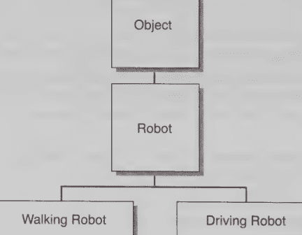

现在，层次结构可以变得更加具体。

对于 `WalkingRobot`，你可能会有几个类：科学机器人（`ScienceRobot`）、守护机器人（`GuardRobot`）、搜索机器人（`SearchRobot`）等。作为替代方案，你可以提取更多功能，并为双足机器人（`TwoLegged`）和四足机器人（`FourLegged`）设置中间类，每个类都有不同的行为（见图 1.4）。

## 类与类行为组织

### 图 1.4 双足和四足步行机器人


最后，层次结构完成了，你为火星机器人（`MarsRobot`）留了一个位置。它可以是 `ScienceRobot` 的子类，`WalkingRobot` 的子类，`Robot` 的子类，并且它是 `Object` 的子类。

状态、温度和速度等属性应该出现在哪里？出现在它们最自然地融入类层次结构的地方。因为所有机器人都需要跟踪环境的温度，因此在 `Robot` 中将 `temperature` 定义为实例变量是合理的。所有子类也将拥有该实例变量。记住，你只需要在层次结构中定义一次行为或属性，它会被每个子类自动继承。

### 注意

> 设计一个有效的类层次结构涉及大量的规划和修改。当你尝试将属性和行为放入层次结构时，你可能会发现将某些类移动到层次结构中不同位置的理由。目标是减少所需的重复特征（以及冗余代码）。

### 继承的实践

Java 中的继承工作比现实世界要简单得多。从父类继承时不需要遗嘱或法院。

当你创建一个新对象时，Java 会跟踪为该对象定义的每个变量，以及为该对象的每个父类定义的每个变量。通过这种方式，所有类组合成一个当前对象的模板，每个对象根据其情况填充适当的信息。

方法的操作也类似。新对象可以访问其类及其父类中的所有方法名。这在运行程序中使用方法时是动态确定的。如果你调用某个特定对象的方法，Java 虚拟机首先检查该对象的类中是否有该方法。如果没有该方法，虚拟机将在该类的父类中查找，依此类推，直到找到方法定义。如图 1.5 所示。

### 图 1.5 如何在类层次结构中定位方法

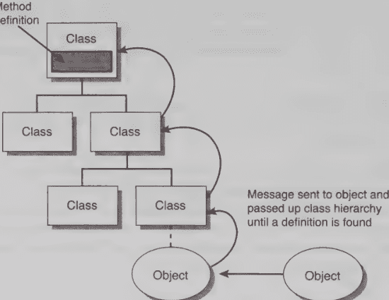

当子类定义了一个在名称和其他方面与父类中定义的方法匹配的方法时，情况就会变得复杂。在这种情况下，首先找到的方法定义（从层次结构的底部开始向上查找）是使用的那一个。

正如此，你可以在子类中创建一个方法，防止父类中的方法被使用。要做到这一点，你给该方法提供与父类中方法相同的名称、返回类型和参数。这种如图 1.6 所示的程序被称为重写（`overriding`）。

### 图 1.6 重写方法

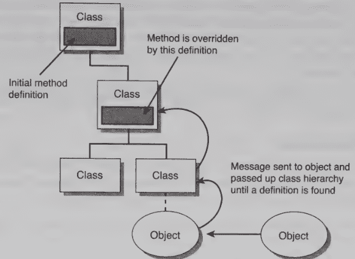

> Java 的继承形式被称为单继承，因为每个 Java 类只能有一个父类，尽管任何给定的父类可以有多个子类。


在 C++ 等其他面向对象的编程语言中，类可以有多个父类，并从所有这些父类继承组合变量和方法。这被称为多继承。Java 通过仅允许单继承来使继承更简单。

## 接口

单继承使得类与它们实现的功能之间的关系更容易理解和设计。然而，它也具有限制性，特别是当你有需要在类层次结构不同分支之间重复的行为时。Java 通过使用接口（`interfaces`）解决了共享行为的问题。

接口是方法的集合，表示类除了从父类继承的内容外，还具有某些行为。包含在接口中的方法并不定义这种行为；该任务留给实现接口的类。

# 第 1 天：Java 入门

此值对于该类的每个对象都可能不同，因此它必须是一个实例方法。

类变量在 Java 程序运行结束之前一直占用内存，因此应该谨慎使用。如果类变量引用了一个对象，该对象也会保留在内存中。这是导致程序占用过多内存并运行缓慢的常见问题。

当一个 Java 类导入整个包时，它会增加该类的编译后体积吗？

“导入”（import）一词的使用有点误导性。`import` 关键字不会向你创建的类添加一个类或一个包的字节码。相反，它让在另一个类中引用类变得更容易。

导入的唯一目的是缩短在 Java 语句中使用类名。如果在代码中始终引用诸如 `javax.swing.JButton` 和 `java.awt.Graphics` 这样的完整类名，而不是调用 `JButton` 和 `Graphics`，将非常繁琐。

## 测验

通过完成这个三个问题的测验来回顾今天的材料。

### 问题

- 1. 类（class）的另一个说法是什么？

  A. 对象 (Object)

  B. 模板 (Template)

  C. 实例 (Instance)

- 2. 当你创建一个子类时，你必须对该类定义什么？

  A. 什么都不用。一切都已经定义过了。

  B. 与父类不同的部分

  C. 关于类的所有内容

- 3. 类的实例方法（instance method）代表什么？

  A. 该类的属性

  B. 该类的行为

  C. 由该类创建的对象的行为

### 答案

- 1. B. 类是一个抽象的模板，用于创建彼此相似的对象。

- 2. B. 你定义子类与其父类有何不同之处。相似的部分已经通过继承机制为你定义好了。答案 A 在技术上是正确的，但如果子类中的所有内容都与父类相同，那么没有理由创建这个子类。

- 3. C. 实例方法指的是特定对象的行为。类方法指的是属于该类的所有对象的行为。

### 认证练习

以下问题是你可以在 Java 编程认证考试中可能遇到的题目类型。请在不看今天材料的情况下回答它。

下列陈述哪句是正确的？

- A. 从同一个类创建的所有对象都必须完全相同。

- B. 从同一个类创建的所有对象可以具有不同的属性。

- C. 对象从用于创建它的类中继承属性和行为。

- D. 类从它的子类继承属性和行为。

答案可以在书籍网站 www.java21days.com 上找到。访问第 1 天页面并点击认证练习（Certification Practice）链接。

### 练习

为了扩展你对今天主题的知识，请尝试以下练习：

- 1. 在 `MarsRobot` 类的 `main()` 方法中，创建一个名为 `opportunity` 的第二个 `MarsRobot`，设置它的实例变量并显示它们。

- 2. 为象棋具部件创建一个继承层次结构。决定实例变量 `color`（颜色）、`startingPosition`（起始位置）、`forwardMovement`（向前移动）和 `sideMovement`（侧向移动）应该在层次结构的何处定义。

练习解答位于书籍网站 www.java21days.com。

# 第 2 天：编程基础

Java 程序由类和对象组成，而类和对象又由方法和变量组成。方法由语句和表达式组成，而表达式由运算符组成。

在此时，你可能会担心 Java 像一组俄罗斯套娃娃。每个娃娃里面都有一个更小的娃娃，且与其外面的同伴一样复杂和详细，直到你到达最小的那一个。

今天的课程将扫除大娃娃，揭示 Java 编程的最小元素。你将每天搁置类、对象和方法，检查单行 Java 代码中可以执行的基础操作。

涵盖了以下主题：

- 语句（`Statements`）和表达式（`expressions`）
- 变量（`Variables`）和原始数据类型
- 常量（`Constants`）
- 注释（`Comments`）
- 字面量（`Literals`）
- 算术（`Arithmetic`）
- 比较（`Comparisons`）
- 逻辑运算符（`Logical operators`）

## 语句和表达式

你在 Java 程序中想要完成的所有任务都可以分解为一系列语句。在编程语言中，语句是导致某事发生的简单命令。

语句代表 Java 程序中执行的单一动作。这里有三个简单的语句：

```
int weight = 225;
System.out.println("Free the bound periodicals!");
song.duration = 230;
```

某些语句可以传递值，例如当两个数字相加或两个变量进行比较以发现它们相等时。

产生值的语句被称为表达式（`expression`）。该值可以存储起来供程序以后使用、立即在另一个语句中使用运行，或者被丢弃。语句产生的值称为其返回值（`return value`）。

某些表达式产生数值返回值，例如当两个数字相加或相乘时。其他表达式则产生布尔值（`Boolean value`）——真或假——甚至可以产生一个 Java 对象。它们将在今天晚些时候讨论。

许多 Java 程序每行包含一条语句，但这是一个格式决定，并不决定一个语句从哪里结束，另一个语句从哪里开始。Java 中的每个语句都以分号（`;`）结束。程序员可以在同一行中放置多条语句，并且可以成功编译，如下例所示：

```
spirit.speed = 2; spirit.temperature = -60;
```

为了让你的程序对他人（以及你自己）更具可读性，你应该遵循每行一条语句的习惯。

Java 中的语句使用左大括号 `{` 和右大括号 `}` 进行分组。这些字符之间的一组语句称为块（`block`）。我们将在第 4 天“列表、逻辑、循环”中学习更多关于它们的知识。

## 变量和数据类型

在第 1 天“Java 入门”中创建的 `MarsRobot` 应用中，使用了变量来跟踪信息。变量是运行时存储信息的地方。值可以在任何时候更改——因此得名。

### 变量分类

Java 有三种变量：实例变量（`instance variables`）、类变量（`class variables`）和局部变量（`local variables`）。正如你昨天学到的，实例变量定义对象的属性。

类变量定义整个类的属性，并适用于它的所有实例。

局部变量用于方法定义或方法内部更小的语句块。你只有在方法或块执行时才能使用它们。执行后它们就会消失。

虽然所有类型的变量创建方式相同，但类变量和实例变量的使用方法与局部变量不同。我们今天学习局部变量，并在第 3 天“处理对象”中探索实例变量和类变量。

### 创建变量

在 Java 程序中使用变量之前，你必须通过声明其名称和要存储的信息类型来创建该变量。信息类型在前，变量名称在后。以下都是变量声明的示例：

```
int loanLength;
String message;
boolean gameOver;
```

局部变量可以在方法内部任何地方声明，就像其他任何 Java 语句一样，但在使用之前必须声明。

在下面的示例中，三个变量在程序的 `main()` 方法顶部声明：

```
public static void main(String[] arguments) {
    int total;
    String reportTitle;
    boolean active;
}
```

如果你正在创建多个相同类型的变量，可以通过逗号分隔变量名，在同一语句中声明所有变量。以下语句创建了三个名为 `street`、`city` 和 `state` 的 `String` 类型的变量：

```
String street, city, state;
```

在创建变量时，可以使用等号（`=`）后跟数值来为变量赋值。以下语句创建了新变量并为它们赋予了初始值：

```
String zipCode = "021344";
int box = 350;
boolean pbs = true;
String name = "Zoom", city = "Boston", state = "MA";
```

如最后语句所示，你可以通过逗号分隔，为多个相同类型的变量赋值。

在程序中使用局部变量之前，必须给它们赋值，否则程序将无法成功编译。出于这个原因，为所有局部变量赋予初始值是一个良好的习惯。

实例变量和类变量的定义根据它们所持的信息类型赋予初始值，如下所示：

- 数值变量：`0`
- 字符：`"\0"`
- 布尔值：`false`
- 对象：`null`

### 变量命名

Java 中的变量名必须以字母、下划线字符 `_` 或美元符号 `$` 开头。

变量名不能以数字开头。在第一个字符之后，变量名可以包含字母、数字、下划线或美元符号的任意组合。

> **注意**
>
> 此外，Java 语言使用了 Unicode 字符集，其中包含了数千个字符来表示国际字母。只要具有 Unicode 字符编号，就可以在变量名中使用重音字符和其他符号。

在命名变量并在程序中使用它时，记住 Java 是**区分大小写**的很重要——字母的大小写必须保持一致。正因如此，程序可以有一个名为 `x` 的变量和另一个名为 `X` 的变量（所以 `Rose` 不是 `rose`，也不是 `ROSE`）。

在本书及其他地方的程序中，Java 变量被赋予包含多个组合单词的有意义的名称。为了更容易识别这些单词，遵循以下通用规则：

- 变量名的第一个字母用小写。
- 变量名中的每个后续单词以大写字母开头。
- 所有其他字母均为小写。

以下变量声明遵循这些命名规则：

```
Button loadFile;
int localAreaCode;
boolean quitGame;
```

虽然变量名中允许使用美元符号和下划线，但在一种情况下你应该避免使用其中任何：当变量的整个名称全大写时，每个单词之间用下划线分隔。这是一个示例：

```
static int DAYS_IN_WEEK = 7;
```

你今天晚些时候就会看到为什么变量名可能会这样大写。

尽管允许使用，但永远不要在变量名中使用美元符号。Java 的官方文档一直反对使用它们，因此程序员遵循这一约定。

### 变量类型

除了名称外，变量声明必须包含所存储信息的数据类型。类型可以是以下任意一种：

- 基本数据类型之一，例如 `int` 或 `boolean`
- 类或接口的名称
- 数组

你将在第 4 天学习如何声明和使用数组变量。今天的课程重点是其他变量类型。

## 数据类型

Java 有八种基本数据类型，用于存储整数、浮点数、字符和布尔值。这些通常被称为原始数据类型，因为它们是语言的内置部分而不是对象，这使得它们更容易创建和使用。与其他编程语言中的某些数据类型不同，无论你在什么操作系统和平台上，这些数据类型都具有相同的大小特性。

你可以使用四种数据类型来存储整数。使用哪种取决于整数的大小，如表 2.1 所示。

| 类型 | 大小 | 可以存储的值 |
|---|---|---|
| `byte` | 8 bits | -128 to 127 |
| `short` | 16 bits | -32,768 to 32,767 |
| `int` | 32 bits | -2,147,483,648 to 2,147,483,647 |
| `long` | 64 bits | -9,223,372,036,854,775,808 to 9,223,372,036,854,775,807 |

## 实战演练：创建变量

3. 在“File Types”面板中，选择“Empty Java File”并点击“Next”。将打开“Empty Java File”对话框。

4. 在“Class Name”文本框中，输入 `variables`，这将源代码命名为 `Variables.java`。

5. 这里是不同的步骤：在“Package name”文本框中，输入 `com.java21days`。点击“Finish”。

6. 点击“Finish”。

在这个项目中，你指定了类名和包名。包是将相关的 Java 程序组织在一起的一种。它们的作用类似于文件系统中的文件夹。将列表 2.1 所示的代码输入到源代码编辑器中。

### 列表 2.1 Variables.java 的全文

```
package com.java21days;

public class Variables {

    public static void main(String[] arguments) {
        final char UP = 'U';
        byte initialLevel = 12;
        short location = 13250;
        int score = 3500100;
        boolean newGame = true;

        System.out.println("Level: " + initialLevel);
        System.out.println("Up: " + UP);
    }
}
```

通过选择“File”、“Save”保存文件。如果程序不包含错误，NetBeans 会自动编译应用程序。通过选择“Running”、“Run File”运行程序。该程序将产生图 2.1 所示的输出。

### 图 2.1 创建并显示变量值

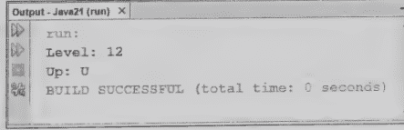

类的包名由 `package` 语句确立，在使用时它必须是 Java 程序的第一行：

`package com.java21days;`

该类使用了四个局部变量和一个常量，并在第 12–13 行使用 `System.out.println()` 来产生输出。

`System.out.println()` 是一个调用的方法，用于将字符串和其他信息显示在标准输出设备（通常是显示器）上。

该方法括号内接受单个参数：字符串。要向 `println()` 传递多个变量或字面量作为参数，可以使用 `+` 运算符将元素组合成一个单一字符串。

Java 还有一个 `System.out.print()` 方法，它可以显示字符串而不会以换行符结束。你可以调用 `print()` 代替 `println()` 以在同一行上显示多个字符串。

## 注释

提高程序可读性的最有效的方法之一是使用注释。注释是包含在程序中的文本，用于解释代码正在发生的情况。Java 编译器在准备可以作为类运行的 Java 源文件的字节码版本时会忽略注释，因此使用它们没有任何性能损失。

你可以在 Java 程序中使用三种注释。

单行注释以两个斜杠字符 `//` 开头。从斜杠到行尾的所有内容均被视为注释，并被编译器忽略，如下句所示：

```
int creditHours = 3; // 设置课程的学分
```

从斜杠开始之后的所有内容都会被忽略。对于编译器而言，前一行与此行等同：

```
int creditHours = 3;
```

多行注释以 `/*` 开头并以 `*/` 结束。这两个定界符之间的所有内容都被视为注释，即使跨越多行，如下代码所示：

```
/* 此程序在你点击 Save 按钮时，偶尔会删除你硬盘上的所有文件，并使其永久无法使用。 */
```

Javadoc 注释以 `/**` 开头并以 `*/` 结束。这些定界符之间的所有内容都被视为关于类及其方法如何工作的官方文档。

Javadoc 注释设计用于供 `javadoc` 等工具读取，`javadoc` 是 Java 开发工具包 (JDK) 的一个命令行工具。该工具使用官方注释创建一组网页，文档化 Java 类的功能，显示其与父类和子类的关系，并描述其每个方法。

> **提示**
>
> Java 类库中每个类的官方文档都是从 Javadoc 注释生成的。你可以在 http://docs.oracle.com/javase/8/docs/api 查看当前的 Javadoc 文档。你可以在附录 E“使用 Java 开发工具包编程”中学习如何使用 `javadoc` 工具。

## 字面量

除了变量外，你还可以在 Java 语句中使用值作为字面量进行操作。字面量是任何直接表示值的数字、文本或其他信息。

下面的赋值语句使用了字面量：

```
int year = 2016;
```

字面量 `2016` 代表整数值 `2016`。数字、字符和字符串都是字面量的示例。Java 有表示不同数字、字符、字符串和布尔值的字面量类型。

### 数字字面量

Java 有几种整数字面量。例如，数字 `4` 是 `int` 类型的整数字面量。它也可以赋值给 `byte` 和 `short` 变量，因为该数字足够小，可以放入这些整数类型。比 `int` 容量更大的整数字面量会被自动视为 `long` 类型。你也可以通过向数字添加字母 `L`（大写或小写）来指示字面量应为长整数。这是一个示例：

```
pennyTotal = pennyTotal + 4L;
```

### 字符转义码

| 转义符 | 含义 |
|---|---|
| `\n` | 换行 |
| `\t` | 制表符 |
| `\b` | 退格符 |
| `\r` | 回车 |
| `\f` | 分页符 |
| `\\` | 反斜杠 |
| `\'` | 单引号 |
| `\"` | 双引号 |
| `\d` | 八进制 |
| `\xd` | 十六进制 |
| `\ud` | Unicode 字符 |


在表 2.2 中，八进制、十六进制和 Unicode 转义码中的字母 `d` 代表一个数字或十六进制数字（`a` 到 `f` 或 `A` `F`）。

## 字符串字面量

你在 Java 程序中可以使用的最后一种字面量表示字符字符串。在 Java 中，字符串是一个对象，而不是一种基本数据类型。字符串不像在 C 等语言中那样存储在数组中。

由于 Java 中的字符串对象是真实的对象，因此提供了许多方法来组合字符串、修改字符串并判断两个字符串是否具有相同的值。

字符串字面量由双引号内的系列字符组成，如下语句所示：

```
String msg = "Are you sure you want to quit?";
String password = "drowsesap";
```

字符串可以包含表 2.2 中列出的字符转义码，如下：

```
String example = "Socrates asked, \"Hemlock is poison?\\";
System.out.println("Sincerely,\nMillard Fillmore\n");
String title = "Sams Teach Yourself Node in the John\u2122";
```

## 表达式与运算符

在最后一个示例中，Unicode 代码序列 `\u2122` 在配置为支持 Unicode 的系统上会产生 TM 符号。

> **注意**
> 尽管 Java 支持 Unicode 字符的传输，但计算机也必须支持它，以便在程序运行时显示这些字符。Unicode 为支持标准的系统提供了一种编码字符的方法。Java 支持显示任何宿主机字体可以表示的 Unicode 字符。
> 有关 Unicode 的更多信息，请访问 Unicode 联盟网站 www.unicode.org。

虽然字符串字面量的使用方式与程序中的字面量相似，但它们在幕后的处理方式有所不同。

对于字符串字面量，Java 将该值存储为字符串对象。你不需要显式地创建一个新对象（这在处理其他对象时必须这样做），因此它们像基本数据类型一样容易处理。字符串在这一方面是不常的——在使用时，没有一种基本类型被存储为对象。你将在今天晚些时候学习更多关于字符串和 `String` 类的知识。

### 算术

Java 中使用五个运算符来完成基本的算术，如表 2.3 所示。

| 表 2.3 算术运算符 |
| :--- | :--- | :--- |
| 运算符 | 含义 | 示例 |
| `+` | 加法 | `3 + 4` |
| `-` | 减法 | `5 - 7` |
| `*` | 乘法 | `5 * 5` |
| `/` | 除法 | `14 / 7` |
| `%` | 取模 | `20 % 7` |

每个运算符接收两个操作数，分别位于运算符的两侧。减法运算符也可以用于对单个操作数取反，相当于乘以 `-1`。

执行除法时需要注意的是使用的数字类型。如果你将除法运算存储在整数中，结果将截断为下一个较小的整数，因为 `int` 数据类型无法处理浮点数。

例如，表达式 `31 / 9` 如果存储为整数，则产生 `3`。

使用 `%` 运算符的取模除产生除法运算的余数。表达式 `31 % 9` 的结果为 `4`，因为 `31` 除以 `9` 的商为 `3`，余数为 `4`。

注意，任何涉及整数的算术运算都会产生 `int` 类型的的操作数。如果你正在处理其他数字（例如浮点数或长整数），你应该确保操作数的类型与你想要得到的类型相同。

下一个项目是一个 Java 类，演示了如何在该语言中执行简单的算术运算。在 NetBeans 的 `com.example` 包中创建一个名为 `Weather` 的新 Java 文件，并将列表 2.2 所示的代码输入到源代码编辑器中。完成后，通过菜单命令 `File`（文件）、`Save`（保存）保存文件。

### 列表 2.2 Weather.java 的全文

```
1: package com.java21;
2:
3: public class Weather {
4:     public static void main(String[] args) {
5:         float fah = 86;
6:         System.out.println(fah + " degrees Fahrenheit");
7:
8:         // Convert to Celsius
9:         fah = fah - 32;
10:
11:        // Divide by 9
12:         fah = fah / 9;
13:
14:        // Multiply by 5
15:         fah = fah * 5;
16:         System.out.println(fah + " degrees Celsius");
17:    }
18:}
```

通过选择 `Run`（运行）执行程序。它产生了图 2.2 所示的输出。


在此程序的 5-14 行中，算术运算符将华氏温度转换为摄氏温度：

- 第 5 行——创建浮点变量 `fah`，值为 `86`。
- 第 6 行——显示 `fah` 的当前值。
- 第 7 行——多个注释之一，解释程序正在做什么。Java 编译器忽略这些注释。
- 第 9 行——将 `fah` 设置为当前值减去 `32`。
- 第 11 行——将 `fah` 除以 `9`。
- 第 13 行——将 `fah` 设置为当前值乘以 `5`。
- 第 14 行——现在 `fah` 已转换为摄氏度值，再次显示 `fah`。

### 关于赋值的更多

给变量赋值是一个表达式，因为它产生一个值。由于此特性，你可以以这种异常的方式组合赋值语句：

```
x = y = z = 7;
```

在这条语句中，所有三个变量 `x`、`y` 和 `z` 最终都变为 `7`。

赋值表达式的右侧在赋值发生之前计算。这使得可以使用如下代码中的表达式：

```
x = 5;
x = x + 2;
```

在表达式 `x = x + 2` 中，首先发生的是计算 `x + 2`。该计算的结果 `7` 然后被赋值给 `x`。

使用表达式更改变量的值是编程中的常见任务。有几个运算符专门用于这些情况。

表 2.4 显示了这些赋值运算符以及它们功能价的表达式。

| 表 2.4 赋值运算符 |
| :--- | :--- |
| 表达式 | 含义 |
| `+= y` | `x = x + y` |
| `-= y` | `x = x - y` |
| `*= y` | `x = x * y` |
| `/= y` | `x = x / y` |

> **注意**
> 这些简写赋值运算符在功能上与它们所替换的长格式赋值语句等效。然而，如果赋值语句的任何一方是复杂表达式的一部分，在某些情况下这些运算符是不等价。例如，如果 `x` 等于 `20` 且 `y` 等于 `5`，以下两个语句产生的值不同：
>
> ```
> x = x / y + 5;
> x /= y + 5;
> ```
>
> 第一条语句产生的 `x` 值为 `9`，第二条产生的 `x` 值为 `2`。如果你不确定某个表达式在做什么，请通过使用多个赋值语句来简化它，不要使用简写运算符。

### 递增与递减

编程中另一个常见的任务是给整数变量加 `1` 或减 `1`。这些表达式有特殊的运算符，称为自增和自减运算符。递增变量意味着向其值加 `1`，递减变量意味着从其值中减 `1`。

自增运算符为 `++`，自减运算符为 `--`。这些运算符紧跟在变量之后或之前，如下代码所示：

```
int x = 7;
x++;
```

在示例中，语句 `x++` 将变量 `x` 从 `7` 递增到 `8`。

自增和自减运算符可以放在变量名的之前或之后。这会影响涉及这些运算符的表达式的值。

如果列在变量名之前，自增自减运算符称为前缀运算符；如果列在名称之后，则称为后缀运算符。

在像 `count--` 这种简单表达式中，使用前缀或后缀运算符产生相同的结果，使得运算符可以互换。然而，当自增自减操作作为较大表达式的一部分时，在前缀和后缀运算符之间进行选择是重要的。

考虑以下代码：

```
int x, y, z;
x = 42;
y = ++x;
z = ++x;
```

代码中的三个表达式产生了不同的结果，这是因为前缀操作和后缀操作之间的差异。

当你在表达式对变量使用后缀运算符时，变量的值在递增或递减之前先在表达式中求值。因此，在 `y = x++` 中，`y` 在 `x` 加 `1` 之前接收了 `x` 的值。

当你在表达式对变量使用前缀运算符时，变量在在该表达式中求值之前先递增或递减。因此，在 `z = ++x` 中，`x` 在值赋值给 `z` 之前递增了 `1`。

上述代码示例的最终结果是 `y` 等于 `42`，`z` 等于 `44`，`x` 等于 `44`。

如果你在理解这方面仍然困难，这里是带有每一步注释的示例：

```
int x, y, z; // 声明了 x, y 和 z
x = 42; // 给 x 赋值 42
y = x++; // 在 x 递增之前给 y 赋值 x 的值 (42)
         // 然后 x 递增到 43
z = ++x;  // x 递增到 44，给 z 赋值 x 的值
```

> **注意**
> 在复杂表达式中使用自增和自减运算符可能会产生你意想不到的结果。
> “在 x 递增之前将 x 赋值给 y”的概念并不完全准确，因为 Java 在将值赋值给左侧之前会评估表达式右侧的所有内容。
> Java 在处理表达式之前会存储某些值，以使后缀能够按照在本节中描述的方式工作。
> 如果你从包含前缀和后缀运算符的复杂表达式中没有得到预期的结果，请尝试将表达式拆分为多个语句以简化它。

### 比较

Java 有多种运算符用于变量之间、变量与字面量或程序中其他类型信息之间的比较。

这些运算符用于返回布尔值（`true` 或 `false`）的表达式，取决于所做的比较是否为真。表 2.5 显示了比较运算符。

| 表 2.5 比较运算符 |
| :--- | :--- | :--- |
| 运算符 | 含义 | 示例 |
| `==` | 等于 | `x == 3` |
| `!=` | 不等于 | `x != 3` |
| `<` | 小于 | `x < 3` |
| `>` | 大于 | `x > 3` |
| `<=` | 小于或等于 | `x <= 3` |
| `>=` | 大于等于 | `x >= 3` |

以下示例展示了比较运算符的使用：

```
boolean isShip;
int age = 37;
isShip = age < 25;
```

表达式 `age < 25` 产生 `true` 或 `false` 的结果，取决于整数 `age` 的值。因为示例中 `age` 是 `37`（不小于 `25`），所以 `isShip` 被赋予布尔值 `false`。

### 逻辑运算符

产生布尔值的表达式（如比较操作）可以组合成更复杂的表达式。这是通过逻辑运算符实现的，它们用于逻辑组合 AND（与）、OR（或）、XOR（异或）和逻辑 NOT（非）。

对于 AND 组合，使用逻辑运算符 `&`、`&&`。当两个布尔表达式通过这些运算符连接时，只有当两个布尔表达式都真时，组合表达式才返回真。

考虑这个：

```
boolean extraLife = (score > 75000) & (playerLives < 10);
```

此表达式组合了两个比较表达式：`score > 75000` 和 `playerLives < 10`。如果两个表达式都为真，布尔值赋值给变量 `extraLife`。在任何情况下，`false` 被赋值给变量 `extraLife`。

### 运算符优先级

当一个表达式中使用多个运算符时，Java 有一套既定的优先级层次结构来确定执行顺序。例如，考虑以下表达式：

```
y = 6 + 4 / 2;
```


# 运算符优先级

变量将等于 5 或 8，取决于处理哪种算术运算。如果 `6 + 4` 表达式优先，y 的值为 5。否则为 8。

通常，从先到后的评估顺序如下：

1. 递增和递减操作
2. 算术运算
3. 比较
4. 逻辑操作
5. 赋值表达式

如果两个操作具有相同的优先级，则先处理表达式中左侧的操作。表 2.6 显示了 Java 中各种运算符的特定优先级。表中的运算符越靠前越先执行。

### 表 2.6 运算符优先级

| 运算符 | 说明 |
|---|---|
| `[]` `()` `.` | 句号用于访问对象和类的方法和变量。方括号 `[]` 用于数组。括号 `()` 用于组合表达式。 |
| `++` `--` `!` `~` `instanceof` | `instanceof` 运算符根据对象是否为指定类或该类子类的实例返回 true 或 false。 |
| `new` `(type)expression` | `new` 运算符用于创建类的新实例。此处的括号用于将值转换为另一种类型。 |
| `*` `/` `%` | 乘法、除法、取模 |
| `+` `-` | 加、减法 |
| `<<` `>>` `>>>` | 按位左移和右移 |
| `<` `>` `<=` `>=` | 关系比较测试 |
| `==` `!=` | 等性 |
| `&` | 与 |
| `^` | 异或 |
| `\|` | 或 |
| `&&` | 逻辑与 |
| `\|\|` | 逻辑或 |
| `?:` | 三元运算符 |
| `+=` `-=` `*=` `/=` `^=` | 各种赋值 |
| `\|=` `<<=` `>>=` `>>>=` | 更多赋值 |

表 2.6 中列出的几个运算符将在本周晚些时候进行介绍。

回到表达式 `y = 6 + 4 / 2`，表 2.6 显示除法先于加法求值，因此 `y` 的值等于 8。

要更改表达式求值的顺序，请给应先计算的表达式加上括号。你可以将一组括号嵌套在另一组内部，以确保表达式按照所需的顺序求值；最内层的括号表达式最先计算。

以下表达式的结果为 5：

`y = (6 + 4) / 2`

值 5 是结果，是因为先计算了 6 + 4，然后将结果 10 除以 2。括号还可以提高表达式的可读性。如果一个表达式的优先级对你来说并不十分清楚，那么添加括号来强制所需的优先级可以使语句更容易理解。

## 字符串算术

如前所述，`+` 运算符在数学世界之外拥有双重身份。它可以连接两个或多个字符串。

“concatenate”（连接）一词的意思是将两个事物连接在一起。由于未知原因，在计算机编程中描述组合字符串的行为时，它是首选动词，胜过了 paste、glue、affix、combine、link、smash together 和 conjoin。

在几个示例中，你见过这样的内容：

```java
String brand = "Jif";

System.out.println("Choosy mothers choose " + brand);
```

这两行代码会导致显示以下文本：

Choosy mothers choose Jif

`+` 运算符将字符串、其他对象和变量组合成单个字符串。在前面的示例中，字符串字面量 `"Choosy mothers choose"` 被连接到 `String` 对象 `brand` 的值上。

Java 中处理连接运算符变得更简单，是因为该运算符可以处理任何变量类型和对象值，就像处理字符串一样。如果连接的任何部分是字符串或字符串字面量，则操作的所有元素都将被视为字符串：

```java
System.out.println(4 + " score and " + 7 + " years ago");
```

这产生了输出文本 `"4 score and 7 years ago"`，就像整数字面量 4 和 7 是字符串一样。

还有一个 `+=` 简写运算符用于向字符串末尾添加内容。例如，考虑以下表达式：

```java
myName += " Jr.";
```

该表达式等于以下内容：

```java
myName = myName + " Jr.";
```

在这个示例中，`+=` 改变了 `myName` 的值（它可能是类似 `"Robert Downey"` 的内容），通过在末尾添加 `"Jr."` 来形成字符串 `"Robert Downey Jr."`。

总结今天的内容，表 2.7 列出了你学过的运算符。请仔细检查它们。

### 表 2.7 运算符总结 (1)

| 运算符 | 含义 |
|---|---|
| `+` | 加法 |
| `-` | 减法 |
| `*` | 乘法 |
| `/` | 除法 |
| `%` | 取模 |
| `<` | 小于 |
| `>` | 大于 |
| `<=` | 小于等于 |
| `>=` | 大于等于 |
| `==` | 等于 |
| `!=` | 不等于 |
| `&&` | 逻辑与 |
| `\|\|` | 逻辑或 |
| `!` | 逻辑非 |

# 第 2 天：编程基础

### 表 2.8 运算符总结 (2)

| 运算符 | 含义 |
|---|---|
| `&` | 与 (AND) |
| `\|` | 或 (OR) |
| `^` | 异或 (XOR) |
| `=` | 赋值 |
| `++` | 自增 |
| `--` | 自减 |
| `+=` | 加并赋值 |
| `-=` | 减并赋值 |
| `*=` | 乘并赋值 |
| `/=` | 除并赋值 |
| `%=` | 取模并赋值 |

## 总结

任何打开一套俄罗斯套娃（matryoshka dolls）的人在到达组中最小的娃娃时都会感到有些失望。

今天你达到了 Java 最小的套娃。使用语句和表达式让你能够开始构建有效的方法，从而使有效的对象和类成为可能。

今天你学习了创建变量并为其赋值。你还使用了字面量来表示数值、字符和字符串值，并使用了运算符。明天，你将把这些技能用于开发类。

## 问答

- **问**：如果我将一个过大的整数赋值给变量会发生什么？
- **答**：从逻辑上讲，你可能认为变量会溢出，但在 Java 中，值会回绕。如果值超过了该类型的最大容量，它将变成该类型的最小值。例如，如果你对值为 127 的字节（`byte`）加 1，它将变成 -128。这被称为整数溢出。

# 第 3 天：使用对象

Java 是一种面向对象的编程语言。当你使用 Java 工作时，你主要使用对象来完成任务。你创建对象、修改它们、更改它们的变量、调用它们的方法，并将它们与其他对象结合。你开发类，根据这些类创建对象，并将它们与其他类和其他对象一起使用。

今天，你将通过完成这些核心任务来广泛地使用对象：

- 创建对象
- 测试和修改它们的类变量和实例变量
- 调用对象的方法
- 将对象从一个类转换为另一个类

## 创建新对象

当你编写 Java 程序时，你定义了一组类。正如你在第 1 天“Java 入门”中所学习的，类是用于创建一个或多个对象的模板。这些对象被称为实例（instances），是程序中自包含的元素，具有相关的特性和数据。在大多数情况下，你仅仅使用类来创建实例，然后对这些实例进行操作。在本节中，你将学习如何从任何给定的类创建一个新对象。

在第 2 天“编程的 ABC”中学习字符串时，你了解到字符串字面量（用双引号括起来的一系列字符）可以用于创建一个具有该字符串值的 `String` 类的新实例。

`String` 类在这方面是特殊的。尽管它是一个类，但它可以像原始数据类型一样被赋予一个值。这种快捷方式仅适用于字符串以及表示原始数据类型的类（例如 `Integer` 和 `Double`）。要为所有其他类创建实例，则需要使用 `new` 操作符。

> **数字和字符的字面量呢？它们也会创建对象吗？** 实际上，它们不会。数字和字符的原始数据类型创建数字和字符，但为了效率考虑，它们实际上并不是对象。在第 5 天“创建类和方法”中，你将学习如何使用对象来表示原始值。

### 使用 new

要创建一个新对象，你使用 `new` 操作符并跟上应作为模板的类名。类名后面跟着括号，如例所示：

```java
String name = new String("Hal Jordan");

URL address = new URL("http://www.java21days.com");

MarsRobot robbie = new MarsRobot();
```

括号是重要的，不能省略。然而，它们可以是空的，在这种情况下将创建该类最简单、最基础的对象。括号中也可以包含参数，用于确定实例变量的值或对象的其它初始属性。

这里是两个使用参数创建的对象：

```java
Random seed = new Random(606843071);

Point pt = new Point(0, 0);
```

括号内包含的参数的数量和类型是由类本身定义的，使用了一种称为构造方法（constructor）的特殊方法（该方法将在今天晚些时候介绍）。如果你尝试使用数量错误或类型错误的参数创建一个类的新实例，或者在它需要参数时没有提供任何参数，程序在编译时会发生错误。

今天的第一个项目是演示如何使用不同数量和类型的参数创建不同类型的对象。`java.util` 包中的 `StringTokenizer` 类将字符串分为一系列称为“标记”（tokens）的短字符串。

你通过应用一个字符或多个字符作为分隔符将字符串划分为标记。例如，文本 `"02/20/67"` 将使用斜杠字符作为分隔符划分为三个标记——`"02"`、`"20"` 和 `"67"`。

今天的第一个项目是一个 Java 应用，它使用标记来分析股价数据。在 NetBeans 中，为 `com.java21days` 包中的 `TokenTester` 类创建一个新的空 Java 文件，并将列表 3.1 中的代码作为其源代码。该程序以两种不同的方式使用 `new` 创建 `StringTokenizer` 对象，并显示它包含的每个标记。

### 列表 3.1 TokenTester.java 的全文

```java
1: package com.java21days;
2:
3: import java.util.StringTokenizer;
4:
5: class TokenTester {
6:
7:     public static void main(String[] arguments) {
8:         StringTokenizer st1, st2;
9:
10:         String quote1 = "GOOG 530.80 -9.98";
11:         st1 = new StringTokenizer(quote1, " ");
12:         while (st1.hasMoreTokens()) {
13:             System.out.println(st1.nextToken());
14:         }
15:
16:         StringTokenizer st2 = new StringTokenizer(quote1, "-");
17:         while (st2.hasMoreTokens()) {
18:             System.out.println(st2.nextToken());
18:         }
19:
20:         StringTokenizer st3 = new StringTokenizer(quote1, " ");
21:         while (st3.hasMoreTokens()) {
22:             System.out.println(st3.nextToken());
23:         }
24:     }
25: }
```
*（注：列表 3.1 的原始 OCR 严重损坏/乱码；我根据周围文中描述的 StringTokenizer 使用上下文重构了逻辑代码。）*

当程序运行时，JVM 会定期查找未使用的对象并回收这些对象所占用的内存。这个过程被称为动态垃圾回收，并且不需要你进行任何编程即可完成。你不需要显式地释放对象占用的内存；你只需要确保你不再持有你想要丢弃的对象即可。

这一特性是该语言相对于其前身 C++ 最广受推崇的优势之一。

## 使用类变量和实例变量

此时，你可以创建带有类变量和实例变量的自定义对象，但你如何操作这些变量呢？它们的使用方式与你昨天学到的局部变量基本相同。你可以将它们放在表达式中，在语句中为它们赋值，等等。你只是引用它们的方式略有不同。

### 获取值

要获取实例变量的值，你使用点符号法（dot notation），这是一种寻址方式，其中实例或类变量名包含两个部分：

- 点运算符左侧的对象或类的引用
- 右侧的变量

点符号法是用来引用实例的实例变量和方法的。

例如，如果你有一个名为 `customer` 的对象，其中有一个名为 `orderTotal` 的变量，在语句中可以这样引用该变量：

```java
float total = customer.orderTotal;
```

这条语句将 `customer` 对象的 `orderTotal` 实例变量的值赋值给名为 `total` 的浮点数变量。

在点符号法中访问变量是一个表达式（这意味着它会返回一个值）。点的两边都是表达式。这意味着你可以进行链式实例访问。

扩展前面的示例，假设 `customer` 对象是 `store` 类的一个实例变量。点符号法可以使用两次，如该语句所示：

```java
float total = store.customer.orderTotal;
```

点表达式从左到右求值，所以你从 `store` 的实例变量 `customer` 开始，该变量本身又有一个实例变量 `orderTotal`。该变量的值被赋值给 `total` 变量。

以这种方式将对象链在一起时，需要注意的一点是，如果链中的任何对象尚未赋值，语句将报错并失败。

### 设置值

使用点符号法为实例变量赋值，与持有基本类型变量的操作一样，都使用等号运算符 `=`：

```java
customer.layaway = true;
```

此示例将名为 `layaway` 的布尔实例变量的值设置为 `true`。

列表 3.2 中的 `PointSetter` 测试并修改了 `Point` 对象中的实例变量。`Point` 是 `java.awt` 包中的一个类，代表坐标系中具有 (x, y) 值的点。

在 NetBeans 中创建一个类名为 `PointSetter` 且包名为 `com.java21days` 的新空 Java 文件，然后输入列表 3.2 所示源代码并保存文件。

### 列表 3.2 PointSetter.java 的全文

```java
1: package com.java21days;
2:
3: import java.awt.Point;
4:
5: class PointSetter {
6:
7:     public static void main(String[] arguments) {
8:         Point location = new Point(4, 13);
9:
10:         System.out.println("Starting location:");
11:         System.out.println("X equals " + location.x);
12:         System.out.println("Y equals " + location.y);
13:
14:         System.out.println("\nMoving to (7, 6)");
15:         location.x = 7;
16:         location.y = 6;
17:
18:         System.out.println("\nEnding location:");
19:         System.out.println("X equals " + location.x);
20:         System.out.println("Y equals " + location.y);
21:     }
22: }
```

当你运行此应用程序时，输出应该与图 3.2 一致。

### 图 3.2
设置并显示对象的实例变量。

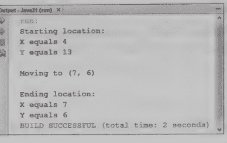

在此应用程序中，你创建了一个 `Point` 实例，其中 `x` 等于 4，`y` 等于 13（第 8 行）。这些单独的值是通过点符号法获取的。

`x` 的值被改为 7，`y` 改为 6（第 15-16 行）。再次显示这些值以展示它们是如何变化的。

### 类变量

正如你所学到的，类变量是定义并存储在类本身中的变量。它们的值适用于该类及其所有实例。

对于实例变量，类的每个新实例都会获得该类定义的实例变量的新副本。然后，每个实例都可以更改这些实例变量的值，而不影响任何其他实例。而对于类变量，当类加载时只存在该变量的一个副本。更改变量的值会改变该类所有实例的值。

你通过在变量本身之前使用 `static` 关键字来定义类变量。例如，考虑以下部分类定义：

```java
class FamilyMember {
    static String surname = "Mendoza";
    String name;
    int age;
}
```

`FamilyMember` 类的每个实例都有它们自己的 `name` 和 `age` 的值，但类变量 `surname` 对于所有家庭成员只有一个值：“Mendoza”。如果更改了 `surname` 的值，它会改变该类所有实例的值。

## 调用方法

要调用方法，使用点符号法。被调用的对象在点的左侧，而方法及其参数在右侧。所有方法调用后都必须带有括号，即使该方法不接受任何参数，如例所示：

```java
customer.toString();
```


# 第3天：处理对象

## 列表 3.3 StringChecker.java 的全文

在列表 3.3 中，`StringChecker` 应用程序展示了调用 `String` 类中定义的某些方法的示例。`String` 包含了用于测试和修改的方法。在 NetBeans 中创建此程序，类名为 `StringChecker`，包名为 `com.java2days`。

```java
1: package com.java2days;
2:
3: class StringChecker {
4:
5:     public static void main(String[] arguments) {
6:         String str = "A Lannister always pays his debts";
7:         System.out.println("The string is: " + str);
8:         System.out.println("Length of this string: " + str.length());
9:         str.length();
10:        System.out.println("The character at position 6: " +
11:            str.charAt(6));
12:        System.out.println("The substring from 12 to 18: " +
13:            str.substring(12, 18));
14:        System.out.println("The index of the first 't': " +
15:            str.indexOf('t'));
16:        System.out.println("The index of the beginning of the ");
17:            "substring \"dets\": " + str.indexOf("dets"));
18:        System.out.println("The string in uppercase: " +
19:        
20:        str.toUpperCase());
21:    }
22:
}
```

运行程序将产生如图 3.3 所示的输出。

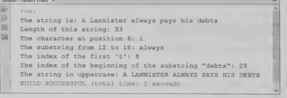

在第6行，你通过使用字符串字面量 "A Lannister always pays his debts" 创建了一个新的字符串实例。程序的其余部分只是调用不同的方法对该字符串执行不同的操作：

- 第7行打印字符串的值。
- 第9行调用新字符串对象的 `length()` 方法来查找它包含多少字符。

### 调用方法

- 第 11 行调用了 `charAt()` 方法，该方法返回字符串中指定位置的字符。注意，字符串的位置从 0 开始而不是 1，因此位置 6 处的字符是 'i'。
- 第 13 行调用了 `substring()` 方法，该方法接受两个整数表示范围，并返回具有这些起始和结束点的子字符串。`substring()` 方法也可以只带一个参数调用，这将返回从该位置到字符串末尾的子字符串。
- 第 17 行展示了 `indexOf()` 方法的使用，该方法接受一个字符串并返回该字符串起始的索引。字符串字面量始终用双引号包围。
- 第 19 行使用 `toUpperCase()` 方法返回一个全大写的字符串副本。

> 如果你将 `StringChecker` 应用程序的输出与字符串中的字符进行比较，你可能会奇怪，为什么当 'i' 是字符串中的第七个字符时，它却位于位置 6。所有方法看起来都错偏移了一个位置（`length()` 除外）。原因是这些方法是基于 0 的索引，这意味着它们从 0 开始计数而不是 1。因此，'A' 在位置 0，空格在位置 1，'L' 在位置 2，以此类推。这种编号你在 Java 中经常遇到。

## 字符串格式化

作为货币的数字通常需要以精确的方式显示。小数点后只有两位用于表示分（cents），值前面有一个美元符号（$），并用逗号分隔三一组数字——例如 $22,453.70（美国国债每秒增加的金额）。

在显示字符串时这种格式化可以通过 `System.out.format()` 方法实现。

该方法接受两个参数：输出格式模板和要显示的字符串。这是一个示例，它在整数显示中添加了美元符号和逗号：

```java
int accountBalance = 5000;
System.out.format("Balance: $%,dn", accountBalance);
```

这段代码产生输出 `Balance: $5,005`。

格式化字符串以百分号 `%` 开头，后面跟着一个或多个标记。`%,d` 代码显示用逗号分隔每三位数的十进制。`%n` 代码显示一个换行符。

下一个示例显示精确到 11 位小数的 pi 值：

```java
double pi = Math.PI;
System.out.format("%.11f%n", pi);
```

输出是 `3.14159265359..`。

> Oracle 的 Java 网站包含一个关于 printf 风格输出的入门教程，描述了一些最实用的格式化代码：
> http://docs.oracle.com/javase/tutorial/java/data/numberformat.html

## 嵌套方法调用

方法可以返回对象的引用、原始数据类型，或者不返回任何值。在 `StringChecker` 应用程序中，对 `String` 对象 `str` 调用的所有方法都返回了被显示的值。`charAt()` 方法返回字符串中指定位置的字符。

方法返回的值也可以存储在变量中：

```java
String label = "From";
String upper = label.toUpperCase();
```

在例子中，`String` 对象 `upper` 包含调用 `label.toUpperCase()` 返回的值，即文本 "FROM"。

如果方法返回一个对象，你可以在同一条语句中调用该对象的方法。这使得你能够像嵌套变量一样嵌套方法。

### 调用方法

今天早些时候，你看到了一个不带参数调用方法的示例：`customer.cancelOrder();`

如果 `cancelOrder()` 返回一个对象，你可以在同一条语句中调用该对象的方法：

```java
customer.cancelOrder().fileComplaint();
```

这条语句调用了 `fileComplaint()` 方法，该方法定义在 `customer` 对象的 `cancelOrder()` 方法返回的对象中。

你还可以结合嵌套方法调用和实例变量引用。在下一个示例中，`putOnLayaway()` 方法定义在 `orderTotal` 存储的对象中，而 `orderTotal` 本身是 `customer` 对象的一部分：

```java
customer.orderTotal.putOnLayaway(item, price, quantity);
```

这种变量和方法的嵌套在你在本书前三天经常使用的一个方法中演示：`System.out.println()`。

该方法将字符串和其他数据输出到计算机的标准输出。

`System` 类是 `java.lang` 包的一部分，它描述了运行 Java 的计算机系统的特定行为。`System.out` 是一个类变量，包含一个 `PrintStream` 类的实例，代表系统的标准输出（通常是显示器，但可以是打印机或文件）。`PrintStream` 对象拥有一个 `println()` 方法，可以将字符串发送到该输出流。`PrintStream` 类位于 `java.io` 包中。

### 类方法

类方法也称为静态方法，适用于整个类而不是它的实例，就像类变量一样。类方法通常用于通用工具方法，这些方法可能不直接在类对象上操作，但在概念上可以与该类相匹配。

例如，`String` 类包含一个类方法 `valueOf()`，它可以接受许多类型的参数（整数、布尔值等）。`valueOf()` 方法返回一个包含参数值的新 `String` 实例。该方法并不直接在现有的 `String` 实例上操作，但从另一个对象或数据类型获取字符串是定义在 `String` 类中合理的行为。

类方法对于将通用方法聚集在一个地方也很有用。例如，定义在 `java.lang` 包中的 `Math` 类包含大量作为类方法的数学操作。无法从 `Math` 类中创建任何对象，但你仍然可以使用带有数值或布尔参数的它的方法。

例如，类方法 `Math.max()` 接受两个参数并返回两者中较大的一个。你不需要创建 `Math` 的新实例；可以在任何需要的地方调用它，如下所示：

```java
int firstPrice = 225;
int secondPrice = 217;
int higherPrice = Math.max(firstPrice, secondPrice);
```

使用点符号法来调用类方法。对于类变量，你可以使用类的实例或类本身作为点符号的左侧。由于前面提到的关于类变量相同的原因，使用类名会让你的代码更易读。

## 对象的引用

当你处理对象时，理解引用是非常重要的。引用是一个指示对象存储在何处的地址。当你将对象赋值给变量或将对象传递给方法时，你实际上并没有在使用对象。

为了更好地说明这意味着什么，列表 3.4 中的 `RefTester` 应用程序展示了引用的工作原理。在 NetBeans 中创建一个空的 `RefTester` Java 文件，并将列表 3.4 作为源码。

### 列表 3.4 RefTester 的完整文本

```java
1: package java2days;
2:
3: import java.awt.Point;
4:
5: class RefTester {
6:     public static void main(String[] arguments) {
7:         Point pt1, pt2;
8:         pt1 = new Point(100, 100);
9:         pt2 = pt1;
10:        pt1.x = 200;
11:        pt1.y = 200;
12:        System.out.println("Point1: " + pt1.x + ", " + pt1.y);
13:        System.out.println("Point2: " + pt2.x + ", " + pt2.y);
14:    }
15: }
```

保存并运行应用程序。输出如图 3.4 所示。

以下操作发生在程序的前部分：

- 第 7 行——创建了两个 `Point` 变量。
- 第 8 行——将一个新的 `Point` 对象赋值给 `pt1`。
- 第 9 行——将变量 `pt1` 赋值给 `pt2`。

第 11-14 行是复杂的部分。`pt1` 的 `x` 和 `y` 变量都被设置为 200，并显示了 `pt1` 和 `pt2` 的所有变量。

你可能认为 `pt1` 和 `pt2` 具有不同的值，但图 3.4 显示并非如此。`pt2` 的 `x` 和 `y` 变量也发生了变化，尽管程序中没有显式解释这一点。这是因为第 9 行创建了指向 `pt1` 的 `pt2` 引用，而不是从 `pt1` 创建一个新的 `pt2` 对象。

### 图 3.5
对象的引用。

如果你想 `pt1` 和 `pt2` 指向不同的对象，你可以将第 6–7 行的 `new Point()` 语句分开以创建不同的对象，如下：

```java
pt1 = new Point(100, 100);
pt2 = new Point(100, 100);
```

在 Java 中，当将参数传递给方法时，引用变得特别重要。你今天将学习更多知识。

> 注意：与 C 和 C++ 不同，Java 没有显式的指针或指针算术。通过使用引用和 Java 数组，你可以复制大多数指针功能，而没有它们的许多缺点。

## 对象的强制转换与基本类型

你很快发现关于 Java 的一点是，它对要处理的信息非常挑剔。就像金发姑娘故事中那个对闯入家的人奇奇地难以满足的孩子，Java 的方法和构造函数要求事物必须呈现特定的形式，且不接受替代方案。

当你向方法发送参数或在表达式中使用变量时，必须使用正确数据类型的变量。如果一个方法需要 `int` 类型，而你发送了 `float` 值，Java 编译器将返回错误。同样，如果你将一个变量设置为另一个的值，它们必须是兼容的类型。接收变量必须足够大以包含该值。

Java 编译器有一个非常灵活的区域：`String` 对象。`println()` 方法、赋值语句中的字符串处理通过 `+` 连接运算符被简化。如果连接变量中的任何一个是字符串，Java 将整个内容视为 `String`。这使得以下操作成为可能：

```java
float gpa = 2.25F;
System.out.println("GPA 是：" + (gpa + 1.5));
```

使用连接运算符，单个字符串可以包含多个对象和基本类型的表示。

有时你在 Java 类中有一个值并不是你所需的类型。这可能是错误的类或错误的数据类型，例如你需要 `int` 时。在这些情况下，你可以使用称为强制转换的过程将一种类型的值转换为另一种。

虽然强制转换相当简单，但由于 Java 同时拥有基本类型（如 `int`、`float` 和 `boolean`）和对象类型（如 `String`、`Point` 等），该过程变得复杂了。本节讨论了三种形式的强制转换：

- 基本类型之间的强制转换，例如从 `int` 到 `float`
- 从一个对象到另一个对象的强制转换，例如从 `Object` 到 `String`
- 从基本类型到对象的强制转换

在强制转换时，从源和目标的角度考虑可能会更容易。源是将变量转换为另一种类型，目标是结果。

### 基本类型的强制转换

基本类型之间的强制转换允许将一种类型的值转换为另一种。这通常发生在数值类型上，但一个基本类型永远不能用于强制转换。布尔值必须是 true 或 false，且不能在强制转换中使用。

在基本类型的许多情况下，目标可以存储比源更大的值，因此值可以很容易转换。一个示例是将 `byte` 强制转换为 `int`。因为 `byte` 存储 -128 到 127 的值，而 `int` 存储大约 -2,100,000,000 到 2,100,000,000 的值，有足够的空间将 `byte` 强制转换为 `int`。

你可以自动将 `byte` 或 `char` 作为 `int` 使用；将 `int` 作为 `long`；将 `int` 作为 `float`；或任何内容作为 `double`。在大多数情况下，较大的类型比较小的提供更多精度，因此不会发生信息丢失。例外是将整数转换为浮点值。将 `long` 转换为 `float` 或将 `long` 转换为 `double` 可能会导致精度丢失。

> 注意：字符可以作为 `int` 使用，因为每个字符都有一个对应的数值，表示其在字符集中的位置。如果变量值为 65，强制转换 `(char)` 会产生字符 'A'。大写 A 相关的数值在 ASCII 字符集中是 65，这是 Java 支持的一部分。

你必须使用显式强制转换将大类型的值转换为小类型。显式强制转换的形式如下：

```java
(typename) value
```

这里 `typename` 是你正在转换的基本数据类型名称，例如 `short`、`int` 或 `float`；值是一个产生源类型值的表达式。例如，在以下语句中，`x` 除以 `y` 的值，结果被强制转换为 `int`：

```java
int result = (int) (x / y);
```

注意，由于强制转换的优先级高于算术运算，你必须使用括号。否则，`x` 的第一个值将被强制转换为 `int`，然后除以 `y`，这可能会产生不同的结果。

### 对象的强制转换

当源类和目标类之间存在继承关系且一个类是另一个子类时，类的对象也可以转换为其他类的对象。

某些对象可能不需要显式转换。特别是由于子类包含了其父类的所有信息，你可以在任何期望父类的地方使用子类对象。

例如，考虑一个接受两个参数的方法，一个 `Object` 类型，另一个是 `Component` 类型。

在期望父类的地方你可以传递子类的实例，因为所有 Java 类都是 `Object` 的子类。对于 `Component` 参数，你可以传递它的子类，如 `Button`、`Container` 和 `Label`（均在 `java.awt` 中）。

这在程序的任何地方都适用，而不仅是在方法调用内部。如果你定义了一个为 `Component` 的变量，你可以在不需要强制转换的情况下赋值其子类的对象。

反过来也是如此，你可以在期望子类的地方使用父类。但有一个陷阱：由于子类包含比其父类更多的行为，会发生精度丢失。那些父类对象可能不具备执行所需的全部行为。

考虑这个例子：如果你有一个调用 `Integer` 对象中方法的操作，使用 `Number` 对象将不会包含所有这些方法。

在期望子类对象的地方使用父类对象，你必须显式地转换它们。你不会在强制转换中丢失任何信息，但你获得了子类定义的所有方法。

要将对象转换为另一个类，你使用与基本类型相同的操作，其形式如下：

```java
(classname) object
```

在这个模板中，`classname` 是目标类的名称，`object` 是指向源对象的引用。强制转换创建一个指向 `classname` 类型旧对象的引用；旧对象像之前一样存在。

以下示例将 `VicePresident` 类的实例转换为 `Employee` 类的实例。`VicePresident` 是 `Employee` 的子类，拥有更多信息：

```java
Employee emp = new Employee();
```


VicePresident veep = new VicePresident();

emp = veep; // 向上使用不需要强制转换

emp = (VicePresident) emp; // 必须显式强制转换

除了转换为类，你还可以将对象转换为接口，但只有当对象的类或其一个子类实际上实现了该接口时才可行。将对象转换为接口意味着你可以调用该接口的方法之一，即使该对象的类实际上没有实现该接口。

## 将基本类型转换为对象以及反之

你不能进行的一个操作是将对象强制转换为基本数据类型，或者反之亦然。

在 Java 中，基本类型和对象是不同的实体，你不能在它们之间进行自动转换。

作为替代方案，`java.lang` 包包含了与每个基本数据类型对应的类：`Float`、`Boolean`、`Byte`。这些类中的大多数名称与数据类型相同，只是类名以大写字母开头（例如 `Short` 代替 `short`，`Double` 代替 `double`，依此类推）。此外，有两个类的名称与对应的数据类型不同：`Character` 用于 `char` 变量，`Integer` 用于 `int` 变量。

通过使用与每个基本类型对应的类，你可以创建一个持有相同值的对象。以下语句创建了一个整数值为 7801 的 `Integer` 类实例：

```
Integer dataType = new Integer(7801);
```

当你以这种方式创建了对象后，可以像使用任何其他对象一样使用它（尽管你不能改变它的值）。当你想要将该值作为基本值使用时，也有相应的方法。例如，如果你想从 `dataType` 获取一个 `int` 值，如下句所示：

```
int newCount = dataType.intValue(); // 返回 7801
```

程序中一种常见的情况是将 `String` 转换为数值类型，例如 `Integer`。当你需要结果为 `int` 时，可以通过 `Integer` 类的 `parseInt()` 类方法来实现。要转换的字符串是发送给方法的唯一参数，如下例所示：

```
String pennsylvania = "65000";

int penn = Integer.parseInt(penn);
```

可以使用以下类来处理对象而非基本数据类型：`Boolean`、`Byte`、`Character`、`Double`、`Float`、`Integer`、`Long`、`Short` 和 `Void`。这些类通常被称为对象包装类（object wrappers），因为它们提供了一个包含基本值的对象表示。

### 注意

如果你尝试在程序中使用前面的示例，你的程序将无法编译。`parseInt()` 方法的设计是：如果方法的参数不是有效的数值，它将抛出 `NumberFormatException` 异常。为了处理此类错误，你必须使用特殊的错误处理语句，这些语句是在第 7 天“异常与线程”中引入的。

通过自动装箱（autoboxing）和拆箱（unboxing）这一自动转换过程，处理代表相同值的基本类型和对象变得更加容易。

自动装箱会自动将基本类型转换为对象。拆箱则向另一个方向转换。

如果你编写了一个在预期基本类型的地方使用对象的语句（或反之），该值将进行转换以便语句成功执行。

这里是自动装箱和拆箱的示例：

```
Float f1 = 12.5F;

Float f2 = 27.2F;

System.out.println("Lower number: " + Math.min(f1, f2));
```

`Math.min()` 方法接受两个 `float` 值作为参数，但前面的示例发送的是 `Float` 对象作为参数。

编译器不会对这种差异报告错误。相反，`Float` 对象在发送给 `min()` 方法之前会被自动拆箱为 `float` 值。

> 注意 拆箱一个对象仅当该对象具有值时才有效。如果没有调用过构造函数来设置对象，编译将失败并报错。

### 比较对象的值和类

除了强制转换外，你通常还会执行涉及对象的其他三个常见任务：

- 比较对象
- 查找任何给定对象的类
- 测试某个对象是否是给定对象的实例

### 比较对象

昨天，你学习了用于比较值的运算符——相等、不相等、小于等。这些运算符中的大多数只作用于基本类型，而不作用于对象。如果你尝试使用其他值作为操作数，Java 编译器将产生错误。

该规则的例外是用于相等的 `==` 运算符和用于不相等的 `!=` 运算符。当这些运算符应用于对象时，它们的作用可能不像你最初预期的。它们的作用不是检查一个对象的值是否与另一个对象相同，而是判断运算符的两侧是否引用的是同一个对象。

要比较同一类的对象并获得有意义的结果，你必须在你的类中实现特殊方法并调用这些方法。

这有一个很好的例子是 `String` 类。可能有两个表示相同文本的不同 `String` 对象。如果你使用 `==` 运算符来比较它们，它们会被认为是不相等的。要检查它们是否匹配，则使用 `equals()` 方法。

### 列表 3.5
```java
package javadays;

public class EqualsTester {

    public static void main(String[] args) {

        String str1 = "Boy, that";

        String str2 = "Boy, that";

        System.out.println("check1: " + (str1 == str2));

        System.out.println("check2: " + str1.equals(str2));

        Object obiwan = new Object();

        System.out.println("check3: " + ("Texas" instanceof String));

        System.out.println("check4: " + (obiwan instanceof String));

    }

}
```

## 问答

Q：我不清楚对象与基本数据类型（如 `int` 和 `boolean`）之间的区别。

答：基本数据类型（`byte`、`short`、`int`、`long`、`float`、`double`、`boolean` 和 `char`）不是对象，尽管在很多方面它们可以像对象一样被处理。由于它们可以被赋值给变量，并在方法之间进行输入和输出。

对象是类的实例，因此它们是比简单数字和字符复杂得多的数据类型。它们通常包含数字和字符作为实例变量或类变量。

Q：StringChecker 应用程序（列表 3.3）中的 `length()` 和 `charAt()` 方法似乎不合理。如果 `length()` 说一个字符串长度为 33 个字符，那么如果使用 `charAt()` 显示字符串中的字符，字符难道不应该从 1 到 33 编号吗？

答：这两个方法的查看方式不同。`length()` 方法统计字符串中的字符，第一个字符计为 1，第二个为 2，以此类推。`charAt()` 方法认为字符串中的第一个字符位于位置 0 处。这与 Java 中数组元素使用的编号系统是相同的。考虑字符串 "Charlie Brown"，它有 13 个字符，范围从位置 0 到 12（字母 n）。

Q：如果 Java 缺少指针，我该如何实现类似链表的操作？即从一个节点指向另一个节点的指针，以便对其进行遍历？

答：说 Java 没有指针是不正确的；它只是没有显式的指针。对象引用实际上就是指针。要创建一个类似链表的东西，你可以创建一个 `Node` 类，该类有一个类型同样为 `Node` 的实例变量。要链接节点对象，将一个节点对象赋值给列表中紧邻它的对象的实例变量。由于对象引用是指针，这样建立的链表行为将如你预期的那样。（你将在第 8 天“数据结构”中学习链表。）

## 测验

通过完成这个三个问题的测试来复习今天的内容。

### 问题

1. 你使用什么运算符来调用对象的构造函数并创建一个新对象？
   A. `+`
   B. `new`

2. 哪种方法适用于类的所有对象，而不是单个对象？
   A. 通用方法
   B. 实例方法
   C. 类方法

3. 如果你有一个包含对象 `obj1` 和 `obj2` 的程序，当你使用语句 `obj2 = obj1` 时会发生什么？
   A. `obj2` 中的实例变量被赋予与 `obj1` 相同的值。
   B. `obj2` 和 `obj1` 被视为同一个对象。
   C. 既 A 也 B。

### 答案

1. `new` 运算符后跟着对对象构造函数的调用。
2. 类方法可以在不创建对象的情况下调用。
3. `=` 运算符不会从一个对象复制值到另一个；它是引用同一个对象。

### 认证练习

以下问题是在 Java 认证考试中可能会遇到的类型。请在不看今天的材料或不使用 Java 编译器的情况下回答。

给定：

```java
public class Aye {

    int i = 0;

    int j;

    public Aye() { }

    void setValue(int inputValue) {

        i = inputValue;

        System.out.println("j = " + j);

    }

}
```

在 `setValue()` 方法内部显示时，变量 `j` 的值是多少？
A. 4
B. 0
C. 1
D. 2

### 练习题

为了扩展你对今天所涵盖主题的了解，请尝试以下操作：

1. 创建一个程序，将 MM/DD/YYYY 格式的日期（如 04/29/2016）转换为单个字符串。
2. 创建一个带有高度、重量和深度实例变量的类，使每个变量都是整数。创建一个使用你新类的 Java 应用程序，设置这些值的每个值并显示这些值。

练习题解答位于书籍的网站 www.java2days.com 上。

# 第 4 天 列表、逻辑与循环

今天你将学习 Java 语言中最无聊的三个特性之一：

- 如何将相同类或数据类型的群组组织成列表
- 如何让程序根据逻辑决定是否执行某事
- 如何使用循环让 Java 程序的某部分重复执行

如果这些特性对你来说听起来并不无聊，那很好。你用 Java 软件完成的大部分重要工作都将使用这三者。这些主题对计算机来说是无聊的。它们让软件能够执行其擅长的领域之一：重复任务。

## 数组

到此时，你处理的是单个变量，每个 Java 程序中只有少数变量。在某些情况下，使用单个变量存储信息是可行的的，但如果你有 20 个相关信息需要跟踪呢？你可以创建 20 个不同的变量并设置它们的初始值，但随着你处理的信息量变大，这种方法会变得越来越繁琐。如果有 100 个项甚至 1000 个项呢？

数组是存储具有相同基本数据类型、相同类或共同父类的项的列表的方法。列表上的每个项都进入它自己的带编号槽位，以便你能够轻松地访问信息。

数组可以包含存储在变量中的任何类型的信息，但在数组创建后，你只能将其用于一种类型。例如，你可以有一个整数数组、一个 `String` 对象数组或一个数组的数组，但你不能有一个既包含 `String` 对象又包含基本类型整数的数组。

有一种方法可以绕过这种限制：数组可以持有某条类及其任何子类的对象。因此，`Object` 类的数组可以包含 Java 中的任何对象，包括代表基本类型的类。

Java 实现数组的方式与其他语言不同——将其像对象一样处理。

在 Java 中创建数组，你必须执行以下操作：

1. 声明一个数组变量。
2. 创建一个数组对象并将其赋值给该变量。
3. 在数组中存储信息。

### 声明数组变量

创建数组的第一步是声明一个持有数组的变量。数组变量指示数组将持有的对象或数据类型以及数组名称。为了与普通变量声明区分开来，在类型或变量名后加上空括号 `[]`。

以下是数组声明的示例：

```java
String[] requests;

Point[] targets;

float[] donations;
```

你也可以通过将括号放在变量名而不是类型之后来声明数组，如下所示：

```java
String requests[];

Point targets[];

float donations[];
```

### 注意

> 使用哪种风格取决于个人喜好。书中示例程序将括号放在类型而不是变量名之后，这是更流行的习惯。

### 创建数组对象

声明数组变量后，下一步是创建一个数组对象并将其分配该变量。这样做：

- 使用 `new` 运算符。

由于数组在 Java 中是对象，你可以使用 `new` 运算符创建一个数组的新实例，如下语句所示：

```java
String[] players = new String[10];
```

该语句创建一个具有 10 个槽位的字符串数组，这些槽位可以包含 `String` 对象。当你使用 `new` 创建数组对象时，必须指示数组将持有多少槽位。该语句并没有在槽位中放入实际的 `String` 对象；你需要以后这样做。

数组对象可以包含基本类型（如整数或布尔值），就像一样：

```java
int[] temps = new int[99];
```

当你使用 `new` 创建数组对象时，所有的槽位都会被自动赋予初始值（数值数组为 0，布尔数组为 `false`，字符数组为 `'\0'`，对象为 `null`）。

由于对象数组中的每个对象在创建时都有一个空引用，因此在使用它之前，你必须为每个数组元素分配一个对象。

以下示例创建了一个包含三个 `Integer` 对象的数组，然后为每个元素分配一个对象：

```
Integer[] series = new Integer[3];

series[0] = new Integer(10);

series[1] = new Integer(3);

series[2] = new Integer(5);
```

你可以通过将数组元素包含在大括号内并用逗号隔开来同时创建并初始化数组：

```
Point[] markup = { new Point(1,5), new Point(3,3), new Point(2,3) };
```

大括号内的每个元素必须与持有该数组的变量类型相同。当你用这种创建一个带有初始值的数组时，数组的大小与你在括号内包含的元素数量相同。前面的示例创建了一个名为 `markup` 的 `Point` 对象数组，其中包含三个元素。

由于字符串对象不需要 `new` 运算符即可创建并初始化，因此在创建字符串数组时也可以这样做：

```
String[] titles = { "Mr.", "Mrs.", "Ms.", "Miss", "Dr." };
```

前面的语句创建了一个名为 `titles` 的包含五个 `string` 对象的数组。

所有数组都有一个实例变量 `length`，用于存储数组中元素的计数。扩展前面的示例，变量 `titles.length` 的值为 5。

数组的第一个元素的下标是 0 而不是 1，因此具有五个元素的数组通过下标 0 到 4 访问数组槽位。

### 访问数组元素

在你拥有一个带有初始值的数组后，可以检索、更改和测试该数组每个槽位中的值。槽位中的值通过数组名后跟方括号括起的下标来访问。该名称和下标可以放入表达式中，如下：

```
testScore[40] = 920;
```

该语句将 `testScore` 数组的第 41 个元素设置为值 920，因为元素编号从 0 开始。此表达式的 `testScore` 部分是一个变量。

记住，Java 中的对象数组是 true 这些对象的引用的数组。当你向此类数组的槽位赋值时，你实际上创建了指向该对象的引用。当你在数组内部移动时，你是在重新分配引用，而不是从一个槽位复制值到另一个。原始数据类型的数组（如 `int` 和 `float`）会将值从一个槽位复制到另一个，`String` 数组的元素也是如此，尽管它们是对象。

数组的创建和修改非常简单，它们在 Java 中提供了大量的功能。列表 4.1 所示的 `HalfDollars` 创建、初始化并显示了三个数组的元素。在 NetBeans 的 `com.java21days` 包中创建一个名为 `HalfDollars` 的新空 Java 文件，并输入列表源代码。

### 列表 4.1 HalfDollars.java 的完整文本

```
1: package com.java21days;
2:
3: class HalfDollars {
4:     public static void main(String[] arguments) {
5:         int[] denver = { 1_700_000
```

`HalfDollars` 使用三个整数数组来存储在丹佛和费城造币厂生产的美国半币的总产量。当你运行程序时，它会显示图 4.1 所示的输出。

在这里创建的类 `HalfDollars` 有三个持有整数数组的实例变量。

第一个名为 `denver` 的变量在第 5 行声明并初始化，包含三个整数：元素 0 中的 `1_700_000`，元素 1 中的 `4_600_000` 以及元素 2 中的 `2_100_000`。

这些数字是三年来丹佛造币厂生产的半币总产量。整数在每三个数字后使用下划线字符 `_` 使数字更具可读性。编译器会忽略这些下划线。

### 图 4.1
显示 `String` 数组的内容。

```
Output - Java2(run)

run:

2012 production: 3,500,000

2013 production: 9,600,000

2014 production: 4,600,000

Average production: 5,900,000
```


第二个和第三个实例变量 `adelphia` 和 `total` 分别在第 6 行和第 7 行声明。`adelphia` 数组包含费城造币厂的总产量，而 `total` 用于存储总产量。

第 6 行和第 7 行的 `adelphia` 和 `total` 数组的槽位没有分配初始值。因此，每个元素都被赋予了整数的默认值：0。

`denver.length` 变量用于为这两个数组提供与 `denver` 数组相同数量的槽位。每个数组都包含一个 `length` 变量，你可以用它来跟踪包含的元素数量。

`main()` 方法的其余部分执行以下操作：

- 第 8 行创建一个名为 `average` 的整数变量。
- 第 10-12 行为 `adelphia` 数组的三个元素分配新值。
- 第 14-16 行为 `total` 数组的三个元素分配新值。在第 14 行，使用了 `total` 数组。
- 第 17 行计算 `denver` 数组的平均值。
- 18-20 行显示 `denver` 数组的元素。
- 第 21-23 行显示 `adelphia` 数组的元素。
- 第 24-26 行显示 `total` 数组的元素。

## 条件判断语句

任何编程语言的一个关键方面都是它如何让程序做出决策。这是通过一种被称为“条件”（conditional）的语句来实现的，它只有在满足特定条件时才会执行。

Java 中最基本的条件语句是 `if`。`if` 条件语句使用一个布尔表达式来决定是否执行某语句。如果表达式产生真值（true），则执行该语句。

这里有一个简单的示例，只有当实例变量 `length` 的值小于 3 时，才会显示“Not enough arguments”的消息：

```java
if (arguments.length < 3) {
    System.out.println("Not enough arguments");
    System.exit(-1);
}
```

如果你想在 `if` 表达式为假时发生其他情况，可以使用 `else` 关键字。下面的示例同时使用了 `if` 和 `else`：

```java
String server;
int duration;
if (arguments.length < 1) {
    server = "localhost";
} else {
    server = arguments[0];
}
```

`if` 条件根据单个布尔测试的结果执行不同的语句。

> Java 中的条件语句与其他语言的一个区别是，Java 的条件语句只产生布尔值（true 或 false）。在 C 和 C++ 中，测试可以返回整数。

如果你使用 `if`，可以只包含一个单一语句作为测试表达式为真时执行的代码，并在表达式为假时包含另一条语句。

然而，正如你今天早些时候学到的，在 Java 中，任何单一语句可以出现的地方，都可以出现块（block）。如果你想在 `if` 语句的结果下执行多项操作，可以将这些语句封装在块内部。以下代码用在第 1 天“开始学习 Java”中：

```java
int speed;
String status;
float temperature = -60;
```

```java
if (temperature < -80) {
  status = "returning home";
  speed = 5;
}
```

此示例中的 `if` 语句包含了测试表达式 `temperature < -80`。如果 `temperature` 变量包含小于 -80 的值，则执行块语句，并会发生两件事：

- `status` 变量被赋值为 "returning home"。
- `speed` 变量被设置为 5。

如果 `temperature` 变量等于或大于 -80，则整个块被跳过，因此什么都不会发生。

所有的 `if` 和 `if else` 语句都使用布尔值来确定是否执行语句。你可以对布尔变量本身进行这种测试，如下：

```java
String status;
boolean outOfGas = true;
if (outOfGas) {
  status = "inactive";
}
```

上一个示例使用了名为 `outOfGas` 的布尔变量。它的功能与下面完全相同：

```java
if (outOfGas == true) {
  status = "inactive";
}
```

### switch 条件语句

一种常见的编程实践是根据变量与某个值进行测试，如果不匹配，则再次与另一个不同的值进行测试，以此类推。

如果你只使用 `if` 语句，取决于你需要测试多少个不同的值，这种方法可能会变得笨拙（unwieldy）。例如，你最终可能会得到一组类似下面这样的 `if` 语句：

```java
if (operation == '+')
    add(object1, object2);
else if (operation == '-')
    subtract(object1, object2);
else if (operation == '*')
    multiply(object1, object2);
else if (operation == '/')
    divide(object1, object2);
```

这种 `if` 语句的使用被称为嵌套语句，因为每个 `else` 语句都包含另一个语句，直到所有可能的测试都完成。

在 Java 中处理这种情况的更好方法是使用 `switch` 语句将操作分组。下面的示例演示了 `switch` 的用法：

```java
char grade = 'D';
switch (grade) {
    case 'A':
        System.out.println("Great job!");
        break;
    case 'B':
        System.out.println("Good job!");
        break;
    case 'C':
        System.out.println("You can do better!");
        break;
    default:
        System.out.println("Consider cheating!");
}
```

`switch` 语句构建于测试变量。在前面的示例中，该变量是 `grade` 变量的值，它持有一个 `char` 值。

测试变量可以是基本类型 `byte`、`char`、`short`、`int` 或 `String` 类。下面的代码使用名为 `command` 的字符串对象的值来决定调用哪种方法：

```java
String command = "close";
switch (command) {
    case "open":
        openFile();
        break;
    case "close":
        closeFile();
        break;
    default:
        System.out.println("Invalid command");
}
```

测试变量会与每个 `case` 值进行比较。如果找到匹配，则执行测试后的语句或多个语句。

如果没有找到匹配，则执行 `default` 语句或语句。提供 `default` 语句是可选的。如果省略它且没有任何 `case` 语句匹配，则 `switch` 语句可能会在不执行任何内容的情况下完成。

`switch` 语句中的测试用例仅限于可以转换为 `int` 的基本类型，例如 `char` 或字符串。你不能使用更大的基本类型（如 `long` 或 `float`），也不能测试相等性以外的任何关系。

以下是之前显示的嵌套 `if` 示例的修订版。它被重写为 `switch` 语句：

```java
switch (operation) {
    case '+':
        add(object1, object2);
    case '-':
        subtract(object1, object2);
    case '*':
        multiply(object1, object2);
    case '/':
        divide(object1, object2);
}
```

在每个 `case` 之后，你可以包含一个语句或任意多个语句。与 `if` 语句不同，多个语句不需要块。`break` 语句决定何时停止执行。在某些情况下，这可能正是你需要的。否则，你应该包含 `break` 语句以确保只执行正确的代码。为了完成这项任务，你可以使用多个没有 `break` 的行。

例如，在下面的 `switch` 语句中，如果 `x` 的值为 2、4、6 或 8，则打印 "is even number"。所有其他 `x` 值都会打印 "is odd number"。

```java
int x = 5;
switch (x) {
    case 2:
    case 4:
    case 6:
    case 8:
        System.out.println("is even number");
        break;
    default:
        System.out.println("is odd number");
}
```

今天的下一个项目是列表 4.2 中的 `DayCounter` ，它接收月份和年份作为参数并显示该月份的天数。使用了 `switch` 语句、`if` 和 `else` 语句。在 `com.java21days` 包中创建此应用程序。

### 列表 4.2 DayCounter.java 的完整文本

```java
1: package com.java21days;
2:
3: class DayCounter {
4:     public static void main(String[] arguments) {
5:         int yearIn = 2016;
6:         int monthIn = 1;
7:         if (arguments.length > 0)
8:             monthIn = Integer.parseInt(arguments[0]);
9:         if (arguments.length > 1)
10:            yearIn = Integer.parseInt(arguments[1]);
11:        System.out.println(monthIn + "/" + yearIn + " has "
12:                + countDays(monthIn, yearIn) + " days.");
13:    }
14:
15:    static int countDays(int month, int year) {
16:        int count = -1;
17:        switch (month) {
18:            case 1:
19:            case 3:
20:            case 5:
21:            case 7:
22:            case 8:
23:            case 10:
24:            case 12:
25:                count = 31;
26:            case 4:
27:            case 6:
28:            case 9:
29:            case 11:
30:                count = 30;
31:            case 2:
32:                if ((year % 4 == 0 && (year % 100 != 0)) || (year % 400 == 0)) {
33:                    count = 29;
34:                } else {
35:                    count = 28;
36:                }
37:        }
38:        return count;
39:    }
40: }
```

此应用程序使用命令行参数来指定要检查的月份和年份。第一个参数是月份，应该用 1 到 12 之间的数字表示。第二个参数是年份，应该用完整的四位年份表示。

如果在运行应用程序时不设置参数，它将使用 1 作为月份，12 作为年份，输出结果如图 4.2 所示。

### 图 4.2

使用 switch-case 处理多个分支条件。

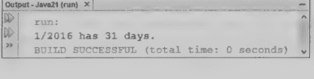

在 NetBeans 中设置命令行参数，选择 Run（运行）、Set Project Configuration（设置项目配置）、Customize（自定义）。将打开 Project Properties（项目属性）对话框，如图 4.3 所示。

在 Main Class 字段中，输入包含 `main()` 方法的类名：`com.java21days.DayCounter`。

在 Arguments 字段中，输入用空格分隔的命令行参数，例如 2016。点击 OK 保存此配置。

在 NetBeans 中使用这些参数运行应用程序，选择 Run、Run Project（运行项目），而不是 Run、Run File（运行文件）。当使用 9 和 2016 作为参数运行时，输出结果如图 4.4 所示。

### 图 4.3

在 NetBeans 中为应用程序设置命令行参数。

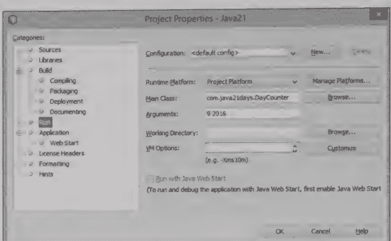

### 图 4.4

使用 switch-case 处理多个分支条件。

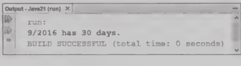

`DayCounter` 使用 `switch` 语句来计算月份中的天数。该语句是代码 4.2 第 15–42 行中 `countDays()` 方法的一部分。

`countDays()` 方法有两个参数：`month` 和 `year`。天数存储在 `count` 变量中，该变量初始值为 -1，稍后会被替换为正确的计数。

从第 17 行开始的 `switch` 语句使用 `month` 作为其条件值。

一年中 11 个月的天数很容易确定。1月、3月、5月、7月、8月、10月和12月有 31 天。4月、6月、9月和11月有 30 天。

这 11 个月的计数在代码 4.2 的第 18–32 行中处理。月份按你预期的从 1（1月）到 12（12月）编号。当其中一个 `switch` 语句的值与 `month` 相同时，该语句之后的每个语句都会执行，直到遇到 `break` 或 `switch` 语句的结束。

2月更为复杂，在第 33–39 行中处理。每个闰年的 2 月都有 29 天，而其他年份为 28 天。闰年必须满足以下条件之一：

- 年份必须能被 4 整除且不能被 100 整除。
- 年份必须能被 400 整除。

正如你在第 2 天《编程 ABC》中所学到的，取模运算符 `%` 返回除法的余数。它被用于多个 `if-else` 语句，以根据具体的年份确定 2 月的天数。

## 分支语句

```java
26: break;
27: case 4;
28: case 6;
29: case 9;
30: case 11: count = 30;
31: break;
32: case 2: if (year % 4 == 0)
33: count = 29;
34: else
35: count = 28;
36: if ((year % 100 == 0) & (year % 400 != 0))
37: count = 28;
38: }
39: return count;
40: }
41: }
```

`for` 循环的语句部分是循环每次迭代时执行的语句。正如前面提到的，你可以包含单个语句或块语句（block statement）。上一个示例使用了块语句，因为这更常见。下面的示例是一个 `for` 循环，它将字符串数组中的所有位置设置为值 "Mr."。

```java
String[] salutation = new String[10];
int i; // 循环索引变量
for (i = 0; i < salutation.length; i++) {
    salutation[i] = "Mr.";
}
```


在这个示例中，变量 `i` 用作循环索引；在每次循环中，索引值都会与 `salutation.length`（`salutation` 数组中的元素数量）进行比较。当索引等于或大于 `salutation.length` 时，循环退出。

`for` 语句的最后部分是 `i++`。这导致循环索引在每次循环执行时都加 1。如果没有这条语句，循环将永远停止。

- 循环体内部的语句将 `salutation` 数组的某一个元素设置为 "Mr."。
- 循环索引用于确定修改哪一个元素。

`for` 循环的任何部分都可以是空语句；换句话说，你可以包含一个不带任何表达式或语句的分号，那么 `for` 循环的该部分将被忽略。请注意，如果你在 `for` 循环中使用空语句，你可能需要在程序的其他地方手动初始化或递增任何循环变量或循环索引。

如果你想做的所有操作都在该循环的第一行，你也可以将空语句作为 `for` 循环的主体。例如，接下来的 `for` 循环会找到大于 4,000 的第一个质数。（它假设存在一个名为 `notPrime()` 的方法，该方法返回一个布尔值来指示 `i` 是否不为质数。）

```java
int x = 1;

for (i = 0; i < 10; i++) {

    x = x *; // 这一行不在循环内部！

}
```

`for` 语句末尾的分号表示循环的主体中没有语句。

`for` 循环中的一个常见错误是不意中在包含 `for` 语句的行末尾放了一个分号：

```java
int x = 1;

for (i = 0; i < 10; i++); {

    x = x *; // 这一行不在循环内部！

}
```

在这个示例中，`for` 语句括号外的分号结束了循环，而没有将 `x = x *` 作为循环的一部分进行执行。`x = x *` 这一行只执行了一次，因为它在 `for` 循环之外。请注意在你的 Java 程序中不要犯这个错误。

你设计的下一个项目是重写 `HalfDollar` 应用程序，使用循环来消除冗余代码。

原始应用程序处理一个长度为三个元素的数组。列表 4.3 所示的新版本（称为 `HalfLooper`）更短、更灵活，并且返回相同的输出。在 NetBeans 中创建一个该类名的空 Java 文件，并将包名设置为 `com.java21days`。

# 列表 4.3 HalfLooper.java 的全文

```java
1: package com.java21days;

2:

3: class HalfLooper {

4:     public static void main(String[] arguments) {

5:     int[] denver = { 1_700_000, 4_600_000, 2_100_000 };

6:     int[] philadelphia = { 1_800_000, 5_000_000, 2_500_000 };

7:     int[] total = new int[denver.length];

8:     int sum = 0;

9:

10:    for (int i = 0; i < denver.length; i++) {

11:        total[i] = denver[i] + philadelphia[i];

12:        sum += total[i];

13:    }

14:    System.out.println("Average: " + (sum / total.length));

15:    }

16: }
```

### while 循环

`while` 循环的语句是当条件为真时每次执行的语句。正如前面提到的，你可以包含单个语句或块语句。

```java
while (condition) {

    // 循环体

}
```

`while` 循环在执行时，只要条件为真，它就会一直执行循环体。

`while` 循环中的一个常见错误是不意中在包含 `while` 语句的行末尾放了一个分号：

```java
int x = 1;

while (i < 10); {

    x = x *; // 这一行不在循环内部！

}
```

在这个示例中，`while` 语句括号外的分号结束了循环，而没有将 `x = x *` 作为循环的一部分执行。`x = x *` 这一行只执行了一次，因为它在 `while` 循环之外。

### do-while 循环

`do-while` 循环与 `while` 循环类似，唯一的不同是它先执行循环体，然后测试条件。

```java
do {

    // 循环体

} while (condition);
```

`do-while` 循环至少会执行一次循环体，即使条件一开始就为假。

再次。如果为假，循环将退出。请记住，在循环中，循环体会一次性执行。

`for`、`while` 和 `do` 循环以略有不同的方式实现相同的目的。在编写代码时，你可能会在决定使用哪一个时遇到困难。通常没有错误答案。使用 `for`、`while` 还是 `do` 循环在很大程度上取决于个人偏好。

### 跳出循环

所有循环在满足测试条件时都会结束。在循环执行过程中，可能会发生某些情况，让你想要提前退出循环。在这种情况下，你可以使用 `break` 和 `continue` 关键字。

你已经在 `switch` 语句中见过 `break`；`break` 停止 `switch` 语句的执行，程序继续运行。`break` 关键字与循环配合使用时起同样的作用——立即停止当前循环的执行。如果你在循环中嵌套了循环，执行将从下一个外层循环开始。否则，程序将执行循环后的下一个语句。

例如，回想列表 4.4 中 `ArrayCopier` 程序的 `while` 循环。它将整数数组中的元素复制到浮点数数组中，直到到达数组末尾或遇到数字 1。你可以在 `while` 循环体内部测试后续情况，然后使用 `break` 退出循环：

```java
int count = 0;

while (count < array1.length) {

  if (array1[count] == 1) {

    break;

  }

  array2[count] = (float)array2[count++];

}
```

`continue` 关键字会让循环从下次迭代重新开始。对于 `do` 和 `while` 循环，这意味着块语句的执行重新开始；对于 `for` 循环，评估求增表达式，然后执行块语句。

当你想对循环中的元素进行特殊处理时，`continue` 关键字非常有用。在之前将一个数组复制到另一个的示例中，你可以测试当前元素是否等于 1，并使用 `continue` 在每次遇到 1 时重新启动循环，这样生成的数组永远不会包含 0。注意，由于你跳过了第一个数组中的元素，你现在必须跟踪两个不同的数组计数器：

# 第 4 天：列表、逻辑与循环

```java
int count = 0;

int count2 = 0;

while (count++ <= array1.length) {

    if (array1[count] == 1) {

        continue;

    }

    array2[count2++] = (float) array1[count];

}
```

### 标签循环

`break` 和 `continue` 都可以带有一个可选的标签，用于指示从哪里恢复程序的执行。如果没有标签，`break` 会跳到最近的循环外部，进入外层循环或循环外的下一个语句。`continue` 关键字会重启它所在的循环。使用带有标签的 `break` 和 `continue` 允许你使用 `break` 跳到嵌套循环外部，或使用 `continue` 跳到当前循环外的循环。

要使用标签循环，在循环的初始部分之前标签，并在标签和循环之间加上冒号。然后，当执行 `break` 或 `continue` 时，在关键字之后添加标签名，如下所示：

```java
out:
for (int i = 0; i < 10; i++) {

    for (int j = 0; j < 50; j++) {

        if (i * j > 400) {

            break out;

        }

    }

}
```

在此代码段中，标签 `out` 标记了外层循环。那么，在两个 `for` 循环内部，当满足特定条件时，`break` 会导致执行跳出两个循环。如果没有标签 `out`，`break` 语句将退出内部循环并恢复执行外层循环。

标签循环在 Java 中并不常用。通常有其他方法可以实现相同的功能。

## 总结

现在你已经接触了列表、循环和逻辑，你可以让计算机决定是否反复显示数组的内容。

你已经学习了如何声明数组变量、为其分配对象，以及访问和更改数组元素。通过 `if` 和 `switch` 条件语句，你可以根据布尔值测试跳转到程序的不同部分。你学习了 `for`、`while` 和 `do` 循环，并了解到每种循环都允许程序的某部分重复执行，直到满足给定条件。

值得重复的是：你将在 Java 程序中频繁使用这三项功能。

你将在 Java 程序中频繁使用这三项功能。

## 问答

- 我在 `if` 的块语句中声明了一个变量。当 `if` 完成后，该变量的定义消失了。它去哪里了？
- 从技术角度来说，块语句形成了一个新的词法作用。这意味着如果你在块内部声明变量，它只在该块内部可见且可用。当块执行完毕时，你声明的所有变量都会消失。
- 将大多数变量声明在它们需要的最外层块中是一个好主意——通常在块语句的顶部。例外可能是简单的变量，例如 `for` 循环的索引计数器，在 `for` 循环的第一行中声明它们是一个方便的捷径。
- 为什么我不能对字符串进行 `switch` 操作？
- 你可以的。如果在 NetBeans 中不起作用，请确保你安装了当前版本的 Java，并且你的开发环境已配置为使用它。
- 在 NetBeans 中，请确保你安装了当前版本的 Java，并且你的开发环境已配置为使用它。

## 验

- 1. 使用哪种循环来至少执行一次语句？
  A. do-while
  B. for
  C. while
- 2. 下列哪些可以作为测试条件？
  A. 字符
  B. 字符串
  C. 对象
- 3. 使用哪个实例变量来查找它的大小？
  A. size
  B. length
  C. MAX_VALUE

### 答案

- 1. 在 `do-while` 循环中，语句至少执行一次。
- 2. 字符串曾经不能作为测试条件，但现在不再是了。
- 3. `length` 是一个返回大小的整数。

## 定义类

由于你在之前的每一天都创建了类，到此时你应该对创建类的基础知识非常熟悉了。类通过 `class` 关键字和类名来定义，如下例：

```java
class Ticker {

  // 类的的主体

}
```

默认情况下，类继承自 `Object` 类，它是 Java 类层次结构中所有类的父类。

`extends` 关键字用于指定类的父类，如下例，该类被定义为 `Ticker` 的子类：

```java
class SportsTicker extends Ticker {

  // 类的为主体

}
```

一个没有使用 `extends` 来标识其父类的类会将 `Object` 视为其父类。

### 创建实例变量和类变量

每当你创建一个类时，你必须做的一件事就是定义让新类与其父类不同的行为。

这种行为通过通过指定新类的变量和方法来定义。在本节中，你将处理三种变量：实例变量、局部变量和类变量。接下来的章节将介绍方法。

### 定义实例变量

在第 2 天“编程 ABC”中，你学习了如何声明和初始化局部变量，局部变量是方法定义内部的变量。

实例变量的声明和定义方式与局部变量几乎相同。主要区别在于它们在类定义中的位置。

如果变量声明在方法定义之外，并且没有被 `static` 关键字修改，则这些变量被视为实例变量。

在编写自定义程序时，大多数实例变量都定义在类定义的第一行之后，但它们同样也可以定义在末尾。

### 创建方法

这是一个名为 `MarsRobot` 的类的简单定义，它继承自父类 `ScienceRobot`：

```java
class MarsRobot extends ScienceRobot {

    String status;

    int speed;

    float temperature;

    int power;

}
```

这个类定义包含四个变量。由于这些变量没有定义在方法内部，因此它们是实例变量。变量如下：

- `status`——一个表示机器人当前活动的字符串（例如，“探索中”或“返回途中”）
- `speed`——一个表示机器人当前移动速度的整数
- `temperature`——一个表示机器人环境当前温度的浮点数
- `power`——一个表示机器人当前电池电量的整数

### 类变量

正如你在前几天所学到的，类变量适用于整个类，而不是该类的某个特定对象。

类变量适用于在同类的不同对象之间共享信息，或者用于跟踪一组对象之间的共同信息。

在类声明中使用 `static` 关键字来声明类变量，如下例：

```java
static int SUM;

static final int MAX_OBJECTS = 10;
```

按照习惯，许多 Java 程序员会将类变量的名称大写，以便在代码中与其他变量区分开来。这不是语言强制要求的，但是一项推荐的做法。

### 创建方法

正如你在第 3 天“操作对象”中所学习的样，方法定义了对象的行为——即对象被创建时发生的任何事情，以及对象在其生命周期内可以执行的各种任务。

# 第 5 天：创建类和方法

本节介绍了方法的定义以及方法的工作原理。明天的课程将会有关于你可以使用方法执行的更复杂功能的细节。

## 定义方法

在 Java 中，一个方法的定义包含四个基本部分：

- 方法名
- 参数列表
- 方法返回的对象类型或原始类型
- 方法体

方法定义的前两个部分形成了方法的 `signature`（方法签名）。

> 注意：为了今天保持简单，我们省略了方法定义中的两个可选部分：修饰符（如 public 或 private）以及指示方法可以抛出的异常的 `throws` 关键字。你将在第 6 天“包、接口和其他类特性”以及第 7 天“异常与线程”中学习这些方法定义的这些部分。

在其他语言中，方法名（可能称为函数、子程序或过程）足以将其与程序中的其他方法区分开来。

在 Java 中，你可以在同一个类中拥有多个相同但签名不同的方法。这种做法被称为方法重载，你将在今天晚些时候学到更多关于它的知识。

基础方法的定义如下：

```java
returnType methodName(type1 arg1, type2 arg2, type3 arg3 ...) {

  // 方法体

}
```

`returnType`（返回类型）是方法返回值的原始类型或类。它可以是原始类型之一（如 int 或 float）、一个类名，或者在方法不返回值时定义为 `void`。

方法的参数列表是一组用逗号分隔并放在括号内的变量声明。这些参数在方法体中成为局部变量，并在方法被调用时接收它们的值。

如果方法返回一个数组对象，数组括号可以放在返回类型之后也可以放在参数列表的右括号之后。由于将括号放在返回类型之后更易读，因此本书使用了这种方法。例如，以下代码声明了一个返回整数数组的方法：

```java
int[] makeRange(int lower, int upper) {

    // 方法体

}
```

在方法体内部，你可以拥有语句、表达式、方法调用、条件语句和循环。除非方法声明为 `void`，否则它必须返回指定类型的值。

### 列表 5.1 Lister 的完整文本

```java
package java2;

class Lister {

    int[] makeRange(int lower, int upper) {

        int[] range = new int[upper-lower + 1];

        for (int i = 0; i < range.length; i++) {

            range[i] = lower++;

        }

        return range;

    }

    public static void main(String[] arguments) {

        int[] range;

        Lister lister = new Lister();

        range = lister.makeRange(4, 13);

        System.out.print("The array: ");

        for (int i = 0; i < range.length; i++) {

            System.out.print(range[i] + " ");

        }

        System.out.println("");

    }

}
```

## 图 5.1 使用方法创建并显示数组。


该类的 main 方法通过带参数 4 和 13 调用来测试 makeRange 方法。该方法创建一个空数组，并使用 for 循环填充 4 到 13 的值。

## this 关键字

在方法定义内部，有时你需要引用包含方法的对象（换句话说，引用对象本身）。你可以这样做可以使用对象的实例变量并将当前对象作为参数传递给另一个方法。

要在自己的方法中引用对象，请在通常引用对象的地方使用 `this` 关键字。

`this` 关键字引用当前对象，你可以在任何可能出现对象引用的地方使用它：点符号、作为方法的参数、作为当前方法的返回值等。以下是使用 `this` 的示例以及注释说明：


# 创建方法

## this 关键字

```java
t = x;                          // 当前对象的 x 实例变量

z.resetData(this);               // 调用 z 类定义的 resetData 方法
                             并将当前对象传递给它

return this;                    // 返回当前对象
```

在许多情况下，你可能不需要显式地使用 `this` 关键字，因为它是假设的。例如，你可以直接通过名称引用当前类中的实例变量和方法调用，因为这在这些引用中是隐式的。因此，你可以这样写第一个示例：

```java
t = x;                          // 当前对象的 x 实例变量
```

### 注意

对于实例变量，省略 `this` 关键字的可行性取决于局部作用域内是否声明了同名的变量。你将在下一节中进一步探讨这一点。

由于这是对类当前实例的引用，因此请仅在实例方法定义的体内部使用它。使用 `static` 关键字声明的类方法无法使用 `this`。

## 变量作用域与方法定义

关于变量你必须了解的一点是它的作用域。作用域是程序中变量存在的区域，使得可以在语句和表达式中使用变量。当定义作用域的部分执行完毕后，变量将不再存在。

当你在 Java 中声明变量时，该变量始终具有有限的作用域。例如，具有局部作用域的变量只能在定义它的块内部使用。实例变量的作用域延伸到整个类，因此可以被该类中的任何实例方法使用。

当你引用变量时，Java 会从内向外检查其定义，从最内层作用域开始。

最内层作用域可能是一个块语句，例如 `while` 循环的内容。第二内层作用域可以是包含该块的方法。

如果在方法中没有找到该变量，则会检查类本身。

由于 Java 检查给定变量作用域的方式，你可能会在较低的作用域中创建一个变量，从而隐藏（或替换）变量的原始值，并为你的代码引入微妙的 bug。

例如，考虑以下 Java 程序：

```java
class ScopeTest {

  int test = 10;

  void printTest() {

    int test = 20;

    System.out.println("Test: " + test);

  }

}

public static void main(String[] arguments) {

    ScopeTest st = new ScopeTest();

    st.printTest();

}
```

该类有两个同名的变量 `test`。第一个是实例变量，初始化值为 10。第二个是局部变量，其值为 20。

`printTest()` 方法内部的局部变量 `test` 隐藏了该作用域内的实例变量。当在 `main()` 方法中调用 `printTest()` 时，它显示 `test` 等于 20，尽管存在值为 10 的 `test` 实例变量。你可以通过使用 `this.test` 来引用实例变量，并使用 `test` 来引用局部变量来避免这个问题。

另一种更隐蔽的情况发生在你在子类中重新定义了已经在父类中存在的变量。这可能会在你的代码中产生微妙的 bug。例如，你可能调用了旨在更改实例变量值的方法，但更改了错误的变量。另一个 bug 可能发生在将对象从一个类强制转换为另一个类时。你的实例变量值可能会莫名其妙地改变，因为该变量是从父类而不是你的类获取该值的。

避免这种行为的最佳方法是注意你类父类中定义的变量，并避免重复使用类层次结构中更高处使用的变量名。

## 向方法传递参数

当你使用对象作为参数调用方法时，该对象将作为该对象的引用传递到方法体内部。方法内部对对象所做的任何更改都会持续到方法外部。

请记住，这包括数组以及数组中包含的所有对象。当你将数组传递给方法并修改其内容时，原始数组会受到影响。相反，基本类型和字符串按值传递的。你不能在方法中进行任何更改这些类型的操作。

列表 5.2 中的 `Parser` 类演示了这是如何工作的。请在 NetBeans 的 `com.java21days` 包中创建此类。

### 列表 5.2 Parser.java 的完整文本

```java
1: package com.java21days;
2:
3: class Parser {
4:
5:     void toUpperCase(String[] text) {
6:         for (int i = 0; i < text.length; i++) {
7:             text[i] = text[i].toUpperCase();
8:         }
9:     }
10:
11:    public static void main(String[] arguments) {
12:        Parser parser = new Parser();
13:        parser.toUpperCase(arguments);
14:        for (int i = 0; i < arguments.length; i++) {
15:            System.out.print(arguments[i] + " ");
16:        }
17:        System.out.println();
18:    }
19: }
```

# 第5天：创建类和方法

## main() 方法详解

以下是 `main()` 方法各个部分的介绍：

- `public` 意味着该方法对其他类和对象可用，这是一种访问控制的形式。`main()` 方法必须声明为 `public`。你将在第 6 天学习更多关于访问方法的知识。
- `static` 意味着 `main()` 是一个类方法。
- `void` 意味着 `main()` 方法没有返回值。
- `main()` 接收一个参数，这是一个字符串数组。该参数持有命令行参数。

`main()` 方法的主体包含了启动应用程序所需的任何代码，例如变量的初始化或对象的创建。

`main()` 是一个类方法。当你的应用程序运行时，不会自动创建持有 `main()` 的类的对象。如果你想将类视为一个对象，你必须在 `main()` 方法中创建它的实例（正如你在列表 5.2 第 12 行的 `Parser` 中做的那样）。

在 JavaBeans 项目中，一个类可以被指定为项目的主类。当项目被打包成单个 Java 归档 (JAR) 文件时，如果执行了 JAR 文件，主类将被运行。

要设置主类，选择 Run（运行）、Set Project Configuration（设置项目配置）、Customize（自定义）。在 Project Properties（项目属性）对话框中，在 Main Class（主类）字段中输入该类的名称。

## 辅助类

你的 Java 应用程序可能由一个类（即带有 `main()` 方法的那个类）组成。（实际上，即使是简单的教程程序也使用了 Java 类库中的众多类）。你可以为程序创建任意数量的类。

只要 Java 能找到该类，你的程序在运行时就会使用它。但注意，只有起点类需要 `main()` 方法。在调用它之后，程序中使用的各种类和对象的内部将接管。尽管你可以在辅助类中包含 `main()` 方法，但在程序运行时它们会被忽略。

## Java 应用程序与参数

由于 Java 应用程序是独立的程序，向应用程序传递参数以自定义其运行方式非常有帮助。

你可以使用参数来确定应用程序如何运行，或允许应用程序处理不同类型的输入。你可以将程序参数用于许多用途，例如开启调试输入或指定要加载的文件。

## 向 Java 应用程序传递参数

向 Java 应用程序传递参数取决于运行 Java 的环境和 JVM。

要使用带有 Java 开发包 (JDK) 生成的 `java` 解释器向 Java 程序传递参数，参数将在程序运行时附加到命令行末尾。例如：

```bash
java Echo April 450 -10
```

在这里 `java` 是解释器的名称，`Echo` 是 Java 应用程序，其余部分是传递给程序的三个参数："April"、"450" 和 "-10"。注意，每个参数之间用空格分隔。

使用引号将带有空格的参数进行分组。例如，考虑以下命令行：

```bash
java Echo Wilhelm Niekro Hough "Tim Wakefield 49"
```

在 "Tim Wakefield" 周围加上引号会导致该文本被视为单个参数。`Echo` 应用程序将接收五个参数："Wilhelm"、"Niekro"、"Hough"、"Tim Wakefield" 和 "49"。引号防止了 "Tim Wakefield" 内部的空格被用作分隔符。这些空格在参数发送到程序并使用 `main()` 方法接收时，不会作为参数的一部分包含。

> **注意事项**
> 引号不是用于标识字符串的用途。传递给应用程序的每个参数都存储在 String 对象的数组中，即使它具有数值（例如前面示例中的 450、-10 和 49）。

由于 JavaBeans 在后台运行 JVM，因此没有命令行可以指定参数。相反，它们可以通过 Run、Set Project Configuration、Customize 命令在项目配置中进行设置，正如你之前运行 `RangeLister` 应用程序时做的那样。

## 在你的 Java 应用程序中处理参数

当带有参数运行应用程序时，Java 将参数存储为字符串数组并将数组传递给应用程序的 `main()` 方法。再次查看 `main()` 的签名：

```java
public static void main(String[] arguments) {
    // 方法体
}
```

`arguments` 是包含参数列表的字符串数组的名称。你可以随意调用此数组。

在 `main()` 方法内部，你通过遍历数组来处理程序接收到的参数。列表 5.3 中的 `Averager` 类是一个 Java 应用程序，它接收数值参数并返回这些参数的和和平均值。

在 NetBeans 中为 `com.java21days` 包下的 `Averager` 类创建一个新的空 Java 文件。

### 列表 5.3 Averager.java 的完整文本

```java
1: package com.java21days;
2:
3: class Averager {
4:     public static void main(String[] arguments) {
5:     int sum = 0;
6:
7:     if (arguments.length > 0) {
8:         for (int i = 0; i < arguments.length; i++) {
9:             sum += Integer.parseInt(arguments[i]);
10:        }
11:        System.out.println("Sum: " + sum);
12:        System.out.println("Average is " + +
13:             (float) sum / arguments.length);
14:    }
15:    }
16:
```

在运行程序之前，通过项目配置选择主类，正如你之前运行 `RangeLister` 应用程序时做的那样。这些实例变量初始化为 0。`buildBox()` 实例方法将变量设置为正确的值。

## 同名方法的创建（方法重载）

在处理命令行参数时，总是需要这样做。否则，当用户提供的命令行参数较少时，程序会抛出 `ArrayIndexOutOfBoundsException` 错误。

命令行参数以 String 对象的形式传递给 Java 应用程序，在使用任何数学表达式之前，你必须将它们转换为数值。`Integer` 类的方法接收一个 String 对象并返回 `int`。

当你处理 Java 类库时，经常遇到具有相同方法的类。

两点区分了这些命名方法：

- 它们接收的参数数量
- 参数的原始类型

这两点是方法签名的一部分。使用相同名称的不同签名的方法被称为重载。方法重载允许方法根据接收到的参数具有不同的行为。

当你调用方法时，Java 通过匹配方法名和参数来选择执行哪个方法。

要创建重载方法，你在类中创建具有相同名称但参数列表不同的方法。区别可以是数量、类型或两者。只要参数列表是唯一的，Java 就允许方法重载。

### 注意

Java 在区分重载方法时不考虑返回值。如果你尝试创建两个签名相同但返回值不同的方法，类将无法编译。此外，你为每个参数选择的变量名是无关的。

## 创建同名的方法示例

……而不是单个坐标——因为 `Point` 对象包含了 `x` 和 `y` 值作为实例变量。

你可以通过创建一个第二个版本的方法，并带有接收两个 `Point` 对象的参数列表，来重载 `buildBox()`：

```java
Box buildBox(Point topLeft, Point bottomRight) {

    x1 = topLeft.x;

    y1 = topLeft.y;

    x2 = bottomRight.x;

    y2 = bottomRight.y;

    return this;

}
```

为了让此方法工作，必须导入 `java.awt.Point` 类，以便使用短名称 `Point` 来引用它。

定义矩形的另一种可能方法是使用左上角、高度和宽度：

```java
Box buildBox(Point topLeft, int w, int h) {

    x1 = topLeft.x;

    y1 = topLeft.y;

    x2 = (x1 + w);

    y2 = (y1 + h);

    return this;

}
```

为了完成这个示例，我们创建了一个 `printBox()` 方法来显示矩形的坐标。一个 `main()` 方法将 `Box` 转换为应用程序，并尝试在 `Box` 对象上测试所有内容。列表 5.4 显示完整的类定义。使用 NetBeans 在 `com.java21days` 包中创建此类。

### 列表 5.4 Box.java 的全文

```java
1: package com.java21days;
2:
3: import java.awt.Point;
4:
5: class Box {
6:    int x1 = 0;
7:    int y1 = 0;
8:    int x2 = 0;
9:    int y2 = 0;
10:
11:    Box buildBox(int x1, int y1, int x2, int y2) {
12:        this.x1 = x1;
13:        this.y1 = y1;
14:        this.x2 = x2;
15:        this.y2 = y2;
16:        return this;
17:    }
18:
19:    Box buildBox(Point topLeft, Point bottomRight) {
20:        x1 = topLeft.x;
21:        y1 = topLeft.y;
22:        x2 = bottomRight.x;
23:        y2 = bottomRight.y;
24:        return this;
25:    }
26:
27:    Box buildBox(Point topLeft, int w, int h) {
28:        x1 = topLeft.x;
29:        y1 = topLeft.y;
30:        x2 = (x1 + w);
31:        y2 = (y1 + h);
32:        return this;
33:    }
34:
35:    void printBox() {
36:        System.out.print("Box: " + x1 + ", " + y1);
37:        System.out.println(", " + x2 + ", " + y2 + ")");
38:    }
39:
40:    public static void main(String[] arguments) {
41:        Box rect = new Box();
41:        System.out.println("\nCalling buildBox with ");
42:        + "coordinates(25, 25) and (50, 50):");
43:        rect.buildBox(25, 25, 50, 50);
44:        rect.printBox();
45:
46:        System.out.println("\nCalling buildBox with ");
47:        + "points(10, 10) and (20, 20):");
48:        rect.buildBox(new Point(10, 10), new Point(20, 20));
49:        rect.printBox();
50:        System.out.println("\nCalling buildBox with ");
51:        + "point(10, 10), width 50 and height 50:");
52:        rect.buildBox(new Point(10, 10), 50, 50);
53:        rect.printBox();
54:    }
55:}
```


# 创建同名的方法

运行应用程序以查看图 5.4 所示的输出。

图 5.4
调用重载的方法。

```
Output - Java21(run) x

run:

Calling buildBox with coordinates (25,25) and (50,50):

Box: <25, 25, 50, 50>

Calling buildBox with points (10,10) and (20,20):

Box: <10, 10, 20, 20>

Calling buildBox with point (10, 10), width 50 and height 50:

Box: <10, 10, 50, 50>
```

# 创建同名的方法

运行应用程序以查看图 5.4 所示的输出。

图 5.4
调用重载的方法。

```
Output - Java21(run) x

run:

Calling buildBox with coordinates (25,25) and (50,50):

Box: <25, 25, 50, 50>

Calling buildBox with points (10,10) and (20,20):

Box: <10, 10, 20, 20>

Calling buildBox with point (10, 10), width 50 and height 50:

Box: <10, 10, 50, 50>
```

```java
20:     bottomRight.y);

21: }

22:

23: Box2(Point topLeft, int w, int h) {

24:     this(topLeft.x, topLeft.y, topLeft.x + w,

25:         topLeft.y + h);

26: }

27:

28: void printBox() {

29:     System.out.print("Box: <" + x1 + ", " + y1 + ">\\n");

30:     System.out.println("\n<" + x2 + ", " + y2 + ">\\n");

31: }

32:

33: public static void main(String[] arguments) {

34:     Box2 rect;

35:

36:     System.out.println("\nBox 2 with coordinates "

37:              + "\"(25,25) and (50,50)");
```

该应用程序产生的输出与图 5.4 所示的 Box 应用程序相同。在列表 5.5 中，第二个和第三个构造函数在第 19–20 行和第 24–25 行使用 `this` 来调用第一个构造函数，从而完成了用指定参数创建对象的任务。

## 方法重写

当你调用对象的方法时，Java 会在对象的类中查找该方法的定义。如果没找到，则会在对象的父类中查找，并沿着类层次结构向上查找，直到找到该方法为止。继承允许你在子类中重复地定义和使用方法，而无需重复代码。

# 第 5 天：创建类和方法

然而，有时你可能希望对象对同一个方法做出响应，但在调用该方法时表现出不同的行为。在这种情况下，你可以重写该方法。

要做到这一点，可以在子类中定义一个与父类中方法具有相同签名的方法。然后，当调用该方法时，将找到并执行子类的方法，而不是父类中的方法。这被称为*重写*（overriding）一个方法。

## 创建重写现有方法的方法

要重写一个方法，你只需要在子类中创建一个与类父类定义的方法具有相同签名（名称和参数列表）的方法即可。由于 Java 会执行第一个与签名匹配的方法定义，因此新的签名会隐藏原始的方法定义。

这是一个简单的示例。列表 5.6 包含两个类。`Printer` 包含一个名为 `printMe()` 的方法，用于显示该类对象的信息。`SubPrinter` 是一个子类，它为类添加了一个 `z` 实例变量。在 NetBeans 中创建此类并将其命名为 `Printer`（包 `com.java21days`）。

列表 5.6 `Printer.java` 的完整文本

```java
1: package com.java21days;

2:

3: class Printer {

4:     int x = 0;

5:     int y = 1;

6:

7:     void printMe() {

8:         System.out.println("x is " + x + ", y is " + y);

9:         System.out.println("I am an instance of the class " +

10:        this.getClass().getName());

11:    }

12: }

13:

14: class SubPrinter extends Printer {

15:     int z = 3;

16:

17:     public static void main(String[] arguments) {

18:         SubPrinter obj = new SubPrinter();

19:         obj.printMe();

20: }

21: }
```

当编译此文件时，会有两个类文件而不是一个。因为源文件定义了 `Printer` 和 `SubPrinter` 类，编译器会生成这两个类。运行 `SubPrinter`（通过在 NetBeans 中选择 Running, Run File），你将会看到：

图 5.5 调用方法的输出
```
x is 0, y is 1

I am an instance of the class com.java21days.SubPrinter
```

注意事项：
- 20
- 21
- 22
- 23
- 24
- 25
- 26
- 27
- 28
- 29
- 30
- 31
- 32
- 33
- 34
- 35
- 36
- 37

152 第 5 天：创建类和方法

```java
16:   System.out.println("y is " + np.y);

17:   System.out.println("Name is " + np.name);

18: }
19: }
```

输出显示如图 5.6 所示。

图 5.6 在子类中扩展父类构造函数。

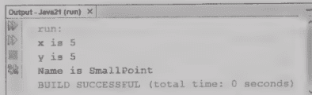

为 `NamedPoint` 定义的构造函数调用了 `Point` 的构造函数，用以初始化 `Point` 的成员变量（`x` 和 `y`）。虽然你可以自己初始化 `x` 和 `y`，但你可能不知道 `Point` 在初始化自身时还会执行什么。因此，将构造函数向上层次结构传递是一个好主意，可以确保所有设置都正确完成。

## 总结

完成今天的课程后，你应该对 Java 中类之间的关系以及使用该语言创建的程序有了良好的理解。

你在 Java 中创建的任何内容都涉及一个与所需的其它类交互的主类。这与你使用其他语言时的编程思维有所不同。

在这一天中，你整合了关于创建 Java 类的所有知识。这些主题包括：

- 实例变量和类变量：它们持有类及其创建对象的属性。
- 实例方法和类方法：定义了类的行为。你学习了如何定义方法，包括方法签名部分、如何从方法返回值、如何将参数传递给方法，以及如何使用 `this` 关键字引用当前对象。
- Java 应用程序的 `main()` 方法以及如何向其传递参数。
- 重载方法：通过提供不同的参数来重用方法名。
- 构造函数：定义对象的初始变量和其他起始条件。

## 问答

我的类中有一个名为 `origin` 的实例变量。在方法中也有一个名为 `origin` 的局部变量，由于变量的作用域，它被局部变量隐藏了。有什么方法可以访问实例变量的值吗？

避免这个问题最简单的方法是给局部变量起一个与实例变量不同的名称。如果出于某种原因，你倾向于在存在同名实例变量时将局部变量命名为 `origin`，你可以使用 `this.origin` 来引用实例变量，使用 `origin` 来引用局部变量。

我创建了两个签名如下的方法：

```java
int total(int arg1, int arg2, int arg3) { ... }

float total(int arg1, int arg2, int arg3) { ... }
```

当我尝试编译带有这些方法定义的类时，Java 编译器报错了，尽管它们的签名是不同的。我做错了什么？

你的方法具有相同的签名。Java 中的方法重载仅在参数列表的数量或类型存在差异时才有效。返回类型不是方法签名的一部分，因此在方法被重载时不会考虑它。从调用方法的角度来看，这是合理的：如果两个方法具有完全相同的参数列表，Java 如何知道该调用哪一个呢？

我写了一个接收四个参数的程序，当我提供的参数太少时，它因运行时错误而崩溃了。为什么？

测试程序期望的参数数量和类型是你的责任，Java 不会为你做。如果你的程序需要四个参数，请在 `main()` 方法中使用数组的 `length` 变量（它包含元素计数）来测试是否确实给了四个参数。如果没有，返回错误消息并结束程序。


## 测验

通过这个三个题的测验来回顾今天的材料。

### 题目

- 1. 如果局部变量与实例变量同名，在局部变量的作用域内如何引用实例变量？
   A. 你不能，你应该重命名其中一个变量。
   B. 在实例变量名前使用 `this` 关键字。
   C. 在名称前使用 `super` 关键字。
2. 实例变量在类的哪个位置声明？
   A. 类的任何位置
   B. 类中所有方法之外
   C. 在类声明之后，第一个方法之前
3. 如何向程序发送包含一个或多个空格的参数？
   A. 用双引号括参数。
   B. 用逗号分隔参数。
   C. 用句号分隔参数。

### 答案

- 1. 答案 A 是一个好主意，但变量名冲突可能成为 Java 程序中细微错误的根源。
2. 按照惯例，实例变量在类声明之后、任何方法之前声明。只需要它们位于所有方法之外即可。
3. A. 当参数被传递给程序时，引号并不包含在参数中。

### 认证练习

以下问题是在 Java 编程认证考试中可能会遇到的类型。请在不看今天的材料或不使用 Java 编译器测试代码的情况下回答它。

### 认证练习

# 155

给定：

```java
public class BigValue {

    float result;

    public BigValue(int a, int b) {

        result = calculateResult(a, b);

    }

    static float calculateResult(int a, int b) {

        return (a + b);

    }

    public static void main(String[] args) {

        BigValue bv = new BigValue(10, 20);

        System.out.println("Result: " + bv.result);

    }

}
```

哪条语句应该替换这里的 // 这里 以使 `result` 等于 30？

A. float calculateResult(int)
B. float calculateResult(int a, int b)
C. float calculateResult()
D. float calculateResult

答案可以在第 5 天的页面找到。访问认证链接。

### 练习

为了扩展对今天涵盖主题的知识，请尝试以下练习：

1. 修改第 5 天的 `MarsRobot` 以包含构造函数。
2. 创建一个表示四维点的类 `FourDP`，它是 `Point` 的子类。

练习解答在本书的网站上提供。

# 方法和变量的访问控制

你最常用的修饰符控制对方法和变量的访问：`public`（公共）、`private`（私有）和 `protected`（保护）。这些修饰符决定了类的哪些变量和方法对其他类可见的。

通过使用访问控制，你可以规定其他类如何使用你的类。类中的某些变量和方法仅在类内部有用，并且应该对其他类隐藏。这个过程被称为**封装**：一个对象控制外部世界可以了解关于它的什么信息，以及外部世界如何与它交互。封装是防止其他类读取或修改类变量的过程。使用这些变量的唯一方法是在这些方法可用时调用该类的方法。

Java 语言提供了四种访问控制级别：`public`、`private`、`protected`，以及通过不使用这些任何一种访问控制修饰符来指定的默认级别（default）。

### 默认访问

变量和方法可以在不使用任何修饰符的情况下声明，例如所示：

```java
String version = "0.7a";

boolean processOrder() {

  return true;

}
```

未声明访问控制修饰符的变量或方法对同一个包中的任何其他类都是可见的。Java 类库被组织成包，例如 `javax.swing`（用于图形用户界面编程的窗口类集合）和 `java.util`（一组有工具类）。

任何未声明修饰符的变量都可以被同一个包中的任何其他类读取或更改。其他类无法以任何方式访问这些元素。

这种级别的访问控制控制的范围不多，因此当你开始考虑如何让其他类使用一个类时，它的用处较小。

### 私有访问

要完全隐藏一个方法或变量并防止被其他类使用，请使用 `private` 修饰符。这些方法或变量只能在它们自己的类内部被访问。

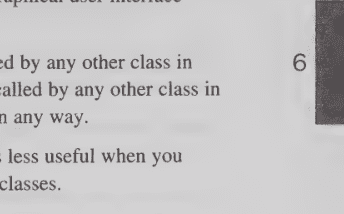

私有实例变量可以被所属类中的方法使用，但不能被任何其他类的对象使用。私有方法可以被所属类中的其他方法调用，但不能被其他方法调用。这种限制也影响继承：私有变量均不会被子类继承。

私有变量在两种情况下非常有用：

- 当其他类没有理由使用该变量时
- 当另一个类可能通过不当的方式更改变量而造成破坏时

例如，考虑一个名为 `CouponMachine` 的 Java 类，它为互联网托管网站生成折扣。该类中有一个名为 `salesRatio` 的变量可以根据产品销售情况控制折扣的大小。这个变量对业务的底线有巨大影响。如果变量被其他类更改，`CouponMachine` 的性能将发生显著变化。为了防止这种情况发生，你可以将 `salesRatio` 声明为 `private`。

下面的类使用了私有访问控制：

```java
class Logger {

    private String format;

    public String getFormat() {

        return this.format;

    }

    public void setFormat(String fmt) {

        if ((fmt.equals("common") || (fmt.equals("combined"))) {

            this.format = fmt;

        }

    }

}
```

在这个代码示例中，`Logger` 类的 `format` 变量是私有的，因此其他类无法直接获取或设置它的值。

相反，它可以通过两个公共方法可用：返回 `format` 值的 `getFormat()`，以及设置其值的 `setFormat(String)`。

后一个方法包含逻辑，允许变量仅被设置为 "common" 或 "combined"。这展示了使用公共方法作为访问类实例变量唯一手段的用处：方法可以允许类对变量如何被访问进行控制，并限制它所可以取的值。

使用 `private` 修饰符是对象进行自我封装的主要方式。如果不使用 `private` 来隐藏变量和方法，你就无法限制类被使用的方式。如果你不控制访问，其他类就可以以许多可能的方式更改类内部的变量并调用其方法。

私有性的一个大优势是，它允许类的实现发生变化，而不影响该类的用户。如果你想出了实现某项任务的更好方法，只要它的公共方法接收相同的参数并返回相同类型的值，你就可以重写该类。

### 公共访问

在某些情况下，你可能希望类中的某个方法或变量对任何想要使用它的其他类完全可用。例如，`java.awt` 包中的 `Color` 类对于黑色（black）等常用颜色有公共变量。当图形类想要使用黑色时，就会使用到这个变量，因此黑色不应该有访问控制。

类变量通常被声明为 `public`。一个示例是 `Football` 类中的一组代表得分时分数的变量。`TOUCHDOWN` 变量可能等于 6，`FIELD_GOAL` 变量可能等于 3，`SAFETY` 变量可能等于 2。如果这些变量是公共的，其他类可以在如下下面的语句中使用它们：

```java
if (yard < 0) {

    System.out.println("Touchdown!");
```


# 第 6 天：包、接口和其他类特性

## 公共访问

`public` 修饰符使方法或变量对所有类完全可用。你在你目前为止编写的每个应用程序的 `main()` 方法中都使用过它：

```java
public static void main(String[] arguments) {
    // ...
}
```

应用程序的 `main()` 方法必须是 `public` 的。否则，它将无法被 Java 虚拟机（JVM）调用来运行该类。

由于类的继承，类的所有公共方法和变量都会被其子类继承。

## 保护访问

下一级访问控制是将方法和变量限制给以下两组人员使用：

- 类的子类
- 同一个包中的其他类

你通过使用 `protected` 修饰符来实现这一点，如下句所示：
`protected boolean outOfData = true;`

你可能会好奇这两组之间有什么区别。毕竟，子类不是和它们的父类在同一个包中吗？并不总是如此。例如 `java.sql.Date` 类，它代表 SQL 数据库中的日历日期。它是 `java.util.Date` 的子类，后者是一个更通用的日期类。`protected` 访问与默认访问的区别在于：即使不在同一个包中，`protected` 变量对子类也是可见的。

如果你想让子类的实现变得更容易，这种级别的访问控制就是很有用的。你的类可能使用某个方法或变量来帮助类完成工作。因为子类继承了许多相同的行为，它可能需要访问它们。考虑一个播放音频文件的 `AudioPlayer` 类示例。`AudioPlayer` 有一个方法 `openSpeaker()`，它与硬件交互以准备扬声器。`openSpeaker()` 对 `AudioPlayer` 外部的人并不重要，所以起初你可能想将其设为 `private`。

```java
class AudioPlayer {
    private boolean openSpeaker(Speaker sp) {
        // 实现代码
    }
}
```

这段代码在 `AudioPlayer` 不被子类化时可以工作。但如果以后你需要一个 `AudioPlayer` 的子类 `StreamingAudioPlayer` 呢？该类需要覆盖 `openSpeaker()` 方法以提供流媒体支持。你仍然不希望该方法对随机对象可用，所以它不应该是 `public` 的，但你希望子类能够访问它。

## 比较访问控制

各种保护类型之间的区别可能会令人困惑，特别是 `protected` 方法和变量的情况。表 6.1 总结了在什么地方允许的操作，有助于澄清从最松（公共）到最严格（私有）的保护形式的区别。

**表 6.1 不同的访问控制级别**

| 可见性 | Public | Protected | Default | Private |
| --- | --- | --- | --- | --- |
| 同一类内 | 是 | 是 | 是 | 是 |
| 同包内的任何类 | 是 | 是 | 是 | 否 |
| 包外的任何类 | 是 | 否 | 否 | 否 |
| 同包内的子类 | 是 | 是 | 是 | 否 |
| 包外的子类 | 是 | 是 | 否 | 否 |

## 访问控制与继承

关于方法访问控制的最后一个问题涉及子类。当你创建一个子类并覆盖一个方法时，你必须考虑原始方法的访问控制。

作为一条通用规则，你不能在 Java 中覆盖一个方法并使新方法的控制比原始方法更严格。但是，你可以使其更公共。子类的方法不能减少其所覆盖方法的可见性。强制执行以下方法的继承规则：

- 在父类中声明为 `public` 的方法在所有子类中也必须是 `public`。
- 在父类中声明为 `protected` 的方法在子类中必须是 `protected` 或 `public`；不能是 `private`。
- 无访问控制（未使用修饰符）的方法在子类中可以声明为更私有。

声明为 `private` 的方法不被继承，因此这些规则不适用。

## 访问器方法

在许多情况下，类中可能有一个对其包含值有严格规则的实例变量。例如 `zipCode` 变量。美国的邮政编码必须是五位数字（还有一种九位的 ZIP+4 格式）。

为了防止外部类错误地设置 `zipCode` 变量，你可以将其声明为私有（private）：

```java
private int zipCode;
```

但是，如果其他类必须能够设置 `zipCode` 变量才能使该类有用呢？在这种情况下，你可以通过 `zipCode` 所在的类内部使用访问器方法，让其他类访问私有变量。

访问器方法提供了对原本无法访问变量的访问。通过使用方法访问私有变量，你可以控制该变量的使用。在邮政编码的示例中，类可以防止其他人将 `zipCode` 设置为错误的值。

通常，会有单独的读取和写入变量的访问器方法。读取方法的名字以 `get` 开头，写入方法的名字以 `set` 开头，例如 `setZipCode(int)` 和 `getZipCode()`。

这种约定有一个例外：如果被访问的变量是布尔值（Boolean），访问器方法不以 `get` 开头。相反，以 `is` 开头，就像布尔变量 `valid` 中的 `isValid()` 一样。这里有一个示例：

```java
private boolean empty;

public boolean isEmpty() {
    return empty;
}
```

使用方法访问实例变量是面向对象编程中的常用技术。这种方法通过防止不当使用，使得类更具重用性。

> 提示
> 出于相同的原因，实例变量也可以受益私有化并将其使用限制为访问器方法。

## 静态变量和方法

你已经在程序中使用过一个修饰符 `static`，它在第 5 天“创建类和方法”中详细介绍过。`static` 修饰符用于创建类方法和变量，如下例所示：

```java
public class Circle {
    public static double PI = 3.14159265F;
    public double radius;

    public double area() {
        return PI * radius * radius;
    }
}
```

可以使用类名后接点以及变量或方法的名字来访问类变量和方法，例如 `Color.black` 或 `Circle.PI`。你也可以使用该类的对象名称，但对于变量和方法，使用类名更好。这种方法可以更清楚地说明你正在处理什么类型的变量或方法；实例变量和方法永远不能通过类名引用。

以下语句使用了类变量和方法：

```java
double circumference = 2 * Circle.PI * radius;
double randomNumber = Math.random();
```

你今天承担的第一个项目是一个名为 `InstanceCounter` 的类，它使用类变量和实例变量来跟踪创建了多少个该类的对象。在 NetBeans 中，在你本书大部分时间使用的 `com.java21days` 包中创建一个名为 `InstanceCounter` 的空 Java 文件。在源代码中输入列表 6.1 所示的代码，并在完成后保存。

### 列表 6.1 InstanceCounter.java 的全文

```java
package com.java21days;

public class InstanceCounter {
    private static int numInstances = 0;

    protected static int getCount() {
        return numInstances;
    }

    private static void addInstance() {
        numInstances++;
    }

    InstanceCounter() {
        InstanceCounter.addInstance();
    }

    public static void main(String[] arguments) {
        System.out.println("Starting with " +
            InstanceCounter.getCount() + " objects");
        for (int i = 0; i < 500; i++) {
            new InstanceCounter();
        }
        System.out.println("Created " +
            InstanceCounter.getCount() + " objects");
    }
}
```

NetBeans 在保存或运行 Java 类时会尝试编译。如果没有错误，你就可以运行它来查看图 6.1 中包含的输出。

### 图 6.1

操作类变量和实例变量。


此应用程序演示了 Java 语言的几个特性。在第 4 行，声明了一个私有类变量来存储对象的数量。它是一个类变量（声明为 `static`），因为对象的数量与整个类有关，而不是与任何特定对象有关。它是私有的，以便只能通过访问器方法进行检索。

注意 `numInstances` 的初始化。正如实例变量在创建其实例时初始化一样，类变量在类被创建时初始化。这种类的初始化本质上发生在该类或其实例发生任何其他情况之前，因此示例中的类将按计划工作。

在第 6–8 行中，定义了一个方法以便可以检索私有类变量的值。该方法也被声明为 `static`，以便可以检索私有变量的值。

## final 类和方法

因为能够为子类提供行为和属性的类要有用得多，所以你应该强烈考虑在某个类上使用 `final` 带来的收益是否大于其代价。

## 抽象类与方法

在类层次结构中，类的位置越高，其定义就越抽象。位于层次结构顶部的类只能定义所有类共有的行为和属性。更具体的行为和属性则位于层次结构中较低的位置。

在定义类层次结构的过程中提取公共行为和属性时，你可能会发现自己拥有一个永远不需要被直接实例化的类。相反，这样的类用作存放子类共享的公共行为和属性。

这些类被称为抽象类（abstract classes），它们使用 `abstract` 修饰符创建。以下是一个示例：

```java
public abstract class Palette {
    // ...
}
```

抽象类的一个示例是 `java.awt.Component`，它是图形用户界面组件的父类。由于许多组件继承自此类，它包含了对每个组件都都有用的方法和变量。然而，并不存在一种可以添加到用户界面的“通用组件”，因此在程序中永远不需要创建一个 `Component` 对象。

抽象类可以包含普通类可以的任何内容，包括构造方法，因为它们的子类可能需要继承它们。抽象类还可以包含抽象方法（abstract methods），抽象方法是没有任何实现的方法签名。这些方法在抽象类的子类中被实现。抽象方法用 `abstract` 修饰符声明。你不能在一个本身不是抽象类的类中声明抽象方法。如果一个抽象类除了抽象方法外没有其他内容，你最好使用接口（interface），正如你今天晚些时候会看到的。

## 包

使用包（packages）是组织一组类的一种方式。一个包包含在目的、范围或继承关系上相关的类。

如果你的程序很小且使用的类数量有限，你可能会发现你不需要探索包。但当你开始创建具有许多通过继承关系相互关联的类的更复杂的项目时，你可能会发现将它们组织成包的用处。

包之所以有用，主要基于以下几个宽泛的原因：

- 它们允许你将类组织成单元。正如你在硬盘上通过创建文件夹来组织文件和应用程序一样，包允许你将类分组，以便在每个程序中只使用你需要的部分。
- 它们减少了命名冲突问题。随着 Java 类数量的增加，你与另一个开发者使用相同类名的概率也随之增加。这在你尝试将一组类集成到单个程序中时，引入了类命名和错误消息的可能性。包提供了一种特指所需类的方法，即使该类与另一个包中的类同名。
- 它们允许你以比逐个类处理更有效的方式来保护类、变量和方法。你稍后会学习更多关于保护（protections）的知识。
- 包可以用来唯一地标识你的工作。

每当你使用 `import` 命令或通过类的完整包名引用类时（例如 `java.util.StringTokenizer`），你都在使用包。

要使用包含在包中的类，你可以使用以下三种技术之一：

- 如果你想使用的类在 `java.lang` 包中（例如 `System` 或 `Date`），你可以直接使用类名来引用该类。`java.lang` 中的类在你的所有程序中都是自动可用的。
- 如果你想使用的类在其他某个包中，你可以通过它的全名（包括任何包名，例如 `java.awt.Font`）来引用该类。
- 对于你从其他包中频繁使用的类，你可以导入单个类或整个类包。在导入类或包后，你就可以通过类名来引用它。

如果你不声明你的类属于某个包，它会被放入一个未命名的默认包中。你可以从其他类的任何地方通过类名来引用该类以及任何其他未解包的类。

要引用另一个包中的类，你始终可以使用它的全名：类名前面加上包名。你不需要为了以这种方式使用类而导入该类或包：

```java
java.awt.Font text = new java.awt.Font();
```

对于你在程序中只使用一次或两次的类，使用全名可能是合理的。如果你多次使用某个类，可以导入该类以节省一些打字时间。没有理由不导入，所以你可能决定遵循本书的习惯，始终使用导入，以便保持类名简短且更具可读性。

## import 声明

要从包导入类，请使用 `import` 声明。你可以导入单个类，如在本语句所示：

```java
import java.util.ArrayList;
```

你也可以使用星号 `*` 代替单个类名来导入整个类包：

```java
import java.awt.*;
```

在 `import` 语句中，星号只能代替类名。它并不能让你导入多个具有相似名称的包。

例如，Java 类库包含了 `java.util`、`java.util.jar` 和 `java.util.prefs` 包。你无法通过以下语句导入所有三个包：

```java
import java.util.*;
```

这仅仅导入了 `java.util` 包。为了在类中让这三个包都可用，需要以下语句：

```java
import java.util.*;
import java.util.jar.*;
import java.util.prefs*;
```

此外，你不能指定部分类名（例如使用 `L*` 来导入所有以字母 L 开头的类）。当你使用 `import` 声明时，你的唯一选择是标识一个单个类，或使用星号加载包中的所有类。

你的类定义中的 `import` 声明位于文件顶部，在任何类定义之前，但在包声明之后，正如你将在下一节中看到的。

使用 `import` 声明或导入包主要取决于你个人的编码风格。导入一组类不会减慢程序的运行速度或让程序变大；只有在你代码中实际使用的类才会在需要时被加载。导入特定的类有助于你代码的阅读者更容易看出代码在使用哪些类。


> 注意
> 如果你熟悉 C 或 C++，你可能预期的 `import` 声明的作用像 `#include` 一样，并可能导致结果中生成一个巨大的可执行程序，因为它包含了来自另一个文件的源代码。在 Java 中，情况并非如此。`import` 关键字唯一的功能是当使用短名时，告诉 Java 编译器去哪里查找类的全名。它并不会从任何类中导入代码。

`import` 语句也可以通过名称引用类中的常量。通常情况下，类常量必须以类名作为缀，例如 `Color.black`、`Math.PI` 和 `File.separator`。

`import static` 语句允许标识类中的常量以更短的形式可用。`import static` 关键字后面跟着接口或类的名称以及一个星号。例如：

```java
import static java.lang.Math.*;
```

该语句使得仅通过名称即可引用 `Math` 类中的常量 `E` 和 `PI`。这是一个利用这一特性的简短示例：

```java
import static java.lang.Math.*;

public class ShortConstants {
    public static void main(String[] arguments) {
        System.out.println("PI: " + PI);
        System.out.println(PI * 3);
    }
}
```

### 类名冲突

在导入一个类或一组类后，你通常可以不带包标识符引用类。但是，当你从具有相同类名的不同包导入类时，必须更加明确。

一种可能发生命名冲突的情况是在数据库编程期间，你将在第 18 天进行“使用 JDBC 4.2 和 Derby 访问数据库”。这种编程可能涉及 `java.util` 和 `java.sql` 包，这两个包都包含一个名为 `Date` 的类。

如果你在一个读取或写入数据库数据的类中同时处理这两个包，可以使用以下语句导入它们：

```java
import java.sql.*;
import java.util.*;
```

## 创建你自己的包


# 创建你自己的包

## 选择包名

第一步是决定一个名称。你为包选择的名称取决于你将如何使用这些类。也许你可以用自己的名字命名，或者根据你正在处理的 Java 系统部分（例如图形或消息）命名。如果你打算将你的包作为开源或商业产品发布，请使用能够唯一标识其作者身份的包名。

Oracle 建议 Java 开发者使用他们控制的互联网域名作为唯一包名的基础。

要形成该名称，请将域名的元素进行反转，使得最后一部分成为包名的第一部分，然后是倒数第二部分。遵循这一惯例，因为我的个人域名是 `cadenhead.org`，我创建的 Java 包将以 `org.cadenhead` 开头，例如 `org.cadenhead.game` 和 `org.cadenhead.xml`。


### 创建文件夹结构

创建包的第二步是创建一个与包名匹配的文件夹结构，这需要为名称的每个部分创建一个单独的文件夹。包 `org.cadenhead.rss` 需要一个 `org` 文件夹、`org` 内部的 `cadenhead` 文件夹以及 `cadenhead` 内部的 `rss` 文件夹。包中的类存储在 `rss` 文件夹中。

在 NetBeans 中，当你将类放在包中时，文件夹会自动创建，源代码和类文件将存储在正确的子文件夹中。你只需要考虑包名即可。

要查看此内容，点击项目面板中的文件（Files）选项卡将其置于最前面（图 6.2）。它将显示 Java21 项目的文件和文件夹。在本书中，你的程序一直使用 `com.java21days` 包。展开 `src` 文件夹，然后是 `com` 子文件夹，然后是 `java21days` 子文件夹。该包中所有类的 Java 源文件都将列出来。

### 图 6.2 文件选项卡

在 NetBeans 中查看项目的包文件夹层级结构。

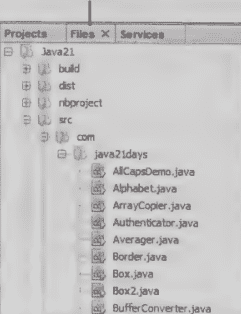

### 将类添加到包

将类放入包的最后一步是在你的类定义之前添加一个包声明。按照另一种惯例，包声明后面紧跟在类定义之前：

```java
package org.cadenhead.rss;
```

# 包和类的访问控制

早些时候，你学习了方法和变量的访问控制修饰符。你也可以控制类的访问。

如果不指定修饰符，类具有默认访问权限，这意味着它们对于同一个包内的类是可见的。如果你想让类在包之外可见，可以通过为类定义添加 `public` 修饰符：

```java
public class Visible {
  // ...
}
```

当你使用带星号的导入语句时，你导入了包中的所有类。

通过实现接口，类对于包之外的类是可见的。

## 接口

接口像抽象类一样，提供了行为的模板。你可以对接口做两件事：在自己的类中使用它们，以及定义你自己的。现在，先从在自己的类中使用它们开始。

### 单重继承的问题

其他面向对象编程（OOP）语言包含了多重继承的概念，这增加了复杂性。由于 Java 的目标之一是简单，因此拒绝了多重继承，转而采用单继承。

### 接口和类

尽管类接口和类之间有许多共同点。它们都声明在源文件中，并编译成 `.class` 文件。在大多数情况下，任何可以使用类的地方都可以接口。在几乎每个示例中，你都可以用接口名代替类名。

### 实现和使用接口

要使用接口，要在类定义中包含 `implements` 关键字：

```java
public class AnimatedSign extends Sign
  implements Runnable {
}
```

在这个示例中，`Runnable` 接口扩展了 `AnimatedSign` 类的行为。

由于接口只提供抽象方法定义，你必须在自己的类中实现这些方法，并使用接口中相同的方法签名。通过实现接口，你是在告诉类的用户你支持整个接口。

#### 实现多个接口

与继承不同（一个类只能有一个父类），你可以在类中包含任意数量的接口。你的类必须实现所有包含接口的组合行为。

```java
public class AnimatedSign extends Sign
  implements Runnable, Observer {
    //...
}
```

请注意，实现多个接口可能会产生复杂性。如果两个不同的接口定义了相同的方法会发生什么？你可以通过三种方式解决这个问题：

- 每个接口中的方法具有完全相同的签名（`signature`），你在类中实现一个方法，该定义同时满足了两个接口。
- 方法的参数列表不同，这是一个简单的方法重载情况；你实现这两个方法签名，并且每个定义都满足其各自的接口定义。
- 如果方法的参数列表相同但返回类型不同，你无法创建一个能够同时满足这两者的方法。（请记住，方法签名不包含方法的返回类型。）在这种情况下，尝试编译一个实现这两个接口的类将产生编译器错误信息。遇到这个问题表明你的接口在设计上存在某些缺陷，你可能需要重新审视它们。

### 接口的其他用途

在几乎所有你可以使用类的地方，你都可以使用接口来代替类。例如，你可以声明一个变量的类型为接口类型：

`Iterator loop;`

当一个变量被声明为接口类型时，它必须用于持有实现该接口的对象。任何实现 `Iterator` 接口的类都可以存储在 `loop` 中。在这种情况下，由于 `loop` 是 `Iterator` 类型的对象，假设你可以在该对象上调用接口的所有三个方法：`hasNext()`、`next()` 和 `remove()`。

你可以将对象强制转换为接口，就像你可以将对象强制转换为其他类一样。

## 创建和扩展接口

在使用接口一段时间后，下一步是定义你自己的接口。接口看起来非常像类；它们的声明方式与类非常相似，并且可以组织成层级结构。然而，你必须遵循某些规则来声明它们。

### 新的接口

要创建一个新接口，你可以像这样声明它：

```java
interface Expandable {
  // ...
}
```

这种声明在效果上等同于类定义，只是用 `interface` 单词替换了 `class`。接口定义内部包含方法和变量。

接口内部的方法定义是公共的（`public`）且抽象的（`abstract`）。你可以显式地将它们声明为此类，或者如果不包含这些修饰符，它们将被转换为公共且抽象方法。你不能在接口内部将方法声明为私有的（`private`）或保护的（`protected`）。

例如，这里有一个 `Expandable` 接口，其中一个方法显式声明为公共且抽象，另一个则为隐式声明：

```java
public interface Expandable {
    public abstract void expand(); // 显式公共且抽象
    void contract(); // 实际上是公共且抽象
}
```

两个方法都是公共且抽象的。

就像类中的抽象方法一样，接口内部的方法没有体。接口仅包含方法签名；不涉及实现。

除了方法外，接口还可以拥有变量，但这些变量必须声明为公共（`public`）、静态（`static`）和最终（`final`）（使它们成为常量）。与方法一样，你可以显式定义一个变量为这些修饰符，或者如果不使用这些修饰符，它会被隐式定义。这里是带有两个新变量的 `Expandable` 定义：

```java
public interface Expandable {
    public static final int INCREMENT = 10;
    long CAPACITY = 15000; // 变为 public static and final
    public abstract void expand(); // 显式公共且抽象
    void contract(); // 实际上是公共且抽象
}
```

接口必须具有公共（`public`）或包（`package`）保护，就像类一样。然而，使用 `public` 修饰符的接口不会自动将其方法转换为公共且抽象，也不会自动将其常量转换为公共。非公共接口也具有非公共的方法和常量，这些内容只能由同一包中的类和其他接口使用。

接口像类一样，可以属于一个包。接口还可以从其他包导入其他接口和类，就像类可以这样做一样。

### 接口内部的方法

关于接口内部的方法，有一个需要注意的技巧：这些方法本应该是抽象的，并适用于任何类型的类，但你如何为方法定义参数呢？你并不知道哪个类将使用它们！答案在于，正如你之前学到的，在任何可以使用类的地方都使用接口名称。通过将你的方法参数定义为接口类型，你可以创建通用的适用于任何使用此接口的类的通用参数。

考虑 `Trackable` 接口，它定义了没有参数的 `track()` 和 `quitTracking()` 方法。你可能还有一个用于 `beginTracking()` 方法，它有一个参数：一个 `Trackable` 类的对象。

那应该是哪个类呢？任何实现 `Trackable` 接口的对象，而不是某个特定的类及其子类。解决方案是在接口中将参数简单地声明为 `Trackable`：

```java
public interface Trackable {
    public abstract Track beginTracking(Trackable self);
}
```

然后，在类中该方法的实际实现中，你可以获取通用的 `Trackable` 参数并将其转换为相应的对象：

```java
public class Monitor implements Trackable {
    public Trackable beginTracking(Trackable self) {
        Monitor mon = (Monitor) self;
        // ...
        return mon;
    }
}
```

### 扩展接口

正如你可以对类所做的那样，你可以扩展接口。要扩展一个接口，使用 `extends` 关键字：

```java
interface AdvancedTrackable extends Trackable {
    // ...
}
```

## 创建与扩展接口

### 图 6.3

NetBeans 项目中的包分组。

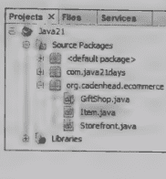

NetBeans 将源代码文件存放在 `org.cadenhead.ecommerce` 类别下。

`Item` 类是一个辅助类，代表在线商店出售的产品。它包含了产品 ID、名称、库存数量（`quantity`）以及零售价和售价价的实例变量。

由于该类的所有实例变量都是私有的（`private`），因此没有其他类可以设置或检索它们的值。在第 35–53 行中创建了简单的访问器方法（`accessor methods`），以便为其他对象提供获取这些值的方法。每个方法都以 `get` 开头，后跟变量的大写名称，这是 Java 编程中整个 Java 类库中的标准约定。`getPrice()` 方法返回一个包含价格值的 `double` 类型。该类没有提供设置任何这些实例变量的方法，这些操作在该类的构造函数中处理。

第 1 行确立了 `Item` 类是 `org.cadenhead.ecommerce` 包的一部分。

`Item` 类实现了 `Comparable` 接口（第 3 行），这使得对类对象的排序变得简单。该接口只有一个方法 `compareTo(Object)`，它返回一个整数。

`compareTo()` 方法比较同一个类的两个对象：当前对象和另一个作为参数传递给方法的对象。该方法返回的值定义了该类对象的自然排序顺序：

- 如果当前对象应该排在另一个对象上方，返回 -1。
- 如果当前对象应该排在另一个对象下方，返回 1。
- 如果两个对象相等，返回 0。

你在 `compareTo()` 方法中决定在排序时考虑对象的哪一个实例变量。第 25–33 行重写了 `Item` 类的 `compareTo()` 方法，根据 `price` 变量进行排序。按价格从高到低对 `Items` 进行排序。

在你为对象实现了 `Comparable` 接口后，可以调用两个类方法来对数组或持有这些对象的类进行排序。你将在稍后创建 `Storefront` 类时看到这一点。

第 10–23 行中的 `Item()` 构造函数接受四个 `String` 对象作为参数，并使用它们设置 `id`、`name`、`retail` 和 `quantity` 实例变量。最后两个必须分别使用 `Double.parseDouble()` 和 `Integer.parseInt()` 方法从字符串转换为数值。

`price` 实例变量的值取决于该商品的库存情况：

- 库存超过 400 件，价格为零售价的 50%（第 16–17 行）。
- 如果库存在 201 到 400 件之间，价格为零售价的 60%（第 18–19 行）。
- 其他所有情况，价格为零售价的 70%（第 20–21 行）。

第 22 行对价格进行四舍五入，保留两个或更少的小数，将如 `$6.929999999999999` 的值转换为 `$6.93`。`Math.floor()` 方法将小数舍入到下一个较小的整数，并将其以 `double` 类型返回。

作为项目的下一步，你需要一个代表这些产品商店展示的类。创建一个名为 `Storefront` 包名为 `org.cadenhead.ecommerce` 的空 Java 文件，并输入列表 6.3 所示的代码。

### 列表 6.3 Storefront.java 的全文本

```java
1: package org.cadenhead.ecommerce;
2:
3: import java.util.*;
4:
5: public class Storefront {
6:     private LinkedList catalog = new LinkedList();
7:
8:     public void addItem(String id, String name, String price,
9:         String quant) {
10:
11:        Item item = new Item(id, name, price, quant);
12:        catalog.add(item);
13:    }
14:
15:    public Item getItem(int i) {
16:        return (Item) catalog.get(i);
17:    }
18:
19:    public int getSize() {
20:        return catalog.size();
21:    }
22:
23:    public void sort() {
24:        Collections.sort(catalog);
25:
26:    }
27: }
```

由于它与 `Item` 类属于同一个包，`Storefront` 将与它一起列在 NetBeans 项目面板中。

`Storefront` 类用于管理在线商店中的产品集合。每个产品都是一个 `Item` 对象，它们被共同存储在名为 `catalog` 的 `LinkedList` 实例变量中（第 6 行）。

第 8–13 行中的 `addItem()` 方法根据传递给方法的四个参数创建一个新的 `Item` 对象：库存商品的 ID、名称、价格和数量。创建项目后，通过调用其 `add(Object)` 方法并将 `Item` 对象作为参数将其添加到 `catalog` 列表中。

`getItem()` 和 `getSize()` 方法提供了访问私有 `catalog` 变量中存储的信息的接口。第 19–21 行的 `getSize()` 方法调用 `catalog.size()` 方法，该方法返回项目数量。

由于链表类似于数组，你可以使用索引来检索它们。第 15–17 行的 `getItem()` 方法调用 `catalog.get(i)`，返回存储在该位置的对象。

第 23–25 行的 `sort()` 方法使用 `Collections.sort()` 对链表进行排序，其依据由 `Item` 类中的 `Comparable` 接口决定。

### 列表 6.4 GiftShop.java 的全文本

```java
1: package org.cadenhead.ecommerce;
2:
```


```java
3: public class GiftShop {

4:

5:     public static void main(String[] args) {

6:         Storefront store = new Storefront();

7:

8:         store.addItem("C01", "MUG", "12.99", "150");

9:         store.addItem("C02", "SHIRT", "16.99", "82");

10:        store.addItem("C03", "MOUSEPAD", "9.49", "800");

11:

12:        store.sort();

13:        for (int i = 0; i < store.getSize(); i++) {

14:            Item item = store.getItem(i);

15:            System.out.println(item.getId() + " - " + item.getName() +

16:                "\nRetail Price: $" + item.getRetailPrice() +

17:                "\nPrice: $" + item.getPrice() +

18:                "\nQuantity: " + item.getQuantity());

19:        }

20:    }

21: }
```

## 总结

`GiftShop` 类演示了 `Storefront` 和 `Item` 类提供的公共接口每个部分。你可以执行以下操作：

- 创建在线商店
- 向其添加商品
- 按售价对商品排序
- 遍历商品列表并显示每个商品的信息

输出如图 6.4 所示。

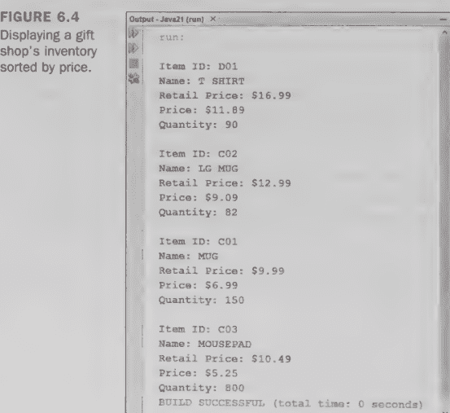

这些类的许多实现细节对 `GiftShop` 以及使用该包的其他类隐藏了。例如，开发 `GiftShop` 的程序员不需要知道 `Storefront` 使用链表来存储所有的产品数据。如果 `Storefront` 的开发者后来决定使用不同的数据结构，只要 `getSize()` 和 `getItem()` 返回预期的值，`GiftShop` 就能继续工作。

你学习了通过对变量和方法使用访问修饰符来封装对象。你还学习了如何使用 `static`、`final` 和 `abstract` 等修饰符来开发 Java 类和类层次结构。为了进一步开发和使用一组类，你学习了如何将类分组到包中。这些分组更好地组织了你的程序，并帮助你与许多公开代码的 Java 程序员共享类。

最后，你学习了如何实现接口和内部类，这是一种在类之外建模行为的非常有用的 Java 语言特性。

## 第 188 天 6：包、接口和其他类特性

## 测验

通过完成这个三题的小测试来回顾今天的内容。

### 问题

- 1. 哪些包会被自动导入到你的 Java 类中？
   A. 无
   B. 存储在你的 Classpath 文件夹中的类
   C. `java.lang` 包中的类

- 2. 根据包命名规范，你创建的包名的第一个部分应该是什么？
   A. 你的名字后跟一个点
   B. 你的顶级互联网域名后跟一个点
   C. 文本 `java` 后面跟一个点

- 3. 如果你创建一个子类并重写了一个公共方法，你可以对该方法使用哪些访问修饰符？
   A. 仅限 `public`
   B. `public` 或 `protected`
   C. `public`、`protected` 或默认（`default`）访问权限

### 答案

- 1. C. 如果你想使用诸如 `LinkedList` 这样的短类名，则必须导入所有其他包，而不是使用全限定的包名和类名（如 `java.util.LinkedList`）。

- 2. B. 这种约定假设所有的 Java 包开发者都拥有互联网域名或可以访问域名，以便该包可以供下载。

- 3. A. 所有 `public` 方法在子类中必须保持为 `public`。子类中的访问控制可以比父类更公开，也可以保持相同，但不能更私有。

### 认证练习

以下问题是在 Java 编程认证考试中可能会遇到的类型。请在不看今天的内容或不使用 Java 编译器测试代码的情况下回答它。

已知：

```java
package org.cadenhead.bureau;

public class Information {

    public int duration = 12;

    protected float rate = 3.15F;

    float average = 0.5F;

}
```

以及：

```java
package org.cadenhead.bureau;

public class MoreInformation extends Information {

    public int quantity = 8;

}
```

以及：

```java
import org.cadenhead.bureau.us.*;

public class EvenMoreInformation extends MoreInformation {

    public int quantity = 9;

    public EvenMoreInformation() {
        super();
        int i1 = duration;
        float i2 = rate;
        float i3 = average;
    }
}
```

在 `EvenMoreInformation` 类中哪些实例变量是可见的？

- A. `quantity`、`duration`、`rate` 和 `average`
- B. `quantity`、`duration` 和 `rate`
- C. `quantity`、`duration` 和 `average`
- D. `quantity`、`rate` 和 `average`

答案可以在书籍网站 www.java21days.com 上找到。访问第 6 天页面并点击“Certification Practice”链接。

### 练习题

为了扩展你对今天涵盖主题的知识，请尝试以下包含 `nDiscount` 的项目：

- 1. 创建 Storefront 项目的修改版本，为每个项目包含一个 `nDiscount` 变量。当该变量为 `true` 时，按零售价出售项目。
- 2. 创建一个 `ZipCode` 类，使用访问控制来确保其 `zipCode` 实例变量始终为五位数。

练习题答案可以在书籍网站 www.java21days.com 上。

# 第 7 天
异常与线程

你在 Java 语言的第一周以两个最实用的元素结束：线程和异常。

线程是实现 `Runnable` 接口或继承 `Thread` 类的对象，表示它们可以与 Java 程序的其他部分同时运行。异常是代表 Java 程序运行过程中可能发生的错误的对象。

线程通过隔离程序中计算密集型部分，使程序能够高效利用资源，从而不会减慢其他部分的速度。异常使程序能够识别错误并做出响应。异常甚至让程序在可能的情况下修正条件并继续运行。

首先介绍异常是因为它们是你在处理线程时会用到的内容之一。

## 异常

任何语言的程序员都努力编写出无 bug、永不崩溃、能够优雅地处理任何情况，并且总能从异常状况中恢复的程序。

这个想法也就这样了。

错误的发生是因为程序员没有预见到可能出现的问题，或者测试不够。或者程序遇到了它们无法控制的情况，例如来自用户的错误数据、不包含正确数据的损坏文件、无法连接的网络连接、无响应的硬件设备、各种灵异故障等。

在 Java 中，导致程序失败的奇异事件被称为*异常*（exceptions）。Java 定义了许多语言特性来处理：

- 如何在代码中处理异常并从潜在问题中恢复
- 如何告诉使用你类的代码你正期待一个异常
- 如果检测到异常，如何创建一个异常
- 异常如何限制你的代码但又使其变得更加健壮

对于大多数编程语言来说，处理错误情况的工作比处理运行良好的程序要多许多。它可能需要复杂的条件语句结构来处理可能由于磁盘错误、文件未找到错误等引起的错误。如果程序必须获得文件中的数据才能运行，它必须在继续之前处理所有这些情况。例如：

```java
int status = loadTextField();

if (status != 1) {

    // 发生了某些异常情况；报告它

    switch (status) {

      case 2:
        System.out.println("File not found");
        break;

      case 3:
        System.out.println("Disk error");
        break;

      case 4:
        System.out.println("File corrupted");
        break;

      default:
        System.out.println("Error");
    }

} else {

    // 文件加载成功；继续

}
```


# 第 7 天：异常与线程

## 异常类

在某一点，你可能遇到过至少一次 Java 异常。也许你尝试运行 Java 时没有提供所需的命令行参数并看到了 `ArrayIndexOutOfBoundsException` 信息。

很有可能，当异常发生时，应用程序退出并将一堆错误扫到了屏幕上。这些错误就是异常。当你的程序在成功完成工作之前停止时，就会触发异常。异常可以由 Java 虚拟机 (JVM)、你使用的类或你自己的程序故意抛出。

就像异常会被抛出一样，它们也可以被捕获。捕获异常涉及处理异常情况以便程序不会崩溃，正如你之后学到的。

在 Java 中，异常是继承自 `Throwable` 类的实例。当抛出异常时，会创建一个 `Throwable` 实例。

`Throwable` 有两个子类：`Error` 和 `Exception`。`Error` 实例涉及内部错误。这些错误很少见，通常对程序是致命的；你对它们没办法，除了捕获它们或自己抛出它们。

`Exception` 类与你的编程更相关。`Exception` 的子类分为两个大类：

- 未检查的异常（`RuntimeException` 类的子类），例如 `ArrayIndexOutOfBoundsException`、`SecurityException` 和 `NullPointerException`
- 已检查的异常，例如 `EOFException` 和 `MalformedURLException`

未检查的异常（也称为运行时异常）通常是因为代码不够健壮导致的。例如，如果你正确检查以确保代码在数组范围内，则不应该抛出 `ArrayIndexOutOfBoundsException`。`NullPointerException` 异常发生在你尝试使用一个没有引用对象的变量时。

> **CAUTION** 如果你的程序产生了意外的异常，你应该通过改进代码来修复这些问题。不要依赖异常管理来处理在创建 Java 程序时可以修正的编程错误。

检查异常（Checked exceptions）表示发生了某些异常且不受控制的情况。例如，`EOFException` 发生在你读取文件且文件在预期之前就结束时。`MalformedURLException` 发生在网络地址（也称为 URL）格式不正确时。此组包含了你创建的异常，用于指示你自己的程序中可能出现的异常情况。

异常的排列方式与其他类相同，父类是更通用的问题，而子类是更具体的。当你自己在自己的代码中处理异常时，这种组织对你变得越来越重要。

主要的异常类是 `java.lang` 包的组成：`Throwable`、`Exception` 和 `RuntimeException`。Java 类库中的许多其他包定义了其他异常，这些异常在整个库中都有。

`java.io` 包定义了一个通用类 `IOException`。它不仅在 `java.io` 包中被子类化为输入输出异常（`EOFException` 和 `FileNotFoundException`），在 `java.net` 包中子类化为网络异常（如 `MalformedURLException`），在 `java.util` 包中也有 `ZipException`。

## 管理异常

现在你知道异常是什么了，如何在自己的代码中处理它呢？在许多情况下，当你尝试使用会抛出异常的方法时，Java 编译器会强制执行异常管理；你需要在自己的代码中处理这些异常，否则将无法编译且 NetBeans 将标记该错误。在本节中，你将学习一致性检查，以及如何使用三个新关键字——`try`、`catch` 和 `finally` 来处理可能发生的异常。

### 异常一致性检查

你与 Java 类库接触得越多，就越可能遇到像这样的异常：

```
Exception java.lang.InterruptedException must be caught or it must be declared in the throws clause of this method.
```

在 Java 中，方法可以指示它可能抛出的错误类型。例如，从文件读取内容的方法可能会抛出 `IOException` 错误，因此这些方法是用指示潜在错误的特殊修饰符声明的。当自己的 Java 程序中使用这些方法时，必须保护你的代码免受异常的影响。

这条规则由编译器本身强制执行，就像它检查你是否使用了参数数量正确的方法，以及所有变量类型是否与赋值给它们的类型匹配一样。

为什么要进行这种检查？它让程序不太可能因致命错误而崩溃，因为你预先知道了程序使用的方法可能会抛出哪些异常。

如果你在定义方法时指示了它们可能抛出的异常，Java 就可以告诉对象的用户去处理这些错误。

### 代码保护与捕获异常

假设你一直在愉快地编写代码，但在类编译时发生了异常。根据错误信息，你必须捕获该错误，要么声明你的方法抛出了该错误。

首先，你处理捕获潜在异常，这需要两点：

- 将包含可能抛出异常的方法的代码放在 `try` 块内部。
- 在 `catch` 块内部处理异常。

`try` 块尝试执行一段代码，以检查它是否可以在不引起异常的情况下执行所有内容。如果执行失败并发生异常，则由 `catch` 块处理它。

你以前见过 `try` 和 `catch`。在第 6 天“包、接口和其他类特性”中，你使用了以下代码从字符串值创建一个整数：

```java
public void squareTool(String input) {
  try {
    float in = Float.parseFloat(input);
    // rest of method
  } catch (NumberFormatException nfe) {
    System.out.println("input " + input + " is not a valid number.");
  }
}
```

在此代码中，`Float.parseFloat()` 类方法可能会抛出 `NumberFormatException` 类的异常，这表示字符串不是有效的数字格式。（触发此异常的情况是 `input` 等于 `15x`，它不是一个数字。）

另一种让其生效的方法是将父类放在 `catch` 语句的最后：

```java
try {
    // 从磁盘读取文件的代码
} catch (EOFException | FileNotFoundException | IOException exc) {
    System.out.println("File error: " + exc.getMessage());
}
```

> **注意** 异常（Exceptions）有一个 `printStackTrace()` 方法，它可以显示导致生成异常的语句的产生调用序列。如果你在程序中使用它，NetBeans 会在源代码编辑器中将其标记为警告。这是因为 `printStackTrace()` 包含了调试信息，出于安全考虑，在程序完成后后不应与用户共享这些信息。

`catch` 语句必须由相应的 `try` 块需要。`catch` 中的异常类必须是该块中可能被抛出的异常（或者是可能被抛出的异常的父类）。否则，编译器将报错并编译失败。

例如，如果你在一个没有读取任何文件的程序对 `FileNotFoundException` 使用了 `catch`，那么该程序将无法编译。

### finally 子句

假设你的代码中有某些操作无论发生什么（无论是否抛出异常）你都必须执行。这通常是为了在获取某些外部资源后释放它，在打开文件后关闭它，或者类似的操作。

一个例子是在处理数据库时，就像你在第 18 天“使用 JDBC 4.2 和 Derby 访问数据库”中所做的那样。数据库连接以及你为了访问数据库而创建的对象会在 `finally` 块中关闭以释放这些资源，因为它们不再需要了。

虽然你可以将该操作同时放在 `catch` 块内部和外部，但在编程时，应尽可能地避免在两个不同的地方重复相同的代码。

相反，请将该代码放在 `try-catch` 语句中带有 `finally` 关键字的特殊块中：

```java
try {
    readFile();
} catch (IOException ioe) {
    // 处理 IO 错误
} finally {
    closeTextFile();
}
```

今天的第一个项目展示了如何在方法内部使用 `finally` 语句。

### 列表 7.1 HexReader.java 的全文

在 NetBeans 的 `com.java21days` 包中，作为 Java 文件创建此类，并输入列表 7.1 的源代码。

```java
package com.java21days;

class HexReader {
  String[] input = { "000A110D1D260219", "7800F1318141E0C", "6A197D45B0FFFF" };

  public static void main(String[] arguments) {
    HexReader hr = new HexReader();
    hr.readLine();
  }

  void readLine() {
    for (int i = 0; i < input.length; i++) {
      String line = input[i];
      try {
        for (int j = 0; j < line.length(); j += 2) {
          String hex = line.substring(j, j + 2);
          int value = Integer.parseInt(hex, 16);
          if (value == 255) {
            return;
          }
          System.out.print(value + " ");
        }
        System.out.println();
      } finally {
        System.out.println("   *** Finally ***");
      }
    }
  }
}
```

该程序的输出如图 7.1 所示。

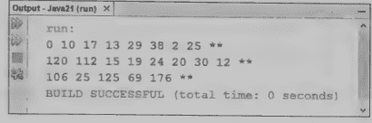

程序的第 17 行通过调用字符串的 `substring(int, int)` 方法，从代码中读取发送到 `readLine()` 方法的字符串两个字符。

> **注意** 在字符串类的 `substring` 方法中，你以一种不太直观的方式选择子字符串。第一个参数指定要包含在子字符串中的第一个字符的索引，但第二个参数并没有指定最后一个字符。相反，第二个参数表示最后一个字符的索引加 1。对字符串调用 `substring(2, 5)` 将返回从索引 2 到位置 4 的字符。

该双字符字符串包含一个存储为 `String` 的十六进制数。`Integer` 类的方法 `parseInt` 配合第二个参数可以将此数转换为整数。使用 16 作为十六进制（16 进制）转换的参数，或使用 8 作为八进制（8 进制）转换的参数，依此类推。

在 `HexReader` 应用中，十六进制 `FF` 用于填充序列的末尾，不应显示为十进制值。这是通过在列表 7.1 第 15–26 行中使用 `try-finally` 块实现的。

当在第 27 行遇到 `return` 语句时，`try-finally` 块会导致异常情况发生。你可能预期 `return` 会立即退出 `readLine()` 方法。

有一种方法可以确保即使在 `try` 块中的的操作因异常失败时，资源也能被正确释放。`try-with-resources` 功能允许将声明资源的语句声明在 `try` 语句的括号内。

以下代码包含两个使用网络套接字（一种连接）从互联网服务器读取数据的语句：

```java
Socket digit = new Socket(host, 79);
BufferedReader in = new BufferedReader(
    new InputStreamReader(digit.getInputStream()));
// 代码写在这里
} catch (IOException e) {
    System.out.println("IO Error: " + e.getMessage());
}
```

为了确保资源被正确处置，使用 `try-with-resources` 语句：

```java
try (Socket digit = new Socket(host, 79);
     BufferedReader in = new BufferedReader(
         new InputStreamReader(digit.getInputStream()))) {
    // 代码写在这里
} catch (IOException e) {
    System.out.println("IO Error: " + e.getMessage());
}
```

## 你应该抛出哪些异常？

在你决定声明你的方法可能会抛出异常后，你必须决定它可能抛出哪些异常，并实际抛出它们，或者调用会抛出这些异常的方法。（你将在下一节中学习如何抛出自定义异常。）

在许多情况下，这从方法本身的操作中显而易见。也许你已经在创建并抛出自己的异常了，在这种情况下，你将确切知道要抛出哪些异常。

你不需要列出你的方法可能抛出的所有异常。未检查异常（Unchecked exceptions）由 JVM 处理，而且它们非常常见，以至于你不需要处理它们。

特别是，`Error` 或 `RuntimeException` 类的异常或它们的任何子类都不必在 `throws` 子句中列出。

它们受到特殊对待，因为它们可能发生在 Java 程序的任何地方，而且通常是你作为程序员没有直接导致的状况条件。

一个很好的例子是当 JVM 耗尽内存时发生的 `OutOfMemoryError`，它可以在任何地方、任何时间、由于任何原因而发生。

未检查异常是 `RuntimeException` 和 `Error` 类的子类，通常由 JVM 抛出。你不需要声明你的方法抛出它们，而且通常不需要以任何其他方式处理它们。

> 如果你想，可以选择将这些错误和运行时异常列在你的 `throws` 子句中，但调用该方法的类不会被强制处理它们。只有非运行时异常必须被处理。

所有其他异常被称为检查异常（Checked exceptions），它们是你方法中 `throws` 子句的潜在候选者。

## 传递异常

有时，由你的方法处理某个异常是没有意义的。由调用你方法的方法来处理该异常可能更好。

例如，考虑一个假设的类 `WebRetriever`，该类使用其 Web 地址加载网页并将其存储在文件中。正如你在第 17 天“跨网络通信”中所学到的，如果不处理 `MalformedURLException`，你就无法处理 Web 地址。

### 声明可能抛出异常的方法

处理 `MalformedURLException`，当地址格式错误时抛出的异常。

要使用 `WebRetriever`，另一个类调用它的构造函数并将地址作为参数。如果另一个类指定的地址格式错误，则会在那里抛出 `MalformedURLException`。与其处理此异常，`WebRetriever` 类的构造函数可以使用以下声明：

```java
public WebRetriever() throws MalformedURLException {
  // 构造函数体
}
```

这将强制任何处理 `WebRetriever` 对象的类处理 `MalformedURLException` 错误，或者通过它们自己的子句将其传递回。

有一点总是成立的：将异常传递给调用方法以捕获它们并在响应时不做任何操作，通常会更好。

除了声明抛出异常的方法外，在你的方法定义中还有另一种情况你可能包含 `throws` 子句：在该方法内部，你想要调用一个抛出异常的方法，但你不想捕获或处理该异常。

与其在方法的主体中使用 `try` 和 `catch` 子句，你可以在声明方法时使用 `throws` 子句，对其声明你的方法，以便它也可能抛出相应的异常。此时，处理该异常就是调用你方法的方法的责任。另一种情况是告诉 Java 编译器你已经对给异常进行了某些处理。

使用这种技术，你可以创建一个无需使用 `try-catch` 块即可处理 `NumberFormatException` 的方法：

```java
public void readFloat(String input) throws NumberFormatException {
  float in = Float.parseFloat(input);
}
```


# 第 7 天：异常与线程

在你声明你的方法抛出异常后，你可以在方法体内部使用其他抛出这些异常的方法，而无需捕获该异常。

> **注意**
> 当然可以，除了传递你在 `throws` 子句中列出的异常外，你还可以在方法体中使用 `try` 和 `catch` 处理其他异常。你也可以以某种方式处理异常，然后将其重新抛出，这样你方法的调用者就必须处理它了。

## throws 与继承

如果你的方法定义覆盖了父类中包含 `throws` 子句的方法，那么对于你被重写的方法如何处理 `throws`，就有特殊的规则。与方法签名中必须模仿其所重写的方法的其他部分不同，你的新方法不需要在 `throws` 子句中列出相同的异常集合。

由于你的新方法可能会处理异常而不是抛出异常，因此你的方法潜在可能只抛出更少类型的异常。它甚至可以不抛出任何异常。这意味着你可以拥有这两个类定义，并且它们将正常工作：

```java
public class RadioPlayer {

    public void startPlaying() throws SQLException {

        // 方法体

    }

}
```

```java
public class StereoPlayer extends RadioPlayer {

    public void startPlaying() {

        // 方法体

    }

}
```

该规则的逆面是不成立的：子类方法抛出的检查异常（无论是不同类型的异常还是更通用的异常类）不能多于父类方法。

子类抛出的任何异常必须与父类抛出的异常相同，或者是该异常的子类。考虑以下示例：

```java
void readFields() throws IOException {

    // 方法体

}
```

如果该方法在父类中并覆盖了它，那么在子类中是不允许的：

```java
void readFiles() throws SQLException {

    // 方法体

}
```

`SQLException` 不是 `IOException` 的子类，所以这段代码无法编译。但方法可以抛出 `FileNotFoundException`，因为它是 `IOException` 的子类。

# 创建和抛出异常

异常有两个方面：抛出异常的一面和捕获它的方面。异常可以被多次传递，但最终会被捕获并处理。

许多异常由 Java 运行时或 Java 类内部的方法抛出。你也可以抛出 Java 类库定义的任何标准异常，或者创建并抛出你自己的异常。

## 抛出异常

声明你的方法抛出异常对于使用你方法的类以及 Java 编译器是有用的，编译器会检查你的异常是否都得到了处理。声明本身在异常发生时不会执行任何操作；你必须在方法体中这样做。

你需要创建一个异常类的新对象来抛出异常。拥有该对象后，使用 `throw` 语句抛出它。

这里有一个使用假设的 `NotInServiceException` 类的示例：

```java
NotInServiceException n = new NotInServiceException();
throw n;
```

你只能抛出 `Throwable` 类的子类。

根据异常类的不同，异常还可以有构造函数的参数。这些参数中最常见的是字符串参数，它允许你更详细地描述问题（这对调试很有用）。这里有一个示例：

```java
NotInServiceException n = new NotInServiceException("Database Not in Service");
throw n;
```

抛出异常后，方法退出，不再执行任何其他代码（存在 `finally` 块中的代码除外）。方法也不会返回值。如果调用方法在调用你的方法时没有包含 `try` 或 `catch`，程序可能会根据你抛出的异常而退出。

# 创建你自己的异常

创建新异常很容易。你的新异常应该继承自 Java 类层次结构中的另一个异常。所有用户自定义的异常应该使用 `Exception` 层次体系而不是 `Error` 层次体系，后者保留给涉及 JVM 的错误。寻找一个与你正在创建的异常类似的异常；例如，针对文件格式错误的异常在逻辑上应该是一个 `IOException`。如果你无法为你的新异常找到一个密切相关的异常，可以继承自 `Exception`，它是受检异常层次体系的顶端。未检异常应该继承自 `RuntimeException`。

`Exception` 类通常有两个构造函数：第一个不接受参数，第二个接受一个字符串作为参数。

`Exception` 类与其他类相似。这里有一个极其简单的示例：

```java
public class SunSpotException extends Exception {

    public SunSpotException() { }

    public SunSpotException(String message) {
        super(message);
    }

}
```

### 结合 throws, try 和 throw

如果你想结合目前为止描述的方法呢：你希望在方法中处理传入的异常，但又希望保留将异常传递给方法调用者的选项。仅仅使用 `try` 和 `catch` 不会传递异常，而添加 `throws` 子句则让你没有机会处理异常。

如果你想管理异常并将其传递给调用者，请使用所有三种机制：`throws` 子句、`try` 语句和 `throw` 语句来显式地重新抛出异常。

这是一个使用这种技术的方法：

```java
public void readMessage() throws Exception {

    MessageReader mr = new MessageReader();

    try {
        mr.loadHeader();
    } catch (IOException e) {
        // 处理异常
        // 然后重新抛出异常
        throw e;
    }

}
```

# 创建并抛出异常

这之所以有效是因为异常处理程序是可以嵌套的。你通过对异常进行负责的操作来处理它，但认为它足够重要，因此给方法的调用者一个机会也处理它。

异常可以这样沿着方法调用者的链向上浮动（不被大多数调用者处理），直到 JVM 通过终止程序并打印错误信息来处理任何未捕获的异常。

如果你能够捕获异常并对其进行必要的处理，你应该这样做。

当你在针对异常父类的 `catch` 块中使用 `throw` 时，它会抛出该父类。这代表了信息的潜在丢失，因为该异常可能是一个包含更多错误信息的子类。

以下是出现这种情况的情况：

- 文件读取器中的 `try-catch` 语句在寻找 `IOException`。
- 在到达文件末尾发生了 `IOException`。
- 异常在 `catch` 块中被捕获，因为 `IOException` 是 `EOFException` 的父类。

如果对此异常使用 `throw`，它将抛出 `IOException`，而不是 `EOFException`。Java 8 引入了一种允许抛出更精确异常的技巧：在 `catch` 语句中对该对象使用 `final` 关键字。这会将之前的示例重写为如下：

```java
try {
    mr.loadHeader();
} catch (final IOException e) {
    throw e;
}
```

> **注意**
> Java 8 中的新功能需要设置 NetBeans 以识别这些功能，否则 IDE 将把它们标记为错误。如果你在 NetBeans 中输入此代码并且它显示了错误信息，请确保你的项目已设置为语言的当前版本。选择 File, Project Properties 打开项目属性对话框，选择 Libraries 类别，并确保 Java Platform 下拉菜单设置为 JDK 1.8。

### 何时不要使用异常

在几种情况下，你不应该使用异常。

首先，不要在代码中可以轻松避免的情况下使用异常。例如，虽然你可以依赖 `ArrayIndexOutOfBounds` 异常来指示你何时越过了数组末尾，但使用数组的长度变量来保持不越界是简单的。

此外，如果你的用户输入了必须是整数的数据，测试确保数据是否为整数比抛出异常并在其他地方处理它要好得多。

异常会消耗大量的处理时间。一个简单的条件判断运行速度比异常处理快得多，并让你的程序更高效。异常应该只用于那些你无法控制的真正异常的情况。

很容易沉溺于异常，并确保你的所有方法都声明为抛出它们可能抛出的所有异常。

当你沉溺于异常时，你会为所有参与者创造更多工作量。声明一个方法抛出少量或多个异常是一种权衡；你的方法能抛出的异常越多，该方法的使用就越复杂。只声明那些有合理几率发生且符合类整体设计的异常。

## 使用异常的错误风格

当你刚开始使用异常时，当使用一个声明了 `throws` 语句的方法时，绕过编译器错误可能很有吸引力。虽然允许添加空的 `catch` 块或向你自己的方法添加 `throws` 语句（并且这样做有恰当的），但故意丢弃异常而不处理它们会破坏 Java 编译器为你执行的检查。

关于异常的编译器错误是为了提醒你反思这些问题。花时间处理可能影响你代码的异常。Java 类库编写时具有这种考虑，这也是它足以用于你的项目的原因之一。

## 线程

Java 编程中需要考虑的一个问题是系统资源是如何使用的。图形、复杂的计算和其他密集型任务会消耗大量的处理器时间。

对于具有图形用户界面的程序尤其如此，这是你下周探索的软件类型。

如果你编写一个消耗大量时间的图形 Java 程序，可能会发现程序的用户界面响应缓慢。下拉列表需要一秒或更多时间出现，点击响应缓慢，以此类推。

为了解决这个问题，你可以在 Java 类中分离占用处理器的函数，使其与程序的其他部分分开运行。

这是通过线程实现的。

线程是独立运行的一部分，而程序的其他部分处理其他事情。这也被称为多任务处理，因为程序同时处理多个任务。

线程适用于任何消耗处理时间并持续运行的任务。

通过将程序最重的负载放入线程中，你为程序的其他部分释放了处理其他事情的空间。你还让 JVM 变得更容易处理。

# 编写线程程序

线程在 Java 中通过 `java.lang` 包中的 `Thread` 类实现。

线程最简单的用法是让程序暂停执行。为此，调用 `Thread` 类的 `sleep(long)` 并将毫秒数作为唯一参数。

当暂停的线程被中断时，该方法会抛出一个 `InterruptedException` 异常。（一种可能的原因是用户关闭了程序。）


以下语句会让程序停止 3 秒：

```java
try {
    Thread.sleep(3000);
} catch (InterruptedException ie) {
    // 什么都不做
}
```

当你使用 `sleep()` 时，`catch` 块什么都不做是典型的做法。

以下语句可以在线程类中启动线程：

```java
Thread runner = null;
if (runner == null) {
    runner = new Thread(this);
    runner.start();
}
```

`Thread()` 构造函数中使用的 `this` 关键字指向包含这些语句的对象。在给 `runner` 变量赋值任何对象之前，该变量的值为 `null`，因此使用 `if` 语句是为了确保线程不会启动多次。

要运行线程，需要调用它的 `start()` 方法。调用线程的 `start()` 方法会触发另一个方法——`run()` 方法，该方法在所有线程对象中都必须存在。

`run()` 方法是线程类的引擎，包含了计算密集型行为，以及用于执行这些行为的调用方法。

### 线程应用程序

当你看到线程的实际运行时，多线程编程将变得更加清晰。

列表 7.2 包含了 `PrimeFinder` 类，这是一个用于在序列中查找特定质数的类，例如第 100 个、第 1,000 个或第 30,000 个质数。这可能需要一些时间，特别是对于超过 100,000 的数字，因此质数搜索会在自己的线程中进行。

在 NetBeans 中输入列表 7.2 所示的代码，并将其保存为 `com.java21days` 包中的类名 `PrimeFinder`。

列表 7.2 `PrimeFinder.java` 的全文。

```java
1: package com.java21days;
2:
3: public class PrimeFinder implements Runnable {
4:     public long target;
5:     public long prime;
6:     public boolean finished = false;
7:     private Thread runner;
8:
9:     PrimeFinder(long inTarget) {
10:        target = inTarget;
11:        if (runner == null) {
12:            runner = new Thread(this);
13:            runner.start();
14:        }
15:    }
16:
17:    public void run() {
18:        long numPrimes = 0;
19:        long candidate = 2;
20:        while (numPrimes < target) {
21:            if (isPrime(candidate)) {
22:                numPrimes++;
23:                prime = candidate;
24:            }
25:            candidate++;
26:        }
27:        finished = true;
28:    }
29:
30:    boolean isPrime(long checkNumber) {
31:        double root = Math.sqrt(checkNumber);
32:        for (int i = 2; i <= root; i++) {
33:            if (checkNumber % i == 0)
34:                return false;
35:        }
36:
37:        return true;
38:    }
}
```

当你完成后，这就是 `PrimeFinder` 类。该类没有 `main()` 方法，因此你不能将其作为应用程序运行。接下来，你将创建一个使用该类的程序。

`PrimeFinder` 类实现了 `Runnable` 接口，因此它可以作为线程运行。

这里有三个公共实例变量：

- `target` 是一个 `long` 类型，表示在何时找到了序列中指定的质数。如果你正在寻找第 5,000 个质数，`target` 等于 5000。
- `prime` 是一个 `long` 类型，保存该类找到的最后一个质数。
- `finished` 是一个 `boolean` 类型，表示何时达到了目标。

还有一个名为 `runner` 的私有实例变量，它持有该类运行所在的 `Thread` 对象。在线程启动之前，该对象等于 `null`。

第 9–15 行的 `PrimeFinder` 构造方法设置了实例变量 `target`，并在线程尚未启动时启动它。当调用线程的 `start()` 方法时，它会调用该线程类的 `run()` 方法。

`run()` 方法位于第 17–28 行。该方法完成了线程的大部分工作。

该方法使用了两个新变量：`numPrimes`（已找到的质数量）和 `candidate`（可能是质数的数字）。`candidate` 变量从第一个可能的质数（即 2）开始。

第 20–26 行的 `while` 循环一直持续，直到找到正确数量的质数。

首先，它通过调用 `isPrime(long)` 方法检查当前 `candidate` 是否为质数，如果数字是质数则返回 `true`，否则返回 `false`。

如果 `candidate` 是质数，`numPrimes` 增加 1，并且 `prime` 实例变量被设置为该质数。

然后 `candidate` 变量加 1，循环继续。

在找到足够数量的质数后，`while` 循环结束，`finished` 实例变量被设置为 `true`。这表示 `PrimeFinder` 对象已经找到了正确的质数并停止搜索。

`run()` 方法的结束于第 28 行。`isPrime()` 方法位于第 30–37 行。它通过使用 `%` 运算符判断一个数字是否为质数，如果数字能被 2 整除，则它不是质数。

列表 7.3 是一个使用 `PrimeFinder` 类的应用程序。在 NetBeans 中创建 `PrimeThreads.java` 所示代码。

```java
1: package com.java21days;
2:
3: public class PrimeThreads {
4:     public static void main(String[] args) {
5:         PrimeFinder pt = new PrimeFinder(5000);
6:         while (!pt.finished) {
7:             System.out.println("Prime: " + pt.prime);
8:         }
9:     }
10: }
```


如果你使用像这样的循环，可以使用以下语句在类的任何位置停止线程：
`runner = null;`

## 总结

异常和线程增强了你程序的健壮性。

异常使你能够管理潜在的错误。通过使用 `try`、`catch` 和 `finally`，你可以在异常发生时通过处理这些异常，来保护可能导致异常的代码。

处理异常只是成功的一半；另一半是生成和抛出异常。`throws` 子句告诉方法的用户，该方法可能会抛出异常。它还可以用于从方法体中的方法调用处传递异常。

你学习了如何通过定义新的异常类以及通过使用 `throw` 抛出任何异常类的实例，来创建和抛出你自己的方法。

线程允许你将 Java 类中计算最密集的部分与类的其他部分分开运行。这在类正在执行计算密集型任务（如动画、复杂的数学计算或快速遍历大型数据数组）时特别有用。

你还可以使用线程同时完成几件事，并从外部启动和停止线程。

线程实现了 `Runnable` 接口，该接口包含一个方法：`run()`。当你通过调用 `start()` 方法启动线程时，线程的 `run()` 方法会被自动调用。

## 问答

+ 我不确定是否理解异常（exceptions）、错误（errors）和运行时异常（runtime exceptions）之间的区别。还有其他的看待方式吗？

+ 错误（Errors）是由动态链接或 JVM 问题引起的。因此，对于大多数程序来说，它们太底层了，无法关心——即使它们关心，也无法处理。

+ 运行时异常（Runtime exceptions）是由 Java 代码的正常执行生成的。尽管它们偶尔反映了你想要显式处理的情况，但更多时候它们反映了程序员编写的编码错误，因此只需打印一个错误来帮助标记该错误。

+ 非运行时异常（例如 `IOException`）是根据其性质就应该由任何健壮且经过深熟的代码显式处理的条件。Java 类库在编写时仅使用了其中少数类，但对于安全正确地使用系统来说，重要的类很少。编译器通过其 `throws` 子句检查和限制帮助你妥善地处理这些异常。

## 问题 Java 是否支持单元测试以使程序更可靠？

+ 单元测试（Unit testing）是一种通过添加测试来确保软件可靠性的技术，它由开源 Java 类库 JUnit 提供支持。这是 Java 程序员最流行的单元测试框架。访问 www.junit.org 下载它。
使用 JUnit，你编写一组测试并调用一个套件，该套件会创建你开发的 Java 对象并调用它们的方法。这些测试产生的值将被检查是否符合你的预期。只有所有测试都通过，你的软件才能通过。

虽然单元测试的好坏取决于你创建的测试质量，但在你修改软件时，测试套件的存在非常有帮助。通过在更改后再次运行测试，你可以更好地确保它继续正常工作。

一些 Java 程序员非常深信单元测试的益处，以至于他们在编写任何代码之前就会编写测试。

## 测验

通过完成这个三个问题的测验来回顾今天学习的内容。

### 问题

+ 1. 使用什么关键字跳出 `try` 块并进入 `finally` 块？

+ A. catch

+ B. return

+ C. while

+ 2. 在 Java 中创建的任何异常应该以哪个类作为其父类？

+ A. Throwable
+ B. Error
+ C. Exception

+ 3. 如果一个类实现了 `Runnable` 接口，该类必须包含哪些方法？

+ A. start(), stop(), and run()
+ B. actionPerformed()
+ C. run()

### 答案

+ 1. B. `return` 语句退出块。

+ 2. C. 你在程序中需要注意的错误通常属于 Exception 层次。

+ 3. C. `Runnable` 接口只需要 `run()` 方法。

### 认证练习

以下问题是你在 Java 认证测试中可能会遇到的类型。在不看今天的内容或不使用 Java 编译器测试代码的情况下回答。

`AverageValue` 应该接收最多 10 个浮点数作为命令行参数并显示它们的平均值。

给定：

```java
public class AverageValue {

    public static void main(String[] arguments) {

        float[] temps = new float[10];

        float sum = 0;

        int count = 0;

        for (int i = 0; i < arguments.length && i < 10; i++) {

            try {

                temps[i] = Float.parseFloat(arguments[i]);

                count++;

            } catch (NumberFormatException nfe) {

                System.out.println("Invalid input: " + arguments[i]);

            }

        }

        sum += temps[i];

        System.out.println("Average: " + (sum / i));

    }

}
```

哪条语句包含错误？

+ A. `for (i = 0; i < arguments.length & i < 10; i++)`
+ B. `sum += temps[i];`
+ C. `System.out.println("Average: " + (sum / i));`
+ D. 都没有；程序是正确的。

答案可以在书籍网站 www.java21days.com 获取。访问第 7 页并点击认证练习链接。

### 练习

为了扩展对今天涵盖主题的知识，请尝试：

+ 1. 修改 PrimeFinder 类，在发送负数时抛出一个新异常。
+ 2. 修改 Threads 应用，使其能够处理 `NegativeException`。

练习答案在书籍网站 www.java21days.com 提供。

# Java 数据结构

这些数据结构中的每一个都以一种定义的方式存储和检索信息。`Iterator` 接口本身并不是一种数据结构，但它定义了从数据结构检索成功元素的方法。例如，`Iterator` 定义了一个名为 `next()` 的方法，用于获取包含多个元素结构中的下一个元素。

## 第 8 天

### 注意

> `Iterator` 是语言早期版本中 `Enumeration` 接口的扩展和改进版本。虽然仍然支持 `Enumeration`，但应该使用 `Iterator` 替代它，因为它的方法名更简单并且支持删除项。`Iterator` 还被设计用于检测线程中易出错的情况：当一个线程循环遍历元素时，它会抛出 `ConcurrentModificationException` 异常。

`BitSet` 类实现了位或标记，这些位可以被单独设置和清除。当你需要跟踪一组布尔值时，这个类非常有用；你只需要为每个值分配一个位并根据需要进行设置即可。标记（Flag）是代表程序中一组开启/关闭类型状态的布尔值。

`ArrayList` 类类似于数组，但它可以根据需要增长以容纳新元素并进行缩小。与数组一样，`ArrayList` 对象的元素可以通过索引值访问。使用数组列表的好处是，你不需要在创建时指定特定的大小；它会根据需要自动缩小和增长。

`Stack` 类实现了后进先出（LIFO）的元素栈。你可以将栈想象成垂直堆叠的对象。当你添加一个新元素时，它堆叠在其他元素之上。当你从栈中取出一个元素时，它从顶部取出。移除项的能力与数组等结构不同，数组的元素总是可用的。

`HashMap` 类实现了 `Dictionary`，这是一个定义了将键映射到值的数据结构的抽象类。当你想要通过特定的键而不是整数值来访问数据时，这种方法非常有用。由于 `Dictionary` 类是抽象的，它只提供了键值映射数据结构的框架，而不是具体的实现。键（Key）是用于引用或查找数据结构中值的标识符。

`HashMap` 类提供了键值映射数据结构的实现。`HashMap` 根据用户定义的键结构来组织数据。例如，在存储于哈希中的 ZIP 编码中，你可以使用每个代码作为键来存储数据。哈希表中键的特定含义取决于映射的使用方式以及它包含的数据。下一节将详细查看这些数据结构，展示它们是如何工作的。

### Iterator 迭代器

`Iterator` 接口提供了一种按定义顺序遍历元素列表的标准方法，这是许多数据结构的共同任务。

尽管你不能在特定数据结构之外使用该接口，但理解 `Iterator` 接口有助于你理解其他 Java 数据结构。

请注意，查看由 `Iterator` 接口定义的三个方法：

```java
public boolean hasNext();

public Object next();

public void remove();
```

这些方法没有代码，因为接口没有实现。实现接口的类必须提供定义这些方法的代码。

`hasNext()` 方法确定结构中是否还包含更多元素。你可以调用此方法来查看是否可以继续遍历该结构。

`next()` 方法检索结构中的下一个元素。如果没有更多元素，`next()` 将抛出 `NoSuchElementException` 异常。为了避免这种情况，你可以结合使用 `hasNext()` 和 `next()` 来确保有另一个元素可供检索。

以下循环使用这两个方法来遍历一个实现了 `Iterator` 接口的名为 `users` 的结构：

```java
while (users.hasNext()) {

  Object ob = users.next();

  System.out.println(ob);

}
```

此示例代码通过使用 `hasNext()` 和 `next()` 方法显示每个列表项的内容。

`next()` 方法返回一个 `Object` 类的对象。你可以将其强制转换为该结构所持有的其他类。这里是一个持有 `String` 对象的结构示例：

```java
while (users.hasNext()) {

    String ob = (String) users.next();

    System.out.println(ob);

}
```

### 注意

> 因为 `Iterator` 是一个接口，你永远不会直接将其作为数据结构。相反，你使用的是实现接口结构定义的方法。这为许多 Java 标准数据结构提供了一致的方法，使其更容易学习和使用。

### 位集 (Bit Sets)

当需要表示大量的二进制数据（值为 0 或 1）时，`BitSet` 类非常有用。这些也被称为开启/关闭值（1 表示开启，0 表示关闭）或布尔值（1 表示真，0 表示假）。

使用 `BitSet` 类，你可以使用单个位来存储布尔值，而无需位运算。你只需使用索引引用每个位。`BitSet` 的一个很棒特性是它可以自动增长以表示程序所需的位数。图 8.1 显示了位集的逻辑结构。

**图 8.1**  
位集的结构。

| 索引 | 0 | 1 | 2 | 3 |
|---|---|---|---|---|
| 值 | Boolean0 | Boolean1 | Boolean2 | Boolean3 |

你可以使用 `BitSet` 对象来持有可以由布尔值建模的属性。由于集合中的单个位是通过索引访问的，你可以在此处为每个属性定义常量值：

```java
class ConnectionAttributes {

    public static final int READ = 0;

    public static final int WRITABLE = 1;

    public static final int STREAMABLE = 2;

    public static final int FLEXIBLE = 3;

}
```

## 数据结构

今天的项目是 Holidayed，这是一个使用集合来跟踪一年中日期的 Java 类。它可以接收任何一天并回答相同的问题：是节日吗？

在这个类中，属性从 0 开始赋值。首先，你需要创建一个 `BitSet`：

```java
BitSet connex = new BitSet();
```

这是一个无大小的集合。你也可以创建一个特定大小的集合：

```java
BitSet connex = new BitSet(4);
```

这是一个包含四个位的集合。无论使用哪个构造函数，所有位最初都设置为 false。拥有集合后，你可以使用该类定义的常量设置和清除位：

```java
connex.set(ConnectionAttributes.WRITABLE);

connex.set(ConnectionAttributes.STREAMABLE);

connex.set(ConnectionAttributes.FLEXIBLE);
```

你可以使用 `get()` 方法获取集合中位的值：

```java
boolean isable = connex.get(ConnectionAttributes.WRITABLE);
```

你可以使用 `size()` 方法找出集合代表多少位：

```java
int numBits = connex.size();
```

`BitSet` 类还提供了对集合执行位运算的方法，如 AND、OR 和 XOR。所有这些方法都接受 `BitSet` 对象作为参数。

### 列表 8.1 Holidayed.java 的全文

```java
1: package com.java2days;
2:
3: import java.util.*;
4:
5: public class Holidayed {
6:     BitSet sked;
7:
8:     public Holidayed() {
9:         sked = new BitSet(365);
10:         int[] holiday = { 1, 15, 50, 148, 185, 246, 281, 316, 326, 359 };
11:         for (int i = 0; i < holiday.length; i++) {
12:             addHoliday(holiday[i]);
13:         }
14:     }
15:
16:     public void addHoliday(int dayToAdd) {
17:         sked.set(dayToAdd);
18:     }
19:
20:     public boolean isHoliday(int dayToCheck) {
21:         boolean result = sked.get(dayToCheck);
22:         return result;
23:     }
24:
25:     public static void main(String[] arguments) {
26:         try {
27:             Holidayed sked = new Holidayed();
28:             if (arguments.length > 0) {
29:
30:                 int whichDay = Integer.parseInt(arguments[0]);
31:                 if (sked.isHoliday(whichDay)) {
32:                     System.out.println("Day number " + whichDay +
33:                                     " is a holiday.");
34:                 } else {
35:                     System.out.println("Day number " + whichDay +
36:                                     " is not a holiday.");
37:                 }
38:             }
39:         } catch (NumberFormatException nfe) {
40:             System.out.println("Error: " + nfe.getMessage());
41:         }
42:     }
43: }
```


# Java 结构

## 第 8 天：数据结构

此应用程序需要一个命令行参数：从 1 到 365 的数字，按顺序表示一年中的一天（这些数字定义在第 10-11 行，且每年都不同）。使用命令 `Run`、`Set Project Configuration`、`Customize` 来设置参数。

程序包含如 15（马丁·路德·金日）或 103（我的生日）等数值。应用程序应该响应第 15 天是假期，但遗憾的是，第 103 天不是。应用程序对第 170 天的输出如图 8.2 所示。

### 图 8.2

尝试使用 `BitSet` 数据结构。

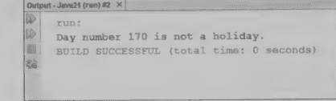

`HolidaySked` 类只包含一个实例变量：`sked`，这是一个存储了一年中每一天数值的 `BitSet`。

该类的构造函数创建一个具有 365 个位置的 `sked` 位集，其初始值为 0（第 8-15 行）。所有位集在创建时都被填充了 0 值。

接下来，创建了一个整数数组 `holiday`。该数组持有了一年内每个工作假日的编号，从 1（元旦）开始，到 359（圣诞节）结束。

`holiday` 数组用于将每个假日添加到 `sked` 位集中。一个 `for` 循环遍历 `holiday` 数组，并对每个元素调用 `addHoliday(int)` 方法（第 12–14 行）。

`addHoliday(int)` 方法定义在第 17–19 行。参数表示要添加的天数。通过调用位集的 `set(int)` 方法将指定位置的位设置为 1。例如，如果调用了 `set(359)`，则位置 359 的位将被赋予值 1。

`HolidaySked` 类还可以判断指定的某天是否为假日。这通过 `isHoliday(int)` 方法处理（第 21–24 行）。该方法调用位集的 `get(int)` 方法，如果指定位置的值为 1，则返回 `true`，否则返回 `false`。

由于存在 `main()` 方法（第 26–42 行），该类可以作为应用程序运行。应用程序接收一个命令行参数：一个 1 到 365 之间的数字，代表一年的某一天。应用程序根据 `HolidaySked` 类的安排显示该天是否为假日。

## 数组列表 (Array Lists)

Java 中最受欢迎的数据结构之一，`ArrayList` 类实现了一个可扩展和收缩的对象数组，使其比数组更灵活且更有用。由于 `ArrayList` 类负责根据需要更改大小，因此它必须决定在添加或删除元素何时以及以何种程度进行增长或缩小。

可以使用不带参数的构造函数创建一个数组列表：

```java
ArrayList golfer = new ArrayList();
```

此构造函数创建了一个不包含元素的默认数组列表。所有列表在创建时都是空的。决定列表如何调整的属性之一是其初始容量——即它为存储元素而分配的内存数量。

数组列表的大小（size）是当前存储的元素数量。列表的容量（capacity）始终大于或等于大小。

以下代码显示了如何创建一个指定容量的数组列表：

```java
ArrayList golfer = new ArrayList(30);
```

此列表分配了足够支持 30 个元素的内存。如果容量填满，列表将自动按初始大小的一半进行扩展。因此，如果向 `golfer` 中放入第 31 个元素，它将扩展以为 45 个元素留出空间。

由于为列表分配额外空间需要时间并消耗内存，最好按照你预期使用的元素数量来创建列表。

你不能像使用数组那样直接使用方括号 `[]` 来访问数组列表中的元素。你必须使用 `ArrayList` 类的方法。

使用 `add(Object)` 方法向数组列表添加元素，如下：

```java
golfer.add("Park");
golfer.add("Lewis");
golfer.add("Ko");
```

`element()` 方法返回一个 `Object`，这是因为 `ArrayList` 类支持所有类型的对象。你必须将其强制转换为放入列表的类。在这里，由于 `golfer` 中存储了字符串，因此返回的对象被强制转换为字符串。

`get(int)` 方法使用数字索引检索列表元素，如下代码所示：

```java
String s1 = (String) golfer.get(0);
String s2 = (String) golfer.get(2);
```

由于数组列表的编号从 0 开始，第一次调用 `get()` 获取的是“Park”字符串，第二次调用获取的是“Lewis”字符串。

正如你可以获取特定索引处的元素一样，你也可以通过 `add(int, Object)` 和 `remove(int)` 方法在索引处添加和删除元素：

```java
golfer.add(1, "Kim");
golfer.add(0, "Thompson");
golfer.remove(3);
```

第一次调用 `add()` 在索引 1 处插入一个元素，位于“Park”和“Lewis”字符串之间。“Lewis”和“Ko”字符串在列表中移动了一个位置，以容纳插入的“Kim”字符串。第二次调用 `add()` 在索引 0 处（即列表开头）插入一个元素。所有现有元素在列表中向上移动一个位置，以容纳插入的“Thompson”字符串。此时，列表的内容如下：

- 0. "Thompson"
- 1. "Park"
- 2. "Kim"
- 3. "Lewis"
- 4. "Ko"

调用 `remove()` 删除了索引 3 处的元素。结果列表为：

- 0. "Thompson"
- 1. "Park"
- 2. "Kim"
- 3. "Lewis"

你可以使用 `set()` 方法更改特定元素：

```java
golfer.set(1, "Pressel");
```

这会将“Park”字符串替换为“Pressel”，结果为：

- 0. "Thompson"
- 1. "Pressel"
- 2. "Kim"
- 3. "Lewis"

如果你想清空列表，可以使用 `clear()` 方法：

```java
golfer.clear();
```

`ArrayList` 类提供了一些确定大小的方法。首先，`size` 方法确定列表的元素：

```java
int size = golfer.size();
```

记住列表有两个属性：大小和容量。大小是列表中的元素数量，容量是分配的内存空间。Java 类库还包含了 `Vector`，一种与 `ArrayList` 类似的数据结构。

## 遍历数据结构 (Looping Through Data Structures)

如果你按顺序处理列表中的元素，可以使用 `iterator()` 方法，它返回一个持有列表的迭代器：

```java
Iterator it = golfer.iterator();
```

以下 `for` 循环使用迭代器遍历整个数组：

```java
for (Iterator i = golfer.iterator(); i.hasNext(); ) {
    String name = (String) i.next();
    System.out.println(name);
}
```

今天的项目演示了数组列表的细节点。列表 8.2 所示的 `CodeKeeper` 类持有一组代码，一部分由类提供，另一部分由用户提供。由于存储代码所需的空间直到程序运行时未知，因此使用数组列表而非数组。在 NetBeans 中创建此类时，记得将其放入 `com.java2days` 包中。

### 8.2 CodeKeeper.java 的完整文本

```java
1: package com.java2days;
2:
3: import java.util.*;
4:
5: public class CodeKeeper {
6:     ArrayList list;
7:     String[] codes = {"alpha", "lambda", "gamma", "delta", "zeta"};
8:
9:     public CodeKeeper(String[] userCodes) {
10:        list = new ArrayList();
11:        // 内置代码
12:        for (int i = 0; i < codes.length; i++) {
13:            addCode(codes[i]);
14:        }
15:        // 加载用户代码
16:        for (int j = 0; j < userCodes.length; j++) {
17:            addCode(userCodes[j]);
18:        }
18:        // 显示所有代码
20:        for (Iterator it = list.iterator(); it.hasNext(); ) {
21:            String output = (String) it.next();
22:            System.out.println(output);
23:        }
24:    }
25:
26:    private void addCode(String code) {
27:        if (!list.contains(code)) {
28:            list.add(code);
29:        }
30:    }
31: }
32:
33:    public static void main(String[] arguments) {
34:        CodeKeeper keeper = new CodeKeeper(arguments);
35:    }
36: }
```

NetBeans 可能会显示警告，提示此类使用了“未检查或不安全的操作”。这听起来并没有那么严重。代码按原文编写运行正常，并不危险。

该警告是一个强提示，表明处理数组列表（array lists）和其他数据结构有更好的方法。你将在之后学习这种技术。

`CodeKeeper` 类使用一个名为 `list` 的 `ArrayList` 实例来存储文本代码。

首先，内置代码从字符串数组读取到列表中（第 12–14 行）。

接下来，用户作为命令行参数提供的任何代码都会在第 16–18 行被添加。

代码通过调用 `addCode()` 方法进行添加（第 26–30 行）。`addCode` 仅在文本代码不存在时才会添加新的文本代码，这是通过列表的 `contains(Object)` 方法来实现的。

在 NetBeans 中，通过选择 Project（项目）、Set Project Configuration（设置项目配置）、Customize（自定义）来添加命令行参数。这些参数应该应该是用空格分隔的代码列表。

代码被添加到列表后，将显示其内容。使用命令行参数 "beta" 和 "epsilon" 运行产生如图 8.3 所示的输出。

### 图 8.3

操作并显示数组列表。

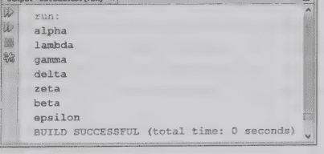

可以使用更简单的 `for` 循环来遍历数据结构。循环的形式为 `for (variable : structure)`，其中 `structure` 是实现 `Iterator` 接口的数据结构，它声明了一个随着循环进行而持有结构中每个元素的对象。

此 `for` 循环使用迭代器及其方法来遍历名为 `golfer` 的数组列表：

```java
for (Object name : golfer) {
    System.out.println(name);
}
```

该循环可以与任何支持 `Iterator` 的数据结构配合使用。

## 栈 (Stacks)

栈是一种用于按特定顺序访问信息的数据结构。Java 中的 `Stack` 类被实现为后进先出（last-in, first-out）栈，这意味着最后添加到栈的项是第一个被移除的。图 8.4 显示了栈的逻辑结构。

### 图 8.4

栈的结构

| 距离顶部的距离 | 顶部 |
|---|---|
| | Element3 |
| 1 | Element2 |
| 2 | Element1 |
| 3 | Element0 底 |

你可能会奇怪元素数字与其距离栈顶的位置不匹配。记住元素是添加到顶部的，所以位于 `Element0` 是第一个添加到栈的元素。同样，位于顶部的 `Element3` 是最后添加的元素。此外，由于 `Element3` 在栈顶，它将是第一个被移除的。

`Stack` 类只定义了一个构造函数，创建一个空栈的默认构造函数。你使用此构造函数创建这样的栈：

```java
Stack s = new Stack();
```

Java 中的 `Stack` 类包含操作栈的方法。

你可以使用 `push()` 方法向栈中添加新元素，该方法将元素推到栈顶：

```java
s.push("One");
s.push("Two");
s.push("Three");
s.push("Four");
s.push("Five");
s.push("Six");
```

此代码将六个字符串推入栈，最后一个字符串 "Six" 位于顶端。你通过使用 `pop()` 方法从栈中移除元素，该方法将其从顶部弹出：

```java
String s1 = (String) s.pop();
String s2 = (String) s.pop();
```

此代码从栈中弹出了两个字符串，留下 `s1` 变量包含 "Six" 字符串，`s2` 变量包含 "Five" 字符串。

如果你想使用栈顶元素而不实际上将其弹出，可以使用 `peek()` 方法：

```java
String s3 = (String) s.peek();
```

此调用 `peek()` 返回 "Four" 字符串，但将字符串留在栈中。你可以使用 `search()` 方法在栈中查找元素：

```java
int i = s.search("Two");
```

`search()` 方法返回从栈顶到元素的距离，如果未找到，则返回 -1。在这种情况下，“Two" 字符串是顶起的第三个元素，所以 `search()` 方法返回 2。在所有处理索引或列表的 Java 数据结构中，它基于零的方式报告元素位置：栈顶元素的位置为 0，第四个元素的位置为 3，依此类推。

> **注意**
>
> `Stack` 类定义的最后一个方法是 `isEmpty()`，它指示栈是否为空：
>
> ```java
> boolean isEmpty = s.isEmpty();
> ```

## Map

`Map` 接口定义了实现键映射数据结构的框架，key maps 允许你根据某种类型的键存储数据，其效率由 map 的负载因子（load factor）定义。负载因子是 0.0 到 1.0 之间的浮点数，决定了 hash map 如何以及何时为更多元素分配空间。

类似于数组列表，hash maps 具有容量（capacity），即分配的内存量。hash maps 通过比较 map 的当前大小与容量与因子的乘积来分配内存。如果 hash map 超过此乘积，map 将通过重新哈希（rehashing）来增加其容量。

负载因子接近 1.0 会更高效的内存利用，代价是每个元素的查找时间更长。同样，接近 0.0 的负载因子会导致更高效的查找，但往往更浪费内存。

确定你自己的 hash maps 的负载因子取决于你如何使用每个 map，以及你的优先级是性能还是内存效率。

你可以通过三种方式之一创建 hash maps。第一个构造函数创建一个默认 hash map，初始容量为 16 个元素，负载因子为 0.75：

```java
HashMap hash = new HashMap();
```

第二个构造函数创建一个具有指定初始容量和 0.75 负载因子的 hash map：

```java
HashMap hash = new HashMap(20);
```

此代码向 map（来自 `java.awt`）添加了三个 `Rectangle` 对象，使用字符串作为键。要获取元素，使用 `get()` 方法并指定键：

```java
Rectangle r = (Rectangle) look.get("medium");
```

你还可以使用 `remove()` 方法通过键移除元素：

```java
look.remove("large");
```

你可以通过 `size()` 方法找出结构中有多少元素，在 `ArrayList` 类中：

```java
int size = look.size();
```

你还可以使用 `isEmpty()` 方法检查结构是否为空：

```java
boolean isEmpty = look.isEmpty();
```


# 第 8 天：数据结构

## HashMap Maps

`HashMap` 类实现了 `Map` 接口，并提供了键映射数据结构的完整实现。Hash maps 允许你根据某种类型的键存储数据，效率由 map 的负载因子定义。负载因子是 0.0 到 1.0 之间的浮点数，决定了 hash map 如何以及何时为更多元素分配空间。

类似于数组列表，hash maps 具有容量，即分配的内存。Hash maps 通过比较 map 的当前大小与容量与负载因子的乘积来分配内存。如果 hash map 超过此乘积，map 将通过重新哈希自身来增加容量。

负载因子接近 1.0 会导致更高效的内存利用，代价是每个元素的查找时间更长。同样，接近 0.0 的负载因子会导致更高效的查找，但往往更浪费内存。

确定你自己的 hash maps 的负载因子取决于你如何使用每个 map，以及你的优先级是性能还是内存效率。

你可以通过三种方式之一创建 hash maps。第一个构造函数创建一个默认 hash map，初始容量为 16 个元素，负载因子为 0.75：

```java
HashMap hash = new HashMap();
```

最后，第三个构造函数创建了一个指定初始容量和负载因子的哈希映射：

```java
HashMap hash = new HashMap(20, 0.5F);
```

`Map` 中定义的所有抽象方法都在 `HashMap` 类中实现。此外，`HashMap` 类还实现了其他几个执行支持映射特定功能的方法。其中之一是 `clear()` 方法，它可以清除映射中所有的键和元素：

```java
hash.clear();
```

`containsValue(Object)` 方法检查某个对象是否存储在哈希表中：

```java
Rectangle box = new Rectangle(0, 0, 5, 5);
boolean isThere = hash.containsValue(box);
```

`containsKey(String)` 方法在映射中搜索键：

```java
boolean isThere = hash.containsKey("Small");
```

哈希映射的实际用途在于它能够表示那些通过值搜索或引用过于耗时的数据。当你处理复杂数据时，使用键来访问数据比比较数据对象本身更高效，这种数据结构就派上用场了。

这个键（即哈希码）是一个计算出的键，用于唯一标识哈希映射中的元素。

这种通过计算并使用代码进行对象存储和引用的技术在 Java 类库中被广泛利用。所有类的父类 `Object` 定义了在大多数标准 Java 类中被重写的 `hashCode()` 方法。任何定义了 `hashCode()` 方法的类都可以在哈希表中高效地存储和访问。想要被哈希的类还必须实现 `equals()` 方法，该方法定义了判断两个对象是否相等的方法。`equals()` 方法通常对类中的所有成员变量进行直接比较。

## ComicBooks 示例

`ComicBooks` 根据收藏书籍的基础价值和品相对其进行定价。品相被描述为以下之一：mint（全新）、near mint（几近全新）、very fine（极佳）、good（良好）或 poor（破旧）。每种状态对漫画的价值都有特定的影响：

- “Mint”书籍的价格是其基础价格的 3 倍。
- “Near mint”书籍的价格是其基础价格的 2 倍。
- “Very fine”书籍的价格是其基础价格的 1.5 倍。
- “Fine”书籍的价格是其基础价格。
- “Good”书籍的价格是其基础价格的 0.5 倍。
- “Poor”书籍的价格是其基础价格的 0.25 倍。

为了将如“mint”或“very fine”之类的文本与数值关联起来，它们被放入一个哈希映射中。映射的键是品相描述，值是如 3.0、1.5 和 0.25 等浮点数。

在 NetBeans 中输入列表 8.3 所示的代码，包在 `com.java21days` 包中命名为类 `ComicBooks`。

### 列表 8.3 ComicBooks.java 的全文

```java
package com.java21days;

import java.util.*;

public class ComicBooks {

    public ComicBooks() {

    }

    public static void main(String[] arguments) {
        // set up hash map
        HashMap quality = new HashMap();
        float price1 = 3.00F;
        quality.put("mint", price1);
        float price2 = 2.00F;
        quality.put("near mint", price2);
        float price3 = 1.50F;
        quality.put("very fine", price3);
        float price4 = 1.00F;
        quality.put("comic", price4);
        float price5 = 0.50F;
        quality.put("good", price5);
        float price6 = 0.25F;
        quality.put("poor", price6);
        // set up collection
        Comic[] comic = new Comic[3];
        comic[0] = new Comic("Amazing Spider-Man", "1A", "very fine", 12.000F);
        comic[0].setPrice((Float) quality.get(comic[0].condition));
        comic[1] = new Comic("Incredible Hulk", "181", "near mint", 680.00F);
        comic[1].setPrice((Float) quality.get(comic[1].condition));
        comic[2] = new Comic("Cebrus", "1A", "good", 190.00F);
        comic[2].setPrice((Float) quality.get(comic[2].condition));
        for (int i = 0; i < comic.length; i++) {
            System.out.println("Title: " + comic[i].title);
            System.out.println("Issue: " + comic[i].issueNumber);
            System.out.println("Condition: " + comic[i].condition);
            System.out.println("Price: $" + comic[i].price + "\n");
        }
    }
}

class Comic {
    String title;
    String issueNumber;
    String condition;
    float basePrice;
    float price;

    Comic(String inTitle, String issueNumber, String inCondition, float basePrice) {
        title = inTitle;
        issueNumber = issueNumber;
        condition = inCondition;
        basePrice = basePrice;
    }

    void setPrice(float factor) {
        price = basePrice * factor;
    }
}
```

当你运行 Comics 应用程序时，它会产生如下输出：

| 图 8.6 | 输出 |
| :--- | :--- |
| 在哈希表中存储漫画书籍价值。 | run: <br>Title: Amazing Spider-Man<br>Issue: 1A<br>Condition: very fine<br>Price: $18.0<br><br>Title: Incredible Hulk<br>Issue: 181<br>Condition: near mint<br>Price: $680.0<br><br>Title: Cebrus<br>Issue: 1A<br>Condition: good<br>Price: $95.0 |

## 泛型 (Generics)

运行时错误对程序员来说比编译错误棘手得多。编译错误会让你停下，并且必须在继续之前修复它。而运行时错误可能会在你毫不知情的情况下潜入代码中，并给你的软件用户带来问题。

你可以使用语言的泛型功能指定数据结构中预期的类或多个类。

预期的类信息被添加到结构赋值给变量或使用构造函数创建的语句中。类或类被放在 `<` 之间，并紧跟在类名之后，如下所示：

```java
ArrayList<Integer> zipCodes = new ArrayList<>();
```

该语句创建了一个用于存储 `Integer` 对象的数组列表。编译器在第二次出现 `< >` 字符时使用推断来正确猜测类的类型。类名后的 `< >` 有时被称为菱运算符（diamond operator）。这是另一个例子：

```java
HashMap<String, Float> quality = new HashMap<String, Float>();
```

菱运算符 `< >` 根据语句要使其意义完整必须具备的类型来推断类。

由于列表在声明时指定了类，以下语句会导致编译错误，NetBeans 会在源代码编辑器中标记出这些错误：

```java
zipCodes.add("90210");
zipCodes.add("02134");
zipCodes.add("20500");
```

编译器识别出 `String` 对象不属于此数组列表。向列表添加元素的正确方法是使用整数值：

```java
zipCodes.add(90210);
zipCodes.add(02134);
zipCodes.add(20500);
```

这些整数通过自动装箱（autoboxing）转换为 `Integer` 对象。

使用多个类的数据结构（如哈希映射）在 `< >` 字符内用逗号分隔这些类名。

`ComicBooks` 可以通过将列表 8.3 的第 12 行改为以下内容来利用泛型：

```java
HashMap<String, Float> quality = new HashMap<String, Float>();
```

这建立了一个映射，使用 `String` 对象作为键，使用 `Float` 对象作为值。有了这条语句，字符串不再可以作为“near mint”等条件的值。编译错误会标记此类问题。

泛型使得从数据结构中检索对象变得更容易，因为你不需要使用类型转换将它们转换为目标类。例如，在这样的语句中，`quality` 映射不再需要转换来产生 `Float` 对象：`comix[1].setPrice(quality.get(comix[1].condition))`

从风格角度来看，在变量声明和构造方法中添加泛型可能会看起来令人望而畏。然而，在你习惯了使用它们（以及使用自动装箱、自动拆箱和新的 for 循环）后，数据结构处理起来将变得容易得多，且不容易出错。

列表 8.4 所示的 `CodeKeeper2` 类是 `CodeKeeper` 的新版本，它已重写为使用泛型、类型推断以及可以迭代数组列表等数据结构的 for 循环。

### 列表 8.4 CodeKeeper2.java 的全文

```java
package com.java21days;

import java.util.*;

public class CodeKeeper2 {
    ArrayList<String> list;
    String[] codes = {"alpha", "lambda", "gamma", "delta", "zeta"};

    public CodeKeeper2(String[] userCodes) {
        list = new ArrayList<String>();
        // load build-in codes
        for (int i = 0; i < codes.length; i++) {
            addCode(codes[i]);
        }

        for (int j = 0; j < userCodes.length; j++) {
            addCode(userCodes[j]);
        }

        // display all codes
        for (String code : list) {
            System.out.println(code);
        }
    }

    private void addCode(String code) {
        if (!list.contains(code)) {
            list.add(code);
        }
    }

    public static void main(String[] arguments) {
        CodeKeeper2 keeper = new CodeKeeper2(arguments);
    }
}
```

代码的唯一修改在第 6 行，那里对字符串数组列表进行了泛型声明；第 10 行，那里类型推断使用了正确的泛型声明；以及第 21–23 行，显示所有代码的简单 for 循环。

## 枚举 (Enumerations)

Java 中常量的一个常见用途是为一系列整数附加一个有意义的标签，你之前在处理位操作时这样做过：

```java
class ConnectionAttributes {
    public static final int READABLE = 0;
    public static final int WRITABLE = 1;
    public static final int STREAMABLE = 2;
    public static final int FLEXIBLE = 3;
}
```

## 问题

1. 以下哪种数据不能存储在哈希（hash）中？
   - A. String
   - B. int
   - C. 两者都可以存储在 map 中。

2. 创建了一个 array list，并向其添加了三个字符串："Tinker"、"Evers" 和 "Chance"。调用了 `remove("Evers")` 方法。哪一个 `ArrayList` 方法可以获取字符串 "Chance"？
   - A. `get(1);`
   - B. `get(2);`
   - C. `get("Chance");`

3. 这些类中哪一个实现了 `Map` 接口？
   - A. `Stack`
   - B. `HashMap`
   - C. `BitSet`

## 答案

1. **C.** 在 Java 之前的版本中，为了在 map 中存储如 `int` 这样的基本类型，必须使用对象来表示其值（例如使用 `Integer` 表示整数）。现在不再如此了。基本类型会通过自动装箱（autoboxing）过程自动转换为对应的对象类。

2. Array list 中每个项目的索引可能会随着项目的添加或删除而改变。因为在移除 "Evers" 之后 "Chance" 变成了列表中的第二个项目，所以通过调用 `get(1)` 获取它。

3. `HashMap` 实现了该接口，一个名为 `Hashtable` 的类似类也是如此。

## 认证练习

以下问题是你在 Java 编程认证考试中可能会遇到的类型。请在不看今天的材料或不使用 Java 编译器测试代码的情况下回答它。

给定：

```java
public class Recursion {
    public int dex = -1;

    public Recursion() {
        dex = getValue(17);
    }

    public int getValue(int dexValue) {
        if (dexValue > 100) {
            return dexValue;
        } else {
            return getValue(dexValue * 2);
        }
    }
}
```


public static void main(String[] arguments) {

    Recursion r = new Recursion();

    System.out.println(r.dex);

}

```

该程序的输出将是什么？

- A. -1
- B. 17
- C. 34
- D. 136

答案可以在书籍网站 `www.java21days.com` 上找到。访问 Day 8 页面并点击 Certification Practice 链接。

### 练习

为了扩展你对今天涵盖主题的知识，请尝试以下练习：

1. 为 `ComicBooks` 应用添加另外两个条件：“pristine mint”（品相完美）用于应以基础价 5 倍出售的书籍，“coverless”（无护封）用于应以基础价十分之一出售的书籍。
2. 重写 `ComicBooks` 应用，使漫画的可能条件集成为枚举（enumeration）。

练习答案位于书籍网站 `www.java21days.com` 上。

# 第 9 天 使用 Swing

如今的计算机用户期望他们使用的软件具有图形用户界面（GUI），并包含各种控件，如文本框、滑块和滚动条。Java 类库包含一组名为 Swing 的包，使 Java 程序能够提供复杂的 GUI，并通过鼠标、键盘和其他输入设备收集用户输入。

今天，你将使用 Swing 创建具有这些 GUI 组件的应用程序：

- Frames（框架）——包含标题栏、菜单栏以及最大化、最小化和关闭按钮的窗口
- Containers（容器）——可以容纳其他组件的界面元素
- Buttons（按钮）——带有指示其用途的文本或图形的可点击区域
- Labels（标签）——提供信息的文本或图形
- Text fields and text areas（文本域文本区域）——接受键盘输入并允许编辑的窗口
- Drop-down lists（下拉列表）——可以从下拉菜单或滚动窗口选择的相关项目组
- Check boxes and radio buttons（复选框和单选按钮）——可以选中或取消的小正方形或圆形
- Image icons（图像图标）——可以添加到按钮、标签和其他组件中的图形
- Scrolling panes（滚动面板）——用于存放用户界面无法完全显示的组件的面板，可以通过滚动条完整访问

## 创建应用程序

Swing 允许你创建一个采用原生操作系统（如 Windows 或 Linux）风格或 Java 特有风格的 Java 程序。这些风格中的每一种都被称为“外观和感觉”（look and feel），因为它既描述了界面的外观，也描述了组件在使用时的功能。

Java 提供了一种独特的全新外观和感觉，称为 Nimbus，这是该语言特有的。

Swing 组件属于 `javax.swing` 包，它是 Java 类库的标准部分。要使用短名称引用 Swing 类（换句话说不引用包），你必须通过 import 语句使其可用，或使用如下通配符语句：

```java
import javax.swing.*;
```

用于支持 GUI 编程的两个包是 `java.awt`（抽象窗口工具包 AWT）和 `java.awt.event`（处理用户输入的事件处理类）。

当你使用 Swing 组件时，你操作的是该组件类的对象。你通过调用其构造函数创建组件，然后根据需要调用组件的方法进行适当的设置。

所有 Swing 组件都是抽象类 `JComponent` 的子类。它包含了设置组件大小、更改背景颜色、定义显示文本使用的字体以及使用工具提示（ToolTips）的方法。工具提示是当你鼠标悬停在组件上几秒钟时出现的说明性文本。

### 注意

Swing 类继承自许多与抽象窗口工具包相同的父类，因此可以在同一个界面结合使用 Swing 和 AWT 组件。然而，这两种类型的组件在容器中将无法正确渲染，因此最好使用 Swing 组件——每个 AWT 组件都有一个对应的 Swing 组件。

在组件显示于用户界面之前，它们必须被添加到容器中，容器是能够容纳其他组件的组件。Swing 容器是 `java.awt.Container` 的子类。该类包含了从容器中添加和移除组件的方法、使用布局管理器（layout manager）对象排列组件的方法以及在容器边缘设置边界的方法。容器通常可以放在其他容器中。

### 创建界面

创建 Swing 应用程序的第一步是创建一个表示主 GUI 的类。该类的对象作为容器，容纳所有要显示的其它组件。

在许多项目中，主界面对象是一个框架（`JFrame` 类）。无论程序是用什么语言编写的，框架都是你在计算机上打开应用程序时显示的窗口。框架具有标题栏、菜单栏以及最大化、最小化和关闭按钮。

## 创建应用程序

每个帧（frame）的标题栏上都有用户可以控制的最大化、最小化和关闭按钮——这些控件与你电脑上运行的其他软件界面中的控件是相同的。

帧被关闭时的默认行为是应用程序继续运行。当一个帧作为程序的主 GUI（图形用户界面）时，会导致用户无法停止程序。

要更改这一点，你必须调用帧的 `setDefaultCloseOperation()` 方法，并将四个静态变量之一作为参数传递：

- `EXIT_ON_CLOSE`——当帧关闭时退出应用程序
- `DISPOSE_ON_CLOSE`——关闭帧，从 Java 虚拟机 (JVM) 内存中移除该帧对象，并保持应用程序运行
- `DO_NOTHING_ON_CLOSE`——保持帧打开并继续运行
- `HIDE_ON_CLOSE`——关闭（隐藏）并继续运行

这些变量存在于 `JFrame` 类中，因为它实现了 `WindowConstants` 接口。要防止用户关闭帧，请在帧的构造方法中添加以下语句：

```java
setDefaultCloseOperation(JFrame.DO_NOTHING_ON_CLOSE);
```

如果你正在创建一个帧作为应用程序的主用户界面，预期的行为可能是 `EXIT_ON_CLOSE`，它会随着帧一起关闭应用程序。

如前所述，你可以通过指定外观和感觉（look and feel）来自定义 Java 用户界面的整体外观。`javax.swing` 包中的 `UIManager` 类管理 Swing 的这方面。要设置外观和感觉，调用类方法 `setLookAndFeel(String)`，并将外观和感觉类的名称作为参数。以下是选择 Nimbus 外观和感觉的方法：

```java
UIManager.setLookAndFeel(
  "com.sun.java.swing.plaf.nimbus.NimbusLookAndFeel"
);
```

此方法调用应包含在 `try-catch` 块中；它可能会产生五个不同的异常。捕获 `Exception` 类并忽略它，可以确保在 Nimbus 无法正确选择的极少数情况下使用默认的外观和感觉。

### 注意

> 使用 `EXIT_ON_CLOSE` 会关闭整个 JVM，因此它应该只用于应用程序主窗口的帧。如果帧关闭后需要执行任何操作，应该使用 `DISPOSE_ON_CLOSE` 或 `HIDE_ON_CLOSE`。

### 开发框架

今天的第一个项目是一个显示包含其他其他界面组件的帧的应用程序。在 NetBeans 中，创建一个类名为 `SimpleFrame` 的新 Java 文件，包名为 `com.java2days`；然后输入代码 9.1 所示的代码。这个简单的应用程序显示了一个大小为 300x100 像素的帧，它可以作为你创建的任何使用 GUI 应用程序的框架——这是不可避免的。

列表 9.1 SimpleFrame.java 的完整文本

```java
1: package com.java2days;
2:
3: import javax.swing.*;
4:
5: public class SimpleFrame extends JFrame {
6:     public SimpleFrame() {
7:         super("Simple Title");
8:         setSize(300, 100);
9:         setDefaultCloseOperation(JFrame.EXIT_ON_CLOSE);
10:        setLookAndFeel();
11:        setVisible(true);
12: }
13:
14:    private static void setLookAndFeel() {
15:        try {
16:             UIManager.setLookAndFeel(
17:                 "com.sun.java.swing.plaf.nimbus.NimbusLookAndFeel"
18:             );
19:        } catch (Exception exc) {
20:             // ignore error
21:        }
22:    }
23:
24:    public static void main(String[] arguments) {
25:        setLookAndFeel();
26:        SimpleFrame sf = new SimpleFrame();
27:
```

## 创建应用程序

当你编译并运行应用程序时，你应该能看到图 9.1 所示的帧。

图 9.1
显示一个帧。


`SimpleFrame` 应用程序没什么可看的。GUI 除了标题栏上标准的最小化、最大化和关闭 (X) 按钮外（如图 9.1 所示）不包含任何组件。你将在今天晚些时候添加组件。

在应用程序中，第 24–27 行的 `main()` 方法中创建了一个 `SimpleFrame` 对象。如果你在构造帧时没有显示它，可以在 `main()` 方法中调用 `sf.setVisible(true)` 来显示该帧。

Nimbus 在第 16–18 行被设置为该帧的外观和感觉。

创建帧的用户界面的工作发生在第 6–12 行的 `SimpleFrame()` 构造方法中。可以在此构造方法中创建组件并将它们添加到帧中。

## 创建组件

创建帧的用户界面的工作发生在第 6–12 行的 `SimpleFrame()` 构造方法中。可以在此构造方法中创建组件并将它们添加到帧中。

创建一个 GUI 是一种很好的方法，因为每个界面组件都由其自己的类表示。在 Java 中使用界面组件，你需要创建该组件的对象。

最简单的组件是 `JButton`，它代表可点击的按钮。在大多数程序中，按钮触发动作。你可以用于按钮的构造函数包括：

- `JButton()`——创建一个无标签按钮
- `JButton(String)`——创建一个带有指定文本标签的按钮
- `JButton(Icon)`——创建一个带有指定图标的按钮
- `JButton(String, Icon)`——创建一个带有指定文本和图标的按钮

### 将组件添加到容器

在 Java 中显示如按钮之类的界面组件之前，你必须将其添加到容器中。要向容器添加组件，请调用容器的 `add(Component)` 方法并将组件作为参数。

最简单的容器是面板（`JPanel` 类）。下例在列表 9.2 所示的 `JFrame` 类扩展了之前创建的应用程序。示例创建一个按钮并将其添加到面板：

创建一个面板，将三个按钮添加到面板中，然后将其添加到帧。

列表 9.2 ButtonFrame.java 的完整文本

```java
1: package com.java2days;
2:
3: import javax.swing.*;
4:
5: public class ButtonFrame extends JFrame {
6:   JButton load = new JButton("Load");
7:   JButton save = new JButton("Save");
8:   JButton unsubscribe = new JButton("Unsubscribe");
9:
10:  public ButtonFrame() {
11:    super("Button Frame");
12:    setSize(300, 100);
13:    setDefaultCloseOperation(JFrame.EXIT_ON_CLOSE);
14:    JPanel pane = new JPanel();
15:    pane.add(load);
16:    pane.add(save);
17:    pane.add(unsubscribe);
18:    add(pane);
19:    setVisible(true);
20:  }
21:
22:  private static void setLookAndFeel() {
23:    try {
24:       UIManager.setLookAndFeel(
25:           "com.sun.java.swing.plaf.nimbus.NimbusLookAndFeel"
26:       );
27:    } catch (Exception exc) {
28:       System.out.println(exc.getMessage());
29:    }
30:  }
31:
32:  public static void main(String[] arguments) {
33:    setLookAndFeel();
34:    ButtonFrame bf = new ButtonFrame();
35:  }
36: }
```

当你运行应用程序时，会打开一个如图 9.2 所示的包含三个按钮的小帧。

图 9.2
ButtonFrame 应用程序。


`ButtonFrame` 类有三个实例变量：`load`、`save` 和 `unsubscribe` 对象。列表 9.2 的第 14–17 行创建了一个新的 `JPanel` 对象，并通过调用其 `add(Component)` 方法将三个按钮添加到面板。当面板包含所有按钮时，在第 18 行调用帧自身的 `add(Component)` 方法并将面板作为参数，将其添加到帧中。

# 第 9 天：使用 Swing

如果你点击按钮，什么都不会发生。对按钮点击做出响应的操作将在第 12 天“响应用户输入”中介绍。

## 使用组件

除了你到目前为止使用的按钮和容器外，Swing 还提供了二十多个用户界面组件。在今天接下来的时间里，以及第 10 天“构建 Swing 界面”中，你将使用其中的许多组件。

所有组件都共享一个共同的父类 `javax.swing.JComponent`，它们从那里继承了几个你将在自己的程序中发现非常有用的方法。

`setEnabled(boolean)` 方法决定组件是否可以接收输入（参数为 `true`）或处于非活动状态且无法接收输入（`false`）。组件默认情况下是启用的。许多组件在无法正常使用时会改变外观以示区别。例如，禁用的 `JButton` 具有浅灰色的边框和灰色文本。如果你想检查一个组件是否启用，可以调用 `isEnabled()` 方法，它会返回一个布尔值。

`setVisible(boolean)` 方法对所有组件的作用方式与对容器相同。使用 `true` 显示组件，使用 `false` 隐藏它。还有一个布尔类型的 `isVisible()` 方法。

`setSize(int, int)` 方法将组件调整为作为参数指定的宽度和高度，而 `setSize(Dimension)` 使用一个 `Dimension` 对象来实现相同的功能。对于大多数组件，你不需要设置大小；默认值通常是可以接受的。要找到组件的大小，请调用 `getSize()` 方法，它返回一个 `Dimension` 对象，该对象包含高度和宽度的实例变量尺寸。

正如你将看到的，类似的 Swing 组件也具有其他共同的方法，例如用于文本组件的 `setText()` 和 `getText()`，以及用于存储数值的组件的 `setValue()` 和 `getValue()`。

当你开始使用 Swing 组件时，一个常见的错误来源是在组件被添加到容器之后才设置组件的某些属性。请确保在将组件放入面板或任何其他容器之前完整地设置好该组件。

### 图像图标

Swing 支持在按钮和其他可以提供标签的组件上使用图形化的 `ImageIcon` 对象。图标是一个小图形，可以放置在按钮、标签或其他用户界面元素上以识别它。例如，用于删除文件的垃圾桶或可回收桶图标，以及用于打开和存储文件的文件夹图标。

你可以通过将图形的文件名作为构造函数的参数来创建一个 `ImageIcon` 对象。下面的示例从图形文件 `subscribe.gif` 加载图标，并创建一个以该图标作为标签的 `JButton`：

```java
ImageIcon subscribe = new ImageIcon("subscribe.gif");
JButton button = new JButton(subscribe);
JPanel pane = new JPanel();
pane.add(button);
add(pane);
setVisible(true);
```

列表 9.3 是一个 Java 应用程序，它创建了四个带有文本标签的图像图标，将它们添加到面板中，然后将面板添加到框架（frame）中。在 NetBeans 中为 `com.java21days` 包创建一个名为 `IconFrame` 的新空 Java 文件，并在源代码编辑器中输入此列表。

### 列表 9.3 IconFrame.java 的全文


```java
1: package com.java21days;
2:
3: import javax.swing.*;
4:
5: public class IconFrame extends JFrame {
6:     JButton load, save, subscribe, unsubscribe;
7:
8:     public IconFrame() {
9:         super("IconFrame", JFrame.EXIT_ON_CLOSE);
10:         JPanel pane = new JPanel();
11:         // create icons
12:         ImageIcon loadIcon = new ImageIcon("load.gif");
13:         ImageIcon saveIcon = new ImageIcon("save.gif");
14:         ImageIcon subscribeIcon = new ImageIcon("subscribe.gif");
15:         ImageIcon unsubscribeIcon = new ImageIcon("unsubscribe.gif");
16:         // create buttons
17:         load = new JButton("Load", loadIcon);
18:         save = new JButton("Save", saveIcon);
19:         subscribe = new JButton("Subscribe", subscribeIcon);
20:         unsubscribe = new JButton("Unsubscribe", unsubscribeIcon);
21:         // add buttons to panel
22:         pane.add(load);
23:         pane.add(save);
24:         pane.add(subscribe);
25:         pane.add(unsubscribe);
26:         // add the panel to a frame
27:         add(pane);
28:         pack();
29:         setVisible(true);
30:     }
31:
32:     public static void main(String[] arguments) {
33:         IconFrame ike = new IconFrame();
34:     }
35: }
```

图 9.3 显示了结果。

图 9.3 一个包含带有图标标签按钮的界面。


第 13–16 行引用的图标图形可以在本书的官方网站 `www.java21days.com` 的第 9 天页面找到。

在 NetBeans 中，在应用程序正确运行之前，图形必须是项目的一部分。图形需要存储在你在整本书中使用的 `Java21` 项目的主文件夹中，用以存放你创建的类。按照以下步骤操作：

1. 将图形文件保存到计算机上的临时文件夹中。
2. 点击 `Files` 选项卡使该窗格获得焦点。
3. 将图形文件移动到你整本书一直在使用的 `Java21` 项目的主文件夹中，存放你创建的类。
4. 运行应用程序。

## 使用组件

`setEnabled(boolean)` 方法决定组件是否可以接收输入（参数为 `true`）或处于非活动状态且无法接收输入（`false`）。组件默认情况下是启用的。许多组件在无法正常使用时会改变外观以示。例如，禁用的 `JButton` 具有浅灰色的边框和灰色文本。如果你想检查一个组件是否启用，可以调用 `isEnabled()` 方法，它会返回一个布尔值。

`setVisible(boolean)` 方法对所有组件的作用方式与对容器相同。使用 `true` 显示组件，使用 `false` 隐藏它。还有一个布尔类型的 `isVisible()` 方法。

`setSize(int, int)` 方法将组件调整为作为参数指定的宽度和高度，而 `setSize(Dimension)` 使用一个 `Dimension` 对象来实现相同的功能。对于大多数组件，你不需要设置大小；默认值通常是可以接受的。要找到组件的大小，请调用 `getSize()` 方法，它返回一个 `Dimension` 对象，该对象包含高度和宽度的实例变量尺寸。

正如你将看到的，类似的 Swing 组件也具有其他共同的方法，例如用于文本组件的 `setText()` 和 `getText()`，以及用于存储数值的组件的 `setValue()` 和 `getValue()`。

当你开始使用 Swing 组件时，一个常见的错误来源是在组件被添加到容器之后才设置组件的某些属性。请确保在将组件放入面板或任何其他容器之前完整地设置好该组件。

### 图像图标

Swing 支持在按钮和其他可以提供标签的组件上使用图形化的 `ImageIcon` 对象。图标是一个小图形，可以放置在按钮、标签或其他用户界面元素上以识别它。例如，用于删除文件的垃圾桶或可回收桶图标，以及用于打开和存储文件的文件夹图标。

你可以通过将图形的文件名作为构造函数的参数来创建一个 `ImageIcon` 对象。下面的示例从图形文件 `subscribe.gif` 加载图标，并创建一个以该图标作为标签的 `JButton`：

```java
ImageIcon subscribe = new ImageIcon("subscribe.gif");
JButton button = new JButton(subscribe);
JPanel pane = new JPanel();
pane.add(button);
add(pane);
setVisible(true);
```

列表 9.3 是一个 Java 程序，它创建了四个带有文本标签的图像图标，将它们添加到面板中，然后将面板添加到框架中。在 NetBeans 中为 `com.java21days` 包创建一个名为 `IconFrame` 的新空 Java 文件，并在源代码编辑器中输入此列表。

### 列表 9.3 IconFrame.java 的全文

```java
1: package com.java21days;
2:
3: import javax.swing.*;
4:
5: public class IconFrame extends JFrame {
6:     JButton load, save, subscribe, unsubscribe;
7:
8:     public IconFrame() {
9:         super("IconFrame", JFrame.EXIT_ON_CLOSE);
10:         JPanel pane = new JPanel();
11:         // create icons
12:         ImageIcon loadIcon = new ImageIcon("load.gif");
13:         ImageIcon saveIcon = new ImageIcon("save.gif");
14:         ImageIcon subscribeIcon = new ImageIcon("subscribe.gif");
15:         ImageIcon unsubscribeIcon = new ImageIcon("unsubscribe.gif");
16:         // create buttons
17:         load = new JButton("Load", loadIcon);
18:         save = new JButton("Save", saveIcon);
19:         subscribe = new JButton("Subscribe", subscribeIcon);
20:         unsubscribe = new JButton("Unsubscribe", unsubscribeIcon);
21:         // add buttons to panel
22:         pane.add(load);
23:         pane.add(save);
24:         pane.add(subscribe);
25:         pane.add(unsubscribe);
26:         // add the panel to a frame
27:         add(pane);
28:         pack();
29:         setVisible(true);
30:     }
31:
32:     public static void main(String[] arguments) {
33:         IconFrame ike = new IconFrame();
34:     }
35: }
```

图 9.3 显示了结果。

图 9.3 一个包含带有图标标签按钮的界面。


第 13–16 行引用的图标图形可以在本书的官方网站 `www.java21days.com` 的第 9 天页面找到。

在 NetBeans 中，在应用程序正确运行之前，图形必须是项目的一部分。图形需要存储在你在整本书中使用的 `Java21` 项目的主文件夹中，用以存放你创建的类。按照以下步骤操作：

1. 将图形文件保存到计算机上的临时文件夹中。
2. 点击 `Files` 选项卡使该窗格获得焦点。
3. 将图形文件移动到你整本书一直在使用的 `Java21` 项目的主文件夹中，存放你创建的类。
4. 运行应用程序。

### 文本字段

文本字段是界面上用户可以输入和修改文本的位置。文本字段由 `JTextField` 类表示，每个处理一行。下一节描述一个可以处理多行的文本区域。

文本字段的构造函数包括：

- `JTextField()` — 一个文本字段
- `JTextField(int)` — 指定宽度的文本字段
- `JTextField(String, int)` — 指定文本和宽度的文本字段

文本字段的宽度属性只有在界面组织不缩放组件时才有意义。你在第 11 天“在用户界面上安排组件”中使用布局管理器时会对此有更多体会。

下面的语句创建了一个容纳约 60 个字符的空文本字段，以及一个相同大小且带有初始文本“Enter field here”的文本字段：

```java
JTextField rss1 = new JTextField(60);
JTextField rss2 = new JTextField("Enter field here", 60);
```

### 密码字段

密码字段是隐藏用户输入字符的文本字段。它们由 `JPasswordField` 表示，它是 `JTextField` 的子类。`JPasswordField` 的构造函数获取与其父类相同的参数。

在创建密码字段后，调用其 `setEchoChar(char)` 方法通过将每个输入字符替换为指定的字符来模糊输入。

下面的语句创建一个密码字段并将其回显字符设置为 `#`：

```java
JPasswordField codePhrase = new JPasswordField(20);
codePhrase.setEchoChar('#');
```

## 文本区域

文本区域是能够处理多行输入的可编辑文本字段，通过 `JTextArea` 类实现，该类包含以下构造函数：

- `JTextArea(int, int)` — 具有指定行数和列数的文本区域
- `JTextArea(String, int, int)` — 具有指定文本内容、行数和列数的文本区域

你可以像使用文本字段一样，对文本区域使用 `getText()`、`getSelectedText()` 和 `setText(String)` 方法。此外，`append(String)` 方法将指定的文本添加到当前文本的末尾，而 `insert(String, int)` 方法则在指定位置插入指定的文本。

`setLineWrap(boolean)` 方法决定文本在到达组件边缘时是否换行到下一行。调用 `setLineWrap(true)` 可触发换行。

`setWrapStyleWord(boolean)` 方法决定换行到下一行的单位——是当前单词（`true`）还是当前字符（`false`）。

你创建的下一个项目（列表 9.4 所示的 `Authenticator` 应用程序）使用了多个 Swing 组件来连接用户输入：一个文本字段、一个密码字段和一个文本区域。标签也用于指示每个文本组件的作用。在 NetBeans 中，在 `com.java21days` 包中创建一个名为 `Authenticator` 的空 Java 文件。

### 列表 9.4 Authenticator.java 的完整文本

```java
1: package com.java21days;
2:
3: import javax.swing.*;
4:
5: public class Authenticator extends javax.swing.JFrame {
6:     JTextField username = new JTextField(15);
7:     JPasswordField password = new JPasswordField(15);
8:     JTextArea comments = new JTextArea(4, 15);
9:     JButton ok = new JButton("OK");
10:     JButton cancel = new JButton("Cancel");
11:
12:     public Authenticator() {
13:         super("Account Information");
14:         setSize(300, 220);
15:         setDefaultCloseOperation(JFrame.EXIT_ON_CLOSE);
16:
16:         JPanel pane = new JPanel();
17:         JLabel usernameLabel = new JLabel("Username: ");
18:         JLabel passwordLabel = new JLabel("Password: ");
19:         JLabel commentsLabel = new JLabel("Comments: ");
20:         comments.setLineWrap(true);
21:         comments.setWrapStyleWord(true);
22:         pane.add(usernameLabel);
23:         pane.add(username);
24:         pane.add(passwordLabel);
25:         pane.add(password);
26:         pane.add(commentsLabel);
27:         pane.add(comments);
28:         pane.add(ok);
29:         pane.add(cancel);
30:         add(pane);
31:         setVisible(true);
32:     }
33:
34:     private static void setLookAndFeel() {
35:         try {
36:             UIManager.setLookAndFeel(
37:                 "com.sun.java.swing.plaf.nimbus.NimbusLookAndFeel"
38:             );
39:         } catch (Exception exc) {
40:             System.out.println(exc.getMessage());
41:         }
42:     }
43:
44:     public static void main(String[] arguments) {
45:         Authenticator.setLookAndFeel();
46:         Authenticator auth = new Authenticator();
47:     }
48: }
```

该应用程序在第 17–30 行设置了组件并将其添加到面板中。图 9.5 显示了应用程序的运行情况。密码用星号（`*`）遮蔽，这是在调用字段的 `setEchoChar(char)` 方法未指定其他回显字符时的默认设置。

### 图 9.5
Authenticator 应用程序。

| 账户信息 | |
|---|---|
| 用户名 | ***** |
| 密码 | ***** |
| 注释 | 我在穿睡衣时睡着了。不知道我是怎么在那里的。 |
| OK | 取消 |

该应用程序中的文本区域行为可能与你预期的不同。当你到达字段底部并继续输入文本时，组件会增长以提供更多输入空间（甚至会超出框架边界）。下一节将描述如何添加滚动条以防止区域大小发生变化。

## 滚动面板

Swing 中的文本区域本身不包含水平或垂直滚动条，无法通过该组件本身添加它们。

Swing 通过一个新容器 `JScrollPane` 支持任何可以滚动的组件。

滚动面板通过其构造函数与组件相关联。你可以使用以下构造函数：

- `JScrollPane(Component)` — 包含指定组件的滚动面板
- `JScrollPane(Component, int, int)` — 具有指定组件、垂直滚动条配置和水平滚动条配置的滚动面板

滚动条使用 `ScrollPaneConstants` 接口的静态变量进行配置。垂直滚动条有三个：

- `VERTICAL_SCROLLBAR_ALWAYS`
- `VERTICAL_SCROLLBAR_AS_NEEDED`
- `VERTICAL_SCROLLBAR_NEVER`

水平滚动条也有三个类似的变量。在创建一个包含组件的滚动面板后，你应该将其添加到容器中。以下示例创建一个带有垂直滚动条没有水平滚动条的文本区域：

```java
JPanel pane = new JPanel();
JTextArea comments = new JTextArea(4, 15);
```


# 第 9 天：使用 Swing

```java
ScrollPane scroll = new JScrollPane(comments,
    ScrollPaneConstants.VERTICAL_SCBAR_ALWAYS,
    ScrollPaneConstants.HORIZONTAL_SCBAR_NEVER);
pane.add(scroll);
add(pane);
```

## 复选框和单选按钮

> 本书的网站包含了 `Authenticator2`，一个使用此代码的完整应用程序。访问 `www.java21days.com` 打开 `Authenticator2.java`。

接下来的两个组件复选框和单选按钮只有两个可能的值：选中或未选中。复选框用于在界面中进行简单选择，例如是/否或开启/关闭。单选按钮被分组，因此每次只能选择一个。

复选框（`JCheckBox` 类）显示为有标签或无标签的框。单选按钮（`JRadioButton` 类）在选中时显示为带有点的圆圈。`JCheckBox` 和 `JRadioButton` 都具有继承自 `JToggleButton` 的几个有用方法：

- `setSelected(boolean)`—如果参数为 `true` 则选中组件，否则取消
- `isSelected()`—返回组件是否被选中的布尔值

`JCheckBox` 可以使用以下构造函数：

- `JCheckBox(String)`—具有指定文本标签的复选框
- `JCheckBox(String, boolean)`—如果第二个参数为 `true` 则选中
- `JCheckBox(Icon)`—具有指定图标的复选框
- `JCheckBox(Icon, boolean)`—如果第二个参数为 `true` 则选中具有指定图标的复选框
- `JCheckBox(String, Icon)`—具有指定文本标签和图标的复选框
- `JCheckBox(String, Icon, boolean)`—如果第三个参数为 `true` 则选中具有指定文本标签和图标的复选框

`JRadioButton` 类具有相同的参数。

### 使用组件

复选框和单选按钮本身是非互斥的，这意味着如果你在容器中有五个复选框，这五个都可以被选中或取消选中。要让它们互斥（如单选按钮那样），你必须将相关组件分组。

要将多个单选按钮分组并允许每次选择一个，请如下语句所示创建一个 `ButtonGroup` 对象：

```java
ButtonGroup choice = new ButtonGroup();
```

`ButtonGroup` 对象跟踪组中的所有单选按钮。调用组的 `add(Component)` 方法将指定的组件添加到组中。

以下示例创建一个组和两个属于其中的单选按钮：

```java
ButtonGroup saveFormat = new ButtonGroup();
JRadioButton s1 = new JRadioButton("JSON", false);
saveFormat.add(s1);
JRadioButton s2 = new JRadioButton("XML", true);
saveFormat.add(s2);
```

`saveFormat` 对象包含 `s1` 和 `s2` 单选按钮。标签为 "XML" 的 `s2` 对象被选中了。组每次只能选择一个成员。如果选中了一个组件，`ButtonGroup` 对象会确保组中的其他所有都取消选中。

在 NetBeans 的 `com.java21days` 包中创建一个名为 `FormatFrame` 的新 Java 文件。输入列表 9.5 所示的源代码，创建一个包含一组四个单选按钮的应用程序。

> 列表 9.5 `FormatFrame.java` 的完整文本

```java
1: package com.java21days;
2:
3: import javax.swing.*;
4:
5: public class FormatFrame extends JFrame {
6:     JRadioButton[] teams = new JRadioButton[4];
7:
8:     public FormatFrame() {
9:         super("Choose an Output Format");
10:         setSize(320, 120);
11:         setDefaultCloseOperation(JFrame.EXIT_ON_CLOSE);
12:         teams[0] = new JRadioButton("Atom");
13:         teams[1] = new JRadioButton("RSS 0.92");
14:         teams[2] = new JRadioButton("RSS 1.0");
15:         teams[3] = new JRadioButton("RSS 2.0");
16:     }
17: }
```

```java
16: JPanel panel = new JPanel();
17: JLabel chooseLabel = new JLabel(
18:     "Choose an output format for syndicated news items.");
19: panel.add(chooseLabel);
20: ButtonGroup group = new ButtonGroup();
21: for (JRadioButton team : teams) {
22:     group.add(team);
23:     panel.add(team);
24: }
25: add(panel);
26: setVisible(true);
27: }

29: private static void setLookAndFeel() {
30:     try {
31:         UIManager.setLookAndFeel("com.sun.java.swing.plaf.nimbus.NimbusLookAndFeel");
33:     }
34: } catch (Exception exc) {
35:     System.out.println(exc.getMessage());
36: }
37: }

39: public static void main(String[] arguments) {
40:     FormatFrame.setLookAndFeel();
41:     FormatFrame ff = new FormatFrame();
42: }
```

图 9.6 显示了应用程序的运行。四个 `JRadioButton` 对象存储在 12-15 行的数组中。在 21–24 行的 `for` 循环中，每个元素首先被添加到按钮组（`ButtonGroup`），然后添加到面板（`panel`）。在循环结束后，将面板添加到框架（`frame`）中。

### 图 9.6
FormatFrame 应用程序。

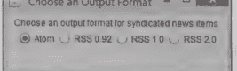

选择一个单选按钮会导致当前的选择取消。

## 组合框 (Combo Boxes)

Swing 类 `JComboBox` 可用于创建组合框，这种组件呈现一个下拉菜单，可以从该菜单中选择单个值。当组件未被使用时，菜单是隐藏的，因此在 GUI 中占用更少的空间。

### 操作组件

在调用无参数的 `JComboBox()` 构造函数创建组合框后，使用组合框的 `addItem(Object)` 方法可以将项目项添加到列表中。

创建组合框的另一种方法是调用 `JComboBox(Object[])` 并传入一个包含这些项目的数组。如果项目是文本，则使用 `String` 数组作为参数。

在组合框中，用户只能选择下拉菜单中的一个项目。通过传入参数 `true` 调用组件的 `setEditable(boolean)` 方法，它还支持文本输入。这一特性让组合框得名：以此方式配置的组件既是下拉菜单又是文本字段。

`JComboBox` 类有几个方法可以使用来控制下拉列表或组合框：

- `getItem(int)`—根据整数参数返回索引位置处列表项的文本。与数组一样，选择列表的第一个项目位于索引位置 0，第二个位于位置 1，依此类推。
- `getItemCount()`—返回列表中的项目数量。
- `getSelectedIndex()`—返回列表中当前选中项的索引位置。
- `getSelectedItem()`—返回当前选中项的文本。
- `setSelectedIndex(int)`—选择指定索引位置的项目。
- `setSelectedItem(Object)`—选择列表中的特定对象。

位于代码列表 9.6 显示的 `Format2` 应用程序重写了之前的单选按钮示例。该程序使用一个不可编辑的组合框，用户可以从中选择四个选项中的一个。

### 代码列表 9.6 `Format2.java` 的完整代码

```java
1: package com.java21days;
2:
3: import javax.swing.*;
4:
5: public class Format2 extends JFrame {
6:     String[] formats = {"Atom", "RSS 0.92", "RSS 1.0", "RSS 2.0"};
7:     JComboBox<String> comboBox = new JComboBox<>(formats);
8:
9:     public Format2() {
10:         super("Choose a Format");
11:         setSize(220, 150);
12:         setDefaultCloseOperation(JFrame.EXIT_ON_CLOSE);
13:         JPanel panel = new JPanel();
14:         JLabel formatLabel = new JLabel("Output formats:");
15:         panel.add(formatLabel);
16:         panel.add(comboBox);
17:         add(panel);
18:         setVisible(true);
19:
20:         private static void setLookAndFeel() {
21:             try {
22:                 UIManager.setLookAndFeel(
23:                         "com.sun.java.swing.plaf.nimbus.NimbusLookAndFeel"
24:                         );
25:             } catch (Exception exc) {
26:                 System.out.println(exc.getMessage());
27:             }
28:         }
29:
30:         public static void main(String[] arguments) {
31:             Format2.setLookAndFeel();
32:             Format2 ff = new Format2();
33:         }
34:     }
35: }
```

在第 6 行定义了一个字符串数组，这些字符串在第 7 行的组合框构造函数中使用。图 9.7 显示了组合框展开以便选择值。

### 图 9.7
Format2 应用程序。

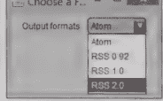

## 列表 (Lists)

今天介绍的最后一个 Swing 组件与组合框类似。由 `JList` 类表示的列表允许你从列表中选择一个或多个值。你可以使用数组或向量（类似于数组的数据结构）创建并填充列表。可以使用以下构造函数：

- `JList()`—创建一个空列表。
- `JList(Object[] array)`—创建一个包含数组的列表。
- `JList(Vector<?>)`—创建一个包含指定 `java.util.Vector` 对象的列表。

可以通过传入数组或向量调用 `setListData()` 方法填充空列表。与组合框不同，列表在用户界面中显示时显示多行。要更改此，根据项目数量调用 `setVisibleRowCount(int)`。`getSelectedValuesList()` 方法返回列表中所有选中项目的列表。此列表可以转换为 `ArrayList`。你可以使用泛型配合 `JList` 来指定对象的类。`com.java21days` 包中的 `Subscriptions` 应用程序显示了来自字符串数组的项目。

### 代码列表 9.7 `Subscriptions.java` 完整代码

```java
1: package com.java21days;
2:
3: import javax.swing.*;
4:
5: public class Subscriptions extends JFrame {
6:     String[] subs = { "Binding", "From Goodness",
7:         "Index", "Inessential", "Interingly", "Now This",
8:         "Rasterweb", "Rich", "Whole Lotta", "Workbench" };
9:     JList<String> sublist = new JList<>(subs);
10:
11:     public Subscriptions() {
12:         super("Subscriptions");
13:         setSize(150, 335);
14:         setDefaultCloseOperation(JFrame.EXIT_ON_CLOSE);
15:         JPanel panel = new JPanel();
16:         JLabel sublabel = new JLabel("RSS Subscriptions:");
17:         panel.add(sublabel);
18:         sublist.setVisibleRowCount(8);
19:         JScrollPane scroller = new JScrollPane(sublist);
20:         panel.add(scroller);
21:         add(panel);
22:         setVisible(true);
23:     }
24:
25:     private static void setLookAndFeel() {
26:         try {
27:             UIManager.setLookAndFeel(
28:                     "com.sun.java.swing.plaf.nimbus.NimbusLookAndFeel");
29:
30:         } catch (Exception exc) {
31:             System.out.println(exc.getMessage());
32:         }
33:
34:         public static void main(String[] arguments) {
35:             Subscriptions.setLookAndFeel();
36:             Subscriptions app = new Subscriptions();
37:
38:         }
39:     }
40: }
```

应用程序如图 9.8 所示。`Subscriptions` 应用程序具有一个界面，列表上方有一个标签显示了八个项目。第 19–21 行使用了滚动面板（`JScrollPane`），以便列表可以滚动到第 9 和第 10 个项目。

### 图 9.8
Subscriptions 应用程序。

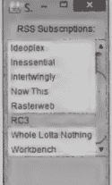

## Java 类库 (The Java Class Library)

本书的第一周致力于 Java 语言的构建基石，包括语句、表达式和运算符；以及面向对象编程 (OOP) 的组件，如方法、构造函数、类和接口。

第二周涵盖了如何使用 Java 类库通过这些基石来构建内容。作为程序员，你的大部分工作已经替你完成了，前提是你知道去哪里查找。

Java 类库包含超过 4200 个类。其中许多类在你创建的程序中都是非常有用的。

### 注意

还有其他组织制作的 Java 类库。Apache 项目拥有十多个 Java 开源项目，包括 HttpComponents，一组用于创建 Web 服务器、客户端和爬虫的类。要查看这些项目，请访问 `http://projects.apache.org`。

Oracle 在网络上提供了该库的全面文档。文档中的一个页面如图 9.9 所示。

### 图 9.9
Java 类库在线文档。

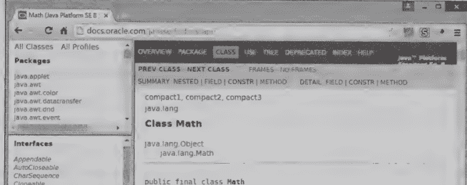

主页被分为几个帧。最大的列表是组成库的所有包，并对每个包都有简短描述。点击包名称可以加载列其所有类的页面。

库中的每个类都有其自己的文档页面。要体验如何使用此参考文档，请按照以下步骤操作：

1. 在你的网络浏览器中，加载页面 `http://docs.oracle.com/javase/8/docs/api`。
2. 向下滚动到 `java.lang` 包并点击链接。该包的页面将打开。
3. 向下滚动到 `Math` 类的链接并点击它。该类的页面将打开。
4. 找到 `random()` 方法的链接并点击它。页面将跳转到该部分。

`Math` 类描述了它的用途和所属包。通过类页面可以学习如何创建该类的对象，以及它包含哪些变量和方法。

该类有一些实用的方法，扩展了 Java 的数学能力，并在 Java 应用程序中频繁出现。其中之一是 `random()`，该方法可以产生一个 0.0 到 1.0 之间的随机双精度值。

这里有一个使用该方法的语句：

```java
double d100 = Math.random() * 100;
```


`random()` 方法产生一个从 0.0 到 1.0 之间的随机数，但不包括最大值。这是一个浮点数，因此它需要存储在 `float` 或 `double` 中。

由于这个随机数乘以了 100，结果将是 0 到 100 之间的任意数字（不包括 100）。

这里是将数字舍入到最近整数并加 1 的语句：

```
d100 = Math.floor(roll) + 1;
```

该语句使用了 `Math` 类的另一个方法 `floor()`，它将浮点数向下舍入到最近的低整数。47.52 的值会被向下舍入为 47。加 1 后，`d100` 的值变为 48。

如果没有 `Math` 类，你就必须自己创建一个类来产生随机数，而这是一项非常复杂的任务。

在 Java 类库文档中翻阅是寻找可以为你节省大量时间的类的好方法。

由于你是 Java 的初学者，你可能会发现某些文档难以理解——它们是为经验丰富的程序员编写的。但当你阅读这本书并遇到感兴趣的 Java 类时，请使用此参考文档来了解更多关于它们的信息。一个很好的开始点是查找类中的方法，每个方法都执行一项工作，查看它们接受什么参数以及返回什么值。

在接下来的五天学习 Swing 用户界面组件和类期间，请查看它们在官方文档中的页面。它们包含的方法比本书涵盖的要多得多。

## 总结

今天你开始学习 Swing，这是一个允许你的 Java 程序支持图形用户界面（GUI）的类包。

你今天使用了十多个类，创建了如按钮、标签和文本字段等界面组件。你将这些中的每一个都放入了容器中：即包括面板、框架和窗口在内的组件。

这种形式的编程可能会很复杂。Swing 代表了新 Java 程序员在学习语言时必须处理的最庞大的类包。

然而，正如你从文本区域和文本字段等组件中体验过的，Swing 组件具有许多共同的父类。这使得你更容易将知识扩展到新的组件和容器，以及你将在未来几天内将探索的 Swing 编程的其他方面。

## 问答

- 是否有方法可以更改按钮和其他组件上显示的文本字体？
- `JComponent` 类包含一个 `setFont(Font)` 方法，可以用于设置该组件显示的文本的字体。你将在第 13 天“创建 Java2D 图形”中处理 `Font` 对象、颜色以及更多图形。

## 测验

通过完成这个包含三个问题的测验来回顾今天的材料。

### 问题

- 1. 下列用户界面组件中哪个不是容器？
  A. `JScrollPane`
  B. `JTextArea`
  C. `JPanel`

- 2. 哪个组件可以放在滚动面板中？
  A. `JTextArea`
  B. `JTextField`
  C. 任何组件

- 3. 如果你在应用程序主框架（frame）上使用 `setSize()`，它出现在桌面的哪个位置？
  A. 在桌面的中心
  B. 在上次应用程序出现的位置
  C. 在桌面的左上角

### 答案

- 1. `JTextArea` 需要容器来支持滚动，但它本身不是容器。
- 2. 任何组件都可以添加到滚动面板中，但大多数组件可能不需要滚动。
- 3. 这是一个陷阱题。调用 `setSize()` 与窗口在桌面上的位置无关。你必须调用 `setBounds()` 而不是 `setSize()` 来选择框架出现的位置。

### 认证练习

以下问题是你在 Java 编程认证考试中可能会遇到的类型。请在不看今天的材料或不使用 Java 编译器测试代码的情况下回答它。

给定：

```
import javax.swing.*;

public class Display extends JFrame {

  public Display() {

    super("Display");

    // answer goes here

    JLabel hello = new JLabel("Hello");

    JPanel pane = new JPanel();

    add(hello);

    pack();

    setVisible(true);

  }

  public static void main(String[] arguments) {

    Display ds = new Display();

  }

}
```

哪条语句需要替换 `// answer goes here` 以让应用程序正常运行？

- A. `setSize(300, 200);`
- B. `setDefaultCloseOperation(JFrame.EXIT_ON_CLOSE);`
- C. 不需要语句

答案可以在 book.com 查看。

### 练习

为了扩展你对今天涵盖主题的知识，请尝试以下操作：

- 1. 创建一个具有多个 DVR 控制的应用程序：播放、停止、倒退、快进和暂停。
- 2. 创建一个带有请求用户名和密码字段的框架。

练习答案在 book.com 提供。

# 第 10 天：构建 Swing 界面

虽然计算机可以在 Linux shell 或 Windows 命令提示符等命令行环境中进行操作，但大多数计算机用户期望软件具有图形用户界面（GUI）并能通过鼠标接收输入。GUI 软件对于初学者来说可能是最具挑战性的任务之一，但正如你昨天学到的，Java 通过 Swing 简化了这一过程。

Swing 提供了以下功能：

- 常见的用户界面组件，包括按钮、文本字段、文本区域、标签、复选框、单选按钮、滚动条、列表、菜单项和滑块。
- 容器——可以用于存放其他组件（包括其他容器）的界面组件。容器包括框架、面板、菜单、菜单栏和标签页。

## Swing 特性

你昨天学习的组件和容器都是抽象窗口工具（AWT，原始 Java GUI 编程包）类的 Swing 版本。Swing 提供了许多新组件，包括记忆符号、工具提示（`ToolTips`）和标准对话框。

## 标准对话框

`JOptionPane` 类提供了几种方法来创建标准对话框：用于提问、警告用户或提供重要信息的小窗口。图 10.1 显示了一个示例。

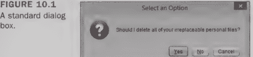

你一定见过像图 10.1 所示的对话框。当系统崩溃时，会出现对话框来告知坏消息。当你删除文件时，会弹出对话框确认你是否真的这样做。

这些窗口是与用户通信的有效方式，无需创建一个新类来表示窗口、向其添加组件并编写接收输入的事件处理方法。在使用 `JOptionPane` 提供的标准对话框时，所有这些任务都会自动处理。

标准对话框的四类如下：

- ConfirmDialog——提问，带有是、否和取消响应的按钮。
- InputDialog——提示文本输入。
- MessageDialog——显示消息。
- OptionDialog——包含了其他三种对话框类型。

## 确认对话框

创建一个“是/否/取消”对话框最简单的方法是调用 `showConfirmDialog(Component, Object)` 方法。`Component` 参数指定作为对话框父级的容器，它决定了对话窗口显示的位置。如果使用 `null` 代替容器，或者容器不是 `JFrame` 对象，则对话框将居中显示在屏幕上。

第二个参数 `Object` 可以是一个字符串、组件或一个 `Icon` 对象。如果是字符串，则该文本将显示在对话框中；如果是组件或 `Icon`，则该对象将代替文本消息显示。

该方法返回五个可能的整数值之一，每个值都是 `JOptionPane` 的一个类常量：`YES_OPTION`、`NO_OPTION`、`CANCEL_OPTION`、`OK_OPTION` 或 `CLOSED_OPTION`。

以下示例使用了带有文本消息的确认对话框，并将响应存储在变量中：

```
int response = JOptionPane.showConfirmDialog(null,
    "Should I delete all of your irreplaceable files?");
```

该对话框如图 10.1 所示。

另一个方法为对话框提供了更多选项：`showConfirmDialog(Component, Object, String, int, int)`。前两个参数与其他 `showConfirmDialog()` 方法中的参数相同。后三个参数如下：

- 显示在对话框标题栏中的字符串。
- 一个指示将显示哪些选项按钮的整数。它应该等于类常量 `YES_NO_CANCEL_OPTION` 或 `YES_NO_OPTION` 之一。
- 一个描述对话框类型的整数，使用类常量 `ERROR_MESSAGE`、`INFORMATION_MESSAGE`、`PLAIN_MESSAGE`、`QUESTION_MESSAGE` 或 `WARNING_MESSAGE`。（此参数用于确定在对话框中消息旁绘制何种图标）。

例如：

```
int response = JOptionPane.showConfirmDialog(null,
    "Error reading file. Want to try again?",
    "File Input Error",
    JOptionPane.YES_NO_OPTION,
    JOptionPane.ERROR_MESSAGE);
```

图 10.2 显示了生成的对话框。

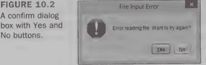

### 输入对话框

输入对话框用于提问并使用文本字段来存储响应。图 10.3 显示了一个示例。

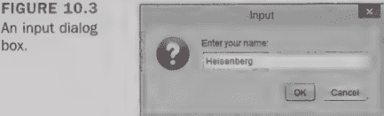

创建输入对话框最简单的方法是调用 `showInputDialog(Component, Object)` 方法。其参数是父组件以及要显示在框中的字符串、组件或图标。

`showInputDialog` 方法调用返回一个表示用户响应的字符串。以下语句创建如图 10.3 所示的输入对话框：

```
String response = JOptionPane.showInputDialog(null,
    "Enter your name:");
```

你也可以使用 `showInputDialog(Component, Object, String, int)` 方法创建输入对话框。前两个参数与较短的方法调用相同，后两个参数如下：

- 显示在对话框标题栏中的标题
- 五个描述对话框类型的类之一：`ERROR_MESSAGE`、`INFORMATION_MESSAGE`、`PLAIN_MESSAGE`、`QUESTION_MESSAGE` 或 `WARNING_MESSAGE`

## Swing 特性

以下语句使用此方法创建一个输入对话框：

```
String response = JOptionPane.showInputDialog(null,
    "What is your code?",
    "Enter ZIP Code",
    JOptionPane.QUESTION_MESSAGE);
```

### 消息对话框

消息对话框是一个显示信息的简单窗口，如图 10.4 所示。

图 10.4


可以通过调用 `showMessageDialog(Component, Object)` 创建消息对话框。与其他对话框一样，其参数是父组件以及要显示的字符串、组件或图标。与其他对话框不同，消息对话框不返回响应。以下语句创建了如图 10.4 所示的消息对话框：

```
JOptionPane.showMessageDialog(null,
    "The program has been installed.");
```

你也可以通过调用 `showMessageDialog(Component, Object, String, int)` 创建消息对话框。其用法与 `showInputDialog()` 方法相同，具有相同的参数，不同的是 `showInputDialog()` 不返回结果。以下语句使用此方法创建了一个消息对话框：

```
JOptionPane.showMessageDialog(null,
    "An asteroid has destroyed the Earth.",
    "Asteroid Destruction",
    JOptionPane.WARNING_MESSAGE);
```

### 选项对话框

对话框中最复杂的是选项对话框，它结合了所有其他对话框的功能。可以通过 `showOptionDialog(Component, Object, String, int, int, Icon, Object[])` 方法创建。该方法的参数如下：

- 对话框的父组件
- 要显示的文本、图标或组件
- 对话框类型，使用类常量 `YES_NO_OPTION` 或 `YES_NO_CANCEL_OPTION`，如果使用其他按钮，则使用值 0
- 要显示的图标，使用类常量 `ERROR_MESSAGE`、`INFORMATION_MESSAGE`、`PLAIN_MESSAGE`、`QUESTION_MESSAGE` 或 `WARNING_MESSAGE`，如果不使用其中任何一个，则使用值 0
- 用于代替前一个参数中图标之一的图标
- 如果不使用 `YES_NO_OPTION` 和 `YES_NO_CANCEL_OPTION`，则持有对话框中选项的对象数组
- 如果不使用 `YES_NO_OPTION` 和 `YES_NO_CANCEL_OPTION`，则表示默认选择的对象

最后两个参数为对话框提供了广泛的可能。你可以创建一个字符串数组，其中包含要在框上显示的每个按钮的文本。以下示例创建了一个选项对话框，它使用 `String` 对象数组作为框中的选项，并将 `gender[2]` 设置为默认选择：

```
String[] gender = {
    "Male",
    "Female",
    "None of Business"
};

int response = JOptionPane.showOptionDialog(null,
    "What is your gender?",
    "Gender",
    0,
    JOptionPane.INFORMATION_MESSAGE,
    null,
    gender,
    gender[2]);

System.out.println("You chose " + gender[response]);
```

图 10.5 显示了生成的选项对话框。

图 10.5
选项对话框。


## 使用对话框

下一个项目展示了一系列对话框。`FeedInfo` 程序使用对话框从用户获取信息，并将这些信息放入主窗口的文本字段中。

Listing 10.1 Feed.java 的完整文本

```
1: package com.java2days;
2:
3: import java.awt.GridLayout;
4: import java.awt.event.*;
5: import javax.swing.*;
6:
7: public class Feed extends JFrame {
8:     private JLabel nameLabel = new JLabel("Name: ",
9:         SwingConstants.RIGHT);
10:    private JTextField nameField;
11:    private JLabel urlLabel = new JLabel("URL: ",
12:        SwingConstants.RIGHT);
13:    private JTextField urlField;
14:    private JLabel typeLabel = new JLabel("Type: ",
15:        SwingConstants.RIGHT);
16:    private JTextField typeField;
17:
18:    public FeedInfo() {
19:        super("Feed Information");
20:        setSize(400, 145);
21:        setDefaultCloseOperation(JFrame.EXIT_ON_CLOSE);
22:        setLayout(null);
23:        // Site name
24:        String response = JOptionPane.showInputDialog(null,
25:                                            "Enter the site name: ");
26:        name = new JTextField(response, 20);
27:
28:        // Site address
29:        String response2 = JOptionPane.showInputDialog(null,
30:        "Enter the address:");
31:        url = new JTextField(response2, 20);
32:
33:        // Site type
34:        String[] choices = {"Personal", "Commercial", "Unknown"};
```


```java
35:        int response3 = JOptionPane.showInputDialog(null,
36:        "What type of site is it?",
37:        "Site Type",
38:        0,
39:        JOptionPane.QUESTION_MESSAGE,
40:        null,
41:        choices[0]);
42:        type = new JTextField(choices[response3], 20);
43:
44:        add(nameLabel);
45:        add(name);
46:        add(urlLabel);
47:        add(url);
48:        add(typeLabel);
49:        add(type);
50:        setLookAndFeel();
51:        setVisible(true);
52:    }
53:
54:    private void setLookAndFeel() {
55:        try {
56:            UIManager.setLookAndFeel(
57:                "com.sun.java.swing.plaf.Nimbus.NimbusLookAndFeel");
58:            );
59:            SwingUtilities.updateComponentTreeUI(this);
60:        } catch (Exception e) {
61:            System.err.println("Couldn't use the system "
62:                + "look and feel: " + e);
63:        }
64:    }
65:
66:    public static void main(String[] arguments) {
67:        FeedInfo frame = new FeedInfo();
68:    }
69:}
```

在填充了每个对话框的字段后，查看应用程序的主窗口，如图 10.6 所示。三个文本字段具有由对话框提供的值。

## Swing 特性 293

图 10.6
FeedInfo 应用的主窗口。


该应用程序的大部分是样板代码，可以用于任何 Swing 应用程序。以下几行与对话框有关：

- 在第 24–26 行中，一个输入对话框要求用户输入站点名称。该名称被用于 `JTextField` 对象的构造函数，并放置在文本字段中。
- 在第 29–31 行中，一个类似的输入对话框请求站点地址，该地址被用于另一个 `JTextField` 对象的构造函数。
- 在第 34 行中，创建了一个名为 `choices` 的 `String` 对象数组，并为三个元素赋予了值。
- 在第 35–42 行中，一个选项对话框请求站点类型。`choices` 数组是第 7 个元素，它使用了对话框上的三个按钮，标签为字符串：“Personal”（个人）、“Commercial”（商业）和“Unknown”（未知）。最后一个参数 `choices[0]` 将数组的第一个元素指定为对话框中的默认选择。
- 第 43 行包含对选项对话框的响应——一个标识所选数组元素的整数。它存储在一个名为 `type` 的 `JTextField` 组件中。

外观和感觉是在第 56–66 行的 `setLookAndFeel()` 方法中建立的，它在框架构造方法的开始和结束处调用。由于你在构造函数中打开了多个对话框，必须在打开它们之前设置外观和感觉。

此类指定外观和感觉的方式与之前的示例以及第 9 天“使用 Swing”中的方式不同。`setLookAndFeel()` 方法在第 22 行的构造函数内部调用。为了确保用户界面中的所有组件都反映该外观和感觉，调用了 `SwingUtilities` 类方法 `SwingUtilities.updateComponentTreeUI(Component)`，并将其作为参数，指向正在创建的 `FeedInfo` 对象。

## 滑块

滑块在 Swing 中通过 `JSlider` 类实现，它允许用户通过在最小值和最大值范围内滑动控件来设置数字。在许多情况下，滑块可以用于数值输入而非文本字段。这样做的优点是将输入限制在可接受的值范围内。

图 10.7 显示了一个 `JSlider` 组件。

图 10.7
一个 `JSlider` 组件。


滑块默认是水平的。你可以使用 `SwingConstants` 接口中的常量显式设置方向：`HORIZONTAL`（水平）或 `VERTICAL`（垂直）。

你可以使用以下构造函数：

- `JSlider(int)`——指定方向、最小值和最大值。
- `JSlider(int, int)`——指定最小值和最大值。
- `JSlider(int, int, int)`——指定方向、最小值和最大值。
- `JSlider(int, int, int, int)`——指定方向、最小值、最大值和当前值。

滑块可以调用以下方法：

- `setMajorTickSpacing(int n)`——设置主刻度间距。
- `setMinorTickSpacing(int n)`——设置次刻度间距。
- `setPaintTicks(boolean b)`——是否绘制刻度线。
- `setPaintLabels(boolean b)`——是否绘制刻度标签。

Listing 10.2 包含了 `Slider.java` 源码：

```java
1: package com.java2days;
2:
3: import javax.swing.*;
4:
5: public class Slider extends JFrame {
6:
7:   Slider() {
8:     super("Slider");
9:     setDefaultCloseOperation(JFrame.EXIT_ON_CLOSE);
10:    setLookAndFeel();
11:    Slider pick = new Slider(Slider.HORIZONTAL, 30, 5);
12:    pick.setMajorTickSpacing(10);
13:    pick.setMinorTickSpacing(1);
14:    pick.setPaintTicks(true);
15:    pick.setPaintLabels(true);
16:    add(pick);
17:    pack();
18:    setVisible(true);
19:  }
20:
21:  private void setLookAndFeel() {
22:    try {
23:      UIManager.setLookAndFeel("com.sun.swing.plaf.Nimbus");
24:      SwingUtilities.updateComponentTreeUI(this);
25:    } catch (Exception e) {
26:      System.err.println("Couldn't use look and feel: " + e);
27:    }
28:  }
29: 
30:  public static void main(String[] args) {
31:    Slider frame = new Slider();
32:  }
33: }
```

## Swing 特性 295

## 第 10 天：构建 Swing 界面

## 滚动面板

默认情况下，滚动面板不显示滚动条，除非需要。如果面板内部的组件不比面板大，滚动条就不会出现。对于文本区域等组件，组件的大小可能会随着程序的使用而增大，滚动条会在需要时出现，在不需要时消失。

为了覆盖这种行为，你可以在创建 `JScrollPane` 时为它设置策略，使用 `JScrollPane` 接口中的几个常量：

* `HORIZONTAL_SCROLLBAR_ALWAYS`
* `HORIZONTAL_SCROLLBAR_AS_NEEDED`
* `HORIZONTAL_SCROLLBAR_NEVER`
* `VERTICAL_SCROLLBAR_ALWAYS`
* `VERTICAL_SCROLLBAR_AS_NEEDED`
* `VERTICAL_SCROLLBAR_NEVER`

这些类常量被用于 `JScrollPane(Object, int, int)` 构造函数，该构造函数指定面板中的组件、垂直滚动条策略和水平滚动条策略。

## 工具栏

工具栏在 Swing 中通过 `JToolBar` 类实现，它是一个将多个组件分组成行或列的容器。这些组件通常是按钮。

工具栏是一组最常用程序选项的行或列。工具栏通常包含按钮和列表，可以作为使用拉取菜单或快捷键的替代方案。

`JToolBar` 构造器方法包括：

- `JToolBar()`——创建一个新的工具栏
- `JToolBar(int)`——创建一个具有指定方向的新工具栏

在创建了工具栏后，您可以使用工具栏的 `add(Object)` 方法向其添加组件，其中 `Object` 代表要放置在工具栏上的组件。

许多使用工具栏的程序允许用户移动工具栏。这些被称为 `dockable toolbars`（可停靠工具栏），因为你可以将它们停靠在屏幕边缘，就像停靠船一样。Swing 工具栏也可以停靠在一个新窗口中，与原始窗口分离。

为了获得最佳效果，应该使用 `BorderLayout` 类在容器中编排一个可停靠的 `JToolBar` 组件，这是一种被称为布局管理器的用户界面。边界布局将容器划分为五个区域：北（north）、南（south）、东（east）、西（west）和中心（center）。每个方向组件都会占据它所需的空间，其余空间分配给中心区域。

工具栏应该放置在边界布局的一个方向区域内。布局中唯一可以填充的另一个区域是中心。（你将在明天的课程——第 11 天“在用户界面上排列组件”中学习边界布局等布局管理器。）

图 10.8 显示了一个可停靠工具栏占据了边界布局的南部区域。中心区域放置了一个文本区域。

图 10.8
一个可停靠工具栏和一个文本区域。


列表 10.3 显示了生成此应用程序的源代码。

### 列表 10.3 FeedBar.java 的完整文本


# 第 10 天：构建 Swing 界面

## FeedBar 示例

```java
package com.java21days;

import java.awt.*;
import javax.swing.*;

public class FeedBar extends JFrame {

    public FeedBar() {
        super("FeedBar");
        setDefaultCloseOperation(JFrame.EXIT_ON_CLOSE);
        setLookAndFeel();

        // 创建图标
        ImageIcon loadIcon = new ImageIcon("load.gif");
        ImageIcon saveIcon = new ImageIcon("save.gif");
        ImageIcon subIcon = new ImageIcon("subscribe.gif");
        ImageIcon unsubIcon = new ImageIcon("unsubscribe.gif");

        // 创建按钮
        JButton load = new JButton("Load", loadIcon);
        JButton save = new JButton("Save", saveIcon);
        JButton sub = new JButton("Subscribe", subIcon);
        JButton unsub = new JButton("Unsubscribe", unsubIcon);

        // 添加到工具栏
        JToolBar bar = new JToolBar();
        bar.add(load);
        bar.add(save);
        bar.add(sub);
        bar.add(unsub);

        // 准备用户界面
        JTextArea edit = new JTextArea(8, 40);
        JScrollPane scroll = new JScrollPane(edit);
        BorderLayout bord = new BorderLayout();
        setLayout(bord);
        add("North", bar);
        add("Center", scroll);
        pack();
        setVisible(true);
    }

    private void setLookAndFeel() {
        try {
            UIManager.setLookAndFeel(
                "com.sun.java.swing.plaf.nimbus.NimbusLookAndFeel"
            );
            SwingUtilities.updateComponentTreeUI(this);
        } catch (Exception e) {
            System.err.println("Couldn't use the system " +
                "look and feel: " + e);
        }
    }

    public static void main(String[] arguments) {
        FeedBar frame = new FeedBar();
    }
}
```

此应用程序使用四个图像来表示按钮上的图形——这些图形与 `IconFrame` 项目中使用的相同。如果你还没有下载这些图像，可以在该书的官方网站 `http://www.java21days.com` 的第 10 天页面找到。你也可以使用自己计算机上的图形。

第 13-16 行通过四个图形创建了四个 `ImageIcon` 对象，并用它们在第 18-21 行中创建按钮。第 23 行创建了一个 `JToolBar`，并在第 24-27 行中将其添加其中。工具栏位于框架的顶部，但它是移动的。可以通过句柄抓取组件——即图 10.8 中 `Load` 按钮左侧的区域。在窗口内拖动它，可以将其停靠在应用程序的不同边缘。当你松开工具栏时，应用程序将使用边界布局进行重新排列。你也可以将工具栏拖到窗口外。

## 进度条

进度条是显示剩余时间的组件。

进度条在 Swing 中实现。图 10.9 显示了一个进度条。


### Swing 特性

考虑一个由 `JProgressBar` 类构成的程序。构造器方法包括：

- `JProgressBar()`——创建一个新的进度条
- `JProgressBar(int, int)`——创建一个具有指定方向的新进度条
- `JProgressBar(int, int, int)`——创建一个具有指定方向的新进度条

要更新进度条，你需要调用它的 `setValue(int)` 方法并传入一个值。

进度条通常包含一个标签来识别图形。你可以通过调用带有 `false` 参数的 `setStringPainted(boolean)` 方法将其关闭。

### 列表 10.4 ProgressMonitor.java 的完整文本

```java
package com.java21days;

import java.awt.*;
import javax.swing.*;

public class ProgressMonitor extends JFrame {

    JProgressBar current;
    JTextArea out;
    JButton find;
    int num = 0;

    public ProgressMonitor() {
        super("Progress Monitor");
        setDefaultCloseOperation(JFrame.EXIT_ON_CLOSE);
        setLookAndFeel();
        setSize(205, 68);
        setLayout(new FlowLayout());
        current = new JProgressBar(0, 2000);
        current.setValue(0);
        current.setStringPainted(true);
        add(current);
    }

    public void iterate(int num) {
        while (num < 2000) {
            current.setValue(num);
            try {
                Thread.sleep(1000);
            } catch (InterruptedException e) {
                num += 95;
            }
        }
    }

    private void setLookAndFeel() {
        try {
            UIManager.setLookAndFeel("com.sun.java.swing.plaf.nimbus.NimbusLookAndFeel");
        } catch (Exception e) {
            System.err.println("Couldn't use the system " + e);
        }
    }

    public static void main(String[] arguments) {
        ProgressMonitor frame = new ProgressMonitor();
        frame.setVisible(true);
        frame.iterate(0);
    }
}
```

`ProgressMonitor` 程序使用进度条来跟踪 `num` 变量的值。进度条在第 19 行创建，最小值为 0，最大值为 2,000。

第 25–33 行中的 `iterate()` 方法在 `num` 小于 2,000 时循环，每次迭代将 `num` 增加 95。进度条的 `setValue()` 方法在循环的第 27 行被调用，并将 `num` 作为参数，使其在绘制进度时使用该值。

当程序需要运行几秒钟时，使用进度条是使程序更加友好的方法。软件用户喜欢进度条，因为他们可以通过此估算某任务还需要多久。

进度条还提供了另一个关键信息：程序仍在运行且没有崩溃的证明。

## 菜单

增强框架可用性的一种方法是给它提供一个菜单栏，即一组用于执行任务的抽拉式菜单。菜单通常与你通过按钮和其他界面组件可以完成的任务重复，为用户提供了两种完成工作的方式。

Java 中的菜单由三个协同工作的组件支持：

- `JMenuItem`——菜单中的一个项
- `JMenu`——下拉菜单，包含一个或多个 `JMenuItem` 组件、其他界面组件以及分隔符（显示在项目之间的线条）
- `JMenuBar`——一个容器，持有一个或多个 `JMenu` 组件并显示它们的名称

`JMenuItem` 组件就像一个按钮，并可以使用与 `JButton` 组件相同的构造器方法进行设置。调用 `JMenuItem(String)` 创建文本项，调用 `JMenuItem(Icon)` 创建显示图形文件的项，或调用 `JMenuItem(String, Icon)` 同时创建两者。

以下语句创建了七个菜单项：

```java
JMenuItem j1 = new JMenuItem("Open");
JMenuItem j2 = new JMenuItem("Save");
JMenuItem j3 = new JMenuItem("Save as Template");
JMenuItem j4 = new JMenuItem("Page Setup");
JMenuItem j5 = new JMenuItem("Print");
JMenuItem j6 = new JMenuItem("Use as Default Message Style");
JMenuItem j7 = new JMenuItem("Close");
```

`JMenu` 容器持有下拉菜单的所有菜单项。要创建它，调用 `JMenu(String)` 构造器并将菜单名称作为参数。该名称将出现在菜单栏上。

在你创建 `JMenu` 后，调用其 `add(JMenuItem)` 向其添加菜单项。新项会被放置在菜单的末尾。

你放在菜单上的项并不非要是菜单项。调用 `add(Component)` 方法并将用户界面组件作为参数。通常出现在菜单上的项是复选框（Java 中的 `JCheckBox` 类）。

要在菜单末尾添加线条分隔符，调用 `addSeparator()` 方法。分隔符通常用于在视觉上对菜单上的相关项目进行分组。

你还可以向菜单添加文本作为标签。调用 `add(String)` 方法并将文本作为参数。

使用上一个示例中的七个菜单项，以下语句创建了一个菜单并填充了所有这些项以及三个分隔符：

```java
JMenu m1 = new JMenu("File");
m1.add(j1);
m1.add(j2);
m1.add(j3);
m1.addSeparator();
m1.add(j4);
m1.add(j5);
m1.addSeparator();
m1.add(j6);
m1.addSeparator();
m1.add(j7);
```

`JMenuBar` 容器持有一个或多个 `JMenu` 容器并显示它们的每一个名称。菜单栏最常见的地方位于应用程序标题栏的正下方。

### 创建菜单栏

要创建一个菜单栏，调用不带参数的 `JMenuBar()` 构造器方法。通过调用其 `add(JMenu)` 方法在末尾添加菜单。

在你创建了所有项、将它们添加到菜单中后，就可以将它们添加到框架中。调用框架的 `setJMenuBar(JMenuBar)` 方法。

以下语句通过创建菜单栏、添加菜单并将其放在名为 `gui` 的框架上完成了当前示例：

```java
JMenuBar bar = new JMenuBar();
bar.add(m1);
gui.setJMenuBar(bar);
```

图 10.10 显示了它的样子：一个空的菜单栏。

尽管你可以打开和关闭菜单并选择项目，但没有任何反应。将在下一章学习如何接收该组件的输入。

### 列表 10.5 FeedBar.java（扩展版本）

```java
package com.java;

import java.awt.*;
import javax.swing.*;

public class FeedBar extends JFrame {

    public FeedBar() {
        super("FeedBar");
        setDefaultCloseOperation(JFrame.EXIT_ON_CLOSE);

        // create icons
        ImageIcon loadIcon = new ImageIcon("load.gif");
        ImageIcon saveIcon = new ImageIcon("save.gif");
        ImageIcon subIcon = new ImageIcon("subscribe.gif");
        ImageIcon unsubIcon = new ImageIcon("unsubscribe.gif");

        // create buttons
        JButton load = new JButton("Load", loadIcon);
        JButton save = new JButton("Save", saveIcon);
        JButton sub = new JButton("Subscribe", subIcon);
        JButton unsub = new JButton("Unsubscribe", unsubIcon);

        // add buttons to toolbar
        JToolBar bar = new JToolBar();
        bar.add(load);
        bar.add(save);
        bar.add(sub);
        bar.add(unsub);

        // create menu
        JMenuItem j1 = new JMenuItem("Load");
        JMenuItem j2 = new JMenuItem("Save");
        JMenuItem j3 = new JMenuItem("Subscribe");
        JMenuItem j4 = new JMenuItem("Unsubscribe");
        JMenuBar menubar = new JMenuBar();
        JMenu menu = new JMenu("File");
        menu.add(j1);
        menu.add(j2);
        menu.addSeparator();
        menu.add(j3);
        menu.add(j4);
        menubar.add(menu);

        // prepare user interface
        JTextArea edit = new JTextArea(8, 40);
        JScrollPane scroll = new JScrollPane(edit);
        BorderLayout layout = new BorderLayout();
        setLayout(layout);
        add("North", bar);
        add("Center", scroll);
        setJMenuBar(menubar);
        setVisible(true);
    }
}
```


```java
private void setLookAndFeel() {
    try {
        UIManager.setLookAndFeel(
            "com.java.swing.plaf.nimbus.NimbusLookAndFeel"
        );
        SwingUtilities.updateComponentTreeUI(this);
    } catch (Exception e) {
        System.err.println("Couldn't use the system "
            + "look and feel: " + e);
    }
}
```

```java
62:   }
63:   }
64:   public static void main(String[] arguments) {
65:     FeedBar2 frame = new FeedBar2();
66:
67:
68: }
```

该应用程序在第 29–40 行创建菜单栏并在第 48 行将其添加到框架中。图 10.10 显示了应用程序的运行。

## 选项卡

选项卡是一组堆叠的面板，一次只能查看一个面板，它们在 Swing 中通过 `JTabbedPane` 类实现。

要查看面板，点击包含其名称的选项卡。选项卡可以水平排列在组件的顶部或底部，也可以垂直排列在左侧或右侧。

选项卡通过以下三个构造器方法创建：

- `JTabbedPane()`—在顶部创建一个不滚动的水平选项卡面板。
- `JTabbedPane(int)`—创建一个不滚动且具有指定位置的选项卡面板。
- `JTabbedPane(int, int)`—创建一个具有指定位置（第一个参数）和滚动策略（第二个参数）的选项卡面板。

选项卡的布局是其选项卡相对于面板显示的位置。使用四个类变量之一作为构造器的参数：`JTabbedPane.TOP`、`JTabbedPane.BOTTOM`、`JTabbedPane.LEFT`、`JTabbedPane.RIGHT`。

滚动策略决定了当选项卡数量超过界面承载量时如何显示选项卡。不滚动的选项卡将选项卡显示在单独行，可以使用 `JTabbedPane.WRAP_LAYOUT` 类变量进行设置。可滚动的选项卡会在选项卡旁边显示滚动箭头。这可以通过 `JTabbedPane.SCROLL_LAYOUT` 设置。

在创建选项卡面板后，可以通过调用面板的 `addTab(String, Component)` 方法向其添加组件。`String` 参数将构成标签上的一个选项卡。第二个参数虽然常见，但为了此目的使用 `JPanel` 对象并非必须。

# 第 10 天：构建 Swing 界面

列表 10.6 中的 TabPanels 显示了一个带有五个标签页的面板，每个标签页都持有其所有面板。

## 列表 10.6 TabPanels.java 的完整文本

```java
1: package com.java21days;
2:
3: import java.awt.*;
4: import javax.swing.*;
5:
6: public class TabPanels extends JFrame {
7:
8:     public TabPanels() {
9:         super("Tabbed Panes");
10:        setDefaultCloseOperation(JFrame.EXIT_ON_CLOSE);
11:        setLookAndFeel();
12:        setSize(480, 218);
13:        JPanel mainSettings = new JPanel();
14:        JPanel advancedSettings = new JPanel();
15:        JPanel privacySettings = new JPanel();
16:        JPanel emailSettings = new JPanel();
17:        JPanel securitySettings = new JPanel();
18:        JTabbedPane tabs = new JTabbedPane();
19:        tabs.addTab("Main", mainSettings);
20:        tabs.addTab("Advanced", advancedSettings);
21:        tabs.addTab("Privacy", privacySettings);
22:        tabs.addTab("E-mail", emailSettings);
23:        tabs.addTab("Security", securitySettings);
24:        add(tabs);
25:        setVisible(true);
26:    }
27:
28:    private void setLookAndFeel() {
29:        try {
30:            UIManager.setLookAndFeel(
31:                "com.sun.java.swing.plaf.nimbus.NimbusLookAndFeel"
32:            );
33:            SwingUtilities.updateComponentTreeUI(this);
34:        } catch (Exception e) {
35:            System.err.println("Couldn't use the system "
36:                + " look and feel: " + e);
37:        }
39:    }
40:
41:    public static void main(String[] arguments) {
42:        TabPanels frame = new TabPanels();
43:    }
}
```

## 总结

在第 13–17 行创建了五个面板。创建了一个标签页面板容器，然后在第 18–23 行将面板添加到每个标签页中。每个面板都可以持有它自己的用户界面组件。

图 10.11 显示了应用程序的运行情况。

图 10.11

带有五个标签页的标签页面板容器。

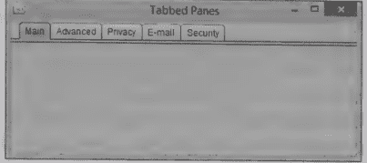

> **注意**
>
> `JTabbedPane` 构造函数中使用的 `TOP`、`BOTTOM`、`LEFT` 和 `RIGHT` 常量是 `javax.swing` 包中 `SwingConstants` 接口的一部分。该接口包含一组整数常量，有助于组件的定位和对齐。

## 总结

你现在已经了解了如何使用 Swing 包中的组件在 Java 应用程序窗口上绘制用户界面。

Swing 包含了许多你在程序中可能会看到的按钮、栏、列表和字段的类。它还包含了更高级的组件，例如滑块、对话框、进度条和菜单栏。你通过创建其类的实例并将其作为框架添加到容器中来实现组件。你使用容器的 `add()` 方法或特定容器的类似方法，例如标签页面板的 `addTab()` 方法。

今天，你开发了组件并将它们添加到界面中。在接下来的两天里，你将学习使图形界面变得可用的所需的两项任务。你将看到如何排列组件以形成一个完整的界面，以及如何通过这些组件接收用户的输入。

Swing 提供的界面组件比今天和昨天涵盖的要多得多。访问 Oracle 的 Javadoc 网站 `http://docs.oracle.com/javase/8/docs/api` 并点击 `javax.swing` 包链接，以进一步探索这些类。

# 问答

**问：可以在不使用 Swing 的情况下创建应用程序吗？**

当然可以。Swing 仅仅是抽象窗口工具包（Abstract Windowing Toolkit, AWT）的扩展，因此你可以只使用 AWT 类来设计界面并接收用户输入。但 Swing 的功能与 AWT 提供的功能相比没有可比性。通过 Swing，你可以使用更多的组件，以更复杂的方式控制它们，并依靠更好的性能和更高的可靠性。

Java 包含一个 Swing 的替代方案称为 JavaFX，其原始设计目标是在语言的未来版本中替换它。JavaFX 设计用于创建桌面应用程序、移动应用程序和富互联网应用程序（RIA）。JavaFX 包含了它自己的用户界面组件，以及对动画、3D 图形和 HTML 5 的支持。Android 在 Java 移动开发中的流行削弱了 JavaFX 的某些理由，因此 Swing 将继续是 Java 中最广泛实现的 GUI 平台。

其他用户界面库也扩展或与 Swing 竞争。最流行的之一是标准控件工具包（Standard Widget Toolkit, SWT），由 Eclipse 项目创建的开源 GUI 库。SWT 提供了外观和行为上像每个操作系统提供的界面组件的组件。欲需更多信息，请访问 `www.eclipse.org/swt`。

**问：在 Slider 应用程序中，`pack()` 语句的作用是什么？**

每个界面组件都有一个首选大小，尽管这个大小会被用于在容器内排列组件的布局管理器忽略。调用框架的 `pack()` 方法会调整其大小以适应其组件。

**问：当我尝试创建一个标签页面板时，只显示了标签，我该怎么办？**

你必须使用 `addTab()` 方法将面板添加到标签页面板中。

# 测验

1. 哪个界面组件在程序是常见的？
   A. 滑块
   B. 进度条
   C. 对话框

2. 哪个包包含按钮？
   A. `java.awt`
   B. `javax.swing`
   C. 以上

3. 哪个界面组件可以移动？
   A. `JSlider`
   B. `ToolBar`
   C. 以上

### 答案

1. 进度条在显示活动进度时非常有用。
2. Swing 包含了这些组件。
3. 工具栏可以移动到顶部、右侧或底部。

# 认证练习

是你预计在认证考试中遇到的问题。给定：

```java
import java.awt.*;
import javax.swing.*;

public class AskFrame extends JFrame {
    public AskFrame() {
        setDefaultCloseOperation(JFrame.EXIT_ON_CLOSE);
        JSlider value = new JSlider(0, 255, 100);
        add(value);
        setSize(450, 150);
        setVisible(true);
    }

    public static void main(String[] arguments) {
        AskFrame af = new AskFrame();
    }
}
```

当你尝试编译并运行此代码会发生什么？

A. 编译无错误且运行正常。
B. 编译无错误但不显示任何内容。
C. 因为 `super` 语句无法编译。
D. 因为 `add()` 语句无法编译。

# 练习

为了扩展你今天学的知识，请尝试：

1. 创建一个输入对话框，用于设置加载对话框的框架的标题。
2. 创建 `ProgressMonitor` 应用程序的修改版本，在文本字段中显示变量 `num` 的值。

# 第 11 天：在用户界面上排列组件

如果设计图形用户界面（GUI）比作绘画，目前你只能产生抽象主义艺术。你可以把组件放在界面上，但无法控制它们的位置。

要在 Java 中排列组件，你必须使用一组被称为布局管理器的类。

今天，你将学习如何使用布局管理器来排列组件。你将利用 Java 图形用户界面能力的灵活性，这些能力被设计用于支持该语言的许多平台上呈现。

你还将学习如何让多个管理器在同一个界面上工作。这种方法适用于当一个布局管理器不适合你寻求设计的精确界面时的情况。

## 基础界面布局

正如你昨天学到的，用 Swing 设计的 GUI 是流动的。调整窗口大小可能会对你的界面造成破坏，因为组件会移动到容器中你可能并未预料的位置。

这种流动性是 Java 支持不同平台的必要部分，因为每个平台在显示按钮、滚动条等用户界面的其他部分时存在细微的差异。

在某些编程语言中，组件在窗口上的位置是由其 (x,y) 坐标精确定义的。某些 Java 开发工具允许通过使用它们自己的窗口类对界面进行类似的控制（而且在 Java 中也有方法可以实现这一点）。

使用 Swing 时，程序员可以通过布局管理器来获得对界面布局的控制权。

Swing 的平台无关性提供了灵活性，但代价是性能较慢，且用户界面的外观和感受与操作系统的原生外观和感受并不完全匹配。

## 布局界面

布局管理器决定了组件在被添加到容器时的排列方式。

面板的默认布局管理器是 `FlowLayout` 类。该类允许组件按照它们被添加到容器的顺序从左到右流动。当没有更多空间时，新的一行组件将立即在第一行下方开始，并继续从左到右排序。

Java 包含了一系列通用布局管理器：`BorderLayout`、`BoxLayout`、`CardLayout`、`FlowLayout` 和 `GridLayout`。要为容器创建一个布局管理器，首先调用其构造函数创建该类的实例，例如所示：

```java
FlowLayout flo = new FlowLayout();
```

在创建布局管理器之后，使用容器的 `setLayout()` 方法将其指定为容器的布局管理器。必须在任何组件添加到容器之前设置布局管理器。如果没有指定布局管理器，将使用容器的默认布局。面板的默认布局是 `FlowLayout`，框架的默认布局是 `BorderLayout`。

## 基础界面布局

以下语句表示使用布局管理器控制添加到框架中的所有组件排列的框架的起点：

```java
import java.awt.*;
import javax.swing.*;

public class Starter extends JFrame {

    public Starter() {
        super("Example Frame");
        FlowLayout manager = new FlowLayout();
        setLayout(manager);
        // 在此处添加组件
    }

}
```

设置布局管理器后，你就可以开始向它管理的容器中添加组件了。对于某些布局管理器（如 `FlowLayout`），添加组件的顺序是非常重要的。当你与每个管理器一起工作时就会看到这一点。

### 流式布局

`java.awt` 包中的 `FlowLayout` 类是最简单的布局管理器。它排列组件的方式与英文单词在页面上的排列方式相同——即从左到右，直到右边缘没有更多空间，然后移动到下一行的左侧边缘。

默认情况下，当你使用不带参数的 `FlowLayout()` 构造函数时，每行的组件都是居中的。如果你希望组件沿容器的左边缘或右边缘对齐，你可以在以下语句中使用 `FlowLayout.LEFT` 或 `FlowLayout.RIGHT` 类变量作为构造函数的唯一参数：

```java
FlowLayout right = new FlowLayout(FlowLayout.RIGHT);
```

`FlowLayout.CENTER` 变量指定了组件的居中对齐。

> **注意**
>
> 如果你需要为非英语观众对齐组件（在这些情况下从左到右的顺序没有意义），可以使用 `FlowLayout.LEADING` 和 `FlowLayout.TRAILING` 变量。它们分别将对齐方式设置为该行第一个组件或最后一个组件所在的侧。

# 第 11 天：在用户界面上排列组件

列表 11.1 显示的 Alphabet 应用了由流式布局管理器排列的六个按钮。因为在 `FlowLayout()` 构造函数使用了 `FlowLayout.LEFT` 类变量，组件沿应用程序窗口的左侧排列。在 NetBeans 的 `com.java21days` 包中创建此应用程序。

## 列表 11.1 Alphabet.java 的完整文本


```java
1: package com.java21days;
2:
3: import java.awt.*;
4: import java.awt.event.*;
5: import javax.swing.*;
6:
7: public class Alphabet extends JFrame {
8:
9:   public Alphabet() {
10:     super("Alphabet");
11:     setDefaultCloseOperation(JFrame.EXIT_ON_CLOSE);
12:     setLookAndFeel();
13:     setSize(360, 120);
14:     FlowLayout lm = new FlowLayout(FlowLayout.LEFT);
15:     setLayout(lm);
16:     JButton a = new JButton("Alibi");
17:     JButton b = new JButton("Burglar");
18:     JButton c = new JButton("Corpse");
19:     JButton d = new JButton("Deadbeat");
20:     JButton e = new JButton("Evidence");
21:     JButton f = new JButton("Fugitive");
22:     add(a);
23:     add(b);
24:     add(c);
25:     add(d);
26:     add(e);
27:     add(f);
28:     setVisible(true);
29:   }
30:
31:   private void setLookAndFeel() {
32:     try {
33:       UIManager.getLookAndFeelClassName(
34:         "com.sun.java.swing.plaf.nimbus.NimbusLookAndFeel");
35:       });
36:       SwingUtilities.updateComponentTreeUI(this);
37:     } catch (Exception exc) {
38:       System.err.println("Couldn't use the system "
39:         "look and feel: " + exc);
40:     }
41:   }
42:}
43:    public static void main(String[] arguments) {
44:        Alphabet frame = new Alphabet();
45:     }
46: }
```

图 11.1 显示了正在运行的应用程序。

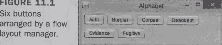

`Alphabet` 应用在第 14 行创建了一个流式布局管理器，并在第 15 行将其设置为管理框架。在第 22–27 行添加到框架的按钮由此管理器安排。

该管理器在每行的组件之间使用默认的 5 像素间隙，在每行之间也使用 5 像素的间隙。你可以更改水平和垂直间距，通过向 `FlowLayout()` 构造函数传递额外的参数或调用 `Vgap(int)` 和 `Hgap(int)` 方法来实现。

`FlowLayout(int, int)` 构造函数接收以下三个参数（顺序）：

- 对齐方式，必须是 `FlowLayout` 的五个类变量之一：`CENTER`、`LEFT`、`RIGHT`、`LEADING` 或 `TRAILING`
- 组件之间的水平间距（像素）
- 组件之间的垂直间距（像素）

以下代码创建了一个流式布局管理器，水平间距为 30 像素，垂直间距为 10 像素：

```java
FlowLayout flo = new FlowLayout(30, 10);
```

# 布局

## Box Layout

下一个布局管理器可以将组件从上到下或从左到右堆叠。`javax.swing` 包中的 `BoxLayout` 无论容器如何调整大小都能确保组件垂直或水平排列。

创建框式布局管理器需要两个参数：它管理的容器以及设置对齐方式的类变量（`X_AXIS` 表示水平，`Y_AXIS` 表示垂直）。

以下代码设置面板使用垂直框式布局：

```java
JPanel optionPane = new JPanel();
BoxLayout box = BoxLayout(optionPane, BoxLayout.Y_AXIS);
optionPane.setLayout(box);
```

添加到容器的组件将按照指定的轴排列，并以其首选尺寸显示。在水平对齐时，框式布局尝试赋予每个组件相同的高度；在垂直对齐时，它尝试赋予每个组件相同的宽度。

列表 11.2 显示了由框式布局排列按钮的 `Stacker` 应用。在 NetBeans 的 `com.java21days` 包中创建它。

## 基础界面布局

```java
27:
JTextArea text = new JTextArea(4, 70);
28:
ScrollPane scrollPane = new JScrollPane(text);
29:
// 将它们组合在一起
30:
FlowLayout flow = new FlowLayout();
31:
setLayout(flow);
32:
add(commandPane);
33:
add(scrollPane);
34:
setVisible(true);
35:
}
36:
37:
private void setLookAndFeel() {
38:
try {
39:
UIManager.setLookAndFeelAndFeel(
40:
    "com.sun.java.swing.plaf.Nimbus.NimbusLookAndFeel"
41:
);
42:
SwingUtilities.updateComponentUI(this);
43:
catch (Exception exc) {
44:
System.err.println("Couldn't use the system "
45:
    + "look and feel: " + exc);
46:
}
47: }
49:
public static void main(String[] arguments) {
50:
Stacker s = new Stacker();
51:
52:
}
```

当该类被编译并运行时，输出结果应该类似于图 11.2。

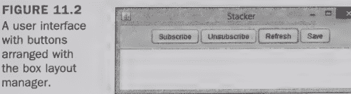

此应用程序在第 13 行创建了一个名为 `commandPane` 的 `JPanel`，在第 14–15 行创建了与该面板关联的框布局管理器，并在第 16 行为该面板设置了该管理器。

界面顶部的按钮面板是水平堆叠的。如果框布局构造构造第二个第二个参数是 `BoxLayout.Y_AXIS`，则按钮将改为垂直排列。

## Grid Layout

网格布局管理器将组件排列成垂直列和水平行的网格，类似于 12 个月日历上的日期布局。组件首先被添加到网格的第一行，从最左侧的网格单元格开始并向右继续。当第一行的所有单元格填满时，下一个组件将添加到网格第二行的最左侧单元格中——如果有第二行的话——依此类推。

网格布局管理器是通过 `GridLayout` 类创建的，该类属于 `java.awt` 包。发送到 `GridLayout` 构造函数中的是两个参数是：网格的行数和列数。

以下语句创建了一个具有 10 行 3 列的网格布局管理器：

```java
GridLayout gr = new GridLayout(10, 3);
```

与流式布局一样，你可以通过两个额外的参数指定组件之间的垂直和水平间隙（通过调用 `setGap()` 或 `setVerticalGap()` 方法）。以下语句创建了一个具有 10 行 3 列、水平间隙 5 像素和垂直间隙 8 像素的网格布局：

```java
GridLayout gr2 = new GridLayout(10, 3, 5, 8);
```

网格布局中排列的组件之间的默认间隙在垂直和水平方向上均为 0 像素。

对于下一个项目，在 `com.java21days` 包中创建 `Bunch` 应用程序，如列表 11.3 所示。该程序创建了一个具有 3 行 3 列的网格，且组件在垂直和水平方向上之间有 10 像素的间隙。

### 列表 11.3 Bunch.java 的完整文本

```java
1: package com.java21days;
2:
3: import java.awt.*;
4: import java.awt.event.*;
5: import javax.swing.*;
6:
7: public class Bunch extends JFrame {
8:
9: public Bunch() {
10: super("Bunch\n");
11: setSize(260, 260);
12: setDefaultCloseOperation(JFrame.EXIT_ON_CLOSE);
13: setLookAndFeel(null);
14: JPanel pane = new JPanel();
15: GridLayout family = new GridLayout(3, 3, 10, 10);
16: pane.setLayout(family);
17: JButton marcia = new JButton("Marcia");
18: JButton carol = new JButton("Carol");
19: JButton greg = new JButton("Greg");
20: JButton jan = new JButton("Jan");
21: JButton alice = new JButton("Alice");
22: JButton peter = new JButton("Peter");
23: JButton cindy = new JButton("Cindy");
24: JButton mike = new JButton("Mike");
25: JButton bobby = new JButton("Bobby");
26: pane.add(marcia);
27: pane.add(carol);
28: pane.add(greg);
29: pane.add(jan);
30: pane.add(alice);
31: pane.add(peter);
32: pane.add(cindy);
33: pane.add(mike);
34: pane.add(bobby);
35: add(pane);
36: setVisible(true);
37: }
39: private void setLookAndFeel() {
40: try {
41: UIManager.setLookAndFeel(
42: "com.sun.java.swing.plaf.nimbus.NimbusLookAndFeel");
43: );
44: SwingUtilities.updateComponentTreeUI(this);
45: catch (Exception exc) {
45: System.err.println("Couldn't use the system "
46: + "look and feel: " + exc);
47: }
49:
public static void main(String[] arguments) {
50: JFrame frame = new Bunch();
51:
52: }
```

图 11.3 显示了此应用程序。`Bunch` 应用程序在网格中显示九个按钮。按钮在第 26–34 行被添加到 `pane` 中，面板在第 35 行被添加到 `frame` 中。图 11.3 中的按钮需要注意的一点是，它们扩展以填充每个单元格中可用的空间。这是网格布局与某些其他布局的重要区别，后者使用这些组件的偏好尺寸以小得的尺寸显示组件。

# 图 11.3

排列在 3x3 网格布局中的九个按钮。

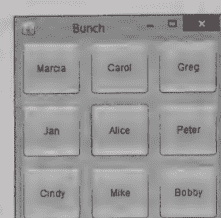

## Border Layout

到目前为止介绍的布局管理器相当简单。下一个布局使用了更复杂的 `BorderLayout`。它通过使用 `java.awt` 包中的 `BorderLayout` 类创建，将容器分为五个区域：北（north）、南（south）、东（east）、西（west）和中心（center）。图 11.4 显示了这些区域是如何排列的。

# 图 11.4

由边框布局排列的组件。


在边框布局中，组件由边框布局排列。`north`、`south`、`east`、`west` 和 `center` 是被划分的区域，`center` 占据了剩余的所有空间。边框布局可以通过使用 `BorderLayout()` 构造函数创建，这表示组件没有水平或垂直间隙。

`BorderLayout(int, int)` 构造函数允许指定水平和垂直的间隙。`BorderLayout(int, int, int, int)` 构造函数则允许指定 4 个方向的间隙。

`Border` 应用程序在列表 11.4 中显示，位于 `com.java21days` 包中。

### 列表 11.4 Border.java 的完整文本

```java
1: package com.java21days;
2:
3: import java.awt.*;
4: import javax.swing.*;
5:
6: public class Border extends JFrame {
7:
8:     public Border() {
9:         super("Border");
10:        setSize(240, 280);
11:        setDefaultCloseOperation(JFrame.EXIT_ON_CLOSE);
12:        setLookAndFeel();
13:        setLayout(new BorderLayout());
14:        JButton nButton = new JButton("North");
15:        JButton sButton = new JButton("South");
16:        JButton eButton = new JButton("East");
17:        JButton wButton = new JButton("West");
18:        JButton cButton = new JButton("Center");
19:        add(nButton, BorderLayout.NORTH);
20:        add(sButton, BorderLayout.SOUTH);
21:        add(eButton, BorderLayout.EAST);
22:        add(wButton, BorderLayout.WEST);
23:        add(cButton, BorderLayout.CENTER);
24:        setVisible(true);
25:     }
26:
27:     private void setLookAndFeel() {
28:         try {
29:             UIManager.setLookAndFeel(
30:                 "com.sun.java.swing.plaf.Nimbus.NimbusLookAndFeel"
31:             );
32:             SwingUtilities.updateComponentTreeUI(this);
33:         } catch (Exception exc) {
34:             System.err.println("Couldn't use the system "
35:                 + "look and feel: " + exc);
36:         }
37:     }
38:
39:     public static void main(String[] arguments) {
40:         Border frame = new Border();
41:     }
42: 
```

`Border` 应用程序在第 13 行以一种新方式设置其布局管理器。对 `new BorderLayout()` 构造函数的调用返回一个 `BorderLayout` 对象，然后它成为 `setLayout()` 方法的参数。

第 13 行等同于以下两个语句：

```java
BorderLayout bl = new BorderLayout();
setLayout(bl);
```

第 13 行采用的技术的优势是不需要创建一个变量并将 `BorderLayout` 对象赋值给它。该对象在为框架指定布局管理器之后就不再需要了。

该应用程序在第 14–18 行创建了五个按钮，并在第 19–23 行将它们分配到边框布局中的位置。

> **TIP** 运行应用程序时，多次增加窗口大小以观察组件如何响应。随着窗口变大，中心组件随之增大。其他组件保持不变。

# 混合布局管理器


# 第 11 天：在用户界面上排列组件

到此时，你可能在想 Java 的布局管理器如何应用于为你自己的程序设计的 GUI 中。选择一个布局管理器是一个挑战。这种体验就像金发小姑娘检查三只熊的家：这一个太方正了！这一个太乱了！这一个太奇怪了！

为了找到恰到好处的布局，你通常需要在同一个界面中组合多个布局管理器。你可以通过将几个容器放入一个较大的容器中，并为每个较小的容器分配它们自己的布局管理器来实现这一点。

用于这些较小容器的容器是面板，它是通过 `javax.swing` 包中的 `JPanel` 类创建的。面板是用于对组件分组的简单容器。在操作面板时，请记住两点：

- 面板在放入较大的容器之前会先填充组件。
- 面板有它自己的布局管理器。

可以通过简单地调用 `JPanel` 类的构造函数来创建面板，例所示：

```java
JPanel pane = new JPanel();
```

你通过调用该面板的 `setLayout()` 方法来设置面板的布局方法。以下是创建一个布局管理器并将其应用于名为 `pane` 的 `JPanel` 对象的方法：

```java
FlowLayout flo = new FlowLayout();
pane.setLayout(flo);
```

你通过调用面板的 `add()` 方法向面板添加组件，该方法对面板的操作与其他容器完全相同。

以下语句创建了一个文本字段并将其添加到名为 `pane` 的 `JPanel` 对象中：

```java
JTextField nameField = new JTextField(80);
pane.add(nameField);
```

你将在今天余下来的应用程序中看到多个面板使用的示例。

随着你对布局管理器的经验增加，你将熟悉在特定情况下应该使用哪种。例如，边框布局适用于在底部放置状态栏并在顶部放置工具栏，而网格布局对于尺寸相同的文本字段和标签行列非常有效。

## 卡片布局

布局管理器与其他布局器的不同之处在于它会隐藏某些组件。卡片布局是一组一次显示一个容器或组件，就像黑赌场交易员从牌堆中一次翻出一张牌一样。组中的每个容器被称为*卡片*。

如果你用过安装程序中的向导，你就见过卡片布局。安装过程中的每一步都有它自己的卡片。通常，“下一步”按钮会从上一步推进到下一步。

使用卡片布局最常用的方法是为每张卡片使用一个面板容器。首先将组件添加到面板中，然后将面板添加到采用卡片布局的容器中。

卡片布局是通过 `java.awt` 包中的 `CardLayout` 类通过简单的构造函数创建的：

```java
CardLayout cc = new CardLayout();
```

`setLayout(cc)` 方法为容器设置此布局管理器，如下句所示：

```java
setLayout(cc);
```

在设置了容器使用卡片布局管理器后，你必须使用 `add(Component, String)` 方法来添加组件。

`add()` 方法的第一个参数指定作为卡片的容器或组件。如果它是一个容器，则在添加卡片之前，所有组件都已添加到其中。

第二个参数是一个用于命名卡片的字符串。你可以用任何喜欢的名称来命名卡片，例如“Card 1”、“Card 2”、“Card 3”或其他命名方案。

以下语句将一个名为 `options` 的面板对象添加到容器中，并将此卡片命名为“Options Card”：

```java
add(options, "Options Card");
```

当使用卡片布局的容器首次显示时，可见的卡片是首次添加到容器的第一张卡片。

你可以通过调用布局管理器的 `show()` 方法来显示后续卡片，该方法接受两个参数：

- 存放所有卡片的容器
- 卡片的名称

以下语句调用了名为 `cc` 的卡片布局管理器的 `show()` 方法：

```java
cc.show(this, "Fact Card");
```

该关键字将用于受卡片布局控制的框架中。它指的是出现 `cc.show()` 语句内部的对象。在这个例中，“Fact Card”是待显示的卡片名称。卡片被添加到已赋予此名称的容器中。

当显示一张卡片时，之前显示的卡片会自动隐藏。卡片布局中一次只能显示一张卡片。

在运行卡片布局管理器的程序中，卡片的切换通常由用户的操作触发。例如，在安装程序中，用户可以选择一个保存程序的文件夹，并点击“下一步”按钮查看下一张卡片。

## 在应用程序中使用卡片布局

下一个项目将同时演示卡片布局以及在同一个 GUI 中使用不同布局器的用法。

`SurveyWizard` 类是一个实现向导界面的面板：一系列简单的问题，并配有一个用于查看后续问题的“下一步”按钮。最后一个问题取而使用“完成”按钮，如图 11.5 所示。

**图 11.5** 使用卡片布局实现向导式界面。


实现基于卡片的布局的最简单方法是使用面板。该项目使用了多个面板：

- `SurveyWizard` 类是一个持有所有卡片的面板。
- `SurveyPanel` 辅助类是一个持有一张卡片的面板。
- 每个 `SurveyPanel` 对象都包含三个堆叠在一起的面板。

`SurveyWizard` 和 `SurveyPanel` 类都是面板，在处理卡片布局时最易使用。放置在网格中的每个组件都是一个面板。

使用网格布局将其组件排列成网格，具有三列和一行的网格。

首先，创建一个面板来持有问题标签：

```java
JPanel sub1 = new JPanel();
JLabel quesLabel = new JLabel(ques);
sub1.add(quesLabel);
```

面板的默认布局是流式布局，居中对齐，这决定了面板的放置。

接下来，创建一个面板来持有可能的响应。使用 for 循环遍历持有每个响应文本的数组。该文本用于创建单选按钮。`JRadioButton` 构造函数的第二个参数决定它是否被选中。通过以下代码实现：

```java
JPanel sub2 = new JPanel();
for (int i = 0; i < resp.length; i++) {
    if (def == i) {
        response[i] = new JRadioButton(resp[i], true);
    } else {
        response[i] = new JRadioButton(resp[i], false);
    }
    group.add(response[i]);
}
sub2.add(response[i]);
```

最后一个面板持有“下一步”和“完成”按钮：

```java
JPanel sub3 = new JPanel();
nextButton.setEnabled(true);
sub3.add(nextButton);
finalButton.setEnabled(false);
sub3.add(finalButton);
```

现在三个面板都已设置完毕，它们被添加到 `SurveyPanel` 接口中，完成了构造方法的工作：

```java
GridLayout grid = new GridLayout(3, 1);
setLayout(grid);
add(sub1);
add(sub2);
add(sub3);
```

```java
SurveyPanel(String ques, String[] resp, int def) {
    question = new JLabel(ques);
    response = new JRadioButton[resp.length];
    // 待后续
}
```

```java
CardLayout cards = new CardLayout();
setLayout(cards);
String question1 = "What is your?";
String[] respl = {"female", "male", "not telling"};
```

```java
void setFinalQuestion(boolean finalQuestion) {
    if (finalQuestion) {
        nextButton.setEnabled(false);
        finalButton.setEnabled(true);
    }
}
```

## 简短的预览展示了 `SurveyPanel` 类是如何处理按钮点击的

该类实现了 `ActionListener`，这是 `java.awt.event` 包中的一个接口：

```java
public class SurveyWizard extends JPanel implements ActionListener {
    // 更多内容后待添加
}
```

该接口表示该类可以响应动作事件，动作事件代表按钮点击、菜单选择和类似的用户输入。

接下来，调用了每个按钮的 `addActionListener(Object)` 方法：

```java
ask[0].nextButton.addActionListener(this);
ask[0].finalButton.addActionListener(this);
```

监听器是监控特定类型用户输入的类。`addActionListener()` 的参数是正在寻找动作事件的类。将该类作为参数表示由 `SurveyPanel` 类来处理这项工作。

`ActionListener` 接口只包含一个方法：

```java
public void actionPerformed(ActionEvent evt) {
    // 更多内容后待添加
}
```

当某个组件被监听并生成动作事件时，就会调用此方法。在 `SurveyPanel` 类中，每当按钮被点击时，就会发生这种情况。

在 `SurveyPanel` 中，此方法使用一个实例变量来跟踪显示哪张卡片：

```java
int currentCard = 0;
```

每当点击按钮并调用 `actionPerformed()` 方法时，该变量就会增加，并调用卡片布局器的 `show(Container, String)` 方法来显示新卡片。如果已经显示了最后一张卡片，则禁用完成按钮。

列表 11.5 显示了带有完整 `actionPerformed()` 方法的 `SurveyWizard` 类。在 NetBeans 中创建一个名为 `SurveyWizard` 的新空 Java 文件，并将其分配给 `com.java21days` 包。

```java
1: package com.java21days;
2:
3: import java.awt.*;
4: import java.awt.event.*;
5: import javax.swing.*;
6:
7: public class SurveyWizard extends JPanel implements ActionListener {
8:     int currentCard = 0;
9:     CardLayout cards = new CardLayout();
10:     SurveyPanel[] ask = new SurveyPanel[3];
11:
12:     public SurveyWizard() {
13:         super();
14:         setSize(240, 140);
15:         setLayout(cards);
16:         // 设置问卷
17:         String question1 = "What is your gender?";
18:         String[] resp1 = { "female", "male", "not telling" };
19:         ask[0] = new SurveyPanel(question1, resp1, 2);
20:         String question2 = "What is your age?";
21:         String[] resp2 = { "Under 25", "25-34", "35-54" };
22:         ask[1] = new SurveyPanel(question2, resp2, 1);
23:         String question3 = "How often do you exercise each week?";
24:         String[] resp3 = { "Never", "1-3 times", "More than 3 times" };
25:         ask[2] = new SurveyPanel(question3, resp3, 1);
26:         ask[2].setFinal(true);
27:         addListeners(this);
28:     }
29:
30:     private void addListeners() {
31:         for (int i = 0; i < ask.length; i++) {
32:             ask[i].nextButton.addActionListener(this);
33:             ask[i].finalButton.addActionListener(this);
34:             add(ask[i], "Card " + i);
35:         }
36:     }
37:
38:    public void actionPerformed(ActionEvent evt) {
39:        currentCard++;
40:        if (currentCard >= ask.length) {
41:            System.exit(0);
42:        }
43:        cards.show(this, "Card " + currentCard);
44:    }
45:}
46: class SurveyPanel extends JPanel {
47:     JLabel question;
48:     JRadioButton[] response;
49:     JButton nextButton = new JButton("Next");
50:     JButton finalButton = new JButton("Finish");
51:
52:     SurveyPanel(String ques, String[] resp, int def) {
53:         super();
54:         setSize(160, 110);
55:         question = new JLabel(ques);
56:         response = new JRadioButton[resp.length];
57:         JPanel sub1 = new JPanel();
58:         ButtonGroup group = new ButtonGroup();
59:         JLabel labelLabel = new JLabel(ques);
60:         sub1.add(labelLabel);
61:         JPanel sub2 = new JPanel();
62:         for (int i = 0; i < resp.length; i++) {
63:             if (def == i) {
64:                 response[i] = new JRadioButton(resp[i], true);
65:             } else {
66:                 response[i] = new JRadioButton(resp[i], false);
67:             }
68:             group.add(response[i]);
69:             sub2.add(response[i]);
70:         }
71:         JPanel sub3 = new JPanel();
72:         nextButton.setEnabled(true);
73:         sub3.add(nextButton);
74:         finalButton.setEnabled(false);
75:         sub3.add(finalButton);
76:         GridLayout grid = new GridLayout(3, 1);
77:         setLayout(grid);
78:         add(sub1);
79:         add(sub2);
80:         add(sub3);
81:     }
82:     void setFinal(boolean finalQuestion) {
83:         if (finalQuestion) {
84:             nextButton.setEnabled(false);
85:             finalButton.setEnabled(true);
86:         }
87:     }
88: }
```

列表 11.5 显示了带有完整 `actionPerformed()` 方法的 `SurveyWizard` 类。在 NetBeans 中创建一个名为 `SurveyWizard` 的新空 Java 文件，并将其分配给 `com.java21days` 包。


在某个平台上看起来良好的程序，在其他平台上可能无法使用。这可能会导致布局上的灾难，例如组件相互重叠或被容器边缘截断。布局管理器通过在屏幕上动态地放置元素来解决这些问题。虽然在不同平台上的最终结果可能存在某些差异，但它们不太可能出现灾难性的后果。

如果这些还不能说服你，这里有一个可以验证我建议的方法：将内容面板管理器以 `null` 作为参数。创建一个 `Rectangle` 对象（来自 `java.awt` 包），并传入组件参数的 `(x,y)` 位置、宽度和高度。调用组件的 `setBounds(Rectangle)` 方法，并将该矩形作为参数。

以下应用程序显示了一个 300x300 像素的帧，在 `(x,y)` 位置 10, 10 处有一个“Click Me” 按钮，其尺寸为 120 像素乘 30 像素：

```java
import java.awt.*;
import javax.swing.*;
```

```java
public class Absolute extends JFrame {
    public Absolute() {
        super("Example");
        setSize(300, 300);
        setLayout(null);
        JButton myButton = new JButton("Click Me");
        myButton.setBounds(new Rectangle(10, 10, 120, 30));
        add(myButton);
        setVisible(true);
    }

    public static void main(String[] arguments) {
        Absolute ex = new Absolute();
    }
}
```

你可以在 `Component` 类中找到更多关于 `setBounds()` 的信息。你可以在 http://docs.oracle.com/javase/8/docs/api 找到 Java 类库的文档。

## 测验

通过这个三个三个的测验来复习今天的内容。

### 问题

- 1. Java 中面板（panel）的默认布局管理器是什么？

- A. 无

- B. BorderLayout

- C. FlowLayout

- 2. 在向容器中添加组件时，哪种布局管理器使用指南针方向或相对于中心点的引用？

- A. BorderLayout

- B. MapLayout

- C. FlowLayout

- 3. 如果你想创建一个具有多个步骤的安装向导，应该使用哪种布局管理器？

- A. GridLayout

- B. CardLayout

- C. BorderLayout

### 答案

- 1. C. 为了防止面板使用流布局，你可以将它的布局管理器设置为 `null`。

- 2. A. Border layout 具有类变量 NORTH、SOUTH、EAST、WEST 和 CENTER。

- 3. B. Card layout（卡片布局）允许组件像卡片一样堆叠并一次显示一个，非常适合实现向导。

### 认证练习

以下问题是你可能会在 Java 编程认证考试中遇到的类型。请在不看今天的内容或不使用 Java 编译器测试代码的情况下回答它。

给定：

```java
import java.awt.*;
import javax.swing.*;
```

```java
public class ThreeButtons extends JFrame {
    public ThreeButtons() {
        super("Program");
        setSize(350, 225);
        setDefaultCloseOperation(JFrame.EXIT_ON_CLOSE);
        JButton alpha = new JButton("Alpha");
        JButton beta = new JButton("Beta");
        JButton gamma = new JButton("Gamma");
        // 答案写在这里
        add(alpha);
        add(beta);
        add(gamma);
        pack();
        setVisible(true);
    }

    public static void main(String[] arguments) {
        ThreeButtons b3 = new ThreeButtons();
    }
}
```

哪一个语句可以替换 `// answer goes here` 以使框架并排显示三个按钮？

- A. content.setLayout(null);

- B. content.setLayout(new FlowLayout());

- C. content.setLayout(new GridLayout(3,1));

- D. content.setLayout(new BorderLayout());

答案可以在书籍网站 www.java21days.com 找到。访问第 11 页并点击认证练习（Certification Practice）链接。

### 练习

为了扩展你对今天所涵盖主题的知识，请尝试以下练习：

- 1. 创建一个显示单月份日历的用户界面，包括星期七天的标题以及顶部的月份标题。

- 2. 创建一个结合了多个布局管理器的接口。

练习解答可以在书籍网站 www.java21days.com 找到。

# 第 12 天

# 响应用户输入

设计一个带有图形用户界面（GUI）的 Java 程序，如果用户无法对其进行任何操作，那么它将毫无用。要让程序完全可用，你必须让界面能够响应用户事件。

Swing 使用一组称为事件监听器（event listeners）的接口处理事件。你创建一个器对象并将其与被监控的用户组件关联。

今天，你将学习如何向你的 Swing 程序添加各种监听器，包括处理动作事件、鼠标事件和其他交互的监听器。

当你完成后，你将学会如何在 Swing 程序中添加各种类型的监听器。

## 事件监听器

如果一个类想要响应用户事件，它必须实现处理事件的接口。这与 GUI。事件监听器是同一种类型。

处理事件的接口被称为事件监听器。该接口定义了类必须实现的特定事件类型。

`java.awt.event` 包包含了所有的基础事件监听器，以及表示特定事件的对象。这些监听器接口是最有用的：

- ActionListener——当用户在按钮上执行操作时生成的动作事件。

- AdjustmentListener——当滚动条被调整时生成的调整事件。

- FocusListener——当文本字段获得或失去焦点时生成的焦点事件。

- ItemListener——当可选框等项发生变化时生成的项事件。

- KeyListener——当用户使用键盘输入时生成的按键事件。

- MouseListener——鼠标点击、进入或离开组件区域时生成的鼠标事件。

- MouseMotionListener——跟踪鼠标在组件上的移动事件。

- WindowListener——当窗口最大化、最小化或关闭时生成的窗口事件。

由于 Java 类可以实现多个接口，一个类可以根据需要采取许多用户输入的监听器。在类声明中，`implements` 关键字后面跟着接口的名称。如果实现了多个接口，它们的名称之间用逗号分隔。

以下类被声明为同时处理动作事件和文本事件：

```java
public class Suspense extends JFrame implements ActionListener,
    TextListener {
    // 类体
}
```

### 设置组件

当你使一个类成为事件监听器时，你已经设置了该类可以收到的特定类型的事件。除非执行后续步骤：向 GUI 组件添加监听器，否则事件将无法被听到。该监听器在组件在使用时生成事件。

在创建组件后，你可以在组件上调用以下一个或多个方法来与其关联监听器：

- `addActionListener()`--JButton、JCheckBox、JComboBox、JTextField、JRadioButton 和 JMenuItem 组件

- `addFocusListener()`--所有 Swing 组件

- `addItemListener()`--JButton、JCheckBox、JComboBox 和 JRadioButton 组件

- `addKeyListener()`--所有 Swing 组件

- `addMouseListener()`--所有 Swing 组件

- `addMouseMotionListener()`--所有 Swing 组件

- `addTextListener()`--JTextField 和 JTextArea 组件

- `addWindowListener()`--JButton 和 JFrame 组件

> **注意**
>
> 在向容器添加后修改组件是 Java 程序中容易犯的错误。你必须在将组件添加到任何容器之前，为其添加监听器并处理任何其他配置；否则，这些设置在运行时会被忽略。

以下示例创建了一个 JButton 对象并将其与动作监听器关联：

```java
JButton zap = new JButton("Zap");
zap.addActionListener(this);
```

所有添加监听器的方法都接受一个参数：监听该类型事件的对象。使用 `this` 表示当前类即为事件监听器。你可以指定不同的对象，只要它的类实现了正确的监听器接口。

### 事件处理方法

当你将一个接口与一个类关联时，该类必须包含实现接口中每个方法的的方法。

在事件监听器的情况下，当相应的用户事件发生时，窗口系统会自动调用每个种方法。

`ActionListener` 接口只包含一个方法：`actionPerformed()`。所有实现 `ActionListener` 的类都必须有一个具有以下结构的方法：

```java
public void actionPerformed(ActionEvent event) {
    // 在此处处理事件
}
```

如果你的程序 GUI 中只有一个组件为动作事件设置了监听器，那么你就知道这个 `actionPerformed()` 只在响应由该组件生成的事件时才被调用。

这使得编写 `actionPerformed()` 方法变得更加简单。该方法的所有代码都响应该组件的用户事件。

但是，当多个组件都拥有事件监听器时，你必须使用方法的 `ActionEvent` 参数来确定使用了哪个组件，并在你的程序中采取相应的行动。你可以使用此对象来发现有关生成事件的组件的细节。

`ActionEvent` 以及所有其他事件对象都属于 `java.awt.event` 包。

每个事件处理方法都是某种类型的事件对象。你可以使用对象的 `getSource()` 方法来确定是哪个组件发送了事件，如下例：

```java
public void actionPerformed(ActionEvent event) {
    Object source = event.getSource();
}
```

`getSource()` 方法返回的对象可以使用 `==` 运算符与组件进行比较。以下语句扩展了前面的示例，以处理对名为 `quitButton` 和 `sortRecords` 按钮的用户点击：

```java
if (source == quitButton) {
    quit();
}
if (source == sortRecords) {
    sort();
}
```

如果 `quitButton` 对象生成事件，则调用 `quit()` 方法；如果 `sortRecords` 按钮生成事件，则调用 `sort()` 方法。

许多事件处理方法会为每种事件和组件调用不同的方法。这使得事件处理方法更容易易读。此外，如果一个类有多个事件处理方法，每个方法都可以调用相同的方法来完成工作。

Java 的 `instanceof` 运算符可以在事件处理方法中使用，用于确定生成事件的组件的类。以下示例可以用于一个有一个按钮和一个文本框的程序，每个组件都会生成一个动作事件：

```java
void actionPerformed(ActionEvent event) {
    Object source = event.getSource();
    if (source instanceof JTextField) {
        calculateScore();
    } else if (source instanceof JButton) {
        quit();
    }
}
```

如果生成事件的组件属于 `JTextField` 类，则调用 `calculateScore()` 方法。如果组件属于 `JButton`，则调用 `quit()` 方法。

列表 12.1 显示的 `TitleBar` 显示了一个包含两个 `JButton` 组件的框架，这些组件用于更改框架标题栏上的文本。创建一个名为 `TitleBar` 的空 Java 文件，分配包 `com.java21days`，并输入该类的源代码。

### 列表 12.1 TitleBar.java 的全文

```java
package com.java21days;

import java.awt.event.*;
import javax.swing.*;
import java.awt.*;

public class TitleBar extends JFrame implements ActionListener {
    JButton b1;
    JButton b2;
    public TitleBar() {
        super("Title Bar", JFrame.EXIT_ON_CLOSE);
        setLookAndFeel();
        b1 = new JButton("Rosencrantz");
        b2 = new JButton("Gildenenstern");
        b1.addActionListener(this);
        b2.addActionListener(this);
        FlowLayout flow = new FlowLayout();
        setLayout(flow);
        add(b1);
        add(b2);
        pack();
        setVisible(true);
    }
    public void actionPerformed(ActionEvent evt) {
        Object source = evt.getSource();
        if (source == b1) {
            setTitle("Rosencrantz");
        } else if (source == b2) {
            setTitle("Gildenenstern");
        }
        repaint();
    }
    private void setLookAndFeel() {
        try {
            setClassName(UIManager.getLookAndFeelClassName());
        } catch (Exception exc) {
            System.err.println("Couldn't set look feel: " + exc);
        }
    }
    static void main(String[] args) {
        TitleBar frame = new TitleBar();
        frame.setVisible(true);
    }
}
```

## 方法使用方法

以下章节详细介绍了每种事件的结构以及可以使用的方法。

### 动作事件

动作事件在当用户使用按钮、复选框、菜单项、文本字段和单选按钮完成操作时发生。

为了处理这些事件，类必须实现 `ActionListener` 接口，并在每个组件上调用 `addActionListener()`。

`ActionListener` 接口只有一个方法：`actionPerformed(ActionEvent event)`。它的形式如下：

```java
public void actionPerformed(ActionEvent event) {
    // ...
}
```

除了 `getSource()` 方法，你还可以使用 `ActionEvent` 对象的 `getActionCommand()` 方法来发现更多信息。

### 响应用户输入

默认情况下，动作命令是组件关联的文本，例如按钮上的标签。你也可以通过调用 `setActionCommand(String)` 方法为组件设置不同的动作命令。字符串参数应该是动作命令所需的文本。

以下语句创建了按钮和菜单项，并为它们设置了动作命令“Sort Files”：

```java
JButton sort = new JButton("Sort");
JMenuItem menuItem = new JMenuItem("Sort");
sort.setActionCommand("Sort Files");
menuItem.setActionCommand("Sort Files");
```


> 动作命令对于多个组件引起相同结果的情况非常有用。通过给两个组件相同的动作命令，你可以在事件处理方法中使用相同的代码处理它们。

## 焦点事件

焦点事件发生在任何组件获得或失去 GUI 输入焦点时。焦点描述了接收键盘输入的组件。如果其中一个字段拥有焦点（在具有多个可编辑文本字段的用户界面中），光标会在字段中闪烁。任何文本都会进入此组件。

焦点适用于所有可以接收输入的组件。你可以通过调用不带参数的 `requestFocus()` 方法赋予组件焦点，如下例：

```java
JButton ok = new JButton("OK");
ok.requestFocus();
```

为了处理焦点事件，类必须实现 `FocusListener` 接口，该接口有两个方法：`focusGained(FocusEvent)` 和 `focusLost(FocusEvent)`。它们的形式如下：

```java
public void focusGained(FocusEvent event) {
    // ...
}
```

```java
public void focusLost(FocusEvent event) {
    // ...
}
```

## 使用方法

要确定是哪个对象获得了或失去了焦点，可以在作为参数传递给两个方法的 `FocusEvent` 对象上调用 `getSource()` 方法。

列表 12.2 包含了 Calculator，这是一个显示两个数字之和的 Java 应用程序。焦点事件用于确定何时需要重新计算总和。在 NetBeans 中，创建一个名为 `Calculator` 的新 Java 文件，包名为 `com.java21days`，并包含该列表的源代码。

### 列表 12.2 Calculator.java 的完整文本

```java
1: package com.java21days;
2:
3: import java.awt.event.*;
4: import javax.swing.*;
5: import java.awt.*;
6:
7: public class Calculator extends JFrame implements ActionListener {
8:     JTextField value1, value2, sum;
9:     JLabel plus, equals;
10:
11: public Calculator() {
12:     super("Add Two Numbers");
13:     setSize(30, 90);
14:     setDefaultCloseOperation(JFrame.EXIT_ON_CLOSE);
15:     setFocusAndListeners();
16:     FlowLayout flow = new FlowLayout(FlowLayout.CENTER);
17:     setLayout(flow);
18:     // create components
19:     value1 = new JTextField("0", 5);
20:     plus = new JLabel("+");
21:     value2 = new JTextField("0", 5);
22:     equals = new JLabel("=");
23:     sum = new JTextField("0", 5);
24:     // add listeners
25:     value1.addActionListener(this);
26:     value2.addActionListener(this);
27:     // set up sum field
28:     sum.setEditable(false);
29:     // add components
30:     add(value1);
31:     add(plus);
32:     add(value2);
33:     add(equals);
34:     add(sum);
35:     setVisible(true);
36: }
37:
38: public void focusGained(FocusEvent event) {
39:     try {
40:         float total = Float.parseFloat(value1.getText()) +
41:             Float.parseFloat(value2.getText()));
42:         sum.setText("" + total);
43:     } catch (NumberFormatException nfe) {
44:         value1.setText("0");
45:         value2.setText("0");
46:         sum.setText("0");
47:     }
48:     }
```

```java
50:    public void focusLost(FocusEvent event) {
51:        focusGained(event);
52:    }
```

```java
54:    private void setLookAndFeel() {
55:        try {
56:            UIManager.setLookAndFeel(
57:                 "com.sun.java.swing.plaf.Nimbus.NimbusLookAndFeel"
58:            );
59:            SwingUtilities.updateComponentTree(this);
60:        } (Exception exc) {
61:            System.err.println("Couldn't use the system " +
62:                 "look and feel: " + exc);
63:        }
```

```java
66:    public static void main(String[] arguments) {
67:        Calculator frame = new Calculator();
68:    }
```

图 12.2 显示了应用程序。


在此应用程序中，监听器被添加到前两个文本字段 `value1` 和 `value2` 中，该类实现了 `FocusListener` 接口。

当这两个字段的任何一个获得焦点时，都会调用 `focusGained()`（第 38-48 行）。在该方法中，通过另外两个字段的值计算总和。如果任何字段包含无效值（如字符串），则会抛出 `NumberFormatException` 并将所有字段重置为“0”。

## 使用方法

`focusLost()` 方法通过带有焦点事件参数的 `focusGained()` 实现相同的行为。关于此应用程序的一点是，不需要在文本字段中处理输入行为，这由任何接收文本输入的组件负责。

## 项目事件

当按钮、复选框或单选按钮被选中或取消选择时，会发生项目事件。类必须实现 `ItemListener` 接口来处理这些事件。`itemStateChanged(ItemEvent)` 方法是 `ItemListener` 接口中的唯一方法。它的格式如下：

```java
void itemStateChanged(ItemEvent e) {
  // ...
}
```

要确定发生了什么项目事件，可以在 `ItemEvent` 对象上调用 `getItem()`。也可以使用 `getStateChange()` 方法查看是被选中还是取消选择。该方法返回一个与 `ItemEvent.SELECTED` 等的整数。列表 12.3 中的 `FormatChooser` 展示了项目事件的使用。在 NetBeans 中创建一个名为 `FormatChooser` 的空文件，包名为 `com.java2days`。

### 列表 12.3 FormatChooser.java 的完整文本

```java
1: package com.java2days;

2:

3: import java.awt.*;

4: import java.awt.event.*;

5: import java.swing.*;

6:

7: public class FormatChooser extends JFrame implements ItemListener {

8:   String[] formats = {"choose format", "RSS 0.92",
9:   "RSS 1.0", "RSS 2.0"};
10:  String[] descriptions = {
11:   "Atom syndication format",
12:   "RSS syndication format 0.92 (Netscape)",
13:   "RSS/RDF syndication format 1.0 (RSS/RDF)",
14:   "RSS syndication format 2.0 (UserLand)"
15:   };
16:   JComboBox formatBox = new JComboBox();
17:   JLabel descriptionLabel = new JLabel("");

18: 
19:   public FormatChooser() {
20:       super("Syndication Format");
21:       setSize(420, 150);
22:       setDefaultCloseOperation(JFrame.EXIT_ON_CLOSE);
23:       setLayout(new BorderLayout());
24:       for (int i = 0; i < formats.length; i++) {
25:           formatBox.addItem(formats[i]);
26:       }
27:       formatBox.addActionListener(this);
28:       add(BorderLayout.NORTH, formatBox);
29:       add(BorderLayout.CENTER, descriptionLabel);
30:       setVisible(true);
31:   }
32: 
33:   public void itemStateChanged(ItemEvent event) {
34:       int choice = formatBox.getSelectedIndex();
35:       if (choice > 0) {
36:           descriptionLabel.setText(descriptions[choice-1]);
37:       }
38:   }
39: 
40:   public Insets getInsets() {
41:       return new Insets(50, 10, 10, 10);
42:   }
43: 
44:   private static void setLookAndFeel() {
45:       try {
46:           UIManager.setLookAndFeel("com.sun.java.swing.plaf.Nimbus.NimbusLookAndFeel");
47:       }
48:       catch (Exception exc) {
49:           System.err.println("Couldn't use the system " +
50:                "look and feel: " + exc);
51:       }
52:   }
53: 
54:   public static void main(String[] arguments) {
55:       setLookAndFeel();
56:       FormatChooser fc = new FormatChooser();
57:   }
}
```

此应用程序扩展了第 9 天“使用 Swing”中的组合框示例。图 12.3 显示了做出选择后的样子。

图 12.3 FormatChooser 应用程序的输出。

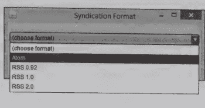

应用程序从字符串数组创建一个组合框并向组件添加项目监听器（第 24-27 行）。项目事件由 `itemStateChanged(ItemEvent)` 方法接收（第 33-38 行），该方法根据所选中项目的索引号更改标签的文本。索引 1 对应 "Atom"，2 对应 "RSS 0.92"，3 对应 "RSS 1.0"，4 对应 "RSS 2.0"。

## 键事件

当按下键盘上的按键时，会发生键事件。任何组件都可以生成这些事件，类必须实现 `KeyListener` 接口来支持它们。

`KeyListener` 接口有三个方法：`keyPressed(KeyEvent)`、`keyReleased(KeyEvent)` 和 `keyTyped(KeyEvent)`。它们的格式如下：

```java
public void keyPressed(KeyEvent event) {
// ...
}
```

```java
public void keyReleased(KeyEvent event) {
// ...
}
```

```java
public void keyTyped(KeyEvent event) {
// ...
}
```

`KeyEvent` 的 `getChar()` 方法返回与事件相关的按键字符。如果没有 Unicode 字符，`getChar()` 返回等于类变量 `KeyEvent.CHAR_UNDEFINED` 的字符值。

组件要生成键事件，它必须能够接收输入焦点。文本字段、文本区域以及其他接受键盘输入的组件会自动支持此功能。对于其他组件（如标签和面板），该

## 鼠标事件

鼠标事件是由鼠标点击、鼠标进入组件区域或鼠标离开区域产生的。任何组件都可以产生这些事件，这些事件通过类实现 `MouseListener` 接口来实现，该接口包含五个方法：

- `mouseClicked(MouseEvent)`
- `mouseEntered(MouseEvent)`
- `mouseExited(MouseEvent)`
- `mousePressed(MouseEvent)`
- `mouseReleased(MouseEvent)`

每个方法的基本形式与 `mouseReleased(MouseEvent)` 相同：

```java
public void mouseReleased(MouseEvent event) {
    // ...
}
```

以下方法可以在 `MouseEvent` 上使用：

- `getClickCount()`——返回鼠标点击次数（整数）
- `getPoint()`——返回一个 `Point` 对象，表示鼠标点击时在组件内的 (x,y) 坐标
- `getX()`——返回 x 坐标
- `getY()`——返回 y 坐标

## 鼠标移动事件

当鼠标在组件上移动时会发生鼠标移动事件。与其他鼠标事件一样，任何组件都可以产生鼠标移动事件。通过实现 `MouseMotionListener` 接口来支持这些事件。

### 使用方法

`MouseMotionListener` 接口有两个方法：`mouseDragged(MouseEvent)` 和 `mouseMoved(MouseEvent)`。它们的形式如下：

```java
public void mouseDragged(MouseEvent event) {
    // ...
}
```

```java
public void mouseMoved(MouseEvent event) {
    // ...
}
```

与你在此之前过的事件监听接口不同，`MouseMotionListener` 没有它自己的事件类型。相反，它使用的是 `MouseEvent` 对象。

因此，你可以对鼠标事件调用相同的方法：`getClickCount()`、`getPoint()`、`getX()` 和 `getY()`。

你将进行的下一个项目将演示如何检测和响应鼠标事件。列表 12.4 显示的 `MousePrank` 包含两个类：`MousePrank` 和 `MousePanel`，它们实现了一个试图避免被点击的用户界面按钮。

在 NetBeans 中创建一个类名为 `MousePrank`、包名为 `com.java21days` 的新空 Java 文件，然后输入列表 12.4 所示的代码。在本类中演示的技术将在你创建应用程序并看到其运行情况后进行描述。

### 列表 12.4 MousePrank.java 的全文

```java
1: package com.java21days;
2:
3: import java.awt.*;
4: import java.awt.event.*;
5: import java.swing.*;
6:
7: public class MousePrank extends JFrame implements ActionListener {
8:     public MousePrank() {
9:         super("Message");
```


## 第 12 天：响应用户输入

当你处理像 `WindowListener` 这种具有七个方法的事件处理接口时，该需求可能导致你必须添加许多空方法。

为了方便起见，Java 提供了适配器（adapters），适配器是包含特定接口空实现的 Java 类。通过派生适配器类，你可以通过重写这些方法仅实现你需要的事件处理方法。其余方法继承自什么都不方法。

`java.awt.event` 包包含了 `FocusAdapter`、`KeyAdapter`、`MouseAdapter`、`MouseMotionAdapter` 和 `WindowAdapter`。它们分别对应于焦点、键盘、鼠标、移动和窗口事件的监听器。

列表 12.5 是一个通过 `KeyAdapter` 的子类监控键盘事件并显示最近按键的 Java 。在 NetBeans 的 `com.java21days` 包下创建一个名为 `KeyChecker` 的空 Java 类并输入此源代码。

### 列表 12.5 KeyChecker.java 的全文

```java
1: package com.java21days;
2:
3: import java.awt.*;
4: import java.awt.event.*;
5: import javax.swing.*;
6:
7: public class KeyChecker extends JFrame {
8:     JLabel keyLabel = new JLabel("Hit any key");
9:
10:    public KeyChecker() {
11:        super("Hit a Key");
12:        setSize(300, 200);
13:        setDefaultCloseOperation(JFrame.EXIT_ON_CLOSE);
14:        setLayout(new FlowLayout(FlowLayout.CENTER));
15:        KeyMonitor monitor = new KeyMonitor(this);
16:        setFocusable(true);
17:        addKeyListener(monitor);
18:        add(keyLabel);
19:        setVisible(true);
20:    }
21:
22:    private static void setLookAndFeel() {
23:        try {
24:            UIManager.setLookAndFeel(
25:                "com.sun.java.swing.plaf.nimbus.NimbusLookAndFeel");
26:        } catch (Exception exc) {
27:            System.err.println("Couldn't use the "
28:                + "look and feel: " + exc);
29:        }
30:    }
31:
32:    public static void main(String[] arguments) {
33:        KeyChecker.setLookAndFeel();
34:        new KeyChecker();
35:    }
36: }
37:
38: class KeyMonitor extends KeyAdapter {
39:     KeyChecker display;
40:
41:     KeyMonitor(KeyChecker display) {
42:         this.display = display;
43:     }
44:
45:     public void keyTyped(KeyEvent event) {
46:         display.keyLabel.setText("" + event.getKeyChar());
47:         display.repaint();
48:     }
49: }
```

`KeyChecker` 应用程序由一个同名的主类和一个 `KeyMonitor` 辅助类实现。

`KeyMonitor` 是 `KeyAdapter` 的子类，`KeyAdapter` 是一个实现了 `Listener` 接口的键盘事件适配器类。在第 46-49 行中，`keyTyped` 方法重写了 `KeyAdapter` 中的相同方法，该方法什么都不做。

当按下键时，通过调用事件对象的 `getKeyChar()` 来发现该键。该键成为 `KeyChecker` 类中 `keyLabel` 标签的文本。应用程序如图 12.5 所示。

图 12.5 运行中的 KeyChecker 应用程序。


## 使用内部类

在 Java 中获取用户输入的挑战之一是保持代码尽可能短小。实现事件监听器及其所有方法（即使对于不需要的输入）需要大量的代码。

`KeyChecker` 应用程序使用适配器类来缩短处理键盘事件所需的编程量。

进一步缩短代码量的技术是使用内部类，内部类定义在类内部，就像方法或变量一样。在以下语句中，适配器类被创建为内部内部类：

```java
KeyAdapter monitor = new KeyAdapter() {
    public void keyTyped(KeyEvent event) {
        keyLabel.setText("" + event.getKeyChar());
        repaint();
    }
};
```

`KeyAdapter` 对象重写了一个方法 `keyTyped(KeyEvent)` 以接收键盘输入。列表 12.6 中的 `KeyChecker2` 类相比其先驱有两个优势。当在 NetBeans 中创建它时，看看你是否能发现它们是什么。

### 列表 12.6 KeyChecker2.java 的全文

```java
1: package com.java21days;
2:
3: import java.awt.*;
4: import java.awt.event.*;
5: import javax.swing.*;
6:
7: public class KeyChecker2 extends JFrame {
8:     JLabel keyLabel = new JLabel("Hit any key");
9:
10:    public KeyChecker2() {
11:        super("Hit a Key");
12:        setSize(300, 200);
13:        setDefaultCloseOperation(JFrame.EXIT_ON_CLOSE);
14:        setLayout(new FlowLayout(FlowLayout.CENTER));
15:        KeyAdapter monitor = new KeyAdapter() {
16:            public void keyTyped(KeyEvent event) {
17:                keyLabel.setText("" + event.getKeyChar());
18:                repaint();
19:            }
20:        };
21:        setFocusable(true);
22:        addKeyListener(monitor);
23:        add(keyLabel);
24:        setVisible(true);
25:    }
26:
27:    private static void setLookAndFeel() {
28:        try {
29:            UIManager.setLookAndFeel(
30:                "com.sun.java.swing.plaf.nimbus.NimbusLookAndFeel");
31:        } catch (Exception exc) {
32:            System.err.println("Couldn't use the "
33:                + "look and feel: " + exc);
34:        }
35:    }
36:
37:    public static void main(String[] arguments) {
38:        KeyChecker2.setLookAndFeel();
39:        new KeyChecker2();
40:    }
41: }
```


## 使用内部类

（注：由于原文文本存在格式混乱和重复，此处已根据逻辑整理并翻译内容）

事件处理通过以下基本步骤添加到 Swing 中：

- 将监听器接口添加到包含事件处理方法的类中。
- 将监听器添加到每个生成事件的组件中。
- 添加方法，每个方法以 `EventObject` 类作为唯一参数。
- 使用 `EventObject` 类的方法（如 `getSource()`）来了解哪个组件生成了事件以及什么类型的事件。当你了解这些步骤后就可以处理每个监听器。你也可以在添加新的监听器时学习它们。

## 答

可以在 `mouseClicked()` 中区分不同的按钮吗？

可以。所有鼠标都会发送 `MouseEvent` 对象到它们的事件处理方法。调用对象的 `getModifiers()` 以接收一个指示哪个按钮生成事件的整数值。

将该值与三个类变量进行比较。如果等于 `Event.BUTTON1_MASK`，则点击了左键；`Mouse.BUTTON2_MASK` 为点击了中间键；`Mouse.BUTTON3_MASK` 为点击了右键。

# 测验 363

访问书籍网站的第 12 天页面 `www.java21days.com` 查看 `MouseTest.java`，该文件包含实现此技术的示例。

更多信息，请参阅 `MouseEventListener` 的 Java 类库文档。访问网页 `http://docs.oracle.com/javase/8/docs/api` 并点击 `java.awt.event` 超链接以查看该包中的类。

## 测验

通过完成这个包含三个问题的测验，来回顾今日的内容。

### 问题

1. 如果你在像 `addActionListener(this)` 这样的方法调用中使用它，那么哪个对象被注册为监听器？
   - A. 一个适配器类
   - B. 当前类
   - C. 无类

2. 子类化实现 `WindowListener` 接口的适配器类（如 `WindowAdapter`）有什么好处？
   - A. 你继承了该类的所有行为。
   - B. 子类会自动成为一个监听器。
   - C. 你不需要实现任何你用到的 `WindowListener` 方法。

3. 当你按下 Tab 键离开文本字段时，会生成什么类型的事件？
   - A. `FocusEvent`（焦点事件）
   - B. `WindowEvent`（窗口事件）
   - C. `ActionEvent`（动作事件）

### 答案

1. **B. 当前类**必须实现正确的监听器接口和要求的方法。
2. **C.** 因为大多数监听器接口的方法比你需要的多，使用适配器类作为父类可以避免为了实现接口而不得不编写空方法的烦恼。


3. **A.** 当用户停止编辑该组件并移动到界面的其他部分时，用户界面组件失去焦点。

### 认证练习

以下问题是在 Java 编程认证考试中可能会遇到的类型。请在不看今日材料或不使用 Java 编译器测试代码的情况下回答。

给定：

```java
import java.awt.event.*;
import javax.swing.*;
import java.awt.*;
```

```java
public class Expunger extends JFrame implements ActionListener {

    public boolean deleteFile() {
    }

    public Expunger() {
        super("Expunger");
        JLabel commandLabel = new JLabel("Do you want to delete the file?");
        JButton yes = new JButton("Yes");
        JButton no = new JButton("No");
        yes.addActionListener(this);
        no.addActionListener(this);
        setLayout(new BorderLayout());
        JPanel bottom = new JPanel();
        bottom.add(yes);
        bottom.add(no);
        add("North", commandLabel);
        add("South", bottom);
        pack();
        setVisible(true);
    }

    public void actionPerformed(ActionEvent evt) {
        JButton source = (JButton) evt.getSource();
        // 答案写在这里
        if (/* condition */ true)
            deleteFile = true;
        else
            deleteFile = false;
    }

    public static void main(String[] arguments) {
        new Expunger();
    }
} // 修复后的嵌套结构
```

哪一个语句应该替换 `// answer goes here` 以使应用程序正常运行？

- A. `if (source instanceof JButton)`
- B. `if (source.getActionCommand().equals("yes"))`
- C. `if (source.getActionCommand()).equals("Yes")`
- D. `if source.getActionCommand() == "Yes"`

答案可以在书籍网站 `www.java21days.com` 上。访问第 12 天页面并点击 Certification Practice（认证练习）链接。

### 练习

为了扩展你对今日主题的理解，请尝试以下练习：

1. 创建一个使用 `FocusListener` 的应用程序，确保当用户将文本字段的值改为负值时，该值乘以 -1 并重新显示。
2. 创建一个计算器，每当点击相应的按钮时，对两个文本字段的内容进行加减法，并将结果显示在标签中。

练习答案在书籍网站 `www.java21days.com` 提供。

# 第 13 天：创建 Java2D 图形

今天，你将处理将图形放入图形用户界面中的 Java 类。Java2D 是一组支持高质量、可缩放的二维图像、颜色和文本的类。

Java2D 包含了 `java.awt` 和 `javax.swing` 包中的类，可以用于这些各具视觉吸引力的任务：

- 绘制文本
- 绘制圆和多边形等形状
- 使用不同的字体、颜色和线宽
- 用颜色和图案填充形状

## Graphics2D 类

Java2D 中的一切都始于 `java.awt` 包中的 `Graphics2D` 类，它代表一个图形上下文，即可以在其中绘制内容的环境。`Graphics2D` 对象可以代表图形用户界面、打印机或其他显示设备上的组件。

`Graphics2D` 是 `Graphics` 类的子类，扩展并改进了它的视觉能力。

在开始使用 `Graphics2D` 类之前，你需要一个用于绘制的表面。

多个用户界面组件可以作为图形操作的画布，包括面板和窗口。

一旦你有了可以用作画布的组件，就可以在该对象上绘制文本、线条、椭圆、圆、弧、矩形和其他多边形。

适用于此目的的组件是 `JPanel`。以下代码创建了一个框架并添加了面板：

```java
JFrame main = new JFrame("Welcome");
JPanel pane = new JPanel();
main.add(pane);
```

Java2D 使用像素作为单位。原点 (0, 0) 在左上角，y 坐标向下增加。

当你通过调用其 `setSize(int, int)` 方法来设置框架的大小时，左上角位于 (0, 0)。

### 绘制文本

- 字体名称
- 字体样式
- 字体字号

字体名称可以使用其物理名称来指定，例如 `Arial`、`Courier New`、`Garamond` 或 `Turman Grotesk`。如果该字体存在于运行程序的计算机上，则使用该字体。如果该字体不存在，则使用默认字体。

名称也可以是五种逻辑字体之一：`Dialog`、`DialogInput`、`Monospaced`、`SanSerif`（无衬线）或 `Serif`（衬线）。这些字体可以指定使用的字体类型，而不需要特定的字体。这通常是更好的选择，因为某些字体族可能在 Java 的所有实现中都不存在。

可以使用类变量选择三种字体样式：`PLAIN`（普通）、`BOLD`（粗体）和 `ITALIC`（斜体）。这些常量是整数，你可以将它们相加以组合效果。

以下语句创建了一个 24 点的 `Dialog` 字体，该字体为粗体且斜体：

```java
Font f = new Font("Dialog", Font.BOLD + Font.ITALIC, 24);
```

在创建字体后，可以通过调用 `Graphics2D` 类的 `setFont(Font)` 方法并传入参数来使用它。

`setFont()` 方法设置当前字体，在另一个字体使用之前，该字体将用于在同一个 `Graphics2D` 对象上所有后续的 `drawString()` 调用。

以下 `paintComponent` 创建了一个新的 `Font` 对象，将当前字体设置为该对象，并在坐标 (13, 100) 处用 72 点字体绘制字符串 "I'm deeply font of you"：

```java
public void paintComponent(Graphics comp) {
    Graphics2D comp2d = (Graphics2D) comp;
    Font f = new Font("Arial Narrow", Font.PLAIN, 72);
    comp2d.setFont(f);
    comp2d.drawString("I'm deeply font of you", 13, 100);
}
```

Java 可以通过将字体包含在程序中从文件中加载来确保字体可用。这种技术需要 `Font` 类的 `createFont(int, InputStream)` 方法，它返回一个表示该字体的 `Font` 对象。

输入流将在第 15 天“处理输入和输出”中介绍，它是可以从磁盘文件或网络地址等源加载数据的对象。以下语句从使用它的类文件所在文件夹下的名为 `Verdana.ttf` 的文件中加载字体：

```java
try {
    File ttf = new File("Verdana.ttf");
    FileInputStream fis = new FileInputStream(ttf);
    Font font = Font.createFont(Font.TRUETYPE_FONT, fis);
} catch (IOException | FontFormatException exc) {
    System.out.println("Error: " + exc.getMessage());
}
```

`try-catch` 块处理输入错误，当从文件加载数据时必须考虑这些错误。`File`、`FileInputStream` 和 `IOException` 类是 `java.io` 包的一部分，将在第 15 天进行讨论。

当使用 `createFont()` 加载字体时，该 `Font` 对象是 1 点且为普通样式。要更改尺寸和样式，请调用字体对象的 `deriveFont(int, int)` 方法并传入两个参数：所需的尺寸和样式。

### 使用抗锯齿改进字体和图形

如果你使用目前为止介绍的技能来显示文本，与你对其他软件的预期相比，字体的外观看起来将会很粗糙。字符渲染时会有锯齿边缘，特别是在曲线和对角线上。

Java2D 可以通过其对抗锯齿的支持更具吸引力地绘制字体和图形，抗锯齿是一种渲染技术，通过改变周围像素的颜色来平滑粗糙的边缘。

此功能默认关闭。要开启它，请调用 `Graphics2D` 对象的 `setRenderingHint()` 方法并传入两个参数：

- 一个 `RenderingHint.Key` 对象用于标识渲染提示集
- 一个 `RenderingHint.Key` 对象用于设置该提示的值

以下代码在名为 `comp2D` 的 `Graphics2D` 对象上启用抗锯齿：

```java
comp2D.setRenderingHint(RenderingHints.KEY_ANTIALIASING, RenderingHints.VALUE_ANTIALIAS_ON);
```

通过在组件的 `paintComponent()` 方法中调用此方法，你可以确保所有后续绘制操作都采用抗锯齿。

# 查找关于字体的信息

为了让文本在图形用户界面中看起来良好，你通常必须弄清楚文本在界面组件上占据了多少空间。

`java.awt` 包中的 `FontMetrics` 类提供了方法，用于确定使用指定字体显示的字符的大小，这可以用于文本格式化和居中等操作。

可以使用 `FontMetrics` 类查找有关当前字体的详细信息，例如它可以显示的字符的宽度或高度。

要使用此类的方法，必须使用 `getFontMetrics` 方法创建一个 `FontMetrics` 对象。该方法接受单个参数：一个 `Font` 对象。

表 13.1 显示了使用字体度量可以找到的一些信息。所有这些方法应在 `FontMetrics` 对象上调用。

### 表 13.1 FontMetrics 方法

| 方法名称 | 描述 |
| --- | --- |
| `stringWidth(String)` | 给定一个字符串，返回该字符串在像素中的完整宽度 |
| `charWidth(char)` | 给定一个字符，返回该字符的宽度 |
| `getHeight()` | 返回字体的总高度 |

列表 13.1 显示了如何使用 `Font` 和 `FontMetrics` 类。`TextField` 应用在框架中心显示字符串，使用字体度量测量字符串的宽度。

### 列表 13.1 Font 和 FontMetrics 类的用法

```java
1: package;
2: import java.awt.*;
3: import javax.swing.*;
4: public class TextField {
5:   public static void main(String[] args) {
6:       JFrame frame = new JFrame("Font Metrics");
7:       frame.setSize(400, 200);
8:       frame.setDefaultCloseOperation(JFrame.EXIT_ON_CLOSE);
9:       Font f = new Font("Arial", Font.BOLD, 24);
10:      FontMetrics metrics = frame.getFontMetrics(f);
11:      String text = "Hello World";
12:      int width = metrics.stringWidth(text);
13:      int x = (frame.getWidth() - width) / 2;
14:      int y = (frame.getHeight() + metrics.getHeight()) / 2;
15:      TextField tf = new TextField();
16:      tf.setFont(f);
17:      tf.setText(text);
18:      frame.add(tf);
19:      frame.setVisible(true);
20:   }
21: }
```


# 第 13 天：创建 Java2D 图形

## 颜色

`Color` 类（位于 `java.awt`）和 `ColorSpace` 类（位于 `java.awt.color`）可以用于使图形用户界面变得生动多彩。通过这些类，你可以设置绘制颜色以及界面的背景颜色。你还可以将颜色从一个系统转换到另一个系统。

默认情况下，Java 使用 sRGB 系统颜色，该系统通过包含的红、绿、蓝量描述每种颜色。这三个组件的每一个都可以用 0 到 255 之间的整数表示。黑色是 0, 0, 0——没有任何红色、绿色或蓝色。白色是 255, 255, 255——所有颜色的最大值。你也可以使用 0 到 1.0 之间的浮点数表示 sRGB 值。Java 在这两个极端之间可以表示百万种颜色。

颜色系统被称为颜色空间，而 sRGB 只是其中一种。还有 XYZ，它是由 1931 年的一次国际会议创建的。只要使用定义了系统的 `ColorSpace` 对象，Java 就支持任何所需的颜色空间。你也可以从任何颜色空间转换为 sRGB，反之亦然。

### 使用颜色对象

颜色由 `Color` 对象表示，可以使用构造函数创建它们，也可以使用 `Color` 类中提供的少数标准颜色之一来创建。

你可以调用 `Color()` 构造函数来创建一个颜色，可以使用三个代表所需颜色 RGB 值的整数，或者三个具有相同目的浮点数：

```
Color c1 = new Color(0.807F, 1F, 0F);
Color c2 = new Color(255, 204, 102);
```

`c1` 对象描述的是一种霓虹绿，而 `c2` 是黄油色。

> 很容易将像 `0F` 和 `1F` 这样的浮点字面量与十六进制混淆，后者在第 2 天“编程的 ABC”中讨论过。颜色通常用十六进制表示，例如当使用层叠样式表（CSS）在网页上设置背景颜色时。你所使用的 Java 类和方法不接受十六进制参数，因此当你处理像 `1F` 或 `0F` 这样的字面量时，你处理的是浮点数。

### 测试和设置当前颜色

绘图的当前颜色通过使用 `Graphics2D` 类的 `setColor()` 方法指定。该方法必须在代表绘制区域的 `Graphics2D` 对象上调用。

大多数常用颜色都可以作为 `Color` 类中的类变量。这些颜色使用以下 `Color` 变量（RGB 值显示在括号中）：

- 黑色 (`black`) (0, 0, 0)
- 品红色 (`magenta`) (255, 0, 255)
- 蓝色 (`blue`) (0, 0, 255)
- 橙色 (`orange`) (255, 200, 0)
- 青色 (`cyan`) (0, 255, 255)
- 粉色 (`pink`) (255, 175, 175)
- 深灰色 (`darkGray`) (64, 64, 64)
- 红色 (`red`) (255, 0, 0)
- 灰色 (`gray`) (128, 128, 128)
- 白色 (`white`) (255, 255, 255)
- 绿色 (`green`) (0, 255, 0)
- 黄色 (`yellow`) (255, 255, 0)
- 浅灰色 (`lightGray`) (192, 192, 192)

以下语句通过使用标准类变量为名为 `comp2D` 的 `Graphics2D` 对象设置颜色：

```
comp2D.setColor(Color.pink);
```

如果你创建了一个 `Color` 对象，可以以类似的方式设置它：

```
Color brush = new Color(255, 204, 102);
comp2D.setColor(brush);
```

在设置当前颜色后，后续绘制字符串和其他图形将使用该颜色。

你可以通过调用组件的 `setBackground(Color)` 方法为组件（如面板或框架）设置背景颜色。

`setBackground()` 方法设置组件的背景颜色，如例所示：

```
setBackground(Color.white);
```

如果你想知道当前颜色是什么，可以在 `Graphics2D` 对象上使用 `getColor()` 方法，或者在组件上使用 `getBackground()` 方法。

以下语句将 `comp2D`（一个 `Graphics2D` 对象）的当前颜色设置为与组件背景相同的颜色：

```
comp2D.setColor(getBackground());
```

## 绘制线条和多边形

今天涵盖的所有基本绘图命令都是在组件的 `paintComponent()` 方法内部调用的 `Graphics2D` 方法。

这是所有绘图操作的理想位置，因为当组件需要重绘时，`paintComponent()` 会被自动调用。

如果另一个程序的窗口重叠了组件并需要重绘，将所有绘图操作放在这里是合适的。

Java2D 特性包括：
- 在 `paintComponent()` 中填充的渐变
- 渐变宽度
- 抗锯齿的平滑边缘

### 用户空间和设备空间

引入 Java2D 的概念是用户空间和设备空间之间的差异。

在 Java2D 之前，渐变填充是使用设备空间坐标。

在 Java2D 中，渐变填充是使用用户空间坐标。

### 端点接线样式


`JOIN_MITER` `JOIN_ROUND` `JOIN_BEVEL`

以下语句创建了一个 `BasicStroke` 对象并将其设置为当前笔画：

```
BasicStroke pen = new BasicStroke(2.0F,
    BasicStroke.CAP_BUTT,
    BasicStroke.JOIN_ROUND);
comp2D.setStroke(pen);
```

该笔画的宽度为 2 像素，平端点，以及圆形的线段角。

## 创建用于绘制的对象

在创建了 `Graphics2D` 对象并指定了渲染属性后，最后两个步骤是创建对象并绘制它。

在 Java2D 中，你通过使用 `java.awt.geom` 包中的类将绘制定义为几何形状来创建绘制。你可以绘制线条、矩形、椭圆、弧和多边形。

`Graphics2D` 类没有为你可以绘制的每种形状提供不同的方法。相反，你定义形状并将其作为 `draw()` 或 `fill()` 方法的参数。

### 线条

线条是使用 `Line2D.Float` 类创建的。该类接收四个参数：端点的 (x,y) 坐标，随后是另一个端点的 (x,y) 坐标。这是一个示例：

```
Line2D.Float ln = new Line2D.Float(60, 5F, 13F, 28F);
```

该语句在 (60, 5) 和 (13, 28) 之间创建了一条线。注意在参数字面量中使用了 `F`。否则，Java 编译器将假设变量是整数。

### 矩形

矩形通过使用 `Rectangle2D.Float` 类或 `Rectangle2D.Double` 类创建。两者的区别在于，一个接收 float 参数，而另一个接收 double 参数。

`Rectangle2D.Float` 接收四个参数：x 坐标、y 坐标、宽度和高度。以下是一个示例：

```
Rectangle2D.Float rc = new Rectangle2D.Float(10F, 13F, 40F, 20F);
```

这在 10, 13 处创建了一个宽度为 40 像素、高度为 20 像素的矩形。

### 椭圆

椭圆可以使用 `Ellipse2D.Float` 类创建。它接收四个参数：x 坐标、y 坐标、宽度和高度。

以下语句在 (113, 25) 处创建一个宽度为 22 像素、高度为 40 像素的椭圆：

```
Ellipse2D.Float ee = new Ellipse2D.Float(113, 25, 22, 40);
```

### 弧

在 Java2D 中绘制的所有形状中，弧的构造最为复杂。弧是使用 `Arc2D.Float` 类创建的，它接收七个参数：

- 包含待绘制弧的不可见椭圆的 (x,y) 坐标（前两个参数）
- 椭圆的宽度和高度（第三和第四个参数）
- 弧的起始角度
- 弧在椭圆上移动的度数
- 描述弧如何闭合的整数

弧移动的度数使用负数按逆时针方向指定。

图 13.7 显示了在确定弧的起始角度时度值的位置。弧的起始角度范围从逆时针 0 度到 359 度。在圆形椭圆上，0 度位于 3 点钟位置，90 度位于 12 点钟位置，180 度位于 9 点钟位置，270 度位于 6 点钟位置。

`Arc2D.Float` 构造函数的最后一个参数使用三个类变量之一：`Arc2D.OPEN` 用于开放弧，`Arc2D.CHORD` 用于直线连接弧的两个端点，`Arc2D.PIE` 用于像饼块一样将弧连接到椭圆的中心。图 13.8 显示了这些每种样式。

#### 图 13.7

确定弧的起始角度。


#### 图 13.8

弧的闭合样式。

- `Arc2D.OPEN`
- `Arc2D.CHORD`
- `Arc2D.PIE`

> `Arc2D.OPEN` 闭合样式不适用于填充弧。具有 `Arc2D.OPEN` 样式的填充弧将使用与 `Arc2D.CHORD` 相同的样式闭合。

以下语句创建了 `Arc2D.Float` 对象：

```
Arc2D.Float arc = new Arc2D.Float(27F, 22F, 42F, 30F, Arc2D.PIE);
```

在 (27, 22) 处创建了一个宽度为 42 像素、高度为 30 像素的弧。

## 多边形

在 Java2D 中通过定义从一个点到另一个点的移动来创建多边形。多边形由直线、二次曲线或贝塞尔曲线形成。多边形可以使用 `GeneralPath` 对象创建，它是 `java.awt.geom` 包的一部分。

`GeneralPath` 对象可以在不带任何参数的情况下创建，如下：

```
GeneralPath poly = new GeneralPath();
```

`moveTo()` 方法用于创建多边形的起始点。以下语句添加了线条：

```
poly.moveTo(5F, 0F);
```

`lineTo()` 方法用于创建多边形的线条：

```
poly.lineTo(205F, 0F);
```

`closePath()` 方法用于关闭多边形：

```
poly.closePath();
```

如果你想关闭多边形，可以使用 `closePath()`：

```
poly.lineTo(205F, 90F);
```

## 渐变填充与绘制示例

第 45–46 行创建了一个从 (0, 0) 绿色到 (50, 50) 橙色的渐变填充模式。构造函数的最后一个参数 `true` 导致填充模式根据需要重复自身，直到填满对象为止。

第 47 行使用 `paint()` 方法和已创建的 `gp` 对象设置当前的渐变填充模式。

第 68–66 行创建了一个形状像新作者家乡州的多边形并将其绘制出来。该多边形由从绿色到橙色的渐变模式进行填充。

第 68 行将当前颜色设置为黑色。这将替换下一次绘制操作的渐变填充模式，因为颜色也是填充模式。

第 69 行创建一个不带参数的新型 `BasicStroke()` 对象，默认线宽为 1 像素。

第 70 行将当前线宽设置为新的 `BasicStroke` 对象 `pen2`。

第 71–73 行在 (235, 140)、(225, 130) 和 (245, 130) 处创建三个椭圆。每个宽 15 像素、高 15 像素，使其成为圆。

图 13.9 显示了应用程序的运行情况。


地图应用程序。

## 总结

你现在拥有了一些改进 Java 程序外观工具。你可以使用 Java2D 在框架、面板和其他用户界面组件上绘制线条、矩形、椭圆、多边形、字体、颜色和填充模式。

Java2D 的每个绘制操作都使用相同的两个方法——`draw()` 和 `fill()`。不同的对象使用 `java.awt` 包中的类创建，这些类被用作 `Graphics2D` 绘制方法的参数。

明天，在第 14 天“开发 Swing 应用程序”，你将学习如何使用 Java Web Start 技术从网页上启动应用程序。

## 问答

**问题**：在今天的源代码中，大写的 F 指的是什么？它被添加到坐标中，例如方法 `poly.moveTo(5F, 0F)`。为什么坐标使用 F 而不是其他字母，为什么在其他地方使用小写的 f 呢？

**答**：`F` 或 `f` 表示该数字是浮点数而不是整数，大写和小写可以互换。如果不使用其中之一，Java 编译器将假设该数字是 `int` 值。Java 中的许多方法和构造函数需要浮点数参数，但可以处理整数，因为整数可以转换为浮点数而不改变其值。因此，像这样的 `Arc2D.Float()` 可以使用 10 和 180 作为参数，而不是 `100F`。

**问题**：“使用抗锯齿改进字体和图形”部分提到一个名为 `RenderingHint.Key` 的类。为什么这个类有两个用点隔开的名字？这代表什么？

**答**：使用两个名称来标识一个类表示它是一个内部类。第一个类名是外部类，后面跟着一个点和内部类的名称。在这种情况下，`Key` 类是 `RenderingHint` 类内部的内部类。

## 测验

通过完成这个三个问题的测验来复习今天的材料。

### 问题

1. 在 Java 中使用 Swing 绘制东西之前，需要什么对象？

   A. `Graphics2D`
   B. `WindowListener`
   C. `JFrame`

### 认证练习

2. 下列哪项不是创建 `Color` 对象的有效 Java 语句？

   A. `Color c1 = new Color(0F, 0F, 0F);`
   B. `Color c2 = new Color(0, 0, 0);`
   C. 两者都有效。

3. `getSize().width` 指什么？

   A. 界面组件窗口的宽度
   B. 框架窗口的宽度
   C. Java 中任何图形用户界面组件的宽度

### 答案

1. A. `Graphics2D` 对象是从 `Graphics` 对象强制转换来的，代表图形用户界面组件的图形上下文。

2. C. 创建该对象的两种方式都是有效的。你也可以使用十六进制值来创建 `Color`，例如所示：

   ```
   Color c3 = new Color(0xFF, 0xCC, 0x66);
   ```

3. 你可以在任何用户界面组件上获取 `getSize().width` 和 `getSize().height`。

## 认证练习

以下是你可能会在 Java 认证考试中遇到的问题类型。在不看今天的材料或不使用 Java 编译器测试代码的情况下回答它。

给定：

```
import java.awt.*;
import javax.swing.*;

public class Result extends JFrame {

    public Result() {
        super("Result");
        JLabel width = new JLabel("This frame is " + 
        getSize().width + " pixels wide.");
        add("North", width);
        setSize(220, 120);
    }

    public static void main(String[] arguments) {
        Result r = new Result();
        r.setVisible(true);
    }
}
```


# 练习题

当应用程序运行时，报告的框架宽度（像素）是多少？

+ A. 0 像素
+ B. 120 像素
+ C. 220 像素
+ D. 显示器的宽度

答案可以在书籍的网站 `www.java.com` 上找到。

### 练习

为了扩展你对今天涵盖主题的知识，请尝试：

1. 创建一个绘制圆的应用程序，带有其半径 (x,y) 位置。
2. 创建一个绘制图表的应用程序。

# 第 14 天：开发 Swing 应用程序

许多人首次接触 Java 语言是通过 Applet——这是一种在网页上运行的受安全限制的小型 Java 程序。Java Web Start 是一种用于下载和运行 Java 程序的协议，使得像 Applet 一样启动应用程序成为可能。今天你将学习：

- 如何在浏览器中安装和运行 Java 应用程序
- 如何发布并部署你的应用程序
- 如何解决缓慢问题
- 使用 `SwingWorker` 解决这些问题，这是一个在独立线程中工作的类

## Java Web Start

作为 Java 程序员，你必须面对的问题是如何让用户可以使用你的软件。Java 应用程序需要 Java 虚拟机 (JVM)，因此必须包含在应用程序中、预安装在计算机上，或由用户安装。对你来说，最简单的解决方案是要求用户从 Oracle 网站下载并安装 Java 环境。无论你如何处理 JVM 的需求，你像发布其他程序一样发布应用程序——通过下载、光盘发行或其他方法。

Java Web Start 简化了软件部署的挑战，它是在网页上呈现 Java 应用程序的方法。其工作原理如下：

1. 程序员将应用程序所需的所有文件封装成 JAR 归档，以及一个使用 Java 网络启动协议（JNLP，Java Web Start 的一部分）的文件。
2. 该文件存储在 Web 服务器上，网页指向该文件。
3. 用户使用浏览器加载页面并点击链接。
4. 如果用户没有 Java 环境，会弹出对话框，询问是否下载并安装 JRE。完整安装大小为 40 到 70MB（取决于操作系统）。
5. Java 环境安装并运行程序，打开新的框架和其他界面组件。程序被存在缓存中，因此无需安装即可再次运行。

要查看 Web Start 的效果，请访问 Oracle 的 Java Web Start `www.oracle.com/technet/java/javase/javawebstart`。点击 Code Samples & Apps 链接，然后点击 Demos 链接。Web Start Demos 页面（如图 14.1 所示）包含了几个 Java 应用程序的图片，每个程序都有一个你可以用来运行它的 Click to Launch! 按钮。

点击其中一个应用程序的 Click to Launch! 按钮。如果你还没有 Java 环境，会弹出对话框，询问是否要下载并安装它。

### 图 14.1
在网页上展示 Web Start 应用程序。

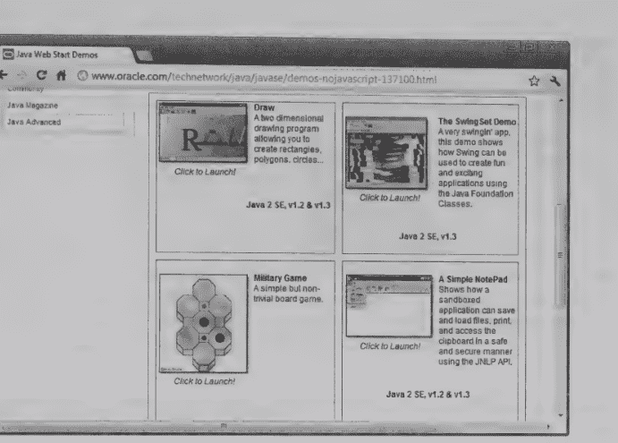

运行时环境包含 Java 插件（Java Plug-in），这是一个为浏览器增加了当前语言支持的 JVM。该环境也可以运行应用程序，无论它们是否使用 Java Web Start。

当使用 Java Web Start 运行应用程序时，会短暂出现一个标题界面，然后是应用程序的图形用户界面。

> 如果你已经安装了 NetBeans 或 JDK，那么你的计算机上可能已经有了 Java 运行环境（Java Runtime Environment）。

图 14.2 展示了 Oracle 提供的示例应用程序之一，这是一个军事策略游戏，其中三个黑点试图阻止一个红点进入它们的领地。

### 图 14.2
运行 Java Web Start 应用程序。

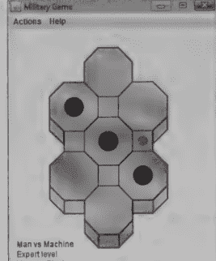

正如图 14.2 所示，该应用程序看起来与任何其他应用程序没有区别。与配合网页一起显示的 Applet 不同，通过 Java Web Start 启动的应用程序在自己的窗口中运行，就像是从命令行运行的一样。

Java Web Start 应用程序的一个不同之处是它可以向用户提供的安全性。当应用程序尝试执行某些操作（例如读取或写入文件）时，可以请求用户许可。

例如，另一个示例程序是文本编辑器。当你尝试用此应用程序第一次保存文件时，会打开“安全警告”对话框，如图 14.3 所示。

### 图 14.3
选择应用程序的安全权限。

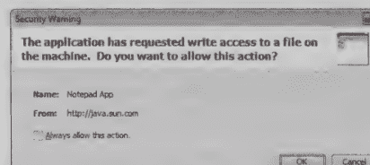

在 Java Web Start 运行应用程序后，它会被存储在用户计算机的缓存中，以便日后无需安装即可再次运行。唯一的例外是当应用程序的新版本可用时。在这种情况下，新版本将自动下载并替换现有版本。

> **注意**
>
> 虽然你是第一次使用 Web 浏览器运行 Java Web Start 应用程序，但这并不是强制性的。应用程序可以从桌面快捷方式运行。

如果 Java Web Start 应用程序存储在经过数字签名的 Java 存档中，则可以覆盖其默认的安全限制。用户将看到签名的安全证书，该证书记录了程序的作者和证明其身份的证书颁发机构，并被询问接受还是拒绝它。除非接受了证书，否则应用程序不会运行。

## 使用 Java Web Start

只要提供应用程序的 Web 服务器配置为与该技术配合，并且所需的所有类文件和其他文件已打包在一起，任何 Java 应用程序都可以使用 Java Web Start 运行。

要准备使用 Java Web Start 的应用程序，你必须将应用程序文件保存到 JAR 文件（Java 存档）中，为应用程序创建一个特殊的 Java Web Start 配置，并将文件上传到 Web 服务器。

必须使用 JNLP 创建配置文件，JNLP 是一种可扩展标记语言（XML）文件格式，它指定了应用程序的主类文件、JAR 存档以及程序的其他信息。

> **注意**
>
> XML 在第 20 天“XML Web 服务”中引入。由于 JNLP 文件的格式相对自显易懂，你不需要了解太多关于 XML 就能创建 JNLP 文件。

你将要进行的下一个项目是使用 Java Web Start 启动并运行 PageData，这是一个显示网页信息的应用程序。


### 创建 JNLP 文件

你必须做的第一件事是将应用程序的所有类文件打包成 JAR 文件，连同它所需的任何其他文件。NetBeans 会为你在 IDE 中构建的每个项目自动创建一个 JAR 文件。

由于你在之前的 13 天里所有项目都使用了同一个项目，因此现在需要一个新项目：

1. 选择 File（文件）、New Project（新建项目）。出现 New Project 对话框。
2. 在 Categories（类别）面板中选择 Java，在 Projects（项目）面板中选择 Java Applications，然后点击 Next（下一步）。打开 New Java Application 对话框。
3. 输入 PageData 作为 Project Name（项目名称）。
4. 勾选 Create Main Class（创建主类）复选框。
5. 在 Create Main Class 的文本框中输入 PageData。
6. 点击 Finish（完成）。

PageData.java 文件在 NetBeans 的源码编辑器中打开，并已为你输入了一些起始代码。删除所有这些代码以及列表 14.1 所示的作为 `com.java21days` 包中的 PageData 类的代码。

### 列表 14.1 PageData.java 的全文

```java
package com.java21days;

import java.awt.*;
import java.awt.event.*;
import java.net.*;
import java.io.*;
import javax.swing.*;

public class PageData extends JFrame implements ActionListener, Runnable {

    Thread runner;
    String[] headers = { "Content-Length", "Content-Type",
        "Date", "Public", "Expires",
        "Last-Modified", "Server" };

    URL url;
    JLabel headerLabel = new JLabel[7];
    JTextField[] header = new JTextField[7];
    JButton readPage, clearPage, quitloading;
    JLabel status;
    
    public void actionPerformed(ActionEvent evt) {
        Object source = evt.getSource();
        if (source == readPage) {
            try {
                page = new URL(url.getText());
                if (runner == null) {
                    runner = new Thread(this);
                    runner.start();
                }
                quitloading.true;
                readPage.false;
            } catch (MalformedURLException e) {
                status.setText("Bad URL: " + e.getMessage());
            }
        } else if (source == clearPage) {
            for (int i = 0; i < 7; i++) {
                header[i].setText("");
            }
            quitloading.false;
            readPage.true;
            clearPage.false;
        }
    }

    public void run() {
        URLConnection conn;
        try {
            conn = page.openConnection();
            conn.connect();
            status.setText("Connection opened...");
            for (int i = 0; i < 7; i++) {
                header[i].setText(conn.getHeaderField(headers[i]));
            }
            quitloading.false;
            readPage.true;
            clearPage.false;
            status.setText("Done");
            runner = null;
        } catch (IOException e) {
            status.setText("IO Error:" + e.getMessage());
        }
    }

    private static void setLookAndFeel() {
        try {
            UIManager.setLookAndFeel(
                "com.sun.java.swing.plaf.nimbus.NimbusLookAndFeel"
            );
        } catch (Exception exc) {
            // ignore error
        }
    }

    public static void main(String[] args) {
        PageData frame = new PageData();
    }
}
```

### 图 14.4 文件标签页
在 NetBeans 中向项目添加文件。

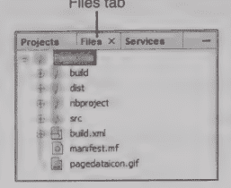

你可以在 NetBeans 中创建此文件：

1. 选择 File（文件）、New File（新建文件）。打开 New File 对话框。
2. 在 Categories（类别）窗格中选择 Other（其他）。
3. 在 File Types（文件类型）面板中选择 JNLP File。
4. 点击 Next（下一步）。出现 New JNLP File 对话框。
5. 在 File Name（文件名）字段中输入 PageData。在 Created File（已创建的文件）字段中，你会看到 NetBeans 自动为文件名添加了扩展名 .jnlp。
6. 点击 Finish（完成）。

NetBeans 在源代码编辑器中创建一个新的 JNLP 文件，并包含一些 XML 格式的文本。删除所有这些文本并输入列表 14.2 所示的代码。保存文件。

### 列表 14.2 PageData.jnlp 的完整文本

```xml
<?xml version="1.0" encoding="utf-8"?>
<!-- JNLP File for the PageData Application -->
<jnlp
    codebase="http://cadenhead.org/book/java-21-days/java"
    href="PageData.jnlp">
    <information>
        <title>PageDataApplication</title>
        <vendor>Cadenhead</vendor>
        <homepage href="http://www.java21days.com/"/>
        <icon href="pagedataicon.gif"/>
        <offline-allowed/>
    </information>
    <resources>
        <j2se version="1.8"/>
        <jar href="PageData.jar"/>
    </resources>
    <security>
        <j2ee-application-client-permissions/>
    </security>
    <application-desc main-class="PageData"/>
</jnlp>
```

由于 JNLP 文件结构化为 XML 数据，因此 `<` 和 `>` 符号之间的所有内容都是标签。标签放置在它所描述的信息周围。在信息之前有一个起始标签，在信息之后有一个结束标签。

例如，列表 14.2 的第 7 行包含以下文本：

```
<title>PageData Application</title>
```

从左到右，此行包含标签 `<title>`、文本 PageData Application 以及结束标签 `</title>`。标签之间的文本 "PageData Application" 是应用程序的标题。Java Web Start 将在应用程序加载时显示该标题。该标题也将用于菜单和快捷方式。

起始标签和结束标签之间的区别在于，结束标签以斜杠字符 (`/`) 开头，而起始标签不是。在第 8 行中，`<vendor>` 是起始标签，`</vendor>` 是结束标签，这些标签包围了创建应用程序的供应商名称。我在这里使用了我的名字。请将其删除并替换为你自己的名字，注意不要更改其周围的 `<vendor>` 或 `</vendor>` 标签。

某些标签只有起始标签，如第 11 行：

```
<offline-allowed/>
```

`offline-allowed` 标签表示即使用户未连接到互联网，也可以运行应用程序。如果 JNLP 文件中省略了该标签，情况则相反，用户将被强制在运行此应用程序之前上线。

在 XML 中，所有没有结束标签的标签都以 `/>` 结尾而不是 `>`。

标签还有属性，这是在 XML 文件中定义信息的另一种方式。属性是标签内部的名称，后面跟着一个等号和引号内的某些文本。

例如，考虑列表 14.2 的第 9 行：

```
<homepage href="http://www.java21days.com"/>
```

这是 `homepage` 标签，它有一个属性 `href`。引号标记之间的文本被用于设置该属性的值为 "http://www.java21days.com"。这定义了应用程序的主页——如果用户想了解更多关于程序及其工作原理的应该访问的网页。


# 第 14 天：开发 Swing 应用程序

PageData JNLP 文件定义了一个带有第 17-19 行定义的安全限制的 Java Web Start 应用程序：

```
<security>
<j2ee-application-client-permissions/>
</security>
```


</security>

```

除了已经描述的标签外，列表 14.2 定义了 Java Web Start 需要的其他信息。第 1 行指定文件使用 XML 和 UTF-8 字符集。第 2 行是注释。就像 Java 类中的注释一样，这段文本仅供人类查看。Java Web Start 会忽略它。从第 3 行开始到第 21 行结束的 `jnlp` 元素必须包围配置它的其他标签。在列表 14.2 中，属性表明应用程序的 JNLP 文件位于地址：

```
http://cadenhead.org/book/java-21-days/java/PageData.jnlp
```

`information` 元素（第 6-12 行）定义了关于应用程序的信息。XML 可以包含其他元素，在列表 14.2 中，`information` 元素包含了 `title`、`homepage`、`icon` 和 `offline-allowed` 标签。`title`、`vendor`、`homepage` 和 `offline-allowed` 元素之前描述过。`icon` 元素（第 10 行）包含一个 `href` 属性，指示程序的名称（或位置）。就像 JNLP 文件中的所有引用一样，此元素使用 `codebase` 属性确定资源的完整 URL。在示例中，`icon` 元素的 `href` 属性是 `pagedataicon.gif`，而 `codebase` 是 "http://cadenhead.org/book/java-21-days/java"，因此图标文件位于：

```
http://cadenhead.org/book/java-21-days/java/pagedataicon.gif
```

`resources` 元素（第 13-16 行）定义了应用程序运行时使用的资源。

# 使用 Java Web Start

`j2se` 元素有一个 `version` 属性，指示哪个版本的 JVM 应用程序。该属性可以指定通用版本（例如 "1.7" 或 "1.8"）、特定版本（例如 "1.8.0-ea"）或多个版本的引用。通用版本号后面可以跟一个加号。`<j2se version="1.6+">` 标签设置从 1.6 开始的任何 JVM 运行应用程序。注意：当你使用 `j2se` 元素指定多个版本时，Java Web Start 不使用测试版本。运行测试版应用程序的唯一方法是专门指定。

`jar` 元素有一个 `href` 属性，指定应用程序的 JAR 文件。该属性可以是文件名或文件夹引用，并使用 `codebase`。在 PageData 示例中，JAR 文件位于 http://cadenhead.org/book/java-21-days/PageData.jar。

`application-desc` 元素标识应用程序的主类文件以及执行该类时应使用的任何参数。`main-class` 属性标识类名，不带 .class 扩展名。

如果类应该有一个或多个参数，请将 `argument` 元素放在起始 `<application-desc>` 标签和结束 `</application-desc>` 标签之间。以下 XML 指定 PageData 类应两个参数运行：http://java.com 和 yes：

```
<application-desc main-class="PageData">
  <argument>http://java.com/</argument>
  <argument>yes</argument>
</application-desc>
```

你可以从我的 Web 服务器测试 PageData 应用程序，或者将其上传到自己的服务器并相应编辑 JNLP 文件。

如果你在自己的服务器上尝试，在创建 PageData.jnlp 文件后，更改列表 14.2 的第 5 行，使其指向存储应用程序 JAR 文件、图标文件和 JNLP 文件的服务器文件夹。

将项目的三个文件上传到此文件夹，然后运行浏览器并使用完整 Web 地址加载 JNLP 文件。如果你的 Web 服务器配置支持 Java Web Start，应用程序将加载并开始运行。图 14.5 显示了请求地址 http://www.java.com/ 的输出。

### 图 14.5
使用 Java Web Start 运行数据

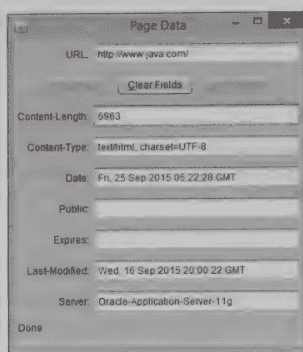

为了让此应用程序无限制运行，PageData.jar 文件必须经过数字签名。对于现实世界的应用程序，这需要证书颁发机构的服务。

自签名 JAR 文件仅适用于你自己的测试目的。目前没有任何浏览器会接受该 JAR 文件是安全的或允许用户运行它。

> 注意：建立你的 Java Web Start 应用程序可信的唯一方法是通过专业的证书颁发机构，验证你的身份并购买代码签名证书。该证书将在签名你的 JAR 文件时使用。这些公司被称为证书当局。加利福尼亚州提供了一个数字签名认证机构列表（www.tinyurl.com/calisign），对于任何需要代码签名证书的程序员来说都是一个非常有用的资源，而不限于该州。

# 在服务器上支持 Java Web Start

如果你的服务器不支持 Java Web Start，你可能会在页面上看到你的 JNLP 文件的文本，而应用程序不会打开。

必须配置 Web 服务器以识别 JNLP 文件是一种新类型的数据，它应该触发 Java 应用程序的运行。这通常通过设置与 JNLP 扩展名关联的 MIME 类型来实现。

MIME 是多用途互联网 邮件扩展（Multipurpose Internet Mail Extensions），是一种用于将 Internet 内容定义为电子邮件消息、附件以及任何可以由 Web 服务器传输的文件的协议。

在 Apache Web 服务器上，通过向服务器的 `mime.types`（或 `.mime.types`）文件添加以下行来支持 JNLP：
```
application/x-java-jnlp-file JNLP
```

如果你无法在服务器上运行 Java Web Start，可以在书籍的官方网上测试此项目。加载网页 http://cadhead.org/book/java-21-days/java/PageData.jnlp。

> Java Web Start 应用在通过其他方式运行时，看起来应该和应用程序完全一样。然而，在图形用户界面组件分配的空间配额上，似乎存在一些 Bug。在 Windows 系统上，你可能在使用 Java Web Start 应用程序之前，需要向应用程序的高度增加 50 像素。否则，文本字段的高度不够显示数字。

### 额外的 JNLP 元素

JNLP 格式还包含其他影响 Java Web Start 性能的元素。

它可以用于更改应用程序启动时显示的标题图形、运行具有不同安全权限的已签名应用程序、使用不同版本的 JVM 运行应用程序以及其他选项。

### 安全

默认情况下，所有 Java Web Start 都被拒绝访问用户计算机的某些功能，除非用户已授予权限。这类似于 applet 的功能限制。

如果你的应用程序的 JAR 文件已通过数字签名以验证其真实性，你可以使用 `security` 元素在不受到这些安全限制的情况下运行它。

该元素放置在 `jnlp` 元素内部，它包含自己的一个元素：`all-permissions`。要为 Web Start 运行的应用程序应用标准的安全限制，请将此内容添加到 JNLP 文件：

```
<security>
  <j2ee-application-client-permission/>
</security>
```

如果使用了 `all-permissions` 标签，则应用程序将没有任何安全限制。这对用户安全有重大影响，因此应谨慎操作。

### 描述

如果你想为 Java Web Start 提供更多应用程序信息，可以在 `information` 元素内部放置一个或多个 `description` 元素。

可以使用 `description` 元素的 `kind` 属性提供四种描述：

- `kind="one-line"`——简短的一行描述，用于 Web Start 应用程序列表
- `kind="short"`——一个段落长度的描述，在空间允许时使用
- `kind="tooltip"`——工具提示（ToolTip）描述
- 无 `kind` 属性——默认描述，用于指定的任何其他描述

所有这些都是可选的。这里是一个为 PageData 应用程序提供描述的示例：

```
<description>PageData 应用程序。</description>
<description kind="one-line">一个用于学习更多服务器和页面的应用程序。</description>
<description kind="tooltip">了解 Web 服务器和页面。</description>
<description kind="short">PageData 是简单的 Java 应用程序，接收 URL 并显示有关该 URL 以及交付它的服务器的信息。</description>
```

### 图标

PageData JNLP 文件包含一个 64×64 的图标 `pagedataicon.gif`，以两种不同的方式使用：

- 当 Java Web Start 加载 PageData 应用程序时，图标显示在程序名称和作者旁边的窗口中。
- 如果将 PageData 图标添加到用户的桌面上，图标将以不同的尺寸使用：32×32。

当应用程序加载时，你可以使用第二个 `icon` 元素来指定一个替代图标、标题和作者的图形。这种图形被称为应用程序的启动屏幕（splash screen），如示例所示，通过 `kind="splash"` 属性进行指定：

```
<icon kind="splash" href="pagedatasplash.gif" width="300" height="200" />
```

`width` 和 `height` 属性也可以用于其他类型的图标图形，它们指定了图像以像素为单位的显示大小。

第二个 `icon` 元素应该放置在 `information` 元素内部。

> 注意
有关在 way自己的应用程序中使用该技术的信息，请访问 Oracle 的 Java 网站：http://oracle.com/technetwork/java/javase/javawebstart

# 使用 SwingWorker 提高性能

Swing 应用程序的响应能力很大程度上取决于软件处理响应用户输入时的耗时任务的能力。

应用程序通常在一个线程中执行任务。因此，如果某些操作需要很长时间才能完成（例如加载大文件或解析来自 XML 文档的数据），用户可能会在此过程中注意到性能延迟。

Swing 程序还要求所有用户界面组件运行在同一个线程中。

同时满足这两项要求的最佳方法是使用 `SwingWorker`，它是 `javax.swing` 包中的一个类，设计用于在自己的工作线程中运行耗时任务并报告结果。


# 开发 SwingWorker

```java
package com.java1days;

import javax.swing.*;

public class DiceWorker extends SwingWorker<int[], Void> {

    int timesToRoll;

    // 设置 worker

    public DiceWorker(int timesToRoll) {

        super();

        this.timesToRoll = timesToRoll;

    }

    // 定义任务

    protected int[] doInBackground() {

        int[] result = new int[timesToRoll];

        for (int i = 0; i < timesToRoll; i++) {

            int sum = 0;

            for (int j = 0; j < 3; j++) {

                sum += (int)(Math.random() * 6);

            }

            result[i] = sum + 1;

        }

        // 传输结果

        return result;

    }

}
```

### 列表 14.4 DiceRoller.java 的全文

```java
package com.java21days;

import java.awt.*;
import java.awt.event.*;
import java.beans.*;
import javax.swing.*;

public class DiceRoller extends JFrame implements ActionListener {

  PropertyChangeListener; // 注意：此处原始 OCR 似乎不完整，缺少变量名

  // 用于存储骰子结果的表格
  JTextField[] total = new JTextField[16];

  // “Roll” 按钮
  JButton roll;

  // 掷骰子的次数
  JTextField quantity;

  // Swing worker
  DiceWorker worker;

  public DiceRoller() {
    super("DiceRoller");
    setDefaultCloseOperation(JFrame.EXIT_ON_CLOSE);
    setLookAndFeel(null);
    setSize(850, 145);

    // 设置顶行
    JPanel topPane = new JPanel();
    GridLayout gridLayout = new GridLayout(1, 16);
    topPane.setLayout(gridLayout);

    for (int i = 0; i < 16; i++) {
      // 创建文本字段和标签
      total[i] = new JTextField("0", 4);
      JLabel label = new JLabel((i + 3) + " : ");

      // 在网格中创建单元格
      JPanel cell = new JPanel();
      cell.add(label);
      cell.add(total[i]);

      // 将单元格添加到顶行
      topPane.add(cell);
    }

    // 设置底行
    JPanel bottomPane = new JPanel();
    JLabel quantityLabel = new JLabel("Times to Roll:");
    quantity = new JTextField("0", 5);
    roll = new JButton("Roll");
    roll.addActionListener(this);

    bottomPane.add(quantityLabel);
    bottomPane.add(quantity);
    bottomPane.add(roll);

    // 设置框架
    GridLayout frameGrid = new GridLayout(2, 1);
    setLayout(frameGrid);
    add(topPane);
    add(bottomPane);
    setVisible(true);
  }

  // 当点击“Roll”按钮时的响应
  public void actionPerformed(ActionEvent event) {
    int timesToRoll;
    try {
      // 禁用按钮
      timesToRoll = Integer.parseInt(quantity.getText());
      roll.setEnabled(false);

      // 设置负责掷骰子的 worker
      worker = new DiceWorker(timesToRoll);

      // 添加监控 worker 的监听器
      worker.addPropertyChangeListener(this);

      // 启动 worker
      worker.execute();
    } catch (Exception exc) {
      System.out.println(exc.getMessage());
      exc.printStackTrace();
    }
  }

  // 当 worker 任务完成时的响应
  public void propertyChange(PropertyChangeEvent event) {
    try {
      // 获取 worker 的骰子掷结果
      int[] result = (int[])worker.get();

      // 将结果存储在文本字段中
      for (int i = 0; i < result.length; i++) {
        total[i].setText("" + result[i]);
      }
```


```java
} catch (Exception exc) {
    System.out.println(exc.getMessage());
    exc.printStackTrace();
}
}

private static void setLookAndFeel() {
    try {
        UIManager.setLookAndFeel(
            "com.sun.java.swing.plaf.nimbus.NimbusLookAndFeel");
    } catch (Exception exc) {
        // 忽略错误
    }
}

public static void main(String[] arguments) {
    new DiceRoller();
}
}
```

该类可以作为应用程序运行。在 NetBeans 中选择 Run、Run File。

`DiceRoller` 的大部分工作是创建并布局用户界面组件：16 个文本字段、掷骰子次数文本字段以及一个 Roll 按钮。

`actionPerformed()` 方法响应点击 Roll 按钮的操作，其逻辑是创建一个负责掷骰子的 worker，添加属性变化监听器并启动任务。

调用 `worker.execute()` 即可启动该过程。

# 第三周

# Java 编程

- 15 输入与输出操作
- 16 使用内部类和闭包
- 17 跨网络通信
- 18 使用 JDBC 4.2 和 Derby 访问数据库
- 19 读取和写入 RSS 馈送
- 20 XML Web 服务
- 21 使用 Java 编写 Android 应用

# 第 15 天
输入与输出操作

你用 Java 创建的许多程序都需要与某种数据源进行交互。信息可以以多种方式存储在计算机中，包括硬盘或 DVD 上的文件、网站页面，甚至是计算机内存中的字节。

你可能认为需要用不同的技术来处理每种存储设备。幸运的是，事实并非如此。

在 Java 中，可以使用名为“流”（streams）的通信系统来存储和检索信息，这些流在 `java.io` 包中实现，并由 `java.nio.file` 包增强。

今天，你将学习如何创建输入流来读取信息以及输出流来存储信息。你将处理以下内容：

- 字节流（Byte streams）：用于处理字节、整数和其他简单数据类型
- 字符流（Character streams）：处理文本文件和其他文本源

当你学会如何使用输入流，你可以以相同的方式处理所有数据，无论信息来自磁盘、互联网还是另一个程序。使用输出流传输数据也是如此。

# 流简介

在 Java 中，所有数据的读写都是通过流完成的。流就像同名的流水，将东西从一个地方传递到另一个地方。

流是数据在程序中传输的路径。输入流将数据从源发送到程序，输出流将数据从程序发送到目的地。

你今天将处理两种流：字节流和字符流。字节流携带范围从 0 到 255 的整数。各种数据可以用字节格式表示，包括数值数据、可执行程序、互联网通信和字节码——即 Java 虚拟机（JVM）运行的类文件。

事实上，想象到的任何类型的数据都可以使用单个字节或一系列字节来表示。

字符流是字节流的一种特殊类型，仅用于处理文本数据。它们与字节流的区别在于，Java 的字符集支持 Unicode，该标准包含了许多比字节容易表示的得多的字符。

任何涉及文本的数据都应该使用字符流，包括文本文件、页面和其他常见的文本类型。

## 使用流

在 Java 中使用字节流或字符流的步骤大部分相同。在开始处理 `java.io` 和 `java.nio.file` 类的具体细节之前，走一遍创建和使用流的过程很有帮助。

对于输入流，第一步是创建一个与数据源关联的对象。例如，如果源是硬盘上的一个文件，则可以创建一个 `FileInputStream` 对象与该文件关联。

获取一个流对象后，你可以使用该对象的方法之一从流中读取信息。`FileInputStream` 包含一个 `read()` 方法，该方法会返回文件中的一个字节。

当你完成从流中读取信息时，调用 `close()` 方法表示你已完成对该流的使用。

对于输出流，你从创建一个与数据目的地关联的对象开始。其中一个对象可以从 `BufferedWriter` 类创建，它代表了创建文本文件的高效方式。

`write()` 方法是向输出流目的地发送信息最简单的方法。例如，`BufferedWriter` 的 `write()` 方法可以将单个字符发送到输出流。

与输入流一样，当没有更多信息要发送时，会在输出流上调用 `close()` 方法。

### 过滤流

使用流的最简单方法是创建它，然后调用它的方法发送或接收数据，取决于它是输出流还是输入流。

任何涉及文本的数据都应该使用字符流，包括文本文件、页面和其他常见的文本类型。

使用流的步骤如下：

1. 创建与源或目的地关联的流。
2. 使用方法读取或写入数据。
3. 完成后关闭流。

## 异常处理

在处理流时会发生几种异常。两种常见的有：

- `FileNotFoundException`：当无法找到文件时发生。
- `EOFException`：表示已到达流的末尾。

### 列表 15.1 ByteReader.java 的完整文本

```java
1: package com.java21days;
2:
3: import java.io.*;
4:
5: public class ByteReader {
6:     public static void main(String[] arguments) {
7:         try {
8:             FileInputStream file = new
9:                 FileInputStream("save.gif")
10:
11:        }
12:
13:            boolean eof = false;
14:            int count = 0;
15:            while (!eof) {
16:                int input = file.read();
17:                System.out.print(input + " ");
18:                if (input == -1)
19:                    eof = true;
20:                else
21:                    count++;
22:            }
23:            file.close();
24:            System.out.println("\nBytes read: " + count);
25:
26:        } catch (IOException e) {
27:            System.out.println("Error - " + e.toString());
28:
29:        }
30: }
```

该应用程序从 Java21 项目主文件夹下的 `save.gif` 文件读取字节数据。该文件在第 10 天“构建 Swing 界面”中使用过。

当你运行程序时，`save.gif` 中的每个字节都会被显示出来，随后是字节总数的计数。图 15.1 显示了输出。

### 图 15.1
从文件中读取字节数据。

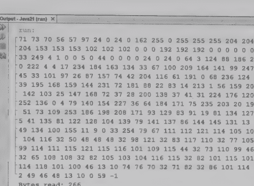

## 输出流
可以使用 `FileOutputStream(String)` 构造函数创建一个文件输出流。其用法与 `FileInputStream(String)` 构造函数相同，你可以指定路径以及文件名。

在指定与输出流关联的文件时必须小心。如果它与原始文件相同，那么在向流中写入数据时，原始文件将被清空。

你可以使用 `FileOutputStream(String, boolean)` 构造函数创建一个可以在文件末尾追加数据的文件输出流。字符串指定文件，而 `Boolean` 参数应等于 `true`，而不是覆盖现有数据。

文件输出流的 `write(int)` 方法用于向流中写入字节。在最后一个字节被写入文件后，流的 `close()` 方法会关闭该流。

若要写入多个字节，可以使用 `write(byte[], int, int)` 方法。它的工作方式与之前描述的 `read(byte[], int, int)` 方法类似。该方法的参数是包含要输出字节的字节数组、数组中的起始位置以及要写入的字节数。

### 列表 15.2 ByteWriter.java 的完整文本

```java
1: package com.java21days;
2:
3: import java.io.*;
4:
5: public class ByteWriter {
6:     public static void main(String[] args) {
7:         int[] data = {71
```

程序中发生了以下情况：

- 7–12 行创建了一个整数数组并填充元素。
- 13–14 行根据 NetBeans 主文件夹中的文件名 `save.gif` 创建文件输出流。
- 16–18 行使用 `for` 循环遍历数组并将每个元素写入文件。
- 19 行关闭输出流。

`OutputStream` 对象创建在 `try` 语句的括号内，以确保即使发生错误也能释放资源。

运行此程序后，你可以在任何浏览器或图形编辑工具中显示 `save.gif` 文件。它是一个 GIF 格式的小图像，如图 15.2 所示。

### 图 15.2
save.gif 文件（放大后）。


### 过滤流
过滤流是可以通过现有流修改信息的流。它们使用 `FileInputStream` 和 `FilterOutputStream` 子类创建。

这些类本身不处理任何过滤操作。相反，它们拥有子类（如 `BufferedInputStream` 和 `DataOutputStream`），用于特定类型的过滤。

### 字节过滤器
如果信息可以大块发送，处理速度会更快，即使接收速度超过了处理速度。

例如，考虑以下阅读方法哪种更快：

- `BufferedInputStream(InputStream)` 创建一个缓冲区输入。
- `BufferedOutputStream(OutputStream)` 创建一个缓冲区输出。

### 缓冲流
如果信息可以大块发送，处理速度会更快，即使接收速度超过了处理速度。

例如，考虑以下阅读方法哪种更快：

- `BufferedInputStream(InputStream)` 创建一个缓冲区输入。
- `BufferedOutputStream(OutputStream)` 创建一个缓冲区输出。

```java
44:    } catch (IOException e) {
45:        System.out.println("Exception: " + e.getMessage());
46:        return false;
47:    }
48:    }

49:

50:    boolean readStream() {
51:        try (FileInputStream file = new
52:            FileInputStream("numbers.dat");
53:            BufferedInputStream buff = new
54:            BufferedInputStream(file)) {
55:
56:            int in;
57:            do {
58:                in = buff.read();
59:                if (in != -1) {
60:                    System.out.println(" " + in);
61:                }
62:            } while (in != -1);
63:            System.out.println();
64:            buff.close();
65:        } catch (IOException e) {
66:            System.out.println("Exception: " + e.getMessage());
67:            return false;
68:        }
69:    }
```

此程序的输出取决于运行时运行时指定的两个参数。如果你使用 3 和 19，输出如图 15.3 所示。

### 图 15.3
读取和写入缓冲流。

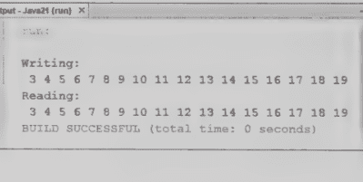

它也可以在不带任何参数的情况下运行，并使用 1 和 255 作为默认值。

此应用程序使用了两个类：`BufferDemo` 和一个名为 `ArgStream` 的辅助类。如果提供了两个参数的值，`BufferDemo` 会获取并在 `ArgStream()` 构造函数中使用它们。

### 过滤流

`ArgStream` 的 `writeStream()` 方法在第 17 行调用，用于将系列字节写入缓冲输出流；`readStream()` 方法在第 19 行调用，用于读取这些字节。

尽管它们在两个方向上移动数据，但 `writeStream()` 和 `readStream()` 方法本质是相同的。它们采用以下格式：

- 文件名 `numbers.dat` 用于创建文件输入或输出流。
- 文件流用于创建缓冲输入或输出流。
- 缓冲流的 `write()` 方法用于发送数据，或 `read()` 方法用于接收数据。
- 关闭缓冲流。

由于文件流和缓冲流在发生错误时会抛出 `IOException` 对象，因此所有涉及流的操作都封装在针对该异常的 `try-catch` 块中。

> 提示：`writeStream()` 和 `readStream()` 中的布尔返回值表示流操作是否成功完成，但让这些方法的调用者知道是否发生了错误是一个良好的编程习惯。当得值为 `false` 时，可以尝试重新操作。

# 控制台输入流

经验丰富的程序员在开始学习 Java 时怀念的一点，是在运行应用程序时从控制台读取文本或数字输入的能力。没有任何输入方法可以与 `System.out.print()` 和 `System.out.println()` 输出方法相拟。

现在你已经能够处理缓冲输入流，可以使用它们来接收控制台输入。

`System` 类属于 `java.lang` 包，有一个名为 `in` 的类变量，它是一个 `InputStream` 对象。该对象通过流从键盘接收输入。

你可以像处理任何其他输入流一样处理此流。以下语句创建了一个与 `System.in` 输入流关联的新缓冲输入流：

```java
BufferedInputStream command = new BufferedReader(System.in);
```

下一个项目 `ConsoleInput` 类包含一个类方法，你可以在任何 Java 应用程序中使用该方法来接收控制台输入。在 NetBeans 中输入列表 15.4 所示的代码，确保将其放在 `com.java21days` 包中。

### 列表 15.4 ConsoleInput.java 的完整文本

```java
1: package com.java21days;
2:
3: import java.io.*;
4:
5: public class ConsoleInput {
6:     public static String readLine() {
7:         StringBuilder response = new StringBuilder();
8:         try (BufferedInputStream buff = new
9:             BufferedInputStream(System.in)) {
10:                int in;
11:                char inChar;
12:                do {
13:                    in = buff.read();
```


# 第 15 天：处理输入和输出

## ConsoleInput 类示例

```java
14:                    inChar = (char) in;
15:                    if ((in != -1) && (in != '\n') && (in != '\r')) {
16:                        response.append(inChar);
17:                    }
18:                } while ((in != -1) && (inChar != '\n') && (in != '\r'));
19:                buff.close();
20:            }
21:            return response.toString();
22:        }
23:        catch (IOException e) {
24:            System.out.println("Exception: " + e.getMessage());
25:            return null;
26:        }
27:    }
}
```

`ConsoleInput` 类包含一个 `main()` 方法，演示了如何使用它。当你将其作为应用程序编译并运行时，其输出应该类似于图 15.4 所示。

`ConsoleInput` 通过缓冲输入流使用 `read()` 方法读取输入，该方法在到达输入末尾时返回 -1。这发生在用户按下回车键时。

### 图 15.4 控制控制台输入


## 数据流

当你需要处理不是字节或字符表示的数据时，可以使用数据输入和输出流。这些流过滤字节流，以便直接读取或写入以下原始类型：`boolean`、`byte`、`double`、`float`、`int`、`long` 和 `short`。

数据输入流通过 `DataInputStream(InputStream)` 构造函数创建。参数应该是一个缓冲输入流。

数据输出流需要 `DataOutputStream(OutputStream)` 构造函数，指示关联的输出流。

以下读写方法分别适用于数据输入输出流：

- `readBoolean()`, `writeBoolean()`
- `readByte()`, `writeByte()`
- `readDouble()`, `writeDouble()`
- `readFloat()`, `writeFloat()`
- `readInt()`, `writeInt()`
- `readLong()`, `writeLong()`
- `readShort()`, `writeShort()`

每个输入方法返回方法名所示的原始类型。例如，`readFloat()` 返回 `float`。

还有 `readUnsignedByte()` 和 `readUnsignedShort()` 方法用于读取无符号字节和短整数。Java 不支持这些数据类型，因此它们作为 `int` 值返回。

数据输入流的方法不返回可以指示到达流末尾的值。作为替代方案，你可以等待 `EOFException`（文件结束异常）在读取方法到达流末尾时抛出。读取数据的循环可以封装在 `try` 块中，相关的 `catch` 语句应处理 `EOFException`。你可以在 `catch` 块中关闭流并处理其他清理工作。

在下一个项目中进行了演示。列表 15.5 和 15.6 包含两个数据流的程序。`PrimeWriter` 程序将前 400 个质数作为整数写入名为 `400primes.dat` 的文件。`PrimeReader` 程序从该文件中读取并显示它们。两个类都在 `com.java21days` 包中。

### 列表 15.5 PrimeWriter.java 的完整代码

```java
25:      DataOutputStream data = new
26:      DataOutputStream(buff);
27:  } {
28:
29:      for (int i = 0; i < 400; i++)
30:          data.writeInt(primes[i]);
31:      data.close();
32:  catch (IOException e) {
33:      System.out.println("Error - " + e.toString());
34:  }
35:  }
36:
37:  public static boolean isPrime(int checkNumber) {
38:      double root = Math.sqrt(checkNumber);
39:      for (int i = 2; i <= root; i++)
40:          if (checkNumber % i == 0)
41:              return false;
42:
43:      return true;
44:  }
45 }
```

### 列表 15.6 PrimeReader.java 的完整代码

```java
1: package com.java21days;
2:
3: import java.io.*;
4:
5: public class PrimeReader {
6:     public static void main(String[] arguments) {
7:         try (FileInputStream file = new
8:                 FileInputStream("400primes.dat");
9:             BufferedInputStream buff = new
10:            BufferedInputStream(file);
11:             DataOutputStream data = new
12:             DataOutputStream(buff)) {
13:
14:             try {
15:                 while (true) {
16:                     int in = data.readInt();
17:                     System.out.print("" + in + " ");
18:                 }
19:             } catch (EOFException eof) {
20:                 buff.close();
21:
22:             } catch (IOException e) {
23:                 System.out.println("Error - " + e.toString());
24:             }
25:         }
26: }
```

PrimeWriter 应用的大部分逻辑用于寻找前 400 个质数。在你拥有一个包含前 400 个质数的整数数组后，它会被写入列表 15.5 第 19–34 行所示的数据输出流中。

该应用程序是一个在流上使用多个过滤器的示例。该流通过三个步骤开发：

1. 创建一个与名为 `400primes.dat` 文件关联的文件输出流。
2. 将一个缓冲输出流与文件流关联。
3. 将一个新的数据输出流与缓冲流关联。

数据流的 `writeInt()` 方法被用于将质数写入文件。

PrimeReader 应用简单简单，因为它不需要对质数进行任何操作。它只是使用数据输入流从文件中读取整数。

PrimeReader 的第 7–12 行与 PrimeWriter 应用中的语句几乎相同，不同之处在于使用了输入类而不是输出类。

处理 `IOException` 对象的 try-catch 块位于列表 15.6 的第 14–21 行。加载数据的工作在 `try-with-resources` 块中，该块是在第 7 天“异常与线程”中引入的。这种方法确保了输入流对象在不再需要时被正确关闭。

`while(true)` 语句创建了一个无限循环。这并不是问题；当读取数据流并在某处遇到流的结尾时，会自动发生 `EOFException`。列表 15.6 第 16 行的 `readInt()` 方法从流中读取整数。

PrimeReader 应用输出的最后几行如图 15.5 所示。

### 图 15.5 PrimeReader 输出示例

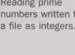

```
Output: Java2(int)

131 2137 2141 2149 2153 2161 2179 2203 2207 2213 2221
2237 2239 2243 2251 2257 2267 2269 2273 2281 2287 2295 2297
2309 2311 2333 2335 2339 2341 2347 2351 2357 2371 2373
2381 2383 2389 2393 2399 2411 2417 2423 2437 2441 2444 2447
2459 2467 2473 2477 2503 2521 2522 2531 2539 2543 2549 2551
2557 2577 2591 2593 2597 2609
```

构建成功（总耗时: 0 秒）

## 字符流

在了解如何处理字节流后，你就拥有了处理字符流所需的技能。字符流用于处理由 ASCII 字符集或 Unicode 表示的任何文本。可以通过字符流处理的文件示例包括纯文本文件、网页和源文件。用于读取和写入这些流的类都是 `Reader` 和 `Writer` 的子类。

### 读取文本

`FileReader` 是从文件读取字符流时使用的主类。它继承自 `InputStreamReader`，后者读取字节流并将其转换为 Unicode 字符的整数值。字符输入流使用 `FileReader(String)` 构造函数与文件关联。字符串指示文件名，并包含路径。以下语句创建一个名为 `look` 的新 `FileReader` 并将其与 `index.txt` 关联：

```java
FileReader look = new FileReader("index.txt");
```

拥有 reader 后，你可以调用它的方法从文件中读取字符：

- `read()` 返回流上的下一个字符（整数形式）。
- `read(char[], int)` 将字符读取到指定的数组中。

该方法与字节输入类的方法类似。它不是返回下一个字符，而是返回读取的字符数；如果在到达流之前之前没有读取字符，则返回 -1。以下方法使用 `FileReader` 对象加载文本并显示其字符：

```java
FileReader text = new FileReader("readme.txt");
int inByte;
do {
  inByte = text.read();
  if (inByte != -1) {
    System.out.print((char) inByte);
  }
} while (inByte != -1);
System.out.println("\n");
text.close();
```

由于字符流的 `read()` 方法返回整数，在显示它、将其存储在数组中或用于形成字符串之前，必须对其进行转换。每个字符都有代表其在 Unicode 字符集中位置的代码。从流中读取的整数就是该代码。

如果你想一次读取整行文本而不是逐字符读取文件，可以使用结合 `FileReader`。`BufferedReader` 读取输入并缓冲以提高效率。你需要一个现有的 `Reader` 来创建缓冲版本。可以使用以下构造函数创建 `BufferedReader`：

- `BufferedReader(Reader)` 创建与指定 `Reader` 对象（如 `FileReader`）关联的缓冲字符流。
- `BufferedReader(Reader, int)` 创建与指定 `Reader` 和大小为 `int` 的缓冲区关联的缓冲字符流。

可以使用为 `FileReader` 描述的 `read()` 和 `read(char[], int)` 方法读取字符流。你可以使用 `readLine()` 方法读取一行文本。`readLine()` 方法返回流上下一行文本的 `String` 对象，但不包括表示行结束的字符。如果到达流的末尾，返回字符串的值等于 `null`。

行尾由以下任何一种情况指示：

- 换行符 (`'\n'`)
- 回车符 (`'\r'`)
- 回车符后跟换行符 (`'\r\n'`)

### 列表 15.7 SourceReader.java 的完整代码

```java
1: package com.java21days;
2:
3: import java.io.*;
4:
5: public class SourceReader {
6:    public static void main(String[] arguments) {
7:        try {
8:            FileReader file = new
9:                FileReader("SourceReader.java");
10:            BufferedReader buff = new
11:            BufferedReader(file);
12:
13:            boolean eof = false;
14:            while (!eof) {
15:                String line = buff.readLine();
16:                if (line == null) {
17:                    eof = true;
18:                } else {
19:                    System.out.println(line);
20:                }
21:            }
22:            buff.close();
23:        } catch (IOException e) {
24:            System.out.println("Error - " + e.toString());
25:        }
26:
27: }
```

此程序的很多部分与今天早些创建的项目相当：

- **第 8–9 行**：创建了一个输入源：与文件 `SourceReader.java` 关联的 `FileReader` 对象。
- **第 10–11 行**：该输入源关联了一个缓冲过滤器：`BufferedReader buff`。
- **第 13–21 行**：在 while 循环内部使用 `readLine()` 方法逐行读取文本文件。当方法返回值 `null` 时，循环结束。

在运行程序之前，请在 Java21 项目的根目录中复制 `SourceReader.java`。要这样做，请遵循以下步骤：

1. 在 Projects 格中，右键点击 `SourceReader.java` 并选择 Copy。该文件已复制到剪贴板。
2. 点击文件（Files）窗格将其置于顶层。
3. 在文件窗格顶部的 Java21 上点击右键；然后选择粘贴。

该文件夹将出现一个副本。运行程序查看 SourceReader 应用程序的输出——文本文件 `SourceReader.java`。

### 写入文本文件

`FileWriter` 类用于向文件写入字符流。它是 `OutputStreamWriter` 的子类，具有将 Unicode 字符代码转换为字节的行为。

有两个 `FileWriter` 构造函数：`FileWriter(String)` 和 `FileWriter(String, boolean)`。字符串表示字符流将指向的文件名。如果要把内容追加到现有文件，则可选的布尔参数应等于 `true`。与其他流写入类一样，在追加数据时，你必须小心不要意外覆盖现有文件。

`FileWriter` 的三种方法可以向流中写入数据：

- `write(int)` 写入一个字符。
- `write(char[], int, int)` 从指定的字符数组写入字符，带有指定的起始点和写入的字符数量。
- `write(String, int, int)` 从指定的字符串写入字符，带有指定的起始点和写入的字符数量。

以下示例使用 `FileWriter` 类和 `write(int)` 方法向文件写入字符流：

```java
FileWriter letters = new FileWriter("alphabet.txt");
for (int i = 0; i < 26; i++)
    letters.write((char) i);
letters.close();
```

`close()` 方法用于在所有字符发送到目标文件后关闭流。以下是该代码生成的 `alphabet.txt` 文件：

```
ABCDEFGHIJKLMNOPQRSTUVWXYZ
```


`BufferedWriter` 类可用于写入缓冲字符流。该类的对象通过 `BufferedWriter(Writer)` 或 `BufferedWriter(Writer, int)` 构造函数创建。`Writer` 参数可以是任何字符输出流类，例如 `FileWriter`。可选的第二个参数是一个整数，表示要使用的缓冲区的大小。

`BufferedWriter` 具有与 `FileWriter` 相同的三个输出方法：`write(int)`、`write(char[], int, int)` 和 `write(String, int, int)`。

另一个输出方法是 `newLine()`，它向运行程序的平台发送首选的换行符（或字符）。

> 不同的换行符在文件从一个操作系统传输到另一个操作系统时会导致转换麻烦，例如当 Windows 10 用户将文件上传到运行 Linux 操作系统的 Web 服务器时。使用 `newLine()` 而不是字面量如 `\n` 可以让你的程序在不同平台上更加友好。

调用 `close()` 方法是为了关闭缓冲字符流并确保所有缓冲数据都发送到流的目标地。

# 文件与路径

在目前为止的所有示例中，都使用字符串来引用涉及流操作的文件。这对于使用文件和流的程序来说通常是足够的，但如果你想复制或重命名文件或处理其他任务，可以使用 `java.nio.file` 包中的 `Path` 对象。

`Path` 代表文件或文件夹引用。这是对 `java.nio.file` 包中 `File` 类的改进。以下语句获取与指定字符串匹配的路径：

```
Path source = FileSystems.getDefault().getPath("essay.txt");
```

这是一个两步过程。首先，调用 `FileSystem` 类的类方法。`getDefault()` 方法返回一个代表计算机存储方式的 `FileSystem` 对象。这两个类都位于 `java.nio.file` 包中。

一旦你有了 `FileSystem` 对象，它的 `getPath(String)` 方法就会返回一个与指定的文件或文件夹引用匹配的 `Path` 对象。

通过调用后者的类 `toFile()` 方法，可以从 `Path` 创建文件对象，语句如下：

```
File sourceFile = source.toFile();
```

# 第 15 天：输入输出操作

可以通过调用 `File` 的 `toPath()` 方法从 `File` 创建 `Path` 对象。

在处理文件时，你可以调用 `java.nio.file` 包中 `Files` 类的几个类方法。

`move(Path, Path)` 类方法将文件从第一个路径参数重命名为第二个。

`delete(Path)` 类方法删除该文件。

就像任何文件操作一样，必须小心处理这些方法以避免删除错误的文件或抹除数据。如果进程没有删除权限，这些方法将抛出 `SecurityException`；如果路径不存在，则抛出 `NoSuchFileException`；对于其他错误抛出 `IOException`。因此，这些异常必须通过 `try-catch` 块或 `throws` 子句进行处理。列表 15.8 中的 `AllCaps` 应用程序将所有文本转换为大写。文件被拉入缓冲输入流，一次读取一个字符。在字符转换为大写后，使用缓冲输出流将其发送到临时文件。列表 15.8 AllCaps.java 的全文。

```java
package java2days;

import java.io.*;
import java.nio.file.*;

public class AllCapsDemo {
    public static void main(String[] arguments) {
        if (arguments.length < 1) {
            System.out.println("You must specify a filename");
            System.exit(-1);
        }
        AllCaps cap = new AllCaps(arguments[0]);
        cap.convert();
    }
}

class AllCaps {
    String sourceName;
    AllCaps(String sourceArg) {
        sourceName = sourceArg;
    }
    void convert() {
        try {
            FileSystem fs = FileSystems.getDefault();
            Path source = fs.getPath(sourceName);
            Path temp = fs.getPath("tmp");
            BufferedReader in = new BufferedReader(new FileReader(source.toFile()));
            BufferedWriter out = new BufferedWriter(new FileWriter(temp.toFile()));
            boolean eof = false;
            int inChar;
            do {
                inChar = in.read();
                if (inChar != -1) {
                    out.write(Character.toUpperCase(inChar));
                } else {
                    eof = true;
                }
            } while (!eof);
            in.close();
            out.close();
            Files.delete(source);
            Files.move(temp, source);
        } catch (IOException se) {
            System.out.println("Error - " + se.toString());
        }
    }
}
```

在运行程序之前，你需要一个可以转换为全大写的文本文件。一种方案是复制 `AlphaCaps.java` 并将其命名为 `alphabet.txt`。该文件应存储在根目录下，并作为命令行参数指定。

使用主 `java.lang` 包中的 `System` 类，它不需要导入。

调用 `System` 类的 `getProperty(String)` 方法并传入要获取的属性名称，例如所示：

```
String userFolder = System.getProperty("user.dir");
```

该方法返回字符串形式的路径。

- `FileWriter` 类有一个 `write(int)` 方法，用于向文件发送一个字符。这不应该是 `write(char)` 吗？
- `char` 和 `int` 类型在许多情况下是可以互换的；你可以在期望 `char` 的方法中使用 `int`，反之亦然。这是可能的，因为每个字符都由一个整数整数的数值代码来表示。当你用一个 `int` 值调用 `write()` 方法时，它会输出与该整数值关联的字符。在调用 `write()` 方法时，你可以将 `int` 值强制转换为 `char`，以确保其按预期使用。

## 测验

通过完成这个包含三个问题的测验来回顾今天的内容。

### 问题

- 当使用现有文件的引用创建 `FileOutputStream` 时会发生什么？
  - 抛出一个异常。
  - 你写入流的数据会被追加到现有文件中。
  - 现有文件会被你写入流的数据所替换。
- 在处理流时，哪两个原始类型是可以互换的？
  - `byte` 和 `boolean`
  - `char` 和 `int`
  - `byte` 和 `char`
- 在 Java 中，`byte` 变量的最大值和流中无符号 `byte` 的最大值是多少？
  - 两者都是 255。
  - 两者都是 127。
  - `byte` 变量为 127，无符号 `byte` 为 255。

### 答案

- 1. C. 这是使用输出流时需要注意的事项之一；你可以很容易地擦掉现有文件。构造函数可以使用 `Boolean` 值来向文件追加数据，而不是替换整个文件。
- 2. B. 因为 Java 在内部将 `char` 表示为整数值，所以你通常可以在方法调用或其他语句中互换使用二者。
- 3. C. `byte` 原始数据类型的值范围从 -128 到 127，而无符号 `byte` 的范围可以是 0 到 255。

### 认证练习

以下问题是你在 Java 编程认证考试中可能会遇到的类型。请在不看今天的内容或使用 Java 编译器测试代码的情况下回答它。

给定：

```java
import java.io.*;

public class Unknown {
    public static void main(String[] arguments) {
        String command = "";
        BufferedReader br = new BufferedReader(
            InputStreamReader(System.in));
        try {
            command = br.readLine();
        } catch (IOException e) {
        }
    }
}
```

此程序是否能成功将一行控制台输入存储在字符串对象 `command` 中？

- A. 是。
- B. 否，因为需要缓冲输入流才能成功读取控制台。
- C. 否，因为无法成功编译。
- D. 否，因为读取了多于行的控制台输入。

答案可以在书籍网站 www.java21days.com 上。访问第 15 天页面并点击“认证练习”链接。

### 练习题

为了扩展你对今天涵盖主题的知识，请尝试以下练习：

1. 编写一个第 7 天 `HexReader` 程序的修改版本，从文本文件中读取两位十六进制序列并显示它们的十进制等效值。
2. 编写一个程序读取文件以确定其包含的字节数，并用 0 覆盖所有这些字节。（出于明显原因，请勿在任何想要保留的文件上测试此程序，因为文件数据将被擦除。）

练习解答位于书籍网站 www.java21days.com 上。

# 第 16 天：使用内部类和闭包

内部类与闭包

内部类在源文件 `Hello` 中有一个名为 `InnerHello` 的内部类。Java 语言在 1995 年发布时，由于内部类的引入，使得能够更好地组织类。

Java 语言中包含了许多类特性，它们在编程中非常有用。内部类类似于辅助类，但它们定义在类内部。

Java 8 引入了许多新特性，使得编程变得更加强大。闭包也被称为 Lambda 表达式，在 Java 中是可能的。

今天将学习关于闭包的两个部分：内部类和匿名内部类。

## 内部类

在 `Hello` 的类中有一个名为 `InnerHello` 的内部类：

```java
public class Hello {
    class InnerHello {
        InnerHello() {
            System.out.println(
                "方法调用是从类内部发出的!"
            );
        }
        public Hello() {
            // 空构造函数
        }
    }
    public static void main(String[] arguments) {
        Hello program = new Hello();
        Hello.InnerHello inner = program.new InnerHello();
    }
}
```

内部类的定义方式与其他类相似，只是位于另一个类的 `{ }` 括号内。

创建内部类的对象需要外部类的对象。`new` 运算符在对象上调用，如前一个示例中的语句：`Hello.InnerHello inner = program.new InnerHello();`

内部类可以访问外部类的私有方法和变量。这与类方法可以访问私有变量的原因相同。

类内部类的作用域规则与变量的规则相匹配。内部类的代码可以使用作用域内的简单名称，包括嵌套类的类和成员变量，以及嵌套块的局部变量。

创建内部类时，使用 `class` 关键字并像声明其他类一样声明，但将其放在包含类内部。内部类通常放在定义类和实例变量相同的地方。

## 第 16 天：使用内部类和闭包

列表 16.1 显示了 ComicBox 。在 `com.java21days` 包中为该项目创建一个空的 Java 文件，命名为 `ComicBox.java`。

### 列表 16.1 ComicBox.java 的全文

```java
1: package com.java21days;
2:
3: import java.util.*;
4:
5: public class ComicBox {
6:     class InnerComic {
7:         String title;
8:         String issueNumber;
9:         String condition;
10:        float basePrice;
11:        float price;
12:
13:        InnerComic(String inTitle, String inIssueNumber,
14:                   String inCondition, float basePrice) {
15:
16:            title = inTitle;
17:            issueNumber = inIssueNumber;
18:            condition = inCondition;
19:            basePrice = basePrice;
20:        }
21:
22:        void setPrice(float factor) {
23:            price = basePrice * factor;
24:        }
25:    }
26:
27:    public ComicBox() {
28:        HashMap<String, Float> quality = new HashMap<>();
29:        float price1 = 3.00F;
30:        quality.put("mint", price1);
31:        float price2 = 2.00F;
32:        quality.put("near mint", price2);
33:        float price3 = 1.50F;
34:        quality.put("very fine", price3);
35:        float price4 = 1.00F;
36:        quality.put("fine", price4);
37:        float price5 = 0.50F;
38:        quality.put("good", price5);
39:        float price6 = 0.25F;
40:        quality.put("poor", price6);
41:        InnerComic[] comix = new InnerComic[3];
42:        comix[0] = new InnerComic("Amazing Spider-Man", "1A",
43:                   "very fine", 12.000F);
44:        comix[0].setPrice(quality.get(comix[0].condition));
45:        comix[1] = new InnerComic("Incredible Hulk", "181",
46:                   "near mint", 680.00F);
47:        comix[1].setPrice(quality.get(comix[1].condition));
48:        comix[2] = new InnerComic("Cerebus", "1A", "good", 190.00F);
49:        comix[2].setPrice(quality.get(comix[2].condition));
50:        for (InnerComic comix : comix) {
51:            System.out.println("Title: " + comix.title);
52:            System.out.println("Issue: " + comix.issueNumber);
```


53:            System.out.println("Condition: " + comix.condition);

54:            System.out.println("Price: $" + comix.price + "\n");

55:        }

56:    }

57:}

```

在第 6–25 行定义的内部类包含一个构造函数，用于创建一个带有标题、期号、品相和基础价格的漫画书。第 22–24 行还有一个 `setPrice()` 方法。

`ComicBox` 类在第 41 行使用了这个内部类，创建了一个包含三个 `InnerComic` 对象的数组。该内部类被称为 `InnerComic`，就像它是一个辅助类一样。

你也可以使用其全名来引用该内部类，全名包含了其外部类的名称：

```java
ComicBox.InnerComic[] comix = new ComicBox.InnerComic[3];
```

程序的输出显示在图 16.1 中。

## 图 16.1
使用内部类收集漫画书。


# 第 16 天：使用内部类和闭包

## 匿名内部类

在 Java 编程中，你经常需要在一条语句中创建一个以后永远不再被引用的对象。有一种特殊类型的内部类非常适合这种用途：匿名内部类。这种类没有名称，并且在同一条语句中声明并创建。

要使用匿名内部类，你可以在需要引用对象变量的地方将其替换为 `new` 关键字、构造函数调用以及 `{ }` 字符内部的类定义。

当你看到它是如何替换不使用此类类的代码时，其目的就会变得更加清晰。

以下代码在不使用匿名内部类的情况下创建并启动了一个线程：

```java
Thread task = new Thread();

Thread runner = new Thread(task);

runner.start();
```

在本示例中，假设任务对象实现了 `Runnable` 接口以便线程运行。假设 `ThreadClass` 中的代码非常简单，且该类只需要使用一次。

在这种情况下，放弃 `ThreadClass` 并将其代码放入匿名内部类是高效的：

```java
Thread runner = new Thread(new Runnable() {

    @Override

    public void run() {

        // 任务代码

    }

});

runner.start();
```

将 `WindowCloseListener` 辅助类的一个对象赋值给变量，并设置为监控窗口事件。

这种监控单个窗口事件的方法需要四个步骤：

1. 创建 `WindowAdapter` 的子类。
2. 在该类中实现窗口关闭方法。
3. 在该类中创建一个构造函数，并将需要该类的帧（frame）作为参数传递。
4. 将该帧存储在实例变量中。

需要构造函数和实例变量来连接这两个类。适配器必须能够访问帧的 `done` 变量。

通过使用匿名内部类，可以在帧的类中实现更简单的方法：

```java
setDefaultCloseOperation(WindowConstants.DO_NOTHING_ON_CLOSE);

addWindowListener(new WindowAdapter() {

    @Override
    public void windowClosing(WindowEvent event) {
        // 用户尝试关闭窗口
        if (frame.done) {
            // 允许关闭
            frame.dispose();
            System.exit(0);
        }
    }

});
```

通过调用 `new WindowAdapter()` 并带上类的定义来匿名创建监听器。该类重写了 `windowClosing()` 方法，以便当用户关闭窗口时可以采取行动。

这个匿名内部类可以做到任何单独辅助类无法做的事情——访问帧的实例变量。内部类能够访问其所在类的方法和变量，就像实例变量和方法一样。

### 注意

> 在 `java.awt.event` 包中还有其他适配器类，可以方便实现其他监听器。`KeyAdapter` 类拥有键盘事件的空方法，`MouseAdapter` 用于鼠标事件，而 `FocusAdapter` 用于键盘焦点事件。

## 在第 10 天的“构建 Swing 界面”中，你创建了一个使用滑块（slider）作为进度条的 `ProgressMonitor` 应用程序。今天的下一个项目将增强该代码，以防止进度条未达到 100% 之前程序主窗口被关闭。

在 NetBeans 中，在 `com.java21days` 包下创建一个名为 `ProgressMonitor2` 的新 Java 文件，然后将列表 16.2 的文本输入该文件。完成后请保存你的工作。

### 列表 16.2 ProgressMonitor2.java 的完整文本

```java
1: package com.java21days;
2:
3: import java.awt.*;
4: import java.awt.event.*;
5: import javax.swing.*;
6:
7: public class ProgressMonitor2 extends JFrame {
8:     ProgressBar current;
9:     int num = 0;
10:    boolean done = false;
11:
12:    public ProgressMonitor2() {
13:        super("Progress Monitor 2");
14:        setLookAndFeel(JFrame.getSystemLookAndFeelClassName());
15:        setDefaultCloseOperation(JFrame.DO_NOTHING_ON_CLOSE);
16:        addWindowListener(new WindowAdapter() {
17:            @Override
18:            public void windowClosing(WindowEvent event) {
19:                // 用户尝试关闭窗口
20:                if (done) {
21:                    // 允许关闭
22:                    dispose();
23:                    System.exit(0);
24:                }
25:            }
26:        });
27:        setSize(400, 100);
28:        setLayout(new FlowLayout());
29:        current = new JProgressBar(0, 2000);
30:        current.setValue(0);
31:        current.setStringPainted(true);
32:        current.setPreferredSize(new Dimension(360, 48));
33:        add(current);
34:
35:        setVisible(true);
36:        iterate();
37:
38:    public final void iterate() {
39:        while (num < 2000) {
40:            current.setValue(num);
41:            try {
42:                Thread.sleep(1000);
43:            } catch (InterruptedException e) {
44:                num += 95;
45:            }
46:        }
47:        done = true;
48:    }
49:    private void setLookAndFeel() {
50:        try {
51:            UIManager.setLookAndFeel(
52:                "com.sun.java.swing.plaf.nimbus.NimbusLookAndFeel"
53:            );
54:            SwingUtilities.updateComponentUI(this);
55:        } catch (Exception e) {
56:            System.err.println("Couldn't use the system "
57:                + "look and feel: " + e);
58:        }
59:    }
60:
61:    public static void main(String[] arguments) {
62:        new ProgressMonitor2();
63:    }
}
```

匿名内部类在 16–26 行被创建并使用。它通过 `windowClosing()` 方法实现 `WindowListener` 接口，并在关闭窗口之前确保 `done` 变量为 `true`。

## 图 16.2
在工作完成之前阻止程序关闭。


## 闭包

这是实现相同功能的非闭包方式：

```java
public void actionPerformed(ActionEvent act) {
    System.out.println(act.getSource());
}
```

`ActionListener` 接口处理如用户点击或菜单选择等动作事件。功能接口中的唯一方法是 `actionPerformed(ActionEvent)`。参数包含了触发事件的动作。闭包的右半部分定义了 `actionPerformed()` 方法，用于显示发生事件的接口信息。左半部分将 `ActionEvent` 对象作为方法的参数。在闭包中，左半部分对 `act` 的引用似乎在右半部分方法的作用域之外。闭包允许代码引用另一个方法作用域外的变量。

在闭包中，可以推断传递给方法的参数（或参数）的类。在 `ActionListener` 示例中，功能接口有一个以 `ActionEvent` 对象作为唯一参数的方法。因此，可以省略类名。

这是一个采用此方法的闭包简化版本：

```java
ActionListener listener = (act) -> {
    System.out.println(act.getSource());
};
```

闭包提供了 `ActionListener` 接口中唯一方法的实现。`ActionListener` 在 `java.awt.event` 包中。

`run()` 不需要参数，因此不需要提供参数。

看另一个括号内包含内容的闭包示例：

```java
ActionListener listener = (act) -> {
    System.out.println(act.getSource());
};
```

今天的最后两个程序说明了闭包为 Java 带来的变化。

列表 16.3 中的 `CursorMayhem` 应用程序是一个 Swing 程序，它在面板中显示三个按钮来改变程序的光标。

到目前为止还没有介绍闭包，但它们很容易使用。它们由 `java.awt` 包中的 `Cursor` 类表示，并可以通过调用容器的 `setCursor(Cursor)` 方法来更改。

光标的类型由类变量决定。以下语句创建了一个面板并将其光标设置为与文本框使用的相同的类型：

```java
JPanel panel = new JPanel();
panel.setCursor(new Cursor(Cursor.TEXT_CURSOR));
```

此语句将光标重置为默认值：

```java
panel.setCursor(new Cursor(Cursor.DEFAULT_CURSOR));
```

该应用程序将通过两种不同的方式实现。第一个版本使用匿名内部类（而非闭包）来监控用户对三个按钮的点击。在 NetBeans 中创建一个名为 `CursorMayhem`、包名为 `com.java21days` 的新程序，然后输入列表 16.3 中的文本。

### 列表 16.3 CursorMayhem.java 的完整文本

```java
1: package com.java21days;
2:
3: import java.awt.*;
4: import java.awt.event.*;
5: import javax.swing.*;
6:
7: public class CursorMayhem extends JFrame {
8:   JButton harry, wade, hansel;
9:
10:  public CursorMayhem() {
11:      super("Choose a Cursor");
12:      setLookAndFeel();
13:      setSize(400, 400);
14:      setDefaultCloseOperation(JFrame.EXIT_ON_CLOSE);
15:      setLayout(new FlowLayout());
16:      harry = new JButton("Crosshair");
17:      add(harry);
18:      wade = new JButton("Wait");
19:      add(wade);
20:      hansel = new JButton("Hand");
21:      add(hansel);
22:
23:      // begin anonymous inner class
24:      ActionListener act = new ActionListener() {
25:          public void actionPerformed(ActionEvent event) {
26:              if (event.getSource() == harry) {
27:                  setCursor(new Cursor(Cursor.CROSSHAIR_CURSOR));
28:              }
29:              if (event.getSource() == wade) {
30:                  setCursor(new Cursor(Cursor.WAIT_CURSOR));
31:              }
32:              if (event.getSource() == hansel) {
33:                  setCursor(new Cursor(Cursor.HAND_CURSOR));
34:              }
35:          }
36:      };
      // end anonymous inner class
37:      harry.addActionListener(act);
38:      wade.addActionListener(act);
39:      hansel.addActionListener(act);
40:
41:      setVisible(true);
42:  }
43:
44:    private void setLookAndFeel() {
45:        try {
46:            UIManager.setLookAndFeel(
47:                "com.sun.java.swing.plaf.nimbus.NimbusLookAndFeel"
48:            );
49:        } catch (Exception exc) {
50:            System.err.println("Look and feel error: " + exc);
51:        }
52:    }
53:
54:    public static void main(String[] arguments) {
55:        new CursorMayhem();
56:    }
}
```

该程序的运行情况如图 16.3 所示。

## 图 16.3
使用匿名内部类监控动作事件。


应用程序的第 23–35 行使用匿名内部类为 `CursorMayhem` 类定义了一个事件监听器。这个匿名对象包含了 `ActionListener` 接口中唯一方法的实现：`actionPerformed(ActionEvent)`。

在方法中，通过调用 `setCursor()` 方法更改框架的光标。匿名内部类可以访问其外层类的方法实例变量。而独立的辅助类则缺乏这种访问权限。

当你运行程序时，将光标移动到显示“Choose a Cursor”的标题栏。它会从当前光标变为默认值。移回面板，它又变成了你选择的光标。

现在来看列表 16.4 中的 `ClosureMayhem` 应用程序。

### 列表 16.4 ClosureMayhem.java 的完整文本

```java
1: package com.java21days;
2:
3: import java.awt.*;
```


# 第 16 天：使用内部类和闭包

## 代码示例

```java
import java.awt.event.*;
import javax.swing.*;

public class ClosureMayhem extends JFrame {
    JButton harry, wade, hansel;

    public ClosureMayhem() {
        super("Choose a Cursor");
        setLookAndFeel();
        setSize(400, 80);
        setDefaultCloseOperation(JFrame.CLOSE);
        setLayout(new FlowLayout());
        harry = new JButton("Crosshair");
        add(harry);
        wade = new JButton("Wait");
        add(wade);
        hansel = new JButton("Hand");
        add(hansel);

        // begin closure
        ActionListener act = (event) -> {
            if (event.getSource() == harry) {
                setCursor(new Cursor(Cursor.CROSSHAIR_CURSOR));
            }
            if (event.getSource() == wade) {
                setCursor(new Cursor(Cursor.WAIT_CURSOR));
            }
            if (event.getSource() == hansel) {
                setCursor(new Cursor(Cursor.HAND_CURSOR));
            }
        };
        // end closure

        harry.addActionListener(act);
        wade.addActionListener(act);
        hansel.addActionListener(act);
        setVisible(true);
    }
}
```

## 问题

1. 内部类可以访问哪些独立辅助类无法访问的内容？
   - A. 匿名内部类
   - B. 另一个类的私有变量
   - C. 线程

2. 什么让一个 Java 接口能够成为函数式接口？
   - A. 该接口的方法数量
   - B. 箭头运算符
   - C. 任何接口都可以是函数式的。

3. 适配器类让什么变得更容易了？
   - A. 闭包的使用
   - B. Swing 用户界面组件
   - C. 实现事件监听器

## 答案

1. **B**. 内部类可以访问其外部类的私有变量和方法。
2. **A**. 只定义了一个方法的接口就是函数式接口。
3. **C**. 适配器实现了事件监听器接口中的所有方法，因此你可以对适配器进行子类化并重写有用的方法。

## 认证练习

以下问题是你在 Java 编程认证考试中可能会遇到的类型。请在不看今天的材料或不使用 Java 编译器测试代码的情况下回答它。

给定：

```java
public class ClassType {
    public static void main(String[] arguments) {
        Class c = String.class;
        try {
            Object o = c.newInstance();
            if (o instanceof String) {
                System.out.println("True");
            } else {
                System.out.println("False");
            }
        } catch (Exception e) {
            System.out.println("Error");
        }
    }
}
```

此程序的输出是什么？

- A. true
- B. false
- C. Error
- D. 程序将无法编译。

答案可以在书籍网站 www.java21days.com 找到。访问第 16 页面并点击“Certification Practice”（认证练习）链接。

## 练习题

为了扩展你对今天涵盖主题的知识，请尝试以下练习：

1. 创建一个来自第 14 天“开发 Swing 应用”中 `DiceRoller` 程序的新版本，使 `DiceWorker` 成为一个内部类。
2. 扩展你新的 `DiceRoller` 程序，使用闭包监控动作事件。

练习解答可以在书籍网站 www.java21days.com 获得。

# 第 17 天：跨网络通信

Java 最初被开发为一种用于控制交互式消费设备网络的语言。在设计该语言时，连接机器是主要目的之一，这在今天依然如此。

`java.net` 包使得通过网络进行通信成为可能，它提供了跨平台的抽象来建立连接、使用常用 Web 协议传输文件以及创建 socket。

与输入输出流结合使用，在网络上读写文件变得像在磁盘上读写文件一样简单。

`java.nio` 包扩展了 Java 的输入输出类。

今天你编写了执行以下操作的 Java 程序：

- 通过 Web 加载文档
- 模拟流行的互联网服务
- 为客户端提供信息

## Java 网络编程

网络允许不同的计算机相互建立连接并交换信息。在 Java 中，基础网络由 `java.net` 包中的类支持，包括支持通过超文本传输协议 (HTTP) 和文件传输协议 (FTP) 连接和检索文件，以及在更低层级使用 socket 工作。

你可以通过三种简单方式与网上的系统通信：

- 使用统一资源定位符 (URL) 加载网页及任何其他资源
- 使用 socket 类 `Socket` 和 `ServerSocket`，它们打开到主机的标准 socket 连接，并从这些连接中读取和写入
- 调用 `getInputStream()`，该方法打开到 URL 的连接并可以从该连接中提取数据。

## 在网络上打开流

正如你在第 15 天“处理输入和输出”中所学的，你可以通过多种方式通过流将信息拉取到 Java 程序中。你选择的类和方法取决于信息的格式以及你想对它做什么。

你可以从 Java 程序访问的资源之一是 Web 上的文本文档，无论它是 HTML 文件、XML 文件还是其他类型的纯文本文档。

你可以使用四步过程从 Web 加载文本文档并逐行读取：

1. 创建一个代表资源 Web 地址的 `URL` 对象。
2. 创建一个 `URLConnection` 对象，它可以加载 URL 并与托管该内容的站点建立连接。
3. 使用 `HttpURLConnection` 对象的 `getContent()` 方法创建一个 `InputStreamReader`，它可以从 URL 读取数据流。
4. 使用该输入流读取器创建一个 `BufferedReader` 对象，它可以高效地从输入流中读取字符。

Web 文档和你的 Java 程序之间发生了大量交互。URL 用于设置 URL 连接，URL 连接用于设置输入流读取器，输入流读取器又用于设置缓冲读取器。处理过程中发生的任何异常增加了该过程的复杂性。

## Java 网络编程

在加载任何内容之前，你必须创建一个 `URL` 类的新实例，该类表示你想要加载的资源地址。URL 是“统一资源定位符”（uniform resource locator）的缩写，它指的是互联网上可访问的任何文档或其他资源的唯一地址。

`URL` 是 `java.net` 包的一部分，因此你必须导入该包或通过全名引用它。

要创建一个新的 `URL` 对象，请使用以下构造函数之一：

当你使用 `URL(String)` 构造函数时，你必须处理 `MalformedURLException` 异常，如果字符串无效则会抛出该异常。这些对象可以在 `try-catch` 块中处理：

```java
try {
    URL load = new URL("http://www.sampleurl.com");
} catch (MalformedURLException e) {
    System.out.println("Bad URL");
}
```

### 列表 17.1 WebReader.java 的完整文本

```java
package com.java1days;

import javax.swing.*;
import java.net.*;
import java.io.*;

public class WebReader extends JFrame {
    JTextArea area = new JTextArea("Getting data ...");

    public WebReader() {
        super("Get File");
        setDefaultCloseOperation(JFrame.EXIT_ON_CLOSE);
        setSize(600, 300);
        JScrollPane pane = new JScrollPane(area);
        add(pane);
        setVisible(true);
    }

    public void getData(String address) throws MalformedURLException {
        setTitle(address);
        URL page = new URL(address);
        StringBuilder builder = new StringBuilder();
        try {
            HttpURLConnection conn = (HttpURLConnection) page.openConnection();
            conn.connect();
            InputStreamReader in = new InputStreamReader(conn.getInputStream());
            BufferedReader reader = new BufferedReader(in);
            area.setText("Getting data ...");
            String line;
            while ((line = reader.readLine()) != null) {
                builder.append(line);
                builder.append("\n");
            }
            area.setText(builder.toString());
        } catch (IOException e) {
            System.out.println("IO Error: " + e.getMessage());
        }
    }

    public static void main(String[] arguments) {
        if (arguments.length < 1) {
            System.out.println("Usage: java WebReader url");
            System.exit(1);
        }
        try {
            WebReader app = new WebReader();
            app.getData(arguments[0]);
        } catch (MalformedURLException e) {
            System.out.println("Bad URL: " + arguments[0]);
        }
    }
}
```

WebReader 应用需要一个命令行参数——一个网络地址——该地址可以在 NetBeans 的项目配置（运行、设置项目配置、自定义）中设置。

你可以选择任何 URL。尝试使用 `http://www.timeapi.org/utc/new` 来读取一个包含当前时间的简单文本文件，如图 17.1 所示。

### 图 17.1

运行 WebReader 应用程序。


WebReader 类的三分之二代码用于运行应用程序、创建用户界面以及创建一个有效的 `URL` 对象。文档通过流进行加载，并在 `getData()` 方法的文本区域中显示。

使用了四个对象：`URL`、`HttpURLConnection`、`InputStream` 和 `BufferedReader`。这些对象共同工作，将数据从互联网拉取到 Java 程序中。此外，还使用了两个对象来存储到达的数据：一个 `String` 和一个 `StringBuilder`。

第 24–26 行使用了 HTTP URL 连接，这对于从该连接获取输入流是必需的。

第 27–28 行使用连接的 `getInputStream()` 方法创建一个新的输入流读取器。该方法返回一个表示与 URL 连接的输入流。

第 29 行使用输入流读取器创建一个新的缓冲流读取器——一个名为 `buff` 的 `BufferedReader` 对象。

获取此缓冲读取器后，你可以使用 `readLine()` 方法从输入流中读取一行文本。缓冲读取器在字符到达时将其放入缓冲区，并在需要时将其从缓冲区中取出。

第 32–36 行的 `while` 循环逐行读取文档，并将每行追加到用于存储页面文本的 `StringBuilder` 对象中。

所有数据读取完毕后，第 37 行使用 `toString()` 方法将 `StringBuilder` 转换为字符串。然后通过调用组件的 `setText(String)` 方法将结果放入程序的文本区域中。

## 第 17 天：跨网络通信

`HttpURLConnection` 类包含了几个影响 HTTP 请求或提供更多信息的方法：

- `getHeaderField(int)` 返回一个包含 HTTP 标头的字符串，例如 "Server"（托管文档的 Web 服务器）或 "Last-Modified"（文档最后修改的日期）。标头从 0 开始编号。当到达标头结束时，此方法返回 `null`。
- `getHeaderFieldKey(int)` 返回一个包含编号标头名称（如 "Server" 或 "Last-Modified"）的字符串或 `null`。
- `getResponseCode()` 返回一个包含请求的 HTTP 响应码的整数，例如 200（有效请求）或 404（未找到文档）。
- `getResponseMessage()` 返回一个包含 HTTP 响应码和解释性消息的字符串（例如 "HTTP/1.0 200 OK"）。`HttpURLConnection` 包含每个有效响应码的整数变量，包括 `HTTP_OK`、`HTTP_NOT_FOUND` 和 `HTTP_MOVED_PERM`。
- `getContentType()` 返回一个包含文档 MIME 类型的字符串；某些可能的类型包括用于网页的 "text/html" 和用于 XML 文件的 "text/xml"。
- `setFollowRedirects(boolean)` 确定是否应该遵循 URL 重定向请求（true）或忽略（false）。当支持重定向时，Web 服务器可以将 URL 从过时的 URL 转发到其正确地址。

以下代码可以添加到 WebReader 的 `getData()` 方法中，以便显示标头以及文档正文：

```java
String key;
String header;
int i = 0;
do {
    key = conn.getHeaderFieldKey(i);
    header = conn.getHeaderField(i);
    if (key == null) {
        key = "";
    } else {
        key = key + ":";
    }
    if (header != null) {
        text.append(key);
        text.append(header);
        text.append("\n");
    }
    i++;
} while (header != null);
text.append("\n");
```

## Java 网络编程

### Sockets

对于 `URL` 和 `URLConnection` 类提供之外的网络应用（例如用于其他协议或更通用的网络应用），Java 提供了 `Socket` 和 `ServerSocket` 类，作为标准传输控制协议 (TCP) 套接字编程技术的抽象。

`Socket` 类提供了类似于标准 UNIX 套接字的客户端套接字接口。创建 `Socket` 新实例以打开连接，其中 `hostName` 是要连接的主机，`portNumber` 是端口号：

```java
Socket connection = new Socket(hostName, portNumber);
```


# 创建套字后，设置其超时值

创建套字后，设置其超时值，该值决定了程序等待数据到达的时间。这通过调用套字的 `setTimeout(int)` 方法来实现，以等待的毫秒数作为唯一参数：

```java
connection.setTimeout(50000);
```

当你使用此方法时，任何从 `connection` 代表的套字读取数据的尝试将仅等待 50,000 毫秒（50 秒）。如果超时，将抛出一个 `InterruptedException`，这让你在 `try-catch` 块中有机会关闭套字或尝试重新读取。

如果在使用套字的程序中不设置超时，它可能会无限挂起等待数据。

> **提示** 这个问题通常通过将网络操作放在它们自己的线程中并单独运行来避免。

## 使用输入和输出流

套字打开后，你可以使用输入和输出流进行读取和写入：

```java
BufferedInputStream bis = new BufferedInputStream(connection.getInputStream());
BufferedOutputStream bos = new BufferedOutputStream(connection.getOutputStream());
DataOutputStream out = new DataOutputStream(bos);
```

在示例中，你需要的变量只有：

```java
BufferedReader in = new BufferedReader(new InputStreamReader(connection.getInputStream()));
```

在该语句中，对 `getInputStream()` 的调用返回一个与套字相关的输入流。你只需要一次对象：

```java
in.close();
```

完成套字操作后，别忘记调用 `close()` 方法关闭它。这也会关闭所有的输入和输出流：

```java
connection.close();
```

# 第 17 天：跨网络通信

## Finger 协议

最后一种是 Finger，它是一种用于询问系统及其用户的协议。虽然由于安全考虑它已经被弃用，但 Finger 曾是互联网用户分享个人信息的流行方式。你可以在朋友或大学账户上在线进行该操作。

`icculus@icculus.org` 是游戏开发者 Ryan Gordon 的 Finger 地址。你可以通过运行 Finger 并将该地址作为唯一的命令行参数，来请求他的 `.plan` 文件。

如果 icculus 在 icculus.org Finger 服务器上拥有账户，运行 Finger 就会显示他的 `.plan` 文件以及可能的其他信息。当找不到用户时，服务器也会提示你。

该请求的输出如图 17.2 所示。

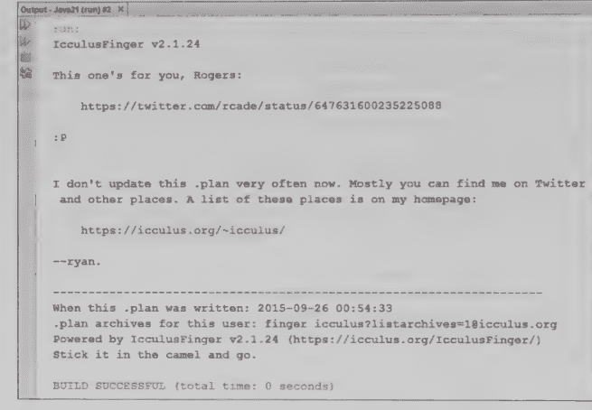

**图 17.2** 使用 socket 发起 Finger 请求。

Finger 应用程序使用 `StringTokenizer` 将 `user@host` 格式的地址转换为两个对象：user 和 host（第 12–15 行）。

此处正在发生以下 socket 活动：

- 第 20 行——使用主机名和端口 79 创建 socket，端口 79 传统上预留给 Finger 服务。
- 第 21–23 行——使用该 socket 创建 `InputStream`，进而用它创建 `BufferedReader`。
- 第 25 行——为 socket 设置了 20 秒的超时。

### Java 中的网络编程

- 第 26–27 行——使用 socket 获取 `OutputStream`，该流输入到一个新的 `PrintStream` 对象。
- 第 28 行——Finger 协议要求通过 socket 发送用户名，后跟回车符（`\015`）和换行符（`\012`）。这通过调用新打印流的 `print()` 方法来实现。
- 第 31–38 行——当从 `buffered reader` 中读取行时，Finger 程序会循环执行。服务器输出的结束会导致 `in.readLine()` 返回 `null`，从而结束循环。

通过 socket 与 Finger 服务器通信的相同技术，也可以用于连接到其他流行的 Internet 服务。你可以通过更改第 20 行的端口以及进行其他修改，将其转换为 telnet 或 Web 读取客户端。

> **注意**
>
> Finger 应用程序在列表 17.2 的第 20-23 行中利用了 Java 的 `try-resources` 功能。在 `try` 语句的括号内声明 socket 和 reader，可以确保即使连接因异常失败，这两个资源都会被关闭。这使得在第 39 行显式调用 `close()` 关闭 socket 变得不再必要。

## Socket 服务器

服务器端 socket 的工作与客户端 socket 类似，区别在于 `accept()` 方法。服务器 socket 在 TCP 端口上监听客户端的连接；当客户端连接到该端口时，`accept()` 方法会接受来自该客户端的连接。通过同时使用客户端和服务器 socket，你可以创建在网络上相互通信的应用程序。

要创建一个服务器 socket 并将其绑定到端口，在下面的示例中，使用端口号作为构造函数的参数创建 `ServerSocket` 实例：

```java
ServerSocket servo = new ServerSocket(8888);
```

使用 `accept()` 方法监听该端口（如果有客户端建立连接，则接受它）：

```java
servo.accept();
```

socket 连接建立后，你可以使用输入和输出流与客户端读写数据。

## 扩展 Socket 行为

为了扩展 socket 类的行为——例如，允许网络连接跨越防火墙或代理工作——你可以使用抽象类 `SocketImpl` 和接口 `SocketImplFactory` 来创建一个新的传输层 socket 实现。这种方法允许这些类迁移到具有不同传输机制的其他系统中。这种机制的问题在于，虽然它在简单情况下有效，但它阻止了你在 TCP 之上添加其他协议，并无法为每个 Java 运行时拥有多个 socket 实现。

由于 `Socket` 和 `Server` 类不是 `final` 的，你可以创建这些类的子类，使用默认的 socket 实现或你自己的实现。这提供了更灵活的网络功能。

# 设计服务器应用程序

这里有一个 Java 程序的示例，它使用 socket 类实现了一个简单的基于网络的服务器应用程序。

`TimeServer` 应用程序连接任何连接到 4415 端口的客户端，显示当前时间，然后关闭连接。

应用程序要作为服务器运行，它必须监控主机上的至少一个端口以接收客户端连接。该项目随机选择了 4415 端口，但它也可以是 1024 到 65535 之间的任何数字。

> **注意**：互联网分配号码机构（IANA）控制 0 到 1023 端口的使用，但对较高端口的声称是基于更非正式的标准。在为你自己的客户端/服务器应用程序选择端口号时，研究他人正在使用哪些端口是一个好主意。在 Web 上搜索你想要使用的端口的参考，然后搜索短语“registered port numbers”（注册端口）和“well-known port numbers”（周知端口）以找到已用端口列表。关于端口使用的良好指南可以在 www.sockets.com/services.htm 找到。

当检测到客户端时，服务器会创建一个代表当前时间的 `Date` 对象，然后将其作为字符串发送给客户端。

在服务器和客户端的这种信息交换中，服务器几乎完成了所有的工作。客户端唯一的责任是建立服务器服务器并显示从服务器接收的消息。

虽然你可以为这样的项目开发一个简单的客户端，但你也可以使用任何 telnet 应用程序作为客户端，只要它能连接上。（Windows 包含一个名为 `telnet` 的命令行应用程序，你可以用于此目的。）

## 17.3 TimeServer.java 的全文

```java
package days;
import java.io.*;
import java.net.*;
import java.util.*;

public class TimeServer extends Thread {
    private ServerSocket sock;

    public TimeServer() {
        try {
            sock = new ServerSocket(4415);
            System.out.println("TimeServer running...");
        } catch (IOException e) {
            System.out.println("Error: couldn't create socket.");
            System.exit(1);
        }
    }

    public void run() {
        Socket client = null;
        while (true) {
            if (sock == null) {
                return;
            }
            try {
                client = sock.accept();
                BufferedOutputStream bb = new BufferedOutputStream(
                    client.getOutputStream());
                PrintWriter os = new PrintWriter(bb, false);
                String line;

                Date now = new Date();
                os.println(now);
                os.flush();

                os.close();
                client.close();
            } catch (IOException e) {
                System.out.println("Error: couldn't connect.");
                System.exit(1);
            }
        }
    }

    public static void main(String[] args) {
        TimeServer server = new TimeServer();
        server.start();
    }
}
```

## 测试服务器

`TimeServer` 应用程序必须运行，客户端才能连接到它。如果应用程序运行成功，服务器将显示一行输出，如图 17.3 所示。

**图 17.3** 在 ServerSocket 中启动 Internet 服务器。

当服务器运行时，你可以使用任何 telnet 程序连接到计算机上 4415 端口的服务器。

按照以下步骤在 Windows 上运行 telnet：

- 对于 Windows 8 和 Windows 10，选择开始，选择搜索图标并搜索 telnet。点击 telnet 项目运行它。
- 对于 Windows 7 和 Windows Vista，选择开始、所有程序、辅助工具、运行以打开运行对话框。输入 `telnet` 运行该程序。然后在打开字段中输入命令 `open localhost 4415` 并按回车。
- 在 Windows XP 和 2003 中，选择“开始”、“运行”来打开运行对话框。输入 `telnet` 来运行该程序。然后，在“打开”字段中输入命令 `open localhost 4415` 并按回车键。
- 在较早版本的 Windows 中，选择“开始”、“运行”来打开运行对话框，然后在“打开”字段中输入 `telnet` 并按回车键。一个 telnet 窗口将打开。

要使用此程序建立 telnet 连接，选择“连接”（Connect）、“远程系统”（Remote System）。将弹出一个连接对话框。在“主机名”字段中输入 `localhost`，在“端口”字段中输入 `4415`，并在“终端类型”字段保留默认值 `vt100`。

> **注意**
>
> Windows Vista 和 Windows 7 默认禁用了 telnet 程序。要启用它，请选择“控制面板”，选择“程序和功能”，并点击“启用或关闭 Windows 功能”。打开 Windows 功能对话框。勾选 Telnet 客户端复选框，然后点击“确定”。

主机名 `localhost` 代表你自己的计算机——即运行程序的系统。你可以用它在将服务器应用程序永久部署到互联网之前进行测试。

取决于你系统上互联网连接的配置方式，在 telnet 客户端与 TimeServer 程序之间建立成功的 socket 连接之前，你可能需要登录互联网。

如果服务器位于连接互联网的另一台计算机上，你应该指定该计算机的主机名或 IP 地址，而不是 `localhost`。

当你使用 telnet 与 TimeServer 程序连接时，它会显示服务器当前的时间并关闭连接。telnet 程序的输出应类似于图 17.4。

**图 17.4** 向你的 TimeServer 建立 telnet 连接。

```
Telnet localhost
Sat Sep 26 02:11:53 EDT 2015
Connection to host lost.
Press any key to continue...
```

# java.nio 包

`java.nio` 包通过一些类扩展了语言的网络功能，这些类可用于读写数据、处理文件、套接字和内存，以及处理文本。

当你处理新的输入/输出功能时，经常还会使用两个相关的包：`java.nio.channels` 和 `java.nio.charset`。

## 缓冲区

`java.nio` 包包含了对缓冲区（buffers）的支持——缓冲区是表示存储在内存中的数据流的对象。

缓冲区通常用于提高读取输入或写入输出的程序的性能。它们允许程序将大量数据放入内存中，在内存中可以更快地进行读取、写入和修改。

缓冲区与 Java 中的每种原始数据类型相对应：

- `ByteBuffer`
- `CharBuffer`
- `DoubleBuffer`
- `FloatBuffer`
- `IntBuffer`
- `LongBuffer`
- `ShortBuffer`

这些类中的每个都有一个名为 `wrap()` 的静态方法，可以从对应数据类型的数组创建缓冲区。该方法的唯一参数应该是数组。

例如，以下语句创建了一个整数数组和一个将这些整数在内存中作为缓冲区存储的 `IntBuffer`：

```java
int[] temperatures = { 90, 85, 87, 78, 80, 75, 70, 79, 85, 92 };
IntBuffer tempBuffer = IntBuffer.wrap(temperatures);
```

缓冲区会跟踪其被使用的情况，存储下一个将要读取或写入的项目的位置。缓冲区创建后，其 `get()` 方法会读取缓冲区中当前位置的数据。以下语句扩展了上一个示例并显示了整数缓冲区中的所有内容：

```java
for (int i = 0; tempBuffer.remaining() > 0; i++) {
    System.out.println(tempBuffer.get());
}
```

创建缓冲区的另一种方法是设置一个空缓冲区并将数据放入其中。要创建缓冲区，调用目标缓冲区类的静态方法 `allocate(int)`，并将缓冲区的大小作为参数传递。

你可以使用五个 `put()` 方法在缓冲区中存储数据（或替换已存在的数据）。用于这些方法的参数取决于你正在处理的缓冲区类型。这些方法用于整数缓冲区：

- `put(int)`：将整数存储在缓冲区的当前位置并增加位置。
- `put(int, int)`：在缓冲区的特定位置（第一个参数）存储一个整数（第二个参数）。
- `put(int[])`：将整数数组的所有元素存储在缓冲区中，从第一个位置开始。
- `put(int, int, int)`：在缓冲区中存储整数数组的一部分。第二个参数指定数组应存储的缓冲区位置。第三个参数指定从数组中存储的元素个数。
- `put(IntBuffer)`：将一个整数缓冲区的内容存储在另一个缓冲区中，从第一个位置开始。

当你将数据放入缓冲区时，通常需要跟踪当前位置，以便知道下一个数据将存储在何处。

要查找当前位置，调用缓冲区的 `position()` 方法。它返回一个表示该位置的整数。如果此值为 0，则你处于缓冲区的开头。调用 `position(int)` 方法将位置更改为指定的参数。

使用缓冲区时，另一个需要跟踪的重要位置是限制（limit）——缓冲区中包含数据的最后一个位置。当缓冲区总是满的时，没有必要确定限制；在这种情况下，你已知缓冲区的最后一个位置有内容。如果你的缓冲区可能包含的数据比你分配的少，则在将数据读入缓冲区后应调用缓冲区的 `flip()` 方法。这会将当前位置设置为起始，并将限制设置为末尾。

## 缓冲区示例

如果缓冲区大小为 1024 字节且包含 500 字节，第一次尝试读取数据将加载 1024 字节到缓冲区中并将其填满。第二次尝试读取数据将只加载 500 字节到缓冲区中，留出其余部分为空。如果你调用 `flip()`，当前位置将被设置为缓冲区的开头，限制将被设置为 1024。

以下代码创建了一个华氏度温度数组，将其转换为摄氏度，然后将摄氏度存储在缓冲区中：


```java
int[] temps = { 90, 85, 87, 78, 80, 75, 79, 85, 92 };
ByteBuffer tempBuffer = ByteBuffer.allocate(temps.length);
for (int i = 0; i < temps.length; i++) {
  float celsius = ((float)temps[i] - 32) / 5;
  tempBuffer.put((int) celsius);
}

tempBuffer.position(0);
for (int i = 0; tempBuffer.remaining() > 0; i++) {
  System.out.println(tempBuffer.get());
}
```

在将缓冲区位置设置回开头后，显示字节缓冲区的内容。

## 字节缓冲区

你可以将目前为止引入的缓冲区方法用于字节缓冲区，但字节缓冲区也提供了实用的方法。对于起始，字节缓冲区提供了存储和检索数据的：

- `putChar(char)`：在缓冲区中存储 2 字节的 `char` 值。
- `putDouble(double)`：在缓冲区中存储 8 字节的 `double` 值。
- `putFloat(float)`：在缓冲区中存储 4 字节的 `float` 值。
- `putInt(int)`：在缓冲区中存储 4 字节的 `int` 值。
- `putLong(long)`：在缓冲区中存储 8 字节的 `long` 值。
- `putShort(short)`：在缓冲区中存储 2 字节的 `short` 值。

这些方法中的每个都会向缓冲区放入超过 1 个字节，并将位置移动相应的字节数。

还有从字节缓冲区检索字节的方法：`getChar()`、`getDouble()`、`getFloat()`、`getInt()`、`getLong()` 和 `getShort()`。

## 字符集

字符集位于 `java.nio.charset` 包，用于在字节缓冲区和字符缓冲区之间转换数据。

主要的三个类如下：

- `Charset`：集合每个字符都有不同的字节值。
- `CharsetDecoder`：将一系列字节转换为一系列字符的类。
- `CharsetEncoder`：将一系列字符转换为一系列字节的类。

在执行字节和字符缓冲区之间的任何转换之前，必须创建一个映射字符到相应字节值的 `Charset` 对象。

要创建字符集，调用 `Charset` 类的静态方法 `forName(String)`，指定集合的字符编码名称。

Java 支持六种编码：

- US-ASCII：构成 Unicode 基本拉丁区块的 128 字符 ASCII（也称为 ISO-846-US）。
- ISO-8859-1：256 字符 ISO 拉丁字母 1 字符集（也称为 ISO-LATIN-1）。
- UTF-8：包含 US-ASCII 和通用字符集（也称为 Unicode）的字符集，由世界语言使用的数千个字符组成。
- UTF-16BE：以大端字节序存储 16 字节字符表示的通用字符集。
- UTF-16LE：以小端字节序存储 16 字节字符表示的通用字符集。
- UTF-16：由一个可选的字节顺序标记指示字节顺序并以 16 字节字符表示的通用字符集。

以下语句为 ISO-8859-1 字符集创建一个 `Charset` 对象：

```java
Charset iset = Charset.forName("ISO-8859-1");
```

## 第 17 天：跨网络通信

在拥有字符集对象后，你可以使用它来创建编码器和解码器。调用对象的 `newDecoder()` 方法来创建 `CharsetDecoder`，调用 `newEncoder()` 方法来创建 `CharsetEncoder`。

要将字节缓冲区转换为字符缓冲区，调用解码器的 `decode(ByteBuffer)` 方法，它将返回一个包含已将字节转换为字符的 `CharBuffer`。

要将字符缓冲区转换为字节缓冲区，调用编码器的 `encode(ByteBuffer)` 方法。将返回一个包含包含字符字节值的 `ByteBuffer`。

以下语句使用 ISO-8859-1 字符集将名为 `netBuffer` 的字节缓冲区转换为字符缓冲区：

```java
ByteBuffer netBuffer = ByteBuffer.allocate(20480);
// 此处应有填充字节缓冲区的代码
Charset set = Charset.forName("ISO-8859-1");
Decoder decoder = set.newDecoder();
netBuffer.position(0);
ByteBuffer netText = decoder.decode(netBuffer);
```

> 在使用解码器创建字符缓冲区之前，调用 `position(0)` 会将 `netBuffer` 的当前位置重置为开头。当你第一次处理缓冲区时，很容易忽略这一点，导致缓冲区的数据远少于你的预期值。

## 通道

缓冲区的常见用途是将其与输入流或输出流关联。你可以从输入流向缓冲区填充数据，或将缓冲区写入输出流。

要做到这一点，你必须使用通道——一种连接缓冲区与流的对象。通道是 `java.nio.channels` 包的一部分。

你可以通过调用 `java.io` 包中某些流类提供的 `getChannel()` 方法来将通道与流关联。

`FileInputStream` 和 `FileOutputStream` 类具有 `getChannel()` 方法，该方法返回一个 `FileChannel` 对象。该文件通道可以读取、写入和修改文件中的数据。

### java.nio 包

以下语句创建了一个文件输入流以及与该文件关联的通道：

```java
try {
  String source = "prices.dat";
  FileInputStream inSource = new FileInputStream(source);
  FileChannel inChannel = inSource.getChannel();
} catch (FileNotFoundException fne) {
  System.out.println(fne.getMessage());
}
```

在创建文件后，你可以通过调用其 `size()` 方法确定该文件包含多少字节。如果你想创建一个字节缓冲区来存放该文件，这是很有用的。

使用 `read(ByteBuffer, long)` 方法将字节从通道读取到 `ByteBuffer` 中。第一个参数是缓冲区。第二个参数是缓冲区中的当前位置，它决定了文件内容开始存储的位置。

```java
long inSize = inChannel.size();
ByteBuffer data = ByteBuffer.allocate((int) inSize);
inChannel.read(data, 0);
data.position(0);
for (int i = 0; data.remaining() > 0; i++) {
  System.out.print(data.get(i) + " ");
}
```

如果发生问题，尝试从通道读取将产生一个 `IOException`。虽然缓冲区的大小与文件相同，但这并不是强制要求的。如果你将文件读取到缓冲区以便进行修改，可以分配一个更大的缓冲区。

你开展的下一个项目整合了你目前所学的新输入/输出功能：缓冲区、字符集和通道。

`BufferConverter` 应用程序将一个小文件读取到字节缓冲区中，显示缓冲区的内容，将其转换为字符缓冲区，然后显示字符。

将列表 17.4 所示的代码作为 `com.java21days` 包中的新 Java 类 `BufferConverter` 进行输入。

### 列表 17.4 BufferConverter.java 的全文

```java
1: package com.java21days;
2:
3: import java.nio.*;
4: import java.nio.channels.*;
5: import java.nio.charset.*;
6: import java.io.*;
7:
8: public class BufferConverter {
9:     public static void main(String[] args) {
10:
11:         // 读取字节数据到字节缓冲区
12:         String data = "friends.dat";
13:         FileInputStream inData = new FileInputStream(data);
14:         FileChannel channel = inData.getChannel();
15:         long inSize = channel.size();
16:         ByteBuffer buffer = ByteBuffer.allocate((int)inSize);
17:         channel.read(buffer);
18:         buffer.position(0);
19:         System.out.println("Original byte data: ");
20:         for (int i = 0; buffer.remaining() > 0; i++) {
21:             System.out.print(buffer.get() + " ");
22:         }
23:
24:         // 将字节数据转换为字符数据
25:         buffer.position(0);
26:         Charset ascii = Charset.forName("US-ASCII");
```

在运行该文件之前，你需要一个 `friends.dat` 副本，它是应用程序中使用的小型字节数据文件。要从书籍网站 www.java21days.com 下载它，请打开第 17 天的页面。

要使用非阻塞输入输出，你必须与通道一起而非流一起工作。

### 非阻塞 Socket 客户端和服务

开发非阻塞客户端或服务器的第一步是创建一个表示你正在连接的 Internet 地址的对象。此项任务由 `java.net` 包中的 `InetSocketAddress` 类处理。

如果服务器通过主机名识别，请调用带有两个参数的 `InetSocketAddress(String, int)`：服务器的名称和端口号。

如果服务器通过其 IP 地址识别，请使用 `java.net` 中的 `InetAddress` 类来识别宿主机。调用静态方法 `InetAddress.ByName(String)`，并将宿主机的 IP 地址作为参数。该方法返回一个表示该地址的 `InetAddress` 对象，你可以将其用于调用 `InetSocketAddress(InetAddress, int)`。第二个参数是服务器的端口号。

非阻塞连接需要一个套接字通道，它是 `java.nio` 包中的另一个类。通过调用 `SocketChannel` 类的静态方法 `open()` 来创建该通道。

套接字通道可以被配置为阻塞或非阻塞通信。要设置非阻塞通道，调用通道的 `configureBlocking(boolean)` 方法并传入参数 `false`。传入 `true` 则会使其变为阻塞通道。

通道配置完成后，调用其 `connect(InetAddress)` 方法来连接到套接字。

在阻塞通道上，`connect()` 方法尝试建立与服务器的连接并等待其完成，最后返回 `true` 值表示成功。

在非阻塞通道上，`connect()` 方法会立即返回 `false` 值。要弄清楚通道上发生了什么并响应事件，你必须使用一个名为 `Selector`（选择器）的通道监听对象。

`Selector` 是一个用于跟踪发生在套接字通道（或该包中作为 `SelectableChannel` 子类的其他通道）上的事件的对象。

要创建一个 `Selector`，请调用其 `open()` 方法，如述语句所示：

```java
Selector monitor = Selector.open();
```

当你使用 `Selector` 时，必须指明你想要监控的事件。你通过调用通道的 `register(Selector, int, Object)` 方法来实现这一点。

`register()` 的三个参数如下：

- 你创建的用于监控通道的对象
- 一个表示正在监控的事件的 `int` 值（也称为选择键 selection keys）
- 一个可以随键传递的 `Object`，否则为 `null`


与其使用整数值作为第二个参数，不如使用 `SelectionKey` 类中的一个或多个类变量更为方便：使用 `SelectionKey.OP_CONNECT` 监控连接，`SelectionKey.OP_READ` 监控读取数据的尝试，以及 `SelectionKey.OP_WRITE` 监控写入数据的尝试。

以下语句创建了一个 `Selector` 来监控名为 `wire` 的套接字通道以读取数据：

```java
Selector spy = Selector.open();
channel.register(spy, SelectionKey.OP_READ, null);
```

要监控多种一种类型的键，请将 `SelectionKey` 类变量相加。例如：

```java
Selector spy = Selector.open();
channel.register(spy, SelectionKey.OP_READ + SelectionKey.OP_WRITE, null);
```

在通道和选择器设置好后，你可以通过调用选择器的 `select()` 或 `select(long)` 方法来等待事件。

`select()` 方法是一个阻塞方法，它会一直等待通道上发生某些事。

`select(long)` 方法是一个阻塞方法，它会等待直到发生某些事或指定的毫秒数通过，以先到者为准。

这两个 `select()` 方法都返回发生的事件数量，或者如果没有发生任何事件则返回相应值。你可以使用 `while` 循环配合 `select()` 方法调用，作为循环直到通道上发生某些事的方法。

事件发生后，你可以通过调用选择器的 `selectedKeys()` 方法获取更多信息。

`selectedKeys()` 返回一个包含所有事件的集合。

使用 `Iterator` 遍历该集合，如文所示。`next()` 方法返回一个 `SelectionKey` 对象。

`SelectionKey` 类有三个方法可以用于识别：`isReadable()`、`isWritable()` 和 `isConnected()`。它们返回布尔值。

从集合中提取键后，调用 `channel()` 方法获取套接字通道。

如果连接正在进行中，你需要确保连接已完成。调用 `finishConnect()` 方法，如果连接正在进行中则返回 `true`，如果已完成则返回 `false`。

对于正在进行中的连接，你可以调用 `select()` 方法。

`java.nio` 和 `java.net` 包中的众多类。

为了让你了解这些类是如何工作的，输入列表 17.5 所示的代码。

#### 列表 17.5 FingerServer.java


```
package com.21days;

import java.io.*;
import java.net.*;
import java.nio.channels.*;
import java.util.*;

public class FingerServer {

    public FingerServer() {
        try {
            // 创建非阻塞服务器套接字通道
            ServerSocketChannel sock = ServerSocketChannel.open();
            sock.configureBlocking(false);

            // 设置监控的主机和端口
            InetAddress address = new InetSocketAddress(
                "localhost", 79);
            Socket socket = sock.socket();
            socket.bind(address);

            // 创建选择器并注册到通道
            Selector selector = Selector.open();
            sock.register(selector, SelectionKey.OP_ACCEPT);

            // 无限循环查找客户端连接
            while (true) {
                // 等待连接
                selector.select();

                // 获取带有事件选择键列表
                Set keys = selector.selectedKeys();
                Iterator it = keys.iterator();

                // 处理每个键
                while (it.hasNext()) {

                    // 获取键并从迭代中移除
                    SelectionKey sKey = (SelectionKey) it.next();

                    it.remove();
                    if (sKey.isAcceptable()) {

                        // 与客户端建立套接字连接
                        ServerSocketChannel selChannel =
                            (ServerSocketChannel) sKey.channel();
                        ServerSocket sSock = selChannel.socket();
                        Socket connection = sSock.accept();


                        // 处理 finger 请求
                        handleRequest(connection);
                        connection.close();
                    }
                }
            }
        }
        catch (IOException ioe) {
            System.out.println(ioe.getMessage());
        }
    }

    private void handleRequest(Socket connection)
    throws IOException {

        // 设置输入和输出
        InputStreamReader isr = new InputStreamReader(
            connection.getInputStream());
        BufferedReader br = new BufferedReader(isr);
        PrintWriter pw = new PrintWriter(
            connection.getOutputStream(),
            false);

        // 输出服务器欢迎语
        pw.println("Nio Finger Server");
    }
}
```

# java.nio 包

```
pw.flush();

// Handle user input
String outLine = null;
String inline = is.readLine();

if (inline.length() > 0) {
    outLine = inline;
}
readPlan(outLine, pw);

// Clean up
pw.flush();
pw.close();
is.close();
}

private void readPlan(String username, PrintWriter pw) {
    try {
        FileReader file = new FileReader(username + ".plan");
        BufferedReader buff = new BufferedReader(file);
        boolean eof = false;

        pw.println("\nusername: " + username + "\n");

        while (!eof) {
            String line = buff.readLine();

            if (line == null) {
                eof = true;
            } else {
                pw.println(line);
            }
        }

        buff.close();
    } catch (IOException e) {
        pw.println("User " + username + " not found.");
    }
}
public static void main(String[] arguments) {
    FingerServer nio = new FingerServer();
}
```

Finger 服务器需要存储在文本文件中的多个用户 `.plan` 文件。这些文件的命名应采用 `用户名.plan` 的格式——例如 `linus.plan`、`lucy.plan` 和 `frank.plan`。在运行服务器之前，请在 Java21 项目的根目录下创建一个或多个 plan 文件。

# 第 17 天：跨网络通信

完成后，运行 Finger 服务器。该应用程序会等待传入的 Finger 请求，创建一个非阻塞服务器套接字通道（`ServerSocketChannel`），并为选择器（`Selector`）注册一种键：连接事件。

在从第 27 行开始的 `while` 循环内部，服务器调用选择对象的 `select()` 方法来检查选择器是否有任何键，当 Finger 客户端建立连接时，就会发生这种情况。如果有键，`select()` 会返回键的数量，并执行循环内部的语句。

连接建立后，创建一个读取器（reader）来持有对 `.plan` 文件的请求。命令的语法是所请求的 `.plan` 文件名。

当 Finger 服务器运行时，你可以使用 Finger 客户端测试此应用程序。在 NetBeans 中创建一个自定义项目配置，以设置 Finger 用户的命令行参数：

- 运行（Run）、设置项目配置（Set Project Configuration）、自定义（Customize）。打开项目属性对话框。

- 在主类（Main Class）文本框中，输入 `Finger`。

- 在参数（Arguments）文本框中，输入 `franklin@localhost`，并点击 OK。

- 选择运行（Run）、运行项目（Run Project）来启动应用程序。

当你请求本地主机上的用户 `franklin` 时，输出如图 17.6 所示。

### 图 17.6

从你的 Finger 服务器发起 Finger 请求。

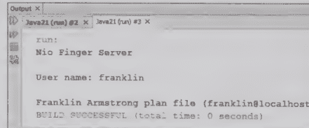

再次使用 `lucy@localhost` 运行应用程序查看 Lucy 的 `.plan` 文件，最后使用 `linus@localhost` 查找 Linus。

完成 Finger 服务器操作后，按输出面板（Output pane）左侧的停止（Stop）按钮将其关闭。

# 问答 (Q&A)

### 注意

> plan 文件必须位于 Java21 项目的根目录下，`FingerServer` 应用程序才能找到它们。如果它们被保存在其他地方，你可以在 NetBeans 中通过拖放来移动它们。点击项目（Projects）面板中的文件（Files）选项卡查看项目文件列表。找到 plan 文件，并将它们拖到到包含 `friends.dat` 的相同文件夹中。

## 总结

你学习了如何结合使用 `URL`、`URL` 连接和输入流，将数据从 Web 拉取到你的程序中。

网络技术非常有用。WebReader 项目是一个原始的浏览器。它可以将网页或 RSS 文件加载到 Java 程序中并显示。然而，它并没有对标记标签进行任何处理，只是展示了网络服务器交付的原始文本。

你创建了一个实现 Finger 协议基础的套接字应用程序，这是在互联网上检索用户信息的方法。

你还学习了如何使用 `java.nio` 包中的非阻塞技术在 Java 中编写客户端和服务器程序。

为了使用非阻塞技术，你学习了 Java 新网络包中的基础类：缓冲区（buffers）、字符编码器和解码器、套接字通道（`SocketChannel`）以及选择器（`Selector`）。

# 问答 (Q&A)

- 其他电脑可以通过互联网连接到我的 Finger 服务器吗？

- 可能不能。大多数计算机都设有防火墙设置和路由器安全设置，它们不会接受来自 79 端口（Finger 协议使用的端口）的传入请求。

如果你创建一个不仅仅用于测试的服务器，你必须弄清楚如何配置防火墙和路由器以允许访问所需的所有端口。

由于互联网服务器经常是攻击目标，你必须确保你的服务器能够处理格式错误的客户端请求和其他黑客尝试。你还应该使用仅具有访问所需文件和系统资源权限的用户账户运行服务器。这可以防止黑客攻破服务器并利用它读取机密数据、感染计算机病毒以及启动其他破坏性利用。

# 测验 (Quiz)

通过完成这个三道题测验来复习今天的内容。

# 问题 (Questions)

- 1. 下列哪项*不是*新的 `java.nio` 包及其相关包的优势？

   - 使用缓冲区可以快速处理大量数据。

   - 网络连接可以是非阻塞的，以便在应用程序中使用时更可靠。

   - 不再需要使用流来在网络上读写数据。

2. 在 Finger 协议中，哪个程序会请求有关用户的信息？

   - 客户端（client）

   - 服务器（server）

   - 两者都可以发出该请求。

3. 将数据从网页加载到 Java 应用程序中首选哪种方法？

   - 创建 `Socket` 和输入流

   - 创建 `URL` 和 `HttpURLConnection`

   - 使用 `toString()` 方法加载

# 答案 (Answers)

- 1. `java.nio` 类与流结合使用。它们并不是取代流。

- 2. A. 客户端请求，服务器返回某些内容。这是客户端/服务器程序的传统方式，尽管某些程序可以同时当客户端和服务器。

- 3. B. `Socket` 适用于底层连接，例如当你正在实现新协议时。对于 HTTP 等现有协议，某些类更合适。

# 认证练习 (Certification Practice)

以下是你是在 Java 编程认证考试中可能会遇到的问题。在不参考今天内容或不使用 Java 编译器测试代码的情况下回答它。

假设：

```
import java.nio.*;

public class ReadTemps {
    int[] temperatures = { 78, 80, 75, 70, 79, 85, 92, 99, 90 };
    ByteBuffer tempBuffer = ByteBuffer.wrap(temperatures);
    int[] moreTemps = { 65, 44, 71 };
    tempBuffer.put(moreTemps);
    System.out.println("First int: " + tempBuffer.get());
}
```

当此应用程序运行时，输出是什么？

- A. First int: 78

- B. First int: 71

- C. First int: 70

- D. 以上皆非

# 第 18 天

使用 JDBC 4.2 和 Derby 访问数据库几乎所有的 Java 程序都会以某种方式处理数据。到目前为止，你已经使用了基本类型、对象、数组、哈希映射和其他数据结构。

今天，你将通过更高级的方式处理数据，即探索 Java 数据库连接 (JDBC)，这是一个将 Java 程序连接到关系型数据库的类库。

Java 包含了 Java DB，这是一种紧凑的关系型数据库，它比以往任何时候都更容易将数据库整合到应用程序中。Java DB 是 Oracle 对 Apache Derby 的命名，由 Apache Foundation 维护的开源数据库。

今天，你将通过以下方式探索 JDBC：

- 使用 JDBC 驱动程序处理不同的关系型数据库

- 使用结构查询语言 (SQL) 访问数据库

- 使用 SQL 和 JDBC 从数据库读取记录

- 使用 SQL 和 JDBC 向数据库添加记录

- 创建新的 Java DB 数据库并读取其记录

## Java 数据库连接

Java 数据库连接 (JDBC) 是一组用于开发客户端/服务器应用程序的类，这些程序可以使用 Microsoft、Sybase、Oracle、IBM 等源开发的数据库。

通过 JDBC，你可以在 Java 程序中使用相同的方法和类来读写记录并执行其他类型的数据库访问。名为驱动程序 (driver) 的类充当与数据库源的桥梁。每个流行的数据库都有相应的驱动程序。

客户端/服务器软件将信息的使用者与提供者连接起来，这是常见的编程形式之一。你每次使用 Web 时都会使用它：网络浏览器使用统一资源定位符 (URL) 请求页面、图像文件和其他文档。如果网络服务器找到了请求的信息，就会为客户端提供。

数据库程序员面临的最大障碍之一使用的数据库格式多种多样，每种格式都有其专有的数据访问方法。

为了简化关系型数据库的使用，开发了一种名为结构查询语言 (SQL) 的标准语言。这种语言取代了为每种数据库格式学习不同查询语言的需求。Java DB 支持 SQL。

在数据库编程中，对数据库中记录的请求被称为“查询”。使用 SQL，你可以向数据库发送复杂的查询，并按你指定的任何顺序获取你寻找的记录。

考虑一个贷款公司数据库程序员的例子，他被要求准备一份关于逾期最严重的贷款受款人的报告。该程序员可以使用 SQL 查询数据库，找出所有最后一次付款在 180 天之前且欠款大于 0.00 美元的记录。SQL 还可以用于控制记录返回的顺序，因此程序员可以按照社会安全号、受款人姓名、欠款金额或贷款数据库中的另一个字段的顺序获取记录。

这一切通过 SQL 都可以实现。程序员不需要任何与流行数据库格式相关的专有语言。

### 注意

> 许多数据库工具都支持 SQL，因此从理论上说，你应该对每个支持该语言的数据库工具使用相同的 SQL 命令。然而，当你通过 SQL 访问特定的数据库工具时，仍然需要学习该特定工具的特性。

SQL 是访问关系型数据库的行业标准方法。JDBC 支持 SQL，使能够能够在不了解底层数据库细节的情况下使用广泛的数据库格式。JDBC 还支持使用针对特定数据库格式的数据库查询。

JDBC 类库使用 SQL 访问数据库的方法与现有的数据库开发技术具有可比性，通过 JDBC 与 SQL 数据库交互与使用传统的数据库工具没有太大区别。具有某些数据库经验的 Java 程序员可以快速上手 JDBC。

JDBC 库包含了与数据库使用相关的常见任务的类：

- 与数据库建立连接

- 使用 SQL 创建语句 (statement)

- 在数据库中执行 SQL 查询

- 查看结果记录


这些 JDBC 类都是 `java.sql` 包的一部分。

# 第 18 天：使用 JDBC 4.2 和 Derby 访问数据库

## 数据库驱动程序

使用 JDBC 类的 Java 程序遵循发布 SQL 语句并处理结果的熟悉编程模型。数据库的格式及其准备平台并不重要。

这种平台和数据库的无关性是通过驱动程序管理器实现的。JDBC 库的类很大程度上依赖于驱动程序管理器，它负责跟踪访问数据库记录所需的驱动程序。对于程序使用的每种数据库格式，你需要一个不同的驱动程序，有时你可能需要同种格式版本的多个驱动程序。Java DB 包含了自己的驱动程序。

JDBC 还包含一个桥接 JDBC 和另一种数据库连接标准 ODBC 的驱动程序。

### 检查数据库

NetBeans 对数据库编程有广泛的支持。在开始编写代码之前，你可以用它连接到数据库，了解它包含的表并查看这些表中的数据。

要连接到 Java DB 数据库，首先必须启动数据库服务器。

第一次分屏时，点击“服务 (Services)”选项卡将其置于顶层，如图 18.1 所示。“数据库 (Databases)”窗格包含一个 Java DB 项。右键点击它并选择“启动服务器 (Start Server)”。

#### 图 18.1 Java DB 服务选项卡


第一次在 NetBeans 中启动 Java DB 服务器时，可能会因为安全错误而失败。在这种情况下，NetBeans 会显示一个气泡对话框报告安全管理器问题（图 18.2）。


#### 图 18.2 处理安全管理器

运行 Java DB 时没有显著的安全风险。点击“禁用管理器 (Disable Manager)”按钮；部分在“服务”选项卡中重新启动 Java DB。

当 Java DB 启动时，它会显示几行它正在执行的内容。如图 18.3 所示。

#### 图 18.3 启动 Java DB 服务器

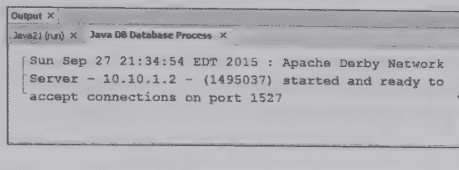

服务器的输出表明服务器正在端口 1527 上运行并已准备好连接。在“服务”窗格的 Java DB 下有一个名为 sample 的数据库。一个项目从损坏图标变为完好图标：`jdbc:derby://localhost:1527/sample`。这是一个活动连接。展开此项目，然后展开 APP、Tables、CUSTOMER。出现 CUSTOMER 中的字段列表，如图 18.4 所示。

#### 图 18.4 检查 Java DB 中的表

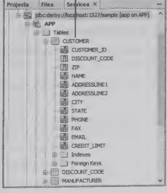

你可以通过右键点击 CUSTOMER 并选择“查看数据 (View Data)”来查看此表中的记录。两个内容出现在 NetBeans 的其他面板中。

在源码编辑器出现出现一个 SQL 命令：

```sql
select * from APP.CUSTOMER
```

该命令被称为 SQL 查询，从 `APP.CUSTOMER` 中选择所有字段。星号字符 `*` 可以替换为逗号分隔的一个或多个字段名称。

另一个面板显示此命令的结果：表中的所有数据，按行和列组织。每列是一个字段，每行是表中的一条记录。

图 18.5 显示 CUSTOMER 表的内容。这是你要编写 Java 代码的表。

#### 图 18.5 CUSTOMER 表的内容

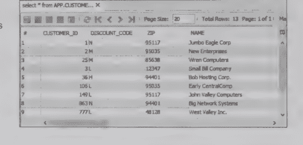

## 从数据库读取记录

今天的第一个项目是一个 Java 应用程序，它连接到 NetBeans 的示例 Java DB 并从表中读取记录。

如果你熟悉 SQL，在 Java 程序中处理数据库相对容易。

JDBC 程序的第一项任务是加载用于连接数据源的驱动程序（或驱动程序）。`Class.forName(String)` 方法是 `java.lang` 包的一部分，用于将类加载到 Java 虚拟机 (JVM) 中。该方法通过指定的字符串加载类。该方法可能会抛出 `ClassNotFoundException`。

使用 JDBC 的程序使用 `org.apache.derby.jdbc.ClientDriver`，这是数据库自带的驱动程序。将此类加载到 JVM 需要以下语句：

```java
Class.forName("org.apache.derby.jdbc.ClientDriver");
```

在加载驱动程序后，你可以使用 `java.sql` 包中的 `DriverManager` 类建立到数据源的连接。

`DriverManager` 的 `getConnection(String, String, String)` 方法用于建立连接。它返回一个 `Connection` 对象的引用，代表一个活动的数据连接。

该方法有三个参数：

- 一个用于标识数据源以及访问它时使用的数据库连接类型的字符串
- 用户名
- 密码

后两项仅在数据源受用户名和密码安全保护时才需要。如果没有受此类保护，这些参数可以为空字符串 (`"")`。

以下是连接到示例数据库时使用的字符串：

`jdbc:derby://localhost:1527/sample`

你已经在“项目（Projects）”窗格的“服务（Services）”选项卡中见过这个字符串，它是一个代表数据库连接的项目。

该字符串标识了数据库类型（`jdbc:derby:`）、数据库服务器的主机和端口（`localhost:1527`）以及数据库名称（`sample`）。注意数据库类型后面有两个斜杠 (`//`)而在主机和端口后面有一个斜杠。

第二个和第三个参数用于使用 `app` 和 `APP`（如所示大写）。它们是用户名和密码。

可以使用以下语句连接到名为 `payroll` 的数据库，用户名为 `doc`，密码为 `irover1`：

```java
Connection payday = DriverManager.getConnection(
  "jdbc:derby://localhost:1527/payroll",
  "doc", "irover1");
```

建立连接后，你每次想要从存储检索信息或向该连接的数据源发送信息时，都可以重用它。

在使用数据源时发生任何错误，`getConnection()` 方法以及在数据源上调用的所有方法都会抛出 `SQLException` 错误。SQL 有自己的错误信息，它们作为 `SQLException` 对象的一部分被传递。

> **提示**
>
> NetBeans 对象显示了连接数据库所需的信息，包括驱动程序类、数据库连接字符串、用户名和密码。右键点击数据库连接（例如 `jdbc:derby://localhost:1527/sample`），并从弹出菜单中选择“属性（Properties）”。将出现一个包含类以及关于连接其他信息的对话框。

SQL 语句在 Java 中由 `Statement` 对象表示。`Statement` 是一个接口，因此不能被实例化；`Connection` 对象的 `createStatement()` 方法会返回一个实现了该接口的对象，例所示：

```java
Statement lookSee = payday.createStatement();
```

获取 `Statement` 对象后，你可以通过调用该对象的 `executeQuery(String)` 方法来执行 SQL 查询。`String` 参数应该是一个符合该语言语法的 SQL 查询语句。

> **注意**
>
> 今天课程的范围是教授 SQL，这是一种丰富的数据检索和存储语言，该出版商也为此出版了它的新书：《24 小时自学 SQL》（Teach Yourself SQL in 24 Hours），第 6 版，由 Ryan Stevens、Arie D. Jones 和 Ron Plew 著（ISBN: 0-672-33759-2）。尽管你需要学习 SQL 才能对其进行大量工作，但该语言的大部分很容易从找到的任何示例中学会，例如你今天将处理的示例。

以下是一个可用于示例数据库的 SQL 查询示例：

`select NAME, CITY from APP.CUSTOMER where STATE = 'FL' order BY CITY;`

此 SQL 查询会为数据库中 `STATE` 等于 "FL" 的每个记录检索多个字段。返回的记录根据其 `CITY` 字段排序。命令中的小写部分是 SQL 关键字。大写部分是表名。

以下 Java 语句在 `looksee` 对象上执行该查询：

```java
ResultSet set = looksee.executeQuery(
"NAME, CITY from APP.CUSTOMER "
+ " where (STATE = 'FL') order BY CITY";
);
```

尽管 SQL 查询以分号 (`;`) 结尾，但在 `executeQuery()` 的参数中不需要分号。

如果 SQL 查询表述正确，`executeQuery()` 方法将返回一个 `ResultSet`，其中包含所有从数据源检索到的记录。

### 注意

要向数据库中添加记录而不是检索它们，你应该调用语句的 `executeUpdate()` 方法。你将处理此方法。

当从 `executeQuery()` 返回 `ResultSet` 时，它指向已检索的第一条记录。可以使用 `ResultSet` 的以下方法从当前记录中提取信息：

- `getDate(String)` 返回存储在指定字段中的 `Date` 值（使用 `java.sql` 包中的 `Date` 类，而不是 `java.util.Date`）。
- `getDouble(String)` 返回存储在指定字段中的 `double` 值。
- `getFloat(String)` 返回存储在指定字段中的 `float` 值。
- `getInt(String)` 返回字段中的 `int` 值。
- `getLong(String)` 返回字段中的 `long` 值。
- `getString(String)` 返回字段中的 `String`。

这些只是 `ResultSet` 接口中提供的最简单的方法。你应该使用的方法取决于数据库中的数据。但诸如 `getString()` 和 `getInt()` 等方法在从记录中检索信息方面可能更具活性。你也可以使用整数作为这些任何方法的参数（例如 `getString(5)`），而不是字符串。整数表示要检索哪个字段（1 表示第 1 个字段，2 表示第 2 个字段，依此类推）。

如果在尝试从 `resultSet` 检索信息时发生数据库错误，则会抛出 `SQLException`。当你提取了所需信息后，`resultSet` 位于第一条检索到的记录处。可以使用 `ResultSet` 的以下方法从当前记录中提取信息：

（此处原文重复，已省略）

#### LISTING 18.1 Full Text of CustomerReporter.java

```java
1: package com21days;
2:
3: import java.sql.*;
4:
5: public class CustomerReporter {
6:  public static void main(String[] arguments) {
7:    String data = "jdbc:derby://localhost:1527/sample";
8:    try {
9:      Class.forName("org.apache.derby.jdbc.ClientDriver");
10:      Connection conn = DriverManager.getConnection(
11:       data, "APP");
12:      Statement stmt = conn.createStatement()) {
13:      ResultSet rec = stmt.executeQuery(
14:    "select CUSTOMER_ID, NAME, CITY, STATE " +
15:    "from APP.CUSTOMER " +
11:    "order by CUSTOMER_ID");
17:      while (rec.next()) {
18:        System.out.println("CUSTOMER_ID:\t"
19:        + rec.getString(1));
20:        System.out.println("NAME:\t" + rec.getString(2));
21:        System.out.println("CITY:\t" + rec.getString(3));
22:        System.out.println("STATE:\t" + rec.getString(4));
23:      }
24:    } catch (SQLException e) {
25:      System.out.println("SQL Error: " + stmt.toString() +
26:      + e.getErrorCode() + " " + e.getSQLState());
27:    } catch (Exception e) {
28:      System.out.println("Error: " + e.toString() +
29:      + e.getMessage());
30:    }
31: }
```

当此程序与示例数据库一起运行时，部分输出显示在图 18.6 中。

#### 图 18.6 从 Java DB 数据库读取记录

> **注意**
>
> 如果运行此应用程序时出现提示“Connection authentication failure occurred. Reason: Userid or password invalid”的 SQL 错误，这可能是由于 NetBeans 的 bug 导致的。请将第 9–10 行 `getConnection` 方法中最后一个参数所使用的密码从“APP”更改为“app”，然后重新运行程序查看是否解决了该问题。

## 向数据库写入记录

在 CustomerReporter 应用程序中，你使用以字符串形式准备的 SQL 语句从数据库检索了数据：

```sql
select CUSTOMER_ID, NAME, CITY, STATE FROM APP.CUSTOMER
order by CUSTOMER_ID;
```

这是使用 SQL 的一种方法。你可以编写一个程序，让用户输入 SQL 查询语句并显示结果（然而，这是一个非常糟糕的主意，因为 查询 查询可被用于删除记录、表甚至数据库）。

`java.sql` 包还支持创建 SQL 语句的另一种方式：预编译语句（prepared statement）。

预编译语句由 `PreparedStatement` 类表示，是在执行之前进行编译的 SQL 语句。这使得语句能够更快速地返回数据，如果你需要重复执行 SQL 语句，这是一个更好的选择。

要创建一个预编译语句，请调用 `connection.prepareStatement(String)` 方法，并传入一个指示 SQL 语句结构的字符串。

为了指示这一点，你编写一条 SQL 语句，其中参数已被替换为问号。

以下是一个使用名为 `cc` 的连接对象的示例：

```java
prepareStatement ps = cc.prepareStatement(
  "select * FROM APP.CUSTOMER (ZIP=?) " 
+ " order by NAME");
```

这是另一个包含多个问号的示例：

```java
prepareStatement ps = cc.prepareStatement(
  "insert into APP.CUSTOMER + 
  "VALUES(?, ?, ?, ?, ?, ?, ?, ?, ?)");
```

这些 SQL 语句中的问号是数据的占位符。在执行语句之前，你必须使用 `PreparedStatement` 类的一个方法在这些位置中的每一个放入数据。

要将数据放入预编译语句，你必须调用一个方法，参数为占位符的位置以及要插入的数据。

例如，要将字符串 "Acme Corp." 放入预编译语句的第五个字段，请调用 `setString(int, String)` 方法：

```java
ps.setString(5, "Acme Corp.");
```

第一个参数表示占位符的位置，从左到右编号。第一个问号是 1，第二个是 2，依此类推。

第二个参数是要存放在语句该位置的数据。

可用的方法如下：

- `setAsciiStream(int, InputStream, int)`——在第一个参数指示的位置，插入指定的 `InputStream`，它表示一个 ASCII 字符流。第三个参数指示从输入中插入多少字节。
- `setBinaryStream(int, InputStream, int)`——在第一个参数指示的位置，插入指定的 `InputStream`，它表示一个字节流。第三个参数指示从流中插入多少字节。


# 第 18 天：使用 JDBC 4.2 和 Derby 访问数据库

- `setCharacterStream(int, Reader, int)`——在第一个参数指示的位置，插入指定的 `Reader`，它表示一个字符流。第三个参数指示从流中插入多少字符。
- `setBoolean(int, boolean)`——在整数指示的位置插入一个布尔值。
- `setByte(int, byte)`——在指定位置插入一个字节值。
- `setBytes(int, byte[])`——在指定位置插入一个字节数组。
- `setDate(int, Date)`——在指定位置插入一个 `Date` 对象（来自 `java.sql` 包）。
- `setDouble(int, double)`——在指定位置插入一个 `double` 类型值。
- `setFloat(int, float)`——在指定位置插入一个 `float` 类型值。
- `setInt(int, int)`——在指定位置插入一个 `int` 值。
- `setLong(int, long)`——在指定位置插入一个 `long` 值。
- `setShort(int, short)`——在指定位置插入一个 `short` 值。
- `setString(int, String)`——在指定位置插入一个 `String` 值。

## 使用 PreparedStatement 设置参数

这些 SQL 语句中的问号是数据的占位符。在执行语句之前，你必须使用 `PreparedStatement` 类的一个方法在这些位置中的每一个放入数据。

要将数据放入预编译语句，你必须调用一个方法，参数为占位符的位置以及要插入的数据。

例如，要将字符串 `"Acme Corp."` 放入预编译语句的第五个字段，请调用 `setString(int, String)` 方法：

```java
ps.setString(5, "Acme Corp.");
```

第一个参数表示占位符的位置，从左到右编号。第一个问号是 1，第二个是 2，依此类推。第二个参数是要存放在语句该位置的数据。

## 列表 18.2 QuoteData.java 的全文

在 NetBeans 的 `com.java21days` 包中创建 `QuoteData` 类。

```java
1: package com.java21days;
2:
3: import java.io.*;
4: import java.net.*;
5: import java.sql.*;
6: import java.util.*;
7:
8: public class QuoteData {
9:     private String ticker;
10:
11:     public QuoteData(String inTicker) {
12:         ticker = inTicker;
13:     }
14:
15:     private String retrieveQuote() {
16:         StringBuilder builder = new StringBuilder();
17:         try {
18:             URL page = new URL(
19:                 "http://quote.yahoo.com/d/quotes.csv?s=" +
20:                 ticker + "=sldiditt1clohgve&.csv");
21:             String line;
22:             URLConnection conn = page.openConnection();
23:             conn.connect();
24:             InputStreamReader in = new InputStreamReader(
25:                 conn.getInputStream());
26:             BufferedReader data = new BufferedReader(in);
27:             while ((line = data.readLine()) != null) {
28:                 builder.append(line);
29:                 builder.append("\n");
30:             }
31:         } catch (MalformedURLELException mue) {
32:             System.out.println("Bad URL: " + mue.getMessage());
33:         } catch (IOException ioe) {
34:             System.out.println("IO Error: " + ioe.getMessage());
35:         }
36:         return builder.toString();
37:     }
38:
39:     private void storeQuote(String data) {
40:         StringTokenizer tokens = new StringTokenizer(data, ",\n");
41:         String[] fields = new String[9];
42:         for (int i = 0; i < fields.length; i++) {
43:             fields[i] = stripQuotes(tokens.nextToken());
44:         }
45:         String datasource = "jdbc:derby://localhost:1527/sample";
46:         try (
47:           Connection conn = DriverManager.getConnection(
48:             datasource, "app", "app")) {
49:           Class.forName("org.apache.derby.jdbc.ClientDriver");
50:           PreparedStatement prep2 = conn.prepareStatement(
51:           "insert into " +
52:           "APP_STOCK (TICKER, PRICE, DATE, CHANGE, LOW, " +
53:           "HIGH, PRICEOPEN, VOLUME) " +
54:           "VALUES(?, ?, ?, ?, ?, ?, ?, ?)");
55:           prep2.setString(1, fields[0]);
56:           prep2.setString(2, fields[1]);
57:           prep2.setString(3, fields[2]);
58:           prep2.setString(4, fields[4]);
59:           prep2.setString(5, fields[5]);
60:           prep2.setString(6, fields[6]);
61:           prep2.setString(7, fields[7]);
62:           prep2.setString(8, fields[8]);
63:           prep2.executeUpdate();
64:           prep2.close();
65:           conn.close();
66:         } catch (SQLException sqe) {
67:             System.out.println("SQL Error: " + sqe.getMessage());
68:         } catch (ClassNotFoundException cnfe) {
69:             System.out.println(cnfe.getMessage());
70:         }
71:     }
72:
73:     private String stripQuotes(String input) {
74:       StringBuilder builder = new StringBuilder();
75:       for (int i = 0; i < input.length(); i++) {
76:         if (input.charAt(i) != '\'') {
77:           builder.append(input.charAt(i));
78:         }
79:       }
80:       return builder.toString();
81:     }
82:
83:     public static void main(String[] arguments) {
84:       if (arguments.length < 1) {
85:         System.out.println("Usage: java QuoteData Ticker");
86:         System.exit(0);
87:       }
88:       QuoteData qd = new QuoteData(arguments[0]);
89:       String data = qd.retrieveQuote();
90:       qd.storeQuote(data);
91:     }
92: }
```

## 运行应用程序

在运行应用程序之前，你必须设置一个命令行参数。选择 **Run**（运行）、**Set Project Configuration**（设置项目配置）、**Customize**（自定义），然后输入主类 `QuoteData` 以及一个有效股票代码参数，例如 `FB`（Facebook）、`GOOG`（Google）或 `PSO`（Pearson PLC）。

该应用程序存储了股票数据但不显示任何输出。要查看它是否运行成功，右键点击 **Services**（服务）选项卡中的 `STOCKS` 表并选择 **View Data**（查看数据）。记录将显示出来；它们包含了所请求股票代码至少一天的数据，如图 18.8 所示。

### 图 18.8 STOCKS 表中的记录

| TICKER | PRICE | DATE | CHANGE | LOW | HIGH | PRICEOPEN | VOLUME |
| :--- | :--- | :--- | :--- | :--- | :--- | :--- | :--- |
| GOOG | 611.97 | 9/25/20 | -13.83 | 629.77 | 611.00 | | |

`retrieveQuote()` 方法（第 15–37 行）从雅虎财经下载报价并将其保存为字符串。该方法中使用的技术在第 17 天已经介绍过。`storeQuote()` 方法（第 39–71 行）使用了本节介绍的 SQL 技术。该方法首先使用 `StringTokenizer` 类使用逗号作为分隔符将报价数据拆分为标记。

## 移动结果集

结果集的默认行为允许使用 `next()` 方法遍历集合。通过更改创建语句和预编译语句，你可以创建支持以下方法的结果集：

- `afterLast()`——移动到结果集的最后记录之后。
- `beforeFirst()`——移动到结果集的第一个记录之前。
- `first()`——移动到结果集的第一条。
- `last()`——移动到结果集的最后记录。
- `previous()`——移动到结果集的上一个记录。

当结果集的策略作为数据库连接的参数指定时，这些操作是可能的。通过 `createStatement()` 和 `prepareStatement()` 方法的数据库参数可以设置这些策略。

> **注意**
>
> 某些数据库（如 Microsoft Access）不支持 Java 中的某些方法。如果你尝试使用不支持的方法，例如 `setFloat()`，会产生 `SQLException`。

## 创建可滚动和可更新的结果集

通常，`createStatement()` 不需要参数，如下例所示：

```java
Connection conn = DriverManager.getConnection(
  "jdbc:derby://localhost:1527/sample", "app", "app");
Statement stmt = conn.createStatement();
```

对于更灵活的结果集，`createStatement()` 使用三个整数参数设置了其使用方式。这是上述语句的重写：

```java
Statement stmt = conn.createStatement(
  ResultSet.TYPE_SCROLL_INSENSITIVE,
  ResultSet.CONCUR_READ_ONLY,
  ResultSet.CLOSE_CURSORS_TO_COMMIT);
```

这三个参数也可以用于 `prepareStatement(String, int, int)` 方法，位于语句文本之后。`ResultSet` 包含其他类变量，为读取和修改集合提供了更多选项。

## 总结

今天你学习了如何使用任何流行的关系型数据库来读取和写入数据库记录。用于 Java DB 的技术可以用于 Microsoft Access、MySQL 和其他程序。只需要更改数据库驱动类和用于创建连接的字符串。

通过 Java 数据库连接 (JDBC)，你可以将现有的数据存储解决方案集成到 Java 程序中。

通过 JDBC 和结构化查询语言 (SQL)，你可以在 Java 程序中连接到多种不同的关系型数据库。

## 问答

**Q：Java DB 与 Access、MySQL 等更著名的数据库有什么区别？我应该使用哪一个？**

**答：** Java DB 旨在用于需求比 Access 及类似数据库更简单的数据库应用程序。整个应用程序占用 4MB 空间，便于将其与需要数据库连接的 Java 应用程序打包在一起。Oracle 在 Java 企业版的多个部分使用了 Java DB，这证明了它在处理重要任务时可以提供强力且可靠的性能。

## 测验

通过完成这个包含三个问题的测验来回顾今日的内容。

### 问题

**1. 在数据库程序中，Statement 对象代表什么？**

- A. 与数据库的连接
- B. 用结构化查询语言编写的数据库查询
- C. 数据源

**2. 哪个类代表在执行前经过编译的 SQL 语句？**

- A. Statement
- B. PreparedStatement
- C. ResultSet

**3. Class.forName(String) 方法的作用是什么？**

- A. 它提供类的类名。
- B. 它加载一个可以用于访问数据库的数据库驱动程序。
- C. 它删除一个对象。

### 答案

**1. B.** 该类是 `java.sql` 包的一部分，代表一条 SQL 语句。

**2. B.** 因为它是经过编译的，所以当你需要多次执行相同的 SQL 查询时，`PreparedStatement` 是更好的选择。

**3. B.** 它加载一个可以用于访问数据库的数据库驱动程序。


- 3. B. 这个静态方法加载了数据库驱动程序。

### 认证练习

以下问题是在 Java 编程认证考试中可能会遇到的类型。请在不看今日材料或不使用 Java 编译器测试代码的情况下回答它。

给定：

```java
public class ArrayClass {

    public static ArrayClass newInstance() {
        count++;
        return new ArrayClass();
    }

    public static void main(String arguments[]) {
        new ArrayClass();
    }

    int count = -1;
}
```

该程序中的哪一行阻止了它的成功编译？

- A. `count++;`
- B. `return new ArrayClass();`
- C. `public static void main(String arguments[]) {`
- D. `int count = -1;`

答案可以在书籍网站 `www.java21days.com` 上找到。访问第 18 天并点击“Certification Practice”链接。

### 练习题

为了扩展你对今天涵盖主题的知识，请尝试以下练习：

- 1. 修改 `CustomerReporter`，从 `APP` 中的另一个表中提取字段。
- 2. 编写一个应用程序，读取并显示来自 Yahoo! 股票报价数据库的记录。

练习解答在书籍网站 `www.java21days.com` 上提供。

# 第 19 天：读取和写入 RSS 馈送

今天，你将使用可扩展标记语言（XML），这是一种流行且广泛实现的格式化标准，它使数据具有可移植性。

你将通过以下方式探索 XML：

- 将数据表示为 XML
- 发现为什么 XML 是一种存储数据的有效方式
- 使用 XML 发布网页内容
- 读取和写入 XML 数据

全天使用的 XML 格式是极简聚合（Really Simple Syndication，简称 RSS），它是发布网页内容和分享网站更新信息的流行方式。RSS 已被数百万个网站采用。

## 使用 XML

Java 的主要卖点之一是该语言产生的程序可以在不同的操作系统上运行而无需修改。软件的可移植性在当今的计算世界是一个巨大的便利，因为 Windows、Linux、Mac OS、iOS、Android 以及其他操作系统被广泛使用，许多人都在多个系统上工作。

XML 是一种用于存储和组织数据的格式，它独立于任何处理数据的软件程序。

符合 XML 的数据由于以下原因更容易被复用：

首先，数据是以标准化的方式组织的，只要软件支持 XML，就可以读取和写入这些数据。如果你创建一个代表你公司员工数据库的 XML 文件，几十个 XML 解析器都可以读取该文件并理解其内容。

无论你为每位员工收集了什么类型的信息，这都是事实。如果你的数据库只包含员工姓名、ID 编号和薪水，XML 解析器可以读取它。如果包含 25 项内容（包括生日、血型和发色），解析器也可以读取这些内容。

其次，数据是自文档的，这使得人们通过文本编辑器查看文件时更容易理解其目的。任何打开你的 XML 员工数据库的人都应该能够在没有你帮助的情况下推断出每个员工记录的结构和内容。

这在列表 19.1 中显而易见，其中展示了一个 RSS 文件。由于 RSS 是 XML 的一种应用，它是使用 XML 规则构建的。在 NetBeans 中编写此代码（类别为 Other，类型为 Empty File）并将其保存为 `workbench.rss`。（你也可以从书籍网站 `www.java21days.com` 的第 19 天下载其副本。）

### 列表 19.1 `workbench.rss` 的全文

```xml
1: <?xml version="1.0" encoding="utf-8"?>
2: <rss version="2.0">
3:  <channel>
4:   <title>Workbench</title>
5:    <link>http://workbench.cadenhead.org/</link>
6:    <description>Programming, publishing, and popes</description>
7:    <docs>http://www.rssboard.org/rss-specification/</docs>
8:
9:   <item>
10:    <title>Programming for the</title>
11:     <link>http://workbench.cadenhead.org/</link>
12:     <pubDate>Wed, 11 Jun 2015 14:47</pubDate>
13:     <guid ismaLink="false">cadenhead.org,2015</guid>
14:     <enclosure length="24923" type="audio/mpeg" url="http://workbench.cadenhead.org/mp3" />
15: </item>
16: <item>
17:    <title>Ghost of</title>
18:    <link>http://workbench.cadenhead.org/</link>
19:     <pubDate>Mon, 24 Mar 2014 17:00</pubDate>
20:     <guid ismaLink="false">cadenhead.org,2015</guid>
21: </item>
22: <item>
23:    <title>Interview with Zoe</title>
24:    <link>http://workbench.cadenhead.org/</link>
25:     <pubDate>Fri, 21 Mar 2014 12:55</pubDate>
26:     <guid ismaLink="false">cadenhead.org,2015</guid>
27: </item>
28: </channel>
29: </rss>
```

（注：由于原文中列表 19.1 的内容在提供的文本中存在截断或格式错乱，此处根据标准 RSS 结构进行了逻辑对齐翻译，以保持 Markdown 格式完整性。）

## 设计 XML 变言

尽管 XML 被描述为一种语言并与超文本标记语言（HTML）相比，但其实范围要大得多。XML 是一种用于定义标记语言的标记语言。

这是一个很奇特的分类，听起来可能像你在哲学教科书中会遇到的内容。理解这个概念非常重要，因为它解释了如何使用 XML 来定义各种各异的数据，如医疗索赔、家谱记录、报纸文章和分子。

XML 中的 X 代表“可扩展的”（Extensible），它指的是为了你自己的目的来组织数据。使用 XML 规则组织的数据可以代表你想要的任何内容：

- 某电话推销公司的程序员可以使用 XML 存储每次拨出电话的数据，保存通话时间、拨打电话的操作员以及通话结果。
- 一位爱好者可以使用 XML 跟踪她收到的那些烦人的电话推销电话，记录通话时间、公司和正在售卖的产品。
- 一个政府机构的程序员可以使用 XML 跟踪对电话推销人员的投诉，保存营销公司的名称和投诉次数。

这些示例每个都使用 XML 定义了一种适用于特定目的的新型语言。虽然你可以称它们为 XML 语言，但它们更常被描述为 XML 方言（dialects）或 XML 文档类型（document types）。

XML 方言可以使用文档类型定义（DTD）设计，DTD 指明了它所涵盖的潜在元素和属性。特殊的 `<!DOCTYPE>` 声明可以放在 XML 数据中，紧随 `<?xml>` 标签之后，用于标识其 DTD。这里有一个示例：

```xml
<!DOCTYPE Library SYSTEM "libxml.dtd">
```

`<!DOCTYPE>` 声明用于标识适用于数据的 DTD。当存在 DTD 时，许多 XML 工具可以读取为该 DTD 创建的 XML，并判断数据是否遵循所有规则。如果不符合，它将被拒绝，并带有指向导致错误行的引用。这个过程被称为对 XML 进行验证（validating）。

在处理 XML 时，你会遇到一种情况：数据已结构化为 XML，但没有使用 DTD 定义。大多数版本的 RSS 馈送并不需要 DTD。这些数据可以被解析（假设它们是良好格式的），因此你可以将其读取到程序并对其进行处理，但你无法检查其有效性，以确保它是根据其所属方言的规则进行了正确组织。

> **提示** 为了让你了解创建了哪些类型的 XML 方言，Cover Pages 在 `http://xml.coverpages.org/xmlApplications.html` 提供了一个列表。

## 使用 Java 处理 XML

Java 通过 Java XML 处理 API（Java API for XML Processing，JAXP）支持 XML，这是一组用于读取、写入和操作 XML 数据的包。

`javax.xml.parsers` 包是进入其他包的入口。这些类可以使用两种技术来解析和验证 XML 数据：XML 简单 API（SAX）和文档对象模型（DOM）。然而，这些工具实现起来可能很困难，这激发了其他团体提供自己的类库来处理 XML。

你今天剩下的时间将用于使用这些替代方案之一进行工作：XML 对象模型（XOM）库，这是一个开源 Java 类库，它使得读取、写入和转换 XML 数据变得极其简单。

### 注意

要了解更多关于 Java XML 处理 API 的信息，请访问 Oracle 的 Java 网站：`http://docs.oracle.com/javase/8/docs/technotes/guides/xml`。

### 使用 XOM 处理 XML

作为一名 Java 程序员，你可以培养的最有价值的技能之一是找到可以应用于你自己项目的合适包和类。出于显而易见的原因，使用设计良好的类库比自己开发要容易得多。

尽管 Java 类库包含了成千上万设计良好的类，涵盖了广泛的开发需求，但 Oracle 并不是唯一能为你工作提供有用类别的供应商。

其他公司、团体和个人在各种商业和开源许可下提供了许多 Java 包。其中最著名的来自 Apache 软件基金会，其 Java 项目包括 Web 应用框架 Struts、Java Servlet 容器 Tomcat 等。


# 第 19 天：读写 RSS 馈送

```
Element channel = new Element("channel");
Element link = new Element("link");
Text linkText = new Text("http://workbench.cadenhead.org/");
link.appendChild(linkText);
channel.appendChild(link);
```

`appendChild()` 方法将新的子节点附加到父节点所有其他子节点的之后。

上述语句产生了以下 XML 片段：

```
<channel>
 <link>http://workbench.cadenhead.org/</link>
</channel>
```

`appendChild()` 方法也可以使用字符串参数而不是节点来调用。会创建一个表示该字符串的 `Text` 对象并将其添加到元素：

`link.appendChild("http://workbench.cadenhead.org/");`

创建树并填充节点后，可以通过调用 `Document` 对象的 `toXML()` 方法来显示它，该方法将完整且格式正确的 XML 文档作为字符串返回。

列表 19.3 显示了完整的应用程序。在 NetBeans 的 `com.java21days` 包中以此列表为源创建 `RssStarter` 类。

### 列表 19.3 RssStarter.java 的完整文本

```java
1: package com.java21days;
2:
3: import java.io.*;
4: import nu.xom.*;
5:
6: public class RssStarter {
7:     public static void main(String[] arguments) {
8:         // 创建一个 <rss> 元素作为文档的根
9:         Element rss = new Element("rss");
10:
11:         // 为元素添加版本属性
12:         Attribute version = new Attribute("version", "2.0");
13:         rss.setAttribute(version);
14:         // 创建一个 <channel> 元素并使其成为 <rss> 的子元素
15:         Element channel = new Element("channel");
16:         rss.appendChild(channel);
17:         // 创建 channel 的 <title>
18:         Element title = new Element("title");
19:         Text titleText = new Text("Workbench");
20:         title.appendChild(titleText);
21:         channel.appendChild(title);
22:         // 创建 channel 的 <link>
23:         Element link = new Element("link");
24:         Text lText = new Text("http://workbench.cadenhead.org/");
25:         link.appendChild(lText);
26:         channel.appendChild(link);
27:
28:         // 创建以 <rss> 为根元素的新文档
29:         Document doc = new Document(rss);
30:
31:         // 保存 XML 模型
32:         try {
33:             FileWriter fw = new FileWriter("feed.rss");
34:             BufferedWriter out = new BufferedWriter(fw);
35:
36:             out.write(doc.toXML());
37:         } catch (IOException ioe) {
38:             System.out.println(ioe.getMessage());
39:         }
40:         System.out.println(doc.toXML());
41:     }
42: }
```

`RssStarter` 应用程序将其创建的 XML 文档显示在标准输出上，并将其保存到名为 `feed.rss` 的文件中。输出如图 19.1 所示。

### 图 19.1

使用 XOM 创建 XML 文档。

| 输出 - Java21 (run) |
| :--- |
| run: |
| <?xml version="1.0"?> |
| <rss><channel><title>Workbench</title><link>http://workbench.cadenhead.org/</link></channel></rss> |
| BUILD SUCCESSFUL (total time: 0 seconds) |

XOM 会自动在文档前带上 XML 声明。

如图 19.1 所示，此应用程序生成的 XML 不包含缩进；元素堆叠在同一行。

**注意** XOM 仅在表示 XML 数据时才保留重要的空白字符。列表 19.2 中 RSS 馈送的元素之间的空格仅用于演示目的，在 XOM 创建 XML 文档时不会自动生成。随后的示例将演示如何控制缩进。

### 管理 XML 文档

下一个项目 `DomainEditor` 应用程序对 `RssStarter` 应用程序刚刚生成的 XML 文档 `feed.rss` 进行了几处更改。`link` 元素包含的文本被更改，并添加了一个新的 `item` 元素：

```
<item>
<title>Free the Bound Periodicals</title>
</item>
```

使用 `nu.xom` 包，可以将 XML 文档从多个源加载到树中：`File`、`InputStream`、`Reader` 或 `URL`（指定字符串而不是 `java.net.URL` 对象）。

`Builder` 类代表一个 SAX 解析器，可以将 XML 文档加载到 `Document` 对象。构造函数可指定特定的解析器，或让 XOM 使用列表中第一个可用解析器：Xerces 2、Crimson、Piccolo、GNU Aelfred、Oracle、XP、Saxon Aelfred 或 Dom4j Aelfred。如果没有找到其中任何一个，将使用系统属性 `org.xml.sax.driver` 指定的解析器。构造函数还决定了解析器是验证的还是非验证的。

`Builder()` 和 `Builder(true)` 构造函数都使用默认解析器——很可能是 Xerces 的版本。第二个构造函数中的布尔参数 `true` 配置解析器进行验证。如果为 `false`，则是非验证的。

```java
// get a <link> element
Element link = children.get(i);

// get its text
Text linkText = (Text) link.getChild(0);

// update any link matching a URL
if (linkText.getValue().equals("http://workbench.cadenhead.org/")) {
    // update the link's text
    link.removeChild(0);
    link.appendChild("http://www.cadenhead.org/");
}

// create new elements and attributes to add
Element item = new Element("item");
Element itemTitle = new Element("title");

// add them to the <channel> element
itemTitle.appendChild("Free the Bound Periodicals");
item.appendChild(itemTitle);
channel.appendChild(item);

// Save the XML document
try {
    FileWriter fw = new FileWriter("feed2.rss");
    BufferedWriter out = new BufferedWriter(fw);
    out.write(doc.toXML());
} catch (IOException ioe) {
    System.out.println(ioe.getMessage());
}

System.out.println(doc.toXML());
} catch (ParsingException pe) {
    System.out.println("Parse error: " + pe.getMessage());
    pe.printStackTrace();
    System.exit(-1);
}
```

`DomainEditor` 将修改后的 XML 文档显示到标准输出并保存为命名的 `feed2.rss`。你可以在图 19.2 中看到程序的输出。

### 图 19.2

加载并修改一个 XML 文档。

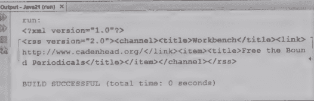

### 格式化 XML 文档

如前所述，XOM 在表示 XML 文档时不会保留无关紧要的空格。这与 XOM 的设计目标之一一致——忽略任何在 XML 中没有语法意义的实体。（另一个例子是，无论文本是使用字符实体、CDATA 段还是普通字符创建的，其处理方式都是相同的。）

今天的下一个项目是 `DomainWriter` 应用程序。该程序在 XML 文档 `feed2.rss` 的开头添加一条注释，并使用缩进进行序列化，生成如列表 19.5 所示的版本。

### 列表 19.5 feed2.rss 的全文

```
1: <?xml version="1.0" encoding="ISO-8859-1"?>
2: <!--File created Sep Sat 26 23:17:49 EDT 2015-->
3: <rss version="2.0">
4:   <channel>
5:     <title>Workbench</title>
6:     <link>http://www.cadenhead.org/</link>
7:     <item>
8:       <title>Free the Bound Periodicals</title>
9:     </item>
10:  </channel>
11: </rss>
```

`nu.xom` 中的 `Serializer` 类控制 XML 文档在显示或序列化存储时的格式化方式。缩进、字符编码、换行和其他格式均由该类的对象建立。

你可以通过向构造函数指定输出流和字符编码作为参数来创建 `Serializer` 对象：

```
FileOutputStream fos = new FileOutputStream("feed3.rss");
Serializer output = new Serializer(fos, "ISO-8859-1");
```

这些语句使用 ISO-8859-1 字符编码对文件序列化。

`Serializer` 支持 22 种编码，包括 `ISO-10646-UCS-2`、`ISO-8859-1` 到 `ISO-8859-10`、`ISO-8859-13` 到 `ISO-8859-16`、`UTF-8` 和 `UTF-16`。还有一个只接受输出流作为参数的 `Serializer()` 构造函数；它默认使用 `UTF-8` 编码。

通过调用序列器的 `setIndentation()` 方法并传入一个整数参数（指定空格数）来设置缩进：

```
output.setIndentation(2);
```

你可以通过将文档作为参数调用序列器的 `write()` 方法，将整个 XML 文档写入序列化目标地：

```
output.write(doc);
```

`DomainWriter` 应用程序将注释插入到 XML 文档中，而不是附加在父节点子节点的末尾。这需要父节点的另一个方法 `insertChild()`，该方法接受两个参数——要添加的元素以及整数位置：

```java
Builder builder = new Builder();
Document doc = builder.build(arguments[0]);
Comment timestamp = new Comment("File created " + new java.util.Date());
```

注释放置在文档顶部的 0 位置，通过移除 XML 声明将标签向下移动一行。列表 19.6 是应用程序的源代码。

### 列表 19.6 DomainWriter.java 的全文

```java
1: package com.java21days;
2:
3: import java.io.*;
4: import nu.xom.*;
5:
6: public class DomainWriter {
7:   public static void main(String[] args) throws IOException {
8:     try {
9:       // 从 XML 文档创建注释
10:      // 命令行参数指定
11:      Builder builder = new Builder();
12:      File xmlFile = new File("feed2.rss");
13:      Document doc = builder.build(xmlFile);
14:      // 使用当前时间和日期创建注释
15:      Comment timestamp = new Comment("File created " + new java.util.Date());
16:      // 添加关于文档中其他内容的注释
17:      // document
18:      doc.insertChild(timestamp, 0);
19:      // 为新文件创建文件输出流
20:      FileOutputStream f = new FileOutputStream("feed3.rss");
21:
22:      // 使用缩进设置为 2 个空格的序列化器
23:      // 将 XML 文档写入文件
24:      Serializer output = new Serializer(f, "ISO-8859-1");
25:      output.setIndentation(2);
26:      output.write(doc);
27:    } catch (ParsingException pe) {
28:      System.out.println("Parsing error: " + pe.getMessage());
29:      pe.printStackTrace();
30:    }
31:  }
32: }
```

`DomainWriter` 应用程序读取 `feed2.rss` 作为输入，并创建一个名为 `feed3.rss` 的修改版本。

### 评估 XOM

你创建的应用程序代表了 XOM 核心功能以及对 XML 处理的直接方法。

较小的 `canonical`、`converters`、`include` 和 `xslt` 包支持 XInclude、可扩展样式表转换 (XSLT)、XOM 序列化以及 DOM 和 SAX 之间的转换。

列表 19.7 是一个处理来自动态源的 XML 的应用程序。`RssFilter` 应用程序在馈中搜索指定的文本，生成仅包含匹配项的新 XML 文档。

在 `java21days` 包中创建 `RssFilter` 应用程序。

### 列表 19.7 RssFilter.java 的全文

```java
1: package com.java21days;
2:
3: import java.io.*;
4: import nu.xom.*;
5:
6: public class RssFilter {
7:     public static void main(String[] arguments) {
8:
9:     if (arguments.length < 2) {
10:         System.out.println("Usage: java RssFilter file term");
11:         System.exit(-1);
12:     }
13:
14:     // 保存 RSS 位置和搜索词
15:     String rssFile = arguments[0];
16:     String term = arguments[1];
17:
18:     try {
19:         // 用 RSS 文件的 XML 数据填充树
20:         // 文件可以是本地的，也可以通过 URL
21:         // 访问网络内容。
22:         Builder bob = new Builder();
23:         Document doc = bob.build(rssFile);
24:
25:         // 获取根元素 <rss>
26:         Element rss = doc.getRootElement();
27:
28:         // 获取元素的版本属性
29:         Attribute rssVersion = rss.getAttribute("version");
30:         String version = rssVersion.getValue();
31:
32:         // 如果需要，为 RSS 0.91 馈添加 DTD
```


# 第 19 天：读取与写入 RSS 馈

```java
31:         if (version.equals("0.91") &&
32:             doc.getType() == null) {
33:
34:             DTD rsstd = new DType("rss",
35:                 "http://my.netscape.com/publish/formats/rss-0.91.dtd",
36:                 doc.insertBefore(rsstd, 0);
37:         }
38:
39:         // 获取第一个（也是唯一的） <channel> 元素
40:         Element channel = rss.getFirstChildElement("channel");
41:
42:         // 获取其标题
43:         Element title = channel.getFirstChildElement("title");
44:         Text titleText = title.getChild(0);
45:
46:         // 修改标题以反映搜索词
47:         titleText.setText(titleText.getValue() + " Search for " + term + " articles");
48:     } catch (Exception e) {
49:         e.printStackTrace();
50:     }
51: }
```

```java
// 获取一个 <link> 元素
Element link = children.get(i);

// 获取其文本
Text linkText = (Text) link.getChild(0);

// 更新任何匹配 URL 的链接
if (linkText.getValue()).equals(
    "http://workbench.cadenhead.org/")) {

    // 更新链接的文本
    link.removeChild(0);
    link.appendChild("http://www.cadenhead.org/");
}

// 创建要添加的新新元素和属性
Element item = new Element("item");
Element itemTitle = new Element("title");

// 将它们添加到 <channel> 元素
itemTitle.appendChild(
    "Free the Bound Periodicals"
);
item.appendChild(itemTitle);
channel.appendChild(item);

// 保存 XML 文档
try {
    FileWriter fw = new FileWriter("feed2.rss");
    BufferedWriter out = new BufferedWriter(fw);
    out.write(doc.toXML());
} catch (IOException ioe) {
    System.out.println(ioe.getMessage());
}

System.out.println(doc.toXML());
} catch (ParsingException pe) {
    System.out.println("Parse error: " + pe.getMessage());
    pe.printStackTrace();
    System.exit(-1);
}
```

`DomainEditor` 应用程序将修改后的 XML 文档显示到标准输出并保存为命名的 `feeds2.rss`。你可以在图 19.2 中看到程序的输出。

## 图 19.2

加载并修改一个 XML 文档。


## 格式化 XML 文档

如前所述，XML 在表示 XML 文档时不会保留无关紧要的空格。这与 XOM 的设计目标之一一致——忽略任何在 XML 中没有语法意义的实体。（另一个例子是，无论文本是使用字符实体、CDATA 段还是普通字符创建的，其处理方式都是相同的。）

今天的下一个项目是 `DomainWriter` 应用程序。该程序在 XML 文档 `feed2.rss` 的开头添加一条注释，并使用缩进行进行序列化，生成如列表 19.5 所示的版本。

### 列表 19.5 feed2.rss 的全文

```
1: <?xml version="1.0" encoding="ISO-8859-1"?>
2: <!--File created Sep Sat 26 23:17:49 EDT 2015-->
3: <rss version="2.0">
4:   <channel>
5:     <title>Workbench</title>
6:     <link>http://www.cadenhead.org/</link>
7:     <item>
8:     <title>Free the Bound Periodicals</title>
9:     </item>
10:  </channel>
11: </rss>
```

`nu.xom` 中的 `Serializer` 类控制 XML 文档在显示或序列化存储时的格式化方式。缩进、字符编码、换行和其他格式均由该类的对象建立。

你可以通过向构造函数指定输出流和字符编码作为参数来创建 `Serializer` 对象：

```java
FileOutputStream fos = new FileOutputStream("feed3.rss");
Serializer output = new Serializer(fos, "ISO-8859-1");
```

这些语句使用 ISO-8859-1 字符编码对文件序列化。

`Serializer` 支持 22 种编码，包括 `ISO-10646-UCS-2`、`ISO-8859-1` 到 `ISO-8859-10`、`ISO-8859-13` 到 `ISO-8859-16`、`UTF-8` 和 `UTF-16`。还有一个只接受输出流作为参数的 `Serializer()` 构造函数；它默认使用 `UTF-8` 编码。

通过调用序列器的 `setIndentation()` 方法并传入一个整数参数（指定空格数）来设置缩进：

```java
output.setIndentation(2);
```

你可以通过将文档作为参数调用序列器的 `write()` 方法，将整个 XML 文档写入序列化目标地：

```java
output.write(doc);
```

`DomainWriter` 应用程序将注释插入到 XML 文档中，而不是附加在父节点子节点的末尾。这需要父节点的另一个方法 `insertChild()`，该方法接受两个参数——要添加的元素以及整数位置：

```java
Builder builder = new Builder();
Document doc = builder.build(arguments[0]);
Comment timestamp = new Comment("File created " + new java.util.Date());
```

注释放置在文档顶部的 0 位置，通过移除 XML 声明将标签向下移动一行。列表 19.6 是应用程序的源代码。

### 列表 19.6 DomainWriter.java 的全文

```java
1: package com.java1days;
2:
3: import java.io.*;
4: import nu.xom.*;
5:
6: public class DomainWriter {
7:   public static void main(String[] args) throws IOException {
8:     try {
9:       // 从 XML 文档创建注释
10:      // 命令行参数指定
11:      Builder builder = new Builder();
12:      File xmlFile = new File("feed2.rss");
13:      Document doc = builder.build(xmlFile);
14:      // 使用当前时间和日期创建注释
15:      Comment timestamp = new Comment("File created " + new java.util.Date());
16:      // 添加关于文档中其他内容的注释
17:      // document
18:      doc.insertChild(timestamp, 0);
19:      // 为新文件创建文件输出流
20:      FileOutputStream f = new FileOutputStream("feed3.rss");
21:
22:      // 使用缩进设置为 2 个空格的序列化器
23:      // 将 XML 文档写入文件
24:      Serializer output = new Serializer(f, "ISO-8859-1");
25:      output.setIndent(2);
26:      output.write(doc);
27: } catch (ParseException pe) {
28:      System.out.println("Parsing error: " + pe.getMessage());
29:      pe.printStackTrace();
```

`DomainWriter` 应用程序读取 `feed2.rss` 作为输入，并创建一个名为 `feed3.rss` 的修改版本。

## 评估 XOM

你创建的应用程序代表了核心功能的核心功能以及对 XML 处理的直接方法。

较小的 `canonical`、`converters`、`include` 和 `xslt` 包支持 XInclude、可扩展样式表转换 (XSLT)、XOM 序列化以及 DOM 和 SAX 之间的转换。

列表 19.7 是一个处理来自动态源的 XML 的应用程序。`RssFilter` 应用程序在馈中搜索指定的文本，生成仅包含匹配项的新 XML 文档。

在 `java1days` 包中创建 `RssFilter` 应用程序。

```java
50:
51:   // 获取所有的 <item> 元素并循环遍历它们
52:   Element items = channel.getChildElements("item");
53:   for (int i = 0; i < items.size(); i++) {
54:     // 获取一个 <item> 元素
55:     Element item = items.get(i);
56:
57:     // 在其内部查找 <title> 元素馈
58:     Element iTitle = item.getChildElement("title");
59:
60:     // 如果找到，查找其内容
61:     if (iTitle != null) {
62:       Text titleText = (Text) iTitle.getChild(0);
63:
64:
65:     // 如果在 item 中未找到搜索文本，
66:     将其从树中删除
67:       if (titleText.toString().indexOf(term) == -1) {
68:         channel.remove(item);
69:       }
70:     }
71:
72:   // 使用序列化器显示结果
73:   Serializer output = new Serializer(System.out);
74:   output.setIndent(2);
75:   output.write(doc);
76:
77: } catch (Exception exc) {
78:   System.out.println("Error: " + exc.getMessage());
79:   exc.printStackTrace();
80: }
81:
82: }
```

通过选择 `Run... Project Configuration`（运行... 项目配置），`Customize`（自定义），在设置命令行参数后运行应用程序。第一个参数是需要检查的馈，第二个参数是在其标题中搜索的单词。可以用于测试应用程序的一个馈是来自 SportsFilter 博客的 `http://feeds.sportsfilter.com/sportsfilter`。检查它是否有如足球、NFL、洋基队或牛仔队等单词。

图 19.3 显示了使用 `RSSFilter` 在 SportsFilter 的 RSS 馈中设置 "NFL" 的部分输出。源码中的注释描述了其功能。

XOM 的设计深受一个首要原则的影响：强制简单性。

## 图 19.3

从网站的 RSS 馈中读取 XML 数据。

```xml
<title>布鲁迪将缺席 4 场</title>
<link>http://feeds.sportsfilter.com/r/sportsfilter/v3iyzzrtmp4/nfl-source-no-doubt-brady-sit-4</link>
<description>一位消息告诉 WFAN 电台主持人 Craig Tomac，“他毫不怀疑新英格兰人队四卫汤姆·布鲁迪将在本赛季服四场停赛。”在联盟法庭听证后，他感到非常沮丧。该来源没有具名，但与 Codger Whomshell 押韵。

<pubDate>Fri, 25 Sep 2015 12:50:10 -0400</pubDate>
```

关于该类库，Elliott Rusty Hardy 表示，XOM “应该帮助没有经验的开发者做正确的事，并防止他们做错误的事。学习曲线需要非常浅，这包括不依赖于社区为人知但乍看并不明显的最佳实践。”

对于需要大量处理 XML 的 Java 程序员来说，这个新的类库非常有用。

## 总结

今天你通过探索 XML 的用途之一——RSS 馈，学习了另一种流行数据表示格式——可扩展标记语言（XML）的基础知识。

在某些方面，XML 等同于 Java 语言。在某些方面，XML 是 Java 语言的等价物。通过使用 XML 对象模型 (XOM)，可以轻松将数据转换为其他形式。

对于需要持续摄入 XML 的 Java 程序员来说，这个新的类库非常有用。

### 总结要点

1. 在某些方面，XML 是 Java 语言的。
2. 图 19.3 使用 `RSSFilter` 在 SportsFilter 的 RSS 馈中设置 "NFL" 的
3. 使用 `RSSFilter` 在 SportsFilter 的 RSS 馈中设置 "NFL" 的部分输出显示在
4. XOM 的设计深受一个首要原则的影响：强制简单性。

## 问答

1. RSS 是什么缩写？
2. 用什么方法可以向 XML 添加文本？
3. 为了让数据被 XML，什么形容词描述它？

### 答案

1. C
2. B
3. C

## 认证练习

以下问题是你可能会在认证中遇到的类型。给定：

```java
public class NameDirectory {

  String[] names;

  int nameCount;

  public NameDirectory() {

    names = new String[20];

    nameCount = 0;

  }

  public void addUser(String newName) {

    if (nameCount < 20) {

      // 这里

    }

  }

}
```


NameDirectory 类必须能够持有 20 个名称。什么语句应该替换此处，以便该类正常工作？

A. `names[nameCount] = newName;`
B. `names =nameCount = newName;`
C. `names[nameCount++] = newName;`
D. `names[++nameCount] = newName;`

### 练习

为了扩展你对今天主题的知识，请尝试以下练习：

1. 创建一个简单的 XML 格式来表示包含三本书的书籍，并创建一个 Java 应用程序搜索作者为 George R. R. Martin 的书籍并显示。
2. 创建两个应用程序：一个从数据库检索记录并产生相同信息的 XML 文件，另一个读取该 XML 文件并显示它。

# 第 20 天：XML Web 服务

多年来，人们多次尝试创建远程过程调用（RPC）的标准协议。这些是一个计算机程序通过网络（如互联网）调用另一个程序中过程的方法。

通常，这些协议是与语言无关的。这允许使用 C++ 等语言编写的客户端程序调用使用 Java 或其他语言编写的远程数据库服务器，而双方都不知乎对方的实现语言。

Web 服务——使用 Web 提供其他软件易解析的数据格式的网络协议——正被用于站点之间共享账户身份验证、促进商店之间的电子商务交易、提供企业间信息交换以及其他创新的产品。

这种想法的一个简单实用的例子是 XML-RPC，它是一种使用超文本传输协议（HTTP）和可扩展标记语言（XML）进行远程过程调用的协议。今天，你学习如何在 Java 中实现它，涵盖了以下主题：

- 如何使用 XML-RPC 与另一计算机通信
- 如何构建 XML-RPC 请求和 XML-RPC 响应
- 如何在 Java 程序中使用 XML-RPC
- 如何发送 XML-RPC 请求
- 如何接收 XML-RPC 请求

## XML-RPC 简介

Java 支持一种成熟的远程过程调用技术：远程方法调用 RMI。

RMI 设计用于为各种远程计算任务提供一种复杂且健壮的解决方案。这种复杂性一直是阻碍 RPC 被广泛采用的原因之一。实现这些某些解决方案所需的复杂性，可能超过了程序员为了仅仅在网络上交换信息而愿意承担的负担。

XML-RPC 是一个简单得多的替代方案，已被应用于 Web 服务中。

XML-RPC 的客户端/服务器实现版本适用于多种广泛使用的平台和编程语言。

XML-RPC 使用 HTTP（Web 协议）和 XML 的组合来交换信息。

XML-RPC 支持以下数据类型：

- **array**——一种数据结构，包含任何其他其他数据类型（包括数组）的多个元素
- **base64**——Base 64 格式的二进制数据
- **boolean**——真/假值，值为 1（真）或 0（假）
- **datetime.iso8601**——包含字符串格式和 ISO 8601 格式的日期和时间的字符串，例如 2015 年 9 月 27 日凌晨 12 点（及 15 秒）表示为 `20150927T12:01:15`
- **double**——8 字节符号位浮点数
- **int**（也称为整数 i14）值范围从 -2,147,483,648 到 2,147,483,647 的符号整数，与 Java 中的 `int` 值大小相同
- **string**——文本
- **struct**——关联数据的键值对，其中键名是字符串，而值可以是其他其他数据类型中的任意一种（与 Java 中的 `HashMap` 类可比拟）

XML-RPC 中明显缺失的一点是没有将数据表示为对象的方法。该协议在设计时并未考虑面向对象编程，但你可以合理地使用 `array` 和 `struct` 类型来表示复杂对象。

从设计上来说，XML-RPC 是一种用于跨网络编程的简单协议。该协议已实现在运行在 Windows、Macintosh 和 Linux 系统上的 Web 服务中。

## 与 XML-RPC 通信

> 完整的 XML-RPC 规范可以在 XML-RPC.com 的 `www.xmlrpc.com/spec` 上找到。

在 XML-RPC 发布后，该规范被扩展以创建另一种 RPC 协议，称为简单对象访问协议（SOAP）。

SOAP 与 XML-RPC 共享设计目标，并进行了扩展以更好地支持对象、用户定义数据类型和其他高级功能，导致了一个复杂得多的协议。SOAP 也在 Web 服务和其他去中心化网络编程中变得非常流行。

> 因为 SOAP 是 XML-RPC 的扩展，这引发了这样一个问题：为什么后者的协议仍然在使用？当 SOAP 问世时，它比 XML-RPC 复杂得多，一些程序员选择坚持使用更简单的协议。

> 如果要了解更多关于 SOAP 以及可以与 SOAP 客户端使用的公共服务器，请访问网站 `www.xmethods.com`。

## 与 XML-RPC 通信

XML-RPC 是一种通过 HTTP 传输的协议，HTTP 是 Web 服务器和浏览器之间数据交换的标准。它传输的信息不是网页，而是以特定方式编码的 XML 数据。

使用 XML-RPC 进行两种类型的数据交换：客户端请求和响应。

### 发送请求

XML-RPC 请求是作为 HTTP post 请求的一部分发送到 Web 服务器的 XML 数据。

post 请求通常用于从 Web 服务器传输数据。Java servlets、CGI 程序和其他软件收集来自 post 请求的数据并返回 HTML 作为响应。当你从网页提交电子邮件或在在线调查中投票时，你正在使用 post 或类似的名为 get 的 HTTP 请求。

XML-RPC 仅仅使用 HTTP 用作与服务器通信并接收响应的方便协议。

请求由两部分组成：用于与服务器通信并接收响应的 HTTP 请求，以及响应。

```
if (condVar > someVal) {console.log("xxx")}
```

XML 请求
XML-RPC 响应的 XML

# 选择 XML-RPC 实现

> 注意：如果你从 Apache 网站下载 Apache XML-RPC 遇到困难，可以从书籍网站获取。访问 `www.java21days.com`，进入第 20 天的页面并点击“Apache XML-RPC Library version 3.1.3”链接。这是一个包含所有项目文件的 ZIP 压缩包。该软件是开源的，可以在 Apache 许可证下共享。

下载库并将文件提取到计算机上的文件夹中。完成后，按照以下步骤将 Apache XML-RPC 添加到 NetBeans 中：

1. 选择 Tools（工具），Libraries（库）。Ant 库管理器将打开。
2. 点击 New Library（新建库）。出现 New Library 对话框。
3. 输入 Apache XML-RPC 3.1.3 作为 Library Name（库名称），并点击 OK（确定）。
4. 回到 Library Manager，点击 Add JAR/Folder（添加 JAR/文件夹）。
5. 浏览到你提取压缩包的子文件夹，并选择其中包含的所有 JAR 文件：`commons-logging-1.1.jar`、`ws-commons-util-1.0.2.jar`、`xmlrpc-client-3.1.3.jar`、`xmlrpc-common-3.1.3.jar` 和 `xmlrpc-server-3.1.3.jar`。（要选择多个文件，请按住 Shift 键并点击每个文件。）
6. 点击 Add JAR/Folder（添加 JAR/文件夹）。
7. 回到 Library Manager，点击 OK（确定）。

将库添加到 NetBeans 之后，你需要将其添加到当前项目中，以便在当天的程序中使用 Apache XML-RPC 类：

1. 在 Projects（项目）面板中，找到你所创建的类所在的 `.java` 文件下方名为 Libraries 的文件夹。
2. 右键点击 Libraries 文件夹并选择 Add Library（添加库）。出现 Add Library 对话框。
3. 选择 Apache XML-RPC 3.1.3，并点击 OK（确定）。

构成此类库的五个 JAR 文件将出现在面板的 Libraries 下。

设置好库后，使用 `import` 语句（导入）可以轻松地引用包中的类，如本例所示：

```
import org.apache.xmlrpc.*;
```

这使得可以在不使用完整包名的情况下，引用主包 `org.apache.xmlrpc` 中的类。你将在接下来的两个章节中使用此包。

# 使用 XML-RPC Web 服务

XML-RPC 客户端是一个程序，它连接到服务器，调用该服务器上的某个方法，并存储返回的结果。

使用 Apache XML-RPC，该过程与调用 Java 中的任何其他方法都相似。你不需要手动创建 XML 请求、解析 XML 响应，或使用 Java 的网络类之一连接到服务器。

在 `org.apache.xmlrpc.client` 包中，`XmlRpcClient` 类代表客户端。客户端使用 `XmlRpcClientImpl` 类设置，该类持有客户端的配置设置。

通过调用配置对象的 `getServerURL(URL)` 方法来设置服务器，该方法接收一个包含服务器地址和端口号的 URL 对象。

配置完成后，调用客户端的 `setConfig()` 方法，并将该配置作为唯一参数。

以下语句为 `cadenhead.org` 上的 4413 端口创建一个指向 XML-RPC 的客户端：

```
XmlRpcClientImpl config = new XmlRpcClientImpl();

URL server = new URL("http://cadenhead.org:4413/");

config.setServerURL(server);

XmlRpcClient client = new XmlRpcClient();

client.setConfig(config);
```

如果你调用带参数的远程方法，它们应该存储在 `ArrayList` 对象中，这是一种持有不同类对象的数据结构。

### 注意

Array lists（数组列表）在第 8 天“数据结构”中介绍过。它们是 `java.util` 包的一部分。

要使用数组列表，请调用无参数的 `ArrayList()` 构造函数，并对每个需要添加到列表的对象调用其 `add(Object)` 方法。对象可以是任何类，并且必须按照它们在远程方法中被调用的顺序添加到列表中。

# 使用 XML-RPC Web 服务

以下数据类型可以作为远程方法的参数：

- 用于 base64 数据的 `byte[]` 数组
- 用于布尔值的 `Boolean` 对象
- 用于 dateTime.iso8601 的 `Date` 对象
- 用于 double 值的 `Double` 对象
- 用于 int 值的 `Integer` 对象
- 用于字符串值的 `String` 对象
- 用于 struct（结构体）值的 `HashMap` 对象
- 用于数组的 `ArrayList` 对象

`Date`、`HashMap` 和 `ArrayList` 类位于 `java.util` 包。

例如，如果 XML-RPC 服务器有一个接受 String 和 Double 参数的方法，以下代码将创建一个持有每个参数的数组：

```
String code = "example";

Double pValue = new Double(1.5);

ArrayList parameters = new ArrayList();

parameters.add(code);

parameters.add(pValue);
```

若要调用 XML-RPC 服务器上的方法，请调用 `XmlRpcClient` 对象的 `execute()` 方法并传入两个参数：

- 方法名
- 持有方法参数的数组

指定方法名时不应带任何括号。XML-RPC 服务器通常会对其提供的方法进行文档说明。此对象应强制转换为以下数据类型之一以发送到方法：`Boolean`、`byte[]`、`Date`、`Integer`、`String`、`HashMap` 或 `ArrayList`。像 Java 中的其他网络方法一样，如果服务器报告 XML-RPC 错误，`execute()` 将抛出 `XmlRpcException`。`execute()` 方法返回的对象具有以下数据类型：用于 XML-RPC 的 `Boolean`、`byte[]`、`Date`、`Integer`、`String`、`HashMap` 或 `ArrayList`。

为了在 XML-RPC 服务器上调用方法，请调用 `XmlRpcClient` 对象的 `execute()` 方法...

以下语句在 4413 端口上创建了一个 Web 服务器，并为其 XML-RPC 服务器创建了一个对象：

```
WebServer server = new WebServer(4413);

XmlRpcServer xmlRpcServer = server.getXmlRpcServer();
```

该 Web 服务器并不包含客户端通过 XML-RPC 调用的远程方法。这些方法存在于处理器（handlers）中。

处理器是由 `org.apache.xmlrpc.server` 包中的另一个类 `PropertyHandlerMapping` 设置的。该类包含了 XML-RPC 服务器的配置设置，可以通过属性文件或调用其方法来设置。可以使用不带参数的构造函数通过函数来创建它：

```
PropertyHandlerMapping phm = new PropertyHandlerMapping();
```

要添加一个处理器，请调用映射对象的 `addObject(String, Object)` 方法并传入两个参数。

`addObject()` 的第一个参数是给处理器的名称，你可以选择任何名称。使用 XML-RPC 方法就相当于为变量命名。客户端在调用远程方法时将使用此名称。

今天早些时候创建的 SiteClient 应用程序调用了远程方法 `dmoz.getRandomSite()`。该调用的第一部分——点号之前的文本——引用了一个名为 `dmoz` 的处理器。

`addObject()` 的第二个参数是处理器类对应的 `Class` 对象。

这些语句将处理器 `dmoz` 添加到 XML-RPC 服务器的属性映射中，并设置服务器使用该配置：

```
phm.addHandler("dmoz", DmozHandlerImpl.class);

xmlRpcServer.setHandlerMapping(phm);
```

`DmozHandlerImpl` 类是实现 `getRandomSite()` 方法以及其他任何可以通过 XML-RPC 远程调用的方法的那个类。你将在稍后创建此类类。

处理远程方法调用的类可以是任何包含返回值的公共方法的 Java 类，只要这些方法接收的参数与 Apache XML-RPC 支持的数据类型对应：`boolean`、`byte[]`、`double`、`double`（此处原文重复）、`HashMap`、`int`、`String` 和 `ArrayList`。

你可以在不经过修改的情况下将现有的 Java 类作为 XML-RPC 处理器，只要它们不包含不应被调用的公共方法，且每个公共方法都返回一个合适的值。

### 注意

> 返回值的合适性与 Apache XML-RPC 的实现有关，而不是 XML-RPC 本身。该协议的其他实现在远程方法调用中接收的参数类型和返回的值上可能存在某些差异。

使用 Apache XML-RPC 时，Web 服务器允许调用处理器中的任何公共方法，因此你应该使用访问控制来防止客户端访问那些本应保持限制之外的方法。

作为创建 XML-RPC 服务的第一步，以下代码创建了一个可以接收 XML-RPC 请求的简单 Web 服务器。在 NetBeans 中，请使用列表 20.4 创建 `DmozServer` 应用程序。

### 列表 20.4 DmozServer.java 的完整文本

```
1: package com.java21days;

2:

3: import java.io.*;

4: import org.apache.xmlrpc.*;

5: import org.apache.xmlrpc.server.*;

6: import org.apache.xmlrpc.webserver.*;

7:

8: public class DmozServer {

9:   public static void main(String[] arguments) {

10:    try {

11:      startServer();

12:    } catch (IOException ioe) {

13:      System.out.println("Server error: " +

14:      ioe.getMessage());

15:    } catch (XmlRpcException xre) {

16:      System.out.println("XML-RPC error: " +

17:      xre.getMessage());

18:    }

19:  }

20:

21:  public static void startServer() throws IOException,

22:    XmlRpcException {

23:

24:    // 创建服务器

25: System.out.println("Starting Dmoz server...");

26: WebServer server = new WebServer(4413);

27: XmlRpcServer xmlRpcServer = server.getXmlRpcServer();

28: PropertyHandlerMapping phm = new PropertyHandlerMapping();

29:

30: // 注册处理器
```


31: `phm.addHandler("dmoz", DmozHandlerImpl.class);`

32: `xmlRpcServer.setHandlerMapping(phm);`

33:

34: // 启动服务器

35: `server.start();`

36: `System.out.println("Accepting requests...");`

37: }

38: }

```

在你创建了处理器类 `DmozHandlerImpl` 以及它实现的 `DmozHandler` 接口之前，该类无法成功编译。

`DmozServer` 应用程序在第 26–27 行在 4413 端口创建了 Web 服务器以及关联的 XML-RPC 服务器。

使用服务器的属性映射，向服务器添加了一个处理器：一个名为 "dmoz" 的 `DmozHandlerImpl` 对象。调用服务器的 `start()` 方法以开始监听请求。

实现一个功能性的 XML-RPC 服务器所需的代码就这些了。大部分工作都在你希望客户端调用的远程方法中。只要它们是公共的并返回合适的值，就不需要任何特殊技术。

为了给你提供一个可以测试并修改以适应你自己需求的完整示例，在接下来的列表中提供了 `DmozHandler` 接口和 `DmozHandler` 类。`DmozHandler` 接口定义了可以通过 XML-RPC 远程调用的公共方法。`DmozHandlerImpl` 类是 `DmozHandler` 接口的实现。创建一个该类的空 Java 文件，并用列表 20.6 填充。

### 列表 20.5 DmozHandler.java 的完整文本

```

1: `package com.java21days;`

2:

3: `import java.util.*;`

4:

5: `public interface DmozHandler {`

6:     `HashMap getRandomSite();`

7: `}`

```

### 列表 20.6 DmozHandlerImpl.java 的完整文本

```

1: `package com.java21days;`

2:

3: `import java.sql.*;`

4: `import java.util.*;`

5:

6: `public class DmozHandlerImpl implements DmozHandler {`

7:

8:     `public HashMap getRandomSite() {`

9:         `Connection conn = getMySqlConnection();`

10:        `HashMap<String, String> response = new HashMap<>();`

11:        `try {`

12:            `Statement stmt = conn.createStatement();`

13:            `ResultSet res = stmt.executeQuery("SELECT * FROM cool ORDER BY RAND() LIMIT 1");`

14:            `if (res.next()) {`

15:                `response.put("url", res.getString("url"));`

16:                `response.put("title", res.getString("title"));`

17:                `response.put("description", res.getString("description"));`

18:        `} else {`

19:            `response.put("error", "no record found");`

20:        `}`

21:            `stmt.close();`

22:            `res.close();`

23:            `conn.close();`

24:        `} catch (SQLException sqe) {`

25:            `response.put("error", sqe.getMessage());`

26:        `}`

27:        `return response;`

28:    `}`

29:

30:    `private Connection getMySqlConnection() {`

31:        `Connection conn = null;`

32:        `String data = "jdbc:mysql://localhost/cool";`

33:        `try {`

34:            `Class.forName("com.mysql.jdbc.Driver");`

35:            `conn = DriverManager.getConnection(data, "cool", "mrfreeze");`

36:        `} catch (ClassNotFoundException | SQLException e) {`

37:            `e.printStackTrace();`

38:        `}`

39:        `return conn;`

40:    `}`

41: `}`

```

运行此特定的 XML-RPC 服务器还需要一个数据库。要下载来自 Open Directory Project 的包含 1000 个网站信息的 MySQL 数据库，请访问本书的网站 www.java21days.com 并打开第 20 天页面。数据库位于名为 `dmozdata.dat` 的文件中，以及一个用于在 MySQL 服务器上创建数据库的 SQL 命令文本文件。

# 摘要

XML-RPC 被描述为远程过程调用协议的“最低公约数”，但其创建者并不认为这是一种侮辱。大多数促进网络上软件通信的尝试都是非常复杂的，这吓跑了那些有更简单需求的开发者。

XML-RPC 协议可以与任何支持 HTTP（Web 的通用语言）和 XML（一种非常流行的结构化数据格式）的软件交换信息。

通过观察 XML-RPC 的请求和响应，你应该能够在不阅读协议规范的情况下，弄出如何使用该协议。

然而，随着 Apache XML-RPC 等实现变得越来越广泛，你可以开始快速地使用它，而无需查阅协议本身。

## 问答

- 当我尝试从远程方法返回一个 String 数组时，Apache XML-RPC 返回了一个 `XmlRpcException`，说明该对象不受支持。它支持哪些对象？

- Apache XML-RPC 返回以下数据类型：`Boolean` 用于布尔型 XML-RPC 值，`byte[]` 用于 base64 数据，`Date` 用于 dateTime.iso8601 数据，`Double` 用于双精度值，`Integer` 用于 int（或 ia）值，`String` 用于字符串，`HashMap` 用于 struct 值，`ArrayList` 用于数组。

- 这些是 Apache XML-RPC 特有的。其他支持此点的类在 Java 中可能使用不同的数据类型和类。请咨询这些库的文档。

- 我正在编写一个 XML-RPC 客户端来调用一个返回二进制数据（换句话说 base64）的方法。`XmlRpcClient` 的 `execute()` 方法返回一个对象而不是字节数组。我该如何转换它？

- 数组在 Java 中是对象，因此你可以使用强制转换来转换字节数组返回的对象（假设该对象确实是一个数组）。以下语句可以在一个名为 `fromServer` 包含字节数组的对象上完成此操作：

```
byte[] data = (byte[]) fromServer;
```

## 测验

通过完成这个三道测验来复习今天的材料。

### 题目

- 1. XML-RPC 不需要哪种流行的网络协议？
  A. HTML
  B. HTTP
  C. XML
2. 哪种 XML-RPC 数据类型最适合存储数字 8.67？
  A. boolean
  B. double
  C. int
3. 哪种 XML 标签指示数据是一个 XML-RPC 请求？
  A. methodCall
  B. methodResponse
  C. params

### 答案

- 1. A XML-RPC 使用 HTTP（超文本传输协议）传输格式为 XML（可扩展标记语言）的数据。没有使用 HTML（超文本标记语言）。
2. 所有的浮点数（如 8.67）在 XML-RPC 中都由 `double` 类型表示。它不像 Java 那样有两种不同的浮点类型（float 和 double）。
3. `methodCall` 标签仅用于请求，`methodResponse` 仅用于响应，`params` 两者均使用。

### 认证练习

以下问题是你可能会在 Java 编程认证考试中遇到的类型。请在不看今天的材料或不使用 Java 编译器测试代码的情况下回答它。

给定：

```
public class Operation {

    public static void main(String[] arguments) {

    int x = 1;

    int y = 3;

    if ((x == 1) && (y++ == 3)) {

        y = y + 2;

    }

}
```


# 练习题

**y 的最终值是多少？**

- A. 3
- B. 4
- C. 5
- D. 6

答案可以在书籍网站 `www.java21days.com` 上找到。访问第 20 天页面并点击“Certification Practice”链接。

### 练习

为了扩展你对今天涵盖主题的知识，请尝试以下练习：

1. 编程网站 Advogato 提供了一个 XML-RPC 接口，用于在 `http://www.advogato.com/xmlrpc.html` 读取日志。编写一个应用程序读取成员的最后 10 条日志条目。
2. 博客更新服务 Weblogs.com 的 XML-RPC 接口位于 `www.weblogs.com/api.html`。编写一个客户端和一个服务器，能够发送和接收 `weblogUpdates.ping` 方法。

练习答案在书籍网站 `www.java21days.com` 提供。

# 第 21 天：使用 Java 编写 Android 应用

Java 最初主要被视为网页上程序的语言，但现在它已确认为一种强大的通用编程语言，可以在桌面式电脑、互联网服务器、平板电脑、电器以及许多其他平台上运行。其中一个平台在过去的十年中已成为 Java 开发领域一个令人兴奋且商业利润丰厚的领域：Android。

Android 系统起源于手机，并迅速成为许多其他设备的内核。Android 上所有的程序都是用 Java 编写的。

这些被称为 app 的程序开发在一个极其受欢迎的开源移动操作系统上。Android 不需要昂贵的开发工具、许可费，也不需要获得操作系统的开发者的批准。任何人都可以创建、分发和销售应用。

在本书的最后这一天，你将学习 Android 的历史、使其获得成功的因素，以及为该操作系统开发程序需要什么。你将学习如何创建应用并在 Android 设备和模拟器上运行它们。

今天将涵盖这些主题：

- 为什么创建 Android
- 如何编写你的第一个应用
- 如何组织一个应用
- 如何设计应用的界面
- 如何在模拟器上部署应用
- 如何在 Android 手机上部署应用

## Android 的历史

在 2007 年，Google 与几家科技公司合作推出了 Android。该公司希望建立一个新的移动平台，以挑战苹果的 iPhone 和 RIM 黑莓。与这些设备不同，Android 的设计是开放的，允许第三方参与。Google、Intel、Nvidia、Samsung、Sprint Nextel 等其他公司组成了开放手机联盟（Open Handset Alliance）。Google 免费发布了 Android 软件开发包（SDK），这是一套用于开发应用的工具。2008 年发布的 T-Mobile G1 是第一款上市的运行 Android 的手机。

Android 曾被认为是弱者，但在两年内人气呈爆炸式增长，与 iPhone 争相上下，并在如今的市场中远远超过了它。所有主要的手机运营商都提供 Android 手机，平板电脑和电子书阅读器市场正在快速增长。IDC 公司估计，79% 的智能手机正在运行 Android，而使用 iPhone 的比例为 16.4%。

在 Android 出现之前，移动软件开发需要昂贵的编程工具和开发者计划。手机制造商有权决定谁可以创建应用以及哪些应用可以卖给他们的用户。

由于 Android 的开源和专有性质，任何人可以在该平台上创建和分发应用。向 Google 的应用市场提交应用有一个小额费用，但其他一切都是免费的。

Android 编程的核心枢纽是 Android Developer 网站 `http://developer.android.com`。该网站提供了关于为该操作系统编写软件的广泛教程和参考资料。该网站为 Android Java 类库中的每个类提供了文档、针对初学者的教程以及在线参考。

编写 Android 应用需要一个支持 Android SDK 的集成开发环境（IDE）。虽然可以使用 Oracle 的 NetBeans 创建应用，但 Google 鼓励程序员使用名为 Android Studio 的 IDE，它整合了 SDK 的功能。

可以使用 Android Studio 编写 Android 应用，在模拟 Android 设备的模拟器中测试，并将其部署到真实设备上。

Java 语言主要用于编写运行在桌面式电脑、Web 服务器或浏览器上的软件。Android 将这种语言带到了处处。你创建的应用可以部署在手机、平板电脑和其他移动设备上，随你的用户去往哪里。

当 James Gosling 在 20 世纪 90 年代于 Sun Microsystems 开发 Java 时，公司希望它成为用于手机、智能卡和家电设备的语言。它的口号是“一次编写，随处运行”（Write Once, Run Anywhere）。

当这种语言兴起时，这个宏大的目标被搁置了一旁——它首先作为在网页上放置交互式程序的方法，然后成为桌面计算机和服务器的通用语言。

得益于 Android，这个目标已经实现。据行业估计，该操作系统在全球范围内有三亿台设备在运行。

让我们把这个数字变成三亿零一。

## 编写 Android 应用程序

Android 应用是使用应用程序框架的 Java 程序。框架是一组类和文件，只要你遵循所有的规则，它们就能让工作变得更简单。你已经使用过框架 Swing 创建过图形化用户界面。Android SDK 提供了一个框架，为 Android 应用在 Android 设备上如何正确结构规定了一套规则。

在编写应用之前，你必须安装并配置三样东西：Android SDK、Android Studio 以及用于 Eclipse 的 Android 插件。

Android Studio 会在安装期间设置 SDK 和插件。要获取 Android Studio，请访问网站 `developer.android.com/sdk` 并点击页面上的下载按钮（或链接）。该软件需要 1.1GB 的磁盘空间。

系统会询问你与 Android Studio 一起安装哪些组件。选项包括 Android SDK 和 Android 虚拟设备（后者是一个像运行移动操作系统的手机或平板电脑的模拟器）。安装这两个组件以及安装向导推荐的其他任何组件。

> **注意**：如果你在主下载页面上找不到适用于你操作系统的 Android Studio 版本，还有一个面向开发者下载页面，地址为 `http://tools.android.com/download/studio`。前往 Stable releases（稳定版）页面并选择版本 1.3.1（本书使用的版本）。你将看到适用于 Windows、Mac OS 和 Linux 的多个版本。

在安装向导下载 Android SDK 和其他组件后，会被要求为 Android Studio 用户界面选择一个主题（图 21.1）。

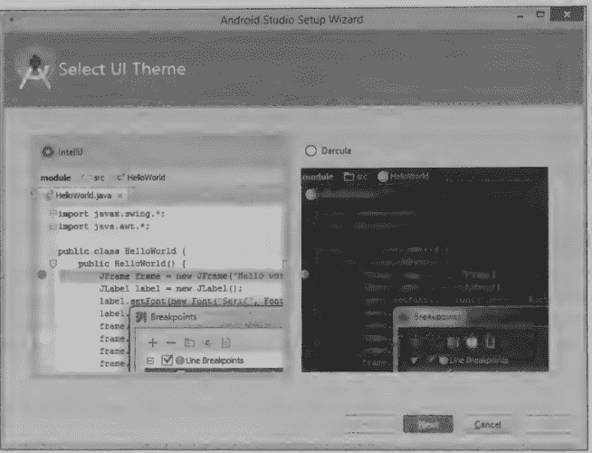

**图 21.1** 在 Android Studio 中选择用户界面主题。

IntelliJ 主题类似于 NetBeans 的用户界面，因此在刚开始时你可能更喜欢它。它可以随时更改。

一旦你安装了 Android Studio，就可以开始了。

今天的第一个项目是 Palindrome（回文），一个在 Android 设备上显示一行文本的应用程序。

Android Studio 设置向导有一个快速启动菜单，其中包含 Start a New Android Studio Project（启动一个新的 Android Studio 项目）注释。选择它，就会打开 Create New Project（新建项目）向导，如图 21.2 所示。

### 图 21.2 在 Android Studio 中启动一个新的 Android 项目

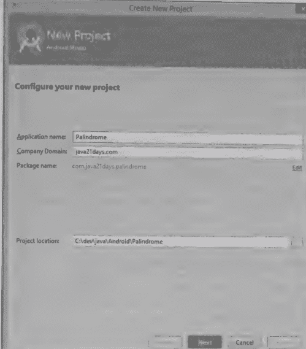

1. 在 Application Name（应用程序名称）字段中输入 Palindrome。
2. 在 Company Domain（公司域名）字段中输入 `java21days.com` 或你拥有的域名。Package Name（包名）字段会自动反映你的选择，形成诸如 `com.java21days.palindrome` 的包名。
3. Project Location（项目位置）字段指示存储项目文件的文件夹。要更改此项，请点击该字段右侧的 ... 按钮或输入位置。
4. 点击 Next（下一步）。系统会询问你的应用要针对何种类型的 Android 设备。默认是 Phone and Tablet（手机和平板电脑）。保持此默认值。
5. Minimum SDK（最低 SDK）字段决定了可以运行该应用的 Android OS 最旧版本。默认是 API 15: Android 4.0。
6. 你将被要求选择 Activity 模板。选择 Blank Activity（空活动），然后点击 Next。
7. 在 Activity Name（活动名称）字段中输入 Palindrome。接受所有默认设置。
8. 点击 Finish（完成）。Android Studio 将创建应用并打开它。

> **注意**：Android Studio 在创建后会打开几个界面。

图 21.5 显示了可编辑的 XML 文件 `strings.xml`。

### 图 21.5 以 XML 文件形式编辑应用的字符串资源

```
Edit translations for all locales in the translations editor. Open editor

<resources>

  <string name="app_name">Palindrome</string>

  <string name="hello_world">Sit on a Potato Pan, Otis!</string>

  <string name="action_settings">Settings</string>

</resources>
```

此 XML 文件中的所有内容都可以编辑。你可以通过将 Palindrome 替换为新文本为 `app_name` 赋予新值。你也可以更改 `<` 和 `>` 字符之间的 XML 标签。每个 `string` 元素的 `name` 属性定义了字符串资源的名称。值是包含在起始和结束标签之间的字符数据。

### 注意事项

像这样直接编辑 XML 比使用翻译编辑器（Translations editor）更容易出错。标签中的任何一个拼写错误都会导致应用编译失败。你可能想要编辑 XML 的唯一情况是 Android Studio 不支持你在资源中定义的某些内容。对于字符串来说，这种情况永远不会发生，因此请使用翻译编辑器来创建和修改它们。

点击 Android Studio 工具栏上的 Save All（全部保存）按钮或选择 File（文件）、Save All（全部保存）以保存你对 `strings.xml` 的更改。

# 运行应用

要运行你的第一个应用，选择菜单命令 Run（运行）、Run App（运行应用）。Android 模拟器会在自己的窗口中加载，这可能需要一分钟或更长时间，取决于你电脑的速度。首先加载的是一个显示动画 Android 徽标的屏幕，同时模拟器继续加载操作系统。

模拟器在你的应用标题栏中显示“Palindrome”，并在应用上显示一行文本“Sit on a Potato Pan, Otis!”，如图 21.6 所示。屏幕右侧的控件允许你像使用手机一样使用模拟器。你也可以点击屏幕，尽管在这个应用中没有可以点击的内容。

点击 Back（返回）按钮关闭 Palindrome 应用并尝试你新的虚拟 Android 手机。

# 第 21 天：使用 Java 编写 Android 应用

### 图 21.6 在模拟器中运行应用

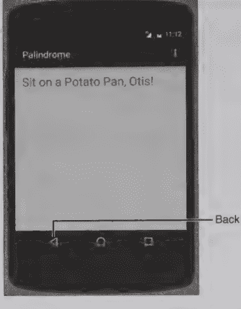

模拟器可以模拟许多功能，例如通过电脑当前的连接连接互联网以及接收电话和短信。

如果你在尝试运行应用时模拟器失败，在某些 Windows 和 Mac OS 电脑上会发生错误。Android Studio 中会显示以下错误信息：

# 输出

```
ERROR: x86 emulation currently requires hardware acceleration!

Please ensure Intel HAXM is properly installed and usable. CPU acceleration status: HAX kernel module is not installed!
```


此错误发生在带有 Intel 处理器的电脑上，原因是没有安装名为 Intel Hardware Accelerated Execution Manager (HAXM) 的程序。该程序可以作为 Android SDK 的一部分进行下载。在今天继续接下来的操作之前，请阅读附录 C，“解决 Android 模拟器出现的问题”。

# 第 21 天：使用 Java 编写 Android 应用

## 设计 Android 应用

Android 应用可以使用短信消息、基于位置的服务、触摸屏输入以及设备的其他功能。作为期末编程项目，你将创建一个可以拨打电话、使用浏览器访问网站并使用 Google Maps 加载位置信息的应用。

## 创建新项目

在通过菜单命令 `File` > `Close Project` 关闭 Palindrome 项目后，按照以下步骤在 Android Studio 中创建一个新项目：

1. 在快速启动菜单上，选择 `Start a New Android Studio Project`。出现新项目向导。
2. 在 `Application Name` 字段中输入 `Santa`。
3. 接受其他默认设置并点击 `Next`。出现 `Target Android device` 窗格。
4. 接受默认设置并点击 `Next`。
5. 选择 `Blank Activity`，并点击 `Next`。
6. 在 `Activity Name` 中输入 `Santa`。
7. 点击 `Finish`。

项目打开。

## 准备资源

虽然 Android 应用使用许多资源，但大部分都在 `res` 文件夹中。如图 21.7 所示，展开 `res` 文件夹即可。

Android 应用的图形界面不使用 Swing，因为 Android 有自己的用户界面控件库。应用的图形界面是由一系列布局创建的，这些布局包含字段、按钮、图形和其他控件。资源文件名只能包含小写字母、数字、下划线 `_` 和点 `.`。Android 应用使用带扩展名的文件名来识别资源。这将成为资源的 ID，即你在代码中引用它的方式。两个资源不能具有相同的 ID，`mipmap` 文件夹中相同图形的文件除外，它们被视为同一个资源。如果两个资源具有相同的 ID，应用无法在 Android Studio 中编译。

## 配置清单

通过编辑资源文件 `AndroidManifest.xml`，可以将 `santa.png` 指定为应用的图标。

此文件包含应用的配置设置。和 `strings.xml` 一样，这是一个可以手动编辑的 XML 文件，但没有特殊的替代编辑器。要为应用选择合适的图标，请遵循以下步骤：

1. 在 Project 窗格中，双击 `AndroidManifest.xml`。XML 文件打开编辑，如图 21.8 所示。
2. 找到属性 `android:icon` 被设置为 `@mipmap/ic_launcher` 的行。
3. 将值更改为 `@drawable/santa`。

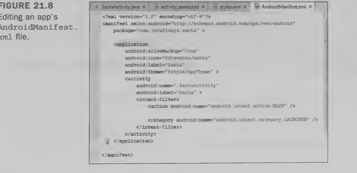

## 设计图形用户界面

显示给用户的每个屏幕都可以包含单个布局或多个布局。某些布局可以将组件组织成表格，将它们垂直或水平堆叠，或者以其他方式进行排列。

Santa 应用有一个蓝色的按钮用于联系圣诞老人。

一个应用程序可以以多个屏幕的形式呈现：

- 启动屏幕在应用加载时显示。
- 菜单屏幕包含访问其他屏幕的按钮。
- 帮助屏幕说明如何使用该应用程序。
- 制作人员屏幕列出应用程序的开发人员名称。
- 主屏幕实现应用程序的功能。

应用程序的所有屏幕都存储在 `/res/layout` 文件夹中。这个新项目在 `res/layout` 文件夹中创建了一个 `activity_santa.xml` 文件，并被设置为在应用加载时显示。

要编辑此屏幕布局，请在项目窗格中双击 `activity_santa.xml`。该屏幕将打开进入编辑模式，如图 21.9 所示。

屏幕编辑器的左侧是调面板窗格，其中包含可以拖到屏幕上的用户界面组件。

必须向屏幕上添加三个图形按钮，在 Android 中称为 `ImageButton` 组件。按照以下步骤操作：

1. 在应用屏幕上，点击包含“Hello World”文本的组件；组件周围会出现一个蓝色矩形。
2. 按键盘上的 `Delete` 键。该组件被移除。
3. 将布局组件 `LinearLayout (Horizontal)` 拖动到屏幕上。这将导致你放置在内部的组件从左到右水平排列。
4. 从调面板拖入一个 `ImageButton`（如图 21.9 所示）到屏幕上。在组件放置的位置会出现一个蓝色矩形。
5. 双击矩形。出现一个对话框，其中包含 `Src` 字段（为空）和 `ID` 字段（设置为值“imageButton”）。
6. 点击 `Src` 旁侧的 `...` 按钮。出现资源对话框。
7. 向下滚动并选择资源 `phone`；然后点击 OK。会出现一个带有拨号器图标的图像按钮。

### 图 21.9 图像按钮屏幕树形结构窗格

编辑 activity 的图形用户界面。


8. 将另一个 `ImageButton` 组件拖到屏幕上，并将其紧邻拨号按钮的右侧。
9. 使用步骤 4–6 中的相同程序分配资源浏览器。点击 OK。出现一个浏览器按钮。
10. 将第三个 `ImageButton` 拖到浏览器按钮的右侧。重复步骤 4–6 为其分配地图资源。点击 OK。出现一个地图图标。所有三个图标从左到右对齐。
11. 在屏幕编辑器右侧的组件树窗格中，点击 `LinearLayout` 项目。屏幕的属性将现在组件树窗格下方的属性窗格中。
12. 在属性窗格中，点击 `Background` 的值；然后点击旁侧的 `...` 按钮。打开引用对话框。
13. 选择 `northpole` 并点击 OK。屏幕背景变为圣诞老人及其雪橇的照片。
14. 点击拨号按钮。属性窗格将加载此组件的属性。
15. 向下滚动到 `On Click` 属性。在 `Value` 字段中输入 `processClicks`（按所示大写）。
16. 对浏览器按钮执行相同的操作，将其 `On Click` 属性设置为 `processClicks`。
17. 对地图按钮执行相同的操作。
18. 点击“全部保存”按钮。

完成后的屏幕如图 21.10 所示。

### 图 21.10 查看应用程序的用户界面


将图像按钮放置在线性布局组件内部并让它们正确对齐需要练习。如果你的屏幕与图 21.10 不完全匹配，没关系，只要三个按钮都可见即可。

如果需要，可以通过点击组件树中的 `LinearLayout` 项目并按下 `Delete` 键重新开始。所有的图像按钮都将随着布局管理器一起消失。

## 编写代码

在编写任何 Java 代码的情况下，你已经完成了此项目的大部分。当你学会了如何利用 Android Studio 中无需编程的功能时，Android 应用开发会变得简单得多。

## 理解 Activity 结构

应用程序组织为活动，即应用程序可以执行的任务。每个 Activity 都是一个 Java 类。当你创建 Santa 应用时，你指定的选项之一是创建一个名为 `SantaActivity` 的活动。该类在应用加载时运行。

`SantaActivity.java` 的源代码位于项目窗格中的 `/java/com.java21days.santa` 文件夹中。双击此文件在源代码编辑器中打开它。

该类开始时的代码如代码列表 21.1 所示。

### 代码列表 21.1 SantaActivity.java 的起始文本

```java
package com.java21days.santa;

import android.support.v7.app.AppCompatActivity;
import android.os.Bundle;
import android.view.Menu;
import android.view.MenuItem;

public class SantaActivity extends AppCompatActivity {

    @Override
    protected void onCreate(Bundle savedInstanceState) {
        super.onCreate(savedInstanceState);
        setContentView(R.layout.activity_santa);
    }

    @Override
    public boolean onCreateOptionsMenu(Menu menu) {
        getMenuInflater().inflate(R.menu_santa, menu);
        return true;
    }

    @Override
    public boolean onOptionsItemSelected(MenuItem item) {
        int id = item.getItemId();
        if (id == R.id.action_settings) {
            return true;
        }
        return super.onOptionsItemSelected(item);
    }
}
```

如果你在编辑器中看不到所有的 `import` 语句，点击 `import` 旁侧的 `+` 字符...

所有活动都是 `android.support.v7.app` 包中的 `AppCompatActivity` 子类，该包包含了显示屏幕、接收用户输入和保存用户偏好的行为。

第 11–14 行定义的 `onCreate()` 方法在类加载时被调用。该方法的第一件事是调用父类的相同方法。接下来调用 `setContentView()` 选择显示在屏幕上的布局。方法的参数是 `R.layout.activity_santa`，它指向 `activity_santa.xml` 文件，每个资源 ID 就是文件名。

在你创建此屏幕时，你将所有按钮的 `On Click` 属性都设置为 `processClicks`。这会导致在点击这些组件时调用 `processClicks()` 方法。

该方法必须在 `SantaActivity` 中实现。在第 14 行 `onCreate()` 方法的最后一行下方添加以下语句：

```java
public void processClicks(View display) {
    Intent action = null;
    int id = display.getId();
}
```

当你输入这段代码时，Android Studio 源代码编辑器检测到 `View` 和 `Intent` 类尚未导入。会出现蓝色对话框，邀请你按 `Alt+Enter` 导入每个类。按 `Alt+Enter` 执行此操作。

`processClicks()` 方法接收一个来自 `android.view` 包的 `View` 对象。View 是应用程序中的视觉显示。这个特定的 View 是包含拨号、浏览器和地图按钮的屏幕。

`View` 对象的 `getId()` 方法返回被点击按钮的 ID：`imageButton1`、`imageButton2`、`imageButton3`。

此 ID 保存在整数变量 `id` 中，可以用于 `switch` 条件，根据用户点击的内容采取行动：

```java
switch (id) {
    case (R.id.imageButton):
        // ...
        break;
    case (R.id.imageButton2):
        // ...
        break;
    case (R.id.imageButton3):
        // ...
        break;
    default:
        break;
}
```

`processClicks()` 方法中的第一个语句声明了一个 `Intent` 对象的变量：`Intent action;`。

`android.content` 包中的 `Intent` 类用于一个 Activity 告诉另一个 Activity 执行某些操作的方式。`Intent` 也可以用于与运行应用的设备进行通信。

`processClicks()` 方法中创建了三个 `Intent`，每个位于 `switch` 条件判断的 `case` 部分：

```java
action = new Intent(Intent.ACTION_DIAL, Uri.parse("tel:877-446-6723"));
action = new Intent(Intent.ACTION_VIEW, Uri.parse("http://www.noradsanta.org"));
action = new Intent(Intent.ACTION_VIEW, Uri.parse("geo:0,0?q=101 Saint Nicholas Dr., North Pole, AK"));
```

`Intent()` 构造函数接受两个参数：

- 要执行的操作，由类变量选择
- 与操作相关的数据

这三个 `Intent` 告诉 Android 设备拨打 877-446-6723 的圣诞老人热线电话，访问 www.noradsanta.org 网站，并加载带有北极地址的 Google 地图。

`startActivity(Intent)` 语句将 `intent` 转换为操作：

```java
startActivity(action);
```

出于安全考虑，拨号并不是由第一个 `intent` 发出的。相反，会打开设备的拨号器，该号码已准备好等待拨打。

## 完整代码示例

列表 21.2 包含了 `SantaActivity` 的完整文本。请对照检查，以确保你的代码与此匹配。

### 列表 21.2 SantaActivity.java 的完整文本

```java
package com.java21days.santa;

import android.content.Intent;
import android.net.Uri;
import android.support.v7.app.AppCompatActivity;
import android.os.Bundle;
import android.view.Menu;
import android.view.MenuItem;
import android.view.View;

public class SantaActivity extends AppCompatActivity {

    @Override
    protected void onCreate(Bundle savedInstanceState) {
        super.onCreate(savedInstanceState);
        setContentView(R.layout.activity_santa);
    }

    public void processClicks(View display) {
        Intent action = null;
        int id = display.getId();
        switch (id) {
            case R.id.imageButton:
                action = new Intent(Intent.ACTION_DIAL, Uri.parse("tel:877-446-6723"));
                break;
            case R.id.imageButton2:
                action = new Intent(Intent.ACTION_VIEW, Uri.parse("http://www.noradsanta.org"));
                break;
            case R.id.imageButton3:
                action = new Intent(Intent.ACTION_VIEW, Uri.parse("geo:0,0?q=101 Saint Nicholas Dr., North Pole, AK"));
                break;
        }
        startActivity(action);
    }

    @Override
    public boolean onCreateOptionsMenu(Menu menu) {
        // 充入菜单；这会将项添加到操作 bar 中
        getMenuInflater().inflate(R.menu_santa, menu);
        return true;
    }
}
```


@Override
public boolean onOptionsItemSelected(MenuItem item) {
    // 在此处处理操作 bar 点击。操作 bar 会
    // 自动处理主页/向上按钮的点击，只要
    // 你在 AndroidManifest.xml 中指定了父活动。
    int id = item.getItemId();
    // noinspectionStatement
    if (id == R.id.action_settings) {
        return true;
    }
    return super.onOptionsItemSelected(item);
}

# 设计 Android 应用

当你看到文件时，如果没有错误，Android Studio 会自动编译类。否则，会在检测到错误的文件中显示 X。

要运行应用，选择菜单 Run、Run App。模拟器加载 Android 系统并运行 Santa 应用。

在模拟器中，应用的拨号、浏览器和地图按钮都应该正常工作。

在模拟器中运行的应用看起来就像你在 Android Studio 中创建时一样。

点击返回键退出应用程序。如果你查看手机上的应用程序列表，它现在有一个圣诞图标（图 21.11）。点击它再次运行应用。

### 注意

有更多关于 Android 的信息，请参考《Sams Teach Yourself Android Development in 24 Hours》，第四版，作者 Carmen Delessio、Lauren Darcy 和 Shane Conder（Sams，2011，ISBN 0-672-33739-8）。Android 网站也有教程和参考资料：http://developer.android.com。

你在 Android Studio 中创建并测试的应用也可以运行在你的 Android 手机上。实现这一点的过程取决于手机的制造商及其 Android 版本。

### 图 21.11

要运行正在开发的应用，手机必须设置为开发者模式并启用 USB 调试。打开手机的设置应用，寻找名为“开发者选项”或类似的设置。

启用开发者选项并启用 USB 调试，这是手机进入开发者模式后可选的多个选项之一。插上手机的 USB 线并连接到 PC。

在 Android Studio 中，选择 Run、Run App。如果手机设置正确，Choose Device 对话框现在有一个新选项，如图 21.12 所示。

### 图 21.12

### 问题

1. 哪个 Android 对象允许应用程序与运行程序的设备进行通信？
   - A. Intent
   - B. View
   - C. Activity
2. 哪个资源文件包含应用程序的字符串资源？
   - A. main.xml
   - B. strings.xml
   - C. R.java
3. 应用程序拥有名为 icon.gif 和 icon.png 的资源文件吗？
   - A. 可以
   - B. 不可以
   - C. 稍后再。

### 答案

1. A. Intent 也可以用于一个 Activity 通知另一个 Activity 执行动作。
2. B. main.xml 文件是一个屏幕，R.java 定义了资源 ID。
3. B. 不，因为这两个文件将获得赋予相同的标识符 icon。

### 认证练习

以下问题是你在 Java 编程认证考试中可能会遇到的类型。请在不看今天的材料或不使用 Java 编译器测试代码的情况下回答它。

给定：

```java
public class CharCase {
    public static void main(String[] arguments) {
        float x = 9;
        float y = 5;
        char c = '1';
        switch (c) {
            case 1:
                x = x + 2;
            case 2:
                x = x + 3;
            default:
                x = x + 1;
        }
        System.out.println("Value of x: " + x);
    }
}
```

当显示时，x 的值是多少？

- A. 9.0
- B. 10.0
- C. 11.0
- D. 程序将无法编译。

答案可以在书籍网站 www.java21days.com 上找到。访问第 21 天页面并点击认证练习链接。

### 练习

为了扩展你对今天涵盖主题的知识，请尝试以下练习：

1. 修改回文应用（Palindrome app），显示不同的回文并显示一张图片作为屏幕背景。
2. 修改 Santa 应用程序，使用另一个名人的电话号码、网站地址和地图位置。

练习解答在书籍网站 www.java21days.com 提供。

# 第四 周

# 附录

- A 使用 NetBeans 集成开发环境 . . . . . . . . .597
- B 本书的网站 . . . . . . . . . . .607
- C 修复 Android Studio 模拟器的问题 . . . . . . .609
- D 使用 Java 开发包 . . . . . .615
- E 使用 Java 开发包进行编程 . . . . . . . . . . .637

# 附录 A：使用 NetBeans 集成开发环境

虽然仅凭 Java 开发包和文本编辑器就可以创建 Java 程序，但当使用集成开发环境（IDE）时，体验会变得愉快得多。

本书的前 20 天使用了 NetBeans，这是 Oracle 为 Java 程序员提供的免费 IDE。NetBeans 是一个让你更易于组织、编写、编译和测试 Java 软件的程序。它包含了项目和文件管理器、图形化用户界面设计器以及许多其他工具。一个杀手功能是代码编辑器，它可以在你输入时自动检测 Java 语法错误。

现在的 8.0.2 版本中，NetBeans 已成为专业 Java 开发人员的喜爱，免费提供了以前只有商业开发工具中才具备的功能和性能。它也是 Java 初学者最易使用的 IDE 之一。

在本附录中，你将安装 NetBeans 并学习如何在本书创建的项目中使用它。

## 安装 NetBeans

从不完美的起点开始，NetBeans 已经成为 Java 开发人员领先的编程工具之一。Java 语言的创造者 James Gosling 在《NetBeans字段指南》前言中写道：“我所有的 Java 开发都使用 NetBeans。”我也变成了一个粉丝。

NetBeans 支持 Java 编程的所有方面，涵盖三个版本：Java 标准版 (JSE)、Java 企业版 (JEE) 和 Java 微型 (JME)。你可以从 www.netbeans.org 下载 Windows、Mac OS 和 Linux 版 NetBeans。

如果你想要最新版本，请查看书籍网站 www.java21days.com。开始之前，请遵循书中的说明。当你第一次运行 NetBeans 时，将看到图 A1 所示的界面。

## 创建新项目

NetBeans 界面允许你创建新项目。要开始，使用文件（File）菜单并选择新项目（New Project）。向导要求你选择一个名称和位置。图 A1 显示了设置。

### 图 A1

NetBeans 界面。

```java
/* /
public class Spartacus {
    /**
     * @param args the command line arguments
     */
    public static void main(String[] args) {
        // TODO code application logic here
        System.out.println("I am Spartacus!");
    }
}
```

该类定义在 10–21 行。第 1–9 行是 NetBeans 在每个新类中包含的注释。

## 运行应用程序

创建 Java 程序 Spartacus 并成功编译后，你可以通过两种方式在 NetBeans 内的 Java 虚拟机中运行它：

- 选择 Run（运行）、Run File（运行文件）。
- 在 Projects（项目）面板中右键点击 Spartacus.java，选择 Run File（运行文件）。

当你运行 Java 类时，JVM 会调用其 main()。在 Spartacus 类中，字符串 "I am Spartacus!" 会出现在 Output（输出）面板中，如图 A.4 所示。

### 图 A.4

在 NetBeans 输出中查看程序输出

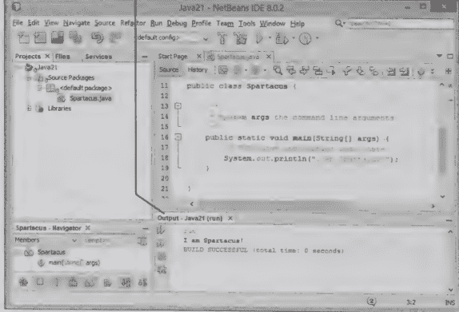

## 修复错误

Java 类必须有一个 main() 方法才能运行。如果你尝试运行一个缺少 main() 方法的类，NetBeans 会返回错误。

现在 Spartacus 应用程序已经编写、编译并运行，是时候通过搞坏一些东西来获得关于 NetBeans 在情况变得非常糟糕时的应对经验了。像任何 Java 程序员一样，你很快就会有很多机会练习自己独立解决问题，但请务必注意这里。

回到源编辑器中的 Spartacus.java，并删除列表 A.1 中调用 `System.out.println()` 的那行末尾的分号。即使在保存文件之前，NetBeans 也会发现该错误，并在该行左侧显示红色的停止图标，如图 A.5 所示。

### 图 A.5

在源编辑器中标记错误。

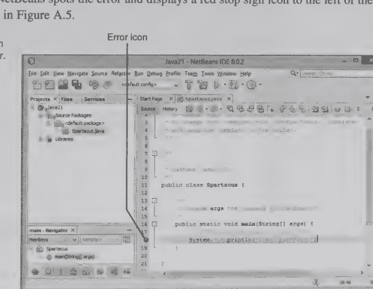

将鼠标光标悬停在停止图标上，可以看到一个对话框，描述了 NetBeans 认为发现的错误。

在这种情况下，NetBeans 源编辑器可以识别你在编写 Java 程序时遇到的许多常见编程错误和拼写错误。在删除错误之前，它会停止文件的编译。

在行末尾恢复分号。错误图标消失，你可以再次运行该类。

## 展开和缩小窗格

当你使用 NetBeans 时，通常会有多个面板同时打开，包括源编辑器、Projects（项目）面板和 Output（输出）面板。它们都在竞争程序用户界面上有限的空间。

你可以让一个面板占据整个 NetBeans 界面：双击面板的标签页。

要查看此操作，双击 spartacus.java 标签页。源编辑器会展开，为你提供更多空间查看源代码并进行修改（图 A.6）。

### 图 A.6

在较大的窗口中编辑 Spartacus.java 源代码。

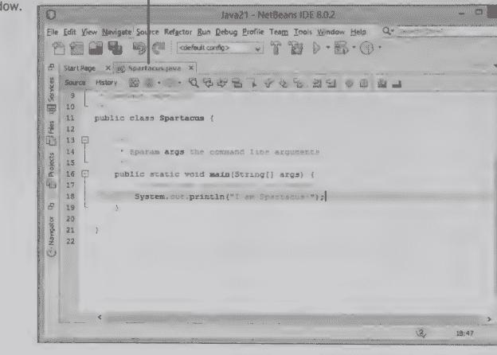

其他面板会关闭并沿面板左边缘垂直列出。图 A.6 列出了四个面板：Navigator（导航器）、Projects（项目）、Files（文件）和 Services（服务）。

要缩小源编辑器并恢复 NetBeans 的正常外观，再次双击 Spartacus.java 标签页。

当你开始使用 NetBeans 时，不小心展开一个面板以填充整个界面是很常见的。你随时可以通过双击面板的标签页来缩小它。

## 探索 NetBeans

NetBeans 的这些基本功能就是你创建和编译书中 Java 程序所需的所有内容。

NetBeans 的功能远比这里描述的强大，但在深入学习 IDE 之前，你应该专注于学习 Java。将 NetBeans 当作一个简单的项目管理器和文本编辑器来使用。编写类、标记错误，并确保能够成功编译并运行每个项目。

当你准备好学习 NetBeans 时，Oracle 在 www.netbeans.org/kb 提供了培训和文档资源。在每次启动 NetBeans 时都会加载的页面上，你也会看到最新教程的链接。

## 附录 B：本书的网站

尽管我希望认为并非如此，但在完成本书的 21 天后，你无疑会有一些不清楚的地方。编程是一门专门的技术领域，会向新学习者抛出许多奇怪的概念和术语，例如“实例化”、“三元运算符”以及“大端和小端字节字节序”。

如果你对书中涵盖的任何主题有疑问，请访问本书网站 www.java21days.com 寻求帮助。点击与本书版本匹配的封面以访问其站点。

本书网站提供以下内容：

- **错误纠正和澄清**——当错误被发现时，会在网站上进行描述。
- **问题解答**——如果你对书中涵盖的任何主题有疑问，可以在网站上获得解答。
- **示例文件**——提供 Java 程序的源代码。
- **示例程序**——提供 Java 程序的运行版本。
- **章节末功能**——书中提到的功能均可用。
- **更新的链接**——如果书中提到的网站已移动，将提供更新的链接。

你可以通过访问网站给我发送电子邮件。我还有一个 Twitter 账号用于讨论书中的话题。

## 附录 C：解决 Android 模拟器问题

Android Studio 集成开发环境（IDE）已成为创建 Android 应用程序的官方工具。你已经在 IDE 中学习了使用 Java 创建移动应用。

如果你已经阅读了章节并成功运行了 Android 模拟器，则无需阅读本附录。但如果你根本无法让模拟器工作，那么你就找对了。

## 运行应用程序的问题

当你在 Android Studio 中处理 Android 项目并想要运行应用程序时，可以选择 Run 命令。

此命令会打开一个 Choose Device 对话框，询问执行应用程序的设备。设备可以是通过 USB 线连接到电脑并配置为测试应用的真实 Android 手机或平板。设备也可以 Android 模拟器。

Android 模拟器可以模拟运行移动系统的手机和平板。可以为多个 Android 设备设置虚拟设备。安装 Android Studio 时，只有一个选择，目前是 Nexus 5 API 23 x86。这模拟了一个在 x86 处理器上运行 Android API 版本 23 的 Nexus 5 手机。

某些用户首次使用模拟器运行 Android 应用时遇到问题。模拟器会由于以下令人不安的消息崩溃：

```
ERROR: x86 模拟当前需要硬件加速！请确保已安装并可以使用 Intel HAXM。CPU
加速状态：未安装 HAX 内核模块！
```


此错误发生在 Windows 计算机上，表示它们需要一个名为硬件加速执行管理器（HAXM）的 Intel 加速程序模拟器才能工作。该程序可以在 Android Studio 中下载，但你必须在 IDE 外部进行安装。

HAXM 是一种适用于 Intel 处理器的硬件虚拟化引擎，通过提高模拟器速度来加速 Android 开发。

在设置 HAXM 之前，你必须将其添加到 Android Studio 的 Android SDK 中。

> **注意**
>
> HAXM 仅应安装在带有 Intel 处理器的计算机上。本附录解决了 Android Studio 表明需要 HAXM 运行 Android 模拟器的问题。如果模拟器因未提及 HAXM 的错误消息失败，请勿使用本附录进行修复。

# 附录 C：解决 Android Studio 模拟器的问题

## 在 Android Studio 中安装 HAXM

在运行 Android Studio 时，可以下载 HAXM 并将其添加到 Android SDK 中。点击 Android Studio 工具栏上的 `Android SDK Manager` 按钮，如图 C.1 所示。

图 C.1 Android SDK Manager


Android SDK Manager 用于通过额外的 Android 版本和实用的 SDK 工具来增强 SDK。点击 `SDK Tools` 选项卡将其置于顶层。

SDK 可用工具将列出来，你已经安装的工具旁边会有一个复选框。寻找 `Intel x86 Emulator Accelerator (HAXM Installer)` 这一项。

如果该项旁边没有复选框，说明它尚未添加到你 Android Studio 版本中的 Android SDK 中。（如果有复选框，则说明已经安装，你应该跳到下一节“在你的电脑上安装 HAXM”。）

Android SDK Manager 如图 C.2 所示。

图 C.2 运行 Android SDK Manager


选择 `Intel x86 Emulator Accelerator (HAXM Installer)` 并点击 `OK`。系统将要求你确认此更改。点击 `OK`。

Android Studio 将下载 HAXM 并报告其进度。如果安装正确，你就可以进行下一步，在你的电脑上安装它。

## 在你的电脑上安装 HAXM

要在你的电脑上启动 HAXM，请先关闭 Android Studio。

在你的文件系统中，找到你告诉 Android Studio 安装向导存储 Android SDK 的文件夹。

如果你不记得把它放在了哪里，Windows 上的默认路径是将 SDK 放在你的个人用户文件夹下名为 `AppData\Local\Android\sdk` 的子文件夹中。因此，如果你的 Windows 用户名是 Catniss，建议的 SDK 路径是 `\Users\Catniss\AppData\Local\Android\sdk`。

如果你在电脑上找到了 SDK 文件夹，打开它，然后打开子文件夹 `extra\intel_Hardware_Accelerated_Execution_Manager`。

该文件夹包含一个名为 `intelhaxm-android` 的程序。这就是 HAXM 安装程序。

HAXM 需要配备 Intel 处理器的电脑、1GB 的磁盘空间以及 Windows 7 或更高版本、Windows Vista 或 64 位的 Mac OS X 10.8 至 10.10 版本。此文件夹中名为 `Release Notes` 的文本文件包含了软件要求的详细信息。

在查看 `Release Notes` 文件后，如果你准备好安装 HAXM，请运行 `intelhaxm-android` 程序。安装程序会检查你的电脑是否可以运行 HAXM，如果不能则会提示。

安装期间，系统会询问你允许 HAXM 使用多少内存。默认值 2GB 应该足够。完成安装。

> **提示**
>
> 如果你以后决定为 HAXM 分配的内存过多或过少，可以通过运行安装程序来更改此设置。

安装 HAXM 后，你应该重启电脑。

完成后，加载 Android Studio，通过选择 `Run`、`Run App` 尝试再次运行 Android 应用。

该应用应该在模拟器中运行。Android 模拟器看起来像手机，在加载时显示“Android”启动屏幕，然后运行应用。图 C.3 显示了 Palindrome 应用成功运行时的样子。

图 C.3
成功！模拟器加载并运行了应用。


如果运行成功，你就可以回到第 21 天。

如果运行失败并出现相同的错误信息，提示“确保 Intel HAXM 已正确安装并可用”，还有最后一件事可以检查。但是这需要检查电脑的 BIOS 设置并进行更改。

## 检查 BIOS 设置

为了让 HAXM 工作，电脑的 BIOS 必须启用 Intel 虚拟化技术（Intel Virtualization Technology）。如果你是熟悉修改 BIOS 的经验电脑用户，这是一个非常简单的检查和更改项。

由于更改 BIOS 可能会影响电脑启动，甚至导致无法启动，因此只有在你以前修改过电脑 BIOS 的情况下，才应该尝试操作 BIOS。否则，你应该寻求专家帮助来指导你完成此过程。

# 附录 D：使用 Java 开发工具包

## 选择 Java 开发工具

该工具包适用于 Windows、Mac OS、Linux 和 Solaris SPARC 系统。

该工具包需要一台配备频率为 266MHz 或更高的 Pentium 2 处理器、128MB 内存以及 300MB 空闲空间的计算机。

在寻找此产品时，你可能会发现 Java 开发工具包（JDK）的版本号在 8 之后有一个数字，例如“JDK 8.0”。为了修复漏洞和解决安全问题，Oracle 定期发布工具包的新版本，主版本号后带有点和数字。请选择提供的 JDK 8 当前版本，无论是 8.0、8.1、8.2 还是更高版本。

> **注意**
>
> 不要误操作从 Oracle 下载两个名称相似的产品：Java 运行环境 (JRE) 8.0 或 Java 标准版 8.0 源码发行版 (Source Release)。

### 注意事项

要安装该工具包，你必须下载并运行安装程序。在 Java 网站上，选择适用于你操作系统的工具包版本后，你可以将其作为单个文件下载。

下载文件后，你就可以准备安装该工具包了。

## Windows 安装

在安装工具包之前，请确保系统上没有安装任何 Java 开发工具（当然，假设你现在不需要任何工具）。在计算机上安装多个 Java 编程工具通常会导致工具包出现配置问题。

要在 Windows 系统上安装程序，请双击安装文件，或从 Windows 任务栏中选择“开始”来查找并运行它。

安装向导将引导你完成软件安装过程。如果你接受使用工具包的条款和条件，系统将询问安装程序的位置，如图 D.1 所示。

向导会建议一个安装工具包的文件夹。在图 D.1 中，向导建议的文件夹为 `C:\Program Files\Java\jdk1.8.0_60`。当你安装工具包时，建议名称可能会不同。

要选择不同的文件夹，点击“更改”按钮。选择或创建一个新文件夹并点击确定。向导将返回自定义设置选项。

图 D.1
安装 JDK。


> **提示**
>
> 在继续之前，请记住你选择的文件夹。稍后在配置工具包和修复可能出现的任何配置问题时需要它。

向导还会询问你要安装工具包的哪些部分。默认情况下，向导安装 JDK 的所有组件：

- `开发工具`（Development tools）——创建 Java 软件所需的程序执行程序
- `源码`（Source code）——构成 Java 类库的数千个类的源码
- `公共 JRE`（Public JRE）——你可以随你创建的程序分发的 JVM（也称为 Java 运行环境）

如果你接受默认安装，你需要大约 300MB 的硬盘空闲空间。你可以通过省略程序文件以外的所有内容来节省空间。然而，源码和 Java 运行环境可能是很有用的，因此安装它们是一个好主意。

要防止安装某个组件，请点击其名称旁的硬盘图标，然后选择“此功能不可用”选项。

选择好安装的组件后，点击“下一步”按钮继续。系统可能会询问你是否设置 Java 插件以与系统上的网络浏览器配合。

## 配置 Java 开发工具包

Java 插件是一个运行嵌入到网页中的 Java 程序的 JVM。这些程序称为 applet（小程序），可以与不同的虚拟机协作，但大多数浏览器并不包含支持当前 Java 语言版本的虚拟机。Oracle 提供插件是为了为 Microsoft Internet Explorer、Microsoft Edge、Mozilla Firefox、Google Chrome、Safari 等浏览器提供完整的语言支持。

完成配置后，向导会将工具包安装到你的系统上。

## 配置环境变量

向导安装工具包后，你必须编辑计算机的环境变量以包含对工具包的引用。

丰富的 MS-DOS 用户可以通过调整两个变量来完成工具包的配置：

- 编辑计算机的 `PATH` 变量并添加工具包 `bin` 文件夹的引用（如果你将工具包安装在 `C:\Program Files\Java\jdk1.8.0_60`，则路径为 `C:\Program Files\Java\jdk1.8.0_60\bin`）
- 编辑或创建 `CLASSPATH` 变量，使其包含对当前文件夹的引用——一个点和一个分号（`;`）——随后是对工具包 `lib` 文件夹中 `tools.jar` 文件的引用（如果工具包安装在 `C:\Program Files\Java\jdk1.8.0_60`，则路径为 `C:\Program Files\Java\jdk1.8.0_60\lib\tools.jar`）。

对于不熟悉 MS-DOS 的 Windows 用户，后续章节将详细介绍如何在 Windows 系统上设置 `PATH` 和 `CLASSPATH` 变量。

其他操作系统的用户应遵循 Oracle 在其 Java 开发工具包下载页面上提供的说明。

## 使用命令行界面

该工具包需要使用命令行来编译 Java 程序、运行它们并处理其他任务。

命令行是一种完全通过键盘输入命令来操作计算机的方法，而不是使用鼠标。如今，为 Windows 用户设计的程序中很少有需要命令行的。

### MS-DOS 基础命令

> **注意**
>
> 你还可以通过其他方式使用 `CD` 命令：
>
> - 输入 `CD \` 打开当前硬盘的根目录。
> - 输入 `CD foldername` 打开与你使用的 `foldername` 匹配的子文件夹（如果该子文件夹存在）。
> - 输入 `CD ..` 打开包含当前文件夹的文件夹。例如，如果你在 `C:\Windows\Fonts` 中使用 `CD ..` 命令，则会打开 `C:\Windows`。

为书中创建的项目创建一个文件夹是有帮助的，例如创建一个名为 `J21work` 的文件夹。如果你已经创建了该文件夹，可以使用以下命令切换到该文件夹：

```
CD \

CD J21work
```

如果你还没有创建该文件夹，可以使用 MS-DOS 命令创建。

#### 在 MS-DOS 中创建文件夹

要从命令行创建文件夹，请输入 `MD` 命令后跟文件夹名称并按回车，如下例所示：

```
MD C:\STUFF
```

`STUFF` 文件夹将创建在系统 C 盘根目录中。要打开新创建的文件夹，请使用 `CD` 命令后跟该文件夹的名称，如图 D.4 所示。

如果你还没有创建 `J21work` 文件夹，可以从命令行创建：

1. 切换到根目录（使用 `CD \` 命令）。
2. 输入命令 `MD J21work` 并按回车。

创建 `J21work` 后，你可以随时使用以下命令从命令行进入该文件夹：
`CD \J21work`

在使用 Java 开发工具包（JDK）之前，你需要学习的 MS-DOS 最后一个内容就是如何运行程序。

#### 在 MS-DOS 中运行程序

在命令行运行程序最简单的方法是输入程序名称并按回车。例如，输入 `DIR` 并按回车以查看当前文件夹中的文件和子文件夹列表。

你也可以通过输入程序名称后跟空格以及一些控制程序运行方式的选项来运行程序。这些选项被称为参数。

要查看此示例，切换到根目录（使用 `CD \`）并输入 `DIR J21work`。如果 `J21work` 文件夹中包含内容，你将看到其中的文件和子文件夹列表。

安装工具包后，运行 JVM 以检查它是否正常工作。在命令行输入以下命令：

```
java -version
```

`java` 是 JVM 的名称，而 `-version` 是告诉它显示版本号的参数。

你可以在图 D.5 中看到此示例，但取决于你安装的工具包版本，你的版本号可能会有所不同。

如果 `java -version` 运行且你看到了版本号，它应该以 1.8 开头。Oracle 会加上第三个数字，但只要版本号是以 1.8 开头的，你使用的就是正确的 Java 开发工具包版本。

如果在运行 `java -version` 后看到错误的版本号或“无效的命令或文件名”错误，你需要对系统上 Java 开发工具包的配置进行一些更改。

图 D.5
运行程序

在命令行窗口中运行 Java 虚拟机。


> **注意**
>
> 由于 Java 8 是当前版本，你可能会对版本 1.8 的引用感到困惑。尽管该语言被称为 Java 8，JDK 被指定为 JDK 8.0，但工具包的内部版本号是 1.8.0。这个内部数字会出现在 `-version` 命令中，也会出现在你为工具包选择的安装文件夹中。
>
> 当所有其他方法都失败时，运行 `java -version` 命令以确保系统上安装了正确的开发工具。如果它以 1.8 开头，说明你拥有正确的工具来为 Java 8 开发程序。

## 纠正配置错误

当你第一次编写 Java 程序时，最可能的的问题来源不是类型、语法错误或其他编程错误。大多数错误都是源于 Java 开发工具包的配置不当。

如果你在命令行输入 `java -version` 且系统找不到包含 `java.exe` 的文件夹，你会看到以下错误信息之一或类似信息（取决于你的操作系统）：

- 无效的命令或文件名
- `'java' 不是内部或外部命令、可运行程序或批文件`

要修复此问题，你必须配置系统的 `PATH` 变量。

## 在大多数 Windows 版本上设置路径

在大多数 Windows 版本（包括 Windows 7、8 和 10）中，你可以使用“环境变量”对话框配置 `Path` 变量，这是系统控制面板的功能之一。

要在 Windows 7、8 或 10 上打开此对话框，请遵循以下步骤：

1. 点击任务栏上的“开始”按钮。
2. 点击搜索图标（放大镜）。
3. 输入“环境变量”。
4. 点击“编辑系统环境变量”。
5. 在弹出的窗口中点击“高级”选项卡。

## 在旧版 Windows 系统上设置路径

当你确定了正确的文件夹后，在 `AUTOEXEC.BAT` 文件的底部创建一个空行并添加以下内容：

```
PATH rightfoldername;%PATH%
```

例如，如果 `C:\Program Files\Java\jdk1.8.0_60\bin` 是正确的文件夹，请在 `AUTOEXEC.BAT` 的底部添加以下行：

```
PATH c:\Program Files\Java\jdk1.8.0_60\bin;%PATH%
```


# 附录 D：使用 Java 开发工具包

添加 `%PATH%` 文本可以防止你覆盖 `AUTOEXEC.BAT` 中的任何其他 `PATH` 命令。文件夹名 `Program Files` 周围出现引号，是因为某些版本的 Windows 需要此操作来处理包含空格的文件夹名称。

在对 `AUTOEXEC.BAT` 进行更改后，保存文件并重启电脑。完成后，尝试运行 `java -version` 命令。

如果它显示了开发包的正确版本，说明你的系统配置正确。当你稍后在本附录中尝试创建一个示例程序时，你就会确切这一点。

## 使用文本编辑器

与 NetBeans 等更复杂的 Java 开发工具不同，Java 开发包并不包含在创建源文件时使用的文本编辑器。

为了让编辑器或文字处理器与开发包配合，它必须能够保存无格式的文本文件。

此功能在不同的编辑器中有不同的名称。在保存文档或设置文档属性时，请查找此类格式选项：

- 纯文本 (Plain text)
- ASCII 文本 (ASCII text)
- DOS 文本 (DOS text)
- 仅文本 (Text-only)

如果你使用的是 Windows，操作系统自带几个编辑器。

Windows 记事本（Notepad）是一个简单的文本编辑器，仅适用于纯文本文件。它一次只能处理一个文档。在 Windows 7、8 或 10 上，选择“开始”，点击右上角的搜索图标，搜索“记事本”，然后点击搜索结果中的“记事本”。在早版本的 Windows 上，选择“开始->程序->辅助工具->记事本”。

Windows Word 比记事本更高级。它可以同时处理多个文档，并支持 Microsoft 格式。它还会记住最后处理过的几个文档，并从文件菜单中提供。它与记事本一起位于辅助工具菜单中。

Windows 用户也使用 Microsoft Word，但你必须将文件保存为文本，而不是 Word 的专用格式（UNIX 和 Linux 用户可以使用 emacs、pico 和 vi 编写程序；Macintosh 用户可以使用 SimpleText 或之前提到的任何 UNIX 工具来创建 Java 源文件）。

使用 Notepad 或 WordPad 等简单文本编辑器的缺点是，它们在编辑时不显示行号。

查看行号对 Java 编程很有帮助，因为许多编译器会指示错误发生的行号。查看由 JDK 编译器生成的以下错误：

```
Palindrome.java:2: Class Font not found in type declaration.
```

Java 源文件名后的数字 `2` 指向触发编译器错误的行。使用支持行号的文本编辑器，你可以直接跳转到该行并开始寻找错误。

通常，使用 Java 集成开发环境调试程序有更好的方法。但开发包用户必须使用 `javac` 工具指定的行号来查找编译器生成的错误。这是在用开发包学习语言后，转向高级 Java 开发程序的最佳理由之一。

> **另一种替代方案是使用带有行号和其他功能的程序员文本编辑器来配合开发包使用。** Java 流行的编辑器之一是 Edit，这是一款适用于 Windows、Linux 和其他系统的免费编辑器，可以在 `www.jedit.org` 获取。
>
> 或者使用 UltraEdit，这是一款优秀的程序员和 Web 设计师编辑器，目前售价 79.95。要了解更多信息并下载试用版，请访问 `ultraedit.com`。

## 创建示例程序

现在你已经安装并设置了 Java 开发包，准备好创建一个示例 Java 程序来使其运行了。

Java 程序从源代码开始——即一系列使用文本编辑器创建并保存为文本文件的语句。你可以使用任何喜欢的程序来创建这些文件，只要它能将文件保存为纯文本、无格式文本。

开发包不包含文本编辑器，但大多数其他 Java 开发工具都包含用于创建源文件的内置编辑器。

加载你选择的编辑器并输入列表 D.1 所示的 Java 程序。确保正确输入列表中的所有括号、大括号、中括号和引号，并完全按照所示大小写程序内容。如果你的编辑器在开始输入之前需要文件名，请将其命名为 `HelloUser.java`。

**列表 D.1 HelloUser.java 的源代码**

```
1: public class HelloUser {
2:     public static void main(String[] arguments) {
3:         String username=System.getProperty("user.name");
4:         System.out.println("Hello " + username);
5:     }
6: }
```

每行开头的行号和冒号不是程序的一部分。包含它们是为了方便你在阅读本书时，可以通过行号引用每个程序中的特定行。如果你对书中某个程序的源代码不确定，可以将其与书籍官方网站（`www.java21days.com`）上的副本进行对比。

在完成程序后，将文件保存到硬盘上的某处并命名为 `HelloUser.java`。Java 源文件必须以 `.java` 扩展名保存。

> 如果你创建了一个名为 `J21work` 的文件夹，可以将 `HelloUser.java` 保存在该文件夹中。这使得在使用命令行窗口时更容易找到该文件。

如果你使用的是 Windows，记事本等文本编辑器可能会为你保存的任何 Java 源文件添加 `.txt` 扩展名。例如，`HelloUser.java` 被保存为 `HelloUser.java.txt`。为了避免这个问题，在保存源文件时给文件名加上引号。

> 更好的解决方案是将 `.java` 文件与你将使用的文本编辑器永久关联。在 Windows 中，打开包含 `HelloUser.java` 的文件夹，并双击文件。如果你从未打开过扩展名为 `.java` 的文件，系统会询问打开此类类型的文件时使用什么程序。选择你喜欢的编辑器，并选择使你的选择永久化的选项。从现在起，你可以通过双击文件来打开源文件进行编辑。

此项目的目的是测试 Java 开发包。如果你输入的内容与 D.1 所示完全一样，那是你的错。

## 在 Windows 中编译和运行程序

当你位于正确的文件夹时，输入以下内容：开发包需要知道在系统的何处查找 Java 类文件。在许多情况下，开发包可以通过查看其安装文件夹自动确定这一点。

如果你成功编译并运行了程序，说明你的开发包工作正常，你已准备好开始第 1 天“上手 Java”。

即使你完全按照书中所示的内容输入，仍然无法成功编译程序，那么你的系统开发包配置可能存在最后一个问题：`CLASSPATH` 环境变量可能需要配置。

## 设置 CLASSPATH 变量

你编写的所有 Java 程序都依赖于两种类文件：你创建的类，以及 Java 类库（这是一组代表 Java 语言功能的数百个类）。

你也可以通过创建或修改另一个环境变量：`CLASSPATH` 来手动设置它。

### 在大多数 Windows 版本上设置 Classpath

如果你已成功编译并运行了 HelloUser 程序，说明工具包已配置成功。你不需要对系统进行任何更改。

另一方面，每当你尝试运行程序时都遇到 `Class not found`（未找到类）或 `NoClassDefFoundError`（未找到类定义）错误，你需要确保你的 `Classpath` 变量已正确设置。

在大多数 Windows 版本中（包括 Windows 7 到 10），你使用“环境变量”对话框来配置 `Classpath` 变量。（如果你使用的是 Windows 98 或 Me，请跳到下一节。）

在 Windows 7、8 或 10 上打开此对话框，请遵循以下步骤：

1. 点击任务栏上的“开始”按钮。
2. 点击右上角的搜索图标（放大镜）。
3. 在搜索框中输入“环境变量”。
4. 点击结果中的“编辑系统环境变量”。打开“系统属性”对话框并默认显示“高级”选项卡。
5. 点击“环境变量”按钮。打开“环境变量”对话框，如图 D.9 所示。

在其他版本中打开它，请执行以下操作：

1. 右键点击桌面或开始菜单上的“我的电脑”，并选择“属性”。打开“系统属性”对话框。
2. 点击“高级”选项卡将其置于顶前。
3. 点击“环境变量”按钮。打开“环境变量”对话框，如图 D.9 所示。

如果你的系统中有 `Classpath` 变量，它很可能是系统变量之一。你的系统可能没有设置 `Classpath` 变量。通常，工具包无需该变量即可找到类文件。

然而，如果你的系统有 `Classpath`，它必须包含至少两项内容：对当前文件夹的引用（点 `.`）以及对包含 Java 类库文件 `tools.jar` 的引用。

图 D.9：在大多数 Windows 版本中设置环境变量。


如果你将工具包安装在 `C:\Program Files\Java\jdk1.8.0_60` 文件夹中，`tools.jar` 位于 `C:\Program Files\Java\jdk1.8.0_60\lib` 文件夹。

如果你忘记了安装工具包的位置，可以通过选择 Windows 任务栏上的“搜索”、“开始”（或开始、搜索图标）来查找 `tools.jar`。如果你发现了多个副本，应该可以通过这种方法找到正确的那个：

1. 使用 `cd` 打开包含 JVM (`java.exe`) 的文件夹。
2. 输入命令 `cd ..`。
3. 输入命令 `cd lib`。

`lib` 文件夹通常包含正确的 `tools.jar` 副本。

当你知道正确的文件夹后，返回如图 D.9 所示的“环境变量”对话框。

如果你的系统没有路径，点击“系统变量”列表下的“新建”按钮。打开“新建系统变量”对话框。

如果你的系统有 `Classpath`，选择它并点击“编辑”按钮。打开“编辑系统变量”对话框。

这两个对话框包含相同的内容：一个“变量名”字段和一个“变量值”字段。

在“变量名”字段中输入 `Classpath`，在“变量值”字段中输入你正确的 `Classpath` 值。

例如，如果你将工具包安装在 `C:\Program Files\Java\jdk1.8.0_60`，你的 `Classpath` 应该包含以下内容：

```
;C:\"Program Files\Java\jdk1.8.0_60\lib\tools.jar
```

设置好 `Classpath` 后，双击确定：第一次关闭“编辑系统变量”或“新建系统变量”对话框，第二次关闭“环境变量”对话框。

要检查此更改是否修复了你的问题，请打开一个新的命令行窗口并输入命令 `java -version`。

如果显示了正确的工具包版本，说明你的系统已配置正确，不再需要更多调整。尝试重新创建示例 HelloUser 程序。在正确设置 `CLASSPATH` 变量后，它应该可以工作。

### 在 Windows 98 或 Me 上设置 CLASSPATH

如果你在使用 Windows 98 或 Me，并且在运行 HelloUser 程序时出现 `Class not found` 或 `NoClassDefFoundError` 错误，你需要确保你的 `CLASSPATH` 变量已正确设置。

要此操作，运行 Windows 记事本并选择“文件”、“打开”。转到系统的根目录，然后打开 `AUTOEXEC.BAT` 文件。编辑器中将加载一个包含若干 MS-DOS 命令的文件。

在文件中查找包含 `SET CLASSPATH=` 命令的行，该命令后面跟着一系列由分号分隔的文件夹和文件名。

`CLASSPATH` 用于帮助 Java 编译器找到它所需的类文件。它可以包含文件夹或文件。它还可以包含一个点字符（`.`），这是在 MS-DOS 中引用当前文件夹的另一种方式。

你可以在命令行中输入以下命令来查看系统的 `CLASSPATH` 变量：

```
ECHO %CLASSPATH%
```

如果 `CLASSPATH` 包含你已知已不在电脑上的文件夹或文件，你应该在 `SET CLASSPATH=` 行中删除对这些内容的引用。

要设置 Classpath，你必须在 `AUTOEXEC.BAT` 的底部包含 `SET CLASSPATH=` 行：

```
SET CLASSPATH=C:\Program Files\Java\jdk1.8.0_60\lib\tools.jar;
```

# 附录 E：使用 Java 开发工具包编程

Java 开发工具包 (JDK) 在本书中可用于创建、编译和运行 Java 程序。

构成工具包的工具包含许多程序员探索的特性。

本附录涵盖了你可以用于创建更可靠、测试更好、运行更快的 Java 程序的工具特性。

## JDK 概述

虽然使用许多集成开发环境来创建 Java 程序，但最流行的仍然是 Oracle 的 Java 开发工具包，这是一套用于开发软件的命令行工具。受欢迎有两个主要原因：

- 它是免费的。你可以从 Java 官方网站 `www.oracle.com/technology/java` 免费下载。
- 它是领先的。每当语言发布新版本时，工具首先支持新版本。

工具使用命令行。这在 Windows 下也称为 MS-DOS 提示符、命令行提示符或控制台，在 UNIX 下称为 shell 提示符。你使用键盘输入命令：

```
javac VideoBook.java
```

该命令使用工具包的编译器编译 `VideoBook.java`。命令有两个元素：编译器的名称 `javac` 和要编译的程序名称 `VideoBook.java`。空格字符分隔这两个元素。

每个工具命令都遵循相同的格式：要使用的工具名称，后跟一个或多个指示工具应该做什么的元素。这些元素被称为参数。

下面的示例说明了参数的用法：

```
java VideoBook add DVD "Broadcast News"
```

此命令告诉 Java 虚拟机 (JVM) 运行名为 `VideoBook` 的类，并带有三个命令行参数：字符串 `"add"`、`"DVD"` 和 `"Broadcast News"`。

> 你可能会因为字符串 `"Broadcast News"` 中的空格而认为有更多命令行参数。该字符串周围的双引号使其被视为一个命令行参数，这使得参数中包含空格成为可能。

工具中使用的某些参数可以修改函数的工作方式。这些参数以连字符开头，被称为选项。

以下命令显示了选项的用法：

```
java -version
```

此命令告诉 JVM 显示其版本号，而不是尝试运行类文件。这是检查开发包是否已正确配置以在你的系统上运行 Java 程序的良好方法。以下是在配备 Java 8 的系统上运行的输出示例：

**输出**

```
java version "1.8.0_60"
Java (TM) SE Runtime Environment (build 1.8.0_60-b227)
Java HotSpot (TM) 64-Bit Server VM (build 25.60-b23, mixed mode)
```

该版本反映了 Oracle 对 Java 8 的内部版本号，即 1.8。

在某些情况下，你可以将选项与其他参数结合使用。例如，如果你编译一个使用了弃用方法的 Java 类，你可以通过带有 `-deprecation` 选项编译该类来查看关于这些方法的更多信息，如下所示：

```
javac -deprecation OldVideoBook.java
```

### Java 虚拟机

`java`，即 Java 虚拟机，用于从命令行运行 Java 应用程序。它在参数中接收要运行的类文件的名称，如下例所示：

```
java BidMonitor
```

虽然 Java 类文件以 `.class` 扩展名结尾，但在使用 JVM 时不需要指定该扩展名。该机器也被称为 Java 解释器。

JVM 加载的类必须包含一个名为 `main()` 的类方法，其形式如下：

```
public static void main(String[] arguments) {
    // 方法写在此处
}
```

某些简单的 Java 程序可能只包含一个类——包含 `main()` 方法的那个类。在使用了其他类的复杂程序中，JVM 会自动加载所需的任何其他类。

JVM 运行字节码，即机器执行的编译后的指令。当 Java 程序以字节码形式保存为 `.class` 文件后，它就可以在不经修改的情况下由不同的 JVM 运行。如果你编译了一个 Java 程序，它将与任何完全支持 Java 的 JVM 兼容。

> **注意**
>
> 有趣的是，Java 并不是你唯一可以使用它来创建 Java 字节码的语言。NetRexx、JPython、JRuby、JudoScript 以及几十种其他语言都可以通过这些语言特有的编译器编译成可执行字节码的 `.class` 文件。Robert Volksdorf 在 `www-is-research.de/info/vmlanguages` 维护这些语言的完整列表。

你可以通过两种不同的方式指定 JVM 将运行的类文件。如果类不属于任何包，你可以通过指定类的名称来运行它，如前面的 `java BidMonitor` 示例。如果类属于某个包，你必须使用其完整包名和名称来指定该类。

例如，考虑一个属于 `org.cadenhead.auction` 包的 `SellItem` 类。要运行此应用程序，你需要使用以下命令：

```
java org.cadenhead.auction.SellItem
```


包名中的每个元素都对应其自己的所有者。JVM 在几个不同的地方查找 `SellItem.class` 文件：

- 输入 `java` 命令的文件夹下的 `org.cadenhead.auction` 子文件夹（例如，如果是从 `C:\J2work` 文件夹输入命令的，那么只要 `SellItem.class` 文件位于 `C:\J2work\org.cadenhead\auction` 文件夹中，就可以成功运行它）。
- 你的 Classpath 设置中任何文件夹下的 `org.cadenhead.auction` 子文件夹。

如果你正在创建自己的包，管理它们的一种简单方法是向 Classpath 添加一个文件夹，作为你创建的任何包的根文件夹，例如 `C:\javpackages` 或类似的路径。在创建了与包名对应的子文件夹后，将包类文件放在正确的子文件夹中。

你可以使用命令行 `-cp` 在运行 Java 应用程序时指定 Classpath。例如：

```bash
java -cp . org.cadenhead.auction.SellItem
```

# appletviewer 浏览器

如果参数是一个 Web 地址而不是文件引用，`appletviewer` 将加载该地址的 HTML 文档。例如：`appletviewer http://www.javaonthebrain.com`

图 E.1 显示了从该页面加载的 applet，该网站是由漫画家兼 Java 游戏程序员 Karl Hörnell 开发的。

# 图 E.1
在浏览器之外查看 Web applet。


当 `appletviewer` 加载 HTML 文档时，文档上的每个 applet 都会在自己的窗口中开始运行。这些窗口的大小取决于 applet 的 html 标签中设置的 `height`（高度）和 `width`（宽度）属性。

与浏览器不同，`appletviewer` 不能查看 HTML 文档本身。如果你想查看 applet 相对于文档其他内容的布局，必须使用支持 Java 的浏览器。

> **注意**
> 来自 Oracle 的 Java 插件允许浏览器运行 Java applet。该插件包含在 Java 运行环境中（JRE），它是随 Java 开发工具包（JDK）一起安装的运行 Java 程序的 JVM。如果你的系统中尚未安装该插件，可以从 Oracle 网站 `www.java.com` 下载。

使用 `appletviewer` 相当简单，但你可能对查看器运行 applet 时提供的某些菜单选项并不熟悉。

有以下菜单选项可用：

- **Restart**（重启）和 **Reload**（重新加载）选项用于重启 applet 的执行。这两个选项的区别在于，`Restart` 在重新启动之前不会卸载 applet，而 `Reload` 会。`Reload` 选项等同于关闭 applet viewer 并在同一 Web 页面上重新打开它。
- **Start**（启动）和 **Stop**（停止）选项用于直接调用 applet 的 `start()` 和 `stop()` 方法。
- **Clone**（复制）选项创建一个相同 applet 的第二个副本，并在其自己的窗口中运行。
- **Tag**（标签）选项显示程序的 applet 或对象标签，以及用于配置 applet 的任何 `param` 标签的 HTML。

Applet 拉拉菜单上的另一个选项是 **Info**（信息），它会调用 applet 的 `getAppletInfo()` 和 `getParameterInfo()` 方法。程序员可以实现这些方法以提供有关 applet 及其处理的参数的更多信息。

`getAppletInfo()` 方法返回一个描述 applet 的字符串。`getParameterInfo()` 方法返回一个字符串数组，指定每个参数的名称和描述。

列表 E.1 包含一个演示了这些方法用法的 Java applet。

# 列表 E.1 AppInfo.java 完整文本

```java
1: import java.awt.*;

2:

3: public class AppInfo extends javax.swing.JApplet {

4:     String name, date;

5:     int version;

6:

7:     public String getAppletInfo() {

8:         String response = "This applet demonstrates the "
9:             + "use of the Applet's Info feature.";
10:        return response;
11:    }

12:

13:    public String[] getParameterInfo() {

14:        String[] p1 = {"Name", "String", "Programmer's name" };
15:        String[] p2 = {"Date", "String", "Today's date" };
16:        String[] p3 = {"Version", "int", "Version number" };
17:        String[] response = { p1, p2, p3 };
18:        return response;
19:    }

20:

21:    public void init() {

22:        name = getParameter("Name");
23:        date = getParameter("Date");
24:        String versText = getParameter("Version");
25:        if (versText != null) {
26:            version = Integer.parseInt(versText);
27:        }
28:    }
29:}
```

```java
30: public void paint (Graphics screen) {
31:     Graphics2D screen2D = (Graphics2D) screen;
32:     screen2D.drawString("Name: " + name, 5, 50);
33:     screen2D.drawString("Date: " + date, 5, 100);
34:     screen2D.drawString("Version: " + version, 5, 150);
35: }
36: }
```

此 applet 的主功能显示三个参数的值：`Name`、`Date` 和 `Version`。`getAppletInfo()` 方法返回以下字符串：

> This applet demonstrates the use of the Applet's Info feature.

如果你没有处理过多维数组，`getInfo()` 就会稍微复杂一些。发生了以下情况：

- 第 13 行返回方法的返回类型，这是一个 `String` 对象的二维数组。
- 第 14 行创建了一个包含三个元素的 `String` 对象的数组："Name"、"String" 和 "Programmer's name"。这些元素描述了可以为 `AppInfo` applet 定义的参数之一（在本例中为 "Name"）、该参数将持有的数据类型（字符串）以及参数的描述（"Programmer's name"）。这个三元素数组存储在 `p1` 对象中。
- 第 15 行和第 16 行为 `Date` 和 `Version` 定义了两个 `String` 数组。
- 第 17 行使用 `response` 对象存储了 `p1, p2, p3`。
- 第 18 行使用 `response` 对象作为返回值。

列表 E.2 是一个可以加载 applet 的 HTML 页面。

# 列表 E.2 Applet 的完整文本

```html
1: <applet code="AppInfo.class" height="200" width="170">
2: <param name="Name" value="Rogers C">
3: <param name="Date" value="08/15/15">
4: <param name="Version" value="7">
5: </applet>
```

图 E.2 显示了 `appletviewer` 运行 applet，图 E.3 是选择 viewer Info 选项时弹出的对话框截图。

# 附录 E：使用 Java 开发工具包

图 E.2 在 appletviewer 中运行 applet。


图 E.3 Applet 的信息框。


# javadoc 工具

Java 文档生成器 `javadoc` 接收 `.java` 源文件或包名，并生成详细的 HTML 格式文档。

要创建文档，必须使用特殊类型的注释。例如，如果注释位于类语句之前，它将描述该类的目的。

除了描述性文本外，可以使用某些项来记录程序元素。这些项被称为标签，以 `@` 符号开头，后面跟着一个空格和描述性段落。

- 一个描述性的句子或段落。
- 此标签的描述。
- 关于此。

Java 文档注释应该放置在其所记录的程序元素上方，并简洁地解释该程序元素。例如，如果注释位于类之前，它将描述该类的目的。

列表 E.3 包含一个详尽注释的 `AppInfo` applet 版本。此程序使用了以下标签：

- `@author`——程序的作者。该标签仅在对类进行记录时才能使用，除非在运行 `javadoc` 时使用了 `-author` 选项。
- `@version`——程序的版本号。此标签也限制在类文档。运行 `javadoc` 时需要 `-version` 选项，否则该标签将被忽略。
- `@return`——被记录的方法返回的变量或对象。
- `@serial`——对于可以序列化（保存到磁盘并与其变量值一起保存后检索）的变量或对象的数据类型和可能值的描述。

# 用于 appletviewer 的 javadoc 工具

```java
/**

 * javadoc 工具 程序的版本号。

 */
```

## 附录 E：使用 Java 开发包进行编程

- 第 23 行：* 此方法描述了任何向程序请求信息的浏览工具中所使用的 applet。
- 第 24 行：* 返回一个描述 applet 的字符串。

```java
public String getAppletInfo() {
    String response = "This applet demonstrates the "
        + "use of the Applet's Info feature.";
    return response;
}
```

- * 此方法描述了 applet 可以接受的参数，适用于任何请求此类信息的浏览工具。
- * 为每个参数返回一个 `String[]` 对象的数组。

```java
public String[] getParameterInfo() {
    String[] p1 = { "Name", "String", "Programmer's name" };
    String[] p2 = { "Date", "String", "Today's date" };
    String[] p3 = { "Version", "int", "Version number" };
    String[] response = { p1, p2, p3 };
    return response;
}
```

- * 当 applet 首次初始化时调用此方法。

```java
public void init() {
    name = getParameter("Name");
    date = getParameter("Date");
    String verText = getParameter("Version");
    if (verText != null) {
        version = Integer.parseInt(verText);
    }
}
```

- * 当 applet 的显示窗口正在重绘时调用此方法。

```java
public void paint(Graphics2D screen) {
    Graphics2D screen = (Graphics2D) screen;
    screen.drawString("Name: " + name, 5, 50);
    screen.drawString("Date: " + date, 5, 100);
    screen.drawString("Version: " + version, 5, 150);
}
```

以下命令从源文件 `AppInfo2.java` 创建 HTML 文档：
`javadoc -author -version AppInfo2.java`

# javadoc 文档工具 | 649

Java 文档工具会在 `AppInfo2.java` 相同的文件夹中创建几个不同的网页。这些页面以与 Oracle 官方 Java 类库官方文档相同的方式对程序进行文档说明。

> **提示**
> 请参阅 Java 8 和 Java 类库的官方文档，访问 `http://docs.oracle.com/javase/8/docs/api`。

要查看 `javadoc` 为 `AppInfo2` 创建的文档，请在网络浏览器中加载新创建的 `index.html`。图 E.4 显示了用 Google Chrome 加载的页面。


图 E.4
AppInfo2 程序的 Java 文档。

`javadoc` 工具产生包含大量超链接的网页。浏览这些页面可以查看你的文档注释和标签中的信息出现在哪里。

如果你熟悉 HTML 标记，可以在文档注释中使用 `A`、`TT` 和 `B` 等 HTML 标签。`AppInfo2` 程序的第 5 行使用 `A` 标签将 "Rogers Cadenhead" 文本转换为指向此书网站的超链接。

`javadoc` 工具还可以通过指定包名作为命令行参数来对整个包进行文档说明。包中的每个 `.java` 文件都会创建一个 HTML 文件，并带有一个索引该包的 HTML 文件。

## 附录 E：使用 Java 开发包进行编程

如果你想让 Java 文档生成在默认文件夹之外的地方，请使用 `-d` 选项，后跟空格和文件夹名称。

以下命令在 `C:\JavaDocs` 文件夹中创建 Java 文档：

```bash
javadoc -author -version -d C:\JavaDocs\AppInfo2.java own
```


以下列表列出了可以在 Java 文档注释中使用的其他标签：

- `@deprecated text` 提供一条注释，指示该类、方法、对象或变量已弃用。这会导致 `javac` 编译器在编译的程序使用该功能时发出弃用警告。
- `@exception class` 描述用于抛出异常的方法。此标签记录了异常的类名及其描述。
- `@param name` 描述用于方法。此标签记录了参数名称以及该参数可以包含的值的描述。
- `@see class` 指示另一个类的名称，该名称将被转换为指向该类 Java 文档的超链接。可以在注释中无限制地使用。
- `@see class#method` 指示另一个类的方法的名称，它将直接作为指向该方法文档的超链接。可以无限制地使用。
- `@since text` 指示一条注释，描述该方法或功能被添加到 Java 类库的时间。

# Java 文件归档工具

当你部署 Java 程序时，跟踪程序所需的所有类文件和其他文件可能会非常繁琐。

为了方便操作，该工具包包含一个名为 `jar` 的工具，它可以将程序的所有文件打包成 Java 归档——也称为 JAR 文件。`jar` 工具还可以用于解包这些归档中的文件。

JAR 文件可以使用 zip 格式压缩，也可以在不压缩的情况下进行打包。

要使用该工具，应运行 `jar` 命令后跟命令行选项以及一系列文件名、文件夹名或通配符。

# jar Java 文件归档工具

以下命令将文件夹中的所有类文件和 GIF 图像文件打包成名为 `Animate.jar` 的 Java 归档：

参数 `cf` 指定了在运行 `jar` 程序时可以使用两个命令行选项。`c` 选项表示应创建一个 Java 归档文件，`f` 表示归档文件的名称将作为参数之一后续。

你也可以通过以下命令将特定文件添加到 Java 归档：
`jar cf MusicLoop.jar MusicLoop.class muskratLove.mp3 shopAround.mp3`

这创建了一个包含三个文件的 `MusicLoop.jar` 归档：`MusicLoop.class`、`muskratLove.mp3` 和 `shopAround.mp3`。

运行 `jar` 而不带任何参数可以查看该工具可以使用的选项列表。

`jar` 的用途之一是将运行 Java applet 需要的所有文件放在单个 JAR 文件中。这使得在 Web 上部署 applet 变得更容易。

将 Java applet 放置在网页上的标准方法是使用 `object` 标签来指示 applet 的主类文件。支持 Java 的浏览器随后下载并运行该 applet。applet 需要的任何其他类和任何文件都从 Web 服务器下载。

以这种方式运行 applet 的问题是 applet 需要的每个文件都要从服务器下载。

## 652 附录 E：使用 Java 开发包进行编程

### 注意

尽管 Java 归档可以包含类文件，但 `archive` 属性并没有消除对 `code` 属性的需求。浏览器仍然需要 applet 主文件的名称来加载它。

当你使用 `object` 显示使用 JAR 文件的 applet 时，使用 `param` 标签作为参数指定 applet 的归档文件。该标签应具有名为 `"archive"` 的属性以及值为文件名的属性。

以下示例是前一个示例的重写，使用 `object` 代替 `applet`：

```html
<object code="MusicLoop.class" width="45" height="42">
  <param name="archive" value="MusicLoop.jar">
</object>
```

# jdb 调试器

`jdb`，即 Java 调试器，是一个复杂的工具，可以帮助你发现并修复 Java 程序中的错误。你也可以用它更好地理解在程序运行时 JVM 内部发生了什么。它有许多功能，其中一些功能可能超出了初学该语言的 Java 程序员的知识范围。

你不需要使用调试器来调试 Java 程序。这是显而易见的，特别是如果你在阅读此书时一直在创建自己的 Java 程序。Java 编译器生成错误后，常见的反应是将源代码加载到编辑器中，找到错误消息中引用的行，并尝试解决问题。重复这种可怕的“诅咒-寻找-寻找”循环，直到程序无报错编译通过。

在使用这种调试方法一段时间后，你可能会认为编程过程中并不需要调试器，因为它是一个难以掌握的复杂工具。当你修复导致编译错误的问题时，这种推理是合理的。许多此类问题是简单的错误，例如错位置的分号、不匹配的 `{ }` 括号或在方法参数中使用错误类型的数据。然而，当你开始寻找逻辑错误——那些不会阻止程序编译和运行的更微妙的 bug 时——调试器是一个无价的工具。

Java 调试器有两个功能在你通过其他方法无法发现 bug 时非常有用：单步执行和断点。单步执行会在每次执行每行代码后暂停 Java 程序。

断点是程序执行暂停的地方。使用 Java 调试器，这些断点可以通过特定的代码行、方法调用或捕获的异常来触发。

Java 调试器的工作原理是使用一个对其具有完全控制权的 JVM 版本来运行程序。

在用 Java 调试器调试程序之前，您需要使用 `-g` 选项编译程序，这会在类文件中包含额外信息。这些信息对调试有很大帮助。此外，你不应该使用 `-o` 选项，因为它的优化技术可能会产生一个与程序源代码不直接对应的类文件。

# 调试应用程序

如果您正在调试一个应用程序，可以带 Java 类作为参数运行 `jdb` 工具。如下所示：

```
jdb WriteBytes
```

此示例使用 `WriteBytes.class` 运行调试器，该应用程序可以从书籍的网站 `www.java2idays.com` 获取。访问该网站，选择附录 E，然后将 `WriteBytes.class` 和 `WriteBytes.java` 文件保存到运行调试器的同一个文件夹中。

`WriteBytes` 应用程序向磁盘写入一系列字节以生成 `pic.gif` 文件。

调试器加载此程序但不会开始运行，显示以下输出：

```
Initializing jdb..
```

> 您通过在 `>` 提示符处输入命令来控制调试器。

要在程序中设置断点，您使用 `stop in` 或 `stop at` 命令。`stop in` 命令在类中特定方法的第一行设置断点。您将类名和方法名作为命令的参数，如下例所示：

```
stop SetItem.SetPrice
```

此命令在 `SetPrice()` 方法的第一行设置断点。注意，方法名后不需要任何参数或括号。

`stop at` 命令在类中的特定行号处设置断点。您将类名和行号作为命令的参数，如下例所示：

```
stop WriteBytes:14
```

如果您在 `WriteBytes` 类上尝试此操作，输入此命令后会看到以下输出：

```
Deferring breakpoint WriteBytes:14
It will be set after the class is loaded.
```

您可以在类中设置任意数量的断点。要查看当前设置了哪些断点，请使用不带任何参数的 `clear` 命令。`clear` 命令按行号而不是方法名列出所有当前断点，即使它们是 `stop in` 命令设置的。

通过将类名和行号作为参数使用 `clear`，可以移除位于 `SellItem` 第 215 行的假设 `SellItem.setPrice` 方法的断点，可以使用以下命令清除此断点：

```
clear SellItem:215
```

在调试器中，可以使用 `run` 命令开始执行程序。以下输出显示了运行 `WriteBytes` 类后调试器显示的内容：

```
run WriteBytes
VM State: Set deferred breakpoint WriteBytes:14
```

```
Breakpoint hit: "thread-main", WriteBytes.main(), line=14 bci=413
for (int i = 0; i < data.length; i++)
```

在到达 `WriteBytes` 类中的断点后，请尝试以下命令：

- `list`——在执行停止之处，此命令将显示该行及其周围几行的源代码。这需要访问触发断点所在类的 `.java` 文件，您必须在当前文件夹或 Classpath 中的任一文件夹中拥有 `WriteBytes.java`。
- `locals`——此命令列出当前已定义或即将定义的局部变量的值。
- `print`——此命令显示由文本指定的变量、对象或数组元素的值。
- `step`——此命令执行下一行并再次停止。
- `cont`——此命令在程序停止处继续运行。
- `!!`——此命令重新执行上一个命令。

# 使用系统属性

- `java.version` 是 JVM 的版本号
- `java.vendor` 是一个标识与 JVM 关联的供应商的字符串
- `os.name` 是正在使用的操作系统
- `os.version` 是该操作系统的版本号

其他属性可能会影响 Java 类库在 Java 程序内部使用时的性能。例如 `java.io.tmpdir` 属性，它定义了 Java 的输入输出类用作临时工作空间的文件夹。

你可以在命令行中使用 `-D` 选项设置属性，后面跟着属性名、等号以及属性的新值，命令如下：

```
java -Duser.timezone=Asia/Jakarta Auctioneer
```

在此示例中，使用系统属性的作用是为了在运行 `Auctioneer` 类之前将默认时区设置为 `Asia/Jakarta`。这会影响 Java 程序中任何没有设置自己的时区的 `Date` 对象。

这些属性的更改不是永久的；它们仅适用于该类的特定执行以及它使用的任何类。

## 提示

> 在 `java.util` 包中，`TimeZone` 类包含一个名为 `getAvailableIDs()` 的方法，该方法返回一个包含 Java 支持的所有时区标识符的字符串数组。
> 以下代码显示了这些标识符：

```java
String[] ids = java.util.TimeZone.getAvailableIDs();

for (int i = 0; i < ids.length; i++) {
    System.out.println(ids[i]);
}
```

你也可以使用 `System` 类的 `getProperty()` 方法创建自己的属性并读取它们，该类是 `java.lang` 包的一部分。

列表 E.4 包含一个简单程序的源代码，该程序显示了用户创建的属性值。

# 列表 E.4 ItemProp.java 的全文

```java
1: class ItemProp {
2:     public static void main(String[] arguments) {
3:         String n = System.getProperty("item.name");
4:         System.out.println("The item is named " + n);
5:     }
6: }
```


如果你在不通过命令行设置 `item.name` 属性的情况下运行此程序，输出将如下：

The item is named null

你可以使用 `-D` 选项设置 `item.name` 属性，命令如下：

```
java -Ditem.name="Microsoft Bob" ItemProp
```

输出如下：

The item is named Microsoft Bob

`-D` 选项也用于 `appletviewer`，你只需要在 `-D` 前加上 `-J` 即可。以下命令展示了如何操作：

```
appletviewer -J-Dtimezone:Asia/Jakarta AppInfo.html
```


此示例导致 `appletviewer` 对网页 `AppInfo.html` 上所有的 applet 使用默认时区 `Asia/Jakarta`。

# keytool 和 jarsigner 代码签名工具

在第14天“开发 Swing”中，描述了将应用程序打包成可以从网页运行的 JAR 文件的过程。这需要用数字证书对 JAR 进行签名。为了测试，可以使用 JDK 中的 `keytool` 和 `jarsigner` 工具创建密钥并使用它对 JAR 文件进行数字签名。

第一步是使用 `keytool` 创建密钥并为其分配一个别名和密码：`keytool -genkey -alias examplekey -keypass swordfish`

`-genkey` 参数生成一个新密钥，在本示例中，该密钥名为“examplekey”，密码为“swordfish”。如果是第一次使用 `keytool`，系统会提示你输入密码来保护对密钥数据库（称为密钥库）的访问。

将密钥放入密钥库后，可以使用 `jarsigner` 工具对归档文件进行签名。该工具需要密钥库密码、密钥密码以及密钥的别名。使用 `examplekey` 密钥签名 `animate.jar` 归档的方法：`jarsigner -storepass bazinga -keypass swordfish Animate.jar examplekey`

示例中的密钥库密码为“bazinga”。用于签名归档的安全证书有效期为 90 天，且当通过 Java Web Start 运行应用程序或在浏览器中运行 applet 时，它会被描述为“不可信源”。

由于从不可信源在浏览器运行 Java 程序违反了 Java 的默认安全策略，因此运行自签名 JAR 文件的唯一方法是在 Java 控制面板中添加异常。运行控制面板（在 Windows 上，它是 Windows 控制面板的一部分）。选择“安全”选项卡将其置于前端；然后点击“编辑站点列表”来添加 applet 来源的域名（例如，如果你想从 www.java21days.com 网站运行书中的 `PageData` Java Web Start，则添加 http://cadenhead.org）。

# 索引

# 符号

- `$` (美元符号) 在变量名中, 41
- `&` (和符号), AND 运算符, 57
- `->` (箭头运算符), 460
- `*` (星号) 乘法运算符, 52
- `*=` (赋值运算符), 54
- `^` XOR（异或）运算符, 58
- `!!` 命令 (jdb), 654
- `/` 注释符号, 46
- `/**` 注释符号, 47
- `{` (大括号), 38
- 块语句, 103
- `<>` (菱运算符), 247
- `&&` (双和符号), AND 运算符, 57
- `||` (双管道符), OR 运算符, 58
- `==` (等于) 比较运算符, 57, 88
- `!=` (不等于) 赋值, 40-54
- `!` (感叹号) NOT, 58
- `/` (斜杠) 除法, 52
- `/=` (赋值运算符), 54
- `>` (大于) 比较运算符, 57
- `>=` (大于等于) 比较运算符, 57
- `<` (小于) 比较运算符, 57
- `<=` (小于等于) 比较运算符, 57
- `-=` (赋值运算符), 54
- `-` (减号) 递减运算符, 55-56, 负数, 48
- `!=` (不等于) 比较, 57, 88
- `(` (括号) 参数, 68
- 分组表达式, 59-60
- `%` (百分号) 取模运算符, 52
- `.` (点符号) 访问方法和变量, 59
- `|` (管道符) OR 运算符, 58
- `+=` (赋值运算符), 54
- `+` (加号) 加法运算符, 82
- `++` (自增运算符), 55-56, 字符串拼接, 60
- `?` (问号) 在 SQL 语句中, 514
- `"` (引号) 在参数中, 137
- `;` (分号) 语句终止, 38
- `/` (斜杠) XML 标签, 401
- `[]` (方括号), 数组, 59, 96
- `_` (下划线) 名称, 48
- `ActionListener`, 330, 340, 345
- `actionPerformed()` 方法, 330, 342
- activities (Android 应用), 385
- 适配器类, 357-359, 456
- `addActionListener()` 方法, 330, 341
- `addAttribute()` 方法, 533
- `addFocusListener()` 方法, 341
- `addHandler()` 方法, 560
- `addSeparator()` 方法, 304
- `addTab()` 方法, 307
- `addKeyListener()` 方法, 341
- `addActionListener()` 方法, 340
- 调整事件, 340
- `AdjustmentListener` 事件, 554
- `afterLast()` 方法, 521
- 边框布局, 322-324
- 盒子布局, 317-319
- 卡片布局, 323-325
- 流布局, 320-321
- 网格布局, 325

# A

- 抽象组件放置, 334
- 抽象类, 169
- 抽象方法, 169
- 抽象修饰符, 158
- 抽象窗口工具包 (AWT). Java.awt
- `accept()` 方法, 479
- 访问, 159
- 访问方法, 164
- 比较, 163
- 默认访问, 159
- 继承, 163
- 接口, 179
- 包, 175
- 私有访问, 159-161
- 保护访问, 162
- 公有访问, 161
- Apache XML-RPC 到 NetBeans, 555
- 子节点到父节点, 175
- 组件到容器, 256-263
- 面板, 325
- 工具栏, 298
- `AllCallsDemo.java`, 442
- `allocate()` 方法, 485
- 分配方法, 71
- 权限列表, 406
- 字母, 316
- 和符号 (`&`), 07
- AND 运算符, 57
- JavaDB 库到项目, 512
- 菜单分隔符, 304
- 栈元素, 239
- XML 到 NetBeans, 532
- `addListener()` 方法, 341
- `addItem()` 方法, 275
- 加法运算符, 52
- 关闭 Android Studio 中的项目, 579
- 在 Android 中配置清单, 581
- 在 Android Studio 中创建项目, 572-574
- 在 Android Studio 中设计 GUI, 581-584
- `add()` 方法
  - 数组列表, 233-234
  - 边框布局, 323
  - 卡片布局, 326
  - 复选框/单选按钮, 273
  - 容器, 262
- Access 数据库, Java DB 对, 523
- 访问/
  - 数组元素, 98-99, 233
  - 类方法, 165
  - 类变量, 75, 165
  - 数据库, 506
  - 实例变量, 72-73
- 访问方法, 164
- 事件, 340, 345-346
- 菜单, 304
- `addMouseListener()` 方法, 341
- `addMotionListener()` 方法, 341
- 安装和配置 Android Studio, 571-572
- 在 Android Studio 中组织项目, 574-575
- 在 Android Studio 中准备资源, 579-580


- 弧，使用 `Arc2D.Float` 类绘图，663
- 运行，577-578, 589-591
- 输入字符串，575-577
- 故障排除，578, 610-614
- 在 Android Studio 中书写，575-577
- 在 Studio 中编写 Java 代码，584-591

- 抗锯齿，372
- Apache Derby，503
- Apache 项目类库，279
- Apache XML-RPC 客户端，555-559
- 支持的数据类型，565
- 实例化，554-556
- 服务器，559-564
- 性能改进，407-412
- 运行，602-603, 639
- 服务端应用设计，480-482
- 测试，482-483
- 启动页，407
- Storefront，181-187

- Swing 创建界面，257-259
- 开发框架，260-261

- 历史，570-571
- 版本，592
- `android.content` 包，587
- Android 开发者网站，570
- `AndroidManifest`，579-581
- Android SDK Manager，592
- 安装 HAXM，611-612
- Android 软件开发工具包 (SDK)，130
- Android Studio，13, 570

- `AppComponent` 类，586
- `append(child)` 方法，533
- `append()` 方法，269
- `Appinfo.html`，645
- `Appinfo.java`，644
- `Appinfo2.java`，647
- applet 细节，413
- applets，391
- 多线程的，213-217
- 编写，211-213
- 应用 (Android)，569

- 在 Android Studio 中关闭项目，579
- 在 Android Studio 中配置 manifest 文件，581
- 在 Android Studio 中创建项目，572, 579
- 在 Android Studio 中设计 GUI，581-584

- 关闭项目，579
- 配置 manifest 文件，583
- 创建项目，572-574, 579
- 设计 GUI，581-584
- 安装与配置，571-572
- 组织项目，574-575
- 准备资源，579-580

- 转换为应用程序，413
- 调试，655
- Java Web Start 版本，393
- 链接，URL 对象，471
- `appletviewer` 浏览，642-646
- `app-desc` 标签，403
- 应用 (Java)，136
- 参数

- 在 Android Studio 中安装与配置，571-572
- 在 Android Studio 中组织项目，574-575
- 在 Android Studio 中准备资源，579-580
- 在 Android Studio 中运行应用，577-578, 589-591
- 故障排除，578, 610
- 检查 BIOS 设置，614
- 安装 HAXM，611-613
- 处理，138-139
- 传递给，137
- Butvans，263
- 将 applets 转换为，413
- 创建，125-136
- 调试，653-665
- 部署
  - 为 Web Start 配置 Web 服务器，405

- 检查 BIOS 设置，614
- 安装 HAXM，611-613
- 在...中编写应用，575-577
- 在 Android Studio 中编写 Java 代码，584-591
- `android.support.v7.app` 包，586
- 角括号 (`<`)，菱形操作符，247
- 在 Android Studio 中书写，575-577
- 在 Android Studio 中编写 Java 代码，584-591
- 创建 JNLP 文件，396-404
- `description` 标签，406-407
- Java Web Start，392-395
- JNLP 安全，405-406
- 数字签名，404
- 多任务处理。见 threads

- `Arc2D.Float` 类，382
- 文件存档，650-652
- 弧，使用 `Arc2D.Float` 类绘图，382-383
- 匿名内部类，454-459, 466

# 参数

- 命令行参数，638
- 设置，109
- 存储，111
- 故障排除，139
- 创建对象，68
- 分组，137
- 在应用中处理，138-139
- 传递给应用，137
- 传递给方法，132-134
- 引号，137
- 运行页面，623
- 在 XML-RPC 中，553
- `argument` 标签，403
- 算术度量，60-61
- 算术操作符，554
- `Array.list`，117
- Array 数据类型 (XML-RPC)，550
- `ArrayIndexOutOfBounds` 异常，194
- `ArrayList` 类，227-235
- `ArrayList()` 构造函数，556
- `ArrayList` 对象，556
- 访问元素，233
- 遍历，235-238
- 数组，96, 226。见 loops
- 边界，99
- 字节，98
- 命令行参数，111
- 编译错误，99
- 更改，99-102
- 数据类型，98
- 在网格中，102
- 多维的，226
- 创建对象，97-98
- 变量，96-97
- 赋值，40, 43
- 赋值操作符，54-55
- 等号 (`=`)，40, 43
- 带有监听器的组件，341-342
- 文本编辑器，630
- MIME 类型，405
- 星号 (`*`) 操作符，52
- 星号等于 (`*=`) 赋值，54
- Atom，528
- 属性，117
- 在...类中，178
- `Authenticator.java`，269
- `Authenticator2.java`，272
- `@author` 标签 (javadoc)，647
- 对象，247
- `AUTO.BAT`，227-628
- `Aver.java`，138
- AWT (Abstract Window Toolkit)。见 java.awt
- base64 数据类型 (XML-RPC)，550
- `BasicStruct`，380-381
- `beforeFirst()` 方法，521
- 行为，18-19
- 共享，31-32
- 二进制数字，48
- 位，227-232
- `BitSet` 类，227-232
- 位操作符，59
- 块语句，38, 103
- 作用域，121
- try and catch，196-199
- finally 子句，199-202
- 书籍网站，607
- Boolean 数组数据结构，251
- Boolean 数据类型，42
- 转换，83
- XML-RPC，550
- Boolean 字面量，49
- `Border.java`，323
- `BorderLayout` 类，298, 322
- `BorderLayout()` 构造函数，322
- 布局管理器，322-324
- 数组，99
- `Box.java`，141
- `Box2.java`，146
- `BoxLayout` 类，317
- 框布局管理器，317-319
- 大括号。见 curly braces ()
- 括号 ()
- 中断循环，119
- 退出，107, 119-120
- 断点，652
- 删除，654
- 设置，653-655
- 背景颜色，设置，377
- base-2 计数系统，48
- base-8 计数系统，48
- base-16 计数系统，49

# B

- 浏览器(`appletviewer`)，642-646
- `BufferConverter.java`，490
- `BufferedDemo.java`，429
- 缓冲字符流流读取，438
- 写入，490

# 类

- `BufferedInputStream` 类，427
- 多个，写入，425
- 无符号的，434
- 流，419-422
- 文件输入，422-425
- 文件输出流，425-427
- `BufferedWriter.java`，426
- 通道，488-499
- 字符缓冲区，转换为，487-488
- 字符编码，541
- 字符字面量，49-50
- 字符集缓冲区，487-488
- Unicode，40
- `BufferedInputStream()` 构造函数，428
- `BufferedOutputStream` 类，427
- `BufferedOutputStream` 构造函数，428
- 转义码，49-50
- 字符流，419-420, 437
- 读取文本，437-440
- 写入文本，440-441
- `charAt(int)` 方法，77, 91
- `char` 数据类型，42
- 转换，83
- `BufferedReader` 类，438
- `BufferedReader()` 构造函数，438
- 缓冲流，427-431
- 程序，读取，444
- `Calculator.java`，347
- 调用 `int` 值，445
- `Charset` 类，487
- `CharsetDecoder`，487
- `CharsetEncoder` 类，487
- `Color`，325
- `ColorSpace`，375
- 编译，21, 601
- `Component`，335
- `ConfirmDialog`，286-288
- 常量，434
- `Container`，256
- 创建，19, 222-602
- `Cursor`，461
- `DataInputStream`，422
- `DataOutputStream`，422
- 定义，126
- `Dictionary`，227
- `Dimension`，258
- `DriverManager`，509
- `Ellipse2D.Float`，382
- `Error`，194
- `Exception`，194-195, 198
- 异常类
- `File`，441
- `FileInputStream`，422
- `FileOutputStream`，422
- `FileReader`，437
- `Files`，442
- `InputStream`，427
- `OutputStream`，427
- final 类，167-169
- `FlowLayout`，314-315
- `FocusAdapter`，358, 457
- `FontMetrics`，373
- `Graphics`，368
- `Graphics2D`，368
- 坐标系统，369-370
- 创建表面，368-369
- `GridLayout`，320
- `HashMap`，176, 241-246
- helper 类，136
- inheritance，350
- identifying，170
- importing，171-173
- `Address`，493
- `InetSocketAddress`，493
- inheritance，176
- inner 类，359-362
- 创建，350
- scope，450
- `InputDialog`，286-289
- `InputStream`，422
- `InputStreamReader`，437
- `Insets`，334
- 实例的，16
- `Integer`，86
- `Intent`，587
- interfaces 与，176
- `IOException`，195
- Java 类，16
- 159, 225-281
- `JButton`，261
- `JCheckBox`，272
- `JComboBox`，274-275
- `Component`，256, 264
- `JFrame`，257
- `Label`，267
- `JList`，276
- `JMenu`，303
- `MenuBar`，308
- `JMenuItem`，303
- `JOptionPane`，286
- `JPanel`，262, 325, 368
- `PasswordField`，268
- `JProgressBar`，300
- `JScroll`，297
- `JScrollPane`，271, 296
- `JSlider`，294
- `JTabbedPane`，307
- `SwingConstants`，268
- `JTextField`，272
- `ToggleButton`，272
- `JToolBar`，297
- `Key`，388
- `KeyAdapter`，358, 457
- Libraries。见 listeners
- `Line2D.Float`，381
- listeners。见 listeners
- loading，506
- main, 类
- designating，290
- `Math`，290
- `MessageDialog`，286, 289
- methods，18
- `MouseAdapter`，358
- `MouseMotionAdapter`，358
- name conflicts，172-173
- `NamedPoint`，151
- `Node`，533
- objects, caters，85-384
- object wrappers，86
- of objects, determining。89-90
- `OptionDialog`，286, 290-291
- organizing，25, 158-170
- 创建
- hierarchies,
27-29
- ininheritance，25-31
- interfaces，31-32
- packages，32, 45
- `OutputStream`，422
- `OutputStreamWriter`，440
- `PreparedStatement`，514
- `PrintStream`，279
- rograms versus，125
- `PropertyHandlerManager`，560
- protecting，170
- `Reader`，437
- `Rectangle2D.Float`，382
- `Rendering.Key`，388

# 命令

- `R.java`, 586
- `RuntimeException`, 195
- `SelectionKey`, 494
- `Serializer`, 540
- `ServerSocket`, 479
- `Socket`, 457
- `SocketChannel`, 493
- `Socketmpl`, 480
- `Stack`, 227, 238-239
- `String`, 291
- `StringTokenizer`, 69
- 子类, 25-26
- 父类, 25
- 指示, 126
- 修改, 27
- `SwingWorker`, 407-413
- `System`, 79, 657
- 类方法, 134
- 输入中 (流), 431
- `Text`, 533
- `nread`, 211
- `Throwable`, 194-195
- `TimeZone`, 657
- `UIManager`, 259
- `URL`, 471
- 变量, 126-127
- `Vector`, 235
- `WebServer`, 559
- `WindowAdapter`, 358, 456
- 包装类, 134
- `Writer`, 437
- `XmlRpcClient`, 556
- `XmlRpcServer`, 559
- 类命令, (jdb), 656
- 类文件, 指定, 640
- 类 关键字, 126, 450
- 类方法, 19, 79-80, 134-135
- 访问, 165
- 调用, 80
- 定义, 134
- 类未找到错误, 633-635
- CLASSPATH 变量 (MS-DOS)
  Windows 7-10, 633-635
  Windows 98/Me, 635-636

- 类类型, 433
- 类变量, 18, 39, 72, 127
- 访问, 165
- 定义, 74
- 初始值, 40
- 实例变量对比, 33, 74
- 故障排除, 75
- 值, 访问,
- 修改, 75
- 清除命令 (jdb), 654
- 数组列表, 325
- 哈希映射, 242
- 客户端 (XML-RPC), 556-559
- 客户端套接字
  - 关闭, 476
  - 非阻塞客户端, 493-499
  - 打开, 475
- `Clone` 命令 (appletviewer), 644
- `close()` 方法
  - 缓冲字符流, 441
  - 字符流, 440
  - 客户端套接字, 476
  - 连接, 512
  - 数据流, 434
  - 文件输出流, 425
  - 流, 420-421
- `closePath()` 方法, 384
- 数据源
- 数据连接, 512
- 帧, 259-260
- Android Studio 中的项目, 579
- 套接字连接, 476
- 结束标签 (XML), 401, 527
- `ClosureMaybe.java`, 464
- 类, 490-466
- 代码库属性, 402
- `CodeKeeper.java`, 236
- `CodeKeeper.java`, 248

- 代码列表。详见列表
- 代码签名, 658-659
- 背景颜色, 377
- 颜色对象, 创建, 376
- 抖动, 375
- 绘制颜色, 设置, 376-377
- 查找当前颜色, 377
- sRGB 颜色系统, 375
- XYZ 颜色系统, 375
- `Color` 类, 325
- 颜色对象, 创建, 376
- `ColorSpace` 类, 375
- 颜色空间, 375
- 组合布局管理器, 324-325
- 组合框命令, 274-276
- 事件, 345-346
- 项目事件, 349-351
- `ComicBooks.java`, 243
- `ComicBook.java`, 452
- 命令行, 12, 638-639
- 命令行参数
  - 设置, 109
  - 故障排除, 139
- 命令行接口, 619-621
- 命令行工具, 命令。详见关键字；语句
- `im`, 32-34
- `java -version`, 624
- `jdb` (调试器)
  - `!!`, 654
  - `classes`, 656
  - `clear`, 654
  - `cont`, 654
  - `down`, 655
  - `ignore`, 656
  - `list`, 654
  - `locals`, 654
  - `memory`, 656
  - `methods`, 656
  - `print`, 654
- 添加到面板, 325
- 打开文件夹,
  - 运行, 654
- AWT 组件
  - 621-622
  - `step`, 654
- verus, 256
- 运行程序, 623
- 停在, 653
- 复选框, 272-274
- 设置 CLASSPATH
  - 比较
  - 组合框, 274-266
  - 变量, 633-636
  - 停在, 653
  - 创建, 256, 261-262
- 设置 PATH 变量, 624-628
- 挂起, 656
- 对话框, 286-293
- 线程, 656
- 启用的 (enabled), 264
- Android Studio 中的 manifest 文件, 581
- `up`, 655
- 下拉列表,
  - 菜单命令, 274-276
  - 滚动条, 271
- `appletviewer` 浏览器,
  - 隐藏, 264
- 用于 Java Web 服务器
  - 644-634
- 图像图标, 265-267
- 启动应用程序, 405
- MS-DOS
  - 标签, 264
- 确认对话框, 287-288
- `CD`, 621-622
- `ConfirmDialog` 类, 286-288
- CLASSPATH 变量,
  - 布局管理器。详见
  - 名称冲突,
  - 633-636
- 列表, 276-282
- 类, 172
- PATH 变量, 625-628
- 菜单, 303-303
- reduc, 170
- 注释, 46
- 进度条, 300-303
- 单选按钮, 272
- 滚动面板, 272-296
- 滑动条, 294-296
- 信息, 87
- 选项页面板, 307-310
- 比较运算符,
  - 一致性检查, 56-57, 88
- 字段, 268
- 编译器错误, 210
- 工具, 297-300
- 窗口, 帧, 60-
- 控制台。命令行命令行
- 关于泛型, 251
- 对于数组, 99
- 拼接对象, 61-
- 拼接运算符 (`+`), 431-432
- 条件变量。
- 常量变量. Final
- 编译器类, 21, 601
- 条件文件, 641-632
- 声明, 104
- 枚举, 249
- `switch`, 105-111, 121
- 三元运算符, 112
- 故障排除, 601, 633
- 配置(Block), 194-145
- 构造函数, 335
- 方法, 493
- 与事件监听器, 341-342
- Android Studio, 571-572
- Java 开发包 (JDK), 619-621
- 命令行接口, 布局, 334
- 添加组件到, 255, 262-263
- 绝对布局, 334
- 数组列表, 233
- 数组对象, 97-98
- 缓冲输入流, 428
- 缓冲输出流, 428
- 字符集, 487
- 类, 19-22, 600-602
- 组件, Swing, 256, 261-262
- 确认对话框, 277-288
- 数据库表, 517
- 数据输入流, 433
- 数据输出流, 433
- 绘制表面, 368-369
- 异常, 207
- 文件输入流, 422
- 文件对象, 441
- 文件输出流, 425
- MS-DOS 中的文件夹, 622-623
- 帧, 368
- 框架 (GUI), 260-261
- 哈希映射, 241
- 内部类, 450
- 输入对话框, 288-289
- 输入流, 420
- 实例, 16
- `Intent`, 587
- 接口, 178-179
- 接口 (GUI), 257-259
- Java , 135-136
- 629-631
- JNLP 文件, 396-404
- 标签, 267
- 布局管理器, 314
- 菜单容器, 304
- 消息对话框, 289
- 重载方法, 140-143
- 对象, 68
- 与闭包, 460
- 字符字节类型, 487-488
- 基本类型和对象, 86-87
- 源代码, 641
- 坐标系,Java2D, 369-370
- 用户设备
- 坐标空间, 378
- 封面页, 530
- `create()` 方法, 371,
- `createStatement()` 方法, 510, 522
- 创建。详见构造

# drivers

- 方法, 21, 128-130
- 类方法, 134
- `this` 关键字, 130-131
- 变量范围, 132-132
- 子类, 26
- 值, 共享, 43
- 变量
- 消息对话框, 289
- 选项对话框, 290-291
- 菱形操作符 (diamond operator), 247
- `DiceRoller.java`, 410
- `DiceWorker.java`, 408
- `Dictionary` 类 (Dictionary class), 227
- 在鼠标事件中区分按钮, 362
- 数字签名, 404
- `Dimension` 类 (Dimension class), 258
- `Dimension` 构造函数, 258
- `Dimension` 对象, 264, 296
- `dimens.xml`, 579
- `DomainWriter.java`, 541
- DOM (文档对象模型), 530
- 点符号表示法 (dot notation), 72-73
- 调用类, 80
- 调用方法, 75
- 求值, 73
- 双 ampersand (`&&`), AND 操作符, 57
- 双精度类型 (double data type), 42
- 强制转换 (casting), 83
- XML-RPC, 550
- 双竖线字符 (`||`), OR 操作符, 58
- `down` 命令 (jdb), 655
- 下载
- 类变量, 74
- 实例变量, 126-127
- `delete()` 方法, 442
- 断点, 654
- 文件, 442
- 部署应用程序 (Java Web Start), 392-395
- 为 Web 服务器配置, 405
- 创建 JNLP 文件, 394-396
- 描述标签 (description tag), 406
- Apache XML-RPC, 554
- JDK, 638
- 绘图
- 线, 377
- `Icon` 标签 (Icon tag), 406-407
- 安全性, 405-406
- `@deprecated` (javadoc), 650
- 已弃用方法, 642
- 描述标签, 406
- 设计。另请参见在 Android Studio 中创建 GUI, 581-584
- 服务端应用程序, 480-482
- XML 细节, 528-529
- 目标 (强制转换), 83
- 开发工具，选择, 12-613
- 设备坐标空间, 378
- 方言 (XML), 设计, 528-529
- `Line2D.Float` 类, 338
- 渲染属性, 378-381
- 地图, 385-387
- 对象, 384
- 多边形, 377, 383-384
- 弧, 382-383
- 椭圆, 382
- 形, 281
- 渲染属性, 378-381
- 笔画, 370-372
- 抗锯齿, 372
- 查找浮点信息, 372-375
- 禁用的组件, 264
- 显示帧, 258
- 抖动, 375
- 除法运算符, 552
- `DownamerHandlerImpl.java`, 563
- `DownamerHandler.java`, 562
- `dServer.java`, 561
- 可停靠工具栏, 298
- 文档
- Java 类库 (Java Class Library), 279
- 文档查看, 47
- 文档工具 (javadoc), 646-650
- `Document` 对象，创建, 533
- 文档对象模型 (DOM), 530
- HTML 查看, 643
- XML 创建, 332-535
- 格式化, 540-542
- 修改, 536-540
- 文档类型定义 (DTD), 529
- `domainBegin()` 方法, 408
- 变量名中的美元符号 (`$`), 41
- `do` 循环, 118-119
- `domainEditor.java`, 538
- 对话框, 286
- 确认对话框, 287-288
- 示例, 291-293
- 输入对话框, 288-289
- 绘图颜色，设置, 376-377
- 绘图表面，创建, 368-369
- `draw()` 方法, 384
- `drawString()` 方法, 370
- `DriverManager` 类, 509
- 数据库驱动程序, 504-505, 508
- USB 安装, 591

# drop-down lists

- 下拉列表, 255, 274-276
- 换行符, 438, 441
- `NoClassDef`, 633-635
- DTD (文档类型定义), 529
- 运行时错误，与编译错误的对比, 247
- 动态垃圾回收, 72
- 举器接口 (Enumeration interface), 227
- 枚举类 (enumerations), 249-250
- 转义码 (Unicode 字符集), 49-50
- `enum` 关键字, 249
- 求值
- 点符号表示法, 73
- 环境变量, 656
- `EOFException` (换行异常), 195
- XOM, 542-545
- 数据流, 434
- 事件处理, 339。另请参见修改监听器, 341-342
- 系统属性, 656
- XML 文件, 576-577
- 元素 (文本）：参见文本编辑器
- 事件, 345-356
- 焦点事件, 346-349
- 项目事件, 349-351
- 焦点事件, 351-352
- 数据类型, 98
- 项目事件, 351-352
- 操作符 (`+`), 赋值, 40, 43
- 等号 (`==`) 比较, 57, 88
- 方法, 342-345
- 移动, 352-357
- 窗口事件, 357
- 事件, 340-346
- 调整事件, 340
- 焦点事件, 346-349
- 项目事件, 340-351
- 键盘事件, 340, 351-352
- 抛出, 194, 202, 207
- 检查异常, 204
- 文件输入, 422-425
- 鼠标移动事件, 340, 350-352
- 窗口事件, 340
- 元素 (栈) (XML)
- 添加, 239
- 查找, 239
- 元素 (XML)。参见标签 (XML)
- `Ellipse2D.Float` 类, 382
- 其他键, 104
- 空方法, 239
- 循环中的空格, 114
- 在 BIOS 中启用 Intel 虚拟化技术
- 设置, 614
- 封装, 159-161
- 封闭 (enclosure), 528
- `encode()` 方法, 488
- 样式 (绘图), 380
- 结束。另请参见
- 关联组件, 341-342
- 抛出异常, 202, 207
- 检查异常, 204
- 继承, 206
- 嵌套监听器, 208-209
- 抛出语句, 203
- 未检查异常, 204
- `KeyListener`, 340, 351
- `MouseListener`, 340, 352
- `MouseListener`, 340, 352
- 异常类, 194
- 异常类, 195
- 运行时异常, 194
- 运行时错误, 247
- 泛型, 251
- 数组, 99
- 运行时错误, 247
- `MouseListener`, 340, 352
- 监听器, 340
- 异常类, 194
- 异常类, 195
- 运行时异常, 194
- 运行时错误, 247
- 泛型, 251
- 数组, 99
- 运行时错误, 247
- `MouseListener`, 340, 352
- 监听器, 340

# filters (streams)

- 673
- `SQLException`, 509
- `Throwable` 类, 194
- `FeedInfo.java`, 271
- 文件, 442
- `File` 类, 441
- `FileInputStream` 类, 422
- `FileInputStream` 构造函数, 422
- 键盘事件, 340
- 鼠标事件, 340, 352
- 继承, 206
- 嵌套监听器, 208-209
- 抛出语句, 203
- 未检查异常, 204
- `KeyListener`, 340, 351
- `MouseListener`, 340, 352
- `MouseListener`, 340, 352
- 异常类, 194
- 异常类, 195
- 运行时异常, 194
- 运行时错误, 247
- 泛型, 251
- 数组, 99
- 运行时错误, 247
- `MouseListener`, 340, 352
- 监听器, 340


# final abstract methods

- final 抽象方法, 187
- final 类, 167-169
- final 键, 444
- final 方法, 167-168
- final 修饰符, 158, 167
- final 变量, 167
- `finally` 块, 199-202
- 查找信息, 372-375
- `FingerJava`, 477
- `Finger` 协议, 476
- `FingerServer.`, 495
- `finishConnect()` 方法, 495
- `first()` 方法, 521
- 标志, 227-232
- `flip()` 方法, 485
- `float` 数据类型, 42, 83
- `float` 浮点数, 42
- 浮动, 48
- 十六进制数, 376
- Java2D, 388
- 字面量, 418
- `floor()` 方法, 280
- `FlowLayout` 类, 314-315
- `FlowLayout()` 构造函数, 315
- 布局管理器, 315-317
- `flush()` 方法, 428
- `FocusAdapter` 类, 358, 457
- `focusGained()` 方法, 346
- `FocusListener` 事件监听器, 340, 346
- `focusLost()` 方法, 346
- MS-DOS 创建, 622-623
- 打开, 621-622
- 结构 (包), 174
- `FontMetrics` 类, 273, 370-372
- `Font` 对象，创建, 370-372
- 字体
- 抗锯齿, 372
- 内置, 379
- 在按钮上更改, 281
- 查找信息, 372-375
- 字体对象，创建, 370-372
- 样式，选择

# 元素, 537

# 组织方式

Harold, Eliiotte Rusty,

`Map` 接口, 241

NetBeans, 266

531, 545
`getIntegerValue(object)` method, 644-645
`Graphics2D` 类, 368
`hashCode()` method, 227, 241-246
`getPath()` method, 441
坐标系, 369-370
`HashMap` 类, 创建, 228
`getPoint()` method, 352
创建绘制表面, 368-369
`hasNext()` method,
`getProperties()` method, 657
绘制对象, 384
HAXM (硬件加速执行管理器), 610
`getProperty(object)` method, 657
`Graphics2D` 对象, 强制转换, 85
检查 BIOS
`get requests`, 551
`Graphics` 类, 368
设置, 614
`getResponse()` method, 474
`Graphics` 对象, 强制转换, 85
大于等于符号 (`>=`)
`getResponseMessage()` 474
`HelloUser.java`, 630
`getRootElement()` 536
大于符号 (`>`) 运算符, 571
辅助类, 136, 450
`getSelectedIndex()` 275
`GridLayout` 类, 320
十六进制数字, 49
`getSelectedItem()` 275
`GridLayout` 类, 320-321
网格布局元素, 120
浮点字面量
`getSelectedText()` method, 268
分组参数, 127
`getSelectedValuesList()` 277
`HexReader.java`, 200
`getShort(int)`, 486
类, 32
隐藏组件, 264
`getSize()` method, 342, 345
表达式, 59
层级结构, 27-29
`getStateType()` method, 511
接口, 32
创建, 29
`getChangeState()` method, 399
方法, 79
定义, 169
`getString(int)` method, 511
NetBeans 中的包, 183
接口, 181
`getExt(int)` method, 267-268
`guid` tag, 527
接口中的方法, 30
`getX()` method, 352
GUI (图形用户界面)
Android 的, 570-571
`getXMLRPCServer()` method, 559
Android Java 设计, 110
`getY()` method, 352
Android Studio, 581-584
`HolidaySet.java`, 231
`GiftShop.java`, 185
Swing. 见 Swing
首页, 401
GNU 较小通用公共许可证 (LGPL), 531
`HalfDollars.java`, 100
`ref` 属性, 402
Google Android 历史, 570
`HalfLooper.java`, 115
HTML 文档, 查看, 643
Gosling, 9-10, 571, 598
处理 HTTP, 发送 XML-RPC 请求, 553-552
应用程序中的参数, 138-139
错误. 见 error-handling
`HttpUrlConnection` 类, 474
连字符 (`-`). 见减号 (`-`)
见 GUI
图形. 见 images
2D 图形. 见 Java2D
在 Android 应用中, 579
硬件加速执行管理器。
`icon` tag, 402-406
`IconFrame.java`, 265
图标
对于 Android 应用, 579-581
图像图标, 255, 265-267
Java2D, 对象强制转换, 85
见 HAX
HAXM 的硬件要求, 612

# H

# !

图标
Java Web Start , 399
继承, 25-31
访问控制, 163
`instanceof` 运算符, 59, 30, 343
实例, 15-16. 亦见对象
IDEA 网站, 13
识别类, 170
IDEs (集成开发环境)
类层级结构, 创建, 27-29
异常, 创建, 207
多个, 31, 176
实例变量, 17, 39, 72
类变量对比, 33, 74
定义, 21, 126-127
初始值, 40
Android Studio. 见 Android Studio
NetBeans. 见 NetBeans
选择, 12-13
`if` 语句, 104-106
`ignore` 命令 (jdbc), 656
`ImageButton` (Android), 582
图像图标, 265-267
`ImageIcon` 对象, 225
实现接口, 177-178
`import` 关键字, 177, 212
`import` , 171-172
`import` 语句, 32-34, 175, 256
`import` Apache XML-RPC, 555
类, 171-173
事件监听器, 341
提高应用程序性能, 407-412
表达式的可读性, 60
变量, 55-56
循环中的, 113
索引值, 114
`Address` 类, 49
`Socket` 类, 493
`Info` (applet), 77, 235
`Info.java` 应用, 292
`information` tag, 402
初始化内部类, 359-382, 450
范围, 450
输入对话框, 288
`InputDialog` 类, 286-289
输入输出. 见 I/o streams
`InputStream` 类, 422
输入流, 371, 420
嵌套调用, 79
缓冲输入流, 428
控制台输入流, 431-432
数据流, 433-436
异常处理, 421-422
文件输入流, 422-425
文件输出流, 425-427
过滤, 421, 427
非阻塞 I/O 网络连接, 492-499
`Path` 对象, 441-444
读取, 420
文件操作, 442
I/O 流, 442
`IOException`, 195, 489, 536
`cancelled()` 方法, 413
`connection()` 方法, 494
`Pending()` 方法, 413
`isEmpty()` 方法, 494
`Editable()` 方法, 268
`Readable()` 方法, 494
`Writable()` 方法, 494
`item` 项目, 340, 349-351
监听器, 340
`ItemListener`, 227-229, 235-238
`ItemProp.java`, 658
`StateChanged()` 方法, 349
`or()` 方法, 235-238
`jar` tag, 403
`jar` 工具, 650-652
在 Windows 中编译, 631-632
处理参数, 138-139
传递参数到, 137
示例程序, 629-631
速度, 642
大小敏感性, 41
文档, 47
内置字体, 371
弧, 382-383
椭圆, 绘制, 382
坐标系, 369-370
表面, 368-369
绘制对象, 384
强制转换, 85
JAR 文件, 396-404
签名, 658-659
行, 377-381
多边形, 377-384
矩形, 378

# Java2D

抗锯齿, 372
查找字体信息, 372-375
用户设备, 23
Java API for XML, 530
`java.color` 包, 375
`java.event` 包, 256-357
`java.awt.geom` 包, 381
`java.beans` 包, 409
`BorderLayout` 类, 332
`CardLayout` 类, 226
`Color` 类, 375
`Cursor` 类, 461
`FlowLayout` 类, 315
`Font` 类, 370
`FontMetrics` 类, 373
JavaBeans, 409
`java` 编译器, 631-642
Javadoc 注释, 47
文档工具, 646-650
`java` 扩展, 641
`java` 文件, 关联文本编辑器, 630
文件夹 (Android), 574
JavaFX, 310
Java 解释器, 639-641
`java.io` 包, 279, 419
`File` 类, 441
`IOException` 类, 195
`PrintStream` 类, 79
`java.io.tmp` 包, 657
`java.lang` 包, 32
异常类, 195
`Math` 类, 79
原始类型类, 86
`Runnable` 接口, 212
`System` 类, 79, 431, 657
`Thread` 类, 211
Java Look and Feel 仓库, 267
`java.net` 包, 469-470. 亦见网络
`InetAddress` 类, 493
`InetSocket` 类, 493
`URL` 类, 471
`java.nio` 包, 469, 484
`java.nio.file` 包, 419
...
Java Plug-in, 399, 643
Java 运行时 (JRE), 192.
Java SE 开发包 8, 12
`java.sql` 包, 505. 亦见 JDBC (数据库连接) `DriverManager` 类, 509
`java.time` 包, 279
`Java.util` 包, 159. 亦见数据结构 `StringTokenizer` 类, 69
`TimeZone` 类, 657
`java-vendor` 属性, 657
`java-version` 命令, 624
`java.version` 属性, 657
Java 虚拟机 (JVM), 11, 392, 623
Java Web Start, 392-395
配置 Web 服务器, 460
描述标签, 406
`Icon` 类, 406-407
JNPF 文件, 创建, 396-404
安全, 405-406
`java.swing` 包, 159, 256
`BoxLayout` 类, 317
`JButton` 类, 16
`JComponent` 类, 264
`JPanel` 类, 325, 368
`SwingConstants` 接口, 309
`SwingWorker` 类, 407
`java.xml.parsers` 包, 530

# 关键词

# 679

JDK (Java Development Kit, Java 开发包), 12, 616, 637-638

`JMenuItem()`, 构造函数, 300

# K

命令行, 638-639
配置, 619

JNLP 文件

`Key` 类, 388

`KeyAdapter` 类, 358, 457

命令行接口, 619-621

关联 MIME 类型, 405
创建, 396-404
描述标签, 406
`Icon` 标签, 406-407
安全, 405-406

键盘事件, 340, 351-352

键盘焦点事件, 240

创建文件夹, 622-623

`KeyChecker.java`, 358

`KeyChecker2.java`, 360

打开文件夹, 621-622

`KeyListener` 事件监听器, 340, 351-360

键映射数据结构

运行程序, 623

`Dictionary`, 227

设置 CLASSPATH 变量, 633-636

`HashMap`, 241-246

设置 PATH 变量, 624-628

`Map` 接口, 240-241

下载, 638

`keyPressed()` 方法, 351

注入, 616

`keyReleased()` 方法, 351

系统属性, 656-658

密钥库, 658

实用类

`keyTyped()` 方法, 351

`appletviewer` 浏览器, 见 Keywords

`jar`, 650-652

`jarsigner`, 658-659

命令：语句

`javac` 编译器, 641-642

`break`, 107, 119-120

`case`, 107

`javadoc` 文档生成工具, 646-650

`class`, 126, 450

`continue`, 119-120

`java` 解释器, 639-644

`enum`, 249

`jdb` 调试器, 652-656

`kernelol`, 658-659

`extends`, 126, 180

版本号, 624

`final`, 147

`implements`, 177, 212

JDOM, 531

modifiers. 饰符

`jEdit`, 629

`new`, 454

`Jframe` 构造函数, 257

`null`, 97

`JFrame()` 构造函数, 257

`private`, 159-161

`JLabel` 类, 267

`JLabel()` 方法, 267

`Jlist`, 276

`protected`, 162

`Jlist()` 构造函数, 276

`public`, 161

`JMenuBar` 类, 303

`return`, 129

`JMenu` 类, 303

`JMenuItem` 类, 303

`static`, 24, 74, 126-134, 164, 136

`super`, 150

`this`, 130-131, 145

`throws`, 203-205

# 680 标签循环

标签循环, 120
标签, 255, 267
对齐, 267
创建, 267
菜单, 304
进度条, 301
侧边栏, 294-295
lambda 表达式，术语起源., 466. 另见闭包
语言
Python, 640
Ruby, 640
JudoScript, 640
NetRexx, 640
SQL (结构化查询语言), 504-505

`lastElement()`, 223
`last()` 方法, 522
布局管理器, 314-315
替代方案, 334
边框层, 322-324
流框布局, 317-319
卡片布局, 325-338
组合, 324-325
创建, 314
流式布局, 315-317
网格布局, 320-321
内边距, 333-334
`length` 实例变量, 99
`length()` 方法, 91
小于等于符号 (`<=`) 比较运算符, 57
小于 (`<`) 比较运算符, 57
词法作用域, 121
LGPL (GNU 通用通用公共许可证), 531
库
Apache Project, 279
for 接口 (GUI), 310
Java Class Library. 见 Java Class Library
XOM. 见 XOM

许可
Open Directory License, 559
用于 XOM, 531
`Line2D.Float` 类, 381
文本编辑器中的行号, 629
行，绘图, 377
`Line2D.Float` 类, 381
渲染属性, 378
`lineTo()` 方法, 384
链表, 91
链接 applet, URL 对象, 471
Listeners. 见事件监听器
`AllCapsDemo.java`, 442
`AppInfo.html`, 645
`AppInfo.java`, 644
`AppInfo2.java`, 647
`Array.java`, 117
`Authenticator.java`, 269
`Authenticator2.java`, 272
`Aver.java`, 138
`Border.java`, 323
`Box.java`, 141
`Box2.java`, 146
`BufferConverter.java`, 490
`BufferDemo.java`, 429
`ButtonFrame.java`, 262
`Buttons.java`, 263
`ByteReader.java`, 424
`ByteWriter.java`, 426
`Calculator.java`, 347
`ClosureMayhem.java`, 464
`CodeKeeper.java`, 236
`CodeKeeper2.java`, 248
`ComicBooks.java`, 243
`ComicBox.java`, 452
`ConsoleInput.java`, 432
`CursorMayhem.java`, 462
`CustomerReporter.java`, 512
`DayCounter.java`, 108
`DiceRoller.java`, 410
`DmozHandler.java`, 563
`DmozHandler.java`, 562
`DmozServer.java`, 561
`DomainEditor.java`, 538
`DomainWriter.java`, 541
`EqualsTester.java`, 88
`feed2.rss`, 540
`Feed2Bar.java`, 305
`feed`, 532
`Finger.java`, 477
`FingerServer.java`, 495
`FormatCharset.java`, 394
`FormatFrame.java`, 273
`FormatFrame2.java`, 275
`GiftShop.java`, 185
`HalfOffers.java`, 100
`Hooper.java`, 115
`HelloUser.java`, 630
`HolydaySet.java`, 231
`IconFrame.java`, 265
`Info.java`, 192
`InstanceCounter.java`, 165
`Item.java`, 181
`Props.java`, 658
`KeyChecker.java`, 358
`KeyChecker2.java`, 360
`Map.java`, 385
`MarsApplication.java`, 233
`MarsRobot.java`, 220
`Mouseprintk.java`, 353
`NamedPoint.class`, 151
`PageData.java`, 396
`PageData.nlp`, 400
`Passer.java`, 133
`PointSize.java`, 273
`PrimeFinder.java`, 213
`PrimeReader.java`, 435
`PrimeThreads.java`, 215
`PrimeWriter.java`, 434
`Printer.java`, 148
`ProgressMonitor.java`, 302
`Monitor2.java`, 458
`QuoteData.java`, 518
`RegisterList.java`, 129
`Refester.java`, 80
`RssFilter.java`, 543
`RssStarter.java`, 534
`SantaActivity.java`, 219
`SimpleFrame.java`, 260
`ClientSite.java`, 558
`Slider.java`, 295
`SourceReader.java`, 439
`Spartacus.java`, 601
`Stacker.java`, 318
`Storefront.java`, 184
`Subscriptions.java`, 277
`TabPanels.java`, 308
`TextFrame.java`, 373
`TimeServer.java`, 481
`TitleBar.java`, 343
`Variables.java`, 45
`Weather.java`, 53
`WebReader.java`, 471
`workbench.rnn`, 526
`XML-RPC request`, 552
`XML-RPC response`, 553
lists, 276-278

`local scope`, 131
`local variables`, 39
`locations`, frames, 258
`logical functions`, 371
`logical operators`, 57-58
`dong data`, 42, 83
`look and feel`, 256
`looping through data structures`, 235-238
`loops`, 119
`do`, 118-119
`for`, 113-116
`increments`, 113
`index values`, 114
`initialization`, 113
`labeling`, 120
`starting`, 119-120
`run()`, threads, 217-218
`tests`, 113
`while`, 116

# M

`Mars-Robot.java`, 20
`Math` class, 79, 280
arithmetic operators. 见 member variables
allocating, 71
deallocating, 71
reclaiming, 72
`memory` command (jdb), 656
`applet viewer`, 644-643
`menus`, 303-307
`labels`, 304
`separators`, adding, 304
304
`message dialog boxes`, 289
`MessageDialog` class, 286, 289
`methods`, 185
`main-class` attribute, 403
`main()`, 方法, 24
135-136
importance of, 603
`MalformedURLException`, 195, 471
exceptions. 见 error-handling
Android Studio, 581
`manifests/AndroidManifest.xml`, 574
`Map` 接口, 240-241
`Map.java`, 385
drawing, 387
access control, 159
accessor methods, 164, 187
default access, 159
protected access, 162
heritance, 163
`actionPerformed()`, 345
adapter classes, 357-359
`array lists`, 233-234
`border layouts`, 323
`card layouts`, 326
`containers`, 262
Boolean, 49
integer, 47-49
string, 50-51
`load factor` (hashes maps), 241
`loading classes`, 508
database driver, 508

# 方法

- `addListener()`, 330, 341, 345
- `addFocusListener()`, 341
- `addHandler()`, 560
- `addItems()`, 275
- `addListener()`, 341
- `addMouseListener()`, 341
- `addMouseMotionListener()`, 341
- `addSeparator()`, 304
- `addTabPane`, 307
- `addTextListener()`, 341
- `addWindowListener()`, 341
- `afterLast()`, 521
- `allocate()`, 485
- `append()`, 269
- `appendChild()`, 533
- `beforeFirst()`, 521
- `build()`, 536
- `calling`, 18, 75-79
- `chaining`, 655
- `channel()`, 495
- `charAt()`, 77, 91
- `charWidth()`, 373
- 类方法, 19, 78-190, 134
- 在类层级结构中, 30
- `accessing`, 165
- `calling`, 80
- `defining`, 134
- `clear()`
  - `array lists`, 235
  - `hash maps`, 242
- `close()`
  - 缓冲字符流, 441
  - 字符流, 440
  - 客户端套接字, 476
  - 数据源连接, 512
  - 数据流, 434
  - 文件输出流, 225
  - 流, 420-421
- `closePath()`, 384
- `configureBlocking()`, 493
- `connect()`, 493
- 构造函数, 69, 144-145
- `calling`, 144, 151
- `calling from another constructor`, 145-146
- `definition of`, 71
- `naming`, 144
- `overloading`, 146
- `overriding`, 150-152
- `contains()`, 235
- `containsKey()`, 242
- `containsValue()`, 242
- `createFunction()`, 371
- `createStatement()`, 510, 522
- `d()`, 408
- `defining`, 21, 128-130
- `this` 关键字, 130-131
- `variable scope`, 131-132
- `delete()`, 442
- `deprecated methods`, 642
- `dnBackGround()`, 408
- `draw`, 384
- `drawing()`, 370
- `empty`, 239
- `decode()`, 408

# 方法 683

- `getParameterInfo()`, 664-645
- `getPath()`, 441
- `getPoint()`, 352
- `getProperties()`, 657
- `getProperty()`, 657
- `getResponseCode()`, 474
- `getMessage()`, 474
- `getRootElement()`, 356
- `getSelectedIndex()`, 275
- `getItem()`, 275
- `getSelectedValuesList()`, 277
- `getShort()`, 486
- `getSize()`, 264
- `getSource()`, 342, 345
- `SQL()`, 351
- `StateChange()`, 349
- `getString()`, 271-268
- `getText()`, 352
- `getXmlRpcServer()`, 559
- `getType()`, 352
- `grouping`, 79
- `hashCode()`, 242
- `hasNext()`, 228
- `indexOf()`, 77, 235
- `insert()`, 269
- `insertChild()`, 541
- 方法, 135
- 在接口中, 31, 179-180
- `isAcceptable()`, 494
- `isCancelled()`, 413
- `isConnected()`, 494
- `isConnectionPending()`, 495
- `done()`, 413
- `isEditable()`, 268
- `isEmpty()`, 241
- `isReadable()`, 494
- `isWritable()`, 494
- `itemStateChanged()`, 349
- `iterator()`, 235-238
- `jLabel()`, 267
- `keyPressed()`, 351
- `keyReleased()`, 351
- `keyTyped()`, 351
- `last()`, 522
- `lastElement()`, 233
- `length()`, 76, 91
- `lineTo()`, 352
- `main()`, 24, 135-136
- 重要性, 603
- 作为公共的, 161
- `MouseClicked()`, 352, 362
- `mouseDragged()`, 353
- `mouseEntered()`, 352
- `mouseExited()`, 352
- `mouseMoved()`, 353
- `mousePressed()`, 352
- `mouseReleased()`, 352
- `move()`, 442
- `moveTo()`, 384
- `newDecoder()`, 488
- `newEncoder()`, 488
- `newline()`, 441
- `next()`
  - `Iterator` 接口, 228
  - 结果, 521
  - 套接通道, 494
- `onCreate()`, 586
- `open()`, 493
- 方法重载, 128
- 优势, 139
- 创建重载方法, 140-143
- 定义, 139
- 故障排除, 140
- 方法重写, 30, 31-149
- 优势, 149-150
- `super` 关键字, 150
- `peek()`, 258, 310
- `paintComponent()`, 368, 377
- 参数列表, 128
- `parseInt()`, 86
- 向传递参数, 132-134
- `peek()`, 239
- `pop()`, 239
- `position()`, 485
- `prepareStatement()`, 514
- `previous()`, 522
- `print()`, 46
- `println()`, 46, 79
- `printTrace()`, 199
- 私有抽象方法, 187
- 私有方法为 final, 168
- `processClicks()`, 586
- 保护, 170
- `push()`, 239
- 缓冲区, 485
- `Map` 接口, 240
- `putChart()`, 486
- `putDouble()`, 486
- `putFloat()`, 486
- `putInt()`, 486
- `putLong()`, 486
- `putShort()`, 486
- `random()`, 280
- `read()`
  - 缓冲字符流, 438
  - 缓冲输入流, 428
  - 字节, 489
  - 字符流, 437
  - 文件输入流, 423
  - 过滤器, 420
  - 流, 420
- `readBoolean()`, 433
- `readValue()`, 433
- `readDouble()`, 433
- `readFloat()`, 433
- `read()`, 433
- `readLine()`, 438
- `readLong()`, 433
- `readShort()`, 433
- `readUnsignedByte()`, 433
- `readUnsignedShort()`, 433
- `register()`, 493
- `remove()` 列表, 234-235
- `Map` 接口, 241
- 套接通道, 495

# 684 方法

- `removeChild()`, 538
- `requestFocus()`, 346
- 返回类型, 128-129
- `run()`, 213-218
- `search()`, 239
- `select()`, 494
- `selectedKeys()`, 494
- `set()`, 234
- `setActionCommand()`, 346
- `setAsciiStream()`, 515
- `setBackground()`, 377
- `setBinaryStream()`, 515
- `setBounds()`, 515
- `setBounds` 组件, 335
- 帧, 258
- `setByte()`, 515
- `setBytes()`, 515
- `setCharacterStream()`, 515
- `setColor()`, 376
- `setConfig()`, 556
- `setContentView()`, 586
- `setCursor()`, 461
- `setDate()`, 515
- `setDefaultCloseOperation()`, 259
- `setDouble()`, 515
- `setEchoChar()`, 268
- `setEditable` 框, 275
- 文本字段, 268
- `setEnabled()`, 264
- `setFloat()`, 515
- `setFollows()`, 474
- `setFont()`, 281, 371
- `setHgap()`, 320
- `setIndex()`, 267
- `setInt()`, 541
- `setTint()`, 515
- `setMenuBar()`, 305
- `setLayout` , 326
- 容器, 314
- 面板, 325
- `setLineWrap()`, 269
- `setData()`, 277
- `setLong()`, 515
- `setLookAndFeel()`, 372
- 对话框, 293
- `setMajorTicking()`, 294
- `setMaximum()`, 301
- `setMinimum()`, 301
- `setMinorTicking()`, 294
- `setNull()`, 515
- `setPaint()`, 378
- `setPaintLabels()`, 295
- `setPaintTicks()`, 295
- `setPreferred()`, 296
- `RenderingHint()`, 372
- `setSelected()`, 272
- `setSelectedIndex()`, 275
- `setServerURL()`, 556
- `setShort()`, 515
- 组件, 264
- 帧, 257
- `setSortTime()`, 475
- `setString()`, 515
- `setStringPainted()`, 301
- `setStroke()`, 380
- `setText()`, 267-268
- `setValue()`, 301
- `setVgap()`, 320
- `setVisible()`, 278
- 静态, 164-167
- `stringWidth()`, 373
- `substring()`, 77, 201
- `super()`, 151
- 在父类中调用, 150
- `System.out.format()`, 77-78
- 抛出异常, 202, 207
- 继承, 206
- 检查处理器, 208-209
- `throws` 子句, 203
- 检查, 204
- `toFile()`, 441
- `toPath()`, 442
- `toUpperCase()`, 377
- `toXML()`, 534
- `trimTo()`, 235
- `valueOf()`, 79
- `windowActive()`, 357
- `windowClosed()`, 357
- `windowClosing()`, 357
- `deactivated()`, 357
- `conflicted()`, 357
- `unconflicted()`, 357
- `windowOpened()`, 357
- 写: 缓冲流, 441
- 缓冲输出流, 428
- 字符流, 440
- `char` 使用数据类型, 445
- 文件输出流, 425
- 过滤器, 421
- 流, 421
- XML 文档, 541
- `writeBoolean()`, 433
- `writeByte()`, 433
- `writeDouble()`, 433
- `writeFloat()`, 433
- `writeInt()`, 433
- `isVisibleCount()`, 277
- `setWrapStyle()`, 269
- `show`, 326
- `showConfirmDialog()`, 287
- `showInputDialog()`, 288
- `showDialog()`, 289
- `showOptionDialog()`, 290
- 尺寸, 128-139
- 数组列表, 235
- 元素, 537
- 文件通道, 489
- `Map` 接口, 241
- `start()`, 212
- `getActivity()`, 587
- `writeLong()`, 433
- `writeShort()`, 433
- 在 XML-RPC中, 552
- 基于零的, 77

## methods 命令 (jdb), 656

- Microsoft Word, 629
- 关联 MIME 类型, 405
- 减等于 (`-=`) 赋值运算符, 54
- 减号 (`-`)
- 递减运算符 (`-`), 55-56
- 负数, 48
- 减法运算符, 52
- 修饰符, 158
- 抽象, 169
- 访问控制, 159
- 访问方法, 164
- 类型比较, 163
- 默认访问, 159
- 继承, 163
- 私有访问, 159-161
- 保护访问, 162
- 公共访问, 161
- `final`, 167
- 私有实例, 161
- 保护, 162
- 公共, 161
- 返回类型对比, 158
- 静态, 164
- 修改. 查看编辑
- 类变量值, 75
- 函数, 638
- 实例值, 73-74
- 运算符优先级, 60
- 父类, 27
- XML 文档, 536-540
- 取模运算符, 52
- `MouseAdapter` 类, 358, 457
- `MouseClicked()` 方法, 352, 362
- `mouseDragged()` 方法, 353
- `mouseEntered()` 方法, 352
- `mouseExited()` 方法, 352
- `mouseMoved()` 方法, 353, 340, 352
- `mousePressed()` 方法, 352, 353
- `mouseReleased()` 方法, 352
- `mouseited()` 方法, 352, 362
- `MouseListener` 接口, 340, 352
- `MouseEvent` 对象, 352, 340, 352
- 鼠标事件, 340, 352
- `MousePrint.java`, 353
- 移动事件, 340, 352-357
- `move()` 方法, 442
- `moveTo()` 方法, 384
- MS-DAO, 620
- CLASSPATH 变量 Windows 7.10, 633-635
- 命令, 621-622
- 创建, 622-623
- 打开, 621-622
- PATH 变量 Windows 7.10, 625-627
- 程序运行, 628
- 多维数组, 102
- 多行命令, 46
- 多个字节, 425
- 多个文件, 641
- 多重继承, 31, 176
- 多个接口, 177-178
- 多个修饰符, 158
- 乘法运算符, 522
- 数据库, 523

# NetBeans

- `NamedPoint` 类, 151
- 命名变量, 127
- 冲突, 170-172
- 常量, 44
- 方法，构造函数, 144
- 导航数据库记录, 521-522
- 连接到数据库, 503-508
- 数据库表, 517
- 分组包, 183
- Java 运行, 602-603
- Java 类编译, 601, 600-602
- 主类，指定, 136
- 图形组织, 266

# NetBeans

- 窗格，展开/缩小, 604
- 项目，创建, 19, 598-600
- 资源, 605
- 比较运算符, 57, 88
- 使用 `new` 运算符, 68-70
- `null` 关键字, 97
- `NullPointerException`, 194
- 数字字面量, 47-49
- `StringTokenizer` 对象, 69-70
- 当前，引用, 130
- 确定类, 89-90
- `Dimension`, 264, 296
- `Document`, 533
- 运行文件对比运行项目, 134
- 设置行参数, 109
- 故障排除，在 603
- 二进制, 48
- 浮点, 42
- 显示格式, 77-78
- 十进制, 49
- 封装, 161
- `File`, 441
- `FileChannel`, 488
- `Font`, 370-372
- `GeneralPath`，创建, 384
- `Imagen`, 265
- 继承, 29-31
- 初始化, 71
- `NetRex` 语言, 640
- 网络, 470
- 非阻塞 / 0 连接, 492-499
- 安全, 499
- `nu.xml.canonical` 包, 542
- `nu.xml.converters` 包, 542
- `nu.xml.package`, 533
- `nu.xml.include` 包, 542
- `nu.xml.xit` 包, 542
- 套接字, 479
- 客户端, 475
- 服务端, 483
- 流, 475
- Web 服务, 549
- 内存，分配/释放, 71
- `MouseEvent`, 352
- 代码, 91
- `Path`, 441-444

# 包 687

Open Directory 许可证, 559
Open Directory 项目, 559
打开

NetBeans 中的图形, 266
Android Studio 中的项目, 574-575

包, 32, 169
访问控制, 175
优势, 170
`android.content`, 587
`android.support.v7.app`, 586

数据源连接, 508-510
MS-DS 中的文件夹, 621-622

`org.apache.xmlprc` 包, 554
`org.apache.xmlprc.client` 包, 556
`org.apache.xmlprc.server` 包, 559
`org.apache.xmlprc.webserver` 包, 559

创建, 173-175, 640
NetBeans 中的分组, 183
导入, 171
`java.awt`, 256

套接字连接, 475
套接字, 493
通过 Internet 的流. 470-475
打开标签 (XML), 402
`open()` 方法, 493
操作符, 52

`BorderLayer` 类, 322
`CardLayout` 类, 326
`Color` 类, 32, 375
`Cursor` 类, 461
`FlowLayout` 类, 315
`Font` 类, 370
`FontMetrics` 类, 373
`java.awt`, 375
`java.awt.event`, 256, 340

算术, 52-54
赋值, 40, 43-55
位操作, 59
比较, 56-87
拼接, 82
递减 (`-`), 55
菱形运算符, 247
递增 (`++`), 55
`Instanceof`, 59, 943
列表, 61
逻辑, 57-58
`new`, 59, 68-68-70
使用...创建对象
实例化数组, 97
后置, 55-56
优先级, 58-60
前置, 55-56
字符串拼接, 60-61
三元, 59, 112
选项对话框类, 290-291
`OptionDialog` 类, 286, 290-291

进度条, 301
侧边器, 294
工具栏, 297
OR运算符, 58
`s.name` 系统属性, 657
`os.version` 属性, 657
`OutputStream` 类, 422
输出流, 420. 参见 stream
缓冲输出流, 428
创建, 420
数据输出流, 433
文件输出流, 425-427
`OutputStreamWriter` 类, 440
溢出 (变量赋值), 62

`ActionListener` 接口, 330, 460
适配器类, 358, 456-457
事件监听器, 455
`java.awt.geom`, 381
`java.beans`, 409
`java.io`, 279, 419
`File` 类, 441
`IOException` 类, 195
`PrintStream` 类, 759
`java.lang`, 322
异常类, 195
`Math` 类, 279
基本类型类, 86
`runnable` 接口, 212
`System` 类, 79, 431, 657
`Thread` 类, 211
`java.net`, 469-470
`InetAddress` 类, 493
`InetSocketAddress` 类, 493
`URL` 类, 471

重载构造函数, 146-147
方法, 128
优势, 139
创建, 140-143
定义, 139
故障排除, 140
重写构造函数, 150-152
方法, 30-31, 147
选项 (命令), 638-639
优先级, 58-660
组织类, 25, 158, 170
创建层次结构, 27-29
接口, 31-32
包, 32, 45
`package` 声明, 175
`package` 语句, 32, 63

# 包 688

`java.io`, 469, 484
缓冲区, 484-486
非阻塞通道, 444, 488
网络连接, 492-499
`java.charset`, 284, 487
`java.nio.file`, 419, 441-442
`java.util`, 505, 509
`java.time`, 279
`Timezone` 类, 657
`javax.swing`, 159, 256
`BoxLayout` 类, 317
`JButton` 类, 16
`JComponent` 类, 264
`SwingConstants` 接口, 309
`SwingWorker` 类, 407
`java.xml.parsers`, 530
`nu.xml.dom`, 533
`nu.xml.canonical`, 542
`nu.xml.converters`, 542
`nu.xml.include`, 442
`nu.xml.xslt`, 542
`org.apache.xmlprpc`, 554
`org.apache.xmlprpc.client`, 555
`org.apache.xmlprpc.server`, 559
`org.apache.xmlprpc.webservice`, 570
引用, 170
`PageData.java`, 396
`PageData.nlp`, 400
`paintComponent()` 方法, 368, 377
`Paint` 接口, 378
面板, 262, 325
绝对组件
卡片布局, 326
组件, 325, 368
内边距, 333-368
滚动面板, 255, 271-272, 296-297
选项卡面板, 307-310
缩小, 604
`@param` 标签 (javadoc), 650
参数 (XML-RPC), 553
括号参数, 686
分组, 59-60
父节点, 添加, 533
`ParseException` 错误, 536
`parseInt()` 方法, 86
`Parser.java`, 133
传递参数到应用程序, 137
方法, 132-134
异常, 204
密码字段, 遮蔽, 268
`Path` 对象, 441-444
路径, 444
PATH 变量 (MS-DOS) Windows 7, 10, 625-627
Windows 98/Me, 627-628
`peek()` 方法, 239
百分号 (`%`) 运算符, 52
性能改进, 407-412
Java 程序, 642
点 (`.`) 52
访问方法和变量, 59
点表示法, 73
永久链接, 527
管道字符 (`|`) 运算符, 58
等于 (`+=`) 赋值运算符, 54
加 (`+`) 运算符, 52
拼接运算符, 82
递增运算符 (`++`), 55-56
字符串拼接, 60-61
`prime` (C++), 82. 91 参见数组
`PointSetter.java`, 73
多边形, 绘制, 377, 383-384
弧, 383
椭圆, 382
矩形, 381
渲染属性, 378-381
`pop()` 方法, 239
端口号, 选择, 480
`position()` 方法, 485
后置对象, 556
`POST` 请求, 551
运算符优先级, 58-60
前置对象, 55-56
预编译语句, 514
`PreparedStatement` 类, 514
`prepareStatement()` 方法, 514
在 Android Studio 中准备资源: 579-580
`previous()` 方法, 522
`PrimeFinder.java`, 213
`PrimeReader.java`, 435
`PrimeThreads.java`, 215
`PrimeWriter.java`, 215
基本类型, 42-43
类型转换, 82
对象, 91
转换, 86-87
打印命令 (db), 654
`Printer.java`, 148
`RangeLister.java`, 129
`print()` 方法, 46, 60, 72-574, 79
`stackTrace()` 方法, 199
`PrintStream` 类, 79
`Site Summary`, 528
在 Studio 中, 574-575
在 NetBeans 中, 598-600
在 Android 中组织, 46
私方法, 159
私抽象方法, 187
私有访问, 161
`private final`, 168
`private` 修饰符, 158
属性更改, 409
大小, 560
问题解决. 170
读取, 162
过程化编程, 13
过程 (XML-RPC), 553
`process()` 方法, 586
处理 XML
公有访问, 161, 175
`public()` 方法, 158
`push()` 方法, 239
面向对象, 11-14
缓冲字节缓冲区, 489
字符流, 437
文件输入流, 423
过滤器, 421
MS-DOS 运行, 623
运行, 22-25
可读性 改进, 46
`readShort()` 方法, 433
`readUnsignedByte()` 方法, 433
`readUnsignedShort()` 方法, 433
更新, 301
实时简单易用. RSS.
`ProgressMonitor.java`, 302
`ProgressMonitor.java`, 458
回收内存, 72
向 JavaDB 库添加记录, 到 512
导航, 521-522
在 Android 中关闭, 511
读取, 508-513
写入, 514-521

# Rectangle2D.Float 类

`Rectangle2D.Float` 类, 382
`Rectangle` 对象, 帧边界, 258
矩形, 绘制, 381
减少命名冲突, 170
引用, 802
数组, 99
到当前对象, 130
通过...参数, 132
到 `Reaster`, 830
`register()` 方法, 493
相对路径, 444
重载命令 (applet), 643
远程方法调用 (RMI), 550
移除过程调用 (RPC), 549-550. 参见 XML-RPC
`removeChild()` 方法, 538
`remove()` 方法 列表数组, 235-234
`Map` 接口, 241
套接字通道, 495
移除元素, 239
重命名文件, 442
渲染属性 (Java2D), 378-381
`RenderingKey.class`, 338
`requestFocus()` 方法, 346
请求 (XML-RPC) 响应, 553-554
发送, 551-552
HAXM 的要求, 612
`res/` 文件夹 (Android), 574, 579
`res/layout` (Android), 579
`mipmap` (Android), 578

# showInputDialog() 方法

`ScrollPaneConstants` 接口，271, 297
搜索标签, 239
`search()` 方法, 239
安全
数字签名, 404
Java DB, 506
Java Web Start
应用程序, 394-395
网络, 499
`SecurityException`, 442
`cavity` tag, 405-406
`@tag` (javadoc), 650
`selectedKeys()` 方法, 494
选择
开发工具, 12-13, 616
字体样式, 371
端口号, 480
`substrings`, 201
文本编辑器, 628-629
`KeySelector` 类, 494
`select()` 方法, 494
`Selector` 对象, 493
已签名的 JAR 文件,
运行, 659
分号 (`;`),
终止字符, 38
发送 XML-RPC
`requests`, 551-552
`separators` (method),
添加, 304
`@serial` (javadoc), 647
`Serializer` 类, 540
`Serializer`(constructor, 559-564
服务端套字, 479-480
设计服务器
应用程序, 480-482
非阻塞服务器, 493-499
测试服务器应用程序, 482-483
`ServerSocket` 类, 479
`setActionCommand()` 方法, 346
`setAsciiStream()` 方法, 515
`setBackground()` 方法, 377
`setBinaryStream()` 方法, 515
`setBoolean()` 方法, 515
`setBounds()` 方法
components, 335
frames, 258
`setByte()` 方法, 515
`Bytes()` 方法, 515
`setClassName()` 方法, 515
`setColor()` 方法, 376
`setConfig()` 方法, 556
`setContentView()` 方法, 586
`setCursor()` 方法, 461
`setDate()` 方法, 515
`setDefaultCloseOperation()` 方法, 259
`setDouble()` 方法, 515
`setEcho()` 方法, 268
`Editable()` 方法
combo boxes, 275
text fields, 264
`setEnabled()` 方法, 264
`setFloat()` 方法, 515
`setRelativeTo(s)` 方法, 474
`setFont()` 方法, 281, 371
`setHgap()` 方法, 320
`setSelection()` 方法, 267
`setIntention()` 方法, 541
`setLine()` 方法, 515
`setJMenuBar()` 方法, 305
`setLayout()` 方法
card layouts, 326
containers, 541
pannels, 325
`setLineWrap()` 方法, 269
`ListData()` 方法, 297
`setLong()` 方法, 515
`setLookAndFeel()` 方法
dialog boxes, 293
GUIs, 259
`setMajorTickSpacing()` 方法, 294
`setMaximum()` 方法, 301
`setType()` 方法, 234
`setMinimum()` 方法, 301
`setMinorTickSpacing()` 方法, 294
`setNull()` 方法, 516
`setObject`, 494
`setPaintLabels()` 方法, 292
`setPaint()` 方法, 378
`setPaintTics()` 方法, 295
`setPreferredSize()` 方法, 296
`setRenderingHint()` 方法, 372
`setSelected()` 方法, 272
`nIndex()` 方法, 275
`setURL()` 方法, 556
`setShort()` 方法, 515
`setSize()` 方法, 264
frames, 257
`setTimeOut()` 方法, 475
`setString()` 方法, 515
`setStringPainted()` 方法, 501
`setStroke()` 方法, 380
`setText()` 方法, 267-268
设置
背景颜色, 377
breakpoints, 653-655
绘制图表, 376
system properties, 657
`setValue()` 方法, 301
`Vgap()` 方法, 320
`setVisible()` 方法
components, 264
frames, 258
`setVisibilityRowCount()` 方法, 277
`setWrapWord()` 方法, 269
`shared behavior`, 31-32
`values defined`, 43
shell prompt..
command line
`short` data type, 42
`showConfirmDialog()` 方法, 287
`inputInputDialog()` 方法, 288

# showMessageDialog() 方法

`showMessageDialog()` 方法, 289
`opening`, 493

38. 另请
commands; 关键字:
modifiers
`show()` 方法, 326
服务端, 479-480
设计服务器
`block statements`, 38, 103, 121
conditionals
`showOptionDialog()` 方法, 290
applications, 480-482
nonblocking servers, 493-499
`if`, 104-105
`nested if`, 106
`empty`, in loops, 114
`expansions`, 51-52
`shrinking NetBeans`
`panes`, 604
`testing server applications`, 482-483
`timeout`, 475
`definition of`, 38
`return values`, 38, 52
`signatures (digital)`, 404
`signatures (methods)`, 128, 139
`comments in`, 171, 172, 256
`breaking`, `do`, 108-119
`signing code`, 658-659
`Simple API for XML (SAX)`, 530
`Simple Object Access (SOAP)`, 551
`converting`, 641
`writing in Android Studio`, 548-551
`package`, 32, 175
`for`, 113-156
`inheritance`, 31, 176
`@param` (javadoc), 350
`step-step` execution, 652
`ClientJson.java`, 558
`creating`, 629
`saving`, 630
`renting`, 119-220
`array`, 235
`elements`, 537
`SourceReader.java`, 439
`sources` (casting), 83
`Spartacus.java`, 601
`components`, 264
`frames`, 257, 310
`scrolling`, 296
`slash character (/)`, XML
`tags`, 401
`specifying classes files`, 640
`speed of Java programs`, 642
`splash screens`, 407
`SQLException`, 509-551
SQL (Structured Query Language),
`square brackets ([])`, arrays, 59, 96
also class methods
`static` modifier, 158, 164
`static variables`, 75, 164-167
`stop at` command (jdbc), 653
`Stop` command (appletviewer), 643
`Slider.java`, 295
`siders`, 294-296
`advantages`, 294
`labels`, 295
`orientation`, 294
`prepared statements`, 514-516
`queries`, 508-551
`SOAP (Simple Object Access)`, 551
`SocketChannel.java`, 430
`Socket` class, 475
`SimpleImpl.class`, 480
`SimpleImplFactory`, 480
`sockets`, 475-479
`Standard Widget Toolkit (SWT)`, 310
`startActivity()` 方法, 587
`Start` command (appletviewer), 643
`start()` 方法, 212
`stopping threads`, 217-218
`Storefront` application, 181-187
`Storefront.java`, 184
`storefront` (online), creating, 181-187
`closing`, 476
`nonblocking clients`, 493-499
`opening`, 475

# Swing 693

`storing`
命令行参数, 111
数据, 427
In Android apps, 575-577
`comparing`, 88-89
`concatenating`, 60-61
`converting to numbers`, 86
`dividing into tokens`, 69-70
`formatting`, 77-78
`super` 关键字, 150
`super()` 方法, 151
`surfaces for drawing`, `creating`, 368-369
`streams`, 419-420
`buffers`, 427-431, 484-486
`byte buffers`, 486
`character sets`, 487-488
`byte streams`, 420-422
`SurveyFrame.Java`, 333
`Survey.Java`, 331
`string arithmetic`, 60-61
`string data type` (XML-RPC), 550
`String` 类, 76
`valueOf()` 方法, 79
`crafting objects`, 84-85
`defining`, 26
`method`, 148-149
`protected default view`, 162
`variable scope`, 132
`Subscriptions.java`, 277
`substrings` (arrays), 98-99
`substring()` 方法, 77, 201
`substrings`, `selecting`, 201
`string literals`, 50-51
`String` 对象, 25
`containers`, `panels`, 262
`event-handling`, 345-346
`item events`, 349-351
`keyboard events`, 351-352
`mouse events`, 352-357
`movement events`, 352-357
`window events`, 357
`layout managers`, 314-315
`alternatives to`, 334
`border layout`, 322-324
`box layout`, 317-319
`card layout`, 324-325-333
`combining`, 324-325
`creating`, 314
`flow layout`, 315-317
`grid layout`, 320-321
`SwingConstants` 接口, 267, 294, 309
`SwingWorker` 类, 407-413
`switch` 语句, 105-111, 121
`SWT (Standard Widget Toolkit)`, 310
`synchronized` 修饰符, 158
`System` 类, 79, 657
`class methods`, 134
`in` 变量 (input stream), 431
`System.out` 类变量, 79
`System.out.format()` 方法, 77-78
`System.out.println()` 方法, 46
`System.out.print()` 方法, 46
`system properties`, 656-658
`Tag` 命令 (appletviewer), 644
`tags`
`javac`, 647, 650
XML, 401, 527-528
TCP sockets, 475-479
client-side
`closing`, 476
`opening`, 475
server-side, 479-480
`designing server applications`, 480-482
`tester server applications`, 482-483
`telnet`, `running`, 482
`terminating`. See `stopping`
`termination character`, 38
`ternary operator`, 59, 112
`test variables`, `switch` 语句, 106
`testing with loops`, 113
`server applications`, 482-483
`unit testing`, 219
`text drawing`, 370-372
`anitialising`, 372
`finding information`, 372
`text areas`, 255, 269-271
`class type`, 533
`text editors`, 628-629
`with`, 630
`selecting`, 616
`text fields`, 268, 268
`event handling`
`action events`, 345-346
`item events`, 349-351
`keyboard events`, 351-352
`mouse events`, 352-357
`movement events`, 352-357
`window events`, 357
`layout managers`, 314-315
`alternatives to`, 334
`border layout`, 322-324
`box layout`, 317-319
`card layout`, 324-325-333
`combining`, 324-325
`creating`, 314
`flow layout`, 315-317
`grid layout`, 320-321
`SwingConstants` 接口, 267, 294, 309
`SwingWorker` 类, 407-413
`switch` 语句, 105-111, 121
`SWT (Standard Widget Toolkit)`, 310
`synchronized` 修饰符, 158
`System` 类, 79, 657
`class methods`, 134
`in` 变量 (input stream), 431
`System.out` 类变量, 79
`System.out.format()` 方法, 77-78
`System.out.println()` 方法, 46
`System.out.print()` 方法, 46

## 变量

## 695

- 数组, 99
- 命令行参数, 139
- 编译后的类, 601
- 编译, 633
- 数据库连接, 514
- 错误, 致命, 196
- `for` 循环, 114
- USB 驱动, 安装, 591
- 用户坐标空间, 378
- 用户界面. 见 GUI
- UTF-8 字符集, 487
- UTF-16 字符集, 487
- UTF-16BE 字符集, 487
- UTF-16LE 字符集, 487
- 程序

CLASSPATH
- Windows 7-10, 633-635
- Windows 98/Me, 635-636
- 类变量, 18, 39, 72, 127
    - 访问, 165
    - 访问值, 75
    - 定义, 40
    - 初始值, 40
    - 与实例变量对比, 33, 74
    - 修改值, 75
    - 故障排除, 75,
- 常量变量, 43-44
    - 创建, 39-40-45
    - 声明, 39-40
    - 递减, 55-56
    - 定义, 38
- 封装, 159
- 环境变量, 656
- `final` 变量, 167
- 递减, 55-56
- 在流中 (`in`), 431
- 实例变量, 173, 39, 72
- Java 开发工具包 (JDK) 配置, 624-628
- 方法, 重载, 140
- 在 NetBeans 中, 603
- 运行 Android 应用, 591
- 变量
- `applet`, 642-646
- 命令行, 638-639
- `jar`, 650-652
- `jsring`, 658-659
- `javac` 编译器, 641-642
- `javadoc`, 640-650
- `java` 解释器, 639-641
- `jdb` 调试器, 652-653
- 高级命令, 655-656
- `applet`, 655
- 应用调试, 653-655
- `keytool`, 658-659
- 类变量, 75
- 范围, 131
- 真值 (Boolean), 49
- `try` 和 `catch` 块, 196-199
- `finally` 子句, 199-202
- Twitter, 作者计数信息, 608

## U

## V

- `UIManager` 类, 259
- `UltraEdit`, 629
- 拆箱, 87
- 未检查的异常, 194, 204
- 大数字字面量中的下划线 (`_`), 48
- Unicode 字符集, 40, 49-50, 420, 437, 487
- Unicode 联盟网站, 51
- 单元测试, 219
- 未同步的字节, 434
- `upp` 命令 (jdb), 655
- 更新 NetBeans, 598
- 进度条, 301
- URL (统一资源定位符), 471
- `URL` 类, 471
- `URL` 构造函数(), 471
- `URL` 对象, 创建, 471
- 验证 XML, 529
- `valueOf()` 方法, 值
- 赋值给变量, 43
- 类变量, 修改, 75
- 实例变量, 修改, 73-74
- 通过...传递参数, 132
- 共享变量, 定义, 43
- 变量
- 访问控制, 159
- 类型比较, 163
- 默认访问, 159
- 私有访问, 159-161
- 受保护访问, 162
- 数组变量, 96-997
- 赋值, 40, 43
- 强制转换, 定义, 83
- 范围, 103, 131-132
- 词法作用, 121
- 故障排除, 131
- `static`, 164-167
- `switch` 中的测试变量, 106
- 数组元素, 98
- 强制转换, 82-84
- 从对象转换, 86-87
- 数据类型, 42-43
- `icon` 标签, 406-407
- 安全, 405
- `WebReader.java`, 471
- `WebServer` 类, 559
- `WebServer` 构造函数(), 471
- 良好的 XML, 528
- `while` 循环, 116-118
- 空格, 40
- 添加到 XML, 540-542
- `WindowAdapter` 类, 357
- `windowOpened()` 方法, 357
- `windowClosed()` 方法, 357
- `windowDeactivated()` 方法, 357
- 窗口事件, 340
- 窗口, 340
- `WindowListener` 接口, 455
- `windowOpened()` 方法, 357
- 安装 Java 开发工具包 (JDK), 617-619
- 编译 Java 程序, 631-632
- 运行 Java 程序, 631-632
- Windows 7-10, CLASSPATH, 633-635
- Windows 98/Me, CLASSPATH, 635-636
- Windows, CLASSPATH, 625-628
- Windows, CLASSPATH, 327
- `Word`, 629
- `WordPad`, 628
- 包装, 384
- 变量, 45
- `Vector` 类, 235
- 版本 Android, 592
- Java 开发工具包 (JDK), 624
- `@version` 标签, 647
- 查看页面, 307
- 数据库连接, 510
- Java 文档, 55
- 旧数据类型, 43
- `void` 返回类型, 129
- `volatile` 修饰符, 158
- `Web.java`, 53
- `Web` 应用 (Java Web), 392-395
- 配置 Web 服务器, 505
- `JNL` 文件, 396-404
- 描述标签, 406
- 绝对定位, 334
- 框架, 259-260
- 开发框架, 260-261
- 显示, 258
- 位置, 258
- 尺寸, 257
- 布局管理器. 见 布局管理器
- Windows 命令行界面, 619-621
- 创建文件夹, 621-622
- 打开文件夹, 622-623
- 包装, 384
- 变量, 45
- `writeBoolean()` 方法, 333
- `writeByte()` 方法, 333
- `writeDouble()` 方法, 333
- `writeFloat()` 方法, 333
- `writeLong()` 方法, 333
- `write` 方法, 333
- 缓冲字符流, 440
- 缓冲输出流, 428
- 字符, 440
- `int` 类型, 445
- 输出流, 421
- `Writer` 类, 437
- `writeShort()` 方法, 333
- 写入 Android, 584-591
- 写入应用, 575-577

## 零索引方法

## 697

- 缓冲字符流, 440
- 缓冲输出流, 428
- 字节, 多个, 425
- 数据库记录, 514-521
- 数据输出流, 433
- Android Studio 中的 Java 代码, 584-591
- 到流, 421
- 文本文件, 440-441
- `XmlRpcClient` 类, 556
- `XmlRpcServer` 类, 559
- `?xml` 标签, 527
- XOM (XML 对象模型), 530-532
- 添加到 NetBeans, 532
- 创建 XML 文档, 532-535
- 评估, 542-545
- 格式化 XML 文档, 540-542
- 许可证, 531
- 修改 XML 文档, 536-540

## X-Z

- XML (可扩展标记语言), 525
- 优势, 526
- 方言, 设计, 528-529
- 文档创建, 532-535
- 格式化, 540-542
- 修改, 536-542
- 处理, 541
- 使用 Java, 530
- 使用 XOM, 530
- 良好的 XML, 528
- 白色文档, 540-542

# 在 informit.com/register 您的产品

获取额外福利并在下次购买时**立省35%**

- 下载可用的产品更新。
- 在适用时访问奖励材料。
- 接收新版本及相关产品的独家优惠。
（只需在设置账户时勾选该框，即可接收我们的消息）
- 获取下次购买的 35% 优惠优惠券，有效期为 30 天。您的优惠代码将出现在您的 InformIT 购物车中。（您也可以在账户的“管理代码”部分找到它。）

注册福利因产品而异。福利将列在您账户页面“已注册产品”（Registered Products）下。

InformIT.com-值得信赖的技术学习源
IT 是全球领先教育公司彼得森（Pearson）旗下信息技术品牌的在线平台。在 InformIT，您可以：

- 购买您的书籍、电子书、软件和视频培训。
- 利用我们的特别优惠和促销活动 (informit.com/promotions)。
- 订阅特别优惠和内容新闻邮件 (informit.com/newsletters)。
- 阅读信息技术专家的免费文章和博客。
- 访问数千个免费章节和视频课程。

与 InformIT 连接-访问 informit.com/community
了解 InformIT 社区活动和计划。


informit.com
值得信赖的技术学习源
Addison-Wesley Press Cisco Press IBM Press Microsoft Press Pearson IT Certification Prentice Hall Que Sams VMware Press

持续学习 彼得森

# 萨姆自学系列 (Sams Teach Yourself)

当你只有时间看答案时

无论您的需求是什么，无论您的时间如何，都有一本适合您的“萨姆自学”书籍。以“萨姆自学”书籍为指南，您可以快速上手任何新产品或技术——在绝对最短的时间内。保证如此。

学习如何使用电脑完成新事物不应该是乏味或耗时的。萨姆自学让学习任何知识都变得快速、简单，甚至有些趣味。


# 24小时掌握C++

Rogers Cadenhead 和 Jesse Liberty
ISBN-13: 978-0-672-33331-6


# 24小时掌握JavaScript

Phil Ballard
ISBN-13: 978-0-672-33738-3


# 24小时掌握Python

Katie Cunningham
ISBN-13: 978-0-672-33687-4


# 24小时掌握Android开发

Lauren Darcy
Shane Conor
ISBN-13: 978-0-672-33739-0


# 每天一小时掌握C++

Siddartha Rao
ISBN-13: 978-0-672-33567-9

“萨姆自学”系列书籍大多数零售和在线书店均有。需更多信息或订购，请访问我们的在线商店 informit.com/sams。

所有“萨姆自学”系列的在线版本可通过 Safari Books 订阅：safari.informit.com。

# 萨姆自学 (Sams Teach Yourself)
Java™
21天

在21天内，您就可以获得在计算机上开发应用程序以及在Android手机和平板上运行应用程序所需的知识和技能。通过本完整的教程，您将快速掌握基础知识并进入更高级的功能和概念。本书针对Java 8进行了全面修订，将教您Java语言以及如何使用它来创建任何计算环境的应用。

- 全面修订、更新并扩展涵盖Java 8最新特性
- 使用NetBeans和Google Android Studio开发Java应用和Android应用——两个优秀的免费平台
- 涵盖Java 8的新特性，如年来最受期待的语言特性
- 易懂的实用示例清晰说明了Java编程的基础
- 发现Swing如何帮助您快速开发图形界面程序
- 了解使用Derby数据库进行JDBC 4.2编程以及使用类库进行XML解析

不需要编程经验。通过遵循书中精心设计的21个课程，任何人都可以学习Java编程。

您可以根据进度按顺序阅读每个章节，以彻底理解所有概念和方法，也可以专注于您感兴趣的技术。

测试您的知识。每章末尾都有“工作坊”（Workshop）部分，包含问题、答案和供进一步学习的练习。甚至还有认证练习题。

Rogers Cadenhead是一位Web开发者，编写了30多本关于互联网主题的书籍，包括《24小时掌握Java》。他维护的该官方网站地址为http://www.java21days.com。

类别：Java编程
涵盖：Java 8平台标准版
用户级别：初级–中级

ISBN-13: 978-0-672-33710-9
ISBN-10: 0-672-33710-X

学习如何使用套接字、缓冲区、通道和处理机制编写在互联网上通信的程序。

在 informit.com/register注册您的书籍，方便获取更新和更正。

萨姆
informit.com/sams
informit.com/teachyourself

9 77800672 337109
$44.99 美国 / $55.99 加拿大
