# Java 24 小时精通（涵盖 Java 9）（第 8 版）

+ E 修复 NetBeans 中包不可见的错误 ........ 419

# 特别销售

如需了解批量购买此书的信息或特别销售机会（可能包括电子版；定制封面设计；以及针对您的业务、培训目标、营销重点或兴趣定制的内容），请联系我们的企业销售部门：`corporatesales@pearsoned.com` 或拨打 `(800) 382-3419`。

政府销售咨询请联系 `governments@pearsoned.com`。

关于美国境外销售的问题，请联系 `ics@pearsoned.com`。

编辑：Markayan

编辑：Dhayan

项目经理：Abigail

编辑：Mark Tabor

技术编辑：Lons

编辑：Mink

## HOUR 1 成为一名程序员

选择

Java 运作的

程序的

语言

## HOUR 2 编写你的第一个程序

Java

程序的

## HOUR 3 在 Java 的世界里度假

Java

## HOUR 4 理解 Java 程序是如何运作的

Java

程序的

# 第二部分 学习编程基础

## HOUR 5 在程序中存储和更改信息

赋值

## HOUR 6 使用字符串进行通信

存储

显示

特殊字符

## HOUR 7 使用条件测试进行决策

if 语句

if-else 语句

switch 语句

三元运算符

声明方法

创建方法

## HOUR 8 使用循环重复动作

for 循环

while 循环

do-while 循环

作用域

退出循环

使用 `this` 关键字

命名循环

测试你的计算机速度

复制字符串

构建继承

查找字符串

转换变量

展示致

转换变量

转换对象

## HOUR 9 使用数组存储信息

创建数组

使用数组

与现有对象工作

多维数组

存储类对象的对象

排序数组

在数组列表中

计算字符串中的字符

遍历数组列表

## HOUR 10 创建你的第一个对象

面向对象编程

运行中的对象

什么是对象

创建子类

继承的力量

继承行为和属性

重写方法

在子类中使用 `this` 和 `super`

## HOUR 11 描述大多数现有对象的特性

现有对象

## HOUR 12 充分利用现有对象

# 第 14 小时：程序中的错误处理

- 异常
- 在 `try-catch` 块中捕获异常
- 捕获多个不同的异常
- 异常后的处理操作
- 抛出异常
- 忽略未捕获的异常
- 抛出与捕获异常

# 第 15 小时：创建多线程程序

- 线程
- 减慢程序速度
- 创建线程
- 线程操作
- 类声明
- 设置变量
- 构造函数
- 启动线程
- 运行线程
- 停止线程
- 处理鼠标点击
- 显示链接

# 第 16 小时：使用内部类和

- 闭包
- 内部类
- 匿名内部类
- 闭包

# 第 17 小时：构建简单的用户界面

- Swing 和抽象窗口工具包
- 使用组件
- 窗口与框架
- 按钮
- 标签与文本框
- 复选框
- 组合框
- 文本区域
- 面板
- 创建你的组件
- 使用布局管理器
- 设置组件监听器
- 处理用户事件
- 复选框与组合框事件
- 键盘事件
- 启用与禁用组件
- 完成图形化应用程序

# 第 18 小时：布局用户界面

- 网格布局管理器
- 边界布局管理器
- 盒模型布局管理器
- 使用内边分离组件
- 布局应用程序
- 让你的程序列出来
- 在设置 URL 时捕获错误

# 第 18 小时：响应用户输入

# 第五部分：编写网络应用程序

- 流
- 文件
- 从流中读取数据
- 缓冲输入流
- 向流写入数据
- 配置的读取与写入

# 第 21 小时：使用 Java 9 的新特性

- HTTP 客户端
- Java 模块
- 发起 HTTP 请求
- 从网络保存文件
- 在网络上发布数据

# 第 22 小时：创建 Java2D 图形

| | | | |
|---|---|---|---|
| | | 创建新项目 | 400 |
| 使用 `Font` 类 | 325 | 创建新 Java 类 | 402 |
| 使用 `Color` 类 | 326 | 运行应用程序 | 404 |
| 创建自定义颜色 | 327 | 修复错误 | 404 |
| 绘制线条和形状 | 328 | 附录 B：后续何从： | |
| 绘制线条 | 328 | Java 资源 | 407 |
| 绘制矩形 | 329 | 其他考虑的书籍 | 408 |
| 绘制椭圆和圆 | 330 | Oracle 官方 Java 网站 | 408 |
| 绘制弧 | 330 | Java 类文档 | 408 |
| 绘制饼图 | 331 | 其他网站 | 408 |
| | | 本书官方网站 | 408 |
| 第 23 小时：用 Java 创建 Minecraft 模组 | 341 | Workbench | 409 |
| | | Slashdot | 409 |
| 设置 Minecraft 服务器 | 342 | 其他 Java 博客 | 409 |
| 修复服务器运行问题 | 344 | InformIT | 409 |
| 连接到服务器 | 346 | Stack Overflow | 409 |
| 修复服务器连接问题 | 347 | JavaWorld 杂志 | 409 |
| 创建你的第一个模组 | 348 | Developer.com Java 目录 | 410 |
| 教会僵尸（并杀死它们） | 362 | Java 会议 | 410 |
| 寻找所有生物 | 工作机会 | |
| 编写一个可以建筑的模组 | 366 | |

# 第 24 小时：编写 Android 应用

| | | |
|---|---|---|
| Android 简介 | 375 | 附录 C：解决 Android | 411 |
| 创建 Android 应用 | 375 | Android Studio 模拟器 | 413 |
| 探索新的 Android 项目 | 378 | 运行问题 | 413 |
| 创建应用 | 380 | 在 Android Studio 中安装 HAXM | 414 |
| 设置 Android 模拟器 | 382 | 在你的电脑上安装 HAXM | 415 |
| 运行应用 | 383 | 检查 BIOS 设置 | 417 |
| 设计真实的应用 | 385 | 附录 E：解决包不可 | 419 |
| 组织资源 | 386 | NetBeans 中的可见错误 | 419 |
| 配置应用的 Manifest | 387 | 添加模块信息 | 419 |
| 设计用户界面 | 388 | | |
| 编写 Java 代码 | 390 | | |

### 附录 A：使用 NetBeans

- 安装 NetBeans 399

## 索引

# 献辞

献给 Roger Cadenhead, Sr. (1946–2016)


我的父亲（照片中 1970 年与我合影）在我 12 岁时借给了我第一台电脑来编程。他再也没有要回去：从他的长子那里我学到了几件事：

1. 当火车启动时，我从他的长子那里学到了几件事：
2. 当你离开时，带上咖啡去咖啡馆：
3. 当你被遗忘时，我从他的长子那里学到了几件事：

# 关于作者

Roger Cadenhead 是一位作家、程序员和 Web 开发人员，编写过超过 25 本计算机书籍。他的网站是 `java24hours.com`。

# 感谢

感谢我的父亲 Roger Cadenhead, Sr. 他的支持。感谢我的妻子 Mary 和我的儿子们 Mark, Abigail, Dylan 和 Sam。还要感谢所有在我的研究期间提供帮助的人，特别是 Tabor, Manheim, Boris 和 Karunidhi。

为了使用这种语言并进一步地了解它。你还将掌握一些变得日益重要的技能——例如网络计算、图形用户界面设计、应用创建以及面向对象编程。

这些术语现在对你来说可能没什么意义。事实上，它们可能就是让编程看起来既令人生畏又困难的因素。然而，如果你能用电脑在 Facebook 上创建一个相册、缴纳税款或处理 Excel 表格，你就可以通过阅读《24 小时自学会 Java》来学习编写计算机程序。

# 注意

到此为止，如果你宁愿喝咖啡而不是学 Java，请把书合上封面朝外，摆在商店里人流量较大的地方的侧隔板上。


## 第 1 小时

## 成为一名程序员

### 本小时的任务清单：

- 了解学习 Java 的原因。
- 发现程序是如何工作的。
- 选择一个 Java 开发工具。
- 准备好编写你的第一个程序。

你可能听过计算机编程极其困难。它需要计算机科学学位、数千美元的计算机硬件和软件、敏锐的分析思维、约伯般的耐心，以及对咖啡因饮料的强烈喜爱。

除了咖啡因那部分，你听错了了。编程比你想象的要简单，尽管程序员们多年来一直向人们吹嘘，就为了让我们更容易找到高薪工作。

现在是学习编程的绝佳时机。无数编程工具作为免费下载资源在网上提供，成千上万的程序员以开源的形式发布他们的工作，以便他人检查软件是如何编写的、修复错误并贡献改进。在复苏的经济中，许多公司正在招聘程序员。

学习 Java 绝佳时机，因为这种语言无处不在。数十亿移动设备使用 Android，这是一个所有应用程序都用 Java 编写的操作系统。如果你有一部 Android 手机，每当你查看电影、在流媒体电台上摇滚或向一个建造得糟糕的猪堡垒投掷一只敌对的小鸟时，你都在享受 Java 程序员的成果。

本书旨在向三类人教授 Java 编程：

- 从未尝试过编程的紧张新手
- 尝试过编程但讨厌它的苦学者（他们讨厌编程就像伏地魔讨厌英国孤儿小学生一样）
- 已经掌握另一种编程语言并想快速上手 Java 的缺乏耐心的知识分子

## 第 4 第 1 小时：成为一名程序员

为了实现这个目标，本书尽可能使用英语，而不是技术术语或晦涩的缩写。所有新的编程术语在引入时都会得到彻底解释。

如果我成功了，你将在读完这本书后将拥有足够让自己自己和他人感到危险的编程技能。你将能够编写程序，更有心地投入到编程课程和书籍中，并更容易地学习新语言。（然而，编程语言无法帮助你精通西班牙语、世界语或克林贡语。）

你还将掌握 Java，这是一种地球上使用最广泛的编程语言。

本书的第一小时将介绍编程基础，并指导你如何设置电脑，使其可以使用它来编写和运行 Java 程序。

## 选择语言

如果你对电脑已经熟悉到可以准备一份好看的简历、平衡支票簿，或在 Instagram 上分享你的假期照片，那么你就可以创建计算机软件。

学习编程的关键是从正确的语言开始。你选择的编程语言通常取决于你想要完成的任务。每种语言都有其优缺点。在我那个时代，小年轻子们，人们学习 BASIC 语言学习编程，是因为它是专为初学者设计的。

# 注意

BASIC 语言的发明是为了让学生易于学习（BASIC 中的 B 代表 Beginner's，初学者）。使用某些 BASIC 的缺点是很容易在使用语言时养成粗糙的编程习惯。

今天采用 BASIC 最流行的语言是 Visual Basic，这是微软推出的一项编程语言，它已经远超其根源。VB（如其所称）旨在创建运行在 Windows 系统的电脑和移动设备上的程序。另一种流行的语言是 PHP，这是一种用于创建网站的脚本语言。你可能听过的其他广泛使用的语言包括 C++、Ruby、Javascript 和 Python。

这些语言中的每一种都有追随者，而在高中和大学计算机科学课程中教授最广的是 Java。

由 Oracle 提供的 Java 编程语言比 VB 和 PHP 等语言更难学习，但出于几个原因，它是一个极佳的起点。学习 Java 的优势之一是你可以在各种操作系统和计算环境中使用它。Java 程序可以是桌面软件、Web 应用程序、Web 服务器、Android 应用等，运行在 Windows、Mac、Linux 和其他操作系统上。这种多功能性体现在野心勃勃的早期 Java 口号：“编写一次，到处运行。”

# 注意

早期的 Java 程序员有一个没那么好听的口号：“编写一次，随处调试。”自从 1996 年发布第一个版本以来，这种语言已经取得了巨大的进步，宝贝。无论 Java 是否是最好的语言

## 告诉计算机做什么

计算机程序（也称为软件）是告诉计算机执行任务的方法。计算机执行的一切，从启动到关闭，都是由程序完成的。OS X 是程序；Minecraft 是程序；控制打印机的驱动程序是程序；甚至是 Windows 崩溃时的蓝屏也是程序。

计算机程序由一组按特定顺序处理的命令列表组成。每个命令被称为语句。

如果你家里有一个管家，而且你是一个 A 型人格的控制狂，你会给你的侍者一份详细的指令来遵循，如下：

- 亲爱的杰斯：

在我外出向会会救济期间，请处理这些事务：

任务 1：吸尘客厅。

任务 2：去商店。

任务 3：买酱油、芥末以及尽可能多带一些的加州寿司卷。

任务 4：回到家中。

诚挚的，

你的主子，

伯蒂·伍斯特

如果你告诉人类管家做什么，在履行你的请求时会有一定的余地。如果没有加州卷了，杰斯可以带波士顿卷回来。

计算机没有余地。它们字面上地执行指令。你编写的程序会被精确地执行，一次一条指令。

下面的示例是一个用 BASIC 编写的三行计算机程序。看一眼即可，但不要太担心每行的意思。

```
1 PRINT "你好，汤姆，我是办公室的汤姆。"
2 PRINT "很高见到你，伙计，最近怎么样？"
3
```

翻译成英语，这个程序等同于给计算机清单：

- 亲爱的个人电脑：

任务 1：显示消息“你好，汤姆，我是办公室的汤姆。”

任务 2：提问“很高见到你，伙计，最近怎么样？”

要运行你保存为文件的程序，你可能一些帮助。帮助的类型取决于你正在使用的编程语言。某些语言需要解释器来运行它们的程序。解释器会检查计算机程序的每一行并执行该行，然后继续到下一行。许多版本的 BASIC 都是解释型语言。

解释型语言最大的优势是测试速度更快。当你编写 BASIC 程序时，你可以立即尝试运行，修复错误并再次尝试。主要的缺点是解释型语言的运行速度比其他程序慢。每一行都必须翻译成计算机可以运行的指令，且是一行一行翻译的。

其他编程语言需要编译器。编译器获取一个程序并将其翻译成计算机可以理解的形式。它还能让程序尽可能高效地运行。编译后的程序可以直接运行，而不需要解释器。

编译后的程序运行得比解释型程序快，但测试需要更多时间。你必须在尝试运行之前编写程序并对整个程序进行编译。如果你发现了错误并修复了它，你必须重新编译程序。

Java 是很特殊的，因为它既需要编译器，也需要解释器。编译器将组成程序的语句转换为字节码。一旦成功创建了这些字节码，就可以由 Java 虚拟机（解释器）运行。

Java 虚拟机（也称为 `JVM`）使得同一个 Java 程序能够在不经修改的情况下运行在不同的操作系统和不同类型的计算设备上。虚拟机将字节码转换为特定设备的操作系统可以执行的指令。

Java 9 引入了一个名为 `JShell` 的新工具，它像解释器一样工作，在你在你输入 Java 语句时立即运行它。`JShell` 的工作原理是将语句放入 Java 程序中，将该程序编译成字节码并运行。它是一个用于学习和测试的有用工具。

## 当程序无法运行时时

许多新程序员在开始测试他们的程序时会感到沮丧。错误无处不在。其中一些是语法错误，计算机在查看程序时会因为对语句的编写方式感到困惑而识别出这些错误。其他错误是逻辑错误，只有程序员在测试程序时才会注意到（或者可能完全被忽略）。逻辑错误通常会导致执行意图之外的操作。

当你开始编写自己的程序时，你会对错误变得非常熟悉。它们是过程中的自然组成。编程错误被称为 *bugs*（漏洞），这个词可以追溯到一个世纪或更久以前，用于描述技术细节上的错误。

修复错误的过程也有自己的术语：**调试**（debugging）。

描述错误的方式有很多并不是巧合。在学习编程的过程中，你会获得大量的调试经验——无论你是否想要它。

## 选择 Java 编程工具

# 注意事项

最早的计算机 bug 之一是在 1947 年由一个包括美国计算机科学家格蕾丝·霍珀（Grace Hopper）在内的团队发现的。霍珀在哈佛大学测试一台计算机时，一个继电器故障了。原因不是软件问题——这是一个真实的 bug（虫子）！团队成员通过移除一只死的飞蛾对计算机进行了调试，并将其胶在日志本，附上注释：“发现的第一个真正的 bug 案例”。这个 bug 和日志本页可以在 `www.doncio.navy.mil/CHIPS/ArticleDetails.aspx?id=3489` 查看。


# 编写你的第一个程序

## 本小时的待办事项

- 在文本编辑器中输入一个 Java 程序
- 使用括号标记组织程序
- 将信息存储在变量中
- 显示存储在变量中的信息
- 保存、编译并运行程序

正如第一小时“成为程序员”中所学习到的那样，计算机程序是一组告诉计算机做什么的指令。这些指令是使用编程语言提供给计算机的。

在本小时中，你将通过在文本编辑器中输入代码创建你的第一个 Java 程序。完成后，你将保存程序、编译它并进行测试。然后你故意弄坏它并再次修复，仅仅是为了展示你的能力。

## 编写程序所需的工具

正如第一小时解释的那样，为了创建 Java 程序，你必须拥有支持 `Java` 开发包（`JDK`）的编程工具，例如 `NetBeans` 集成开发环境（`IDE`）。你需要一个可以编译和运行 Java 程序的工具，以及一个用于编写程序的文本编辑器。

对于大多数编程语言，计算机程序都是通过在文本编辑器（即源码编辑器）中输入文本编写的。某些编程语言自带编辑器。`NetBeans` 包含了自己的编辑器。

Java 程序是纯文本文件，没有任何任何特殊格式，例如居中文本或加粗文本。`NetBeans` 源代码编辑器功能类似于一个简单的文本编辑器，但为程序员提供了一些实用的增强。当你输入时，文本会变成不同的颜色以识别语言的不同元素，`NetBeans` 还可以正确地缩进行，并在编辑器内提供实用的编程文档。

## 第 2 小节：编写第一个程序

由于 Java 程序是文本文件，你可以使用任何文本编辑器打开并编辑它们。你可以用 `NetBeans` 编写 Java 程序，在 Windows 记事本中打开并进行更改，稍后再次在 `NetBeans` 中打开而没有任何问题。

### 创建 Saluton 程序

你创建的第一个 Java 程序将显示计算机科学世界中的传统问候语：“Saluton mundo!”

为了给 `NetBeans` 中的第一个编程项目做准备，如果你还没有执行操作，请按照以下步骤创建一个名为 `Java24` 的新项目：

1. 选择菜单命令 `File`（文件）、`New Project`（新建项目）。打开 `New Project` 对话框。
2. 选择项目类别 `Java` 和项目类型 `Java Application`（Java 应用程序），然后点击 `Next`（下一步）。
3. 选择 `Java24` 作为项目名称。（之前创建过同名的项目，你会看到错误消息“Project folder already exists and is not empty.”）
4. 取消勾选 `Create Main Class`（创建主类）复选框。
5. 点击 `Finish`（完成）。

`Java24` 项目将在它自己的文件夹中创建。随着学习这本书的深入，可以使用此项目编写 Java 程序。

### 开始程序

`NetBeans` 将相关程序组合在一个项目中。如果你没有打开 `Java24` 项目，这里是加载它的方法：

1. 选择 `File`（文件）、`Open Project`（打开项目）。出现文件对话框。
2. 找到并选择 `NetBeansProjects` 文件夹（如有必要）。
3. 选择 `Java24` 并点击 `Open Project`（打开项目）。

`Java24` 项目出现在 `Projects`（项目）面板中，旁边有一个咖啡杯图标和一个 `+` 号，可以展开以查看该项目包含的文件和文件夹。

要向当前打开的项目添加新的 Java 程序，请选择 `File`（文件）、`New File`（新建文件）。打开 `New File` 向导，如图 2.1 所示。

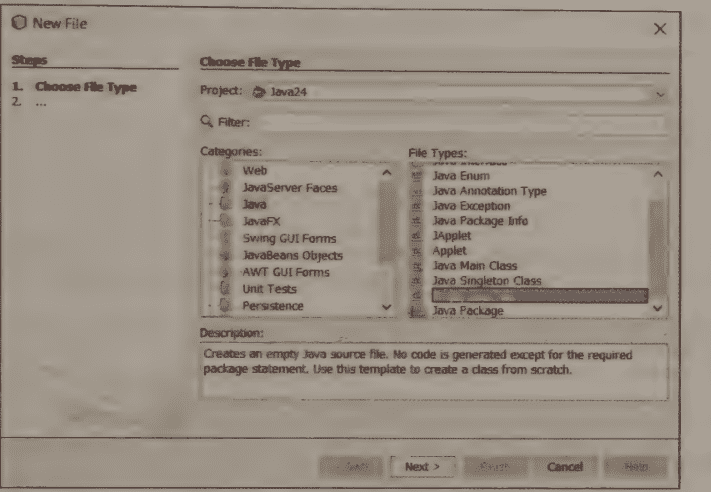

图 2.1 新建文件向导。

`Categories`（类别）面板列出了你可以创建的不同类型的 Java 程序。点击 `Java` 文件夹查看属于该类的文件类型。对于此项目，选择 `Empty File`（空文件）类型（位于面板末尾）并点击 `Next`（下一步）。

打开 `New File` 对话框。按照以下步骤开始：

1. 在 `Class`（类）字段中输入 `Saluton`。
2. 在 `Package`（包）字段中输入 `com.javahours`。
3. 点击 `Finish`（完成）。

这样你就可以开始工作了，一个名为 `Saluton.java` 的空文件在编辑器中打开。每行开头的行号和冒号用于书中引用行号。

### 列表 2.1 Saluton 程序

```java
1: package com.java4hours;
2:
3: class Saluton {
4:     public static void main(String[] args) {
5:
6: }
7:}
```

确保大小写所示，并使用空格或 `Tab` 键第 4-6 行前插入空格。完成后，选择 `File`（文件）、`Save`（保存）保存文件。

此时，`Saluton.java` 包含了 Java 程序的骨架。你创建的许多程序都会这样开头，除了第 3 行的 `Saluton` 单词。第 5 行对你来说应该理解，因为它是一个真实的英语句子。其他部分对你来说可能是全新的。

## 类语句

程序的第一行是：

```java
package com.java4hours;
```

包（`package`）是分组 Java 程序的方式。此行告诉计算机将 `com.java4hours` 作为程序的包名。

在空行之后，第三行是：

```java
class Saluton
```

翻译成英语，它的意思是：“计算机，给我的 Java 程序命名为 Saluton。”

## main 语句的作用

程序的下一行代码如下：

```java
public static void main(String[] arguments) {
```

这一行告诉计算机：“程序的主部分从这里开始。” Java 程序被组织成不同的部分，因此需要一种方法来识别在首次运行程序时执行的程序部分。

`main` 语句是大多数 Java 程序的入口点。例外是 `applets`（小程序，由浏览器在网页上运行的程序）、`servlets`（由 Web 服务器运行的程序）以及 `apps`（应用程序，在移动设备上运行的程序）。


# 在本书接下来的几小时中

在本书接下来的几小时中，你编写的大多数程序都使用 `main` 作为起点。这是因为你直接在计算机上运行它们。而 applets、apps 和 servlets 是由另一个程序或设备间接运行的。

为了将它们与其他类型区分开来，你直接运行的程序被称为应用程序（applications）。

## 那些波浪括号

在 Saluton 程序中，第 3、4、6 和 7 行包含某种波浪括号——要么是 `{` 要么是 `}`。这些括号是分组程序代码行的一种方式（就像在句子中使用括号来分组单词一样）。左括号 `{` 和右括号 `}` 之间的所有内容都是同一组。

这些分组被称为块（blocks）。在列表 2.1 中，第 3 行的左括号与第 7 行的右括号相关，这使得整个程序成为一个块。你使用这些括号来显示程序的开始和结束。

块可以位于其他块内部（就像在这个句子中使用括号一样（这里又使用了第二组括号））。Saluton 程序在第 4 行和第 6 行有括号，建立了另一个块。这个块从 `main` 语句开始。`main` 块内部的行将在程序启动时运行。

NetBeans 可以帮助你确定块从哪里开始到哪里结束。点击 Saluton 程序源代码中的任意括号。你点击的括号会与其对应的括号一起变成黄色显示。包含在两个黄色括号之间的 Java 语句就是一个块。这个小技巧对于像 Saluton 这样短的程序用不大，但当你编写长许多程序时，它可以帮助避免让你看到头疼。

以下语句是位于块内部的唯一行：

```java
// My first Java program goes here
```

这一行是一个占位符。行开头的 `//` 告诉计算机忽略这一行，因为它放入程序中完全是为了方便查看源代码的人类阅读。具有此目的的行被称为注释（comments）。

现在，你已经写了一个完整的 Java 程序。它可以被编译，但如果你运行它，什么都不会发生。原因是你还没有告诉计算机执行任何操作。`main` 语句块只包含单条注释，计算机会忽略它。你必须在 `main` 块的左括号和右括号之间添加一些语句。

## 在变量中存储信息

在你编写的程序中，你需要一个地方来短时间存储信息。你可以通过变量来实现这一点，变量是一个可以存储整数、浮点数、真假值、字符和文本行等信息的存储位置。存储在变量中的信息可以改变，这就是为什么它被称为“变量”（variable）。

在 `Saluton.java` 文件中，将第 5 行替换为以下内容：

```java
String greeting = "Saluton mondo";
```

这条语句告诉计算机在名为 `greeting` 的变量中存储文本 "Saluton mondo!"。

在 Java 程序中，你必须告诉计算机变量将持有什么类型的信息。在这里，`greeting` 是一个字符串（string）——一行包含字母、数字、标点符号和其他字符的文本。在语句中放入 `String` 是设置该变量以持有字符串值。

当你将此语句输入程序时，行尾必须包含一个分号。分号结束 Java 程序中的每条语句。它们就像句子末尾的句号。计算机使用它们来确定一条语句何时结束，下一条语句何时开始。

每行只放一条语句会让程序更易于理解（对人类而言）。

## 显示变量的内容

如果你现在运行程序，看起来似乎什么都没有发生。将文本存储在 `greeting` 变量中的命令是在后台执行的。为了让计算机显示它正在做某些事，你可以显示该变量的内容。

在 Saluton 语句 `greeting = "Saluton mondo"` 之后插入另一个空行。为了让计算机显示它正在做某些事，你可以显示该变量的内容。

```java
System.out.println(greeting);
```

这条语句告诉计算机显示存储在 `greeting` 变量中的值。

现在你正取得进展。

## 保存最终产品

你的程序现在应该与列表 2.2 相似，尽管你可能在第 5-6 行使用了不同的间距。

### 列表 2.2 Saluton 的完成版本

```java
package com.saluton;

class Saluton {
    public static void main(String[] arguments) {
        String greeting = "Saluton mondo";
        System.out.println(greeting);
    }
}
```

当计算机运行此程序时，它会执行 `main` 块中的每条语句。列表 2.3 显示了如果用英语而不是 Java 编写程序将会是什么样子。

### 列表 2.3 Saluton 程序的逐行分解

```
1: package com.saluton;
2:
3: Saluton 程序开始：
4:     程序的主部分开始
5:     将文本 "Saluton mondo" 存在名为 greeting 的变量中。
6:     显示变量的内容。
7:     程序的主部分结束。
8: Saluton 程序结束。
```

列表 2.4 显示了如果用克林贡语（星际迷航中战士种族的语言）编写程序将会是什么样子。

### 列表 2.4 克林贡语版的 Saluton 程序

```
1: 这个程序属于 com.saluton 家族！
2:
3: 如果你还想活，就在这里开始 Saluton 程序！
4:     程序的主部分从荣誉开始！
5:     将不如克林贡语的垃圾话 "Saluton mondo" 存在名为 greeting 的变量中！
6:     显示这些垃圾话！
7:     在这里结束程序的主部分以免受我的怒火！
8: 现在结束 Saluton 程序，并感到庆幸吧！
```

## 将程序编译为类文件

在运行 Java 程序之前，你必须对其进行编译。当你编译程序时，程序中给计算机的指令会被转换为计算机更容易理解的形式。

NetBeans 在保存程序时会自动编译。如果你按照列表 2.2 所示输入所有内容，程序将成功编译。

创建一个程序的编译版本，即新文件 `Saluton.class`。所有的 Java 程序都被编译成类文件，其具有 `.class` 后缀。一个 Java 程序可以由多个协作工作的类组成，但简单的程序只需要一个类。

编译器将 Java 源代码转换为字节码（bytecode），这是由 Java 虚拟机（JVM）运行的形式。

> **注意**
>
> Java 编译器只有在有错误时才会说话。如果你成功编译了程序且没有任何错误，则不会有任何反应。
>
> 这确实有点平淡。当我刚开始成为 Java 程序员时，我曾希望成功编译能伴随着响亮的号角声庆祝。

## 修复错误

当你在 NetBeans 源代码编辑器中编写程序时，错误会在编辑器面板左侧用红色警示图标标记，如图 2.2 所示。


**图 2.2** 在源编辑器中识别错误。

图标会出现在触发错误的行上。你可以点击此图标来显示错误对话框，该框包含以下解释编译错误的详细信息：

- Java 程序的名称
- 错误类型
- 发现错误的行

以下是一个你在编译 Saluton 程序时可能会看到的错误对话框示例：

```
cannot find symbol.
symbol : variable greeting
location: class Saluton
```

错误信息是对话框的第一行：“cannot find symbol.（找不到符号）”。这些信息对于初级程序员来说往往令他们困惑。当错误信息对你来说毫无意义时，不要花费太多时间试图理解它。相反，请查看错误发生的行，并检查最明显的原因。

例如，你能确定以下语句的问题所在吗？

`System.out.println(greeting);`

错误是变量名中的拼写错误，应该是 `greeting` 而不是 `greting`。在 NetBeans 中故意输入此拼写错误看看会发生什么。

如果在创建 Saluton 程序时出现错误对话框，请双重检查你的程序是否匹配列表 2.2，并修正你发现的任何差异。确保所有内容的大小写正确，并包含了所有标点符号，如 `{}`。

通常，仔细观察错误对话框识别出的行，就足以发现需要修复的错误（或多个错误）。

本书的官方网站 www.java24hours.com 包含了你创建的所有程序的源文件。如果你在 Saluton 程序中找不到任何拼写错误或其他错误原因，但仍然存在错误，请前往书籍网站并在第 2 小时下载 `Saluton.java`。尝试运行该文件。

## 运行 Java 程序

要查看 Saluton 程序是否按照你的预期运行，使用 Java 解释器运行该类。在 NetBeans 中，选择菜单命令 Run（运行）、Run File（运行文件）。源代码编辑器下方会打开一个输出面板。在此面板中，如果没有错误，程序将显示输出，如图 2.3 所示。

```
Output - Java24 (run)
Saluton mondo!
BUILD SUCCESSFUL (total time: 0 seconds)
```

**图 2.3** 运行你的第一个 Java 程序。

如果你看到文本“Saluton Mondo!”，你刚刚写了第一个可以运行的 Java 程序！你的电脑刚刚向世界问候——这是计算机编程领域的一个传统，对我们许多人来说就像能量饮料、短袖衬衫和《英雄联盟》一样重要。

你可能会问自己为什么“Saluton mondo!” 是一种传统的问候语。这句话在世界语中的意思是“Hello world!（你好，世界！）”，是由 Ludwig Zamenhof 在 1887 年创建的一种人工语言，旨在促进国际交流。

它之所以被称为传统的问候语，仅仅是因为我正试图开始那项传统。

## 工作坊

### 提示

Oracle 在网上提供了 Java 语言的详尽文档。你阅读这本书时不需要它，因为每个主题在介绍时都已进行了充分的讨论，但当你想要扩展知识并编写自己的程序时，这份参考资料会非常有用。

文档可以下载，但在 Oracle 网站上按需浏览会更方便。最新的 Java 文档可以在 `http://download.java.net/jdk9/docs/api` 获取。

## 总结

在这一小时中，你获得了第一次创建 Java 程序的机会。你学到为了开发一个 Java 程序，你需要完成这四个基本步骤：

1. 使用文本编辑器或 NetBeans 等工具编写程序。
2. 将程序编译为类文件。
3. 告诉 Java 虚拟机运行该类。
4. 给你的妈妈打电话。

在此过程中，你接触了一些基础计算机编程概念，如编译器、解释器、块、语句和变量。这些概念在随后的小时中会变得更加清晰。只要你在这一小时内能让程序运行起来，就可以继续学习了。

（第四步与 Java 编程无关。这只是我写在书里的一个玩笑。）

## 问答

# 第 3 小时：在 Java 中度假

本小时的任务列表：

- 探索 Java 的历史。
- 学习使用该语言的优势。
- 观察 Java 运行的示例。

在你进一步探索 Java 编程之前，深入了解这种语言并看看程序员现在用它做什么是非常值得的。虽然 Java 早已超出了它最初专注于网络浏览器程序的语言起源，但你可以找到数百万个 Java 如何用于移动应用程序的示例。

在这一小时内，我们将查看介绍 Java 程序、用该语言编写的程序以及该语言的历史和发展的网站。

要开始这趟度假，你需要一台可以运行 Java 程序的手机或平板电脑。

启动你选择的设备，穿上你最棒的蜡染衫（batik），准备好去度假。你不需要离开家，也不会体验旅游中那些简单的快乐，例如异国风情、异国当地人、异国美食、带着食物的异国当地人等等。

但看到光明的一面：没有旅行支票的烦恼，不需要护照，也不用担心水质。

## 第一站：Oracle

Java 度假从 `www.java.com` 开始，这是由 Oracle 公司发布的网站，该公司是开发 Java 语言的。

运行在移动设备上的 Java 程序被称为 app（应用）。Java app 主要出现在 Android 设备上。Java 也出现在 Web 上：用 Java 编写的桌面程序可以从网络浏览器启动，Java servlets 由 Web 服务器运行以分发网络应用程序，而 Java applets 则出现在浏览器的网页中。

图 3.1 显示了 Celtic Heroes，这是一款在 Android 上由 Java 驱动的大型多人在线游戏。你可以通过 Google Play 或你设备的应用商店安装该 app 来免费玩游戏。


**图 3.1** 由 Java 驱动的游戏 Celtic Heroes。

当你运行它时，游戏会在几秒内加载，你可以创建一个角色并探索幻想世界。

Oracle 的 Java 部门领导着 Java 语言的开发。《Java Magazine》是一本由 Oracle 在 `java.com` 免费提供的在线杂志，它展示了 Java 如何在 Android 手机、网站和其他平台上被使用。数十亿计的设备运行着用 Java 编写的程序。

Oracle 还为 Java 程序员在 `www.oracle.com/technwork/java` 提供了一个更具技术性的网站。该网站是寻找最新版本的 NetBeans 和 Java 开发工具包（JDK）以及其他编程资源的地方。

Java 之旅从 Android 开始，因为那里已成为该语言使用最繁荣的地方。学习 Java 之后，你可以使用 Android 软件开发包（SDK）来开发自己的应用，SDK 是一个运行在 Windows、Mac OS 和 Linux 上的免费编程工具包。

已有超过 300,000 个为 Android 手机和其他运行移动操作系统的设备创建的 app。你将在第 24 小时“编写 Android 应用”中学习更多关于创建它们的知识。

## Java 简史

Bill Joy 是太阳微系统（Sun Microsystems）创建 Java 时公司的高管之一，他将这种语言称为“15 年工作成果的最终结果，旨在产生一种更好、更可靠的编写计算机程序的方法”。Java 的诞生比这要稍微复杂一点。

Java 由 James Gosling 在 1990 年开发的，旨在作为智能家电（交互式电视、全知烤箱、穿越时空终结者、奴役人类的 SkyNet 军事卫星等）的大脑。Gosling 对用 C++ 语言编写程序获得的结果并不满意。在灵感爆发中，他躲在办公室里，编写了一种符合他需求的新语言。

Gosling 根据他在办公室窗外看到的一棵树将新语言命名为 Oak（橡树）。这种语言是 Gosling 战略的一部分，旨在当交互式电视成为数百万行业时赚大钱。这在今天还没有发生（尽管 Amazon、Apple、Roku 等公司正在尝试），但对于 Gosling 的新语言来说发生了完全不同的事情。正当 Oak 即将被废弃时，Web 变得流行了。

> **注意**
>
> 你可能听过 Java 是一个缩写词。实际上，它不是。它是以 Java 岛的咖啡命名的，开发者们就居住在那个岛屿上。这个名字很短且易于记忆，这正是他们想要的。

Java 共有 10 次重大发布，每个版本都有一些特性。以下是前九个：

- Java 1.0: 原始版本 (1995)
- Java 1.1: Java 数据库连接 (JDBC) (1997)
- Java 1.2: 图形界面 (1998)
- Java 1.3: 增强多媒体 (2000)
- Java 1.4: 互联网支持 (2002)
- Java 5: 泛型、注解和自动箱 (2005)
- Java 6: Web 服务 (2006)
- Java 7: 资源管理 (2011)
- Java 8: 闭包 (2014)

当前的版本 Java 9 于 2017 年发布。经过三年的开发，该版本引入了模块系统。如果你想了解更多，可以在第 16 小时“使用模块”中找到。

如果你不知道这些东西（例如模块、泛型或闭包）是什么，不要慌。你将在接下来几小时内学习它们。

> **注意**
>
> 你是否好奇 Java 的版本命名如此奇怪，从 2 跳到 6，并在某些版本中包含小数？开发者在这个过程中做出了一些奇怪的决定。自 2006 年以来，每个新版本都比上一个高。

## 使用 Java

Web 为教育工作者和学生提供了大量资源。由于 Java app 比网页更具交互性，这种语言是增强学习程序的自然选择。

作为其中一个示例，安装 FreeBalls app 以访问俄罗斯计算机程序员 Ivan Maklyakov 创建的免费模拟器。该程序使用 Java 展示了成千上万粒子组成的固体或液体的物理动画。运动通过倾斜屏幕来控制。图 3.2 显示了色彩丰富的结果。


**图 3.2** 可以通过 Java app 交互地体验物理模拟器。

许多操作系统都有许多教育程序，但让这个程序脱颖而出的特点之一是它的可用性。模拟器可以在任何 Android 设备上运行。你可以在任何带有 Java 虚拟机（JVM）的计算机上运行 Java 程序。

移动设备或网络浏览器加载的 JVM 与你在第 2 小时“编写你的第一个程序”中运行 Saluton 应用时使用的 JVM 是相同的。

Java 程序（例如物理模拟器）不需要为特定的操作系统编写。由于 Windows 等操作系统被称为平台，这种优势被称为平台独立性。Java 的创建是为了在多个系统上运行。

## 在 Food Network 享午餐

在前两个站点活动了胃口后，在 Food Network in the Kitchen 中享用午餐吧，这是一个由味觉电视频道创建的免费 Java 应用。

对于该频道上的每位星级厨，Food Network in the Kitchen 都提供了食谱、烹饪笔记、用户评论和视频。该应用格式的优势之一是它可以结合文章包含交互功能。图 3.3 显示了 Giada de Laurentiis 的煎海鱼食谱，并配有一段视频教程解释了它是如何制作的。记得使用你的鱼类铲子！


图 3.3 Food Network in the Kitchen 应用中的一个食谱。

像 Food Network in the Kitchen 这样的应用商店包含了成千上万个供用户尝试的程序。由于这些程序来自许多开发者，必须采取保护措施来保护用户及其设备。自 Java 引入以来，一个备受争议的问题是该语言是否安全。

安全性非常重要，因为 Java 程序在以应用形式交付时的工作方式是如此。你在这一小时内尝试的应用会被下载到你的手机或平板电脑。当程序下载完成后，就可以运行。

除非你认识很多人，否则你使用的大多数应用都是由陌生人发布的。在安全性方面，运行他们的程序与普通公众来到你这里借用你的电脑没有太大区别。如果 Java 语言没有防止滥用的保护措施，

## 在 NASA 仰望星空

它的程序可能会向你的系统引入病毒、删除文件、播放 William Shatner 的口语歌曲表演，并进行其他不可言喻的事情。

Java 包含了多种类型的安全机制，以确保其程序在从应用或网页上运行时是安全的。

该语言通常被认为足够安全，可以在 Web 上使用，但最近几年被利用的安全漏洞导致一些安全专家建议用户在浏览器中完全关闭 Java。如今，大多数领先的浏览器都不鼓励用户在网站上运行 Java applet。

用户在移动端应用、服务器程序和桌面软件上更常见地遇到 Java。这就是为什么这一小时用于运行应用而不是 applet。

## 在 NASA 仰望星空

Java 之旅的第一个下午站点是一次太空之旅。NASA 是一个广泛使用 Java 的美国政府机构。一个例子是 ISS Detector，这是一个由开发者 Runalt 开发的免费应用，帮助观星者关注国际空间站和几颗轨道卫星。

ISS Detector 将空间站和卫星的当前位置和路径叠加在夜空之上。在图 3.4 中，该应用显示了铱 96 卫星 (GALEX) 从上午 11:43 开始穿过东方的天空，经过金星和天王星。


图 3.4 ISS Detector 监控轨道卫星的位置和路径，对于“金属鸟类”爱好者来说是一个福音。

## 第 3 小时：在 Java 度假

应用在运行时会重绘每个被跟踪卫星的位置，并根据用户面对的方向更改天空地图的方位。这种实时更新之所以可能，是因为 Java 语言是多线程的。多线程是计算机同时完成多件事的方法。程序的一部分负责一个任务，另一部分负责另一个任务，而这两个部分互不干扰。在这个例子中，程序的每个部分被称为线程。

在像 ISS Detector 这样的程序中，每颗卫星都可以在自己的线程中运行。如果你使用 Windows 10 这样的操作系统，当你同时运行多个程序时，你就在使用这种行为。如果你在工作中在一个窗口玩 Minecraft，在另一个窗口运行公司销售报告，并给朋友打长途电话，恭喜你——你正在使用多线程！

## 开始正事

在你的旅程中此时，你可能认为 Java 主要服务于太空爱好者、业余厨师和精灵战士。我们旅程的下一站展示了 Java 从正业的例子。安装来自 uInvest Studio 的 realtime Stock Quotes Java 应用，它显示了 GOOG（谷歌母公司 Alphabet Inc.）的当前价格。


图 3.5 Food Network in the Kitchen 应用中的股票数据。

## 在 SourceForge 获取方向

可以用多种方式来思考程序。一种是将对象看作一个存在且会说话的东西。面向对象编程（OOP）是 Java 使用的方法，正如你在第 10 小时中发现的，它是创建程序的方式：

- 一个代表股票市场的报价
- 一个持有股票的投资组合
- 一个显示投资组合的互联网
- 一个应用以及许多其他

OOP 是一种强大的方式，可以确保其程序从应用或网页上运行时是安全的。该语言通常被认为足够安全，可以在 Web 上使用，但最近几年被利用的安全漏洞导致一些安全专家建议用户在浏览器中完全关闭 Java。如今，大多数领先的浏览器都不鼓励用户在网站上运行 Java applet。

用户在移动端应用、服务器程序和桌面软件上更常见地遇到 Java。这就是为什么这一小时用于运行应用而不是 applet。

在 SourceForge 及其他地方创建了许多 Java 程序的原因之一，是因为该语言的设计易于学习，尽管其功能强大。Java 包含了许多可以在你程序中使用的类库。JSoko 利用了库中的 `Image` 类（位于 `java.awt` 中）来显示图形框，并利用 `AudioInputStream` 类（位于 `javax.sound.sampled` 中）在卡车移动和放置盒子时播放声音。

使用对象创建的程序更容易维护，因为它们的组织更好。新对象可以以现有对象为模板并增强新功能。

该语言的一个原始设计目标是让它比 C++ 语言更快。高斯林（Gosling）在 20 世纪 90 年代与他的智能设备大师闹得不可开。Java 的大部分内容基于 C++，因此学习过使用该语言的程序员发现学习 Java 更加容易。然而，C++ 中某些最难学习和正确使用的元素在 Java 中并不存在。

对于第一次初次学习编程的人来说，Java 比 C++ 更容易学习。某些语言的创建是为了让有经验的程序员更容易在他们的程序中利用计算机的能力。这些语言包含了资深编程人员很容易理解的快捷方式和其他特性。

Java 没有使用这些特性中的某些，而是倾向于让这种语言尽可能像一种面向对象的编程语言。Java 的设计初衷是易于学习、易于调试且易于使用。Java 包含了许多增强，使其成为其他语言的有力竞争者。

## 总结

现在一个小时的假期结束了，是时候放下行李，准备回到真正的 Java 编程了。

在接下来的 21 小时内，你将掌握 Java 语言的基础构建块，学习如何创建自己的对象来完成面向对象编程中的任务，设计图形用户界面以及更多内容。

除非你停下这本书去玩《凯尔特英雄》（Celtic Heroes）。

## 工作坊

### 问答

- **Q. 为什么 Java Applets 不再流行了？**

- **A.** 当 Java 语言在 20 世纪 90 年代中期引入时，大多数人都在学习为了编写 applet。Java 是在浏览器中运行交互式程序的唯一方式。多年来，替代方案出现了。Macromedia Flash、Microsoft Silverlight 以及新的网页发布标准 HTML5 提供了将程序放在网页上的所有方法。Applets 受到加载时间长、浏览器开发者对新版本 Java 支持缓慢以及被黑客利用的安全漏洞的阻碍。尽管 Applets 正在从网上消失，但 Java 已经超越了它作为浏览器增强工具的起源，现在已成为成熟的通用编程语言。

- **Q. Java SE（Java 标准版）和 Java EE（Java 企业版）有什么区别？Java EE 需要付钱吗？**

- **A.** Java 企业版是 Java 标准版的扩展，包含了支持高级技术的包，例如企业级 豆（Enterprise JavaBeans）、XML 处理和服务器开发——即运行在 Web 服务器上的 Java 程序。Java EE 还包含一个应用服务器，这是一个执行 Java 软件的复杂环境，专为有大量计算需求的企业和大型组织量身定制。Java EE 开发包可以从 Oracle 或 `www.oracle.com/techn-work/javaee` 免费下载。

- **Q. 什么是 Chris Steak House，为什么 Ruth 拥有一家？**

- **A.** Ruth's Chris Steak House 是一家遍布美国及少数其他国家拥有 130 多家高端牛排餐厅的连锁店，它有一个奇怪的双重首名字，这揭示了它谦卑的起源及其创始人固执的性格。

  该连锁店成立于 1965 年，当时是新奥尔良的一家独立餐厅，由 Ruth Fertel（费特）所有，她有两个儿子的单妈妈。Fertel 看到一则出售餐厅的分类广告，并申请了一笔 22,000 美元的住房抵押购买了它（相当于现在的 150,000 美元）。

  她与原业主 Chris Matulich 达成了协议，将餐厅命名为 Chris Steak House，但后来在厨房火灾后不得不搬迁。

  Fertel 的合同并不允许她在原始地点以外的任何使用 Chris Steak House 的名称，因此她将其更名为 Ruth's Chris Steak House。尽管她没有餐厅或烹饪专业知识，但该业务非常成功，以至于她在 12 年内就开始将其作为特许经营进行提供。在多年里，她忽略了多次更改名称以扩大其吸引力的建议。

  > “我一直讨厌这个名字，”她曾告诉《财富》（Fortune）杂志的一位记者，“但我们总是设办法绕过它。”

  Fertel 于 2002 年去世，出生于 1927 年 2 月 5 日——也就是 Matulich 开办那家牛排馆的那一天。

## 测试

如果到目前你的大脑还没有休息过，请通过以下问题测试你对这些名称的了解。

1. 面向对象编程是如何命名的？

   A. 程序被视为一组共同工作的对象。

   B. 人们经常因为难以掌握而反对它。

   C. 它的父母起的名字。

2. Java 应用程序设计运行在哪里？

   A. Web 浏览器。

   B. Android 手机或平板电脑。

   C. 桌面电脑。

3. 计算机或设备运行 Java 程序需要什么？

   A. Java 编译器

   B. Java 虚拟机

   C. 两者都是

## 答案

1. **A.** 它也被缩写为 OOP

2. **B.** 所有 Android 应用都是用 Java 编写的。它们可以在浏览器和桌面上运行，但是为移动设备和平板电脑设计的。

3. **B.** Java 虚拟机（JVM）是将 Java 字节码转换为计算机或设备可以执行的指令的解释器。创建 Java 程序需要编译器，但运行不需要。

## 活动

在收拾行李之前，你可以通过以下活动充分探索这一小时的主题：

- 使用 SourceForge 使用 Java 语言开发的扑游戏。
- 在你的 Android 设备上使用 Google Play 搜索物理模拟。选择一个你觉得有趣的。安装它。

# 向应用程序传递参数

当你运行 Java 应用程序时，Java 虚拟机（JVM）会寻找 `main()` 块并开始处理该块中的 Java 语句。如果你的程序没有 `main()` 块，JVM 将返回一个错误作为响应。

第 9 行的语句 `Math.sqrt(number)` 演示了 Java 语言的一种内置能力——确定数字平方根的能力。有一个名为 `Math` 的 Java 程序，它包含一个名为 `sqrt()` 的方法，用于找到指定数字的平方根。

`Math` 程序是 Java 类库的一部分，你将在本小时稍些时候探索它。

# 向应用程序传递参数

你可以使用 `java` 从命令行运行 Java 应用程序，`java` 是一个调用 JVM 的程序。当你运行程序时，NetBeans 会在后台使用此程序。当 Java 程序作为命令运行时，JVM 会加载该应用程序。命令中可以包含额外的信息项，如下例所示：

```
java TextDisplayer readme.txt /p
```

向发送到程序的任何额外信息都称为参数（argument）。第一个参数（如果有的话）位于应用程序名称后的空格之后。每个额外的参数之间都用空格分隔。在前面的示例中，参数是 `readme.txt` 和 `/p`。

如果你想在参数内部包含空格，必须用引号将其括起来，如下：

```
java TextDisplayer readme.txt /p "Page Title"
```

此示例运行带有三个参数的 TextDisplayer：`readme.txt`、`/p` 和 `"Page Title"`。引号防止了 `Page` 和 `Title` 被视为两个独立的参数。

你可以向 Java 应用程序发送任意数量的参数（在范围内）。要对它们进行操作，你必须在应用程序中编写语句来处理它们。

要查看参数在应用程序中如何工作，请在 Java24 项目中创建一个新类：

1. 选择 File（文件）、New File（新建文件）。
2. 在 New File Wizard（新建文件向导）中，选择类别 Java 和文件类型 Empty Java File（空 Java 文件）。
3. 给类命名为 `BlankFiller`，包名为 `com.java24hours`，并点击 Finish（完成）。

在源代码编辑器中输入列表 4.2 的文本，并在完成后保存。编译程序，并在输入时纠正编辑器标记的任何错误。

## 列表 4.2 BlankFiller.java 的完整文本

```
package com.java24hours;
class BlankFiller {
    public static void main(String[] arguments) {
        System.out.println("The " + arguments[0]
            + " + arguments[1] + " fox *"
            + "jumped over the *"
            + arguments[2] + " dog.");
    }
}
```

此应用程序编译成功并运行，但如果你尝试使用菜单命令 Run（运行）、Run File（运行文件），你会得到一个看起来复杂的错误：

### 输出

```
Exception in thread "main" java.lang.ArrayIndexOutOfBoundsException: 0
at BlankFiller.main(BlankFiller.java:5)
```

发生此错误是因为程序在运行时期望接收三个参数。你可以通过在 NetBeans 中自定义项目来指定参数：

- 选择菜单命令 Run（运行）、Set Project Configuration（设置项目配置）、Customize（自定义）。打开 Project Properties（项目属性）对话框。
- 在 Main Class（主类）文本字段中输入 `com.java24hours.BlankFiller`。
- 在 Arguments（参数）字段中输入 `retromenting purple lactose-intolerant` 并点击 OK。

由于你自定义了项目，必须以略不同的方式运行。选择菜单命令 Run（运行）、Run Main Project（运行主项目）。应用程序使用你指定的参数作为形容词来填充句子，如图 4.2 所示。


图 4.2 BlankFiller 程序的输出。

返回 Project Properties 对话框并指定你自己选择三个形容词作为参数，确保至少包含三个。

参数是自定义程序行为的一种简单方法。参数存储在一种称为数组（array）的变量类型中。你将在第 9 小时“使用数组存储信息”中学习数组。

## Java 类库

本书涵盖了如何使用 Java 语言从零开始创建自己的程序。你将学习构成该语言的所有关键字和操作符，然后将它们用于编写语句，让计算机执行有趣且实用的事情。

虽然这种方法是学习 Java 的最佳方式，但它有点像向某人展示如何造汽车，却让她先从头开始制造汽车的每一个部分。作为一名 Java 程序员，已经有大量工作为你准备了，只要你知道去哪里寻找它。

Java 自带了一个巨大的代码集合，你可以在程序中使用它，这被称为 Java 类库。该库是成千上万类的集合，其中许多类可以用于你编写的程序。

> **注意**
>
> 其他公司和组织提供了许多类库。Apache Web 服务器的创建者 Apache 项目拥有十多个 Java 开源项目。其中是 Tomcat，它是一组用于创建 Web 服务器的类，可以运行实现为 Java servlet 的 Web 应用程序。
>
> 有关该项目的更多信息，请访问 `http://tomcat.apache.org`。要查看所有 Apache 的 Java 项目，请访问 `https://projects.apache.org`。

这些类可以以某种类似的方式在你的程序中使用。

```
System.out.println("The random number is "
+ value);
}
```

通过 Run（运行）、Run File（运行文件）来运行程序。输出如图 4.4 所示，尽管你的数字会不同（实际上，有四十分之一概率出现相同的数字，这比彩票的中奖还要低）。

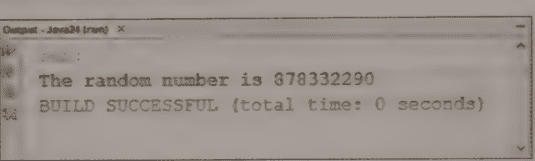

图 4.4 Dice 程序的输出。

你现在有了一个属于你自己的随机整数。请善用它。

`Random` 类和 Java 类库中的所有类一样，都有广泛的文档，你可以在 Oracle 网站上阅读。它描述了该类的用途、它所属的包、如何创建该类的对象，以及它拥有哪些可以调用的方法来使其发挥功能。

按照以下步骤查看此文档：

1. 在你的网络浏览器中，加载页面 `http://download.java.net/jdk9/docs/api`。
2. 在页面左角的导航栏中，点击 Frames（框架）链接。文档将在多个框架中打开。
3. 在左上角的 Modules（模块）框架中，点击 `java.base`。
4. 在主框架中，向下滚动直到看到指向 `java.util` 包的链接。点击此链接。将显示该包的文档。
5. 在主框架中，向下滚动并点击 `Random` 链接。

作为一个经验不足四小时的 Java 程序员，你可能会发现这些文档理解起来极其困难，甚至非常费脑。这并不引起担心。它是为经验丰富的程序员编写的。

但当你阅读这本书并对 Java 内置类的使用方法感到好奇时，通过查看该类的官方文档可以获得一些价值。使用它的一种方法是查找该类中的方法，每个方法都执行一项特定的任务。


## 在 JShell 中尝试 Java 语句

在 `Random` 文档中，你可以向下滚动到下一个 `nextInt()` 方法的解释，该方法用于列表 4.3 的第 8 行。图 4.5 显示了该页面的这部分。


图 4.5

Oracle 关于 `Random` 类的文档。

### 注意

本书涵盖的所有 Java 类在书内都有了描述，因此不需要在线文档即可完成这 24 小时的学习并成为一名 Java 程序员。由于书中使用的类具有许多入门级书籍无法涵盖的额外功能，Java 类库文档可以辅助你的学习。

## 在 JShell 中尝试 Java 语句

Java 9 推出了一个充满趣味的新工具，让初学者更容易学习这门语言。JShell 是包含在 Java 开发工具包（JDK）中的一个命令行程序，可用于输入单条 Java 语句并查看其效果。

JShell 是一个语言外壳，是一个交互式环境，让你能够输入命令来玩 Java。每个命令都是一个 Java 语句。一旦你按下回车键，语句就会由 JVM 执行，就像它是一个完整 Java 程序的一部分一样。

要运行 JShell，请在文件系统中找到安装 JDK 的文件夹。该文件夹有一个名为 `bin` 的子文件夹。打开该文件夹并双击 `jshell`。

将打开一个窗口，你可以在其中输入 Java 代码并查看效果。

图 4.6 显示了一个 JShell 窗口。

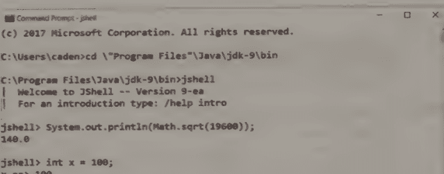

图 4.6

使用 JShell 在 Java 沙箱中运行

JShell 命令通过 `jshell>` 提示符输入。在图 4.6 中，输入了三条语句：

- `System.out.println(Math.sqrt(19600));` 输出整数。
- `int x = 100;` 设置变量 x 的值。
- `System.out.println(x);` 输出 x。

在每个命令之后，JShell 会显示该语句产生的值。一旦创建变量，它就会保存在内存中，并在后续语句中使用，如图 4.6 所示。

JShell 中的语句不需要以分号 `;` 结尾，这与完整的 Java 程序不同。

当你准备好退出 JShell 时，使用命令 `/exit`。

像 JShell 这样的语言也被称为 REPL，它是读取-求值-打印循环（Read-Eval-Print Loop）的缩写。这个术语源于 Lisp 语言，该语言深受程序员喜爱的交互式环境。

REPL 是学习书中编程技巧的绝佳实践方式。尝试根据你读过的语句创建一个类似的，看看效果。

## 总结

在这一小时中，你有机会创建 Java 程序、向程序传递参数以及使用 Java 类库中的现有程序。

在你成为一名 Java 程序员的过程中，接下来的几小时将继续关注应用程序。应用程序的测试更快，因为你不需要为了运行它们额外额外。

## 工作坊

本书涵盖的所有 Java 类在书内都有了描述，因此不需要在线文档即可完成这 24 小时的学习并成为一名 Java 程序员。由于书中使用的类具有许多入门级书籍无法涵盖的额外功能，Java 类库文档可以辅助你的学习。

## 问答

- 问题：发送到 Java 应用程序的所有参数都是字符串吗？

  回答：应用程序以参数的形式接收信息。当你想要使用这些非字符串类型时，需要对值进行转换。

- 问题：继承顺位必须是新教徒吗？

  回答：根据 1701 年生效的议会法律，英国君主必须是索菲亚的后裔。

- 问题：继承顺位的人数是有限的吗？

  回答：顺位中的人数是有限的。

# 第 5 小时：在程序中存储和更改信息

## 本小时的任务列表

- 创建一个变量。
- 使用不同类型的变量。
- 在变量中存储值。
- 将一个变量的值存储另一个变量中。
- 增加和减少变量的值。

在第 2 小时“编写你的第一个程序”中，你使用了一个变量，这是一种用于存储信息的特殊存储位置。存储在变量中的信息可以在程序运行时被更改。你的第一个程序在变量中存储了一个文本字符串。字符串只是可以存储在变量中的一种信息类型。变量还可以存储字符、整数、浮点数和对象。

在本小时中，你将更深入地学习如何在 Java 程序中使用变量。

## 语句和表达式

计算机程序是一组告诉计算机应该做什么的指令。每条指令都是一个语句（statement）。下面这个 Java 程序的示例就是一个语句：

```java
int highScore = 450000;
```

在 Java 程序中，你可以使用括号将一组语句组合在一起。这些分组被称为块语句（block statements）。考虑程序的以下部分内容：

```java
1: public static void main(String[] arguments) {
2:     int a = 3;
3:     int b = 4;
4:     int c = 8 * 5;
5: }
```

此示例的第 2–4 行属于块语句。第 1 行的左括号表示块的开始，第 5 行的右括号表示块的结束。

某些语句被称为表达式（expressions），它们涉及数学表达式并产生结果。前一个示例中的第 4 行就是一个表达式，因为它将变量 `c` 的值设置为 8 乘以 5。在本小时中你将处理表达式。

## 为变量分配类型

变量是计算机在运行程序时记住某些信息的主要方式。第 2 小时的 Saluton 程序使用 `greeting` 变量来存储“Saluton mondo！”计算机需要记住这一点，以便稍后显示该消息。

在 Java 程序中，变量是通过语句创建的，该语句必须包含两点：

- 变量名
- 变量将的信息类型

变量还可以包含所存储信息的值。

要查看不同类型的变量以及它们如何创建，请启动 NetBeans 并创建一个名为 `Variable` 的新 Java 文件。

输入以下行开始编写程序：

```java
package com.java24;

class Variable {
    public static void main(String[] arguments) {
        // Coming soon: variables
    }
}
```

继续并保存。

## 整数和浮点数

到为止，`Variable` 程序 `main()` 块中只有一条语句——`// Coming soon: variables`。删除注释并输入以下语句：

```java
int tops;
```

此语句创建一个名为 `tops` 的变量。它没有指定 `tops` 的值，所以目前该变量是一个空存储空间。语句开头的 `int` 指定 `tops` 是用于存储整数的变量。你可以使用 `int` 类型来存储程序需要的大非小数数字。它可以存储从大约 -24 亿到 24 亿之间的任何整数。

在 `int tops` 语句之后添加一个空行并输入以下语句：

```java
float gradePointAverage;
```

此语句创建一个名为 `gradePointAverage` 的变量。`float` 代表浮点数。浮点型变量用于存储可能包含小数点的数字。`float` 变量可以存储最多 8 位的数字。`double` 类型可以存储最多 30 位数字。

## 字符和字符串

由于你到为止处理的变量都是数值型的，你可能会认为所有变量都用于存储数字。其实，你也可以使用变量来存储文本。两种类型的文本可以存储为变量：字符（characters）和字符串（strings）。字符是一个字母、数字、标点符号或符号。字符串是一组字符。

创建 `Variable` 程序的下一步是创建一个 `char` 变量和一个 `String` 变量。在 `gradePointAverage` 行之后添加这两个语句：

```java
char key = 'C';
String productName = "Larets";
```

正如你可能注意到的，这两个语句使用了不同的字符。在程序中使用字符值时，必须给变量的字符值加上单引号。对于字符串值，必须用双引号括起来。引号可以防止字符或字符串与变量名或语句的其他部分混淆。看以下语句：

```java
String productName = "Larets";
```

这条语句看起来像是在告诉计算机创建一个值为 `Larets` 的字符串变量。然而，由于 `Larets` 周围没有引号，计算机被告知将 `productName` 的值设置为名为 `Larets` 的变量的值。（如果没有 `Larets` 变量，程序编译失败并报错）。

添加 `char` 和 `String` 语句后，你的程序应该类似于列表 5.1。进行任何必要的更改并保存文件。

### 列表 5.1 Variable 程序

```java
1: package com.java24;
2: class Variable {
3:     public static void main(String[] arguments) {
4:         int tops;
5:         float gradePointAverage;
6:         char key = 'C';
7:         String productName = "Larets";
8:     }
9: }
```

到为止介绍的变量类型有 `int`、`float`、`char` 和 `String`。（注意：此处 OCR 文本被截断/损坏，已根据上下文重建）。

## 其他数值类型

目前介绍的变量类型是你将使用的主要类型。在不常见的情况下，你可以使用其他类型。

一个是 `byte`，它存储 -128 到 127 之间的整数。以下语句创建一个初始值为 27 的变量 `escapeKey`：

```java
byte escapeKey = 27;
```

第二个是 `short`，可以用于小于 `int` 类型的整数。整数的范围可以从 -32,768 到 32,767，如下语句所示：

```java
short roomNumber = 27;
```

数值类型的最后一种是 `long`，用于超出 `int` 类型范围的整数。`long` 的范围是从 -922 万亿到 922 万亿，足够大到足以覆盖政府支出。

### 为变量分配类型

当你处理巨大的数字时，很难一眼看出数字的值，如下语句所示：

```java
long salary = 264000000000L;
```

除非你数零，否则你可能无法判断它是 2640 亿。Java 允许使用下划线组织大数字。这是一个例子：

```java
long salary = 264_400_000_000L;
```

下划线会被忽略，所以变量的值仍然相同。数字末尾的大写 "L" 指定其为 `long` 值。如果省略了 "L"，Java 编译器将认为该数字是 `int` 并标记“整数数值过大”错误。

> **注意**
>
> 如果在 NetBeans 源代码编辑器中数字中的下划线被标记为错误，说明 IDE 设置了旧版本的 Java。要解决此问题，在 Projects（项目）窗格中，右键点击当前项目名称（可能是 Java24）并选择 Properties（属性）。Project Properties 对话框打开时会在 Categories 窗格中选择了 Sources（源）。检查 Source/Binary Format 下拉菜单，确保它是当前的 Java 版本。

## boolean 变量类型

Java 有一种名为 `boolean` 的变量类型，只能用于存储 `true`（真）或 `false`（假）。从表面上看，`boolean` 变量似乎并不特别有用，除非你打算编写很多判断题。然而，`boolean` 变量在程序的各种情况下都会使用。以下是布尔变量可以回答的问题的一些示例：

- 用户是否按了键？
- 游戏结束了吗？
- 我的银行账户是否透支了？
- 这条裤子显我的屁股大吗？
- 这些是我要找的机器人吗？

布尔值是回答“是/否”和“真/假”问题答案的地方。

以下语句创建一个名为 `gameOver` 的布尔变量：

```java
boolean gameOver = false;
```

该变量的初始值为 `false`，因此游戏程序中的此类语句表示游戏尚未结束。稍后，当发生结束游戏事件，可以将 `gameOver` 变量设置为 `true`。

虽然这两种可能的布尔值在程序中看起来像字符串，但你不应该用引号将它们括起来。第 7 小时“使用条件测试做出决策”将进一步探讨布尔变量。

> **注意**
>
> 布尔数字以乔治·布尔（George Boole，1815–1864）的名字命名。布尔是一位数学家，在成年之前大部分时间都是自学。他发明了布尔代数，这已成为计算机编程、数字电子和逻辑的基础组成部分。可以想象，他小时候在真/假测试中表现得相当不错。

## 为你的变量命名

Java 中的变量名可以以字母、划线字符 `_` 或美元符号 `$` 开头。名称其余部分可以是任何字母或数字。你可以给变量起任何你喜欢的名称，但在命名时应保持一致。本节概述了变量的通用推荐方法。

Java 在处理变量名时是区分大小写的，因此你必须始终以相同的方式大写变量名。例如，如果 `gameOver` 变量在程序某处被引用为 `GameOver`，错误会导致程序无法编译。

变量名应该在某种程度上描述其用途。第一个字母应该小写，如果变量名包含多个单词，则每个后续单词的首字母应大写。例如，如果你想创建一个整数变量来存储游戏程序中的历史最高分，可以使用以下语句：

```java
int allTimeHighScore;
```

你不能在变量名中使用标点符号或空格，因此以下写法均不可行：

```java
int all-TimeHighScore;
int Time High Score;
```

如果你在程序中尝试这些变量名，NetBeans 会通过在源编辑器行旁显示红色警报图标来标记该错误。

> **注意**
>
> 变量名不是 Java 中唯一区分大小写的方面。程序中你可以给命名的所有其他内容，包括类、包和方法，都必须使用一致的大小写方式进行引用。

语言使用的关键字（如 `public`、`class`、`true` 和 `false`）不能作为变量名。

Java 9 增加了另一个限制：变量名不能是单个划线字符 `_`。这种语句以前在 Java 中是被允许的：

```java
int _ = 747;
```

现在试一下，会产生一个错误，提示 `'_'` 是一个关键字。

## 在变量中存储信息

你可以在 Java 程序中创建变量的同时为变量存储一个值。你也可以在程序之后的任何时候为变量赋值。

要在创建变量时为其设置初始值，请使用等号（`=`）。以下是创建一个名为 `pi` 初始值为 `3.14` 的双精度浮点变量的示例：

```java
double pi = 3.14;
```

所有存储数字的变量都可以以类似的方式设置。如果你正在设置字符或字符串变量，必须像本小节之前描述的那样在值周围加上引号。

如果两个变量的类型相同，你还可以将一个变量设置为另一个变量的值。考虑以下示例：

```java
int mileage = 300;
int totalMileage = mileage;
```

首先，创建一个名为 `mileage` 的整数变量，初始值为 `300`。接下来，创建一个名为 `totalMileage` 的整数变量，其值与 `mileage` 相同。两个变量的初始值均为 300。在随后的章节中，你将学习如何将一个变量的值转换为另一个变量的类型。

> **注意**
>
> 如果你不提供初始值，你应该在另一个语句中使用它之前给它赋值。如果你这样做，你的程序虽然可以编译，但可能会得到一个错误，说明变量 "able" 可能未初始化。

正如你所学的，Java 具有类似的数值变量来存储不同大小的值。`int` 和 `long` 都是整数，但 `long` 存储的可能范围更大。`float` 和 `double` 都携带浮点数，但 `double` 更大。

你可以在数值后面附加一个字母来指示该值的类型，如下语句所示：

```java
float pi = 3.14F;
```

值 `3.14` 之后的 "F" 表示它是一个 `float` 值。如果省略该字母，Java 会假设 `3.14` 是一个 `double` 值。

字母 "L" 用于长型整数，"D" 用于双精度浮点值。

Java 的另一个命名约定是对于值发生改变的变量名，每个字母都大写。这些变量被称为常量。以下创建了四个常量：

```java
final int TOUCHDOWN = 6;
final int FIELDGOAL = 3;
final int CONVERSION = 2;
final int PAT = 1;
```

由于常量的值永远不会改变，你可能会奇怪为什么要使用它们——你只需要使用赋值给常量的值即可。使用常量的优势之一是它们让程序更容易理解。

在前面的四个语句中，常量的名称是大大写的。这在 Java 中不是强制要求的，但已成为程序员之间的一种约定，用于区分常量和其他变量。

## 关于运算符的一切

语句可以通过使用运算符 `+`、`-`、`*`、`/` 和 `%` 来使用数学表达式。你使用这些运算符在整个 Java 程序中进行计算。

Java 中的加法表达式使用 `+` 运算符，如下语句所示：

```java
double weight = 20;
weight = weight + 10;
```

第二条语句使用 `+` 运算符将 `weight` 变量设置为当前值加 10。

减法表达式使用 `-` 运算符：

```java
weight = weight - 15;
```

该表达式将 `weight` 变量设置为其当前值减 15。

除法表达式使用 `/` 符号：

```java
weight = weight / 3;
```

这会将 `weight` 变量设置为当前值除以 3。

要找到除法表达式的余数，使用 `%` 运算符（也称为模运算）。以下语句计算 245 除以 3 的余数：

```java
int remainder = 245 % 3;
```

乘法表达式使用 `*` 运算符。这里有一个将多表达式作为更复杂语句部分的语句：

```java
total = 500 + (score * 12);
```


表达式中的 `score * 12` 部分将 `score` 乘以 12。整个语句将 `score` 乘以 12，然后将结果加上 500。如果 `score` 等于 20，表达式的结果为 `total` 等于 740：500 + (20 * 12)。

## 递增和递减变量

程序中的一项常见任务是将变量的值改变 1。你可以增加值 1，这被称为递增变量，或者减少值 1，这被称为递减变量。有运算符可以完成这两个任务。

要递增变量的值，使用 `++` 运算符，如下语句所示：

```
power++;
```

该语句将 `power` 变量存储的值加 1。

要递减变量的值 1，使用 `--` 运算符：

```
rating--;
```

该语句将 `rating` 减 1。

你也可以将递增和递减运算符放在变量名前，如下语句所示：

```
++power;
--rating;
```

将运算符放在变量名前称为前缀（prefixing），放在名称之后称为后缀（postfixing）。

> 注意
>
> 困惑了吗？这比听起来要简单，如果你回想起小学学习前缀的时候。就像 "sub-" 或 "un-" 这样的前缀位于 "suburban" 或 "unexpected" 等单词的开头一样，前缀运算符位于变量名的开头。后缀运算符位于末尾。

当表达式中使用递增和递减运算符时，前缀和后缀运算符之间的区别变得重要。

# 第 62 小时 5：在程序中存储和更改信息

考虑以下语句：

```
int x = 3;
int answer = x++ * 10;
```

在处理完这些语句后，`answer` 变量的值是多少？你可能期望它等于 40——如果将 3 增加 1 得到 4，然后将 4 乘以 10，那么结果就是 true。

然而，`answer` 的最终值是 30，因为使用了后置运算符而不是前置运算符。

当在表达式内部的变量上使用后置运算符时，在表达式完全求值之前，变量的值不会改变。`int answer = x++ * 10` 语句的作用与以下两个语句以相同的顺序执行相同的操作：

```
int answer = x * 10;
x++;
```

前置运算符的情况相反。如果在一个表达式内部的变量上使用它们，变量的值会在表达式求值之前发生改变。

考虑以下语句：

```
int x = 3;
int answer = ++x * 10;
```

这确实导致 `answer` 变量等于 40。前置运算符导致 `x` 变量的值在表达式求值之前发生改变。`int answer = ++x * 10` 语句的作用与以下语句按顺序执行相同：

```
x++;
int answer = x * 10;
```

对于 `++` 和 `--` 运算符，很容易感到沮丧，因为它们不像你在书中遇到的许多概念那样直观。

我希望告诉你这些并不会违反程序员的某些不成文的规定，但你不需要在自己的程序中使用递增和递减运算符。你可以通过像这样使用 `+` 和 `-` 运算符来实现相同的结果：

```
x = x + 1;
y = y - 1;
```

递增和递减是实用的快捷方式，但在表达式中使用较长的路径也是完全可以的。

回想第 1 小时“成为程序员”中，C++ 编程语言的名称被描述为一个你以后会听懂的笑话。现在你已经接触了递增运算符 `++`，你拥有了所有的信息来弄清楚为什么 C++ 的名字里有两个加号而不是一个。因为 C++ 在 C 语言的基础上添加了新的特性和功能，它可以被看作 C 的增量式增长——因此名为 C++。

在你完成此书的所有 24 小时后，你也能讲出这种让世界上超过 99% 的人口无法理解的笑话。

## 运算符优先级

当你使用一个包含多个运算符的表达式时，你需要知道计算机在计算表达式时使用的顺序。考虑以下语句：

```
int y = 10;
x = y * 3 + 5;
```

除非你知道计算机在计算这些语句中的数学运算时使用的顺序，否则你无法确定 `x` 变量的值。它可能被设置为 35 或 80，取决于先求值 `y * 3` 还是先求值 `+ 5`。

计算表达式时使用以下评估顺序：

1. 执行递增和递减。
2. 接下来执行乘法、除法和取模。
3. 随后是加法减法。
4. 接下来进行比较。
5. 等号 `=` 用于设置变量的值。

由于乘法发生在加法之前，你可以回顾之前的例子并得出答案：先将 y 乘以 3，得到 30，然后加 5。变量 `x` 被设置为 35。

比较将在第 7 小时讨论。在本小时中已经描述了结果，所以你应该能够计算出以下语句的结果：

```
int x = 5;
int number = x++ * 6 + 4 * 10 / 2;
```

## 工作坊

你已经学习过，去月球之旅是一项有效的减重计划。

数字只是可以存储在变量中的一种类型。你还可以存储字符、字符字符串，以及被称为布尔（Boolean）变量的特殊真假值。接下来的一个小时将扩展你对字符串（String）变量以及如何存储和使用它们的知识。

## 问答

- 问：Java 程序中的一行和语句（statement）是同一概念吗？
- 答：不是。我们在本书中创建的程序将每行放在一个语句是为了让程序更易理解；这并不是强制要求的。

  Java 编译器在编译程序时不会考虑行、间距或其他格式问题。编译器只要求每个语句的末尾有分号。下面这行代码在 Java 中可以正常工作：

  ```
  int x = 12; x = x + 1;
  ```

  在一行中放置多个语句会让人类在阅读源代码时更难理解程序。因此，不建议这样做。

- 问：为什么变量的首字母应该是小写，例如 `gameOver`？
- 答：这是一种命名规范，可以从两个方面帮助你的编程。首先，它有助于在 Java 程序的其他元素中识别变量。其次，通过在变量命名中保持风格一致，你可以消除在程序多处使用变量时可能发生的错误。本书使用的大小写风格是多年来大多数 Java 程序员采用的风格。

- 问：我可以在 Java 中将整数（Integers）指定为二进制值吗？
- 答：可以。在数字前面加上 "0B"，后面跟着数值的位。由于 1101 是数字 13 的二进制形式，以下语句将整数设置为 13：

  ```
  int z = 0B0000_1101;
  ```

  下划线只是为了让数字更具读性，就像处理大数字一样。Java 编译器会忽略下划线。

  十六进制下划线可以用 "0x" 开头的数字来表示，例如超级碗赛 0x33，其中新英格兰爱人队以 0x22 对 0x1C 的比分击败亚大兰老鹰队。

- 问：该死的 Larvets 到底是什么鬼？
- 答：Larvets 是本节提到的产品，一种由食用虫子制成的零食，这些虫子经过杀死、干燥并与薯片类似的美味调味混合在一起。你可以通过邮购零售商 HotLix 的网站 www.hotliz.com 或拨打 1-800-EAT-WORM 订购三种口味的 Larvets：烧烤、切达奶和墨西哥辣味。

# 测试

通过回答以下问题，测试你对变量、表达式以及本节其他信息的掌握程度。

- 1. 包含在左括号和右括号中的语句组称为什么？
  A. 块语句 (block statement)
  B. 组软件 (Groupware)
  C. 括号语句

- 2. 布尔变量用于存储真或假值。
  A. 正确
  B. 错误
  C. 不，谢谢。我已经吃过了。

- 3. 哪些字符不能用于变量名的开头？
  A. 美元符号
  B. 两个正斜杠 (//)
  C. 字母

## 答案

- 1. A. 分组的语句被称为块语句（block statement）或块（block）。
- 2. A. true 和 false 是布尔变量可以存储的唯一答案。
- 3. B. 变量可以以字母、美元符号 ($) 或下划线 (_) 开头。如果你用两个斜杠开头变量名，该行的其余部分将被忽略，因为斜杠用于开始注释注释行。

## 活动

你可以通过以下活动更全面地复本节的主题：

- 扩展 `PlanetWeight` 程序，以跟踪一个人在金星上（地球重量的 90.7%）和王星上（地球的 88.9%）的重量——并停止因为我提到王星而偷笑。
- 创建一个短的 Java 程序，使用整数 `x` 和整数 `y`，并显示 `x` 的平方加上 `y` 的平方的结果。

要查看实现这些活动的 Java 程序，请访问书籍网站 www.java24hours.com。

# 第 6 小节：使用字符串通信

- 使用字符串：
- 显示字符串。
- 在字符串中包含特殊字符。
- 拼接字符串。
- 比较字符串。
- 确定字符串的长度。

## 存储文本

当创建或显示字符串时，其文本必须包含在双引号内。这些双引号不会显示，这引发了一个问题：如果你想显示一个双引号怎么办？

为了显示该字符，Java 有一个特殊的代码可以放入字符串：`\"`。每当字符串字符串遇到此代码时，它会被替换为双引号。例如，查看以下内容：

```java
System.out.println("Anthony Ferrante directed \"Sharknado\"");
```

代码显示如下：

Anthony Ferrante directed "Sharknado".

## 在程序中显示字符串

在 Java 中显示字符串最基本的方法是使用 `System.out.println()`。该语句结束行。与 `System.out.print()` 不同，它允许后续语句在同一行上显示文本。你可以多次使用 `System.out.print()` 在同一行上显示几行内容，如下例所示：

```java
System.out.print("There's ");
System.out.print("a ");
System.out.print("shark ");
System.out.print("in ");
System.out.print("your ");
System.out.print("pool.");
System.out.println();
```

这些语句将显示以下文本：

There's a shark in your pool.

## 在字符串中使用特殊字符

你可以以这种方式在字符串中插入其他特殊字符。下列表显示了这些特殊字符；注意每个字符前面都有一个反斜杠 (\)。

| 特殊字符 | 显示 |
|---|---|
| `\'` | 单引号 |
| `\"` | 双引号 |
| `\\` | 反斜杠 |
| `\t` | 制表符 |
| `\b` | 退格符 |
| `\r` | 回车符 |
| `\f` | 换页符 |
| `\n` | 换行符 |

换行符导致字符后的文本显示在下一行的开头。看这个示例：

```java
System.out.println("Script by\nThunder Levin");
```

该语句的显示如下：

Script by
Thunder Levin

## 拼接字符串

当你使用 `System.out.println()` 并以其他方式处理字符串时，可以使用 `+` 将两个字符串拼接在一起，这与用于数字相加的运算符是相同的。

`+` 运算符在处理字符串时具有不同的含义。它不是执行数学运算，而是将两个字符串拼接在一起。此操作会导致字符串显示在一起，或者将两个较小的字符串合并为一个大字符串。

在字符串中将两个事物连接在一起被称为*拼接*（concatenation）。

> 注意


> 在你建立编程技能的过程中，可能会在其他书中看到“concatenation”（拼接）术语，因此值得记住。然而，在这里，“pasting”是指一个字符串与另一个连接在一起时使用的术语。“pasting”听起来很有趣，而“concatenating”听起来像是在某种在明火面前绝不应该做的事情。

以下语句使用 `+` 运算符显示一个长字符串：

```java
System.out.println("\"Sharknado\" is an hour and half of your " + "life you'll never get back. And you won't want to.\n" + "-- David Hinckley, New York Daily News");
```

与其将整个字符串放在单行上（这会让你以后查看程序时更难理解），你可以使用 `+` 运算符将程序 Java 源代码中的两行代码断开。当该语句被显示时，它的样子如下：

```
"Sharknado" is an hour and a half of your life you'll never get back.
And you don't want to.
-- David Hinckley, New York Daily News
```

字符串中使用了几个特殊字符：`\"`、`\n` 和 `\t`。为了更好地熟悉这些字符，请将输出结果与产生它的 `System.out.println()` 语句进行比较。

## 在字符串与其他变量

虽然你可以使用 `+` 运算符拼接两个字符串，但你更频繁地使用它来连接字符串和变量。看以下示例：

```java
int length = 86;
char rating = 'R';
System.out.println("Running time: " + length + " minutes");
System.out.println("Rated: " + rating);
```

## 高级字符串处理

以下代码将显示为：

```
Running time: 86 minutes
Rated: R
```

此示例展示了 `+` 运算符如何与字符串一起工作。它可以让非字符串的变量像字符串一样被处理。变量 `length` 是一个要显示的整数。Java 语言提供了此功能以使显示信息变得更容易。

你可能想对字符串执行的操作之一是多次向其拼接内容，如下所示：

```java
String searchKeywords = "";
searchKeywords += "shark";
searchKeywords += "hurricane";
searchKeywords += "danger";
```

这段代码将导致 `searchKeywords` 变量设置为 "sharkhurricane danger"。第一行创建了 `searchKeywords` 变量并将其设置为空字符串，因为引号之间没有任何内容。第二行将 `searchKeywords` 变量设置为其当前字符串加上 "shark"。接下来的两行以相同的方式添加 "hurricane" 和 "danger"。

## 比较两个字符串

你的程序中经常出现的情况之一是一个字符串是否等于另一个字符串。你在包含两个字符串的语句中使用 `equals()` 来实现这一点，如下例所示：

```java
String favorite = "chainsaw";
String guess = "pool";
System.out.println("Is favorite a " + guess + "?");
System.out.println("Answer: " + favorite.equals(guess));
```

此示例使用了两个不同的字符串变量。其中一个 `favorite` 存储了 "chainsaw"；另一个是 `guess` 存储了 "pool"。第三行显示 "Is favorite a pool?"。第四行显示 "Answer: " 加上 `favorite.equals(guess)` 的结果。

字符串中的位置从 0 开始向上计数，从字符串中的第一个字符开始。在字符串 "Sharknado" 中，文本 "nado" 起于位置 5。

如果将 "Sharknado" 的整个剧本存储在一个名为 `script` 的字符串中，你可以使用以下语句搜索该引言：

```java
int position = script.indexOf("We're gonna need a bigger chopper");
```

如果可以在 `script` 字符串中找到该文本，`position` 等于该文本开始的位置。否则，它等于 -1。

如果你想在另一个字符串内部查找一个字符串，但不关心具体位置，字符串的 `contains()` 方法返回一个布尔值。如果找到了要查找的字符串则返回 true，否则返回 false。这是一个示例：

```java
if (script.contains("There's a shark in your pool")) {
  int stars = 4;
}
```

> **注意**
>
> `indexOf()` 和 `contains()` 方法对大小写敏感，这意味着它们只会查找与搜索内容大小写完全相同的文本。如果字符串包含相同文本但大小写不同，`indexOf()` 会产生值 -1，且 `contains()` 返回 false。
>
> `indexOf()` 方法也可以用于查找字符串中的某个字符。

## 展示演职表

为了强化这一小时内为止涵盖的字符串处理功能，你将编写一个 Java 程序来显示一部长篇电影的演职表。你可能猜得出这部电影。

回到 NetBeans 中的 Java24 项目，在 `com.java24hours` 包中创建一个名为 `Credits` 的新空 Java 文件。将列表 6.1 中的文本输入源编辑器，并在完成后保存文件。

## 列表 6.1 演职表程序

```java
1: package com.java24hours;
2: class Credits {
3: public static void main(String[] arguments) {
4: set up film information
5: String title = "Sharknado";
6: int year = 2013;
7: String director = "Anthony Ferrante";
8: String role1 = "Pin";
9: String actor1 = "Ian Ziering";
10: String role2 = "April";
11: String actor2 = "Tara Reid";
12: String role3 = "George";
13: String actor3 = "John Heard";
14: String role4 = "Nova";
15: String actor4 = "Cassie Scerbo";
16: 
17: System.out.println(title + " " + year + "\n" + 
18: "A " + director + " " + film + "\n" + 
19: role1 + "\t" + actor1 + "\n" + 
20: role2 + "\t" + actor2 + "\n" + 
21: role3 + "\t" + actor3 + "\n" + 
22: role4 + "\t" + actor4);
23: }
24: }
```

查看该程序，看看你是否能看出它在每个阶段做什么。以下是发生情况的分解：

- 第 3 行定义了 Java 程序名称 `Credits`。
- 第 4 行开始 `main()` 块语句，程序的所有工作都在这里完成。
- 第 6-16 行设置了变量来存储有关电影、导演和主演的信息。其中一个变量 `year` 是整数。其余的字符串变量。
- 第 18-23 行是一个长长的 `System.out.println()` 语句。第 18 行第一个括号到第 23 行最后一个括号之间的所有内容都会显示在屏幕上。换行符 (`\n`) 导致其后的文本在新的一行开头显示。制表符 (`\t`) 在输出中插入制表间距。其余部分是文本或应该显示的字符串变量。
- 第 24 行结束 `main()` 块语句。
- 第 25 行结束程序。

如果你遇到错误信息，请修正 `Credits` 程序中发现的任何拼写错误并重新保存。NetBeans 会自动编译程序。当你运行程序时，你会看到类似图 6.1 所示的输出窗口。

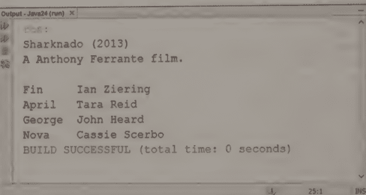

图 6.1 Credits程序的输出。

## 总结

当你的 Credits 程序看起来像图 6.1 所示时，给自己一点鼓励。读这本书已经六个小时了，你正在编写更长的 Java 程序并处理更复杂的问题。字符串是你每次坐下来写程序时都会使用的东西。你将以多种方式使用字符串与用户进行通信。

## 工作坊

## 问答

- **Q.** 如何将字符串变量的值设置为双引号，且中间没有任何文本？
- **A.** 使用空字符串，即一对双引号的变量。以下代码创建了一个名为 `georgeSays` 的新字符串变量并将其设置为空：

```java
String georgeSays = "";
```

- **Q.** 我似乎无法让 `toUpperCase()` 方法改变字符串使其全为大写字母。我哪里做错错了？
- **A.** 当你调用 String 对象的 `toUpperCase()` 方法时，它并不会实际改变被调用的字符串。相反，它创建了一个新字符串。考虑以下内容：

```java
String firstName = "Baz";
String changeName = firstName.toUpperCase();
System.out.println("First Name: " + changeName);
```

# if 语句

在 Java 中测试条件的最基本方法是使用 if 语句。if 语句测试条件为真还是假，并仅在条件为真时执行操作。

你可以将 if 配合要测试的条件使用，如下语句所示：

```java
long account = -17_000_000_000_000L;
if (account < 0) {
  System.out.println("Account overdrawn; you need a bailout");
}
```

if 语句通过小于运算符 `<` 检查 `account` 变量是否小于 0。如果是，if 语句中的代码块就会运行并显示消息。

代码块仅在条件为真时才运行。在前面的示例中，如果 `account` 变量的值为 0 或更高，`println()` 语句将被忽略。注意，你测试的条件必须用括号括起来，例如 `(account < 0)`。

小于运算符 `<` 是你可以在条件语句中使用的几个运算符之一。

## 小于和大于比较

在上一节中，`<` 运算符的使用方法与数学课上相同：作为小于号。还有一个大于条件运算符 `>`，它被用于以下语句：

```java
int elephantWeight = 900;
int elephantTotal = 13;
int cleaningExpense = 200;
```

```java
if (elephantWeight > 780) {
  System.out.println("Elephant too big for tightrope act");
}
```

```java
if (elephantTotal > 12) {
  cleaningExpense = cleaningExpense + 150;
}
```

第一个 if 语句测试 `elephantWeight` 变量的值是否大于 780。第二个 if 语句测试 `elephantTotal` 变量是否大于 12。

在前两个语句中使用的 `elephantWeight` 等于 600 且 `elephantTotal` 等于 10 的程序，每个代码块中的语句都将被忽略。

你可以使用 `<=` 运算符确定某物是否小于等于某物。这里有一个示例：

```java
if (account <= 0) {
    System.out.println("You are flat broke");
}
```

还有一个用于大于等于测试的 `>=` 运算符。

## 等于和不等于比较

程序中检查的另一个条件是相等性。一个变量是否等于某个特定值？一个变量是否等于另一个变量的值？这些问题可以通过以下语句中的 `==` 运算符来回答：

```java
char answer = 'b';
char correctAnswer = 'c';
int studentGrade = 85;
if (answer == correctAnswer) {
    studentGrade = studentGrade + 10;
}
```

```java
if (studentGrade == 100) {
    System.out.println("Show off!");
}
```

> **注意**
>
> 用于执行相等性测试的运算符有两个等号：`==`。很容易将此运算符与 `=` 运算符混淆，后者用于给变量赋值。在条件语句中始终使用两个等号。

你还可以使用 `!=` 运算符测试不相等性（即某物是否不等于某物），如下：

```java
if (answer != score) {
    score = score - 5;
}
```

你可以对除字符串之外的所有变量使用 `==` 和 `!=` 运算符，因为字符串是对象。

## 使用块语句组织程序

到目前为止，本小时的 if 语句都带有一个包含在 `{ }` 括号内的块。（我相信这些字符的技术术语是“波浪括号”）。

之前，你已经看到块语句如何用于标记 Java 程序中 `main()` 块的开始和结束。`main()` 中的每条语句在程序运行时都会被处理。

if 语句并不需要块语句。它可以独占一行，如此示例所示：

```java
if (account <= 0) System.out.println("No more money");
```

如果没有块，紧随 if 条件之后的语句仅在条件为真时执行。

以下语句使用 if 语句在橄榄球比赛中记录得分，在达阵（touchdown）后向总分加 7 分，在射任意球（field goal）后加 3 分。（如果你的橄榄球没有达阵或任意球，那是完全不同的橄榄球了。）

以下是代码：

```java
int total = 0;
int score = 7;
if (score == 7) {
    System.out.println("You score a touchdown!");
}
if (score == 3) {
    System.out.println("You kick a field goal!");
}
total = total + score;
```

你可以在 if 语句中使用块语句，以便在条件为真时让计算机执行多件事。以下是一个包含块语句的 if 语句示例：

```java
int playerScore = 12000;
int playerLives = 3;

if (playerScore > 999) {
    playerLives++;
    System.out.println("Extra life!");
}
```

括号用于分组属于 if 语句中的所有语句。如果 `playerScore` 大于 999，会发生三件事：

- `playerLives` 变量增加。
- 显示 "Extra life!"。
- （此处原文逻辑似乎有完整）

## if-else 语句

有些情况下，你需要在条件为真时执行某些操作，在为假时执行其他操作。你可以通过 else 语句来实现，如下所示：

```java
char answer = 'b';
char correctAnswer = 'c';
if (answer == correctAnswer) {
    System.out.println("That's right!");
} else {
    System.out.println("That's wrong!");
}
```

else 语句没有条件，与 if 语句不同。你可以链用 else 语句来处理多个条件，如下所示：

```java
int total = 0;
int score = 7;
if (score == 7) {
    System.out.println("You score a touchdown!");
} else if (score == 3) {
    System.out.println("You kick a field goal!");
} else {
    System.out.println("No points scored.");
}
total = total + score;
```

## switch 语句

if 和 else 语句适用于两个条件的情况，但有时你有两个以上的条件。另一种方法是使用 switch 语句，它可以测试不同的条件。在以下代码中，评分示例已重写为 switch ：

```java
char grade = 'B';
switch (grade) {
    case 'A':
        System.out.println("You got an A!");
        break;
    case 'B':
        System.out.println("You got a B!");
        break;
    case 'C':
        System.out.println("You got a C!");
        break;
    default:
        System.out.println("You got an F!");
}
```


# switch 语句

switch 语句的第一行指定了要测试的变量——在本示例中是 `grade`。然后，switch 语句使用 `{ }` 括号形成块语句。

每个 case 语句将 switch 语句中的测试变量与特定值进行比较。case 语句中值可以是字符、整数或字符串。在前面的示例中，有针对 'A'、'B' 和 'C' 的 case 语句。每个 case 后面都有一个或两个语句。当这些 case 语句之一匹配 switch 中的变量时，计算机将执行 case 之后的所有语句，直到遇到 `break` 语句。

`break` 语句告诉计算机跳出 switch 语句。在 switch 语句的 case 部分忘记使用 `break` 语句会导致意外的结果。如果这个评分示例没有 `break` 语句，当 `grade` 变量等于 'A'、'B' 或 'C' 时，前三个 "You got a..." 消息都会被显示。

`default` 语句在之前的所有 case 语句都不真时作为兜底。在本示例中，如果 `grade` 变量不等于 'A'、'B' 或 'C'，就会触发它。你不需要在程序中的每个 switch 块都使用 `default` 语句。如果省略了它，当没有 case 语句具有正确的值时什么都不会发生。

switch-case 语句会测试名为 `command` 的字符串值，如果它等于 "BUY"，则执行一个代码块；如果它等于 "SELL"，则执行另一个代码块。

在 NetBeans 中，在 `com.java24hours` 包下创建一个名为 `Commodity` 的空 Java 文件，然后将其填充列表 7.1 的内容。

## 列表 7.1 Commodity.java 的完整文本

```java
1: package com.java24hours;
2:
3: class Commodity {
4:     public static void main(String[] arguments) {
5:         String command = "BUY";
6:         int balance = 550;
7:         int quantity = 42;
8:
9:     switch (command) {
10:        case "BUY":
11:            quantity += 5;
12:            balance -= 20;
13:            break;
14:        case "SELL":
15:            quantity -= 5;
16:            balance += 15;
17:    }
18:        System.out.println("Balance: $" + balance + "\n\n
19:        + "Quantity: " + quantity);
20:    }
21: }
```

该应用程序在第 5 行将命令字符串设置为 "BUY"。当测试第 9 行的 switch 语句时，会执行第 11-13 行的 case 块。商品数量增加了 5，余额减少了 20 美元。

当运行 Commodity 程序时，它会产生如图 7.1 所示的输出。

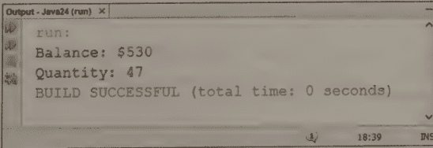

图 7.1 Commodity 程序的输出。

# 三元运算符

Java 最复杂的条件语句是三元运算符 `?`。

三元运算符根据条件赋值或显示值。例如，考虑一个视频游戏，它根据 `skillLevel` 变量是否大于 5 将 `numberOfEnemies` 变量设置为两个值之一。你可以使用 if-else 语句来实现此功能：

```java
if (skillLevel > 5) {
    numberOfEnemies = 20;
} else {
    numberOfEnemies = 10;
}
```

实现此功能的更短更复杂的方法是使用三元运算符。三元表达式包含五个部分：

- 要测试的条件，用括号括起来，例如 `(skillLevel > 5)`
- 一个问号 (`?`)
- 如果条件为真时使用的值
- 一个冒号 (`:`)
- 如果条件为假时使用的值

要使用三元运算符根据 `skillLevel` 设置 `numberOfEnemies`，你可以使用以下语句：

`int numberOfEnemies = (skillLevel > 5) ? 20 : 10;`

你也可以使用三元运算符来决定显示哪些信息。考虑一个根据 `gender` 变量的值显示 "Ms." 或 "Mr." 的程序示例。这里是实现此目的的语句：

`String gender = "female";`

`System.out.print(gender.equals("female") ? "Ms." : "Mr.");`

三元运算符可能很有用，但对于初学者来说，它是 Java 中最难理解的条件语句。随着你学习 Java，你不会遇到任何必须用三元运算符代替 if-else 语句的情况。

# 时钟

本小时的最后一个项目提供了对你在程序中使用的每个条件测试的另一个观察。在这个项目中，你将使用 Java 内置的计时功能，该功能跟踪当前的日期和时间，并以句子的形式呈现这些信息。

加载 NetBeans 或你使用的其他开发工具来创建 Java 程序，并将新文档命名为 `Clock.java`，包名为 `com.java24hours`。此程序很长，但大部分由多行条件语句组成。将 7.2 的完整文本输入源码编辑器，并在完成后保存为 `Clock.java`。

## 列表 7.2 Clock.java 的完整文本

```java
1: package com.java24hours;
2:
3: import java.time.*;
4: import java.time.temporal.*;
5:
6: class Clock {
7:     public static void main(String[] arguments) {
8:         // 获取当前日期时间
9:         LocalDateTime now = LocalDateTime.now();
10:        int hour = now.get(ChronoField.HOUR_OF_DAY);
11:        int minute = now.get(ChronoField.MINUTE_OF_HOUR);
12:        int month = now.get(ChronoField.MONTH_OF_YEAR);
13:        int day = now.get(ChronoField.DAY_OF_MONTH);
14:        int year = now.get(ChronoField.YEAR);
15:
16:        // 显示问候语
17:        if (hour < 12) {
18:            System.out.println("Good morning.");
19:        } else if (hour < 17) {
20:            System.out.println("Good afternoon.");
21:        } else {
22:            System.out.println("Good evening.");
23:        }
24:
25:        // 显示分钟开始时间消息
26:        System.out.print("It's ");
27:        if (minute == 0) {
28:            System.out.print(minute + " minutes ");
29:        } else {
30:            System.out.print(minute);
31:        }
32:        System.out.print(" past ");
33:    }
34: }
```

```java
// 显示小时
System.out.print(" ");
System.out.print(hour > 12 ? (hour - 12) : hour);
System.out.print(" o'clock on ");

// 显示月份
switch (month) {
    case 1:
        System.out.print("January");
        break;
    case 2:
        System.out.print("February");
        break;
    case 3:
        System.out.print("March");
        break;
    case 4:
        System.out.print("April");
        break;
    case 5:
        System.out.print("May");
        break;
    case 6:
        System.out.print("June");
        break;
    case 7:
        System.out.print("July");
        break;
    case 8:
        System.out.print("August");
        break;
    case 9:
        System.out.print("September");
        break;
    case 10:
        System.out.print("October");
        break;
    case 11:
        System.out.print("November");
        break;
    case 12:
        System.out.print("December");
        break;
}

// 显示日期和年份
System.out.println(" " + day + ", " + year + ".");
```

# 查看时钟

程序保存后，在运行之前，查看代码以了解条件测试是如何使用的。

# 注意

由于此程序使用了 Java 的较新功能，如果当前的 NetBeans 项目设置为使用较版本的语言，它将无法编译。要确保选择了正确的设置，选择 File（文件）、Project Properties（项目属性）。在 Project Properties 对话中，查找 Source/Binary Format（源/二进制格式）。应该是 JDK 9。

除了第 3-4 行和第 8-14 行外，Clock 程序包含了涵盖为止的内容。在设置了一系列变量来存储当前日期和时间后，使用了一系列 if 或 switch 条件语句来确定显示哪些信息。

此程序包含多次 `System.out.println()` 和 `System.out.print()` 来显示字符串。

第 8-14 行引用了名为 `now` 的 `LocalDateTime` 变量。`LocalDateTime` 变量类型大写是因为 `LocalDateTime` 是一个对象。

你在第 10 小时“创建你的第一个对象”学习如何创建和操作对象。在本小时中，重点关注这些行发生了什么，而不是如何发生。

Clock 程序由以下部分组成：

- 第 3 行允许你的程序使用跟踪当前日期时间所需的类：`java.time.LocalDateTime`。
- 第 4 行允许程序使用 `java.time.temporal.ChronoField` 类，这听起来像时间电影里的东西。
- 第 6-7 行开始 Clock 程序及其 `main()` 语句块。
- 第 9 行创建了一个名为 `now` 的 `LocalDateTime` 对象，它包含系统的当前日期和时间。每次运行此程序时，新对象都会发生。（除非宇宙法则被改变且时间停止了）
- 第 10-14 行创建了变量来存储小时、月、日和年。这些变量的值是从 `LocalDateTime` 对象中提取的，它是所有信息的存储库。括号内的信息（如 `ChronoField.DAY_OF_MONTH`）指示要提取日期的哪部分。
- 第 17-23 行显示三种可能的问候语：“Good morning”、“Good afternoon.”或“Good evening.”根据 `hour` 变量的值选择显示的问候语。

# 第 7 小时：使用条件测试做出决策

## 总结

现在你已经可以使用条件语句，你的 Java 程序的智能化得到了大大提高。你的程序可以评估信息并利用它在不同情况下做出不同的反应，即使信息在程序运行过程中发生变化。它们根据特定条件在两个或多个备方案之间做出决策。

计算机编程迫使你将任务分解为一组要执行的逻辑步骤和必须做出的决策。在编程中使用 `if` 语句和其他条件还能促进一种逻辑思维，这种思维可以在你生活的其他方面产生益处：

- “如果那位候选人在 11 月份当选为总统”
- “如果我在 OK Cupid 的约会对象喜欢我”
- “如果我违反了假释规定”

## 工作坊

### 问答

- **Q.** `if` 语句似乎是最实用的。在程序中可以只使用 `if` 语句而永远不使用其他的吗？
- **A.** 是否可能不使用 `else` 或 `switch`，而且很多程序员从不使用三元运算符？然而，在程序中使用 `else` 和 `switch` 通常是有益的，因为它们让程序更易理解。一组链在一起的 `if` 语句可能会变得难以处理。

- **Q.** 在这一节中，如果 `if` 语句只跟一个语句，有时不使用大括号 `{ }`。使用大括号是强制的吗？
- **A.** 不是。括号可以作为任何语句的一部分，用来包围依赖于条件测试的程序。使用括号是一个很好的入门习惯，因为可以防止在修改程序时可能发生的常见错误。如果你在只有单个语句的 `if` 条件判断中没有添加括号，当你添加第二个语句但忘记添加括号时会发生什么？我来回答自己的问题：会产生意料之外的想法，在编程中，“意料之外”这个词几乎从不是好事。

- **Q.** 在每个 `case` 之后的语句部分都必须使用 `break` 吗？
- **A.** 你不必使用 `break`。如果你不在一组语句的末尾使用它，那么 `switch` 块内部的所有剩余语句都将被处理，无论它们测试的 case 值是什么。然而，在大多数情况下，你可能想在每组的最后加上一个 `break` 语句。

- **Q.** 为什么汤普森双胞（Thompson Twins）在他们是一个组合、彼此没有关系、而且其中没有人叫汤普森的情况下却得到这个名字？
- **A.** 乐队成员 Tom Bailey、Alannah Currie 和 Joe Leeway 称自己为汤普森双胞胎，是为了纪念 Thompson 和 Thompson，他们是比利时漫画《柯丁历险记》（The Adventures of Tintin）中一对笨拙的侦探。这两位戴着圆礼帽的侦探除了胡须形状有细微差别外，外表上完全无法区分。尽管他们工作非常糟糕，但却莫名其妙地分配了重要且敏感的任务。他们经常追捕柯丁，因为他没有犯下的罪行。正如他们的名字所示，这些侦探之间也没有血缘关系。

### 测验

以下问题将通过你在学习了 Java 条件语句后，你的掌握程度如何。

1. 条件测试结果为 `true` 或 `false` 值。这让你联起了哪种变量类型？
    - A. 都没有。有些东西一直在烦扰我。
    - B. `long` 类型变量。
    - C. `boolean` 类型。

2. 哪种语句被用作 `switch` 块语句中的全捕获类别？
    - A. `default`
    - B. `otherwise`
    - C. `onTheOtherHand`

3. 什么是条件（conditional）？
    - A. 洗头后修复凌乱分叉和打结的东西。
    - B. 程序中测试某个条件为真为假的东西。
    - C. 你向宗教权威忏悔罪孽的地方。

### 答案

1. **C.** `boolean` 变量类型只能等于 `true` 或 `false`，这与条件测试相似。如果你回答 A，我很抱歉，但只剩下 17 个小时了，我们还有很多内容要讲。Java 不会自学。
2. **A.** 如果没有其他 `case` 语句匹配，则处理 `default` 语句。
3. **B.** 其他答案描述的是护发器和忏悔室。

### 活动

为了提高你在 Java 条件语句方面的技能，请通过以下活动复习本节的主题：

- 在 Clock 程序的某行 `break` 语句前添加 `//` 使其成为注释；然后编译并查看运行时会发生什么。再次尝试删除几个 `break` 语句。
- 创建一个短程序，在名为 `grade` 的整数变量中存储一个从 1 到 100 随机选择的值。使用 `grade` 变量配合条件语句为所有 'A'、B'、C'、D' 和 'F' 学生显示不同的消息。先尝试 `if` 语句，再尝试 `switch` 语句。

要查看实现这些活动的 Java 程序，请访问网站 www.java4hours.com。

# 第 8 小时：使用循环重复操作

本节待办事项：

- 使用 `for` 循环。
- 使用 `while` 循环。
- 使用 `do-while` 循环。
- 提前退出循环。
- 命名一个循环。

## for 循环基础

上一个示例在 for 语句块内部包含以下语句：

```java
if (dex % 12 == 0) {
  System.out.println("#: " + dex);
}
```

这些语句会被执行 1000 次。循环从将 `dex` 变量设置为 0 开始。在循环的每次执行中，它都会给 `dex` 加上 1。当 `dex` 不再小于 1,000 时，循环停止。


注意，在你在讨论循环迭代（iteration）时可能会听到一个不寻常的术语：迭代是指通过循环的单次执行。用于控制循环的计数变量被称为迭代器（iterator）。

正如你在 `if` 语句中看到的，如果 `for` 循环只包含一条语句，则它不需要括号。如下例所示：

```java
for (int p = 0; p < 500; p++)
  System.out.println("I will not sell miracle cures");
```

此循环会显示文本 "I will not sell miracle cures" 500 次。虽然循环内部的单一语句不需要括号，但你可以使用括号来使代码块更易读，如下：

```java
for (int p = 0; p < 500; p++) {
  System.out.println("I will not sell miracle cures");
}
```

你在在此循环期间创建的第一个程序将显示前 200 个 9 的倍数：9、18、27 等，直到 1,800 (9 × 200)。在 NetBeans 中，在 `com.java24hours` 包中创建一个名为 `Nines` 的新空 Java 文件，并输入列表 8.1 的文本。当你保存文件时，它将被存储为 `Nines.java`。

## 列表 8.1 Nines.java 的全文

```java
1: package com.java24hours;
2:
3: class Nines {
4:   public static void main(String[] arguments) {
5:     for (int dex = 1; dex <= 200; dex++) {
6:       int multiple = 9 * dex;
7:       System.out.print(multiple + " ");
8:     }
9:     System.out.println();
10:  }
11: }
```

`Nines` 程序包含一条第 5 行的语句。该语句有三个部分：

- 初始化——`int dex = 1`，这创建一个名为 `dex` 的整数变量并赋予其初始值 1。
- 条件——`dex <= 200`，在循环的每次执行中，该条件必须为真。当该条件不为真时，循环结束。
- 变化——`dex++`，在循环的每次执行中将 `dex` 变量加 1。

在 NetBeans 中通过选择 Run、Run File 来运行程序。该程序产生如图 8.1 所示的输出。

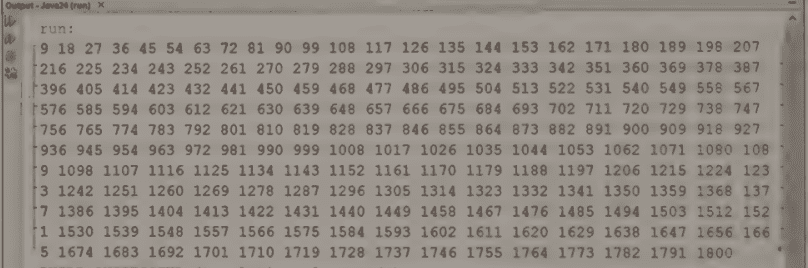

图 8.1

Nines 程序的输出。

NetBeans 中的输出不会自动换行，因此所有数字都显示在同一行。要让文本换行，请在 Output 板的任何地方点击右键，并从弹出菜单中选择 Wrap Text（换行文本）。

## while 循环

`while` 循环比 `for` 循环更简单。它需要的是伴随 `while` 循环的条件测试，如下代码所示：

```java
int gameLives = 3;
while (gameLives > 0) {
    // 循环内部的语句在这里
}
```

循环会持续重复，直到 `gameLives` 变量不再大于 0。

`while` 语句在循环中的任何语句被处理之前，会在循环开始处测试条件。如果程序第一次到达 `while` 语句时，测试的条件为假，则循环内部的语句将被忽略。

如果 `while` 条件为真，循环将执行一次并再次测试 `while` 条件。如果测试的条件在循环内部永远不改变，循环将永远循环下去。

以下语句使用循环多次显示相同的同一行文本：

```java
int limit = 5;
int count = 1;
while (count < limit) {
    System.out.println("Pork is not a verb");
    count++;
}
```

`while` 循环使用在循环语句之前设置的一个或多个变量。在这个示例中，有两个整数变量发挥了作用：值为 5 的 `limit` 和值为 1 的 `count`。

`while` 循环显示四次文本 "Pork is not a verb"。如果你给 `count` 变量一个初始值 6 而不是 1，则文本将永远不会显示。

## do-while 循环

`do-while` 循环与 `while` 循环相似，但条件测试的位置不同。以下是 `do-while` 循环的示例：

```java
int gameLives = 0;
do {
    // 循环内部的语句在这里
} while (gameLives > 0);
```

与 `while` 循环一样，这个循环会持续执行，直到 `gameLives` 变量不再大于 0。`do-while` 循环的不同之处在于，条件测试是在循环内部语句之后进行的，而不是在之前。

当程序运行时，第一次遇到 `do` 循环时，`do` 和 `while` 语句之间的语句会被自动处理，然后测试 `while` 条件。

## 退出循环

退出循环的正常方法是条件变为假。这适用于所有类型的循环。某些情况下，你可能需要循环立即结束，即使条件仍然为真。你可以使用 `break` 语句来实现，如下所示：

```java
int index = 0;
while (index <= 1000) {
    index = index + 5;
    if (index == 400) {
        break;
    }
}
```

`break` 语句结束包含它的语句的循环。在这个示例中，`while` 循环被设计为直到 `index` 变量大于 1000。然而，一种特殊情况会导致循环提前结束：如果 `index` 等于 400，则执行 `break` 语句。

另一种可以在循环内部使用的特殊情况是 `continue`。`continue` 语句会导致循环跳出当前的单次执行，并从循环的第一条语句重新开始。考虑以下代码：

```java
int index = 0;
while (index <= 1000) {
    index = index + 5;
    if (index == 400) {
        continue;
    }
    System.out.println("The index is " + index);
}
```

在这个循环内部，除非 `index` 的值等于 400，否则语句都会正常处理。在这种情况下，`continue` 语句会导致循环回到 `while` 语句，而不是正常执行到 `System.out.println()` 语句。由于 `continue` 语句，循环永远不会显示以下文本：

The index is 400

在本示例中，如果 `points` 变量大于 50，`break` 语句会导致 `for` 循环结束。然而，`while` 循环永远不会结束，因为 `target` 从未大于 100。

在某些情况下，你可能想要同时跳出多个循环。为了实现这一点，你必须给外层循环（在本示例中为 `while` 语句）起一个名字。要给循环命名，请在循环开始之前的行放置名称，并在后面跟一个冒号（`:`）。

当循环有了名称后，在 `break` 或 `continue` 语句之后使用该名称，指示 `break` 或 `continue` 语句适用的循环。以下示例重复了之前的示例，唯一的不同之处在于：如果 `points` 变量大于 50，两个循环都会结束。

```java
int points = 0;
int target = 100;
targetLoop:
while (target <= 100) {
  for (int i = 0; i < target; i++) {
    if (points > 50) {
      break targetLoop;
    }
    points = points + i;
  }
}
```

当 `break` 或 `continue` 语句中使用循环名称时，该名称不包含冒号。

## 复杂的 for 循环

`for` 循环可以比本小时在此为止显示的更复杂。循环的初始化部分、条件部分和变化部分可以包含多个变量。`for` 循环可以在初始化部分设置多一个变量，并在变化部分包含多个语句，如下面代码所示：

```java
int i, j;
for (i = 0, j = 0; i * j < 1000; i++, j += 2) {
  System.out.println(i + " * " + j + " = " + (i * j));
}
```

在由分号分隔的循环每个部分中，使用逗号来分隔变量，例如 `i = 0, j = 0`。示例循环显示了一个等式列表，其中 `i` 和 `j` 变量相乘。在每次循环迭代中，`i` 变量增加 1，`j` 增加 2。当 `i` 乘以 `j` 等于或大于 1,000 时，循环结束。

## 测试你的计算机速度

`for` 的部分也可以是空的。这的一个例子是循环的计数器变量已经在程序的其他部分用初始值创建，如下所示：

```java
int displayCount = 1;
int endIndex = 13;
for ( ; displayCount < endIndex; displayCount++) {
    // 循环语句将位于此处
}
```

## 测试你的计算机速度

本小时的下一个项目是一个执行基准测试（benchmark）的 Java 程序，这是一种衡量快速计算机硬件或软件运行速度的测试。`Benchmark` 程序使用循环语句反复执行以下数学表达式：

```java
double x = Math.sqrt(index);
```

该语句调用 `Math.sqrt()` 方法来寻找数字的平方根。你将在第 11 小时“描述你的对象特征”中学习更多关于方法的知识。

你正在创建的基准测试统计了 Java 程序在一分钟内计算平方根的次数。

使用 Beans 在 `com.java24hours` 包中创建一个名为 `Benchmark` 的新空 Java 文件。完成后保存该程序。

## 列表 8.2 Benchmark.java 的源代码

```java
1: package com.java24hours;
2:
3: class Benchmark {
4:     public static void main(String[] arguments) {
5:         long startTime = System.currentTimeMillis();
6:         long endTime = startTime + 60000;
7:         long index = 0;
8:         while (true) {
9:             double x = Math.sqrt(index);
10:            long now = System.currentTimeMillis();
11:            if (now > endTime) {
12:                break;
13:            }
14:            index++;
15:        }
16:        System.out.println(index + " loops in one minute.");
17:    }
18: }
```

程序中发生了以下情况：

- 第 5 行——通过调用 Java `System` 类的 `currentTimeMillis()` 方法创建 `startTime` 变量，其值为当前毫秒时间。
- 第 6 行——创建了 `endTime` 变量，其值比 `startTime` 大 60,000。由于一分钟等于 60,000 毫秒，这会将变量设置为 `startTime` 之后的一分钟。
- 第 7 行——设置了一个初始值为 0 的 `long` 类型 `index`。
- 第 8 行——`while` 语句使用 `true` 作为条件开始循环，这导致循环无限持续（换句话说，直到其他什么停止它）。
- 第 9 行——计算 `index` 的平方根并存储在变量 `x` 中。
- 第 10 行——使用 `currentTimeMillis()` 创建了带有当前时间的 `now` 变量。
- 第 11–13 行——如果 `now` 大于 `endTime`，则表示循环已运行了一分钟并跳循环。否则，它继续循环。
- 第 14 行——每次循环迭代时，`index` 变量加 1。
- 第 16 行——`index` 显示了一分钟内的循环次数。

 （注：原文包含一个作为流程部分的图像引用）

## 总结

循环是大多数编程语言的基础部分。

## 工作坊

- Q：什么是“初始化”？
- A：意味着给变量一个初始值。
- Q：如果循环永远不结束，它是如何停止的？
- A：`break` 语句跳出循环，`continue` 语句跳到循环的下一次迭代。
- Q：我如何购买股票？
- A：除非公有团队决定持有。

## 验

- 1. 使用什么来分隔 `for` 语句的每个部分？
  - A. 逗号
  - B. 分号
  - C. 休假人员
- 2. 哪个语句导致程序返回开始循环的语句并从那里继续执行？
  - A. continue
  - B. next
  - C. skip
- 3. Java 中哪种循环语句至少运行一次？
  - A. for
  - B. while
  - C. do-while

## 答案

1. 逗号用于分隔部分内的元素，但分号分隔部分。
2. `break` 语句跳出循环，`continue` 语句跳到循环的下一次迭代。
3. `do-while` 的条件在第一次通过后才会进行评估。

## 活动

- 修改 `Benchmark` 程序以测试简单数学计算，如乘法或除法。
- 使用循环编写一个短程序，找出前 400 个 13 的倍数。

# 第 9 小节 使用数组存储信息

本节的任务清单如下：

- 创建一个数组。
- 设置数组的大小。
- 在数组元素中存储一个值。
- 修改数组中的信息。
- 创建多维数组。
- 对数组进行排序。

没有人从计算机的发展中受益比圣诞老人更多了。几个世纪以来，人类在他身上倾负了收集和处理信息的沉重负担。老圣尼古必须跟踪以下事项：

- 顽童
- 乖孩子
- 礼物请求
- 烟囱无法通过的房屋
- 那些想要圣诞老人那里给得比圣诞太太允许的给得更多的女性
- 那些先射击身份不明的飞行器事后问责的国家

计算机对北极来说是一个巨大的福音。它们是存储、分类和研究信息的绝理想工具。

在计算机程序中，存储信息最基本的方法是将其放入变量中。到目前为止，你处理过的所有变量都是单项信息，例如浮点数或字符串。

圣诞老人的乖孩子列表是一个更大相似信息集合的例子。为了跟踪此类列表，你可以使用数组。

## 创建数组

数组是在一个通用名称下分组的变量。“数组（array）”一词你应该很熟悉——想象一个销售员在展示她的产品，或者一个有着琳琅满目奖品的游戏节目。和变量一样，数组通过声明组织成数组的变量类型和数组名称来创建。在类型后面跟着一对方括号 `[]`，以区分数组和变量。

你可以为任何可以存储为变量的类型信息创建数组。以下语句创建了一个字符串变量数组：

```java
String[] naughtyChild;
```

以下是两个分别创建整数数组和布尔值数组的语句：

```java
int[] reindeerWeight;
boolean[] hostileTravelNations;
```

> 注意
>
> Java 在创建数组时对方括号的位置放置是灵活的。你可以将它们放在变量名之后而不是变量类型之后，如下：
>
> `String niceChild[];`
>
> 为了让数组在程序中更容易被发现（对人类而言），你应该坚持一种风格，而不是来回切换。本书中使用数组的程序始终将括号放在变量或对象类型之后。

之前的示例创建了持有数组的变量，但没有在其中存储任何值。要实现这一点，你可以使用 `new` 关键字结合变量类型，或者在 `{ }` 标记内为数组存储值。使用 `new` 时，你必须指定数组中存储了多少个不同的项目。数组中的每个项目被称为元素（element）。以下语句创建一个数组并为其持有的值留出空间：

```java
int[] elfSeniority = new int[250];
```

这个示例创建了一个名为 `elfSeniority` 的整数数组。该数组有 250 个元素，可以存储圣诞老人每个精灵在北极工作的月数。（如果圣诞老人经营的是工会商店，跟踪这些信息极其重要）。

## 使用数组

当你使用 `new` 语句创建数组时，必须指定元素的数量。数组的每个元素都会被赋予一个取决于数组类型的初始值。所有数值数组的初始值均为 0，字符数组等于 `'\0'`，布尔数组的值为 `false`。字符串数组和所有其他对象的初始值均为 `null`。

对于不是特别巨大的数组，你可以在创建它们的同时设置它们的初始值。以下示例创建了一个字符串数组并赋予它们初始值：

```java
String[] reindeerNames = {"Dasher", "Dancer", "Prancer", "Vixen", "Comet", "Cupid", "Donner", "Blitzen"};
```

数组的第一个元素从 0 开始，这意味着最大的索引是元素数量减一。要访问或修改元素，你在数组名称后的方括号中使用索引：

```java
String[] topGifts = new String[10];
topGifts[0] = "Dasher";
topGifts[1] = "Dancer";
```

如果你尝试访问数组范围外的索引，Java 会抛出 `ArrayIndexOutOfBoundsException`。这种运行时错误发生在程序尝试访问负数或大于等于数组长度的索引时。每个数组都有一个 `length` 变量，返回它持有的元素数量。以下示例演示了：


```java
String[] reindeerNames = {"Dasher", "Dancer", "Prancer", "Vixen", "Comet", "Cupid", "Donner", "Blitzen"};
System.out.println("There are " + reindeerNames.length + " reindeerers.");
```

## 多维数组

```
for (int dex = 0; dex < mfl.length; dex++) {
    char current = mfl[dex];
    if (current != ' ') {
        System.out.print(current);
    } else {
        System.out.print('.');
    }
}
System.out.println();
}
}
```

使用 `Run` 或 `Run File` 命令运行程序查看图 9.1 所示的输出。

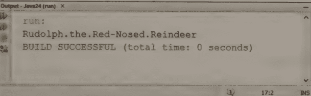

图 9.1

SpaceRemover 程序的输出。

SpaceRemover 应用将文本 "Rudolph the Red-Nosed..." 存储在两个地方：一个名为 `mostFamous` 的字符串和一个名为 `mfl` 的字符数组。该数组在第 6 行通过调用 `mostFamous` 的 `toCharArray()` 方法创建，该方法为文本中的每个字符填充一个包含一个元素的数组。字符 'R' 放入元素 0，'u' 放入元素 1，依此类推，直到最后的 'r' 放入元素 29。

第 7-14 行的 `for` 循环检查 `mfl` 数组中的每个字符。如果字符不是空格，则显示它。如果是空格，则显示字符 '.' 字符。

## 多维数组

本节之前出现的所有数组都是一维的，因此你可以使用单个数字来检索元素。某些类型的信息需要更多维度来作为数组存储，例如 (x,y) 坐标系中的点。数组的一个维度可以存储 x 坐标，另一个维度可以存储 y 坐标。

要创建一个具有两个维度的数组，你必须在创建和使用数组时使用额外的方括号对，如这些语句所示：

```
boolean[][] selectedPoint = new boolean[50][50];
selectedPoint[4][13] = true;
selectedPoint[7][6] = true;
selectedPoint[11][22] = true;
```

此示例创建了一个名为 `selectedPoint` 的布尔值数组。该数组的第一个维度上有 50 个元素，第二个维度上有 50 个元素，因为共有 2,500 个单独数组元素（50 × 50）。当数组被创建时，每个元素都被赋予默认值 `false`。三个元素被赋予了值 `true`：位于 (x,y) 位置 4,13 的点、位于 7,6 的点以及位于 11,22 的点。

数组可以根据需要具有任意数量的维度，但请记住它们可能会占用大量内存。创建一个 50 比 50 的 `selectedPoint` 数组等同于创建 2,500 个单独变量。

## 数组排序

当你将一组相似的项目组合在数组中时，你可以做的一件事就是重排列项目。以下语句交换了名为 `numbers` 的整数数组中两个元素的值：

```
int[] numbers = { 3, 7, 9, 12, 5, 0, 8, 19 };
int temporary = numbers[5];
numbers[5] = numbers[6];
numbers[6] = temporary;
```

这些语句导致 `numbers[5]` 和 `numbers[6]` 互相交换值。整数 `temporary` 被用作正在交换的值之一的临时存放地。排序是将相关项目列表按顺序排列的过程，例如将数字列表从低到高排序。圣诞老人可以使用排序来比按字母顺序更早地按名称安排接收者的顺序。在 Java 中，排序数组是很容易的，因为 `Arrays` 类完成了所有工作。`Arrays` 是 `java.util` 组的一部分，可以重排所有类型的数组。

## 数组排序

为了在程序中使用 `Arrays` 类，请执行以下步骤：

1. 使用 `import java.util.*` 语句以便于在程序中使用 `java.util` 类。
2. 创建一个数组。
3. 使用 `Arrays` 类的 `sort()` 方法来重排数组。

由 `Arrays` 类排序的变量数组将被重排列为升序。字符和字符串按字母顺序排列。为了直观地看到这一操作的实际效用，请在 `com.java24hours` 包中创建一个名为 `NameSorter` 的新文件，并输入列表 9.2 的文本。

### 列表 9.2 NameSorter.java 的完整源代码

```
package com.java24hours;

class NameSorter {
    public static void main(String[] arguments) {
        String names[] = {"Glimmer", "Marvel", "Rue", "Clove",
            "Thresh", "Foxface", "Peeta", "Katniss"};
        System.out.println("The original order:");
        for (int i = 0; i < names.length; i++) {
            System.out.println(i + ": " + names[i]);
        }
        System.out.println();
        Arrays.sort(names);
        System.out.println("The new order:");
        for (int i = 0; i < names.length; i++) {
            System.out.println(i + ": " + names[i]);
        }
        System.out.println();
    }
}
```

当你运行此程序时，它按原始顺序显示列表，进行排序并重新显示列表。图 9.2 显示了输出


图 9.2

NameSorter 程序的输出。

当你处理字符串、整数或浮点数等基本类型的变量时，你可以使用 `Arrays` 类按升序排列它们。如果你想要不同的排列方式，可以编写代码来手动排序。

## 字符串中的字符计数

英语中出现最频繁的字母是 E, R, S, T, L, N, C, M 和 O。如果你熟悉《幸运轮》（Wheel of Fortune）这个节目，这个事实值得知道。

### 注意

《幸运轮》是一个参赛者猜字母的游戏，如果猜中了字母且是辅音，就能赢得转盘金额。

在 NetBeans 中创建一个名为 `Wheel` 的新 Java 文件，将其放入 `com.java24hours` 包中，用列表 9.3 的内容填充它，当你完成时保存文件。

### 列表 9.3 Wheel.java 的完整源代码

```
package com.java24hours;

class Wheel {
    public static void main(String[] arguments) {
        String phrase[] = {"A STITCH IN TIME SAVES NINE",
            "DON'T EAT YELLOW SNOW",
            "TASTE THE RAINBOW",
            "EVERY GOOD DOES",
            "I WANT MY MTV",
            "I LIKE IKE",
            "PLAY AGAIN, SAM",
            "FROSTY THE SNOWMAN",
            "ONE MORE FOR THE ROAD",
            "HOME FIELD ADVANTAGE",
            "SHEFFIELD WEDNESDAY",
            "GROVER CLEVEL",
            "LEAND OHIO",
            "SPAGETTI WESTERN",
            "TEEN TITANS GO",
            "IT'S A WONDERFUL LIFE"
        };
        int[] letterCount = new int[26];
        for (int count = 0; count < phrase.length; count++) {
            String current = phrase[count];
            char[] letters = current.toCharArray();
            for (int count2 = 0; count2 < letters.length; count2++) {
                char lett = letters[count2];
                if ((lett >= 'A') && (lett <= 'Z')) {
                    letterCount[lett - 'A']++;
                }
            }
        }
        for (char count = 'A'; count <= 'Z'; count++) {
            System.out.print(count + ": " + letterCount[count - 'A'] + "");
            if (count == 'M') {
                System.out.println();
            }
        }
        System.out.println();
    }
}
```

如果你在不添加自己的短语的情况下运行程序，输出应该是图 9.3。


图 9.3

Wheel 程序的输出。

## 总结

- 第 27 行——创建了一个名为 `lett` 的变量，其值为当前字母。除了文本值外，字符还具有数值值。由于数组元素是数字编号的，因此每个字符的数值被用于确定其对应的元素索引。
- 第 28–30 行——一个 `if` 语句过滤掉所有不是字母表部分的字符，例如标点符号和空格。根据存储在 `lett` 中的当前字符的数值，将 `letterCount` 数组中的一个元素加 1。字母表范围的数值从 'A' 的 65 到 'Z' 的 90。由于 `letterCount` 数组从 0 开始到 25，因此从 `lett` 中减去 'A' (65) 来确定增加哪一个元素。
- 第 33 行——循环遍历从 'A' 到 'Z' 的字母表。
- 第 34–40 行——显示当前字母，后分号以及存储在 `phrase` 数组中的短语中出现的字母数量。当当前字母为 'M' 时，显示换行符，以便输出分布在两行。

此项目展示了如何使用嵌套循环来逐字母地循环遍历一组短语。Java 为每个字符分配了一个数值；这个值比数组内部的字符更容易使用。

### 注意事项

与 'A' 到 'Z' 每个字符关联的数值是 ASCII 字符集所使用的数值。ASCII 字符集是 Unicode 的一部分，Java 语言支持的完整字符集。Unicode 包含了对世界各国语言使用的超过 60,000 个不同字符的支持。ASCII 仅限于 256 个。

## 总结

数组使得在程序存储复杂类型的信息并对这些信息进行操作成为可能。对于任何可以排列成列表并可以使用你在第 8 小时“使用循环重复动作”中所学会的循环语句轻松访问的内容，数组都是理想的选择。

老实说，圣诞老人的信息处理需求可能已经超出了数组的范围。每年制造的儿童越来越多，他们想要的礼物在复杂性和费用上也在不断增加。

你的程序可能会使用数组来存储用变量难以处理的信息，即使你没有创建任何列表或对它们进行双重检查。

## 工作坊

### 问答

- **Q**：字母表的数值范围（从 'A' 的 65 到 'Z' 的 90）是 Java 语言的一部分吗？如果是，1 到 64 是留作什么的？
- **A**：1 到 64 数字包含数字、标点符号和一些不可打印字符，如换行符、新行符和退格。每个可以在 Java 程序中使用的可打印字符都关联着一个数字，以及一些不可打印的字符。Java 使用 Unicode 编号系统。前 127 个字符来自 ASCII 字符集，你可能在其他编程语言中使用过它。

- **Q**：在多维数组中，是否可以使用 `length` 变量来测量第一维度以外的其它维度？
- **A**：你可以测试数组的维度。对于第一维度，使用数组名配合 `length`，例如 `x.length`。后续维度可以通过使用该维度的 `[0]` 元素配合 `length` 来测量。考虑一个使用以下语句创建的 `data` 数组：

```
int[][][] data = new int[12][13][14];
```

可以使用 `data.length` 变量测量第一维度，使用 `data[0].length` 测量第二维度，使用 `data[0][0].length` 测量第三维度。

- **Q**：为什么新英格兰爱国队教练比尔·贝奇克（Bill Belichick）在场边穿着破旧的连帽衫？
- **A**：当你在十年内的胜场次数超过 NFL 历史上的任何教练（2003 年到 2012 年 140 场）时，你的老板会让你设定自己的着装标准。体育界认为，贝奇克回应 Reebok 与 NFL 的交易而穿着无袖连帽衫要求所有教练必须穿授权的球队服装。

> “他决定，如果他们要让他穿球队服装，他就会挑选选项，并穿上他能找到的最丑的一件，”Yahoo Sports 的 Dan Vettel 解释道，“他选择了一件带兜帽的灰色运动衣。”

贝奇克这种消极攻击的时尚宣言将连帽衫变成了球队最畅销的之一。

### 测验

如果你的大脑是一个数组，你能够通过回答以下关于数组的每个问题来测试它的长度吗？

**数组最适合什么类型的信息？**

- A. 列表
- B. 相关信息对
- C. 冷常识

**你可以使用哪个变量来检查数组的上边界？**

- A. top
- B. length
- C. limit

**圣诞老人有多少只驯鹿，包括鲁道夫（Rudolph）？**

- A. 8
- B. 9
- C. 10

### 答案

1. **A**. 相同类型信息（字符串、数字等）的列表非常适合存储在数组中。
2. **B**. `length` 变量包含数组中元素的计数。
3. **B**. 根据克莱门·克拉克·摩尔（Clement Clarke Moore）的《圣尼古拉斯拜访》，有“八只小驯鹿”，所以鲁道夫是第九只。

### 活动

为了以后留有一组练习供你选择，可以通过以下活动扩展你对本节主题的知识：

- 创建一个使用多维数组存储学生成绩的程序。第一个维度应该是每个学生的数字，第二个维度应该是学生的成绩。显示每个学生的平均分以及总平均分。
- 编写一个程序，使用数组存储 13 的倍数。

要查看实现这些活动的 Java 程序，请访问书籍网站 www.java2hours.com。

# 第 10 章

## 创建你的第一个对象

### 本节的任务列表

- 创建对象。
- 用属性描述对象。
- 对象的行为。
- 组合对象。
- 继承其他对象。
- 转换和其他类型。

你在这些 24 小时中遇到的最可怕术语之一是面向对象编程（OOP）。这个复杂的术语用优雅的方式描述了计算机程序以及它的工作方式。

在 OOP 之前，计算机程序通常根据最简单的定义描述为一组指令。

通过将程序视为对象的集合，你可以确定它们最适合的任务。

通过面向对象编程（OOP），计算机程序是一组共同工作以完成任务的对象。某些简单的程序看起来似乎只包含一个对象：类文件。即使是这些程序，也在使用其他对象来完成工作。

## 运行中的对象

考虑一个显示饼图的程序。一个 `PieChart` 对象可能包含以下内容：

- 计算每个饼扇大小的行为
- 绘制图表的行为
- 用于存储图表标题的属性

要求 `PieChart` 对象绘制自己可能看起来很奇怪，因为在现实世界中，图表是不会自己绘制的。在 OOP 中，对象尽可能会为自己工作。这种能力使得将其整合到其他程序中变得更容易。例如，如果一个 `PieChart` 对象不知道如何绘制自己，那么每当你从另一个程序中使用 `PieChart` 对象时，你都必须创建一个绘制它的行为。

OOP 的另一个例子是，考虑马修·布罗德里克（Matthew Broderick）的角色在经典黑客电影《游戏大战》（WarGames）中使用的自动拨号器程序，它用来寻找他可以入侵的计算机。

### 注意

自动拨号器是一种使用称为调制解调器（modem）的设备按顺序拨打一系列电话的软件。此类程序的目的是找到其他接听的计算机，这样你稍后就可以给它们打电话看看它们是什么。

30 岁以下的读者可能难以相信，计算机曾经通过电话连接相互连接。你必须知道计算机的电话号码才能连接到它，如果它正在与另一台计算机通话，你就会得到忙音信号。

现在我可能需要解释什么是忙音信号。

引用诗人 T.S 艾利特（T.S. Eliot）的话：“我老了……我老了。”

今天使用自动拨号器会引起当地电话公司和执法部门的注意。在 20 世纪 80 年，这是不出门反叛的好方法。大卫·莱特曼（David Lightman，布罗里克饰演的角色）使用他的自动拨号器寻找一家视频游戏公司的私人计算机系统，以便在公司发布新游戏之前玩到。相反，莱特曼发现了一个秘密政府计算机，那台电脑可以运行从象棋到全球热核战争的一切程序。

自动拨号器像任何计算机程序一样，可以被视为一组共同工作的对象。它可以被分解为以下几个：


- 一个 `Modem` 对象，它知道自己的属性（如连接速度），并具有让解调器拨号号码以及检测另一台计算机何时接听电话的行为
- 一个 `Monitor` 对象，它跟踪拨打了哪些号码以及哪些是计算机

每个对象都独立于其他对象。

设计一个完全独立的 `Modem` 对象的优势之一是，它可以被需要 `Modem` 功能的其他程序使用。

使用自包含对象的另一个原因是它们更容易被调试。计算机程序的规模会迅速变得难以管理。如果你正在调试一个像 `Modem` 对象这样的东西，并且知道它不依赖于任何其他东西，那么你就可以专注于确保 `Modem` 对象执行它应该做的工作，并持有执行该工作所需的信息。

学习像 Java 这样的面向对象的语言作为你的第一种编程语言是有利的，因为你不需要去消除其他编程风格的习惯。

## 什么是对象

对象是通过使用对象类作为模板创建的。以下语句创建了一个类：

```java
public class Modem {
}
```

```java
public class Modem {
  int speed;

  public void displaySpeed() {
    System.out.println("Speed: " + speed);
  }
}
```

`Modem` 类现在应该开始像你在第 1 到第 9 小节编写的程序了。`Modem` 类以类语句开头，只是它包含了 `public` 关键字。这意味着该类可供公众使用——换句话说，任何想要使用 `Modem` 对象的程序都可以。

`Modem` 类的第一部分创建了一个名为 `speed` 的整数变量。这个变量是对象的属性。

`Modem` 类的部分是一个名为 `displaySpeed()` 的方法。该方法是对象行为的一部分。它包含一条语句 `System.out.println()`，用于显示解调器的速度值。

对象的变量被称为实例变量或成员变量。

如果你想在程序中使用 `Modem` 对象，可以使用以下语句创建对象：

```java
Modem device = new Modem();
```

该语句创建了一个名为 `device` 的 `Modem` 对象。创建对象后，你可以设置它的变量并调用它的方法。以下是设置 `device` 对象 `speed` 变量的方法：

```java
device.speed = 28800;
```

要通过调用 `displaySpeed()` 方法让这个解调器显示其速度，你需要调用该方法：

```java
device.displaySpeed();
```

名为 `device` 的 `Modem` 对象可能会响应此语句并显示文本“Speed: 28800”。

## 理解继承

OOP 的一大优势是继承，它允许从另一个对象继承行为和属性。

当你开始创建对象时，有时会发现你想要的新对象和你已有的对象非常相似。

如果大卫·莱特曼想要一个能够处理纠错和其他高级解调器功能的对象（这些功能在 1983 年《游戏大战》上映时还没有出现），莱特曼可以通过复制 `Modem` 对象的语句并对其修改来创建一个新的 `ErrorCorrectionModem` 对象。然而，如果 `ErrorCorrectionModem` 的大部分行为和属性与 `Modem` 相同，这样做就是大量的。

# 第 10 小时：创建你的第一个对象

要将信息转换为新格式，需要在该信息前面加上用括号括起来的新格式。例如，如果你想将某些内容转换为 `long` 变量，可以在它前面加上 `(long)`。以下语句将 `float` 值转换为 `int`：

```java
float source = 7.00F;
int destination = (int)source;
```

在变量类型转换中，当目标变量存储的值比源变量大时，值的转换很容易完成，例如将 `byte` 转换为 `int`。`byte` 存储从 -128 到 127 之间的值，而 `int` 存储从 -21 亿到 21 亿之间的值。无论 `byte` 变量持有何种值，新的 `int` 都有足够的空间容纳它。

有时你可以在不进行转换的情况下使用不同格式的变量。例如，你可以将 `char` 变量当作 `int` 变量使用。同样，你可以将 `int` 变量当作 `long` 变量使用，并且任何数值类型都可以用作 `double`。

在大多数情况下，目标类型提供的空间比源类型大，信息在转换时不会改变其值。主要的异常发生在将 `int` 或 `long` 变量转换为 `float`，或将 `long` 转换为 `double` 时。

当你将信息从较大的变量类型转换为较小的类型时，你必须进行显式转换，如下语句所示：

```java
int xNum = 103;
byte val = (byte)xNum;
```

在这里，强制转换将一个名为 `xNum` 的整数转换为名为 `val` 的 `byte` 变量。在这个例子中，目标变量存储的值范围比源变量小。`byte` 存储从 -128 到 127 的整数值，而 `int` 存储的整数值范围大得多。

在强制转换操作中，如果源变量的值不符合目标变量的类型，Java 将更改该值以确保强制转换成功。这可能会产生意想不到的结果，并应尽量避免。

## 强制转换

当源对象和目标之间存在继承关系时，你可以将对象转换为其他对象。其中一个类必须是另一个类的子类。

某些对象完全不需要强制转换。在任何期望父类的地方你都可以使用该对象。Java 中的所有对象都是 `Object` 类的子类，因此在期望 `Object` 时，你可以将任何对象作为参数。

你也可以在期望某个子类的地方使用对象。然而，由于子类通常比其父类包含更多信息，你可能会丢失部分信息。例如，如果该对象没有子类中包含的方法，那么在程序中使用缺失的方法将导致错误。

要在其中一个子类中使用对象，你必须使用如下语句对其进行显式转换：

```java
public void paintComponent(Graphics comp) {
    Graphics2D comp2D = (Graphics2D) comp;
}
```

这一个名为 `comp` 的 `Graphics` 对象转换为名为 `comp2D` 的 `Graphics2D` 对象。在强制转换过程中你没有丢失信息，但获得了子类定义的所有方法和变量。

## 将简单变量转换为对象并反之

Java 为每种简单变量都提供了类，包括 `Boolean`、`Byte`、`Character`、`Double`、`Integer`、`Long` 和 `Short`。这些类的首字母都是大写的，因为它们是对象，而不是简单的变量类型。

处理这些对象就像使用它们对应的类型一样简单。以下语句创建了一个值为 5309 的 `Integer` 对象：

```java
Integer suffix = 5309;
```

此语句创建了一个名为 `suffix` 的 `Integer` 对象，代表 `int` 值 5309。

创建这样的对象后，你可以像使用任何其他对象一样使用它。要从前面的 `suffix` 对象获取 `int` 值，你可以使用以下语句：

```java
int newSuffix = suffix;
```

此语句创建了变量 `newSuffix`，其值为 5309，并以 `int` 值的形式表示。

Java 互换使用基本数据类型和对象形式的能力通过自动装箱（autoboxing）和自动拆箱（unboxing）实现。

- 自动装箱将简单变量的值转换为相应的类。
- 自动拆箱将对象转换为相应的简单值。

这些特性在后台运行，确保当你期望如 `float` 这样的简单数据类型时，对象会被转换为具有相同值的匹配数据类型。当你期望如 `Float` 这样的对象时，根据需要将数据类型转换为对象。

# 第 10 小时：创建你的第一个对象

从对象到变量的一种常见转换是在数值表达式中使用字符串。当字符串的值可以成为整数时，可以使用 `Integer` 类的 `parseInt()` 方法来实现，如下例所示：

```java
String count = "25";
int count = Integer.parseInt(count);
```

这会将一个文本为 "25" 的字符串转换为值为 25 的整数。如果字符串值不是有效的整数，转换将无法工作。

你创建的下一个项目是 `NewRoot`，这是一个将命令行参数中的字符串值转换为数值的应用程序，这是当你从命令行接收用户输入时的常用技术。

回到 NetBeans 中的 Java24 项目，选择 File, New File, 并在 `com.java24hours` 包中创建一个名为 `NewRoot` 的空 Java 文件。在源编辑器中输入列表 10.1 并保存文件。

## 列表 10.1 NewRoot.java 的完整文本

```java
1: package com.java24hours;
2:
3: class NewRoot {
4:     public static void main(String[] args) {
5:         int number;
6:         if (args.length > 0) {
7:             number = Integer.parseInt(args[0]);
8:         }
9:         System.out.println("The square root is " + Math.sqrt(number));
10:    }
11: }
```

## 列表 10.4 DslModem.java 的全文

```java
1: package com.java24hours;
2:
3: public class DslModem extends Modem {
4:     String method = "DSL phone connection";
5:
6:     public void connect() {
7:         System.out.println("Connecting to the Internet ...");
8:         System.out.println("Using a " + method);
9:     }
10: }
```

如果没有错误，你现在有了三个类文件：`Modem.class`、`CableModem.class` 和 `DslModem.class`。然而，你无法运行任何一个类文件，因为它们没有包含像你创建的其他程序那样的 `main()` 块。你需要创建一个简短的应用程序来测试你刚刚构建的类层次结构。

返回 NetBeans 并创建一个类名为 `com.java24hours.ModemTester` 的新空 Java 文件。在源编辑器中输入列表 10.5 并保存该文件。

## 列表 10.5 ModemTester.java 的全文

```java
1: package com.java24hours;
2:
3: public class ModemTester {
4:     public static void main(String[] arguments) {
5:         CableModem surfboard = new CableModem();
6:         DslModem gateway = new DslModem();
7:         surfboard.speed = 500000;
8:         gateway.speed = 400000;
9:         System.out.println("Trying the cable modem:");
```

当你运行程序时，你应该看到与图 10.4 匹配的输出。

138 小时第10：创建你的第一个对象

```text
Output - Java24 (run) 
run:
Trying the cable modem:
Speed: 500000
Connecting to the Internet ...
Using a cable connection
Trying the DSL modem:
Speed: 400000
Connecting to the Internet ...
Using a DSL phone connection
BUILD SUCCESSFUL (total time: 0 seconds)
```

图 10.4

ModemTester 程序的输出。

程序中发生了以下操作：

- 第 5–6 行——创建了两个新对象：一个名为 `surfboard` 的 `CableModem` 对象和一个名为 `gateway` 的 `DslModem` 对象。
- 第 7 行——将名为 `surfboard` 的 `CableModem` 对象的 `speed` 变量设置为 500000。
- 第 8 行——将名为 `gateway` 的 `DslModem` 对象的 `speed` 变量设置为 400000。
- 第 10 行——调用了 `surfboard` 对象的 `displaySpeed()` 方法。该方法继承自 `Modem`——尽管在 `CableModem` 类中不存在，你仍然可以调用它。
- 第 11 行——调用了 `surfboard` 对象的 `connect()` 方法。
- 第 12 行——调用了 `gateway` 对象的 `displaySpeed()` 方法。
- 第 13 行——调用了 `gateway` 对象的 `connect()` 方法。

## 总结

在创建第一个对象类并将若干类排列成层次结构后，你应该对“面向对象编程”这个术语以及有趣的缩写 OOP 更加熟悉。在接下来的两个小时里，随着你开始创建更复杂的对象，你将学习更多关于对象行为和属性的知识。

随着你对这种开发风格变得越来越熟练，程序、类和对象等术语将变得更有意义。OOP 是一个需要一些时间来适应的概念。当你掌握它时，你会发现它是设计、开发和调试计算机程序的有效方法。

## 工作坊

## 问答

- 问：在某些编程语言（如 C++）中，类可以继承多个类，但 Java 不行？

答：多继承是一项强大的功能，但它也让 OOP 变得更难学习和使用。Java 开发者决定将任何类的继承限制在一个父类上，尽管一个类可以有许多个子类。弥补这一局限性的方法之一是从一种称为“接口（interface）”的特殊类型类继承方法。你将在第 15 小时“创建线程程序”中学习更多关于接口的知识。

- 问：什么时候你想创建一个非公共（public）的方法？

答：主要这样做的时机是该方法严格供你正在编写的程序使用。如果你正在创建一个游戏程序，并且你的 `shootRayGun()` 方法对你编写的游戏非常特殊，那么它可以是一个私有（private）方法。要使一个方法不是公共的，在方法名前去掉 `public` 声明即可。

- 问：为什么可以将 char 值当做 int 值一样使用？

答：字符可以被当作 `int` 变量，因为每个字符都有一个对应的数字代码，表示它在字符集中的位置。如果你有一个值为 67 的变量 `k`，强制转换 `(char)` 会产生字符 'C'，因为根据 ASCII 字符集，大写 C 关联的数字代码是 67。ASCII 字符集是 Java 语言采用的 Unicode 标准的一部分。

- 问：Tabasco 辣椒会变质吗？

答：不会，尽管如果你打开一瓶保存几年，它的颜色会改变。醋、辣椒和盐的成分为细菌生长提供了极其恶劣的环境。

Tabasco 的制造商 McIlny 公司说道。

## 测验

以下问题测试了你对对象的理解。

- 1. 使用什么种语句让一个类继承另一个类？

A. inherits

B. extends

C. implements

2. 为什么编译后的 Java 程序以 .class 扩展名保存？

A. 它是一个类

B. 每个 Java 程序都是一个类

C. 这很微妙

3. 组成对象的两个东西是什么？

A. 属性和行为

B. 命令和数据文件

C. 变量和方法

## 答案

1. 使用 `extends` 语句，因为子类进行了继承。

2. 你的程序至少由一个类组成。

3. 在某种意义上 `B` 也是正确的，因为命令可以比行为，而数据文件类似于属性。

# 第 11 小时：描述你的对象的特征

它们可以是数组或像 `String` 或 `Calendar` 之类的类的对象。你可以在整个类中、在对象包含的任何方法中使用对象的变量。按照惯例，你会在创建类的语句之后、任何方法之前立即创建变量。

`Gremlin` 对象需要的内容之一是一个唯一标识符，将其与同类（类）的其他对象区分来。

`Gremlin` 对象将此标识符存储在一个名为 `guid` 的整数变量中。以下语句定义了一个带有 `guid` 属性以及另外两个属性的 `Gremlin` 类：

```java
public class Gremlin {
    public int guid;
    public String creator = "Chris Columbus";
    int maximumAge = 240;
}
```

这三个变量都是该类的属性：`guid`、`maximumAge` 和 `creator`。

在变量声明中将语句设为 `public`，决定了其他类的类的对象如何使用该变量——或者它们是否可以使用它。

将变量设为 `public` 使得通过 `Gremlin` 对象从另一个程序修改该变量成为可能。

如果另一个程序想要分配另一个 creator，例如，它可以将 creator 更改为该值。以下语句创建了一个名为 `gizmo` 的 `Gremlin` 对象并设置了它的 `creator` 变量：

```java
Gremlin gizmo = new Gremlin();
gizmo.creator = "Joe Dante";
```

在 `Gremlin` 类中，`creator` 变量也是 `public` 的，因此可以从其他程序自由更改。另一个变量 `maximumAge` 只能在类内部使用。

当你将变量设为 `public` 时，类就失去了对其他程序使用该变量方式的控制。在许多情况下，这可能不是问题。例如，`creator` 可以更改为任何标识 gremlin 创建者的名称。


- 将变量从 `public` 切换到 `protected` 或 `private`，这是两个提供更严格访问限制的语句。
- 添加行为来更改变量的值并向其他程序报告变量的值。

## 创建类变量

你只能在变量所在的类中、该类的任何子类或同一包（package）中的类中使用 `protected` 变量。包是一组具有共同目的的相关类。例如是 `java.util` 包，它包含了提供日期编程和文件归档等实用工具的类。当你在 Java 程序中使用带有星号的 `import` 语句时，如 `import java.util.*`，你使得程序中引用该包的类变得更容易。

`private` 变量比 `protected` 变量限制更多——你只能在同一个类中使用它。除非你确定一个变量可以更改为任何内容而不影响其类函数，否则你应该将变量设为 `private` 或 `protected`。

以下语句创建了一个私有变量：

`private int guid;`

如果你想让其他程序以某种方式使用 `guid` 变量，你必须创建行为，这将在本小时后的部分涵盖。

还有另一种访问控制类型：在创建变量时没有任何 `public`、`private` 或 `protected` 语句。

在你在此小时之前开发的多数程序中，你没有指定任何访问控制。当没有设置访问控制时，变量仅对同一包中的类可用。这被称为默认访问或包访问。

## 创建类变量

当你创建一个对象时，它拥有作为对象类一部分的所有变量的独立版本。从 `Gremlin` 类创建的每个对象都有它们自己的 `guid`、`maximumAge` 和 `creator` 变量版本。如果你修改了某个对象中的其中一个变量，它不会影响另一个 `Gremlin` 对象中的相同变量。

有时，属性应该描述整个对象类，而不是特定对象本身。这些被称为类变量。如果你想跟踪程序中使用了多少 `Gremlin` 对象，你可以使用类变量来存储这些信息。整个类只存在一个变量副本。你到目前为止一直在创建对象的变量被称为对象变量，因为它们与特定的对象相关联。

两种类型的变量的创建和使用方式是相同的，但 `static` 是创建类变量的语句的一部分。以下语句为 `Gremlin` 示例创建了一个类变量：

```
static int gremlinCount = 0;
```

## 11 小时：描述你的对象的特征

类变量的值与更改对象的变量没有区别。如果你有一个名为 `stripe` 的 `Gremlin` 对象，你可以通过以下语句更改类变量 `gremlinCount`：

```
stripe.gremlinCount++;
```

由于类变量适用于整个类，你也可以使用类名：

```
Gremlin.gremlinCount++;
```

这两条语句都实现相同的功能，但在处理类变量时使用类名的优势在于，它可以立即显示出 `gremlinCount` 是一个类变量而不是对象变量。如果你在处理类变量时总是使用对象名，那么在不仔细查看源码的情况下无法判断它们是类变量还是对象变量。

类变量也是静态变量（`static variables`）。

> **注意**
>
> 虽然类很有用，但你必须注意不要过度使用它们。这些变量只要类运行就会一直存在。如果在类变量中存储了一个大型对象数组，它将占用大量的内存且永远不会释放。

## 使用方法创建行为

属性是跟踪对象类信息的方法，但要让一个类执行它被创建的任务，你必须创建行为。行为描述了类中完成特定任务的部分。这些部分每一个被称为方法（method）。

到目前为止，你一直在程序中使用方法而并不知道，其中一个特定的 `println()`。这种方法在屏幕上显示文本。与变量一样，方法与对象一起使用。对象的名称后面跟着点和方法名，如 `object.move()` 或 `integer`。

> **注意**
>
> `System.out.println()` 方法可能看起来很困惑，因为它有两个点。这是因为涉及到两个类：`System` 类和 `PrintStream` 类。`System.out.println()` 是 `PrintStream` 类的一个方法。你可以这样链式。

## 声明方法

你创建方法的语句与开始类的语句相似。它们可以在名称后的括号中接收参数，并使用 `{` 和 `}` 标记开始和结束。区别在于方法在处理后可以返回一个值。该值可以是简单类型（如整数或布尔值），也可以是对象类。以下是 `Gremlin` 类可以用于创建新 gremlin 的方法示例：

```java
public Gremlin replicate(String creator) {
    Gremlin noob = new Gremlin();
    noob.creator = "Steven Spielberg";
    return noob;
}
```

此方法接受一个参数：字符串变量 `creator`，它代表创建者的名称。

在方法的开始语句中，`Gremlin` 在方法名 `replicate` 之前。该语句表示在方法处理后返回一个 `Gremlin` 对象。`return` 语句实际上发送了对象。在此方法中，返回了 `noob` 的值。

如果方法不需要返回值，请在声明方法的语句中使用 `void` 关键字。

当方法返回值时，你可以在程序中任何可以使用变量的地方使用方法。例如，如果你创建名为 `haskins` 的 `Gremlin` 对象，你可以使用如下语句：

```
if (haskins.active() == true) {
    System.out.println(haskins.guid + " is active.");
}
```

你可以在任何可以使用变量的地方使用返回结果的方法。

在本小时早些时候，你将 `guid` 变量切换到了 `private`，以防止其他程序读取或修改它。

当实例变量是私有的，仍然有一种方法可以让 `guid` 在其他地方可用：在 `Gremlin` 类中创建 `public` 方法来获取 `guid` 的值并将 `guid` 设置为新值。这些新方法应该是 `public` 的，与 `guid` 变量本身不同，它们可以在其他程序中调用。

考虑以下两个方法：

```java
public int getGuid() {
    return guid;
}
```

```java
public void setGuid(int newValue) {
    if (newValue > 0) {
        guid = newValue;
    }
}
```

这些方法被称为访问器方法（accessor methods），因为它们允许其他对象访问 `guid` 变量。

`getGuid()` 方法用于获取 `guid` 的当前值。`get()` 方法没有参数，但在方法名后仍然必须有括号。`setGuid()` 方法接受一个参数，一个名为 `newValue` 的整数。该参数是 `guid` 的新值。如果 `newValue` 大于 0，就会进行更改。

在这个示例中，`Gremlin` 类控制了其他类如何使用 `guid` 变量。这个过程被称为封装，它是面向对象编程（OOP）的基本概念。你的对象保护自己免受误用的能力越强，当你将它们放入其他程序运行时它们就越有用。

尽管 `guid` 是私有的，但新方法 `getGuid()` 和 `setGuid()` 能够与 `guid` 协作，因为它们在同一个类中。

> **提示**
>
> 集成开发环境（IDE）通常可以自动创建访问器方法。NetBeans 就提供了这种功能。要查看其运行效果，打开第 10 节“创建你的第一个对象”中的 `Modern` 类。在源代码编辑器中右键点击，选择菜单命令 Refactor（重构）、Encapsulate Fields（封装字段）。打开一个对话框。选择 All（全选），然后点击 Refactor。NetBeans 会将 `speed` 变量变为私有，并创建 `newSpeed()` 和 `setSpeed()` 方法。

## 参数不同的不同的相似方法

正如你在 `setGuid()` 方法中看到的，你可以向方法发送参数来影响它的执行行为。类中不同的方法可以有不同的名称，但如果方法的参数不同，方法也可以有相同的名称。

如果两个方法的参数数量不同或参数类型不同，它们就可以具有相同的名称。例如，对于 `Gremlin` 类对象，拥有两个 `taunt()` 方法可能是很有用的。一个可以没有参数并提供一个通用的挑衅；另一个可以指定一个字符串参数来指明挑衅内容。以下语句实现了这些方法：

```java
void tauntHuman() {
    System.out.println("That has gotta hurt!");
}
```

```java
void tauntHuman(String taunt) {
    System.out.println(taunt);
}
```

这些方法具有相同的名称，但参数不同：一个没有参数，另一个有一个的 `String` 参数。方法的参数被称为方法的签名（signature）。只要每个方法的签名不同，类就可以拥有具有相同名称的不同方法。

## 构造函数

当你想要在程序中创建一个对象时，会使用 `new` 语句，如下例所示：

```java
Gremlin clorr = new Gremlin();
```

该语句创建了一个名为 `clorr` 的 `Gremlin` 对象。当你使用 `new` 语句时，会调用该对象类的特殊方法。这个方法被称为构造函数，因为它处理了创建对象所需的工作。构造函数的目的是设置任何变量并调用为了对象正常运行而必须执行的方法。

构造函数的定义方式与其他方法类似，但它们不能返回值。以下是 `Gremlin` 类对象的两个构造函数：

```java
public Gremlin() {
    creator = "Michael Finnell"; // creator 是一个字符串
    maximumAge = 240; // maximumAge 是一个 int
}
```

```java
public Gremlin(String name, int size) {
    creator = name;
    maximumAge = size;
}
```

与其他方法一样，构造函数可以使用它们接收到的参数来在类中定义多个构造函数。在这个示例中，当使用类似下面的 `new` 语句时，会调用第一个构造函数：

```java
Gremlin blender = new Gremlin();
```

只有在在使用 `new` 语句发送一个字符串和一个整数作为参数时，才能调用另一个构造函数，例如此示例：

```java
Gremlin plate = new Gremlin("Zachigan", 960);
```

如果在 `new` 语句中发送字符串和整数作为参数，另一个构造函数就会被调用。如果在类中定义了参数的构造函数，它在这些 `}` 括号内是有效的。在任何类中，定义无参数的构造函数取决于父类。

> **注意**
>
> 如果子类定义了带参数的构造函数，它将不再继承类的。由于这个原因，你必须在类中定义无参数构造函数。

## 类方法

像类变量一样，类方法是为整个类提供功能，而不是特定的对象。使用方法。在第 10 节中，你使用 `Integer` 类的 `parseInt()` 方法将字符串转换为整数：

```java
int fontSize = Integer.parseInt(fontText);
```

这是一个类方法。为了将一个方法变为类方法，在方法前面使用 `static`，如下所示：

```java
static void showGremlinCount() {
    System.out.println("There are " + gremlinCount + " gremlins");
}
```

`gremlinCount` 类之前用于跟踪 `Gremlin` 对象。

## 方法内部的作用域

当你在方法内部创建一个变量时，它只在该方法内部可用。这个概念是变量作用域。作用域是变量存在的块。程序中的 `{ }` 括号定义了作用域的边界。在这些标记内部创建的任何变量无法外部。例如，考虑以下语句：

```java
if (numFiles < 1) {
  String warning = "No files remaining.";
}
System.out.println(warning);
```

这段代码无法运行且无法编译，因为 `warning` 变量是在括号内部创建的。这些括号定义了变量的作用域。当你使用嵌套括号时，你需要注意内部变量的作用域。看下面的示例：

```java
if (humanCount < 5) {
  int status = 1;
  if (humanCount < 1) {
    boolean firstGremlin = true;
    status = 0;
  } else {
    firstGremlin = false;
  }
}
```

发现任何问题了吗？在这个示例中，`status` 变量可以在块内的任何地方使用，但给 `firstGremlin` 变量赋值 `false` 的语句会导致编译器错误。因为 `firstGremlin` 是在 `if (humanCount < 1)` 语句的作用域内创建的，它在随后的 `else` 语句的作用域内并不存在。

要解决这个问题，`firstGremlin` 必须在在这两个块之外创建，这样它的作用域就能包含这两个。一种解决方案是在创建 `status` 之后的一行创建 `firstGremlin`。

# 150 小时 11：描述你的对象的特征

当你将一个程序分为多个类时，有两种定义辅助类的方法。

一种方法是分别定义每个类，如下例所示：

```java
public class Wrecker {
    String creator = "Phoebe Cates";

    public void destroy() {
        GremlinCode gc = new GremlinCode(1024);
    }
}
class GremlinCode {
    int vSize;

    GremlinCode(int size) {
        vSize = size;
    }
}
```

在这个示例中，`GremlinCode` 是 `Wrecker` 的辅助类。辅助类有时被定义与其辅助的类相同的源文件中。当编译源文件时，会产生多个类文件。上述示例在编译时会生成 `Wrecker.class` 和 `GremlinCode.class` 文件。

> **注意**
>
> 如果同一个源文件中定义了多个类，则只有一个类可以是公共的（public）。其他类在类语句中不应包含 `public`。源代码文件的名称必须与它定义的公共类匹配。

在创建主类和辅助类时，你也可以将辅助类放在主类内部。这样做，该辅助类被称为内部类（inner class）。

你将内部类放在另一个类的左括号和右括号之间：

```java
public class Wrecker {
    String creator = "Hoyt Axton";

    public void destroy() {
        GremlinCode vic = new GremlinCode(1024);
    }
}
class GremlinCode {
    int vSize;

    GremlinCode(int size) {
        vSize = size;
    }
}
```

# 使用 this 关键字

你可以像使用任何其他类型的辅助类一样使用内部类。主要的区别——除了位置之外——是编译器处理完这些类后发生了什么。内部类不会获得由其类语句指示的名称。相反，编译器会给它们一个包含主类名称的名称。

在上述示例中，编译器生成了 `Wrecker.class` 和 `WreckerGremlinCode.class`。

> **Note**
>
> 内部类实现了 Java 中一些复杂的编程技术，这些技术在你对该语言有更多经验后会变得更有意义。准确地说，再过五个小时。本书将在第 16 小时回到这个主题，“使用内部类和闭包”。

# 使用 this 关键字

由于你可以引用其他类中的变量和方法，以及你自己类中的变量和方法，在某些情况下，你引用的变量可能会变得混淆。让事情更清晰的方法之一是使用 `this` 语句——在程序内部引用程序自身对象的方法。

当你使用对象的方法或变量时，将对象的名称放在方法或变量名之前，用点（.）隔开。考虑这些示例：

```java
Gremlin mogwai = new Gremlin();
mogwai.creator = "LoveHandles";
mogwai.setGuid(75);
```

这些语句创建了一个名为 `mogwai` 的新 `Gremlin` 对象，设置了 `mogwai` 的名称变量，然后调用了 `mogwai` 的 `setGuid(75)` 方法。

在程序中，有时你需要引用当前对象——也就是说，程序本身所代表的对象。例如，在 `Gremlin` 类内部，你可能有一个方法拥有名为 `creator` 的自己的变量：

```java
public void checkCreator() {
    String creator = null;
}
```

# 152 小时 11：描述你的对象的特征

在这个示例中，一个名为 `creator` 的变量存在于 `checkCreator()` 方法的作用范围内，但它与一个名为 `creator` 的对象变量不是同一个变量。如果你想引用当前对象的 `creator` 变量，必须使用 `this` 语句：

```java
System.out.println(this.creator);
```

通过使用 `this`，你可以明确你引用的是哪个变量或方法。在任何通过名称引用对象的类中都可以使用 `this`。如果你想将当前对象作为参数传递给方法，例如可以使用如下语句：

```java
verifyData(this);
```

在很多情况下，不需要 `this` 关键字来明确你引用的是对象的变量和方法。但在你想确保引用的是正确的内容时，使用 `this` 没有坏处。`this` 关键字在构造函数设置对象的实例变量时非常有用。该构造函数如下：


```java
public Gremlin(String creator, int maximumAge) {
    this.creator = creator;
    this.maximumAge = maximumAge;
}
```

## 使用类方法和变量

对于本小时的项目，你创建一个简单的 `Gremlin` 对象，它可以计算程序创建的 `Gremlin` 对象数量并报告总数。

你懂流程：在 NetBeans 中选择 File，New File，在 `com.java24hours` 包创建一个名为 `Gremlin` 的 Java 文件。在源编辑器中输入代码 11.1。点击 Save。

# 代码 11.1 Gremlin.java 的全文

```java
1: package com.java24hours;
2:
3: public class Gremlin {
4:    static int gremlinCount = 0;
5:
6:    public Gremlin() {
7:        gremlinCount++;
8:    }
9:
10:    static int gremlinCount() {
11:        return gremlinCount;
12:    }
13:
14:    public static void main(String[] args) {
15:        int nummlins = Integer.parseInt(args[0]);
16:        if (nummlins > 0) {
17:            Gremlin[] gremlins = new Gremlin[nummlins];
18:            for (int i = 0; i < gremlins; i++) {
19:                gremlins[i] = new Gremlin();
20:            }
21:            System.out.println("There are " + Gremlin.gremlinCount() + " gremlins.");
22:        }
23: }
```

# 使用类方法和变量 53

`GremlinLab` 类是一个简单的应用程序，用于计算已创建的 `Gremlin` 对象数量。要测试这一点，你需要 `Gremlin` 类的 `gremlinCount()` 方法。

在 NetBeans 中打开新文件并输入代码 11.2。将文件保存为 `GremlinLab.java`。

# 代码 11.2 GremlinLab.java

```java
1: package com.java24hours;
2:
3: public class GremlinLab {
4:    public static void main(String[] args) {
5:        int nummlin = Integer.parseInt(args[0]);
6:        if (nummlin > 0) {
7:            Gremlin[] gremlins = new Gremlin[nummlin];
8:            for (int i = 0; i < gremlins; i++) {
9:                gremlins[i] = new Gremlin();
10:            }
11:            System.out.println("There are " + Gremlin.gremlinCount() + " gremlins.");
12:        }
13:    }
14: }
```

要运行配置了参数的程序，在 NetBeans 中选择 Run, Main Project。

# 11：描述你的对象的特征

参数通过发送到 `main()` 方法的字符串数组读取应用程序。在 `GremlinLab` 类中，这发生在第 4 行。

要将整数处理参数，必须将参数从 `String` 转换为整数。这需要使用 `Integer` 类的 `parseInt()` 方法。在第 5 行，从第一个参数创建一个 `int` 变量 `nummlin`。

如果 `nummlin` 大于 0，`GremlinLab` 应用程序会发生以下情况：

- 第 7 行——创建一个 `Gremlin` 对象数组，由 `nummlin` 决定数组中的对象数量。
- 第 8–10 行——使用循环调用数组中每个 `Gremlin` 对象的构造方法。
- 第 11–12 行——在所有 `Gremlin` 对象构造完成后，使用 `Gremlin` 类的 `gremlinCount()` 方法来统计已创建的对象数量。这应该与你运行 `GremlinLab` 应用程序时设置的参数匹配。

如果 `nummlin` 不大于 0，`GremlinLab` 应用程序什么都不会发生。

在编译 `GremlinLab.java` 文件后，使用任何你想尝试的命令行参数对其进行测试。可以创建的 `Gremlin` 对象数量取决于运行 `GremlinLab` 应用程序时系统的可用内存。在我的笔记本电脑上，超过 8000 万 `gremlins` 会导致程序在显示 `OutMemoryError` 消息后崩溃。

如果你指定的 `Gremlin` 对象没有超过系统能够处理的范围，输出应该类似于图 11.1。

```
run:
There are 76000000 gremlins.
BUILD SUCCESSFUL (total time: 45 seconds)
```

图 11.1 GremlinLab 程序的输出。

## 总结

你现在已经完成了书中投入面向对象概念的三个小时中的两个。你已经学习了如何创建对象、为对象及其类赋予行为和属性，以及如何使用类型转换将对象和变量转换为其他形式。

以对象的角度进行思考是 Java 编程语言中最具挑战性的任务之一。然而，一旦你开始理解它，你会发现整个语言都在使用对象和类。

在接下来的一小时里，你将学习如何为你的对象赋予父类和类。

## 工作坊

## 问答

- **Q.** 使用类变量（不与特定对象关联的变量）必须创建对象吗？
- **A.** 你不需要为了使用它们而专门创建一个对象。`Integer.parseInt()` 方法就是此类例子，因为你不需要为了将字符串转换为 `int` 值而创建一个新的 `Integer` 对象。

- **Q.** 有办法控制 Java 程序使用的内存大小吗？
- **A.** Java 虚拟机在运行应用程序时可用的内存由两点控制：计算机可用的物理内存以及 JVM 配置使用的量。默认内存分配为 256MB。可以通过 `-Xmx` 命令行参数设置不同的值。

  要在 NetBeans 中设置，请选择 Run（运行）、Set Project Configuration（设置项目配置）、Customize（自定义）。将打开 Project Properties（项目属性）对话框并显示 Run 设置。在 VM Options（虚拟机选项）字段中输入 `-Xmx1024M` 为 JVM 分配 1024MB 内存。修改该数字以增加或减少内存。填好 Main Class（主类）和 Arguments（参数）字段，并通过选择 Run、Run Project（运行项目）来运行程序。

- **Q.** 男网球需要达到什么排名？
- **A.** 目前 ATP 世界巡回赛排名中有 2,104 名男网球选手。如果你的目标是至少达到最低球员的水平，你必须在 ITF 未来巡回赛中进入 16 强。

  在本文写作时，Aziz Ouaka 在男单排名中位第 2,104 位。Ouaka 在过去 52 周内参加的 12 场锦赛中仅获得 1 分，从而获得了这一荣誉。其他数百名球员也获得了 1 分，但他们参加的锦赛次数更少。

  来自突尼斯的 17 岁选手 Ouaka 在 2013 年 3 月参加了越南 F1 未来巡回赛。该赛事设有 32 人的资格赛和 32 人的正赛赛。Ouaka 以三局击败了西班牙的 Rafael Moreno-Higuereras。他进入第二轮对阵法国的 Baptiste Creatte，但输了两局。他今年为止的奖金为 1,194 美元。

  你附近可能有一个未来巡回赛。全球每年有 500 多场赛事。访问 www.ittennis.com 查看赛程和报名信息。

  祝你好运！如果你进入了温网球决赛，我想在球员席上留一个座位。

## 测验

以下问题将测试你是否具备理解 OOP（面向对象编程）技术的属性和行为。

- **1.** 在 Java 类中，方法是什么的例子？
  - A. 属性
  - B. 语句
  - C. 行为

- **2.** 如果你想在类变量附近创建一个变量，在创建它时必须使用什么语句？
  - A. new
  - B. public
  - C. static

- **3.** 程序中变量生存的区域称为什么？
  - A. 嵌套 (nest)
  - B. 作用域 (scope)
  - C. 变量谷 (Variable valley)

## 答案

- **1.** C. 方法由语句组成，但它是行为的例子。
- **2.** C. 如果省略 `static` 语句，该变量将是对象变量而非类变量。
- **3.** B. 在作用域外使用变量时，编译器会报错。

## 活动

如果这些关于小怪的讨论没有吓跑你，可以通过以下活动增加对本小时主题的知识：

- 在 `Gremlin` 类中添加一个私有变量存储整数 `guid`。创建方法来返回 `guid` 的值，并仅当新值在 1,000,000 到 9,999,999 之间时更改 `guid` 的值。
- 编写一个 Java 程序，接收一个字符串参数，将其转换为 `float` 变量，然后转换为 `Float` 对象，最后转换为 `int` 变量。使用不同的参数运行几次，观察结果的变化。

要查看实现这些活动的 Java 程序，请访问书籍网站 www.java24hours.com。

# 第 12 小时

充分利用现有对象

本小时的任务清单：

- 设计父类和子类。
- 建立继承层次结构。
- 重写方法。

Java 对象非常适合继承。当你创建一个对象（一组属性和行为）时，你设计了一个可以将其这些特质传递给后代的实体。这些子对象继承了父类的大部分属性和行为。

继承是面向对象编程最强大的特性之一。它允许你构建易维护和扩展的复杂系统。

在本小时中，你将学习如何使用继承来创建更灵活、可重用的代码。你还将学习如何重写方法以及使用抽象类。

唯一的区别在于字符数组的名称，在确定方法是否以相同方式创建时，这并不重要。这两个语句之所以匹配，是因为以下内容匹配匹配：

- 两个方法都是公共的（`public`）。
- 两个方法都返回一个整数。
- 它们都将字符数组作为唯一的参数。

在子类中重写方法时，你应该在方法声明前加上 `@Override`，例如所示：

```java
@Override
public void setPosition(int x, int y) {
  if (x > 0 && (y > 0)) {
    super.setPosition(x, y);
  }
}
```

`@Override` 文本是一种称为注解（annotation）的特殊注释，它告诉 Java 编译器的信息比它自己能出来的 own。通过在方法前加上 `@Override` 注解，你给了编译器机会检查该方法是否真的重写了父类方法。如果没有——例如，你可能漏掉了第二个整数参数——程序将无法编译。

如果没有这个注解，编译器无法发现这个潜在问题。没有第二个整数的方法看起来就像任何其他方法一样。

## 在子类中使用 this 和 super

在子类中，两个非常有用的关键字是 `this` 和 `super`。

正如你在上一个小时学到的那样，`this` 关键字用于引用当前对象。当你创建一个类并需要引用从该类创建的特定对象时，可以使用 `this`，如下所示：

`this.title = "Cagney";`

该语句将对象的实例变量设置为文本 "Cagney"。`super` 关键字引用对象的直接父类。你可以通过几种不同的方式使用 `super`：

- 引用父类的构造函数，例如 `super("Adam", 12);`
- 引用父类的变量，例如 `super.hawaii = 50;`
- 引用父类的方法，例如 `super.dragnet();`

你使用 `super` 关键字的一种方式是在子类的构造函数中。因为子类继承了父类的行为和属性，你必须将该子类的每个构造函数与其父类的构造函数关联。否则，某些行为和属性可能无法正确设置，导致子类无法正常运行。

通过 `super` 访问的变量不能是私有的（`private`），因为私有变量在子类中是不可用的。

为了关联构造函数，子类构造函数的第一语句必须是对父类构造函数的调用。这需要 `super` 关键字，如下句所示：

```java
public DataReader(String name, int length) {
  super(name, length);
}
```

这个示例是子类的构造函数，它使用语句 `super(name, length)` 调用其子类中可比的构造函数。

如果你不使用 `super()` 调用父类中的构造函数，Java 在子类开始时会自动调用不带参数的 `super()`。如果这个父类构造函数不存在或提供了意外的行为，会导致错误，因此最好亲自调用父类构造函数。

## 与现有对象交互

OOP 鼓励重用。如果你为某个 Java 编程项目开发了一个对象，那么应该可以在不修改的情况下将该对象整合到另一个项目中。

如果一个 Java 类设计良好，就可能让该类用于其他程序。程序中可用的对象越多，你在创建自己的软件时需要的工作就越少。如果有一个符合你需求的优秀拼写检查对象，你可以使用它而不是自己写一个。理想情况下，你甚至可以给老板留下一种错觉，认为你为项目添加拼写检查功能花了长时间，并利用这段额外的时间在办公室打长途电话。

> **注意**
>
> 本书的作者像许多行业内人士一样是自雇的并在家中工作。在评估他关于如何在职场中表现的建议时，请记住这一点。

当 Java 最初引入时，对象共享系统很大程度上是非正式的。开发者开发对象时尽可能独立，并通过使用私有变量以及读写这些变量的公共方法来保护它们不被误用。

当存在一种开发可重用对象（如 JavaBeans）的标准方法时，共享对象变得更加强大。

标准带来的益处包括：

- 不太需要记录对象是如何运作的，因为任何知道标准的人已经对函数运作非常熟悉。
- 你可以设计遵循标准的开发工具，使得能够更容易地与这些对象工作。
- 两个遵循标准的对象可以相互作用，而无需特殊的编程来使它们兼容。

JavaBeans 对象遵循一套关于其创建方式和实例变量使用的严格规则。遵循这些规则的 Java 类被称为 *bean*。可以使用 NetBeans IDE 来制作 bean。关于在 NetBeans 中使用 JavaBeans 的入门教程请访问 http://wiki.netbeans.org/NetBeansJavaTutorial。

## 在 Array Lists 中存储相同类的对象

在编写计算机程序时，一个重要的决定是存储存储何处。在本书的前半部分，你发现了三个存储信息的有用地方：

- 基本数据类型，如 `int` 和 `char`（或它们相应的类）
- 数组（Arrays）
- `String` 对象

有更多地方存储信息，因为任何 java 类都可以持有数据。最实用的之一是 `ArrayList`，它是一种持有相同类或公共父类对象的数据结构。

正如名称所示，array lists 类似于数组，它们持有元素，但它们可以随时扩大或缩小大小。`ArrayList` 属于 `java.util` 包。通过一个 `import` 语句可以在你的程序中使用它：

```java
import java.util.ArrayList;
```

列表所持有的类名放在 `<` 和 `>` 字符之间，如下所示：`ArrayList<String> structure = new ArrayList<>();`

## 在 Array Lists 中存储相同类的对象

前面的泛型（generics）是一种指示持有字符串列表的方法，它利用列表处理特定类型的对象。如果你在使用旧版本的 Java 使用列表，你将编写如下的构造函数：

```java
ArrayList structure = new ArrayList();
```

虽然你仍然可以这样做，但泛型让你的代码更可靠，因为它们为编译器提供了一种防止更多错误的方法。在这里，它们通过防止你向 array list 中放入错误类型的对象来阻止你误用。如果你尝试向一个预期持有 `String` 对象的列表放入一个 `Integer` 对象，编译器会报错。

与数组不同，array lists 创建时其持有的元素数量不是固定的。列表创建时有 10 个元素。如果你知道要存储的对象多于这个，可以指定一个大小作为构造函数的参数。这里有一个创建一个 300 元素列表的语句：

```java
ArrayList<String> structure = new ArrayList<String>(300);
```

你可以通过调用 `add()` 方法将对象添加到列表，并将对象作为唯一的参数：

```java
structure.add("Vance");
structure.add("Vernon");
structure.add("Velma");
```

你按顺序添加对象，因此如果这些是添加到 structure 的前三个，元素 0 是 "Vance"，元素 1 是 "Vernon"，元素 2 是 "Velma"。

你通过调用 `get()` 方法从列表中检索元素，并将元素的索引作为参数：

```java
String name = structure.get(1);
```

该语句将 "Vernon" 存储在 name 字符串中。

要查看列表是否包含某个元素，调用其 `contains` 方法并将该对象作为参数：


# 166 小时 12：充分利用现有对象

## 遍历数组列表（Array List）

Java 包含一种特殊的 `for` 循环，它可以轻松地加载数组列表并依次检查其每个元素。

这个循环仅包含两个部分，比你在第 8 小时学习的“使用循环重复动作”中的 `for` 循环少了一个部分。

第一部分是初始化部分：变量的类和名称，用于存储从列表中检索到的每个对象。该对象应该属于与持有列表相同的同一个类。

第二部分是标识列表。

这里是遍历结构列表 `structure` 并将每个名称显示在屏幕上的代码：

```
for (String name : structure) {
    System.out.println(name);
}
```

本小时第一个项目是 `StringLister`，这是一个利用数组列表和特殊 `for` 循环的应用程序，它按字母顺序显示一个字符串列表。该列表来自数组和命令行参数。

在 NetBeans 中打开你的 `java24` 项目，选择 File（文件）、New File（新建文件），然后在 `com.java24hours` 包中创建一个名为 `StringLister` 的新 Empty File（空文件）。在源编辑器中输入 Listing 12.1 并保存文件。

### LISTING 12.1 StringLister.java 的完整文本

```
1: package com.java24hours;
2:
3: import java.util.*;
4:
5: public class StringLister {
6:     String[] names = {"Carly", "Sam", "Kiki", "Lulu",
7:         "Hayden", "Elizabeth", "Kristina", "Molly", "Laura" };
8:
9:     public StringLister(String[] moreNames) {
10:        ArrayList<String> list = new ArrayList<String>();
11:        for (int i = 0; i < names.length; i++) {
12:            list.add(names[i]);
13:        }
14:        for (int i = 0; i < moreNames.length; i++) {
15:            list.add(moreNames[i]);
16:        }
17:
18:        Collections.sort(list);
19:        for (String name : list) {
20:            System.out.println(name);
21:        }
22:}
```

### 在数组列表中存储同类对象 167

```
23:     public static void main(String[] arguments) {
24:     StringLister lister = new StringLister(arguments);
25:     }
26: }
```

当你运行该应用程序时，应该使用 Run（运行）、Set Project Configuration（设置项目配置）、Customize（自定义）命令将主类设置为 `com.java24hours.StringLister`，并将参数设置为用空格分隔的一个或多个名称，例如 `Scotty Sonny Jason Dillon`。然后选择 Run（运行）、Run Project（运行项目）查看结果。

在命令行指定的名称被添加到第 6-7 行数组中存储的 `names` 中。因为在程序运行之前不知道名称的总数，因此对于这些字符串，数组列表比数组是更好的存储位置。

列表中的字符串使用 `Collections` 类的一个方法按字母顺序排序：`Collections.sort(list);`

该类与 `ArrayList` 一样属于 `java.util` 包。在 Java 中，数组列表和其他有用结构被称为集合（collections）。

当你运行程序时，输出应该是一个按字母顺序排列的名称列表（见图 12.2）。数组列表灵活的大小允许你额外的名称被添加到数据结构中并与其他名称之间进行排序。

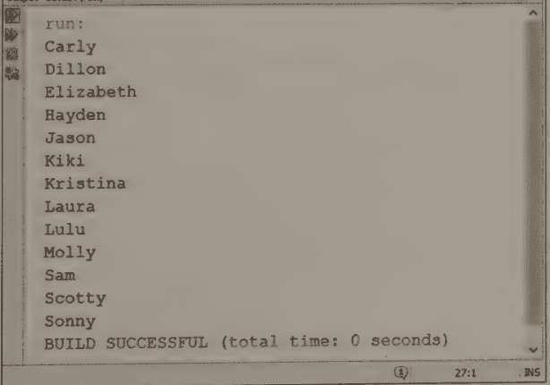

图 12.2 StringLister 程序的输出。

## 创建子类

为了看到继承的实际示例，在下一个项目中，你创建了一个名为 `Point3D` 的类，表示三维空间中的一个点。你可以用 `(x,y)` 坐标表示二维点。三维空间增加了第三个坐标，可以命名为 `z`。

`Point3D` 对象可以做三件事：

- 跟踪对象的 `(x,y,z)` 坐标
- 将对象移动到新的 `(x,y,z)` 坐标
- 按指定的 `x`、`y` 值量移动对象

Java 已经有一个表示二维点的标准类称为 `Point`。该类可以在 `java.awt` 包中找到。它有两个名为 `x` 和 `y` 的整数变量，存储 `Point` 对象的 `(x,y)` 位置。它还有一个 `move()` 方法将点放置在指定位置，以及一个 `translate()` 方法按 `x` 和 `y` 的量移动对象。

在 NetBeans 的 `java24` 项目中，在 `com.java24hours` 包中创建一个名为 `Point3D` 的新 Java File，并输入 Listing 12.2 的文本。完成后保存。

### LISTING 12.2 Point3D.java 的完整文本

```
1: package com.java24hours;
2:
3: import java.awt.*;
4:
5: class Point3D extends Point {
6:     public int z;
7:
8:     public Point3D(int x, int y, int z) {
9:         super(x,y);
10:        this.z = z;
11:    }
12:
13:    public void move(int x, int y, int z) {
14:        this.z = z;
15:        this.z = z;
16:    }
17:
18:    public void translate(int x, int y) {
19:        this.z += x;
20:        super.translate(x, y);
21:    }
}
```

---

### 练习题

2. 你可以使用什么方法来检索数组列表（array list）中的元素？

- A. `get()`
- B. `read()`
- C. `elementAt()`

3. 你可以使用哪种语句来引用当前对象的的方法和变量？

- A. `this`
- B. `that`
- C. `theOther`

### 答案

- 1. B. 因为你可以重写该方法，所以不需要更改子类的任何方面或其工作方式。
- 2. A. `get()` 方法有一个参数——元素的索引号。
- 3. A. `this` 关键字指向它所出现的对象。

### 活动

如果你丰富的想象力催生了你学习更多知识的渴望，可以通过活动获得更多关于继承的知识：

- 创建一个 `Point4D` 类，在 `Point3D` 类创建的 `(x,y,z)` 坐标系中添加一个 `t` 坐标。`t` 坐标代表时间，因此你需要确保它不会被设置为负值。
- 选取橄榄球进攻组的成员：锋锋员、外接手、紧端卫、跑卫和四分卫。设计一个表示这些球员技能的类层次结构，将共同特征放在层次结构中的较高位置。例如，拦截（blocking）可能应该是被锋锋员类和紧端卫类继承的行为，而速度（speed）应该是被外接手和跑卫继承的内容。

如需查看实现这些活动的 Java 程序，请访问书籍网站 www.java24hours.com。

# 第 13 小时：在数据结构中存储对象

## 本节待办事项

- 创建一个数组列表（array list）。
- 从列表中添加和删除项。
- 使用泛型（generics）来提高列表的可靠性。
- 在列表中搜索对象。
- 遍历列表内容。
- 创建一个键值对哈希映射（hash map）。
- 从映射中添加和删除项。
- 检索映射条目（entry）的键和值。
- 遍历映射的键和值。

程序员是收集者。

在计算机编程中，你会花费大量时间收集信息并寻找存储它们的地方。信息可以以原始数据类型（如 `float`）的形式存在，也可以以特定类的对象形式存在。它可以从驱动器读取、从服务器检索、由用户输入，或通过其他手段收集。

获取信息后，你必须在程序运行 Java 虚拟机（JVM）期间决定将它们放在何处。数据类型或类相关的项可以存储在数组中。

这对于许多用途来说已经足够了，但随着你的程序复杂性增加，你作为收集者的需求也会增加。


# 在本小时中，你将学习 Java 中两个专门为信息收集者设计的类：数组列表（array lists）和哈希映射（hash maps）。

## 数组列表

在第 9 小时“使用数组存储信息”中，你学习了数组，它在程序中处理一组变量和对象非常有用。数组对于 Java 来说至关重要，以至于它是像整数和字符一样的内置数据类型。数组将相同类型或类的元素打包在一起。

尽管数组有用，但它们受限于数组大小不可改变的事实。一旦创建一个容纳 90 个元素的数组，它就无法被更改以容纳更多或更少的内容。（这种说法的高级写法是数组的大小是“不可变的”（immutable））。

在 `java.util` 包中有一个类可以完成数组能做的一切，且没有那个限制：`ArrayList`。

数组列表是一种持有相同类或公共父类类的对象的数据结构。在程序运行期间，列表可以根据需要增长或缩小。

创建数组列表简单的方法是调用其不带参数的构造函数：

```java
ArrayList<Object> servants = new ArrayList();
```

可以通过指定初始容量（capacity）来创建数组列表，这为列表可能包含的元素数量提供了指导。容量作为整数参数传递给构造函数，如下设置数组列表容量为 30 的语句所示：

```java
ArrayList<Object> servants = new ArrayList(30);
```

尽管这看起来很像创建一个数组并确定其精确大小，但容量只是一个提示。如果超过了容量，数组列表将相应调整并继续正常运行。你对容量的估算越准确，程序在运行时列表的效率就越高。

列表持有属于相同类或共享父类的对象。

当你创建一个数组列表时，你知道该列表旨在要持有的类或父类。这可以在构造函数的 `< >` 符号中指定，这是 Java 的一项称为泛型（generics）的特性。以下是针对持有 `String` 对象的列表改进后的构造函数：

```java
ArrayList<String> servants = new ArrayList<String>();
```

该语句创建了一个 `String` 对象的数组列表。只有该类或其父类可以存储在列表中。否则，编译器会检测到错误。

要添加元素，调用数组列表的 `add(Object)` 方法并将该对象作为参数。以下是添加五个字符串的语句：

```java
servants.add("Bates");
servants.add("Anna");
servants.add("Thomas");
servants.add("Mrs. O'Brien");
servants.add("Daisy");
```

每个元素都被添加到列表的末尾，`servants` 中的第一个字符串是 "Bates"，最后一个是 "Daisy"。

有一个相应的 `remove(Object)` 方法，可以将对象从列表中移出：

```java
servants.remove("Mrs. O'Brien");
```

数组列表的大小是它持有的元素数量。通过调用 `size()` 方法获取此值：

```java
int servantCount = servants.size();
```

当你使用泛型指定类后，可以简单地使用 `for` 循环进行遍历：

```java
for (String servant : servants) {
    System.out.println(servant);
}
```

可以通过指定位置作为 `remove(int)` 的参数来从列表中删除元素：

```java
servants.remove(4);
```

在项目之前，你已经看到数组列表（array lists）如何存储字符串。它们也可以存储 `Point` 或任何其他类的对象。此语句创建了一个点列表：

```java
ArrayList<Point> targets = new ArrayList<Point>();
```

Java 编译器不允许将 `Point` 或其子类以外的任何类添加到数组列表中。

在 NetBeans 或另一个编程工具中，创建一个名为 `Battlepoint` 的 Java 文件，并将 `com.java24hours` 指定为其包名。将列表 13.1 的文本输入到文件中。

### 列表 13.1 Battlepoint.java 的全文

```java
package com.java24hours;

import java.awt.*;
import java.util.*;

public class Battlepoint {
    ArrayList<Point> targets = new ArrayList<Point>();

    public Battlepoint() {
        // 创建用于射击的目标
        createTargets();
        // 显示游戏地图
        showMap();
        // 射击三个点
        shoot(7,4);
        shoot(3,3);
        shoot(9,2);

        // 再次显示地图
        showMap();
    }

    private void showMap() {
        System.out.println("\n 1 2 3 4 5 6 7 8 9*");
        for (int column = 1; column < 10; column++) {
            for (int row = 1; row < 10; row++) {
                if (row == 1) {
                    System.out.print(" " + column + " *");
                }
                System.out.print("* ");
                Point cell = new Point(row, column);
                if (targets.indexOf(cell) > -1) {
                    // 此位置有一个目标
                    System.out.print("*X*");
                } else {
                    // 此处没有目标
                    System.out.print(".");
                }
                System.out.print(" ");
            }
            System.out.println();
        }
        System.out.println();
    }

    private void createTargets() {
        Point p1 = new Point(5,9);
        targets.add(p1);
        Point p2 = new Point(4,5);
        targets.add(p2);
        Point p3 = new Point(9,2);
        targets.add(p3);
    }

    private void shoot(int x, int y) {
        Point shot = new Point(x,y);
        System.out.print("Firing at (" + x + "," + y + ")");
        if (targets.indexOf(shot) > -1) {
            System.out.println("you sank my battlepoint!");
            // 删除被毁的目标
            targets.remove(shot);
        } else {
            System.out.println("miss.");
        }
    }

    public static void main(String[] arguments) {
        new Battlepoint();
    }
}
```

Battlepoint 中的注释描述了构造函数的每个部分以及程序中条件逻辑的重要部分。

应用程序创建了三个 `Point` 对象作为目标并将它们添加到数组中（第 45–52 行）。显示了一个包含这些目标的地图（第 22–43 行）。

接下来，通过调用 `shoot(int, int)` 方法对三个点进行射击（第 54–64 行）。每次，应用程序都会报告射击是否击中了目标之一。如果命中，该目标将从数组列表中移除。

最后，地图再次显示，应用程序终止。

输出如图 13.1 所示。

**图 13.1** 将 `Point` 对象放入数组列表并对其进行射击。

三个目标显示在图 13.1 上方的地图中。一个目标在被命中后被移除。输出中底部的地图反映了这一变化。

当目标被射击命中时，通过调用以射击点作为参数的 `remove(Object)` 方法将其从 `targets` 数组列表中移除。

## 哈希映射

> **注意**
>
> 在 Battlepoint 应用程序的 `shoot()` 方法中，从数组列表中移除的 `Point` 对象是代表射击点的。它与被击中的目标具有相同的 (x,y) 坐标。

使用一个信息来访问另一个信息的能力在编程中很常见。在数据结构中，数组列表是这种用法最简单的示例，它使用索引号从列表中检索一个对象。这是一个从 `aristocrats` 数组列表中提取第一个字符串的示例：

```java
String first = aristocrats.get(0);
```

数组也使用索引号检索数组中的每个项。

哈希映射（Hash maps）是 Java 中的一种数据结构，使用一个对象来检索另一个对象。第一个对象是键（key），第二个对象是值（value）。这种结构通过 `java.util` 包中的 `HashMap` 类实现。

该名称指的是键映射到值的方式。这种结构化数据的一个例子是电话联系列表。人的名字（字符串）可以用于检索人的电话号码。

通过调用不带参数的构造函数可以创建一个哈希映射：

```java
HashMap phonebook = new HashMap();
```

在新的哈希映射中，可以指定两个参数来控制其效率：初始容量（initial capacity）和负载因子（load factor）。这些通过两个参数设置，第一个是容量，第二个是负载因子：

```java
HashMap phonebook = new HashMap(30, 0.7F);
```

容量是存储哈希映射值的桶的数量。负载因子是在容量自动增加之前可以使用的桶的数量。该值是一个从 0 到 1（满）的浮点数，因此 0.7 意味着桶填充了 70%，容量将会增加。默认容量为 16，负载因子为 .75，这些是足够的。

应该使用泛型（Generics）来指示键和值的类。在示例中，它们位于 `<` 和 `>` 之间，并用逗号分隔：

```java
HashMap<String, Long> phonebook = new HashMap<>();
```

```java
public static void main(String[] arguments) {
    new FontMapper();
}
```

FontMapper 程序在第 8–10 行创建了三个 `Font` 对象，并在第 12–14 行将它们添加到一个名为 `fonts` 的哈希映射中。它们以描述字体用途的字符串作为键存储在映射中："smallprint"、"body" 和 "headline"。

第 15–20 行中的 `for` 循环通过使用条目集（entry set）和集合中的每个单独条目来遍历哈希表。

应用程序的输出显示在图 13.2 中。

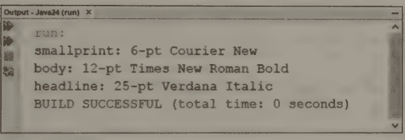

**图 13.2** 哈希表中存储 Font 对象。

## 总结

列表（Array lists）和哈希映射（Hash maps）是 `java.util` 包中两个非常有用的数据结构。

`ArrayList` 类扩展了数组的功能，使其能够克服该数据类型的固定大小限制。哈希映射允许使用任何对象作为键来检索值。

此外还有位集（`BitSet` 类），它们持有 0 和 1 的位值；栈（`Stack`），它是一种类似于 `ArrayList` 的后进先出数据集合；已排序数据结构 `TreeMap` 和 `TreeSet`；以及属性（`Properties`），这是一种特殊的哈希映射，用于在文件或另一个永久存储位置存储程序的配置属性。

## 工作坊

### 问与答

- **Q.** 类被同步（synchronized）意味着什么？

- **A.** 同步是 Java 虚拟机确保对象的其他用户能够以一致且准确的方式访问对象的实例变量和方法的方法。

  当你学习第 15 小时“创建多线程程序”中学习线程时，这个概念将变得更有意义。Java 程序可以被设计为同时执行多项任务。每个任务都存放在它自己的线程中。

  当多个线程访问同一个对象时，该对象在每个线程中的行为保持一致至关重要。因此，当类的方法需要同步时（如 `vector` 和 `hashtable` 所示），Java 虚拟机必须更加努力，并可能会遇到导致线程停止运行的错误。

  `ArrayList` 和哈希映射复制了 `vector` 和 `hashtable` 的功能，因为需要不需要同步的数据结构。结果是它们的运行效率高得多。

- **Q.** 华盛将军队（Washington Generals）曾经击败过哈姆环球者（Harlem Globetters）吗？

- **A.** 在过去的十年里，将军队曾击败环球者七次，最近一次是在 1971 年。在田纳西州的马丁比赛中，将军队凭借队主路易·“红”克洛茨（Louis "Red" Klotz）的一次投篮以 100–99 获胜。

  尽管将军队今天以弱旅闻名，但他们于 1921 年作为费城斯法斯队（Philadelphia Sphas）成立，那是一支在东部和美国篮球联赛中比赛的正规球队。Sphas（南费城希伯太人协会的缩写）赢得了 10 次冠军。克洛茨曾是 Sphas 的球员，他在 1952 年买下了球队并将其更名为将军队，当时他们成为了哈姆林那个著名球队的永久巡演伙伴。

  1971 年的胜利结束了环球者长达 2,495 场的胜绩。

### 测验

以下问题将测试你掌握了多少关于数据结构的知识。

1. 下列哪项在创建后不能增加或缩小大小？

   - A. 列表 (Array lists)
   - B. 数组 (Arrays)
   - C. 哈希映射 (Hash maps)

要查看实现这些活动的 Java 程序，请访问书籍的网站 www.java24hours.com。

# 第 14 小时：处理程序中的错误

本节待办事项列表：

- 学习为什么错误被称为异常（exceptions）。
- 在你的 Java 程序中响应异常。
- 创建忽略异常的方法。
- 创建可能导致异常的方法。
- 创建自己的异常。

错误（Errors）——漏洞、拼写错误等是程序开发的一部分，它们会导致程序停止。某些错误由编译器标记，另一些错误由解释器标记。Java 将错误分为两类：

- **异常（Exceptions）**：信号发生了异常情况，程序可以运行。
- **错误（Errors）**：信号解释器出现了问题。

通常错误是 Java 程序无法恢复的，因此不是本节的重点。你可能会遇到内存溢出错误（`OutOfMemoryError`），这意味着程序耗尽了内存。异常是 Java 程序可以处理的某种问题。

## 异常

虽然你现在才学习它们，但你可能在之前的章节已经熟悉了异常。异常通常在你编写成功的 Java 程序运行时出现。

例如，一个常见的错误是引用不存在的数组元素，如下：

```java
String[] greek = { "Alpha", "Beta", "Gamma" };
System.out.println(greek[3]);
```

数组有三个元素。第一个是 0，第二个是 1，第三个是 2。如果你尝试访问 3，虚拟机会由于以下内容停止：

### 输出

```
Exception in thread "main" java.lang.ArrayIndexOutOfBoundsException: Index 3 out of bounds for length 3
  at SampleProgram.main(4)
```

这个消息对于程序员来说是有信息的，但你并不希望用户看到。最好隐藏错误消息并处理它。

Java 程序可以使用 `try-catch` 块来处理自己的异常，其形式如下：

```java
try {
    // 可能导致异常的语句
} catch (Exception e) {
    // 发生异常时执行的操作
}
```

对于任何希望类方法处理的异常，必须使用 `try-catch` 块。`catch` 语句中的异常对象应该是以下三者之一：

- 可能发生的异常的类
- 用竖线 `|` 字符分隔的多个异常类
- 可能发生的异常的父类

> **注意**
>
> 有两个术语用于描述这个过程：抛出（throw）和捕获（catch）。对象抛出异常以通知其他异常发生了。

所有异常都是 `Exception` 的子类。`ArrayIndexOutOfBoundsException` 报告了访问边界外的元素。

在运行应用程序之前，在 NetBeans 中将命令行参数设置为 `1 3 5`。选择运行主程序，你应该在图 14.1 中看到输出。

```
这些数字相加为 29.0
BUILD SUCCESSFUL (总耗时: 0 秒)
```

**图 14.1** 计算器程序的输出。

为了看到相关性，将命令行参数更改为 `1 3 5x`。


```
Exception in thread "main" java.lang.NumberFormatException: For input string: "5x" at sun.misc.FloatingDecimal.readJavaFormatString(FloatingDecimal.java:1241)
  at java.lang.Float.parseFloat(Float.java:452)
  at Calculator.main(Calculator.java:7)
Java Result: 1
```

`try-catch` 块中的 `try` 部分包含可能抛出异常的语句（或语句）。在 `Calculator` 应用程序中，列表 14.1 第 7 行对 `Float.parseFloat(String)` 方法的调用每当与无法转换为浮点数的字符串参数使用时，都会抛出 `NumberFormatException`。

为了改进 `Calculator` 应用程序使其不会因为此类错误而停止运行，你可以使用 `try-catch` 块。

在 `com.java24hours` 包中创建一个新的 Java 文件 `NewCalculator`，并输入列表 14.2 的文本内容。

## 列表 14.2 NewCalculator.java 的完整文本

```java
package com.java24hours;

public class NewCalculator {
    public static void main(String[] arguments) {
        float sum = 0;
        for (String argument : arguments) {
            try {
                sum = sum + Float.parseFloat(argument);
            } catch (NumberFormatException e) {
                System.out.println(argument + " * is not a number.");
            }
        }
        System.out.println("Those numbers add up to " + sum);
    }
}
```

保存应用程序后，自定义项目配置并使用命令行参数 `1 3 5x` 运行 `com.java24hours.NewCalculator`。你应该看到图 14.2 所示的输出。

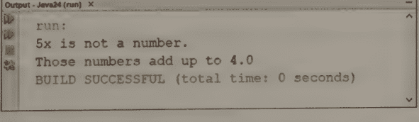

图 14.2

NewCalculator 应用程序的输出。

第 7–11 行的 `try-catch` 块处理由 `Float.parseFloat()` 抛出的 `NumberFormatException` 错误。这些异常在 `NewCalculator` 类内部被捕获：对于任何不是数字的参数都会显示错误消息。由于异常在类内部被处理，JVM 不显示错误。你通常可以使用 `try-catch` 块来处理与用户输入和其他意外数据相关的问题。

## 捕获多种不同的异常

`try-catch` 块可以用于处理多种不同类型的异常，即使它们是由不同的语句抛出的。

处理多类异常的方法是为每种异常分配一个 `catch` 块，如下代码所示：

```java
String textField = "35";
int value;
try {
    value = Integer.parseInt(textValue);
} catch (NumberFormatException exc) {
    // 处理异常 exc 的代码
} catch (ArithmeticException exc) {
    // 处理异常的代码
}
```

你也可以通过用 `|` 字符分隔异常并以异常变量名称结束列表，在同一个 `catch` 块中处理多个异常。这是一个示例：

```java
try {
    value = Integer.parseInt(textValue);
} catch (NumberFormatException | ArithmeticException exc) {
    // 处理异常的代码
}
```

如果捕获到 `NumberFormatException` 或 `ArithmeticException`，它将被赋值给 `exc` 变量。

列表 14.3 包含一个名为 `NumberDivider` 的应用程序，它接受两个整数命令行参数并用于整数除法表达式。

该应用程序必须能够处理用户输入中的两个潜在问题：

- 非整数参数
- 除以 0

在 `com.java24hours` 包中为 `NumberDivider` 创建一个新的 Java 文件，并将列表 14.3 的文本输入源文件编辑器中。

## 列表 14.3 NumberDivider.java 的完整文本

```java
1: package com.java24hours;
2:
3: public class NumberDivider {
4:     public static void main(String[] arguments) {
5:         if (arguments.length == 2) {
6:             int result = 0;
7:             try {
8:                 result = Integer.parseInt(arguments[0]) / 
9:                 Integer.parseInt(arguments[1]);
10:                System.out.println(arguments[0] + " divided by " + 
11:                    arguments[1] + " equals " + result);
12:            } catch (NumberFormatException e) {
13:                System.out.println("Both arguments must be integers.");
14:            } catch (ArithmeticException e) {
15:                System.out.println("You cannot divide by zero.");
16:            }
17:        }
18:    }
19: }
```

使用命令行参数指定两个参数，你可以使用整数、浮点数和非数字参数运行它。

列表 14.3 第 5 行的 `if` 语句检查确保向应用程序发送了两个参数。如果没有，程序将退出且不显示任何内容。

`NumberDivider` 应用程序执行整数除法，因此结果是整数。在整数除法中，5 除以 2 等于 2，而不是 2.5。

如果你使用浮点数或非数字参数，第 8–9 行将抛出 `NumberFormatException` 并被第 12 行捕获。

如果你使用整数作为第一个参数并将 0 作为第二个参数，则第 8–9 行将抛出 `ArithmeticException` 并被第 14 行捕获。

程序成功运行的一些示例输出如图 14.3 所示。


图 14.3

NumberDivider 应用程序的输出。

## 在异常后处理事务

当你使用 `try-catch` 处理异常时，有时你希望即使发生异常也要让程序执行某些操作。你可以使用 `try-catch-finally`，其格式如下：

```java
try {
    // 可能引起异常的语句
} catch (Exception e) {
    // 发生异常时的做法
} finally {
    // 无论如何执行的语句
}
```

`finally` 块中的语句无论是否发生异常都会执行。这在读写文件时有用：文件可能不存在、可能会发生错误等等。

## 抛出异常

当你调用另一个类的方法时，该类可以通过抛出异常来控制如何使用。当你使用类库时，编译器经常显示关于异常的消息。这是一个示例：

## 输出

```
NetReader.java:14: unreported exception java.net.MalformedURLException; must be caught or declared to throw
```

每当你看到异常“必须被捕获或声明抛出”时，这意味着你尝试使用的方法抛出了该异常。任何调用这些方法的类（例如你编写的应用程序）必须执行以下操作之一：

- 使用 `try-catch` 处理异常
- 抛出异常
- 使用 `try-catch` 处理异常然后抛出它

到目前为止，你已经了解了如何处理异常。如果你想在处理后抛出异常，可以使用 `throw` 语句后跟要抛出的异常对象。

以下语句在 `catch` 块中处理 `FormatException` 错误，然后抛出异常：

```java
float principal;
try {
    principal = Float.parseFloat(textValue) * 1.1F;
} catch (FormatException e) {
    System.out.println(arguments[0] + " * is not a number.");
    throw e;
}
```

这段重写的代码处理了所有在 `try` 块中生成的异常并将其抛出：

```java
float principal;
try {
    principal = Float.parseFloat(textValue) * 1.1F;
} catch (Exception e) {
    System.out.println("Error " + e.getMessage());
    throw e;
}
```

`Exception` 是所有异常类的父类。`catch` 语句会捕获该类及其在层次结构中的任何子类。

当你使用 `throw` 抛出异常时，通常意味着你还没有完成处理异常所需的工作。

这种情况下可能用的示例：考虑一个假设的 `CreditCardChecker` 应用程序，它是一个验证信用卡购买的应用程序。该应用程序使用一个名为 `Database` 的类，该类有以下职责：

1. 与信用卡贷款机构的计算机建立连接。
2. 询问该计算机客户的信用卡号是否有效。
3. 询问计算机客户是否有足够的额度进行购买。

# 196 小时 14: 处理程序中的错误

`Database` 类正在执行它的工作，但如果信用卡贷款机构的计算机对任何连接尝试都没有响应会发生什么？这种错误正是 `try` 块的设计初衷，它被在 `Database` 内部用于处理连接错误。

如果 `Database` 类自行处理这个错误，那么 `CreditCardChecker` 应用程序完全不知道异常的发生。这并不是一个好主意——应用程序应该知道何时无法建立连接，以便向使用应用程序的人报告此情况。

通知 `CreditCardChecker` 应用程序的一种方法是让 `Database` 在 `catch` 块中捕获异常，然后使用 `throw` 语句再次抛出。异常在 `Database` 中被抛出，随后它必须像处理任何其他异常一样处理它。

当你在捕获父类（如 `Exception`）的 `catch` 块中进行 `throw` 时，异常会抛出该类。这会丢失一些关于错误类型的细节，因为像 `NumberFormatException` 这样的子类比简单的 `Exception` 类能告诉你更多关于问题的信息。

Java 提供了一种方法来保留这些细节：`catch` 语句中的 `final` 关键字。

```java
try {
    principal = Float.parseFloat(loanText) * 1.1F;
} catch (final Exception e) {
    System.out.println("Error " + e.getMessage());
    throw e;
}
```

`catch` 中的那个 `final` 关键字导致 `throw` 的行为有所不同。它取决于被捕获的特定类。

## 忽略异常

本小时涵盖的下一个技术是完全忽略异常。类中的方法可以通过作为方法定义的一部分的 `throws` 子句来忽略异常。

以下方法会抛出一个 `MalformedURLException`，这是当我们在 Java 程序中处理网络地址时可能发生的错误：

```java
public void loadURL(String address) throws MalformedURLException {
    URL page = new URL(address);
    // 加载网页的代码
}
```

示例中的第二个语句创建了一个 `URL` 对象，该对象代表 Web 上的一个地址。`URL` 类的构造函数抛出 `MalformedURLException` 来表示使用了无效地址，因此无法构建对象。以下语句会在你尝试打开到该 URL 的连接时导致这些异常之一被抛出：

```java
URL source = new URL("http://www.java24hours.com");
```

## 抛出和捕获异常 197

字符串 `http://www.java24hours.com` 不是一个有效的 URL，因为它缺少了一些标点符号：冒号后的两个斜杠字符（//）。

由于 `loadURL()` 方法被声明为抛出 `MalformedURLException` 错误，它不需要在方法内部处理它们。捕获此异常的责任落到任何调用 `loadURL()` 方法的方法。

## 不需要 catch 的异常

尽管本小时展示了异常需要用 `try-catch` 捕获或用 `throws` 子句声明为要抛出，但存在一种例外。

Java 程序中可能发生的某些异常不需要以任何方式处理。当编译器检测到异常被忽略时，它不会立即停下来。这些异常被称为**未检查异常**（unchecked exceptions），而其他的被称为**检查异常**（checked exceptions）。

未检查异常是 `java` 包中 `RuntimeException` 的所有子类。未检查异常的一个常见例子是 `IndexOutOfBoundsException`，它表示用于访问数组、字符串或列表的索引不在其边界内。如果数组有五个元素，而你尝试读取第 10 个元素，就会发生此异常。

另一个是 `NullPointerException`，它发生在一个对象没有值被使用时。对象变量在赋值对象之前，其值为 `null`。某些方法在可以返回对象时会返回 `null`。如果一个语句错误地假设对象有一个值，就会发生 `NullPointerException`。

这两种错误都是程序员可以在代码中（也应该）防止的，而不是需要异常处理的东西。如果你编写了一个访问越界数组元素的程序，请修复代码并重新编译。

Java 中未检查异常的原理是它们可以通过良好的代码来防止，否则总是捕获它们会让程序变得复杂。当然，仅仅因为异常可以被忽略并不意味着它应该被忽略。

# 抛出和捕获异常

就像任何类一样，`HomePage` 必须在 `try-catch` 块中处理异常，或者声明为要抛出。

## 列表 14.4 HomePage 的文本

```java
1: package com.java4hours;
2:
3: import java.net.*;
4:
5: public class HomePage {
6:     String owner;
7:     URL address;
8:     String category = "none";
9:
10:    public HomePage(String inOwner, String inAddress)
11:        throws MalformedURLException
12:
13:        owner = inOwner;
14:        address = new URL(inAddress);
15:
16:    public HomePage(String inOwner, String inAddress, String inCategory)
17:        throws MalformedURLException
18:
19:        this(inOwner, inAddress);
20:        category = inCategory;
21: }
22: }
```

要创建一个使用 `HomePage` 类的应用程序，回到 NetBeans 在 `com.java4hours` 包中创建一个 Java 文件 `PageCatalog`，包含列表 14.5 的文本。

## 列表 14.5 PageCatalog.java 的文本


```java
1: package com.java4hours;
2:
3: import java.net.*;
4:
5: public class PageCatalog {
6:     public static void main(String[] arguments) {
7:         HomePage[] catalog = new HomePage[5];
8:
9:         try {
10:             catalog[0] = new HomePage("Mike Glyer",
11:                 "http://www.file70.com", "science fiction");
12:             catalog[1] = new HomePage("Shelley Powers",
13:                 "http://burningbird.net", "environment");
14:             catalog[2] = new HomePage("Rogers Cadenhead",
15:                 "http://workbench.cadenhead.org", "programming");
16:             catalog[3] = new HomePage("Taegan Goddard",
17:                 "https://politicalwire.com", "politics");
18:             catalog[4] = new HomePage("Manton Reese",
19:                 "www.manton.org");
20:             for (int i = 0; i < catalog.length; i++) {
21:                 System.out.println(catalog[i].owner + " -- " + 
22:                     catalog[i].address + " -- " + 
23:                     catalog[i].category);
24:             }
25:         }
26:         catch (MalformedURLException e) {
27:             System.out.println("Error: " + e.getMessage());
28:         }
29:    }
30: }
```

当你运行编译后的应用程序时，将显示图 14.4 所示的输出。

```
run:
Error: no protocol: manton.org
BUILD SUCCESSFUL (total time: 0 seconds)
```

图 14.4 PageCatalog 程序的错误输出。

## 第 14 小节：处理程序中的错误

`PageCatalog` 应用程序创建一个 `HomePage` 对象的数组，然后显示该数组的内容。每个 `HomePage` 对象的创建最多可使用三个参数：

- 页面所有者的名称
- 页面地址（字符串类型，而不是 URL）
- 页面分类

第三个参数是可选的，并且在第 17–18 行中没有被使用。

`HomePage` 类的构造函数在接收无法转换为有效 `URL` 对象的字符串时会抛出 `MalformedURLException` 错误。`PageCatalog` 应用程序通过使用 `try-catch` 块来处理这些异常。

要修复导致“no protocol”错误的问题，请编辑第 18 行，使字符串以文本 `http://` 开头，就像第 9–16 行中的其他地址一样。运行程序时，你会看到图 14.5 所示的输出。

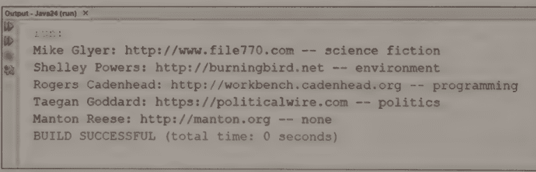

图 14.5 PageCatalog 应用程序修正后的输出。

## 总结

现在你已经学会了 Java 的异常处理技术，关于错误的主题应该比在本小节开始时更流行一点了。

你可以利用这些技术做很多事情：

- 捕获异常并处理它。
- 忽略异常，将其交给另一个类或 Java 虚拟机来处理。
- 在同一个 `try-catch` 块中捕获多个不同的异常。
- 抛出你自己的异常。

在 Java 程序中管理异常可以使程序更可靠、更多功能且更容易使用，因为你不会向运行软件的人显示任何晦涩的错误信息。

## 工作坊

### 问答

**可以创建你自己的异常吗？**

A. 不仅是可能的，而且是一个非常棒的主意。为可能出现的问题创建自定义异常可以使你的类更加健壮。你可以通过将它们创建为现有异常（例如所有异常的父类 `Exception`）的子类来轻松地创建自己的异常。在 `Exception` 的子类中，你可能想要重写两个构造函数：无参数的 `Exception()` 和带有参数的 `Exception(String s)`。在后者中，字符串应该是描述已发生错误的消息。

**为什么这一小节除了异常外，没有涵盖如何抛出和捕获错误？**

A. Java 将问题分为错误（Errors）和异常（Exceptions），因为它们的严重程度不同。异常的程度较轻，因此它们应该是你在程序中使用 `try-catch` 或在方法声明中使用 `throws` 来处理。另一方面，错误更严重，无法在你的程序中得到妥善处理。这些错误的两个例子是栈溢出和内存溢出。这些错误会导致 JVM 崩溃，而且由于 JVM 正在运行程序，你无法在自己的程序中修复它们。

**报纸上仍在连载的最老漫画条是什么？**

A. 《Katzenjammer》，它由 Rudolph Dirks 于 1897 年创建，今天仍由 King Features Syndicate 提供。该漫画在第一部使用对话气泡的漫画《小黄孩》（The Yellow Kid）出现两年后开始创作。

一位美国德国移民受其家乡儿童故事的启发，创作了反叛儿童 Hans 和 Fritz。他在 1912 年因为合同纠纷退出了该漫画，由 Harold Knerr 接手，后者一直编写并绘制到 1949 年。之后又有五位漫画家创作过。Eisman 在 1986 年到 2006 年间编写并绘制它。从以后该漫画开始重印。

“Katzenjammer”这个词在德语中的字面意思是“猫的哀嚎”，但它更多地用来描述宿醉。

## 测验

尽管这一小节充满了错误，但看看你能否在不犯任何错误的情况下回答以下关于错误的问题。

1. 单个 `catch` 语句可以处理多少异常？

   A. 仅一个。
   B. 多个不同的异常。
   C. 此处故意留空。

2. `finally` 块中的语句何时执行？

   A. 在 `try-catch` 块因异常结束结束后
   B. 在 `try-catch` 块在未发生异常的情况下结束后
   C. A 和 B 都是

3. 考虑到所有的异常，`finally` 块的作用是什么？

   A. 捕获异常。
   B. 确保代码无论是否抛出异常都会运行。
   C. 终止程序。

## 答案

1. A
2. C
3. B

## 活动

为了在实践中观察异常的工作，请尝试以下操作：

- 修改程序以抛出并捕获特定的异常。
- 创建一个自定义异常类并使用它。
- 使用 `finally` 块确保资源被正确关闭。

为了支持 `Runnable` 接口，在创建类时使用了 `implements` 关键字，例如此例：

```java
public class LoadStocks implements Runnable {
    // body of the class
}
```

当类实现一个接口时，表示该类除了自身的方法外还包含一些额外的行为。

实现 `Runnable` 接口的类必须包含 `run()` 方法，其结构如下：

```java
public void run() {
    // body of the method
}
```

`run()` 方法应该处理线程创建是为了完成的任务。在股票市场示例中，`run()` 方法可以包含从磁盘加载数据并根据这些数据编译统计信息的语句。

当运行多线程应用程序时，其 `run()` 中的语句不会自动执行。在 Java 中可以启动和停止线程，但在你完成以下两项操作之前，线程不会开始运行：

- 通过调用 `Thread` 构造函数创建线程类对象
- 通过调用其 `start()` 方法启动线程

`Thread` 构造函数接受一个参数：包含线程 `run()` 方法的对象。通常情况下，你使用 `this` 关键字作为参数，这表示当前类包含了 `run()` 方法。

列表 15.1 包含一个 Java 程序，它可以寻找前一百万个质数，并将它们存储在 `StringBuilder` 中。当找到所有质数时，将会显示它们。在 NetBeans 中，在 `com.java24hours` 包中创建一个名为 `PrimeFinder` 的新 Java 文件，将列表中的文本输入文件，并等待——不要忘记保存。

## 列表 15.1 PrimeFinder.java 的全文

```java
1: package com.java24hours;
2:
3: public class PrimeFinder implements Runnable {
4:     Thread go;
5:     StringBuilder primes = new StringBuilder();
6:     int time = 0;
7:
8:     public PrimeFinder() {
9:         start();
10:        while (primes != null) {
11:            System.out.println(time);
12:            try {
13:                Thread.sleep(1000);
14:            } catch (InterruptedException exc) {
15:                // do nothing
16:            }
17:            time++;
18:        }
19:    }
20:
21:    public void start() {
22:        if (go == null) {
23:            go = new Thread(this);
24:            go.start();
25:        }
26:    }
27:
28:    public void run() {
29:        int quantity = 1_000_000;
30:        int numPrimes = 0;
31:        // candidate: the number that might be prime
32:        int candidate = 2;
33:        primes.append("\nFirst ").append(quantity).append(" primes:\n\n");
34:        while (numPrimes < quantity) {
35:            if (isPrime(candidate)) {
36:                primes.append(" ");
37:                numPrimes++;
38:            }
39:            candidate++;
40:        }
41:        System.out.println(primes);
42:        primes = null;
43:        System.out.println("\ntime elapsed: " + time + " seconds");
44:    }
45:
46:    public static boolean isPrime(int checkNumber) {
47:        double root = Math.sqrt(checkNumber);
48:        for (int i = 2; i <= root; i++) {
49:            if (checkNumber % i == 0) {
50:                return false;
51:            }
        }
        return true;
    }
52:
53:    public static void main(String[] args) {
54:        new PrimeFinder();
55:    }
56: }
```

寻找一百万个质数是一项耗时任务，非常适合在 Java 中拥有自己的线程运行。当线程在后台工作时，`PrimeFinder` 程序会显示已过去了多少秒。线程通过显示质数来结束。输出的开头如图 15.1 所示。


图 15.1 PrimeFinder 程序的输出。

该程序中的大多数语句用于寻找质数。以下语句用于在此程序中实现线程：

## 第十五节：创建多线程程序

- 第 3 行——`Runnable` 接口应用于 `PrimeFinder` 类。
- 第 4 行——创建了一个名为 `go` 的 `Thread` 对象，但没有为其赋值。
- 第 22–25 行——如果 `go` 对象的值为 `null`，则表示尚未创建线程；创建一个新的 `Thread` 对象并存储在变量中。通过调用 `start()` 方法启动线程，这会导致调用 `PrimeFinder` 类的 `run()` 方法。
- 第 28–44 行——`run()` 方法从 2 开始寻找质数，通过调用 `append()` 方法将每个质数存储在缓冲区中。

当创建 `PrimeFinder` 对象时，`main()` 方法中有某些内容来开始程序的执行。语句如下：

```java
new PrimeFinder();
```

通常情况下，你会预期看到该对象被赋值给变量，例如：

```java
PrimeFinder frame = new PrimeFinder();
```

然而，因为不需要再次引用该对象，所以将其存储在变量中是没有必要的。在 Java 中，一种良好的编程习惯是只有在创建后需要这些对象时才将其存储在变量中。`PrimeFinder` 程序对 `StringBuilder` 对象的 `append` 方法进行了操作。调用 `append()` 后是换行和另一个 `append()` 调用。这导致文本按顺序追加。这是可能的，因为调用 `append()` 会返回该缓冲区，然后可以再次调用。

## 线程操作

你可以通过调用其 `start()` 方法来启动线程，这可能会让你认为还有一个 `stop()` 方法可以使其停止。尽管 Java 在 `Thread` 类中包含一个 `stop()` 方法，但它已经被废弃。

> **注意** 听从废弃警告是一个好主意。Oracle 已经废弃 `stop()` 方法，因为它可能会给运行在 JVM 中的其他线程带来问题。该类的 `resume()` 和 `suspend()` 方法也被废弃了。下一个项目将展示如何停止线程。该程序在网站标题列表和访问地址之间循环。每个页面的标题和网址在连续循环中显示。用户可以通过点击应用程序图形界面上的按钮来访问当前显示的站点。该程序运行一段时间，显示有关每个网站的信息。由于这个元素的存在，线程是控制程序的最佳方式。

## 类声明

在此程序中你需要做的第一件事是导入 `java.awt`、`java.io`、`java.net`、`java.awt.event` 和 `javax.swing` 包中的类。需要这么多包是因为该项目使用了 Swing，这是一组用于支持 Java 图形界面的包。在使用 `import` 使某些类可用后，可以使用以下语句开始程序：

```java
public class LinkRotator extends JFrame
    implements Runnable, ActionListener {
```

该语句创建 `LinkRotator` 类作为 `JFrame` 类的子类，这是一个简单的图形界面。该语句还表示两个接口：`Runnable` 和 `ActionListener`。通过实现 `Runnable` 类，你能够在程序中使用 `run()` 方法使线程运行。`ActionListener` 接口使程序响应鼠标点击。

## 设置变量

`LinkRotator` 中要做的第一件事是创建类的变量和对象。创建一个名为 `pageTitle` 的六元素 `String` 对象数组和一个名为 `pageLink` 的六元素对象数组：

```java
String[] pageTitle = new String[6];
URI[] pageLink = new URI[6];
```

`pageTitle` 数组持有显示的网站标题。`URI` 对象存储网址的值。`URI` 具有跟踪网址所需的行为和属性。

最后要创建的是整数变量、一个 `Thread` 对象和一个界面标签：

```java
int current = 0;
Thread runner;
JLabel siteLabel = new JLabel();
```

`current` 变量跟踪显示哪个站点，以便你可以在网站之间循环。`Thread` 对象 `runner` 代表程序运行的线程。当你启动、停止和暂停程序操作时会调用 `runner` 对象的方法。

## 构造函数

程序的构造函数在程序运行时会自动执行。该方法用于给 `pageTitle` 和 `pageLink` 数组赋值。它还用于创建一个出现在用户界面上的可点击按钮。该方法包含以下语句：


```java
pageTitle = new String[] {
    "Oracle's Java site",
    "Server Side",
    "JavaWorld",
    "Java in 24 Hours",
    "Same Publishing",
    "Workbench"
}
pLink[0] = getURI("http://www.oracle.com/technet/java");
pLink[1] = getURI("http://www.theserverside.com");
pLink[2] = getURI("http://www.javoworld.com");
pLink[3] = getURI("http://www.java24hours.com");
pLink[4] = getURI("http://www.sampublishing.com");
pLink[5] = getURI("http://www.workbench.cadenhagen.org");
}
 = new Button("Visit Site");
visitButton.addActionListener(this);
add(visitButton);
```

`init()` 方法的最后三个语句创建一个标记为“Visit Site”的按钮并将其添加到应用程序的框架中。

## 设置 URL 时捕获错误

当你设置 URI 对象时，必须确保用于设置地址的文本是有效格式：`http://workbench.cadenhead.org` 和 `http://www.samspublishing.com` 是有效的格式，但 `http://www.java` 将是不有效的，因为在冒号后面缺少了两个斜杠字符 (`//`)。

`getURI(String)` 方法接受网络地址作为参数，返回一个表示该地址的 URI 对象。如果字符串不是有效地址，该方法将返回 `null`：

```java
URI getURI(String urlText) {
    URI pageURI = null;
    try {
        pageURI = new URI(urlText);
    } catch (URISyntaxException m) {
        // do nothing
    }
    return pageURI;
}
```

try-catch 块处理创建 URI 对象时发生的任何 `URISyntaxException` 错误。因为抛出此异常时不需要执行任何操作，因此 catch 块只包含一条注释。

## 启动线程

在这个程序中，`runner` 在调用其 `start()` 方法时启动。

`start()` 方法是在构造函数的最后一条语句被调用的。以下是该方法：

```java
public void start() {
    if (runner == null) {
        runner = new Thread(this);
        runner.start();
    }
}
```

如果 `runner` 尚未启动，此方法将启动 `runner` 线程。

语句 `runner = new Thread(this)` 创建了一个带有一个参数（`this` 关键字）的新 `Thread` 对象。该关键字指向程序本身，将其指定为在线程运行的类。

调用 `runner.start()` 会导致线程开始运行。当线程开始时，该线程的 `run()` 方法会被调用。由于 `runner` 线程是 `LinkRotator` 应用本身，因此会调用应用程序的 `run()` 方法。

## 运行线程

`run()` 方法是线程执行主要工作的地方。在 `LinkRotator` 程序中，以下代表了 `run()` 方法：

```java
public void run() {
    Thread thisThread = Thread.currentThread();
    while (runner == thisThread) {
        current++;
        if (current > 5) {
            current = 0;
        }
        siteLabel.setText(pageTitle[current]);
        repaint();
        try {
            Thread.sleep(1000);
        } catch (InterruptedException e) {
            // do nothing
        }
    }
}
```

`run()` 方法中发生的第一件事是创建一个名为 `thisThread` 的 `Thread` 对象。`Thread` 类的方法 `currentThread()` 设置了 `thisThread` 对象的值。`current` 变量跟踪正在运行的线程。

该方法中的所有语句都是一个 while 循环的一部分，比较 `runner` 对象和 `thisThread` 对象。两个对象都是线程，只要它们引用同一个对象，while 循环就会继续。循环内部没有语句会导致 `runner` 和 `thisThread` 对象具有不同的值，除非循环外部更改了其中一个 `Thread` 对象。

`run()` 方法调用 `repaint()`。接下来，`current` 的值增加 1，如果 `current` 超过 5，则将其设置为 0。`current` 变量用于确定显示哪个网站的信息。它是 `pageTitle` 字符串数组的索引，标题是 `siteLabel` 界面。

`run()` 方法包含了另一个处理错误的 try-catch 块。`Thread.sleep(1000)` 语句会导致线程暂停 1 秒，时间足够用户阅读网站的名称和地址。catch 语句处理在 `Thread.sleep()` 语句执行期间可能发生的 `InterruptedException` 错误。

## 处理点击

`LinkRotator` 程序最后处理的内容是事件处理——检测用户输入。每当用户点击 Visit Site 按钮时，应用程序应该用网络浏览器打开显示的网站。这是通过 `ActionListener` 接口要求的 `actionPerformed()` 方法完成的。当按钮被点击时，该方法就会被调用。

以下是 `LinkRotator` 的 `actionPerformed()` 方法：

```java
public void actionPerformed(ActionEvent event) {
    Desktop desktop = Desktop.getDesktop();
    if (pageLink[current] != null) {
        try {
            desktop.browse(pageLink[current]);
            runner = null;
            System.exit(0);
        } catch (IOException exc) {
            // do nothing
        }
    }
}
```

此方法的第一件事是创建一个 `Desktop` 对象。`java.awt` 包中的 `Desktop` 类代表运行应用程序的桌面环境。有了这个对象，你可以使用它通过 "mailto:" 链接启动电子邮件客户端，打印文件并让 Java 外部程序执行任务。

这里，使用 `Desktop` 对象用计算机默认的网络浏览器打开网页。如果 `pageLink[current]` 是有效地址，`browse(URI)` 方法请求浏览器加载该页面。

## 显示循环链接

你现在准备好创建并测试程序了。在 `com.java24hours` 包中创建一个名为 `LinkRotator` 的 Java 文件，并输入列表 15.2 中的文本。

### 列表 15.2 LinkRotator.java 的完整文本

```java
package com.java24hours;

import java.awt.*;
import java.awt.event.*;
import java.io.*;
import java.net.*;
import javax.swing.*;

public class LinkRotator implements Runnable {
    private Thread runner;
    private int current = 0;
    private JLabel siteLabel;
    private String[] pageTitle;
    private String[] pageLink;

    public LinkRotator() {
        setDefaultCloseOperation(JFrame.EXIT_ON_CLOSE);
        setSize(300, 100);
        FlowLayout flo = new FlowLayout();
        setLayout(flo);
        siteLabel = new JLabel("");
        add(siteLabel);
        JButton visitButton = new JButton("Visit Site");
        visitButton.addActionListener(this);
        setVisible(true);

        pageTitle = new String[] {
            "Oracle's Java",
            "Server Side",
            "JavaWorld",
            "Java 24 Hours",
            "Sams Publishing",
            "Workbench"
        };
        pageLink = new String[] {
            "http://www.oracle.com/java/java",
            "http://www.serverside.com",
            "http://www.javaworld.com",
            "http://www.java24hours.com",
            "http://www.samsplishing.com",
            "http://workbench.cadenhead.org"
        };
        start();
    }

    private URI getURI(String urlText) {
        URI pageURI = null;
        try {
            pageURI = new URI(urlText);
        } catch (URISyntaxException ex) {
            // do nothing
        }
        return pageURI;
    }

    public void start() {
        if (runner == null) {
            runner = new Thread(this);
            runner.start();
        }
    }

    public void run() {
        Thread thisThread = Thread.currentThread();
        while (runner == thisThread) {
            current++;
            if (current > 5) {
                current = 0;
            }
            siteLabel.setText(pageTitle[current]);
            repaint();
            try {
                Thread.sleep(2000);
            } catch (InterruptedException exc) {
                // do nothing
            }
        }
    }

    public void actionPerformed(ActionEvent event) {
        Desktop desktop = Desktop.getDesktop();
        if (pageLink[current] != null) {
            try {
                desktop.browse(pageLink[current]);
                runner = null;
                System.exit(0);
            } catch (IOException exc) {
                // do nothing
            }
        }
    }

    public static void main(String[] arguments) {
        new LinkRotator();
    }
}
```

图 15.2 显示了计算机桌面上打开了两个窗口。较小的窗口（用矩形显示）是正在运行的 `LinkRotator` 应用程序。后面较大的窗口是该程序可以打开的链接之一：本书书出版社 Sams 的网页。

## 停止线程

`LinkRotator` 并没有停止线程的方法，但它的设计方式使得这种操作变得简单。这里有一种可以调用以结束线程执行的方法：

```java
public void stop() {
    if (runner == null) {
        runner = null;
    }
}
```

`if` 语句检查 `runner` 对象是否等于 `null`。如果是，说明没有需要停止的活动线程。否则，该语句将 `runner` 设置为 `null`。

将 `runner` 对象设置为 `null` 值会导致它的值与 `thisThread` 对象不同。当这种情况发生时，`run()` 方法内部的 `while` 循环停止运行。


图 15.2：在应用程序中显示旋转链接。

## 工作坊 217

## 注意

### 总结

线程是一个强大的概念，在 Java 中通过少量的类和接口实现。通过在程序中支持多线程，你可以让程序响应速度更快，并加快任务执行的速度。

## 注意

即使你这一小时没有学到任何其他东西，你现在也有了一个新术语来描述你快节奏、多任务处理的 21 世纪生活方式。试着用几句话看看它是否符合你的胃口：

- “伙计，昨天在我们处理完那系列酒店后，我真的是在‘多线程’。”
- “我整个午饭都在‘多线程’，这让我有点累。”
- “今晚不行，亲爱的，我在‘多线程’。”

## 工作坊

### 问答

**Q.** 在 catch 语句中什么都不做有理由吗？就像 `LinkRotator` 应用程序在捕获到异常时那样？

**A.** 这取决于所捕获的错误或异常类型。在 `LinkRotator` 应用程序中，你通过 `catch` 语句知道异常的原因，所以可以确定什么都不做是合适的。在 `getURI()` 方法中，只有发送的 URI 无效时才会捕获到 `URISyntaxException`。

另一个可能在 `catch` 块中不需要操作的异常是 `InterruptedException`。在我作为 Java 程序员的 20 多年里，我从未见过程序抛出这种异常。

大多数异常确实需要记录错误。

**Q.** 唱过《My Future's So Bright, Gotta Wear Shades》的那支乐队后来怎么样了？

**A.** 他们的未来并不光明。Timbuk3 是一个由丈夫 Pat 和妻子 Barbara K. MacDonald 组成的乐队，在在那首于 1986 年进入单曲榜前 20 名列的热门单曲后，他们再也没有出过另一首热门单曲。他们在 1986 年到 1995 年间制作了六张专辑，随后在那一年他们解散了乐队并办理了离婚。


Pat MacDonald 继续以自己的名义进行表演并发布专辑，也与其他人合作以 Purgatory Hill 和 Legendary Sons of Crack Daniels 的名义活动。他还为 Cher、Peter Frampton、Night Ranger、Aerosmith 以及其他音乐家写过歌。

Barbara Kooyman 以 Barbara K 的身份表演，并拥有几张专辑，其中一张重新诠释了 Timbuktu 3 的歌曲。她还成立了艺术家言论自由慈善机构 Artists for Media Diversity。

他们最为人知的歌曲被广泛认为是关于未来的积极信息，但本意是讽刺的。乐队表示，光明的未来实际上是迫在眉睫的核浩灭。

## 测验

放下你的“线程”（Java 意义上的，而不是指内裤意义上的），并回答以下关于 Java 的问题。

1. 程序要使用线程必须实现哪个接口？

   A. `Runnable`

   B. `Thread`

   C. 不需要任何接口

2. 如果一个接口包含三个不同的方法，那么实现该接口的类必须包含其中的几个方法？

   A. 一个都不包含。

   B. 全部包含。

   C. 我知道，但不告诉你。

3. 你正在赞叹另一个程序员的作品，他创建了一个可以处理四个并行任务的程序。你应该告诉他什么？

   A. “我花一美元就买它。”


# 答案

- 1. A. `Runnable` 必须与 `implements` 语句一起使用。`Thread` 用于多线程程序内部，但在启动程序的类语句中不需要。

- 2. B. 接口保证了该类包含了接口的所有方法。

- 3. C. 如果那个程序员穿得很得体，这个赞美可能会引起困惑，但老实说，那种概率有多大呢？

## 活动

如果这一小时的内容还没有让你感到“精疲力竭”（threadbare），请通过以下活动扩展你的技能：

- 创建 `LinkRotator` 应用程序的新版本，并包含六个你最喜欢的网站。

- 为 `PrimeFinder` 应用程序添加第二个线程，用于寻找前一百万个不能被 3 整除的数字。只有在两个线程都完成工作后才停止时间计数器。

要查看实现这些活动的 Java 程序，请访问书籍网站 `www.java24hours.com`。

# 第 16 小时：使用内部类和闭包

## 本小时的任务

- 向对象中添加一个内部类。
- 探索为什么内部类很有用。
- 创建一个匿名内部类。
- 在接口上使用适配器类。
- 编写 lambda 表达式。
- 用 lambda 表达式替换匿名内部类。

当 Java 在 1995 年发布时，其功能范围有限。由于当时没有其他技术可以实现，Java 引起了巨大的轰动并迅速被成千上万的程序员采用。从那时起，每个新版本都在支持现有开发者的同时扩展功能。

最令人兴奋的编写代码的新方法是闭包，即 lambda 表达式。这些表达式使得函数式编程成为可能。

在本小时中，在学习 lambda 表达式之前，将先涵盖两个前提知识：内部类和匿名内部类。

## 内部类

在 Java 中创建一个类时，你定义了类的属性和行为。属性是持有数据的类和实例变量。行为是处理这些数据的方法。

一个类也可以包含一个类：内部类。你可能会疑惑这是否有必要，因为很容易创建多个类来构建程序。如果你正在编写一个 `CheckBook` 程序，需要为写的每张支票创建一个对象，你会创建一个 `Check` 类。如果程序支持每月定期支付，添加一个 `Autopayment` 类。

内部类并非必须。但当你了解它们能做的所有事情时，你会发现在很多情况下它们非常方便。

Java 包含内部类的三个原因是：

1. 当一个辅助类只被另一个类使用时，将其定义在该类内部是有意义的。
2. 它们允许辅助类访问其作为独立类时无法访问的私有方法和变量。
3. 它们将辅助类尽可能地放置在另一个类中使用它的地方。

内部类使用 `class` 关键字创建，与其他任何类一样，但它是声明在包含类内部的。通常放在类变量和实例变量一起。

这是一个在 `Simple` 类内部创建名为 `InnerSimple` 的内部类的示例：

```java
public class Simple {
    class InnerSimple {
        InnerSimple() {
            System.out.println("I am an inner class!");
        }
    }
    public Simple() {
    }
    public static void main(String[] arguments) {
        Simple program = new Simple();
    }
}
```

```java
Simple.InnerSimple inner = program.new InnerSimple();
```

内部类的结构与任何其他类相同，放置在外部类的 `{` 和 `}` 括号内。

创建内部类需要一个外部类的对象。在对象上调用 `new` 操作符：

```java
Simple.InnerSimple inner = program.new InnerSimple();
```

类的名称包含了外部类的名称、一个点号 (`.`) 字符以及内部类的名称。在前面的语句中，`Simple.InnerSimple` 就是该名称。

本小时第一个项目是重写第 14 小时的应用程序“程序中的错误处理”。该节的 `PageCatalog` 需要一个名为 `HomePage` 的辅助类。列表 16.1 中的 `Catalog` 应用程序修订了该项目，用内部类替换了单独的类。

在 `com.java24hours` 包中创建一个名为 `Catalog` 的新 Java 文件；然后用列表 16.1 中的源代码填充它。

### 列表 16.1 Catalog.java 的全文

```java
package com.java24hours;

import java.net.*;

public class Catalog {
    class HomePage {
        String owner;
        URL address;
        String category = "none";

        public HomePage(String inOwner, String inAddress)
                throws MalformedURLException {
            owner = inOwner;
            address = new URL(inAddress);
        }

        public HomePage(String inOwner, String inAddress, String inCategory)
                throws MalformedURLException {
            this(inOwner, inAddress);
            category = inCategory;
        }
    }

    public Catalog() {
        Catalog.HomePage[] catalog = new Catalog.HomePage[5];
        try {
            catalog[0] = new HomePage("Mike Gyler",
                    "http://www.file770.com", "science fiction");
            catalog[1] = new HomePage("Shelley Powers",
                    "http://burningbird.net", "environment");
            catalog[2] = new HomePage("Rogers Cadenhead",
                    "http://workbench.cadenhead.org", "programming");
            catalog[3] = new HomePage("Taegan Goddard",
                    "https://politicalwire.com", "politics");
            catalog[4] = new HomePage("Manton Reese",
                    "http://manton.org");
            for (int i = 0; i < catalog.length; i++) {
                System.out.println(catalog[i].owner + ": " +
                        catalog[i].address + " - " +
                        catalog[i].category);
            }
        } catch (MalformedURLException e) {
            System.out.println("Error: " + e.getMessage());
        }
    }

    public static void main(String[] arguments) {
        new Catalog();
    }
}
```

内部类定义在第 6–24 行。它有两个构造函数：一个从第 11 行开始，接收网站和站点 URI 的构造函数；另一个从第 18 行开始，接收站点所有者、URI 和类别的构造函数。

`Catalog` 类在第 27 行使用了这个内部类，创建了 `HomePage` 对象的数组。该内部类被称为 `Catalog.HomePage`。

应用程序的输出如图 16.1 所示。

**图 16.1 Catalog 应用程序的输出**

```text
Mike Glyer: http://www.file770.com -- science fiction
Shelley Powers: http://burningbird.net -- environment
Rogers Cadenhead: http://workbench.cadenhead.org -- programming
Taegan Goddard: https://politicalwire.com -- politics
Manton Reese: http://manton.org -- none
```

## 匿名类

在 Java 编程中，你执行的一个常见任务是创建一个使用一次且目的简单的类。一种特殊的内部类非常适合此目的。

匿名内部类是指没有名称并同时声明和创建的类。要使用它，你将对象的引用替换为 `new` 关键字、对构造函数的调用以及 `{ }` 内部的类定义。以下是一些没有使用匿名类的代码：

```java
WorkerClass worker = new WorkerClass();
Thread main = new Thread(worker);
main.start();
```

假设 `worker` 对象实现了 `Runnable` 接口并可以作为线程运行。

## 闭包

下一节介绍了多年来最受期待的语言特性：闭包。

闭包也称为 lambda 表达式，允许在满足其他条件的情况下，仅通过一个 `->` 运算符就可以创建一个只有一个方法的对象。

这里有一个示例：

```java
Runnable runner = () -> { System.out.println("Run!"); };
```

这一行代码创建了一个实现 `Runnable` 接口的对象，并使其 `run()` 方法等同于以下代码：

```java
void run() {
    System.out.println("Run!");
}
```

在 lambda 表达式中，箭头运算符 `->` 右侧的语句变成了实现接口的方法。

只有当接口有一个需要实现的方法时这才可行，例如 `Runnable`，它只包含 `run()`。Java 中只有一个方法的接口现在被称为函数式接口（functional interface）。

lambda 表达式在箭头运算符左侧也有内容。在第一个示例中，它是一对空括号，指的是发送给函数式接口方法的参数。由于 `Runnable` 接口中的 `run()` 不接受参数，因此表达式中不需要任何参数。

这是第二个 lambda 表达式示例，它在括号中放置了内容：

```java
ActionListener al = (ActionEvent act) -> {
    System.out.println(act.getSource());
};
```

这等同于 `java.awt.event` 包中实现 `ActionListener` 接口的对象的代码：

```java
public void actionPerformed(ActionEvent act) {
    System.out.println(act.getSource());
}
```

`ActionListener` 接口接收动作事件，例如用户点击按钮时。函数式接口中唯一的方法是 `actionPerformed(ActionEvent)`。参数是一个 `ActionEvent` 对象，用于描述触发事件的用户动作。

lambda 表达式的右半部分将 `actionPerformed()` 方法定义为单条语句，显示触发事件的用户界面组件的信息。

表达式的左半部分声明一个名为 `act` 的 `ActionEvent` 对象是该方法的参数。

该对象 `act` 使用在方法体内部。对 `act` 的左侧引用似乎在方法右侧实现的作用范围之外。这是因为闭包允许代码引用该变量作用范围之外另一个方法的变量。

正如你所看到的，lambda 表达式的一个效果是缩短了代码。一个表达式就创建了一个对象并实现了一个接口。

Java 的这一特性可以通过语言对目标类型（target typing）的支持使代码变得更短。

在 lambda 表达式中，可以推断发送给方法的单个或多个参数的类型。考虑最后一个例子。由于 `ActionListener` 函数式接口有一个接受 `ActionEvent` 对象作为其唯一参数的方法，因此可以省略该类名的名称。

这里是考虑了此点的修改后的 lambda 表达式版本：

```java
ActionListener al = (act) -> {
    System.out.println(act.getSource());
};
```

你接下来创建的两个程序将更具体地演示向 Java 引入闭包带来的差异。

列表 16.3 中的 `ColorFrame` 显示了三个用于更改框架颜色的按钮。该版本的应用程序使用匿名内部类而非 lambda 表达式来监控用户对三个按钮的点击。

在 NetBeans 中于 `com.java24hours` 包下创建一个名为 `ColorFrame` 的新程序。完成后，将列表 16.3 的文本输入文件并保存。

### 列表 16.3 ColorFrame.java 的全文

```java
package com.java24hours;

import java.awt.*;
import java.awt.event.*;
import javax.swing.*;

public class ColorFrame extends JFrame {
    JButton red, green, blue;

    public ColorFrame() {
        super("ColorFrame");
        setSize(322, 122);
        setDefaultCloseOperation(JFrame.EXIT_ON_CLOSE);
        FlowLayout flo = new FlowLayout();
        setLayout(flo);
        red = new JButton("Red");
        add(red);
        green = new JButton("Green");
        add(green);
        blue = new JButton("Blue");
        add(blue);

        ActionListener listener = new ActionListener() {
            public void actionPerformed(ActionEvent event) {
                if (event.getSource() == red) {
                    getContentPane().setBackground(Color.RED);
                }
                if (event.getSource() == green) {
                    getContentPane().setBackground(Color.GREEN);
                }
                if (event.getSource() == blue) {
                    getContentPane().setBackground(Color.BLUE);
                }
            }
        };
        red.addActionListener(listener);
        green.addActionListener(listener);
        blue.addActionListener(listener);
        setVisible(true);
    }

    public static void main(String[] arguments) {
        new ColorFrame();
    }
}
```

## 总结

内部类、匿名内部类和 Lambda 表达式是 Java 语言中学习起来最复杂的部分。它们主要吸引那些已经使用该语言编写了一段时间程序的程序员，他们可以利用强大的特性用更少的代码实现更多功能。

但在你达到编写 lambda 表达式的水平之前，你应该能够从使用内部类和匿名内部类中获益。

非匿名内部类的结构类似于一个单独的辅助类，但它被放置在另一个类的内部，与实例变量、类变量、实例方法和类方法并列。与辅助类不同，它可以访问其被创建的那个类的私有变量和方法。

匿名内部类消除了为仅使用一次的类分配对象的需要，例如附着到 Swing 用户界面组件上的事件监听器。


Lambda 表达式在外观上具有欺骗性的相似，只需要一个新的箭头运算符 `->` 即可创建。但它们让 Java 程序员能够实现的功能影响是巨大的。具有其他语言经验的程序员多年来一直渴望这种功能。

## 工作坊

### 问答

**问：匿名内部类很困惑。我必须在我的程序中使用它们吗？**

**答：** 不需要。与 Java 语言其他复杂特性一样，如果你能通过其他方式完成工作，就不必使用它们。但无论如何你应该学习它们，因为你可能会在 Java 代码中遇到它们。当你查看经验丰富的程序员编写的 Java 程序时，通常会同时发现内部类和匿名内部类。所以，即使你还没有准备好自己创建它们，学习它们是什么以及如何工作也是值得的。

**问：Hatfield 家族和 McCoy 家族还在斗争吗？**

**答：** 西弗吉尼亚州和肯塔基州的这两个家族在臭名昭著的 35 年冲突中最后一次伤亡发生 126 年后，关系良好。1979 年，Hatfield 和 McCoy 家族聚在一起参加了一周的电视游戏节目《家庭斗争》。舞台上养了一只猪并奖励给获胜的家庭。2003 年，这两个家族在肯塔基州派克维尔达成了正式和平协议。

**问：目标类型可以推断任何函数式接口方法参数的类型吗？**

**答：** 目标类型可以推断任何函数式接口方法参数的类型。

## 活动

为了圆满完成这一小时的学习，请通过以下活动让学习主题投入用场：

- 重写第 15 节“创建线程程序”中的 `LinkRotator` 类，使用 lambda 表达式作为事件监听器。
- 为 `NewColorFrame` 应用程序添加第四种背景颜色 `Color.YELLOW`。

要查看实现这些活动的 Java 程序，请访问书籍网站 www.java24hours.com。

# 第 17 节：构建简单的用户界面

本节的任务列表：

- 创建用户界面组件（如按钮）。
- 创建标签、文本字段和其他组件。
- 将组件组合在一起。
- 将组件放在其他组件内部。
- 对组件进行水平和垂直滚动。
- 打开和关闭窗口。

在这个小时里，事情会变得非常“棘手”。你用 Java 创建第一个图形用户界面（GUI）时会制造出一大乱子。

计算机用户已经习惯于软件具有 GUI、从鼠标获取用户输入并像其他程序一样运行工作。尽管某些用户仍然在 Linux 或 Unix Shell 等命令行环境中工作，但大多数人会对不提供像 Microsoft Windows 或 Mac OS 那种点点、拖拽式图形界面的软件感到困惑。

Java 通过 Swing 支持这种软件，Swing 是一系列 Java 类的集合，代表了所有可以作为 GUI 部分的不同按钮、文本字段、滑块和其他组件，以及用于从这些组件获取用户输入所需的类。

在本节和下一节中，你将在 Java 中创建并组织 GUI。之后，在第 19 节“响应用户输入”中，你将让这些界面能够接收鼠标点击和其他用户输入。

## Swing 和抽象窗口工具包

由于 Java 是一种跨平台语言，允许你为许多操作系统编写程序，因此它的图形用户界面软件必须是灵活的。它不能仅仅迎合 Windows 风格或 Mac 版本，它必须处理两者以及其他平台。

使用 Java，程序用户界面的开发基于 Swing 和一组早名为抽象窗口工具包（Abstract Windowing Toolkit）的早期类。这些类允许你创建 GUI 并接收用户的输入。

Swing 包含了编写使用 GUI 的程序所需的所有内容。通过 Java 的用户界面类，你可以创建一个包含以下所有内容的 GUI：

- 按钮、复选框、标签和其他简单组件
- 文本字段、滑块和其他更复杂的组件
- 下拉菜单和弹出菜单
- 窗口、框架、对话框、面板和 applet 窗口

> **注意**
>
> Swing 包含了几十种组件，其自定义方式远比文档所记录的要多。本书涵盖了最常用的组件及其最有用的方法。在接下来的四个小时中探索它们时，你可以学习更多关于每个组件的信息，并在 Oracle 官方 Java 类库文档中发现新方法。你可以在网页上阅读：`http://download.java.net/jdk9/docs/api`。它提供了 Java 9 中每个类和接口的额外参考文档。

## 使用组件

在 Java 中，GUI 的每个部分都由 Swing 包中的一个类表示。有一个用于按钮的 `JButton` 类，用于窗口的 `Window` 类，用于文本字段的 `JTextField` 类，此类此类。

要创建并显示界面，你需要创建对象，设置它们的变量并调用它们的方法。这些技术与你接触过的面向对象编程（OOP）是相同的。

当你组装 GUI 时，你处理两类对象：组件和容器。组件是用户界面中的单个元素，例如按钮。容器是你可以用来持有其他组件的组件。

创建界面的第一步是创建一个可以容纳组件的容器。在应用程序中，这个容器通常是一个窗口或框架。

### 窗口和框架

窗口和框架是可以在其中显示并持有其他组件的容器。窗口是简单的容器，没有标题栏或顶部的任何其他按钮。框架是窗口，包含了用户在运行软件时期望的所有窗口功能——例如关闭、扩展和缩小窗口的按钮。

你使用 Swing 的 `JWindow` 和 `JFrame` 类创建这些容器。要在 Java 程序中使用 Swing 类而不使用完整的包类名，请使用以下语句：

```java
import javax.swing.*;
```

这只导入了 `javax.swing` 包中的类名。你还会用到其他包。

在 Java 应用程序中使用框架的方法是让应用程序成为 `JFrame` 的子类。你的程序继承了作为框架运行的行为。以下语句创建了 `JFrame` 的子类：

```java
import javax.swing.*;

public class MainFrame extends JFrame {
    public MainFrame() {
        // 设置框架
    }
}
```

该类创建了框架但没有完全设置它。在框架构造函数中，创建框架时必须执行几件事：

- 调用父类 `JFrame` 的构造函数。
- 设置框架的标题。
- 设置框架的大小。
- 设置框架的外观和感觉。
- 定义用户关闭框架时发生的情况。

你还必须让框架可见，除非出于某些原因它在应用程序开始运行时不应该显示。

大多数这些内容可以在框架构造函数中处理。该方法的第一件事必须包含对 `JFrame` 的一个构造函数的调用，使用 `super` 语句。例如：

```java
super();
```

上述语句调用了无参数的 `JFrame` 构造函数。你也可以带有框架标题作为参数来调用它：

```java
super("Main Frame");
```

此方法将框架的标题设置为指定的字符串，标题出现在顶部边缘的标题栏中。在示例中，显示了文本 "Main Frame"。

如果你不通过这种方式设置标题，可以调用框架的 `setTitle(String)` 方法并将标题作为参数传递：

```java
setTitle("Main Frame");
```

可以通过调用其 `setSize(int, int)` 方法来确定框架的大小，该方法接受两个参数：宽度和高度。以下语句设置了一个宽度为 350 像素、高度为 125 像素的框架：

```java
setSize(350, 125);
```

设置框架大小的另一种方法是向其填充组件，然后调用框架的（不带参数的） `pack()` 方法：

```java
pack();
```

`pack()` 方法会将框架的大小调整为恰好容纳框架中每个组件的偏好尺寸（但不会更大）。每个界面都有一个偏好尺寸，尽管取决于组件在界面内部的排列方式，这种尺寸有时会被忽略。在调用 `pack()` 之前，你不需要显式地设置框架的大小——该方法会在框架显示之前将其设置为合适的大小。

每个框架在显示时，标题栏上都有一个用于关闭框架的按钮。在 Windows 系统中，此按钮显示为框架右上角的 "X"。要定义点击此按钮时发生什么，请调用框架的 `setDefaultCloseOperation(int)` 方法，并将 `JFrame` 类的四个变量之一作为参数：

- `EXIT_ON_CLOSE`——点击按钮时退出程序。
- `DISPOSE_ON_CLOSE`——关闭框架并保持应用程序运行。
- `DO_NOTHING_ON_CLOSE`——保持框架打开并继续运行。
- `HIDE_ON_CLOSE`——关闭框架并继续运行。

第一种调用是最常见的，因为当应用程序的用户界面关闭时，应用程序应该完成其工作并关闭：

```java
setDefaultCloseOperation(JFrame.EXIT_ON_CLOSE);
```

使用 Swing 创建的图形用户界面可以通过“外观和感觉”（look and feel）来定制其外观，这是一种视觉主题，控制着按钮和其他组件的外观方式以及它们的运行方式。

Java 包含了一种名为 Nimbus 的增强型外观和感觉，必须启用它才能作为类来使用。设置外观和感觉是通过调用主 `Swing` 包中 `UIManager` 类的 `setLookAndFeel()` 方法来实现的。

该方法接受一个参数：外观和感觉类的全名。

以下语句将 Nimbus 设置为外观和感觉：

```java
UIManager.setLookAndFeel(
  "javax.swing.plaf.nimbus.NimbusLookAndFeel"
);
```

要使框架可见，还需要最后一步。调用其 `setVisible()` 方法并将 `true` 作为参数传递：

```java
setVisible(true);
```

这将按照定义的宽度和高度打开框架。你也可以传递 `false` 从而停止显示框架。

列表 17.1 包含了本节描述的源代码。在 `com.java24hours` 包中名为 `SalutonFrame` 的 Java 文件中，输入这些语句。

### 列表 17.1 SalutonFrame.java 的完整文本

```java
1: package com.java24hours;
2: 
3: import javax.swing.*;
4: 
5: public class SalutonFrame extends JFrame {
6:   public SalutonFrame() {
7:     super("Saluton mundo!");
8:     setLookAndFeel();
9: 
10:    setSize(450, 200);
11:    setDefaultCloseOperation(JFrame.EXIT_ON_CLOSE);
12:    setVisible(true);
13:  }
14:  private void setLookAndFeel() {
15:   try {
16:     UIManager.setLookAndFeel(
17:       "javax.swing.plaf.nimbus.NimbusLookAndFeel"
18:     );
19:   } catch (Exception ex) {
20:     // ignore error
21:   }
22:  }
23: 
24: public static void main(String[] arguments) {
25:   SalutonFrame frame = new SalutonFrame();
26:  }
27: }
```

列表 17.1 的第 24–26 行包含一个 `main()` 方法，该方法将此框架类转换为应用程序。当你运行该类时，你会看到图 17.1 所示的框架。


图 17.1：在应用程序中显示框架。

`SalutonFrame` 显示的唯一是标题：程序员传统的问候语“Salutton mundo!”该框架是一个空窗口，因为它尚未包含任何其他组件。

要向框架添加组件，你必须创建组件并将其添加到容器中。每个容器都有一个 `add()` 方法，该方法接受一个参数：要显示的组件。

`SalutonFrame` 类包含一个 `setLookAndFeel()` 方法，用于将 Nimbus 指定为框架的外观和感觉。在第 16–18 行中调用 `UIManager` 类的 `setLookAndFeel()` 方法来实现此。

对此方法的调用放置在 `try-catch` 块中，以便处理可能发生的错误。

调用 `UIManager.setLookAndFeel()` 会设置 GUI 的外观和感觉。任何可能因此产生的错误都会被处理。

### 标签和文本字段

`JLabel` 组件显示用户无法修改的信息。这些信息可以是文本、图形或二者兼有。这些组件通常用于为界面中的其他组件标记标签，因此得有了这个名字。它们通常用于标识文本字段。

`JTextField` 组件是用户可以输入单行文本的区域。你可以在创建文本字段时设置文本框的宽度。

以下语句创建了一个 `JLabel` 组件和组件 `JTextField` 组件，并将它们添加到容器中：

```java
JLabel pageLabel = new JLabel("Web page address: ", JLabel.RIGHT);
JTextField pageAddress = new JTextField(20);
FlowLayout flo = new FlowLayout();
setLayout(flo);
add(pageLabel);
add(pageAddress);
```

图 17.3 显示了该标签和文本字段并排。示例中的两个语句都使用了一个参数来配置组件的外观。


图 17.3：显示标签和文本字段。

`pageLabel` 设置了文本 "Web page address:" 并带有一个 `JLabel.RIGHT` 参数。最后这个值表示标签应该右对齐。`JLabel.LEFT` 将标签文本左对齐，而 `JLabel.CENTER` 则让其居中。与 `JTextField` 一起使用的参数表示文本字段的宽度约为 20 个字符。你也可以通过类似下面的语句指定在文本字段中显示的默认文本：

```java
JTextField country = new JTextField("Togolese Republic", 29);
```

该语句将创建一个宽度为 20 个字符且字段内带有 "Togolese Republic" 的 `JTextField` 对象。

你可以使用 `getText()` 方法获取对象包含的文本，该方法返回一个字符串：

```java
String countryChoice = country.getText();
```

正如你可能猜到的那样，你也可以使用相应的方法设置文本：

```java
country.setText("Separate Customs Territory of Taiwan, Pengh, Kinmen, and Matsu");
```

这会将文本设置为“中国台北”的官方名称，它是世界上最长的国家名称，险胜了第二名：大不列颠北爱尔兰联合王国。

### 复选框

`JCheckBox` 组件是文本行旁的一个框，用户可以对其勾选或取消。以下语句创建了一个 `JCheckBox` 对象并将其添加到容器中：

```java
JCheckBox jumboSize = new JCheckBox("Jumbo Size");
FlowLayout flo = new FlowLayout();
setLayout(flo);
add(jumboSize);
```

`JCheckBox()` 构造函数的参数表示显示在框旁边的文本。如果你想让框处于被选中状态，请使用以下语句：

```java
JCheckBox jumboSize = new JCheckBox("Jumbo Size", true);
```

你可以单独展示一个 `JCheckBox`，也可以作为一个组的一部分。在复选框组中，一次只能有一个被勾选。要使一个 `JCheckBox` 对象成为组的一部分，你必须创建一个 `ButtonGroup` 对象。考虑以下代码：

```java
JCheckBox frogLegs = new JCheckBox("Prog Grande", true);
JCheckBox fishTacos = new JCheckBox("Fish Taco Platter", false);
JCheckBox emuNuggets = new JCheckBox("Emu Nuggets", false);
FlowLayout flo = new FlowLayout();
ButtonGroup meals = new ButtonGroup();
meals.add(frogLegs);
meals.add(fishTacos);
meals.add(emuNuggets);
setLayout(flo);
add(jumboSize);
add(frogLegs);
add(fishTacos);
add(emuNuggets);
```

这创建了三个复选框，它们都组在 `ButtonGroup meals` 对象下。

Frog Leg Grande 框最初是被勾选的，但如果用户勾选了其他餐食框，Frog Leg Grande 旁边的勾就会自动消失。图 17.4 显示了该部分的不同框。


图 17.4：显示复选框组件。

### 下拉框

`JComboBox` 是一个选项的弹出列表，也可以设置为接收文本输入。当两个选项都启用时，你可以用鼠标选择项目，也可以用键盘输入文本。下拉框的作用与复选框组类似，不同之处在于除非显示弹出列表，否则只有一个选项是可见的。

要创建一个 `JComboBox` 对象，你必须在创建对象后添加每个选项，如如下例所示：


```java
JComboBox profession = new JComboBox();
FlowLayout flo = new FlowLayout();
profession.addItem("Butcher");
profession.addItem("Candlestick maker");
profession.addItem("Fletcher");
profession.addItem("Fighter");
profession.addItem("Technical writer");
setLayout(flo);
add(profession);
```

# 第 17 节：构建简单的用户界面

此示例创建了一个单一的 `JComboBox` 组件，提供了六个选项，用户从中进行选择。当选中其中一个时，它会出现在组件的显示区域中。

图 17.5 显示了该示例在弹出选项列表显示时。

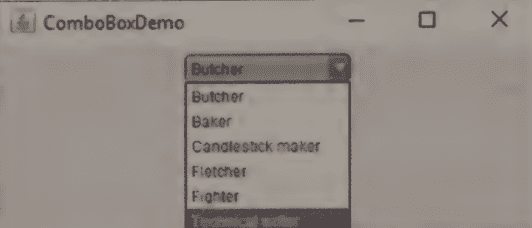

图 17.5：显示下拉框组件。

要让 `JComboBox` 组件接收文本输入，你必须调用其 `setEditable(boolean)` 方法并传入 `true` 参数：

`profession.setEditable(true);`

你必须在组件添加到容器之前调用此方法。

## 文本区域

`JTextArea` 组件是一个允许用户输入多行文本的文本字段。以下语句创建了一个宽度为 40 个字符、高度为 8 行的 `JTextArea` 组件并将其添加到容器中：

```java
JTextArea comments = new JTextArea(8, 40);
FlowLayout flo = new FlowLayout();
setLayout(flo);
add(comments);
```

图 17.6 在框架中显示了此示例。

## 面板

本小时介绍的最后一个组件是面板，它是使用 Swing 中的 `JPanel` 类创建的。`JPanel` 对象是用户界面中最简单的容器。`JPanel` 的目的是将显示区域划分为不同的组件组。当显示区域被分成若干部分时，你可以在每个部分使用不同的布局管理器。

以下语句创建了一个 `JPanel` 对象并将其分配给布局管理器：

```java
JPanel topRow = new JPanel();
FlowLayout flo = new FlowLayout();
topRow.setLayout(flo);
add(topRow);
```

在安排界面组件时，经常会使用面板，正如你在第 18 节“布局用户界面”中所看到的那样。

通过调用面板的 `add()` 方法向面板添加组件。可以通过调用其 `setLayout()` 方法直接为面板分配布局管理器。

当你需要在界面中的某个区域绘制某些内容（例如来自图形文件的图像）时，也可以使用面板。

`JPanel` 的另一个方便的用途是创建可以添加到其他类中的自定义组件。这在本节课的最后一个项目中得到了演示。

## 创建你自己的组件

面向对象编程的一个优势是可以在不同项目中复用类。在接下来的项目中，你将创建一个特殊的面板组件，该组件可以在其他 Java 程序中复用。该组件 `FreeSpacePanel` 报告运行应用程序的计算机上的可用磁盘空间。面板显示可用空间量、总空间以及可用空间的百分比。

创建你自己的用户界面组件的第一步是决定从哪个现有组件继承。你的新组件将拥有所有现有的属性和行为，除非你对其进行修改或添加新内容。

`FreeSpacePanel` 组件是在列表 17.3 中定义的 `JPanel` 的子类。将列表 17.3 中的文本输入到新的空 Java 文件并保存该文件。

### 列表 17.3 FreeSpacePanel.java 的全文

```java
1: package com.java24hours;
2:
3: import java.io.IOException;
4: import java.nio.file.*;
5: import javax.swing.*;
6: public class FreeSpacePanel extends JPanel {
7:   JLabel spaceLabel = new JLabel("Disk space:");
8:   JLabel space = new JLabel();
9:
10:  public FreeSpacePanel() {
11:    super();
12:    add(spaceLabel);
13:    add(space);
14:    try {
15:      getValue();
16:    } catch (IOException ioe) {
17:      space.setText("Error");
18:    }
19:  }
20:
21:  private final void getValue() throws IOException {
22:    // get the current file store
23:    Path current = Paths.get("");
24:    FileStore store = Files.getFileStore(current);
25:    // find the free space pool
26:    long totalSpace = store.getTotalSpace();
27:   long freeSpace = store.getUsableSpace();
28:    // get this as a percentage (with two digits)
29:    double percent = (double)freeSpace / (double)totalSpace * 100;
30:    percent = (int)percent;
31:    // set the label's text
32:    space.setText(freeSpace + " free out of " + totalSpace + " (" + percent + "%%)");
33:  }
34:  // ... (rest of the code)
35: }
```

当你想要显示有关可用磁盘空间的信息时，该类是可以添加到任何图形用户界面面的组件。它不能作为应用程序独立运行。

`FreeSpacePanel` 中的 `getValue()` 方法设置显示磁盘空间信息的标签文本。该方法在第 21 行声明时带有 `final` 关键字：

```java
private final void getValue() {
  // ...
}
```

在声明中包含 `final` 关键字可以防止方法在子类中被重写。这是 `FreeSpacePanel` 作为一个 GUI 组件所要求的。

面板在第 10–19 行的构造函数创建。发生了以下操作：

- 第 11 行——`super()` 方法调用 `JPanel` 类的构造函数，确保它被正确初始化。
- 第 12 行——新的 `spaceLabel`（文本为 "Disk space:"，在第 7 行作为实例变量创建）通过将标签作为参数调用 `add(Component)` 被添加到面板。
- 第 13 行——`space` 标签（第 8 行创建的无文本实例变量）也被添加到面板。
- 第 15 行——调用 `getValue()` 方法，该方法设置了 `space` 标签的文本。

第 15 行对 `getValue()` 的调用包含在另一个 `try-catch` 块中，类似于设置外观时使用的那种。你将在第 18 节中学习更多关于如何处理错误的知识，但这里是 TLDR：`try-catch` 使得处理 Java 程序部分可能发生的一个或多个错误成为可能。

这是必要的，因为当访问计算机文件系统以查看包含多少可用空间时，`getValue()` 可能会导致错误。该错误在 Java 中有自己的类 `IOException`，表示输入输出错误。

`try` 块包含了可能引起错误的代码。`catch` 块在括号内识别遇到的错误类型，以及当发生该错误时要执行的代码。

如果在应用程序运行时遇到此类错误，第 17 行会将 `space` 标签的文本设置为 "Error"，以让用户知道出了问题。

> **注意**
>
> 缩写 TLDR 的意思是 "too long; didn't read"（太长了，没读），它出现在互联网上，当人们对长文章提供极简摘要时。

## 使用组件

在将刚创建的面板添加到图形界面之前，你是无法看到它的。为了尝试 `FreeSpacePanel`，请按照列表 17.4 所示，在 `com.java24hours` 包中创建 `FreeSpaceFrame` 。为名为 `FreeSpaceFrame` 的类创建一个新的文本文件。

### 列表 17.4 FreeSpaceFrame.java 的全文

```java
1: package com.java24hours;
2:
3: import java.awt.*;
4: import javax.swing.*;
5:
6: public class FreeSpaceFrame extends JFrame {
7:     public FreeSpaceFrame() {
8:         setTitle("Disk Free Space");
9:         setLookAndFeel();
10:         setSize(500, 120);
11:         setDefaultCloseOperation(JFrame.EXIT_ON_CLOSE);
12:         FlowLayout fio = new FlowLayout();
13:         setLayout(fio);
14:         FreeSpacePanel panel = new FreeSpacePanel();
15:         add(panel);
16:         setVisible(true);
17:     }
18: 
19:     private void setLookAndFeel() {
20:         try {
21:             UIManager.setLookAndFeel(
22:                 "javax.swing.plaf.nimbus.NimbusLookAndFeel"
23:             );
24:         } catch (Exception exc) {
25:             // ignore error
26:         }
27:     }
28: 
29:     public static void main(String[] arguments) {
30:         FreeSpaceFrame frame = new FreeSpaceFrame();
31:     }
32: }
```

该应用程序在第 14 行创建了一个 `FreeSpacePanel` 组件，并在第 15 行将该面板添加到框架中。

当你运行该应用程序时，它应该类似于图 17.8，但显示的是来自你自己电脑的值。


图 17.8：显示自定义磁盘空间组件。

## 总结

用户已经习惯了他们运行的程序具有点击式的可视化环境。这种预期使得创建软件变得更有挑战性，但 Java 通过 Swing 将这些能力交到了你手中，Swing 提供了运行实用用 GUI 所需的所有类——无论你使用什么配置来运行 Java 程序。

使用 Swing 开发图形化 Java 程序是练习面向对象编程的好方法。每个组件、容器和布局管理器都由其自己的对象类表示。它们中的许多从同一个父类继承共同行为。例如，在本小时中引入的所有用户界面都是 `javax.swing.JComponent` 的子类。

在接下来的小时里，你将通过使用新的布局管理器学习更多关于 GUI 设计的知识，这些可以用比 `FlowLayout` 更复杂的方式指定组件在容器内的布局。

## 工作坊

### 问答

- **问.** 如果我不为容器分配布局管理器，组件将如何排列？

  **答.** 在像面板这样的简单容器中，组件默认使用 `FlowLayout` 进行排列。每个组件的添加方式与英文单词在页面上的显示方式相同：从左到右，当没有空间时换到下一行。框架、窗口和应用程序使用你在下个小时将学习的 `BorderLayout` 默认布局样式。

- **问.** 为什么许多图形用户界面类的名称都以“J”为开头，例如 `JFrame` 和 `JLabel`？

  **答.** 这些类是 Swing 框架的一部分，Swing 是 Java 类库中对图形用户界面类的第二次尝试。抽象窗口工具包（AWT）是第一次，它的类名更简单，例如 `Frame` 和 `Label`。AWT 类属于 `java.awt` 包及相关包，而 Swing 类属于 `javax.swing`，因此它们可以具有相同的类名。使用带有“J”名称可以防止类之间产生混淆。Swing 类也称为 Java 基础类 (JFC)。

- **问.** 我可以在哪里买到整张未剪裁的1美元钞票？

  **答.** 美国造币发行局在网站 www.moneyfactorystore.gov 销售1美元、10美元、20美元和50美元面额的票幅。一张包含25张1美元钞票的票幅售价为 50.50美元，16张10美元钞票售价 249美元，16张20美元钞票售价 409美元，16张50美元钞票售价 920美元。由于这些钱是实际货币，如果考虑到钞票的面值，这些购买会更便宜。你为1美元票多付了25.50美元，10美元票89美元，20美元票89美元，50美元票100美元。还有一袋五磅装的10,000美元碎钞的袋子售价为45美元。造币发行局是唯一一个承认在浪费钱的美国政府机构。

## 测试

如果你的大脑还没有被这一小时的负担变成 GUI 脑浆，请通过回答以下问题来测试你的技能。

1. 使用哪个组件来放置？
   - A. `JPanel`
   - B. `Layout`
   - C. `Choice`

2. 下列哪项必须执行？
   - A. `Establish`
   - B. `Add`
   - C. `Doesn't`

3. 什么方法决定了组件的排列方式？
   - A. `setLayout()`
   - B. `layout()`
   - C. `setVisible()`

## 答案

1. **A**
2. **A**
3. **A**

# 使用布局管理器

```java
27: add(blameButton);
28: add(mediaButton);
29: add(saveButton);
30: setVisible(true);
31: }
32: 
33: private void setLookAndFeel() {
34:    try {
35:      UIManager.setLookAndFeel(
36:        "com.sun.java.swing.plaf.nimbus.NimbusLookAndFeel"
37:      );
38:    } catch (Exception exc) {
39:      // ignore error
40:    }
41: }
 
42: public static void main(String[] arguments) {
43:   Crisis frame = new Crisis();
44: }
```

图 18.1 显示了正在应用程序。


**图 18.1：** 使用流式布局排列组件。

`GridLayout` 类使用容器的尺寸作为布局组件的唯一依据。调整应用程序窗口的大小，查看组件如何在范围内即时重新排列。将窗口加宽一倍，所有的 `JButton` 组件将重新排列在同一行中。将窗口调得足够窄，它们将垂直堆叠。

## GridLayout 布局管理器

`java.awt` 包中的 `GridLayout` 类将容器中的所有组件组织成特定数量的行和列。所有组件在显示区域中分配到相同的空间，因此，如果你指定一个宽三列、高三行的网格，容器就会被划分为九个等大的区域。

`GridLayout` 在添加组件时，会将它们放置在网格的某个位置。组件从左到右添加，直到某一行填满，然后填充下一个网格的最左侧列。

以下语句创建了一个容器并将其设置为宽两行、高三列的网格布局：

```java
GridLayout grid = new GridLayout(2, 3);
setLayout(grid);
```

图 18.2 显示了如果 Crisis 应用程序使用网格布局会的样子。


**图 18.2：** 使用网格布局排列组件。

## BorderLayout 布局管理器

同样位于 `java.awt` 的 `BorderLayout` 类将组件在容器内的特定位置，这些位置由五个方向之一标识：北、南、东、西或中心。

`BorderLayout` 管理器将组件组织成五个区域：四个由指南针方向表示，一个用于中心区域。当你向此单元添加组件时，`add()` 方法包含第二个参数来指定组件应该放置的位置。该参数应该是 `BorderLayout` 类的五个类变量之一：`NORTH`、`SOUTH`、`WEST` 和 `CENTER` 用于此参数。

与 `GridLayout` 类一样，`BorderLayout` 将所有可用空间分配给组件。放置在中心的组件将获得四个边框组件之外所需的所有空间，因此它通常是最大的。

以下语句创建了一个使用边框布局的容器：


```java
Border crisisLayout = new BorderLayout();
setLayout(crisisLayout);
add(pushButton, BorderLayout.NORTH);
add(dontPanicButton, BorderLayout.SOUTH);
```

# 使用布局管理器 263

```java
add(blameButton, BorderLayout.EAST);
add(mediaButton, BorderLayout.WEST);
add(saveButton, BorderLayout.CENTER);
```

图 18.3 显示了这在 Crisis 应用程序中看起来是什么样的。


**图 18.3**

使用边框布局（border layout）排列组件。

## BoxLayout 布局管理器

另一个实用的布局管理器是 `javax.swing` 包中的 `BoxLayout`，它使得在水平或垂直方向上堆叠组件成为可能。

要使用这种布局，创建一个面板来存放组件，然后创建一个带有两个参数的布局管理器：

- 要用箱体布局组织的的组件
- 用于垂直对齐的 `BoxLayout.Y_AXIS` 值和用于水平对齐的 `BoxLayout.X_AXIS`

以下是堆叠 Crisis 组件的代码：

```java
JPanel pane = new JPanel();
BoxLayout box = new BoxLayout(pane, BoxLayout.Y_AXIS);
pane.setLayout(box);
pane.add(panicButton);
pane.add(dontPanicButton);
pane.add(blameButton);
pane.add(mediaButton);
pane.add(saveButton);
add(pane);
```

图 18.4 显示了最终结果如何。

# 使用 Insets（内边距）分离组件

当你容器内排列组件时，可以使用 `Insets` 将组件移离容器的边缘，`Insets` 是一个表示容器边界区域的对象。

`Insets` 类是 `java.awt` 包的一部分，它有一个接受四个参数的构造函数：在容器顶部、左侧、底部和右侧留出的空间。每个参数都使用像素（pixels）指定，这与定义框架大小时使用的单位相同。

以下语句创建了一个 `Insets` 对象：

```java
Insets around = new Insets(10, 6, 10, 3);
```

`around` 对象表示一个容器边框，其顶部内部 10 像素，左侧内部 6 像素，底部内部 10 像素，右侧内部 3 像素。

要在容器中使用 `Insets`，你必须重写 `getInsets()` 方法。该方法没有参数并返回一个 `Insets` 对象，如下所示：

```java
public Insets getInsets() {
    Insets around = new Insets(10, 6, 10, 3);
    return around;
}
```

图 18.5 显示了这将如何改变图 18.1 所示的流式布局界面。

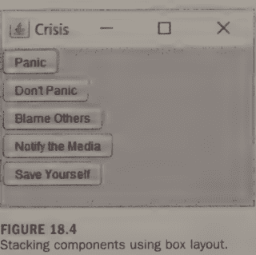

# 布局应用程序


**图 18.5**

使用 insets 在组件周围添加空间。

```java
// 设置第4行
JPanel row4 = new JPanel();
JLabel gotLabel = new JLabel("3 of 6: ", JLabel.RIGHT);
jTextField got3 = new JTextField("0");
JLabel got4 = new JLabel("4 of 6: ", JLabel.RIGHT);
jTextField got4 = new JTextField("0");
JLabel got5 = new JLabel("5 of 6: ", JLabel.RIGHT);
jTextField got5 = new JTextField("0");
JLabel got6 = new JLabel("6 of 6: ", JLabel.RIGHT);
jTextField got6 = new JTextField("0", 10);
JLabel drawingsLabel = new JLabel("Drawings: ", JLabel.RIGHT);
jTextField drawings = new JTextField("0");
JLabel yearsLabel = new JLabel("Years: ", JLabel.RIGHT);
jTextField years = new JTextField();
public LottoMannschaft() {
    super("Lotto Madness");
}
setSize(550, 400);
setDefaultCloseOperation(JFrame.EXIT_ON_CLOSE);
GridLayout layout = new GridLayout(5, 1, 10, 10);
setLayout(layout);

FlowLayout layout1 = new FlowLayout(FlowLayout.CENTER, 10, 10);
option.add(quickpick);
option.add(personal);
row1.setLayout(layout1);
row1.add(quickpick);
row1.add(personal);
add(row1);

GridLayout layout2 = new GridLayout(2, 7, 10, 10);
row2.setLayout(layout2);
row2.add(numbersLabel);
for (int i = 0; i < 6; i++) {
    numbers[i] = new JTextField();
    row2.add(numbers[i]);
}
row2.add(winnersLabel);
for (int i = 0; i < 6; i++) {
    winners[i] = new JTextField();
    winners[i].setEditable(false);
    row2.add(winners[i]);
}
add(row2);

FlowLayout layout3 = new FlowLayout(FlowLayout.CENTER, 10, 10);
```

# 268 小时第 18 小：布局用户界面

```java
73: row3.setLayout(layout3);
74: stop.setEnabled(false);
75: row3.add(stop);
76: row3.add(play);
77: row3.add(reset);
78: add(row3);
79: 
80: GridLayout4 = new GridLayout(2, 3, 20, 10);
81: row4.setLayout(layout4);
82: row4.add(got3Label);
83: got3.setEditable(false);
84: row4.add(got3);
85: row4.add(got4Label);
86: got4.setEditable(false);
87: row4.add(got4);
88: row4.add(got5Label);
89: got5.setEditable(false);
90: row4.add(got5);
91: row4.add(got6Label);
92: got6.setEditable(false);
93: row4.add(got6);
94: row4.add(drawingsLabel);
95: drawings.setEditable(false);
96: row4.add(drawings);
97: row4.add(yearsLabel);
98: years.setEditable(false);
99: row4.add(years);
100: add(row4);
101: 
102: setVisible(true);
103: }
104: 
105: private static void setLookAndFeel() {
106: try {
107: UIManager.setLookAndFeelAndFeel(
108: "*com.sun.java.swing.plaf.nimbus.NimbusLookAndFeel",
109: 
110: );
111: catch (Exception exc) {
112: // 忽略错误
113: }
114: 
115: public static void main(String[] arguments) {
116: LottoMadness.setLookAndFeel();
117: LottoMadness frame = new LottoMadness();
118: }
119: }
```

`FlowLayout()` 构造函数使用了三个参数。第一个参数 `FlowLayout.CENTER` 表示组件应该在它们的容器内（即放置它们的水平 `JPanel`）中居中对齐。最后两个参数指定了每个组件与其他组件之间移动的宽度和高度。使用 10 像素的宽度和 10 像素的高度会在组件之间留出少量的额外距离。

# 270 小时第 16 小：布局用户界面

界面的第 2 行被布局在一个高两行、宽七列的网格中。`GridLayout()` 构造函数还指定组件在每个方向上应与其他组件隔开 10 像素的距离。第 56–57 行设置了这个网格：

```java
GridLayout layout2 = new GridLayout(2, 7, 10);
row2.setLayout(layout2);
```

第 4 行使用 `GridLayout` 将组件排列在一个高两行、宽七列的网格中。`LottoMadness` 使用了在本小时期间描述的几个组件。第 9–37 行用于设置所有组件的对象。第 9–37 行用于设置所有组件的对象。

第 4 行使用 `GridLayout` 将组件排列在一个高两行、宽七列的网格中。`LottoMadness` 应用使用了在本小时期间描述的几个组件。第 9–37 行用于设置所有组件的对象。

第 4 行使用 `GridLayout` 将组件排列在一个高两行、宽七列的网格中。`LottoMadness` 应用使用了在本小时期间描述的几个组件。第 9–37 行用于设置所有组件的对象。

第 4 行使用 `GridLayout` 将组件排列在一个高两行、宽七列的网格中。`LottoMadness` 应用使用了在本小时期间描述的几个组件。第 9–37 行用于设置所有组件的对象。

第 4 行使用 `GridLayout` 将组件排列在一个高两行、宽七列的网格中。`LottoMadness` 应用使用了在本小时期间描述的几个组件。第 9–37 行用于设置所有组件的对象。

第 4 行使用 `GridLayout` 将组件排列在一个高两行、宽七列的网格中。`LottoMadness` 应用使用了在本小时期间描述的几个组件。第 9–37 行用于设置所有组件的对象。

第 4 行使用 `GridLayout` 将组件排列在一个高两行、宽七列的网格中。`LottoMadness` 应用使用了在本小时期间描述的几个组件。第 9–37 行用于设置所有组件的对象。

第 4 行使用 `GridLayout` 将组件排列在一个高两行、宽七列的网格中。`LottoMadness` 应用使用了在本小时期间描述的几个组件。第 9–37 行用于设置所有组件的对象。

第 4 行使用 `GridLayout` 将组件排列在一个高两行、宽七列的网格中。`LottoMadness` 应用使用了在本小时期间描述的几个组件。第 9–37 行用于设置所有组件的对象。

```java
FlowLayout layout1 = new FlowLayout(FlowLayout.CENTER, 10, 10);
option.add(quickpick);
option.add(personal);
row1.setLayout(layout1);
row1.add(quickpick);
row1.add(personal);
add(row1);

GridLayout layout2 = new GridLayout(2, 7, 10, 10);
row2.setLayout(layout2);
row2.add(numbersLabel);
for (int i = 0; i < 6; i++) {
    numbers[i] = new JTextField();
    row2.add(numbers[i]);
}
row2.add(winnersLabel);
for (int i = 0; i < 6; i++) {
    winners[i] = new JTextField();
    winners[i].setEditable(false);
    row2.add(winners[i]);
}
add(row2);

FlowLayout layout3 = new FlowLayout(FlowLayout.CENTER, 10, 10);
```

## 总结

当你设计 GUI 时，可能会在使用布局管理器时遇到困难。布局管理器提供了一种处理 GUI 的方法。在本小时中，你学会了 `JPanel`。

## 总结

当你设计 GUI 时，可能会在使用布局管理器时遇到困难。布局管理器提供了一种处理 GUI 的方法。在本小时中，你学会了 `JPanel`。

## 总结

当你设计 GUI 时，可能会在使用布局管理器时遇到困难。布局管理器提供了一种处理 GUI 的方法。在本小时中，你学会了 `JPanel`。

## 总结

当你设计 GUI 时，可能会在使用布局管理器时遇到困难。布局管理器提供了一种处理 GUI 的方法。在本小时中，你学会了 `JPanel`。

## 总结

当你设计 GUI 时，可能会在使用布局管理器时遇到困难。布局管理器提供了一种处理 GUI 的方法。在本小时中，你学会了 `JPanel`。

## 总结

当你设计 GUI 时，可能会在使用布局管理器时遇到困难。布局管理器提供了一种处理 GUI 的方法。在本小时中，你学会了 `JPanel`。

## 总结

当你设计 GUI 时，可能会在使用布局管理器时遇到困难。布局管理器提供了一种处理 GUI 的方法。在本小时中，你学会了 `JPanel`。


# Java 中的用户事件

Java 中的用户事件是指用户使用鼠标、键盘或其他输入设备执行操作时发生的事情。

## 事件监听器

在接收事件之前，你必须学习如何让一个对象进行监听。响应用户事件需要使用一个或多个 `EventListener` 接口。接口是 Java 面向对象编程的特性，允许类继承它原本无法采用的行为。它们就像是与其他类之间的合同协议，保证该类将包含特定的方法。

`EventListener` 接口包含接收特定类型用户输入的方法。添加 `Listener` 接口需要两点：

首先，监听类属于 `java.awt` 包；你必须通过以下语句使其可用：

```java
import java.awt.event.*;
```

其次，该类必须使用 `implements` 关键字声明它支持一个或多个监听接口。以下语句创建了一个使用 `ActionListener` 的类，`ActionListener` 是一个用于响应按钮和菜单点击的接口：

```java
public class Graph implements ActionListener {
```

`EventListener` 接口是 GUI 中生成用户事件的组件部分。如果没有配备任何一个监听器，组件无法执行任何可以被程序其他部分听到的操作。程序必须为它所监听的每种组件包含一个监听接口。要让程序对按钮的鼠标点击或在文本框中按下 Enter 键做出响应，你必须包含 `ActionListener` 接口。要响应对选择列表或复选框的使用，你需要 `ItemListener` 接口。

当你在同一个类中需要多个接口时，请在 `implements` 关键字之后用逗号隔开它们的名称，如下代码所示：

```java
public class Graph3D implements ActionListener, MouseListener {
    // ...
}
```

## 设置组件以便被听到

在你实现了特定组件所需的接口后，你必须让该组件生成用户事件。`ActionListener` 接口监听动作事件，例如按钮点击或按下 Enter 键。

要让 `JButton` 对象生成事件，请在以下语句中使用 `addActionListener()` 方法：

```java
JButton fireTorpedos = new JButton("Fire torpedos");
fireTorpedos.addActionListener(this);
```

这段代码创建了 `fireTorpedos` 按钮并调用了按钮的 `addActionListener()` 方法。`this` 关键字被用作 `addActionListener()` 方法的参数，表示当前对象接收用户事件并根据需要进行处理。

> **注意**
>
> `this` 关键字在初次引入时会让很多读者感到困惑。`this` 指向该关键字出现处的对象。因此，如果你创建一个 `LottoMadness` 类并在该类内部的语句中使用 `this`，它指的就是执行该代码的 `LottoMadness` 对象。

## 处理用户事件

当带有监听器的组件生成用户事件时，一个方法会被自动调用。该方法必须在监听器附加到组件时指定的类中找到。

每个监听器都有不同的方法被调用以接收它们的事件。`ActionListener` 接口将事件发送到名为 `actionPerformed` 的方法。以下是 `actionPerformed()` 方法的简短示例：

```java
public void actionPerformed(ActionEvent event) {
}
```

程序中所有的动作事件都会发送到此方法。如果程序中只有一个组件可能发送动作事件，你可以编写处理事件的语句。如果多个组件可以发送这些事件，你需要检查传递的对象。

`ActionEvent` 对象被发送到 `actionPerformed()` 方法。多个类代表了程序中生成的事件。这些类拥有确定哪个组件引发事件的方法。在 `actionPerformed()` 方法中，如果 `ActionEvent` 对象命名为 `event`，你可以通过以下方式识别组件：

```java
Component source = event.getSource();
```

## 复选框和组合事件

要确定复选框是被选中还是取消，请使用 `ItemListener` 接口。当状态改变时会调用 `itemStateChanged()` 方法，提供一个 `ItemEvent` 对象。

要确定复选框是被选中还是取消，将状态与常量进行比较。以下示例使用了 `ItemEvent` 对象：

```java
public void itemStateChanged(ItemEvent e) {
    int state = e.getStateChange();
    if (state == ItemEvent.SELECTED) {
        // 处理选中
    } else if (state == ItemEvent.DESELECTED) {
        // 处理取消选中
    }
}
```

## 键盘事件

当程序必须在按下键立即做出反应时，它使用 `KeyListener` 接口。第一步是通过调用其 `addKeyListener()` 方法来注册组件。`KeyListener` 有三个方法：

- `keyPressed(KeyEvent)`：在按下键瞬间被调用的方法。
- `keyReleased(KeyEvent)`：在释放键瞬间被调用的方法。
- `keyTyped(KeyEvent)`：在键输入后被调用的方法。

要监控键盘上的任何按键（包括 Enter、上页和下一页），请改用 `getKeyCode()`。该方法返回一个表示按键的整数。

# 第 19 小时：响应用户输入

```java
33: }
34: 
35:     @Override
36:     public void keyReleased(KeyEvent txt) {
37:         // 什么什么都不做
38:     }
39: 
40:     private void setLookAndFeel() {
41:         try {
42:             UIManager.setLookAndFeel(
43:                 "com.sun.java.swing.plaf.nimbus.NimbusLookAndFeel"
44:             );
45:         } catch (Exception exc) {
46:             // 忽略错误
47:         }
48:     }
49: 
50:     public static void main(String[] arguments) {
51:         KeyViewer frame = new KeyViewer();
52:     }
53: }
```

当你运行应用程序时，它应该类似于图 19.1 所示。应用程序在第 24–38 行实现了 `KeyListener` 接口的三个方法。其中两个方法是空的。它们在应用程序中不需要，但必须包含以满足第 7 行中使用 `implements` 关键字类与接口之间建立的约定。


**图 19.1** 在程序中处理键盘事件。

## 启用和禁用组件

你可能在程序中见过某个显示为灰色而不是正常外观的组件。

灰色显示表示用户无法对该组件进行任何操作，因为它未启用。组件的启用和禁用通过组件的 `setEnabled(boolean)` 方法来实现。该方法接收一个布尔值作为参数，因此 `setEnabled(true)` 启用组件以便使用，而 `setEnabled(false)` 则禁用它。

## 完成图形化应用程序

以下语句创建了标签为 Previous（上一个）、Next（下一个）和 Finish（完成）的按钮，并禁用了第一个按钮：

```java
JButton previousButton = new JButton("Previous");
JButton nextButton = new JButton("Next");
JButton finishButton = new JButton("Finish");
previousButton.setEnabled(false);
```

这种方法是防止组件在不该发送用户事件时发送有效的方法。例如，如果你正在编写一个使用文本字段收集用户地址的 Java 应用程序，你可以禁用“保存地址”按钮，直到用户提供了街道地址、城市、州和邮编。

## 完成 LottoMadness 应用程序

为了在 Java 程序中查看 Swing 的事件处理类，你将完成 LottoMadness 程序，这是在第 18 小时“布局用户界面”中开始的彩票模拟程序。此时，LottoMadness 是一个 GUI（图形用户界面）。你可以点击按钮并在文本框中输入文本，但没有任何反应发生。在这个工作坊中，你创建了 `LottoEvent`，这是一个新类，用于接收用户输入、进行彩票抽奖并跟踪你的中奖次数。当类编写完成后，你在 LottoMadness 中添加几行代码使其使用 `LottoEvent`。以这种方式划分 Swing 项目通常非常方便，将 GUI 放在一个类中，将事件处理方法放在另一个类中。

该应用程序的目的是评估用户在一生中赢得六个数字彩票抽奖的概率。图 19.2 显示了程序运行时的截图。


**图 19.2** 运行 LottoMadness 应用程序。

计算机并不是使用概率来计算此结果，而是连续进行抽奖，直到产生获胜者为止。6 选 6 的全中极极不可能发生，因此程序还会报告任何三个、四个或五个中奖号码的组合。

界面包括 12 个用于彩票号码的文本字段和两个标记为 Quick（快速）和 Personal（个人）的复选框。六个文本字段用于显示每次抽奖的号码。另外六个文本字段用于用户的选择。选择 Quick 会随机选择六个数字。选择 Personal 允许用户选择所需的号码。

三个按钮控制程序的活动：Stop（停止）、Play（播放）和 Reset（重置）。按下 Play 按钮，程序启动一个名为 `playing` 的线程并生成抽奖结果。按下 Stop 按钮停止线程，Reset 则清空所有字段以便用户重新开始。相关知识请参考第 15 小时“创建线程”。

`LottoEvent` 类实现了三个接口：`ActionListener`、`ItemListener` 和 `Runnable`。`Runnable` 接口与线程的关系在第 15 小时讲解。需要监听应用程序按钮和复选框生成的事件。程序不需要监听与文本字段相关的事件，因为它们专门用于存储用户的选择。用户界面会自动处理这些。该类需要 `main` 包、`javax.swing` 以及 Java 的事件处理包 `java.awt`。该类有两个实例变量：

- `gui`：GUI 对象
- `playing`：用于执行抽奖的 `Thread` 对象

`gui` 变量与包含程序的 GUI 对象通信。当你需要更改界面或从文本字段获取值时，使用 `gui` 的实例变量。例如，`play` 实例变量代表按钮。要在 `LottoEvent` 中禁用它，可以使用以下语句：

```java
gui.play.setEnabled(false);
```

你可以使用语句获取 `JTextField` 的值：

```java
String got = gui.getText();
```

**列表 19.2** 包含了 `LottoEvent` 完整文本。在 `com.javahours` 包中创建一个名为 `LottoEvent` 的新文件，输入文本并保存。

### LottoEvent 类详解

`LottoEvent` 类有一个构造函数：`LottoEvent(LottoMadness)`。作为参数指定的 `LottoMadness` 对象标识了依赖 `LottoEvent` 处理用户事件并进行绘制的对象。

该类使用了以下方法：

- `clearAllFields()` 方法会将应用程序中的所有文本字段清空。当用户点击重置（Reset）按钮时，会调用此方法。
- `addObjectField()` 方法将文本字段转换为整数，并将其转换回文本字段。由于所有字段都以字符串形式存储，因此你必须制作特殊的工具才能在表达式中使用它们。
- `getNumberOne()` 方法接收三个参数：来自乐票抽奖的单个数字、一个包含多个 `JTextField` 对象的数组以及一个计数整数。该方法确保每次抽奖中的每个数字在同一次抽奖中没有被重复选中。
- `matchedOne()` 方法接收两个参数：一个 `JTextField` 对象和一个包含六个 `JTextField` 对象的数组。该方法用于检查用户的数字中是否有一个与当前乐票抽奖的数字匹配。

应用程序的 `actionPerformed()` 方法在用户点击按钮时接收动作事件。`getActionCommand()` 方法检索按钮的标签，以确定点击了哪个组件。

点击“播放”（Play）按钮会调用 `startPlaying()` 方法。该方法会禁用四个组件。点击“停止”（Stop）会调用 `stopPlaying()` 方法，该方法会启用除“停止”按钮以外的所有组件。

`itemStateChanged()` 方法接收由选择“快速选择”（Quick Pick）或“个人”（Personal）复选框触发的用户事件。`getItem()` 方法发送一个代表被点击的复选框的对象。如果是“快速选择”复选框，则会将从 1 到 50 的六个随机数字分配给用户的乐票号码。否则，存放用户数字的文本字段将被清空。

LottoEvent 类为乐票抽奖中的每个球使用 1 到 50 之间的数字。这在第 118 行建立，该行将 `Math.random()` 方法乘以 50，总和加 1，并将其作为 `Math.floor()` 方法的参数。结果是 1 到 50 之间的随机整数。如果你在此处和第 69 行将 50 替换为不同的数字，你就可以让 `LottoMadness` 用于生成更宽或更小范围的彩票比赛。

LottoMadness 项目缺少跟踪抽奖次数、中奖次数和乐票号码文本字段等信息的变量。相反，界面存储并自动显示值。

要完成项目，在 NetBeans 中重新打开 `LottoMadness.java`。你只需要添加六行代码即可与 `LottoEvent` 类配合。

首先，添加一个新的实例变量来持有 `LottoEvent` 对象：

```java
LottoEvent lotto = new LottoEvent(this);
```

接下来，在 `LottoMadness()` 构造函数中为每个可以返回输入的界面组件添加 `addItemListener()` 和 `addActionListener()` 方法：

```java
// 添加监听器
quickpick.addItemListener(lotto);
personal.addItemListener(lotto);
stop.addActionListener(lotto);
play.addActionListener(lotto);
reset.addActionListener(lotto);
```

这些语句应该添加到构造函数中，紧跟在调用 `setLayout()` 之后（用于为应用程序框架创建网格布局管理器）。

**列表 19.3** 包含了你完成修改后 `LottoMadness.java` 的完整文本。

```java
1: package com.java24hours;
2:
3: import java.awt.*;
4: import javax.swing.*;
5:
6: public class LottoMadness extends JFrame {
7:   LottoEvent lotto = new LottoEvent(this);
8:
9:   // set up 1
10:  JPanel row1 = new JPanel();
```

```java
row4.add(years);
add(row4);
setVisible(true);
private static void setLookFeel() {
  try {
    UIManager.setLookFeel(
      "com.sun.java.swing.plaf.nimbus.NimbusLookFeel"
    );
  } catch (Exception exc) {
    ignore error
  }
}
public static void main(String[] arguments) {
  LottoMadness.setLookFeel();
  LottoMadness frame = new LottoMadness();
}
```

添加上述行后，你就可以运行该程序了，它可以测试你数千年的手气。正如你所预期的那样，这些彩票是徒劳的。在生命中抽中 6 选 6 号的概率极其微小，即使你活得像圣经中的人物一样长。

> **备注**
>
> 当使用 www.java24hours.com 上的网站运行 LottoMadness 程序时，它完成了 410,732,244 次抽奖，相当于 390 万次每周两次的抽奖。其中有 6,364,880 名 3 选 6 号者、337,285 名 4 选 6 号者、6,476 名 5 选 6 号者以及 51 名 6 选 6 号者（大约每 800 万次抽奖中有一个）。第一个中中这个虚拟彩票的人是 Bill Leer。他的号码是 3, 7, 1, 15, 34 和 43，他只花了 241,225 次抽奖（2,319 年）就中奖了。

## 总结

通过 Swing，你可以用少量的编程创建一个看起来专业的程序。虽然 LottoMadness 程序比你过去 19 小时内处理过的许多示例都要长，但程序的一半是由用于构建界面的语句组成的。


## 工作坊 289

如果你花些时间运行该程序，你会对那些中得这种六数字彩票的人们的好运感到更加苦涩和嫉妒。

我最近一次运行程序的结果显示，我可以花费 `17,000` 美元在我人生最好的 `165` 年里买票，结果只赢得了一个 `5` 选 `6`、`10` 选 `6` 和 `264` 个 `3` 选 `6` 奖。

与这些概率相比，让你的 Java 编程技能产生回报几乎是板之百定的。

## 工作坊

## 问答

- **Q.** 你需要对 `paint()` 方法或 `repaint()` 做什么来指示文本字段已更改吗？

- **A.** 使用文本组件的 `setText()` 方法更改其值后，你不需要做任何其他操作。Swing 会处理显示新值所需的更新。

- **Q.** 为什么在列表 19.1 中，当你导入 `java.awt.*` 和 `java.awt.event.*` 时，经常同时导入一个类及其一个子类？第一个语句可以包含第二个吗？

- **A.** 尽管 `java.awt` 和 `java.awt.event` 包的名字看起来有关联，但 Java 中并没有包的继承关系。一个包不能是另一个包的子包。

当你在 `import` 语句中使用星号时，你使得包中的所有类在程序中都可用。

星号只作用于类，不作用于包。单个 `import` 语句最多只能加载单个包的类。

- **Q.** 为什么演员 Michael J. Fox 以他的中间名首字母来标识？

- **A.** 在《屏幕演员指南》中已经有一个 Michael Fox 了，这迫使这位未来的《家庭联结》和《回到未来》的演员为他的职业工作选择另一个名字。Michael Andrew Fox 是他的本名，但他不喜欢 Andrew 或 Andy Fox 听起来的感觉——而且称呼自己为 A. Fox 听起来像是由于自己在赞美自己的善行。

他决定使用 Michael J. Fox，这是为了向角色 Michael J. Pollard（由他）致敬。

另一个 Michael Fox 是一位演员，曾出现在《佩里·马逊》、《伯克斯的法律》以及许多其他电视节目和电影中，直到他在 `1996` 年去世。

## 测验

在 LottoMadness 程序让你对机会游戏产生反感后，请通过回答以下问题来玩一场技巧游戏。

- **1.** 为什么动作事件（action events）被称为这个名字？

  - A. 它们是对其他事情的反应而发生的。
  - B. 它们指示应该采取某种作为作为。
  - C. 它们是为了向电影探险家动作·杰克逊致敬。

- **2.** 作为 `addActionListener()` 方法的参数，`this` 代表什么？

  - A. 当事件发生时应该使用此监听器。
  - B. 此事件优先于其他事件。
  - C. 此对象处理事件。

- **3.** 哪种文本组件将用户输入存储为整数？

  - A. `JTextField`
  - B. `JTextArea`
  - C. A 和 B 均不是

## 答案

- **1.** 动作事件包括按钮的点击和从下拉菜单中选择项目。

- **2.** `this` 关键字指的是当前对象。如果使用对象的名称作为参数而不是 `this` 语句，那么该对象将接收事件并被预期处理它们。

- **3.** `JTextField` 和 `JTextArea` 组件将其值存储为文本，因此在将值作为整数、浮点数或非文本值使用之前，你必须转换你的值。

## 活动

如果这一小时的主事件没有提供足够的动作，请通过以下活动与你的口味互动：

- 在 LottoMadness 程序中添加一个文本字段，配合 LottoMadness 类中的 `sleep()` 语句来减慢速度。

- 修改 LottoMadness 项目，使其绘制 `9` 个数字。

要查看实现这些活动的程序，请访问网站 `www.java24hours.com`。

# 小节 20

读写文件

- 任务：

- 从文件中读取字节。

- 在计算机上创建一个新文件。

- 将字节保存到文件中。

- 修改存储在文件中的数据。

# 注意

此示例在 Windows 系统上运行，该系统使用反斜杠 `\` 字符作为路径和文件名的分隔符。（此代码示例中有两个反斜杠，是因为反斜杠在 Java 中是一个特殊字符。）Linux 和基于 Unix 的系统使用正斜杠 `/` 字符。要编写一个可以在任何操作系统上运行文件的 Java 程序，请使用类变量 `File.pathSeparator` 而不是正斜杠或反斜杠，如下语句所示：

```java
File book = new File("data") + File.pathSeparator
+ "address.dat");
```

创建 `File` 对象并不会在你的计算机上创建文件。它只是对可能存在也可能不存在的文件的引用。

当你有一个 `File` 对象时，你可以在该对象上调用几个实用的方法：

- `exists()`—如果文件存在则返回 true，否则返回 false

- `getName()`—文件的名称，String 类型格式

- `length()`—文件的大小，long 类型的值

- `createNewFile()`—如果不存在同名文件，则创建一个同名文件

- `delete()`—如果文件存在，则删除该文件

- `renameTo(File)`—使用指定的 `File` 对象名称作为参数重命名文件

你可以使用 `File` 对象来表示系统上的文件夹而不是文件。在 `File` 构造函数中指定文件夹名称，该名称可以是绝对路径（例如 `C:\\Documents\`）也可以是相对路径（例如 `java\database`）。

在你获得一个表示文件夹的对象后，调用它的 `listFiles()` 方法来查看文件夹内部的内容。该方法返回一个 `File` 对象数组，代表该其中包含的每个文件和子文件夹。

# 从流读取数据

本小时的第一个项目是使用输入流从文件中读取数据。你可以使用 `FileInputStream` 类来实现此点，该类代表从文件中以字节形式读取的输入流。

你可以通过指定文件名或 `File` 对象作为 `FileInputStream()` 构造函数的参数来创建一个文件输入流。

读取或写入文件的方法在访问文件时发生错误，可能会抛出 `IOException`。许多与读写文件相关的方法都会产生此异常，因此通常使用 `try-catch` 块。该异常属于 `java.io` 包。

流是 Java 中的资源之一，当它们不再被使用时必须关闭。在程序运行期间，保持流开启会严重消耗 JVM 的资源。

一种名为 `try-with-resources` 的特殊 `try` 语句可以确保资源（如文件输入）在不再需要时被关闭。`try` 语句后跟着括号。括号内部是一个或多个 Java 语句，用于声明通过资源读取或写入数据的变量。

这是一个使用名为 `stream` 的文件输入读取文件的示例：

```java
File cookie = new File("cookie.web")
```

由于 `stream` 位于 `try` 语句中，当 `try-catch` 块结束（如果它尚未关闭）时，流会自动关闭。

文件输入流按字节读取数据。你可以通过调用不带参数的流的 `read()` 方法读取单个字节。如果流中没有更多可用字节（因为已到达文件末尾），则返回字节值 `-1`。

当你读取输入流时，它从流中的第一个字节开始，例如文件的第一个字节。你可以通过调用带一个参数的 `skip()` 方法来跳过流中的某些字节：该参数是一个 `int` 类型，表示要跳过的字节数。以下语句跳过 `scanData` 流中的 `1,024` 个字节：

```java
scanData.skip(1024);
```

如果你想一次读取多个一个字节，请执行以下操作：

- 创建一个大小与你想要读取的字节数完全一致的字节数组。

- 调用流的 `read()` 方法，并将该数组作为参数。该数组将用流中的字节填充。

这个第一个项目从 MP3 音频文件中读取 ID3 数据。由于 MP3 是一种非常流行的音乐文件格式，在 ID3 文件的末尾通常会添加 `128` 个字节，用于存储有关歌曲的信息，如标题、艺术家和专辑。

`ID3Reader` 使用文件输入流读取 MP3 文件，跳过最后 `128` 字节之前的所有内容。对剩余字节进行检查以确定是否包含 ID3 数据。如果是，前三个字节就是数字 `84`、`65` 和 `71`。

# 注意

在 Java 支持的 Unicode 标准字符集所包含的 ASCII 字符集中，这三个数字分别代表大写字母 "T"、"A" 和 "G"。

在 `com.java24hours` 包中创建一个名为 `ID3Reader` 的新空 Java 文件，并填入列表 20.1 中的文本。

## 列表 20.1 ID3Reader.java 的完整文本

```java
1: package com.java24hours;
2:
3: import java.io.*;
4:
5: public class ID3Reader {
6:     public static void main(String[] args) {
7:         File song = new File(args[0]);
8:         try (FileInputStream file = new FileInputStream(song)) {
9:             int size = (int) song.length();
10:            file.skip(size - 128);
11:            byte[] last128 = new byte[128];
12:            file.read(last128);
13:            String id3 = new String(last128);
14:            String tag = id3.substring(0, 3);
15:            if (tag.equals("TAG")) {
16:                System.out.println("Title: " + id3.substring(3, 32));
17:                System.out.println("Artist: " + id3.substring(32, 63));
18:                System.out.println("Album: " + id3.substring(63, 93));
19:                System.out.println("Year: " + id3.substring(93, 97));
20:            } else {
21:                System.out.println(args[0] + " does not contain TAG");
22:            }
23:        } catch (IOException ie) {
24:            System.out.println("Error: " + ie.toString());
25:    }
26: }
```

在 `com.java24hours` 包中创建一个名为 `ID3Reader` 的新空 Java 文件，并填入列表 20.1 中的文本。

# 注意

你可能想通过文件共享服务找到一个你下载的 MP3 文件。我完全理解这种诱惑。根据美国唱片工业协会的规定，任何人下载 MP3 文件都会立即面临问题。音乐 CD 可以在 Amazon.com、eBay、Apple iTunes 以及任何销售音乐的地方。

# 缓冲流

提高程序读取流性能的方法之一是对输入进行缓冲。缓冲是将数据保存在内存中以备后用的的过程。当 Java 程序需要来自缓冲流的数据时，它会首先查看缓冲区，这比从源读取要快。

要使用缓冲流，先创建一个输入流，然后使用该对象创建一个缓冲流。调用 `BufferedInputStream(InputStream)` 构造函数并将输入流作为唯一参数。数据从输入流读取时会被缓冲。

要从缓冲流读取，调用其不带参数的 `read()` 方法。返回一个 `0` 到 `255` 之间的整数，代表流中的下一个字节。如果没有更多可用字节，则返回 `-1`。

作为缓冲流的演示，我们的下一个项目将为 Java 添加一个许多程序员在其他语言中缺失的功能：控制台输入。

控制台输入是在应用程序运行时从控制台（也称为命令行）读取字符的能力。

`System` 类（包含 `System.out.print()` 和 `System.out.println()` 语句中的 `out` 变量）有一个名为 `in` 的类变量，代表一个 `InputStream` 对象。该对象接收键盘输入并以流的形式提供。

你可以像处理其他流一样处理这个输入流。以下语句创建了一个与 `System.in` 关联的缓冲输入流：

```java
BufferedInputStream bin = new BufferedInputStream(System.in);
```

下一个项目是 `com.java24hours` 包中的 `Console` 类，它包含一个可以在任何 Java 应用程序中接收控制台输入的类方法。将列表 20.2 中的文本输入名为 `Console` 的新 java 文件。


在 Java 支持的 Unicode 标准字符集所包含的 ASCII 字符集中，这三个数字分别代表大写字母 "T"、"A" 和 "G"。

在 `com.java24hours` 包中创建一个名为 `ID3Reader` 的新空 Java 文件，并填入列表 20.1 中的文本。

## 列表 20.1 ID3Reader.java 的完整文本

```java
1: package com.java24hours;
2:
3: import java.io.*;
4:
5: public class ID3Reader {
6:     public static void main(String[] args) {
7:         File song = new File(args[0]);
8:         try (FileInputStream file = new FileInputStream(song)) {
9:             int size = (int) song.length();
10:            file.skip(size - 128);
11:            byte[] last128 = new byte[128];
12:            file.read(last128);
13:            String id3 = new String(last128);
14:            String tag = id3.substring(0, 3);
15:            if (tag.equals("TAG")) {
16:                System.out.println("Title: " + id3.substring(3, 32));
17:                System.out.println("Artist: " + id3.substring(32, 63));
18:                System.out.println("Album: " + id3.substring(63, 93));
19:                System.out.println("Year: " + id3.substring(93, 97));
20:            } else {
21:                System.out.println(args[0] + " does not contain TAG");
22:            }
23:        } catch (IOException ie) {
24:            System.out.println("Error: " + ie.toString());
25:    }
26: }
```

> **注**：由于原文提供的代码块存在严重的截断和格式错误，译文根据逻辑补全了常见的 Java 结构以保持可读性，但严格遵循“不翻译代码内容”原则。

# 注意

你可能想通过文件共享服务找到一个你下载的 MP3 文件。我完全理解这种诱惑。根据美国唱片工业协会的规定，任何人下载 MP3 文件都会立即面临问题。音乐 CD 可以在 Amazon.com、eBay、Apple iTunes 以及任何销售音乐的地方购买。

# 缓冲流

提高程序读取流性能的方法之一是对输入进行缓冲。缓冲是将数据保存在内存中以备后用的过程。当 Java 程序需要来自缓冲流的数据时，它会首先查看缓冲区，这比从源读取要快。

要使用缓冲流，先创建一个输入流，然后使用该对象创建一个缓冲流。调用 `BufferedInputStream(InputStream)` 构造函数并将输入流作为唯一参数。数据从输入流读取时会被缓冲。

要从缓冲流读取，调用其不带参数的 `read()` 方法。返回一个 0 到 255 之间的整数，代表流中的下一个字节。如果没有更多可用字节，则返回 -1。

作为缓冲流的演示，我们的下一个项目将为 Java 添加一个许多程序员在其他语言中缺失的功能：控制台输入。

控制台输入是在应用程序运行时从控制台（也称为命令行）读取字符的能力。

`System` 类（包含 `System.out.print()` 和 `System.out.println()` 语句中的 `out` 变量）有一个名为 `in` 的类变量，代表一个 `InputStream` 对象。该对象接收键盘输入并以流的形式提供。

你可以像处理其他流一样处理这个输入流。以下语句创建了一个与 `System.in` 关联的缓冲输入流：

```java
BufferedInputStream bin = new BufferedInputStream(System.in);
```

下一个项目是 `com.java24hours` 包中的 `Console` 类，它包含一个可以在任何 Java 应用程序中接收控制台输入的类方法。将列表 20.2 中的文本输入名为 `Console` 的新 java 文件。

## 列表 20.2 Console.java 的全文

```java
1: package com.java24hours;
2:
3: import java.io.*;
4:
5: public class Console {
6:     public String readLine() {
7:         StringBuilder response = new StringBuilder();
8:         try {
9:             BufferedInputStream bin = new
10:            BufferedInputStream(System.in);
11:            int in = 0;
12:            char inChar;
13:            do {
14:                in = bin.read();
15:                inChar = (char) in;
16:                if (in != -1) {
17:                    response.append(inChar);
18:                }
19:            } while (in != -1) && (inChar != '\n');
20:            bin.close();
21:            return response.toString();
22:        } catch (IOException e) {
23:            System.out.println("Exception: " + e.getMessage());
24:            return null;
25:        }
26:    }
27:
28:    public static void main(String[] args) {
29:        System.out.print("You are standing at the end of the road ");
30:        System.out.print("before a small brick building. Around you ");
31:        System.out.print("is a forest. A small stream flows out of ");
32:        System.out.println("the building and down a gully.\n");
33:        System.out.print(">> ");
34:        String input = Console.readLine();
35:        System.out.println("That's not a verb I recognize.");
36:
37: }
```

`Console` 类包含一个 `main()` 方法，它演示了如何使用它。当你运行应用程序时，输出应该类似于图 20.2。

# 向流写入数据

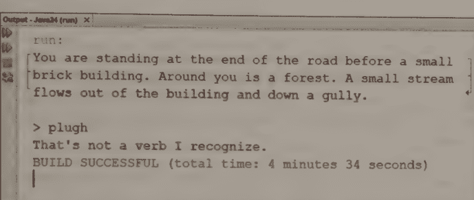

```
Output - Java24 (run)
> You are standing at the end of the road before a small
brick building. Around you is a forest. A small stream
flows out of the building and down a gully.

> plough
That's not a verb I recognize.
BUILD SUCCESSFUL (total time: 4 minutes 34 seconds)
```

图 20.2 运行 Console 应用程序。

`Console` 类包含一个类方法 `readLine()`，它从控制台接收字符。当按下回车键时，`readLine()` 返回一个包含所接收字符的字符串对象。

`Console` 应用程序也是世界上最不满意的冒险游戏。你不能进入建筑、在小溪中涉水或四处游荡。要获得该游戏（名为 Adventure）的更功能版本，请访问 www.web-adventures.org。

# 向流写入数据

在 `java.io` 包中，用于处理流的类是成对出现的。`FileInputStream` 和 `FileOutputStream` 类用于处理字节流，`FileReader` 和 `FileWriter` 类用于处理字符流，还有许多用于处理其他类型流数据的集合。

要开始写入数据，你首先需要创建一个与输出流关联的 `File` 对象。该文件在你的系统中并不存在。

你可以通过两种方式创建 `FileOutputStream`。如果你想向现有文件追加字节，请调用带有两个参数的 `FileOutputStream()` 构造函数：一个代表文件的 `File` 对象和一个布尔值 `true`。你写入流的字节将附加到文件的末尾。

如果你想向新文件写入字节，请调用以 `File` 对象作为唯一参数的 `FileOutputStream()` 构造函数。

获取输出流后，你可以调用不同的 `write()` 方法向其写入字节：

- 调用以字节作为唯一参数的 `write()` 方法，将该字节写入流中。
- 调用以字节数组作为唯一参数的 `write()` 方法，将数组中的所有字节写入流中。
- 为 `write(byte[], int, int)` 方法指定三个参数：一个字节数组、一个表示要写入流的数组起始元素的整数，以及要写入的字节数。

以下语句创建了一个包含 10 个字节的字节数组，并将最后 4 个字节写入输出流：

```java
File dat = new File("data.dat");
OutputStream datStream = new FileOutputStream(dat);
byte[] data = new byte[] { 5, 12, 4, 13, 15, 2, 17, 1, 18 };
datStream.write(data, 6, 4);
```

在向流写入字节时，你可以通过调用 String 对象的 `getBytes()` 方法将其转换为字节数组，例如：

```java
String name = "Puddin N. Tane";
byte[] nameBytes = name.getBytes();
```

在完成向流写入字节后，通过调用流的 `close()` 方法关闭它。

你编写的下一个项目是一个简单的应用程序 `ConfigWriter`，它通过向文件输出流写入字节将几行文本保存到文件中。创建一个命名的 Java 文件，将其分配给 `java24`。

## 列表 20.3 ConfigWriter.java 的全文

```java
1: package com.java24hours;
2:
3: import java.io.*;
4:
5: public class Console {
6:     public String readLine() {
7:         StringBuilder response = new StringBuilder();
8:         try {
9:             BufferedInputStream bin = new
10:            BufferedInputStream(System.in);
11:            int in = 0;
12:            char inChar;
13:            do {
14:                in = bin.read();
15:                inChar = (char) in;
16:                if (in != -1) {
17:                    response.append(inChar);
18:                }
19:            } while (in != -1) && (inChar != '\n');
20:            bin.close();
21:            return response.toString();
22:        } catch (IOException e) {
23:            System.out.println("Exception: " + e.getMessage());
24:            return null;
25:        }
26:    }
27:
28:    public static void main(String[] args) {
29:        System.out.print("You are standing at the end of the road ");
30:        System.out.print("before a small brick building. Around you ");
31:        System.out.print("is a forest. A small stream flows out of ");
32:        System.out.println("the building and down a gully.\n");
33:        System.out.print(">> ");
34:        String input = Console.readLine();
35:        System.out.println("That's not a verb I recognize.");
36:
37: }
```

> **注意**：OCR 文本在后面的页面关于代码块存在一些混淆。基于 OCR 文本的分析：OCR 文本显示 Listing 20.3 是 `ConfigWriter.java`，但提供的代码块内容实际上是 `Console.java`。将遵循提供的文本并修复拼写错误。

## 列表 20.2 Console.java 的全文


```java
1: package com.java24hours;
2:
3: import java.io.*;
4:
5: public class Console {
6:     public String readLine() {
7:         StringBuilder response = new StringBuilder();
8:         try {
9:             BufferedInputStream bin = new
10:            BufferedInputStream(System.in);
11:            int in = 0;
12:            char inChar;
13:            do {
14:                in = bin.read();
15:                inChar = (char) in;
16:                if (in != -1) {
17:                    response.append(inChar);
18:                }
19:            } while (in != -1) && (inChar != '\n');
20:            bin.close();
21:            return response.toString();
22:        } catch (IOException e) {
23:            System.out.println("Exception: " + e.getMessage());
24:            return null;
25:        }
26:    }
27:
28:    public static void main(String[] args) {
29:        System.out.print("You are standing at the end of the road ");
30:        System.out.print("before a small brick building. Around you ");
31:        System.out.print("is a forest. A small stream flows out of ");
32:        System.out.println("the building and down a gully.\n");
33:        System.out.print(">> ");
34:        String input = Console.readLine();
35:        System.out.println("That's not a verb I recognize.");
36:
37: }
}
```

## 列表 20.2 Console.java 的全文

`Console` 类包含一个 `main()` 方法，它演示了如何使用它。当你运行应用程序时，输出应该类似于图 20.2。

### 图 20.2 运行 Console 应用程序


```
Output - Java24 (run)
> You are standing at the end of the road before a small
brick building. Around you is a forest. A small stream
flows out of the building and down a gully.

> plough
That's not a verb I recognize.
BUILD SUCCESSFUL (total time: 4 minutes 34 seconds)
```

`Console` 类包含一个类方法 `readLine()`，它从控制台接收字符。当按下回车键时，`readLine()` 返回一个包含所接收字符的字符串对象。

`Console` 应用程序也是世界上最不满意的冒险游戏。你不能进入建筑、在小溪中涉水或四处游荡。要获得该游戏（名为 Adventure）的更功能版本，请访问 www.web-adventures.org。

# 向流写入数据

在 `java.io` 包中，用于处理流的类是成对出现的。`FileInputStream` 和 `FileOutputStream` 类用于处理字节流，`FileReader` 和 `FileWriter` 类用于处理字符流，还有许多用于处理其他类型流数据的集合。

要开始写入数据，你首先需要创建一个与输出流关联的 `File` 对象。该文件在你的系统中并不存在。

你可以通过两种方式创建 `FileOutputStream`。如果你想向现有文件追加字节，请调用带有两个参数的 `FileOutputStream()` 构造函数：一个代表文件的 `File` 对象和一个布尔值 `true`。你写入流的字节将附加到文件的末尾。

如果你想向新文件写入字节，请调用以 `File` 对象作为唯一参数的 `FileOutputStream()` 构造函数。

获取输出流后，你可以调用不同的 `write()` 方法向其写入字节：

- 调用以字节作为唯一参数的 `write()` 方法，将该字节写入流中。
- 调用以字节数组作为唯一参数的 `write()` 方法，将数组中的所有字节写入流中。
- 为 `write(byte[], int, int)` 方法指定三个参数：一个字节数组、一个表示要写入流的数组起始元素的整数，以及要写入的字节数。

以下语句创建了一个包含 10 个字节的字节数组，并将最后 4 个字节写入输出流：

```java
File dat = new File("data.dat");
OutputStream datStream = new FileOutputStream(dat);
byte[] data = new byte[] { 5, 12, 4, 13, 15, 2, 17, 1, 18 };
datStream.write(data, 6, 4);
```

在向流写入字节时，你可以通过调用 `String` 对象的 `getBytes()` 方法将其转换为字节数组，例如：

```java
String name = "Puddin N. Tane";
byte[] nameBytes = name.getBytes();
```

在完成向流写入字节后，通过调用流的 `close()` 方法关闭它。

你编写的下一个项目是一个简单的应用程序 `ConfigWriter`，它通过向文件输出流写入字节将几行文本保存到文件中。创建一个命名的 Java 文件，将其分配给 `java24`。

## 列表 20.3 ConfigWriter.java 的全文


# 列表 20.2 Console.java 的全文

```java
1: package com.java24hours;
2:
3: import java.io.*;
4:
5: public class Console {
6:     public String readLine() {
7:         StringBuilder response = new StringBuilder();
8:         try {
9:             BufferedInputStream bin = new
10:            BufferedInputStream(System.in);
11:            int in = 0;
12:            char inChar;
13:            do {
14:                in = bin.read();
15:                inChar = (char) in;
16:                if (in != -1) {
17:                    response.append(inChar);
18:                }
19:            } while (in != -1) && (inChar != '\n');
20:            bin.close();
21:            return response.toString();
22:        } catch (IOException e) {
23:            System.out.println("Exception: " + e.getMessage());
24:            return null;
25:        }
26:    }
27:
28:    public static void main(String[] args) {
29:        System.out.print("You are standing at the end of the road ");
30:        System.out.print("before a small brick building. Around you ");
31:        System.out.print("is a forest. A small stream flows out of ");
32:        System.out.println("the building and down a gully.\n");
33:        System.out.print(">> ");
34:        String input = Console.readLine();
35:        System.out.println("That's not a verb I recognize.");
36:
37: }
```

`Console` 类包含一个 `main()` 方法，它演示了如何使用它。当你运行应用程序时，输出应该类似于图 20.2。

# 向流写入数据


```
Output - Java24 (run)
> You are standing at the end of the road before a small
brick building. Around you is a forest. A small stream
flows out of the building and down a gully.

> plough
That's not a verb I recognize.
BUILD SUCCESSFUL (total time: 4 minutes 34 seconds)
```

图 20.2 运行 Console 应用程序。

`Console` 类包含一个类方法 `readLine()`，它从控制台接收字符。当按下回车键时，`readLine()` 返回一个包含所接收字符的字符串对象。

`Console` 应用程序也是世界上最不满意的冒险游戏。你不能进入建筑、在小溪中涉水或四处游荡。要获得该游戏（名为 Adventure）的更功能版本，请访问 www.web-adventures.org。

# 向流写入数据

在 `java.io` 包中，用于处理流的类是成对出现的。`FileInputStream` 和 `FileOutputStream` 类用于处理字节流，`FileReader` 和 `FileWriter` 类用于处理字符流，还有许多用于处理其他类型流数据的集合。

要开始写入数据，你首先需要创建一个与输出流关联的 `File` 对象。该文件在你的系统中并不存在。

你可以通过两种方式创建 `FileOutputStream`。如果你想向现有文件追加字节，请调用带有两个参数的 `FileOutputStream()` 构造函数：一个代表文件的 `File` 对象和一个布尔值 `true`。你写入流的字节将附加到文件的末尾。

如果你想向新文件写入字节，请调用以 `File` 对象作为唯一参数的 `FileOutputStream()` 构造函数。

获取输出流后，你可以调用不同的 `write()` 方法向其写入字节：

- 调用以字节作为唯一参数的 `write()` 方法，将该字节写入流中。
- 调用以字节数组作为唯一参数的 `write()` 方法，将数组中的所有字节写入流中。
- 为 `write(byte[], int, int)` 方法指定三个参数：一个字节数组、一个表示要写入流的数组起始元素的整数，以及要写入的字节数。

以下语句创建了一个包含 10 个字节的字节数组，并将最后 4 个字节写入输出流：

```java
File dat = new File("data.dat");
OutputStream datStream = new FileOutputStream(dat);
byte[] data = new byte[] { 5, 12, 4, 13, 15, 2, 17, 1, 18 };
datStream.write(data, 6, 4);
```

在向流写入字节时，你可以通过调用 `String` 对象的 `getBytes()` 方法将其转换为字节数组，例如：

```java
String name = "Puddin N. Tane";
byte[] nameBytes = name.getBytes();
```

在完成向流写入字节后，通过调用流的 `close()` 方法关闭它。

你编写的下一个项目是一个简单的应用程序 `ConfigWriter`，它通过向文件输出流写入字节将几行文本保存到文件中。创建一个命名的 Java 文件，将其分配给 `java24`。

## 列表 20.3 ConfigWriter.java 的全文

```java
1: package com.java24hours;
2:
3: import java.io.*;
4:
5: public class Console {
6:     public String readLine() {
7:         StringBuilder response = new StringBuilder();
8:         try {
9:             BufferedInputStream bin = new
10:            BufferedInputStream(System.in);
11:            int in = 0;
12:            char inChar;
13:            do {
14:                in = bin.read();
15:                inChar = (char) in;
16:                if (in != -1) {
17:                    response.append(inChar);
18:                }
19:            } while (in != -1) && (inChar != '\n');
20:            bin.close();
21:            return response.toString();
22:        } catch (IOException e) {
23:            System.out.println("Exception: " + e.getMessage());
24:            return null;
25:        }
26:    }
27:
28:    public static void main(String[] args) {
29:        System.out.print("You are standing at the end of the road ");
30:        System.out.print("before a small brick building. Around you ");
31:        System.out.print("is a forest. A small stream flows out of ");
32:        System.out.println("the building and down a gully.\n");
33:        System.out.print(">> ");
34:        String input = Console.readLine();
35:        System.out.println("That's not a verb I recognize.");
36:
37: }
```

> **注意**：OCR 文本显示 Listing 20.3 为 `ConfigWriter.java`，但提供的代码块内容实际上是 `Console.java`。此处遵循提供的文本并修复拼写错误。


Console 应用程序也是世界上最不满意的冒险游戏。你不能进入建筑、在小溪中涉水或四处游荡。要获得该游戏（名为 Adventure）的更功能版本，请访问 `www.web-adventures.org`。

# 向流写入数据

在 `java.io` 包中，用于处理流的类是成对出现的。`FileInputStream` 和 `FileOutputStream` 类用于处理字节流，`FileReader` 和 `FileWriter` 类用于处理字符流，还有许多用于处理其他类型流数据的集合。

要开始写入数据，你首先需要创建一个与输出流关联的 `File` 对象。该文件在你的系统中并不存在。

你可以通过两种方式创建 `FileOutputStream`。如果你想向现有文件追加字节，请调用带有两个参数的 `FileOutputStream()` 构造函数：一个代表文件的 `File` 对象和一个布尔值 `true`。你写入流的字节将附加到文件的末尾。

如果你想向新文件写入字节，请调用以 `File` 对象作为唯一参数的 `FileOutputStream()` 构造函数。

获取输出流后，你可以调用不同的 `write()` 方法向其写入字节：

- 调用以字节作为唯一参数的 `write()` 方法，将该字节写入流中。
- 调用以字节数组作为唯一参数的 `write()` 方法，将数组中的所有字节写入流中。
- 为 `write(byte[], int, int)` 方法指定三个参数：一个字节数组、一个表示要写入流的数组起始元素的整数，以及要写入的字节数。

以下语句创建了一个包含 10 个字节的字节数组，并将最后 4 个字节写入输出流：

```java
File dat = new File("data.dat");
OutputStream datStream = new FileOutputStream(dat);
byte[] data = new byte[] { 5, 12, 4, 13, 15, 2, 17, 1, 18 };
datStream.write(data, 6, 4);
```

在向流写入字节时，你可以通过调用 `String` 对象的 `getBytes()` 方法将其转换为字节数组，例如：

```java
String name = "Puddin N. Tane";
byte[] nameBytes = name.getBytes();
```

在完成向流写入字节后，通过调用流的 `close()` 方法关闭它。

你编写的下一个项目是一个简单的应用程序 `ConfigWriter`，它通过向文件输出流写入字节将几行文本保存到文件中。创建一个命名的 Java 文件，将其分配给 `java24`。

## 列表 20.3 ConfigWriter.java 的全文

```java
1: package com.java24hours;
2:
3: import java.io.*;
4:
5: public class Console {
6:     public String readLine() {
7:         StringBuilder response = new StringBuilder();
8:         try {
9:             BufferedInputStream bin = new
10:            BufferedInputStream(System.in);
11:            int in = 0;
12:            char inChar;
13:            do {
14:                in = bin.read();
15:                inChar = (char) in;
16:                if (in != -1) {
17:                    response.append(inChar);
18:                }
19:            } while (in != -1) && (inChar != '\n');
20:            bin.close();
21:            return response.toString();
22:        } catch (IOException e) {
23:            System.out.println("Exception: " + e.getMessage());
24:            return null;
25:        }
26:    }
27:
28:    public static void main(String[] args) {
29:        System.out.print("You are standing at the end of the road ");
30:        System.out.print("before a small brick building. Around you ");
31:        System.out.print("is a forest. A small stream flows out of ");
32:        System.out.println("the building and down a gully.\n");
33:        System.out.print(">> ");
34:        String input = Console.readLine();
35:        System.out.println("That's not a verb I recognize.");
36:
37: }
```

# 读取和写入属性

Java 程序当可以使用命令行参数进行配置时更加多变，正如在几个应用程序中所演示的那样。`java.util` 包包含 `Properties` 类，允许从另一个源加载配置设置。文件可以像其他数据源一样读取：

- 创建代表文件的 `File` 对象。
- 从该 `File` 创建 `FileInputStream` 对象。
- 调用 `load()` 从该输入流获取属性。

属性文件有一组属性名，后面跟着等号 `=` 以及它们的值。例如：

```text
username=lepton
lastCommand=open database
windowSize=32
```

每个属性单独一行，因此设置了名为 `username`、`lastCommand` 和 `windowSize` 的属性，分别为 "lepton"、"open database" 和 "32"。`ConfigWriter` 应用程序使用了名为 `config.dat` 的属性文件：

```java
File configFile = new File("config.dat");
FileInputStream inputStream = new FileInputStream(configFile);
Properties config = new Properties();
config.load(inputStream);
```

## 读取和写入配置属性 303

可以通过调用 `setProperty()` 方法并传入两个参数（键和值）来存储属性：

```java
config.setProperty("username", "max");
```

你可以通过调用 `Properties` 对象的 `list(PrintStream)` 方法来显示所有属性。`PrintStream` 是你在整本书中一直在使用的类型：它是 `System` 类中 `out` 实例变量的类，你一直在 `System.out.println()` 和 `System.out.print()` 语句中使用它来显示输出。以下代码调用了 `list(System.out)`。

对属性进行更改后，你可以将它们存回文件：

- 创建一个表示该文件的 `File` 对象。
- 从该 `File` 对象创建一个 `FileOutputStream` 对象。
- 调用 `store(OutputStream, String)` 将属性保存到指定的输出流中，并使用字符串作为属性的描述。

在这一小时的最终项目中，你将在 `ConfigWriter` 应用的基础上进行构建，该程序会将若干程序设置写入文件。`Configurator` 应用程序将这些设置读取到 Java 属性文件中，添加一个带有当前日期的新属性 `runtime`，并保存修改后的文件。

在 `com.java24hours` 包中创建一个新的 Java 文件来存放 `Configurator` 类，并输入列表 20.4 中的文本。

## 列表 20.4 Configurator.java 的完整文本

```java
1: package com.java24hours;
2:
3: import java.io.*;
4: import java.util.*;
5:
6: public class Configurator {
7:
8:     public Configurator() {
9:         try {
10:      // 加载属性文件
11:      File configFile = new File("program.properties");
12:      FileInputStream inputStream = new FileInputStream(configFile);
13:      Properties config = new Properties();
14:      config.load(inputStream);
15:      // 创建新属性
16:      Date current = new Date();
17:      config.setProperty("runtime", current.toString());
18:      // 保存属性文件
19:      FileOutputStream outStream = new FileOutputStream(configFile);
20:      config.store(outStream, "Properties settings");
21:      inputStream.close();
22:      config.list(System.out);
23:  } catch (IOException ie) {
24:      System.out.println("IO error " + ie.getMessage());
25:
26:  }
```

在此应用程序中，第 11–12 行创建了 `program.properties` 的 `File` 对象并将其与文件输入流关联。该文件的内容在第 13–14 行从流中加载到 `Properties` 对象中。

第 16–17 行创建了表示当前日期和时间的新属性。随后在第 19 行将文件与输出流关联，并在第 20 行将整个属性文件写入该流。

`Configurator` 应用程序的输出如图 20.4 所示。

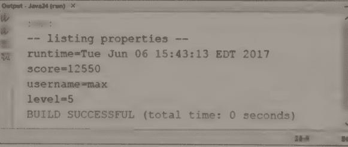

图 20.4 Configurator 应用程序。

`program.properties` 文件现在包含以下文本：

## 输出

```
-- 列出属性 --
runtime=Tue Jun 06 15:43:13 EDT 2017
score=12550
username=max
level=5
```

反斜线字符的 `\` 格式化（与应用程序的输出不同）确保了属性文件被正确存储。

## 总结

在这一小时中，你学习了写入字节的输入流和输出流，这是在流中表示数据最简单的方法。

`java.io` 包中有许多类可以以其他方式处理流。还有一个名为 `java.net` 的类包，它允许你通过 Internet 连接进行流的读写。

字节流可以适应许多用途，因为你可以轻松地将字节转换为其他数据类型，例如整数、字符和字符串。

这一小时的第一个项目 `ID3Reader` 应用程序从流中读取字节并将其转换为字符串，以便按此格式读取 ID3 数据。

# 310 小时 21：使用 Java 9 的新 HTTP 客户端

Java 9 通过模块的使用，在程序部署方面提供了更多控制。

Java 9 包含的新型 HTTP 客户端库必须包含在模块中，才能在程序中使用。该库名为 `jdk.incubator.http`。

在 NetBeans 中按照以下步骤添加此模块：

- 选择 File（文件），然后选择 New File（新建文件）。在 Categories（类别）面板中出现 Java Module Info（模块信息）。
- 选择 Java Module Info，然后选择模块名称。
- 点击 Finish（完成）。

`module-info.java` 在源码编辑器中打开。它只需要这几行代码：

```java
module {
    requires jdk.incubator.http;
}
```

当文件保存后，`jdk.incubator.http` 中的类可以在任何 Java 程序中使用。

## 发送 HTTP 请求

Web 服务器通过 HTTP 请求消息与浏览器和其他类型的客户端进行通信。

请求可以用于双向移动信息。数据可以在服务器和客户端之间接收和发送。

该项目演示了使用 HTTP 客户端连接到 Web 服务器、请求文档并学习有关服务器的信息。这是一个简单的过程，但需要几个类。

使用以下步骤发送 Web 请求：

1. 创建 `HttpClient` 对象。
2. 创建请求构建器（`HttpRequest.Builder` 内部类）。
3. 构建 `HttpRequest` 对象。
4. 使用浏览器将请求发送到 Web 服务器。
5. 接收 `HttpResponse` 对象。

使用 `HttpClient` 类的工厂方法创建浏览器：

```java
HttpClient browser = HttpClient.newHttpClient();
```

正如预期的，浏览器的工作是将请求发送到服务器。

请求使用 builder 创建。builder 需要 Web 地址。`java.net` 包中的 `URI` 类表示地址（称为 URL），可以这样创建：

```java
URI link = new URI("https://www.oracle.com/");
```

如果 Web 地址格式不正确，将抛出 `java.net.SyntaxException`。

使用 `URI` 对象，可以调用 `HttpRequest.newBuilder(URI)` 方法创建构建器：

```java
HttpRequest.Builder bob = HttpRequest.newBuilder(uri);
```

构建器的 `build()` 方法创建请求，这是一个 `HttpClient` 类的对象：

```java
HttpRequest request = bob.build();
```

现在你已经有了浏览器和请求，可以将其发送到 Web 服务器并获取响应。响应是一个 `HttpResponse` 对象，因为它可以接收多种格式的信息。

浏览器的 `send()` 请求接受两个参数：

- 一个 `HttpRequest` 对象。
- 一个设置响应格式的 handler。

通过调用 `HttpResponse.BodyHandler` 类的方法创建 handler，如下：

```java
HttpResponse<String> response = browser.send(request, HttpResponse.BodyHandler.asString());
```

`HttpResponse<String>` 中的泛型定义响应为字符串。handler 的 `asString()` 方法调用浏览器的 `send()` 方法返回一个字符串。

# 312 小时 21：使用 Java 9 的新 HTTP 客户端

handler 还有一个 `asFile(Path)` 方法可以将文件返回响应，以及 `asByteArray()` 方法将其作为 `byte[]`。

每个 HTTP 请求头部都提供了有关响应和发送服务器的信息。这些头部中的 `Server` 包含了运行服务器的软件名称和版本号。出于安全考虑，服务器省略了版本号。

响应的 `headers()` 方法将头部作为 `HttpHeaders` 对象返回。调用对象的 `firstValue(String)` 方法传入头部名称，返回匹配该名称的第一个头部。实现此代码如下：

```java
HttpHeaders headers = response.headers();
Optional<String> server = headers.firstValue("Server");
```

调用 `firstValue()` 返回的是 `java.util` 包中的数据结构，它更容易处理不存在时的空值对象。使用没有值的对象会导致 `NullPointerException`，这是 Java 中最常见的异常之一。`Optional` 类通过 `isPresent()` 方法防止这种情况，当存在有效值时返回 `true`，否则返回 `false`。`server` 的值字符串，由语句的 `Optional<String>` 部分指示。如下显示此字符串可以避免空问题：

```java
if (server.isPresent()) {
    System.out.println("Server: " + server.get());
}
```


将这些技术付诸实践，`ServerCheck` 请求公司的首页并报告它们使用的服务器。在 NetBeans 中，在 `com.java24hours` 包中创建一个名为 `ServerCheck` 的新 Java 文件。将列表 21.1 输入源码编辑器。

## 列表 21.1 ServerCheck.java 的全文

```java
1: package com.java24hours;
2:
3: import java.io.*;
4: import java.net.*;
5: import java.util.*;
6: import jdk.incubator.http.*;
7:
8: public class ServerCheck {
9:     public ServerCheck() {
10:        String[] sites = {
11:            "https://www.apple.com",
12:            "https://www.microsoft.com",
13:            "http://www.google.com",
14:            "https://www.oracle.com",
15:            "http://www.info.com/"
16:        };
17:        try {
18:            load(sites);
19:        } catch (SyntaxException oops) {
20:            System.out.println("Error: " + oops.getMessage());
21:        } catch (IOException | InterruptedException oops) {
22:            System.out.println("Error: " + oops.getMessage());
22:        }
23:    }
24:
25:    public void load(String[] sites) throws SyntaxException, InterruptedException {
26:        for (String site : sites) {
27:            System.out.println("Site: " + site);
28:            HttpClient browser = HttpClient.newHttpClient();
29:            URI uri = new URI(site);
30:            HttpRequest.Builder bob = HttpRequest.newBuilder(uri);
31:            HttpRequest request = bob.build();
32:            HttpResponse<String> response = browser.send(request,
33:                HttpResponse.BodyHandlers.asString());
34:            HttpHeaders headers = response.headers();
35:            Optional<String> server = headers.firstValue("Server");
36:            if (server.isPresent()) {
37:                System.out.println("Server: " + server.get());
38:            } else {
39:                System.out.println("Server unidentified");
40:            }
41:        }
42:    }
43:
44:    public static void main(String[] args) {
45:        new ServerCheck();
46:    }
47: }
```

## 从 Web 保存文件

`ImageDownloader` 应用遵循与前一个示例相同的步骤，直到发送请求。

在发送请求到 Web 服务器之前，必须完成一些准备工作。必须创建一个文件来持有接收到的图像内容：

```java
Path temp = Files.createTempFile("lighthouse", ".jpg");
```

`java.nio` 包中的 `Files` 类通过调用 `createTempFile(String, String)` 创建临时文件。参数是用于文件名的标识符和扩展名。文件名将在标识符后带有数字和扩展名，如 `lighthouse394406253848162075.jpg`。

一旦你有了文件，浏览器的 `send()` 方法可以使用响应来指定此文件作为参数。服务器的响应将存储在该文件中。语句如下：

```java
HttpResponse response = browser.send(request,
    HttpResponse.BodyHandlers.ofFile(temp));
```

这个临时文件可以通过重命名将其保存为永久文件：

```java
File perm = new File("lighthouse.jpg");
temp.renameTo(perm);
```

在 NetBeans 中，在 `com.java24hours` 包中创建一个 `ImageDownloader.java` 空文件，然后用列表 21.2 中的源码填充它。

## 列表 21.2 ImageDownloader.java 的全文

```java
1: package com.java24hours;
2:
3: import java.io.*;
4: import java.net.*;
5: import java.nio.file.*;
6: import jdk.incubator.http.*;
7:
8: public class ImageDownloader {
9:     public ImageDownloader() {
10:        String[] sites = {
11:            "http://workbench.cadenhead.org/lighthouse.jpg"
12:        };
13:        try {
14:            load(sites);
15:        } catch (SyntaxException oops) {
16:            System.out.println("Error: " + oops.getMessage());
17:        } catch (IOException | InterruptedException oops) {
18:            System.out.println("Error: " + oops.getMessage());
19:        }
20:    }
21:
22:    public void load(String[] sites) throws SyntaxException, InterruptedException {
23:        for (String site : sites) {
24:            System.out.println("Site: " + site);
25:            HttpClient browser = HttpClient.newHttpClient();
26:            URI uri = new URI(site);
27:            HttpRequest.Builder bob = HttpRequest.newBuilder(uri);
28:            HttpRequest request = bob.build();
29:            Path temp = Files.createTempFile("lighthouse", ".jpg");
30:            HttpResponse response = browser.send(request,
31:                HttpResponse.BodyHandlers.ofFile(temp));
32:            HttpHeaders headers = response.headers();
33:            Optional<String> server = headers.firstValue("Server");
34:            if (server.isPresent()) {
35:                System.out.println("Server: " + server.get());
36:            } else {
37:                System.out.println("Server unidentified");
38:            }
39:        }
40:    }
41:
42:    public static void main(String[] args) {
43:        new ImageDownloader();
44:    }
45: }
```

## 316 小时 21：使用 Java 9 的新 HTTP Client

```java
14:     System.out.println("Bad URI: " + oops.getMessage());
15: } catch (IOException | InterruptedException oops) {
16:     System.out.println("Error: " + oops.getMessage());
17:
18: }
19:
20: public void load(String imageUri) throws URISyntaxException,
    21:     InterruptedException {
22:
23:     // 创建 Web 客户端
24:     HttpClient browser = HttpClient.newHttpClient();
25:     // 为图像构建请求
26:     URI uri = new URI(imageUri);
27:     HttpRequest.Builder builder = HttpRequest.newBuilder(uri);
28:     HttpRequest request = builder.build();
29:
30:     // 创建一个文件存储图像数据
31:     Path temp = Files.createTempFile("lighthouse", ".jpg");
32:     // 执行请求并获取数据
33:     HttpResponse response = browser.send(request,
34:     HttpResponse.BodyHandlers.ofFile(temp));
35:     System.out.println("Image saved to "
36:         + temp.toFile().getAbsolutePath());
37:
38:     // 持久化保存文件
39:     File perm = new File("lighthouse.jpg");
40:     temp.toFile().renameTo(perm);
41:     System.out.println("Image moved to " + perm.getPath());
42:
43: public static void main(String[] arguments) {
44:     new ImageDownloader();
45: }
```

运行 `ImageDownloader` 应用程序，项目主文件夹中会出现一个名为 `lighthouse.jpg` 的文件。点击 Files（文件）选项卡将其置于顶层（位于 NetBeans 中与 Projects（项目）面板相同的区域）。双击该文件在主面板中打开它，如图 21.2 所示。

程序分别在第 34–35 行和第 39 行显示临时和永久图像文件的位置。


图 21.2

从网络下载图像文件。

## 在网络上发布数据

到目前为止，这一小时的重点是使用 HTTP 从网络上获取内容。现在是时候返回一些内容了。最终项目是 `SalutonVerkisto`，这是一个 Java 应用程序，通过 POST 请求向作者的 Web 服务器发送消息。

POST 请求可以编码大量数据供服务器接收，例如博客文章，甚至是图像或视频文件。GET 请求也可以向服务器携带携带信息，但它受限于 URI 中可以包含的内容。

该应用程序为我服务器上一个接收评论的脚本创建了一个 URI：

```java
String site = "http://workbench.cadenhead.org/post-a-comment.php";
URI uri = new URI(site);
```

两个字符串 `userName` 和 `yourMessage` 包含了将发送的名称和评论：

```java
String userName = "Sam Smith of Indianapolis";
String yourMessage = "Your book is pretty good, if I say so myself.";
```

信息将通过 HTTP 请求发送到 Web 服务器，就像之前的项目一样。在发送评论之前，必须使用 `HttpRequest.BodyProcessor` 内部类的方法进行编码。该类有一个 `fromString` 方法，其接收一组在长字符串中用 `&` 分隔的键值对：

```java
HttpRequest.BodyProcessor proc = HttpRequest.BodyProcessor.fromString(
    "name=" + URLEncoder.encode(userName, "UTF-8") +
    "&comment=" + URLEncoder.encode(yourMessage, "UTF-8") +
    "&mode=" + URLEncoder.encode("demo", "UTF-8"));
```

`HttpRequest.BodyProcessor` 的 `encode(String, String)` 方法接收两个参数：要使用的字符编码。适当的编码取决于 Web 服务器能接受什么。我服务器上的脚本可以接受 UTF-8，因此使用了它。该方法指定了三个键值对：`name`、`comment` 和 `mode`。前两个值来自 `userName` 和 `yourMessage`。第三个 `mode` 的值为 "demo"它它让服务器知道消息的目的（这有助于过滤掉可能向脚本发送垃圾消息的人）。

处理后的消息可以用于通过调用 `newBuilder(URI)` 方法创建请求构建器，随后是三个调用。当显示代码时，这会更有意义：

```java
HttpRequest.Builder builder = HttpRequest.newBuilder(uri)
    .header("Content-Type", "application/x-www-form-urlencoded")
    .header("Accept", "text/plain")
    .POST(proc);
```

此方法合并调用了四个部分。每个部分都能作用是因为每个部分都返回了构建器对象。它们按顺序完成的任务如下：

- `newBuilder(URI)` 为 Web 地址创建一个构建器。
- `header(String, String)` 将头部 `Content-Type` 设置为 "application/x-www-form-urlencoded"。这告诉服务器发送了 Web 表单。
- `header()` 调用将 `Accept` 设置为 "text/plain"，即请求的 MIME 类型。
- `POST(HttpRequest.BodyProcessor)` 将编码后的消息格式化为 POST 请求。

现在构建器已准备好，可以构建请求：

```java
HttpRequest request = builder.build();
```

通过 `send(HttpRequest, BodyHandler)` 调用发送请求并获取响应：

```java
HttpResponse<String> response = client.send(request,
    HttpResponse.BodyHandlers.ofString());
```

相同的技术在之前的项目中用过，但这次显示的是响应。在 `java24` 包中创建空的 `Verkisto` 应用程序源码，见列表 21.3。


```java
1: package com.java24;
2:
3: import java.io.*;
4: import java.net.*;
5: import jdk.incubator.http.*;
6:
7: public class Verkisto {
8:
9:     public Verkisto() {
10:        String site = "http://workbench.cadenhead.org/post-a-comment.php";
11:        try {
12:            postMessage(site);
13:        } catch (URISyntaxException oops) {
14:            System.out.println("Bad URI: " + oops.getMessage());
15:        } catch (IOException | InterruptedException oops) {
16:            System.out.println("Error: " + oops.getMessage());
17:        }
18:    }
19:
20:    public void postMessage(String server) throws IOException,
21:        URISyntaxException, InterruptedException {
22:
23:        HttpClient client = HttpClient.newHttpClient();
24:
25:        // 服务器的地址
26:        URI uri = new URI(server);
27:
28:        // 设置消息
29:        String yourName = "Sam Smith of Indianapolis";
30:        String yourMessage = "Your book is pretty good, if I say so myself";
31:
32:
33:        // 编码消息
34:        HttpRequest.BodyProcessor proc = HttpRequest.BodyProcessor.fromString(
35:            "name=" + URLEncoder.encode(yourName, "UTF-8") +
36:            "&comment=" + URLEncoder.encode(yourMessage, "UTF-8") +
37:            "&mode=" + URLEncoder.encode("demo", "UTF-8"));
38:
39:        // 准备请求
40:        HttpRequest.Builder builder = HttpRequest.newBuilder(uri)
41:            .header("Content-Type", "application/x-www-form-urlencoded")
42:            .header("Accept", "text/plain")
43:            .POST(proc);
44:
45:        // 完成请求
46:        HttpRequest request = builder.build();
47:
48:        // 从服务器获取响应
49:        System.out.println("Method: " + request.method() + "\n");
50:        HttpResponse<String> response = client.send(request,
51:            HttpResponse.BodyHandlers.ofString());
52:        System.out.println(response.body());
53:    }
54: }
```

图 21.3：使用 POST 请求向 Web 服务器发送数据。

```
Output - WebTest:
WARNING: Using incubator modules: jdk.incubator.http
Method: POST

From: Sam Smith of Indianapolis
Posted: 2017-06-12 22:26:07
Comment: Your book is pretty good, if I say so myself.
-----
BUILD SUCCESSFUL (total time: 4 seconds)
```

# 第 21 小时：使用 Java 9 的新 HTTP

**Q. 上的第一个网站是什么？**

**A. 第一个网站是 `http://info.cern.ch`，它今天仍然在线。蒂姆·伯纳斯-李（Tim Berners-Lee）是欧洲核研究组织（CERN）的英国物理学家，他使用该网站描述了他的发明——万维网（World Wide Web）。**

第一个网页位于 `http://info.cern.ch/hypertext/WWW/TheProject.html`，随着 Web 吸引用户、出版者和软件开发者，该页面每天更新。

该网站将 Web 定义为“一种广域超媒体信息检索直觉，旨在提供对海量文档的通用访问”。

## 测验

通过回答以下问题，检查你对 HTTP 编程信息网的掌握程度。

1. 哪种类型的请求可以向 Web 服务器发送信息？
   - A. GET
   - B. POST
   - C. GET 和 POST 均

2. 哪个类持有从请求产生的服务器接收到的信息？
   - A. `HttpClient`
   - B. `HttpResponse`
   - C. `HttpRequest`

3. 使用 `Optional` 数据结构的一个目的是？
   - A. 为了避免 `NullPointerException` 错误。
   - B. 为了保存一组 null 值。
   - C. 为了运行得更快。

## 答案

1. **POST** 发送大量数据；**GET** 在 Web 地址（URI）上发送数据。
2. `HttpResponse` 对象是通过调用浏览器的 `send()` 方法返回的。
3. 调用 `isPresent()` 该结构持有的是 null 而不是有效对象。

## 活动

为了进一步加深对本小时 Web 编程主题的理解，请完成以下活动：

- 为 `ServerCheck` 程序添加另外五个科技公司的首页。
- 编写一个程序，使用 HTTP 响应的 "Content-Type" 和 "Content-Encoding" 头部来报告服务器采用的 MIME 类型和字符编码。

要查看实现这些活动的 Java 程序，请访问书籍网站 `www.java24hours.com`。

# 第 22 小时：创建 Java2D 图形

本小时的任务列表：

- 设置文本的字体和颜色。
- 设置容器的背景颜色。
- 绘制线条、矩形和其他形状。
- 绘制 GIF 和 JPEG 图形。
- 绘制填充和未填充的形状。

在本小时中，你将学习如何将容器——即持有图形用户界面（GUI）组件的普通灰色面板和框架——变成一个艺术画布，你可以在上面绘制字体、颜色、形状和图形。

## 使用 Font 类

Java 中的颜色和字体由 `java.awt` 包中的 `Color` 类和 `Font` 类表示。通过这些类，你可以用不同的字体和大小显示文本，并更改文本和图形的颜色。字体通过 `Font(String, int, int)` 构造函数创建，它接受三个参数：

- **字体**：字体的类型，可以是通用名称（"Dialog"、"DialogInput"、"Monospaced"、"Sans Serif" 或 "Serif"）或实际字体名称（"Arial Black"、"Helvetica" 或 "Courier New"）
- **样式**：为三个类变量之一：`Font.BOLD`、`Font.ITALIC` 或 `Font.PLAIN`
- **大小**：以磅（points）为单位的字体大小

以下语句创建了一个 12 磅斜体 Serif 字体：

```java
Font current = new Font("Serif", Font.ITALIC, 12);
```

如果你使用了通用字体以外的特定字体，它必须已经安装在运行你程序的用户的计算机上。

你可以通过将它们相加来组合字体样式，如下例所示：

```java
Font headline = new Font("Courier New", Font.BOLD + Font.ITALIC, 72);
```

当你拥有一个字体时，可以使用 `Graphics2D` 组件的 `setFont(Font)` 方法将其指定为当前字体。所有后续绘制操作都将使用该字体，直到设置另一个。以下代码创建了一个 "Comic Sans" 字体对象并在绘制文本之前将其指定为当前字体：

```java
public void paintComponent(Graphics comp) {
    Graphics2D comp2d = (Graphics2D) comp;
    Font font = new Font("Comic Sans", Font.BOLD, 15);
    comp2d.setFont(font);
    comp2d.drawString("Potrzeebie!", 5, 50);
}
```

Java 支持抗锯齿，使字体和图形看起来更平、不那么块状。要启用此功能，你必须设置渲染提示（rendering hint）。`Graphics2D` 对象有一个 `setRenderingHint(int, int)` 方法，它接受两个参数：

- 渲染提示的键（key）
- 与之关联的值（value）

这些值是 `java.awt` 中 `RenderingHints` 类中的类变量。要激活抗锯齿，调用带有两个参数的 `setRenderingHint()`：

```java
comp2d.setRenderingHint(RenderingHints.KEY_ANTIALIASING, RenderingHints.VALUE_ANTIALIAS_ON);
```

示例中的 `comp2D` 对象是代表容器绘制环境的 `Graphics2D` 对象。

## 使用 Color 类

Java 中的颜色由 `Color` 类表示，该类包含了以下作为类变量常量：`black`、`blue`、`cyan`、`darkGray`、`gray`、`green`、`lightGray`、`magenta`、`orange`、`pink`、`red`、`white` 和 `yellow`。

在容器中，可以使用这些常量设置背景颜色。以下示例展示了如何：

```java
import java.awt.*;
import javax.swing.*;

public class ColorDemo extends JPanel {
  public ColorDemo() {
    setBackground(Color.BLUE);
  }

  @Override
  protected void paintComponent(Graphics g) {
    // ... (省略部分)
  }
}
```

*(注：根据原文逻辑，此处代码块不完整，翻译时保持原文结构)*

## 自定义颜色

你可以通过指定它们的红、绿、蓝值创建自定义颜色。`Color(int, int, int)` 构造函数接受三个参数。以下示例创建了自定义颜色：

```java
import java.awt.*;
import javax.swing.*;

public class ColorDemo extends JPanel {
  public ColorDemo() {
    Color customColor = new Color(255, 128, 0); // 自定义橙色
    setBackground(customColor);
  }

  @Override
  protected void paintComponent(Graphics g) {
    super.paintComponent(g);
    g.setColor(Color.BLACK);
    g.drawString("This is a custom color!", 50, 50);
  }

  public static void main(String[] args) {
    JFrame frame = new JFrame("Custom Color");
    ColorDemo panel = new ColorDemo();
    frame.add(panel);
    frame.setSize(400, 300);
    frame.setDefaultCloseOperation(JFrame.EXIT_ON_CLOSE);
    frame.setVisible(true);
  }
}
```

## 绘制和形状

绘制线条和矩形等形状在 Java 程序中和显示文本一样简单。你需要一个 `Graphics2D` 对象来定义绘制表面以及要绘制的对象。

```java
import java.awt.*;
import javax.swing.*;

public class ShapesDemo extends JPanel {
  @Override
  protected void paintComponent(Graphics g) {
    super.paintComponent(g);
    Graphics2D g2d = (Graphics2D) g;

    // 绘制矩形
    g2d.setColor(Color.BLUE);
    g2d.drawRect(50, 50, 100, 60);

    // 绘制填充矩形
    g2d.setColor(Color.RED);
    g2d.fillRect(200, 50, 100, 60);

    // 绘制线条
    g2d.setColor(Color.BLACK);
    g2d.drawLine(50, 150, 250, 150);

    // 绘制椭圆
    g2d.setColor(Color.GREEN);
    g2d.drawOval(50, 200, 80, 80);
  }

  public static void main(String[] args) {
    JFrame frame = new JFrame("Shapes Demo");
    ShapesDemo panel = new ShapesDemo();
    frame.add(panel);
    frame.setSize(350, 350);
    frame.setDefaultCloseOperation(JFrame.EXIT_ON_CLOSE);
    frame.setVisible(true);
  }
}
```

## 绘制线条

一个对象的 2D 绘制被创建并表示正在绘制的形状。定义形状的对象属于 `java.awt.geom` 包。

`Line2D.Float` 类创建连接起点 (x, y) 点和终点 (x, y) 点的线。以下语句创建了从点 (40, 200) 到点 (70, 130) 的线：

```java
Line2D.Float line = new Line2D.Float(40, 200F, 70F, 130F);
```

这些参数后面跟随着字母 F，表示它们是浮点数。如果省略了它，Java 将它们视为整数。

以下语句绘制了上一个示例中创建的线条：

```java
comp2D.draw(line);
```

## 绘制矩形

矩形可以是填充或未填充的，并且具有圆角或直角。它们使用 `Rectangle2D.Float(int, int, int, int)` 构造函数创建，参数如下：

- 矩形左上角的 x 坐标
- 左上角的 y 坐标
- 矩形的宽度
- 高度

以下语句绘制了一个具有直角的未填充矩形：

```java
Rectangle2D.Float box = new Rectangle2D.Float(245F, 65F, 20F, 10F);
```

该语句创建了一个矩形，其左上角位于坐标 (245, 65) 的 (x, y) 宽度为 20 像素，高度为 10。若要以轮廓形式绘制此矩形，可以使用以下语句：

```java
comp2D.draw(box);
```

如果你想让矩形填充，请改用 `fill()` 方法：

```java
comp2D.fill(box);
```

你可以通过 `RoundRectangle2D.Float` 类创建圆角矩形而非直角矩形。该类的构造函数与 `Rectangle2D.Float` 类具有相同的四个参数，并增加了以下两个参数：

- 距离矩形角部 x 方向的像素数
- 距离矩形角部 y 方向的像素数

这些距离用于确定矩形角圆化的位置。以下语句创建了一个圆角矩形：

```java
RoundRectangle2D.Float ro = new RoundRectangle2D.Float(
    10F, 10F,
    100F, 80F,
    15F, 15F);
```

此矩形的左上角位于 (10, 10) 坐标。第三和第四个参数指定了矩形的宽和高。在这种情况下，宽度应为 100 像素，高度为 80 像素。

最后两个参数指定四个角都应从距离 (10, 10) 角向外 15 像素处开始圆角。

## 绘制椭圆和圆

你可以使用同一个类 `Ellipse2D.Float` 创建椭圆和圆，该类接受四个参数：

- 椭圆的 x 坐标
- 椭圆的 y 坐标
- 它的宽度
- 它的高度

(x, y) 坐标并不像你预期那样指示椭圆或圆的中心点。相反，(x, y) 坐标、宽度和高度描述了一个椭圆位于其中的不可见矩形。(x, y) 坐标是该矩形的左上角。如果它的宽度和高度相同，则该椭圆是一个圆。

以下语句在坐标 (245, 45) 处的矩形内创建一个高度和宽度均为 5 像素的圆：


```
Ellipse2D.Float cir = new Ellipse2D.Float(
  245F, 45F, 5F, 5F);
```

## 绘制弧

在 Java 中可以绘制的另一种形状是弧，即部分椭圆或圆。弧使用 `Arc2D.Float` 类创建，该类的构造函数具有许多相同的参数。你通过指定一个椭圆、椭圆可见的部分（以度为单位）以及弧在椭圆上的起始位置来绘制弧。

要创建一个弧，请向构造函数指定以下整数参数：

- 椭圆所在的不可见矩形的 x 坐标
- 矩形的 y 坐标
- 矩形的宽度
- 矩形的高度
- 弧在椭圆上的起始点（从 0 到 359 度）
- 弧的大小（同样以度为单位）
- 它是什么类型的弧

弧的起始点和大小按逆时针方向从 0 到 359 度范围，从 3 点钟位置的 0 度开始，如图 22.1 所示。


## 烘饼饼图

弧的类型使用类变量指定：`PIE` 用于饼图切片，`CLOSED` 如果端点用直线连接，`OPEN` 如果端点不应连接。

以下语句在 (100, 50) 处绘制了一个长度为 120 度、从 30 度标记开始、宽度为 65 高度为 75 的开放弧：

```
Arc2D.Float smile = new Arc2D.Float(100F, 50F, 65F, 75F,
30F, 120F, Arc2D.Float.OPEN);
```

为了完成这个小时，你创建了 `PiePanel`，这是一个显示饼图的 GUI 组件。该组件是 `JPanel` 的子类，`JPanel` 是一个用于绘制内容的简单容器。

创建类的一种方法是定义创建对象的方法。使用 `PiePanel` 程序必须执行以下步骤：

- 使用构造方法 `PiePanel(int)` 创建 `PiePanel` 对象。作为参数指定的整数是饼图包含的切片数量。
- 调用对象的 `addSlice(Color, float)` 方法为切片指定指定的颜色和值。

`PiePanel` 中每个切片的值是该切片代表的数值。

例如，根据高等教育办公室的数据，表 22.1 显示了该计划前38年美国学生贷款还款的情况。

### 表 22.1 美国学生贷款还款

| 描述 | 金额 |
| :--- | :--- |
| 学生偿还的金额 | 1010 亿美元 |
| 贷款给在校学生的金额 | 680 亿美元 |
| 贷款给正在还款学生的金额 | 910 亿美元 |
| 贷款给违约学生的金额 | 250 亿美元 |

你可以使用以下语句通过 `PiePanel` 在饼图中表示这些数据：

```
PiePanel loans = new PiePanel(4);
loans.addSlice(Color.green, 101F);
loans.addSlice(Color.yellow, 68F);
```

## 绘制饼图

```java
5: import java.awt.geom.*;

6:
7: public class PiePanel extends JPanel {
8: private PieSlice[] slice;
9: private int current = 0;
10: private float totalSize = 0;
11: private Color background;
13: public PiePanel(int sliceCount) {
slice = new PieSlice[sliceCount];
background = getBackground();
}
public void addSlice(Color sColor, float sSize) {
if (current < slice.length) {
slice[current] = new PieSlice(sColor, sSize);
totalSize += sSize;
current++;
}
public void paintComponent(Graphics comp) {
super.paintComponent(comp);
Graphics2D comp2D = (Graphics2D) comp;
int width = getSize().width - 10;
int height = getSize().height - 15;
int xInset = 5;
int yInset = 5;
if (width < 5) {
xInset = width;
}
if (height < 5) {
yInset = height;
}

comp2D.setColor(background);
comp2D.fillRect(0, 0, getSize().width, getSize().height);
Ellipse2D.Float pie = new Ellipse2D.Float(
xInset, yInset, width, height);
comp2D.fill(pie);
float start = 0;
for (int i = 0; i < slice.length; i++) {
float extent = slice[i].size * 360 / totalSize;
comp2D.setColor(slice[i].color);
Arc2D.Float drawSlice = new Arc2D.Float(
xInset, yInset, width, height, start, extent);
start += extent;
comp2D.fill(drawSlice);
}
56: }
57:
58: class PieSlice {
59:     Color color = Color.lightGray;
60:     float size = 0;
61:
62:     PieSlice(Color pColor, float pSize) {
63:         color = pColor;
64:         size = pSize;
65: }
66: }
```

Listing 22.1 在 1–56 行定义了 `PiePanel`，并在 58–66 行定义了辅助类 `PieSlice`。`PiePanel` 类可以作为 Java 程序的组件使用。要测试 `PiePanel`，需要创建一个使用它的类。

Listing 22.2 包含了使用这些面板的应用程序 `PieFrame`。在 `com.java4hours` 包中创建一个新的 Java 文件并输入该类的源代码。

## Listing 22.2 PieFrame.java 的完整代码

```java
1: package com.java4hours;
2:
3: import javax.swing.*;
4: import java.awt.*;
5:
6: public class PieFrame extends JFrame {
7:     Color uneasyBeingGreen = new Color(0xCC, 0xCC, 0x99);
8:     Color zuzusPetals = new Color(0xCC, 0x66, 0xFF);
9:     Color zootSuit = new Color(0x06, 0x66, 0x99);
10:    Color sweetHomeAvocado = new Color(0x66, 0x66, 0xFF);
11:    Color shrinkingViolet = new Color(0x66, 0x66, 0x99);
12:    Color miamiNice = new Color(0x33, 0xFF, 0xFF);
13:    Color inBetweenGreen = new Color(0x00, 0x66, 0x99);
14:    Color norwegianBlue = new Color(0x33, 0xCC, 0xCC);
15:    Color purpleRain = new Color(0x66, 0x33, 0x33);
16:    Color freckle = new Color(0x09, 0x66, 0x33);
17:
18:    public PieFrame() {
19:        super("饼图");
20:        setLookAndFeelAndFeel();
21:        setSize(320, 290);
22:        setDefaultCloseOperation(JFrame.EXIT_ON_CLOSE);
23:        setVisible(true);
24: }
25:   PiePanel pie = new PiePanel(10);
26:   pie.addSlice(uneasyBeingGreen, 1350);
27:   pie.addSlice(zuzusPetals, 1221);
28:   pie.addSlice(zootSuit, 316);
29:   pie.addSlice(sweetHomeAvocado, 251);
30:   pie.addSlice(shrinkingViolet, 201);
31:   pie.addSlice(miamiNice, 193);
32:   pie.addSlice(inBetweenGreen, 173);
33:   pie.addSlice(norwegianBlue, 164);
34:   pie.addSlice(purpleRain, 143);
35:   pie.addSlice(freckle, 127);
36:
37:   }
38:
39:   private void setLookAndFeel() {
40:     try {
41:       UIManager.setLookAndFeel(
42:         "com.sun.java.swing.plaf.nimbus.NimbusLookAndFeel";
43:     );
44:     } catch (Exception exc) {
45:       // 忽略错误
46:     }
47:   }
48:   public static void main(String[] args) {
49:     PieFrame pf = new PieFrame();
```

`PieFrame` 类是一个简单的图形界面，包含一个组件：在第 25 行创建的 `PiePanel` 对象。该对象的 `addSlice()` 方法在第 26–35 行被调用了 10 次，用于向饼图中添加扇区。当你运行该应用程序时，`PieFrame` 会显示一个饼图，显示前 10 人口最多的国家人口（单位：百万），数据来自美国人口普查数据。按顺序为：中国 (379)、印度 (282)、美国 (227)、巴西 (205)、巴基斯坦 (191)、孟加拉国 (158)、俄罗斯 (142) 和日本 (126)。

由于 Java 的 `Color` 类只定义了少数颜色，因此在这里创建了 10 个新颜色并赋予了描述性名称。颜色是用十六进制值表示的——在 Java 中，十六进制字面量以 0x 开头——但也可以在 `Color()` 构造函数中指定十进制值。

图 22.3 显示了此应用程序

> **注意**
>
> 饼图绘制

## 总结

通过使用字体、颜色和形状，你可以绘制更具吸引力的元素：

- 速度：使用字体和颜色会加载得更快。
- 缩放：使用字体可以产生更好的效果。

## 工作坊

## 问答

**Q. 如何绘制顺时针而非逆时针的弧？**

A. 你可以通过将弧的大小指定负数来实现。例如，以下语句：

```java
Arc2D.Float smile = new Arc2D.Float(35, 20, 15, 20);
```

**Q. 圆圆和圆形没有角。`Ellipse.Float` 构造函数使用的 x, y 坐标是什么？**

A. x, y 坐标代表椭圆或圆形的左上角。这是作为方法参数的值。

**Q. 为什么摄影师让你说“cheese”？**

A. “cheese”这个词会使你的嘴角上扬，就像“breeze”和“money”一样。以长元音 e 结尾的单词会导致人们微笑。摄影师有时使用的另一个词是“grin”。虽然它不以 e 结尾，但它扭曲了嘴。西班牙摄影师让人们说“patata”（土豆），法语说“oui”（是的），德国人说“Ksekuchen”（蛋糕）。

# 测试

通过回答以下问题测试你的字体和颜色是否很完美。

1. 以下哪个不是选择色的常量？

   A. `Color.cyan`
   B. `Color.purple`
   C. `Color.magenta`

2. 当你更改某个对象的颜色并在容器上重新绘制时，你需要做什么让它可见？

   A. 使用 `drawColor()` 方法。
   B. 使用 `repaint()` 语句。
   C. 什么都不做。

3. RGB 缩写代表什么？

   A. Roy G. Biv
   B. Red Green Blue
   C. Lucy in the Sky with Diamonds

## 答案

1. B. 奥兰多城足球俱乐部的主色——自豪的紫色——在 `Color` 中尚未表示。
2. B. 调用 `repaint()` 会调用 `paintComponent()` 方法。
3. B. 如果 C. 是正确答案，你可以使用只有在多年后的回忆中才能看到的颜色。

## 活动

为了进一步探索在程序中使用字体和颜色的可能性，请完成以下活动：

- 创建 `PieFrame` 类的一个版本，通过命令行参数获取颜色值和饼区值，而不是将其包含在应用程序源代码中。
- 创建一个应用程序，在面板上使用颜色、形状和字体绘制停止标志。

# 第 23 小时

使用 Java 创建 Minecraft 模块

本小时节的任务清单：

- 在你的电脑上安装一个 Minecraft 服务器。
- 编写一个脚本来启动服务器。
- 为 Minecraft 模块编程配置 NetBeans。
- 为模组创建一个框架。
- 设计一个能生成生物的 Mod。
- 让一个生物成为另一个生物的坐骑。
- 找到游戏中的每一个生物并攻击它。
- 编写一个能从世界中挖掘出巨大缺口的 Mod。

本书的这一小时节涵盖了近年来已成为一种现象的内容。

我有两个青少年儿子，他们是热衷的游戏玩家，而且都玩多人建筑游戏 Minecraft。他们同龄的表兄弟们大多也玩这个游戏。当我告诉任何年轻人我正在写关于 Java 编程的书时，他们都会问我同一个问题：它能教我如何创建 Minecraft 模块吗？

Mod 是游戏的扩展程序，由玩家设计并共享。Minecraft 游戏是用 Java 编写的，因此 Mod 必须使用相同的语言进行编程。

学习 Java 是创建 Minecraft 模块的第一步。

这一小时节是第二步。

在本小时节结束时，你将在电脑上下载、安装并运行好你自己的 Minecraft 服务器。你还将能够用 Java 语言创建 Mod，将它们部署到服务器上，并在游戏时使用它们。

但要小心。苦力怕（creepers）到处都是。

## 设置 Minecraft 服务器

开发 Mod 需要访问 Minecraft 服务器。当你作为一个 Mod 开发者开始时，最好的方法是在你自己的电脑上安装并运行服务器。因为目前还没有标准方法可以将 Mod 添加到游戏中，不同的服务器有不同的实现这一目标的方法。

创建 Mod 时最易用的工具来自 Spigot 项目，它是一个专门为该目的而设计的 Minecraft 服务器和 Java 类库。Spigot 是免费的，可以从网站 www.minecraft.com/spigot 下载。寻找——名为 `spigotserver.jar` 文件。

该文件包含了封装为 JAR 文件的 Minecraft 服务器和类库。

Spigot API 是一组在创建 Mod 时将用到的 Java 软件包（packages）。

当下载完成后，在你的电脑上创建一个新文件夹，并将文件存储在其中。在我的 Windows 电脑上，我创建了 `c:\minecraft\server` 并将 JAR 文件复制进去。

接下来，将 `spigotserver.jar` 复制到同一个文件夹中。这是你启动 Minecraft 服务器时运行的文件。

以下命令启动服务器：

```
java -Xms1024M -Xmx1024M -jar spigotserver.jar
```

此命令告诉 Java 虚拟机（JVM）运行封装为 JAR 文件 `spigotserver.jar` 的应用程序，并为程序分配 1,024MB 的内存。

为了避免每次运行服务器时都输入此命令，你可以创建一个包含该命令的批处理文件（batch file）或脚本文件（shell file），改为运行该文件。

在 Windows 上，打开如记事本之类的文本编辑器，将列表 23.1 中的文本输入文件，并将其保存为 `start-server.bat`，放在与 `spigotserver.jar` 相同的文件夹中。

## 列表 23.1 start-server.bat 的完整文本

```
1: java -Xms1024M -Xmx1024M -jar spigotserver.jar
2: pause
```

双击此文件即可运行服务器。如果运行成功，会打开一个窗口显示服务器在启动时正在进行的操作。

你会看到一条错误信息，“Failed to load eula.txt，”如图 23.1 所示。这是预期中的。


图 23.1

服务器 EULA 检查失败。

Minecraft 有一个最终用户许可协议（EULA），在你运行服务器之前需要该协议。

访问此页面查看 EULA：https://www.minecraft.net/en_us/eula


# 连接到服务器

## 修复服务器连接问题

有时 Minecraft 客户端在向服务器发送 ping 并获取响应时会出现问题。这通过图 23.6 中显示的红色 X 表示。


图 23.6 你的新 Minecraft 服务器存在连接问题。

这个问题最常见的原因是服务器运行的 Minecraft 版本与客户端不同。在服务器窗口中，第一条消息指示服务器正在运行的版本。它显示“Starting Minecraft version 1.8.7”。

Minecraft 客户端通常运行最新版本。你可以编辑你的配置文件来使用旧版本。完全退出 Minecraft 客户端。你需要重新加载它来更改此设置。

再次运行客户端并按照以下步骤在你的配置文件中选择不同的版本：

1. 在 Minecraft 启动器对话框中，点击 Launch Options（启动选项）按钮，然后点击 Add New（新增）。
2. 在 Version（版本）下拉菜单中，选择 Release 1.8.7。
3. 点击 Save（保存）。
4. 点击 Settings（设置）。
5. 点击绿色 Play 按钮上的箭头，然后选择 Unnamed Configuration 1.8.7。

点击 Play，然后选择 Multiplayer（多人游戏）。你应该看到带有绿色条的服务器。

> **注意**
>
> 更改你的配置文件会影响你使用的所有 Minecraft 服务器。在创建和测试插件时，确保将 Play 按钮上的配置更改为当前连接的你自己的 Spigot 服务器（或创建一个第二个配置文件，一个用于插件工作）。

## 创建你的第一个插件

现在你已经设置并运行了 Spigot 服务器，可以开始为该服务器开发插件了。

插件必须被封装为 Java 归档文件，也称为 JAR 文件。NetBeans 是本书中所使用的 Oracle 集成开发环境，每当构建项目时都会自动创建 JAR 文件。

当你写完插件后，将其添加到服务器中名为 `plugins` 的子文件夹中。

本节的第一个插件演示了你在创建的每个插件时将使用的框架。它向游戏添加了 `/siamesecat` 命令，并由你（玩家）拥有。

每个插件在 NetBeans 中都有自己的项目。要开始此项目，请遵循以下步骤：

1. 在 NetBeans 中，选择 File（文件）、New Project（新建项目）。打开 New Project 向导。
2. 在 Categories（类别）面板中，选择 Java，在 Projects（项目）面板中，选择 Application（应用程序）。点击 Next（下一步）。
3. 在 Project Name（项目名称）字段中输入 `SiameseCat`（不要空格）。
4. 点击 Project Folder 字段旁的 Browse 按钮。出现 Select Project 对话。
5. 找到你安装服务器的文件夹并点击 Open（打开）。文件夹出现在 Project Location 字段中。
6. 取消勾选 Create Main Class（创建主类）框。
7. 点击 Finish（完成）。

创建 `SiameseCat` 项目，Projects 面板中显示两个文件夹：Source Packages（源包）和 Libraries（库），如图 23.7 所示。

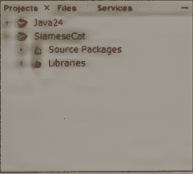

图 23.7 为 Java 项目添加库。

1. 在每个项目中，开始编写 Java 代码之前必须添加 Java 类库：你安装时下载的 Spigot JAR 文件。在 Projects 面板中，右键点击 Libraries 并选择 Add Library（添加库）。出现 Add Library 对话。
2. 点击 Create（创建）。出现 New Library 对话。
3. 在 Library Name（库名称）字段中输入 `Spigot` 并点击 OK。出现 Customize Library 对话。
4. 点击 Add JAR/Folder 按钮。出现 Browse JAR/Folder 对话。
5. 使用对话找到并打开安装服务器的文件夹。
6. 点击 `spigotserver.jar` 选择该文件。
7. 点击 Add JAR/Folder。
8. 点击 OK。
9. Available Libraries 面板现在有了 Spigot。选择它并点击 Add Library。

Projects 面板现在包含 Libraries 文件夹中的 Spigot JAR 文件（点击 Libraries 旁的 + 查看）。你准备好开始编写插件程序了。

按照以下步骤创建程序：

1. 点击 File、New File。出现 New File 对话。
2. 在 Categories 面板中，选择 Empty Java。
3. 在 File types（文件类型）面板中，选择 Empty Java；然后点击 Next。
4. 在 Class Name（类名）字段中输入 `SiameseCat`。
5. 在 Package（包）字段中输入 `org.cadenhead.minecraft`。
6. 点击 Finish。

`SiameseCat` 文件在 NetBeans 编辑器中打开。

```java
package org.cadenhead.minecraft;

import org.bukkit.command.Command;
import org.bukkit.command.CommandExecutor;
import org.bukkit.command.CommandSender;
import org.bukkit.entity.Player;
import org.bukkit.location.Location;
import org.bukkit.world.World;
import org.bukkit.plugin.java.JavaPlugin;
import java.util.logging.Logger;

public class SiameseCat extends JavaPlugin implements CommandExecutor {
    private static final Logger Logger = Logger.getLogger("SiameseCat");

    @Override
    public void onEnable() {
        getCommand("siamesecat").setExecutor(this);
    }

    @Override
    public boolean onCommand(CommandSender sender, Command command, String label, String[] args) {
        if (label.equalsIgnoreCase("siamesecat")) {
            if (sender instanceof Player) {
                // 在此处执行操作
                Logger.info("[SiameseCat] Meow!");
                return true;
            }
        }
        return false;
    }
}
```

`SiameseCat` 插件首先需要通过以下三个语句了解更多关于游戏世界：

```java
Player me = (Player) sender;
Location spot = me.getLocation();
World world = me.getWorld();
```

插件程序都是 `JavaPlugin` 的子类。观察这个框架，当你将其用于不同的插件时，唯一变化的是三个引用暹罗猫的事项。

### 插件结构说明

程序的名称是 `SiameseCat`。

方法调用内部参数 `label.equalsIgnoreCase("siamesecat")` 是用户将输入的命令。作为参数发送到 `onCommand()` 的 `label` 对象是一个持有命令文本的字符串。

作为实例变量创建的 `Logger` 对象向服务器发送消息。

`sender` 对象是另一个发送到 `onCommand()` 的参数。它代表输入该命令的 Minecraft 实体。检查 `sender` 是否为 `Player` 实例可以验证是玩家发布的该命令。

该插件使用 `World` 类的 `spawn()` 方法创建一个生物：

```java
Ocelot cat = world.spawn(spot, Ocelot.class);
```

游戏中的每种生物都有一个对应的类。`spawn()` 的两个参数是猫放置的位置以及要创建的生物类型。

此时，猫是一只豹猫，但可以通过此语句将其更改为暹罗猫：

`cat.setCatType(Ocelot.Type.SIAMESE_CAT);`

猫的 `setCatType()` 方法决定了猫是野生的豹猫，还是暹罗猫、黑猫或红猫。

Minecraft 中的猫是能够被所有者驯服的生物之一。这种关系通过调用猫的 `setOwner()` 方法并将玩家作为参数来建立：

`cat.setOwner(me);`

将所有内容通过将列表 23.2 输入到源代码编辑器中，并点击 NetBeans 工具栏中的“全部保存（Save All）”按钮（或选择“文件，保存”）。

## 列表 23.2 SiameseCat.java 的完整文本


# 使用 Java 创建 Minecraft 模组

## 代码示例：SiameseCat 模组

```java
1: package org.cadenhead.minecraft;
2:
3: import java.util.logging.*;
4: import org.bukkit.command.*;
5: import org.bukkit.entity.*;
6: import org.bukkit.plugin.java.*;
7:
8:
9: public class SiameseCat extends JavaPlugin {
10:    public static final Logger log = Logger.getLogger("Minecraft");
11:
12:    public boolean onCommand(CommandSender sender, Command command,
13:        String label, String[] arguments) {
14:
15:        if (label.equalsIgnoreCase("siamese")) {
16:            if (sender instanceof Player) {
17:                // 获取玩家
18:                Player me = (Player) sender;
19:                // 获取玩家的当前位置
20:                Location spot = me.getLocation();
21:                // 获取游戏世界
22:                World world = me.getWorld();
23:
24:                // 生成奥洲猫
25:                Ocelot cat = world.spawn(spot, Ocelot.class);
26:                // 将其变为暹猫
27:                cat.setCatType(Ocelot.Type.SIAMES_CAT);
28:
29:                cat.setOwner(me);
30:                log.info("[SiameseCat] Meow!");
31:                return true;
32:      }
33:      }
34:      return false;
35:  }
36: }
```

第 3–7 行的 `import` 语句用于在程序中使用包：其中一个来自 Java 类库，四个来自 Spigot。

### 注意

这些类在程序中使用：来自 `java.util.logging.Logger` 的 `Logger`，来自 `org.bukkit` 的 `Location` 和 `World`，来自 `org.bukkit.command` 的 `Command`，来自 `org.bukkit.entity` 的 `Ocelot` 和 `Player` 以及来自 `org.bukkit.plugin.java` 的 `JavaPlugin`。你将在项目的后期学习更多关于这些包的知识。

第 31 行和 34 行的返回语句是标准模组框架的一部分。当模组处理命令时，你的模组在 `onCommand()` 方法内部应该返回值 `true`，未处理时返回 `false`。

你已经创建了你的第一个模组，但它还无法被 Spigot 运行。它需要一个名为 `plugin.yml` 的文件，告诉 Minecraft 服务器有关该模组的信息。

这是一个文本文件，你也可以以下步骤使用 NetBeans 创建：

1. 选择“文件（File），新文件（New File）”。打开新文件对话框。
2. 在“分类（Categories）”面板中，选择“其他（Other）”。
3. 在“文件类型（File Types）”面板中，选择“空文件（Empty File）”并点击“下一步（Next）”。
4. 在“文件名（File Name）”字段中，输入 `plugin.yml`。
5. 在“文件夹（Folder）”字段中，输入 `src`。
6. 点击“完成（Finish）”。

源代码编辑器将打开一个空白的 `plugin.yml`。将列表 23.3 的文本输入文件中，并确保每行使用的空格相同。不要使用 Tab 字符代替空格。

### 列表 23.3 项目 plugin.yml 的完整文本

```yaml
1:  name: SiameseCat
2:
3:  author: Your Name Here
4:
5:  main: org.cadenhead.minecraft.SiameseCat
6:
7:  commands:
8:  siameseat
9:  description: Spawn a Siamese cat
10:
11:  version: 1.0
```

将 "Your Name Here" 替换为你自己的名字（除非你的名字本身就是 Your Name）。为了双重检查你是否正确输入了空格，第 8 行文本 `siamese` 之前有四个空格，第 9 行 `description` 之前有八个空格。

`plugin.yml` 文件描述了模组的名称、作者、Java 类文件、命令以及该命令作用的简短描述。此文件必须位于项目中的正确位置。查看“项目（Projects）”面板，它应该在 `src` 文件夹下，标题为 `<default>` 的子标题中。如图 23.8 所示。


检查 plugin.yml 的位置。

如果文件位于错误的位置（例如在 `org.cadenhead.minecraft` 下），你可以使用拖放来移动它。点击并按住文件，将其拖到 `src` 文件夹图标并释放。你现在准备好构建你的模组了。选择菜单中的“运行（Run），清理（Clean）并构建（Build）”。如果成功，NetBeans 用户界面的左下角会出现“Finished Building SiameseCat (clean)”消息。模组被封装为名为 `SiameseCat.jar` 的文件，位于项目 `dist` 子文件夹中。要找到它，点击项目面板中的“文件（Files）”选项卡，然后展开 `dist` 文件夹。“文件”选项卡列出了组成项目的所有文件，如图 23.9 所示。

### 创建你的第一个模组


寻找 SiameseCat 模组的 JAR 文件。

此 `SiameseCat.jar` 文件需要从项目文件夹复制到 Minecraft 服务器。按照以下步骤操作：

1. 如果 Minecraft 服务器正在运行，请通过服务器窗口停止它。在 NetBeans 之外，打开安装 Minecraft 服务器的文件夹。
2. 打开 `dist` 子文件夹。
3. 返回 Minecraft 服务器文件夹。
4. 打开 `plugins` 子文件夹。
5. 按 Ctrl+v 将 `SiameseCat` 复制到其中。

你已经部署了新模组。以相同的方式启动 Minecraft 服务器，你会看到如下消息：

```text
[SiameseCat] Loading SiameseCat
[SiameseCat] Enabling SiameseCat
```

如果你没有看到这些消息，而是看到了一些错误消息，请双检查 `SiameseCat.java` 和 `plugin.yml` 是否输入正确；然后通过输入 `/siamese` 命令在客户端中，你现在拥有了暹猫。

## 代码示例：CrazyHorse 模组

```java
45:           case 2:
46:              horse.setColor(Horse.Color.CREAMY);
47:              break;
48:           case 3:
49:              horse.setColor(Horse.Color.CHESTNUT);
50:              break;
51:           case 4:
52:              horse.setColor(Horse.Color.BROWN);
53:              break;
54:           case 5:
55:              horse.setColor(Horse.Color.DARK_BROWN);
56:              break;
57:           case 6:
58:              horse.setColor(Horse.Color.BLACK);
59:           }
60:           // increase the horse's speed
61:           PotionEffect effect = new PotionEffect(
62:                               PotionType.MAX_VALUE,
63:                               10 + (coat * 10),
64:                               horse.addPotionEffect(potion);
65:                                   );
66:
67:           return true;
68:
69:   }
70:   return false;
71:
72: }
```

通过选择“文件”、“保存”或点击“全部保存”，在输入代码列表后保存此文件。

此模组为 Minecraft 添加了一个 `/crazyhorse` 命令，该命令会从天空中掉落随机数量的骑马僵尸。第 18-65 行在输入命令时会执行一些酷炫的操作。围绕这些行的其余程序部分是标准的模组框架。

在获取玩家、位置和世界后，模组会将一个 1 到 11 之间的随机数存储在变量中：

```java
int quantity = (int)(Math.random() * 10) + 1;
```

Java `Math` 类中的 `random()` 方法会生成一个 0.0 到 1.0 之间的随机浮点数。它可以乘以一个整数，以产生一个从 0 到该整数范围内的随机整数。

这个数字就是将创建的僵尸和马的数量。

### 教导僵尸骑马

从第 26 行开始的 `for` 循环为每一对僵尸-马循环一次。

它们的位置通过调用带有四个参数的 `Location()` 构造函数设置：游戏世界、x 坐标、y 坐标和 z 坐标。

```java
Location horseSpot = new Location(world,
spot.getY() + (Math.random() * 15),
spot.getY() + 20,
spot.getY() + (Math.random() * 15);
```

变量 `spot` 中的玩家位置用于帮助为每个僵尸和马选择位置。对于 x 坐标，获取玩家的 `getX()` 坐标并加上一个 0 到 14 之间的随机数。对于 z 坐标，加上 `getZ()` 和一个 0 到 14 之间的数字。对于 y 坐标，加上 20。

这意味着这些生物将出现在玩家上方 20 格块处，以及在其他方向 14 格块处。

马和僵尸的创建方式与猫科动物相同。调用世界的 `spawn()` 方法，传入生物的位置和它的类（马使用 `Horse`，僵尸使用 `Zombie`）。

Minecraft 中每个可以骑的生物都有一个 `setPassenger()` 方法，该方法将骑者作为唯一参数：

```java
horse.setPassenger(zombie);
```

如果你在这里停止，僵尸会出现在马背上，但马会很快把它甩下来。这可以通过让玩家成为这匹马的主人来防止：

```java
horse.setOwner(me);
```

被驯服的马不会甩掉骑者，即使骑者是一个渴望人类大脑脑的僵尸。当你创建一个生物时，它会继承自游戏中该生物的默认行为。

像猫科动物一样，马可以通过多种方式进行自定义。其中一种方法是通过调用其 `setColor()` 方法给马换上不同颜色的皮毛。共有七种可能。

在生成一个 0 到 6 之间的随机数后，该数字被用于第 38-59 行的 `switch-case` 语句中以设置该马的颜色。

为了让马变得疯狂一点，你也可以自定义它们的速度。游戏药水的效果可以应用于生物上。共有 22 种不同的效果，由 `PotionType` 类指示。

通过调用带有三个参数的 `PotionEffect` 构造函数来创建药水效果：效果类型、药水持续时间以及该效果的值。

该语句创建了一个持续时间最大（Java 中整数允许的最大值）的速度药水：

```java
PotionEffect = new PotionEffect(
PotionType.SPEED,
Integer.MAX_VALUE,
10 + (coat * 10));
```

`PotionEffect()` 的第三个参数设置了马的速度。它的基础值为 10，加上用于确定马颜色的随机数的 10。由于 `switch-case` 语句中的颜色从浅到深排列，公式 `10 + (coat * 10)` 使得颜色越深的马跑得越快。

现在由于模组的类已经完成，它需要一个插件描述文件。选择“新建文件”，在类别窗格中选择“其他”，并在 `src` 文件夹创建一个名为 `plugin.yml` 的空文件。

在此文件中输入 `23.5`，注意按照所示格式使用空格而不是制表符进行格式化。

### plugin.yml

```yaml
name: CrazyHorse
author: Your Name
main: org.chead.minecraft.CrazyHorse
version: 1.0
commands:
  crazyhorse:
    description: Spawn horse-riding zombies.
```

## 寻找所有生物（并杀死它们）

```java
18: // 获取游戏中所有存活生物
19: List<LivingEntity> mobs = world.getLivingEntities();
20: 
21: // 处理雷暴命令
22: if (label.equalsIgnoreCase("lightningstorm")) {
23:     if (sender instanceof Player) {
24:         int myID = me.getEntityId();
25:         // 一次遍历每个生物
26:         for (LivingEntity mob : mobs) {
27:             log.info("[LightningStorm] " + mob.getType());
28:             // 这个生物是玩家吗？
29:             if (mob.getEntityId() == myID) {
30:                 // 是，所以不要击中他
31:                 continue;
32:             }
33:             // 获取生物的位置
34:             Location spot = mob.getLocation();
35:             // 雷电击中！
36:             world.strikeLightning(spot);
37:             // 将生物的生命值设为 0（死亡）
38:             mob.setHealth(0);
39:         }
40:     }
41:     return true;
42: }
43: 
44: // 处理 mobcountCase("mobcount")
45: if (label.equalsIgnoreCase("mobcount")) {
46:     if (sender instanceof Player) {
47:         me.sendMessage("有 " + mobs.size() + " 个存活生物。");
48:         return true;
49:     }
50: }
51: return false;
52: }
53: } 
54: }
```

LightningStorm 模组通过框架实现了一项新功能：它监控两个命令而不是一个。`/lightningstorm` 命令会在生物上落下大量闪电。`/mobcount` 命令统计游戏世界中有多少个存活生物。

针对 Spigot 的 Minecraft 模组可以实现任意数量的命令：`/lightningstorm` 命令实现在列表 23.6 的第 22–42 行，`/mobcount` 命令实现在第 45–50 行。

### 第 23 课：使用 Java 创建 Minecraft 模组

这些命令同时需要玩家对象和世界对象。它们还需要每个存活生物的列表，这在第 19 行完成：

```java
List<LivingEntity> mobs = world.getLivingEntities();
```

该语句调用了世界的 `getLivingEntities()` 方法，它返回一个包含每个生物的 `List` 对象。生物用实现 `LivingEntity` 接口的对象表示。

`List` 也是一个接口。它由数组列表、栈和其他数据结构实现。数组列表使用的方法和技术也适用于此列表。

获取此列表后，你可以用一个语句（第 47 行）实现 `/mobcount` 命令：

```java
me.sendMessage("有 " + mobs.size() + " 个存活生物。");
```


列表的 `size()` 命令返回该列表中的元素数量：

此信息作为消息发送给玩家并显示在游戏中。这是通过调用玩家的 `sendMessage()` 方法来实现的，并将要显示的信息作为唯一参数传入。

`/lightningstorm` 命令更为复杂。

Java 中的数据结构有特殊的 `for` 循环，可以轻松遍历结构中的每一项。第 26 行开始对 `mobs` 列表中的每个生物进行循环：

```java
for (LivingEntity mob : mobs) {
```

这会将当前生物存储在名为 `mob` 的 `LivingEntity` 对象中。

向地图上的每个生物发射闪电时，重要的是记住玩家也是一个生物。向自己降闪电永远不是个好主意。

游戏中的每个生物都有唯一的 ID。在 `for` 循环开始之前，第 24 行存储了玩家的 ID：

```java
int myID = me.getEntityId();
```

该整数在第 29–32 行通过调用 `getEntityId()` 方法与当前生物的 ID 进行比较：

```java
if (mob.getEntityId() == myID) {
    continue;
}
```

`continue` 语句导致循环回到第 26 行并处理下一个生物。

现在玩家是安全的，通过调用 `getLocation()` 方法找到生物的位置：

```java
Location spot = mob.getLocation();
```

然后调用世界的 `strikeLightning()` 方法：

```java
world.strikeLightning(spot);
```

闪电击中生物并不总是致命的——有些生物很硬——但这会让效果显得不那么震撼。调用参数为 `0` 的生物 `setHealth()` 方法将其生命值设为该值将其杀死：

```java
mob.setHealth(0);
```

该生物需要的 `plugin.yml` 文件可以在列表 23.7 中找到。在项目文件夹创建一个名为 `plugin.yml` 的空文件，然后填充内容：

### 列表 23.7 项目的 plugin.yml 内容

| 行号 | 内容 |
| :--- | :--- |
| 1 | name: LightningStorm |
| 2 | |
| 3 | author: 你的名字 |
| 4 | |
| 5 | main: org.caden.minecraft.LightningStorm |
| 6 | |
| 7 | commands: |
| 8 | lightningstorm: |
| 9 | - description: 用闪电击中所有活生物。 |
| 10 | mobcount: |
| 11 | - description: 存活生物的数量。 |
| 12 | |
| 13 | version: 1.0 |

构建项目（选择 Build and Clean Project），然后将 `LightningStorm.jar` 文件从项目的 `dist` 文件夹复制到服务器的 `plugins` 文件夹中部署模组。下次启动服务器并游戏时，你会看到像图 23.12 中的雷暴。实际上会在书中显示惊喜。图 23.12 是一只即将被烧焦的牛。


图 23.12

# 编写可以构建的模组

你创建的前三个模组是关于 Minecraft 中移动实体的。本节的最后一个模组探索了如何使用 Java 执行游戏中最基础的操作：构建和破坏。

你将创建一个命令 `/icescoop`，在玩家周围挖掘一个圆洞。洞的大小将由玩家作为参数决定。

启动模组的方法：

1. 在 Minecraft 服务器文件夹中创建一个新项目 `IceScoop`，取消勾选 Class。
2. 在 Projects 面板中，右键点击 Libraries 并添加 Spigot 库。
3. 在 `org.caden.minecraft` 包创建一个名为 `IceScoop` 的空 Java 文件。

输入列表 23.8 的文本作为 `IceScoop` 类。在你输入后将进行解释。

## 列表 23.9 IceScoop.java 完整

```java
1: package org.caden.minecraft;

2: 

3: import java.util.logging.*;

4: import org.bukkit.*;

5: import org.bukkit.block.*;

6: import org.bukkit.command.*;

7: import org.bukkit.entity.*;

8: import org.bukkit.plugin.java.*;

9: 

10: public class IceScoop extends JavaPlugin {

11:     public static final Logger log = Logger.getLogger("Minecraft");

12: 

13:     public boolean onCommand(CommandSender sender, Command command,

14:         String label, String[] arguments) {

15: 

16:         // 设置默认半径

17:         double radius = 15;

18:         if (arguments.length > 0) {

19:             try {

20:                 // 读取用户提供的半径（如果有）

21:                 radius = Double.parseDouble(arguments[0]);

22:                 // 确保它是可接受的大小 (5-25)

23:                 if ((radius < 5) || (radius > 25)) {

24:                     radius = 15;

25:                 }

26:             }

27:             catch (NumberFormatException exception) {

28:                 // 什么都不做（使用默认值）；

29:             }

30:         }

31: 

32:         if (label.equalsIgnoreCase("icescoop")) {

33:             if (sender instanceof Player) {

34:                 scoopTerrain(sender, radius);

35:             }

36:             return true;

37:         }

38:         return false;

39: }

40: 

41:     // 从世界中挖掘一个圆洞

42:     private void scoopTerrain(CommandSender sender, double rad) {

43:         Player me = (Player) sender;

44:         Location spot = me.getLocation();

45:         World world = me.getWorld();

46: 

47:         // 遍历边长为半径倍的三维立方体

        for (double x = spot.getX() - rad; x < spot.getX() + rad; x++) {
            for (double y = spot.getY() - rad; y < spot.getY() + rad; y++) {
                for (double z = spot.getZ() - rad; z < spot.getZ() + rad; z++) {
                    // 获取该立方体内的位置
                    Location loc = new Location(world, x, y, z);
                    // 查看离玩家有多远
                    double dx = x - spot.getX();
                    double dy = y - spot.getY();
                    double dz = z - spot.getZ();
                    double distance = Math.sqrt(dx * dx + dy * dy + dz * dz);
                    // 是否在半径内？
                    if (distance < rad) {
                        Block current = world.getBlockAt(loc);
                        if (current.getType() == Material.AIR){
                            // 在挖掘出一个冰淇淋后播放声音
                            world.playSound(spot, Sound.BURP, 30, 5);
                            log.info("IceCreamScoop Scooped at (" + spot.getX() + ", " + spot.getY() + ", " + spot.getZ() + ")");
                        }
                    }
                }
            }
        }
```

## 编写一个可以构建物品的 Mod

为了防止用户输入的错误数据，你将 `parseDouble()` 放在了 `try-catch` 块中。当用户的值不是数字时，会发生 `NumberFormatException`。

如果用户的值是数字，它将通过一次或多次检查：在第 23–25 行中的一个 `if` 条件，确保半径落在 5 到 25 的可接受值范围内。

`IceCreamScoop` 类中有一个 `scoopTerrain()` 方法，它可以挖出一个圆形。

与其他 Mod 一样，这需要玩家、玩家位置和世界对象。

在像 Minecraft 世界这样的三维网格中，有不同的技术可以让你在玩家周围画出一个圆。

这个 Mod 通过查看玩家周围的正方形内的每个块来实现，正方形的边略大于半径的两倍。正方形中心是玩家所在的位置。

从第 47–49 行开始的三个嵌套 `for` 循环遍历所有的正方形。有一个 X 轴循环，一个 Y 轴循环，以及一个 Z 轴循环。

创建了一个 `Location` 对象来表示在一次循环中正在检查的位置：

```java
loc = new Location(world, x, y, z);
```

玩家的位置之前存储在第 43 行的 `spot` 对象中：

```java
Location spot = me.getLocation();
```

三条语句测量了当前 `spot` 与玩家在所有轴上的距离：

```java
double x = x - spot.getX();
double y = y - spot.getY();
double z = z - spot.getZ();
```

使用勾股拉斯定理，你可以通过对 `xd`、`yd` 和 `zd` 进行平方并将它们相加，然后使用 `Math.sqrt()` 方法获取该和的平方根来计算距离：

```java
double distance = Math.sqrt(xd * xd + yd * yd + zd * zd);
```

如果块到玩家的距离在半径范围内，通过这两条语句将块变为空气：

```java
Block current = world.getBlockAt(loc);
current.setType(Material.AIR);
```

首先，创建一个表示该块的 `Block` 对象。

接下来，调用块的 `setType()` 方法并传入 `Material.AIR`，这是 Minecraft 中代表块可以制成的几十种材质之一。

用于通过将其变为空气来破坏块的相同技术也可以用于构建。唯一改变的是材质的类型。如果你想从游戏中挖出一勺并将其变成钻石而不是空气，将使用这条语句：

```java
current.setType(Material.DIAMOND);
```

当从世界中挖出一勺时，该 Mod 会做两件事来记录这一成就：播放一个声音并向服务器日志发送消息。

通过调用世界对象的 `playSound()` 方法播放声音，该方法接受四个参数——声音的位置、类型、音量和音调：

```java
world.playSound(spot, Sound.BURP, 30, 5);
```

正如你可能猜到的，这个声音是打嗝声。可以使用几十种可能的声音。

通过调用 `Logger` 对象的 `info()` 命令并传入消息文本，可以在服务器上记录消息：

```java
log.info("IceCreamScooped up at " + spot);
```

项目的 `plugin.yml` 文件如列表 23.9 所示。在项目文件夹中创建一个名为 `plugin.yml` 的空文件以匹配此列表。

## 列表 23.9 此项目 plugin.yml 的完整文本

| | |
| :--- | :--- |
| 1 | name: IceCreamScoop |
| 2 | |
| 3 | author: 在此处输入你的名字 |
| 4 | |
| 5 | main: IceCreamScoop |
| 6 | |
| 7 | commands: |
| 8 | icecreamop: |
| 9 | description: |
| 10 | |
| 11 | version: 1.0 |

## 活动

为了深入研究模组（mod）编程，请完成以下活动：

- 创建一个 mod，将世界上所有的鸡都召唤到玩家身边。
- 使用 Spigot 的 Java 文档，创建一个 mod，生成一个在本小时内未被提到的实体生物（mob）。

要查看实现这些活动的 Java 程序，请访问书籍的网站 `www.java24hours.com`。

Google 发布了 Android 软件开发包（SDK），这是一套用于开发 Android 应用的免费工具集。第一部运行 Android 的手机 T-Mobile G1 早于 2008 年 6 月上市。

这项努力起初进展缓慢，但从 2010 年初开始呈现爆发式增长，并成为 iPhone 以及其他移动平台的真正竞争对手。现在，所有主要的手机运营商都提供 Android 手机。平板电脑和电子书阅读器的市场也在不断扩大。

在 Android 出现之前，移动应用程序开发需要昂贵的编程工具和开发者计划。手机制造商控制着谁被允许为他们创建应用，以及这些应用是否可以供用户使用。

Android 拆除了这道墙。

Android 的开源和非专有性质意味着任何人都可以开发、发布和销售应用。唯一的成本是向 Google 市场提交应用时的小额费用。一切都是免费的。

下载 Android SDK 并获取更多关于在该平台创建程序信息的地方是 Android 开发者网站：`https://developer.android.com`。在编写自己的应用时，你会查阅它，因为 Android Java 类库中的每个类都充当详尽的在线参考。

如果你使用支持 Android SDK 的集成开发环境（IDE），编写 Android 应用将变得更加容易。Android 编程推荐的 IDE 是 Android Studio，它也是免费且开源的。

你可以使用 Android Studio 编写 Android 应用，在模拟 Android 手机的模拟器中进行测试，并将其部署到实际设备上。

在大部分时间里，Java 语言一直用于编写运行在三个地方之一的程序：桌面计算机、Web 服务器或浏览器。

Android 让 Java 无处不在。你的程序可以部署在数百万手机和其他移动设备上。

这实现了 James Gosling 在 20 世纪 90 年代中期发明这种语言时的最初设计目标。他当时承担的任务是创建一种可以在手机、智能卡和家电器等设备上随处运行的语言。

当 Java 首次作为运行交互式 Web 浏览器的手段，随后作为通用语言而流行时，Java 开发者们搁置了那些梦想。

二十年后，根据一项行业估计，Android 平台在全球范围内托管了高达 30 亿个 Java 程序。

Android 有潜力在未来几年内成为 Java 编程最普及且利润最丰厚的领域。

# 创建 Android 应用

Android 应用是使用应用程序框架的普通 Java 程序，该框架是一组所有应用共有的核心类和文件。该框架体现了应用必须如何结构化以便在 Android 设备上正常运行的一系列规则。

要开始编写应用，你必须安装 Android Studio。要下载该软件，请访问 `https://developer.android.com`。运行安装向导并按照说明在你的计算机上设置软件。

要在项目中使用 IDE：

1. 运行 Android Studio。
2. 在启动时出现的对话框中，选择“新建 Android 项目”（Start a New Android Project）。打开“新建项目”向导，如图 24.1 所示。


图 24.1 在 Android Studio 中创建新的 Android 项目。

图 24.2 显示了创建新的 Android 项目后 Android Studio 的“项目”（Projects）面板。如果你没有看到此面板，请点击 IDE 左侧边缘的“项目”选项卡。

# 项目面板


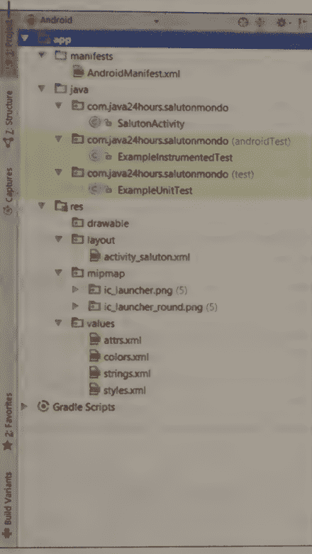

**图 24.2** 查看 Android 项目的各个部分。

你可以使用该文件夹来探索项目的文件和文件夹结构。新的 SalutonMondo 应用初始包含以下组件：

- `/java`——源代码。
- `/res`——资源文件。
- `AndroidManifest.xml`——配置文件。

# 编写 Android 应用

Android 中的字符串被赋予了名称和值，就像变量一样。它们存储在 XML 文件中。这些字符串遵循三个规则：

- 它们必须全部**小写**。
- 它们不能有空格。
- 它们必须仅使用下划线（`_`）字符。

Android 中的字符串存储在 XML 中。`strings.xml` 如下所示：

```xml
<resources>
  <string name="app_name">SalutMondo</string>
  <string name="dummy_button">Dummy Button</string>
  <string name="dummy_content">DUMMY_CONTENT</string>
</resources>
```

这是一个包含 `string` 元素的 `resources` 元素。每个 `string` 元素都有一个 `name` 属性来存储其名称。在 `<string>` 标签和 `</string>` 标签之间还有文本用于存储其值。

此编辑器允许编辑 XML 中的所有内容，甚至是标记标签。将 "DUMMY_CONTENT" 修改为 "Salut Mondo!"——注意不要更改周围的任何字符。当你完成修改后，XML 文件应包含：

```xml
<resources>
  <string name="app_name">SalutMondo</string>
  <string name="dummy_button">Dummy Button</string>
  <string name="dummy_content">Salut Mondo!</string>
</resources>
```

# 设置 Android 模拟器

在构建 Android 应用之前，你必须设置它的调试环境。这可以在 Android Studio 内完成。你必须设置一个可以在桌面上作为模拟器运行该应用的 Android 虚拟设备（AVD）。你还必须创建项目的调试配置。完成后，你就可以构建应用并在模拟器中运行它。

要配置 Android 虚拟设备，首先点击 Android 工具栏中的 Android 手机图标，如图 24.4 所示。

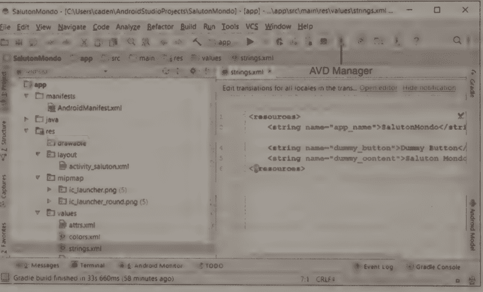

**图 24.4** 配置 Android 虚拟设备。

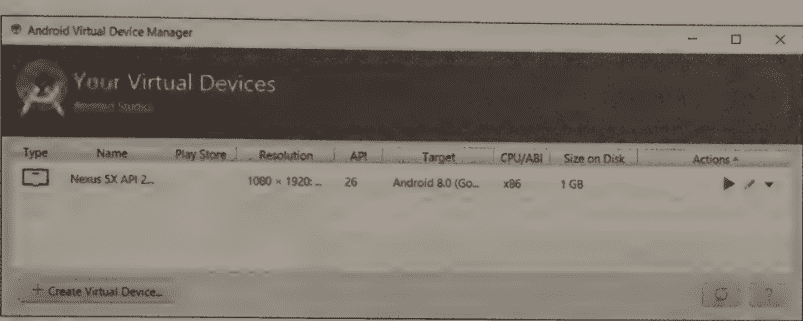

**图 24.5** 创建一个新的 Android 模拟器。

要添加新模拟器，点击“Create Virtual Device”（创建虚拟设备）并按照以下步骤操作：

1. 从列表中选择设备，例如 Galaxy Nexus，然后点击“Next”（下一步）。
2. 从列表中选择一个版本，例如 Nougat，然后点击“Next”（下一步）。
3. 在“AVD Name”字段中，为它命名为 SimpleAVD。
4. 点击“Finish”（完成）。
5. 新模拟器已创建，这可能需要一些时间（通常不超过一分钟）。

你可以根据需要创建任意的模拟器。它们可以针对不同的 Android 版本和不同的显示类型进行自定义。

关闭“Android Virtual Device Manager”（Android 虚拟设备管理器）返回 Android Studio 主界面。

# 运行应用

现在你有了一个 Android 模拟器，可以运行你的第一个应用了。选择菜单命令 **Run**（运行）> **Run App**（运行应用）。打开“Select Deployment Target”（选择部署目标）对话框。在“Available Virtual Devices”（可用虚拟设备）下，选择 SimpleAVD 并点击 OK。

你可能会被要求安装平台。点击 **Install**（安装）并 **Continue**（继续）。

Android 模拟器会在自己的窗口中加载。这可能需要一分钟或更长时间，所以请耐心等待虚拟手机启动。（模拟器的加载速度非常慢，让你有时间思考一句中国谚语：“牛马马蹄，地不移。”）

你安装的程序将带有一个 Android 图标和标签 SalutonMongo 出现。点击该图标运行应用。

模拟器显示“Saluton Mondo”作为应用的文本，如图 24.6 所示。控制控件使得模拟器可以像手机一样使用，但使用的是鼠标而不是手指。点击返回按钮关闭应用，查看 Android 设备是如何模拟的。


**图 24.6** 在 Android 模拟器中运行应用。

# 设计真实的应用

模拟器可以完成许多真实设备可以做的事情，包括在计算机有活动连接时连接到互联网。它还可以接收虚拟电话和短信消息，但拨打真实电话和发送消息需要真实的设备。

由于它不是功能完全的设备，你开发的应用必须在真实的 Android 手机和平板上进行测试。

如果你能使用 USB 线将 Android 手机（或其他设备）连接到计算机，只要手机设置为调试模式，你就应该能够运行该应用。使用 Android SDK 开发的应用只能在此模式下部署到手机上。

在手机上，通过选择 **Home**（首页）> **Settings**（设置）> **Applications**（应用程序）> **Development**（开发）（或 **Home** > **Settings** > **Developer Options**）进入此模式。将显示开发设置。选择 **USB debugging**（USB 调试）选项。

使用 USB 线将 Android 手机连接到计算机。手机屏幕顶部栏上会出现一个 Android 错误虫图标。如果你拖动此栏，你会看到“USB Debugging Connected”（USB 调试已连接）的消息。接下来，在 Android 中按照以下步骤操作：

1. 选择 **RunApp**。
2. 在“Connected Devices”（已连接设备）下，选择你的手机。
3. 点击 OK。

应用在手机上的运行方式与在模拟器上一样。

就像你在第 2 小时用 Java 编写的第一个程序一样，你在 Android 上创建的第一个应用也极其平庸。下一个项目将更具野心。

通过选择菜单命令 **File**（文件）> **Close Project**（关闭项目）关闭此项目。

# 创建新的 Android 项目

1. 选择 **New Project**（新建项目）> **Empty Activity**。
2. 在 **Application** 字段中输入你的名称。
3. 在 **Minimum SDK** 字段中选择 15。
4. 点击 **Next**（下一步）。
5. 在 **Package name** 字段中输入 `com.example.salutongo`。
6. 选择 **Language**（语言）为 Java。
7. 勾选 **Android Support**。
8. 点击 **Finish**（完成）。

Android 项目将创建完成。

# 组织资源

1. 在 `res` 文件夹中找到图片资源。
2. 在 `drawable` 文件夹中，你可以找到 `appicon.png`。
3. 在 `values` 文件夹中找到 `strings.xml`。
4. 在 `strings.xml` 中，你可以看到如下代码：

```xml
<string name="app_name">SalutonMongo</string>
```

5. 将 `app_name` 的字符串值更改为 `Saluton Mondo`：

```xml
<string name="app_name">Saluton Mondo</string>
```

6. 保存文件。

# 配置应用的清单文件

Android 应用的主要配置工具是位于 app 文件夹下的 `AndroidManifest.xml` 文件。双击 `AndroidManifest.xml` 打开该 XML 文件进行编辑。

`icon` 字段标识应用的图标，它目前具有一个错误的值 `@mipmap/ic_launcher`。

找到代码中如下的行：

```xml
android:icon="@mipmap/ic_launcher"
```

将其更改为：

```xml
android:icon="@mipmap/appicon"
```


## 设计用户界面

应用的图形用户界面由布局组成，布局是容器，用于容纳文本字段、按钮、图形以及你自己设计的自定义控件等组件。显示给用户的每个屏幕可以有一个布局，也可以包含相互嵌套的多个布局。布局既可以按垂直或水平方向堆叠组件，也可以以表格的形式组织它们，或者有其他的排列方式。

应用可以简单到只有一个屏幕，也可以包含多个屏幕。一个游戏可以组织为这些屏幕：

- 启动屏幕，显示游戏正在加载
- 主菜单屏幕，带有查看其他屏幕的按钮
- 帮助屏幕，解释如何玩游戏
- 分数屏幕，列出玩家的最高分
- 制作人员名单屏幕，列出游戏开发者的姓名
- 游戏屏幕，用于实际游戏

Leader 应用包含一个屏幕，其中存有用于联系美国总统或待命的领导人的按钮。

该应用的所有屏幕都保存在 `/res/layout` 文件夹中。该项目在该文件夹中有一个 `activity_leader.xml` 文件，它被指定为应用加载时显示的屏幕。

要开始编辑此屏幕的布局，在包资源管理器中双击 `activity_leader.xml`。屏幕会在 Android Studio 的主编辑窗中打开，如图 24.7 所示。


图 24.7
编辑 Activity 的图形用户界面。

编辑窗口包含一个调色板面板，其中有几类可以展开的用户界面组件。可以将这些组件拖放并释放到右侧的屏幕上。
按照以下步骤在屏幕上添加三个图形按钮：

1. 点击编辑面板底部显示“Dummy Button”文本的控件，并按 Delete 键将其删除。

2. 点击调色板面板中的 Layouts 文件夹。子面板会展开。

3. 从调色板将 `LinearLayout (vertical)` 控件拖动到屏幕上。编辑面板右侧会出现一个属性面板，其中在 Orientation（方向）下拉菜单上方有一个 Linear Layout（线性布局）标签。如果尚未选择 `vertical`（垂直），请选择该值。该布局控件决定了放置在其上的界面元素将如何排列。

4. 在调色板面板中，点击 Images 文件夹。子面板会展开。

5. 从调色板将一个 `ImageButton` 控件拖动到编辑面板中的应用屏幕上。会弹出一个资源对话框，要求你选择一个显示在按钮上的图像。选择 `phone` 并点击 OK。按钮现在有了一个手机的图形。

6. 在属性面板中，将 `Layout_Width` 设置为 `wrap_content`。

7. 拖动另一个 `ImageButton` 控件并将其到手机按钮的右侧。为这一个选择 `browser` 资源。添加了一个浏览器按钮。

8. 再拖动一个 `ImageButton` 控件并将其到浏览器按钮的右侧，为其分配 `maps` 资源。

组件面板列出了屏幕上的控件。选择 `imageButton1` 项目。按钮的属性将在属性面板中打开。

1. 向下滚动属性面板，直到看到 ID 属性。它的值当前被设置为 `imageButton1`。将其更改为 `phoneButton`。

2. 在 On Click（点击）属性中，输入值 `processClicks`。（这将在下一节中解释。）

3. 对 `imageButton2` 重复步骤 8-11，赋予其 ID `webButton` 和 On Click 属性 `processClicks`。

4. 对 `imageButton3` 重复步骤 8-11，赋予其 ID `mapButton` 和 On Click 属性 `processClicks`。

5. 点击组件树中的 `LinearLayout` 项目。屏幕的属性将出现在属性面板中。

6. 在属性面板中，点击 View All Properties（查看所有属性）链接。

7. 点击 Background（背景）的值；然后点击 `...` 按钮。资源对话框将打开。

8. 选择 `whitehouse` 并点击 OK。白宫的图形成为屏幕的背景。

9. 点击 Save（保存）按钮。

完成后的屏幕如图 24.8 所示。


图 24.8
预览应用的图形用户界面。

## 编写 Java 代码

此时，你已经完成了新应用的大部分工作，但还没有写任何一行 Java 代码。当你尽可能利用 Android SDK 的功能而不诉诸编程时，应用开发会变得更容易。

应用被组织成 Activity（活动），它们代表了应用可以执行的操作。每个 Activity 都由它自己的 Java 类定义。当你创建此应用时，你指定创建一个名为 `LeaderActivity` 的 Activity。当应用加载时，与此名称匹配的类会自动运行。

`LeaderActivity.java` 的源码可以在包资源管理器的 `/java/com.java24hours.leader` 文件夹中找到。双击此文件进行编辑。

当你启动时，该类有一系列现有的源代码。

与所有 Activity 一样，`LeaderActivity` 是一个 `Activity` 类的子类，该类包含了显示屏幕、收集用户输入、保存用户设置等所需的行为。

类中定义的 `onCreate()` 方法在类加载时被调用。

该方法的第一件事是使用 `super()` 调用其父类中的相同方法：`super.onSave();`。

接下来，它调用 `setContentView()`，这是一个选择屏幕的方法。该方法的参数是一个实例变量 `R.layout.activity_leader`，它指向 `activity_leader` 文件。

当你早些设计应用时，你将每个按钮的 On Click 属性设置为了 `processClicks`。这表示当点击按钮时将调用 `processClicks`。

现在是实现该方法了。在 `LeaderActivity` 中添加以下语句：

```java
public void processClicks(View display) {
  Intent action = null;
  int id = display.getId();
}
```

在文件顶部添加此导入语句：`import android.content.Intent;`

返回 `processClicks()` 方法。它带有一个参数：来自 `android.view` 包的 `View` 对象。View 是某种视觉显示。`getId()` 返回被点击按钮的 ID：`phoneButton`、`webButton` 或 `mapButton`。

此 ID 存储在变量中，以便根据点击采取行动。在调用 `display.getId()` 的行之后添加以下语句：

```java
switch (id) {
  case (R.id.phoneButton):
    // ...
    break;
  case (R.id.webButton):
    // ...
    break;
  case (R.id.mapButton):
    //
    break;
  default:
    break;
}
```

此代码将根据每个 ID 的整数采取三种行动之一。

`processClicks()` 方法中的第一个语句创建一个变量来持有 Intent 对象，它是 `android.content` 包中的类：

`Intent action;`

Android 中的 Intent 是 Activity 告诉另一个 Activity 要做什么的方式。它们也是应用与 Android 设备通信的方式。

是此方法使用的三个 Intent：

```java
action = new Intent(Intent.ACTION_DIAL, Uri.parse("tel:202-456-1111"));
action = new Intent(Intent.ACTION_VIEW, Uri.parse("http://whitehouse.gov"));
action = new Intent(Intent.ACTION_VIEW, Uri.parse("geo:0,0?q=White House, Washington, DC"));
```

这三个 Intent 分告诉 Android 设备拨打白宫公用电话 (202)-456-1111、访问 http://whitehouse.gov 网站，以及加载部分地址为“White House, Washington, DC”的 Google Maps。

将这三个 Intent 构造函数放在 switch 条件语句中注释的位置。在每个 case 中都有一个语句——电话块中的电话、网页块中的网页访问以及地址块中的地址。

在你创建 Intent 之后，以下语句会它执行某些操作：

`startActivity(action);`

将此语句放在 switch 块之后。

## 设计一个真实的应用

由于你删除了 Activity 的虚位按钮，你必须移除这行代码，它是 `onCreate()` 方法中的最后一行：

```java
findViewById(R.id.dummy_button).setOnTouchListener(mDelayHideTouchListener);
```

删除它的一种简单方法是在它前面加上 `//`，将其变成编译器会忽略的注释。

为了使你添加的代码能够正常工作，必须在类中添加以下导入语句：

```java
import android.net.Uri;
```

`MainActivity` 类中 `processClicks()` 方法的全文如列表 24.1 所示。请确保你代码中的方法与列表匹配。（注意，这并不是 `LeaderActivity.java` 的全部源代码，仅仅是 `processClicks()` 方法。）

### 列表 24.1 LeaderActivity.java 的部分文本

```java
1:   public void processClicks(View display) {
2:      Intent action = null;
3:      int id = display.getId();
4:      switch (id) {
5:          case (R.id.phoneButton):
6:              action = new Intent(Intent.ACTION_DIAL,
7:                  Uri.parse("tel:202-456-1111"));
8:              break;
9:          case (R.id.webButton):
10:             action = new Intent(Intent.ACTION_VIEW,
11:                 Uri.parse("http://whitehouse.gov");
12:             break;
13:         case (R.id.mapButton):
14:             action = new Intent(Intent.ACTION_VIEW,
15:                 Uri.parse("geo:0,0?q=White House, Washington, DC");
16:             break;
17:             default:
18:                 break;
19:         }
20:         startActivity(action);
21:     }
```


完成后保存文件。选择菜单命令 `Build`、`Make Project` 来编译它。如果没有成功，将显示错误信息，并在 Project 窗格中发现错误的文件中出现红线。

要运行应用，请选择 `Run`、`Run App`，并将 `SimpleAVD` 作为虚拟设备。模拟器加载（这需要一些时间），然后会自动运行应用。

模拟器并模拟 Android 设备可以做的所有操作。Leader 应用的拨号和浏览器按钮应该正常工作，但你可能会在地图上遇到问题。

如果你有一个适用于 Android SDK 的 Android 手机，并且手机已设置为调试模式，也可以在手机上运行该应用。

选择 `Run`、`Run App`，然后选择你的手机而不是虚拟设备。点击 `OK`。

图 24.9 显示了应用在我的手机上运行。当手机从竖屏模式切换到横屏模式时，应用会相应切换。


图 24.9
带我去你的领袖！

Leader 应用也被添加到了手机应用程序中，带有它自己的“带我去你的领袖”图标。即使在你断开 USB 线后，它也会留在手机上。

恭喜！世界现在有了十亿零一个 Android 应用。

## 注意事项

正如你可能想到的，Android 编程的内容远比一小时能涵盖的要多。Sams 提供了另一本书，它在你在这里学的 Java 编程基础上，扩展了另外 24 小时的 Android 专项内容：《Sams Teach Yourself Android Development, Fourth Edition》，由 Carmen Delessio、Lauren Darcy 和 Shane Conder 著（ISBN 978-0-672-33739-0）。

## 总结

《Sams Teach Yourself Java in 24 Hours》的目标是帮助你熟悉编程概念，并提高你编写自己的程序的能力，无论这些程序是运行在桌面电脑、Web 服务器还是手机上。Java 的一种方法有点难以掌握。（你可以随意划掉前一句话中的“有点”一词）。

随着你在 Java 方面积累经验，你所建立的经验将变得越来越重要，因为像面向对象编程、虚拟机和安全环境等概念处于软件开发的最前沿。

如果你还没有查看的话，应该检查附录以获取更多有用信息。在本小时的结束时，你可以在几个地方探索 Java。程序员在 `www.planetbeans.org` 的博客上讨论这种语言。`www.careerbuilder.com` 等就业网站的数据库中显示了大量的职位空缺。该书还有一个网站 `www.java24hours.com`，你可以在那里向作者发送电子邮件，并阅读读者问题的解答、对书籍的说明以及（咽了一下）更正。

继续作为 Java 程序员提升技能的一种方法是阅读《Sams Teach Yourself Java in 21 Days》。我也写了那本书，它扩展了这里涵盖的主题并引入了新主题。

如果你没有跳过并完成了所有 24 小时的内容，太喜你。

# 练习工作坊

## 问答

如果你想巩固刚刚掌握的 Android 开发知识，请回答以下问题：

1. 哪些公司不是开放手机倡议（Open Handset Initiative）的成员？
   - A. Google
   - B. Apple
   - C. Motorola

2. 使用什么对象让 Activity 告诉另一个 Activity 要做什么？
   - A. Intent
   - B. Action
   - C. View

3. 下列哪些任务 Android 模拟器无法执行？
   - A. 接收短信
   - B. 连接互联网
   - C. 拨打电话

## 答案

1. B. Apple，因为 Android 的部分是作为 Apple iPhone 的开源、非专利替代方案创建的。
2. A. Intent 也是 Activity 与 Android 设备通信的方式。
3. C. 模拟器无法做实际设备可以做的所有事情，因此它们只是应用测试过程的一部分。

## 活动

为了让你的 Android 知识走得更远，请尝试以下活动：

- 将 SalutonMondo 应用的文本改为“Hello, Android”，并在模拟器和 Android 设备上运行应用。
- 为不同的世界领袖创建一个新版本的 Take Me to Your Leader，自定义电话、Web 和地图目的地。

要查看实现这些活动的 Java 程序，请访问本书的网站 `www.java24hours.com`。

# 附录 A

## 使用 NetBeans 集成开发环境

虽然仅用 Java 开发包（JDK）和文本编辑器就可以创建 Java 程序，但使用集成开发环境（IDE）的体验会愉快得多。

我们大多数人都使用 NetBeans，这是 Oracle 为 Java 程序员提供的免费 IDE。NetBeans 是一个能更方便组织、编写、编译和调试 Java 软件的程序。它包含了项目和文件管理器、图形用户界面设计器以及许多其他工具。一个杀手功能是代码编辑器，它可以在你打字时自动检测 Java 语法错误。

在 8.2 版本中，NetBeans 已经成为专业 Java 开发者的喜爱，其提供的功能和性能即使价格是 10 倍也物有所值（看到我怎么表达的了吗？）。NetBeans 也是 Java 初学者最易于使用的 IDE 之一。

在本附录中，你将学习关于 NetBeans 的足够知识，以便安装该软件并在本书中使用它。

## 安装 NetBeans

从良好的起点开始，NetBeans IDE 已经成为 Java 开发者领先的编程工具之一。Java 语言的创造者 James Gosling 在他的著作《NetBeans 战地指南》中给出了终极信任：“我使用 NetBeans 进行我所有的 Java 开发。”在多年来尝试了该语言大多数可用 IDE 后，我也成为了一名支持者。

NetBeans 支持 Java 语言三个版本的所有编程方面——Java 标准版 (JSE)、Java 企业版 (JEE) 和 Java 移动版 (JME)。它还支持 Web 应用开发、Web 服务和 JavaBeans。它同时也侧关注 JSE。

你可以从 `https://netbeans.org` 下载 NetBeans，它支持 Windows、Mac OS 和 Linux。该软件可以与 Java 开发包（JDK）捆绑下载，也可以单独下载。你必须在电脑上安装 NetBeans 和 JDK。NetBeans 提供多个组合包，请选择支持 Java SE 的那一个。

## 附录 A：使用 NetBeans 集成开发环境

> **注意**
>
> 加载 NetBeans 网站时遇到困难？你可能正在尝试加载 `www.netbeans.org`（该地址无法工作），而不是 `https://netbeans.org`。

如果你想确保下载的 NetBeans 和 JDK 版本与准备本书时使用的版本相同，请访问本书网站 `www.java24hours.com`。点击本书的封面打开该版本的网站，然后寻找“Download JDK”和“Download NetBeans”链接。你将被引导至正确的站点。

## 创建新项目

JDK 和 NetBeans 以安装向导的形式下载，并在你的系统上设置软件。你可以在喜欢的任何文件夹和菜单组中安装软件，但除非有充分理由这样做，否则最好遵循默认设置选项。

安装后首次运行 NetBeans 时，你将看到一个启动页，其中显示了演示和编程教程的链接（见图 A.1）。你可以使用 NetBeans 内置的浏览器在 IDE 内阅读这些内容。


图 A.1
NetBeans 用户界面。

一个 NetBeans 项目由一组相关的 Java 类、这些类使用的文件以及 Java 类库组成。每个项目都有自己的文件夹，你可以在 NetBeans 之外使用文本编辑器和其他编程工具对其进行探索和修改。

要开始一个新项目，请点击图 A.1 所示的“新项目（New Project）”按钮或选择“文件（File）-> 新项目（New Project）”菜单命令。新项目向导会打开，如图 A.2 所示。

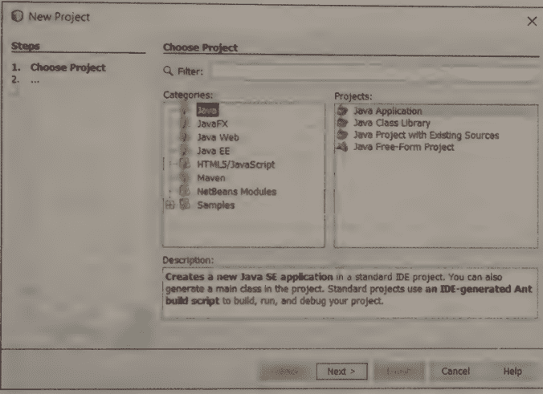

图 A.2
新项目向导。

NetBeans 可以创建多种类型的 Java 项目，但在本书中，你可以专注于一种类型：Java Application。

对于你的第一个项目（以及书中的大部分项目），选择项目类型 Java Application 并点击“下一步（Next）”。向导要求你选择项目的名称和位置。

“项目位置（Project location）”字段标识了你用 NetBeans 创建的编程项目的根文件夹。在 Windows 上，这可能是你的“我的文档”（或“文档”）文件夹下一个名为 NetBeansProjects 的子文件夹。你创建的所有项目都存储在这个文件夹中，每个项目都有自己的子文件夹。

在“项目名称（Project name）”字段中，输入 Java24。“创建主类（Create Main Class）”文本框会根据输入响应，建议将 `java24.Java24` 作为项目中的主 Java 类名。将其改为 `Spartacus` 并点击“完成（Finish）”，接受所有其他默认值。NetBeans 会创建该项目及其第一个类。

## 创建新的 Java 类

当 NetBeans 创建新项目时，它会设置所有必要的文件和文件夹并创建主类。图 A.3 显示了你项目中的第一个类 `Spartacus.java` 在源代码编辑器中打开。

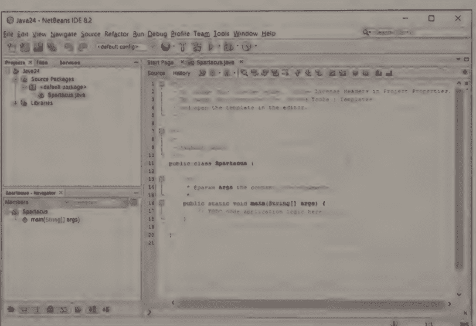

图 A.3
NetBeans 源代码编辑器。

`Spartacus.java` 是一个基础骨架类，只包含一个 `main()` 方法。类中所有的浅灰色行都是解释该类的目的和功能的注释。在运行该类时，注释会被忽略。

为了让该类执行操作，请添加以下行：

- `System.out.println("I am Spartacus!");`

## 修复错误

回到源编辑器中的 `Spartacus.java`，删除调用 `System.out.println()` 所在行末尾的分号（列表 A.1 中的第 18 行）。即使在保存文件之前，NetBeans 已经发现了错误，并在行左侧显示了一个红色警报图标（见图 A.5）。


图 A.5
在源编辑器中标记错误。

鼠标悬停在警报图标上，会出现一个对话框，描述 NetBeans 认为它发现的错误。NetBeans 源编辑器可以识别你在编写 Java 程序时遇到的大多数常见错误和拼写错误。错误检测会阻止文件编译，直到错误被修复。

在行末尾重新加上分号。警报图标消失，你可以再次保存并运行该类。

这些基本功能就是你创建和编译书中 Java 程序所需的所有内容。NetBeans 的功能远不止于此，但你应该专注于学习 Java，而不是深陷 IDE。把 NetBeans 当作一个简单的编程项目管理器和文本编辑器来使用。编写类、标记错误，并确保成功编译和运行每个项目。

当你准备好学习更多关于 NetBeans 的知识时，首页提供了如何使用它的资源。Oracle 还在 `https://netbeans.org/kb` 提供了培训和文档资源。

# 附录 B
## 接下来的方向：Java 资源

在读完这本书后，你可能想知道去哪里可以提升你的 Java 编程技能。本附录列出了一些书籍、网站、互联网讨论站点以及你可以用来扩展 Java 知识的资源。

## 值得考虑的其他书籍

Sams Publishing 和其他出版社提供了几本实用的 Java 编程书籍，其中一些是对书中涵盖内容的后续进阶。如果书店目前没有你需要的书籍，可以在书店使用这些 ISBN 编号：

- *Teach Yourself Java in 21 Days*，作者 Rogers Cadenhead（就是我！我！我！）
  ISBN: 978-0-672-33795-6。虽然此书前七章的部分内容是重复的，但它更深入地涵盖了 Java，并添加了许多高级主题。如果你准备好再次投入 54 小时来学习 Java，这应该是一本合适的书。
- *Java Phrasebook*，作者 Timothy R. Fisher。ISBN 0-67232-907-7。一个包含 100 多个代码片段的集合，可用于你自己的 Java 项目，由一位专业程序员和《Java Developer's Journal》贡献者编写。
- *Agile Java Development with Spring, Hibernate and Eclipse*，作者 Anil Hemrajani。
  ISBN: 0-672-32896-8。一本关于 Java 企业版的书籍，展示了如何使用 Spring 框架、Hibernate 库和 Eclipse IDE 来减少企业应用编程的复杂性。
- *Java 9 for Programmers, 4th Edition*，作者 Paul and Harvey Deitel。ISBN 978-0-134-77756-6。对 Java 9 的高级探索，包含了 lambda 表达式、Java 模块系统、动画、视频以及使用 JDBC 和 JPA 进行数据库编程。

许多 Sams Publishing 出版 Java 书籍的其他材料已在 `www.informit.com` 上免费提供，这是一个与 Sams 合作制作的 IT 专业人士网站。

Sams Publishing 网站 `www.informit.com/sams` 是查看 Sams Publishing 以及 Pearson Technology Group 下其他品牌即将出版内容的好地方。

## Oracle 官方 Java 网站

Oracle 的 Java 软件部门维护着三个程序员和该语言用户感兴趣的网站。

Java 开发者 Oracle 技术网络（Oracle Technology Network for Java Developers）发布于 `www.oracle.com/technetwork/java`，是查找 Java 相关信息的首选之地。这里可以下载新版本的 Java 开发工具包和其他编程资源，以及整个 Java 类库的文档。这里还有错误数据库、本地面对面用户组目录以及支持论坛。

`Java.com` 是一个查找 Java 相关信息的地方。这里可以下载新版本的 Java 开发工具包和其他编程资源，以及整个 Java 类库的文档。这里还有错误数据库、本地面对面用户组目录以及支持论坛。

# 附录 C

## 本书的网站

尽管我希望事实并非如此，但在完成本书的 24 小时学习后，无疑会有一些你尚不明的地方。

编程是一项专门的技术领域，它会向你抛出各种奇怪的概念和术语，例如“实例化”、“三元运算符”以及“大端序和小端序字节序”。

如果你对书中涵盖的任何主题仍不清楚，或者是我对某个主题没有解释清楚（唉），请访问书籍网站 `www.java24hours.com` 寻求帮助。

该网站提供以下内容：

- **错误纠正与澄清**——当我注意到错误时，我会在网站上描述这些错误并提供更正后的文本以及其他可能有帮助的。
- **读者问题解答**——如果读者的问题在书中问答章节中没有涵盖，许多问题会展示在网站上。
- 你在本书的 24 小时内创建的所有程序所需的源代码、类文件和资源。
- 解决方案，包括每小时末尾建议活动的源代码。
- 针对书中提到的网站的**更新后的链接**：如果书中提到的网站更改了地址，且我知道新的链接，我会在网站上分享。

你也可以通过访问书籍网站向我发送电子邮件。点击“反馈”（Feedback）链接即可进入可以直接从网页发送电子邮件的页面。你也可以在 Twitter 上通过 `@rcade` 找到我。

欢迎表达你的所有观点，无论是积极的、负面的、冷淡的、犹豫的、愤怒的、热情的、恼火的、有趣的、生气的、好奇的、无聊的、着迷的、幻灭的、困惑的和震惊的。

—Rogers Cadenhead

# 附录 D
## 解决 Android Studio 模拟器的问题

免费的 Android Studio 集成开发环境（IDE）自 2015 年发布以来，已成为创建 Android 应用的官方工具。在第 24 小时“编写 Android 应用”中，你将学习如何使用此 IDE 用 Java 编写移动应用。

如果你已经阅读了该章节并在 Android 模拟器中成功运行了应用，你就不需要阅读本附录。

但如果你完全无法让模拟器运行，那么你来对地方了。

## 运行应用的问题

当你在 Android Studio 中进行 Android 项目并想要运行应用时，可以选择菜单命令 `Run`、`Run App`。

此命令会打开一个“Choose Device”（选择设备）对话框，询问执行应用的设备。如果设备通过 USB 线连接到你的电脑并配置了测试应用，则它可以是真实的 Android 手机或平板电脑。设备也可以是 Android 模拟器。

Android Studio 中的 Android 模拟器可以像运行移动操作系统的实际手机和平板电脑。可以为多个 Android 虚拟设备设置虚拟设备。

某些用户在使用 Android Studio 中的模拟器首次运行 Android 应用时会遇到问题。模拟器会带有这条不详的消息崩溃：

```
output ▼

ERROR: x86 emulation requires hardware acceleration!
```


Please ensure Intel HAXM is properly installed and usable. CPU acceleration status: HAXM kernel module is not installed!

此错误发生在 Windows 电脑上，表明在模拟器工作之前，需要一个来自 Intel 的名为“硬件加速执行管理器”（HAXM）的硬件加速程序。该程序可以在 Android Studio 中下载，但你必须在 IDE 之外进行安装。

HAXM 是适用于带有 Intel 处理器的计算机的硬件虚拟化引擎，通过让模拟器运行更快来加速 Android 开发。Android 应用编程中最大的瓶颈之一就是模拟器加载速度非常慢。

在设置 HAXM 之前，你必须将其添加到 Android Studio 中的 Android SDK 中。

> **注意**
>
> HAXM 仅应安装在带有 Intel 处理器的电脑上。本附录解决了 Android Studio 指出需要 HAXM 运行 Android 模拟器的问题。如果模拟器报错未提及 HAXM 的错误消息，请勿使用本附录进行修复。

## 在 Android Studio 中安装 HAXM

可以在运行 Android Studio 时下载 HAXM 并将其添加到 Android SDK。点击 Android Studio 工具栏上的 `SDK Manager` 按钮，如图 D.1 所示。


图 D.1 SDK Manager

`SDK Manager` 用于管理 Android SDK 及其组件。在 `SDK Manager` 中，你可以看到已安装的 SDK 平台、工具和其他组件。

要安装 HAXM，你需要从 Intel 网站下载 HAXM 安装程序。下载完成后，运行安装程序。安装程序将检查你的电脑是否与 HAXM 兼容。如果兼容，系统将询问你允许 HAXM 使用多少内存。默认值 2G 应该足够。完成安装。

一旦安装了 HAXM，你应该重启电脑。完成后，加载 Android Studio 并通过选择 `Run` > `Run App` 尝试运行你的应用。

应用应该在模拟器中运行。Android 模拟器看起来像手机，在加载时显示“Android”启动屏幕，然后运行应用。图 D.3 显示了 SalutonMondo 应用成功运行后的样子。


图 D.3 成功！模拟器加载并运行了应用。

如果运行成功，你就可以回到第 24 小时了。

如果失败并出现相同的错误信息要求你“确保 Intel HAXM 已正确安装并可用”，还有一件事你可以检查。然而，这需要检查你电脑的 BIOS 设置并进行更改。

## 检查 BIOS 设置

为了让 HAXM 工作，你电脑的 BIOS 必须开启“Intel 虚拟化技术”（Intel Virtualization Technology）。如果你习惯修改 BIOS，那么这是一个非常直接的检查和更改项。

由于对 BIOS 的更改可能会影响电脑的启动方式——甚至完全阻止其启动 Windows——只有在你对 BIOS 做过更改时，才应该尝试调整 BIOS。

BIOS 是在你打开 Windows 电脑时控制电脑的软件，负责启动电脑和其他必要的硬件功能。

当你的电脑启动时，你会短暂地看到一条信息，提示按下某个功能键以检查 BIOS 设置。

如果你不按此按键，BIOS 将完成它的工作并加载 Windows。

如果你按了该按键，将看到一个类似于图 D.4 所示的屏幕。

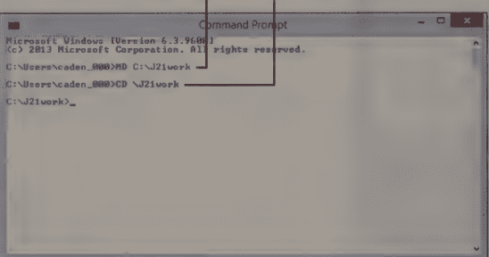

图 D.4 查看电脑的 BIOS 设置。

你电脑的 BIOS 主菜单看起来与图 D.4 不同。它取决于你的电脑制造商以及它所使用的 BIOS 版本。

在我的 Dell 桌面级电脑上，我通过选择 `BIOS Setup`（BIOS 设置）、`Advanced`（高级）、`Processor Configuration`（处理器配置）来确认是否启用了 Intel Virtualization Technology（Intel 虚拟化技术）。会列出一个处理器设置列表，每个设置旁边都有“[Enabled]”（已启用）或“[Disabled]”（禁用）。你可以在这些设置之间切换。

如果你在 BIOS 中启用 Intel Virtualization Technology 并保存更改，你的电脑就能运行 HAXM，模拟器问题也应该得到解决。

## 附录 D：修复 Android Studio 模拟器问题

## 附录 E：修复 NetBeans 中的包不可见错误

这是 Java 9 模块引入的最有趣的功能之一，它允许 Java 程序指示它们需要 Java 类库的哪些部分，以及它们导出哪些类包。

模块还可以用于访问类库中通常无法访问的 Java 包。在“第 21 节：使用 Java 9 的新 HTTP Client”中，在向该项目添加 `jdk.incubator.http` 模块之前，对新 HTTP Client 的实验性支持在编程项目中是无法使用的。

Java 9 中的标准模块（因此无需付出额外精力即可使用）仍在由 Oracle 和其他最终确定 Java 语言新版本的公司决定中。

本附录涵盖了当 NetBeans 中的 Java 项目因为模块不可用而出现错误时该怎么办。

### 添加模块信息

Java 类库包含数百个包。其中极少数包只有在它们的模块被添加到项目时才可用。

如果你尝试导入一个尚未可用的模块中的类或类组，`import` 语句会导致 NetBeans 源代码编辑器中标记出错误。

以下是此类语句的示例：

```java
import jdk.incubator.http.*;
```

如果这导致了源编辑器左边缘出现红色停止标志图标的错误，将鼠标悬停在图标上以查看错误消息：

```
Package jdk.incubator.http is not visible
(package jdk.incubator.http is declared in module
jdk.incubator.httpclient, which is not in the module
graph);
```

此错误消息揭示了必须添加到项目中以解决问题的模块名称。在例例中，它是 `jdk.incubator.http`。
模块设置在默认包中名为 `module-info` 的 Java 类中（换句话说，是一个没有任何包语句的类）。

按照以下步骤向 NetBeans 中的 Java24 项目添加模块：

1. 选择 `File`（文件）> `New File`（新建文件），然后在类别面板中选择 `Java`。
2. 在 `File Types`（文件类型）面板中，选择 `Java Module Info`（Java 模块信息）。
3. 选择 `Java Module Info`，然后点击 `Next`（下一步）。
4. 对话框显示类名 `module-info` 不允许选择包名。点击 `Finish`（完成）。

`module-info.java` 在源代码编辑器中打开进行编辑。它只需要两个这种形式的语句：

```java
module Java24 {
    requires jdk.incubator.http;
}
```


`module` 关键字后面是 `Java24`，因为那是项目的名称。如果你正在添加不同的模块，应相应修改语句。

在 `{` 和 `}` 模块块内部，`requires` 关键字后面是模块名 `jdk.incubator.http`。如果你的项目需要不同的模块，修改此处。

项目可以有多个 `requires` 语句。

当 `module-info.java` 文件保存后，模块中的（或模块）就可以被项目中的任何 Java 程序使用。该模块的 `import` 语句将报错，程序可以编译并运行。

## 索引

### 符号

- `+` (加法运算符), 60
- `\` (反斜杠), 73, 293
- `[` (方括号), 17-18, 88, 95, 112-113, 148
- `:` (冒号), 90, 106
- `//` (注释符号), 17-18
- `+=` (复合赋值运算符), 74–75
- `-` (减法运算符), 61-63
- `/` (除法运算符), 60
- `*` (引号), 55
- `=` (等号), 59
- `==` (相等运算符), 85
- `>` (大于运算符), 64–85
- `>=` (大于等于运算符), 84
- `++` (自增运算符), 61-63
- `!` (非运算符), 85
- `<` (小于运算符), 84–85
- `<=` (小于等于运算符), 84
- `*` (乘法运算符), 61
- `->` (箭头运算符), 229
- `.` (句号), 114-115
- `:` (分号), 18, 24, 50
- `'` (单引号), 55
- `[` (方括号), 112
- `-` (减法运算符), 60
- `?` (三元运算符), 90
- `_` (下划线), 57
- `$` (美元符号), 257
- 2D 图形, 自定义, 创建, 327
- 字体, 325-326
- 行, 228-329
- 饼图
  - `PieFrame` 类, 336–338
  - `PiePanel` 类, 331–336
  - `PieSlice` 类, 333
- 弧, 330
- 椭圆和圆, 330
- 矩, 329–330
- 在其中运行应用程序, 413-414
- 工作原理, 7-8
- , 81
- 抽象窗口工具包 (AWT), 237-238, 256-257
- 访问方法, 146
- `Android.xml` 文件, 380
- 注解, 162
- 匿名内部类, 234
- 南极，旅行到, 24
- Apache 项目, 45
- `append()` 方法, 20
- Applets, 37
- `ActionListener` 接口, 229, 274
- `actionPerformed()` 方法, 213, 230, 275, 284
- `add()` 方法, 165, 174, 243
- `addListener()` 方法, 285
- `+` (加运算符), 60
- `KeyViewer`, 227-228
- 布局, 265-270
- `LottoEvent`, 279-285
- `LottoMadness`, 265-270, 288
- `addToField()` 方法, 284
- 冒险, 299
- 《丁丁历险记》, 96
- 分配内存, 155
- `ModemTester`, 137-138
- `NameSorter`, 117-118
- `NewCalculator`, 191-192
- `NewColor`, 232-233
- `NewRoot`, 134-135
- 数字9, 101-102
- `NumberDivider`, 192-193
- `PageCalendar`, 198-200
- `PlanetWeight`, 65
- 回放, 243
- `PrimeFinder`, 205-208
- Android 应用, 375
- AVD (Android 设备), 382-383
- 创建, 377-386, 380-381
- Android 应用。参见 Android
- `Battlepoint`, 177-179
- 基准测试, 107-108
- `BlankFile`, 43-45
- 计算器, 189
- 目录, 223-225
- 时钟, 91-94
- 设计, 385-386
- Java 代码, 390-395
- 清单文件, 387
- 项目组件, 378-380
- 资源, 386-387
- 运行, 385

### 424 内置方法

- 内置方法, 155
- Burtt, Ben, 396
- 按钮 242–245
- `Byte` 类, 305
- `byte` 变量类型, 56
- 字节码, 292
- bytes, 305
- 摄影时的用语“茄士”(cheese), 339
- 圆形, 330
- `.class` 文件扩展名, 24
- 类层次结构, 130
- 类方法。参见方法 (methods)
- 类语句, 16
- 类 (Classes)。另见数组；方法
  - `Arc2D.Float`, 330–331
  - `ArrayIndexOutOfBoundsException`, 188
  - `ArrayList`, 164–165, 174–179
  - 豆 (beans), 164
  - 首页 (HomePage), 197–198
  - `HttpClient`, 311
  - `HttpHeaders`, 312
  - `IndexOutOfBoundsException`, 197
  - 继承 (inheritance)
  - 属性, 160–161
  - 行为, 160–161
  - 建立, 161–162
  - 多重继承, 139
  - 力量, 159
  - 内部类, 149–151, 222–225
  - 匿名内部类, 225–238
  - 目录程序应用示例, 223–225
  - 声明, 222–223

### C

### C++

- 调制解调, 136
- 计算器应用, 189
- CareerBuilder, 410
- 大小写敏感性, 58, 67
- 强制转换 (casting)
  - 对象, 131–132
  - 自动装箱 (autoboxing), 133
  - 源/目的, 131
  - 拆箱 (unboxing), 139
  - 变量, 131–132
- 目录意见, 223–225
- catch 语句
  - `final` 关键字, 196
  - try-catch 块, 189–192
  - try-catch-finally 块, 194
- 捕获异常。参见异常 (exceptions)
- 欧洲核子研究组织 (CERN), 318, 322
- `char` 变量类型, 55–56
- `char` 变量, 55–56
- 《查理和巧克力工厂》(达尔), 271
- 复选框 (check boxes)
  - 创建, 246–247
  - 事件处理, 276
- `checkCreator()` 方法, 151
- `BodyHandler`, 318
- `BodyProcessor`, 318
- 边界布局 (`BorderLayout`), 261–262
- 盒模型布局 (`BoxLayout`), 263–264
- `Byte`, 305
- `CableModel`, 136
- 类方法, 148
- 类变量, 141–144
- 颜色 (`Color`), 326–327
- 创建, 128–129, 402–404
- 定义, 126
- 文档, 408
- `DslModel`, 137
- `Ellipse2D.Float`, 330
- 封装, 146
- 错误纠正模型 (`ErrorCorrectionModel`), 129–130
- 文件 (`File`), 292–293
- 输入流 (`FileInputStream`), 293
- 输出流 (`FileOutputStream`), 299
- 流式布局 (`FlowLayout`), 243, 256, 259–261
- 字体 (`Font`), 325–326
- `Gremlin`, 141–144, 152–153
- 网格布局 (`GridLayout`), 261–262
- `HashMap`, 180–183
- 辅助类, 149–151
- 输入流读取器 (`InputStreamReader`), 159–160
- 间距 (`Insets`), 264–265
- Java 类库 (Class Library), 45–49
- 按钮 (`JButton`), 242–244
- 复选框 (`JCheckBox`), 246–248
- 窗口 (`JFrame`), 238–242
- 标签 (`JLabel`), 245–246
- 滚动面板 (`JScrollPane`), 249
- 文本区域 (`JTextArea`), 248–250
- 字段 (`JTextField`), 245–250
- 窗口 (`Window`), 238–242
- 键适配器 (`KeyAdapter`), 226
- 键监听器 (`KeyListener`), 227
- `Line2D.Float`, 328–329
- 事件 (`LottoEvent`), 279–285
- 格式异常 (`MalformedURLException`), 196
- 调制解调器 (`Modem`), 136
- 模块信息 (`module-info`), 240
- 空指针异常 (`NullPointerException`), 197
- 数字格式化异常 (`NumberFormatException`), 191, 195
- 创建, 225
- 对象重用, 163–164
- 饼图窗口 (`PieFrame`), 336–338
- 饼图面板 (`PiePanel`), 331–336
- `if`, 84, 95
- `if-else`, 87
- `=` (赋值), 85
- 注释符号, 17–18
- 小于等于运算符 (`<=`), 84
- 注解 (annotations), 162
- 商品 (Commodity), 89–87
- 比较字符串, 76–77
- `Point3D`, 168–169
- 测试器 (`PointTester`), 169–170
- 三元运算符 (`?`), 90
- 随机 (`Random`), 47
- `Rectangle2D.Float`, 329–330
- 渲染提示 (`RenderingHints`), 326
- , 11
- BIOS, 417–418
- 子类, 130, 162–163
- 组件处理：布局管理器, 302–305
- 复选框服务器, 342–343
- 配置器 (`Configurator`), 303–305
- 配置写入器 (`ConfigWriter`), 300–301
- 连接微软服务器, 346
- 控制台应用, 297–299
- 构造函数, 147–148
- 启动/停止, 208–209
- 包含 (`contains`), 78, 175, 166
- 包含键 (`containsKey`), 181
- 包含值 (`containsValue`), 181
- 继续语句 (`continue`), 104–105
- 客户端, HTTP。另参见 HTTP
- 自动装箱, 133
- 源/目的, 131
- 拆箱, 133
- 字符串转大小写,
- 类变量, 77–81,
- 计数器, 100
- 设置颜色 (`setColor`), 326–327
- 颜色方法, 327
- 创建文件 (`createNewFile`), 293
- 创建临时文件 (`createTempFile`), 315
- 颜色窗口应用, 创建, 91–94
- 定义, 380–381
- 数组列表, 174
- 大于运算符 (`>`), 类, 128–129–404
- 大于等于运算符 (`>=`), 84–85
- 建筑 (维特鲁威), 171
- 构造函数, 147–148
- 自定义颜色, 327
- 异常, 201
- 在 NetBeans IDE, 404–405
- Salon 展望, 20–22
- do-while 循环, 103–104
- 声明。另见数组
- 从网络下载文件, 314–317
- NetBeans IDE, 399
- Minecraft 组。匿名内部类，绘制方法 (`draw`), 328–329
- Minecraft 组内部类, 225–238
- CrazyHorse 项目, 方法, 145–146
- 对象, 135–138
- IceScoop 项目, 变量, 54–144
- LightningStorm 项目, `char`, 55
- SiameseCat 项目, `int`, 50
- NetBeans 项目, 400
- `long`, 67
- 子类, 168–170
- 变量, 61–62
- 线程, 204–208
- 创意 (Creative), 296
- 积分 (Credit), 115
- 开发, 327
- 除法运算符 (`/`), 60
- 达尔 (罗尔德), 271
- 数据结构, 174–79
- Eclipse, 296
- 空字符串, 80
- 编码方法 (`encode`), 318
- 键集 (`entrySet`), 181
- ...
- 页面目录应用, 198–200
- 抛出, 194–196
- 在 NetBeans IDE, 404–405
- 包不可见错误, 419–420
- 配置属性, 302–305
- 来自流, 293–297
- 从网络保存, 314–317
- `SiameseCat.jar`, 354
- `spigotserver.jar`, 342

### 查找字符串

- 查找字符串，77-78
- `firstValue()` 方法，312
- `float` 变量类型，54-55
- 浮点数，54-55, 133-132
- `FlowLayout` 类，243, 256, 259-261
- 文件夹，列出文件文件，293
- `Font` 类，325-326
- `FontMapper` 应用程序，182–183
- 类型，325-326
- 厨房中的 Food Network，32-33
- for 循环
- `getLivingEntities()` 方法，364
- `getLocation()` 方法，351, 365
- `getName()` 方法，293
- `getOrDefault()` 方法，181
- `getText()` 方法，246
- `getURI()` 方法，211
- `getWorld()` 方法，351
- `getX()` 方法，359
- `getY()` 方法，359
- Goodman, Len, 11
- Gosling, James, 5, 29, 376, 399
- Graham, Dave, 11
- 创建，247–248
- 事件处理，276
- 组件，创建，238
- 创建，237
- 事件处理。参见事件处理
- 帧，238–242
- `FreeSpace` 应用程序，251–254
- 标签，245–246
- 布局管理器。参见布局管理器
- 复杂的 for，106–107
- 语法，99–102
- 正斜线 (`/`)，60
- Fox, Michael J. 289
- 帧化，创建，238–242
- `FreeBalls`，31
- `FreeSpace` 应用程序，255–256
- `FreeSpace` 面板，251–254
- 图形用户界面。使用 GUIs (图形用户界面)
- 图形
  - 弧，330–339
  - 颜色
  - 面板，251
  - 文本区域，248–250
  - 文本字段，245–246
  - 窗口，238–242
- `fromString()` 方法，318
- 功能性接口，222
- 自定义控件，创建，327
- 设置，326–327
- 椭圆和圆，330
- 类型，325–326
- 线，328–329
- 处理错误。参见错误处理
- 处理事件。参见事件处理
- 饼图
  - `PieFrame` 类，336–338
  - `PiePanel` 类，331–336
  - `PieSlice` 类，333
- 矩形，320–339

### H

- 硬件加速执行管理器。参见 HAXM (硬件加速执行管理器，184)

### G

- George (Prince)，51
- `get()` 方法，165, 176, 181
- `getActionCommand()` 方法，275, 284
- `getBytes()` 方法，300
- `getEncoding()` 方法，160
- `getEntityID()` 方法，364
- `getGuid()` 方法，146
- `getId()` 方法，391
- `getItem()` 方法，284–285
- `getKey()` 方法，182
- `Graphics` 类，238
- 大于运算符 (`>`)，84–85
- Green Bay Packer 股票，109
- `Gremlin` 类，144–152, 251
- `GremlinInLab` 应用程序，152
- `GridLayout` 类，261–262
- GUIs (图形用户界面)。参见图形
- 按钮，242–245
- 创建，246–247
- 事件处理，276
- Harlem Globetrotters，184
- 哈希映射表，180–183
- `HashMap` 类，180–183
- Hatfield-McCoy 恩怨，224–235
- Hatfield-McCoy 审判，235
- HAXM (硬件加速执行管理器)，
  - 在 Android Studio 中安装，414–415
  - 在计算机上安装，415–417
- `headers()` 方法，312
- 辅助类，149–151。参见内部类
- Java 聚会，429
- Hillbilly Elegy (Vance)，235
- 历史，Carrie Ann，11
- Java 变量类型
- Android，375–376
- Java，5, 29–30
- 递增运算符 (`++`)，61–63
- 递增变量，61–62
- 类型转换，131–132
- 声明，54–55
- `HomePage` 类，197
- Hopper, Grace，9
- 集成开发环境 (IDEs)，9–10, 146
- `HttpClient` 类，311
- `java-android.exe`，416
- 继承，150–161
- IntelliJ IDEA，9
- 行为，160–161
- `Intent()` 方法，392
- 定义，129–130
- 接口。参见 GUIs (图形接口)
- 建立，161–162
- `ActionListener`，229, 274
- 层次结构，130–131
- 多重继承，139
- 权力，159–160
- `Runnable`，205
- 内部类，149–151, 221–225
- 解释型语言，7, 11
- `isPresent()` 方法，312
- `IceScoop` 项目，366–372
- `Detector`，33–34
- `ItemChanged()` 方法，284–285
- `IDReader` 请求，295–296
- IDEs (集成开发环境)，9–10, 146
- 目录示例，223–225
- 示例，222–223
- Android Studio。参见 IDE。
- NetBeans IDE，84, 95
- 输入，响应。处理
- 输入流，292, 159–160
- JAR (Java Archive) 文件，309
- Java 类库，45–49
- Java 开发包 (JDK)，9
- `if` 语句，87
- `else` 语句，196–197
- `Insets` 类，264–265
- `ImageDownloader` 应用程序，315–317
- `implements` 关键字，205
- HAXM (硬件加速执行管理器) 在 Android Studio 中，414–415
- 计算机，415–447
- `import` 语句，209
- 模块，419–420
- 包，47, 289
- Java 开发工具，10
- NetBeans IDE，399–400
- Java EE (Java 企业版)，38
- Java 文件名扩展，7
- Java 杂志，28
- Java 聚会，410

### J

### Java SE (Java 标准版)

- Java SE (Java 标准版)，38
- Java 虚拟机 (JVM)，8, 31, 309, 345
- Java.com，408
- `java.exe` 文件，345
- `java.io` 包，46
- `/jav` 文件夹，379
- `java.time` 包，46
- `java.util` 包，46
- JavaWorld，409
- `JButton` 类，242–244
- `JCheckBox` 类，246–248
- JDK (Java 开发包)，9
- `JFrame` 类，238–242
- `JLabel` 类，245–246
- 职业机会，410
- Joy, Bill，29
- `JPanel` 类，251
- `JScrollPane` 类，249
- JShell，8, 59
- JSoko，36
- `JTextArea` 类，248–250
- `JTextField` 类，245–246
- JVM (Java 虚拟机)，8, 31, 309, 345
- `Window` 类，238–242
- 关键字。参见语句
  - `implements`，205
  - `requires`，420
  - `this`，151–152, 162–163
  - `throw`，194–196
  - `void`，145
- Koyman, Barbara，217
- `Line2D.Float` 类，328–329
- 线，绘制，328–329
- 连接字符串，74–75
- 语言声明，209
- 构造函数，210
- 异常捕，211
- 事件处理，213
- 启动线程，215
- 停止线程，216
- 变量，209–210
- 依赖，213–216
- lambda 表达式，229–233
- 语言选择，1-5
- 语言外壳，49
- 启动。参见布局管理器，259
  - `BorderLayout`，261–262
  - `BoxLayout`，263–264
  - `FlowLayout`，259–261
  - `GridLayout`，261–262
  - `Insets`，264–265
- `ActionListener` 接口，274
- `EventListener` 接口，273–274
- 列表列表，295
- 列表列表。参见
- 遍历，166–167
- `Location()` 方法，359
- `long` 变量类型，56–57
- Katzenjammer Kids，201
- `KeyAdapter`，226
- 键盘事件，276–278
- `keyPressed()` 方法，226
- `keyReleased()` 方法，226
- `keyTyped()` 方法，226
- `KeyViewer` 应用程序，227–228
- `KeyListener` 类，227
- Leeway, Joe，96
- `LegendarySonsOfDracula` 类，217
- `length()` 方法，77, 293
- 字符串长度，确定，77
- 小于运算符 (`<`)，84–85
- 数组列表，166–167
- Libraries Java 类，45–49
- 许可，Creative Commons，296
- `LightningStorm` 项目，362–365
- `Benchmark` 应用程序，107–108
- do-while，103–104
- 扩展，104–105
- 复杂的 for 循环，106–107
- 语法，99–102

### 方法

- 无限循环，109
- 迭代，101
- 命名，105–106
- `while`，102–103
- `build()`，311
- 内置方法，155
- `checkCreator()`，151
- 类方法，148
- `getName()`，293
- `getOrDefault()`，181
- `getText()`，246
- `getURI()`，211
- `getWorld()`，351
- `getX()`，359
- `getY()`，359
- `LottoEvent` 应用程序，279–285
- `LottoMadness` 应用程序，265–270, 288
- 小写字符串，77, 80–81
- `clearAllFields()`，284
- `close()`，161, 300
- `Color()`，327
- 构造函数，147–148
- `contains()`，78, 165, 176
- `containsKey()`，181
- `containsValue()`，181
- `createNewFile()`，293
- `createTempFile()`，315
- `currentThread()`，212
- `headers()`，312
- `indexOf()`，77–178
- `info()`，370
- `Intent()`，392
- MacDonald, K.，217–218
- MacDonald, Pat，217
- `main()` 方法，177
- `MalformedURLException` 类，196
- manifest 文件，387
- 映射表，180–183
- `mark()` 方法，161
- Master P，11
- `matchedOne()` 方法，284
- Matulich, Chris，38
- Meetup.com，410
- meetups，410
- 内存分配，155
- 方法，144

### M

- 访问方法，146
- `actionPerformed()`，213, 230, 275, 284
- `add()`，165, 174, 243
- `addActionListener()`，285
- `addToField()`，284
- `append()`，208
- 参数，146–147
- `asByteArray()`，312
- `asFile()`，312, 315
- `browse()`，213
- 声明，145–146
- `of()`，47
- `delete()`，293
- `draw()`，328
- `drawString()`，328
- `encode()`，318
- `entrySet()`，181
- `equals()`，76–77, 181, 171
- `equalsIgnoreCase()`，351
- `exists()`，293
- `fill()`，328, 329
- `firstValue()`，312
- `fromString()`，318
- `get()`，165, 176, 181
- `getActionCommand()`，275, 284
- `getBytes()`，300
- `getEncoding()`，160
- `getEntityID()`，364
- `getGuid()`，146
- `getId()`，391
- `getItem()`，284–285
- `getKey()`，182
- `getLivingEntities()`，364
- `getLocation()`，351, 365
- `getName()`，293
- `getOrDefault()`，181
- `getText()`，246
- `getURI()`，211
- `getWorld()`，351
- `getX()`，359
- `getY()`，359

### 432 方法

- `random()`，358
- `readLine()`，299
- `remove()`，175
- `renameTo()`，293
- `repaint()`，289
- `reset()`，161
- `resume()`，209
- `run()`，205, 212
- `scoopTerrain()`，369
- `send()`，319
- `sendMessage()`，364
- `setBackground()`，326–327
- `setSubType()`，352
- `setColor()`，326–327
- `setContentView()`，391
- `setDefaultCloseOperation()`，240
- `setEditable()`，248
- `setGuid()`，146
- `setHealth()`，365
- `setLayout()`，249
- `setLineWrap()`，249
- `setLookAndFeel()`，241
- `setOwner()`，352
- `setPassenger()`，359
- `setRenderingHints()`，326
- `setSize()`，240
- `setText()`，246
- `setTitle()`，240
- `setType()`，370
- `setVisibility()`，241
- `setWrapStyleWord()`，249
- `showGremlinCount()`，148
- `size()`，175
- `skip()`，294
- `sort()`，117
- `spawn()`，351, 359
- `sqrt()`，369
- `start()`，208, 211
- `startPlaying()`，284
- `stop()`，209
- `stopPlaying()`，284
- `strikeLightning()`，365
- `suspend()`，209
- `tauntHuman()`，146–147
- `toCharArray()` 方法, 114
- `toLowerCase()`，77
- `toString()`，171
- `toUpperCase()`，77, 80–81
- `translate()`，168
- 变量作用域内的, 148–149
- `write()`，300

- Minecraft 代码, 341
  - `CrazyHorse` 项目, 356–362
  - `IceCream` 项目, 362–372
  - `LightningStorm` 项目, 362–365
  - `SiameseCat` 项目, 348–356
- 连接到 Minecraft 服务器, 346
- 删除之前的单词, 372–373
- EULA（最终用户许可协议）, 343
- 设置, 342–343
- 排错, 344–346, 347–348
- `Modem` 类, 128–129, 126
- `ModemTester` 应用, 137–138
- `module` 关键字, 420
- `module-info` 类, 420
- modules. 309–310, 419–420
- More-Higuera, Rafael, 156
- 鼠标点击，处理, 213
- `move` 方法, 168
- 多维数组, 115–116, 122
- 多个异常，捕获, 192–193
- 多继承, 139
- 乘法运算符 (`*`), 61
- 多任务。见线程 threads
- 多线程, 203
- Mumblety-Peg, 305–306

### N

- `NameSorter` 应用, 117–118
- 命名规范
  - Android 资源, 387
  - 循环, 105–106
  - 变量, 58–69
- NASA, 333
- `NewBeans` 领域指南 (Gosling), 399
- NetBeans IDE, 9, 164
  - 创建类, 402–404
  - 创建项目, 400–401
  - 调试, 404–405
  - 文档, 405
  - 下载, 399
  - 安装, 399–400
  - 包不可见错误, 419–420
  - 运行应用程序, 404
- 新 Java 文件对话框, 15
- 新英格兰爱国队, 122
- 新文件向导, 14, 43
- 新项目命令（文件菜单）, 401
- 新项目向导, 401
- `newBuilder()` 方法, 311, 318
- `NewCalculator` 应用, 191–192
- `NewColorFrame` 应用, 232–233
- `NewRoot` 应用, 134–135
- `nextInt()` 方法, 47
- OOP（面向对象编程。另见类属性, 126）
- `@Override` 注解, 162
- 重写方法, 161–162
- 行为, 126
- `NullPointerException` 类, 197
- 封装, 146
- `NumberDivider` 应用, 192–193
- 其工作原理, 125–127
- `NumberFormatException` 类, 191, 195
- 属性, 160–161
- `numberGone()` 方法, 284
- 行为, 160–161
- 数值变量
  - 定义, 129–130
  - 类型转换, 131–132
  - 建立, 161–162
  - 浮点数, 54–55
  - 层级, 130–131
  - 整数, 54–55
  - 多继承, 139
  - 幂, 159–160
- 对象
  - 类型转换, 131–135
  - 创建, 135–138
  - 示例, 127–128
  - 重用, 163–164
- 运算符
  - 算术, 60–61
  - 复合赋值 (`+=`), 74–75
  - 递减 (`-`), 61–63
  - 相等 (`==`), 85
  - 大于等于 (`>=`), 84
- `pack()` 方法, 240
- 包不可见 (NetBeans), 419–420
- `import`, 47, 289
- `java.io`, 46
- `java.time`, 46
- `java.util`, 46
- `PageCatalog` 应用, 198–200
- `paint()` 方法, 289
- 面板, 251
- `parseDouble()` 方法, 368
- `parseFloat()` 方法, 193
- `parseInt()` 方法, 135, 148
- 解析字符串, 74
- `PathSeparator` 变量, 293
- 点 (`.`)，将空格替换为, 114–115
- 物理模拟器, 30–31
- 面向对象编程。见面向对象编程)
- 类型转换, 131, 132
- 自动装箱, 133
- 拆箱, 133
- 定义, 128–129
- 示例, 127–128
- `Graphics2D` 类, 328
- 定义, 129–130
- 层级, 130–131
- 多继承, 139
- 在数组列表中存储, 164–165
- 在哈希表中存储, 180–183
- `PieFrame` 类, 336–338
- `PiePanel` 类, 331–336
- `PieSlice` 类, 333
- Planet NetBeans, 408
- `PlanetWeight`, 65
- 平台独立, 31
- 播放应用, 243
- `playSound()` 方法
  - `playSound` 方法, 370
  - `CrazyHorse` 项目, 360
  - `IceCreamScoop` 项目, 370
  - `LightningStorm` 项目, 365
  - `SiameseCat` 项目, 353–354
- 加号 (`+`), 60
- `Point3D` 类, 168–169
- `PointTester` 类, 169–170
- Polar Crises, 24
- 在数据上发布, 317–321
- `PotionEffect()` 方法, 360
- 优先级顺序, 63–64
- `PrimeFinder` 应用, 205–208
- 打印字符串, 72–73
- `println()` 方法, 72–73, 144
- `private` 方法, 139
- `private` 状态, 143
- `private` 变量, 143
- `processClicks()` 方法, 391–393
- 程序。见应用程序
- 属性对话框, 57
- 项目 (NetBeans)，创建, 400–401
- 属性，读取/写入, 202–305
- `protected` 状态, 143
- `protected` 变量, 143
- `public` 语句, 142
- `public` 变量, 142
- Purgatory Hill, 217
- `put()` 方法, 181
- 读取-执行-打印循环 (REPL), 50
- 读取数据
  - 配置属性, 302–305
  - 从流, 293–297
- `readLine()` 方法, 299
- 实时股票报价, 34–35
- `Rectangle2D.Float` 类, 329–330
- 矩形, 329–330
- Java 版本, 30
- `remove()` 方法, 175
- 移除
  - Minecraft 世界, 372–373
  - 从数组列表中对象, 175
- `renameTo()` 方法, 299
- `RenderingHints` 类, 326
- `repaint()` 方法, 289
- REPL (读取-执行-打印循环), 50
- 将位置替换为还原, 114–115
- `requires` (HTTP), 310–314
- `requires` 关键字, 420
- `/res` 文件夹, 380, 386
- `reset()` 方法, 161
- `run()` 方法, 205, 212
- `Runnable` 接口, 205
- 运行应用程序
  - Android 应用, 383–385
  - 在 Android Studio 中, 413–314
  - 在 NetBeans IDE 中, 404
- 编译, 20
- 调试, 20–22
- 注释, 17–18
- `class` 语句, 16
- `main` 语句, 17
- 创建, 14–16
- 变量, 18–19
- 网站, 24
- 教育应用, 30–31
- 书籍, 407–408
- 网站, 408–409
- Oracle 的 Java 网站, 27–29, 408
- SourceForge, 35–37
- `return` 语句, 145
- 旋转链接, 213–216
- `Root` 应用, 41–43
- `Root.java` 文件, 42
- 来自网络的文件, 314–317
- `Saluton` 应用, 19–20
- 变量作用域, 148–149
- `scoopTerrain()` 方法, 369
- 引号, 55
- `Random` 类, 47
- `random()` 方法, 358

### RESOURCES

### SDK (软件开发包), 18, 24, 50
- 椭圆和圆, 330
- 存储 435
- 375–376
- 矩形, 329–330
- 块, 53–54
- `short` 类型类型, 56
- 定义, 17–18, 53
- 分号 方法, 311–319
- `showGremlinCount()` 方法, 148
- `send()` 方法, 311, 319
- `SiameseCat`, 348–356
- try-catch, 189–192
- `SiameseCat.jar` 文件, 354
- try-finally, 194
- `size()`，175, 181
- `break`，8, 95, 104–105
- `continue`，104–105
- Minecraft 服务器默认, 8
- 连接到, 346
- 方法的, 7,
- 删除之前的单词, 372–373
- EULA（最终用户许可）, 343–346
- 设置, 342–343
- 排错, 344–346
- 软件开发包 (SDK), `import` 209
- 28, 375–376
- 循环。见循环
- Sophia of Hanover, 551
- `private`, 142
- `protected`, 142
- `public`, 142
- 排序数组, 116–118
- SourceForge, 35–37
- 在 JShell 中运行, 49–50
- `static`, 143
- `SpaceReplacement` 应用, 114–115
- 空格替换为点，`switch`, 87–89
- 114–115
- 三元运算符 (`?`), 90
- `Spartus` 类, 402–404
- `this`, 151–152
- `try`, 294
- 计数器速度，测试，`static` 语句, 143
- Spigot 项目, 342.见所有静态变量, 143
- Minecraft 服务器默认, 8
- `stop()` 方法, 209
- `spigotserver.jar` 文件, 342
- 停止线程, 208–209,

### 流 (Streams)

- 流, 291-292
- `switch` 语句, 87-89
- 事件处理, 213
- 缓冲输入流, 297-299
- 类的同步, 184
- 程序源代码, 213-216
  - 定义, 291
  - `run()` 方法, 212
- 输入流, 292
  - `start()` 方法, 211
- 变量, 209-210
- 输出流, 292
  - 从中读取数据, 293-297
- 运行, 212
- `sleep()` 方法, 204
- 开始, 208-209, 216
- 从中写入数据, 299-301
- `strikeLightning()` 方法, 365
- `throw` 关键字, 194-196
- 抛出异常, 194-196
- `String` 变量类型, 55-56
- `StringList` 应用, 166-167
- Timbuk, 213
- `toCharArray()` 方法, 114
- `toLowerCase()` 方法, 77
- Tomcat, 45
- 字符串
  - 转换为大/小写, 70, 80-81
  - 比较, 76-77
  - 拼接, 74
- Tonioli, Bruno, 11
- `toString()` 方法, 171
- `toUpperCase()` 方法, 168
- `translate()`，80-81
- 故障排除
  - Android Studio
  - `Credits` 应用程序示例, 78-80
    - 声明, 55-56
    - 确定长度, 77
    - 显示, 72-73
    - 空字符串, 80
    - 查找, 77-78
    - 链接, 74-75
    - 其中的特殊字符, 73
    - 存储在, 71-72
- Tabaco 热辣酱, 保质期, 139
- `tauntHuman()` 方法, 146-147
- 网球排名, 155
- 三元运算符 (`?`), 90
- 测试
  - 计算机速度, 107-108
  - 条件测试, 83
  - `elif`, 84
  - `else`, 87
  - `switch`, 87-89
  - 三元运算符 (`?`), 90
- text. 参见存储在字符串中, 71-72
- 文本区域, 248-250
- 文本字段, 245-246
- TextEdit, 7
- `this` 关键字, 151-152
- Thompson 胜了, 96
- `Thread` 类, 203
  - 创建线程, 204-208
    - `sleep()` 方法, 204
    - 停止线程, 208-209
  - 线程, 203
    - 创建, 204-208
    - 事件处理, 213
    - 定义, 114
  - Minecraft 服务器, 344-346, 347-348
  - NetBeans IDE, 419-420
  - `try` 语句, 294
  - try-catch 块, 189-193
  - try-catch-finally, 194
- Twitter, 409
- HAXM (硬件加速执行管理器), 414-417
  - 运行应用程序, 413-414
- Stroustrup, Bjarne, 55
  - 子类, 130
  - 创建, 168-170
  - `super` 关键字, 162-163
  - `this` 关键字, 162-163
  - 减法运算符 (`-`), 60
  - 父类, 130
  - `suspend()` 方法, 209
- Swing, 237-238, 256-257. 参见 GUIs (图形用户界面)
- `LinkRotator` 应用程序示例类
  - 声明, 209
  - 构造函数, 210
  - 异常捕, 211
- 类型 (变量)
  - 赋值, 54
  - `boolean`, 57–58
  - `byte`, 56
  - `char`, 55–56
  - `float`, 54–55
  - `int`, 54–55
  - `long`, 56–57
  - `short`, 56
  - `string`, 55–56

### 写入数据 437

- `LinkRotator`，209–210
- `char`，55–56
- 创建，141–144
- 声明，54
- 显示内容，18–19
- 表达式，64–66
- 递增/减，61–62

### W-X-Y-Z

- Washington Generals, 184
- 网站
  - CERN (欧洲核研究组织), 318
  - HTTP 请求, 310–314
  - Java 资源, 408–409
  - Oracle Java 站点, 27–29, 408
  - SourceForge, 35–37
  - 发布数据, 317–321
  - 从中保存, 314–317
- Wetzel, Dan, 122
- `Wheel` 应用, 119–121
- Wheel of Fortune, 119. 参见 `Wheel` 应用
- `while` 循环, 102–103
- Wilhelm 流, 396
- Willy Wonka 巧克力工厂, 271
- 窗口, 创建, 238–242

### U

- Unix Realtime Stock Quotes, 34–53
- 解箱, 133
- 未检查的异常, 197
- 下划线 (`_`), 57
- Unicode, 121
- 转换为大写, 70, 80–81
- `URISyntaxException`, 211, 311
- 用户输入, 参见事件处理
- 用户界面. 参见 GUIs (图形界面)
- `long`, 56–57
- 命名规范, 58–59, 67
- 运算符
  - 算术, 60–61
  - 递减 (`-`), 61–63
  - 递增 (`++`), 61–63
  - 优先级, 63–64
- `pathSeparator`, 293
- `private`, 143
- `protected`, 143
- `public`, 142
- 作用域, 148–149
- `short`, 56
- `static`, 143

### V

- hash maps 值, 180
- 变量应用, 56
  - `boolean`, 57–58
  - `byte`, 56
  - 强制转换, 131–132
  - 在其中存储信息, 59–60
  - Java 版本, 300
  - VB (Visual Basic), 4
- `void` 关键字, 145
- Vance, J.D., 235
- Vitruvius, 171
- Vogel, Karin, 51
- Wooley, Shee, 396
- Visual Basic 编辑器, 7
- 新文件, 43
- 新项目, 401
- WordPress.com, 409
- Workbench, 72
- 世界副标题, 373
- `Writer` 类, 150–151
- `write()` 方法, 302
- 向流写入数据, 299–301

## 访问免费 Web 版

无论您以任何格式（纸质或电子版）购买本书，都包含相应的 Web 版访问权限，该版本提供了以下帮助功能：

- 在线的完整文本
- 发布的更新和更正
- Web 版可在任何支持 HTML5 的现代浏览器和移动设备上查看

要获取《Sams Teach Yourself Java in 24 Hours》的 Web 版，您只需要：

1. 访问 www.informit.com/register
2. 登录或创建新账户
3. 输入 ISBN：978-067233749
4. 回答问题作为购买证明

Web 版将出现在“数字购买”标签下。

## Sams Teach Yourself

当您只有时间用一本 Sams Teach Yourself 系列的书作为指南时，您可以以最短的时间快速上手任何新技术。使用计算机学习新事物不应该是无聊的或耗费时间的。

**Rogers Cadenhead**

- 24 小时 C++
- Jesse Liberty, 8（等一下，文中说：“不应该是无聊的或耗费时间的。Sams Teach Yourself 让一切变得快速、简单，甚至有点好意思。”）
- 24 小时 Python
  - Katie Cunningham, 4
- 24 小时 JavaScript
  - Phil Ballard, 3
- 24 小时 Android 开发
  - Carmen Deelesiourence, Shane Conor, 3
- 24 小时入门编程
  - Greg Perry, Dean Miller, 0

Sams Teach Yourself 系列书籍大多数零售和在线书店都有售。更多信息或直接订购，请访问我们的在线书店 informit.com/samsteachyourself。

## Sams Teach Yourself Java™ 第八版 24 小时

使用 Java 进行计算机编程比看起来要容易。在 24 节每节不到一小时的课程中，你可以学习用 Java 写计算机程序。通过简单循序渐进的方法，流行作家 Rogers Cadenhead 帮助你创建桌面和网络程序、网络服务、Android 应用，甚至是 Java 版 Minecraft 模组。每节课程都建立在你已学知识的基础上，为你的现实成功奠定坚实的基础。**全彩色插图**和逐步说明将直观地向你展示如何使用 Java 编程。每章末尾的**问答和练习**帮助你测试知识。**注释、提示和注意事项**提供了相关信息、建议和警告。

**Rogers Cadenhead** 是一位作家、计算机程序员和 Web 开发者，编写了 23 本关于 Java 和互联网相关主题的书，包括《Sams Teach Yourself Java in 21 Days》。他维护着 Drudge Retort 以及其他几个访问量超过七百万的热门网站。
