# Java 实战：学习边缘设备和物联网开发中最流行的语言

# 前言

作者们坚信，本书将为那些希望通过通俗易懂的语言理解 Java 概念的学生提供帮助，提供多种类比理解方式和代码段。本书涵盖了各大学各个层次所规定的所有主题/内容/大纲。

本书有望成为初学者的非常好的起点，也是进阶用户的宝贵财富。

本书是根据所有主要大学的大纲编写的，涵盖了本科和研究生水平的主题。核心 Java 的复杂概念以简单的方式给出，以便学生能够高效地理解它们。

俗云：“人非完人”。孰此此此，我们希望本书的不足能得到原谅。同时，作者欢迎任何形式的建设性批评和建议。欢迎所有明智的建议，作者将尽力在本书的后续版本中纳入这些宝贵的建议。

Sarika Agarwal

Himani Bansal

# 目录

- 5.2 构造函数的类型
- 16.4 JDK 事件模型
- 16.6 处理窗口事件
- 总结
- 18.1 集合框架
- 18.2 集合接口
- 18.3 集合层级结构
- 18.4 集合方法
- 18.5 迭代器接口 (`Iterator Interface`)
- 18.6 列表接口 (`List Interface`)
- 18.7 队列接口 (`Queue Interface`)

# 第 1 章

# JAVA 导论

## 1.1 JAVA 的历史

尽管 Java 编程语言通常与万维网相关联，但它的起源早于互联网。Java 最初是作为名为 Oak 的编程语言存在的。

“Oak”是由 Green 项目的成员开发的，成员包括 Patrick Naughton、Mike Sheridan 和 James Gosling，该小组于 1991 年成立，旨在为智能市场创建产品。该团队决定，现有的编程语言并不适用于消费电子产品。太阳谷微型系统公司（Sun Microsystems）的首席程序员 James Gosling 被赋予了创建控制消费电子设备软件的任务。该团队希望有一种一种全新的计算方式，基于网络的力量，并希望相同的软件能够运行在不同的设备上。“专利问题为 Oak 起了一个新名字——即 Java。”在那期间，第一个图形化浏览器 Mosaic 发布了。非程序员开始访问万维网，互联网呈爆炸式增长。拥有不同类型机器和操作系统的用户开始访问网络上的应用程序。Oak 团队的成员意识到，Java 将提供所需的跨平台独立性，即与硬件、网络和操作系统的独立。很快，Java 成了互联网不可或缺的一部分。

Java 软件几乎运行于任何地方，从最小的设备到超级计算机。Java 技术组件不依赖于它们运行的计算机类型、电话或操作系统。它们运行在任何支持 Java 平台的兼容设备上。

### Java 版本历史

第一个 Java Beta (`jdk Beta`) 版本于 1995 年发布，第一个版本 (`jdk 1.0`) 于 1996 年发布。Java 正在不断增强其功能，最新的 Java 版本是 2014 年发布的 `jdk 1.8`。

## 1.2 JAVA 的特性或 Java 术语 (BUZZWORDS)

如果没有关键词，就无法讨论 Java。虽然 Java 所需的根本驱动力是可移植性和安全性；但其他因素在塑造语言的最终形式方面也起着重要作用。Java 的特性或术语如下：

### 深入理解 Java

1.  **简单 (Simple)**

   Java 是一种简单的语言，可以很容易学习，即使你刚刚开始编程。最棒的是，如果你是一个经验丰富的 C++ 程序员，迁移到 Java 将非常费力。因为 Java 继承了 C、C++ 的语法以及 C++ 的许多面向对象的特性。此外，与 C++ 由程序员处理内存操作不同，Java 会处理所需的内存操作，并防止由于内存使用不当引起的错误。Java 还消除了运算符重载和虚拟函数等复杂性。

2.  **面向对象 (Object-oriented)**

   Java 将数据定义为带有支持继承的的方法的对象。它是纯面向对象的，并提供了抽象、封装和多态性。即使是是最基本的程序也有类。你在 Java 中编写的任何代码都在类内部。

3.  **分布式 (Distributed)**

   Java 针对网络进行了优化。Java 程序访问跨网络的数据就像访问本地系统数据一样简单，因为 Java 处理了 `TCP/IP` 协议。这意味着使用 `URL` 访问资源与访问文件没有太大区别。你可以用 Java 构建分布式应用程序，使用来自任何其他网络计算机的资源。

4.  **解释型 (Interpreted)**

   Java 既是解释的也是编译的。代码被编译成字节码（`byte code`），字节码是二进制的且与平台无关的。当程序必须执行时，代码会被取到内存中并在用户的机器上进行解释。当你编译一段代码时，所有错误都会列在一起。当纠正了所有错误后，你就可以执行程序。另一方面，解释器会验证代码并逐行执行。

5.  **可移植性 (Portable)**

   字节码是编译 Java 程序的的结果。你可以在任何平台上执行此代码。换句话说，由于字节码过程和浏览器的解释，Java 程序可以在各种硬件和操作系统上执行。Java 编译器是用 Java 编写的，而运行时（即 Java 解释器）是用 C 语言编写的。Java 解释器可以在任何机器上直接执行 Java 代码。

6.  **健壮性 (Robust)**

   由于 Java 语言包含了对内存的管理，它假设程序员在任何安装了 Java 解释器的机器上都知道自己在做什么。这确保了 Java 程序是健壮的（可靠的）且没有错误的。

7.  **安全性 (Secure)**

   跨互联网传输的程序可能携带病毒。由于 Java 在用户机器上进行了强类型检查，程序会被标记为错误而不会执行。因此，Java 是安全的。

8.  **架构无关性 (Architecture- Neutral)**

   早期的程序员面临的问题是，无法保证你今天编写的程序明天在相同的机器上运行。Java 设计者在语言中做了一些艰难的决定，Java 虚拟机试图改变这种情况。在很大程度上，这一目标实现了。

9.  **高性能 (High Performance)**

   Java 程序的运行速度任何其他基于编译的语言（如 C/C++）相当，而且 Java 也比其他解释型语言（如 Basic）要快。

10. **多线程 (Multithreading)**

    它是程序同时执行多个任务的能力。例如，当你在电脑上玩游戏时，程序的一个任务是处理音效，另一个是处理屏幕效果。单个程序同时完成许多任务。Microsoft Word 是另一个多线程程序，在你键入时会自动保存数据。你可以使用 Java 创建线程程序。Java 核心也是多线程的。

11. **动态语言 (Dynamic language)**

    Java 程序带有大量的运行时信息，用于在运行时验证和解析对象的访问。这使得以安全高效的方式动态链接代码成为可能。此外，Java 程序由许多程序员编写的模块组成。这些模块经常发生变化。Java 在运行时对模块进行连接，轻松避免了程序使用的代码变化引起的问题。因此 Java 是动态的。

## 1.3 JAVA 魔法：字节码 (THE BYTE CODE)

字节码是高度优化的指令集，旨在由 Java 运行时（即 Java 虚拟机 `JVM`）执行。将 Java 程序翻译成字节码使得在各种环境中运行程序变得容易得多。尽管 `JVM` 的细节在不同平台之间不同，但它们理解相同的字节码。因此，通过 `JVM` 执行字节码是创建真正移植程序的简单方法。它也有助于安全。

通常情况下，当程序被编译成中间形式并由虚拟机解释时，它的运行速度比直接运行可执行代码慢。但在 Java 中，两者之间的差异并不大，因为字节码经过了高度优化。字节码的使用使得 `JVM` 执行程序的速度比你可能想象的要快得多。Oracle 开始为字节码提供其 Hotspot 即时编译（`JIT`）编译器。有了 `JIT` 编译器作为 `JVM` 的一部分，选定的字节码会根据需要、按需、逐个实时编译成可执行代码。需要理解的一点是，将整个 `JVM` 转换为可执行代码是不现实的，因为 Java 执行了各种运行时函数。`JIT` 编译器在执行期间根据需要进行编译。此外，并不是所有的字节码序列都会被编译。只有那些从编译中受益的部分会被编译。其余代码仅被解释。

## 1.4 JAVA 应用

你可以使用 Java 编写各种应用程序。你可以在网上一览此类应用程序。下面列了一些示例：

1.  使用手指上的戒指锁定家门，该戒指提供对门的访问权限。
2.  你可以用来浏览网页的无线笔式网络计算机。
3.  一部显示电影评论并让你预订票的电话，或作为个人 ATM 机。

Java 将带给你这些以及更多内容。基于 Java 的计算已准备成为我们生活中不可或的一部分——无论是个人还是商业。

### 1.4.1 Java 应用的类型

1.  **不使用图形用户界面（GUI）的应用程序**：它们类似于用 C/C++ 编写的传统程序。
2.  **使用 GUI 的应用程序（Windows 应用）**：这些与之前描述的应用类似，但它们具有图形用户界面。这些应用程序用于 Windows 环境。例如：防病毒软件、媒体播放器等。
3.  **Web 应用（Servlets & JSP, Struts）**：这些应用程序运行在服务器上。`Servlets` 没有图形用户界面。它们广泛用于扩展 Web 服务器的功能。
4.  **移动应用（Android）**：为移动设备创建的应用程序。
5.  **包或库**：包是可供应用程序共享的类集合，类似于 C++ 等其他语言提供的库。Java 提供了许多包，如 `lang` 和 `util`。你也可以创建自己的包。

## 1.5 JDK 工具

Java 开发工具包（`JDK`）是来自 Sun Microsystems（后来的 Oracle）的软件包。Oracle 第 1.1 版本的发布，对原始版本（1.0）进行了重大修订。在 `JDK 1.0` 的更改和新增中，包含了新的事件模型和 Java 基础类（`JFC`）。`JFC` 作为一个独立的包提供。`JDK 1.2` 新版本包含了 `JFC`，并被称为 Java 2 平台。`JDK 1.3` 发布时引入了速度优化（运行在 `JDK 1.2` 下编译的代码会有很好的提升）。`JDK 1.4` 发布了一项允许我们访问堆栈跟踪 `JVM` 的功能。`JDK 1.5` 和 `JDK 1.6` 发布时，在速度和对移动设备的兼容性上进行了改进。`JDK 1.6` 在 Web 服务、脚本、数据库、可插注解和安全领域增加了许多增强，还提升了质量、兼容性和稳定性。`JConsole` 现在受到官方支持。`JDK 1.6` 增加了 Java DB 支持。Java 1.8 已于 2014 年 3 月 18 日发布。

`JDK` 为用户提供了集成和执行 applet 的工具。这些工具在下文中进行了讨论：

### Java 编译器

你可以使用任何文本编辑器创建 Java 程序。你创建的文件应该具有 `java` 扩展名。你创建的每个文件（源代码）最多可以包含一个公共类定义。源代码由 Java 编译器转换为字节码。`javac` 将你创建的 Java 文件转换为类文件，该文件包含字节码。

使用 `javac` 编译 Java 代码的语法：

```
javac <filename>.java
```

字节码独立于平台，你可以看到它执行 Java 程序。这些文件由 Java 解释器解释。

### Java 解释器

Java 解释器用于执行编译后的 Java 应用程序。编译结果字节码会被解释以以便执行。

使用 Java 执行 Java 应用程序的语法：

```
java <filename>.class
```

### AppletViewer

Applets 是嵌入在网页中的 Java 程序。你可以使用网络浏览器运行 applet。“applet viewer” 让你在不运行网络浏览器的开销的情况下运行 applet。你可以使用 applet viewer 列出你的 applet。

执行 Applet 的语法：

```
applet-viewer <URL of html file>
```

### Jdb 工具

调试（Debugging）是用于识别和修复程序中错误的术语。这些错误可能是语法上的（违反语法规则）、逻辑上的或运行时（由于意外情况导致的错误）。你可以使用 Java 调试工具 (`jdb`) 来调试你的 Java 程序。

```
jdb <filename>
```

### Java 反汇编器

如果你没有 Java 文件但有字节码，可以使用反汇编器获取源代码。Java 反汇编器 (`javap`) 用于从字节码文件中恢复源代码。

### Javadoc 工具

`Javadoc` 是文档生成器，可以为你创建的类创建 HTML 页面。要使用 `Javadoc`，你必须将语句嵌入 `/**` 和 `*/` 之间。`Javadoc` 工具一直被 Sun Microsystems（后来的 Oracle）用于创建 Java 文档。这些文档可以在 http://www.jav.com/doc 获取。

使用 `Javadoc` 的语法：

```
javadoc <list of Java files>
```

> **注意**：`/**` 和 `*/` 之间的语句被称为注释，会被编译器忽略。`Javadoc` 工具创建头文件，让你能用 C 语言扩展你的 Java 代码。

创建头文件的语法：

```
javadoc <class>
```

## 1.6 如何安装 JDK

在编写 Java 程序之前，你需要下载并配置 `JDK`。在 Windows 下按照以下步骤：

1.  打开命令行提示符
2.  下载 JDK 路径
3.  设置 JDK 路径

```
set:\Program Files\Java\jdk1.6.0\bin
```

## 1.7 Java 程序

### 1.7.1 保存程序

### 1.7.2 编译程序

### 1.7.3 运行程序

### 1.7.4 程序解释

程序从这里开始：

```java
public class Demo {
```

`Public` 是一个访问修饰符，表示可以从任何包访问。`Class` 表示类，具有所有的 OOP 特性，而 `Demo` 是类名。程序的下一行是单行注释，此处：

```java
//程序从这里开始
```

程序的下一行是 `public static void main(String a[])`。这是 `main` 方法，程序从这里开始执行。有一个参数 `String a[]`，它是 `String` 实例数组。`String` 存储字符，换句话说，它是一个字符数组。在这种情况下，“a”接收在执行程序时存在的任何命令行参数。`public` 和 `static` 允许在不实例化类对象的情况下调用 `main()`。这是强制的，因为 `void` 告诉编译器 `main()` 不返回值。下一行代码所示：

```java
System.out.println(" First Java Program");
```

`System` 是一个提供访问 System 的类，`out` 是维护与控制台连接的输出流，`println` 是输出流中的一个方法。它会将 `String()` 语句写入其中。

注意 `println()` 语句以分号结束。Java 中的所有语句都以分号结束。

## 1.9 垃圾回收

你可以使用 `new` 操作符为对象或数组分配内存；然而，你无法通过代码显式地释放内存。垃圾回收是自动释放不再使用的对象内存的过程。垃圾回收技术没有统一的规范，其实现交留给了厂商。当程序停止引用一个对象时，该对象就不再被需要并成为垃圾。该对象所占的空间可以被释放并用于另一个对象。在 C、C++ 和 Pascal 中，程序员必须手动释放分配给对象的内存。程序员如果忘记释放已分配的内存（或释放了正在使用的对象内存），将会面临各种问题。垃圾回收将程序员从释放分配内存的负担中解放出来。垃圾回收器负责确定程序中不再被引用的对象。

内存分配和释放产生的一个主要问题是内存碎片。碎片会降低程序运行速度。因此，除了释放未引用的内存，垃圾回收还限制了内存碎片化。由于垃圾回收器必须跟踪分配给对象的内存以及正在引用的对象，这种开销会影响程序的性能。

### 1.9.1 垃圾回收算法

垃圾回收器必须做两件事：

1.  检测垃圾对象
2.  释放垃圾对象的内存并将其供程序使用。

#### 检测垃圾对象

下面讨论了用于检测垃圾对象的不同方法。

##### (a) 引用计数收集器


# 引用计数垃圾收集器

引用计数垃圾收集器会对每个存活对象的引用进行计数。当对象被创建时，该对象的引用计数设置为 1。当你引用该对象时，其引用计数加 1。同样，当对对象的引用离开范围时，引用计数减 1。引用计数为 0 且未被程序引用的对象为垃圾对象。当对象被垃圾回收时，它所引用的所有对象的引用计数也会随之减 1。因此，一个对象的回收会导致程序产生细小的碎片。这种方法可以在程序中执行，且不需要长时间中断程序。然而，每次增加和减少计数器都会产生开销。

## (b) 追踪收集器

在这种技术中，定义了一组根节点（roots），从这些根节点开始追踪对象。如果有对象引用它，则该对象是可达的。不可触及的对象被视为垃圾对象，因为它们没有被引用，因此无法被访问。在追踪结束时，所有不可达的对象都会被垃圾回收。这被称为标记-清除算法（mark-and-sweep algorithm）。可达对象会被标记，随后进入清除阶段。

## (c) 压缩收集器

这些收集器通过将空闲空间移动到一侧来减少碎片。然后将对象移动到新位置。

## (d) 自适应收集器

该算法监控当前状况并使用最适合该状况的垃圾回收机制。

## finalize() 方法

在垃圾回收器运行与对象关联的 `finalize()` 方法之前，你可以按照如下方式声明它：

```java
protected void finalize() throws Throwable
{
  // 代码在此
}
```

## 总结

1. Java 是由 Sun Microsystems 开发的语言。

2. Java 提供了以下特性：
   - 简单
   - 架构中性
   - 健壮
   - 多线程
   - 动态
   - 可移植
   - 分布式
   - 安全

3. Java 的类型有：
   - 应用程序 (Applications)
   - 小程序 (Applets)
   - 服务程序 (Servlets)
   - 包 (Packages)

4. 垃圾回收是一个自动释放不再使用的对象内存的过程。

5. 垃圾回收器必须做两件事：
   - 检测垃圾对象
   - 释放对象内存并供程序使用

6. 你可以使用 `System.gc()` 手动调用垃圾回收器。

7. JVM 内部使用标记-清除算法。

## 深度理解 Java

1. Java 允许同一个程序在多个操作系统上运行。

2. 以下文件是 Java 可读的：
   a) jar b) java c) class d) obj
   **Ans: b**

3. 下列哪项将可读代码转换为平台无关的代码？
   a) Compiler b) JVM c) JRE d) Applet
   **Ans: b**

4. 源文件生成的平台无关代码由什么理解：
   a) Compiler b) JVM c) JRE d) Applet
   **Ans: b**

5. Java 承诺“一次编写，到处运行”。
   a 正确 b 错误
   **Ans: a**

6. 如何强制对象进行垃圾回收？
   a 垃圾回收无法被强制。
   b 调用 `System.gc()`。
   c 调用 `System.gc()` 并传递回收对象的引用。
   d 调用 `Runtime.gc()`。
   e 将对象的所有引用设置为新值（例如 null）。
   **Ans: a**

## 复习题

1. Java 是如何安全的？
2. 垃圾回收算法有哪些？
3. 写出 Java 的特性。
4. Java 平台与其他平台的主要区别是什么？
5. JDK、JRE 和 JVM 之间的区别是什么？
6. 如果我写 `public static void` 而不是 `public static void` 会怎样？
7. JVM 如何销毁未引用的对象？
8. 垃圾回收器的职责是什么？
9. 垃圾回收涉及哪些内存？
10. 如何请求 JVM 启动垃圾回收过程？

# 第二章 数据类型与变量

## 2.1 数据类型

数据存储在内存中并有许多类型。例如，人的姓名以字符形式存储，年龄存储为数值，地址则以字母数字的值存储。数据类型用于定义在数据上可能进行的操作以及存储方法。

Java 中的数据类型分类为：
- (1) 原始数据类型或标准数据类型
- (2) 抽象派生数据类型

## 2.2 原始数据类型

原始数据类型（也称为标准数据类型）是 Java 语言内置的数据类型。Java 编译器包含了关于该数据类型支持的每种合法操作的详细指令。

### Java 定义了八种原始类型

| 数据类型 | 大小 | 默认值 | 描述 | 范围 |
|---|---|---|---|---|
| Byte | 8bit | 0 | 字节长度整数 | -128 到 +127 有符号 (-128 到 127)，无符号 (0 到 255) |
| Short | 16-bit | 0 | 短整型 | -32768 到 +32767 (-2¹¹⁵ 到 2¹¹⁵) |
| Int | 32-bit | 0 | 整数 | -2³¹ 到 2³¹ |
| Long | 64-bit | 0L | 长整型 | -2⁶¹ 到 2⁶¹ |
| Float | 32-bit | 0.0f | 单精度浮点数 | ±1 约 10³⁹ |
| Double | 64-bit | 0.0d | 双精度浮点数 | ±1 约 10³¹⁷ |
| Char | 16bit | \u0000 | 字符 | |
| Boolean | 1bit | false | 布尔值 (true 或 false) | |

注意：
1. 数据内部表示为二进制数字（0和1）。位（Bit）代表二进制数字。位可以存储 1 或 0。
2. 尽管 Java 是完全面向对象的，但原始类型不是。这是出于效率考虑。Java 不支持无符号整数。

### 2.2.1 整数

Java 定义了四种整数类型：`byte`、`short`、`int` 和 `long`。这些都是带符号的正值和负值。Java 不支持无符号整数，因为无符号整数主要用于指定高位的行为，高位定义了整数值的符号。Java 通过添加一种特殊的“无符号右移”操作以不同的方式管理高位的含义。

- **a) Byte**：最小的整数类型是 byte。它由 8 位组成。它用于表示较小的数字。用于声明存储 -128 到 127 之间自然数的变量。Byte 变量使用 `byte` 关键字声明。语法：`byte b;`

- **b) Short**：如果一个整数的值在 -32768 到 32767 之间，则称为 short。该数字可以放入 16 位中。要声明一个存储该范围内数字的变量，可以使用 `short` 数据类型。语法：`short a;`

  例如：

  ```java
  class ShortDemo {
      public static void main (String a[])
      {
          short total_stu = 3001;
          System.out.println("Total students are " + total_stu);
      }
  }
  ```

  你可以使用十六进制数来初始化 `short` 变量而不是普通的十进制整数。这是一个示例。

  ```java
  class ShortDemo {
      public static void main (String a[])
      {
          short total_stu = 0x4A8;
          System.out.println("Total students are " + total_stu);
      }
  }
  ```

- **c) int**：它是一系列 32 位数字，其值于 -2,147,483,648 到 2,147,483,647 之间。需要整数时，`int` 通常是最佳选择，因为当在表达式中使用 `byte` 和 `short` 值时，它们会被提升为 `int`。

  例如：

  ```java
  class IntDemo {
      public static void main (String a[])
      {
          int days = 468;
          System.out.println("Days are " + days);
      }
  }
  ```

- **d) long**：比普通整数更大的数字可以由长整型持有。为了支持这种类型的数字，Java 语言提供了 `long` 数据类型。长整型是一个变量，可以存储非常大的数字，这可能需要 64 位来准确存储。

  例如：

  ```java
  public class LongDemo {
      public static void main (String a[])
      {
          long distance = 64564L;
          System.out.println("Distance " + distance);
      }
  }
  ```

### 2.2.2 浮点类型

也称为实数。用于评估需要小数精度的表达式。例如：计算平方根、超越函数，如正弦和余弦。

浮点类型有两种类：
1. `float`
2. `double`

- **a) float**：当一个实数只需要有限的位时，它被视为单精度。`float` 指定了使用 32 位存储的单精度值。

- **b) double**：双精度浮点数使用 64 位存储，提供更高的精度。

### 2.2.3 字符

`char` 类型使用 16 位存储 Unicode 字符，默认值为 `\u0000`。

### 2.2.4 布尔

Java 有一种名为 `boolean` 的原始类型用于逻辑值。该数据类型只能持有 `true` 或 `false`。这是由所有关系运算符返回的类型。

这是一个示例：

```java
public class Bool_Demo {
    public static void main(String a[]) {
        boolean b = false;
        System.out.println("b is " + b);
        b = true;
        System.out.println("b is " + b);
    }
}
```

### 2.2.5 选择正确的数据类型

变量数据类型的选择取决于它要存储的数据种类。

#### 示例

让我们确定使用的数据类型。为了存储员工年龄，我们将命名为 `employee_Age`。

1. 员工年龄是数值数据，因此 `employee_Age` 的类型必须是数值类型。`boolean` 数据类型不能存储数字。
2. 由于年龄以整数形式存储，因此不需要 `float` 或 `double` 数据类型。
3. 剩余的数据类型是 `byte`、`short` 和 `int`。由于存储的数据不能为负值，你应该使用无符号数据类型（注：Java 无无符号类型，此处原文逻辑存疑）。
4. 根据公司政策，要存储的最大值为 65（假设为退休年龄）。`byte`、`short` 和 `int` 数据类型提供了此范围。如果公司有 2000 名员工，存储数据所需的空间如下：

| 序号 | 数据类型 | 占用空间 |
|---|---|---|
| 1. | Byte | 16,000 bits (2000*8) |
| 2. | Short | 32,000 bits (2000*16) |
| 3. | int | 64,000 bits (2000*32) |
| 4. | Long | 128,000 bits (2000*64) |

## 2.3 抽象或派生数据类型

抽象数据类型基于基本数据类型，并且比基本数据类型具有更多功能。例如，`String` 是一种抽象数据类型，可以存储字母、数字以及如 `/`、`()`、`$` 和 `#` 等字符。

即使字符串类型变量中存储的是数字，你无法对该字符串数据类型的变量进行计算。然而，`String` 提供了用于拼接字符串、在另一个字符串中搜索字符串以及提取字符串部分的方法。基本数据类型不具备这些特性。

## 2.4 转义序列

转义序列是种用于显示不可见数据的特殊字符。例如，你可以使用这种字符来表示行的结束。转义序列由一个反斜杠 `\` 表示，后面紧跟另一个字符或符号。

| 转义序列 | 名称 | 描述 |
|---|---|---|
| `\a` | alert | 使电脑发出声音 |
| `\b` | Back space | 退格（删除） |
| `\t` | Horizontal Tab | 水平制表符，将光标移动到下一个制表位 |
| `\n` | New line | 换行符，将光标移动到下一行的开头 |
| `\v` | Vertical tab | 垂直制表符 |
| `\f` | form feed | 分页符 |
| `\r` | carriage return | 回车 |
| `\"` | Double quote | 显示双引号 |
| `\'` | Apostrophe | 显示单引号 |
| `\\` | Backslash | 显示反斜杠 |
| `\0` | Null | 分配空值 |

## 2.5 变量

当你在学校学习代数方程时，你使用 `x` 和 `y` 来表示方程中的值。与具有常数值 3.14 的 `pi`（π）不同，`x` 和 `y` 的值在方程中不是常数。Java 提供了常量和变量用于在程序中存储和操作数据。

Java 为你在程序中使用的每个变量和常量分配内存。在代数中，变量的值在程序中可能会改变，但常量的值（作为名称）不会改变。你必须为变量和常量分配唯一的名称。如果一个名称用于指代存储值的内存区域，那么该数字就是一个变量。变量名在程序中的用法与在代数中的用法非常相似。

程序中使用的每个变量都必须声明。这意味着程序必须包含一条语句，精确指定该变量将包含什么类型的信息（数据类型）。这适用于程序中使用的每个变量，无论其类型如何。

为了使用变量 `number` 来存储整数值，必须声明该变量 `number`，且其类型应为 `int`。

定义：“变量是由标识符、类型和可选的初始化组合定义的。”

注意：所有变量都有作用域，作用域定义了它们的可见性和生命周期。

### 2.5.1 变量命名规范

某些规则和约定规范了变量的命名。这些规则由编程语言强制执行。如果你没有遵循语言规则，你的程序将无法编译。约定有助于提高程序的可读性，但遵循它们并非强制。

### 2.5.2 变量命名规则

- 变量名需要有意义、简短，且不包含任何嵌入的空格或符号，如 `?`、`!`、`@`、`#`、`$`、`%`、`&`、`(`、`)`、`[`、`]`、`,`、`"`、`/` 和 `\`。然而，在需要空格的地方可以使用下划线。例如 `basic_Salary`。
- 变量名必须是唯一的。例如，为了存储四个不同的数字，需要使用四个唯一的变量名。
- 变量名必须以字母、美元符号 `$` 或下划线 `_` 开头，后面可以跟一系列字母 (A-Z, a-z) 或数字 (0-9)、`$` 或下划线。
- 关键字不能用作变量名。例如，你不能声明一个名为 `switch` 的变量。

### 2.5.3 变量命名约定

- 变量名必须有意义。
- 变量名反映其包含的内容。
- 在 Java 中，变量名使用小写开头（驼峰命名法）。
- 区分大小写。

### 2.5.4 变量示例

以下是有效的变量名：
- `x`
- `age`
- `z`

以下是无效的变量名：
- `1name` (以数字开头)
- `address@` (包含非法符号)
- `phone#` (包含非法符号)

### 2.5.5 声明变量

使用变量前必须声明。语法：`数据类型 变量名;`

例如：`int number;`

### 2.5.6 变量初始化

在 Java 中，变量在使用前必须初始化（局部变量）。下面的表显示了类型的默认值（成员变量）：

| 数据类型 | 值 |
|---|---|
| byte | 0 |
| short | 0 |
| int | 0 |
| long | 0L |
| float | 0.0f |
| double | 0.0d |
| char | '\u0000' |
| boolean | false |

### 2.5.7 变量的作用域

作用域决定了变量的可见性。在 `{ }` 内定义的变量仅在该块内可见。例如：

```java
class ScopeDemo {
  public static void main(String[] args) {
    int x = 10;
    System.out.println(x);
    {
      int y = 20;
      System.out.println(y);
    }
    // y 在此处不可用
  }
}
```

### 2.5.8 字面量

主要规则是你必须记住：不能在字面量的开头或结尾使用下划线。例如：

```java
int i = _100_00; // 错误，开头为 _
int j = 200_89_; // 错误，结尾为 _
```

- 整数字面量是数值数据。它们可以表示为八进制（`0` 前缀）、十六进制（`0x` 前缀）、二进制（`0b` 前缀）。下划线 (`_`) 可增加可读性。
- 布尔字面量为 `true` 或 `false`。
- 浮点字面量是带有小数部分的数字。浮点字面量默认是 `double`（64位），可以是 `float`（32位）。对于 `float` 类型，你必须给数字附加后缀 `F` 或 `f`，否则编译器会报错丢失精度。例如：

```java
float f = 32.67856; // 丢失精度
float g = 56656.09875F; // 正确，带有后缀 "F"
```

- 字符字面量包含在单引号中。也可以输入字符的 Unicode 值。例如：

```java
char varN = '\u004E'; // 字母 N
```

如果你想表示可以作为字面量输入的字符，也可以使用转义码（反斜杠）。例如：

```java
char c = '\''; // 单引号
char d = '\n'; // 换行
char e = '\t'; // 制表符
```

- 字符串字面量包含在双引号中。虽然字符串不是基本类型，但它们被包含在字面量中，因为可以直接输入代码中。例如：

```java
String s = "深度解析";
```

## 2.6 包装类

Java 是一种面向对象的语言，一切都被视为对象。因此，基本类型不是对象。数据类型不属于任何类。但有时我们需要将基本数据类型转换为对象。例如，如果我们想使用 `Vector`、`ArrayList` 等类，就需要将基本数据类型转换为对象。

Java 为此目的提供了包装类（Wrapper classes），可以将基本数据类型转换为对象。

对于每种数据类型，我们都有一个包装类来封装该数据类型的功能。以下是包装类：
1. `java.lang.Integer`


- 2. `Java.lang.Short`
- 3. `Java.lang.Byte`
- 4. `Java.lang.Long`
- 5. `Java.lang.Character`
- 6. `Java.lang.Boolean`
- 7. `Java.lang.Double`
- 8. `Java.lang.Float`

## 2.7 装箱

将基本数据类型转换为对象的过程称为装箱或自动装箱。

## 2.8 解箱

将对象转换为基本数据类型称为解箱。

```java
public class WrapperDemo2 {
    public static void main(String args[]) {
        // 将 Integer 转换为 int
        Integer a = new Integer(10);
        int i = a.intValue(); // 将 Integer 转换为 int
        int j = a; // 解箱，现在编译器内部会写入 a.intValue()
        System.out.println("a+" + i + " " + j);
    }
}
```

### 总结

1. 数据类型用于指定变量可以包含的数据类型。数据有两种类型：
   - 基本数据类型 – 编译器内置的
   - 抽象数据类型 – 基于基本数据类型构建的
2. 字面量是赋值给变量的常量值
3. 包装类用于将基本数据类型转换为对象并将对象转换为数据类型

### 回答以下问题

#### 单选题

1. 已知：

```java
class Datatype {
    public static void main(String[] args) {
        char num = 65;
        System.out.println(num);
    }
}
```

编译并运行上述代码时，输出是什么？

- (a) 65 (b) A (c) 0 (d) 编译错误

答案：(b)

2. 以下 Java 程序的输出是什么？

```java
class Datatype {
    public static void main(String[] args) {
        byte num = 130;
        System.out.print(num);
    }
}
```

- (a) 130 (b) 126 (c) -126 (d) 编译错误

答案：(d)

3. 以下 Java 程序的输出是什么？

```java
class Datatype {
    public static void main(String[] args) {
        byte num = 130;
        System.out.print(num);
    }
}
```

- (a) 130 (b) 126 (c) -126 (d) 编译错误

答案：(d)

4. 以下 Java 程序的输出是什么？

```java
class Datatype {
    public static void main(String[] args) {
        byte num = 0101;
        System.out.print(num);
    }
}
```

- (a) 65 (b) 101 (c) 101 (d) 编译错误

答案：(a)

5. 字面量演示

```java
class LiteralDemo {
    public static void main(String[] args) {
        char b = '\n';
        int a = (int) b;
        System.out.println(a);
    }
}
```

编译并运行上述代码时，输出是什么？

- (a) 10 (b) 11 (c) 12 (d) 编译错误

答案：(b)

6.

```java
class ex {
    public static void main(String[] args) {
        char a = 'A';
        char b = '0';
        char c = (char) (a + b);
        System.out.println(c);
    }
}
```

编译并运行上述代码时，输出是什么？

- (a) 97 (b) a (c) 'a' (d) 编译错误

答案：(b)

#### 复习题

1. 什么是数据类型？数据类型是必要的吗？
2. 有多少种数据类型？基本数据类型会降低性能吗？如果是，请解释原因。
3. `Boolean` 存储的是什么？
4. 字面量和变量之间的区别是什么？
5. 数据类型和结构之间的区别是什么？
6. 什么时候使用 `byte` 数据类型？
7. 什么是类？它们的需求是什么？
8. 基本类型有包装类吗？
9. 数据类型的默认赋值值是什么？
10. 基本数据类型是通过引用还是按值传递给函数的？

# 第 3 章 运算符、循环与数组

## 3.1 运算符

运算符用于计算和比较值，并测试多个条件。它们分为以下几组：

1. 算术运算符
2. 赋值运算符
3. 一元运算符
4. 比较运算符
5. 移位运算符
6. 位运算符
7. 逻辑运算符
8. 条件运算符
9. `new` 运算符
10. `instanceOf`

### 3.1.1 算术运算符

| 运算符 | 说明 | 示例 | 解释 |
|---|---|---|---|
| + | 相加操作数 | `x = y + z` | 将 `y` 和 `z` 的值相加并将结果存储在 `x` 中 |
| - | 左操作数减去右操作数 | `x = y - z` | 从 `y` 中减去 `z` 并将结果存储在 `x` 中 |
| * | 乘操作数 | `x = y * 3` | 将 `y` 乘以 3 并将结果存储在 `x` 中 |
| / | 左操作数除以右操作数 | `x = y / z` | 将 `y` 除以 `z` 并将结果存储在 `x` 中 |
| % | 计算整数除法的余数 | `x = y % z` | 将 `y` 除以 `z` 并将余数存储在 `x` 中 |

#### 数字数据类型的 + 运算符

当你将两个基本数值数据类型的操作数相加时，结果是数值数据类型。

```java
byte ivar1 = 100;
byte ivar2 = 20;
byte ivar3 = ivar1 + ivar2;
```

在 `byte` 范围内，当你将两个基本数值数据类型的操作数相加时，结果是 `byte` 类型。如果结果超过 `byte` 的范围，则会发生溢出。

#### 字符串的 + 运算符

当你将两个字符串数据类型的操作数相加时，结果是字符串。

### 3.1.2 赋值运算符

| 运算符 | 说明 | 示例 | 解释 |
|---|---|---|---|
| = | 赋值右操作数 | `x = y` | 将 `y` 的值赋值给 `x` |
| += | 加并赋值左操作数 | `x += y` | 将 `y` 加加并将结果赋值给 `x` |
| -= | 减并赋值左操作数 | `x -= y` | 从 `x` 减去 `y` 并将结果赋值给 `x` |
| *= | 乘并赋值左操作数 | `x *= y` | 将 `x` 乘以 `y` 并将结果赋值给 `x` |
| /= | 除并赋值左操作数 | `x /= y` | 将 `x` 除以 `y` 并将结果赋值给 `x` |
| %= | 取模并赋值左操作数 | `x %= y` | 将 `x` 除以 `y` 的余数赋值给 `x` |

### 3.1.3 一元运算符

| 运算符 | 说明 | 示例 | 解释 |
|---|---|---|---|
| ++ | 增加值 1 | `x++` | `x` 增加 1 |
| -- | 减少值 1 | `x--` | `x` 减去 1 |
| ++x | 前置增加 | `++x` | `x` 先增加 1 |
| --x | 前置减少 | `--x` | `x` 先减去 1 |

#### 前置和后置表示法

增加运算符有两种使用方式：

- 作为前置，运算符位于变量之前
- 作为后置，运算符位于变量之后

以下代码区分两者：

```java
invar1 = 10;
invar2 = ++invar1;
```

在这种情况下，`invar1` 和 `invar2` 都被设置为 11。然而，如果代码写成：

```java
invar1 = 10;
invar2 = invar1++;
```

在这里，`invar1` 被设置为 11，但 `invar2` 的值是 10。类似地，减少运算符也可以在前置和后置形式下使用。

### 3.1.4 比较运算符

比较运算符的评估值为真或假。

| 运算符 | 说明 | 示例 |
|---|---|---|
| == | 检查操作数是否相等 | `x == y` |
| != | 检查操作数是否不等 | `x != y` |
| > | 检查左操作数是否大于右操作数 | `x > y` |
| < | 检查左操作数是否小于右操作数 | `x < y` |
| >= | 检查左操作数是否大于等于右操作数 | `x >= y` |
| <= | 检查左操作数是否小于等于右操作数 | `x <= y` |

### 3.1.5 移位运算符

| 数字 | 二进制表示 |
|---|---|
| 3 | 00000011 |
| 4 | 00000100 |
| 5 | 00000101 |
| 6 | 00000110 |
| 7 | 00000111 |
| 8 | 00001000 |

移位运算符作用于数据的位。使用移位运算符涉及将位向左或向右移动。你可以仅对整数数据类型使用它们（不能用于 `char`、`boolean`、`float` 和 `double` 数据类型）。

| 运算符 | 描述 | 示例 | 说明 |
|---|---|---|---|
| >> | 向右移位，在左侧填充位。它也是有符号右移位运算符 | `X = 10 >> 3` | 结果是 10 除以 2³ |
| << | 向左移位，在右侧填充 0 | `X = 10 << 3` | 结果是 10 乘以 2³ |
| >>> | 无符号移位运算符。它的工作方式类似于 `>>` 运算符，但从左侧填充 0 | `X = -10 >>> 2` | 结果为 1073741821 |

#### 正数的移位

`int` 数据类型在内存中占据四个字节。数字 10 的最右位用二进制表示如下：

| 0 | 0 | 0 | 0 | 1 | 0 | 1 | 0 |

- (a) 当你向右移 3 位 (`10 >> 3`) 时，结果是 10/2³，等于 1

| 0 | 0 | 0 | 0 | 0 | 0 | 0 | 1 |

- (b) 当你向左移 3 位 (`10 << 3`) 时，结果是 10*2³，等于 80

| 0 | 1 | 0 | 1 | 0 | 0 | 0 | 0 |

#### 负数的移位

对于负数，未使用的位被初始化为 1。因此，-10 的表示为：

| 1 | 1 | 1 | 1 | 0 | 1 | 1 | 0 |

注意：(1) 要将正二进制数转换为负数，翻转除以 1 开始的最右位以外的所有位。

例如：十进制值 10 表示为 `00001010`。以 1 开头的最右位已**加粗**。这些位不会被翻转。因此，-10 在二进制中表示为 `11110110`。

`-10 >> 2` 的结果是 -3，表示为：

| 1 | 1 | 1 | 1 | 1 | 1 | 0 | 1 |

`-10 << 2` 的结果是 -40，表示为：

| 1 | 1 | 0 | 1 | 0 | 1 | 0 | 0 |

#### 使用无符号移位

无符号移位运算符将所有位向右移位，并将未使用的位初始化为 0，无论数字是正是负。

因此，`10 >>> 2` 的结果为 2

| 0 | 0 | 0 | 0 | 0 | 0 | 1 | 0 |

而 `-10 >>> 2` 得到一个大数字 1073741821。

完整的 4 字节表示如下所示：

| 00111111 | 11111111 | 11111111 | 11111101 |

总结一下：

- `<<` 运算符将位向左移
- `>>` 运算符将位向右移
- `>>>` 运算符执行无符号右移。在最高位处引入 0

注意：最左边的位称为最高有效位（MSB），最右边的位称为最低有效位（LSB）。

### 3.1.6 位运算符

| 运算符 | 描述 | 示例 | 说明 |
|---|---|---|---|
| & (与) | 对操作数进行位与运算后求得一个二进制值 | `x & y` | 如果两个位均为 1，则与运算结果为 1。任何其他组合均为 0 |
| \| (或) | 对两个操作数进行位或运算后求得一个二进制值 | `x \| y` | 如果两个位均为 0，则或运算结果为 0。任何其他组合均为 1 |
| ^ (异或) | 对两个操作数进行位异或运算后求得一个二进制值 | `x ^ y` | 如果位相同，则异或运算结果为 0；如果位不同，则结果为 1 |

### 3.1.7 逻辑运算符

| 运算符 | 描述 | 示例 |
|---|---|---|
| && | 逻辑与 | `x && y` |
| \|\| | 逻辑或 | `x \|\| y` |
| ! | 逻辑非 | `!x` |

### 3.1.8 条件运算符

条件运算符 `? :` 是唯一的三元运算符。

语法：`variable = (condition) ? value_if_true : value_if_false;`

### 3.1.9 new 运算符

`new` 运算符用于创建对象。

### 3.1.10 instanceof 运算符

`instanceof` 运算符用于检查对象是否为特定类型的实例。

## 3.2 类型转换

### 自动类型提升

```java
double x;
int y = 2;
float z = 2.2f;
x = y + z;
```

`=` 运算符右侧的表达式首先被求解。结果被存储在 `x` 中。右侧表达式包含两个不同数值数据类型的变量：`int` 和 `float`。`int` 值会自动提升为更高的数据类型 `float`（`float` 的范围比 `int` 大），然后计算表达式。因此，结果表达式的数据类型为 `float`。然后将此值赋值给 `x`，`x` 是 `double`（范围比 `float` 大），因此其结果为 `double`。

### Java 自动将值提升为更高数据类型以防止信息丢失

考虑以下语句：

```java
int x = 5.5;
```

右侧表达式求值为一个小数值，而左侧表达式是一个整数，因此无法持有分数。当你编译这段代码时，编译器将给你返回以下错误：

> "Incompatible type of declaration. Explicit cast needed to convert double to int."

这意味着当从高数据类型转换为低数据类型可能会丢失数据。编译器要求你对赋值进行类型转换。为了完成这一点，你输入：

```java
int x = (int) 5.5;
```

这被称为**强制类型转换**。当转换过程中可能丢失数据时，必须进行类型转换。`short` 和 `char` 之间的赋值也需要显式类型转换。

让我们来看一个例子：

```java
short x = 1, y = 2, z;
z = x + y;
```

这段代码看起来没问题，因为所有变量都是相同类型。然而，编译器返回了错误。让我们看看为什么会这样。

当你对数值数据看到 `+` 运算符时，结果值至少是一个 `int`。因此，右侧的表达式求值为 `int`。

你必须将 `z` 声明为 `int` 或者进行显式类型转换。解决方案可以是：

```java
z = (short) (x + y);
```

注意：当你转换为较低的数据类型时，可能会丢失某些数据。务必检查此类类型转换的结果。

### 类型转换规则

1. 布尔变量（`boolean`）不能进行类型转换
2. 对于非布尔数据，如果转换增加了可存储的数据的范围，则存在隐式转换
3. 如果范围被缩小，则需要显式类型转换
4. 隐式转换按以下顺序发生：
   - `byte` -> `short` -> `int` -> `long` -> `float` -> `double`
   - `char` -> `int` -> `long` -> `float` -> `double`
5. 任何其他转换都需要进行类型转换，因为它缩小了可存储的数据的范围

### 类型转换示例

```java
public class Conversion {
    public static void main(String a[]) {
        double x;
        int y = 2, i;
        float z = 2.2f, fl = 5.5f;
        Short s = 1, p = 2, q;
        // 隐式转换
        x = y + z;
        System.out.println("The implicit conversion x = y + z = " + x);
        // 显式转换
        i = fl / 2; // 显示错误
        i = (int) fl / 2; // 显式类型转换
        q = s + p; // 默认表达式此也显示错误
        // 右侧求值为 int
        q = (short) (s + p); // 错误
        System.out.println("The explicit conversion (int) fl/2 is " + i);
        System.out.println("one more explicit conversion (short) s + p is " + q);
    }
}
```

## 3.3 运算符优先级

运算符优先级决定了表达式中运算符的计算顺序。优先级较高的运算符先计算。

## 3.4 控制语句


我们每天都在做决定，比如看哪部电影，早餐、午餐或晚餐吃什么等。决策制定也被整合到程序中。它的结果决定了程序执行指令的顺序。换句话说，你可以使用决策结构来控制程序的流。在本节中，我们将讨论控制语句、决策语句（`if-then-else` 和 `switch`）、循环语句（`while`、`do-for`）和分支语句（`break`、`continue` 和 `return`）。

# 控制语句

控制语句用于控制程序的执行流。程序的执行顺序取决于所提供的数据值和条件逻辑。Java 包含以下类型的控制语句：

- 选择语句
- 重复语句
- 分支语句

## 选择语句

### If 语句

如果决策结构后面紧跟一个逻辑表达式，在该表达式中对数据进行比较，并根据比较结果做出决定。

```java
if (boolean-expr) {
    statements;
}
```

例如：

```java
int n = 10;
if (n % 2 == 0) {
    System.out.println("This is an even number");
}
```

### If-else 语句

`if-else` 语句是 `if` 语句的扩展，当 `if` 语句求值为 `false` 时提供另一个选项，即如果 `if` 语句为假，则执行 `else` 块。

```java
if (boolean-expr) {
    statements;
} else {
    statements;
}
```

#### 示例 1：查找两个数的最大值

```java
if (iNum1 > iNum2) {
    iMax = iNum1;
} else {
    iMax = iNum2;
}
```

该示例确定了 `iNum1` 中的哪个变量大于 `iNum2`；如果为 `true`，则执行 `if` 块中的语句，否则执行 `else` 块中的语句。

块被定义为两个大括号 `{ }` 之间的语句集。

#### 示例 2

```java
int n = 11;
if (n % 2 == 0) {
    System.out.println("It is an even number");
} else {
    System.out.println("It is not an even number");
}
```

如果 `n % 2` 求值不为 0，则执行 `else` 块。在这里 `n % 2` 求值为 1（不等于 0）。

### switch 语句

`switch` 语句是多路分支语句，根据变量值匹配对应的 `case` 分支执行。

```java
switch (variable-name) {
    case expr1:
        statements;
        break;
    case expr2:
        statements;
        break;
    case expr3:
        statements;
        break;
    default:
        statement;
}
```

关键字 `switch` 后面跟着变量：

```java
switch (x)
```

每个 `case` 后面跟着一个常量。

#### 示例

在这里 `switch` 语句求值为 5，匹配 `case 5`。所以代码在屏幕上输出 "Friday"。

```java
int day = 5;
switch (day) {
    case 1:
        System.out.println("Monday");
        break;
    case 2:
        System.out.println("Tuesday");
        break;
    case 3:
        System.out.println("Wednesday");
        break;
    case 4:
        System.out.println("Thursday");
        break;
    case 5:
        System.out.println("Friday");
        break;
    case 6:
        System.out.println("Saturday");
        break;
    case 7:
        System.out.println("Sunday");
        break;
    default:
        System.out.println("Invalid entry");
        break;
}
```

#### break 语句

`break` 语句导致程序流退出 `switch` 构造的主体。控制（程序）进入 `switch` 构造结束后的第一个语句。如果未使用 `break` 语句，控制将传递到下一个 `case` 语句，`switch` 构造中的剩余语句也会执行。

#### default 关键字

当 `switch` 变量的值不匹配任何 `case` 常量时，与 `default` 关键字相关的语句将被执行。

注意：

1. `default` 必须是 `switch` 构造中的最后一个。
2. `case` 表达式可以是数值或字符数据类型。
3. `switch` 构造中的 `case` 常量不能有相同的值。

## 重复语句

### 循环构造

循环导致程序的某些部分重复执行特定的次数。当设定的条件为真时，重复继续。当条件变为假时，循环结束，控制传递到循环构造后的语句。

### while 循环

`while` 循环是 Java 中的一种循环构造。`while` 循环一直持续到评估条件变为假为止。评估条件必须是一个逻辑表达式，并必须返回真或假值。在布尔表达式中检查的变量被称为循环控制变量。

```java
while (boolean-expr) {
    statement;
}
```

你可以在 `while` 块中使用 `if` 语句以及 `break` 和 `continue` 关键字来退出循环。

#### 示例：生成斐波那契数列

斐波那契数列是一个每个数字都是前两个数字之和的数列。该数列从 1 开始。

```java
public class FibonacciDemo {
    public static void main(String a[]) {
        int i1 = 1, i2 = 1;
        System.out.println(i1);
        while (i1 <= i2) {
            System.out.println(i2);
            i2 += i1;
            i1 = i2 - i1;
        }
    }
}
```

输出如图所示，数列中的每一个数字都是前两个数字之和。

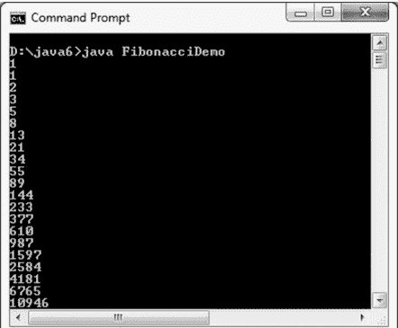

### do-while 循环语句

这是另一种循环语句，它在要执行的语句之后列出条件，因此你可以说 `do-while` 循环语句是一种后测试循环语句。首先执行第一个语句块，然后检查 `while` 语句给出的条件。因此，即使第一次尝试条件为假，`do` 块代码也会至少执行一次。

```java
do {
    statement;
} while (expression);
```

#### 示例

这里首先执行第一个代码块并打印当前值 "1"。然后检查条件 `<=10`。在这里 "1" 小于数字 "10"，所以控制权回到 `do` 块。这个过程一直持续直到 `i` 的值大于 10 为止。

```java
int i = 1;
do {
    System.out.println(i);
    i++;
} while (i <= 10);
```

### for 循环语句

当迭代次数（循环体执行的次数）未知时，使用 `while` 和 `do-while` 循环。在迭代次数提前已知的情况下，使用 `for` 循环。例如，它可以用于确定前十个数中每个数的平方。该语句由关键字 `for` 后面跟着包含三个表达式的括号组成，每个表达式用分号隔开。这些是初始化表达式、测试表达式和递增/递减表达式。

```java
for (initialization-expr; test-expr; increment-expr) {
    // statement;
}
```

例如，在语句中：

```java
for (invar = 0; invar <= 10; invar++)
```

`invar = 0` 是初始化表达式，`invar <= 10` 是测试表达式，`invar++` 是递增表达式。在这里，`invar` 是循环变量。

#### 初始化表达式

初始化表达式只在控制权第一次传递给循环时执行一次。它为循环变量赋了一个初始值。

#### 测试表达式

条件每次都会执行。控制权传递到循环的开头。只有在检查条件后，才会执行循环体。如果条件为真，则执行循环，否则控制权传递到循环体之后的语句。

#### 递增/递减表达式

当控制权返回循环开头时，递增/递减表达式总是会被执行。

#### 示例：计算并打印前十个自然数的平方

```java
int invar;
for (invar = 1; invar < 10; invar++) {
    System.out.println(invar * invar);
}
```

程序的输出是 1, 4, 9, 16, 25, 36, 49, 64, 81, 100。循环体被包含在大括号内。程序员犯的一个常见错误是使用分号终止循环。

例如，检查以下语句：

```java
for (invar = 0; invar < 10; invar++) ;
{
    System.out.println(invar * invar);
}
```

程序的输出是 121。

由于该语句以分号结束，它变成了一个自执行的循环，只有当循环中的条件变为假时，它才会移动到下一条语句。当 `invar` 的值为 11 时退出循环，因此输出为 121 (11*11)。

## 分支语句

Java 支持三种分支语句：

- Break
- Continue
- Return

这些语句将控制权转移到程序的其他部分。

### Break 语句

`break` 语句是一种分支语句，有两种形式：带标签和无标签。`break` 语句用于跳转到循环之外的语句。

```java
break;
```

例如，当条件为真时，`break` 语句会跳转到循环之外。`break` 语句也用于终止 `switch` 语句。

```java
public class BreakDemo {
    public static void main(String a[]) {
        int search = 5;
        int invar;
        loop1: // 标签
        for (invar = 0; invar < 10; invar++) {
            if (invar == search) {
                break loop1;
            }
            System.out.println(invar);
        }
    }
}
```

输出如图所示。


### Continue 语句

`continue` 语句是一种分支语句，用于跳过循环体的剩余部分并开始下一次迭代。

```java
continue;
```

#### 示例

```java
public class ContinueDemo {
    public static void main(String a[]) {
        int search = 5;
        int invar;
        for (invar = 0; invar < 10; invar++) {
            if (invar == search) {
                continue;
            }
            System.out.println(invar);
        }
    }
}
```

### Return 语句

`return` 语句是一种特殊的分支语句，将结果传递给调用者。它用于从方法返回值。

```java
return value;
```

#### 示例

```java
public class ReturnDemo {
    public static void main(String a[]) {
        System.out.println(welcome());
    }
    public static int welcome() {
        return 10;
    }
}
```

# 数组

你是否注意到酒店房间的编号方式？每个房间通过其编号识别。如果你给住在 121 房间的朋友送一束花，你可能会写地址为 121。数组是内存中连续空间中数据的表示。上述地址包含两个部分：

1. 酒店名称
2. 房间号

数组是用相同名称命名的元素的集合。

## 一维数组

单维数组本质上是同类型变量的列表。

### 语法

声明一维数组的语法为：

1. `数据类型[] 变量名;`
2. `数据类型 变量名[];`
3. `数据类型[] 变量名, 变量名;`
4. `数据类型... 变量名;`

示例：

```java
int i[];
int[] i;
int[] j;
int... i;
int i[], j[];
```

声明变量后，需要在内存中创建数组。可以通过以下方式使用 `new` 运算符来实现：

```java
new int[10];
i = new int[10];
j = new int[10];
```

该语句为变量 `i` 和 `j` 分配了十个 `int` 类型的连续内存位置。数组可以存储十个元素。初始化数组可以使用 `for` 循环完成：

```java
for (int var = 0; var < 10; var++) {
    i[var] = var;
}
```

数组元素在内存中的存储方式如下：

| 值 | 表示法 |
|---|---|
| 0 | `i[0]` |
| 1 | `i[1]` |
| 2 | `i[2]` |
| 3 | `i[3]` |
| 4 | `i[4]` |
| 5 | `i[5]` |
| 6 | `i[6]` |
| 7 | `i[7]` |
| 8 | `i[8]` |
| 9 | `i[9]` |

## 多维数组

多维数组实际上是数组的数组。要声明多维数组变量，请使用另一组方括号指定每个额外的索引。例如，以下代码声明了一个名为 `twoD` 的二维数组变量。

```java
int[][] twoD = new int[4][5];
```

### 二维数组演示

```java
class TwoDemo {
    public static void main(String a[]) {
        int twoD[][] = new int[4][5];
        int i, j, k = 0;
        for (i = 0; i < 4; i++) {
            for (j = 0; j < 5; j++) {
                twoD[i][j] = k;
                k++;
            }
        }
        for (i = 0; i < 4; i++) {
            for (j = 0; j < 5; j++) {
                System.out.print("twoD[" + i + "][" + j + "]=" + "\t");
                System.out.println(twoD[i][j]);
            }
        }
    }
}
```

输出如图所示。


你可以手动分配维度。你不需要为每个维度分配相同数量元素。由于多维数组实际上是数组的数组，每个数组的长度都由你控制。

```java
class TwoD {
    public static void main(String a[]) {
        int[][] twoD = new int[4][];
        twoD[0] = new int[1];
        twoD[1] = new int[2];
        twoD[2] = new int[3];
        twoD[3] = new int[4];
        int i;
    }
}
```

输出如图所示。


此程序创建的数组如下所示：

### 总结


* 运算符用于比较值和测试多个条件。它们分类为：
* 算术运算符
* 赋值运算符
* 一元运算符
* 比较运算符
* 移位运算符
* 位运算符
* 逻辑运算符
* 条件运算符
* 新的 `Operator` 运算符
* `instanceof` 运算符

* 数据从一种类型到另一种类型的转换称为强制转换。当数据类型从较宽范围变为较窄范围时，需要显式强制转换。决策结构用于允许语句的选择性执行。Java 中的决策结构是：
- if...else
- switch...case

* 循环结构用于你想让程序的某部分重复某些次数。Java 提供了以下结构：
- while
- do-while
- for

* `break` 和 `continue` 语句用于控制循环内的程序流。

* 数组是连续内存中数据的表示。数组分为两种类型：
- 单维
- 多维

* 你可以创建单个数组元素。索引从 0 开始。数组在访问之前必须声明并初始化。

### 回答问题

### 单选题

1. 哪些是算术运算符？
a) 整数
b) 布尔
c) 字符
d) 以上都是
答案：d

2. 取模运算符 `%` 可以应用于哪些类型？
a) 整数
b) 浮点数
c) 整数和浮点数
d) 以上都不是
答案：c

3. 下列哪个是错误的数组声明？
a) `int[] = new int[5];`
b) `int[] = new int[5];`
c) `int[] = = new int[5];`
d) `int[] = new int[5];`
（注：原文选项存在重复或格式错误，根据逻辑推断答案为逻辑错误项）

4. 此程序的输出是什么？
```java
class array_output {
    public static void main(String args[]) {
        int array_variable = new int[10];
        for (int i = 0; i < 10; i++) {
            array_variable[i] = i;
            System.out.print(array_variable[i] + " ");
        }
    }
}
```
a) 02468
b) 13579
c) 023456789
d) a

5. 代码中有什么错误？
```java
byte b = 50;
b = b * 50;
```
a) b 包含 250，范围。
b) `* 50` 转换为 int，无法转换为 byte。
c) b 无法包含 50。
d) 代码无错误
答案：b

6. 如果表达式包含 `double`、`int`、`float`，那么整个表达式将提升为哪些数据类型？
a) long
b) int
c) double
d) float
答案：c

### 复习题

1. 考虑以下代码片段：
`arrayOfs[j] > arrayOfInts[j+1]`
代码包含哪些运算符？

2. 考虑以下代码片段：
```java
int i = 10;
int t = i++ % 5;
```
a. 执行后 `i` 和 `t` 的值是多少？
b. 如果不使用后增运算符 (`++`)，而是使用前增 (`++`)，`i` 和 `t` 的最终值是多少？

3. 反转布尔值使用哪个运算符？

4. 使用哪个运算符比较两个值，`=` 或 `==`？

5. 解释以下代码示例：
`result = someCondition ? value1 : value2;`

6. 什么是运算符和操作数？

7. 逻辑运算符和算术运算符的区别是什么？

8. 各种循环结构有哪些？

9. 什么是数组？数组是如何使用的？

10. 在以下程序中解释为什么连续打印了两次“6”：
```java
class PrePostDemo {
    public static void main(String[] args) {
        int i = 3;
        i++;
        System.out.println(i); // "4"
        ++i;
        System.out.println(i); // "5"
        System.out.println(i++); // "6"
        System.out.println(i++); // "6"
        System.out.println(i); // "7"
    }
}
```

11. 考虑以下代码片段：
```java
if (arrayVariable >= 0) {
    if (arrayVariable == 0) {
        System.out.println("first string");
    } else {
        System.out.println("second string");
    }
}
System.out.println("third string");
```
a) 如果 `arrayVariable` 为 3，你认为代码会产生输出？
b) 此程序的输出是什么？和你预想的一样吗？
c) 代码的控制流是什么？
d) 仅使用空格和换行来澄清代码。

Java 中创建类的通用语法如下：
```
[访问修饰符] [<修饰符>] class <类名>
{
  // 语句
}
```
注意：方括号(`[]`) 中标记的参数是可选的。

类可以变得更加复杂。这里展示了类定义的简化的通用形式：
```
class <类名>
{
  type 实例-变量;
  type 实例-变量2;
  type 实例-变量3;
  return type 方法_name(参数-列表)
  {
    // 方法正体
  }
  return type 方法_name2 (参数-列表)
  {
    // 方法正体
  }
  return type 方法_name3(参数-列表)
}
```
在类内部定义的数据成员或变量被称为实例变量。代码位于方法中。在类内部定义的方法和变量统称为类的成员。

注意：是方法决定了类数据如何被使用。

类名是强制性的，在声明类时必须提供。类名用于引用该类以及创建它的实例。`class` 关键字 `<access-specifier>` 和 `<modifier>` 是可选的，稍后会介绍。

例如：
```java
class Demo{
  int i=1;
  void first_Method()
  {
    System.out.println("first class with instance variable " + i);
  }
}
```

## 4.2 类的命名

### 4.2.1 类命名规则

类名：
- 1. 不得是 Java 中的关键字。
- 2. 可以以字母、下划线 `_` 或 $ 符号开头。
- 3. 不得包含嵌入空格或句号 `.`。
- 4. 可以包含来自各种字母的字符，如日语、希腊语、西里尔语和希伯来语。

### 4.2.2 类命名规范

- 1. 类必须具有意义。它通常代表现实生活中的类。例如：camera（相机）。
- 2. 类名是名词并以大写字母开头。

注意：这些规范不是强制性的，但在编码中被认为是良好的实践。

简单类示例
```java
class First
{
    int length;
}
```
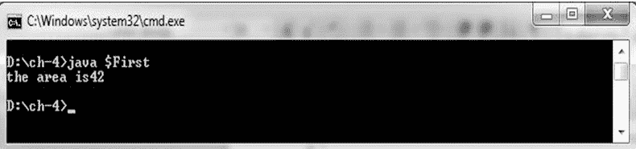

## 4.3 创建对象

对象是类的实例。声明对象与声明变量类似。

### 语法
```
<类名> <对象名>;
```

### 示例
```
Camera Kodak_36;
```

在使用对象之前，必须为对象分配内存。这是通过 `new` 运算符完成的。
`Kodak_36 = new Camera( );`

### 4.3.1 通过 new 运算符动态分配内存

当我们通过 `new` 运算符分配内存时，我们是在运行时为对象分配内存。由于内存是有限的，可能 `new` 无法为内存不足的对象分配内存。如果发生这种情况，将发生运行时异常，并且对象引用变量在赋值发生时的行为可能与你预期的不同。

`Class-var = new class-name();`

# 例如
```java
class Second
{
    int breadth = 2;
    int length = 3;
    public static void main (String a)
    {
        Second d1 = new Second();
        Second d2 = d1;
    }
}
```
你可能认为 `d2` 被赋值了 `d1` 所指对象的副本的引用。你可能认为 `d1` 和 `d2` 指向独立且不同的对象。然而，这是错误的。执行完这段代码后，`d1` 和 `d2` 将指向同一个对象。`d1` 和 `d2` 的赋值没有分配任何内存或复制原始对象。它让 `d2` 指向与 `d1` 相同的对象。因此，通过 `d2` 对对象进行的任何更改都会影响 `d1` 所指向的对象。

## 4.4 注释条

代码中使用的双斜杠 `//` 表示注释的开始。注释是给程序员的消息，用于描述类、方法甚至甚至是语句。编译器会忽略你作为注释编写的内容。它仅用于增强代码的可读性和理解。Java 支持三种注释样式：

- 单行注释：在 `//` 之后输入的任何内容都被视为注释。文本不能超过一行。如果你有多行，请每一行都以 `//` 开头。例如：`//single line comment`。
- 多行注释：在 `/*` 和 `*/` 之间写的任何内容都被视为注释。你在这里输入的文本可以跨多行。例如：`/* multiple line comments */`。
- Javadoc 注释：这些注释被 Javadoc 工具用于创建文档。这些注释与多行注释相似，但以 `/**` 而不是 `/*` 开头。例如：`/** This is java doc comment */`。

 解释类数据如何被使用。
 是方法决定了类数据如何被使用。
 解释类数据如何被使用。
 解释类数据如何被使用。
 解释类数据如何被使用。
 解释类数据如何被使用。
 解释类数据如何被使用。
 解释类数据如何被使用。
 解释类数据如何被使用。
 解释类数据如何被使用。
 解释类数据如何被使用。
 解释类数据如何被使用。
 解释类数据如何被使用。
 解释类数据如何被使用。
 解释类数据如何被使用。
 解释类数据如何被使用。
 解释类数据如何被使用。
 解释类数据如何被使用。
 解释类数据如何被使用。
 解释类数据如何被使用。
 解释类数据如何被使用。
 解释类数据如何被使用。

## 4.5 成员

在类内部定义的数据成员或变量被称为实例变量。代码位于方法中。在类内部定义的方法和变量统称为类的成员。

成员是成员变量。

 解释类数据如何被使用。
 解释类数据如何被使用。
 解释类数据如何被使用。
 解释类数据如何被使用。
 解释类数据如何被使用。
 解释类数据如何被使用。
 解释类数据如何被使用。
 解释类数据如何被使用。
 解释类数据如何被使用。
 解释类数据如何被使用。
 解释类数据如何被使用。
 解释类数据如何被使用。
 解释类数据如何被使用。
 解释类数据如何被使用。
 解释类数据如何被使用。
 解释类数据如何被使用。
 解释类数据如何被使用。
 解释类数据如何被使用。
 解释类数据如何被使用。
 解释类数据如何被使用。
 解释类数据如何被使用。
 解释类数据如何被使用。

## 4.6 变量命名

### 变量命名规则

变量名是：
 解释类数据如何被使用。
 解释类数据如何被使用。
 解释类数据如何被使用。
 解释类数据如何被使用。
 解释类数据如何被使用。
 解释类数据如何被使用。


 解释类数据如何被使用。

 解释类数据如何被使用。

## 4.7 方法

方法是类的行为。电视具有属性（颜色、尺寸）和方法（亮度、开关）。

### 方法声明

```
[访问修饰符] [<修饰符>] 返回类型 方法名(参数列表)
{
  // 方法正体
}
```

- `<访问修饰符>` 和 `<修饰符>` 是可选的。
- `<返回类型>` 指定方法返回的数据类型。
- `<方法名>`：方法名必须遵循命名规范。
- `<参数列表>`：参数列表是传递给方法的信息。它指定在括号内。例如：`(boolean apply_leave, int day)`。

### 示例

以下方法名是有效的：

- `calculatePercent`
- `find_File`

以下方法名是无效的：

- `Return this & that`
- `%calculation`
- `+2values`

## 4.8 调用方法

要调用一个方法，方法名后面必须跟着括号和分号。类中的一个方法可以使用该方法调用同在该类中的另一个方法。

### 4.8.1 调用同一类中的方法

#### 示例

```java
class Camera
{
  float price;
  String modelname;
  int numberOfPhotos;
  void clickButton() 
  {
    /** 调用增加照片数量的函数 */
    increment_no_of_photos();
  }
  void increment_no_of_photos(){
    /** 此方法增加了拍摄照片的数量 */
  }
}
```

### 4.8.2 调用不同类的方法

也可以通过创建该类的对象，然后使用点运算符引用该方法，从另一个类调用该方法。

#### 示例

```java
class Robot
{
    Camera eyes;
    void see_object() {
        eyes = new Camera();
        // 调用相机对象的方法
        eyes.clickButton();
    }
}
```

## 4.9 向方法传递参数

你可以编写接受参数并完成任务的方法。分配的任务基于这些参数执行。以图书馆为例。图书管理员类（`librarian class`）对象的一个方法是 `issueBook()`。在您指定您需要的书籍之前，管理员无法借出书籍。因此，管理员类中的 `issueBook()` 方法必须接受一个参数，即您需要的书名。

#### 示例

```java
class Librarian{
    void call_IssueBook() {
        String passname;
        passname = new String("The God of small things");
        // 传递参数
        issueBook(passname);
    }
    void issueBook(String recname) { // 带有参数的方法
        System.out.println("The name of the book is " + recname);
    }
}
```

在上述代码中，`call_IssueBook()` 方法调用了 `issueBook()` 方法。因此，`call_IssueBook()` 方法是调用方法（calling method），而 `issueBook()` 是被调用方法（called method）。

向方法传递参数的两种方式是：

- 值传递（Call by value）
- 引用传递（Call by reference）

### 4.9.1 值传递

在 Java 中，所有基本数据类型的参数都是通过值传递的，这意味着参数的原始值不能被调用方法修改。被调用方法只获得变量的副本。这意味着被调用方法对对象进行的任何更改都不会反映在调用方法中。

#### 值传递示例

```java
void callingMethod() {
  int a = 20;
  calledMethod(a);
  System.out.println(a);
}
void calledMethod(int rec) {
  rec = 100;
}
```

在值传递中，参数值的副本被传递给 `calledMethod()`，该副本被维护在独立的内存位置。因此，当 `calledMethod()` 方法更改参数的值时，该更改不会反映在 `callingMethod()` 方法中。

### 4.9.2 引用传递

作为对象的参数是通过引用传递给被调用方法的。这意味着被调用方法对对象进行的任何更改都会反映在调用方法中。

```java
void callingMethod() {
  Person passit = new Person();
  passit.name = "My Java";
  calledMethod(passit);
  System.out.println(passit);
}
void calledMethod(Person rec) {
  rec.name = "changed";
}
```

在引用传递中，对象的地址被传递给被调用方法。因此，被调用方法中的更改是可见的。

## 4.10 变量的作用域

### 局部作用域

在方法内部定义的变量具有局部作用域。它们在方法执行完毕后被销毁。

```java
/* 局部作用域变量 */ 仅在方法内部可见。
```

### 类作用域

在类中定义的变量具有类作用域。它们在类对象的生命周期内一直存在。

```java
class Scope {
    int variable1;
    int variable2;
}
```

### 总结

1. 类与方法
2. 声明方法的规则
3. `new` 运算符的使用
4. 方法的语法
5. 向方法传递参数的方法
6. 使用 `calculate` 方法计算简单利息的程序
7. 斐波那契数列程序
8. 反转数字的方法
9. 查找 1 到 N 之间的重复数字
10. 使用命令行参数计算总和的方法

### 问答

#### 选择题

1. 不返回结果的方法类型是？
   a) int b) float c) void d) double
   答案：c

2. 类中定义多个方法的过程是？
   a) 方法重写 b) 方法重载 c) 方法翻倍 d) 以上
   答案：b

3. Java 中用于变量名的是？
   a) 标识符 b) 关键字 c) 以上 d) 以上
   答案：a

4. 以下代码中存储的是什么？
   `box obj;`
   a) 对象的地址 b) NULL c) 任何指针 d) 垃圾
   答案：b

5. 类的对象的有效声明是？
   a) `Box obj = new Box();` b) `Box obj = Box;` c) `obj = new Box();` d) `new Box obj;`
   答案：a

6. 哪个运算符用于分配内存？
   a) malloc b) alloc c) new d) give
   答案：c

7. 下列哪个是错误的？
   a) 每个类都必须包含 `main()` 方法。b) Applet 完全不需要 `main()` 方法。c) 程序中只能有一个 `main()` 方法。d) `main()` 方法必须是公共的。
   答案：a

8. 以下哪个是正确的？
   a) 公有方法对层次结构中的所有类可见。b) 公有方法对子类可见。c) 公有方法只能通过类对象调用。d) 公有方法可以通过公共类的对象访问。
   答案：d

9. 此程序的输出是什么？
```java
class Box {
    int width;
    int height;
    int length;
}

class MainClass {
    public static void main(String args[]) {
        Box obj = new Box();
        System.out.print(obj);
    }
}
```
   a) 0 b) 1 c) 运行时错误 d) 类名@十六进制形式的哈希码
   答案：d

#### 复习题

1. 什么是类和方法？
2. 类的命名规则是什么？
3. `new` 运算符是如何使用的？
4. 方法的语法是什么？
5. 向方法传递参数有哪些？
6. 编写一个使用 `calculate` 方法计算简单利息的程序。
7. 编写一个斐波那契数列程序。
8. 编写一个反转数字的方法。
9. 查找 1 到 N 之间的重复数字。
10. 编写一个计算命令行参数数字和的方法。

# 第 5 章 构造函数、访问修饰符与常量

## 5.1 构造函数

假设你计划在姐姐生日时给她送一个生日蛋糕。你从烘焙师那里订了一个巧克力蛋糕。烘焙师询问了细节，如蛋糕的重量、形状以及你想在上面写的信息。你为这些属性指定了规则。例如：重量 = 2 磅，形状 = 正方形，信息 = “生日快乐，姐姐”。如果这些属性的值在烘焙时还没有确定，那么对象可能具有某个重量、某个形状，以及信息“生日快乐，某人”。但你姐姐并不会开心。

面向对象的概念源于现实生活。当你创建一个对象时，你需要初始化数据成员的值。你可以在类中写一个方法，例如 `initializeData()`，并在创建对象后调用该方法。你可以在 `initializeData()` 方法中编写初始化变量的代码。Java 通过提供一种名为**构造函数**（constructor）的特殊方法解决了这个问题。构造函数包含初始化类数据成员的代码。当类的对象被创建时，它会自动执行。因此，无论是谁创建了该类的对象，构造函数都会被调用，数据成员也会被初始化。构造函数的名称与它所定义的类名相同。

#### 示例

```java
public class Cake {
    String message;
    double weight;
    String shape;

    Cake() {
        message = "Happy Birthday, Sister";
        weight = 2;
        shape = "Square";
    }
}
```

每当创建对象时，构造函数就会执行并将成员变量初始化为指定的值。

### 构造函数的规则

1. 构造函数的名称与它声明的类名相同。这是因为构造函数在对象创建时是被自动调用的。
2. 构造函数没有返回值。由于你不会显式地调用构造函数，因此无法使用其返回值。

## 5.2 构造函数的类型

1. 默认构造函数
2. 参数构造函数

### 5.2.1 默认构造函数

当你创建类的对象时，会调用此构造函数。构造函数没有返回值，即使是 `void` 也没有。这是因为类构造函数的隐式返回类型是类本身。

#### 示例

```java
public class DemoCons {
    int l1, b, h;

    DemoCons() {
        l1 = 10;
        b = 20;
        h = 5;
    }

    void area() {
        int a = l1 * b * h;
        System.out.println(a);
    }

    public static void main(String a[]) {
        DemoCons d = new DemoCons();
        d.area();
    }
}
```

#### 输出

```
1000
```

在继续之前，让我们检查一下 `new` 操作符。当你分配一个对象时，使用以下语法：

`类名 变量名 = new 类名();`

在构造函数名后使用括号的原因是以类似于调用类的方式调用构造函数。
`DemoCons d = new DemoCons();`

### 5.2.2 参数构造函数

有时我们希望在为对象分配内存时添加参数。也就是说，允许存在多个构造函数，即具有不同签名和不同子类型的构造函数重载。

```java
public class ParConst {
    ParConst() {
        System.out.println("default constructor");
    }

    ParConst(int i, float a) {
        System.out.println("parameterized constructor with\ntwo parameter i.e " + i + " " + a);
    }

    public static void main(String[] args) {
        ParConst P1 = new ParConst();
        ParConst P2 = new ParConst(10, 10.202f);
    }
}
```

#### 输出

```
default constructor
parameterized constructor with two parameter
i.e 10 10.202
```

> **注意**：
> 如果没有提供构造函数，Java 会自动生成一个体空的默认构造函数。

## 5.3 实例初始化块或匿名块

没有名称的块被称为匿名块（Anonymous Block）。它用于初始化类的数据成员。它在构造函数的开始时调用，在父类构造函数被调用之后。

```java
public class AnonymousBlock extends Hi {
    {
        System.out.println("In Anonymous Block");
    }

    AnonymousBlock() {
        System.out.println("In Anonymous Constructor");
    }

    AnonymousBlock(int i) {
        System.out.println("In Anonymous Parametrized constructor");
    }

    public static void main(String[] args) {
        System.out.println("After main");
        AnonymousBlock a = new AnonymousBlock();
        AnonymousBlock b = new AnonymousBlock(89);
        System.out.println("After AnonymousBlock Cons");
    }
}

class Hi { 
    Hi() {
        System.out.println("in hi");
    }
}
```

当一个类有多个构造函数时，每个构造函数都会使用实例初始化块。

#### 输出

```
After main
in hi
In Anonymous Block
In Anonymous Constructor
in hi
In Anonymous Block
In Anonymous Parametrized constructor
After AnonymousBlock Cons
```

## 5.4 静态块

它用于初始化静态成员。它在类加载时执行（在后续章节解释）。

### 语法

```java
class StaticBlock {
    static {
        System.out.println("Static block");
    }
}
```

### 示例

```java
public class StaticBlock {
    static {
        System.out.println("Static block");
    }

    public static void main(String[] args) {
        StaticBlock s = new StaticBlock();
    }
}
```

#### 输出

```
Static block
```

## 5.5 访问修饰符

访问修饰符决定了类的哪些特征（类本身、数据成员和方法）可以被使用。

1. public 修饰符
2. private 修饰符
3. protected 修饰符
4. 默认访问（Default access）

### 5.5.1 public 修饰符

除了类（与另一个类一起）外，所有类都可以有 `public` 修饰符。你可以从任何程序中使用 `public` 类、数据成员或方法。

#### 示例

```java
public class PubClass {
    public int variable;

    public void publicMethod() {
        // code
    }
}
```

### 5.5.2 private 修饰符

只有同一类的对象可以访问 `private` 变量或方法。你可以将变量、方法和内部类声明为 `private`。

#### 示例

```java
class PrivateClass {
    private int variable;

    private void privateMethod() {
        // code
    }
}
```


### 5.5.3 protected 修饰符

被 `protected` 的变量、方法和内部类可以被声明它们所在的类的子类访问。

示例：

```java
class Parent {
    protected int protvar;
}

class Child extends Parent {
    void display() {
        System.out.println(protvar);
    }
}
```

### 5.5.4 默认访问（Default Access）

如果你不指定上述任何修饰符，范围就是“友好的”（friendly）。具有友好访问权限的类、变量或方法可以被包中的所有类（包是类的集合）访问。

注意：

- 在 Java 中，`friendly` 不是一个关键字。它是指未指定访问修饰符时的访问级别的术语。

## 考虑一个示例

类 Y 和 Z 继承自类 X。类 Z 属于包 P2，类 X 和 Y 属于包 P1。

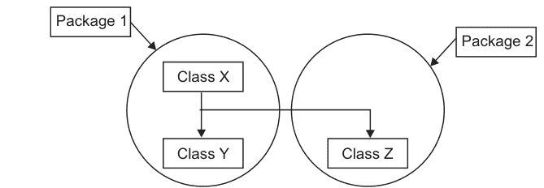

在类 X 中声明了方法 `show()`。
下表显示了类 Y 和 Z 对 `show()` 方法的访问权限。

| 访问修饰符 | 类 Y | 类 Z |
| --- | --- | --- |
| show() 声明为 `protected` | 可以访问，因为 Y 是子类 | 可以访问，因为 Z 是子类（即使在另一个包中） |
| show() 未声明（友好） | 可以访问，因为在同一包内 | 不访问，因为不在同一包内 |

## 5.6 构造函数的访问修饰符

构造函数可以使用与变量方法相同的访问修饰符（在前节讨论过）。它们的含义相同。例如，当构造函数被声明为 `private` 时，只有该类本身可以创建它的实例。同一包中的其他类无法创建它的实例。该类的任何子类或包外的其他类都无法创建它的实例。

示例：

```java
class Q {
    public int x;

    private Q(int n) {
        x = n;
        System.out.println("I am born");
    }
}
```

```java
class Ass {
    public static void main(String[] a) {
        Q q = new Q(3); // 错误，它是不可见的
        System.out.println(q.x);
    }
}
```

上述代码无法编译，因为 Q 的构造函数是“私有的”（private），并且它是在类外部被创建的。如果你删除 Q 构造函数前面的 "private" 关键字，这段代码就可以编译。

记住，一个类可以有多个构造函数，每个构造函数都有不同的参数。并不是所有的构造函数都需要具有相同的访问修饰符。接下来的示例，Q 类有两个构造函数。一个接受一个 int 参数，另一个接受一个 double 参数。其中一个被声明为 private，而另一个没有访问修饰符（默认包访问）。

```java
class Q2 {
    Q2(int n) {
        System.out.println("I am born int");
    }

    private Q2(double d) {
        System.out.println("I am born double");
    }
}

class acc2 {
    public static void main(String a[]) {
        Q2 q1 = new Q2(3);
        Q2 q2 = new Q2(3.3); // 错误，此构造函数是不可见的，因为它是私有的
    }
}
```

具有不同访问修饰符的构造函数意味着在 Java 中，创建对象的能力取决于调用了哪个构造函数来创建对象。

1. 在方法内部声明的变量不能有访问修饰符，因为变量只能在方法内部使用。
2. 非公共类（友好型）中的公共方法只能在同一个包内访问，除非它有一个公有的父类。

## 5.7 修饰符 (MODIFIERS)

修饰符决定了数据成员和方法在其他类和对象中的方式。

### 5.7.1 static 修饰符

考虑一个 student 类。你创建了许多 student 类的对象，并想知道创建了多少个对象。你会如何做呢？你需要一个变量（计数器），该变量由类本身维护，而不是由单个对象维护。每当该类的对象被创建时，构造函数都应该增加计数器。因此，计数器的值将指示创建的对象数量。static 修饰符允许变量或方法与其类相关联。你可以像所示使用类名来访问静态变量或方法。

`class static variable;`
`class static method();`

```java
class StaticDemo2 {
    static int counter = 0;

    StaticDemo2() {
        counter++;
        System.out.println(counter);
    }
}

class StaticDemo {
    public static void main(String[] args) {
        // TODO自动生成的方法存根
        StaticDemo2 sd1 = new StaticDemo2();
        StaticDemo2 sd2 = new StaticDemo2();
    }
}
```

### 输出

```
1
2
```

注意：

1. 静态方法和静态变量可以通过类名访问。你不需要创建类的对象就可以调用静态方法或变量。使用 static 关键字声明的变量和方法分别称为类静态变量和类方法。
2. 你不能从静态方法中访问非静态数据成员。因为非静态数据成员是实例变量（属于单个实例）。

### 5.7.2 final 修饰符

final 修饰符实现了以下限制：

1. final 类不能被继承。
2. final 方法不能被子类更改（重写）。
3. final 数据成员在初始化后不能被更改。
4. final 类中的所有方法和数据成员都是隐式的 final。

你可以使用 final 关键字定义常量。编译器强制你执行。

使用 final 的示例：

```java
public class FinalDemo {
    final int i = 5;

    final void show() {
    }
}

class sub extends FinalDemo { // 错误：不能继承 final 类
    @Override
    void show() { // 错误：不能重写 final 方法
        i = 10; // 错误：不能给 final 变量赋值
    }
}
```

### 5.7.3 native 修饰符

native 修饰符表示该方法是用其他语言（如 C 或 C++）编写的。该方法依赖于平台。

### 5.7.4 transient 修饰符

对象可以使用 transient 修饰符，以便将其保存到文件中。transient 修饰符仅用于数据成员。

### 5.7.5 synchronized 修饰符

synchronized 修饰符用于多线程程序。在多线程程序中，需要同步线程。

### 5.7.6 volatile 修饰符

volatile 修饰符用于可以被多个线程同时修改的变量。

注意：

访问修饰符决定了其他类对数据成员的可见性。例如：`protected int var;`

### 总结

构造函数是在创建对象时自动调用的特殊方法。它们与类同名且不返回任何值。访问修饰符决定哪些类可以使用类的特征。如果不指定任何访问修饰符，默认访问级别是友好的。修饰符有：

* static
* final
* native
* transient
* synchronized
* volatile

### 回答

### 单选题

2. 关键字用于引用调用它的对象？
a) import b) catch c) abstract d) this
答案：d

3. 下列哪个方法与其类同名？
a) finalize b) delete c) class d) constructor
答案：d

4. Java 运行时在对象不再需要时使用哪个运算符释放其内存？
a) delete b) free c) new d) None of the mentioned
答案：d

5. 哪个函数用于在对象销毁时执行某些操作？
a) finalize b) delete() c) main() d) None of the mentioned
答案：a

6. 下述描述错误的是？
a) 构造函数在对象声明时调用
b) 构造可以是参数化的
c) finalize() 方法在对象离开作用范围且不再需要时调用
d) finalize() 方法必须声明为 protected
答案：c
解释：finalize() 方法在垃圾回收之前调用。它不是在对象离开作用范围时调用。

7. 在同一类中定义同名但参数声明不同的多个方法的过程是？
a) 方法重载 (overloading) b) 方法重写 (overriding)
c) 方法隐藏 (hiding) d) None of the mentioned
答案：a

8. 这些可以被重载？
a) 方法 b) 构造函数
c) 方法与构造函数 d) None of the mentioned
答案：c

9. 用自身定义方法的过程是什么？即一个调用自身的方法？
a) 多态性 b) 抽象 c) 封装 d) 递归
答案：d

10. main() 方法必须使用以下哪些访问修饰符？
a) private b) public
c) protected d) 以上均不是
答案：b

### 复习题

- 1. Java 中共有多少种访问修饰符？
- 2. 在类的声明中，可以使用多少种访问修饰符？
- 3. `volatile` 和 `native` 修饰符的作用是什么？
- 4. Java 中垃圾回收的目的是什么？什么时候使用？
- 5. 构造函数和方法之间有什么区别？
- 6. Java 类的各种访问修饰符有哪些？
- 7. 我们可以重写类的静态方法吗？

# 第 6 章 类与类的关系

## 6.1 多态性（重载）

当同一个事物在不同情况下具有不同的行为时，这种现象被称为多态性。“Polymorphism”一词是两个希腊词的结合。

Poly + morphism
许多 + 形式 (Many + form)

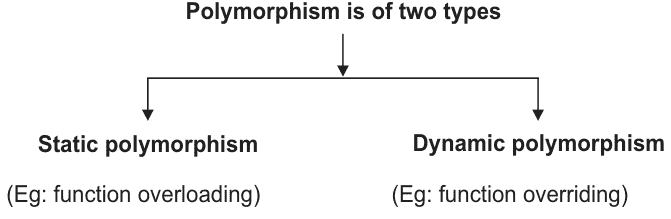

注意：Java 不支持运算符重载。

## 6.2 函数/方法重载

有时你可能想要创建几个执行相关任务的方法。例如，`Calculator` 类有一个方法用于加两个整数，另一个用于加两个数值，第三个方法用于加一个浮点数和一个整数。这些方法执行的是相同的核心操作——加法，因此对所有这些函数使用相同的名称是合适的。

Java 支持方法重载，因此上述示例中的方法可以声明如下：

+ (1) `public void add(int a, int b);` // 加两个整数
+ (2) `public void add(float a, float b);` // 加两个浮点数
+ (3) `public void add(float a, int b);` // 加一个浮点数和一个整数

```java
public class Calculator {
    public int add(int a, int b) {
        System.out.println("int and int");
        return a + b;
    }

    public float add(float a, float b) {
        System.out.println("float and float");
        return a + b;
    }

    public float add(float a, int b) {
        System.out.println("float and int");
        return a + b;
    }

    public static void main(String[] args) {
        // TODO Auto-generated stub
        Calculator c = new Calculator();
        System.out.println(c.add(1, 10));
        System.out.println(c.add(1.6f, 10.5f));
        System.out.println(c.add(1.6f, 17));
    }
}
```

### 输出

| int and int |
| 11 |
| float and float |
| 12.1 |
| float and int |
| 18.6 |

有三个 `add()` 方法。在编译时，编译器根据传递的参数来解析要调用的 `add()` 方法版本。这就是函数重载属于静态多态性的原因。

### 方法签名 (Function Signature)

方法的签名由以下组成：

+ 1. 方法名
+ 2. 参数的数量
+ 3. 参数的数据类型
+ 4. 参数的顺序

注意：函数重载从不取决于返回类型。
当你调用一个方法时，编译器使用方法的签名来解析要调用的方法。一个类不能拥有两个签名相同的方法，否则编译器将不知道调用哪一个方法。

## 6.4 构造函数重载

在 `Cake` 类的示例中（在基于构造函数的章节中给出），指定了蛋糕的属性。使用构造函数在创建蛋糕时设置了这些属性。蛋糕上的消息信息是“Happy Birthday, Sister”。

## 6.5 继承

继承背后的哲学是按照事物在现实世界中的存在方式来进行描述。例如，孩子继承父母。继承意味着类可以继承另一个类。通过使用 `extends` 关键字，你可以创建一个继承父类属性的子类。

以机票为例。机票可以处于两种状态：请求（Request）和已确认（Confirmed）。这两个状态具有共同属性，如航班号、日期和目的地。然而，确认的机票还会有座位号，而请求的机票则没有。

示例：

```java
public class Ticket {
    String flight_no;
    String destination;

    void arrival() {
        System.out.println("In arrival");
    }

    void depart() {
        System.out.println("In depart");
    }
}

class Request extends Ticket {
    // 使用 ticket 的方法
}

class Confirmed extends Ticket {
    // 使用 ticket 的方法
    String seat_no;
}
```

继承的概念是代码复用。对象的子类在创建行指定。这赋予了你处理属性的自由度。

```java
public class Cake {
    String message;
    double weight;
    String shape;

    // 默认构造函数
    Cake() {
        message = "Happy Birthday, Sister";
        weight = 0;
        shape = "square";
    }

    // 重载构造函数
    Cake(String msg, double wt, String sh) {
        message = msg;
        weight = wt;
        shape = sh;
    }
}
```

## 6.6 继承的类型

Java 中存在以下类型的继承：

+ 1. 单级继承或简单继承
+ 2. 多级继承

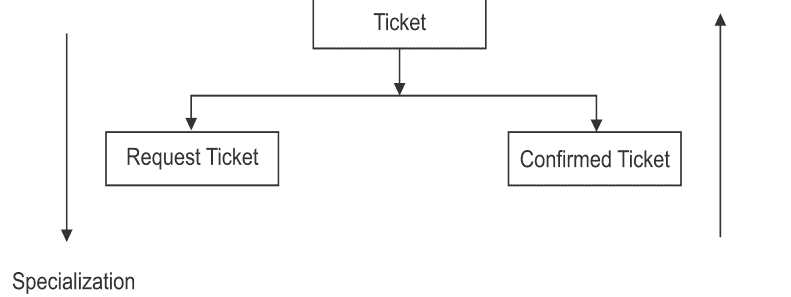

### 6.6.1 单级继承

子类派自一个父类。只有一个子类及其父类。它也被称为单层继承。

示例：

```java
public class A {
    int x, y;

    int get(int p, int q) {
        x = p;
        y = q;
        return (0);
    }

    void show() {
        System.out.println(x + "and" + y);
    }
}

class B extends A {
    public static void main(String args[]) {
        B a = new B();
        a.get(5, 6);
        a.show();
        a.display();
    }

    void display() {
        System.out.println("In display");
    }
}
```


### 输出

| 5 and 6 |
| In display |

### 6.6.2 多级继承

它是继承概念的增强。当一个子类派自另一个派生类时，这种机制被称为多级继承。派生类被称为其父类的子类，而这个父类也可以作为其直接父类的子类。多级继承可以延伸到任意层级。

#### 示例 A

```java
class A {
    int x, y;
    A(int p, int q) {
        x = p;
        y = q;
    }
    void show() {
        System.out.println(x + " and" + y);
    }
}

class B extends A {
    B(int p, int q) {
        super(p, q);
    }
    void display() {
        System.out.println("B class");
    }
    public static void main(String args[]) {
        B a = new B(10, 20);
        a.show();
    }
}

class C extends B {
    C(int p, int q) {
        super(p, q);
    }
    void printfunc() {
        System.out.println("C class");
    }
    public static void main(String args[]) {
        C a = new C(30, 40);
        a.show();
        a.display();
        a.printfunc();
    }
}
```

#### 输出：B 类运行
10 and 20
| display

#### 输出：C 类运行
30 and 40
| display
| Java |

## 6.7 SUPER 关键字

当子类需要引用其直接父类时，它可以通过使用 `super` 关键字来实现。

我们知道，如果没有显式地定义构造函数，Java 会自动定义一个空构造函数。这意味着每个类都有默认构造函数。当我们继承一个类时，会首先调用父类的构造函数，然后调用自己的构造函数。但是如何调用父类的参数构造函数呢？这是通过使用 `super` 关键字实现的。

#### 语法

```java
class A2 {
    int X, Y;
    A2(int p, int q) {
        X = p;
        Y = q;
    }
    void show() {
        System.out.println(X + " and" + Y);
    }
}
```

```java
class B2 extends A2 {
    B2(int p, int q) {
        super(p, q);
        System.out.println("derived constructor" + p);
    }
    void display() {
        System.out.println("B");
    }
}

class C2 extends B2 {
    C2(int p, int q) {
        super(p, q);
        System.out.println("child constructor" + p);
    }
    void printfunc() {
        System.out.println("c");
    }
    public static void main(String args[]) {
        C2 a = new C2(5, 6);
        a.show();
        a.display();
        a.printfunc();
    }
}
```

#### 输出


1. `final` 类永远不能被声明为抽象类。
2. 抽象类必须有一个子类，而 `final` 类不能被继承。
3. 你不能对同一个类、方法或数据成员同时使用 `final` 和 `abstract` 修饰符。

```java
public abstract class AbstractDemo {
    abstract void printfu();
    void show() {
        System.out.println("in show");
    }
    class subclass extends AbstractDemo {
        void printfu() {
            System.out.println("in printfu function");
        }
        public static void main(String a[]) {
            subclass s = new subclass();
            s.printfu();
            s.show();
        }
    }
}
```

#### 输出


抽象类定义属性和行为。它被用作基类。

#### 示例

```java
abstract class Shape {
    abstract void area(float radius);
    class Circle extends Shape {
        public void area(float radius) {
            System.out.println(radius * radius * radius);
        }
    }
}
```

```java
public static void main(String args[]) {
    float area;
    Circle c = new Circle();
    c.area(7);
    System.out.println(area);
}
```

输出：343

在上面的示例中，该类没有为 `area()` 方法提供体。

1. `final` 类永远不能被声明为抽象类。
2. 抽象类必须有一个子类，而 `final` 类不能被继承。
3. 你不能对同一个类、方法或数据成员同时使用 `final` 和 `abstract` 修饰符。

接口包含常量值和方法声明。类与接口之间的区别是接口没有体。

#### 示例

```java
interface ABC {
    int white;
    void show();
}

interface Color {
    int red;
    int black;
}

class Demo implements ABC, Color {
    public void show() {
        System.out.println("in show");
    }
    public static void main(String args[]) {
        Demo d = new Demo();
        d.show();
        System.out.println(d.white);
    }
}
```

输出：
in show
0

1. 一个类可以实现多个接口，用逗号隔开。
2. 接口不是多重继承的替代品。
3. 接口的所有方法都是抽象的。
4. 接口的所有变量都是 `public`、`static`、`final` 的。

1. 创建一个接口
2. 声明类并使用 `implements` 关键字后跟接口名称。
3. 确保类实现了接口中定义的每一个方法。
4. 将文件保存为 `.java` 扩展名。
5. 编译代码。

5. 你不能在接口中声明私有或保护变量或方法。
6. 接口中的方法不能是 `final`，因为声明为 `final` 方法不能被子类修改。
7. 所有方法默认都是 `public` 的，你不能为任何方法分配更低级别的权限。这意味着你不能为接口方法分配私有、保护或默认级别。

可能会在某些情况下，你必须实现一个包含多个方法的接口，并且只需要为其中一个方法提供体。在这种情况下，你被迫为所有方法提供体，否则该类必须声明为抽象。Java 8 引入了默认方法，允许你在接口中提供方法的体。

#### 示例

```java
interface DefaultDemo {
    String getName();
    default String displayName() {
        return getName();
    }
}
```

实现此接口的类不需要为 `displayName()` 方法提供体。

1. 如果任何类尝试实现两个在接口具有相同默认方法的接口，编译器将抛出异常。这被称为菱形问题。
2. 静态方法永远不能被重写。

当子类拥有与父类中签名相同的方法/函数时，这被称为方法重写、动态重写或动态多态。

#### 示例

```java
class abc {
    void show() {
        System.out.println("Hello super show");
    }
}

class xyz extends abc {
    void show() {
        System.out.println("child show");
    }
    public static void main(String[] args[]) {
        abc a;
        abc al = new abc();
        xyz x = new xyz();
        x.show();
        al.show();
        a = x;
        a.show();
        a = al;
        a.show();
    }
}
```

输出

| child show
Hello super show
child show
Hello super show |

### 方法重写的规则

1. 参数顺序和重写方法的名称应与子类方法的类型一致。
2. 重写方法和被重写方法的返回类型必须相同。
3. 重写方法的访问权限不能低于被重写的方法。例如，如果被重写的方法在父类中声明为 `public`，则你不能在子类中使用 `private` 关键字对其进行重写。
4. 重写方法的异常数量不能多于被重写方法抛出的异常。异常是在运行时抛出的错误。

### 总结

- Java 支持单继承和多级继承。
- `extends` 关键字用于扩展现有类的功能。
- 抽象类不能实例化。
- 如果满足以下条件，类必须声明为抽象类：
  - 它有一个或多个抽象方法。
  - 它从父类继承了抽象方法且没有对其进行重写。
- `final` 类不能被子类化。
- 接口提供了跨类的标准。接口中的方法没有方法体。一个类可以实现任意数量的接口。
- `super` 关键字用于访问父类的方法。
- 重写意味着改变在父类中声明的方法的实现。父类和子类中方法的特征签名必须保持相同。

### 回答以下问题

#### 单选题

1. Java 中用哪一个关键字来定义接口？
   a) `interface`  b) `Interface`  c) `intf`  d) `Intf`
   答案：a)

2. 下列中哪一个可以使类从其实现中完全抽象化？
   a) Objects  b) Packages  c) Interfaces  d) 以上未提及
   答案：c)

3. 类使用哪一个关键字来使用之前定义的接口？
   a) `import`  b) `Import`  c) `implements`  d) `Implement`
   答案：c)

4. 关于接口的陈述中哪项是错误的？
   a) 接口规定了类必须做什么，但不规定如何做。
   b) 如果接口要被程序中的任何代码访问，则应被指定为 `public`。
   c) 接口中的所有变量都是隐式的 `final` 和 `static`。
   d) 如果接口定义为 `public`，则所有变量都是静态的且方法是 `public`。
   答案：d)

5. 下列哪个包存储了所有的 Java 类？
   a) `lang`  b) `java`  c) `util`  d) `java.packages`
   答案：b)

#### 复习题

1. 什么是多态？如何实现？
2. 方法重载（overloading）和方法重写（overriding）的区别是什么？
3. 什么是构造函数重载和函数重载？
4. 什么是函数重写？请结合示例解释。
5. 什么是接口？接口的作用是什么？

#### 面试题

1. 你能通过数据成员实现运行时多态吗？
2. 什么是运行时多态？
3. 静态绑定和动态绑定的区别是什么？
4. 存在没有抽象类的类的抽象方法吗？
5. 可以在方法上同时使用 `abstract` 和 `final` 吗？
6. 可以实例化抽象类吗？
7. 对象引用何时可以转换为接口引用？
8. 可以在接口的变量中定义 `private` 和 `protected` 修饰符吗？
9. 抽象类和接口的区别是什么？

# 第 7 章

# 注解 (Annotations)

## 7.1 注解

Java 注解是在 JDK 1.7 中引入的。注解提供了编译器或 JVM 使用的额外信息。这些是 XML 和标记接口的替代方案。

Java 注解是一种附加在类、接口或字段上的元数据，表示某些附加信息。

注解有多种用途：

- 编译器的信息 —— 编译器可以使用注解来检测错误或抑制警告
- 编译时和部署时处理 —— 软件工具可以处理注解以生成代码、XML 文件等
- 运行时处理 —— 某些注解可以在运行时进行检查

### 注解的格式

在最简单的形式下，注解看起来如下：
`@`

`@` 字符指示编译器后面跟着的是一个注解。

## 7.2 内置 Java 注解

Java 中有几个内置注解。

### I) 代码中使用的内置注解

1. `@Override`
2. `@SuppressWarnings`
3. `@Deprecated`
4. `@Varargs`
5. `@FunctionalInterface`

### II) 在其他注解中使用的 Java 注解

1. `@Target`
2. `@Retention`
3. `@Inherited`
4. `@Documented`

### 7.2.1 Java 中使用的注解

1. `@Override`：它确保子类方法正在重写父类。如果不是，则会报错。如果父类中没有该方法，也会报错。

#### 示例

```java
class Bird {
    void fly() {}
}

class Sparrow extends Bird {
    @Override
    void fly() {
        System.out.println("Sparrow flies");
    }
}
```

2. `@SuppressWarnings`：它可以被编译器用来抑制警告。

#### 示例

```java
@SuppressWarnings("unchecked")
void method() {
    // unchecked code
}
```

3. `@Deprecated`：该注解标记方法已过时。它会向用户发出警告。

#### 示例

```java
@Deprecated
void oldMethod() {
    System.out.println("Old method");
}
```


# 106 | Java 深度解析

## 7.2.2 应用于注解的注解

应用于其他注解的注解被称为元注解（meta-annotations）。`java.annotation` 中定义了若干元注解类型。

1. **@Retention** : 指定标记注解存储的方式：
   * `RetentionPolicy.SOURCE` —— 注解仅保留在源码级别，被编译器忽略。
   * `RetentionPolicy.CLASS` —— 注解在编译时保留，但被 Java 虚拟机 (JVM) 忽略。
   * `RetentionPolicy.RUNTIME` —— 注解由 JVM 保留并可以在运行时环境中使用。

2. **@Documented** : 表示每当使用指定的注解时，应使用 Javadoc 工具进行记录。

3. **@Target** : 标记另一个注解，以限制注解可以应用的 Java 元素。`Target` 指定以下元素类型之一的值：
    * `ElementType.ANNOTATION_TYPE` 可以应用于注解类型。
    * `ElementType.CONSTRUCTOR` 可以应用于构造函数。
    * `ElementType.FIELD` 可以应用于字段或属性。
    * `ElementType.LOCAL_VARIABLE` 可以应用于局部变量。
    * `ElementType.METHOD` 可以应用于方法级注解。
    * `ElementType.PACKAGE` 可以应用于包声明。
    * `ElementType.PARAMETER` 可以应用于方法参数。
    * `ElementType.TYPE` 可以应用于类的任何元素。

4. **@Inherited** : 表示该注解类型可以从父类继承。这在默认情况下不是 true。当用户查询注解类型且类没有该类型的注解时，将查询父类以获取注解类型。这仅适用于类声明。

5. **@Repeatable** : 在 Java SE 8 中引入，指示被标记的注解可以多次应用于同一个声明或类型。

## 7.3 Java 自定义注解

Java 自定义注解或 Java 用户定义注解很容易创建和使用。使用 `@interface` 来声明注解。

示例：

```java
@interface FirstAnnotation { }
```

这里，`FirstAnnotation` 是自定义注解名称，`interface` 是关键字。

示例：

```java
@interface SecondAnnotation {
    int value();
}
```

我们也可以提供默认值：

```java
@interface SecondAnnotation {
    int value() default 0;
}
```

### 创建自定义注解时需要记忆的点

注解的方法：

- (a) 不应包含方法体和任何抛出语句（throw clause）。
- (b) 必须返回以下类型之一：
    * `String`
    * 类 (`class`)
    * 原始数据类型 (Primitive Data type)
    * 数组 (`Array`)
    * 枚举 (`enum`)
- (c) 不可以有任何参数。

注意：我们应该在 `interface` 关键字之前添加 `@` 来声明或定义注解。

## 7.4 注释的类型

1. 标记注解 (Marker Annotation)
2. 单值注解 (Single-Value Annotation)
3. 多值注解 (Multi-Value Annotation)

没有方法的注解被称为标记注解。例如：`@interface MyAnnotation {}`
`@Override` 和 `@Deprecated` 是标记注解。

### 2. 单值注解

只有一个方法的注解被称为单值注解。例如：

```java
@interface SecondAnnotation {
    int value();
}
```

### 3. 多值注解

具有多个方法的注解被称为多值注解。

例如：

```java
@interface MyAnnotation {
    int value1();
    String value2();
    String value3();
}
```

我们也可以提供默认值。例如：

```java
@interface MyAnnotation {
    int value1() default 1;
    String value2() default "default abc";
    String value3() default "default xyz";
}
```

## 7.5 注解可以使用的地方

注解可以应用于类声明、字段、方法和其他程序元素。从 Java SE 8 版本开始，注解也可以应用于类型使用处。这种形式的注解被称为类型注解（Type Annotation）。以下是一些示例：

类实例创建：

```java
new MyObject();
```

类型转换：

```java
String str = (@NonNull) obj;
```

实现类：

```java
class UnmodifiableList<T> implements ReadOnlyList<T> { ... }
```

抛出异常：

```java
void monitorTemperature() throws Temperature { ... }
```

示例：

```java
import java.lang.annotation.*;
import java.lang.reflect.*;

@Retention(RetentionPolicy.RUNTIME)
@Target(ElementType.METHOD)
@interface FirstAnnotation {
    int value();
}

// 声明注解
class AnnotationDemo {
    @FirstAnnotation(value=10)
    public void display() {
        System.out.println("display annotation");
    }
}

// 访问注解
class Test {
    public static void main(String args[]) throws Exception {
        AnnotationDemo h = new AnnotationDemo();
        Method m = h.getClass().getMethod("display");
        FirstAnnotation iol = m.getAnnotation(FirstAnnotation.class);
        System.out.println("value is: " + iol.value());
    }
}
```

### 输出


## 7.6 在真实场景中如何使用内置注解

在真实场景中，Java 程序员只需要应用注解。创建和访问注解不需要创建，由 Java 编译器或 JVM 执行某些额外操作。

### 类型注解和可扩展类型系统

在 Java SE 8 之前，注解只能应用于类型声明。从 SE 8 版本开始，注解也可以应用于类型使用处。这意味着注解可以用于实例创建（`new`）、强制转换、`implements` 子句和 `throws` 子句。类型注解的创建是为了改进 Java 程序的分析并确保正确的类型检查。Java SE 8 没有提供类型检查框架，但它允许你配合 Java 编译器编写自己的类型检查框架。

例如，你希望确保程序中的某个变量不会被赋值为 `null` 以避免触发 `NullPointerException`。你可以编写自定义插件来检查这一点。然后你会修改代码来注解该变量表示它永远不为空。变量声明可能如下：

```java
@NonNull String str;
```

当编译包含 `NonNull` 模块的代码时，如果编译器检测到潜在问题将打印警告，允许你修改代码以移除所有警告，特定的错误在程序运行时不会发生。你可以使用多个类型检查模块，每个模块检查不同类型的错误。通过这种方式，你可以在需要的地方构建特定的注解。

### 总结

1. Java 注解是表示元数据的标记。
2. 内置注解：
   * `@Override`
   * `@SuppressWarnings`
   * `@Deprecated`
   * `@SafeVarargs`
   * `@FunctionalInterface`
3. 用于其他注解的内置注解：
   * `@Target`
   * `@Retention`
   * `@Inherited`
   * `@Documented`
4. 注释类型：
   * 标记注解
   * 单值注解
   * 多值注解

### 回答以下问题

#### 单选题

1. 下述接口有什么问题：
```java
public interface House {
    @Deprecated
    public void open();
    public void frontDoor();
    public void backDoor();
}
```
答。文档应该反映 `open` 被弃用的原因以及应该用什么。例如：
```java
public interface House {
    /**
     * @deprecated 不建议使用 open，请改用 frontDoor 或 backDoor。
     */
    @Deprecated
    public void open();
    public void frontDoor();
    public void backDoor();
}
```

2. 考虑问题 1 所示的 `House` 接口实现：
```java
class MyHouse implements House {
    public void open() {}
    public void frontDoor() {}
    public void backDoor() {}
}
```
如果你编译这个程序，编译器会产生警告，因为 `open` 已经被弃用（在接口中）。你可以做什么来消除警告？
答。你可以对 `House` 的实现进行注解：
```java
class MyHouse implements House {
    // 文档继承自接口。
    @Deprecated
    public void open() {}
    public void frontDoor() {}
    public void backDoor() {}
}
```
或者，你可以抑制警告：
```java
class MyHouse implements House {
    @SuppressWarnings("deprecation")
    public void open() {}
    public void frontDoor() {}
    public void backDoor() {}
}
```

3. `Meal` 接口会无错误编译吗？为什么？
```java
@Meal("breakfast", mainDish="cereal")
@Meal("lunch", mainDish="pizza")
@
@Meal("dinner", mainDish="salad")
public interface Meal {
}
```
答。代码无法编译，因为在 Java 8 之前不支持重复注解。从 Java 8 开始，可以通过添加 `@java.lang.annotation.Repeatable` 并定义容器注解类型来修复此问题：
```java
import java.lang.annotation.*;

@Repeatable(MealContainer.class)
@interface Meal {
    String value();
    String mainDish();
}

@interface MealContainer {
    Meal[] value();
}
```

#### 复习题

1. 什么是注解？请讨论它的类型。
2. 如何从标准库创建注解？
3. 注解方法可以返回哪些程序元素？
4. 哪些对象类型可以被注解？
5. 是否有方法可以限制注解应用的元素？
6. 定义一个带有 `id`、`synopsis`、`engineer` 和 `date` 元素的注解。指定 `engineer` 的默认值为 `unassigned`，`date` 的默认值为 `unknown`。

# 第 8 章 包 (PACKAGE)

## 8.1 包

我们总是倾向于使用一个分类和排列良好的图书馆，这样我们就可以访问书籍。就像图书馆提供书籍一样，Java 提供了大量的类。包将这些类分组，类似于图书馆中的区块。

包是唯一命名的类集合。包分组避免了在类预写类时与你自己的类名发生冲突。

一个包中的类名通过限定限定，不会与其他包或你的程序中的类名冲突。例如，字符串类位于 `java.lang` 包中，其全名是 `java.lang.String`。

## 8.2 自定义包

当你创建一个应用程序时，通常会创建很多类。你可以通过创建自己的包来组织这些类。你创建的包就是自定义包。

### 8.2.1 创建自定义包

Java 提供了创建包的功能来组织相关的类。你可以通过使用 `package` 语句指示源文件中的类属于特定的包。`package` 语句必须位于源文件的开头。一个源文件中只能有一个包声明。包名是分级的，并用点分隔。

示例：

```java
package my.first.Empdetails;

public class Employee {
    ---
}
```

### 8.2.2 编译包

当你编译包含包语句（package statement）的文件时，类文件将保存在与包同名的目录中。

例如，`Employee` 类文件将保存在以下目录：
`<DIR>\my\first\EmpDetails`

其中 `DIR` 是通过 `javac` 命令的 `-d` 选项指定的目录路径。
`CLASS_PATH` 变量指向可供导入的类文件所处的目录。它允许你将自己的类文件放在不同的目录中，并让 JDK 工具知道它们所在的位置。当你使用 `-d` 选项编译程序时，编译器会创建一个包目录并将类文件移动其中。例如，`EmpDetails` 包中的 `Employee` 类可以这样编译：

```bash
javac -d . Employee.java
```

在当前目录下会创建 "my\EmpDetails" 目录结构。如果未设置 `CLASS_PATH` 变量，编译器将不会在上述目录查找包。它将始终查找标准类存储的位置。如果你想定位 `EmpDetails` 包，则必须在命令提示符中通过以下命令重置 `CLASS_PATH` 变量以包含包路径：

```bash
Set CLASS_PATH = %CLASS_PATH%; <DIR>\my\first\EmpDetails;
```
`DIR` 是当前工作目录。

下面的代码段创建了一个用户定义的包并对其进行了实现。

```java
// 包代码
// 显示类 Displayclass.
package MyPackage;

public class Displayclass {
    public String display_text() {
        return ("Displaying text");
    }
}
```

通过执行命令设置类变量：
```bash
Set Class_path = %CLASS_PATH%; <DIR>\MyPackage;
```
其中 `DIR` 是当前工作目录。

编译该类：
```bash
javac -d . Displayclass.java
```

接下来的代码段将实现该包：

```java
import MyPackage.Displayclass;

public class use_package {
    public static void main(String a[]) {
        Displayclass display = new Displayclass();
        String string = display.display_text();
        System.out.println(string);
    }
}
```

输出：
```
Displaying text
```

## 8.3 导入语句 (IMPORT STATEMENT)

导入语句用于使用 Java 包。

语法：

```java
import <package_name>.*;
import <package_name>.<Class_name>;
```

示例：

```java
import MyPackage.Displayclass;
```


## 8.4 标准包

Java 集成的一些包包括：

- **java.lang**: 包含 Java 编程基础的类和接口，所有这些类在程序中都是自动可用的。你不需要导入语句来包含它们，因为它是 Java 编程的默认包。主要类包括：
  - `Object`: 所有 Java 类的根类。
  - `Class`: 表示类的实例。
  - `Wrapper` 类: 使基本数据类型表现得像对象。
  - `Math`: 提供如 `sin`、`sqrt` 等数学函数。
  - `System`: 为标准输入、输出、错误提供标准接口。
- **java.util**: 提供支持集合、数据和日期的类。
- **java.awt**: 提供用于图形用户界面（GUI）的类。
- **java.io**: 提供以流形式读写数据的类。
- **java.net**: 提供支持网络编程的类。
- **java.sql**: 提供与数据库连接及操作相关的类和接口。

## 8.5 静态导入

为了直接访问静态成员，可以使用静态导入。

### 语法

```java
import static <package.subpackage.classname>.*;
```

示例：`import static java.lang.System.*;`

```java
import static java.lang.System.*;

class StaticImportExample {
    public static void main(String args[]) {
        println("Hello");
        println("Java");
    }
}
```

## 总结

- 包用于将类分组。
- `import` 关键字让程序可以使用包。
- JDK 1.2 有 58 个包。
- JDK 1.8 有超过 218 个包和 4240 个类。
- 主要包包括：
  - **java.lang**: 提供基础编程的类和接口。
  - **java.util**: 提供支持集合、数据和日期的操作。
  - **java.awt**: 提供创建 GUI 的类。
  - **java.io**: 提供以流形式读写数据的类。
  - **java.net**: 提供支持网络编程的类。

### 复习题

1. 什么是包？包有什么用？
2. 写出使用包的步骤及示例。
3. 什么是用户定义的包？
4. 列出 Java 使用的六个包。
5. 包中的 `*` 代表什么？
6. 什么是静态导入？
7. 区分 `import` 和 `static import`。

# 第9章 Applet 与应用程序

## 9.1 Applet 类

`java.applet` 包是 Java API 中最小的包。`Applet` 类是该包中的唯一类。打开包含它的网页时，Applet 会自动加载并执行。`Applet` 类有 20 多个方法，用于显示图像、播放音频文件并在与之交互时做出响应。

Applet 运行在由浏览器加载的网页中。Applet 的环境被称为 Applet 的上下文。你可以使用 `getAppletContext()` 方法获取上下文，使用 `javac` 编译 Applet 并使用 `appletviewer` 执行。你可以在任何启用 Java 的浏览器中查看 Applet。

### Applet 与 HTML

`<APPLET>` 标签用于将 Applet 嵌入 HTML 文档中。该标签接受零或多个参数。

### Applet 标签

`<APPLET>` 标签写在 HTML 文档的 `BODY` 标签内。

```html
<APPLET
    CODE = "继承 java.applet.Applet 的文件名"
    CODEBASE = "文件路径"
    HEIGHT = "applet 的最大高度（像素）"
>
</APPLET>
```

## 9.2 Applet 的生命周期

你可以通过四个方法描述 Applet 的生命周期。这些方法是：

- `init()` 方法
- `start()` 方法
- `stop()` 方法
- `destroy()` 方法

### init() 方法

当 Applet 第一次加载到计算机内存中时调用。你可以在 `init()` 方法中初始化变量并向 Applet 添加按钮、复选框等组件。

### start() 方法

在 `init()` 方法之后立即调用，并在每次 Applet 因为活动窗口滚动而获得焦点时调用。当你想要重启进程或每次 Applet 获得焦点时，可以使用此方法。

### stop() 方法

当 Applet 失去焦点时调用。你可以使用此方法重置变量并停止运行的线程。

### destroy() 方法

当用户移动到另一个页面时，浏览器会调用此方法。你可以使用此方法执行清理操作，如关闭文件。

## 9.3 Graphics 类

`Graphics` 类是一个允许应用程序绘制组件的抽象类。它是 `java.awt` 包的一部分。它用于绘制线、椭圆、圆形、矩形、正方形等图形。`Graphics` 类提供了绘制多种图形的方法，包括：

- 文字
- 线
- 圆和椭圆
- 矩形和多边形
- 图像

以下是部分方法：

1. `public abstract void drawString(String text, int x, int y);`
2. `public abstract void drawLine(int x1, int y1, int x2, int y2);`
3. `public abstract void drawRect(int x1, int y1, int width, int height);`
4. `public abstract void fillRect(int x1, int y1, int width, int height);`
5. `public abstract void clearRect(int x1, int y1, int width, int height);`
6. `public abstract void draw3DRect(int x1, int y1, int width, int height, boolean raised);`
7. `public abstract void drawRoundRect(int x1, int y1, int width, int height, int arcWidth, int arcHeight);`
8. `public abstract void fillRoundRect(int x1, int y1, int width, int height, int arcWidth, int arcHeight);`
9. `public abstract void drawOval(int x1, int y1, int width, int height);`
10. `public abstract void fillOval(int x1, int y1, int width, int height);`
11. `public abstract void setColor(Color c);`
12. `public abstract void setFont(Font font);`
13. `public abstract void fillArc(int x, int y, int width, int height, int startAngle, int arcAngle);`
14. `public abstract boolean drawImage(Image img, int x, int y, ImageObserver observer);`

**注意：** 你不能创建 `Graphics` 类的对象，因为它是抽象类。你可以使用 `getGraphics()` 方法来获取该类的对象。

## 9.4 绘制 Applet

当你滚动 Applet 时，屏幕必须刷新以显示新内容。Windows 通过标记需要刷新的区域（矩形）来处理此操作。该区域会被绘制以显示滚动的结果。这通过 `update()` 和 `paint()` 方法处理。

### update() 方法

`update()` 方法接受一个 `Graphics` 类对象作为参数。当 Applet 区域需要重绘时，窗口系统启动绘制过程。调用 `update()` 用于清除屏幕并调用 `paint()` 方法。屏幕由系统进行刷新。

### paint() 方法

`paint()` 方法在绘制区域绘制 Applet 的图形。该方法在 Applet 首次显示在屏幕上以及每次 Applet 接收焦点时会被自动调用。可以通过调用 `repaint()` 方法触发 `paint()` 方法。

Applet 的 `paint()` 方法接受一个 `Graphics` 类对象作为参数。

示例：

```java
// DisplayApplet.java
// 在坐标 20,20 处显示字符串的 Applet 代码
import java.applet.*;
import java.awt.*;

public class DisplayApplet extends Applet {
    public void paint(Graphics g) {
        g.drawString("this is displayed by the paint method", 20, 20);
    }
}
```

1. 编译 `DisplayApplet` 文件。
   `javac DisplayApplet.java`

2. 创建 `showapplet.html` 文件以嵌入 Applet。

```html
<APPLET
    CODE="DisplayApplet.class"
    HEIGHT=200
    WIDTH=200>
</APPLET>
```

3. 通过 `appletviewer` 运行文件。
   `appletviewer showapplet.html`

4. 输出

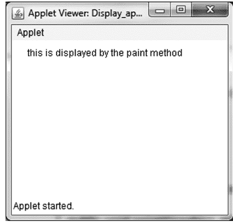

```java
import java.applet.Applet;
import java.awt.*;

public class AppletMethods extends Applet {
    int initCounter = 0;
    int startCounter = 0;
    int stopCounter = 0;
    int destroyCounter = 0;

    public void init() {
        initCounter++;
        repaint();
    }

    public void start() {
        startCounter++;
        repaint();
    }

    public void stop() {
        stopCounter++;
        repaint();
    }

    public void destroy() {
        destroyCounter++;
        repaint();
    }

    public void paint(Graphics g) {
        g.drawString("init has been invoked " + String.valueOf(initCounter) + " times", 20, 20);
        g.drawString("start has been invoked " + String.valueOf(startCounter) + " times", 20, 35);
        g.drawString("stop has been invoked " + String.valueOf(stopCounter) + " times", 20, 50);
        g.drawString("destroy has been invoked " + String.valueOf(destroyCounter) + " times", 20, 65);
    }
}
```

### repaint() 方法

当你想要重绘 Applet 区域时，可以调用 `repaint()` 方法。`repaint()` 方法调用 `update()` 方法来指示 Applet 需要更新。`update()` 方法的默认操作是清除 Applet 区域并调用 `paint()` 方法。如果你不想清除 Applet 区域，可以重写 `update()` 方法。

上述程序使用 `paint()` 和 `repaint()` 方法来检查 Applet 的 `init()`、`start()` 和 `stop()` 方法何时被调用。

## 9.5 更改 Applet 的字体

### Font 类

使用 `Font` 类，你可以更改字体、样式和字号。

示例：

以下代码段用 Times New Roman 字体以加粗和斜体样式、字号 14 显示了一个字符串。

```java
// DisplayApplet.java
// 在坐标 20,20 处显示字符串
import java.applet.*;
import java.awt.*;

public class DisplayApplet extends Applet {
    public void paint(Graphics g) {
        Font myFont = new Font("Times New Roman", Font.BOLD | Font.ITALIC, 14);
        g.setFont(myFont);
        g.drawString("this is displayed by the paint method", 20, 20);
    }
}
```

### 输出

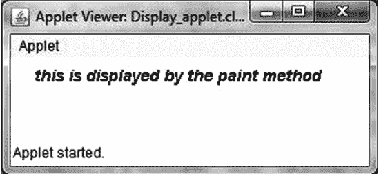

## 9.6 向 Applet 传递参数

以下代码段演示了参数的使用。

```java
import java.applet.Applet;
import java.awt.*;

public class Demo extends Applet {
    public void paint(Graphics g) {
        String name = getParameter("name");
        g.drawString("Hello " + name, 20, 20);
    }
}
```

要向 Applet 传递参数，请在 HTML 中使用 `PARAM` 标签：

```html
<APPLET CODE="Demo.class" HEIGHT=200 WIDTH=200>
    <PARAM name="name" value="Java User">
</APPLET>
```

## 9.7 创建应用程序

所有的 Applet 都必须继承自 `Applet` 类。与 Applet 不同，应用程序不需要继承任何类。应用程序的执行不需要浏览器。
应用程序从 `main()` 方法开始。该方法的原型如下：

```java
public static void main(String args[]) {
}
```

### 应用程序示例

以下代码是一个 Java 应用程序的简单示例。

```java
import java.util.Date;

public class HelloWorld {
    public static void main(String args[]) {
        System.out.println("Hello World!");
        System.out.println(new Date());
    }
}
```

编译并运行应用程序：

```bash
javac HelloWorld.java
java HelloWorld
```

## 9.8 类成员示例

示例：

```java
public class Application {
    int nonStaticVariable;
    static int staticVariable;

    public void nonStaticMethod() {
        // statements
    }

    public static void main(String a[]) {
        Application app = new Application();
        app.nonStaticMethod();
    }
}
```

## 9.9 将 Applet 转换为应用程序

执行 Applet 需要浏览器。为了让没有浏览器的用户也能访问你的 Applet，你可以将其转换为应用程序。这个过程非常简单。

1. 添加 `main()` 方法可以将 Applet 转换为应用程序。
2. `main()` 方法负责应用程序窗口的创建、尺寸调整和显示。

程序的执行是从 `main()` 方法开始的。由于程序将不再作为 Applet 运行，你需要执行一些本由 Java 自动为 Applet 执行的启动任务。

考虑下面提供的 Applet 代码：

```java
// 在坐标 20,20 处显示字符串的代码，Applet
import java.applet.*;
import java.awt.*;

public class DisplayApplet extends Applet {
    public void paint(Graphics g) {
```


# 第十章 异常处理

异常是程序执行过程中发生的非正常事件，会中断程序的正常流。它代表一种可以处理的错误或意外情况。

## 10.1 异常处理

你需要异常处理来管理运行时错误。如果这些错误没有被处理，程序将会崩溃。异常处理允许程序继续执行。

导致异常的情况非常多样，但它们分为四类：

1. **代码或数据**：例如，你尝试除以零。
2. **标准异常**：例如，你使用超出范围的数组索引。
3. **抛出自己的异常**：你需要抛自定义异常。
4. **Java 错误**：这些用于指示灾难性的故障。

## 10.2 异常的类型

层次结构的顶端类是 `Throwable`。有两个类派生自 `Throwable`：`Error` 和 `Exception`。`Exception` 类用于必须捕获的异常情况。`Error` 类定义了正常不会发生的情况。这些类位于 `java.lang` 包。

### Error

由 `Error` 类及其子类定义的异常有一个特点是：它们都代表你不预期执行任何操作的情况，因此你不预期捕获它们。`Error` 类有三个直接子类：

- `ThreadDeath`
- `LinkageError`
- `VirtualMachineError`

**ThreadDeath**：当执行线程被故意停止时抛出此异常。它有助于销毁线程。
**LinkageError**：此异常记录程序中的严重错误。
**VirtualMachineError**：该类有四个子类，指定了在发生灾难性故障时抛出的异常。

### Runtime Exception

它们也是**未检查异常**，因为这些异常的对象是由 JVM 创建的。它们用于信号 Java 语言中各种包的问题。各种运行时异常有：

- **算术异常**：当尝试除以零时产生。
- **越界异常**：当尝试访问超出数组索引的数组元素时抛出此异常。
- **负数组尺寸异常**：当你尝试用负维度定义数组时抛出此异常。
- **空指针异常**：当应用程序尝试在需要对象的地方使用 `null` 时，会抛出此异常。未分配内存的对象持有 `null` 值。抛出此类异常的情况包括：
  - 在未为对象分配内存的情况下使用该对象。
  - 调用空对象的方法。
  - 访问或修改空对象的属性。
  - 如果空对象是数组，则使用其长度（`length`）。

示例：

```java
String s;
s.length();
/* 产生空指针异常，因为 s 中没有存储任何字符串 */
```

- **数组存储异常**：当你尝试将一个对象存储在与数组类型不允许的数组中时，会抛出此异常。
- **类型转换异常**：当你尝试将一个对象转换为无效类型时，会抛出此异常。该对象既不是指定的类，也不是该类的子类或父类。
- **非法参数异常**：当你向方法传递一个与参数类型不匹配的参数时，会抛出此异常。
- **安全异常**：当程序执行了非法操作时，会抛出此异常。例如，尝试从本地机器读取文件。

对于派生自该类的所有其他类，编译器将检查你是否已经在方法中处理了异常，或者你是否指示了方法可以抛出此类异常。如果两者皆非，你的代码将无法编译。这些被称为**受检异常**。

## 异常处理技术

当方法中发生意外错误时，Java 会创建一个 `Exception` 类型的对象。在创建 `Exception` 对象后，Java 通过一种称为“抛出”的动作将其发送给程序。`Exception` 对象包含了有关错误类型以及异常发生时程序状态的信息。你需要使用异常处理器处理异常。

你可以使用以下关键字在程序中实现异常处理：

- `try`
- `catch`
- `throw`
- `throws`
- `finally`

### 1. Try 块

你需要在 `try` 块中保护可能抛出异常的语句。语法如下：

```java
try {
    // 可能导致异常的语句
}
```

`try` 块控制其包含的语句并定义了异常的范围。换句话说，如果 `try` 块内发生了异常，那么与 `try` 块相关的适当异常处理器将处理该异常。`try` 块必须至少有一个紧随其后的 `catch` 块。

示例：

```java
class Demo {
    public void myMethod(int num1, int num2) {
        int result = 0;
        try {
            result = num2 / num1;
        } catch (Exception e) {
            // 处理异常的语句
        }
        System.out.println("Result: " + result);
    }

    public static void main(String[] args) {
        Demo app = new Demo();
        app.myMethod(0, 10);
    }
}
```

### 2. Catch 块

你通过在 `try` 块之后立即提供一个或多个 `catch` 处理器，将异常处理器与 `try` 块关联。

语法：

```java
try {
    // 可能导致异常的语句
} catch(...) {
    // 错误处理例程
}
```

`catch` 语句将 `Exception` 类的对象作为参数，该对象引用捕获到的异常。一旦捕获异常，`catch` 块中的语句将仅限于先前的 `try` 块中的语句。以下代码说明了 `catch` 块的使用。

```java
class Demo {
    public void myMethod(int num1, int num2) {
        int result = 0;
        try {
            result = num2 / num1;
        } catch (ArithmeticException e) {
            System.out.println("Error-> Division by zero");
            // 处理异常的语句
        }
        System.out.println("Result: " + result);
    }

    public static void main(String[] args) {
        Demo app = new Demo();
        app.myMethod(0, 10);
    }
}
```


### 1. Try 块

你需要在 `try` 块中保护可能抛出异常的语句。语法如下：

```
try {
    // 可能导致异常的语句
}
```

`try` 块控制其包含的语句并定义了异常的范围。换句话说，如果 `try` 块内发生了异常，那么与 `try` 块相关的适当异常处理器将处理该异常。`try` 块必须至少有一个紧随其后的 `catch` 块。

示例：

```
class Demo {
    public void myMethod(int num1, int num2) {
        int result = 0;
        try {
            result = num2/num1;
        } catch (Exception e) {
            // 处理异常的语句
        }
        System.out.println("Result: " + result);
    }
    public static void main(String[] args) {
        Demo app = new Demo();
        app.myMethod(0, 10);
    }
}
```

### 2. Catch 块

你通过在 `try` 块之后立即提供一个或多个 `catch` 处理器，将异常处理器与 `try` 块关联。

语法：

```
try {
// 可能导致异常的语句
} catch(...) {
// 错误处理例程
}
```

`catch` 语句将 `Exception` 类的对象作为参数，该对象引用捕获到的异常。一旦捕获异常，`catch` 块中的语句将仅限于先前的 `try` 块中的语句。以下代码说明了 `catch` 块的使用。

```
class Demo {
    public void myMethod(int num1, int num2) {
        int result = 0;
        try {
            result = num2/num1;
        } catch (ArithmeticException e) {
            System.out.println("Error-> Division by zero");
            // 处理异常的语句
        }
        System.out.println("Result: " + result);
    }
    public static void main(String[] args) {
        Demo app = new Demo();
        app.myMethod(0, 10);
    }
}
```

注意：

当方法中发生意外错误时，Java 会创建一个 `Exception` 类型的对象。在创建 `Exception` 对象后，Java 通过一种称为“抛出”的动作将其发送给程序。`Exception` 对象包含了有关错误类型以及异常发生时程序状态的信息。你需要使用异常处理器（`exception-handler`）处理异常来处理异常。

你可以使用 `try`、`catch`、`throw`、`throws` 和 `finally` 这些关键字在程序中实现异常处理。


# 异常处理 | 133

## 4. 空指针异常

当应用程序尝试在需要对象的地方使用 `null` 时，会抛出此异常。未分配内存的对象持有 `null` 值。抛出此类异常的情况包括：

- 在未为对象分配内存的情况下使用该对象。
- 调用空对象的方法。
- 访问或修改空对象的属性。
- 如果空对象是数组，则使用其长度（`length`）。

示例：

```java
String s;
s.length();
/* 产生空指针异常，
因为 s 中没有存储任何字符串 */
```

## 5. 数组存储异常

当你尝试将一个对象存储在与数组类型不允许的数组中，会抛出此异常。

## 6. 类型转换异常

当你尝试将一个对象转换为无效类型时，会抛出此异常。该对象既不是指定的类，也不是该类的子类或父类。

## 7. 非法参数异常

当你向方法传递一个与参数类型不匹配的参数时，会抛出此异常。

## 8. 安全异常

当程序执行了非法操作时，会抛出此异常。例如，尝试从本地机器读取文件。

对于派自该类的所有其他类，编译器将检查你是否已经在方法中处理了异常，或者你是否指示了方法可以抛出此类异常。如果两者皆非，你的代码将无法编译。这些被称为检查异常（`checked exceptions`）。

## 异常处理技术

当方法中发生意外错误时，Java 会创建一个 `Exception` 类型的对象。在创建 `Exception` 对象后，Java 通过一种称为“抛出”的动作将其发送给程序。`Exception` 对象包含了有关错误类型以及异常发生时程序状态的信息。你需要使用异常处理器（`exception-handler`）处理异常来处理异常。

你可以使用以下关键字在程序中实现异常处理：

- `try`
- `catch`
- `throw`
- `throws`
- `finally`

### 1. Try 块

你需要在 `try` 块中保护可能抛出异常的语句。语法如下：

```java
try {
    // 可能导致异常的语句
}
```

`try` 块控制其包含的语句并定义了异常的范围。换句话说，如果 `try` 块内发生了异常，那么与 `try` 块相关的适当异常处理器将处理该异常。`try` 块必须至少有一个紧随其后的 `catch` 块。

示例：

```java
class Demo {
    public void myMethod(int num1, int num2) {
        int result = 0;
        try {
            result = num2 / num1;
        } catch (Exception e) {
            // 处理异常的语句
        }
        System.out.println("Result: " + result);
    }

    public static void main(String[] args) {
        Demo app = new Demo();
        app.myMethod(0, 10);
    }
}
```

### 2. Catch 块

你通过在 `try` 块之后立即提供一个或多个 `catch` 处理器，将异常处理器与 `try` 块关联。

语法：

```java
try {
    // 可能导致异常的语句
} catch (...) {
    // 错误处理例程
}
```

`catch` 语句将 `Exception` 类的对象作为参数，该对象引用捕获到的异常。一旦捕获异常，`catch` 块中的语句将仅限于先前的 `try` 块中的语句。以下代码说明了 `catch` 块的使用。

```java
class Demo {
    public void myMethod(int num1, int num2) {
        int result = 0;
        try {
            result = num2 / num1;
        } catch (ArithmeticException e) {
            System.out.println("Error-> Division by zero");
            // 处理异常的语句
        }
        System.out.println("Result: " + result);
    }

    public static void main(String[] args) {
        Demo app = new Demo();
        app.myMethod(0, 10);
    }
}
```

### 3. Finally 块

当异常发生时，`try` 块中的剩余语句将被忽略。有时，无论是否抛出异常，都需要处理某些语句。`finally` 块就用于此类。

示例：

```java
try {
    openFile();
    writeFile(); // 可能会引发异常
} catch (ArrayIndexOutOfBoundsException e) {
    System.out.println("Array index out of bound exception");
} catch (ArithmeticException e2) {
    System.out.println("Division by zero");
} catch (Exception e) {
    System.out.println(e);
}
```


} catch (..)

    // 处理异常

```

无论是否抛出异常，必须关闭文件。你可以将关闭文件的代码放在 `try` 块和 `catch` 块中。为了避免重复代码，你可以将代码放在 `finally` 块中。`finally` 块中的代码无论是否抛出/捕获异常都会执行。`finally` 块位于 `catch` 块之后。一个异常处理器只能有一个 `finally` 块，但并不是强制要求有 `finally` 块。

```java
finally
{
    closeFile();
}
```

注意：如果程序通过调用 `System.exit()` 退出或由于致命错误导致进程终止，`finally` 块将不会执行。

# 4. throw 语句 (The Throw Statement)

当用户输入错误的登录 ID 或密码时，你可能想要抛出一个异常。你可以使用 `throw` 语句来实现。`throw` 语句接受单个参数，该参数是 `Exception` 类的对象。

## 语法 (Syntax)

```java
throw throwable_instance;
```

### 示例

```java
throw object;
```

如果抛出的对象不属于有效的异常类，编译器将报错。`throw` 语句通常用于程序员自定义异常。

# 5. throws 语句 (The Throws Statement)

如果一个方法能够抛出一个它本身未处理的异常，则它必须指定该异常需要由调用方法处理。这是通过使用 `throws` 语句完成的。该语句用于指定由方法抛出的异常列表。

## 语法 (Syntax)

```java
[<access_specifier>][<modifier>] <return_type><method_name>(<Arg_list>) throws <exception_list>
```

### 示例:

```java
public void acceptpassword() throws IllegalAccessException {
    System.out.println("Intruder");
    throw new IllegalAccessException();
}
```

# 10.4 定义你自己的异常类 (DEFINING YOUR OWN EXCEPTION CLASSES)

现在你已经知道如何为运行时系统和标准类库中方法抛出的异常对象编写异常处理程序。你也可以定义自己的异常类，并在发生异常时抛出这些类的对象。在这种情况下，由你来决定什么构成了异常条件。

例如：你可以编写一个数据处理应用程序，处理通过 TCP/IP 链路从另一台计算机获取的数据。如果程序的规范规定不应接收整数值 10，你可以利用整数值 10 的出现来导致抛出你自己设计的异常对象。

## 如何创建你自己的异常类 (How to Create Your Own Exception Class)

你可以通过扩展 `Exception` 类来创建异常类。扩展后的类像其他类一样包含构造函数、数据成员和方法。在实现自定义异常时，会使用 `throw` 和 `throws` 关键字。

### 示例

```java
public class IllegalValueException extends Exception {}

public class UserTrial {
    int val1, val2;

    public UserTrial(int a, int b) {
        val1 = a;
        val2 = b;
    }

    void show() throws IllegalValueException {
        if (val1 < 0) || (val2 > 0)
            throw new IllegalValueException();
        System.out.println("value 1=" +val1);
        System.out.println("value 2=" +val2);
    }
}

public class ThrowExample {
    public static void main(String a[]) {
        UserTrial values = new UserTrial(-1);
        try {
            values.show();
        } catch(IllegalValueException e) {
            System.out.println("illegal values: caught in main");
        }
    }
}
```

### 输出 (Output)

```
illegal values: caught in main
```

对上述代码的解释：

- (1) 在上述代码中，一个名为 `IllegalValueException` 的类扩展自 `Exception` 类。
- (2) `UserTrial` 类有一个方法会抛出一个名为 `IllegalValueException` 的自定义异常。
- (3) `ThrowExample` 类中的 `main()` 方法创建了一个 `UserTrial` 类对象，并将错误值传递给构造函数。
- (4) `main()` 方法的 `try` 块调用了 `show()` 方法。
- (5) `show()` 方法抛出一个异常，该异常被 `main()` 方法中的异常处理器捕获。
- (6) 异常处理器捕获了异常。

```java
class IllegalValueException extends Exception {
    IllegalValueException(String message) {
        super(message);
    }
}

class Voter {
    int val1, val2;

    public Voter(int a, int b) {
        val1 = a;
        val2 = b;
    }

    void show() throws IllegalValueException {
        if (val1 < 0 || (val2 > 0))
            throw new IllegalValueException("illegal values");
        System.out.println("value 1=" +val1);
        System.out.println("value 2=" +val2);
    }
}

public class ThrowExample {
    public static void main(String a[]) {
        Voter values = new Voter(-1, 0);
        try {
            values.show();
        } catch (IllegalValueException e) {
            System.out.println(e.getMessage() + ": caught in main");
        }
    }
}
```

### 输出

```
illegal values: caught in main
```

对上述代码的解释：

- (1) 在上述代码中，一个名为 `IllegalValueException` 的类扩展自 `Exception` 类。
- (2) `Voter` 类有一个方法会抛出一个名为 `IllegalValueException` 的自定义异常。
- (3) `ThrowExample` 类中的 `main()` 方法创建了一个 `Voter` 类对象，并将错误值传递给构造函数。
- (4) `main()` 方法的 `try` 块调用了 `show()` 方法。
- (5) `show()` 方法抛出一个异常，该异常被 `main()` 方法中的异常处理器捕获。
- (6) 异常处理器捕获了异常。

```java
class IllegalValueException extends Exception {
    IllegalValueException(String message) {
        super(message);
    }
}

class Voter {
    int val1, val2;

    public Voter(int a, int b) {
        val1 = a;
        val2 = b;
    }

    void show() throws IllegalValueException {
        if (val1 < 0 || (val2 > 0))
            throw new IllegalValueException("illegal values");
        System.out.println("value 1=" +val1);
        System.out.println("value 2=" +val2);
    }
}

public class ThrowExample {
    public static void main(String a[]) {
        Voter values = new Voter(-1, 0);
        try {
            values.show();
        } catch (IllegalValueException e) {
            System.out.println(e.getMessage() + ": caught in main");
        }
    }
}
```

# 异常：年龄不能低于18 (Exception: age cannot be below 18)

# 12 | 深度 Java (Java in Depth)

# 异常处理 (Exception Handling)

# 总结 (SUMMARY)

- 1. 异常是在执行过程中发生并中断正常流程的异常事件。属于 `java.lang` 包。
- 2. Java 提供了处理异常的类。
- 3. 异常通过 `try`、`catch`、`throw` 和 `finally`。
- 4. 当发生异常时，会在方法中搜索异常处理器，然后在调用方法中搜索。
- 5. `try catch` 块可以嵌套。
- 6. 你可以通过扩展 `Exception` 类来创建自己的异常。

# 回答以下问题 (ANSWER THE FOLLOWING QUESTIONS)

## 选择题 (MULTIPLE CHOICE QUESTIONS)

### 1. 给定

```java
class Fork{
    public static void main(String a[]) {
        if (a.length==1|| a[1].equals("test")) {
            System.out.println("testcase");
        }
        else
            System.out.println("production "+a[0]);
    }
}
```


命令调用为：`Java Fork live2`

- 1. 结果是什么？
  a) testcase
  b) Production live2
  c) Test case live2
  d) 编译失败
  e) 在运行时抛出异常
  答案：a)

- 2. 如果在 `try` 块中产生异常，则在____ 块中被捕获。
  a) finally b) catch c) throw d) throws
  答案：b)

- 3. 显式抛出异常使用____关键字。
  a) Finally b) catch c) throw d) throws
  答案：d)

- 4. 是所有异常类的父类。
  a) Throwableable b) Exception c) MyException
  答案：a)

- 5. 无论异常是否被捕获都会执行。
  a) finally b) catch c) throw d) throws
  答案：a)

# 复习题 (REVIEW QUESTIONS)

- 1. 异常的类型？
- 2. 区分 `finally`、`final` 和 `finalize`。
- 3. 区分 `Error` 和 `Exception`。
- 4. 什么是已检查异常和未检查异常？
- 5. 你可以创建自己的异常吗？解释抛出自定义异常的方法。

# 面试题 (INTERVIEW QUESTIONS)

- 1. 什么是异常？
- 2. 区分已检查和未检查异常。
- 3. 每个 `try` 块都必须跟随 `catch` 块吗？
- 4. 什么是 `finally` 块？
- 5. 没有 `catch` 块可以使用 `finally` 块吗？
- 6. 是否存在 `finally` 不执行的情况？
- 7. `throw` 和 `throws` 的区别是什么？

## 第11章

## 多线程编程

大多数电脑游戏都使用图形和声音。你有没有注意到图形、得分和音乐是同时运行的？想象一下这样的场景：你先看到屏幕在变化，接着看到得分更新，最后才听到了声音！

一个游戏程序同时处理所有这些元素。换句话说，程序被分成了三个子单元，每个单元由一个线程处理。

如果你用过 Microsoft Word，你会注意到在你输入文本时，应用程序会在后台自动保存文件。这是多线程的另一个例子，用户界面由一个线程处理，而文件的保存由另一个线程处理。当你打印文档时也是如此。

当你有需要几秒钟才能完成的大计算，且你不希望用户感觉到延迟时，线程就非常有用。动画是线程使用的另一个领域。

### 11.1 线程

线程类似于顺序程序。一个顺序程序有开始、一系列要执行的步骤和一个结束。线程同样有开始、序列和结束。然而，线程本身并不是一个独立的程序，而是与程序一起运行的。线程可以定义为与程序一起的顺序控制流。每个程序至少有一个线程，即主线程。必要时你可以创建更多线程。

微处理器为为你执行的进程分配内存。每个进程占用它自己的地址空间（内存）。然而，一个进程中的所有线程共享同一个地址空间。因此，设备、程序数据和程序环境等资源对程序的所有线程都是可用的。线程被称为“轻量级进程”或“执行上下文”。这是因为当处理器从一个线程切换到另一个线程时，重叠部分较少。相反，进程是重量级的。下图显示了线程与进程之间的关系。

146 | 深度解析 Java

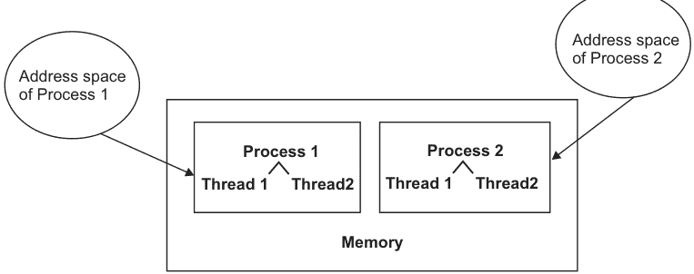

线程与进程的关系

### 11.2 单线程与多线程应用程序

仅由一个线程组成的进程被称为单线程进程。单线程应用程序一次只能执行一个任务。你必须等待一个任务完成后，才能开始另一个任务。

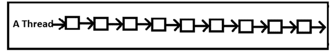

单线程程序

例如，我们有三个活动——读取文件、处理和写入文件，它们必须按顺序运行，并且对于每个读取和处理的文件都要重复该序列。那么，该过程可以使用单个线程执行，如下所示。

图示

| 线程-1 | | | | | | |
| :--- | :--- | :--- | :--- | :--- | :--- |
| 读取块1 | 处理-1 | 写入-1 | 读取块2 | 处理-2 | 写入-2 |

单线程进程

拥有多个线程的进程被称为多线程进程。它是一组同时运行、执行不同任务并相互交互的进程。

多线程编程 | 147

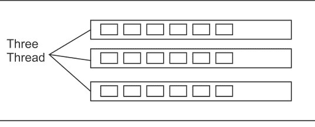

多线程程序

任何像 Microsoft Internet Explorer 这样的浏览器都是多线程应用程序的例子。通过浏览器，你可以在滚动页面的同时在后台打印页面。你可以同时播放音频文件并观看动画图像。这种行为在你并发执行几项任务时非常接近现实。

Java 对线程有内置支持。Java 架构的大大部分都是多线程的。在 Java 程序中，线程最常见的用途是允许 Applet 接受用户输入，同时在屏幕的另一部分显示动画。任何需要同时完成至少两件事的应用程序都是多线程的绝佳候选。

继续之前的例子，让我们安排程序，使得从文件中读取一个块是一个活动，执行计算是第二个活动，写入结果是第三个活动。在这种情况下，一旦第一个块被读取，就可以开始读取第二个块。总之，我们可以让所有三个活动并发执行，如下所示。

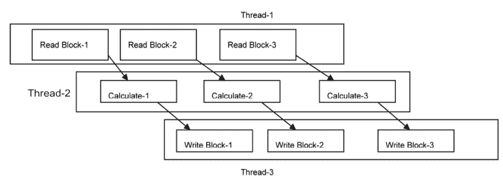

多线程进程

### 当前线程

你创建的每个程序都至少有一个线程。你可以使用 `Thread` 类的 `currentThread()` 方法访问此线程。该方法是一个静态方法，因此你不需要创建 `Thread` 类的对象来调用该方法。

深度解析 Java

示例：

```java
public class CurrentthreadDemo {

    public static void main(String a[]) {

        Thread thisthread = Thread.currentThread();

        try {

            for (int counter = 0; counter < 10; counter += 2) {

                System.out.println(counter);

                Thread.sleep(1000);

            }

        } catch (InterruptedException e) {}

    }

}
```

输出：
```
0
2
4
6
8
```

### 语法

```java
public void start()
```

### (2) run() 方法

一旦启动，线程将进入可运行状态。线程的所有活动都是在 `run()` 方法定义的线程体中进行的。在线程创建并初始化后，会调用 `run()` 方法。`run()` 方法通常包含一个循环。

```java
public void run() {

  while (ThreadDemo != null) {

  }

}
```

### (3) sleep() 方法

通过 `sleep()` 方法将线程置睡眠模式。当线程睡眠时，执行队列中的其他线程。

语法：

```java
static void sleep(long no_of_milliseconds) throws InterruptedException;
```

其中 `no_of_milliseconds` 是线程处于活动状态的毫秒数。`sleep` 是一个静态方法，因为它是在当前线程上操作。它会抛出 `InterruptedException`。

`sleep()` 方法有另一种形式（如下所示），允许你以毫秒和纳秒来指定周期。

语法：

```java
static void sleep(long millisecond, int nanoseconds) throws InterruptedException
```

### (4) 停止线程

当 `run()` 方法中的循环完成时，线程会自然死亡。可以通过 applet 的 `stop(null)` 方法杀死线程。

```java
public void stop(ThreadDemo-null);
```

当你离开运行该属性的页面时，applet 的 `stop()` 方法会释放分配给线程的内存。
注意：`Thread` 类的 `stop()`、`suspend()` 和 `resume()` 方法在 JDK 1.2 中已弃用。

### (5) setName() 方法

你可以使用 `setName()` 设置线程名称。可以通过调用 `getName()` 获取线程名称。这些方法是 `Thread` 类的成员，声明如下：

### 语法

- (a) `final void setName(String name)`
- (b) `final String getName();`

### (6) isAlive()

为了确定线程是否完成或结束了工作，我们有一个方法 `isAlive()`

语法：

```java
final boolean isAlive()
```

如果调用它的线程仍在运行，则 `isAlive()` 返回 `true`。否则返回 `false`。

### (7) join()

此方法等待直到被调用的线程终止。它的名字源于调用线程等待指定的线程加入（join）的概念。`join()` 的其他形式允许你指定等待指定线程终止的最大时间。

### 11.3 线程优先级

运行时根据优先级执行线程。C.P.U. 每次只能执行一个线程。因此，就绪准备执行的线程会排队等待处理器时间。每个线程获得一段时间切片，之后它会回到线程队列。线程使用固定优先级调度进行调度，本质上是线程具有一个影响其在处理器线程队列中位置的优先级。高优先级线程会在低优先级线程之前运行。

如果 Java 遇到另一个线程正在执行，当前线程会被推回，且优先级更高。线程可以自愿放弃它在线程队列中的位置。这在线程让位于另一个线程（yield）或睡眠时完成。如果线程正在等待输入/输出操作，它会被另一个线程抢占（推回队列）。当另一个高优先级线程从睡眠中唤醒时，该线程也会被抢占。优先级与创建它的线程相同。你可以用 1 到 10 范围内的整数表示线程的优先级。你可以使用 `Thread` 类的 `setPriority()` 方法更改线程的优先级。

语法：

```java
public void setPriority(int newPriority);
```

参数 `newPriority` 可以取下面提到的任何一个常量：

```java
MIN_PRIORITY
MAX_PRIORITY
NORM_PRIORITY
```

这些常量声明在 `Thread` 类中。

```
MIN_PRIORITY 的值为 1
MAX_PRIORITY 的值为 10
NORM_PRIORITY 的值为 5
```

注意：

- (1) 默认线程优先级为 5。新线程被分配创建线程的优先级。
- (2) 线程优先级在不同的 JVM 上处理方式不同。Java 并没有规定线程调度器对优先级必须做什么。它只规定线程必须有优先级。

示例：

```java
public class MyThread implements Runnable {

    int counter = 0;

    private Thread thread;

    private boolean counting = true;

    public MyThread(int priority) {

        thread = new Thread(this); // 创建一个线程

        thread.setPriority(priority);

    }

    public void run() {

        while (counting) {

            counter++;

        }

    }

    public void stop() {

        counting = false; /* 这将停止 run() 中的 while 循环*/

    }

    public void start() {

        thread.start();

    }

}

public class Starter {

    public static void main(String args[]) {

        // 设置当前线程的优先级。

        Thread.currentThread().setPriority(Thread.MAX_PRIORITY);

        // 增加线程 1 的优先级

        MyThread thread1 = new MyThread(Thread.NORM_PRIORITY + 2);

        // 降低线程 1 的优先级

        MyThread thread1 = new MyThread(Thread.NORM_PRIORITY - 2);

    }

}
```

### 成员。这确保了每个人都能获得等等的汤份额，而且没有人会被等待。

## 哪种选择更好？

在上面的类比中，汤类似于一个对象，而勺子扮演的角色类似于该对象的监视器（monitor）。

让我们来看另一个例子，其中 `thread1` 生成的数据由 `thread2` 消费。在这里，`thread1` 是生产者，`thread2` 是消费者。消费者必须不时地检查它是否有可以操作的数据。这极大地浪费了 C.P.U 时间，因为消费者占据了 C.P.U 周期来检查生产者是否已经准备好数据。

如果生产者在完成生产所需数据后能与消费者通信呢？消费者将不再仅仅为了检查生产者是否完成了工作而耗尽 C.P.U 周期。线程之间的通信被称为线程间通信（Inter-Thread communication）。

## 线程间通信通过四种方法实现

- `wait()`
- `notify()`
- `notifyAll()`
- `yield()`

所有这些方法在 `Object` 类中都被声明为 `final`（最终的）。它们只能在同步（synchronized）方法中调用。

### A) wait() 方法

`wait()` 方法告诉当前线程放弃监视器并睡眠，直到另一个线程调用 `notify()` 方法。你可以使用 `wait()` 方法来同步线程。

语法：

```java
public final void wait() throws InterruptedException
```

`wait()` 方法让当前线程等待，直到另一个线程调用当前对象的 `notify()` 或 `notifyAll()` 方法。

当前线程必须拥有该对象的监视器。

注意：
(1) `wait()` 和 `sleep()` 方法都会让线程延迟请求的时间。如果你使用 `wait()` 方法，可以使用 `notify()` 方法恢复线程。当使用 `sleep()` 方法时无法做到这一点。这对于那些一次睡眠几分钟的线程来说是至关重要的。
(2) 等待的线程在被通知后，并不可能立即获得对象监视器的控制权。可能有其他线程获得监视器的控制权。

### B) notify() 方法

`notify()` 方法会唤醒等待当前对象监视器的单个线程。如果有多个线程在等待，则会随机选择一个。被唤醒的线程在当前线程释放监视器锁之前无法继续执行。应该是对象监视器所有者的线程应该调用该方法。

语法：

```java
public final void notify();
```

### C) notifyAll() 方法

`notifyAll()` 方法用于唤醒所有等待对象监视器的线程。

> 注意：要调用 `notify()` 和 `notifyAll()` 方法，线程必须拥有这些对象的监视器。

### D) yield() 方法

`yield()` 方法会导致运行时将当前线程睡眠并执行队列中的下一个线程。可以使用 `yield()` 方法确保低优先级线程也能获得处理器时间。

语法：

```java
public static void yield();
```

> 注意：时间分片和线程优先级在不同的 JVM 中是不同的。在 Windows 平台上编写的线程程序的结果可能与 Solaris 平台获得的结果不同，因为不同的系统处理线程的方式不同。

### 示例（涉及 wait(), notify(), synchronized 的使用）

让我们以职业介绍机构为例。每当有新的职位空缺出现，就会提供给候选人。这样做非常小心，因为候选人不能承担超过可用职位数量的工作。机构决定一次挂出一个对象，供候选人接手工作。在第一个职位被填满之前，不会挂出第二个。同时，对于特定的职位只能选择一个候选人。

以下程序显示了如何使用 `wait()` 和 `notify()` 方法解决问题。

```java
import java.lang.*;

class JobOpening {

    int counter;

    boolean valueset = false;

    synchronized int get() {

        if (valueset) // 如果没有可用职位
            try {
                wait(); // 等待职位空
            } catch (InterruptedException e) { }

        System.out.println("Got: " + counter);

        valueset = false; // 没有更多可用职位

        notify();

        return counter;

    }

    synchronized void put(int counter) {
```


```java
if (valueset) // 如果职位尚未被候选人接手
    try {
        wait(); // 等待现有职位
    } catch (InterruptedException e) { }
this.counter = counter;
valueset = true;
System.out.println("put:" + counter);
notify();
}
}
class MyThread1 implements Runnable {
    JobOpening job;
    public MyThread1(JobOpening job) {
        this.job = job; // 创建一个生产职位的线程
        new Thread(this, "job production").start();
    }
    public void run(){
        int i = 0;
        while (true) {
            job.put(i++); // 添加另一个职位
        }
    }
}
class MyThread2 implements Runnable {
    JobOpening job;
    public MyThread2(JobOpening job) {
        this.job = job;
    }
    public void run(){
        while (true) {
            job.get();
        }
    }
    public static void main(String[] args) {
        JobOpening job = new JobOpening();
        new Thread(new MyThread2(job), "job consumption").start();
        new MyThread1(job);
    }
}
```

### 输出
```
put:0
Got: 0
put:1
Got: 1
put:2
Got: 2
...
```

# 多线程编程 | 163

- 3. `currentThread()` 方法获取当前线程的引用。
- 4. 多线程应用程序有多个线程。
- 5. `Thread` 类用于在程序中创建和操作线程。
- 6. 你可以使用 `Thread` 类或 `Runnable` 接口来实现线程。
- 7. 线程可以处于以下状态：
  * 新建
  * 运行
  * 可运行
  * 不可用
  * 死亡
- 8. `start()` 方法用于启动线程。
- 9. `run()` 方法包含线程执行的代码。
- 10. 可以使用 `sleep()` 方法让线程进入睡眠状态。
- 11. `stop()` 方法用于停止线程。
- 12. 线程根据它们的优先级进行调度。
- 13. `synchronized` 关键字用于确保没有两个线程同时访问同一个对象。
- 14. `wait()` 和 `notifyAll()` 用于线程间的通信。

### 回答以下问题

### 单选题

- 1. 给定：
```java
public class Threads2 implements Runnable {
    public void run() {
        System.out.println("run");
        throw new RuntimeException("Problem");
    }
    public static void main(String[] args) {
        Thread t = new Thread(new Threads2());
        t.start();
        System.out.println("End of method");
    }
}
```
- 结果可能是哪些？（选择两个）
  a) java.lang.RuntimeException: Problem
  b) run
     java.lang.RuntimeException: Problem
  c) End of method
     java.lang.RuntimeException: Problem
  d) End of method
     run
     java.lang.RuntimeException: Problem
  e) run
     java.lang.RuntimeException: Problem
     End of method.
答案：d), e

- 2. Java 中的线程优先级是？
  a) Integer b) Float c) double d) long
答案：a

- 3. 如果两个相同优先级的线程被同时调用处理会发生什么？
  a) 任何一个将按字母顺序优先执行
  b) 它们都将同时执行
  c) 它们都不会被执行
  d) 取决于操作系统。
答案：d

- 4. 以下哪些是多任务处理的类型？
  a) 基于进程的 b) 基于线程的
  c) 基于进程和线程的
答案：c

- 5. 以下哪个包包含所有 Java 的内置异常？
  a) java.io b) java.util c) java.lang d) java.net
答案：c

### 判断题

- 1. 可能同时有两个以上的线程发生死锁。
答案：正确

- 2. JVM 实现保证了多个线程不会进入死锁状态。
答案：错误

- 3. 死锁线程一旦其 `sleep()` 方法的睡眠时间过期就会释放。
答案：错误

- 4. 只有当错误使用 `wait()`、`notify()` 和 `notifyAll()` 方法时才会发生死锁。
答案：错误

- 5. 如果使用了 `synchronized` 块，单线程应用程序可能会发生死锁。
答案：正确

- 6. 如果代码会导致死锁，你无法通过插入 `Thread.yield()` 的调用来消除死锁的可能性。
答案：正确

# 多线程编程 | 165

### 复习题

- 1. Java 多线程中的同步是指什么？
- 2. 解释使用线程的不同方式？
- 3. `Thread.start()` 和 `Thread.run()` 方法的区别是什么？
- 4. 为什么我们既需要 `run()` 和 `start()` 方法？只用 `run` 方法可以吗？
- 5. 什么是 `ThreadLocal` 类？如何使用？
- 6. 什么时候抛出 `InvalidMonitorStateException`？为什么？
- 7. `sleep()`、`suspend()` 和 `wait()` 有什么区别？
- 8. 当我将静态方法标记为 `synchronized` 会发生什么？

### 面试题

- 1. 抢占式调度和时间片有什么区别？
- 2. `join()` 方法的作用是什么？
- 3. `wait()` 和 `sleep()` 方法有什么区别？
- 4. 可以启动两次线程吗？
- 5. 什么是同步和静态同步？
- 6. `notify()` 和 `notifyAll()` 有什么区别

# 第 12 章

# 流

## 12.1 Java 中的流

所有程序都接受用户的输入、处理并产生输出。因此，所有编程语言都支持输入输出操作。Java 通过 `java.io` 包中的类提供了输入输出的支持。Java 以流的形式处理所有输入和输出。流是指从源通过通信路径传输到目的地的字节序列。

如果程序从流写数据，那么它就是流的源。同样，如果读取到流，那么它就是流的目的地。流是强大的，因为它们抽象了输入/输出 (I/O) 操作的细节。

流的两种基础的流是：

- (a) 输入流
- (b) 输出流

每个流都有特定的功能。你只能从输入流读取，相反，你可以写到输出流。

注意：

- 1) **流**：从特定位置（如磁盘文件或内存）读取或写入的流被称为节点流。节点流类型包括文件、内存和管道。
- 2) **过滤器**：从一个流读取并写入另一个流的流被称为过滤器。

# 168 | 深入 Java

### 流的映射

两个主要的流是 `InputStream` 和 `OutputStream`。`InputStream` 类是输入的基础，而 `OutputStream` 类是输出的基础。这些类的层次结构所示：

### 输入和流的层次结构

国际化是设计程序以适应许多语言和地区的过程。它被称为 I18N，因为 'I' 和 'N' 之间有18 个字母。

## 12.2 抽象流

### 12.2.1 输入流

| 修饰符和类型 | 方法 |
|---|---|
| int `available()` | 返回可以在不阻塞的情况下读取或跳过的字节数估计。 |
| void `close()` | 关闭此流并释放与它相关的系统资源。 |

### 12.2.2 可标记流

可标记流提供了在流上设置“书签”并重置它的功能。然后可以从标记的位置读取流。如果流被标记，它必须关联某些内存来跟踪标记与流的当前位置之间的数据。

| 方法 | 描述 |
|---|---|
| void `mark(int readlimit)` | 标记输入流的当前位置。 |
| boolean `markSupported()` | 测试输入流是否支持 `mark` 和 `reset` 方法。如果流支持书签，则返回 true。 |
| void `reset()` | 将流重置到上次在该输入流上调用 `mark` 方法的位置。 |

示例：
```java
File f = new File("c:/emp.dat");
FileInputStream fis = new FileInputStream(f);
```

### 12.2.3 输出流

| 方法 | 描述 |
|---|---|
| void `close()` | 关闭此流并释放与此流相关的系统资源。 |
| void `flush()` | 刷新此输出流并强制写入缓冲的输出字节。 |
| void `write(byte[] b)` | 将指定的字节数组中的 `b.length` 个字节写入此输出流。 |
| void `write(byte[] b, int off, int len)` | 写入指定的字节数组中，从偏移量 `off` 开始，将 `len` 个字节写入此输出流。 |
| abstract void `write(int b)` | 将指定的字节写入此输出流。 |

### 12.2.4 输入流和输出流的类型

- I) `FileInputStream` 和 `FileOutputStream`: 在 Java 中，`FileInputStream` 和 `FileOutputStream` 类用于从文件中读取数据以及向文件中写入数据。换句话说，它们被用于 Java 中的文件处理。
- II) `FileOutputStream`: 用于向文件写入数据（原始数据类型）。

### FileOutputStream 的构造函数

- 1. `FileOutputStream(File file)`: 创建一个文件输出流，写入到指定的 `File` 对象表示的文件。
- 2. `FileOutputStream(File file, boolean append)`: 创建一个文件输出流，写入到指定的 `File` 对象表示的文件。如果 `append` 为 true，则以追加模式打开文件。
- 3. `FileOutputStream(FileDescriptor fdObj)`: 创建一个文件输出流，写入到文件描述符，该文件描述符表示到文件系统中实际文件的现有连接。
- 4. `FileOutputStream(String name)`: 创建一个文件输出流，写入到指定名称的文件。
- 5. `FileOutputStream(String name, boolean append)`: 创建一个文件输出流，写入到指定名称的文件。如果 `append` 为 true，则以追加模式打开文件。

它们都会抛出 `FileNotFoundException`。在这里，file path 是文件的全名，而 file 是一个描述文件的对象。

### FileInputStream

`FileInputStream` 类从文件中获取输入字节。它被用于读取原始字节流，例如图像数据。对于字符流的读取，请考虑使用 `FileReader`。

### FileInputStream 的构造函数

- 1. `FileInputStream(File file)`: 通过打开与实际文件的连接来创建 `FileInputStream`，该文件由文件系统中的 `File` 对象命名。
- 2. `FileInputStream(FileDescriptor fdObj)`: 使用文件描述符 `fdObj` 创建 `FileInputStream`，该文件描述符表示到文件系统中的实际文件的现有连接。
- 3. `FileInputStream(String name)`: 通过打开与实际文件的连接来创建 `FileInputStream`，该文件由文件系统中的路径名命名。

# 172 | 深度 Java

`File` 类提供了对文件和目录对象的访问，并拥有操作它们的方法。`FileDescriptor` 类帮助主机系统跟踪正在被访问的文件。`FileInputStream` 和 `FileOutputStream` 类提供了读写文件流的能力。`FileReader` 和 `FileWriter` 类支持基于 Unicode 的文件 I/O。

### File 类

`File` 类用于访问文件和目录对象。它使用主机操作系统的命名规范。`File` 类具有用于创建文件和目录的构造函数。这些构造函数接受文件和目录名称以及绝对和相对文件路径作为参数。文件的方法允许你删除和重命名文件。这些方法会检查文件的读写权限。你可以使用 `File` 类的目录方法创建、删除、重命名和列出目录。

### File 类的构造函数

要创建 `File` 类的对象，可以使用以下任何构造函数。

- 1. `File(String pathname)`: 通过将给定的路径字符串转换为抽象路径名来创建 `File` 类的新实例。
- 2. `File(String parent, String child)`: 从父名称和子路径名字符串创建 `File` 类的新实例。
- 3. `File(File parent, String child)`: 从父文件对象和子路径名创建一个新的文件实例。

示例：
```java
File file, file1, file2;
file = new File("c:\\java.txt");
file1 = new File("c:\\", "java.txt");
File dir = new File("c:\\newFolder");
file2 = new File(dir, "file.txt");
```

注意：
两个反斜杠用于抵消 `\` 的特殊含义。

### II) 缓冲输入流和缓冲输出流类

`BufferedInputStream` 类为输入流创建并维护一个缓冲区。这被用于提高输入操作的效率。这是通过每次从流中读取一个字节来实现的。

`BufferedOutputStream` 类为输出流创建并维护一个缓冲区。这两个类都代表过滤器流。

### BufferedInputStream 的构造函数

- 1. `BufferedInputStream(InputStream in)`: 创建一个 `BufferedInputStream` 并保存其参数输入流 `in` 以备后用。
- 2. `BufferedInputStream(InputStream in, int size)`: 创建一个具有指定缓冲区大小的 `BufferedInputStream`，并保存其参数输入流 `in` 以备后用。

注意：缓冲输入流支持 `mark()` 和 `reset()` 方法。

# 流 | 173

### BufferedOutputStream 的构造函数

- (1) `BufferedOutputStream(OutputStream out)`: 创建一个新的缓冲输出流，将数据写入到指定的底层输出流。
- (2) `BufferedOutputStream(OutputStream out, int buffersize)`: 创建一个新的具有指定缓冲区大小的缓冲输出流，将数据写入到指定的底层输出流。

缓冲输出流通过减少系统实际写入数据的次数来提高性能。你可能需要调用 `flush()` 来使缓冲区中的任何数据被立即写入。

示例：
```java
import java.io.*;

class BufferedStreamDemo {
    public static void main(String args[]) throws Exception {
        FileOutputStream fout = new FileOutputStream("f1.txt");
        BufferedOutputStream bout = new BufferedOutputStream(fout);
        FileInputStream fin = new FileInputStream("f1.txt");
        BufferedInputStream bin = new BufferedInputStream(fin);
        String s = "This is my favorite";
        byte b[] = s.getBytes();
        bout.write(b);
        bout.flush();
        bout.close();
        fout.close();
        int i;
        while ((i = bin.read()) != -1) {
            System.out.print((char)i);
        }
    }
}
```


### III) DATAINPUTSTREAM AND DATASTREAM CLASSES

`DataInputStream` 和 `DataOutputStream` 类是过滤器流，允许读写 Java 原始数据类型。

### DataInputStream 类

`DataInputStream` 类提供了从输入流读取原始数据类型的能力。它实现了数据输入接口的方法。

### DataInputStream 的构造函数

```java
DataInputStream(InputStream in);
```

### DataInputStream 方法

| 方法 | 描述 |
| :--- | :--- |
| `int read(byte[] b)` | 从流中读取某些字节并存储在缓冲区 `b` 中。 |
| `int read(byte[] b, int off, int len)` | 从流中读取最多 `len` 个字节数据。 |
| `static String readUTF(DataInputStream in)` | 读取以修改 UTF-8 格式编码的 Unicode 字符字符串，然后作为 `String` 返回。 |

注意：所有方法都会抛出 `IOException`。

### DataOutputStream

`DataOutputStream` 类提供了与数据输入类方法互补的方法。它跟踪写入输出流的字节数。

### DataOutputStream 的构造函数

```java
DataOutputStream(OutputStream out);
```

### DataOutputStream 方法

| 方法 | 说明 |
| :--- | :--- |
| `void flush()` | 刷新此输出流。 |
| `int size()` | 返回计数器的当前值，即到为止写入此数据输出的字节数。 |
| `void write(byte[] b, int off, int len)` | 从指定的数组从 `off` 开始，将 `len` 个字节写入底层输出流。 |
| `void write(int b)` | 将指定的字节（参数 `b` 的低 8 位）写入底层输出流。 |
| `void writeBoolean(boolean v)` | 将布尔值作为 1 字节值写入底层输出流。 |
| `void writeByte(int v)` | 将字节作为 1 字节值写入底层输出流。 |
| `void writeBytes(String s)` | 将字符串作为字节序列写入底层输出流。 |
| `void writeChar(int v)` | 将字符作为 2 字节值写入底层输出流，高字节在前。 |
| `void writeChars(String s)` | 将字符串作为字符序列写入底层输出流。 |
| `void writeDouble(double v)` | 使用 `Double` 类中的 `doubleToBits` 方法将 `double` 参数转换为 `long`，然后将该 `long` 值作为 8 字节量写入底层输出流，高字节在前。 |
| `void writeFloat(float v)` | 使用 `Float` 类中的 `floatToIntBits` 方法将 `float` 参数转换为 `int`，然后将该值作为 4 字节量写入底层输出流，高字节在前。 |
| `void writeInt(int v)` | 将 `int` 作为四个字节写入底层输出流，高字节在前。 |
| `void writeLong(long v)` | 将 `long` 作为八个字节写入底层输出流，高字节在前。 |
| `void writeShort(int v)` | 将 `short` 作为两个字节写入底层输出流，高字节在前。 |
| `void writeUTF(String str)` | 以机器无关的方式使用修改后的 UTF-8 编码将字符串写入底层输出流。 |

注意：所有方法都会抛出 `IOException`。

### IV) PIPEDINPUTSTREAM 和 PIPEDOUTPUTSTREAM 类

`PipedStream` 用于线程之间的数据传输。线程中的 `PipedInputStream` 对象接收来自另一个线程中的 `PipedOutputStream` 对象的输入。这些类结合使用以创建一个管道。通常情况下，数据由一个线程从 `PipedInputStream` 对象中读取，并由另一个线程写入到相应的 `PipedOutputStream` 中。不建议在单个线程中同时使用这两个对象，因为可能会导致线程死锁。

示例：

```java
PipedOutputStream outpipe = new PipedOutputStream();
PipedInputStream inpipe = new PipedInputStream(outpipe);
```

通过将 `PipedInputStream` 对象作为引用传递给管道，你将输入（`inpipe`）和输出（`outpipe`）连接成一个流。数据按如图所示单向流动。

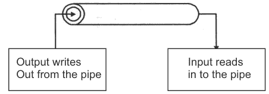

示例：

```java
package IOL;

import java.io.*;

public class PipedDemo {

    public static void main(String[] args) {

        try {

            PipedOutputStream out = new PipedOutputStream();
            PipedInputStream in = new PipedInputStream(out);

            out.write(65);
            out.write(66);

            for (int i = 0; i < 2; i++) {
                System.out.println("" + (char) in.read());
            }

        } catch (IOException ex) {
            ex.printStackTrace();
        }
    }
}
```

### 输出

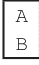

### V) BYTEARRAYINPUTSTREAM 和 BYTEARRAYOUTPUTSTREAM 类

这些类允许你对字节数组进行读写操作。

### ByteArrayOutputStream

构造函数

- `ByteArrayOutputStream()`：创建一个初始容量为 32 字节的新字节数组输出流，如果有必要，其大小会增大。
- `ByteArrayOutputStream(int size)`：创建一个具有指定大小（字节）缓冲区容量的新字节数组输出流。

### ByteArrayOutputStream 的方法

| 方法 | 说明 |
| :--- | :--- |
| `public synchronized void writeTo(OutputStream out)` | 将此字节数组输出流的完整内容写入指定的输出流。 |
| `public void write(byte b)` | 将字节写入此流。 |
| `public void write(byte[] b)` | 将字节数组写入此流。 |
| `public void flush()` | 刷新此流。 |
| `public int size()` | 返回写入流的字节总数。 |
| `public void close()` | 无影响。关闭 `ByteArrayOutputStream`。 |

示例：

```java
import java.io.*;

class ByteArrayOutputDemo {
    public static void main(String[] args) {
        ByteArrayOutputStream f = new ByteArrayOutputStream();
        String t = "Explore Java Depth";
        byte b[] = t.getBytes();
        f.write(b);
        byte buf[] = f.toByteArray();
        for (int i = 0; i < b.length; i++)
            System.out.print((char) b[i]);
    }
}
```

### ByteArrayInputStream

构造函数

- `ByteArrayInputStream(byte a[])`
- `ByteArrayInputStream(byte array[], int start, int number)`

示例：

```java
import java.io.*;

class ByteArrayStreamDemo {
    public static void main(String[] args) throws IOException {
        String t = "Explore Java Depth";
        byte b[] = t.getBytes();

        // input1 将包含整个字符串，input2 将只包含三个字母
        ByteArrayInputStream input1 = new ByteArrayInputStream(b);
        /* 在第一种形式下，创建一个 32 字节的缓冲区。在第二种形式下，创建一个等大小的缓冲区。 */
        ByteArrayInputStream input2 = new ByteArrayInputStream(b, 0, 3);
    }
}
```

### VI) OBJECT STREAMS

`DataInputStream` 和 `DataOutputStream` 类允许读写原始数据。支持的方法有 `readObject()` 和 `writeObject()`。

注意：

- 序列化：将对象转换为流。
- 反序列化：将流转换为对象。

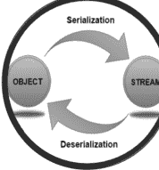

### A Serializable 接口

`java.io.Serializable` 是一个标记接口。它没有任何方法。

### ObjectOutputStream 的构造函数

```java
ObjectOutputStream(OutputStream out) throws IOException;
```

### ObjectInputStream 的构造函数

```java
ObjectInputStream(InputStream in) throws IOException;
```

### ObjectOutputStream 的方法

- `public void writeObject(Object obj) throws IOException`：将对象写入输出流。
- `public void flush() throws IOException`：刷新当前流。
- `public void close() throws IOException`：关闭输出流。

### ObjectInputStream 的方法

- `public Object readObject() throws IOException, ClassNotFoundException`：从输入流读取对象。
- `public void flush() throws IOException`：刷新当前流。
- `public void close() throws IOException`：关闭输入流。

示例：

```java
/** 对象需要持久化 **/
class Employee implements java.io.Serializable {
    int id;
    String name;
    String salary;

    Employee(int id, String name, String salary) {
        this.id = id;
        this.name = name;
        this.salary = salary;
    }
}
```

### 输出

| 102 Sarika 10000 |

注意：

1. 如果一个类实现了序列化，那么它的所有子类都是序列化的。如果父类没有序列化，则子类不是。
2. 如果类中有任何静态成员，它们将不会被序列化，因为静态是类的一部分。
3. 对于数组或集合，数组或集合中的所有对象必须是序列化的。如果任何对象不可序列化，序列化将失败。
4. 如果类有一个另一个类的引用，所有引用必须是序列化的，否则将不会执行序列化。在这种情况下，运行时会抛出 `NotSerializableException`。

### Transient 关键字

Java `transient` 关键字用于防止某些成员的序列化。如果你将任何成员定义为 `transient`，它将不会被序列化。

举个例子，我声明了一个类 `Employee2`。它有三个成员 `id`、`username` 和 `pwd`。如果你序列化对象，所有的值都会被序列化，但我不想序列化其中一个值，比如 `pwd`，可以将 `pwd` 成员声明为 `transient`。

```java
class Employee2 implements java.io.Serializable {
    int id;
    String username;
    transient String pwd;

    Employee2(int id, String username, String pwd) {
        this.id = id;
        this.username = username;
        this.pwd = pwd;
    }
}

//****** 使用对象流持久化对象***
import java.io.*;

class ObjectStreamDemo2 {
    public static void main(String[] args) throws Exception {
        Employee2 El1 = new Employee2(102, "Sarika", "MyPassword");
        FileOutputStream fout = new FileOutputStream("f.txt");
        ObjectOutputStream out = new ObjectOutputStream(fout);
        ObjectInputStream in = new ObjectInputStream(new FileInputStream("f.txt"));

        out.writeObject(El1);
        out.flush();
        System.out.println("success");

        Employee2 E = (Employee2) in.readObject();
        System.out.println(E.id + " " + E.username + " " + E.pwd);
        in.close();
    }
}
```

## 12.3 读取器与写入器

`InputStream` 和 `OutputStream` 的子类以字节的形式读取和写入数据。`Reader` 和 `Writer` 类是抽象类，支持 Unicode 字符流的读取和写入。

Unicode 用于以一种方式表示数据，其中每个字符都由 16 位表示。字节流处理 8 位数据。这些 16 位版本的流被称为读取器/写入器。

`Reader` 和 `Writer` 类最重要的子类是 `InputStreamReader` 和 `OutputStreamWriter`。这些类用作字节流与字符读取器/写入器之间的接口。

`Reader` 类支持输入流方法，如 `read()`、`skip()`、`markSupported()`、`reset()` 和 `close()`。

`Writer` 类支持输出流类的方法，如 `write()`、`flush()` 和 `close()`。

### 从键盘读取

`InputStreamReader` 和 `OutputStreamWriter` 用于在字节流和 Unicode 字符流之间转换数据。`InputStreamReader` 类将 `InputStream` 子类对象转换为 Unicode 字符流。`OutputStreamWriter` 类将 Unicode 字符流转换为字节流。

`BufferedReader` 和 `BufferedWriter` 类支持缓冲字符 I/O。`BufferedReader` 类的 `readLine()` 方法用于从控制台、文件或另一个输入流中读取文本行。

```java
import java.io.*;

public class ReadWriteFile {
    public static void main(String args[]) {
        try {
            InputStreamReader inputreader = new InputStreamReader(System.in);
            BufferedReader bufferedReader = new BufferedReader(inputreader);
            String readstring;
            do {
```


# 深度解析 Java I/O 与网络编程

## 控制台输入输出示例

```java
System.out.println("************************************************************************************");
System.out.println("please enter something");
System.out.flush();
readstring = bufferedReader.readLine();
System.out.println("hello user - this is what you wrote ");
System.out.println(reading);
System.out.println("************************************");
} while (reading.length() != 0) {
} catch (Exception e) {
}
```

在上述代码中，`InputStreamReader` 以 `System.in` 作为参数构造 `InputStream` 对象，并构造了一个名为 `InputReader` 的 `InputStreamReader`。将 `InputStreamReader` 对象作为参数传递给 `BufferedReader` 的构造函数，创建了一个缓冲 Reader。`readLine()` 方法从控制台读取行。然后它作为消息显示在屏幕上。你必须按回车键才能终止程序。

### 输出

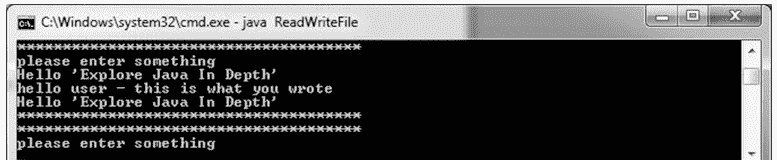

## 从文件读取和写入文件

`FileInputStream` 类允许你以流的形式从文件中读取字符串。你使用 `File` 对象的文件作为参数在 `FileInputStream` 类中创建该类的对象。它重写了由垃圾收集处理的 `finalize()` 方法。`FileOutputStream` 的方法补充了 `FileInputStream` 的方法。`FileOutputStream` 方法将输出写入流中。

输入从控制台获取并写入到名为 `file.txt` 的文件中。程序随后显示文件内容以进行验证，然后删除该文件。

```java
import java.io.*;

class IOTest {
    public static void main(String a[]) {
        try {
            File f = new File("file.txt");
            FileOutputStream fout = new java.io.FileOutputStream(f);
            FileInputStream fin = new java.io.FileInputStream(f);
            InputStreamReader inputstream = new InputStreamReader(System.in);
            BufferedReader bufferstream = new BufferedReader(inputstream);
            String iostring;
            System.out.println("************************************");
            System.out.println("please enter something");
            System.out.flush();
            iostring = bufferstream.readLine();
            for (int i = 0; i < iostring.length(); i++)
                fout.write(iostring.charAt(i));
            out.close();
            int no_of_bytes = (int) fin.available();
            System.out.println("NO of bytes present" + no_of_bytes);
            byte infile[] = new byte[no_of_bytes];
            int readbyte = fin.read(inbuf, 0, no_of_bytes);
            System.out.println("New String(inbuff)");
            fin.close();
            System.out.println("deleting");
            f.delete();
        } catch (Exception e) {
        }
    }
}
```

### 输出

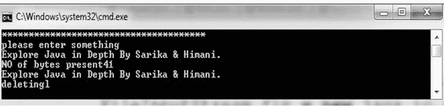

## 总结

1. `java.io` 包中的类为 Java 中的输入和输出操作提供了支持。
2. 流是自源传输到目的地的字节序列。
3. `InputStream` 和 `OutputStream` 是用于从字节流读取和写入字节流的父类。
4. `Reader` 和 `Writer` 类支持 Unicode 字符的 I/O。
5. `File` 类支持对文件和目录的访问。

## 练习题

### 单选题

1. 下面哪个包包含用于程序输入输出操作的类和接口？
   - a) `java.util`
   - b) `java.lang`
   - c) `java.io`
   - d) 以上都是
   **答案：c**

2. 下面这些类中哪个不是 `java.io` 的成员？
   - a) `String`
   - b) `StringReader`
   - c) `Writer`
   - d) `File`
   **答案：a**

3. 下面这些接口中哪个不是 `java.io` 的成员？
   - a) `DataInput`
   - b) `StringReader` (注：此处应为类，推测为题目原文错误)
   - c) `Writer`
   - d) `File`
   **答案：a** (注：`Writer` 和 `File` 是类而非接口，题目逻辑可能存在问题)

4. (原文选项不全，按原意保留)
   - a) `DataInput`
   - b) ...
   - c) ...
   - d) ...
   **答案：a**

---

# 188 | 深度解析 Java 网络编程

Java 提供了丰富的网络启用类库，允许应用程序轻松访问网络资源。Java 中提供了两种通信工具。这些工具包括使用数据报协议（UDP）的**数据报（datagram）**以及使用传输控制协议或互联网协议（TCP/IP）的**套接字（sockets）**。

数据报是一个字节数组，从一个程序（发送程序）发送到另一个程序（接收程序）。由于数据报使用的是 UDP，因此无法保证数据包一定到达目的地。数据报不可靠，因此仅在需要传输的数据较少且发送方与接收方之间距离较近的情况下使用。如果网络流量很高，接收端在处理来自程序的多个请求时，数据包可能会丢失。

另一方面，套接字使用 TCP/IP 进行通信。套接字模型相对于其他通信模型的优势是，服务器不受客户端请求源的影响，只要客户端遵循 TCP/IP 协议，服务器就会接受所有请求。这意味着客户端可以是任何类型的计算机。客户端不再限于 UNIX、Windows 或 Macintosh 平台。因此，网络中所有实现 TCP/IP 的计算机都可以通过套接字相互通信。

## 13.2 理解套接字

在客户端/服务器应用程序中，服务器提供服务，如处理数据库查询或修改数据库中的数据。客户端和服务器之间发生的通信必须是可靠。数据不应丢失，并且必须按照服务器发送时的相同顺序提供给客户端。

TCP 提供了一个双向的、持久的点对点通信通道。要通过 TCP 进行通信，客户端和服务器程序会建立一个连接并绑定套接字。套接字用于处理网络上应用程序之间的通信链路。

Java 设计为一种网络语言。它通过将连接功能封装在 `Socket` 类（用于创建客户端套接字）和 `ServerSocket` 类（用于创建服务器套接字）使得网络编程变得更容易。下面列出了这些类。

`Socket` 是基础类，支持 TCP 协议。TCP 是一种可靠的流式连接协议。该类提供了流 I/O 方法，使得从套接字读取和写入套接字变得简单。对于编写用于与互联网通信的程序来说，该类是不可少的。提供实现客户端连接的 `Socket` 类的包是 `java.net`。

`ServerSocket` 是服务器程序用于监听客户端请求服务的类。`Socket` 实际上并没有执行服务；相反，它代表客户端创建一个套接字对象。通信是通过创建的对象执行的。

## 13.3 IP 地址和端口

互联网服务器可以被看作一组提供额外能力的套接字类，通常称为服务。服务的示例包括电子邮件、用于远程登录的 telnet、用于跨网络传输文件的文件传输协议（FTP）等。每个服务都与一个端口相关。端口是一个数值地址，通过它处理诸如网页请求的服务请求。

TCP 协议需要两个数据项：

- IP 地址
- 端口号

那么，当你输入 `http://www.Yahoo.com` 时，为什么能到达雅虎的首页？

互联网协议（IP）为每个网络设备提供一个逻辑地址，即 IP 地址。IP 协议提供的 IP 地址具有特定的结构。它是一个 32 位的值，表示为四个 8 位数字（字节）的序列，取值范围从 0 到 255，其中最后一个字节形成端口号。

如果未指定端口号，将使用服务中的服务器端口。每个协议都有默认端口号，在未指定端口号时会使用该端口号。

| 端口号 | 应用程序 |
| :--- | :--- |
| 21 | FTP（传输文件） |
| 23 | Telnet（提供远程登录） |
| 25 | SMTP（发送邮件消息） |
| 67 | BOOT（启动时提供配置） |
| 80 | HTTP（传输网页） |

让我们看看 URL `http://www.yahoo.com`。

URL 的第一部分 (http) 意味着你正在使用超文本传输协议 (http)，这是处理网页文档的协议，端口号为 80。如果未指定文件，大多数 Web 服务器配置为获取 `index.html` 文件。因此，IP 地址和端口是通过显式指定所有部分来确定的。

## 13.4 创建套接字

创建一个套接字涉及以下操作：

```java
Socket socket = new Socket("hostname", port);
```

URL 的第一部分 (http) 意味着你正在使用超文本传输协议 (http)，这是处理网页文档的协议，端口号为 80。如果未指定文件，大多数 Web 服务器配置为获取 `index.html` 文件。因此，IP 地址和端口是通过显式指定所有部分来确定的。

## 13.5 客户端套接字

`Socket` 类的构造函数如下：

- `Socket(String hostname, int port)`
- `Socket(InetAddress address, int port)`
- `Socket(String hostname, int port, InetAddress localAddress, int localPort)`
- `Socket(InetAddress address, int port, InetAddress localAddress, int localPort)`

### Socket 的方法

- `getInputStream()`: 返回套接字的输入流。
- `getOutputStream()`: 返回套接字的输出流。
- `getInetAddress()`: 返回套接字的远程地址。
- `getLocalPort()`: 返回套接字的本地端口。
- `getRemotePort()`: 返回套接字的远程端口。
- `isBound()`: 如果套接字已绑定则返回 true。
- `isClosed()`: 如果套接字已关闭则返回 true。
- `connect()`: 将套接字连接到地址。

## 13.6 从套接字读取和写入数据

从套接字读取和写入数据与从文件读取和写入数据相似。这里声明了两个对象：`PrintStream` 类和 `BufferedReader` 类。这些对象将用于对套接字进行读取和写入。

```java
PrintStream out = null; // 写入套接字
BufferedReader in = null; // 从套接字读取
```

现在，关联 `PrintStream` 和 `BufferedReader` 对象。

```java
out = new PrintStream(clientsocket.getOutputStream());
in = new BufferedReader(new InputStreamReader(clientsocket.getInputStream()));
```

`Socket` 类的 `getInputStream()` 和 `getOutputStream()` 方法允许客户端与服务器进行通信。`getInputStream()` 方法用于从套接字读取，`getOutputStream()` 方法用于写入套接字。

声明了另一个 `BufferedReader` 类对象与标准输入关联，这样在客户端输入的数据就可以发送到服务器。

```java
BufferedReader stdin = new BufferedReader(new InputStreamReader(System.in));
String str;
while ((str = stdin.readLine()).length() != 0) {
    System.out.println(str);
}
```

上述代码允许用户从键盘接受数据。while 循环一直持续直到用户输入结束字符。

## 关闭连接

给出的代码关闭了流以及与服务器的连接，服务器接收用户名和密码并允许通信。要终止连接，客户端必须输入 'bye'。

```java
import java.net.*;
import java.io.*;

public class Client {
    public static void main() throws IOException {
        Socket clientsocket;
        PrintStream out = null;
        BufferedReader in = null;
        try {
            clientsocket = new Socket("169.17.8.192", 1001);
            out = new PrintStream(clientsocket.getOutputStream());
            in = new BufferedReader(new InputStreamReader(clientsocket.getInputStream()));
        } catch (UnknownHostException e) {
            System.err.println("unidentified host name");
            System.exit(1);
        }
    }
}
```

---

# 192 | 深度 Java 客户端实现

```java
catch (Exception e) { System.exit(1); }
BufferedReader stdin = new BufferedReader(new InputStreamReader(System.in));
String login = in.readLine(); // 从 socket 读取
System.out.println(login);
String loginname = stdin.readLine(); // 接受登录。
System.out.println(loginname);
String password = in.readLine(); /* 从 socket 读取 */
System.out.println(password);
String pass = stdin.readLine(); // 接受密码
out.println(pass);
String str = in.readLine();
System.out.println(str);
while ((str = stdin.readLine()) != null) {
    out.println(str);
    if (str.equals("bye"))
        break;
}
out.close();
in.close();
stdin.close();
}
```


## 13.7 创建服务器套接字

要创建一个服务器，你需要创建一个 `Server` 对象，它在特定端口上监听客户端请求。当它识别出有效请求时，服务器套接字获取客户端创建的套接字对象。服务器与客户端之间的通信通过此套接字进行。

使用 `java.net` 包中的 `ServerSocket` 类来创建一个服务器监听远程登录请求的套接字。使用 `java.io` 包中的 `IOException` 类处理错误。`BufferedReader` 类处理从客户端到服务器的数据传输。`PrintStream` 类处理从服务器到客户端的数据传输。

`ServerSocket` 等待网络上的请求。它根据请求执行操作并将结果返回给客户端。`ServerSocket` 类在客户端/服务器应用程序中表示服务器。`ServerSocket` 类提供了构造函数以便在指定端口上创建套接字。

> **注意**：作为端口参数传递的零值会在空闲端口上创建套接字。

## ServerSocket 的三个构造函数

- `ServerSocket(int port) throws IOException`：在指定的端口上创建服务器套接字。
- `ServerSocket(int port, int max_Queue) throws IOException`：在指定的端口上创建服务器套接字，最大队列长度为 `max_Queue`。
- `ServerSocket(int max_Queue, InetAddress localallhost) throws IOException`：在由此套接字绑定的 IP 地址指定的指定网卡主机 `localallhost` 上，在指定的端口上创建一个最大队列长度为 `max_Queue` 的服务器套接字。

## ServerSocket 的方法

```java
public Socket accept();
```

它等待客户端开始通信并返回一个用于与客户端通信的普通套接字。该套接字的输出流是已连接客户端的输入流，反之亦然。如果在建立连接时发生任何错误，将抛出 `IOException`。Java 强制你处理抛出的异常。

## 创建服务器

```java
ServerSocket S1 = new ServerSocket(80);
```

服务器套接字构造函数在端口 80 上创建并启动 `ServerSocket`。

### 监听客户端

当服务器获取来自客户端的连接时，`ServerSocket` 类的 `accept()` 方法接受该连接。

```java
Socket client = S1.accept();
```

### 服务器程序

```java
// 服务器程序
import java.net.*;
import java.io.*;

public class Server {
    public static void main(String a[]) throws IOException {
        ServerSocket server = null;
        try {
            server = new ServerSocket(98);
        } catch (IOException ex) {
            System.out.println("IO Exception");
            System.exit(0);
        }
        Socket client = null;
        try {
            client = server.accept();
            System.out.println("connection established");
        } catch (IOException e) {
            System.out.println("Connection failed " + e);
            System.exit(0);
        }
        PrintWriter out = new PrintWriter(client.getOutputStream(), true);
        BufferedReader in = new BufferedReader(new InputStreamReader(client.getInputStream()));
        String I;
        BufferedReader sin = new BufferedReader(new InputStreamReader(System.in));
        System.out.println("I am ready to type now");
        while ((sin.readLine()) != null) {
            out.println(I);
        }
        out.close();
        sin.close();
        client.close();
        server.close();
    }
}
```

### 客户端程序

```java
// 客户端程序
import java.net.*;
import java.io.*;

public class Client {
    public static void main(String a[]) throws IOException {
        Socket s = null;
        BufferedReader b = null;
        try {
            s = new Socket(InetAddress.getLocalHost(), 98);
            b = new BufferedReader(new InputStreamReader(s.getInputStream()));
        } catch (UnknownHostException e) {
            System.err.println("unidentified host name");
            System.exit(0);
        }
        try {
            String input;
            while ((input = b.readLine()) != null) {
                System.out.println(input);
            }
            b.close();
            s.close();
        } catch (Exception e) {
            System.exit(1);
        }
    }
}
```

### 输出

首先编译上述两个程序，并在 DOS 控制台窗口中首先运行服务器。打开一个新的 Dos 提示符并运行客户端程序。切换到服务器窗口并输入文本。文本将传递到客户端窗口（单向通信）。

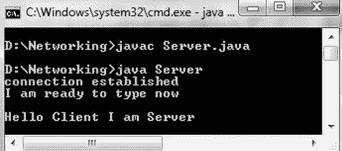
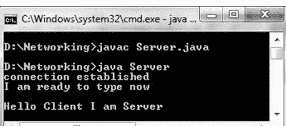

## TCP 与 UDP

UDP 是一种在网络上在应用程序之间发送数据报包的协议。它不保证到达。

| TCP | UDP |
| :--- | :--- |
| 它建立可靠连接 | 它在计算机之间建立不可靠连接 |
| 数据按顺序发送 | 数据以数据报包发送 |
| 比 UDP 慢 | 比 UDP 快 |
| 有确认机制 | 无需确认 |

UDP 数据报协议 (UDP) 是一种在没有确认的情况下发送数据报包的协议。如果你发送多个数据包，它们可能会以任何顺序到达。此外，数据包交付是不保证的。

## DatagramSocket

`DatagramSocket` 定义了四个构造函数。

- `DatagramSocket() throws SocketException`
- `DatagramSocket(int port) throws SocketException`
- `DatagramSocket(int port, InetAddress address) throws SocketException`
- `DatagramSocket(SocketAddress address) throws SocketException`

## 13.9 Java InetAddress 类

`InetAddress` 类表示 IP 地址。它提供了获取主机 IP 地址的方法：yahoo.com, google.com, facebook.com 等。

| 方法 | 描述 |
| :--- | :--- |
| `public static InetAddress getByName(String host) throws UnknownHostException` | 返回包含主机的 `InetAddress` 实例。 |
| `public static InetAddress getLocalHost() throws UnknownHostException` | 返回本地主机名和地址的 `InetAddress` 实例。 |
| `public String getHostName()` | 返回主机名或 IP 地址。 |
| `public String getHostAddress()` | 返回字符串格式的 IP 地址。 |

### DatagramPacket

`DatagramPacket` 是一个可以发送或接收消息或包的类。如果你发送多个数据包，它们可能会乱序到达。

### DatagramPacket 的构造函数

- `DatagramPacket(byte[] data, int size)`
- `DatagramPacket(byte[] data, int offset, int size)`
- `DatagramPacket(byte[] data, int size, InetAddress ipaddress, int port)`
- `DatagramPacket(byte[] data, int offset, int size, InetAddress ipaddress, int port)`

### 服务器程序

```java
// 服务器程序
import java.net.*;

class Server {
    public static DatagramSocket ds;
    public static byte buffer[] = new byte[1024];

    public static void myServer() throws Exception {
        int pos = 0;
        while (true) {
            int c = System.in.read();
            switch (c) {
                case -1:
                    System.out.println("Server Quits");
                    return;
                case '\r':
                    break;
                case '\n':
                    ds.send(new DatagramPacket(buffer, pos, InetAddress.getLocalHost(), 777));
                    pos = 0;
                    break;
                default:
                    buffer[pos++] = (byte) c;
            }
        }
    }

    public static void main(String s[]) throws Exception {
        System.out.println("In server ready \n in please type here");
        ds = new DatagramSocket(888);
        myServer();
    }
}
```

### 客户端程序

```java
// 客户端程序
import java.net.*;

class Client {
    public static DatagramSocket ds;
    public static byte buffer[] = new byte[1024];

    public static void myClient() throws Exception {
        while (true) {
            DatagramPacket p = new DatagramPacket(buffer, buffer.length);
            ds.receive(p);
            System.out.println(new String(p.getData(), 0, p.getLength()));
        }
    }

    public static void main(String a[]) throws Exception {
        System.out.println(" client - for quit press ctrl+c");
        ds = new DatagramSocket(777);
        myClient();
    }
}
```


### 输出

首先编译上述两个程序。先在 DOS 控制台窗口中运行服务器程序。打开一个新的 DOS 提示符窗口并运行客户端程序。现在切换到服务器窗口并输入文本。文本将传递到客户端窗口（单向通信）。

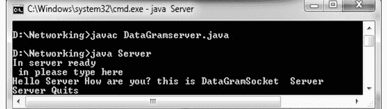

# 网络 | 199

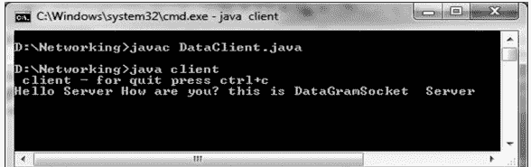

> **注意**：`DatagramPacket` 是数据容器，而 `DatagramSocket` 是用于发送或接收数据报包的机制。数据报包是从一个程序发送到另一个程序的字节数组。

### 总结

1. 网络化是一种应用程序开发架构，旨在将数据的呈现与其内部处理和存储分离开。
2. 网络协议是系统在网络上通信时遵循的一系列规则和约定。
3. Java 中提供了两种通信工具：使用用户数据报协议 (UDP) 的数据报文和使用传输控制协议/网络协议 (TCP/IP) 的套接字。
4. `Socket` 是支持 TCP 协议的基本基类。TCP 是一种可靠的流网络连接协议。
5. `ServerSocket` 是互联网服务器程序用于监听客户端请求的类。服务器实际上并没有直接执行服务；而是代表客户端创建一个 `Socket` 对象。
6. `DatagramSocket` 用于 UDP 程序。

### 回答以下问题

#### 单选题

1. 哪些类是实现数据报所必要的？
   a) `DatagramPacket` b) `DatagramSocket`
   c) 以上所有类 d) 以上均未提到
   **答案：c**

2. `DatagramPacket` 的以下哪个方法用于查找端口号？
   a) `port()` b) `getPort()` c) `findPort()`
   **答案：b**

3. `DatagramPacket` 的以下哪个方法用于获取数据报文中包含的数据字节数组？
   a) `getData()` b) `getBytes()` c) `getArray()`
   **答案：a**

4. `DatagramPacket` 的以下哪个方法用于查找字节数组的长度？
   a) `getnumber()` b) `length()` c) `getLength()`
   **答案：c**

#### 复习题

1. 可以获取本地主机 IP 吗？
2. TCP 和 UDP 之间的区别是什么？
3. API 没有列出 `InetAddress` 的任何构造函数。我如何创建 `InetAddress` 实例？
4. 写出连接客户端与服务器的步骤。
5. 什么是 http？它有任何协议吗？IP 地址是什么？

# 第 14 章

# A.W.T. (抽象窗口工具包)

今天几乎所有的操作系统都提供 GUI（图形用户界面）。应用程序使用操作系统自带的 GUI 元素并添加自己的元素。典型的 GUI 要素包括窗口、下拉菜单按钮、滚动条、图标图像和向导。

抽象窗口工具包 (AWT) 是一个包，它提供了一组用于管理窗口、对话框、按钮、列表、菜单和文本框等界面元素的集成类。AWT 是一个提供用于管理的 GUI 元素的包。典型的 GUI 元素包括窗口、下拉菜单按钮、滚动条、图标图像和向导。

## 14.1 组件

`Component` 类是 GUI 元素的基类。它提供了用于窗口、对话框、按钮、列表、菜单和文本框等。它是组件的顶层类。图显示了组件的层级关系。

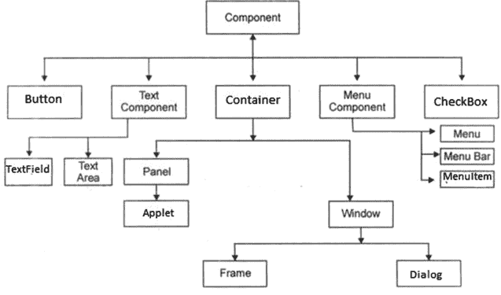

### 14.1.1 组件特性

`Component` 类是 `Object` 的子类。

`Component` 类的特性包括：

1. 基础绘制支持：`Component` 类提供了用于在屏幕上绘制的 `paint()` 和 `repaint()` 方法。
2. 事件处理：`Component` 类将其事件（如鼠标点击）委托给其他类。
3. 外观控制：`Component` 类提供了获取和设置字体的方法。它提供了字体信息。
4. 图像处理：`Component` 类实现了 `ImageObserver` 接口并显示图像。
5. 大小和位置控制：受 `LayoutManager` 指定的组件的大小和位置。它提供了报告其大小和位置的方法。

### Component 类的方法

| 方法 | 说明 |
| --- | --- |
| `public void add(Component c)` | 在此组件上插入组件。 |
| `public void setSize(int width, int height)` | 设置组件的宽度高度。 |
| `public void setLayout(LayoutManager m)` | 为组件定义布局管理器。 |
| `public void setVisible(boolean status)` | 更改组件的可见性。默认值为 false。 |

## 14.2 容器

某些组件也可以作为容器。例如，窗口可以是容器的一部分。`Container` 类是 `Component` 类的特殊子类。

容器包含一个或多个组件。这些组件被称为兄弟组件，因为它们具有相同的父窗口。

容器有三种主要类型：

- `Window`
- `Applet`
- `Panel`

# A.W.T. (抽象窗口工具包) | 203

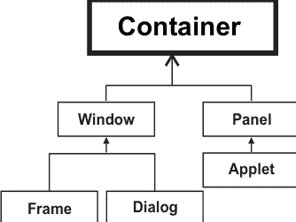

容器类型

## 14.3 窗口类

窗口类进一步包含：

1. `Frame`（帧）
2. `Dialog`（对话框）

`Frame` 是带有标题和调整大小按钮的矩形框。**`Dialog`** 与帧类似，但没有菜单栏且无法调整大小。

`Frame` 类是 AWT 的一个强大功能。你可以使用 `Frame` 类为应用程序创建一个窗口。`Frame` 有标题栏、可选的菜单栏和调整大小边框。由于它继承自 `java.awt.Container`，你可以使用 `add()` 方法向 `Frame` 添加组件。**`BorderLayout` 是 `Frame` 的默认布局。** `Frame` 接收鼠标事件、键盘事件和焦点事件。

`Frame` 的构造函数接收帧标题作为参数。字符串显示在帧的标题上。

```java
Frame frame = new Frame("Title of the frame");
```

创建窗口后，可以通过调用 `setVisible()` 方法进行显示。窗口可以通过调用 `getSize()` 方法进行设置。

以下程序显示了一个帧。

```java
import java.awt.Color;
import java.awt.Frame;

public class FrameDemo {
    public static void main(String s[]) {
        Frame frame = new Frame("Title of a Frame");
        frame.setSize(300, 400);
        frame.setBackground(Color.RED);
        frame.setVisible(true);
    }
}
```


# 204 | Java 深度解析 (Java in Depth)

### 输出


## 2. Dialog 类

对话框（`Dialog`）是用于接受用户输入的弹出式窗口。对话框有两种类型：模态（`modal`）和非模态（`modeless`）。与非模态对话框不同，模态对话框在显示时不允许用户与其他窗口进行交互。对话框必须由 `Frame` 或另一个 `Dialog` 拥有。你不能直接将对话框附加到 `Applet`。你可以将对话框附加到 `Frame` 上。

当你创建一个对话框时，可以指定想要模态还是非模态对话框。在创建之后，你无法更改对话框的“模态性”。使用 `Dialog` 类来创建对话框。该类提供了重载的构造函数。

### 构造函数

以下构造函数创建一个包含另一个对话框的对话框：

- `Dialog(Dialog owner)`：构建一个初始不可见的非模态的 `Dialog`，具有指定的 owner `Dialog` 和空标题。
- `Dialog(Dialog owner, String title)`：构建一个初始不可见的非模态的 `Dialog`，具有指定的 owner `Dialog` 和标题。
- `Dialog(Dialog owner, String title, boolean modal)`：构建一个初始不可见的 `Dialog`，具有指定的 owner `Dialog`、标题和模态性。
- `Dialog(Frame owner)`：构建一个初始不可见的非模态的 `Dialog`，具有指定的 owner `Frame` 和空标题。
- `Dialog(Frame owner, boolean modal)`：构建一个初始不可见的 `Dialog`，具有指定的 owner `Frame`、模态性以及空标题。
- `Dialog(Frame owner, String title)`：构建一个初始不可见的非模态的 `Dialog`，具有指定的 owner `Frame` 和标题。
- `Dialog(Frame owner, String title, boolean modal)`：构建一个初始不可见的 `Dialog`，具有指定的 owner `Frame`、标题和模态性。

以下构造函数创建一个包含 `Frame` 的对话框。

单参数构造函数创建一个没有标题的非模态对话框。可以传递给对话框构造函数的第二个参数是对话框的标题。要创建一个模态对话框，请使用如下所示的三参数构造函数：

```java
Dialog dialog = new Dialog(frame, "Title of dialog", true);
```

# A.W.T. (抽象窗口工具包) | 205

## 14.4 Panel 类

面板（`Panel`）用于组织组件。每个面板可以有不同的布局。
创建面板时使用以下代码：

```java
Panel panel = new Panel();
```

一旦创建了面板，就可以将其添加到 `Window`、`Frame` 或 `Applet` 中。这可以使用 `Container` 类的 `add()` 方法来实现。

### 子面板 (Sub-panel)

你还可以创建嵌套面板，即一个面板包含一个或多个子面板。你可以根据需要无限深度地嵌套面板。例如：

```java
Panel mainpanel1, subpanel1, subpanel2;
mainpanel1 = new Panel();
subpanel1 = new Panel();
subpanel2 = new Panel();
mainpanel1.add(subpanel1);
mainpanel1.add(subpanel2);
```

## 14.5 组件与控件

### 控件 (Controls)

任何编程语言的内部部分都具有接受用户数据的能力。必须提示用户输入数据。为了简化用户交互并使数据输入变得更容易，你可以使用控件。控件是组件，如按钮和文本框，可以添加到 `Frame`、`Panel` 和 `Applet` 等容器中。由于 `Component` 是所有控件的父类，它的方法在它的子类中也可用。下图描述了 `Component` 类的层级结构。

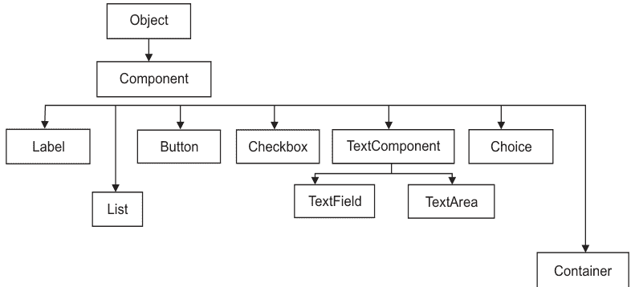

组件的层级结构

# 206 | Java 深度解析 (Java in Depth)

`Component` 类定义了一些方法，这些方法可以用任何派生自它的类。

下表列的方法可以用于所有的 GUI 组件以及容器。

| 方法 | 描述 |
| --- | --- |
| `setSize(Dimension d)` | 调整相应组件的大小，使其宽度为 `d.width`，高度为 `d.height` |
| `setSize(int width, int height)` | 调整相应组件的大小，使其具有指定的宽度高度。 |
| `setFont(Font f)` | 设置相应组件的字体。 |
| `setEnabled(boolean b)` | 根据参数 `b` 的值启用或禁用相应组件。 |
| `setVisible(boolean b)` | 根据参数 `b` 的值显示或隐藏相应组件。 |
| `setForeground(Color c)` | 设置相应组件的前景颜色。 |
| `setBounds(int x, int y, int width, int height)` | 移动并调整相应组件的大小。 |
| `setBounds(Rectangle r)` | 将相应组件移动并调整到矩形 `r`。 |
| `setBackground(Color c)` | 设置相应组件的背景颜色。 |
| `getBackground()` | 获取相应组件的背景颜色。 |
| `getBounds()` | 以矩形形式获取相应组件的边界。 |
| `getFont()` | 获取相应组件的字体。 |
| `getForeground()` | 获取相应组件的前景颜色。 |
| `getSize()` | 以 `Dimension` 形式返回相应组件的大小 |

## 14.6 Java 中的控件

### I) 按钮 (Button)

按钮是包含标签的组件。它有一个外轮廓。类似于其他 GUI 中的推送按钮。按下按钮会导致运行时生成一个事件。该事件被发送给程序。程序反过来可以检测该事件并对其响应。点击按钮会生成 `ActionEvent`。然而，在使用按钮之前，必须先创建它。可以使用 `new` 关键字结合为它定义的构造函数来创建它。按钮在使用之前必须添加到容器中。这是通过使用 `add` 完成的。一旦按钮被创建并添加，就可以使用了。当按钮被点击时，AWT 会发送一个 `ActionEvent` 实例给按钮，并将该事件传递给任何注册了感兴趣的监听器。

| 构造函数 | 描述 |
| --- | --- |
| `Button()` | 构建一个没有标签的按钮。 |
| `Button(String label)` | 构建带有指定标签的按钮。 |

| 方法 | 描述 |
| --- | --- |
| `addActionListener(ActionListener l)` | 添加指定的监听器以接收按钮的事件。 |
| `getActionCommand()` | 返回按钮的命令。 |
| `getLabel()` | 获取按钮的标签。 |
| `setLabel(String label)` | 设置按钮的标签。 |

以下示例包含两个标签和两个按钮：指示哪个按钮被点击。例如：

```java
import java.awt.*;
import java.awt.event.*;

public class ButtonTest extends Frame {
    Label lbl1 = new Label("Button1");
    Button b1 = new Button("OK");
    Label lbl2 = new Label("Button2");
    Button b2 = new Button("cancel");

    public ButtonTest() {
        setLayout(null);
        setSize(200, 300);
        lbl1.setBounds(15, 40, 50, 20);
        b1.setBounds(65, 40, 50, 20);
        lbl2.setBounds(15, 145, 50, 20);
        b2.setBounds(65, 145, 50, 20);
        add(lbl1);
        add(b1);
        add(lbl2);
        add(b2);
        setVisible(true);
    }

    public static void main(String a[]) {
        new ButtonTest();
    }
}
```


### II) 复选框 (Checkbox)

复选框是具有双状态的用户界面组件：选中和未选中。点击它可以改变复选框的状态。Java 支持两种类型的复选框：

- a) 互斥（Exclusive，单选）
- b) 非互斥（Non-exclusive）

在互斥复选框的情况下，一组中只能有一个被选中。互斥复选框也被称为单选按钮（Radio Buttons）。如果组中的某个项被选中，当前选中的项将取消，新的选择将被高亮。

非互斥复选框不分组，每个复选框都可以独立地选择。

### 构造函数

1. `Checkbox()`: 创建没有标签的复选框。
2. `Checkbox(String label)`: 创建带有指定标签的复选框。
3. `Checkbox(String label, boolean state)`: 创建带有指定标签和指定状态的复选框。
4. `Checkbox(String label, boolean state, CheckboxGroup)`: 构建具有指定标签、指定状态并属于指定框组的 `Checkbox`。
5. `Checkbox(String label, CheckboxGroup group, boolean state)`: 创建具有指定标签、属于指定复选框组并设置为指定状态的复选框。

### 方法

| 返回类型 | 方法和描述 |
| --- | --- |
| void | `addItemListener(ItemListener l)` 添加指定的项监听器以接收来自此框的项事件。 |
| void | `addNotify()` 创建 `Checkbox` 的对端。 |
| AccessibleContext | `getAccessibleContext()` 获取与 `Checkbox` 关联的 `AccessibleContext`。 |
| CheckboxGroup | `getCheckboxGroup()` 确定此复选框的组。 |
| ItemListener[] | `getItemListeners()` 返回注册在此复选框上的所有项监听器数组。 |
| String | `getLabel()` 获取此复选框的标签。 |
| EventListener[] | `getListeners(Class listenerType)` 返回当前注册在此复选框上的所有 `FooListeners` 的对象数组。 |
| Object[] | `getSelectedObjects()` 返回一个长度为 1 的数组，包含复选框标签，如果复选框未选中则返回 null。 |
| boolean | `getState()` 确定此复选框处于“开启”还是“关闭”状态。 |
| protected String | `paramString()` 返回表示此复选框状态的字符串。 |
| void | `removeItemListener(ItemListener l)` 移除指定的项监听器，使该监听器不再接收来自此复选框的项事件。 |
| void | `setCheckboxGroup(CheckboxGroup g)` 将此框所属的组设置为指定的复选框组。 |
| void | `setLabel(String label)` 将此框的标签设置为指定的字符串参数。 |
| void | `setState(boolean state)` 将此复选框的状态设置为指定的状态。 |

### III) Choice（选择框）

`Choice` 类实现了一个弹出菜单，允许用户从该菜单中选择项目。此 UI 组件显示当前选中的项目，并在右侧有一个箭头。点击箭头时，菜单将打开并显示供用户选择的选项。
通过 `addItem` 方法向 choice 中添加各种项目。

### 构造函数

`Choice()`: 创建一个新的选择菜单。

### 方法

| 返回类型 | 方法及描述 |
|---|---|
| void | `add(String item)` 向此 `Choice` 菜单添加一个项目。 |
| void | `addItem(String item)` 自 Java 2 平台 v1.1 起已弃用。 |
| void | `addItemListener(ItemListener l)` 添加指定的项监听器，以接收来自此 `Choice` 菜单的项事件。 |
| void | `addNotify()` 创建 `Choice` 的对应组件（peer）。 |
| int | `getItemCount()` 返回此 `Choice` 菜单中的项目数量。 |
| AccessibleContext | `getAccessibleContext()` 获取与此 `Choice` 关联的 `AccessibleContext`。 |
| String | `getItem(int index)` 获取此 `Choice` 菜单中指定索引处的字符串。 |
| ItemListener[] | `getItemListeners()` 返回注册在此 choice 上的所有项监听器数组。 |
| EventListener[] | `getListeners(Class listenerType)` 返回当前注册在此 choice 上的所有指定类型的监听对象数组。 |
| int | `getSelectedIndex()` 返回当前选中项的索引。 |
| String | `getSelectedItem()` 获取当前选择项的字符串表示。 |
| Object[] | `getSelectedObjects()` 返回一个包含当前选中项目（长度为 1）的数组。 |
| void | `insert(String, int index)` 在指定的位置向 choice 插入项目。 |
| protected String | `paramString()` 返回此 `Choice` 菜单状态的字符串。 |
| protected void | `processEvent(AWTEvent e)` 处理此 choice 上的 `ItemEvent`。 |
| protected void | `processItemEvent(ItemEvent e)` 通过将事件分发给任何注册的 `ItemListener` 对象，处理此 `Choice` 菜单发生的项事件。 |
| void | `remove(int pos)` 从 choice 菜单的指定位置移除一个项目。 |
| void | `remove(String)` 从 `Choice` 菜单中移除第一个出现的项目。 |
| void | `removeAll()` 移除 `Choice` 菜单中的所有项目。 |
| void | `removeItemListener(ItemListener l)` 移除指定的监听器，使其不再接收来自此 `Choice` 菜单的项。 |
| void | `select(int pos)` 将此 `Choice` 菜单中的选中项设置为指定位置的项目。 |
| void | `select(String str)` 将此 `Choice` 菜单中的选中项设置为名称与指定字符串相等的项目。 |

### IV) Label（标签）

此 `Label` 组件用于在容器中显示单行文本。文本可以由应用程序更改，但用户无法编辑文本。标签不会产生任何事件。标签类似于按钮，可以使用其构造函数结合键盘来创建。

### 构造函数

- `Label()`: 构建一个空标签。
- `Label(String text)`: 构建一个带有指定字符串文本的新标签，并居中左对齐。
- `Label(String text, int alignment)`: 构建一个带有指定字符串文本和指定对齐方式的新标签。

### 方法

| 返回类型 | 方法及描述 |
|---|---|
| void | `addNotify()`: 创建此标签的对应组件（peer）。 |
| AccessibleContext | `getAccessibleContext()`: 获取与此 `Label` 关联的 `AccessibleContext`。 |
| int | `getAlignment()`: 获取此标签的当前对齐方式。 |
| String | `getText()`: 获取此标签的文本。 |
| protected String | `paramString()`: 返回表示此标签状态的字符串。 |
| void | `setAlignment(int alignment)`: 将此标签的对齐方式设置为指定的对齐方式。 |
| void | `setText(String text)`: 将此标签的文本设置为指定的文本。 |

### 示例

```
setLayout(new FlowLayout(FlowLayout.CENTER, 10, 10));

add(new Label("Hi There!"));

add(new Label("Another Label"));
```


# V) TextField（文本框）

`TextField` 是接受用户文本输入的接口组件。它们通常带有一个标签控件，用于为用户提供关于在 `TextField` 中输入内容的导引。

它们可以包含单行文本，非常适用于用户输入较短信息（如姓名）的情况。

## 构造函数

- `TextField()`: 构建一个新的 `TextField`。
- `TextField(int columns)`: 构建一个具有指定列数的 `TextField`。
- `TextField(String text)`: 构建一个带有指定文本的 `TextField`。
- `TextField(String text, int columns)`: 构建一个具有指定文本和指定列数的 `TextField`。

## 方法

| 返回类型 | 方法及描述 |
|---|---|
| void | `addActionListener(ActionListener l)` 添加指定的监听器以接收来自 `TextField` 的动作事件。 |
| void | `addNotify()` 创建 `TextField` 的对应组件（peer）。 |
| boolean | `echo()` 表示此字段是否有回显字符。 |
| AccessibleContext | `getAccessibleContext()` 获取与此 `TextField` 关联的 `AccessibleContext`。 |
| ActionListener[] | `getListeners()` 返回注册在此字段上的监听器数组。 |
| int | `getColumns()` 获取字段的列数。 |
| char | `getEchoChar()` 获取用于回显的字符。 |
| EventListener[] | `getListeners(Class listenerType)` 返回当前注册在此字段上的所有指定类型对象数组。 |
| Dimension | `getMinimumSize()` 获取字段的最小尺寸。 |
| Dimension | `getMinimumSize(int columns)` 获取字段的最小尺寸。 |
| Dimension | `getPreferredSize()` 获取字段的首选尺寸。 |
| Dimension | `getPreferredSize(int columns)` 获取字段的首选尺寸。 |
| protected String | `paramString()` 返回表示此 `TextField` 状态的字符串。 |
| void | `processEvent(ActionEvent e)` 通过分发给任何注册的 `ActionListener` 对象，处理此字段发生的动作事件。 |
| protected void | `processEvent(AWTEvent e)` 处理此字段上的事件。 |
| void | `removeActionListener(ActionListener l)` 移除指定的监听器，使其不再接收来自此字段的动作事件。 |
| void | `setColumns(int columns)` 设置字段的列数。 |
| void | `setEchoChar(char c)` 设置此字段的回显字符。 |
| void | `setEchoCharacter(char c)` 已弃。自 JDK 1.1 版本起，被 `setEchoChar(char)` 替换。 |
| void | `setText(String t)` 设置此文本组件呈现的文本为指定的文本。 |
| Dimension | `minimumSize()` 已弃。自 JDK 1.1 版本起，被 `getMinimumSize()` 替换。 |
| Dimension | `minimumSize(int columns)` 已弃。自 JDK 1.1 版本起，被 `getMinimumSize(int)` 替换。 |
| Dimension | `preferredSize()` 已弃。自 JDK 1.1 版本起，被 `getPreferredSize()` 替换。 |
| Dimension | `preferredSize(int columns)` 已弃。自 JDK 1.1 版本起，被 `getPreferredSize(int)` 替换。 |

# VI) TextArea

`TextArea` 的行为与 `TextField` 类似，但它们具有处理大量文本的其他功能。

这些功能包括：

- 文本区域可以包含多行文本。
- 文本区域具有滚动条，允许处理大量数据。

## 构造函数

- `TextArea()`: 创建一个新的文本区域，其文本为空字符串。
- `TextArea(int rows, int columns)`: 创建一个新的具有指定行数和列数的文本区域，其文本为空字符串。
- `TextArea(String text)`: 创建一个带有指定文本的文本区域。
- `TextArea(String text, int rows, int columns)`: 创建一个带有指定文本并具有指定行数和列数的文本区域。
- `TextArea(String text, int rows, int columns, int scrollbars)`: 创建一个带有指定文本并按指定设置行数、列数和滚动条可见性的文本区域。

## 方法

| 返回类型 | 方法和描述 |
|---|---|
| void | `addNotify()` 创建 `TextArea` 的对接组件（peer）。 |
| void | `append(String str)` 将给定文本追加到文本区域的当前文本之后。 |
| void | `appendText(String str)` 已弃用。从 JDK 1.1 版本开始，已被 `append(String)` 替换。 |
| AccessibleContext | `getAccessibleContext()` 返回与此 `TextArea` 关联的 `AccessibleContext`。 |
| int | `getColumns()` 返回此文本区域的列数。 |
| Dimension | `getMinimumSize()` 确定此文本区域的最小尺寸。 |
| Dimension | `getMinimumSize(int rows, int columns)` 确定具有指定行数和列数的文本区域的最小尺寸。 |
| Dimension | `getPreferredSize()` 确定此文本区域的优选尺寸。 |
| Dimension | `getPreferredSize(int rows, int columns)` 确定具有指定行数和列数的文本区域的优选尺寸。 |
| int | `getRows()` 返回文本区域的行数。 |
| int | `getScrollVisibility()` 返回一个枚举值，指示文本区域的滚动条。 |
| void | `insert(String str, int pos)` 在文本区域指定位置插入指定的文本。 |
| void | `insertText(String str, int pos)` 已弃用。从 JDK 1.1 版本开始，已被 `insert(String, int)` 替换。 |
| Dimension | `minimumSize()` 已弃用。从 JDK 1.1 版本开始，已被 `getMinimumSize()` 替换。 |
| Dimension | `minimumSize(int rows, int columns)` 已弃用。从 JDK 1.1 版本开始，已被 `getMinimumSize(int, int)` 替换。 |
| protected String | `paramString()` 返回表示此 `TextArea` 状态的字符串。 |
| Dimension | `preferredSize()` 已弃用。从 JDK 1.1 版本开始，已被 `getPreferredSize()` 替换。 |
| Dimension | `preferredSize(int rows, int columns)` 已弃用。从 JDK 1.1 版本开始，已被 `getPreferredSize(int, int)` 替换。 |
| void | `replaceRange(String str, int start, int end)` 用指定的替换文本替换指定起始和结束位置之间的文本。 |
| void | `replaceText(String str, int start, int end)` 已弃用。从 JDK 1.1 版本开始，已被 `replaceRange(String, int, int)` 替换。 |
| void | `setColumns(int columns)` 设置此文本区域的列数。 |
| void | `setRows(int rows)` 设置此文本区域的行数。 |

# VII) List

列表组件为用户呈现一个滚动的文本项列表。列表可以被设置为使用户可以选择一个或多个项。列表与 choice（选择框）之间的差异如下：与仅显示单个所选项的 choice 不同，列表可以构造为显示任意数量的选择。

## 构造函数

- `List()`: 创建一个新的滚动列表。
- `List(int rows)`: 创建具有指定行数的滚动列表。
- `List(int rows, boolean multipleMode)`: 创建一个具有指定行数的多选模式滚动列表。

## 方法

| 返回类型 | 方法和描述 |
|---|---|
| void | `add(String item)` 将指定的项添加到滚动列表的末尾。 |
| void | `add(String item, int index)` 将指定的项添加到由索引指示的滚动列表中。 |
| void | `addEventListener(ActionListener l)` 添加指定的监听器以接收来自此列表的事件。 |
| void | `addItem(String item)` 已弃用。从 JDK 1.1 版本开始，已被 `add(String)` 替换。 |
| void | `addItem(String item, int index)` 已弃用。从 JDK 1.1 版本开始，已被 `add(String, int)` 替换。 |
| void | `notify()` 创建列表的对接组件（peer）。 |
| boolean | `allowsMultipleSelections()` 已弃用。从 JDK 1.1 版本开始，已被 `isMultipleMode()` 替换。 |
| void | `clear()` 已弃用。从 JDK 1.1 版本开始，已被 `removeAll()` 替换。 |
| int | `countItems()` 已弃用。从 JDK 1.1 版本开始，已被 `getItemCount()` 替换。 |
| void | `deleteItem(int position)` 已弃用。被 `remove(String)` 和 `remove(int)` 替换。 |
| void | `deleteItems(int start, int end)` 已弃用。从 JDK 1.1 版本开始，未来不再供公共使用。该方法预计仅作为私有方法保留。 |
| void | `deselect(int index)` 取消指定索引处的项。 |
| AccessibleContext | `getAccessibleContext()` 获取与此 `List` 关联的 `AccessibleContext`。 |
| ActionListener[] | `getActionListeners()` 返回注册在列表上的所有动作监听器的数组。 |
| String | `getItem(int index)` 获取与指定索引关联的项。 |
| int | `getItemCount()` 获取列表中的项数。 |
| ItemListener[] | `getItemListeners()` 返回注册在列表上的所有项监听器的数组。 |
| String[] | `getItems()` 获取列表中的项。 |
| EventListener[] | `getListeners(Class listenerType)` 返回当前注册为 `List` 监听器的对象数组。 |
| Dimension | `getMinimumSize()` 确定滚动列表的最小尺寸。 |
| Dimension | `getMinimumSize(int rows)` 获取具有指定行数的列表的最小尺寸。 |
| Dimension | `getPreferredSize()` 获取滚动列表的优选尺寸。 |
| Dimension | `getPreferredSize(int rows)` 获取具有指定行数的列表的优选尺寸。 |
| int | `getRows()` 获取列表中可见的行数。 |
| int | `getSelectedIndex()` 获取列表上所选项的索引。 |
| int[] | `getSelectedIndexes()` 获取列表上的所选索引。 |
| String | `getSelectedItem()` 获取此滚动列表上的所选项。 |
| String[] | `getSelectedItems()` 获取此滚动列表上的所选项。 |
| Object[] | `getSelectedObjects()` 以对象数组的形式返回列表上的所选项。 |
| int | `getVisibleIndex()` 获取通过 `makeVisible()` 方法最后变为可见的项的索引。 |

## 示例

```
List lst = new List(4, false);

lst.add("Mercury");
lst.add("Venus");
lst.add("Earth");
lst.add("JavaSoft");
lst.add("Mars");
lst.add("Jupiter");
lst.add("Saturn");
lst.add("Uranus");
lst.add("Neptune");
lst.add("Pluto");

cnt.add(lst);
```


如果应用程序想要根据用户选择或激活列表中的某项执行某些操作，它应该根据情况实现 `ItemListener` 或 `ActionListener`，并注册新监听器以接收来自此列表的事件。

## VIII) ScrollPane

`ScrollPane` 是一个容器类，为单个子组件实现自动水平和/或垂直滚动。滚动条的显示策略可以设置为：

- **as needed（按需）**：只有在滚动面板需要时创建并显示滚动条。
- **always（始终）**：滚动面板始终创建并显示滚动条。
- **never（从不）**：滚动面板永远不创建或显示滚动条。

### 构造函数

- `ScrollPane()`: 创建具有“按需”滚动条显示策略的新滚动面板容器。
- `ScrollPane(int scrollbarDisplayPolicy)`: 创建一个具有指定滚动条显示策略的新滚动面板容器。

### 方法

| 返回类型 | 方法和描述 |
|---|---|
| `protected void` | `addImpl(Component comp, Object constraints, int index)` 将指定的组件添加到此滚动面板容器。 |
| `void` | `addNotify()` 创建滚动面板的对接组件（peer）。 |
| `void` | `doLayout()` 通过调整子组件到其优选尺寸来布局此容器。 |
| `protected boolean` | `eventTypeEnabled(int type)` 如果启用了滚动，则对 `MouseWheelEvents` 返回 true。 |
| `AccessibleContext` | `getAccessibleContext()` 获取与此 `ScrollPane` 关联的 `AccessibleContext`。 |
| `Adjustable` | `getHAdjustable()` 返回代表水平滚动条状态的 `ScrollPaneAdjustable` 对象。 |
| `int` | `getScrollBarHeight()` 返回水平滚动条将占据的高度，这与滚动面板当前是否显示它无关。 |
| `int` | `getScrollBarDisplayPolicy()` 返回滚动条的显示策略。 |
| `Point` | `getScrollPosition()` 返回子组件内当前的 x,y 位置，该位置显示在滚动面板视口的 0,0 处。 |
| `Adjustable` | `getVAdjustable()` 返回代表垂直滚动条状态的 `ScrollPaneAdjustable` 对象。 |
| `Dimension` | `getViewportSize()` 返回滚动面板视口当前的大小。 |
| `int` | `getScrollBarWidth()` 返回垂直滚动条将占据的宽度，这与滚动面板当前是否显示它无关。 |
| `boolean` | `isWheelScrollingEnabled()` 表示是否会响应鼠标滚轮进行滚动。 |

### IX) 滚动条

滚动条用于在指定的最小值和最大值之间选择值。它包含以下组件：

1. 两端的箭头允许增加或减少滚动条所表示的值。
2. 滑块（或手柄）的位置代表滚动条的值。

当用户更改滚动条的值时，滚动条会接收到一个 `AdjustmentEvent` 实例。滚动条处理此事件，并将其传递给任何注册的监听器。

#### 构造函数

- `Scrollbar()`: 构建一个新的垂直滚动条。
- `Scrollbar(int orientation)`: 构造一个具有指定方向的新滚动条。
- `Scrollbar(int orientation, int value, int visible, int minimum, int maximum)`: 构建一个具有指定方向、初始值、可视范围以及最小值和最大值的新滚动条。

#### 方法

| 返回类型 | 方法及描述 |
| --- | --- |
| `void` | `addAdjustmentListener(AdjustmentListener l)` 添加指定的调整监听器，以接收来自此滚动条的 `AdjustmentEvent` 实例。 |
| `void` | `addNotify()` 创建 `Scrollbar` 的代理（peer）。 |
| `AccessibleContext` | `getAccessibleContext()` 获取与此 `Scrollbar` 关联的 `AccessibleContext`。 |
| `AdjustmentListener[]` | `getAdjustmentListeners()` 返回注册在此滚动条上的所有调整监听器数组。 |
| `int` | `getBlockIncrement()` 获取此滚动条的块增量。 |
| `int` | `getLineIncrement()` 已弃用。从 JDK 版本 1.1 开始，被 `getUnitIncrement()` 替换。 |
| `EventListener[]` | `getListeners(Class listenerType)` 返回当前注册在此 `Scrollbar` 上作为 `FooListeners` 的所有对象数组。 |
| `int` | `getMaximum()` 获取此滚动条的最大值。 |
| `int` | `getMinimum()` 获取此滚动条的最小值。 |
| `int` | `getOrientation()` 返回此滚动条的方向。 |
| `int` | `getPageIncrement()` 已弃用。从 JDK 版本 1.1 开始，被 `getBlockIncrement()` 替换。 |
| `int` | `getUnitIncrement()` 获取此滚动条的单位增量。 |
| `int` | `getValue()` 获取此滚动条当前的值。 |
| `boolean` | `getValueIsAdjusting()` 如果值由于用户采取的操作正处于变化中，则返回 true。 |
| `int` | `getVisible()` 已弃用。从 JDK 版本 1.1 开始，被 `getVisibleAmount()` 替换。 |
| `int` | `getVisibleAmount()` 获取此滚动条的可视量。 |
| `protected String` | `paramString()` 返回一个表示此 `Scrollbar` 状态的字符串。 |
| `protected void` | `processAdjustmentEvent(AdjustmentEvent e)` 处理发生在此滚动条上的调整事件，并将其分发给任何注册的对象。 |
| `protected void` | `processEvent(AWTEvent e)` 处理此滚动条上的事件。 |
| `void` | `removeAdjustmentListener(AdjustmentListener l)` 移除指定的调整监听器，使其不再接收来自此滚动条的 `AdjustmentEvent` 实例。 |
| `void` | `setBlockIncrement(int v)` 设置此滚动条的块增量。 |
| `void` | `setLineIncrement(int v)` 已弃用。从 JDK 版本 1.1 开始，被 `setUnitIncrement(int)` 替换。 |
| `void` | `setMaximum(int newMaximum)` 设置此滚动条的最大值。 |
| `void` | `setMinimum(int newMinimum)` 设置此滚动条的最小值。 |
| `void` | `setOrientation(int orientation)` 设置此滚动条的方向。 |
| `void` | `setPageIncrement(int v)` 已弃用。从 JDK 版本 1.1 开始，被 `setBlockIncrement()` 替换。 |
| `void` | `setUnitIncrement(int v)` 设置此滚动条的单位增量。 |
| `void` | `setValue(int newValue)` 将此滚动条的值设置为指定的值。 |
| `void` | `setValueIsAdjusting(boolean b)` 设置 `valueIsAdjusting` 属性。 |
| `void` | `setValues(int value, int visible, int minimum, int maximum)` 设置此滚动条的四个属性的值：值、可视量、最小值和最大值。 |
| `void` | `setVisibleAmount(int newAmount)` 设置此滚动条的可视量。 |

### X) Canvas 组件

`Canvas` 组件代表屏幕上的一个空白矩形区域，应用程序可以在此处绘图，或从此处捕获来自用户的输入事件。

应用程序必须继承 `Canvas` 类以获取实用的功能，例如创建自定义组件。必须重写 `paint` 方法以便在画布上执行自定义图形操作。

#### 构造函数

- `Canvas()`: 构建一个新的 `Canvas`。
- `Canvas(GraphicsConfiguration config)`: 使用 `GraphicsConfiguration` 对象构建一个新的 `Canvas`。

#### 方法

| 返回类型 | 方法及描述 |
| --- | --- |
| `void` | `addNotify()` 创建代理（peer）。 |
| `void` | `createBufferStrategy(int numBuffers)` 为多缓冲区创建新的策略。 |
| `void` | `createBufferStrategy(int numBuffers, BufferCapabilities caps)` 创建具有所需能力的多缓冲区策略。 |
| `AccessibleContext` | `getAccessibleContext()` 获取与此 `Canvas` 关联的 `AccessibleContext`。 |
| `BufferStrategy` | `getBufferStrategy()` 获取策略。 |
| `void` | `paint(Graphics g)` 绘制此画布。 |
| `void` | `update(Graphics g)` 更新此画布。 |

### XI) FileDialog 对话框

`FileDialog` 显示一个允许用户选择文件的窗口。由于它是模态对话框，当应用程序调用显示它的方法时，会阻塞程序的其余部分直到用户选择了文件。

#### FileDialog 字段

| 字段 | 描述 |
| --- | --- |
| `static int LOAD` | 该常量值表示对话框的目的是从文件读取。 |
| `static int SAVE` | 该常量值表示对话框的目的是写入一个文件。 |

#### 构造函数

- `FileDialog(Frame parent)`: 创建一个用于加载文件的对话框。
- `FileDialog(Frame parent, String title)`: 创建一个具有指定标题的加载文件的对话框。
- `FileDialog(Frame parent, String title, int mode)`: 创建一个具有指定标题的加载或保存文件的对话框。

#### 方法

| 返回类型 | 方法及描述 |
|---|---|
| `void` | `addNotify()` 创建对话框的代理（peer）。 |
| `String` | `getDirectory()` 获取此对话框的目录。 |
| `String` | `getFile()` 获取此对话框选中的文件。 |
| `FilenameFilter` | `getFilenameFilter()` 获取此对话框的文件过滤器。 |
| `int` | `getMode()` 表示此对话框是用于加载文件还是保存文件。 |
| `protected String` | `paramString()` 返回一个表示此 `FileDialog` 窗口状态的字符串。 |
| `void` | `setDirectory(String dir)` 将此对话框的目录设置为指定的目录。 |
| `void` | `setFile(String file)` 将此对话框中的文件设置为指定的文件。 |
| `void` | `setFilenameFilter(FilenameFilter filter)` 将此对话框的文件过滤器设置为指定的过滤器。 |
| `void` | `setMode(int mode)` 设置对话框的模式。 |

### 总结

1. AWT 是一个提供集成类的包。
2. `Component` 是一个允许控制所有组件内部状态和外观的类。`Component` 类的特性有：
   - 基本绘图支持
   - 事件处理
   - 外观控制
   - 图像处理
   - 屏幕尺寸和位置控制
3. `Container`（容器）是一个通用 AWT 组件，它可以包含其他组件，包括其他容器。`Container` 类是 `Component` 类的一个子类。
   - `Frame` 使用 `Frame` 类为你的应用程序创建一个窗口。
   - `Dialog`（对话框）是一个用于接受用户输入的弹出窗口。
   - `Panel` 类用于组织组件。
4. `Component` 类是所有用户界面组件和容器的基类，提供了显示和事件处理的基本功能。
5. `Label`（标签）界面显示文本字符串。
6. `Button`（按钮）在被按下时触发动作。
7. `Checkbox`（复选框）、`Choice`（组合框）和 `List`（列表）为用户提供选择。
8. `TextField` 和 `TextArea` 用于从用户获取文本输入。
9. `Scrollbar`（滚动条）用于在指定的最小值和最大值之间选择一个值。

### 回答以下问题

#### 单选题

1. 哪种容器是不包含标题栏和菜单栏的？它可以包含按钮、文本框等其他组件。
   a) Window b) Frame c) Panel d) Container
   **Ans. c**

2. 哪些是不支持与用户任何交互的被动控件？
   a) Choice b) List c) Label d) Checkbox
   **Ans. c**

3. 哪种类用于创建一个弹出列表，用户可以从中进行选择？
   a) List b) Choice c) Labels d) Checkbox
   **Ans. b**

4. AWT 用于 Java 的 GUI 编程吗？
   a) 是 b) 否
   **Ans. a**

#### 复习题

1. 什么是 `Component` 和 `Container` 类？
2. `Component` 类的哪个方法用于设置组件的位置和大小？
3. `Window` 和 `Frame` 之间有什么区别？
4. 用示例展示 `FileDialog` 对象的用法。
5. Java 中 Swing 和 AWT 有什么区别？
6. `Container` 和 `Component` 之间有什么区别？
7. Java Swing 中 `paint` 和 `repaint` 有什么区别？

# 第 15 章

## 布局

### 15.1 布局管理器

布局管理器是决定容器组件组织方式的特殊对象。当你创建一个容器时，Java 会自动创建并分配默认布局管理器。默认布局管理器管理并决定 Applet 或任何容器显示中控件的位置。你可以创建不同类型的布局管理器来控制你的 applet 或 frame 的外观。

#### 容器的默认布局

| 容器 | 布局 |
| :--- | :--- |
| Panel | Flow layout |
| Applet | Flow layout |
| Frame | Border layout |

以下是 Java 中常用的布局管理器的列表：

1. `java.awt.FlowLayout`
2. `java.awt.GridLayout`
3. `java.awt.BorderLayout`
4. `java.awt.CardLayout`
5. `java.awt.GridBagLayout`
6. `javax.swing.BoxLayout`

这些类是从父类扩展而来的。

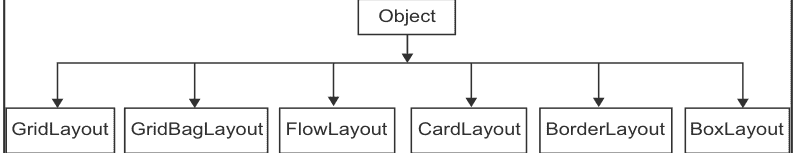

### 15.1.1 流式布局管理器 (Flow Layout Manager)

Applet 的默认管理器是流式布局管理器。它按照控件添加的顺序水平行地放置控件。当布局管理器到达 Applet 的右边界时，它开始在下一行放置控件。在默认状态下，流式布局管理器将每行的控件居中排列。

`FlowLayout` 类具有以下构造函数：

1. `FlowLayout()`: 创建一个居中对齐且水平垂直间距默认为 5 单位的流式布局。
2. `FlowLayout(int align)`: 创建一个具有给定对齐方式和默认 5 单位水平垂直间距的流式布局。
3. `FlowLayout(int align, int hgap, int vgap)`: 创建一个具有给定对齐方式和指定的水平垂直间距的流式布局。默认间距为 5 像素。

`align` 参数必须是以下值之一：

1. `public static final int LEFT`
2. `public static final int RIGHT`
3. `public static final int CENTER`
4. `public static final int LEADING`
5. `public static final int TRAILING`

#### 示例

```java
import java.awt.*;

class FlowDemo extends Frame {

    FlowDemo(String s) {
        super(s);
        setSize(300, 140);
        setLayout(new FlowLayout());
        for (int i = 1; i < 9; i++)
            add(new Button("Button " + i));
        setVisible(true);
    }
}

class Test {
    // 测试代码入口
}
```


    public static void main(String a[]) {

        FlowDemo fd = new FlowDemo("In Flowlayout");

    }

}

```
输出
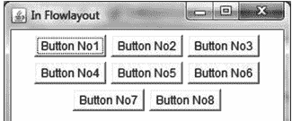

## 15.2 网格布局管理器 (THE GRID LAYOUT MANAGER)

网格布局管理器将显示组织成矩形网格。Java 然后从左到右、从上下放置你创建的组件。

`GridLayout` 类具有以下构造函数：

1. `GridLayout()`: 创建一个行一列的网格布局。
2. `GridLayout(int rows, columns)`: 创建一个具有指定行和列的网格布局，但组件之间没有间距。
3. `GridLayout(int rows, columns, int hgap, int vgap)`: 创建一个具有指定行、列以及指定的水平垂直间距的网格布局。网格布局中的组件大小相等的。

示例：

```java
import java.awt.*;

class GridDemo extends Frame {

    GridDemo(String s) {

        super(s);

        GridLayout gl1 = new GridLayout(2, 2);

        setLayout(gl1);

        setSize(300, 140);

        for (int i = 1; i <= 4; i++)

            add(new Button("Button " + i));

        setVisible(true);

    }

    public static void main(String a[]) {

        GridDemo gd = new GridDemo("In Gridlayout");

    }

}
```
输出
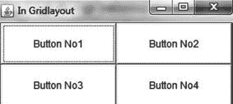 注意：使用这种布局可以指定行和列。

# 230 | 深度 Java

## 15.3 边界布局管理器 (BORDER LAYOUT MANAGER)

边界布局管理器允许使用北、南、东、西来定位组件。中间区域被称为 center。 `BorderLayout` 类具有以下构造函数：

- `BorderLayout()`: 创建一个没有间距的边界布局。
- `BorderLayout(int hgap, int vgap)`: 创建一个具有指定的水平垂直间距的边界布局。

边界布局类有一些常量用于向容器添加组件：

- `public static final int NORTH`
- `public static final int SOUTH`
- `public static final int EAST`
- `public static final int WEST`
- `public static final int CENTER`

示例：

```java
import java.awt.*;

class BorderDemo extends Frame {

    Button b1, b2, b3, b4, b5;

    BorderDemo(String s) {

        super(s);

        BorderLayout b = new BorderLayout();

        setLayout(b);

        setSize(300, 140);

        b1 = new Button("North");

        b2 = new Button("South");

        b3 = new Button("East");

        b4 = new Button("West");

        b5 = new Button("Center");

        add(b1, BorderLayout.NORTH);

        add(b2, BorderLayout.SOUTH);

        add(b3, BorderLayout.EAST);

        add(b4, BorderLayout.WEST);

        add(b5, BorderLayout.CENTER);

        setVisible(true);

    }

    public static void main(String a[]) {

        BorderDemo gd = new BorderDemo("In Borderlayout");

    }

}
```
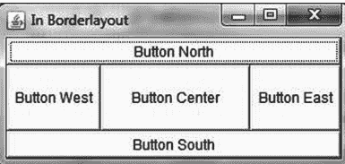

## 15.4 卡片布局 (CARD LAYOUT)

复杂的布局管理器之一是卡片布局管理器。使用该管理器，你可以创建一个卡片堆并在它们之间切换布局。这种显示组织类似于标签页对话框，在 Windows NT 中称为属性页。要使用卡片布局对象创建布局，首先要创建一个卡片的父面板。然后创建一个卡片布局类的对象并将其设置为面板的布局管理器。最后，通过创建组件并将其添加到面板来向布局添加卡片。

卡片布局类提供了以下构造函数：

1. `CardLayout()`: 创建一个水平垂直间距为零的卡片布局。
2. `CardLayout(int hgap, int vgap)`: 创建一个具有指定的水平垂直间距的卡片布局。

为了在卡片堆之间切换，卡片布局类提供了以下方法：

- `public void next(Container parent)`: 用于显示给定容器的下一张卡片。
- `public void previous(Container parent)`: 用于显示给定容器的上一张卡片。
- `public void first(Container parent)`: 显示给定容器的第一张卡片。
- `public void last(Container parent)`: 用于显示给定容器的最后一张卡片。
- `public void show(Container parent, String name)`: 用于根据给定名称显示指定的卡片。

如果能记住组件的层级结构，放置卡片布局管理器就会简单得多。栈的底部是 applet 的显示区域。栈的顶部是持有卡片的组件（通常是面板）。在父组件的上方是卡片布局管理器。卡片是您添加到面板的组件。

示例：

```java
import java.awt.*;

import java.awt.event.*;

public class CardDemo extends Frame implements ActionListener {

    Button b1, b2, b3;

    CardLayout c1;

    Panel p1;

    CardDemo() {

        p1 = new Panel();

        add(p1);

        c1 = new CardLayout();

        p1.setLayout(c1);

        setSize(300, 140);

        b1 = new Button("Button 1");

        b2 = new Button("Button 2");

        b3 = new Button("Button 3");

        b1.addActionListener(this);

        b2.addActionListener(this);

        b3.addActionListener(this);

        p1.add(b1);

        p1.add("Button 2", b2);

        p1.add("Button 3", b3);

        setVisible(true);

    }

    public void actionPerformed(ActionEvent e) {

        c1.next(p1);

    }

    public static void main(String a[]) {

        CardDemo c = new CardDemo();

    }

}
```

### 输出

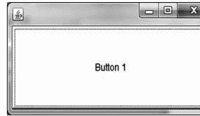

注意：`CardLayout` 类用于以牌牌的形式布局容器对象的构造函数，其中一次只有一张卡片是可见的。它的类方法用于指定容器中的第一个、最后一个、下一个和上一个组件。

## 15.5 网格包布局管理器 (THE GRIDBAG LAYOUT MANAGER)

`GridBagLayout` 管理器是 AWT 提供的最灵活且复杂的布局管理器。它将组件置在行或列中，允许指定的组件跨越多行或多列。可以通过为网格包布局中的单个组件分配权重来调整组件的大小。

当您指定组件的大小和位置时，还需要为每个组件指定约束条件（constraints）。要指定约束条件，您需要使用 `setConstraints()` 方法在 `GridBagConstraints` 对象中设置变量。

`GridBagLayout` 类有一个不接受任何参数的构造函数。

```java
GridBagConstraints Con = new GridBagConstraints();
```
虽然该类开始时初始化为默认值，但在将组件添加到布局中之前，您通常需要更改其中一些值。

### 15.5.1 指定约束条件

即使组件具有不同的约束条件，您也可以为多个组件复用一个 `GridBagConstraints` 实例。

您可以为 `GridBagConstraints` 属性分配以下值：
`anchor`, `fill`, `gridwidth`, `gridheight`, `gridx`, `gridy`, `weightx`, `weighty`。

- `anchor`：当组件小于其显示区域时使用，用于确定在区域的哪个位置放置组件。
- `fill`：当组件的显示区域大于组件请求的大小时使用。它决定（如何以及是否）调整组件的大小。
- `gridwidth`, `gridheight`：用于指定列数和行数。
- `gridx`, `gridy`：用于指定组件显示区域左上角的行和列。
- `weightx`, `weighty`：它们决定组件是否水平拉伸以填充 applet 的显示区域（`weightX`）或垂直拉伸（`weightY`）。两者的默认值均为 0。

示例：

```java
// 约束条件使用 GridBag Layout

import java.awt.*;

public class GridBagDemo extends Frame {

    Button b1, b2, b3, b4, b5, b6;

    GridBagLayout g1;

    GridBagConstraints gbc;

    GridBagDemo() {

        g1 = new GridBagLayout();

        setLayout(g1);

        setSize(300, 140);

        gbc = new GridBagConstraints();

        b1 = new Button("Button 1");

        b2 = new Button("Button 2");

        b3 = new Button("Button 3");

        b4 = new Button("Button 4");

        b5 = new Button("Button 5");

        b6 = new Button("Button 6");

        gbc.fill = GridBagConstraints.BOTH;

        gbc.anchor = GridBagConstraints.CENTER;

        gbc.gridwidth = 1;

        g1.setConstraints(b1, gbc);

        gbc.gridx = 0;

        g1.setConstraints(b2, gbc);

        gbc.gridx = 1;

        g1.setConstraints(b3, gbc);

        gbc.gridx = 2;

        g1.setConstraints(b4, gbc);

        gbc.gridy = 0;

        g1.setConstraints(b5, gbc);

        gbc.gridx = 1;

        g1.setConstraints(b5, gbc);

        gbc.gridx = 1;

        g1.setConstraints(b6, gbc);

        gbc.gridx = 1;

        g1.setConstraints(b, .0;

        gbc.weighty = 1.0;

        gbc.gridy = 0;

        g1.setConstraints(b1, gbc);

        gbc.gridy = 1;

        g1.setConstraints(b2, gbc);

        gbc.gridy = 1;

        g1.setConstraints(b3, gbc);

        gbc.gridy = 1;

        g1.setConstraints(b4, gbc);

        gbc.gridy = 1;

        g1.setConstraints(b5, gbc);

        gbc.gridy = 1;

        g1.setConstraints(b6, gbc);

        gbc.gridy = 1;

        g1.setConstraints(b1, gbc);

        gbc.gridx = 0;

        gbc.weightx = 1.0;

        g1.setConstraints(b1, gbc);

        gbc.fill = 1;

        gbc.weightx = 1.0;

        g1.setConstraints(b2, gbc);

        gbc.gridx = 0;

        gbc.weightx = 1.0;

        g1.setConstraints(b2, gbc);

        gbc.fill = 1;

        gbc.weightx = 1.0;

        g1.setConstraints(b3, gbc);

        gbc.gridx = 0;

        gbc.weightx = 1.0;

        g1.setConstraints(b4, gbc);

        gbc.fill = 1;

        gbc.weightx = 1.0;

        g1.setConstraints(b5, gbc);

        gbc.gridx = 1;

        gbc.weightx = 1.0;

        g1.setConstraints(b5, gbc);

        gbc.fill = 1;

        gbc.weightx = 1.0;

        g1.setConstraints(b6, gbc);

        gbc.gridx = 1;

        gbc.weightx = 1.0;

        g1.setConstraints(b6, gbc);

        gbc.fill = 1;

        gbc.weightx = 1.0;

        g1.setConstraints(b1, gbc);

        gbc.gridy = 0;

        gbc.weighty = 1.0;

        g1.setConstraints(b1, gbc);

        gbc.fill = 1;

        gbc.weighty = 1.0;

        g1.setConstraints(b2, gbc);

        gbc.gridy = 1;

        gbc.weighty = 1.0;

        g1.setConstraints(b2, gbc);

        gbc.fill = 1;

        gbc.weighty = 1.0;

        g1.setConstraints(b3, gbc);

        gbc.gridy = 1;

        gbc.weighty = 1.0;

        g1.setConstraints(b3, gbc);

        gbc.fill = 1;

        gbc.weighty = 1.0;

        g1.setConstraints(b4, gbc);

        gbc.gridy = 1;

        gbc.weighty = 1.0;

        g1.setConstraints(b4, gbc);

        gbc.fill = 1;

        gbc.weighty = 1.0;

        g1.setConstraints(b5, gbc);

        gbc.gridy = 1;

        gbc.weighty = 1.0;

        g1.setConstraints(b5, gbc);

        gbc.fill = 1;

        gbc.weighty = 1.0;

        g1.setConstraints(b6, gbc);

        gbc.gridy = 1;
```


# 232 | Java 深度解析

- `public void first(Container parent)`: 显示给定容器的第一张卡片。
- `public void last(Container parent)`: 用于显示给定容器的最后一张卡片。
- `public void show(Container parent, String name)`: 用于根据给定名称显示指定的卡片。

如果能记住组件的层级结构，放置卡片布局管理器就会简单得多。栈的底部是 applet 的显示区域。栈的顶部是持有卡片的组件（通常是面板）。在父组件的上方是卡片布局管理器。卡片是您添加到面板的组件。

示例：

```java
import java.awt.*;
import java.awt.event.*;

public class CardDemo extends Frame implements ActionListener {
    Button b1, b2, b3;
    CardLayout c1;
    Panel p1;

    CardDemo() {
        p1 = new Panel();
        add(p1);
        c1 = new CardLayout();
        p1.setLayout(c1);
        setSize(300, 140);
        b1 = new Button("Button 1");
        b2 = new Button("Button 2");
        b3 = new Button("Button 3");
        b1.addActionListener(this);
        b2.addActionListener(this);
        b3.addActionListener(this);
        p1.add(b1);
        p1.add("Button 2", b2);
        p1.add("Button 3", b3);
        setVisible(true);
    }

    public void actionPerformed(ActionEvent e) {
        c1.next(p1);
    }

    public static void main(String a[]) {
        CardDemo c = new CardDemo();
    }
}
```

### 输出


注意：`CardLayout` 类用于以牌牌的形式布局容器对象的构造函数，其中一次只有一张卡片是可见的。它的类方法用于指定容器中的第一个、最后一个、下一个和上一个组件。

## 15.5 网格布局管理器 (THE GRID LAYOUT MANAGER)

`GridBagLayout` 管理器是 AWT 提供的最灵活且复杂的布局管理器。它将组件置在行或列中，允许指定的组件跨越多行或多列。可以通过为网格布局中的单个组件分配权重来调整组件的大小。

当您指定组件的大小和位置时，还需要为每个组件指定约束条件。要指定约束条件，您需要使用 `setConstraints()` 方法在 `GridBagConstraints` 约束对象中设置变量。

`GridBagLayout` 类有一个不接受任何参数的构造函数。

```java
GridBagConstraints con = new GridBagConstraints();
```

虽然该类开始时初始化为默认值，但在将组件添加到布局中之前，您通常需要更改其中一些值。

### 15.5.1 指定约束条件

即使组件具有不同的约束条件，您也可以为多个组件复用一个 `GridBagConstraints` 实例。

您可以为 `GridBagConstraints` 约束属性分配以下值：`anchor`、`fill`、`gridwidth`、`gridheight`、`gridx`、`gridy`、`weightx`、`weighty`。

- `anchor`：当组件小于其显示区域时使用，用于确定在区域的哪个位置放置组件。
- `fill`：当组件的显示区域大于组件请求的大小时使用。它决定（如何以及是否）调整组件的大小。
- `gridwidth`、`gridheight`：用于指定列数和行数。
- `gridx`、`gridy`：用于指定组件显示区域左上角的行和列。
- `weightx`、`weighty`：它们决定组件是否水平拉伸以填充 applet 的显示区域（`weightx`）或垂直拉伸（`weighty`）。两者的默认值均为 0。

示例：

```java
// usage of GridBagLayout with constraints
import java.awt.*;

public class GridBagDemo extends Frame {
    Button b1, b2, b3, b4, b5, b6;
    GridBagLayout g1;
    GridBagConstraints gbc;

    GridBagDemo() {
        g1 = new GridBagLayout();
        setLayout(g1);
        setSize(300, 140);
        gbc = new GridBagConstraints();
        b1 = new Button("Button 1");
        b2 = new Button("Button 2");
        b3 = new Button("Button 3");
        b4 = new Button("Button 4");
        b5 = new Button("Button 5");
        b6 = new Button("Button 6");
        gbc.fill = GridBagConstraints.BOTH;
        gbc.anchor = GridBagConstraints.CENTER;
        gbc.gridwidth = 1;
        g1.setConstraints(b1, gbc);
        gbc.fill = GridBagConstraints.BOTH;
        gbc.weightx = 1.0;
        g1.setConstraints(b2, gbc);
        gbc.gridx = 1;
        gbc.weightx = 1.0;
        g1.setConstraints(b2, gbc);
        gbc.fill = GridBagConstraints.BOTH;
        gbc.weightx = 1.0;
        g1.setConstraints(b3, gbc);
        gbc.gridx = 2;
        gbc.weightx = 1.0;
        g1.setConstraints(b3, gbc);
        gbc.fill = GridBagConstraints.BOTH;
        gbc.weightx = 1.0;
        g1.setConstraints(b4, gbc);
        gbc.gridy = 0;
        gbc.weighty = 1.0;
        g1.setConstraints(b4, gbc);
        gbc.fill = GridBagConstraints.BOTH;
        gbc.weighty = 1.0;
        g1.setConstraints(b5, gbc);
        gbc.gridy = 1;
        gbc.weighty = 1.0;
        g1.setConstraints(b5, gbc);
        gbc.fill = GridBagConstraints.BOTH;
        gbc.weighty = 1.0;
        g1.setConstraints(b6, gbc);
        gbc.gridy = 1;
        gbc.weighty = 1.0;
        g1.setConstraints(b6, gbc);
        gbc.fill = GridBagConstraints.BOTH;
        gbc.weighty = 1.0;
        g1.setConstraints(b1, gbc);
        gbc.gridx = 0;
        gbc.weightx = 1.0;
        g1.setConstraints(b1, gbc);
        gbc.fill = GridBagConstraints.BOTH;
        gbc.weightx = 1.0;
        g1.setConstraints(b2, gbc);
        gbc.gridx = 1;
        gbc.weightx = 1.0;
        g1.setConstraints(b2, gbc);
        gbc.fill = GridBagConstraints.BOTH;
        gbc.weightx = 1.0;
        g1.setConstraints(b3, gbc);
        gbc.gridx = 2;
        gbc.weightx = 1.0;
        g1.setConstraints(b3, gbc);
        gbc.fill = GridBagConstraints.BOTH;
        gbc.weightx = 1.0;
        g1.setConstraints(b4, gbc);
        gbc.gridy = 0;
        gbc.weighty = 1.0;
        g1.setConstraints(b4, gbc);
        gbc.fill = GridBagConstraints.BOTH;
        gbc.weighty = 1.0;
        g1.setConstraints(b5, gbc);
        gbc.gridy = 1;
        gbc.weighty = 1.0;
        g1.setConstraints(b5, gbc);
        gbc.fill = GridBagConstraints.BOTH;
        gbc.weighty = 1.0;
        g1.setConstraints(b6, gbc);
        gbc.gridy = 1;
        gbc.weighty = 1.0;
        g1.setConstraints(b6, gbc);
        gbc.fill = GridBagConstraints.BOTH;
        gbc.weighty = 1.0;
    }
}
```


# 232 | Java 深度解析

- `public void first(Container parent)`：显示给定容器的第一张卡片。
- `public void last(Container parent)`：用于显示给定容器的最后一张卡片。
- `public void show(Container parent, String name)`：用于根据给定名称显示指定的卡片。

如果能记住组件的层级结构，放置卡片布局管理器就会简单得多。栈的底部是 applet 的显示区域。栈的顶部是持有卡片的组件（通常是面板）。在父组件的上方是卡片布局管理器。卡片是您添加到面板的组件。

示例：

```java
import java.awt.*;
import java.awt.event.*;

public class CardDemo extends Frame implements ActionListener {
    Button b1, b2, b3;
    CardLayout c1;
    Panel p1;

    CardDemo() {
        p1 = new Panel();
        add(p1);
        c1 = new CardLayout();
        p1.setLayout(c1);
        setSize(300, 140);
        b1 = new Button("Button 1");
        b2 = new Button("Button 2");
        b3 = new Button("Button 3");
        b1.addActionListener(this);
        b2.addActionListener(this);
        b3.addActionListener(this);
        p1.add(b1);
        p1.add("Button 2", b2);
        p1.add("Button 3", b3);
        setVisible(true);
    }

    public void actionPerformed(ActionEvent e) {
        c1.next(p1);
    }

    public static void main(String a[]) {
        CardDemo c = new CardDemo();
    }
}
```

### 输出


注意：`CardLayout` 类用于以卡片的形式布局容器对象，其中一次只有一张卡片是可见的。它的类方法用于指定容器中的第一个、最后一个、下一个和上一个组件。

## 15.5 网格包布局管理器

`GridBagLayout` 管理器是 AWT 提供的最灵活且复杂的布局管理器。它将组件置于行或列中，允许指定的组件跨越多行或多列。可以通过为网格包布局中的单个组件分配权重来调整组件的大小。

当您指定组件的大小和位置时，还需要为每个组件指定约束条件。要指定约束条件，您需要使用 `setConstraints()` 方法在 `GridBagConstraints` 对象中设置变量。

`GridBagLayout` 类有一个不接受任何参数的构造函数。

```java
GridBagConstraints con = new GridBagConstraints();
```

虽然该类开始时初始化为默认值，但在将组件添加到布局中之前，您通常需要更改其中一些值。

### 15.5.1 指定约束条件

即使组件具有不同的约束条件，您也可以为多个组件复用一个 `GridBagConstraints` 实例。

您可以为 `GridBagConstraints` 属性分配以下值：
`anchor`、`fill`、`gridwidth`、`gridheight`、`gridx`、`gridy`、`weightx`、`weighty`。

- `anchor`：当组件小于其显示区域时使用，用于确定在区域的哪个位置放置组件。
- `fill`：当组件的显示区域大于组件请求的大小时使用。它决定（如何以及是否）调整组件的大小。
- `gridwidth`、`gridheight`：用于指定列数和行数。
- `gridx`、`gridy`：用于指定组件显示区域左上角的行和列。
- `weightx`、`weighty`：它们决定组件是否水平拉伸以填充 applet 的显示区域（`weightx`）或垂直拉伸（`weighty`）。两者的默认值均为 0。

示例：

```java
// usage of GridBagLayout with constraints
import java.awt.*;

public class GridBagDemo extends Frame {
    Button b1, b2, b3, b4, b5, b6;
    GridBagLayout g1;
    GridBagConstraints gbc;

    GridBagDemo() {
        g1 = new GridBagLayout();
        setLayout(g1);
        setSize(300, 140);
        gbc = new GridBagConstraints();
        b1 = new Button("Button 1");
        b2 = new Button("Button 2");
        b3 = new Button("Button 3");
        b4 = new Button("Button 4");
        b5 = new Button("Button 5");
        b6 = new Button("Button 6");
        gbc.fill = GridBagConstraints.BOTH;
        gbc.anchor = GridBagConstraints.CENTER;
        gbc.gridwidth = 1;
        g1.setConstraints(b1, gbc);
        // ... (此处省略重复代码行，实际应保留原文所有代码行)
        g1.setConstraints(b6, gbc);
        gbc.gridy = 1;
        gbc.weighty = 1.0;
        g1.setConstraints(b6, gbc);
        gbc.fill = GridBagConstraints.HORIZONTAL; // 原文 gbc.fill = 1 疑为常量赋值错误，此处按常量语义修正
        gbc.weighty = 1.0;
    }
}
```


# 第 16 章

# 事件处理

## 16.1 事件

早晨你正准备出门上班，电话响了……
这就是事件！

在生活中，你会遇到一些迫使你暂停其他活动并立即对其做出响应的事件。在 Java 中，事件代表了应用程序与其用户之间发生的所有活动。当用户与程序进行交互时（例如，点击一个命令按钮），系统会创建一个表示该动作的事件，并将其委托给程序内部的事件处理代码。这段代码决定如何处理用户收到的事件，以便用户获得适当的响应。

本章将介绍事件驱动编程、Java 的事件模型以及你处理事件的各种方式。

## 16.2 事件驱动编程

事件处理对于 GUI 编程至关重要。程序等待用户执行某些操作。用户通过 GUI 控制应用程序执行的操作序列。这种方法被称为**事件驱动编程**。

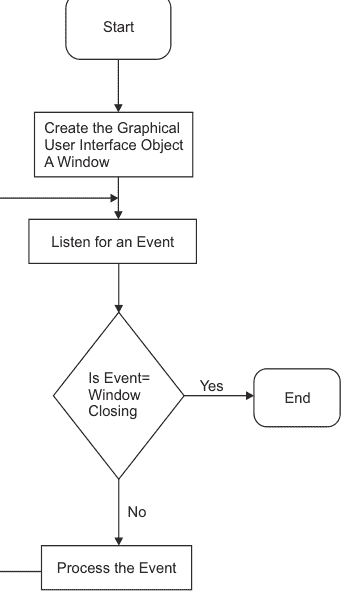

## 16.3 事件的组成

一个事件由三个部分组成：

- **事件对象**：当用户通过按下按键或点击鼠标按钮与应用程序交互时，就会产生一个事件。操作系统捕获该事件以及关联的数据。例如，事件发生的时间、事件类型（如按键或鼠标点击）。这些数据随后被传递给所属事件的应用程序。在 Java 中，事件由描述事件本身的对象表示。Java 有许多类来描述和处理不同类别的事件。

- **事件源**：事件源是一个描述事件本身的对象。Java 有许多类来描述和处理不同类别的事件。

- **事件处理器**：`EventHandler` 是一个理解并处理事件的方法。该事件处理器方法接收一个 `Event` 对象作为参数。

> **注意**：`ActionEvent` 是包含 `getSource()` 方法的类，该方法返回生成事件的组件引用。

## 16.4 JDK 事件模型

在 JDK 模型中，`Event` 类封装了窗口的整个事件处理过程。事件包含一个程序处理的事件常量列表。这些常量用于识别生成的事件的类型。`Event` 类还具有方法可以检测在生成事件期间是否按下了 `Ctrl`、`Alt` 或 `Shift` 键。你可以找出使用了哪种鼠标动作来生成鼠标事件。

JDK 中的事件处理是通过**继承模型**实现的。因此，为了处理事件，你必须扩展一个窗口组件并重写 `action()` 和 `handleEvent()` 方法。如果事件被完全处理，方法返回 `true`；如果事件需要进一步处理，则返回 `false`。如果方法返回 `false`，则事件将传递给组件的容器。

该模型的主要缺点是，事件可以由触发事件的组件或其容器进行处理。这违背了面向对象编程的规范，即功能必须存在于最合适的类中。另一个缺点是，通过这种层级结构发送不重要的事件会浪费 CPU 周期。没有办法可以忽略不重要的事件。

为了克服这些缺点，JDK 1.1 演化出了**委托事件模型**。

## 16.5 JDK 事件模型（委托）

委托模型随着 JDK 1.1 的诞生。在这种模型中，你可以指定当特定事件发生时需要通知的对象。如果发生的事件无关，则它会被丢弃。JDK 1.2 模型基于四个组件：

1. 事件类
2. 事件监听器
3. 显式事件处理
4. 适配器

### I) 事件类

`EventObject` 类位于事件类层次结构的顶端。它属于 `java.util` 包。大多数其他事件存在于 `java.awt.AWTEvent` 中。事件类的层次结构如下：


`getSource()` 方法返回生成事件的组件引用。在该模型中，你可以指定当特定事件发生时需要通知的对象。如果发生的事件无关，则它会被丢弃。`Event` 类还具有方法可以检测在生成事件期间是否按下了 `Ctrl`、`Alt` 或 `Shift` 键。你可以找出使用了哪种鼠标动作来生成鼠标事件。

Java 有许多类来描述和处理不同类别的事件：

1. `ActionEvent`：在点击按钮时生成。
2. `AdjustmentEvent`：在调整滚动条时生成。
3. `ContainerEvent`：在容器被添加或移除时生成。
4. `FocusEvent`：在组件获得或失去焦点时生成。
5. `ItemEvent`：在项选择状态改变时生成。
6. `KeyEvent`：在按键时生成。
7. `WindowEvent`：在窗口状态改变（如最小化）时生成。
8. `MouseEvent`：在执行各种鼠标动作时生成。
9. `TextEvent`：在文本被修改时生成。
10. `PaintEvent`：在组件重绘时生成。

### II) 事件监听器

监听器是一个理解并处理事件的方法。该事件处理器方法接收一个 `Event` 对象作为参数。

> **注意**：`ActionEvent` 是一个包含 `getSource()` 方法的类，该方法返回生成事件的组件引用。

```java
import java.awt.*;
import java.awt.event.*;
import java.applet.*;

class MyListener implements ActionListener {
    public void actionPerformed(ActionEvent action) {
        // 处理事件
    }
}

class UseListener extends Applet {
    public void init() {
        Button ok = new Button();
        // 创建监听器
        MyListener listen = new MyListener();
        ok.addActionListener(listen);
        // 将按钮添加到 applet
        add(ok);
    }
}
```

### III) 显式事件处理

处理事件的另一种方法是扩展组件并重写接收和分发事件的方法。例如，你可以派生 `Button` 类并重写 `processActionEvent()` 方法。

```java
import java.awt.*;
import java.awt.event.*;

class OKButton extends Button {
    public OKButton(String caption) {
        super(caption);
    }

    // 启用动作事件的处理
    enableEvents(AWTEvent.ACTION_EVENT_MASK);

    public void processActionEvent(ActionEvent action) {
        // 处理事件
        /* 调用父类方法，它会调用 actionPerformed() 方法 */
        super.processActionEvent(action);
    }
}
```

子类可以作为自身的事件监听器，如下所示：

```java
import java.awt.*;
import java.awt.event.*;

class OKButton extends Button implements ActionListener {
    public OKButton(String caption) {
        super(caption);
        // 为按钮添加动作监听器
        addActionListener(this);
    }

    public void actionPerformed(ActionEvent action) {
        // 处理事件
    }
}
```

### IV) 适配器

当你使用接口创建监听器时，监听器类必须重写接口中声明的所有方法。某些接口只有一个方法，而另一些则有很多方法。如果你只想处理一个事件，就必须重写所有方法。为了克服这个问题，事件包提供了七个适配器类。适配器将在本节稍后讨论。

### 处理事件

当事件发生时，它会被发送到产生事件的组件。组件注册一个监听器，监听器包含事件处理器。事件处理器接收并处理事件。

每个事件都有相应的监听器接口，该接口指定了处理事件所需的方法。事件对象会被报告给注册的监听器。要让组件能够处理事件，你必须为该组件注册适当监听器。

示例：

```java
import java.awt.*;
import java.awt.event.*;
import java.applet.*;

class Myframe extends Frame {
    Button bl;

    // The main method
    public static void main(String args[]) {
        Myframe f = new Myframe();
    }

    // Constructor
    public Myframe() {
        super("Window Title");
        bl = new Button("click Here");
        // Place the button object on the window
        add("Center", bl);
        // Register the listener for the button
        ActionListener blisten = new ButtonListener();
        bl.addActionListener(blisten);
        // Display the window in a specific size
        setVisible(true);
        setSize(200, 200);
    } // end of the Frame class

    // The listener class
    class ButtonListener implements ActionListener {
        // Definition of the actionPerformed(ActionEvent evt) method
        public void actionPerformed(ActionEvent evt) {
            Button source = (Button) evt.getSource();
            source.setLabel("Button clicked");
        }
    }
}
```

### 输出

a) 事件发生前


b) 事件发生后

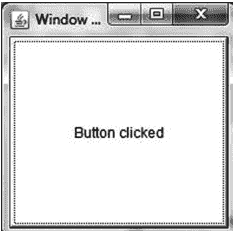

### 上述应用程序是如何工作的？

- 执行从 `main()` 方法开始。
- 在 `main()` 方法中创建了 `Myframe` 类的对象。
- 调用了 `Myframe` 类的构造函数。
- `super()` 方法调用基类（`Frame`）的构造函数并设置窗口标题。
- 创建一个按钮对象并放置在窗口中心。
- 创建一个监听器对象。
- `addActionListener()` 方法为按钮注册了监听器对象。
- `setVisible()` 方法显示窗口。
- 应用程序等待用户与其交互。
- 当用户点击按钮时，产生 `ActionEvent`。
- 创建一个 `ActionEvent` 对象并委托给注册的监听器对象进行处理。
- 监听器对象包含 `actionPerformed()` 方法，该方法处理 `ActionEvent`。
- 在 `actionPerformed()` 方法中，使用 `getSource()` 方法获取事件源的引用。
- 最后，使用 `setLabel()` 方法更改按钮的标签。

> **注意**：
> 没有注册监听器的组件无法处理事件。
> 例如，在上述应用程序中，窗口无法关闭，因为 `MyFrame` 类没有注册用于关闭它的监听器。

## 16.6 处理窗口事件

为了处理与窗口相关的事件，你需要注册一个实现了 `WindowListener` 接口的监听器对象。`WindowListener` 包含一组用于处理窗口事件的方法。

| 事件 | 方法 |
| :--- | :--- |
| 用户点击交叉按钮 | `void windowClosing(WindowEvent)` |
| 窗口首次打开 | `void windowOpened(WindowEvent)` |
| 窗口被激活 | `void windowActivated(WindowEvent)` |
| 窗口被去激活 | `void windowDeactivated(WindowEvent)` |
| 窗口关闭 | `void windowClosed(WindowEvent)` |
| 窗口最小化 | `void windowIconified(WindowEvent)` |
| 窗口最大化 | `void windowDeiconified(WindowEvent)` |

要修改包含窗口处理的 `MyFrame` applet，需要遵循以下步骤：

1. 创建一个实现 `WindowListener` 接口的独立监听器类。
2. 定义该接口中声明的所有方法。
3. 为你想要程序处理的特定事件添加代码。
4. 使用 `addWindowListener()` 方法为窗口注册监听器对象。

骨架代码：

```java
import java.awt.*;
import java.awt.event.*;
import java.applet.*;

class MyWindowListener implements WindowListener {
    // Event handler for the window closing
    public void windowClosing(WindowEvent e) {
        System.exit(0);
    }

    public void windowClosed(WindowEvent e) {
    }

    public void windowOpened(WindowEvent w) {
    }

    public void windowIconified(WindowEvent w) {
    }

    public void windowDeiconified(WindowEvent w) {
    }

    public void windowActivated(WindowEvent w) {
    }

    public void windowDeactivated(WindowEvent w) {
    }
}

class MyFrame extends Frame {
    public static void main(String args[]) {
        // ....................................................
    }

    // Constructor
    public MyFrame() {
        // Register the listener for the window
        MyWindowListener wlisten = new MyWindowListener();
        addWindowListener(wlisten);
    }
}
```

在上面的代码中，`MyFrame` 类调用了 `addWindowListener()` 方法，该方法注册了窗口的监听事件。这使得应用程序能够处理所有与窗口相关的事件。通过最小化或最大化或点击关闭按钮，会创建一个 `WindowEvent` 对象并委托给预先注册的窗口监听器。随后，指定的事件处理器被处理。`WindowListener` 类包含这些方法，没有任何代码，强制你重写这些方法。Java 的适配器类提供了该问题的解决方案。

## 16.7 适配器类

Java 语言提供了实现相应监听器接口的适配器类。这些类的方法是空的。你可以扩展适配器类并重写你需要的方法。用于 `WindowListener` 接口的适配器类是 `WindowAdapter`。你可以按照下面的方式重写之前的代码：

```java
import java.awt.*;
import java.awt.event.*;

class MyFrame2 extends Frame {
    public static void main(String args[]) {
        MyFrame2 f = new MyFrame2();
    }
}
```


```java
    } //Constructor of the Frame class

    public MyFrame2() {

        //Register the listener for the window

        super("The Window Adapter");

        MyEventListener listen = new MyEventListener( );

        addWindowListener(listen);

        setVisible(true);

    }

}

class MyRequestListener extends WindowAdapter {

    // Event handler for the window closing

    public void windowClosing(WindowEvent w) {

        MyFrame2 f;

        f = (MyFrame2)w.getSource( );

        f.dispose();

        System.exit(0);

    }

}
```

# 事件处理

以下是适配器类和监听器接口的列表：

| 事件类别 | 接口名称 | 适配器名称 | 方法 |
| --- | --- | --- | --- |
| 窗口 | WindowListener | WindowAdapter | void windowClosing(WindowEvent e)<br>void windowOpened(WindowEvent e)<br>void windowActivated(WindowEvent e)<br>void windowDeactivated(WindowEvent e)<br>void windowClosed(WindowEvent e)<br>void windowIconified(WindowEvent e)<br>void windowDeiconified(WindowEvent e) |
| 动作 | ActionListener | | void actionPerformed(ActionEvent e) |
| 项目 | ItemListener | | void itemStateChanged(ItemEvent e) |
| 鼠标移动 | MouseMotionListener | MouseMotionAdapter | void mouseDragged(MouseEvent e)<br>void mouseMoved(MouseEvent e) |
| 鼠标按钮 | MouseListener | MouseAdapter | void mousePressed(MouseEvent e)<br>void mouseReleased(MouseEvent e)<br>void mouseEntered(MouseEvent e)<br>void mouseExited(MouseEvent e)<br>void mouseClicked(MouseEvent e) |
| 键盘 | KeyListener | KeyAdapter | void keyPressed(KeyEvent e)<br>void keyReleased(KeyEvent e)<br>void keyTyped(KeyEvent e) |
| 焦点 | FocusListener | FocusAdapter | void focusGained(FocusEvent e)<br>void focusLost(FocusEvent e) |
| 组件 | ComponentListener | ComponentAdapter | void componentMoved(ComponentEvent e)<br>void componentResized(ComponentEvent e)<br>void componentHidden(ComponentEvent e)<br>void componentShown(ComponentEvent e) |

## 16.8 内部类

内部类是声明在其他类内部的类。它们也被称为嵌套类，为程序提供了额外的清晰度。内部类的作用范围限于包含它的外部类。内部类的对象可以访问外部类的成员。外部类可以通过内部类的对象访问内部类的成员。

### 语法

```java
<modifiers> class <classname> {

    <modifiers> class <innerclassname> {

    }

    // 其他属性和方法

}
```

### 示例

为了处理事件，必须定义一个单独的类。该类实现了所需的监听器接口。下面的代码使用了内部类。

```java
import java.awt.*;
import java.awt.event.*;

class MyFrame extends Frame {

    // 内部类声明
    class MyWindowListener extends WindowAdapter {

        public void windowClosing(WindowEvent w) {
            // 事件处理器
            MyFrame frame;
            frame = (MyFrame) w.getSource();
            frame.dispose();
            System.exit(0);
        }
    }

    public static void main(String args[]) {
        MyFrame frame = new MyFrame();
    }

    // 框架类的构造函数
    public MyFrame() {
        // 为窗口注册监听器
        super("The Inner Class Example");
        // 创建内部类的对象
        MyWindowListener listen = new MyWindowListener();
        addWindowListener(listen);
        setVisible(true);
        setSize(100, 100);
    }
}
```

上述代码在外部类的构造函数中声明了内部类的对象。若从无关的类创建内部类的对象，你需要使用 `new` 操作符，因为它是外部类的一个成员。

```java
MyFrame frame = new MyFrame("Title");
MyWindowListener listen = frame.new MyWindowListener();
```

你也可以在方法内部创建一个类。内部类的方法就可以访问包含它们的方法中定义的变量。内部类必须在方法变量声明之后声明，以便内部类可以访问到这些变量。

## 16.9 匿名类

有时，你在方法中声明的类不需要名称，因为你不需要在程序的其他地方使用它们。你可以为此目的创建无名类。没有名的类被称为匿名类。

### 示例

```java
public void methodName() {
    OKButton.addActionListener(new ActionListener() {
        public void actionPerformed(ActionEvent action) {
            // 处理事件
        }
    });
}
```

在上述代码中，类声明是 `addActionListener()` 方法的参数。你不能在代码的其他地方实例化匿名类的对象。

匿名类不能有构造函数，因为该类没有名称。匿名类可以是另一个类的子类。它可以实现一个接口。

### 总结

1. 通常，GUI 程序等待用户执行某些操作。
2. 事件的组成部分：
    - 事件对象
    - 事件源
    - 事件处理器
3. 事件委托模型基于四种组件：
    - 事件类
    - 事件监听器
    - 显式事件处理
    - 适配器
4. 为了处理窗口相关的事件，你需要注册实现 `WindowListener` 接口的监听器对象。
5. 内部类（也称为嵌套类）是声明在其他类内部的类。
6. 程序中没有名的类被称为匿名类。
7. 任何匿名类不能有构造函数，因为该类没有名称。

### 回答以下问题

#### 判断对错

1. 事件继承模型已经取代了事件委托模型。
   答案：错误。
2. 事件继承模型比事件委托模型更高效。
   答案：错误。
3. 事件委托模型使用事件监听器来定义事件处理类的方法。
   答案：正确。
4. 事件委托模型使用 `handleEvent()` 方法支持事件处理。
   答案：错误。

#### 复习题

1. 什么是事件驱动编程？它在编程中有什么用？
2. 什么是 `ActionListener`？它的用途是什么？
3. 为什么我们要为窗口相关的事件注册监听器对象？
4. Java 中适配器的作用是什么？

#### 面试题

1. `enableEvents()` 方法的作用是什么？
2. AWT 事件层次结构的顶端是哪个类？
3. 点击按钮会产生什么事件？
4. 大多数支持事件委托模型的 AWT 事件位于哪个包中？
5. 事件委托模型相比早期的事件继承模型有什么优势？
6. 假设你想要有一个对象来处理 `TextArea` 对象 `T` 的文本字段。你应该如何将其添加为它的事件处理器？

# 第17章 数据库连接

## 17.1 Web 数据库管理

大多数 Web 应用程序需要与数据库管理系统（DBMS）交互。这些 DBMS 是应用程序用信息的存储库。在线购物商城需要跟踪其客户和售出的商品。像 www.yahoo.com 这样的网站需要跟踪用户访问的 URL。

本章介绍了使用 Java 进行数据库编程的技术。你还将看到如何通过 JDBC-ODBC 桥访问数据库。

### 17.1.1 数据库管理

数据库是相关信息的集合，而 DBMS 是提供检索、修改和添加数据库数据的软件。有很多 DBMS/RDBMS 产品可用，例如 MS-Access、MS-SQL Server、Oracle、Sybase、Informix Progress & Ingress。这些关系型数据库管理系统（RDBMS）都以自己的格式存储数据。

例如，MS-Access 将数据存储在 `.mdb` 文件中，而 MS-SQL 存储在 `.dat` 文件格式中。

假设你被分配为一家杂货店开发一个应用程序，允许店主维护每日交易记录。你将设计数据库，在店主的机器上安装 MS-SQL 服务器/Oracle 并告诉他们如何使用。一个好主意是开发一个定制的前端应用程序，让客户可以按键获取检索和修改数据的选项。

为了实现上述目标，你需要一种机制让应用程序与数据库的文件格式（即 `.mdb` 或 `.dat` 文件）工作。

## 17.2 数据库连接

Java Soft 创建了 JDBC-ODBC 桥接，将 JDBC API 翻译为 ODBC API。它可以与可用的 ODBC 驱动配合使用。

## 17.3 JDBC 驱动分类

- JDBC-ODBC 桥接 + ODBC 驱动
- 原生 API 驱动（部分 Java 驱动）
- 网络协议驱动（纯 Java 驱动）
- 薄型驱动

### JDBC-ODBC 桥接 + ODBC 驱动

JDBC-ODBC 桥接驱动使用 ODBC 驱动连接数据库。JDBC-ODBC 桥接驱动将 JDBC 方法调用转换为 ODBC 函数调用。由于薄型驱动的存在，现在不再建议使用这种方法。

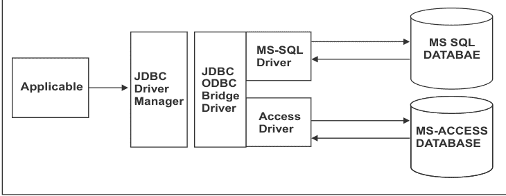

**JDBC-ODBC 架构**

JDBC 驱动管理器是 JDBC 架构的核心。`DriverManager` 类的功能是将 Java 程序连接到 Java 程序中指定的适当驱动程序。

### JDBC-ODBC 桥接

作为 JDBC 的一部分，Sun Microsystems 提供了一个从 JDBC 访问 ODBC 数据源的驱动程序。该驱动程序被称为 JDBC-ODBC 桥接。JDBC-ODBC 桥接通过 JDBC 类实现，并使用原生库访问 ODBC 驱动。在 Windows 平台上，原生库是 `JDBCODBC.DLL`。

#### 优点

- 易于使用
- 可以轻松连接到任何数据库

#### 缺点

- 性能降低，因为 JDBC 方法调用被转换为 ODBC 函数调用。
- 需要在客户端机器上安装 ODBC 驱动。

### II 原生 API 驱动

原生 API 驱动使用数据库的客户端库。驱动程序将 JDBC 方法调用转换为数据库 API 的原生调用。它不是完全用 Java 编写的。

#### 优点

- 性能优于 JDBC-ODBC 桥接驱动。

#### 缺点

- 每台客户端机器上都需要安装原生驱动。
- 客户端机器需要安装厂商的客户端库。

### III 网络协议驱动

它使用中间件（应用程序服务器）直接或间接地将 JDBC 调用转换为特定厂商的数据库协议。它完全用 Java 编写。

#### 优点

- 不需要客户端库。

#### 缺点

- 需要网络支持
- 中间层需要针对特定数据库的代码。
- 网络协议的维护成本较高，因为需要特定数据库的代码。

### IV 薄型驱动

薄型驱动将 JDBC 调用直接转换为特定厂商的数据库协议。这就是它被称为薄型驱动的原因。它完全用 Java 编写。

#### 优点

- 性能优于所有其他驱动。
- 客户端或服务器端不需要软件。

#### 缺点

- 依赖数据库。

## 17.4 查询数据库

现在你已经理解了 JDBC 架构，就可以编写一个能够与数据库工作的 Java 程序了。在本节中，你将学习 Java 中提供的包和类，这些类允许你向数据库发送查询并处理查询结果。

### 17.4.1 连接数据库

`java.sql` 包包含了帮助连接数据库、向数据库发送嵌入 SQL 语句以及处理查询结果的类。

### 17.4.2 Connection 对象

连接对象表示与数据库的连接。在连接一个或多个数据库的应用程序中，你可能有多个连接对象。

#### 加载驱动并建立连接

要与数据库建立连接需要执行以下操作：

1. 通过调用 `Class` 类的 `forName()` 方法注册 ODBC JDBC/薄型驱动。
   `Class.forName("oracle.jdbc.driver.OracleDriver");`
2. 调用 `DriverManager` 类的 `getConnection("JDBC URL")` 方法。
   `DriverManager` 类的 `getConnection()` 方法尝试找到连接传递给 `getConnection()` 方法的 JDBC URL 所代表的数据库的驱动。

#### JDBC URL

JDBC URL 是提供标识数据库方式的字符串。JDBC URL 分为三部分：
`<protocol>:<subprotocol>:<subname>`
JDBC URL 中的 `<protocol>` 始终是 `jdbc`。
`<subprotocol>` 是数据库连接机制的名称。如果获取数据的机制是 ODBC 桥接，则子协议必须是 `odbc`。`<subname>` 用于标识数据库。

```java
String url = "jdbc:oracle:thin:@localhost:1521:xe";
// 薄型驱动的 URL
"jdbc:oracle:thin:@localhost:1521:xe"

Class.forName("oracle.jdbc.driver.OracleDriver");

Connection con = DriverManager.getConnection(url, "system", "password");
```

### 17.4.3 在数据库中处理查询

一旦建立了与数据库的连接，你就可以查询数据库并处理结果集。JDBC 对可以发送的 SQL 语句类型没有任何限制，作为程序员，你的责任是确保数据库能够处理这些语句。

JDBC 提供了三个类向数据库发送 SQL 语句。这些是：

#### i) Statement 对象

你可以通过调用连接对象的 `createStatement()` 方法来创建 `Statement` 对象。

#### ii) PreparedStatement 对象

你可以通过调用连接对象的 `prepareStatement()` 方法来创建 `PreparedStatement` 对象。`PreparedStatement` 对象包含一组方法，可用于发送带有输入（IN）参数的查询。

#### iii) CallableStatement 对象

你可以通过调用连接对象的 `prepareCall()` 方法创建 `CallableStatement` 对象。`CallableStatement` 对象可以处理调用存储过程时的输入（IN）和输出（OUT）参数。

#### 使用 Statement 对象

`Statement` 对象允许你执行简单查询。

- `executeQuery()` 方法执行选择查询并返回 `ResultSet`。
- `executeUpdate()` 方法执行 INSERT、UPDATE 和 DELETE 语句。
- `execute()` 方法执行可能返回结果的 SQL 语句。

如示例 `QueryApp` 程序所示，使用 statement 对象向数据库发送简单查询。

```java
import java.sql.*;

public class QueryApp {

    public static void main(String a[]) {

        try {

            Class.forName("oracle.jdbc.driver.OracleDriver");
```


```java
Connection con = DriverManager.getConnection("jdbc:oracle:thin@localhost:1521:xe","system","password");

Statement stat = con.createStatement();

stat.executeQuery("select from emp");

} catch (Exception e) {

    System.out.print("Error" + e);

}

}
}
```

在上面的示例中：

- (1) 加载了薄型驱动。
- (2) 使用 `getConnection()` 方法初始化连接对象。
- (3) 使用 `createStatement()` 方法创建 statement 对象。
- (4) 最后，使用 statement 对象的 `executeQuery()` 方法执行简单查询。

## 使用 ResultSet 对象

ResultSet 对象提供了访问表数据的方法。执行语句通常会生成一个 `ResultSet` 对象。它维护一个指向当前数据行的光标。初始光标位于第一行之前。`next()` 方法将光标移动到下一行。你可以通过调用 `getxx()` 方法从 ResultSet 行中访问数据，其中 `xx` 是数据类型。以下代码查询并处理 ResultSet。

```java
import java.sql.*;

public class QueryApp {

    public static void main(String []) {

        ResultSet result;

        try {

            Class.forName("oracle.jdbc.driver.OracleDriver");

            Connection con = DriverManager.getConnection("jdbc:oracle:thin@localhost:1521:xe","system","password");

            Statement stat = con.createStatement();

            result=stat.executeQuery("select from emp");

            while (result.next()) {

                System.out.println(result.getString(2));

                //从 emp 表第二列检索数据

            }

        } catch (Exception e) {

            System.out.println("Error " + e);

        }

    }

}
```

在上面的 QueryApp 示例中：

- (1) `ResultSet` 对象由 `executeQuery()` 方法返回。
- (2) 使用 while 循环中的 `next()` 方法处理 ResultSet 中的所有行。
- (3) 使用 `getString()` 方法检索第二列的值。

## 输出

| Ramesh |
| Atul |
| Suresh |
| Radhika |

你可以修改同一个程序，如下所示在窗口中显示表内容：

```java
import java.awt.*;

import java.awt.event.*;

import java.sql.*;

public class QueryApp extends Frame implements ActionListener {

    TextField eid, ename;

    Button next;

    Panel p;

    static ResultSet result;

    static Connection con;

    static Statement stat;

    public QueryApp() {

        super("The Query Application");

        setLayout(new GridLayout(5,1));

        eid=new TextField();

        ename=new TextField();

        next=new Button("Next");

        setSize(500,500);

        p=new Panel();

        add(new Label("Employee ID: "));
} catch (Exception e) {

    System.out. print("Error in sql" + e);

}

@Override

public void actionPerformed(ActionEvent event) {

    if (event.getSource()==next) {

        try{

            while(result.next()) {

                eid.setText(eid.getText()+" "++(result.getString(1)));

                ename.setText(ename.getText()+" "++(result.getString(2)));

            }

        } catch (Exception e) {System.out.println(e);

        }

    }

}
```

- (1) `main()` 方法创建了 `QueryApp` 类的对象。
- (2) `QueryApp` 类的构造函数在窗口上放置了控件。
- (3) 随后执行查询。
- (4) 当用户点击 Next 按钮时，`actionPerformed()` 方法将 `Resultset` 对象移动到下一记录并显示该记录。

### 输出

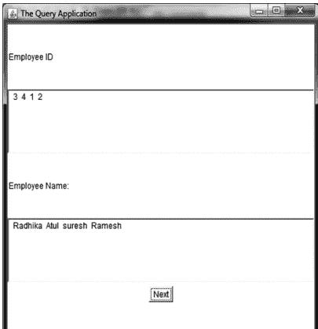

### 使用 PreparedStatement 对象

你需要开发一个应用程序，根据用户指定的搜索标准来查询数据库。例如，用户提供员工 ID (eid) 并想要查看员工的详细信息。

```sql
select * from employee where eid = ?
```

为了实现这一点，你必须准备一个查询语句，该语句在运行时会在子句中接收一个合适的值。

`PreparedStatement` 允许你执行参数化查询。它是通过连接对象的 `preparedStatement()` 方法创建的。

```java
State = con.prepareStatement("select * from emp where eid =");
```

连接对象的 `prepareStatement` 方法接收 SQL 语句作为参数。该 SQL 语句可以包含占位符，这些占位符可以在运行时被输入参数替换。

> 注意："?" 符号是一个占位符，可以在运行时被输入参数替换。

# 传递输入参数

在执行 `PreparedStatement` 对象之前，你必须设置每个 '?' 参数的值。这是通过调用 `setxxx()` 方法实现的，其中 `xxx` 是参数的数据类型。

```java
Stat.setString(1, eid.getText());

ResultSet result = stat.executeQuery();
```

示例：

```java
import java.sql.*;

import java.awt.*;

import java.awt.event.*;

public class PreparedQuery extends Frame implements ActionListener

{

TextField eid, name;

Button query;

Panel p;

/* 这些变量被声明为静态，因为它们必须在静态方法中被访问*/

static ResultSet result;

static Connection con;

static PreparedStatement stat;

/* PreparedQuery 类的构造函数 */

public PreparedQuery() {

super("The Query Application");

setLayout(new GridLayout(5,1));

eid=new TextField();

ename=new TextField();

query=new Button("QUERY");

setSize(500,500);

p=new Panel();

add(new Label("Employee ID"));

add(eid);

add(new Label("Employee Name: "));

add(ename);

add(p);

p.add(query);

query.addActionListener(this);

setVisible(true);

}

/* main 方法创建类的对象并显示第一条记录*/

public static void main(String a []) {

{

try {

    PreparedQuery obj = new PreparedQuery( );

    Class.forName("oracle.jdbc.driver.OracleDriver");

    con = DriverManager.getConnection("jdbc:oracle:thin:@localhost:1521:xe","system","sail_boat1");

    stat = con.preparedStatement("select * from emp where id=?");

}

catch (Exception e) 

{System.out.print("Error in sql " + e);}}

}

@Override

public void actionPerformed (ActionEvent event) {

    if (event.getSource()==query) {

{

try{

        stat.setString(1,eid.getText());

        result=stat.executeQuery();

    while(result.next()) {

        eid.setText(result.getString(1));

        ename.setText(result.getString(2));

}

catch (Exception e) {System.out.println(e);

}

}

}

}
```

在上面的示例中：

- 1. 使用 `preparedStatement()` 方法创建 `PreparedStatement` 对象。
- 2. 当用户点击 Query 按钮时，初始化 `PreparedStatement` 对象的参数。
- 3. 然后使用 `executeQuery()` 方法执行查询并将结果显示在相应的控件中。

### 输出

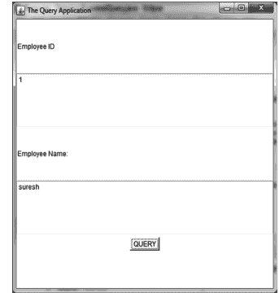

### 添加记录

你可以使用 statement 对象的 `executeUpdate()` 方法。

```java
Stat.executeUpdate("insert into ");
```

`executeUpdate()` 的返回值是行数。

```java
public void addRecord() {

try{

stat.executeUpdate("insert into ");

}

catch (Exception e) {System.out.println(e);

}

}
```

### 修改记录

你可以使用 statement 对象的 `executeUpdate()` 方法。

```java
Stat.executeUpdate("update ");
```

`executeUpdate()` 的返回值是行数。

```java
public void modifyRecord() {
try {
stat.executeUpdate("update ");
}
catch (Exception e) {System.out.println(e);
}
}
```

### 删除记录

你可以使用 statement 对象的 `executeUpdate()` 方法。

```java
Stat.executeUpdate("delete ");
```

`executeUpdate()` 的返回值是行数。

```java
public void deleteRecord() {
try{
stat.executeUpdate("delete ");
}
catch (Exception e) {System.out.println(e);
}
}
```

### 总结

- 1. 数据库管理系统是应用程序使用的信息库
- 2. ODBC API 是允许你的程序访问数据库的库函数
- 3. JDBC 为 Java 程序提供了数据库编程 API
- 4. JDBC-ODBC 驱动程序将 JDBC API 翻译为 ODBC API
- 5. 有五种类型的 JDBC 驱动程序：
  - JDBC-ODBC 桥 + ODBC 驱动
  - Native API（部分 Java 驱动）
  - 网络协议驱动（纯 Java 驱动）
  - Thin 驱动

# Java 深度

- 6. `java.sql` 包包含了连接数据库、发送 SQL 语句和处理查询结果的类。
- 7. connection 对象代表到数据库的连接。
- 8. preStatement 对象允许你执行参数化查询。
- 9. ResultSet 对象为用户提供了从表中访问数据的方法。

### 回答以下问题

### 单选题

- 1. JDBC-ODBC 桥是？
  a) 单线程 b) 多线程 c) 无
  答案. b
- 2. DriverManager 是？
  a) 接口 b) 类 c) 方法
  答案. b
- 3. Commit 是哪个方法的？
  a) Connection b) ResultSet c) Statement
  答案. a
- 4. JDBC 中需要哪些方法来加载数据库？
  a) `Class.forName()` b) `registerDriver()` c) 无
  答案. a
- 5. Sun 定义了多少种 JDBC 驱动类型？
  a) 一种 b) 四种 c 三
  答案. b

# 填空题

- 1. ________ 是一种运行在 UNIX、Linux 和 Windows 上的开源 DBMS 产品。
- 2. ________Statement 可以执行参数化查询。
- 3. `executeQuery()` 方法返回 ________ 对象。
- 4. ________ 符号是一个可以在运行时被输入参数替换的占位符。
- 答案：
1. MySQL
2. prepared
3. ResultSet
4. ?

## 数据库连接 | 269

### 判断对错

- 1. JDBC 是一种用于连接关系型、对象和 XML 数据源的 API。
  答案. 错误
- 2. JDBC-ODBC 桥支持多个并发打开的语句连接。
  答案. 正确
- 3. JDBC 是一种访问关系型数据库的 API。
  答案. 错误
- 4. `java.sql` 和 `javax.sql` 包包含了 JDBC 类和接口。
  答案. 正确

### 复习题

- 1. 什么是数据库和数据库驱动程序？
- 2. 共有多少种驱动程序？请解释它们。
- 3. 写出连接数据库的步骤。
- 4. 什么是 ResultSet？ResultSet 的返回类型是什么？

### 面试题

- 1. Java 中 JDBC 连接的主要步骤有哪些哪些？
- 2. Statement 有哪些不同的类型？
- 3. 什么是 JDBC？
- 4. 哪种 Statement 可以执行参数化查询？
- 5. JDBC-ODBC 桥是否支持每个连接多个并发打开的语句？

## 第 18 章

## 集合 (Collection)

集合（可能称为容器）简单来说就是一个包含一组多个元素的对象。集合代表了形成自然分组的数据项。例如，卡牌集合、电话簿（将名称映射到电话号码）等。

## 18.1 集合框架 (COLLECTION FRAMEWORK)

框架是指用于表示和操作集合的体系。在集合中，我们有许多接口和抽象类。

### 集合的优势

- 1. 尽力减少程序员的工作量：集合提供了现成的数据结构和算法，如 Stack、Queue、List 等。
- 2. 高性能：有多种接口可以相互替实现，程序员无需再为数据结构编写代码。
- 3. 互操作性：集合框架允许不同类型的集合以相似的方式工作，并具有高度的互操作性。

## 18.2 集合接口 (COLLECTION INTERFACE)

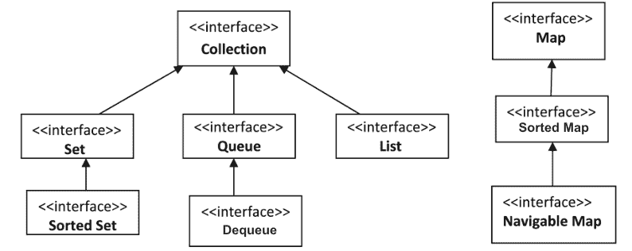

## 272 | 深度 Java (Java in Depth)

## 集合包含四种基本类型

- Lists：元素列表（实现 List 的类）
- Sets：唯一元素（实现 Set 的类）
- Maps：具有唯一 ID 的元素（实现 Map 的类）
- Queues：按处理顺序排列的元素

注意：


- 实现类可能是无序的、排序的、有序的或无序的。

- 如果实现是有排序的，那么它就不可能是无序的，因为排序意味着特定的顺序。

## 18.3 集合层级结构 (HIERARCHY OF COLLECTION)

I)

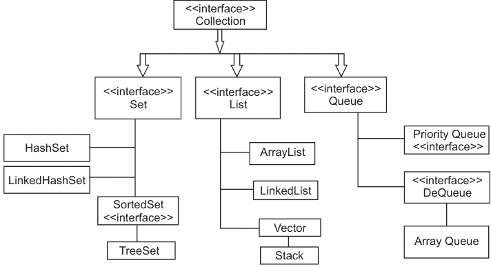

集合层级结构

II)

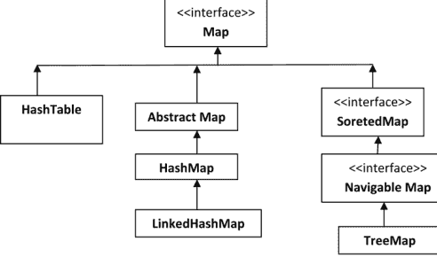

Map 层级结构

## 18.4 集合的方法

- `public boolean add(Object element)`: 用于在此集合中插入一个元素。

- `public boolean addAll(Collection c)`: 用于将指定的集合元素插入到调用集合中。

- `public boolean remove(Object element)`: 用于从集合中删除一个元素。

- `public boolean removeAll(Collection c)`: 用于从调用集合中删除指定集合中的所有元素。

- `public boolean retainAll(Collection c)`: 用于删除调用集合中除指定集合以外的所有元素。

- `public int size()`: 返回集合中元素的总数。

- `public void clear()`: 移除集合中的所有元素。

- `public boolean contains(Object element)`: 用于搜索元素。

- `public boolean containsAll(Collection c)`: 用于在此集合中搜索是否存在指定的集合。

- `public Iterator iterator()`: 返回一个迭代器。

- `public Object[] toArray()`: 将集合转换为数组。

- `public boolean isEmpty()`: 检查集合是否为空。

- `public boolean equals(Object element)`: 匹配两个集合。

- `public int hashCode()`: 返回集合的哈希值数字。

## 18.5 迭代器接口 (ITERATOR INTERFACE)

迭代器接口提供了仅按正向遍历元素的功能。

### 迭代器接口的方法

迭代器接口中只有三个方法。它们是：

- `public boolean hasNext()`: 如果迭代器有元素，则返回 true。

- `public Object next()`: 返回元素并将游标移动到下一个元素。

- `public void remove()`: 删除迭代器返回的上一个元素。该方法很少使用。

## 18.6 List 接口 (LIST INTERFACE)

List 关注索引。List 具有而 Set 不具备的方法是一组与索引相关的方法。这些关键方法包括如 `get(int index)`、`indexOf(Object o)`、`add(int index, Object obj)` 等。

下面描述了 List 的三种实现：

1. **ArrayList**（动态或可增长数组）：它是有序的集合，但不是排序的。它于 JDK 1.2 版本引入。它提供了快速迭代和随机访问。

2. **Vector**：Vector 出于 Java 早期。Vector 和 Hashtable 是两个原始的集合。Vector 是同步的。

3. **LinkedList**：LinkedList 是 List 接口的双链表实现。它更适合在列表的两端进行插入和删除。

## 18.8 集合接口 (SET INTERFACE)

集合（Set）关注唯一性。它不允许出现重复元素。`equals()` 方法用于判断两个对象是否相似。下面描述了三种 Set 的实现：

- **HashSet**: 它是一个无排序且无序的集合。它使用对象的 `hashCode()` 进行存储。实现得越好性能越好。当我们不在乎顺序但需要对象具有唯一性时，使用 HashSet。

- **LinkedHashSet**: 它是一个有序集合，维护着一个双向链表。当你遍历 HashSet 时，顺序是不可预测的；而 LinkedHashSet 允许你按照元素插入的顺序进行遍历。

- **TreeSet**: TreeSet 是两个排序集合之一（另一个是 TreeMap）。它保证元素将根据自然顺序以升序排列。

### HashSet 示例

```java
import java.util.*;

class HashSetDemo {
    public static void main(String args[]) {
        HashSet<String> al = new HashSet<String>();
        al.add("Java in Depth");
        al.add("Sarika");
        al.add("Himani");
        al.add("Sarika");
        Iterator<String> itr = al.iterator();
        while (itr.hasNext()) {
            System.out.println(itr.next());
        }
    }
}
```

输出

| Sarika |
| :--- |
| Himani |
| Java in Depth |

### LinkedHashSet 示例

```java
import java.util.*;

class LinkedHashSetDemo {
    public static void main(String args[]) {
        LinkedHashSet<String> al = new LinkedHashSet<String>();
        al.add("Java in Depth");
        al.add("Sarika");
        al.add("Himani");
        al.add("Sarika");
        Iterator<String> itr = al.iterator();
        while (itr.hasNext()) {
            System.out.println(itr.next());
        }
    }
}
```

输出

| Java in Depth |
| :--- |
| Sarika |
| Himani |

## 18.9 映射接口 (MAP INTERFACE)

映射（Map）关注唯一标识符。你将一个唯一的键（ID）映射到一个特定的值，键和值都是对象。

下面描述了 Map 的四种实现：

- **HashMap**: 它提供一个无序且无排序的 Map。它允许一个 null 键和多个 null 值。

示例：

```java
import java.util.*;

class HashMapDemo {
    public static void main(String args[]) {
        HashMap<String, String> hm = new HashMap<String, String>();

        hm.put("Key1", "Amit");
        hm.put("Key2", "Vijay");
        hm.put("Key3", "Rahul");

        for (Map.Entry m : hm.entrySet()) {
            System.out.println(m.getKey() + " " + m.getValue());
        }
    }
}
```

输出

| Key2 Vijay |
| :--- |
| Key1 Amit |
| Key3 Rahul |

- **Hashtable**: 类似于 Vector，存在于 Java 早期。Hashtable 是 HashMap 的同步对应类。Hashtable 不允许 null 键或值，而 HashMap 有一个 null 键和多个 null 值。

示例：

```java
import java.util.*;

class HashTableDemo {
    public static void main(String args[]) {
        Hashtable<String, String> hm = new Hashtable<String, String>();

        hm.put("Key1", "Sarika");
        hm.put("Key2", "Himani");
        hm.put("Key3", "Rahul");

        for (Map.Entry m : hm.entrySet()) {
            System.out.println(m.getKey() + " " + m.getValue());
        }
    }
}
```

输出

| Key3 Rahul |
| :--- |
| Key2 Himani |
| Key1 Sarika |

- **LinkedHashMap**: 类似于 LinkedHashSet，它维护插入顺序（可选的访问顺序）。在添加元素时比 HashMap 慢。

示例：

```java
import java.util.*;

class LinkedHashMapDemo {
    public static void main(String args[]) {
        LinkedHashMap<String, String> hm = new LinkedHashMap<String, String>();
        hm.put("Key1", "Sarika");
        hm.put("Key2", "Himani");
        hm.put("Key3", "Rahul");

        for (Map.Entry m : hm.entrySet()) {
            System.out.println(m.getKey() + " " + m.getValue());
        }
    }
}
```

输出

| Key1 Sarika |
| :--- |
| Key2 Himani |
| Key3 Rahul |

- **TreeMap**: 它是按自然顺序排序的 map。它不允许 null 键，但可以有 null 值。

示例：

```java
import java.util.*;

class TreeMapDemo {
    public static void main(String args[]) {
        TreeMap<String, String> hm = new TreeMap<String, String>();

        hm.put("Key6", "Sarika");
        hm.put("Key2", "Himani");
        hm.put("Key9", "Rahul");
        for (Map.Entry<String, String> m : hm.entrySet()) {
            System.out.println(m.getKey() + " " + m.getValue());
        }
    }
}
```

输出

| Key2 Himani |
| :--- |
| Key6 Sarika |
| Key9 Rahul |

### 总结

1. 集合框架（Collection Framework）用于表示和操作集合的架构。

2. 集合有四种：
    - 列表（Lists）：元素列表
    - 集合（Sets）：唯一元素
    - 映射（Maps）：带有唯一 ID 的元素
    - 队列（Queues）：按顺序排列的元素

3. 列表实现：
    - ArrayList
    - Vector
    - LinkedList

4. 集合实现：
    - HashSet
    - LinkedHashSet
    - TreeSet

5. 队列实现

6. 映射实现：
    - HashMap
    - Hashtable
    - LinkedHashMap
    - TreeMap

### 单选题

1. 下面哪个包包含集合类？
   a) java.lang
   b) java.util
   c) java.net
   答案：b

2. 下面哪个类不是 Java 集合框架的一部分？
   a) Queue
   b) Array
   c) Stack
   答案：b

3. 下面哪个接口不是 Java 集合框架的一部分？
   a) Set
   b) SortedMap
   c) List
   答案：b

4. Java 中的 Collection 是？
   a) 对象组
   b) 类组
   c) 接口组

### 填空题

1. `Comparable` 处理序列。答案：Comparable

2. `Collection` 是集合层次结构中的根接口。答案：Collection

3. `CopyOnWriteArrayList` 是 `ArrayList` 的线程安全变体。答案：ArrayList

4. Map 关注 ________。答案：标识符 (identifiers)

### 判断题

1. myArray 中存储的对象类可以实现 Comparable？正确

2. myArray 中存储的对象类可以实现 Comparable？正确

3. myArray 中存储的对象类必须实现 Comparable？错误

### 复习题

Collection 是什么？集合框架有什么用？List 和 Set 的区别？Set 和 Map 的区别？泛型（Generic）是什么？泛型有什么用？如何将字符串数组转换为列表？

### 面试题

假设有一个 Employee 类。将 Employee 类对象添加到 ArrayList 中。如果我想使用 Employee 类中的属性对 ArrayList 中的对象进行排序，需要哪些步骤？Collection 是什么？集合框架是什么？Java 集合框架有什么用？哪些集合类是同步或线程安全的？列出核心接口。List 和 Set 的区别是什么？Map 和 Set 的区别是什么？

# 项目：井字棋 (Tic Tac Toe)


```java
import java.awt.*;
import java.awt.event.*;
class TicTacToe extends WindowAdapter implements ActionListener {
    Label l11,l12,l13,l14,l15,l16,l19,l10,l11;
    Button b0,b1,b2,b3,b4,b5,b6,b7,b8,b9,b10,b12,b13;
    Frame f2,f1;
    Color e=new Color(120,220,225), d=new Color(0,0,255);
    Color c=new Color(255,0,0), eg=new Color(120,220);
    Color g=new Color(0,225);
    TextField t1,t2;
    int lb1=0,lb2=0,lb3=0,lb4=0,lb5=0,lb6=0,lb7=0,lb8=0,lb9=0,lc=0,changes=0;

    TicTacToe() {
        l13=new Label("Rules of Toe: ");
        l14=new Label("1. Each player can fill one box at a time.");
        l15=new Label("2. Player 1 will put a cross on the box while the second player will put a circle on the box.");
        l16=new Label("3. The first player to fill three consecutive boxes in horizontal, or diagonal direction wins the game.");
        l11=new Label("Enter name of player 1");
        l12=new Label("Enter name of player 2");
        t1=new TextField();t2=new TextField();
        b0=new Button("Lets");
        b13=new Button("New Game");
        f2=new Frame("Tic Toe");
        f2.setLayout(null);
        f2.setBounds(200,100,630,350);
        f2.setBackground(e);
        f2.setVisible(true);
        l11.setBounds(25,200,250);t1.setBounds(280,200,100);
        l12.setBounds(25,230,250);t2.setBounds(280,230,100);
        l13.setBounds(25,30,545);
        l14.setBounds(25,70,545);
        l15.setBounds(25,100,545);
        l16.setBounds(25,130,260);
        b0.setBounds(290,280,80);
        b0.addActionListener(this);
        f2.add(l13);f2.add(l14);f2.add(l15);f2.add(l16);f2.add(l11);
        f2.add(t1);f2.add(t2);f2.add(l12);f2.add(b0);
        f2.addWindowListener(this);
    }

    public void windowClosing(WindowEvent w) {
        System.exit(0);
    }

    public void actionPerformed(ActionEvent e) {
        if(e.getSource()==b0) {
            f1=new Frame("Tic Toe");
            f1.setBackground(eg);
            b1=new Button();b2=new Button();b3=new Button();b4=new Button();
            b5=new Button();b6=new Button();b7=new Button();b8=new Button();
            b9=new Button();b10=new Button();b11=new Button();b12=new Button();
            f1.setLayout(null);
            f1.setBounds(200,100,450,50);
            b1.setBounds(150,200,50,50);b2.setBounds(200,200,50,50);b3.setBounds(250,200,50,50);
        }
    }
}
```

# 项目 | 285

```java
b4.setBounds(150,250,50,50);b5.setBounds(200,250,50,50);b6.setBounds(250,250,50,50);
b7.setBounds(150,300,50,50);b8.setBounds(200,300,50,50);b9.setBounds(250,300,50,50);
f1.add(b1);f1.add(b2);f1.add(b3);f1.add(b4);f1.add(b5);f1.add(b6);f1.add(b9);f1.add(b10);f1.add(b11);f1.add(b12);f1.add(b13);
f1.add(b8);f1.add(b9);f1.add(b7);
b1.addActionListener(this);b2.addActionListener(this);
addActionListener(this);
addActionListener(this);
b4.addActionListener(this);b5.addActionListener(this);b6.addActionListener(this);
b7.addActionListener(this);b8.addActionListener(this);b9.addActionListener(this);b13.addActionListener(this);
f1.setVisible(true);
lbl1.setText(t1.getText()+"'s turn");
```

```java
if(e.getSource()==b1) {
    System.out.println("in b1")
    chances+=1;
    if(lc==0) {
        if(lbl1==0) {
            b1.setBackground(c);
            b1.setLabel("X");
            lbl1=1;
            lc=1;
            lbl1.setText(t2.getText()+"'s turn");
            check();
        }
    }
    if(lbl1!=0) {}
    if(lc!=0) {
        if(lbl1==0) {
            b1.setBackground(d);
            b1.setLabel("0");
            lbl1=1;
            lc=0;
            lbl1.setText(t1.getText()+"'s turn");
            check();
        }
    }
    if(lbl1!=0) {}
}
```

```java
if(e.getSource()==b2) {
    System.out.println("in b2")
    chances+=1;
    if(lc==0) {
        if(lbl2==0) {
            b2.setBackground(c);
            b2.setLabel("X");
            lbl2=1;
            lc=1;
            lbl1.setText(t2.getText()+"'s turn");
            check();
        }
    }
    if(lbl2!=0) {}
    if(lc!=0) {
        if(lbl2==0) {
            b2.setBackground(d);
            b2.setLabel("0");
            lbl2=1;
            lc=0;
            lbl1.setText(t1.getText()+"'s turn");
            check();
        }
    }
    if(lbl2!=0) { }
}
```

# 286 | Java 进阶阶

```java
if(e.getSource()==b3) {
    System.out.println("in b3");
    chances=chances+1;
    if(lc==0) {
        if(lbl3==0) {
            b3.setBackground(c);
            b3.setLabel("X");
            lbl3=1;
            lc=1;
            lbl1.setText(t2.getText()+"s turn");
            check();
        }
    }
    if(lbl3!=0) {}}
    if(lc==0) {
        if(lbl3==0) {
            b3.setBackground(d);
            b3.setLabel("O");
            lbl3=1;
            lc=0;
            lbl1.setText(t1.getText()+"s turn");
            check();
        }
    }
    if(lbl3!=0) {}}
}
```

```java
if(e.getSource()==b4) {
    System.out.println("in b4");
    chances=chances+1;
    if(lc==0) {
        if(lbl4==0) {
            b4.setBackground(c);
            b4.setLabel("X");
            lbl4=1;
            lc=1;
            lbl1.setText(t2.getText()+"s turn");
            check();
        }
    }
    if(lbl4!=0) {}
    if(lc!=0) {
        if(lbl4==0) {
            b4.setBackground(d);
            b4.setLabel("O");
            lbl4=1;
            lc=0;
            lbl1.setText(t1.getText()+"s turn");
            check();
        }
    }
    if(lbl4!=0) {}}
}
```

```java
if(e.getSource()==b5) {
    chances=chances+1;
    if(lc==0) {
        if(lbl5==0) {
            b5.setBackground(c);
            b5.setLabel("X");
            lbl5=1;
            lc=1;
            lbl1.setText(t2.getText()+"s turn");
            check();
        }
    }
    if(lbl5!=0) {}}
    if(lc!=0) {
        if(lbl5==0) {
            b5.setBackground(d);
        }
    }
    b5.setLabel("0"); lbl5=1;lc=0;lbl1.setText(t1.getText()+'s turn"); check();
    if(lbl5!=0) {}}
}
```

# 项目 | 287

```java
if(e.getSource()==b6) {
    chances=chances+1;
    if(lc==0) {
        if(lbl6==0) {
            b6.setBackground(c);
            b6.setLabel("X");
            lbl6=1;
            lc=1;
            lbl1.setText(t2.getText()+"s turn");
            check();
        }
    }
    if(lbl6!=0) {
    if(lc!=0) {
        if(lbl6==0) {
            b6.setBackground(d);
            b6.setLabel("O");
            lbl6=1;
            lc=0;
            lbl1.setText(t1.getText()+"s turn");
            check();
        }
    }
    if(lbl6!=0) {}}
}
if(e.getSource()==b2) {
    if(lc==0) {
        if(lbl2==0) {
            b2.setBackground(c);
            b2.setLabel("X");
            lbl2=1;
            lc=1;
            lbl1.setText(t2.getText()+"s turn");
            check();
        }
    }
    if(lbl2!=0) {}}
    if(lc!=0) {
        if(lbl2==0) {
            b2.setBackground(d);
            b2.setLabel("O");
            lbl2=1;
            lc=0;
            lbl1.setText(t1.getText()+"s turn");
            check();
        }
    }
    if(lbl2!=0) {}}
}
if(e.getSource()==b7) {
    chances=chances+1;
    if(lc==0) {
        if(lbl7==0) {
            b7.setBackground(c);
            b7.setLabel("X");
            lbl7=1;
            lc=1;
            lbl1.setText(t2.getText()+"s turn");
            check();
        }
    }
    if(lbl7!=0) {}}
    if(lc!=0) {
        if(lbl7==0) {
            b7.setBackground(d);
            b7.setLabel("0");
            lbl7=1;
            lc=0;
            lbl1.setText(t1.getText()+"s turn");
            check();
        }
    }
}
```

# 288 | Java 进阶

```java

if(e.getSource()==b8) {

    chances=chances+1;

    if(lc==0) {

        if(lbl8==0) {

            b8.setBackground(c);

            b8.setLabel("X");

            lbl8=1;

            lc=1;

            lbl1.setText(t2.getText()+"s turn");

            check();

        }

    }

    if(lbl8!=0) {

    if(lc!=0) {

        if(lbl8==0) {

            b8.setBackground(d);

            b8.setLabel("0");

            lbl8=1;

            lc=0;
```


# 项目 | 289

```java
lbl1.setText(t1.getText() + "s turn");
check();
}
}
if (lbl8 != 0) {
}
}
if (e.getSource() == b9) {
    chances = chances + 1;
    if (lc == 0) {
        if (lbl9 == 0) {
            b9.setBackground(c);
            b9.setLabel("X");
            lbl9 = 1;
            lc = 1;
            lbl1.setText(t2.getText() + "s turn");
            check();
        }
    }
    if (lbl9 != 0) {
        if (lc != 0) {
            if (lbl9 == 0) {
                b9.setBackground(d);
                b9.setLabel("0");
                lbl9 = 1;
                lc = 0;
                lbl1.setText(t1.getText() + "s turn");
                check();
            }
        }
        if (lbl9 != 0) {
        }
    }
}
if (e.getSource() == b13) {
    System.out.println("nope");
    b9.setBackground(null);
    b1.setBackground(null);
    b1.setLabel("");
}
```

```java
b2.setBackground(null);
b3.setBackground(null);
b4.setBackground(null);
b5.setBackground(null);
b6.setBackground(null);
b9.setLabel("");
b2.setLabel("");
b3.setLabel("");
b4.setLabel("");
b5.setLabel("");
b6.setLabel("");
b7.setLabel("");
b8.setLabel("");
lbl1 = 0;
lbl2 = 0;
lbl3 = 0;
lbl4 = 0;
lbl5 = 0;
lbl6 = 0;
lbl7 = 0;
lbl8 = 0;
lbl9 = 0;
i = 0;
f2.setVisible(true);
f1.dispose();
}
public static void main(String a[]) {
    TicTacoe el = new TicTacoe();
}
public void check() {
    String s1, s2, s3, s4, s5, s6, s7, s8, s9, s10, s11;
    s1 = b1.getLabel();
    s2 = b2.getLabel();
    s3 = b3.getLabel();
    s4 = b4.getLabel();
    s5 = b5.getLabel();
    s6 = b6.getLabel();
    s7 = b7.getLabel();
    s8 = b8.getLabel();
    s9 = b9.getLabel();
    s10 = "X";
    s11 = "O";
    if ((s1 == s2) & (s2 == s3) && (s2 == s10)) {
        System.out.println("amit");
        lbl1.setText(t1.getText() + " won");
    }
    if ((s4 == s5) & (s5 == s6) && (s5 == s10)) {
        System.out.println("kumar");
        lbl1.setText(t2.getText() + " won");
    }
    if ((s7 == s8) & (s8 == s9) && (s8 == s10)) {
        System.out.println("yadav");
        lbl1.setText(t2.getText() + " won");
    }
    if ((s1 == s4) & (s4 == s7) && (s4 == s10)) {
        System.out.println("amit");
        lbl1.setText(t2.getText() + " won");
    }
    if ((s2 == s5) & (s5 == s8) && (s5 == s10)) {
        System.out.println("amit");
        lbl1.setText(t2.getText() + " won");
    }
    if ((s3 == s6) & (s6 == s9) && (s6 == s10)) {
        System.out.println("amit");
        lbl1.setText(t2.getText() + " won");
    }
    if ((s1 == s5) & (s5 == s9) && (s5 == s10)) {
        System.out.println("amit");
        lbl1.setText(t2.getText() + " won");
    }
    if ((s2 == s6) & (s6 == s7) && (s6 == s10)) {
        System.out.println("amit");
        lbl1.setText(t2.getText() + " won");
    }
    if ((s3 == s5) & (s5 == s7) && (s5 == s10)) {
        System.out.println("amit");
        lbl1.setText(t2.getText() + " won");
    }
    if ((s4 == s6) & (s6 == s8) && (s6 == s10)) {
        System.out.println("amit");
        lbl1.setText(t2.getText() + " won");
    } else {
        if (chances == 9) {
            lbl1.setText("Match Drawn");
        }
    }
}
```

# 292 | Java 进阶

### 输出


# 项目 | 293


# 项目 | 295

# 项目二

## 销售用户故事

### 经理

作为经理，我想要维护所有项目的单价、库存水平、补货和重新订购数量，以便高效快捷。

作为经理，我需要一个数据库来维护我们所有产品的供应商详情（例如供应商名称、联系人、地址和联系方式）。一个产品可能有多个供应商，这样可以避免重复和歧义。

作为经理，我需要一个软件，能够在促销期间覆盖特定产品的标准价格，以避免偏差并创建一个公平的会计系统。

作为经理，我需要一个促销功能，允许对特定产品提供批量折扣（例如购买5件产品打9折，购买10件产品打8折等），以吸引客户。

作为经理，我需要自动化功能，对低于补货水平的所有项目自动下采购订单，这样当需求出现时，我们可以确保有充足的商品。

### 销售人员

作为一名工作人员，我希望能够登录系统，并在客户遇到问题时覆盖交易详情（删除项目、取消），以避免客户与商店之间发生任何冲突，因为这可能导致严重的争吵。

作为一名员工，我希望结账系统具有简单的用户界面，允许我指定 ID 和数量，或者产品名称。我希望能够从给定的列表中选择产品名称，这样系统更加敏捷且以客户为中心，因为客户无法等待。他希望一切都直截了当。

### 客户

作为在线客户，我希望在进行销售之前通过输入 ID 来检查任何物品的价格，因为价格是我的首要考虑。

作为库存商，我希望在批量购买商品时检查适用的折扣，因为在向商店下任何订单之前，这是最重要的标准，因为这是我的生意。

## 解决方案

```java
import java.util.Scanner;
public class Menu {
    Manager m;
    Customer c;
    String option;
    float price;
    Product p[] = new Product[3];
    Sales sales[] = new Sales[50];
    Supplier s[] = new Supplier[2];
    Supplier s2[] = new Supplier[2];
    Supplier s3[] = new Supplier[2];
    int sale_counter = 0;
    int j = 0;
    Scanner in;

    public void display_menu() {
        System.out.print("Select user type \n");
        System.out.println(" 1 MANAGER\n2 SALES STAFF\n3 CUSTOMER");
        int c2 = in.nextInt();
        callSwitch(c2);
    }

    void callSwitch(int c) {
        switch (c) {
            case 1:
                System.out.println(" PASSWORD FOR MANAGER");
                Scanner unique = new Scanner(System.in);
                String passwordinput;
                System.out.println(" Please type your password to log in ");
                passwordinput = unique.nextLine();
                if (passwordinput.equalsIgnoreCase("AUSSIE")) {
                    System.out.println("CORRECT");
                    System.out.println("ENTER YOUR CHOICE AS");
                    System.out.println("1-DISCOUNT CREATION\n2-GENERATE SALES REPORT\n 3-SET PRICE\n 4-PRODUCT LIST\n5-Exit");
                    Scanner chooser = new Scanner(System.in);
                    switch (chooser.nextInt()) {
                        case 1:
                            System.out.println("ENTER THE NO OF ITEMS OF DISCOUNT PERCENTAGE");
                            java.util.Scanner a = new java.util.Scanner(System.in);
                            int item = a.nextInt();
                            System.out.println(m.promotionaldiscount(item));
                            break;
                        case 2:
                            System.out.println("sales report is");
                            m.generateReport(sales, sale_counter);
                            break;
                        case 3: // setPrice
                            System.out.println("Enter the Product ID ");
                            int pid = in.nextInt();
                            System.out.println("Enter the amt to be promote/deducted ");
                            int pri = in.nextInt();
                            for (int j = 0; j < p.length; j++)
                                if (p[j].pid == pid)
                                    price = (float) m.setPrice(p[j], pri);
                            break;
                        case 4: // Product List
                            for (int i = 0; i < p.length; i++) {
                                System.out.println("Product id=" + p[i].pid + "Product Name = " + p[i].p_name + "Price=" + p[i].nprice + " Quantity in hand =" + p[i].stock + "supplier=" + p[i].s[0] + " other supplier=" + p[i].s[1]);
                            }
                            break;
                        case 5: // Exit
                            System.exit(0);
                        default:
                            System.out.println("Invalid choice");
                    }
                }
        }
    }
}
```

# 项目 | 305

```java
System.out.println("输入产品ID以查看价格");
java.util.Scanner s31 = new java.util.Scanner(System.in);
int n = s31.nextInt(); // n 是产品ID
// int id = Integer.parseInt(n);
c.showPrice(n);
System.out.println("****************优惠信息********************");
System.out.println("购买5件商品可享10%折扣 ");
System.out.println("购买10件或以上商品可享20%打8折折扣 ");
System.out.println("****************优惠信息********************");
System.out.println("输入您想要购买的商品数量");
int items = s31.nextInt();
for (int i = 0; i < p.length; i++) {
    if (p[i].pid == n) {
        p[i].stock = p[i].stock - items;
        float amt = (float) ((p[i].price * items)) - (promotionaldiscount(items) / 100);
        System.out.println("总金额为 =" + amt);
        sales[sale_counter] += new Sales(p[i].pid, items, p[i].price, p[i].s[j].name);
        if (j == 0)
            j = 1;
        else if (j == 1)
            j = 0;
        break;
    }
}
m.placeOrder(p); // 填充补货水位
// System.out.println("调用了下单方法");
m.generateReport(sales, sale_counter);
```

### 输出

选择用户类型

1) 管理员

2) 销售人员

3) 客户

产品ID : 1 产品名称 : name supp

产品ID : 2 产品名称 : name supp

产品ID : 3 产品名称 : name supp

输入产品ID以查看价格

产品ID : 1 产品名称 : name supp 产品价格 : 10.0

****************优惠信息************

购买5件商品可享10%折扣

购买10件或以上商品可享20%打8折折扣

****************优惠信息************

输入您想要购买的商品数量

您获得了0%的折扣

0.0

总金额为 =40.0

您想购买更多商品吗

按 Y 是，按 N 否

# 项目 III

# 鼠怪兽游戏 (WUMPUS GAME)

# 鼠怪兽！（Wumpus!）

鼠怪兽是一种基于文本的游戏，玩家在洞穴系统中移动，寻找黄金，并试图避开深渊和可怕的鼠怪兽。洞穴系统是一个 4 x 4 的网格。每个网格元素可以包含一个 `GameItem`。`GameItem` 是黄金、深渊、鼠怪兽或空地其中之一。

玩家可以一次向前、后、左或右移动一个网格元素。洞穴系统具有循环功能，例如，从位置 `[3][0]` 向左移动会导致玩家出现在位置 `[3][3]`。


# Wumpus 游戏实现

玩家可以感知但无法看到周围相邻网格元素中的内容。深渊会被感知为微风，黄金会被感知为闪烁的光，而鼠怪兽会被感知为恶臭。在本次作业中，网格将会显示，但在实际游戏中此功能将被禁用。如果玩家移动到深渊或鼠怪兽处，玩家将死亡游戏结束。如果玩家移动到黄金处，得分加一，网格将被替换为空地。

## 实现

你应该编写一个 `Game` 类，它包含一个大小为 4x4 的 `GameItem` 二维数组 `board`，用于实现上述鼠怪兽游戏。

`Gold`、`Pit`、`Wumpus` 和 `ClearGround` 类都是 `GameItem` 的派生类。

`GameItem` 提供了一个公共方法 `display()` 用于显示网格，以及一个用于指定显示字符的私有实例变量。不应实例化 `GameItem` 对象。玩家没有实现为对象，而是通过 `Game` 的行和列坐标来表示。玩家的位置由 `*` 显示。物品应随机分布在网格上。恰好有一个鼠怪兽，至少有一个且最多三块黄金（随机选择），以及恰好三个深渊。玩家位于空地位置上。

## Game 应提供

- 一个私有方法 `set()`，用于在网格上实例化对象。
- 一个私有方法 `display()`，用于显示网格。
- 一个私有方法 `senseNearby()`，显示关于玩家周围元素的文本。
- 一个私有方法 `menu()`，提供一个让用户选择的菜单：

===Wumpus===

1. 移动玩家
2. 向右移动
3. 向上
4. 向下移动
5. 退出

- 一个公共方法 `playGame()`，将显示网格、打印玩家感知到的内容、打印菜单并根据上述游戏规则处理用户的决策。

`World` 类仅实例化 `Game` 对象并调用 `Game.runGame()`，在游戏期间显示深渊、鼠怪兽和黄金，同时显示字段以测试你利用多态性调用不同类的能力。`GameItem` 的 `display()` 方法用于显示每个物品。`display()` 方法用于遍历 `GameItem` 数组。例如，以下代码将从 0..4（包含）为整数变量赋值。

## 解决方案

```java
public class ClearGround extends GameItem {
    public ClearGround(char c) {
        super(c);
    }
}

public class Gold extends GameItem {
    public Gold(char c) {
        super(c);
        // TODO-generated stub
    }
}

abstract class GameItem {
    char display_char;
    public GameItem(char c) {
        this.display_char = c;
    }
    public char display() {
        return display_char;
    }
}

public class Pit extends GameItem {
    public Pit(char c) {
        super(c);
    }
}

public class Wumpus extends GameItem {
    public Wumpus(char c) {
        super(c);
    }
}

public class Game {
    GameItem[][] board = new GameItem[4][4];
    int w = 0, p = 0, g = 0, c = 0;
    private int row = 0, col = 0, flag = 0;

    public Game() {
        // TODO-generated stub
    }

    private void setBoard() {
        for (int i = 0; i < 4; i++) {
            for (int j = 0; j < 4; j++) {
                java.util.Random rand = new java.util.Random();
                int guess = rand.nextInt(5);
                if ((guess == 1) && (w < 1) && (board[i][j] == null)) {
                    board[i][j] = new Wumpus('w');
                    w++;
                } else {
                    if ((guess == 2) && (p < 3) && (board[i][j] == null)) {
                        board[i][j] = new Pit('p');
                        p++;
                    } else {
                        if ((guess == 3) && (g < 3)) {
                            board[i][j] = new Gold('g');
                            g++;
                        } else if ((c <= 9) && (board[i][j] == null)) {
                            board[i][j] = new ClearGround('c');
                            c++;
                        }
                    }
                }
            }
        }
    }

    private void display() {
        for (int i = 0; i < 4; i++) {
            System.out.println("\n");
            for (int j = 0; j < 4; j++) {
                System.out.print("\t" + board[i][j].display());
            }
        }
    }

    private void senseNearby() {
        // TODO-generated stub
    }

    private void menu() {
        // TODO-generated stub
    }

    public void playGame() {
        setBoard();
        playerPosition();
        display();
        menu();
    }

    public void playerPosition() {
        for (int i = 0; i < 4; i++) {
            for (int j = 0; j < 4; j++) {
                java.util.Random rand = new java.util.Random();
                row = rand.nextInt(4);
                col = rand.nextInt(4);
                if (board[row][col].display() == 'c') {
                    board[row][col].display_char = '*';
                    flag = 1;
                    break;
                }
            }
            if (flag == 1) break;
        }
    }
}

public class World {
    public static void main(String[] args) {
        Game myGame = new Game();
        myGame.runGame();
    }
}
```

## 312 | 深度解析 Java

```java
break;
}

//****************************************************************
private void senseNearBy() {
    senseLeft();
    senseRight();
    senseUp();
    System.out.println("in sense near By");
    senseDown();
}
```

```java
//****************************************************************
private void menu() {
    System.out.println("\n====Wumpus===");
    System.out.println("1. 玩家向左移动");
    System.out.println("2. 玩家向右移动");
    System.out.println("3. 玩家向上移动");
    System.out.println("4. 玩家向下移动");
    System.out.println("5. 退出");
    int option = 0;
    char pos = pos;
    java.util.Scanner input = new java.util.Scanner(System.in);
    option = input.nextInt();
    switch (option) {
        case 1:
            System.out.println("你正在向左移动");
            pos = 'l';
            senseNearBy();
            System.out.println("你的位置是" + row + "+col:" +
            pos = 'r';
            senseNearBy();
            break;
        case 3:
            // System.out.println("你正在向上移动");
            pos = 'u';
            senseNearBy();
            break;
        case 4:
            // System.out.println("你正在向下移动");
            pos = 'r';
            senseNearBy();
            break;
        case 5:
            System.out.println("游戏结束");
            System.exit(0);
    }
}
```

## 314 | 深度解析 Java

```java
ch = board[2][3].display();
if (ch == 'p')
    System.out.println("向左移动---> 微风");
else if (ch == 'w')
    System.out.println("向左移动------> 恶臭");
else if (ch == 'g')
    System.out.println("向左移动-----> 闪光");
if (ch == 'c')
    System.out.println("向左移动-------> 空旷的地地");
else
    if ((row == 1) && (col == 0)) {
        ch = board[1][3].display();
        if (ch == 'p')
            System.out.println("向左移动---> 微风");
        else if (ch == 'w')
            System.out.println("向左移动------> 恶臭");
        else if (ch == 'g')
            System.out.println("向左移动-----> 闪光");
        if (ch == 'c')
            System.out.println("向左移动-------> 空旷的地地");
    } else
        if ((row == 0) && (col == 0)) {
            ch = board[0][3].display();
            if (ch == 'p')
                System.out.println("向左移动---> 微风");
            else if (ch == 'w')
                System.out.println("向左移动------> 恶臭");
            else if (ch == 'g')
                System.out.println("向左移动-----> 闪光");
            if (ch == 'c')
                System.out.println("向左移动-------> 空旷的地地");
        } else {
            int j = col;
            ch = board[row][--j].display();
```

## 项目 | 315

```java
if (ch == 'p')
    System.out.println("你向左移动---> 微风");
else if (ch == 'w')
    System.out.println("你向左移动-----> 恶臭");
else if (ch == 'g')
    System.out.println("你向左移动-----> 闪光");
else if (ch == 'c')
    System.out.println("你向左移动-----> 空旷的地地");
```

```java
//****************************************************************
void senseRight() {
    char ch;
    if ((row == 3) && (col == 3)) {
        board[3][0].display();
        if (ch == 'p')
            System.out.println("你向右移动---> 微风");
        else if (ch == 'w')
            System.out.println("你向右移动---> 恶臭");
        else if (ch == 'g')
            System.out.println("你向右移动-----> 闪光");
        if (ch == 'c')
            System.out.println("你向右移动-----> 空旷的地地");
    }
}
```

## 316 | 深度解析 Java

```java
if (ch == 'c')
    System.out.println("你向右移动----> 空旷的地地");
else if ((row == 1) && (col == 3)) {
    board[1][0].display();
    if (ch == 'p')
```


# 项目 | 317

```java
System.out.println("你向右移动---> 微风");
else if (ch == 'w')
    System.out.println("你向右移动---> 恶臭");
else if (ch == 'g')
    System.out.println("你向右移动-----> 闪光");
}

if (ch == 'c')
    System.out.println("你向右移动----> 空旷的地地");
else if ((row == 0) && (col == 3)) {
    board[0][0].display();
    if (ch == 'p')
        System.out.println("你向右移动---> 微风");
    else if (ch == 'w')
        System.out.println("你向右移动---> 恶臭");
    else if (ch == 'g')
        System.out.println("你向右移动-----> 闪光");
}

if (ch == 'c')
    System.out.println("你向右移动----> 空旷的地地");
else {
    int j = col;
    board[row][--j].display();
    if (ch == 'p')
        System.out.println("你向右移动---> 微风");
    else if (ch == 'w')
        System.out.println("你向右移动---> 恶臭");
    else if (ch == 'g')
        System.out.println("你向右移动-----> 闪光");
}
```

```java
System.out.println("你向右移动----> 空旷的地地");
}
```

# 318 | 深度解析 Java

```java
void senseDown() { 
    char ch;
    if ((row == 3) && (col == 3)) {
        ch = board[0][3].display();
        if (ch == 'p')
            System.out.println("你向下移动---> 微风 ");
        else if (ch == 'w')
            System.out.println("你向下移动---> 恶臭");
        else if (ch == 'g')
            System.out.println("你向下移动----> 闪光");
        else if (ch == 'c')
            System.out.println("你向下移动----> 空旷的地地");
    } else if ((row == 3) && (col == 2)) {
        ch = board[0][2].display();
        if (ch == 'p')
            System.out.println("你向下移动---> 微风 ");
        else if (ch == 'w')
            System.out.println("你向下移动---> 恶臭");
        else if (ch == 'g')
            System.out.println("你向下移动----> 闪光");
        else if (ch == 'c')
            System.out.println("你向下移动----> 空旷的地地");
    } else if ((row == 3) && (col == 1)) {
        ch = board[0][1].display();
        if (ch == 'p')
            System.out.println("你向下移动---> 微风");
        else if (ch == 'w')
            System.out.println("你向下移动----> 恶臭");
        else if (ch == 'g')
            System.out.println("你向下移动----> 闪光");
        else if (ch == 'c')
            System.out.println("你向下移动----> 空旷的地地");
    } else if ((row == 3) && (col == 0)) {
        ch = board[0][0].display();
        if (ch == 'p')
            System.out.println("你向下移动---> 微风 ");
        else if (ch == 'w')
            System.out.println("你向下移动----> 恶臭");
        else if (ch == 'g')
            System.out.println("你向下移动----> 闪光");
        else if (ch == 'c')
            System.out.println("你向下移动----> 空旷的地地");
    } else {
        int j = row;
        ch = board[j][col].display();
        if (ch == 'p')
            System.out.println("你向下移动---> 微风");
        else if (ch == 'w')
            System.out.println("你向下移动---> 恶臭");
        else if (ch == 'g')
            System.out.println("你向下移动----> 闪光");
        else if (ch == 'c')
            System.out.println("你向下移动----> 空旷的地地");
    }
}
```

# 项目 | 319

```java
void senseUp() {
    char ch;
    if ((row == 0) && (col == 0)) {
        ch = board[3][0].display();
        if (ch == 'p')
            System.out.println("你向向上移动--> 恶臭");
        else if (ch == 'w')
            System.out.println("你向向上移动----> 恶臭");
        else if (ch == 'g')
            System.out.println("你向向上移动----> 闪光");
        else if (ch == 'c')
            System.out.println("你向向上移动----> 空旷的地地");
    } else if ((row == 0) && (col == 1)) {
        ch = board[3][1].display();
        if (ch == 'p')
            System.out.println("你向向上移动--> 恶臭");
        else if (ch == 'w')
            System.out.println("你向向上移动----> 恶臭");
        else if (ch == 'g')
            System.out.println("你向向上移动----> 闪光");
        else if (ch == 'c')
            System.out.println("你向向上移动----> 空旷的地地");
    } else if ((row == 0) && (col == 2)) {
        ch = board[3][2].display();
    }
}
```

# 320 | 深度解析 Java

```java
if (ch == 'p')
    System.out.println(" if u move UP--> Breeze");
else if (ch == 'w')
    System.out.println(" if u move UP----> Vile Smell");
else if (ch == 'g')
    System.out.println(" if u move UP-----\nglitter");
if (ch == 'c')
    System.out.println(" if u move UP-----\nClear Ground");
if ((row == 0) && (col == 3)) {
    board[3][3].display();
    if (ch == 'p')
        System.out.println(" if u move UP--> Breeze");
    else if (ch == 'w')
        System.out.println(" if u move UP----> Vile Smell");
    else if (ch == 'g')
        System.out.println(" if u move UP-----\nglitter Clear Ground");
} else {
    int j = row;
    board[--j][col].display();
    if (ch == 'p')
        System.out.println(" if u move UP--> Breeze ");
    else if (ch == 'w')
        System.out.println(" if u move UP----> Vile Smell");
    else if (ch == 'g')
        System.out.println(" if u move UP-----\nglitter");
    if (ch == 'c')
        System.out.println(" if u move UP-----\nClear Ground");
}
```

### 输出

| w | g | c | g |
| --- | --- | --- | --- |
| c | * | p | p |
| p | g | c | c |
| c |   | c | c |

==== Wumpus（食兽）====

1. 玩家向左移动
2. 玩家向右移动
3. 玩家向上移动
4. 玩家向下移动
5. 退出

1

向左移动----> 空地地面
向右移动---> 微风
向上移动---> 闪光
向下移动-----> 闪光
