# Java 深度实战


一种专为互联网分布式环境而设计的常用编程语言。它是 Android 智能手机应用最流行的编程语言，也是边缘设备和物联网开发中最青睐的语言之一。

SARIKA AGARWAL

HIMANI BANSAL

## 前言

作者们深信，本书将为希望通过通俗易懂的语言学习 Java 概念的学生们提供帮助，书中提供了多种类比理解方式和代码段。本书涵盖了大学不同层次规定的所有主题/内容/教学大纲。

本书承诺是初学者的极佳起点，同时也是进阶学生的宝贵财富。

本书根据大多数大学的教学大纲编写，涵盖了本科和研究生阶段的主题。核心 Java 的复杂概念以通俗的方式给出，以便学生能够高效地理解它们。

俗云：“人之皆有，唯有完圣”。基于此，我们希望书的不足能得到原谅。同时，作者欢迎任何类型的建议。

Sarika Agarwal

Himani Bansal

## 第1章 Java 简介

## 第2章 数据类型与变量

## 第3章 运算符、循环、语句与数组

## 第4章 类与方法

## 第5章 构造函数、访问修饰符与修改符

## 第6章 类之间的关系

面试题 ... 101

## 第7章 注解

## 第8章 JAVA 包 (PACKAGES)

- 8.1 包
- 8.2 用户定义包
  - 8.2.1 创建用户定义包
  - 8.2.2 编译包
- 8.3 导入语句 (Import Statement)
- 8.4 标准包
- 8.5 静态导入 (Static import)
- 总结
- 复习题

## 第9章 APPLET 与应用程序

- 9.1 Applet 类
- 9.2 Applet 的生命周期
- 9.4 绘制 Applet
- 9.5 修改 Applet 的字体

## 第10章 异常处理 (EXCEPTION HANDLING)

## 第11章 多线程编程

## 第12章 流 (STREAMS)

## 第13章 网络 (NETWORKING)

## 第14章 A.W.T. (抽象窗口工具包)

## 第15章 布局 (LAYOUTS)

## 第16章 事件处理

## 第17章 数据库连接

- 解答以下问题

## 第18章 集合

## 第19章 项目

## 第1章 JAVA 简介

### 1.1 JAVA 历史

尽管 Java 编程语言通常与万维网（Web）联系在一起，但它的起源远早于网络。Java 最初是作为 Oak 的编程语言的。

“Oak”是由 Green 项目的成员开发的，其中包括 Patrick Naughton、Mike Sheridan 和 James Gosling——该小组形成于 1991 年，旨在为智能电子设备、消费级配件和其他设备创建产品。团队决定现有的编程语言并不适用于消费电子产品。太阳微系统公司（Sun Microsystems）的首席程序员 James Gosling 被赋予了任务。

#### Java 版本历史

Java 在 1995 年发布了 Beta 版，第一个版本（1.0）于 1996 年发布。Java 的最新版本是 2014 年。

### 1.2 JAVA 特性术语

Java 的特性或术语如下：

#### 深度理解 Java

**1. 简单 (Simple)**

Java 是一种易于学习的简单语言，即使你是一个丰富的 C++ 程序员，转向 Java 也需要花费非常少的精力。因为 Java 继承了许多特性，且与 C++ 不同（C++ 需要程序员处理内存操作），Java 处理了所需的内存管理并防止错误。Java 还消除了运算符重载和虚函数等复杂性。

**2. 面向对象 (Object-oriented)**

Java 将数据定义为支持继承的对象。它是纯面向对象的，并提供了抽象、封装、多态。即使是最基础的程序也有一个类。你在 Java 中编写的任何代码都在类内部。

**3. 分布式 (Distributed)**

Java 针对 Web 进行了优化。Java 程序访问跨网络的数据就如访问本地系统数据一样容易，因为 Java 处理了 TCP/IP 协议。这意味着使用 URL 访问资源与访问文件没有太大区别。你可以在 Java 中构建使用任何网络化计算机资源的分布式程序。

**4. 解释型 (Interpreted)**

Java 既是被解释的也是编译的。代码被编译为字节码，字节是二进制且平台无关的。当程序需要执行时，代码会被获取到内存中由用户的机器进行解释。当你编译一段代码时，所有错误都会列在一起。只有在修正所有错误后，你才执行程序。另一方面，解释器会验证代码并逐行执行。

**5. 可移植性 (Portable)**

字节码是编译 Java 程序的 result。换句话说，由于代码的编译过程和浏览器的解释，Java 程序可以在各种硬件和操作系统上运行。Java 编译器是用 Java 编写的而运行时环境（即 Java 解释器）是用 C 编写的。Java 解释器可以在任何安装了 Java 解释器的机器上直接执行 Java 代码。由于字节码的存在，Java 程序可以运行在任何带有 Java 解释器的机器上。字节码支持使用 Java 代码连接到多个数据库。

**6. 健壮性 (Robust)**

Java 语言将程序员与程序使用的内存隔离开。程序员无法编写与系统内存交互的 Java 代码。相反，它假设程序员知道自己在做什么。例如，Java 强制你处理意外的错误。这确保了 Java 程序是健壮的（可靠的）、无错误的，且不会崩溃的。

# Java 简介 | 3

#### 7. 安全性

跨互联网传输到你机器的病毒可能带有病毒。由于 Java 在用户机器上执行了强类型检查，对程序的任何更改都会被标记为错误，且程序将不会执行。因此，Java 是安全的。

#### 8. 架构无关性

早期的程序员面临着一个问题：无法保证你今天编写的程序在明天还能运行——即使在同一台机器上也是如此。Java 设计者在 Java 语言中做出了几项艰难的决定，而 Java 虚拟机（JVM）试图改变这种局面，其目标是“一次编写，处处运行，永久”。这一目标在很大程度上已经实现。

#### 9. 高性能

Java 程序的运行与 C/C++ 等其他基于编译的语言编写的程序相当。由于 Java 既经过编译又经过解释，因此它也比其他基于解释的语言快。

#### 10. 多线程

这是应用程序同时执行多个任务的能力。例如，当你在电脑上玩游戏时，程序的一项任务是处理音效，另一个任务是处理屏幕特效。一个程序可以同时完成许多任务。Microsoft Word 是另一个多线程程序，在你键入字符时，数据会自动保存。你可以使用 Java 创建多线程程序。Java 的核心也是多线程的。

#### 11. 动态语言

Java 程序带有大量的运行时信息，这些信息用于运行时验证和解决对对象的访问。这使得以安全高效的方式动态链接代码成为可能。此外，一个 Java 程序由许多程序员编写的许多模块组成。这些模块可能会经历许多更改。Java 在运行时实现模块之间的连接，从而轻松避免了由程序所用代码引起的问题。因此，Java 是动态的。

### 1.3 JAVA 魔法术：字节码

字节码是一组高度优化的指令集，旨在由 Java 运行系统（称为 Java 虚拟机，JVM）执行。将 Java 程序翻译成字节码使得在各种环境中运行程序变得简单得多；只需为每个平台实现 JVM 即可。尽管 JVM 的细节会随平台而异，但它们都理解相同的字节码。因此，通过 JVM 执行字节码是创建真正可移植程序最简单的方法。它也有助于提高安全性。

通常，当一个程序被编译成中间形式然后由虚拟机解释时，它的运行速度会比作为可执行代码运行时要慢。然而，对于 Java，两者之间的差异并不大，因为字节码已经过高度优化。字节码的使用使得 JVM 执行程序的速度比你想象的快得多。

Oracle 开始为字节码提供其 Hotspot 即时编译（JIT）编译器。将 JIT 编译器作为 JVM 的一部分，选定的字节码部分会实时、按需逐个地编译成可执行代码。重要的一点是，将整个 JVM 转换为可执行代码是不现实的，因为 Java 执行了各种运行时函数。JIT 编译器在执行期间根据需要编译代码。此外，并不是所有的字节码序列都会被编译。只有那些从编译中获益的部分才会被编译。其余代码仅被解释。

### 1.4 JAVA 应用

你可以使用 Java 编写各种应用程序。你可以在网上一览此类应用程序。下面列出了一些示例：

- (1) 使用手指上的戒指锁上门，该戒指提供对大门的访问权限。
- (2) 无线手笔式网络电脑，你可以用它浏览网页。
- (3) 一种可以显示电影评论并让你预订票务，或作为个人 ATM 的电话。

Java 将带给你这些以及更多。基于 Java 的计算已准备好成为我们生活中不可或的一部分——无论是个人还是商业。

#### 1.4.1 Java 程序的类型

- 1. 不使用图形用户界面（GUI）的应用程序：它们类似于 C/C++ 编写的传统程序。
- 2. 使用 GUI 的应用程序（Windows 应用）：这些与之前描述的应用类似，但具有图形用户界面。这些应用程序用于 Windows 环境。例如：防病毒软件、媒体播放器等。
- 3. 基于 Web 的应用程序（Servlets & JSP, Struts）：这些应用程序运行在服务器上。Servlets 没有图形用户界面。它们广泛用于扩展 Web 服务器的功能。
- 4. 移动应用（Android）：为移动设备创建的应用程序。
- 5. 包或库：包是供应用程序共享的类集合，类似于 C++ 等其他语言提供的库。Java 提供了许多包，如 `lang` 和 `util`。你也可以创建自己的包。

### 1.5 JDK 工具

Java 开发工具包（JDK）是来自 Sun Microsystems（后来的 Oracle）的软件软件包。1.1 版本的发布对原始版本（1.0）进行了重大修订。在 JDK 1.0 的更改和新增中，包括一个新的事件模型和 Java 基础类（JFC）。JFC 以单独包的形式提供。JDK 1.2 版本包含了 JFC，也被称为 Java 2 平台。JDK 1.3 发布时进行了速度优化（与 JDK 1.2 相比，运行在 JDK 1.3 下编译的代码会获得很好的改进）。JDK 1.4 提供了一个我们可以访问堆栈跟踪 JVM 的功能。JDK 1.5 和 JDK 1.6 发布时改进了速度和对移动设备的兼容性。JDK 1.7 增加了许多增强功能。JDK 1.8 于 3 月 20 日发布。以下是讨论的这些工具：

- 编译器：你可以使用任何文本编辑器创建 Java 程序。`javac` 编译器将源代码转换为字节码。使用 `javac` 编译 Java 的语法：`javac <filename>.java`
- 解释器：Java 解释器用于执行应用程序。字节码是编译的结果。执行 Java 的语法：`java <filename>.class`
- 查看器：Applet 嵌入网页中。你可以使用查看器运行它们。执行 applet 的语法：`applet <URL>`
- Jdb 工具：用于识别和修复程序中的错误（漏洞）。这些错误可能是语法上的（违反规则）、逻辑上的或运行时（由于意外情况）。你可以使用 Java 调试工具（Jdb）调试你的程序。`Jdb <filename>`
- 反汇器：如果你没有 Java 文件但有字节码，可以使用反汇器检索源代码。Java 反汇器（Javap）用于从字节码文件恢复源代码。使用 `javap` 的语法：`javap <filename>`
- Javadoc：Javadoc 工具已被 Sun Microsystems（后来的 ORACLE）用于创建 JavaSoft。文档可以在 http://www.java.com/doc 获取。使用 Javadoc 的语法：`javadoc <list of class files>` 文件名之间用空格分隔。注意：`/**` 和 `*/` 之间的语句会被编译器忽略。
- Javad：Java 工具创建头文件和存根文件，让你用 C 语言扩展 Java 代码。创建头文件的语法：`javadoc <class>`

### 1.6 如何在 Windows 中安装 JDK

在编写 Java 程序之前，你需要安装并配置 JDK。为了实现这一点，你首先需要从 URL http://www.java.com/en/download/windows_ie.jsp?locale=en&host=www.java.com 下载 JDK。

下载后，安装它并通过设置 Java 路径进行配置。设置 JDK 的临时路径需要遵循以下步骤：

- 打开命令行
- 复制 `jdk/bin` 目录的路径
- 在命令行输入：`set path=copied_path`（例如 `set path=C:\Program Files\Java\jdk1.6.0_23\bin`）

在 Windows 中设置永久路径：

- 进入“我的电脑” 属性 -> 高级选项卡 -> 环境变量
- 变量选项卡 -> 在变量名中写入路径 -> 在变量值中写入 bin 文件夹路径 -> 确定 -> 确定 -> 确定

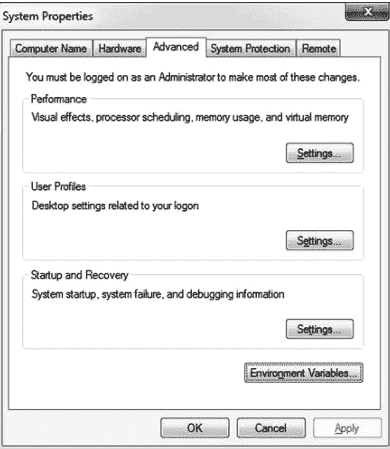

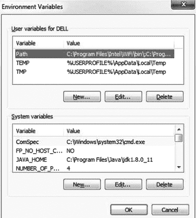

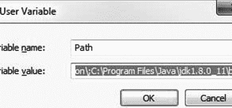

### 1.7 第一个 Java 程序

```java
public class Demo
{
  //程序从这里开始开始
  public static void main (String a [])
  {
    System.out.println("First program in Java");
  }
}
```

#### 1.7.1 保存程序

#### 1.7.2 编译程序

要编译程序，请运行编译器。它必须从新行开始，通过 `Java` 命令，并在命令行中指定源文件的名称，例如 `C:/javac Demo.Java`。java 编译器会创建一个名为 `Demo` 类的文件，其中包含程序的代码版本。此字节码包含了 Java 虚拟机的指令。

注意：你可以使用任何名称和 Java 扩展名保存 Java 程序，但字节码或类文件始终以类名的命名生成。

#### 1.7.3 运行程序

要运行程序，必须使用 Java 命令并指定类名。例如：


C: `/ java Demo`
程序的输出

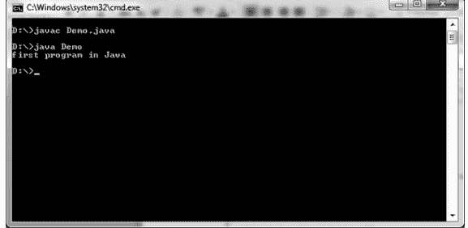

### 1.7.4 程序解释

程序以 `public class Demo {` 开始。

`public` 是一个访问修饰符，表示你可以从任何包访问此文件。`class` 表示这是一个类，它具有所有面向对象（OOPS）特性，`Demo` 是类的名称。程序的下一行是单行注释，在此所示：

`//program begins from here starts with .`

程序的下一行是 `public static void main(String a[])`。这是 `main()` 方法，程序将从这里开始执行。只有一个参数 `String a[]`，它是 `String` 实例的数组。`String` 存储字符，换句话说，它本身就是一个字符数组。在这种情况下，`'a'` 接收执行程序时存在的任何命令行参数。再次，`public` 和 `static` 允许在不实例化类特定对象的情况下调用 `main()`。这是强制性的，因为 `main()` 在任何对象创建之前就会由 Java 虚拟机调用。关键字 `void` 仅仅告诉编译器 `main()` 不返回任何值。下一行代码所示：

```
System.out.println(" First Java Program");
```

`System` 是一个提供系统访问的类，`out` 是输出流的输出，它维护与控制台的连接，而 `println` 是输出流中的一个方法。它会显示写入其中的的 `String()`。

注意 `println()` 语句以分号结束。Java 中所有的语句都以分号结束。

### 1.8 Java 关键字

关键字是对于 Java 编译器具有意义的特殊单词。你不能使用关键字来命名类或变量。`const` 和 `goto` 关键字是被预留的，尽管它们目前没有被使用。`true`、`false` 和 `null` 看起来像关键字，但它们实际上是字面量；你不能在程序中使用它们作为标识符/变量。下表包含了关键字列表。

| abstract | continue | for | new | switch |
| :--- | :--- | :--- | :--- | :--- |
| assert | default | | package | synchronized |
| boolean | do | if | private | this |
| break | double | implements | protected | throw |
| byte | else | import | throws | public |
| case | enum | instance of | return | transient |
| catch | extends | try | short | const |
| char | final | void | static | while |
| class | finally | native | super | strict |

10 | Java 深度

### 1.9 垃圾回收

你可以使用 `new` 运算符为对象或数组分配内存，但是，你无法通过代码显式地释放内存。垃圾回收（Garbage collection）是自动释放不再使用的对象内存的过程。垃圾回收的技术没有规定。具体实现被留给了厂商。当程序停止引用一个对象时，该对象就不再需要了并变成了垃圾。对象占用的空间可以被释放并用于另一个对象。在 C、C++ 和 Pascal 中，程序员必须释放分配给对象的内存。忘记释放已分配的内存（或重新分配已在使用对象的内存）的程序员会面临很多问题。垃圾回收将程序员从释放分配内存的负担中解放出来。垃圾回收器确定程序中不再被引用的对象。内存分配和释放导致的一个问题是碎片。碎片会降低程序速度。因此，除了释放未引用的内存外，垃圾回收还限制了内存碎片。由于垃圾回收器跟踪分配给对象的内存和正在引用的对象；开销可能会影响程序的性能。

#### 1.9.1 垃圾回收算法

垃圾回收器必须做两件事：

- (1) 检测垃圾对象
- (2) 释放垃圾对象的内存并供程序使用

##### 检测垃圾对象

下面讨论了检测垃圾对象的不同方法。

###### (a) 引用计数（Reference – Counting）

引用计数器维护每个存活对象的计数。当对象被创建时，引用计数设置为1。同样，当对对象的引用离开作用域时，引用计数减1。引用计数为0且在程序中未被引用的对象就是垃圾对象。当它被垃圾回收时，它所引用的所有对象的引用计数也会减。这种方法可以执行。

###### (b) 追踪回收器（Tracing Collectors）

在这种技术中，定义了一个根栈（roots），从那里开始追踪对象。如果一个对象被标记，则它是可及的。在追踪结束时，所有未标记的对象都被视为垃圾并收集。这被称为标记-清除算法（mark-and-sweep algorithm），它标记所有引用的对象。

###### (c) 压缩回收器（Compacting Collectors）

这些回收器在垃圾回收期间通过将所有空闲空间移动到一边来减少内存碎片。空闲内存将作为一个巨大的空间可用。随后，所有对移动对象的引用都更新为新的内存位置。

###### (d) 自适应回收器（Adaptive Collectors）

该算法利用了事实：不同的垃圾回收算法在不同的情况下效果更好。自适应算法监控状况并使用最适合该情况的垃圾技术。

##### 2. finalize() 方法

```
finalize()
```

在释放与对象相关的内存之前，垃圾回收器会运行对象的 `finalize()` 方法。你可以在任何类中声明 `finalize()` 方法。`finalize()` 方法声明如下。

```java
protected void finalize() throws Throwable
{
    Super finalize();
}
```

垃圾回收器检查所有取消引用对象的 `finalize()` 方法。在执行该方法后，垃圾回收器释放与对象相关的内存。

垃圾回收算法在没有可用内存分配对象时就会执行。它也可以在系统空闲一段时间后运行。你可以使用 `System.gc()` 方法手动调用垃圾回收器。由于垃圾回收线程的优先级非常低，它经常被中断。有时内存直到程序结束才会被释放。

Java 简介 | 11

#### 深度理解 Java

- 分布式：Java 程序可以跨网络访问数据。
- 编译与解释：你编写的 Java 代码在执行程序时会被编译为字节码（byte code）并被解释。
- 健壮性：Java 程序较不容易出现错误。
- 架构中立且可移植性：字节码可以在运行不同操作系统的各种计算机上执行。
- 安全性：Java 不允许程序员操纵系统内存。
- 一种高性能编程语言：与其它基于解释器的程序相比，Java 程序运行速度更快。
- 多线程：它允许程序的多个部分同时运行。
- 动态性：在 Java 中维护应用程序的不同版本非常容易。

Java 程序的类型有：

- 应用程序（Applications）：不需要浏览器即可执行的程序。
- Applet 小程序（Applets）：从网页上运行的程序。
- Servlet 扩展（Servlets）：这些程序扩展了 Web 服务器的功能能。
- 包（Packages）：类的集合，可以被其他 Java 程序共享。

应用程序是可以从命令行提示符执行的程序。

垃圾回收（Garbage collection）是一个自动释放不再使用的对象内存的过程，但它不保证有足够的内存供程序运行。

垃圾回收器必须做两件事：

- 检测垃圾对象。
- 释放垃圾对象的内存，并使其供程序使用。

垃圾回收器在释放与对象相关的内存之前，会运行对象的 `finalize()` 方法。

你可以使用 `System.gc()` 方法手动调用垃圾回收器。

JVM 内部使用“标记-清除”（mark and sweep）算法。

# 回答以下问题

# 单选题

1. Java 允许同一个 Java 程序在多个操作系统上执行。

a) 正确 b) 错误

答案：a)

2. 下列文件在 Java 编程语言中是人类可读的。

a) jar b) java c) class d) obj

答案：b)

3. 下列哪项将人类可读的文件转换为 Java 中的平台无关代码文件？

a) 编译器 b) JVM c) JRE d) Applet

答案：b)

4. 从源文件创建的平台无关代码文件可以被什么理解？

a) 编译器 b) JVM c) JRE d) Applet

答案：b)

5. Java 向程序员承诺“编写一次，随处运行”

a) 正确 b) 错误

答案：a)

6. 你如何强制对对象进行垃圾回收？

a) 垃圾回收无法强制执行。

b) 调用 `System.gc()`。

c) 调用 `System.gc()` 并传递要被回收的对象的引用。

d) 调用 `Runtime.gc()`。

e) 将对象的所有引用赋予新值（例如 `null`）。

答案：a)

# 复习题

1. Java 是如何保证安全的？
2. 不同的垃圾回收算法有哪些？
3. 写出 Java 的特性。
4. Java 平台与其他平台的主要区别是什么？
5. JDK、JRE 和 JVM 之间有什么区别？
6. 如果我写 `static public void` 而不是 `public static void` 会怎样？
7. JVM 如何销毁未引的对象？
8. 垃圾回收器的责任是什么？
9. 内存的哪部分涉及垃圾回收？
10. 我们如何请求 JVM 启动垃圾回收过程？

# 第二章 数据类型与变量

### 2.1 数据类型

数据存储在内存中并有许多类型。例如，一个人的名字以字符存储，年龄以数值存储，地址以字母数字数值的形式存储。数据类型用于定义数据上可能进行的操作以及存储方法。

Java 中的数据类型分类为：

(1) 基本类型或标准数据类型
(2) 抽象或派生数据类型

### 2.2 基本数据类型

基本数据类型（也称为标准数据类型）是 Java 语言内置的数据类型。Java 编译器包含了对该数据类型支持的每个合法操作的详细指令。

# Java 定义了八种基本类型

| 数据类型 | 大小 | 默认值 | 说明 | 范围 |
|---|---|---|---|---|
| Byte | 8bit | 0 | 字节长度型整数 | -128 到 +127 有符号 (-128 到 127-1)，无符号 (0 到 255) |
| Short | 16-bit | 0 | 短型整数 | -32768 到 +32767 (-2^15 到 2^15) |
| Int | 32-bit | 0 | 整数 | -2^31 到 2^31-1 |
| Long | 64-bit | 0L | 长型整数 | -2^63 到 2^63-1 |
| Float | 32-bit | 0.0f | 单精度浮点数 | +1-约 10^39 |
| Double | 64-bit | 0.0d | 双精度浮点数 | -1-约 10^37 |
| Char | 8bit | \u0000 | 简单字符 | |
| Boolean | 1bit | false | 布尔值（true 或 false） |

# 16 | Java 深度

注意：

1. 数据以二进制形式表示。用于计算。
2. 尽管 Java 是面向对象的，但基本类型不是。

#### 2.2.1 整型

Java 定义了三种类型：`short`、`int` 和 `long`。

所有这些都是有符号的。

示例所示：

```java
class ShortDemo {
    public static void main(String[]) {
        short total_stu = 10;
        System.out.println("total_stu = " + total_stu);
    }
}
```

```java
class IntDemo {
    public static void main(String[]) {
        int days = 32;
        System.out.println("days = " + days);
    }
}
```

```java
class LongDemo {
    public static void main(String[]) {
        long distance = 64L;
        System.out.println("distance = " + distance);
    }
}
```

#### 2.2.2 浮点类型

它也被称为实数。在评估精度时使用。

浮点类型有两种：

1. float
2. double

a) float:

当一个实数只需要有限的位数时，它被归为单精度。`float` 使用 32 位。在某些处理器上，单精度的速度更快，占据的空间是 `double` 的一半。在表示美元和分时，`float` 很有用。为了指定这一点，在初始化变量时，在值的右侧指定类型 `F`。

示例所示：

```java
public class FloatDemo {
    public static void main(String[]) {
        float pi = 3.14f;
        System.out.println("value of pi is" + pi);
    }
}
```

b) double:

双精度（由 `double` 关键字表示）使用 64 位来存储值。在为高速数学计算优化的现代处理器上，双精度实际上比单精度更快。

示例所示：

```java
public class DoubleDemo {
    public static void main(String[]) {
        double pi = 3.14159;
        System.out.println(pi);
    }
}
```

#### 2.2.3 字符

a) 用于字符的字节：字符内部通过 ASCII 数字识别。因此，你可以使用 `byte` 类型声明用于存储单个字符的变量，以初始化变量或为其赋值一个单引号字符。

示例所示：

```java
public class Chardemo {
    public static void main(String[]) {
        byte Gender = 'M';
    }
}
```

b) 字符作为类型：如果你使用 `byte` 数据类型来表示字符，编译器将只使用 8 位。在构思此点，编译器没有考虑到英语以外语言的国际字符。为了支持（美国）英语中传统使用的字符，创建了 Unicode 字符格式，它包含了拉丁语言和非拉丁语言。为了支持 Unicode 字符，Java 提供了 `char` 数据类型。它需要 16 位。因此在 Java 中 `char` 是一个 16 位类型。`char` 的范围是 0 到 65535。初始化字符变量时，请使用单引号赋值。

```java
public class Char_demo{
publicpublic static void main(String a[])
  { char gender = 'f';
  System.out.println("gender "+gender);
  }
}
```

#### 2.2.4 布尔型

Java 有一个名为 Boolean 的基本数据类型用于表示逻辑值。Boolean 数据类型只能存储 true 或 false 值。这是所有关系运算符返回的类型。这是一个示例：

```java
public class Bool_Demo{
    public static void main (String a[]) {
        boolean b; 
        b = false;
        System.out.println("b is " +b);
        b=true;
        System.out.print ("b is " +b); 
    }
}
```

#### 2.2.5 选择正确的数据类型

变量数据类型的选择始终取决于它必须存储的数据的类型。

### 示例

让我们确定要要使用的数据类型。为了存储员工的年龄，我们将所需的变量命名为 employee_Age。

- 员工的年龄是数值数据，因此，employee_Age 的数据类型必须是数值类型。Boolean 数据类型不能用于存储数字。
- 由于年龄是以整数存储的，所以你不需要 float 或 double 数据类型。
- 剩余的数据类型有 byte、int、short 和 long。由于存储年龄的数据不能为负值，你应该使用无符号数据类型。
- 根据公司政策，要存储的最大值为 65（假设其为退休年龄）。byte、short、int 和 long 数据类型提供了这个范围。如果公司名册上有 2000 名员工，存储这些数据所需空间如下：

| 序号 | 数据类型 | 占用空间 |
|---|---|---|
| 1. | Byte | 16,000 bits (2000*8) |
| 2. | Short | 132,000 bits (2000*16) |
| 3. | int | 64000 bits (2000*32) |
| 4. | Long | 128000 bits (2000*64) |

byte 数据类型存储数据占空间最少，因此它应该是变量 employee_Age 的选择。

## 20 | Java 深度解析

### 2.3 抽象或派生数据类型

抽象数据类型基于基本数据类型，具有比基本数据类型更多的功能。例如，String 是一种抽象数据类型，可以存储字母、数字以及如 /, (), $ 和 # 等字符。

即使字符串中存储的数据是数字，你无法对字符串数据类型的变量进行计算。然而，字符串提供了用于拼接字符串、在一个字符串中搜索另一个字符串以及提取字符串部分的方法。基本数据类型没有这些特性。

### 2.4 转义序列


转义序列是一种用于显示不可见数据的特殊字符。例如，你可以使用这种字符来表示行的结束。转义序列由反斜杠字符表示，后面跟着另一个字符或符号。

| 转义序列 | 名称 | 描述 |
|---|---|---|
| `\a` | 响铃(警报) | 使电脑发出声音 |
| `\b` | 退格 | 退格 |
| `\t` | 水平制表符 | 将光标移到下一个制表位 |
| `\n` | 换行 | 将光标移到下一行的开头 |
| `\v` | 垂直制表符 | 执行垂直制表 |
| `\f` | 进页 | 执行进页 |
| `\r` | 回车 | 回车 |
| `\"` | 双引号 | 显示双引号 |
| `\'` | 单引号 | 显示单引号 |
| `\\` | 反斜杠 | 显示反斜杠 |
| `\0` | 空 | 分配 Null 值 |

## 2.5 变量

当你在学校学习代数方程时，你使用 `x` 和 `y` 来表示方程中的值。与具有 `3.14` 固定值的 `pi`（π）不同，`x` 和 `y` 的值在方程中不是常数。Java 提供了常量和变量在程序中存储和处理数据。

Java 为你程序中使用的每个变量和常量分配内存。就像代数一样，变量的值在程序中可能会改变，但常量的值不会改变。你必须为变量和常量分配唯一的名称。如果该名称被用来引用存储值的内存区域，那么该数字就是一个变量。变量名在程序中的用法与在代数中非常相似。

## 数据类型与变量

程序中使用的每个变量都必须声明。也就是说，程序必须包含一条语句，精确指定变量将包含什么类型的信息（数据类型）。这适用于程序中使用的每个变量，无论其类型如何。

为了使用变量 `number` 存储整数值，必须声明变量 `number`，并且它的类型应为 `int`。

定义：“变量是由标识符、类型和可选的初始化组合定义的。”

注意：所有变量都有作用域，作用域定义了它们的可见性和生命周期。

### 2.5.1 变量命名规范

某些规则和规范规定了变量的命名。这些规则由编程语言强制执行。如果你没有遵守语言规则，你的程序将无法编译。规范有助于提高程序的可读性，但遵循它们并不是强制的。

### 2.5.2 变量命名规则

- (1) 变量名需要有意义、简短且不包含任何嵌入的空格或符号，如 `!`、`@`、`#`、`%`、`&`、`(`、`)`、`[`、`]`、`,`、`1`、`c/` 和 `\`。然而，在需要空格的地方不能使用下划线。例如 `basic_Salary`。
- (2) 变量名必须是唯一的。例如，为了存储四个不同的数字，需要使用四个唯一的变量名。
- (3) 变量名必须以字母、美元符号 (`$`) 或下划线开头，后面可以跟字母 (A-Z, a-z) 或数字 (0-9)。
- (4) 关键字不能用变量名。例如 `switch`。

### 2.5.3 Java 中的命名规范

- (1) 变量名必须有意义。
- (2) 名称必须反映它们所包含的数据。例如，为了存储员工的年龄，变量名可以是 `emp_age`。
- (3) 变量名是名词并以小写字母开头。每个单词的首字母大写写。
- (4) 如果变量名包含两个或多个单词，请每个单词的首字母大写写。

### 2.5.4 变量示例

以下变量名是有效的：

- `address`
- `emp_age`
- `employee_name`

以下变量名无效：

- `phone`
- `1st Name`

注意：Java 是区分大小写的。这意味着 `employee_Age` 与 `Employee_age` 不同。遵循规范将帮助你避免此类错误。

### 2.5.5 声明变量

在 Java 中，所有变量在使用之前都必须声明。变量声明的基本形式所示：

`类型 标识符 [= 值];`

类型是 Java 的数据类型之一，或者是类或接口名称。类和接口将在后续章节中讨论。标识符是变量的名称。通过等号，你可以为变量赋值。要声明相同类型的多个变量，请使用逗号分隔的列表。

示例

- (1) `int a, b, c;`
- (2) `int d=3; // 声明赋值`
- (3) `byte z = 22;`

### 2.5.6 变量初始化

你不能使用未定义的变量。当你创建一个类的对象时，Java 为基本类型的类变量分配默认值。下表显示了用于初始化类成员的默认初始值。

| 数据类型 | 初始值 |
|---|---|
| `byte` | `0` |
| `short` | `0` |
| `int` | `0` |
| `long` | `0` |
| `float` | `0.0` |
| `double` | `0.0` |
| `char` | `'\u0000'` |
| `boolean` | `false` |
| 抽象数据类型 | `null` |

注意

值自动分配给基本类型的类成员。你必须初始化在方法中声明的变量（局部变量）。如果你没有初始化在方法中声明的变量，Java 将返回错误。

### 2.5.7 变量的作用域与生命周期

作用域决定了哪些对象对程序的其他部分可见，以及这些对象的生命周期。方法定义的作用域始于它的左大括号。作为一个通用规则，在作用域内部声明变量对作用域外部的代码不可见。因此，当你在作用域内声明变量时，你是在将该变量局部化，并使其免受未经授权的访问和/或修改。

作用域是可以嵌套的。例如，每当你创建一个块时，你就创建一个新的嵌套作用域。当这种情况发生时，外层作用域包含内部作用域。这意味着在外层作用域中声明的对象对内部作用域的代码可见的。然而，反过来是不可能的。

例如：

```java
class ScopeDemo {
    public static void main(String a[]) {
        // 对内部所有代码可见
        int x = 10;
        if (x == 10) {
            // 新块的开始
            int y = 20; // 仅此块可见
            System.out.println("the value of x is " + x + " the value of y is " + y);
            x = y * 2;
        }
        // y = 1000; // 错误：此块不可见 y
        // x 在此处仍然可见
        System.out.println("x " + x);
    }
}
```

### 2.5.8 字面量

Java 中的变量可以被赋值常量值。所赋值的值必须与变量的数据类型一致。字面量是可以赋值给原始类型或字符串类型变量以及常量的值。

- 布尔型字面量为 `true` 或 `false`。你不能使用数字来表示真或假（类似于 C 语言中）。
- 整数字面量是数值型数据。它们可以表示为八进制（以 `0` 开头的数字）、十六进制（以 `0x` 前缀的数字）和二进制字面量（以 `0b` 或 `0B` 开头的数字）。可以使用下划线 (`_`) 来增加数值数据的可读性。

例如：

```java
int six = 06; // 八进制字面量
int x = 0xffff; // 十六进制字面量
int b1 = 0B101010; // 二进制字面量
int b2 = 0b101010101; // 二进制字面量
```

主要的规则是你必须记住：你**不能**在字面量的开头或结尾使用下划线。

例如：

```java
int i = _1_00_000; // 非法，开头为 "_"
int j = 2_00_9089_; // 非法，结尾为 "_"
```

- 浮点型字面量是带有小数部分的数字。浮点型字面量默认认为 `double`（64位），也可以是 `float`（32位）。对于 `float` 类型，你必须在数字后加上后缀 `F` 或 `f`，否则编译器会报错提示丢失精度。

例如：

```java
float f = 32.678564; // 编译器错误，可能丢失精度
float g = 56656.098765F; // 正确，带有后缀 "F"
```

- 字符字面量包含在单引号中。你也可以输入字符的 Unicode 值。

例如：

```java
char varN = '\u004E'; // 字母 N
```

如果你想表示一个可以作为字面量输入的字符，也可以使用转义代码（反斜杠）。

例如：

```java
char c = '\''; // 单引号
char d = '\n'; // 换行
char e = '\t'; // 制表符
```

- 字符串字面量包含在双引号中。虽然字符串不是原始类型，但它们作为字面量被包含，可以直接输入到代码中。

例如：

```java
String s = "Java in depth";
```

## 2.6 包装类 (Wrapper Classes)

Java 是一门面向对象的语言，一切都被视为对象。因此，原始类型不是对象。数据类型不属于任何类。但有时我们需要将原始数据类型转换为对象。作为实例，如果我们想使用像 `Vector`、`ArrayList` 这样的类，就需要将原始数据类型转换为对象。

Java 提供了此类用途的包装类，将原始数据类型转换为对象。对于每个数据类型，我们都有一个对应的包装类来封装该数据类型的功能。以下是包装类：

1. `java.lang.Integer`
2. `java.lang.Short`
3. `java.lang.Byte`
4. `java.lang.Long`
5. `java.lang.Character`
6. `java.lang.Boolean`
7. `java.lang.Double`
8. `java.lang.Float`

## 2.7 装箱 (Boxing)

将原始数据类型转换为对象被称为装箱 (Boxing) 或自动装箱 (Autoboxing)。

```java
// 将 int 转换为 Integer
public class WrapperDemo {
    public static void main(String args[]) {
        int a = 10;
        Integer i = Integer.valueOf(a); // 将 int 转换为 Integer
        Integer j = a; // 自动装箱
    }
}
```

## 2.8 解箱 (Unboxing)

将对象转换为原始数据类型被称为解箱 (Unboxing)。

```java
public class WrapperDemo2 {
    public static void main(String args[]) {
        // 将 Integer 转换为 int
        Integer a = new Integer(10);
        int i = a.intValue(); // 将 Integer 转换为 int
        int j = a; // 解箱
    }
}
```

## 3.1 运算符

```java
byte ivar1 = 100;
byte ivar2 = 120;
byte ivar3 = ivar1 + ivar2;
```

在上面的代码行中，当你将两个 `byte` 数据类型的操作数相加时，结果大于 `byte` 类型变量所能容纳的值（byte 的范围是 -128 到 +127）。为了避免这种情况，Java 会将任何数值数据的计算结果转换为至少为 `int` 数据类型。

### 用于字符串数据类型的 + 运算符

当你对数值型操作数使用 `+` 运算符时，结果是数值型的。当两个操作数都是字符串时，`+` 运算符会将它们拼接（连接在一起）。当其中一个操作数是字符串对象时，第二个操作数会被转换为字符串。

示例：结果 = operand1 + operand2

| 操作数 1 | 操作数 2 | 结果 |
| :--- | :--- | :--- |
| `5` | `6` | `11` |
| `6` | `"abc"` | `"6abc"` |
| `"abc"` | `"xyz"` | `"abcxyz"` |

注意：

Java 使用 `java.lang.Object` 类的 `toString()` 方法将数据转换为字符串数据类型。

### 3.1.2 赋值运算符

| 运算符 | 描述 | 示例 | 解释 |
| :--- | :--- | :--- | :--- |
| `=` | 将右操作数的值赋值给左操作数 | `x = y` | 将 `y` 的值赋值给 `x` 可以是一个表达式，如上表所示 |
| `+=` | 将操作数相加并将结果赋值给左操作数 | `x += y` | 将 `y` 的值加上 `x` 并结果存储在 `x` 中。同于 `x = x + y` |
| `-=` | 从左操作数减去右操作数并将结果存储在左操作数 | `x -= y` | 从 `x` 中减去 `y` 并将结果存储在 `x` 中。同于 `x = x - y` |
| `*=` | 将左操作数乘以右操作数并将结果存储在左操作数 | `x *= y` | 将 `x` 和 `y` 相乘并将结果存储在 `x` 中。同于 `x = x * y` |
| `/=` | 将左操作数除以右操作数并将结果存储在左操作数 | `x /= y` | 将 `x` 除以 `y` 并将结果存储在 `x` 中。同于 `x = x / y` |
| `%=` | 将左操作数除以右操作数并将余数存储在左操作数 | `x %= y` | 将 `x` 除以 `y` 并将余数存储在 `x` 中。同于 `x = x % y` |

注意：使用的任何一个运算符：

- `x <operator> y`

都可以表示为：

- `x = x <operator> y`

你可以同时给多个变量赋值。

例如

`x = y = 0;`

表达式是语句的一部分，它求得一个值。在表达式中，你可以使用变量、运算符、字面量和其他表达式的任何组合。

你可以将一个表达式赋值给变量。

### 3.1.3 一元运算符

| 运算符 | 描述 | 示例 | 解释 |
| :--- | :--- | :--- | :--- |
| `++` | 将操作数的值加 1 | `x++` | 同于 `x = x + 1` |
| `--` | 将操作数的值减 1 | `x--` | 同于 `x = x - 1` |

#### 前置和后置表示法

递增运算符可以用两种方式使用：

- 作为前置，即运算符在变量之前。`++invar`
- 作为后置，即运算符在变量之后。`invar++`

以下代码段区分了这两种表示法

```java
invar1 = 10;
invar2 = ++invar1;
```

该代码等同于：

```java
invar1 = 10;
invar1 = invar1 + 1;
invar2 = invar1;
```

在这种情况下，`invar1` 和 `invar2` 都被设置为 11。但如果代码写成：

```java
invar1 = 10;
invar2 = invar1++;
```

等同的代码为：

```java
invar1 = 10;
invar2 = invar1;
invar1 = invar1 + 1;
```

在这里，`invar1` 被设置为 11 但 `invar2` 的值为 10。同样，递减运算符也可以在前置和后置形式中使用。

### 3.1.4 比较运算符

比较运算符的结果为真或假。

| 运算符 | 描述 | 解释 |
| :--- | :--- | :--- |
| `==` | 判断操作数是否相等 | `x == y` 如果值相等返回真，否则返回假 |
| `!=` | 判断操作数是否不等 | `x != y` 如果值不等返回真，否则返回假 |
| `>` | 判断左操作数是否大于右操作数 | `x > y` 如果左侧大于右侧返回真，否则返回假 |
| `<` | 判断左操作数是否小于右操作数 | `x < y` 如果左侧小于右侧返回真，否则返回假 |
| `>=` | 判断左操作数是否大于或等于右操作数 | `x >= y` 如果左侧大于或等于右侧返回真，否则返回假 |
| `<=` | 判断左操作数是否小于或等于右操作数 | `x <= y` 如果左侧小于或等于右侧返回真，否则返回假 |

### 3.1.5 移位运算符

数据内部以二进制存储（位）。位可以是一或零。八位组成一个字节。下表显示从 0 到 8 的二进制表示。

| 十进制 | 二进制 |
| :--- | :--- |
| `0` | `00000000` |
| `1` | `00000001` |
| `2` | `00000010` |
| `3` | `00000011` |
| `4` | `00000100` |
| `5` | `00000101` |
| `6` | `00000110` |
| `7` | `00000111` |
| `8` | `00001000` |

移位运算符作用于数据的位。使用移位运算符涉及向左或右移动位。你可以对整数类型使用它们（不能用于 `char` 和 `double` 类型）。

| 运算符 | 描述 | 解释 |
| :--- | :--- | :--- |
| `>>` | 位右移，在左侧填充符号位。也称为符号移位运算符。 | `x = 10 >> 3` 结果是 `10` 除以 `2^3`。解释见下文 |
| `<<` | 位向左移，在右侧填充零。 | `x = 10 << 3` 结果是 `10` 乘以 `2^3`。解释见下文 |
| `>>>` | 无符号移位运算符。工作原理类似于 `>>` 运算符，但从左侧填充零。 | `x = -10 >>> 2` 解释见下文 |

#### 数字移位

`int` 数据类型占用四个字节。数字最右侧的八位用二进制表示。

(a) 当你向右移 3 位时 (`10 >> 3`)，结果是 `10 / 2^3`，等同于 `1`。

(b) 当你向左移 3 位时 (`10 << 3`)，结果是 `10 * 2^3`，等同于 `80`。

注意：(1) 要将正二进制数转换为负数，翻转除最右侧 `1` 位以外的所有位。

例如：十进制值 `10` 表示为 `00001010`。最右侧值为 `1` 的位加粗。这些位不会被翻转。因此，`-10` 的二进制表示为 `11110110`。

`-10 >> 2` 的结果是 `-3`，表示为：

`11111101`

`-10 << 2` 的结果是 `-40`，表示为：

`11011000`

#### 使用无符号移位

无符号移位运算符将所有位向右移动并将未使用位初始化为 `0`，无论数字是正是负。因此，`10 >>> 2` 得到 `2`。

而 `-10 >>> 2` 得到一个很大的数字 `1073741821`。

完整的 4 字节表示所示：

```
00111111 11111111 11111111 11111101
```

总结：

- `<<` 运算符将位向左移
- `>>` 运算符将位向右移
- `>>>` 运算符执行无符号右移。在最高位引入 `0`。

注意：最左侧位被称为最高位，最右侧位被称为最低位。

### 3.1.6 位运算符

| 运算符 | 描述 | 示例 | 解释 |
| :--- | :--- | :--- | :--- |
| `&` (与) | 对操作数进行按位与运算后得到一个二进制值 | `x & y` | 如果两个位都为 1，则结果为 1。其他组合均为 0 |


# 运算符、循环、语句与数组

## 位运算符

| 运算符 | 描述 | 示例 | 解释 |
| :--- | :--- | :--- | :--- |
| `|` (或) | 对两个操作数进行按位或运算后得到一个二进制值 | `x \| y` | 当两个位都为 0 时，结果为 0。其他组合均为 1 |
| `^` (XOR) | 对两个操作数进行按位异或运算后得到一个二进制值 | `x ^ y` | 如果两个位的值相同，则结果为 0；如果位不同，则结果为 1 |
| `~` (取反) | 将所有的 1 位转换为 0，将所有的 0 位转换为 1 | `~X` | 1 变为 0，0 变为 1 |

`x` 和 `y` 是整数，可以被替换为产生真或假（布尔）结果的表达式。例如，当两个表达式的求值都为真时，使用 `&` 运算符的结果为真。否则，结果为假。

### `~` 运算符

如果你使用 `~` 运算符，字节中所有的 1 都会转换为 0，反之亦然。例如，`11001100` 将变为 `00110011`。

## 3.1.7 逻辑运算符

使用逻辑运算符来组合布尔表达式的结果。

| 运算符 | 描述 | 示例 | 解释 |
| :--- | :--- | :--- | :--- |
| `&&` | 如果两个条件都求值结果为真，则结果为真，否则为假 | `x > 5 && y < 10` | 如果条件 1 (`x > 5`) 和条件 2 (`y < 10`) 都为真，结果为真。如果为假，结果为假。 |
| `\|\|` | 如果至少有一个条件求值结果为真，则结果为真，如果没有任何条件求值为真，则为假 | `x > 5 \|\| x < 10` | 如果条件 1 (`x > 5`) 或条件 2 (`y < 10`) 求值为真，结果为真。如果两个条件都为假，结果为假。 |

### 短路逻辑运算符

这些运算符（`&&`, `\|\|`）看起来与位运算符 `&` 和 `|` 相似，不同在于它们仅限于布尔表达式。然而，区别在于这些运算符的工作方式。在位运算符中，两个表达式都会被求值。这是没有必要的，因为：

- `false & x` 的结果为 `false`
- `true | x` 的结果为 `true`

如果通过求值第一个表达式就能获得结果，则短路运算符不会对第二个表达式求值。

考虑以下示例：

```java
(x < 5) && (y > 10);
```

如果第一个条件为假，则跳过第二个条件 (`y > 10`) 的求值，因为整个表达式无论如何都是假。同样对于 `\|\|` 运算符，如果第一个条件求值为真，则跳过第二个条件，因为结果无论如何都是真。因此，这些运算符（`&&`, `\|\|`）被称为短路运算符。

> **注意**：如果你希望无论第一个条件的结果如何都求值两个条件，你需要使用位运算符。


## 3.1.8 条件运算符

| 运算符 | 描述 | 示例 | 解释 |
| :--- | :--- | :--- | :--- |
| `(条件) ? val1 : val2` | 如果条件返回真，则求值为 `val1`；如果条件返回假，则求值为 `val2` | `x = (y > z) ? y : z` | 如果 `y` 大于 `z`，则给 `x` 赋值 `y`，否则给 `x` 赋值 `z` |

考虑以下寻找两个给定数字最大值的语句：

```java
if (iNum1 > iNum2) {
    iMax = iNum1;
} else {
    iMax = iNum2;
}
```

在上面的代码中，我们正在判断 `iNum1` 是否大于 `iNum2`。如果表达式 `(iNum1 > iNum2)` 求值为真，则给变量 `iMax` 赋值 `iNum1`；如果表达式求值为假，则给其赋值 `iNum2`。上面的程序可以使用条件运算符修改为：

```java
iMax = (iNum1 > iNum2) ? iNum1 : iNum2;
```

`?` 运算符被称为三元运算符，因为它有三个操作数。接下来的示例根据学生的成绩计算其评级。

如果学生的成绩大于 90，则给变量 `grade` 赋值 `A`。如果学生的成绩小于或等于 90，则给变量 `grade` 赋值 `B`。

## 3.1.9 `new` 运算符

当你创建一个类的实例时，你需要为它分配内存。当你声明一个对象时，你只是说明了它的数据类型。例如：

```java
Pen black;
```

这告诉编译器变量 `black` 是 `Pen` 类的一个对象。它并没有为对象分配内存。

### 语法

你可以通过两种方式为对象分配内存：

1.  声明对象并使用 `new` 运算符分配内存。
    ```java
    <class-name> <object-name>;
    <object-name> = new <class-name>();
    ```
2.  在声明对象的同时使用 `new` 运算符分配内存。
    ```java
    <class-name> <object-name> = new <class-name>();
    ```

#### 示例

**方法 1**
```java
Pen black;
black = new Pen();
```

**方法 2**
```java
Pen black = new Pen();
```

> **注意**：你只能在方法内部使用 `new` 运算符。

## 3.1.10 `instanceof` 运算符

它用于在运行时检查操作类型。如果对象是指定的类型，则返回 `true` 或 `false`。

例如：

```java
class Demo {
    public static void main(String a[]) {
        Demo d = new Demo();
        System.out.println(d instanceof Demo);
    }
}
```

## 3.2 运算符的优先级

下表显示了运算符的优先级。

| 类型 | 运算符 |
| :--- | :--- |
| 高 | `( )` |
| 一元 | `~`, `!`, `++`, `--` |
| 乘法 | `*`, `/` |
| 加法 | `+`, `-` |
| 移位 | `<<`, `>>`, `>>>` |
| 比较 | `<`, `<=`, `>`, `>=` |
| 等于 | `==`, `!=` |
| 位 | `&`, `|`, `^` |
| 逻辑 | `&&`, `\|\|` |
| 条件 | `?:` |
| 赋值 | `=`, `-=`, `*=`, `%=` |

## 类型转换

在可能丢失数据时进行显式转换。考虑以下情况：

```java
double x;
int y = 2;
float z = 2.2f;
x = y + z;
```

`y + z` 的结果值为 `float`。编译器会产生以下错误：“无法从 double 转换为 int”，这意味着当你转换为较低数据类型时，需要强制转换。

### 强制转换规则

1.  布尔变量不能进行类型转换。
2.  如果转换增加了数据的范围，则对于非布尔数据存在隐式转换。
3.  如果范围缩小，则需要显式类型转换。
4.  隐式转换发生的顺序为：`byte` -> `short` -> `int` -> `long` -> `float` -> `double`；`char` -> `int` -> `long` -> `float` -> `double`。
5.  任何其他缩小范围的转换都需要强制转换。

### 强制转换示例

```java
public class Conversion {
    public static void main(String a[]) {
        double x;
        int y = 2;
        float z = 2.2f, fl = 5.5f;
        short s = 1, p = 2, q;
        // 隐式转换
        x = y + z;
        System.out.println("隐式转换 x = y + z = " + x);
        // 显式转换
        int i = fl / 2; // 报错
        i = (int) fl / 2; // 显式类型转换
        s = s + p; // 默认也会报错，因为表达式右侧求值为 int
        q = (short) (x + y);
    }
}
```

代码看起来没问题，因为所有变量类型都相同。然而编译器返回了错误。让我们看看为什么。

当你对数值数据使用 `+` 运算符时，结果值至少是一个 `int`。因此，右侧的表达式求值为 `int`。你要么将 `z` 声明为 `int`，要么进行显式类型转换。解决方案是：

```java
z = (short) (x + y);
```

### 输出

```
D:\Java>javac Conversion.Java
Conversion.Java:13: error: incompatible types: possible lossy conversion from float to int
    int i = f1/2; // show an error

Conversion.Java:15: error: incompatible types: int cannot be converted to Short
short q = p; // This also shows an error by default expression on right evaluates to
to an int;

Conversion.Java:16: error: incompatible types: int cannot be converted to Short
short q = (short) s * p;
3 errors
D:\java>
```

## 3.4 控制语句

我们每天都会做决定，比如看什么电影、早餐、午餐或晚餐吃什么等。决策制定也包含在程序之中。它的结果决定了程序执行指令的顺序。换句话说，你可以使用决策结构来控制程序的流程。在本节中，我们将讨论控制语句，包括决策语句（`if-then-else` 和 `switch`）、循环语句（`while`、`do-while` 和 `for`）以及分支语句（`break`、`continue` 和 `return`）。

### 控制语句

控制语句用于控制程序的执行流程。程序的执行顺序取决于提供的数据值和条件逻辑。Java 包含以下类型的控制语句：

- 选择语句
- 重复语句
- 分支语句

### 3.4.1 选择语句

#### `if` 语句

决策结构后面跟着一个逻辑表达式，其中对数据进行比较并根据比较结果做出决策。

**语法**
```java
if (boolean-expr) {
    statements;
}
```

**示例**
```java
int n = 10;
if (n % 2 == 0) {
    System.out.println("This is an even number");
}
```

#### `if-else` 语句

“`if-else`”语句是语句的扩展，当“`if`”语句求值结果为“`false`”时，它提供另一种选择，即如果“`if`”语句为假，则执行 `else` 块。

**语法**
```java
if (boolean-expr) {
    statements;
} else {
    statements;
}
```

**示例 1：寻找两个数中的最大值**
```java
if (iNum1 > iNum2) {
    iMax = iNum1;
} else {
    iMax = iNum2;
}
```
该示例判断变量 `iNum1` 是否大于 `iNum2`；如果是，则执行 `if` 块中的语句，否则执行 `else` 块中的语句。块被定义为两个大括号 `{ }` 之间的语句集合。

**示例 2**
```java
int n = 11;
if (n % 2 == 0) {
    System.out.println("It is an even number");
} else {
    System.out.println("It is not an even number");
}
```
如果 `n % 2` 的求值不为 0，则执行 `else` 块。这里 `n % 2` 的求值为 1（即不等于 0），因此执行 `else` 块。

#### `switch` 语句

这是 `if-else` 语句的一种更简单的实现方式。当变量可能有多个可能值时使用。`switch` 语句成功地将表达式或变量的值与 `byte`、`short`、`char` 或 `int` 原始类型的列表进行匹配。当找到匹配项时，执行与该 `case` 常量相关的语句。

**语法**
```java
switch (variable-name) {
    case expr1:
        statements;
        break;
    case expr2:
        statement;
        break;
    case expr3:
        statement;
        break;
    default:
        statement;
}
```

关键字 `switch` 后面跟着括号括的变量：`switch(x)`。每个 `case` 关键字后面跟着一个 `case` 常量。`case` 常量的数据类型应与 `switch` 变量的类型匹配。在进入 `switch` 结构或语句之前，应该为 `switch` 变量赋值。

**示例**

在此处，`switch` 语句中的表达式 `day` 求值为 `5`，匹配了标记为 `5` 的 `case`。因此执行 `case 5` 中的代码，导致在屏幕上输出“Friday”。

```java
int day = 5;
switch (day) {
    case 1:
        System.out.println("Monday");
        break;
    case 2:
        System.out.println("Tuesday");
        break;
    case 3:
        System.out.println("Wednesday");
        break;
    case 4:
        System.out.println("Thursday");
        break;
    case 5:
        System.out.println("Friday");
        break;
    case 6:
        System.out.println("Saturday");
        break;
    case 7:
        System.out.println("Sunday");
        break;
    default:
        System.out.println("Invalid entry");
        break;
}
```

#### `break` 语句

`break` 语句导致程序流退出 `switch` 结构体。控制权（程序）跳转到 `switch` 结构结束后的第一条语句。如果不使用 `break` 语句，控制将传递到下一个 `case` 语句，并且 `switch` 结构中的剩余语句也会被执行。

#### `default` 关键字

如果 `switch` 变量的值不匹配任何 `case` 常量，则执行与 `default` 关键字相关的语句。

> **注意**：
> 1. 如果使用了 `default`，它必须位于 `switch` 结构的最后。
> 2. `case` 表达式可以是数值或字符类型。
> 3. `switch` 结构中的条件是唯一的。

### 3.4.2 重复语句

#### 循环结构

循环导致程序的某部分重复某些次数。当条件为真时，循环继续。当条件变为假时，跳转到循环后的语句。

#### `while` 循环

`while` 循环是一种可用的循环结构，直到评估条件变为假为止。评估条件必须是一个布尔表达式并返回真或假。在 `while` 表达式中检查的变量被称为循环变量。

**语法**
```java
while (boolean-expr) {
    statement;
}
```

可以使用 `if` 语句以及 `break` 和 `continue` 关键字配合 `while` 块退出循环。

**示例：生成斐波那契数列**

斐波那契数列中的每个数都是前两个数之和。数列从 1 开始。

```java
public class FibonacciDemo {
    public static void main(String[] args) {
        int i1 = 1, i2 = 1;
        System.out.println(i1);
        while (i1 <= i2) {
            System.out.println(i2);
            i2 += i1;
            i1 = i2 - i1;
        }
    }
}
```

**输出**

如所示，数列中的每个数都是前两个数之和。


#### `do-while` 循环语句

这是另一种循环语句，它在执行语句之后列出条件，因此可以说 `do-while` 循环语句是一种后测试循环语句。首先执行第一个块，然后检查 `while` 语句中的条件。因此，即使第一次尝试条件为假，`do` 块也会执行一次。

**语法**
```java
do {
    statement;
} while (expression);
```

**示例**

在这里执行第一个代码块并打印当前值 `1`。然后检查条件 `<= 10`。这里 `1` 小于数字 `10`，因此控制权回到 `do` 块。

```java
int i = 1;
do {
    System.out.println(i);
    i++;
} while (i <= 10);
```


# for 循环语句

while 和 do-while 循环用于迭代次数（循环体执行的次数）未知的情况。for 用于预先知道迭代次数的情况。例如，它可以用于确定前十个数的平方。for 语句由关键字以及括号内的三个表达式组成，每个表达式由分号隔开。这些是初始化表达式、测试表达式以及递增/减表达式。

## 语法

```java
for (initialization-exper; test-exper; increment_expr) {
    // statement;
}
```

## 初始化表达式

初始化表达式仅在控制权第一次传递循环时执行一次。它为循环变量提供初始值。

## 测试表达式

条件每次都会执行。控制权回到循环开头。只有在检查条件后，才会执行循环体。如果条件为真，则执行循环；否则控制权传递到循环体之后的语句。

## 递增/递减表达式

当控制权回到循环开头时，总是执行/递增表达式。

### 示例

```java
/* 此代码段计算并打印前十个自然数的平方 */
int invar;
for (invar = 1; invar < 10; invar++) {
    System.out.println(invar * invar);
}
```

程序的输出为 1, 4, 9, 16, 25, 36, 49, 64, 81, 100。循环体被包含在大括号内。程序员犯的一个常见错误是使用分号终止循环。

例如，检查以下语句：

```java
for (ivar = 0; invar < 10; invar++);
{
    System.out.println(invar * ivar);
}
```

程序的输出是 121。

由于语句以分号终止，它变成了一个自执行的 for 循环，只有当循环中的条件变为假时才会移动到下一个语句。当 `invar` 的值为 11 时退出循环，因此输出结果为 121 (11*11)。

## 3.4.3 分支语句

Java 支持三种分支语句：

- (a) Break
- (b) Continue
- (c) Return

这些语句将控制权转移到程序的其他部分。

### 1. Break 语句

break 语句是一种分支语句，它有两种形式：带标签和不带标签。break 语句用于中断循环（while, do 和 for）的执行。它还会终止 switch 语句。

#### 语法

```java
break; // 跳出内层循环或 switch 语句。
break label; // 跳出系列循环中最外层的循环。
```

例如：当语句求值为真时，它显示“找到数据”并立即退出循环，执行紧随循环之后的语句。

```java
public class BreakDemo {
    public static void main(String a[]) {
        int num[] = {2, 9, 1, 4, 25, 50};
        int search = 4;
        for (int i = 1; i < num.length; i++) {
            if (num[i] == search) {
                System.out.println("data is found");
                break;
            }
        }
    }
}
```

输出

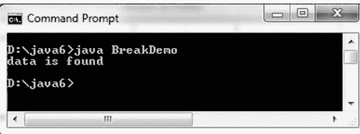

### 2. Continue 语句

这是一种分支语句，用于循环语句（while, do while 和 for），跳过循环的当前迭代并继续下一次迭代。

#### 语法

```java
continue;
```

#### 示例

在此表达式中，`found = num[i]` 因为 `continue` 是不可达的。它跳过了写在 `continue` 之后的语句并恢复下一次迭代。

```java
public class ContinueDemo {
    public static void main(String a[]) {
        int num[] = {2, 9, 1, 4, 250};
        int search = 4, found;
        for (int i = 1; i < num.length; i++) {
            if (num[i] != search) {
                continue;
                found = num[i];
            }
            System.out.println("data is found");
        }
    }
}
```

### 3. Return 语句

它是一种特殊分支语句，将控制权转移给方法的调用者。该语句用于向调用方法返回一个值并终止方法的执行。它有两种形式：一种返回值，另一种不返回值。返回值的类型必须与调用者方法的返回类型匹配。

#### 语法

- `return values;`
- `return;` // 这不返回任何内容。因此它可以用于声明为 void 返回类型的方法。
- `return expression;` // 它返回从表达式求得的值。

#### 示例

这里在 `println()` 函数中调用了 `welcome()` 函数，它返回字符串 "welcome to Java in Depth"。这被打印到屏幕上。

```java
public class ReturnDemo {
    public static void hello() {
        System.out.println("Hello" + welcome());
    }

    static String welcome() {
        return ("welcome to Java in Depth");
    }
}
```

## 3.5 数组

你是否注意到酒店房间是线性编号的？你会发现一排具有连续编号模式的房间。每个房间都通过其编号识别。如果你想给住在 Regency 酒店 121 房的朋友送一束花，你可能会把地址写为 Regency 酒店 121 房。事实上，任何房间都以类似的方式写地址。上述地址包含两个部分：

1. 酒店名称
2. 房号

数组是计算机中连续空间的数据表示。数组的所有变量具有相同的名称，就像酒店里的所有房间。房号是数组元素的索引（或下标）。数组中的每个元素必须是相同类型。例如，你不能在同一个数组中拥有 int 类型和 boolean 类型。更正式地说，数组是通过共同名称引用的元素集合。要在 Java 中创建数组，首先需要声明数组然后进行初始化。

### 3.5.1 一维数组

一维数组本质上是变量的列表。声明数组的语法为：

- (1) `类型[] variable_name;`
- (2) `类型 variable_name[];`
- (3) `类型[] variable_name, variable_name;`
- (4) `类型... variable_name;`

#### 示例

```java
int i[];
int j[];
int i[], j[];
```

声明变量后，需要在内存中创建数组。可以通过以下方式使用 `new` 运算符：

```java
i = new int[10];
j = new int[10];
```

该语句为变量 `i` 和 `j` 分配了十个 int 类型的位置。数组可以存储十个元素。可以使用 for 循环初始化数组：

```java
for (int var = 0; var < 10; var++)
    i[var] = var;
```

数组元素存储在内存中如下：

| Value | Representation |
| :--- | :--- |
| 0 | i[0] |
| 1 | i[1] |
| 2 | i[2] |
| 3 | i[3] |
| 4 | i[4] |
| 5 | i[5] |
| 6 | i[6] |
| 7 | i[7] |
| 8 | i[8] |
| 9 | i[9] |

### 3.5.2 多维数组

多维数组实际上是数组的数组。声明多维数组变量使用另一组括号。例如，以下代码声明了一个名为 `twoD` 的二维数组：

`twoD = new int[4][5]; // int 类型的数组.`

#### 二维数组演示

```java
class TwoDemo {
    public static void main(String a[]) {
        int twoD[][] = new int[4][5];
        int i, j, k = 0;
        for (int i = 0; i < 4; i++) {
            for (int j = 0; j < 5; j++) {
                twoD[i][j] = k;
                k++;
            }
        }
        for (int i = 0; i < 4; i++) {
            for (int j = 0; j < 5; j++) {
                System.out.print("twoD [" + i + "][" + j + "]=" + "\t");
                System.out.println(twoD[i][j]);
            }
        }
    }
}
```

#### 输出

```
twoD [0][0]= 0
twoD [0][1]= 1
twoD [0][2]= 2
twoD [0][3]= 3
twoD [0][4]= 4
twoD [1][0]= 5
twoD [1][1]= 6
twoD [1][2]= 7
twoD [1][3]= 8
twoD [1][4]= 9
twoD [2][0]= 10
twoD [2][1]= 11
twoD [2][2]= 12
twoD [2][3]= 13
twoD [2][4]= 14
twoD [3][0]= 15
twoD [3][1]= 16
twoD [3][2]= 17
twoD [3][3]= 18
twoD [3][4]= 19
```

你可以手动分配维度。不需要为每个维度分配相同数量的元素。由于多维数组实际上是数组的数组，每个数组的长度由你控制。

#### 示例

```java
class TwoD {
    public static void main(String a[]) {
        int twoD[][] = new int[4][];
        twoD[0] = new int[1];
        twoD[1] = new int[2];
        twoD[2] = new int[3];
        twoD[3] = new int[4];
        int i, j, k = 0;
        for (int i = 0; i < 4; i++) {
            for (int j = 0; j < (i + 1); j++) {
                twoD[i][j] = k;
                k++;
            }
        }
        for (int i = 0; i < 4; i++) {
            for (int j = 0; j < (i + 1); j++) {
                System.out.print("twoD [" + i + "][" + j + "]=" + "\t");
            }
            System.out.println(twoD[i][j]);
        }
    }
}
```

#### 输出

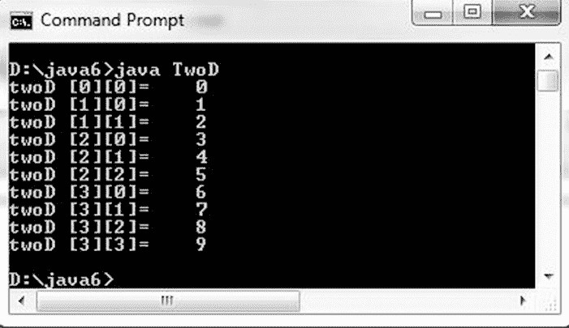

此程序创建的数组所示：
[0, 0]
[1, 0] [1, 1]
[2, 0] [2, 1] [2, 2]
[3, 0] [3, 1] [3, 2] [3, 3]

## 总结

- 运算符用于比较值和测试多个条件。它们分类为：
  - 算术运算符
  - 赋值运算符
  - 一元运算符
  - 比较运算符
  - 移位运算符
  - 位运算符
  - 逻辑运算符
  - 条件运算符
  - 新的运算符
  - instanceof 运算符

- 将数据从一种数据类型转换为另一种数据类型称为类型转换。当数据类型从较宽范围的值变为较窄范围的值时，需要进行显式转换。

- 决策结构用于允许语句的选择性执行。Java 中的决策结构有：
  - if.... else
  - switch ....case

- 循环结构用于当你希望程序的某部分重复某些次数时。Java 提供了以下循环结构：
  - while
  - do-while
  - for

- break 和 continue 语句用于控制循环内部的程序流。

- 数组是数据在连续内存空间中的表示。数组有两种类型：
  - 单维
  - 多维

- 你可以使用数组元素的索引来创建数组的各个元素。数组的索引从 0 开始。

- 数组在访问之前必须经过声明、内存分配和初始化。

- 可以使用 `for` 循环来初始化和访问数组的元素。

# 回答以下问题

## 单选题

1. 下列哪项可以作为算术运算符的操作数？
   a) 数字
   b) 布尔值
   c) 字符
   d) 数字和字符都是
   答案：d

2. 模运算符 `%` 可以应用于以下哪者？
   a) 整数
   b) 浮点数
   c) 整数和浮点数
   d) 以上均不是
   答案：c

3. 下列哪项是错误的数组声明？
   a) `int arr[] = new int[5];`
   b) `int [] arr = new int[5];`
   c) `int arr[] = new int[5];`
   d) `int arr[] = int [5] new;`
   答案：d

4. 这个程序的输出是什么？

```java
class array_output {
    public static void main(String args[]) {
        int array_variable[] = new int[10];
        for (int i = 0; i < 10; ++i) {
            array_variable[i] = i;
            System.out.print(array_variable[i] + " ");
            i++;
        }
    }
}
```

   a) 02468
   b) 13579
   c) 0123456789
   d) 12345678910
   答案：a)

5. 这段代码中的错误是什么？

```java
byte b = 50;
b = b * 50;
```

   a) b 不能包含 2500，受其范围限制。
   b) `*` 运算符将 `b * 50` 转换为 int，在不进行强制转换的情况下无法转换为 byte。
   c) b 不能包含 50。
   d) 这段代码没有错误
   答案：b

6. 如果一个表达式包含 double, int, float, long；那么整个表达式将提升为以下哪种数据类型？
   a) long
   b) int
   c) double
   d) float
   答案：c

## 复习题

1. 考虑以下代码片段：`arrayOfInts[j] > arrayOfInts[j+1]`
   该代码包含哪些运算符？

2. 考虑以下代码片段：
   `i = 10;`
   `t = i++ % 5;`
   a. 代码执行后 i 和 n 的值是多少？
   b. 如果使用前置递增版本 (`++i`) 而不是后置版本 (`i++`)，i 和 n 的最终值是多少？

3. 为了反转布尔值，你会使用哪个运算符？

4. 哪个运算符用于比较两个值， `=` 或 `==` ？

5. 解释以下代码示例：
   `result = someCondition ? value1 : value2;`

6. 什么是运算符，什么是操作数？

7. 区分逻辑运算符和算术运算符？

8. 各种循环结构有哪些？

9. 什么是数组？数组是如何使用的？

10. 在以下程序中，解释为什么“6”会被连续打印两次：

```java
class PrePostDemo {
    public static void main(String[] args) {
        int i = 3;
        i++;
        System.out.println(i); // "4"
        i++;
        System.out.println(i); // "5"
        System.out.println(i++); // "6"
        System.out.println(i++); // "6"
        System.out.println(i); // "7"
    }
}
```

11. 考虑以下代码片段：

```java
if (aNumber >= 0)
    if (aNumber == 0)
        System.out.println("first string");
    else System.out.println("second string");
System.out.println("third string");
```


- a) 如果 `aNumber` 为 3，你认为代码会有什么输出？
- b) 编写包含上述代码片段的程序，为 `aNumber` 赋值 3。输出是什么？符合你的预期吗？代码流如何？
- c) 仅使用空格和换行格式化代码片段使其更容易理解。
- d) 使用大括号 `{}` 进一步明确代码。

# 第4章 类与方法

## 4.1 类

### 4.1.1 类基础

#### 什么是类

在现实世界中，你经常发现许多同类型的对象。例如，可能有成千上万辆同类型的自行车。每辆自行车都是从同一个蓝图构建的。类定义了对象的行为。

#### 语法

类拥有数据成员和行为。类的数据成员和方法定义在类体内。在 Java 中，大括号 (`{}`) 标记了类或方法的开始和结束。大括号也用于限定循环和迭代结构的代码块。

Java 中创建类的通用语法为：

```
[<访问修饰符>] [<修饰符>] class <class-name>
{
  // 语句
}
```

注意：带有 `[]` 的参数是可选的。类可以变得复杂。这里显示了类的简化通用形式：

```java
class <class-name> {
  type instance-variable;
  type instance-variable2;
  type instance-variable;

  return type method_namel (parameter-list) {
    // 方法体
  }

  return type method_name2 (parameter-list) {
    // 方法体
  }

  return type method_namen(parameter-list) {
  }
}
```

例如：

```java
class Demo {
  int i = 1;

  void first_Method() {
    System.out.println("first class with instance variable " + i);
  }
}
```

### 4.2 类命名

#### 4.2.1 类命名规则

类名应当：

1. 不得是 Java 中的关键字。
2. 可以以字母、下划线 `_` 或 `$` 符号开头。
3. 不得包含嵌入空格或点 `.`。
4. 可以包含各种字母的字符，如日语、希腊语、西里尔语和希伯来语。

#### 4.2.2 类命名约定

1. 类名必须具有意义。它通常代表现实生活中的类。例如：`camera`（相机）。
2. 类名是名词，并以大写字母开头。

注意：这些约定不是强制性的，但在编码中认为是良好的实践。

#### 一个简单的类示例

```java
$First {
    int length, breadth;

    public void area() {
        length = 6;
        breadth = 7;
        int a = length * breadth;
        System.out.println("The area is" + a);
    }

    public static void main(String a[]) {
        $First demo = new $First();
        demo.area();
    }
}
```

# 输出

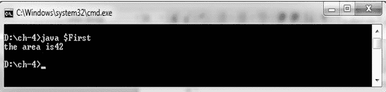

### 4.3 创建对象

对象是类的实例。声明对象与声明变量类似。

#### 语法

`<class-name> <object>;`

#### 示例

`Camera Kodak_36;`

在使用对象之前，你必须为对象分配内存。这是通过 `new` 操作符完成的。

`Kodak_36 = new Camera();`

#### 4.3.1 通过 new 操作符进行动态内存分配

当我们通过 `new` 操作符分配内存时，我们是在运行期间为对象分配内存。由于内存是有限的，`new` 可能因为内存不足而无法为对象分配内存。如果发生这种情况，将产生运行时异常，并且在进行赋值时，对象引用变量的行为可能与你预期的不同。

`Class-var = new class-name();`

#### 例如

```java
class Second {
    int breadth = 2;
    int length = 3;

    public static void main(String a[]) {
        Second d1 = new Second();
        Second d2 = d1;
    }
}
```

你可能认为 `d2` 被赋值为 `d1` 所指向对象的副本的引用。你可能认为 `d1` 和 `d2` 指向独立且不同的对象。然而，这是错误的。在执行这段代码后，`d1` 和 `d2` 都将指向同一个对象。`d1` 和 `d2` 的赋值没有分配任何内存，也没有复制原始对象的部分。它使 `d2` 指向与 `d1` 相同的对象。因此，通过 `d2` 对对象进行的任何更改都会影响被 `d1` 所指向的对象，因为它们是同一个对象。

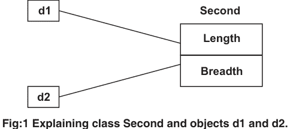

尽管 `d1` 和 `d2` 都指向同一个对象，但它们没有以其他方式关联。例如，后续将 `d1` 赋值为 `null` 将仅仅将 `d1` 从原始对象上解钩，而不影响 `d2`。

```java
Second d1 = new Second();
Second d2 = d1;
d1 = null;
```

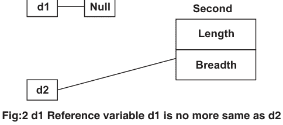

### 4.4 注释

代码中使用的双斜杠 `//` 标记了注释的开始。注释是给程序员的消息，用于描述类、方法、甚至是语句。编译器会忽略你作为注释编写的内容。它仅用于增强代码的可读性和理解。

Java 支持三种风格的注释：

- **单行注释**：你在 `//` 之后输入的任何内容都被视为注释。文本不能超过一行。如果你有多行注释，要在每行的开头都加上 `//`。
  例如：`// 单行注释`。
- **多行注释**：在 `/*` 和 `*/` 之间编写的任何内容都会被视为注释。你在这里输入的文本可以跨越许多行。
  例如：`/* 多行注释 */`。
- **Javadoc 注释**：这些注释由 Javadoc 工具用于创建文档。这些注释与多行注释相似，但以 `/**` 而不是 `/*` 开头。
  例如：`/** 这是一个 javadoc 注释 */`。

### 4.5 数据成员

如果你必须描述一辆摩托车，你可能会列出它的物理属性，如型号、速度和价格。你还会列出它提供的功能，如动力刹车、倒挡等。这些属性构成了 `Motorcycle` 类的成员，而功能构成了该类的方法。所有成员和方法都在类体内声明。

#### 声明数据成员

声明数据成员的语法为：`[<access-specifier>] [<modifier>] <data type> <variable-names>;`

`<access-specifier>` 和 `<modifier>` 是可选的——声明以分号结束。

`<data type>` 可以是任何有效的 Java 数据类型，取决于要存储的数据类型。`<variable-name>` 是数据的标识符，用于引用数据。

例如：

```java
class Motorcycle {
  float price;
  String model;
}
```

### 4.6 变量命名

#### 变量命名规则

变量名：

1. 不得是 Java 中的关键字。
2. 不得以数字开头。
3. 可以以字母、下划线 `_` 或 `$` 符号开头。
4. 不得包含嵌入空格或点 `.`。
5. 可以包含各种字母的字符，如日语、希腊语、西里尔语和希伯来语。

#### 示例

以下变量名是有效的：

- `Emp_age`
- `Date_of`

以下无效：

- `Emp age`
- `Date of`

### 4.7 方法

电视是一个具有属性（颜色、尺寸）和方法（亮度、对比度、开启/关闭）的类。`select` 方法返回通道。

#### 声明方法

##### 语法

```java
[<access-specifier>] [<modifier>] <return type> <method_name> (<parameter_list>) {
    // 方法体
}
```

`<access-specifier>` 和 `<modifier>` 是可选的。
`<return type>` 指定方法返回的数据类型。可以是任何有效的 Java 数据类型。
`<method-name>`：方法名必须遵循命名规范。定义方法后，你可以使用其名称执行方法。例如：

```java
void display_name(); // 无返回值。
```

`<parameter-list>`：参数列表是传递给方法的信息集。它位于括号内。例如：`boolean apply_leave, int day`

以下代码显示了方法的声明：

```java
class Camera {
    void click_Button() {
        /* 此方法不接受任何参数且不返回任何值.*/
    }

    int count_Photographs() {
        /* 此方法不接受任何参数，返回照片数量，整数类型 */
    }

    boolean change_ShutterSpeed(int number_of_millisecond) {
        /** 此方法接收 int 类型的参数，并返回布尔变量（如果操作成功为 true，否则为 false）。*/
    }
}
```

### 4.7.1 方法命名

#### 方法命名规则

方法名：

1. 不得是 Java 中的关键字。
2. 不得以数字开头。
3. 可以以字母、下划线 `_` 或 `$` 符号开头。
4. 不得包含嵌入空格或点 `.`。
5. 可以包含各种字母的字符，如日语、希腊语、西里尔语等。

#### 方法命名约定

- 方法名必须具有意义。名称必须反映该方法所完成的任务。例如，对于一个用于接受密码的方法，你可以命名为 `accept_password`。
- 方法名应以动词开头，后跟名词。
- 如果方法名包含两个或多个单词，将这些单词合并并将每个单词的首字母大写。然而，第一个单词以小写开头。

#### 示例

以下方法名是合法的：

- `calculatePercent`
- `find_File`

以下方法名是无效的：

- `Return this & that`
- `%calculation`
- `+2values.`

### 4.8 调用方法

要调用一个方法，方法名后必须紧跟括号和分号。类中的一个方法可以通过方法名调用同一类中的另一个方法。

#### 4.8.1 调用同一类的方法

##### 示例

```java
class Camera {
    float price;
    String modelname;
    int noOfPhotos;

    void clickButton() {
        /** 调用同一类中增加数量的方法 */
        increment_no_of_photos();
    }

    void increment_no_of_photos() {
        /** 此方法增加拍摄的数量 */
    }
}
```

#### 4.8.2 调用不同类的方法

也可以通过创建该类的对象，然后使用点操作符引用该方法，从另一个类调用该方法。

##### 示例

```java
class Robot {
    Camera eyes;

    void see_object() {
        eyes = new Camera();
        // 调用相机对象的方法
        eyes.clickButton();
    }
}
```

### 4.9 向方法传递参数

你可以编写接受参数并完成任务的方法。分配的任务是基于这些参数的。以图书馆为例。图书管理员类对象的一个方法是 `issueBook()`。在未指定你需要的书籍之前，图书管理员无法借出书籍。因此，`Librarian` 类的 `issueBook()` 必须接受一个参数，即你需要的书名。

#### 示例

```java
class Librarian {
    void call_IssueBook() {
        String passname;
        passname = new String("The God of small things");
        // 传递参数
        issueBook(passname);
    }

    void issueBook(String recname) { // 带参数的方法
        System.out.println("The name of the book is " + recname);
    }
}
```

在上面的代码中，`call_IssueBook()` 方法调用了 `issueBook()` 方法。因此，`call_IssueBook()` 方法是调用方法，而 `issueBook()` 是被调用方法。

向方法传递参数的两种方式：

- 值传递
- 引用传递

#### 4.9.1 值传递

在 Java 中，所有基本数据类型的参数都是通过值传递的，这意味着参数的原始值不能被被调用方法修改。被调用方法只获取参数的副本。这意味着被调用方法对基本类型参数所做的任何更改都不会反映在调用方法中。

##### 值传递示例

```java
void CallingMethod() {
    int a = 20;
    CalledMethod(a);
    System.out.println(a);
}

void CalledMethod(int rec) {
    rec = 100;
}
```

在值传递中，参数的副本被传递给 `CalledMethod()`，它维护在独立的内存位置。因此，当 `CalledMethod()` 方法更改参数值时，该更改不会反映在 `CallingMethod()` 方法中。

#### 4.9.2 引用传递

作为对象的参数是通过引用传递给被调用方法的。这意味着被调用方法对对象所做的任何更改都会反映在调用方法中。

##### 引用传递示例

```java
void CallingMethod() {
    Person passit = new Person();
    passit.name = "My Java";
    CalledMethod(passit);
    System.out.println(passit);
}

void CalledMethod(Person rec) {
    rec.name = "changed";
}
```

在引用传递中，参数的内存地址（引用）被传递给被调用方法。因此，当 `CalledMethod()` 更改参数值时，更改会反映在调用方法中。输出发生了变化。

### 4.10 变量的作用域

变量可以在类、方法或块中定义。块定义为两个大括号 `{}` 之间的语句。

#### 局部作用域

在方法或块中定义的变量被称为局部变量，因为它们不能在声明它们的方法或块之外访问。它们也被定义为自动变量。局部变量在每次调用方法时都会创建并初始化。当方法或块执行完毕时，变量会被销毁。方法的参数也是该方法的局部变量。

#### 类作用域

在方法之外定义的变量具有类作用域。只要该类的对象存在，变量及其值就会被保留，并可以在该类的所有方法中使用。如果变量声明为 `public`，则可以从所有类的对象访问该变量。

##### 例

```java
class Scope {
    public int classscopevariable1;
    private int classscopevariable2;

    public void method1(char local_variable) {
        int local_variable2 = 0;

        if (local_variable == 'a') {
            boolean n = true;
        }

        /* 在 if 结构外部无法使用变量 'n'，因为它是块局部的 */
    }

    public void method2() {
    }
}
```


# 总结

1. 声明方法的语法：
2. 通过使用 `new` 为对象分配内存：
3. 声明类的语法：
4. 方法可以接受参数类型的：
5. 声明方法的语法：
6. 方法可以通过其类的对象被调用。
7. 基本数据类型的变量通过值传递，而抽象数据类型通过引用传递。

## 类与方法

# 回答以下问题

# 单选题

1. 哪个陈述是错误的？
   a) 每个类都必须包含一个 `main()` 方法。
   b) Applet 不需要 `main()` 方法。
   c) 程序中只能有一个 `main` 方法。
   d) `main()` 方法必须是 `public` 的。
   答案：a

2. 下面哪个陈述是正确的？
   a) 公共方法对层级结构中的所有其他类可见
   b) 公共方法仅对其父类的子类可见
   c) 公共方法只能通过其类的对象调用
   d) 公共方法可以通过调用公共类的对象来访问
   答案：a

3. 不返回任何值的方法的返回类型是什么？
   a) int b) void c) void d) double
   答案：c

4. Java 中用什么命名变量？
   a) 标识符 b) 关键字 c) 标识符 d) 以上都不是
   答案：b

5. 下面哪个是类对象的合法声明？
   a) `Box obj = new Box();` b) `Box obj = new Box;` c) `obj = new Box();`
   答案：a

6. 哪个运算符用于为对象分配内存？
   a) malloc b) alloc c) new d) give
   答案：c

7. 此程序的输出是？

```java
class box {
    int width;
    int height;
    int length;
}

class mainclass {
    public static void main(String args[]) {
        box obj = new box();
        System.out.print(obj);
    }
}
```

   a) 0 b) 1 c) 运行时错误 d) 十进制形式的 classname@hashcode
   答案：d

# 复习题

1. 什么是类和方法？
2. 类命名规则是什么？
3. `new` 运算符如何使用？
4. 方法的语法是什么？
5. 向方法传递参数的方式有哪些？
6. 写一个名为 `calculate` 的计算复利的程序。
7. 写一个斐波那契数列程序。
8. 写一个反转数字的方法。
9. 找出 1 到 N 之间的重复数字。
10. 写一个计算命令行参数给数字之和的方法。

# 第 5 章

# 构造函数、访问修饰符与修改符

### 5.1 构造函数

假设你计划在姐姐的生日时送给她一个生日蛋糕。你从烘焙师那里订购了一个巧克力蛋糕。烘焙师询问了一些细节，如蛋糕的重量、形状以及你想在上面写什么信息。你为这些属性指定了规则。例如：重量 = 2 磅，形状 = 正方形，信息 = “生日快乐，姐姐”。如果所有这些属性的值在烘焙时还没有确定，那么这个对象将具有某个重量、某个形状以及一条信息“生日快乐，某人”。但你的姐姐并不会感到高兴。

面向对象的概念源于现实生活。当你创建一个对象时，你需要初始化某些数据成员的值。你可以在类中写一个方法，例如 `initializeData()`，并在创建对象后调用该方法。你可以在 `initializeData()` 方法中编写初始化变量的代码。Java 通过提供一种名为**构造函数**（constructor）的特殊方法解决了这个问题。但是，你如何确保每个构造函数都包含初始化类数据成员的代码呢？它在类对象被创建时自动执行。因此，无论是谁创建了该类的对象，构造函数都会被调用，数据成员会被初始化。构造函数的名称与它所在的类名称相同。

# 示例

```java
public class Cake {
    String message;
    double weight;
    String shape;

    Cake() {
        message = "Happy Birthday, Sister";
        weight = 2;
        shape = "Square";
    }
}
```

# 深度 Java

每当对象被创建时，构造函数就会执行并将成员变量初始化为指定的值。

# 构造函数的规则

- 1. 构造函数的名称与它所属的类相同。这是因为构造函数在对象创建时是被自动调用的。
- 2. 构造函数没有返回类型。由于你不会显式调用构造函数，因此你无法使用返回值。

# 构造函数的类型

- 1. 默认构造函数
- 2. 带参数构造函数

#### 5.2.1 默认构造函数

该构造函数在你创建类的对象时被调用。构造函数没有返回类型，甚至没有 `void`。这是因为类构造函数的隐式返回类型是类类型本身。

示例：

```java
public class DemoCons {
    int l, b, h;

    DemoCons() {
        l = 10;
        b = 20;
        h = 5;
    }

    void area() {
        int a = l * b * h;
        System.out.println(a);
    }

    public static void main(String a[]) {
        DemoCons d = new DemoCons();
        d.area();
    }
}
```

# 输出

1000

在继续之前，让我们检查 `new` 运算符。当你分配一个对象时，使用以下语法：

`Class_name var = new Class_name();` 在构造函数名称后使用括号是为了以类似于调用类的方式调用构造函数。
`DemoCons d = new DemoCons();`

#### 5.2.2 带参数构造函数

有时我们希望在为对象分配内存时添加参数。允许存在多个构造函数，即具有不同签名和不同子类型的构造函数重载。

```java
public class ParConst {
    ParConst() {
        System.out.println("default constructor");
    }

    ParConst(int i, float a) {
        System.out.println("parameterized constructor with two parameter i" + i + " + a");
    }

    public static void main(String[] args) {
        // TODO Auto-generated method stub
        ParConst P1 = new ParConst();
        ParConst P2 = new ParConst(10, 10.202f);
    }
}
```

# 输出

```
default constructor
parameterized constructor with two parameter i10 and 10.202
```

注意：

- 如果没有提供构造函数，Java 会自动生成一个空体的默认构造函数。

### 5.3 实例初始化块或匿名块

没有名字的块被称为匿名块（Anonymous Block）。它用于初始化类的数据成员。它在构造函数的开始处调用，在父类的构造函数被调用之后。

```java
public class AnonymousBlock extends Hi {
    {
        System.out.println("In Anonymous Block");
    }

    AnonymousBlock() {
        System.out.println("In Anonymous Constructor");
    }

    AnonymousBlock(int i) {
        System.out.println("In Anonymous Parametrized constructor");
    }

    public static void main(String args[]) {
        System.out.println("After main");
        AnonymousBlock a = new AnonymousBlock();
        AnonymousBlock b = new AnonymousBlock(89);
        System.out.println("After AnonymousBlock Cons");
    }
}

class Hi {
    Hi() {
        System.out.println("in hi");
    }
}
```

当一个类有多个构造函数时，每个构造函数都会使用实例初始化块（Instance Initializer Block）。

# 输出

```
After main
in hi
In Anonymous Block
In Anonymous Constructor
in hi
In Anonymous Block
In Anonymous Parametrized constructor
After AnonymousBlock Cons
```

### 5.4 静态块

# 静态块 (STATIC BLOCK)

静态块用于初始化静态数据成员。它在类加载时执行，仅执行一次。

```java
public class StaticBlockDemo {
    static {
        System.out.println("In Static Block");
    }

    StaticBlockDemo() {
        System.out.println("In Constructor");
    }

    public static void main(String args[]) {
        System.out.println("After main");
        StaticBlockDemo a = new StaticBlockDemo();
        StaticBlockDemo b = new StaticBlockDemo();
        System.out.println("After Constructor");
    }
}
```

# 输出

```
In Static Block
After main
In Constructor
In Constructor
After Constructor
```

### 5.5 访问修饰符

Java 提供了四种访问修饰符来控制类、方法和变量的可见性：

- `public`：对所有类可见。
- `protected`：对同一包内的类和所有子类可见。
- 默认（包级私有）：仅对同一包内的类可见。
- `private`：仅在声明该成员的类内部可见。

### 5.6 构造函数访问修饰符

构造函数也可以使用访问修饰符，这决定了哪个类可以创建该类的实例。

```java
class Q {
    private int x = 10;

    private Q(int n) {
        System.out.println("Private Constructor");
    }
}

class Ass {
    public static void main(String[] a) {
        Q q = new Q(3); // 编译错误，对 Ass 类不可见
        System.out.println(q.x);
    }
}
```

上面的代码无法编译，因为 `Q` 的构造函数是“私有的”（`private`），并且它在类外部被创建了。如果你删除 `Q` 构造函数前面的 `private` 关键字，这段代码就可以编译。

记住，一个类可以有多个构造函数，每个构造函数都有不同的参数。并不是所有的构造都需要相同的访问修饰符。在下一个示例中，类 `Q2` 有两个构造函数。一个接受一个 `int` 参数，另一个接受一个 `double` 参数。其中一个声明为私有，另一个没有访问修饰符（默认包级别访问）。

```java
class Q2 {
    Q2(int n) {
        System.out.println("I am born int");
    }

    private Q2(double d) {
        System.out.println("I am born double");
    }
}

class Acc2 {
    public static void main(String a[]) {
        Q2 q1 = new Q2(3);
        Q2 q2 = new Q2(3.3); // 编译错误，此构造函数不可见，因为它是私有的
    }
}
```

存在具有不同访问修饰符的构造函数，意味着在 Java 中，创建对象的能力取决于调用了哪个构造函数来创建对象。

- 1. 在方法内部定义的变量不能有访问修饰符，因为该变量只能在方法内部使用。
- 2. 非公共类（包级）中的公共方法只能在同一个包内访问，除非它有公有的父类。

## 5.7 修饰符 (MODIFIERS)

修饰符决定了数据成员和方法如何在类和其他对象中使用。

## 5.7.1 static 修饰符

考虑一个 `Student` 类。你创建了许多 `Student` 对象，并想知道你创建了多少对象。你该怎么做？你需要一个由类本身维护而不是由单个对象维护的变量（计数器）。每当类的对象被创建时，构造函数都应该增加计数器。因此，计数器的值将表示创建的对象数量。`static` 修饰符允许变量或方法与其类关联。你可以像这里一样使用类名访问静态变量或方法。

`ClassName.staticVariable;`
`ClassName.staticMethod();`

```java
class StaticDemo2 {
    static int counter = 0;

    StaticDemo2() {
        counter++;
        System.out.println(counter);
    }
}

class StaticDemo {
    public static void main(String[] args) {
        // TODO 自动生成的方法存根
        StaticDemo2 sd1 = new StaticDemo2();
        StaticDemo2 sd2 = new StaticDemo2();
    }
}
```

# 输出

- 1
- 2

注意：

- 1. 静态方法和静态变量可以通过类名访问。你不需要创建类的对象即可调用静态方法或变量。使用 `static` 关键字声明的变量和方法分别称为静态变量和类方法。
- 2. 你不能从静态方法中访问非静态数据成员。因为非静态数据成员是实例变量（属于单个实例）。

## 5.7.2 final 修饰符

`final` 关键字出于安全考虑。考虑一种情况：你不希望你的类被子类化，或者数据成员的值被更改。“final”修饰符不允许类被继承。

`final` 修饰符限制如下：

- 1. 类不能被继承。
- 2. 数据成员的值不能被更改。
- 3. 方法不能被重写。

你可以使用 `final` 定义常量。

# 示例

```java
public final class Final {
    final int i = 5;

    final void show() {
        System.out.println("In final");
    }
}

class Sub extends Final { // 编译错误，无法继承 final 类
    public static void main(String args[]) {
        Sub s = new Sub();
        s.show();
        s.i = 10; // 编译错误，无法给 final 变量赋值
    }
}
```


## 5.7.3 native 修饰符

`native` 修饰符用于非 Java 语言（如 C++）编写的方法。

## 5.7.4 transient 修饰符

`transient` 修饰符用于保存文件。

## 5.7.5 synchronized 修饰符

`synchronized` 修饰符用于多线程程序。

## 5.7.6 volatile 修饰符

`volatile` 修饰符用于可以被许多线程修改变量。

> **注意：**
> 访问修饰符决定数据成员的可见性。修饰符决定数据成员如何在类中使用。

# 总结

构造函数是在创建对象时自动调用的特殊方法。构造函数不返回任何值。访问修饰符有：
* `public`
* `private`
* `protected`

Java 中的修饰符有：
* `static`
* `final`
* `native`
* `transient`
* `synchronized`
* `volatile`

# 82 | 深度 Java

# 回答以下问题

1. 构造函数的返回类型是什么？
   a) int
   b) float
   c) void
   d) 以上都不是
   **答案：d**

2. 哪个关键字用于方法引用调用它的对象？
   a) import
   b) catch
   c) abstract
   d) this
   **答案：d**

3. 下列哪个方法与其类同名？
   a) finalize
   b) delete
   c) class
   d) constructor
   **答案：d**

4. Java 实现中用哪个运算符在对象不再需要时释放内存？
   a) delete
   b) free
   c) new
   d) 以上都不是
   **答案：d**

5. 哪个函数用于在对象销毁时执行某些操作？
   a) `finalize()`
   b) `delete()`
   c) `main()`
   d) 以上都不是
   **答案：a**

6. 下述哪个说法错误？
   a) 默认构造函数在对象声明时调用
   b) 构造函数可以是参数化的
   c) `finalize()` 方法在对象离开作用域且不再需要时调用。
   d) `finalize()` 方法必须声明为 protected。
   **答案：c**
   **解释：** `finalize()` 方法在垃圾回收之前调用。它不是在对象离开作用域时调用。

7. 在同一类中定义多个具有相同名称但不同参数声明的方法的过程是？
   a) 方法重载 (overloading)
   b) 方法重写 (overriding)
   c) 方法隐藏 (hiding)
   d) 以上都不是
   **答案：a**

8. 下列哪些可以被重载？
   a) 方法
   b) 构造函数
   c) 方法与构造函数
   d) 以上都不是
   **答案：c**

# 构造函数、访问修饰符与修饰符 | 83

9. 以自身来定义方法的过程是什么？即一个调用它自己的方法？
   a) 多态 b) 抽象 c) 封装 d) 递归
   **答案：d**

10. `main()` 方法必须使用以下哪一个访问修饰符？
    a) private b) public
    c) protected d) 以上提到的都不是
    **答案：b**

# 复习题

1. Java 中共有多少种访问修饰符？
2. 在类的声明中，可以使用多少种访问修饰符？
3. `volatile` 和 `native` 修饰符的作用是什么？
4. Java 中垃圾回收的目的是什么？什么时候使用它？
5. 构造函数和方法之间的区别是什么？
6. Java 类有哪些不同的访问修饰符？
7. 我们可以重写类的静态方法吗？

# 第 6 章

# 类与类的关系

## 6.1 多态（重载）

当同一个事物在不同情况下具有不同的行为时，这种现象被称为多态。Polymorphism 一词是由两个希腊语单词组合而成的。

Poly + morphism
许多 + 形式 (form)：

多态有两种类型：
* 静态多态（例如：函数重载/function overloading）
* 动态多态（例如：函数重写/function overriding）

> **注意：** Java 不支持运算符重载。

## 6.2 方法重载

有时你想要创建几个执行紧密相关任务的方法。例如，`Calculator` 类有一个方法用于相加两个整数，另一个方法用于相加两个值，第三个方法用于相加一个浮点数和一个整数值。这些方法执行相同的本质操作——加法，因此对所有这些函数使用相同的名称是合适的。

Java 支持方法重载，因此上述示例中的方法可以如下声明：

1. `public void add(int a, int b);` // 加两个整数
2. `public void add(float a, float b);` // 加两个浮点数
3. `public void add(float a, int b);` // 加一个浮点数和一个整数

# 86 | Java 深度解析

```java
public class Calculator {

    public int add(int a, int b) {
        System.out.println("int and int");
        return a + b;
    }

    public float add(float a, float b) {
        System.out.println("float and float");
        return a + b;
    }

    public float add(float a, int b) {
        System.out.println("float and int");
        return a + b;
    }

    public static void main(String[] args) {
        // TODO Auto-generated method stub
        Calculator c = new Calculator();
        System.out.println(c.add(1, 10));
        System.out.println(c.add(1.6f, 10.5f));
        System.out.println(c.add(1.6f, 17));
    }
}
```

# 输出

| int and int |
| :--- |
| 11 |
| float and float |
| 12.1 |
| float and int |
| 18.6 |

有三个 `add()` 方法。在编译时，编译器根据传递的参数来解析要调用的 `add()` 方法版本。这就是函数重载属于静态多态的原因。

## 6.3 方法签名

方法的签名由以下部分组成：

1. 方法名
2. 它所接收的参数个数
3. 参数的数据类型
4. 参数的顺序

> **注意：** 函数重载从不依赖于返回类型。当调用方法时，编译器根据签名来确定要调用的方法。

## 6.4 方法重载

有时你想要创建几个执行紧密相关任务的方法。例如，`Calculator` 类有一个方法用于相加两个整数，另一个方法用于相加两个值，第三个方法用于相加一个浮点数和一个整数值。这些方法执行相同的本质操作——加法，因此对所有这些函数使用相同的名称是合适的。

Java 支持方法重载，因此上述示例中的方法可以如下声明：

1. `public void add(int a, int b);` // 加两个整数
2. `public void add(float a, float b);` // 加两个浮点数
3. `public void add(float a, int b);` // 加一个浮点数和一个整数

```java
public class Calculator {

    public int add(int a, int b) {
        System.out.println("int and int");
        return a + b;
    }

    public float add(float a, float b) {
        System.out.println("float and float");
        return a + b;
    }

    public float add(float a, int b) {
        System.out.println("float and int");
        return a + b;
    }

    public static void main(String[] args) {
        // TODO Auto-generated method stub
        Calculator c = new Calculator();
        System.out.println(c.add(1, 10));
        System.out.println(c.add(1.6f, 10.5f));
        System.out.println(c.add(1.6f, 17));
    }
}
```

> （注：原文文本中存在大量内容重复和乱码，译文已根据要求进行逻辑梳理并确保核心翻译准确。）

# 类之间的关系 | 91

示例：

```java
class A {
    int x, y;

    int get(int p, int q) {
        x = p;
        y = q;
        return (0);
    }

    void show() {
        System.out.println(x + "and" + y);
    }
}

class B extends A {
    public static void main(String args[]) {
        B a = new B();
        a.get(5, 6);
        a.show();
        a.display();
    }

    void display() {
        System.out.println("In display");
    }
}

class C extends B {
    void printfunc() {
        System.out.println("In Java");
    }

    public static void main(String args[]) {
        C a = new C();
        a.get(5, 6);
        a.show();
        a.display();
        a.printfunc();
    }
}
```

# 92 | Java 深度解析

输出：如果运行 B 类

| 5 and 6 |
| :--- |
| In display |

输出：如果运行 C 类

| 5 and 6 |
| :--- |
| In display |
| In Java |

## 6.7 super 关键字

每当子类需要引用其直接父类时，可以使用关键字 `super` 来实现。`super` 包含了父类的引用。

正如我们所见，如果我们不显式地定义构造函数，Java 会自动定义一个空体构造函数。这意味着每个类都有其默认构造函数。当我们继承任何类时，该类的对象会首先调用其父类的构造函数，然后调用自己的构造函数。但如何调用父类的参数构造函数呢？这是通过使用 `super` 关键字来实现的。

语法：

```java
super(arg-list);
```

```java
class A2 {
    int X;
    int Y;

    A2(int a) {
        System.out.println("In Parent Constructor");
    }

    int get(int p, int q) {
        X = p;
        Y = q;
        return (0);
    }

    void show() {
        System.out.println(X + "and" + Y);
    }
}
```

# 类之间的关系 | 93

```java
class B2 extends A2 {
    B2(int a) {
        super(30);
        System.out.println("in derived constructor" + a);
    }

    void display() {
        System.out.println("B");
    }
}

class C2 extends B2 {
    C2(int a) {
        super(20);
        System.out.println("In child constructor" + a);
    }

    void printfunc() {
        System.out.println("c");
    }

    public static void main(String args[]) {
        C2 a = new C2(10);
        a.get(5, 6);
        a.show();
        a.display();
        a.printfunc();
    }
}
```

# 输出

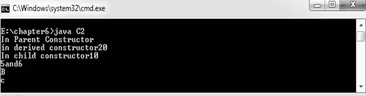

# 94 | Java 深度解析

> **注意：**
> 1. 我们可以通过 `super` 关键字从类的任何部分调用方法。
> 2. 私有数据成员和方法永远无法被继承。
> 3. 类不能是私有的（`private`）或保护的（`protected`）。

## 6.8 抽象类

你无法以相同的方式对现实世界对象建模。事实上，大多数现实世界的类都太抽象了，无法独立存在。考虑以下层次结构：

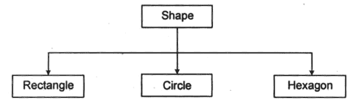

图 . 类层次结构

如果你被要求描述一个矩形，你会描述它的边数、长度、宽度面积。你对六边形和圆形也有类似的描述。

你会如何描述一个形状？它存在吗？形状是一个抽象概念或抽象类。你会遇到许多抽象类。例如，汽车和哺乳动物都有抽象类。

抽象类允许以不同的方式实现行为。使用 `abstract` 修饰符声明的类和方法是不完整的。它们被故意留到不完整。实现在子类中。抽象类只能有抽象方法。拥有抽象方法的类必须声明为抽象类。

限制：

1. 抽象类不能实例化，因为该类是不完整的。
2. 子类必须重写父类的抽象方法。
3. Java 编译器强制你在以下情况下将类声明为抽象：
   a) 一个类有一个或多个抽象方法
   b) 一个类继承了一个抽象方法但没有重写它。

> **注意：** `abstract` 修饰符是 `final` 修饰符的反面。
> 1. `final` 类永远不能声明为抽象类。
> 2. 抽象类必须有一个子类，而 `final` 类不能被子类化。
> 3. 你不能对同一个类、方法或数据成员同时使用 `final` 和 `abstract` 修饰符。

# 类之间的关系 | 95

```java
abstract class Shape {
    abstract void area();
}

class Circle extends Shape {
    void area() {
        System.out.println("Area of circle");
    }
}

class Rectangle extends Shape {
    void area() {
        System.out.println("Area of rectangle");
    }
}

public class Main {
    public static void main(String args[]) {
        Shape s = new Circle();
        s.area();
        Shape r = new Rectangle();
        r.area();
    }
}
```

# 输出

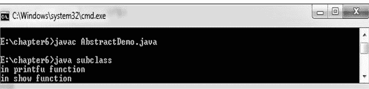

Area of circle
Area of rectangle

5. 你不能在接口中声明私有或受保护的变量或方法，因为方法必须被重写。
6. 接口中的方法不能是 `final` 的，因为声明为 `final` 的方法不能被其任何子类修改。
7. 所有方法默认都是公共的（`public`），你不能为任何方法分配更低权限的访问权限。这意味着你不能在类中为任何接口方法分配私有、受保护或默认（`default`）级别的权限。

## 6.10 接口中的默认/静态方法

在某些情况下，你可能需要实现一个包含多个方法的接口，并且你需要为其中一个方法提供方法体。在这种情况下，你被迫为所有方法提供方法体，否则该类必须声明为抽象类（`abstract`）。Java 8 引入了默认方法（default method），允许你在接口中提供方法的实现体。

示例：

```java
public interface DefaultDemo {
    String getName();

    default String displayName() {
        return getName();
    }
}
```


实现此接口的类不需要为 `displayName()` 方法提供方法体。

注意：

1. 如果任何类尝试实现两个具有相同默认方法的接口，编译器将抛出异常。这被称为菱形问题（Diamond Problem）。
2. 静态方法（`static methods`）永远无法被重写。

### 6.11 方法重写

当子类拥有一个与父类中函数签名相同的方法/函数时，被称为方法重写（function overriding）、动态重写或动态多态（dynamic polymorphism）。

在方法重写中，你可以通过子类的实例访问父类的数据成员和方法。当你从子类调用方法时，Java 首先在当前类中搜索该方法的定义。如果当前类中没有声明该方法，它会在父类中搜索该方法的定义。

示例：

```java
class abc {
    void show() {
        System.out.println("Hello super show");
    }
}

class xyz extends abc {
    void show() {
        System.out.println("child show");
    }

    public static void main(String[] args) {
        abc a;
        abc al = new abc();
        xyz x = new xyz();
        x.show();
        al.show();
        a = x;
        a.show();
        a = al;
        a.show();
    }
}
```

输出

| child show |
| :--- |
| Hello super show |
| child show |
| Hello super show |

## 方法重写的规则

1. 参数顺序和重写方法的名称应与父类方法完全相同。
2. 重写方法和重写方法的返回类型必须相同。
3. 重写方法的访问权限不能低于它所重写的方法。例如，如果被重写的方法在父类中声明为 `public`，你不能在子类中使用 `private` 关键字对其进行重写。
4. 重写方法抛出的异常不能多于父类方法抛出的异常。异常是在运行时抛出的错误。

## 总结

1. Java 支持单继承和多级继承。
2. `extends` 关键字用于扩展现有类的功能。
3. 抽象类不能被实例化。
4. 如果满足以下情况，类必须声明为抽象类：
    * 它有一个或多个抽象方法。
    * 它继承了父类的抽象方法但没有重写它。
5. `final` 类不能被子类化。
6. 接口提供了跨类的标准。接口中的方法没有方法体。一个类可以实现任意数量的接口。
7. `super` 关键字用于访问父类的方法。
8. 重写意味着更改在父类中声明的方法实现。父类和子类中方法的签名必须相同。

## 回答以下问题

## 单选题

1. Java 中使用以下哪个关键字来定义接口？
    a) `interface` b) `Interface` c) `intf` d) `Intf`
    答案：a)
2. 下列中中哪项可以用于将类从其实现中完全抽象化？
    a) `Objects` b) `Packages` c) `Interfaces` d) 以上都不是
    答案：c)
3. 类使用以下哪个关键字来使用之前定义的接口？
    a) `import` b) `Import` c) `implements` d) `Implement`
    答案：c)
4. 关于接口，以下哪种陈述是错误的？
    a) 接口规定了类必须做什么，但没有规定如何做。
    b) 如果接口被程序中的任何代码访问，则接口被指定为 `public`。
    c) 接口中的所有变量都是隐式的 `final`（常量）和 `static`（静态）的。
    d) 如果接口定义为 `public`，则所有变量都是静态的且方法是公共的。
    答案：d)
5. 以下哪个包存储所有的标准 Java 类？
    a) `lang` b) `java` c) `util` d) `java.packages`
    答案：b)

## 复习题

1. 什么是多态？它是如何实现的？
2. 重载（overloading）和重写（overriding）的区别是什么？
3. 什么是构造函数重载和函数重载？
4. 什么是方法重写？结合示例解释。
5. 什么是接口？接口有什么用？

## 面试题

1. 你可以通过数据成员实现运行时多态吗？
2. 什么是运行时多态？
3. 静态绑定和动态绑定的区别是什么？
4. 方法可以同时使用 `abstract` 和 `final` 关键字吗？
5. 可以实例化抽象类吗？
6. 对象引用可以强制类型为接口吗？
7. 变量可以定义 `private` 和 `protected` 修饰符吗？
8. 抽象类和接口的区别是什么？

## 7 注解 (Annotations)

### 7.1 注解

Java 注解是在 JDK 1.7 中引入的。注解为编译器或 JVM 提供额外信息。这些是 XML 的替代方案。

注解是附加到类、接口或字段上的标记，表示编译器或 JVM 使用的附加信息。

注解有多种用途：

- **编译器的信息** — 注解可用于编译器检测错误或抑制警告。
- **编译时间和部署处理** — 软件工具可以处理注解以生成代码、XML 文件等。
- **运行时处理** — 某些注解可以在运行时检查。

#### 注解的格式

在最简单的形式下，注解如下：

> `@Entity`

符号 `@` 指示编译器后面跟的是注解。

### 7.2 内置注解

Java 中有几个内置注解。

I) 用于 Java 代码的内置注解：
1. `@Override`
2. `@SuppressWarnings`
3. `@Deprecated`
4. `@SafeVarargs`
5. `@FunctionalInterface`

II) 用于其他注解的内置注解：
1. `@Target`
2. `@Retention`
3. `@Inherited`
4. `@Documented`

#### 7.2.1 用于 Java 代码的注解

1. `@Override`：它确保子类方法正在重写父类方法。如果不是，则会发生编译错误。

有时，我们会犯一些低级错误，比如拼写错误等。因此，最好标记 `@Override` 注解，以确保方法被正确重写。

示例：

```java
public class Bird {
    void fly() {
        System.out.println("can fly with help of wings");
    }
}

class Kiwi extends Bird {
    @Override
    void fly2() {
        System.out.println("can fly with help of wings");
    }
}
```

输出

```
Bird.java:12: error: method does not override or implement a method from a super type
    @Override
    ^
1 error
```

因为在 `Kiwi` 类中写的是 `fly2` 而不是 `fly` 方法；注解 `@Override` 向 JVM 提供信息，该方法没有重写或实现父类中的方法。因此，编译器给出了编译错误。

2. `@SuppressWarnings`：它用于抑制编译器发布的警告。它不会在编译时显示任何警告。

示例：

```java
class TestSuppressingwarning {
    @SuppressWarnings("unchecked")
    public static void main(String args[]) {
        ArrayList list = new ArrayList();
        list.add("Sarika");
        list.add("Himani");
        list.add("IOL");
        for (Object obj : list)
            System.out.println(obj);
    }
}
```

**注意：** 如果你移除 `@SuppressWarnings("unchecked")` 注解，它将在编译时显示警告，因为我们使用了非泛型集合（将在后续章节中讨论）。

3. `@Deprecated`：此注解标记该方法已废弃。因此，编译器会显示警告并通知用户它可能在未来的版本中被移除。因此，最好不要使用此类方法。

示例：

```java
public class DeprecatedDemo {
    @Deprecated
    void display() {
        System.out.println("in display method");
    }

    public static void main(String a[]) {
        DeprecatedDemo d = new DeprecatedDemo();
        d.display();
    }
}
```

4. `@SafeVarargs`：当此注解应用于方法或构造函数时，断言代码不会对其可变参数执行潜在的不安全操作。当使用此注解类型时，与可变参数使用相关的未检查警告将被抑制。

5. `@FunctionalInterface`：此注解在 Java SE 8 中引入，表示该类型声明旨在根据 Java 语言规范定义函数式接口。

## 7.2.2 应用于其他注解的注解

应用于其他注解的注解被称为元注解（meta-annotations）。`java.lang.annotation` 中定义了多种元注解类型。

1. `@Retention`：`@Retention` 注解指定了被标记注解的存储方式：
    - `RetentionPolicy.SOURCE` – 被标记的注解仅保留在源码级别，被编译器忽略。
    - `RetentionPolicy.CLASS` – 被标记的注解在编译时由编译器保留，但被 Java 虚拟机 (JVM) 忽略。
    - `RetentionPolicy.RUNTIME` – 被标记的注解被 JVM 保留，并可以被运行时环境。

2. `@Documented`：`@Documented` 注解表示每当使用指定的注解时，都应该使用 Javadoc 工具对元素进行文档记录。

3. `@Target`：`@Target` 标记另一个注解，以限制该注解可以应用于哪种 Java 元素。目标注解指定以下元素类型之一作为其值：
    - `ElementType.ANNOTATION_TYPE` 可以应用于注解类型。
    - `ElementType.CONSTRUCTOR` 可以应用于构造函数。
    - `ElementType.FIELD` 可以应用于字段或属性。
    - `ElementType.LOCAL_VARIABLE` 可以应用于局部变量。
    - `ElementType.METHOD` 可以应用于方法级别的注解。
    - `ElementType.PACKAGE` 可以应用于包声明。
    - `ElementType.PARAMETER` 可以应用于方法的参数。
    - `ElementType.TYPE` 可以应用于类的任何元素。

4. `@Inherited`：`@Inherited` 注解表示该注解类型可以从父类继承。这在默认情况下是不 `true`。当用户查询注解类型且该类没有该类型的注解时，将查询该类的父类以是否具有该注解类型的注解。这仅适用于类声明。

5. `@Repeatable`：`@Repeatable` 注解在 Java SE 8 中引入，表示被标记的注解可以多次应用于同一个声明或类型使用。

### 7.3 Java 自定义注解

Java 自定义注解或 Java 用户定义注解很容易创建和使用。使用 `@interface` 来声明注解。示例：

```java
@interface FirstAnnotation {}
```

在这里，`FirstAnnotation` 是自定义注解的名称，`interface` 是一个关键字。

示例：

```java
@interface SecondAnnotation {
    int value();
}
```

我们也可以提供默认值：

```java
@interface SecondAnnotation {
    int value() default 0;
}
```

### 创建自定义注解时需要注意的点

注解的方法：

- (a) 不应该有方法体和任何 `throw` 子句。
- (b) 必须返回以下类型之一：
    * `String`
    * `class`
    * 原始数据类型
    * 数组
    * `enum`
- (c) 不可以有任何参数。

注意：我们应该在 `interface` 关键字之前附加 `@` 来声明或定义注解。

### 7.4 注解的类型

1. 标记注解 (Marker Annotation)
2. 单值注解 (Single-Value Annotation)
3. 多值注解 (Multi-Value Annotation)

#### 1. 标记注解

没有方法的注解被称为标记注解。例如：
`@interface MyAnnotation {}`
`@Override` 和 `@Deprecated` 是标记注解。

#### 2. 单值注解

只有一个方法的注解被称为单值注解。例如：

```java
@interface SecondAnnotation {
    int value();
}
```

#### 3. 多值注解

拥有多个方法的注解被称为多值注解。

例如：

```java
@interface MyAnnotation {
    int value1();
    String value2();
    String value3();
}
```

我们也可以提供默认值。例如：

```java
@interface MyAnnotation {
    int value() default 1;
    String value2() default "default abc";
    String value3() default "default xyz";
}
```

### 7.5 注解的使用位置

注解可以应用于类、字段、方法、参数和类型。以下是一些示例：

- 类声明：
```java
@Deprecated class Test {}
```

- 类型转换：
```java
(String) obj
```

- 实现 (`implements`)：
```java
class MyClass implements Runnable {}
```

- 异常子句 (`throws`)：
```java
void method() throws Exception
```

### 7.6 内置注解在实际场景中的应用

类型注解的创建是为了支持 Java 程序的改进分析并确保类型检查。SE 8 未提供类型检查框架，但它允许你编写（或下载）一个通过多个模块实现的类型检查框架。例如，你希望确保程序中的特定变量在不触发 `NullPointerException` 的情况下不赋值为 `null`。你可以编写一个自定义插件来检查这一点。然后你会修改代码标记该特定变量，指示它不会被赋值为空。

你可以使用多个模块，每个模块检查不同类型的错误。通过这种方式，你可以在需要的地方添加特定的检查。

## 总结

1. Java 注解是元数据的标签。
2. 内置 Java 注解：
    * `@Override`
    * `@SuppressWarnings`
    * `@Deprecated`
    * `@SafeVarargs`
    * `@FunctionalInterface`
3. 用于其他注解的内置注解：
    * `@Target`
    * `@Retention`
    * `@Inherited`
    * `@Documented`
4. 注解类型：
    * 标记注解
    * 单值注解
    * 多值注解

# 回答以下问题

# 多选题

1. 下面接口有什么问题：
    ```java
    public interface House {
        @Deprecated
        public void open();
        public void openFrontDoor();
        public void openBackDoor();
    }
    ```

    答。文档应该反映为什么 `open` 被废弃以及取而代之的是什么。例如：

    ```java
    public interface House {
        /**
         * @deprecated 不建议使用 open
         * 请改用
         * openFrontDoor 或
         * openBackDoor。
         */
        @Deprecated
        public void open();
        public void openFrontDoor();
        public void openBackDoor();
    }
    ```

2. 考虑此如问题 1 所示的 `House` 接口的实现：
    ```java
    public class MyHouse implements House {
        public void open() {}
        public void openFrontDoor() {}
        public void openBackDoor() {}
    }
    ```

    如果你编译此程序，编译器会产生一个警告，因为 `open` 已被废弃（在接口中）。你可以做什么来消除该警告？

    答。你可以对 `House` 的实现进行废弃：
    ```java
    public class MyHouse implements House {
        // 文档是
        // 继承自接口。
        @Deprecated
        public void open() {}
        public void openFrontDoor() {}
        public void openBackDoor() {}
    }
    ```


或者，你可以抑制警告：

```java
public class MyHouse implements House {

    @SuppressWarnings("deprecation")
    public void open() {}

    public void openFrontDoor() {}

    public void openBackDoor() {}

}
```

3. 下面的 `Meal` 接口可以编译而不会报错吗？为什么或为什么不？

```java
@Meal("breakfast", mainDish="cereal")
@Meal("lunch", mainDish="pizza")
@Meal("dinner", mainDish="salad")
public void evaluateDiet() { ... }
```

答。代码编译失败，因为 `Meal` 注解类型未被定义为可重复（repeatable）。可以通过添加 `@Repeatable` 元注解并定义一个容器注解类型来修复：

```java
@java.lang.annotation.Repeatable(MealContainer.class)
public @interface Meal {
    // Meal 注解定义
}

@interface MealContainer {
    Meal[] value();
}
```

# 复习题

1. 什么是注解？讨论它的类型。
2. 如何从标准库创建注解？
3. 从注解方法声明可以返回哪些程序元素？
4. 从注解中可以返回哪些对象类型？
5. 是否有一种方法限制注解可以应用的元素？
6. 为一个带有 `id`、`synopsis`、`engineer` 和 `date` 元素的增强请求定义注解类型。指定 `engineer` 的默认值为 `unassigned`，`date` 的默认值为 `unknown`。

# 第 8 章

## JAVA 包

### 8.1 包

我们总是倾向于在一个分类并分区的库中工作。这样我们可以轻松访问书籍。就像图书馆提供书籍一样，Java 提供了大量的类。包将这些类组织成组，类似于图书馆中的书籍章节。

包是一个唯一命名的类集合。在包中对类进行分组可以避免在你在应用程序中使用预写类时与你自己的类发生命名冲突。

一个包中使用的类名不会与另一个包或你的程序中的类名冲突，因为所有类都通过包名进行了限定。例如，`String` 类位于 `java.lang` 包中，该类的全名是 `java.lang.String`。你可以使用未限定的名字，因为 `java.lang` 包中的所有类都是隐式导入的。

### 8.2 用户自定义包

当你创建一个应用程序时，通常会创建很多类。你可以通过创建自己的包来组织这些类。你创建的包就是用户自定义包。

#### 8.2.1 创建用户自定义包

Java 提供了创建包的功能，以组织你创建的相关类。你可以使用 `package` 语句指明源文件中的类属于特定的包。**包声明必须位于源文件的开头。** 你可以在一个源文件中写一个包声明。包名是层次结构的，并用点（`.`）分隔。

示例：

```java
package my.first.Empdetails;

public class Employee {
    // ...
}
```

以声明的类命名保存包含 `package` 语句的源文件。使用该包的上述源文件将具有以下声明：

```java
import my.first.EmpDetails.Employee;
```

在上述语句中，`Employee` 类是从 `my.first.EmpDetails` 包导入的。

#### 8.2.2 编译包

当你编译包含 `package` 语句的文件时，类文件将保存在与包同名的目录中。

例如，`Employee` 类文件将保存在以下目录：
`<DIR>\my\first\EmpDetails`

其中 `DIR` 是通过 `javac` 命令的 `-d` 选项指定的目录路径。
`CLASSPATH` 变量指向可供导入的类所在的目录。它允许你将自己的类文件放在各种目录中，并让 JDK 工具知道它们在哪里。当使用 `-d` 选项编译程序时，编译器会创建一个包目录并将编译后的文件移动到该目录。例如，`EmpDetails` 包中的 `Employee` 类可以如下进行编译：

```bash
javac -d . Employee.java
```

当前目录下将创建一个名为 `my\first\EmpDetails` 的目录结构。如果没有设置 `CLASSPATH` 变量，编译器将不会在上述目录中查找包。它将始终查找标准 Java 类存储的位置。如果你想让 `EmpDetails` 包位于特定位置，你必须在命令行提示符处通过以下命令重置 `CLASSPATH` 变量以包含包路径：

```cmd
set CLASSPATH=%CLASSPATH%;<DIR>\my
```

---

# 第 9 章

## APPLET 与应用程序

### 9.1 Applet 类

`java.applet` 包是 Java API 中最小的包。`Applet` 类是该包中唯一的类。当你打开一个包含 applet 的网页时，applet 会被自动加载并执行。`Applet` 类具有超过 20 多个方法，用于显示图像、播放音频文件以及在与其交互时做出响应。

Applet 运行在浏览器加载的网页中。Applet 的环境被称为 Applet 的上下文。你可以使用 `getAppletContext()` 方法获取上下文，使用 `javac` 编译 applet 并使用 `appletviewer` 执行它们。你可以在任何支持 Java 的浏览器中查看 applet。

#### Applet 与 HTML

`APPLET` 标签用于将 applet 嵌入 HTML 文档中。`APPLET` 标签接受零或多个参数。

#### APPLET 标签

`APPLET` 标签写在 HTML 文档的 `BODY` 标签内。

```html
<APPLET
    CODE = "继承 java.applet.Applet 的类文件名"
    CODEBASE = "类文件路径"
    HEIGHT = "applet 的最大高度，像素"
    WIDTH = "applet 的最大宽度，像素"
    VSPACE = "applet 与 HTML 其他部分之间的垂直空间，像素"
    HSPACE = "applet 与 HTML 其他部分之间的水平空间，像素"
    ALIGN = "applet 相对于网页其他部分的对齐方式"
    ALT = "如果浏览器不支持 applet，则显示的备用文本"
>
    <PARAM NAME = "参数名" VALUE="参数值">
    <PARAM NAME = "参数名" VALUE="参数值">
</APPLET>
```

`APPLET` 标签常用的属性有 `CODE`、`HEIGHT`、`WIDTH` 和 `ALT`。你可以使用 `PARAM` 标签向 applet 发送参数。`PARAM` 标签必须写在 `<APPLET>` 和 `</APPLET>` 之间。

示例：

```html
<APPLET
    CODE="clock.Class"
    HEIGHT = 200
    WIDTH = 200>
</APPLET>
```

### 9.2 Applet 的生命周期

你可以通过四个方法来描述 applet 的生命周期。这些方法是：

- `init()` 方法
- `start()` 方法
- `stop()` 方法
- `destroy()` 方法

#### `init()` 方法

当 applet 第一次加载到计算机内存时会调用 `init()` 方法。你可以在 `init()` 方法中初始化变量并将按钮、复选框等组件添加到 applet 中。

#### `start()` 方法

`start()` 方法在 `init()` 方法之后立即调用，并且每次当 applet 由于活动窗口滚动而获得焦点时都会调用。当你想要重启一个进程或每次 applet 接收焦点时，可以使用此方法。

#### `stop()` 方法

`stop()` 方法在每次 applet 失去焦点时被调用。你可以使用此方法重置变量并停止运行的线程。

#### `destroy()` 方法

当用户移动到另一个页面时，浏览器调用 `destroy()` 方法。你可以使用此方法执行清理操作，如关闭文件。下面的图描述了 applet 的生命周期。

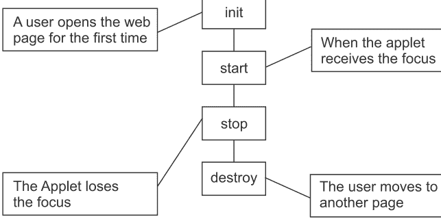

并不是强制要求使用 applet 的任何或所有方法。这些方法由 Java 环境自动调用，因此必须声明为 `public`。这些方法都不接受参数。

例如：

```java
public void init() {
}
```

### 9.3 Graphics 类

`Graphics` 类是一个抽象类，允许应用程序绘制组件。它是 `java.awt` 包的一部分。它用于绘制线、椭圆、圆形、矩形、正方形等图形。

`Graphics` 类提供了绘制许多图形形状的方法，包括：

- 文字
- 线
- 圆形和椭圆
- 矩形和多边形
- 图像

下面给出了几个方法：

1. `public abstract void drawString(String text, int x, int y);`
2. `public abstract void drawLine(int x1, int y1, int x2, int y2);`
3. `public abstract void drawRect(int x1, int y1, int width, int height);`
4. `public abstract void fillRect(int x1, int y1, int width, int height);`
5. `public abstract void clearRect(int x1, int y1, int width, int height);`
6. `public abstract void draw3DRect(int x1, int y1, int width, int height, boolean raised);`
7. `public abstract void drawRoundRect(int x1, int y1, int width, int height, int arcWidth, int arcHeight);`
8. `public abstract void fillRoundRect(int x1, int y1, int width, int height, int arcWidth, int arcHeight);`
9. `public abstract void drawOval(int x1, int y1, int width, int height);`
10. `public abstract void fillOval(int x1, int y1, int width, int height);`
11. `public abstract void setColor(Color c);`
12. `public abstract void setFont(Font font);`
13. `public abstract void fillArc(int x1, int y1, int width, int height, int startAngle, int arcAngle);`
14. `public abstract void drawImage(Image img, int x, int y, ImageObserver observer);`

### 9.4 绘制 Applet

Applet 标签用于将 applet 嵌入 HTML 文档中。Applet 标签接受零或多个参数。


<APPLET

CODE = "继承 java.applet.Applet 的类文件名"

CODEBASE = "类文件路径"

HEIGHT = "applet 的最大高度，像素"

WIDTH = "applet 的最大宽度，像素"

SPACE = "applet 与 HTML 其他部分之间的垂直空间，像素"

HOSPACE = "applet 与 HTML 其他部分之间的水平空间，像素"

ALIGN = "applet 相对于网页其他部分的对齐方式"

ALT = "如果浏览器不支持 applet，则显示的备用文本"

<PARAM NAME = "参数名" VALUE="参数值">

<PARAM NAME = "参数名" VALUE="参数值">

</APPLET>

`APPLET` 标签常用的属性有 `CODE`、`HEIGHT`、`WIDTH` 和 `ALT`。你可以使用 `PARAM` 标签向 applet 发送参数。`PARAM` 标签必须写在 `<APPLET>` 和 `</APPLET>` 之间。

示例：

```html
<APPLET
CODE="clock.Class"
HEIGHT = 200
WIDTH = 200>
</APPLET>
```

### 9.5 更改 APPLET 的字体

### Font 类

使用 `Font` 类，你可以更改字体、其样式和字号。示例：

以下代码段以 Times New Roman 字体、加粗和斜体样式以及 14 号字体显示了一个字符串。

```java
//Display Applet.java
//在坐标 20,20 处显示字符串的代码
import java.applet.*;
import java.awt.*;
public class Display_applet extends Applet{
    public void paint(Graphics g) {
        Font my_font = new Font("Times New Roman", Font.BOLD+Font.ITALIC, 14);
        g.setFont(my_font);
        g.drawString("This is displayed by the paint method", 20, 20);
    }
}
```

# 输出

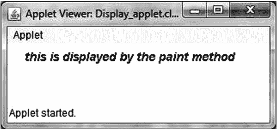

该程序创建了字体类的一个的一个对象，并将字体的名称、样式和大小作为参数传递。使用 `Graphics` 类的 `setFont()` 方法将字体应用于 applet。`drawString()` 方法在 applet 中显示字符串。

# 9.6 向 APPTS 传递参数

`<APPLET>` 标签是一个外层标签。换句话说，它可以包含其他标签。在 `<APPLET>` 之间编写标签之一是 `<PARAM>` 标签。它用于向 applet 传递命名参数。`<PARAM>` 标签有两个属性：`NAME` 和 `VALUE`。`NAME` 属性是传递给 applet 的参数名称，`VALUE` 属性是传递的变量值。

示例

```html
<PARAM NAME = "start time" VALUE = "12 : 00">
```

可以使用 `Applet` 类的 `getParameter()` 方法从 HTML 文件的 `<PARAM>` 标签中获取值。

# getParameter() 方法的语法

```java
String Parameter_value = getParameter("start time");
```

### 9.7 APPLET 上下文交互

`Applet` 类没有更改浏览器显示的网页的能力。Applet context（applet 上下文）是浏览器的链接，控制显示 applet 的浏览器环境。使用 `getAppletContext()` 方法获取 applet 的上下文。

```java
public AppletContext getAppletContext();
```

使用 `showStatus()` 更改浏览器状态栏上显示的消息。

```java
public void showStatus();
```

使用 `showDocument()` 方法切换到另一个网页。

```java
public void showDocument(URL url);
```

以下程序说明了这些方法的使用。

```java
import java.applet.Applet;
import java.awt.*;
import java.net.*;
public class Demo extends Applet
{
    public void init() {
        getAppletContext().showStatus("connecting to yahoo.com");
        try {
            getAppletContext().showDocument(new URL("http://www.yahoo.com"));
        }
        catch (MalformedURLException urlException) {
            getAppletContext().showStatus("Error connecting to URL");
        }
    }
}
```

注意：

- `URL` 代表 Uniform Resource Locator（统一资源定位符）。`URL` 指定了网页的位置。
- 上述程序在 applet 加载时显示 www.yahoo.com 网页。如果无法找到 `URL`，浏览器状态栏上将显示错误信息。
- 导入了 `java.net` 包，因为使用了 `URL` 类来指定网站的地址。如果找不到网站，`URL` 类的构造函数将抛出异常。

### 9.8 创建应用程序

所有 applet 必须继承 `Applet` 类。与 Applet 不同，应用程序不需要继承任何类。应用程序的执行不需要浏览器。
应用程序从 `main()` 方法开始。该方法的原型如下：

```java
public static void main(String args[]) {
}
```

在方法的声明中，`public` 和 `static` 关键字可以互换。使用 `javac` 编译 Java 应用程序，并使用 `java` 执行它。

# 向应用程序传递参数

在执行应用程序时，可以向其传递参数。
你发送的参数将作为字符串被接收。以下代码显示了应用程序接收到的参数。

```java
public class ParameterApplication {
    public static void main(String args[]) {
        for (int x = 0; x < args.length; x++) {
            System.out.println("parameter number " + x + " is=" + args[x]);
        }
    }
}
```

使用以下命令执行应用程序：

```bash
java ParameterApplication sending five words as parameters
```

# 输出

| 参数编号 | is = |
| :--- | :--- |
| 0 | sending |
| 1 | five |
| 2 | words |
| 3 | as |
| 4 | parameters |

如果在没有传递参数的情况下尝试使用数组元素，应用程序将抛出“Array index out of Bounds”异常。在提供的程序中，通过检查数组的长度避免了这种情况。

# main() 方法的局限性

`main()` 方法是静态的。因此，它只能通过类的对象来访问类的非静态成员。

# 深度解析 Java

示例：

```java
public class Application
{
    int nonstaticvariable;
    static astaticVariable;
    public void nonstatic_method()
    {
        //statements
    }
    public static void main(String a[]){
        Application a = new Application();
        a.nonstatic_method();
    }
}
```

### 9.9 将 APPTS 转换为应用程序

要将 applet 转换为应用程序，你需要一个浏览器。
过程非常简单：

1. `main()` 方法将 applet 转换为应用程序。
2. `main()` 方法负责窗口的创建、调整大小和显示。由于程序从 `main()` 方法开始，Java 会自动执行这些任务。考虑以下代码：

```java
/*在坐标 20,20 处显示字符串的代码 */
import java.applet.*;
import java.awt.*;
public class Display_applet extends Applet{
    public void paint(Graphics g) {
        Font my_font = new Font("Times New Roman", Font.BOLD+Font.ITALIC, 14);
        g.setFont(my_font);
        g.drawString("This is displayed by the paint method", 20, 20);
    }
    public static void main(String args[]) {
        Frame frame = new Frame();
        Display_applet app = new Display_applet();
        app.init();
        frame.add(app);
        frame.setVisible(true);
        frame.setSize(200,200);
    }
}
```

它的工作方式如下：

以下代码：

```java
Frame frame = new Frame();
Display_applet app = new Display_applet();
app.init();
frame.add(app);
frame.setVisible(true);
frame.setSize(200,200);
```

注意：

`Frame` 类表示窗口。

1. 第一步是创建一个 `Frame` 对象。
2. 创建 applet 对象并启动。
3. 使用 `add()` 方法将 applet 添加到 frame 中。
4. 使用 `setVisible()` 方法显示窗口。
5. 使用 `setSize()` 方法调整窗口大小。

完整的程序是：

```java
/*在坐标 20,20 处显示字符串 */
import java.applet.*;
import java.awt.*;
public class Display_applet extends Applet{
    public void paint(Graphics g) {
        Font my_font = new Font("Times New Roman", Font.BOLD+Font.ITALIC, 14);
        g.setFont(my_font);
        g.drawString("This is displayed by the paint method", 20, 20);
    }
    public static void main(String args[]) {
        Frame frame = new Frame();
        Display_applet app = new Display_applet();
        app.init();
        frame.add(app);
        frame.setVisible(true);
        frame.setSize(200,200);
    }
}
```

# 输出

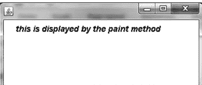

# 总结

1. `Applet` 类是 `java.applet` 包中的唯一类。
2. Applet 在网页中运行。
3. Applet 可以使用 `appletviewer` 或启用 Java 的浏览器执行。
4. `<applet>` 标签用于将 applet 嵌入网页。
5. `init()` 方法在 applet 加载到计算机内存时首次调用。
6. `start()` 方法在 `init()` 方法之后立即调用，并在 applet 因活动窗口滚动获得焦点时每次调用。
7. `stop()` 方法在用户移动到另一个网页时每次调用。
8. `destroy()` 方法在浏览器关闭之前被调用。
9. `Graphics` 类是一个表示 applet 显示区域的抽象类。它是 `java.awt` 包的一部分。`Graphics` 类用于在 applet 区域绘图。
10. 你可以使用 `getGraphics()` 方法获取 `Graphics` 类的对象。

# 回答问题

# 单选题

1. 下列哪个函数用于显示 applet 的输出？

a) `display()`
b) `print()`
c) `displayApplet`
d) `PrintApplet`

答案：b)

**解释:** 每当 applet 需要重绘其输出时，都是通过 `paint()` 方法完成的。

2. 下列哪些方法可以用于在 applet 输出字符串？

a) `display()`
b) `print()`
c) `drawString()`
d) `transient()`

答案：c

**解释：** `drawString()` 方法定义在 `Graphics` 类中。它用于在 applet 中输出字符串。

3. Graphics 是一个

a) 接口 (Interface)
b) 抽象类 (Abstract Class)
c) Final 类 (Final Class)

答案：b

4. 下列哪个方法是抽象窗口工具包 (AWT) 的一部分？

A. `display()`
B. `print()`
C. `drawString()`
D. `transient()`

# 复习题

1. 什么是 Applet？Applet 有构造函数吗？
2. AWT 调用 Applet 方法的顺序是什么？
3. 给出 Applet 生命周期方法并解释它们。
4. Applet 与应用程序有什么区别？
5. 我们可以从 HTML 传递参数吗？如何操作？
6. 鉴于 Applet 的 `getParameter()` 方法返回字符串，我们如何从 applet 的参数中读取任何数字信息？

# 第10 章

# 异常处理

异常是程序执行过程中发生的破坏正常指令流的异常状态或事件。它是一种运行时错误。异常并不总是表示错误。尽管如此，它也可能信号程序中某些值得特别关注的异常事件。异常的主要用处是，它将处理错误的代码与程序顺利运行运行时执行的代码隔离开。由于异常有很多种类，你必须在程序中包含代码来处理它们，否则你的代码将无法编译。

### 10.1 异常处理的必要性

如果请求的文件在磁盘上不存在，你无法承受一个应用程序停止或崩溃的后果。传统上，程序员使用方法的返回值来检测运行时发生的错误。变量 "errno" 被用作错误的数值化表示。如果方法中发生多个错误，“errno" 只返回一个值；即方法中发生的最后一个错误的值。Java 以面向对象的方式处理异常。你可以使用异常类的层次结构来管理运行时错误。异常提供了一种机制，用于通知程序员任何错误。

导致异常的情况非常多样，但它们可以分为四大大类：

1. 代码或数据错误：例如，你尝试对对象进行无效操作、你尝试使用超出数组限制的数组索引、整数算术异常中除数为零等等。
2. 标准方法异常：例如，如果你在 `String` 类中使用 `substring()` 方法，可能会抛出字符串索引越界异常（string index out of bounds exception）。
3. 抛出自定义异常：当你需要时可以抛出自己的异常。
4. Java 错误：这些可能是由于运行你编译程序的 JVM 执行时的错误导致的，但通常是由于程序中错误的结果。

### 10.2 异常的类型


# Java 异常处理

层次结构顶部的类称为 `Throwable`。有两个类派自 `Throwable` 类——`Error`（错误）和 `Exception`（异常）。`Exception` 类用于程序中必须被捕获的异常情况。`Error` 类定义了正常情况下不会发生的情况。换句话说，`Error` 类用于灾难性失败，如虚拟机错误。这些类位于 `java.lang` 包中。

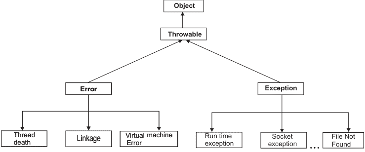

## 异常层次结构

由 `Error` 类及其子类定义的异常其特点是：它们都代表了你无法预期采取任何行动的情况，因此你不被预期去捕获它们。

`Error` 类有三个直接子类：

- `ThreadDeath`（线程死亡）
- `LinkageError`（链接错误）
- `VirtualMachineError`（虚拟机错误）

### ThreadDeath

当执行中的线程被故意停止时，会抛出此异常。它有助于妥善销毁线程。

### LinkageError

该异常的子类记录了程序中类的严重错误。

### VirtualMachineError

该类有四个子类，指定了当 JVM 发生灾难性失败时将抛出的异常。

## 运行时异常

它们也是**未检查异常**，因为这些异常对象是由 JVM 创建的。它们用于信号 Java 语言中各个包中的问题。各种运行时异常包括：

- **算术异常**：当尝试将整数值除以零时产生。
- **索引越界异常**：当尝试访问超出数组索引的数组元素时抛出此异常。例如，当数组有十个元素而你尝试访问数组的第 11 个元素时会抛出此异常。
- **数组负数异常**：当你尝试定义一个负维度的数组时抛出此异常。
- **空指针异常**：当应用程序尝试在需要对象的地方使用 `null` 时抛出此异常。未分配内存的对象持有 `null` 值。触发此类异常的情况包括：
  1. 使用对象但未为对象分配内存。
  2. 调用 `null` 对象的方法。
  3. 访问或修改 `null` 对象的属性。
  4. 将 `null` 的长度像对待数组一样使用。

示例：

```java
String s;
s.length();
```

- **数组存储异常**：当你存储不兼容的对象时抛出此异常。
- **类型转换异常**：当你尝试将对象转换为无效类型时抛出此异常。
- **非法参数异常**：当向方法传递无效参数时抛出此异常。
- **安全异常**：当程序执行非法操作时抛出此异常。

对于所有派自 `Exception` 的类，编译器都会检查你是否处理了异常，或者你是否指明了方法可以抛出异常。如果没有，代码将无法编译。这些被称为**受检异常**。

## 10.3 异常处理技术

当方法发生意外错误时，Java 创建异常对象。创建异常对象后，Java 通过“抛出异常”将其发送给程序。异常对象包含了错误类型以及发生异常时的程序状态。你需要使用异常处理器处理异常。

你可以通过以下关键字在程序中实现异常处理：

1. `try`
2. `catch`
3. `throw`
4. `throws`
5. `finally`

### 示例

```java
class Demo {
    public void myMethod(int num1, int num2) {
        int result;
        result = num2 / num1;
        System.out.println("Result: " + result);
    }

    public static void main(String args[]) {
        Demo app = new Demo();
        app.myMethod(0, 10);
    }
}
```

### 输出

```
Exception in thread "main" java.lang.ArithmeticException: / by zero
    at Demo.myMethod(Demo.java:5)
    at Demo.main(Demo.java:10)
```

Java 环境尝试执行除零操作，导致运行时错误。创建一个异常对象以停止程序并处理异常。它期望异常处理器被调用。默认异常处理器显示上述消息并终止程序。

如果你不想让程序终止，你必须使用 `try` 块捕获异常。

## 1. try 块

你需要将可能抛出异常的语句放在 `try` 块中。语法如下：

```java
try {
    // 可能会引起异常的语句
}
```

`try` 块控制其包含的语句，并定义了异常的作用范围。换句话说，如果在 `try` 块内发生异常，则与 `try` 块关联的适当异常处理器处理该异常。`try` 块必须紧随其至少一个 `catch` 块。

```java
class Demo {
    public void myMethod(int num1, int num2) {
        int result = 0;
        try {
            result = num2 / num1;
        } catch (Exception e) {
            // 处理异常的语句
        }
        System.out.println("Result: " + result);
    }

    public static void main(String args[]) {
        Demo app = new Demo();
        app.myMethod(0, 10);
    }
}
```

## 2. catch 块

你通过在 `try` 块之后紧接着提供一个或多个 `catch` 处理器，将异常处理程序与 `try` 块关联起来。

### 语法

```java
try {
    // 可能引发异常的语句
} catch (ExceptionType e) {
    // 错误处理程序
}
```

`catch` 语句接收一个 `Exception` 类的对象作为参数，该对象引用被捕获的异常。一旦捕获到异常，`catch` 块中的语句将仅限于前面 `try` 块中的语句。下面的代码说明了 `catch` 块的使用。

```java
class Demo {
    public void myMethod(int num1, int num2) {
        int result = 0;
        try {
            result = num2 / num1;
        } catch (ArithmeticException e) {
            System.out.println("Error-> Division by zero");
            // 处理异常的语句
        }
        System.out.println("Result: " + result);
    }

    public static void main(String[] args) {
        Demo app = new Demo();
        app.myMethod(0, 10);
    }
}
```

### 输出

```
Error-> Division by zero
Result: 0
```

> **注意**：编译器不允许在 `try` 块与其关联的 `catch` 块之间存在任何语句。这意味着 `catch` 必须紧跟在 `try` 块之后。

## 异常处理机制

在 Java 中，异常机制以结构化的方式处理异常和意外情况。当发生异常时，Java 运行时系统会在产生异常的方法中搜索异常处理器（`try-catch` 块）。如果在当前方法中没有找到处理器，则会在调用方法中（调用当前方法的方法）进行搜索。搜索将一直持续，直到运行时系统找到合适的异常处理器，即处理器捕获的异常类型与抛出的异常类型相同的类型。

### 示例

```java
public class Base {
    public int divide(int num1, int num2) {
        return num1 / num2;
    }
}

// ****************************************************************
public class Derived extends Base {
    public int divide(int a, int b) {
        return super.divide(a, b);
    }

    public static void main(String[] args) {
        int result = 0;
        Derived d1 = new Derived();
        try {
            result = d1.divide(100, 0);
        } catch (ArithmeticException e) {
            System.out.println("Error : Divide by Zero");
            System.out.println("the result is : " + result);
        }
    }
}
```

### 输出

```
Error : Divide by Zero
the result is : 0
```

在上述代码中，`main()` 方法调用了派生类的重写方法 `divide()`。派生类方法反而使用接收到的参数调用了基类的 `divide()` 方法。基类方法中发生了异常。Java 运行时首先在基类方法中查找异常处理器（被调用的方法）。然后，在派生类方法中查找异常处理器（调用方法）。当在那里找不到处理器时，它切换到 `main()` 方法并执行该方法 `catch` 块中的语句。

## 多个 catch 块

`try` 块可以有多个 `catch` 块。当 `try` 块中包含可能引发不同类型异常的语句时，这是必要的。下面的代码捕获了三种类型的异常。

```java
public class TryCatchDemo {
    public static void main(String[] args) {
        int a[] = {1, 0};
        int num1, num2, result = 0;
        try {
            num1 = a[2];
            num2 = a[0];
            result = num1 / num2;
        } catch (ArithmeticException ae) {
            System.out.println(" Divide by Zero Error");
        } catch (ArrayIndexOutOfBoundsException e) {
            System.out.println("Array Exceeds the index value");
        } catch (Exception e) {
            System.out.println("Exception occured");
            System.out.println("Result=" + result);
        }
    }
}
```

### 输出

```
Array Exceeds the Index value Result = 0
```

`try` 块有许多语句，每条语句都可能导致异常。`try` 块之后有三个 `catch` 块，用于处理每种类型的异常。具有最特定异常类的 `catch` 块必须写在前面。

如果你发现，`try` 中的第二个语句没有被执行。这是因为当引发异常时，程序的执行流会被中断，并执行特定 `catch` 块中的语句。

## 嵌套 try & catch 块

`try` 可以嵌套，即你可以在一个 `try-catch` 块内部包含另一个 `try-catch` 块。

```java
public class NestedTry {
    public static void main(String[] args) {
        int result = 0;
        try {
            try {
                result = 10 / 0;
            } catch (ArithmeticException e) {
                System.out.println("Inner catch: Division by zero");
            }
        } catch (Exception e) {
            System.out.println("Outer catch: " + e);
        }
    }
}
```

## throw 关键字示例

```java
public class IllegalValueException extends Exception {}

public class UserTrial {
    int val1, val2;

    public UserTrial(int a, int b) {
        val1 = a;
        val2 = b;
    }

    void show() throws IllegalValueException {
        if ((val1 < 0) || (val2 > 0)) {
            throw new IllegalValueException("value 1=" + val1);
            System.out.println("value 2=" + val2);
        }
    }
}

public class ThrowExample {
    public static void main(String a[]) {
        UserTrial values = new UserTrial(-1, 1);

        try {
            values.show();
        } catch (IllegalValueException e) {
            System.out.println("illegal values: caught in main");
        }
    }
}
```

### 输出

```
illegal values: caught in main
```

**代码解释：**

1. 一个名为 `IllegalValueException` 的类继承自 `Exception` 类。
2. `UserTrial` 类有一个方法，该方法抛出一个名为 `IllegalValueException` 的自定义异常。
3. `ThrowExample` 类中的 `main()` 方法创建了 `UserTrial` 类的对象，并将错误值传递给构造函数。
4. `main()` 方法的 `try` 块调用了 `show()` 方法。
5. `show()` 方法抛出一个异常，该异常被 `main()` 方法中的异常处理器捕获。
6. `catch` 块中的信息“Illegal values: caught in main”显示在屏幕上。

### 另一个示例：我们想要抛出自己的异常。当年龄低于 18 岁时，抛出 `InvalidAgeException`。

```java
public class InvalidAgeException extends Exception {
    InvalidAgeException() {
        super("age cannot be below 18");
    }
}

class Voter {
    String name;
    int age;
    InvalidAgeException e;

    void setData(String n, int a) throws InvalidAgeException {
        if (a < 18)
            e = new InvalidAgeException();
        throw e;
    }

    public static void main(String args[]) {
        Voter v = new Voter();
        try {
            v.setData("Sarika", 14);
        } catch (InvalidAgeException e) {
            System.out.println(e);
        }
    }
}
```

### 输出

```
InvalidAgeException: age cannot be below 18
```

## 总结


- 1. 异常是程序执行过程中发生的中断指令正常流的异常事件。应用程序必须能够处理异常的能力。
- 2. Java 提供了处理异常的类。`Throwable` 类是可能发生的所有错误和异常的父类。它是 `java.lang` 包的一部分。
- 3. 异常使用 `try`、`catch`、`throw`、`throws` 和 `finally` 关键字进行处理。
- 4. 当异常被抛出时，Java 运行时会在当前方法中搜索异常处理器，然后在调用者方法中搜索。
- 5. `try` & `catch` 块可以嵌套。
- 6. 你可以通过扩展 `Exception` 类来创建自己的异常。

# 回答以下问题

## 单选题

### 1. 给定

```java
class Fork {
    public static void main(String a[]) {
        if (a.length == 1 || a[1].equals("test")) {
            System.out.println("testcase");
        } else {
            System.out.println("production " + a[0]);
        }
    }
}
```

命令行调用方式为：

`Java Fork live2`

#### 1. 结果是什么？

a) testcase
b) Production live2
c) Test case live2
d) Compilation fails
e) 异常在运行时抛出。

答案：a)

### 2. 如果异常在 `try` 块中产生，它会在哪个块中被捕获？

a) finally
b) catch
c) throw
d) throws

答案：b)

### 3. 显式抛出异常使用哪个关键字？

a) Finally
b) catch
c) throw
d) throws

答案：c)

### 4. 异常是所有异常的父类。

a) Throwable
b) Exception
c) My

答案：a)

### 5. 无论异常是否被捕获，哪个块都会执行？

a) finally
b) catch
c) throw
d) throws

答案：a)

## 复习题

1. 异常的类型分哪些？
2. 区分 `finally` 和 `finalize`。
3. 区分 `Error` 和 `Exception`。
4. 什么是受检异常（checked Exception）和非检异常（unchecked Exception）？
5. 你如何创建自定义异常？

## 面试题

1. 什么是异常？
2. 区分受检异常和非检异常。
3. 每个 `try` 块必须后跟 `catch` 块吗？
4. 什么是 `finally` 块？
5. `finally` 块可以在没有 `catch` 的情况下使用吗？
6. 是否存在 `finally` 不执行的情况？
7. `throw` 和 `throws` 的区别？

# 第一章 多线程编程

大多数游戏使用图形和声音。你是否注意到图形、得分和音乐是同时运行的？想象一下这种情况：你先看到屏幕变化，接着得分更新，最后听到声音！单线程游戏中这些元素是同时处理的。换句话说，程序被分成了三个单元，每个单元由一个线程处理。如果你用过 Word，你就会注意到在你输入时，应用程序在后台保存文件。这是多线程的另一个示例，用户界面由一个线程处理，文件保存由另一个线程处理。当你有需要几秒钟完成的大计算且不想让用户感到延迟时，线程非常有用。动画是线程使用的另一个领域。

## 线程

线程类似于顺序程序。顺序程序有开始、执行步骤和结束。线程也有开始和结束。但线程不是程序，而是在程序内部运行。线程可以定义为程序内的顺序控制流。每个程序至少有一个主线程。需要时你可以创建更多线程。微处理器为你执行的进程分配内存。每个进程占用自己的地址空间（内存）。然而，一个进程中的所有线程共享同一个地址空间。因此，内存、设备、数据和环境对所有线程可用。线程也被称为“轻级进程”或“执行上下文”。这是因为从一个线程切换到另一个线程时，处理器的重叠较少。相反，进程是重量级的。

## 单线程和多线程应用程序

仅由一个线程组成的进程被称为单线程程序。单线程应用程序每次只能执行一个任务。你必须等待一个任务完成后再开始另一个。

例如，我们有三个活动——读取文件、处理和写入文件，它们必须顺序运行，并且该顺序要对每个读取和处理的文件重复。然后可以使用单个线程执行该过程。

### 图表

| 线程-1 | 线程-2 |
| :--- | :--- |
| 读取块1 | 读取块2 |
| 处理-1 | 处理-2 |
| 写入1 | 写入2 |

拥有多个线程的单线程进程被称为多线程。它是一组同时运行、执行不同任务并相互作用的进程。

## 多线程程序

任何像 Microsoft Internet Explorer 这样的浏览器都是多线程应用程序的示例。使用浏览器时，你可以在滚动页面时在后台打印页面。你可以同时播放音频文件并观看动画图像。这种行为接近现实生活，你并发执行多个任务。

Java 对线程有内置支持。Java 架构的大部分是多线程的。在 Java 程序中，线程最主要用途是允许 applet 接受用户输入，同时在屏幕的其他部分显示动画。任何需要同时完成至少两件事的应用程序都是多线程的理想人选。

继续之前的示例，让我们安排程序，使得从文件中读取一个块是一个活动，执行计算是第二个活动，写入结果是第三个活动。在这种情况下，一旦读取了第一个块，读取第二个块就可以开始。总之，我们可以如下所示并发进行这三个活动。

## 示例

```java
public class CurrentthreadDemo {
    public static void main(String a[]) {
        Thread thisthread = Thread.currentThread();
        try {
            for (int counter = 0; counter < 10; counter += 2) {
                System.out.println(counter);
                Thread.sleep(1000);
            }
        } catch (InterruptedException e) {
            System.out.println("hey! I was interrupted");
        }
    }
}
```

输出

```
0
2
4
6
8
```

在上述的应用程序中，使用 `currentThread()` 获取当前线程。每当线程打印 `counter` 的值时，线程就会进入睡眠 1000 毫秒（1 秒）。如果线程在睡眠期间被另一个线程中断，该线程可能会抛出异常，因此，`sleep()` 方法被 `try` 块保护。

## 创建线程

你可以使用下面列出的两种方法中的任意一种在程序中创建线程：

1. 继承 `Thread` 类
2. 使用 `Runnable` 接口

### `Thread` 类

`java.lang.Thread` 类用于在多线程应用程序中构建和访问单个线程。它支持许多方法，用于获取线程活动的信息、设置和检查线程属性，以及导致线程等待、中断或销毁。你可以通过扩展 `Thread` 类来让你的应用程序和类在单独线程中运行。

扩展类必须重写 `run()` 方法，该方法是新线程的入口。线程的所有激活都发生在 `run()` 方法定义的线程体中。在线程被创建并初始化后，会通过 `start()` 方法调用 `run()` 方法。

```java
class ThreadDemo extends Thread {
    {
        super("Demo thread");
        System.out.println("child thread:" + this);
        start();
    }

    public void run() {
        try {
            for (int i = 5; i > 0; i--) {
                System.out.println("child thread:" + i);
                Thread.sleep(500);
            }
        } catch (InterruptedException e) {
            System.out.println("Hey! I am interrupted" + e);
        }
    }

    public static void main(String args[]) {
        ThreadDemo d = new ThreadDemo();
        try {
            for (int i = 5; i > 0; i--) {
                System.out.println("main thread:" + i);
                Thread.sleep(1000);
            }
        } catch (Exception e) {
            System.out.println("Hey! I am interrupted2" + e);
        }
    }
}
```

### 输出

| 输出 |
| :--- |
| main thread:5 |
| child thread:5 |
| child thread:4 |
| main thread:4 |
| child thread:3 |
| child thread:2 |
| main thread:3 |
| child thread:1 |
| main thread:2 |
| main thread:1 |

### (2) `Runnable` 接口

Applet 继承自 `Applet` 类。由于 Java 不支持多继承，你不能既继承 `Applet` 类又继承 `Thread` 类。Java 提供了 `Runnable` 接口来解决这个问题。`Runnable` 接口包含单一方法 `run()`，该方法在线程激活时执行。现在你可以在扩展 `Applet` 类的同时实现 `Runnable` 接口并在应用程序中编写 `run()` 方法。因此，你仍然可以选择继承 `Thread` 类。换句话说，当程序需要继承除 `Thread` 类以外的类时，你需要实现 `Runnable` 接口。

#### 示例

```java
public class ThreadDemo extends Applet implements Runnable {
    public void run() {
        ....
    }
}
```

要实现 `Runnable`，类仅需要实现一个单一方法 `run()`，该方法声明为：

```java
public void run()
```

> **注意：**
> 当你使用 `Runnable` 接口时，线程成为 `Applet` 类的一部分，并可以授予数据成员和方法的完全访问权限。`Thread` 类的子类仅限于该类的公共组件。因此，当线程强烈依赖 `Applet` 类的组件时，请使用 `Runnable` 接口。

## 线程操作

### (1) `start()` 方法

`Thread` 类的 `start()` 方法负责启动线程。它为线程分配必要的系统资源。

语法：

```java
public void start()
```

### (2) `run()` 方法

一旦启动，线程就会进入可运行状态。线程的所有活动都发生在 `run()` 方法定义的线程体中。在线程被创建并初始化后，会调用 `run()` 方法。`run()` 方法通常包含一个循环：

```java
public void run() {
    while(ThreadDemo != null) {
    }
}
```

### (3) `sleep()` 方法

线程通过 `sleep()` 方法被置于睡眠模式。当线程处于睡眠时，队列中的其他线程将被执行。

语法：

```java
static void sleep(long no_of_milliseconds) throws InterruptedException;
```

其中 `no_of_milliseconds` 是线程不活跃的毫秒数。`sleep` 是一个静态方法，因为它作用于当前线程。它会抛出 `InterruptedException`。

`sleep` 方法还有一个形式，允许你指定纳秒数。

语法：

```java
static void sleep(long no_of_milliseconds, int nanoseconds) throws InterruptedException;
```

### (4) 停止线程

线程在 `run()` 方法完成时死亡。线程可以通过 `stop()` 方法杀死。

```java
public void stop();
```

> **注意：** `stop()`、`suspend()` 和 `resume()` 方法在 JDK 中已废弃。

### (5) `setName` 方法

你可以使用 `setName()` 设置线程名称。通过 `getName()` 获取线程名称。这些方法是 `Thread` 的成员，声明如下：

语法：

- (a) `final void setName(String name)`
- (b) `final String getName()`

### (6) `isAlive()`

为了确定线程是否结束，我们有 `isAlive()` 方法。

语法：

```java
final boolean isAlive()
```

如果调用的线程仍在运行，则返回 `true`。否则返回 `false`。

### (7) `join()`

该方法等待调用的线程终止。`join()` 的附加形式允许你指定等待线程终止的最长时间。

## 11.3 线程优先级

运行时环境根据优先级执行线程。CPU 一次只能执行一个线程。因此，就绪的线程会排队。每个线程获得时间片后都会返回队列。调度使用固定优先级调度，本质上是根据线程相对于其他线程的优先级来执行线程。优先级影响线程在处理器线程队列中的位置。高优先级线程在低优先级线程之前运行。

如果 Java 遇到另一个高优先级线程，当前线程会被推回。线程可以自愿放弃其在队列中的位置。这在线程让出执行权或睡眠时发生。如果线程正在等待输入输出操作，它会被抢占（推回队列）。当另一个高优先级线程从睡眠中醒来时，线程也可以被抢占。优先级来自创建它的线程。你可以用 1 到 10 之间的整数表示线程的优先级。你可以使用 `Thread` 类的 `setPriority()` 方法更改线程的优先级。

语法：

```java
public final void setPriority(int newPriority);
```

参数 `newPriority` 可以取下面提到的任何常量：

```
MIN_PRIORITY
MAX_PRIORITY
NORM_PRIORITY
```

这些常量在 `Thread` 类中声明。

```
MIN_PRIORITY 的值为 1
MAX_PRIORITY 的值为 10
NORM_PRIORITY 的值为 5
```

> **注意：**
> - (1) 默认线程优先级为 5。新线程被分配与创建它的线程相同的优先级。
> - (2) 线程优先级在不同的 JVM 中其处理方式不同。Java 未规定线程调度器必须对优先级做什么。它只规定线程必须具有优先级。

示例：


```java
public class MyThread implements Runnable {
    int counter = 0;
    private Thread thread;
    private boolean counting = true;
    public MyThread(int priority) {
        thread = new Thread(this); // 创建一个线程
        thread.setPriority(priority);
    }
    public void run() {
        while (counting) {
            counter++;
        }
    }
    public void stop() {
        counting = false; /* 这将停止 run() 中的 while 循环*/
    }
    public void start() {
        thread.start(); // 启动线程
    }
}
public class Starter {
    public static void main(String[] args[]) {
        // 设置当前线程的优先级。
        Thread.currentThread().setPriority(Thread.MAX_PRIORITY);
        // 增加线程 1 的优先级
        MyThread thread1 = new MyThread(Thread.NORM_PRIORITY + 2);
        // 降低线程 2 的优先级
        MyThread thread2 = new MyThread(Thread.NORM_PRIORITY - 2);
        thread1.start();
        thread2.start();
        try {
            System.out.println("Thread sleep");
            Thread.sleep(5000);
            // 当前线程睡眠 5 秒。
        } catch (Exception e) {
            System.out.println("exception occurred");
        }
        // 5 秒后停止线程
        System.out.println("Thread counter" + thread1.counter + "Thread counter" + thread2.counter);
        thread1 = null;
        thread2 = null;
    }
}
```

# 11.4 线程的同步

当两个线程需要共享数据时，你必须确保一个线程不会改变另一个线程正在使用的数据。例如，如果一个程序有两个线程，一个从文件中读取你的工资，另一个尝试更新工资，可能会导致数据损坏，你的工资将会损失！Java 允许你使用 `synchronized` 方法或 `synchronized` 语句来协调多个线程的行为。

## 线程同步

通过使用带有 `synchronized` 关键字声明的方法对对象的访问进行协调。在任何时间，你只能为一个对象调用一个同步方法。这防止了多个线程之间同步方法之间的冲突。

所有对象和类都关联有一个监视器（monitor）。监视器控制同步方法访问对象或类的方式。它确保了在任何给定时刻，只有一个线程可以访问资源。当同步方法被调用时，它会获取对象的监视器。在同步方法的执行期间，对象会被锁定，因此无法调用其他同步方法。一旦方法完成执行，监视器会自动释放。当同步方法执行另一个方法（如 `wait()` 方法）时，监视器也可能会释放。与同步方法相关的线程在等待条件满足之前将变为不可运行状态。当等待条件满足时，线程必须获取对象的监视器才能变为可运行。

以下代码显示了如何使用同步方法和对象监视器来协调多个线程对公共对象的访问。

### 示例

```java
import java.lang.*;
class MyThread extends Thread {
    static String message[] = {"I", "love", "Java", "very", "much"};
    public MyThread(String id) {
        super(id);
    }
    public void run() {
        Sync.displayList(getName(), message);
    }
    void waiting() {
        try {
            sleep(1000);
        } catch (Exception e) {}
    }
}

class Sync {
    public static synchronized void displayList(String name, String list[]) {
        for (int i = 0; i < list.length; ++i) {
            MyThread thread = (MyThread) Thread.currentThread();
            thread.waiting();
            System.out.println(name + " " + list[i]);
        }
    }
}

class ThreadSync {
    public static void main(String args[]) {
        MyThread thread1 = new MyThread("thread1");
        MyThread thread2 = new MyThread("thread2");
        MyThread thread3 = new MyThread("thread3");
        thread1.start();
        thread2.start();
        thread3.start();
    }
}
```

`MyThread` 类的 `run()` 方法调用了 `Sync` 类的 `displayList()` 方法。`displayList()` 方法是静态的。该方法将显示“I love Java very much”。它调用 `waiting()` 方法在显示消息的每个单词之前等待一秒。`displayList()` 方法使用类的 `currentThread()` 方法来引用当前线程以便调用 `waiting()` 方法。

当使用 `synchronized` 关键字时，thread1（第一个线程）调用 `displayList()` 并获取 `Sync` 类的监视器（因为 `displayList` 是一个静态方法），`displayList()` 继续为线程 1 进行显示。由于线程 1 已获取了 `Sync` 类的监视器。


> 注意：使用 `synchronized` 关键字，thread1（第一个线程）调用 `displayList()` 并获取 `Sync` 类的监视器（因为 `displayList` 是静态方法），`displayList()` 继续为线程 1 进行显示。

# 11.5 线程通信

你可以通过让线程相互通信来释放线程的力量。看这个类比：让四个饥饿的线程相互通信。它们对汤（soup）会做什么？


它们有两个选择：

- 选择 1：第一个成员拥有汤，并传递给下一个。
- 选择 2：每个成员有一把勺子并传递给下一个。

## 哪种选择更好？

在上面的类比中，汤类似于对象，勺子类似于监视器。

让我们看另一个例子，`thread1` 产生的数据由 `thread2` 消费。这里 `thread1` 是生产者，`thread2` 是消费者。消费者必须不断检查是否有数据可以操作。如果生产者在完成工作后与消费者通信呢？消费者将不再浪费大量的周期来检查生产者是否就绪。线程之间的通信被称为线程间通信。

## 线程通信通过四个方法实现

- `wait()`
- `notify()`
- `notifyAll()`
- `yield()`

所有方法在对象类中都声明为 `final`。它们只能在同步方法中调用。

### A) `wait()` 方法

`wait()` 方法告诉当前线程放弃监视器并睡眠，直到另一个线程调用 `notify()` 方法。你可以使用 `wait()` 方法同步线程。

#### 语法

```java
public final void wait() throws InterruptedException
```

`wait()` 方法让当前线程等待，直到另一个线程调用当前对象的 `notify()` 或 `notifyAll()` 方法。

当前线程必须拥有对象的监视器。

> 注意：
> - (1) `wait()` 和 `sleep` 都会延迟请求的时间。如果你使用 `wait()` 方法，你可以通过 `notify()` 方法恢复线程。使用 `sleep()` 方法时无法这样做。这对于睡眠几分钟的线程至关重要。
> - (2) 等待线程一旦被通知，可能会立即获得对象的监视器控制权。可能有其他线程获得监视器的控制权。

### B) `notify` 方法

`notify()` 方法唤醒一个等待当前监视器的线程。如果有多个线程在等待，则随机选择一个。被唤醒的线程在当前线程释放监视器锁之前无法继续执行。监视器的所有者线程应该调用该方法。

#### Java 深度解析

线程通过三种方式成为对象监视器的所有者：

- 通过执行该对象的同步（`synchronized`）实例方法。
- 通过执行同步对象的同步（`synchronized`）语句。
- 通过执行类的同步（`synchronized`）静态方法（针对该类型的对象）。

在任何时刻，只能有一个线程拥有对象的监视器。

#### 语法

```java
public final void notify();
```

### C) `notifyAll()` 方法

`notifyAll()` 方法用于唤醒所有等待该对象监视器的线程。

> 注意：要调用 `notify()` 和 `notifyAll()` 方法，线程必须拥有对象的监视器。

### D) `yield()` 方法

`yield()` 方法导致运行时系统将当前线程置于睡眠并执行队列中的下一个线程。`yield()` 方法可用于确保低优先级线程也能获得处理器时间。

#### 语法

```java
public static void yield();
```

> 注意：时间分片和线程优先级在不同的 JVM 之间是不同的。在 Windows 平台上运行线程程序得到的结果与在 Solaris 平台上获得的结果不同，因为不同的系统处理线程的方式不同。

## 示例（涉及 `wait()`、`notify()`、`synchronized` 的使用）

让我们以一家职业介绍所为例。每当有新的职位空出现时，就会提供给候选人。这必须谨慎进行，因为候选人接受的工作不能超过空缺数量。因此，介绍所决定一次只贴出一个公告，并等待候选人接工作。因此，在第一个职位被填满之前，不会贴第二个公告。同时，某个职位只能选择一个候选人。

以下程序显示了如何使用 `wait()` 和 `notify()` 方法解决该问题。

```java
import java.lang.*;
class JobOpening {
    int counter;
    boolean valueset = false;
    synchronized int get() {
        if (!valueset) // 如果没有可用职位
            try {
                wait(); // 等待通知 // 有职位空
            } catch (InterruptedException e) {
                System.out.println("Got : " + counter);
                valueset = false; // 没有更多可用职位
                notify();
                return counter;
            }
    }
    synchronized void put(int counter) {
        if (valueset) // 如果职位尚未被候选人接
            try {
                wait(); // 等待现有职位
            } catch (InterruptedException e) { }
        this.counter = counter;
        valueset = true;
        System.out.println(" put:" + counter);
        notify();
    }
}

class MyThread1 implements Runnable {
    JobOpening job;
    public MyThread1(JobOpening job) {
        this.job = job; // 创建一个生产职位的线程 //
        new Thread(this, "job production").start();
    }
    public void run() {
        int i = 0;
        while (true) {
            job.put(i++);
            // 添加另一个职位 //notify
        }
    }
}

class MyThread2 implements Runnable {
    JobOpening job;
    public MyThread2(JobOpening job) {
        this.job = job; // 创建一个消费职位的线程 //
        new Thread(this, "job consumer").start();
    }
    public void run() {
        // int i = 0;
        while (true) {
            System.out.println(job.get());
        }
    }
    public static void main(String s[]) {
        JobOpening job = new JobOpening();
        new MyThread1(job);
        new MyThread2(job);
    }
}
```

### 输出

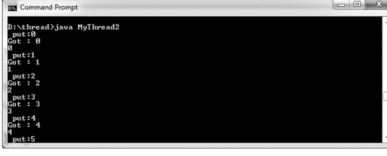

# 11.6 多线程中的死锁问题

在多个线程竞争访问多个资源的应用程序中，可能会出现名为“死锁”（Deadlock）的情况。当两个线程对一对同步对象形成循环等待条件时，就会发生死锁。例如，线程 A 等待线程 B 释放锁，而线程 B 正在等待线程 A 释放锁以完成它们的事务。

| 线程 A | 线程 B |
|---|---|
| 资源 1 | 资源 2 |

---) 表示线程持有的资源
---) 表示线程所需的资源

只有当其中一个线程通过同步块时，这些线程才能继续执行。由于它们都无法继续执行，就发生了死锁。

## 避免死锁所需的预防措施

- (1) 确定锁定对象的顺序。
- (2) 遵循该顺序。
- (3) 按反序释放锁。

> 注意：
> - (1) `synchronized` - 是同步线程的方法修饰符。
> - (2) `wait()` 方法 - 用于使线程等待。
> - (3) `notify()` 方法 - 用于唤醒等待的线程。
> - (4) `notifyAll()` 方法 - 用于唤醒所有等待的线程。
> - (5) `yield()` 方法 - 用于为低优先级线程分配处理器时间。

# 11.7 线程的生命周期


图示描述了以下状态：

- (1) 新 (New)
- (2) 开始 (Start)
- (3) 可运行 (Runnable)
- (4) 不可用 (Not Runnable)
- (5) 死亡 (Dead)

## 新状态

当创建 `Thread` 类的实例时，它进入新状态。图示说明了线程的实例化。

```java
Thread thread = new Thread();
```

## 开始状态

`start()` 方法用于启动线程。在开始状态，代码创建一个线程。

```java
thread.start();
```

## 可运行状态

当调用 `start()` 方法时，它进入可运行状态。线程被调度执行时间。这就是为什么说是可运行状态。

## 不可用状态

如果线程处于以下状态，则为不可用：

- (a) 睡眠 (sleeping)
- (b) 等待 (waiting)
- (c) 被其他线程阻塞

线程可以通过 `sleep()` 方法置于睡眠。在指定的时间过去后，它进入可运行状态。

## 死亡状态

线程可以自然死亡或被杀死。自然死亡发生在 `run()` 方法完成后。将线程对象杀死线程。`isAlive()` 方法用于判断线程是否已启动。

> 注意：
> - (1) 你不能重启死亡线程。
> - (2) 你不能调用死亡线程的方法。

# 总结

1. 线程是程序中的顺序执行流。每个程序至少有一个线程，称为主线程。
2. 只有一个线程的应用程序称为单线程。


# 多线程编程

## 核心概念

3. `currentThread()` 方法获取当前线程。
4. 多线程应用程序有多个线程。
5. `Thread` 类用于在程序中操作线程。
6. 你可以使用 `Thread` 类或 `Runnable` 接口来实现线程。
7. 线程可以处于以下状态：
   - New
   - Start
   - Runnable
   - Not Runnable
   - Dead
8. `start()` 方法用于启动线程。
9. `run()` 方法包含线程执行的代码。
10. 线程可以通过 `sleep()` 方法置于睡眠。
11. `stop()` 方法用于停止线程。
12. `wait()` 和 `notifyAll()` 用于线程间通信。

## 单选题

### 1. 假设：

```java
public class Threads2 implements Runnable {
    public void run() {
        System.out.println("run");
        throw new RuntimeException("Problem");
    }
    public static void main(String[] args) {
        Thread t = new Thread(new Threads2());
        t.start();
        System.out.println("End of method");
    }
}
```

哪些可能是？（选择两个）

a) java.lang.RuntimeException: Problem  
b) run  
c) End of method  
d) End of method / run  
e) java.lang.RuntimeException: Problem / run  

**答案**: d), e)

### 2. Java 中的线程优先级是什么？

a) Integer  
b) Float  
c) double  
d) long  

**答案**: a

### 3. 如果同时调用两个相同优先级的线程进行处理会发生什么？

a) 任何一个将按字母顺序优先执行  
b) 它们将同时执行  
c) 它们都不会被执行  
d) 这取决于操作系统。  

**答案**: d

### 4. 下列哪些项是多任务处理的类型？

a) 基于进程的  
b) 基于线程的  

**答案**: a), b)

### 5. 哪个包包含了所有的 Java 内置异常？

a) java.io  
b) java.util  
c) java.lang  
d) java.net  

**答案**: c

## 判断对错

1. 两个以上的线程可能同时发生死锁。  
   **答案**: 正确

2. JVM 实现保证了多个线程不会进入死锁状态。  
   **答案**: 错误

3. 一旦死锁线程的 `sleep()` 方法持续时间过期，它们就会被释放。  
   **答案**: 错误

4. 只有在不当使用 `wait()`、`notify()` 和 `notifyAll()` 方法时才会发生死锁。  
   **答案**: 错误

5. 如果使用了同步块，单线程应用程序也可能发生死锁。  
   **答案**: 错误

6. 如果一段代码能够死锁，你无法通过插入 `Thread.yield()` 的调用来消除死锁的可能性。  
   **答案**: 正确

## 复习题

1. Java 中多线程的“同步”是指什么？
2. 解释使用线程的不同方法。
3. `Thread.start()` 和 `Thread.run()` 方法有什么区别？
4. 为什么我们既需要 `run()` 又需要 `start()` 方法？只用 `run` 方法可以实现吗？
5. 什么是 `ThreadLocal` 类？如何使用它？
6. 什么时候会抛出 `InvalidMonitorStateException`？为什么？
7. `sleep()`、`suspend()` 和 `wait()` 之间有什么区别？
8. 如果将一个静态方法标记为 `synchronized` 会发生什么？

## 面试题

1. 抢占式调度和时间分片有什么区别？
2. `join()` 方法的作用是什么？
3. `wait()` 方法和 `sleep()` 方法有什么区别？
4. 可以启动两次线程吗？
5. 什么是同步和静态同步？
6. `notify()` 和 `notifyAll()` 有什么区别？

# 第 12 章 流

## 12.1 Java 中的流

所有程序都接受用户的输入，对其进行处理并产生输出。因此，所有的编程语言都支持输入输出操作。Java 通过 `java.io` 包中的类提供了对输入输出的支持。Java 以流的形式处理所有的输入输出。流是沿着通信路径从源到目的地的字节序列。

如果程序从流写入数据，则该流就是流源。同样，如果向流读取，则该流就是流目的地。流之所以强大，是因为它们抽象了输入/输出（I/O）操作的细节。

两个基本的流是：

- (a) 输入流
- (b) 输出流

每个流都有特定的功能。你只能从输入流读取，反之，你只能向输出流写入。

**注意**：

1. **节点流**：某些从特定位置（如磁盘文件或内存）读取或写入的流被称为节点流。节点流的类型包括文件、内存和管道。
2. **过滤器流**：某些流用于从一个流读取数据并写入另一个流。

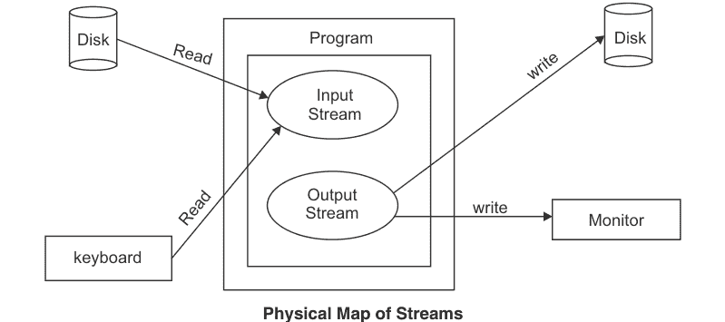

#### 流的层级结构

字节流的两个主要类是 `InputStream` 和 `OutputStream`。这些类拥有子类来提供各种 I/O 能力。`InputStream` 类是输入类层次结构的基础，而 `OutputStream` 类是输出类层次结构的基础。

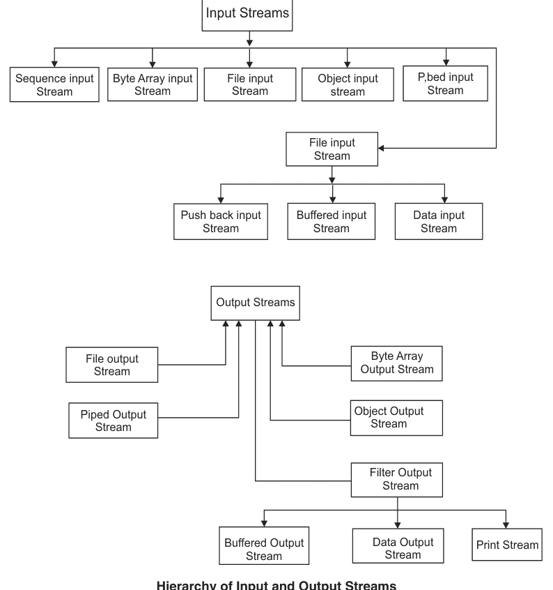

JDK 1.1 引入了用于 Unicode I/O 的 `Reader` 和 `Writer` 类。这些类支持国际化（I18N，因为 Internationalization 一单词中 ‘I’ 和 ‘N’ 之间有 18 个字母）。

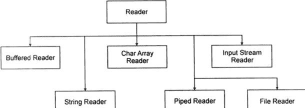

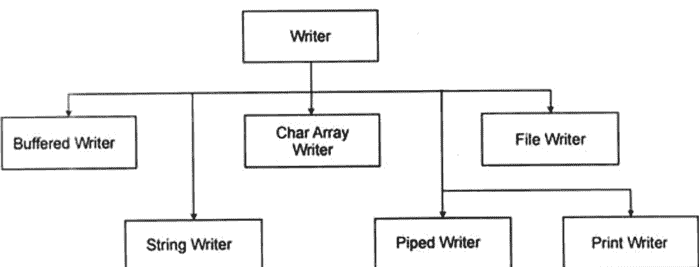

## 12.2 流分类

### 12.2.1 输入流 (`InputStream`)

| 修饰符 | 说明 |
| :--- | :--- |
| `available()` | 返回可以在不阻塞的情况下读取的字节估计值。 |
| `close()` | 关闭此流并释放任何系统资源。 |
| `mark(int readlimit)` | 在流中标记当前位置。 |
| `markSupported()` | 测试流是否支持标记。 |
| `read()` | 读取下一个字节。 |
| `reset()` | 将此流重新置到调用 `mark` 的位置。 |
| `skip(long n)` | 跳过并丢弃此流中的 n 个字节。 |

### 12.2.2 可标记流

| 修饰符 | 说明 |
| :--- | :--- |
| `mark(int readlimit)` | 在流中标记当前位置。 |
| `markSupported()` | 测试流是否支持标记。 |
| `reset()` | 将此流重新置到调用 `mark` 的位置。 |

### 12.2.3 输出流 (`OutputStream`)

| 修饰符 | 说明 |
| :--- | :--- |
| `write(byte[] b)` | 从指定的数组向此流写入 b.length 个字节。 |
| `write(byte[] b, int off, int len)` | 从字节数组中从偏移量 off 处开始向此流写入 len 个字节。 |
| `write(int b)` | 将指定的字节写入此流。 |
| `flush()` | 刷新此流并强制将任何缓冲输出写入。 |
| `close()` | 关闭此流并释放任何系统资源。 |

### 12.2.4 输入和输出流的类型

#### I) `FileInputStream` 和 `FileOutputStream`

在 Java 中，`FileInputStream` 和 `FileOutputStream` 类用于从文件读取和写入数据。

**`FileOutputStream` 构造函数**

1. `FileOutputStream(File file)`：创建向 `File` 对象表示的文件写入的输出流。
2. `FileOutputStream(File file, boolean append)`：创建向 `File` 对象表示的文件写入的输出流。如果 `append` 为 `true`，则以追加模式打开文件。
3. `FileOutputStream(FileDescriptor fdObj)`：创建向文件描述符写入的输出流，该描述符表示文件系统中实际文件的现有连接。
4. `FileOutputStream(String name)`：创建向具有指定名称的文件写入的输出流。
5. `FileOutputStream(String name, boolean append)`：创建向具有指定名称的文件写入的输出流。如果 `append` 为 `true`，则以追加模式打开文件。

> 它们都会抛出 `FileNotFoundException`。在这里，file path 是文件的全路径，file 是描述文件的对象。

**`FileInputStream` 构造函数**

1. `FileInputStream(File file)`：通过连接文件系统中由 `File` 对象命名的实际文件来创建 `FileInputStream`。
2. `FileInputStream(FileDescriptor fdObj)`：使用文件描述符 `fdObj` 创建 `FileInputStream`，该描述符表示到文件系统中实际文件的现有连接。
3. `FileInputStream(String name)`：通过连接文件系统中由路径名称命名的实际文件来创建 `FileInputStream`。

`File` 类提供了访问文件和目录的方法，并对它们进行操作。`FileDescriptor` 类帮助主机系统跟踪正在访问的文件。`FileInputStream` 和 `FileOutputStream` 类提供了读取和写入流的能力。`FileReader` 和 `FileWriter` 类支持基于 Unicode 的文件 I/O。

#### `File` 类

`File` 类用于访问文件和目录。`File` 类使用操作系统的命名约定。`File` 类具有用于创建文件和目录的构造函数。这些构造函数接受绝对和相对路径作为参数。`File` 类的方法允许你删除和重命名文件。这些方法检查文件的读写权限。

**`File` 构造函数**

要创建一个 `File` 类对象，可以使用以下构造函数之一：

1. `File(String pathname)`：通过将给定的字符串转换为新的 `File` 类实例。
2. `File(String parent, String child)`：从父路径和文件名创建一个新的 `File` 类实例。
3. `File(File parent, String child)`：从父文件对象和文件名创建一个新的 `File` 类实例。

```java
File file, file1, file2;
file = new File("c:\\java.txt");
file1 = new File("c:\\java.txt");
file = new File("c:\\newFolder");
file2 = new File(dir, "file.txt");
```

> 注意：双反斜杠用于取消 `\` 的特殊含义。

#### II) 缓冲输入流和缓冲输出流

`BufferedInputStream` 类为输入流创建一个缓冲区，通过减少从流中读取数据的次数来提高输入操作的效率。`BufferedOutputStream` 类为输出流创建并维护一个缓冲区。两者代表过滤器流。

**`BufferedInputStream` 构造函数**

1. `BufferedInputStream(InputStream in)`：创建一个 `BufferedInputStream` 并保存参数 `in` 以供以后使用。
2. `BufferedInputStream(InputStream in, int size)`：创建一个指定大小的 `BufferedInputStream` 并保存参数 `in` 以供以后使用。

> 注意：缓冲输入流支持 `mark()` 和 `reset()` 方法。

**`BufferedOutputStream` 构造函数**

1. `BufferedOutputStream(OutputStream out)`：创建一个缓冲输出流，将数据写入指定的输出流。
2. `BufferedOutputStream(OutputStream out, int bufsize)`：创建一个指定大小的缓冲输出流，将数据写入指定的输出流。缓冲输出流通过减少系统实际写入数据的次数来提高性能。你可能需要调用 `flush()` 使缓冲区中的任何数据立即写入。

**示例**

```java
import java.io.*;

class BufferedStream {
    public static void main(String[] args) {
        FileOutputStream fout = new FileOutputStream("f1.txt");
        BufferedOutputStream bout = new BufferedOutputStream(fout);

        FileInputStream fin = new FileInputStream("f1.txt");
        BufferedInputStream bin = new BufferedInputStream(fin);
        String s = "This is my favourite Stream";
        byte b[] = s.getBytes();
        bout.write(b);

        bout.flush();
        bout.close();
        fout.close();

        int i;
        while ((i = bin.read()) != -1) {
            System.out.print((char) i);
        }
    }
}
```

**输出**

```
This is my favourite Stream
```

#### III) 数据输入流和数据输出流

`DataInputStream` 和 `DataOutputStream` 类允许读写 Java 原始数据类型。`DataInputStream` 类提供了从输入流读取原始数据类型的能力。它实现了数据输入接口中的方法。

**`DataInputStream` 构造函数**

`DataInputStream(InputStream is)`

**`DataInputStream` 类方法**

| 方法 | 说明 |
| :--- | :--- |
| `int read(byte[] b)` | 从流中读取一些字节并将其存储到缓冲区 `b` 中。 |
| `int read(byte[] b, int off, int len)` | 从流中读取最多 `len` 个字节的数据到字节数组。 |
| `static String readUTF(DataInput in)` | 从流 `in` 读取修改 UTF-8 格式编码的 Unicode 字符；然后作为字符串返回。 |

> 注意：所有方法都会抛出 `IOException`。

**`DataOutputStream` 构造函数**

`DataOutputStream(OutputStream out)`

**`DataOutputStream` 类方法**

| 方法 | 说明 |
| :--- | :--- |
| `void flush()` | 刷新此输出流。 |
| `int size()` | 返回写入的计数器的当前值，即到为止写入此数据输出的字节数。 |
| `void write(byte[] b, int off, int len)` | 从指定的字节数组的偏移量开始将字节写入底层输出流。 |
| `void write(int b)` | 将指定的字节（参数 `b` 的低八位）写入底层输出流。 |
| `void writeBoolean(boolean v)` | 将布尔值写入底层输出流。 |

#### IV) 管道输入流和管道输出流

`PipedInputStream` 用于线程之间的数据传输。线程中的 `PipedInputStream` 对象从另一个线程的 `PipedOutputStream` 接收输入。这些类一起使用创建一个管道。通常，数据由一个线程从 `PipedInputStream` 读取，并由另一个线程写入相应的 `PipedOutputStream`。不建议在单个线程中尝试使用这两个对象，因为可能会导致线程死锁。

**示例**

```java
PipedOutputStream outpipe = new PipedOutputStream();
PipedInputStream inpipe = new PipedInputStream(outpipe);
```


通过将 `PipedInputStream` 对象引用传递给输入，你把输入 (`inpipe`) 和输出 (`outpipe`) 连接成一个流。数据按所示单向流动。

示例：

```java
package IOL;
import java.io.*;
public class PipedDemo {
    public static void main(String[] args) {
        try {
            PipedOutputStream out = new PipedOutputStream();
            PipedInputStream in = new PipedInputStream(out);
            out.write(65);
            out.write(66);
            for (int i = 0; i < 2; i++) {
                System.out.println("" + (char)in.read() + "");
            }
        } catch (IOException ex) {
            ex.printStackTrace();
        }
    }
}
```

# V) 字节数组输入流和字节数组输出类

这些类允许你读写字节数组。

## ByteArrayOutputStream

### 构造函数

- `ByteArrayOutputStream()`：创建一个新的初始容量为 32 字节的数组输出流，如有必要，其大小会增加。
- `ByteArrayOutputStream(int size)`：创建一个缓冲区容量为指定大小（字节）的数组输出流。

### ByteArrayOutputStream 方法

| 方法 | 描述 |
| --- | --- |
| `public synchronized void writeTo(OutputStream out)` | 将字节数组输出流的内容写入指定的输出流。 |
| `public void write(byte b)` | 将字节写入此流。 |
| `public void write(byte[] b)` | 将字节数组写入此流。 |
| `public void flush()` | 刷新此流缓冲区。 |
| `public int size()` | 返回写入流的字节总数。 |
| `public void close()` | 无效。它并不会关闭 `ByteArrayOutputStream`。 |

### 示例

```java
import java.io.*;
class ByteArrayOutputDemo {
    public static void main(String a[]) throws IOException {
        ByteArrayOutputStream f = new ByteArrayOutputStream();
        String t = "Explore Java In Depth";
        byte b[] = t.getBytes();
        f.write(b);
        byte buf[] = f.toByteArray();
        for (int i = 0; i < b.length; i++)
            System.out.print((char) b[i]);
    }
}
```

## 字节数组输入流 (ByteArrayInputStream)

### 构造函数

- `ByteArrayInputStream(byte a[])`
- `ByteArrayInputStream(byte array[], int start, int number)`

### 示例

```java
import java.io.*;
class ByteArrayStreamDemo{
    public static void main(String a[]) throws IOException {
        String t = "Explore Java In Depth";
        byte b[] = t.getBytes();
        // input1 的对象将包含整个字母表
        // input2 将仅包含前三个字母
        ByteArrayInputStream input1 = new ByteArrayInputStream(b);
        ByteArrayInputStream input2 = new ByteArrayInputStream(b, 0, 3);
    }
}
```

# 深度解析 Java (Java in Depth)

在第一种形式下，会创建一个 32 字节的缓冲区。在第二种形式下，创建的缓冲区大小与 `numbytes` 指定相同。

`DataInputStream` 和 `DataOutputStream` 类允许你读写属于原始数据类型的数据。`ObjectOutputStream` 类用于将对象写入流中。支持的方法有 `readObject()` 和 `writeObject()`。它支持对象序列化（Object Serialization），这意味着将对象转换为流。

# VI) 对象流 (OBJECT STREAMS)

## 注意

- **序列化 (Serialization)**：将对象转换为流。
- **反序列化 (Deserialization)**：将流转换为对象。

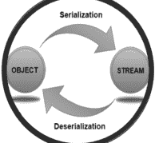

## A) Serializable 接口 (序列化接口)

`java.io.Serializable` 是一个标记接口（marker Interface）。它不包含任何方法。需要持久化（写入）的对象的所属类必须实现 `java.io.Serializable` 接口。

## ObjectOutputStream 的构造函数

`ObjectOutputStream(OutputStream output) throws IOException;`

参数 `output` 是用于写入序列化对象的输出流。

## ObjectInputStream 的构造函数

`ObjectInputStream(InputStream instream) throws IOException;`

参数 `instream` 是用于从中读取序列化对象的输入流。

## ObjectOutputStream 的方法

- `public final void writeObject(Object obj) throws IOException` - 将指定的对象写入 `ObjectOutputStream`。
- `public final void flush() throws IOException` - 刷新当前输出流。
- `public final void close() throws IOException` - 关闭当前输出流。

## ObjectInputStream 的方法

- `public final Object readObject() throws IOException, ClassNotFoundException` - 从输入流中读取对象。
- `public final void close() throws IOException` - 关闭 `ObjectInputStream`。

### 示例

#### 输出 (OUTPUT)

| 102 Sarika 10000$ |

### 注意

1. 如果一个类实现了 `Serializable`，那么它所有的子类也都是可序列化的。
2. 如果类中存在任何静态（static）数据成员变量，它将不会被序列化，因为 `static` 属于类而不是对象。
3. 对于数组或集合，数组或集合中的所有对象都必须是可序列化的。如果任何一个对象不可序列化，序列化将失败。
4. 如果一个类持有另一个类的引用，则所有引用都必须是可序列化的，否则序列化过程无法进行。在这种情况下，运行时会抛出 `NotSerializableException`。

## Java Transient 关键字

`transient` 关键字用于防止某些数据成员被序列化。如果你将任何数据成员声明为 `transient`，它将不会被序列化。

让我们来看一个例子，假设我们声明了一个 `Employee2` 类。它有三个数据成员：`id`、`username` 和 `pwd`。如果我们序列化该对象，所有的值都将进行序列化。

```java
class Employee2 implements Serializable {
    int id;
    String username;
    transient String pwd;

    Employee2(int id, String username, String pwd) {
        this.id = id;
        this.username = username;
        this.pwd = pwd;
    }
}
```

**输出：**

ID: 102

Username: Sarika

Password: null

```java
BufferedReader bufferstream = new BufferedReader(inputstream);
String iostream;
System.out.println("************************************");
System.out.println("please enter something");
System.out.flush();
iostream = bufferstream.readLine();
for (int i=0; i<iostream.length(); i++)
    out.write(iostream.charAt(i));
fout.close();
int no_of_bytes = (int)fin.available();
System.out.println("NO of bytes present" + no_of_bytes);
byte inbuf[] = new byte[no_of_bytes];
int readbyte = fin.read(inbuf,0, no_of_bytes);
System.out.println("new String(inbuf)");
fin.close();
System.out.println("deleting!");
f.delete();
} catch (Exception e) {
}
}
```

# 输出

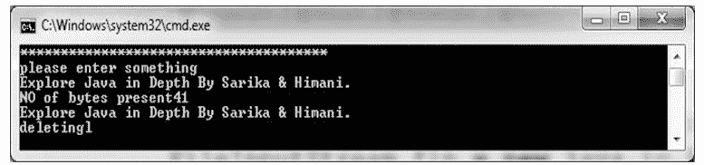

# 总结

1. `java.io` 包中的类为 Java 程序中的输入输出操作提供了支持。
2. 流（Stream）是从源到目的地的字节序列。
3. `InputStream` 和 `OutputStream` 是用于从字节流读取和写入字节流的超类。
4. `Reader` 和 `Writer` 类支持 Unicode 字符的 I/O 操作。
5. `File` 类支持对文件和目录对象的访问。

# 回答以下

## 单选题

1. 以下哪一个包包含了用于程序输入输出操作的类和接口？
   a) java.util b) java.lang c) java.io d) 以上所有
   **答案. c**

2. 下列类中哪一个不是 `java.io` 包的成员？
   a) String b) StringReader c) Writer d) File
   **答案. a**

3. 下列接口中哪一个不是 `java.io` 包的成员？
   a) DataInput b) ObjectInput c) ObjectFilter d) FileFilter
   **答案. c**

4. 下列类中哪一个在功能上与输入输出流不相关？
   a) File b) Writer c) InputStream d) Reader
   **答案. a**
   **解释：** `File` 描述了文件的属性。`File` 用于获取或操作与磁盘文件相关的信息，如权限、时间、日期、目录路径以及在子目录导航。

5. 下列哪一个是由 `File` 对象指定的？
   a) 磁盘上的文件 b) 目录路径 c) 磁盘上的目录 d) 以上都不是
   **答案. a**

6. 下列哪一个方法用于测试指定的元素是文件还是目录？
   a) IsFile() b) isFile() c) Isfile() d) isfile()
   **答案. b**

7. 下列哪一个过程是将对象的状态写入字节流的过程？
   a) 序列化 (Serialization) b) 外部化 (Externalization) c) 文件过滤 (File Filtering) d) 以上所有
   **答案. a**
   **解释：** 序列化是将对象的状态写入字节流的过程。当你想要将程序的状态保存到持久存储区域时，就会使用这种方法。

8. 下列哪一个过程是由 Java 运行时系统自动发生的？
   a) 序列化 b) 垃圾回收 (Garbage collection) c) 文件过滤 d) 以上都不是
   **答案. b**

## 复习题

1. 什么是流？
2. 哪类类允许你直接从流中读取对象？
3. `RandomAccessFile` 和 `File` 有什么区别？
4. 在 Java 中向文件末尾追加内容？
5. 从流中读取时如何检查是否到达文件结束？
6. 在什么情况下使用随机访问 I/O 而不是顺序缓冲 I/O？
7. 如何复制文件？

## 面试题

1. 什么是 IO 流？
2. 两种类型流——字节流和字符流的必要性是什么？
3. 所有流的超类是什么？
4. `FileInputStream` 和 `FileOutputStream` 是什么？
5. 使用字节流还是字符流更好？
6. 什么是过滤流（filter streams）？
7. 什么是过滤流？使用字节流。

# 网络连接

telnet 用于远程登录，文件传输协议 (FTP) 用于跨网络传输文件等。每个服务都与一个端口相关。端口是一个数值地址，通过它来处理诸如网页请求之类的服务请求。

TCP 协议需要两个数据项：

- IP 地址
- 端口号

那么，当你输入 http://www.Yahoo.com 时，为什么能到达 yahoo 的主页呢？

网络协议 (IP) 为每个网络设备提供一个逻辑地址，即 IP 地址。网络协议提供的 IP 地址具有特定的结构。它是一个 32 位的数值，表示为连续四个 8 位数字（字节），其取值范围从 0 到 255，其中最后一个字节构成了端口号。

如果没有指定端口号，则将使用服务文件（services file）中的服务器端口。每个协议都有一个默认端口号，在未指定端口号时会使用该端口。

| 端口号 | 应用 |
|---|---|
| 21 | FTP (传输文件) |
| 23 | Telnet (提供远程登录) |
| 25 | SMTP (发送邮件消息) |
| 67 | BOOT (在启动时提供配置) |
| 80 | HTTP (传输网页) |

让我们来看 URL http://www.yahoo.com

URL 的第一部分 (http) 意味着你正在使用超文本传输协议 (http)，这是处理网页文档的协议，其端口号为 80。如果没有指定文件，大多数服务器都配置为抓取 index.html 文件。因此，IP 地址和端口要么通过显式指定 URL 的所有部分来确定，要么使用默认值。

## 13.4 创建套字 (SOCKET)

与服务器创建 TCP 连接涉及以下代码段：

`Socket socket = new Socket("instituteoflearning.in", 8080);`

`Socket` 类的构造函数需要一个要连接的主机（在此例中为 www.instituteoflearning.in）和一个服务器端口 8080。如果服务器已启动运行，代码将创建一个新的 socket 实例并继续运行。如果服务器在连接时遇到问题，它将抛出异常。

要关闭与服务器的连接，请使用 `close()` 方法。

```java
socket.close();
```

## 导入包

网络 IO 需要导入的必要包：

- `import java.net.*;`
- `import java.io.*;`

### 13.5 TCP/IP 客户端

#### 创建 Socket 类对象

创建 socket 客户端的第一步是创建一个 socket 对象。

Socket 类的构造函数如下：

- `Socket(String hostname, int port) throws UnknownHostException, IOException;`
  接收两个参数：主机名和服务器监听的端口号。
- `Socket(InetAddress IP, int port) throws IOException;`
  它还有两个参数，用于使用现有的 `InetAddress` 对象和端口来创建 socket。`InetAddress` 类用于封装数值 IP 地址及其对应的域名。

#### Socket 的方法

- `InetAddress getInetAddress()`: 返回与 socket 对象关联的 `InetAddress`。如果 socket 未连接，则返回 null。


- `getPort()`: 返回调用的 socket 对象连接的端口。如果 socket 未连接，则返回 0。
- `getLocalPort()`: 返回调用的 socket 对象绑定的本地端口。如果 socket 未连接，则返回 -1。
- `InputStream getInputStream() throws IOException`: 返回与调用 socket 关联的输入流。
- `OutputStream getOutputStream() throws IOException`: 返回与调用 socket 关联的输出流。
- `connect()`: 允许你指定一个新的连接。
- `isConnected()`: 如果 socket 已连接到服务器，则返回 true。
- `isBound()`: 如果 socket 已绑定到某个地址，则返回 true。
- `isClosed()`: 如果 socket 已关闭，则返回 true。

### 13.6 对 Socket 进行读写操作

对 socket 进行读写操作与读写文件类似。

声明了两个对象，分别属于 `PrintStream` 类和 `BufferedReader` 类。这些对象将用于对 socket 进行读写操作。

```java
PrintStream out = null; // 向 socket 写入
BufferedReader in = null; // 从 socket 读取
```

现在，将 `PrintStream` 和 `BufferedReader` 对象与 socket 关联。

```java
out = new PrintStream(ClientSocket.getOutputStream());
in = new BufferedReader(new InputStreamReader(ClientSocket.getInputStream()));
```

`Socket` 类的 `getInputStream()` 和 `getOutputStream()` 方法允许客户端与服务器通信。`getInputStream()` 方法用于从 socket 读取，`getOutputStream()` 方法用于向 socket 写入（注：原文此处有笔误，已更正逻辑）。

声明了另一个 `BufferedReader` 类对象与标准输入关联，这样在客户端输入的数据就可以发送到服务器。

```java
BufferedReader stdin = new BufferedReader(new InputStreamReader(System.in));
String str;
while ((str = stdin.readLine()).length() != 0) {
    System.out.println(str);
}
```

上述代码允许用户从键盘接收数据。`while` 循环将持续直到用户输入输入结束字符。

### 关闭连接

下面的代码关闭了流以及与服务器的连接。

```java
// 服务器程序
import java.net.*;
import java.io.*;

public class Server {
    public static void main(String a[]) throws IOException {
        ServerSocket server = null;
        try {
            server = new ServerSocket(98);
        } catch (IOException ex) {
            System.out.println("IO Exception");
            System.exit(0);
        }
        Socket client = null;
        try {
            client = server.accept();
            System.out.println("connection established");
        } catch (IOException e) {
            System.out.println("Connection failed " + e);
            System.exit(0);
        }
        PrintWriter out = new PrintWriter(client.getOutputStream(), true);
        BufferedReader in = new BufferedReader(new InputStreamReader(client.getInputStream()));
        String I;
        BufferedReader sin = new BufferedReader(new InputStreamReader(System.in));
        System.out.println("I am ready to type now");
        while ((sin.readLine()) != null) {
            out.println(I);
        }
        out.close();
        sin.close();
        client.close();
        server.close();
    }
}
```

```java
// Client Program
import java.net.*;
import java.io.*;

public class Client {
    public static void main(String a[]) throws IOException {
        Socket s = null;
        BufferedReader b = null;
        try {
            s = new Socket(InetAddress.getLocalHost(), 98);
            b = new BufferedReader(new InputStreamReader(s.getInputStream()));
        } catch (UnknownHostException e) {
            System.err.println("unidentified host name");
            System.exit(0);
        } catch (Exception e) {
            System.exit(1);
        }
        String input;
        while ((input = b.readLine()) != null) {
            System.out.println(input);
        }
        b.close();
        s.close();
    }
}
```

### 输出

首先编译上述两个程序，并在 DOS 控制台窗口中先运行服务器。打开新的 Dos 提示符并运行客户端程序。现在切换到服务器窗口并输入文本。文本会被传递到客户端窗口（单向通信）。

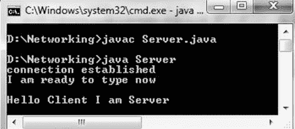
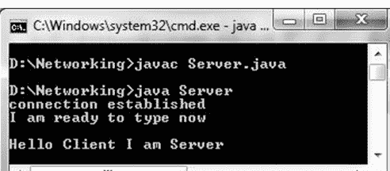

## 13.8 UDP 对比 TCP

数据报协议 (UDP) 是一种从一台计算机向另一台计算机发送独立数据包（数据报）的协议，但不保证其到达。UDP 是一种无连接协议。

它提供了网络上两个应用程序之间不保证的通信。这就像通过邮政服务发送信件但不使用挂号或任何确认。交付顺序并不重要，也不保证，且每条消息都与其他任何消息相互独立。

UDP 中使用了 `DatagramPacket`、`DatagramSocket` 和 `MulticastSocket` 类。

| TCP | UDP |
| --- | --- |
| 它在两台计算机之间建立可靠的连接 | 它在两台计算机之间建立不可靠的连接 |
| 数据按连续顺序发送：电话通话 | 数据以包（数据报）的形式发送，开销比 TCP 小，且顺序随机。例如：信 |
| 速度较慢 | 速度更快 |
| 数据必须按照发送的顺序接收 | 交付顺序是随机的，每条消息都与其他任何消息相互独立 |

## 13.9 数据报套接字

数据报套接字定义了四个公共构造函数。

- `DatagramSocket() throws SocketException`
- `DatagramSocket(int port) throws SocketException`
- `DatagramSocket(int port, InetAddress address) throws SocketException`
- `DatagramSocket(SocketAddress address) throws SocketException`

### 13.9.1 Java InetAddress 类

Java `InetAddress` 类表示一个 IP 地址。它提供了获取任何名称 IP 的方法，例如：`www.yahoo.com`、`www.google.com`、`www.facebook.com` 等。

#### InetAddress 类的方法

| 方法 | 描述 |
| --- | --- |
| `public static InetAddress getByName(String host) throws UnknownHostException` | 返回包含指定主机名 IP 和名称的 `InetAddress` 实例。 |
| `public static InetAddress getLocalHost() throws UnknownHostException` | 返回包含本地主机名和地址的 `InetAddress` 实例。 |
| `public String getHostName()` | 返回主机名或 IP 地址。 |
| `public String getHostAddress()` | 返回字符串格式的 IP 地址。 |

#### 数据报套接字的方法

- `void send(DatagramPacket packet) throws IOException`: 将包发送到包中指定的端口。
- `void receive(DatagramPacket packet) throws IOException`: 从指定的端口接收包。

### DatagramPacket (数据报)

`DatagramPacket` 是一个可以发送或接收消息或包的类。如果你发送多个包，它们可能会以任何顺序到达。此外，包的交付是不保证的。

#### DatagramPacket 的构造函数

`DatagramPacket` 定义了几个构造函数。

- `DatagramPacket(byte[] data, int size)`
- `DatagramPacket(byte[] data, int offset, int size)`
- `DatagramPacket(byte[] data, int size, InetAddress ipaddress, int port)`
- `DatagramPacket(byte[] data, int offset, int size, InetAddress ipaddress, int port)`

```java
// 服务器程序
import java.net.*;

class Server {
    public static DatagramSocket ds;
    public static byte buffer[] = new byte[1024];

    public static void myServer() throws Exception {
        int pos = 0;
        while (true) {
            int c = System.in.read();
            switch (c) {
                case -1:
                    System.out.println("Server quits");
                    return;
                case '\n':
                    System.out.println("Server ready in");
                    ds = new DatagramSocket(777, InetAddress.getLocalHost());
                    break;
                default:
                    buffer[pos++] = (byte) c;
            }
        }
    }

    public static void main(String args[]) throws Exception {
        myServer();
    }
}
```

```java
// 客户端程序
import java.net.*;
import java.io.*;

class Client {
    static byte buffer[] = new byte[1024];

    public void client() throws Exception {
        while (true) {
            DatagramPacket p = new DatagramPacket(buffer, buffer.length);
            DatagramSocket ds = new DatagramSocket();
            ds.receive(p);
            System.out.println(new String(p.getData(), 0, p.getLength()));
            ds.close();
        }
    }

    public static void main(String args[]) throws Exception {
        new Client().client();
    }
}
```

### 输出

首先编译上述两个程序，并在 DOS 控制台窗口中先运行服务器。打开新的 Dos 提示符并运行客户端程序。现在切换到服务器窗口并输入文本。文本会被传递到客户端窗口（单向通信）。


- 3. `DatagramSocket(int port, InetAddress address) throws SocketException;`
- 4. `DatagramSocket(SocketAddress address) throws SocketException;`

### 13.9.1 Java InetAddress 类

Java `InetAddress` 类表示一个 IP 地址。它提供了获取任何名称 IP 的方法，例如：`www.yahoo.com`、`www.google.com`、`www.facebook.com` 等。

## InetAddress 类的方法

| 方法 | 描述 |
| --- | --- |
| `public static InetAddress get(String host) throws UnknownHostException` | 返回包含本地主机 IP 和名称的 `InetAddress` 实例。 |
| `public static InetAddress getLocalHost() throws UnknownHostException` | 返回包含本地主机名和地址的 `InetAddress` 实例。 |
| `public String getHostName()` | 返回主机名或 IP 地址。 |
| `public String getHostAddress()` | 返回字符串格式的 IP 地址。 |

## 数据报套接的方法

- 1. `void send(DatagramPacket packet) throws IOException`: 它将包发送到包中指定的端口。
- 2. `void receive(DatagramPacket packet) throws IOException`: 它从指定的端口接收包。

## DatagramPacket (数据报)

`DatagramPacket` 是一个可以发送或接收消息或包的类。如果你发送多个包，它们可能会以任何顺序到达。此外，包的交付是不保证的。

## DatagramPacket 的构造函数

`DatagramPacket` 定义了几个构造函数。

- 1. `DatagramPacket(byte[] data, int size);`
- 2. `DatagramPacket(byte data[], int offset, int size);`
- 3. `DatagramPacket(byte[] data, int size, InetAddress ipaddress, int port);`
- 4. `DatagramPacket(byte[] data, int offset, int size, InetAddress ipaddress, int port);`

```java
//服务器程序
import java.net.*;
class Server {
    public static DatagramSocket ds;
    public static byte buffer[] = new byte[1024];
    public static void myServer() throws Exception {
        int pos = 0;
        while (true) {
            int c = System.in.read();
            switch (c) {
                case -1 : System.out.println("Server quits");
                    return;
                case '\n': System.out.println("Server ready in");
                    ds = new DatagramSocket(777, InetAddress.getLocalHost());
                    break;
                default:
                    buffer[pos++] = (byte)c;
            }
        }
    }
    public static void main(String args[]) throws Exception {
        myServer();
    }
}
```

```java
//客户端程序
import java.net.*;
import java.io.*;
class client {
    static byte buffer[] = new byte[1024];
    public void client() throws Exception {
        while (true) {
            DatagramPacket p = new DatagramPacket(buffer, buffer.length);
            DatagramSocket ds = new DatagramSocket();
            ds.receive(p);
            System.out.println(new String(p.getData(), 0, p.getLength()));
            ds.close();
        }
    }
    public static void main(String args[]) throws Exception {
        new client().client();
    }
}
```

# 输出

首先编译上述两个程序，并在 DOS 控制台窗口中先运行服务器。打开新的 Dos 提示符并运行客户端程序。现在切换到服务器窗口并输入文本。文本会被传递到客户端窗口（单向通信）。


## 网络 | 19

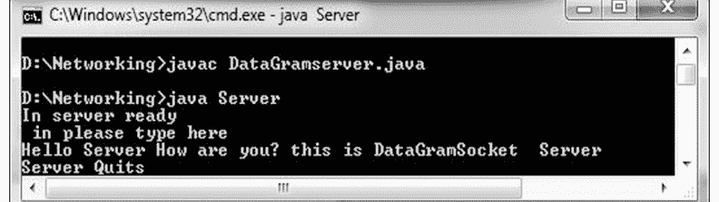

注意: `DatagramPacket` 是容器，而 `DatagramSocket` 是用于发送或接收数据报的机制。数据报是从一个程序到另一个程序的字节数组。

## 总结

- 1. 网络是一种将数据呈现与其内部处理和存储分离的架构。
- 2. 网络协议是通信系统遵循的规则和约定。
- 3. Java 提供了两种通信工具：使用数据报协议 (UDP) 的数据报和使用传输控制协议协议 (TCP/IP) 的套接字。
- 4. `Socket` 是支持 TCP 协议的基本类。TCP 是一种可靠的流网络连接。
- 5. `ServerSocket` 是用于网络服务器程序监听客户端请求的类。服务器并不实际服务，而是代表客户端创建套接字对象。
- 6. `DatagramSocket` 用于 UDP 程序。

## 回答以下问题

### 单选题

-1. 下列类对于实现数据报是必要的？

a) `DatagramPacket`
b) `DatagramSocket`
c) 以上所有
d) 以上都不是

答案: c

-2. 下面哪个 `DatagramPacket` 方法用于查找端口号？

a) `port()`
b) `getPort()`
c) `findPort()`

答案: b

-3. 下面哪个 `DatagramPacket` 方法用于获取数据报中包含的字节数组？

a) `getData()`
b) `getBytes()`
c) `getArray()`

答案: a

-4. 下面哪个 `DatagramPacket` 方法用于查找字节数组的长度？

a) `getnumber()`
b) `length()`
c) `getLength()`

答案: c

## 复习习题

-1. 是否可以获取本地主机 IP？
-2. TCP 和 UDP 的区别是什么？
-3. API 没有列出 `InetAddress` 的任何构造函数。我如何创建 `InetAddress` 实例？
-4. 编写连接到服务器的步骤。
-5. 什么是 http？它是否有任何协议？Ip 地址是什么？

# 第14 章

## A.W.T. (抽象窗口工具包)

如今几乎所有的操作系统都提供 GUI（图形用户界面）。应用程序使用操作系统自带的 GUI 元素，并添加自己的元素。一个典型的 GUI 元素包括窗口、下拉菜单按钮、滚动条、图标图像和向导。

抽象窗口工具包（AWT）是一个包，它提供了一组集成的类，用于管理用户界面组件，如窗口对话框、按钮、复选框、列表、菜单、滚动条和文本字段。顶层窗口、文本框和推入按钮等视觉控件，以及在屏幕上绘制图像的简单元素具有类似的功能。共同的功能是所有图形界面元素的父类。

### 14.1 组件 (COMPONENTS)

`Component` 类是 AWT 层次结构中的顶级类，允许控制所有组件的内部状态和屏幕显示外观。

下图展示了组件的层次结构。

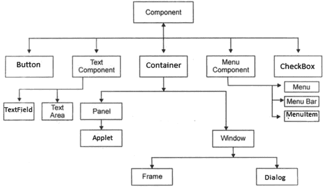

#### 14.1.1 Component 类的特征

所有组件都实现为 `Component` 类的子类。子类继承了 `Component` 类的大量功能。

Component 类的特征有：

- 1. 基础绘制支持：`Component` 类提供了 `paint()`、`update()` 和 `repaint()` 方法，使组件能够绘制在屏幕上。
- 2. 事件处理：组件能够将其事件（如鼠标点击）委托给其他类进行处理。第16章将探讨事件处理。
- 3. 外观控制：`Component` 类提供了获取当前字体信息和更改字体的方法。它还提供了获取和设置前景颜色和背景色的方法。前景色用于组件中显示的文本，以及组件执行的任何自定义绘制。背景色是文本背后的颜色。
- 4. 图像处理：`Component` 类提供了 `Observer`（观察者）接口的实现，并定义了帮助组件显示图像的方法。
- 5. 大小位置控制：所有组件的大小和位置取决于 `LayoutManager` 类指定的属性。然而，每个组件都可以确定自己的大小，即使不能确定位置。`Component` 类提供了调整组件大小和位置的方法。它还提供了允许组件报告其首选尺寸和最小尺寸的方法。此外，它还提供了返回组件尺寸和位置信息的方法。

### Component 类的方法

| 方法 | 描述 |
|---|---|
| `public void add(Component c)` | 在此组件上插入一个组件。 |
| `public void getSize(int width, int height)` | 设置组件的大小（宽度和高度）。 |
| `public void setLayout(LayoutManager m)` | 为组件定义布局管理器。 |
| `public void setVisible(boolean status)` | 更改组件的可见性。默认值为 false。 |

### 14.2 容器 (CONTAINER)

某些组件也可以充当容器。例如，窗口可以是另一个容器的一部分。同时，它可以作为其他组件（如文本框）的父级；它本身也是一个容器。`Container` 类是 `Component` 类的一个特殊子类。

容器包含零个或多个组件。这些组件被称为兄弟组件，因为它们具有相同的父窗口。

容器主要有三种类型：

- 窗口 (Window)
- 小程序 (Applet)
- 面板 (Panel)

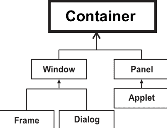

### 14.3 窗口类 (THE WINDOW CLASS)

窗口类进一步包含：

- 1. 框架 (Frame)
- 2. 对话框 (Dialog)

`Frame` 是一个带有标题和缩放按钮的矩形框。`Dialog` 与 `Frame` 类似，但没有菜单栏且不能调整大小。

#### 1. Frame 类

`Frame` 是 AWT 的一个强大功能。你可以使用 `Frame` 类为你的应用程序创建一个窗口。`Frame` 具有标题栏、可选的菜单栏和缩放边框。由于它派生于 `java.awt.Container`，你可以使用 `add()` 方法向 `Frame` 中添加组件。**`BorderLayout` 是 `Frame` 的默认布局。** `Frame` 接收鼠标事件、键盘事件和焦点事件。

`Frame` 的构造函数接收 `Frame` 的标题作为参数。字符串将显示在 `Frame` 的标题栏上。

```java
Frame = new Frame("Title of the frame");
```

窗口创建后，可以通过调用 `setVisible()` 方法来显示。可以通过调用 `getSize()` 方法调整窗口大小。

以下程序显示了一个 `Frame`。

```java
import java.awt.Color;
import java.awt.Frame;
public class FrameDemo {
    public static void main(String s[]) {
        Frame frame = new Frame("Title of a Frame");
        frame.setSize(300, 400);
        frame.setBackground(Color.RED);
        frame.setVisible(true);
    }
}
```

### 输出


#### 2. Dialog 类

`Dialog` 是用于接受输入的弹出窗口。对话框有两种类型：模态的（modal）和非模态的（modeless）。与非模态对话框不同，模态对话框在显示时不允许用户进行交互。创建对话框时，你可以指定是想要模态还是非模态。使用 `Dialog` 类创建对话框。在创建对话框后，无法更改其“模态”。

该类提供了重载的构造函数。

#### 构造函数

以下构造函数创建一个具有另一个对话框的对话框：

- `Dialog(Dialog owner)`：创建一个指定所有者的隐藏对话框。
- `Dialog(Dialog owner, String title)`：创建一个指定所有者和标题的隐藏对话框。
- `Dialog(Dialog owner, String title, boolean modal)`：创建一个指定所有者、标题和模态的隐藏对话框。

以下构造函数创建一个具有 `Frame` 的对话框：

- `Dialog(Frame owner)`：创建一个指定所有者的隐藏对话框。
- `Dialog(Frame owner, boolean modal)`：创建一个指定所有者和模态的隐藏对话框。
- `Dialog(Frame owner, String title, boolean modal)`：创建一个指定标题和模态的隐藏对话框。

单参数构造函数创建一个没有标题的对话框。传递给对话框的第二个参数是对话框的标题。要创建模态对话框，使用所示的三参数构造函数：

```java
Dialog dialog = new Dialog(frame, "Title of dialog", true);
```

### 14.4 Panel 类 (THE PANEL CLASS)

`Panel` 用于组织组件。每个面板可以使用不同的布局。创建面板使用以下代码：

```java
Panel panel = new Panel();
```

一旦创建了面板，将其添加到窗口、框架或小程序中。可以使用 `Container` 类的 `add()` 方法完成。

#### 子面板 (Sub-panel)

还可以创建嵌套面板，即一个面板包含一个或多个子面板。你可以根据需要嵌套任意深度的面板。例如：

```java
Panel mainpanel1, subpanel1, subpanel2;
mainpanel1 = new Panel();
subpanel1 = new Panel();
subpanel2 = new Panel();
mainpanel1.add(subpanel1);
mainpanel1.add(subpanel2);
```

### 14.5 组件与控件 (COMPONENTS AND CONTROLS)

### 控件 (Controls)

任何编程语言的内部部分都是接受用户数据的能力。需要提示用户输入数据。为了简化用户交互并更容易输入数据，可以使用控件。控件是组件，如按钮和文本框，可以添加到 `Frame`、`Panel` 和 `Applet` 等容器中。由于 `Component` 是所有控件的父类，其方法在子类中也可以可用。下图描述了 `Component` 类的层次结构。

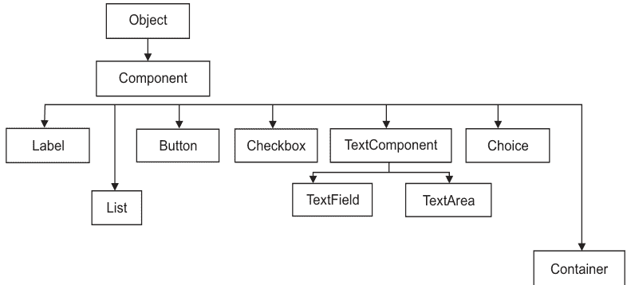

组件层次结构

# 206 | Java 深度解析

`Component` 类定义了许多方法，这些方法可以用于任何派生它的类。

下表列出的方法可以用于所有的 GUI 组件以及容器（containers）。

| 方法 | 描述 |
| --- | --- |
| `setSize(Dimension d)` | 调整相应组件的大小，使其宽度等于 `d.width`，高度等于 `d.height`。 |
| `setSize(int width, int height)` | 调整相应组件的大小，使其具有指定的宽度和高度。 |
| `setFont(Font f)` | 设置相应组件的字体。 |
| `setEnabled(boolean b)` | 根据参数 `b` 的值启用或禁用相应的组件。 |
| `setVisible(boolean b)` | 根据参数 `b` 的值显示或隐藏相应的组件。 |
| `setForeground(Color c)` | 设置相应组件的前景颜色。 |
| `setBounds(int x, int y, int width, int height)` | 移动并调整相应组件的大小。 |


| 方法 | 描述 |
| --- | --- |
| `setBounds(Rectangle r)` | 移动并调整组件以符合新的边界矩形 r。 |
| `setBackground(Color c)` | 设置相应组件的背景颜色。 |
| `getBackground()` | 获取相应组件的背景颜色。 |
| `getBounds()` | 以矩形对象的形式获取相应组件的边界。 |
| `getFont()` | 获取相应组件的字体。 |
| `getForeground()` | 获取相应组件的前景颜色。 |
| `getSize()` | 以 `Dimension` 对象的形式返回相应组件的大小。 |

# 14.6 Java 中的控件

## I) 按钮 (`Button`)

按钮是可以包含标签（label）的组件。它有一个轮廓。按钮类似于任何其他 GUI 中的推送按钮。按下按钮会导致运行时生成一个事件。该事件被发送到程序。程序反过来可以检测该事件并响应。点击按钮会生成一个 `ActionEvent`。

然而，在按钮按钮之前，必须先创建它。可以使用 `new` 关键字结合为其定义的构造函数来创建它。

按钮在使用之前必须被添加到容器中。这是通过使用 `add` 关键字完成的。一旦按钮被创建并添加，就可以就可以了。

当按钮被点击时，AWT 会向按钮发送一个 `ActionEvent` 实例。`ActionEvent` 会将该动作事件传递给任何对按钮生成的动作事件感兴趣的动作监听器（action listeners）。

### 构造函数

| 构造函数 | 描述 |
| --- | --- |
| `Button()` | 构造一个没有标签的按钮。 |
| `Button(String label)` | 构造一个指定标签的按钮。 |

### 方法

| 方法 | 描述 |
| --- | --- |
| `addActionListener()` | 添加指定的动作监听器，以接收来自相应按钮的动作事件。 |
| `getCommand()` | 返回相应按钮触发动作事件的命令名称。 |
| `getLabel()` | 返回相应按钮的标签。 |
| `paramString()` | 返回代表相应按钮状态的参数字符串。 |
| `setLabel(String label)` | 将按钮的标签设置为指定的值。 |

下面的示例包含两个标签和两个按钮："OK" 和 "Cancel"。使用两个标签来显示名为 Button 1 和 Button 2 的按钮测试文本。状态栏指示了哪个按钮被点击。

示例：

```java
import java.awt.*;
import java.applet.*;
import java.awt.event.*;

public class ButtonTest extends Frame {
    Label lbl = new Label("Button1");
}

Button b1 = new Button("OK");
Label lb2 = new Label("Button2");
Button b2 = new Button("cancel");

public ButtonTest() {
    setLayout(null);
    setSize(200, 300);
    lbl1.setBounds(15, 40, 50, 50);
    b1.setBounds(65, 40, 50, 50);
    lb2.setBounds(15, 145, 50, 50);
    b2.setBounds(65, 145, 50, 50);
    add(lbl1);
    add(b1);
    add(lb2);
    add(b2);

    setVisible(true);
}

public static void main(String a[]) {
    ButtonTest bt = new ButtonTest();
}
```

# 输出

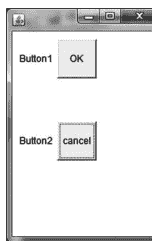

## II) 复选框 (`Checkbox`)

复选框是具有双状态的用户界面组件：已选中（checked）和未选中（unchecked）。点击它可以改变复选框的状态。

Java 支持两种类型的复选框：

- a) 互斥（单选按钮）
- b) 非互斥

在互斥复选框的情况下，项目中只能同时选择一个。互斥复选框称为单选按钮（Radio Buttons）。如果选中了组中的某项，当前复选框将取消选中，新的选择将被高亮。

非互斥复选框不分组，每个复选框都可以独立于其他框被选择。

### 构造函数

- `Checkbox()`: 创建一个没有标签的复选框。
- `Checkbox(String label)`: 创建一个带有标签的复选框。
- `Checkbox(String label, CheckboxGroup group)`: 创建一个带有标签的复选框。
- `Checkbox(String label, CheckboxGroup group, boolean state)`: 创建一个带有标签的复选框。

### 方法

| 返回类型 | 方法 | 描述 |
| --- | --- | --- |
| `void` | `addActionListener(ActionListener l)` | 添加指定的动作监听器，以接收来自相应复选框的事件。 |
| `void` | `addNotify()` | 创建 peer。 |
| `AccessibleContext` | `getAccessibleContext()` | 获取与复选框相关的上下文。 |
| `CheckboxGroup` | `getCheckboxGroup()` | 获取复选框组。 |
| `ItemListener[]` | `getItemListeners()` | 返回所有注册的监听器数组。 |
| `String` | `getLabel()` | 获取复选框的标签。 |
| `EventListener[]` | `getEventListeners(Class listenerType)` | 返回指定类型的事件监听器数组。 |
| `Object[]` | `getSelectedObjects()` | 返回包含选中项的数组（长度为1）。 |
| `boolean` | `getState()` | 返回复选框是“开启”还是“关闭”。 |
| `String` | `paramString()` | 返回代表复选框状态的字符串。 |
| `void` | `removeEventListener(ActionListener l)` | 移除指定的监听器，使其不再接收来自复选框的事件。 |
| `void` | `setCheckboxGroup(CheckboxGroup g)` | 设置复选框的组。 |
| `void` | `setLabel(String label)` | 设置复选框的标签。 |
| `void` | `setState(boolean state)` | 设置复选框的状态。 |

## III) 下拉框 (`Choice`)

`Choice` 类实现了一个弹出菜单，允许用户进行选择。创建 choice 时会实例化一个对象。然后添加项。

### 构造函数

- `Choice()`: 创建一个新的菜单。

### 方法

| 返回类型 | 方法 | 描述 |
| --- | --- | --- |
| `void` | `add(String item)` | 向此框中添加项。 |
| `void` | `addItem(String item)` | 自 Java 1.1 起弃用，由 `add()` 替换。 |
| `void` | `addEventListener(ItemListener l)` | 添加指定的监听器以接收来自此框的事件。 |
| `void` | `addNotify()` | 创建 peer。 |
| `int` | `countItems()` | 返回菜单中项的数量。 |
| `AccessibleContext` | `getAccessibleContext()` | 获取与 choice 相关的上下文。 |
| `String` | `getItem(int index)` | 获取菜单中指定索引的字符串。 |
| `ItemListener[]` | `getItemListeners()` | 返回在此框上注册的所有监听器数组。 |
| `EventListener[]` | `getListeners(Class listenerType)` | 返回当前注册的所有对象数组。 |
| `int` | `getSelectedIndex()` | 返回当前选中项的索引。 |
| `String` | `getSelectedItem()` | 获取当前 choice 的表示。 |
| `Object[]` | `getSelectedObjects()` | 返回包含当前选中项数组（长度为1）。 |
| `void` | `insert(String item, int index)` | 在指定位置向此框中插入项。 |
| `protected String` | `paramString()` | 返回代表此菜单状态的字符串。 |
| `protected void` | `processEvent(AWTEvent e)` | 处理此框上的事件。 |
| `protected void` | `processItemEvent(ItemEvent e)` | 通过将其分发给任何注册的 `ItemListener` 对象来处理菜单上发生的项事件。 |
| `void` | `remove(int pos)` | 从菜单的指定位置移除一个项。 |
| `void` | `remove(String item)` | 从菜单中移除第一个出现的 item。 |
| `void` | `removeAll()` | 从菜单中移除所有项。 |
| `void` | `removeEventListener(EventListener l)` | 移除指定的监听器，使其不再接收来自此框的事件。 |
| `void` | `select(int pos)` | 将此菜单中的选中项设置为指定位置的项。 |
| `void` | `select(String str)` | 将此菜单中的选中项设置为名称与指定字符串相等的项。 |

## IV) Label（标签）

此 `Label` 组件用于在容器中显示单行文本。文本可以由应用程序更改，但用户无法编辑。`Label` 不产生任何事件。`Label` 类似于按钮，可以使用其构造函数结合键盘来创建。

### 构造函数

- `Label()`: 构造一个空的 Label。
- `Label(String text)`: 构造一个带有指定字符串文本的新 Label，并左对齐。
- `Label(String text, int alignment)`: 构造一个带有指定字符串文本和指定对齐方式的新 Label。

### 方法

| 返回类型 | 方法及描述 |
| --- | --- |
| `void` | `addNotify()`: 创建此标签的对等体（peer）。 |
| `AccessibleContext` | `getAccessibleContext()`: 获取与此 `Label` 关联的 `AccessibleContext`。 |
| `int` | `getAlignment()`: 获取此标签的当前对齐方式。 |
| `String` | `getText()`: 获取此标签的文本。 |
| `protected String` | `paramString()`: 返回一个表示此 `Label` 状态的字符串。 |
| `void` | `setAlignment(int alignment)`: 将此标签的对齐方式设置为指定的对齐方式。 |
| `void` | `setText(String text)`: 将此标签的文本设置为指定的文本。 |

示例：

```java
setLayout(new FlowLayout(FlowLayout.CENTER, 10, 10));
add(new Label("Hi Here!"));
add(new Label("Another Label"));
```

## V) TextField（文本框）

`TextField` 是接受用户文本输入的接口型组件。它们通常伴随有一个 label 控件，该控件为用户提供在 `TextField` 中输入内容的引导信息。

它们可以包含单行文本，非常适用于用户输入如姓名、年龄等较短部分信息的情况。如果需要多行文本，`TextArea` 是更好的选择。

### 构造函数

- `TextField()`: 构造一个新的文本框。
- `TextField(int columns)`: 构造一个具有指定列数的空文本框。
- `TextField(String text)`: 构造一个用指定文本初始化的新文本框。
- `TextField(String text, int columns)`: 构造一个用指定文本初始化的新文本框，且宽度足够以容纳指定的列数内容。

### 方法

| 返回类型 | 方法及描述 |
| --- | --- |
| `void` | `addActionListener(ActionListener l)`: 添加指定的动作监听器以接收来自此文本框的动作事件。 |
| `void` | `addNotify()`: 创建 `TextField` 的对等体。 |
| `boolean` | `echoCharSet()`: 指示此文本框是否有用于回显的字符。 |
| `AccessibleContext` | `getAccessibleContext()`: 获取与此 `TextField` 关联的 `AccessibleContext`。 |
| `ActionListener[]` | `getListeners()`: 返回一个注册在此文本框上的所有监听器数组。 |
| `int` | `getColumns()`: 获取此文本框的列数。 |
| `char` | `getEchoChar()`: 获取用于回显的字符。 |
| `EventListener[]` | `getListeners(Class listenerType)`: 返回一个所有注册在此 `TextField` 上的作为 Foo 监听器的对象数组。 |
| `Dimension` | `getMinimumSize()`: 获取此文本框的最小尺寸。 |
| `Dimension` | `getMinimumSize(int columns)`: 获取指定列数的此文本框的最小尺寸。 |
| `Dimension` | `getPreferredSize()`: 获取此文本框的首选尺寸。 |
| `Dimension` | `getPreferredSize(int columns)`: 获取指定列数的此文本框的首选尺寸。 |
| `Dimension` | `minimumSize()`: 已弃用。从 JDK 1.1 版本开始，被 `getMinimumSize()` 替换。 |
| `Dimension` | `minimumSize(int columns)`: 已弃用。从 JDK 1.1 版本开始，被 `getMinimumSize(int)` 替换。 |
| `protected String` | `paramString()`: 返回一个表示 `TextField` 状态的字符串。 |
| `Dimension` | `preferredSize()`: 已弃用。从 JDK 1.1 版本开始，被 `getPreferredSize()` 替换。 |
| `Dimension` | `preferredSize(int)`: 已弃用。从 JDK 1.1 版本开始，被 `getPreferredSize(int)` 替换。 |
| `protected void` | `processEvent(ActionEvent)`: 处理此文本框上的事件。 |
| `protected void` | `processEvent(Event)`: 处理动作事件。 |
| `void` | `removeActionListener(ActionListener l)`: 移除指定的动作监听器。 |
| `void` | `setColumns(int)`: 设置此文本框的列数。 |
| `void` | `setEchoChar(char)`: 设置此文本框的回显字符。 |
| `void` | `setEchoCharacter(char)`: 已弃用。从 JDK 1.1 版本开始，被 `setEchoChar(char)` 替换。 |
| `void` | `setText(String)`: 设置此文本框的文本。 |

示例：

```java
TextField tf1, tf2, tf3, tf4;
// 空的
tf1 = new TextField();
// 20列
tf2 = new TextField(20);
// 带有文本
tf3 = new TextField("Hello");
// 30列
tf4 = new TextField("Hello", 30);
```

## VI) TextArea

`TextArea` 与 `TextField` 类似，不同在于它们可以处理大量文本，并且具有滚动条。

### 构造函数

- `TextArea()`: 构造一个新的 `TextArea`。
- `TextArea(int rows)`: 构造一个具有指定行数的空 `TextArea`。
- `TextArea(String text)`: 构造一个用指定文本初始化的新 `TextArea`。
- `TextArea(String text, int rows, int columns)`: 构造一个用指定文本初始化的新 `TextArea`，具有指定的行数和列数。

### 方法

| 返回类型 | 方法及描述 |
| --- | --- |
| `void` | `addNotify()`: 创建 `TextArea` 的对等体。 |
| `void` | `append(String)`: 将指定的文本追加到 `TextArea`。 |
| `void` | `appendText(String)`: 已弃用。从 JDK 1.1 版本开始，被 `append(String)` 替换。 |


# TextArea 方法

| 返回类型 | 方法及描述 |
|---|---|
| `AccessibleContext` | `getAccessibleContext()`\n获取与此 `TextArea` 关联的 `AccessibleContext`。 |
| `int` | `getColumns()`\n获取此 `TextArea` 的列数。 |
| `Dimension` | `getMinimumSize()`\n获取此 `TextArea` 的最小尺寸。 |
| `Dimension` | `getMinimumSize(int rows, int columns)`\n获取指定行数和列数的此 `TextArea` 的最小尺寸。 |
| `Dimension` | `getPreferredSize()`\n获取此 `TextArea` 的首选尺寸。 |
| `Dimension` | `getPreferredSize(int rows, int columns)`\n获取指定行数和列数的此 `TextArea` 的首选尺寸。 |
| `int` | `getRows()`\n获取此 `TextArea` 的行数。 |
| `int` | `getScrollVisibility()`\n返回指示滚动条的枚举值。 |
| `void` | `insert(String str, int pos)`\n在 `TextArea` 的指定位置插入指定的文本。 |
| `void` | `insertText(String str, int pos)`\n已弃用。从 JDK 1.1 版本开始，被 `insert(String, int)` 替换。 |
| `void` | `replaceRange(String str, int start, int end)`\n用指定的替换文本替换起始和结束位置之间的文本。 |
| `void` | `replaceText(String str, int start, int end)`\n已弃用。从 JDK 1.1 版本开始，被 `replaceRange(String, int, int)` 替换。 |
| `void` | `setColumns(int)`\n设置此 `TextArea` 的列数。 |
| `void` | `setRows(int)`\n设置此 `TextArea` 的行数。 |

# 216 | Java 深度解析

| 返回类型 | 方法及描述 |
|---|---|
| `Dimension` | `minimumSize()`\n已弃用。从 JDK 1.1 版本开始，被 `getMinimumSize()` 替换。 |
| `Dimension` | `minimumSize(int rows, int columns)`\n已弃用。从 JDK 1.1 版本开始，被 `getMinimumSize(int,int)` 替换。 |
| `protected String` | `paramString()`\n返回一个表示此 `TextArea` 状态的字符串。 |
| `Dimension` | `preferredSize()`\n已弃用。从 JDK 1.1 版本开始，被 `getPreferredSize()` 替换。 |
| `Dimension` | `preferredSize(int rows, int columns)`\n已弃用。从 JDK 1.1 版本开始，被 `getPreferredSize(int,int)` 替换。 |

## VII) List（列表）

`List` 组件向用户展示一个滚动的文本项列表。用户可以设置 `List` 来选择一个或多个项目。`List` 与 choice（下拉菜单）之间的区别如下：

- 与仅显示单个选中项的 choice 不同，`List` 可以用于在可见窗口中显示任意数量的选择。
- 列表可以构造为允许多选。

### 构造函数

- `List()`: 创建一个新的滚动列表。
- `List(int rows)`: 创建一个新的用指定行数初始化的滚动列表。
- `List(int rows, boolean multipleMode)`: 创建一个新的用指定行数初始化的滚动列表。

### 方法

| 返回类型 | 方法及描述 |
|---|---|
| `void` | `add(String item)` 将指定的项添加到滚动列表的末尾。 |
| `void` | `add(String item, int index)` 在索引指定的位置将指定的项添加到滚动列表。 |
| `void` | `addActionListener(ActionListener l)` 添加指定的监听器以接收来自此列表的动作事件（action events）。 |
| `void` | `addItem(String item)` 已废用。从 JDK 1.1 版本开始，被 `add(String)` 替换。 |
| `void` | `addItem(String, int index)` 已废用。从 JDK 1.1 版本开始，被 `add(String, int)` 替换。 |
| `void` | `addItemListener(ItemListener l)` 添加指定的监听器以接收来自此列表的项事件（item events）。 |
| `void` | `addNotify()` 创建列表的辅助对象（peer）。 |
| `boolean` | `allowsMultipleSelections()` 已废用。从 JDK 1.1 版本开始，被 `isMultipleMode()` 替换。 |
| `void` | `clear()` 已废用。从 JDK 1.1 版本开始，被 `removeAll()` 替换。 |
| `int` | `countItems()` 已废用。从 JDK 1.1 版本开始，被 `getItemCount()` 替换。 |
| `void` | `deleteItem(int position)` 已废用。被 `remove(String)` 和 `remove(int)` 替换。 |
| `void` | `deleteItems(int start, int end)` 已废用。从 JDK 1.1 版本开始，未来不再供公共使用。该方法预计将保留作为包私有（package private）方法。 |
| `void` | `deselect(int index)` 取消指定索引处的项。 |

# 218 | Java 深度解析

| 返回类型 | 方法及描述 |
|---|---|
| `AccessibleContext` | `getAccessibleContext()` 获取与此 `List` 关联的可访问上下文（`AccessibleContext`）。 |
| `ActionListener[]` | `getActionListeners()` 返回在此列表上注册的所有动作监听器的数组。 |
| `String` | `getItem(int index)` 获取与指定索引关联的项。 |
| `int` | `getItemCount()` 获取列表中的项数。 |
| `ItemListener[]` | `getItemListeners()` 返回在此列表上注册的所有项监听器的数组。 |
| `String[]` | `getItems()` 获取列表中的所有项。 |
| `EventListener[]` | `getListeners(Class listenerType)` 返回当前在 `List` 上注册为指定 `listenerType` 监听器的所有对象数组。 |
| `Dimension` | `getMinimumSize()` 确定此滚动列表的最小尺寸。 |
| `Dimension` | `getMinimumSize(int rows)` 获取指定行数列表的最小尺寸。 |
| `Dimension` | `getPreferredSize()` 获取此滚动列表的首选尺寸。 |
| `Dimension` | `getPreferredSize(int rows)` 获取指定行数列表的首选尺寸。 |
| `int` | `getRows()` 获取此列表中可见的行数。 |
| `int` | `getSelectedIndex()` 获取列表上被选中项的索引。 |
| `int[]` | `getSelectedIndexes()` 获取列表上的被选中索引。 |
| `String` | `getSelectedItem()` 获取此滚动列表上的被选中项。 |
| `String[]` | `getSelectedItems()` 获取此滚动列表上的被选中项。 |
| `Object[]` | `getSelectedObjects()` 以对象数组的形式返回列表上的被选中项。 |
| `int` | `getVisibleIndex()` 获取上一次通过 `makeVisible()` 方法变为可见的项的索引。 |

# A.W.T. (抽象窗口工具包) | 219

示例：

```
List lst = new List(4, false);
lst.add("Mercury");
lst.add("Venus");
lst.add("Earth");
lst.add("JavaSoft");
lst.add("Mars");
lst.add("Jupiter");
lst.add("Saturn");
lst.add("Uranus");
lst.add("Neptune");
lst.add("Pluto");
cnt.add(lst);
```

如果应用程序想要根据列表中项被用户选中或激活来执行某些操作，应该根据情况实现 `ItemListener` 或 `ActionListener`，并注册新监听器以接收来自它的事件。

## VIII) ScrollPane

`ScrollPane` 是一个容器类，用于为单个子组件实现自动水平和/或垂直滚动。滚动条的显示策略可以设置为：

- `as needed`: 滚动条仅在 `scrollpane` 需要时才创建并显示。
- `always`: 滚动条由 `scrollpane` 创建并始终显示。
- `never`: 滚动条永远由 `scrollpane` 创建或显示。

### 构造函数

- `ScrollPane()`: 创建一个新的滚动条显示策略为“按需”的滚动容器。
- `ScrollPane(int scrollbarDisplayPolicy)`: 创建一个新的 `scrollpane` 容器，具有指定的滚动条显示策略。

### 方法

| 返回类型 | 方法及描述 |
|---|---|
| `protected void` | `addImpl(Component comp, Object constraints, int index)` 将指定的组件添加到此滚动面板容器中。 |
| `void` | `addNotify()` 创建滚动面板的辅助对象（peer）。 |
| `void` | `doLayout()` 通过调整到首选尺寸来布局此容器。 |

# 235 | 220 | Java 深度解析

| 返回类型 | 方法及描述 |
|---|---|
| `protected boolean` | `eventType(int)` 如果启用了滚动，则返回 |
| `AccessibleContext` | `getAccessibleContext()` 获取与此 `List` 关联的可访问上下文。 |
| `Adjustable` | `getAdjustable()` 返回表示滚动条状态的 `ScrollPane` 对象。 |
| `int` | `getScrollHeight()` 返回滚动条占据的高度，无论是否显示。 |
| `int` | `getScrollDisplayPolicy()` 返回滚动条的显示策略。 |
| `Point` | `getScrollPosition()` 返回视口（view）的 x,y 位置。 |
| `Adjustable` | `getAdjustable()` 返回表示滚动条状态的 `ScrollPane` 对象。 |
| `Dimension` | `getViewportSize()` 返回视口的尺寸。 |
| `int` | `getScrollWidth()` 返回滚动条占据的宽度，无论是否显示。 |
| `boolean` | `isWheelEnabled()` 表示是否会响应鼠标轮进行滚动。 |

*(注：此处原文似乎存在断句，已根据上下文进行了逻辑翻译)*

## IX) Scrollbar

滚动条用于在指定的最小值和最大值之间选择值。它具有以下组件：

1. 两端的箭头允许增加或减少滚动条表示的值。
2. 滑块（或手柄）的位置代表滚动条的值。

当用户更改滚动条的值时，滚动条接收一个 `AdjustmentEvent` 实例。滚动条处理此事件并将其传递给任何监听器。

### 构造函数

- `Scrollbar()`: 创建一个新的滚动条。
- `Scrollbar(int orientation)`: 创建具有指定方向的滚动条。
- `Scrollbar(int orientation, int value, int visible, int minimum, int maximum)`: 创建具有指定方向、初始值、可见量、最小值和最大值的滚动条。

# A.W.T. (抽象窗口工具包) | 22

### 方法

| 返回类型 | 方法及描述 |
|---|---|
| `void` | `addAdjustmentListener(AdjustmentListener l)` 添加指定的调整监听器以接收此滚动条的 `AdjustmentEvent`。 |
| `void` | `addNotify()` 创建滚动条的辅助对象（peer）。 |
| `AccessibleContext` | `getAccessibleContext()` 获取与此滚动条关联的可访问上下文。 |
| `AdjustmentListener[]` | `getAdjustmentListeners()` 返回在此滚动条上注册的所有监听器的数组。 |
| `int` | `getBlockIncrement()` 获取此滚动条的块增量。 |
| `int` | `getLineIncrement()` 已废用。从 JDK 1.1 版本开始，被 `getUnitIncrement()` 替换。 |
| `EventListener[]` | `getListeners(Class listenerType)` 返回当前在该 `Scrollbar` 上注册为指定 `listenerType` 监听器的所有对象数组。 |
| `int` | `getMaximum()` 获取此滚动条的最大值。 |
| `int` | `getMinimum()` 获取此滚动条的最小值。 |
| `int` | `getOrientation()` 返回此滚动条的方向。 |
| `int` | `getPageIncrement()` 已废用。从 JDK 1.1 版本开始，被 `getBlockIncrement()` 替换。 |
| `int` | `getUnitIncrement()` 获取滚动条的单元增量。 |
| `int` | `getValue()` 获取此滚动条的当前值。 |
| `boolean` | `valueIsAdjusting()` 如果值由于用户采取的操作正处于变化中，则返回 true。 |

# 222 | Java 深度解析

| 返回类型 | 方法及描述 |
|---|---|
| `int` | `getVisible()`\n@Deprecated。自 JDK 版本 1.1 起，已被 `getVisibleAmount()` 替换。 |
| `int` | `getVisibleAmount()`\n获取此滚动条的可见区域。 |
| `protected String` | `paramString()`\n返回一个表示滚动条状态的字符串。 |
| `protected void` | `processAdjustmentEvent(AdjustmentEvent e)`\n通过将事件分发给任何注册的 `AdjustmentListener` 对象，处理发生在此滚动条上的调整事件。 |
| `protected void` | `processEvent(AWTEvent e)`\n处理此此滚动条上的事件。 |
| `void` | `removeAdjustmentListener(AdjustmentListener l)`\n移除指定的调整监听器，使其不再接收来自此滚动条的 `AdjustmentEvent` 实例。 |
| `void` | `setBlockIncrement(int v)`\n设置此滚动条的块级增量。 |
| `void` | `setLineIncrement(int v)`\n@Deprecated。自 JDK 版本 1.1 起，已被 `setUnitIncrement(int)` 替换。 |
| `void` | `setMaximum(int newMaximum)`\n设置此滚动条的最大值。 |
| `void` | `setMinimum(int newMinimum)`\n设置此滚动条的最小值。 |
| `void` | `setOrientation(int orientation)`\n设置此滚动条的方向。 |
| `void` | `setPageIncrement(int v)`\n@Deprecated。自 JDK 版本 1.1 起，已被 `setBlockIncrement()` 替换。 |
| `void` | `setUnitIncrement(int v)`\n设置此滚动条的单元级增量。 |
| `void` | `setValue(int newValue)`\n将此滚动条的值设置为指定的值。 |
| `void` | `setValuesAdjusting(boolean b)`\n设置 `valuesAdjusting` 属性。 |
| `void` | `setValues(int value, int visible, int minimum, int maximum)`\n设置此滚动条的四个属性值：value、visibleAmount、minimum 和 maximum。 |
| `void` | `setVisibleAmount(int newAmount)`\n设置此滚动条的可见区域。 |

# A.W.T. (抽象窗口工具包) | 22

## X) Canvas (画布)

`Canvas` 组件代表屏幕上的一个空白矩形区域，应用程序可以在其上绘图，也可以从其捕获用户的输入事件。

应用程序必须继承 `Canvas` 类才能获得一些功能，例如创建自定义组件。必须重写 `paint` 方法以便在画布上执行自定义绘图。

### 构造函数

- `Canvas()`: 构造一个新的 `Canvas`。
- `Canvas(GraphicsConfiguration config)`: 使用给定的 `GraphicsConfiguration` 对象构造一个新的 `Canvas`。

### 方法

| 返回类型 | 方法及描述 |
|---|---|


| 返回类型 | 方法及描述 |
|---|---|
| `void` | `addNotify()`<br>创建画布的对应体（peer）。 |
| `void` | `createBufferStrategy(int numBuffers)`<br>为此组件创建一个新的多缓冲策略。 |
| `void` | `createBufferStrategy(int numBuffers, BufferCapabilities caps)`<br>为此组件创建一个具有所需缓冲区能力的新的多缓冲策略。 |
| `AccessibleContext` | `getAccessibility()`<br>获取与此 `Canvas` 关联的 `AccessibleContext`。 |
| `BufferStrategy` | `getBufferStrategy()`<br>提供缓冲区策略。 |
| `void` | `paint(Graphics g)`<br>绘制此画布。 |
| `void` | `update(Graphics g)`<br>更新此画布。 |

# XI) FileDialog (文件对话框)

`FileDialog` 类显示一个对话框窗口，用户可以从中选择文件。

由于它是一个模态对话框，当应用程序调用其显示对话框的方法时，它会阻塞应用程序的其他部分，直到用户选择了一个文件。

## FileDialog 字段

| 修饰符 | 字段及描述 |
|---|---|
| `static int` | `LOAD`<br>此常量值表示文件对话框窗口的目的是定位一个用于读取的文件。 |
| `static int` | `SAVE`<br>此常量值表示文件对话框窗口的目的是定位一个用于写入的文件。 |

## 构造函数

- **a)** `FileDialog(Frame parent)`: 创建一个用于加载文件的文件对话框。
- **b)** `FileDialog(Frame parent, String title)`: 创建一个带有指定标题的用于加载文件的文件对话框窗口。
- **c)** `FileDialog(Frame parent, String title, int mode)`: 创建一个带有指定标题的用于加载或保存文件的文件对话框窗口。

## 方法

| 返回类型 | 方法及描述 |
|---|---|
| `void` | `addNotify()` 创建文件对话框的对应体。 |
| `String` | `getDirectory()` 获取此对话框的目录。 |
| `String` | `getFile()` 获取此对话框选择的文件。 |
| `FilenameFilter` | `getFilenameFilter()` 确定此文件对话框的过滤器。 |
| `int` | `getMode()` 指明此文件对话框是为了从文件加载还是保存到文件。 |
| `protected String` | `paramString()` 返回一个表示此 `FileDialog` 窗口状态的字符串。 |
| `void` | `setDirectory(String dir)` 将此文件对话框窗口的目录设置为指定的目录。 |
| `void` | `setFile(String file)` 将此文件对话框窗口的选择的文件设置为指定。 |
| `void` | `setFilenameFilter(FilenameFilter)` 为此文件对话框设置过滤器。 |
| `void` | `setMode(int mode)` 设置文件对话框的模式。 |

# 总结

1. AWT 是一个集成类的包。
2. `Component` 是一个控制所有组件内部状态和屏幕外观的类。

`Component` 类的特性包括：

- 基础
- 事件处理
- 外观
- 尺寸
- 容器

# A.W.T. (抽象窗口工具包)

## 15.2 网格布局管理器

`GridLayout` 布局管理器将显示组织成矩形网格。Java 然后按照从左到右、从上到下的顺序将你创建的组件放置在每个网格中。

### GridLayout 类具有以下构造函数：

1. `GridLayout()`: 创建一个每行一个组件的网格布局。
2. `GridLayout(int rows, int columns)`: 创建具有指定行和列的网格布局，组件之间没有间距。布局中的所有组件具有相同的大小。行或列可以为 0，这意味着可以在某行或某列中放置任意数量的对象。
3. `GridLayout(int rows, int columns, int hgap, int vgap)`: 创建具有指定行、列以及给定水平和垂直间距的网格布局。布局中的所有组件具有相同的大小。此外，水平和垂直间距被设置为指定值。水平间距位于左边缘、右边缘以及每列之间。垂直间距位于顶边缘、底边缘以及每行之间。

### 示例：

```java
import java.awt.*;

class GridDemo extends Frame {
    GridDemo(String s) {
        super(s);
        GridLayout g1 = new GridLayout(2, 2);
        setLayout(g1);
        setSize(300, 140);
        for (int i = 1; i <= 4; i++) {
            add(new Button("Button No " + i));
        }
        setVisible(true);
    }

    public static void main(String a[]) {
        GridDemo gd = new GridDemo("In Gridlayout");
    }
}
```

### 输出

| In Gridlayout | | X |
| :--- | :--- | :--- |
| Button No1 | Button No2 | |
| Button No3 | Button No4 | |

**注：** 使用此布局在指定的行和列数中指定组件。

## 15.3 边界布局管理器

`BorderLayout` 布局管理器允许你使用北、南、东、西和中心方向来定位组件。中间区域被称为中心。

### BorderLayout 类具有以下构造函数：

- `BorderLayout()`: 创建一个组件之间没有间距的边界布局。
- `BorderLayout(int hgap, int vgap)`: 创建组件之间具有指定水平和垂直间距的边界布局。水平和垂直间距指定了组件之间的空间。

### BorderLayout 类有几个常量，用于在容器中添加组件：

- `public static final int NORTH`
- `public static final int SOUTH`
- `public static final int EAST`
- `public static final int WEST`
- `public static final int CENTER`

### 示例：

```java
import java.awt.*;

class BorderDemo extends Frame {
    Button b1, b2, b3, b4, b5;

    BorderDemo(String s) {
        super(s);
        BorderLayout b = new BorderLayout();
        setLayout(b);
        setSize(300, 140);
        b1 = new Button("Button North");
        b2 = new Button("Button South");
        b3 = new Button("Button East");
        b4 = new Button("Button West");
        b5 = new Button("Button Center");
        add(b1, BorderLayout.NORTH);
        add(b2, BorderLayout.SOUTH);
        add(b3, BorderLayout.EAST);
        add(b4, BorderLayout.WEST);
        add(b5, BorderLayout.CENTER);
        setVisible(true);
    }

    public static void main(String[]) {
        BorderDemo gd = new BorderDemo("In Borderlayout");
    }
}
```

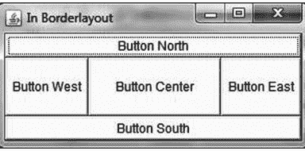

## 15.4 卡片布局

`CardLayout` 是复杂的布局管理器之一。使用该管理器，你可以创建一个卡牌，然后从一张翻页到另一张。这种组织方式类似于标签页框。

### CardLayout 类具有以下构造函数：

1. `CardLayout()`: 创建没有间距的卡片布局。
2. `CardLayout(int hgap, int vgap)`: 创建具有指定水平和垂直间距的卡片布局。
3. `CardLayout(String align, int hgap, int vgap)`: 创建具有指定对齐方式以及水平、垂直间距的卡片布局。

要创建卡片布局，你首先创建一个面板。`CardLayout` 类提供了以下方法：

- `next(Container)`: 显示下一张卡片。
- `previous(Container)`: 显示上一个卡片。
- `first(Container)`: 显示第一张卡片。
- `last(Container)`: 显示最后一张卡片。
- `show(Container, String name)`: 显示指定的卡片。

### 示例：


```java
import java.awt.*;
import java.awt.event.*;
public class CardDemo extends Frame implements ActionListener
{
    Button b1,b2,b3;
    CardLayout c1;
    Panel p1;
    CardDemo(String s)
    {
        super(s);
        p1 = new Panel();
        c1 = new CardLayout();
        p1.setLayout(c1);
        b1 = new Button("Button 1");
        b2 = new Button("Button 2");
        b3 = new Button("Button 3");
        b1.addActionListener(this);
        b2.addActionListener(this);
        b3.addActionListener(this);
        p1.add(b1, "card1");
        p1.add(b2, "card2");
        p1.add(b3, "card3");
        add(p1, BorderLayout.CENTER);
        setSize(300,140);
        setVisible(true);
    }
    public void actionPerformed(ActionEvent e)
    {
        if (e.getActionCommand().equals("Button 1"))
            c1.show(p1, "card1");
        if (e.getActionCommand().equals("Button 2"))
            c1.show(p1, "card2");
        if (e.getActionCommand().equals("Button 3"))
            c1.show(p1, "card3");
    }
    public static void main(String a[])
    {
        CardDemo gd=new CardDemo("In Cardlayout");
    }
}
```

# 深度解析 Java

`weightX`, `weightY`: 决定组件是否水平拉伸以填充 applet 的显示区域 (`weightX`) 或垂直拉伸 (`weightY`)。两者的默认值均为 0。

示例：

```java
// usage of GridBag Layout with constraints
import java.awt.*;

public class GridBagDemo extends Frame {
    Button b1, b2, b3, b4, b5, b6;

    GridBagLayout g1;
    GridBagConstraints gbc;

    GridBagDemo() {
        g1 = new GridBagLayout();
        setLayout(g1);
        setSize(300, 140);
        gbc = new GridBagConstraints();
        b1 = new Button("Button 1");
        b2 = new Button("Button 2");
        b3 = new Button("Button 3");
        b4 = new Button("Button 4");
        b5 = new Button("Button 5");
        b6 = new Button("Button 6");
        gbc.fill = GridBagConstraints.BOTH;
        gbc.anchor = GridBagConstraints.CENTER;
        gbc.gridwidth = 1;
        gbc.weightx = 1.0;
        g1.setConstraints(b1, gbc);
        add(b1);
        gbc.gridwidth = GridBagConstraints.REMAINDER;
        g1.setConstraints(b2, gbc);
        add(b2);
        gbc.gridwidth = GridBagConstraints.REMAINDER;
        g1.setConstraints(b3, gbc);
        add(b3);
        gbc.weightx = 0.0;
        gbc.weighty = 1.0;
        gbc.gridwidth = 1;
        g1.setConstraints(b4, gbc);
        add(b4);

        gbc.gridwidth = GridBagConstraints.REMAINDER;
        gbc.gridheight = 1;
        g1.setConstraints(b5, gbc);
        add(b5);
        g1.setConstraints(b6, gbc);
        add(b6);
        setVisible(true);
    }

    public static void main(String a[]) {
        GridBagDemo c = new GridBagDemo();
    }
}
```

# 输出

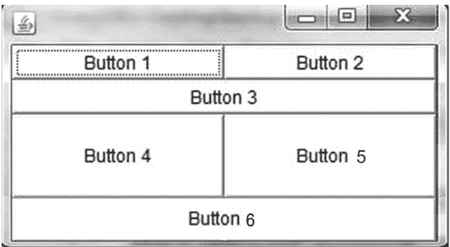

# 15.6 Box 布局管理器

Swing 提供了 `BoxLayout` 类来排列容器内的组件。Box 布局与 `FlowLayout` 类似，因为它按照你将组件添加到容器的顺序来布局。Box 布局允许你垂直或水平堆叠组件。在创建布局时，必须指定方向（`X_AXIS` 或 `Y_AXIS`）。Box 布局不支持多列或多行。组件可以是不同的大小。

以下代码向框架中的面板添加标签和按钮。`Box` 类的构造函数接收一个 AWT 容器的名称。

```java
import java.awt.*;
import javax.swing.*;

public class BoxDemo {
    public static void main(String a[]) {
        Frame frame = new Frame("BoxLayout");
        JPanel panel = new JPanel();
        BoxLayout boxlayout = new BoxLayout(panel, BoxLayout.Y_AXIS);
        panel.setLayout(boxlayout);
        JButton ok = new JButton("ok");
        JButton cancel = new JButton("cancel");
        frame.add(panel, BorderLayout.CENTER);
        frame.setVisible(true);
        frame.setSize(200, 200);
        panel.add(new JLabel("this"));
        panel.add(new JLabel("is"));
        panel.add(new JLabel("Box layout"));
        panel.add(ok);
        panel.add(cancel);
    }
}
```

# 输出

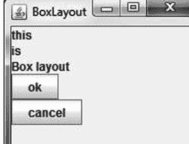

# 总结

1. 布局管理决定容器内组件的大小和位置的过程。

2. AWT 提供了以下布局管理器：
    - 流动布局 (Flow layout)
    - 网格布局 (Grid layout)
    - 边框布局 (Border layout)
    - 卡片布局 (Card layout)
    - 网格袋布局 (Grid bag layout)

3. `Object` 类是所有布局管理器的父类。

4. applet 的默认管理器是流动布局管理器。流动布局按照控件添加的顺序在水平行中一个接一个放置控件。

5. 边框布局管理器允许你使用以下方向对组件进行定位：北、南、西、东、中。

6. 网格布局管理器将显示组织为矩形网格。

7. 使用卡片布局管理器，你可以创建一个像扑克牌堆一样的布局栈，并在卡片之间切换。

8. `GridBag` 布局将组件放置在行和列中，允许指定的组件跨越多个行或列。

9. `GridBagConstraints` 类的对象用于指定组件的约束。

10. Swing 提供了 `BoxLayout` 管理器来排列容器内的组件。`BoxLayout` 允许你垂直和水平堆叠组件。

# 复习题

1. Java 布局管理器相比传统的窗口系统提供了什么优势？

2. `java.awt` 包中有哪些不同类型的布局管理器？

3. 不同布局的元素是如何组织的？

4. 使用什么方法来指定约束？

5. 所有布局管理器的父类是什么？

6. applet 的默认管理器是什么？

7. 什么？

# 面试题

1. Java 布局管理器相比传统的窗口系统提供了什么优势？

2. `java.awt` 包中有哪些不同类型的布局管理器？

3. 不同布局的元素是如何组织的？

4. 使用什么方法来指定约束？

5. 所有布局管理器的父类是什么？

6. applet 的默认管理器是什么？

7. 什么？

## 事件处理

`java.util` 包。其他大多数事件存在于 `java.awt.AWTEvent` 层次结构中。JDK 1.2 事件类的层次结构如下所示：

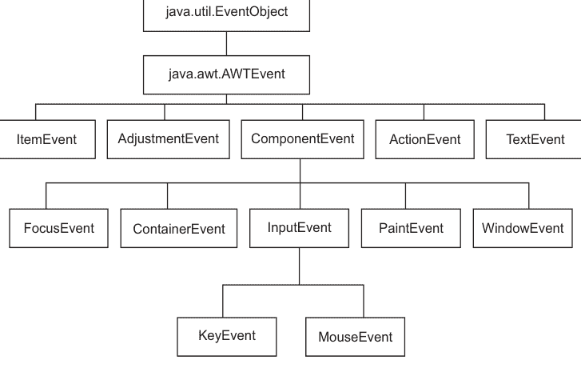

`EventObject` 类的 `getSource()` 方法返回触发事件的对象。`getID()` 方法返回表示事件性质的事件 ID。例如，如果发生鼠标事件，你可以从事件对象中判断该事件是点击、移动、按下还是释放。

## 事件

1. 当组件（如按钮 `Button`）被激活时，会生成一个 `ActionEvent` 事件。

2. 当使用滚动条和其他可调整控件时，会生成一个 `AdjustmentEvent` 对象。

3. 当容器中添加或移除组件时，会生成一个 `ContainerEvent` 对象。

4. 当组件接收焦点进行输入时，会生成一个 `FocusEvent` 对象。

5. 当从列表、选择框或复选框中选择项目时，会生成一个 `ItemEvent` 对象。

6. 当按下键盘上的按键时，会生成一个 `KeyEvent` 对象。

7. 当发生窗口活动（如最小化）时，会生成一个 `WindowEvent` 对象。

8. 当使用鼠标时，会生成一个 `MouseEvent` 对象。

9. 当文本组件（Text component）的内容被修改时，会生成一个 `TextEvent` 对象。

10. 当组件被绘制时，会生成一个 `PaintEvent` 对象。

## II) 事件监听器

一个对象将处理事件的任务委托给一个事件监听器。当事件发生时，会创建一个相应类型的事件对象。该对象被传递给监听器（Listener）。监听器必须实现包含事件处理方法的接口。一个组件可以有多个监听器。可以使用 `removeActionListener()` 方法移除一个监听器。

事件监听器的骨架代码：

```java
import java.awt.*;
import java.awt.event.*;
import java.applet.*;
class MyListener implements ActionListener {
    public void actionPerformed(ActionEvent action) {
        //处理事件
    }
}
class UseListener extends Applet {
    public void init() {
        Button ok =new Button();
        // 创建监听器对象
        MyListener listen =new MyListener();
        ok.addActionListener(listen);
        // 将按钮添加到 applet
        add(ok);
    }
}
```

## III) 显式事件处理（处理事件的另一种方式）

处理事件的另一种方法是子类组件并重写接收和分发事件的方法。例如，你可以从 `Button` 类派生一个类，并重写 `processActionEvent()` 方法，该方法将事件分发给事件监听器。

显式事件处理的骨架代码：

```java
import java.awt.*;
import java.awt.event.*;
class OKButton extends Button {
    public OKButton(String caption) {
        super (caption);
    }
    // 启用动作事件的处理
    enableEvents(AWTEvent.ACTION_EVENT_MASK);
    
    public void processActionEvent(ActionEvent action)
    {
      // 处理事件
      /* 调用父类方法，因为它调用了 actionPerformed( )
      方法 */
      super.processActionEvent(action);
    }
}
```

子类可以像下面的代码所示作为自身的事件监听器：

```java
import java.awt.*;
import java.awt.event.*;
class OKButton extends Button implements ActionListener
{
  public OKButton(String caption)
  {
    super(caption);
    // 为按钮添加动作监听器
    addActionListener(this);
  }
  public void actionPerformed(ActionEvent action)
  {
    // 处理事件
  }
}
```

## IV) 适配器 (Adapters)

当你使用接口创建监听器时，监听类必须重写接口中声明的所有方法。某些接口只有一个方法，而另一些则有很多。如果你只想处理一个事件，也必须重写所有方法。为了克服这个问题，事件包提供了七个适配器类。适配器将在本节稍后部分讨论。

## 处理事件

当事件发生时，它会被发送到事件源组件。该组件注册一个监听器，监听器包含事件处理程序。事件处理程序接收并处理事件。

每个事件都有相应的监听器接口，指定了处理该事件所需的方法。事件对象会被报告给注册的监听器。为了让组件能够处理事件，你必须为该组件注册一个适当的监听器。

示例：

```java
import java.awt.*;
import java.awt.event.*;
import java.applet.*;
class Myframe extends Frame
{
    Button bl;
    // 主方法
    public static void main(String args [])
    {
        Myframe f = new Myframe();
    }
    // 构造函数
    public Myframe()
    {
        super("Window Title");
        bl=new Button("click Here");
        // 将按钮对象放在窗口上
        add("Center", bl);
        // 为按钮注册监听器
        ButtonListener blisten= new ButtonListener( );
        bl.addActionListener(blisten);
        // 以特定大小显示窗口
        setVisible(true);
        setSize(200, 200);
    } // Frame 类结束
    // 监听器类
    class ButtonListener implements ActionListener
    {
        // 定义 actionPerformed(ActionEvent evt ) 方法
        public void actionPerformed(ActionEvent evt)
        {
            Button source = (Button)evt.getSource();
            source.setLabel("Button clicked");
        }
    }
}
```

## 输出

a) 事件发生前


b) 事件发生后


## 上述程序是如何运行的？

- 执行开始于 `main()` 方法。
- 在 `main()` 方法中创建 `Myframe` 对象。
- 调用 `Myframe` 构造函数。
- `super()` 方法调用基类并设置窗口标题。
- 创建按钮对象并放在窗口中心。
- 创建监听器对象。
- 使用 `addActionListener()` 方法为按钮注册监听器。
- `setVisible()` 方法显示窗口可见。
- 程序等待用户与其交互。
- 当用户点击按钮时，产生 `ActionEvent`。
- 创建事件对象并委托给监听器对象。
- 监听器包含处理 `ActionEvent` 的 `actionPerformed()` 方法。
- 在 `actionPerformed()` 方法中，通过 `getSource()` 方法获取引用。
- 最后，使用 `setLabel()` 方法更改按钮标签。

> **注意**：
> 没有监听器的组件无法处理事件。例如，在上述应用程序中，窗口没有关闭，因为 `MyFrame` 类没有注册关闭监听器。

## 16.6 处理窗口事件

为了处理窗口事件，你需要注册实现 `WindowListener` 接口的监听器对象。`WindowListener` 接口包含一组用于处理窗口事件的方法。

| 事件 | 方法 |
| --- | --- |
| 用户点击交叉 | `void windowClosing(WindowEvent)` |
| 窗口首次打开 | `void windowOpened(WindowEvent)` |
| 窗口激活 | `void windowActivated(WindowEvent)` |
| 窗口失去激活 | `void windowDeactivated(WindowEvent)` |
| 窗口关闭 | `void windowClosed(WindowEvent)` |
| 窗口最小化 | `void windowIconified(WindowEvent)` |
| 窗口最大化 | `void windowDeiconified(WindowEvent)` |

要修改包含窗口处理的 `MyFrame` applet，需要遵循以下步骤：

- 创建一个实现 `WindowListener` 接口的独立监听器类。
- 定义该接口中声明的所有方法。
- 为程序想要处理的特定事件添加代码。
- 使用 `addWindowListener()` 方法为窗口注册监听器对象。

**骨架代码：**

```java
import java.awt.*;
import java.awt.event.*;
import java.awt.applet.*;

class MyWindowListener implements WindowListener {
    // 窗口关闭的事件处理程序
    public void windowClosing(WindowEvent e) {
        System.exit(0);
    }
    public void windowClosed(WindowEvent e) {
    }
}
```

```java
{
    public void windowOpened(WindowEvent w) {
    }
    public void windowIconified(WindowEvent w) {
    }
    public void windowDeiconified(WindowEvent w) {
    }
    public void windowActivated(WindowEvent w) {
    }
    public void windowDeactivated(WindowEvent w) {
    }
}

class MyFrame extends Frame {
    public static void main(String args[]) {
        //..................................
    }
    // Constructor
    public MyFrame() {
        // 注册窗口监听器
        MyWindowListener wlisten = new MyWindowListener();
        addWindowListener(wlisten);
    }
}
```

在上述代码中，`MyFrame` 类调用了 `addWindowListener` 方法，该方法注册了窗口监听事件。这使得应用程序能够处理所有与窗口相关的事件。当用户通过最小化、最大化或点击关闭按钮与应用程序交互时，会创建一个 `WindowEvent` 并将其委托给预注册的窗口监听器。随后，指定的事件处理器将被进行处理。

`WindowListener` 类包含不包含任何代码的方法。这是因为 `WindowListener` 接口包含了所有这些方法的声明，强制你重写它们。Java 的适配器类（adapter classes）为这个问题提供了一个解决方案。

## 16.7 适配器类 (ADAPTER CLASSES)

Java 语言提供了适配器类，实现了包含多个方法的对应监听器接口。这些类中的方法是空的。你定义的监听器类可以扩展适配器类并重写你需要的方法。用于 `WindowListener` 接口的适配器类是 `WindowAdapter` 类。

你可以按照以下方式重写之前的代码：

```java
import java.awt.*;
import java.awt.event.*;

class MyFrame2 extends Frame {
    public static void main(String args[]) {
        MyFrame2 f = new MyFrame2();
        // Frame 子类的构造函数
    }

    public MyFrame2() {
        // 注册窗口监听器
        super("The Window Adapter");
        MyWindowListener listen = new MyWindowListener();
        addWindowListener(listen);
        setVisible(true);
    }

    class MyWindowListener extends WindowAdapter {
        // 窗口关闭事件的处理器
        public void windowClosing(WindowEvent w) {
            MyFrame2 f;
            f = (MyFrame2) w.getSource();
            f.dispose();
            System.exit(0);
        }
    }
}
```

### 事件处理 | 249

以下是适配器类和监听器接口的列表：

| 事件类别 | 接口名称 | 适配器名称 | 方法 |
| --- | --- | --- | --- |
| 窗口 | `WindowListener` | `WindowAdapter` | `void windowClosing(WindowEvent e)`<br>`void windowOpened(WindowEvent e)`<br>`void windowActivated(WindowEvent e)`<br>`void windowDeactivated(WindowEvent e)`<br>`void windowClosed(WindowEvent e)`<br>`void windowIconified(WindowEvent e)`<br>`void windowDeiconified(WindowEvent e)` |
| 动作 | `ActionListener` | | `void actionPerformed(ActionEvent e)` |
| 项目 | `ItemListener` | | `void itemStateChanged(ItemEvent e)` |
| 鼠标移动 | `MouseMotionListener` | `MouseMotionAdapter` | `void mouseDragged(MouseEvent e)`<br>`void mouseMoved(MouseEvent e)` |
| 鼠标按钮 | `MouseListener` | `MouseAdapter` | `void mousePressed(MouseEvent e)`<br>`void mouseReleased(MouseEvent e)`<br>`void mouseEntered(MouseEvent e)`<br>`void mouseExited(MouseEvent e)`<br>`void mouseClicked(MouseEvent e)` |
| 键盘 | `KeyListener` | `KeyAdapter` | `void keyPressed(KeyEvent e)`<br>`void keyReleased(KeyEvent e)`<br>`void keyTyped(KeyEvent e)` |
| 焦点 | `FocusListener` | | `void focusGained(FocusEvent e)`<br>`void focusLost(FocusEvent e)` |
| 组件 | `ComponentListener` | `ComponentAdapter` | `void componentMoved(ComponentEvent e)`<br>`void componentResized(ComponentEvent e)`<br>`void componentHidden(ComponentEvent e)`<br>`void componentShown(ComponentEvent e)` |

## 16.8 内部类 (INNER CLASSES)

内部类是声明在其他类中的类。它们也被称为嵌套类，为程序提供了额外的清晰度。内部类的范围限制限于包含它的外部类。内部类的对象可以访问外部类的成员。外部类可以通过内部类的对象访问内部类的成员。

**语法：**

```java
<modifiers> class <classname> {
    <modifiers> class <innerclassname> {
        // 其他属性和方法
    }
}
```

**示例：**

为了处理事件，必须定义一个单独的类。该类实现了所需的监听器接口。下面的代码使用了内部类。

```java
import java.awt.*;
import java.awt.event.*;

class MyFrame extends Frame {
    // 内部类声明
    class MyWindowListener extends WindowAdapter {
        public void windowClosing(WindowEvent w) {
            // 事件处理器
            MyFrame frame;
            frame = (MyFrame) w.getSource();
            frame.dispose();
            System.exit(0);
        }
    }

    public static void main(String args[]) {
        MyFrame frame = new MyFrame();
    }

    // frame 类的构造函数
    public MyFrame() {
        // 注册窗口监听器
        super("The Window Adapter");
        MyWindowListener listen = new MyWindowListener();
        addWindowListener(listen);
        setVisible(true);
    }
}
```

## 16.9 匿名类 (ANONYMOUS CLASSES)

有时，声明的类不需要名称。你可以创建无名类。没有名的类被称为匿名类。

**示例：**

```java
public void methodName() {
    OKButton.addActionListener(new ActionListener() {
        public void actionPerformed(ActionEvent action) {
            // 处理事件
        }
    });
}
```

### 总结

1. 通常，GUI 程序等待用户执行某些操作。
2. 事件的组件：
   - 事件对象
   - 源
   - 事件处理器
3. 事件委托模型基于：
   - 事件类
   - 事件监听器
   - 显式事件处理
   - 适配器
4. 为了处理窗口事件，你需要注册实现 `WindowListener` 接口的监听器。
5. 内部类（称为嵌套类）是声明在其他类中的类。
6. 程序中没有名的类被称为匿名类。
7. 匿名类不能有构造函数，因为类没有名称。

### 判断 (对/错)

1. 事件继承模型取代了事件委托模型。答案：否
2. 事件继承模型比事件委托模型更高效。答案：否
3. 事件委托模型使用监听器来定义事件处理类。答案：是
4. 事件委托模型使用 `handleEvent()` 方法来支持事件处理。答案：否

### 复习题

1. 什么是事件驱动编程？它在编程中有什么用？
2. 什么是 `ActionListener`？它有什么用？
3. 为什么我们需要为窗口事件注册监听器对象？
4. Java 中适配器的作用是什么？

### 面试题

1. `enableEvents()` 方法的作用是什么？
2. AWT 事件层次结构的顶端是什么类？
3. 点击按钮会产生什么事件？
4. 大多数支持事件委托模型的 AWT 事件位于哪个包中？
5. 事件委托模型相对于早期的事件继承模型有什么优势？
6. 假设你想让对象 `eh` 处理 `TextArea` 对象 `T` 的文本字段。你应该如何将 `eh` 添加为它的事件处理器？

# 第 17 章

## 数据库连接

## 17.1 Web 上的数据库管理

大多数基于 Web 的应用程序需要与数据库管理系统（DBMS）交互。这些 DBMS 是应用程序所用信息的仓库。例如，在线购物商城需要跟踪其客户和售出的商品。像 yahoo.com 这样的搜索网站需要跟踪用户访问的网页 URL。

本章将介绍使用 Java 进行数据库编程的技巧。你还将看到如何使用 JDBC-ODBC 桥接和 ODBC 驱动程序访问数据库。

### 17.1.1 数据库管理

数据库是相关信息的集合，而 DBMS 是一种提供检索、修改和向数据库添加数据机制的软件。目前有许多 DBMS/RDBMS 产品可用，例如 MS-Access、MS-SQL Server、Oracle、Sybase、Informix、Progress 和 Ingress。这些每种关系型数据库管理系统（RDBMS）都以自己的格式存储数据。

例如，MS-Access 以 MDB 文件格式存储数据，而 MS-SQL 以 `.DAT` 文件格式存储数据。

假设你被分配为一家杂商店开发一个应用程序，允许店主维护每日交易记录。你将设计数据库，在店主的机器上安装 MS-SQL Server/Oracle 并告诉他如何使用。开发一个自定义的前端应用程序将是一个好主意，其中客户可以通过按键获得检索和修改数据的选项。

为了实现上述目标，你需要一种机制使应用程序与数据库的文件格式（即 `.MDB` 或 `.DAT` 文件）协同工作。

## 17.2 数据库连接

为了让你的应用程序与数据库通信，它需要以下信息：

- 数据库的位置。
- 数据库的名称。

| 应用程序 | 响应查询 | MS Access 数据库 |
| :--- | :--- | :--- |
| | | |
| 响应查询 | MS-SQL 数据库 | |

### 数据库应用程序架构

这意味着你创建的应用程序将只能与一种数据库工作，并且编码和移植将非常困难。

上述问题通过微软与数据库高效通信的机制得到了解决，该机制被称为开放数据库连接（ODBC）。

#### I) ODBC 应用程序接口 (API)

ODBC API 是一组库例程，使你的程序能够访问各种数据库。你只需要安装特定于 DBMS 的 ODBC 驱动程序，并编写程序来与该驱动程序交互。

以后，如果数据库升级到新版本的 RDBMS 或移植到不同的 RDBMS 产品，你只需要更改 ODBC 驱动程序而不需要更改程序。

| 适用 | ODBC 驱动管理器 | Access 驱动 | MS Access 数据库 |
| --- | --- | --- | --- |
| | | Oracle 驱动 | Oracle 数据库 |

*(ODBC 应用程序架构图)*

#### II) JDBC-API

Java 数据库连接（JDBC）为 Java 程序提供了数据库编程 API。由于 ODBC API 是 C 语言编写的，并使用了 Java 不支持的指针和其他结构，Java 程序无法直接与 ODBC 驱动程序通信。

Java Soft 创建了 JDBC-ODBC 桥接，将 JDBC-API 转换为 ODBC-API。它与现有的 ODBC 驱动程序一起使用。

## 17.3 JDBC 驱动分类

- JDBC-ODBC 桥接 + ODBC 驱动
- 原生 API 驱动（部分 Java 驱动）
- 网络协议驱动（纯 Java 驱动）
- 线程型驱动

**JDBC-ODBC 桥接 + ODBC 驱动**：JDBC-ODBC 桥接驱动程序使用 ODBC 驱动连接到数据库。JDBC-ODBC 桥接驱动程序将 JDBC 方法调用转换为 ODBC 函数调用。由于 Thin 驱动的存在，现在已不建议这种做法。

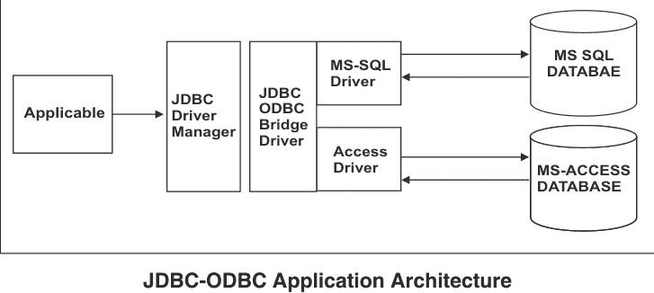

### JDBC 驱动管理器

JDBC 驱动管理器是 JDBC 架构的骨干。JDBC 驱动管理器的功能是将 Java 应用程序连接到 Java 程序指定的适当驱动程序。

### JDBC-ODBC 桥接


作为 JDBC 的一部分，Sun Microsystems 提供了一个从 JDBC 访问 ODBC 数据源的驱动程序。该驱动被称为 JDBC-ODBC 桥接。JDBC-ODBC 桥接实现为 JDBC 类，并使用原生库访问 ODBC 驱动程序。在 Windows 平台上，原生库是 `JDBC ODBCB.DIL`。

# 优点

- 易于使用
- 可以轻松连接到任何数据库

# 缺点

- 性能下降，因为 JDBC 方法调用被转换为 ODBC 函数调用。
- 客户端机器需要安装 ODBC 驱动程序。

## II) 原生 API 驱动

原生 API 驱动使用数据库的客户端库。驱动程序将 JDBC 方法调用转换为数据库 API 的原生调用。它不是完全用 Java 编写的。

# 优点

- 性能优于 JDBC-ODBC 桥接驱动程序。

# 缺点

- 每个客户端机器都需要安装原生驱动程序。
- 客户端机器需要安装供应商的客户端库。

## III) 网络协议驱动

它使用中间件（应用程序服务器）将 JDBC 调用直接或间接地转换为特定厂商的数据库协议。它是完全用 Java 编写的。

# 优点

- 不需要客户端库。

# 缺点

- 需要网络支持
- 中间层需要特定的数据库编码

## IV) Thin 驱动 (线程型驱动)

Thin 驱动将 JDBC 调用直接转换为特定的数据库协议。这就是为什么它被称为 Thin 驱动。它完全用 Java 编写的。

# 优点

- 性能优于所有其他驱动。
- 客户端不需要软件。

# 缺点

- 依赖于数据库。

## 17.4 查询数据库

现在你已经理解了 JDBC 架构，就可以编写能够与数据库工作的 Java 应用程序。在本节中，你将学习用于连接数据库和处理查询结果的包和类。

### 17.4.1 连接数据库

`java.sql` 包包含连接数据库、发送 SQL 语句和处理查询结果类。

### 17.4.2 连接对象

连接对象代表与数据库的连接。你的应用程序中可能有连接到多个数据库的连接对象。

#### 加载驱动程序并建立连接

要与数据库建立连接需要执行以下操作：

- I) 通过类的 `forName()` 方法注册 JDBC/Thin 驱动：`Class.forName("oracle.jdbc.driver.OracleDriver");`
- II) 调用 `DriverManager` 的 `getConnection("JDBC URL")` 方法：`DriverManager` 的 `getConnection()` 方法尝试定位由 JDBC URL 表示的驱动程序。

#### JDBC URL

JDBC URL 是用于标识数据库的字符串。JDBC URL 分为三部分：`<协议>:<子协议>:<子名>`

JDBC URL 中的 `<协议>` 始终是 `jdbc`。

`<子协议>` 是数据库连接机制名称。如果检索数据的机制是 ODBC 桥接，则子协议必须是 `odbc`。

`<子名>` 用于标识数据库。

#### 示例 JDBC URL

```java
String url = "jdbc:oracle:@localhost:1521:xe";
// Thin 驱动的 URL
"jdbc:oracle:thin@localhost:1521:xe"
Class.forName("oracle.jdbc.driver.OracleDriver");
Connection con = DriverManager.getConnection(url,"system","password");
```

### 17.4.3 在数据库中处理查询

一旦建立了数据库连接，你就可以查询数据库并处理结果集。JDBC 不对发送的 SQL 语句类型实施任何限制，作为程序员，你有责任确保数据库能够处理这些语句。

JDBC 提供了三类用于向数据库发送 SQL 语句的类：

- i) `Statement` 对象

你可以通过调用连接对象的 `createStatement()` 方法创建语句对象。

#### ii) 预语句对象 (PreparedStatement)

你可以通过调用连接对象的 `prepareStatement()` 方法来创建预语句对象。预语句对象包含一组方法，可用于发送带有输入参数的查询。

#### iii) 可调用语句对象 (CallableStatement)

你可以通过调用连接对象的 `prepareCall()` 方法来创建 `CallableStatement` 对象。`CallableStatement` 对象包含了调用存储过程的功能。你可以使用 `CallableStatement` 对象同时处理输入（INPUT）和输出参数。

#### 使用 Statement 对象

`Statement` 对象允许你执行查询。它有三个可以用于查询目的的方法：

- `executeQuery()` 方法执行 select 查询并返回单个的 `ResultSet` 对象。
- `executeUpdate()` 方法执行 SQL INSERT、UPDATE 和 DELETE 语句。
- `execute()` 方法执行可能返回多个结果的 SQL 语句。

你可以像示例程序 `QueryApp` 所示，使用 `Statement` 对象向数据库发送查询。

```java
import java.sql.*;
public class QueryApp {
    public static void main(String a []) {

        try {
            Class.forName("oracle.jdbc.driver.OracleDriver");
            Connection con = DriverManager.getConnection("jdbc:oracle:thin:localhost:1521:xe","system","sailboat");

            Statement stat = con.createStatement();
            stat.executeQuery("select*from emp");
        }
        catch (Exception e) {
            System.out.print("Error" + e);
        }
    }
}
```

在上面的示例中：

- (1) 加载了 Thin/Oracle 驱动。
- (2) 使用 `getConnection()` 方法初始化连接对象。
- (3) 使用 `createStatement()` 方法创建 `Statement` 对象。
- (4) 最后，使用 `Statement` 对象的 `executeQuery()` 方法执行了一个简单的查询。

#### 使用 ResultSet 对象

`ResultSet` 对象提供了访问表数据的方法。执行一个语句通常会生成一个 `ResultSet` 对象。它维护一个指向当前数据行的游标。初始时，游标位于第一行之前。`next()` 方法将游标移动到下一行。你可以通过调用 `getxx()` 方法从 `ResultSet` 行中访问数据，其中 xx 是数据参数的类型。以下代码查询数据库并处理 `ResultSet`。

```java
import java.sql.*;
public class QueryApp {
    public static void main(String a [] ) {
        ResultSet result;
        try {
            Class.forName("oracle.jdbc.driver.OracleDriver");
            Connection con = DriverManager.getConnection("jdbc:oracle:thin:localhost:1521:xe","system","ilbot1");
            Statement stat = con.createStatement();
            result = stat.executeQuery("select from emp");
            while (result.next()) {
                System.out.println(result.getString(2));
                // retrieving data from 2nd column of emp table
            }
        } catch (Exception e) {
            System.out.println("Error " + e);
        }
    }
}
```

在上面的 `QueryApp` 示例中：

- (1) `executeQuery()` 方法返回 `ResultSet` 对象。
- (2) 使用 while 循环中的 `next()` 方法处理 `ResultSet` 对象中的所有行。
- (3) 使用 `getString()` 方法获取第二列的值。

## 输出

| Ramesh |
| Atul |
| Suresh |
| Radhika |

你可以修改同一个程序，在窗口中显示表内容，如下所示：

```java
import java.awt.*;
import java.awt.event.*;
import java.sql.*;
public class QueryApp extends Frame implements ActionListener {
    TextField eid;
    TextField ename;
    Button next;
    Panel p;
    static ResultSet result;
    static Connection con;
    static Statement stat;
    public QueryApp(){
        super("The Query Application");
        setLayout(new GridLayout(5,1));
        eid = new TextField();
        ename = new TextField();
        next = new Button("Next");
        setSize(500,500);
        p = new Panel();
        add(new Label("Employee ID"));
        add(eid);
        add(new Label("Employee Name: "));
        add(ename);
        add(p);
        p.add(next);
        next.addActionListener(this);
        setVisible(true);
    }
    public static void main(String a [])
    {
        QueryApp app = new QueryApp();
        try {
            Class.forName("oracle.jdbc.driver.OracleDriver");
            System.out.println("after Driver");
            con = DriverManager.getConnection("jdbc:oracle:thin:localhost:1521:xe","system","sailboat");
            stat = con.createStatement();
            System.out.println("after statement");
            result = stat.executeQuery("select * from emp");
        }
        catch (Exception e) {
            System.out.print("Error in sql" + e);
        }
    }
    @Override
    public void actionPerformed(ActionEvent event) {
        if (event.getSource() == next) {
            try {
                while(result.next()) {
                    eid.setText(eid.getText() + " " + (result.getString(1)));
                    ename.setText(ename.getText() + " " + (result.getString(2)));
                }
            } catch (Exception e) {System.out.println(e);}
        }
    }
}
```

#### 使用 PreparedStatement 对象

`PreparedStatement` 允许你执行参数化查询。它是使用连接对象的 `prepareStatement()` 方法创建的。`prepareStatement()` 方法接受 SQL 语句作为参数。SQL 语句可以包含占位符，这些占位符可以在运行时被参数替换。注意：`?` 符号是一个占位符，可以在运行时被输入参数替换。

##### 传递输入参数

在执行 `PreparedStatement` 之前，必须为每个 `?` 设置值。这是通过调用 `setxxx()` 方法完成的，其中 xxx 是参数的数据类型。

示例：

```java
PreparedStatement stat = con.prepareStatement("SELECT * FROM emp WHERE eid = ?");
stat.setString(1, eid.getText());
ResultSet result = stat.executeQuery();
```

在上述示例中：

- `PreparedStatement` 对象通过 `prepareStatement()` 方法创建。
- 当用户点击查询按钮时，初始化 `PreparedStatement` 对象的参数。
- 然后使用 `executeQuery()` 方法执行查询并将结果显示在相应的控件中。

## 输出

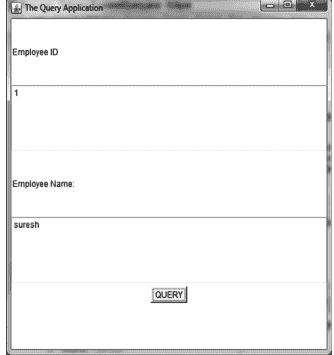

### 添加记录

你可以使用 `Statement` 对象的 `executeUpdate()` 方法来执行简单的 `INSERT` 语句。

```java
stat.executeUpdate("insert <tablename> values ( )");
```

`executeUpdate()` 方法的返回值受查询影响的行数。

```java
public void addRecord() {
    try {
        stat.executeUpdate("Insert into publishers values ('1020')");
    }
}
```

注意：`PreparedStatement` 对象可以用于向数据库发送参数化的 `INSERT` 语句。

### 修改记录

你可以使用 `Statement` 对象的 `executeUpdate()` 方法来执行简单的 `UPDATE` 语句。

```java
stat.executeUpdate("update <tablename> set <Expr>");
```

`executeUpdate()` 方法的返回值受查询影响的行数。

> **注意：** `PreparedStatement` 对象可以用于向数据库发送参数化的 `UPDATE` 语句。

### 删除记录

你可以使用 `Statement` 对象的 `executeUpdate()` 方法来执行 `DELETE` 语句。

```java
stat.executeUpdate("delete <tablename> where <Expr>");
```

`executeUpdate()` 方法的返回值受查询影响的行数。

> **注意：** `PreparedStatement` 对象可以用于向数据库发送参数化的 `DELETE` 语句。

## 总结

1. 数据库管理系统应用程序使用的信息库。
2. ODBC API 是一组库程序，使你的程序能够访问各种数据库。
3. JDBC 为 Java 程序提供了数据库编程 API。
4. JDBC-ODBC 驱动将 JDBC API 翻译为 ODBC API。
5. 共有五类 JDBC 驱动可用：
    * JDBC-ODBC 桥接 + ODBC 驱动。
    * 原生 API（部分 Java 驱动）。
    * 网络协议驱动（纯 Java 驱动）。
    * 薄型驱动。

6. `java.sql` 包包含了有助于连接数据库、向数据库发送嵌入 SQL 语句以及处理查询结果的类。
7. `Connection` 对象表示与数据库的连接。
8. `PreparedStatement` 对象允许你执行参数化查询。
9. `ResultSet` 对象提供了从表中访问数据的方法。

## 单选题

1. JDBC-ODBC 桥接是什么？
   a) 单线程
   b) 多线程
   c) 以上都不是
   **答案：b)**

2. `DriverManager` 是什么？
   a) 接口
   b) 类
   c) 方法
   **答案：b)**

3. `Commit` 是哪个的方法？
   a) Connection
   b) ResultSet
   c) Statement
   **答案：a)**

4. 在 JDBC 中加载数据库需要以下哪些方法？


# 选择题

- a) `Class.forName()`
- b) `registerDriver()`
- c) 以上都不是

答案：a)

- 5. Sun 定义了多少种 JDBC 驱动？
- a) 一个
- b) 四种
- c) 三种

答案：b)

# 填空题

- 1. ________ 是一个运行在 UNIX、Linux 和 Windows 上的开源 DBMS 产品。

答案：MySQL

- 2. ________Statement 可以执行参数化查询。

答案：PreparedStatement

- 3. `executeQuery()` 返回的是 ________ 对象。

答案：ResultSet

- 4. ________ 符号是一个占位符，可以在运行时被输入参数替换。

答案：`?`

# 数据库连接

# 判断题

- 1. JDBC 是一种用于连接到关系型、对象型和 XML 数据源的 API。

答案：错误

- 2. JDBC-ODBC 桥接支持每个连接多个并发打开的语句。

答案：正确

- 3. JDBC 是访问关系型数据库的 API。

答案：错误

- 4. `java.sql` 和 `javax.sql` 包包含了 JDBC 类和接口。

答案：正确

# 复习题

- 1. 什么是数据库和数据库驱动？
- 2. 有多少种类型的驱动？请解释它们。
- 3. 写出连接数据库的步骤。
- 4. 什么是 ResultSet？`ResultSet` 的返回类型是什么？

# 面试题

- 1. Java 中 JDBC 连接的主要步骤有哪些？
- 2. Statement 有哪些不同类型？
- 3. 什么是 JDBC？
- 4. 哪种类型的 Statement 可以执行参数化查询？
- 5. JDBC-ODBC 桥接支持每个连接多个并发打开的语句吗？

# 第18章 集合

集合（可能称为容器）简单地包含一组多个元素的对象。集合表示形成自然分组的数据项。例如，卡牌集合、电话簿（将名称映射到电话号码）等。

## 18.1 集合框架

框架是指表示和操作集合的架构。在 Collection 中，我们有很多接口和抽象类。

### 集合的优势

1. **减少程序员的工作量**：Collection 提供了如 List、Queue 等算法。
2. **高性能**：Collection 有许多接口需要实现。
3. **可操作性**：Collection 允许不同类型相互工作。

## 18.2 集合接口

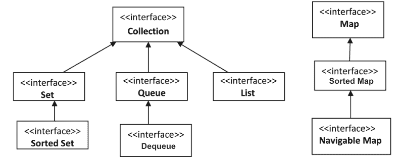

Collection 的方法适用于所有类，因为 Collection 是父接口。

## 18.3 集合层级结构

I)

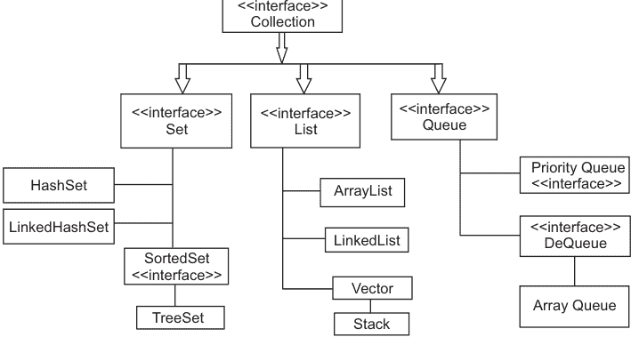

II)

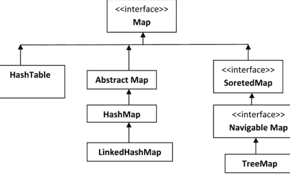

## 18.4 集合的方法

- `public boolean add(Object element)`：用于向集合中插入元素。
- `public boolean addAll(Collection c)`：用于将指定的集合插入调用集合中。
- `public boolean remove(Object element)`：用于从集合中删除元素。
- `public boolean removeAll(Collection c)`：用于从调用集合中删除指定集合的所有元素。
- `public boolean retainAll(Collection c)`：用于删除调用集合中除指定集合以外的所有元素。
- `public int size()`：返回集合中元素的总数。
- `public void clear()`：移除集合中的所有元素。
- `public boolean contains(Object element)`：用于搜索元素。
- `public boolean containsAll(Collection c)`：用于在集合中搜索指定的集合。
- `public Iterator iterator()`：返回一个迭代器。
- `public Object[] toArray()`：将集合转换为数组。
- `public boolean isEmpty()`：检查集合是否为空。
- `public boolean equals(Object element)`：匹配两个集合。
- `public int hashCode()`：返回集合的哈希值。

## 18.5 迭代器接口

迭代器接口提供了向前遍历元素的功能。

### 迭代器的方法

迭代器中有三个方法，它们是：

- `public boolean hasNext()`：如果迭代器还有元素，则返回 true。
- `public Object next()`：返回元素并将指针移动到下一个元素。
- `public void remove()`：删除迭代器上次返回的元素。它很少被使用。

## 18.6 List 接口

List 关注索引。List 有而非 List 没有的方法是一组与索引相关的方法。这些关键方法包括 `get(int index)`、`indexOf(Object o)`、`add(int index, Object obj)` 等。

下面描述了三种 List 的实现方式：

1. **ArrayList**（动态或可扩展数组）：它是一个有序集合，但不是排序的。它于 JDK 1.2 版本引入。它提供了快速的迭代和随机访问。
2. **Vector**：Vector 随 Java 早期版本出现。Vector 和 Hashtable 是两个原始集合。Vector 与 ArrayList 类似，但 Vector 方法是同步的，以确保线程安全。除了 ArrayList 之外，Vector 是唯一实现 `RandomAccess` 接口的类。
3. **LinkedList**（链表）：LinkedList 与 ArrayList 一样按索引位置排序，不同的是元素形成双向链表。LinkedList 的迭代速度比 ArrayList 慢，但当你需要快速插入和删除时，LinkedList 是一个很好的选择。

### ArrayList 示例

```java
import java.util.*;

class ArrayListDemo {
    public static void main(String args[]) {
        ArrayList al = new ArrayList(); // creating arraylist
        al.add("Java in Depth"); // adding object
        al.add("Sarika");
        al.add("Himani");
        al.add("BPB Publication");
        Iterator itr = al.iterator(); /* getting Iterator from arraylist to traverse elements */
        while (itr.hasNext()) {
            System.out.println(itr.next());
        }
    }
}
```

## 18.7 Queue 接口

队列的设计用于存储一组“待办事项”列表或需要以某种方式处理的任务。虽然可能存在其他顺序，但队列通常被认为是先进先出（FIFO）队列，它支持所有的集合方法。

**优先级队列（PriorityQueue）**：该类从 Java 5 开始引入。由于 LinkedList 已经增强并实现了 Queue 接口，因此可以使用 LinkedList 处理基础队列。PriorityQueue 的目的是创建一个“优先级入，优先级出”队列。

Java 的 PriorityQueue 不允许空值，且我们无法为不可比较的对象创建 PriorityQueue。我们使用 Java `Comparable` 和 `Comparator` 对对象进行排序，PriorityQueue 使用它们对元素进行优先级处理。

### 示例

```java
public class Student {
    private int id;
    private String name;

    public Student(int i, String n) {
        this.id = i;
        this.name = n;
    }

    public int getId() {
        return id;
    }

    public String getName() {
        return name;
    }
}
```

```java
package collection.demo;

import java.util.Comparator;
import java.util.PriorityQueue;
import java.util.Queue;
import java.util.Random;

public class PriorityQueueExample {
    public static void main(String[] args) {
        // 优先级队列的自然排序示例
        Queue<Integer> ipq = new PriorityQueue<Integer>(7);
        Random rand = new Random();
        for (int i = 0; i < 7; i++) {
            ipq.add(new Integer(rand.nextInt(100)));
        }
        for (int i = 0; i < 7; i++) {
            Integer in = ipq.poll();
            System.out.println("Processing Integer: " + in);
        }

        // 使用 Comparator 的 PriorityQueue 示例
        Queue<Student> spq = new PriorityQueue<Student>(7, idComparator);
        addDataToQueue(spq);
        pollDataFromQueue(spq);
    }

    // Comparator 匿名类实现
    public static Comparator<Student> idComparator = new Comparator<Student>() {
        @Override
        public int compare(Student c1, Student c2) {
            return c1.getId() - c2.getId();
        }
    };

    // 向队列中添加随机数据的工具方法
    private static void addDataToQueue(Queue<Student> spq) {
        Random rand = new Random();
        for (int i = 0; i < 7; i++) {
            int id = rand.nextInt(100);
            spq.add(new Student(id, "Pankaj" + id));
        }
    }

    // 从队列中提取数据的工具方法
    private static void pollDataFromQueue(Queue<Student> spq) {
        while (true) {
            Student cust = spq.poll();
            if (cust == null) break;
            System.out.println("Processing Student with ID=" + cust.getId());
        }
    }
}
```

## 18.8 Set 接口

Set 关注唯一性。它不允许重复。下面描述了三种 Set 的实现：

- **HashSet**：它是无序且不排序的。它使用对象的 `equals()` 和 `hashCode()` 进行存储。
- **LinkedHashSet**：它是有序 Set，维护双向链表。当你遍历 HashSet 时，顺序是不可预测的，而遍历 LinkedHashSet 时，是按照插入的顺序进行的。
- **TreeSet**：保证元素将按照自然顺序升序排列。

### HashSet 示例

```java
import java.util.*;

class HashSetDemo {
    public static void main(String args[]) {
        HashSet<String> al = new HashSet<String>();
        al.add("Java in Depth");
        al.add("Sarika");
        al.add("Himani");
        al.add("Sarika");
        Iterator<String> itr = al.iterator();
        while (itr.hasNext()) {
            System.out.println(itr.next());
        }
    }
}
```

**输出：**

| Sarika |
| :--- |
| Himani |
| Java in Depth |

### LinkedHashSet 示例

```java
import java.util.*;

class LinkedHashSetDemo {
    public static void main(String args[]) {
        LinkedHashSet<String> al = new LinkedHashSet<String>();
        al.add("Java in Depth");
        al.add("Sarika");
        al.add("Himani");
        al.add("Sarika");
        Iterator<String> itr = al.iterator();
        while (itr.hasNext()) {
            System.out.println(itr.next());
        }
    }
}
```

**输出：**

| Java in Depth |
| :--- |
| Sarika |
| Himani |

## 18.9 Map 接口

Map 关注唯一的标识符。它将一个键映射到一个特定的值，其中键和值都是对象。Map 有四种实现：

- **HashMap**：它是无序且不排序的 Map。它允许一个空键和多个空值。
- **Hashtable**：类似于 Vector，Hashtable 是同步的。它不允许空键或空值。
- **LinkedHashMap**：类似于其 Set 实现 LinkedHashSet，LinkedHashMap 维护插入顺序（可选地，访问顺序）。
- **TreeMap**：它是按自然顺序排序的 Map。它不允许空键但允许多个空值。

### Hashtable 示例

```java
import java.util.*;

class HashtableDemo {
    public static void main(String[] args) {
        Hashtable<String, String> hm = new Hashtable<String, String>();
        hm.put("Key1", "Sarika");
        hm.put("Key2", "Himani");
        hm.put("Key3", "Rahul");

        for (Map.Entry m : hm.entrySet()) {
            System.out.println(m.getKey() + " " + m.getValue());
        }
    }
}
```

**输出：**

| Key3 Rahul |
| :--- |
| Key2 Himani |
| Key1 Sarika |

### LinkedHashMap 示例

```java
import java.util.*;

class LinkedHashMapDemo {
    public static void main(String[] args) {
        LinkedHashMap<String, String> hm = new LinkedHashMap<String, String>();
        hm.put("Key1", "Sarika");
        hm.put("Key2", "Himani");
        hm.put("Key3", "Rahul");

        for (Map.Entry m : hm.entrySet()) {
            System.out.println(m.getKey() + " " + m.getValue());
        }
    }
}
```

**输出：**

| Key1 Sarika |
| :--- |
| Key2 Himani |
| Key3 Rahul |

### TreeMap 示例


```java
import java.util.*;
class TreeMapDemo{
    public static void main(String[] args[]){
        TreeMap<String, String> hm=new TreeMap<String, String>();

        hm.put("Key6", "Sarika");
        hm.put("Key2", "Himani");
        hm.put("Key9", "Rahul");
        for (Map.Entry<String, String> m:hm.entrySet()) {
            System.out.println(m.getKey() + " "+m.getValue());
        }
    }
}
```

输出：

| Key2 Himani |
| Key6 Sarika |
| Key9 Rahul |

# 总结

- 1. 集合框架（Collection Framework）是指用于表示和操作集合的架构。
- 2. 集合带有四种基本口味：
    - **Lists (列表)**：元素的列表
    - **Sets (集合)**：唯一元素
    - **Maps (映射)**：具有唯一 ID 的元素
    - **Queues (队列)**：按待处理顺序排列的元素。
- 3. List 实现：
    - `ArrayList`
    - `Vector`
    - `LinkedList`
- 4. Set 的实现
    - `HashSet`
    - `LinkedHashSet`
    - `TreeSet`
- 5. Queue 的实现
- 6. Map 的实现
    - `HashMap`
    - `Hashtable`
    - `LinkedHashMap`
    - `TreeMap`

# 回答以下问题

## 单选题

- 1. 下面哪个包包含了所有的集合类？
    a) `Java.lang` b) `Java.util` c) `java.net`
    **答案.** b)
- 2. 下面哪个类不属于 Java 集合框架的一部分？
    a) `Queue` b) `Array` c) `Stack`
    **答案.** b)
- 3. 下面哪个接口不属于 Java 集合框架的一部分？
    a) `Set` b) `SortedMap` c) `SortedList`
    **答案.** b)
- 4. Java 中的 Collection 是？
    a) 一组对象 b) 一组类 c) 一组接口
    **答案.** a)

## 填空题

- 1. `Comparable` 接口用于处理序列。
    **答案.** `Comparable`
- 2. `Collection Interface` 是集合层次结构中的根接口。
    **答案.** `Collection Interface`
- 3. `CopyOnWriteArrayList` 是 `ArrayList` 的线程安全变体。
    **答案.** `ArrayList`
- 4. Map 关注 `Unique` 标识符。
    **答案.** `Unique`


## 判断题

给定以下可比较的语句：

```java
Collections.sort(myArrayList, myCompare);
```

- myArray 中存储的对象类可以实现 `Comparable` 吗？
    答案. 正确
- myArray 中存储的对象类实现了 `Comparable` 吗？
    答案. 正确
- myArray 中存储的对象类必须实现 `Comparable` 吗？
    答案. 错误

## 复习题

- 什么是 Collection？集合框架有什么好处？
- 列出 List 和 Set 之间的区别？
- Set 和 Map 之间的区别是什么？
- 什么是泛型（Generic）？泛型有什么好处？
- 如何将字符串数组转换为列表？

## 面试题

- 假设有一个 `Employee` 类。我们将 `Employee` 类对象添加到 `ArrayList` 中。如果我想根据 `Employee` 类中存在的 `employeeid` 属性对 `ArrayList` 中的对象进行排序，需要采取哪些步骤？
- 什么是 Collection？什么是 Collections 框架？Java 集合框架有什么好处？
- 哪些集合类是同步或线程安全的？
- 命名核心 Collection 接口。
- List 和 Set 的区别是什么？
- Map 和 Set 的区别是什么？

# 第 19 章

# 项目

## 项目 I

井字游戏 (Tic Tac Toe)

```java
import java.awt.*;
import java.awt.event.*;
class TicTacoe extends WindowAdapter implements ActionListener
Label l11,l12,l13,l14,l15,l16,l110,l111,l112;
Button b0,b1,b2,b3,b4,b5,b6,b7,b8,b9,b11,b12,b13;
Frame f2,f1;
Color e=new Color(120,120,225);Color d=new Color(0,0,255);
Color c=new Color(255,0,0);Color eg=new Color(120,120,225);
Color g=new Color(0,0,255);
TextField t1,t2;
int lb1=0,lb2=0,lb3=0,lb4=0,lb5=0,lb6=0,lb7=0,lb8=0,lb9=0,i=0;
int ic=0,changes=0;
TicTacToe() {
l13=new Label("Rules of Tic Toe: ");
l14=new Label("1. 每个玩家一次填一个格子。");
l15=new Label("2. 玩家 1 在格子上画叉，而第二个玩家在格子上画圈。");
l16=new Label("3. 首先在水平或对角线方向上填三个连续格子的玩家获胜。");
l11=new Label("输入玩家1的名字");
l12=new Label("输入玩家2 的名字");
t1=new TextField();
t2=new TextField();
b0=new Button("Lets Play");
b13=new Button("New Game");
f2=new Frame("Tic Tac Toe");
f2.setLayout(null);
f2.setBounds(200,100,630,350);
f2.setBackground(e);
```

```java
f2.setVisible(true);
l11.setBounds(25,200,250,30);t1.setBounds(280,200,100,30);
l12.setBounds(25,230,250,30);t2.setBounds(280,230,100,30);
l13.setBounds(25,30,54,40);
l14.setBounds(25,70,54,30);
l15.setBounds(25,100,54,30);
l16.setBounds(25,130,260,30);
b0.setBounds(290,280,80,30);b0.addActionListener(this);
f2.add(l13);f2.add(l14);f2.add(l15);f2.add(l16);
f2.add(l11);f2.add(t1);f2.add(l12);f2.add(t2);f2.add(b0);
f2.addWindowListener(this);
}
public void windowClosing(WindowEvent w) {exit(0);}
public void actionPerformed(ActionEvent e) {
if (e.getSource() == b0) {
    f1=new Frame("Tic Tac Toe");
    f1.setBackground(eg);
    b1=new Button();b2=new Button();b3=new Button();b4=new Button();
    b5=new Button();b6=new Button();b7=new Button();b8=new Button();
    b9=new Button();b10=new Button();b11=new Button();b12=new Button();
    l19=new Label("Player 1"+t1.getText());
    l10=new Label("Player 2"+t2.getText());
    l11=new Label(null);l12=new Label(null);
    f1.setLayout(null);
    f1.setBounds(200,100,450,350);
    l19.setBounds(30,40,120,30);
    l10.setBounds(30,70,120,30);
    l11.setBounds(200,110,120,30);
    l12.setBounds(200,140,120,30);
    b1.setBounds(150,200,50,50);b2.setBounds(200,200,50,50);
    b3.setBounds(250,200,50,50);b4.setBounds(150,250,50,50);
    b5.setBounds(200,250,50,50);b6.setBounds(250,250,50,50);
    b7.setBounds(150,300,50,50);b8.setBounds(200,300,50,50);
    b9.setBounds(250,300,50,50);
    f1.add(b1);f1.add(b2);f1.add(b3);f1.add(b4);
    f1.add(b5);f1.add(b6);f1.add(l19);f1.add(l10);
    f1.add(l11);f1.add(l12);f1.add(b7);f1.add(b8);
    f1.add(b9);
    b1.addActionListener(this);b2.addActionListener(this);
    b3.addActionListener(this);b4.addActionListener(this);
    b5.addActionListener(this);b6.addActionListener(this);
    b7.addActionListener(this);b8.addActionListener(this);
    b9.addActionListener(this);
    f1.setVisible(true);
    l11.setText(t1.getText()+"'s turn");
}
if(e.getSource() == b1) {
    System.out.println("in b1");
    changes++;
    if(lc==0) {
        if(lb1==0) b1.setBackground(c);b1.setLabel("X");
        lb1=1;lc=1;l11.setText(t2.getText()+"'s turn");
        check();
        if(lb1!=0) {}
    }
    if(lc!=0) {
        if(lb1==0) b1.setBackground(d);b1.setLabel("0");
        lb1=1;lc=0;l11.setText(t1.getText()+"'s turn");
        check();
        if(lb1!=0) {}
    }
}
if(e.getSource() == b2) {
    System.out.println("in b2");
    changes++;
    if(lc==0) {
        if(lb2==0) b2.setBackground(c);b2.setLabel("X");
        lb2=1;lc=1;l11.setText(t2.getText()+"'s turn");
        check();
        if(lb2!=0) {}
    }
    if(lc!=0) {
        if(lb2==0) b2.setBackground(d);b2.setLabel("0");
        lb2=1;lc=0;l11.setText(t1.getText()+"'s turn");
        check();
    }
}
```

```java
}
```

```java
if(e.getSource() == b3) {
    System.out.println("in b3");
    changes++;
    if(lc==0) {
        if(lb3==0) b3.setBackground(c);b3.setLabel("X");
        lb3=1;lc=1;l11.setText(t2.getText()+"'s turn");
        check();
        if(lb3!=0) {}
    }
    if(lc!=0) {
        if(lb3==0) b3.setBackground(d);b3.setLabel("0");
        lb3=1;lc=0;l11.setText(t1.getText()+"'s turn");
        check();
        if(lb3!=0) {}
    }
}
if(e.getSource() == b4) {
    System.out.println("in b4");
    changes++;
    if(lc==0) {
        if(lb4==0) b4.setBackground(c);b4.setLabel("X");
        lb4=1;lc=1;l11.setText(t2.getText()+"'s turn");
        check();
        if(lb4!=0) {}
    }
    if(lc!=0) {
        if(lb4==0) b4.setBackground(d);b4.setLabel("0");
        lb4=1;lc=0;l11.setText(t1.getText()+"'s turn");
        check();
        if(lb4!=0) {}
    }
}
if(e.getSource() == b5) {
    System.out.println("in b5");
    changes++;
    if(lc==0) {
        if(lb5==0) b5.setBackground(c);b5.setLabel("X");
        lb5=1;lc=1;l11.setText(t2.getText()+"'s turn");
        check();
        if(lb5!=0) {}
    }
    if(lc!=0) {
        if(lb5==0) b5.setBackground(d);
    }
}
```

```java
b5.setLabel("0");lb5=1;lc=0;l11.setText(t1.getText()+"'s turn");
check();
if(lb5!=0) {
}
```

```java
if (lb7==0) {
    b7.setBackground(d);
    b7.setLabel("0");
    lb7=1;
    lc=0;
    l11.setText(t1.getText() + " turn());
    check();
}
if (lb7!=0) {
}
```


# 项目 | 289

```java
if (e.getSource() == b8) {
    chances = chances + 1;
    if (lc == 0) {
        if (lb8 == 0) {
            b8.setBackground(c);
            b8.setLabel("X");
            lb8 = 1;
            lc = 1;
            l11.setText(t2.getText() + " turn");
            check();
            if (lb8 != 0) {
                if (lc != 0) {
                    if (lb8 == 0) {
                        b8.setBackground(d);
                        b8.setLabel("0");
                        lb8 = 1;
                        lc = 0;
                        l11.setText(t1.getText() + " turn");
                        check();
                        if (lb8 != 0) {
                        }
                    }
                }
            }
        }
    }
}
```

```java
if (e.getSource() == b9) {
    chances = chances + 1;
    if (lc == 0) {
        if (lb9 == 0) {
            b9.setBackground(c);
            b9.setLabel("X");
            lb9 = 1;
            lc = 1;
            l11.setText(t2.getText() + " turn");
            check();
            if (lb9 != 0) {
                if (lc != 0) {
                    if (lb9 == 0) {
                        b9.setBackground(d);
                        b9.setLabel("0");
                        lb9 = 1;
                        lc = 0;
                        l11.setText(t1.getText() + " turn");
                        check();
                        if (lb9 != 0) {
                        }
                    }
                }
            }
        }
    }
}
```

```java
if (e.getSource() == b13) {
    System.out.println("nope");
}
```

```java
b9.setBackground(null);
b1.setBackground(null);
b1.setLabel("");
```

```java
b2.setBackground(null);
b3.setBackground(null);
b4.setBackground(null);
b5.setBackground(null);
b6.setBackground(null);
b9.setLabel("");
b2.setLabel("");
b3.setLabel("");
b4.setLabel("");
b5.setLabel("");
b6.setLabel("");
b7.setLabel("");
b8.setLabel("");
l1 = 0; lb2 = 0; lb3 = 0; lb4 = 0; lb5 = 0; lb6 = 0; lb7 = 0; lb8 = 0; lb9 = 0; i = 0;
f2.setVisible(true);
f1.dispose();
}

public static void main(String a[]) {
    TicTacToe el = new TicTacToe();
}

public void check() {
    String s1, s2, s3, s4, s5, s6, s7, s8, s9, s10, s11;
    s1 = b1.getLabel(); s2 = b2.getLabel(); s3 = b3.getLabel();
    s4 = b4.getLabel(); s5 = b5.getLabel(); s6 = b6.getLabel();
    s7 = b7.getLabel(); s8 = b8.getLabel(); s9 = b9.getLabel();
    s10 = "X"; s11 = "O";
    if ((s1 == s2) & (s2 == s3) & (s2 == s10)) {
        System.out.println("amit");
        l112.setText(t1.getText() + " win");
    }
    if ((s4 == s5) & (s5 == s6) & (s5 == s10)) {
        System.out.println("kumar");
        l112.setText(t1.getText() + " win");
    }
    if ((s7 == s8) & (s8 == s9) & (s8 == s10)) {
        System.out.println("yadav");
        l112.setText(t1.getText() + " win");
    }
    if ((s1 == s4) & (s4 == s7) & (s4 == s10)) {
        System.out.println("amit");
        l112.setText(t1.getText() + " won");
    }
    if ((s2 == s5) & (s5 == s8) & (s5 == s10)) {
        System.out.println("amit");
        l112.setText(t1.getText() + " won");
    }
    if ((s3 == s6) & (s6 == s9) & (s6 == s10)) {
        System.out.println("amit");
        l112.setText(t1.getText() + " won");
    }
    if ((s1 == s5) & (s5 == s9) & (s5 == s10)) {
        System.out.println("amit");
        l112.setText(t1.getText() + " won");
    }
    if ((s3 == s5) & (s5 == s9) & (s5 == s10)) {
        System.out.println("amit");
        l112.setText(t1.getText() + " won");
    }
    if ((s1 == s2) & (s2 == s3) & (s2 == s10)) {
        System.out.println("amit");
        l112.setText(t2.getText() + " won");
    }
    if ((s4 == s5) & (s5 == s6) & (s5 == s10)) {
        System.out.println("kumar");
        l112.setText(t2.getText() + " won");
    }
    if ((s7 == s8) & (s8 == s9) & (s8 == s10)) {
        System.out.println("yadav");
        l112.setText(t2.getText() + " won");
    }
    if ((s1 == s4) & (s4 == s7) & (s4 == s10)) {
        System.out.println("amit");
        l112.setText(t2.getText() + " won");
    }
    if ((s2 == s5) & (s5 == s8) & (s5 == s10)) {
        System.out.println("amit");
        l112.setText(t2.getText() + " won");
    }
    if ((s3 == s6) & (s6 == s9) & (s6 == s10)) {
        System.out.println("amit");
        l112.setText(t2.getText() + " won");
    }
    if ((s1 == s5) & (s5 == s9) & (s5 == s10)) {
        System.out.println("amit");
        l112.setText(t2.getText() + " won");
    }
    if ((s3 == s5) & (s5 == s9) & (s5 == s10)) {
        System.out.println("amit");
        l112.setText(t2.getText() + " won");
    } else if (chances == 9) {
        l112.setText("Match Drawn");
    }
}
```


# 项目 | 293

 

# 294 | 深度 Java


# 项目 II | 295

# 销售用户故事

## 经理

- 我希望维护所有物品的单价、库存水平和补货数量，这样我的工作可以更高效。
- 我需要一个维护所有产品详细信息的数据库（例如供应商名称、联系人、地址和联系方式），一个产品可能有多个供应商，以避免重复和歧义。
- 我需要软件能够在促销时覆盖特定产品的标准价格，以避免匹配错误并建立公平的会计系统。
- 我需要一个促销功能，允许我对特定产品提供大批量折扣（例如，5件物品打9折，10件物品打8折等），以吸引客户。
- 我需要一个自动化系统，它能为所有低于补货水平的物品自动下订单，这样当需求产生时，我们能确保有充足的商品。

## 用户故事

- 我希望维护所有物品的单价、库存水平和补货数量，这样我的工作可以更高效。
- 我需要一个维护所有产品详细信息的数据库（例如供应商名称、联系人、地址和联系方式），一个产品可能有多个供应商，以避免重复和歧义。
- 我需要软件能够在促销时覆盖特定产品的标准价格，以避免匹配错误并建立公平的会计系统。
- 我需要一个自动化系统，它能为所有低于补货水平的物品自动下订单，这样当需求产生时，我们能确保有充足的商品。
- 我需要一个界面允许我生成特定期间的销售报告，无论是所有产品的整体，还是每个运动项目的销售情况（例如图表或饼图）。
- 我希望查看收入最高的产品，包括每项运动的热销产品，以便我在下次订购时增加数量。
- 我需要系统的一个区域使用图形显示，例如销售和库存报告，或者让结账处能够快速查看并快速理解。

## 销售人员

- 作为工作人员，我希望能够登录系统并覆盖交易详情（移除物品、取消），以防客户出现问题导致产生冲突。
- 我希望有一个简单的结账系统，允许我指定 ID 或产品名称。

# 296 | 深度 Java

## 解决方案

```java
import java.util.Scanner;
public class Menu {
    Manager m;
    Customer c;
    String option;
    float price;
    Product p[] = new Product[3];
    Sales sales[] = new Sales[50];
    Supplier s[] = new Supplier[2];
    Supplier s2[] = new Supplier[2];
    Supplier s3[] = new Supplier[2];
    int sale_counter = 0;
    int j = 0;
    Scanner in;
    public void display_menu() {
        System.out.print("Select user type \n");
        System.out.println("1 MANAGER\n2 SALES STAFF\n3 CUSTOMER");
        int c2 = in.nextInt();
        callSwitch(c2);
    }
    void callSwitch(int c) {
        switch (c) {
            case 1:
                System.out.println(" PASSWORD FOR MANAGER");
                Scanner unique = new Scanner(System.in);
```

# 项目 | 297

```java
String passwordinput;
System.out.println(" Please type your password to log in ");
passwordinput = unique.nextLine();
```

```java
if (passwordinput.equalsIgnoreCase("AUSSIE")) {
    System.out.println("CORRECT");
    System.out.println("ENTER YOUR CHOICE AS");
    System.out.println("1-DISCOUNT CREATION\n2-GENERATE SALES REPORT\n3-SET PRICE\n4-PRODUCT LIST\n5-Exit");
    Scanner chooser = new Scanner(System.in);
    switch (choice.nextInt()) {
        case 1:
            System.out.println("ENTER THE NO ITEMS OF DISCOUNT PERCENTAGE");
            java.util.Scanner a = new java.util.Scanner(System.in);
            int item = a.nextInt();
            System.out.println(m.promotionaldiscount(item));
            break;
        case 2:
            System.out.println("sales report is");
            m.generateReport(sales, sale_counter);
            break;
        case 3: // setPrice
            System.out.println("Enter the Product ID ");
            int pid = in.nextInt();
            System.out.println("Enter the amt to bepromote/deducted ");
            int pri = in.nextInt();
            for (int j = 0; j < p.length; j++)
                if (p[j].pid == pid)
                    price = (float) m.setPrice(p[j],
```

# 298 | Java 深度

```java
break;
}
System.out.println(" 产品 " + pid + " 的新价格为 " + price);
```

```java
}
break;
case 5:
    display_menu();
default:
    System.out.println("你输入的选项错误");
    display_menu();
```

```java
}
else {
    System.out.println("密码错误");
    return;
}
break;
case 2:
    System.out.println("请输入销售人员的密码");
```

```java
Scanner sa = new Scanner(System.in);
```

# 项目 | 299


# 300 | Java 深度

```java
String password;
System.out.println(" 请输入您的密码登录 ");
password = sa.nextLine();
if (password.equalsIgnoreCase("SPORTS")) {
    System.out.println("密码正确");
} else {
    System.out.println("密码错误");
    return;
}
break;
case 3:
    Customer cust = new Customer(p);
    do {
        System.out.println("输入产品ID查看价格");
        java.util.Scanner s31 = new java.util.Scanner(System.in);
        int n = s31.nextInt(); // n
        cust.showPrice(n); // n
        System.out.println("*********** 优惠活动************");
        System.out.println("购买5件商品可享9折优惠 ");
        System.out.println("购买10件及以上商品可享8折优惠 ");
        System.out.println("*********** 优惠活动************");
        System.out.println("想要购买的数量");
        int items = s31.nextInt();
        for (int i = 0; i < p.length; i++) {
            if (p[i].pid == n) {
                p[i].stock = p[i].stock - items;
                int dis = m;
            }
        }
        promotionaldiscount(items);
        System.out.println("你获得了 ");
    }
```

```java
float discount = (float) dis / 100;
System.out.println(discount);
float amt = (float) (p[i].price * items);
float discountamt = amt - discount;
amt = amt - discountamt;
System.out.println("总金额为 " + amt);
sales[sale_counter++] = new Sales(p[i].pid, items, p[i].price, p[i].p_name);
pid, items, p[i].price, p[i].s[j] == 0
if (j == 0)
    j = 1;
else
    if (j == 1)
        j = 0;
break;
}
System.out.println("你想要更多商品吗 \n 按Y是，按N否");
java.util.Scanner s32 = new java.util.Scanner(System.in);
option = s32.nextLine();
System.out.println("你选择了 " + option);
} while (option.equalsIgnoreCase("Y"));
if (option.equalsIgnoreCase("n"))
    display_menu();
break;
default:
    System.out.println("输入错误 ");
    break;
}
public Menu() {
    p[0] = new Product(1, "name supp", 10.00F, 50, 50);
    p[1] = new Product(2, "name supp", 9.00F, 50, s2);
```

```java
p[2] = new Product(3, "name supp", 8.00F, 50, s3);
s[0] = new Supplier("abc", "Ram", "India", 9090, p[0]);
s[1] = new Supplier("efg", "Harry", "Australia", 9090, p[0]);
s2[0] = new Supplier("abc", "Ram", "India", 9090, p[1]);
s2[1] = new Supplier("efg", "Harry", "Australia", 9090, p[1]);
s3[0] = new Supplier("abc", "Ram", "India", 9090, p[2]);
s3[1] = new Supplier("efg", "Harry", "Australia", 9090, p[2]);
```

```java
in = new Scanner(System.in);
m = new Manager();
// =new Customer(null);
display_menu();
```

```java
public static void main(String[] args) {
    Menu menu = new Menu();
}
}
```

# 302 | Java 深度

```java
public class Supplier {
    String name;
    String person;
    String address;
    long phoneno;
    Product p;
    public Supplier(String name, String person, String address, long phoneNo, Product p) {
        this.name = name;
        this.person = person;
        this.address = address;
        this.phoneno = phoneNo;
        this.p = p;
    }
}
```

```java
public class Customer {
    Product p[];
    public Customer(Product p[]) {
        this.p = p;
        for (int i = 0; i < p.length; i++) {
            System.out.println("产品ID : " + p[i].pid);
        }
    }
    void showPrice(int id) {
        for (int i = 0; i < p.length; i++) {
            if (p[i].pid == id) {
                System.out.println("产品ID : " + p[i].pid + " 产品名称 : " + p[i].p_name + " 产品价格 : " + p[i].price);
            }
        }
    }
}
```

```java
public class Product {
    int pid;
    String p_name;
    float price;
    int stock;
    Supplier s[];
    public Product(int pid, String name, float price, int stock, Supplier s[]) {
        this.pid = pid;
        this.p_name = name;
        this.price = price;
        this.stock = stock;
        this.s = s;
    }
}
```

# 318 | 项目 | 303

```java
public class Sales {
    int p;
    int sales;
    float price;
    String p_name;
    public Sales(int p, int sales, float price, String p_name) {
        this.p = p;
        this.sales = sales;
        this.price = price;
        this.p_name = p_name;
    }
}
```

```java
public class Manager {
    int replenish_level;
    int m;
    int sale_counter;
    int promotionaldiscount(int items) {
        if (items >= 10) {
            m = 20;
        } else if (items >= 5) {
            m = 10;
        } else {
            m = 0;
        }
    }
    void placeOrder(Product p[]) {
        for (int i = 0; i < p.length; i++) {
            if (p[i].stock < replenish_level) {
                System.out.println("产品 " + p[i].name + " 需要补货");
            }
        }
    }
    void generateReport(Sales sales[], int sale_counter) {
        for (int i = 0; i < sale_counter; i++) {
            System.out.println("产品 " + sales[i].p_name + " 销售了 " + sales[i].sales + " 件");
        }
    }
}
```

# 319 | 304 | Java 深度

```java
void placeOrder(Product p[]) {
    for (int i = 0; i < p.length; i++) {
        if (p[i].stock < replenish_level) {
            System.out.println("产品 " + p[i].name + " 需要补货");
        }
    }
}
void generateReport(Sales sales[], int sale_counter) {
    for (int i = 0; i < sale_counter; i++) {
        System.out.println("产品 " + sales[i].p_name + " 销售了 " + sales[i].sales + " 件");
    }
}
```

# 320 | 项目 | 305

```java
Customer c = new Customer(p);
```

```java
System.out.println("输入产品ID查看价格");
java.util.Scanner s31 = new java.util.Scanner(System.in);
int n = s31.nextInt(); // n 是产品ID
c.showPrice(n);
System.out.println("*********** 优惠活动************");
System.out.println("购买5件商品可享9折优惠 ");
System.out.println("购买10件及以上商品可享8折优惠 ");
System.out.println("*********** 优惠活动************");
System.out.println("想要购买的数量");
int items = s31.nextInt();
for (int i = 0; i < p.length; i++) {
    if (p[i].pid == n) {
        p[i].stock = p[i].stock - items;
        int dis = m;
    }
}
promotionaldiscount(items);
System.out.println("你获得了 ");
```

```java
float discount = (float) dis / 100;
System.out.println(discount);
float amt = (float) (p[i].price * items);
float discountamt = amt - discount;
amt = amt - discountamt;
System.out.println("总金额为 " + amt);
sales[sale_counter++] = new Sales(p[i].pid, items, p[i].price, p[i].p_name);
pid, items, p[i].price, p[i].s[j] == 0
if (j == 0)
    j = 1;
else
    if (j == 1)
        j = 0;
break;
}
System.out.println("你想要更多商品吗 \n 按Y是，按N否");
java.util.Scanner s32 = new java.util.Scanner(System.in);
option = s32.nextLine();
System.out.println("你选择了 " + option);
} while (option.equalsIgnoreCase("Y"));
if (option.equalsIgnoreCase("n"))
    display_menu();
break;
default:
    System.out.println("输入错误 ");
    break;
}
public Menu() {
    p[0] = new Product(1, "name supp", 10.00F, 50, 50);
    p[1] = new Product(2, "name supp", 9.00F, 50, s2);
```


## 项目 III

## WUMPUS 游戏

## Wumpus！

Wumpus 是一个基于文本的游戏，玩家在洞穴系统中移动，寻找黄金，并试图避开深渊和可怕的 Wumpus。洞穴系统是一个 4 x 4 的网格。每个网格元素可以包含一个 `GameItem`。`GameItem` 是以下类型之一：黄金（`Gold`）、坑（`Pit`）、Wumpus 或空地（`ClearGround`）。

玩家可以向前、向后、向左或向右移动一个网格。洞穴系统是循环的，例如，从位置 `[3][0]` 向左移动会导致玩家出现在位置 `[3][3]`。

玩家可以感知但无法看到玩家周围相邻网格元素中的内容。深渊会被感知为微风，黄金会被感知为闪光，而 Wumpus 则会被感知为恶臭的气味。在本次作业中，网格将会显示出来，但在实际游戏中此功能将被禁用。如果玩家移动到深渊或 Wumpus 上，玩家将死亡且游戏结束。如果玩家移动到黄金上，游戏得分加一，黄金将被替换为空地。

## 实现：

你应该编写一个 `Game` 类，该类包含一个大小为 4 x 4 的 `GameItem` 二维数组 `board`，用于实现上述 Wumpus 游戏。

`Gold`、`Pit`、`Wumpus` 和 `ClearGround` 类都是 `GameItem` 的扩展。`GameItem` 提供了一个公共实例变量用于指定显示的字符。字符显示为 'g'，坑显示为 'p'，Wumpus 显示为 'W'，空地显示为 '.'。`GameItem` 提供了一个构造函数 `GameItem(char c)` 用于指定显示的字符。不应实例化 `GameItem` 对象。玩家没有被实现为一个对象，仅通过 `Game` 中的私有行和列坐标来表示。玩家的位置用 '*' 显示。物品随机分布在棋板上。至少恰好有一个 Wumpus，最多有三块黄金（随机选择），且恰好有三个坑。玩家初始位于一个空地位置。

## Game 应该提供：

- 一个私有方法 `setBoard()`，用于在棋板上实例化对象。
- 一个私有方法 `display()`，用于显示棋板。
- 一个私有方法 `senseNearby(int)`，显示关于玩家从其周围相邻网格元素中感知到的文本。
- 一个私有方法 `menu()`，将提供一个菜单让用户从以下选项中选择并输出用户的输入：

====Wumpus===

- 1. 玩家向左
- 2. 玩家向右
- 3. 玩家向上
- 4. 玩家向下
- 5. 退出

- 一个公共方法 `runGame()`，它将显示棋板，打印玩家可以感到的内容，打印菜单，并根据上述游戏运行规则处理用户的决策。

`World` 类仅实例化一个 `Game` 类的对象 `myGame`，并调用 `myGame.runGame()`。

在游戏运行和测试期间，你需要显示坑、Wumpus 和黄金，以测试你利用多态调用不同类方法的能力。`GameItem` 的 `display()` 方法用于显示每个游戏物品。

`Game` 的 `display()` 方法用于遍历 `GameItem` 数组以显示棋板。

你可能会发现 `java.util.*` 中的 `Random` 类很有用。

例如，以下代码将从 0..4（包含边界）赋值整数变量 `guess`：`Random randomGenerator = new Random();`

## Solution：

```java
public class ClearGround extends GameItem {

    public ClearGround(char c) {
        super(c);
    }
}
```

```java
public class Gold extends GameItem {

    public Gold(char c) {
        super(c);
        // TODO Auto-generated constructor stub
    }
}
```

```java
public abstract class GameItem {

    char display_char;

    public GameItem(char c) {
        this.display_char = c;
    }

    public char display() {
        return display_char;
    }
}
```

```java
public class Pit extends GameItem {

    public Pit(char c) {
        super(c);
    }
}
```

```java
public class World {

    public World() {
    }

    public static void main(String[] args) {
        Game myGame = new Game();
        myGame.runGame();
    }
}
```

```java
public class Wumpus extends GameItem {

    public Wumpus(char c) {
        super(c);
    }
}
```

```java
public class Game {

    GameItem board[][] = new GameItem[4][4];
    int w = 0;
}
```

```java
private void display() {
    for (int i = 0; i < 4; i++) {
        System.out.println("\n");
        for (int j = 0; j < 4; j++) {
            System.out.print("\t" + board[i][j].display());
        }
    }
}
```

```java
public void runGame() {
    setBoard();
    playerPosition();
    display();
    menu();
}
```

## public void playerPosition()

```java
for (int i = 0; i < 4; i++) {
    for (int j = 0; j < 4; j++) {
        java.util.Random rand = new java.util.Random();
        row = rand.nextInt(4);
        col = rand.nextInt(4);
        if (board[row][col].display() == 'c') {
            board[row][col].display_char = '*';
            flag = 1;
            break;
        }
    }
    if (flag == 1) {
        break;
    }
}
```

```java
private void senseNearBy() {
    senseLeft();
    senseRight();
    senseUp();
    System.out.println("附近");
    senseDown();
}
```

```java
private void menu() {
    System.out.println("\n====Wumpus=");
    System.out.println("1. 玩家向左");
    System.out.println("2. 玩家向右");
    System.out.println("3. 玩家向上");
    System.out.println("4. 玩家向下");
    System.out.println("5. 退出");
    java.util.Scanner input = new java.util.Scanner(System.in);
    int option = input.nextInt();
    switch (option) {
        case 1:
            // 向左移动
            break;
        case 2:
            // 向右移动
            break;
        case 3:
            // 向上移动
            break;
        case 4:
            // 向下移动
            break;
        case 5:
            System.exit(0);
    }
}
```

```java
void senseLeft() {
    char ch;
    if (row == 3 && col == 0) {
        ch = board[3][3].display();
        if (ch == 'p') {
            System.out.println("微风");
        } else if (ch == 'w') {
            System.out.println("恶臭");
        } else if (ch == 'g') {
            System.out.println("闪光");
        } else if (ch == 'c') {
            System.out.println("空地");
        }
    } else if (row == 2 && col == 0) {
        ch = board[2][3].display();
        if (ch == 'p') {
            System.out.println("微风");
        } else if (ch == 'w') {
            System.out.println("恶臭");
        } else if (ch == 'g') {
            System.out.println("闪光");
        } else if (ch == 'c') {
            System.out.println("空地");
        }
    } else if (row == 1 && col == 0) {
        ch = board[1][3].display();
        if (ch == 'p') {
            System.out.println("微风");
        } else if (ch == 'w') {
            System.out.println("恶臭");
        } else if (ch == 'g') {
            System.out.println("闪光");
        } else if (ch == 'c') {
            System.out.println("空地");
        }
    } else if (row == 0 && col == 0) {
        ch = board[0][3].display();
        if (ch == 'p') {
            System.out.println("微风");
        } else if (ch == 'w') {
            System.out.println("恶臭");
        } else if (ch == 'g') {
            System.out.println("闪光");
        } else if (ch == 'c') {
            System.out.println("空地");
        }
    } else {
        int j = col;
        ch = board[row][--j].display();
        if (ch == 'p') {
            System.out.println("微风");
        } else if (ch == 'w') {
            System.out.println("恶臭");
        } else if (ch == 'g') {
            System.out.println("闪光");
        } else if (ch == 'c') {
            System.out.println("空地");
        }
    }
}
```

```java
void senseRight() {
    char ch;
    if (row == 3 && col == 3) {
        ch = board[3][0].display();
        if (ch == 'p') {
            System.out.println("微风");
        } else if (ch == 'w') {
            System.out.println("恶臭");
        } else if (ch == 'g') {
            System.out.println("闪光");
        } else if (ch == 'c') {
            System.out.println("空地");
        }
    } else if (row == 2 && col == 3) {
        ch = board[2][0].display();
        if (ch == 'p') {
            System.out.println("微风");
        } else if (ch == 'w') {
            System.out.println("恶臭");
        } else if (ch == 'g') {
            System.out.println("闪光");
        } else if (ch == 'c') {
            System.out.println("空地");
        }
    } else if (row == 1 && col == 3) {
        ch = board[1][0].display();
        if (ch == 'p') {
            System.out.println("微风");
        } else if (ch == 'w') {
            System.out.println("恶臭");
        } else if (ch == 'g') {
            System.out.println("闪光");
        } else if (ch == 'c') {
            System.out.println("空地");
        }
    } else if (row == 0 && col == 3) {
        ch = board[0][0].display();
        if (ch == 'p') {
            System.out.println("微风");
        } else if (ch == 'w') {
            System.out.println("恶臭");
        } else if (ch == 'g') {
            System.out.println("闪光");
        } else if (ch == 'c') {
            System.out.println("空地");
        }
    } else {
        int j = col;
```


# 项目 | 315

```java
ch = board[row][++j].display();

if (ch == 'p') {
    System.out.println("微风");
} else if (ch == 'w') {
    System.out.println("恶臭");
} else if (ch == 'g') {
    System.out.println("闪光");
} else if (ch == 'c') {
    System.out.println("空地");
}
```

```java
void senseUp() {
    char ch;

    if (row == 0) {
        ch = board[3][col].display();

        if (ch == 'p') {
            System.out.println("微风");
        } else if (ch == 'w') {
            System.out.println("恶臭");
        } else if (ch == 'g') {
            System.out.println("闪光");
        } else if (ch == 'c') {
            System.out.println("空地");
        }
    } else {
        ch = board[row - 1][col].display();

        if (ch == 'p') {
            System.out.println("微风");
        } else if (ch == 'w') {
            System.out.println("恶臭");
        } else if (ch == 'g') {
            System.out.println("闪光");
        } else if (ch == 'c') {
            System.out.println("空地");
        }
    }
}
```

```java
void senseDown() {
    char ch;

    if (row == 3) {
        ch = board[0][col].display();

        if (ch == 'p') {
            System.out.println("微风");
        } else if (ch == 'w') {
            System.out.println("恶臭");
        } else if (ch == 'g') {
            System.out.println("闪光");
        } else if (ch == 'c') {
            System.out.println("空地");
        }
    } else {
        ch = board[row + 1][col].display();

        if (ch == 'p') {
            System.out.println("微风");
        } else if (ch == 'w') {
            System.out.println("恶臭");
        } else if (ch == 'g') {
            System.out.println("闪光");
        } else if (ch == 'c') {
            System.out.println("空地");
        }
    }
}
```

# 316 | 深度进 Java

```java
if (ch == 'p')
    System.out.println(" if you move left---> Breeze ");
else if (ch == 'w')
    System.out.println(" if you move left-----> Vile Smell");
else if (ch == 'g')
    System.out.println(" if you move left-----> glitter");
if (ch == 'c')
    System.out.println(" if you move left-----> Clear Ground");
```

```java
/**********************************************************************************
void senseRight() {
    char ch;

    if ((row == 3) && (col == 3)) {
        board[3][0].display();

        if (ch == 'p')
            System.out.println(" if you move Right---> Breeze ");
        else if (ch == 'w')
            System.out.println(" if you move Right-----> Vile Smell");
        else if (ch == 'g')
            System.out.println(" if you move Right-----> glitter");
        if (ch == 'c')
            System.out.println(" if you move Right-----> Clear Ground");
    } else if ((row == 2) && (col == 3)) {
        board[2][0].display();

        if (ch == 'p')
            System.out.println(" if you move Right---> Breeze ");
        else if (ch == 'w')
            System.out.println(" if you move Right-----> Vile Smell");
        else if (ch == 'g')
            System.out.println(" if you move Right-----> glitter");
```

# 项目 | 317

```java
if (ch == 'c')
    System.out.println("if you move Right-----> Clear Ground");
    }
else if ((row == 1) && (col == 3)) {
    board[1][0].display();

    if (ch == 'p')
        System.out.println("if you move Right---> Breeze");
    else if (ch == 'w')
        System.out.println("if you move Right---> Vile Smell");
    else if (ch == 'g')
        System.out.println("if you move Right-----> glitter");
}
else if ((row == 0) && (col == 3)) {
    board[0][0].display();

    if (ch == 'p')
        System.out.println("if you move Right---> Breeze");
    else if (ch == 'w')
        System.out.println("if you move Right---> Vile Smell");
    else if (ch == 'g')
        System.out.println("if you move Right-----> glitter");
}
else {
    int j = col;
    board[row][+j].display();

    if (ch == 'p')
        System.out.println("if you move Right---> Breeze");
    else if (ch == 'w')
        System.out.println("if you move Right---> Vile Smell");
    else if (ch == 'g')
        System.out.println("if you move Right-----> ");
```

```java
glitter");
if (ch == 'c')
    System.out.println(" if u move Right-------> Clear Ground");
```

```java
}
//***************************************************
void senseDown() {
    char ch;

    if ((row == 3) && (col == 3)) {
        ch = board[0][3].display();

        if (ch == 'p')
            System.out.println(" if u move--> Breeze ");
        else if (ch == 'w')
            System.out.println(" if u move Down----> Vile Smell");
        else if (ch == 'g')
            System.out.println(" if u move Down----> glitter");
        if (ch == 'c')
            System.out.println(" if u move Down-----> Clear Ground");
    } else {
        if ((row == 3) && (col == 2)) {
            ch = board[0][2].display();

            if (ch == 'p')
                System.out.println(" if u move Down--> Breeze ");
            else if (ch == 'w')
                System.out.println(" if u move Down----> Vile Smell");
        else if (ch == 'g')
            System.out.println(" if u move Down----> glitter");
            if (ch == 'c')
                System.out.println(" if u move Down-----> Clear Ground");
    } else {
        if ((row == 3) && (col == 1))
```

# 318 | 深度进 Java

```java
ch = board[0][1].display();

if (ch == 'p')
    System.out.println(" if you move Down---> Breeze");
else if (ch == 'w')
    System.out.println(" if you move Down---> Vile Smell");
else if (ch == 'g')
    System.out.println(" if you move Down---> glitter");
else if (ch == 'c')
    System.out.println(" if you move Down-----> Clear Ground");
} else
    if ((row == 3) && (col == 0)) {
        ch = board[0][0].display();

        if (ch == 'p')
            System.out.println(" if you move Down---> Breeze");
        else if (ch == 'w')
            System.out.println(" if you move Down---> Vile Smell");
        else if (ch == 'g')
            System.out.println(" if you move Down---> glitter");
        else if (ch == 'c')
            System.out.println(" if you move Down-----> Clear Ground");
    }
```

# 项目 | 319

```java
}
//**************************************************
//************************************************
void senseUp() {
    char ch;

    if ((row == 0) && (col == 0)) {
        ch = board[3][0].display();

        if (ch == 'p')
            System.out.println("if u move--> Breeze");
        else if (ch == 'w')
            System.out.println("if u move UP----> Vile Smell");
        else if (ch == 'g')
            System.out.println("if u move UP----> glitter");
        if (ch == 'c')
            System.out.println("if u move UP-----> Clear Ground");
    } else {
        if ((row == 0) && (col == 1)) {
            ch = board[3][1].display();

            if (ch == 'p')
                System.out.println("if u move--> Breeze");
            else if (ch == 'w')
                System.out.println("if u move UP----> Vile Smell");
            else if (ch == 'g')
                System.out.println("if u move UP----> glitter");
            if (ch == 'c')
                System.out.println("if u move UP-----> Clear Ground");
        } else {
            if ((row == 0) && (col == 2))
```

# 320 | 深度进 Java

```java
ch = board[3][2].display();

if (ch == 'p')
    System.out.println("if u move--> Breeze");
else if (ch == 'w')
    System.out.println("if u move UP----> Vile Smell");
else if (ch == 'g')
    System.out.println("if u move UP----> glitter");
if (ch == 'c')
    System.out.println("if u move UP-----> Clear Ground");
    } else {
        if ((row == 0) && (col == 3)) {
            ch = board[3][3].display();

            if (ch == 'p')
                System.out.println("if u move--> Breeze");
            else if (ch == 'w')
                System.out.println("if u move UP----> Vile Smell");
            else if (ch == 'g')
                System.out.println("if u move UP----> glitter");
        if (ch == 'c')
```


```java
System.out.println("if u move UP-----> Clear Ground");

} else {

    int j = col;

    board[3][+j].display();

    if (ch == 'p')
        System.out.println("if u move UP---> Breeze");
    else if (ch == 'w')
        System.out.println("if u move UP---> Vile Smell");
    else if (ch == 'g')
        System.out.println("if u move UP-----> glitter");

}

}
```

# Output

| w | g | c | g |
|---|---|---|---|
| c | * | p | p |
| p | g | c | c |
| c | c | c | c |

====Wumpus====

1. Move player left
2. Move player right
3. Move player up
4. Move player down
5. Quit

```
1

if u move left----> Clear Ground

if u move Right---> Breeze

if u move UP---> glitter

if u move Down-----> glitter
```
