# Java 入门指南，第6版（涵盖 Java 9）

此外，为了识别步骤中描述的每个源代码文件，彩色图标和文件名会出现在步骤旁边的边缘，如下：

 `App.java`

 `App.class`

 `App.jar`

 `App.xml`

Java™ 编程语言由 Sun Microsystems 公司工程师 James Gosling 于 1990 年首次开发。他不喜欢使用 C++ 编程语言，因此创建了一种新语言并将其命名为“Oak”（橡树），这是他在办公室窗外看到的一棵橡树。


随着万维网的普及，Sun 公司意识到 Gosling 的这种语言可以为互联网开发。因此，Sun 公司将该语言重命名为“Java”（仅仅是因为这个名字听起来很酷），并于 1995 年将其免费开放。全世界的开发者迅速采用了这种令人兴奋的新语言，并且由于其模块化的设计，他们能够创建可以添加到核心语言中的新功能。最受喜爱的额外功能被保留在 Java 的后续版本中，并使其发展成为今天的全面版本。

Java 的本质是一个被称为“类”（classes）的文件库，每个类都包含小段现成的、经过验证的代码。这些类中的任何一个都可以像墙上的砖一样整合到新程序中，因此只需要编写少量的新代码即可完成程序。这为程序员节省了大量时间，并在很大程度上解释了 Java 编程如此流行的原因。此外，这种模块化的安排使得比单一大型程序更容易识别任何错误。

Java 技术既是一种编程语言，又是一个平台。在 Java 编程中，源代码首先被写为人类可读的纯文本文件，扩展名为 `.java`。这些文件通过 `javac` 编译器编译成机器可读的 `.class` 文件。然后，`java` 解释器可以通过 Java 虚拟机（Java VM）的实例执行程序：

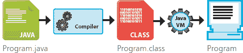


上述所示的“New”图标表示 Java 最新版本中引入的新功能或增强功能。

由于 Java VM 适用于许多不同的操作系统，相同的 `.class` 文件能够在 Windows、Linux 和 Mac 操作系统上运行——因此，Java 程序员在理论上享有“编写一次，随处运行”的跨平台能力。

为了创建 Java 程序，需要在你的计算机上安装 Java 类库和 `javac` 编译器。为了运行 Java 程序，需要安装 Java 运行时环境（JRE）以提供 `java` 解释器。所有这些组件都包含在一个免费提供的包中，即 Java 标准版开发工具包（JDK）。


书中的 Java 程序使用 JDK 9 版本，它包含了开发工具包本身和运行时环境，可以从 Oracle® 网站 `[www.oracle.com/technetwork/java/javase/downloads](http://www.oracle.com/technetwork/java/javase/downloads)` 下载。

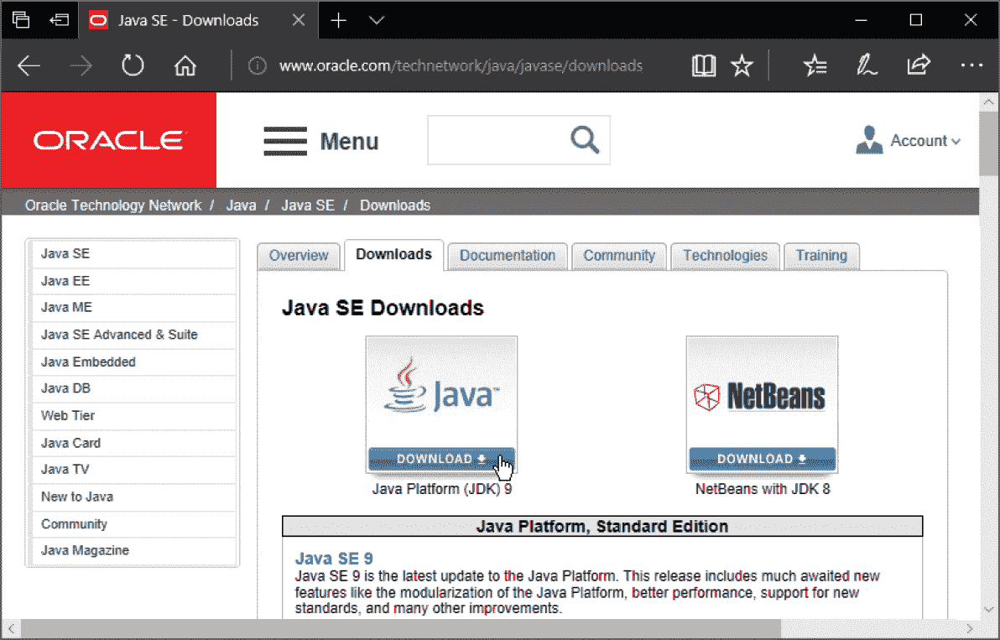


Oracle 下载页面还包含其他包，但开始 Java 编程只需要 JDK 9 包。

JDK 9 包适用于 Linux、Mac、Solaris 和 Windows 平台的 32 位和 64 位变体——接受 Oracle 许可协议，然后选择适用于你计算机的适当下载 Java 开发工具包。

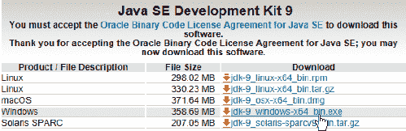


JAVA 代表“另一个模糊的缩写”（Just Another Vague Acronym）的传言并非事实。

从 Oracle® 下载页面为你的系统选择合适的 Java 开发工具包（JDK）包，然后按照以下步骤在你的计算机上安装 Java：

 卸载系统中任何以前版本的 JDK 和/或 Java 运行时环境（JRE）

 启动安装并接受许可协议

 当“自定义设置”（Custom Setup）对话框出现时，要么接受建议的安装位置，要么点击 `Change` 按钮选择你首选的位置——例如 Windows 系统的 `C:\Java` 或 Linux 系统的 `/usr/Java`

 确保从列表中选择了 `Public JRE` 和 `Development Tools`（开发工具）功能。可以选择地，你可以取消选择其他功能，因为使用此书开始编程不需要这些功能

 点击 `Next` 按钮在所选位置安装所有必要的 Java 类库和工具


系统中可能安装了旧版本的 JRE，以便你的网络浏览器运行 Java 小程序。最好卸载它，以避免与 JDK 9 中的新版本产生混淆。

你可以从只安装最小的功能开始以免混淆。

编译和运行 Java 程序的工具通常从命令行提示符操作，并位于 Java 目录下的 `bin` 子目录。可以通过将它们的位置添加到系统路径中使其全范围内可用：

- 在 Windows 上，通过 `Control Panel` > `System` > `Advanced System Settings` > `Advanced` 选项卡 > `Environment Variables` 进行，然后选择名为“Path”的系统变量。点击 `Edit`（编辑）并将 Java 的 `bin` 子目录的地址添加到列表中（例如 `C:\Java\bin`），然后点击 `OK` 应用更改。
- 在 Linux 上，通过编辑家目录下的 `.bashrc` 文件将 Java 的 `bin` 子目录的位置添加到系统路径。例如，添加 `PATH=$PATH:/usr/Java/bin` 然后保存文件。

在旧版本的 Windows 上，包含空格的路径必须用双引号括起来并以分号结束。例如路径 `"C:\Program Files\ Java\jdk-9\bin";`

 打开命令行提示符，例如 **Windows PowerShell** 或 **Linux Terminal**

 输入命令 `java -version` 然后按 **Enter** 键查看 Java 解释器的版本号

 接下来，输入命令 `javac -version` 然后按 **Enter** 键查看 Java 编译器的版本号

 现在，输入命令 `jshell -version` 然后按 **Enter** 键查看 Java shell 版本号

 确保所有版本号匹配（9），你已准备好开始 Java 编程了

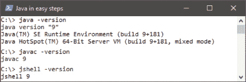


如果 Linux 家目录下没有显示 `.bashrc` 文件，请选择查看、显示隐藏文件以显示它。


Java shell `jshell` 是 Java 9 的新功能。这个交互式工具让你快速测试代码片段，而无需先编译代码。它将在下一章中演示 Java 编程中的各种“运算符”。

所有的 Java 程序都从文本文件开始，随后用于创建“类”文件，这些才是的可运行程序。这意味着 Java 程序可以用任何纯文本编辑器编写，例如 Windows 记事本程序。

按照以下步骤创建一个简单的 Java 程序，它将输出传统的第一个程序问候：


`Hello.java`

 打开纯文本编辑器（如记事本），并按照列出的格式输入此代码——以创建一个名为“Hello”的类

```java
class Hello
{
}
```

 在 `Hello` 类的大括号之间，插入这段代码 – 为 `Hello` 类创建一个“main”方法：

```java
public static void main ( String[] args )
{

}
```

 在 `main` 方法的大括号之间，插入此行代码 – 说明程序将执行的操作：

```java
System.out.println( "Hello World!" );
```

 将文件保存到任何方便的位置，但确保精确命名为 `Hello.java` – 现在完整的程序看起来应该是这样的：

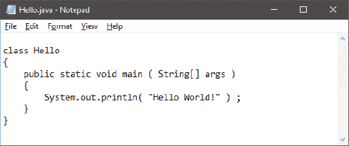


Java 是一种区分大小写的语言，“Hello”和“hello”是完全不同的 – 通常情况下，Java 程序名称应该始终以大字母开头。


Java 程序始终以其完全相同的程序名称加上 `.java` 扩展名进行保存。

可以单独检查对页上程序代码的各个部分，以便更清楚地理解每个部分：

```java
class Hello {    }
```

程序名紧接 `class` 关键字之后声明，并跟着一对大括号。所有定义 `Hello` 类的程序代码都包含这些大括号内。


所有独立的 Java 程序都必须有一个 `main` 方法。Java Applet 则不同，它们的格式将在稍后解释。

```java
public static void main ( String[] args ) {      }
```

这行看起来很吓人的代码是标准代码，用于定义几乎所有 Java 程序的起点。它将在本书的大多数示例中以与上方所示完全相同的形式出现 – 因此，记住它可能很有用。

该代码声明了一个名为“main”的方法，该方法在大括号内包含实际的程序指令。

关键字 `public static void` 位于方法名之前，用于定义该方法如何被使用，将在稍后详细解释。

代码 `( String[] args )` 在向方法传递值时非常有用，书中稍后也会对其进行完全解释。

## 语句

```java
System.out.println( "Hello World!" ) ;
```

语句是执行程序任务的实际指令，并且必须以分号结尾。一个方法可以在大括号内包含许多语句，形成一个“语句块”，定义要执行的一系列任务，但在这里，单个语句指示程序输出一行文本。


创建一个“MyJava”目录，用于保存你所有的 Java 程序文件。

在 Java 程序运行之前，它必须首先由 Java 编译器编译成 `class` 文件。该编译器位于 Java 的 `bin` 子目录中，是一个名为 `javac` 的应用程序。此处描述的指令说明了如何将 `bin` 子目录添加到系统路径中，以便从系统的任意位置都可调用 `javac`。

按照以下步骤编译程序：

 打开命令行窗口，然后导航到保存 `Hello.java` 源码文件的目录

 输入 `javac`，紧跟一个空格，然后输入源码文件的完整名称 `Hello.java` 并按下 `Enter` 键

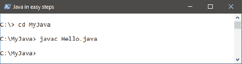


在 Windows 上使用 Windows PowerShell 应用或旧版本的命令提示符应用来提供命令行提示，在 Linux 上使用 Terminal 窗口。


在提示符处输入 `javac` 并按回键显示 Java 编译器的选项。

如果 `javac` 编译器发现代码中存在错误，它将停止并显示一份有用的报告，指示错误的性质 – 请参此处进行故障排除。

如果 `javac` 编译器没有发现任何错误，它将创建一个以程序名和 `.class` 文件扩展名命名的新文件。

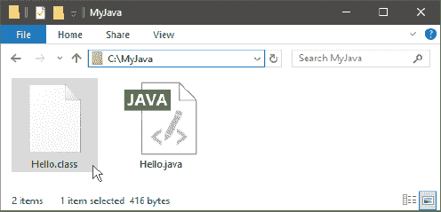


如果你为 `javac` 编译器指定文件的完整路径地址，也可以从另一个位置编译源码 – 在这种情况下为 `C:\MyJava\Hello.java`

当 Java 编译器完成编译后，命令行窗口的焦点将返回提示符处，没有任何确认消息 – 程序已准备好运行。

Java 程序解释器是一个名为 `java` 的应用程序，位于 Java 的 `bin` 子目录中 – 与 `javac` 编译器并列。由于该目录之前已添加到系统路径，`java` 解释器可以从任何位置调用。

按照对面描述的程序按照以下步骤运行编译后的程序：

 打开命令行提示符窗口，然后导航到 `Hello.class` 程序文件所在的目录

 在提示符处输入 `java`，紧跟一个空格，然后输入程序名 `Hello` 并按下 `Enter` 键

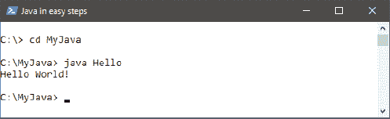


在 Java 编程中，“变量”简单是有用的容器，可以在其中存储值供程序后续使用。存储的值在程序执行过程中可能会发生变化（vary）– 因此有了“variable”一词。


通过在程序中编写变量“声明”来创建变量，指定变量可能的数据类型以及该变量的给定名称。例如，可以指定 `String` 数据类型以允许名为 `message` 的变量包含普通文本：

```java
String message ;
```

变量名由程序员选择，但必须遵守某些命名规范。变量名只能以字母、美元符号 `$` 或下划线字符 `_` 开头，随后可以是字母、数字、美元符号或下划线。名称区分大小写，因此“var”和“Var”是不同的名称，且名称中不允许空格。

变量名也应避免下表列出的 Java 关键字，因为这些在 Java 语言中有特殊含义。

| abstract | default | goto | package | synchronized |
| :--- | :--- | :--- | :--- | :--- |
| assert | do | if | private | this |
| boolean | double | implements | protected | throw |
| break | else | import | public | throws |
| byte | enum | instanceof | return | transient |
| case | extends | int | short | true |
| catch | false | interface | static | try |
| char | final | long | strictfp | void |
| class | finally | native | String | volatile |
| const | float | new | super | while |
| continue | for | null | switch | |


每个变量声明都必须以分号字符结束 – 就像所有其他语句一样。


严格来说，此表中的某些单词实际上并不是关键字——`true`、`false` 和 `null` 都是字面量；`String` 是一个特殊的类名；`const` 和 `goto` 是预留字（目前未使用）。将它们包含在表中是因为在命名变量时也必须避免使用这些词。

作为良好的习惯，变量命名应使用单词或易于识别的缩写，并描述该变量的用途。例如，使用“button1”或“btn1”来描述一号按钮。单单词名称优选小写字母，如“gear”，而多个单词组成的名称应将每个后续单词的首字母大写，例如 `gearRatio` —— 即所谓的“驼峰命名法”（`camelCase`）。

一旦声明了变量，可以使用等号 `=` 为其分配相应数据类型的初始值，可以在声明时进行，也可以在程序的稍后部分进行，然后可以使用变量名随时引用其值。

按照以下步骤创建一个程序，该程序在声明时初始化变量，并在稍后对其进行更改：

 启动一个名为“FirstVariable”的新程序，包含标准的 main 方法

```java
class FirstVariable {
    public static void main ( String[] args ) {
    }
}
```


`FirstVariable.java`

 在 main 方法的大括号之间插入此代码以创建、初始化并输出一个变量

```java
String message = "Initial value";
System.out.println( message );
```

```java
message = "Modified value";
System.out.println( message );
```

 将程序保存为 `FirstVariable.java`，然后编译并运行程序

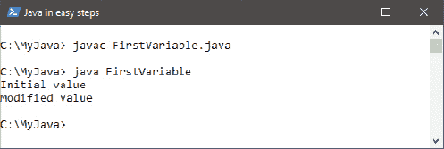


如果你在编译或运行程序时遇到问题，可以在此处获取故障排除问题的帮助。

Java 变量声明中最常用的数据类型列在本表中，并附有简要描述：

| 数据类型 | 描述 | 示例 |
| :--- | :--- | :--- |
| `char` | 单个 Unicode 字符 | `'a'` |
| `String` | 任意数量的 Unicode 字符 | `"my String"` |


| `int` | 整数，从 -21.4 亿到 +21.4 亿 | 1000 |
| `float` | 带有小数点的浮点数 | 3.14159265f |
| `boolean` | 逻辑值 true 或 false 之一 | true |


由于浮点数运算的不规则性，`float` 数据类型绝不应用于精确值，例如货币——详情请参阅此处。

注意，`char` 数据值必须始终被单引号包围，`String` 数据值必须始终被双引号包围。此外，记住 `float` 数据值必须始终带有“f”后缀，以确保它们被视为 `float` 值。

除了上述更常见的数据类型，Java 还提供了这些特殊数据类型以用于精确情况：

| `byte` | 从 -128 到 +127 的整数 |
| `short` | 从 -32,768 到 +32,767 的整数 |
| `long` | 超过 21.4 亿的正负整数 |
| `double` | 极长的浮点数 |


所有数据类型关键字都以小写字母开头，`String` 除外——这是一个特殊的类。

特殊类型在高级 Java 程序中有用——书中的示例大多使用上方描述的常用数据类型。

按照以下步骤创建一个 Java 程序，该程序创建、初始化并输出所有五个常用数据类型的变量：

启动一个名为“DataTypes”的新程序，包含标准的 main 方法

```java
class DataTypes
{
    public static void main ( String[] args ) {
}
```


DataTypes.java

在 main 方法的大括号之间插入此代码以创建并初始化

```java
char letter = ‘M%；
String title = “Java */;
int number = 365;
float decimal = 98.6f;
boolean result = true;
```

添加这些行来输出

```java
System.out.println( “Initial is ” + letter );
System.out.println( “Book is ” + title );
System.out.println( “Days are ” + number );
System.out.println( “Temperature is ” + decimal );
System.out.println( “Answer is ” + result );
```

将程序保存为 `DataTypes.java`，然后编译并运行程序查看输出

`final` 关键字是一个修饰符，可以在声明变量时使用防止其被更改。以这种方式创建的变量被称为“常量”，惯例用全大写命名常量以与普通变量区分。

按照以下步骤创建一个包含常量的程序：

启动一个名为“Constants”的新程序，包含标准的 main 方法

```java
class Constants
{
    public static void main ( String[] args ) {
    }
}
```


Constants.java

```java
final int TOUCHDOWN = 6;
final int CONVERSION = 1;
final int FIELDGOAL = 3;
```

现在声明普通变量——使用常量的倍数

```java
int td , pat , fg , total ;
td = 4 * TOUCHDOWN ;
pat = 3 * CONVERSION ;
fg = 2 * FIELDGOAL ;
total = ( td + pat + fg );
```

添加此行来显示总分

```java
System.out.println( “Score: ” + total );
```

( 4 x 6 = 24, 3 x 1 = 3, 2 x 3 = 6，所以 24 + 3 + 6 = 33 )

### 添加注释

在任何语言中编程时，良好的习惯是在程序代码中添加注释来解释特定部分。这使得其他人更容易理解代码，也让你自己在一段时间后重新查看这段代码时更容易理解。

在 Java 编程中，可以在 `/***` 和 `***` 注释标识之间添加跨行注释，也可以在 `//` 注释标识之后添加单行注释。`javac` 编译器完全忽略 `/***` 和 `***` 之间或 `//` 之后的内容。

```java
/***
一个演示常量变量的程序。
***
```

```java
class Constants
{
    public static void main( String args[] )
        // 常数分值。
        final int TOUCHDOWN = 6 ;
        final int CONVERSION = 1 ;
        final int FIELDGOAL = 3 ;
        // 计算得分。
        int td , pat , fg , total ;
        td = 4 * TOUCHDOWN ;      // 4x6=24
        pat = 3 * CONVERSION ;    // 3x1= 3
        fg = 2 * FIELDGOAL ;            // 2x3= 6
        total = ( td + pat + fg ) ;      // 24+3+6=33
        // 输出计算出的总分。
        System.out.println( “Score: “ + total ) ;
    }
}
```

带有注释保存后，程序可以正常编译并运行：

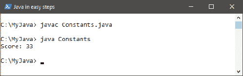


你可以添加一条尝试更改常量值值的语句，然后尝试重新编译程序以查看生成的错误信息。

### 故障排除

有时，`javac` 编译器或 `java` 解释器会报告错误，因此了解这些错误的原因以及如何快速解决问题非常有帮助。为了演示一些常见的错误报告，这段代码包含了一些故意错误：


Test.java

```
class test
{
    public static void main ( String[] args )
    {
        String text ;
        System.out.println( “Test ” + text )
    }
}
```

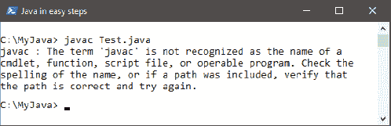

• 原因 – 找不到 `javac` 编译器。
• 解决方案 – 编辑系统 `PATH` 变量，描述请参考此处，或使用其完整路径地址来调用编译器。

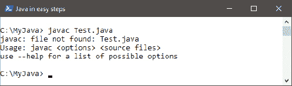


如果路径地址包含任何空格，必须封装在引号内，例如路径地址“C:\Program Files\ Java”。

• 原因 – 找不到文件 `Test.java`。
• 解决方案 – 导航到文件所在的目录，或在命令中使用文件的完整路径。

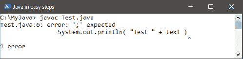

• 原因 – 语句未正确结束。
• 解决方案 – 在源代码的语句末尾添加分号，然后保存文件以应用更改。

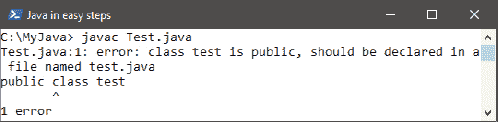

• 原因 – 程序名和类名不匹配。
• 解决方案 – 在源代码中将类名从 `test` 改为 `Test`，然后保存文件以应用更改。

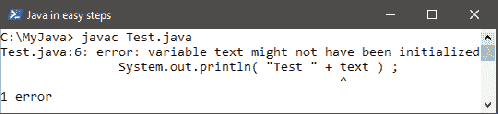

• 原因 – 变量 `text` 没有值。
• 解决方案 – 在变量声明中为变量分配有效的 `String` 值，例如 `= “success”`，然后保存文件。

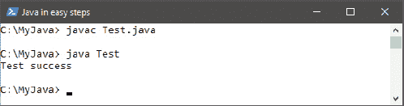


你必须在程序所在的目录下运行程序——你不能使用路径地址，因为 Java 启动器需要的是程序名而不是文件名。

## 总结

• Java 既是一种编程语言也是一种运行时平台。
• Java 程序编写为带有 `.java` 扩展名的纯文本文件。
• Java 编译器 `javac` 从原始 `.java` 源代码文件创建编译后的 `.class` 程序文件。
• Java 解释器 `java` 使用 Java 虚拟机的实例执行编译后的程序。
• Java VM 可用在许多操作系统平台。
• Java 是一种区分大小写的语言。
• 标准的 `main` 方法是 Java 程序的入口。
• `System.out.println()` 语句输出文本。
• Java 程序文件名必须与类名完全匹配。
• Java 变量只能按照指定的命名规范进行命名，并且必须避开 Java 关键字。
• 在 Java 编程中，每条语句必须以分号字符结束。
• 最常见的 Java 数据类型是 `String`、`int`、`char`、`float` 和 `boolean`。
• `String` 值必须用双引号封装；`char` 值用单引号封装；且 `float` 值必须带有 “f” 后缀。
• `final` 关键字可以用于创建常量变量。
• 注释可以添加到 Java 源代码的 `/***` 和 `***/**` 之间（跨一行或多行），或者在单行的 `//` 之后。
• 错误报告识别编译器和运行时问题。

## 执行操作

*本章演示了用于在 Java 程序创建表达式的各种运算符。*

### 算术运算

下表所示的算术运算符用于在 Java 程序创建返回单个值的表达式。

| **运算符:** | **操作:** |
| :--- | :--- |
| `+` | 加法（并连接 `String` 值） |
| `*` | 乘法 |
| `/` | 除法 |
| `%` | 取模 |
| `++` | 递增 |
| `--` | 递减 |

运算符 `+` 操作取决于操作数的类型。如果两个操作数都是数值，它将返回和；但如果操作数是 `String` 值，它将返回连接后的 `String` —— 例如，“Java ” + “Arithmetic”返回“Java”。

`int` 除法将截断任何小数部分。例如 11/4=2，而 `float` 除法 11/4=2.75。

递增运算符 `++` 和递减运算符 `--` 返回修改单个操作数值的结果。例如，4++ 返回 5，4-- 返回 3。

取模运算符 `%` 将第一个操作数除以第二个操作数并返回操作的余数。例如，32 % 5 返回 2 —— 五除 32 为六次，余 2。

按照以下步骤在 Java Shell 中探索 Java 算术运算符

打开命令行提示窗口，然后输入 `jshell` 并按下 **Enter** 键启动 Java Shell

接下来，输入语句初始化三个变量

`int num = 100 ; int factor = 20 ; int sum = 0 ;`

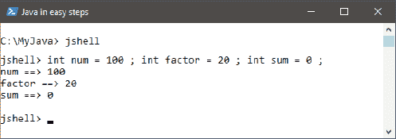

接下来，分别输入语句执行加法和减法操作，显示每个结果

`sum = num + factor ;`

`sum = num - factor ;`

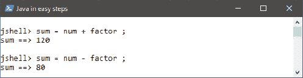

现在，分别输入语句执行乘法和除法操作，显示每个结果

`sum = num * factor ;`

`sum = num / factor ;`

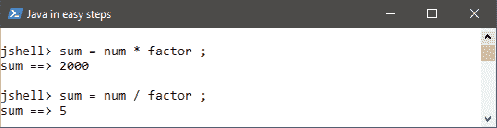

### 赋值值

赋值运算符列如下表，用于为表达式的结果赋值。除了简单的 `=` 运算符外，所有的运算符都是更等价表达式的简写：

| :--- | :--- | :--- |
| `=` | `a = b` | `a = b` |
| `+=` | `a += b` | `a = a + b` |
| `-=` | `a -= b` | `a = a - b` |
| `*=` | `a *= b` | `a = a * b` |
| `/=` | `a /= b` | `a = a / b` |
| `%=` | `a %= b` | `a = a % b` |

将 `=` 运算符视为“赋值”而不是“等于”，有助于与 `==` 相等运算符混淆。

在示例 `a = b` 中，存储在名为 `b` 的变量中的值被赋值给名为 `a` 的变量，该值成为存储在 `a` 中的新值——替换掉它之前包含的任何值。

`+=` 运算符用于向存储在变量中的现有值增加一个值——保持一个“运行总和”。

示例 `a += b` 首先计算存储名为 `a` 和 `b` 的变量中的值的总和，然后将所得总和赋值给变量 `a`。程序随后可能会包含另一个赋值 `a += c`，它计算存储名为 `a` 和 `c` 的变量中的总和，然后将该新总和赋值给变量 `a`——将 `c` 的值加上它之前包含的值上。

所有其他赋值运算符的工作方式都相同：首先对两个存储的值进行算术计算，然后将结果赋值给第一个变量——成为其新的存储值。


`==` 相等运算符比较两个值，其详细解释请见此处。

打开命令行提示符窗口，然后输入 `jshell` 并按 `Enter` 键启动 Java shell

接下来，输入语句初始化两个 `String` 变量

```java
String txt = "Super "; String lang = "Java";
```

现在，分别输入语句来添加并赋值 `String` 值，然后显示拼接后的字符串结果

```java
txt += lang; txt;
```

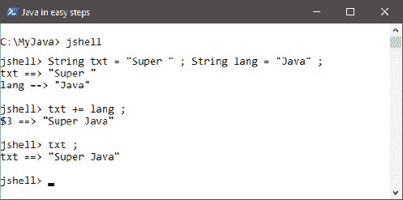

然后，输入语句初始化两个整数变量

```java
int sum = 10; int num = 20;
```

分别输入语句来添加并赋值一个 `int` 值，然后显示总计整数结果

```java
sum += num; sum;
```

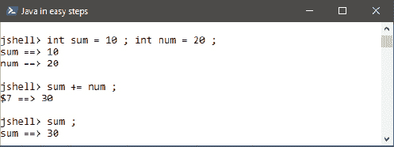


Java 9 引入的新 Java shell 特性创建了包含评估结果的内部 `$` 前缀编号变量。在这里，内部变量 `$3` 和 `$7` 包含评估结果。


给变量分配错误的数据类型将导致错误。

### 比较值

比较运算符列如下表，用于比较表达式中的两个值并返回单个布尔值 `true` 或 `false`——用于描述该比较的结果。

| :--- | :--- |
| `==` | 相等 |
| `!=` | 不等于 |
| `>` | 大于 |
| `>=` | 大于等于 |
| `<` | 小于 |
| `<=` | 小于等于 |

`==` 相等运算符比较两个操作数，如果两者的值完全相等，则返回 `true`。如果两个都是相同的数字，则它们相等；如果两个都是包含相同顺序相同字符的 `String` 值，则它们相等。两个均为 `true` 或均为 `false` 的布尔操作数是相等的。

相反，`!=` 不等于运算符在两个操作数不相等时返回 `true`——适用与相等运算符相同的规则。

相等和不等于运算符对于测试两个变量的状态以执行程序的“条件分支”非常有用——根据条件向不同的方向继续运行。

`>` “大于”运算符比较两个操作数，如果第一个的值大于第二个，则返回 `true`。

`<` “小于”运算符进行相同的比较，但如果第一个操作数的值小于第二个，则返回 `true`。

在 `>` “大于”运算符或 `<` “小于”运算符后添加 `=` 赋值运算符，可以使其在两个操作数的值完全相等时也返回 `true`。


`<` 小于运算符通常用于测试循环中的计数器值——可以在此处找到此类示例。

按照以下步骤在 Java shell 中探索 Java 比较运算符：

打开命令行提示符窗口，然后输入 `jshell` 并按 `Enter` 键启动 Java shell

接下来，输入语句初始化两个 `String` 变量

```java
String txt = "Super "; String lang = "Java";
```

现在，分别输入语句来添加并赋值 `String` 值，然后显示拼接后的字符串结果

```java
boolean state = txt == lang;
state = txt != lang;
```

以类似的方式，分别输入语句来添加并赋值一个 `int` 值，然后显示总计整数结果

```java
int dozen = 12; int score = 20;
```

```java
state = dozen > score;
state = dozen < score;
```


可以通过输入 `help` 命令在 Java shell 中发现更多选项。

### 评估逻辑

逻辑运算符如下表，用于将多个返回布尔值的表达式组合成返回单个布尔值的复杂表达式。

| **运算符：** | **操作：** |
| :--- | :--- |
| `&&` | 逻辑与 |
| `||` | 逻辑或 |
| `!` | 逻辑非 |

逻辑运算符用于具有布尔值 `true` 或 `false` 的操作数，或者可以转换为 `true` 或 `false` 的值。

`&&` 与运算符将评估两个操作数，仅当两个操作数均为 `true` 时才返回 `true`。否则，逻辑 `&&` 运算符将返回 `false`。这种评估可用于条件分支，即只有当两个测试条件均为真时，程序才会执行特定操作。

与需要两个操作数均为 `true` 的逻辑 `&&` 运算符不同，`||` 或运算符评估其两个操作数，如果其中一个操作数为 `true`，则返回 `true`——只有当两个操作数都不为 `true` 时才会返回 `false`。这在 Java 编程中非常有用，可以在满足任一测试条件时执行特定操作。

`!` 非运算符是一个单元运算符，用于单个操作数之前。它返回给定操作数的反向布尔值——将 `true` 反转为 `false`，将 `false` 反转为 `true`。它在 Java 程序中非常有用，可以使用 `goState = !goState` 语句在连续循环迭代中切换变量的值。这确保了每次循环值都会变化，就像开关灯一样。

注意如何将表达式放在括号中以提高可读性。

打开命令行提示窗口，然后输入 `jshell` 并按 `Enter` 键启动 Java 壳

```java
boolean yes = true; boolean no = false;
```

输入语句测试两个条件是否都真

```java
boolean result = (yes && yes); result = (yes && no);
```

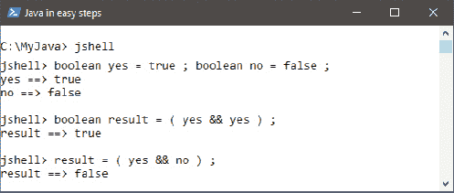

输入语句测试两个条件中是否有一个为真

```java
result = (yes || yes);

result = (yes || no);

result = (no || no);
```

```java
result = yes; result = !yes;
```

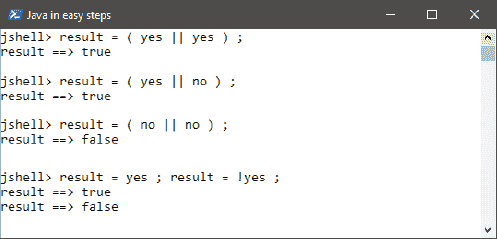


注意 `false && false` 返回 `false` 而不是 `true` —— 这证明了“两个错产生出一个对的”这一格言。


`!` NOT 逻辑运算符返回的值是存储值的反值——存储值本身保持不变。

### 检查条件

Java 程序员最喜爱的运算符可能就是 `? :` 条件运算符，它能以非常简洁的方式实现强大的语句。它不寻常的语法初看起来可能难以理解，但了解这个实用的运算符是非常值得的。

条件运算符首先评估一个表达式以获得 `true` 或 `false` 值，然后根据评估结果返回两个给定操作数中的一个。它的语法如下：

```java
(boolean-expression) ? if-true-return-this : if-false-return-this;
```


条件运算符也被称为“三元”运算符。

每个指定的操作数选项都允许程序根据测试表达式返回的布尔值继续执行。例如，选项可以返回一个 `String` 值：

```java
status = (quit == true) ? "Done!" : "Continuing...";
```

在这种情况下，当 `quit` 变量为 `true` 时，条件运算符将其第一个操作数的值赋值给 `status` 变量；否则，它赋值其第二个操作数的值。

编写 Java 程序时可用的一种简写方式允许表达式在评估简单布尔值时可选省略 `== true`，因此上面的示例可以简单地写为：

```java
status = (quit) ? "Done!" : "Continuing...";
```

条件运算符可以返回任何数据类型的值，并采用任何有效的测试表达式。例如，表达式可以使用大于 `>` 运算符来评估两个数值，然后根据结果返回一个布尔值：

```java
```

同样，条件运算符可能使用不等于 `!=` 运算符来评估一个 `String` 值，然后根据结果返回一个数值：

```java
bodyTemperature = (scale != "Celsius") ? 98.6 : 37.0;
```


你也可以使用命令 `jshell --feedback verbose` 启动 Java 壳，以便每次评估后接收性输出。

按照以下步骤在 Java 壳中探索 Java 条件运算符：

打开命令行提示窗口，然后输入 `jshell` 并按 `Enter` 键启动 Java 壳

接下来，输入语句来初始化两个 `int` 变量

```java
```

声明另一个变量来存储测试结果 `String`

```java
String result;
```

输入此语句确定第一个整数值是奇数还是偶数

```java
result = (num1 % 2 != 0) ? "Odd" : "Even";
```

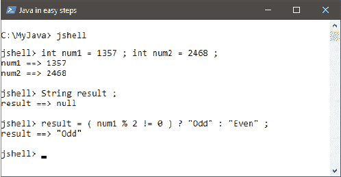

现在，输入此语句确定第二个整数值是奇数还是偶数

```java
result = (num2 % 2 != 0) ? "Odd" : "Even";
```

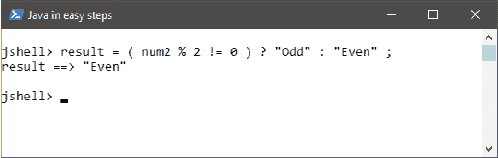


注意未初始化的 `String` 变量返回特殊的 `null` 值 —— 表示它不包含任何内容。


在这里，当存在任何剩余时，表达式评估为真。

### 设置优先级

包含多个运算符和操作数的复杂表达式，除非执行顺序明确，否则可能会产生歧义。这种缺乏清晰度很容易导致同一个表达式暗示不同的结果。例如，考虑这个复杂表达式：

```java
num = 8 + 4 * 2;
```

从左到右计算，`8 + 4 = 12`，然后 `12 * 2 = 24`，所以 `num = 24`。但从右到左计算 `2 * 4 = 8`，然后 `8 + 8 = 16`，所以 `num = 16`。

Java 程序员可以通过添加括号来显式指定哪个操作应该先执行，以指示哪个运算符具有优先级。在这种情况下，`(8 + 4) * 2` 确保先执行加法——所以结果是 24 而不是 16。相反，`8 + (4 * 2)` 先执行乘法——所以结果是 16。

按照以下步骤在 Java 壳中探索运算符优先级：

打开命令行提示窗口，然后输入 `jshell` 并按 `Enter` 键启动 Java 壳

接下来，输入语句显示使用默认运算符优先级的表达式评估结果

```java
int sum = 32 - 8 + 16 * 2;
```

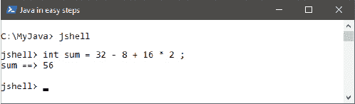

现在，输入语句显示相同表达式的评估结果——但让加减法的优先级高于乘法

```java
sum = (32 - 8 + 16) * 2;
```

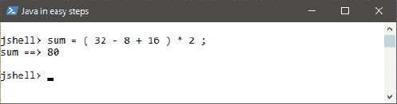

最后，输入语句再次评估相同表达式——但现在优先级顺序是先加法、后减法、最后是乘法

```java
sum = (32 - (8 + 16)) * 2;
```

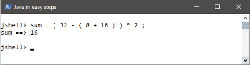


当表达式有多个嵌套括号时，最内层的具有优先级。

遵循下表所示优先级顺序，从顶部到底部：

| 运算符 | 描述 |
| :--- | :--- |
| `++` `--` | 递增、递减、逻辑非 |
| `*` `/` `%` | 乘法、除法、取模 |
| `+` `-` | 加法、减法 |
| `>` `>=` `<` `<=` | 大于...小于等于... |
| `==` `!=` | 等于、不等于 |
| `&&` | 逻辑与 |
| `||` | 逻辑或 |
| `? :` | 条件 |
| `=` `+=` `-=` `*=` `%=` | 赋值 |

优先级相同的运算符将按照它们在表达式中出现的顺序处理——从左到右。

字面量通常与 Java 语言的关键字是分离的，但在 `String` 值内部需要双引号或单引号时，必须指示该引号字符被视为字面量处理，以避免提前终止 `String`。这可以通过在每个嵌套的引号字符前紧跟一个 `\` 转义运算符来轻松实现。例如，在 `String` 变量中包含引号，如下所示：

```java
String quote = "\"Fortune favors the brave.\" said Virgil";
```

此外，`\` 转义运算符还提供了多种实用的转义序列用于简单的输出格式化：

| 转义字符: | 描述: |
| :--- | :--- |
| `\n` | 换行 |
| `\t` | 制表符 |
| `\b` | 退格键 |
| `\r` | 回车 |
| `\f` | 换页 |
| `\\` | 反斜杠 |
| `\'` | 单引号 |
| `\"` | 双引号 |


可以将单引号嵌套在双引号内，作为转义引号字符的替代方案。

`\n` 换行转义序列经常用于长 `String` 值中，以便多行显示输出。同样，`\t` 制表符转义序列经常用于按列显示输出。结合使用 `\n` 换行和 `\t` 制表符转义序列可以以行和列的形式格式化输出——类似于表格。

启动一个名为“Escape”的新程序，包含标准的 main 方法

```java
class Escape {
    public static void main(String[] args) {
    }
}
```


Escape.java

在 main 方法的大括号之间，插入此代码，以构建一个包含格式化表格标题和列标题的 `String`

```java
String header = "\n\tNEW YORK 3-DAY FORECAST:\n";
header += "\n\tDay\t\tHigh\tLow\tConditions\n";
header += "\t---\t\t----\t-\t----------\n";
```

添加这些行以构建一个包含格式化表格单元数据的 `String`

```java
String forecast = "\tSunday\t\t68F\t48F\tSunny\n";
forecast += "\tMonday\t\t69F\t57F\tSunny\n";
forecast += "\tTuesday\t\t71F\t50F\tCloudy\n";
```

现在，添加此行来输出两个格式化的 `String` 值

```java
System.out.print(header + forecast);
```

将程序保存为 `Escape.java`，然后编译并运行该程序

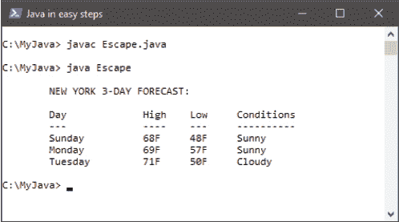


在这种情况下，转义序列添加了换行，因此这里使用了 `print()` 方法——而不是在输出后自动添加换行的 `println()` 方法。

在本章前面描述的普通运算符外，Java 还提供了用于二进制算术的特殊运算符。这些运算符的使用频率低于其他运算符，但在此简要讨论是为了让大家了解它们的存在。

Java “位”运算符可以与 `int` 整数数据类型一起使用，用于操作值的二进制表示位。这需要理解二进制计数，其中一个字节中的八位表示从 0 到 255 的十进制值。例如，

53 是二进制 `00110101`

(`0` x 128, `0` x 64, `1` x 32, `1` x 16, `0` x 8, `1` x 4, `0` x 2, `1` x 1)。

二进制加法运算像十进制算术一样进行：

| | 53 | = | `00110101` |
| :--- | :--- | :--- | :--- |
| `+` | 7 | = | `00000111` |
| | 60 | = | `00111100` |

下列出的位运算符允许在二进制算术中执行更专门的操作。

| 运算符: | 操作: | 示例: | 结果: |
| :--- | :--- | :--- | :--- |
| `&` | 与 (AND) | `a & b` | 如果两个位都为 1 则为 1 |
| `\|` | 或 (OR) | `a \| b` | 如果任意一个位为 1 则为 1 |
| `^` | 异或 (XOR) | `a ^ b` | 如果两个位不同则为 1 |
| `~` | 非 (NOT) | `~a` | 反转位 |
| `<<` | 左移 | `n << p` | 将 `n` 左移动 `p` 位 |
| `>>` | 右移 | `n >> p` | 将 `n` 右移动 `p` 位 |

例如，在二进制算术中使用位运算符 `&`：

| | | 53 | = | `00110101` |
| :--- | :--- | :--- | :--- | :--- |
| `&` | 7 | = | `00000111` |

本章演示了用于在 Java 程序中创建分支的各种关键字。

### 使用 if 分支

### 分支替代方案

### 切换分支

### for 循环

### while 真值循环

### 执行 do-while 循环

### 跳出循环

### 返回控制权

### 总结

### 使用 if 分支

`if` 关键字执行条件测试，以评估一个表达式的 `Boolean` 值。表达式随后的语句仅在评估结果为 `true` 时才会执行，否则程序将继续执行后续代码——即进入下一个“分支”。`if` 语句的语法如下：


```java
if (test-expression) code-to-be-executed-when-true;
```

如果待执行的代码包含在大括号内以形成一个“语句块”，则它可以包含多个语句：

创建一个名为“If” 的新程序，其中包含标准的 main 方法

```java
class If {
    public static void main(String[] args) { }
}
```


If.java

在 main 方法的大括号之间，插入这个简单的条件测试，当一个数字大于另一个数字时，将执行单条语句：

```java
if (5 > 1) System.out.println("Five is greater than one.");
```

添加第二个条件测试，当一个数字小于另一个数字时，执行整个语句块：

```java
if (2 < 4) {
    System.out.println("Two is less than four.");
    System.out.println("Test succeeded.");
}
```

将程序保存为 `If.java`，然后编译并运行程序以查看所有语句的执行——因为在这种情况下，两个测试的评估结果都为 `true`：

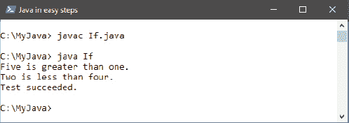


表达式可以使用 `true` 和 `false` 关键字。测试表达式 `(2 < 4)` 是 `(2 < 4 == true)` 的简写。

条件测试还可以评估复杂的表达式，以对 `Boolean` 值测试多个条件。圆括号包裹每个测试条件以建立优先级——因此它们会被优先评估。布尔运算符 `&&` AND（与）确保只有当两个测试条件都为 `true` 时，复杂的表达式才会返回 `true`：

```java
if ((test-condition1) && (test-condition2)) execute-this-code;
```

布尔运算符 `||` OR（或）确保只有当测试条件中的之一为 `true` 时，复杂的表达式才会返回 `true`：

```java
if ((test-condition1) || (test-condition2)) execute-this-code;
```

这些组合可以形成更长的复杂表达式：

在 If.java 的 main 方法中插入此行来声明并初始化一个名为 `num` 的整数变量

```java
int num = 8;
```

添加第三个条件测试，当变量 `num` 的值在指定范围内，或者它恰好等于某个指定值时，执行语句：

```java
if (((num > 5) && (num < 10)) || (num == 12))
```


## 条件分支

进入`/path/to/xxx`目录，找到`xxx.json`。

在表达式`cvar = avar + bvar`中，加法运算符（`+`）将`avar`与`bvar`相加，得到它们的和`cvar`。

在`List.of(arg0, arg1, arg2)`中，`List`接口的工厂方法`of()`接受一系列的元素，返回包含它们的只读列表。

之后我们这样调用`cmd`命令：`cmd arg0 arg1 arg2`。

```
if (condVar > someVal) {console.log("xxx")}
```

### 分支替代方案

`else`关键字用于与`if`关键字结合使用，创建`if else`语句，为程序提供可选的后续分支——取决于测试表达式的评估结果。在最简单的形式中，它仅仅在测试失败时指定一个备选语句执行：

```java
if (test-expression)
    code-to-be-executed-when-true;
else
    code-to-be-executed-when-false;
```

每个备选分支可以是单条语句，也可以是语句块。通过嵌套的`if`语句可以构建更强大的`if else`语句。

创建一个名为“Else”的新程序，其中包含标准的`main`方法：

```java
class Else {
    public static void main(String[] args) { }
}
```

在`main`方法内部，插入此行来声明并初始化一个名为`num`的整数变量：

```java
int num = 8;
```

添加此简单的条件测试，当变量`num`的值小于13时执行单条语句：

```java
if (num < 13) {
    System.out.println("Good morning: " + num);
}
```

将程序保存为`Else.java`，然后编译并运行程序查看语句的执行。注意第一个语句在`else`关键字之前通常以分号结束。

更改赋值给`num`变量的值为15，然后在`if`语句之后添加此备选分支：

```java
else {
    System.out.println("Good afternoon: " + num);
}
```

有时最好提供一个最终的`else`分支（无需嵌套`if`语句），以便在没有表达式评估为`true`时指定一个“默认”语句：

```java
else System.out.println("Good evening: " + num);
```

更改赋值给`num`变量的值为21，然后在`if else`语句末尾添加此默认分支以查看默认语句的执行。

条件分支是程序运行的基础过程。

### 切换分支

大量的`if else`语句为程序提供了许多分支，可能会变得臃肿。当测试表达式重复评估同一个变量值时，`switch`语句通常提供更优雅的解决方案。

典型的`switch`语句语法如下：

```java
switch (test-variable) {
    case value1: code-to-be-executed-when-true; break;
    case value2: code-to-be-executed-when-true; break;
    case value3: code-to-be-executed-when-true; break;
    default: code-to-be-executed-when-false;
}
```

`switch`语句的工作方式比较独特。它接收一个指定的变量，然后从多个`case`选项中寻找其赋值值。随后将执行与匹配值选项关联的语句。

可选地，`switch`语句可以包含一个使用`default`关键字的选项，用于指定当指定变量的值与任何`case`选项匹配时不执行的语句。

每个选项都以`case`关键字和一个用于匹配的值开始。随后是一个冒号`:`字符以及在匹配成功时要执行的语句（如果有的话）。

重要的一点是，与每个`case`选项关联的语句或语句块必须由`break`关键字终止。否则，程序将在匹配的选项之后继续执行其他`case`选项的语句。有时，这种特性用于指定多个`case`选项，让它们在匹配时各自执行相同的语句是有用的。例如，对于每三个选项的块使用如下的语句：

```java
switch (test-variable) {
    case value1: case value2: case value3:
        code-A-to-be-executed-when-true; break;
    case value4: case value5: case value6:
        code-B-to-be-executed-when-true; break;
}
```

缺失`break`关键字并不是语法错误——请确保`switch`块中存在所有预期的`break`以避免意外结果。

创建一个名为“Switch”的新程序，其中包含标准的`main`方法：

```java
class Switch {
    public static void main(String[] args) { }
}
```

在`main`方法内部，声明并初始化三个整数变量：

```java
int month = 2, year = 2018, num = 31;
```

添加一个`switch`语句块来测试赋值给`month`变量的值：

```java
switch (month) { }
```

在`switch`块内部，插入`case`选项，为第4、6、9和11个月份的`num`变量赋一个新值：

```java
case 4: case 6: case 9: case 11: num = 30; break;
```

根据`year`的值，插入一个`case`选项为第2个月份的`num`变量赋一个新值：

```java
case 2: num = (year % 4 == 0) ? 29 : 28; break;
```

在`switch`块之后、main方法的末尾，添加此行以输出三个整数值：

```java
System.out.println(month + "/" + year + ": " + num + " days");
```

将程序保存为`Switch.java`，然后编译并运行程序查看输出。

注意所有三个整数变量是如何使用方便的简写在这里内联声明并初始化的。

条件运算符在步骤5中效果非常好。你可以返回这里回顾它是如何工作的。

## for 循环

循环是一个代码块，它重复执行其包含的语句，直到满足测试条件——然后循环结束，程序继续执行下个任务。

Java编程中最常用的循环结构是使用`for`关键字，其语法如下：

```java
for (initializer; test-expression; updater) {
    statements-to-be-executed-on-each-iteration;
}
```

`for`关键字后面的括号必须包含三个建立循环性能的控制部分：

*   **初始化器**——为计数器变量分配初始值，该变量将记录此循环执行的次数。为此目的的变量可以在此处声明，传统上是一个命名为`i`的“简单”整数变量。
*   **测试表达式**——在循环每次迭代开始时被评估为布尔`true`值。当评估返回`true`时，迭代继续；但当返回`false`时，循环立即终止，而不完成该次迭代。
*   **更新器**——由初始化器开始更改计数器变量的当前值，维护该循环执行次数的运行数。通常，这将使用`i++`递增，或使用`i--`递减。

在循环每次迭代中执行的代码可以是单个语句、语句块，甚至是另一个“嵌套”循环。

每个循环必须在某点能够使测试表达式返回`false`——否则将创建一个无限循环，它将无情地执行其语句。通常，测试表达式会评估计数器变量的当前值为执行指定次数的迭代。例如，计数器`i`初始化为1，每次迭代加1，测试表达式`i < 11`在10次迭代后变为`false`——因此该循环在结束前将执行10次其语句。

更新器通常被称为“递增器”，因为它经常是递增而非减少计数器变量。

创建一个名为“For”的新程序，其中包含标准的`main`方法：

```java
class For {
    public static void main(String[] args) { }
}
```

在`main`方法内部，声明并初始化一个整数变量来计算迭代的总数：

```java
int num = 0;
```

添加一个`for`循环执行三次迭代，并在每次迭代中显示其计数器变量`i`的当前值：

```java
for (int i = 1; i < 4; i++) {
    System.out.println("Outer Loop=" + i);
}
```

在`for`块内部插入一个嵌套的`for`循环执行三次迭代，显示其计数器变量`j`的当前值和迭代总数：

```java
for (int j = 1; j < 4; j++) {
    System.out.print("\tInner Loop j=" + j);
    System.out.println("\tTotal num=" + ++num);
}
```

将程序保存为`For.java`，然后编译并运行程序查看输出。

递增`++`和递减`--`运算符可以前缀变量以立即更改其值，也可以后缀变量——在其引用时才更改。尝试将此示例中的递增运算符改为`++i`和`++j`来查看差异。

## while 循环

另一种循环结构：

```java
while (test-expression) {
    statements-to-be-executed-on-each-iteration;
}
```

与`for`循环一样，`while`循环重复执行其包含的语句，直到满足测试条件——然后循环结束，程序继续执行下个任务。

测试表达式在循环每次迭代开始时被评估为布尔`true`值。当评估返回`true`时，迭代继续；但当返回`false`时，循环立即终止，而不完成该次迭代。

注意，如果测试表达式在第一次评估时返回`false`，则循环语句永远不会执行。

`while`循环可以构造成类似于`for`循环的结构，通过在循环外部创建一个计数器变量，并在每次迭代执行的语句中更改其值，从而在测试表达式中评估计数器变量。例如，上一个示例中的外部`for`循环可以重建为`while`循环，如下：

```java
int i = 1;
while (i < 11) {
    System.out.println("Outer Loop i=" + i);
    i++;
}
```

这会将计数器初始化放在`while`循环结构外部，并将更新器放在语句块内部。

无限循环将由于持续执行迭代而锁定程序——在Windows上，请按`Ctrl + C`停止。

创建一个名为“While”的新程序，其中包含标准的`main`方法：

```java
class While {
    public static void main(String[] args) { }
}
```

在`main`方法内部，声明并初始化一个名为`num`的整数变量：

```java
int num = 100;
```

添加一个`while`循环，在`num`变量仍大于0时显示其当前值：

```java
while (num > 0) {
    System.out.println("While Countdown: " + num);
    num -= 10;
}
```

将程序保存为`While.java`，然后编译并运行程序查看输出。

此更新器中的赋值是`num = (num - 10)`的简写。

## 执行 do-while 循环

`while`循环结构的一种变体采用`do`关键字来创建一个具有如下语法的循环：

```java
do {
    statements-to-be-executed-on-each-iteration;
} while (test-expression);
```

与`for`循环和`while`循环不同，`do while`测试表达式出现在包含执行语句的块之后。测试表达式在循环的每次迭代结束时被评估为布尔值`true`。当评估结果为`true`时，继续下一次迭代；但当返回`false`时，循环立即终止。这意味着`do while`循环中的语句至少会被执行一次。

请注意，如果测试表达式在第一次评估时返回`false`，循环语句已经执行了一次。

`do while`循环可以构造成类似于`for`循环的结构，通过将计数器初始化放在循环结构外部，并将更新器放在语句块内部，在测试表达式中评估计数器变量——这与`while`循环完全相同。

所有`for`、`while`或`do while`循环结构如果只包含一个执行语句，可以选择省略语句周围的大括号。但如果省略了，以后向循环中添加额外语句时，你需要添加大括号。

选择`for`、`while`还是`do while`循环很大程度上取决于个人的编码偏好和用途。`for`结构方便地将计数器初始化、测试表达式和更新器置于`for`关键字后的括号中。`while`循环结构可以更简洁——但你必须在循环语句中包含一个更新器以避免无限循环。`do while`循环仅仅增加了一个优点：在评估其测试表达式之前执行一次其语句。

始终将循环要执行的语句封装在大括号内——以保持代码清晰度并提高代码的可维护性。

创建一个名为“DoWhile”的新程序，其中包含标准的`main`方法：

```java
class DoWhile {
    public static void main(String[] args) { }
}
```

在`main`方法内部，声明并初始化一个名为`num`的整数变量：

```java
int num = 100;
```

添加一个`do while`循环，在`num`变量小于10时显示其当前值：

```java
do {
    System.out.println("DoWhile Countup: " + num);
    num += 10;
} while (num < 10);
```

将程序保存为`DoWhile.java`，然后编译并运行程序查看输出。

此更新器中的赋值是`num = 110`的简写。


## 跳出循环

`break` 关键字用于在满足特定条件时提前终止循环。`break` 语句位于循环内部，并位于测试表达式之前。当测试返回 `true` 时，循环结束，程序继续执行下一个任务。


启动一个名为“Break”的新程序，其中包含标准的 main 方法

```java
class Break {
    public static void main(String[] args) { }
}
```


Break.java


在 main 方法内部，创建两个嵌套的 `for` 循环，每次迭代时显示它们的计数器值

```java
for (int i = 1; i < 4; i++) {
    for (int j = 1; j < 4; j++) {
        System.out.println("Running i=" + i + " j=" + j);
    }
}
```


将程序保存为 `Break.java`，然后编译并运行程序查看输出

此程序使外部循环进行三次迭代，每次迭代都执行内部循环。可以添加 `break` 语句来停止内部循环的第二次执行。


在内部循环块开头添加此 `break` 语句，跳出内部循环

```java
for (int i = 1; i < 4; i++) {
    for (int j = 1; j < 4; j++) {
        if (i == 2 && j == 1) {
            System.out.println("Breaks innerLoop when i=" + i + " j=" + j);
            break;
        }
    }
}
```


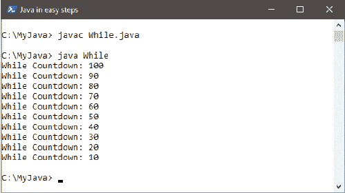


在这里，当外部循环尝试第二次运行时，`break` 语句停止了内部循环的所有三次迭代。

`continue` 关键字用于在满足特定条件时跳过循环的单次迭代。`continue` 语句位于语句块内部，并位于测试表达式之前。当测试返回 `true` 时，该迭代结束。


在内部循环块开头添加此 `continue` 语句，跳过内部循环的第一次迭代

```java
for (int i = 1; i < 4; i++) {
    for (int j = 1; j < 4; j++) {
        if (i == 1 && j == 1) {
            System.out.println("Continues innerLoop when i=" + i + " j=" + j);
            continue;
        }
    }
}
```


在这里，当外部循环尝试第一次运行时，`continue` 语句仅跳过了内部循环的第一次迭代。


启动一个名为“Label”的新程序，包含标准的 main 方法

```java
class Label {
    public static void main(String[] args) { }
}
```


在 main 方法内部，创建两个嵌套的 `for` 循环，在三次迭代中的每次显示它们的计数器值

```java
for (int i = 1; i < 4; i++) {
    for (int j = 1; j < 4; j++) {
        System.out.println("Running i=" + i + " j=" + j);
    }
}
```


将程序保存为 `Label.java`，然后编译并运行程序以查看输出

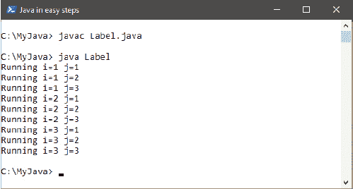

标记循环的语法需要一个标签名称，后跟一个冒号 `:`，放在循环结构开始之前


修改外层循环的开头，将其标记为“outerLoop”

```java
outerLoop: for (int i = 1; i < 4; i++) { }
```

要显式指定程序应在外层循环中继续，在 `continue` 关键字之后写出该循环的标签名称


将此 `continue` 语句添加到内层循环语句块的开头，以便进入外层循环的下一次迭代——然后重新编译并运行程序

```java
if (i == 1 && j == 1) {
    System.out.println("Continues outerLoop when i=" + i + " j=" + j);
    continue outerLoop;
}
```

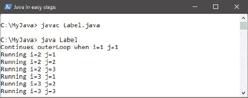


在这里 `continue` 语句停止了内层循环第一次运行的所有迭代——通过将控制权返回外层循环。要显式指定程序应从外层循环退出，在 `break` 关键字之后写出该循环的标签名称

```java
if (i == 2 && j == 3) {
    System.out.println("Breaks outerLoop when i=" + i + " j=" + j);
    break outerLoop;
}
```

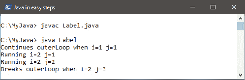


在这里 `break` 语句停止了整个循环结构的所有迭代——通过退出外层循环。

## 总结

- `if` 关键字执行条件测试，以评估表达式的布尔值为 `true` 或 `false`。
- `if` 语句块可以包含一个或多个语句，这些语句仅在测试表达式返回 `true` 时才执行。
- `else` 关键字指定了当 `if` 关键字执行的测试返回 `false` 时执行的备选语句。
- 组合 `if else` 语句使程序能够通过条件分支的过程继续。
- 每个 `case` 选项都可以由 `break` 关键字终止，因此只有与该选项相关的语句会被执行。
- `default` 关键字可以指定当所有 `case` 选项都返回 `false` 时执行的语句。
- 循环重复执行其包含的语句，直到测试表达式返回 `false` 为止。
- `for` 关键字后面的括号指定了循环的计数器初始化、测试表达式和计数器更新器。
- `while` 循环和 `do while` 循环中的语句必须更改测试表达式中使用的值，以避免死循环。
- 测试表达式在 `for` 循环和 `while` 循环的开始处评估——在循环第一次迭代之前。
- 测试表达式在 `do while` 循环的结束处评估——在循环第一次迭代之后。
- 使用 `continue` 关键字跳过循环迭代。
- 使用 `break` 关键字终止循环。
- 嵌套的内层循环可以使用标签配合 `break` 和 `continue` 关键字来引用外层循环。

# 4. 值的引导

*本章演示了如何使用各种 Java 编程结构来引导数据值。*

- 类型值强制转换
- 创建变量数组
- 传递参数
- 传递多个参数
- 遍历元素
- 更改元素值
- 捕获异常
- 总结

## 类型值强制转换

在 Java 编程中处理值需要严格遵守正确的数据类型，以避免编译器错误。例如，将 `float` 类型值发送到需要 `int` 类型值的方法将产生编译器错误。这意味着在处理某个值之前，通常有必要将其转换为另一种数据类型。

数值值可以很容易地“强制转换”（转换）为另一种数值类型，使用以下语法：

```java
(int) value
```

将 `float` 值强制转换为 `int` 类型时会发生精度损失。例如，将 `365.25` 转换为 `int` 时会被截断。

数值值可以使用数值类的 `toString()` 方法转换为 `String`。例如，将 `int` 变量转换为 `String`：

```java
Integer.toString(num)
```

```java
Float.toString(num)
```

在实践中，你经常需要将 `String` 转换为数值类型以便进行算术运算。使用 `Integer.parseInt()` 将 `String` 转换为 `int`：

```java
Integer.parseInt(msg)
```

或者使用 `Float.parseFloat()` 将 `String` 转换为 `float`：

```java
Float.parseFloat(msg)
```

在将 `String` 值转换为数值类型时，该 `String` 可能只包含有效的数值，否则编译器将报告错误。

数组简单来说是一个包含多个值的变量——与只能包含单个值的普通变量不同。

数组的声明首先使用数据类型关键字之一指明其数据类型，紧接着使用方括号 `[]` 表示它将是一个数组变量。接下来，声明数组变量的名称，并遵循标准的命名规范。


可以在声明数组时，通过将适当数据类型的值以逗号分隔的列表形式赋值（并包含在大括号 `{}` 中）来初始化数组。例如，一个初始化了三个值的整数数组变量的声明可能如下：

```java
int[] numbersArray = { 1, 2, 3 };
```

数组的长度根据所赋值列表的大小创建，每个值对应一个“元素”——在这种情况下，这是一个包含三个元素的数组。

存储的值从零开始索引，每个值都可以通过其元素索引位置进行访问。这种操作的语法要求数组名后跟一个包含元素索引的方括号。例如，`numbersArray[0]` 将访问上述示例中存储的第一个值 (1)。

虽然每个元素中存储的值可以像普通变量一样简单地更改，但数组的大小由其声明决定，此后无法更改。有用的是，数组中的元素总数以整数形式存储在该数组的 `length` 属性中。访问该数字的语法只需在数组名后加上一个点和“length”。例如，`numbersArray.length` 将返回上述示例数组的大小——在本例中为整数 3。

数组也可以通过 `new` 关键字创建一个指定大小的空数组“对象”，从而在不分配初始值列表的情况下声明。所需的空元素数量在适当数据类型之后的方括号内的赋值语句中指定。例如，一个具有三个元素的空整数数组变量的声明可能如下：

```java
int[] num = new int[3];
```

`int` 和 `float` 数据类型的元素被赋予默认值零，`String` 数据类型赋值为 `null`，`char` 数据类型赋值为 `\0`，`boolean` 数据类型赋值为 `false`。


记住数组索引从零开始。这意味着 `index[2]` 访问的是数组中的第三个元素，而不是第二个元素。


启动一个名为“Array”的新程序，其中包含标准的 main 方法

```java
class Array {
    public static void main(String[] args) { }
}
```


Array.java

```java
String[] str = { "Much ", "More", " Java" };
```


声明一个具有三个元素的空整数数组

```java
int[] num = new int[3];
```


给前两个整数数组元素赋值

```java
num[0] = 100;
num[1] = 200;
```


给第二个 String 数组元素赋一个新值

```java
str[1] = "New Value";
```


输出每个数组的长度以及每个数组中所有元素的内容

```java
System.out.println("String array length is " + str.length);
System.out.println("Integer array length is " + num.length);
System.out.println(num[0] + "," + num[1] + "," + num[2]);
System.out.println(str[0] + str[1] + str[2]);
```


将程序保存为 `Array.java`，然后编译并运行程序以查看输出

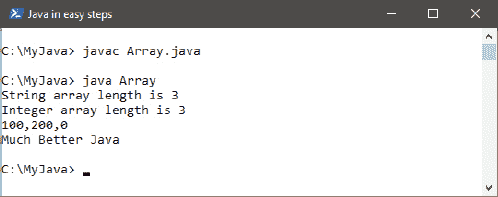


`String` 值需要包含在引号内。

### 传递参数

```java
public static void main(String[] args) { }
```

`args[]` 数组的目的是在调用程序运行时将值传递给程序。在命令行上，在程序名称后的空格后添加要传递给程序的值。例如，向名为“Run”的程序传递 String “Java” 的命令是 `Run Java`。

传递给程序的单个值会自动放在 `args[]` 数组的第一个元素中，因此程序可以通过 `args[0]` 访问它。

重要的是要意识到 `args[]` 数组是 String 数据类型——因此传递给程序的数值值将存储为该数字的 String 表示形式。这意味着在将该值转换为数值类型（例如 `int` 值）之前，程序无法对其进行算术运算。例如，`Run 4` 将数字 4 传递给程序，程序将其存储为 String “4”，而不是 int 4。因此，`args[0]` 的输出将是字符串“4”。

### 传递多个参数

可以在命令行通过程序名称和空格向程序传递多个参数。参数之间必须至少有一个空格分隔，其值按顺序放入 `args[]` 数组的元素中。然后像任何其他数组一样通过索引号访问每个值——`args[0]` 是第一个参数，`args[1]` 是第二个，以此类推。

程序可以测试 `args[]` 数组的 `length` 属性以确保用户输入了正确数量参数。当测试失败时，可以使用 `return` 关键字退出 `main` 方法，从而退出程序：

```java
class Args {
    public static void main(String[] args) { }
}
```

Args.java


在 `main` 方法中，编写一个 `if` 语句，当参数数量不足（在此情况下为三个）时，输出建议并退出程序。

```java
if (args.length != 3) {
    System.out.println("Wrong number of arguments");
    return;
}
```


在 `if` 语句下方创建两个 `int` 变量——分别用第一个和第三个参数的值初始化

```java
int num1 = Integer.parseInt(args[0]);
int num2 = Integer.parseInt(args[2]);
```


添加一个 `String` 变量，用三个参数的拼接字符串进行初始化

```java
String msg = args[0] + args[1] + args[2] + "=";
```


`return` 关键字用于退出当前方法。它还可以将值返回到调用方法的地方。更多详情请参阅此处。


添加此 `if else` 语句对参数进行算术运算并将结果追加到 `String` 变量中

```java
if (args[1].equals("+")) {
    msg += (num1 + num2);
} else if (args[1].equals("-")) {
    msg += (num1 - num2);
} else if (args[1].equals("x")) {
    msg += (num1 * num2);
} else if (args[1].equals("/")) {
    msg += (num1 / num2);
} else {
    msg = "Incorrect operator";
}
```


在 `main` 方法末尾插入此行以显示追加的 `String`

```java
System.out.println(msg);
```


将程序保存为 `Args.java`，然后使用三个参数编译并运行程序——一个整数、任意一个算术符号 `+` `-` `x` `/` 以及另一个整数

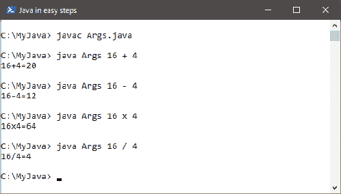

现在，使用错误的第二个参数和错误的参数数量运行程序

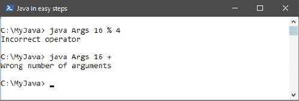


如果输入非数字值，此程序将报告错误。有关如何捕获错误的详情，请参阅此处。

### 遍历元素

所有类型的循环都可以轻松地读取数组元素中存储的所有值。循环计数器应该从第一个元素的索引号开始，一直进行到最后一个索引号。数组中最后一个元素的索引号始终比数组长度少 1——因为索引从零开始。


将数组的 `length` 属性设置为循环的条件测试，以决定循环何时结束是非常有用的。这意味着循环将持续，直到计数器值超过数组最后一个元素的索引号。

开始一个名为“Loops”的新程序，其中包含标准的 `main` 方法

```java
class Loops
{
    public static void main ( String[] args ) {     }
}
```


Loops.java

在 `main` 方法中，编写一个 `if` 语句来测试是否从命令行向 `args[]` 数组输入了任何参数值

```java
if ( args.length > 0 ) {     }
```

```java
for ( int i = 0 ; i < args.length ; i++ )
{
    System.out.println( "args["+i+ "] is | " + args[i] ) ;
}
```

将程序保存为 `Loops.java`，然后编译程序并使用参数 `Java in easy steps` 运行

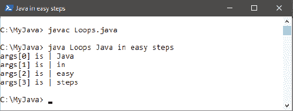

编辑 `Loops.java` 添加一个 `String` 数组和一个 `while` 循环，输出存储在每个元素中的值

```java
String[] htm = { "HTML5", "in", "easy", "steps" } ;
int j = 0 ;
while ( j < htm.length )
{
    System.out.println( "htm["+j+ "] is | " + htm[j] ) ;
    j++ ;
}
```

保存更改，然后重新编译并运行程序

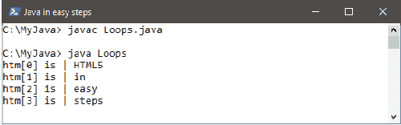

编辑 `Loops.java` 添加另一个 `String` 数组和一个 `do while` 循环，输出存储在每个元素中的值

```java
String[] xml = { "XML", "in", "easy", "steps" } ;
int k = 0 ;
if ( xml.length > 0 ) do
{
    System.out.println( "xml["+k+"] is | " + xml[k] ) ;
    k++;
} while ( k < xml.length ) ;
```

保存更改，然后重新编译并运行程序


### 修改元素

数组中存储的值可以通过给特定索引赋值新值来更改。此外，可以使用任何类型的循环来填充数组元素。

开始一个名为“Elements”的新程序，包含标准的 `main` 方法

```java
class Elements
{
    public static void main ( String[] args ) { }
}
```


Elements.java

在 `main` 方法中，创建一个包含 12 个元素的空 `int` 数组用于合并销售额，以及一个记录总计的 `int` 变量

```java
int total = 0;
```

添加一个 `for` 循环，用其他数组填充空数组

```java
for ( int i = 0 ; i < kioskq1.length ; i++ )
{
    sum[i] = kioskq1[i] + outletq1[i];
    sum[i+3] = kioskq2[i] + outletq2[i];
    sum[i+6] = kioskq3[i] + outletq3[i];
    sum[i+9] = kioskq4[i] + outletq4[i];
}
```

接下来，添加第二个 `for` 循环以输出每个合并销售额，并计算它们的总计

```java
for ( int i = 0 ; i < sum.length ; i++ )
{
    System.out.println( "Month " + ( i+1 ) + " sales:\t" + sum[i] ) ;
}
```

在 `main` 方法末尾插入最后的语句以输出总计

```java
System.out.println( "TOTAL YEAR SALES\t" + total );
```

将程序保存为 `Elements.java`，然后编译并运行以查看输出

### 添加数组维度

可以创建数组来存储多组元素值，每组都有它们自己的索引维度。多维数组中使用每个维度的相应索引号来访问单个值。例如 `num[1][3]`。

二维数组可能用于记录年度内每天的整数值，按周组织。这需要一个包含 52 个元素（每周一个）的数组，每个元素包含一个 7 个元素的数组（每天一个）。它的声明如下：

```java
int[][] dailyRecord = new int[52][7];
```

避免在数组中使用超过三个维度——这会令人困惑。

这种“数组的数组”为每个工作日提供了一个元素。通过指明每个维度的适当索引值，为多维数组赋值。例如，使用上面的示例，可以这样给第六周的第一天赋值一个值：

```java
dailyRecord[5][0] = 5000;
```

每个数组都有自己的 `length` 属性，可以通过指定所需的维度来访问它。对于上面的示例，语法 `dailyRecord.length` 返回值 52 —— 即第一维的大小。若要访问第二个维度的大小，语法 `dailyRecord[0].length` 返回值 7。

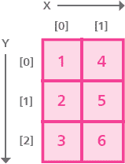

二维数组通常用于存储网格坐标，其中一个维度代表 X 轴，另一个维度代表 Y 轴。例如，`point[3][5]`。

三维数组可以以类似的方式存储 XYZ 坐标，但要可视化 `point[4][8][2]` 可能会困难。

嵌套循环非常适合多维数组，因为每个循环级别都可以处理每个数组维度的元素。

创建一个名为“Dimensions”的新程序，包含标准的 `main` 方法

```java
class Dimensions
{
    public static void main ( String[] args ) {    }
}
```


Dimensions.java

在 `main` 方法中，创建一个二维数组来存储与 XY 坐标相关的布尔标记

```java
boolean[][] points = new boolean[5][20];
```

在每个 X 轴上定义一个 Y 点

```java
points[0][5] = true;
points[1][6] = true;
points[2][7] = true;
points[3][8] = true;
points[4][9] = true;
```

添加一个 `for` 循环来遍历第一个数组索引，在每次迭代末尾添加一个换行字符

```java
for ( int i = 0 ; i < points.length ; i++ )
{
    System.out.print( "\n" ) ;
}
```

在 `for` 循环的大括号内，插入第二个 `for` 循环来遍历第二个数组索引

```java
for ( int j = 0 ; j < points[0].length ; j++ ) {    }
```

在第二个 `for` 循环的大括号内，插入一个语句，根据元素的布尔值为每个元素输出一个字符

```java
char mark = ( points[i][j] ) ? 'X' : '-' ;
System.out.print( mark ) ;
```

将程序保存为 `Dimensions.java`，然后编译并运行程序以查看输出

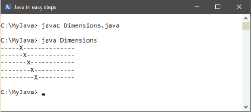


布尔变量默认为 `false`。

### 异常处理

程序可能会遇到运行时问题，导致“异常”错误，这会停止程序的执行。这通常是由意外的用户输入引起的。因此，一个编写良好的程序应该尝试预测用户可能在运行时引起异常的所有可能方式。

可能出现异常的代码可以被识别并封装在 `try-catch` 语句块中。这允许程序处理异常而不停止执行，如下所示：

```java
try
{
    // 可能出现异常的语句
}
catch( Exception e )
{
    // 对异常的响应语句
}
```

`catch` 关键字后面的括号指定了要捕获的异常类，并将其赋值给变量 `e`。顶层 `Exception` 类捕获所有异常。然而，可以使用多个 `catch` 语句来识别不同的低级异常类，为特定异常提供响应。

最常见的异常是 `NumberFormatException`（当程序遇到非预期数字类型的值时产生）和 `ArrayIndexOutOfBoundsException`（当程序尝试访问索引大小之外的数组元素时产生）。为这些异常中的每一个创建一个单独的 `catch` 块是有帮助的，以便及时通知用户问题的性质。

可选地，`try-catch` 语句块可以使用 `finally` 语句块进行扩展，该块包含无论程序是否遇到异常都将始终执行的代码。


`e.getMessage()` 方法返回有关某些已捕获异常的进一步信息。

创建一个名为“Exceptions”的新程序，包含标准的 `main` 方法

```java
class Exceptions
{
    public static void main ( String[] args ) {    }
}
```


Exceptions.java

在 `main` 方法内部，编写一个 `try` 语句来输出单个整数参数

```java
try
{
    int num = Integer.parseInt( args[0] ) ;
    System.out.println( "You entered: " + num ) ;
}
```

添加一个 `catch` 语句来处理在未带参数运行时产生的异常

```java
catch( ArrayIndexOutOfBoundsException e )
{
    System.out.println( "Integer required." ) ;
}
```

添加一个 `catch` 语句来处理在带非整数参数运行时产生的异常

```java
catch( NumberFormatException e )
{
    System.out.println( "Argument is wrong." ) ;
}
```

在程序末尾添加一个 `finally` 语句

```java
finally
{
}
```

Java 拥有海量的预测试代码包库，这些包以模块的形式组织。提供 Java 语言本身基础功能的代码包包含在 `java.base` 模块的 `java.lang` 包中。这些包可以被 Java API（应用程序接口）自动访问。这意味着在创建程序时，`java.lang` 包提供的属性和方法是随取随用的。例如，`java.base` 模块中 `java.lang` 包的 `Math` 类 `abs()` 方法提供的数学功能。


## 模块

模块是 Java 9 引入的新功能，旨在提高可扩展性并提升性能。

包的内容按层次顺序排列，允许使用点符号表示法访问任何项。例如，`System` 类包含一个 `out` 属性（字段），该属性又包含一个 `println()` 方法——因此可以通过 `System.out.println()` 进行访问。

Java 文档提供了每个可用项的信息，并可用于探索 Java 类。你可以在线 `docs.oracle.com/javase/9/docs/api` 获取，或者下载进行离线参考。文档显然非常大，但熟悉它非常有价值。一个很好的起点是 API 概述页面，该页面分三个部分列出了每个部分的每个模块列表，并附带每个模块的简要描述：

启动网络浏览器并打开 `docs.oracle.com/javase/9/docs/api` 上的 API 概述页面

查看每个部分按字母顺序列出的 `Modules`——向下滚动到“Java SE”部分找到 `java.base` 模块，然后点击其超链接


你可以点击 `Frames` 链接查看文档的多面板视图。

查看每个部分按字母顺序列出的模块的 `Packages`——向下滚动到“Exports”部分找到 `java.lang` 包，然后点击其超链接

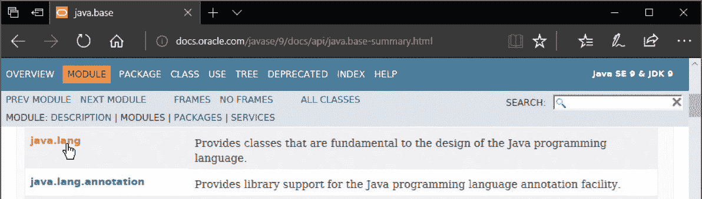

查看每个部分按字母顺序列出的包的 `Classes`——向下滚动页面到“Class Summary”部分找到 `Math` 类，然后点击其超链接

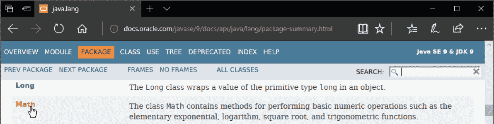

在“Method Summary”部分按字母顺序列出类的 `Methods`——点击任何超链接以发现该方法的目的及其语法

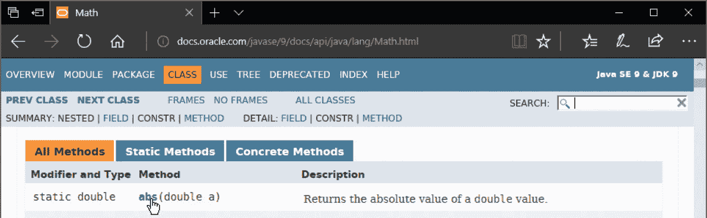

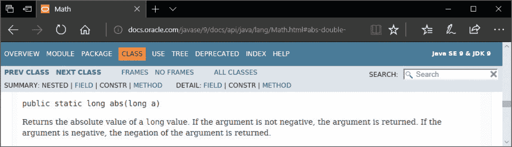


检查页面菜单上其他项提供的可用信息，以更熟悉文档。

## 进行数学运算

`java.lang` 包中的 `Math` 类提供了两个在执行数学计算时经常用的常量值。`Math.PI` 存储圆周率的值，而 `Math.E` 存储自然对数的底的值。这两个常量值都以 `double` 精度数据类型存储，并保留 15 位小数。

创建一个名为“Pi”的新程序，其中包含标准 `main` 方法

```java
class Pi
{
    public static void main ( String[] args ) {
    }
}
```


Pi.java

在 `main` 方法中，从命令行参数声明并初始化一个 `float` 变量，并将 `double Math.PI` 常量转换为第二个 `float` 变量

```java
float radius = Float.parseFloat(args[0]);
float shortPi = (float) Math.PI;
```

使用转换后的值进行数学计算，将结果分配更多的 `float` 变量

```java
float circ = shortPi * (radius + radius);
float area = shortPi * (radius * radius);
```

输出 `Math.PI` 的值及其转换后的 `float` 等效值，随后输出计算结果

```java
System.out.print( "With Pi commuted from " + Math.PI );
System.out.println( " to " + shortPi + "..." ) ;
System.out.println( "A circle of radius " + radius + " cm" ) ;
System.out.println( "has a circumference of " + circ + " cm" ) ;
```


# Java 数学运算与字符串处理

## 使用 Math 类进行数学计算

保存程序为 `Pi.java`，然后编译并运行程序查看输出。

`Pi` 转换后的值通常提供了足够的精度。`java.lang` 包中的 `Math` 类提供了许多用于执行计算的方法。使用 `Math.pow()`，可以将给定数字提升指定的幂。`Math.sqrt()` 方法返回数字的平方根。

```java
class Power {
    public static void main(String[] args) {
    }
}
```

创建一个名为“Power”的新程序，其中包含标准 main 方法。

在 main 方法中，从命令行参数声明并初始化一个 `int` 变量：

```java
int num = Integer.parseInt(args[0]);
```

进行数学计算，将结果转换为 `int` 变量：

```java
int square = (int) Math.pow(num, 2);
int cube = (int) Math.pow(num, 3);
int sqrt = (int) Math.sqrt(num);
```

输出计算结果：

```java
System.out.println(num + " cubed is " + cube);
System.out.println("Square root of " + sqrt);
```

## 舍入浮点数

`java.lang` 包提供了三种将浮点数舍入整数的方法。其中最简单的是 `Math.round()` 方法，它将作为参数的数字向上或向下舍入到最近的整数。`Math.floor()` 方法向下舍入到最近的整数，而 `Math.ceil()` 方法向上舍入到最近的整数。虽然 `Math.round()` 方法返回 `int` 数据类型，但 `Math.floor()` 和 `Math.ceil()` 方法都返回 `double` 数据类型。

```java
class Round {
    public static void main(String[] args) {
    }
}
```

创建一个名为“Round”的新程序，其中包含标准 main 方法。

在 main 方法中，声明并初始化一个 `float` 变量：

```java
float num = 7.25f;
```

输出舍入后的 `float` 值：

```java
System.out.println(num + " rounded is " + Math.round(num));
```

输出舍入后的 `float` 值作为 `double` 值：

```java
System.out.println(num + " floored is " + Math.floor(num));
System.out.println(num + " ceiling is " + Math.ceil(num));
```

默认情况下，`Math.round()` 会向上舍入——所以 7.5 会被舍入到 8。

## 比较数值

`java.lang` 包中的 `Math` 类提供了两个方法来比较两个数值值。`Math.max()` 方法和 `Math.min()` 方法分别需要两个数字作为参数。`Math.max()` 将返回较大的数字，而 `Math.min()` 将返回较小的数字。

比较的数字可以是任意数值数据类型，但结果将以 `double` 数据类型返回。

创建一个名为“Compare”的新程序，其中包含标准的 main 方法：

```java
class Compare {
    public static void main(String[] args) {
    }
}
```

在 main 方法中，声明并初始化一个 `float` 变量和一个 `int` 变量：

```java
float num1 = 24.75f;
int num2 = 25;
```

输出较大的值：

```java
System.out.println("Most is " + Math.max(num1, num2));
```

输出较小的值：

```java
System.out.println("Least is " + Math.min(num1, num2));
```

将程序保存为 `Compare.java`，然后编译并运行程序以查看输出。

## 生成随机数

`java.lang` 包中的 `Math` 类通过其 `Math.random()` 方法提供了生成随机数的能力，该方法返回 0.0 到 0.999 之间的双精度随机数。通过乘以该随机数可以指定更宽的范围。例如，乘以 10 将创建一个 0.0 到 9.999 之间的随机数。现在使用 `Math.ceil()` 将随机数向上取整，将确保它落在 1-10（包含）范围内。

创建一个名为“Random”的新程序，其中包含标准的 main 方法：

```java
class Random {
    public static void main(String[] args) {
    }
}
```

在 main 方法中，将随机数赋值给一个 `float` 变量，并输出它的值：

```java
float random = (float) Math.random();
System.out.println("Random number: " + random);
```

将随机数的乘积赋值给第二个 `float` 变量，并输出它的值：

```java
float multiplied = random * 10;
System.out.println("Multiplied number: " + multiplied);
```

将乘后的随机数取整后的整数赋值给 `int` 变量，并输出它的值：

```java
int randomInt = (int) Math.ceil(multiplied);
System.out.println("Random Integer: " + randomInt);
```

将程序保存为 `Random.java`，然后编译并运行程序以查看输出。

上所述的乐票程序将此示例中的三个步骤合并为一条语句。

可以使用 `Math.random()` 生成一组在 1-59（包含）范围内的六个不重复的随机数序列，以产生随机乐票选择。

创建一个名为“Lottery”的新程序，其中包含标准的 main 方法：

```java
class Lottery {
    public static void main(String[] args) {
    }
}
```

在 main 方法中，创建一个包含 60 个元素的 `int` 数组，然后用整数 1-59 填充元素 1-59：

```java
int[] nums = new int[60];
for (int i = 1; i < 60; i++) {
    nums[i] = i;
}
```

打乱 1-59 元素的值：

```java
for (int i = 1; i < 60; i++) {
    int r = (int) Math.ceil(Math.random() * 59);
    int temp = nums[i];
    nums[i] = nums[r];
    nums[r] = temp;
}
```

仅输出 1-6 元素中的值：

```java
for (int i = 1; i < 7; i++) {
    System.out.print(Integer.toString(nums[i]) + " ");
}
```

将程序保存为 `Lottery.java`，然后编译并运行程序三次。

## 字符串比较

使用不同字母大小写的 `String` 值（例如“Java”和“JAVA”）不被认为是相等的，因为字符的 ASCII 值不同。例如，大写“A”的值为 65，而小写“a”的值为 97。

为了将用户输入的、大小写不确定的 `String` 值与程序中的 `String` 值进行比较，通常将输入转换为特定的大小写格式是非常有用的。为此，`String` 类提供了 `toUpperCase()` 方法和 `toLowerCase()` 方法。将输入的 `String` 作为参数指定，该方法返回转换后的 `String`。

点符号表示允许将方法附加到其他方法上，以便按顺序执行这些操作。这意味着可以使用 `toLowerCase().equals()` 将一个 `String` 值转换为小写，然后将该小写版本与指定的参数进行比较。

创建一个名为“StringComparison”的新程序，其中包含标准的 main 方法：

```java
class StringComparison {
    public static void main(String[] args) {
    }
}
```

在 main 方法内部，创建并初始化一个带有正确小写密码的 `String` 变量：

```java
String password = "bingo";
```

添加 `try catch` 语句来捕获未输入密码参数时发生的异常：

```java
try {
}
catch (Exception e) {
    System.out.println("Password required.");
}
```

将此 `if else` 语句插入 `try` 语句块中以评估用户输入的密码参数：

```java
if (args[0].toLowerCase().equals(password)) {
    System.out.println("Password accepted.");
}
else {
    System.out.println("Incorrect password.");
}
```

将程序保存为 `StringComparison.java`，然后使用各种参数编译并运行程序。

## 搜索字符串

`java.lang` 包中的 `String` 类提供了 `startsWith()` 和 `endsWith()` 方法来比较 `String` 值的部分。这些方法对于比较多个 `String` 值并选择具有相同开头或相同结尾的值特别有用。当 `String` 的部分与指定的参数匹配时，方法返回 `true` —— 否则，返回 `false`。

通过将要复制的第一个字符的位置号作为其 `substring()` 方法的参数，可以复制 `String` 值的一个部分。这将返回原始 `String` 值的子字符串，从指定的起始位置开始到原始 `String` 的末尾结束。

可选地，`substring()` 方法可以接受第二个参数来指定要复制的最后一个字符的位置号。这将返回原始 `String` 值的子字符串，从指定的起始位置开始到指定的结束位置结束。

可以对 `String` 值进行搜索，以找到作为其 `indexOf()` 方法参数的字符或子字符串。该方法返回匹配的字符或子字符串在搜索的 `String` 值中首次出现的数字位置。如果没有找到匹配项，方法返回负整数值 -1。

创建一个名为“StringSearch”的新程序，其中包含标准的 main 方法：

```java
class StringSearch {
    public static void main(String[] args) {
    }
}
```

在 main 方法内部，创建一个初始化的书名 `String` 数组：

```java
String[] books = {
    "Java in easy steps", "XML in easy steps",
    "SQL in easy steps", "CSS in easy steps",
    "Gone With the Wind", "Drop the Defense"
};
```

创建并初始化三个 `int` 计数变量：

```java
int counter1 = 0, counter2 = 0, counter3 = 0;
```

```java
for (int i = 0; i < books.length; i++) {
    System.out.print(books[i].substring(0, 4) + " | ");
}
```

在 `for` 循环中插入语句来统计带有结尾的标题：

```java
if (books[i].endsWith("easy steps")) counter1++;
```

在 `for` 循环中插入语句来统计带有开头的标题：

```java
if (books[i].startsWith("Java")) counter2++;
```

在 `for` 循环中插入语句来统计不包含子字符串的标题：

```java
if (books[i].indexOf("easy") == -1) counter3++;
```

在 main 方法末尾，添加这些语句来输出每次搜索的结果：

```java
System.out.println("\nFound " + counter1 + " titles from this series");
System.out.println("Found " + counter2 + " Java title");
System.out.println("Found " + counter3 + " other titles");
```

将程序保存为 `StringSearch.java`，然后编译并运行程序。

`!` 运算符不能用于测试 `indexOf()` 方法是否失败——因为它返回的是整数值，而不是布尔值。

## 操作字符

`java.lang` 包中的 `String` 类提供了 `trim()` 方法，用于移除作为参数指定的 `String` 开头结尾的任何空白字符。该方法将移除极端的空格、换行和制表符，返回该 `String` 的修剪版本。

`String` 中的单个字符可以通过指定其在 `String` 中的索引位置作为其 `charAt()` 方法的参数来访问。该方法将 `String` 视为字符数组，其中第一个字符位于位置零 ——就像其他从零索引的数组一样。`String` 中的第一个字符可以通过 `charAt(0)` 访问，第二个字符可以通过 `charAt(1)` 访问，以此类推。

由于字符索引从零开始，`String` 中的最后一个字符的索引号始终比 `String` 中的字符总少一。这意味着任何 `String` 的最后一个字符索引号等于 `length() - 1`。因此，名为 `str` 的 `String` 的最后一个字符可以通过 `str.charAt(str.length() - 1)` 访问。

可以使用 `replace()` 方法将 `String` 中所有特定特定字符替换为另一个字符。该方法需要两个参数，指定要替换的字符和要取其位置的字符。例如，要将所有的字母“a”替换为字母“z”，语法为 `replace('a', 'z')`。

`isEmpty()` 方法可以检查 `String` 是否不包含字符。如果 `String` 绝对为空，该方法将返回 `true`，否则将返回 `false`。

在 `main` 方法中，声明并初始化一个空的 `String` 变量：

```java
String txt = "";
```

为 `String` 变量赋值一些字符，如果它确实为空，则包含前后的空格。


```java
if (txt.isEmpty()) txt = "      Borrocudo      ";
```

输出 `String` 值以及它包含的字符数

```java
System.out.println("String: " + txt);
System.out.println("Original String Length: " + txt.length());
```

移除前后的空格，然后再次输出 `String` 值及其大小

```java
txt = txt.trim();
System.out.println("String: " + txt);
System.out.println("String Length: " + txt.length());
```

输出 `String` 中的第一个字符

```java
char initial = txt.charAt(0);
System.out.println("First Letter: " + initial);
```

现在，输出 `String` 中的最后一个字符

```java
initial = txt.charAt(txt.length() - 1);
System.out.println("Last Letter: " + initial);
```

将所有的字母“o” 替换为字母“a”

```java
txt = txt.replace('o', 'a');
System.out.println("String: " + txt);
```

将程序保存为 `CharacterSwap.java`，然后编译并运行程序以查看输出

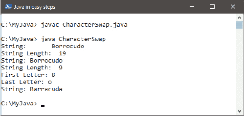

## 总结

- Java 文档提供了每个 Java 类中方法和属性的信息。
- Java 语言基础的 Java 类包含在 `java.lang` 包中，位于 `java.base` 模块内。
- `Math` 类提供了 `Math.PI` 和 `Math.E` 常量。
- `Math.pow()` 将数字提升到指定的幂，`Math.sqrt()` 返回指定数的平方根。
- 使用 `Math.round()`、`Math.floor()` 和 `Math.ceil()` 可以将数字四舍入为整数。
- 使用 `Math.max()` 和 `Math.min()` 对数字进行比较。
- `Math.random()` 返回 0.0 到 0.999999999999999 之间的 `double` 精度随机数。
- `String` 是用引号括的零或多个字符。
- `length()` 方法返回 `String` 的大小，类似于数组的 `length` 属性。
- `String` 的 `concat()` 方法追加另一个 `String` 值。
- `String` 的 `equals()` 方法仅当两个 `String` 值具有相同字符且顺序相同时返回 `true`。
- 使用 `toUpperCase()` 和 `toLowerCase()` 方法更改字符串的大小。
- 使用 `startsWith()` 和 `endsWith()` 方法比较 `String` 值。
- 使用 `indexOf()` 和 `substring()` 方法在 `String` 中查找子字符串。
- `isEmpty()` 方法仅当 `String` 完全没有任何内容时返回 `true`。
- 使用 `trim()`、`charAt()` 和 `replace()` 方法处理 `String` 值中的字符。

## 创建类

***本章将演示如何创建一个使用多个方法和类的 Java 程序。***

- 形成多个方法
- 理解程序范围
- 形成多个类
- 扩展现有类
- 创建对象类
- 产生对象实例
- 封装属性
- 构造对象值
- 总结

### 形成多个方法

程序通常被拆分为单独的方法，以便创建每个执行特定任务的代码模块，并根据需要可以在整个程序中反复调用。将程序拆分成多个方法也更容易追踪错误，因为每个方法都可以被单独测试。进一步的方法可以在类声明后的大括号内声明，使用与声明 `main` 方法相同的关键字。每个新方法必须按照通常的命名规范赋予名称，并可以可选在名称后的括号中指定参数。

启动一个名为“Methods”的新程序，包含标准的 `main` 方法

```java
class Methods {
    public static void main(String[] args) { }
}
```

Methods.java

在 `main` 方法的大括号之间插入语句，输出消息并调用名为“sub”的第二个方法

```java
System.out.println("Message from the main method.");
sub();
```

在 `main` 方法之后、类声明的大括号之前，添加第二个方法

```java
public static void sub() {
    System.out.println("Message from the method.");
}
```

将程序保存为 `Methods.java`

调用无参数方法的语法只需要方法名后跟括号。一个类甚至可以包含多个相同名称的方法，参数不同或类型不同。这种功能被称为“重载”。

```java
class Overload {
    public static void main(String[] args) { }
}
```

Overload.java

在 `main` 方法的大括号之间插入三个调用不同方法并传递值的语句

```java
System.out.println(write(12));
System.out.println(write("Twelve"));
System.out.println(write(4, 16));
```

在 `main` 方法之后、类的大括号之前，添加重载方法，以便向调用者返回 `String`

```java
public static String write(int num) {
    return ("Integer passed is " + num);
}

public static String write(String num) {
    return ("String passed is " + num);
}

public static String write(int num1, int num2) {
    return ("Sum Total is " + (num1 * num2));
}
```

将程序保存为 `Overload.java`

每个重载方法的声明必须指示该方法返回 `String` 值，而不是 `void`。

### 理解程序范围

在方法内部声明的变量仅从该方法内部访问——其访问的“范围”仅限于声明它的方法。这意味着可以在另一个方法中声明同名变量而不会发生冲突。

启动一个名为“Scope”的新程序，包含标准的 `main` 方法

```java
class Scope {
    public static void main(String[] args) { }
}
```

Scope.java

在 `main` 方法的大括号之间声明并初始化一个局部 `String` 变量，然后输出其值

```java
String txt = "This is a local variable in the main method";
System.out.println(txt);
```

在 `main` 方法之后、类的大括号之前，添加另一个名为“sub”的方法

```java
public static void sub() {
    String txt = "This is a local variable in the sub method";
    System.out.println(txt);
}
```

在 `main` 方法末尾插入对 `sub` 方法的调用

```java
sub();
```

将程序保存为 `Scope.java`，然后编译并运行程序查看输出

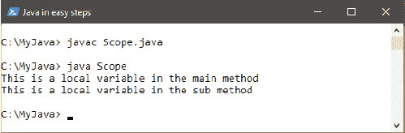


在 `for` 循环中声明的计数变量无法在循环外访问——它的作用范围限于 `for` 语句块。

在方法声明中使用的 `static` 关键字确保该方法是一个“类方法”——可以从类中的任何其他方法进行全局访问。

同样，可以使用 `static` 关键字声明“类变量”，以确保它在整个类中都是全局可用的。它的声明应该放在 `main` 方法声明之前，紧跟在类声明后的大括号之后。

一个程序可能拥有具有同名的全局类变量和局部方法变量。局部方法变量具有优先级，除非使用点符号法（dot notation）通过类名前缀显式地访问全局类变量，或者没有声明该名的局部变量。

编辑 `Scope.java`，插入一个与局部方法变量同名的全局类 `String` 变量常量

```java
final static String txt = "This is a global variable of the Scope class";
```

在 `main` 方法末尾添加一条语句输出全局类变量的值

```java
System.out.println(Scope.txt);
```

注释掉 `sub` 方法中声明局部变量的行——这样输出语句现在将访问同名的全局变量

```java
// String txt = "This is a local variable in the sub method";
```

保存更改，然后重新编译程序并再次运行以查看修改后的输出

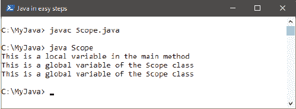


尽可能使用局部方法变量以避免冲突——全局类变量通常用于常量。

### 多个类

正如程序可以有多个方法一样，较大的程序可能由几个类组成——每个类提供特定的功能。这种模块化的格式通常比将整个程序写在单个类中更好，因为它更容易调试并提供了更好的灵活性。

出现在声明中的 `public` 关键字是一个“访问修饰符”，它决定了某个项对其他类的可见性。它可以用于类声明，以显式确保该类对任何其他类可见。如果省略，默认的访问控制级别允许从其他本地类进行访问。然而，`public` 关键字必须与程序的 `main` 方法一起使用，以便该方法对编译器可见。

启动一个名为“Multi”的新程序，包含标准的 `main` 方法——像往常包含 `public` 关键字

```java
class Multi {
    public static void main(String[] args) { }
}
```

Multi.java

在 `main` 方法的大括号之间声明并初始化一个 `String` 变量，然后输出其内容

```java
String msg = "This is a local variable in the Multi class";
System.out.println(msg);
```

从名为“Data”的类输出名为“txt”的类 `String` 变量常量

```java
System.out.println(Data.txt);
```

调用 `Data` 类中名为“greeting”的方法

```java
Data.greeting();
```

从名为“Draw”的类调用名为“line”的方法

```java
Draw.line();
```

将程序保存为 `Multi.java`


编译器会自动找到相邻外部 `.java` 文件中的类——并为每个类创建编译后的 `.class` 文件。

启动一个新文件创建 `Data` 类

```java
class Data { }
```

Data.java

声明并初始化一个公共类变量常量

```java
public final static String txt = "This is a global variable in the Data class";
```

添加一个公共的“greeting”类方法

```java
public static void greeting() {
    System.out.print("This is a global method ");
    System.out.println("of the Data class");
}
```

将文件保存为 `Data.java`，位于 `Multi.java` 程序相同的目录下

启动一个新文件创建 `Draw` 类和一个具有默认访问权限的“line”方法——不使用 `public` 关键字

```java
class Draw {
    static void line() {
        System.out.println("");
    }
}
```

Draw.java

将文件保存为 `Draw.java`，位于 `Multi.java` 程序相同的目录下，然后编译并运行程序查看输出


`public` 关键字允许从任何类访问，但默认访问只允许从同包的类访问。

### 继承现有类

一个类可以通过在类声明中使用 `extends` 关键字来继承另一个类的特征——指定要继承的类名。例如，`class Extra extends Base` 继承自 `Base` 类。继承类被称为“子”类，而它继承的类被称为“父”类。

父类中创建的方法和变量通常可以像它们存在于子类中一样处理，除非它们被声明为 `private` 关键字，这会拒绝访问。父类方法可以使用类名和点符号法显式访问。例如，`SuperClass.run()`。需要注意的是，父类方法中的 `try-catch` 语句无法捕获发生在子类中的异常——调用语句必须封装在自己的 `try-catch` 语句中。

启动一个名为“SuperClass”的类

```java
class SuperClass { }
```

SuperClass.java

在类的大括号之间添加一个输出标识性 `String` 方法

```java
public static void hello() {
    System.out.println("Hello from the Super Class");
}
```

添加第二个尝试传递的方法，然后将文件保存为 `SuperClass.java`

```java
public static void echo(String arg) {
    try {
        System.out.println("You entered: " + arg);
    } catch (Exception e) {
        System.out.println("Argument required");
    }
}
```

启动一个名为“SubClass”的新程序，它继承 `SuperClass` 类

```java
class SubClass extends SuperClass {
    public static void main(String[] args) { }
}
```

SubClass.java

在 `main` 方法之后添加一个输出标识性 `String` 方法，重写继承的同名方法

```java
public static void hello() {
```


在 main 方法的大括号之间，插入对重写方法的调用，然后显式地调用父类中同名的方法

```
hello() ;
SuperClass.hello() ;
```

添加对其他继承方法的调用

```
echo( args[0] ) ;
```

将程序保存为 `SubClass.java`，然后在不提供命令行参数的情况下编译并运行该程序

你可以在此处找到更多关于捕获异常的信息。

## 创建对象类

现实世界的对象无处不在，它们每一个都有我们可以描述的属性和行为：

- 属性描述对象拥有的特征
- 行为描述对象可以执行的操作

例如，一辆汽车可以被描述为具有“红色”和“轿跑”属性，以及一个“加速”行为。

这些特征在 Java 编程中可以通过一个包含变量属性 `color` 和 `bodyType` 的 `Car` 类，以及一个 `accelerate()` 方法来表示。

Java 被称为面向对象编程 (OOP) 语言，因为它大量使用对象的属性和行为来执行程序任务。

Java 中通过定义类作为模板来创建对象，从该模板可以创建不同的副本，或“实例”。

类的每个实例都可以通过分配属性值和行为进行自定义，以描述该对象。

`Car` 类在对面描述的步骤中被创建为类模板——具有上述概述的默认属性和行为。`Car` 类的实例在此处描述的步骤中创建，继承了相同的默认属性和行为。

开始一个名为“Car”的新模板类

```
class Car
{

}
```

在 `Car` 类的大括号之间，声明并初始化两个描述属性的全局 `String` 常量

```
public final static String color = “Red” ;
public final static String bodyType = “Coupe” ;
```

添加一个描述行为的全局方法

```
public static String accelerate()
{
    String motion = “Accelerating...” ;
    return motion ;
}
```

在 `Car` 类之后，开始一个名为“FirstObject”的新程序类，包含标准的 main 方法

```
class FirstObject
{
    public static void main ( String[] args ) {     }
}
```

在 main 方法的大括号之间，插入语句以输出每个 `Car` 属性的值并调用其行为方法

```
System.out.println( “Paint is “ + Car.color ) ;
System.out.println( “Style is “ + Car.bodyType ) ;
System.out.println( Car.accelerate() ) ;
```

将程序保存为 `FirstObject.java`，然后编译并运行程序以查看输出

`static` 关键字声明类变量和类方法——在本例中，它们是 `Car`类的成员。

对象类通常在包含 main 方法的程序类之前创建。

## 创建对象实例

每个类都有一个内置的“构造”方法，用于创建该类的新实例。构造方法与类名相同，并用 `new` 关键字调用。

类的每个实例都继承对象的属性和行为。继承原理在整个 Java 中使用，使得程序可以使用现成的属性。

为了更高的灵活性，对象类模板可以定义在包含程序的其他文件中。这意味着它们可以被多个程序轻松使用。

开始一个新文件，重复上一个示例中此处所示的 `Car` 类对象模板

```
class Car
{
    public final static String color = “Red” ;
    public final static String bodyType = “Coupe” ;
    public static String accelerate()
    {
        String motion = “Accelerating...” ;
        return motion ;
    }
}
```

将文件保存为 `Car.java`

开始一个名为“FirstInstance”的新程序，包含标准的 main 方法

```
class FirstInstance
{
    public static void main ( String[] args ) {     }
}
```

在 main 方法的大括号之间，插入语句以输出 `Car` 类每个属性的值并调用其行为方法

```
System.out.println( “Car paint is “ + Car.color ) ;
System.out.println( “style is “+ Car.bodyType ) ;
System.out.println( Car.accelerate() ) ;
```

现在，添加一条语句创建一个 `Car` 类的 `Porsche` 实例

```
Car Porsche = new Car();
```

添加语句输出每个 `Porsche` 属性并调用其行为方法

```
System.out.println( “Car paint is “ + Porsche.color ) ;
System.out.println( “style is “+ Porsche.bodyType ) ;
System.out.println( Porsche.accelerate() ) ;
```

将程序保存为 `FirstInstance.java` 并与 `Car.java` 文件一起，然后编译并运行程序查看输出

你无法直接访问 `motion` 变量——它是方法范围内的。虚拟 `Porsche` 类复制了原始 `Car` 类。这两个对象都包含静态“类变量”和一个“类方法”，使用类名和点符号进行访问——由于这些成员是全局可见的，这并不是良好的做法。

虽然此示例演示了实例如何继承原始类的属性，但在下一个示例此处中得到了改进，它使用非静态成员创建“实例变量”和“实例方法”，这些无法从类外部访问——由于这些成员不是全局可见的，这被认为是良好的做法。

编译器会自动在外部 `.java` 文件中找到 `Car` 类，并为它创建一个编译后的 `.class` 文件。

## 封装属性

在声明对象变量和方法可以使用 `private` 关键字来保护它们免受外部程序代码的操作。对象随后应包含 `public` 方法来检索值并调用方法。这种技术将变量和方法整齐地封装在对象结构中。以下步骤演示了之前的示例——但使用了封装的属性和方法：

开始一个名为“Car”的新类

```
class Car
{
}
```

在类的大括号之间，声明三个私有的 `String` 变量来存储对象属性

```
private String maker ;
private String color ;
private String bodyType ;
```

添加一个描述行为的私有方法

```
private String accelerate()
{
    String motion = “Accelerating...” ;
    return motion ;
}
```

添加一个公共方法，将传递的参数值赋值给每个私有变量

```
public void setCar( String brand , String paint , String style )
{
    maker = brand ;
    color = paint ;
    bodyType = style ;
}
```

添加另一个公共方法来获取私有变量的值并调用私有方法

```java
public void getCar()
{
    System.out.println( maker + ” paint is “ + color ) ;
    System.out.println( maker + “ style is “ + bodyType ) ;
    System.out.println( maker + “ is “ + accelerate() + ”\n” ) ;
}
```

在 `Car` 类结束之后，启动另一个名为“SafeInstance”的类，其中包含标准的 main 方法

```java
class SafeInstance
{
    public static void main ( String[] args) { }
}
```

在 main 方法的大括号之间，插入一个语句创建 `Car` 类的实例

```java
Car Porsche = new Car() ;
```

添加一条调用 `Car` 类的公共方法的语句，为其私有变量赋值

```java
Porsche.setCar( “Porsche” , ”Red” , ”Coupe” ) ;
```

现在添加一条语句调用 `Car` 类的另一个公共方法以检索存储的属性值并调用私有行为方法

```java
Porsche.getCar() ;
```

创建另一个实例，分配并检索值

```java
Car Bentley = new Car() ;
Bentley.setCar( “Bentley” , ”Green” , ”Saloon” ) ;
Bentley.getCar() ;
```

将程序保存为 `SafeInstance.java`，然后编译并运行程序以查看输出

未初始化的 `String` 变量具有 `null` 值——因此在调用 `setCar()` 之前调用 `getCar()` 方法将从每个变量返回 `null`。

## 构建对象值

对象的构造方法可以直接在对象类中调用，以初始化对象变量。这有助于将声明和赋值分离，并被认为良好的编程风格。接下来的步骤演示了如何重现之前的示例 这里，其中包含封装的属性和方法——以及通过构造函数的初始化：

启动一个名为“Car”的新类

```java
class Car
{
}
```

在类的大括号之间，声明三个私有的 `String` 变量来存储对象属性

```java
private String maker ;
private String color ;
private String bodyType ;
```

添加一个构造方法，用属性值初始化三个变量

```java
public Car()
{
    maker = “Porsche” ;
    color = “Silver” ;
    bodyType = “Coupe” ;
}
```

添加一个描述行为的私有方法

```java
private String accelerate()
{
    String motion = “Accelerating...” ;
    return motion ;
}
```

添加一个公共方法，将传递的参数值分配给每个私有变量

```java
public void setCar( String brand , String paint , String style )
{
    maker = brand ;
    color = paint ;
    bodyType = style ;
}
```

构造方法的声明没有说明任何返回数据类型。

添加另一个公共方法来获取私有变量的值并调用私有方法

```java
public void getCar()
{
    System.out.println( maker + ” paint is “ + color ) ;
    System.out.println( maker + “ style is “ + bodyType ) ;
    System.out.println( maker + “ is “ + accelerate() + ”\n” ) ;
}
```

在 `Car` 类结束之后，启动另一个名为“Constructor”的类，其中包含标准的 main 方法

```java
class Constructor
{
    public static void main ( String[] args ) { }
}
```

在 main 方法的大括号之间，插入语句创建 `Car` 类的实例并检索初始默认值

```java
Car Porsche = new Car() ;
Porsche.getCar() ;
```

创建另一个实例，分配并检索值

```java
Car Ferrari = new Car() ;
Ferrari.setCar( “Ferrari” , ”Red” , ”Sport” ) ;
Ferrari.getCar() ;
```

将程序保存为 `Constructor.java`，然后编译并运行程序以查看输出

## 总结

- 将程序拆分为多个方法并在需要时调用，可以增加灵活性并使更容易追踪错误。
- 重载方法具有相同的名字但接收不同的参数。
- 在方法内部声明的变量具有局部作用域，但类变量在整个类中具有全局作用域。
- `static` 关键字用于声明类方法和类变量——在整个类中具有全局作用域。
- `public` 关键字允许访问类。
- `extends` 关键字可以表示继承自类。
- `.` 关键字可以表示特定的类。
- `new` 关键字可以创建类的实例。
- 对象的构造方法可以创建类的拷贝。
- `private` 关键字拒绝从类外部访问。
- 封装保护属性和方法免受外部影响。
- `import` 语句可以使用通配符表示“所有”。
- 对象的构造方法可以调用来初始化对象。

## 导入功能

*本章演示了如何导入额外的类功能。*

- 处理文件
- 读取输入
- 读取文件
- 写入文件
- 排序元素
- 制作列表
- 管理日期
- 格式化数字
- 总结

### 处理文件

Java 包含一个 `java.io` 包，用于处理文件输入输出程序。通过在 `.java` 开头包含 `import` 语句可以使该包可用。这可以使用通配符字符表示“所有类”：`import java.io.*;` ;

`java.io` 包有一个 `File` 类可用于访问文件或目录。必须先使用 `new` 关键字创建 `File` 对象，并将文件名或目录名作为构造函数的参数。例如，创建本地文件 `info.dat` 的 `File` 对象语法如下：

```java
File info = new File( “info.dat” )
```


该文件位于程序相同的目录下，但参数可以指定其他位置的文件路径。注意，创建 `File` 对象实际上并没有创建文件，只是表示文件的手段。

一旦创建了表示文件的 `File` 对象，就可以调用它的方法来操作文件。最常用的 `File` 对象方法列下表，并附有简要描述：

| 方法 | 返回 |
| :--- | :--- |
| `exists()` | 如果文件存在则返回 `true`——不存在则返回 `false` |
| `getName()` | `String` 类型的文件名 |
| `length()` | 文件中的字节数，类型为 `long` |
| `createNewFile()` | 如果能够创建新的唯一文件则返回 `true` |
| `delete()` | 如果成功删除文件则返回 `true` |
| `renameTo(File)` | 如果能够成功重命名文件，则返回 `true` |
| `list()` | 一个包含 `String` 类型的文件或文件夹名称的数组 |


作为构造函数参数的文件名必须包含在引号内。

启动新程序，导入所有 `java.io` 类的功能

```java
import java.io.* ;
```


ListFiles.java

添加一个名为“ListFiles”的类，包含标准的 main 方法

```java
class ListFiles {

    public static void main( String[] args ) { }

}
```

在 main 方法的大括号之间，插入一条语句来为名为“data”的文件夹创建一个 `File` 对象

```java
File dir = new File( "data" ) ;
```

添加一个 `if` 语句来输出该文件夹中所有文件的名称，或者如果文件夹为空则输出一条消息

```java
if ( dir.exists() ) {

    String[] files = dir.list() ;

    System.out.println( files.length + " files found..." ) ;

    for ( int i = 0 ; i < files.length ; i++ ) {

        System.out.println( files[i] ) ;

    }

} else {

    System.out.println( "Folder not found." ) ;

}
```

将程序保存为 `ListFiles.java`，并带上包含一些文件的“data”文件夹，然后编译并运行程序以查看输出列出的文件名

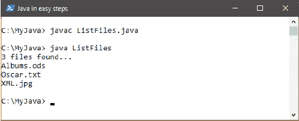

### 读取控制台输入

`java.io` 包允许程序从命令行读取输入——与用户进行交互。就像 `System.out` 字段可以将输出发送到命令行一样，`System.in` 字段可以配合 `InputStreamReader` 对象从命令行读取内容。这以字节形式读取输入，并将其转换为代表 Unicode 字符值的整数值。

为了读取整行输入文本，`BufferedReader` 对象的 `readLine()` 方法会读取由 `InputStreamReader` 解码的字符。该方法必须在 `try catch` 语句内部调用，以捕获任何 `IOException` 问题。

通常，`readLine()` 方法会将输入赋值给 `String` 变量，以便程序处理。

启动新程序，导入所有 `java.io` 类的功能

```java
import java.io.* ;
```


ReadString.java

添加一个名为“ReadString”的类，包含标准的 main 方法

```java
class ReadString {

    public static void main( String[] args ) { }

}
```

在 main 方法的大括号之间，插入一条语句来提示用户输入

```java
System.out.print( "Enter the title of this book: " ) ;
```

添加一条创建 `InputStreamReader` 对象的语句，能够从命令行读取输入

```java
InputStreamReader isr = new InputStreamReader( System.in ) ;
```

创建一个 `BufferedReader` 对象来读取解码后的输入

```java
BufferedReader buffer = new BufferedReader( isr ) ;
```

声明并初始化一个空的 `String` 变量，用于存储输入

```java
String input = "" ;
```

添加一个 `try catch` 语句从命令行读取输入并存储在变量中

```java
try {

    input = buffer.readLine() ;

    buffer.close() ;

} catch ( IOException e ) {

    System.out.println( "An input error has occurred" ) ;

}
```

输出包含存储值的的消息

```java
System.out.println( "\nThanks, you are reading " + input ) ;
```

将程序保存为 `ReadString.java`，然后编译并运行程序

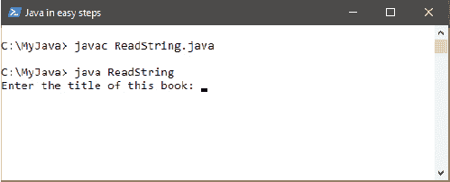

按照提示输入文本，然后按回车键查看包含你输入文本输出的消息


在不再需要 `BufferedReader` 对象时调用其 `close()` 方法是一个良好的习惯。

### 读取文件

`java.io` 包包含一个名为 `FileReader` 的类，专门用于读取文本文件。该类是 `InputStreamReader` 类的子类，可读取文本文件。

打开编辑器（如记事本），并写几行文本——例如奥斯卡·王德华《奥丁监狱歌》中一段著名的诗句

启动新程序，导入所有 `java.io` 类的功能

```java
import java.io.* ;
```


ReadFile.java

添加一个名为“ReadFile”的类，包含标准的 main 方法

```java
class ReadFile {

    public static void main( String[] args ) { }

}
```

在 main 方法的大括号之间，插入一个 `try catch` 语句

```java
try {

} catch ( IOException e ) {

    System.out.println( "A read error has occurred" ) ;

}
```

在 `try` 块的大括号之间，插入一条语句创建一个 `FileReader` 对象

```java
FileReader file = new FileReader( "Oscar.txt" ) ;
```

创建一个 `BufferedReader` 对象来读取文件

```java
BufferedReader buffer = new BufferedReader( file ) ;
```

添加一个循环将文本文件内容读取到变量并输出每行文本

```java
while ( ( line = buffer.readLine() ) != null ) {

    System.out.println( line ) ;

}
```

记住不再需要时关闭 `BufferedReader` 对象

```java
buffer.close() ;
```

将程序保存为 `ReadFile.java` 与文本文件放在一起，然后编译并运行程序以查看输出

`BufferedWriter` 对象通过 `new` 关键字创建，并以 `FileWriter` 对象的名称作为其参数。然后可以使用 `BufferedWriter` 对象的 `write()` 方法写入文本，并通过调用其 `newLine()` 方法来分隔行。这些方法应该在 `try catch` 语句内部调用，以捕获可能出现的任何 `IOException` 问题。

如果已存在一个名为指定名称的文件，其内容将通过 `write()` 方法覆盖，否则将创建一个该名称的新文件并写入其内容。

启动一个新程序，导入所有 `java.io` 类的功能。

```java
import java.io.* ;
```


WriteFile.java

添加一个名为“WriteFile”的类，包含标准的 main 方法

```java
class WriteFile {

    public static void main ( String[] args ) { }

}
```

在 main 方法的大括号之间插入一个 `try catch` 语句

```java
try {

}

catch ( IOException e ) {

    System.out.println( "A write error has occurred" ) ;

}
```

在 `try` 块的大括号之间插入一个语句，为名为“Tam.txt”的文本创建一个 `FileWriter` 对象

```java
FileWriter file = new FileWriter( "Tam.txt" ) ;
```

创建一个 `BufferedWriter` 对象来写入文件

```java
BufferedWriter buffer = new BufferedWriter( file ) ;
```

添加语句向文本文件写入文本行和换行符——例如罗伯·伯斯《Tam O’Shanter》中的译文诗句

```java
buffer.write( "The wind blew as if it had blown its last" ) ;

buffer.newLine() ;

buffer.write( "The rattling showers rose on its blast" ) ;

buffer.newLine() ;

buffer.write( "The speedy gleams the darkness swallowed" ) ;

buffer.newLine() ;

buffer.write( "Loud, deep and long the thunder bellowed" ) ;

buffer.newLine() ;

buffer.write( "That night a child might understand" ) ;

buffer.newLine() ;

buffer.write( "The devil had business on his hand." ) ;
```

记住在不再需要时关闭 `BufferedWriter` 对象

```java
buffer.close() ;
```

将程序保存为 `WriteFile.java`，然后编译并运行程序，以在程序旁边写入文本文件


你可以调用 `BufferedWriter` 对象的 `append()` 方法来添加文本——而不是使用 `write()` 方法覆盖文本。

### 排序数组元素

Java 包含一个名为 `java.util` 的包，它提供了处理数据集合的实用实用程序。通过在 `.java` 文件的最开头包含 `import` 语句，可以使程序可以使用包。在 `import java.util.* ;` 语句中，可以使用通配符来表示“所有类”。

`java.util` 包有一个名为“Arrays”的类，它包含可以用于操作数组的方法。通过导入 `java.util` 包中的所有类，或者在程序仅需要单个类时通过 `import` 语句仅导入该特定类，可以使功能对程序可用。例如，程序可以使用 `import java.util.Arrays ;` 语句导入 `Arrays` 类。

`Arrays` 类有一个 `sort()` 方法，可以按字母和数字顺序重新排列数组元素的内容。

启动一个新程序，导入 `java.util.Arrays` 类中所有方法的功能

```java
import java.util.Arrays ;
```


Sort.java

添加一个名为“Sort”的类，包含标准的 main 方法

```java
class Sort {

    public static void main( String[] args ) { }

}
```

在 main 方法之后，插入一个方法来显示传递的 `String` 数组的所有元素内容

```java
public static void display( String[] elems ) {

    System.out.println( "\nString Array:" ) ;

    for ( int i = 0 ; i < elems.length ; i++ )

        System.out.println( "Element " + i + " is " + elems[i] ) ;

}
```

添加一个重载的 `display()` 方法以显示传递的 `int` 数组的所有元素内容

```java
public static void display( int[] elems ) {

    System.out.println( "\nInteger Array:" ) ;

    for ( int i = 0 ; i < elems.length ; i++ )

        System.out.println( "Element " + i + " is " + elems[i] ) ;

}
```


关于方法重载的更多信息请参见此处。

在 main 方法的大括号之间，声明并初始化 `String` 数组和 `int` 数组

```java
String[] names = { "Mike" , "Dave" , "Andy" } ;

int[] nums = { 200 , 300 } ;
```

输出每个数组中的所有元素

```java
display( names ) ;

display( nums ) ;
```

对两个数组进行排序

```java
Arrays.sort( names ) ;

Arrays.sort( nums ) ;
```

输出每个数组中的所有元素

```java
display( names ) ;

display( nums ) ;
```


将程序保存为 `Sort.java`，然后编译并运行程序查看输出。


示例中的 `for` 循环只有一个语句，因此不需要括号——但为了清晰可以添加。

### 数组列表

`java.util` 包包含一个名为 `ArrayList` 的类，它以有序的“集合”（可调整序列）存储数据。通过导入特定类 `util.ArrayList` 可以使其程序可用。列表可以包含重复元素，`ArrayList` 对象允许通过指定索引来操作存储的值。例如，列表的方法调用 `get(0)` 将检索存储在第一个元素的值，而 `remove(1)` 将删除第二个列表元素。

可以通过指定索引号和新值作为 `set()` 方法的参数来修改元素值。可以通过指定索引号和值作为 `add()` 方法的参数向特定位置添加元素。列表通过移动元素值来适应额外的元素。


你可以通过调用 `size()` 方法发现列表当前有多少个元素。

`ArrayList` 对象只需使用 `new` 关键字创建，但与其他 Java 集合一样，语句必须指定列表可能包含泛型类型。通常，列表包含 `String` 项目，因此 `ArrayList` 必须带有 `<String>` 后缀。

集合（如 `ArrayList`）有一个 `forEach()` 方法可以遍历列表中的每个元素。这使得遍历包含的所有项目变得简单。

通过指定“Lambda 表达式”作为 `forEach()` 方法的参数，可以方便地引用每个存储的列表项。Lambda 表达式只是短匿名（未命名）方法，可以在执行的位置指定。它们以括号开始，包含任何参数，然后是 `->` 字符序列，最后是语句块。

参数的数据类型可以显式声明，也可以从上下文中推断——`(String x)` 可以简单为 `(x)`。此外，如果 Lambda 表达式语句块只包含一个语句，可以省略大括号。

通过列表的 `forEach()` 方法，迭代中的当前元素值可以作为参数传递给 lambda 表达式，然后通过语句在输出中显示。


Lambda 表达式在 Java 8 中引入，以实现简洁的匿名方法。


启动一个新程序，导入 `java.util.ArrayList` 类中所有方法的功能。

```java
import java.util.ArrayList ;
```


Lists.java


添加一个名为“Lists”的类，包含标准的 main 方法。

```java
class Lists
{
    public static void main( String[] args ) { }
}
```


在 main 方法的大括号之间插入一条语句创建一个名为“list”的 `String ArrayList` 对象。

```java
ArrayList<String> list = new ArrayList<String>() ;
```


接下来，添加语句用 `String` 值填充列表元素，然后显示整个列表。

```java
list.add( “Alpha” ) ;
list.add( “Delta” ) ;
list.add( “Charlie” ) ;
System.out.println( “List: ” + list ) ;
```


现在，识别第二个元素的当前值，然后将其替换为新的 `String`。

```java
System.out.println( “Replacing: ” + list.get(1) + “\n” ) ;
list.set( 1, “Bravo” ) ;
```


最后，遍历列表并显示现在存储在每个元素中的 `String` 值。

```java
list.forEach( ( x ) -> System.out.println( “Item: “ + x ) ) ;
```


将程序保存为 `Lists.java`，然后编译并运行程序查看输出。


与普通数组一样，`ArrayList` 中的元素具有从零开始的索引。


此处引入的图形化 Java Swing `JComboBox` 组件包含选项列表，因此在创建该对象时也必须指定其泛型数据类型。

### 管理日期

`java.time` 包包含一个名为 `LocalDateTime` 的类，它具有实用的方法可以从描述特定时间的 `LocalDateTime` 对象中提取特定字段。可以通过 `import java.time.LocalDateTime;` 导入特定类，或者使用通配符 `import java.time.* ;` 导入此包中的所有类来供程序使用。


`java.time` 包在 Java 8 中引入，以便于处理日期和时间。

可以使用 `now()` 方法创建一个带有当前日期和时间字段的新 `LocalDateTime` 对象。这些字段根据当前本地的系统时钟初始化。

可以使用 `LocalDateTime` 对象的适当方法获取单个字段中的值。例如，可以使用 `getYear()` 方法获取年份字段的值。同样，可以使用 `LocalDateTime` 对象的适当方法更改任何字段以指定替换值。例如，可以通过将新的年份值作为参数传递给 `withYear()` 方法来更改年份字段的值。


启动一个新程序，导入 `java.time.LocalDateTime` 类中所有方法的功能。

```java
import java.time.LocalDateTime ;
```


DateTime.java


添加一个名为“DateTime”的类，包含标准的 main 方法。

```java
class DateTime
{
    public static void main ( String [] args ) { }
}
```


在 main 方法的大括号之间插入一条语句创建一个当前的 `LocalDateTime` 对象。

```java
LocalDateTime date = LocalDateTime.now() ;
```


输出当前的日期和时间细节。

```java
System.out.println( “\nIt is now ” + date ) ;
```


增加年份，并输出修改后的日期时间。

```java
date = date.withYear( 2019 ) ;
System.out.println( “\nDate is now ” + date ) ;
```


输出修改后的日期的单个 `LocalDateTime` 字段。

```java
String fields = “\nYear:\t\t\t” + date.getYear() ;
fields += “\nMonth:\t\t\t” + date.getMonth() ;
fields += “\nMonth Number:\t\t” + date.getMonthValue() ;
fields += “\nDay:\t\t\t” + date.getDayOfWeek() ;
fields += “\nDay:\t\t\t” + date.getDayOfMonth() ;
fields += “\nDay:\t\t\t” + date.getDayOfYear() ;
fields += “\nHour (23):\t” + date.getHour() ;
fields += “\nMinute:\t\t” + date.getMinute() ;
fields += “\nSecond:\t\t” + date.getSecond() ;
System.out.println(fields) ;
```


将程序保存为 `DateTime.java`，然后编译并运行程序查看输出。


添加语句输出带有百分号的数字。

```java
NumberFormat pf = NumberFormat.getPercentInstance() ;
System.out.println( “\nPercent: “ + pf.format( 0.75f ) ) ;
```


添加一个创建当前 `LocalDateTime` 对象的语句。

```java
java.time.LocalDateTime now = java.time.LocalDateTime.now() ;
```


添加语句输出格式化后的数值日期。

```java
DateTimeFormatter df = DateTimeFormatter.ofPattern( “MMM d, yyy” ) ;
System.out.println( “\nDate: “ + now.format( df ) ) ;
```


添加语句输出格式化后的数值时间。

```java
DateTimeFormatter tf = DateTimeFormatter.ofPattern( “h:m a” ) ;
System.out.println( “\nTime: “ + now.format( tf ) ) ;
```


将程序保存为 `Formats.java`，然后编译并运行程序以查看格式化输出。


语句可以使用其完整包地址来引用未导入的类——如此处创建 `LocalDateTime` 对象的语句所示。


模式字母对大小写敏感的——请参考文档以了解可能模式的完整细节。

## 总结

- 程序开头可以包含一个或多个 `import` 语句，以使其他类的功能可用。
- `import` 语句可以使用通配符字符导入包中的所有类，也可以通过类名导入单个类。
- `java.io` 包包含设计用于处理输入和输出过程的类。
- `File` 对象可以用于访问文件和目录。
- `InputStreamReader` 对象将输入字节解码为字符，而 `BufferedReader` 读取其解码后的字符。
- `FileReader` 对象可以将文本文件字节解码为字符，以供 `BufferedReader` 对象读取。
- `FileWriter` 对象和 `BufferedWriter` 对象可以创建和更新文本文件。
- `java.util` 包包含处理数据集合的工具，例如使用其 `Arrays` 类进行数组操作。
- `java.util` 包还包含一个 `ArrayList` 类，它拥有可以轻松操作顺序列表项的方法。
- `ArrayList` 对象是一个集合，它必须指定列表可能包含的的泛型类型，例如 `<String>`。
- Lambda 表达式是一个匿名方法，可以在需要执行的地方指定。
- `java.time` 包包含一个 `LocalDateTime` 类，该类提供了日期和时间组件的字段。
- `java.text` 包包含一个 `NumberFormat` 类，它可以格式化数字和货币。
- `java.time.format` 包包含一个 `DateTimeFormatter` 类，它可以指定用于格式化日期和时间的模式。

## 构建界面

*本章演示了如何使用 Java Swing 组件创建图形程序界面。*

- 创建窗口
- 添加推按钮
- 添加标签
- 添加文本字段
- 添加项目选择器
- 添加单选按钮
- 排列组件
- 更改外观
- 总结

## 创建窗口

程序可以使用 Java 库中的“Swing”组件提供图形用户界面 (GUI)。`javax.swing` 包包含用于使用原生操作系统样式创建各种组件的类。通过在程序包含初始语句 `import javax.swing.*;`，可以让这些类对程序可用。

必须创建一个类来表示 GUI，并可以向其中添加组件以构建界面。通过使用 `extends` 关键字将其声明为 Swing 的 `JFrame` 类的子类可以轻松实现——从而继承允许用户移动、调整大小和关闭窗口的属性和行为。


通过想 `JAVA` e`Xtra` 来记住 `javax.swing` 中的字母 `x`。

类构造函数应该包含设置这些硬性要求的语句：

- 窗口标题——作为继承自 `JFrame` 类 `super()` 方法的 `String` 参数指定。
- 窗口大小——以像素宽度和高度作为其 `setSize()` 方法的参数指定。
- 当用户关闭窗口时要做什么——作为其 `setDefaultCloseOperation()` 方法的常量参数指定。
- 显示窗口——作为其 `setVisible()` 方法的布尔参数指定。

此外，构造函数可以向窗口添加一个 `JPanel` 容器组件，可以使用 `JFrame` 类的继承方法 `add()` 在其中添加更小的组件。

默认情况下，`JPanel` 容器采用 `FlowLayout` 布局管理器，该布局器从左到右行排列组件，并在窗口右边缘处换行。

相反的步骤描述了如何创建一个包含带有 `FlowLayout` 布局管理器的 `JPanel` 容器的基本窗口。该窗口将出现在书中随后的示例中，这些示例演示了如何添加组件。


布局管理器的详细说明请见 chapter08.html_sec72。


启动一个导入所有 Swing 的程序。

```java
import javax.swing.* ;
```


创建一个名为“Window”的 `JFrame` 类子类，包含主方法。

```java
class Window extends JFrame {
    public static void main ( String[] args ) {
    }
}
```


在主方法之前，创建一个 `JPanel` 容器。

```java
JPanel pnl = new JPanel() ;
```


接下来，插入此构造方法以指定窗口并将 `JPanel` 对象添加到 `JFrame`。

```java
public Window() {
    super( “Swing Window” ) ;
    setSize( 500 , 200 ) ;
    setDefaultCloseOperation( EXIT_ON_CLOSE ) ;
    add( pnl ) ;
    setVisible( true ) ;
}
```


通过在主方法中插入此行创建 Window 类实例。

```java
Window gui = new Window() ;
```


将程序保存为 `Window.java`，然后编译并运行程序以看到基本窗口出现。


`EXIT_ON_CLOSE` 操作是 `JFrame` 类的一个常量。它在窗口关闭时退出程序。


注意此处如何使用 `add()` 方法将 `JPanel` 对象添加到 `JFrame` 窗口。

## 添加推按钮

Swing `JButton` 类创建一个可以添加到图形界面的推按钮组件。这使用户可以通过点击按钮执行执行操作来与程序交互。

`JButton` 对象使用 `new` 关键字创建，其构造函数接受一个 `String` 参数，指定显示在按钮上的文本。

图像也可以出现在按钮上。必须先创建一个 `ImageIcon` 对象来表示图像，通过作为其构造函数的参数指定图像文件名。通常，图像将位于程序旁边，但参数可以包含本地目录之外的图像路径。


创建用于响应用户操作（如点击按钮）的事件处理方法的细节可以在下一章找到。

指定 `ImageIcon` 对象的名称作为 `JButton` 构造函数的参数，以便按钮上显示该图像，或指定 `String` 和 `ImageIcon` 作为其两个参数，以便同时显示文本和图像。


从此处复制 `Window.java` 的副本，将声明、构造函数和实例语句中的类名从“Window”更改为“Buttons”。


Buttons.java


在 `Buttons()` 构造函数之前，创建两个 `ImageIcon` 对象。

```java
ImageIcon tick = new ImageIcon( “Tick.png” ) ;
ImageIcon cross = new ImageIcon( “Cross.png” ) ;
```


接下来，创建三个 `JButton` 对象分别显示文本、图像以及文本和图像。

```java
JButton btn = new JButton("Click Me");
JButton tickBtn = new JButton(tick);
JButton crossBtn = new JButton("STOP", cross);
```


在 `Buttons()` 构造函数内部，插入三条语句将 `JButton` 组件添加到 `JPanel` 容器中。

```java
pnl.add(btn);
pnl.add(tickBtn);
pnl.add(crossBtn);
```


将程序保存为 `Buttons.java`，然后编译并运行程序以在窗口中显示推按钮。


`JPanel` 对象有一个 `add()` 方法 —— 用于向该面板添加组件。


有关如何创建 Java 存档 (JAR) 的详情可以在此处 Find。

按钮在点击时会有图形化响应，但在程序提供事件处理方法来响应每个点击事件之前，它们不会执行任何操作。

如果程序打算部署在单个 Java 存档 (JAR) 中，必须在创建表示它们的 `ImageIcon` 对象之前，通过 `ClassLoader` 对象加载图像资源。

向 `ClassLoader` 的 `getResource()` 方法指定资源文件名或路径会返回一个 `URL`，该 URL 可以用作 `ImageIcon` 构造函数的参数。`java.net` 包提供了一个实用的 `URL` 类，可以先赋值给这些对象。


在 `Buttons()` 构造函数之前，创建一个 `ClassLoader` 对象。

```java
ClassLoader ldr = this.getClass().getClassLoader();
```


加载图像资源的 URL。

```java
java.net.URL tickURL = ldr.getResource("Tick.png");
java.net.URL crossURL = ldr.getResource("Cross.png");
```


修改第 2 步中的 `ImageIcon()` 构造函数以使用 URL。

```java
ImageIcon tick = new ImageIcon(tickURL);
ImageIcon cross = new ImageIcon(crossURL);
```


保存更改，重新编译并运行程序 —— 它将像以前一样运行，但现在可以部署到 JAR 中。


注意此处是如何使用 `getClass()` 方法和 `this` 关键字来引用此类对象的。

### 添加标签

Swing 的 `JLabel` 类创建一个可以添加到图形界面上的标签组件。它可以用于显示非交互式文本、图像或文本和图像。

`JLabel` 对象使用 `new` 关键字创建，其构造函数接受一个 `String` 参数，指定要在该标签上显示的文本，或者表示要显示图像的 `ImageIcon` 对象的名称。它还可以接受三个参数，指定文本、图像以及作为 `JLabel` 常量值的水平对齐方式。例如，`JLabel("text", img, JLabel.CENTER)` 居中对齐。

当 `JLabel` 对象同时包含文本和图像时，可以通过指定 `JLabel` 常量作为 `JLabel` 对象的 `setVerticalPosition()` 和 `setHorizontalPosition()` 方法的参数来确定文本的相对位置。

此外，通过为对象的 `setToolTipText()` 方法指定文本 `String` 参数，可以让 `JLabel` 对象在光标悬停在其上方时显示提示。


从此处复制 `Window.java` 的副本，将声明、构造函数和实例语句中的类名从“Window”更改为“Labels”。


Labels.java


在 `Labels()` 构造函数之前，创建一个 `ImageIcon` 对象。

```java
ImageIcon duke = new ImageIcon("Duke.png");
```


接下来，创建三个 `JLabel` 对象分别显示图像、文本以及文本和图像。

```java
JLabel lbl1 = new JLabel(duke);
JLabel lbl2 = new JLabel("Duke is the friendly mascot of Java technology.");
JLabel lbl3 = new JLabel("Duke", duke, JLabel.CENTER);
```


在 `Labels()` 构造函数内部，插入此语句为第一个标签创建一个提示。

```java
lbl1.setToolTipText("Duke - Mascot");
```


添加这两条语句使第三个标签居中对齐并位于底部。

```java
lbl3.setHorizontalPosition(JLabel.CENTER);
lbl3.setVerticalPosition(JLabel.BOTTOM);
```


现在添加三条语句将 `JLabel` 组件添加到 `JPanel` 容器中。

```java
pnl.add(lbl1);
pnl.add(lbl2);
pnl.add(lbl3);
```


将程序保存为 `Labels.java`，然后编译并运行程序，将光标放在第一个标签上。


`JLabel` 对齐常量包括 `LEFT`、`CENTER`、`RIGHT`、`TOP` 和 `BOTTOM`。

如果程序打算部署在单个 Java 存档 (JAR) 中，必须在创建表示它的 `ImageIcon` 对象之前，通过 `ClassLoader` 对象加载资源。


在 `Labels()` 构造函数之前，创建一个 `ClassLoader` 对象。

```java
ClassLoader ldr = this.getClass().getClassLoader();
```


修改第 2 步中的 `ImageIcon()` 构造函数，使用 `ClassLoader` 对象加载图像资源的 URL。

```java
ImageIcon duke = new ImageIcon(ldr.getResource("Duke.png"));
```


保存更改，重新编译并运行程序 —— 它将像以前一样运行，但现在可以部署到 JAR 中。


### 添加文本字段

Swing 的 `JTextField` 类创建一个可以添加到图形界面上的单行文本字段组件。它可以用于显示可编辑文本，并允许用户输入文本以与程序交互。

`JTextField` 对象使用 `new` 关键字创建，其构造函数可以接受一个 `String` 参数，指定要在字段中显示的默认文本。在这种情况下，组件的大小将根据该 `String` 的长度进行调整。或者，参数可以是一个数值，用于指定文本字段的大小。构造函数还可以接受两个参数，同时指定默认文本和文本字段的大小。

在需要输入字符不可见的情况下，使用 `JPasswordField` 类代替 `JTextField` 类。

多行文本字段可以使用 `JTextArea` 类创建，其构造函数接受两个数值参数，分别指定其行数和宽度。或者，也可以提供三个参数，指定默认文本、行数和宽度。通过为 `JTextArea` 对象的 `setLineWrap()` 方法和 `setWrapStyleWord()` 方法指定 `true` 作为参数，可以使该字段内在单词末尾自动换行。

当输入到 `JTextArea` 组件的文本超过其初始大小时，组件将扩展以容纳这些文本。要使组件具有具有滚动能力的固定大小，可以将其放置在 `JScrollPane` 容器中。这可以通过 `new` 关键字创建，并以 `JTextArea` 的名称作为其参数。

默认情况下，滚动条仅在字段包含超过其初始大小的文本时才会出现 —— 但通过向 `JScrollPane` 对象的 `setVerticalScrollBarPolicy()` 或 `setHorizontalScrollBarPolicy()` 方法（其命名非常直观）传递 `JScrollPane` 常量作为参数，可以使其始终出现。例如，要始终显示垂直滚动条，请使用 `JScrollPane.VERTICAL_SCROLLBAR_ALWAYS` 常量作为参数。


从这里编辑 `Window.java` 的副本，将声明、构造函数和实例语句中的类名从“Window”更改为“TextFields”。


TextFields.java


在 `TextFields()` 构造函数之前，创建两个 `JTextField` 对象。

```java
JTextField txt1 = new JTextField(38);
JTextField txt2 = new JTextField("Default Text", 38);
```


创建一个五行高的 `JTextArea` 对象。

```java
JTextArea txtArea = new JTextArea(5, 37);
```


添加一个 `JScrollPane` 对象 —— 用于包含第 3 步中创建的 `JTextArea`。

```java
JScrollPane pane = new JScrollPane(txtArea);
```


在 `TextFields()` 构造方法中，插入语句使 `JTextArea` 对象能够在单词末尾换行。

```java
txtArea.setLineWrap(true);
txtArea.setWrapStyleWord(true);
```


插入一条语句，为 `JTextArea` 对象始终显示垂直滚动条。

```java
pane.setVerticalScrollBarPolicy(JScrollPane.VERTICAL_SCROLLBAR_ALWAYS);
```


插入两条语句，将 `JTextField` 组件添加到 `JPanel` 容器中。

```java
pnl.add(txt1);
pnl.add(txt2);
```


插入另一条语句，将包含 `JTextArea` 字段的 `JScrollPane` 容器添加到 `JPanel` 容器中。

```java
pnl.add(pane);
```


将程序保存为 `TextFields.java`，然后编译并运行程序，在文本区域输入一些文本。


除非 `JTextArea` 组件位于 `JScrollPane` 组件内部，否则它没有滚动能力。

### 添加选择器

Swing `JCheckBox` 类创建一个可以添加到图形界面的复选框组件。这可以用于允许用户选择或取消选择单个项目。

`JCheckBox` 对象通过 `new` 关键字创建，其构造函数接受一个 `String` 参数，用于指定在该复选框旁边显示的文本。它还可以接受第二个 `true` 参数，以使复选框默认被选中。

`JComboBox` 类可以提供一组项目选择，它创建一个下拉列表，用户可以从列表中选择任何单个项目。该对象通过 `new` 关键字创建，其构造函数通常接受一个 `String` 数组作为参数。数组中的每个元素都为下拉列表提供一个供选择的项目。

同样，`JList` 类也可以提供一组项目选择，它创建一个固定大小的列表，用户可以从中选择一个或多个项目。它通过 `new` 关键字创建，其构造函数也接受数组作为参数，每个元素提供一个供选择的项目。由于 `JList` 和 `JComboBox` 都是集合，它们必须指定它们包含的泛型类型，例如 `<String>`。


从这里编辑 `Window.java` 的副本，将声明、构造函数和实例语句中的类名从“Window”更改为“Items”。


Items.java


在 `Items()` 构造函数之前，创建一个用于选择的项目的 `String` 数组。

```java
String[] toppings = {"Pepperoni", "Mushroom", "Ham", "Tomato"};
```


接下来，创建四个 `JCheckBox` 对象来展示数组中的每个项目供选择 —— 其中一个默认被选中。

```java
JCheckBox chk1 = new JCheckBox(toppings[0]);
JCheckBox chk2 = new JCheckBox(toppings[1], true);
JCheckBox chk3 = new JCheckBox(toppings[2]);
JCheckBox chk4 = new JCheckBox(toppings[3]);
```


添加第二个用于选择的项目 `String` 数组。

```java
String[] styles = {"Deep Dish", "Gourmet Style", "Thin & Crispy"};
```


创建一个 `JComboBox` 对象，展示第二个数组中的每个项目供选择。

```java
JComboBox<String> box1 = new JComboBox<String>(styles);
```


添加一个 `JList` 对象，从列表中展示第一个数组中的每个项目供选择。

```java
JList<String> lst1 = new JList<String>(toppings);
```


在 `Items()` 构造方法中，插入语句将每个 `JCheckBox` 组件添加到 `JPanel` 容器。

```java
pnl.add(chk1);
pnl.add(chk2);
pnl.add(chk3);
pnl.add(chk4);
```


插入语句设置默认选择并将 `JComboBox` 组件添加到 `JPanel` 容器。

```java
box1.setSelectedIndex(0);
pnl.add(box1);
```


现在，插入一条语句将 `JList` 组件添加到 `JPanel` 容器。

```java
pnl.add(lst1);
```


将程序保存为 `Items.java`，然后编译并运行程序，从列表中选择项目。


`JComboBox` 组件只能选择一个项目 —— `JList` 组件可以选择多个项目。


### 添加单按钮

Swing `JRadioButton` 类创建一个可以添加到图形界面的单按钮组件。这可以用于允许用户从单按钮组中选择项目。

`JRadioButton` 对象通过 `new` 关键字创建，其构造函数接受一个 `String` 参数，用于指定在该单按钮旁边显示的文本。它还可以接受第二个 `true` 参数，以使单按钮默认被选中。

`ButtonGroup` 对象逻辑上对一组单按钮进行分组，使得组内只有一个按钮被选中。通过指定名称作为组 `add()` 方法的参数，可以将每个单按钮添加到 `ButtonGroup` 对象。


在 `Radios()` 构造函数之前，创建三个 `JRadioButton` 对象 —— 其中一个默认被选中。


```java
JRadioButton rad1 = new JRadioButton("Red", true);
JRadioButton rad2 = new JRadioButton("Rosé");
JRadioButton rad3 = new JRadioButton("White");
```


接下来，创建一个 `ButtonGroup` 对象以便对单按钮进行分组：

```java
ButtonGroup wines = new ButtonGroup();
```


在 `Radios()` 构造方法中，插入语句将每个 `JRadioButton` 组件添加到 `JPanel` 容器：

```java
wines.add(rad1);
wines.add(rad2);
wines.add(rad3);
```

## 排版组件

`java.awt` 包（抽象窗口）包含许多布局管理器类，可以使用它们将不同的方式放置在容器中。使用 `new` 关键字创建布局管理器对象，然后可以将其作为 `JPanel` 构造函数的参数，以便让面板使用该布局。当组件被添加到面板时，它们将根据指定布局管理器的规则进行放置。

| 布局管理器 | 规则 |
| :--- | :--- |
| `BorderLayout` | 将组件放置在北、南、东、中位置（内容面板的默认布局） |
| `BoxLayout` | 放置在单行或单列中 |
| `CardLayout` | 在不同时间将不同的组件放置在指定区域 |
| `FlowLayout` | 从左到右在换行行内放置（`JPanel` 的默认布局） |
| `GridBagLayout` | 在单元格网格中放置，允许组件跨越单元格 |
| `GridLayout` | 在行和列网格中放置 |
| `GroupLayout` | 在水平和垂直方向上放置 |
| `SpringLayout` | 通过间距放置 |

顶层 `JFrame` 对象有一个“内容面板”容器，它默认使用 `BorderLayout` 布局管理器放置组件。这可以用来放置多五个 `JPanel` 容器，每个面板可以使用它们默认的 `FlowLayout` 布局管理器，或上述的任何一种布局管理器。使用多种布局管理器可以满足大多数布局需求。

内容面板可以用 `java.awt.Container` 对象表示，其 `add()` 方法可以指定要放置在内容面板内的组件的位置和名称。


你可以在 Java 文档的 `java.awt` 部分找到每个布局管理器的更多详细信息。


## 更改外观

从这里复制 `Window.java` 的副本，将类声明、构造函数和实例从“Window”更改为“Layout”，然后在程序开头添加一条语句来导入 `java.awt` 包的功能：

```java
import java.awt.*;
```


Layout.java


在 `Layout()` 构造函数之前，创建一个代表 `JFrame` 内容面板容器的 `Container` 对象：

```java
Container contentPane = getContentPane();
```


使用 `GridLayout` 布局管理器创建一个 2 x 2 网格的第二个 `JPanel` 对象：

```java
JPanel grid = new JPanel(new GridLayout(2, 2));
```


在 `Layout()` 构造方法中，插入语句向两个 `JPanel` 对象中添加 `JButton` 组件：

```java
pnl.add(new JButton("Yes"));
pnl.add(new JButton("No"));
pnl.add(new JButton("Cancel"));
grid.add(new JButton("1"));
grid.add(new JButton("2"));
grid.add(new JButton("3"));
grid.add(new JButton("4"));
```


现在，插入语句将两个面板和按钮添加到内容面板中：

```java
contentPane.add("North", pnl);
contentPane.add("Center", grid);
contentPane.add("West", new JButton("West"));
```


将程序保存为 `Layout.java`，然后编译并运行程序查看组件布局。


虽然 `FlowLayout` 保持 `JButton` 的大小，但其他布局管理器会扩展组件以填充它们的布局设计。

`ButtonGroup` 对象仅在逻辑上对按钮分组，而不是在物理上分组。


### JLabel 组件

有关如何创建事件处理方法来响应用户操作的细节可以在下一章找到。

注意 `JLabel` 的背景是透明的，因此应该调用 `setOpaque()` 方法将不透明度设置为 `true`。


之前的页面演示了最常用的 Swing 组件——`JButton`、`JLabel`、`JTextField`、`JComboBox`、`JList`。`javax.swing` 包中还有许多专用组件——`JSlider`、`ProgressBar` 和 `JMenuBar`。

尝试使用 Java 文档为 `Radios` 程序添加一个 `JSlider` 组件——参阅这里 获取如何使用文档的详细信息。

```java
box.add(lbl1); box.add(lbl2); box.add(lbl3);
```


然后，将布局容器添加到 `JPanel` 容器中：

```java
pnl.add(box);
```


将程序保存为 `Custom.java`，然后编译并运行程序以查看效果。


在这种情况下，自定义颜色等于 `Color.RED`，因为 RGB 值指定了最大红色值而没有绿色或蓝色。


`Box` 对象是一个方便的轻量级容器，它使用 `BoxLayout` 作为其布局管理器。`Box` 对象的 `createVerticalBox()` 方法会从上到下单独显示其组件。

## 总结

- `javax.swing` 包包含了用于创建 GUI 组件的 Java Swing 类。
- 窗口作为顶层 `JFrame` 容器创建。
- `JFrame` 构造函数应该指定窗口的标题、大小、默认关闭操作和可见性。
- `JPanel` 容器使用其默认的 `FlowLayout` 布局管理器在换行中显示较小的组件。
- `JButton` 构造函数可以指定显示在推入按钮组件上的文本和图像。
- `ImageIcon` 对象表示程序中使用的图像。
- 要部署为单个 Java 归档 (JAR) 的程序应使用 `ClassLoader` 对象来指定图像源。
- `JLabel` 对象显示非交互式文本和图像内容。
- 可编辑文本可以现在 `JTextField` 和 `JTextArea` 字段中。
- `JScrollPane` 对象为 `JTextArea` 字段提供滚动条。
- 可以 `JCheckBox`、`JComboBox` 和 `JList` 组件显示选择项。
- `ButtonGroup` 对象逻辑上对若干 `JRadioButton` 组件分组，以便只有一个一个可以被选中。
- 特定的 RGB 颜色可以通过 `java.awt` 包中的 `Color` 类表示。
- `java.awt` 包有一个 `Font` 类，可以用于创建表示特定字体名称、样式和大小的对象。
- 可以使用 `java.awt` 包中的 `Container` 类表示 `JFrame` 的内容面板，向 `JFrame` 容器添加多个 `JPanel` 容器。
- 创建 `JPanel` 容器对象时，其参数可以指定布局管理器。

---

### 识别事件

*本章演示了如何创建 Java 程序事件处理器，以响应用户界面操作。*

- 监听事件
- 生成事件
- 处理按钮事件
- 处理项目事件
- 响应键盘事件
- 响应鼠标事件
- 发布消息
- 请求输入
- 总结

### 监听事件

用户可以通过执行鼠标、键盘或其他输入设备的操作来与提供图形用户界面 (GUI) 的程序进行交互。这些操作会导致界面中发生“事件”，让程序响应这些事件被称为“事件处理”。

为了让程序识别用户事件，它需要添加来自 `java.awt.event` 包的一个或多个 `EventListener` 接口。可以通过在程序开头添加初始语句 `import java.awt.event.* ;` 使这些接口对程序可用。

可以使用 `implements` 关键字在类声明中包含所需的 `EventListener` 接口。例如，一个监听按钮点击的类声明可能如下所示：

```java
class Click extends JFrame implements ActionListener { }
```

Java 文档描述了许多可以监听不同事件的 `EventListener` 接口，但最常用的列在下表所示，并附有简要描述：

| EventListener | 描述 |
| :--- | :--- |
| `ActionListener` | 识别当按钮被按下或释放时发生的动作事件 |
| `ItemListener` | 识别当列表项被选中或取消选中时发生的项目事件 |
| `KeyListener` | 识别当用户按下或释放按键时发生的键盘事件 |
| `MouseListener` | 识别当用户按下或释放鼠标按钮，以及鼠标进入或退出组件时发生的鼠标按钮动作 |
| `MouseMotionListener` | 识别当用户移动鼠标时发生的运动事件 |


可以在 `implements` 关键字之后以逗号分隔列表的形式包含多个 `EventListener`。

### 生成事件

如果组件要有用，它们需要生成 `EventListener` 接口可以识别的事件。在如右侧所示向程序添加了适当的 `EventListener` 后，必须为组件添加一个事件生成器。

例如，为了让程序响应按钮点击，需要向程序添加 `ActionListener` 接口，并且必须调用按钮的 `addActionListener()` 方法，并将 `this` 关键字作为其参数。这使得按钮在被点击时生成事件。

创建生成事件的按钮的语句如下：

```java
JButton btn = new JButton("Click");
btn.addActionListener(this);
```

当用户点击生成事件的按钮时，`ActionListener` 接口识别事件并在程序中寻找事件处理器来响应。

每个 `EventListener` 接口都有一个关联的事件处理器，该方法在识别事件时被调用。例如，当按钮被点击时，`ActionListener` 接口会调用名为 `actionPerformed()` 的方法并传递一个 `ActionEvent` 对象作为参数。

`ActionEvent` 对象包含了有关事件及其产生源组件的信息。通常，它有一个 `getSource()` 方法来识别生成事件的对象。这可以用于为该组件创建适当的响应。

为特定按钮创建响应的事件处理器可能如下：

```java
public void actionPerformed(ActionEvent event)
{
    if (event.getSource() == btn)
    {
        // 此按钮执行的语句
    }
}
```


在 `Actions()` 构造函数之前，创建两个 `JButton` 按钮和一个 `JTextArea` 文本字段：

```java
JButton btn1 = new JButton("Button 1");
JButton btn2 = new JButton("Button 2");
JTextArea txtArea = new JTextArea(5, 38);
```


将按钮和文本区域添加到 `JPanel` 容器：

```java
pnl.add(btn1);
pnl.add(btn2);
pnl.add(txtArea);
```


插入语句设置两个组件的初始状态：

```java
btn2.setEnabled(false);
txtArea.setText("Button 2 is Disabled");
```


在 `Actions()` 构造函数中，插入语句使每个按钮在被点击时生成一个 `ActionEvent` 事件：

```java
btn1.addActionListener(this);
btn2.addActionListener(this);
```


在构造方法之后，为 `ActionListener` 接口添加一个事件处理方法——用于显示标识哪个按钮被点击了：

```java
public void actionPerformed(ActionEvent event)
{
    txtArea.setText(event.getActionCommand() + " Clicked and Disabled");
}
```


在事件处理方法中插入 `if` 语句——对每个按钮点击执行特定的响应：

```java
if (event.getSource() == btn1)
{ btn2.setEnabled(true); btn1.setEnabled(false); }
if (event.getSource() == btn2)
{ btn1.setEnabled(true); btn2.setEnabled(false); }
```


将程序保存为 `Actions.java`，然后编译并运行程序，点击推按钮。


组件在构造函数之前声明，因此对于事件处理方法是全局可见的。


有时在用户执行所需操作之前禁用某个组件是有用的。

### 处理项目事件

Swing `JRadioButton`、`JCheckBox` 和 `JComboBox` 组件维护的状态，这些状态的变化可以通过 `ItemListener` 接口识别，该接口会将 `ItemEvent` 传递给其 `itemStateChanged()` 事件处理方法。`ItemEvent` 对象有一个 `getItemSelectable()` 方法用于标识源组件，并有一个 `getStateChange()` 方法用于返回其状态。这将决定变化是选中还是取消项目，并可以与 `ItemEvent.SELECTED` 常量进行比较。


从这里编辑 `Window.java` 的副本，将声明、构造函数和实例化语句中的类名从“Window”更改为“States”。然后，在程序开头添加一条语句来导入 `java.awt.event` 包的功能：

```java
import java.awt.event.*;
```


States.java


编辑类声明以为程序添加 `ItemListener` 接口：

```java
class States extends JFrame implements ItemListener
```


在 `States()` 构造函数之前，创建这些组件


```java
String[] styles = { "Deep Dish", "Gourmet Style", "Thin & Crispy" };
JComboBox<String> box = new JComboBox<String>(styles);
JRadioButton rad1 = new JRadioButton("White");
JRadioButton rad2 = new JRadioButton("Red");
ButtonGroup wines = new ButtonGroup();
JCheckBox chk = new JCheckBox("Pepperoni");
JTextArea txtArea = new JTextArea(5, 38);
```


在 `States()` 构造函数中，插入语句将两个 `JRadioButton` 组件分组：

```java
wines.add(rad1);
wines.add(rad2);
```


插入语句将组件添加到 `JPanel` 容器：

```java
pnl.add(rad1);
pnl.add(rad2);
pnl.add(chk);
pnl.add(box);
pnl.add(txtArea);
```


注意此示例如何使用 `append()` 方法向文本区域添加更多文本。


插入语句使可选择组件在选中项目时生成一个 `ItemEvent` 事件：

```java
rad1.addItemListener(this);
rad2.addItemListener(this);
chk.addItemListener(this);
box.addItemListener(this);
```


在构造方法之后，为 `ItemListener` 接口添加一个事件处理方法——用于标识哪个按钮被点击了：

```java
public void itemStateChanged(ItemEvent event) {
    if (event.getItemSelectable() == rad1)
        txtArea.setText("White");
    if (event.getItemSelectable() == rad2)
        txtArea.setText("Red");
    if (event.getItemSelectable() == chk)
        txtArea.append("Pepperoni\n");
    if (event.getItemSelectable() == box)
        txtArea.append(event.getStateChange().toString() + " selected\n");
}
```

### 响应键盘事件

允许用户输入文本的 Swing 组件可以通过 `KeyListener` 接口识别用户的按键输入，该接口会将 `KeyEvent` 事件传递给这三个方法：

| 事件处理器 | 说明 |
| :--- | :--- |
| `keyPressed(KeyEvent event)` | 在按下按键时调用 |
| `keyTyped(KeyEvent event)` | 在按下按键后调用 |
| `keyReleased(KeyEvent event)` | 在松开按键时调用 |

当程序实现 `KeyListener` 时，必须声明这三个方法——即使并非全部都会使用。`KeyEvent` 对象有一个 `getKeyChar()` 方法，返回该键的字符，以及有一个 `getKeyCode()` 方法，返回表示该按键的整数 Unicode 值。此外，`getKeyText()` 方法接收键码值作为参数并返回该按键的描述。


在构造方法之后，添加一个事件处理器来确认按键是否被按下：

```java
public void keyPressed(KeyEvent event) {
    txtArea.setText("Key Pressed");
}
```


添加第二个事件处理器，在按键被按下后显示按键字符：

```java
public void keyTyped(KeyEvent event) {
    txtArea.append("\nCharacter : " + event.getKeyChar());
}
```


添加第三个事件处理器，在按键释放时显示按键代码和按键文本：

```java
public void keyReleased(KeyEvent event) {
    int keyCode = event.getKeyCode();
    txtArea.append("\nKey Code : " + keyCode);
    txtArea.append("\nKey Text : " + event.getKeyText(keyCode));
}
```


将程序保存为 `Keystrokes.java`，然后编译并运行程序，在顶部的文本框中输入。


`getKeyCode()` 方法仅当从 `keyPressed()` 或 `keyReleased()` 事件处理器内部调用时才会返回按键代码——而从 `keyTyped()` 事件处理器中调用不会。


运行此程序并按下非字符键（如退格键），以查看其按键文本名称。

## 响应鼠标事件

Swing 组件可以通过 `MouseListener` 接口识别用户的鼠标操作，该接口会将 `MouseEvent` 事件传递给这五个事件处理器方法：

| 事件处理器 | 描述 |
| :--- | :--- |
| `mousePressed(MouseEvent)` | 按钮被按下 |
| `mouseReleased(MouseEvent)` | 按钮被释放 |
| `mouseClicked(MouseEvent)` | 按钮已释放 |
| `mouseEntered(MouseEvent)` | 鼠标移入 |
| `mouseExited(MouseEvent)` | 鼠标移出 |

鼠标移动可以通过 `MouseMotionListener` 接口识别，该接口会将 `MouseEvent` 事件传递给两个事件处理器：

| 事件处理器 | 描述 |
| :--- | :--- |
| `mouseMoved(MouseEvent)` | 鼠标被移动 |
| `mouseDragged(MouseEvent)` | 鼠标被拖动 |

当程序实现 `MouseListener` 或 `MouseMotionListener` 接口时，必须声明所有相关的事件处理器方法——即使并非所有方法都被使用。

由 `MouseMotionListener` 接口传递的 `MouseEvent` 对象具有 `getX()` 和 `getY()` 方法，它们返回相对于产生事件的组件的当前鼠标坐标。


从这里编辑 `Window.java` 的副本，将声明、构造方法和实例化语句中的类名从“Window”更改为“Mouse”。然后，添加一条初始语句来导入 `java.awt.event` 包的功能：

```java
import java.awt.event.*;
```


Mouse.java


修改类声明，为程序添加 `MouseListener` 接口和 `MouseMotionListener` 接口：

```java
class Mouse extends JFrame implements MouseListener, MouseMotionListener
```


在 `Mouse()` 构造方法之前，创建一个 `JTextArea` 组件和两个存储坐标的整数变量：

```java
JTextArea txtArea = new JTextArea(8, 38);
int x, y;
```


在 `Mouse()` 构造方法中，插入语句将 `JTextArea` 组件添加到 `JPanel` 容器中并使其生成 `MouseEvent` 事件：

```java
pnl.add(txtArea);
txtArea.addMouseMotionListener(this);
txtArea.addMouseListener(this);
```


在构造方法之后，为 `MouseMotionListener` 接口添加两个事件处理器：

```java
public void mouseMoved(MouseEvent event) {
    x = event.getX();
    y = event.getY();
}
public void mouseDragged(MouseEvent event) { }
```


为 `MouseListener` 接口添加五个事件处理器：

```java
public void mouseEntered(MouseEvent event) {
    txtArea.setText("\nMouse Entered");
}
public void mousePressed(MouseEvent event) {
    txtArea.append("\nMouse Pressed at X: " + x + "Y: " + y);
}
public void mouseReleased(MouseEvent event) {
    txtArea.append("\nMouse Released");
}
public void mouseClicked(MouseEvent event) { }
public void mouseExited(MouseEvent event) { }
```


将程序保存为 `Mouse.java`，然后编译并运行程序，点击 `JTextArea`。


## 发布消息

`JOptionPane` 类用于创建标准对话框。其 `showMessageDialog()` 方法向用户显示信息、警告或错误描述。`showMessageDialog()` 方法可以接受四个参数：

- 通常由 `this` 引用的父对象
- 要显示的消息 `String`
- 对话框标题 `String`
- `JOptionPane` 常量之一：
    - `INFORMATION_MESSAGE`
    - `WARNING_MESSAGE`
    - `ERROR_MESSAGE`

对话框将根据指定的 `JOptionPane` 常量显示相应的图标。你也可以仅指定父对象和消息作为两个参数，以创建一个带有默认信息图标和默认“Message”标题的对话框。

`JOptionPane` 类可以通过其 `showConfirmationDialog()` 方法打开对话框来请求用户信息并请求决策，或者通过其 `showInputDialog()` 方法请求用户输入。

这两个方法都可以接受四个参数：

- 父对象 – 通常通过 `this` 关键字引用
- 要显示的请求 `String`
- 对话框标题 `String`
- `JOptionPane` 常量之一，如 `PLAIN_MESSAGE`，或指定对话框决策按钮如 `YES_NO_CANCEL_OPTION`

对话框将返回来自输入对话框的输入 `String`，或来自决策按钮的整数 – 0 表示是，1 表示否，2 表示取消。


从这里复制 `Window.java` 的副本，将声明、构造函数和实例化语句中的类名从“Window”更改为“Request”。然后，添加一条初始语句来导入 `java.awt.event` 包的功能：

```java
import java.awt.event.*;
```


Request.java


修改类声明，为程序添加一个 `ActionListener` 接口：

```java
class Request extends JFrame implements ActionListener
```


在 `Request()` 构造函数之前，创建一个 `JTextField` 和两个 `JButton` 组件：

```java
JTextField field = new JTextField(38);
JButton btn1 = new JButton("Request Decision");
JButton btn2 = new JButton("Request Input");
```


将每个组件添加到 `JPanel` 容器中：

```java
pnl.add(field);
pnl.add(btn1);
pnl.add(btn2);
```


在 `Request()` 构造函数中，插入语句使每个按钮生成 `ActionEvent` 事件：

```java
btn1.addActionListener(this);
btn2.addActionListener(this);
```


在构造方法之后，为 `ActionListener` 接口添加事件处理方法：

```java
public void actionPerformed(ActionEvent event) { }
```


在事件处理器的括号之间，插入一个 `if` 语句来响应决策按钮的点击：

```java
if (event.getSource() == btn1) {
    int n = JOptionPane.showConfirmDialog(this,
        "Do you agree?", "Confirmation Dialog",
        JOptionPane.YES_NO_CANCEL_OPTION);
    switch (n) {
        case 0: field.setText("Agreed"); break;
        case 1: field.setText("Disagreed"); break;
        case 2: field.setText("Canceled"); break;
    }
}
```


插入一个 `if` 语句来处理用户输入：

```java
if (event.getSource() == btn2)
    field.setText(JOptionPane.showInputDialog(this,
        "Enter your comment", "Input Dialog",
        JOptionPane.PLAIN_MESSAGE));
```


将程序保存为 `Request.java`，然后编译并运行程序，点击每个按钮。


`OK_CANCEL` 常量提供了两个决策按钮 – `OK` 返回 0，`CANCEL` 返回 2。请参考文档以获取完整的常量范围。

## 总结

- `implements` 关键字可以在类声明中使用以添加一个或多个 `EventListener` 接口。
- 组件的 `addActionListener()` 方法接受 `this` 关键字作为其参数 – 以便该组件在被激活时生成 `ActionEvent` 事件。
- `ActionListener` 接口将生成的 `ActionEvent` 事件作为参数传递给其 `actionPerformed()` 事件处理器，该处理程序可以响应用户对推入按钮的点击。
- `ActionEvent` 事件的 `getSource()` 方法可用于识别生成该事件的源组件。
- `ItemListener` 接口将生成的 `ItemEvent` 事件作为参数传递给其 `itemStateChanged()` 事件处理器，该处理程序可以响应用户对项目的选择。
- `ItemEvent` 事件的 `getItemSelectable()` 方法可用于识别生成该事件的组件。
- `KeyListener` 接口将生成的 `KeyEvent` 事件作为参数传递给三个要求的事件处理方法，这些方法可以响应按键并显示该键的字符。
- `MouseListener` 接口将生成的 `MouseEvent` 事件作为参数传递给五个要求的事件处理方法，这些方法可以响应用户对鼠标的操作。


`MouseMotionListener` 接口将生成的 `MouseEvent` 事件作为参数传递给两个要求的事件处理器，这些处理器可以响应鼠标移动。

`JOptionPane` 类的 `showMessageDialog()` 方法创建一个向用户显示消息的对话框，其 `showInputDialog()` 和 `showConfirmationDialog()` 方法可用于请求用户输入。

音频资源可以用 `AudioClip` 类表示，并使用 `play()` 方法播放。

# 10 部署程序

本章演示了如何部署 Java 程序 —— 作为 Java 归档（JAR）和安卓应用程序（APK）。

## 创建一个应用程序

用于桌面和移动设备的 Java 程序可以从下方的 `Lotto.java` 代码创建：

```java
import javax.swing.*;
import java.awt.event.*;

public class Lotto implements ActionListener
{
  ClassLoader ldr = this.getClass().getClassLoader();
  java.net.URL iconURL = ldr.getResource("Lotto.png");
  ImageIcon icon = new ImageIcon(iconURL);
  JLabel img = new JLabel(icon);
  JTextField txt = new JTextField(18);
  JButton btn = new JButton("Get Lucky Numbers");
  JPanel pnl = new JPanel();

  // 构造函数
  public Lotto() {
    super("Lotto App");
    setSize(260, 210);
    setDefaultCloseOperation(JFrame.EXIT_ON_CLOSE);
    pnl.add(img);
    pnl.add(txt);
    pnl.add(btn);
    btn.addActionListener(this);
    add(pnl);
    setVisible(true);
  }

  // 事件处理器
  public void actionPerformed(ActionEvent event) {
    if (event.getSource() == btn) {
      int[] nums = new int[60];
      String str = "";
      for (int i = 1; i < 60; i++) { nums[i] = i; }
      for (int i = 1; i < 60; i++) {
        int r = (int) (59 * Math.random()) + 1;
        int t = nums[i];
        nums[i] = nums[r];
        nums[r] = t;
      }
      for (int i = 1; i < 7; i++) {
        str += " " + Integer.toString(nums[i]) + " ";
      }
      txt.setText(str);
    }
  }

  // 入口点
  public static void main(String[] args) {
    Lotto lotto = new Lotto();
  }
}
```

`Lotto()` 构造函数构建了一个简单的 Swing 界面，并将面板加载到尺寸为 260 x 210 的窗口框中。

## 事件处理器

按钮的事件处理器方法会执行一种算法，在 1-59 的范围内选择六个唯一的随机数，并显示在文本字段组件中。

## 入口点

`main()` 方法创建应用的实例，并调用 `ClassLoader()` 在程序文件相同的目录中查找图像资源文件 `Lotto.png`。在尝试编译程序之前，必须按照这种方式安排文件。


本章将贯穿使用 `Lotto` 程序来为桌面设备和手持设备创建应用程序。

观察所需的文件安排方式，可以像通常一样使用 `javac` 编译器来创建 `Lotto.class` 文件，然后使用 `java` 解释器来执行程序：


## 分发程序

`Lotto` 程序会打开一个具有指定尺寸的新窗口，其中包含 Swing 界面组件。每当用户点击推按钮时，其事件处理器就会在文本字段组件中显示 1-59 范围内六个新的随机数：


与书中的所有其他示例一样，示例 `Lotto` 程序已针对 Java 9 在此处编译，并分发到安装了 Java 9 运行时环境的其他计算机上执行 —— 无论其操作系统是什么。例如，在下方的图中，`Lotto.class` 和 `Lotto.png` 文件已复制到运行 Linux 操作系统且安装了 Java 9 运行时的计算机桌面上。因此，`Lotto` 程序可以像在原始 Windows 系统上一样通过 `java` 解释器进行执行。


分发程序时不需要包含 `.java` 源代码文件 —— 只需要 `.class` 文件和资源文件。

然而，这种方式分发 Java 程序存在一种危险，因为如果资源文件不可用，程序将无法执行 —— 在这种情况下，移除 `Lotto.png` 会产生此错误：


JDK 包含一个 `jar` 工具，它允许将程序类和资源文件打包成单个 Java 归档 (JAR) 文件。这使用流行的 ZIP 格式将所有程序文件压缩成一个具有 `.jar` 扩展名的单个文件。JAR 文件能够高效地存储程序，并有助于确保资源文件不会被意外隔离。`java` 解释器完全支持 JAR 文件，因此可以在不解压单个文件的情况下执行 Java 。与 `java` 解释器和 `javac` 编译器一样，`jar` 工具位于 Java 的 `bin` 目录下，并从命令行运行执行这些常见的 `jar` 操作：

| 命令语法 | 操作 |
| :--- | :--- |
| `jar cf jar-file input-file/s` | 创建 JAR 文件 |
| `jar cfe jar-file entry-point input-file/s` | 创建一个在独立应用程序中具有指定入口点的 JAR 文件 |
| `jar tf jar-file` | 查看 JAR 文件的内容 |
| `jar uf jar-file` | 更新 JAR 文件的内容 |
| `jar ufm jar-file attribute-file` | 更新 JAR 文件的清单，添加属性 |
| `jar xf jar-file` | 提取 JAR 的所有内容 |
| `jar xf jar-file archived-file/s` | 从 JAR 中提取特定文件 |


较大的程序可能会使用许多资源文件，这些文件的位置很容易被用户破坏 —— 解决方案是将程序及其所有资源打包成单个可执行的归档文件。


对于较大的程序，可以使用 `*` 通配符来归档目录内的多个文件 —— 例如，`jar cf Program.jar *.class` 会归档当前目录下的所有类文件。

## 构建 Java 归档

按照以下步骤为本章开头描述的 Lotto 程序创建一个 JAR 文件：

 打开命令行/终端窗口，然后导航到 Lotto 程序文件所在的目录 —— `Lotto.class` 和 `Lotto.png`


Lotto.jar

 输入 `jar cfe Lotto.jar Lotto.class Lotto.png`，然后按下 **Enter** 键创建一个 `Lotto.jar` 归档

 接下来，输入 `jar tf Lotto.jar` 查看 JAR 的所有内容


注意 `jar` 工具会自动在归档文件旁边创建一个 `META-INF` 目录。它包含一个名为 `MANIFEST.MF` 的文本清单元文件，你可以检查它：

 现在，输入 `jar xf Lotto.jar META-INF` 提取 `META-INF` 目录的副本

 最后，输入 `type META-INF\MANIFEST.MF` 查看 `META-INF` 目录


 部署应用程序

JAR 文件在安装了相应版本的任何系统上都可以执行：

 在命令行处导航到 JAR 文件所在的目录，然后输入 `java -jar Lotto.jar` 并按下 **Enter** 键运行 Lotto 应用


或者，右键点击 `Lotto.jar` 文件并选择“打开方式”Java Runtime


执行 JAR 文件需要 `.jar` 文件扩展名。在你的系统中将 JRE 设置为默认 JAR 文件处理器以便双击执行。

## 创建 Android 项目

Android 操作系统流行于手持设备，包含一组核心库，提供了 Java 编程语言中的大部分功能。这意味着 Java 程序可以轻松转换为 Android 程序。


Android Studio 可以从 [developer.android.com](https://developer.android.com/studio) 免费获取。本示例描述的是 2.3 版本 —— 指令可能随版本而异。Android Studio 是一个约 1.9GB 的大型下载文件，可能需要额外的下载来完成设置。在下载之前检查系统要求以确保你的电脑可以运行 Android Studio。

Android 应用开发最好使用官方 Android Studio 集成开发环境 (IDE)。它提供了一个统一的环境，让你为所有 Android 设备开发应用，并提供了丰富的测试工具。完成的应用程序以 Android 应用包（APK）归档文件分发，这类似于 Java 归档 (JAR) 文件。它使用流行的 ZIP 格式将所有程序文件压缩成一个具有 `.apk` 文件扩展名的单个文件。每个应用首先在 Android Studio 中作为“项目”创建，开发者向其添加代码和资源：

 启动 Android Studio，然后在对话框选项中选择**新建 Android Studio 项目** —— 以打开“新项目”对话框

 输入**应用程序名称**（例如“Lotto”）和**公司域名**，然后选择你优的**项目位置**将其保存在计算机上

 点击**下一步**打开“目标 Android 设备”对话框


选择设备类型和平台级别（例如，运行“Ice Cream Sandwich”的“手机和平板”）


包名是自动分配的应用程序唯一标识符，由 `com.*domain.appname` 组成


 点击 `Next` 打开“向手机设备添加 Activity”对话框，只需选择 `Empty Activity` 选项

 点击 `Next` 打开“自定义 Activity”对话框


 点击 `Finish` 接受建议的配置 —— Android Studio 现在将为新项目生成若干文件和文件夹（这可能需要一段时间），最后打开 IDE 界面


如果你希望应用运行在 Google Play 商店 100% 的活跃设备上，请选择 `API 15`。


你可以在这里更改建议的名称，但请确保勾选 `Generate Layout File`（生成布局文件）和 `Backwards Compatibility`（向后兼容）框。

## 探索项目文件

Android Studio IDE 提供了一个 Project 窗口，显示项目内所有文件和文件夹的可展开树。你可以点击 Project 窗口中的任何箭头来展开文件夹，并双击 Project 窗口中的任何文件在标签 Editor 窗口中打开它。


尽管初看起来很复杂，但开发者只需修改两个文件即可创建一个自定义应用程序：

* `MainActivity.java` —— 负责将控件加载到应用界面的 Java 文件，并可以包含事件处理代码，以响应应用界面中的用户操作。
* `activity_main.xml` —— 用于定义显示在应用界面中的每个控件及其布局的 XML 文件。


如果 Project 窗口没有立即显示，请点击左侧边栏中的 Project 按钮，或使用快捷键 `Alt + F1` 打开它。

在 Project 窗口中选择 `activity_main.xml` 文件，它将在 Editor 窗口中以两种视图之一显示 —— 视觉上的 Design（设计）视图或程序化的 Text（文本）视图。窗口底部有标签可以切换视图。


Design 提供了一个 Palette（调色板），可以将控件拖动到应用的图形化表示上；一个用于选择任何添加控件的 Component Tree（组件树），以及一个用于修改所选控件外观的 Properties（属性）窗口。

Text 提供了布局的“后台”版本，使用 XML 属性描述添加控件的每个方面。


控件可以在 Design 视图中通过视觉方式修改，也可以在 Text 视图中通过程序方式修改。

## 添加资源与控件

### 图像资源

要开始为 Lotto 程序自定义默认的 Android Studio 空应用，首先可以将图像作为“资源”添加：

 右键点击 `Lotto.png` 图像，并选择 `Copy`（复制）

 接下来，右键点击 `app>res>drawable` 文件夹并选择 `Paste`（粘贴） —— 会出现一个“Copy”对话框

 将文件重命名为小写的 `lotto.png`

 点击 `OK` 查看文件现在出现在 `drawable` 文件夹中


Android 资源项仅支持小写文件名。


### 界面控件

Lotto 应用需要三个在垂直布局中上下对齐的界面控件。Logo 需要一个 ImageView 控件，输出需要一个 TextView 控件，用户交互需要一个 Button 控件：

 在 Editor 的 Text 视图中打开 `activity_main.xml` 文件


activity main.xml

 在现有的默认 TextView 元素之前立即插入此 ImageView 控件元素

```xml
<ImageView
    android:layout_width="match_parent"
    android:layout_height="wrap_content"
    app:srcCompat="@drawable/lotto"
    android:id="@++id/imageView"
    app:layout_constraintTop_toTopOf="parent" />
```


`app:srcCompat` 属性引用了添加到 `drawable` 文件夹的图像资源。

该元素中的属性使控件适应布局容器的宽度，并将控件放置在容器的顶部。图像资源被定义为内容源，并为元素分配 id 以供其他元素引用。

 编辑现有的 TextView 元素使其像这样


```xml
<TextView
    android:layout_width="match_parent"
    android:layout_height="wrap_content"
    android:id="@++id/textView"
    android:height="60dp"
    android:textSize="36sp"
    android:gravity="center_horizontal" 
    app:layout_constraintTop_toBottomOf="@++id/imageView" />
```


在 `TextView` 之后直接插入此元素

```xml
<Button
    android:layout_width="match_parent"
    android:layout_height="wrap_content"
    android:id="@++id/button"
    android:textSize="24sp"
    android:onClick="lotto"
    app:layout_constraintTop_toBottomOf="@+id/textView" />
```


元素中的 `android:id` 属性指定了一个唯一名称，以便在代码中引用控件。


`android:onClick` 属性指定了要调用的事件处理程序名称。

## 字符串资源

分配给内容和按钮文本的字符串都应转换为字符串资源：


点击 `Lotto Logo` 字符串赋值使其聚焦，然后按 `Alt + Enter` 查看 QuickFix 对话框


选择 `Extract resource`（提取字符串资源），然后在“Extract Resource”对话框中提供资源名称


点击 `OK` 关闭对话框，看到分配的字符串被替换为资源的引用


对 `GET MY NUMBERS` 字符串重复此操作

## 插入 Java 代码

添加资源和控件后，应用界面现在应该像 `Lotto.jar` 应用程序一样


如果控件看起来不像截图所示，你应该返回此处并仔细检查每个元素的属性。

接下来可以通过向 `MainActivity.java` 文件中插入事件处理程序为应用添加功能，当用户按下按钮时响应按钮的 `onClick` 事件。此事件会自动向事件处理器传递一个参数，该参数是所点击控件的标识引用。因此，事件处理签名必须通过包含 `View` 类参数来适应这一点（它是所有控件的基类）。该方法也具有 `void` 返回类型：


将此事件处理签名插入到 `MainActivity` 类中，紧跟在 `onCreate()` 方法块之后

```java
public void lotto(View vue) { }
```


`MainActivity.java`

可以通过将它们的身份作为 `findViewById()` 方法的参数在代码中引用界面控件。这是在 `activity_main.xml` 中分配的 `android:id` 名称，并在前面加上 `R.id.`：


在事件处理器块内部，将 `<TextView>` 控件元素的引用赋值给变量

```java
TextView txt = (TextView) findViewById( R.id.textView) ;
```


最后，在事件处理器块中，从 `Lotto.java` 程序的事件处理器中复制代码（详见此处），该代码将输出六个唯一的随机数。

```java
int[ ] nums = new int[ 60 ] ; String str = “ ” ;
for ( int i = 1 ; i < 60 ; i++ ) { nums[ i ] = i ; }
for ( int i = 1 ; i < 60 ; i++ ) {
    int r= ( int ) ( 59 * Math.random( ) ) + 1 ;
    int t= nums[ i ] ; nums[ i ]= nums[ r ] ; nums[ r ]= t ;
}
for ( int i = 1 ; i < 7 ; i++ ) {
    str += “ ” + Integer.toString( nums[ i ] ) + “ ” ;
}
txt.setText( str ) ;
```


在这种情况下，代码不需要检查调来源，因为事件处理器已通过 `activity_main.xml` 中的 `android:onClick` 属性显式地分配给按钮。

现在 Lotto 应用已经具备了所有的资源、控件和功能代码，可以尝试构建项目：


在 Android Studio 主工具栏上，点击 `View`、`Tool Windows`、`Messages` 以打开“Messages”窗口。


然后，点击 `Build`、`Make Project`（或按快捷键 `Ctrl + F9`）开始构建。


如有必要，修复报告的错误，然后重新构建，直到看到成功确认。


如果构建尝试失败，请查看代码中的红色灯泡图标——Android Studio 添加了这些图标，以便你轻松找到并纠正错误。

## 测试应用程序

一旦应用程序项目构建成功，就可以进行测试了。测试可以在通过 USB 接口连接到计算机真实 Android 设备上进行，也可以在 Android 虚拟设备（AVD）模拟器上进行。AVD 允许你测试应用在系列设备上的性能，但它们消耗更多的系统资源且速度可能缓慢。应用程序应该至少在一个手机设备和一个平板设备上测试：


点击 `Run`、`Run ‘app’`（或按快捷键 `Shift + F10`）打开“选择部署目标目标”对话框。


选择一个 AVD 手机模拟器进行连接，然后点击 `OK` 在模拟器上安装 Lotto 应用。


点击运行按钮，查看 `TextView` 内容在这个小设备屏幕上不理想的换行。


编辑 `activity_main.xml` 以减小字体大小 `android:textSize=”32sp”`。


点击 `Build`、`Rebuild Project` 以应用更改，然后在模拟器中再次运行应用以查看解决方案。


创建每个 AVD 模拟器可能需要下载大型系统镜像文件。你可能更喜欢在真实的 Android 设备上进行测试。还要注意，加速模拟器仅在计算机 CPU 支持硬件虚拟化（Intel VT-x 或 AMD SVM）时才会运行。


Android Studio 具有 Instant Run 功能，可以自动更新应用的更改，使其更快地出现在测试设备上。


在真实设备上测试比在模拟器更好。理想情况下，在最终部署应用之前，你应该在尽可能不同的设备上进行测试。


拿一个 Android 平板电脑，在 `Settings`、`Developer Options` 菜单中开启“USB 调试”。


通过 USB 端口将平板连接到计算机显示此通知。


点击 `Run`、`Run ‘app’`（或按快捷键 `Shift + F10`）打开“选择部署目标”对话框。


选择已连接的平板设备，然后点击 `OK` 在平板上安装 Lotto 应用。


点击运行按钮，查看 Lotto 应用按预期运行——一次成功的测试。


测试过程提供了一个应用程序启动器，这样平板就可以断开连接，并通过点击启动图标启动应用。


## 总结

- Java 程序可以部署为在适当版本的 JRE 上运行的独立桌面应用程序。
- 应用程序文件可以使用适当的 `java` 解释器分并在其他操作系统上执行。
- 将所有程序文件打包成单个 JAR 归档文件有助于确保资源文件被意外隔离。
- 可执行的 JAR 应用程序可以通过命令行提示符使用 `java -jar` 命令或通过点击其文件图标来运行。
- Java 程序可以轻松转换为 Android 操作系统程序，因为它包含了相似的核心库。
- Android Studio 是开发 Android 应用程序的官方 IDE。
- APK 和 JAR 归档文件都是以 ZIP 格式压缩的。
- 每个 Android 应用首先以项目形式创建，开发者向该项目添加代码和资源。
- Android Studio 界面中最常用的窗口是项目（Project）窗口和编辑器（Editor）窗口。
- 功能性代码可以添加到 `MainActivity.java` 文件中，界面组件可以添加到 `activity_main.xml` 文件中。
- Android 应用可以将图像和字符串作为资源存储。
- 按钮的 `onClick` 事件处理程序的签名必须包含一个 `View` 类对象的参数。
- 可以通过指定其身份作为 `findViewById()` 的参数在代码中引用界面组件。
- Android Studio 提供了 AVD 模拟器进行测试，并允许在连接的真实设备上进行测试。
- Android 应用的 Release 版本必须使用公钥证书进行数字签名。


