# Java 入门指南，第7版：精通主要功能

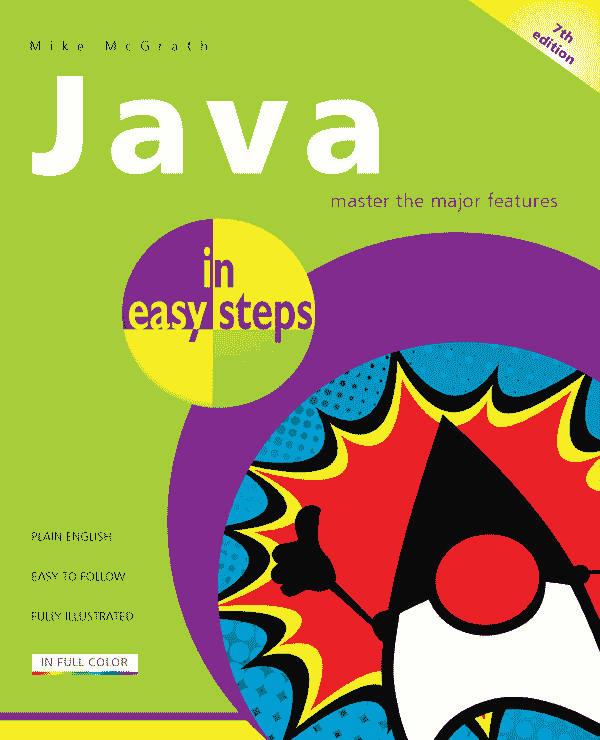

### 前言

本书的创作为我 Mike McGrath 提供了一个利用最新技术更新我 Java 书籍的好机会。

### 书中的约定

为了清晰书中列出的代码，我采取了特定的颜色约定。Java 语言本身的组件为蓝色；程序员指定的名称为红色；数值和字符串为黑色；注释为绿色，如下：

```java
// 存储并输出一个字符串
String message = "Welcome to Java programming!";
System.out.println(message);
```

此外，为了识别书中描述的每个源代码文件，步骤旁侧会出现一个彩色图标和文件名，如下：


App.java


App.class


App.jar


App.xml


App.html


App.jnlp

### 获取源代码

为了方便起见，我将书中示例的所有源代码文件放置在单个 ZIP 存档中。你可以按照以下简单步骤获取完整存档：


浏览到 **[www.ineasysteps.com](http://www.ineasysteps.com)**，然后导航到 Free Resources（免费资源）并选择 Downloads（下载）部分


在列表中找到 Java in easy steps, 7th Edition，然后点击标题为 All Code Examples（所有代码示例）的超链接


现在，将存档内容解压到计算机上的任何方便位置

*Mike McGrath*

---

# 开始学习

***欢迎来到 Java 编程精彩的世界。本章将展示如何创建和运行简单的 Java 程序，并演示如何在程序中存储数据。***

## 简介

## 安装 JDK

## 编写第一个 Java 程序

### 编译与运行程序

## 创建变量

## 识别数据类型

## 创建常量

## 添加注释

# 故障排除

## 总结

## 简介

Java™ 编程语言由 Sun Microsystems 的工程师詹姆斯·高林（James Gosling）于 1990 年首次开发。他不喜欢使用 C++ 编程语言，因此创建了一种新语言，并将其命名为“Oak”（橡树），这是他在办公室窗外看到的一棵树。


这是“Duke”（迪克）——Java 编程语言的亲切吉祥物。

随着万维网的日益普及，Sun 公司意识到高林编写的这种语言可以针对互联网进行开发。因此，Sun 公司将该语言重命名为“Java”（仅仅是因为这个名字听起来很酷），并于 1995 年免费提供。全球的开发者很快采用了这种令人兴奋的新语言，并且由于其模块化设计，他们能够创建添加到核心语言中的新功能。最受喜爱的额外功能被保留在 Java 后续的发布版本中，并发展成为当今的全面版本。

Java 的本质是一个称为“类”（`classes`）的文件库，每个类都包含小段现成的、经过验证的代码。这些类中的任何一个都可以像墙上的砖块一样整合到新程序中，因此只需要编写相对少的新代码即可完成程序。这为程序员节省了大量时间，并在很大程度上解释了 Java 编程如此受欢迎的原因。此外，这种模块化安排比单一大型程序更容易识别任何错误。

Java 技术既是一种编程语言也是一个平台。在 Java 编程中，源代码首先以 `.java` 的文件编写，由 `javac` 编译器编译为机器可读的 `.class` 文件。然后，`java` 解释器可以通过 Java 虚拟机（Java VM）的实例来执行程序：

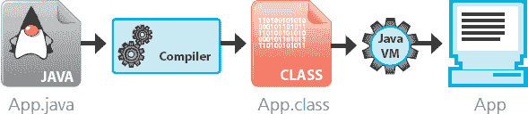

由于 Java VM 可运行在许多不同的操作系统上，相同的 `.class` 文件能够在 Windows、Linux 和 Mac 操作系统上运行——因此 Java 程序员在理论上享有“编写一次，随处运行”的跨平台能力。


JAVA 代表“另一个模糊的缩写”（Just Another Vague Acronym）的传言并非事实。

为了创建 Java 程序，需要在你的计算机上安装 Java 类库和 `javac` 编译器。为了运行 Java 程序，需要安装 Java™ 运行环境（JRE）以提供 `java` 解释器。所有这些组件都包含在一个免费提供的 Java SE（标准版）开发工具包（JDK）中。

JDK 包适用于 32 位和 64 位的 Linux、Mac 和 Windows 平台——选择适合你计算机的版本来开始 Java 编程。

## Oracle JDK

Oracle 公司收购了 Sun JDK 并将其重命名为 Oracle JDK。这是 Java SE（标准版）的正式专有版本，由 Oracle 团队维护。


通过 [www.oracle.com/java](http://www.oracle.com/java) 了解更多关于 Oracle Java 软件的信息。

## OpenJDK

Java SE（标准版）的官方参考实现名为“OpenJDK”（Open Java Development Kit）。这是一个完全免费的开源版本，由 Oracle 和整个 Java 社区支持。

OpenJDK 每六个月发布一次新版本，并有多个实现可供选择。本书推荐的实现是由 **[adoptopenjdk.net](http://www.adoptopenjdk.net)** AdoptOpenJDK 社区小组提供的。


在 [openjdk.java.net](http://openjdk.java.net) 学习更多关于 OpenJDK 的信息。

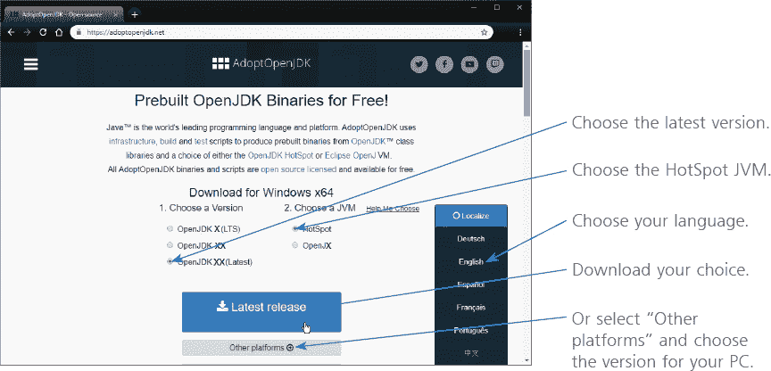

## 安装 JDK

为你的系统下载合适的 JDK 包。为了运行 Java 程序，需要安装 Java™ 运行环境（JRE）以提供 `java` 解释器。所有这些组件都包含在一个免费提供的 Java SE（标准版）开发工具包（JDK）中。

JDK 包适用于 Linux、Mac 和 Windows 平台的 32 位和 64 位变体——选择适合你计算机的版本来开始 Java 编程。


 JDK 包含几个可执行文件，分别是 Java 编译器、Java 壳和 Java 虚拟机。

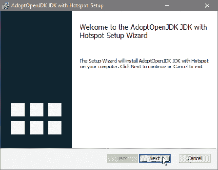

 对于 Windows，从 OpenJDK 网站下载安装包，然后按照以下步骤安装 JDK：

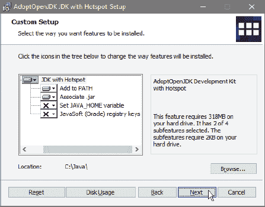

 点击 **Next** 继续，接受许可协议并再次点击 **Next**。


 将位置更改为 `C:\Java` 并选择“添加到路径”选项，然后点击 **Next**。


对于 Linux，首先解压下载的 `tar.gz` 文件，通过编辑主目录下的 `.bashrc` 文件将 Java 的 `bin` 添加到路径：`PATH=$PATH:/usr/Java`

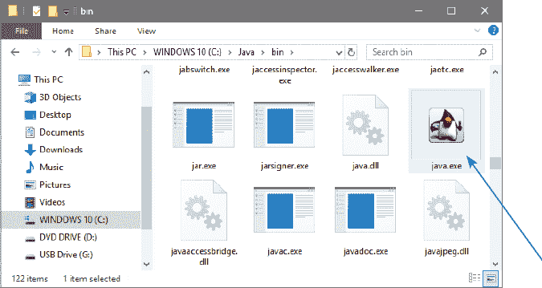

 按下 **Winkey** + **R** 打开“运行”窗口，然后输入 `cmd` 打开命令提示符窗口——或在 Linux 上打开终端窗口。

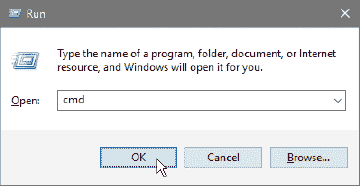

 Windows 键

在提示符处输入 `java -version` 命令查看 JDK 版本（如下方所示的 Xs）。


现在，输入 `jshell -version` 命令查看 Java 壳版本——你准备好开始 Java 编程了！

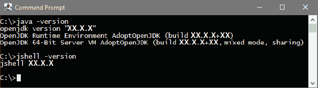

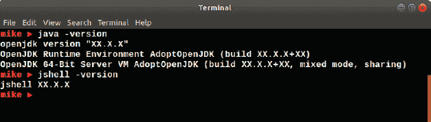 Java 壳 `jshell` 是一个交互式工具，允许你测试代码片段，无需先编译代码。它用于第 2 章演示各种“运算符”。

## 编写第一个 Java 程序

所有的 Java 程序都从文本文件开始，随后用于创建“类”文件，这些实际的可运行程序。这意味着 Java 程序可以使用任何文本编辑器编写，例如 Windows 的记事本或 Linux 的 Nano。


按照以下步骤创建一个简单的 Java 程序，它将输出传统的第一个程序问候：

 打开文本编辑器（如记事本），并按照列出的内容输入此代码以创建一个名为“Hello”的类

```java
class Hello {
}
```


Hello.java

 在 **Hello** 类的大括号之间插入此代码以为 **Hello** 类创建一个“main”方法

```java
public static void main ( String[] args )
{
}
```

 在 **main** 方法的大括号之间插入此行代码——说明程序将要做什么

```java
System.out.println( “Hello World!” ) ;
```


将文件保存到任何方便的位置，但请务必精确命名为 `Hello.java` – 现在完整的程序看起来应该是这样的：

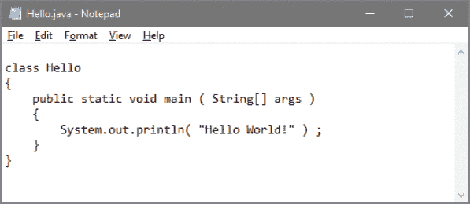


Java 是一种大小写敏感的语言，“Hello”和“hello”是完全不同的 –传统上，Java 程序名应该始终以大写字母开头。


Java 程序始终以其完全的程序名加上 `.java` 扩展名保存。

可以单独检查程序代码的这里的各个部分，以更清晰地理解每个部分：

### 程序的容器

```java
class Hello { }
```

程序名跟在 `class` 关键字之后，后面紧跟着一对大括号。定义 `Hello` 类的所有程序代码都包含在这些大括号内。

### main 方法

```java
public static void main ( String[] args ) { }
```

这行看起来很吓人的代码是用于定义几乎所有 Java 程序起点的标准代码。它将会在书中大多数示例中以与上面完全相同的形式出现 – 所以记住它可能会很有用。

该代码声明了一个名为“main”的方法，该方法在其大括号内包含实际的程序指令。

关键字 `public static void` 位于方法名之前，用于定义如何使用该方法，将在稍后进行详细解释。

代码 `( String[] args )` 在向方法传递值时非常有用，在书中稍后也会进行详细解释。


所有独立的 Java 程序都必须有一个 main 方法。

### 语句

```java
System.out.println( “Hello World!” ) ;
```

语句是执行程序任务的实际指令，并且必须以分号结尾。一个方法可以在大括号内包含许多语句以形成一个“语句块”，定义要执行的一系列任务，但在这里，单个语句指示程序输出一行文本。

转到这里 发现如何编译和运行此程序。


创建一个“MyJava”目录，用于保存所有的 Java 程序文件。

### 编译与运行程序

在 Java 程序运行之前，它必须首先由 Java 编译器编译成 `class` 文件。它位于 Java 的 `bin` 子目录下，是一个名为 `javac` 的应用程序。在安装期间，`bin` 子目录已添加到系统路径，因此 `javac` 可以从任何系统位置调用。

按照以下步骤编译程序：


打开命令行窗口，然后导航到你保存 `Hello.java` 源码文件的目录


输入 `javac` 后跟一个空格，然后是源码文件的全名 `Hello.java` 并按 `Enter`

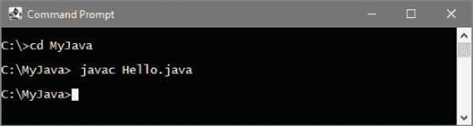


在 Windows 上使用命令提示符应用或 Windows PowerShell 应用提供命令行提示符，在 Linux 上使用 Terminal 窗口。


在提示符处输入 `javac` 并按回车显示 Java 编译器选项。

如果 `javac` 编译器发现代码中有错误，它将停止并显示一个有助于问题的报告，指示错误的性质 – 排除故障请参阅这里。

如果 `javac` 编译器没有发现任何错误，它将创建一个以程序名和 `.class` 文件扩展名命名的新文件。

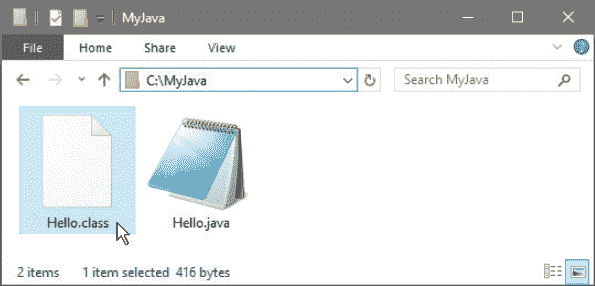


向 `javac` 编译器指定文件的完整路径地址，也可以从另一个位置编译源码 – 在这种情况下为 `C:\MyJava\Hello.java`

当 Java 编译器完成编译时，命令行提示符窗口的焦点返回提示符，没有任何确认消息 – 程序已准备好运行。


Java 程序解释器是一个名为 `java` 的应用程序，位于 Java 的 `bin` 子目录下 – 与 `javac` 编译器在一起。由于该目录在安装期间已添加到系统路径，`java` 解释器可以从任何位置调用。

按照这里描述的步骤运行已编译的程序：


打开命令行提示符窗口，然后导航到 `Hello.class` 程序文件所在的目录


在提示符处，输入 `java` 后跟一个空格，然后是程序名 `Hello` 并按回车

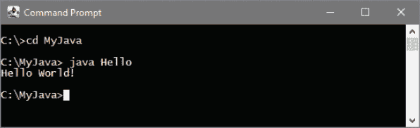


运行程序时不包含 `.class` 扩展名 – 只使用程序名。

`Hello` 程序运行并执行其 main 方法内语句中定义的任务 – 输出“Hello World!”。完成后，焦点再次返回到提示符。

编译和运行 Java 程序的过程通常组合为顺序步骤，并且无论在什么平台上都是相同的。下面的截图展示了在 Linux 上编译和运行 `Hello` 程序的过程：

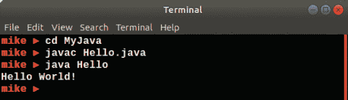

## 创建变量

在 Java 编程中，“变量”简单来说是一个存储值的容器，供后续使用。值可能会随着程序的执行而改变（变化）– 因此被称为“变量”。


通过在程序中编写声明来创建变量，指定数据类型以及变量名称。例如，可以使用 `String` 类型来允许名为“message”的变量包含文本：

```java
String message ;
```

变量名由程序员选择，但必须遵循某些命名规范。变量名只能以字母、美元符号 `$` 或下划线字符 `_` 开头，随后可以是字母、数字、美元符号或下划线。名称对大小写敏感，因此“var”和“Var”是不同的名称，名称中不允许空格。

变量名还应避免下表列出的 Java 关键字，因为这些词在语言中有特殊含义。

| | | | | |
| :--- | :--- | :--- | :--- | :--- |
| `abstract` | `default` | `goto` | `package` | `synchronized` |
| `assert` | `do` | `if` | `private` | `this` |
| `boolean` | `double` | `implements` | `protected` | `throw` |
| `break` | `else` | `import` | `public` | `throws` |
| `byte` | `enum` | `instanceof` | `return` | `transient` |
| `case` | `extends` | `int` | `static` | `try` |
| `catch` | `false` | `long` | `strictfp` | `void` |
| `char` | `final` | `native` | `String` | `volatile` |
| `class` | `finally` | `new` | `super` | `while` |
| `continue` | `for` | `null` | `switch` | |


每个变量声明都必须以分号字符结尾，正如与所有其他语句一样。


严格来说，表中的某些词并不是真正的关键字 – `true`、`false` 和 `null` 都是字面量；`String` 是一个特殊的类名；`const` 和 `goto` 是保留字（目前未使用）。将它们包含在表中是因为在命名变量时也必须避免这些词。


作为良好的习惯，变量命名应使用单词或易于识别的缩写，以描述该变量的用途。例如，使用 `button1` 或 `btn1` 来描述一号按钮。单词优先使用小写字母，例如 `gear`；由多个单词组成的名称应将每个后续单词的首字母大写，例如 `gearRatio` —— 即所谓的 `camelCase`（驼峰命名）命名规范。

一旦声明变量，可以使用等号 `=` 为其分配相应数据类型的初始值，可以在声明时赋值，也可以在程序的后期赋值，然后可以使用变量名随时引用其值。

按照以下步骤创建一个程序，该程序声明一个变量，并在声明时对其初始化，稍后进行更改：

1. 启动一个名为“FirstVariable”的新程序，包含标准的 main 方法

```java
class FirstVariable
{
    public static void main ( String[] args ) {             
    }
}
```

FirstVariable.java

2. 在 main 方法的大括号之间插入此代码，以创建、初始化并输出一个变量

```java
String message = “Initial value” ;
System.out.println( message ) ;
```

3. 添加这些行来修改并输出变量值

```java
message = “Modified value” ;
System.out.println( message ) ;
```

4. 将程序保存为 `FirstVariable.java`，然后编译并运行程序

如果在编译或运行程序时遇到问题，可以在此处获取排查问题的帮助。

## 识别数据类型

Java 变量声明中最常用的数据类型列在本表中，并带有简要描述：

| 数据类型 | 描述 | 示例 |
| :--- | :--- | :--- |
| `char` | 单个 Unicode 字符 | ‘a’ |
| `String` | 任意数量的 Unicode 字符 | “my String” |
| `int` | 整数，范围从 -21.4 亿到 +21.4 亿 | 1000 |
| `float` | 带有小数点的浮点数 | 3.14159265f |
| `boolean` | 真或假的二选一逻辑值 | true |

由于浮点数运算的不规则性，`float` 数据类型绝不应用于货币等精确值 —— 详情请参见此处。

注意，`char` 数据值必须始终由单引号包含，而 `String` 数据值必须始终由双引号包含。此外，记住 `float` 数据值必须始终带有 “f” 后缀，以确保它们被视为 `float` 值。

除了上述更常见的数据类型外，Java 还提供了这些特殊数据类型用于精确情况：

| 数据类型 | 描述 |
| :--- | :--- |
| `byte` | 从 -128 到 +127 的整数 |
| `short` | 从 -32,768 到 +32,767 的整数 |
| `long` | 超过 21.4 亿的正负整数 |
| `double` | 极长的浮点数 |

除了 `String`（这是一个特殊类），所有数据类型关键字都以小写字母开头。

特殊数据类型在高级 Java 程序中很有用 —— 本书示例大多使用顶部表中常用的数据类型。

按照以下步骤创建一个 Java 程序，该程序创建、初始化并输出所有五个常用数据类型的变量：

1. 启动一个名为“DataTypes”的新程序，包含标准的 main 方法

```java
class DataTypes
{
    public static void main ( String[] args ) {     
    }
}
```

DataTypes.java

2. 在 main 方法的大括号之间插入这些声明来创建并初始化五个变量

```java
char letter = ‘M’ ;
String title = “Java in easy steps” ;
int number = 365 ;
float decimal = 98.6f ;
boolean result = true ;
```

3. 添加这些行以将适当的文本 `String` 拼接到每个变量的值

```java
System.out.println( “Initial is ” + letter ) ;
System.out.println( “Book is ” + title ) ;
System.out.println( “Days are ” + number ) ;
System.out.println( “Temperature is ” + decimal ) ;
System.out.println( “Answer is ” + result ) ;
```

4. 将程序保存为 `DataTypes.java`，然后编译并运行程序

`System.out.println( “Initial is ” + letter ) ;`

`+` 在此处用于拼接字符串值。

## 创建常量

`final` 关键字是一个修饰符，声明变量时可以使用防止任何更改。以这种方式创建变量被称为“常量”。

按照以下步骤创建一个包含常量的 Java 程序：

1. 启动一个名为“Constants”的新程序，包含标准的 main 方法

```java
class Constants
{
    public static void main ( String[] args ) {             
    }
}
```

Constants.java

2. 在 main 方法的大括号之间插入此代码以创建并初始化三个常量

```java
final int TOUCHDOWN = 6 ;
final int CONVERSION = 1 ;
final int FIELDGOAL = 3 ;
```

3. 现在，声明四个普通变量

```java
int td , pat , fg , total ;
```

4. 使用常量的倍数初始化普通变量

```java
td = 4 * TOUCHDOWN ;
pat = 3 * CONVERSION ;
fg = 2 * FIELDGOAL ;
total = ( td + pat + fg ) ;
```

5. 添加此行显示总分

```java
System.out.println( “Score: ” + total ) ;
```

6. 将程序保存为 `Constants.java`，然后编译并运行程序以输出，Score: 33

( 4 x 6 = 24, 3 x 1 = 3, 2 x 3 = 6，所以 24 + 3 + 6 = 33 ).

`*` 星号在此处用于乘以常量，括号包裹了它们的加法。

## 添加注释

在任何语言中编程时，为程序代码添加注释以解释特定部分是良好的习惯。这使得其他人以及自己在离开一段时间后能更容易理解代码。

在 Java 编程中，可以在 `/*` 和 `*/` 标识符之间添加跨行注释，也可以在 `//` 注释标识符之后添加单行注释。`/*` 和 `*/` 之间或 `//` 之后的任何内容都会被 `javac` 编译器完全忽略。

为 `Constants.java` 程序添加注释后，源代码可能如下：

```java
/*
一个演示常量变量的程序。
*/
class Constants
{
    public static void main( String[] args )
    {
        // 常量分数值。
        final int TOUCHDOWN = 6 ;
        final int CONVERSION = 1 ;
        final int FIELDGOAL = 3 ;

        // 计算得分。
        int td , pat , fg , total ;
        td = 4 * TOUCHDOWN ; // 4x6=24
        pat = 3 * CONVERSION ; // 3x1= 3
        fg = 2 * FIELDGOAL ; // 2x3= 6
        total = ( td + pat + fg ) ; // 24+3+6=33
        // Output calculated total.
        System.out.println( “Score: “ + total ) ;
    }
}
```

Constants.java (已注释)

带有注释保存后，程序可以正常编译并运行：

你可以添加一条尝试更改常量值值的语句，然后尝试重新编译程序以查看生成的错误信息。

### 常见问题排除

有时候，`javac` 编译器或 `java` 解释器会报告错误，因此了解错误的原因以及如何快速解决问题是很有用的。为了演示一些常见的错误报告，这段代码包含了一些故意的错误：

```java
class test
{
    public static void main ( String[] args )
    {
        String text ;
        System.out.println( “Test ” + text )
    }
}
```

Test.java

首次尝试编译 `Test.java` 会产生此错误报告：

* 原因 – 找不到 `javac` 编译器。
* 解决方案 – 使用命令 `setx path “%path%;C:\Java\bin”` 修改系统环境，或使用完整路径命令 `C:\Java\bin\javac Test.java` 调用编译器。

要在 Windows 中编辑环境变量，你可以打开系统属性，点击高级选项卡，然后点击环境变量按钮。选择 `Path`，点击编辑并添加 `C:\Java\bin`，然后点击确定应用更改。

* 原因 – 找不到文件 `Test.java`。
* 解决方案 – 到文件所在的目录，或在命令中使用文件的完整路径地址。

* 原因 – 语句没有正确终止。
* 解决方案 – 在源代码的语句末尾添加分号，然后保存文件应用更改。

* 原因 – 程序名与类名不匹配。
* 解决方案 – 在源代码中将类名从 `test` 改为 `Test`，然后保存文件应用更改。

* 原因 – 变量 `text` 没有值。
* 解决方案 – 在变量声明中为变量分配一个有效的 `String` 值（例如 `= “success”`），然后保存文件。

你必须在程序所在的目录下运行程序——不能使用路径地址，因为 Java 启动器需要的是程序名而不是文件名。

## 总结

* Java 既是一种编程语言也是一种运行时平台。
* Java 程序编写为带有 `.java` 扩展名的文本文件。
* Java 编译器 `javac` 从原始的 `.java` 源文件创建编译后的 `.class` 程序文件。
* Java 解释器 `java` 使用 Java 虚拟机（JVM）的实例执行编译后的程序。
* Java VM 可用于许多操作系统平台。
* 将 Java 的 `bin` 子目录添加到系统 `PATH` 变量中允许从任何地方调用 `javac` 编译器。
* Java 是一种大小敏感的语言。
* 标准的 `main` 方法是 Java 程序的入口。
* `System.out.println()` 语句输出文本。
* Java 程序文件名必须与其类名完全匹配。
* Java 变量只能按照指定的命名规范命名，并且必须避开 Java 关键字。
* 在 Java 编程中，每个语句必须以分号字符终止。
* 最常见的 Java 数据类型是 `String`、`int`、`char`、`float` 和 `boolean`。
* `String` 值必须包含在双引号内；`char` 值在单引号内；`float` 值必须带有 “f” 后缀。
* `final` 关键字可以创建常量变量。
* 注释可以添加在 Java 源代码的 `/*` 和 `*/` 之间（跨越一行或多行），或者在单行的 `//` 之后。
* 错误报告用于识别编译器和运行时问题。

## 执行操作

本章演示了用于在 Java 程序中创建表达式的各种运算符。

### 算术运算

下表列出的算术运算符用于在 Java 程序中创建返回单一结果值的表达式。例如，表达式 `4 * 2` 返回值 `8`。

| 运算符 | 操作 |
| :--- | :--- |
| `+` | 加法（并拼接 `String` 值） |
| `-` | 减法 |
| `*` | 乘法 |
| `/` | 除法 |
| `%` | 取模 |
| `++` | 递增 |
| `--` | 递减 |

递增运算符 `++` 和递减运算符 `--` 返回将单个给定操作数加减 1 的结果。例如，`4++` 返回值 `5`。

`+` 运算符执行的操作取决于操作数的类型。当两个操作数都是数字时，它将返回这些数字的总和；但当操作数是 `String` 值时，它将返回拼接后的 `String`。例如，`“Java ”` + `“Arithmetic”` 返回 `“Java Arithmetic”`。

`int` 值的除法会截断任何小数部分。例如，`11/4` 返回 `2`。

取模运算符将第一个操作数除以第二个操作数，并返回操作的余数。例如，`32 % 5` 返回 `2` ——5 除入 32 六次，余数为 2。

赋值运算符列如下表所示，用于为表达式的结果赋值。除了简单的 `=` 运算符外，所有的都是更长表达式的简写形式：

| 运算符 | 示例 | 等价 |
| :--- | :--- | :--- |
| `=` | `a = b` | `a = b` |
| `+=` | `a += b` | `a = a + b` |
| `-=` | `a -= b` | `a = a - b` |
| `*=` | `a *= b` | `a = a * b` |
| `/=` | `a /= b` | `a = a / b` |
| `%=` | `a %= b` | `a = a % b` |

将 `=` 运算符视为“赋值”而不是“等于”，以避免与 `==` 相等运算符混淆。

在示例 `a = b` 中，存储在命名变量 `b` 中的值被赋值给名为 `a` 的变量，使得该值成为存储在 `a` 中的新值——替换掉它之前包含的任何值。

`+=` 运算符用于将一个值加到变量存储的现有值上——保持一个“运行总计”。

示例 `a += b` 首先计算存储在命名变量 `a` 和 `b` 中的值的总和，然后将得到的总和赋值给变量 `a`。程序随后可能会包含进一步的赋值 `a += c`，它计算存储在命名变量 `a` 和 `c` 中的总和，然后将该新总和赋值给 `a`——将 `c` 的值加到它之前包含的值上。

所有其他赋值运算符的运行方式都相同：首先对两个存储的值进行算术计算，然后将结果赋值给第一个变量——成为其新的存储值。

`==` 相等运算符用于比较两个值，其详细解释请参见此处。

按照以下步骤在 Java 交互式外壳（Java shell）中探索 Java 赋值运算符：

1. 打开一个命令行提示符窗口，然后输入 `jshell` 并按 `Enter` 键启动 Java 交互式外壳
2. 接下来，输入语句初始化两个 `String` 变量

```java
String txt = “Super ” ; String lang = “Java” ;
```


现在，分别输入语句添加并赋值一个 `String` 值，然后显示拼接后的字符串结果

```java
txt += lang ; txt ;
```

然后输入语句初始化两个整数变量

```java
int sum = 10 ; int num = 20 ;
```

分别输入语句添加并赋值一个 `int` 值，然后显示加总后的整数结果

```java
sum += num ; sum ;
```

Java 交互式外壳会创建带有 `$` 前缀的内部编号变量，包含评估的结果。在这里，内部变量 `$3` 和 `$7` 包含评估结果。

为变量分配错误的数据类型将导致错误。

## 比较值

比较运算符列如下表所示，用于比较表达式中的两个值，并返回一个单一的 `true` 或 `false` 布尔值——描述该比较的结果。

| **运算符：** | **比较：** |
| :--- | :--- |
| `==` | 等于 |
| `!=` | 不等于 |
| `>` | 大于 |
| `>=` | 大于等于 |
| `<` | 小于 |
| `<=` | 小于等于 |

`==` 相等运算符比较两个操作数，如果两者的值完全相等，则返回 `true`。如果两个都是相同的数字，它们就是相等的；如果两个都是包含相同字符且顺序相同的 `String` 值，它们就是相等的。两个都为 `true` 或两个都为 `false` 的布尔操作数是相等的。

相反，`!=` 不等于运算符在两个操作数不相等时返回 `true`——适用与相等运算符相同的规则。

相等和不等运算符在测试两个变量的状态以执行程序的“条件分支”时非常有用——根据条件向不同的方向执行。

`>` “大于”运算符比较两个操作数，如果第一个的值大于第二个，则返回 `true`。

`<` “小于”运算符进行相同的比较，但如果第一个操作数的值小于第二个，则返回 `true`。

在 `>` “大于”运算符或 `<` “小于”运算符后添加 `=` 赋值运算符，可以使其在两个操作数的值完全相等时也返回 `true`。

`<` 小于运算符通常用于测试循环中的计数器值——可以在此处 找到此类的示例。

按照以下步骤在 Java 交互式外壳中探索 Java 比较运算符：

1. 打开一个命令行提示符窗口，然后输入 `jshell` 并按 `Enter` 键启动 Java 交互式外壳
2. 接下来，输入语句初始化两个 `String` 变量

```java
String txt = “Super ” ; String lang = “Java” ;
```

3. 现在，分别输入语句添加并赋值一个 `String` 值，然后显示拼接后的字符串结果

```java
txt += lang ; txt ;
```

4. 然后输入语句初始化两个整数变量

```java
int sum = 10 ; int num = 20 ;
```

5. 分别输入语句添加并赋值一个 `int` 值，然后显示加总后的整数结果

```java
sum += num ; sum ;
```

Java 交互式外壳会创建带有 `$` 前缀的内部编号变量，包含评估的结果。在这里，内部变量 `$3` 和 `$7` 包含评估结果。

为变量分配错误的数据类型将导致错误。

## 逻辑评估

逻辑运算符如下表所示，用于将多个每个返回布尔值的表达式组合成一个返回单一值的复杂表达式。

| **运算符：** | **操作：** |
| :--- | :--- |
| `&&` | 逻辑与 |
| `||` | 逻辑或 |
| `!` | 逻辑非 |

逻辑运算符用于具有 `true` 或 `false` 布尔值的操作数，或可以转换为 `true` 或 `false` 的值。

逻辑 `&&` 与评估两个操作数，只有当两个操作数都为 `true`时才返回 `true`。否则，逻辑 `&&` 运算符返回 `false`。这种评估可以用于条件分支，只有当两个测试条件都成立时，程序才会执行某些操作。

与需要两个操作数均为 `true` 的逻辑 `&&` 运算符不同，逻辑 `||` 或运算符评估两个操作数，如果其中一个为 `true`，则返回 `true`——只有当两个操作数都不为 `true` 时才会返回 `false`。这在 Java 编程中非常有用，可以在满足两个条件之一时执行某些操作。

逻辑 `!` 非运算符是一个用于单个操作数的一元运算符。它返回给定操作数的反转布尔值——将 `true` 变为 `false`，将 `false` 变为 `true`。它在 Java 程序中非常有用，可以在连续循环迭代中切换变量的值，使用类似 `goState=!goState` 的语句。这确保值在每次循环中都会发生变化，就像开关灯一样。

“布尔”（Boolean）一词是指英国数学家乔治·布尔（George Boole，1815-1864）开发的一种逻辑系统。

你可以在 Java 交互式外壳中通过输入 `/help` 命令发现更多选项。

1. 接下来，输入语句来初始化两个 `boolean`

```java
boolean yes = true ; boolean no = false ;
```

2. 输入语句测试两个条件是否都为真

```java
boolean result = ( yes && yes ) ; result = ( yes && no ) ;
```

3. 输入语句测试其中任一个条件是否为真

```java
result = ( yes || yes ) ;
result = ( yes || no ) ;
result = ( no || no ) ;
```

4. 输入语句显示原始值和反反值

```java
result = yes ; result = !yes ;
```

Java shell 也称为“REPL”，它是 Read（读取）、Evaluate（求值）、Print（打印）、Loop（循环）的缩写，描述了这种交互式工具。

注意 `false && false` 返回 `false` 而不是 `true` —— 这证明了“两个错并不出一个对”的格言。

由 `!` NOT 逻辑运算符返回的值是存储值的反值 —— 存储值本身保持不变。

## 检查条件

Java 程序员最喜爱的运算符可能是 `? :` 条件运算符，它能以非常简洁的方式实现强大的语句。它不寻常的语法初看之下可能很难理解，但了解这个实用的运算符是非常值得的。

条件运算符首先评估一个表达式的 `true` 或 `false` 值，然后根据求值结果返回两个给定的操作数之一。它的语法如下：

```
( boolean-expression ) ? if-true-return-this : if-false-return-this ;
```

每个指定的操作数备选方案允许程序根据测试表达式返回的布尔值继续执行。例如，备选方案可以返回一个 `String` 值：

```java
status = ( quit == true ) ? “Done!” : “Continuing...” ;
```

在这种情况下，当 `quit` 变量为 `true` 时，条件运算符将第一个操作数的值赋值给 `status` 变量；否则，它赋值第二个操作数的值。

在编写 Java 程序时的一种简便方法允许表达式在评估简单布尔值时可选地省略 `== true`，因此上面的示例可以简单写为：

```java
status = ( quit ) ? “Done!” : “Continuing...” ;
```

条件运算符可以返回任何数据类型的值，并使用任何有效的测试表达式。例如，表达式可以使用大于 `>` 运算符来评估两个数值，然后根据结果返回一个布尔值：

```java
busted = ( speed > speedLimit ) ? true : false ;
```

同样，条件运算符可能使用不等 `!=` 运算符评估一个 `String` 值，然后根据结果返回一个数值：

```java
bodyTemperature = ( scale != “Celsius” ) ? 98.6 : 37.0 ;
```

条件运算符也被称为“三元”运算符。

按照以下步骤在 Java shell 中探索 Java 条件运算符：

1. 打开命令行提示窗口，然后输入 `jshell` 并按 `Enter` 键启动 Java shell
2. 接下来，输入语句来初始化两个 `int` 变量

```java
int num1 = 1357 ; int num2 = 2468 ;
```

3. 声明另一个变量来存储测试结果 `String`

```java
String result ;
```

4. 输入此语句判断第一个整数值是奇数还是偶数

```java
result = ( num1 % 2 != 0 ) ? “Odd” : “Even” ;
```

5. 现在，输入此语句判断第二个整数值是奇数还是偶数

```java
result = ( num2 % 2 != 0 ) ? “Odd” : “Even” ;
```

你还可以使用命令 `jshell --feedback verbose` 启动 Java shell，以便在每次求值后接收描述性输出。

注意未初始化的 `String` 变量返回一个特殊的 `null` 值 —— 表示它完全不包含内容。

在这里，当存在余数时，表达式为真。

## 设置优先级

包含多个运算符和操作数的复杂表达式如果没有明确操作执行顺序，就会产生歧义。这种缺乏清晰度很容易导致同一个表达式暗示不同的结果。例如，考虑这个复杂表达式：

```java
num = 8 + 4 * 2 ;
```

从左到右计算：`8 + 4 = 12`，`12 * 2 = 24`，所以 `num = 24`。但从右到左计算：`2 * 4 = 8`，`8 + 8 = 16`，所以 `num = 16`。

Java 程序员可以通过添加括号来显式指定应该先执行哪个操作。在这种情况下，`(8 + 4) * 2` 确保在执行乘法之前执行加法 —— 所以结果是 24 而不是 16。相反，`8 + (4 * 2)` 先执行乘法 —— 所以结果是 16 而不是 24。

当括号没有指定优先级时，Java 遵循下面的默认顺序：

| 运算符 | 描述 |
| :--- | :--- |
| `++` `--` `!` | 增、减、逻辑非 |
| `*` `/` `%` | 乘法、除法、取模 |
| `+` `-` | 加法、减法 |
| `>` `>=` `<` `<=` | 大于、大于等于、小于、小于等于 |
| `==` `!=` | 等于、不等 |
| `&&` | 逻辑与 |
| `||` | 逻辑或 |
| `? :` | 条件 |
| `=` `+=` `-=` `*=` `/=` `%=` | 赋值 |

优先级相同的运算符按照它们在表达式中的顺序处理 —— 从左到右。当表达式有多个嵌套括号时，最内层的括号优先级最高。

工作原理 – 步骤 2...

`16 x 2 = 32, + 24 = 56`

步骤 3...

`24 + 16 = 40, x 2 = 80`

步骤 4...

`32 - 24 = 8, x 2 = 16`

本章到目前为止使用 Java shell `jshell` 通过评估代码片段来探索各种 Java 运算符。后续示例将使用 Java 编译器 `javac` 和 Java 运行时 `java` 来创建和运行程序。你可以使用命令 `/exit` 退出 Java shell 返回普通提示符。

字面量通常与 Java 语言的关键字分离，但在 `String` 值内部如果需要双引号或单引号，则必须指示该引号字符被视为字面量处理，以避免过早终止 `String`。这可以通过在每个嵌套的引号字符前紧跟一个 `\` 转义运算符来轻松实现。例如，在 `String` 变量中包含引号，如下：

```java
String quote = “ \”Fortune favors the brave.\” said Virgil ”;
```

此外，`\` 转义运算符为简单的输出格式提供了多种实用的转义序列：

| **转义符:** | **描述:** |
| :--- | --- |
| `\n` | 换行 |
| `\t` | 制表符 |
| `\b` | 退格 |
| `\r` | 回车 |
| `\f` | 换符 |
| `\\` | 反斜杠 |
| `\’` | 单引号 |
| `\”` | 双引号 |

可以将单引号嵌套在双引号内，作为转义引号字符的替代方案。

`\n` 换行转义序列经常用于长 `String` 值中，以便多行显示输出。同样，`\t` 制表符转义序列经常用于列显示输出。使用 `\n` 换行和 `\t` 制表符转义序列的组合允许输出按行和列格式化——类似于表格。

按照以下步骤使用转义序列创建 Java 程序来格式化输出：

1. 创建一个名为“Escape”的新程序，包含标准的 main 方法

```java
class Escape
{
    public static void main( String[] args ) {    }
}
```

Escape.java

2. 在 main 方法的大括号之间插入此代码，以构建一个包含格式化表格标题和列标题的 `String`

```java
String header = “\n\tNEW YORK 3-DAY FORECAST:\n” ;
header += “\n\tDay\t\tHigh\tLow\tConditions\n” ;
header += “\t---\t\t----\t---\t----------\n” ;
```

3. 添加这些行以构建一个包含格式化表格单元数据的 `String`

```java
String forecast = “\tSunday\t\t68F\t48F\tSunny\n” ;
forecast += “\tMonday\t\t69F\t57F\tSunny\n” ;
forecast += “\tTuesday\t\t71F\t50F\tCloudy\n” ;
```

4. 现在，添加此行输出两个格式化的 `String` 值

```java
System.out.print( header + forecast ) ;
```

5. 将程序保存为 `Escape.java`，然后编译并运行程序

在这种情况下，转义序列添加了换行，因此此处使用了 `print()` 方法——而不是输出后会自动添加换行的 `println()` 方法。

## 使用位操作

除了本章前面介绍的普通运算符外，Java 还提供了用于二进制运算的特殊运算符。这些运算符比其他运算符不常用，但在这里简要讨论是为了让大家了解它们的存在。

Java “位”运算符可以与 `int` 整数数据类型一起使用，用于操作值的二进制表示位。这需要理解二进制计数，其中字节中的八位代表十进制的零到 255。例如，53 的二进制为 `00110101`（`0` x 128, `0` x 64, `1` x 32, `1` x 16, `0` x 8, `1` x 4, `0` x 2, `1` x 1）。

二进制加法运算的操作类似于十进制算术：

| | 53 | = | `00110101` |
| :--- | --- | --- | --- |
| `+` | 7 | = | `00000111` |
| | 60 | = | `00111100` |

下列表位运算符允许在二进制运算中执行更专门的操作。

| **运算符:** | **操作:** | **示例:** | **结果:** |
| :--- | --- | --- | --- |


| 运算符 | 名称 | 示例 | 说明 |
| :--- | :--- | :--- | :--- |
| `&` | 与 (AND) | `a & b` | 如果两个位都为 1 则结果为 1 |
| `\|` | 或 (OR) | `a \| b` | 如果其中一个位为 1 则结果为 1 |
| `^` | 异或 (XOR) | `a ^ b` | 如果两个位不同则为 1 |
| `~` | 非 (NOT) | `~a` | 反转位 |
| `<<` | 左移 | `n << p` | 将 `n` 向左移动 `p` 位 |
| `>>` | 右移 | `n >> p` | 将 `n` 向右移动 `p` 位 |

例如，在二进制运算中使用位 `&` 运算符：

| | 53 | = | `00110101` |
| :--- | --- | --- | --- |
| `+` | 7 | = | `00000111` |
| | 60 | = | `00111100` |

# 本章演示了用于 Java 程序中创建分支的各种关键字。

## 使用 if 进行分支

`if` 关键字执行条件测试，以评估一个表达式的布尔值（Boolean）。表达式后的语句仅在评估结果为 `true` 时才会被执行，否则程序将继续执行后续代码——即走向下一个“分支”。`if` 语句的语法如下：

```java
if (test-expression) code-to-be-executed-when-true;
```

如果被执行的代码可以包含多条语句，前提是它们被包含在大括号内，以形成一个“语句块”：

```java
class If
{
    public static void main (String[] args) {
    }
}
```

在 main 方法的大括号之间插入这个简单的条件测试，当一个数字大于另一个数字时，执行单条语句：

```java
if ( 5 > 1 ) System.out.println( "Five is greater than one." ) ;
```

添加第二个条件测试，当一个数字小于另一个数字时，它会执行整个语句块：

```java
if ( 2 < 4 )
{
    System.out.println( "Two is less than four." ) ;
    System.out.println( "Test succeeded." ) ;
}
```

将程序保存为 `If.java`，然后编译并运行程序，以看到所有语句都被执行——因为在这种情况下，两个测试的评估结果均为 `true`。

表达式可以使用 `true` 和 `false` 关键字。测试表达式 `( 2 < 4 )` 是 `( 2 < 4 == true )` 的简写。

条件测试还可以评估复杂的表达式，以测试多个条件的布尔值。括号包裹每个测试条件以建立优先级——因此它们会被先评估。布尔运算符 `&&`（与/AND）确保只有当两个测试条件都为 `true` 时，复杂表达式才会返回 `true`：

```java
if ( (test-condition1) && (test-condition2) ) execute-this-code;
```

布尔运算符 `||`（或/OR）确保只有当测试条件中的一个为 `true` 时，复杂表达式才会返回 `true`：

```java
if ( (test-condition1) || (test-condition2) ) execute-this-code;
```

这些组合可以形成更长的复杂表达式：

在 `If.java` 的 main 方法内部插入此行来声明并初始化一个名为 `num` 的整数变量：

```java
int num = 8 ;
```

添加第三个条件测试，当 `num` 变量的值在指定范围内，或者恰好等于指定值时，执行一条语句：

```java
if ( ( ( num > 5 ) && ( num < 10 ) ) || ( num == 12 ) )
    System.out.println( "Number is 6-9 inclusive, or 12" ) ;
```

重新编译程序并再次运行一次，以看到复杂表达式后的语句被执行。

更改赋值给 `num` 变量的值，使其既不在指定的 6-9 范围内，也不恰好等于 12。重新编译程序并再次运行，现在你会看到复杂表达式后的语句没有被执行。

范围可以使用 `>=` 和 `<=` 运算符扩展到包含上限和下限。

复杂表达式使用 `==` 等于运算符来指定精确匹配，而不是 `=` 赋值运算符。

## 分支的替代方案

`else` 关键字与 `if` 关键字结合使用，创建 `if else` 语句，根据测试表达式的评估结果为程序提供备选择的分支。在最简单的形式中，它仅仅是在测试失败时指定一个备选语句执行：

```java
if (test-expression) code-to-be-executed-when-true;
else code-to-be-executed-when-false;
```

每个备选分支可以是单条语句，也可以是包含多条语句的语句块——包含在大括号内。

创建一个名为“Else”的新程序，其中包含标准的 main 方法：

```java
class Else
{
    public static void main (String[] args) {
    }
}
```

在 main 方法内部插入此行来声明并初始化一个名为 `hrs` 的整数变量：

```java
int hrs = 11 ;
```

插入这个简单的条件测试，当 `hrs` 变量的值为 13 时，执行单条语句：

```java
if ( hrs < 13 )
{
    System.out.println( "Good morning: " + hrs ) ;
}
```

将程序保存为 `Else.java`，然后编译并运行程序，以看到语句被执行。注意在 `else` 关键字之前，第一条语句像通常一样用分号结束的。

更改赋值给 `hrs` 变量的值为 15，然后在 `if` 语句之后直接添加此备选分支：

```java
else if ( hrs < 18 )
{
    System.out.println( "Good afternoon: " + hrs ) ;
}
```

保存更改，重新编译并再次运行程序，以看到只执行备选语句。

有时提供一个最终的 `else` 分支（不嵌套 `if` 语句）是有必要的，以便指定在没有测试表达式评估为 `true` 时执行的“默认”语句：

更改赋值给 `hrs` 变量的值为 21，然后在 `if else` 语句末尾添加此默认分支：

```java
else System.out.println( "Good evening: " + hrs ) ;
```

保存更改，重新编译并再次运行程序，以只执行默认语句。

条件分支是计算机程序运行的基本过程。

## 切换分支

大量的 `if else` 语句为程序提供了许多条件分支，可能会变得臃肿。当测试表达式反复评估同一个变量值时，`switch` 语句通常提供更优雅的解决方案。

典型的 switch 语句块如下：

```java
switch (test-variable)
{
    case value1: code-to-be-executed-when-true; break;
    case value2: code-to-be-executed-when-true; break;
    case value3: code-to-be-executed-when-true; break;
    default : code-to-be-executed-when-false;
}
```

`switch` 语句的工作方式不同寻常。它接收一个指定的变量，然后尝试在多个 `case` 选项中匹配其赋值值。随后，将执行与匹配值相同的选项相关的语句。

可选地，`switch` 语句可以包含一个使用 `default` 关键字的最终选项，用于指定当没有 `case` 选项匹配指定变量的赋值值时要执行的语句。

每个选项都以 `case` 关键字开头，并跟着一个要匹配的值。接着是 `:` 冒号以及匹配成功后要执行的语句（如果有的话）。

重要的一点是，与每个 `case` 选项相关的语句或语句块必须由 `break` 关键字终止。否则，程序将在执行完匹配选项后继续执行其他 `case` 选项的语句。有时，这种做法是有意义的，即可以指定多个 `case` 选项，让它们在匹配时都执行相同的语句——例如，每三个选项块执行同一个语句，如下所示：

```java
switch (test-variable)
{
    case value1 : case value2 : case value3 :
        code-A-to-be-executed-when-true ; break ;
    case value4 : case value5 : case value6 :
        code-B-to-be-executed-when-true ; break ;
}
```

缺少 `break` 关键字并不是语法错误——请确保 `switch` 块中存在所有预期的 `break`，以避免意外结果。

创建一个名为“Switch”的新程序，其中包含标准的 main 方法：

```java
class Switch
{
    public static void main ( String[] args ) { }
}
```

在 main 方法内部声明并初始化三个整数变量：

```java
int month = 2, year = 2022, num = 31 ;
```

添加一个 `switch` 语句块来测试赋值给 `month` 变量的值：

```java
switch ( month )
{
}
```

在 `switch` 块内部，插入 `case` 选项，为月份 4、6、9 和 11 给变量 `num` 分配新值：

```java
case 4 : case 6 : case 9 : case 11 : num = 30 ; break ;
```

根据 `year` 的值，插入一个 `case` 选项，为月份 2 给变量 `num` 分配新值：

```java
case 2 : num = ( year % 4 == 0 ) ? 29 : 28 ; break ;
```

在 `switch` 块之后、main 方法末尾，添加此行以输出所有三个整数值：

```java
System.out.println( month+"/"+year+": "+num+"days" ) ;
```

将程序保存为 `Switch.java`，然后编译并运行程序查看输出。

注意这三个整数变量在这里是如何使用方便的简写方式内联声明并初始化的。

条件运算符在第 5 步发挥了很好的作用。你可以返回这里回顾它是如何工作的。

# 循环

## for 循环

循环是一个代码块，它重复执行包含的语句，直到满足某个测试条件——随后循环结束，程序继续执行下一个任务。

Java 编程中最频繁使用的循环结构采用 `for` 关键字，其语法如下：

```java
for ( initializer ; test-expression ; updater )
{
    statements-to-be-executed-on-each-iteration ;
}
```

`for` 关键字后的括号必须包含三个建立循环性能的控制部分：

- **初始化器 (Initializer)** – 为计数器变量分配一个初始值，该变量将记录此循环执行的次数。为此目的的变量可以在此处声明，传统上通常是一个名为 `i` 的“简单”整数变量。
- **测试表达式 (Test expression)** – 在循环的每次迭代开始时评估其是否为布尔 `true` 值。当评估结果为 `true` 时，继续迭代；当返回 `false` 时，循环立即终止，而不完成该迭代。
- **更新器 (Updater)** – 更改由初始化器的计数器变量的当前值，记录此循环执行的总次数。通常，这会使用 `i++` 递增，或使用 `i--` 递减。

循环每次迭代时执行的代码可以是单条语句、语句块，甚至是另一个“嵌套”循环。

每个循环都必须在某点让测试表达式返回 `false`——否则将创建一个无限循环，它将无情地一直执行其语句。通常，测试表达式会评估计数器变量的当前值以执行指定次数的迭代。例如，使用测试表达式 `i < 10` 的循环在结束前将执行 10 次。

更新器通常被称为“递增器 (incrementer)”，因为它通常是递增而非递减计数器变量。

创建一个名为“For”的新程序，其中包含标准的 main 方法：

```java
class For
{
    public static void main ( String[] args ) { }
}
```

在 main 方法内部声明并初始化一个整数变量：

```java
int num = 0;
```

添加一个 `for` 循环执行三次迭代并显示 `i` 的当前值：

```java
for ( int i = 1 ; i < 4 ; i++ )
{
    System.out.println( "Outer Loop=" + i );
}
```

在 `for` 块内部插入一个嵌套的 `for` 循环同样执行三次迭代，显示 `j` 的当前值：

```java
for ( int j = 1 ; j < 4 ; j++ )
{
    System.out.print( "\tInner Loop=" + j );
    System.out.println( "\t\tTotal=" + (++num) );
}
```

将程序保存为 `For.java`，然后编译并运行程序查看输出。

递增 `++` 和递减 `--` 运算符可以作为变量的前缀以立即更改值，也可以作为后缀——在引用时才更改值。尝试将此示例中的递增运算符改为 `++i` 和 `++j` 以查看差异。

## while 循环

`for` 循环的另一种结构采用 `while` 关键字，其语法如下：

```java
while ( test-expression )
{
    statements-to-be-executed-on-each-iteration ;
}
```

与 `for` 循环一样，`while` 循环重复执行包含的语句，直到满足测试条件——随后循环结束，程序继续执行下一个任务。

与 `for` 循环不同，`while` 关键字后的括号不包含迭代计数器的初始化器或更新器。这意味着测试表达式必须评估一个在循环进行过程中通过语句发生变化的值——否则将创建一个无限循环，它将无情地一直执行其语句。

测试表达式在循环的每次迭代开始时评估其是否为布尔 `true` 值。当评估结果为 `true` 时，继续迭代；当返回 `false` 时，循环立即终止，而不完成该迭代。

注意，如果测试表达式在第一次评估时返回 `false`，则循环语句将永远不会执行。

一个 `while` 循环可以构造成类似于 `for` 循环的结构，通过在测试表达式中评估计数器变量，实现方法是在循环外部创建一个计数器变量，并在每次迭代执行的语句改变它的值。例如，上一个示例中的外部 `for` 循环可以重构为 `while` 循环，如下：

```java
int i = 1 ;
while ( i < 4 )
{
```


System.out.println( “Outer Loop i=” + i ) ;

i++;

}

```

这会将计数器初始化放置在 `while` 循环结构外部，并将更新器放在语句块内部。


无限循环会由于持续执行迭代而锁定程序——在 Windows 上，按下 `Ctrl + C` 停止。


### 创建一个名为“While”的新程序，其中包含标准的 `main` 方法

```java
class While
{
    public static void main ( String[] args ) { }
}
```


While.java


### 在 `main` 方法内部声明并初始化一个名为 `num` 的整数变量

```java
int num = 100 ;
```


### 添加一个 `while` 循环，当 `num` 变量大于零时显示其当前值

```java
while ( num > 0 )
{
    System.out.println( “While Countdown: ” + num ) ;
}
```


### 在 `while` 循环块的末尾插入一个更新器，每次迭代将 `num` 变量的值减少 10——从而避免无限循环

```java
num -= 10 ;
```


### 将程序保存为 `While.java`，然后编译并运行程序查看输出

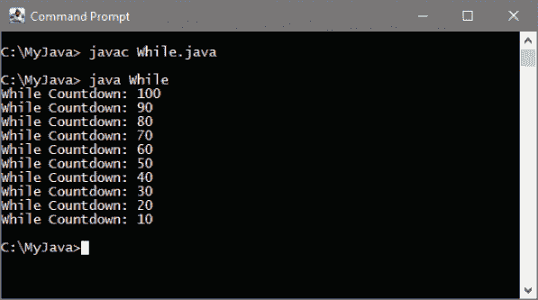


该更新器中的赋值操作是 `num = ( num - 10 )` 的简写。

## 执行 do-while 循环

`while` 循环结构的一种变体（见此处）使用 `do` 关键字创建一个具有如下语法的循环：

```java
do
{
    statements-to-be-executed-on-each-iteration ;
}
while ( test-expression ) ;
```


与 `for` 循环和 `while` 循环一样，`do while` 循环重复执行其包含的语句，直到满足测试条件——然后循环结束，程序继续执行下一个任务。

与 `for` 循环和 `while` 循环不同，`do while` 的测试表达式出现在包含执行语句的块之后。测试表达式在循环的每次迭代结束时被评估是否为布尔值 `true`。当评估返回 `true` 时，继续下一次迭代；但当返回 `false` 时，循环立即终止。这意味着 `do while` 循环中的语句至少会被执行一次。

请注意，如果测试表达式在第一次评估时返回 `false`，循环语句已经执行过一次。

`do while` 循环也可以构造成类似于 `for` 循环的结构，通过在测试表达式中评估计数器变量，实现方法是将计数器初始化放在循环结构外部，并将更新器放在语句块内部——就像 `while` 循环一样。

所有仅包含一条待执行语句的 `for`、`while` 或 `do while` 循环结构都可以选择性省略语句周围的大括号。但如果省略了，以后向循环中添加额外语句时，你需要添加大括号。

选择 `for`、`while` 还是 `do while` 循环很大程度上取决于个人的编码偏好和目的。`for` 循环结构方便地将计数器初始化、测试表达式和更新器放置在 `for` 关键字后的括号中。`while` 循环结构可以更简洁——但你必须在循环语句中包含一个更新器以避免无限循环。`do while` 循环仅仅增加了一个优点，即在评估测试表达式之前执行一次其语句——正如右侧描述的 `do while` 循环所示。


始终将循环要执行的语句包含在大括号内——以保持代码的清晰度并提高代码的可维护性。


### 创建一个名为“DoWhile”的新程序，其中包含标准的 `main` 方法

```java
class DoWhile
{
    public static void main ( String[] args ) { }
}
```


DoWhile.java


### 在 `main` 方法内部声明并初始化一个名为 `num` 的整数变量

```java
int num = 100 ;
```


### 添加一个 `do while` 循环，当 `num` 变量小于 10 时显示其当前值

```java
do
{
    System.out.println( “DoWhile Countup: ” + num )
}
while ( num < 10 ) ;
```


### 在 `while` 循环块的末尾插入一个更新器，每次迭代将 `num` 变量的值减少 10——从而避免无限循环

```java
num -= 10 ;
```


### 将程序保存为 `While.java`，然后编译并运行程序查看输出

## 跳出循环

`break` 关键字用于满足特定条件时提前终止循环。`break` 语句位于循环块内部，并跟在一个测试表达式。例如，在嵌套循环中，它会进入下一个任务。


### 创建一个名为“Break”的程序，包含标准的 `main` 方法

```java
class Break
{
    public static void main ( String[] args ) { }
}
```


Break.java


### 在 `main` 方法内部创建两个嵌套的 `for` 循环，在每次迭代中显示它们的计数器值

```java
for ( int i = 1 ; i < 4 ; i++ )
{
    for ( int j = 1 ; j < 4 ; j++ )
    {
        System.out.println( “Running i=”+i+“ j=”+j )
    }
}
```


### 将程序保存为 `Break.java`，然后编译并运行程序查看输出

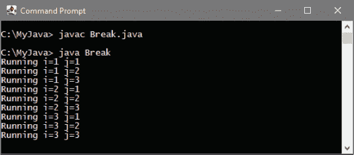

该程序对外部循环进行了三次迭代，每次迭代都执行内部循环。可以添加 `break` 语句来停止内部循环的第二次执行。

```java
for ( int i = 1 ; i < 4 ; i++ )
{
    for ( int j = 1 ; j < 4 ; j++ )
    {
        if ( i == 2 && j == 1 )
        {
            System.out.println( “Breaks innerLoop when i=”+i+“ j=”+j )
            break ;
        }
    }
}
```

`continue` 关键字用于满足特定条件时跳过循环的单次迭代。`continue` 语句位于语句块内部，并跟在一个测试表达式。当测试返回 `true` 时，该迭代结束。

```java
for ( int i = 1 ; i < 4 ; i++ )
{
    for ( int j = 1 ; j < 4 ; j++ )
    {
        if ( i == 1 && j == 1 )
        {
            System.out.println( “Continues innerLoop when i=”+i+“ j=”+j )
            continue;
        }
    }
}
```

`break` 和 `continue` 关键字的默认行为可以更改，通过指明标签名称来显式指定控制流返回到带标签的外层循环。这允许循环执行迭代，直到满足指定的条件或被中断。


标记循环的语法需要一个标签名称，后跟一个冒号 `:`，放在循环结构开始之前。


### 启动一个名为“Label”的新程序，其中包含标准的 main 方法

```java
class Label
{
    public static void main ( String[] args ) { }
}
```


Label.java


### 在 main 方法内部，创建两个嵌套的 `for` 循环，在三次迭代中的每次中显示它们的计数器值

```java
for ( int i = 1 ; i < 4 ; i++ )
{
    for ( int j = 1 ; j < 4 ; j++ )
    {
        System.out.println( “Running i=”+i+ “ j=”+j ) ;
    }
}
```


### 将程序保存为 `Label.java`，然后编译并运行程序以查看输出

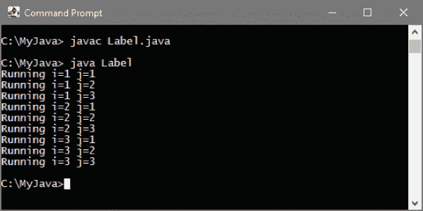


### 修改外层循环的开头，将其标记为“outerLoop”

```java
outerLoop : for ( int i = 1 ; i < 4 ; i++ )
```

要显式指定程序应在外层循环中继续，在 `continue` 关键字之后写上该循环的标签名称。


### 将此 `continue` 语句添加到内层循环语句的开头，以便进入外层循环的下一次迭代——然后重新编译并运行程序

```java
if ( i == 1 && j == 1 )
{
    System.out.println( “Continues outerLoop when i=” +i+ “ j=” +j ) ;
    continue outerLoop ;
}
```

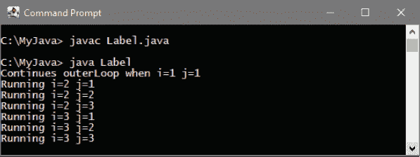


在这里，`continue` 语句停止了内层循环首次运行的所有三次迭代——通过将控制权返回外层循环。

要显式指定程序应从外层循环退出，在 `break` 关键字之后写上该循环的标签名称。


### 将此 `break` 语句添加到内层循环语句的开头，以便退出外层循环——然后重新编译并运行程序

```java
if ( i == 2 && j == 3 )
{
    System.out.println( “Breaks outerLoop when i=” +i+ “ j=” +j ) ;
    break outerLoop ;
}
```

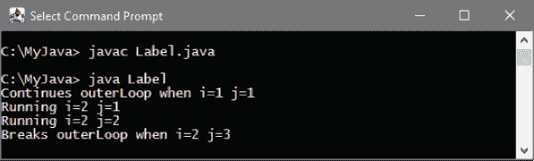


在这里，`break` 语句停止了整个循环结构的所有后续迭代——通过退出外层循环。

## 总结

- `if` 关键字执行条件测试，以评估表达式的布尔值为 `true` 或 `false`。
- `if` 语句块可以包含一个或多个语句，这些语句仅在测试表达式返回 `true` 时执行。
- `else` 关键字指定了当 `if` 关键字执行的测试返回 `false` 时执行的备选语句。
- 组合 `if else` 语句允许程序通过条件分支的过程继续运行。
- `switch` 语句通常可以通过提供 `case` 选项为难以管理的 `if else` 语句提供一种优雅的解决方案。
- 每个 `case` 选项都可以由 `break` 关键字终止，这样只有与该选项相关的语句会被执行。
- `default` 关键字可以指定在所有 `case` 选项都返回 `false` 时执行的语句。
- 循环重复执行其包含的语句，直到测试表达式返回 `false` 为止。
- `for` 关键字后面的括号指定了循环的计数器初始化器、测试表达式和计数器更新器。
- `while` 循环和 `do while` 循环中的语句必须更改其测试表达式中使用的值，以避免死循环。
- 测试表达式在 `for` 循环和 `while` 循环的开始处评估——在循环第一次迭代之前。
- 测试表达式在 `do while` 循环的结束处评估——在循环第一次迭代之后。
- 使用 `continue` 关键字可以跳过循环迭代。
- 使用 `break` 关键字可以终止循环。
- 嵌套的内层循环可以使用标签配合 `break` 和 `continue` 关键字来引用外层循环。

## 4 值的引导

*本章演示了如何使用各种 Java 编程结构来引导数据值。*

- 类型值转换
- 创建变量数组
- 传递参数
- 传递多个参数
- 遍历元素
- 更改元素值
- 添加数组维度
- 捕获异常
- 总结

### 类型值转换

在 Java 中处理值需要一个类型以便进行处理。


数值值可以以以下语法轻松转换为另一种数据类型：

```java
(type)value
```

将 `float` 转换为 `int` 时会发生某些精度损失。


例如，将 9.9 的 `float` 转换为 `int` 会截断小数部分。

数值可以使用该类型的 `toString()` 方法转换为 `String`：

```java
Integer.toString(num)
```

同样，将 `float num` 转换为 `String`：

```java
Float.toString(num)
```

在实践中这并不总是需要的，因为如果变量是 `String`，Java 会自动转换。

## 总结

更多时候，你会希望将 `String` 值转换为数值类型以便程序对其进行运算。`String` 值可以使用 `Integer.parseInt()` 方法转换为 `int` 值。该方法接收 `String` 值作为参数：

```java
Integer.parseInt(msg)
```

同样，使用 `Float.parseFloat()` 将 `String` 转换为 `float`：

```java
Float.parseFloat(msg)
```

当将 `String` 值转换为数值类型时，该 `String` 只能包含有效的数值，否则编译器将报告错误。所有数值类都有一个 `parse...` 方法和一个 `toString` 方法，允许在 `String` 值和数值类型之间进行转换。


### 启动一个名为“Convert”的新程序，其中包含标准的 main 方法

```java
class Convert
{
    public static void main ( String[] args ) { }
}
```


Convert.java

在 main 方法内部，声明并初始化一个 `float` 变量和一个 `String` 变量：

```java
float daysFloat = 365.25f;
String weeksString = “52”;
```

将 `float` 值转换为 `int` 变量：

```java
int daysInt = (int) daysFloat;
```

将 `String` 值转换为 `int` 变量：

```java
int weeksInt = Integer.parseInt(weeksString);
```

```java
int week = ( daysInt / weeksInt ) ;
System.out.println( “Days per week: “ + week ) ;
```


### 将程序保存为 `Convert.java`，然后编译并运行程序以查看输出。

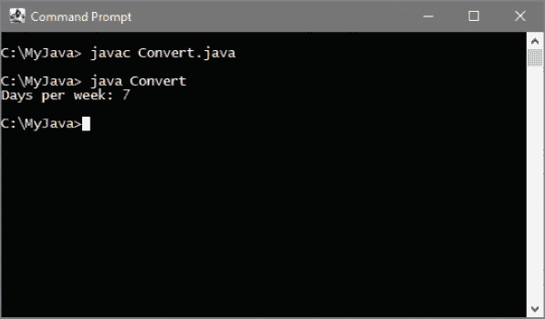

## 创建变量数组

数组简单来说是一个可以包含多个值的变量——这与只能包含单个值的普通变量不同。


数组的声明首先说明其数据类型，使用数据类型关键字之一，随后紧跟一个方括号 `[]` 以表示它是一个数组变量。接下来，声明会写数组变量名，并遵循标准的命名规范。

可以在声明时通过通过逗号分隔的列表分配适宜数据类型的值来初始化数组，该列表包含在花括号 `{ }` 中。例如，一个初始化了三个值的整数数组变量的声明可能如下所示：

```java
int[] numbersArray = { 1, 2, 3 } ;
```


# 数组

数组创建的长度等于分配列表的长度，允许每个值对应一个“元素”——在这种情况下，它是一个包含三个元素的数组。

存储的值从零开始索引，每个值都可以通过其元素索引位置进行访问。这种操作的语法要求在数组名后跟一个包含元素索引的方括号。例如，`numbersArray[0]` 将访问上述示例中存储的第一个值 (1)。

虽然每个元素存储的值可以像普通变量一样简单地更改，但数组的大小是由其声明决定的，之后无法更改。有用的是，数组中元素的总数以整数形式存储在该数组的 `length` 属性中。访问该数字的语法只需在数组名后加上一个点和“length”即可。例如，`numbersArray.length` 将返回上述示例中数组的大小——在这种情况下，为整数 3。

数组也可以通过 `new` 关键字创建一个指定大小的空数组“对象”，从而在声明时不分配初始值列表来声明一个空数组。所需的空元素数量在适宜数据类型后的方括号内的赋值语句中指定。例如，一个具有三个元素的空整数数组变量的声明可能如下所示：

```java
int[] numbersArray = new int[3];
```

`int` 和 `float` 数据类型的元素被分配默认值 0，`String` 数据类型为 `null`，`char` 数据类型为 `\0`，`boolean` 数据类型为 `false`。


记住数组索引从零开始。这意味着 `index[2]` 访问数组中的第三个元素，而不是第二个元素。

## 示例：Array 程序

 启动一个名为“Array”的新程序，包含标准的 main 方法

```java
class Array {
    public static void main(String[] args) { }
}
```

 Array.java

 在 main 方法内部，声明并初始化一个具有三个元素的 `String` 数组

```java
String[] str = { "Much ", "More", " Java" };
```

 声明一个具有三个元素的空整数数组

```java
int[] num = new int[3];
```

 给前两个整数数组元素赋值

```java
num[0] = 100;
num[1] = 200;
```

 给第二个 String 数组元素赋新值

```java
str[1] = "Better";
```

 输出每个数组的长度以及每个数组所有元素的内容

```java
System.out.println("String array length is " + str.length);
System.out.println("Integer array length is " + num.length);
System.out.println(num[0] + "," + num[1] + "," + num[2]);
System.out.println(str[0] + str[1] + str[2]);
```

 将程序保存为 `Array.java`，然后编译并运行程序以查看输出。

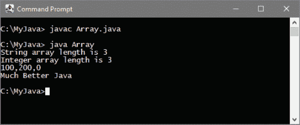

 `String` 值需要包含在引号内。

# 传递参数

声明程序 `main` 方法的标准 Java 代码在其括号内包含一个参数，该参数创建一个 `String` 数组，传统命名为“args”：

```java
public static void main(String[] args) { }
```


`args[]` 数组的目的是在调用程序运行时允许将值传递给程序。在命令行上，传递给程序的值添加在程序名后的单个空格之后。例如，向名为“Run”的程序传递 `String` 值“Java”的命令是 `Run Java`。

传递给程序的单个值会自动放置在 `args[]` 数组的第一个元素中，因此程序可以通过 `args[0]` 访问它。

## 示例：Args 程序（单参数）

 启动一个名为“Array”的新程序，包含标准的 main 方法

```java
class Array {
    public static void main(String[] args) { }
}
```

 Array.java

 在 main 方法内部，声明并初始化一个具有三个元素的 `String` 数组

```java
String[] str = { "Much ", "More", " Java" };
```

 声明一个具有三个元素的空整数数组

```java
int[] num = new int[3];
```

 给前两个整数数组元素赋值

```java
num[0] = 100;
num[1] = 200;
```

 给第二个 String 数组元素赋新值

```java
str[1] = "Better";
```

 输出每个数组的长度以及每个数组所有元素的内容

```java
System.out.println("String array length is " + str.length);
System.out.println("Integer array length is " + num.length);
System.out.println(num[0] + "," + num[1] + "," + num[2]);
System.out.println(str[0] + str[1] + str[2]);
```

 将程序保存为 `Array.java`，然后编译并运行程序以查看输出。


 `String` 值需要包含在引号内。

# 传递多个参数

可以在命令行向程序传递多个参数，跟在程序名和空格之后。参数之间必须由至少一个空格，其值将按顺序放入 `args[]` 数组的元素中。然后可以像任何其他数组一样通过索引数字访问每个值——`args[0]` 是第一个参数，`args[1]` 是第二个参数，依此类推。

该程序可以测试 `args[]` 数组的 `length` 属性，以确保用户输入了数量参数。当测试失败时，可以使用 `return` 关键字退出 `main` 方法，从而退出程序：

## 示例：Args 程序（多参数）

 启动名为“Args”的新程序，包含标准的 main 方法

```java
class Args {
    public static void main(String[] args) { }
}
```

 Args.java

 在 main 方法内部，编写一个 `if` 语句，当没有从命令行 `args[]` 数组中输入所需的数量参数时，输出建议并退出程序——在这种情况下，数量为三个

```java
if (args.length != 3) {
    System.out.println("Wrong number of arguments");
    return;
}
```

 在 `if` 语句下方创建两个 `int` 变量——分别初始化为第一个参数和第三个参数的值

```java
int num1 = Integer.parseInt(args[0]);
int num2 = Integer.parseInt(args[2]);
```

 添加一个 `String` 变量，初始化为所有三个参数的拼接

```java
String msg = args[0] + args[1] + args[2] + "=";
```

 `return` 关键字退出当前方法。它还可以将值返回到调用方法的地方。更多详情请参阅此处。

 添加此 `if else` 语句对参数进行算术运算，并将结果附加到 `String` 变量

```java
if (args[1].equals("+"))             msg += (num1 + num2);
else if (args[1].equals("-"))        msg += (num1 - num2);
else if (args[1].equals("x"))        msg += (num1 * num2);
else if (args[1].equals("/"))        msg += (num1 / num2);
else msg = "Incorrect operator";
```

 在 main 方法末尾插入此行以显示附加的 `String`

```java
System.out.println(msg);
```

 将程序保存为 `Args.java`，然后使用三个参数编译并运行程序——一个整数、任何算术符号 + - x /，以及另一个整数

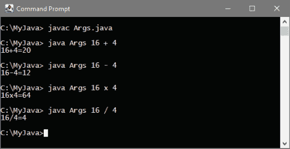

 现在，使用错误的第二个参数和错误的参数数量运行程序

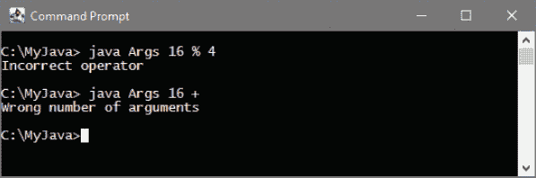

 如果输入了非数值，此程序将报告错误。关于如何捕获错误的详情，请参阅此处。

# 遍历元素

所有类型的循环都可以轻松读取存储在数组元素中的所有值。循环计数器应该从第一个元素的索引开始，然后一直进行到最后一个索引。数组中最后一个元素的索引始终比数组长度少 1——因为索引从零开始。


将数组的 `length` 属性设置为循环的条件测试，以确定循环何时结束是很有用的。这意味着循环将持续到计数器值超过数组最后一个元素的索引。

## 示例：Loops 程序

 启动名为“Loops”的新程序，包含标准的 main 方法

```java
class Loops {
    public static void main(String[] args) { }
}
```

 Loops.java

 在 main 方法内部，编写一个 `if` 语句，测试是否从命令行向 `args[]` 数组输入了任何参数值

```java
if (args.length > 0) { }
```

 在 `if` 语句的大括号内插入一个 `for` 循环，输出存储在每个元素中的值

```java
for (int i = 0; i < args.length; i++) {
    System.out.println("args[" + i + "] is | " + args[i]);
}
```

 将程序保存为 `Loops.java`，然后编译程序并使用参数 `Java in easy steps` 运行

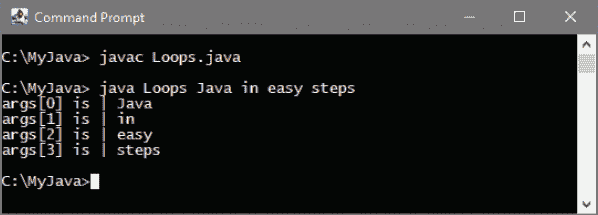

 编辑 `Loops.java` 以添加一个 `String` 数组和一个 `while` 循环，输出存储在每个元素中的值

```java
String[] htm = { "HTML", "in", "easy", "steps" };
int j = 0;
while (j < htm.length) {
    System.out.println("htm[" + j + "] is | " + htm[j]);
    j++;
}
```

 保存更改，然后重新编译并重新运行程序

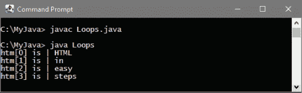

 编辑 `Loops.java` 添加一个 `String` 数组和一个 `do-while` 循环来输出存储在每个元素中的值

```java
String[] htm = { "HTML", "in", "easy", "steps" };
int j = 0;
do {
    System.out.println("htm[" + j + "] is | " + htm[j]);
    j++;
} while (j < htm.length);
```

 保存更改，然后重新编译并重新运行程序


`return` 关键字退出当前方法。它还可以将值返回到调用方法的地方。更多详情请参阅此处。


添加此 `if else` 语句对参数进行算术运算，并将结果附加到 `String` 变量：

```java
if (args[1].equals("+")) {
    msg += (num1 + num2);
} else if (args[1].equals("-")) {
    msg += (num1 - num2);
} else if (args[1].equals("x")) {
    msg += (num1 * num2);
} else if (args[1].equals("/")) {
    msg += (num1 / num2);
} else {
    msg = "Incorrect operator";
}
```


在 `main` 方法末尾插入此行以显示附加的 `String`：

```java
System.out.println(msg);
```


将程序保存为 `Args.java`，然后使用三个参数编译并运行程序——一个整数、任何算术符号 `+ - x /`，以及另一个整数。


现在，使用错误的第二个参数和错误的参数数量运行程序。


如果输入了非数值，此程序将报告错误。关于如何捕获错误的详情，请参阅此处。

## 遍历元素

所有类型的循环都可以轻松读取存储在数组元素中的所有值。循环计数器应该从第一个元素的索引开始，然后一直进行到最后一个索引。数组中最后一个元素的索引始终比数组长度少 1——因为索引从零开始。


将数组的 `length` 属性设置为循环的条件测试，以确定循环何时结束是很有用的。这意味着循环将持续到计数器值超过数组最后一个元素的索引。


启动名为“Loops”的新程序，包含标准的 `main` 方法：

```java
class Loops {
    public static void main(String[] args) {
    }
}
```


Loops.java


在 `main` 方法内部，编写一个 `if` 语句，测试是否从命令行向 `args[]` 数组输入了任何参数值：

```java
if (args.length > 0) {
}
```


在 `if` 语句的大括号内插入一个 `for` 循环，输出存储在每个元素中的值：

```java
for (int i = 0; i < args.length; i++) {
    System.out.println("args[" + i + "] is | " + args[i]);
}
```


将程序保存为 `Loops.java`，然后编译程序并使用参数 `Java in easy steps` 运行。


编辑 `Loops.java` 添加一个 `String` 数组和一个 `while` 循环，输出存储在每个元素中的值：

```java
String[] htm = {"HTML", "in", "easy", "steps"};
int j = 0;
while (j < htm.length) {
    System.out.println("htm[" + j + "] is | " + htm[j]);
    j++;
}
```


保存更改，然后重新编译并重新运行程序。


编辑 `Loops.java` 添加一个 `String` 数组和一个 `do-while` 循环来输出存储在每个元素中的值：

```java
String[] htm = {"HTML", "in", "easy", "steps"};
int j = 0;
do {
    System.out.println("htm[" + j + "] is | " + htm[j]);
    j++;
} while (j < htm.length);
```


避免在数组中使用超过三个维度——这会令人困惑。

嵌套循环非常适合多维数组，因为每个循环层都可以寻址每个数组维度的元素。


启动一个名为“Dimensions”的新程序，包含标准的 `main` 方法：

```java
class Dimensions {
    public static void main(String[] args) {
    }
}
```


Dimensions.java


在 `main` 方法中，创建一个二维数组来存储与 XY 坐标相关的布尔标志位：

```java
boolean[][] points = new boolean[5][20];
```


在每个 X 轴上定义一个 Y 点：

```java
points[0][5] = true;
points[1][6] = true;
points[2][7] = true;
points[3][8] = true;
points[4][9] = true;
```


添加一个 `for` 循环来遍历第一个数组索引，在每次迭代末尾添加一个换行符：

```java
for (int i = 0; i < points.length; i++) {
    System.out.print("\n");
}
```


在 `for` 循环的大括号内，插入第二个 `for` 循环来遍历第二个数组索引：

```java
for (int j = 0; j < points[0].length; j++) {
}
```


在第二个 `for` 循环的大括号内，插入一条语句，根据元素的布尔值为每个元素输出一个字符：

```java
char mark = (points[i][j]) ? 'X' : '-';
System.out.print(mark);
```


将程序保存为 `Dimensions.java`，然后编译并运行程序以查看输出。

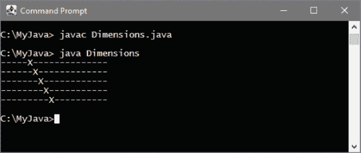


布尔变量默认为 `false`。

## 异常处理

程序可能会遇到运行时问题导致“异常”错误，这会停止其执行。通常，这是由意外的用户输入引起的。因此，一个编写良好的程序应该尝试预测用户在运行时引起异常的所有可能方式。


可能出现异常的代码可以被识别并封装在 `try-catch` 语句块中。这允许程序处理异常而不停止执行，其格式如下所示：

```java
try {
    // 可能出现异常的语句
} catch (Exception e) {
    // 响应异常的语句
}
```

`catch` 关键字后面的括号指定了要捕获的异常类，并将其赋值给变量 `e`。顶层 `Exception` 类可以捕获所有异常。然而，可以使用多个 `catch` 语句来识别不同的底层异常类，从而为特定的异常提供响应。

最常见的异常是 `NumberFormatException`（当程序遇到不符合预期数值类型的值时产生）以及 `ArrayIndexOutOfBoundsException`（当程序尝试访问超出索引范围的数组元素编号时产生）。为这些异常中的每一个创建一个单独的响应是有帮助的，以便及时通知用户问题的性质。

可选地，`try-catch` 语句块可以使用 `finally` 语句块进行扩展，其中包含始终将执行的代码——无论程序是否遇到异常。


`getMessage()` 方法返回有关已捕获异常的进一步信息。


启动一个名为“Exceptions”的新程序，包含标准的 `main` 方法：

```java
class Exceptions {
    public static void main(String[] args) {
    }
}
```


在 `main` 方法中，使用 `try` 语句输出一个整数：

```java
try {
    int num = Integer.parseInt(args[0]);
    System.out.println("You entered: " + num);
}
```


添加 `catch` 语句来处理在未提供参数运行时产生的异常：

```java
catch (ArrayIndexOutOfBoundsException e) {
    System.out.println("Integer required.");
}
```


添加 `catch` 语句来处理在带有非整数参数运行时产生的异常：

```java
catch (NumberFormatException e) {
    System.out.println("Argument is wrong.");
}
```


在程序末尾添加 `finally` 语句：

```java
finally {
    System.out.println("Program ends.");
}
```


将程序保存为 `Exceptions.java`，然后编译并运行程序，尝试引发异常。


# 本章演示了如何使用各种 Java 库方法操作程序数据。

- 探索 Java 类
- 进行数学运算
- 数字舍入
- 生成随机数
- 管理字符串
- 比较字符串
- 搜索字符串
- 操作字符
- 总结

## 探索 Java 类

Java 拥有海量的预测试代码包库，这些包按模块排列。那些提供 Java 语言本身基础功能的包包含在 `java.lang` 包中，该包位于 `java.base` 模块内。这些内容由 Java API（应用程序编程接口）自动访问。这意味着在创建程序时，`java.lang` 包提供的属性和方法是随时可用的。例如，位于 `java.base` 模块中 `java.lang` 包的 `Math` 类通过 `abs()` 方法提供的数学功能。


包的内容按层次结构排列，允许使用点表示法访问任何项。例如，`System` 类包含一个 `out` 属性（字段），该属性又包含一个 `println()` 方法——因此可以通过 `System.out.println()` 进行访问。

Java 文档提供了关于每个可用项的信息，并可用于探索 Java 类。您可以通过 `[docs.oracle.com/en/java](http://docs.oracle.com/en/java)` 在线访问，也可以下载进行离线参考。文档量大是可以可以理解的，但熟悉它是非常有价值的。一个很好的起点是 API 概览页面，其中包含了每个模块的列表以及对每个模块的简要描述：


访问 `[docs.oracle.com/en/java](http://docs.oracle.com/en/java)` 并点击 **Java SE documentation** 链接，然后点击 **API Documentation**。


查看按字母顺序排列的 **All Modules** – 点击 `java.base` 模块的链接（Java SE 的基础 API）。

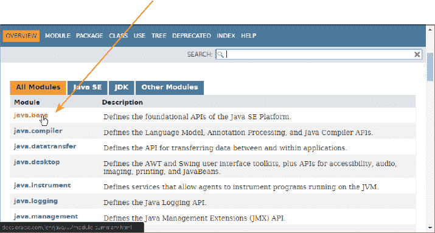


引入模块是为了提高可扩展性和增加性能。


查看每个章节中按字母顺序排列的模块 **Packages** – 向下滚动页面到“Exports”部分并点击 `java.lang` 包的链接。

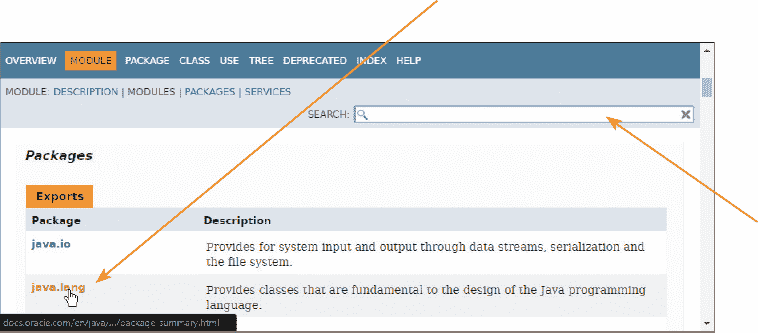


您还可以使用搜索框查找关于任何项的信息。


查看每个章节中按字母顺序排列的包 **Classes** – 向下滚动页面到“Class Summary”部分并点击 `Math` 类的链接。

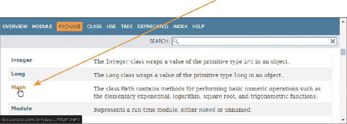


查看“Method Summary”部分中按字母顺序排列的类 **Methods** ——只需点击其链接即可发现任何方法的用途和语法。

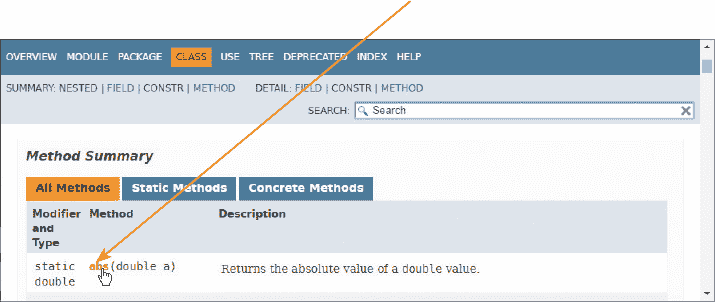


检查页面菜单上其他项可用的信息以更熟悉文档。

## 进行数学运算

`java.lang` 包中的 `Math` 类提供了两个对执行数学计算通常有用的常量值。`Math.PI` 存储 Pi 的值，`Math.E` 存储自然对数底的值。这两个常量值都存储为 `double` 精度数据类型，具有 15 位小数。


启动一个名为“Pi”的新程序，其中包含标准的 `main` 方法：

```java
class Pi {
    public static void main(String[] args) {
    }
}
```


Pi.java


在 `main` 方法中，从命令行参数声明并初始化 `float` 变量，并将 `double Math.PI` 常量转换为第二个 `float` 变量：

```java
float radius = Float.parseFloat(args[0]);
float shortPi = (float) Math.PI;
```


使用转换后的值进行数学计算，将结果分配更多的 `float` 变量：

```java
float circ = shortPi * (radius + radius);
float area = shortPi * (radius * radius);
```


输出 `Math.PI` 的值及其转换后的 `float` 等效值，随后输出计算结果：

```java
System.out.print("With Pi commuted from " + Math.PI);
```


System.out.println( “ to “ + shortPi + “...” ) ;

System.out.println( “A circle of radius “ + radius + “ cm” ) ;

System.out.print( “has a circumference of “ + circ + “ cm” ) ;

System.out.println( “and an area of ” + area + “ sq.” ) ;

将程序保存为 `Pi.java`，然后编译并运行

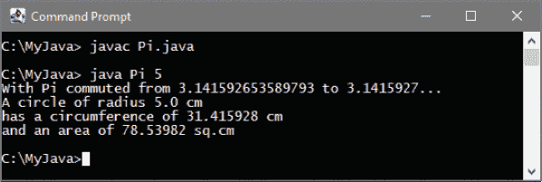


`java.lang` 包中的 `Math` 类提供了许多用于执行数学计算的方法。使用 `Math.pow()`，可以将给定的数字提升指定的幂。`Math.sqrt()` 方法返回数字的平方根。

启动一个名为“Power”的新程序，包含 main 方法

```java
class Power {

    public static void main (String[] args) { }

}
```


Power.java

在 main 方法中，从传递的参数声明并初始化 `int` 变量

```java
int num = Integer.parseInt(args[0]) ;
```

执行数学计算，将结果转换为 `int`

```java
int square = (int) Math.pow(num, 2) ;

int cube = (int) Math.pow(num, 3) ;

int sqrt = (int) Math.sqrt(num) ;
```

输出计算结果

```java
System.out.println( num + ” squared is ” + square ) ;

System.out.println( num + ” cubed is ” + cube ) ;

System.out.println( “Square root of ” + num + ” is ”+ sqrt ) ;
```

将程序保存为 `Power.java`，然后编译并运行查看输出

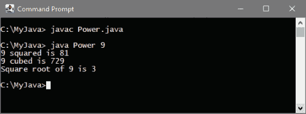


这两个示例可以通过添加 `try catch` 语句块来预测错误——见详情。

## 数字舍入

`java.lang` 包中的 `Math` 类提供了三种将浮点数舍入到最近整数的方法。其中最简单的是 `Math.round()` 方法，它将参数指定的数字向上或向下舍入到最近的整数。


`Math.floor()` 方法向下取整到整数，而 `Math.ceil()` 方法向上取整到整数。虽然 `Math.round()` 方法返回 `int` 数据类型，但 `Math.floor()` 和 `Math.ceil()` 方法都返回 `double` 数据类型。

启动一个名为“Round”的新程序，包含 main 方法

```java
class Round {

    public static void main (String[] args) { }

}
```


Round.java

在 main 方法中，声明并初始化 `float` 变量

```java
float num = 7.25f ;
```

以 `int` 值输出舍入后的 `float` 值

```java
System.out.println( num+” rounded is ”+Math.round( num ) ) ;
```

以 `double` 值输出舍入后的 `float` 值

```java
System.out.println( num+” floored is ” +Math.floor( num ) );
```

```java
System.out.println( num+“ ceiling is “ + Math.ceil( num ) ) ;
```

将程序保存为 `Round.java`，然后编译并运行程序查看输出

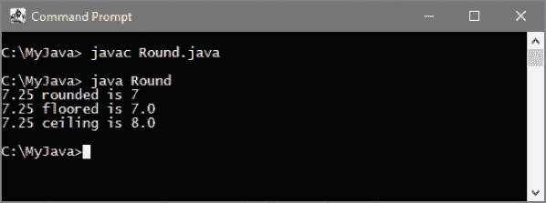


默认情况下，`Math.round()` 会四舍五入——因此 7.5 会被四舍五入为 8。

`java.lang` 包中的 `Math` 类提供了两个方法来比较两个数值。`Math.max()` 方法和 `Math.min()`方法各需要两个数字作为其参数。`Math.max()` 将较大的较大的，而 `Math.min()` 将返回较小的数字。

要比较的数字可以是任何数值数据类型，但结果将以 `double` 数据类型返回。

创建一个名为“Compare”的新程序，包含标准的 main 方法

```java
class Compare
{

    public static void main ( String[] args ) { }

}
```


Compare.java

在 main 方法中，声明并初始化一个 `float` 变量和一个 `int` 变量

```java
float num1 = 24.75f ;

int num2 = 25 ;
```

输出较大的值

```java
System.out.println( “Most is “ + Math.max( num1, num2 ) ) ;
```

输出较小值

```java
System.out.println( “Least is “ + Math.min( num1, num2 ) ) ;
```

将程序保存为 `Compare.java`，然后编译并运行程序查看输出

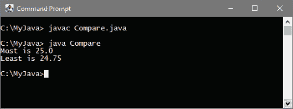

### 生成随机数

`java.lang` 包中的 `Math` 类通过其 `Math.random()` 方法提供了生成随机数的能力，该方法返回 0.0 到 0.999 之间的 `double` 精度随机数。乘以随机数可以指定更宽的范围。例如，乘以 10 将创建一个 0.0 到 9.999 之间的随机数。现在，使用 `Math.ceil()` 将随机数向上取整将确保它落在 1-10 的包含范围内。


创建一个名为“Random”的新程序，包含标准的 main 方法

```java
class Random
{

    public static void main ( String[] args ) { }

}
```


Random.java

在 main 方法中，将随机数赋值给一个 `float` 变量并输出其值

```java
float random = (float) Math.random() ;

System.out.println( “Random number: “ + random ) ;
```

将随机数的乘积赋值给第二个 `float` 变量，并输出其值

```java
float multiplied = random * 10 ;

System.out.println( “Multiplied number: “ + multiplied ) ;
```

将乘后的随机数的向上取整整数赋值给一个 `int` 变量，并输出其值

```java
int randomInt = (int) Math.ceil( multiplied ) ;

System.out.println( “Random Integer: “ + randomInt ) ;
```

将程序保存为 `Random.java`，然后编译并运行程序查看输出

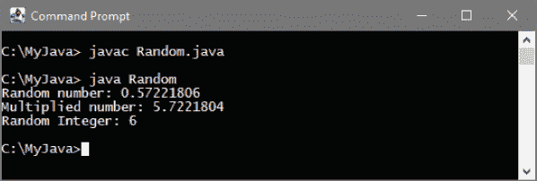


描述的彩票程序将此示例中的三个步骤合并到一个语句中。

可以使用 `Math.random()` 生成一组 1-59 范围内内的六个不重复的随机数，以产生随机彩票选择。

创建一个名为“Lottery”的新程序，包含标准的 main 方法

```java
class Lottery
{

    public static void main ( String[] args ) { }

}
```


Lottery.java

在 main 方法中，创建一个包含 60 个元素的 `int` 数组，然后用整数 1-59 填充元素 1-59

```java
int[] nums = new int[60] ;

for( int i = 1 ; i < 60 ; i++ ) { nums[i] = i ; }
```

洗乱元素 1-59 中的值

```java
for( int i = 1 ; i < 60 ; i++ )
{

    int r = (int) Math.ceil( Math.random() * 59 ) ;

    int temp = nums[i] ;

    nums[i] = nums[r] ;

    nums[r] = temp;

}
```

仅输出元素 1-59

```java
for ( int i = 1 ; i < 60 ; i++ ) {

    System.out.print( nums[i] + “ ” )

}
```

将程序保存为 `Lottery.java`，然后编译并运行程序查看输出

`java.lang` 包中的 `String` 类提供了实用的 `equals()` 方法，该方法在此处被引入，用于评估 `args[0]` 元素中的命令行参数。也可以通过使用点符号法将方法名附加到第一个 `String` 变量上，并指定要比较的 `String` 作为其参数，用来比较任何两个 `String` 值。例如，比较 `txt2` 和 `txt1` 的语法是 `txt1.equals( txt2 )`。当两个 `String` 值都具有相同的字符且顺序相同时，该方法返回 `true`；否则返回 `false`。


使用不同字母大小写的 `String` 值（例如“Java”和“JAVA”）不被认为是相等的，因为字符的 ASCII 码值不同。例如，大写字母“A”的值为 65，而小写字母“a”的值为 97。

在将用户输入的 `String` 值（用户输入的字母大小写不确定）与程序中的 `String` 值进行比较时，通常将输入转换为特定的大小写非常有用。为了此目的，`String` 类提供了 `toUpperCase()` 方法和 `toLowerCase()` 方法。将输入的 `String` 指定为参数，该方法返回转换后的 `String`。

一个典型的示例是将用户输入的密码 `String` 强制转换为小写，然后将其与程序中以全小写存储在 `String` 变量中的正确密码进行比较。这将允许用户在允许忽略大小写的情况下，以大写、小写或大小写混合输入密码。

点符号允许将方法附加到其他方法上，以便按顺序执行这些操作。这意味着可以使用 `toLowerCase().equals()` 将一个 `String` 值转换为小写，然后将该小写版本与指定的参数进行比较。


请确保在 `toUpperCase` 和 `toLowerCase` 方法中使用大写字母“C”来正确的大小写。

创建一个名为“StringComparison”的新程序，包含标准的 main 方法

```java
class StringComparison {

    public static void main ( String[] args ) { }

}
```


StringComparison.java

在 main 方法中，创建并初始化一个带有正确小写密码的 `String` 变量

```java
String password = “bingo” ;
```

添加 `try catch` 语句来捕捉未输入密码参数时发生的异常

```java
try { }

catch( Exception e ) {

    System.out.println( “Password required.” ) ;

}
```

在 `try` 语句块中插入此 `if else` 语句，以评估用户输入的密码参数

```java
if ( args[0].toLowerCase().equals( password ) ) {

    System.out.println( “Password accepted.” ) ;

}

else {

    System.out.println( “Incorrect password.” ) ;

}
```

将程序保存为 `StringComparison.java`，然后使用各种参数编译并运行程序

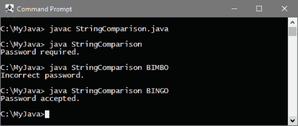

### 搜索字符串

`java.lang` 包中的 `String` 类提供了 `startsWith()` 和 `endsWith()` 方法来比较 `String` 值的部分。这些方法在比较多个 `String` 值并选择具有相同开头或相同结尾的字符串时特别有用。当 `String` 部分与指定的参数匹配时，该方法返回 `true`；否则返回 `false`。


通过将要复制的第一个字符的位置号作为其 `substring()` 方法的参数，可以复制 `String` 值的一个部分。这将返回原始 `String` 值的子字符串，从指定的起始位置开始，到原始 `String` 的末尾结束。

可选地，`substring()` 方法可以接受第二个参数，以指定要复制的最后一个字符的位置号。这将返回原始 `String` 值的子字符串，从指定的起始位置开始，到指定的结束位置结束。

可以搜索 `String` 值以找到作为其 `indexOf()` 方法参数的字符或子字符串。不同寻常的是，该方法返回匹配的字符或子字符串在所搜索的 `String` 值中首次出现的数字位置。如果未找到匹配项，该方法返回负整数值 -1。

创建一个名为“StringSearch”的新程序，包含标准的 main 方法

```java
class StringSearch {

    public static void main ( String[] args ) { }

}
```


StringSearch.java

在 main 方法中，创建一个初始化的书名 `String` 数组

```java
String[] books = {

    “Java in easy steps”, “XML in easy steps” ,

    “SQL in easy steps”, ”CSS in easy steps” ,

    “Gone With the Wind”, “Drop the Defense” } ;
```

创建并初始化三个 `int` 计数器

```java
int counter1 = 0 , counter2 = 0 , counter3 = 0 ;
```

添加一个 `for` 循环遍历 `String` 数组，输出每个标题的前四个字符

```java
for ( int i = 0 ; i < books.length ; i++ ) {

    System.out.print( books[i].substring( 0,4 ) + “ | ” )

}
```

在 `for` 循环中插入语句，计算具有特定结尾的标题

```java
if ( books[i].endsWith( “steps” ) ) counter1++;
```

在 `for` 循环中插入语句，计算具有特定开头的标题

```java
if ( books[i].startsWith( “Java” ) ) counter2++;
```


在 `for` 循环中插入语句，计算不包含特定子字符串的标题

```java
if ( books[i].indexOf( "easy" ) == -1 ) counter3++;
```

在 main 方法末尾添加这些语句，输出搜索结果

```java
System.out.println( "\nFound " + counter1 + " titles from this series" ) ;
System.out.println( "Found " + counter2 + " Java title" ) ;
System.out.println( "Found " + counter3 + " other titles" ) ;
```

将程序保存为 `StringSearch.jpg`，然后编译并运行程序查看输出

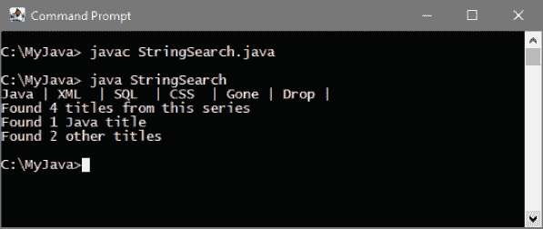


`!` 运算符不能用于测试 `indexOf()` 方法是否失败——因为它返回的是整数值，而不是布尔值。

### 操作字符

`java.lang` 包中的 `String` 类提供了 `trim()` 方法，用于移除指定参数的 `String` 首尾的空白字符。该方法将移除所有的额外空格、换行和制表符，返回处理后的 `String`。


通过将其在 `String` 中的索引位置作为其 `charAt()` 方法的参数，可以访问 `String` 中的单个字符。该方法将 `String` 视为字符数组，第一个字符位于位置零——就像其他从零开始索引的数组一样。`String` 的第一个字符可以通过 `charAt(0)` 访问，第二个字符可以通过 `charAt(1)` 访问，依此类推。

由于字符索引从零开始，`String` 的最后一个字符的索引总是比 `String` 中的字符总数少一。这意味着任何 `String` 的最后一个字符的索引号等于 `length() - 1`。因此，一个名为“str”的 `String` 的最后一个字符可以通过 `str.charAt( str.length() - 1 )` 访问。

`String` 中所有特定字符的出现都可以使用其 `replace()` 方法替换为另一个字符。该方法需要两个参数，分别指定要替换的字符和取而代之的字符。例如，要将所有的字母“a”替换为字母“z”，语法为 `replace( 'a' , 'z' )`。

`isEmpty()` 方法可以用于检测 `String` 是否不包含任何字符。如果 `String` 完全为空，该方法将返回 `true`，否则将返回 `false`。

启动一个名为“CharacterSwap”的新程序，其中包含标准的 main 方法

```java
class CharacterSwap
{
    public static void main ( String[] args ) {             }
}
```


CharacterSwap.java

在 main 方法内部，声明并初始化一个空的 `String` 变量

```java
String txt = "" ;
```

为 `String` 变量赋值一些字符，如果它确实为空，则同时包含开头和结尾的空格

```java
if ( txt.isEmpty() ) txt = "      Borrocudo      " ;
```

输出 `String` 值及其包含的字符数量

```java
System.out.println( "String: " + txt ) ;
System.out.println( "Original String Length: " + txt.length() ) ;
```

移除开头和结尾的空格，然后再次输出 `String` 值及其大小

```java
txt = txt.trim() ;
System.out.println( "String: " + txt ) ;
System.out.println( "String Length: " + txt.length() ) ;
```

输出 `String` 中的第一个字符

```java
char initial = txt.charAt(0) ;
System.out.println( "First Letter: " + initial ) ;
```

现在，输出 `String` 中的最后一个字符

```java
initial = txt.charAt( ( txt.length() -1 ) );
System.out.println( "Last Letter: " + initial ) ;
```

将所有字母“o” 替换为字母“a”

```java
txt = txt.replace( 'o' , 'a' ) ;
System.out.println( "String: " + txt ) ;
```

将程序保存为 `CharacterSwap.java`，然后编译并运行程序以查看输出

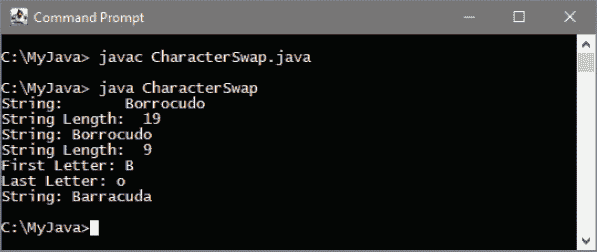

## 总结

- Java 文档提供了关于每个 Java 类中方法和属性的信息。
- 对 Java 语言至关重要的 Java 类包含在 `java.base` 模块的 `java.lang` 包中。
- `Math` 类提供了 `Math.PI` 和 `Math.E` 常量。
- `Math.pow()` 将数字提升到指定的幂，`Math.sqrt()` 返回指定数字的平方根。
- 可以使用 `Math.round()`、`Math.floor()` 和 `Math.ceil()` 将数字舍入为整数值。
- 可以使用 `Math.max()` 和 `Math.min()` 对数字进行比较。
- `Math.random()` 返回 0.0 到 0.999999999999999 之间的 `double` 精度随机数。
- `String` 是包含在引号内的零或多个字符。
- `length()` 方法返回其 `String` 的大小，类似于数组的 `length` 属性。
- `String` 的 `concat()` 方法附加另一个 `String` 值。
- `String` 的 `equals()` 方法仅当两个 `String` 值具有相同字符且顺序相同时才返回 `true`。
- 可以使用 `toUpperCase()` 方法和 `toLowerCase()` 方法更改 `String` 的字符大小写。
- 可以使用 `String` 的 `startsWith()` 和 `endsWith()` 方法比较 `String` 值。
- 可以使用 `indexOf()` 和 `substring()` 方法在 `String` 中查找子字符串。
- `isEmpty()` 方法仅在 `String` 完全没有任何内容时才返回 `true`。
- 可以使用 `String` 的 `trim()`、`charAt()` 和 `replace()` 方法操作 `String` 值中的字符。

## 创建类

***本章演示了如何创建使用多个方法和类的 Java 程序。***

- 形成多个方法
- 理解程序范围
- 形成多个类
- 扩展现有类
- 创建对象类
- 产生对象实例
- 封装属性
- 构造对象值
- 总结

### 形成多个方法

程序通常被拆分为独立的方法来创建任务，这使得更容易追踪错误，因为每个方法都可以单独测试。调用方法的语法只需要方法名，后面跟着括号。类甚至可以包含多个相同的方法，只要它们的参数不同或参数类型不同。这种用的特性被称为“重载”。

启动一个名为“Methods”的新程序，其中包含标准的 main 方法

```java
class Methods
{
    public static void main ( String[] args ) {             }
}
```


Methods.java

在 main 方法的花括号之间，插入输出消息的语句并调用名为“sub”的方法

```java
System.out.println( "Message from main method." ) ;
```

在 main 方法之后、类的花括号之前，添加输出消息的方法

```java
public static void sub()
{
    System.out.println( "Message from sub method." )
}
```

将程序保存为 `Methods.java`，然后编译并运行程序以查看输出

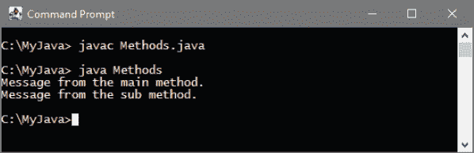


每个重载方法的声明必须指示方法返回一个 `String` 值，而不是 `void`。

启动一个名为“Overload”的新程序，其中包含标准的 main 方法

```java
class Overload
{
    public static void main ( String[] args ) {             }
}
```


Overload.java

在 main 方法的花括号之间，插入三个调用不同重载方法的语句并传递参数值

```java
System.out.println( write( 12 ) ) ;
System.out.println( write( "Twelve" ) ) ;
System.out.println( write( 4 , 16 ) ) ;
```

在 main 方法之后、类的花括号之前，添加三个重载方法，每个都向调用者返回 `String`

```java
public static String write( int num )
{
    return ( "Integer passed is " + num ) ;
}

public static String write( String num )
{
    return ( "String passed is " + num ) ;
}

public static String write( int num1 , int num2 )
{
    return ( "Sum Total is " + ( num1 * num2 ) ) ;
}
```

### 程序范围

在方法内部声明的变量只能从该方法内部访问 —— 它的访问“范围”仅限于声明该变量的方法。这意味着可以在另一个方法中声明相同名称的变量而不会产生冲突。

创建一个名为“Scope” 的新程序，其中包含标准的 main 方法

```java
class Scope
{
    public static void main ( String[] args ) {    }
}
```


Scope.java

在 main 方法的大括号之间声明并初始化一个局部 `String` 变量，然后输出它的值

```java
String txt = "This is a local variable in the main method";
System.out.println( txt ) ;
```

在 main 方法之后、类的最后一个大括号之前，添加另一个名为“sub”的方法

```java
public static void sub( ) {    }
```

在 `sub` 方法的大括号之间，声明并初始化一个与 main 方法中变量同名的局部 `String` 变量

```java
String txt = "This is a local variable in the sub method" ;
System.out.println( txt ) ;
```

在 main 方法末尾插入对 `sub` 方法的调用

```java
sub() ;
```

将程序保存为 `Scope.java`，然后编译并运行程序以查看输出

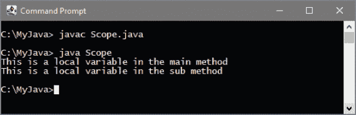


在 `for` 循环中声明的计数变量无法在循环外访问——它的作用范围局限于 `for` 语句块。

在方法声明中使用 `static` 关键字确保了该方法是一个“类方法”——可以从类中的任何其他方法全局访问。


同样，可以使用 `static` 关键字声明“类变量”，以确保它在整个类中都是全局可访问的。它的声明应该放在 `main` 方法声明之前，即紧跟在类声明的大括号之后。

一个程序可能拥有具有同名的全局类变量和局部方法变量。除非使用类类名前缀通过点号表示法显式地访问全局类变量，或者没有声明该同名的局部变量，否则局部方法变量具有优先级。

编辑 `Scope.java`，插入一个与局部方法变量同名的全局类 `String` 变量常量

```java
final static String txt = "This is a global variable of the Scope class" ;
```

在 main 方法末尾添加一条语句输出全局类变量的值

```java
System.out.println( Scope.txt ) ;
```

注释掉 `sub` 方法中声明局部变量的行——这样输出语句现在将访问同名的全局变量

```java
//String txt = "This is a local variable in the sub method" ;
```

保存更改，然后重新编译程序并再次运行以查看修改后的输出

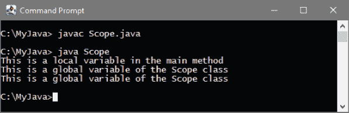


尽可能使用局部方法变量以避免冲突——全局类变量通常只用于常量。

## 形成多个类

与程序可以有多个方法一样，较大的程序可能由几个类组成——每个类提供特定的功能。这种模块化的格式通常比在单个类中编写整个程序要好，因为它使得调试更容易，并提供了更好的灵活性。


在声明中出现的 `public` 关键字是一个“访问修饰符”，它决定了项目对其他类的可见性。它可以在类声明中使用，以显式确保该类对任何其他类都可见。如果省略它，默认的访问控制级别允许从其他本地类访问。然而，`public` 关键字必须与程序的 `main` 方法一起使用，以便该方法对编译器可见。

创建一个名为“Multi” 的新程序，其中包含标准的 main 方法——按照惯常包含 `public` 关键字

```java
class Multi
{
    public static void main ( String[] args ) {    }
}
```


Multi.java

在 main 方法的大括号之间声明并初始化一个 `String` 变量，然后输出它的内容

```java
String msg = "This is a local variable in the Multi class" ;
System.out.println( msg ) ;
```

从名为“Data”的类中输出名为“txt”的类 `String` 变量常量

```java
System.out.println( Data.txt ) ;
```

从 `Data` 类调用名为“greeting”的方法

```java
Data.greeting() ;
```

从名为“Draw”的类调用名为“line”的方法

```java
Draw.line() ;
```

将程序保存为 `Multi.java`


编译器将自动在相邻的外部 `.java` 文件查找类——并每个类创建编译后的 `.class` 文件。

在一个新文件中创建 Data 类

```java
class Data
}
```


Data.java

声明并初始化一个 `public` 类常量

```java
public static String txt = "This is a global variable";
```

添加 `public` “greeting”类方法

```java
public static void greeting() {
    System.out.print("This is a global method");
    System.out.println("of the class");
}
```

将文件保存为 `Data.java` 并与 `Multi.java` 程序位于同一目录下

在一个文件中创建 `Draw` 类和一个默认访问的“line”方法——不使用 `public` 关键字

```java
class Draw {
    static void line() {
        System.out.println();
    }
}
```


Draw.java

将文件保存为 `Draw.java` 并与 `Multi.java` 程序位于同一目录下，然后编译并运行程序以查看输出

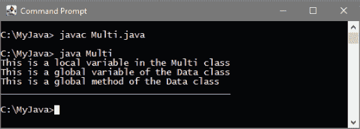


`public` 关键字允许从任何其他类访问，但默认访问只允许从相同包中的类访问。

## 扩展现有类

类可以通过在类声明中使用 `extends` 关键字指定要继承的类的名称来继承另一个类的特征。例如，`class Extra extends Base` 继承自 `Base` 类。


继承类被称为“子”类，而它继承的类被称为“父”类。在上面的例子中，`Base` 类是父类，`Extra` 类是子类。

父类中创建的方法和变量通常可以被认为存在于子类中，只要它们没有被声明为 `private` 关键字（该关键字会拒绝类外部访问）。

子类中的方法将覆盖其父类中同名的方法，除非它们的参数不同。父类中的方法可以使用其类名和点号表示法显式地访问——例如 `SuperClass.run()`。

需要注意的是，父类中方法内的 `try catch` 语句不会捕获子类中发生的异常——调用语句必须封装在自己的 `try catch` 语句中以捕获这些异常。

创建一个名为“SuperClass” 的新类

```java
class SuperClass { }
```


SuperClass.java

在类的大括号之间添加一个输出标识性 `String` 方法

```java
public static void hello() {
    System.out.println("Hello from the Super Class");
}
```

添加第二个方法尝试输出传递的参数，然后将文件保存为 `SuperClass.java`

```java
public static void echo(String arg) {
    try {
        System.out.println("You entered: " + arg);
    } catch (Exception e) {
        System.out.println("Argument required");
    }
}
```

启动一个名为“SubClass”的新程序，继承自 `SuperClass` 类

```java
class SubClass extends SuperClass {
    public static void main(String[] args) { }
}
```


SubClass.java

在 `main` 方法之后，添加一个输出标识 `String` 的方法，重写与同名的继承方法

```java
public static void hello() {
    System.out.println("Hello from the Sub Class");
}
```

在 `main` 方法的大括号之间，插入对重写方法的调用，然后显式地调用父类中同名的方法

```java
hello();
SuperClass.hello();
```

添加对另一个继承方法的调用

```java
echo(args[0]);
```

将程序保存为 `SubClass.java`，然后在不带命令行参数的情况下编译并运行程序

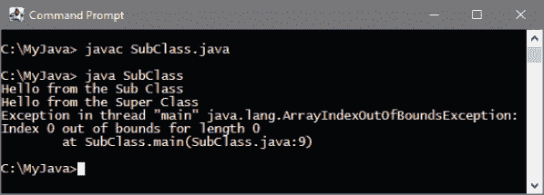

编辑 `SubClass.java`，将步骤 7 中的方法调用封装在它自己的 `try catch` 语句中以捕获异常，然后重新编译并运行程序以查看问题是否解决


你可以在此处找到更多关于捕获异常的信息。

## 创建对象类

现实世界中的对象无处不在，它们各具有我们可以描述的属性和行为：

* 属性描述了对象拥有的特征。
* 行为描述了对象可以执行的操作。


例如，一辆汽车可以被描述为具有“红色”和“轿车”属性，以及一个“加速”行为。

这些特征在 Java 程序中可以通过一个 `Car` 类来表示，该类包含变量属性 `color` 和 `bodyType`，以及一个 `accelerate()` 方法。


Java 被认为是一种面向对象编程（OOP）语言，因为它大量使用对象的属性和行为来执行程序任务。

Java 中对象的创建是通过定义一个类作为模板的，从该模板可以创建出不同的副本，或“实例”。

类的每个实例都可以通过分配属性值和行为进行自定义，以描述该对象。

`Car` 类在右侧描述的步骤中被创建为类模板——具有上述概述的默认属性和行为。在此处描述的步骤中创建 `Car` 类的实例，它继承了相同的默认属性和行为。

启动一个名为“Car”的新模板类

```java
class Car { }
```


FirstObject.java

在 `Car` 类的大括号之间，声明并初始化两个描述属性的全局 `String` 常量

```java
public final static String color = "Red";
public final static String bodyType = "Coupe";
```

添加一个描述行为的全局方法

```java
public static String accelerate() {
    String motion = "Accelerating -->";
    return motion;
}
```

在 `Car` 类之后，启动一个名为“FirstObject”的新程序类，包含标准的 `main` 方法

```java
class FirstObject {
    public static void main(String[] args) { }
}
```

在 `main` 方法的大括号之间，插入语句输出每个 `Car` 属性的值并调用其行为方法

```java
System.out.println("Paint is " + Car.color);
System.out.println("Style is " + Car.bodyType);
System.out.println(Car.accelerate());
```

将程序保存为 `FirstObject.java`，然后编译并运行程序查看输出

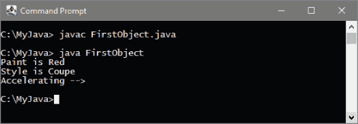


`static` 关键字声明类变量和类方法——在这种情况下，它们是 `Car` 类的成员。


对象类通常在包含 `main` 方法的程序类之前创建。

## 生成对象实例

每个类都有一个内置的“构造”方法，可用于创建该类的新实例。构造方法的方法名与类名相同，并使用 `new` 关键字调用。


类的每个实例都继承属性和行为。继承原理贯穿 Java，以便程序可以使用现成的属性。为了提高灵活性，对象类定义可以在包含程序的其他文件中。这意味着它们可以被多个程序随时使用。

现在，重复上一个示例中的 `Car` 类对象模板：

```java
class Car {
    public final static String color = "Red";
    public final static String bodyType = "Coupe";
    public static String accelerate() {
        String motion = "Accelerating -->";
        return motion;
    }
}
```

将文件保存为 `Car.java`

```java
class FirstObject {
    public static void main(String[] args) { }
}
```


FirstInstance.java

在 `main` 方法的大括号之间，插入语句输出每个 `Car` 属性的值并调用其行为方法

```java
System.out.println("Paint is " + Car.color);
System.out.println("Style is " + Car.bodyType);
System.out.println(Car.accelerate());
```

现在，添加一条语句创建一个 `Car` 类的 `Porsche` 实例

```java
Car Porsche = new Car();
```

添加语句输出每个 `Porsche` 属性继承的值并调用其行为方法

```java
System.out.println("Porsche paint is " + Porsche.color);
System.out.println("Porsche style is " + Porsche.bodyType);
System.out.println(Porsche.accelerate());
```

将程序保存为 `FirstInstance.java` 并与 `Car.java` 模板文件一起，然后编译并运行程序查看输出

在声明对象变量和方法时，可以使用 `private` 关键字，以保护它们免受外部程序代码的操纵。该对象应包含 `public` 方法来获取值并调用这些方法。这种技术整洁地将变量和方法封装在对象结构内部。接下来的步骤将演示如何重现之前的示例——但使用了经过封装的属性和方法：

创建一个名为“Car”的新类

```java
class Car { }
```


SafeInstance.java

在类的大括号之间，声明三个 `private` `String` 变量来存储对象属性

```java
private String maker;
private String color;
private String bodyType;
```

添加一个描述行为的 `private` 方法

```java
private String accelerate() {
    String motion = "Accelerating -->";
    return motion;
}
```

添加一个 `public` 方法，将传递的参数值赋值给每个 `private` 变量

```java
public void setCar(String brand, String paint, String style) {
    maker = brand;
    color = paint;
    bodyType = style;
}
```

添加另一个 `public` 方法来获取 `private` 变量的值并调用 `private` 方法

```java
public void getCar() {
    System.out.println(maker + " paint is " + color);
    System.out.println(maker + " style is " + bodyType);
    System.out.println(maker + " is " + accelerate() + "\n");
}
```

在 `Car` 类结束后，启动另一个名为“SafeInstance”的类，包含标准的 `main` 方法

```java
class SafeInstance {
    public static void main(String[] args) { }
}
```

在 `main` 方法的大括号之间，插入一条语句创建 `Car` 类的实例

```java
Car Porsche = new Car();
```

添加一条调用 `Car` 类 `public` 方法的语句，为其 `private` 变量赋值

```java
Porsche.setCar("Porsche", "Red", "Coupe");
```

现在，添加一条语句调用 `Car` 的另一个 `public` 方法来获取存储的属性值并调用 `private` 行为方法

```java
Porsche.getCar();
```

创建另一个实例，进行赋值和取值

```java
Car Bentley = new Car();
Bentley.setCar("Bentley", "Green", "Saloon");
Bentley.getCar();
```

将程序保存为 `SafeInstance.java`，然后编译并运行程序查看输出

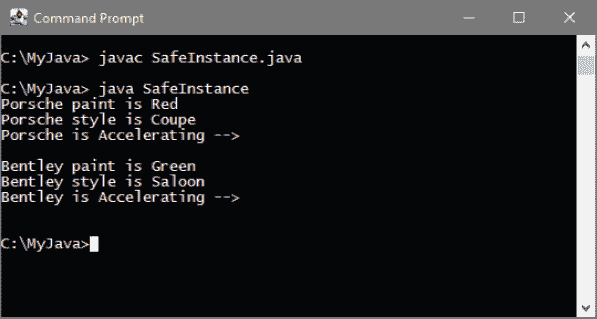


未初始化的 `String` 变量值为 `null` —— 因此在调用 `setCar()` 之前调用 `getCar()` 方法将从每个变量返回 `null`。

### 配置对象值

对象的构造方法可以直接在对象类中调用，以初始化对象变量。这有助于将声明与赋值分离，被认为是一种良好的编程风格。接下来的步骤将演示如何重现之前的示例，并使用了封装的属性和方法——以及通过构造函数进行初始化：

创建一个名为“Car”的新类

```java
class Car { }
```


Constructor.java

在类的大括号之间，声明三个 `private` `String` 变量来存储对象属性

```java
private String maker;
private String color;
private String bodyType;
```

添加一个构造方法，用属性值初始化所有三个变量

```java
public Car() {
    maker = "Porsche";
    color = "Silver";
    bodyType = "Coupe";
}
```

添加一个描述行为的 `private` 方法

```java
private String accelerate() {
```


String motion = “Accelerating -->” ;

return motion ;

}

```


添加一个 `public` 方法，将传递的参数值赋值给每个 `private` 变量

```java
public void setCar( String brand , String paint , String style )
{
    maker = brand ;
    color = paint ;
    bodyType = style ;
}
```


构造方法的声明没有指定任何返回数据类型。


添加另一个 `public` 方法来获取 `private` 变量的值并调用 `private` 方法

```java
public void getCar()
{
    System.out.println( maker + ” paint is ” + color ) ;
    System.out.println( maker + “ style is ” + bodyType ) ;
    System.out.println( maker + “ is ” + accelerate() + ”\n” ) ;
}
```


在 `Car` 类结束后，启动另一个名为“Constructor”的类，包含标准的 main 方法

```java
class Constructor
{
    public static void main ( String[] args ) {}
}
```


在 main 方法的大括号之间，插入一条语句创建 `Car` 类的实例并获取初始值

```java
Car Porsche = new Car() ;
Porsche.getCar() ;
```


创建另一个实例，进行赋值和取值

```java
Car Bentley = new Car() ;
Bentley.setCar( “Bentley” , ”Green” , ”Saloon” ) ;
Bentley.getCar() ;
```


将程序保存为 `Constructor.java`，然后编译并运行程序查看输出

## 总结

- 将程序分成多个方法并在需要时调用增加了灵活性，并更容易调试。
- 重载方法具有相同的名称，但参数不同。
- 在方法内部定义的变量具有局部作用域，而类变量在整个类中具有全局作用域。
- `static` 关键字用于声明类方法和类变量 ——它们在整个类中具有全局作用域。
- `public` 关键字显式允许从任何类访问。
- 类声明可以包含 `extends` 关键字，以指定它将继承的父类。
- 使用类名和点符号可以显式访问特定的类方法或类变量。
- 真实世界对象具有属性和行为，可以通过程序中的变量和方法来表示。

Java 包含一个名为 `java.io` 的包，用于处理文件输入输出过程。通过在 `.java` 文件的最开始包含 `import` 语句，可以使程序可以使用该包。在语句 `import java.io.* ;` 中可以使用通配符字符 `*` 来表示“所有类”。


`java.io` 包有一个名为 `File` 的类，用于访问文件或完成目录。必须先使用 `new` 关键字创建一个 `File` 对象，并将文件名或目录名作为构造函数的参数。例如，创建一个名为 `info` 代表名为 `info.dat` 的本地文件的 `File` 对象的语法如下：

```
File info = new File( “info.dat” ) ;
```

该文件将位于与程序相同的目录中，但参数也可以指定位于其他地方的文件路径。请注意，创建 `File` 对象并不会实际创建文件，而仅仅是表示文件的手段。

一旦创建了表示文件的 `File` 对象，就可以调用它的方法来操作文件。最实用的 `File` 对象方法列在下表中，并附有简要说明：

| `Method:` | `Returns:` |
| :--- | :--- |
| `exists()` | 如果文件存在则返回 `true` – 不存在则返回 `false` |
| `getName()` | 作为 `String` 类型的文件名 |
| `length()` | 文件中的字节数，类型为 `long` |
| `createNewFile()` | 如果能够创建新的唯一文件则返回 `true` |
| `delete()` | 如果能够成功删除文件则返回 `true` |
| `renameTo(File)` | 如果能够成功重命名文件则返回 `true` |
| `list()` | `String` 类型的文件或文件夹名称数组 |


作为构造函数参数指定的名必须包含在引号内。


启动一个新程序，导入所有 `java.io` 类的功能

```
import java.io.* ;
```


ListFiles.java


添加一个名为“ListFiles”的类，包含标准的 main 方法

```
class ListFiles
{
    public static void main( String[] args ) {      }
}
```


在 main 方法的大括号之间，插入一个语句为名为“data”的目录文件夹创建一个 `File` 对象

```
File dir = new File( “data” ) ;
```


添加一个 `if` 语句输出该文件夹中所有文件的名称，或者如果文件夹为空则输出消息

```java
if ( dir.exists() )
{
    String[] files = dir.list() ;
    System.out.println( files.length + “ files found...” ) ;
    for ( int i = 0 ; i < files.length ; i++ )
    {
        System.out.println( files[i] ) ;
    }
}
else
{
    System.out.println( “Folder not found.” ) ;
}
```


将程序保存为 `ListFiles.java`，并带上包含某些文件的“data”文件夹，然后编译并运行程序，以查看输出列出的文件名

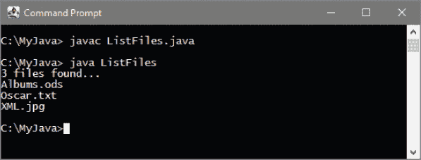

### 读取控制台输入

`java.io` 包允许程序从命令行读取输入 – 与用户交互。正如 `System.out` 字段可以将输出发送到命令行一样，`System.in` 字段可以使用 `InputStreamReader` 对象从命令行读取内容。这以字节形式读取输入，并将其转换为代表 Unicode 字符值的整数值。


为了读取整整行输入文本，`BufferedReader` 对象的 `readLine()` 方法会读取由 `InputStreamReader` 解码的字符。此方法必须在 `try catch` 语句内部调用，以捕获任何 `IOException` 问题。

通常情况下，`readLine()` 方法会将输入赋值给 `String` 变量供程序处理。


启动一个新程序，导入所有 `java.io` 类的功能

```
import java.io.* ;
```


ReadString.java


添加一个名为“ReadString”的类，包含标准的 main 方法

```
class ReadString
{
    public static void main( String[] args ) {           }
}
```


在 main 方法的大括号之间，插入一个语句输出提示用户输入的消息

```java
System.out.print( “Enter the title of this book: “ ) ;
```


添加一个创建一个 `InputStreamReader` 对象的语句，允许从命令行读取输入

```java
InputStreamReader isr = new InputStreamReader( System.in ) ;
```


创建一个 `BufferedReader` 对象来读取解码后的输入

```java
BufferedReader buffer = new BufferedReader( isr ) ;
```


声明并初始化一个空的 `String` 变量用于存储输入

```java
String input =“ ;
```


添加 `try catch` 语句从命令行读取输入并存入变量

```java
try
{
    input = buffer.readLine() ;
    buffer.close() ;
}
catch ( IOException e )
{
    System.out.println( “An input error has occurred” ) ;
}
```


输出包含存储值的消息

```java
System.out.println( “\nThanks, you are reading “ + input ) ;
```


将程序保存为 `ReadString.java` 然后编译并运行程序


输入文本，然后按回车查看输出


在不再需要时调用 `BufferedReader` 的 `close()` 方法是一个良好的习惯

### 读取文件

`java.io` 包包含一个名为 `FileReader` 的类，专门用于读取文本文件。该类是 `InputStreamReader` 的子类，可以通过将字节流转换为代表 Unicode 字符值的整数来读取输入。


为了逐行读取文本文件，可以使用 `BufferedReader` 对象的 `readLine()` 方法。此方法必须在 `try catch` 语句内部调用。

读取包含多行的文本文件的所有行通过重复调用 `readLine()` 方法来实现。在文件末尾，该调用将返回 `null` 值，可用于终止循环。


打开一个纯文本编辑器（如 Windows 记事本），编写几行文本 – 例如奥斯卡·威尔德《惩狱之歌》中的著名诗句

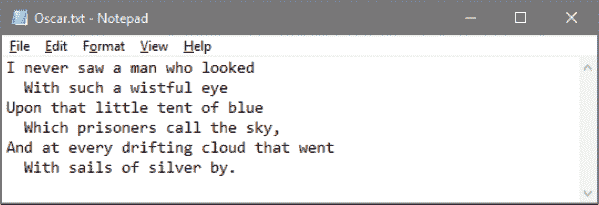


将文本文件保存为 `Oscar.txt`，然后启动一个导入所有 `java.io` 类的程序

```
import java.io.* ;
```


ReadFile.java


添加一个名为“ReadFile”的类，包含标准的 main 方法

```
class ReadFile
{
    public static void main( String[] args ) {      }
}
```


在 main 方法的大括号之间，插入一个 `try catch` 语句

```java
try {      }
catch ( IOException e )
{
    System.out.println( “A read error has occurred” ) ;
}
```


在 `try` 块的大括号之间，插入一个语句创建一个 `FileReader` 对象

```java
FileReader file = new FileReader( “Oscar.txt” ) ;
```


创建一个 `BufferedReader` 对象来读取文件

```java
BufferedReader buffer = new BufferedReader( file ) ;
```


声明并初始化一个空的 `String` 变量，用于存储一行文本

```java
String line = ““ ;
```


添加一个循环将文本文件内容读入变量中并输出每行文本

```java
while ( ( line = buffer.readLine() ) != null )
{
    System.out.println( line ) ;
}
```


记住在不再需要时关闭 `BufferedReader` 对象

```java
buffer.close() ;
```


将程序保存为 `ReadFile.java` 并与文本文件放在一起，然后编译并运行程序以查看输出

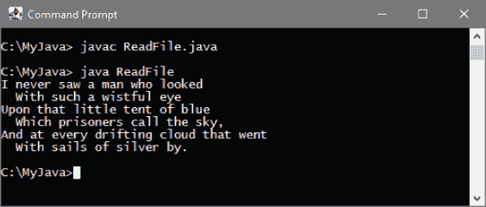


作为 `FileReader` 参数指定的文本文件必须包含在引号内。

## 写文件

在 `java.io` 包中，用于读取文本文件的 `FileReader` 和 `BufferedReader` 类有对应的 `FileWriter` 和 `BufferedWriter` 类，它们可用于写入文本文件。


使用 `new` 关键字创建 `FileWriter` 对象，并将要写入的文件名作为其参数。可选，该参数可以包含指向程序所在目录之外待写入文件的完整路径。

使用 `new` 关键字创建 `BufferedWriter` 对象，并将 `FileWriter` 对象的名称作为其参数。然后可以使用 `BufferedWriter` 对象的 `write()` 方法写入文本，并通过调用其 `newLine()` 方法将行隔开。这些方法应该在 `try catch` 语句内部调用，以捕获可能出现的任何 `IOException` 问题。

如果已存在指定名称的文件，其内容将被 `write()` 方法覆盖，否则将创建一个该名称的新文件并写入其内容。


启动一个新程序，导入所有 `java.io` 类的功能

```java
import java.io.* ;
```


WriteFile.java


添加一个名为“WriteFile”的类，包含标准的 main 方法

```java
class WriteFile
{
    public static void main ( String[] args ) {      }
}
```


在 main 方法的大括号之间插入一个 `try catch` 语句

```java
try {      }
catch ( IOException e )
{
    System.out.println( “A write error has occurred” ) ;
}
```


在 `try` 块的大括号之间插入一条语句为名为“Tam.txt”的文本文件创建一个 `FileWriter` 对象

```java
FileWriter file = new FileWriter( “Tam.txt” ) ;
```


创建一个 `BufferedWriter` 对象来写入文件

```java
BufferedWriter buffer = new BufferedWriter( file ) ;
```


添加语句向文本文件写入文本行和换行符——例如来自罗伯特·伯斯《Tam O’Shanter》的节译的诗节

```java
buffer.write( “The wind blew as if it had blown its last” ) ;
buffer.newLine() ;
buffer.write( “The rattling showers rose on its blast” ) ;
buffer.newLine() ;
buffer.write( “The speedy gleams the darkness swallowed” ) ;
buffer.newLine() ;
buffer.write( “Loud, deep and long the thunder bellowed” ) ;
buffer.newLine() ;
buffer.write( “That night a child might understand” ) ;
buffer.newLine() ;
```


buffer.write("The devil had business on his hand.");


记住在不再需要时关闭 `BufferedWriter` 对象

```java
buffer.close();
```


将程序保存为 `WriteFile.java`，然后编译并运行程序以在程序旁边写入文本文件

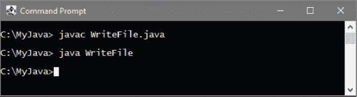

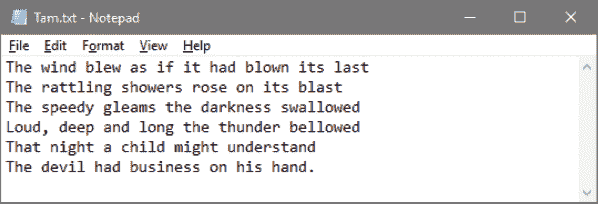


你可以调用 `BufferedWriter` 对象的 `append()` 方法来添加文本——而不是使用 `write()` 方法覆盖文本。

## 排序数组元素

Java 包含一个名为 `java.util` 的包，它为处理数据集合提供了实用工具。通过在 `.java` 文件的开头包含 `import` 语句，可以让该包对程序可用。在语句 `import java.util.* ;` 中可以使用通配符字符表示“所有类”。


`java.util` 包有一个名为“Arrays”的类，它拥有可以用于操作数组的方法。通过在 `.java` 文件的开头包含 `import` 语句，可以让该功能对程序可用。在语句 `import java.util.* ;` 中可以使用通配符字符表示“所有类”。

通过向列表的 `set()` 方法传递索引数字和新值作为参数，可以修改元素值。通过向列表的 `add()` 方法传递索引数字和值作为参数，可以在列表的特定位置添加元素。列表通过沿索引移动元素值来扩展以容纳额外的元素。

`ArrayList` 对象仅使用 `new` 关键字即可创建，但与其它 Java 集合一样，该语句必须指定列表可能包含的泛型项目类型。通常，一个列表可能包含 `String` 类型的项，因此 `ArrayList` 必须带有 `<String>` 后缀。

集合（如 `ArrayList`）拥有一个 `forEach()` 方法，该方法可以遍历列表中的每个元素。这使得遍历列表中包含的所有项变得简单。

通过指定一个“Lambda 表达式”作为 `forEach()` 方法的参数，可以方便地轮流引用每个存储的列表项。Lambda 表达式仅仅是短小的、匿名（未命名）方法，可以在它们要执行的地方指定。它们以括号开始，用于包含任何参数，然后跟上 `->` 字符序列，最后是语句块，语法如下：

```
(*argument/s*) -> { *statement/s* }
```

参数的数据类型可以显式声明，也可以从上下文中推断——`(String x)` 可以简单写为 `(x)`。此外，如果 Lambda 表达式语句块只包含一条语句，可以省略大括号。

使用列表的 `forEach()` 方法，迭代中的当前元素值可以作为参数传递给 Lambda 表达式，然后通过其语句在输出中显示。


你可以通过调用其 `size()` 方法来发现列表当前有多少个元素。


Lambda 表达式是在 Java 8 中引入的，用于实现简洁的匿名方法。


启动一个新程序，导入 `java.util.ArrayList` 类中所有方法的功能。

```java
import java.util.ArrayList ;
```


Lists.java


添加一个名为“Lists”的类，其中包含标准的 main 方法。

```java
class Lists
{
    public static void main( String[] args ) { }
}
```


在 main 方法的大括号之间，插入一条语句来创建一个名为“list”的 `String ArrayList` 对象。

```java
ArrayList<String> list = new ArrayList<String>() ;
```


接下来，添加语句用 `String` 值填充列表元素，然后显示整个列表。

```java
list.add( "Alpha" ) ;
list.add( "Delta" ) ;
list.add( "Charlie" ) ;
System.out.println( "List: " + list ) ;
```


现在，识别第二个元素中的当前值，然后将其替换为新的 `String`。

```java
System.out.println( "Replacing: " + list.get(1) + "\n" ) ;
list.set( 1, "Bravo" ) ;
```


最后，遍历列表并显示现在存储在每个元素中的 `String` 值。

```java
list.forEach( ( x ) -> System.out.println( "Item: " + x ) ) ;
```


将程序保存为 `Lists.java`，然后编译并运行程序以查看输出。


与普通数组一样，`ArrayList` 中的元素具有从 0 开始的索引。


此处引入的图形化 Java Swing `JComboBox` 组件包含一个选项列表，因此在创建该对象时也必须指定其泛型数据类型。

### 管理日期

`java.time` 包包含一个名为 `LocalDateTime` 的类，它具有实用的方法可以从 `LocalDateTime` 对象中提取描述特定时间点的特定字段。可以通过 `import java.time.LocalDateTime;` 导入特定类，或者通过使用通配符 `import java.time.* ;` 导入该包中的所有类，来供程序可用。


可以使用 `now()` 方法创建一个带有描述当前日期时间的字段的新 `LocalDateTime` 对象。这些字段根据当前区域的系统时钟初始化。

可以使用 `LocalDateTime` 对象的适当方法检索单个字段内的值。例如，可以使用其 `getYear()` 方法检索年份字段的值。同样，可以使用 `LocalDateTime` 对象的适当方法更改任何字段以指定替换值。例如，可以通过向其 `withYear()` 方法传递一个新的年份作为参数来更改年份字段的值。


启动一个新程序，导入 `java.time.LocalDateTime` 类中所有方法的功能。

```java
import java.time.LocalDateTime ;
```


DateTime.java


添加一个名为“DateTime”的类，包含 main 方法。

```java
class DateTime
{
    public static void main( String[] args ) { }
}
```


在 main 方法的大括号之间，插入一条语句来创建一个 `LocalDateTime` 对象。

```java
LocalDateTime date = LocalDateTime.now() ;
```


输出当前日期和时间。

```java
System.out.println( "It is now " + date )
```


增加年份，并输出修改后的日期。

```java
date = date.withYear( 2022 ) ;
System.out.println( "Date is now " + date )
```


输出修改后的 `LocalDateTime` 字段。

```java
String fields = "\nYear:\t\t\t" + date.getYear();
fields += "\nMonth:\t\t\t" + date.getMonth();
fields += "\nMonth Number:\t\t" + date.getMonthValue();
fields += "\nDay:\t\t\t" + date.getDayOfWeek();
fields += "\nDay Number:\t\t" + date.getDayOfMonth();
fields += "\nDay Number Of Year:\t" + date.getDayOfYear();
fields += "\nHour (0-23):\t\t" + date.getHour();
fields += "\nMinute:\t\t\t" + date.getMinute();
fields += "\nSecond:\t\t\t" + date.getSecond();
System.out.println( fields )
```


将程序保存为 `DateTime.java`，然后编译并运行程序以查看输出。

`java.time.format` 包包含一个 `DateTimeFormatter` 类，可用于格式化 `java.time` 日期和时间对象。`DateTimeFormatter` 对象包含一个格式化模式，该模式作为字符串参数传递给其 `ofPattern()` 方法。格式器由 Java 文档中定义的字母以及你选择的分隔符组成。例如，`"M/d/y"` 指定月份、日和年，并用斜杠分隔。该格式通过将格式化器作为 `java.time` 日期和时间对象的 `format()` 方法的参数来应用。


`java.time.format` 包在 Java 8 中引入，以便更容易地指定日期格式模式。


启动一个新程序，导入 `java.text` 包中 `NumberFormat` 类的所有方法，以及 `java.time.format` 包中 `DateTimeFormatter` 类的所有方法。

```java
import java.text.NumberFormat ;
import java.time.format.DateTimeFormatter ;
```


Formats.java


添加一个名为“Formats”的类，包含标准的 main 方法。

```java
class Formats
{
    public static void main ( String [] args )
    {
    }
}
```


在 main 方法的大括号之间插入语句，输出带有分组分隔符的数字。

```java
NumberFormat nf = NumberFormat.getNumberInstance() ;
System.out.println( "\nNumber: " + nf.format(123456789) ) ;
```


添加语句输出带有货币符号的数字。

```java
NumberFormat cf = NumberFormat.getCurrencyInstance() ;
System.out.println( "\nCurrency: " + cf.format(1234.50f) ) ;
```


添加语句输出带有百分比符号的数字。

```java
NumberFormat pf = NumberFormat.getPercentInstance() ;
System.out.println( "\nPercent: " + pf.format( 0.75f ) ) ;
```


添加语句创建一个当前的 `LocalDateTime` 对象。

```java
java.time.LocalDateTime now = java.time.LocalDateTime.now() ;
```


添加语句输出格式化的数字日期。

```java
DateTimeFormatter df = DateTimeFormatter.ofPattern( "MMM d, yyyy" ) ;
System.out.println( "\nDate: " + now.format( df ) ) ;
```


添加语句输出格式化的数字时间。

```java
DateTimeFormatter tf = DateTimeFormatter.ofPattern( "h:m a" ) ;
System.out.println( "\nTime: " + now.format( tf ) ) ;
```


将程序保存为 `Formats.java`，然后编译并运行程序以查看格式化输出。


语句可以使用完整包地址来引用未导入的类——如在此处创建 `LocalDateTime` 对象的语句所示。


模式字母对大小写敏感——请参考文档以了解可能模式的完整细节。

## 总结

- 程序开头可以包含一个或多个 `import` 语句，以便可以使用其他类的功能。
- `import` 语句可以使用通配符字符导入包中的所有类，也可以通过名称导入单个类。
- `java.io` 包包含设计用于处理输入输出过程的类。
- `File` 对象可以用于访问文件和目录。
- `InputStreamReader` 对象将输入字节解码为字符，而 `BufferedReader` 读取其解码后的字符。
- `FileReader` 对象可以用于将文本文件字节解码为字符，供 `BufferedReader` 对象读取。
- `FileWriter` 对象和 `BufferedWriter` 对象可以创建和更新文本文件。
- `java.util` 包包含处理数据集合的工具类，例如使用其 `Arrays` 类进行数组操作。
- `java.util` 包还包含一个 `ArrayList` 类，它拥有可以轻松操作顺序化列表项的方法。
- `ArrayList` 对象是一个集合（Collection），它必须指定列表可能包含的项泛型类型，例如 `<String>`。
- Lambda 表达式是一个匿名方法，可以指定其执行的位置。
- `java.time` 包包含一个 `LocalDateTime` 类，该类提供了日期和时间组件的字段。
- `java.text` 包包含一个 `NumberFormat` 类，可格式化数字和货币。
- `java.time.format` 包包含一个 `DateTimeFormatter` 类，可以指定格式化日期和时间的模式。

## 构建接口

本章演示了如何使用 Java Swing 组件创建图形化程序界面。

- 创建窗口
- 添加推送按钮
- 添加标签
- 添加文本字段
- 添加项目选择器
- 添加单按钮
- 排列组件
- 更改外观
- 总结

### 创建窗口

程序可以使用 Swing 组件提供图形用户界面（GUI）。`javax.swing` 包包含了使用原生操作系统创建各种组件的类。

必须通过使用 `extends` 关键字声明 `JFrame` 的子类来创建一个类。类的构造函数应该包含设置这些要求的语句：

- 窗口标题——作为 `JFrame` 类 `super()` 方法的参数。
- 窗口大小——以像素作为参数传递给 `setSize()` 方法。
- 用户关闭窗口时执行的操作——作为常量参数传递给 `setDefaultCloseOperation()` 方法。
- 显示窗口——作为布尔参数传递给 `setVisible()` 方法。


通过记住 `JAVA` 来记住 `javax.swing` 中的 `x`。

此外，构造函数可以将 `JPanel` 容器组件添加到窗口，可以使用 `JFrame` 类的 `add()` 方法添加小的组件。

默认情况下，`JPanel` 容器采用 `FlowLayout` 布局管理器，该器从左到右布局组件，并在右边缘换行。

相反步骤描述了如何创建一个带有 `FlowLayout` 布局管理器的 `JPanel` 窗口。该窗口将出现在本书后续的示例中，这些示例演示了如何向 `JPanel` 容器添加各种组件。


布局管理器在此处有更详细的介绍](#chapter08.html_sec72)。

```java
add( pnl ) ;
setVisible( true ) ;
}
```


通过在主方法中插入此行创建 `Window` 类的实例

```java
Window gui = new Window() ;
```


将程序保存为 `Window.java`，然后编译并运行程序以看到基础窗口出现。


`EXIT_ON_CLOSE` 操作是 `JFrame` 类的一个常量成员。当窗口关闭时，它会退出程序。


注意这里是如何使用 `add()` 方法将 `JPanel` 对象添加到 `JFrame` 窗口中的。

### 添加推按钮

Swing 的 `JButton` 类创建一个可以添加到图形界面中的推按钮组件。这允许用户通过点击按钮执行操作来与程序交互。


使用 `new` 关键字创建 `JButton` 对象，其构造函数接受一个 `String` 参数，用于指定在按钮上显示的文本。

按钮上也可以显示图像。必须先创建一个 `ImageIcon` 对象来表示图像，并将图像文件名作为其构造函数的参数。通常，图像将位于程序所在目录，但参数也可以包含本地目录之外的图像路径。


下一章 第 9 章 详细介绍了如何创建事件处理方法来响应用户操作（例如按钮点击）。

将 `ImageIcon` 对象的名称指定作为 `JButton` 构造函数的参数，以便在按钮上显示该图像；或者指定一个 `String` 和一个 `ImageIcon` 作为其两个参数，用以同时显示文本和图像。

从这里 编辑 `Window.java` 的副本，将声明、构造函数和实例语句中的类名从“Window”更改为“Buttons”。


Buttons.java

在 `Buttons()` 构造函数之前，创建两个 `ImageIcon` 对象：

```java
ImageIcon tick = new ImageIcon("Tick.png");
ImageIcon cross = new ImageIcon("Cross.png");
```

接下来，创建三个 `JButton` 对象，分别显示文本、图像以及文本和图像：

```java
JButton btn = new JButton("Click Me");
JButton tickBtn = new JButton(tick);
JButton crossBtn = new JButton("STOP", cross);
```

在 `Buttons()` 构造函数内部，插入三个语句将 `JButton` 组件添加到 `JPanel` 容器中：

```java
pnl.add(btn);
pnl.add(tickBtn);
pnl.add(crossBtn);
```

将程序保存为 `Buttons.java`，然后编译并运行程序，看到窗口中出现推按钮。


`JPanel` 对象有一个 `add()` 方法 —— 用于向该面板添加组件。


创建 Java 存档 (JAR) 的详细信息可以参考这里。

按钮在被点击时会有图形化响应，但在程序提供事件处理方法来响应每次点击事件之前，它们不会执行任何操作。

如果程序打算部署在单个 Java 存档 (JAR) 中，则必须在创建表示它们的 `ImageIcon` 对象之前，通过 `ClassLoader` 对象加载图像资源。

向 `ClassLoader` 的 `getResource()` 方法指定资源文件名或路径会返回一个 URL，该 URL 可以作为 `ImageIcon` 构造函数的参数。`java.net` 包提供了一个实用的 `URL` 类，可以先赋值给这些对象。

在 `Buttons()` 构造函数之前，创建一个 `ClassLoader` 对象：

```java
ClassLoader ldr = this.getClass().getClassLoader();
```

加载图像资源的 URL：

```java
java.net.URL tickURL = ldr.getResource("Tick.png");
java.net.URL crossURL = ldr.getResource("Cross.png");
```

修改第 2 步中的 `ImageIcon()` 构造函数以使用 URL：

```java
ImageIcon tick = new ImageIcon(tickURL);
ImageIcon cross = new ImageIcon(crossURL);
```

保存更改，重新编译并运行程序 —— 它将像以前一样运行，但现在可以部署在 JAR 中了。


注意这里是如何使用 `getClass()` 方法和 `this` 关键字来引用此类类对象的。

### 添加标签

Swing 的 `JLabel` 类创建一个可以添加到图形界面中的标签组件。这可以用于显示非交互式文本或图像，或同时显示文本和图像。

 `JLabel` 对象使用 `new` 关键字创建，其构造函数接受一个 `String` 参数来指定显示的文本。此外，通过向其 `setToolTip()` 方法指定一个 `String`，可以让 `JLabel` 对象在光标悬停时显示工具提示。

从这里 编辑 `Window.java` 的副本，将声明、构造函数和实例语句中的类名从“Window”更改为“Labels”。


Labels.java

在 `Labels()` 构造函数之前，创建一个 `ImageIcon` 对象：

```java
ImageIcon duke = new ImageIcon("Duke.png");
```

接下来，创建三个 `JLabel` 对象分别显示图像、文本以及文本和图像：

```java
JLabel lbl1 = new JLabel(duke);
JLabel lbl2 = new JLabel("Duke is the friendly mascot of technology.");
JLabel lbl3 = new JLabel("Duke", duke, JLabel.CENTER);
```

在 `Labels()` 构造函数内部，插入此语句为第一个标签创建工具提示：

```java
lbl1.setToolTip("Duke - the Mascot");
```

添加这两个语句将文本居中对齐在第三个标签下方：

```java
lbl3.setHorizontalTextPosition(JLabel.CENTER);
lbl3.setVerticalTextPosition(JLabel.BOTTOM);
```

现在，添加三个语句将 `JLabel` 组件添加到 `JPanel` 容器中：

```java
pnl.add(lbl1);
pnl.add(lbl2);
pnl.add(lbl3);
```

将程序保存为 `Labels.java`，然后编译并运行程序，将光标停在第一个标签上。


`JLabel` 对齐常量包括 `LEFT`、`CENTER`、`RIGHT`、`TOP` 和 `BOTTOM`。`JLabel` 对象可以接受三个参数：`String`、`ImageIcon` 和 `JLabel` 对齐值。例如，文本的相对位置可以通过 `JLabel` 对象的 `setHorizontalPosition()` 和 `setVerticalPosition()` 方法来确定。

```java
new ImageIcon(ldr.getResource("Duke.png"));
```

保存更改，然后重新编译并运行程序——它的运行方式将与之前一样，但现在可以部署到 JAR 中。


关于如何创建 Java 存档 (JAR) 的详细信息可以查阅此处。

## 添加文本字段

Swing 的 `JTextField` 类创建一个单行文本字段组件，该组件可以添加到图形界面中。它可以用于显示可编辑的文本，并允许用户输入文本与程序进行交互。


`JTextField` 对象使用 `new` 关键字创建，其构造函数可以接受一个 `String` 参数，用于指定在在该字段中显示的默认文本。在这种情况下，组件的大小将调整为适应该 `String` 的长度。或者，该参数也可以是一个数值，用于指定文本字段的大小。构造函数还可以接受两个参数，同时指定默认文本和文本字段的大小。


在需要输入字符不可见的情况下，使用 `JPasswordField` 类代替 `JTextField` 类。

可以使用 `JTextArea` 类创建多行文本字段，其构造函数接受两个数值参数，分别指定它的行数和宽度。或者，可以提供三个参数，分别指定默认文本、行数和宽度。通过向 `JTextArea` 对象的 `setLineWrap()` 方法和 `setWrapStyleWord()` 方法传递 `true` 作为参数，可以使该字段内的文本在单词结束处自动换行。

当输入到 `JTextArea` 组件的文本超过其初始大小时，组件将扩展以容纳文本。要使组件具有固定大小并带有滚动功能，可以将其放置在 `JScrollPane` 容器中。该容器使用 `new` 关键字创建，并将 `JTextArea` 的名称作为其参数。

默认情况下，滚动条只有在字段包含超过其初始大小的文本时才会出现——但通过向 `JScrollPane` 对象的 `setVerticalScrollBarPolicy()` 或 `setHorizontalScrollBarPolicy()` 方法传递 `JScrollPane` 常数作为参数，可以使其始终出现。例如，要始终显示垂直滚动条，请使用 `JScrollPane.VERTICAL_SCROLLBAR_ALWAYS` 常数作为参数。

从此处编辑 `Window.java` 的副本，将声明、构造函数和实例语句中的类名从“Window”改为“TextFields”。


TextFields.java

在 `TextFields()` 构造函数之前，创建两个 `JTextField` 对象：

```java
JTextField txt1 = new JTextField(38);
JTextField txt2 = new JTextField("Default Text", 38);
```

创建一个五行高的 `JTextArea` 对象：

```java
JTextArea txtArea = new JTextArea(5, 37);
```

添加一个 `JScrollPane` 对象——用于包含第 3 步中创建的 `JTextArea`：

```java
JScrollPane pane = new JScrollPane(txtArea);
```

在 `TextFields()` 构造方法中，插入语句使 `JTextArea` 对象在单词结束处换行：

```java
txtArea.setLineWrap(true);
txtArea.setWrapStyleWord(true);
```

插入一条语句为 `JTextArea` 对象始终显示垂直滚动条：

```java
pane.setVerticalScrollBarPolicy(JScrollPane.VERTICAL_SCROLLBAR_ALWAYS);
```

插入两条语句将 `JTextField` 组件添加到 `JPanel` 容器中：

```java
pnl.add(txt1);
pnl.add(txt2);
```

插入另一语句将 `JScrollPane` 容器（包含 `JTextArea` 字段）添加到 `JPanel` 容器中：

```java
pnl.add(pane);
```

将程序保存为 `TextFields.java`，然后编译并运行程序，在文本区域输入一些文本。


`JTextArea` 组件没有滚动能力，除非它包含在 `JScrollPane` 组件内部。

## 添加项目选择器

Swing 的 `JCheckBox` 类创建一个复选框组件，该组件可以添加到图形界面中。它可以允许用户选择或取消选择程序中的单个项目。

`JCheckBox` 对象使用 `new` 关键字创建，其构造函数接受一个 `String` 参数，指定显示在复选框旁边的文本。它还可以接受第二个 `true` 参数，使复选框默认被选中。


可以通过 `JComboBox` 类提供项目选择，它创建一个下拉列表，用户可以从中选择任何单个项目。该对象使用 `new` 关键字创建，其构造函数通常接受数组名称作为参数。同样，`JList` 类也可以提供项目选择，用户可以从中选择一个或多个项目。它使用 `new` 关键字创建，其构造函数接受数组作为参数。`JList` 和 `JComboBox` 在创建时必须指定泛型，例如 `<String>`。

从此处编辑 `Window.java` 的副本，将声明、构造函数和实例语句中的类名从“Window”改为“Items”。


Items.java

在 `Items()` 构造函数之前，创建一个用于选择的 `String` 数组：

```java
String[] toppings = {"Pepperoni", "Mushroom", "Ham", "Tomato"};
```

创建 `JCheckBox` 对象呈现每个项目——默认选中一个：

```java
JCheckBox chk1 = new JCheckBox(toppings[0]);
JCheckBox chk2 = new JCheckBox(toppings[1], true);
JCheckBox chk3 = new JCheckBox(toppings[2]);
JCheckBox chk4 = new JCheckBox(toppings[3]);
```

添加第二个用于选择的 `String` 数组：

```java
String[] styles = {"Deep Dish", "Gourmet Style", "Thin & Crispy"};
```

创建一个 `JComboBox` 对象呈现第二个数组中的每个项目：

```java
JComboBox<String> box1 = new JComboBox<String>(styles);
```

添加 `JList` 对象呈现第一个数组中的每个项目——从列表：

```java
JList<String> lst1 = new JList<String>(toppings);
```

在 `Items()` 构造方法中，插入语句将 `JCheckBox` 组件添加到 `JPanel` 容器中：

```java
pnl.add(chk1);
pnl.add(chk2);
pnl.add(chk3);
pnl.add(chk4);
```

插入语句设置默认选择并将 `JComboBox` 组件添加到 `JPanel` 容器中：

```java
box1.setSelectedIndex(0);
pnl.add(box1);
```

现在，插入一条语句将 `JList` 组件添加到 `JPanel` 容器中：

```java
pnl.add(lst1);
```


将程序保存为 `Items.java`，然后编译并运行程序，从列表中选择项目。


`JComboBox` 组件只能选择一个项目——`JList` 组件可以选择多个项目。


关于如何创建事件处理方法以响应用户操作（如项目选择）的详细信息可以查阅第 9 章。

`JRadioButton` 类创建了一个可以添加到图形界面的单选按钮组件。这可以用于允许用户从一组单选按钮中选择一个项目。


使用 `new` 关键字创建 `JRadioButton` 对象，其构造函数接受一个 `String` 类型参数，用于指定在单选按钮旁边显示的文本。它还可以接收第二个 `true` 参数，以使单选按钮默认处于被选中状态。

`ButtonGroup` 对象在逻辑上将多个单选按钮分组，使得该组在任何时间只有一个按钮被选中。通过将单选按钮名称作为组的 `add()` 方法的参数，可以将每个单选按钮添加到 `ButtonGroup` 对象中。


从这里复制 `Window.java` 并进行编辑，将声明、构造函数和实例化语句中的类名从“Window”更改为“Radios”。


Radios.java


在 `Radios()` 构造函数之前，创建三个 `JRadioButton` 对象——其中一个默认被选中。

```java
JRadioButton rad1 = new JRadioButton("Red", true);
JRadioButton rad2 = new JRadioButton("Rosé");
JRadioButton rad3 = new JRadioButton("White");
```


接下来，创建一个 `ButtonGroup` 对象来对单选按钮分组。

```java
ButtonGroup wines = new ButtonGroup();
```


在 `Radios()` 构造方法中，插入语句将每个 `JRadioButton` 组件添加到 `ButtonGroup`。

```java
wines.add(rad1);
wines.add(rad2);
wines.add(rad3);
```


插入语句将 `JRadioButton` 组件添加到 `JPanel` 容器中。

```java
pnl.add(rad1);
pnl.add(rad2);
pnl.add(rad3);
```


将程序保存为 `Radios.java`，然后编译并运行程序，在默认选项之后选择任一单选按钮。


`ButtonGroup` 对象仅在逻辑上对按钮进行分组，而不是物理上。


关于如何创建事件处理方法以响应用户操作的细节，可以在第 9 章中找到。

之前的示例演示了常用的 Swing 组件——`JButton`、`JLabel`、`JTextField`、`JCheckBox`、`JComboBox`、`JList` 和 `JRadioButton`。`javax.swing` 包中还有许多专门的组件，其细节可以在 Java 文档中找到——例如下面的 `JSlider`、`JProgressBar` 和 `JMenuBar` 组件：


尝试使用 Java 文档为 Radios 程序添加一个 `JSlider` 组件——有关如何使用文档的细节请参阅这里。

## 布局组件

`java.awt` 包（抽象窗口工具包）包含许多布局管理器类，可以使用不同的方式将组件放置在容器中。


使用 `new` 关键字创建布局管理器对象，然后可以将其作为 `JPanel` 构造函数的参数，让面板使用该布局。当组件被添加到面板时，它们将根据指定的布局管理器的规则进行放置。

| 布局管理器 | 规则 |
| :--- | :--- |
| `BorderLayout` | 放置在北、南、东、西和中心（内容面板的默认值） |
| `BoxLayout` | 在单行或单列中放置 |
| `CardLayout` | 在不同时间将不同组件放在指定区域 |
| `FlowLayout` | 从左到右在换行的行中放置（`JPanel` 的默认值） |
| `GridBagLayout` | 在单元格网格中放置，允许组件跨单元格 |
| `GridLayout` | 在行和列的网格中放置 |
| `GroupLayout` | 水平和垂直放置 |
| `SpringLayout` | 通过相对间距放置 |

顶层 `JFrame` 对象有一个“内容面板”容器，它默认使用 `BorderLayout` 布局管理器放置组件。这可以用来放置多五个 `JPanel` 容器，每个面板可以使用其默认的 `FlowLayout` 布局管理器或上表中的任何布局管理器。使用各种布局管理器可以满足大多数布局需求。

内容面板可以用 `java.awt.Container` 对象表示，其 `add()` 方法可以指定放置在内容面板内的组件的位置和名称。


你可以在 Java 文档的 `java.awt` 部分找到每个布局管理器的更多详细信息。


从这里复制 `Window.java` 并进行编辑，将声明、构造函数和实例化语句中的类名从“Window”更改为“Layout”，并在程序开头添加 `java.awt` 包的导入。

```java
import java.awt.*;
```


Layout.java


在 `Layout()` 构造函数之前，创建一个 `Container` 对象来代表内容面板。

```java
Container contentPane = getContentPane();
```


使用 `GridLayout` 布局管理器创建第二个 `JPanel` 对象，设置为 2 列。

```java
JPanel grid = new JPanel(new GridLayout(0, 2));
```


在 `Layout()` 构造方法中，插入语句将 `JButton` 组件添加到 `JPanel` 对象中。

```java
pnl.add(new JButton("Yes"));
pnl.add(new JButton("No"));
pnl.add(new JButton("Cancel"));
grid.add(new JButton("1"));
grid.add(new JButton("2"));
grid.add(new JButton("3"));
grid.add(new JButton("4"));
```


现在，插入语句将面板和按钮添加到内容面板。

```java
contentPane.add("North", pnl);
contentPane.add("Center", grid);
contentPane.add("West", new JButton("West"));
```


将程序保存为 `Layout.java`，然后编译并运行程序查看布局。


虽然 `FlowLayout` 保持 `JButton` 的大小，但其他布局管理器会扩展组件以填充布局。

## 修改外观

`java.awt` 包（抽象窗口工具包）包含了用于界面组件着色的“绘制”类。通过包含初始语句 `import java.awt.*;` 可以让这些类程序可用。


`java.awt` 包中包含了 `Color` 类，它具有表示基本色的常量，例如 `Color.RED`。此外，可以使用 `new` 关键字创建 `Color` 类的实例来表示自定义颜色。构造函数可以接受 0 到 255 之间的整数参数，表示红、绿、蓝（RGB）值以形成自定义颜色。

每个组件都有 `setBackground()` 方法和 `setForeground()` 方法，它们接受 `Color` 对象作为参数，用指定的颜色绘制该组件。

注意，`JLabel` 组件的背景默认是透明的，因此在绘制它们之前，建议调用 `setOpaque()` 方法将不透明度设置为 `true`。

`java.awt` 包中还有 `Font` 类，可用于修改显示文本的字体。`Font` 对象表示字体，其构造函数可以接受三个参数来指定名称、样式和大小：

* 指定的名称应该是三个平台无关名称之一——“Serif”、“SansSerif”或“Monospaced”。
* 指定的样式应该是以下三种常量之一：`Font.PLAIN`、`Font.BOLD` 或 `Font.ITALIC`。
* 指定的尺寸应该是字号的整数。

每个组件都有一个 `setFont()` 方法，该方法接受一个 `Font` 对象作为参数，用指定的字体绘制该组件。


从这里复制一份 `Window.java`，将声明、构造函数和实例语句中的类名从“Window”更改为“Custom”。


Custom.java


在程序的最开头添加一条语句，导入 `java.awt` 包中所有类的功能。

```java
import java.awt.*;
```


在 `Custom()` 构造函数之前，创建三个 `JLabel` 对象。

```java
JLabel lbl1 = new JLabel("Custom Background");
JLabel lbl2 = new JLabel("Custom Foreground");
JLabel lbl3 = new JLabel("Custom Font");
```


接下来，创建 `Color`、`Font` 和 `Box` 布局对象。

```java
Color customColor = new Color(255, 0, 0);
Font customFont = new Font("Serif", Font.PLAIN, 64);
Box box = Box.createVerticalBox();
```


在 `Custom()` 构造方法中，插入语句使用 `Color` 常量为 `JLabel` 背景上色。

```java
lbl1.setOpaque(true);
lbl1.setBackground(Color.YELLOW);
```


插入语句使用 `Color` 对象为 `JLabel` 前景上色。

```java
lbl2.setForeground(customColor);
```


插入语句使用自定义字体在 `JLabel` 上绘制文本。

```java
lbl3.setFont(customFont);
```


将每个标签添加到布局容器中。

```java
box.add(lbl1);
box.add(lbl2);
box.add(lbl3);
```


然后，将布局容器添加到 `JPanel` 容器中。

```java
pnl.add(box);
```


将程序保存为 `Custom.java`，然后编译并运行程序查看效果。


在这种情况下，自定义颜色相当于 `Color.RED`，没有绿色或蓝色。


`Box` 对象是一个使用 `BoxLayout` 作为布局管理器的方便容器。`Box` 对象的 `createVerticalBox()` 方法单独显示组件。

## 总结

* `javax.swing` 包包含了用于创建 GUI 组件的 Swing 类。
* 创建顶级容器 `JFrame`。
* `JFrame` 构造函数应该指定窗口的标题、大小、关闭操作和可见性。
* `JPanel` 容器使用其默认的 `FlowLayout` 布局管理器显示较小的组件。
* `JButton` 构造函数可以指定显示在按钮组件上的文本和图像。
* `ImageIcon` 对象表示程序中使用的图像。
* 要部署为单个 Java 存档 (JAR) 的程序应使用 `ClassLoader` 对象指定图像源。
* `JLabel` 对象显示非交互文本和内容。
* 可编辑文本可以显示在 `JTextField` 和 `JTextArea` 字段中。
* `JScrollPane` 对象为 `JTextArea` 字段提供滚动条。
* 选项、`JComboBox`、`JList` 项可以通过 `ButtonGroup` 对象逻辑上分组多个 `JRadioButton` 组件，使其只能选择一个。
* `java.awt` 包的 `Color` 类可以表示特定的颜色。
* `java.awt` 包有一个 `Font` 类，可以创建表示字体名称、样式和大小的对象。
* 使用 `java.awt` 包的 `Container` 类可以将多个 `JPanel` 容器添加到 `JFrame`。
* 当创建 `JPanel` 容器对象时，可以可选指定布局管理器。

# 识别事件

*本章演示了如何创建响应用户界面操作的 Java 程序处理器。*

* 监听事件
* 生成事件
* 处理按钮事件
* 处理项目事件
* 响应键盘事件
* 响应鼠标事件
* 发布消息
* 请求输入
* 总结

## 监听事件

用户可以通过鼠标、键盘或其他输入设备的操作来与提供图形界面 (GUI) 的程序交互。这些操作会导致界面中发生“事件”。


程序为了识别事件，需要添加来自 `java.awt.event` 包的 `EventListener` 接口。通过添加初始语句 `import java.awt.event.*;` 可以使这些接口可用。

可以使用 `implements` 关键字在类声明中包含所需的 `EventListener` 接口。例如，一个监听点击的类声明可能如下：

```java
class Click extends JFrame implements ActionListener { }
```

Java 文档描述了许多可以监听不同事件的 `EventListener` 接口，下表列出了最常用的接口并附带简要描述：

| EventListener | 描述 |
| :--- | :--- |
| `ActionListener` | 识别按钮按下或释放时发生的动作事件 |
| `ItemListener` | 识别列表项被选中或取消勾选时发生的项目事件 |
| `KeyListener` | 识别用户按下或释放按键时发生的键盘事件 |
| `MouseListener` | 识别用户按下或释放鼠标按钮时，以及鼠标进入或离开组件时发生的鼠标按钮操作 |
| `MouseMotionListener` | 识别用户移动鼠标时发生的运动事件 |


多个 `EventListener` 可以作为逗号分隔的列表包含在 `implements` 关键字之后。

## 生成事件

如果组件要有用，它们就需要生成 `EventListener` 接口可以识别的事件。在如所示向程序添加了适当的 `EventListener` 后，必须向组件添加一个事件生成器。


例如，为了让程序响应按钮点击，需要在程序中添加 `ActionListener` 接口，并调用按钮的 `addActionListener()` 方法，将 `this` 关键字作为参数。这使得按钮在被点击时生成事件，该事件可以被 `ActionListener` 接口识别。

创建生成事件按钮语句所示：

```java
JButton btn = new JButton("Click Me");
btn.addActionListener(this);
```


当用户点击生成事件的按钮时，`ActionListener` 接口识别事件并在程序内寻找事件处理器执行响应。

每个 `EventListener` 接口都有一个关联的事件处理器，该方法在识别到事件时被调用。例如，当按钮被点击时，`ActionListener` 接口会调用名为 `actionPerformed()` 的关联方法，并传递一个 `ActionEvent` 对象作为其参数。

一个 `ActionEvent` 对象包含了有关事件本身以及其源自组件的信息。最有用的是，它有一个 `getSource()` 方法，可以识别生成事件的物体。这可以用于为该组件创建适当响应。

为特定按钮点击创建响应的事件处理方法可能如下：

```java
public void actionPerformed( ActionEvent event )
{
    if ( event.getSource() == btn )
    {
        // 为此按钮点击事件要执行的语句
    }
}
```

### 处理按钮事件

Swing `JButton` 组件如果被设置为在点击时生成 `ActionEvent` 事件，则可以通过 `ActionListener` 接口进行识别，该接口会将事件传递给它的 `actionPerformed()` 事件处理方法。`ActionEvent` 对象有一个 `getSource()` 方法来识别源自组件，以及一个返回 `String` 类型的 `getActionCommand()` 方法。这将会是按钮组件的文本标签，或者是文本字段组件的内容。


对按钮的一种响应可能是通过调用其 `setEnabled()` 方法并传入 `false` 参数来禁用组件。相反，通过向其 `setEnabled()` 方法指定 `true` 参数可以再次启用该组件。

从此处编辑一份 `Window.java` 的副本，将声明、构造函数和实例化语句中的类名从“Window”更改为“Actions”


Actions.java

在程序的最开始处添加语句，导入 `java.awt.event` 包中所有类的功能

```java
import java.awt.event.* ;
```

修改类声明，为程序添加 `ActionListener` 接口

```java
class Actions extends JFrame implements ActionListener
```

在 `Actions()` 构造函数之前，创建两个 `JButton` 推射按钮和一个 `JTextArea` 文本字段

```java
JButton btn1 = new JButton( "Button 1" ) ;
JButton btn2 = new JButton( "Button 2" ) ;
JTextArea txtArea = new JTextArea( 5 , 38 ) ;
```

将按钮和文本区域添加到 `JPanel` 容器中

```java
pnl.add( btn1 ) ;
pnl.add( btn2 ) ;
pnl.add( txtArea ) ;
```

插入设置两个组件初始状态的语句

```java
btn2.setEnabled( false ) ;
txtArea.setText( "Button 2 is Disabled" ) ;
```

在 `Actions()` 构造函数中插入语句，使每个按钮点击时生成 `ActionEvent` 事件

```java
btn1.addActionListener( this ) ;
btn2.addActionListener( this ) ;
```

在构造方法之后，为 `ActionListener` 接口添加事件处理方法——用于显示标识哪个按钮被点击的文本

```java
public void actionPerformed( ActionEvent event )
{
    txtArea.setText( event.getActionCommand() + " Clicked and Disabled" ) ;
}
```

在事件处理方法中插入 `if` 语句——对每个按钮点击执行特定的响应

```java
if ( event.getSource() == btn1 )
{ btn2.setEnabled( true ) ; btn1.setEnabled( false ) ; }

if ( event.getSource() == btn2 )
{ btn1.setEnabled( true ) ; btn2.setEnabled( false ) ; }
```

将程序保存为 `Actions.java`，然后编译并运行程序，点击推送按钮


组件在构造函数之前声明，因此它们对于事件处理方法是全局可用的。


在用户执行所需操作之前禁用组件，有时是有用的。

### 处理项目事件

Swing `JRadioButton`、`JCheckBox` 和 `JComboBox` 组件维护状态，其状态的变化可以通过 `ItemListener` 接口进行识别，该接口会将 `ItemEvent` 传递给它的 `itemStateChanged()` 事件处理方法。`ItemEvent` 对象有一个 `getItemSelectable()` 方法来识别源自组件，以及一个返回其状态的 `getStateChange()` 方法。这将决定变化是选中还是取消选中项目，并可以与 `ItemEvent.SELECTED` 常量进行比较。


从此处编辑一份 `Window.java` 的副本，将声明、构造函数和实例化语句中的类名从“Window”更改为“Actions”。然后在在程序的最开始处添加语句，导入 `java.awt.event` 包中所有类的功能

```java
import java.awt.event.* ;
```


Actions.java

修改类声明，为程序添加 `ActionListener` 接口

```java
class Actions extends JFrame implements ActionListener
```

在 `Actions()` 构造函数之前，创建两个 `JButton` 推射按钮和一个 `JTextArea` 文本字段

```java
JButton btn1 = new JButton( "Button 1" ) ;
JButton btn2 = new JButton( "Button 2" ) ;
JTextArea txtArea = new JTextArea( 5 , 38 ) ;
```

将按钮和文本区域添加到 `JPanel` 容器中

```java
pnl.add( btn1 ) ;
pnl.add( btn2 ) ;
pnl.add( txtArea ) ;
```

插入设置两个组件初始状态的语句

```java
btn2.setEnabled( false ) ;
txtArea.setText( "Button 2 is Disabled" ) ;
```

在 `Actions()` 构造函数中，插入语句，使每个按钮点击时生成 `ActionEvent` 事件

```java
btn1.addActionListener( this ) ;
btn2.addActionListener( this ) ;
```

在构造方法之后，为 `ActionListener` 接口添加事件处理方法——用于显示哪个按钮被点击的文本

```java
public void actionPerformed( ActionEvent event )
{
    txtArea.setText( event.getActionCommand() + " Clicked and Disabled" ) ;
}
```

在事件处理方法中插入 `if` 语句——对每个按钮点击执行特定的响应

```java
if ( event.getSource() == btn1 )
{ btn2.setEnabled( true ) ; btn1.setEnabled( false ) ; }

if ( event.getSource() == btn2 )
{ btn1.setEnabled( true ) ; btn2.setEnabled( false ) ; }
```

将程序保存为 `Actions.java`，然后编译并运行程序，点击推送按钮


组件在构造函数之前声明，因此它们对于事件处理方法是全局可用的。


在用户执行所需操作之前禁用组件，有时是有用的。

## KeyListener

允许用户输入文本的 Swing 组件可以通过 `KeyListener` 接口识别用户的按键击击，该接口会将 `KeyEvent` 事件传递给以下三个事件处理方法：

| 事件处理器: | 描述: |
| :--- | :--- |
| `keyPressed( KeyEvent )` | 当按键被按下时调用 |
| `keyTyped( KeyEvent )` | 在按键被按下后调用 |
| `keyReleased( KeyEvent )` | 当按键释放时调用 |

当程序实现 `KeyListener` 接口时，必须声明这三个方法——即使它们并不全部都被实际使用。

`KeyEvent` 对象拥有一个 `getKeyChar()` 方法，该方法返回该按键的字符；以及 `getKeyCode()` 方法，它返回表示该按键的整数 Unicode 值。此外，`getKeyText()` 方法接收键码作为参数并返回该按键的描述。

从这里编辑一份 `Window.java` 的副本，将声明、构造函数和实例语句中的类名从“Window”更改为“Keystrokes”。然后，添加初始语句以导入 `java.awt.event` 包的功能。

```java
import java.awt.event.* ;
```


Keystrokes.java

修改类声明，为程序添加 `KeyListener` 接口

```java
class Keystrokes extends JFrame implements KeyListener
```

在 `Keystrokes()` 构造函数之前，创建一个 `JTextField` 组件和一个 `JTextArea` 组件

```java
JTextField field = new JTextField( 38 ) ;
JTextArea txtArea = new JTextArea( 5 , 38 ) ;
```

插入语句将这两个组件添加到 `JPanel` 容器中

```java
pnl.add( field ) ;  pnl.add( txtArea ) ;
```

在 `Keystrokes()` 构造函数中，插入一条语句使 `JTextField` 组件生成 `KeyEvent` 事件

```java
field.addKeyListener( this ) ;
```

在构造方法之后，添加一个确认按键被按下的事件处理器

```java
public void keyPressed( KeyEvent event )
{
    txtArea.setText( "Key Pressed" ) ;
}
```

添加第二个事件处理器，在按键按下后显示键字符

```java
public void keyTyped( KeyEvent event )
{
    txtArea.append( "\nCharacter : " + event.getKeyChar() ) ;
}
```

添加第三个事件处理器，在按键释放时显示键码和键文本

```java
public void keyReleased( KeyEvent event )
{
    int keyCode = event.getKeyCode() ;
    txtArea.append( "\nKey Code : " + keyCode ) ;
    txtArea.append( "\nKey Text : " + event.getKeyText( keyCode ) ) ;
}
```

将程序保存为 `Keystrokes.java`，然后编译并运行程序，在顶部的文本框中输入。


`getKeyCode()` 方法只有在从 `keyPressed()` 或 `keyReleased()` 事件处理器内部调用时才会返回键码——而不是从 `keyTyped()` 事件处理器中调用。


运行此程序并按下非字符键（如退格键），查看其键文本名称。

## MouseListener


Swing 组件可以通过 `MouseListener` 接口识别用户的鼠标动作，该接口会将 `MouseEvent` 事件传递给以下五个事件处理方法：

| 事件处理器: | 描述: |
| :--- | :--- |
| `mousePressed( MouseEvent )` | 按钮被按下 |
| `mouseReleased( MouseEvent )` | 按钮被释放 |
| `mouseClicked( MouseEvent )` | 按钮已释放 |
| `mouseEntered( MouseEvent )` | 鼠标移入 |
| `mouseExited( MouseEvent )` | 鼠标移出 |

鼠标移动可以通过 `MouseMotionListener` 接口识别，该接口会将 `MouseEvent` 事件传递给两个事件处理器：

| 事件处理器: | 描述: |
| :--- | :--- |
| `mouseMoved( MouseEvent )` | 鼠标被移动 |
| `mouseDragged( MouseEvent )` | 鼠标被拖动 |

当程序实现 `MouseListener` 或 `MouseMotionListener` 接口时，必须声明所有相关的事件处理器方法——即使它们并不全部都被实际使用。

由 `MouseMotionListener` 接口传递的 `MouseEvent` 对象拥有 `getX()` 和 `getY()` 方法，它们返回相对于生成事件组件的当前鼠标坐标。

从这里编辑一份 `Window.java` 的副本，将声明、构造函数和实例语句中的类名从“Window”更改为“Mouse”。然后，添加初始语句以导入 `java.awt.event` 包的功能。

```java
import java.awt.event.* ;
```


Mouse.java

修改类声明，为程序添加 `KeyListener` 接口和 `MouseMotionListener` 接口

```java
class Mouse extends JFrame implements MouseListener, MouseMotionListener
```

在 `Mouse()` 构造函数之前，创建一个 `JTextArea` 组件和两个存储坐标的整数变量

```java
JTextArea txtArea = new JTextArea( 8 , 38 ) ;
int x , y ;
```

在 `Mouse()` 构造函数中，插入语句将 `JTextArea` 组件添加到 `JPanel` 容器中并使其生成 `MouseEvent` 事件

```java
pnl.add( txtArea ) ;
txtArea.addMotionListener( this ) ;
txtArea.addMouseListener( this ) ;
```


## 鼠标事件处理

在构造方法之后，为 `MouseMotionListener` 接口添加事件处理器：

```java
public void mouseMoved(MouseEvent event) {
    x = event.getX();
    y = event.getY();
}

public void mouseDragged(MouseEvent event) {
    x = event.getX();
    y = event.getY();
}
```

为 `MouseListener` 接口添加五个事件处理器：

```java
public void mousePressed(MouseEvent event) {
    txtArea.append("\nPressed at X: " + x + " Y: " + y);
}

public void mouseReleased(MouseEvent event) {
    txtArea.append("\nReleased");
}

public void mouseClicked(MouseEvent event) {
    txtArea.append("\nClicked");
}

public void mouseEntered(MouseEvent event) {
    txtArea.setText("\nEntered");
}

public void mouseExited(MouseEvent event) {
    txtArea.setText("\nExited");
}
```

将程序保存为 `Mouse.java`，然后编译并运行程序，点击 `JTextArea` 组件。可以通过 `mouseEntered()` 和 `mouseExited()` 事件处理器交换图像来创建悬停效果。

## 发布消息

Swing `JOptionPane` 类用于在其窗口中心创建一个标准的对话框。其 `showMessageDialog()` 方法向用户显示提供信息、警告或错误描述的消息。

`showMessageDialog()` 方法可以接受四个参数：

- 父对象——通常通过 `this` 关键字引用
- 要显示的消息 `String`
- 对话框标题 `String`
- `JOptionPane` 常量之一：`INFORMATION_MESSAGE`、`WARNING_MESSAGE` 或 `ERROR_MESSAGE`

对话框将根据指定的 `JOptionPane` 常量显示相应的图标。

在 `Messages()` 构造函数之前，创建三个 `JButton` 组件：

```java
JButton btn1 = new JButton("Show Information Message");
JButton btn2 = new JButton("Show Warning Message");
JButton btn3 = new JButton("Show Error Message");
```

插入语句将按钮组件添加到 `JPanel` 容器中：

```java
pnl.add(btn1);
pnl.add(btn2);
pnl.add(btn3);
```

在 `Messages()` 构造函数中，插入语句使每个按钮生成一个 `ActionEvent` 事件：

```java
btn1.addActionListener(this);
btn2.addActionListener(this);
btn3.addActionListener(this);
```

在构造函数方法之后，为 `ActionListener` 接口添加一个事件处理方法：

```java
public void actionPerformed(ActionEvent event) { }
```

在事件处理器的括号之间，插入 `if` 语句，在按钮被点击时显示对话框：

```java
if (event.getSource() == btn1)
    JOptionPane.showMessageDialog(this, "Information...", "Message Dialog", JOptionPane.INFORMATION_MESSAGE);

if (event.getSource() == btn2)
    JOptionPane.showMessageDialog(this, "Warning...", "Message Dialog", JOptionPane.WARNING_MESSAGE);

if (event.getSource() == btn3)
    JOptionPane.showMessageDialog(this, "Error...", "Message Dialog", JOptionPane.ERROR_MESSAGE);
```

将程序保存为 `Messages.java`，然后编译并运行程序，点击每个按钮。

> 你也可以简单地指定父对象和消息作为两个参数，创建一个带有默认信息图标和默认“Message”标题的对话框。

### 请求输入

Swing `JOptionPane` 类可以通过其 `showConfirmDialog()` 方法打开对话框向用户请求信息（请求决策），或者通过其 `showInputDialog()` 方法请求用户输入。

这两个方法都可以接受四个参数：

- 父对象 – 通常由 `this` 关键字引用
- 要显示的请求 `String`
- 对话框标题 `String`
- 一个 `JOptionPane` 常量之一，例如 `PLAIN_MESSAGE`，或指定对话框决策按钮为 `YES_NO_CANCEL_OPTION`

对话框将返回来自输入对话框的输入 `String`，或来自决策按钮的整数—— 0 表示是，1 表示否，或 2 表示取消。

从这里编辑 `Window.java` 的副本，将声明、构造函数和实例语句中的类名从“Window”更改为“Request”。然后添加一个初始语句来导入 `java.awt.event` 包的功能：

```java
import java.awt.event.*;
```

修改类声明以为程序添加 `ActionListener` 接口：

```java
class Request extends JFrame implements ActionListener
```

在 `Request()` 构造函数之前，创建一个 `JTextField` 和两个 `JButton` 组件：

```java
JTextField field = new JTextField(38);
JButton btn1 = new JButton("Request Decision");
JButton btn2 = new JButton("Request Input");
```

将每个组件添加到 `JPanel` 容器中：

```java
pnl.add(field);
pnl.add(btn1);
pnl.add(btn2);
```

在 `Request()` 构造函数中，插入语句使每个按钮生成一个 `ActionEvent` 事件：

```java
btn1.addActionListener(this);
btn2.addActionListener(this);
```

在构造函数方法之后，为 `ActionListener` 接口添加一个事件处理方法：

```java
public void actionPerformed(ActionEvent event) { }
```

在事件处理器的括号之间，插入一个 `if` 语句来响应决策按钮点击：

```java
if (event.getSource() == btn1) {
    int n = JOptionPane.showConfirmDialog(this,
        "Do you agree?", "Confirmation Dialog",
        JOptionPane.YES_NO_CANCEL_OPTION);

    switch (n) {
        case 0: field.setText("Agreed"); break;
        case 1: field.setText("Disagreed"); break;
        case 2: field.setText("Canceled"); break;
    }
}
```

插入一个 `if` 语句来处理输入请求按钮点击：

```java
if (event.getSource() == btn2)
    JOptionPane.showInputDialog(this,
        "Enter your comment", "Input Dialog", JOptionPane.PLAIN_MESSAGE);
```

将程序保存为 `Request.java`，然后编译并运行程序，点击每个按钮。

## Lotto 应用程序示例

```java
public class Lotto extends JFrame implements ActionListener {

    ClassLoader ldr = this.getClass().getClassLoader();
    java.net.URL iconURL = ldr.getResource("Lotto.png");
    ImageIcon icon = new ImageIcon(iconURL);
    JLabel img = new JLabel(icon);
    JTextField txt = new JTextField("", 18);
    JButton btn = new JButton("Get My Lucky Numbers");
    JPanel pnl = new JPanel();

    // Constructor
    public Lotto() {
        super("Lotto App");
        setSize(260, 210);
        setDefaultCloseOperation(JFrame.EXIT_ON_CLOSE);
        pnl.add(img);
        pnl.add(txt);
        pnl.add(btn);
        btn.addActionListener(this);
        add(pnl);
        setVisible(true);
    }

    // Event-handler
    public void actionPerformed(ActionEvent event) {
        if (event.getSource() == btn) {
            int[] nums = new int[60];
            String str = "";
            // ... 后续逻辑
        }
    }
}
```


```java
for (int i = 1; i < 60; i++) {
    nums[i] = i;
}

for (int i = 1; i < 60; i++) {
    int r = (int) (59 * Math.random()) + 1;
    int t = nums[i];
    nums[i] = nums[r];
    nums[r] = t;
}

for (int i = 1; i < 7; i++) {
    str += " " + Integer.toString(nums[i]) + " ";
}

txt.setText(str);
```

### Lotto.java

该事件处理器中的算法在数组中打乱 1-59 的整数，然后将这些整数的前六个元素赋值给字符串。

Lotto 程序以 `import` 语句开头，以使 Swing 组件和 `ActionListener` 接口可用。

#### 组件

该程序包含一个单一面板组件，其中包含一个显示图像的标签组件、一个显示输出的文本字段组件和一个用于用户交互的按钮组件。

#### 构造函数

`Lotto()` 构造函数构建了一个简单的 Swing 界面，将面板加载到尺寸为 260 x 210 的窗口框架中。

`Lotto.png` – 格子区域是透明的。

#### 事件处理器

按钮的事件处理器方法执行一种算法，在 1-59 范围内选择六个唯一的随机数，并显示在文本字段组件中。

#### 入口点

`main()` 方法创建应用的实例，并调用 `ClassLoader()` 在程序文件相同的目录下查找图像文件资源 `Lotto.png`。在尝试编译程序之前，必须按照这种方式安排文件。

Lotto 程序在本章中被用于为桌面和手持设备创建应用。

观察所需的文件安排，可以使用通常方式使用 `javac` 编译器创建 `Lotto.class` 文件，然后可以使用 `java` 解释器执行程序。

#### 分发程序

Lotto 程序会打开一个指定大小的新窗口，其中包含 Swing 界面组件。用户每点击一次推按钮，其事件处理器就会在文本字段组件中显示 1-59 范围内的六个新随机数。

与书中的其他示例一样，Lotto 程序在此处为 Java 编译，并可以分发到带有适当 Java 运行时环境 (JRE) 的其他计算机上执行——无论其操作系统是什么。例如，在下方的图中，`Lotto.class` 和 `Lotto.png` 文件已复制到运行 Linux 操作系统且安装了 Java 运行时的计算机桌面上。因此，Lotto 程序可以用与原始 Windows 系统相同的方式通过 `java` 解释器执行。

分发程序时不需要包含 `.java` 源代码文件——只需要 `.class` 和资源文件。

然而，分发程序存在一种危险——`jar` 工具提供将多个文件打包到单个归档的方法。`jar` 工具创建一个 ZIP 归档，这是一种文件的压缩格式。

`jar` 工具是 Java 开发工具包 (JDK) 的一部分，用于创建、提取和管理 Java 存档文件。

##### 常用 jar 命令

| 命令 | 说明 |
| :--- | :--- |
| `jar cf archive.jar file1 file2` | 创建新归档 |
| `jar xf archive.jar` | 从归档中提取所有文件 |
| `jar tf archive.jar` | 列出归档内容 |
| `jar uf archive.jar file1` | 用新文件更新现有归档 |
| `jar df archive.jar file1` | 从归档中删除文件 |
| `jar cvf archive.jar file1` | 创建带有详细输出的归档 |
| `jar xvf archive.jar` | 带详细输出提取文件 |
| `jar tvf archive.jar` | 带详细输出列出内容 |
| `jar uvf archive.jar file1` | 带详细输出更新归档 |
| `jar dvf archive.jar file1` | 带详细输出删除文件 |
| `jar cmf archive.jar manifest.txt` | 创建带有自身清单文件的归档 |
| `jar xmf archive.jar` | 使用清单文件提取文件 |
| `jar tmf archive.jar` | 使用清单文件列出内容 |
| `jar umf archive.jar file1` | 使用清单文件更新归档 |
| `jar dmf archive.jar file1` | 使用清单文件删除文件 |

`jar` 工具对于打包 Java 程序，特别是那些需要多个类的程序，非常有用。

##### 构建归档

按照以下步骤为 Lotto 程序创建 JAR：

1. 打开命令行窗口，然后导航到 Lotto 文件所在的目录——`Lotto.class` 和 `Lotto.png`。
2. 输入 `jar cfe Lotto.jar Lotto Lotto.class Lotto.png`，然后按回车键创建 `Lotto.jar` 归档。
   - `c`: 创建归档。
   - `f`: 指定归档文件名。
   - `e`: 指定入口点（主类）。
3. 接下来，输入 `jar tf Lotto.jar` 查看 JAR 的所有内容。

注意 `jar` 工具会在存档文件旁边创建一个 `META-INF` 目录。它包含一个名为 `MANIFEST.MF` 的文本清单文件，你可以检查：

4. 现在，输入 `jar xf Lotto.jar META-INF` 提取 `META-INF` 目录的副本。
5. 最后，在 Windows 上输入 `type META-INF\MANIFEST.MF` 或在 Linux/macOS 上输入 `cat META-INF/MANIFEST.MF` 查看存档文件内的文本。

输出应该如下：

```
Manifest-Version: 1.0
Main-Class: Lotto
```

`Main-Class` 属性指定了执行文件。

##### 部署应用

Java JAR 文件可以在安装了适当版本 Java 运行时的系统上执行：

1. 在命令行中，导航到 `Lotto.jar` 文件所在的目录，然后输入 `java -jar Lotto.jar` 并按回车键运行 Lotto 应用。
2. 或者，双击或右键点击 `Lotto.jar` 文件图标，并选择“打开方式”使用 Java 运行时。

从提示符中执行 JAR 文件时，需要 `.jar` 文件扩展名。

将 JRE 设置为系统上的默认 JAR 文件处理程序，以实现永久的双击执行。

## 创建 Android 项目

在手持设备上广泛使用的 Android 操作系统包含了一组核心库，这些库提供了 Java 编程语言中大部分功能的支持。这意味着 Java 程序可以很容易地转换为 Android 程序。

你可以从 [developer.android.com/studio](http://developer.android.com/studio) 免费获取 Android Studio。

本章描述了使用编写时可最新版本的 Android Studio 进行 Android 应用开发——其他版本的说明可能会有所不同。

Android 应用开发最好使用官方的 Android Studio 集成开发环境 (IDE)。它提供了一个统一的环境，你可以在其中为所有 Android 设备开发应用，并提供了广泛的测试工具。完成的程序以 Android 应用包（APK）归档文件的形式发布，这类似于 Java 归档（JAR）文件。它使用流行的 ZIP 格式将所有程序文件压缩成带有 `.apk` 文件扩展名的单个文件。每个应用首先在 Android Studio 中被创建一个“项目”，开发者向其中添加代码和资源：

1. 启动 Android Studio，然后在“欢迎”对话框选项中选择 **Start a new Android Studio project**（启动一个新的 Android Studio 项目）——打开“选择你的项目”对话框。
2. 选择目标设备类型和活动类型——通常选择“Phone and Tablet”（手机和平板）和“Empty Activity”（空活动）。
3. 点击 **Next**（下一步）打开“配置你的项目”对话框。
4. 选择运行应用所需的 **Minimum API level**（最低 API 级别）（“Ice Cream Sandwich”是默认值）。
5. 点击 **Finish**（完成）按钮使用指定的配置创建 Android 项目。
6. 等待 Android Studio 现在为新项目生成几个文件和文件夹（这可能需要一些时间），最终你将看到 IDE 界面出现。

如果你希望应用运行在 Google Play 商店活跃的 100% 设备上，请选择 API 15。

## 探索项目文件

Android Studio IDE 提供了一个 Project 窗口，显示项目内所有文件和文件夹的可展开树状视图。

你可以点击 Project 窗口中的任何箭头来展开文件夹，并双击 Project 窗口中的任何文件以在标签页 Editor 窗口中打开它。

尽管最初看起来很复杂，但开发者只需修改两个文件即可创建一个自定义的应用程序：

- `MainActivity.java` – 用于将控件加载到应用界面的 Java 文件，并可以包含事件处理代码，以响应应用界面内的用户操作。
- `activity_main.xml` – 用于定义应用界面中显示的每个控件及其布局的 XML 文件。

如果 Project 窗口没有立即显示，点击左侧边栏中的 Project 按钮，或使用快捷键 `Alt + F1` 打开。

在 Project 窗口中选择 `activity_main.xml` 文件将会在 Editor 窗口中以两种可能的视图之一显示——视觉上的 Design（设计）视图，或程序化的 Text（文本）视图。窗口底部有标签页用于切换这些视图。

Design 视图提供了一个控件面板（Palette），可以将其拖到应用的图形化表示上；一个用于选择任何添加控件的组件树（Component Tree），以及一个用于修改所选控件外观的属性窗口。

Text 视图提供了布局的“后置代码”版本，使用 XML 属性描述所添加控件的每个方面。

控件可以在 Design 视图中通过视觉方式添加并修改，也可以在 Text 视图中通过程序方式进行。

## 添加资源与控件

### 图像资源

要开始为 Lotto 程序自定义默认的 Android Studio 空应用，首先可以将图像作为“资源”添加：

1. 右键点击 `Lotto.png` 图像，并选择 **Copy**（拷贝）。
2. 接下来，右键点击 Project 窗口中的 `app > res > drawable` 文件夹，并选择 **Paste**（粘贴）。
3. 选择目标目录，然后将文件重命名为小写的 `lotto.png`。
4. 点击 **OK** 查看文件现在出现在 `drawable` 文件夹中。

Android 资源项仅支持小写文件名。

### 界面控件

Lotto 应用需要在垂直布局三个界面控件——用于 Logo 的 `ImageView` 控件、用于输出的 `TextView` 控件，以及用于用户交互的 `Button` 控件。

1. 在 Text 视图中打开 `activity_main.xml` 文件。
2. 在现有的默认 TextView 元素之前插入此 `ImageView` 控件：

```xml
<ImageView
    android:layout_width="match_parent"
    android:layout_height="wrap_content"
    android:srcCompat="@drawable/lotto"
    android:id="@+id/imageView"
    android:contentDescription="Lotto Logo"
    android:layout_constraintTop_toTopOf="parent" />
```

`app:srcCompat` 属性引用添加到 `drawable` 文件夹的图像资源。该元素中的属性使控件适应布局宽度，并将控件放置在容器的顶部。图像被赋予了一个 id 以供其他元素引用。

3. 编辑现有的 TextView 元素如下：

```xml
<TextView
    android:layout_width="match_parent"
    android:layout_height="wrap_content"
    android:id="@+id/textView"
    android:height="60dp"
    android:textSize="36sp"
    android:gravity="center_horizontal"
    android:layout_constraintTop_toBottomOf="@+id/imageView" />
```

4. 在 TextView 元素之后插入此 `Button` 元素：

```xml
<Button
    android:layout_width="match_parent"
    android:layout_height="wrap_content"
    android:id="@+id/button"
    android:textSize="24sp"
    android:onClick="lotto"
    android:text="GET MY NUMBERS"
    android:layout_constraintTop_toBottomOf="@+id/textView" />
```


每个元素中的 `android:id` 属性指定 Java 代码引用的唯一名称。`android:onClick` 属性指定了要调用的事件处理器名称。

### 字符串资源

描述图像内容和指定按钮文本的字符串应分别转换为字符串资源：

点击“Lotto Logo”字符串赋值使其聚焦，然后按 `Alt + Enter` 显示 QuickFix 对话框

选择 **Extract string resource**（提取字符串资源），然后在现在出现的“Extract Resource”对话框中提供资源名称

点击 **OK** 关闭对话框，并看到分配的字符串被替换为新字符串资源的引用

对“GET MY LUCKY NUMBERS”字符串重复此操作


### 插入 Java 代码

在添加此处所示的资源和控件后，应用界面现在应该看起来像 `Lotto.jar` 应用程序：


如果控件看起来与此截图不符，您应该返回此处并仔细检查每个元素的属性。

接下来，可以通过在 `MainActivity.java` 文件中插入一个事件处理器（eventhandler）来为应用添加功能，当用户按下按钮时，它将响应按钮的 `onClick` 事件。此事件会自动向事件处理器传递一个参数，该参数是所点击控件的标识引用。因此，事件处理器的签名必须通过包含一个 `View` 类的参数（所有小部件的基类）来适应该参数。该方法还必须具有 `void` 返回类型：

首先在 `MainActivity.java` 文件开头的 import 语句中添加此行

```java
import android.view.View ;
```


MainActivity.java

将此事件处理器签名插入到 `MainActivity` 类中，紧接在其 `onCreate()` 方法块之后

```java
public void lotto( View vue ) { }
```

在代码中可以通过指定它们的身份作为 `findViewById()` 方法的参数来引用界面控件。这是在 `activity_main.xml` 中分配给它们的 `android:id` 属性的名称，前加上 `R.id.` ：

在事件处理器块内部，将 `<TextView>` 控件元素赋值给变量

```java
TextView txt = (TextView) findViewById( R.id.textView ) ;
```

最后，在事件处理器块内部，从 `Lotto.java` 程序中的事件处理器（列在此处）中复制输出六个唯一随机数的代码

```java
int[] nums = new int[60];
String str = "";

for (int i = 1; i < 60; i++) {
    nums[i] = i;
}

for (int i = 1; i < 60; i++) {
    int r = (int) (59 * Math.random()) + 1;
    int t = nums[i];
    nums[i] = nums[r];
    nums[r] = t;
}

for (int i = 1; i < 7; i++) {
    str += " " + Integer.toString(nums[i]) + " ";
}

txt.setText(str);
```


在这种情况下，代码不需要检查调用源，因为事件处理器是通过 `activity_main.xml` 中的 `android:onClick` 属性显式分配给按钮的。现在 Lotto 应用已拥有所有的资源、控件和功能代码，可以尝试进行构建：

在 Android Studio 工具栏上，点击 `View`、`Tool Windows`、`Build` —— 打开“Build”窗口

然后，点击 `Build`、`Make Project`（或按 `Ctrl` + `F9` 快捷键）开始构建 —— 在“Build”窗口中查看其进度


点击“Toggle View”按钮查看构建成功或失败的确认


修复任何报告的错误，然后重新构建，直到看到成功确认

如果构建尝试失败，请查找代码中的红色灯泡图标 —— Android Studio 添加这些图标是为了让您轻松找到并纠正错误。

### 测试应用程序

一旦应用项目构建成功，就可以进行测试了。测试可以在通过 USB 连接到电脑的真实 Android 设备上进行，也可以在虚拟设备 (AVD) 模拟器上进行。AVD 允许您测试应用在系列设备上的性能，但它们使用更多系统资源，且速度可能慢得惊人。应用程序应该在至少一台手机设备和一个平板电脑上测试：

点击 `Run`、`Run ‘app’`（或按 `Shift` + `F10` 快捷键）打开“Select Deployment”对话框


选择一个 AVD 手机模拟器连接，然后点击 `OK` 在模拟器上安装 Lotto 应用

按下应用按钮，查看 `TextView` 内容在较小设备上如何换行

编辑 `activity_main.xml` 以缩小字体大小 `android:textSize="26sp"`

点击 `Build`、`Rebuild Project` 以应用更改，然后在模拟器中再次运行应用以查看解决方案


在这种情况下，代码不需要检查调用源，因为事件处理器是通过 `activity_main.xml` 中的 `android:onClick` 属性显式分配给按钮的。

现在 Lotto 应用已拥有所有的资源、控件和功能代码，可以尝试进行构建：


在 Android Studio 工具栏上，点击 `View`、`Tool Windows`、`Build` —— 打开“Build”窗口。


然后，点击 `Build`、`Make Project`（或按 `Ctrl` + `F9` 快捷键）开始构建 —— 在“Build”窗口中查看其进度。


点击“Toggle View”按钮查看构建成功或失败的确认。


修复任何报告的错误，然后重新构建，直到看到成功确认。


如果构建尝试失败，请查找代码中的红色灯泡图标 —— Android Studio 添加这些图标是为了让您轻松找到并纠正错误。

### 测试应用程序

一旦应用项目构建成功，就可以进行测试了。测试可以在通过 USB 连接到电脑的真实 Android 设备上进行，也可以在虚拟设备 (AVD) 模拟器上进行。AVD 允许您测试应用在系列设备上的性能，但它们使用更多系统资源，且速度可能慢得惊人。应用程序应该在至少一台手机设备和一个平板电脑上测试：


点击 `Run`、`Run ‘app’`（或按 `Shift` + `F10` 快捷键）打开“Select Deployment”对话框。


选择一个 AVD 手机模拟器进行连接，然后点击 `OK` 将 Lotto 应用安装到模拟器上。


按下应用按钮，查看 `TextView` 内容在较小设备上如何换行。


编辑 `activity_main.xml` 以缩小字体大小 `android:textSize="26sp"`。


点击 `Build`、`Rebuild Project` 以应用更改，然后在模拟器中再次运行应用以查看解决方案。


选择一个 AVD 手机模拟器进行连接，然后点击 `OK` 将 Lotto 应用安装到模拟器上。

*(注：原文后部分存在大量重复，译文已按要求去重处理。)*


点击弹出通知上的 `locate` 找到生成的 APK，然后将 APK 从 `app-release.apk` 重命名为 `Lotto.apk`。


如果你想将应用上传到 Google Play 商店，请选择 Android App Bundle。


密钥库存储公钥/私钥对。你作为所有者保留私钥，而 Android Studio 签名工具会将公钥附加到 APK 中。这唯一地将 APK 关联起来，以确保 APK 的任何后续更新都来自你——即原始开发者。

除非用户选择允许，否则来自 Google Play 以外来源的 APK 将被阻止：


将 `Lotto.apk` 下载到 Android 设备，然后点击文件图标尝试安装。


在安全对话框中选择 `SETTINGS` 选项。


将 `Allow from this source` 选项的滑块滑到 ON 位置，然后在提示时点击 `Install`。


现在在 Play Protect 对话框中选择 `INSTALL ANYWAY` 选项。


等待应用安装到设备上。


在较旧版本的 Android 版本上，前往设置、安全并选择“允许来自未知来源的应用”。


Play Protect 是内置于每个带有 Google Play 的设备中的安全防护。

## 总结

- Java 程序可以部署为运行在适当版本 JRE 上的独立桌面应用程序。
- 应用文件可以使用适当的 `java` 解释器分发并在其他操作系统上执行。
- 将所有程序文件打包到单个 JAR 归档文件中有助于确保资源文件不会被意外隔离。
- 可执行的 JAR 应用程序可以通过提示符使用 `java -jar` 命令执行，也可以通过点击其文件图标执行。
- Java 程序可以很容易转换为 Android 操作系统，因为它包含相似的核心库。
- Android Studio 是开发 Android 应用的官方 IDE。
- APK 和 JAR 归档文件均采用 ZIP 格式压缩。
- 每个 Android 应用首先作为一个项目创建，开发者向其添加代码和资源。
- Android Studio 界面中最常用的窗口是 Project 窗口和 Editor 窗口。
- 功能代码可以添加到 `MainActivity.java` 文件中，界面组件可以添加到 `activity_main.xml` 文件中。
- Android 应用可以将图像和字符串作为资源存储。
- 按钮的 `onClick` 事件处理程序的签名必须包含一个 `View` 类对象的参数。
- 可以通过指定界面组件的身份作为 `findViewById()` 的参数在代码中引用它们。
- Android Studio 提供了用于测试的 AVD 模拟器，并允许在连接的真实设备上进行测试。
- Android 应用的 Release 版本必须使用公钥证书进行数字签名。


