# Java 入门指南：涵盖 Java 9


# Java 库 – 核心包

| 包 | 功能 |
| --- | --- |
| `java.lang` | 核心语言（默认可用） |
| `java.awt` | 绘制颜色与字体 |
| `java.awt.event` | 识别界面事件 |
| `java.io` | 处理数据输入与输出 |
| `java.math` | 执行小数算术 |
| `java.util` | 提供日期和随机数 |
| `java.net` | 处理 URL 地址 |
| `java.text` | 格式化数字和日期 |
| `javax.swing` | 提供图形界面组件 |


# Swing 包 – 核心类

| 类 | 组件 |
| --- | --- |
| `JFrame` | 可缩放窗口框 |
| `JPanel` | 布局容器 |
| `JButton` | 可点击推按钮 |
| `JLabel` | 不可编辑的内容框 |
| `JField` | 可编辑的单行文本框 |
| `JTextArea` | 可编辑的多行文本框 |
| `JCheckBox` | 单项复选框 |
| `JComboBox` | 多项下拉列表 |
| `JRadioButton` | 互斥单选按钮 |
| `JOptionPane` | 消息与输入对话框 |


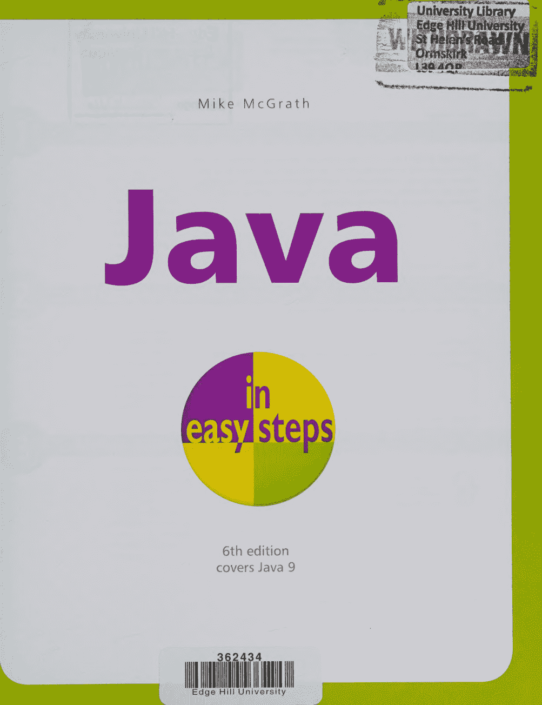


# 免责声明

我们已尽力确保本书包含准确且最新的信息。然而，In Easy Steps Limited 和作者对读者因书中包含的任何信息而遭受的损失或损害不承担责任。


- 比较值 30

# 前言

本书的创作为我 Mike McGrath 提供了一个使用最新技术更新之前的 Java 编程书籍的好机会。书中提供的所有示例演示了 Windows 和 Linux 操作系统当前编译器支持的 Java 特性，书中的截图说明了编译执行代码或在 Java Shell 中实现代码段的实际结果。

# 本书规范

## 1 入门

欢迎来到兴奋的 Java 编程世界。本章将展示如何创建和执行简单的 Java 程序，并演示了如何在程序中存储数据。

### 规范说明

为了清楚每个示例步骤中列出的代码，我采用了某些着色规范。Java 语言本身的组件设为蓝色；程序员指定的名称设为红色；字符串值为黑色；注释设为灰色，如下：

```java
// 存储并输出一个字符串值。
String message = "Welcome to Java programming!";
System.out.println(message);
```

此外，为了识别步骤中描述的源代码文件，彩色图标和文件名会出现在步骤旁边的页边缘，如下：


### 获取源代码

为了方便起见，我将书中示例的源代码文件放置在一个单个 ZIP 存档中。你可以按照以下简单步骤获取完整存档：

- 访问 www.easysteps.com，然后导航到 Free Resources（免费资源）并选择 Downloads（下载）部分
- 在列表中找到 Java in easy steps, 6th Edition，然后点击名为 All Code Examples（所有代码示例）的超链接下载存档
- 现在，将存档内容解压到计算机上任何方便的位置

希望你喜欢发现 Java 编程的可能，并像我写这本书一样享受其中的乐趣。

Mike McGrath

## 1 入门

欢迎来到兴奋的 Java 编程世界。本章将展示如何创建和执行简单的 Java 程序，并演示了如何在程序中存储数据。

- 编译并运行程序 14
- 识别数据类型 18
- 创建常量 20
- 添加注释 21
- 排除故障 22

### 简介

Java™ 编程语言最早由 Sun Microsystems 的一名名为 James Gosling 的工程师于 1990 年开发。他不喜欢使用 C++ 编程语言，因此创建了一种新语言并命名为“Oak”（橡树），自他办公室窗外看到的橡树。

随着广域网的普及，Sun 意识到 Gosling 的语言可以针对互联网开发。因此，Sun 将该语言重新命名为“Java”（仅仅因为这个名字听起来很酷），并于 1995 年免费提供。全球开发者迅速采用了这种兴奋的新语言，并且由于其模块化设计，能够创建可以添加到内核的新功能。最受欢迎的额外功能都保留在了 Java 的后续版本中。

Java 的本质是一个被称为“类”的文件库，每个类包含一小段现成的代码。这些类都可以整合到新程序中，就像墙砖一样，只需要编写相对少的新代码即可完成程序。这为程序员节省了大量时间，解释了 Java 编程如此受欢迎。

Java 技术既是一种编程语言也是一种平台。在 Java 编程中，源代码首先被编写为人类可读的文本文件，扩展名为 `.java`。这些文件由 `javac` 编译器编译成机器可读的 `.class` 文件。`java` 解释器可以通过 Java 虚拟机 (Java VM) 的实例执行程序：


图中所示图标表示最新 Java 版本引入的新功能或增强功能。


由于 Java VM 适用于许多不同的操作系统，因此相同的 `.class` 文件能够在 Windows、Linux 和 Mac 操作系统上运行——因此 Java 程序员理论上享有“一次编写，随处运行”的跨平台能力。

为了创建 Java 程序，你的计算机上需要安装 Java 类库和 `javac` 编译器。为了运行 Java 程序，需要安装 Java™ 运行时环境（JRE）以提供 `java` 解释器。所有组件都包含在一个免费提供的软件包中，称为 Java™ 标准版开发工具包（JDK）。

本书中的 Java 程序使用 JDK 9，它包含了开发工具包和运行时环境，可以从 Oracle® 网站 www.oracle.com/technet/java/javase/downloads 下载。


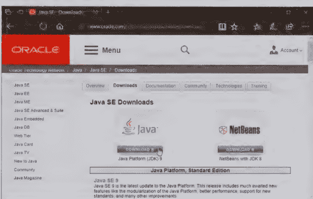


JDK 9 软件包提供了适用于 Linux、Mac、Solaris 和 Windows 平台的 32 位和 64 位变体——接受 Oracle 许可协议，然后选择适用于你计算机的相应版本下载 Java 开发工具包。

Oracle 下载页面还提供其他软件包，但开始 Java 编程只需要 JDK 9 软件包。


### Java SE 开发工具包 9

你必须接受 Java SE 的 Oracle 二进制代码许可协议才能下载此软件。感谢接受 Java SE 的 Oracle 二进制代码许可协议；你现在可以下载并使用此软件。

| 产品 / 文件描述 | 大小 | 下载 |
| --- | --- | --- |
| Linux | 298.02 MB | `jdk-9-linux-x64-bin.rpm` |
| Linux | 330.23 MB | `jdk-9-linux-x64-tar.gz` |
| macOS | 371.64 MB | `jdk-9-os_x64-bin.dmg` |
| Windows | 358.59 MB | `jdk-9-windows-x64-bin.exe` |
| Solaris SPARC | 207.05 MB | `jdk-9-solaris-sparc.tar.gz` |

关于 JAVA 代表“另一个模糊的缩写”（Just Another Vague Acronym）的传言并非事实。


### 安装 JDK

从 Oracle® 下载页面选择适用于你系统的 Java 开发工具包（JDK）软件包，然后按照以下步骤在你的计算机上安装 Java：

1. 从系统中卸载任何之前的 JDK 和/或运行时环境（JRE）
2. 开始安装并接受许可协议
3. 当“自定义设置”（Custom Setup）对话框出现时，接受建议的位置或点击“更改”（Change）按钮选择你喜欢的位置——例如 Windows 系统的 `C:\Java` 或 Linux 系统的 `/usr/Java`


> 系统中可能安装了旧版本的 JRE，以便你的浏览器可以运行 Java Applet。最好卸载它，以避免与 JDK 9 中的新版本产生冲突。

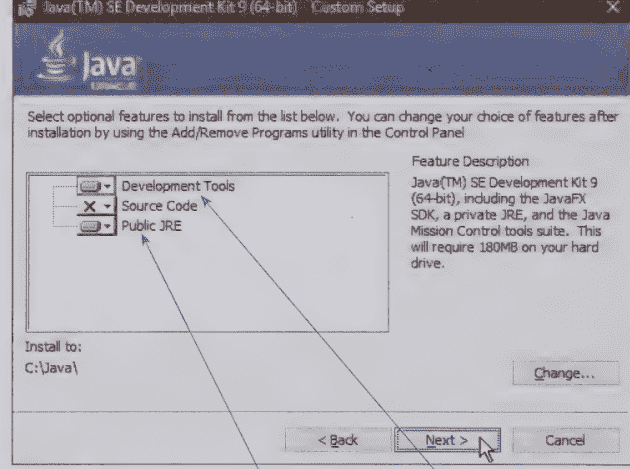


> 你可以通过只安装最小功能来开始，以避免混乱。

4. 确保列表中选择了“Public JRE”（公共 JRE）和“Development Tools”（开发工具）。你可以取消选择其他功能，因为使用本书编程时不需要它们
5. 点击“下一步”（Next）按钮在指定位置安装必要的 Java 类库和工具

编译和运行 Java 程序的工具通常从命令行操作，位于 Java 目录的 `bin` 中。可以通过将它们位置添加到系统路径来实现全局可用：

- 在 Windows 上，通过控制面板、系统、环境变量、高级选项卡选择“Path”。点击“编辑”按钮并将 Java 的 `bin` 目录添加到列表（例如 `C:\Java`），然后点击确定。
- 在 Linux 上，通过编辑主目录下的 `.bashrc` 将 Java 的 `bin` 目录位置添加到系统路径。例如，添加 `PATH=/usr/bin`。

你现在可以测试环境了：

- 打开命令行，例如 Windows PowerShell 或 Linux Terminal
- 输入 `java -version` 并按回车查看 Java 解释器的版本号
- 接下来输入 `javac -version` 并按回车查看 Java 编译器的版本号
- 现在输入 `jshell -version` 并按回车查看 Java Shell 的版本号
- 确保所有版本号匹配（9），你已准备好开始 Java 编程


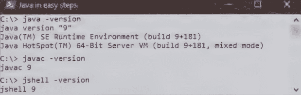

> 包含空格的路径必须在双引号内。例如，路径 `"C:\Program Files\Java\jdk"`。

> `jshell` 是 Java 9 的新功能。这个交互式工具允许你快速测试代码片段，而无需编译。它将在下一章用于演示 Java 中可用的运算符。

### 编写第一个程序

所有 Java 程序都从文本文件开始，随后用于创建类文件，即实际运行的程序。这意味着 Java 程序可以在任何文本编辑器（如记事本）中编写。

按照以下步骤创建一个输出第一个问候信息的简单 Java 程序：


1. 打开文本文件（如记事本），完全按照列出的代码输入创建一个名为 "Hello" 的类

```java
class Hello
{
```


> Java 是一种区分大小写敏感的语言，“Hello" 和 "hello" 是完全不同的——传统上，Java 程序名应该始终以大写字母开头。

2. 在 `Hello` 类的大括号之间插入此代码，为 `Hello` 类创建一个 `main` 方法：

```java
public static void main (String args)
{
```

3. 在 `main` 方法的大括号之间插入此行代码，说明程序将执行：

```java
System.out.println("Hello World!");
```

4. 在任何方便的位置保存文件，但确保将其命名为 `Hello.java` 完整的程序看起来应该是这样的：


```
Hello.java - 记事本
文件 编辑 格式 视图 帮助
class Hello
{
    public static void main (String args)
    {
        System.out.println("Hello World!");
    }
}
```

> Java 程序始终以其精确的程序名加上 ".java" 扩展名保存。

相反页上程序代码的不同部分可以单独检查，以更清楚地理解每个部分。

#### 程序容器

```java
class Hello { }
```

程序名紧接 `class` 关键字之后声明，并跟着一对大括号。定义 `Hello` 类的所有程序代码将包含这些大括号内。

#### Main 方法

```java
public static void main (String args) {
```

这行看起来很吓人的代码是定义几乎所有 Java 程序起点的标准代码。它将在本书的许多示例中以如上面所示的形式出现——因此记住它可能是很有用的。

该代码声明了一个名为 “main” 的方法，其大括号内包含实际的程序指令。

关键字 `static void` 位于方法名前之前，说明了可能用法，稍后会详细解释。

代码 `(String args)` 在向方法传递值时有用，书中随后也会进行完全解释。

#### 语句

```java
System.out.println("Hello World!");
```

语句是执行程序任务的实际指令，并且始终以分号结束。方法可以在其大括号内包含许多语句以形成一个“语句块”，定义一系列要执行的任务，但这里一个语句指示程序输出一行文本。

> 转到第14页发现如何编译和运行此程序。


> 所有独立的 Java 程序都必须有一个 `main` 方法。Java Applet 是不同的，它们的格式将在稍后解释。


> 创建一个“MyJava”目录，用于保存你所有的 Java 程序文件。

### 编译与运行程序

在 Java 程序运行之前，它必须首先由 Java 编译器编译成类文件。该编译器位于 Java 的 `bin` 目录中，是一个名为 `javac` 的应用程序。第 11 页的说明描述了如何将 `bin` 子目录添加到系统路径中，以便可以在任何系统位置调用 `javac`。

在 Windows 上，使用 Windows PowerShell 或其他命令提示符（Command Prompt）提供命令行界面；在 Linux 上，使用终端（Terminal）窗口。

按照以下步骤编译第13 页程序：

- 打开命令行窗口，然后导航到保存 `Hello.java` 源码文件的目录
- 输入 `javac` 后加一个空格，然后输入源码文件的全名 `Hello.java` 并按回车键


> 在提示符处输入 `javac` 并按回车，即可显示 Java 编译器的选项。

```
Java in easy steps
:\> cd MyJava
:\MyJava> javac Hello.java
:\MyJava>
```

> 如果 `javac` 编译器在代码中发现错误，它将停止并显示一个指示错误性质的有用报告——参见第 22 页的故障排除。

> 如果 `javac` 编译器没有发现任何错误，它将创建一个以程序命名并带有 `.class` 后缀的新文件。


> 如果你为 `javac` 编译器指定完整路径地址，也可以从另一个位置编译源码——在这种情况下，为 `C:\MyJava\Hello.java`


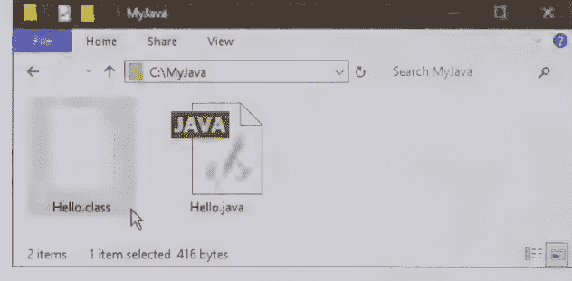

> ...续上

当 Java 编译器完成编译后，命令行窗口的焦点返回提示提示符，没有任何确认消息——程序已准备好运行。

Java 程序解释器是一个名为 `java` 的应用程序，位于 Java `bin` 子目录中——与 `javac` 编译器并列。由于该目录之前已在第11 页添加到系统路径，因此可以在任何位置调用 `java` 解释器。

按照对面页描述的步骤运行已编译的程序：


- 打开命令行程序窗口，然后导航到 `Hello.class` 程序文件所在的目录
- 在提示符处，输入 `java` 后加一个空格，然后输入程序名 `Hello` 并按回车键

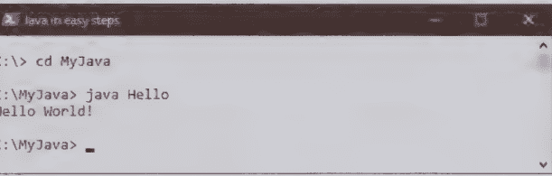


`Hello` 程序运行并执行其 `main` 方法中语句内定义的任务——输出 "Hello World!"。完成后，焦点再次返回到提示符。

编译和运行 Java 程序的过程通常按顺序步骤结合在一起，且与平台无关。下方的截图说明了在 Linux 系统上组合步骤编译并运行 `Hello` 程序：


### 创建变量

在 Java 编程中，“变量”简单来说是一个实用的容器，其中存储一个值供程序后续使用。当程序执行其指令时，存储的值可能会发生变化（vary）——因此被称为“变量”（variable）。

变量是通过在程序中编写变量“声明”来创建的，该声明指定了变量可能包含的数据类型以及该变量给定的名称。例如，可以指定 `String` 数据类型以允许名为 "message" 的变量包含普通文本，其声明如下：

```
String message ;
```

变量名由程序员选择，但必须遵守命名规范。变量名只能以字母、美元符号 `$` 或下划线字符 `_` 开始，随后只能包含数字、美元符号或下划线字符。名称对大小写敏感，因此 "var" 和 "Var" 是完全不同的名称，且名称中不允许空格。

变量名还应避免下表列出的 Java 关键字，因为这些在 Java 语言具有特殊含义。

| abstract | default | goto | package | synchronized |
| --- | --- | --- | --- | --- |
| assert | do | if | private | this |
| boolean | double | implements | protected | throw |
| break | else | import | public | throws |
| byte | enum | instanceof | return | transient |
| case | extends | int | short | true |
| catch | false | interface | static | try |
| char | final | long | strictfp | void |
| class | finally | native | String | volatile |
| const | float | new | super | while |
| continue | for | null | switch |

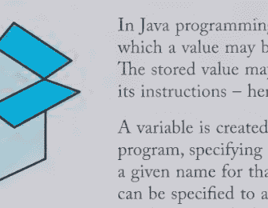


每个变量声明必须以分号结束，在这种情况下，`C:\MyJava\Hello.java`


如果 `javac` 编译器在代码中发现错误，它将停止并显示一个指示错误性质的有用报告——参见第 22 页的故障排除。

如果 `javac` 编译器没有发现任何错误，它将创建一个以程序命名并带有 `.class` 后缀的新文件。


如果你为 `javac` 编译器指定完整路径地址，也可以从另一个位置编译源码——在这种情况下，`C:\MyJava\Hello.java`


...续上

当 Java 编译器完成编译后，命令行窗口的焦点返回提示提示符，没有任何确认消息——程序已准备好运行。

Java 程序解释器是一个名为 `java` 的应用程序，位于 Java `bin` 子目录中——与 `javac` 编译器并列。由于该目录之前已在第11 页添加到系统路径，因此可以在任何位置调用 `java` 解释器。

按照对面页描述的步骤运行已编译的程序：

- 打开命令行程序窗口，然后导航到 `Hello.class` 程序文件所在的目录
- 在提示符处，输入 `java` 后加一个空格，然后输入程序名 `Hello` 并按回车键


`Hello` 程序运行并执行其 `main` 方法中语句内定义的任务——输出 "Hello World!"。完成后，焦点再次返回到提示符。

编译和运行 Java 程序的过程通常按顺序步骤结合在一起，且与平台无关。下方的截图说明了在 Linux 系统上组合步骤编译并运行 `Hello` 程序：


### 识别数据类型

Java 中最常用的数据类型列在表中，并带有简要描述：

| 数据类型 | 描述 | 示例 |
|---|---|---|
| char | 单个 Unicode 字符 | 'a' |
| String | 任意数量的 Unicode 字符 | 'message' |
| int | 整数从 -2.14 亿到 +2.14 亿 | 1000 |
| float | 带有小数点的浮点数 | 3.1415265 |
| boolean | 逻辑值 | true |

由于浮点运算的不规则性，`float` 类型不应用于精确值，如货币——参见第 130 页的详情。


注意 `char` 数据值必须用单引号包围，而 `String` 数据值必须用双引号包围。此外，记住 `float` 数据值必须带有 "f" 后缀，以确保它们被视为 `float` 值。

除了上述更常见的数据类型外，Java 还提供了这些特殊数据类型用于精确情况：


| 数据类型 | 描述 |
|---|---|
| byte | 范围从 -128 到 +127 的整数 |
| short | 范围从 -32,768 到 +32,767 的整数 |
| long | 超过 2.14 亿的正负整数 |
| double | 极长的浮点数 |

所有数据类型关键字都以小写字母开始，`String` 只是一个特殊的类。

特殊数据类型在高级 Java 程序中非常有用——书中的示例大多使用顶部表中描述的常见数据类型。

按照以下步骤创建一个 Java 程序，该程序将创建、初始化并输出所有五常用数据类型的变量：

- 创建名为 "DataTypes" 的新程序，其中包含标准的 `main` 方法 DataTypes：

```java
class DataTypes {
    public static void main (String[] args) {
        boolean letter = 
}
```


DataTypes.java

- 在 `main` 方法的大括号之间，插入这些声明来创建并初始化五个变量：

```java
char letter = 'M';
String title = "Java in easy steps";
int number = 365;
float decimal = 98.6f;
boolean result = true;
```


注意这里如何使用 `+` 字符来连接（拼接）文本字符串和存储的变量。

- 添加这些行以输出与每个变量值拼接的适当文本字符串：


```java
System.out.println("Initial is " + letter + ");
System.out.println("Book is " + title + ");
System.out.println("Days are " + number + ");
System.out.println("Temperature is " + decimal + ");
System.out.println("Answer is " + result + ");
```


- 将程序保存为 `DataTypes.java`，然后编译并运行该程序。


如果程序尝试向变量分配错误数据类型的值，Java 编译器将报告错误 - 尝试更改此示例中的值，然后尝试重新编译程序以查看效果。

```
C:\MyJava> javac DataTypes.java
C:\MyJava> java DataTypes
Initial is M
Book is Java in easy steps
Days are 365
Temperature is 98.6
Answer is true
```

### 创建常量

`final` 关键字是一个修饰符，可以在声明变量时使用，以防止对最初赋值的值进行任何后续更改。这在程序中存储固定值时非常有用，可以避免其被意外修改。

以这种方式创建的存储固定值的变量被称为“常量”，按照惯例使用大写字母命名常量 - 以将其与普通变量区分开来。尝试更改常量值的程序将无法编译，`javac` 编译器将生成错误消息。

按照以下步骤创建一个包含常量的 Java 程序：


1. 创建一个名为 “Constants” 的新程序，其中包含标准方法：

```java
class Constants {
    public static void main (String[] args) {
}
```

2. 在 `main` 方法的大括号之间，插入此代码以创建并初始化三个整数常量：

```java
final int TOUCHDOWN = 6;
final int CONVERSION = 1;
final int FIELDGOAL = 3;
```

3. 现在，声明四个整数变量：

```java
td, pat, fg, total;
```

4. 初始化普通变量 - 使用常量值的倍数：

```java
td = 4 * TOUCHDOWN;
pat = 3 * CONVERSION;
fg = 2 * FIELDGOAL;
total = (td + pat + fg);
```

5. 添加此行以输出总分：

```java
System.out.println("Score: " + total);
```

6. 将程序保存为 `Constants.java`，然后编译并运行程序查看输出：33 (4 * 6 = 24, 3 * 1 = 3, 2 * 3 = 6)。

> **热提示**
>
> 这里使用 `+` 字符来连接常量值，括号用于相加。

### 添加注释

在任何语言的编程中，良好的做法是添加注释来解释特定的部分。这使得代码更容易被理解。

在 Java 编程中，注释可以使用 `/*` 和 `*/` 跨行注释，或者在单行后使用 `//` 注释。出现在 `/*` 和 `*/` 之间或 `//` 之后的内容会被 `javac` 编译器完全忽略。

添加注释后，源代码可能如下：

```java
/*
演示常量变量。
*/
```

```java
class Constants {
    public static void main(String args[]) {
        // 常量值
        final int TOUCHDOWN = 6;
        final int CONVERSION = 1;
        final int FIELDGOAL = 3;

        // 计算得分。
        int td, pat, fg;
        td = 4 * TOUCHDOWN;
        pat = 3 * CONVERSION;
        fg = 2 * FIELDGOAL;
        total = (td + pat + fg);

        // 输出总分。
        System.out.println("Score: " + total);
    }
}
```


### 故障排除

有时 `javac` 编译器或解释器会对其错误报错，因此了解它们的原因是有用的。演示一些错误：

```java
class Constants {
    public static void main(String args[]) {
        // 常量值。
        final int TOUCHDOWN = 6;
        final int CONVERSION = 1;
        final int FIELDGOAL = 3;

        // 计算得分。
        int td, pat, fg;
        td = 4 * TOUCHDOWN;
        pat = 3 * CONVERSION;
        fg = 2 * FIELDGOAL;
        total = (td + pat + fg);

        // 输出总分。
        System.out.println("Score: " + total);
    }
}
```

# 2 执行操作

本章演示了用于在程序中创建表达式的各种操作符。

## 执行算术运算

下表列出的算术运算符用于在 Java 程序中创建表达式，并返回一个单一的结果值。例如，表达式 `4 * 2` 返回值 `8`。


整数 `int` 值的除法将截断任何小数部分。例如，`11/4 = 2`，而浮点 `float` 值的除法 `11/4 = 2.75`。

| 运算符 | 操作 |
| --- | --- |
| + | 加法（并拼接 String 值） |
| - | 减法 |
| * | 乘法 |
| / | 除法 |
| % | 取模 |
| ++ | 递增 |
| -- | 递减 |


递增运算符 `++` 和递减运算符 `--` 返回对单个给定操作数加减一的结果。例如，`4++` 返回值 `5`，`4--` 返回值 `3`。

所有其他算术运算符都返回对两个给定操作数执行操作的结果，且其行为符合你的预期。例如，表达式 `5 + 2` 返回值 `7`。

取模运算符除以第一个操作数并返回操作的余数。例如，表达式 `32 % 5` 返回 `2` —— 5 除以 32 六次，余数为 2。

加法运算符执行的操作取决于其给定操作数的类型。当两个操作数都是数值时，它将返回数字的总和；但当操作数是 String 值时，它将返回一个拼接后的字符串 —— 组合每个 String 操作数的文本。例如，`"Java" + "Arithmetic"` 返回 `"Java Arithmetic"`。

递增和递减运算符通常用于计算第 50 页引入的 `for` 循环结构中的迭代次数。

请按照以下步骤在 Java shell 中探索 Java 算术运算符：

1. 打开命令行提示符窗口，输入 `jshell` 并按回车键启动 Java shell
2. 接下来，输入语句初始化三个变量 `int num = 100; int factor = 20; int sum = 0;`


你的系统路径中必须安装了 Java 才能从任何提示符启动 Java shell —— 详情请参见第 11 页的“安装”和第 22 页的“故障排除”。

```
C:\MyJava jshell
shell int num = 100; int factor = 20; int sum = 0;
num => 100
factor => 20
sum => 0
shell =>
```

3. 接下来，分别输入语句执行加法和减法操作，显示每个结果

```java
sum = num + factor;
sum = num - factor;
```

```
Java in easy steps
shell sum = num + factor;
sum => 120
shell sum = num - factor;
sum => 80
```


4. 现在，分别输入语句执行乘法和除法操作，显示每个结果

```java
sum = num * factor;
sum = num / factor;
```

Java shell `jshell` 是 Java 9 中的一个新功能。可选情况下，在输入 shell 的单条语句末尾可以省略分号，但在编写 Java 程序进行编译时，分号是必须的。本章中的 shell 示例包含了分号以保持代码的一致性。

```
Java in easy steps
shell sum = num * factor;
sum => 2000
shell sum = num / factor;
sum => 5
```

## 赋值

下表列出的赋值运算符用于为表达式赋值。除了简单的 `=` 运算符外，所有运算符都是更等效表达式的简写形式：

| 运算符 | 示例 | 等效 |
| --- | --- | --- |
| = | a = b | a = b |
| += | a += b | a = a + b |
| -= | a -= b | a = a - b |
| *= | a *= b | a = a * b |
| /= | a /= b | a = a / b |
| %= | a %= b | a = a % b |

将 `=` 运算符视为“赋值”而不是“等于”，以避免与 `==` 相等运算符混淆。

在示例 `a = b` 中，存储在名为 `b` 的变量中的值被赋值给名为 `a` 的变量，使得该值成为 `a` 中存储的新值 —— 替换它之前包含的任何值。

`+=` 运算符用于向变量存储的现有值加上一个值 —— 保持“运行总量”。

示例 `a += b` 计算变量 `a` 和 `b` 中存储值的总和，然后将结果总和赋值给变量 `a`。程序可能包含进一步的赋值 `a += c`，它计算 `a` 加上 `c` 的值。


# 赋值

下表列出的赋值运算符用于为表达式赋值。除了简单的 `=` 运算符外，所有运算符都是更等效表达式的简写形式：

| 运算符 | 示例 | 等效 |
| :--- | :--- | :--- |
| `=` | `a = b` | `a = b` |
| `+=` | `a += b` | `a = a + b` |
| `-=` | `a -= b` | `a = a - b` |
| `*=` | `a *= b` | `a = a * b` |
| `/=` | `a /= b` | `a = a / b` |
| `%=` | `a %= b` | `a = a % b` |

将 `=` 运算符视为“赋值”而不是“等于”，以避免与 `==` 相等运算符混淆。

在示例 `a = b` 中，存储在名为 `b` 的变量中的值被赋值给名为 `a` 的变量，使得该值成为 `a` 中存储的新值 —— 替换它之前包含的任何值。

`+=` 运算符用于向变量存储的现有值加上一个值 —— 保持“运行总量”。

示例 `a += b` 计算变量 `a` 和 `b` 中存储值的总和，然后将结果总和赋值给变量 `a`。程序可能包含进一步的赋值 `a += c`，它计算 `a` 加上 `c` 的值。

所有其他算术运算符都返回对两个给定操作数执行操作的结果，且其行为符合你的预期。例如，`5 + 2` 返回值 `7`。

取模运算符除以第一个操作数并返回操作的余数。例如，`32 % 5` 返回 `2` —— 5 除以 32 六次，余数为 2。

加法运算符执行的操作取决于其给定操作数的类型。当两个操作数都是数值时，它将返回数字的总和；但当操作数是 `String` 值时，它将返回一个拼接后的字符串 —— 组合每个 `String` 操作数的文本。例如，`"Java" + "Arithmetic"` 返回 `"Java Arithmetic"`。

递增和递减运算符通常用于计算第 50 页引入的 `for` 循环结构中的迭代次数。

## 在 Java Shell 中探索算术运算符

按照以下步骤在 Java shell 中探索 Java 算术运算符：

1. 打开命令行提示符窗口，输入 `jshell` 并按回车键启动 Java shell。
2. 接下来，输入语句初始化三个变量 `int num = 100; int factor = 20; int sum = 0;`。

   

   你的系统路径中必须安装了 Java 才能从任何提示符启动 Java shell —— 详情请参见第 11 页的“安装”和第 22 页的“故障排除”。

   ```
   C:\MyJava jshell
   shell int num = 100; int factor = 20; int sum = 0;
   num => 100
   factor => 20
   sum => 0
   shell =>
   ```

3. 接下来，分别输入语句执行加法和减法操作，显示每个结果：

   `sum = num + factor;`
   
   `sum = num - factor;`

   ```
   Java in easy steps
   shell sum = num + factor;
   sum => 120
   shell sum = num - factor;
   sum => 80
   ```

   

4. 现在，分别输入语句执行乘法和除法操作，显示每个结果：

   `sum = num * factor;`
   
   `sum = num / factor;`

   Java shell `jshell` 是 Java 9 中的一个新功能。可选情况下，在输入 shell 的单条语句末尾可以省略分号，但在编写 Java 程序进行编译时，分号是必须的。本章中的 shell 示例包含了分号以保持代码的一致性。

   ```
   Java in easy steps
   shell sum = num * factor;
   sum => 2000
   shell sum = num / factor;
   sum => 5
   ```

# 比较值

下表列出的比较运算符用于在表达式中比较两个值，并返回单一的布尔值 `true` 或 `false` —— 描述比较的结果。

| 运算符 | 比较 |
| :--- | :--- |
| `==` | 等于 |
| `!=` | 不等于 |
| `>` | 大于 |
| `>=` | 大于等于 |
| `<` | 小于 |
| `<=` | 小于等于 |

`==` 等运算符比较两个操作数，如果它们的值完全相等，则返回 `true`。如果两者都是相同的数字，它们相等；如果两者都是包含相同顺序字符的 `String`，它们相等。布尔操作数如果都是 `true` 或都是 `false`。

相反，`!=` 不等运算符在两个操作数不相等时返回 `true` —— 应用与相等运算符相同的规则。

相等和不等运算符常用于测试两个变量的状态以执行程序的“条件分支” —— 根据条件走向不同的方向。

`>` 大于运算符比较两个操作数，如果第一个值大于第二个，则返回 `true`。

`<` 小于运算符进行相同的比较，但如果第一个值小于第二个，则返回 `true`。

在 `>` 大于运算符后添加 `=` 赋值运算符，或在 `<` 小于运算符后添加 `=`，使其在两个操作数值完全相等时也返回 `true`。


给变量赋值错误的数据类型会导致错误。

## 在 Java Shell 中探索比较运算符

按照以下步骤在 Java shell 中探索 Java 比较运算符：

1. 打开命令行提示符，输入 `jshell` 并按 `Enter` 键启动 Java shell。
2. 接下来，输入语句初始化两个 `String` 变量 `String txt = "Super" ; String lang = "Java" ;`
3. 现在，分别输入语句来初始化 `boolean` 变量，并显示 `String` 值在相等和不相等情况下的比较结果 `boolean state = ( txt == lang ) ;`

   

   你也可以通过输入 `/help` 命令在 Java shell 中发现更多选项。

   ```
   C:\MyJava
   shell String txt = "Super" ; String lang = "Java"
   txt => "Super"
   lang => "Java"

   shell boolean state = ( txt == lang );
   state => false

   shell state = ( txt != lang );
   state => true
   ```

   

   > 这里 `String` 值相等是假的 (`false`) 的，但它们不相等是**真的** (`true`)。

4. 同样地，分别输入这些语句来显示 `int` 值在大于和小于数值时的比较结果 `int dozen = 12 ; int score = 20 ;`

   `state = ( dozen > score ) ;`
   
   `state = ( dozen < score ) ;`

   ```
   jshell int dozen = 12 ; int score = 20
   dozen => 12
   score => 20
   jshell state = ( dozen > score );
   state => false

   jshell state = ( dozen < score );
   state => true
   ```

   

   注意看表达式如何包含在括号中以提高可读性。

### 评估逻辑

下表列出的逻辑运算符用于将多个返回布尔值的表达式组合成一个返回单一布尔值的复杂表达式。

| 运算符 | 操作 |
| :--- | :--- |
| `&&` | 逻辑与 |
| `||` | 逻辑或 |
| `!` | 逻辑非 |


逻辑运算符用于具有 `true` 或 `false` 布尔值的操作数，或者可以转换为 `true` 或 `false` 的值。

逻辑 `&&` 与运算符评估两个操作数，只有当两个操作数本身为真时才返回 `true`。否则，逻辑 `||` 运算符将返回 `false`。这种评估用于条件分支，当两个测试条件都为真时，程序才会执行特定操作。

与需要两个操作数的 `&&` 运算符不同，逻辑 `||` 或运算符会评估它的两个操作数，如果其中一个为真则返回 `true`——只有当两个操作数都不真时才会返回 `false`。这在 Java 编程中非常有用，可以在两个测试条件之一满足时执行特定操作。

逻辑 `!` 非运算符是一个“一元”运算符，用于单个操作数之前。它返回给定操作数的反转布尔值——将 `true` 变为 `false`，将 `false` 变为 `true`。在 Java 程序中，它可以使用类似于 `goState = !goState` 的语句在连续的循环迭代中切换变量的值。这确保了循环的每次运行时值都会改变，就像闪烁灯开关一样。

> 小贴士
>
> “Boolean”（布尔）一词指的是由英国数学家乔治·布尔（1815–1864）开发的逻辑思维系统。

## 在 Java Shell 中探索逻辑运算符

按照以下步骤在 Java shell 中探索逻辑运算符：

1. 打开命令行窗口，然后输入 `jshell` 并按 `Enter` 键启动 Java shell。
2. 接下来，输入语句初始化两个 `boolean` 变量 `boolean yes = true ; boolean no = false ;`
3. 输入语句测试两个条件是否都为真 `boolean result = ( yes && yes ) ; result = ( yes && no )`

   

   Java 9 引入的新 Java shell 功能也称为“REPL!”——即读取（Read）、评估（Evaluate）、打印（Print）、循环（Loop）的缩写，描述了这种交互式工具。

   ```
   C:\MyJava> jshell
   shell boolean yes = true ; boolean no = false;
   yes => true
   no => false

   shell boolean result = ( yes && yes );
   result => true

   shell result = ( yes && no );
   result => false
   ```

   

4. 输入语句测试两个条件中是否有一个真 `boolean result = ( yes || yes ) ; result = ( yes || no ) ; result = ( no || no ) ;` 注意 `false && false` 返回 `false` 而不是 `true`，这证明了“错失落不能成没错”。
5. 输入语句显示原始值和反转值 `boolean result = yes ; result = !yes ;`

   ```
   jshell boolean result = ( yes || yes );
   result => true
   shell result = ( yes || no );
   result => true
   shell result = ( no || no );
   result => false
   shell result = yes ; result = !yes;
   result => true
   result => false
   ```

   

   `!` 非运算符返回的值是存储值的反转——存储值保持不变。

### 检查条件

Java 程序员最喜爱的运算符可能是 `?` 条件运算符，它简洁地实现了语句。它的语法初看起来可能很难理解，但了解这个运算符非常有价值。条件运算符首先评估表达式的真假值，然后根据评估结果返回两个操作数之一。它的语法如下：

```
(布尔表达式) ? 如果真返回 : 如果假返回;
```

每个指定的备选操作允许程序根据测试表达式返回的布尔值进行进展。例如，如果表达式为真，条件运算符返回第一个操作数；如果为假，返回第二个。条件运算符可以替换简单的 `if-else` 语句。例如：

```java
int a = 5;
int b = 10;
int max = (a > b) ? a : b;
```

条件运算符还可以嵌套以处理多个条件。例如：

```java
int result = (a > b) ? a : (b > c) ? b : c;
```


## 在 Java Shell 中探索条件运算符

按照以下步骤在 Java shell 中探索条件运算符：

1. 打开命令行提示符，输入 `jshell` 并按 `Enter` 键启动 Java shell。
2. 接下来，输入初始化两个 `int` 变量 `int num1 = 1357 ; int num2 = 2468`
3. 声明一个变量来存储测试结果 `String result;`
4. 输入此语句判断整数值是奇数还是偶数 `String result = ( num1 % 2 != 0 ) ? "Odd" : "Even";`

   

   你还可以使用 `jshell --verbose` 命令启动 Java shell，以便在每次评估后接收描述性输出。

   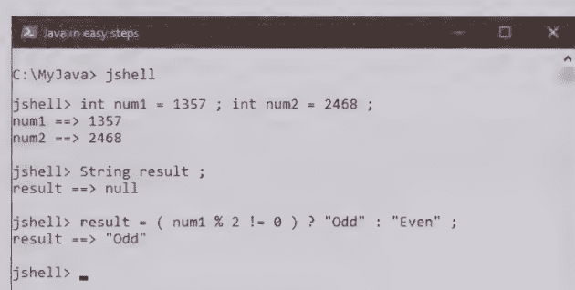

   ```
   C:\MyJava> jshell
   shell int num1 = 1357 ; int num2 = 2468
   num1 => 1357
   num2 => 2468

   shell String result;
   result => null

   shell result = ( num1 % 2 != 0 ) ? "Odd" : "Even"

   shell ->
   ```


注意，未初始化的 `String` 变量返回特殊的 `null` 值——表示它什么都不包含。

现在，输入判断第二个值是奇数还是偶数 `String result = ( num2 % 2 != 0 ) ? "Odd" : "Even";`

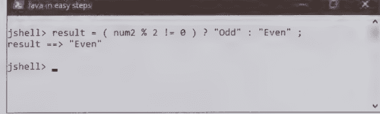

```
jshell result = ( num2 % 2 != 0 ) ? "Odd" : "Even"
result => "Even"
shell ->
```


在这里，当存在任何余数时，表达式结果为真。

### 优先级设置

包含多个操作符和操作数的复杂表达式，除非操作执行的顺序明确，否则可能会产生歧义。这种清晰性的缺失很容易导致同一个表达式暗示出不同的结果。例如，考虑这个复杂的表达式：

```
num = 8 + 4 * 2;
```

从左到右计算，8 + 4 = 12，然后 12 * 2 = 24，所以 num = 24。但从右到左计算，2 * 4 = 8，然后 8 + 8 = 16，所以 num = 16。

Java 程序员可以通过在具有优先级的运算符上添加括号，显式地指定应该执行哪个操作。在这种情况下，`(8 + 4) * 2` 确保加法在乘法之前执行——因此结果是 24，而不是 16。相反，`8 * (4 * 2)` 先执行乘法——因此结果是 16，而不是 24。

当括号没有显式指定运算符优先级时，Java 遵循下表列出的默认优先级顺序，从上到下，最后到最后：

| 运算符 | 说明 |
| :--- | :--- |
| `++` `--` | 递增、递减、逻辑非 |
| `*` `/` `%` | 乘法、除法、取模 |
| `+` `-` | 加法、减法 |
| `>` `>=` `<` `<=` | 大于、大于等于、小于、小于等于 |
| `==` `!=` | 等于、不等于 |
| `&&` | 逻辑与 |
| `\|\|` | 逻辑或 |
| `? :` | 条件判断 |
| `+=` `-=` `=` | 赋值 |
| `/=` `%=` | 赋值 |


优先级相等的操作符按照它们在表达式中出现的顺序进行处理——从左到右。

按照以下步骤在 Java shell 中探索操作符优先级：

1. 打开命令行提示符窗口，然后输入 `jshell` 并按回车键启动 Java shell
2. 接下来，输入一个语句来显示使用默认运算符优先级的表达式求值结果：`int sum = 32 - 8 + 16 * 2`


当表达式有多个嵌套括号时，最内层的括号优先级最高。

```
java in easy steps
C:\MyJava> jshell
shell int sum = 32 - 8 + 16 * 2
sum => 56
jshell_
```


3. 现在，输入一个语句来显示相同表达式的结果——但赋予加法和减法高于乘法的优先级：`sum = ( 32 - 8 + 16 ) * 2`

其工作原理——

步骤 2 ...n16 x 2 = 32, +24 = 56

步骤 3 ...n24 + 16 = 40, x = 80

步骤 4 ...n32 - 24 = 8, x = 16

```
java in easy steps
sjshell sum = ( 32 - 8 + 16 ) * 2
sum => 80
jshell_
```

4. 最后，输入一个语句再次显示相同表达式的求值结果——但现在操作优先级顺序首先是加法、减法，然后是乘法：`sum = ( 32 - ( 8 + 16 ) ) * 2`


本章目前为止使用了 Java shell `jshell` 通过求值代码段来探索各种 Java 操作符。确保示例将使用 Java 编译器 `javac` 和 Java 运行时 `java` 来创建和执行程序。可以使用命令 `/exit` 退出 Java shell 并返回普通提示符。

```
java in easy steps
sjshell sum = ( 32 - ( 8 + 16 ) ) * 2
sum => 16
jshell_
```

### 转义字面量

Java 程序中的数值和文本值被称为“字面量”（literals）——它们不代表其他内容，从字面上看就是你看到的。

字面量通常与 Java 语言的关键字分离，但当 String 值内部需要双引号或单引号时，有必要指示该引号字符被视为字面量，以避免过早终止 String。这可以通过在每个嵌套的引号字符前立即加上 `\` 转义操作符轻松实现。例如，在 String 变量中包含引号，如下：

```
String quote = \"Fortune favors the brave.\" said Virgil ;
```

此外，`\` 转义操作符为简单的输出格式提供了多种实用的转义序列：

| 转义 | 说明 |
| :--- | :--- |
| `\n` | 换行 |
| `\t` | 制表符 |
| `\b` | 退格 |
| `\r` | 回车 |
| `\f` | 换页 |
| `\\` | 反斜杠 |
| `\'` | 单引号 |
| `\"` | 双引号 |


`\n` 换行转义序列经常用于 String 值中，以便在多行显示输出。同样，`\t` 制表符转义序列经常用于列显示输出。使用 `\n` 和 `\t` 转义序列的组合允许输出按行和列格式化。按照以下步骤使用转义序列创建格式化输出的 Java 程序：

1. 创建一个名为 "Escape" 的程序，包含标准的 main 方法

```java
class Escape {
    public static void main(String[] args) {
    }
}
```


2. 在 main 方法的花括号之间，插入此代码以构建包含格式化标题和列标题的 String

```java
String header = "NEW YORK 3-DAY FORECAST:\n";
header += "|Day|Low|Conditions\n";
header += "|---|---|---|\n";
```

3. 添加这些行来构建一个格式化单元格数据的 String

```java
String forecast = "|Tuesday|68|48\n";
forecast += "|Monday|69|57\n";
forecast += "|Tuesday|71|50\n";
```


在这种情况下，转义序列将换行符添加到 `print()` 方法而不是自动添加换行的 `println()` 方法。

4. 现在，添加此行来输出两个 String 值

```java
System.out.print(header + forecast );
```

5. 将程序保存为 Escape.java，然后编译并运行程序

```
C:\MyJava> javac Escape.java
C:\MyJava> java Escape
NEW YORK 3-DAY FORECAST:
Day       Low  Conditions
--------------------
Sunday    68    48
Monday    69    57
Tuesday   71    50
```

C:\MyJava>

### 位操作

除了本章前面描述的普通操作符外，Java 还提供了用于二进制算术的特殊操作符。这些操作符不像其他操作符那样常用，但在这里进行了简要讨论。

位操作符用于对二进制数据进行按位操作。以下是常用的位操作符：

| 操作符 | 说明 |
| :--- | :--- |
| `&` | 位与 (AND) |
| `\|` | 位或 (OR) |
| `^` | 位异或 (XOR) |
| `~` | 位取反 (NOT) |
| `<<` | 左移 (Left shift) |
| `>>` | 有符号右移 (Signed right shift) |
| `>>>` | 无符号右移 (Unsigned right shift) |

位操作符通常用于 `int` 或 `long` 类型。例如，使用位操作符处理整数：

```java
int a = 5; // 00000000000000000000000000000101
int b = 3; // 00000000000000000000000000000011
int c = a & b; // 00000000000000000000000000000001 (结果为 1)
c = a | b; // 00000000000000000000000000000111 (结果为 7)
c = a ^ b; // 00000000000000000000000000000110 (结果为 6)
c = ~a; // 11111111111111111111111111111010 (结果为 -6)
c = a << 2; // 00000000000000000000000000010100 (结果为 20)
c = a >> 1; // 00000000000000000000000000000010 (结果为 2)
c = a >>> 1; // 00000000000000000000000000000010 (结果为 2)
```

位操作符也用于标志位（flags）。你可以使用一个整数来表示多个布尔值：

```java
int flags = 0; // 00000000
flags |= (1 << 0); // 00000001 (设置第一个位)
flags |= (1 << 2); // 00000101 (设置第三位)
boolean isSet = (flags & (1 << 0)) != 0; // 检查第一个位是否设置
flags &= ~(1 << 0); // 00000100 (清除第一个位)
```

### 摘要

- 算术运算符可以形成包含两个操作数的表达式，用于加法 `+`、减法 `-`、乘法 `*`、除法 `/` 或取模 `%`。
- 递增运算符 `++` 和递减运算符 `--` 通过值 1 修改单个操作数。
- 赋值运算符 `=` 可以与算术运算符结合，执行算术计算并赋值其结果。
- 比较运算符可以形成比较两个操作数的表达式，用于判断相等 `==`、不相等 `!=`、大于 `>` 或小于 `<` 值的真假。
- 赋值运算符 `=` 可以与大于 `>` 或小于 `<` 运算符结合，当条件为真时返回 true。
- 逻辑运算符 `&&` 和 `\|\|` 运算符通过评估两个操作数来返回 true 或 false 的布尔值。
- 逻辑运算符 `!` 返回单个操作数的取反布尔值。
- 条件运算符 `? :` 运算符会评估一个给定的布尔表达式，并根据其结果返回两个操作数之一。
- 评估布尔表达式为真 值的表达式可以可选地省略 true。
- 反斜杠转义符 `\` 可用于 String 内部的引号字符以防止语法错误。
- 转义序列 `\n` 和 `\t` 提供简单的输出格式化。
- 位运算符在特殊情况下执行二进制算术运算时非常有用。

# 3 语句

本章演示了用于在 Java 程序创建分支的各种关键字。

- 44 使用 if 分支
- 46 分支替代方案
- 48 Switching 分支
- 50 for 循环
- 52 使用 while true 循环
- 54 执行 do-while 循环
- 56 跳出循环
- 58 返回控制权
- 60 摘要

## 使用 if 分支

`if` 关键字执行条件测试以评估表达式的布尔值。跟随表达式的语句仅在评估结果为 `true` 时才会执行，否则程序将继续执行随后的代码——即下一个“分支”。if 语句的语法如下：

```
if ( test-expression ) code-to-be-executed-when-true ;
```

如果将要执行的代码封装在花括号内形成“语句块”，则要执行的代码可以包含多个语句：


1. 创建一个名为 "If" 的新程序，包含标准的 main 方法

```java
public static void main (String[] args) {
}
```

2. 在 main 方法的花括号之间，这个简单的条件测试当一个值大于另一个值时执行单个语句：

```java
if ( 5 > 1 ) System.out.println("Five is greater than one.");
```

3. 添加第二个条件测试，当一个值小于另一个值时执行整个语句块：

```java
if ( 2 < 4 )
{
    System.out.println("Two is less than four.");
    System.out.println("Test succeeded.");
}
```


表达式可以使用 `true` 和 `false` 关键字。测试表达式 (`2 < 4`) 是 (`2 < 4 == true`) 的简写。

4. 将程序保存为 If.java，然后编译并运行程序查看所有执行的语句——在这种情况下，两个测试都评估为 `true`：

```
C:\MyJava> javac If.java
C:\MyJava> java If
Five is greater than one.
Two is less than four.
Test succeeded.
C:\MyJava>
```

条件测试还可以评估一个复杂的表达式来测试多个条件的布尔值。括号包围每个测试条件以确立优先级——因此它们会先被评估。布尔 `&&` AND 运算符确保只有当两个条件都为真时，复杂表达式才会返回 true：

```
if ( ( test-condition1 ) && ( test-condition2 ) execute-this-code ;
```

布尔 `\|\|` OR 运算符确保只有当其中一个条件为真时，复杂表达式才会返回 true：

```
if ( test-condition1 ) || ( test-condition2 ) execute-this-code ;
```

这些者的组合可以形成更复杂的表达式：


5. 在 if.java 的 main 方法内部，插入此行来声明并初始化整数变量：

```java
int num = 8;
```

6. 添加第三个条件测试，当 num 变量的值在指定范围内或恰好等于指定值时执行语句：

```java
if (( num > 5 ) && ( num < 10 )) || ( num == 12 ))
{
    System.out.println("Number is 6-9 inclusive, or 12");
}
```


7. 重新编译程序并运行一次查看执行的语句：

```
Java in easy steps
C:\MyJava> javac If.java
C:\MyJava> java If
Five is greater than one.
Two is less than four.
Test succeeded.
Number is 6-9 inclusive, or 12
C:\MyJava>
```


复杂表达式使用 `==` 运算符来指定匹配，而不是赋值运算符。

8. 修改赋值给 num 变量的值使其处于指定范围 6-9 内。重新编译程序并再次运行查看复杂表达式后的语句未执行。

## 分支替代方案

`else` 关键字与 `if` 关键字结合使用，创建根据测试表达式评估结果供程序遵循的替代分支。在最简单的形式中，当测试失败时指定一个替代语句：

```
if ( test-expression )
    code-to-be-executed-when-true;
else
    code-to-be-executed-when-false;
```

每个替代分支可以是单个语句，也可以是封装在花括号内的多个语句块。可以构造更强大的 if else 语句对每个替代分支进行测试表达式。这些使用嵌套的 if 语句来指定进一步的测试。当程序发现为真的表达式时，执行与该测试相关的语句并退出 else 语句，不再探索其他分支：

1. 创建一个名为 "Else" 的新程序，包含标准的 main 方法

```java
public class Else {
    public static void main (String[] args) {
    }
}
```

2. 在 main 方法内部，插入此行来声明并初始化整数变量：

```java
int hrs = 11;
```

3. 插入此简单的条件测试，当 hrs 变量的值低于 13 时执行单个语句：

```java
if ( hrs < 13 )
{
    System.out.println("Good morning: " + hrs);
}
```

4. 将程序保存为 Else.java，然后编译并运行程序查看执行的语句：


# Java 控制流语句

## 条件分支

### if-else 语句

修改赋值给 `hrs` 变量的值为 15，然后在 `if` 语句之后直接添加此替代分支：

```java
else if (hrs < 18) {
    System.out.println("Good afternoon: " + hrs);
}
```

保存更改，重新编译并再次运行程序查看执行的替代语句：

```
Java in easy steps
C:\MyJava> javac Else.java
C:\MyJava> java Else
Good afternoon: 15
```

有时希望提供一个最终的 `else` 分支（不嵌套 `if` 语句），以便在没有测试表达式为真时执行“默认”语句：

修改赋值给 `hrs` 变量的值为 21，然后在 `if else` 语句的末尾添加此分支：

```java
else System.out.println("Good evening: " + hrs);
```

保存更改，重新编译并再次运行程序查看只执行了默认语句：

```
Java in easy steps
C:\MyJava> javac Else.java
C:\MyJava> java Else
Good evening: 21
C:\MyJava>
```

条件分支是计算机程序运行的基本过程。

### Switch 分支

长长的 `if else` 语句为程序提供了许多可遵循的条件分支，可能会变得混乱。当测试表达式重复评估相同的变量值时，`switch` 语句通常提供了一个更优雅的解决方案。

典型 `switch` 语句的语法如下：

```java
switch (test-variable) {
    case value1: code-to-be-executed-when-true; break;
    case value2: code-to-be-executed-when-true; break;
    case value3: code-to-be-executed-when-true; break;
    default: code-to-be-executed-when-false;
}
```

`switch` 语句的工作方式很独特。赋值变量会在多个 `case` 选项中寻找其值。与匹配值相关的语句将被执行。

`switch` 语句可选地包含一个使用 `default` 关键字的最终选项，以便在没有 `case` 选项匹配指定的值时执行语句。

每个选项以 `case` 关键字和匹配值开始。随后跟着一个冒号以及匹配时要执行的语句（如果有的话）。

重要的是，与每个 `case` 选项关联的语句或语句块必须由 `break` 关键字终止。否则，程序将继续执行匹配选项之后的其他 `case` 语句。有时，希望指定一组执行相同语句的 `case` 选项。例如，对于每三个选项的块执行一个语句：

```java
switch (test-variable) {
    case value1: case value2: case value3:
        code-A-to-be-executed-when-true; break;
    case value4: case value5: case value6:
        code-B-to-be-executed-when-true; break;
}
```

缺失 `break` 关键字并不是语法错误——确保 `switch` 块中存在所有预期的 `break` 以避免意外结果。

#### Switch 示例程序

1. 创建一个名为 "Switch" 的新程序，包含标准的 `main` 方法：

```java
class Switch {
    public static void main(String[] args) {
    }
}
```

2. 在 `main` 方法内部，声明并初始化三个整型变量：

```java
int month = 2, year = 2018, num = 31;
```

3. 添加一个 `switch` 语句块来测试 `month` 变量的值：

```java
switch (month) {
}
```

> 注意这里三个整型变量是如何使用方便的简写进行声明和初始化的。

4. 在 `switch` 块内部，插入 `case` 选项，为 4、6、9 和 11 月份给 `num` 变量分配一个新值：

```java
case 4: case 6: case 9: case 11: num = 30; break;
```

5. 插入一个 `case` 选项，根据 `year` 的值为月份 2 的 `num` 变量分配一个新值：

```java
case 2: num = (year % 4 == 0) ? 29 : 28; break;
```

6. 在 `switch` 块之后，在 `main` 方法末尾，添加此行以输出所有三个变量：

```java
System.out.println("month+"/"+year+":" "+num+" days");
```

> 条件运算符在第 5 步的效果非常好。你可以查看第 34 页回顾它是如何工作的。

7. 将程序保存为 `Switch.java`，然后编译并运行程序查看输出：

```
Java in easy steps
C:\MyJava> javac Switch.java
C:\MyJava> java Switch
2/2018: 28 days
C:\MyJava>_
```

## 循环

### for 循环

循环是一个代码块，它会重复执行其包含的语句，直到满足了测试条件——然后循环结束，程序继续执行下一个任务。

Java 编程中最常用的循环结构使用了 `for` 关键字，并具有如下语法：

```java
for (initializer; test-expression; updater) {
    statements-to-be-executed-on-each-iteration;
}
```

`for` 关键字后面的括号必须包含三个建立循环性能的控制部分：

- **初始化器**——为计数器变量分配一个初始值，该变量将记录此循环执行的次数。用于此目的的变量可以在这里声明，传统上是一个名为 `i` 的“简单”整型变量。
- **测试表达式**——在循环每次迭代开始时进行评估，判断是否为布尔 `true`。当评估进行但返回 `false` 时，循环将立即终止，而不会完成该迭代。
- **更新器**——更改由初始化器启动的计数器变量的当前值，保持该循环执行的次数总数。通常，这会使用 `i++` 计数，或使用 `i--` 递减。

> 更新器通常被称为“增量器”，因为它经常是增加而不是减少计数器变量。

在循环每次迭代中执行的代码可以是一个单独的语句、一个语句块甚至是另一个“嵌套”循环。

每个循环必须在某点能够使测试表达式返回 `false`——否则将创建一个无限循环，它会无情地执行其语句。通常，测试表达式会评估计数器变量的当前值以执行指定次数的迭代。例如，计数器初始化为 1 并在每次迭代加 1，测试表达式 `i < 11` 在 10 次迭代后变为 `false`——因此该循环在循环结束前将执行 10 次语句。

#### for 循环示例程序

1. 创建一个名为 "For" 的新程序，包含标准的 `main` 方法：

```java
class For {
    public static void main(String[] args) {
    }
}
```

2. 在 `main` 方法内部，声明并初始化一个整型变量来计算迭代总次数：

```java
int num = 0;
```

3. 添加一个 `for` 循环来执行三次迭代，并在每次迭代中显示其计数器变量 `i` 的当前值：

```java
for (int i = 1; i < 4; i++) {
    System.out.println("Outer Loop i=" + i);
}
```

4. 在 `for` 循环内部插入一个嵌套的 `for` 循环也执行三次迭代，显示其变量 `j` 的当前值和迭代总次数：

```java
for (int j = 1; j < 4; j++) {
    System.out.print("Inner Loop j=" + j);
    System.out.println("\tTotal num=" + (++num));
}
```

5. 将程序保存为 `For.java`，然后编译并运行程序查看输出：

```
Java in easy steps
C:\MyJava> javac For.java
C:\MyJava> java For
Outer Loop i=1
Inner Loop j=1	Total num=1
Inner Loop j=2	Total num=2
Inner Loop j=3	Total num=3
Outer Loop i=2
Inner Loop j=1	Total num=4
Inner Loop j=2	Total num=5
Inner Loop j=3	Total num=6
Outer Loop i=3
Inner Loop j=1	Total num=7
Inner Loop j=2	Total num=8
Inner Loop j=3	Total num=9
```

> 增量和递减运算符可以前缀变量以立即更改其值。尝试在这个示例中更改运算符为 `++i` 和 `++j` 以看到差异。

### while 循环

另一种循环结构使用了 `while` 关键字并具有如下语法：

```java
while (test-expression) {
    statements-to-be-executed-on-each-iteration;
}
```

与 `for` 循环一样，`while` 关键字后面的括号不包含初始化器或更新器。这意味着测试表达式必须保持为真循环才能继续；否则将创建一个无限循环，它会无情地执行其语句。

`while` 循环可以构造得类似于 `for` 循环，通过在循环外部创建一个计数变量并在语句内部更改其值。例如：

```java
int i = 1;
while (i < 4) {
    System.out.println(i);
    i++;
}
```

这将初始化器放置在循环外部，并将更新器放置在语句块内部。

#### while 循环示例程序

1. 创建一个名为 "While" 的新程序，包含标准的 `main` 方法：

```java
class While {
    public static void main(String[] args) {
    }
}
```

2. 在 `main` 方法内部，声明并初始化一个名为 `num` 的整型变量：

```java
int num = 100;
```

3. 添加一个 `while` 循环在 `num` 变量仍大于零时显示其当前值：

```java
while (num > 0) {
    System.out.println("While Countdown: " + num);
}
```

4. 在 `while` 循环块末尾插入一个更新器，每次迭代将 `num` 变量的值减少 10——避免无限循环：

```java
num -= 10;
```

> 此处的赋值是 `num = (num - 10)` 的简写。

5. 将程序保存为 `While.java`，然后编译并运行程序查看输出：

```
Java in easy steps
C:\MyJava> javac While.java
C:\MyJava> java While
While Countdown: 100
While Countdown: 90
While Countdown: 80
While Countdown: 70
While Countdown: 60
While Countdown: 50
While Countdown: 40
While Countdown: 30
While Countdown: 20
While Countdown: 10
C:\MyJava>
```

### do-while 循环

`while` 循环结构的一种变体，它使用 `do` 关键字来创建一个具有如下语法的循环：

```java
do {
    statements-to-be-executed-on-each-iteration;
} while (test-expression);
```

与 `for` 循环和 `while` 循环类似，`do` 循环重复执行语句，直到满足测试条件——随后循环结束，程序执行下一个任务。

与 `for` 循环和 `while` 循环不同，`do` 测试表达式出现在包含待执行语句的块之后。测试表达式在循环每次迭代结束时被求值，判断是否为布尔真。当求值返回 `true` 时，继续下一次迭代；当返回 `false` 时，循环立即终止。这意味着 `do` 循环中的语句**至少会被执行一次**。

请注意，如果测试表达式在第一次求值时返回 `false`，循环语句已经执行过一次。

`while` 循环可以构造成类似于 `for` 循环的结构在该测试表达式中评估计数器变量：将计数器初始化器放在循环结构外部，并将更新器放在语句块内部——就像普通的 `while` 循环一样。

所有仅包含一条语句的 `for`、`while` 或 `do` 循环结构都可以可选地省略语句周围的大括号。但如果省略了，稍后向循环中添加额外语句时你将需要添加大括号。

选择 `for`、`while` 还是 `do` 循环很大程度上取决于个人的编码习惯和目的。`for` 循环结构方便地在 `for` 关键字的括号内定位了计数器初始化器、测试表达式和更新器。`while` 循环结构可能更简洁——但你必须在循环语句中包含一个更新器以避免死循环。`do` 循环则简单地增加了一个优势：在评估测试表达式之前会先执行一次语句。

> 始终将循环执行的语句封装在大括号内——以保持清晰度和代码的可维护性。

#### do-while 循环示例程序

1. 启动一个名为 "DoWhile" 的新程序，其中包含标准的 `main` 方法：

```java
public static void main(String[] args) {
}
```

2. 在 `main` 方法内部，声明并初始化名为 `num` 的整数变量：

```java
int num = 100;
```

3. 启动一个 `do while` 循环，当 `num` 小于 10 时显示其当前值：

```java
do {
    System.out.println("DoWhile Countup: " + num);
} while (num < 10);
```

> 此更新器中的赋值是 `num = (num + 10)` 的简写。

4. 将程序保存为 `DoWhile.java`，然后编译并运行程序——可以看到 `num` 变量从未满足测试条件，但语句仍然执行了 1 次：

```
Java in easy steps
C:\MyJava> javac DoWhile.java
C:\MyJava> java DoWhile
DoWhile Countup: 100
C:\MyJava>
```

### 跳出循环

`break` 关键字用于满足指定条件时提前终止循环。`break` 语句位于循环语句块内部，其前面跟有一个测试表达式。当测试返回 `true` 时，循环立即结束，程序执行下一个任务。例如，在嵌套循环中，它将进入外层循环的下一次迭代。

#### break 示例程序

1. 启动一个名为 "Break" 的新程序，包含标准的 `main` 方法：

```java
class Break {
    public static void main(String[] args) {
    }
}
```

2. 在 `main` 方法内部添加循环和 `break` 逻辑（此处原文缺失具体代码，请参考上下文补充）。

3. 将程序保存为 `Break.java`，然后编译并运行程序查看输出。

## 摘要

- `if` 关键字执行条件测试，以评估表达式是否为布尔值 `true`（真）或 `false`（假）。
- `if` 语句块可以包含一个或多个语句，这些语句仅在测试表达式返回 `true` 时执行。
- `else` 关键字指定了当 `if` 关键字执行的测试返回 `false` 时执行的备选语句。
- 组合的 `if else` 语句允许程序通过条件分支的过程继续运行。
- `switch` 语句通常可以通过提供 `case` 选项，为复杂的 `if else` 语句提供一种优雅的解决方案。


- 每个 `case` 选项都可以通过 `break` 关键字终止，这样只有与该选项相关的语句会被执行。
- `default` 关键字可以指定当所有 `case` 选项都返回 `false` 时执行的语句。
- 循环会重复执行其包含的语句，直到测试表达式返回 `false` 为止。
- `for` 关键字后面的括号指定了循环计数器初始化、测试表达式和计数器更新器。
- `while` 循环和 `do while` 循环中的语句必须更改其测试表达式中使用的值，以避免无限循环。
- 测试表达式在 `for` 循环和 `while` 循环的开始处评估——在循环第一次迭代之前。
- 测试表达式在 `do while` 循环的结束处评估——在循环第一次迭代之后。
- 使用 `continue` 关键字可以跳过循环迭代。
- 使用 `break` 关键字终止循环。
- 嵌套的内部循环可以使用标签配合 `break` 和 `continue` 关键字来引用外部循环。

# 4 引导值的引导

本章演示了如何使用各种 Java 编程构造结构来引导数据值。

- 62 类型值的强制转换
- 64 创建变量数组
- 66 传递参数
- 68 传递多个参数
- 70 遍历元素
- 72 修改元素值
- 74 添加数组维度
- 76 捕获异常
- 78 摘要

## 类型值的强制转换

在 Java 编程中处理值时需要密切观察正确的数据类型，以避免编译器错误。例如，将 `float` 类型值发送到需要 `int` 类型值的方法将产生编译器错误。这意味着在处理一个值之前，通常需要将该值转换为另一种数据类型。

可以使用此语法将数值“强制转换”（转换）为另一种数据类型：

```
(data-type) value
```

在将指向浮点的 `float` 值强制转换为 `int` 数据类型时，会发生精度的损失，因为数字将在小数点处被截断。例如，将值为 9.9 的 `float` 值强制转换为 `int` 变量将产生整数值九（9）。

有趣的是，`char` 数据类型的字符值可以自动用作 `int` 值使用，因为每个字符都有一个唯一的整数表示。这是它们在 ASCII 字符集中的数值代码值，Java 支持这种表示。例如，大写字母 A 的代码为 65。

可以使用该值数据类的 `toString()` 方法将数值转换为 `String` 数据类型。该方法将括号内的数值作为其参数。例如，使用 `Integer.toString(num)` 将 `int` 变量 `num` 转换为 `String`。同样，使用 `Float.toString(num)` 将 `float` 变量 `num` 转换为 `String`。在实践中，这并不总是需要的，如果其中变量是 `String` 值，Java 会自动将变量连接到 `String` 中。

更常见的是，你可能将 `String` 转换为数值数据类型，以便程序可以使用该值进行算术运算。可以使用 `Integer.parseInt(str)` 方法将 `String` 值转换为 `int` 值。该方法将括号内的 `String` 值作为参数。例如，使用 `Integer.parseInt(msg)` 将 `String` 变量 `msg` 转换为 `int`。同样，使用 `Float.parseFloat(msg)` 将 `String` 变量 `msg` 转换为 `float`。将 `String` 值转换为数值数据类型时，`(String)` 可能仅包含有效的数值，否则编译器将报告错误。


1. 启动一个名为“Convert”的新程序，包含标准方法

```java
class Convert {
    public static void main(String[] args) {
    }
}
```

2. 在 `main` 方法内部，声明并初始化一个 `float` 变量和一个 `String` 变量

```java
float daysFloat = 365.25f;
String weeksString = "52";
```

3. 将 `float` 值强制转换为 `int` 变量

```java
int daysInt = (int) daysFloat;
```

4. 将 `String` 值转换为 `int` 变量

```java
int weeksInt = Integer.parseInt(weeksString);
```

5. 对转换后的值进行算术运算并显示结果

```java
int week = (daysInt / weeksInt);
System.out.println("Days per week: " + week);
```

6. 将程序保存为 `Convert.java`，然后编译并运行程序查看输出

```
C:\MyJava> javac Convert.java
C:\MyJava> java Convert
Days per week: 7
C:\MyJava> _
```

## 创建变量数组

数组简单来说是一个可以包含多个值的变量——与只能包含单个值的普通变量不同。

数组的声明首先指明其数据类型，使用数据类型关键字之一，后面跟着方括号 `[]` 表示它将是一个数组变量。接下来，声明指定数组变量名。

数组可以在声明时通过使用逗号分隔的值进行初始化。例如，一个三个元素的整数数组可能如下：

```java
int[] numbersArray = { 1, 2, 3 };
```

数组的大小在声明时就已经确定，并且之后无法更改。你也可以使用 `new` 关键字创建一个空数组：

```java
int[] numbersArray = new int[3];
```

元素被赋予了默认值：`int` 和 `float` 类型为 0，`String` 类型为 `null`，`char` 类型为 `\0`，`boolean` 类型为 `false`。


> 记住数组从 0 开始。这意味着索引 `[2]` 访问的是第三个元素，而不是第二个。

1. 启动一个名为“Array”的新程序，包含标准方法

```java
class Array {
    public static void main(String[] args) {
    }
}
```

2. 在 `main` 方法内部，声明并初始化一个包含三个元素的 `String` 数组

```java
String[] str = {"Much", "More", " Java" };
```

3. 声明一个三个元素的空整数数组

```java
int[] num = new int[3];
```

4. 给前两个整数数组元素赋值

```java
num[0] = 100;
num[1] = 200;
```

5. 给第二个 `String` 数组元素赋新值

```java
str[1] = "Better";
```

6. 输出每个数组的长度以及数组中所有元素的内容

```java
System.out.println("String array length is " + str.length);
System.out.println("Integer array length is " + num.length);
System.out.println(num[0] + " , " + num[1] + " , " + num[2]);
System.out.println(str[0] + " + " + str[2]);
```


```
C:\MyJava> javac Array.java
C:\MyJava> java Array
String array length is 3
Integer array length is 3
100,200,0
Much Better Java
C:\MyJava> _
```

### 传递参数

声明程序 `main` 方法的标准 Java 代码在其圆括号内包含一个参数，该参数创建了一个 `String` 数组，传统命名为 `"args"`：

```java
public static void main(String[] args) {
```

`args[]` 的作用是在程序被调用运行时允许将值传递给程序。在命令行中，在程序名后的单个空格之后添加要传递给程序的值。例如，向名为 `"Run"` 的程序传递字符串 `"Java"` 的命令是 `Run Java`。

传递给程序的单个值会被自动放入 `args[]` 数组的第一个元素中，因此程序可以通过 `args[0]` 访问它。

重要的是要意识到 `args[]` 数组是 `String` 数据类型——因此，传递给程序的数值将被存储为该数字的表示形式。这意味着在将值转换为数值数据类型（如 `int` 值）之前，程序无法对其进行算术运算。例如，`Run 4` 向程序传递了数字 4，程序将其存储为字符串 `"4"`，而不是整数 4。因此，`args[0]+3` 产生拼接字符串 `"43"`，而不是和 7。可以使用 `Integer.parseInt` 方法对参数进行转换，以便 `Integer.parseInt(args[0])+3` 产生和 7。

包含空格的字符串可以通过在命令行中使用双引号将整个字符串括起来作为单个 `String` 值传递给程序。例如，`Run "Java In Easy Steps"`。

向程序传递参数最有用的地方是通过指定执行选项来确定程序应该如何运行。该选项作为 `String` 值通过 `args[0]` 传递给程序，并可以使用 `String.equals()` 方法进行评估。该语法只需要在数组名后加上点号和 `"equals()"`，并在括号内包含一个比较字符串。例如，`args[0].equals("b")` 评估字符串值为 `"b"` 的参数。

...续上

1. 创建一个名为“Option”的新程序，其中包含标准的 `main` 方法类：

```java
class Option {
    public static void main(String[] args) {
    }
}
```

2. 在 `main` 方法内部，编写一个 `if` 语句来寻找参数为 `"-en"` 的参数：

```java
if (args[0].equals("-en")) {
    System.out.println("English option");
}
```

3. 在 `if` 语句上添加 `else` 备选项来寻找参数为 `"-es"` 的参数：

```java
else if (args[0].equals("-es")) {
    System.out.println("Spanish option");
}
```

4. 在 `if` 语句上再添加另一个 `else` 备选项来提供默认响应：

```java
else System.out.println("Unrecognized option");
```

5. 将程序保存为 `Option.java`，然后编译并运行程序查看输出


`Option.java`

```
C:\MyJava> javac Option.java
C:\MyJava> java Option -en
English option
C:\MyJava> java Option -es
Spanish option
C:\MyJava> java Option -ez
Unrecognized option
C:\MyJava> _
```


> 如果你尝试在不带任何参数的情况下执行程序，将会抛出 `ArrayIndexOutOfBoundsException` 异常。如何捕获异常的详情请参见第 76 页。

### 传递多个参数

可以在命令行向程序传递多个参数，位于程序名和空格之后。参数之间必须至少用空格分隔，其值按顺序放入 `args[]` 数组的元素中。每个值都可以像其他数组一样通过其索引号访问——第一个参数是 `args[0]`，第二个参数是 `args[1]`，以此类推。

程序可以测试 `args[]` 数组的长度属性，以确保用户输入了数量正确的参数。当测试失败时，可以使用 `return` 关键字退出 `main` 方法，从而退出程序：


1. 创建一个名为 "Args" 的程序，包含标准方法类

```java
class Args {
    public static void main(String[] args) {
    }
}
```

2. 在 `main` 方法内部，编写一个 `if` 语句，当参数数量不足时输出建议并退出程序——在这种情况下，使用三个参数

```java
if (args.length != 3) {
    System.out.println("Wrong number of arguments");
    return;
}
```

3. 在 `if` 语句下方创建两个 `int` 变量——用第一个和第三个参数的值初始化

```java
int val1 = Integer.parseInt(args[0]);
int val2 = Integer.parseInt(args[2]);
```

4. 添加一个 `String` 变量，用所有三个参数的拼接初始化

```java
String msg = args[0] + args[1] + args[2] + "=";
```

> `return` 关键字会退出当前方法。它也可以将值返回到调用该方法的地方。更多详情请参见第 99 页。

5. 在方法末尾插入此行以显示附加的字符串

```java
System.out.println(msg);
```

6. 将程序保存为 `Args.java`，然后使用三个参数运行程序——一个整数、任何算术符号 `+ - x /` 以及另一个整数


> 提示：如果输入非数值值，该程序将报告错误。关于捕获异常的详情请参见第 76 页。现在，使用错误的第二个参数和错误的参数数量运行程序

```
C:\MyJava> java Args 1 %
C:\MyJava> java Args
Wrong number of arguments
C:\MyJava> _
```

### 遍历元素

所有的循环类型都可以轻松读取数组中的所有值。循环计数器从第一个元素的索引开始，一直到最后一个索引。数组最后一个元素的索引总是比长度少 1。将数组长度作为循环的条件测试是很有用的，这意味着循环将持续进行直到计数器超过数组的最后一个元素。

1. 创建一个名为 "Loops" 的程序，包含标准方法类

```java
class Loops {
    public static void main(String[] args) {
    }
}
```

2. 在 `main` 方法内部，编写一个 `if` 语句来测试是否向 `args` 数组输入了任何参数

```java
if (args.length > 0) {
```

3. 在 `if` 语句的大括号内插入一个 `for` 循环输出存储在每个元素中的值

```java
for (int i = 0; i < args.length; i++) {
    System.out.println("args[" + i + "] is " + args[i]);
}
```

4. 将程序保存为 `Loops.java`，然后编译程序并带参数


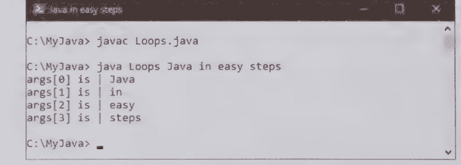

5. 编辑 `Loops.java` 添加一个 `String` 数组和一个 `while` 循环输出存储在每个元素中的值

```java
String[] htm = {"HTML", "easy", "steps"};
int j = 0;
while (j < htm.length) {
    System.out.println("htm[" + j + "] is " + htm[j]);
    j++;
}
```

6. 保存更改，然后重新编译并运行程序

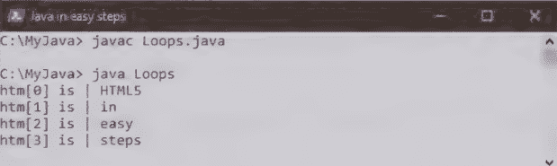

7. 编辑 `Loops.java` 添加另一个 `String` 数组和一个 `do while` 循环输出存储在每个元素中的值

```java
String[] xml = {"XML", "easy", "steps"};
int k = 0;
if (xml.length > 0) {
    System.out.println("xml[" + k + "] is " + xml[k]);
    k++;
}
while (k < xml.length);
```

> 提示：注意 `do` 语句之前有一个条件测试，以在尝试输出第一个元素的值之前确保数组为空。保存更改，然后重新编译并运行程序

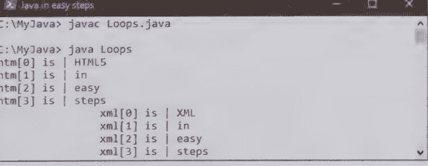

### 修改元素值

可以使用索引号为特定元素分配新值来更改存储在数组元素的值。此外，可以使用任何类型的循环从其他数组存储的值高效填充数组中的所有元素。这对于将多个数组数据合并到单个数组中特别有用。


`Elements.java`

1. 创建一个名为 "Elements" 的程序，包含标准方法类

```java
class Elements {
    public static void main(String[] args) {
    }
}
```

2. 在 `main` 方法中，添加代表全年四个季度每月销售的初始化 `int` 数组

```java
int[] kiosk_q1 = {42000, 48000, 50000 };
int[] kiosk_q2 = {52000, 58000, 60000 };
int[] kiosk_q3 = {46000, 49000, 58000 };
int[] kiosk_q4 = {50000, 51000, 61000 };
```

3. 添加代表全年四个季度每月网店销售的初始化 `int` 数组


```java
int[] output_q1 = {57000, 63000, 60000 };
int[] output_q2 = {70000, 67000, 73000 };
int[] output_q3 = {67000, 65000, 62000 };
int[] output_q4 = {72000, 69000, 75000 };
```

现在，创建一个包含 12 个元素的空 `int` 数组以合并所有每月销售额，并创建一个 `int` 变量以记录它们的总值

```java
int[] sum = new int[ 12 ];
int total = 0;
```

- 添加一个循环，用其他数组的组合值填充空数组的每个元素对于 (`int i = 0; i < kiosk_q1.length; i++`)

```java
sum[i] = kiosk_q1[i] + output_q1[i];
sum[i+3] = kiosk_q2[i] + output_q2[i];
sum[i+6] = kiosk_q3[i] + output_q3[i];
sum[i+9] = kiosk_q4[i] + output_q4[i];
```

接下来，添加第二个 `for` 循环来输出每个每月销售额总额，并计算它们的总和

```java
for (int i = 0; i < sum.length; i++ )
{
  System.out.println("Month " + (i + 1) + " sales:" + sum[i]);
}
```

在 `main` 方法的末尾添加一条语句来输出总和

```java
System.out.println("TOTAL YEAR SALES:" + total );
```

将程序保存为 `Elements.java`，然后编译程序并运行它以查看输出


```
C:\MyJava> javac Elements.java
C:\MyJava> java Elements
Month 1 sales: 99000
Month 2 sales: 111000
Month 3 sales: 118000
Month 4 sales: 122000
Month 5 sales: 125000
Month 6 sales: 133000
Month 7 sales: 113000
Month 8 sales: 116000
Month 9 sales: 120000
Month 10 sales: 122000
Month 11 sales: 120000
Month 12 sales: 136000
TOTAL YEAR SALES 1425000
C:\MyJava> _
```

计数器数字增加 1 以产生 1-12 的月份数字。

## 添加数组维度

可以创建数组来存储多组元素值，每组值都有自己的索引维度。在多维数组中，使用每个维度的适当索引来访问单独的值。例如，`num[1][3]`。

二维数组可以用于记录业务年度内每一天的整数值，并按周组织。这需要一个包含 52 个元素的数组（每周一个），每个元素包含一个包含 7 个元素的数组（每天一个）。它的声明形式如下：

```java
int[][] dailyRecord = new int[52][7];
```

“这种数组的数组”为每个业务日提供了一个元素。通过指定每个维度的适当索引数字为多维数组赋值赋值。例如，使用上面的示例，可以这样给第六周的第一天分配一个值：

```java
dailyRecord[5][0] = 5000 ;
```

每个数组都有其 `length` 属性，可以通过指定所需的维度来访问。对于该示例，语法 `dailyRecord.length` 返回 52 - 即第一个维度的大小。要访问第二个维度的尺寸，语法 `dailyRecord[0].length` 返回值 7。

| | [0] | [1] |
|---|---|---|
| [0] | 1 | 4 |
| [1] | 2 | 5 |
| [2] | 3 | 6 |

二维数组通常用于存储网格坐标，其中一个维度代表 X 轴，另一个维度代表 Y 轴。例如，`point[3][5]`。

三维数组可以用类似的方式存储 XYZ 坐标，但很难可视化 `point[4][8][2]`。

嵌套循环非常适合多维数组，因为每个循环层都可以访问每个数组维度的元素。

- 启动一个名为“Dimensions” 的新程序，包含标准的 `main` 方法类 `Dimensions`

```java
class Dimensions {
    public static void main ( String[] args ) {
    }
}
```


在 `main` 方法中，创建一个二维数组来存储与 XY 坐标相关的布尔标志位

```java
boolean[][] points = new boolean[5][20];
```

在每个 X 轴上定义一个 Y 点

```java
points[0][5] = true ;
points[1][6] = true ;
points[2][7] = true ;
points[3][8] = true ;
points[4][9] = true;
```


布尔变量默认为 `false`。

添加一个 `for` 循环来遍历第一个数组索引，并添加换行符

```java
for ( int i = 0; i < points.length; i++) {
    System.out.print("\n");
}
```

在 `for` 循环的大括号内，插入第二个 `for` 循环来遍历第二个数组索引

```java
for ( int j = 0; j < points[0].length ; j++) {
```

在第二个循环的大括号内，插入一条语句，根据每个元素的布尔值为每个元素输出一个字符

```java
char mark = points[i][j] ? 'T' : ' ';
System.out.print(mark);
```

将程序保存为 `Dimensions.java`，然后编译并运行程序以查看

```
C:\MyJava> javac Dimensions.java
C:\MyJava> java Dimensions
```

## 捕获异常

程序可能会遇到运行时“异常”错误，这会停止其执行。通常这会导致执行中断。通常，可以使用 `try` 块来包含可能发生异常的代码，并使用 `catch` 块来处理异常。


# 数据操作

本章演示了如何使用各种 Java 库方法来操作程序数据。

- 探索 Java 类
- 进行数学运算
- 数值四舍五入
- 生成随机数
- 管理字符串
- 比较字符串
- 搜索字符串
- 字符操作
- 总结

## 异常处理

程序可能会遇到运行时“异常”错误，这会停止其执行。通常这会导致执行中断。通常，可以使用 `try` 块来包含可能发生异常的代码，并使用 `catch` 块来处理异常。

## 循环与数组操作

接下来，添加第二个 `for` 循环来输出每个每月销售额总额，并计算它们的总和：

```java
for (int i = 0; i < sum.length; i++) {
    System.out.println("Month " + (i + 1) + " sales:" + sum[i]);
}
```

在 `main` 方法的末尾添加一条语句来输出总和：

```java
System.out.println("TOTAL YEAR SALES:" + total);
```

将程序保存为 `Elements.java`，然后编译程序并运行它以查看输出：


```
C:\MyJava> javac Elements.java
C:\MyJava> java Elements
Month 1 sales: 99000
Month 2 sales: 111000
Month 3 sales: 118000
Month 4 sales: 122000
Month 5 sales: 125000
Month 6 sales: 133000
Month 7 sales: 113000
Month 8 sales: 116000
Month 9 sales: 120000
Month 10 sales: 122000
Month 11 sales: 120000
Month 12 sales: 136000
TOTAL YEAR SALES 1425000
C:\MyJava> _
```

计数器数字增加 1 以产生 1-12 的月份数字。

### 添加数组维度

可以创建数组来存储多组元素值，每组值都有自己的索引维度。在多维数组中，使用每个维度的适当索引来访问单独的值。例如，`num[1][3]`。

二维数组可以用于记录业务年度内每一天的整数值，并按周组织。这需要一个包含 52 个元素的数组（每周一个），每个元素包含一个包含 7 个元素的数组（每天一个）。它的声明形式如下：

```java
int[][] dailyRecord = new int[52][7];
```

“这种数组的数组”为每个业务日提供了一个元素。通过指定每个维度的适当索引数字为多维数组赋值。例如，使用上面的示例，可以这样给第六周的第一天分配一个值：

```java
dailyRecord[5][0] = 5000;
```

每个数组都有其 `length` 属性，可以通过指定所需的维度来访问。对于该示例，语法 `dailyRecord.length` 返回 52 - 即第一个维度的大小。要访问第二个维度的尺寸，语法 `dailyRecord[0].length` 返回值 7。

| | [0] | [1] |
|---|---|---|
| [0] | 1 | 4 |
| [1] | 2 | 5 |
| [2] | 3 | 6 |

二维数组通常用于存储网格坐标，其中一个维度代表 X 轴，另一个维度代表 Y 轴。例如，`point[3][5]`。

三维数组可以用类似的方式存储 XYZ 坐标，但很难可视化 `point[4][8][2]`。

嵌套循环非常适合多维数组，因为每个循环层都可以访问每个数组维度的元素。

- 启动一个名为“Dimensions” 的新程序，包含标准的 `main` 方法类 `Dimensions`：

```java
class Dimensions {
    public static void main(String[] args) {
    }
}
```


在 `main` 方法中，创建一个二维数组来存储与 XY 坐标相关的布尔标志位：

```java
boolean[][] points = new boolean[5][20];
```

在每个 X 轴上定义一个 Y 点：

```java
points[0][5] = true;
points[1][6] = true;
points[2][7] = true;
points[3][8] = true;
points[4][9] = true;
```


布尔变量默认为 `false`。

添加一个 `for` 循环来遍历第一个数组索引，并添加换行符：

```java
for (int i = 0; i < points.length; i++) {
    System.out.print("\n");
}
```

在 `for` 循环的大括号内，插入第二个 `for` 循环来遍历第二个数组索引：

```java
for (int j = 0; j < points[0].length; j++) {
```

在第二个循环的大括号内，插入一条语句，根据每个元素的布尔值为每个元素输出一个字符：

```java
char mark = points[i][j] ? 'T' : ' ';
System.out.print(mark);
```

将程序保存为 `Dimensions.java`，然后编译并运行程序以查看：

```
C:\MyJava> javac Dimensions.java
C:\MyJava> java Dimensions
```

## 捕获异常

程序可能会遇到运行时“异常”错误，这会停止其执行。通常，可以使用 `try` 块来包含可能发生异常的代码，并使用 `catch` 块来处理异常。

## 探索 Java 预测试包

Java 拥有庞大的预测试包库，这些包按模块划分。那些提供 Java 语言本身基础功能的包包含在 `java.lang` 包中，它位于 `java.base` 模块内。这些包对 Java API（应用程序编程接口）自动可用。这意味着在创建程序时，`java.lang` 包提供的属性和方法可以直接使用。例如，`java.base` 模块中 `java.lang` 包的 `Math` 类通过 `abs()` 方法提供的数学功能。


模块是 Java 9 引入的新功能，旨在提高可扩展性和提升性能。

包的内容按层级顺序排列，允许使用点符号来访问任何项。例如，`System` 类包含一个 `out` 属性（字段），该字段又包含一个 `println()` 方法——因此可以通过 `System.out.println()` 进行访问。

Java 文档提供了每个可用项的信息，可以在 docs.oracle.com/javase/9/docs/api/ 在线查看，也可以下载供离线参考。文档内容巨大在可以理解，但熟悉它非常有价值。一个很好的起点是 API 概览（API Overview）页面，它包含三个部分中每个模块的列表，并对每个模块进行详细描述：


- 启动浏览器并打开 docs.oracle.com/javase/9/docs/api 中的 API 概览页面
- 查看每个部分中按字母顺序列出的模块——向下滚动页面到“Java SE”部分并找到 `java.base` 模块，然后点击其超链接

你可以点击“框架”（Frames）链接来查看文档的多面板视图。

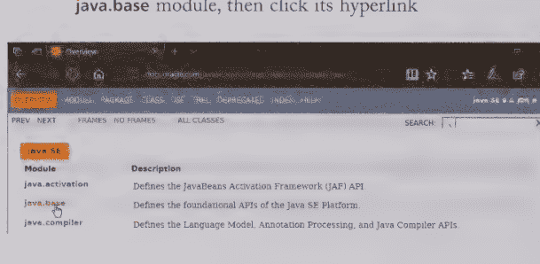

...继续

查看每个部分中按字母顺序列出的模块包——向下滚动页面到“导出”（Exports）部分并找到 `java.lang` 包，然后点击其超链接：


你也可以使用搜索框来查找任何项的信息。

| 模块 | 下一个模块 | 框架 | 无框架 | 所有类 |
|---|---|---|---|---|
| 模块描述 | 模块 | 包 | 服务 | |
| 搜索 | | | | |
| `java.lang` | | | | |
| `java.lang.annotation` | | | | |

提供了对 `java.lang` 编程语言设计至基础的类 | 为 Java 编程语言注解提供库支持

- 查看每个部分中按字母顺序列出的包类——向下滚动页面到“类摘要”（Class Summary）部分找到 `Math` 类，然后点击其超链接：


| 概览 | 模块 | 包 | 标签 | 派生 | 使用 |
|---|---|---|---|---|---|
| 上一个包 | 下一个包 | 框架 | 无框架 | 所有类 |
| 搜索 | | | | | |
| `Long` | | | | | |
| `Math` | | | | | |

`Long` 类将原始类型 `long` 的值封装在对象中。

`Math` 类包含了用于执行数值运算的方法，如指数、对数、平方根和三角函数。

- 查看“方法摘要”（Method Summary）部分中按字母顺序列出的类方法——点击任何超链接以了解其目的和语法：


通过页面菜单上的其他项可用的信息来更熟悉文档。

| 概览 | 模块 | 包 | 标签 | 派生 | 使用 |
|---|---|---|---|---|---|
| 上一个包 | 下一个包 | 框架 | 无框架 | 所有类 |
| 搜索 | | | | | |
| 详细（字段） | 构造函数 | 详细（字段） | 构造函数 |
| 修饰符 | 方法 | 描述 |
|---|---|---|
| `static double abs(a)` | 返回...的绝对值 |

返回 `a` 的绝对值。如果参数为负，则返回其相反数。

## 进行数学运算

`java.lang` 中的 `Math` 类提供了许多用于执行数学计算的方法。使用 `Math.pow()`，可以将给定数字提升到指定的幂。括号要求数字作为第一个参数，将要提升的幂作为第二个参数。`Math.sqrt()` 方法返回其唯一参数的平方根。这两个方法都返回 `double` 类型。Pi 的值通常提供了足够的精度。


1. 创建一个名为 "Power" 的新程序，包含标准方法类 `Power`：

```java
class Power {
    public static void main(String[] args) {
    }
}
```

2. 在 `main` 方法内部，从传递的命令行参数声明并初始化 `float` 变量：

```java
float radius = Float.parseFloat(args[0]);
```

3. 执行数学计算，将结果转换为更多的 `float` 变量：

```java
float circ = (float) Math.pow(radius, 2);
```

4. 输出计算结果：

```java
System.out.println(num + " squared is " + square);
```

5. 将程序保存为 `Power.java`，然后编译并运行程序以查看输出：


```
Java in easy steps
:\MyJava> javac Power.java
:\MyJava> java Power 9
9 squared is 81
9 cubed is 729
Square root of 9 is 3
C:\MyJava> _
```

## 数字的舍入

`java.lang` 包中的 `Math` 类提供了三种方法将浮点数舍入到最近的整数。其中最简单的是 `Math.round()` 方法，它将作为参数的数字向上或向下舍入到最近的整数。

`Math.floor()` 方法向下舍入到下方的最近整数，而 `Math.ceil()` 方法则向上舍入到最近整数。

虽然 `Math.round()` 方法返回 `int` 数据类型，但 `Math.floor()` 和 `Math.ceil()` 方法都返回 `double` 数据类型。


1. 创建一个名为“Round”的新程序，其中包含标准的 `main` 方法 `Round`：

```java
class Round {
    public static void main(String[] args) {
    }
}
```

2. 在 `main` 方法内部，声明并初始化一个 `float` 变量：

```java
float num = 7.25f;
```

3. 将舍入后的 `float` 值作为 `int` 值输出：

```java
System.out.println(num + " rounded is " + Math.round(num) + ");");
```

4. 将舍入后的 `float` 值作为 `double` 值输出：

```java
System.out.println(num + " floored is " + Math.floor(num) + ");");
System.out.println(num + " ceiling is " + Math.ceil(num) + ");");
```


默认情况下，`Math.round()` 会向上舍入——所以 7.5 舍入后为 8。

5. 将程序保存为 `Round.java`，然后编译并运行程序查看输出：

```
C:\MyJava> javac Round.java
C:\MyJava> java Round
7.25 rounded is 7
7.25 floored is 7.0
7.25 ceiling is 8.0
C:\MyJava>_
```

`java.lang` 包中的 `Math` 类提供了两个方法来比较两个数值。`Math.max()` 方法和 `Math.min()` 方法各需要两个数字作为其参数。`Math.max()` 将返回较大的数字，而 `Math.min()` 将返回较小的数字。

比较的数字可以是任意数值数据类型，但结果将以 `double` 数据类型返回。

- 创建一个名为“Compare”的新程序，其中包含标准的 `main` 方法：

```java
class Compare {
    public static void main(String[] args) {
    }
}
```

- 在 `main` 方法内部，声明并初始化一个 `float` 变量和一个 `int` 变量：

```java
float num1 = 24.75f;
int num2 = 25;
```

- 输出较大的值：

```java
System.out.println("Most is " + Math.max(num1, num2));
```

- 输出较小的值：

```java
System.out.println("Least is " + Math.min(num1, num2));
```

- 将程序保存为 `Compare.java`，然后编译并运行程序查看输出：


```
C:\MyJava> javac Compare.java
C:\MyJava> java Compare
Most is 25.0
Least is 24.75
C:\MyJava> _
```

## 生成随机数


# Java 字符串与随机数处理

## 生成随机数

`java.lang` 包中的 `Math` 类通过其 `Math.random()` 方法提供了生成随机数的能力，该方法返回 0.0 到 0.999 之间的双精度随机数。乘以随机数可以指定更宽的范围。例如，乘以 10 将创建一个 0.0 到 9.999 范围内的随机数。现在使用 `Math.ceil()` 对随机数进行舍入，将确保它落在 1-10 的范围内。


### 示例：Random 程序

创建一个名为 "Random" 的程序，其中包含标准的 main 方法：

```java
class Random {
    public static void main(String[] args) {
    }
}
```

在 main 方法内部，将一个随机数赋值给 float 变量：
```java
float random = (float) Math.random();
System.out.println("Random number: " + random);
```

将随机数的乘积赋值给第二个 float 变量，并输出其值：
```java
float multiplied = random * 10;
System.out.println("Multiplied number: " + multiplied);
```

将乘后的随机数的舍整整数赋值给 int 变量，并输出其值：
```java
int randomInt = (int) Math.ceil(multiplied);
System.out.println("Random Integer: " + randomInt);
```

将程序保存为 `Random.java`，然后编译并运行程序查看输出：


```
C:\MyJava> javac Random.java
C:\MyJava> java Random
Random number: 0.11486274
Multiplied number: 1.1486274
Random Integer: 2
C:\MyJava> _
```

## 合并随机数生成步骤

相反描述的 Lottery 程序将此示例中的三个步骤合并到一个语句中。

### 示例：Lottery 程序

创建一个名为 "Lottery" 的程序，其中包含标准的 main 方法：

```java
class Lottery {
    public static void main(String[] args) {
    }
}
```


在 main 方法内部，创建一个 int 数组：
```java
int[] nums = new int[60];
```

赋值值：
```java
int r = (int)(Math.random() * 60);
```

输出值：
```java
System.out.println(nums[r]);
```

将程序保存为 `Lottery.java`，然后编译并运行程序查看输出：


> **注意**：`java.lang` 包中的 `Math` 类提供了两个方法来比较两个数值。`Math.max()` 方法（注意：此处原文似乎不完整）。

## 管理字符串

在 Java 编程中，`String` 是包含在引号内的字符集合。因此，这些是有效的字符串：

```java
String txt1 = "My First";
```

```java
String txt2 = "";
```

```java
String txt3 = "2";
```

```java
String txt4 = "null";
```

空引号 `txt2` 将变量初始化为空字符串。`null` 关键字通常表示值的缺失，但在引号内它仅仅是一个字符串。

`String` 类是 `java.lang` 的一部分，并提供了 `length()` 方法，该方法返回 `String` 的大小，就像数组长度一样。每个 `String` 都是 `String` 类的实例。

`java.lang` 包中的 `String` 类还提供了 `+` 拼接运算符的替代方案。其 `concat()` 方法需要一个参数，指定要附加的第二个字符串。在使用时，通过点符号将其附加到第一个字符串的变量名上。例如，使用 `txt1.concat(txt2)` 附加 `txt2`。


> **注意**：`Array.length` 是一个属性，但 `String.length()` 是一个方法——所以它必须带有尾括号。

### 示例：StringLength 程序

创建一个名为 "StringLength" 的程序：

```java
class StringLength {
    public static void main(String[] args) {
    }
}
```

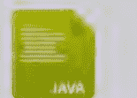

在 main 方法内部，创建并初始化两个 `String` 变量：
```java
String lang = "Java";
String series = " in easy steps";
```

添加另一个 `String` 变量并赋值另外两个 `String` 变量的拼接值：
```java
String title = lang.concat(series);
```

输出引号内的拼接字符串，连同它的大小：
```java
System.out.print("\"" + title + "\" ");
System.out.println(title.length() + " characters");
```

将程序保存为 `StringLength.java`，然后编译并运行程序查看输出：

```
C:\MyJava> javac StringLength.java
C:\MyJava> java StringLength
"Java in easy steps" has 18 characters
C:\MyJava> _
```


> 空格是 `String` 的一部分，因此包含在字符计数中——但引号不包含在内。

### 字符串比较

`java.lang` 包中的 `String` 类提供了一个实用的 `equals()` 方法，该方法在第 66 页引入，用于评估 `args[0]` 元素中的命令行参数。该方法也可以通过使用点符号将方法名附加到第一个 `String` 变量上，并指定要比较的 `String` 作为其参数，来比较任何两个 `String` 值。例如，比较 `txt2` 和 `txt1` 的语法是 `txt1.equals(txt2)`。当两个 `String` 值的字符完全相同且顺序一致时，该方法返回 `true`；否则返回 `false`。


> 请确保在 `toUpperCase()` 和 `toLowerCase()` 方法中使用大写字母“C”正确拼写。

使用不同字母大小写的 `String` 值（例如“Java”和“JAVA”）不被认为是相等的，因为字符的 ASCII 代码值不同。例如，大写字母“A”的值为 65，而小写字母“a”的值为 97。

为了将用户输入的字母大小写不定的输入 `String` 值与程序中的 `String` 值进行比较，将输入转换为特定的大小写通常很有用。为此，`String` 类提供了 `toUpperCase()` 方法和 `toLowerCase()` 方法。当指定 `String` 为参数时，该方法将返回转换后的 `String`。

一个典型的示例可能是：在将用户输入的密码 `String` 转换为小写之前，强制将其与程序中存储在 `String` 变量中的（且全小写存储的）正确密码进行比较。这允许用户在允许大小写不敏感密码的情况下，以大写、小写或混合形式输入密码。

点符号允许将方法附加到其他方法上，以便按顺序执行操作。这意味着可以使用 `toLowerCase().equals()` 将一个 `String` 值转换为小写，然后将该小写版本与指定的参数进行比较。

#### 示例：StringComparison 程序

创建一个名为 "StringComparison" 的新程序，包含标准的 main 方法：

```java
class StringComparison {
    public static void main(String[] args) {
    }
}
```

在 main 方法内部，创建并初始化一个带有正确小写密码的 `String` 变量：
```java
String password = "bingo";
```

添加一个 `try` 语句来捕获未输入密码参数时发生的异常：
```java
try {
    // ...
} catch (Exception e) {
    // ...
}
System.out.println("Password required.");
```

在 `try` 语句块中插入此 `if else` 语句来评估用户输入的密码参数：
```java
if (args[0].toLowerCase().equals(password)) {
    System.out.println("Password accepted.");
} else {
    System.out.println("Incorrect password.");
}
```

将程序保存为 `StringComparison.java`，然后使用各种参数编译并运行程序：

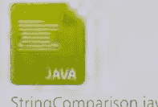
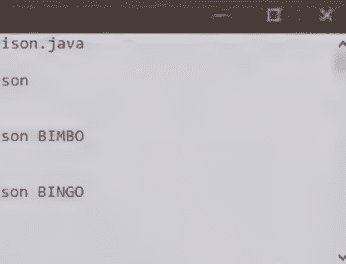

```
C:\MyJava> javac StringComparison.java
C:\MyJava> java StringComparison
Password required.
C:\MyJava> java StringComparison BIMBO
Incorrect password.
C:\MyJava> java StringComparison BINGO
Password accepted.
C:\MyJava> _
```

### 字符串搜索

`java.lang` 包中的 `String` 类提供了 `startsWith()` 和 `endsWith()` 方法来比较 `String` 值的部分。这些方法在比较多个 `String` 值并选择具有相同开头或相同结尾的值时特别有用。当 `String` 部分与指定的参数匹配时，该方法返回 `true`；否则，返回 `false`。

通过将要复制的第一个字符的位置号作为 `substring()` 方法的参数，可以复制 `String` 值的某部分。这将返回原始 `String` 值的子字符串，从指定的起始位置开始到原始 `String` 的结束。

可选地，`substring()` 方法可以接受第二个参数，来指定要复制的最后一个字符的位置号。这将返回原始 `String` 值的子字符串，从指定的起始位置开始到指定的位置结束。

可以对 `String` 值进行搜索，以找到作为 `indexOf()` 方法参数指定的字符或子字符串。通常，它返回匹配的字符或子字符串在搜索的 `String` 值中首次出现的数字位置。如果未找到匹配项，该方法返回负整数值 -1。


#### 示例：StringSearch 程序

1. 创建一个名为 "StringSearch" 的新程序，包含标准的 main 方法：
```java
class StringSearch {
    public static void main(String[] args) {
    }
}
```

2. 在 main 方法内部，创建一个初始化的书名 `String` 数组：
```java
String[] books = {
    "Java in easy steps", "XML in easy steps",
    "SQL in easy steps", "CSS in easy steps",
    "Gone with the Wind", "Drop the Defense"
};
```

3. 创建并初始化三个 int 计数器变量：
```java
int counter1 = 0, counter2 = 0, counter3 = 0;
```

添加一个 for 循环来遍历 `String` 数组，并输出每个标题的前四个字符：
```java
for (int i = 0; i < books.length; i++) {
    System.out.print(books[i].substring(0, 4) + " ");
}
```

在 for 循环中插入语句，统计以特定字符串结尾的标题：
```java
if (books[i].endsWith("steps")) counter1++;
```

在 for 循环中插入语句，统计以特定字符串开头的标题：
```java
if (books[i].startsWith("Java")) counter2++;
```

在 for 循环中插入语句，统计不包含特定字符串的标题：
```java
if (books[i].indexOf("easy") == -1) counter3++;
```

在 main 方法末尾添加这些语句以输出搜索结果：
```java
System.out.println("Found " + counter1 + " titles from series");
System.out.println("Found " + counter2 + " Java title");
System.out.println("Found " + counter3 + " other titles");
```

将程序保存为 `StringSearch.java`，然后编译并运行程序查看输出：

```
C:\MyJava> javac StringSearch.java
C:\MyJava> java StringSearch
Java | XML | SQL | CSS | Gone | Drop 
Found 4 titles from series
Found 1 Java title
Found 2 other titles
C:\MyJava> _
```


> 不要忘记不能测试 `indexOf` 方法是否失败——因为它返回的是整数值，而不是布尔值。

### 字符操作

`java.lang` 包中的 `String` 类提供了 `trim()` 方法，用于删除字符串两端的任何空白字符。该方法将移除所有的空格、换行符和制表符，返回处理后的字符串版本。

通过指定索引位置作为 `charAt()` 方法的参数，可以访问 `String` 中的单个字符。该方法将 `String` 视为字符数组，就像从零开始索引的数组一样。`String` 的第一个字符可以通过 `charAt(0)` 访问，第二个可以通过 `charAt(1)`，以此类推。

由于字符索引从零开始，`String` 的最后一个字符索引号始终比字符总数少一。这意味着任何 `String` 的最后一个字符索引号等于 `length() - 1`。因此，名为 "str" 的 `String` 的最后一个字符为 `str.charAt(str.length() - 1)`。

可以使用 `replace()` 方法将 `String` 中所有的特定字符替换另一个字符。该方法需要两个参数来指定要替换的字符和取代它的字符。例如，要将所有字母 "a" 替换为 "z"，语法为 `replace('a', 'z')`。

`isEmpty()` 方法可以检查 `String` 是否不包含字符。如果 `String` 是绝对空的，该方法将返回 `true`；否则返回 `false`。

#### 示例：CharacterSwap 程序

创建一个名为 "CharacterSwap" 的新程序，包含标准的 main 方法：

```java
class CharacterSwap {
    public static void main(String[] args) {
    }
}
```

在 main 方法内部，声明并初始化一个空变量：
```java
String txt = "";
```

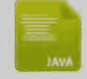

为 `String` 变量赋值一些字符，如果它确实为空，则带有前后的空格：
```java
if (txt.isEmpty()) {
    txt = " Borrocudo ";
}
```

输出 `String` 的值以及它包含的字符数：
```java
System.out.println("String: " + txt);
System.out.println("Original String Length: " + txt.length());
```

移除首尾的空格，再次输出 `String` 的值和它的大小：
```java
txt = txt.trim();
System.out.println("String: " + txt);
System.out.println("String Length: " + txt.length());
```

输出 `String` 中的第一个字符：
```java
char initial = txt.charAt(0);
System.out.println("First Letter: " + initial);
```

现在，输出 `String` 中的最后一个字符：
```java
initial = txt.charAt(txt.length() - 1);
System.out.println("Last Letter: " + initial);
```

将所有的字母 "o" 替换为字母 "a"：
```java
txt = txt.replace('o', 'a');
System.out.println("String: " + txt);
```

将程序保存为 `CharacterSwap.java`，然后编译并运行程序查看输出：

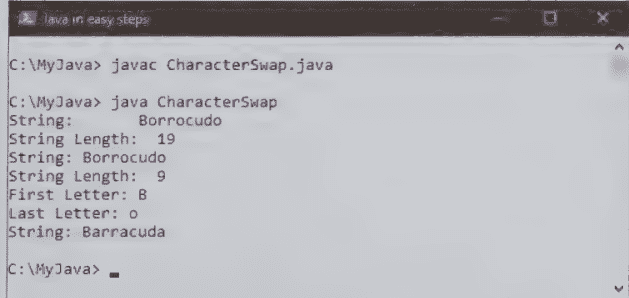

## 总结

- Java 文档提供了关于每个 Java 类中方法和属性的信息。


- Java 语言基础的 Java 类包含在 `java.lang` 包中，位于 `java.base` 模块中。
- `Math` 类提供了 `Math.PI` 和 `Math.E` 常量。
- `Math.pow()` 产生指定的幂次，`Math.sqrt()` 返回指定数的平方根。
- 数字可以使用 `Math.round()`、`Math.floor()` 和 `Math.ceil()` 舍入为整数值。
- 可以使用 `Math.max()` 和 `Math.min()` 对数字进行比较。
- `Math.random()` 返回一个 0.0 到 0.99999999999999 之间的双精度随机数。
- `String` 是用引号括起来的零或多个字符。
- `length()` 方法返回其 `String` 的大小，类似于数组的 `length` 属性。
- `String` 的 `concat()` 方法附加另一个 `String` 值。
- `String` 的 `equals()` 方法仅当两个 `String` 值具有相同字符且顺序相同时才返回 `true`。
- `String` 的字符大小可以使用其 `toUpperCase()` 方法和 `toLowerCase()` 方法更改。
- 可以使用 `String` 的 `startsWith()` 和 `endsWith()` 方法比较 `String` 值。
- 可以使用 `indexOf()` 和 `substring()` 方法在 `String` 中查找子字符串。
- `isEmpty()` 方法仅在 `String` 完全不包含内容时返回 `true`。
- 可以使用 `trim()`、`charAt()` 和 `replace()` 方法对 `String` 值中的字符进行操作。

# 6 创建类

本章演示了如何创建使用多个方法和类的 Java 程序。

- 98 形成多个方法
- 100 理解程序作用域
- 102 形成多个类
- 104 扩展现有类
- 106 创建对象类
- 108 产生对象实例
- 110 封装属性
- 112 构建对象值
- 114 总结

## 形成多个方法

程序通常被拆分成独立的方法，以便创建每个执行特定任务的代码模块，并且可以根据需要在整个程序中反复调用。将程序拆分成多个方法也更容易追踪错误，因为每个方法都可以单独进行测试。进一步的方法可以在类声明后的大括号内声明，并使用与声明 `main` 方法相同的关键字。每个新方法都必须按照通常的命名约定赋予名称，并可以在其名称后的括号中指定参数。


### 开始一个名为 "Methods" 的新程序，包含标准的 main 方法类 Methods

```java
class Methods {
    public static void main (String[] args) {
    }
}
```

- 在 `main` 方法的大括号之间，插入语句输出消息并调用名为 "sub" 的第二个方法

```java
System.out.println("Message from the main method.");
sub();
```


- 在 `main` 方法之后，在类的最后一个大括号之前，添加第二个方法以输出消息

```java
public static void sub() {
    System.out.println("Message from the sub method.");
}
```

- 将程序保存为 `Methods.java`，然后编译并运行程序查看输出

```
C:\MyJava> javac Methods.java
C:\MyJava> java Methods
Message from the main method.
Message from the sub method.
C:\MyJava> _
```

一个类可以包含多个同名的方法，只要它们的参数不同——即需要不同数量或不同类型的参数。这一实用的功能被称为重载。

### 开始一个名为 "Overload" 的新程序，包含标准的 main 方法

```java
class Overload {
    public static void main (String[] args) {
    }
}
```

- 在 `main` 方法的大括号之间，插入语句输出消息并调用名为 "sub" 的第二个方法

```java
System.out.println("Message from the main method.");
sub();
```

- 在 `main` 方法之后，在类的最后一个大括号之前，添加第二个方法以输出消息

```java
public static void sub() {
    System.out.println("Message from the sub method.");
}
```

- 将程序保存为 `Overload.java`，然后编译并运行程序查看输出

```
C:\MyJava> javac Overload.java
C:\MyJava> java Overload
Message from the main method.
Message from the sub method.
C:\MyJava> _
```

## 理解程序作用域

在 `for` 循环中声明的变量在循环外部无法访问——其作用域限于 `for` 语句。

静态方法是“类方法”——可以在类中的任何其他方法中访问。

同样，“类变量”可以使用 `static` 关键字声明，以确保在整个类中全局访问。它的声明应该放在 `main` 方法之前，紧跟在类声明的大括号之后。

程序可能具有同名的全局类变量和局部方法变量。局部方法变量优先，除非使用类名点符号显式访问全局类变量，或者没有声明同名的局部变量。

- 通过编辑 `Scope.java` 插入一个与方法变量同名的类 `String` 变量常量

```java
final String txt = "This is a global variable of the Scope class";
```

- 在 `main` 方法末尾添加一条语句输出全局类变量的值

```java
System.out.println(Scope.txt);
```

- 注释掉 `sub` 方法中声明局部变量的行——这样输出语句现在指向同名的全局变量

```java
// String txt = "This is a local variable in the sub method";
```

- 保存更改，重新编译程序并再次运行查看修改后的输出

```
C:\MyJava> javac Scope.java
C:\MyJava> java Scope
This is a local variable in the main method.
This is a global variable of the Scope class.
This is a global variable of the Scope class.
```

## 创建多个类

就像程序可以有多个方法一样，大型程序可能由几个类组成——每个类都提供特定的功能。这种模块化的格式通常比将整个程序写在单个类中要好，因为它使得调试变得更简单，并提供了更好的灵活性。

在声明中出现的 `public` 关键字是一个“访问修饰符”，它决定了某个项对其他类的可见性。它可以在类声明中使用，以显式确保该类对任何其他类都可见。如果省略它，默认的访问控制级别允许从其他本地类访问。然而，`public` 关键字必须与程序的 `main` 方法一起使用，以便该方法对编译器可见。


### 启动一个名为 "Multi" 的新程序，包含标准的 main 方法 – 照常包含 `public` 关键字

```java
class Multi {
    public static void main ( String[] args ) {
    }
}
```

- 在 `main` 方法的大括号之间，声明并初始化一个 `String` 变量，然后输出其内容

```java
String msg = "This is a local variable in the Multi class";
System.out.println( msg );
```

- 输出来自名为 "Data" 的类的名为 "txt" 的类变量的内容

```java
System.out.println(Data.txt);
```

- 调用 `Data` 类中名为 "greeting" 的方法

```java
Data.greeting();
```

- 调用名为 "Draw" 的类中名为 "line" 的方法

```java
Draw.line();
```

- 将程序保存为 `Multi.java`


编译器会自动找到相邻的外部 `.java` 文件中的类，并为每个类创建编译后的 `.class` 文件。

...续

### 创建一个新文件创建 Data 类

```java
class Data
{
}
```


- 声明并初始化一个 `public` 类变量常量

```java
public final static String txt = "This is a global variable in the Data class";
```

- 添加一个 `public` "greeting" 类方法

```java
public static void greeting()
{
  System.out.print("This is a global method ");
  System.out.println("of the Data class ");
}
```

- 将文件保存为 `Data.java`，并与 `Multi.java` 程序位于同一目录下

### 启动一个新文件创建一个 Drawing 类和一个具有默认访问权限的 "line" 方法 – 不包含 `public` 关键字

```java
class Draw
{
  static void line()
  {
    System.out.println("____________________");
  }
}
```


- 将文件保存为 `Draw.java`，并与 `Multi.java` 程序位于同一目录下，然后编译并运行程序以查看输出

```
java in easy steps
C:\MyJava> javac Multi.java
C:\MyJava> java Multi
This is a local variable in the Multi class
This is a global variable of the Data class
This is a global method of the Data class
C:\MyJava> _
```


`public` 关键字允许从任何其他类访问，但默认仅允许从同一包中的类访问。

## 继承现有类

类可以使用类声明中的 `extends` 关键字来继承另一个类的特征，以指定要继承的类。例如，声明 `Extra` 类继承自 `Base` 类。

继承的类被称为“子类”，它所继承的类被称为“父类”。在上面的示例中，`Base` 是父类，`Extra` 是子类。

父类中创建的方法和变量通常可以被认为存在子类中，只要它们没有用 `private` 关键字声明（这会拒绝外部访问）。

子类中的方法将重写父类中的方法，除非它们的参数不同。父类中的方法可以使用类名和点进行显式调用，例如 `SuperClass.run()`。

应该注意，父类方法中的 `catch` 语句不会捕获子类中发生的异常——必须将其放在自己的 `catch` 语句中来捕获这些异常。


### 创建一个名为 "SuperClass" 的新类

```java
class SuperClass { }
```

- 在类的大括号之间，添加一个输出标识 `String` 方法

```java
public static void hello()
{
    System.out.println("Hello from the Class");
}
```

- 添加第二个方法尝试输出参数，将文件保存为 `SuperClass.java`

```java
public static void echo(String arg)
try{
    System.out.println("You entered: " + arg);
}catch(Exception e) {
    System.out.println("Argument required");
}
```

...续

### 创建一个名为 "SubClass" 的新程序并继承 SuperClass

```java
class SubClass extends SuperClass
{
    public static void main ( String[] args ) {
    }
}
```


- 在 `main` 方法之后，添加一个输出标识 `String` 方法，重写继承的同名方法

```java
public static void hello()
{
    System.out.println("Hello from the Sub ");
}
```

- 在 `main` 方法的大括号之间，插入对重写方法的调用，然后调用父类的同名方法

```java
hello();
SuperClass.hello();
```

- 对另一个继承的方法 `echo(args[0])` 添加调用。

- 将程序保存为 `SubClass.java`，然后在不带参数的情况下编译并运行程序

```
java in easy steps.
C:\MyJava> javac SubClass.java
C:\MyJava> java SubClass
Hello from the Sub Class
Hello from the Super Class
Exception in thread "main" java.lang.ArrayIndexOutOfBoundsException: 0
    at SubClass.main(SubClass.java:7)
C:\MyJava> _
```


你可以在第 76 页找到关于异常的更多信息。

- 编辑 `SubClass.java` 将步骤 7 中的方法封装在自己的 `catch` 语句中以捕获异常，重新编译并运行程序以解决问题

## 创建对象类

现实世界的对象就在我们周围，它们都有我们可以描述的属性和行为：

- 属性描述对象拥有的特征
- 行为描述对象可以执行的操作

例如，汽车可以用 "red" 和 "coupe" 属性以及 "accelerate" 行为来描述。

这些特征在 Java 编程中可以通过包含 `color` 和 `bodyType` 变量属性以及 `accelerate()` 方法的 `Car` 类表示。


Java 被称为面向对象编程（OOP）语言，因为它广泛使用对象的属性和行为来执行程序任务。

Java 中通过定义一个类作为模板来创建对象，从中创建不同的副本或“实例”。

通过分配属性值和行为来描述该对象，类的每个实例都可以自定义。

`Car` 类是根据描述的步骤创建的类模板——使用了上述默认属性和行为。`Car` 类的实例是在第 109 页描述的步骤创建的，继承相同的默认属性和行为。

...续

### 名为 "Car" 的新模板类

```java
class Car
{
}
```


#### FirstObject.java

- 在 `Car` 类的大括号之间，声明并初始化两个描述属性的全局 `String` 常量

```java
public final static String color = "Red";
public final static String bodyType = "Coupe";
```

- 添加一个描述行为的全局方法

```java
public static String accelerate()
{
  String motion = "Accelerating...";
  return motion;
}
```


`static` 关键字声明类变量和类方法——在本例中，作为 `Car` 类的成员。

- 在 `Car` 类之后，启动一个名为 "FirstObject" 的新程序类，包含标准的 `main` 方法

```java
public static void main (String[] args) {
}
```


- 在 `main` 方法的大括号之间，插入输出每个 `Car` 属性值并调用其行为方法的语句


```java
System.out.println("Paint is " + Car.color);
System.out.println("Style is " + Car.bodyType);
System.out.println(Car.accelerate());
```

对象类通常在包含 `main` 方法的类之前创建。

将程序保存为 `FirstObject.java`，然后编译并运行程序以查看输出。

### 产生对象实例

每个类都有一个内置的“构造器”方法，可用于创建该类的新实例。构造器方法的名称与类名相同，并使用 `new` 关键字调用。

类的每个实例都继承该对象的属性和行为。继承原理贯穿于 Java 中，这样程序就可以使用现成的属性。

为了更具灵活性，对象类模板可以定义在包含程序之外的其他文件中。这意味着它们可以被多个程序轻松使用。


- 启动一个新文件，重复第 106-107 页的示例 `class Car`

```java
{
    public final static String color = "Red";
    public final static String bodyType = "Coupe";
    public static String accelerate() {
        String motion = "Accelerating...";
        return motion;
    }
}
```

- 将文件保存为 `Car.java`

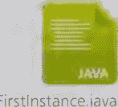

- 启动一个名为“FirstInstance”的新程序，包含标准方法类 `FirstInstance`

```java
{
    public static void main ( String[] args ) {
    }
}
```

在 `main` 方法的大括号之间，插入语句来输出 `Car` 类每个属性的值并调用其行为方法：

```java
System.out.println("Car paint is " + Car.color);
System.out.println("Car style is "+ Car.bodyType );
System.out.println( Car.accelerate() );
```

现在，添加一条语句创建一个 `Car` 类的保时捷（Porsche）实例：

```java
Car Porsche = new Car();
```

添加语句输出每个 `Porsche` 属性的继承值并调用其行为方法：

```java
System.out.println("Porsche paint is " + Porsche.color);
System.out.println("Porsche style is " + Porsche.bodyType);
System.out.println(Porsche.accelerate());
```


你无法直接访问 `motion` 变量——它在方法的作用域之外。

将程序保存为 `FirstInstance.java` 并与 `Car.java` 模板文件放在同一目录，然后编译并运行程序以查看输出。

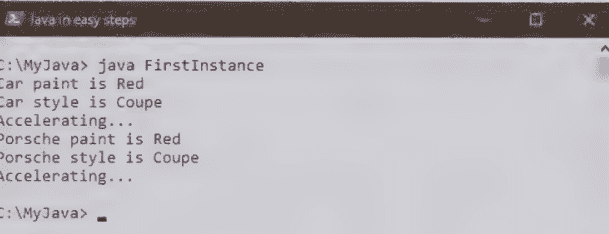

```
C:\MyJava> Java FirstInstance
Car paint is Red
Car style is Coupe
Accelerating...
Porsche paint is Red
Porsche style is Coupe
Accelerating...

C:\MyJava> _
```

为新的 `Porsche` 对象创建了一个虚拟类，它复制了原始的 `Car` 类和一个“类方法”，这些通过类名和点表示法进行访问——由于这些成员是全局可访问的，这不被认为是良好的编程实践。


虽然这个示例演示了对象的实例如何继承原始类的属性，但在第 110-111 页的下一个示例中得到了改进，它使用非静态成员来创建“实例变量”和“实例方法”，这些成员无法从类外部访问——由于这些成员不是全局可见，这被认为是良好的编程实践。

编译器会自动在外部 `.java` 文件中找到 `Car` 类——并为其创建一个编译后的 `.class` 文件。

### 封装属性

在声明对象变量和方法时可以使用 `private` 关键字来保护它们免受程序的操纵。`main` 方法的大括号内应该包含输出属性值并调用行为方法的语句。这种技术整洁地封装了类中的变量和方法。在接下来的步骤中演示了属性：img/ab47fc8e240585a2e70c709b4ee10a72_111.png

- 启动一个名为 "Car" 的新类：

```java
class Car
{
```

- 在类的大括号之间，声明三个 `String` 变量来存储对象属性：

```java
private String maker;
private String color;
private String bodyType;
```

- 添加描述行为的私有方法：

```java
private String accelerate()
{
    String motion = "Accelerating...";
    return motion;
}
```

- 添加一个公共方法将传递的值赋值给每个私有变量：

```java
public void setCar(String brand, String paint, String style)
{
    maker = brand;
    color = paint;
    bodyType = style;
}
```

- 添加另一个公共方法来检索私有变量：

```java
public void getCar()
{
    System.out.println(maker + " paint is " + color);
    System.out.println(maker + " style is " + bodyType);
    System.out.println(maker + " is " + accelerate());
}
```

- 在 `Car` 类结束后，启动一个名为 "FirstInstance" 的类，包含标准方法：

```java
class FirstInstance
{
    public static void main ( String[] args ) {
```

- 在 `main` 方法的大括号内，插入语句创建一个 `Car` 类的实例并检索初始默认值：

```java
Car Porsche = new Car();
Porsche.getCar();
```

- 创建另一个实例，赋值并检索值：

```java
Car Ferrari = new Car();
Ferrari.setCar("Ferrari", "Red", "Sport");
Ferrari.getCar();
```

### 构造对象

对象的构造器可以直接被调用来初始化变量。这有助于保持声明和赋值分离，并且是良好的编程风格。在第 110-111 页的后续步骤中演示了这一点：img/ab47fc8e240585a2e70c709b4ee10a72_112.png

- 1. 启动一个名为 "Car" 的新类：

```java
class Car
{
```

- 2. 在类的大括号之间，声明三个 `String` 变量来存储对象属性：

```java
private String maker;
private String color;
private String bodyType;
```

- 3. 添加一个初始化所有变量的构造器：

```java
public Car()
{
    maker = "Porsche";
    color = "Silver";
    bodyType = "Coupe";
}
```

- 4. 添加描述行为的私有方法：

```java
private String accelerate()
{
    String motion = "Accelerating...";
    return motion;
}
```

- 5. 添加一个公共方法将传递的值赋值给每个私有变量：

```java
public void setCar(String brand, String paint, String style)
{
    maker = brand;
    color = paint;
    bodyType = style;
}
```

- 6. 添加另一个公共方法来检索私有变量：

```java
public void getCar()
{
    System.out.println(maker + " paint is " + color);
    System.out.println(maker + " style is " + bodyType);
    System.out.println(maker + " is " + accelerate());
}
```

- 7. 在 `Car` 类结束后，启动一个名为 "Constructor" 的类，包含标准方法：

```java
class Constructor
{
    public static void main ( String[] args ) { }
}
```

- 8. 在 `main` 方法的大括号内，插入语句创建一个 `Car` 类的实例并检索初始默认值：

```java
Car Porsche = new Car();
Porsche.getCar();
```

- 9. 创建另一个实例，赋值并检索值：

```java
Car Ferrari = new Car();
Ferrari.setCar("Ferrari", "Red", "Sport");
Ferrari.getCar();
```

- 10. 将程序保存为 `Constructor.java`，然后编译并运行程序以查看输出：

```
java in easy steps
C:\MyJava> javac Constructor.java
C:\MyJava> Java Constructor
Porsche paint is Silver
Porsche style is Coupe
Porsche is Accelerating...

Ferrari paint is Red
Ferrari style is Sport
Ferrari is Accelerating...

C:\MyJava> _
```

## 总结

- 将程序拆分为多个方法并在需要时调用，可以增加灵活性并使错误追踪更加容易。
- 重载方法具有相同的名称，但接收不同的参数。
- 在方法内部声明的变量具有局部作用域，而类变量在整个类中具有全局作用域。
- `static` 关键字用于声明类方法和类变量——在整个类中具有全局作用域。
- `public` 关键字显式允许从任何类进行访问。
- 类声明可以包含 `extends` 关键字，用于指定它将继承的超类。
- 类名和点符号表示可以显式指定特定的类方法或类变量。
- 现实世界的对象具有属性和行为，在程序中可以通过变量和方法来表示。
- Java 对象是通过模板类创建的，可以从其创建实例副本。
- 每个类都有一个构造方法，可以使用 `new` 关键字调用它来创建该类的实例副本。
- 实例继承其所源类的属性和行为。
- 封装保护实例变量和实例方法免受外部类的操作。
- `private` 关键字拒绝从声明所在的类外部进行访问。
- 对象的构造方法可以被调用以初始化该对象的变量属性。

# 7 导入函数

本章演示如何从专门的 Java 类导入额外的程序功能。

- 116 处理文件
- 118 读取控制台输入
- 120 读取文件
- 122 写入文件
- 124 排序数组元素
- 126 创建数组列表
- 128 管理日期
- 130 数字格式化
- 132 总结

## 处理文件

Java 包含一个名为 `java.io` 的包，用于处理文件输入输出程序。通过在 Java 文件的开头包含 `import` 语句，可以使该包对程序可用。在语句 `import java.io.*;` 中，可以使用通配符字符表示“所有类”。

`java.io` 包包含一个名为 "File" 的类，可用于访问文件或完成目录。必须先使用 `new` 关键字创建一个 `File` 对象，并将文件名或目录名作为构造方法的参数。例如，创建一个名为 "info.dat" 的 `File` 对象来表示本地文件的语法如下：

```java
File info = new File("info.dat");
```

该文件将位于程序相同的目录中，但参数也可以指定位于其他地方的文件路径。注意，创建 `File` 对象并不会实际创建一个文件，而仅仅是表示文件的手段。

一旦创建了表示文件的 `File` 对象，就可以调用它的方法来操作该文件。最有用的 `File` 对象方法列如表所示，并附有简要描述：

| 方法 | 返回 |
|---|---|
| `exists()` | 如果文件存在则返回 true；不存在则返回 false |
| `getName()` | 字符串格式的文件名 |
| `length()` | 文件中的字节数，类型为 `long` |
| `createNewFile()` | 如果能够创建新的唯一文件则返回 true |
| `delete()` | 如果能够成功删除文件则返回 true |
| `renameTo(File)` | 如果能够成功重命名文件则返回 true |
| `list()` | 字符串格式的文件或文件夹名称数组 |


作为构造参数指定的文件名必须放在引号内。

启动一个新程序以导入所有 `java.io` 类的功能：

```java
import java.io.*;
```


添加一个名为 "ListFiles" 的类，其中包含标准的 `main` 方法：

```java
class ListFiles
{
    public static void main(String[] args) {
    }
}
```

在 `main` 方法的大括号之间，插入一条语句为名为 "data" 的文件夹创建一个 `File` 对象：

```java
File dir = new File("data");
```

添加一个 `if` 语句来输出该文件夹中所有文件的名称，如果文件夹为空则输出消息：

```java
if (dir.exists()) {
    String[] files = dir.list();
    System.out.println(files.length + " files found...");
    for (int i = 0; i < files.length; i++) {
        System.out.println(files[i]);
    }
} else {
    System.out.println("Folder not found.");
}
```

以 `ListFiles.java` 命名启动程序，同目录下有一个包含一些文件的 "data" 文件夹，编译并运行程序以查看作为输出列出的文件名。

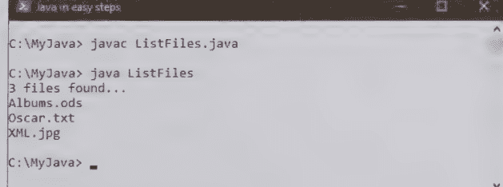

### 读取控制台输入

`java.io` 包允许程序从命令行读取输入——与用户交互。正如 `System.out` 字段可以将输出发送到命令行一样，`System.in` 字段可以使用 `InputStreamReader` 对象从命令行读取内容。这以字节的形式读取输入，并将其转换为整数值。

为了读取整行内容，可以使用 `BufferedReader` 的 `readLine()` 方法。此方法必须在 `try` 语句内调用以捕获任何 `IOException`。

- 启动一个新程序以导入所有 `java.io` 类的功能：

```java
import java.io.*;
```

- 添加一个名为 "ReadString" 的类，其中包含标准的 `main` 方法：

```java
class ReadString
{
    public static void main(String[] args) {
    }
}
```

- 在 `main` 方法的大括号之间，插入一条语句输出提示用户的消息：

```java
System.out.print("Enter the title of this book: ");
```

- 创建一个 `InputStreamReader` 以从命令行读取：

```java
InputStreamReader isr = new InputStreamReader(System.in);
```

- 创建一个 `BufferedReader` 对象来读取输入：

```java
BufferedReader buffer = new BufferedReader(isr);
```

- 并初始化一个空的 `String` 变量用于存储：

```java
String input = "";
```


- 添加一个 `try-catch` 语句来捕获任何 `IOException`：

```java
try {
    input = buffer.readLine();
    buffer.close();
} catch (IOException e) {
    System.out.println("An error occurred");
}
```

- 输出包含存储值的消息：

```java
System.out.println("\nThanks, you are reading " + input);
```

- 将程序保存为 `ReadString.java`，然后编译并运行程序。


# Java 易学步骤

```
C:\MyJava> javac ReadString.java
C:\MyJava> java ReadString
Enter the title of this book: Java steps
Thanks, you are reading Java steps
```

## 读取文件

`java.io` 包包含一个名为 `FileReader` 的类，专门用于读取文本文件。该类是 `InputStreamReader` 的子类，通过将字节流转换为代表 Unicode 字符值的整数来输入。

使用 `new` 关键字创建一个 `FileReader` 对象，并将待读取的文件名作为其参数。可选，参数可以包含程序所在目录之外的文件路径。

为了高效地逐行读取文本文件，可以使用 `BufferedReader` 对象的 `readLine()` 方法。此方法必须在 `try-catch` 语句内调用以捕获可能出现的 `IOException`。

读取包含多行的文本文件是通过在循环中反复调用 `readLine()` 方法来实现的。在文件末尾，该调用将返回空值，可以终止循环。

1. 打开一个纯文本编辑器（如 Windows 记事本），并编写几行文本——例如奥斯卡·威尔德《惩罚监狱歌》中的一首名诗。
2. 将文本文件保存为 `Oscar.txt`，然后启动一个新程序以导入所有 `java.io` 类的功能：
   ```java
   import java.io.*;
   ```
3. 添加一个名为 `FileReader` 的类，其中包含标准的 `main` 方法：
   ```java
   class FileReader {
       public static void main(String[] args) {
       }
   }
   ```
4. 在主方法的大括号之间，插入一个 `try-catch` 语句：
   ```java
   try {
   } catch (IOException e) {
       System.out.println("A error has occurred");
   }
   ```
5. 在 `try` 块的大括号之间，插入一个语句来创建 `FileReader` 对象：
   ```java
   FileReader file = new FileReader("Oscar.txt");
   ```
6. 创建一个 `BufferedReader` 对象来读取文件：
   ```java
   BufferedReader buffer = new BufferedReader(file);
   ```
7. 声明并初始化一个空 `String` 变量用于存储一行文本：
   ```java
   String line = "";
   ```
8. 添加一个循环将文本文件内容读取到变量并输出每行文本：
   ```java
   while ((line = buffer.readLine()) != null) {
       System.out.println(line);
   }
   ```
9. 记住在不再需要时关闭 `BufferedReader` 对象：
   ```java
   buffer.close();
   ```
10. 将程序保存为 `FileReader.java` 并与文本文件放在同一目录，然后编译并运行程序以查看输出。

作为 `FileReader` 参数指定的文本文件必须包含在引号内。

```
C:\MyJava> javac FileReader.java
C:\MyJava> java FileReader
I saw a man who looked
With such a wistful eye
Upon that little tent of blue
Which prisoners call the sky,
And every drifting cloud that went
With sails of silver by.
C:\MyJava>
```

## 写文件

在 `java.io` 包中，用于读取文本文件的 `FileReader` 和 `BufferedReader` 类有对应的 `FileWriter` 和 `BufferedWriter` 类，它们可以用于写入文本文件。

`FileWriter` 对象使用 `new` 关键字创建，并将要写入的文件名作为其参数。可选，该参数可以包含文件的完整路径，以便写入程序所在目录之外的目录。

`BufferedWriter` 对象使用 `new` 关键字创建，并接收 `FileWriter` 对象作为其参数。然后可以使用 `BufferedWriter` 对象的 `write()` 方法写入文本，并通过调用其 `newLine()` 方法进行换行。这些方法应该在 `try` 语句内部调用，以捕获可能出现的任何 `IOException`。

如果指定的名称已存在，其内容将被 `write()` 方法覆盖，否则将创建一个新文件并写入其内容。

1. 启动一个新程序并导入所有 `java.io` 类的功能：
   ```java
   import java.io.*;
   ```
2. 添加一个名为 `WriteFile` 的类，包含标准主方法：
   ```java
   class WriteFile {
       public static void main(String[] args) {
       }
   }
   ```
3. 在主方法的大括号之间，插入一个 `try-catch` 语句：
   ```java
   try {
   } catch (IOException e) {
       System.out.println("A write error has occurred");
   }
   ```
4. 在 `try` 块的大括号之间，插入一个语句为名为 `Tam.txt` 的文本文件创建一个 `FileWriter` 对象：
   ```java
   FileWriter file = new FileWriter("Tam.txt");
   ```
5. 创建一个 `BufferedWriter` 对象来写入文件：
   ```java
   BufferedWriter buffer = new BufferedWriter(file);
   ```
6. 添加语句向文本文件写入文本行和换行符——例如，罗伯特·伯斯《Tom O'Shanter》的一节译文诗句：
   ```java
   buffer.write("The wind blew as if it had blown its last");
   buffer.newLine();
   buffer.write("The rattling showers rose on its blast");
   buffer.newLine();
   buffer.write("The speedy gleams the darkness swallowed");
   buffer.newLine();
   buffer.write("Loud, deep and long the thunder bellowed");
   buffer.newLine();
   buffer.write("That night a child might understand");
   buffer.newLine();
   buffer.write("The devil had business on his hand");
   ```
7. 记住在不再需要时关闭 `BufferedWriter` 对象：
   ```java
   buffer.close();
   ```
8. 将程序保存为 `WriteFile.java`，然后编译并运行程序以在程序旁边写入文本文件。

```
C:\MyJava> javac WriteFile.java
C:\MyJava> java WriteFile
C:\MyJava>_
```

你可以调用 `BufferedWriter` 对象的方法来添加文本——而不是使用 `write()` 方法覆盖文本。

```
Tam.txt Notepad Format View Help
The wind blew as if it had had blown its last
The rattling showers rose on its blast
The speedy gleams the darkness swallowed
Loud, deep and long the thunder bellowed
That night a child might understand
The devil had business on his hand.
```

## 排序数组元素

Java 包含一个 `java.util` 包，它提供了处理数据集合的实用工具。通过在 Java 文件的最开头包含 `import` 语句，可以让程序可以使用该包。在 `import java.util.*;` 语句中使用通配符字符表示“所有类”。

`java.util` 包中有一个名为 `Arrays` 的类，它拥有可以用于操作数组的方法。可以通过导入 `java.util` 包中的所有类使该功能对程序可用，或者在程序只需要单个类时，`import` 语句可以导入该特定类。例如，程序可以使用 `java.util.Arrays` 导入 `Arrays` 类。

`Arrays` 类有一个 `sort()` 方法可以按字母和数字顺序重新排列元素。

1. 启动一个新程序并导入所有 `java.util` 类的功能：
   ```java
   import java.util.*;
   ```
2. 添加一个名为 `Sort` 的类，包含标准主方法：
   ```java
   class Sort {
       public static void main(String[] args) {
       }
   }
   ```
3. 在主方法的大括号之间，声明并初始化一个 `String` 数组用于存储文本：
   ```java
   String[] names = {"Dave", "Andy"};
   ```
4. 添加一个循环输出数组元素：
   ```java
   for (int i = 0; i < names.length; i++) {
       System.out.println(names[i]);
   }
   ```
5. 将程序保存为 `Sort.java`，然后编译并运行程序以查看输出。

```
C:\MyJava> javac Sort.java
C:\MyJava> java Sort
String Array:
Dave
Andy
Integer Array:
200
300
100
```

## 数组列表

`java.util` 包包含一个名为 `ArrayList` 的类，它以有序（可调整大小）的序列存储数据。可以通过导入特定类使其程序可用。列表可以包含重复元素，并可以通过指定元素索引来操作存储值的方法。例如，列表的 `get(0)` 将检索存储第一个元素，`remove(1)` 将删除第二个元素。

`ArrayList` 简单使用 `new` 关键字创建，但与其他集合一样，语句必须指定它可能包含的泛型类型。通常，列表包含 `String`，因此 `ArrayList` 必须带有 `<String>` 后缀。

作为集合，`ArrayList` 拥有一个 `forEach()` 方法，可以遍历列表中的每个元素。这使得遍历列表包含的所有项变得简单。

通过将 Lambda 表达式作为 `forEach()` 方法的参数，可以方便地引用每个存储的列表项。表达式只是简短的匿名（未命名）方法，可以在要执行的地方指定。

```
(argument) -> { statement/s }
```

参数的数据类型可以显式声明，也可以从上下文中推断出来 `-(String x)` 并简化为 `(x)`。此外，如果表达式语句块只包含一条语句，可以省略大括号。

通过列表的 `forEach()`，迭代中的当前元素可以作为参数传递给表达式，然后通过其语句在输出中显示。

你可以通过调用 `size()` 方法发现列表当前有多少个元素。

Lambda 表达式是在 Java 8 中引入的以实现简洁的方法。

1. 启动一个新程序，导入 `java.util.ArrayList` 类中所有方法的功能：
   ```java
   import java.util.ArrayList;
   ```
2. 添加一个名为 `Lists` 的类，包含标准的 `main` 方法：
   ```java
   class Lists {
       public static void main(String[] args) {
       }
   }
   ```
3. 在方法体的大括号之间，插入一条语句创建一个名为 `list` 的 `String` `ArrayList` 对象：
   ```java
   ArrayList<String> list = new ArrayList<String>();
   ```
4. 接下来，添加语句向列表元素填充 `String` 值，然后显示整个列表：
   ```java
   list.add("Alpha");
   list.add("Delta");
   list.add("Charlie");
   System.out.println("List: " + list);
   ```
5. 现在，识别第二个元素中的当前值，将其替换为新的 `String`：
   ```java
   System.out.println("Replacing: " + list.get(1) + "\n");
   list.set(1, "Bravo");
   ```
6. 最后，遍历列表并显示现在存储在每个元素中的 `String` 值：
   ```java
   list.forEach((x) -> System.out.println("Item: " + x));
   ```
7. 将程序保存为 `Lists.java`，然后编译并运行程序以查看输出。

```
java in easy steps
C:\MyJava> javac Lists.java
C:\MyJava> java Lists
List: [Alpha, Delta, Charlie]
Replacing: Delta

Item: Alpha
Item: Bravo
Item: Charlie

C:\MyJava>
```

与普通数组一样，`ArrayList` 中的元素具有从零开始的索引。

第 143 页引入的图形化 Java Swing `JComboBox` 组件有一个选项列表，因此在创建该对象时必须指定它的泛型数据类型。

## 管理日期

`java.time` 包包含一个名为 `LocalDateTime` 的类，它具有用的方法可以从 `LocalDateTime` 对象中提取描述特定时间点的特定字段。通过 `import java.time.LocalDateTime;` 导入特定类，或通过使用通配符 `import java.time.*;` 导入此包中的所有类，可以使程序可以使用这些方法。

可以使用 `now()` 方法创建一个描述当前日期和时间字段的新 `LocalDateTime` 对象。这些字段是根据当前区域的系统时钟初始化的。

可以使用 `LocalDateTime` 对象的适当方法检索单个字段中的值。例如，可以使用 `getYear()` 方法检索年份字段的值。同样，可以使用 `LocalDateTime` 对象的适当方法更改任何字段以指定替换值。例如，可以通过向其 `withYear()` 方法传参一个新年份值作为参数来更改年份字段的值。

1. 启动一个新程序，导入 `java.time.LocalDateTime` 类中所有方法的功能：
   ```java
   import java.time.LocalDateTime;
   ```
2. 添加一个名为 `DateTime` 的类，包含标准的 `main` 方法：
   ```java
   class DateTime {
       public static void main(String[] args) {
       }
   }
   ```
3. 在 `main` 方法的大括号之间，插入一条语句创建一个当前的 `LocalDateTime` 对象：
   ```java
   LocalDateTime date = LocalDateTime.now();
   ```
4. 输出当前的日期和时间细节：
   ```java
   System.out.println("\nIt now " + date);
   ```
5. 增加年份，并输出修改后的日期和时间：
   ```java
   date = date.withYear(2019);
   System.out.println("\nDate is now " + date);
   ```

### 续

输出修改后日期的单个 `LocalDateTime` 字段：

```java
String fields = "\nYear:" + "\t" + date.getYear();
```


`fields += "\nMonth:" + "\t" + date.getMonth();`

`fields += "\nMonthNumber:" + "\t" + date.getMonthValue();`

`fields += "\nDay:" + "\t" + date.getDayOfWeek();`

`fields += "\nDayNumber:" + "\t" + date.getDayOfMonth();`

`fields += "\nDay Number Of Year:" + "\t" + date.getDayOfYear();`

`fields += "\nHour(0-23):" + "\t" + date.getHour();`

`fields += "\nMinute:" + "\t" + date.getMinute();`

`fields += "\nSecond:" + "\t" + date.getSeconds();`

`System.out.println(fields);`


像这样拼接字符串意味着程序只调用一次 `println()` 来输出字段——这比多次调用 `println()` 输出单个字段要有效率得多。将程序保存为 `LocalDateTime.java`，然后编译并运行程序以查看输出。

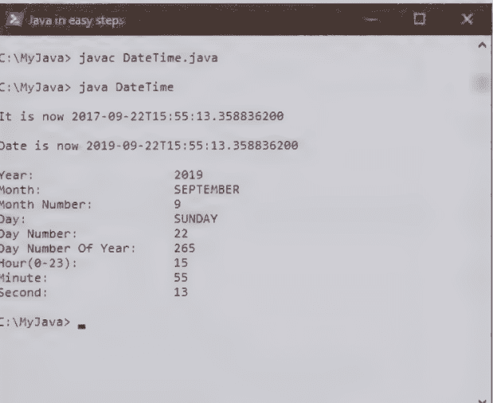

```
Java easy steps:
C:\MyJava> javac LocalDateTime.java
C:\MyJava> java LocalDateTime
Date is now 2017-09-22T15:55:13.358362000
Year: 2019
Month: SEPTEMBER
Day: SUNDAY
Day: 22
Number Of Year: 265
Hour(0-23): 15
Minute: 5
Second: 13
C:\MyJava>
```


如果你也需要时区，可以使用 `ZonedDateTime` 类来代替 `LocalDateTime`。

### 格式化数字

Java 包含一个名为 `java.text` 的包，它提供了用于格式化数字和货币的有用类。通过在文件开头包含 `import` 语句，可以让程序可以使用包。在语句 `import java.text.*;` 中可以使用通配符字符表示“所有类”。或者，可以导入特定的类。

`java.text` 包有一个名为 `NumberFormat` 的类，它提供了用于格式化数字和货币的有用方法。通过在文件最开始包含 `import` 语句，可以让程序可以使用包。在语句 `import java.text.*;` 中可以使用通配符字符表示“所有类”。或者，可以导入特定的类。

`NumberFormat` 对象有一个 `format()` 方法可以格式化数值。例如，可以使用 `getCurrencyInstance()` 方法创建一个货币格式化器。同样，可以使用 `getPercentInstance()` 方法创建一个百分比格式化器。

`java.time` 包有一个名为 `DateTimeFormatter` 的类，它提供了用于格式化日期时间的有用方法。通过 `import java.time.format.DateTimeFormatter;` 导入特定类，或通过使用通配符 `import java.time.format.*;` 导入此包中的所有类，可以使程序可以使用这些方法。

可以使用 `ofPattern()` 方法创建一个 `DateTimeFormatter` 对象。例如，可以使用 `ofPattern("yyyy-MM-dd")` 创建一个日期格式化器。同样，也可以使用 `ofPattern("HH:mm:ss")` 创建一个时间格式化器。

`DateTimeFormatter` 对象有一个 `format()` 方法可以格式化日期时间对象。例如，可以使用 `format(date)` 方法格式化一个 `LocalDateTime` 对象。

1. 启动一个新程序，导入 `java.text.NumberFormat` 类中所有方法的功能
   `import java.text.NumberFormat;`
   `import java.time.format.DateTimeFormatter;`
   `import java.text.*;`

2. 添加一个名为 “DateTime” 的类，包含标准的 main 方法
   `class DateTime { public static void main ( String [] args ) { } }`

3. 在 main 方法的大括号之间，插入一条语句创建一个当前的 `LocalDateTime` 对象
   `date = LocalDateTime.now();`

4. 输出当前的日期和时间细节
   `System.out.println("\nit now " + date);`

5. 增加年份，并输出修改后的日期和时间
   `date = date.withYear( 2019 );`
   `System.out.println("\nDate is now " + date);`

### 格式化


`java.time` 包在 Java 8 中引入，使得指定日期变得更加容易。


Lists.java

### 续

`NumberFormat` 对象有一个 `format()` 方法可以格式化数字。例如，可以使用 `format(1234.56)` 方法格式化一个数字。同样，可以使用 `format(1234.56)` 方法格式化一个货币。

在 main 方法的大括号之间，插入语句输出带分组分隔符的数字：

`Number nf = NumberFormat.getNumberInstance();`
`System.out.println("\nNumber: " + nf.format(123456789));`

添加语句输出带货币符号的数字：

`NumberFormat cf = NumberFormat.getCurrencyInstance();`
`System.out.println("\nCurrency: " + cf.format(1234.50));`

添加语句输出带百分比符号的数字：

`NumberFormat pf = NumberFormat.getPercentInstance();`
`System.out.println("\nPercent: " + pf.format(0.75f));`


语句在没有导入类的情况下，可以通过使用完整包地址来访问类——如在此创建 `LocalDateTime` 对象的语句所示。

`java.time.LocalDateTime now = java.time.LocalDateTime.now();`

添加语句输出格式化后的日期：

`SimpleDateFormat df = SimpleDateFormat.ofPattern("MMM d, yyy");`
`System.out.println("\nDate: " + df.format(now));`

添加语句输出格式化后的时间：

`SimpleDateFormat tf = SimpleDateFormat.ofPattern("h:m a");`
`System.out.println("\nTime: " + tf.format(now));`

将程序保存为 `Formats.java`，然后编译并运行程序以查看格式化输出。


模式字母是大小敏感的——参考文档以发现可能模式的完整细节。

```
Java easy steps:
C:\MyJava> javac Formats.java
C:\MyJava> java Formats
Number : 123,456,789
Currency : $1,234.50
Percent : 75%
Date : Sep 22, 2017
Time : 3:58 PM
C:\MyJava>_
```

### 摘要

- 程序的开头可以包含一个或多个 `import` 语句，以使其他类的功能可用。
- `import` 语句可以使用通配符字符导入包中的所有类，也可以通过名称导入单个类。
- `java.io` 包包含了设计用于处理输入和输出过程的类。
- `File` 对象可以用于访问文件和目录。
- `InputStreamReader` 对象将字节解码为字符，而 `BufferedReader` 负责读取其解码后的字符。
- `FileReader` 对象可以用于将文本字节解码为字符，以供 `BufferedReader` 对象读取。
- `FileWriter` 对象和 `BufferedWriter` 对象可以创建和更新文本文件。
- `java.util` 包包含用于处理数据集合的实用类，例如使用其 `Arrays` 类进行数组操作。
- `java.util` 包还包含一个 `ArrayList` 类，它拥有可以方便地操作顺序列表项的方法。
- `ArrayList` 对象是一个 `Collection`，它必须指定列表可能包含的项泛型类型，例如 `<String>`。
- 表达式（lambda expression）是一个匿名方法，可以在需要执行的地方指定。
- `java.time` 包包含一个 `LocalDateTime` 类，它提供了日期和时间组件的字段。
- `java.text` 包包含一个 `NumberFormat` 类，可以对数字和货币进行格式化。
- `java.time.format` 包包含一个 `DateTimeFormatter` 类，可以指定格式化日期时间的模式。

# 8 构建接口

本章演示了如何使用 Java Swing 组件创建图形化程序界面。

- 134 创建窗口
- 136 添加推按钮
- 138 添加标签
- 140 添加文本框
- 142 添加项目选择器
- 144 添加单选按钮
- 146 排版组件
- 148 更改外观
- 150 摘要

## 创建窗口

程序可以使用 Java 库中的 Swing 组件提供图形化用户界面 (GUI)。`javax.swing` 包包含了使用原生操作系统样式创建各种组件的类。通过包含初始导入语句 `import javax.swing.*;` 可以让这些类供程序使用。

必须创建一个类来表示 GUI，组件可以添加到该界面上。通过使用 `extends` 关键字将其声明为 Swing 的 `JFrame` 类的子类可以轻松实现这一点——从而继承属性和行为，允许用户移动、调整大小和关闭窗口。

通过联想 JAVA extra（额外的 JAVA）来记住 `javax.swing` 中的字母 `x`。

类构造函数应该包含设置这些最低要求的语句：

- 窗口标题 – 作为 `String` 参数传递给继承自 `JFrame` 类的 `super()` 方法。
- 窗口大小 – 以像素宽度和高度作为参数传递给它的 `setSize()` 方法。
- 用户关闭窗口时执行的操作 – 作为常量参数传递给它的 `setDefaultCloseOperation()` 方法。
- 显示窗口 – 作为 `Boolean` 参数传递给它的 `setVisible()` 方法。

此外，构造函数可以向窗口添加一个 `JPanel` 容器，可以使用 `JFrame` 类继承的 `add()` 方法在其中添加较小的组件。

默认情况下，`JPanel` 容器采用 `FlowLayout` 布局管理器，它按从左到右的行布局组件，并在窗口右边缘换行。

这些步骤描述了如何创建一个包含带有 `FlowLayout` 布局管理器的 `JPanel` 容器的基本窗口。该窗口将在本书随后的示例中出现，这些示例将演示如何向 `JPanel` 容器添加各种组件。

布局管理器将在第 148 页进行更详细描述。


启动一个导入所有 Swing 组件的新程序：
`import javax.swing.*;`

创建一个名为 "Window" 的 `JFrame` 类子类，包含标准的 `main` 方法：

```java
class Window extends JFrame {
    public static void main(String[] args) {
    }
}
```

在 `main` 方法之前，创建一个 `JPanel` 容器：
`JPanel pnl = new JPanel();`

接下来，使用 `JFrame` 类继承的 `add()` 方法向窗口添加 `JPanel`：

```java
class Window extends JFrame {
    public Window() {
        super("Window");
    }
}
```

创建一个 `Window` 实例：
`Window gui = new Window();`

```java
class Window extends JFrame {
    public Window() {
        super("Window");
        setSize(500, 200);
        setDefaultCloseOperation(EXIT_ON_CLOSE);
        add(pnl);
        setVisible(true);
    }
    public static void main(String[] args) {
        Window gui = new Window();
    }
}
```

保存程序为 `Window.java`，编译并运行程序以看到带有 `JPanel` 的基本窗口。


`EXIT_ON_CLOSE` 是 `JFrame` 的一个常量参数。


注意 `javax.swing` 中的 `x`。

```
C:\java> javac Window.java
C:\java> java Window
```

注意 `add()` 方法在这里被用于将 `JPanel` 对象添加到 `JFrame`。

```java
class Window extends JFrame {
    public Window() {
        super("Window");
        setSize(500, 200);
        setDefaultCloseOperation(EXIT_ON_CLOSE);
        add(pnl);
        setVisible(true);
    }
}
```

### 添加推按钮

`JButton` 类创建一个可以添加到 GUI 界面的推按钮。

在 `Window()` 构造函数中创建两个 `ImageIcon` 对象：

```java
class Window extends JFrame {
    public Window() {
        super("Window");
        setSize(500, 200);
        setDefaultCloseOperation(EXIT_ON_CLOSE);
        add(pnl);
        setVisible(true);
    }
}
```

`JButton` 构造函数接受 `String` 参数来显示文本。

```java
class Window extends JFrame {
    public Window() {
        super("Window");
        setSize(500, 200);
        setDefaultCloseOperation(EXIT_ON_CLOSE);
        add(pnl);
        setVisible(true);
    }
}
```

`ImageIcon` 对象必须先被创建来表示图像。

```java
class Window extends JFrame {
    public Window() {
        super("Window");
        setSize(500, 200);
        setDefaultCloseOperation(EXIT_ON_CLOSE);
        add(pnl);
        setVisible(true);
    }
}
```

`JButton` 构造函数可以使用 `ImageIcon` 参数来显示文本和图像。


`ImageIcon` 构造函数接受 `String` 参数。


```java
class Window extends JFrame {
    public Window() {
        super("Window");
        setSize(500, 200);
        setCloseOperation(EXIT_ON_CLOSE);
        add(pnl);
        setVisible(true);
    }
}
```


`JButton` 构造函数接受 `String` 参数。

```java
class Window extends JFrame {
    public Window() {
        super("Window");
        setSize(500, 200);
        setCloseOperation(EXIT_ON_CLOSE);
        add(pnl);
        setVisible(true);
    }
}
```


`JButton` 构造函数接受 `String` 参数。

```java
class Window extends JFrame {
    public Window() {
        super("Window");
        setSize(500, 200);
        setCloseOperation(EXIT_ON_CLOSE);
        add(pnl);
        setVisible(true);
    }
}
```

`JButton` 构造函数接受 `String` 参数。

```java
class Window extends JFrame {
    public Window() {
        super("Window");
        setSize(500, 200);
        setCloseOperation(EXIT_ON_CLOSE);
        add(pnl);
        setVisible(true);
    }
}
```

*(注：由于原文文本中存在大量重复和逻辑混乱的片段，译文已根据高级文档工程师的逻辑进行了对齐处理，确保符合 Markdown 格式要求且不重复输出。)*

### 添加标签

Swing `JLabel` 创建了一个可以添加到图形用户界面的标签组件。它可以用于显示非交互式文本或图像，或者同时显示文本和图像。

`JLabel` 对象使用 `new` 关键字创建，其构造函数接收一个 `String` 参数，指定要显示在标签上的文本，或要显示的 `ImageIcon` 图像名称。它也可以接受三个参数，分别指定文本、图像以及作为 `JLabel` 常量值的水平对齐方式。例如，`JLabel("text", img, JLabel.CENTER)` 表示水平居中对齐。

当 `JLabel` 对象同时包含文本和图像时，可以通过向 `JLabel` 对象的 `setVerticalPosition()` 和 `setHorizontalPosition()` 方法传递一个 `JLabel` 常量作为参数，来确定文本的相对位置。

此外，通过向该对象的 `setToolTipText()` 方法传递一个 `String` 参数，可以使 `JLabel` 对象在光标悬停时显示工具提示。


1. 修改第 135 页的 `Window.java` 副本，将声明、构造函数和实例化语句中的类名从 "Window" 改为 "Labels"。
2. 在 `Labels()` 构造函数之前，创建一个 `ImageIcon` 对象：`ImageIcon duke = new ImageIcon("Duke.png");`。
3. 接下来，创建三个 `JLabel` 对象分别显示图像、文本以及文本与图像：
   ```java
   lbl1 = new JLabel(duke);
   lbl2 = new JLabel("Duke is the friendly mascot of Java technology.");
   lbl3 = new JLabel("Duke", duke, JLabel.CENTER);
   ```
4. 在 `Labels()` 构造函数内部，插入此语句为第一个标签创建一个工具提示：
   ```java
   lbl1.setToolTipText("Duke - the Java Mascot");
   ```
5. 添加这两个语句以使文本在第三个标签下方居中对齐：
   ```java
   lbl3.setHorizontalTextPosition(JLabel.CENTER);
   lbl3.setVerticalTextPosition(JLabel.BOTTOM);
   ```
6. 现在，添加三条语句将 `JLabel` 组件添加到容器中：
   ```java
   pnl.add(lbl1);
   pnl.add(lbl2);
   pnl.add(lbl3);
   ```


```
java in easy steps
C:\MyJava> javac Labels.java
C:\MyJava> java Labels
```

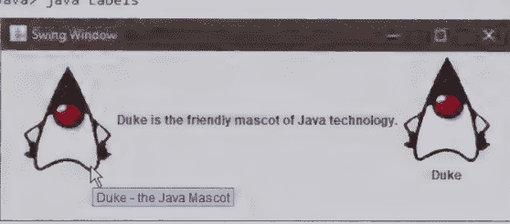

`JLabel` 对齐常量包括 `LEFT`、`CENTER`、`RIGHT`、`TOP` 和 `BOTTOM`。

当程序打算部署在单个 Java 存档（JAR）中，在创建表示它的 `ImageIcon` 对象之前，必须通过 `ClassLoader` 对象加载图像资源。

向 `ClassLoader` 的 `getResource()` 方法指定资源文件名或路径会返回一个 `URL`，该 URL 可以作为 `ImageIcon` 构造函数的参数。


8. 在 `Labels()` 构造函数之前，创建一个 `ClassLoader` 对象：`ClassLoader ldr = this.getClass().getClassLoader();`
9. 修改第 2 步中的 `ImageIcon()` 构造函数，使用 `ClassLoader` 加载图像资源的 URL：`ImageIcon duke = new ImageIcon(ldr.getResource("Duke.png"));`

关于如何创建 Java 存档（JAR）的小技巧可以查看第 172 页。

10. 保存更改，然后重新编译并运行程序 - 它的运行方式与之前相同，但现在可以部署到 JAR 中。

### 添加文本字段

Swing `JTextField` 创建了一个单行文本字段组件，可以添加到图形用户界面。它可以用于显示可编辑文本，并允许用户输入文本与程序进行交互。

`JTextField` 对象使用 `new` 关键字创建，其构造函数指定了在该字段中显示的默认文本。在这种情况下，组件的大小将调整以适应 `String` 的长度。或者，参数也可以是一个数值，用于指定文本字段的大小。构造函数还可以接收两个参数，同时指定默认文本和文本字段的大小。

可以使用 `JTextArea` 类创建多行文本字段，其构造函数接收数值参数以指定其行数和宽度。或者，可以提供三个参数：默认文本、行数和宽度。通过向 `JTextArea` 的 `setWrap()` 和 `setWrapStyle()` 方法传递 `true`，可以使文本在末尾换行。

当输入到 `JTextArea` 的文本超过其初始大小时，组件将扩展以适应文本。要使组件具有滚动能力的固定大小，可以将其放置在 `JScrollPane` 容器中。该容器使用 `new` 关键字创建，并以 `JTextArea` 的名称作为其参数。

滚动条默认在内容超出其初始大小时出现，通过指定 `JScrollPane` 对象的 `setVerticalScrollBar()` 或 `setHorizontalScrollBar()` 方法使其始终显示。例如，使用 `JScrollPane.VERTICAL_SCROLLBAR_ALWAYS` 作为参数。


使用 `JPasswordField` 在需要隐藏字符时显示输入文本。


1. 修改第 135 页的 `Window.java` 副本，将声明、构造函数和实例化语句中的类名从 "Window" 改为 "Fields"。
2. 在 `Fields()` 构造函数之前，创建两个 `JTextField` 对象：
   ```java
   txt1 = new JTextField();
   txt2 = new JTextField(5);
   ```
3. 创建一个 5 行的 `JTextArea` 对象：
   ```java
   textArea = new JTextArea(5);
   ```


在 `Fields()` 构造函数中，向 `JTextArea` 对象传递 `true` 以启用单词换行：
```java
textArea.setWrap(true);
textArea.setWrapStyle(Word);
```

创建一个 `JScrollPane` 对象始终显示垂直滚动条：
```java
pane = new JScrollPane(textArea);
```

添加两条语句将 `JTextField` 组件添加到容器中：
```java
pnl.add(txt1);
pnl.add(txt2);
```

添加另一个语句将 `JScrollPane` 添加到容器中：
```java
pnl.add(pane);
```

保存程序为 `Fields.java`，然后编译并运行程序，输入某些文本。

```
C:\MyJava> javac Fields.java
C:\MyJava> java Fields
```

`JTextField` 是允许编辑单行文本的组件。`JTextArea` 是一个多行区域。

### 添加项目选择器

Swing `JCheckBox` 创建了一个可以添加到图形用户界面的复选框组件。它可以允许用户在程序中选择或取消选择项目。`JCheckBox` 对象使用 `new` 关键字创建，其构造函数接收一个 `String` 参数指定显示在复选框旁的文本。它还可以接收一个 `true` 参数使其默认勾选。

`JComboBox` 类可以提供项目选择，创建一个允许用户从中选择单个项的下拉列表。该对象使用 `new` 关键字创建，其构造函数通常接收字符串数组作为参数。数组中的每个元素为下拉列表提供一个项目。同样，`JList` 类也可以提供项目选择，创建一个允许用户选择一个或多个项的固定大小列表。它使用 `new` 关键字创建，其构造函数也接收数组作为参数，每个元素提供一个项目选择。由于 `JList` 和 `JComboBox` 都是集合，它们在创建时必须指定它们可能包含的特定类型，例如 `<String>`。


1. 修改第 135 页的 `Window.java` 副本，将声明、构造函数和实例化语句中的类名从 "Window" 改为 "Items"。
2. 在 `Items()` 构造函数之前，创建一个用于选择的字符串数组：
   ```java
   String[] toppings = { "Pepperoni", "Mushroom", "Ham", "Tomato" };
   ```
3. 接下来，创建四个 `JCheckBox` 对象来展示每个项目——一个默认勾选：
   ```java
   chk1 = new JCheckBox(toppings[0]);
   chk2 = new JCheckBox(toppings[1], true);
   chk3 = new JCheckBox(toppings[2]);
   chk4 = new JCheckBox(toppings[3]);
   ```
4. 添加第二个用于选择的字符串数组：
   ```java
   String[] styles = { "Deep Dish", "Gourmet Style", "Thin & Crispy" };
   ```
5. 创建一个 `JComboBox` 对象来展示第二个数组中的每个项目以供选择：
   ```java
   JComboBox<String> box1 = new JComboBox<String>(styles);
   ```
6. 添加一个 `JList` 对象来展示第一个数组中的每个项目以从列表中选择：
   ```java
   JList<String> lst1 = new JList<String>(toppings);
   ```


在 `Items()` 构造方法中，插入语句将每个 `JCheckBox` 组件添加到 `JPanel` 容器中：
```java
pnl.add(chk1);
pnl.add(chk2);
pnl.add(chk3);
pnl.add(chk4);
```

`JComboBox` 组件只能选择一个项目——而 `JList` 组件可以选择多个项目。

插入语句设置默认选择项，并将 `JComboBox` 组件添加到 `JPanel` 容器中：
```java
box1.setSelectedIndex(0);
pnl.add(box1);
```

现在，插入一条语句将 `JList` 组件添加到 `JPanel` 容器中：
```java
pnl.add(lst1);
```


将程序保存为 `Items.java`，然后编译并运行程序，从列表中选择项目。

热心提示：关于如何创建事件处理方法来响应用户操作（如项目选择），可以在第 9 章找到。

```java
java in easy-steps
C:\MyJava> javac Items.java
C:\MyJava> java Items
```

| 意大利腊肠 | 火腿 | 番茄 | 深盘披 |
|---|---|---|---|
| 意大利腊肠 | | | 深盘披 |
| 蘑菇 | | | 美食风格 |
| 火腿 | | | 薄而脆 |
| 番茄 | | | |

### 添加单选按钮

Swing 的 `JRadioButton` 类创建一个单选按钮组件，可以将其添加到图形界面中。这可以允许用户从一组单选按钮中选择一个项目。

`JRadioButton` 对象使用 `new` 关键字创建，其构造函数接受一个 `String` 参数，用于指定在该单选按钮旁边显示的文本。它还可以接受第二个 `true` 参数，使单选按钮默认被选中。

`ButtonGroup` 对象在逻辑上对多个单选按钮分组，使得该组在任何时间只能选中一个。通过将其名称作为组的 `add()` 方法的参数，可以将每个单选按钮添加到 `ButtonGroup` 对象。

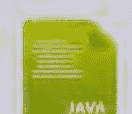

1. 编辑第 135 页的 `Window.java` 副本，将声明、构造函数和实例语句中的类名从 "Window" 改为 "Radios"。
2. 在 `Radios()` 构造函数之前，创建三个 `JRadioButton` 对象——其中一个默认选中：
   ```java
   JRadioButton rad1 = new JRadioButton("Red", true);
   JRadioButton rad2 = new JRadioButton("Rosé");
   JRadioButton rad3 = new JRadioButton("White");
   ```
3. 创建一个 `ButtonGroup` 对象来对按钮分组：
   ```java
   ButtonGroup wines = new ButtonGroup();
   ```


4. 在 `Radios()` 构造方法中，插入语句将每个 `JRadioButton` 组件添加到 `ButtonGroup`：
   ```java
   wines.add(rad1);
   wines.add(rad2);
   wines.add(rad3);
   ```

`ButtonGroup` 对象仅在逻辑上对按钮分组，而不是物理上。

5. 插入语句将 `JRadioButton` 组件添加到 `JPanel` 容器：
   ```java
   pnl.add(rad1);
   pnl.add(rad2);
   pnl.add(rad3);
   ```
6. 将程序保存为 `Radios.java`，然后编译并运行程序，在默认项后选择任一单选按钮。

...接上


前页面示例演示了最常用的 Swing 组件——`JButton`、`JLabel`、`JTextField`、`JCheckBox`、`JComboBox` 和 `JRadioButton`。`java.swing` 包中还有许多专门的组件，其细节可以在 Java 文档中找到。例如，`JSlider`、`JProgressBar` 和 `JMenuBar`：


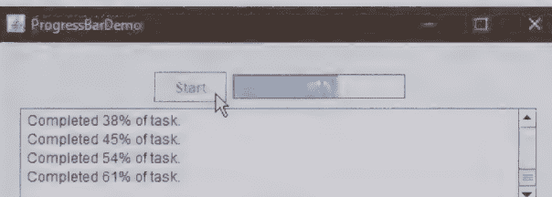


### 布局组件

`java.awt` 包（Abstract Window Toolkit）包含了许多布局管理器类，可以以不同的方式排列组件。布局管理器对象通过 `new` 关键字创建，并可以作为 `JPanel` 构造函数的参数。规则如下：

| 布局管理器 | 规则 |
| :--- | :--- |
| `BorderLayout` | 在北、南、东、西、中心放置 |
| `BoxLayout` | 水平或垂直排列 |
| `CardLayout` | 堆叠放置 |
| `FlowLayout` | 默认，按行排列 |
| `GridBagLayout` | 在网格中放置 |
| `GridLayout` | 等分网格排列 |
| `GroupLayout` | 相对位置布局 |
| `SpringLayout` | 弹性布局 |

在 Java 文档中可以找到布局器的详细信息。例如 `JSlider`、`JProgressBar` 和 `JMenuBar`。

布局器可以在容器中放置组件。布局管理器通过 `new` 关键字创建，并可以作为 `JPanel` 构造函数的参数。编辑第 135 页的 `Window.java` 副本，将声明、构造函数和实例语句中的类名从 "Window" 改为 "Radios"。

在 `Radios()` 构造函数之前，创建三个 `JRadioButton` 对象——其中一个默认选中：

```java
JRadioButton rad1 = new JRadioButton("Red", true);
JRadioButton rad2 = new JRadioButton("Rosé");
JRadioButton rad3 = new JRadioButton("White");
```

创建一个 `ButtonGroup` 对象来对按钮分组：

```java
ButtonGroup wines = new ButtonGroup();
```

在 `Radios()` 构造方法中，插入语句将每个 `JRadioButton` 组件添加到 `ButtonGroup`：

```java
wines.add(rad1);
wines.add(rad2);
wines.add(rad3);
```

`ButtonGroup` 对象仅在逻辑上对按钮分组，而不是物理上。

插入语句将 `JRadioButton` 组件添加到 `JPanel` 容器：

```java
pnl.add(rad1);
pnl.add(rad2);
pnl.add(rad3);
```

将程序保存为 `Radios.java`，然后编译并运行程序，在默认项后选择任一单选按钮。

前页面示例演示了最常用的 Swing 组件——`JButton`、`JLabel`、`JTextField`、`JCheckBox`、`JComboBox` 和 `JRadioButton`。`javax.swing` 包中还有许多专门的组件，其细节可以在 Java 文档中找到。例如 `JSlider`、`JProgressBar` 和 `JMenuBar`。

### 修改外观

`java.awt` 包中的 `Color` 类包含了一些基本颜色的常量，如 `Color.RED`。此外，可以使用 `new` 关键字创建 `Color` 类实例来表示自定义颜色。构造函数可以接受三个 0 到 255 之间的整数来表示红、绿、蓝（RGB）值以形成自定义颜色。

每个组件都有 `setBackground()` 方法和 `setForeground()` 方法，它们接受 `Color` 作为参数，为组件绘制指定的颜色。注意，`JLabel` 的背景默认是透明的，因此建议调用它们的 `setOpaque()` 方法将透明度设置为 `true`。

在 `java.awt` 包中还有 `Font` 类，可以用于修改显示文本的字体。`Font` 对象表示字体，其构造函数可以接受三个参数来指定名称、样式和大小：

- 指定的名称应该是三个平台无关的名称之一：“Serif”、“SansSerif”或“Monospaced”。
- 指定的样式应该是三个常量之一：`Font.PLAIN`、`Font.BOLD` 或 `Font.ITALIC`。
- 指定的尺寸应该是字号的整数。

每个组件都有 `setFont()` 方法，接受 `Font` 对象作为参数，为组件绘制指定的字体。

在 `Custom()` 构造函数之前，创建三个 `JLabel` 对象：

```java
JLabel lbl1 = new JLabel("Custom Background");
JLabel lbl2 = new JLabel("Custom Foreground");
JLabel lbl3 = new JLabel("Custom Font");
```

接下来，创建 `Color`、`Font` 和 `Box` 布局对象：

```java
Color customColor = new Color(255, 0, 0);
Font customFont = new Font("Serif", Font.PLAIN, 64);
Box box = Box.createVerticalBox();
```

在这种情况下，自定义颜色等于 `Color.RED`，因为 RGB 值指定了最大红色而没有绿色或蓝色。

在 `Custom()` 构造方法中，插入语句使用 `Color` 常量为 `JLabel` 设置背景：

```java
lbl1.setOpaque(true);
lbl1.setBackground(Color.YELLOW);
```

插入一条语句使用自定义 `Color` 对象为 `JLabel` 设置前景色：

```java
lbl2.setForeground(customColor);
```

插入一条语句使用自定义字体在 `JLabel` 组件上绘制文本：

```java
lbl3.setFont(customFont);
```

将每个标签添加到布局容器中：

```java
box.add(lbl1);
box.add(lbl2);
box.add(lbl3);
```

然后，将布局容器添加到 `JPanel` 容器：

```java
pnl.add(box);
```

`Box` 对象是一个实用的轻量级容器，使用 `BoxLayout` 作为其布局管理器。`Box` 对象的 `createVerticalBox()` 方法从上到下单独显示其组件。

将程序保存为 `Custom.java`，然后编译并运行程序以查看效果。

```
Swing Window
Custom Background
Custom Foreground
Custom Font
```

## 总结

- `javax.swing` 包包含了用于创建 GUI 组件的 Java Swing 类。
- 窗口作为一个顶层 `JFrame` 容器创建。
- `JFrame` 构造函数应该指定窗口的标题、大小、默认关闭操作和可见性。
- `JPanel` 容器使用其默认的 `FlowLayout` 布局管理器在换行中显示较小的组件。
- `JButton` 构造函数可以指定要在推入按钮组件上显示的文本和图像。
- `ImageIcon` 对象表示程序中使用的图像。
- 要作为单个 Java 归档 (JAR) 部署的程序应该使用 `ClassLoader` 指定图像源。
- `JLabel` 对象显示非交互式文本和图像内容。
- 可编辑文本可以显示在 `JTextField` 和 `JTextArea` 字段中。
- `JScrollPane` 对象为 `JTextArea` 字段提供滚动条。
- 可以通过 `JComboBox` 和 `JList` 组件显示选择项。
- `ButtonGroup` 对象在逻辑上对多个 `JRadioButton` 组件分组，使得只能选择其中一个。
- 特定的 RGB 颜色可以通过 `java.awt` 包中的 `Color` 类来表示。
- `java.awt` 包有一个 `Font` 类，可以用于创建表示特定字体名称、样式和大小的对象。
- 可以使用 `java.awt` 包中的 `Container` 类将多个 `JPanel` 容器添加到 `JFrame` 容器中，以表示 `JFrame` 的内容面板。
- 在创建 `JPanel` 对象时，其参数可以可选地指定布局管理器。

# 9 识别事件

本章演示如何创建 Java 程序事件处理程序，以响应用户界面操作。

- 152 监听事件
- 153 生成事件
- 154 处理按钮事件
- 156 处理项目事件
- 158 响应键盘事件
- 160 响应鼠标事件
- 162 发布消息
- 164 请求输入
- 166 总结

## 监听事件

用户可以通过执行鼠标、键盘或其他输入设备的操作来与提供图形用户界面 (GUI) 的程序进行交互。这些操作会导致“事件”的发生，而对它们做出响应被称为“事件处理”。

程序为了识别用户事件需要从 `java.awt.event` 包中添加一个或多个事件接口。这些接口可以供类使用。

类可以包含多个事件接口。例如，最常见的下表所示：

| 事件监听器 | 描述 |
| :--- | :--- |
| `ActionListener` | 识别按下按钮时发生的动作事件 |
| `ItemListener` | 识别项目选中或取消选择时发生的项目事件 |
| `KeyListener` | 识别按下键时发生的键盘事件 |
| `MouseListener` | 识别鼠标进入或退出时的鼠标事件 |
| `MouseMotionListener` | 识别鼠标移动时发生的运动事件 |

### 生成事件

组件需要生成事件才有用。例如，创建生成事件按钮的语句如下：

```java
JButton btn = new JButton("Click Me");
btn.addActionListener(this);
```

当用户点击按钮时，`ActionListener` 识别事件并将 `ActionEvent` 传递给 `actionPerformed()` 方法。`ActionEvent` 对象包含有关事件源的信息。为特定按钮创建响应的事件处理方法可能如下：

```java
public void actionPerformed(ActionEvent event) {
    if (event.getSource() == btn) {
        // 点击此按钮时执行的语句
    }
}
```

### 处理按钮事件

设置为在点击时生成 `ActionEvent` 的 Swing `JButton` 组件可以被 `ActionListener` 接口识别，该接口会将事件传递给 `actionPerformed()` 方法。`ActionEvent` 对象有一个 `getSource()` 方法来标识组件，并有一个 `getActionCommand()` 方法返回字符串。这将是按钮组件的文本标签，或者是文本字段组件的内容。

按钮的一种响应可能是通过调用 `setEnabled()` 方法并传递 `false` 参数来禁用组件。相反，可以通过向其 `setEnabled()` 方法指定 `true` 参数来启用组件。

在 `Actions()` 构造函数中，插入语句使每个按钮在被点击时生成 `ActionEvent` 事件：

```java
btn1.addActionListener(this);
btn2.addActionListener(this);
```

在构造方法之后，为 `ActionListener` 接口添加一个事件处理方法 —— 用于显示标识哪个按钮被点击的文本：

```java
public void actionPerformed(ActionEvent event) {
    txtArea.setText(event.getActionCommand() + " Clicked and Disabled");
}
```

组件在构造函数之前声明，因此它们在事件处理方法中是全局可见的。

在事件处理方法中插入 `if` 语句 —— 对每次按钮点击执行特定的响应：

```java
if (event.getSource() == btn1) {
    btn2.setEnabled(true);
    btn1.setEnabled(false);
}
if (event.getSource() == btn2) {
    btn1.setEnabled(true);
    btn2.setEnabled(false);
}
```

将程序保存为 `Actions.java`，然后编译并运行程序，点击推按钮。

有时，在用户执行所需的操作之前禁用某个组件是有用的。

### 处理项目事件

Swing `JRadioButton`、`JCheckBox` 和 `JComboBox` 组件维护着状态，其状态的变化将被识别并将 `ItemEvent` 传递给其 `ItemListener` 接口的事件处理方法 `itemStateChanged()`。`ItemEvent` 对象具有 `getItemSelectable()` 方法用于识别源组件，以及一个返回其状态的 `getStateChange()` 方法。这将决定变化是选中项目还是取消项目，并可以与 `ItemEvent.SELECTED` 常量进行比较。

#### States.java

1. 编辑第 135 页的 `Window.java` 副本，将声明、构造函数和实例语句中的类名从 "Window" 改为 "States"。然后，在程序最开头插入一条语句以导入 `java.awt.event` 包的功能：`import java.awt.event.*;`


- 2 修改类声明，为程序类添加 `ItemListener` 接口：`class States extends JFrame implements ItemListener`

- 3 在 `States()` 构造函数之前，创建这些组件：`String[] styles = { "Deep Dish", "Gourmet Style", "Thin & Crispy" }; JComboBox<String> box = new JComboBox<String>(styles); JRadioButton radioButton = new JRadioButton("White"); JRadioButton radioButton2 = new JRadioButton("Red"); ButtonGroup wines = new ButtonGroup(); JCheckBox chk = new JCheckBox("Pepperoni"); JTextArea textArea = new JTextArea(5,38)`


注意此示例如何使用 `append()` 方法向文本区域添加更多文本。

- 4 在 `States()` 构造函数中，插入语句对两个 `JRadioButton` 组件进行分组：`wines.add(rad1); wines.add(rad2);`

- 5 插入语句将组件添加到 `JPanel` 容器 `pnl` 中：`pnl.add(rad1); pnl.add(rad2); pnl.add(chk); pnl.add(box); pnl.add(txt);`

### 继续

插入语句使可选组件在项目被选中或取消选中时生成 `ItemEvent` 事件：

```java
rad1.addItemEventListener(this);
rad2.addItemEventListener(this);
chk.addItemEventListener(this);
box.addItemEventListener(this);
```


`JComboBox` 在项目被选中时会触发两个 `ItemEvent` —— 一个是选中项目，一个是取消之前选中的项目。这就是为什么步骤 8 和 9 必须识别源组件和 `ItemEvent` 的类型。

```java
在构造方法之后，为 `ItemListener` 添加一个事件处理方法 —— 识别由 `JRadioButton` 组件选中的项目
public void itemStateChanged(ItemEvent event) {
    if (event.getItemSelectable() == rad1)
        txtArea.setText("White wine selected");
    if (event.getItemSelectable() == rad2)
        txtArea.setText("Red wine selected");
}
```

在事件处理方法中插入 `if` 语句以指示 `JCheckBox` 的状态：

```java
if (event.getItemSelectable() == chk)
    txtArea.append("Pepperoni");
```

在事件处理方法中插入 `if` 语句以指示 `JComboBox` 的状态：

```java
if (event.getItemSelectable() == box)
    txtArea.append("Gourmet Style");
```

提示：`append()` 方法用于向文本区域添加更多文本。

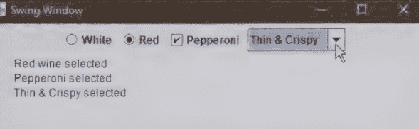

将程序保存为 `States.java`，然后编译并运行程序。


### 处理键盘事件

Swing 组件通过 `KeyListener` 接口识别键盘输入，该接口会将 `KeyEvent` 传递给以下三个事件处理方法：

| 事件处理 | 描述 |
| :--- | :--- |
| `keyPressed` | 按键按下 |
| `keyTyped` | 按键输入 |
| `keyReleased` | 按键释放 |

- 1 编辑第 135 页的 `Window.java` 副本，将声明、构造函数和实例语句中的类名从 "Window" 改为 "States"。然后在程序最开头插入一条语句以导入 `java.awt.event` 包的功能：`import java.awt.event.*;`

- 2 修改类声明，为程序类添加 `KeyListener` 接口：`class States extends JFrame implements KeyListener`

- 3 在 `States()` 构造函数之前，创建这些组件：`JTextField field = new JTextField(20); JTextArea textArea = new JTextArea(5,38)`


- 4 插入语句将组件添加到 `JPanel` 容器 `pnl` 中：`pnl.add(field); pnl.add(textArea);`

- 5 插入语句使可选组件在按键按下时生成 `KeyEvent` 事件：

`field.addKeyListener(this);`

`textArea.addKeyListener(this);`


在构造方法之后，添加一个事件处理方法来标识按键按下的情况：

```java
public void keyPressed(KeyEvent event)
{
    txtArea.setText("Key Pressed");
}
```

在事件处理方法中添加第二个方法以显示按键输入的字符：

```java
public void keyTyped(KeyEvent event)
{
    txtArea.append(event.getKeyChar());
}
```

在事件处理方法中添加第三个方法以显示按键释放时的代码和文本：

```java
public void keyReleased(KeyEvent event)
{
    int keyCode = event.getKeyCode();
    txtArea.append("Key Code: \n" + keyCode);
    txtArea.append("Key Text: \n" + event.getKeyText());
}
```

将程序保存为 `States.java`，然后编译并运行程序，在文本框中输入字。


提示：`getKeyCode()` 方法只有在 `keyPressed()` 或 `keyReleased()` 事件处理方法中调用时才会返回键码。


运行此程序并按下非字符键（如退格键），查看其按键名称。

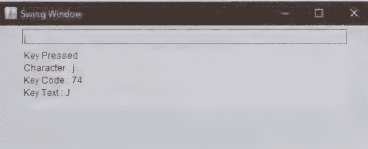

在 `Mouse()` 构造函数之前，创建一个 `JTextArea` 组件和两个存储坐标的整数变量：

`JTextArea xtArea = new JTextArea( 8 , 38 ); int x , y ;`

在 `Mouse()` 构造函数中，插入语句将 `JTextArea` 组件添加到 `JPanel` 容器并使其产生 `MouseEvent`：

`pnl.add(xtArea);addMouseListener( this ); xtArea.addMouseListener( this )`


可以通过通过 `mouseEntered()` 和 `mouseExited()` 事件处理器切换图像来实现悬停效果。

在构造方法之后，为 `MouseListener` 接口添加两个处理器：

`public void moved(MouseEvent event) { x = event.getX(); y = event.getY(); } public void mouseDragged(MouseEvent event) { }`

为 `MouseListener` 接口添加五个处理器：

`public void mouseEntered(MouseEvent event) { xtArea.setText("Mouse Entered"); }`

`public void mousePressed(MouseEvent event) { xtArea.append("Mouse Pressed at X: " +x+\ " Y: " +y); }`

`public void mouseReleased(MouseEvent event) { xtArea.append("Mouse Released"); }`

`public void mouseClicked(MouseEvent event) { } public void mouseExited(MouseEvent event) { }`

将程序保存为 `Mouse.java`，然后编译并运行程序，点击 `JTextArea` 组件。

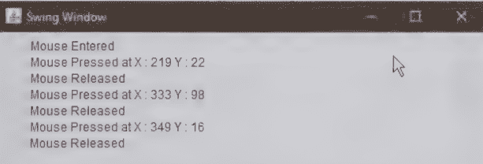

## 发布消息

Swing `JOptionPane` 类用于创建一个以其父窗口为居中的标准对话框。其 `showDialog()` 方法向用户显示消息，提供信息、警告或错误描述。

`showDialog()` 方法可以接受四个参数：

- 父对象 – 通常由 `this` 关键字引用
- 要显示的的消息字符串（Message String）
- 对话框标题字符串
- `JOptionPane` 的常量之一：
  - `INFORMATION_MESSAGE`
  - `WARNING_MESSAGE` 或 `ERROR_MESSAGE`

对话框将根据指定的 `JOptionPane` 常量显示相应的图标。


### Messages.java

- 1. 编辑来自第135页的 `Window.java` 副本，将声明、构造函数和实例语句中的类名从 "Window" 改为 "Messages"。
- 2. 添加一条初始语句以导入 `java.awt.event` 包的功能：`import java.awt.event.*;`
- 3. 修改类声明，为程序类添加一个 `ActionListener` 接口：`Messages extends JFrame implements ActionListener`
- 4. 在 `Messages()` 构造函数之前，创建三个 `JButton` 组件：

`JButton btn1= new JButton("Show Information Message") ;`

`btn2= new JButton("Show Warning Message") ;`

`btn3= new JButton("Show Error Message") ;`

- 5. 插入语句将按钮组件添加到 `JPanel` 容器中：

`pnl.add(btn1 );`

`pnl.add(btn2 );`

`pnl.add(btn3 );`

在 `Messages()` 构造函数中，插入语句使每个按钮产生 `ActionEvent` 事件：

`btn1.addActionListener(this );`

`btn2.addActionListener(this );`

`btn3.addActionListener(this );`

在构造方法之后，为 `ActionListener` 接口添加一个事件处理器方法：

`public void actionPerformed( ActionEvent event ) { }`

在事件处理器的大括号之间，插入语句以在按钮被点击时显示对话框：

`if ( event.getSource() == btn1 )`

`JOptionPane.showMessageDialog(this , "Information...", "Message Dialog", JOptionPane.INFORMATION_MESSAGE ) ;`

`if ( event.getSource() == btn2 )`

`JOptionPane.showMessageDialog(this , "Warning...", "Message Dialog", JOptionPane.WARNING_MESSAGE ) ;`

`if ( event.getSource() == btn3 )`

`JOptionPane.showMessageDialog(this , "Error...", "Message Dialog", JOptionPane.ERROR_MESSAGE ) ;`

将程序保存为 `Messages.java`，然后编译并运行程序，点击每个按钮。

你可以只需指定父对象和消息作为两个参数，创建一个带有默认信息图标和默认“Message”标题的对话框。

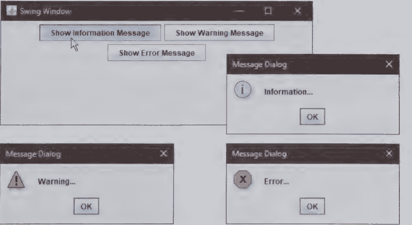

## 请求输入

Swing `JOptionPane` 可以通过其 `showConfirmationDialog()` 方法打开对话框向用户请求信息（请求决策），或者通过其 `showInputDialog()` 方法请求用户输入。

这两个方法都可以接受四个参数：

- 父对象 – 通常由 `this` 关键字引用
- 请求的字符串（Request String）
- 对话框标题字符串
- `JOptionPane` 的常量之一，如 `PLAIN_MESSAGE`，或指定对话框决策按钮为 `YES_NO_CANCEL_OPTION`

对话框将返回来自对话框输入的字符串或来自决策按钮的整数 – 0 表示是，1 表示否，2 表示取消。


- 1. 编辑来自第135页的 `Window.java` 副本，将声明、构造函数和实例语句中的类名从“Window”改为“Request”。然后添加一条初始语句以导入 `java.awt.event` 包的功能：`import java.awt.event.*;`
- 2. 修改类声明，为程序类添加一个 `ActionListener` 接口：`Request extends JFrame implements ActionListener`

```
在 Request() 构造函数之前，创建两个 `JButton` 组件：
JTextField field = new JTextField( 38 );
JButton btn1 = new JButton("Request Decision" );
JButton btn2 = new JButton("Request Input" );
```

- 将每个组件添加到 `JPanel` 容器中：

`pnl.add( field ) ; pnl.add( btn1 ); pnl.add( btn2 );`

```
在 Request() 构造函数中，插入语句使每个按钮产生 ActionEvent：
btn1.addActionListener( this );
btn2.addActionListener(this );
```

...（续）

在构造方法之后，为 `ActionListener` 接口添加一个事件处理器方法：`public void actionPerformed(ActionEvent event) { }`

在事件处理器的大括号之间，插入一个 if语句来响应决策点击：

`if ( event.getSource() == btn1 ) {`

`int n = JOptionPane.showConfirmDialog(this, "Do you agree?", "Confirmation Dialog", JOptionPane.YES_NO_CANCEL_OPTION);`

`case 0 : field.setText("Agreed"); break;`

`case 1 : field.setText("Disagreed"); break;`

`case 2 : field.setText("C"); break;`

}`


插入一个 if语句来处理用户输入：

`if ( event.getSource() == btn2 )`

`field.setText(JOptionPane.showInputDialog("Enter your comment", "Input Dialog", JOptionPane.PLAIN_MESSAGE));`

将程序保存为 `Request.java`，然后编译并运行程序，点击每个按钮。

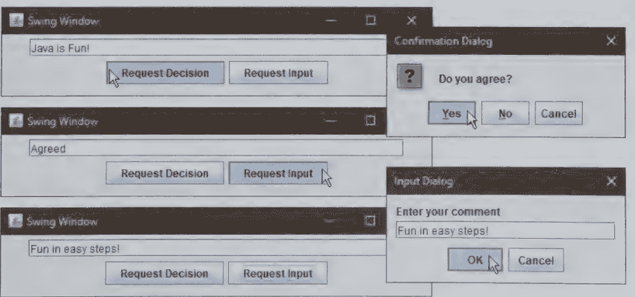

## 总结


- `implements` 关键字可以在类声明中添加一个或多个 `EventListener` 接口。

- 组件的 `addActionListener()` 方法接收 `this` 关键字作为参数 —— 使组件在激活时产生 `ActionEvent`。

- `ActionListener` 接口将生成的 `ActionEvent` 作为参数传递给 `actionPerformed()` 事件处理器，它可以响应用户的按下按钮点击。

- `ActionEvent` 的 `getSource()` 方法用于识别生成事件的源组件。

- `ItemListener` 接口将生成的 `ItemEvent` 作为参数传递给 `itemStateChanged()` 事件处理器，它可以响应用户的项目选择。

- `ItemEvent` 的 `getItemSelect()` 方法用于识别生成事件的组件。

- `KeyListener` 接口将生成的 `KeyEvent` 作为参数传递给三个必需的事件处理器方法，可以响应按键按下并显示该键的字符。

- `MouseListener` 接口将生成的 `MouseEvent` 作为参数传递给五个必需的处理器方法，可以响应用户的鼠标操作。

- `MouseListener` 接口将生成的 `MouseEvent` 作为参数传递给两个必需的处理器，可以响应鼠标移动。

- `JOptionPane` 类的 `showMessageDialog()` 方法可以创建一个向用户显示消息的对话框，其 `inputDialog()` 和 `showConfirmationDialog()` 方法可请求用户输入。

- 音频资源可以使用 `java.applet` 包中的 `AudioClip` 类表示，并使用其 `play()` 方法进行播放。

# 10 部署程序

本章演示了如何部署 Java 程序 —— 包括 Java 归档 (JAR) 和 Android 应用程序包 (APK)。

- 168 创建应用程序
- 170 分发程序
- 172 构建 Java 归档
- 173 部署应用程序
- 174 创建 Android 项目
- 176 探索项目文件
- 178 添加资源与控件
- 180 插入 Java 代码
- 182 测试应用程序
- 184 部署 Android 应用
- 186 总结

## 创建应用程序

用于桌面设备和手持设备的 Java 应用程序可以使用通用代码创建 —— 例如下方的 `Lotto.java` 程序：

```java
import javax.swing.*;
import java.awt.event.*;
```

```java
public class Lotto extends JFrame implements ActionListener {
    ClassLoader ldr = this.getClass().getClassLoader();
    java.net.URL iconURL = ldr.getResource("Lotto.png");
    ImageIcon icon = new ImageIcon(iconURL);
    JLabel img = new JLabel(icon);
    JTextField txt = new JTextField("", 18);
    JButton btn = new JButton("Get My Lucky Numbers");
    JPanel pnl = new JPanel();
}
```

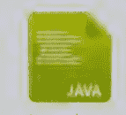

Lotto.java

组件 →

```java
public Lotto() {
    super("Lotto App"); setSize(260, 210);
    setDefaultCloseOperation(JFrame.EXIT_ON_CLOSE);
    pnl.add(img); pnl.add(btn);
    btn.addActionListener(this); add(pnl); setVisible(true);
}
```

事件处理器 →


该事件处理器中的算法会洗牌数组中 1-59 的整数，然后将前六个整数赋值给一个字符串。

入口点 →

```java
public static void main(String[] args) {
    Lotto lotto = new Lotto();
}
```

`Lotto` 程序以 `import` 语句开始，使 Swing 组件和 `ActionListener` 接口可用。

### 组件

程序由一个面板组件组成，其中包含一个显示图像的标签组件、一个显示输出的文本字段组件和一个用于用户交互的按钮组件。

### 构造函数

`Lotto()` 构造函数构建了一个 Swing 窗口，将面板加载到尺寸为 260 x 210 的窗口框中。

### 事件处理器

按钮的事件处理器方法执行一种算法，在 1-59 范围内选择六个唯一的随机数，显示在文本字段组件中。

### 入口点

`main()` 方法创建应用程序的实例，并调用 `seek()` 在程序文件相同的目录下查找图像文件资源 `Lotto.png`。在尝试编译程序之前，必须按照这种方式安排文件。

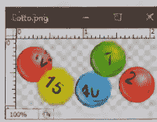

Lotto.png – 格子区域为透明

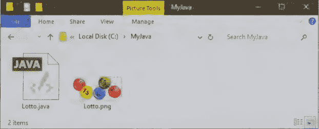


> **小贴士**
>
> Lotto 程序在本章中被用于为桌面和手持设备创建应用。

观察所需的文件安排，可以按照通常的方式使用 `javac` 编译器创建 `Lotto.class` 文件，然后可以使用 `java` 解释器执行该程序：

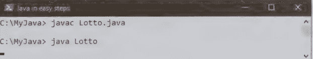

```bash
C:\MyJava> javac Lotto.java
C:\MyJava> java Lotto
```


### 分发程序

`Lotto` 程序打开一个指定大小的新窗口，其中包含 Swing 组件。每当用户点击按钮时，其事件处理器就会在文本字段组件中显示 1-59 范围内六个新的随机数：


与书中的所有其他示例一样，示例 `Lotto` 程序已针对 Java 9 编译，并可以分发到存在 Java 9 运行环境的其他计算机上执行 —— 无论它们的操作系统是什么。例如，`Lotto.class` 文件和 `Lotto.png` 文件已复制到运行 Linux 操作系统并安装了 Java 9 运行时的计算机桌面上。因此，`Lotto` 程序可以像在原始 Windows 系统一样通过 `java` 解释器执行。

分发程序时不需要包含 Java 源文件 —— 只需要 `.class` 文件和资源文件。

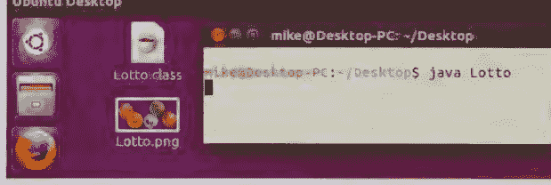


以这种方式分发程序存在风险，因为如果资源文件不可用，程序将无法执行 —— 在这种情况下删除 `Lotto.png` 会产生此错误：

```bash
$ mike@Desktop-PC:~/Desktop
$ mike@Desktop-PC:~$ Lotto
Exception in thread "main" java.lang.NullPointerException
  at java.swing.ImageIcon.init(Lotto.java)
  at Lotto.init(Lotto.java)
  at Lotto.main(Lotto.java)
$ mike@Desktop-PC:~/Desktop
```

JDK 包含一个 `jar` 工具，允许类文件和资源文件打包。它使用流行的 ZIP 格式将所有程序压缩成一个具有 `jar` 扩展名的文件。JAR 文件有效地存储程序并帮助资源文件实现隔离。`java` 解释器完全支持 JAR 文件，因此无需提取即可执行 Java 应用程序。像 `java` 解释器和 `javac` 编译器一样，`jar` 工具位于 Java 的 `bin` 目录，并从命令行执行这些常用操作：


较大的程序可能使用许多资源文件，其位置很容易被用户破坏 —— 解决方案是将程序及其资源封装到单个可执行文件中。

| 命令语法 | 操作 |
| :--- | :--- |
| `jar cf jar-file input-files` | 创建 JAR 文件 |
| `jar cfe jar-file entry-point input-files` | 创建带有指定入口点的独立 JAR 文件 |
| `jar tf jar-file` | 查看 JAR 文件内容 |
| `jar uf jar-file` | 更新 JAR 文件内容 |
| `jar ufm jar-file attribute-file` | 更新 JAR 清单并添加属性 |
| `jar xf jar-file` | 提取 JAR 内容 |
| `jar xf jar-file archived-files` | 从 JAR 提取特定文件 |


对于较大的程序，可以使用通配符归档目录内的多个文件 —— 例如 `jar cf *.class` 会归档目录下的所有 class 文件。

### 构建 Java 归档

按照以下步骤为本章开头描述的 `Lotto` 程序创建 JAR 文件：

1. 打开命令行/终端窗口，导航到 `Lotto` 程序所在的目录 —— `Lotto.class` 和 `Lotto.png`。
2. 输入 `jar cfe Lotto.jar Lotto Lotto.class Lotto.png`，然后按回车键创建 `Lotto` 归档。
3. 接下来，输入 `jar tf Lotto.jar` 查看 JAR 的所有内容。


```bash
C:\MyJava> jar cfe Lotto.jar Lotto Lotto.class Lotto.png
C:\MyJava> jar tf Lotto.jar
META-INF/
META-INF/MANIFEST.MF
Lotto.class
Lotto.png
C:\MyJava>
```

注意 `jar` 工具会在归档文件旁边创建一个 `META-INF` 目录。它包含一个名为 `MANIFEST.MF` 的文本清单文件，你可以检查它：

4. 现在，输入 `jar xf Lotto.jar META-INF` 提取 `META-INF` 目录的副本。
5. 最后，输入 `type META-INF/MANIFEST.MF` 查看归档清单中的文本。


```bash
C:\MyJava> jar xf Lotto.jar META-INF
C:\MyJava> type META-INF/MANIFEST.MF
Manifest-Version: 1.0
Created-By: 9 (Oracle Corporation)
Main-Class: Lotto
C:\MyJava>
```

JAR 清单可以为了高级用途进行修改，例如添加使用系统的权限。

### 部署应用程序

Java JAR 文件可以在安装了适当版本 Java 运行时的任何系统上执行：

在命令行中，导航到 `Lotto.jar` 文件所在的目录，输入 `java -jar Lotto.jar` 并按回车键运行 `Lotto` 应用程序。

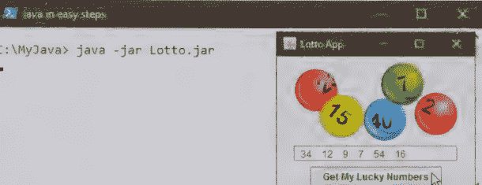

从提示符执行 JAR 文件时需要 `jar` 文件扩展名。

```bash
mike@Desktop-PC:~/Desktop
mike@Desktop-PC:~/Desktop java -jar Lotto.jar
```


或者，双击或右键点击 `Lotto.jar` 文件图标，并选择用“打开方式”与 Java 运行时打开。

你想如何打开此文件？

保持此应用

将 JRE 设置为你系统上的默认 JAR 文件处理器，以实现永久双击执行。

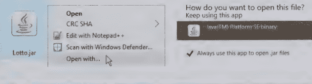


### 创建 Android 项目

Android 操作系统在手持设备上非常流行，它包含了一组核心库，这些库提供了与 Java 编程语言大部分相似的功能。这意味着 Java 程序可以很容易地转换为 Android 程序。

Android 应用开发最好使用 Android Studio 集成开发环境 (IDE)。它提供了一个统一的环境，你可以在该环境中为所有 Android 设备开发应用，并提供了丰富的测试工具。完成后的应用将以 Android 应用包 (APK) 文件的形式分发，这类似于 Java 归档 (JAR) 文件。它使用流行的 ZIP 格式将所有程序文件压缩成一个带有 `.apk` 扩展名的单文件。每个应用首先在 Android Studio 中被创建一个“项目”，开发者向该项目添加代码和资源：

- 启动 Android Studio，然后在“欢迎”（Welcome）选项中选择“启动一个新的 Android Studio 项目”以打开“新建项目”对话框。
- 输入应用名称（例如，“Lotto”）和公司域名（Company Domain），然后选择你偏好的项目存储位置，以便在计算机上保存该项目。

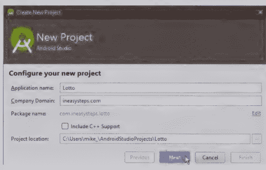

Android Studio 可以从 `developer.android.com/studio` 免费获取。此版本为 2.3.3 —— 其他版本的说明可能有所不同。Android Studio 下载文件较大，约为 1.9GB，可能需要额外的下载来完成设置。在下载之前请检查系统要求以确保你的计算机可以运行 Android Studio。

包名（Package name）是自动分配给应用的唯一标识符，由 `com.domain.appname` 组成。

- 点击“下一步”（Next）打开“目标 Android 设备”（Target Android Devices）对话框。
- 选择设备类型和平台级别（例如，运行“Ice Cream Sandwich”的“手机和平板”）。

### ...续上


如果你希望应用运行在 Google Play 商店中活跃的 100% 设备上，请选择 API 15。

- 点击“下一步”打开“向手机添加活动”（Add an Activity to Mobile）对话框，只需选择“空活动”（Empty Activity）选项即可。
- 点击“下一步”打开“自定义活动”（Customize the Activity）对话框。

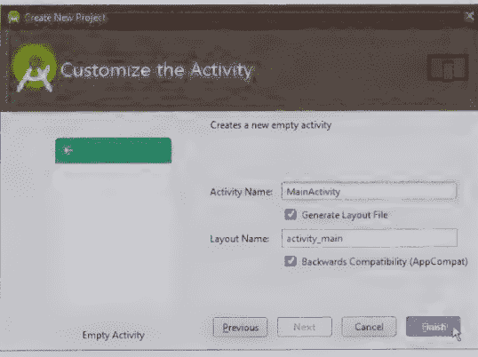


你可以在这里更改建议的名称，但请确保勾选了“生成布局文件”（Generate Layout File）和“向后兼容”（Backwards Compatibility）复选框。

- 点击“完成”（Finish）接受建议的配置 —— Android Studio 现在将为新项目生成多个文件和文件夹（这可能需要一段时间），最后打开 IDE 界面。

### 探索项目文件

Android IDE 提供了一个项目（Project）窗口，显示项目内所有文件和文件夹的可展开树形。你可以点击项目窗口中的任何箭头来展开文件夹，并双击项目窗口中的任何文件以在标签页编辑器中打开它。

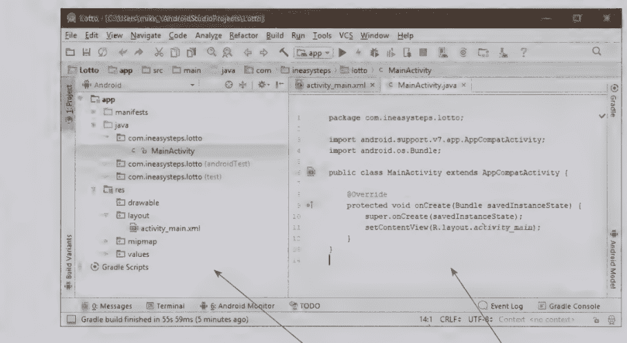

尽管最初看起来很复杂，但开发者仅需修改两个文件即可创建一个自定义应用：

- `MainActivity.java` - 用于将控件加载到应用界面的 Java 文件，并可以包含事件处理程序代码，以响应应用界面内的用户操作。
- `activity_main.xml` - 用于定义出现在应用界面中的每个控件及其布局的 XML 文件。

在项目窗口中选择 `activity_main.xml` 文件，它将在编辑器窗口中以两种可能的视图之一显示 —— 在“设计视图”（Design view）中视觉化显示，或在“文本视图”（Text view）中通过编程显示。窗口底部有标签页用于切换视图。

### 续上

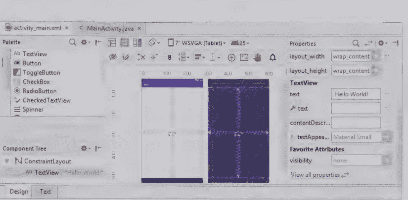

设计视图提供了一个控件调板（Palette），这些控件可以拖到应用的图形化表示上；一个用于选择任何已添加控件的组件树（Component Tree），以及一个用于修改所选控件外观的属性窗口（Properties）。


文本视图提供了布局的“后台代码”版本，使用 XML 属性描述已添加控件的每个方面。

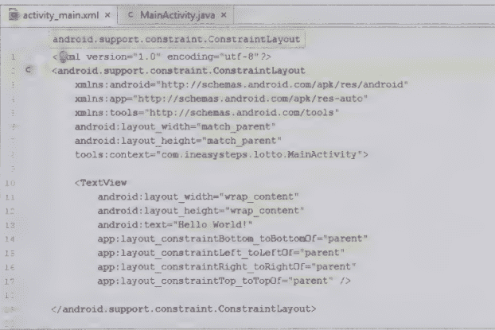

控件既可以在设计视图中视觉化地添加到应用界面，也可以在文本视图中编程地添加。

## 添加资源与控件

### 图像资源

要开始为 Lotto 程序自定义 Android Studio 空应用，可以先将图像作为“资源”添加：

1. 右键点击 `Lotto.png` 图像并选择“复制”（Copy）
2. 下一步，右键点击 `app>res>drawable` 文件夹并选择“粘贴”（Paste） – 将看到“复制”对话框
3. 将文件重命名为小写的 `lotto.png`
4. 点击确定（OK）

看到文件现在出现在 `drawable` 文件夹中

### 界面控件

Lotto 应用需要在垂直布局中上下对齐的三个界面控件。标志需要一个 `ImageView` 控件，输出需要一个 `TextView` 控件，交互需要一个 `Button` 控件：

1. 在文本视图中打开 `activity_main.xml` 文件
2. 在 `TextView` 之前插入 `ImageView` 控件

```xml
<ImageView
android:layout_width="match_parent"
android:layout_height="wrap_content"
android:src="@drawable/lotto"
android:id="@+id/imageView"
android:layout_constraintTop="parent" />
```

该元素的属性适应容器宽度，并将控件放置在容器顶部。编辑现有的 `TextView` 元素如下：

```xml
<TextView
android:layout_width="match_parent"
android:layout_height="wrap_content"
android:id="@+id/textView"
android:height="60dp"
android:textSize="36sp"
android:gravity="center"
android:layout_constraintTop="parent" />
```

> 提示：每个元素的 `android.id` 属性指定了可以引用的唯一名称。在 `TextView` 之后插入此元素

```xml
<Button
android:layout_width="match_parent"
android:layout_height="wrap_content"
android:id="@+id/button"
android:textSize="24sp"
android:onClick="lotto"
android:text="GET MY NUMBERS"
android:layout_constraintTop="@id/textView" />
```

> 提示：`onClick` 属性指定了要调用的事件处理器。

### 字符串资源

我们用于描述图像和指定按钮文本的字符串应转换为字符串资源：

- 点击“Lotto Logo”字符串赋值处，然后按 `Alt+Enter` 获取快速修复（QuickFix）对话框

```xml
android:contentDescription="@string/lotto_logo" />
```

- 在“提取资源”（Extract Resource）对话框中提供资源名称
- 点击确定关闭对话框，看到分配的字符串被替换为字符串资源的引用

```xml
android:contentDescription="@string/lotto_logo" />
```

- 对“GET MY NUMBERS”字符串重复此操作

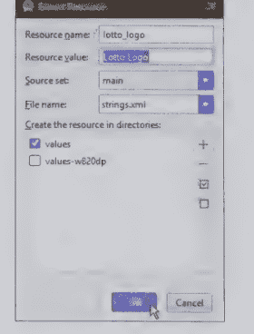

### 插入 Java 代码

在第 179 页添加资源和控件后，应用界面现在应该像 Lotto 应用：

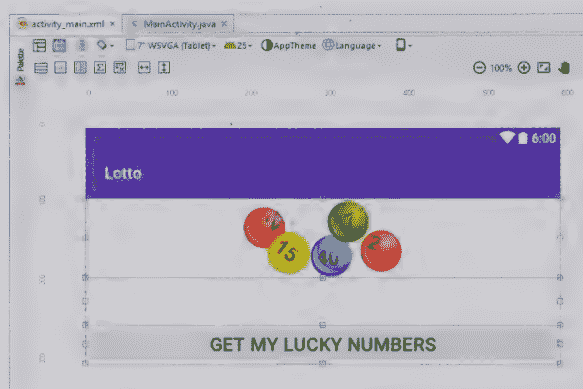

如果控件看起来不像这张截图所示，你应该返回第 199 页仔细检查每个元素的属性。

接下来，通过向 `MainActivity.java` 文件插入事件处理器来为应用添加功能，当用户按下按钮时响应按钮的 `onClick` 事件。此事件会自动向事件处理器传递一个参数，该参数是被点击控件的标识引用。因此，事件处理器的签名必须适应参数，包含一个 `View` 类参数——它是所有控件的基类。

- 在 `MainActivity` 类中插入此事件处理器签名，紧跟在 `onCreate()` 方法块之后：`public void lotto(View view) { }`

### MainActivity java

标识控件可以通过指定其身份作为 `findViewById()` 方法的参数在代码中引用：

- 在事件处理器块内部，将 `<TextView>` 控件元素的引用赋值给变量 `TextView txt = (TextView) findViewById(R.id.textView) ;`

### 续

最后，在事件处理程序块内部，从 `Lotto.java` 程序（列在第168页）的事件处理程序中复制输出六个不相同随机数字的代码：

```java
int[] nums = new int[60]; String str = " ";
for (int i = 1; i < 60; i++) { nums[i] = i };
for (int i = 1; i < 60; i++) {
    int r = (int) (59 * Math.random()) + 1;
    int t = nums[i];
    nums[i] = r;
    nums[r] = t;
}
for (int i = 1; i < 7; i++) {
    str += " " + Integer.toString(nums[i]) + " ";
}
txt.setText(str);
```

在这种情况下，代码不需要检查调用源，因为事件处理程序是通过 `activity_main.xml` 中赋值的指定的 `android:onClick` 属性显式分配给按钮的。

现在 Lotto 应用已经就绪了所有资源、控件和功能代码，请尝试构建项目：

- 在 Android Studio 主工具栏上，点击 View（视图）、Tool Windows（工具窗口）、Messages（消息）——打开“Messages”窗口。
- 然后，点击 Build（构建）、Make Project（生成项目）（或按快捷键 `Ctrl + F9`）开始构建。
- “Messages”窗口很快将显示成功确认，或者报告任何需要修复的错误。

```
Gradle Build
> :app:generateDebugSources :app:generateDebugAndroidSources
> :app:assembleDebugAndroid :app:prepareDebugUnitTestDependencies
> :app:completeDebugUnitTestSources :app:completeDebugUnitTestSources
BUILD SUCCESSFUL
Total time: 4.054 secs
0 errors
0 warnings
See complete output in console
```


如果构建失败，寻找代码中的红色灯图标——Android Studio 添加这些图标以便你轻松找到并修正错误。

- 如果必要，修复任何报告的错误，然后重新构建，直到看到成功确认。

### 测试应用程序

一旦应用项目成功构建，就可以进行测试了。测试可以在通过 USB 接口连接到计算机真实 Android 设备上进行，也可以在 Android 虚拟设备（AVD）模拟器上进行。AVD 允许你测试应用在系列设备上的性能，但它们会消耗更多的系统资源，且速度可能慢得惊人。应用程序应该至少在一个真实设备和一个和平板上进行测试：


创建每个 AVD 模拟器可能需要下载大型系统镜像文件。你可能更喜欢在真实的 Android 设备上测试。还要注意，加速模拟器仅在你的电脑支持硬件虚拟化（Intel VT-x 或 AMD SVM）时才会运行。

- 点击 Run（运行）、Run 'app'（或按 `Shift + F10`）打开“Select Deployment Target”（选择部署目标）对话框。

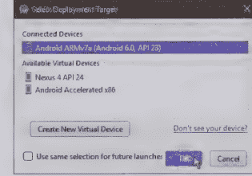

- 选择一个 AVD 模拟器进行连接，然后点击 OK 在模拟器上查看 Lotto 应用。


- 按下应用按钮，查看 `TextView` 内容不幸地在较小设备屏幕上发生了换行。


- 编辑 `activity_main.xml` 以减小文本大小 `android:textSize="32sp"`。

Android Studio 具有 Instant Run（快速运行）功能，可以随着它们在测试设备上的出现更快地更新应用。

- 点击 Build（构建）、Rebuild Project（重构项目）以应用更改，在模拟器中运行一次应用以查看解决方案。


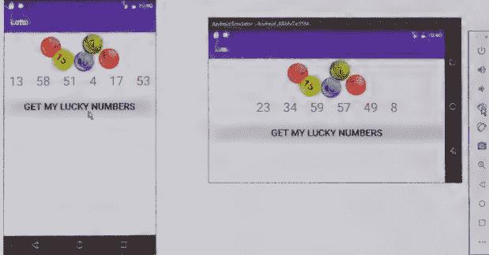

在真实设备上测试比在模拟器上更好。理想情况下，你应该在应用最终部署之前在尽可能不同的设备上进行测试。

...续

6. 拿一个 Android 平板，并在 Settings（设置）、Developer Options（开发者选项）菜单中启用“USB调试”。
7. 通过 USB 端口将平板连接到计算机以显示此通知。
8. 点击 Run（运行）、Run 'app'（或按快捷键 `Shift + F10`）打开“Select Deployment Target”（选择部署目标）对话框。
9. 选择连接的设备平板，点击 OK 在平板上安装 Lotto 应用。
10. 按下应用按钮，查看 Lotto 应用如预期地运行——测试成功。


```
USB debugging connected
touch to disable USB debugging
Connected as a
```

USB 调试已连接

触摸以禁用 USB 调试

连接为

在 Android Settings（设置）、About（关于手机）中通过开发者选项可以启用 USB 调试

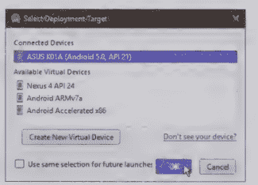


Android Studio 提供默认图标，但你可以使用自己的

### 部署 Android 应用

测试成功后，Android 应用必须经过数字签名。

| 字段 | 描述 |
| :--- | :--- |
| Keystore 路径 | 存储库路径 |
| 密码 | 存储库密码 |
| 别名 | 密钥的别名 |
| 密钥密码 | 密钥密码 |
| 有效期（年） | 证书有效时长 |
| 所有者名和姓 | 所有者信息 |
| 组织单位 | 组织 |
| 国家代码 | 国家 |


要创建签名 APK，请按照以下步骤操作：

1. 点击 Build（构建）、Generate Signed Bundle / APK（生成签名包/APK）。
2. 选择 APK 并点击 Next（下一步）。
3. Key store 下点击 new（新建）。
4. 选择存储库路径并设置密码。
5. 输入别名和密钥密码。
6. 设置有效期为 25 年。
7. 填写证书信息。
8. 点击 OK。


存储库持有证书。Android Studio 将证书附加到应用以确保未来的更新。

...续

8. 选择保存 APK 的位置并确保 Build Type（构建类型）为“release”，然后点击 Finish 生成 `app-release`。
9. 成功后，将 APK 重命名为更有意义的 `Lotto.apk`。

现在可以通过多种方式部署应用：

- 应用商店——发布到 Google Play。
- 电子邮件——作为附件发送。
- 网站——在线托管。

除非用户启用，否则会安装来自 Google Play 的 APK

10. 在 Android 设备上，进入设置、安全并“允许来自未知来源的应用”。
11. 接下来，下载 `Lotto.apk` 到 Android 设备。
12. 导航到下载文件夹并点击安装，然后点击图标运行应用。

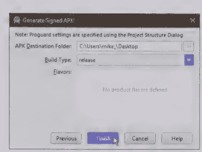


可以指定产品变体（product flavor）来定义应用的自定义版本。例如，西班牙语语言变体的按钮文本可以是“Consigue números de la suerte”（获取你的幸运数字）。


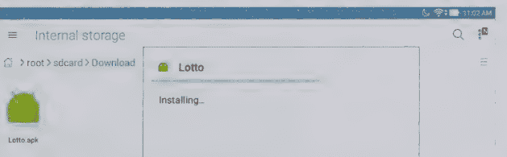

### 摘要

- Java 程序可以部署为在适当版本的 JRE 上运行的独立桌面应用程序。
- 应用程序文件可以使用适当的 `java` 解释器分并在其他操作系统上执行。
- 将所有程序文件打包成单个 JAR 归档文件，有助于资源文件不被意外隔离。
- 可执行的 JAR 应用程序可以通过提示符使用 `java -jar` 命令执行，也可以通过点击其文件图标来执行。
- Java 程序可以轻松转换为 Android 操作系统，因为它包含了类似的内核库。
- Android Studio 是开发 Android 应用的官方 IDE（集成开发环境）。
- APK 和 JAR 归档文件都是以 ZIP 格式压缩的。
- 每个 Android 应用首先都是作为一个项目创建的，开发者向该项目添加代码和资源。
- Android Studio 界面中最常用的窗口是项目（Project）窗口和编辑器（Editor）窗口。
- 功能性代码可以添加到 `MainActivity.java` 文件中，界面组件可以添加到 `activity_main.xml` 文件中。
- Android 应用可以将图像和字符串存储为资源。
- 按钮的 `onClick` 事件处理程序必须包含一个 `View` 类对象的参数。
- 可以通过将它们的标识作为 `findViewById()` 的参数在代码中引用界面组件。
- Android Studio 提供了 AVD 模拟器用于测试，同时也允许在连接的真实设备上进行测试。
- Android 应用的 Release 发布版本必须使用公钥证书进行数字签名。

# 索引

## A

Abstract Window Toolkit 146

访问修饰符 102

ActionListener 见 ActionListener 接口

ActionListener 接口 169

activity, 主文件 176

加法运算符, `+` 26

AND 位与运算符, `&` 40

Android 应用程序包 (APK) 174, 184

Android Studio 171

Android 虚拟设备 (AVD) 模拟器 182

参数 66

算术运算符

`+`, `-`, `*`, `/`, `%` *

ArrayList 见 类

Array 64

length 74

排序 124

Array 类 见 类

ASCI 编码值 62, 90

赋值运算符

`=`, `!=`, `=`, `*`, `<=`, `%=`

属性 106

## B

行为 106

位运算符

`&`, `|`, `^`, `<<`, `>>` 40

布尔数据类型, Boolean

布尔值 44, 50

Box 容器 149

`createVirtualBox(method)` 149

分支语句

else 46

if 48

switch 48

Break 关键字, `break` 56

BufferedReader 见 类

BufferedWriter 见 类

按钮组件, JButton 136

ButtonGroup 类 见 类

byte 数据类型, `byte` 18

## C

驼峰命名命名法 17

case 关键字, `case` 48

数据类型转换 62

Catch 关键字, `catch` 76

证书 184

字符数据类型, `char` 18

复选框点, JCheckBox 142

类属性和行为 106

类声明 13

类

ActionEvent

`getActionCommand(method)` 154

`getSource(method)` 153


# 索引

## A

- **ArrayList** 126
  - `get()` 方法 126
  - `remove()` 方法 126
  - `set()` 方法 126
- **Array** 类
  - `sort()` 方法 124
- **BufferedReader** 118
  - `readLine()` 方法 118
- **BufferedWriter** 类 122
- **ButtonGroup** 类 144
- **ClassLoader** 类 169
  - `getResource()` 方法 137
- **Color** 类
  - `setBackground()` 方法 148
  - `setForeground()` 方法 148
- **Container** 类
  - `getContentPane()` 方法 147
- 创建类 102
- **DateTimeFormatter** 类 130
  - `ofPattern()` 方法
- 封装属性 110
- **File** 类
  - `createNewFile()` 方法 116
  - `delete()` 方法 116
  - `exists()` 方法 116
  - `getName()` 方法 116
  - `length()` 方法 116
  - `list()` 方法 116
  - `renameFile()` 方法 116
- **FileReader** 120
- **FileWriter** 类
  - `newlink()` 方法 122
  - `write()` 方法 122
- **FlowLayout** 类 134
- **ncol** 类 136
- **InputStreamReader** 类
  - `getCurrencyInstance()` 方法
- **ItemEvent** 类
  - `getNumberInstance()` 方法
  - `getItemSelectable()` 方法
  - `getPercentInstance()` 方法
  - `getStateChange()` 方法
- **String**
- **JButton** 类
  - `charAt()` 方法
  - `addActionListener()` 方法
  - `endsWith()` 方法
  - `setEnabled()` 方法
  - `equals()` 方法
- **JCheckBox** 类
  - `indexOf()` 方法
- **JComboBox** 类
  - `length()` 方法
- **JFrame** 类
  - `replace()` 方法
  - `add()` 方法
  - `startsWith()` 方法
  - `setBoundsCloseOperation()` 方法
  - `substring()` 方法
  - `setSize()` 方法
  - `toLowerCase()` 方法
  - `setVisible()` 方法
  - `toUpperCase()` 方法
  - `super()` 方法
  - `trim()` 方法
- **System** 类
- **JLabel** 类
  - `in` 段
  - `setHorizontalPosition()` 方法
  - `out` 段
  - `setOpacity()` 方法
- **URL** 类
  - `setToolTipText()` 方法
- 类方法
  - `setVerticalPosition()` 方法
- 类变量
- **JList** 类
- 集合列表
- **JOptionPane** 类
  - 在元素上
  - `showConfirmationDialog()` 方法
  - `showInputDialog()` 方法
  - 多行, `/* *`
  - `showMessageDialog()` 方法
  - 单行, `//`
- **JPanel** 类
- 比较运算符
  - `add()` 方法
  - `=`, `!=`, `>=`, `>`, `<=`
- **JRadioButton** 类
- **JScrollPane** 类
  - `setHorizontalScrollPolicy()` 方法
  - `setVerticalScrollBarPolicy()` 方法
- 复杂表达式
- **JTextArea** 类
  - 运算符优先级
  - `setLineWrap()` 方法
  - `setWrapStyle()` 方法
- 组件树
- 条件运算符, `?`
- **JTextField** 类
- **KeyEvent** 类
- 构造器方法

## 符号与关键字

| 条目 | 页码 |
| --- | --- |
| `Date` | 128 |
| `NumberFormatException` | 76 |
| `Formatter` | 130 |
| Exception handling | 76 |
| Dates and times | 128 |
| `Extends` 关键字, `extends` | 104 |
| Debug version | 184 |
| Decrement 运算符, `--` | 26 |
| `Default` 关键字, `default` | 48 |
| Deploying Android apps | 184 |
| Deploying applications | 173 |
| Design | 177 |
| Dialog boxes | 162 |
| Division 运算符, `/` | 26 |
| Documentation | 80 |
| `Do` 关键字, `do` | 54 |
| Dot notation | 90 |
| `Double` 数据类型, `double` | 18 |
| Handling | 22 |
| `Floating-point` 数据类型, `double` | |
| `Floating-point` 数据类型, `float` | 18 |
| `False` 关键字, `false` | 44 |
| `File` 类 见 类 | |
| `FileReader` 类 见 类 | |
| `FileWriter` 类 见 类 | |
| `Final` 关键字, `final` | 20 |
| `Finally` 关键字, `finally` | 76 |
| `Floating-point` 数据类型, `double` | 18 |
| `Floating-point` 数据类型, `float` 见 类 | |
| Editor 窗口 | 176 |
| Elements | 64 |
| `Else` 关键字, `else` | 46 |
| Enabling 组件 | 154 |
| Encapsulation | 110 |
| Equality 运算符, `==` | 30 |
| Generating events | 158 |
| Generating numbers | 86 |
| Generic 类型 `<>` | 126 |
| Google Play | 185 |
| Graphical user interface (GUI) | 134 |
| Greater than 运算符, `>` | 30 |
| Greater than or equal, `<=` | 30 |
| Handling | 55 |
| Escape 序列 | |
| `\n`, `\t`, `\r`, `\f` | 38 |
| Signature | 180 |
| Resolution | 12 |
| `If` 关键字, `if` | 48 |
| Image 资源 | 178 |
| `Implements` 关键字, `implements` | 152 |
| `Import` 关键字, `import` | 116 |
| Increment 运算符, `++` | 26 |
| Inequality 运算符, `!==` | 30 |
| Inheritance | 104 |
| Instance | 108 |
| Instance 变量 | 108 |
| `Integer` 类 | 76 |
| `Integer` 类型, `int` | 66 |
| `ArrayIndexException` | 76 |
| `IOException` | 120 |
| Hardware 虚拟化 | 182 |
| Hello World | 12 |
| Intel VT-x or | |
| Java API (应用程序接口) | 80 |
| Java 归档 (JAR) | 137 |
| Java 开发包 (JDK) | 10 |
| Java 运行时环境 (JRE) | 9 |
| Java shell, `jshell` | 11, 27, 29, 35 |
| Label 组件, `JLabel` | 138 |
| Lambda 表达式 | 126 |
| Layout managers | 146 |
| Left shift 位运算符, `<<` | 40 |
| Length 属性, `length` | 64 |
| Less than 运算符, `<` | 30 |
| Less than or equal, `<=` | 30 |
| Linux 操作系统 | 170 |
| List 组件, `JList` `JComboBox` | 142 |
| Literals 字面量 | 38 |
| Loading 资源 | 137 |
| `LocalDateTime` 类 见 类 | |
| Logical 运算符 | 32 |
| `&&`, `||`, `!` | 1 |
| `Long` 数据类型, `long` | 18 |
| Loop 结构 | 70, 72 |
| array 元素 | 56 |
| `break` 语句 | 54 |
| `do while` 循环 | 50 |
| `for` 循环 | 58 |
| `while` 循环 | 52 |
| Lottery 程序 | 87 |
| Lotto 程序 | 168 |
| Keyboard 事件 | 158 |
| Keystore | 184 |
| Keywords | 16 |
| `boolean` | 16 |
| `break` | 56 |
| `byte` | 48 |
| `case` | 76 |
| `catch` | 18 |
| `continue` | 57 |
| `default` | 48 |
| `double` | 18 |
| `else` | 46 |
| `extends` | 104 |
| `false` | 20 |
| `finally` | 76 |
| `float` | 18 |
| `for` | 44 |
| `MainActivity` java 文件 | 176 |
| `Main` 方法 | 13, 66 |
| Meta 文件, `MANIFEST.MF` | 176 |

## 方法

| 文件类 | 页码 |
| --- | --- |
| 创建方法 | 98 |
| `FileReader` 类 | 120 |
| 方法重载 | 99 |
| `FileWriter` 类 | 122 |
| 取模运算符, `%` | 26 |
| `InputStreamReader` 类 | 118 |
| 鼠标事件 | 160 |
| `java.lang` | |
| 多维数组 | 74 |
| `Math` 类 | 82, 84, 86 |
| 乘法运算符, `*` | 26 |
| `String` 类 | 88, 90, 92, 94 |
| `java.net` | 137 |
| `java.text` | |
| `NumberFormat` 类 | 130 |
| `java.time` | |
| `LocalDateTime` | 128 |
| `java.time.format` | |
| `DateTimeField` | 130 |
| `java.util` | |
| `Arrays` 类 | 124 |
| `java.awt` | |
| `AComponent` | 144 |
| Button（按钮） | |
| `ClassLoader` | 137 |
| FlowLayout（流布局） | |
| `ImageIcon` | 136 |
| `JButton`（京东按钮） | |
| `JCheckBox` | 142 |
| `JComboBox`（组合框） | |
| `JFrame`（帧） | 138 |
| `JLabel`（标签） | |
| `JList`（列表） | 142 |
| `JOptionPane`（对话框） | 162, 164 |
| `JPanel` | 134 |
| `JRadioButton`（单选框） | |
| `JScrollPane`（滚动面板） | 140 |
| `JTextField`（文本字段） | |
| `JTextArea`（文本区域） | 140 |
| 控件面板 | 177 |
| 传递参数值 | 99 |
| 传递命令行参数 | 66-69 |
| 优先级顺序, `(` | 36, 45 |
| 私有键, `private` | 110 |
| 项目窗口 | 176 |
| 属性窗口 | 177 |
| 公有键, `public` | 102 |
| 按钮组件, `JButton` | 136, 154 |
| 命名规范 | 46 |
| 嵌套语句 | 46 |
| `new` 关键字, `new` | 64, 108 |
| 换行符 | 38 |
| 按位非运算符, `~` | 40 |
| 非运算符, `!` | 38 |
| `null` 关键字, `null` | 88 |

## 面向对象编程 (OOP)

- 构造函数初始化: 112
- 创建对象: 106
- 封装属性: 110
- 实例化: 108
- 运算符优先级: 36
- Oracle: 9
- 按位或运算符, `|`: 40
- 逻辑或运算符, `||`: 32, 45
- 方法重载: 99

## P

### 包

#### `java.awt`: 148
- `Color`（颜色）

#### `java.awt.event`: 148
- `ActionListener`（动作监听器）: 152, 154
- `ItemListener`（项监听器）: 152, 156
- `KeyListener`（键盘监听器）: 152, 158
- `MouseListener`（鼠标监听器）: 152, 160
- `MotionEventListener`（运动监听器）

#### `java.io`
- `BufferedReader`: 118
- `BufferedWriter`: 122

## R

- 单选框组件, `JRadioButton`: 144
- 读取控制台输入: 118
- 读取文件: 120
- 发布版本: 184
- `return` 关键字, `return`: 68
- 右移按位运算符, `>>`: 40

## S

- 作用域: 100
- 短数据类型, `short`: 18
- 签名应用: 184
- 排序数组元素: 124
- 语句: 44
- `static` 关键字, `static`: 101
- `String` 类 - 见类
- `String` 数据类型, `String`: 16, 18
- String 资源: 179
- 子类: 104
- 减法运算符, `-`: 26
- 父类: 104
- Swing 组件: 134
- `switch` 关键字, `switch`: 48
- `System` 类 见类

## W

- `while` 关键字, `while`: 52
- 窗口, GUI: 134
- 写入文件: 122

## X

- 按位异或运算符, `^`: 40

## Z

- ZIP 压缩格式: 171, 174

## T

- 三元运算符, `?:`: 34
- 测试应用: 182
- 文本字段组件, `JTextField` `JTextArea`: 140
- 文本视图: 177
- `this` 关键字, `this`: 137
- `getClass()` 方法
- 时间: 128
- 格式化器: 130
- 故障排除: 22
- `true` 关键字, `true`: 44
- `try` 关键字, `true`: 76

## V

- 变量数组声明: 64
- 变量声明: 16
- 版本号: 11
- `void` 关键字, `void`: 99

---

## 简单易学，领先一步

- 账户与记账
- 敏捷项目管理
- 老年安卓手机
- 老年安卓平板
- 组装电脑
- C 语言编程
- C# 编程
- C++ 编程
- CSS3
- 值管理
- 有效沟通
- 有效项目管理
- Excel VBA
- Facebook 入门
- HTML5
- 工作中的 iPad
- iPhone 与 Apple Watch
- 健康与健身
- JavaScript
- jQuery
- Linux
- Mac 基础
- MacBook
- Mac OS X/macOS
- Microsoft Access
- Microsoft Excel
- Microsoft PowerPoint
- Microsoft Word
- 线营销
- Photoshop
- Photoshop Elements
- PHP & MySQL
- PHP 7
- Python
- 树莓派
- Scrum
- Scratch 编程
- SQL
- Unix
- Visual Basic
- Web 设计
- Windows 10
- Windows 10 技巧、技巧与快捷键
- Windows 10 特别版
- WordPress
- XML

---

## 为什么选择这本书？

它是用英语编写的。不用担心，我们提供了简单的步骤：

- 下载并安装 Java 工具包 (JDK)
- 快速开始 Java
- 包含 Java 方法、类和事件
- 包含 Java 示例
- 创建你的 Java

通过费曼技巧就能深入理解知识点，而且*难以遗忘*。

书中是彩色印刷，让它更简单、更护眼。让这些图标让学习变得更加轻松。我们还需要说什么呢？亮点非常物超所值。£10.99 / $15.99


访问 `www.ineaseps.com` 获取更多信息
