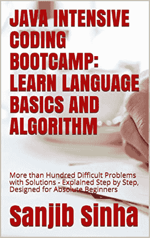
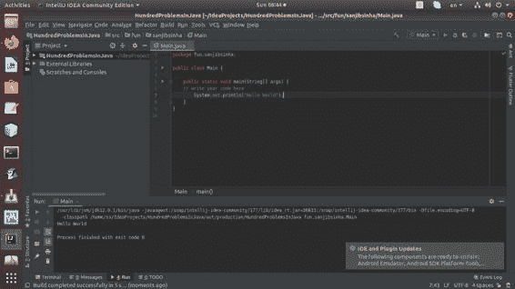
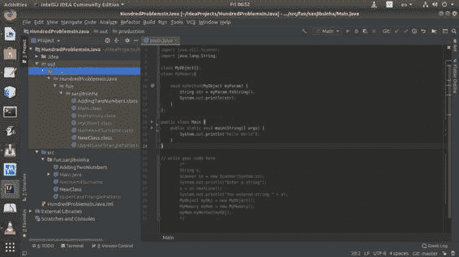
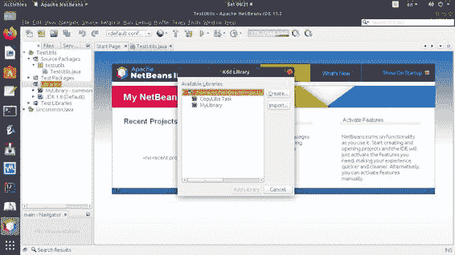
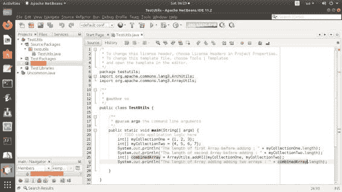
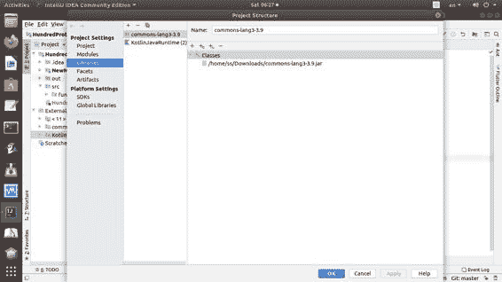
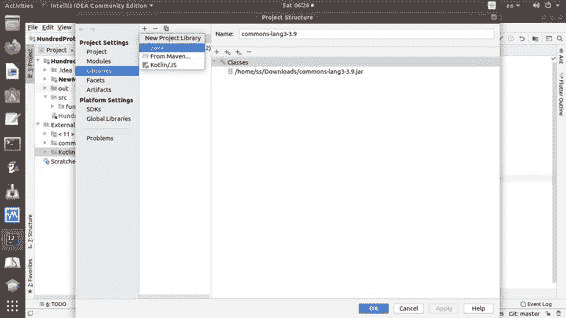

# Java 强化编码训练营：学习语言基础与算法：百余道难题及详解 - 逐步讲解，专为初学者设计



高级语言更接近人类语言。它在某种程度上独立于机器或计算机。Java 正契合了这一特征，因为它满足了高级语言的所有条件。由于 `Java Virtual Machine` (`JVM`)，它是机器无关的。在 Java 创建时，口号是——编写一次，处处运行。初学者可能会觉得这很难理解；我们稍后会详细讨论。

当你沿着语言树继续向下探索时，你会发现在任何高级语言的下方都是汇编语言。在下面的一层是机器语言，它更接近硬件。

机器语言非常不同。它只有计算机才能理解。它是二进制数字或位（bits）的集合，只有计算机可以识别。计算机可以读取并解释 `0` 和 `1`。因此，每种高级语言都应该被翻译成机器语言，以便它最终能够与硬件通信。

能够与硬件通信是每种高级语言追求的终极目标。

从 `Fortran`、`C`、`Pascal`、`C++` 开始，我们可以列出除 Java 之外许多流行的高级语言，如 `PHP`、`Python`、`Dart` 等。

我们也可以将编程语言树与英语等人类语言进行比较。根据约翰·科林森·内斯菲尔（John Collinson Nesfield）的《英语语法：过去与现在；附韵律、同义词及其他课题》，英语属于雅言语系。英语的直接祖先是日耳曼语。从日耳曼语演化出了低地德语（包括英语）和高地德语。

现在考虑一个既不会说话也听不见的人。在这种情况下，我们使用手语来创建一些图像。通信活动通过这些图像完成。字母是字母表的视觉表示。

自然语言从字母或文字开始，单词由字母组成；请记住，字母（letters）和字母表（alphabets）之间是有区别的，尽管人们认为它们本质上是相同的。无论如何，让我们继续学习单词。通过单词的帮助，我们构建句子；句子构成段落、文章、故事、诗歌、戏剧等。

单词不能随机放置来组成句子。那样没有任何意义。因此，在单词和句子之间存在语法。

什么是语法？一组排列单词以使句子合乎语义的规则。没有这些规则，我们就无法构建有意义的句子。没有有意义的句子，我们就无法创建有意义的段落、故事、诗等。我们甚至无法与他人进行有意义的交流。

我们可以得出结论，每种自然语言都有目的，要么你想写有意义的内容，要么你想与人进行有意义的交流。

对任何编程语言也是如此。每种编程语言都有目的。在某些情况下，它的目的是执行某些特定任务，例如在创建时，`PHP` 是为了让网站动态化。现在 `PHP` 是一种通用语言；通过它的帮助，我们不仅能让小型网站动态化，还能创建更健壮、复杂的 Web 应用。

Java 也是如此。学习 Java 的历史。你会发现它是如何演变成一种运行在数十亿不同设备上的通用面向对象编程语言的。你发现在智能电视、卫星、烹饪设备、人工智能物体、健壮且复杂的软件（如桌面和 Web 应用程序）、Android 移动应用等；列表是无尽的。

就像自然语言一样，如果不知道 Java 的语法或基础，我们就无法制作此类软件或应用程序。因此，我们学习 Java 有目的。而且，Java 是一种可以创建不同类型应用的通用语言。

这本书将赋予计算机科学和编程专业的学生学习 Java 语言基础的能力；以便他们用 Java 构建应用程序。这是第一次采用“直接教学法”使用“问题-解决方案-讲解”方法的书籍；它像一个强化型的编码训练营，参与者将积极参与开发他们的逻辑和分析思维，以便解决交互性问题。由于原因，我们还将掌握 `Data Structures` 和 `Algorithm` 的基础。

我们将共同学习 Java 的语言基础，首先解决许多类型的问题。这将帮助我们构建在下一个 Java 训练营系列中讨论的应用程序，在那个系列我们将开发应用。在第一个训练营中，我们将开始编写代码。如果你不能在池里游一小会，你就不会游泳。因此，我们将通过解决问题来学习 `objects`（对象）、`classes`（类）、`primitive data types`（基本数据类型）、`arrays`（数组）、逻辑 `if-else`、`switch-case`、`loop constructs`（循环结构）等。

让我们从小程序开始，结果随之而来；由于它们是由某些现象引起的，我们将在之后学习理论。我们将先研究问题，然后解决它并练习更多相关问题。之后我们再讨论理论。

毕竟，我们想通过 Java 的帮助构建许多应用程序，这是我们学习 Java 的主要目的。尽管 `Abstraction`（抽象）隐藏在幕后，但我们将通过解决问题来学习它们。

随着学习的进行，通过解决从简单到复杂的 100 多道问题，我们将学习 Java 语言基础及其相关的核心概念。

让我们看一个简单的 Java 程序，它接收用户输入并给出输出，例如“Hello World”。

```java
1 //Problem 1
2 //code 1
3 package fun.sanjibsinha;
4
5 import java.util.*;
6 import java.util.Scanner;
7 import java.lang.String;
8 public class Main {
9
10     public static void main(String[] args) {
11      //在此处编写你的代码
12         String s;
13         Scanner in = new Scanner(System.in);
14         System.out.println("Enter a string");
15         s = in.nextLine();
16         System.out.println("You entered string " + s);
17
18     }
19 }
```

这里是输出：

```
1 Enter a string
2 Hello World
3 You entered string Hello World
4
5 Process finished with exit code 0
```

然而，文本“Hello World”在机器语言中看起来完全不同。它的输出如下：

```
1 01001000 01100101 01101100 01101100 01101111 00100000 01010111 01101111 01110010 01110014 00100000
2 01100 0110101
```

我们还学习了另一个重要的教训：在机器语言（二进制）中给出相同的输出是非常困难的。因此，我们需要像 `Java` 这样的高级语言来编写代码，以便构建软件或应用程序；无论是网页还是移动端。

此外，我们也看到当我们用高级语言编写代码时，它最终会被翻译成二进制代码。硬件除了二进制之外，什么都不懂。

作为一个初学者，你需要对幕后发生了什么有一个基本的概念，特别是当我们编写并执行代码时。

到此为止，我们学到了一个重要的教训：我们的代码最终是通过二进制代码与硬件通信的。我们在 `Java` 中写的任何内容都会被转换为 `0` 和 `1`。但它们存储在哪里呢？这就引入了内存的概念。在计算中，内存是指用于存储信息以供立即使用的设备。因此，我们可以说内存实际上是主存储器。

同时，内存管理也非常重要。当我们编写并执行代码时，计算机会为程序动态分配一些内存，并在不再需要时将其释放以便重复使用。

随着学习的深入，你会发现在 `Java` 编程中，我们会编写许多类并创建对象。每个类都有一个执行程序的 `main()` 线程。由于内存管理本质上处理的是空间，我们会在 `Java` 编程中经常遇到两个术语。一个是“堆（heap）”，另一个是“栈（stack）”。

当我们写一个类并创建一个对象时，它总是在堆空间中创建的。然而，`Java` 使用它的 `Stack` 内存来执行所有线程，例如属性和方法；这意味着这个空间不仅分配给 `main()` 方法，还分配给了我们在任何类内部创建的所有属性和方法。考虑问题 1 或代码 1。

在第一个问题中，我们从用户那里获取了字符串输入并输出了该字符串。我们没有创建任何额外的类或对象。现在，我们将创建两个额外的类和相关对象，最后将给出该对象的字符串输出。对于初学者来说，这段代码看起来有点奇怪且困难。但请耐心等待，我们将在接下来的章节中通过简单的问题和解决方案来解释类、对象以及其他所有基本数据类型。现在，我们手头第二个问题，代码如下：

```java
1 //Problem 2
2 //code 2
3 package fun.sanjibsinha;
4
5 import java.util.*;
6 import java.util.Scanner;
7 import java.lang.String;
8
9 class MyObject{};
10 class MyMemory{
11
12     void myMethod(MyObject myParam) {
13         String str = myParam.toString();
14         System.out.println(str);
15     }
16 };
17
18 public class Main {
19
20     public static void main(String[] args) {
21         // write your code here
22         String s;
23         Scanner in = new Scanner(System.in);
24         System.out.println("Enter a string");
25         s = in.nextLine();
26         System.out.println("You entered string " + s);
27         MyObject myObj = new MyObject();
28         MyMemory myMem = new MyMemory();
29         myMem.myMethod(myObj);
30     }
31 }
```

对应的输出如下：

```
1 //output of problem 1
2
3 Enter a string
4 sanjib
5 You entered string sanjib
6 fun.sanjibsinha.MyObject@573f2bb1
7
8 Process finished with exit code 0
```

让我先解释一下代码。我们创建了类。在其中一个类内部，我们创建了一个方法，并将另一个类对象作为参数传递。我们将该对象转换为字符串并输出。

在 `main()` 方法中，我们创建了这些类的两个新对象，并通过一个对象调用了该方法。

问题是，计算机是如何为这些新创建的对象以及 `main()` 在内的所有属性和方法分配内存的。

分配过程如下：

在 `Stack` 内存中存储了所有的属性（如 `String myStr`）以及方法部分（如 `myMethod(MyObject myParam)` 和 `main()`）。

相反，`Heap` 内存只存储类和新创建的对象。`Heap` 部分还负责垃圾回收，这无非就是释放内存空间。

作为一个初学者，你需要非常清楚地理解一点：这些内存分配是同时进行的。你不需要担心这一点。然而，你需要知道幕后是如何发生的。

如果出现这种情况，我们将在接下来的章节中讨论。

## 什么是对象，为什么它们很重要

```java
public void questionWiseMen(WiseMen wise){
    this.wise = wise;
    System.out.println(this.name + " questioned the wisdom of " + wise.name);
}

public void sayToWiseMen(WiseMen wise){
    this.wise = wise;
    System.out.println(this.name + " said to the " + wise.name + " hearing" +
    " his death sentence, 'an unexamined life is not worth living'.");
}

public void dieByDrinking(Hemlock hemlock){
    this.hemlock = hemlock;
    System.out.println(this.name + " died drinking " + hemlock.nature);
}
```

之后，我们需要一个 `Plato` 类，同样地，包含一些状态和方法。

```java
// class Plato
// blueprint of Plato object
package fun.sanjibsinha.object;

class Plato {
    public String name = "Plato";
    Socrates socrates;

    public void hasARelationWith(Socrates socrates){
        this.socrates = socrates;
        System.out.println(this.name + " had a friendship with " + socrates.name);
    }
    public void writesAbout(Socrates socrates){
        this.socrates = socrates;
        System.out.println(this.name + " had written about his friend and teacher "
        + socrates.name);
    }
}
```

接下来，我们需要雅典智者们，他们决定了苏格拉底的命运并判处他死刑。

```java
// class WiseMen
// blueprint of WiseMen object
package fun.sanjibsinha.object;

class WiseMen {
    public String name = "Wise men of Athens";
    Socrates socrates;

    public void giveDeathSentenceTo(Socrates socrates){
        this.socrates = socrates;
        System.out.println(this.name + " had given death sentence to "
        + socrates.name);
    }
}
```

`Hemlock` 对象定义在一个小类中，它的状态被声明为毒药。

```java
// class Hemlock
// blueprint of Hemlock object
package fun.sanjibsinha.object;

class Hemlock {
    public String nature = "Poison";
}
```

通过阅读上面的蓝图或类，我们可以说它们是基于真实故事的。我们编写每个类的方式，使得它们拥有一些状态和行为，例如 `Socrates` 具有如下状态：

`public String name = "Socrates";`

`Socrates` 类还具有类似这样的行为：

```java
public void questionWiseMen(WiseMen wise){
    this.wise = wise;
    System.out.println(this.name + " questioned the wisdom of " + wise.name);
}
```

很明显看出，行为也被称为函数或方法。通过任何方法，我们都可以传递一个或多个参数，例如，在这里我们传递了一个 `WiseMen` 对象。我们还给它起了一个名字 `wise`。现在，不要担心我们使用的关键字，如 `public`，或者结束表达式的语法 `;`。我们稍后会学习它们。你可能已经注意到，我们总是遵循一套规则来编写一个类，以后可以从中创建一个或多个对象。

我们还注意到，类总是清晰地定义“状态”和“行为”，这样以后就不会产生歧义。计算机不喜欢歧义。它想要清晰的指令；一步步的指令。

从上面的代码中可见，一个或多个对象可以是另一个对象的“状态”。看 `Socrates` 类：

`public String name = "Socrates";`

`WiseMen wise;`

`Hemlock hemlock;`

这些都是在 `Socrates` 类中定义的“状态”。在三个状态中，两个是“对象”，它们有自己的类。

最后，我们想要通过创建对象来运行应用程序，并根据它们之间的关系来构建我们的算法。


```java
// code of main() method
package fun.sanjibsinha.object;

public class PhilosopherDemo {

    public static void main(String[] args) {
        Socrates socrates = new Socrates();
        WiseMen wiseMenOfAthens = new WiseMen();
        Plato plato = new Plato();
        Hemlock hemlock = new Hemlock();
        socrates.questionWiseMen(wiseMenOfAthens);
        wiseMenOfAthens.giveDeathSentenceTo(socrates);
        socrates.sayToWiseMen(wiseMenOfAthens);
        socrates.dieByDrinking(hemlock);
        plato.hasARelationWith(socrates);
        plato.writesAbout(socrates);
    }
}
```

当我们运行应用程序时，我们得到了以下输出：

```
Socrates questioned the wisdom of Wise men of Athens
Wise men of Athens had given death sentence to Socrates
Socrates said to the Wise men of Athens hearing his death sentence, 'an unexamined life is not worth living'.
Socrates died drinking Poison
Plato had a friendship with Socrates
Plato had written about his friend and teacher Socrates
```

我希望这个例子将帮助你理解对象如何包含其他对象并相互通信。被称为“包含关系”（`has-a-relationship`）。当我们从另一个类继承一个类时，那被称为“是关系”（`is-a-relationship`）。

我们稍后会详细讨论它们。

本章将很短，因为我们在这里只讨论两个关键点。

为了编写并运行 Java 代码，我们特别需要两个东西。第一个是 Java 标准版开发包（JDK），第二个东西是一个良好的代码编辑器。

## Java SE 开发包

在网上搜索 Java SE 开发包 11 会带你进入网页：`https://www.oracle.com/technetwork/java/javase/downloads/jdk11-downloads-5066655.html`，你可以在那里下载并安装该包。适用于 Linux、Windows、Solaris SPARC 和 macOS 的四种包。请记住，对于本书，我使用的是 Java 11 版本，它是稳定的，并且是 Java 8 之后的第二个长期支持版本。对于你的个人用途它是免费的，但如果你想将其用于商业用途，则需要付费。

我们将该项目命名为“HundredProblemsInJava”。`IntelliJ IDEA 2018.2.4` 社区版将创建保存此项目的路径。因此，你不需要担心这个问题。

作为基础包，它会要求你输入一个域名。目前，我有一个域名 `https://sanjibsinha.fun`，因此基础包名将是“fun.sanjibsinha”。如果你已经预订了域名，可以使用它。

在接下来的图片（图 2.5）中，我们看到如何编写代码并使用 `IntelliJ IDEA 2018.2.4` 社区版执行它。



图 2.5 – `main()` 方法与执行

`IntelliJ IDEA 2018.2.4` 社区版的优势在于，作为一个良好的代码编辑器，它会在你编码时提供大量的提示。我们将随着学习进度共同学习它。

在本章中，我们将讨论过程化编程（POP）和面向对象编程（OOP）之间的区别。通过问题，我们还将看到 Java 编程如何在类内部编写的。在问题的背景下，我们还将学习编译器和解释器在处理 Java 代码中的作用。

Java 是一种面向对象编程语言。Java 编程是在类内部编写的。我们稍后就会看到。在此之前，我们想知道过程化编程和面向对象编程之间的关键区别是什么。

过程化编程（POP）由一组指令分步控制和执行。因此，它始终维护一个过程。在这里，数据从顶部流向底部，并将优先级留给函数。

相反，对象是面向对象编程（OOP）的关注焦点。对象封装了类中编写的所有过程，而类是对象的实际蓝图。由于存在访问修饰符，OOP 更安全。它也更具读性，因为我们可以为不同的任务编写不同的类，并使它们松耦合。它还有许多更多特性，例如方法和运算符的重载或重写，这些在 POP 中是不存在的。随着你学习的深入，你将了解到更多相关知识。

## Java 程序是在类内部编写的

现在我们来看问题 3，代码 3，我们将尝试理解 Java 程序是如何在类内部编写的。

考虑问题 3，这是一个非常简单的程序，输出“Hello World”。

```java
1 //Problem 3
2 //code 3
3 public class Main {
4     public static void main(String[] args) {
5         System.out.println("Hello World");
6     }
7 }
```

在上面的代码中，我们看到程序是写在类 `Main` 内部的。在 `Main` 类内部，我们找到了一个 `public` 方法 `main()`。这个 `main()` 方法也是 `static` 和 `void` 的。我们稍后会讨论 `static` 术语。`void` 的意思是不会返回任何值。

在 `main()` 方法内部，我们看到了这一行：

```java
1 System.out.println("Hello World");
```

当你在 IntelliJ 代码编辑器中输入单词 `System` 时，它会自动在左侧显示一个“c”图标。这意味着 `System` 代表 Java 中的一个类。在 `System` 之后，如果你使用点符号 `.`，它会显示许多提示，其中我们选择 `out`。当你选择 `out` 时，左侧图标将显示一个“f”符号。这意味着 `out` 是 `System` 类的字段。在使用 `out` 之后，如果我们再次使用 `.` 符号，它会再次给我们许多提示。在这些许多提示中，我们选择 `println()`。现在在 IntelliJ 上，`println()` 的左侧会显示一个“m”图标；这意味着这是一个方法。

在 `println()` 内部，我们写了“Hello World”，这是一个字符串值。字符串是字符的序列。我们很快就会详细讨论它们。

正如我们所看到的，我们看到 `Main` 类存储在 `Main.java` 文件中。从现在起，我们为此项目构建的任何类，文件都具有相同的扩展名 `.java`。幕后还有其他东西吗？

是的，有的。这个 Java 文件的字节码存储在 `Main.class` 中。在接下来的图片（图 3.1）中，我们将找到该类。查看你 IntelliJ 代码编辑器左侧，你会发现一个名为 `out/production` 的文件夹。你会在里面找到 `Main.class` 文件。



图 3.1 – `out/production` 文件夹中的 `Main.class` 文件

我们的问题 4 由这个 `Main.class` 文件组成。让我们里面有什么。

```java
1 //problem 4
2 //code 4
3 package fun.sanjibsinha;
4
5 public class Main {
6     public Main() { /* compiled code */ }
7
8     public static void main(java.lang.String[] args) { /* compiled code */ }
9 }
```

这是代码的完成形式，也称为 Java 字节码。（原文此处存在大量重复文本，已按核心内容进行翻译）。

# 错误: (8, 34) java: incompatible types: possible lossy conversion from int to byte

我们需要找到为什么发生这种情况？如你所知，`byte` 是最小的整数数据类型。你可以为 `byte` 变量赋值 `(-128)` 到 `127` 之间的整数范围。然而，`byte` 没有像 `int` 或 `long` 那样的字面量或常量。这意味着你不能将整数常量表达式赋值给 `byte` 变量。我脑想到的另一个解释是，在 Java 中，`int` 类型使用 32 位进行编码，而 `byte` 类型使用 8 位。如果你将一个 `int` 转换为 `byte`，可能会丢失信息。然而，我们可以使用引用变量执行相同的操作。我们将在第五章讨论该话题。

在上面的程序中，当我们把两个 `byte` 变量相加时，它会变成一个 `int` 字面量表达式。你不能再将其等一个 `byte` 变量。我们现在无法将 `int` 常量转换为 `byte`。

我们可以通过两种方法解决这个问题。第一种解决方案在这里。

### 问题 6

```java
//code 6
package fun.sanjibsinha;

public class NewClass {
    public static void main(String[] args){
        byte numOne = 10;
        byte numTwo = 12;
        byte sumOfTwoNumbers = 0;
        sumOfTwoNumbers = (byte)(numOne + numTwo);
        System.out.println(sumOfTwoNumbers);
    }
}
```

不再有错误了。

//问题 6 的输出

```
/usr/lib/jvm/jdk12.0.1/bin/java -javaagent:/snap/intellij-idea-community/185/lib/ide\a_rt.jar=37275:/snap/intellij-idea-community/185/bin -Dfile.encoding=UTF-8 -classpath /home/ss/IdeaProjects/HundredProblemsInJava/out/production/HundredProblemsInJava fun.sanjibsinha.NewClass
22
Process finished with exit code 0
```

两个数相加并不大于 `127`。所以如果我们可以通过这一行将整数字面量表达式转换为 byte：

`sumOfTwoNumbers = (byte)(numOne + numTwo);`

现在整数字面量表达式是 `byte` 类型，且值在范围内。此外，我们还可以用另一个技巧解决这个问题，即我们可以将变量 `sumOfTwoNumbers` 声明为整数。考虑这段代码：

### 问题 7

```java
//code 7
package fun.sanjibsinha;

public class NewClass {
    public static void main(String[] args){
        byte numOne = 10;
        byte numTwo = 12;
        int sumOfTwoNumbers = 0;
        sumOfTwoNumbers = numOne + numTwo;
        System.out.println(sumOfTwoNumbers);
    }
}
```

这里的输出与之前相同。

//问题 7 的输出

```
/usr/lib/jvm/jdk12.0.1/bin/java -javaagent:/snap/intellij-idea-community/185/lib/ide\a_rt.jar=34621:/snap/intellij-idea-community/185/bin -Dfile.encoding=UTF-8 -classpath /home/ss/IdeaProjects/HundredProblemsInJava/out/production/HundredProblemsInJava fun.sanjibsinha.NewClass
22
Process finished with exit code 0
```

在上面的解决方案中，窍门在于这一行：

`int sumOfTwoNumbers = 0;`

作为初学者，理解这些数据类型是如何工作的可能对你有些困难。因此，在下一章中，我们将结合面向对象的概念讨论这个话题，这样在完成第四章后，你就可以开始写代码了。

在本章的第一部分，我们将讨论面向对象的概念。在第二部分，我们将深入研究基本类型和非基本类型。这个讨论将不是枯燥的；我们将增加一些示例。我们已经讨论了七个不同的问题。通过这些问题，我们尝试理解基本概念。从现在起，我们将用单独类来标识每个问题，例如下一个问题，即问题八将写为 `ProblemEight`，问题九将写为 `ProblemNine`，以此此类推。

### 对象共享两个特征

要理解面向对象编程，我们首先需要理解对象。我们在编程世界中重现真实对象的行为和状态。观察周围有助于我们发现真实世界的对象是如何移动的：人类、狗，汽车等等。

深入观察让我们对对象有更多见解。我们发现真实世界的对象共享两个特征：它们都具有状态和行为。人类拥有状态，如名字、身高等，并且拥有行为，如大叫、走路、跑步等。有一点是可以肯定的，每个对象都有自己的复杂性。人类的复杂性与狗相同。人类可以微笑，狗不能；相反，它们会摇尾巴。它们行为的表现是不同的。在某些情况下，通过比较相似性，它们似乎可能有一个父类。某些对象可能包含其他对象。

然而，我们在这里不会讨论这些话题。因为这是对象和类的介绍章节，我们试图尽可能保持简单。从开始，我们需要知道的是对象和类之间存在关系。为了开始，我们需要知道的是对象和类之间存在关系。

因此，我们需要先写一个 `Car` 类。之后，我们将在 `main()` 方法中创建一个汽车对象。

### 问题 8

```java
//code 8
package fun.sanjibsinha;

/*
  对象和类
*/
class Car {
    int speed = 0;
    int gear = 1;

    void changeGear(int newValue) {
        gear = newValue;
    }

    void speedUp(int increment) {
        speed = speed + increment;
    }

    void speedDown(int decrement) {
        speed = speed - decrement;
    }

    void stateOfCar() {
        System.out.println(" speed of car: " + speed + " when gear is :" + gear);
    }
}

public class ProblemEight {
    public static void main(String args[]){
        //创建一个一个汽车对象
        Car car1 = new Car();
        car1.changeGear(2);
        car1.speedUp(10);
        car1.stateOfCar();
        car1.changeGear(3);
        car1.speedUp(30);
        car1.stateOfCar();
        car1.changeGear(1);
        car1.speedDown(35);
        car1.stateOfCar();
    }
}
```

//问题八的输出

```
The speed of car: 10 when gear is :2
The speed of car: 5 when gear is :1
```

在问题九中，我们引入了另一个汽车对象，同时我们提供了另一个停止汽车的方法。


```java
//problem 9
package fun.sanjibsinha;

/*
Covering objects and classes
*/
class AnotherCar {
    int speed = 0;
    int gear = 0;

    void changeGear(int newValue) {
        gear = newValue;
    }

    void speedUp(int increasing) {
        speed = speed + increasing;
    }

    void speedDown(int reducing) {
        speed = speed - reducing;
    }

    void stopCar(int noSpeed){
        speed = speed * noSpeed;
    }

    void stateOfCar() {
        System.out.println(" The speed of car: " + speed + " when gear is :" + gear);
    }
}

public class ProblemNine {
    public static void main(String args[]){
        //creating two car objects
        AnotherCar car1 = new AnotherCar();
        AnotherCar car2 = new AnotherCar();
        car1.changeGear(2);
        car1.speedUp(10);
        car1.stateOfCar();
        car1.changeGear(3);
        car1.speedUp(30);
        car1.stateOfCar();
        car1.changeGear(1);
        car1.speedDown(35);
        car1.stateOfCar();
        car2.changeGear(2);
        car2.speedUp(20);
        car2.stateOfCar();
        car2.changeGear(1);
        car2.stopCar(0);
        car2.stateOfCar();
    }
}
```

如你上面的代码所示，我们创建了两个汽车对象。我们还提供了方法 `stopCar` 来将速度值改为 0。以下是输出：

```
//output of problem 9
The speed of car: 10 when gear is :2
The speed of car: 40 when gear is :3
The speed of car: 5 when gear is :1
The speed of car: 20 when gear is :2
The speed of car: 0 when gear is :1
```

我们学习了关于对象的几点知识。当我们创建一个对象时，是这样编写代码的：

```java
AnotherCar car1 = new AnotherCar();
```

你可能注意到 `AnotherCar` 类没有 `main()` 方法。这是因为它是汽车对象的蓝图。它不是一个完整的应用程序。我们将在应用类中使用这个蓝图或类。包含 `main()` 方法的应用类负责创建对象。这正是上面代码（问题九）中所发生的。

我们使用了 `new` 关键字来创建一个新对象，它背后有一个蓝图。在那个蓝图或类内部，我们说明了它应该拥有什么类型的状态。我们还有方法来改变这些状态。

汽车对象的名称最终是 `car1`；它也可以是 `jaguar`。无论你使用什么名字，只要记住上下文，名称就应该是有意义且具有表达力的，这样你以后才能阅读并理解这段代码。在这里，名称 `car1` 也被称为存储在 `Stack`（栈）内存中的引用变量。然而，新创建的汽车对象存储在内存的 `Heap`（堆）区域。`Stack` 中的这个引用变量 `car1` 指向 `Heap` 中那个新创建的对象。我们将在第五章通过示例详细讨论这个主题，届时我们将看到不同类型变量之间的区别，以及用于描述对象 `state`（状态）的数据类型的本质。

面向对象编程有一些优点。它是模块化的。对象的源代码可以分开编写和维护。一旦创建对象，就可以将其传递到系统中。

第二个重要点是，信息隐藏。外部世界不知道内部发生了什么。内部实现被保持隐藏。

一个对象可以拥有巨大的力量。它内部可能包含成千上万的其他对象。这意味着开发者创建的对象可以被其他开发者复用。代码复用是另一个优势。

### Java 中的变量或字段

在问题九中，我们在 `AnotherCar` 类中看到了两个字段。它们是 `speed` 和 `gear`。我们也学习了它们是汽车对象的状态。汽车对象在字段中存储它的状态。在 Java 中，`field` 和 `variable` 术语都被使用。事实上，`variable` 术语更常用。由于我们在变量中存储对象的状态，我们需要对它们倍小心。它们应该是有意义的。这也是一种良好的做法。如果我们想在变量中存储任何对象的速度状态，变量的名称应该是 `speed`。写 `s` 而不是 `speed` 并不能表达任何意思。现在，我们是写 speed 的：

```java
int speed = 0;
```

这意味着什么？通常理解为速度应该是一个整数值。它不应该是文本。因此，我们在变量名之前写了 `int`。之后，我们用值 0 初始化了变量。这是必要的吗？我们将在接下来的章节中讨论它们，并将讨论像 `byte`、`short` 等原始类型。在此之前，我们需要更多地讨论变量的命名规范。我将给出两个问题供你学习——第十和十一，在那里你会发现我们可以以不同的方式来命名变量。

```java
//problem 10
package fun.sanjibsinha;

/*
rules and conventions for naming fields in a class
the terms variables and fields are used
*/
class Robot {
    int speed = 0;

    void walk(int distance, int hour) {
        speed = distance/hour;
    }

    void run(int distance, int hour) {
        speed = distance/hour;
    }

    void printState() {
        if(speed <= 5) {
            System.out.println("The speed of robot is " + speed + ". walks.");
        } else {
            System.out.println("The speed of robot is " + speed + " kilometers per hour.");
        }
    }
}

public class ProblemTen {
    public static void main(String args[]) {
        Robot robot1 = new Robot();
        robot1.walk(40, 2);
        robot1.printState();
    }
}
```

我们使用了简单的 if/else 逻辑来检查机器人走路还是运行。因为这里机器人的速度大于 5，所以输出是显而易见的。

```
output of problem 10
The speed of robot is 20 kilometers per hour. It runs.
```

在上面的代码中，我们遵循了常规规范。然而，在变量名之前可以使用 `$` 或 `_` 符号。看下一个问题十一。

```java
//problem 11
package fun.sanjibsinha;

class RobotOne {
    int speed = 0;

    void walk(int $distance, int _hour) {
        speed = $distance/_hour;
    }

    void run(int $distance, int _hour) {
        speed = $distance/_hour;
    }

    void printState() {
        if(speed <= 5) {
            System.out.println("The speed of robot is " + speed + ". walks.");
        } else {
            System.out.println("The speed of robot is " + speed + " kilometers per hour. It runs.");
        }
    }
}

public class ProblemEleven {
    public static void main(String args[]) {
        RobotOne robot1 = new RobotOne();
        robot1.walk(10, 2);
        robot1.printState();
    }
}
```

上述代码打破了变量命名的常规约定，并使用了 `$` 和 `_` 等特殊字符。尽管如此，程序仍然运行正常，并给出了以下输出：

```
output of problem 11
The speed of robot is 5. walks.
```

命名约定是，你的变量名应该始终以字母开头。不建议使用 `$` 或 `_`。正如我们之前所说的，变量名应该是有意义的，因此使用令人费解的缩写没有任何意义。在编写代码时，请尽量保持清晰且具有表现力。在适当的地方添加注释也是一个好习惯。对于注释，你可以同时使用两种形式：

```java
/*
在这里写你的长注释
*/
// 使用它来写短注释
```

命名规范包含两个主要部分：我们写类时是这样的 —— `NewClass`，特别是当类名包含两个以上单词时。变量也是如此，只有第一个单词应该小写字母开头。如果有两个单词，像这样写：`twoWords`。

当我们进一步讨论类和对象时，将会再次回到这个话题。你可以将这一节视为对变量的简短介绍。还有更多内容，我们将在下一章中讨论。

## 原始数据类型

到为止，我们已经看到了 11 种不同的问题，其中大多数我们见过整数值。在声明变量时，我们也注意到一个关键点。我们这样写一个变量：`int speed = 0;`。

这意味着我们需要指定它是什么类型的变量。声明变量的类型和名称是关键的，因为 Java 是静态类型的。这意味着在使用所有变量之前，必须先声明它们。

通过命名和声明变量，我们实际上是在声明对象的状态。在 `Car` 类中，当我们声明变量 `speed` 时，程序知道存在一个字段，并且该字段持有数值数据。它还有一个任何初始值，例如 0 或 1。这解释了为什么我们需要数据类型。

变量的数据类型告诉我们它是什么类型的值。因为它代表了对象的状态，我们需要知道它包含了什么类型的值。否则，我们无法通过方法来改变该状态。基本上，在方法中，我们通过某些操作来改变该对象的状态。

Java 总共支持 8 种原始数据类型。

考虑以下行：

```java
int speed = 0;
```

在这里，原始数据类型 `int` 是由语言预定义的。原始数据类型 `int` 的名称是一个保留关键字。在下一个问题十二中，我们将查看其他原始数据类型。

```java
//problem 12
//代码 12

/*
原始数据类型和默认值
*/

import org.w3c.dom.CDATASection;

class PrimitiveDataTypes {
    byte age = 10;
    // byte distance = 144; // 超出范围
    short height = 30000; // 在范围内
    // short elevation = 40000; // 在范围外
    int distanceBetweenTwoSatellites = 1000000000; // 在范围内
    // int distanceBetweenTwoGalaxy = 10000000000; // 在范围外
    long distanceBetweenTwoGalaxy = 10000000000L; // 在范围内
    float rateOfInterest = 6/5f; // 范围超出讨论范围
    double rateOfHike = 456/123d; // 范围超出讨论范围
    char capitalA = 'A';
    boolean isPossible = true;

    void printState() {
        System.out.println("Age :" + age + ". Height: " + height + ". Distance Betwe\
en Two Galaxies "
            + distanceBetweenTwoGalaxy + ". Distance Between Two Satellites " + distance\
BetweenTwoSatellites +
            ". Rate of Interest: " + rateOfInterest + ". Rate of Hike :" + rateO\
fHike +
                    ". Capital A :" + capitalA + ". Is it possible? :" + isPossible);
    }
}

public class ProblemTwelve {
    public static void main(String args[]) {
        PrimitiveDataTypes dataObject = new PrimitiveDataTypes();
        dataObject.printState();
    }
}
```

仔细观察上面的代码段将帮助你理解每种数据类型都有取值范围。我们稍后会讨论。让我们看看输出：

```text
//问题 12 的输出
Age :10. Height: 30000. Distance Two Galaxies 1000000000. Distance Between Two Satellites 1000000000. Rate of Interest: 1.2. Rate of Hike : 3.7073170317032. Capital A : A. Is it possible? : true
```

我们可以说，Java 使用的原始数据类型都有一个取值范围。我们稍后会讨论。这些原始数据类型包括：

1. `byte`
2. `short`
3. `int`
4. `long`
5. `float`
6. `double`
7. `char`
8. `boolean`

```java
    void printState() {

        System.out.println("The age is : " + age + ". The distance is : " + distance

        +

               ". The speed of car is : " + speedOfCar);

    }

}

public class ProblemFourteen {

    public static void main(String args[]) {

        SharingStatesOfAnObject state = new SharingStatesOfAnObject();

        state.age = state.speedOfCar; // 将会导致错误

        state.printState();

    }

}
```

`state` 对象的 `age` 不能等于 `speedOfCar`。第一个是 `byte`，另一个是 `int`。

这里是输出：

```output
// 第十四题的输出
Error:(23, 26) java: incompatible types: possible lossy conversion from int to byte
```

发生这种情况是因为 `byte` 数据类型是一个 8 位有符号补码整数。它可以存储 -128 到 127 之间的值。但 `int` 数据类型是 32 位有符号补码整数。虽然它们都表示数值，但当你将 `byte` 数据类型与 `int` 数据类型相等时，它无法正确转换值。

让我们来看问题 15，理解这个问题。

```java
// 问题 15
// 代码 15
package fun.sanjibsinha;

class StatesOfAnObject {

    byte age = 10;

    byte length = 100;

    int speedOfCar = 1_00_000;

    void printState() {
```


```java
System.out.println("The age is : " + age + ". The distance is : " + length +
               ". The speed of car is : " + speedOfCar);
    }
}

public class ProblemFifteen {
    public static void main(String[] args){
        StatesOfAnObject state = new StatesOfAnObject();
        state.speedOfCar = state.age + state.length;
        state.printState();
    }
}
```

在这里，汽车速度的状态 `speedOfCar` 代表 `int` 数据类型。另外两个状态（`age` 和 `length`）代表 `byte` 数据类型。

看输出：

```output
1 // 问题 15 的输出
2 The age is : 10. The distance is : 100. The speed of car is : 110
```

类型不兼容的问题在这里没有出现。我们将看到更多例子。让我们来看问题 16，我们在那里使用了局部变量并出现了相同的问题。

我们仍然可以用不同的方式解决此问题：

```java
// 问题 16
// 代码 16
package fun.sanjibsinha;

/*
涵盖问题 5 到 7
 */
public class ProblemSixteen {
    public static void main(String[] args){
        final byte numOne = 10;
        final byte numTwo = 12;
        int sumOfTwoNumbers;
        sumOfTwoNumbers = numOne + numTwo;
        //sumOfTwoNumbers = (byte)(numOne + numTwo);
        System.out.println("The sum of two byte values inside int data type: " + sumOfTwoNumbers);
    }
}
```

我们把两个 `byte` 数据类型都设为了 `final`。这解决了“字面量（literals）”问题。我们将在下一章详细介绍字面量。让我们看看输出：

```output
1 // 问题 16 的输出
2 The sum of two byte values inside int data type: 2
```

我们也可以对值进行强制转换。作为初学者，如果你感到困惑，不要担心。我们将在下一章讨论这些话题。在进入下一章之前，我们将看到本章的最后一个问题，问题 17。

```java
// 问题 17
// 代码 17
package fun.sanjibsinha;

import java.sql.PseudoColumn;

class PrimitiveType {
    byte age;
    byte height;
    void printState() {
        System.out.println("The age of the object is: " + age + ". The height is : " + height);
    }
}

class WrapperExample {
    Byte numberOne;
    Byte numberTwo;
    void printingState() {
        System.out.println("The number is : " + numberOne + ". The number two is : " + numberTwo);
    }
}

class AnotherClass {
    String anotherName = "Alina";
}

class ReferenceType {
    String nameOne = "John";
    String nameTwo;
    AnotherClass anotherClass;
    void givingOutput() {
        System.out.println("The first name is : " + nameOne + ". The second name is : " + nameTwo + ". Here is another class: " + anotherClass);
    }
}

public class ProblemSeventeen {
    public static void main(String[] args){
        byte firstNumber;
        byte secondNumber = 1;
        firstNumber = secondNumber;
        System.out.println("The value of first number : " + firstNumber);
        System.out.println("The value of second number : " + secondNumber);
        secondNumber = 2;
        System.out.println("The value of first number : " + firstNumber);
        System.out.println("The value of second number : " + secondNumber);
        PrimitiveType objectOne = new PrimitiveType();
        objectOne.height = objectOne.age;
        objectOne.printState();
        objectOne.height = 2;
        objectOne.printState();
        WrapperExample objectTwo = new WrapperExample();
        objectTwo.printingState();
        objectTwo.numberOne = 1;
        objectTwo.numberTwo = objectTwo.numberOne;
        objectTwo.printState();
        objectTwo.numberOne = 2;
        objectTwo.printState();
        ReferenceType objOne = new ReferenceType();
        AnotherClass objThree = new AnotherClass();
        objOne.givingOutput();
    }
}
```

## 变量的区别

让我们从第 18 题开始。这个问题处理了 Java 的核心概念。我们知道局部变量将其值存储在 `Stack`（栈）中，而新创建的对象存储在 `Heap`（堆）中。然而，作为对象句柄的引用变量存储在 `Stack` 中。它只指向新对象。让我们先看这个问题，然后我们将讨论实际上发生了什么。

```java
//problem 18
// code 18
package fun.sanjibsinha;

class ReferenceVariable {
    int num; // Added field to make code compile
}

public class ProblemEighteen {
    public static void main(String[] args) {
        int i = 10;
        int j = 5;
        System.out.println(i + " " + j);
        i = j;
        System.out.println(i + " " + j);
        j++;
        System.out.println(i + " " + j);
        ReferenceVariable numOne = new ReferenceVariable();
        ReferenceVariable numTwo = new ReferenceVariable();
        numOne = numTwo;
        numOne.num = 10;
        System.out.println(numOne.num + " " + numTwo.num);
        numTwo.num++;
        System.out.println(numOne.num + " " + numTwo.num);
    }
}
```

如你在上面的代码所示，有两个局部变量 `int i` 和 `int j`。我们首先显示了两个值。之后我们写了 `i = j`，并将 `j` 的值增加了 1。事实上，这个值的增加应该反映在 `i` 的值上。然而，`j` 值的改变并没有影响 `i` 的值。你将在稍后的输出中发现这一点。

在程序的第二部分，我们处理了两个对象。请观察代码中的这些行：

```java
ReferenceVariable numOne = new ReferenceVariable();
ReferenceVariable numTwo = new ReferenceVariable();
numOne = numTwo;
```

在上面的行中，`numOne` 和 `numTwo` 是两个引用变量，它们指向存储在 `Heap` 中的两个新创建的对象。而这两个引用变量存储在 `Stack` 中。一旦我们将它们相等，第一个引用变量即 `numOne` 现在指向了第二个对象。它不再反映第一个对象的值。

仔细观察输出，你将理解“按值传递（call by value）”和“引用传递（call by reference）”的区别。

```text
//output of problem 18
10 5
5 5
5 6
10 10
11 11
```

在第一种情况下，变量 `i` 没有获取 `j` 的值。但在第二种情况下，`numOne` 获取了 `numTwo` 的值。因为在第二种情况下，引用变量 `numOne` 作为第一个对象的句柄，它只是撤回并指向了第二个对象。

接下来的两个问题中，我们将看到不同类型的变量。我们应该如何使用局部变量？

```java
//problem 19
// code 19
package fun.sanjibsinha;

public class ProblemNineteen {
    //local variable
    public void WeightOfFatherBear() {
        int weight = 0;
        weight = 180;
        System.out.println("The weight of father bear is: " + weight);
    }

    public static void main(String[] args) {
        ProblemNineteen fatherWeight = new ProblemNineteen();
        fatherWeight.WeightOfFatherBear();
    }
}
```

这是第 19 题的输出：`The weight of father bear is: 180`。非常简单的程序。但它提醒了我们一个因素：我们不能在作用域之外使用局部变量。看问题 20。

```java
//problem 20
// code 20
package fun.sanjibsinha;

public class ProblemTwenty {
    //using local variable out scope
    public void WeightOfChildBear() {
        int weight = 0;
        weight = 80;
    }

    public static void main(String[] args) {
        //it will give us errors
        System.out.println("The weight of child bear is: " + weight);
    }
}
```

它将产生错误。看下面的输出。

```text
//output of problem 20
Error:(12, 6) java: cannot find symbol
symbol: weight
location: class fun.sanjibsinha.ProblemTwenty
```

当局部变量在方法内部声明时，它应该只在该方法内使用。我们可以稍后调用该方法。在下一个问题中，我们将发现另一个关键因素：局部变量应该被初始化。否则它会给我们报错。

```java
//problem 21
// code 21
package fun.sanjibsinha;

/*
Local variables must be initialized
*/
public class ProblemTwentyOne {
    //local variable
    public void WeightOfMotherBear() {
        int weight;
        System.out.println("The weight of mother bear is: " + weight);
    }

    public static void main(String[] args) {
        ProblemTwentyOne motherBear = new ProblemTwentyOne();
        //you cannot initialize local variable here
        //it will give us errors
        motherBear.weight = 150;
        motherBear.WeightOfMotherBear();
    }
}
```

我们本应该早早地初始化它。相反，我们尝试通过对象赋值。这行不通。

```text
//output of problem 21
Error:(19, 19) java: cannot find symbol
symbol: weight
location: variable motherBear of type fun.sanjibsinha.ProblemTwentyOne
```

另一方面，类级别的实例变量不需要初始化。这是因为实例变量有默认值 `null`。看下一个问题。

```java
//problem 22
// code 22
package fun.sanjibsinha;

import java.io.*;

//these are instance variables
//you need not initialize them like local variables
class StudentClasses {
    int className;
    //we could have added more states and methods to change the states
}

public class ProblemTwentyTwo {
    public static void main(String args[]) {
        //here john is the reference variable
        //it'll act as a handle to the new object
        //john is stored in stack, and the new object is stored in heap
        StudentClasses john = new StudentClasses();
        //now john can access the instance variable
        john.className = 1;
        System.out.println("The new student john studies at class: " + john.className);
        StudentClasses mary = new StudentClasses();
        mary.className = 2;
    }
}
```


System.out.println("The new student mary studies at class: " + mary.className);

john.className = mary.className;

}

}

```

正如我们之前猜测的，它不会产生错误。

```text
//output of problem 22

The new student john studies at class: 1

The new student mary studies at class: 2

After one year john passed the exam and now he studies at: 2
```

## 引用变量

现在我们可以对变量的一些关键规则进行总结。到为止我们发现了三种类型的变量：引用变量、局部变量和实例变量。引用变量与对象的作用域直接相关。我们已经看到了一些问题，并通过这些问题研究了它们的本质。

局部变量具有一些特殊特性。它们定义在块、方法或构造函数内部（我们将在下一章中讨论构造函数）。当方法被调用或进入代码块时，这些局部变量会被创建；当我们离开该块或从方法返回时，它们会被销毁。我们无法在该代码块之外访问这些变量。此外，我们必须初始化局部变量。

因此，我们需要记住关于局部变量的几个关键因素，最终可以将它的位置与之前讨论过的对象状态或字段进行比较。

就像对象将其字段存储在实例变量中一样，方法将其临时状态存储在局部变量中。声明的语法是相同的。我们不需要为此使用任何 `local` 关键字。根据其所在的位置，我们可以假设变量的角色是否是局部的。它始终位于方法的左括号和右括号之间。此外，它只在方法内部可见。

## 实例变量

实例变量的特殊之处与类和对象直接相关。我们可以在任何块、方法或构造函数之外、但在类内部声明它。我们并不强制要求必须初始化实例变量。它的默认值是 `0`。对象将状态存储在字段或变量中，该值对于每个实例或对象来说是唯一的。

此外，它的生命周期完全取决于该类的对象。创建和销毁过程由对象控制。由于它们不是 `static` 变量，根据访问修饰符的声明，只有对象可以访问它们。我们将在接下来的章节中详细讨论访问修饰符。然而，在本章中，我们将对其进行一个介绍性的说明。

## 类变量（静态字段）

当一个字段用 `static` 修饰符声明时，我们称该变量为类变量。`static` 意味着你可以通过类名直接访问该变量。你不再需要创建一个对象来这样做。它还告诉编译器，内存中该变量恰有一个副本。无论你实例化类多少次，创建了多少个对象，该变量只有一个副本，且只有类可以访问它。我们可以把字段比作人的眼睛。理想情况下，它可以被标记为静态的。为什么呢？

因为从概念上讲，我们可以为所有人类实例应用相同数量的眼睛。此外我们可以添加 `final` 关键字来断言眼睛的数量永远改变。

下一个问题将向你展示一个示例。

```java
//problem 23
//code 23

package fun.sanjibsinha;

class StudentClassesAndNames {

    public static int className;

    public static String studentName;

}

public class ProblemTwentyThree {

    public static void main(String args[]) {

        StudentClassesAndNames.studentName = "John";

        StudentClassesAndNames.className = 1;

        System.out.println(StudentClassesAndNames.studentName + " studies at class " + StudentClassesAndNames.className);

    }

}
```

在上面的代码中，我们看到了一个带有 `static` 修饰符的类变量示例。输出非常简单：

`John studies at class 1`

我们将看到更多带有 `static` 修饰符的类变量问题。然而，在下一个问题中，我们将对访问修饰符进行快速介绍，这在构建可适用的软件时起着非常重要的作用。在下一个问题中，我们看到了访问修饰符之间的区别。阅读代码内部编写的文档。这将消除关于这些面向对象编程核心概念的许多疑问。

```java
//problem 24
//code 24

package fun.sanjibsinha;

/*
成员变量可以声明在类内部，但在任何方法之外

这里有四种访问修饰符

1) public = 在包、子类和外部世界中可用

2) protected = 在包、子类中可用，但在外部世界不可用

3) private = 在包、子类和外部世界均不可用

4) default (无修饰符) = 仅在包内可用
*/

/*
在这个程序中，我们将分别检查访问修饰符
*/

class FatherPanda {

    public boolean isPredator;

    protected int weight;

    private int age;

    public void eat() {

        System.out.println("After each meal Father Panda gains weight : " + weight + ". And his age is : " + age);

    }

}

public class ProblemTwentyFour {

    public static void main(String args[]) {

        FatherPanda father = new FatherPanda();

        System.out.println("Is father predator ? " + father.isPredator);

        father.weight = 5;

        //下一行将报错
        //我们不能像这样修改成员变量
        //father.age = 10;

        father.eat();

    }

}
```

在上面的代码中，我们注释掉了行：`father.age = 10;`。否则它会产生此错误：`Error:(32,15) age has private access in fun.sanjibsinha.FatherPanda`。上面的输出清楚地显示了我们犯了什么样的错误。我们尝试访问私有字段或变量。当实例变量是 `public` 时，程序的每个部分都可以访问它。当它是 `protected` 时，允许部分区域访问。当它是 `private` 时，除非通过公共方法更改它，否则它是不可用的。这里的情况一样。当那一行被注释掉时，输出变为：

`Is father predator ? false`
`After meal Father Panda gains weight : 5. And his age is : 0`

我们注意到了实例变量的另一个属性，即基本类型 `int`。如果没有初始化，它的默认值为 `0`。对于 `boolean` 类型，它是 `false`。通过 `get` 和 `set` 方法，我们可以修改任何保护和私有字段的状态。下一个问题将涉及这个问题。让我们来看看。

```java
//problem 25
//code 25

package fun.sanjibsinha;

/*
理解成员变量和访问修饰符
*/

class MotherPanda {

    public boolean isPredator;

    protected int weight;

    private int age;

    public void setWeight(int weight) {

        this.weight = weight;

    public int getWeight() {

        return weight;

    }

    public void setAge(int age) {

        this.age = age;

    }

    public int getAge() {

        return age;

    }

    public void eat() {

        System.out.println("After each meal Mother Panda gains weight : " + getWeight() + ". And her age is : " + getAge());

    }

}

public class ProblemTwentyFive {

    public static void main(String args[]) {

        MotherPanda mother = new MotherPanda();

        mother.setWeight(2);

        mother.setAge(7);

        mother.eat();

        FatherPanda father = new FatherPanda();

        //包内可见保护成员变量
        father.weight = 200;

        //包内可见公共成员变量
        System.out.println("Is father predator? " + father.isPredator);

        //随处可见的公共方法
        father.eat();

    }

}
```

这个问题相对容易理解。以下是输出结果：

`After each meal Mother Panda gains weight : 2. And her age is : 7`
`Is father predator? false`
`After meal Father Panda gains weight : 200. And his age is : 0`

在下一个问题中，我们将回顾局部变量的方法级作用域。正如我们之前所说的，局部变量仅在类的方法内部可见。你应该将其视为方法的典型属性，因为方法在这些局部变量中存储其临时状态。

请看下一个问题，其中我们尝试在方法级作用域之外访问局部变量。

### 问题 26

```java
package fun.sanjibsinha;

/*
局部变量的方法级作用域
*/

class ChildPanda {

    public void eat() {

        int weight = 3;

        System.out.println("After each meal child panda gains weight : " + weight);

    }

}

public class ProblemTwentySix {

    public static void main(String args[]) {

        ChildPanda child = new ChildPanda();

        //我们无法访问变量 weight
        //因为它是在方法内部声明的，它具有方法级作用域
        //weight 无法在方法外部访问
        //下面这一行将导致错误
        child.weight = 4;

        child.eat();

    }

}
```

`eat()` 方法将其状态存储在局部变量 `weight` 中，其数据类型为 `int`。然而，引用变量 `child` 想要直接访问它并尝试更改它的状态。查看输出：

```text
//问题 26 的输出

Error:(17, 14) java: cannot find symbol

symbol:  variable weight

location: variable child of type fun.sanjibsinha.ChildPanda
```

一旦我们注释掉那一行特定的代码，程序就能完美运行。

```text
//问题 26 的输出

After each meal child panda gains weight : 3
```

我们已经见过不同类型的变量，在某些情况下，我们还见过一种被称为“参数”的变量类型。

### 参数，另一种类型的变量

我们需要记住关于参数的一个关键点。它们不被归类为字段，而是被归类为变量。始终。在接下来的两个问题中，我们将看到参数是如何工作的。Java 中 `main()` 方法的签名也使用了参数。

### 问题 27

```java
package fun.sanjibsinha;

/*
类变量只有一个副本，无论该类被实例化多少次。
*/

class ExerciseSchedule {

    static int weightGain = 0;

    static int weightLoss = 0;

    public void eat(int weightGain){

        ExerciseSchedule exerciseOne = new ExerciseSchedule();

        this.weightGain = 2;

        System.out.println("After each meal the weight gain is : " + exerciseOne.weightGain);

    }

    public void run(int weightLoss){

        ExerciseSchedule exerciseTwo = new ExerciseSchedule();

        this.weightLoss = 2;

        System.out.println("After running two miles the weight gain is: " +

                    ( exerciseTwo.weightGain - exerciseTwo.weightLoss ));

    }

}

public class ProblemTwentySeven {

    public static void main(String args[]){

        ExerciseSchedule newScheduleOne = new ExerciseSchedule();

        newScheduleOne.eat(2);

        newScheduleOne.run(2);

        ExerciseSchedule newScheduleTwo = new ExerciseSchedule();

        newScheduleTwo.eat(3);

        newScheduleTwo.run(3);

    }

}
```

这是输出：

```text
//问题 27 的输出

After each meal the weight gain is : 2

After running two miles the weight gain is: 0

After each meal the weight gain is : 2

After running two miles the weight gain is : 0
```

接下来的代码使用参数处理相同的问题。同时我们还使用了带有 `static` 修饰符的类变量。

### 问题 28

```java
package fun.sanjibsinha;

class NewExerciseSchedule {

    static int weightGain = 5;

    static int weightLoss = 4;

    int rateOfPulse;

    public int eat(int weightGain){

        return weightGain;

    }

    public int run(int weightLoss){

        return weightLoss;

    }

}

public class ProblemTwentyEight {

    public static void main(String args[]){

        NewExerciseSchedule scheduleOne = new NewExerciseSchedule();

        //第一个引用变量
        scheduleOne.rateOfPulse = 50;

        System.out.println("Total weight loss for the first object : " + (scheduleOne.eat(2) - scheduleOne.run(2)) + ". And the rate of pulse is : " + scheduleOne.rateOfPulse);

        NewExerciseSchedule scheduleTwo = new NewExerciseSchedule();

        //第二个引用变量
        scheduleTwo.rateOfPulse = 60;
```


```java
System.out.println("Total weight loss for the second object : " + (scheduleTwo.eat(3) - scheduleTwo.run(1)) + ". And the rate of pulse is : " + scheduleTwo.rateOfPulse);

// 第一个引用变量指向第二个对象并获取新值

scheduleOne.rateOfPulse = scheduleTwo.rateOfPulse;

System.out.println("Total weight loss for the first object : " + (scheduleOne.eat(10) - scheduleOne.run(2)) + ". And the rate of pulse is : " + scheduleOne.rateOfPulse);

// 因为类变量已经用 static 修饰符声明
// 我们可以通过类名来访问它
// 我们不需要实例化

NewExerciseSchedule.weightLoss = 1;

System.out.println(NewExerciseSchedule.weightGain - NewExerciseSchedule.weightLoss);

}
}
```

最后一行给出了两个类变量的差值。

```text
// 问题 28 的输出
Total weight loss for the first object : 0. And the rate of pulse is : 50
Total weight loss for the second object : 2. And the rate of pulse is : 60
Total weight loss for the first object : 8. And the rate of pulse is : 60
4
```

### 问题 29

```java
package fun.sanjibsinha;

class ProblemTwentyNine {

    private int mySecretNumber = 10;

    public void displaySecret() {
        mySecretNumber = 45;
        ProblemTwentyNine secret = new ProblemTwentyNine();
        System.out.println("Reference variable accessing instance variable : " + secret.mySecretNumber);
        System.out.println("Local Variable : " + mySecretNumber);
    }

    public static void main(String args[]) {
        ProblemTwentyNine notPrivate = new ProblemTwentyNine();
        notPrivate.displaySecret();
    }
}
```

输出在预期之中。我们可以单独获取局部变量的值。我们仍然在第一行使用引用变量获取实例变量的值。

```text
// 问题 29 的输出
Reference variable accessing instance variable : 10
Local Variable : 45
Reference variable accessing instance variable that points to the local variable : 45
```

你需要小心局部变量的使用。作用域始终在大括号内部。无论我们使用哪种方法，它只在那个方法内部可见。下一个问题将给你一个启发。一个小小但有意义的程序。

### 问题 30

```java
package fun.sanjibsinha;

public class ProblemThirty {

    public static void main(String args[]) {
        {
            int anyNumber = 10;
            System.out.println(anyNumber);
        }
        // 这会导致错误
        // System.out.println(anyNumber);
    }
}
```

我们在 `main()` 方法内部使用了大括号来区分局部变量的位置。在花括号之外调用它将导致错误。

1. 输出是：10。

接下来的两个问题将使用循环结构，我们还没有涵盖过这部分。我们将在接下来的章节中详细讨论它们。然而，这两个问题将让你理解关于变量命名的核心概念。

```java
// problem 31
// code 31
package fun.sanjibsinha;

public class ProblemThirtyOne {

    public static void main(String args[]) {
        int anyNumber = 10;
        for (anyNumber = 0; anyNumber <= 5; anyNumber++) {
            System.out.println(anyNumber);
        }
        System.out.println(anyNumber);
    }
}
```

由于我们已经定义过变量 `anyNumber`，所以我们不能再次声明它。尽管我们在外层循环部分中声明了它，但内部循环获取了相同的值，最终在循环完成后，它改变了外层循环的值。

```text
// output of problem 31
0
1
2
3
4
5
6
```

在本章的最后一个问题中，我们检查了相同的变量命名规范，其中内部循环是单独声明的。此后，它无法改变外层循环的值。

```java
// problem 32
// code 32
package fun.sanjibsinha;

public class ProblemThirtyTwo {

    public static void main(String args[]) {
        // variable name of outer loop
        int anyNumber = 10;
        // we cannot define the variable twice
        // it has already been defined as int
        // the following is not a continuation of outer loop, it's an inner loop
        // hence the variable name is changed
        for (int myNumber = 0; myNumber <= 5; myNumber++) {
            System.out.println("Output of inner loop : " + myNumber);
        }
        System.out.println("Output of outer loop : " + anyNumber);
    }
}
```

看这里的输出。外层循环的值不再是 6 了。

```text
// output of problem 32
Output of inner loop : 0
Output of inner loop : 1
Output of inner loop : 2
Output of inner loop : 3
Output of inner loop : 4
Output of inner loop : 5
Output of outer loop : 10
```

Java 的命名规范与其他编程语言没有区别。它有自己你必须遵循的规则。虽然你可以像这样写变量：`int $anyNumber` 或 `int anyNumber`，但认为在任何变量名前之前使用 `$` 或空格符号是不良好的做法。以字母开始你的变量名。也不允许使用空格。如果你想存储一个常量：

```java
static final int NUM_OF_EYES = 2;
```

命名规范是可以更改的。这些是可以使用 `_` 的特殊情况。否则不建议这样做。变量名是大小写敏感的，且你不能声明两次相同的变量名。我们在上面已经见过此类问题。最后，你不能使用关键字或保留字作为你选择的变量名。

## 数组

在本章中，我们将学习数组。我们之前见过，变量是内存中的一个位置，它有一个包含值的名称。这个值可以是任何数据类型，例如 `int`。数组也是另一种变量或容器对象，它持有固定数量的单一类型的值。因此，数组可以是任何数据类型，例如 `int` 或 `String`。在之前的程序中，我们曾无意中使用过数组。看下面的代码片段：

```java
public static void main(String[] args) {}
```

在每个程序中，这都是入口，即 `main` 方法带有一个参数，该参数是一个 `String` 类型的数组。

### 乱序的数组

在许多 Java 程序中，你会看到两种类型的 main 方法：

1. `public static void main(String[] args)`
2. `public static void main(String args[])`

我们将类型写为 `int[]` 或 `String[]`。当我们提到该类型时，我们实际上指的是所包含的元素的数据类型。为什么要使用括号呢？仅仅是为了告诉编译器该变量持有一个数组。当我们声明数组时，在括号内部不需要指定大小或长度。这会在后面的部分完成。

同样，我们可以声明并创建一个对象数组。它的创建方式与原始数据类型的数组一样。

```java
Person[] persons = new Person[3];
```

在上一个问题（问题 53）中，我们已经详细讨论了这个话题。

同样，我们可以以这种方式声明其他类型的数组：

```java
byte[] anyName;
short[] anyName;
long[] anyName;
float[] anyName;
double[] anyName;
boolean[] anyName;
char[] anyName;
String[] anyName;
```

下一个问题将向你展示如何为不同类型的变量声明、初始化并分配内存。请阅读问题 33 编写的注释。

```java
// problem33
// code 33
package fun.sanjibsinha;

/*
数组对象简介
原始数据类型不是从类创建的对象。它们是语言内置的特殊数据类型。
为了构建数组对象，我们需要借助原始数据类型的帮助。
唯一的例外是 String
什么特征会将数组与原始数据类型区分开？
让我们来看这个问题
*/
public class ProblemThirtyThree {

    public static void main(String[] args) {
        // 原始数据类型的一个示例
        // 变量是一个包含值或原始数据类型的容器
        int myAge = 54;
        System.out.println("An example of primitive data type : " + myAge);

        // 对于数组，我们使用 new 关键字进行声明和内存分配
        // 下面的数组容器持有固定数量的 int 类型数据值
        // 数组的长度已经建立
        // 在这里长度为 2，这个容器有 2 个元素
        int[] myBasket = new int[2];

        // 每个项目或元素都有一个从 0 开始的对应数值索引
        myBasket[0] = 2;
        myBasket[1] = 3;

        // 每个元素都可以通过其对应的数值索引访问
        System.out.println("The first element of my basket : " + myBasket[0]);
        System.out.println("The second element of my basket : " + myBasket[1]);
    }
}
```

输出给了我们关于如何以不同方式处理这些变量的思路。

```text
// output of problem 33
An example of primitive data type : 54
The first element of my basket : 2
The second element of my basket : 3
```

初始化和创建数组总是涉及到提到数据类型。通过索引初始化数组元素时，如果我们选择了错误的数据类型，它会产生类型不兼容错误。

```java
// problem 34
// code 34
package fun.sanjibsinha;

/*
如何声明一个变量来引用数组
*/
public class ProblemThirtyFour {

    public static void main(String[] args) {
        // 声明并创建一个整数类型的数组
        int[] studentClasses = new int[2];

        // 声明一个 String 数组，一种非原始数据类型
        String[] studentNames = new String[4];

        // 数据类型后面的括号表示它是一个数组
        // 数组有两个部分：数据类型和名称
        // 数据类型也指明了数组将包含什么元素
        // 下一行将产生类型不兼容错误
        /*
        studentNames[0] = 12;
        */

        studentNames[0] = "John"; // 这对编译器来说是好的
        System.out.println("The name of the student who come out first : " + studentNames[0]);
    }
}
```

在上述代码中，和通常一样你需要遵循注释部分。`String` 数组不能初始化为 `int`。

```text
// output of problem 34
The name of the student who come out first : John
```

正如我们之前所说的，正确的初始化是必要的。在下一个问题中我们将看到相同的内容。

```java
// problem 35
// code 35
package fun.sanjibsinha;

/*
数组的正确初始化
*/
public class ProblemThirtyFive {

    public static void main(String[] args) {
        // 我们也可以这样创建和初始化数组
        int schoolSections[] = new int[4];
        schoolSections[0] = 1;
        schoolSections[1] = 2;
        schoolSections[2] = 3;
        schoolSections[3] = 4;
        System.out.println("We want section 1 : " + schoolSections[0]);

        /*
        然而，上面的初始化类型是非常不建议的
        */

        int[] schoolSection = new int[4]; // 好的
    }
}
```

Java 允许这两种初始化。然而，我们将遵循这种：`int[] schoolSection = new int[4];`。任何数组的创建和初始化的快捷语法也节省了大量时间。在多维数组的情况下（稍后我们会讨论这个话题），我们需要使用快捷语法或数组字面量。接下来的问题将向你展示如何这样做。

```java
// problem 36
// code 36
package fun.sanjibsinha;

/*
创建和初始化数组的快捷语法
*/
public class ProblemThirtySix {

    public static void main(String[] args) {
        String[] nameCollection = {
            "John Smith", "Chicago", "good gunner."
        };
        System.out.println("He is " + nameCollection[0] + ", from " + nameCollection[1] + ". And he is a " + nameCollection[2]);
    }
}
```

这里是输出：


// output of problem 36

He is John Smith, from Chicago. And he is a good gunner.

到为止我们已经看到了如何声明、初始化和创建数组。此外，我们可以利用 Java 标准版提供的许多工具来操作数组。通过这些操作，数组变成了编程中非常强大且实用的概念。

你可以考虑将数组放在任何数组中的情况。可能会变得复杂，但访问多维数组元素并不困难。下一个问题向我们展示多维数组的声明、初始化和创建。

```java
// problem 37
// code 37
package fun.sanjibsinha;

/*
在多维数组中，组件本身也是数组
行的长度可以不同
*/
public class ProblemThirtySeven {
    public static void main(String[] args) {
        // 你可以想象成列和行
        String[][] nameCollections = {
            {"John Smith", "Chicago", "Gunner"},
            {"Ernest Hemingway", "Writer"},
            {"Don Juan", "Paris", "Artist"}
        };
        // 第一列名代表第一个索引为 [0][0]，依此类推
        System.out.println(nameCollections[0][0] + " : " + nameCollections[1][0]);
        System.out.println(nameCollections[0][1] + " : " + nameCollections[1][1]);
        System.out.println(nameCollections[0][2] + " : " + nameCollections[1][2]);
        System.out.println("+++++++++++++++");
        System.out.println(nameCollections[0][0] + " : " + nameCollections[2][0]);
    }
}
```

```java
System.out.println(nameCollections[0][2] + " : " + nameCollections[3][1]);
System.out.println(nameCollections[0][2] + " : " + nameCollections[3][2]);
```

这些多维数组的输出将帮助你理解它的实际工作原理。我们还可以有很多方式操作多维数组。

### 问题 37 的输出
```text
Name : John Smith
Location : Chicago
Occupation : Gunner
++++++++++++
Name : Ernest Hemingway
Occupation : Writer
++++++++++++
Name : Don Juan
Occupation : Paris
Occupation : Artist
```

我们还可以利用 Java 标准版类附带的一些内置属性和方法来操作任何数组。获取数组的大小是很容易的。请看下一个题。

### 题目 38
```java
package fun.sanjibsinha;
/*
内置的 length 属性帮助我们确定任何数组的大小
*/
public class ProblemThirtyEight {
    public static void main(String[] args){
        String[][] nameCollections = {
            {"Name", "Location", "Occupation"}, //0][0] => Name
            {"John Smith", "Chicago", "Gunner"}, //1][0] => John ...
            {"Ernest Hemingway", "Writer"}, //2][0] => Ernest...
            {"Don Juan", "Paris", "Artist"} //3][0] => Don...
        };
        System.out.println("The length of the first array is : " + nameCollections.length);
        System.out.println("The length of the index 2 of the first array is : " + nameCollections[2].length);
    }
}
```

由于在上面的代码中使用了多维数组，我们可以验证其中任何一个的长度。外层数组内部包含另一个内部数组。输出将向我们展示它是如何工作的。

### 问题 38 的输出
```text
The length of the first array is : 4
The length of the index 2 of the first array is : 2
```

在下一个问题中，我们将看到如何将一个数组的一部分复制到另一个数组。

### 题目 39
```java
package fun.sanjibsinha;
/*
System 类有一个名为 'arraycopy()' 的方法，它有五个参数
arraycopy(Object source, int source-position, Object destination, int destination-position, int length)
*/
import java.util.Arrays;
public class ProblemThirtyNine {
    public static void main(String[] args){
        String[] notAMeaningfulSentence = {"My ", "I ", "am ", "not ", "a ", "Robot"};
        String[] aMeaningfulSentence = new String[5];
        System.arraycopy(notAMeaningfulSentence, 1, aMeaningfulSentence, 0, 5);
        System.out.println(aMeaningfulSentence[0] + aMeaningfulSentence[1] + aMeaningfulSentence[2] + aMeaningfulSentence[3] + aMeaningfulSentence[4]);
    }
}
```

属于 `System` 类的 `arraycopy()` 方法可以将数据从目标位置复制到源位置。

### 问题 39 的输出
```text
I am not a Robot
```

在上面的代码中，其中一个参数是新目标数组的长度。因此我们可以使用 for 循环解决相同的问题。

### 题目 40
```java
package fun.sanjibsinha;
public class ProblemForty {
    String[] notAMeaningfulSentence = {"My ", "I ", "am ", "not ", "a ", "Robot"};
    String[] aMeaningfulSentence = new String[5];
    System.arraycopy(notAMeaningfulSentence, 1, aMeaningfulSentence, 0, 5);
    for (int i = 0; i<=4; i++){
        System.out.print(aMeaningfulSentence[i]);
    }
}
```

### 40 的输出
```text
I am not a Robot
```

由于一个问题可以用许多方法解决，我们可以使用 `length` 属性来获取输出。在这个解决方案中，两个因素起着至关重要的作用：源位置和长度。

### 题目 41
```java
package fun.sanjibsinha;
/*
我们可以执行一些与数组相关的最常见操作
*/
public class ProblemFortyOne {
    public static void main(String[] args){
        String[] notAMeaningfulSentence = {"My ", "I ", "am ", "not ", "a ", "Robot"};
        String[] aMeaningfulSentence = java.util.Arrays.copyOfRange(notAMeaningfulSentence, 1, 6);
        for (int i = 0; i <= (aMeaningfulSentence.length - 1); i++){
            System.out.print(aMeaningfulSentence[i]);
        }
    }
}
```

你得到了相同的输出：I am not a Robot。到目前为止，我们学习了关于数组的一个关键点：索引和值之间存在非常紧密的关系。这是一个优点（或优势端）。缺点是我们无法改变数组的长度。在声明、初始化和内存分配期间，它是固定的。下一个问题将取决于相同的原理。

### 题目 42
```java
package fun.sanjibsinha;
/*
数组如何工作：索引=>元素
*/
public class ProblemFortyTwo {
    public static void main (String[] args) {
        //声明某种类型的数组，选择 int
        int[] ageCollection;
        //下一步是分配内存，选择 5
        ageCollection = new int[5];
        //在循环中动态创建元素
        for (int i = 0; i <= 4; i++){
            int j = 18;
            ageCollection[i] = j++;
            System.out.println("Element at index " + i + " => " + j);
        }
    }
}
```

我们在循环内部创建了元素。

### 问题 42 的输出
```text
Element at index 0 => 18
Element at index 1 => 19
Element at index 2 => 20
Element at index 3 => 21
Element at index 4 => 22
```

我们已经看到了如何创建多维数组。在下一个问题中，我们将看到如何使用 for 循环操作多维数组。

### 题目 43
```java
package fun.sanjibsinha;
/*
使用 for 循环的多维数组
*/
public class ProblemFortyThree {
    public static void main(String[] args){
        int[][] myArray = {
            {1, 2, 3},
            {4, 5, 6},
            {7, 8, 9}
        };
        for (int i = 0; i < 3; i++){
            System.out.print(i + " => ");
            for (int j = 0; j < 3; j++){
                System.out.print(myArray[i][j] + " ");
            }
            System.out.println();
        }
    }
}
```

我们使用了嵌套循环来获取输出。我们将在第 9 章讨论外层和内循环的主题。在通过几个问题练习嵌套循环后，你回来查看代码会更好。

### 问题 43 的输出
```text
0 => 1 2 3 
1 => 4 5 6 
2 => 7 8 9 
```

接下来的数组问题将向你展示如何处理数组方法，以及我们如何遵循一些数组规则以获得最佳效果。我们将使用 Java 内置工具类来使用一些可以轻松提供数组输出的方法。

### 题目 44
```java
package fun.sanjibsinha;
import java.util.Arrays;
/*
测试一些内置的数组方法
*/
public class ProblemFortyFour {
    public static void main(String[] args){
        // 数组声明
        int[] myNumber = new int[5];
        myNumber[0] = 50;
        myNumber[1] = 60;
        myNumber[2] = 70;
        // 等此类推
        int[] anotherNumber = {1, 2, 3};
        // 我们可以这种方式打印任何数组值
        System.out.println(Arrays.toString(myNumber));
        System.out.println(Arrays.toString(anotherNumber));
    }
}
```

输出是非常符合预期的。在查看输出之前，我想先讨论一下在这里使用数组的关键点。

观察数组 `myNumber[]`。我们声明了 `length` 为 `5`，但只添加了 `3` 个元素。由于在 `length` 声明之后我们就无法再添加元素，因此我们需要保持内存位置开放以备后续添加。这是 Java 数组的一个缺点。浪费内存并不是一种明智的表现。在构建软件时，请提前做好规划，这样你就不需要不必要地浪费内存。

### 问题 44 的输出
```text
[50, 60, 70, 0, 0]
[1, 2, 3]
```

在处理和操作任何数组时，我们应该记住一些基本规则。数组是一个容器对象。因此，它具有状态，我们可以借助内置方法来改变这些状态。由于数组是一个容器对象，所以它关联着一个引用值。在下一个问题中，我们将看到当你进行输出时它是如何显示的。

### Problem 45
```java
// problem 45
//code 45
package fun.sanjibsinha;
/*
关于数组，我们应该记住的一些基本规则
*/
public class ProblemFortyFive {
    public static void main(String[] args){
        //数组声明
        int[] myNumber = new int[5];
        //现在我们需要添加元素
        myNumber[0] = 50;
        myNumber[1] = 60;
        myNumber[2] = 70;
        //等等
        int[] anotherNumber = {1, 2, 3};
        //像这样打印数组的值
        //会带给我们一个引用值： [I@5ba23b66
        System.out.println(myNumber);
        //我们可以通过索引打印元素的单独值
        System.out.println(myNumber[0] + " => " + anotherNumber[0]);
        //我们也可以使用 for 循环
        for (int i = 0; i <= 2; i++){
            System.out.println(myNumber[i]);
        }
    }
}
```

这里是代码 45 的输出。

```text
[I@5ba23b66
50 => 1
50
60
70
```

正如我们之前提到的，Java 有许多内置的数组方法，可以帮助我们根据需求操作任何数组。

### Problem 46
```java
// problem 46
//code 46
import java.util.Arrays;
/*
检查任何数组是否包含某个值
*/
public class ProblemFortySix {
```


## Java 数组操作示例

### 代码示例 1：数组基础操作

```java
10    public static void main(String[] args){

11          //数组声明

12          int[] myNumber = new int[3];

13          //现在我们需要添加元素

14          myNumber[0] = 50;

15          myNumber[1] = 60;

16          myNumber[2] = 70;

17          //等等

18          int[] anotherNumber = {1, 2, 3};

19          String[] nameColection = {"John", "Bob", "Mary"};

20

21          System.out.println("Does arrayCollection contains this element? "
22          + Arrays.asList(nameColection).contains(2));
23          System.out.println("Does arrayCollection contains this element? "
24          + Arrays.asList(nameColection).contains("John"));

26    }

27 }
```

在第一种情况下，我们传递了一个数值。这是完全符合预期的，答案将是 `false`，因为数组是 `String` 类型。下一个是 `true`。

### 问题 46 的输出

```
Does arrayCollection contains this element? True
```

一个问题可以通过很多方法解决。对任何数字进行任何算术运算都是很容易的。然而当我们当我们添加一组数字时，使用数组是合适的。我们可以将一组范围的值作为数组传递并即时相加。

### Problem 47

```java
1 // problem 47
2 //code 47
3 package fun.sanjibsinha;
4 /*
5 我们可以将数组作为参数传递，并可以用许多方式操作该功能
6 在这个问题中，我们解决了如何相加一组数字
7 */
8
9 import java.util.*;
10
11 import java.util.Arrays;
12
13 public class ProblemFortySeven {
14
15    public static void main(String[] args){
16
17          int[] anotherNumber = {10, 25, 300};
18          addingAColeOfNUmbers(anotherNumber);
19    }
20    public static void addingAColeOfNUmbers(int[] aCollectionOfNumbers){
21          int sum = 0;
22          for (int i = 0; i < aCollectionOfNumbers.length; i++){
23          sum += aCollectionOfNumbers[i];
24          }
25          System.out.println(sum);
26    }
27 }
```

使用这种简写语法，我们可以传递尽可能多的数字以获得结果。在这里传递了三个数字：`10`、`25` 和 `300`。这里的结果是 `335`。

我们也可以通过方法返回任何数组值。

### Problem 48

```java
1 // problem 48
2 //code 48
3 package fun.sanjibsinha;
4 /*
5 可以使用方法返回任何数组值
6 */
7
8 public class ProblemFortyEight {
9
10    public static void main(String args[]){
11          int[] newArray = returningArrayMethod();
12
13          for (int i = 0; i < newArray.length; i++){
14          System.out.print(newArray[i] + " ");
15          }
16    }
17
18    public static int[] returningArrayMethod(){
19          //从方法返回任何数组
20          return new int[] {111,222,3333, 45697};
21    }
22 }
```

输出是非常符合预期的。

### 问题 48 的输出

```
111 222 3333 45697
```

我们已经涵盖了关于 Java 数组的一些内容。正如你发现的，数组有其优缺点。在标准 Java 库中，我们找到了一些操作元素的方法。然而，某些局限性可以通过一些外部库来克服。下一节将讨论这一点。

## Apache Commons Lang

Apache Commons Lang 提供了许多操作 Java 数组的方法。这些外部库提供了额外的方法。我们需要将这些库添加到我们的项目中以操作数组。

### 图 6.3 – 选择独立的库路径

下一步是在 `Libraries` 文件夹上点击鼠标右键，并在此添加 `Apache commons-lang3` JAR 文件（图 6.4）。



### 图 6.4 – 向 NetBeans 库中添加 Apache commons-lang3 工具类

现在我们可以点击 JAR 文件查看其内容。有许多工具类，我们可以根据项目的复杂程度以多种方式使用它们（图 6.5）。


### 图 6.5 – Apache commons-lang3 及其他工具类

现在我们可以安全地将 `Apache commons-lang3` 工具类导入到我们的项目中，以使用不同类型的 `Array` 方法（图 6.6）。



### 图 6.6 – 导入 Apache commons-lang3 工具类

在下一个问题中，我们将熟悉 `Apache commons-lang3` 工具类，我们可以以不同的方式操作我们的数组。

### 问题 49

```java
//code 49
package fun.sanjibsinha;
/*
在这个问题中，我们将看到如何使用内部库和外部库
来操作不同类型的
Array 方法
*/
import org.apache.commons.lang3.ArrayUtils;
import java.lang.reflect.Array;
import java.util.Arrays;
public class ProblemFortyNine {
    public static void main(String[] args){
        int[] numberCollection = {1, 2};
        //我们可以通过索引获取特定的值
        System.out.println(Array.get(numberCollection, 1));
        //我们可以获取数组的长度
        System.out.println(Array.getLength(numberCollection));
        /*
        在某些我们需要操作数组值的情况下，需要使用外部库。
        请参阅书中编写的相关相关文本和关联链接
        */
        //使用 apache commons lang3 外部库
        int[] cartOne = {1, 2, 3, 4};
        System.out.println("The length of the first cart : " + cartOne.length);
        int[] cartTwo = {5, 200, 36, 78, 123};
        System.out.println("The length of the second cart : " + cartTwo.length);
        int[] addingCart = ArrayUtils.addAll(cartOne, cartTwo);
        System.out.println("Combining two carts the length has changed : " + addingCart.length);
        //我们也可以看到最终输出
        System.out.println("The adding cart looks like this : " + Arrays.toString(addingCart));
    }
}
```

### 问题 49 的输出

```
2
The length of the first cart : 4
The length of the second cart : 5
Combining two carts the length has changed : 9
The adding cart looks like this : [1, 2, 3, 4, 5, 200, 36, 78, 123]
```

通过使用 `Apache commons-lang3` 工具类，我们可以轻松地合并两个数组并扩展数组长度。在解决更多问题之前，让我们看看如何将相同的外部工具类添加到我们的 IntelliJ IDE 中。打开你的 IntelliJ IDE 并点击左侧的 `file→Project Structure`。它将显示一个如图片所示的窗口（图 6.7）。



### 图 6.7 – 从‘file’打开 IntelliJ IDE 项目结构

在左上角，你会找到一个 `+` 号。点击它并选择 `Java`。在这里，你可以添加你的 `Apache commons-lang3` JAR 文件的路径。我把它下载在我的“Download”文件夹中，所以我得到了那个路径。你可能将其保存在其他地方。下一张图片（图 6.8）将向你展示如何将外部工具文件添加到 IntelliJ IDE。



### 图 6.8 – 向 IntelliJ IDE 中的 Libraries 文件夹添加 Apache commons-lang3 JAR 文件

与 NetBeans 一样，一旦添加了 `Apache commons-lang3` 工具类，你就可以在 Java 项目中使用它。在下一个问题中，我们将完全反转这些数组元素。在第 9 章，当我们学习嵌套循环时，我们将解决相同的问题，但那需要更多的代码行。使用 `Apache commons-lang3` 工具类，我们可以用一或两行代码解决相同的问题。

### 问题 50

```java
// problem 50
//code 50
package fun.sanjibsinha;
/*
使用外部 apache commons lang3 的
更多 Array 方法
*/
import org.apache.commons.lang3.ArrayUtils;
public class ProblemFifty {
    public static void main(String[] args){
        //我们可以反转一个数组
        char[] myName = {'s', 'a', 'n', 'j', 'i', 'b'};
        //我们可以反转一个数组
        System.out.println("My name : " + new String(myName));
        //让我们反转字符看看名字
        ArrayUtils.reverse(myName);
        System.out.println("My name after reverse : " + new String(myName));
    }
}
```

### 问题 50 的输出

```
My name : sanjib
My name after reverse : bijnas
```

### 问题 51

```java
// problem 51
//code 51
package fun.sanjibsinha;
/*
使用 apache commons lang 删除数组中的元素
*/
import org.apache.commons.lang3.ArrayUtils;
import java.util.Arrays;
public class ProblemFiftyOne {
    public static void main(String[] args){
        //声明数组
        int[] myNumber = {1, 58, 23, 45, 47, 13, 35};
        //数组的长度和输出
        System.out.println("The length of the array : " + myNumber.length);
        //移除数组中的一个元素
        int[] newArrayOfNumber = ArrayUtils.remove(myNumber, 2);
        System.out.println("The length of the new array after removel of index 2 : " + newArrayOfNumber.length);
        //移除任何元素
        System.out.println("The array after removing element 3, index 2 : " + Arrays.toString(newArrayOfNumber));
        System.out.println("The index 2 and element 3, that is number " + myNumber[2] + " is missing in the new array.");
    }
}
```

### 代码 51 的输出

```
The length of the array : 7
The array before removing any element : [1, 58, 23, 45, 47, 13, 35]
The length of the new array after removel of index 2 : 6
The array after removing element 3, index 2 : [1, 58, 45, 47, 13, 35]
The index 2 and element 3, that is number 23 is missing in the new array.
```

### 问题 52

到目前为止，我们看到了许多使用原始数据类型创建的不同类型的数组。我们可以创建对象数组，就像创建任何原始数据类型的数组一样。在下一个问题中，我们将看到一个简单的问题及其解决方案。

```java
// problem 52
//code 52
package fun.sanjibsinha;
class Person{
    int age;
}
public class ProblemFiftyTwo {
    public static void main(String[] args){
        Person onePerson = new Person();
        onePerson.age = 10;
        Person twoPerson = new Person();
        twoPerson.age = 20;
        Person threePerson = new Person();
        threePerson.age = 30;
        Person[] persons = new Person[3];
        persons[0] = onePerson;
        persons[1] = twoPerson;
        persons[2] = threePerson;
        System.out.println("The age of three Persons : " + persons[0].age + ", " + persons[1].age + ", " + persons[2].age);
    }
}
```

数组的索引指向数组中的对象元素。对象元素可以访问类中定义的相应状态。这反映在输出结果中。

#### 代码 52 的输出

```
The age of three Persons : 10, 20, 30
```


下一个问题将向你展示一段稍微复杂的代码片段，其中我们使用了对象数组，并通过方法来改变类中定义的对象状态。

#### 问题 53

```java
package fun.sanjibsinha;

class Mobile {

    int modelNumber;

    String modelName;

    public void displayModels(int model, String name) {

        this.modelName = name;

        this.modelNumber = model;

        System.out.println("The model number : " + model + ". The model name : " + name);

    }

}

public class ProblemFiftyThree {

    public static void main(String[] args) {

        // 在堆中创建了三个手机对象
        // 栈中的三个引用变量指向堆
        Mobile sam = new Mobile();
        Mobile red = new Mobile();
        Mobile zen = new Mobile();

        // 对象数组可以像任何基本数据类型一样被创建
        Mobile[] mobiles = {sam, red, zen};

        for (int i = 0; i < mobiles.length; i++) {

            // 我们希望型号数字从 10 开始
            int j = 10;
            j += i;

            if (i == 0) {
                mobiles[i].displayModels(j, "Sam");
            } else if (i == 1) {
                mobiles[i].displayModels(j, "Red");
            } else {
                mobiles[i].displayModels(j, "Zen");
            }
        }
    }
}
```

在输出中，我们得到了不同的型号数字和名称。

#### 代码 53 的输出

```
The model number : 10. The model name : Sam
The model number : 11. The model name : Red
The model number : 12. The model name : Zen
```

我们将用“增强循环”（enhanced loop）这一概念来结束数组这个章节。Java 允许我们直接从任何数组中获取元素。我们之前使用相应的索引来获取数组元素。但这次使用 `for` 循环，我们可以直接获取元素。

#### 问题 54

```java
package fun.sanjibsinha;

public class ProblemFiftyFour {

    public static void main(String[] args) {

        int[] myNumbers = {12, 18, 6, 24};

        // 增强 for 循环
        // 它直接从数组中取值
        for (int i : myNumbers) {
            System.out.println(i);
        }
    }
}
```

输出是完全预期的。它将显示属于对应数组的元素。

#### 代码 54 的输出

```
12
18
6
24
```

尽管 Java 中的数组有一些限制性，但它也有一些用处。为了解释数组，我们使用了条件结构、`if-else`、`for` 循环等。我们应该尽可能地学习并掌握它们，以便学习 Java 语言核心及相关概念。在接下来的三个章节（7、8 和 9 章）中，我们将通过更多的问题来讨论它们。我的建议是，在掌握条件结构之后，你应该再次回顾数组，我希望这些算法看起来会比以前更容易。

# 第七章：运算符和条件语句

我们已经学习了一些重要的概念，例如如何将对象存储在字段中，如何通过调用这些变量来命名字段。我们还看到了如何使用数组，即一种存储许多元素或数据类型的容器对象。现在的问题在于如何对它们进行操作。在很多情况下，我们使用赋值运算符 `=` 分配值或初始化值。在给两个操作数赋值后，我们可以使用 `+` 符号将它们相加。我们可以使用此类符号在一个或多个操作数上执行许多类型的操作。这些符号被称为运算符。在本章中，我们将使用运算符探索许多此类操作。我们还会发现这些运算符在许多方面有所不同。

## 算术运算符和一元运算符

算术运算符执行加、减、乘、除。在基础数学中，我们经常见到它们。唯一新的是模运算 `%`。通过使用这个符号，我们将一个操作数除以另一个，并返回余数作为结果。在下一个问题中，我们将看到算术运算符和一元运算符是如何工作的。阅读问题中的注释，你将理解这些运算符是如何工作的。

### 问题 55

```java
package fun.sanjibsinha;

public class ProblemFiftyFive {

    public static void main(String[] args) {

        // 赋值运算符从右到左求值
        // 数据类型的声明分配内存
        // 变量 x 存储值 10
        int x = 10;
        int y = 20;

        // 算术运算符 +, -, *, /, %
        int result = x + y;
        System.out.println(result);

        result = result - x;
        System.out.println(result);

        result = x * y;
        System.out.println(result);

        result = y / x;
        System.out.println(result);

        y = y - 1;
        // 现在 y = 19
        result = y % x;
        // 余数是 9
        System.out.println(result);

        // 算术运算符可以拼接字符串
        String firstName = "John";
        System.out.println(firstName + " " + lastName);

        // 一元运算符需要一个操作数
        int a = 12;
        // a 是正数
        System.out.println(a);

        a = -a;
        // a 是负数
        System.out.println(a);

        a--;
        // -12 = -13
        System.out.println(a);

        a++;
        // -13 + 1 = -12
        System.out.println(a);
    }
}
```

#### 代码 55 的输出

```
30
20
200
2
9
John Rambo
12
-12
-13
-12
```

### 一元运算符的特殊性

一元运算符只需要一个操作数。它可以增加或减少操作数的值，使变量变为负值，最后它可以反转布尔值。在下一个问题中，我们有了各种使用一元运算符的操作。

### 问题 56

```java
package fun.sanjibsinha;

public class ProblemFiftySix {

    public static void main(String[] args) {

        // 一元运算符可以是后置和前置
        // 但是有区别的
        int x = 10;

        // 后置
        x++;
        // x = 11
        System.out.println(x);

        ++x;
        // x = 12
        System.out.println(x);

        --x;
        // x = 10
        System.out.println(x);

        int a = 0;
        a = x;
        // a = 10
        System.out.println(a);

        a = x++;
        // a = 10，不是 11，后置版本 (x++) 评估为原始值，即：10
        // 尽管 x 的值变为了 11
        System.out.println(a);

        // 如果我们让 a = x，a 将获得增加后的值
        a = x;
        // a 是 11
        System.out.println(a);

        a = ++x;
        // a = 12，前置版本 (++x) 评估为增加后的值
        System.out.println(a);

        a = -a;
        // a 现在是 -12
        System.out.println(a);

        boolean isTrue = false;
        // false
        System.out.println(isTrue);
        // true
        System.out.println(!isTrue);
    }
}
```

阅读注释你将清楚地了解一元运算符的工作。

#### 代码 56 的输出

```
11
12
10
10
10
11
12
-12
false
true
```

一元运算符的特殊性随增、减运算符而异。后置递增 `a++` 和前置递增 `++a` 都能将操作数的值加 1。在上面的代码中请观察这些片段：

```java
a = x;
// a = 10
System.out.println(a);
a = x++;
// a = 10，不是 11，后置版本 (x++) 评估为原始值，即：10
// 尽管 x 的值变为了 11
System.out.println(a);
// 如果我们让 a = x，a 将获得增加后的值
a = x;
// a 是 11
System.out.println(a);
```

当涉及两个操作数时，后置版本评估为原始值。而，如果我们使用前置版本，它评估为增加后的值。

在使用两个操作数时，你必须仔细设计你的代码。

## 等于和关系运算符

相等和关系运算符主要处理两个操作数。这些运算符判断一个操作数是否大于、小于、等于还是不等于另一个操作数。此外，它使用 `==` 符号而不是 `=` 符号来检查两个操作数之间的相等性。下一个问题将展示如何使用这些运算符。请特别注意注释，因为它们将消除你对这些运算符的疑惑。

### 问题 57

```java
package fun.sanjibsinha;

/*
等于和关系运算符
== 等于
!= 不等于
> 大于
>= 大于等于
< 小于
<= 小于等于
*/

class ProblemFiftySeven {

    public static void main(String[] args) {
        // 测试一个操作数是否大于、小于、等于或不等于另一个操作数
        int x = 10;
        int y = 20;
        if (x == y) {
            System.out.println("x == y");
        }
        // 它是 true，我们将得到输出
        if (x != y) {
            System.out.println("x != y");
        }
        if (x > y) {
            System.out.println("x > y");
        }
        if (x >= y) {
            System.out.println("x >= y");
        }
        // 它是 true，我们将得到输出
        if (x < y) {
            System.out.println("x < y");
        }
        // 它是 true，我们将得到输出
        if (x <= y) {
            System.out.println("x <= y");
        }
    }
}
```

你需要记住一点，`if-then-else` 块遵循一条规则。`if` 块只有在条件为 `true` 时才会起作用。否则，它将跳转到 `else` 块。在你的 IDE 中运行该代码并查看输出。

#### 代码 57 的输出

```
x != y
x < y
x <= y
```

## 条件运算符

这些运算符对两个布尔表达式执行操作。条件与和条件或分别由这两个符号 `&&` 和 `||` 表示。

这些运算符中存在一些规则。因为涉及到两个操作数，它们可能是 `true` 或 `false`。相反，条件或代表了另一种情况。你也可以把 `true` 视为好的，`false` 视为坏的。当两个好的混合时会发生什么？`true` 始终是 `true`。相反，当一个坏的与另一个坏的混合时会发生什么？结果仍然是 `false`。

### 问题 58

```java
package fun.sanjibsinha;

public class ProblemFiftyEight {

    public static void main(String[] args) {
        boolean b1 = true;
        boolean b2 = false;

        if (b1 && b2) {
            System.out.println("true");
        } else {
            System.out.println("false");
        }
        System.out.println("**********");

        if (b1 || b2) {
            System.out.println("true");
        } else {
            System.out.println("false");
        }
        System.out.println("**********");

        if (!b1 && b2) {
            System.out.println("true");
        } else {
            System.out.println("false");
        }
        System.out.println("**********");

        if (!b1 || b2) {
            System.out.println("true");
        } else {
            System.out.println("false");
        }
        System.out.println("**********");

        if (b1 && !b2) {
            System.out.println("true");
        } else {
            System.out.println("false");
        }
        System.out.println("**********");

        if (b1 || !b2) {
            System.out.println("true");
        } else {
            System.out.println("false");
        }
        System.out.println("**********");

        if (!b1 && !b2) {
            System.out.println("true");
        } else {
            System.out.println("false");
        }
        System.out.println("**********");

        if (!b1 || !b2) {
            System.out.println("true");
        } else {
            System.out.println("false");
        }
    }
}
```

我们检查了上述代码中的许多布尔表达式，结果如下：

#### 代码 58 的输出

```
false
**********
true
**********
false
**********
false
**********
true
**********
true
**********
false
**********
true
```

我们使用了行分隔符来理解这些测试是如何发生的。我们用布尔表达式测试的内容，也可以用对象进行测试。不过，我们的做法不同。

## `instanceof` 运算符

这些运算符检查一个对象是否是某个类或子类的实例。如果一个类实现了一个接口，也可以进行检查。让我们通过下一个问题来理解它是如何工作的。

### 问题 59

```java
package fun.sanjibsinha;

/*
你可以使用 instanceof 运算符来测试对象是否是某个类的实例、
*/
```


### 代码示例：instanceof 运算符

```java
interface PlaceTheOrder {
    public void place();
}

class ParentClass implements PlaceTheOrder {
    public void place() {
        System.out.println("Placing the order.");
    }
}

class ChildClass extends ParentClass {
}

public class ProblemFiftyNine {
    public static void main(String[] args) {
        ParentClass parent = new ParentClass();
        ChildClass child = new ChildClass();

        /*
        以下两个问题的答案将为 true
        */
        System.out.println("Is parent instance of ParentClass? : " + (parent instanceof ParentClass));
        System.out.println("Is parent instance of interface PlaceTheOrder? : " + (parent instanceof PlaceTheOrder));
        // it is false
        System.out.println("Is parent instance of ChildClass? : " + (parent instanceof ChildClass));
        /*
        以下答案将为 true，因为 ChildClass 是 ParentClass 的子类
        */
        System.out.println("Is child instance of ChildClass? : " + (child instanceof ChildClass));
        System.out.println("Is child instance of ParentClass? : " + (child instanceof ParentClass));
        System.out.println("Is child instance of PlaceTheOrder? : " + (child instanceof PlaceTheOrder));
    }
}
```

如你从上面的代码所示，有两个类和一个接口。一个是父类，另一个子类。父类实现了一个接口。检查输出以理解它是如何工作的。

```
Is parent instance of ParentClass? : true
Is parent instance of interface PlaceTheOrder? : true
Is parent instance of ChildClass? : false
Is child instance of ChildClass? : true
Is child instance of ParentClass? : true
Is child instance of interface PlaceTheOrder? : true
```

### 十进制转二进制

当你使用面向对象编程设计软件时，对象起着最重要的角色。这包含两点：对象的状态（字段）和涉及状态改变的动作部分（方法）。我们使用的所有类型的操作的操作都使用十进制数字。然而，计算机只有二进制系统。它有两个数字——0 和 1。为什么使用二进制系统？因为计算机的基础单元是开关，就像我们使用电灯时使用的“开启”或“关闭”。二进制数被称为位（bit）。因此，0 是一个位，1 是另一个位。一个字节包含 8 位。在 Java 语言中，我们获得了对整数类型执行位与和位位移的运算符，尽管它们并不常用。在下一个问题中，我们将构建一个方法，将任何十进制值转换为其等效二进制。

```java
// problem 60
// code 60
package fun.sanjibsinha;

/*
将十进制值转换为二进制
*/
class DecimalToBinary {
    public Integer Decimal2Binary(Integer myDecimalNumber) {
        if (myDecimalNumber == 0) {
            return myDecimalNumber;
        }

        StringBuilder myBinaryNumber = new StringBuilder();
        Integer quotient = myDecimalNumber;

        // 直到 quotient 变为 0
        while (quotient > 0) {
            int remainder = quotient % 2;
            myBinaryNumber.append(remainder);
            quotient /= 2;
        }

        myBinaryNumber = myBinaryNumber.reverse();
        return Integer.valueOf(myBinaryNumber.toString());
    }
}

public class ProblemSixty {
    public static void main(String[] args) {
        DecimalToBinary myNumber = new DecimalToBinary();
        System.out.println(myNumber.Decimal2Binary(5));
    }
}
```

输出是 `101`。

### 位运算符

有四种位运算运算符：AND `&`、OR `|`、XOR `^` 和位取反 `~`。AND `&` 运算符如果两个位都为 1，则为 1，否则为 0。OR `|` 运算符如果任意一个位为 1，则为 1，否则为 0。XOR `^` 运算符如果对应的位不同，则为 1，否则为 0。位取反 `~` 运算符会将所有位反转。考虑如果你将该运算符应用于一个位模式为“00000000”的字节，它将其变为“11111111”。下一个问题将向你展示如何使用十进制使用这些运算符。当我们在十进制值使用这些运算符时，它是按位检查的。

```java
// problem 61
// code 61
package fun.sanjibsinha;

/*
位运算符的简单介绍
10 的二进制是 1010，
11 的二进制是 1011
*/
class ProblemSixty {
    public static void main(String[] args) {
        int x = 10; // 1010
        int y = 11; // 1011

        // AND (&) 运算符如果两个位都为 1，则为 1，否则为 0
        System.out.println((x & y)); // 1010，那是 10
        // OR (|) 运算符如果任意一个位为 1，则为 1，否则为 0
        System.out.println((x | y)); // 1011，那是 11
        // XOR (^) 运算符如果对应的位不同，则为 1，否则为 0
        System.out.println((x ^ y)); // 0001，那是 1
        // 位取反 (~) 运算符会将所有位反转，意味着它将
        // 0 变为 1，并将 1 变为 0
        System.out.println(~x); // 0101，那是 5，5 的补码是 -11
    }
}
```

这里是输出：

```
10
11
1
-11
```

### 控制流 – 第一部分

源代码通常从上到下执行。通过控制流语句的帮助，我们可以打破执行流的限制。在本节中，我们将看到“决策制定”如何影响控制流语句。

```java
// problem 62
// code 62
package fun.sanjibsinha;

class HumanBehaviour {
    boolean isTrustWorthy = false;
    int dependenceCounter = 0;
}

public class ProblemSixtyTwo {
    public static void main(String[] args) {
        HumanBehaviour john = new HumanBehaviour();
        john.isTrustWorthy = true;

        if (john.isTrustWorthy == true) {
            // only if the above condition is true, this block will work
            john.dependenceCounter++;
            System.out.println("We could depend on John because the dependence counter is positive : " + john.dependenceCounter);
        } else {
            john.dependenceCounter--;
            System.out.println("We could not depend on John because the dependence counter is negative : " + john.dependenceCounter);
        }

        HumanBehaviour hobgoblin = new HumanBehaviour();

        if (hobgoblin.isTrustWorthy == true) {
            // only if the above condition is true, this block will work
            System.out.println("We could depend on Hobgoblin because the dependence counter is positive : " + hobgoblin.dependenceCounter);
        } else {
            // since the above condition is not true, this block will work
            hobgoblin.dependenceCounter--;
            System.out.println("We could not depend on Hobgoblin because the dependence counter is negative : " + hobgoblin.dependenceCounter);
        }
    }
}
```

你可能已经知道了输出结果，因为 `if` 块只有在布尔表达式为 `true` 时才会执行。

```
We could depend on John because the dependence counter is positive : 1
We could not depend on Hobgoblin because the dependence counter is negative : -1
```

使用决策语句（如 `switch`）则有些不同。`switch` 语句仅根据单个整数、枚举值或 `String` 对象对表达式进行测试。相反，`if-then-else` 可以根据取值范围或条件对表达式进行测试。

下一个问题将向你展示 `switch` 的工作。

```java
// problem 63
// code 63
package fun.sanjibsinha;

/*
Based on ranges of values or conditions, if-the-else can test expressions.
A switch statement tests expressions based only on a single integer, enumerated value, or String object
*/
class Human {
    int age;
    String name;

    public void display(int displayAge, String displayName) {
        this.age = displayAge;
        this.name = displayName;
        System.out.println("Age of the person : " + displayAge + ". Name of the person : " + displayName);
    }
}

public class SixtyThree {
    public static void main(String[] args) {
        Human personOne = new Human();
        Human personTwo = new Human();
        Human personThree = new Human();

        Human[] personCollection = {personOne, personTwo, personThree};

        for (int i = 0; i < 3; i++) {
            switch (i) {
                case 0:
                    personCollection[i].display(10, "Sanjib");
                    break;
                case 1:
                    personCollection[i].display(20, "John");
                    break;
                case 2:
                    personCollection[i].display(30, "Robert");
                    break;
            }
        }
    }
}
```

在上面的代码中，我们使用了一个包含两个状态的类——`age` 和 `name`。我们通过将它们作为参数传递的方法来更改状态。在 `main()` 方法中，我们初始化了一个包含该类对象的数组容器对象。我们提到了数组对象中应该有三个元素。其余部分非常简单。

```
Age of the person : 10. Name of the person : Sanjib
Age of the person : 20. Name of the person : John
Age of the person : 30. Name of the person : Robert
```


# 第八章：迭代结构、入口控制和出口控制循环

正如我们之前看到的，在许多代码段中，源文件内部的语句通常从上到下执行。循环语句也不例外。在本章中，我们将尝试理解包含 `for`、`while` 和 `do-while` 的循环语句是如何工作的。我们还将学习分支语句，如 `break`、`continue` 和 `return`。

在循环中，一个语句或一组语句会重复执行，直到条件满足。正如我们刚刚看到的，Java 编程支持三种类型的循环。它们是：

1. `for` 循环
2. `while` 循环
3. `do-while` 循环

我们可以将这些循环大致分类为入口控制和出口控制。

## 入口控制循环：固定和固定迭代

在入口控制循环中，首先检查条件。如果不满足，意味着条件不成立，进程停止，不进入循环体。`for` 循环和 `while` 循环都属于这一类。然而，这两种入口控制循环结构之间存在巨大差异。

在 `for` 循环中，迭代次数是固定的。循环从控制变量的给定值开始。根据条件更新变量的值。一旦条件变为假，就会跳出循环。

为什么它是入口控制的？在进程进入体之后，它首先检查条件。

### 固定迭代

为了理解固定迭代，让我们阅读下面的代码。

```java
// problem 64
// code 64
package fun.sanjibsinha;

public class SixtyFour {

    public static void main(String[] args) {
        int[] myNumbers = {10, 20, 30, 40};

        for (int i = 0; i < myNumbers.length; i++) {
            System.out.println(myNumbers[i]);
        }
    }
}
```

阅读代码段中的注释。我们正在通过索引值的迭代来读取数组元素。条件检查数组的长度。当到达末尾时，它跳出循环体。

```text
// output of code 64
10
20
30
40
```

在上面的代码段中，我们看到了三个表达式。我们可以这样写：

- `for` 循环语句使用初始化表达式进行初始化。我们进入循环体。接下来我们检查条件，我们可以称之为终止表达式。一旦条件为真，循环开始。
- 当条件为假时，终止表达式也评估为假，循环停止。
- 在整个循环表达式中，第三部分是递增或递减表达式。

下一个问题涉及代码语句的另一个有趣部分。它被称为分支语句。通过使用 `continue` 和 `break` 关键字，我们可以控制循环的移动。首先来看这个问题。

### 问题 65：Continue 和 Break

```java
// problem 65
// code 65
package fun.sanjibsinha;

public class ProblemSixtyFive {

    public static void main(String[] args) {
        System.out.println("Continue statement: ");

        // continue 语句告诉控制跳过当前语句
        // 循环执行剩余的语句
        for (int i = 0; i < 5; i++) {
            if (i == 2) {
                continue;
            }
            System.out.println(i);
        }

        System.out.println("Break statement: ");

        for (int i = 0; i < 5; i++) {
            if (i == 2) {
                break;
                // 当此条件为真时，循环终止
            }
            System.out.println(i);
        }
    }
}
```

在第一种情况下，`continue` 关键字跳过了某个值并且循环继续。在第二种情况下，当迭代匹配到精确的值时，它将不再移动。循环在该特定点终止。观察输出，你就能理解这个逻辑。

```text
// output of code 65
Continue statement:
0
1
3
4
Break statement:
0
1
```

我们可以通过这种方式创建一个无限循环：

```java
// infinite loop
for ( ; ; ) {
    // some code
}
```

我们可以使用 `for` 循环解决各种类型的问题。下一个问题将显示两个正数之和的 4 次迭代结果。如果和为负数，则循环结束。

### 问题 66：数字相加

```java
// problem 66
// code 66
package fun.sanjibsinha;

import java.util.Scanner;

/*
显示 4 次迭代中两个正数之和
如果和为负，则循环结束
 */
public class ProblemSixtySix {

    // 我们需要在全局定义三个变量
    static int numOne;
    static int numtwo;
    static int sumOfTwoNumbers;

    public static void main(String[] args) {
        // 我们将从用户获取输入
        Scanner firstInput = new Scanner(System.in);
        Scanner secondInput = new Scanner(System.in);

        for (int i = 0; i < 4; i++) {
            System.out.println("Enter the first positive integer: ");
            numOne = firstInput.nextInt();

            System.out.println("Enter the second positive integer: ");
            numtwo = secondInput.nextInt();

            sumOfTwoNumbers = numOne + numtwo;
            System.out.println("The sum of two numbers: " + sumOfTwoNumbers);

            if (sumOfTwoNumbers > 0) {
                continue;
            } else {
                System.out.println("The sum is negative. The program terminates");
                break;
            }
        }
    }
}
```

我们以两种方式运行了此程序以获得不同的输出。

```text
// output of code 66
Enter the first positive integer:
12
Enter the second positive integer:
12
The sum of two numbers: 24
Enter the first positive integer:
56
Enter the second positive integer:
45
The sum of two numbers: 101
Enter the first positive integer:
89
Enter the second positive integer:
12
The sum of two numbers: 101
Enter the first positive integer:
78
Enter the second positive integer:
45
The sum of two numbers: 123
-----------------------
Enter the first positive integer:
56
Enter the second positive integer: 45687
The sum of two numbers: 45703
Enter the first positive integer:
-45
Enter the second positive integer:
3
The sum of two numbers: -42
The sum is negative. The program terminates
```

### 问题 67：不固定迭代

在下一个问题中，我们将相继看到两种循环。第一个代码片段检查了不固定迭代在 `while` 循环中是如何发生的。随后的 `for` 循环为我们提供了一组不同的值。在 `for` 循环中，我们知道将发生多少迭代。在 `while` 循环中，我们不知道迭代的次数。这就是为什么它会检查条件是真还是假。当 `while` 循环发现条件为 `true` 时，它会持续直到条件变为 `false`。

```java
// problem 67
// code 67
package fun.sanjibsinha;

/*
不固定迭代，迭代次数未知
一组语句重复执行，直到给定的条件为真
两种类型：入口控制和出口控制
 */
public class ProblemSixtySeven {

    public static void main(String[] args) {
        // 入口控制的不固定迭代
        int i = 0;
        while (i <= 5) {
            i++;
            System.out.println(i);
        }

        System.out.println("**********");

        // 入口控制的固定迭代
        for (i = 0; i <= 5; i++) {
            System.out.println(i);
        }
    }
}
```

```text
// output of code 67
1
2
3
4
5
6
**********
0
1
2
3
4
5
```

## 出口控制循环

在下一节中，我们将看到出口控制循环。在这种情况下，决策是在出口点做出的。在上面的代码中，你注意到最后一个语句是 `while` 语句。这种语句被称为 `do-while` 循环。

```java
// problem 68
// code 68
package fun.sanjibsinha;

/*
不固定迭代，出口控制
 */
public class ProblemSixtyEight {

    public static void main(String[] args) {
        // 局部变量
        int i = 0;
        do {
            // 语句在检查条件之前执行
            // 出口控制
            i++;
            System.out.println(i);
        } while (i <= 5);
        // 决策在出口点做出
    }
}
```

```text
// output of code 68
1
2
3
4
5
6
```

For 还是 While，取决于情况，取决于我们应该使用 `for` 循环还是 `while` 循环。在很多情况下，`while` 循环是最好的解决方案。假设我们想要从用户那里获取整数输入，并想要平均值的输出。在编写代码时，我们将决定用户输入值的次数。在以下代码中，用户被限制给出 5 个值。一旦用户达到范围，平均值就会自动输出。

```java
// code snippet to find the average of five numbers
package fun.sanjibsinha.understandingloops;

import java.util.Scanner;

public class WhileOne {

    public static void main(String[] args) {
        final int listSize = 5;
        double valueOfSum = 0;
        int valueProcessed = 0;

        System.out.println("Please enter " + listSize + " numbers.");
        Scanner sc = new Scanner(System.in);

        while (valueProcessed < listSize) {
            double yourNumber;
            yourNumber = sc.nextDouble();
            valueOfSum += yourNumber;
            valueProcessed++;
        }

        double averageOfYourNumbers = valueOfSum / valueProcessed;
        System.out.println("The average of given numbers " + averageOfYourNumbers);
    }
}
```

如果我们运行这段代码，用户会被提示输入五个值。在输入五个值后，用户将无法再输入任何值。我们的程序将不断累加这五个值，并在最后给出平均值。

```text
// 上述代码段的输出
请输入 5 个数字。
45
56
23
36
58
给定数字的平均值为 43.6
```

使用 `while` 循环的优势在于，它会精确地检查五次条件；之后，循环会自动终止并带给我们所需的结果。

我们可以修改上面的循环使其更具健壮。上述代码的局限性在于：用户被限制在特定的数量上。在这里我们限制了 5 个。我们可以将其设置为 10 或 20；但这样并没有给用户足够的自由。用户应该能够尽可能多输入数字并获得这些数字的平均值。

我们可以指导用户如何终止程序，以便在输入某个数字后用户可以停止。代码如下：

```java
// 修改之前的代码以给用户更大的自由
// 选择终止时间并获取结果
package fun.sanjibsinha.understandingloops;

import java.util.Scanner;

public class WhileTwo {

    public static void main(String[] args) {
        double valueOfSum = 0;
        int valueProcessed = 0;

        System.out.println("请输入您的数字或输入 -1 停止： ");
        Scanner sc = new Scanner(System.in);

        double yourNumber;
        yourNumber = sc.nextDouble();

        while (yourNumber != -1) {
            valueOfSum += yourNumber;
            System.out.println("请输入您的数字或输入 -1 停止： ");
            yourNumber = sc.nextDouble();
            valueProcessed++;
        }

        double averageOfYourNumbers = valueOfSum / valueProcessed;
        System.out.println("给定数字的平均值为 " + averageOfYourNumbers);
    }
}
```

正如你在上面的代码所示，在用户输入 `-1` 之前，可以输入值并找到平均值。

```text
// 上述代码的输出
请输入您的数字或输入 -1 停止：
45
请输入您的数字或输入 -1 停止：
56
请输入您的数字或输入 -1 停止：
36
请输入您的数字或输入 -1 停止：
58
请输入您的数字或输入 -1 停止：
69
请输入您的数字或输入 -1 停止：
47
请输入您的数字或输入 -1 停止：
4568
请输入您的数字或输入 -1 停止：
879564
请输入您的数字或输入 -1 停止：
-1
给定数字的平均值为 110555.375
```


在某些情况下（如之前的示例所示），`while` 循环是不可或缺的。用户输入验证也是通过使用 `while` 循环完成的。我们可以应用 `if-else` 逻辑来实现。但它的健壮性应该不如下方的代码：

```java
package fun.sanjibsinha.understandingloops;

/**
 * 如何强制用户提供有效输入
 */
import java.util.Scanner;

public class WhileThree {

    public static void main(String[] args) {

        Scanner sc = new Scanner(System.in);

        System.out.println("输入您的年龄：0 到 150 之间 ");

        int age = sc.nextInt();

        while (age < 0 || age > 150) {

            System.out.println("这是可能的；请重试 ");

            age = sc.nextInt();

        }

        System.out.println("您今年 " + age + " 岁。");

    }

}
```

我们假设人类可以活到 150 岁。因此，范围被设置在 0 到 150 岁之间。现在，我们要求用户告知年龄。如果你看到输出，你就能理解 `while` 结构如何强制用户提供真实值。

```
// 上述代码的输出
您的年龄：0 到 150 之间
-1
这是可能的；请重试！
145
这是可能的；请重试！
258
这是可能的；请重试！
-45
这是可能的；请重试！
120
您今年 120 岁。
```

到目前，我们已经看到了如何明智地使用 `while` 循环来解决不同类型的问题。但在某些情况下，`do-while` 结构比 `while` 结构效果更好。让我们看看下一个代码，其中用户被提示计算项目数量的总价。用户给出单件的价格，然后被要求提供数量，从而计算出总价。在 `do-while` 结构的帮助下，我们给了用户足够的自由来计算，直到他们输入‘no’来终止程序。由于 Java 是大小写敏感的，我们使用了忽略大小写的方法来终止。

```java
package fun.sanjibsinha.understandingloops;

/**
 * 用户可以多次计算总价
 */
import java.util.Scanner;

public class DoWhileOne {

    public static void main(String[] args) {

        Scanner sc = new Scanner(System.in);

        String answer = "";

        do {

            System.out.println("输入价格:");

            double price = sc.nextDouble();

            System.out.println("输入数量： ");

            int quantity = sc.nextInt();

            double totalPrice = price * quantity;

            System.out.printf("%d 件的总价为 $%.2f:", quantity, totalPrice);

            System.out.println("想继续计算？是或否。");

            answer = sc.next();

        } while (answer.equalsIgnoreCase("Yes"));

    }

}
```

这里是输出：

```
// 上述代码的输出
输入价格：
1456.45
输入数量：
23
23 件的总价为 $33498.35:
想继续计算？是或否。
yes
输入价格：
456.23
输入数量：
45789
45789 件的总价为 $20940344.47:
想继续计算？是或否。
no
```

我们看到了如何明智地使用 `while` 循环来解决不同类型的问题。我们将看到更多问题以便正确理解。在下一个问题中，我们将获取用户的输入并只累加负数。

```java
// 问题 69
// 代码 69
package fun.sanjibsinha;

import java.util.Scanner;

public class ProblemSixtyne {

    static int num, sum = 0;

    static int controllingNumber = 1;

    public static void main(String[] args) {

        Scanner sc = new Scanner(System.in);

        System.out.println("输入任意个数字：");

        while (controllingNumber <= 5) {

            num = sc.nextInt();

            if (num < 0) {

                sum += num;

            }

            controllingNumber++;

        }

        System.out.println("负数的和为：" + sum);

    }

}
```

作为用户，你可以插入任何正数或负小数，但我们的算法将决定选择哪一个。

```
// 代码 69 的输出
输入任意个数字：
10
-2
-5
-3
45
负数的和为：-10
```

同样的方法，我们可以获取输入并打印奇数数的和。

```java
// 问题 70
// 代码 70
package fun.sanjibsinha;

/*
接受任意 5 个数字并打印奇数数的和
 */
import java.util.Scanner;

public class ProblemSeventy {

    static int num, sum = 0;

    static int controllingNumber = 1;

    public static void main(String[] args) {

        Scanner sc = new Scanner(System.in);

        System.out.println("Enter any 5 number: ");

        while (controllingNumber <= 5) {

            num = sc.nextInt();

            if (num % 2 != 0) {

                sum += num;

            }

            controllingNumber++;

        }

        System.out.println("The sum of only odd numbers: " + sum);

    }

}
```

当你将一个小数除以 2 且没有余数时，它是一个偶数。如果该条件不成立，就是奇数。

**代码 70 的输出：**
```
Enter any 5 number:
12
10
5
3
7
The sum of only odd numbers: 15
```

我们可以获取用户的输入并测试该数字是偶数还是奇数。要终止程序，用户必须输入 0。下一个问题将向我们展示如何利用无限循环的概念来解决特定问题示例。

### 问题 71

```java
package fun.sanjibsinha;

import java.util.Scanner;

/*
输入一个数字检查是奇数还是偶数，输入 0 终止程序
*/
public class ProblemSeventyOne {

    static int num = 1;

    public static void main(String[] args) {

        Scanner sc = new Scanner(System.in);

        System.out.println("Enter a number to check whether odd or even\n" +
                           "and enter 0 to terminate the program");

        while (num != 0) {

            num = sc.nextInt();

            if (num == 0) {

                break;

            }

            if (num % 2 == 0) {

                System.out.println(num + " is an even number");

            } else {

                System.out.println(num + " is an odd number");

            }

        }

    }

}
```

**代码 71 的输出：**
```
Enter a number to check whether odd or even and enter 0 to terminate the program
2
2 is an even number
3
3 is an odd number
789456
789456 is an even number
533333
533333 is an odd number
0
```

我们能使用 `continue` 关键字只选取奇数数值吗？是的，我们可以做到的。下一个问题将向我们展示如何这样做。

### 问题 72

```java
package fun.sanjibsinha;

/*
1 到 9 之间的奇奇数，continue
*/
public class ProblemSeventyTwo {

    public static void main(String[] args) {

        int controllingNumber = 0;

        while (controllingNumber <= 9) {

            controllingNumber += 1;

            if (controllingNumber % 2 == 0) {

                continue;

            }

            System.out.println("The odd numbers: " + controllingNumber);

        }

    }

}
```

**代码 72 的输出：**
```
The odd numbers: 1
The odd numbers: 3
The odd numbers: 5
The odd numbers: 7
The odd numbers: 9
```

在下一个问题中，我们可以尝试检查用户的输入是否为特殊数字。顺便说一下，特殊数字是指各位数字之和加上各位数字之积等于原数字的数字，例如 59。

### 问题 73

```java
package fun.sanjibsinha;

/*
检查特殊数字
*/
import java.util.*;

public class ProblemSeventyThree {

    public static void main(String[] args) {

        System.out.println("Enter any number : ");

        Scanner scan = new Scanner(System.in);

        int inputNumber = scan.nextInt();

        boolean result = specialnumber(inputNumber);

        if (result == true)

            System.out.println(inputNumber + " is a Special number");

        if (result == false)

            System.out.println(inputNumber + " is NOT a Special number");

    }

    public static boolean specialnumber(int inputNumber) {

        // 创建 inputNumber 的拷贝

        int temp = inputNumber;

        // 初始化 inputNumber 的数字之和

        int sumOfDigits = 0;

        /* 计算数字阶乘的和 */

        while (temp != 0) {

            // 获取最后一位数字

            int currentDigit = temp % 10;

            sumOfDigits = sumOfDigits + factorial(currentDigit);

            temp = temp / 10;

        }

        /* 如果 sumOfDigits 等于 inputNumber 则
        该数字是特殊数字，否则不是 */

        return (sumOfDigits == inputNumber);

    }

    public static int factorial(int number) {

        if (number == 1 || number == 0)

            return 1;

        else

            return (number * factorial(number - 1));

    }

}
```

**代码 73 的输出：**
```
Enter any number : 
456
456 is NOT a Special number
```

理解算法，最好的方法是在笔记本上写下步骤。我们可以检查一个数字是否为回文。

### 问题 74

```java
package fun.anjibha;

/*
显示数字是否为回文。
*/
public class ProblemSeventyFour {

    public static void main(String[] args) {

        int num = 121, reversedInteger = 0, remainder, originalInteger;

        originalInteger = num;

        // 反转整数存储在变量中

        while (num != 0) {

            remainder = num % 10;

            reversedInteger = reversedInteger * 10 + remainder;

            num /= 10;

        }

        // 如果 originalInteger 和 reversedInteger 相等则是回文

        if (originalInteger == reversedInteger)

            System.out.println(originalInteger + " is a palindrome.");

        else

            System.out.println(originalInteger + " is not a palindrome.");

    }

}
```

正如我们所说，我们输入了 121，这是一个回文。所以输出得到 121 是回文。下一个问题将求一个数列的和，我们从用户处获取一个值，如下：(2 / 3) - (4 / 5) + (6 / 7) - (8 / 9) + .. 直到 `n` 项。在我们的问题中，`n` 的值为 7。

### 问题 75

```java
package fun.sanjibsinha;

/*
编写一个程序求 2/3 之和
*/
public class ProblemSeventyFive {

    // 计算前 n 项数列和的函数

    static double seriesSum(int n) {

        int i = 1;

        // 计算结果的变量

        double res = 0.0;

        boolean sign = true;

        // while 循环直到达到第 n 项

        while (n > 0) {

            n--;

            // 布尔类型

            // 用于验证

            if (sign) {

                sign = !sign;
```


res = res + (double)++i / ++i;

} else {

    sign = !sign;

    res = res - (double)++i / ++i;

}

}

return res;

}

public static void main(String[] args) {

    int n = 7;

    System.out.print(seriesSum(n));

}

}

```

输出结果为：`0.7542679542679541`。

在 Java 交互式编程测试或 Java 面试中，雇主会要求查找给定数字中某个数字出现的频率。

## 算法简要介绍

我们已经介绍了算法。我们通过将问题分解为一系列步骤来解决任何问题。在编写最终代码之前，我们可以用自然语言写出这些步骤序列。

在后续部分，我们将计算碳烃中的分子数量。

请注意这个算法。它对于任何其他语言都是相同的，我们可以用 `C++` 或 `C#` 编写相同的程序，尽管语法上会有差异。因此，算法的步骤会有所不同。让我们先用自然语言来看看这个算法。

算法如下：

1. 步骤 1：获取输入并存储碳烃的质量、碳原子个数和氢原子个数。
2. 步骤 2：找到并存储一摩尔的分子量。
3. 步骤 3：使用上述公式找到给定质量碳烃中的分子数量。
4. 步骤 4：输出存储的输入值和结果。

考虑到算法是相同的，假设对于任何 `Java` 以外的其它编程语言，其值为 `1`。然而，语法差异会导致第二个值发生变化。如果我们认为算法是 `X` 轴，将语法差异视为 `Y` 轴，那么假设的值可能是 `(1, 2)` 和 `(1, 5)`。此外，它们是离散、独特且分离的。

让我们先看看 Java 程序。

### Java 程序：碳烃分子

```java
//code 用于查找碳烃中分子数量的代码
//Java
package fun.sanjibsinha.languagebasics;

/**
 * 我们将计算碳烃中的分子数量
 * 任何物质的一摩尔都包含 6.02 * 10²³ 个分子
 * 这被称为阿福伽德常数
 * 物质质量与分子数量之间的关系是：
 * 分子 = mass * 1mole/FormulaWeight * (6.02 * 10²³ molecules)/i mole
 */
import java.util.Scanner;

public class HydroCarbonMolecule {

    static float massOfHydrocarbon = 0.00f;
    static int numberOfCarbonAtoms = 0;
    static int numberOfHydrogenAtoms = 0;

    public static void main(String[] args) {
        System.out.println("输入浮点形式的碳烃质量: ");
        Scanner mh = new Scanner(System.in);
        massOfHydrocarbon = mh.nextFloat();

        System.out.println("输入碳原子个数: ");
        Scanner nc = new Scanner(System.in);
        numberOfCarbonAtoms = nc.nextInt();

        System.out.println("输入氢原子个数: ");
        Scanner nh = new Scanner(System.in);
        numberOfHydrogenAtoms = nh.nextInt();

        final int CarbonAMU = 12;
        final int HydrogenAMU = 1;
        long formulaWeightOfOneMole = 111111111111L;
        formulaWeightOfOneMole = (numberOfCarbonAtoms * CarbonAMU)
                + (numberOfHydrogenAtoms * HydrogenAMU);

        double AvogadroNumber = 6.02 * Math.pow(10, 23);
        double molecules = (massOfHydrocarbon / formulaWeightOfOneMole) * AvogadroNumber;

        System.out.println(massOfHydrocarbon + " 克的碳烃含有 " + numberOfCarbonAtoms
                + " 个碳原子和 " + numberOfHydrogenAtoms + " 个氢原子，包含 "
                + molecules + " 个分子。");
    }
}
```

**上述代码的输出：**

```
输入浮点形式的碳烃质量: 16.0
输入碳原子个数: 1
输入氢原子个数: 4
16.0 克的碳烃含有 1 个碳原子和 4 个氢原子，包含 6.01999999999999E23 个分子。
```

我想使用科学计数法写阿福伽德常数 `double AvogadroNumber = 6.02e23;`。输出从 `6.01999999999999E23` 变为 `6.02E23`，尽管无论如何写阿福伽德常数应该影响。在第一情况下，我使用了 `pow()` 方法。在第二情况下，我使用了科学计数法。然而，输出是离散的。

在下一个问题中，我们将得到类似 `122322` 的输入，并尝试找到 `2` 出现了几次。

## 问题 76：数字频率

```java
//code 76
package fun.sanjibsinha;

public class ProblemSeventy {

    static int frequencyDigits(int n, int d) {
        int c = 0;
        while (n > 0) {
            // 检查相等
            if (n % 10 == d)
                c++;
            // 减少数字
            n = n / 10;
        }
        return c;
    }

    public static void main(String[] args) {
        int myNumber = 122322;
        int findDigit = 2;
        System.out.println("数字 " + myNumber + " 中数字 2 的频率: " + frequencyDigits(myNumber, findDigit));
    }
}
```

**输出：**

```
数字 122322 中数字 2 的频率: 4
```

数字 `122322` 中数字 `2` 的频率是 `4`。下一个问题比之前的容易。我们将 `1` 的值增加 `3`。

## 问题 77：序列

```java
// 77
package fun.sanjibsinha;

/**
 * 1+4+7.
 */
public class ProblemSeventy {

    static int sum = 0;
    static int num = 0;

    public static void main(String[] args) {
        sum = 1;
        while (num < 5) {
            num++;
            System.out.println(sum);
            sum += 3;
        }
    }
}
```

循环从 `1` 开始。之后我们将值增加 `3`。

**代码 77 的输出：**

```
4
7
10
```

让我们从用户那里获取数组值并按升序排列。

## 问题 78：数组排序

```java
//code 78
package fun.sanjibsinha;

/**
 * 输入任何数组元素并升序排列
 */
import java.util.Scanner;

public class ProblemSeventyEight {

    public static void main(String[] args) {
        int count, temp;
        // 输入大小
        Scanner scan = new Scanner(System.in);
        System.out.print("想要在数组中的元素数量: ");
        count = scan.nextInt();

        int num[] = new int[count];
        System.out.println("输入元素:");
        for (int i = 0; i < count; i++) {
            num[i] = scan.nextInt();
        }
        scan.close();

        for (int i = 0; i < count; i++) {
            for (int j = i + 1; j < count; j++) {
                if (num[i] > num[j]) {
                    temp = num[i];
                    num[i] = num[j];
                    num[j] = temp;
                }
            }
        }

        System.out.print("升序排列元素: ");
        for (int i = 0; i < count - 1; i++) {
            System.out.print(num[i] + ", ");
        }
        System.out.print(num[count - 1]);
    }
}
```

在你喜好的 IDE 中运行该代码，你将获得与以下相同的输出。你可以从 GitHub 下载代码库。我在书末提供了链接。然而，我的建议是记忆编写代码，并遵循我们在代码中维护的逻辑步骤。

**排序程序的输出：**

```
想要在数组中的元素数量: 12
输入元素:
45
56
89
7456
23564
897456
12356
456123
25
45
457896
321456
升序排列元素: 25, 45, 45, 56, 89, 7456, 12356, 23564, 321456, 456123, 457896, 897456
```

在下一个问题中，我们将尝试寻找质因子的之和。现在问题是，这意味着什么呢？质因子的之和是什么？

当我们得到任何数的质因数分解时，为了计算其因子的之和，我们取每个不同的质因子，并将它在上述分解过程中出现的所有幂次相加。然后，将所有这些和相乘起来。

我承认，这类问题有一点棘手，看起来也很奇异。然而，我的观点是尝试突破学习的边界，去挑战你第一眼无法理解的东西。只有这样，你才能学到新东西。任何事情都需要时间，这个问题也是如此。

## Problem 79

```java
package fun.sanjibsinha;
import java.util.Scanner;

public class ProblemSeventyNine {

    static int myNUmber = 0;

    //检查数字是否为质数
    static boolean isPrime(int num) {
        if (num <= 1)
            return false;
        if (num <= 3)
            return true;
        if (num % 2 == 0 || num % 3 == 0)
            return false;
        for (int i = 5; i * i <= num; i = i + 6)
            if (num % i == 0 || num % (i + 2) == 0)
                return false;
        return true;
    }

    static int SumOfPrimeDivisors(int num) {
        int sum = 0;
        for (int i = 1; i <= num; i++) {
            if (num % i == 0) {
                if (isPrime(i))
                    sum += i;
            }
        }
        return sum;
    }

    public static void main(String[] args) {
        Scanner in = new Scanner(System.in);
        System.out.println("Enter any number: ");
        myNUmber = in.nextInt();
        System.out.print("Sum of prime divisors of " + myNUmber + " is " + SumOfPrimeDivisors(myNUmber) + "\n");
    }
}
```

我们测试了一个像 `11` 这样的质数，输出是非常符合预期的。但下一次，我们输入了一个不同的值。查看输出。

**代码 79 的输出：**

```
Enter any number: 11
Sum of prime divisors of 11 is 11
---
Enter any number: 456
Sum of prime divisors of 456 is 24
```

这是因为 `456` 可以被质数 `2`、`3`、`19` 整除。如果你将它们相加，得到 `24`。下一个问题比以前简单得多。让我们取 4 个或更多的数字来获取偶数和奇数的和。

## Problem 80

```java
package fun.sanjibsinha;

/**
 * 输入 4 个或更多数字以获取偶数和奇数的和
 */
import java.util.*;

public class Eighty {

    static int num = 1, sumOfEven = 0, sumOOdd = 0;

    public static void main(String[] args) {
        Scanner in = new Scanner(System.in);
        while (num != 0) {
            System.out.println("Enter zero to end");
            num = in.nextInt();
            if (num != 0) {
                if (num > 0 && num % 2 == 0)
                    sumOfEven = sumOfEven + num;
                if (num > 0 && num % 2 != 0)
                    sumOOdd = sumOOdd + num;
            }
            if (num == 0)
                break;
        }
        System.out.println("The sum of positive even numbers = " + sumOfEven);
        System.out.println("The sum of positive odd numbers = " + sumOOdd);
    }
}
```

这是输出。

**代码 80 的输出：**

```
Enter zero to end
2
Enter zero to end
4
Enter zero to end
3
Enter zero to end
5
Enter zero to end
6
Enter zero to end
9
Enter zero to end
0
The sum of positive even numbers = 12
The sum of positive odd numbers = 17
```

在下一个问题中，我们将处理斐波那契数。在数学中，斐波那契序列或数列被定义为一组数字，其中每个数字（斐波那契数）都是前两个数字之和。最简单的序列是 `1, 1, 2, 3, 5, 8` 等。它可以复杂的。我们将找到前十个斐波那契数的和。

## Problem 81


# Java 编程问题集锦

## Problem 79：质因子之和

在下一个问题中，我们将尝试寻找质因子的之和。现在问题是，这意味着什么呢？质因子的之和是什么？

当我们得到任何数的质因数分解时，为了计算其因子的之和，我们取每个不同的质因子，并将它在上述分解过程中出现的所有幂次相加。然后，将所有这些和相乘起来。

我承认，这类问题有一点棘手，看起来也很奇异。然而，我的观点是尝试突破学习的边界，去挑战你第一眼无法理解的东西。只有这样，你才能学到新东西。任何事情都需要时间，这个问题也是如此。

```java
package fun.sanjibsinha;

import java.util.Scanner;

public class ProblemSeventyNine {

    static int myNUmber = 0;

    // checking 数字是否为质数
    static boolean isPrime(int num) {
        if (num <= 1)
            return false;
        if (num <= 3)
            return true;
        if (num % 2 == 0 || num % 3 == 0)
            return false;
        for (int i = 5; i * i <= num; i = i + 6)
            if (num % i == 0 || num % (i + 2) == 0)
                return false;
        return true;
    }

    static int SumOfPrimeDivisors(int num) {
        int sum = 0;
        for (int i = 1; i <= num; i++) {
            if (num % i == 0) {
                if (isPrime(i))
                    sum += i;
            }
        }
        return sum;
    }

    public static void main(String[] args) {
        Scanner in = new Scanner(System.in);
        System.out.println("Enter any number: ");
        myNUmber = in.nextInt();
        System.out.print("Sum of prime divisors of " + myNUmber + " is " + SumOfPrimeDivisors(myNUmber) + "\n");
    }
}
```

我们测试了一个像 `11` 这样的质数，输出是非常符合预期的。但下一次，我们输入了一个不同的值。查看输出。

**代码 79 的输出：**
```
Enter any number: 11
Sum of prime divisors of 11 is 11

---
Enter any number: 456
Sum of prime divisors of 456 is 24
```

这是因为 `456` 可以被质数 `2`、`3`、`19` 整除。如果你将它们相加，得到 `24`。下一个问题比以前简单得多。让我们取 4 个或更多的数字来获取偶数和奇数的和。

## Problem 80：偶数与奇数之和

```java
package fun.sanjibsinha;

/**
 * 输入 4 个或更多数字以获取偶数和奇数的和
 */
import java.util.*;

public class Eighty {

    static int num = 1, sumOfEven = 0, sumOOdd = 0;

    public static void main(String[] args) {
        Scanner in = new Scanner(System.in);
        while (num != 0) {
            System.out.println("Enter zero to end");
            num = in.nextInt();
            if (num != 0) {
                if (num > 0 && num % 2 == 0)
                    sumOfEven = sumOfEven + num;
                if (num > 0 && num % 2 != 0)
                    sumOOdd = sumOOdd + num;
            }
            if (num == 0)
                break;
        }
        System.out.println("The sum of positive even numbers = " + sumOfEven);
        System.out.println("The sum of positive odd numbers = " + sumOOdd);
    }
}
```

这是输出。

**代码 80 的输出：**
```
Enter zero to end
2
Enter zero to end
4
Enter zero to end
3
Enter zero to end
5
Enter zero to end
6
Enter zero to end
9
Enter zero to end
0
The sum of positive even numbers = 12
The sum of positive odd numbers = 17
```

在下一个问题中，我们将处理斐波那契数。在数学中，斐波那契序列或数列被定义为一组数字，其中每个数字（斐波那契数）都是前两个数字之和。最简单的序列是 `1, 1, 2, 3, 5, 8` 等。它可以复杂的。我们将找到前十个斐波那契数的和。

## Problem 81：前十个斐波那契数之和

```java
package fun.sanjibsinha;

// 查找前十个斐波那契数的和

class SumOfFirstFibonacciNumbers {

    // 我们需要一个能够返回和的方法
    public int findTheSum(int n) {
        if (n <= 0)
            return 0;
        int fibo[] = new int[n + 1];
        fibo[0] = 0;
        fibo[1] = 1;
        int sum = fibo[0] + fibo[1];
        for (int i = 2; i <= n; i++) {
            fibo[i] = fibo[i - 1] + fibo[i - 2];
            sum += fibo[i];
        }
        return sum;
    }
}

public class Eighty {
    static int num = 10;

    public static void main(String[] args) {
        SumOfFirstFibonacciNumbers fiboObject = new SumOfFirstFibonacciNumbers();
        System.out.println("Sum of ten Fibonacci numbers is " + fiboObject.findTheSum(num));
    }
}
```

输出反映了前十个斐波那契数的和。

**代码 81 的输出：**
```
前十个斐波那契数的和是 143
```

下一个问题将处理数字是否是“鸭子数”（Duck number）。在数学中，鸭子数被定义为包含 0 的数字，但 0 不在数字开头。例如 `3210`、`705` 是鸭子数。

## Problem 82：鸭子数判断

```java
package fun.sanjibsinha;

// 检查数字是否为鸭子数
import java.util.Scanner;

class DuckNumber {
    public int checkingDuck(String num) {
        int len = num.length();
        int countZero = 0;
        char myChar;
        for (int i = 1; i < len; i++) {
            myChar = num.charAt(i);
            if (myChar == '0')
                countZero++;
        }
        return countZero;
    }
}

public class ProblemEightyTwo {
    static int num = 0;
    static String str;
    static char digitZero;

    public static void main(String[] args) {
        DuckNumber myDuck = new DuckNumber();
        Scanner sc = new Scanner(System.in);
        System.out.println("Enter a number to check whether the number is a Duck number or not: ");
        num = sc.nextInt();
        str = Integer.toString(num);
        digitZero = str.charAt(0);
        if (myDuck.checkingDuck(str) > 0 && digitZero != '0')
            System.out.println("It is a number");
        else
            System.out.println("It is not a number");
    }
}
```

我们正在获取用户的输入以检查数字的性质。

**代码 82 的输出：**
```
输入一个数字来检查它是否为鸭子数: 123
它不是一个数字

输入一个数字来检查它是否为鸭子数: 1023
它是一个数字
```

我们可以使用循环语句来形成许多类型的图案。三角形图案就是其中之一。

## Problem 83：三角形图案

```java
package fun.sanjibsinha;

// 如何三角形图案
class TrianglePattern {
    public void printStars(int n) {
        int i, j;
        for (i = 0; i < n; i++) {
            for (j = 0; j <= i; j++) {
                System.out.print("* ");
            }
            System.out.println();
        }
    }
}

public class ProblemEightyThree {
    static int num = 5;

    public static void main(String[] args[]) {
        TrianglePattern patternObject = new TrianglePattern();
        patternObject.printStars(num);
    }
}
```


输入一个数字来检查它是否为鸭子数: 123

它不是一个数字

输入一个数字来检查它是否为鸭子数: 1023

它是一个数字

我们可以使用循环语句来形成许多类型的图案。三角形图案就是其中之一。

## 问题 83

```java
package fun.sanjibsinha;

// 如何三角形图案

class TrianglePattern {

    public void printStars(int n) {

        int i, j;

        for (i = 0; i < n; i++) {

            for (j = 0; j <= i; j++) {

                System.out.print("* ");

            }

            System.out.println();

        }

    }

}

public class ProblemEightyThree {

    static int num = 5;

    public static void main(String[] args) {

        TrianglePattern patternObject = new TrianglePattern();

        patternObject.printStars(num);

    }

}
```

```java
num = 5;

patternObject.printStars(num);

}
```

它将形成三角形图案，这在寻找其他问题的解决方案时非常常用。

### 代码 83 的输出

```
*
* *
* * *
* * * *
* * * * *
```

---

## 阿姆斯特朗数

下一个问题似乎在 Java 社区中经常出现。在给定范围内寻找阿姆斯特朗数是一项相当依赖代码的体验。在此之前，我们应该知道它在数论中到底意味着什么。它也被称为自恋数，因为它是每个数字位等于其位数幂之和。

考虑数字 `153`。数字的位数是 `3`。现在，如果将该数字的每个位都进行 `3` 次幂，它们的和等于 `153`。

记住这个逻辑，从 `0` 到 `9`，所有的数字都是阿姆斯特朗数或自恋数。

### 问题 84

#### 代码 84

```java
package fun.sanjibsinha;

// 根据用户输入寻找阿姆斯特朗数

import java.util.Scanner;

public class ProblemEightyFour {

    public static void main(String[] args) {

        int num, lastDigit, digits, sum, i;

        int start, end;

        Scanner sc = new Scanner(System.in);

        /*

        从用户处获取下限和上限

        */

        System.out.println("Enter lower limit: ");

        start = sc.nextInt();

        System.out.println("Enter upper limit: ");

        end = sc.nextInt();

        System.out.println("Armstrong number between " + start + " and " + end + " are : ");

        for (i = start; i <= end; i++) {

            sum = 0;

            /* 复制 num 的值进行处理 */

            num = i;

            /* 找到 num 中的总数字位数 */

            digits = (int) java.lang.StrictMath.log10(num) + 1;

            /* 计算数字位幂的和 */

            while (num > 0) {

                /* 提取最后一位数字 */

                lastDigit = num % 10;

                // 寻找数字位幂的和

                sum = sum + (int) java.lang.StrictMath.pow(lastDigit, digits);

                /* 移除最后一位数字 */

                num = num / 10;

            }

            /* 最后检查是否为阿姆斯特朗数 */

            if (i == sum) {

                System.out.println(i);

            }

        }

    }

}
```

在上面的代码中，我们从用户那里获取两个输入——下限和上限。我们试图寻找 `0` 到 `10,00` 之间所有的阿姆斯特朗数。

#### 代码 84 的输出

```
Enter lower limit: 0
Enter upper limit: 10000
Armstrong number between 0 and 10000 are : 0
1
2
3
4
5
6
7
8
9
153
370
371
407
820
9474
```

---

## 序列计算

下一个问题将有点棘手。我们将找到类似这样的序列的结果：`2 + 4 – 6 + 8 - …` 直到 `n`。这里最后一个数字 `n` 由用户决定。

### 问题 85

#### 代码 85

```java
package fun.sanjibsinha;

import java.util.*;

public class ProblemEightyFive {

    static int num, sum;

    public static void main(String[] args) {

        System.out.println("We are going to get a sum of series like 2 -4 + 6 - 8 + ..upto n:");

        System.out.println("Enter the value of n here: ");

        Scanner in = new Scanner(System.in);

        num = in.nextInt();

        for (int i = 2; i <= num; i = i + 2) {

            if (i % 4 == 0) {

                sum = sum - i;

            } else {

                sum = sum + i;

            }

        }

        System.out.println("Sum of series upto " + num + " terms is : " + sum);

    }

}
```

我们取了两个值来检查它们如何随着 `n` 的值而变化。

#### 代码 85 的输出

```
We are going to get a sum of series like 2 -4 + 6 - 8 +...upto n:
Enter the value of n here: 50
Sum of series upto 50 terms is : 26
We are going to get a sum of series like 2 -4 + 6 - 8 +...upto n:
Enter the value of n here: 20
Sum of series upto 20 terms is : -10
We are going to get a sum of series like 2 -4 + 6 - 8 +...upto n:
Enter the value of n here: 13
Sum of series upto 13 terms is : -6
```

---

## 回文质数

下一个问题将展示一种相当奇特的数字，它被称为“回文质数”或简称为“pal prime”。一种既是回文又是质数的数字。

### 问题 86

#### 代码 86

```java
package fun.sanjibsinha;

/* 寻找回文 */

import java.util.*;

public class ProblemEightySix {

    static int num, temp, sum = 0, origin = 0;

    public static void main(String args[]) {

        Scanner sc = new Scanner(System.in);

        System.out.println("Enter number : ");

        // 获取输入

        num = sc.nextInt();

        // 存储在临时变量中

        temp = num;

        for (int i = 1; i <= temp; i++) {

            if (temp % i == 0) {

                origin++;

            }

        }

        while (num > 0) {

            // 提取最后一位

            int last = num % 10;

            // 存储它

            sum = (sum * 10) + last;

            // 移除一位

            num = num / 10;

        }

        // 与原始数字比较

        if (temp == sum && origin == 2) {

            System.out.println("Number is PalPrime : " + temp);

        } else

            System.out.println("Number is not PalPrime : " + temp);

    }

}
```

我们测试了多个数字以检查它们是否为回文质数。

#### 代码 86 的输出

```
Enter number : 313
Number is PalPrime : 313
Enter number : 444
Number is not PalPrime : 444
```

---

## 倒转质数

我们在数系统中遇到的另一种常见的质数被称为倒转质数。当一个质数的倒转数字也是质数时，我们称之为倒转质数。例如 `97`。`97` 的倒转是 `79`，它也是质数。

### 问题 87

#### 代码 87

```java
package fun.sanjibsinha;

import java.util.Scanner;

class TwistedPrime {

    static int temp, remain;

    static int reverseNumber(int num) {

        while (num > 0) {

            remain = num % 10;

            temp = temp * 10 + remain;

            num /= 10;

        }

        return temp;

    }

    static boolean isPrime(int num) {

        if (num <= 1) return false;

        if (num <= 3) return true;

        if (num % 2 == 0 || num % 3 == 0) return false;

        for (int i = 5; i * i <= num; i = i + 6)

            if (num % i == 0 || num % (i + 2) == 0)

                return false;

        return true;

    }

    static boolean isTwistedPrime(int num) {

        if (isPrime(num) == false) return false;

        return isPrime(reverseNumber(num));

    }

}

public class ProblemEightySeven {

    static int num = 0;

    public static void main(String[] args) {

        Scanner in = new Scanner(System.in);

        System.out.println("Enter a number to check whether that is twisted prime number or not: ");

        num = in.nextInt();

        if (TwistedPrime.isTwistedPrime(num)) {

            System.out.println("The number " + num + " is a twisted prime number.");

        } else {

            System.out.println("The number " + num + " is not a twisted prime number.");

        }

    }

}
```

我们使用了多个数字来检查这些数字是否为扭曲质数。

#### 代码 87 的输出

```
Enter a number to check whether that is twisted prime number or not:
23
The number 23 is not a twisted prime number.
--------------------------------------
Enter a number to check whether that is twisted prime number or not:
101
The number 101 is a twisted prime number.
```

之前我们已经见过如何通过循环语句形成三角形图案。现在我们可以在字符串变量上进行测试。

### 问题 88

#### 代码 88

```java
package fun.sanjibsinha;

import java.util.Scanner;

public class ProblemEightyEight {

    static int len;

    static String str, strUpper;

    public static void main(String[] args) {

        try {

            Scanner in = new Scanner(System.in);

            System.out.println("Enter a string");

            str = in.nextLine();

            System.out.println("You entered string " + str);

            strUpper = str.toUpperCase();

            System.out.println("Your entered-string changes to upper case " + strUpper);

            len = strUpper.length();

            for (int i = 0; i < len - 1; i++) {

                for (int j = 0; j < i; j++) {

                    System.out.print(strUpper.charAt(j));

                }

                System.out.println(strUpper.charAt(i));

            }

        } catch (Exception e) {

            System.err.println(e);

        }

    }

}
```

你可以输入任何字符串，程序将从第一个索引开始读取字符。正如我们所知，字符串是字符序列。因此我们可以对任何字符串进行操作。

#### 代码 88 的输出

```
Enter a string
sanjib
```


You entered string sanjib

Your entered-string changes to upper case SANJIB

S

SA

SAN

SANJ

SANJI

现在你已经学习了解决许多不同类型的问题，这些问题有时包含大量的代码。我们将用最后两个常见问题来结束这个长长的循环章节，这些问题似乎比你之前看到的要简单。

## 题目 89

题目 89 是一个可以反转任何数字的程序。

### 代码 89
```java
package fun.sanjibsinha;

import java.util.Scanner;

class ReversingNumber {

    static int temp, remain;

    static int reverseNumber(int num) {

        while (num > 0) {

            remain = num % 10;

            temp = temp * 10 + remain;

            num /= 10;

        }

        return temp;

    }

}

public class ProblemEightyNine {

    static int num;

    public static void main(String[] args) {

        Scanner sc = new Scanner(System.in);

        System.out.println("Enter any number to reverse : ");

        // 用户输入

        num = sc.nextInt();

        System.out.println("We are going to reverse the number :" + num + " result is: " + ReversingNumber.reverseNumber(num));

    }

}
```

这里是输出，我们输入了任意数字：

### 代码 89 输出
```
Enter any number to reverse :

123456

We are going to reverse the number :123456 result is: 654321
```

本章的最后一个问题可能是最常见的，即判断一个数字是否为质数。

## 题目 90

### 代码 90
```java
package fun.sanjibsinha;

import java.util.Scanner;

class FindPrime {

    static boolean isPrime(int num) {

        if (num <= 1)

            return false;

        if (num <= 3)

            return true;

        if (num % 2 == 0 || num % 3 == 0)

            return false;

        for (int i = 5; i * i <= num; i = i + 6)

            if (num % i == 0 || num % (i + 2) == 0)

                return false;

        return true;

    }

}

public class ProblemNinety {

    static int num;

    public static void main(String[] args) {

        Scanner sc = new Scanner(System.in);

        System.out.println("Enter any number to find it is prime or not : ");

        // 用户输入

        num = sc.nextInt();

        if (FindPrime.isPrime(num)) {

            System.out.println("You have entered : " + num + ". It is prime.");

        } else {

            System.out.println("You have entered : " + num + ". It is not prime.");

        }

    }

}
```

用户可以输入任何数字来检查这些数字是否为扭曲质数。

### 代码 90 输出
```
Enter any number to find it is prime or not : 
```

## 题目 91

### 代码 91
```java
package fun.sanjibsinha;

import java.io.BufferedReader;

import java.io.IOException;

import java.io.InputStreamReader;

public class ProblemNinOne {

    static String name;

    static int age;

    public static void main(String[] args) throws IOException {

        BufferedReader str = new BufferedReader(new InputStreamReader(System.in));

        System.out.println("Enter your name ");

        name = str.readLine();

        System.out.println("Your name : " + name);

        int i = 0;

        for (i = 0; i <= name.length(); i++) {

            System.out.println(i);

        }

        System.out.println();

        int j = 0;

        while (j <= name.length()) {

            j++;

            System.out.println(j);

        }

    }

}
```

在输出中，我们看到了它是如何工作的。为了理解读取字节流和字符转换的底层机制，我们也读取了字符的长度。按照惯例，在 `for` 循环语句中索引从 0 开始，而 `while` 循环语句从 1 开始。

### 代码 91 输出
```
Enter your name

John Smith

Your name : John Smith

0

1

2

3

4

5

6

7

8

9

10

11

1

2

3

4

5

6

7

8

9

10

11
```

在上面的输出中，名称与末尾“回车”键之间的空白多占了两个字节。在此过程中，`InputStreamReader` 充当桥梁，将字节转换为字符。

相反，`Scanner` 是 `java.util` 包中的一个类。我们使用这个类来获取所有原始类型（如 `int`、`float`、`double` 等）以及字符串的输入。这是从键盘读取用户输入的最简单方法。

下一个问题向我们展示了 `Scanner` 类如何获取输入并产生输出。输出之后我们将讨论其底层机制。

## 问题 92

### 代码 92
```java
package fun.sanjibsinha;

import java.util.Scanner;

public class ProblemNinetyTwo {

    /*

    我们可以将它声明为 main() 方法之外的静态变量并在类内部使用

    */

    // static Scanner userInput = new Scanner(System.in);

    public static void main(String[] args) {

        Scanner sc = new Scanner(System.in);

        System.out.print("Your favorite number: ");

        if (sc.hasNextInt()) {

            int numEntered = sc.nextInt();

            System.out.println("You entered " + numEntered);

            // 你可以进行每一个基础数学运算

            int addTheNumberEntered = numEntered + numEntered;

            System.out.println("Adding together: " + addTheNumberEntered);

            numEntered += 1;

            System.out.println("1 increment: " + numEntered);

            numEntered -= 2;

            System.out.println("2 decrement: " + numEntered);

            numEntered++;

            System.out.println("One increment: " + numEntered);

            numEntered--;

            System.out.println("One decrement: " + numEntered);

        } else {

            System.out.println("Sorry you have not entered an integer");

        }

    }

}
```

这里是输出结果，我们可以看到如何对用户输入进行所有的数学运算。

### 代码 92 输出
```
output of 92

Your favorite number: 563

You entered 563

Adding together: 1126

1 increment: 564

2 decrement: 562

One increment: 563

One decrement: 562
```

正如你在上面的代码中所看到的，我们把预定义的对象 `System.in` 作为参数传递到 `Scanner` 构造函数内部。`System.in` 对象代表标准输入流。如果我们想从读取输入，可以传递任何其他对象，例如 `File` 类的对象。

如果我们想读取特定的原始数据类型（如 `int`），我们使用 `nextInt()` 方法。对于 `float`，我们使用 `nextFloat()`；对于 `double`，使用 `nextDouble()`；对于字符串，使用 `nextLine()`。正如你所推测的，还有针对 `Boolean`、`Byte`、`Long` 和 `Short` 的其他方法。然而，并不是所有我们需要的方法都会用到。

根据惯例，我们还可以检查用户输入是否真的是一个整数。当我们构建软件或任何应用程序时，用户输入起着至关重要的作用。但我们不能信任所有的用户。我们想要整数输入，但他们可能会尝试一些奇奇怪的值。我们需要为此做好准备。为了检查输入是否为整数，我们有 `hasNextInt()` 方法。如果下一个输入的值是整数，它将返回 true。其他类型也同样适用。在上面的代码中，我们类似地检查了用户输入。下一个问题将向你展示相同的方法，其中我们检查字符串输入是否为 true。

## 问题 93

### 代码 93
```java
package fun.sanjibsinha;

import java.util.Scanner;

public class ProblemNinetyThree {

    static String name = "sanjib";

    public static void main(String[] args) {

        System.out.println("Enter your name: ");

        Scanner sc = new Scanner(System.in);

        if (sc.hasNext()) {

            String yourName = sc.next();

            if (yourName.equals(name)) {

                System.out.println("Your name is: " + yourName);

                int i = 0;

                while (i <= yourName.length()) {

                    i++;

                }

                System.out.print("There are " + (i - 1) + " characters in your name.");

            } else {

                System.out.println("You have not entered proper name.");

            }

        } else {

            System.out.println("Next time ...");

        }

    }

}
```

### 代码 93 输出
```
output of code 93

Enter your name:

sanjib

Your name is: sanjib

There are 6 characters in your name.

---------------

Enter your name:

john smith

You have not entered proper name.
```

对于第一种情况，我们输入了正确的值，而下一次我们输入了错误的值。要读取单个字符，我们使用这种方法：`next().charAt(0)`。

在本章中，我们学习了 `Scanner` 类的基础知识；此外，我们学习了如何通过检查用户输入的知识以更高效的方式处理用户输入。

# 第十章：类与对象

在之前的问题中，我们看到 Java 程序创建了许多对象。对象通过改变它们的状态（或你可能更喜欢称之为字段）与其他对象进行交互。当它改变其状态时，实际上在调用方法。这些对象的交互完成了许多任务，从简单到充满复杂，例如图形用户界面 (GUI) 的实现、动画或其他。

我们还学习了对象背后有一个蓝图，即类。在这些类中，我们还设置了一些规则，以便一个对象可以与其他对象进行交互。

随着你的进步，你会发现如何创建和打破这些规则以创建不同的设计模式。遗憾的是，这超出了我们目前的范围。我们将对类和对象进行非常基础的介绍，让你了解它们是如何工作的。

在下一个问题中，我们将看到一个父类 `MobileClass`，它拥有手机通常具有的状态和方法。我们还有一个子类 `ZenyClass`（你可以将其认为一个新的手机公司），它继承了所有这些状态。

## 问题 94

### 代码 94
```java
package fun.sanjibsinha;

public class MobileClass {

    private double height = 0.0;

    private double width = 0.0;

    private double thickness = 0.0;

    private double price = 0.0;

    private String color;

    public String name;

    public double getHeight() {

        return height;

    }

    public void setHeight(double height) {

        height = height;

    }

    public double getWidth() {

        return width;

    }

    public void setWidth(double width) {

        width = width;

    }

    public double getThickness() {

        return thickness;

    }

    public void setThickness(double thickness) {

        thickness = thickness;

    }

    public double getPrice() {

        return price;

    }

    public void setPrice(double price) {

        price = price;

    }

    public String getColor() {

        return color;

    }

    public void setColor(String color) {

        color = color;

    }
}
```


# 代码示例与面向对象编程概念

## 父类 `MobileClass` 的方法

```java
protected double changeHeight(double height) {
    this.height = height;
    return height;
}
```

## 通用构造函数

```java
public MobileClass() {}
```

## 更复杂的构造函数

```java
public MobileClass(String name, String color, double price) {
    this.name = name;
    this.color = color;
    this.price = price;
}
```

## 子类 `ZenyClass`

接下来我们将看到子类 `ZenyClass` 的样子：

```java
// 这里是 ‘ZenyClass’ 的蓝图

/*
类不能继承多个类
所以我们不能这样写：public class ZenyClass extends MobileClass, MobileFeatures
*/
public class ZenyClass extends MobileClass {
    private double batteryStrength = 0.0;
    private int pixel = 10;
    private double mins = 60.0;
    private int days = 0;

    public double getBatteryStrength() {
        return batteryStrength;
    }

    public void setBatteryStrength(double batteryStrength) {
        this.batteryStrength = batteryStrength;
    }

    public double getMins() {
        return mins;
    }

    public void setMins(double mins) {
        this.mins = mins;
    }

    public double takeCharge(double mins) {
        this.mins = mins;
        return mins;
    }

    public double batteryCanLast(int days) {
        this.days = days;
        return days;
    }

    public ZenyClass() {}

    public ZenyClass(String name, String color, double price, double mins) {
        super(name, color, price);
        this.mins = mins;
    }
}
```

## 主程序：创建 `ZenyClass` 对象

最后，我们想在主应用程序中创建两个不同的 `ZenyClass` 对象，以便两个对象（`MobileClass` 及其扩展类 `ZenyClass`）相互交互。

现在你可能会问，你没有创建父类对象，那么它是如何与子类交互的？首先，我们将父类所有的状态和方法都扩展到了子类中。我们允许子类使用它从父类中继承的所有特性。此外，如果子类需要，它可以轻松地修改父类的任何方法。

此外，子类还可以根据情况添加它自己的功能。

我们没有在子类中重复 `MobileClass` 的任何功能。那是代码冗余。我们不希望这样做。我们为什么要这样做呢？我们已经扩展了父类的所有功能。

```java
// 创建 ‘ZenyClass’ 对象
package fun.sanjibsinha;

public class ProblemNinetyFour {
    public static void main(String[] args) {
        ZenyClass zenyOne = new ZenyClass();
        zenyOne.name = "My Zeny";
        zenyOne.setHeight(6.12);
        System.out.println(zenyOne.name + " has height of " + zenyOne.getHeight() + " inches.");
        System.out.println();
        ZenyClass zenyTwo = new ZenyClass("Zeny", "Red", 45.00, 20);
        System.out.println(zenyTwo.name + " has color: " + zenyTwo.getColor());
        System.out.println(zenyTwo.name + "s price: " + zenyTwo.getPrice() + " Euro");
        System.out.println(zenyTwo.name + " takes charge of : " + zenyTwo.takeCharge(12.23) + " minutes.");
        System.out.println(zenyTwo.name + " has battery lasting power of " + (int)zenyTwo.batteryCanLast(2) + " days.");
    }
}
```

当你观察输出时，你会发现两个 `ZenyClass` 对象（实际上，它们是两个不同的品牌）具有不同的特性。

**代码 94 的输出：**
```
My Zeny has height of 6.12 inches.
Zeny has color: Red
Zeny's price: 45.0 Euro
Zeny takes charge of : 12.23 minutes.
Zeny has battery lasting power of 2 days.
```

## 多态性演示

```java
System.out.println(anotherMobile.name + "'s price: " + anotherMobile.getPrice() + " Euro.");

/*
System.out.println(anotherMobile.name + " takes charge of : "
             + anotherMobile.takeCharge(6.23) + " minutes.");

Error:(14, 32) java: cannot find symbol
symbol:   method takeCharge(double)
location: variable anotherMobile of type fun.sanjibsinha.MobileClass
*/

System.out.println("The ZenyModified mobile object has unique identifier: "
             + anotherMobile.hashCode());
```

在查看输出之前，让我们特别仔细一下这行代码。

```java
MobileClass anotherMobile = new ZenyClass("Another Zeny", "Blue", 65.00, 5);
```

在这里，引用变量 `anotherMobile` 应该指向 `MobileClass` 对象，对吧？那将是通常的情况。相反，它指向的是一个子类对象并且表现得不同。如果我们按照通常的方式编写，创建一个 `MobileClass` 对象，它的行为将会不同。

让我们看看输出，这将很清楚相似的对象是如何接收相同消息但执行不同操作的。

```
// 代码 96 输出
Mob is not equal to A Mobile
Another Zeny has color: Blue
Another Zeny's price: 65.0 Euro.
The ZenyModified mobile object has unique identifier: 1684106402
```

在很短的时间内，我们讨论了几个重要的面向对象编程概念；尽管这些代码段非常基础。在下一章中，我们将讨论另一个重要概念：接口和抽象方法。

# 第十一章：接口与抽象

在面向对象编程中使用接口实际上是非常棘手的。这个概念要求的关注比它看起来要多。我们已经看到了一些抽象或封装的例子。类是抽象的一个很好的例子。它为用户封装了每一个细节。

用户在对象上进行操作，而不需要知道背后发生了什么，也不知道它在蓝图中是如何设计的。接口将这些抽象概念提升到了更高的水平。让我们来看一个具体的例子来理解它是如何工作的。

假设一家学校出于医疗目的想要每个学生的体重。学校当局聘请了一个承包商并签署了合同。学校当局并不关心工作是如何完成的。他们想要记录，而合同已经执行了。学生们也不知道为什么要测量他们的体重。现在，这份合同可以在其他领域实现。一家书公司可能想要比较他们出版的书籍的页数。他们也可以实现这一点。

由于对象是名词，我们将接口视为形容词，它们告诉我们关于对象的某些信息。在上面的场景中，学生对象是可比较的。书籍对象也是可比较的。

接口的另一个优势是我们可以实现多个接口。就像一个名词可能有多个形容词一样。一个人可以既善良又诚实。

一个类可以被扩展，同时，它可以实现多个接口。下一个问题是同一个例子的展示。

## 问题 97

```java
// 问题 97
// 代码 97
package fun.sanjibsinha;

/*
类不能继承多个类
所以我们不能像这样写：public class CatyClass extends MobileClass, MobileFeatures
*/
public class CatyClass extends MobileClass implements MobileUpgradable {
    private double batteryStrength = 0.0;
    private int pixel = 10;
    private double mins = 60.0;
    private int days = 0;

    public double version = 1.0;

    public double getVersion() {
        return version;
    }

    public void setVersion(double version) {
        this.version = version;
    }

    public double getBatteryStrength() {
        return batteryStrength;
    }

    public void setBatteryStrength(double batteryStrength) {
        this.batteryStrength = batteryStrength;
    }

    public double getMins() {
        return mins;
    }

    public void setMins(double mins) {
        this.mins = mins;
    }

    public double takeCharge(double mins) {
        this.mins = mins;
        return mins;
    }

    public double batteryLast(int days) {
        this.days = days;
        return days;
    }

    public CatyClass() {}

    public CatyClass(String name, String color, double price, double mins) {
        super(name, color, price);
        this.mins = mins;
    }
}
```

在类声明之后，我们需要一个接口。

```java
package fun.sanjibsinha;

interface MobileUpgradable {
    double getVersion();
    void setVersion(double version);
}
```

最后，我们需要主应用程序。

```java
package fun.sanjibsinha;

public class ProblemNinetySeven {
    public static void main(String[] args) {
        CatyClass catyOne = new CatyClass();
        catyOne.name = "New Caty";
        catyOne.setHeight(8.12);
        System.out.println(catyOne.name + " has height of " + catyOne.getHeight() + " inches.");
        System.out.println("The New Zeny mobile object has unique identifier: " + catyOne.hashCode());
        System.out.println(catyOne.name + " represents the " + catyOne.getClass());
        System.out.println(catyOne.name + " has version " + catyOne.version);
        catyOne.setVersion(3.0);
        System.out.println(catyOne.name + " is upgraded to " + catyOne.getVersion());
    }
}
```

通过这个例子，我们可以理解接口是如何工作的。

```
// 代码 97 输出
New Caty has height of 8.12 inches.
The New Zeny mobile object has unique identifier: 1720435669
New Caty represents the class fun.sanjibsinha.CatyClass
New Caty has version 2.0
New Caty is upgraded to 3.0
```

默认接口方法是 `public` `abstract` 的。所以我们在接口中声明方法时不需要提到它们。

下一个问题是对我们之前讨论的展示。我希望这个例子能让你对这种合同的实现有更清晰的见解。首先，我们将看到接口的代码片段，之后我们有两个类实现了该合同，最后我们会有主程序。

## 问题 98

```java
// 问题 98
// 代码 98
package fun.sanjibsinha;

interface Comparable {
    boolean isGreaterThan(Comparable other);
}
```

接下来，`Student` 类实现了该合同。

```java
class Student implements Comparable {
    int weight;

    public boolean isGreaterThan(Comparable other) {
        Student otherStudent = (Student) other;
        if (this.weight < otherStudent.weight) {
            return false;
        } else if (this.weight > otherStudent.weight) {
            return true;
        } else
            return false;
    }
}
```

接下来，`Book` 类实现了相同的合同。

```java
class Book implements Comparable {
    int pages;

    public boolean isGreaterThan(Comparable other) {
        Book otherBook = (Book) other;
        if (this.pages < otherBook.pages) {
            return false;
        } else if (this.pages > otherBook.pages) {
            return true;
        } else
            return false;
    }
}
```

最后，我们有主程序体。

```java
public class ProblemNinetyEight {
    public static void main(String[] args) {
        Student st1 = new Student();
        Student st2 = new Student();
    }
}
```


从上面的代码段，你可以猜出我们可能会得到什么样的输出。

```
1 //代码 98 的输出
false
true
```

我希望现在能多写一些关于类、对象和接口的内容。但这本书并不是为了这些，所以我必须在此收笔了。

无论如何，理解面向对象编程的概念是极其重要的。特别是理解面向对象编程中的抽象思想是强制性的。

下一章将展示异常处理的案例。

# 第十二章：异常处理

正如章节标题所示，这一章也会非常短，它的目的是让你对 Java 如何处理错误有一个基本的了解。

## 关于异常处理的简要说明

当错误发生时，会创建一个异常对象。这个异常对象会告诉我们所发生的错误。在编程过程中，会创建许多类型的异常对象。其中之一就是 `java.lang.Exception`。Java 编译器会检查这些异常。

在 Java 虚拟机 (`JVM`) 正常运行期间可能会抛出异常。作为程序员，捕获它们是我们的责任。

在下一个问题中，我们将学习处理常见的 Java 异常之一——`ArithmeticException`。你不能将一个数字除以零。

```java
1 // 问题 99
2 // 代码 99
package fun.sanjibsinha;

class CheckingDivision {
    public int num;
    public void restrictDivisionByZero(int num) {
        try {
            this.num = num;
            System.out.println(num/0);
        } catch (ArithmeticException e) {
            //你的自定义消息
            System.out.println("You can't divide by 0");
            // java 的错误消息
            System.out.println(e.getMessage());
            // 异常名称和错误消息
            System.out.println(e.toString());
            // 你也可以打印标准的错误堆栈轨迹
            e.printStackTrace();
        }
    }
}

public class ProblemNinetyNine {
    public static void main(String[] args) {
        CheckingDivision checkDivision = new CheckingDivision();
        checkDivision.restrictDivisionByZero(10);
    }
}
```

在输出中，我们首先看到自定义消息。之后我们得到了 Java 的错误消息。接着显示异常名称和错误消息。最后，我们得到了标准的错误堆栈轨迹。

```
1 //代码 99 的输出
You can't divide by 0
java.lang.ArithmeticException: / zero
java.lang.ArithmeticException: / zero
at fun.sanjibsinha.CheckingDivision.restrictDivisionByZero(ProblemNinetyNine.java:10)
at fun.sanjibsinha.ProblemNinetyNine.main(ProblemNinetyNine.java:33)
```

随着学习的进行，你还会遇到几个在 Java 编程中常见的其他异常。有时，我们会忘记传递参数，这会产生 `IllegalArgumentException`。在处理数组时，你可能会遇到 `IndexOutOfBoundsException`。这些异常非常详尽，所以你可以理解发生了哪些类型的异常。可能会调用一个不存在的类，随后你会得到 `ClassNotFoundException`。还有一些我们没有讨论过的异常。然而，我希望这一个问题能对这个主题提供一些启发。

# 第十三章：数据结构，简要介绍

书的最后一个问题，一百个问题敲开了一个非常大领域的大门——数据结构和算法。在我看来，它值得单独写一本书，或许可以让你对它们有一个公平的了解。我们针对中级学习者的下一个训练营将从数据结构和时间复杂度开始。不要忘记查看它。

这是一个非常大的领域，意味着随着学习的深入，数据量呈几何倍数增长。我们需要知道如何使用数据进行存储、搜索和许多多样的操作。这不是一项简单的任务。这就是为什么“大数据”一词会出现的原因。数据结构和算法现在受到了更多关注。

我们将如何管理这组数据？你已经见过数组 `array`。然而，数组有很多局限性，例如它持有固定数量的单一类型值。你不能改变它。为了克服这些局限性，Java 引入了核心接口。它们封装了不同类型的集合。你已经学习了接口的作用，它实际上是一份契约。因此它允许集合被独立操作。Java 集合框架的基础由这些核心接口组成：`Set`、`List`、`Deque` 和 `Map`。在最后一个问题中，我们看到了 `LinkedList` 类的示例，它是一个基于链表的集合。正如名称所示，它是一个持有数据的容器，每个容器都有一个链接标识符，连接到下一个或上一个。最后一个链接标识符总是 `null`，因为它不指向任何地方。现在情况是：`A` 连接到 `B`，`B` 连接到 `C`，`C` 连接到 `D`，依此类推。如果你想在 `C` 和 `D` 之间添加一个对象（假设为 `E`），Java 会为每个人设置新的链接标识符，链条不会中断。它会像以前一样自动维护。当你想要对集合进行许多添加和删除操作时，它们非常好。你可以在任何地方添加。下一个问题将向你展示 `LinkedList` 如何工作。然而，我将不再深入。你可以在《数据结构与算法》书中找到细节。

```java
1 // 问题 100
2 // 代码 100
package fun.sanjibsinha;
import java.util.LinkedList;

public class ProblemHundred {
    public static void main(String[] args) {
        //创建一个包含字符串的链表
        LinkedList<String> cart = new LinkedList<String>();
        cart.add("Book");
        cart.add("Grocery");
        cart.add("Garments");
        cart.add("Mobile");
        /*
        for(String item : cart){
            System.out.print(item + ", ");
        }
        它将打印
        Book, Grocery, Garments, Mobile,
        */
        //添加最后一个元素
        cart.addLast("TV");
        //添加第一个元素
        cart.addFirst("Bottle");
        /*
        for(String item : cart){
            System.out.print(item + ", ");
        }
        它现在打印: Bottle, Book, Grocery, Garments, Mobile, TV,
        */
        cart.add(0, "Refrigerator");
        cart.set(3, "Medicine");
        /*
        for(String item : cart){
            System.out.print(item + ", ");
        }
        打印: Refrigerator, Bottle, Book, Medicine, Garments, Mobile, TV,
        在新列表中，Grocery 被 Medicine 替换了
        */
        //我们可以创建上述集合的副本或备份
        LinkedList<String> backUp = new LinkedList<String>(cart);
        /*
        System.out.println(backUp);
        它给了我们 cart 的精确副本
        [Refrigerator, Bottle, Book, Medicine, Garments, Mobile, TV]
        */
        /*
        System.out.println(cart.indexOf("Book"));
        System.out.println(cart.get(2));
        打印:
        2
        Book
        */
    }
}
```

```java
// 我们可以使用索引或值来删除项
/*
cart.remove(0);
cart.remove("Refrigerator");
cart.removeFirst();
cart.removeLast();
*/
// 我们可以检查购物车和副本是否包含相同的内容
if(cart.containsAll(backUp)){
    System.out.println("It is same.");
} else {
    System.out.println("Not same.");
}
// 我们从副本中删除最后一个值
backUp.removeLast();
System.out.println(backUp);
// 最后一个值 TV 被删除了
// 它不会影响原始链表
System.out.println(cart);
backUp.push("TV");
System.out.println(backUp);
// 现在备份已经重新排序了
// [TV, Refrigerator, Bottle, Book, Medicine, Garments, Mobile]
```

你需要阅读注释来实际了解 `LinkedList` 是如何运作的。这里没有显示所有的方法。我们添加、删除、移动了对象；输出向我们展示了结果。

**代码 100 的输出：**
1. `It is same.`
2. `[Refrigerator, Bottle, Book, Medicine, Garments, Mobile]`
3. `[Refrigerator, Bottle, Book, Medicine, Garments, Mobile, TV]`
4. `[TV, Refrigerator, Bottle, Book, Medicine, Garments, Mobile]`

希望你对数据结构有一个初步的了解；尽管这是一个非常基础的概念。

通过这百个问题，我们尝试理解 Java 的核心基础概念。我们只是触了皮毛，没有进一步挖掘。然而，我们讨论了那些特别常搜索、在 Java 面试中被问到的问题。希望这对初学者有所帮助。

## 接下来做什么

你无法通过读一本书或看一个视频就学到任何东西。这需要时间，只有练习才能让你精通。

在我看来，没有思考的学习是不完整的。永远不要复制粘贴代码。先读代码，理解其背后的概念，将其记录在笔记本上，然后自己编写算法。你可能会写得更好。

除了每天坚持练习和编写代码之外，你还需要思考它是如何运作的。在使用任何东西之前，你需要理解为什么需要使用它。

思考数据类型。我们能像移动其他原始数据类型一样，将用户定义的数据类型（如对象）从一个类移动到另一个类吗？问问自己，找到答案。此外，阅读 Java 文档。这很有帮助。

你可以在这个 GitHub 仓库获取本书的所有源代码：

`https://github.com/sanjibsinha/HundredProblemsInJava`

学习愉快，编码快乐；祝你好好运。在下一次中级学习者 Java 代码训练营中见。
