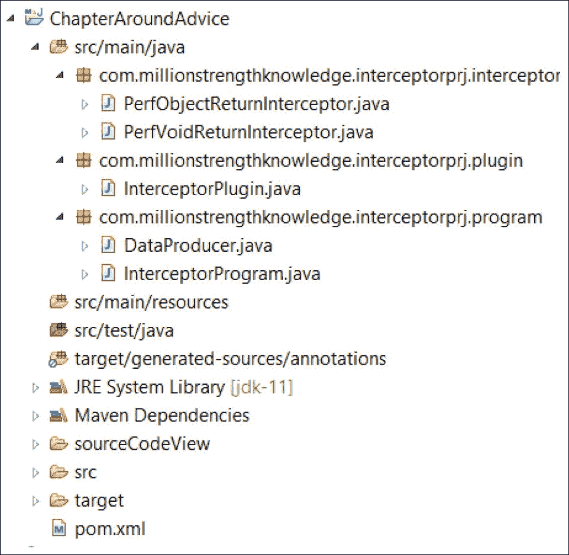

# ByteBuddy Java 拦截器开发：基础

## 作者

我叫 Eric Fong。我从 2001 年开始从事软件开发工作。我拥有使用 `Java`、`JavaEE` 和 `SpringFramework` 开发 Web 应用程序的经验。我在考文垂大学（Coventry University）获得管理信息系统硕士。我是 Oracle 认证 Java 程序员、EC-Council 认证 Java 应用安全工程师以及 Arcitura 认证微服务架构师。

我是 MillionStrengthKnowledge.com 的创始人。我在 2017 年创建了《`GWT 2.8.1 声明式用户界面 Web 应用程序开发自学培训》，并在 2018 年编写了电子书。在 2018 年，我还出版了另一本名为《GWT 响应式 Web 应用程序：问题解决方法》的电子书。我非常感兴趣 `Java` 和 Web 应用程序开发，在空余时间喜欢进行 `Java` 的研发。

## 感谢

我要感谢 `ByteBuddy` 项目的贡献者，他们付出了巨大努力使 `ByteBuddy` 成为成功的开源库。`ByteBuddy` 是一个基于 Java 的开源库，用于 Java 字节码生成和操作。`ByteBuddy` 采用 Apache License 2.0 许可，并在 Github 上免费提供。感谢开源社区的贡献以及项目贡献者 Rafael Winterhalter，他非常活跃于 Github 和 StackOverflow 论坛回答 `ByteBuddy` 的技术问题。

## 本书读者

本书的读者应具备 `Java` 编程知识。本书适用于学习如何使用 `ByteBuddy` 开发拦截器和 Java 代码生成的学习者，以及想要探索如何通过 `ByteBuddy` 开发实现面向面向代码结果的拦截器。

## 源代码

可以通过不同的方法下载源代码。方法取决于学习者在哪个书店网站购买电子书。如果学习者从 `gumroad` 购买电子书，则可以直接从 `gumroad` 下载源代码。如果学习者从其他网站购买电子书，请参考此网页获取如何下载源代码的信息：

https://millionstrengthknowledge.com/#path-r=sourcecodeguideline.html

对于通用指南，如果书店网站不是 `gumroad`，则学习者需要向邮箱发送源代码请求：

`sourcecode@millionstrengthknowledge.com`

邮件必须包含所购书籍的收据、发票、订单或许可证号。之后，学习者将收到一封包含源代码压缩文件的邮件回复：`javainterceptor.7z`。该压缩包受密码保护。解压压缩包的密码为学习者的邮箱地址。请参考上述 URL 了解如何编写源代码请求邮件。

## 示例输出

```text
null
```

观察到方法的返回值。`@Return` 注解为 void 指定值。`@Return` 属性必须是 `Assigner.Typing.DYNAMIC`。对于 `void` 返回，`DYNAMIC` 是必须的。

观察到屏幕上返回的数据发生了变化，尽管执行的是相同的程序 `InterceptorProgram.java`：

- 参数数据：“ 10000, test” 变为 “ 20000, test2”
- 实例变量：“ 1, someData, DataProducer ” 变为 “ 2, new data, DataProducer1 ”
- `create()` 返回的数据：“ 1 ” 变为 “ -2 ”

数据变化是因为建议代码（advice code）在注入（instrumentation）过程中拦截了值。

这是 `DataInterceptor.java` 的代码，它是本章中的建议代码：

```java
public class DataInterceptor {

    @Advice.OnMethodEnter
    public static void methodStart(
        @Advice.Argument(value=0, readOnly=false) int param1,
        @Advice.Argument(value=1, readOnly=false, typing=Assigner.Typing.DYNAMIC) Object param2,
        @Advice.FieldValue(value="recordId", readOnly=false) int data1,
        @Advice.FieldValue(value="descr", readOnly=false, typing=Assigner.Typing.DYNAMIC) Object data2,
        @Advice.FieldValue(value="CLASSNAME", readOnly=false, typing=Assigner.Typing.DYNAMIC) Object data3
    ) {
        param1 = 20000;
        param2 = "test2";
        data1 = 2;
        data2 = "new data";
        data3 = "DataProducer1";
    }

    @Advice.OnMethodExit
    public static void methodEnd(
        @Advice.Return(readOnly=false) int returnObject
    ) {
        returnObject = -2;
    }
}
```

为了拦截参数、实例变量和返回对象，注入过程必须实现方法进入建议（on method enter advice）、方法退出建议（on method exit advice）以及插件程序。本章将重点解释建议代码的实现，因为插件程序与上一章相似。

### 拦截方法参数值

为了修改 `DataProducer.java` 中 `create` 方法的 `id` 参数的值，`DataInterceptor.java` 在 `param1` 参数上使用了 `@Argument` 注解：

`@Advice.Argument(value=0, readOnly=false) int param1`

`value` 属性使用值 `0`，这意味着该参数映射到 `create` 方法的第一个参数。注解为 `readOnly` 属性指定了 `false` 值，这意味着建议方法想要修改 `create` 方法第一个参数的值。`readOnly` 属性的默认值为 `true`，这会阻止建议代码修改参数值。因此，建议方法可以将值从 `10000` 修改为 `20000`（第 21 行）：

`param1 = 20000;`

接下来，该注解被配置为修改 `create` 方法的第二个参数的值：

`@Advice.Argument(value=1, readOnly=false, typing=Assigner.Typing.DYNAMIC) Object param2`

`value` 属性为 `1` 意味着 `param2` 映射到 `create` 方法的数据参数。`readOnly` 属性为 `false` 意味着数据参数的值是可以修改的，且 `param2` 参数映射到数据参数。第三个属性 `typing` 的值为 `Assigner.Typing.DYNAMIC`。数据参数是 `java.lang.String`，而建议方法尝试使用 `java.lang.Object` 来映射 `param2` 参数。为了让 `param2` 拥有除 `java.lang.String` 外的数据类型，`typing` 属性必须具有值 `DYNAMIC`。否则，maven 构建过程将失败。

建议注解的 `typing` 属性默认为 `STATIC`。当 `typing` 为 `STATIC` 时，`param2` 必须与其映射参数具有完全相同的数据类型。由于 `param2` 想要使用 `java.lang.Object`，因此 `DYNAMIC` 是正确的属性值。

因此，通过 `@Argument` 注解中的这些配置，建议代码可以将 `param2` 的值从 “test” 修改为 “test2”（第 22 行）：

`param2 = "test2";`

### 拦截实例变量和类变量

建议方法还修改了 `DataProducer.java` 中实例变量和类变量的值。有一个名为 `CLASSNAME` 的类变量，以及两个名为 `recordId` 和 `descr` 的实例变量。

为了修改实例或类变量的值，使用了 `@FieldValue` 注解而非 `@Argument`。该注解被配置为修改 `recordId` 的值：

`@Advice.FieldValue(value="recordId", readOnly=false) int data1`

为了将 `data1` 参数映射到 `recordId` 实例变量，`value` 属性指定了实例变量的名称 “recordId”。`readOnly` 属性值为 `false`，意味着 `recordId` 变量的值在建议方法中是可以修改的。因此，第 24 行将 `recordId` 变量的值从 `1` 改为 `2`：

`data1 = 2;`

该注解被配置为修改 `DataProducer.java` 中 `descr` 实例变量的值：

`@Advice.FieldValue(value="descr", readOnly=false, typing=Assigner.Typing.DYNAMIC) Object data2`

建议方法使用 `java.lang.Object` 来映射数据参数。数据参数是 `java.lang.String`，为了让 `data2` 拥有除 `java.lang.String` 外的数据类型，`typing` 属性必须具有值 `DYNAMIC`。否则，maven 构建过程将失败。

建议注解的 `typing` 属性默认为 `STATIC`。当 `typing` 为 `STATIC` 时，`data2` 必须与其映射参数具有完全相同的数据类型。由于 `data2` 想要使用 `java.lang.Object`，因此 `DYNAMIC` 类型是正确的属性值。

通过这些配置，`readOnly` 属性 `false`，第 25 行将 `descr` 的值从 “data” 修改为 “new data”：

`data2 = "new data";`

该注解还可以修改类变量：

`@Advice.FieldValue(value="CLASSNAME", readOnly=false, typing=Assigner.Typing.DYNAMIC) Object data3`

通过这些配置，第 26 行将 `CLASSNAME` 的值从 “Data” 修改为 “DataProducer1”：

`data3 = "DataProducer1";`

### 拦截返回值

除了修改参数、实例变量，建议代码还可以修改返回对象。为了实现这个目的，注入过程必须实现方法进入建议、方法退出建议以及插件程序。

```java
@Advice.OnMethodExit
public static void methodEnd(
    @Advice.Return(readOnly=false) int returnObject
) {
    returnObject = -2;
}
```

使用 `@Return` 注解，`methodEnd` 中的 `returnObject` 将反映在 `create` 方法的返回值上。因此，第 34 行将返回值从 1 修改为 -2：

`returnObject = -2;`

## 总结

本章解释了：
- 如何修改方法参数的值
- 如何修改实例变量的值
- 如何修改方法的返回值

# 第 6 章：使用 OnMethodExit 拦截异常

建议代码可以拦截从功能代码抛出的异常。建议代码还可以将异常抑制为 `null`，或者抛出一个新异常来替换异常。本章介绍了关于拦截异常的建议代码。本章的源代码包含在 `ChapterAdvice` 项目中。

这是本章使用的功能代码：

```java
public class DataProducer {
    public void create(String data) {
        if (data == null)
            throw new IllegalArgumentException("Data cannot be null");
        System.out.println("create data: " + data);
    }
}
```

功能代码有一个 `java.lang.String` 参数。当 `data` 参数为 `null` 时，方法会抛出 `IllegalArgumentException`，否则方法会在屏幕上打印带有 `data` 参数的状态。

这是本章使用的建议代码：

```java
public class ExceptionInterceptor {
    public static Logger logger = Logger.getLogger(ExceptionInterceptor.class.getName());

    @Advice.OnMethodExit(onThrowable = Throwable.class)
    public static void methodEnd(
        @Advice.Thrown(readOnly=false) Throwable excp
    ) {
        if (excp == null) {
            logger.log(Level.INFO, "Method end with no exception");
        } else {
            logger.log(
                Level.INFO,
                "Method end with exception: \n" +
                "========================== \n" +
                "Exception type: " + excp.getClass().getName() + "\n" +
                "Exception message: " + excp.getMessage()
            );
        }
        excp = null;
    }
}
```

`InterceptorProgram.java` 被用于测试注入结果：

```java
public class InterceptorProgram {
    public static void main(String args[]) {
        new DataProducer().create(null);
    }
}
```

`InterceptorProgram.java` 是一个可执行的 Java 程序。它实例化了一个 `DataProducer.java` 实例，然后使用 `null` 参数调用 `create` 方法。在不通过 `maven` 编译过程的情况下执行 `InterceptorProgram.java`，程序会抛出 `IllegalArgumentException`，因为 `data` 参数为 `null`：

```
Exception in thread "main"
java.lang.IllegalArgumentException: data cannot be null
at com.millionstrengthknowledge.interceptorprj.program.DataProducer.create(DataProducer.java:15)
at com.millionstrengthknowledge.interceptorprj.program.InterceptorProgram.main(InterceptorProgram.java:14)
```

之后，启动 `maven` 构建过程，然后在 `Eclipse` 项目中执行 `InterceptorProgram.java`，程序将在屏幕上产生此结果：


Aug 01, 2020 1:00:00 PM com.millionstrengthknowledge.interceptorprj.program.DataProducer create

INFO: Method end with exception:

==========================

Exception type: `java.lang.IllegalArgumentException`

Exception message: Data cannot be null

```
在织入处理后，织入后的代码会在屏幕上打印异常信息。然而，屏幕上没有显示异常堆栈跟踪，这是因为建议代码将异常抑制为了 `null`。

建议代码只能拦截带有 `@OnMethodExit` 注解的方法中的异常。`@OnMethodExit` 注解必须在 `onThrowable` 属性中指定 Java 异常类名：

```java
@Advice.OnMethodExit(onThrowable=Throwable.class)
public static void methodEnd(
    @Advice.Thrown(readOnly=false) Throwable excp
)
```

默认情况下，如果 `create` 方法抛出异常，建议方法将被跳过。要让织入后的代码继续执行到建议代码，必须使用 `onThrowable` 属性。如果织入代码抛出的异常等于 `onThrowable` 属性中定义的异常类或派生类，则织入方法的执行将继续执行建议方法。

观察到 `methodEnd` 的参数 `excp` 使用了 `@Thrown` 注解。该参数捕获了从织入方法抛出的异常。例如，如果织入方法抛出 `IllegalArgumentException`，那么 `excp` 参数的值将是从织入方法抛出的 `IllegalArgumentException` 实例。

要修改织入方法抛出的异常，必须将 `@Thrown` 注解的 `readOnly` 属性设置为 `false`。

在此示例中，建议方法捕获了异常并在屏幕上打印异常类及其异常消息。织入代码没有抛出异常，因为建议代码在第 30 行抑制了异常：

```java
excp = null;
```

如果建议代码中删除了第 30 行，那么织入方法将抛出异常：

```
Aug 01, 2020 1:00:00 PM com.millionstrengthknowledge.interceptorprj.program.DataProducer create
INFO: Method end with exception:
==========================
Exception type: java.lang.IllegalArgumentException
Exception message: Data cannot be null
Exception in thread “main” java.lang.IllegalArgumentException: data cannot be null
at com.millionstrengthknowledge.interceptorprj.program.DataProducer.create(DataProducer.java:5)
at com.millionstrengthknowledge.interceptorprj.program.InterceptorProgram.main(InterceptorProgram.java:14)
```

如果 `InterceptorProgram.java` 变为这一行代码：

```java
new DataProducer().createData(“create”);
```

那么织入后的代码将在屏幕上产生此结果：

```
create data: test
Oct 1, 2020 1:00:00 PM com.millionstrengthknowledge.interceptorprj.program.DataProducer create
INFO: Method end with no exception
```

### @Thrown 注解参数的数据类型

`excp` 参数的数据类型必须是与织入代码中抛出的异常类的相同类或其派生类。否则，织入后的代码将抛出运行时异常 - `java.lang.ClassCastException`。例如：

```java
public static void methodEnd(
    @Advice.Thrown(readOnly=false) Error excp)
```

观察到 `excp` 参数的数据类型为 `java.lang.Error`，这将导致在应用程序运行时出现 `ClassCastException`，因为 Java 无法将 `java.lang.IllegalArgumentException` 强制转换为 `java.lang.Error`。

### onThrowable 属性的数据类型

建议代码只能有一个方法退出建议。因此，为了在建议方法中管理所有异常类型，`onThrowable` 属性应使用 `Throwable.class`，这允许建议方法捕获 `java.lang.Exception` 和 `java.lang.Error`，以及 `java.lang.Exception` 和 `java.lang.Error` 的派生类。

如果织入代码抛出的异常与 `onThrowable` 属性中指定的类不匹配，建议方法将被跳过。例如，使用此配置：

```java
@Advice.OnMethodExit(onThrowable=Exception.class)
```

如果织入代码抛出 `java.lang.Error`，则建议方法将被跳过。

### 从建议方法抛出新异常

建议方法可以抛出新异常，这将更改从织入代码抛出的原始异常。如果将 `Interceptor.java` 第 30 行替换为这一行：

```java
throw new RuntimeException(“Runtime exception”);
```

那么织入代码将抛出 `RuntimeException`。

如果建议方法抛出受检异常而非 `RuntimeException`，并且 `methodEnd` 增加了 `throws` 子句：

```java
@Advice.OnMethodExit(onThrowable=Throwable.class)
public static void methodEnd(
    @Advice.Thrown(readOnly=false) Throwable excp
) throws Exception {
    throw new Exception(“checked exception”);
}
```

织入代码也将抛出受检异常，类似于在建议方法中抛出 `RuntimeException`。

然而，请注意 `DataProducer.java` 中的 `create` 方法没有 `throws` 子句：

```java
public class DataProducer {
    public void create(String data) {
        if(data==null)
            throw new IllegalArgumentException(“Data cannot be null”);
        System.out.println(“create data: “+data);
    }
}
```

根据 Java 编译过程，方法抛出受检异常时必须声明 `throws` 子句。否则，程序将收到编译错误。但在 Java 字节码格式中，当程序抛出异常时 throw 句 是可选的。因此生成的代码执行没有运行时错误。

这就是 Java 编程与 Java 字节码编程之间的重要区别。Java 编程处理 Java 文件，而 Java 字节码编程处理 Java 类文件。它们具有不同的语法，异常管理只是示例之一。

# 总结

本章介绍了：

- 如何使用 `@OnMethodExit` 注解的 `onThrowable` 属性管理异常
- 如何通过 `@Thrown` 注解参数将从织入代码抛出的异常映射到建议方法
- 如何抑制异常

# 第 7 章：从方法进入建议到退出建议传递数据

本章提供了如何从方法进入建议传递数据到退出建议的示例。源代码包含在 `ChapterPassingDataBetweenAdvice` Eclipse 项目中。

这是本章的功能代码：

```java
public class DataProducer {
    public void create() {
        System.out.println(“create data”);
    }
}
```

这是本章使用的建议代码：

```java
public class LogInterceptor {
    public static Logger logger=Logger.getLogger(LogInterceptor.class.getName());

    @Advice.OnMethodEnter
    public static String methodStart() {
        String sharedDataVar=”user01 record";
        logger.log(Level.INFO, “Method start: “+sharedDataVar);
        return sharedDataVar;
    }

    @Advice.OnMethodExit
    public static void methodEnd(
        @Advice.Enter String data
    ) {
        logger.log(Level.INFO, “Method end: “+ data);
    }
}
```

该 advice 代码同时使用了方法进入时（on method enter）和方法退出时（on method exit） advice，分别在 `methodStart` 和 `methodEnd` 方法中实现。`methodStart` 方法中有一个本地变量 `sharedDataVar`。`methodStart` 方法想要将存储在 `sharedDataVar` 变量中的数据与 `methodEnd` 方法共享。

为了实现 advice 方法之间的数据共享，`methodEnd` 方法必须在其其中一个参数上标注 `@Enter` 注解。在例例中，该参数是 `data` 参数。此外，`methodStart` 方法必须返回 `sharedDataVar`。通过这些实现，ByteBuddy 就可以将存储在 `sharedDataVar` 中的值传递给 `data` 参数。

要查看数据共享效果，请执行 maven 构建过程，然后执行 `InterceptorProgram.java`。程序将在屏幕上产生如下结果：

```
Aug 01, 2020 1:00:00 PM com.millionstrengthknowledge.interceptorprj.program.DataProducer create
INFO: Method start: user01 record
create data
Aug 01, 2020 1:00:00 PM com.millionstrengthknowledge.interceptorprj.program.DataProducer create
INFO: Method end: user01 record
```

观察到 `methodEnd` 方法可以打印“user01 record”的值，该值是从 `methodStart` 方法传递的。

## 结论

本章解释了：

- 如何将数据从方法进入 advice 方法传递到方法退出 advice 方法

# 第 8 章：Around Advice

除了方法进入时和方法退出时的 advice 之外，ByteBuddy 还支持 around advice。Around advice 通过方法委托（method delegation）在功能方法的开头和结尾添加 advice 代码。

本章的源代码包含在 `ChapterAroundAdvice` Eclipse 项目中，该项目的结构如下：



本章使用了两个 advice 代码：`PerfObjectReturnInterceptor.java` 和 `PerfVoidReturnInterceptor.java`。`PerfObjectReturnInterceptor.java` 用于拦截有返回对象的泛方法，而 `PerfVoidReturnInterceptor.java` 用于拦截返回 void 值的泛方法。

这是本章的功能性代码：

```java
public class DataProducer {
    public void create() {
        System.out.println(“create data”);
    }

    public String createData() {
        String uniqueId=UUID.randomUUID().toString();
        return new String(
            Base64.getEncoder().encode(
                uniqueId.getBytes()),
            Charset.forName(“UTF-8”)
        );
    }
}
```

`create` 方法在屏幕上打印状态字符串“create data”。`createData` 方法返回一个 base64 编码的 UUID。

这是 `InterceptorPlugin.java` 中 `apply` 方法的实现：

```java
public Builder<?> apply(
    Builder<?> builder, TypeDescription td,
    ClassFileLocator cfl
) {
    return builder
        .method(ElementMatchers.named(“create”))
        .intercept(
            MethodDelegation.to(
                PerfVoidReturnInterceptor.class)
        )
        .method(ElementMatchers.named(“createData”))
        .intercept(
            MethodDelegation.to(
                PerfObjectReturnInterceptor.class));
}
```

### 用于 create 方法的 Around Advice

在 `apply` 方法中，调用了 `builder` 的 `method` 方法。`method` 方法使用 `ElementMatchers.named` 构建匹配逻辑。`named` 方法使用“create”作为其参数值：

```java
builder.method(ElementMatchers.named(“create”))
```

因此，`DataProducer.java` 中的 `create` 方法被选中插桩。之后，插件程序调用了 `builder` 的 `intercept` 方法。`intercept` 方法的参数指定了 `MethodDelegation.to(PerfVoidReturnInterceptor.class)`：

```java
return builder
    .method(ElementMatchers.named(“create”))
    .intercept(
        MethodDelegation.to(PerfVoidReturnInterceptor.class)
    )
```

这些方法与方法进入/退出 advice 完全不同。首先，`builder` 调用 `intercept` 方法来执行插桩，而不是 `visit` 方法。插桩随后使用了 `MethodDelegation.to` 而不是 `Advice.to` 方法。匹配逻辑通过 `method` 方法实现，而不是通过 `Advice.to` 方法链中的 `on` 方法。

这是 `PerfVoidReturnInterceptor.java` 的代码：

```java
public class PerfVoidReturnInterceptor {
    public static Logger logger=
    Logger.getLogger(
        PerfVoidReturnInterceptor.class.getName());
    public static void aroundVoid(
        @SuperCall Runnable targetCode,
        @Origin Method method){
        long startTime=
```


```java
System.currentTimeMillis();

logger.log(Level.INFO, "Method start");

targetCode.run();

logger.log(Level.INFO, "Method end: " +
    method.getName() + " execution time: " +
    (System.currentTimeMillis() - startTime));
```

支持 void 返回的 around advice 要求如下：

- advice 方法是静态方法（第 6 行）。
- advice 方法返回 void（第 6 行）。
- advice 方法有一个 `java.lang.Runnable` 参数，并标注了 `@SuperCall`（第 7 行）。

在本例中，`aroundVoid` 方法是 advice 方法。ByteBuddy 根据 `aroundVoid` 方法生成插桩代码。advice 代码目的是测量功能代码的运行时性能。`targetCode` 参数代表功能代码：`DataProducer` 中的 `create` 方法。


方法委托生成的字节码与 `visit` 方法不同。为了进一步理解差异，查看生成的字节码的 Java 源：

```java
public class DataProducer {

    public DataProducer() { }

    public void create() {

        class auxiliary.mxySqow
        implements Runnable, Callable {

            public void run() {
                argument0.createOriginal();
            }

            public Object call() {
                argument0.createOriginal();
                return null;
            }

            private DataProducer argument0;

            auxiliary.mxySqow() {
                argument0 = DataProducer.this;
            }
        }

        PerfVoidReturnInterceptor.aroundVoid(
            new auxiliary.mxySqow(), mtd);
    }

    private void createOriginal() {
        System.out.println("create data");
    }

    private static final Method mtd =
        DataProducer.class.getMethod("create");

    // other code is omitted
}
```


在生成的字节码中，ByteBuddy 创建了一个新的私有方法 `createOriginal`，并将原始 `create` 方法的内容复制到该方法中（第 32-34 行）。

随后，ByteBuddy 修改了 `create` 方法。ByteBuddy 在 `create` 方法内部声明了一个名为 `auxiliary.mxySqow` 的内部类。该内部类就是代理类。代理类包含了功能代码的引用：`DataProducer.java` 中的 `create` 方法。代理类使用 `argument0` 来存储该引用（第 19 行），该引用被传递了。


通过代理类的构造函数进行。代理类实现了两个 Java 接口：`java.lang.Runnable` 和 `java.util.concurrent.Callable`。它们的派生方法调用和 `run` 会通过 `argument0` 实例变量调用 `createOriginal` 方法。随后，ByteBuddy 使用 `PerfVoidReturnInterceptor.java` 在 `create` 方法的末尾调用 `aroundVoid` 方法（第 27-30 行）。在 `PerfVoidReturnInterceptor.java` 的 `aroundVoid` 方法中，该方法调用了 `targetCode.run()`，其中 `run` 方法是 `auxiliary.mxySvqOW` 中 `java.lang.Runnable` 的实现。

尽管 `PerfVoidReturnInterceptor.java` 仅为 `SuperCall` 参数指定了 `Runnable`，但 ByteBuddy 在其生成的字节码中（第 6 行）隐式地实现了 `Runnable` 和 `Callable` 接口。尽管如此，如果函数方法返回 `void`，则 `@SuperCall` 注解参数在建议代码中使用 `java.lang.Runnable`。

在本节结束之前，请注意 ByteBuddy 可以为 `around` 建议（advice）生成不同的字节码。例如，ByteBuddy 可以生成不包含在方法中的内部类，以及用于访问 `create` 方法的额外访问器方法。尽管如此，生成的代码将应用代理类来实现 `around` 建议。

## `createData` 方法的 Around 建议

同样，为了拦截 `DataProducer.java` 中的 `createData` 方法，以下是 `InterceptorPlugin.java` 中此目的的代码段：

```java
.method(ElementMatchers.named("createData"))
.intercept(
    MethodDelegation.to(
        PerfObjectReturnInterceptor.class)
)
```

`createData` 方法是一个返回 `java.lang.String` 对象的方法。`PerfObjectReturnInterceptor.java` 是 `createData` 方法的建议代码：

```java
public class PerfObjectReturnInterceptor {

    public static Logger logger =
        Logger.getLogger(
            PerfObjectReturnInterceptor.class
            .getName());

    @RuntimeType
    public static Object aroundReturn(
        @SuperCall Callable<Object> targetCode,
        @Origin Method method
    ) throws Throwable {

        long startTime =
            System.currentTimeMillis();

        logger.log(Level.INFO, "Method start");

        Object result = targetCode.call();

        logger.log(Level.INFO, "Method end: " +
            method.getName() + " execution time: " +
            (System.currentTimeMillis() - startTime));

        return result;
    }
}
```

这些是支持函数方法返回对象的 `around` 建议实现：

- 建议方法是一个静态方法。（第 8 行）
- 建议方法返回 `Object` 实例，或与函数方法返回类型相同的类型。（第 8 行）
- 建议方法有一个 `java.util.concurrent.Callable` 参数，并标记有 `@SuperCall` 注解。（第 9 行）
- 建议方法被标记了 `@RuntimeType` 注解。（第 7 行）


尽管建议代码使用了 `Callable` 接口而不是 `Runnable`，ByteBuddy 也会生成与为 `create` 方法生成的类似的字节码。唯一的区别是 `DataProducer.java` 中的 `createData` 方法将调用 `PerfObjectReturnInterceptor.java` 的 `aroundReturn` 方法（第 20-22 行，在 `createData` 方法的末尾），其第一个参数使用 `auxiliary.xMxeqXab` 的代理类实例（第 20 行）：

```java
public void createData() {

    class auxiliary.xMxeqXab {

        public void run() {}

    }

    public void run() {

        new auxiliary.xMxeqXab().run();

    }
}
```

```java
" @This: " + target.getClass().getName() + "\n" +
" @AllArguments length: " + args.length + "\n" +
" @AllArguments [0]: " + ((int) args[0]) + "\n" +
" @AllArguments [1]: " + ((String) args[1]) + "\n" +
" @Argument(0): " + p1 + "\n" +
" @Argument(1): " + p2 + "\n" +
" @FieldValue('objectId'): " + data1 + "\n" +
" @FieldValue('data'): " + data2 + "\n"
);

Object result = instrumentedMethod.call();

logger.log(Level.INFO, "Method end: " + method.getName() + " execution time: " + (System.currentTimeMillis() - startTime));

return result;
}
```

`aroundReturn` 方法是一种可以返回对象的环绕建议（around advice）。该方法使用了这些包含在 `net.bytebuddy.implementation.bind.annotation` 包中的注解：

- `@Super`
- `@SuperMethod`
- `@This`
- `@AllArguments`
- `@Argument`
- `@FieldValue`


### @Super

`@Super` 注解提供了由 ByteBuddy 生成的代理类实例。

参数：`@Super Object zuper`

```java
System.out.println(zuper.getClass().getName());
```

屏幕上打印此字符串值：
`com.millionstrengthknowledge.interceptorprj.program.DataProducer$auxiliary.mxySvqOW`

### @SuperMethod

`@SuperMethod` 注解提供了被委托方法的 `java.lang.reflect.Method` 实例：

参数：`@SuperMethod Method superMethod`

```java
System.out.println(superMethod.getName());
```

屏幕上打印此字符串值：
`createDataOriginal`

这里的示例提供了一个简单的方法名。ByteBuddy 实际上可以带有随机字符创建方法名，例如 `createData$original$AOgPLhp9$accessor$sMMz5BQl`

### @This

`@This` 注解提供了功能代码的实例。例如：

参数：`@This Object target`

```java
System.out.println(target.getClass().getName());
```

屏幕上打印此字符串值：
`com.millionstrengthknowledge.interceptorprj.program.DataProducer`


### @AllArguments

`@AllArguments` 注解以对象数组格式提供了 `createData` 方法所有参数的值。例如，`InterceptorProgram.java` 调用了：

`new DataProducer.create(1, "base64");`

参数：`@AllArguments Object[] args`

```java
System.out.println(args[0] + " " + args[1]);
```

屏幕上打印此字符串值：
`1 base64`

### @Argument

`@Argument` 注解提供了 `createData` 方法的某一个参数的值。该注解接受一个整数参数，代表方法参数的索引数字。例如，`InterceptorProgram.java` 调用了：

`new DataProducer.create(1, "base64");`

参数：
- `@Argument(0) int p1`
- `@Argument(1) String p2`

```java
System.out.println(p1 + " " + p2);
```

屏幕上打印此字符串值：
`1 base64`

索引 0 表示第一个参数，索引 1 表示第二个参数，依此类推。环绕建议无法修改功能方法参数的值。

### @FieldValue

`@FieldValue` 注解提供了功能代码中实例变量的值。该注解接受一个代表实例变量名称的参数。例如，`DataProducer.java` 定义了这两个实例变量：


```java
public int objectId = -1;

private String data = "producer data";
```

参数：
- `@FieldValue("objectId") int data1`
- `@FieldValue("data") String data2`

```java
System.out.println(data1 + " " + data2);
```

屏幕上打印此字符串值：
`-1 producer data`

与在方法进入/退出建议中使用的 `@FieldValue` 不同，用于环绕建议的 `@FieldValue` 注解无法修改功能代码实例变量的值。

### Conclusion

本章解释了如何使用这些注解在环绕建议的建议方法上参数：
- `@Super`
- `@SuperMethod`
- `@This`
- `@AllArguments`
- `@Argument`
- `@FieldValue`


# 第 10 章：生成实例变量

本章解释了如何使用 ByteBuddy 动态为 Java 类生成实例变量。本章源码包含在 `ChapterDefineInstanceVariable` Eclipse 项目中。该项目没有 interceptor 包，相反，有一个 prototype 包。

在本章中，`DataProducer.java` 是功能代码：

```java
public class DataProducer {

    private int data = -1;

}
```

`DataProducer.java` 非常简单，该类包含一个名为 `data` 的变量，且没有任何方法。所有的代码生成逻辑都实现在 `ChapterDefineInstanceVariable` 中。


# 第 11 章：生成 Java 方法

本章解释了如何向功能代码中动态生成 Java 方法。`DataProducer.java` 是本章的功能代码：

```java
public abstract class DataProducer {

    private String data;

}
```

经过插桩过程后，`DataProducer.class` 应包含这些 Java 方法：

```java
public abstract class DataProducer {

    private String data;

    private int numberData;

    public void setNumberData(int var1) {
        this.numberData = var1;
    }

    public int getNumberData() {
        return this.numberData;
    }

    protected String getData() {
        return this.data;
    }

    protected void setData(String var1) {
        this.data = var1;
    }

    public static int calculate(int p1, int p2) {
        return -1;
    }

    private long getInstantTime() {
        return -1L;
    }

    public abstract void process1();

    public static final void process2(final String strParam) {
    }

    private static final boolean process3() {
        return false;
    }

    private synchronized String process4() {
        return null;
    }

    private strictfp String process5() {
        return null;
    }

    private String process6(int p1, String p2) {
        return null;
    }

    private BigInteger process7() {
        return null;
    }

    private String process8() {
        return null;
    }

    private String process9() {
        return null;
    }

    private String process10() {
        return null;
    }

    private String process11() {
        return null;
    }

}
```

## 定义实例变量

`DataProducer.java` 非常简单，该类包含一个名为 `data` 的变量，且没有任何方法。所有的代码生成逻辑都实现在 `ChapterDefineInstanceVariable` 中。

### 修饰符与 `defineField` 方法

`net.bytebuddy.description.modifier.Visibility`、`net.bytebuddy.description.modifier.FieldManifestation`、`net.bytebuddy.description.modifier.Ownership` 用于指定字段修饰符。

- `Visibility` 用于指定可见性：`public`、`private`、`protected`、`package access`（包访问）。
- `FieldManifestation` 用于为实例变量指定 `final` 或 `volatile` 关键字。
- 当程序想要声明 `static` 时，使用 `Ownership`。

因此，插桩过程为 `SERIALNUMBER` 变量生成了如下声明：

```java
public final static long SERIALNUMBER = 12345L;
```

接下来，插件程序声明了一个名为 `number1` 的私有实例变量：

```java
builder.defineField("number1", long.class, Visibility.PRIVATE);
```

该声明使用了 `Visibility.PRIVATE`，插桩后的结果为：

```java
private long number1;
```

声明受保护变量，使用 `Visibility.PROTECTED`：

```java
.defineField("number2", long.class, Visibility.PROTECTED)
```

插桩结果为：

```java
protected long number2;
```

声明包私有的 `volatile` 变量：

```java
.defineField("number3", long.class, Visibility.PACKAGE_PRIVATE, FieldManifestation.VOLATILE)
```

插桩结果为：

```java
volatile long number3;
```

声明私有的 `transient` 变量：

```java
.defineField("number4", long.class, Visibility.PRIVATE, FieldPersistence.TRANSIENT)
```

插桩结果为：

```java
private transient long number4;
```

在不指定可见性修饰符的情况下声明变量：

```java
.defineField("number5", long.class)
```

如果没有指定修饰符，则变量默认为包访问：

```java
long number5;
```

### 使用 `Opcodes` 指定修饰符

`net.bytebuddy.jar.asm.Opcodes` 是另一种为实例变量指定修饰符的方法。例如，这一行声明了 `public final static` 变量：

```java
builder.defineField("number6", long.class, Opcodes.ACC_PUBLIC | Opcodes.ACC_FINAL | Opcodes.ACC_STATIC);
```

插桩结果为：

```java
public final static long number6;
```

`Opcodes` 可以在一行中组合多个修饰符，每个修饰符用 `|` 字符分隔。另一个使用 `Opcodes` 的示例是：

```java
builder.defineField("number7", long.class, Opcodes.ACC_PRIVATE | Opcodes.ACC_VOLATILE | Opcodes.ACC_TRANSIENT);
```

插桩结果为：

```java
private volatile transient long number7;
```

### `value` 方法

`value` 方法仅适用于静态变量。例如，`SERIALNUMBER` 是静态变量：

```java
builder.defineField("SERIALNUMBER", long.class, Visibility.PUBLIC, FieldManifestation.FINAL, Ownership.STATIC).value(12345L);
```

通过此配置，`SERIALNUMBER` 实例变量将具有 `12345` 的 long 类型。如果在非静态实例变量上使用 `value` 方法，例如：

```java
builder.defineField("number1", long.class, Visibility.PRIVATE).value(1000L);
```

long 值 `1000` 将不会被设置为 `number1` 实例变量。要为实例变量赋值，必须通过构造函数设置 `value`。这是因为 Java 字节码规范要求由构造函数为实例变量赋值。第 12 章将解释如何在构造函数中为实例变量赋值。

## 方法生成示例

以下代码片段演示了如何生成 `getData` 和 `setData` 方法：

```java
.intercept(FieldAccessor.ofField("data"))
.defineMethod("setData", void.class, Visibility.PROTECTED)
.withParameter(String.class)
.intercept(FieldAccessor.ofField("data"));
```

生成以下插桩代码：

```java
protected String getData() { return data; }
protected void setData(String var1) { data = var1; }
```

# 总结

本章解释了如何动态声明实例变量及生成 Java 方法。


## 使用 `defineMethod` 生成方法

`defineMethod` 方法接受三个参数。第一个参数是方法名，第二个参数是返回数据类型，第三个参数是方法的可见性。为了创建 getter 方法的方法体，使用了 `FieldAccessor`。由于 `getData` 想要返回 `data` 实例变量的值，因此 `FieldAccessor.ofField("data")` 产生了用于此目的的字节码。

setter 方法需要一个 `String` 类型的参数。为了为方法配置参数，使用了 `withParameter` 方法。`withParameter` 适用于仅有一个参数的方法。由于 `data` 实例变量是一个 `String`，因此为 `withParameter` 的参数指定了 `String.class`，以便方法将创建一个 `String` 参数。与 getter 方法类似，使用 `FieldAccessor.ofField("data")` 生成 setter 方法体。

`FieldAccessor.ofField` 方法是 `ByteBuddy` 提供的另一个实用工具类。该方法可以同时应用于 setter 和 getter 方法，并且它可以智能地生成必要的代码。

### 生成抽象方法

`withoutCode` 方法被用于生成抽象方法。例如：

```java
builder.define("process1", void.class, Visibility.PUBLIC).withoutCode()
```

将生成这一行字节码：

```java
public abstract void process1();
```

### 声明 public final static 方法

接下来，这是用于声明 public final static 方法的代码：

```java
builder.defineMethod("process2", void.class, Visibility.PUBLIC, MethodManifestation.FINAL, Ownership.STATIC)
    .withParameter(String.class, "strParam", ParameterManifestation.FINAL)
    .intercept(StubMethod.INSTANCE)
```

生成以下插桩代码：

```java
public final static void process2(final String strParam) { }
```

该代码使用了 ByteBuddy 的几个新类来生成代码：

- `net.bytebuddy.description.modifier.MethodManifestation`
- `net.bytebuddy.description.modifier.ParameterManifestation`
- `net.bytebuddy.description.modifier.Ownership`
- `net.bytebuddy.implementation.StubMethod`

`MethodManifestation` 和 `Ownership` 用于指定 Java 元素的修饰符。`StubMethod` 是一个特殊的 Java 类，用于返回方法的默认值。`process2` 是一个返回 `void` 的方法，因此使用 `StubMethod` 会为 `void` 返回生成空代码。要获取 `StubMethod` 的实例，需要调用它的 `INSTANCE` 方法。`StubMethod` 是一个智能组件，因为它根据方法的返回数据类型生成返回语句。

`process2` 拥有一个参数，该参数是 `final` 的。为了配置 `final` 参数，使用了 `withParameter` 方法。`withParameter` 可以接受三个参数。第一个参数指定参数的数据类型，第二个参数是参数名称，第三个参数指定其修饰符。声明中使用 `ParameterManifestation.FINAL` 来指定 `final` 参数。

### 使用 Opcodes 指定修饰符

下一个示例生成了一个返回 `boolean` 值的方法，使用了相同的代码 `StubMethod.INSTANCE`，但它可以为该方法生成 `"return false"`：

```java
builder.defineMethod("process3", boolean.class, Opcodes.ACC_PUBLIC | Opcodes.ACC_FINAL | Opcodes.ACC_STATIC)
    .intercept(StubMethod.INSTANCE)
```

生成以下插桩代码：

```java
public final static boolean process3() {
    return false;
}
```

`net.bytebuddy.jar.asm.Opcodes` 是另一个可以用于指定 Java 元素修饰符的 Java 类。上面的代码生成了一个 public final static 方法。使用 `Opcodes` 的好处是它可以在一行内指定多个修饰符，每个修饰符之间使用 `"|"` 分隔。

### 生成 synchronized 方法

这一行代码声明了一个同步（synchronized）方法：

```java
builder.defineMethod("process4", String.class, Visibility.PRIVATE, SynchronizationState.SYNCHRONIZED)
    .intercept(FixedValue.nullValue())
```

生成以下插桩代码：

```java
private synchronized String process4() {
    return null;
}
```

为了在方法上指定 `synchronized` 关键字，使用了 `SynchronizationState.SYNCHRONIZED`。该方法使用 `FixedValue` 的 `nullValue` 方法生成返回 `null` 值的字节码。

### 生成 strictfp 方法

这一行代码声明了一个 strictfp 方法：

```java
builder.defineMethod("process5", String.class, Visibility.PRIVATE, MethodStrictness.STRICT)
    .intercept(FixedValue.nullValue())
```

生成以下插桩代码：

```java
private strictfp String process5() {
    return null;
}
```

为了在方法上指定 `strictfp` 关键字，使用了 `MethodStrictness.STRICT`。

### 生成带有多个参数的方法

这一行代码声明了一个带有多个参数的方法：

```java
builder.defineMethod("process6", String.class, Visibility.PRIVATE)
    .withParameters(int.class, String.class)
    .intercept(FixedValue.nullValue())
```

生成以下插桩代码：

```java
private String process6(int var0, String var1) {
    return null;
}
```

要在一行内声明多个参数，使用了 `withParameters` 方法。`withParameters` 的每个参数都映射到生成方法的对应参数。

## 使用 MethodDelegation 生成方法体

ByteBuddy 可以使用 `net.bytebuddy.implementation.MethodDelegation` 和 `net.bytebuddy.asm.Advice` 生成方法体。此行代码展示了应用 `MethodDelegation` 的示例：

```java
builder.defineMethod("process7", BigInteger.class, Visibility.PRIVATE)
    .withParameter(String.class)
    .throwing(NoSuchMethodException.class, SecurityException.class, InstantiationException.class, IllegalAccessException.class, IllegalArgumentException.class, InvocationTargetException.class)
    .intercept(MethodDelegation.to(BigIntegerProducer.class))
```

生成以下插桩代码：

```java
private BigInteger process7(String var0)
    throws NoSuchMethodException, SecurityException, InstantiationException, IllegalAccessException, IllegalArgumentException, InvocationTargetException {
    return BigIntegerProducer.create(var0);
}
```

插件程序调用了 `intercept` 方法，并为其参数使用了 `MethodDelegation.to(BigIntegerProducer.class)`。代码还通过使用 `throwing` 方法为方法声明了 `throws` 子句。由于 `BigIntegerProducer.class` 的 advice 方法带有 `throws` 子句，因此该子句是必须的。这是 `BigIntegerProducer.java` 的源码：

```java
public class BigIntegerProducer {
    @OnMethodExit
    public static BigInteger create(String param)
        throws NoSuchMethodException, SecurityException, InstantiationException, IllegalAccessException, IllegalArgumentException, InvocationTargetException {
        Constructor c = BigInteger.class.getDeclaredConstructor(String.class);
        return (BigInteger) c.newInstance(param);
    }
}
```

因此，`process7` 方法必须与 advice 代码具有相同的 `throws` 子句，并使用 `throwing` 方法映射异常。advice 代码刻意使用了 Java 反射技术来实例化 `BigInteger`，因为示例是为了演示如何映射异常。`MethodDelegation` 会将 advice 代码内联到 `process7` 方法中。相反，ByteBuddy 生成的字节码会在 `process7` 方法体中调用 `BigIntegerProducer.class` 的 `create` 静态方法。

## 使用 Advice 生成方法体

下一个示例展示了如何使用 `Advice` 生成方法体。插件程序首先使用 `defineMethod` 声明方法，使用 `FixedValue` 创建方法体，然后使用 `visit` 方法修改方法体：

```java
builder = builder.defineMethod("process8", String.class, Opcodes.ACC_PRIVATE | Opcodes.ACC_VARARGS)
    .withParameter(String.class)
    .withParameter(int[].class)
    .intercept(FixedValue.nullValue());

builder = builder.visit(Advice.to(UuidGeneratorForInline.class))
    .on(ElementMatchers.named("process8"));
```

这是 `UuidGeneratorForInline.java` 的代码：

```java
public class UuidGeneratorForInline {
    @OnMethodExit
    public static void generate(
        @Return(readOnly = false) String data,
        @Argument(0) String param
    ) {
        String uuid = UUID.randomUUID().toString();
        if (param.equals("base64")) {
            data = Base64.getEncoder()
                .encodeToString(uuid.getBytes(Charset.forName("UTF-8")));
        } else {
            data = uuid;
        }
    }
}
```

`intercept` 方法生成了返回 `null` 值的方法体。`visit` 方法通过建议代码（advice code）重写了 `process8` 方法的方法体。`visit` 方法从 `UuidGeneratorForInline.class` 克隆了 `exit` 建议方法的方法体，并将其内联到 `DataProducer.class` 的 `process8` 方法中。这是插桩处理后的 `process8` 方法：

```java
private String process8(
    String var1, int... paramInt) {
    String var2 = null;
    String var3 = UUID.randomUUID().toString();
    if (var1.equals("base64")) {
        var2 = Base64.getEncoder().encodeToString(
            var3.getBytes(Charset.forName("UTF-8")));
    } else {
        var2 = var3;
    }
    return var2;
}
```

观察到第二个参数是一个变长参数。为了创建这种类型参数，我们创建了一个数组类型的方法的最后一个参数，然后在 `defineMethod` 方法的第三个参数处使用 `Opcodes.ACC_VARARGS` 修饰符。

## 生成带有局部变量的方法

下一个示例展示了如何生成方法体并在方法体内声明局部变量。插件程序使用 `defineMethod` 声明方法，使用 `FixedValue` 创建方法体，然后使用 `visit` 方法修改方法体：

```java
builder.defineMethod(
    "process9", int.class, Visibility.PUBLIC
)
.withParameter(long.class)
.intercept(FixedValue.value(0));

builder = builder
    .visit(Advice.to(PriceProcessorAdvice.class)
    .on(ElementMatchers.named("process9")));
```

`visit` 方法应用了 `PriceProcessorAdvice.class`：

```java
public class PriceProcessorAdvice {
    @Advice.OnMethodEnter
    public static void start(
        long id,
        @Local("total") int totalParam
    ) {
        int price = new PriceQuery().query(id);
        int discount = new DiscountQuery().query(id);
        totalParam = price - discount;
    }

    @Advice.OnMethodExit
    public static void end(
        @Local("total") int totalParam,
        @Return(readOnly = false) int returnTotal
    ) {
        returnTotal = totalParam;
    }
}
```


建议代码同时声明了 `on method enter` 和 `exit` 建议。建议代码使用了一个名为 `@Local` 的新注解。`@Local` 注解包含在 `net.bytebuddy.asm.Advice` 包中。`@Local` 注解用于在方法体内声明局部变量。在建议代码中，该变量是一个参数。插桩处理后，该参数将变为插桩代码方法体中的局部变量。

`@Local` 注解必须在带有 `@OnMethodEnter` 注解的方法中声明。要在 exit 建议中使用局部变量，需要在现有建议的其中一个参数上标记 `@Local` 注解，且如果它们引用同一个局部变量，则该注解的值必须与 enter 建议中的 `@Local` 注解值相同。在本例中，局部变量的名称为 `total`。

建议代码执行了价格计算。计算结果存储在 `totalParam` 中，它是标记了 `@Local` 注解的参数。计算是在名为 `start` 的 `on method enter` 建议方法执行的。`start` 方法使用 `PriceQuery.java` 和 `DiscountQuery.java` 查询价格和折扣。这两个 Java 类以 `int` 格式返回价格和折扣。为了演示目的，价格和折扣的值在 `PriceQuery.java` 和 `DiscountQuery.java` 中是硬编码的。因此，它们通过 `query` 方法分别返回 280 和 10 的值。

名为 `end` 的 `on method exit` 建议方法重用了 `totalParam`，并将 `totalParam` 的值传递给 `returnTotal`。`returnTotal` 是在 `end` 方法中声明的参数，它使用了 `@Return` 注解。因此，`returnTotal` 在插桩代码中可用，并且可以通过插桩方法的 `return` 语句返回。

这是 `process9` 方法的插桩代码结果：

```java
public int process9(long paramLong) {
    int p = 0;
    int j = new PriceQuery().query(paramLong);
    int m = new DiscountQuery().query(paramLong);
    p = j - m;
    long var1 = paramLong;
    int k = 0;
    k = p;
    return k;
}
```

观察到生成的字节码使用了不同的变量名 `p` 来表示 `totalParam`，尽管 `@Local` 注解已经声明了 `total`。请注意，当插桩过程执行时，字节码会生成不同的变量名 `var1`，插桩代码可以执行价格计算。

### 生成带有嵌套 visit 的方法

接下来，插件程序使用 `defineMethod` 声明 `process10` 方法：

```java
builder.defineMethod(
    "process10", int.class, Visibility.PUBLIC
)
.withParameter(long.class)
.withParameter(Map.class)
.intercept(FixedValue.value(0));
```

插件程序使用 `defineMethod` 声明方法。`process10` 方法是一个返回 `int` 值的公共方法。`withParameter` 用于声明两个参数：一个 `long` 参数和一个 `java.util.Map` 参数。然后 `intercept` 方法生成一个返回零的方法体。

插件程序通过使用多个 `visit` 方法修改 `process10` 方法。使用了三个建议：`LocalVariableAdvice.class`、`PriceProcessorAdvice.class`、`DiscountQueryAdvice.class`。

请注意建议代码的顺序很重要。`process10` 方法的目的是执行价格计算，这与 `process9` 方法的 `total = price - discount` 相同。然而，`process10` 方法与 `process9` 方法不同，因为 `PriceQuery.java` 和 `DiscountQuery.java` 分别封装在 `PriceProcessorAdvice.java` 和 `DiscountQueryAdvice.java` 中。而 `process9` 方法将 `PriceQuery.java` 和 `DiscountQuery.java` 封装在一个建议方法中。

因此，`@Local` 注解不再适用，`PriceProcessorAdvice.java` 和 `DiscountQueryAdvice.java` 想要访问同一个 `total` 变量来执行价格计算。此示例利用功能代码的方法参数创建一个对 `PriceProcessorAdvice.java` 和 `DiscountQueryAdvice.java` 都可见的局部变量。因为所有建议代码都插桩同一个方法：`process10` 方法，所以所有建议代码都应该能够访问存储在方法第二个参数中的数据。

插桩想要防止调用 `process10` 方法的程序向第二个参数传递数据。因此，`LocalVariableAdvice.java` 用于此目的。

这是 `LocalVariableAdvice.java` 的代码：

```java
public class LocalVariableAdvice {
    @Advice.OnMethodEnter
    public static void enter(
        @Argument(value = 1, readOnly = false)
        Map<String, Object> data
    ) {
        data = new HashMap<>();
    }

    @Advice.OnMethodExit
    public static void end(
        @Argument(value = 1, readOnly = false)
        Map<String, Object> data,
        @Return(readOnly = false) int total
    ) {
        total = (Integer) data.get("total");
    }
    // 其他代码省略
}
```

`LocalVariableAdvice.java` 同时实现了方法进入和退出的建议，它们的名称分别为 `enter` 和 `end`。观察到 `LocalVariableAdvice.class` 使用在第一个访问方法中。因此，`ByteBuddy` 将按照以下顺序为插桩后的代码生成一个嵌套结构：

1. `LocalVariableAdvice enter`
2. `PriceQueryAdvice`
3. `DiscountQueryAdvice`
4. `LocalVariableAdvice end`

为了防止第二个参数包含从 `process10` 方法外部传递的恶意数据，`enter` 方法在每次调用 `process10` 方法时都会重置第二个参数：

```java
data = new HashMap<>();
```

`enter` 方法实例化了一个新的 `HashMap`。这个新的 `HashMap` 被传递给第二个参数，由变量 `data` 表示。由于 `data` 变量是带有 `@Argument` 注解的 `enter` 方法参数，由于其 `value` 属性为 `1` 且 `readOnly` 属性为 `false`，它被映射到 `process10` 方法的第二个参数。

然后，`PriceQueryAdvice.java` 和 `DiscountQueryAdvice.java` 利用 `HashMap` 来存储计算结果。计算结果以键名 `total` 存储在 `HashMap` 中。

因此，`HashMap` 中的 `total` 元素包含了价格计算的结果。为了确保插桩后的代码获取正确的总值，实现方法退出建议的 `LocalVariableAdvice.java` 中的 `end` 方法负责从 `HashMap` 中检索 `total` 元素的值，然后将其传递给 `returnTotal` 参数：

```java
@Advice.OnMethodExit
public static void end(
    @Argument(value = 1, readOnly = false) Map data,
    @Return(readOnly = false) int returnTotal
) {
    returnTotal = (Integer) data.get("total");
}
```

`returnTotal` 是带有 `@Return` 注解的参数，它代表 `process10` 方法的返回值。因此，`process10` 方法能够接收价格计算的结果并在返回语句中使用它。

使用 `LocalVariableAdvice.java` 的用处是，该建议可以持续确保在价格计算开始之前将 `HashMap` 重置为新的 `HashMap`。退出建议则一致地向插桩后的代码返回正确的总值。在编写本文时，使用的是 `ByteBuddy 1.10.16`，如果将 `HashMap` 替换为对象引用（`java.lang.String`、`java.lang.Integer`）或原始类型（`int`、`long`），则价格计算将失败，因为 `ByteBuddy` 将生成不同的对象或原始变量来存储价格计算结果。即使使用了 `HashMap`，`ByteBuddy` 也会生成 `HashMap` 的副本来存储数据。然而，由于 `HashMap` 使用相同的键来存储数据，数据存储是一致的。在未来，当生成的字节码不再包含变量副本时，应该将 `HashMap` 参数更改为对象引用或原始类型，以便高效利用资源。

以下是 `process10` 方法插桩后的代码源码视图：

```java
public int process10(long paramLong, Map p) {
    p = new HashMap();
    DataProducer var1 = this;
    long var2 = paramLong;
    Map varMap = p;
    int var3 = new PriceQuery().query(var2);
    varMap.put("total", Integer.valueOf(var3));
    var3 = ((Integer) varMap.get("total")).intValue();
    var3 = new DiscountQuery().query(var2);
    varMap.put("total", Integer.valueOf(var3));
    int var4 = ((Integer) varMap.get("total")).intValue();
    return var4;
}
```

`process10` 方法的代码显示 `p` 被初始化为一个新的 `HashMap`。`var1` 被赋值为 `this`，`var2` 被赋值为 `paramLong`，`varMap` 被赋值为 `p`。变量 `var3` 存储了 `PriceQuery().query(var2)` 的结果，然后以键 `total` 放入 `varMap`。接着，`var3` 使用 `DiscountQuery().query(var2)` 的结果进行更新，并再次以键 `total` 放入 `varMap`。最后，`var4` 从 `varMap` 中获取 `total` 的值并返回。

第三个 `MethodCall` 调用了 `DiscountUtil.java` 中的 `execute` 方法。第三个 `MethodCall` 调用了 `withArgument(0, 1)`，它将 `process11` 方法的前两个参数传递给 `DiscountUtil.java` 的 `execute` 方法。这是 `DiscountUtil.java` 中 `execute` 方法的实现：

```java
public static void execute(long id, int[] total) {
    total[0] -= new DiscountQuery().query(id);
}
```

`execute` 方法使用 `id` 执行折扣查询，然后减去存储在 `total` 数组第一个元素中的 `total` 价格，并将最新结果存储在 `total` 数组的第一个元素中。

之后，计算完成，`total` 数组的第一个元素包含了最新的总价。最后一个 `Then` 方法被链接到 `FixedValue.argument(1)`。`FixedValue.argument(1)` 生成的代码返回 `process11` 方法的第二个参数。由于所有的 `MethodCall` 都使用第二个参数来存储总价，且它是一个 `int` 数组，因此该 `int` 数组应该包含最新的总价。因此，`process11` 方法可以使用第二个参数来创建返回语句。

这是 `process11` 方法插桩代码的源码视图：

```java
public int[] process11(long p1, int[] p2) {
    LocalVariableAdvice.execute(p2);
    PriceUtil.execute(p1, p2);
    DiscountUtil.execute(p1, p2);
    return p2;
}
```

生成的代码非常紧凑，`ByteBuddy` 没有创建任何意外变量，因为 `int` 数组是由工具类的静态方法管理的。因此，`process11` 方法可以正确执行计算。

`ByteBuddy` 在代码生成方面存在局限性。某些代码无法直接生成。例如，价格计算代码可以使用以下代码实现：

```java
public int calculatePrice(long id) {
    int total = new PriceQuery().query(id);
    total -= new DiscountQuery().query(id);
    return total;
}
```

没有直接的 API（例如 `MethodCall`）可以生成以下这些行代码：

- `new PriceQuery().query(id);`
- 访问 `total` 局部变量并在 `DiscountQuery` 中使用它。
- 访问 `total` 局部变量并在返回语句中使用它。

`net.bytebuddy.implementation.bytecode.StackManipulation` 可以作为此问题的解决方案，但它不在本书的范围内。使用 `StackManipulation` 需要 Java 字节码编程知识，并且它可能实现更冗长的代码来实现相同的代码。`process9` 方法拥有与上述代码最接近的代码。`process9` 方法在 `onMethodEnter` 和 `onExit` 建议中使用 `@Local` 注解来实现插桩。

与使用局部变量相比，价格计算可以使用实例变量来存储计算结果。当程序想要使用实例变量来存储计算结果时，实现应该使用带有 `@FieldValue` 注解的建议代码。该建议代码可以使用 `onMethodEnter` 建议、`onMethodExit` 建议或两者。

到此阶段，本章已完全解释了 `InterceptorPlugin.java`。

### InterfacePlugin

`InterfacePlugin.java` 是一个插件程序，用于插桩在 `com.millionstrengthknowledge.interceptorprj` 中找到的所有 Java 接口。

```java
public boolean matches(TypeDescription target) {
    if (target.getName().startsWith("com.millionstrengthknowledge.interceptorprj") && target.isInterface()) {
        return true;
    } else {
        return false;
    }
}
```

（注：原文中关于 `InterfacePlugin.java` 的后续大量重复描述已去重，其核心实现逻辑如下：）

```java
public Implementation visit(MethodDescription method, MethodVisitor type, Object... arguments) {
    return new Advice.Builder()
        .with(FixedValue.value(1), onMethodEnter)
        .with(MethodCall.invoke(FixedValue.class).named("argument"), onMethodExit)
        .build(type);
}
```

### process11

这是 `process11` 方法插桩代码的源码视图：

```java
public int[] process11(long p1, int[] p2) {
```


### 观察到的行为

观察到 `DataProducer.java` 中没有构造函数。插桩过程会向 `DataProducer.class` 中添加七个构造函数。

### 使用 `define` 方法克隆构造函数

这是由插件程序创建的第一个构造函数：

```java
public DataProducer(int p1, String p2, String p3) { }
```

这是创建构造函数的代码，实现在 `InterceptorPlugin.java` 的 `apply` 方法中：

```java
Constructor c1 = ConstructorPrototype.class.getDeclaredConstructor(int.class, String.class, String.class);
builder.define(c1)
       .intercept(MethodCall.invoke(Producer.class.getConstructor()));
```

`ConstructorPrototype.java`：

```java
public class ConstructorPrototype {
    private int data1;
    private String data2;
    private String data3;

    public ConstructorPrototype(int a, String b, String c) {
        data1 = a;
        data2 = b;
        data3 = c;
    }
}
```

`define` 方法克隆了 `ConstructorPrototype.java` 中包含三个参数（`int.class`、`String.class`、`String.class`）的构造函数。为了让 `define` 方法克隆构造函数，程序必须将一个 `java.lang.reflect.Constructor` 实例传递给 `define` 方法的参数。然而，`define` 方法永远不会克隆方法体，以及声明在原型构造函数上的注解。

与 Java 方法类似，新声明的构造函数需要构造函数体。`intercept` 方法使用 `MethodCall` 来生成构造函数体：

```java
.intercept(MethodCall.invoke(Producer.class.getConstructor()));
```

在这个构造函数中，`MethodCall` 被用于调用父类的默认构造函数：`Producer()`，它生成了以下字节码：

```java
public DataProducer(int p1, String p2, String p3) {
    super();
}
```

### 使用 `defineConstructor` 方法生成构造函数

接下来，插件程序创建了此构造函数：

```java
private DataProducer(long p1) { }
```

这是用于生成构造函数的代码：

```java
builder.defineConstructor(Visibility.PRIVATE)
       .withParameter(long.class)
       .intercept(MethodCall.invoke(Producer.class.getConstructor()));
```

该代码使用了 `defineConstructor` 方法。`defineConstructor` 方法接收一个 `Visibility` 参数，用于指定构造函数的修饰符。在本例中，参数指定了 `private` 可见性。然后，方法链调用 `withParameter` 方法，该方法声明了 `long` 原始类型参数。之后，`intercept` 方法通过 `MethodCall` 创建构造函数体。

接下来，插件程序创建了此构造函数：

```java
public DataProducer(int p1, int p2) { }
```

这是用于生成构造函数的代码：

```java
builder
    .defineConstructor(Opcodes.ACC_PUBLIC)
    .withParameters(int.class, int.class)
    .intercept(MethodCall.invoke(Producer.class.getConstructor()));
```

该代码使用 `defineConstructor` 来声明公共构造函数。`Opcodes` 是 `Visibility` 可用于指定修饰符的替代方案。然后，方法链调用到 `withParameters` 方法，该方法接收两个参数：`int.class`、`int.class`。与 `withParameter` 方法不同，`withParameters` 方法可以创建多个参数。然后 `intercept` 方法创建构造函数体。

`apply` 方法进一步创建了下一个构造函数：

```java
public DataProducer(int p1, int p2, String p3, String p4) {
    super(p1, p3);
    dataProducerId = p2;
    data = p4;
}
```

这是实现该构造函数的代码：

```java
builder
    .defineConstructor(Visibility.PUBLIC)
    .withParameters(int.class, int.class, String.class, String.class)
    .intercept(MethodCall.invoke(Producer.class.getDeclaredConstructor(long.class, String.class))
        .withArgument(0, 2)
        .andThen(FieldAccessor.ofField("dataProducerId").setsArgumentAt(1)))
        .andThen(FieldAccessor.ofField("data").setsArgumentAt(3)));
```

构造函数的声明及其参数使用了之前构造函数中解释过的类似方法。然而，构造函数体与之前的构造函数不同。该构造函数调用了带有两个参数的父类构造函数：`super(p1, p3);`。

此行代码的字节码是通过以下建议点代码创建的：

```java
MethodCall.invoke(Producer.class.getDeclaredConstructor(long.class, String.class))
          .withArgument(0, 2)
```

`MethodCall` 调用了另一个带有两个参数（`long.class` 和 `String.class`）的父类构造函数。然后使用 `withArgument` 方法传递参数。`withArgument` 方法指定了索引 0 和 2，这意味着 `Producer.class` 的第一个和第三个参数被传递给了父类构造函数。之后，构造函数体将 `p2` 和 `p4` 赋值给 `dataProducerId` 和 `data` 实例变量：

```java
dataProducerId = p2;
data = p4;
```

为了生成这些代码的字节码，建议代码链调用 `andThen` 方法：

```java
andThen(FieldAccessor.ofField("dataProducerId").setsArgumentAt(1))
```

`net.bytebuddy.implementation.FieldAccessor` 在此处用于设置实例变量。`FieldAccessor` 的用法是设置 `dataProducerId` 实例变量，`setsArgumentAt` 方法配置了 `p2` 参数。`setsArgumentAt` 方法值 1 指定了构造函数的参数索引。因此，选择了 `p2` 参数。同样，为了生成此行代码的字节码：

```java
data = p4;
```

`FieldAccessor` 用于实现目的：

```java
andThen(FieldAccessor.ofField("data").setsArgumentAt(3))
```

接下来，插件程序创建了此构造函数：

```java
public DataProducer(long p1, String p2) throws ClassNotFoundException, SQLException {
    super(p1, p2);
}
```

这是生成该构造函数的代码：

```java
builder
    .defineConstructor(Visibility.PUBLIC)
    .withParameters(long.class, String.class)
    .throwing(ClassNotFoundException.class, SQLException.class)
    .intercept(MethodCall.invoke(Producer.class.getDeclaredConstructor(long.class, String.class))
        .withAllArguments());
```

与上一个构造函数类似，构造函数体调用了带有两个参数的父构造函数。然而，建议代码使用了 `withAllArguments` 而不是 `withArgument` 方法。`withAllArguments` 将构造函数的所有参数传递给了父类。

该构造函数声明了异常语句。异常语句抛出 `ClassNotFoundException` 和 `SQLException`。这些异常通过 `throwing` 方法声明。

最后，插件程序插桩默认构造函数。这是插桩过程后的默认构造函数：

```java
public DataProducer() {
    this.dataProducerId = 120;
    this.record = "<noData>";
}
```

这是插桩默认构造函数的代码，观察到代码没有使用 `defineConstructor` 方法声明默认构造函数，相反，代码使用 `constructor` 方法匹配 `DataProducer.class` 中的默认构造函数：

```java
builder.constructor(ElementMatchers.isDefaultConstructor())
       .intercept(MethodCall.invoke(Producer.class.getDeclaredConstructor())
           .andThen(FieldAccessor.ofField("dataProducerId").setsValue(120))
           .andThen(FieldAccessor.ofField("data").setsValue("<noData>")));));
```

该代码调用了构造方法并应用了 `ElementMatchers`。`isDefaultConstructor` 方法匹配默认构造函数。在选择默认构造函数后，构建器调用 `intercept` 方法来生成使用 `MethodCall` 调用父类构造函数的代码。然后，代码使用 `FieldAccessor` 将实例变量 `dataProducerId` 的值设置为 `120`，并将 `data` 实例变量的值设置为字符串值 `“<noData>”`。

与第 10 章“动态声明实例变量”中引入的 `value` 方法相比，`setsValue` 方法是更合适的使用方法。在为 Java 字节码编写程序时，程序必须使用构造函数来设置实例变量的初始值。

### 为什么插件程序没有声明，但 `DataProducer.java` 仍然包含默认构造函数？

当调用以下方法之一时，ByteBuddy 会隐式地创建默认构造函数：`define`、`defineConstructor`。`define` 方法可用于声明实例变量和 Java 方法。如果使用 `define` 方法声明构造函数，ByteBuddy 将自动创建默认构造函数。因此，在创建 `DataProducer(int, String, String)` 构造函数时，默认构造函数已经创建完成。

### 使用 `visit` 方法生成构造函数

最后，插件程序声明了此构造函数：

```java
public DataProducer(int p1, String p2, String p3, String p4) {
    super(p1, p3);
    if (p1 % 2 == 0)
        dataProducerId = p1 + 10000;
    else
        dataProducerId = p2 + 20000;
    data = p2;
    int01 = new BigInteger(data);
}
```

这是生成构造函数的代码：

```java
builder = builder
    .defineConstructor(Visibility.PUBLIC)
    .withParameters(int.class, String.class, String.class, String.class)
    .intercept(MethodCall.invoke(Producer.class.getDeclaredConstructor(long.class, String.class))
        .withArgument(0, 2));

builder
    .visit(Advice.to(ValueSetter.class)
        .on(ElementMatchers.isConstructor()
            .and(ElementMatchers.takesArgument(0, int.class))
            .and(ElementMatchers.takesArgument(1, String.class))
            .and(ElementMatchers.takesArgument(2, String.class))
            .and(ElementMatchers.takesArgument(3, String.class))));
```

`intercept` 方法仅生成调用父类构造函数的字节码：

```java
super(p1, p3);
```

剩余代码由 `visit` 方法生成。在 `visit` 方法中，为了匹配构造函数，使用了 `ElementMatchers.isConstructor` 和 `ElementMatchers.takesArgument(0, int.class)` 方法。

`isConstructor` 方法将匹配范围限制为仅构造函数。

`takesArgument` 方法接受两个参数：`int` 和 `java.lang.Class`。`int` 参数指定参数的索引。第二个参数指定其数据类型。该方法仅匹配一个参数。因此，为了匹配具有四个参数的构造函数，`takesArgument` 执行了四次。通过这种配置，将选择构造函数 `public DataProducer(int, String, String, String)` 来应用建议代码。

**ValueSetter.java:**

```java
public class ValueSetter {
    @OnMethodExit
    public static void set(int param0, String param1,
                           @FieldValue(value = "dataProducerId", readOnly = false) int var1,
                           @FieldValue(value = "data", readOnly = false) String var2,
                           @FieldValue(value = "int01", readOnly = false) BigInteger biginteger) {
        if (param0 % 2 == 0)
            var1 = param0 + 10000;
        else
            var1 = param0 + 20000;
    }
}
```


```java
var2 = param1;
biginteger = new BigInteger(var2);
}
}
```

之后，构造函数体将包含 `ValueSetter.java` 中提供的建议代码。

观察到建议代码实例化了一个名为 `int01` 的实例变量，该变量是 `BigInteger` 的实例。每当构造函数想要使用 `new` 操作符实例化对象时（例如 `new BigInteger(java.lang.String)`），都应该为此目的实现建议代码。`intercept` 方法假设可以通过使用 `MethodCall` 生成此代码：

```java
.intercept(
    MethodCall.construct(BigInteger.class.getDeclaredConstructor(String.class))
        .withArgument(2)
        .setsField(Field.class.getDeclaredField("int01")));
```

然而，在本文写作期间，`MethodCall` 的使用在注入过程中会导致 `java.lang.IllegalStateException`。因此，当构造函数需要实例化新对象时，使用建议代码。

## 结论

本章解释了：

- 如何动态声明构造函数
- 如何使用 `MethodCall` 声明构造函数体
- 如何向父构造函数传递参数
- 如何使用 `FieldAccessor.ofField` 的 `setsValue` 方法设置实例变量的初始值

# 第 13 章：生成泛型构造函数、方法和变量

本章解释了如何动态声明泛型构造函数、方法和变量。`net.bytebuddy.description.type.TypeDescription.Generic` 是声明泛型方法和变量的基础 Java 类。

```java
public class DataProducer { }
```

`DataProducer.java` 包含了泛型代码的视图：

```java
public class DataProducer<A, B> {
    private A test1;
    private B test2;
    private List<? super A> test3;
    private List<? extends B> test4;
    private List<? extends List<A>> test5;
    private String test6;
    private List<? extends B> test7;
    private String test8;
    private String test9;

    public DataProducer() {}

    public <R> DataProducer(A paramA, B paramB) {}

    public <R> List<? extends String> testMtd1(A paramA, List<? extends B> paramB) {}

    public <R> String testMtd2(R paramR) {}

    public <R> String testMtd3(R paramR, List<String> paramList) {}

    public <R> String testMtd4(R paramR) {}

    public <R> String testMtd5(A paramA, B paramB, List<? super A> paramC, List<? extends B> paramD) {}

    public <P, Q> String testMtd6(P paramP, Q paramQ) {}

    public <P extends Serializable> String testMtd7(P paramR) {}
}
```

`DataProducer.class` 并不包含泛型变量。通过以下代码为 `DataProducer.class` 添加 `A` 和 `B` 泛型变量：

```java
builder.typeVariable("A")
    .typeVariable("B");
```

`typeVariable` 方法负责定义泛型变量。为了创建 `A` 泛型变量，将字符 `"A"` 传递给 `typeVariable` 方法的参数。`"B"` 泛型变量也使用了相同方法。通过上述代码，`DataProducer.class` 变为如下声明：

```java
public class DataProducer<A, B> {
```

### 泛型实例变量

`test1` 实例变量使用了泛型变量 `A`：

```java
private A test1;
```

这是生成该声明的代码：

```java
builder.defineField("test1", A_type, Visibility.PRIVATE);
```

代码使用了 `defineField` 方法，这是通常用于生成实例变量的方法。然而，观察到数据类型指定了 `A_type`。这是声明实例变量数据类型的新概念。`A_type` 是 `net.bytebuddy.description.type.TypeDescription.Generic` 类的实例：

```java
Generic A_type = TypeDescription.Generic.Builder
    .typeVariable("A").build();
```

为了创建 `Generic` 实例，使用了 `net.bytebuddy.description.type.TypeDescription` 的通用构建器。可以通过 `TypeDescription.Generic.Builder` 访问该构建器。然后，将构建器链到 `typeVariable` 方法，然后调用 `build` 方法。之后，创建了 `A_type` 实例，它代表“A”类型变量。`defineField` 方法使用 `A_type` 来为 `test1` 实例变量定义数据类型。

为了声明泛化类型，同样使用 `net.bytebuddy.description.type.TypeDescription.Generic.Builder`。然而，使用的不是 `typeVariable` 方法，而是 `parameterizedType` 方法。例如，`test2` 是 `List<?>` 的一个实例变量：

```java
private List<?> test2;
```

这是生成该声明的代码：

```java
builder.defineField("test2", lt_w, Visibility.PRIVATE);
```

`lt_w` 是 `net.bytebuddy.description.type.TypeDescription.Generic` 类的实例：

```java
Generic wildCard = TypeDescription.Generic.Builder.unboundWildcard();
Generic lt_w = TypeDescription.Generic.Builder.parameterizedType(TypeDescription.ForLoadedType.of(List.class), wildCard).build();
```

`List<?>` 是一个泛化类型，其类型参数是一个未绑定的通配符 `<?>`。因此，该声明需要创建一个通配符实例。出于此目的，使用了 `TypeDescription.Generic.Builder.unboundWildcard` 方法，并将通配符实例存储在 `wildCard` 变量中。

随后，`wildCard` 变量被用于 `parameterizedType` 方法。为了定义泛化类型 `List<?>`，将 `TypeDescription.ForLoadedType.of(List.class)` 和 `wildCard` 变量传递给 `parameterizedType` 方法的第一个两个参数。然后，在方法链的最后调用 `build` 方法。这应该生成 `test2` 实例变量声明的字节码。

接下来，插件程序声明了 `test3` 实例变量：

```java
private List<? super A> test3;
```

这是生成该声明的代码：

```java
builder.defineField("test3", lt_w_lbA, Visibility.PRIVATE);
```

这是 `lt_w_lbA` 的声明：

```java
Generic A_lb = TypeDescription.Generic.Builder.typeVariable("A").asWildcardLowerBound();
Generic lt_w_lbA = TypeDescription.Generic.Builder.parameterizedType(TypeDescription.ForLoadedType.of(List.class), A_lb).build();
```

`List<? super A>` 使用 `A` 类型变量的下界通配符作为类型参数。为了创建该泛化类型，需要两个变量：`lt_w_lbA` 和 `A_lb`。

`asWildcardLowerBound` 方法用于声明通配符下界类型变量。因此，`A_lb` 变量存储了 `? super A` 的值。

为了声明泛化类型 `List<? super A>`，将 `TypeDescription.ForLoadedType.of(List.class)` 和 `A_lb` 变量传递给 `parameterizedType` 方法的参数，然后调用 `build` 方法。该代码应该创建 `lt_w_lbA` 变量，用于存储 `List<? super A>` 的声明，`defineField` 方法可以使用该变量为 `test3` 实例变量定义数据类型。

`TypeDescription.ForLoadedType.of(List.class)` 负责创建 `java.lang.List` 的 `TypeDescription`。`TypeDescription` 代表加载到 JVM 中的 Java 类。在本示例中，该 Java 类就是 `java.lang.List`。`TypeDescription.ForLoadedType.of` 方法是 ByteBuddy 编程中常用的方法。

接下来，插件程序声明了 `test4` 实例变量：

```java
private List<? extends B> test4;
```

`test4` 实例变量是一个泛化类型，其类型参数是 `B` 类型变量的上界通配符。为了创建这个实例变量，首先创建变量 `B_ub`，它代表 `? extends B`：

```java
Generic B_ub = TypeDescription.Generic.Builder.typeVariable("B").asWildcardUpperBound();
```

`asWildcardUpperBound` 方法用于创建上界通配符的实例。然后，创建代表泛化类型 `List<? extends B>` 的变量 `lt_w_ubB`：

```java
Generic lt_w_ubB = TypeDescription.Generic.Builder.parameterizedType(TypeDescription.ForLoadedType.of(List.class), B_ub).build();
```

之后，使用 `lt_w_ubB` 变量来定义 `test4` 实例变量：

```java
builder.defineField("test4", lt_w_ubB, Visibility.PRIVATE);
```

接下来，插件程序声明了 `test5` 实例变量：

```java
private List<? extends List<A>> test5;
```

`test5` 实例变量是一个泛化类型，其类型参数是 `List<A>` 泛化类型的上界通配符。这是一种不同的泛型类型，泛化类型包含了另一个泛化类型。为了创建这个实例变量，首先创建变量 `lt_A`，它代表 `List<A>`：

```java
Generic lt_A = TypeDescription.Generic.Builder.parameterizedType(TypeDescription.ForLoadedType.of(List.class), A_type).build();
```

然后，创建上界通配符 `? extends List<A>`：

```java
Generic lt_A_ub = lt_A.asWildcardUpperBound();
```

最后，创建完整的类型 `List<? extends List<A>>`：

```java
Generic lt_w_ub_lt_A = TypeDescription.Generic.Builder.parameterizedType(TypeDescription.ForLoadedType.of(List.class), lt_A_ub).build();
```

之后，使用 `lt_w_ub_lt_A` 变量来定义 `test5` 实例变量：

```java
builder.defineField("test5", lt_w_ub_lt_A, Visibility.PRIVATE);
```

接下来，插件程序声明了 `test6` 实例变量：

```java
private String test6;
```

这是生成该声明的代码：

```java
builder.defineField("test6", String.class, Visibility.PRIVATE);
```

接下来，插件程序声明了 `test7` 实例变量：

```java
private List<? extends B> test7;
```

这与 `test4` 相同，复用 `lt_w_ubB` 变量：

```java
builder.defineField("test7", lt_w_ubB, Visibility.PRIVATE);
```

接下来，插件程序声明了 `test8` 实例变量：

```java
private String test8;
```

```java
builder.defineField("test8", String.class, Visibility.PRIVATE);
```

接下来，插件程序声明了 `test9` 实例变量：

```java
private String test9;
```

```java
builder.defineField("test9", String.class, Visibility.PRIVATE);
```

### 泛型方法

接下来，插件程序声明了 `testMtd1` 方法：

```java
public <R> List<? extends String> testMtd1(A paramA, List<? extends B> paramB) {
    return null;
}
```

观察到声明使用了 `defineMethod` 方法来声明方法。`defineMethod` 方法的第二个参数以及 `withParameter` 方法的参数，都通过变量 `lt_w_ubString` 传递，以便创建泛型参数和返回类型。

首先创建 `String` 的上界通配符 `? extends String`：

```java
Generic String_ub = TypeDescription.Generic.Builder.typeVariable("String").asWildcardUpperBound();
```

然后创建 `List<? extends String>`：

```java
Generic lt_w_ubString = TypeDescription.Generic.Builder.parameterizedType(TypeDescription.ForLoadedType.of(List.class), String_ub).build();
```

定义方法：

```java
builder.defineMethod("testMtd1", lt_w_ubString, Visibility.PUBLIC)
    .withParameters(A_type, lt_w_ubB)
    .typeVariable("R")
    .intercept(FixedValue.nullValue());
```

接下来，插件程序声明了 `testMtd2` 方法：

```java
public List<? extends String> testMtd2(List<? extends String> paramList) {
    return null;
}
```

`testMtd2` 方法使用 `List<? extends String>` 作为其方法参数和返回类型。该声明复用了 `lt_w_ubString` 变量来定义该方法。`lt_w_ubString` 变量是用于声明 `test8` 变量的变量（注：原文逻辑指代复用同一类型变量）：

```java
builder.defineMethod("testMtd2", lt_w_ubString, Visibility.PUBLIC)
    .withParameter(lt_w_ubString)
    .intercept(FixedValue.nullValue());
```

接下来，插件程序声明了 `testMtd3` 方法：

```java
public <R> String testMtd3(R paramR) {
    return null;
}
```

`testMtd3` 方法包含 `R` 类型参数，其作用范围仅限于 `testMtd3` 方法。该类型参数的名称是方法类型参数。方法参数的类型类型为 `R`。为了定义这个方法，首先创建了 `Generic` 类的实例。在这个示例中，`R_type` 就是为此目的创建的 `Generic` 类的实例：

```java
Generic R_type = TypeDescription.Generic.Builder
    .typeVariable("R").build();
```

然后，定义 `testMtd3` 方法：

```java
builder.defineMethod("testMtd3", String.class, Visibility.PUBLIC)
    .withParameter(R_type)
    .typeVariable("R")
    .intercept(FixedValue.nullValue());
```

该定义将 `R_type` 传递给 `withParameter` 方法的参数。然后，使用 `typeVariable` 方法声明 `R`，即方法类型参数。这段代码将相应地生成 `testMtd3` 方法。

接下来，插件程序声明了 `testMtd4` 方法：

```java
public <R extends Long> String testMtd4(R paramR, List<R> paramList) {
    return null;
}
```

`testMtd4` 方法包含一个上界为 `java.lang.Long` 的 `R` 类型变量。该方法有两个具有这些数据类型的参数：`R` 和 `List<R>`。该方法需要 `R` 类型变量，而该变量已经在 `R_type` 变量中创建了。因此，代码复用了 `R_type` 变量。该方法还需要另一个泛型类型，即 `List<R>`。为了创建这个泛化类型，代码创建了 `R_list` 变量：

```java
Generic R_list = TypeDescription.Generic.Builder
    .parameterizedType(TypeDescription.ForLoadedType.of(List.class), R_type).build();
```

在此阶段，插件程序拥有了 `R_type` 和 `R_list` 变量，它们可以在 `defineMethod` 方法中用于声明 `testMtd4` 方法的参数。为了完成 `testMtd4` 的声明，该方法需要 `<R extends Long>` 方法类型参数。然而，该参数不需要显式创建变量，而是使用 `typeVariable` 方法来声明方法类型参数。因此，这行代码应该定义 `testMtd4` 方法：

```java
builder.defineMethod("testMtd4", String.class, Visibility.PUBLIC)
    .withParameters(R_type, R_list)
    .typeVariable("R", Long.class)
    .intercept(FixedValue.nullValue());
```


`typeVariable` 方法被用于声明方法的类型参数。观察到 `typeVariable` 方法传递了 “ R ” 和 `Long.class` 作为其参数值。通过这两个参数，代码应该为该方法创建 `<R extends Long>` 类型参数。

接下来，插件程序声明了 `testMtd5` 方法：

```java
public <R extends List<String>> String testMtd5(R paramR) {
    return null;
}
```

`testMtd5` 方法包含一个上界为 `List<String>` 的 `R` 类型变量。代码复用了 `lt_string` 变量。因此这是 `defineMethod` 方法的代码：

```java
builder.defineMethod(
    "testMtd5", String.class, Visibility.PUBLIC)
    .withParameter(R_type)
    .typeVariable("R", lt_string)
    .intercept(FixedValue.nullValue())
```

`withParameter` 方法通过传递 `R_type` 变量来声明唯一的参数。然后，使用 `typeVariable` 方法声明方法的类型参数，通过传递 `R` 和 `lt_string` 作为其参数值。通过这两个参数，代码应该为该方法创建 `<R extends List<String>>` 类型参数。因此，代码将相应地创建 `testMtd5` 方法。

接下来，插件程序声明了 `testMtd6` 方法：

```java
public <R extends List<String>> String testMtd6(R paramR) {
    return null;
}
```

`testMtd6` 方法声明 `R` 类型变量，上界为 `List<String>`。代码复用了 `lt_string` 变量。因此这是 `defineMethod` 方法的代码：

```java
builder.defineMethod(
    "testMtd6", String.class, Visibility.PUBLIC)
    .withParameter(R_type)
    .typeVariable("R", lt_string)
    .intercept(FixedValue.nullValue())
```

`testMtd2` 方法使用 `List<? extends String>` 作为其方法参数和返回类型。该声明复用了 `lt_w_ubString` 变量来定义该方法。`lt_w_ubString` 变量是用于声明 `test8` 变量的变量：

```java
builder.defineMethod(
    "testMtd2", lt_w_ubString, Visibility.PUBLIC
).withParameter(lt_w_ubString)
.intercept(FixedValue.nullValue())
```

接下来，插件程序声明了 `testMtd3` 方法：

```java
public <R> String testMtd3(R paramR) {
    return null;
}
```

`testMtd3` 方法包含 `R` 类型参数，其作用范围仅限于 `testMtd3` 方法。该类型参数的名称是方法类型参数。方法参数的类型为 `R`。为了定义这个方法，首先创建了 `Generic` 类的实例。在这个示例中，`R_type` 就是为此目的创建的 `Generic` 类的实例：

```java
Generic R_type =
TypeDescription.Generic.Builder
    .typeVariable("R").build();
```

然后，定义 `testMtd3` 方法：

```java
builder.defineMethod(
    "testMtd3", String.class, Visibility.PUBLIC)
    .withParameter(R_type)
    .typeVariable("R")
    .intercept(FixedValue.nullValue())
```

该定义将 `R_type` 传递给 `withParameter` 方法的参数。然后，使用 `typeVariable` 方法声明 `R`，即方法类型参数。这段代码将相应地生成 `testMtd3` 方法。

接下来，插件程序声明了 `testMtd4` 方法：

```java
public <R extends Long> String testMtd4(
    R paramR, List<R> paramList) {
    return null;
}
```

`testMtd4` 方法包含一个上界为 `java.lang.Long` 的 `R` 类型变量。该方法有两个具有这些数据类型的参数：`R` 和 `List<R>`。该方法需要 `R` 类型变量，而该变量已经在 `R_type` 变量中创建了。因此，代码复用了 `R_type` 变量。该方法还需要另一个泛型类型，即 `List<R>`。为了创建这个泛化类型，代码创建了 `R_list` 变量：

```java
Generic R_list = TypeDescription.Generic.Builder
    .parameterizedType(
        TypeDescription.ForLoadedType.of(
        List.class), R_type).build();
```

在此阶段，插件程序拥有了 `R_type` 和 `R_list` 变量，它们可以在 `defineMethod` 方法中用于声明 `testMtd4` 方法的参数。为了完成 `testMtd4` 的声明，该方法需要 `<R extends Long>` 方法类型参数。然而，该参数不需要显式创建变量，而是使用 `typeVariable` 方法来声明方法类型参数。因此，这行代码应该定义 `testMtd4` 方法：

```java
builder.defineMethod(
    "testMtd4", String.class, Visibility.PUBLIC)
    .withParameters(R_type, R_list)
    .typeVariable("R", Long.class)
    .intercept(FixedValue.nullValue())
```

`typeVariable` 方法被用于声明方法的类型参数。观察到 `typeVariable` 方法传递了 “ R ” 和 `Long.class` 作为其参数值。通过这两个参数，代码应该为该方法创建 `<R extends Long>` 类型参数。

接下来，插件程序声明了 `testMtd5` 方法：

```java
public <R extends List<String>> String testMtd5(R paramR) {
    return null;
}
```

`testMtd5` 方法包含一个上界为 `List<String>` 的 `R` 类型变量。代码复用了 `lt_string` 变量。因此这是 `defineMethod` 方法的代码：

```java
builder.defineMethod(
    "testMtd5", String.class, Visibility.PUBLIC)
    .withParameter(R_type)
    .typeVariable("R", lt_string)
    .intercept(FixedValue.nullValue())
```

`withParameter` 方法通过传递 `R_type` 变量来声明唯一的参数。然后，使用 `typeVariable` 方法声明方法的类型参数，通过传递 `R` 和 `lt_string` 作为其参数值。通过这两个参数，代码应该为该方法创建 `<R extends List<String>>` 类型参数。因此，代码将相应地创建 `testMtd5` 方法。

用于创建泛型构造函数的代码模式与泛型方法非常相似。因此，本章将仅为该示例创建一个构造函数。该构造函数有一个类型参数 `R`。`R` 类型参数被用在构造函数的第三个参数中。第一个和第二个参数使用 `A` 和 `B`，它们是 `DataProducer.java` 的类型参数。因此，这段代码将生成构造函数：

```java
builder.defineConstructor(Visibility.PUBLIC)
    .withParameters(A_type, B_type, R_type)
    .typeVariable("R")
    .intercept(MethodCall.invoke(
    Object.class.getDeclaredConstructor()));
```

### 使用泛型类型开发拦截器

Java 对泛型类型应用类型擦除（type erasure）。在开发拦截器时，建议代码（advice code）需要区别地管理对象，因为类型擦除会在编译前更改实现的数据类型。例如，`DataProcessor.java` 拥有类型参数 `P`，且 `Q` 扩展 `Number`。

```java
public class DataProcessor<P, Q extends Number> {
    public void process(P p, Q q) {
        System.out.println("Paramerer1: " + p);
        System.out.println("Paramerer2: " + q);
    }
}
```

如果建议代码想要拦截 `process` 方法的参数，建议代码需要使用 `java.lang.Object` 和 `java.lang.Number` 来映射第一个和第二个参数。`DataProcessorInterceptor.java` 是为 `DataProcessor.class` 开发的建议代码：

```java
public class DataProcessorInterceptor {
    @Advice.OnMethodEnter
    public static void start(
        @Argument(
            value = 0, readOnly = false,
            typing = Assigner.Typing.DYNAMIC
        ) Object param1,
        @Argument(
            value = 1, readOnly = false,
            typing = Assigner.Typing.DYNAMIC
        ) Number param2) {
        if (param1 instanceof String) {
            param1 = param1 + "randomdata";
        }
        if (param2 instanceof Integer) {
            param2 = ((Integer) param2) + 1;
        }
    }
}
```

该建议代码实现了 `on method enter` 建议。`param1` 参数映射到 `process` 方法的第一个参数。`process` 方法的第一个参数类型为 `P`。在建议代码中映射此类类型的参数时，使用了 `java.lang.Object`，因为类型参数在编译后被更改为了 `java.lang.Object`。

`param2` 参数映射到 `process` 方法的第二个参数。`process` 方法的第二个参数类型为 `Q`，它具有 `java.lang.Number` 的上界。因此，可以使用 `java.lang.Number` 来映射第二个参数。

当建议代码处理参数时，建议代码需要检查参数的数据类型。在本例中，建议代码使用 `instanceof` 来检查 `param1` 的数据类型。如果 `param1` 是 `java.lang.String`，则向 `param1` 追加一个 “ ramdomdata ”。如果 `param2` 是 `java.lang.Integer`，则对该整数加 1。

因此，在为泛型类型编程时，建议代码必须意识到类型擦除的存在。

# 总结

本章解释了如何生成泛型实例变量、泛型方法和泛型构造函数。

# 第 14 章：添加和移除 Java 注解

本章解释了如何动态添加和移除标记在构造函数、Java 方法和实例变量上的 Java 注解。本章的源码包含在 `ChapterAnnotation` Eclipse 项目中。

本章被认为是复杂的。此概述有助于增强对本章说明的理解：

- 使用 `net.bytebuddy.dynamic.DynamicType.Builder` 为 Java 类添加注解。

## 简介

`annotateType` 方法是用于向 Java 类添加注解的方法。该方法的参数接收一个 `net.bytebuddy.description.annotation.AnnotationDescription` 实例。若要向 Java 类添加注解，需将目标 Java 注解的 `AnnotationDescription` 实例传递给此参数。由于程序想要添加 `@MyAnnotation`，因此在调用方法时传递了 `myAnnotation` 变量。以下是声明 `myAnnotation` 变量的代码：

```java
AnnotationDescription myAnnotation =
AnnotationDescription.Builder
    .ofType(MyAnnotation.class).build();
```


## 从 Java 类中移除注解

接着，插件程序移除了 `DataProducer.class` 中的 `@Deprecated` 注解。要移除类级别的注解，需要开发一个继承自 `net.bytebuddy.asm.AsmVisitorWrapper.AbstractBase` 的派生类。在本例中，该派生类是 `ClassAnnotationRemoval.java`，用于移除 `@Deprecated` 注解：

派生类需要实现父类的 `wrap` 方法。`wrap` 方法有八个参数。

```java
public ClassVisitor wrap(
    TypeDescription instrumentedType,
    ClassVisitor classVisitor,
    Implementation.Context context,
    TypePool typePool,
    FieldList<FieldDescription.InDefinedShape> fs,
    MethodList<?> methods,
    int writerFlags,
    int readerFlags
)
```

实现将使用这八个参数中的唯一一个：`ClassVisitor`，即 `wrap` 方法的第二个参数。ByteBuddy 会在构建期间为该参数提供 `ClassVisitor` 实例，该实例包含了插件程序生成字节码所需的服务。然而，该实例本身无法移除注解。因此，`ClassAnnotationRemoval.java` 使用该实例实例化另一个 `ClassVisitor` 实例，并实现 `visitAnnotation` 方法以便能够移除注解。以下是 `wrap` 方法的实现：

```java
return new ClassVisitor(Opcodes.ASM7, classVisitor) {
    public AnnotationVisitor visitAnnotation(java.lang.String desc, boolean visible) {
        if (Type.getDescriptor(targetAnnotationClass).equals(desc)) {
            return null;
        }
        return super.visitAnnotation(desc, visible);
    }
};
```

该实现实例化了 `ClassVisitor` 的新实例，这是一个匿名类。构造函数接收两个参数：`Opcodes.ASM7` 和 `classVisitor`（来自 `wrap` 方法的第二个参数）。`Opcodes.ASM7` 配置 `ClassVisitor` 根据 Java 11 生成 Java 字节码。由于实现想要增强 `classVisitor` 以便用于移除注解，因此将 `classVisitor` 传递给 `ClassVisitor` 构造函数的第二个参数。

匿名类实现了 `visitAnnotation` 方法。`visitAnnotation` 方法用于访问和处理 Java 类的注解。`visitAnnotation` 方法会在插桩处理过程中隐式地调用。当该方法被调用时，它会逐个访问 Java 类的注解。如果 Java 类有一个注解，则该方法会被调用一次；如果 Java 类有两个注解，则该方法会被调用两次，依此类推。`visitAnnotation` 方法的第一个参数 `desc` 是 `java.lang.String` 实例，包含了注解描述符的值。例如，`"Ljava/lang/Deprecated"` 是 `@Deprecated` 注解的注解描述符。因此，使用 `desc` 参数来匹配要移除的目标注解：

```java
if (Type.getDescriptor(targetAnnotationClass).equals(desc)) {
    return null;
}
```

`targetAnnotationClass` 实例变量包含一个表示 `@Deprecated` 的 `java.lang.Class` 实例。`Type.getDescriptor` 方法将 `targetAnnotationClass` 实例变量从 `java.lang.Class` 转换为注解描述符，以便与 `desc` 变量进行比较。因此，当注解匹配时，返回 `null` 值。`null` 值会导致插桩过程标记 `@Deprecated` 注解。要结束 `visitAnnotation` 方法，调用父类的 `visitAnnotation` 方法：

```java
return super.visitAnnotation(desc, visible);
```

`targetAnnotationClass` 是 `ClassAnnotationRemoval.java` 中声明的实例变量。它在构造函数中实例化：

```java
private Class targetAnnotationClass;

public ClassAnnotationRemoval(Class c) {
    targetAnnotationClass = c;
}
```

插件程序在 `visit` 方法的参数中实例化 `ClassAnnotationRemoval` 实例。插件程序将 `Deprecated` 的 `java.lang.Class` 实例传递给 `ClassAnnotationRemoval` 构造函数的第一个参数：

```java
builder.annotateType(myAnnotation)
       .visit(new ClassAnnotationRemoval(Deprecated.class));
```

因此，上述代码应为 `DataProducer.class` 添加 `@MyAnnotation`，并从 `DataProducer.class` 中移除 `@Deprecated`。

## 为方法添加注解

接下来，插件程序为 `DataProducer.class` 的 `create` 方法添加 `@Deprecated` 注解。以下是添加 `@Deprecated` 注解的代码：

```java
builder.visit(
    new MemberAttributeExtension.ForMethod()
    .annotateMethod(defDeprecated)
    .on(ElementMatchers.named("create"))
);
```

该代码使用 `visit` 方法执行插桩。插桩需要 `net.bytebuddy.asm.MemberAttributeExtension.ForMethod`。插件程序将使用 `ForMethod` 的这两个方法进行注解编程：

- `annotateMethod`: 方法级别添加注解
- `annotateParameter`: 方法参数级别添加注解

`annotateMethod` 方法用于添加 `@Deprecated` 注解。`annotateMethod` 方法使用 `defDeprecated` 变量作为参数。以下是声明 `defDeprecated` 变量的代码：

```java
AnnotationDescription defDeprecated =
    AnnotationDescription.Builder.ofType(Deprecated.class).build();
```

`defDeprecated` 是表示 `@Deprecated` 注解的 `AnnotationDescription` 实例。`AnnotationDescription.Builder` 的 `ofType` 方法使用 `Deprecated` 的 `java.lang.Class` 实例化构建器。然后，`build` 方法完成实例化并将实例存储到 `defDeprecated` 变量中。

```java
builder.visit(
    new MemberAttributeExtension.ForMethod()
    .annotateMethod(defDeprecated)
    .on(ElementMatchers.named("create"))
);
```

插件程序刚刚完成了上述 `visit` 方法的 `annotateMethod`。插件程序需要指定目标功能方法。调用 `on` 方法来匹配要添加注解的目标方法。在本例中，目标方法是 `create` 方法。因此，执行此代码后，插桩过程应为 `create` 方法添加 `@Deprecated` 注解：

```java
@Deprecated(since="", forRemoval=false)
public void create() { }
```

观察到 `@Deprecated` 的属性：`since`、`forRemoval` 被包含在注解中，并且它们提供了默认值。即使建议代码没有包含该属性，插桩过程也会隐式地添加该属性，因为这是 `ByteBuddy` 的默认行为。

## 向 Java 方法添加嵌套注解

接下来，插件程序向 `createRecord` 方法添加了注解容器。注解容器是指内部包含嵌套注解的注解。例如：

```java
@RecordAnnotation({
    @ColumnAnnotation(name="username", value="user01"),
    @ColumnAnnotation(name="age", value="25")
})
public void createRecord() {}
```

`@RecordAnnotation` 是注解容器，因为它包含了 `@ColumnAnnotation`。在插件程序将 `@RecordAnnotation` 添加到 `createRecord` 方法之前，插件程序必须声明代表 `@RecordAnnotation` 的 `AnnotationDescription` 实例，及其嵌套注解 `@ColumnAnnotation`。这是 `ColumnAnnotation.java` 的代码：

```java
@Repeatable(RecordAnnotation.class)
@Retention(RetentionPolicy.RUNTIME)
@Target({
    ElementType.METHOD, ElementType.FIELD
})
public @interface ColumnAnnotation {
    String name();
    String value();
}
```

这是声明带有 `username` 属性的 `@ColumnAnnotation` 的 `AnnotationDescription` 实例的代码：

```java
AnnotationDescription c1 =
    AnnotationDescription.Builder.ofType(ColumnAnnotation.class)
    .define("name", "username")
    .define("value", "user01").build();
```

当程序想要为注解定义属性值时，使用了 `define` 方法。在这里，`define` 方法将 `name` 属性定义为 `username`，将 `value` 属性定义为 `user01`。之后，调用 `build` 方法创建 `AnnotationDescription` 实例，并将其存储在变量 `c1` 中。同样地，这是声明在 `name` 属性中具有 `age` 值的 `@ColumnAnnotation` 的代码，`c2` 是存储 `AnnotationDescription` 实例的变量：

```java
AnnotationDescription c2 =
    AnnotationDescription.Builder.ofType(ColumnAnnotation.class)
    .define("name", "age")
    .define("value", "25").build();
```

在嵌套注解的 `AnnotationDescription` 实例创建后，创建 `@RecordAnnotation` 的 `AnnotationDescription` 实例：

```java
AnnotationDescription nestedAnnotation =
    AnnotationDescription.Builder.ofType(RecordAnnotation.class)
    .defineAnnotationArray(
        "value",
        new TypeDescription.ForLoadedType(ColumnAnnotation.class), c1, c2
    ).build();
```

这是 `RecordAnnotation.java` 的代码：

```java
@Retention(RetentionPolicy.RUNTIME)
@Target({
    ElementType.METHOD, ElementType.FIELD
})
public @interface RecordAnnotation {
    ColumnAnnotation[] value();
}
```

`RecordAnnotation.java` 拥有一个数据类型为 `ColumnAnnotation` 数组的 `value` 属性。为了向 `@RecordAnnotation` 添加多个 `@ColumnAnnotation`，使用了 `defineAnnotationArray` 方法。

`defineAnnotationArray` 方法需要三个参数：`String`、`TypeDescription`、`AnnotationDescription`。第一个参数用于指定 `@RecordAnnotation` 中包含嵌套注解数组的属性名。`@RecordAnnotation` 使用 `value` 属性来包含嵌套注解（请参考 `RecordAnnotation.java`），因此第一个参数的值为 `"value"`。

第二个参数用于指定 `RecordAnnotation.java` 中 `value` 属性的数据类型。数据类型是 `ColumnAnnotation.java`。因此程序在第二个参数中通过 `TypeDescription.ForLoadedType(ColumnAnnotation.class)` 实例化 `TypeDescription` 实例。

第三个参数是变长参数，用于指定 `RecordAnnotation.java` 中 `value` 属性的内容。因此将变量 `c1` 和 `c2` 传递给此参数。之后，调用 `build` 方法结束方法链。`build` 方法创建代表 `RecordAnnotation` 的 `AnnotationDescription` 实例，该实例存储在 `nestedAnnotation` 变量中。

之后，`nestedAnnotation` 变量现在已准备用于在 `createRecord` 方法上添加 `@RecordAnnotation`。因此，插件程序调用了 `visit` 方法：

```java
builder.visit(new MemberAttributeExtension
    .ForMethod()
    .annotateMethod(nestedAnnotation)
    .on(ElementMatchers.named("createRecord")))
```

创建了 `ForMethod` 实例，并将 `nestedAnnotation` 变量传递给它的 `annotateMethod` 方法。调用 `on` 方法来匹配 `DataProducer.class` 中的 `createRecord` 方法。因此，这段代码应该将 `@RecordAnnotation` 添加到 `createRecord` 方法：

```java
@RecordAnnotation({
    @ColumnAnnotation(name="username", value="user01"),
    @ColumnAnnotation(name="age", value="25")
})
public void createRecord() {}
```


## 从 Java 方法中移除注解

接下来，插件程序从 `createData` 方法中移除 `@Deprecated` 注解。为此，插件程序需要实现 `net.bytebuddy.asm.AsmVisitorWrapper.ForDeclaredMethods.MethodVisitorWrapper` 的自定义派生类。

```java
private MethodVisitorWrapper methodRemover() {
    return new MethodVisitorWrapper() {
        @Override
        public MethodVisitor wrap(
            TypeDescription type,
            MethodDescription mtdDesc,
            MethodVisitor methodVisitor,
            Context ctx,
            TypePool pool, int writeFlag, int readFlag
        ) {
            return new MethodVisitor(Opcodes.ASM7, methodVisitor) {
                @Override
                public AnnotationVisitor visitAnnotation(String desc, boolean visible) {
                    if (Type.getDescriptor(Deprecated.class).equals(desc)) {
                        return null;
                    }
                    return super.visitAnnotation(desc, visible);
                }
            };
        }
    };
}
```

`MethodVisitorWrapper` 的派生类需要实现 `wrap` 方法。在这个实现中，`wrap` 方法返回一个匿名类实例，该匿名类实现了 `visitAnnotation` 方法。类似于 `ClassVisitor`，插桩过程在遇到注解时会调用 `visitAnnotation` 方法。当前检查的注解描述符通过 `desc` 参数可用。因此程序使用 `desc` 参数来匹配想要移除的目标注解：

```java
if (Type.getDescriptor(Deprecated.class).equals(desc)) {
    return null;
}
```

如果找到了 `Deprecated.class` 的注解描述符，则返回 `null`。`null` 值会导致插桩过程将 `@Deprecated` 标记为注释块。为了结束 `visitAnnotation` 方法，在方法末尾调用父类的 `visitAnnotation` 方法。

现在 `methodRemover` 方法的实现已经完成。插件程序将在 `visit` 方法中使用该方法：

```java
builder.visit(
    new AsmVisitorWrapper.ForDeclaredMethods()
        .method(
            ElementMatchers.named("createData"),
            methodRemover()
        )
);
```

程序实例化 `ForDeclaredMethods` 实例。然后调用 `ForDeclaredMethods` 的 `method` 方法。`method` 方法需要两个参数。第一个参数需要 `ElementMatchers`。在示例中，匹配器尝试匹配 `createData` 方法，因此使用了 `ElementMatchers.named` 方法。第二个参数接收 `MethodVisitorWrapper` 实例。在此参数中，调用了 `methodRemover` 方法。之后，`ForDeclaredMethods` 实例拥有了必要的匹配器和 `MethodVisitorWrapper` 实例，插桩过程应该从 `createData` 方法中移除 `@Deprecated` 注解。这是插桩过程处理后的 `createData` 方法：

```java
/* @deprecated */
public void createData() {}
```

# 给方法参数添加注解

接下来，插件程序为 `DataProducer.class` 中的 `createFile` 方法添加了一些注解。这是在字节码处理过程之前的原始 `createFile` 方法：

```java
public void createFile(
    int param0, String param1,
    @Other long param2, @Other double param3) { }
```

在字节码处理之后，这是经过插桩的 `createFile` 方法：

```java
@Deprecated(since="jdk5", forRemoval=false)
@MyAnnotation
public void createFile(
    @MyAnnotation int param0,
    @MyAnnotation @Deprecated(since="jdk5", forRemoval=false) String param1,
    long param2, @Other double param3
) { }
```

这个示例比较复杂：

- 字节码处理过程为 `createFile` 方法添加了 `@Deprecated` 和 `@MyAnnotation`。`@Deprecated` 注解具有一个名为 `since` 的属性，其值为“jdk5”。
- 第一个参数添加了一个 `@MyAnnotation`。
- 第二个参数添加了 `@MyAnnotation` 和 `@Deprecated` 注解。
- 第三个参数被移除了 `@Other` 注解。
- 第四个参数没有变化。

以下是实现此目的的代码：

```java
builder.visit(new MemberAttributeExtension.ForMethod()
    .annotateMethod(jdk5Deprecated)
    .annotateMethod(myAnnotation)
    .annotateParameter(0, myAnnotation)
    .annotateParameter(1, jdk5Deprecated)
    .annotateParameter(1, myAnnotation)
    .on(ElementMatchers.named("createFile"))
)
.visit(
    new AsmVisitorWrapper.ForDeclaredMethods()
        .method(ElementMatchers.named("createFile"),
            parameterOtherRemover()
        )
);
```

因此，这个示例将解释这些新概念：
1. 如何给方法参数添加注解
2. 如何从方法参数中移除注解

观察到代码中有两个 `visit` 方法。第一个 `visit` 方法向方法和参数添加相关的注解。第二个 `visit` 方法从方法参数中移除注解。

在第一个 `visit` 方法中，使用了 `MemberAttributeExtension` 来添加注解。第 2 行和第 3 行调用了 `annotateMethod` 方法来添加注解。这里有一个 `jdk5Deprecated` 变量，它是 `AnnotationDescription` 的实例：

```java
AnnotationDescription jdk5Deprecated =
    AnnotationDescription.Builder.ofType(Deprecated.class)
        .define("since", "jdk5")
        .build();
```

`jdk5Deprecated` 变量代表 `@Deprecated` 注解，其 `since` 属性值为“jdk5”。因此，创建了 `jdk5Deprecated` 变量并可以在第 2 行中使用。

代码继续，第 4、第 5 和第 6 行调用了 `annotateParameter` 方法向参数添加注解。`annotateParameter` 方法有两个参数：`int` 和 `AnnotationDescription`。`int` 参数用于指定参数的索引号。

`.annotateParameter(0, myAnnotation)`
此行代码为 `createFile` 方法的第一个参数添加了 `@MyAnnotation`。

`.annotateParameter(1, jdk5Deprecated)`
`.annotateParameter(1, myAnnotation)`
这两行代码为 `createFile` 方法的第二个参数添加了 `@Deprecated(since="jdk5", forRemoval=false)` 和 `@MyAnnotation`。

## 从方法参数移除注解

之后，插件程序从第三个参数中移除了 `@Other` 参数：

```java
builder.visit(
    new AsmVisitorWrapper.ForDeclaredMethods()
        .method(
            ElementMatchers.named("createFile"),
            parameterOtherRemover()
        )
);
```

`visit` 方法用于执行字节码处理过程。字节码处理需要一个 `ForDeclaredMethods` 实例。`ForMethod` 的 `method` 方法需要一个 `ElementMatcher` 和一个 `MethodVisitorWrapper` 实例。

`parameterOtherRemover` 方法是可以返回 `MethodVisitorWrapper` 实例的方法。这是 `parameterOtherRemover` 方法的实现：

```java
private MethodVisitorWrapper parameterOtherRemover() {
    return new MethodVisitorWrapper() {
        @Override
        public MethodVisitor wrap(
            TypeDescription td,
            MethodDescription desc,
            MethodVisitor methodVisitor, Context ctx,
            TypePool pool, int writeFlag, int readFlag
        ) {
            return new MethodVisitor(Opcodes.ASM7, methodVisitor) {
                @Override
                public AnnotationVisitor
                visitParameterAnnotation(
                    int param, java.lang.String desc,
                    boolean visible
                ) {
                    if (param == 2 && Type.getDescriptor(Other.class).equals(desc)) {
                        return null;
                    }
                    return super.visitParameterAnnotation(param, desc, visible);
                }
            };
        }
    };
}
```

`wrap` 方法已实现。`wrap` 方法返回一个内部匿名类格式的 `MethodVisitor` 实例，并实现了 `visitParameterAnnotation` 方法。

`visitParameterAnnotation` 方法有三个参数：`int`、`String` 和 `boolean`。`int` 参数是参数索引，`String` 参数是注解描述，`boolean` 参数是是否可见。

当 `param == 2` 且 `Type.getDescriptor(Other.class).equals(desc)` 时，返回 `null`。否则，调用 `super.visitParameterAnnotation(param, desc, visible)`。

```java
fieldVisitor) {
    @Override
    public AnnotationVisitor visitAnnotation(String desc, boolean visible) {
        if (Type.getDescriptor(Deprecated.class).equals(desc)) {
            return null;
        }
        return super.visitAnnotation(desc, visible);
    }
};
```

与 `MethodVisitor` 非常相似，`FieldVisitor` 的 `visitAnnotation` 方法实现用于匹配 `@Deprecated` 注解，并返回空值以指示插桩过程移除 `@Deprecated` 注解。在实现 `fieldDeprecatedRemover` 方法后，会在代码中第 5 行到第 9 行调用 `fieldDeprecatedRemover` 方法。随后，数据实例变量的 `@Deprecated` 注解应该将被移除。

### 在构造函数上添加注解

最后，本章将展示最后一个示例，用于添加和移除标记在构造函数上的注解。构造函数上的注解处理与 Java 方法上的注解处理非常相似。本章将仅使用一个构造函数来展示注解插桩的工作原理。这是插桩处理前的构造函数：

```java
@Deprecated
public DataProducer(int p1, int p2, @Other int p3) {
}
```

这是插桩处理后的构造函数：

```java
/**
 * @Deprecated
 */
@MyAnnotation
public DataProducer(@MyAnnotation int p1, int p2, int p3) {
}
```

插桩处理后，构造函数上的 `@Deprecated` 注解被移除。第一个参数被添加了一个 `@MyAnnotation` 注解，第三个参数上的 `@Other` 注解被移除。大部分添加和移除注解的代码与用于 Java 方法的代码相似。以下是提供注解插桩的代码：

```java
builder.visit(
    new MemberAttributeExtension.ForMethod()
        .annotateMethod(myAnnotation)
        .annotateParameter(0, myAnnotation)
        .on(ElementMatchers.isConstructor())
)
.visit(
    new AsmVisitorWrapper.ForDeclaredMethods()
        .constructor(ElementMatchers.isConstructor(), methodDeprecatedRemover())
)
.visit(
    new AsmVisitorWrapper.ForDeclaredMethods()
        .constructor(ElementMatchers.isConstructor(), parameterOtherRemover())
);
```


通过三个 `visit` 方法来实现插桩。第一个 `visit` 方法为构造函数及其第一个参数添加了 `@MyAnnotation`。第一个 `visit` 方法使用 `MemberAttributeExtension` 及其内部类 `ForMethod` 来添加注解。虽然 Java 元素是一个构造函数，但 `ForMethod` 也可以应用于构造函数。因此，这一行为构造函数添加了 `@MyAnnotation`：

`.annotateMethod(myAnnotation)`

这一行为构造函数的第一个参数添加了 `@MyAnnotation`：

`.annotateParameter(0, myAnnotation)`

`ElementMatchers` 中使用了不同的匹配标准。`ElementMatchers` 使用了 `isConstructor` 方法，这导致建议代码应用于 `DataProducer.class` 中所有的构造函数。

### 从构造函数移除注解

第二个 `visit` 方法从构造函数中移除 `@Deprecated` 注解。第二个 `visit` 方法使用 `AsmVisitorWrapper` 及其内部类 `ForDeclaredMethod`。然后，通过向其第一个参数传递 `ElementMatchers.isConstructor`，向其第二个参数传递 `MethodVisitorWrapper` 实例来调用构造方法。`methodDeprecatedRemover` 方法是创建 `MethodVisitorWrapper` 实例的方法。`methodDeprecatedRemover` 可复用于构造函数。

第三个 `visit` 方法从第三个参数移除 `@Other` 注解。第三个 `visit` 方法使用 `AsmVisitorWrapper` 及其内部类 `ForDeclaredMethod`。`parameterOtherRemover` 也可用于构造函数参数。

# 总结

本章解释了：
- 如何向 Java 类添加注解
- 如何向 Java 类添加实现语句
- 如何使用 `MemberAttributeExtension` 向方法、实例变量和构造函数添加注解
- 如何使用 `AsmVisitorWrapper`、自定义的 `ClassVisitor`、`MethodVisitor` 和 `FieldVisitor` 移除注解

# 第 15 章：移除构造函数、方法和实例变量

本章解释了如何使用 `net.bytebuddy.asm.MemberRemoval` 从功能性代码中移除构造函数、方法和实例变量。本章源码包含在 `ChapterRemoval` Eclipse 项目中。

这是本章功能性代码的实现 `DataProducer.java`：

```java
public class DataProducer {

    private int data;

    private long data2;

    public DataProducer() { }

    public DataProducer(int d) {
        data=d;
    }

    public DataProducer(long d) {
        data2=d;
    }

    public String getUuid() {
        return UUID.randomUUID().toString();
    }

    @Deprecated
    public void test(int value, String data) {
        System.out.println("Integer: "+value);
        System.out.println("String: "+data);
    }

    public void create() {
        System.out.println("create data");
    }
}
```

插桩处理后，这将是 `DataProducer.class` 的源码视图：

```java
public class DataProducer {

    private int data;

    public DataProducer(int d) {
        data=d;
    }

    public String getUuid() {
        return UUID.randomUUID().toString();
    }

    public void test(int value, String data) {
        System.out.println("Integer: "+value);
        System.out.println("String: "+data);
    }

    public void create() {
        System.out.println("create data");
    }
}
```

*(注：根据原文内容逻辑，此处源码视图显示存在截断，翻译已保持对应结构)*

插桩处理后，`DataProducer.class` 的源码视图如下：

```java
public class DataProducer {

    private int data;

    public DataProducer(int d) {
        data=d;
    }

    public String getUuid() {
        return UUID.randomUUID().toString();
    }
}
```

插桩处理完成后，`data` 变量、`getUuid` 方法和构造函数被移除。`DataProducer.class` 中剩余。

提供注解插桩的代码是 `InterceptorPlugin.java` 中的 `apply` 方法实现：

```java
builder.visit(
    new MemberRemoval().stripConstructors(
    ElementMatchers.isConstructor())
)
.visit(
    new MemberRemoval().stripConstructors(
    ElementMatchers.takesArgument(0,long.class)
)
.visit(
    new MemberRemoval().stripMethods(
    ElementMatchers.named("test"))
)
.visit(
    new MemberRemoval().stripFields(
    ElementMatchers.named("data2"))
);
```

### 移除构造函数

`stripConstructors` 方法是移除构造函数的方法。这一行代码移除默认构造函数：

```java
builder
.visit(
    new MemberRemoval().stripConstructors(
    ElementMatchers.isDefaultConstructor()));
```

为了移除默认构造函数，创建一个 `MemberRemoval` 实例，然后调用它的 `stripConstructors` 方法。然后，使用 `ElementMatchers.isDefaultConstructor` 方法指定匹配逻辑。`isDefaultConstructor` 方法匹配类中的默认构造函数。通过此配置，ByteBuddy 从 `DataProducer.class` 中移除了默认构造函数。

接下来，`apply` 方法移除带有 `long` 类型参数的另一个构造函数：

```java
builder.visit(
    new MemberRemoval().stripConstructors(
    ElementMatchers.takesArgument(0,long.class)
);
```

为了匹配构造函数，使用了 `ElementMatchers.takesArgument(0, long.class)`。`takesArgument` 方法接受两个参数：`int` 和 `Java.lang.Class`。`int` 参数指定参数索引。第二个参数根据第一个参数指定的索引指定参数的 `Class` 类型。因此 `ElementMatchers.takesArgument(0,long.class)` 匹配构造函数 `DataProducer(long d)`，因为索引 0 的参数是 `long.class`。因此，该构造函数被移除。

### 移除方法

之后，`apply` 方法从 `DataProducer.class` 中移除 `test` 方法。这一行代码移除了 test 方法：

```java
builder.visit(
    new MemberRemoval().stripMethods(
    ElementMatchers.named("test"))
);
```

`stripMethods` 方法是移除 Java 方法的方法。`ElementMatchers` 根据方法名匹配 `test` 方法。因此，插桩处理后，`test` 方法从 `DataProducer.class` 中被移除。

最后，`apply` 方法从 `DataProducer.class` 中删除了实例变量 `data2`。这行代码删除了该实例变量：

```java
builder.visit(new MemberRemoval().stripFields(
    ElementMatchers.named("data2")));
```

`stripFields` 方法是移除 Java 实例变量的方法。`ElementMatchers` 根据变量名匹配 `data2` 实例变量。因此，在插桩处理后，`data2` 实例变量已从 `DataProducer.class` 中被移除。

## 结论

本章解释了如何从 Java 类中移除构造函数、方法和实例变量。

# 第 16 章：搜索与替换

本章解释了如何使用 `ByteBuddy` 对功能性代码进行搜索和替换。本章源代码包含在 `ChapterSubstitute` Eclipse 项目中。

`net.bytebuddy.asm.MemberSubstitution` 是可以执行搜索和替换功能的 Java 类。`DataProducer.java` 是功能性代码：

```java
public class DataProducer {

    public int data1, data2;

    public DataProducer() { }

    public DataProducer(int d) {
        data2=d;
    }

    public String create(int value, String d) {
        data2=0;
        String newData=d.substring(2);
        System.out.println(newData);
        return d.toLowerCase();
    }
}
```

在插桩处理后，`DataProducer(int)` 构造函数和 `create` 方法发生了变化：

```java
public DataProducer(int d) {
    this.data1 = d;
}
```

```java
public String create(int value, String d) {
    this.data1 = 0;
    String newData = d.repeat(2);
    return d.toUpperCase();
}
```

### Java 方法中的搜索与替换方法

本章将首先解释 `create` 方法。观察到 `create` 方法的方法体内代码发生了一些变化。`data2` 实例变量已更改为 `data1` 实例变量。`substring` 方法被更改为 `repeat` 方法。`toLowerCase` 方法被更改为 `toUpperCase` 方法。

以下是搜索 `toLowerCase` 方法并将其替换为 `toUpperCase` 方法的代码：

```java
builder.visit(
    MemberSubstitution.strict()
        .method(ElementMatchers.named("toLowerCase"))
        .replaceWithMethod(
            ElementMatchers.named("toUpperCase").and(
                ElementMatchers.takesNoArguments()
            )
        );
```

使用了 `visit` 方法。`visit` 方法通过调用静态方法 `MemberSubstitute.strict()` 创建一个 `MemberSubstitute` 实例。`strict()` 意味着如果在插桩过程中无法解析搜索逻辑，该实例将抛出异常。随后将实例链式到 `method` 方法。`method` 指定了 `ElementMatchers.named("toLowerCase")`，这意味着在 `create` 方法中搜索名为“toLowerCase” 的方法。如果找到，则将其替换为 `toUpperCase` 函数。对“toUpperCase”的更改通过 `replaceWithMethod` 方法指定：

```java
.replaceWithMethod(
    ElementMatchers.named("toUpperCase").and(
        ElementMatchers.takesNoArguments()))
```

`replaceWithMethod` 方法需要另一组 `ElementMatchers`。这种匹配逻辑用于查找替换函数。名称应该是来自 `java.lang.String` 的函数名，因为目标函数 `toLowerCase` 是 `java.lang.String` 的函数，所以替换函数也应该是来自 `java.lang.String` 的函数。在这个示例中，“toUpperCase”就是替换函数。然而，`java.lang.String` 中有两个版本的 `toUpperCase` 函数：

- `toUpperCase()`
- `toUpperCase(Locale locale)`

因此，匹配逻辑指定了函数名应为“toUpperCase”且该函数没有任何参数。因此，选择了第一个版本的 `toUpperCase` 来替换 `toLowerCase` 函数。

代码接着搜索 `substring` 函数并将其替换为 `repeat` 函数：

```java
.method(ElementMatchers.named("substring"))
.replaceWithMethod(
    ElementMatchers.named("repeat"))
```

由于 `java.lang.String` 中只有一个版本的 `repeat` 函数，因此替换匹配逻辑要简单得多。匹配逻辑使用 `ElementMatchers.named` 方法在 `create` 方法中查找 `substring` 函数，然后将其替换为 `repeat` 函数。

### Java 方法中的实例变量搜索与替换

接下来，插件程序搜索并替换 `create` 方法中使用的实例变量。`data2` 实例变量被替换为 `data1` 实例变量，这是此目的的代码：

```java
.field(ElementMatchers.named("data2"))
.replaceWithField(
    ElementMatchers.named("data1"))
```

为了搜索并替换实例变量，使用了 `field` 方法指定目标实例变量。然后使用 `replaceWithField` 方法指定替换的实例变量。因此，程序将实例变量从 `data2` 替换为 `data1`。

到目前，代码仅指定了使用 `method` 和 `field` 方法的搜索匹配逻辑，以及使用 `replaceWithMethod` 和 `replaceWithField` 的替换逻辑。如何指定搜索替换是在 `create` 方法上执行的？为此使用了 `on` 方法：

```java
.on(ElementMatchers.named("create"))
```

通过 `on` 方法，搜索被限制在 `create` 方法上。因此，在插桩替换中，一个 `visit` 方法对应一个功能方法。

在 `ByteBuddy` 中进行搜索替换时，有三种类型的 `visit` 方法：

之后，还有另一个 `visit` 方法用于对 `DataProducer(int)` 构造函数进行搜索替换。代码搜索 `data2` 实例变量并将其替换为 `data1` 实例变量：

```java
```


```java
builder.visit(MemberSubstitution.strict()
    .field(ElementMatchers.named("data2"))
    .replaceWithField(ElementMatchers.named("data1")))
    .on(ElementMatchers.isConstructor()
        .and(ElementMatchers.takesArgument(0, int.class)));
```

构造函数的搜索替换插桩与方法的插桩相似。然而 `DataProducer.class` 中有两个构造函数。因此功能代码匹配逻辑指定匹配构造函数，且该构造函数有一个 int 参数。插桩选择了 `DataProducer(int)` 构造函数。

## 结论

本章解释了如何使用 `MemberSubstitution` 搜索并替换 Java 代码。

# 第 17 章：ElementMatchers

本章提供了如何使用 `net.bytebuddy.matcher.ElementMatchers` 来构建匹配逻辑的示例。在之前的章节中，本书演示了 `ElementMatchers` 的一些用法示例：

- `named`
- `takesArgument`
- `takesNoArgument`
- `isConstructor`
- `isDefaultConstructor`

本章将提供更多 `ElementMatchers` 的用法示例。本章将使用三个插件程序：`InterceptorUtilPlugin.java`、`InterceptorRepositoryPlugin.java` 和 `InterceptorQueryPlugin.java`。这些插件将对以下包中的 Java 类进行插桩：

`com.millionstrengthknowledge.interceptorprj.repository`
- `AuthenticationQuery.class`
- `DataQuery.class`
- `GeneralRepository.class`
- `UserQuery.class`
- `UserRepository.class`

`com.millionstrengthknowledge.interceptorprj.util`
- `DataProducerUtil.class`

本章源代码包含在 `ChapterElementMatcher` Eclipse 项目中。repository 包中有五个 Java 类，util 包中有一个 Java 类。为了演示 `ElementMatchers` 的用法，当 `ElementMatchers` 匹配准则返回真时，插件程序会在 Java 元素上添加一个 `@ElementMatched` 注解。这些 Java 元素可以是 Java 类、构造函数、方法或实例变量。

到目前为止，所有章节仅使用了 `net.bytebuddy.description.type.TypeDescription` 的 `getName` 方法。`TypeDescription` 是 ByteBuddy 编程中使用的基础 Java 类。`TypeDescription` 提供了一组 API，允许开发者检查 Java 类。它类似于 Java 反射 API，但提供了更多功能。在 `InterceptorUtilPlugin.java` 中，`matches` 方法使用了 `TypeDescription` 的 `isGenerified` 方法，以下是该方法的实现代码：

```java
if (target.getName().startsWith("com.millionstrengthknowledge.interceptorprj.util") && target.isGenerified()) {
    System.out.println("InterceptorUtilPlugin found target: " + target.getName());
    return true;
} else {
    return false;
}
```

`target` 变量是 `matches` 方法的参数，它是 `TypeDescription` 的实例。当 `target` 变量表示的 Java 类被封装在 `com.millionstrengthknowledge.interceptorprj.util` 包中，且该目标是一个泛型类时，匹配逻辑返回 true。当目标 Java 类在类级别使用类型参数时，`isGenerified` 方法返回 true。`DataProducerUtil.java` 是在类级别使用一个类型参数 `A` 的泛型 Java 类：

```java
public class DataProducerUtil<A> {
    // code is omitted
}
```

因此，`DataProducerUtil.java` 符合匹配逻辑中提供的条件，它将继续应用 `InterceptorUtilPlugin.java` 的方法进行进一步的插桩处理。

## ElementMatchers.isSetter

`apply` 方法中有八个访问（visit）方法。第一个访问方法的实现：

```java
builder.visit(new MemberAttributeExtension.ForMethod()
    .annotateMethod(ElementMatcherUtil.create("isSetter(uniqueId)"))
    .on(ElementMatchers.isSetter("uniqueId")));
```

`visit` 方法使用 `MemberAttributeExtension.ForMethod` 对 Java 类进行插桩。插桩为使用 `uniqueId` 实例变量的 setter 方法添加了 `@ElementMatched("isSetter(uniqueId)")`。插桩处理后，`DataProducerUtil.class` 的 `setUniqueId` 方法添加了注解：

```java
@ElementMatched("isSetter(uniqueId)")
public void setUniqueId(long id) { uniqueId = id; }
```

这里的关注重点是程序如何应用 `ElementMatchers` 来匹配目标 Java 元素以添加注解。在本示例中使用了 `ElementMatchers.isSetter` 方法。`isSetter` 方法是匹配与参数指定的实例变量名相同的 setter 方法的匹配器。此示例使用 `uniqueId` 作为参数。因此，选择了 `setUniqueId` 方法添加注解。

## ElementMatcherUtil

`ElementMatcherUtil.java` 是一个工具 Java 类：

```java
public class ElementMatcherUtil {
    public static AnnotationDescription create(String type) {
        AnnotationDescription a = AnnotationDescription.Builder.ofType(ElementMatched.class)
            .define("value", type)
            .build();
        return a;
    }
}
```

`ElementMatcherUtil.java` 有一个名为 `create` 的方法。该方法接受一个 `java.lang.String` 参数。该方法创建一个代表 `ElementMatched.class` 的 `AnnotationDescription` 实例。`ElementMatched.java` 是本章节使用的自定义 Java 注解：

```java
@Retention(RetentionPolicy.RUNTIME)
@Target({
    ElementType.TYPE,
    ElementType.CONSTRUCTOR,
    ElementType.METHOD,
    ElementType.FIELD
})
public @interface ElementMatched {
    String value();
}
```

该注解有一个 value 属性。从 `ElementMatcherUtil.java` 的 `create` 方法传递的数据将存储在 `value` 属性中。例如，当程序调用 `ElementMatcherUtil.create("isSetter(uniqueId)")` 时，程序将通过 `MemberAttributeExtension.ForMethod.java` 的 `annotateMethod` 方法标注 `@ElementMatched("isSetter(uniqueId)")` 注解。

这就是 `ElementMatcherUtil.java` 如何为功能代码添加 `@ElementMatched` 注解的方式。这个工具 Java 类将在本章节的所有示例中被复用。

## ElementMatchers.isGetter

第二个访问方法为 `uniqueId` 实例变量的 getter 方法添加 `@ElementMatched` 注解：

```java
builder.visit(new MemberAttributeExtension.ForMethod()
    .annotateMethod(ElementMatcherUtil.create("isGetter(uniqueId)"))
    .on(ElementMatchers.isGetter("uniqueId")));
```

为了这个目的，使用了 `ElementMatchers.isGetter` 方法来匹配 getter 方法。插桩处理后，`@ElementMatched("isGetter(uniqueId)")` 被添加到 `DataProducerUtil.class` 的 `getUniqueId` 方法：

```java
@ElementMatched("isGetter(uniqueId)")
public long getUniqueId() { return uniqueId; }
```

## ElementMatchers.isAnnotatedWith

接下来，`visit` 方法使用了 `ElementMatchers.isAnnotatedWith` 方法：

```java
builder.visit(new MemberAttributeExtension.ForMethod()
    .annotateMethod(ElementMatcherUtil.create("isAnnotatedWith(Deprecated.class)"))
    .on(ElementMatchers.isAnnotatedWith(Deprecated.class)));
```

当方法带有参数中指定的注解时，`isAnnotatedWith` 方法返回 true。在本示例中，该注解是 `@Deprecated` 注解。因此，`DataProducerUtil.class` 的 test 方法被选中添加注解，因为它带有 `@Deprecated` 注解：

```java
@ElementMatched("isAnnotatedWith(Deprecated.class)")
@Deprecated
public void test() { }
```

## ElementMatchers.isConstructor

接下来，`visit` 方法使用 `ElementMatchers.isConstructor` 方法：

```java
builder.visit(new MemberAttributeExtension.ForMethod()
    .annotateMethod(ElementMatcherUtil.create("isConstructor"))
    .on(ElementMatchers.isConstructor()));
```

当类中检测到构造函数时，`isConstructor` 方法返回 true。`DataProducerUtil` 中有两个构造函数。因此，这两个构造函数都添加了注解：

```java
@ElementMatched("isConstructor")
public DataProducerUtil() { }

@ElementMatched("isConstructor")
public DataProducerUtil(long id) { }
```

`ElementMatchers` 能够匹配所有符合匹配标准的 Java 元素，例如 `isConstructor`。有时程序只想匹配特定的元素。如果是这种情况，程序需要提供更多的 `ElementMatchers` 来组合匹配器以寻找特定匹配。这可以通过 `ElementMatchers` 提供的 `and`、`or` 等方法实现。

还有其他技术可以帮助进行特定匹配。例如，`ElementMatchers.isFinal` 方法对所有 final 的 Java 元素返回 true，包括方法和实例变量。然而，`MemberAttributeExtension.ForMethod` 被限制为仅匹配 Java 方法，而 `MemberAttributeExtension.ForField` 被限制为仅匹配实例/类变量。因此，在下一个示例中需要两个访问方法来分别标注方法和实例变量：

```java
builder.visit(new MemberAttributeExtension.ForMethod()
    .annotateMethod(ElementMatcherUtil.create("isFinal-method"))
    .on(ElementMatchers.isFinal()))
.visit(new MemberAttributeExtension.ForField()
    .annotate(ElementMatcherUtil.create("isFinal-field"))
    .on(ElementMatchers.isFinal()));
```

通过这两个访问方法，对 `DataProducerUtil.class` 进行插桩的结果如下：

```java
@ElementMatched("isFinal-field")
private final String record = "";

@ElementMatched("isFinal-method")
private final void process() { }
```

record 实例变量和 process 方法被选中添加 `@ElementMatched` 注解，因为它们是 final 元素。在不使用 `ForMethod` 和 `ForField` 的情况下，另一种技术可以将 `isFinal` 匹配器限制为仅针对方法：

```java
ElementMatchers.isFinal().and(ElementMatchers.isMethod());
```

### ElementMatchers.isFinal()

```java
.and(ElementMatchers.isField());
```

`and` 方法和 `isMethod` 方法用于将匹配范围限制为仅方法。相同的概念也适用于实例变量。

## ElementMatchers.returns、ElementMatchers.takesGenericArgument

接下来的示例引入了两个新的匹配器方法：`ElementMatchers.returns` 和 `ElementMatchers.takesGenericArgument`：

```java
builder.visit(new MemberAttributeExtension
    .ForMethod()
    .annotateMethod(ElementMatcherUtil
        .create("returns(long) and takesGenericArgument(A)"))
    .on(
        ElementMatchers.returns(long.class).and(
            ElementMatchers.takesGenericArgument(
                1, TypeDescription.Generic.Builder
                    .typeVariable("A").build()
            )
        )
    )
);
```

匹配标准尝试匹配返回 `long` 值的方法，且其第二个参数是泛型类型变量“A”。`returns` 方法用于匹配返回 `long` 值的方法。`takesGenericArgument` 方法用于匹配第二个参数。`takesGenericArgument` 方法的第一个参数指定参数的索引号。因为匹配器想要匹配第二个参数，所以使用了值“1”。然后，程序为“A”创建了类型变量实例，并将其传递到 `takesGenericArgument` 方法的第二个参数中。因此，程序应该为 `DataProducerUtil.class` 的 `execute` 方法添加注解，因为它符合匹配标准：

```java
@ElementMatched("returns(long) and takesGenericArgument(A)")
```


## `ElementMatchers.canThrow`, `ElementMatchers.or`

接下来，示例使用 `ElementMatchers.returns`、`ElementMatchers.canThrow` 和 `ElementMatchers.or` 方法来形成匹配器的组合：

```java
builder.visit(
    new MemberAttributeExtension.ForMethod()
        .annotateMethod(ElementMatcherUtil.create(
            "returns(long) and (throw SQLException or ClassNotFoundException)"))
        .on(
            ElementMatchers.returns(long.class).and(
                ElementMatchers.canThrow(SQLException.class).or(
                    ElementMatchers.canThrow(ClassNotFoundException.class))))
);
```

匹配尝试匹配返回 `long` 值的方法，且该方法在 `throws` 句中声明了 `SQLException` 或 `ClassNotFoundException`。示例使用了与上一个示例解释的类似的 `returns` 方法。然后，匹配标准使用 `and` 方法链到另一个匹配器组合，该组合使用了 `canThrow` 方法。当 `throw` 句与参数中指定的异常匹配时，`canThrow` 方法返回 `true`。使用 `or` 方法是因为匹配需要匹配 `SQLException` 或 `ClassNotFoundException`。因此，`DataProducerUtil.class` 的 `processRecord` 和 `processData` 方法被选中，因为它们符合匹配标准：

```java
@ElementMatched("returns(long) and (throw SQLException or ClassNotFoundException)")
public long processData() throws SQLException {
    return -1;
}

@ElementMatched("returns(long) and (throw SQLException or ClassNotFoundException)")
public long processRecord() throws SQLException, ScriptException {
    return -1;
}
```

## `InterceptorRepositoryPlugin`

在此阶段，本章节已完成了对 `InterceptorUtilPlugin.java` 的解释。还有两个插件程序：`InterceptorRepositoryPlugin.java` 和 `InterceptorQueryPlugin.java`。本节提供了对 `InterceptorRepositoryPlugin.java` 的解释。`InterceptorRepositoryPlugin.java` 的 `matches` 方法使用了 `TypeDescription` 的另一个方法来实现匹配逻辑。匹配逻辑使用了 `isAssignableTo` 方法：

```java
if (target.getName().startsWith("com.millionstrengthknowledge.interceptorprj.repository") &&
    target.isAssignableTo(Serializable.class)) {
    System.out.println("InterceptorRepositoryPlugin found target: " + target.getName());
    return true;
} else {
    return false;
}
```

`isAssignableTo` 方法是一个非常有用的方法。当 `TypeDescription` 的实例代表一个 Java 类，且该类可以赋值给参数中指定的 Java 类实例时，它返回 `true`。例如：

```java
Integer figure = Integer.valueOf(1000);
Number n = figure;
```

变量 `figure` 可赋值给 `n`。如果用 Java 代码中使用 `isAssignableTo` 方法表示这一点，那么代码应该是：

```java
target.isAssignableTo(Number.class)
```

其中 `target` 变量是 `TypeDescription` 的实例，它代表 `java.lang.Integer`。

因此，`matches` 方法中指定的匹配逻辑是在匹配位于 `com.millionstrengthknowledge.interceptorprj.repository` 包下的 Java 类，且该类可赋值给 `java.lang.Serializable`。根据此匹配标准，只有 `UserRepository.class` 符合匹配标准，因为该类实现了 `java.io.Serializable` 接口。

## `ElementMatchers.nameStartsWith`

因此 `UserRepository.class` 继续应用 `InterceptorRepositoryPlugin.java` 的方法。`apply` 方法有五个 `visit` 方法。第一个 `visit` 方法使用了 `ElementMatchers.nameStartsWith` 方法：

```java
builder
    .visit(new MemberAttributeExtension.ForMethod()
        .annotateMethod(ElementMatcherUtil
            .create("nameStartsWith('create')"))
        .on(ElementMatchers.nameStartsWith("create")))
```

`nameStartsWith` 方法类似于 `java.lang.String` 的 `startsWith` 方法。因此，`UserRepository.class` 的 `createUser` 和 `createAddress` 方法被选中添加注解：

```java
@ElementMatched("nameStartsWith('create')")
public void createUser() { }

@ElementMatched("nameStartsWith('create')")
public void createAddress() { }
```

## `ElementMatchers.nameIgnoreCase`

接下来的示例使用了 `ElementMatchers.nameIgnoreCase` 方法：

```java
builder.visit(new MemberAttributeExtension
    .ForMethod()
    .annotateMethod(ElementMatcherUtil
        .create("nameIgnoreCase('test')"))
    .on(ElementMatchers
        .nameIgnoreCase("test")));
```

`nameIgnoreCase` 方法是不区分大小写的，它匹配方法名中包含所需的文本。因此，`UserRepository.class` 的 `databaseTestUrl` 和 `testM1` 方法被选中添加注解：

```java
@ElementMatched("nameIgnoreCase('test')")
public void databaseTestUrl() { }

@ElementMatched("nameIgnoreCase('test')")
public void testM1(Double p) { }
```

## `ElementMatchers.not`

接下来的示例使用了 `ElementMatchers.not` 方法：

```java
builder.visit(new MemberAttributeExtension
    .ForMethod()
    .annotateMethod(ElementMatcherUtil
        .create("method return non-void"))
    .on(ElementMatchers.not(ElementMatchers
        .returns(void.class))));
```

`not` 方法可以用于反转匹配逻辑。此示例匹配返回 `void.class` 以外的方法。所以，`UserRepository.class` 的 `queryUser` 方法被选中，因为它是类中唯一返回对象引用的方法：

```java
@ElementMatched("method return non-void")
public List<Object> queryUser() { return null; }
```

## `ElementMatchers.isVarArgs`

接下来，`visit` 方法使用了 `ElementMatchers.isVarArgs` 方法：

```java
builder.visit(new MemberAttributeExtension
    .ForMethod()
    .annotateMethod(ElementMatcherUtil
        .create("method use varargs"))
    .on(ElementMatchers.isVarArgs()));
```

`isVarArgs` 方法在方法使用变长参数时返回 `true`。因此，示例中选择了 `UserRepository.class` 的 `multipleParam1` 和 `multipleParam2` 方法：

```java
@ElementMatched("method use varargs")
public void multipleParam1(int... test) { }

@ElementMatched("method use varargs")
public void multipleParam1(String data, int... test) { }
```

## `ElementMatchers.isOverriddenFrom`

接下来，`visit` 方法使用了 `ElementMatchers.isOverriddenFrom` 方法：

```java
builder.visit(new MemberAttributeExtension
    .ForMethod()
    .annotateMethod(
        ElementMatcherUtil
            .create("Override from GeneralRepository.java"))
    .on(ElementMatchers.isOverriddenFrom(
        GeneralRepository.class)));
```

当方法重写了父类的方法时，`isOverriddenFrom` 方法返回 `true`。`UserRepository.java` 的父类是 `GeneralRepository.java`，它包含了 `process` 方法。`UserRepository.java` 在其实现中重写了这个方法，因此选择了 `UserRepository.class` 的 `process` 方法来添加注解：

```java
@ElementMatched("Override from GeneralRepository.java")
public void process() { }
```

## `InterceptorQueryPlugin`

在此阶段，章节已完成对 `InterceptorRepositoryPlugin.java` 的解释。最后一个程序是 `InterceptorQueryPlugin.java`。这是在 `InterceptorQueryPlugin.java` 的 `matches` 方法中实现的匹配逻辑：

```java
if (target.getName().startsWith("com.millionstrengthknowledge.interceptorprj.repository")) {
    int annotationFound = target.getDeclaredAnnotations().filter(
        ElementMatchers.anyOf(
            AnnotationDescription.Builder
                .ofType(QueryType.class).build(),
            AnnotationDescription.Builder
                .ofType(GenericQueryType.class)
                .build()
        )
    ).size();

    int methodFound = target.getDeclaredMethods().filter(
        ElementMatchers.named("toString")
    ).size();

    if (methodFound > 0 && annotationFound > 0) {
        System.out.println("InterceptorQueryPlugin found target: " + target.getName());
        return true;
    } else {
        return false;
    }
} else {
    return false;
}
```

该匹配逻辑实现了这三个条件：
1. 目标 Java 类来自 `com.millionstrengthknowledge.interceptorprj.repository` 包。
2. 目标 Java 类在类级别上必须有 `@GenericQueryType` 或 `@QueryType` 注解。
3. 目标 Java 类必须实现 `toString` 方法。

## `FilterableList`

第一个条件是通过 `TypeDescription` 的 `getName` 方法实现的。第二个和第三个条件是通过使用 `net.bytebuddy.matcher.FilterableList` 的 `filter` 方法实现的。过滤器（filter）是本章的新概念，它是用于实现匹配逻辑的技术之一。要获取 `FilterableList` 的实例，调用 `TypeDescription` 的 `getDeclaredAnnotations` 方法。`getDeclaredAnnotations` 返回 `FilterableList` 实例，其中包含了 Java 类在类级别使用的注解列表。`FilterableList` 拥有一个可以应用 `ElementMatchers` 的 `filter` 方法。在这个示例中，过滤器使用了 `ElementMatchers.anyOf` 方法：

```java
int annotationFound = target.getDeclaredAnnotations().filter(
    ElementMatchers.anyOf(
        AnnotationDescription.Builder.ofType(QueryType.class).build(),
        AnnotationDescription.Builder.ofType(GenericQueryType.class)
            .build()
    )
).size();
```

在这个示例中，过滤器选择了使用了 `@QueryType` 或 `@GenericQueryType` 的 Java 类。当其参数中的任何一个符合匹配标准时，`anyOf` 方法返回 `true`。

然后，`size` 方法返回过滤后列表中的项目数量。如果列表为空，`size` 方法返回零，这意味着列表中没有对象符合匹配标准。否则，列表中将至少有一个对象，且 `size` 方法应该返回一个大于零的整数值。过滤器的的大小存储在 `annotationFound` int 变量中。

`matches` 方法随后继续过滤目标类。这一次 `matches` 方法过滤了目标类的方法：

```java
int methodFound = target.getDeclaredMethods()
    .filter(ElementMatchers.named("toString"))
    .size();
```


为了过滤方法，首先使用 `TypeDescription` 的 `getDeclaredMethods` 方法获取完整的方法列表。然后调用 `filter` 方法并应用 `ElementMatchers`。程序想要匹配 `toString` 方法，因此 `named` 方法适用于此情况。之后，调用 `size` 方法获取完整列表中被过滤后的项目数量，并将该数字存储在 `methodFound` int 变量中。

最后，只有当 `annotationFound` 和 `methodFound` 变量的值都大于零时，`matches` 方法才会返回 true。根据匹配标准，只有 `DataQuery.class` 和 `UserQuery.class` 被选中进行进一步的插桩处理。

`InterceptorQueryPlugin.java` 程序继续为 `DataQuery.class` 和 `UserQuery.class` 应用方法。在 `apply` 方法中，应用了另一个过滤器：

```java
int queryMethodCount = target.getDeclaredMethods().filter(
    ElementMatchers.named("query")).size();
```

`target` 是来自 `apply` 方法第二个参数的变量，它是 `TypeDescription` 的实例。`target` 变量代表与 `matches` 方法中 `TypeDescription` 参数相同的 Java 类。在 `apply` 方法中，`target` 变量被进一步过滤以匹配名为 `query` 的 Java 方法。因此，`filter` 方法使用 `ElementMatchers.named` 方法来实现此目的。过滤的结果存储在 `queryMethodCount` int 变量中。`queryMethodCount` 变量用于条件检查：

```java
if (queryMethodCount == 0) {
    builder = builder.annotateType(
        ElementMatcherUtil.create("QueryType does not implement query method"));
}
```

如果 `queryMethodCount` 等于零，那么意味着 Java 类没有实现 query 方法，因为过滤器没有找到该方法。如果没有找到，插桩过程会将 `@ElementMatched` 添加到该 Java 类。在这个示例中，该 Java 类是 `DataQuery.class`。因此，`ElementMatched` 被添加到 `DataQuery.class`：

```java
@GenericQueryType
@ElementMatched("QueryType does not implement method")
public class DataQuery<A, B extends Long> {
```

之后，方法继续处理其他拦截逻辑。有六个 `visit` 方法。第一个 `visit` 方法尝试匹配 Java 类中的 int 变量：

```java
builder.visit(new MemberAttributeExtension.ForField()
    .annotate(ElementMatcherUtil.create("int field"))
    .on(ElementMatchers.fieldType(
        ElementMatchers.is(TypeDescription.ForLoadedType.of(int.class)))));
```

匹配逻辑使用了 `fieldType` 和 `is` 方法。`is` 方法类似于相等。当匹配标准相等时，`is` 方法返回 true。因为匹配逻辑尝试匹配 int 变量，`is` 方法的参数传递了 `TypeDescription.ForLoadedType.of(int.class)`，它返回代表 `int.class` 的 `TypeDescription` 实例。`is` 方法的结果传递给 `ElementMatchers.fieldType` 方法，这样匹配逻辑就可以检查变量，如果变量等于 `int.class` 则返回 true。因此，程序应该发现 `DataQuery.class` 和 `UserQuery.class` 符合匹配标准。在 `DataQuery.class` 中，有一个 int 变量：

```java
@ElementMatched("int field")
private int data1;
```

`UserQuery.class` 也有一个 int 变量：

```java
@ElementMatched("int field")
private int number;
```

### ElementMatchers.genericFieldType

下一个 `visit` 方法匹配类型变量为 `A` 的变量。同样，使用了 `is` 方法。在这个示例中，使用了 `ElementMatchers.genericFieldType` 方法而不是 `ElementMatchers.fieldType` 方法，因为该变量是一个泛型字段：

```java
builder.visit(new MemberAttributeExtension.ForField()
    .annotate(ElementMatcherUtil.create("A field"))
    .on(ElementMatchers.genericFieldType(
        ElementMatchers.is(
            TypeDescription.Generic.Builder
                .typeVariable("A").build()))));
```

因此，`DataQuery.class` 的 `data4` 变量符合匹配标准：

```java
@ElementMatched("A field")
private A data4;
```

### ElementMatchers.erasure

接下来，插件程序匹配了类型擦除为 `java.lang.Long` 的泛型实例变量。为了找到该泛型实例变量，使用了 `ElementMatchers.genericFieldType` 方法。然而，`ElementMatchers.is` 方法并不适用。相反，使用了 `ElementMatchers.erasure` 方法：

```java
builder.visit(new MemberAttributeExtension
    .ForField()
    .annotate(ElementMatcherUtil.create("Long erasure field"))
    .on(ElementMatchers.genericFieldType(
        ElementMatchers.erasure(Long.class))));
```

因此，程序应该在 `DataQuery.class` 中找到了类型擦除为 `java.lang.Long` 的实例变量。`DataQuery.class` 拥有一个类型参数 “B”，其上界界限制为 `java.lang.Long`：

```java
public class DataQuery<A, B extends Long>
```

`data5` 实例变量的类型为 `B`，因此该实例变量符合匹配标准，并被选中添加 `@ElementMatched` 注解：

```java
@ElementMatched("Long erasure field")
private B data5;
```

### ElementMatchers.isAnnotatedWith

下一次访问方法匹配带有 `@Deprecated` 注解的实例变量。为了此目的，使用了 `ElementMatchers.isAnnotatedWith` 方法：

```java
builder.visit(new MemberAttributeExtension
    .ForField()
    .annotate(ElementMatcherUtil.create("Deprecated field"))
    .on(ElementMatchers.isAnnotatedWith(
        Deprecated.class)));
```

`isAnnotatedWith` 方法接受 `java.lang.Class` 类型的参数，该类应该是 Java 注解的类。当实例变量的注解类与参数中的类匹配成功时，`isAnnotatedWith` 方法返回 `true`。在 `DataQuery.class` 中，`data6` 实例变量符合匹配标准，因为它有一个 `@Deprecated` 注解：

```java
@ElementMatched("Deprecated field")
@Deprecated
private String data6;
```

### ElementMatchers.isDeclaredBy

接下来，插件程序匹配由 `DataQuery.java` 声明的方法，且该方法没有重写 `java.lang.Object` 超类的方法。为了此目的，使用了 `ElementMatchers.isDeclaredBy` 和 `ElementMatchers.isOverriddenFrom` 方法：

```java
builder.visit(new MemberAttributeExtension
    .ForMethod()
    .annotateMethod(ElementMatcherUtil.create("Method declared by DataQuery"))
    .on(ElementMatchers.isDeclaredBy(
        DataQuery.class).and(
        ElementMatchers.not(
            ElementMatchers.isOverriddenFrom(
                Object.class)))));
```

当方法由参数中指定的 Java 类所有时，`isDeclaredBy` 方法返回 `true`。为了匹配未重写 `java.lang.Object` 超类方法，使用了 `not` 方法配合 `isOverriddenFrom` 方法。因此，在 `DataQuery.class` 中，测试方法符合标准：

```java
@ElementMatched("Method declared by DataQuery")
public void test() { }
```

### ElementMatchers.hasParameter 和 ElementMatcher

接下来，插件程序匹配带有 `java.lang.Double` 参数的方法，且该参数被带有 `@Deprecated` 注解。为了此目的，`visit` 方法使用了 `ElementMatchers.hasParameters` 方法：

```java
builder.visit(new MemberAttributeExtension
    .ForMethod()
    .annotateMethod(ElementMatcherUtil.create("Double.class parameter"))
    .on(ElementMatchers.hasParameters(paramMatcher)));
```

当方法参数与参数中指定的参数匹配器匹配时，`hasParameters` 返回 `true`。观察到 `hasParameters` 传递了一个 `paramMatcher` 变量。以下是该 `paramMatcher` 变量的声明：

```java
ElementMatcher<Iterable<? extends ParameterDescription>> paramMatcher =
    (paramDescrList) -> {
        for (ParameterDescription param : paramDescrList) {
            int deprecatedCount = param.getDeclaredAnnotations().filter(
                ElementMatchers.annotationType(Deprecated.class)).size();
            if (deprecatedCount > 0 && param.getType().equals(
                    TypeDescription.ForLoadedType.of(Double.class)))
                return true;
        }
        return false;
    };
```

`paramMatcher` 是 `net.bytebuddy.matcher.ElementMatcher` 的实例。`ElementMatcher` 是一个带有名为 `matches` 方法的函数接口。`matches` 方法的参数是 `java.lang.Iterable` 的实例。

在此示例中，该参数的名称为 `paramDescrList`，它代表了 Java 方法的所有参数。`paramDescrList` 的元素是 `net.bytebuddy.description.method.ParameterDescription` 的类型。`ParameterDescription` 包含了关于 Java 方法中每个参数的元数据。

为了检查参数所使用的数据类型和注解，使用了 `for` 循环来遍历列表。每次循环返回一个 `ParameterDescription` 实例并将其存储在 `param` 变量中。在每次循环中，程序使用 `param` 变量来访问每个参数的元数据。

```java
if (deprecatedCount > 0 && param.getType().equals(
        TypeDescription.ForLoadedType.of(Double.class)))
    return true;
```


# 第 18 章：生成内部类

本章解释了如何生成内部类，并使用 ByteBuddy 拦截内部类和匿名类。本章源代码包含在 `ChapterDefineInnerClass` Eclipse 项目中。

本章有两个插件程序：`DataReaderPlugin.java` 和 `RepositoryPlugin.java`。`DataReaderPlugin.java` 负责在 `DataReader.java` 中创建两个内部类。在插桩之前，`DataReader.java` 是一个空类：

```java
public class DataReader{ }
```

插桩后，这是 `DataReader.class` 及其内部类的 Java 源码视图：

`DataReader.java`:

```java
public class DataReader{ }
```

`DataReader$Storage.java`:

```java
public class DataReader$Storage {

}
```

```java
public String createUuid() {

    String var1 = null;

    var1 = UUID.randomUUID().toString();

    return var1;

}
```

`DataReader$Storage$Util.java`:

```java
public class DataReader$Storage$Util extends AbstractUtil implements UtilIntf {

    public String getData() {

        return "data value";

    }

}
```

注入过程向 `DataReader.java` 中添加了一个名为 `Storage.java` 的内部类。然后注入过程向 `Storage.java` 中添加了另一个内部类 `Util.java`。因此，在注入完成后，创建了两个内部类文件。

`RepositoryPlugin.java` 负责为 `DataProducer.java` 中找到的所有内部类和匿名类添加一个名为 `innerTest` 的新方法。这是 `DataProducer.java` 在注入前的源码：

```java
public class DataProducer {

    public class User {

        private String name;
    }
}
```

## `ElementMatchers.isAnnotatedWith`

下一次访问方法匹配带有 `@Deprecated` 注解的实例变量。为了此目的，使用了 `ElementMatchers.isAnnotatedWith` 方法：

```java
builder.visit(new MemberAttributeExtension
  .ForField()
  .annotate(ElementMatcherUtil.create("Deprecated field"))
  .on(ElementMatchers.isAnnotatedWith(
    Deprecated.class)));
```

`isAnnotatedWith` 方法接受 `java.lang.Class` 类型的参数，该类应该是 Java 注解的类。当实例变量的注解类与参数中的类匹配成功时，`isAnnotatedWith` 方法返回 `true`。在 `DataQuery.class` 中，`data6` 实例变量符合匹配标准，因为它有一个 `@Deprecated` 注解：

```java
@ElementMatched("Deprecated field")
@Deprecated
private String data6;
```

## `ElementMatchers.isDeclaredBy`

接下来，插件程序匹配由 `DataQuery.java` 声明的方法，且该方法没有重写 `java.lang.Object` 超类的方法。为了此目的，使用了 `ElementMatchers.isDeclaredBy` 和 `ElementMatchers.isOverriddenFrom` 方法：

```java
builder.visit(new MemberAttributeExtension
  .ForMethod()
  .annotateMethod(ElementMatcherUtil.create("Method declared by DataQuery"))
  .on(ElementMatchers.isDeclaredBy(
    DataQuery.class).and(
    ElementMatchers.not(
      ElementMatchers.isOverriddenFrom(
        Object.class)))));
```

`isDeclaredBy` 方法当方法由参数中指定的 Java 类所有时，返回 `true`。为了匹配未重写 `java.lang.Object` 超类方法，使用了 `not` 方法配合 `isOverriddenFrom` 方法。因此，在 `DataQuery.class` 中，测试方法符合标准：

```java
@ElementMatched("Method declared by DataQuery")
public void test(){ }
```

## `ElementMatchers.hasParameter` 和 `ElementMatcher`

接下来，插件程序匹配带有 `java.lang.Double` 参数的方法，且该参数被带有 `@Deprecated` 注解。为了此目的，`visit` 方法使用了 `ElementMatchers.hasParameters` 方法：

```java
builder.visit(new MemberAttributeExtension
  .ForMethod()
  .annotateMethod(ElementMatcherUtil.create("Double.class parameter"))
  .on(ElementMatchers.hasParameters(paramMatcher)));
```

当方法参数与参数中指定的参数器匹配成功时，`hasParameters` 返回 `true`。观察到 `hasParameters` 传递了一个 `paramMatcher` 变量。以下是该 `paramMatcher` 变量的声明：

```java
ElementMatcher<Iterable<? extends ParameterDescription>> paramMatcher =
(paramDescrList)->{
  for (ParameterDescription param : paramDescrList) {
    int deprecatedCount = param.getDeclaredAnnotations().filter(
      ElementMatchers.annotationType(Deprecated.class)).size();
    if (deprecatedCount > 0 && param.getType().equals(
        TypeDescription.ForLoadedType.of(Double.class)))
      return true;
  }
  return false;
};
```

`paramMatcher` 是 `net.bytebuddy.matcher.ElementMatcher` 的实例。`ElementMatcher` 是一个带有名为 `matches` 方法的函数接口。`matches` 方法的参数是 `java.lang.Iterable` 的实例。

在此示例中，该参数的名称为 `paramDescrList`，它代表了 Java 方法的所有参数。`paramDescrList` 的元素是 `net.bytebuddy.description.method.ParameterDescription` 的类型。`ParameterDescription` 包含了关于 Java 方法中每个参数的元数据。

```java
if (deprecatedCount > 0 && param.getType().equals(
    TypeDescription.ForLoadedType.of(Double.class)))
  return true;
```

因此，该实例变量符合匹配标准，并被选中添加 `@ElementMatched` 注解：

```java
@ElementMatched("Long erasure field")
private B data5;
```

## Import static for ElementMatchers

`ElementMatchers` 的所有方法都是静态的。为了减少代码，使用了 `import static` 来导入 `ElementMatchers` 的静态方法。例如：

```java
import static net.bytebuddy.matcher.ElementMatchers.isDeclaredBy;
import static net.bytebuddy.matcher.ElementMatchers.not;
import static net.bytebuddy.matcher.ElementMatchers.isOverriddenFrom;
```

有了这些 `import` 声明，这段代码段：

```java
.on(ElementMatchers.isDeclaredBy(
  DataQuery.class).and(
  ElementMatchers.not(
    ElementMatchers.isOverriddenFrom(
      Object.class)))));
```

可以改为：

```java
.on(isDeclaredBy(DataQuery.class).and(
  not(isOverriddenFrom(Object.class)))));
```

## Conclusion

本章解释了如何使用 `ElementMatchers` 开发匹配逻辑，以匹配插件过程中的目标 Java 元素。


public User(String n) {
    this.name = n;
}

public String getName() {
    Runnable r = new Runnable() {
        public void run() {
            System.out.println(
                "getName anonymous class");
        }
    };
    r.run();
    return this.name;
}

```

205


```java
public class UserEntityUtil {
    public String nameToUppercase() {
        Runnable r = new Runnable() {
            public void run() {
                System.out.println(
                "nameToUppercase anonymous class");
            }
        };
        r.run();
        return name.toUpperCase();
    }
}

private class Address {
    private String address;
    public Address(String addr) {
        this.address = addr;
    }
    public String get() {
        return this.address;
    }
}
```

注入后，注入过程向所有内部类和匿名类添加了一个名为 `innerTest` 的方法。此外，注入过程还向所有内部类和匿名类的所有方法（`innerTest` 方法外）添加了一个进入建议（enter advice）代码。这是 `DataProducer` 类及其在注入过程后的内部类和匿名类的源码视图：

206


`DataProducer.java`:

```java
public class DataProducer { }
```

`DataProducer$Address.java`:

```java
class DataProducer$Address {
    private String address;
    // $FF: synthetic field
    final DataProducer this$0;
    public DataProducer$Address(DataProducer var1, String addr) {
        this.this$0 = var1;
        this.address = addr;
    }
    public String get() {
        System.out.println("OnMethodEnter Advice: " + "com.millionstrengthknowledge.interceptorprj.repository.DataProducer$Address" + " " + "get");
        return this.address;
    }
    public String innerTest() {
        return "com.millionstrengthknowledge.interceptorprj.repository.DataProducer$Address";
    }
}
```

207


`DataProducer$User.java`:

```java
public class DataProducer$User {
    private String name;
    // $FF: synthetic field
    final DataProducer this$0;
    public DataProducer$User(DataProducer this$0, String n) {
        this.this$0 = this$0;
        this.name = n;
    }
    public String getName() {
        System.out.println("OnMethodEnter Advice: " + "com.millionstrengthknowledge.interceptorprj.repository.DataProducer$User" + " " + "getName");
        1 var1 = new 1(this);
        var1.run();
        return this.name;
    }
    public String innerTest() {
        return "com.millionstrengthknowledge.interceptorprj.repository.DataProducer$User";
    }
}
```

`DataProducer$User$1.java`:

```java
class DataProducer$User$1 implements Runnable {
    // $FF: synthetic field
    final User this$1;
    DataProducer$User$1(User this$1) {
        this.this$1 = this$1;
    }
}
```

208


```java
public void run() {
    System.out.println("OnMethodEnter Advice: " + "com.millionstrengthknowledge.interceptorprj.repository.DataProducer$User$1" + " " + "run");
    System.out.println("getName anonymous class");
}
public String innerTest() {
    return "com.millionstrengthknowledge.interceptorprj.repository.DataProducer$User$1";
}
```

`DataProducer$User$UserEntityUtil.java`:

```java
public class DataProducer$User$UserEntityUtil {
    // $FF: synthetic field
    final User this$1;
    public DataProducer$User$UserEntityUtil(User this$1) {
        this.this$1 = this$1;
    }
    public String nameToUppercase() {
        System.out.println("OnMethodEnter Advice: " + "com.millionstrengthknowledge.interceptorprj.repository.DataProducer$User$UserEntityUtil" + " " + "nameToUppercase");
        1 var1 = new 1(this);
        var1.run();
        return this.this$1.name.toUpperCase();
    }
}
```

`isMemberType` 方法以布尔值提供成员类类型的状态。`Storage.java` 是一个内部类，它在 `DataReader.java` 中声明。因此，该方法应该返回 `true`，因为 `Storage.java` 是 `DataReader.java` 的成员类：

```java
public boolean isMemberType() {
    return true;
}
```

## 生成第一级内部类

`firstInnerTd` 是 `TypeDescription.Latent` 的实例。在此阶段，该内部类处于 `TypeDescription` 格式，尚未转换为 Java 类格式。为了将 `TypeDescription` 转换为 Java 类格式，插件程序需要使用 `net.bytebuddy.ByteBuddy` 来实现此目的：

```java
DynamicType.Builder<?> firstInnerBuilder =
new ByteBuddy()
  .subclass(Object.class)
  .name(firstInnerTd.getName())
  .innerTypeOf(td).asMemberType()
  .defineMethod("createUuid", String.class, Visibility.PUBLIC)
  .intercept(FixedValue.nullValue());
```

### (1) 实例化 `ByteBuddy` 实例

```java
new ByteBuddy()
```

`ByteBuddy` 实例是插码过程的入口点。该实例用于配置插码行为。之前所有的章节都不需要实例化 `ByteBuddy` 实例，因为插件程序会在 maven 构建期间隐式地创建一个。这里需要一个新实例，是因为插件程序想要使用 `subclass` 方法创建新的 Java 内部类。`subclass` 方法无法通过 `DynamicType.Builder` 直接使用。

### (2) 配置插码过程以创建一个扩展自 `java.lang.Object` 的新 Java 类

```java
.subclass(Object.class)
```

`subclass` 方法指示插码过程在 Java 的面向对象编程中使用继承。这意味着生成的 Java 类是 `java.lang.Object` 的派生类。这看起来是冗余的，因为 `firstInnerTd` 已经在 `TypeDescription.Latent` 的构造函数中指定了父类。然而，此配置是用于生成 Java 类的，而 `Latent` 用于构建 `TypeDescription`。

### (3) 配置内部类的名称

```java
.name(firstInnerTd.getName())
```

`name` 方法提供生成的 Java 类的全限定类名。因此，该方法调用 `firstInnerTd` 的 `getName` 方法来获取 `Storage.java` 的全限定类名。

### (4) 配置内部类的顶层外部类

```java
.innerTypeOf(td).asMemberType()
```

`innerTypeOf` 方法指定内部类的顶层外部类。`td` 是 `TypeDescription` 的实例，从 `apply` 方法的第二个参数获取。`td` 代表 `DataReader.class` 的实例，它是 `Storage.java` 的顶层外部类。因此，`innerTypeOf` 方法的参数指定了 `td`。`asMemberType` 方法指定内部类为成员类类型。

## 生成内部类的方法

在此阶段，插码过程的配置应该能够为 `Storage.java` 创建 Java 类。然而，内部类是一个空类。插件程序可以通过为内部类声明构造函数、方法、实例变量和其他 Java 元素来继续配置。在本例中，随后的配置声明了一个名为“createUuid”的方法：

```java
.defineMethod("createUuid", String.class, Visibility.PUBLIC)
  .intercept(FixedValue.nullValue());
```

`createUuid` 方法是一个返回 `java.lang.String` 的公共方法。该方法在声明时返回 `null` 值。然后，插件程序进一步使用 `visit` 方法修改 `createUuid` 方法体方法的实现：

```java
firstInnerBuilder = firstInnerBuilder.visit(
  Advice.to(UuidGenerator.class)
  .on(ElementMatchers.named("createUuid")));
```

`visit` 方法将 `UuidGenerator.class` 建议代码添加到 `createUuid` 方法中。之后，`Storage.java` 的配置几乎完成。`Storage.java` 也有一个名为 `Util.java` 的内部类。因此，插件程序继续生成 `Util.java` 内部类。

## 生成第二级内部类

为了为 `Storage.java` 声明 `Util.java` 内部类，插件程序需要声明一个新的 `TypeDescription.Latent` 实例。该实例就是 `secondInnerTd`：

```java
TypeDescription secondInnerTd =
new TypeDescription.Latent(
  "com.millionstrengthknowledge.interceptorprj.repository.DataReader$Storage$Util",
  Opcodes.ACC_PUBLIC | Opcodes.ACC_STATIC,
  TypeDescription.Generic.OBJECT) {
  @Override
  public String getSimpleName() {
    return "Util";
  }
  @Override
  public boolean isAnonymousType() {
    return false;
  }
  @Override
  public boolean isMemberType() {
    return true;
  }
};
```

由于 `Util.java` 是 `Storage.class` 的公共静态内部类，因此它的名称为“com.millionstrengthknowledge.interceptorprj.repository.DataReader$Storage$Util”，修饰符配置为 `Opcodes.ACC_PUBLIC | Opcodes.ACC_STATIC`。其余实现应与 `firstInnerTd` 相似。

之后，创建另一个 `ByteBuddy` 实例来配置 `Util.java` 的转换过程：

```java
new ByteBuddy()
  .subclass(AbstractUtil.class)
  .name(secondInnerTd.getName())
  .innerTypeOf(td).asMemberType()
  .implement(UtilIntf.class)
  .defineMethod("getData", String.class, Visibility.PUBLIC)
  .intercept(FixedValue.value("data value"))
  .make()
  .saveIn(dir);
```

新 `ByteBuddy` 实例的配置应遵循以下步骤：

### (1) 创建 `ByteBuddy` 实例

```java
new ByteBuddy()
```

### (2) 配置插码过程以扩展 `AbstractUtil.class`

```java
.subclass(AbstractUtil.class)
```

### (3) 配置内部类的名称

```java
.name(secondInnerTd.getName())
```

### (4) 配置内部类的顶层外部类

```java
.innerTypeOf(td).asMemberType()
```

请注意 `DataReader.java` 是顶层外部类，而不是 `Storage.java`。因此，插件程序将 `td` 变量传递给 `innerTypeOf` 方法。

### (5) 可选：配置内部类的超接口

```java
.implement(UtilIntf.class)
```

### (6) 可选：为内部类声明方法

```java
.defineMethod("getData", String.class, Visibility.PUBLIC)
  .intercept(FixedValue.value("data value"))
```

### (7) 完成配置，生成 Java 类并将其存储在 `Dynamic.Unloaded` 实例中

```java
.make()
```

### (8) 将 Java 类保存到磁盘

```java
.saveIn(dir)
```


## 将第二级内部类添加到第一级内部类

在将 `Util.class` 保存到磁盘后，插件程序现在可以完成 `Storage.class` 的配置：

```java
firstInnerBuilder.declaredTypes(secondInnerTd)
  .make()
  .saveIn(dir);
```

调用 `firstInnerBuilder` 实例的 `declaredTypes` 方法。`declaredTypes` 方法类似于 `defineMethod` 方法，后者用于声明方法，而 `declaredTypes` 方法用于声明内部类。`declaredTypes` 方法的参数接收 `TypeDescription` 实例，因此程序应该将 `secondInnerTd` 传递给该方法以便在 `Storage.java` 中创建 `Util.java` 内部类。

之后，调用 `Storage.java` 的 `make` 和 `saveIn` 方法将 `Storage.class` 保存到磁盘中。

### 向外部类添加第一层内部类

最后，插件程序需要为 `DataReader.java` 声明 `Storage.java`，因为 `Storage.java` 是 `DataReader.java` 的内部类：

```java
builder.declaredTypes(firstInnerTd);
```

最后，`DataReaderPlugin.java` 插件程序应该在 `DataReader.java` 中完全生成 `Storage.java` 和 `Util.java` 内部类。

### RepositoryPlugin

本章使用了两个插件程序。本节介绍了本章的第二个插件：`RepositoryPlugin.java`。`RepositoryPlugin.java` 用于对 `com.millionstrengthknowledge.interceptorprj.repository` 包下的内部类和匿名类进行插桩。这是在 `RepositoryPlugin.java` 的 `matches` 方法中实现的匹配逻辑：

```java
if (target.getName().startsWith("com.millionstrengthknowledge.interceptorprj.repository") && (target.isInnerClass() || target.isAnonymousType()))
    return true;
else
    return false;
```

`if` 语句检查 `target` 变量的包名，使用 `isInnerClass` 方法检查目标是否为内部类，使用 `isAnonymousType` 方法检查目标是否为匿名类。因此，当目标是 `com.millionstrengthknowledge.interceptorprj.repository` 包中创建内部类或匿名类时，`if` 语句返回 `true`。在本章中，`com.millionstrengthknowledge.interceptorprj.repository` 包中有两个外部类：`DataReader.java` 和 `DataProducer.java`。

`DataReader.java` 在插桩之前没有内部类和匿名类。经过 `DataReaderPlugin.java` 的插桩处理后，`DataReader.java` 包含了两个内部类：`Storage.java` 和 `Util.java`。

`DataProducer.java` 在插桩之前有三个内部类：`User.java`、`UserEntityUtil.java` 和 `Address.java`，两个匿名类：`DataProducer$User$1.java`、`DataProducer$User$UserEntityUtil$1.java`。因此，`DataProducer.java` 将继续执行 `RepositoryPlugin.java` 的插桩过程。

### 在内部类和匿名类生成新方法

在 `apply` 方法中，这是插桩过程的实现：

```java
builder.defineMethod("innerTest", String.class, Visibility.PUBLIC)
  .intercept(FixedValue.value(td.getName()));
```

在 `RepositoryPlugin.java` 的 `apply` 方法中，插桩为内部类和匿名类添加了一个名为“innerTest”的新方法。处理处理后，这是 `DataProducer$User.class` 中 `innerTest` 方法的源码视图：

```java
public class DataProducer$User {
    public String innerTest() {
        return "com.millionstrengthknowledge.interceptorprj.repository.DataProducer$User";
    }
    // 其他代码省略
}
```

这是 `DataProducer$User$1.class` 中 `innerTest` 方法的源码视图：

```java
class DataProducer$User$1 implements Runnable {
    public String innerTest() {
        return "com.millionstrengthknowledge.interceptorprj.repository.DataProducer$User$1";
    }
    // 其他代码省略
}
```

`innerTest` 方法也被添加到了 `UserEntityUtil.java`、`Address.java` 以及另一个匿名类：`DataProducer$User$UserEntityUtil$1.java` 中。

### 拦截内部类和匿名类的方法

之后，插件程序使用 `visit` 方法拦截 `InnerClassAdvice.class` 建议代码应用到所有内部类和匿名类的方法中，但 `innerTest` 方法除外：

```java
builder.visit(
    Advice.to(InnerClassAdvice.class)
    .on(
        ElementMatchers.isMethod().and(
            ElementMatchers.not(
                ElementMatchers.named("innerTest")
            )
        )
    )
);
```

这是 `InnerClassAdvice.class` 的源码：

```java
public class InnerClassAdvice {
    @OnMethodEnter
    public static void start(
        @Advice.Origin("#t") String mtdDeclrType,
        @Advice.Origin("#m") String mtdName
    ) {
        System.out.println("OnMethodEnter Advice: " + mtdDeclrType + " " + mtdName);
    }
}
```

`InnerClassAdvice.java` 实现了一个 `on method enter` 建议。该建议代码打印 Java 类名和功能性代码的方法名。

插桩处理后，这是 `DataProducer$User` 中 `getName` 方法的源码视图（基于建议代码生成）：

```java
public String getName() {
    System.out.println("OnMethodEnter Advice: " + "com.millionstrengthknowledge.interceptorprj.repository.DataProducer$User" + "getName");
    var var1 = new 1(this);
    var1.run();
    return this.name;
}
```

这是 `DataProducer$User$1` 中 `run` 方法的源码视图（基于建议代码生成）：

```java
public void run() {
    System.out.println("OnMethodEnter Advice: " + "com.millionstrengthknowledge.interceptorprj.repository.DataProducer$User$1" + "run");
    System.out.println("getName anonymous class");
}
```

`RepositoryPlugin` 没有拦截 `DataReader.class` 的内部类。观察到插桩过程没有为 `Storage.java` 和 `Util.java` 添加 `innerTest` 方法。这是因为 `Storage.java` 和 `Util.java` 是插件程序启动后生成的内部类。因此，插件程序没有将新生成的内部类包含在插桩过程中。

# 总结

本章介绍了如何向现有 Java 类添加内部类，以及如何拦截现有类的内部类和匿名类。

### 第 19 章：生成接口、枚举、注解、子类和抽象类

本章介绍了如何动态生成接口、枚举、注解和子类。本章的源码包含在 ChapterDefineInterface 项目。

`InterceptorPlugin.java` 是本章的主插件程序。插件程序实现了所有的代码生成逻辑。插件程序在插桩过程中匹配 `com.millionstrengthknowledge.interceptorprj.entity` 包中的 `User.java`。

`apply` 方法首先声明 `java.io.File` 变量 `dir`，包含存储编译后 Java 类的目录引用。

```java
File dir = new File("C:\\Users\\user01\\workspace\\interceptor\\ChapterDefineInterface\\target\\classes");
```

请相应更改目录以便程序正常运行。

## 生成新接口

`apply` 方法实例化 `net.bytebuddy.ByteBuddy`。该实例用于创建 Java 接口并配置插桩过程：

```java
new ByteBuddy()
  .makeInterface(Serializable.class)
  .name("com.millionstrengthknowledge.interceptorprj.entity.EntityIntf")
  .defineMethod("verify", void.class, Visibility.PUBLIC)
  .withoutCode()
  .make()
  .saveIn(dir);
```

(1) 实例化 `ByteBuddy`：`new ByteBuddy()`

(2) 创建扩展 `java.io.Serializable` 的接口：`.makeInterface(Serializable.class)`

`makeInterface` 方法配置 `ByteBuddy` 实例以生成一个 Java 接口。在这个示例中，Java 接口想要扩展 `java.io.Serializable`。为了实现这一目的，插件程序将 `java.io.Serializable` 的 Java 类传递给 `makeInterface` 方法的参数。请注意，该参数是可选的。如果 Java 接口不需要扩展其他 Java 接口，则只需留空参数即可。

### (3) 为 Java 接口配置名称

`.name("com.millionstrengthknowledge.interceptorprj.entity.EntityIntf")`

`name` 方法用于创建 Java 接口的名称。该参数必须是全限定类名。

### (4) 为 Java 接口配置方法

```java
.defineMethod("verify", void.class, Visibility.PUBLIC)
.withoutCode()
```

这一步是可选的。Java 接口可以不定义任何方法。

然而，插件程序为 `EntityIntf` 声明了一个名为 `verify` 的方法。

### (5) 完成配置并生成 Java 接口的 Java 类

`.make()`

`make` 方法完成配置，然后以 Java 类格式创建 Java 接口。`ByteBuddy` 创建一个 `net.bytebuddy.dynamic.Dynamic.Unloaded` 实例并将 Java 类存储在该实例中。在此阶段，Java 类尚未被加载到 JVM 中。

### (6) 将生成的 Java 类保存到磁盘

`.saveIn(dir);`

Maven 构建过程不会保存新生成的 Java 类。因此，插件程序必须显式地调用 `saveIn` 方法将接口的类文件持久化到磁盘。

因此，上述代码应该生成此 Java 接口：

```java
public interface EntityIntf extends Serializable {
    public void verify() { }
}
```

## 生成新的 Java 枚举

接下来，插件程序生成一个名为“DataEnum”的 Java 枚举：

```java
new ByteBuddy()
  .makeEnumeration("inst1", "inst2")
  .name("com.millionstrengthknowledge.interceptorprj.entity.DataEnum")
  .implement(GeneralIntf.class)
  .defineMethod("execute", void.class, Visibility.PUBLIC)
  .intercept(StubMethod.INSTANCE)
  .make()
  .saveIn(dir);
```

### (1) 实例化 ByteBuddy 实例：

`new ByteBuddy()`

### (2) 创建枚举

`.makeEnumeration("inst1", "inst2")`

`makeEnumeration` 方法配置 `ByteBuddy` 实例以生成 Java 枚举。它的参数接受一个变长度的 `java.lang.String` 参数。每个字符串值都将成为枚举实例的名称。此枚举声明了两个实例：`inst1`，`inst2`。

### (3) 为枚举创建名称

`.name("com.millionstrengthknowledge.interceptorprj.entity.DataEnum")`

### (4) 可选为枚举实现 Java 接口

`.implement(GeneralIntf.class)`

枚举可以可选地实现 Java 接口但不能扩展。

### (5) 可选声明方法

```java
.defineMethod("execute", void.class, Visibility.PUBLIC)
.intercept(StubMethod.INSTANCE)
```

### (6) 完成配置并生成 Java 枚举的 Java 类：

`.make()`

### (7) 将 Java 类保存到磁盘

`.saveIn(dir)`

之后，上述代码应该完整地创建 Java 枚举 `DataEnum`：

```java
public enum DataEnum implements GeneralIntf {
    inst1, inst2;
    public void execute() { }
}
```

## 生成新的 Java 注解

接下来，插件程序生成一个名为 `EntityAnnotation` 的 Java 注解。注解是在 `InterceptorPlugin.java` 的私有方法 `createAnnotation` 中创建的：

```java
AnnotationDescription entityAnnotationVar = createAnnotation(dir);
```

在 `createAnnotation` 方法中，有一段代码声明了 `ByteBuddy` 的实例。该实例用于创建注解：

```java
new ByteBuddy()
  .makeAnnotation()
  .name("com.millionstrengthknowledge.interceptorprj.entity.EntityAnnotation")
  .annotateType(retentionVar)
  .annotateType(targetVar)
  .defineMethod("name", String.class, Visibility.PUBLIC)
  .withoutCode()
  .defineMethod("description", String.class, Visibility.PUBLIC)
  .withoutCode()
```


.make()

.saveIn(dir);

```

### (1) 实例化 ByteBuddy 实例

`new ByteBuddy()`

### (2) 创建注解

`.makeAnnotation()`

`makeAnnotation` 方法配置 `ByteBuddy` 实例以生成 Java 注解。

### (3) 为新注解配置名称

`.name(“com.millionstrengthknowledge.interceptorprj.entity.EntityAnnotation”)`

此新注解的名称为 `EntityAnnotation`。在此阶段，注解应该具有以下结构：

```java
public @interface EntityAnnotation{ }
```

新注解还需要更多的设置，例如保留策略、枚举类型等，这些将在随后的步骤中配置。

### (4) 为新注解配置 @Retention 注解

`.annotateType(retentionVar)`

`annotateType` 方法用于将注解添加到注解中。该方法为 Java 添加 `@Retention` 注解。为了实现这一目的，`annotateType` 方法需要表示 `@Retention` 注解的 `AnnotationDescription` 实例。`retentionVar` 是该变量：

```java
AnnotationDescription retentionVar = AnnotationDescription.Builder
    .ofType(Retention.class)
    .define(“value”, RetentionPolicy.RUNTIME)
    .build();
```

使用 `retentionVar`，`annotateType(retentionVar)` 方法应该将 `@Retention` 添加到 `EntityAnnotation.class`：

```java
@Retention(RetentionPolicy.RUNTIME)
public @interface EntityAnnotation{ }
```

### (5) 为新注解配置 @Target 注解

`.annotateType(targetVar)`

插件程序进一步配置新注解拥有 `@Target` 注解。`targetVar` 是表示 `@Target` 注解的变量：

```java
AnnotationDescription targetVar = AnnotationDescription.Builder
    .ofType(Target.class)
    .defineEnumerationArray(“value”, ElementType.class, ElementType.TYPE,
        ElementType.CONSTRUCTOR,
        ElementType.METHOD
    )
    .build();
```

使用 `targetVar`，`annotateType(targetVar)` 方法应该将 `@Target` 添加到 `EntityAnnotation.class`：

```java
@Retention(RetentionPolicy.RUNTIME)
@Target({java.lang.annotation.ElementType.TYPE,
    java.lang.annotation.ElementType.CONSTRUCTOR,
    java.lang.annotation.ElementType.METHOD})
public @interface EntityAnnotation{ }
```

### (6) 为新注解配置属性

```java
.defineMethod(“name”, String.class, Visibility.PUBLIC)
    .withoutCode()
.defineMethod(“description”, String.class, Visibility.PUBLIC)
    .withoutCode()
```

Java 注解的属性是方法格式的。因此，插件程序使用 `defineMethod` 方法为 `EntityAnnotation.class` 创建 `name` 和 `description` 属性。有了此声明，`EntityAnnotation.class` 在此阶段应该具有以下结构：

```java
@Retention(RetentionPolicy.RUNTIME)
@Target({java.lang.annotation.ElementType.TYPE,
    java.lang.annotation.ElementType.CONSTRUCTOR,
    java.lang.annotation.ElementType.METHOD})
public @interface EntityAnnotation{
    String name();
    String description();
}
```

### (7) 完成配置并生成 Java 注解的 Java 类

`.make()`

### (8) 将新注解的 Java 类保存到磁盘

`.saveIn(dir)`

最后，`createAnnotation` 方法已经完整创建了 `EntityAnnotation`。在 `createAnnotation` 方法退出之前，该方法想要返回 `EntityAnnotation` 的 `AnnotationDescription` 实例，因为插件程序想要使用该实例将 `@EntityAnnotation` 添加到 `User.class`。因此，此行代码将 `EntityAnnotation` 的 `java.lang.Class` 加载到 `entityVar` 变量：

```java
Class entityVar = Class.forName(“com.millionstrengthknowledge.interceptorprj.entity.EntityAnnotation”);
```

在 `createAnnotation` 方法返回之前，它实例化了一个 `AnnotationDescription` 实例，代表 `@EntityAnnotation`。为了实现这一目的，`ofType` 方法的参数通过变量 `entityVar` 传入：

```java
return AnnotationDescription.Builder
    .ofType(entityVar)
    .define(“name”, “User”)
    .define(“description”, “User table for storing user record”).build();
```

该实例为 `name` 属性定义了 “User” 值，并为 `description` 属性定义了 “User table for storing user record”。`build` 方法完成了 `AnnotationDescription` 实例的声明，并从方法中返回该实例。

在 `createAnnotation` 方法返回后，`AnnotationDescription` 实例被存储在 `entityAnnotationVar` 变量中：

```java
AnnotationDescription entityAnnotationVar = createAnnotation(dir);
```

`entityAnnotationVar` 将用于 `User.class` 的插桩。然而，在插件程序对 `User.class` 进行插桩之前，插件程序将生成另一个新的 Java 类 `EntityUtil`。

### 生成新的 Java 类

接下来，插件程序生成一个名为 `EntityUtil` 的新 Java 类：

```java
new ByteBuddy()
    .subclass(Object.class)
    .modifiers(Opcodes.ACC_PUBLIC | Opcodes.ACC_FINAL)
    .name(“com.millionstrengthknowledge.interceptorprj.entity.EntityUtil”)
    .defineMethod(“getUniqueNumber”, String.class, Visibility.PUBLIC)
    .throwing(Exception.class)
    .intercept(FixedValue.value(“12345”))
    .defineMethod(“getWordLengthFunction”, Function.class, Visibility.PUBLIC)
    .intercept(
        InvokeDynamic.lambda(
            StringService.class.getDeclaredMethod(“wordLength”, Object.class),
            Function.class
        )
    )
    .make()
    .saveIn(dir);
```

子类方法配置 `ByteBuddy` 实例以生成一个新的 Java 类。与上一节解释的 Java 接口和枚举非常相似，插件程序实例化 `ByteBuddy` 实例、创建名称、定义方法、声明抛出异常类、生成 Java 类，并将 Java 类保存到磁盘。最后，上述代码应该创建这个新的 Java 类：

```java
public final class EntityUtil {
    public String getUniqueNumber(){
        return “12345”;
    }
}
```

此示例引入了两个新概念。首先，观察到代码使用了修饰符方法：`modifier(Opcodes.ACC_PUBLIC | Opcodes.ACC_FINAL)`。`modifier` 方法用于为 Java 类添加修饰符。在本示例中，`modifier` 方法将 Java 类更改为公共最终类。

### 生成 lambda 表达式

其次，新的 Java 类声明了一个名为 `getWordLengthFunction` 的方法，并使用 `InvokeDynamic.lambda` 生成方法体：

```java
.defineMethod(“getWordLengthFunction”, Function.class, Visibility.PUBLIC)
    .intercept(
        InvokeDynamic.lambda(
            StringService.class.getDeclaredMethod(“wordLength”, Object.class),
            Function.class
        )
    )
```

插件程序使用 lambda 表达式生成方法体。要使用 lambda 表达式，定义的方法必须返回函数接口。在本示例中，该函数接口是 `java.util.function.Function`。然后使用 `intercept` 方法对定义的方法进行插桩。插桩通过 `lambda` 方法生成 lambda 表达式。

`InvokeDynamic` 是 `ByteBuddy` 在 `net.bytebuddy.implementation` 包中提供的一个 Java 组件。`lambda` 方法是 `InvokeDynamic` 的方法之一。`lambda` 方法接受两个参数：`java.lang.reflect.Method` 和 `java.lang.Class`。

在本示例中，第一个参数通过 `StringService.class.getDeclaredMethod(“wordLength”, Object.class)` 获取了 `Method` 实例。这是 `StringService.java` 的源码：

```java
public class StringService {
    public static Integer wordLength(Object data){
        return ((String)data).length();
    }
}
```

`Method` 实例用于提供 lambda 表达式的实现。观察到 `wordLength` 方法接受一个 `java.lang.Object` 类型的参数并返回一个 `java.lang.Integer`。在本示例中，函数接口是 `Function.java`，它具有此方法签名：

```java
public interface Function<T,R>{
    public R apply (T param);
}
```

因此，函数接口需要一个参数和一个返回值，`wordLength` 方法也必须具有相同数量的参数和返回值。`wordLength` 方法的参数是 `java.lang.Object`。这是要求的，因为 `Function.java` 需要一个参数。该参数必须是 `java.lang.Object` 类型，否则在 maven 构建过程中会导致编译错误。此外，`wordLength` 方法被要求是一个静态方法。

所以，程序应该是这样实现 `InvokeDynamic` 的 `lambda` 方法的第一个参数的。然后第二个参数 `lambda` 方法的第二个参数应该使用 Java 类 `java.util.function.Function`，因为 `getWordLengthFunction` 方法想要返回一个 `Function.class` 实例。最后，上述代码将以方法引用的格式为 `getWordLengthFunction` 生成 lambda 表达式：

```java
public Function getLengthFunction(){
    return StringService::wordLength;
}
```

### 抽象类的生成

插件程序生成一个名为 `AbstractEntity` 的新抽象 Java 类：

```java
new ByteBuddy()
    .subclass(Object.class)
    .modifiers(Opcodes.ACC_PUBLIC | Opcodes.ACC_ABSTRACT)
    .name(“com.millionstrengthknowledge.interceptorprj.entity.AbstractEntity”)
    .defineMethod(“process”, void.class, Visibility.PUBLIC)
    .withoutCode()
    .make()
    .saveIn(dir);
```

抽象类的生成需要使用 `modifiers` 方法。`modifiers` 方法用于向 Java 类添加抽象修饰符。通过上述代码，插桩过程将创建 `AbstractEntity.class`：

```java
public abstract class AbstractEntity {
    public abstract void process();
}
```

### 插桩 User 类

在此阶段，插件程序已创建 Java 接口 `EntityIntf.class`、Java 枚举 `DataEnum.class`、Java 注解 `EntityAnnotation`、Java 类 `EntityUtil.class` 以及抽象 Java 类 `AbstractEntity.class`。插件程序将对 `User.class` 进行插桩。这是实现该目的的代码：

```java
builder = builder
    .annotateType(entityAnnotationVar)
    .defineMethod(“getEntityUtil”, utilVar, Visibility.PUBLIC)
    .intercept(StubMethod.INSTANCE);
```

代码使用 `annotateType` 方法在类级别为 `User.class` 添加 `@EntityAnnotation`。为了实现这一目的，`annotateType` 方法的参数通过变量 `entityAnnotationVar` 传入。因此，这是插桩的结果：

```java
@EntityAnnotation(name=”User”, description=”User table for storing user record”)
public class User{
    //省略代码
}
```

之后，插件程序将使用新生成的 Java 类 `EntityUtil.class` 为 `User.java` 声明新方法。在插件程序可以使用 `EntityUtil.class` 之前，该类需要加载到 JVM 中以便程序可以使用。目前，`EntityUtil.class` 已保存到磁盘。

因此，插件程序通过使用 `Class.forName` 方法将 `EntityUtil.class` 加载到 JVM：

```java
Class utilVar = Class.forName(“com.millionstrengthknowledge.interceptorprj.entity.EntityUtil”);
```


之后，`utilVar` 变量应包含对 `EntityUtil.class` 的引用。插件程序使用 `utilVar` 变量

238

 在 `User.class` 中声明 `getEntityUtil` 方法

因此，通过这种配置，`getEntityUtil` 方法可以返回一个 `EntityUtil.class` 实例。

然而，在此阶段，`getEntityUtil` 方法仅返回空值。插件程序进一步增强该方法，使用 `visit` 方法返回一个 `EntityUtil.java` 的具体实例：

```java
builder=builder.visit(
```

```java
Advice.to(UtilInterceptor.class).on(ElementMatchers.named(“getEntityUtil”));
```

`visit` 方法应用了 `UtilInterceptor.class` 的置入代码：

```java
public class UtilInterceptor {

    @OnMethodExit

    public static void methodEnd(
        @Return(
        typing=Assigner.Typing.DYNAMIC,
        readOnly=false) Object returnData
    ) throws Exception{
        Class p=Class.forName(“com.millionstrengthknowledge.interceptorprj.entity.EntityUtil”);
        returnData=p.getConstructor().newInstance();
    }
}
```

`UtilInterceptor.java` 使用 Java 反射来实例化 `EntityUtil.class` 的实例，并将该实例传递给 `returnData` 参数。`returnData` 代表 `getEntityUtil` 方法的返回值。

最后，插件程序应该完全对 `User.java` 进行插桩。这是插桩处理后 `User.class` 的 Java 源码视图：

239


```java
@EntityAnnotation(name=”User”, description=”User table for storing user record”)
public class User{
    public EntityUtil getEntityUtil() throws Exception{
        Object localObject = this;
        localObject = null;
        Class localClass = Class.forName(“com.millionstrengthknowledge.interceptorprj.entity.EntityUtil”);
        localObject = (EntityUtil)localClass.getConstructor(new Class[0]).newInstance(new Object[0]);
        return (EntityUtil)localObject;
    }
}
```

源码视图是根据 `ByteBuddy` 生成的 Java 字节码创建的。观察发现生成的代码与 advice 代码不同。例如，存在 `localObject` ，`getConstructor` 方法传递了一个参数。虽然生成的代码存在一些差异，但生成的代码可以正常工作。

240


# 重基（Rebase）Java 类

本章介绍了几种可以创建新 Java 元素的方法：

- `makeInterface`
- `makeEnumeration`
- `makeAnnotation`
- `subclass`

还有另一个名为 `rebase` 的方法，它是 `net.bytebuddy.ByteBuddy` 的方法。`rebase` 方法用于修改现有的 Java 元素。`rebase` 方法是 maven 构建过程中插件程序中使用的默认方法。这意味着每当插桩使用 ByteBuddy maven 插件对类进行插桩时，maven 构建过程就会使用 `rebase` 方法。这与此行实例化 `ByteBuddy` 实例的代码类似：

```java
new ByteBuddy().rebase(typeDescription)
```

然而，这行代码被封装在插件程序中。开发者可以通过 `net.bytebuddy.build.EntryPoint` 配置 `rebase`。

在 ChapterDefineInterface Eclipse 项目中，`com.millionstrengthknowledge.interceptorprj.plugin` 包中有一个名为 `PluginConfig.java` 的 Java 类。`PluginConfig.java` 实现了 `net.bytebuddy.build.EntryPoint`。`EntryPoint` 程序在 maven 构建过程之前启动。它可以被用于配置插件程序的插桩过程。这是 `PluginConfig.java` 的源码：

241


```java
public class PluginConfig implements EntryPoint {

    @Override
    public ByteBuddy byteBuddy(ClassFileVersion c) {
        System.out.println(“PluginConfig EntryPoint start”);
        return new ByteBuddy().with(ClassFileVersion.JAVA_V11);
    }

    @Override
    public Builder<?> transform(
        TypeDescription typeDescription,
        ByteBuddy byteBuddy,
        ClassFileLocator cf,
        MethodNameTransformer mtd)
    {
        return byteBuddy.rebase(typeDescription, cf, mtd);
    }
}
```

在本章中，通过 `PluginConfig.java` 的实现演示了插件程序如何在 maven 构建过程开始之前配置 `ByteBuddy`。来自 `EntryPoint` 的派生类必须实现这两个方法：`byteBuddy` 和 `transform`。`byteBuddy` 方法是用于实例化 `net.bytebuddy.ByteBuddy` 实例的方法：

```java
public ByteBuddy byteBuddy(ClassFileVersion c){
    System.out.println(“PluginConfig EntryPoint start”);
    return new ByteBuddy().with(ClassFileVersion.JAVA_V11);
}
```

242


(1) 实例化 `ByteBuddy` 实例：`new ByteBuddy()`
(2) 配置 `ByteBuddy` 实例：`.with(ClassFileVersion.JAVA_V11)`

`with` 方法用于配置 `ByteBuddy` 实例。在本例中，`with` 参数配置 `ByteBuddy` 生成 Java 11 格式的 Java 类。然而，这是可选的，因为插件始终根据 maven 构建过程所使用的 JDK 版本来生成 Java 类。

这是 `transform` 方法的源码：

```java
@Override
public Builder<?> transform(
    TypeDescription typeDescription,
    ByteBuddy byteBuddy,
    ClassFileLocator cf,
    MethodNameTransformer mtd)
{
    return byteBuddy.rebase(typeDescription, cf, mtd);
}
```

`transform` 方法是插件程序选择插桩策略的地方。在本例中，使用了 `rebase` 方法。但请注意，即使插件程序没有实现 `EntryPoint`，插件也会默认 `rebase`。

要将 `PluginConfig.java` 应用到构建过程中，需要在 `pom.xml` 中添加 `<entryPoint>` 元素：

```xml
<plugin>
    <groupId>net.bytebuddy</groupId>
    <artifactId>byte-buddy-maven-plugin</artifactId>
    243
    
    <version>${bytebuddy.version}</version>
    <executions>
        <execution>
            <goals>
                <goal>transform</goal>
            </goals>
        </execution>
    </executions>
    <configuration>
        <initialization>
            <entryPoint>com.millionstrengthknowledge.interceptorprj.plugin.PluginConfig</entryPoint>
        </initialization>
        <transformations>
            <transformation>
                <plugin>com.millionstrengthknowledge.interceptorprj.plugin.InterceptorPlugin</plugin>
            </transformation>
        </transformations>
    </configuration>
</plugin>
```

244


# 总结

本章介绍了：

- 如何创建 Java Interface
- 如何创建枚举
- 如何创建注解
- 如何创建 Java 类
- 如何创建抽象类
- 如何使用新生成的 Java 元素对现有 Java 类进行插桩
- 插件使用了 rebase 方法

245


# 第 20 章：插桩 JDK 类

本章解释了如何插桩 JDK（Java 开发工具）核心类。本章也介绍了在使用 `ByteBuddy` 的 Java Instrumentation API。本章源码包含在 ChapterJdkInstrumentation 项目中。

本章使用 Java Instrumentation API 和 `ByteBuddy` 插桩 `java.lang.String` 类。与之前的所有章节不同，Java Instrumentation API 不需要 ByteBuddy maven 插件。相反，Java Instrumentation API 使用 agent。

Java 使用类加载器将类从磁盘加载到 JVM（虚拟机）。在 Java instrumentation API 实现中，agent 在类加载到 JVM 之前对其拦截。当 agent 完成拦截后，插桩的 Java 类会被加载到 JVM。

插桩 agent 在应用程序运行时拦截 Java 类。Java instrumentation API 适用于以下情况：

插桩的 Java 类文件无法保存：对于从版本 9 开始的新 JDK 是如此，因为所有 JDK 核心类都被压缩成特殊格式（不是 jar 文件），构建过程无法对其进行重新封装。

应用程序希望根据编译和构建期间无法确定、仅在运行时才能条件生成代码。因此，ByteBuddy maven 插件并不适用。相反，应用程序将使用 agent 在运行时对 JDK 核心类进行插桩。agent 是具有插桩能力的 Java 组件，该能力通过 transformer 实现。因此 agent 可以拥有多个 transformer。agent 的示例包括监控 agent、分析器 agent、程序追踪 agent。agent 必须实现 `premain` 方法。

246


当 JVM 启动时，JVM 会调用 agent 的 `premain` 方法，然后 JVM 调用应用程序的 `main` 方法来启动应用。当存在多个 agent 时，每个 agent 的 `premain` 方法将按顺序被调用，然后执行应用程序的 `main` 方法。

在应用程序运行期间，`classloader` 会不断将新的 Java 类加载到 JVM 中。每当 `classloader` 将新类加载到 JVM 时，agent 都会拦截该新类。然后 agent 会调用它的每个 `transformer` 对新类进行插桩。插桩过程完成后，带有增强代码（advice code）的新类将被加载到 JVM 中。

章中的 `InterceptorAgent.java` 是 agent 的 Java 类：

```java
public class InterceptorAgent {
    public static void premain(String arguments, Instrumentation inst) {
        ByteBuddyAgent.install();
        new AgentBuilder.Default()
            .with(AgentBuilder.RedefinitionStrategy.REDEFINITION)
            .with(AgentBuilder.Listener.StreamWriting.toSystemOut())
            .ignore(ElementMatchers.none())
            .type(ElementMatchers.named("java.lang.String"))
            .transform((builder, typeDescription, classLoader, module) -> {
                return builder.visit(
                    Advice.to(LogInterceptor.class)
                    .on(
                        ElementMatchers.named("toUpperCase")
                        .and(ElementMatchers.isMethod())
                        .and(ElementMatchers.takesNoArguments())
                    )
                );
            }).installOnByteBuddyAgent();
    }
}
```

### InterceptorAgent

这是 `premain` 方法的方法签名：

```java
public static void premain(String arguments, Instrumentation inst)
```

该方法接收两个参数：

- `String` 参数是占位符参数，允许开发者向 agent 传递各种杂数据。
- 第二个参数类型为 `java.lang.instrument.Instrumentation`。JVM 在应用程序运行期间提供 `Instrumentation` 实例。该参数提供了插桩 Java 类文件所需的服务。agent 可以通过此实例的 `addTransformer` 方法添加 `transformer`。

方法体的第一行是：

```java
ByteBuddyAgent.install();
```

`ByteBuddyAgent` 是来自 `net.bytebuddy.agent` 包的 Java 类，该类可以通过 `byte-buddy-agent` maven 依赖可用。`install` 方法将 ByteBuddy 内置 agent 安装到 JVM 中。插桩 JVM 中已加载的 Java 类需要该 agent。

接下来，程序实例化 `AgentBuilder` 实例。`AgentBuilder` 是 `net.bytebuddy.agent.builder` 包中的一个公共静态类。`AgentBuilder.Default` 用于创建一个带有默认配置的 `AgentBuilder` 新实例。默认配置使用重基策略（rebase strategy），且 agent 不会插桩 JDK 核心类。程序使用 `with` 方法配置 `AgentBuilder`。`RedefinitionStrategy.REDEFINITION` 策略：


.with(AgentBuilder.RedefinitionStrategy.REDEFINITION)

使用重定义策略，agent 可以插桩已经加载但尚未加载到 JVM 的 Java 类。对于已经加载到 JVM 的 Java 类，agent 会在 `premain` 方法被调用时对类进行插桩。对于尚未加载到 JVM 的 Java 类，agent 会在 `classloader` 加载该类时对该类进行插桩。

接下来，程序配置 agent 以启用 agent 进程日志：

```java
.with(AgentBuilder.Listener.StreamWriting.toSystemOut())
```

这一行开启了将 ByteBuddy 插桩过程输出到控制台。

接下来，程序配置新的 transformer 来插桩 JDK 核心类：

```java
.ignore(ElementMatchers.none())
```

如果没有此配置，新的 transformer 将忽略对 JDK 核心类的插桩，因为通过 `AgentBuilder.Default` 方法实例化的 `AgentBuilder` 实例默认禁用了它。这意味着 JDK 核心类将被插桩过程跳过。由于 agent 想要插桩 `java.lang.String`，因此新的 transformer 不应忽略 JDK 核心类。`ignore` 方法用于配置此行为，`ElementMatchers.none` 方法通知新的 transformer 不应该忽略任何 JDK 核心类。

接下，程序指定了目标类的匹配逻辑：

```java
.type(ElementMatchers.named("java.lang.String"))
```

这与插件程序中的 `matches` 方法类似。`AgentBuilder` 使用 `type` 方法来为新的 transformer 配置匹配逻辑。在本例中，`ElementMatchers.named` 方法被用于匹配 `java.lang.String`。

之后，程序调用 `transform` 方法：

```java
.transform(builder, typeDescription, classLoader, module)
-> {
    return builder.visit(
        Advice.to(LogInterceptor.class)
        .on(
            ElementMatchers.named("toUpperCase")
            .and(ElementMatchers.isMethod())
            .and(ElementMatchers.takesNoArguments())
        )
    );
})
```

`AgentBuilder` 的 `transform` 方法用于为新的 transformer 添加插桩能力。它与插件程序中的 `apply` 方法类似。`transform` 方法接受一个参数，类型为 `net.bytebuddy.agent.builder.AgentBuilder.Transformer`。

在本例中，程序使用 lambda 表达式实现了 transformer。`AgentBuilder.Transformer` 有一个方法，其方法签名如下：

```java
DynamicType.Builder<?> transform(DynamicType.Builder<?> builder, TypeDescription typeDescription, ClassLoader classLoader, JavaModule module)
```

`AgentBuilder.Transformer` 的 `transform` 方法是 agent 在 `premain` 方法中、Java 类文件加载到 JVM 之前调用的插桩方法。

程序使用第一个参数 `builder` 来配置增强代码：

```java
builder.visit(
    Advice.to(LogInterceptor.class)
    .on(
        ElementMatchers.named("toUpperCase")
        .and(ElementMatchers.isMethod())
        .and(ElementMatchers.takesNoArguments())
    )
);
```

`builder` 使用 `visit` 方法来配置 `Advice`。当应用程序调用 `java.lang.String` 的 `toUpperCase` 方法时，transformer 将应用 `LogInterceptor.class` 的增强代码。

最后，程序链式调用 `installOnByteBuddyAgent` 方法。该方法将 transformer 安装到 `ByteBuddyAgent` 中。

```java
.installOnByteBuddyAgent();
```

### MANIFEST.MF 中的 Premain-Class

为了激活 agent，应用程序必须创建一个包含 agent Java jar 文件以及 `MANIFEST.MF`。清单文件必须包含 `Premain-Class` 属性。该属性的值是 agent 的全限定类名。因此，应用程序在 `JdkInstrumentation` Eclipse 项目的资源文件夹中创建 `MANIFEST.MF` 文件，其内容如下：

```
Premain-Class: com.millionstrengthknowledge.interceptorprj.interceptor.InterceptorAgent
```

### Maven pom.xml

当程序使用 Java Instrumentation API 时，插件程序不再适用。程序将使用 maven 创建 agent jar 文件。与其使用 `byte-buddy-maven-plugin`，`pom.xml` 配置了 `maven-jar-plugin`：

```xml
<plugin>
    <groupId>org.apache.maven.plugins</groupId>
    <artifactId>maven-jar-plugin</artifactId>
    <version>3.2.0</version>
    <executions>
        <execution>
            <id>agent</id>
            <goals>
                <goal>jar</goal>
            </goals>
            <configuration>
                <classifier>agent</classifier>
                <includes>
                    <include>**/interceptor/**</include>
                </includes>
                <archive>
                    <manifestFile>src/main/resources/META-INF/MANIFEST.MF</manifestFile>
                </archive>
            </configuration>
        </execution>
    </executions>
</plugin>
```

默认情况下，`maven-jar-plugin` 会创建一个包含 Eclipse 项目中所有 Java 类文件的 jar 包。该应用程序还需要专门创建一个仅包含 agent 相关的 Java 类文件的 jar 包。因此，在本章中，`pom.xml` 为 agent jar 包创建一个新的 `<execution>` 标签。该配置包含值为 `agent` 的 `<id>` 标签。由于该 jar 包仅为 agent 创建，因此该 jar 包将仅包含通过 `<include>` 标签指定的 `com.millionstrengthknowledge.interceptorprj.interceptor` 包中的 Java 类文件。此外，插件需要指定 `MANIFEST.MF` 的文件位置，以便构建过程能够打包包含 `Premain-Class` 属性的清单文件。`pom.xml` 使用 `<manifestFile>` 标签来实现这一目的。

## 在 Eclipse 中运行程序

要查看插桩处理过程的结果，请先执行 maven 构建过程：

1. 在 Eclipse 的项目/包资源管理器中，右键点击 `pom.xml`。
2. 选择 `Run As -> Maven build`。
3. Eclipse 会显示“Edit configuration”窗口，在 `Goals` 文本框中输入 `clean package -X`：
4. 点击 `Run` 按钮。之后，maven 构建过程将开始。

maven 构建过程完成后，执行 `InterceptorProgram.java`：

1. 在 Eclipse 的项目/包资源管理器中，右键点击 `InterceptorProgram.java`。
2. 选择 `Run as -> Java Application`。
3. Eclipse 将显示“Run configurations”。
4. 选择 `Arguments` 标签页，在 `VM arguments` 文本框中输入此值：`--add-reads java.base=java.logging -javaagent:C:/Users/user001/workspace/Interceptor/ChapterJdkInstrumentation/target/ChapterJdkInstrumentation-1.0-agent.jar`。有两个 VM 参数：

- `--add-reads java.base=java.logging`: 这是必要的，因为 `java.base` 和 `java.logging` 位于不同的模块，而 `LogInterceptor.java` 需要 `java.logging` 模块，因此配置了此参数。
- `-javaagent:C:/Users/user001/workspace/Interceptor/ChapterJdkInstrumentation/target/ChapterJdkInstrumentation-1.0-agent.jar`: `-javaagent` 参数指定了 agent jar 包的位置。该 jar 包是由本章 Maven `pom.xml` 文件部分配置的 maven 构建过程生成的。请修改文件路径以指向正确的 agent jar。

5. 之后，按下 `Run` 按钮执行程序。这是 `InterceptorProgram.java` 的源码：

```java
public static void main(String args[]){
    String data=new String("testTEST");
    data.toUpperCase();
}
```

程序创建了一个 `data` String 变量，然后在该变量上调用了 `toUpperCase` 方法。预期的程序输出将包含建议代码（advice code）打印的来自 `toUpperCase` 方法进入和退出建议的日志。Eclipse 控制台应显示此结果：

ByteBuddyAgent 生成了插桩处理过程的追踪信息（trace）。该追踪通过 `InterceptorAgent.java` 中的此配置被启用：

```java
.with(AgentBuilder.Listener.StreamWriting.toSystemOut())
```

检查追踪信息，该信息应包含由 `java.lang.String` 中 `toUpperCase` 方法的建议代码创建的日志（显示为红色）：

```
Jan 01, 2020 1:00:00PM java.lang.String toUpperCase INFO: Method Enter: public java.lang.String java.lang.String.toUpperCase()
Jan 01, 2020 1:00:00PM java.lang.String toUpperCase INFO: Method Exit: public java.lang.String java.lang.String.toUpperCase() return: ‘TESTTEST’
```

这意味着 `InterceptorAgent.java` 已经成功插桩了 `java.lang.String`。

然而，请注意，JVM 不允许 agent 向 JDK 核心类添加或删除方法、构造函数和实例变量。因此，在插桩过程中对 JDK 核心类执行 `defineMethod`、`defineField` 和 `defineConstructor` 方法没有效果。

## 结论

本章解释了如何向 JDK 核心类添加方法进入和退出建议。
